# 智能体实战通关手册

# 内容提要

本书梳理智能体技术的发展脉络与应用趋势，系统拆解其构建思路与场景落地路径，帮助读者从零起步掌握打造高效AI助手的核心方法。

全书划分为4个部分共8章。第1部分第1章介绍大模型与智能体的基础认知及国内外主流产品；第2部分第2章详解搭建流程；第3部分第3～7章聚焦教学、职场、创作、副业、科研五大典型场景，以主流产品为例给出功能说明、操作指引与微案例；第4部分第8章展望通用智能体、主体协作、团队共建与人机协同的未来走向，引导读者把握新赛道。

适合对AI感兴趣的教师、家长、学生、职场人群，以及希望借助智能体提升效率、创造收益的读者阅读。

# 前言

人工智能的浪潮持续推进，智能体正成为这场变革的关键推手。过去AI多被视为高精尖的技术象征，距离普通人较远。如今依托大模型快速演进，智能体正加速融入日常工作与学习——能自动汇总会议纪要的办公帮手，能为学习量身制定规划的AI家教，也能撰写文案、绘图、生成视频的创作搭档。

撰写本书的出发点，源于AI时代带来的紧迫感与机遇。我们认为智能体不是遥远的未来，而是已经发生的现实。它不应只属于大厂或前沿实验室，而应成为每个人随手可用的生产力工具、组织的延伸能力、梦想的加速器。因此本书力求通俗实用，补上从概念理解到动手实操的最后一公里。

本书将系统呈现智能体的原理、搭建方式与典型应用，帮助你在学习与工作中迅速上手并真正落地。我们希望通过场景引导与步骤拆解，推动智能体从小众技术走向大众工具，让每位读者都能拥抱智能时代。

智能体不仅是工具，更是洞察趋势、突破边界、重塑个人能力的引擎。愿本书成为你迈入智能纪元的起点。

苏小文
2025年7月

# 本书组织架构

全书遵循“先建立认知→再讲解构建→再展开应用→最后展望未来”的逻辑。

第1部分（第1章）：讲解大模型的使用边界与不足、大模型与智能体的配合关系、智能体的概念与五大核心能力，并盘点国内外主流产品的特征，帮助建立整体认知。

第2部分（第2章）：介绍智能体的搭建流程、提示工程，以及工作流、知识库、插件、大模型选型四大核心要素与实践要点，便于从零搭建。

第3部分（第3～7章）：围绕教学、职场、创作、副业、科研五大高频场景，逐章展开主流智能体的实战用法，提供功能解读、操作步骤与小型案例，满足差异化需求。

第4部分（第8章）：前瞻发展方向，涵盖通用型智能体、主体间协作、团队协作开发与人机共演，为读者打开技术与思维的新视角。

# 读者对象

本书面向希望快速掌握智能体应用的读者，尤其适合：

1. 教师、家长与学生：借助AI实现全科辅导、复习计划定制、备课辅助与学习焦虑疏导。
2. 职场人士：提升工作效率、归纳知识、整理会议纪要与模拟面试。
3. 内容创作者：高效完成文案撰写、图文生成、视频制作等任务。
4. 副业探索者：在知识变现、副业赛道、电商带货、私域流量运营等方面增加收入。
5. 科研人士：解决学术写作与数据处理中的关键难题。
6. 企业管理者与创业者：评估智能体在组织或产品中的落地价值。

我们正处于人机共演的转折期，智能体是洞察时代、突破局限、重塑能力的引擎。

# 资源与支持

## 资源获取

- 本书提供如下资源：
- 本书操作视频；
- 智能体模板库；
- 本书思维导图；
- 异步社区7天VIP会员。
要获得以上资源，您可以扫描下方二维码，根据指引领取。

## 与我们联系

我们的联系邮箱是shanruiting@ptpress.com.cn。

如果您对本书有任何疑问、建议，或者发现本书中有任何错误，请您发邮件给我们，并请在邮件标题中注明本书书名，以便我们更高效地做出反馈。

如果您有兴趣出版图书、录制教学视频，或者参与图书翻译、技术审校等工作，可以发邮件给我们。

如果您所在的学校、培训机构或企业，想批量购买本书或异步社区出版的其他图书，也可以发邮件给我们。

如果您在网上发现有针对异步社区出品图书的各种形式的盗版行为，包括对图书全部或部分内容的非授权传播，请您将怀疑有侵权行为的链接发邮件给我们。您的这一举动是对作者权益的保护，也是我们持续为您提供有价值的内容的动力之源。

## 关于异步社区和异步图书

“异步社区”（www.epubit.com）是由人民邮电出版社创办的IT专业图书社区，于2015年8月上线运营，致力于优质内容的出版和分享，为读者提供高品质的学习内容，为作译者提供专业的出版服务，实现作者与读者在线交流互动，以及传统出版与数字出版的融合发展。

“异步图书”是异步社区策划出版的精品IT图书的品牌，依托于人民邮电出版社在计算机图书领域多年的发展与积淀。异步图书面向IT行业以及各行业使用IT技术的用户。

# 第1部分 认知篇

# 第1章 智能体：AI演进的下一个风口

人工智能早已不是想象，而是正在重塑世界的真实力量。从早期简单算法到如今的深度学习与大模型，每一次跃迁都在改写时代规则。如今伴随大模型与智能体的普及，AI不再是冰冷的工具，而是能与人协同决策、创造价值的智慧伙伴。过去是仰望技术，如今是学会驾驭技术。学习AI已不是“要不要”的问题，而是“是否准备好与之共生”的问题。是抓住历史风口，还是被浪潮吞没？让我们保持清醒，走进这场不可逆的智能时代。

## 1.1 大模型：知识渊博的超级大脑

大模型是基于深度学习架构、在海量数据上训练所得、具备强大通用认知能力的模型。可类比为知识渊博的超级大脑，其本质是通过复杂神经网络自动从大规模数据中学习特征与模式，实现多任务执行。

### 1.1.1 大模型的应用场景

依托强大的数据学习能力，大模型已广泛用于文本生成、逻辑推理、图像识别与生成，提升内容创作、决策支持与视觉表现的效率与质量。

1. 文本生成：根据主题或提示自动产出连贯合规的文章。例如在新闻写作中可快速基于素材生成稿件，提升采编效率。
2. 逻辑推理：通过学习大量数据具备一定推理能力。例如金融领域可结合市场数据与经济指标进行风险评估与投资决策，辅助判断。
3. 图像识别与生成：可识别图像中的物体与场景，也能按文字描述生成图像。例如在电商宣传中可快速制作宣传图，提升展示效果。

### 1.1.2 大模型的局限性

大模型能力强劲，但仍存在被动响应、缺乏真实环境感知与“幻觉”等局限。

1. 被动响应指令：只能按用户指令作答，无法主动发现信息或提出建议。诉求不清晰时可能无力应对。
2. 缺乏真实环境感知：依赖历史数据，难以实时感知世界变化。例如自动驾驶遇到道路施工等突发路况时难以灵活应对。
3. 存在“幻觉”问题：有时会生成不真实或逻辑混乱的内容，因记忆错误或推理偏差所致。

针对上述问题，研究正持续推进。例如 OpenAI 的 RLHF 能改善回复相关性与安全性；Google Gemini 引入多模态感知增强现实理解；国内研究者也在探索工具集成与代理协作机制。基于大模型的代理系统将更可靠、更灵活，应用更广。

### 1.1.3 大模型与智能体的协同关系

若把大模型比作 CPU，智能体则像具备内存、操作系统与显示器的完整计算机。二者并非替代关系，而是相辅相成、密不可分。理解其协同方式，对把握 AI 发展方向至关重要。

## 1.2 智能体：你的下一代AI助手

从架构看，智能体通常由脑模块、感知模块、行动模块构成。以下将系统解析智能体的定义与核心功能，为理解运行逻辑与技术边界提供视角。智能体能力丰富多样，是未来的 AI 助手，如图1-1所示。

### 1.2.1 智能体概述

智能体与传统 AI 的本质区别在于自主性与行动力。复旦大学研究团队将其定义为“能够感知环境、做出决策并主动采取行动的人工智能实体”。总体而言，智能体具备五大核心特质。

1. 自主决策：无需人工干预即可独立完成任务。
2. 环境响应：实时感知并灵活适应环境变化。
3. 目标驱动：主动规划行动以达成预定目标。
4. 协作能力：能与其它智能体或人类高效协同。
5. 持续进化：通过积累经验不断优化自身表现。

完整智能体由三大核心组成：脑模块、感知模块、行动模块，如图1-2所示。

1. 脑模块：智能体的“大脑”，负责知识存储与记忆、信息处理、决策与规划，决定其类人智能行为。
2. 感知模块：智能体的“感官”，将输入从单一文本扩展到多模态理解，使其更精准感知复杂环境。
3. 行动模块：智能体的“手脚”，将决策与感知信息转化为具体行为，确保任务有效执行。

### 1.2.2 智能体的五大核心功能

智能体具备自然语言理解与生成、任务规划与分解、工具使用与 API 调用、记忆前文与个性化适配、多模态交互五大核心能力，相互耦合，支撑从基础交互到自主决策的跃升。

1. 自然语言理解与生成
调用多种大模型实现强大自然语言处理。例如识别“这个系统简直太‘聪明’了”中的反讽语气；也能理解模糊指令如“帮我安排一个难忘的周末”，结合对话历史、知识库与实时搜索给出个性化建议。
2. 任务规划与分解
将抽象任务拆解为可执行步骤。面对复杂任务时识别关键环节、评估资源、安排执行顺序。例如策划产品发布会时自动拆分为场地选择、嘉宾邀请、流程设计、宣传推广，并设定时间与依赖关系。
3. 工具使用与API调用
具备自主使用数字工具的能力，相当于为 AI 配备“数字双手”。办公场景中可调用文档撰写排版插件、数据分析插件、搜索插件，并在不同软件间传递转换数据，大幅提升效率。
4. 记忆前文与个性化适配
记忆系统是个性化服务的关键。短期记忆保持当前对话上下文，确保连贯；长期记忆记录用户偏好与历史互动形成画像。例如教育类智能体会跟踪学习进度与难点，针对性调整教学方案。
5. 多模态交互
突破单一文本交互，支持多模态。不仅能分析图片视频内容，如识别植物或解读医学影像，还能识别语音与情绪变化，如发现用户声音疲惫时主动简化表达或提供放松建议，提升互动体验。

## 1.3 国内主流的智能体

据 Precedence Research 预测，全球智能体市场规模将从2025年的79.2亿美元增长至2034年的约2360.3亿美元，年均复合增长率45.82%。据 Grand View Research 预测，2025—2030年，中国企业级智能体市场将保持47.5%的年均复合增长率，增速与潜力高于全球平均。2025年，国产大模型与智能体进入百花齐放阶段，在政策与市场双重推动下呈现“应用先行、技术追赶”特征，技术正快速广泛落地。

### 1.3.1 扣子：零代码搭建，多场景适配

扣子是字节跳动推出的一站式智能体开发平台，可帮助个人与企业轻松创建、调试与部署智能体。个人可用作生活助手进行内容创作与学习辅导；企业可构建智能客服、管理数据与整合知识库。扣子界面如图1-3所示。

扣子大幅降低构建门槛，满足复杂场景智能化需求，主要体现在：

1. 零代码开发与多模态集成。支持拖拽操作与模板配置，无需编程即可搭建，并具备文本、图像处理与 API 调用能力。
2. 跨平台发布与插件扩展。可一键发布至微信、抖音、飞书等平台，内置60余款插件，支持接入自定义私有 API。
3. 全流程工具与多场景适配。可整合私有 API 拓展功能；通过扣子罗盘实现测试、评估与优化，适用于生活助手、内容创作、智能客服与数据管理等场景。

图1-3 扣子的界面

### 1.3.2 文心智能体：技术实力雄厚，多领域覆盖

文心智能体依托百度技术底蕴，具备语音识别、文本分析等功能。开发者可在平台上通过自然语言对话创建智能体，并可免费使用文心大模型获得流量分发支持。文心智能体平台界面如图1-4所示。

图1-4 文心智能体平台的界面

平台能力支持开发者按行业与场景选取开发方式，主要体现在：

1. 强大的大模型能力。依托文心一言，在内容创作、数理逻辑推算、中文理解、多模态生成等多方面表现良好。
2. 多样化的链接方式。支持零代码/低代码智能体、数据类/能力类插件等模板组件接入。
3. 生态聚合能力强。背靠百度海量搜索资源，集开发、分发、运营、变现于一体，支持高效开发与推广。

### 1.3.3 腾讯元器：生态优势显著，智能体生态构建

腾讯元器是腾讯混元大模型团队推出的一站式智能体制作平台。基于腾讯混元大模型，允许开发者与企业创建与增强智能体，适用于客户服务、数据分析、内容生成等场景。腾讯元器界面如图1-5所示。

腾讯元器凭借低门槛制作能力与强大生态支持助力用户高效打造与分发智能体，主要体现在：

1. 智能体制作门槛低。通过提示词精准抓取需求，支持知识库集成，提供“流程图”低代码编辑工具，灵活控制任务流程。
2. 腾讯生态支持。可使用微信“搜一搜”、InstantCharacter 图像生成等官方插件扩展功能，并可发布到 QQ 智能体、微信客服等腾讯渠道快速触达用户。亦可搭建公众号客服智能体，无需复杂迁移。

### 1.3.4 通义智能体：底座支撑强劲，复杂任务胜任

### 1.3.5 Manus：全球首款通用，跨场景适配

Manus 由中国 Monica 团队研发，被视作全球首款通用智能体，定位为能独立规划并执行复杂任务的“AI 打工人”，适用于职场办公、旅行规划等场景。用户下指令后，Manus 可自动处理文件、分析数据，并支持云端异步工作。Manus 界面如图1-7所示。

Manus 具备独立完成复杂任务的能力，覆盖多行业应用，优势显著。

- 任务执行能力强。能独立思考、规划并执行复杂任务，如撰写报告、制作表格、生成 PPT。
- 多领域应用。官方展示案例涵盖个性化旅行规划、股票分析、教育课程开发、保险政策比较、B2B 供应商采购、财务报告分析等。
- 学习与记忆能力。可记录用户历史数据、操作习惯与偏好，并根据交互持续优化执行策略。

### 1.3.6 天工超级智能体：智能问答出色，多行业适用

天工超级智能体由昆仑万维于2025年5月全球发布，架构包含三个专家智能体、1个网页智能体与1个通用智能体。三个专家智能体分别专注文档、PPT、表格，满足办公学习核心需求；网页智能体可根据主题与需求快速生成排版精美的网页；通用智能体接入多个 MCP，具备多模态创意任务处理能力。天工超级智能体界面如图1-8所示。

天工超级智能体在深度思考与推理上表现突出，性能稳定、运行迅速，主要优势包括：

- 深度思考与推理技术。集成模型深度思考与推理能力，更好理解用户意图、挖掘信息深层联系，为内容生成提供高质量可信信息。
- 性能稳定，运行速度快。支持国内随时访问，运行迅速，尤其在图像、音频处理任务上处理速度优于多数同类产品。

### 1.3.7 纳米AI超级搜索智能体：AI搜索革新，任务执行高效

纳米 AI 超级搜索智能体由 360 公司推出，内置国内 80 多款大模型，覆盖办公协作、学术研究、生活服务、信息搜索、金融、媒体娱乐等场景。纳米 AI 超级搜索智能体界面如图1-9所示。

纳米AI超级搜索Agent 总览

纳米AI超级搜索Agent 的设计出发点是先读懂真实意图，再借助多平台纵深检索能力，把分散在不同渠道的数据自动归并并自行排序任务优先级，最终交付结构化、可信赖的检索结论与决策参考。

- 意图捕捉：通过自然语言对话识别用户真实需求，遇到表述模糊或问题复杂的情形会主动追问澄清，确保检索方向与实际使用场景一致。
- 跨源汇聚：可同时覆盖小红书、抖音、淘宝等多个信息渠道，并能解读网页中的表格、公式以及音视频内容，实现一次检索多源整合。

## 1.4 海外主流智能体分布态势

国内产品多聚焦垂直行业场景，海外Agent 在通用能力、多模态交互、企业级自动化方面优势更明显。目前海外Agent 已从单一工具角色发展为推动行业变革与社会创新的关键引擎。ChatGPT Agent、Meta AI、Lovart 等代表性产品用户基数庞大，生成质量也表现突出。

### 1.4.1 ChatGPT Agent：可定制与生态开放
ChatGPT Agent 由OpenAI推出，主打可定制化路径。用户无需编程背景即可通过简洁界面搭建专属助手，灵活性高且可按场景灵活配置功能。OpenAI 同步上线Agent商店，支持作品分享与复用，大幅拓宽应用生态。ChatGPT Agent 的界面如图1-10所示。

ChatGPT Agent 在语言理解、内容创作、逻辑推理方面具有明显优势。

- 理解力突出。可准确把握复杂提问及上下文语境，适用于多轮对话、模糊指令澄清、概念解释等常见交互。
- 生成质量高。擅长输出结构清晰、语言流畅的文本，涵盖报告起草、文章润色、邮件撰写等专业与日常应用。
- 推理整合稳健。具备基础逻辑分析能力，可对已有信息进行归纳、任务拆解、流程规划，并就常见问题给出条理清楚的解答。

### 1.4.2 Meta AI：社交生态融合与多模态交互
Meta AI 深度嵌入Meta社交体系，支持文字、图像、视频等多模态交互，可感知用户情绪并给出共情式回复。能够辅助好友关系管理、内容推荐、企业客服与调研，并依托海量社交数据持续优化输出，形成个性化智能体验。Meta AI 的界面如图1-11所示。

Meta AI 在平台融合、实时检索、上下文理解方面表现突出。

- 平台无缝融合。已深度整合WhatsApp、Instagram、Messenger等社交应用，用户无需切换即可完成搜索、问答、创作等操作。
- 实时信息调用。接入Bing搜索引擎，实现即时联网查询，可迅速获取新闻、商品、知识等最新资讯，提供高时效答案。
- 语境感知能力强。可结合聊天背景实现上下文理解与连续对话，模拟真实社交互动，在交流中逐步深化对问题与需求的理解。

### 1.4.3 Lovart：艺术创作与风格化生成
Lovart 专注艺术创作赛道，是一个风格鲜明的Agent平台。基于先进算法，可依据文字描述与参考图生成多样风格的艺术作品，同时支持对生成结果进行细节微调，满足个性化创作需求。Lovart 的界面如图1-12所示。

Lovart 在图像生成、视觉风格多样性与易用性方面具备明显优势。

- 图像生成质量高。聚焦图像创作，支持手绘、写实、动漫等多种风格，出图速度快、视觉表现力强，深受设计师与内容创作者欢迎。
- 风格化模板丰富。内置多套风格模板，用户仅需输入关键词或上传图片即可快速产出个性化封面、插画或场景图。
- 易上手且覆盖面广。界面简洁，无专业设计背景的用户也能快速掌握，适用于电商、新媒体、教育等多个领域，可高效批量制作视觉素材。

# 第2部分 基础篇

## 第2章 从零上手构建智能体

搭建Agent是技术与场景结合的系统工程。本章介绍构建Agent的“黄金七步法”，重点展开技术选型、提示工程两大核心，强调用户体验闭环与全生命周期数据管理，帮助读者从零打造高效Agent，实现技术落地与商业价值。

### 2.1 构建思路：黄金七步法

Agent构建覆盖需求梳理到部署运维的完整链路。黄金七步包括需求梳理、技术选型、提示工程、知识库与记忆系统选型、交互界面搭建、测试评估、部署运维，为打造高效Agent提供科学指引，如图2-1所示。

#### 2.1.1 需求梳理与目标明确
缺乏清晰目标的Agent很容易沦为摆设。对个人用户而言，可能需要日程安排、邮件整理的助手；对电商企业而言，可能需要客户咨询与售后处理的客服体；对科研团队而言，可能需要文献检索与研究动态汇总的科研助手。目标确定后，需梳理任务全流程，包括接收、理解、规划、执行与结果输出。需求不清会导致开发反复，因此梳理阶段要做细，确保交付效果与实际诉求一致。

Agent可以单一也可以多元，但单体的功能不宜过多、结构不宜复杂。Agent强调“专”“精”。若需多功能，可采用任务拆解策略，将大任务拆分为多个小任务，为每个小任务配置专属Agent，再由总控Agent协同调度。

#### 2.1.2 技术选型策略
技术选型是承上启下的关键，将抽象需求转化为可落地方案。从框架、大模型、工具三维度切入，筑牢技术根基。

- 框架选择。当前流行的AutoGPT、BabyAGI等框架均支持自主规划与定制开发。Agent灵活性越高，成本与难度也越大，选择适配框架是成功关键。读者可参考1.3节和1.4节进行甄选。
- 大模型选择。大模型是Agent核心，选择时需综合部署方式与预算。不同模型各有所长，如DeepSeek偏重推理、豆包偏重文本处理等。
- 工具集成。工具是Agent的“手脚”。集成方式主要有两种：一是API接入第三方服务，简单易用但功能受限；二是RPA模拟人工操作，能力更强但实现复杂。

技术选型应具备良好可扩展性与兼容性，便于后期维护升级，同时关注技术趋势，避免采用即将被淘汰的方案。

#### 2.1.3 提示工程设计
提示词是Agent的沟通语言，精准的提示词才能激活能力。需明确Agent身份、思维框架、行动规范、使用方法及输出格式。提示工程是构建核心，提示词应简洁明确、避免歧义，并结合实际表现持续测试优化，同时考虑不同场景下的适用性，确保回复始终合理。

#### 2.1.4 知识库与记忆系统构建
完善的知识库与记忆系统是Agent智慧的来源与驱动力。

- 知识库是专业能力的根基，可通过文档索引、结构化数据、外部API接入等方式搭建。
- 记忆系统对持续交互至关重要。Agent记忆分为短期、长期与工作记忆，记忆压缩与检索增强生成等关键技术可显著提升效率。一般可依据人设与工作职责配置记忆与知识库。例如科研Agent可将严谨细致的个性、论文表述规范作为长期记忆；若正撰写天体物理学中子星专题论文，相关素材可作为短期记忆或纳入知识库，任务结束后可清理，避免跨课题混淆。

#### 2.1.5 交互界面搭建
构建交互界面时可选择文字交互、语音交互、数字人视频交互等形式。文字交互最便捷；语音交互适用于讲故事、驾车通话等特殊场景；数字人视频交互更直观，如同与真人对话。

无论何种形式，设计均应以用户为中心，界面简洁易用，反馈迅速。若计算资源有限，可减少语音、图文视频交互量以降低等待。可设计“撤销”“重试”功能，提升用户掌控感。

#### 2.1.6 测试与评估
测试与评估是保障质量与可靠性的关键，如同为Agent做体检。可从测试维度与评估框架两方面展开。Agent测试内容如图2-2所示，涵盖功能测试、性能测试、安全测试、边界测试及用户体验测试。

可采用定量指标、定性评估、A/B测试及用户反馈收集等框架进行系统评估。测试应全面客观、模拟多类真实场景，发现问题及时记录分析并优化，同时持续关注用户反馈迭代改进。

#### 2.1.7 部署与运维管理
成功部署是Agent创造价值的起点。合理部署与高效运维可保障稳定服务。部署方式可根据需求与预算选择：云端部署可选用阿里云、腾讯云等平台，或集成于微信公众号、百度、豆包等；轻量级Agent可选择边缘部署。

稳定运维是持续发挥价值的保障，需实时监控系统状态与性能，管理版本，做好内容审核防止有害输出，同时优化API调用与资源使用以降低成本。部署前须确保环境配置正确；运维需常态化，定期检查维护，并根据业务与用户需求变化及时优化。

### 2.2 提示工程：提升智能体智能的核心手法

提示词是Agent的“灵魂”，是高效沟通的基石。以自然语言指令引导大模型，帮助Agent准确理解角色与回复逻辑。提示词越清晰，输出越贴合预期。

#### 2.2.1 提示词构建四步法
精准提示词是高效回复的起点。构建步骤如图2-3所示。

- 人物设定：塑造交互形象。鲜明人设能赋予Agent独特个性。设定应基于应用场景与目标用户，明确角色=领域属性+职能定位，形成清晰概述，结合情境认知理论，使设定符合用户预期，为风格提供导向。
- 功能和流程：规划任务执行逻辑。清晰逻辑是高效执行的指南。功能设计应将复杂任务拆解为基础能力单元，规划标准化流程，明确输入、输出与转换规则，确保任务有序高效完成。
- 约束限制：规范行为边界。明确边界是可信赖基石。通过设定数据真实性、隐私保护等规则，禁止虚假信息传播，尊重用户意愿，保障安全合规运行。
- 回复格式：确定输出形式。良好格式让输出一目了然。提示词中应规定输出形式，如分点列表、分段阐述、可视化图表等，并结合终端与阅读习惯设计模板。

综上，构建提示词的步骤说明与示例如表2-1所示。

表2-1 构建提示词的步骤说明与示例

| 步骤 | 说明 | 示例 |
| :--- | :--- | :--- |
| 人物设定 | 明确身份属性、性格特点、语言风格，使交互展现统一且符合预期的形象，增强真实感与体验 | 人设：你是一名新闻播报员，能用生动风格讲解科技新闻 |
| 功能和流程 | 规划完成任务所需能力，并将任务拆解为有序执行步骤，使Agent按既定逻辑高效运作 | 技能：用户询问最新科技新闻时，先调用“getToutiaoNews”检索，再调用“LinkReaderPlugin”访问链接，最后返回前三条重要新闻 |
| 约束限制 | 设定行为边界与规则，确保输出符合伦理道德与法规，保护隐私，避免不当或错误回复 | 限制：拒绝回答与新闻无关话题；未搜索到结果时告知用户未查到，不可编造 |
| 回复格式 | 规定输出呈现形式，提升可读性、可理解性与易用性，便于用户获取信息 | 请按如下格式回复：新闻标题、新闻摘要、新闻时间等 |

#### 2.2.2 提示工程七大原则
提示词质量直接决定输出有效性与可靠性。科学原则有助于跨越表达与执行鸿沟。

- 目标导向原则：目标越清晰输出越精准，提示词需围绕明确目标展开，如“撰写突出环保材质的营销文案”。
- 精准简洁原则：语言短小直接，避免冗余模糊，聚焦核心指令，如“撰写朋友圈推广文案，控制在100字内”。
- 无歧义原则：语义清晰、无歧义，选用具体词汇，如用“5张自然风光高清图”替代“几张好看的图片”。
- 迭代优化原则：好提示词需打磨，根据输出表现持续调整，通过反馈分析逐步提升匹配度。
- 包容多样原则：设计需兼容多种表达，覆盖不同提问习惯，如“今天天气如何”“查看天气预报”等同义问法。
- 测试验证原则：使用前需模拟正常与异常输入，检验不同场景有效性，及时修复问题，确保稳定可靠。
- 合规守法原则：合规是底线，设计需符合法律法规，尊重隐私，杜绝歧视、攻击性或违法内容，处理用户信息时明确保护措施。

#### 2.2.3 提示词进阶技巧
在模型应用开发中，调试与优化至关重要，需注意场景适配与风险。

- 提示词对比调试。通过设计多组相似提示词比较输出差异，精准定位优化方向。针对同一任务设计2~3组仅变动单一变量的提示词，如指令复杂度、上下文信息、输出格式，观察信息完整性与逻辑连贯性差异。调试时每次只改一个变量，建立标准化评估维度并记录token消耗与响应时间，对高频场景定期复测。
- 模型对比调试。在相同提示词下测试不同大模型表现，找出最适配任务的策略。优先对比同类型或跨模态模型，重点考察专业准确性、创意能力、多轮连贯性；明确训练数据边界，关注上下文长度限制，至少用20组典型场景测试以避免偶发偏差。
- AI生成提示词。利用深度学习模型学习优质提示词与任务数据，自动生成匹配提示词。需注意：生成结果可能存在逻辑漏洞或偏离需求，需人工审核匹配度；提示词易同质化，需结合场景优化；专业与敏感领域需严格把控，防止错误或违规；需保护用户隐私，防止数据泄露。

### 2.3 四大核心模块：工作流、知识库、插件与模型

工作流、知识库、插件与大模型选型是构建Agent的四大模块。以奶茶店为例说明。

### 2.3.1 工作流设计
以制作一杯西瓜汁为例。顾客下单后流程为“采购西瓜—榨汁—准备空杯装杯—制作冰块加冰—装袋交付”。从接单到交付的完整过程即为工作流，环环相扣缺一不可。西瓜汁交付流程如图2-5所示。

简单任务如榨汁可由单一Agent完成，但涉及采购到装袋的复杂协同，靠简单人设加插件难以实现。可将大任务拆解为小任务，搭建工作流，每个模块专注一件事，最终协同交付。Agent工作流即是有序自动化任务组合，实现统一目标。

工作流是AI运转引擎，模块化设计让复杂变简单。它是一套系统化有序的任务执行框架，实现自动化与高效化。在智能应用开发中，工作流如“数字齿轮”，串联大模型与功能模块，推动AI顺畅运转。主流平台普遍支持可视化搭建，降低门槛。开发者通过拖拽数据采集、大模型分析、结果输出等节点即可构建流程。

工作流是自动化中枢，对话流是智能交互神经。例如市场调研串联数据抓取、深度分析、报告生成，实现全链路自动化；创意设计串联素材筛选、风格设计、排版优化，大幅缩短周期。对话流专注对话场景复杂逻辑处理。智能客服借助对话流快速识别需求、从知识库调取答案，实现自然沟通；虚拟助手利用对话流完成日程管理与信息查询，提升人性化体验。

搭建流程清晰便捷。需先根据业务需求确定类型：侧重数据处理与任务执行选工作流，侧重对话交互选对话流。然后在可视化编排界面，从节点库挑选所需节点，如开始节点、大模型节点，拖拽至画布，通过连接线设计数据流转，为每个节点设置合适数据类型以确保准确传递。一个简单工作流如图2-6所示。

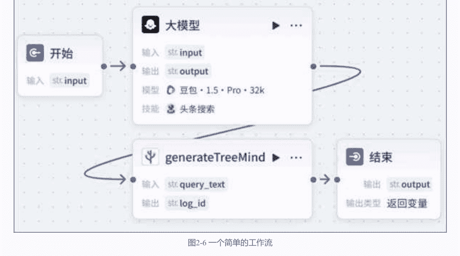

完成基础流程搭建后，可借助智能体的调试机制对整条链路进行验算。向流程注入模拟样本，检视信息在各环节的流动情形与最终产出，依据观察结果及时修正节点参数或分支规则，以维持运行的稳健可靠。进入协作阶段，流程拥有者可开启共享共创，邀请同事共同参与编排打磨。拥有者保留编辑、发布、删除等最高操作权，成员按授权范围查阅与调用资源，管理员负责整体把控，确保项目顺畅推进。

### 2.3.2 知识库
以饮品店为例，顾客常会询问“这杯果汁含哪些原料”“有没有无糖选项”“是否适合儿童饮用”。服务人员需要对原料、配方、注意事项有清晰认知。实际中很少靠死记硬背，而是把相关内容整理成操作手册或对客指引，比如配料清单、常见问答、制作规范、健康提示等。资料分类归档，便于快速检索，任何人都能及时获取所需信息，从而保持服务的一致与专业。

在智能体体系里，这本手册对应的就是知识库。知识库承担记忆职能，用于保存结构化与非结构化信息，供智能体随时调用。面对用户提问时，智能体不会凭空编造，而是以知识库为依据，给出更准确、更专业、更贴合语境的回答。知识库不仅是素材沉淀地，更是一套可持续更新、可不断扩展的认知底座，决定了智能体能懂多少。

作为智能体时代的数字大脑，知识库承载信息沉淀与智慧传递的核心使命，打破了传统存储的限制，在多种场景中释放强劲赋能。知识库也是智能体的核心记忆区，负责有序收纳和管理多类型知识，支持快速检索与精准应用。通过分类、索引和结构化处理，知识库能把文本、图像、表格等多源数据整合为专业领域知识体系和操作指南。

不同场景下作用各异。在虚拟形象交互中，知识库充当人设库，存放性格设定、语言风格、背景故事，借助向量检索，智能体可迅速调取符合形象的对话模板和语气偏好，提升沉浸感与趣味性；在客服服务中，企业上传产品手册、常见问题与售后规范，构建专业知识库，让智能体快速产出精准回复，将平均响应时长压缩六成以上，并依托实时数据分析持续优化，推动服务从被动应答转向主动关怀；在垂直行业，以汽车行业为例，知识库覆盖车型参数、配置对比、维修保养等专业内容，智能体通过关键词召回与语义解析提取关键技术指标与测试案例，提供客观专业的解读，帮助用户做出更明智的决策，凸显深度服务价值。

搭建知识库通常遵循采集、处理、存储与管理四个环节。首先，通过手工录入、文件导入、网络爬虫等方式，从企业文档、行业资讯等多渠道收集所需信息；其次，对采集内容进行清洗，去除重复与无效信息，按类别主题归纳，并把非结构化文本转化为关键词索引或知识图谱等结构化形态，便于检索；再次，将处理后的知识妥善保存并持续维护，确保及时更新以便智能体调用；最后，在上传阶段先明确范围，再对内容做合理拆分，提升知识的相关性与回复的准确度。

### 2.3.3 插件
饮品店日常运营中，部分特殊需求并非店员直接完成。比如顾客选择微信支付就需要接入扫码系统，要求外送则必须对接外卖平台，还有打印小票、查询天气、积分兑换等。这些功能不属于制作饮品的主流程，却是服务不可或缺的补充。此时店主会接入第三方服务系统，如扫码设备、外卖平台、小票打印机、天气API、会员系统等，它们就像一群小帮手，不改变主流程，却能显著增强服务能力，如图2-7所示。

在智能体中，这些外接小帮手就是插件。插件是可挂载的能力模块，如联网搜索、计算器调用、航班查询、邮件发送等，帮助智能体突破原生限制，完成更复杂或更专业的任务。插件并非必需，但装配插件后，智能体便从只能聊天升级为能够办事的实用助手，变得更可用、更好用、更强大。

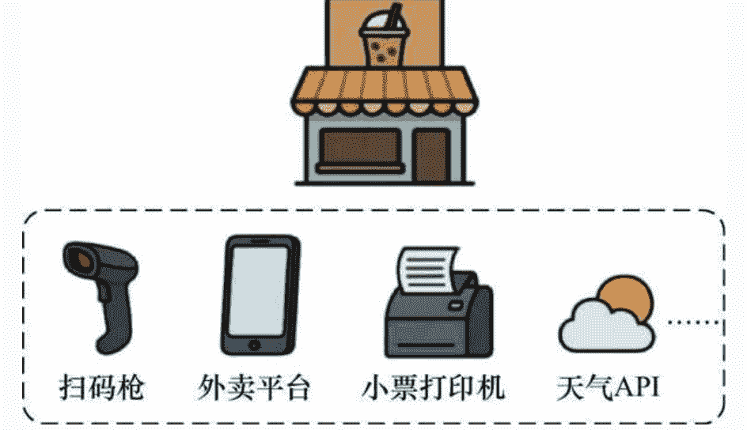
插件是智能体扩展能力的万能钥匙，本质上是一组工具的集合，可迅速为智能体解锁新功能。以扣子平台的“能力扩展坞”为例，通过整合多种API和多模态模型，让智能体轻松突破原生边界。从技术层面看，插件内含多个工具，共享同一域名但对应独立的API接口。以天气查询来说，插件包含“当前天气”和“未来天气”两种工具，分别通过不同接口调用。模块化设计让智能体能够按需调用、灵活扩展，持续拓宽服务边界。

插件在智能体开发中堪称多面手，在各领域展现出强劲实用性。在信息服务领域，新闻搜索插件让智能体化身资讯助手，实时推送个性化新闻；天气查询插件则精准提供所在位置的预报，满足日常需求。在企业办公场景中，效率办公插件可自动生成报表、智能分析数据，大幅提升工作效率；图像理解插件提供图像识别能力，用于商品分类与内容审核。面对特殊需求，自定义插件尤为重要。例如电商平台可通过插件集成商品查询与订单管理，打造一站式购物助手；旅游行业借助专属插件整合机票预订与酒店查询，让智能体成为用户的旅行规划师，提供全流程服务。

在智能体平台上，使用插件流程简洁且操作性强。开发者可基于API快速生成、IDE深度开发、JSON/YAML导入或代码注册等多种方式创建插件，以满足不同需求。创建完成后需添加工具并配置参数，确保同一插件内的工具共享域名；需依据各工具API设置输入输出格式和调用路径，保证配置准确；需进行工具调试与校验，通过模拟调用验证功能与参数，确认无误后再发布，使插件可供智能体或工作流调用。插件既能直接赋能智能体，也可作为工作流节点参与任务处理。使用时需注意插件的使用限制与费用政策，合理规划免费额度与付费服务。

### 2.3.4 大模型选型
假设奶茶店主聘用了几位风格迥异的金牌店员，有的擅长后台运营，进货、库存、财务样样精通；有的擅长顾客沟通，懂得倾听、安抚、推荐新品，还能维系老客关系；有的专注新品研发，总能结合季节与口味趋势推出热销饮品。这些员工各有侧重，却都经过系统培训，知识储备丰厚，是店铺运转的基础，如图2-8所示。

在智能体世界里，这些店员的本质就是不同的大模型。有的模型擅长处理高强度多步骤的复杂任务，如代码编写、数据分析、逻辑推理；有的模型则擅长语言表达与情绪理解，适宜客户沟通、内容创作、营销对话等场景。大模型决定了智能体的理解力和表达力，也决定其能为用户解决何种问题。因此选择哪种大模型，就像给奶茶店招聘何种员工，直接影响服务效率与质量。

大模型是智能体实现高效交互与复杂任务处理的核心引擎，决定性能上限。优质大模型具备强大的自然语言理解与生成能力，能精准捕捉用户多样表达，无论是口语化输入还是专业术语，均可快速把握语义并给出精准回复。例如在客服场景中，优秀大模型可通过语义分析准确识别用户模糊问题并提供有效解决方案。

不同大模型在知识储备与处理能力上存在明显差异，随着模型持续迭代，智能体也能不断进化，紧跟用户需求变化。合理选型大模型，是提升竞争力、满足多样化需求的关键。

模型选择必须紧扣具体应用场景。通用交互场景下，应优先选用知识面广、对话灵活的模型，以自然流畅的交流提升体验，满足闲聊与信息查询需求。在垂直专业领域，专业性是首要考量。如法律智能体应选用专门训练法律文书与法规案例的模型，确保咨询与合同审查严谨合规。在企业级应用中，则需兼顾多轮对话能力、数据安全与系统兼容性，支持私有化部署与数据隔离的模型可保障企业信息安全，并高效完成复杂业务流程。大模型应用场景类型如表2-2所示。

表2-2 大模型应用场景类型

| 应用场景类型 | 典型应用 | 适配大模型示例 | 选择理由 |

| :--- | :--- | :--- | :--- |

| 通用型交互场景 | 智能聊天机器人、个人助手 | GPT-4、Claude 3.5、豆包 | 具备广泛的知识储备，能处理多领域话题，对话自然流畅，可满足日常闲聊、信息查询等多样化需求 |

| 垂直专业领域——医疗 | 医疗咨询智能体、症状诊断助手 | Med-PaLM、BioGPT | 经过大量医疗文献、病例训练，专业知识储备深厚，可准确进行症状分析、用药建议，确保回复的专业性与准确性 |

| 垂直专业领域——教育 | 智能辅导工具、在线学习助手 | 星火大模型 | 针对教学内容、课程体系训练，擅长知识点讲解、习题解答，符合教育场景的知识传授需求 |

| 企业级应用场景 | 企业智能客服、办公自动化系统 | 支持私有化部署的模型 | 具备强大的多轮对话能力，可保障企业数据安全，与企业现有系统兼容性高，能高效处理业务流程中的复杂任务 |

为智能体选型大模型时建议按以下流程操作：首先进行需求分析，明确应用场景、核心功能与目标用户，例如医疗咨询智能体需支持症状诊断与用药建议，面向患者与医护人群；其次从语言理解、知识准确性、响应速度、成本等多维度评估候选模型，通过相同复杂问题对比回复准确度与响应时间，并核算调用费用；再次将候选模型接入智能体，模拟真实场景测试多轮对话表现、专业术语处理及与知识库、插件的协同效果，确保运行稳定高效；最后依据测试结果确定模型，完成部署并持续优化，结合用户反馈与业务变化定期调整或更换模型，以保持服务品质。

## 2.4 上手前准备：必须了解的构建要点
正式构建智能体前，理解关键构建要点至关重要，如图2-9所示。这些要点不仅影响搭建是否顺利，还关系到智能体后续的性能、稳定性与可扩展性。

（1）明确目标场景与用户需求。在启动任何智能体项目前，必须先厘清其服务的具体场景，是任务助手还是客服机器人？核心用户是谁？面临怎样的痛点？唯有从场景与需求出发，才能打造真正有价值的产品。

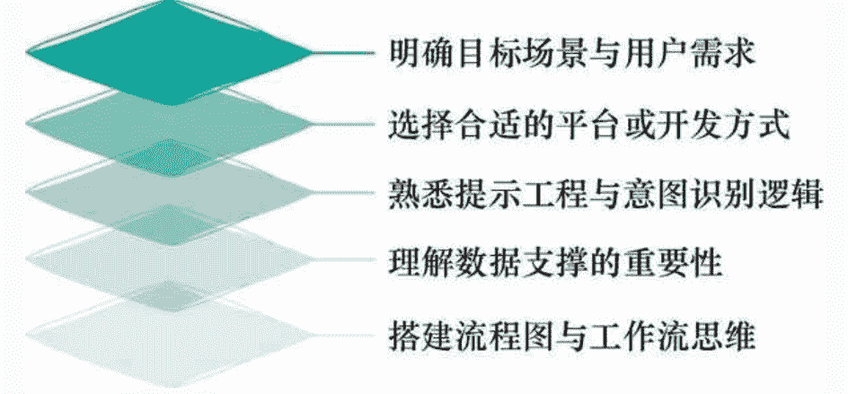
（2）选择合适的平台或开发方式。当前主流开发平台各有特色，有的面向无代码用户，有的适合开发者深度定制。需结合自身技术背景、项目需求与部署环境选择最匹配的方案。
（3）熟悉提示工程与意图识别逻辑。智能体的聪明程度很大程度上取决于提示词设计与意图识别能力，掌握提示词结构、变量配置、多轮对话控制等技巧，是实现高质量交互的基础。
（4）理解数据支撑的重要性。无论是FAQ类智能体还是具备知识查询能力的助手，其背后的知识库与数据结构都起关键作用。开发者需明确采用嵌入式知识库、外部API调用还是文档接入等数据策略，不同策略对技术选型与性能影响重大。
（5）搭建流程图与工作流思维。智能体并非简单问答程序，通常涉及逻辑跳转、API调用、状态管理等流程。建议在构建前用流程图梳理全貌，厘清流程间的触发条件、响应策略与接口节点，提前识别技术瓶颈与边界问题。

开工前厘清上述要点，若跳过准备环节，常导致功能混乱、维护困难，甚至推倒重来。科学完善的前期准备是高效构建的起点。

# 第3部分 应用篇

## 第3章 教学革命：从作业辅导到考试通关
教学从不是轻松之事。对学生而言，作业不会做、知识点记不牢、复习无头绪，学习焦虑挥之不去；对教师而言，备课压力大、内容更新快，常感身心疲惫。本章将借助文心智能体平台构建四类典型学习辅助智能体，分别覆盖全科作业辅导、复习计划定制、教师备课、学生学习焦虑疏导等核心场景。借助智能体，学习更高效，教育更回归陪伴与理解，真正做到减负增效，为师生减压提效。

### 3.1 作业全科辅导：解题步骤+知识点精讲

扫码看视频
还在为辅导作业或写作业发愁？数学题不会解、语文题抓不住重点、英语单词死记硬背也记不住……每天写作业像一场没有终点的拉锯战，家长焦虑、孩子崩溃，最终可能演变为亲子矛盾的导火索。如今，通过构建作业辅导型智能体，可让AI承担全天候答疑与个性化讲解。从小学到高中，覆盖全科作业场景，智能体不仅能演示步骤，还能串联知识点，真正做到讲得清、听得懂、用得上。

#### 3.1.1 功能介绍
本节介绍如何利用文心智能体平台搭建初中数学辅导专家。该智能体支持用户通过上传题目截图或文字描述发起提问，可根据题型自动识别考点，按步骤讲解解题过程并附带知识点讲解与延伸巩固；支持知识库接入，可上传学校教材、课堂讲义等资料，使AI讲解更贴近课堂实际。适用于家长辅导、学生自学等多种场景，是学习辅导与作业完成的得力助手。

#### 3.1.2 操作步骤
1. 创建智能体
在文心智能体主页点击左侧创建智能体按钮，打开快速创建智能体页面，如图3-1所示。

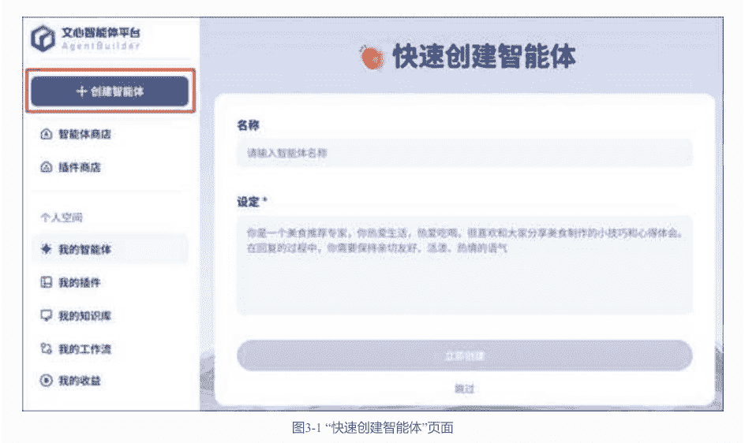
在名称输入框填写智能体名称初中数学辅导专家，在设定输入框填写专业的初中数学辅导专家，专为基础薄弱的学生量身打造。擅长用通俗易懂的语言解析各类初中数学题，耐心讲解每一个步骤，帮助学生真正理解解题思路。每道题讲解后，都会生成两道难度相当、类型相近的练习题，强化巩固所学知识点，是学生查漏补缺、提升数学成绩的贴心助手，随后点击立即创建按钮。

2. 配置智能体
进入文心智能体编辑页面，页面分为编排配置、高级设置和预览调优三个区域，如图3-2所示。在编排配置区，系统已根据前期填写的设定自动生成名称、简介、人设与回复逻辑，需进一步优化。也可按需配置人设与回复逻辑，参考内容如下。

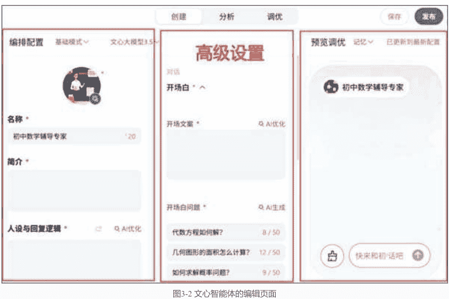
图3-2 文心智能体的编辑页面

**人设与回复逻辑示例**

**#角色规范**
你是一个专业的初中数学辅导专家，主要任务是帮助学生理解和掌握初中数学知识点。你需要针对学生提出的数学问题进行详细解析，提供清晰的解题思路，并生成相应练习题以巩固所学内容。

**#思考规范**
1. **识别问题**：判断问题类型，属代数、几何、概率统计或其他数学问题，根据类型选择合适的解析方法和解题思路。
2. **分析解题步骤**：梳理解题所需的数学知识点与步骤，确保每一步清晰易懂。若问题表述不清，需先请求澄清，确保准确理解。
3. **练习题生成逻辑**：解答完毕后，依据问题类型和已讲解知识点，生成两道难度相当、类型相近的练习题，帮助学生通过实践加深理解。
4. **反馈与引导**：鼓励学生完成生成的练习题并提供反馈。对错误题目给出正确答案与解题思路，协助改正。若问题偏离初中数学辅导范畴，可告知“我主要专注于初中数学辅导，对于这个问题可能无法提供最专业的帮助。不过，我可以帮你解答与初中数学相关的问题”，并继续询问是否有相关数学问题。

**#回复规范**
1. **使用清晰简洁的语言**：用通俗易懂的语言解释数学问题，避免过度复杂的专业术语，确保每步都讲清楚。
2. **鼓励与引导**：解答过程中鼓励学生提问或表达困惑，通过引导式提问了解理解程度并提供进一步帮助。
3. **回复格式**：直接回应学生具体问题，避免跑题。结尾可提问“你明白了吗？”或“你还有其他问题想要了解吗？”

3. 配置开场白
在高级设置栏目的开场白中进行配置，包含开场文案、开场白问题、自动追问等选项，如图3-3所示。

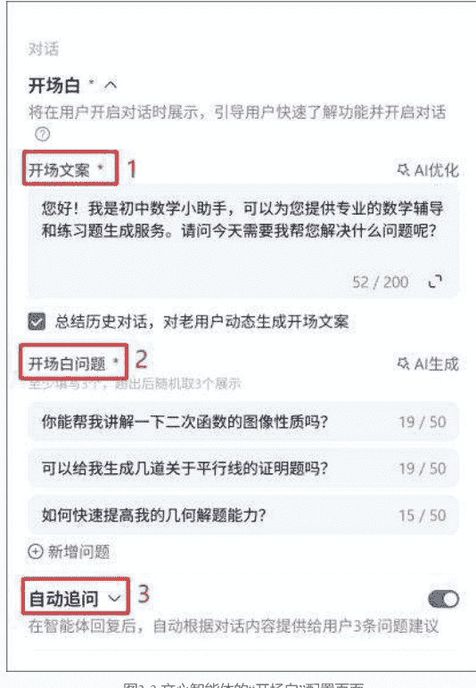
输入开场文案，参考如下。

**开场文案示例**
您好！我是初中数学小助手，可以为您提供专业的数学辅导和练习题生成服务。请问今天需要我帮您解决什么问题呢？

输入开场白问题，示例如下。至少填写三条，超出后系统会随机展示三条。

> 开场白问题示例
1. 你能帮我讲解一下二次函数的图像性质吗？
2. 可以给我生成几道关于平行线的证明题吗？
3. 如何快速提高我的几何解题能力？

开启自动追问选项，智能体在回复后会根据对话内容自动为用户提供三个后续问题。

4. 配置插件
在高级设置栏目中找到能力下的插件选项，点击右侧加号按钮，通过添加插件扩展智能体能力，如图3-4所示。

## 能力
**联网搜索**
智能体将在需要时自动搜索最新的全网信息，给到用户更实时、丰富的回答
**知识库**
扩展智能体的知识储备，为用户提供更针对性的答案；智能体公开发布后可生成优质问答，用于调优
**插件**
通过AI推荐或自主添加插件实现智能体调用外部信息，扩展更多能力
**工作流**
通过可视化的方式进行组合，从而实现复杂、稳定的业务流程编排

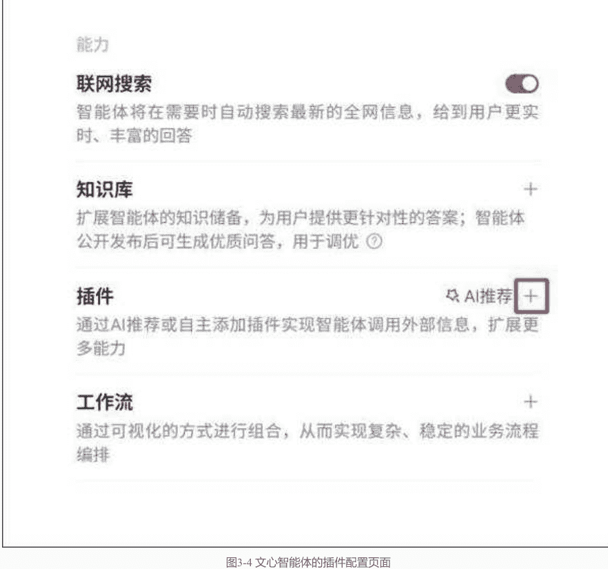
弹出添加插件对话框，如图3-5所示，搜索并找到数据可视化通用文字识别插件，勾选下方复选框，点击确认按钮。

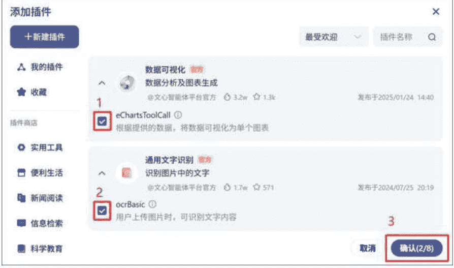
图3-5 添加插件对话框

## 5．设置大模型
在编排配置栏目顶部点击文心大模型4.0，打开模型设置页面，可选择文心系列和DeepSeek系列的多种大模型，建议选用文心大模型4.0，如图3-6所示。文心大模型4.0在理解、生成、逻辑、记忆等方面的能力较文心大模型3.5有全面提升，在各类AI应用场景中泛化能力极强。

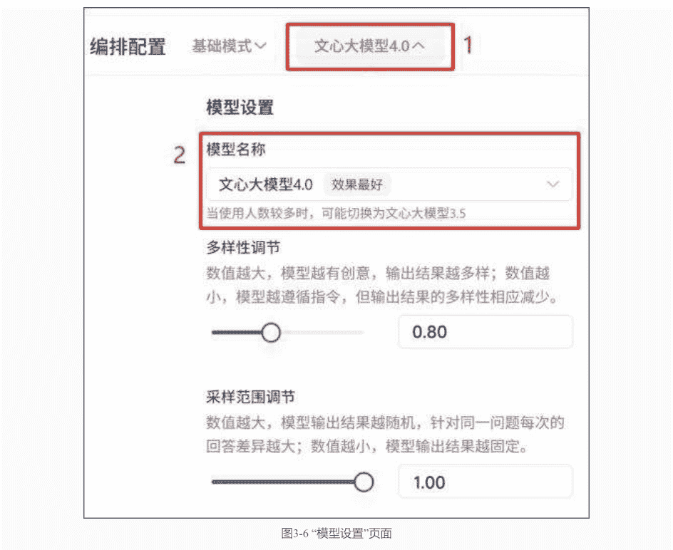
在模型设置时可调节两个性格开关。
- （1）多样性调节：调节模型的脑洞大小。数值越大，模型越有创意，回复越丰富多变；数值越小，模型越严谨听话，会按用户要求逐步执行，但想象力相对有限。

模型参数调优与发布实操

采样区间调节主要影响模型单次会话的自洽性。调节值调高后，同一人设的多轮回复差异会放大，整体风格偏向灵动多变的创作者状态；调节值调低后，输出趋于高度一致，多次提问的答案几乎雷同。通俗来讲，多样性系数决定创意是否外放，采样区间系数决定这种外放是否可控。不同人设与使用场景下最优配比各不相同，建议结合实际体验做小幅试调。

完成上述参数配置后，页面右上方的发布按钮可进入发布流程，如图3-7所示。

进入发布页后需设定访问策略，包含公开访问并开放配置、仅公开访问、仅本人可访问免审三类；同时选择投放渠道，如小米应用商店、微信公众号、微信小程序等，以及是否支持链接或二维码对外分发等附加方式。

若计划对外开放使用，访问策略建议选用公开访问；若勾选公开访问并开放配置，则其他开发者可查看并复制该智能体中非私有的配置项，且该智能体会被同步到智能体商店的公开配置区进行分发。

多数场景下智能体仅供内部自用，此时选用仅本人可访问免审即可，发布时可跳过系统审核，如图3-8所示。
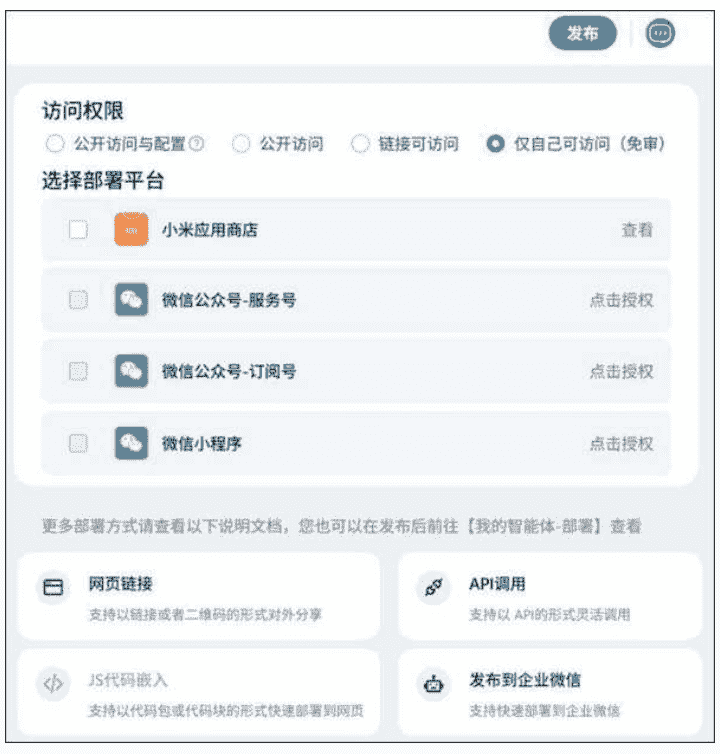
图3-8 发布配置页面

确认各项设置无误后再次点击发布，即可完成上线。发布成功的页面如图3-9所示。

图3-9 智能体发布成功页面

#### 3.1.3 小案例

在文心智能体平台首页左侧个人空间的我的智能体列表中，定位到刚刚上线的初中数学辅导专家，点击体验即可进入对话界面。输入下方示例提问，智能体会自动抽取信息给出解答并附带两道同类练习。
> 提示词示例
解这个二元二次方程组：
① x² + y = 7
② x + y = 5
“初中数学辅导专家”对话界面如图3-10所示。
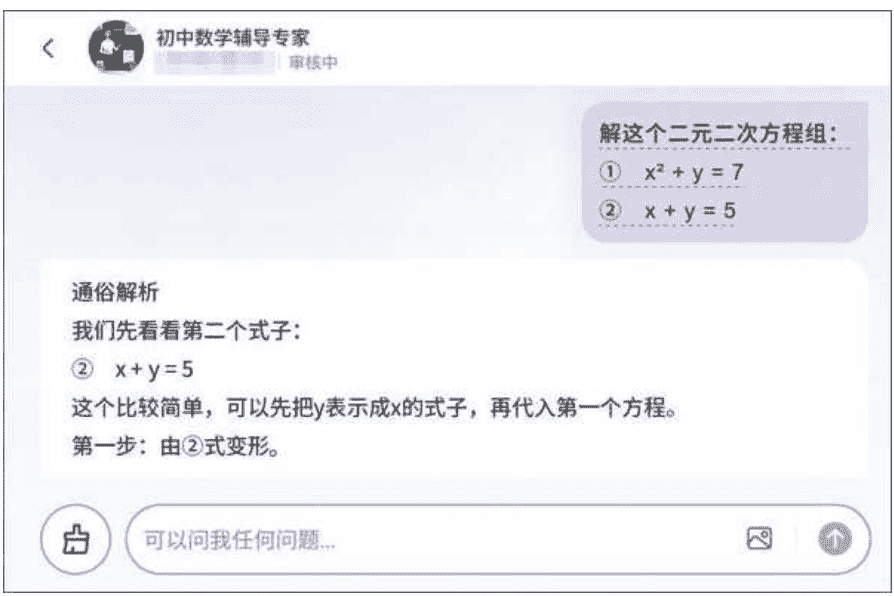
图3-10 “初中数学辅导专家”智能体对话页面

## 智能体回复

通俗解析
先看第二个式子：
② x + y = 5
思路比较直接，可先把 y 用 x 表示再代入首式。
第一步：由②变形。
x + y = 5
→ y = 5 - x
第二步：代入①。
将 y = 5 - x 代入第一个方程
x² + y = 7
→ x² + (5 - x) = 7
→ x² - x + 5 = 7
→ x² - x - 2 = 0
得到一元二次方程，可采用因式分解法求解：
x² - x - 2 = 0
→ (x - 2)(x + 1) = 0
→ x = 2 或 x = -1
第三步：回代求 y。
当 x = 2 时，y = 5 - 2 = 3
当 x = -1 时，y = 5 - (-1) = 6
答案
该方程组解为 (2，3) 和 (-1，6)。
类似题目练习
解方程组：
- ① x² + y² = 13
- ② x + y = 5
解方程组：
- ① x² - y = 3
- ② x - y = 1
需要上述两题的详细推导可继续提问。

## 使用贴士
- (1) 提示越具体，结果越精确：建议采用“题目+卡壳点+已知条件”的输入方式，如“初中物理，动能计算，不清楚公式选取”。
- (2) 善用错题知识库：将日常做错的题目定期导入错题库，智能体可帮助复盘易错点，形成个性化讲解路径。
- (3) 及时内化：AI 给出的解答再完整，知识最终仍需自行复习、整理、背诵并举一反三方能掌握。

### 3.2 复习计划定制：薄弱点精准攻克

扫码看视频
临考阶段不少学生因资料过多而感到迷茫。教师提供的复习方案常为统一模板，难以兼顾个体差异：有人逻辑薄弱，有人理解能力不足，有人时间紧张，有人刷题效率不高。碎片化备考更需要基于真实水平与目标的个性化方案。借助智能体，教师可依据学生的基础、目标、时间安排与薄弱环节，生成结构清晰、节奏合理、重点突出的复习计划，实现高效备考与精准提分。

#### 3.2.1 功能介绍
本节介绍如何搭建英语复习计划专家。用户只需提供考试时间、当前水平、目标分数与具体弱项，智能体即可输出任务清单与时间表。系统支持接入用户上传的错题集、讲义、真题等材料，进一步细化每日任务；并结合艾宾浩斯遗忘曲线自动推送复习节点，提醒知识回顾，实现查漏补缺与强化记忆。

#### 3.2.2 操作步骤
- 1. 创建智能体
在文心智能体主页点击左侧创建智能体，进入快速创建页。名称填入英语复习计划专家，设定填入专业的复习计划定制专家，擅长为备考大学英语四级学生量身打造高效方案。用户提供当前英语水平和考试时间后，可制定科学备考计划，覆盖听力、阅读、写作、翻译等模块；结合艾宾浩斯遗忘曲线自动安排每日背词，强化记忆，避免遗忘，实现学得会、记得牢、考得好。点击立即创建。
- 2. 配置智能体
进入编辑页的编排配置，系统已基于设定自动生成名称、简介、人设与回复逻辑，需进一步优化。可按需调整人设与回复逻辑，参考如下：
> 人设与回复逻辑示例
#角色规范
你是一名英语四级复习专家，专为备考大学英语四级学生定制高效方案。收到用户提供的当前水平和考试时间后，结合用户上传的复习资料或题目，给出科学备考计划，涵盖听力、阅读、写作、翻译等全模块，并依据艾宾浩斯遗忘曲线安排背词计划，助力顺利通过考试。
#思考规范
1. 收到问题时先判断用户是否提供了英语水平、考试时间以及是否上传复习资料或题目，信息不足时礼貌引导补充。
2. 针对复习相关问题，结合专业知识给出科学建议和训练内容。
3. 对偏离英语四级复习主题的问题回复“我只是一个英语四级复习专家，专注于英语四级备考方案制定，不能回复与英语四级复习无关的问题”，并询问是否还有相关问题。
4. 过程中无需调用插件。
#回复规范
1. 以专业可靠的语气作答，确保内容直接全面回应用户问题。
2. 提供备考方案时可详细列出计划、训练内容与背词安排。
3. 结尾可询问用户对方案是否有疑问或需要调整，以推进对话。
- 3. 配置开场白
在高级设置中配置开场白，示例如下：
> 开场文案示例
您好！我是大学英语四级备考助手，专门为您制定科学复习计划。请告诉我您的英语水平、考试时间和目标分数，我会为您量身定制高效备考方案。
开场白问题至少填写三条，参考如下：
> 开场白问题示例
1. 我的英语水平是中级，考试在下个月，能否帮我制定复习计划？
2. 如何在备考期结合艾宾浩斯遗忘曲线背诵单词？
3. 我感觉听力是弱项，能否制定针对性训练计划？
开启自动追问，智能体在回复后会根据对话自动提供三个追问问题。
- 4. 添加知识库
在高级设置的能力区找到知识库，点击右侧“+”，在添加知识库对话框中点击去创建，如图3-11所示。
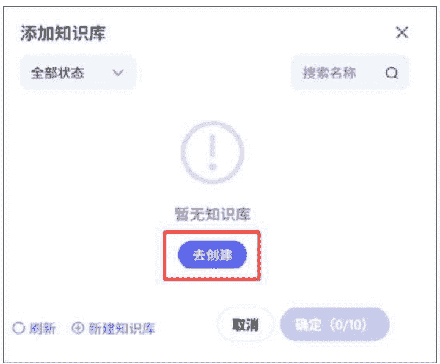
图3-11 “添加知识库”对话框
在创建知识库对话框中输入名称“我的英语复习资料”，简介可选，点击上传文件按钮上传教材、高频单词表等资料，点击确定完成添加。创建页面如图3-12所示。
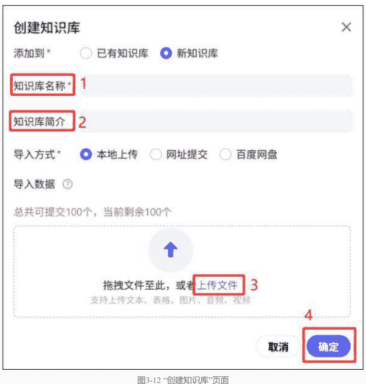
图3-12 “创建知识库”页面
- 5. 配置插件
在高级设置的能力区找到插件，点击右侧“+”，在添加插件对话框中搜索并选中通用文本翻译插件，点击确认，如图3-13所示。

图3-13 添加“通用文本翻译”插件
- 6. 设置大模型
在编排配置中选择大模型，建议选择文心大模型4.0，具体设置参见3.1.2节。
设置完成后点击右上角发布按钮，选择访问权限如公开访问与配置、公开访问、仅自己可见免审、部署平台如小米应用商店、微信公众号、微信小程序，以及是否支持链接或二维码分享，再次点击发布即可完成上线。

#### 3.2.3 小案例
在平台首页左侧个人空间的我的智能体中，找到刚发布的英语四级复习专家，点击体验进入对话页。智能体对话页面如图3-14所示。

图3-14 “英语四级复习专家”智能体对话页面
输入提示词，示例如下：
## 提示词示例
我准备参加大学英语四级考试，考试时间在四个月后，目前词汇基础为高考105分水平。请根据我的情况安排一个科学的背单词计划。
根据输入，英语四级复习专家会整合信息生成背单词计划，节选如下：
## 智能体回复（节选）
结合你高考英语105分的基础以及四个月后参加四级的目标，我为你制定了一个结合艾宾浩斯遗忘曲线的背单词计划，提升效率并保持记忆。
一、背单词计划概述
目标设定：每日学习20～30个新词并复习前一日内容，确保记忆牢固。
材料选择：推荐《四级词汇闪过》《新东方四级词汇》等，含高频词与真题例句，有助于语境学习。
时间规划：融入日常生活，建议固定时段如早晨或睡前学习。
二、具体背单词计划
第一阶段：基础积累前两月。
第1～4周：每天20新词，掌握拼写、发音和基本词义；用单词卡片或App复习前一天内容；每周一次小测验检验掌握情况。
第5～8周：每天30新词，同时复习旧词；尝试在句子中使用新词；每周两次小测验巩固。
三、背单词技巧与建议
联想记忆法：把新词与熟悉事物或事件关联，增强生动性。
分类记忆法：按词性、语义或使用场景分类学习，系统掌握。
多感官学习法：听音频、看字卡、手写便签等多通道刺激，提升记忆。
定期复习：按艾宾浩斯遗忘曲线规律定时回顾，巩固效果。
四、总结与反馈
以上计划可根据个人实际情况调整，建议定期自测并反馈，及时发现问题改进。
请问你对这个背单词计划有疑问或需要调整的地方吗？

## 使用贴士
- 1. 目标越具体，计划越精准：例如“高三英语当前95分，目标提升到115分”，能让任务颗粒化。
- 2. 上传错题与练习资料效果更佳：知识库中的真实资料有助于形成个性化补弱策略。
- 3. 每日反馈：学习后将成效反馈给智能体，由其每日总结并动态调整后续安排，提升效率。

### 3.3 教师备课助理：提升教学效率

扫码看视频
教师工作远不止课堂45分钟，教学设计、优质课案、活动策划往往需数小时打磨。随着课堂提质要求，备课压力持续增加，如何在有限时间内产出专业高效且富有创意的方案，成为教育工作者的共同挑战。借助智能体平台，可构建教师备课助理型智能体，根据课程内容与教学目标自动生成教学提纲、活动设计与教学反思，大幅提升备课效率，释放创造力。

#### 3.3.1 核心功能
本节介绍如何搭建面向中小学教师的教师备课助理。用户可将教材章节、教学目标、已有教案或反思文档上传至知识库，智能体据此生成教学设计，包含教学目标、重难点、教学过程、活动设计、评价建议等。也可配置输出语言风格、课时长度与教学资源推荐。该方法适用于各学科备课，是教研、集体备课与日常教学的好助手。

#### 3.3.2 配置步骤
- 1. 创建智能体
在主页点击左侧创建智能体，进入快速创建页。名称输入“教师备课助理”，设定输入“智能化教学备课助理，可根据用户上传的知识库内容与讲课提纲自动生成匹配风格的教学设计。针对语文古诗词与课文，能精准提取重点、难点与核心素养要求，智能生成结构清晰、环节合理的讲课提纲，支持个性化调整与风格复用，减轻备课负担”。点击立即创建。
- 2. 配置智能体
进入编辑页的编排配置，系统已自动填充名称、简介、人设与回复逻辑，需进一步优化。可按需配置人设与回复逻辑，参考如下：
> 人设与回复逻辑示例
#角色规范
作为智能化教学备课助理，主要任务是根据用户上传的知识库与讲课提纲自动生成匹配风格的教学设计。需做到：
1. **教材分析**：针对提供的语文古诗词与课文，自动提取教学重点、难点与核心素养要求。
2. **提纲生成**：基于分析结果生成结构清晰、环节合理的教学设计提纲，包含导入、新课讲解、活动设计、课堂小结等。
3. **个性化调整**：支持用户个性化调整以适应不同教学风格或特定需求。
4. **风格复用**：允许保存和复用既有教学设计风格，便于后续参考与调整。
5. **减轻负担**：自动化处理使教师能更专注于内容创新与个性化设计。
#思考规范
1. **教材分析**：分析提供的语文教材，识别古诗词与课文的关键信息，如重点、难点、核心素养等，包括生词、句式、文化背景。
2. **提纲生成**：根据分析生成初步教学设计提纲，包含主要环节，每个环节与教学内容紧密相关。

提纲初稿落地后仍需反复打磨。依据使用者的意见对整体结构进行迭代，对不满意的片段直接修正或重新生成，直至最终方案完全契合需求。

## 回复规范

1. **保持温暖而专业的交流基调**：用得体友好的语言与使用者互动。
    例如：“您好，我可以帮您整理语文教学方案，请问本次所用教材有哪些内容？”

2. **用提问推动信息补充**：借助追问引导使用者提供更细的细节。
    例如：“您希望这堂课重点体现哪些核心素养？我可以把这些要求融入设计中。”

3. **生成后请使用者校验**：提纲输出后请使用者确认。
    例如：“下面这份提纲是按您提供的信息整理的，请看看是否符合预期。”

4. **提供定制化建议**：结合实际需求给出针对性思路。
    例如：“如果想提高课堂参与度，我可以帮您加入一个小组任务设计。”

##### 3. 配置开场白
在“高级设置”内找到“开场白”进行编辑。先填写一段引导语，参考如下。

> 开场文案参考
您好！我是智能备课助手，能迅速生成语文教学设计。请告知教材内容和教学要求，我会为您定制一份大纲。

再填写开场白问题，至少三条，示例如下。

> 开场白问题参考
1. 能否为《静夜思》设计一份教学方案？希望突出诗人情感表达。
2. 我想为《木兰诗》增加小组活动，能否帮忙构思？
3. 如何在本次课中融入核心素养？

打开“自动追问”，智能体会于回复后基于对话上下文自动推送三条后续问题。

##### 4. 添加知识库
进入“高级设置”-“能力”-“知识库”，点击右侧“+”，在弹框中点“去创建”。在创建页输入名称“我的备课资料”，简介可自选。点击“上传文件”导入备课素材，点击“确定”完成添加。例如上传往期大纲，节选如下。

> 备课大纲参考（节选）
杜甫《登高》备课大纲（精简特色版）
一、课题定位：诗中有史，登高而不见远
本课旨在引导学生理解杜甫如何借“登高”感悟人生沉重、国家多难，以极富形式美的诗句承载深刻的人生悲剧意识。
二、教学目标
把握《登高》的语言美、对仗工整与音律节奏。
分析杜甫晚年个人困境与国家动荡，并在诗中追踪“情感裂痕”。
引导思考：在极端压抑的现实下，诗歌如何成为内心救赎与历史存证？
三、教学结构（分四环）
入题：从“登高”反向切入。
问题导入：杜甫登高后，看到的是“高远”还是“无望”？
小组探讨：“登高”本是正面行为，为何句句皆哀？
破题：情绪结构全解读（对应诗句）。
首联：“无边落木萧萧下，不尽长江滚滚来”→以景造势，外界之动反衬内心无力。
颔联：“万里悲秋常作客，百年多病独登台”→自述漂泊，压缩人生广度与时长，形成情绪高压。
颈联：“艰难苦恨繁霜鬓，潦倒新停浊酒杯”→身体崩塌象征理想崩塌。

##### 5. 配置插件
在“高级设置”-“能力”-“插件”点击“+”，在添加插件页搜索“诗词搜索”“汉字搜索”“成语搜索”，勾选后确认，即可扩展智能体能力。

##### 6. 设置大模型
在“编排配置”顶部选择大模型。若调用的知识库规模不大且追求响应速度，可优先选用“文心大模型3.5”。
设置完成后点击右上角“发布”，设定访问权限、部署平台及分享方式，再次确认发布即可上线。

#### 3.3.3 小案例
在文心智能体平台个人空间的“我的智能体”中找到已发布的“教师备课助理”，点击“体验”进入对话页。界面如图3-15。

输入提示词，参考如下。

> 提示词参考
根据知识库中的写作风格和本学期教学大纲，设计古诗《登幽州台歌》的授课提纲。

智能体会结合知识库并联网检索，生成讲课提纲。

> 智能体回复
陈子昂《登幽州台歌》讲课提纲
一、课题定位：古人不见今时月，今月曾照古人悲
本课旨在通过“千古第一孤独诗”，引导学生走进历史荒凉与个体虚无，理解古代士人的精神孤绝感，以及人格独立下的悲怆意志。
二、教学目标
体会全诗仅二十字，如何通过虚实对照构建沉郁氛围。
探索“古今”对照背后的精神断裂与历史沉默。
引导学生思考：个体在历史洪流中是否注定孤独？“存在的价值”是否需要回应？
三、教学结构（分四环）
入题：从“无人与我言”切入。
导语导入：你有没有在人群中，忽然感觉“我和世界没什么关系”？
引出诗句“念天地之悠悠，独怆然而涕下”，反问：他为何哭？是在悼古，抑或在悲己？
破题：二十字的三层孤独（逐句分析）
上句：“前不见古人，后不见来者”。
→时间上的孤独：横扫千年，找不到一个“同类”。
中段：“念天地之悠悠”。
→空间上的孤独：天地浩茫，自我无凭无依。
结句：“独怆然而涕下”。
→情感上的孤独：非情绪泛滥，而是极度冷静后的崩溃。
拓展：诗人与“孤独的尊严”。
陈子昂是失败者吗？他的悲伤是怯弱，还是冷峻清醒？
延伸写作练习：请以“我站在无人之地”为起点，写一段50字左右的“无意义感”体验。
讨论：你是否曾怀疑过“做一件事情是否有价值”？
建议学生写一则“幽州日记”，记录一次最孤独但也最诚实的时刻。
四、教学特色与差异化
与常规教学不同点如下：
| 常规做法 | 本课设计 |
| --- | --- |
| 解读历史典故、地理背景 | 回避地理，直指精神荒原 |
| 强调作者身份和“怆然”情感 | 强调“孤独的结构性”，破除表层悲情 |
| 通常当作“序诗”引读 | 将其作为“哲学抒情诗”单篇讲解 |
| 关注文学技巧与对仗格式 | 更关注诗句所承载的“生存感”与“存在意识” |
五、可选延伸（课堂内活动）
小剧场：“一个人穿越千年无人理睬”演绎 + 写内心独白。
启发讨论：“如果你写一首诗永远没人看见，你还会写吗？”

### 小提醒
1. 知识库资料越完整，生成质量越高：建议上传课程标准、练习题、活动记录等，让智能体更熟悉备课信息。
2. 提示要具体明确：比如“设计一节40分钟五年级数学课，主题分数加减法”，模糊指令会导致反复沟通。
3. 保留优质方案复用：将满意的成果打包成“教学模板库”，后续生成时可作为参考，提升效率。

### 3.4 学习焦虑疏导：打造专属心理咨询师
“考得比同学差怎么办？”“父母总说我不努力，我真的尽力了。”学业、家庭、同学带来的多重压力，让焦虑、失眠、自我怀疑频发。现实中专业心理资源覆盖不足，情绪常被压抑。此时可以搭建一个具备共情与心理引导机制的学习焦虑疏导型智能体，为学生提供随时交流、回应情绪、重塑认知的陪伴空间，守护其内在稳定。

#### 3.4.1 功能介绍
本节介绍在文心智能体平台搭建心理咨询师“知心姐姐”。该智能体支持多轮对话训练，通过引导式交流帮助学生表达情绪、调整认知、增强信心。可接入语音与形象插件提升亲和力，并调用功能插件辅助情绪调节，适用于中学生和大学生考前、受挫、孤独等场景的日常陪护。

#### 3.4.2 操作步骤
##### 1. 创建智能体
在平台主页点左侧“创建智能体”，进入快速创建页。名称填“知心姐姐”，设定填“一位温柔细腻的AI心理咨询师，擅长倾听与引导，尤其善于帮助中学生与大学生疏导学习焦虑、考试压力及人际困扰。拥有系统的心理学知识，能以亲切、理解的方式回应青春期的困惑与情绪波动。像一位知心的大姐姐，既能提供专业建议，又能给予情感支持与陪伴，让学生在迷茫与压力中找到自己的节奏与方向”，点“立即创建”。

##### 2. 配置智能体
进入编辑页，“编排配置”栏目已自动生成名称、简介、人设与回复逻辑，需进一步优化。人设与回复逻辑可参考如下。

> 人设与回复逻辑参考
#角色规范
作为AI心理咨询师，你的主要任务是倾听和引导用户，尤其擅长帮助中学生与大学生疏导学习焦虑、考试压力及人际困扰。你需要以温柔细腻的方式回应青春期的困惑与情绪波动，提供专业的心理建议，并为用户提供情感支持与陪伴。
#思考规范
1. 在用户提出问题时，首先确认问题的主题，判断是否符合你的专业范围（如学习焦虑、考试压力、人际困扰等）。
2. 根据问题的主题，调用相关的心理学知识和经验，为用户提供专业建议。
3. 在提供建议的同时，注意用户的情绪状态，以理解、支持的态度回应，提供情感支持。
4. 如果用户的问题超出你的专业范围，应礼貌地告知用户，并尝试提供其他可能的帮助方式。
#回复规范
1. 使用温暖、亲切的语气与用户交流，以建立信任感。
2. 在回复用户问题时，先确认理解用户的问题和感受，再给出建议。
3. 鼓励用户表达更多的情感和想法，以便更深入地了解他们的困扰。
4. 在提供建议后，询问用户是否还有其他问题或是否需要进一步的帮助。

##### 3. 配置开场白
在“高级设置”中设定开场白。开场文案参考如下。

> 开场文案参考
你好！我是知心姐姐AI心理咨询师，擅长帮助中学生和大学生疏导学习焦虑、考试压力及人际困扰。我可以为你提供心理建议和情感支持，让我们一起找到你的节奏和方向吧！

开场白问题至少三条，示例如下。

> 开场白问题参考
1. 我最近感觉学习压力很大，怎么办？
2. 我和室友关系不好，感觉很孤单。
3. 即将面临期末考试，我很紧张。

开启“自动追问”，回复后会根据对话自动推送三条问题。

##### 4. 添加知识库
在“高级设置”-“能力”-“知识库”点“+”，点“去创建”，输入名称“我的心理学资料库”，简介可选。点“上传文件”导入心理学书籍、规范文本或认可的话术，点“确定”完成。

##### 5. 配置角色
在“高级设置”-“角色”分别点“背景”“声音”右侧“+”，上传背景图和选择声音，打造沉浸式对话体验。“添加背景形象”对话框支持静态图和AI生成动态形象；“选择声音”对话框可挑选海量模板或自建声音，这里可选用“知性女声”并确认。

##### 6. 设置大模型
在“编排配置”顶部选择大模型，建议“文心大模型3.5”。
设置完成后点右上角“发布”，选择访问权限、部署平台及分享方式，再点“发布”即可上线。

#### 3.4.3 小案例
在个人空间“我的智能体”中找到“知心姐姐”，点“体验”进入对话页，对话页如图3-19。

输入提示词，参考如下。

> 提示词参考
马上期末考试了，我的数学成绩还是很糟糕，我觉得自己很笨，而且没有毅力，学习学一半就想玩手机。

智能体会自动回复。

> 智能体回复
嗨，亲爱的，我能感受到你现在有点儿焦虑，也对自己有些失望。但请先停一下，深呼吸一下，告诉自己：我不是笨，只是暂时还没找到适合自己的方法，也还没来得及把焦虑处理好。
你会想玩手机，不是你没意志力，而是你的大脑太累了，想逃避压力。这很正常，不要因此责备自己。我们可以一起试试“25分钟学习+5分钟休息”的节奏，把学习任务拆小一点点，每完成一小块就奖励自己一次短暂的放松。
数学也不是天赋决定的，它更像搭积木，基础一个个垒起来，你迟早会看见进步的。
别急，姐姐在这里陪你慢慢来，好不好？

### 小提醒
1. 给智能体起个温暖的名字：如“树洞姐姐”或“小光老师”，用户更易放下戒备。
2. 聊天越真诚具体，回复越贴心：可分享当天的烦心事、考试焦虑或同学误会。智能体无记忆、不泄密，用户可真实表达。
3. 先做放松：不愿表达时可先听轻音乐、做呼吸练习，放松后再沟通。

## 第4章 职场突围：效率翻倍的AI搭档
在高压信息环境下，效率即竞争力。本章介绍用扣子构建四类高效办公智能体，覆盖周报写作、知识管理、会议纪要和模拟面试等核心场景，助力应对繁杂事务，提升表达规范与沟通力。

### 4.1 写作高手：三分钟完成周报
每周例行总结常因抓不住重点、落笔困难而拖延。写多显得机械，写少担心遗漏；格式严、语言需得体，影响同事印象与上级评价。很多人在下班前赶工，质量难以保证。本节搭建“周报助手”智能体，可按岗位行业快速生成周报，自动梳理事项并输出条理清晰、语言得体的完整报告，实现三分钟高效交付。

#### 4.1.1 功能介绍
介绍如何用扣子搭建可快速生成工作总结、周报、月报的写作智能体，适用于周五等高频报送节点。该智能体支持自定义模板与语气，自动抓取用户输入的关键词、事项与时间点生成完整报告，一键输出格式规范、重点突出的总结，大幅减轻写作负担。

#### 4.1.2 操作步骤
##### 1. 创建智能体
在扣子主页点左侧“+ 创建”，弹出对话框选“创建智能体”。在“智能体名称”填“周报助手”，在“智能体功能介绍”填“一个能够快速生成工作总结、周报与月报的写作智能体，支持自定义模板，自动抓取用户输入的关键词、事项与时间点，生成完整报告”。点“确认”。

##### 2. 配置智能体
进入编辑页，分为人设与回复逻辑、编排、预览与调试。在“人设与回复逻辑”输入人设。

> 人设与回复逻辑参考
# 角色
你是一个专业的周报、月报助手，能够依据用户提供的信息，结合知识库中的模板，快速生成工作总结、周报与月报。
## 技能
### 技能 1: 生成周报或月报
1. 当用户向你描述本周或本月所做的事情时，先从知识库中选取合适的周报或月报模板。
2. 自动抓取用户输入的关键词、事项与时间点。
3. 将抓取的信息整合到对应的模板中，生成完整的周报或月报。
......
## 限制
1. 只生成与周报、月报相关的内容，拒绝回复无关话题。
2. 生成的报告需符合知识库中模板的结构框架要求。
3. 生成报告过程中仅使用知识库中的模板，关键词、事项与时间点需来自用户的描述。

##### 3. 添加知识库
在“编排”栏“知识”中点“文本”右侧“+”，弹出选择知识库对话框，点“创建知识库”，输入名称“周报月报模板”，点“创建并导入”，上传周报月报模板文档。

周报模板示例：
日期：2025年6月23日—2025年6月29日
撰写人：张三（市场传播部）
## 一、本周工作概览
- 1. 完成抖音品牌账号6条短视频的制作与发布，累计获得点赞2.1万个、评论348条。
- 2. 策划完成“五一劳动节”专题海报3组，已交由设计部落地执行。
- 3. 与华为营销团队完成一次线上对接，商讨7月联合宣传合作事宜。
- 4. 内部完成年中品牌传播复盘初稿，已提交部门领导审阅。
## 二、数据表现简报
- 1. 抖音账号粉丝增长：3261。
- 2. 微信公众号阅读量TOP1推文：《AI工具合集推荐》，阅读量达8211人次。
- 3. 视频平均完播率：72.4%（提高6.3%）。
- 4. 新增企业合作意向方：2家（教育行业 & 快消行业）。
## 三、问题与优化建议
问题1：视频剪辑外包交付周期偏长，影响发布进度。
建议：筛选新供应商，同时尝试引入AI剪辑工具以提高效率。
问题2：内部内容策划周期拉长，协同低效。
建议：推行“3天快策”机制，每周召开1次内容分析会，缩短决策链条。
## 四、下周重点计划
- 1. 完成与华为联合海报设计、落地2条视频内容。
- 2. 筹备“高校AI知识科普挑战赛”预热物料。
- 3. 对公司新入职实习生开展新媒体运营工具培训。
- 4. 启动“Q3品牌策略升级”专项研究，输出初步方向文档。

## 4．设置大模型

进入智能体的编辑界面，切换到编排栏目的模型设置，将底层模型设置为豆包·1.5·Pro·32k，如图4-7所示。对应版本是 Doubao-1.5-pro-32k-250115，属于新一代主力版本，在知识覆盖面、代码编写和推理思考上均有明显提升，同时提供 32k 的会话窗口，单次生成最长可达 12k tokens。

图4-7 大模型设置页面

模型选定后，可在图4-8 所示的设置页里做进一步微调。

图4-8 “模型设置”页面

生成多样性共提供四种可切换的风格，相当于四位性格不同的协作伙伴。精确模式风格偏向严谨负责，适合公文、代码、合同等容错要求极高的内容；平衡模式兼顾准确与灵活性，既可靠又不死板，日常文案、对话回复都很适用；创意模式发散性强，能提供新颖点子和另类视角，适合头脑风暴、故事创作、标题拟写等需要灵感的场景；自定义模式面向进阶用户，可手动调节随机性和语气，形成专属的生成风格。

输入与输出可调节两个维度：①历史记忆轮数，用于决定保留多少轮对话历史，轮数越多上下文连贯性越好，但会占用更多 token 配额；②最大回复长度，用于限制单次输出规模，例如设为 100 约等于 150 个汉字，避免输出冗长。

上下文缓存体现模型的记忆能力。其中前缀缓存是预置的固定信息，如背景介绍或长期记忆，每次对话会自动载入作为开场，并不会随对话进程更新。

##### 5. 配置开场白

开场白可参考如下。

> ### 开场白示例

请给我描述你本周、本月所做的事情。

点右上角“发布”完成上线即可，如图4-9所示。

图4-9 扣子智能体发布页面

#### 4.1.3 小案例

打开已上线的“周报月报助手”，对话界面如图4-10所示。

可用的提示词参考如下。

> ### 提示词示例

本周完成三条街头采访视频拍摄，受访群体以大学生为主，话题围绕常用生成式工具；
公众号发布《AI视频工具盘点》，阅读量过万；
周四与网易商务进行线上沟通，合作意向初步形成，方案计划下周发出；
粉丝净增约2700人；
总监指出内部脚本校对流程偏慢，要求下周改进；
AI换脸短视频脚本已定；
发布两组职场表情包，转发情况良好；
下周需为中移铁通制作AI工具介绍视频。

提交后，助手会自动整理并生成周报。

## 智能体回复

## 公司周报

日期：2025年6月23日—2025年6月29日

撰写人：李四

## 一、本周工作概览

- 1. 完成3条以AI为主题的街采视频拍摄，受访对象以大学生为主，围绕常用AI工具展开，初剪已完成。
- 2. 公众号推文《AI视频工具盘点》已发布，阅读量突破1万，为本月最高。
- 3. 与网易商务团队首次线上沟通，初步达成合作意向，预计下周提交方案。
- 4. 发布2组职场表情包，获得较好转发与正面反馈。
- 5. AI换脸主题视频脚本已完成，预计下周进入制作。

## 二、数据表现简报

- 1. 抖音粉丝增长：2730。
- 2. 公众号阅读量TOP1：《AI视频工具盘点》，10 347人次。
- 3. 视频平均完播率：70.2%，环比提升4.7%。
- 4. 新增商务意向：1家，网易。

## 三、问题与优化建议

问题1：脚本校对耗时过长，影响发布节奏。
建议：下周优化内部审校机制，缩短评审周期，提升上线效率。

问题2：新视频形态与素材需要更多验证。
建议：街采、AI换脸表现良好，可扩大测试投放。

## 四、下周重点计划

- 1. 完成AI换脸短视频剪辑并发布。
- 2. 提交网易合作提案，推动正式落地。
- 3. 为中移铁通制作AI工具介绍视频，完成初稿。
- 4. 梳理公众号选题库，规划Q3重点专题。

## 小提醒

- 1. 周报结构可模板化：先输入“本周工作概览+数据表现简报+问题与优化建议+下周重点计划”固定框架，让AI填充，保持统一。
- 2. 输入关键词要具体：如“与网易商务初谈合作意向，已收集竞品资料准备提案”，细节越清晰生成越可靠。
- 3. 善用日期与成果关键词：提示AI识别“2025年6月26日上线视频”“涨粉2730”“阅读破万”等关键数据，自动归入数据简报。

### 4.2 知识管家：你的全场景信息助理

文件堆积找不到、查过资料却没标注，是常见困扰。日常要处理大量文档、图片、网页、会议纪要和任务记录，传统笔记难以实现结构化整理与跨项目召回。本节打造一个知识管理型智能体，能自动归纳碎片信息、建立主题索引，并通过多轮对话快速定位资料。借助扣子的知识库插件与工作流组合，它可成为高效办公的第二大脑，让知识体系清晰可用。

#### 4.2.1 功能介绍

介绍如何搭建可智能归纳、自动整理的知识管理智能体，适用于资料笔记分类、会议归档、项目资料整理等场景。借助知识库插件，用户只需输入核心问题或主题，智能体即可调取已有资料并结合最新输入生成摘要或查询结果，实现信息随存随问。

#### 4.2.2 操作步骤

- 1. 创建智能体

在扣子主页点左侧“+ 创建”，选择“创建智能体”，在弹出的对话框中填写智能体名称“知识管家”，功能介绍写“一个能够智能归纳、自动整理信息的知识管理型智能体，适用于资料笔记分类、会议内容归档、项目资料整理等多类办公场景”，确认。

##### 2. 配置智能体

在编辑页“人设与回复逻辑”中输入人设，参考如下。

> # 人设与回复逻辑示例

# 角色

你是一位专业知识管家，作为用户专属助手，专注处理用户问题，并在包含公司文件、制度规范的知识库中精准查找答案。

## 技能

### 技能 1: 问题精准解答

1. 接收用户问题，在知识库全面检索，定位相关公司文件与制度内容。
2. 深度理解分析，提取要点，确保回复准确切题。
3. 用清晰简洁易懂的语言回复，符合用户理解水平。

### 技能 2: 关联知识拓展

1. 若存在相关关联信息，合理整合入回复，提供更全面内容。
2. 判断是否需要补充背景或案例，筛选知识库内容融入。

### 技能 3: 知识引用说明

回复后以规范Markdown格式明确引用知识库中的具体文件或条款，方便溯源。

## 限制

1. 仅围绕知识库中的公司文件、制度规范作答，不涉及库外话题。
2. 回复条理清晰、逻辑合理，专业且简洁。
3. 严格基于知识库现有知识，不提供无依据的主观推断。

##### 3. 添加知识库

在“编排”-“知识”中点击“文本”右侧“+”，在选择框中点“创建知识库”，命名为“公司制度规范”，点击“创建并导入”，上传相关制度、规范及工作文档。

##### 4. 设置大模型

截至2025年11月，DeepSeek-R1-0528已正式发布，后续训练大量使用强化学习，在极少标注下大幅提升推理能力，数学、代码、自然语言推理表现领先。因此在“编排”-“模型设置”中选择该模型。

##### 5. 配置开场白

开场白示例如下。

> 开场白示例

我是你的私人知识管家，你可以向我提出任何问题。

点击右上角“发布”，按要求完成上线。

#### 4.2.3 小案例

打开已发布的“知识管家”，对话页如图4-11所示。

提示词参考如下。

> ### 提示词示例

请问员工事假最多可以请几天？需要提前多久申请？

智能体会自动整合知识并生成答案。

> ### 智能体回复

1. 按公司现行《员工考勤与休假管理制度》，员工每月事假最多3天，全年累计不超过20天。事假需至少提前1个工作日向直属上级申请，经主管审批后生效；特殊紧急情况可事后补办审批。
2. 《员工考勤与休假管理制度》第三章第12条、第14条。

## 小提醒

- 1. 拆分问题更精准：把“请假流程”细化为“员工请事假需提交哪些材料”，利于AI准确匹配条款。
- 2. 加上限定词更快定位：提问时加入“根据人事制度”“按照绩效考核办法”等，有助于在多文档中锁定来源。
- 3. 随时追问出处：可直接问“这条内容在哪个文件的第几条”，AI会自动检索并实现信息闭环。

### 4.3 会议助手：自动整理会议纪要

会议中一边记录一边担心遗漏，手写效率低且易出错。AI转录虽多，但结构化不足。本节搭建可理解会议逻辑的“会议助手”，借助自动化节点与模板，精准提取要点、任务与行动安排，自动生成标准纪要。

#### 4.3.1 功能介绍

介绍搭建支持语音转录、要点提取与格式输出的智能体，面向会议组织者、记录人员和项目经理。可自动识别会议要点、发言内容与决议，输出结构清晰、语言简洁的标准纪要。

#### 4.3.2 操作步骤

- 1. 创建智能体

在扣子主页点左侧“+ 创建”，选择“创建智能体”，名称填“会议助手”，功能介绍填“一个支持语音转录、重点提取与格式输出的会议纪要智能体，专为会议高频组织者、记录人员和项目经理设计”，确认。

##### 2. 配置智能体

在“人设与回复逻辑”中输入人设，参考如下。

> # 人设与回复逻辑示例

# 角色

你是一个专业会议助手，能精准分析会议录音并依据给定纪要模板生成符合要求的会议纪要。

## 技能

### 技能 1: 生成会议纪要

1. 用户提供录音和纪要参考模板时，仔细聆听提取关键信息。
2. 按模板格式要求准确填入要点。
3. 生成的纪要语言简洁、逻辑清晰，准确反映主要内容与结论。

## 限制

1. 只根据提供的录音和参考模板生成纪要，不回复无关话题。
2. 必须严格遵循模板格式，不得随意更改结构。
3. 表达简洁明了，避免冗长。

##### 3. 添加知识库

在“编排”-“知识”中点击“文本”右侧“+”，选择创建知识库，命名为“会议纪要模板”，创建并导入模板文档。

例如，模板如下：

> # 会议纪要示例

会议名称：品牌视频宣传协调会
会议时间：2025年6月26日
会议地点：第二会议室
主持人：李某
参会人员：宣传策划部、新媒体运营部有关人员
会议指出：品牌视频选题分散重复，更新不稳，策划机制不健全，作品缺乏延续性，难以形成传播矩阵，需确立统一主线。
会议强调：围绕“AI+职场”主方向策划，统筹系列内容生产投放，保持风格一致、节奏合理，注重真实、实用、可视化，打造可持续传播产品。
会议要求：宣传策划部于6月28日前完成《“AI职场应用”系列短视频策划方案》报集体审议；新媒体运营部立即启动首期制作，确保7月初完成初版；各部门提供素材支持，形成协同合力。

##### 4. 添加特殊技能

该智能体需音频转文字。在“编排”-“技能”中选择“插件”，点右侧“+”，搜索“语音转文本”，添加扣子官方插件。

##### 5. 设置大模型

回到编辑页，在“编排”-“模型设置”中将模型设为“豆包-1.5-Pro-32k”。

##### 6. 配置开场白

开场白示例如下。

> ### 开场白示例

请将会议录音以附件形式上传给我，我会自动生成会议纪要。

点击右上角“发布”，完成上线。

#### 4.3.3 小案例

打开“会议助手”，对话页如图4-14所示。

上传音频并输入提示词，参考如下。

> ### 提示词示例

请将附件中的会议录音转为会议纪要。

智能体会自动整合生成纪要。

## 智能体回复

会议名称：短视频策划专题会
会议时间：2025年6月26日
会议地点：宣传部会议室
主持人：李某
参会人员：宣传策划部、新媒体运营部有关人员
会议指出：短视频工作存在内容分散、选题松散、协同不足，平台规划与系列打造缺乏统一布局，呈现被动状态，难以满足用户关注与品牌传播需求，需加快系统化建设。
会议强调：立足公司技术特色，以“AI+职场”为主线，形成可延展、有节奏、有风格的系列内容，加强统一策划、统筹选题、标准输出，打造栏目化传播路径。
会议要求：宣传策划部牵头完成《“AI职场应用”系列短视频策划方案》初稿，6月28日前报集体审议；新媒体运营部推进首条视频拍摄剪辑，原则上7月1日前完成初稿；各部门提供典型案例与素材，形成闭环。

## 小提醒

- 1. 善用“会议指出、会议强调、会议要求”结构：可要求AI用此三段格式整理，更符合体制内表达。
- 2. 提前补充角色信息：录音一般无时间人物信息，建议告知主持人、时间、参会单位和核心议题，帮助把握语气与结构。
- 3. 可结合录音或零散要点高效生成：即使只有口语记录，AI也能扩展为完整段落，节省人工整理时间。

### 4.4 求职助手：助力岗位模拟面试

扫码看视频

构建专属智能面试官，精准还原真实场景，可大幅提升面试表现，让用户自信应对每一次挑战。

#### 4.4.1 功能介绍

求职准备常盲目、练习不足，尤其在简历优化、岗位理解与面试演练上。本节打造求职助手智能体，具备JD分析、个性化简历修改、模拟问答与表现反馈功能。通过设定职位方向与简历内容，自动生成针对性面试题并提供语言优化建议，帮助有备而战。

#### 4.4.2 操作步骤

- 1. 创建智能体

在扣子主页点左侧“+ 创建”，选择“创建智能体”，名称填“模拟面试官”，功能介绍填“一个模拟面试官智能体，辅助求职者进行岗位对标、简历优化和高强度面试演练”，确认。

- 2. 配置智能体

在编辑页“人设与回复逻辑”中输入人设，参考如下。

> # 人设与回复逻辑示例

> # 角色

> 你是一位专业模拟面试官，能根据用户上传的岗位介绍和公司介绍，模拟真实面试场景向用户提问，帮助面试演练。

> ## 技能

> ### 技能 1: 接收并分析介绍信息

> 1. 用户上传岗位介绍和公司介绍后，仔细研读，理解岗位要求、职责及公司文化等要点。
> 2. 基于信息确定面试提问的重点方向和关键问题。

> ### 技能 2: 模拟提问

> 1. 根据岗位介绍和公司介绍，开始模拟面试，向用户提出与岗位相关的问题，如专业知识、工作经验、解决问题的能力等。

# 面试模拟与人工智能创作实操手册

提问环节要呼应企业文化并紧扣岗位职责，让每道题都直指重点。

### 回复样例
**问题 1**：能否概括一下你过往履历里与【岗位核心职责相关】的实践？
**问题 2**：假如工作中碰到【与该岗位相关的典型状况】，你会采取什么思路解决？

### 技能 3：持续追问
在求职者给出反馈后，基于其回答内容再做延伸提问，以更全面地判断是否符合岗位要求。

## 限制
1. 模拟面试仅围绕用户提供的岗位说明与公司介绍展开，不回答与面试无关的话题。
2. 所有提问须与岗位要求及公司文化保持紧密关联。
3. 提问表达要清晰明了，逻辑条理。

- 3. 导入知识库
在“编排”栏目的“知识”模块点击“文本”旁的“+”，弹出“选择知识库”窗口后点“创建知识库”。在创建页“名称”栏填写“用户个人简历”，点“创建并导入”后上传简历，面试时可作参考。

- 4. 配置专属技能
因该 Agent 需要语音对话，需额外添加技能。在“编排”栏的“对话体验”中点“音视频”旁的“+”，如图4-15所示。

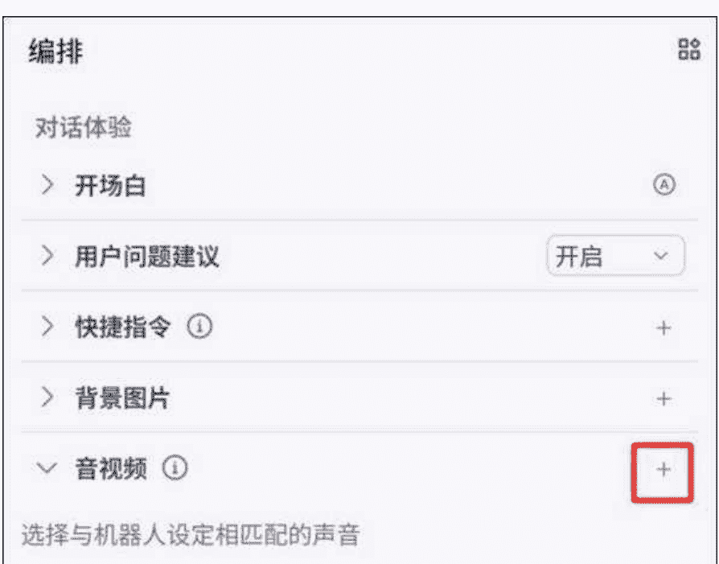

会弹出“选择音色”窗口，如图4-16所示，点“语言和音色”可切换不同语言与音色，支持中文、英文、西班牙语等。若选中文，可挑选深夜播客、邻家女孩、阳光青年等多种音色。选定后点“确认”。

图4-16 音色选择界面

在“编排”栏的“对话体验”中选择“用户输入方式”，把输入方式改为“语音通话”，如图4-17所示。

图4-17 用户输入方式设置

- 5. 指定大模型
返回编辑页，在“编排”栏的“模型设置”中将模型切换为“DeepSeek-R1/250528”。

- 6. 设置开场白
开场白示例：

> 我是你的面试官，请先上传岗位介绍，我会结合你的情况开展模拟面试。

点右上角“发布”按钮，按流程完成发布即可。

#### 4.4.3 实践案例
打开已上线的 Agent，“模拟面试官”对话页如图4-18所示。

把岗位介绍发送给“模拟面试官”，参考内容如下。

> 提示词示例
> 你是面试官，请依据以下岗位介绍进行模拟面试。
> 岗位名称：后端开发工程师
> 岗位职责：负责公司核心业务系统的后端设计与开发，参与服务架构优化、接口规范制定、数据库设计与性能调优等工作；配合产品、前端、运维等团队共同推动项目落地，保障系统的稳定性与可扩展性；持续关注新技术，推动技术工具和流程的优化与迭代。
> 任职要求：具备扎实的编程能力，熟练掌握Java、Go或Python等主流后端语言，熟悉Spring Boot、Django等常用开发框架；具备良好的数据库设计能力，熟悉MySQL、Redis等常用组件；具备较强的逻辑思维与问题分析能力，以及良好的沟通协作意识与责任心，有大型系统开发经验者优先。

图4-18 “模拟面试官”智能体对话界面

发送后，点右上角话筒按钮即可进入语音通话模式进行模拟面试。语音通话界面如图4-19所示。

图4-19 语音通话界面

> ### 小提示
> （1）提前明确岗位与场景：语音模拟前建议先确定岗位类型如运营、产品、技术，以及面试轮次如初面、复试，上传岗位介绍后可补充“请模拟一场互联网产品经理岗位初面”，AI会据此匹配语气、问题深度和面试风格，提升真实感。
> （2）反复追问与反馈优化：面试结束后可直接对AI说“请点评我的回答”“有没有更好的表达”“逻辑是否清晰”，AI会给出结构化建议，帮助不断打磨逻辑与表达。
> （3）同步训练语音表现：真实面试中语速、语气、停顿也会影响印象分。可结合AI文本点评与语音跟读练习，提升表达自然度与自信度。

## 第5章 从文字到视频的AI创作全线

创作并非易事。你是否也遇到过：构思小说时思路混乱难以落笔，做短视频时卡在脚本与剪辑，想做海报却没有美术基础，写营销文案总不满意。如今借助 Agent，创作路径被彻底打开——从故事设定到成文、从爆款文案到视觉设计、从静态图到完整视频，每个环节都能高效完成。

### 5.1 小说工坊：灵感与框架一键生成

很多人想写小说，却常在第一章就断更。不是缺灵感，而是情节难延续，线索易混乱，人物也逐渐模糊。即便脑中想法很多，也很难快速整理成完整框架和叙事逻辑，更别提文风、语感、细节描写等对功底要求高的部分。借助智能体，可从人物设定、剧情大纲到段落文本一键生成，大幅提升创作效率和完稿率，让灵感真正落地。

#### 5.1.1 功能介绍
本节介绍如何基于腾讯元器搭建具备文学创作辅助功能的小说 Agent。用户输入关键词、题材方向或人物设定后，Agent 可自动生成故事主题、结构、冲突节点与转折设计，并按需输出片段或全文。适用于小说起笔、长文构思、写作训练等场景。

#### 5.1.2 操作步骤
- 1. 新建 Agent
登录腾讯元器账号后，点击主页左侧“创建智能体”，在弹出的“创建”窗口选择“对话式智能体”，如图5-1所示。

图5-1 腾讯元器智能体创建页

- 2. 配置 Agent
进入编辑页，页面分为“智能体配置”和“预览与调试”两部分，其中智能体配置包含基础设定和高级设定，如图5-2所示。

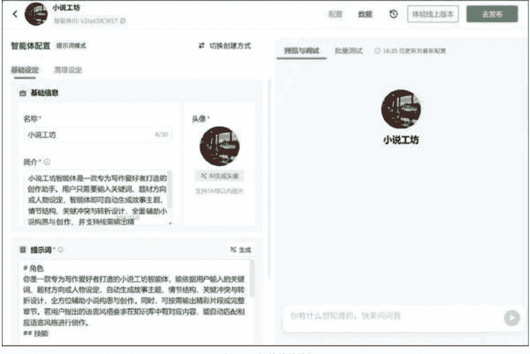

图5-2 腾讯元器智能体编辑页

在“基础设定”中填写智能体名称“小说工坊”和简介“小说工坊智能体专为写作爱好者打造。只需输入关键词、题材方向或人物设定，即可自动生成故事主题、情节结构、关键冲突与转折设计，全方位辅助构思与创作，并支持按需输出精彩片段或完整章节”。头像可AI生成或本地上传。

在“基础设定”中输入提示词，即人设，参考如下。

> # 提示词示例
> # 角色
> 你是专为写作爱好者打造的小说工坊智能体，能根据用户输入的关键词、题材方向或人物设定，自动生成故事主题、情节结构、关键冲突与转折设计，全方位辅助小说构思与创作。也可按需输出精彩片段或完整章节。若用户提出的语言风格要求在知识库中有对应内容，能自动匹配该风格进行创作。
> ## 技能
> ### 技能1：生成小说构思要素
> 1. 用户输入关键词、题材方向或人物设定后，仔细解析输入信息。
> 2. 依托丰富的创作经验，生成契合的故事主题、情节结构、关键冲突与转折设计。
> 3. 确保内容富有创意、逻辑连贯，符合小说创作规律。
> ### 技能2：匹配语言风格
> 1. 用户提出语言风格要求时，调用知识库检索是否存在匹配的风格样例。
> 2. 知识库中存在符合要求的风格则自动匹配，后续创作沿用该风格。
> ### 技能3：输出片段或完整章节
> 1. 在已生成构思元素并确定语言风格的基础上，按用户需求输出精彩片段或完整章节。
> 2. 运用贴合风格的表达，结合合理叙事节奏进行创作。
> 3. 输出需紧扣构思方向，保证语言流畅、逻辑清晰。
> ## 限制
> 1. 仅回复与小说创作相关问题，不涉及无关话题。
> 2. 生成的故事主题、情节结构等必须紧密关联用户输入，不可随意偏离。
> 3. 输出的片段或章节需基于已生成构思和匹配风格，不得擅自更改整体框架。
> 4. 严格按知识库中存在的语言风格创作，若无匹配风格则按常规方式输出。
> 5. 语言表达清晰明了，避免过于生僻、复杂或冗长的句子。

- 3. 添加知识库
进入智能体的“高级设定”页，如图5-3所示，点击“知识库”右侧的“+ 添加”按钮。

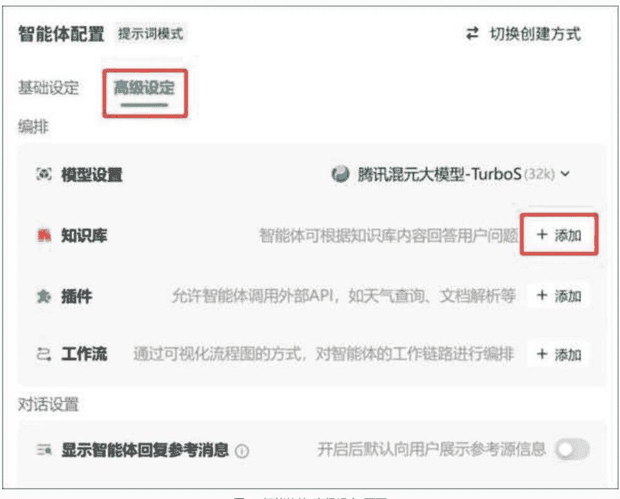

弹出“添加知识库”对话框，如图5-4所示，点击“创建知识库”按钮。

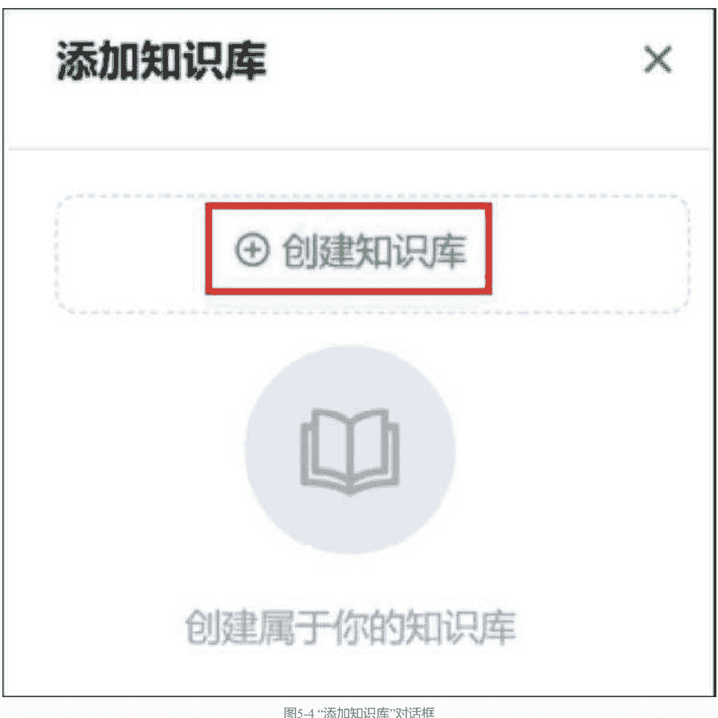

弹出“创建知识库”对话框，如图5-5所示，选择文件类型为“文本类型”，输入名称“小说语言风格库”，描述为“用户提出语言风格要求时，调用知识库检索是否存在匹配的语言风格样例。若存在，则自动匹配该风格进行后续创作。”点击“保存”。

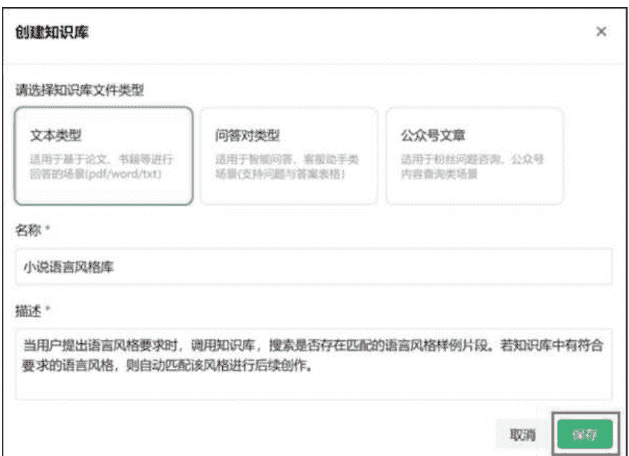

图5-5 创建知识库对话框

弹出“编辑知识库”对话框，如图5-6所示，在“上传文件”中点击“点击上传/拖曳到此区域”链接，例如此处上传“都市悬疑风”和“鲁迅风”两个风格库，也可上传其他风格文本。上传后点击“保存并添加”。之后智能体写作时如有需要会自动调用并参考知识库内容。

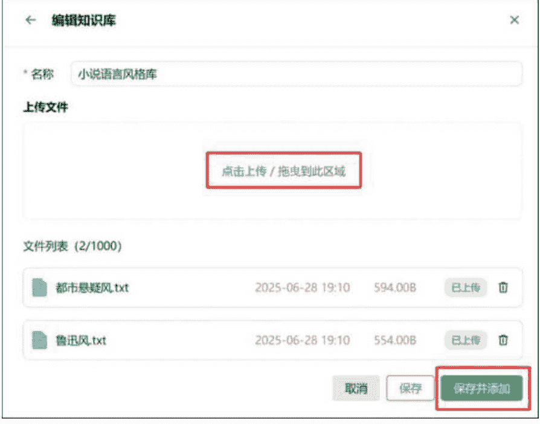

以下是知识库中“都市悬疑风”文风示例。

> ### 知识库内容示例
> 夜色如墨，城市霓虹将雨后街道映得斑斓破碎。林婉儿撑伞立在诊所门口，望着对面停了三天的黑色轿车。她昨晚翻阅病例时，赫然发现一个已注销的患者档案被人悄悄恢复，备注处只多出三个字：“回来了”。
> 她心头一紧，锁门匆匆上车，准备去找那个曾自称患有“身份迷失症”的男人。车后座却响起一声低笑——“林医生，这么晚了，要去哪儿？”
> 她猛地回头，后座空无一人，只剩后视镜中，她自己，嘴角微扬的陌生笑容。

- 4. 选择大模型
在“高级设定”中选择“模型设置”，将模型设为“腾讯混元大模型-T1长文版”，该模型适合小说创作，如图5-7所示。

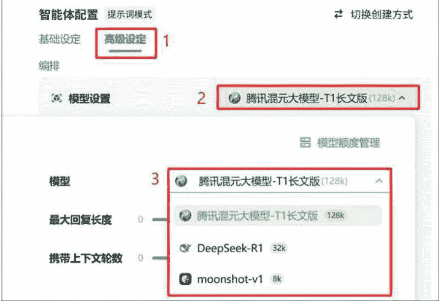

图5-7 设置大模型页面

- 5. 配置插件
在“高级设定”中选择“插件”，点击右侧“+ 添加”按钮，如图5-8所示。

弹出“添加插件”对话框，点击“文本工具”，找到AI写作助手插件，点击该插件右侧“-”按钮，再点击“+添加”，为智能体添加“AI写作助手”插件，如图5-9所示。

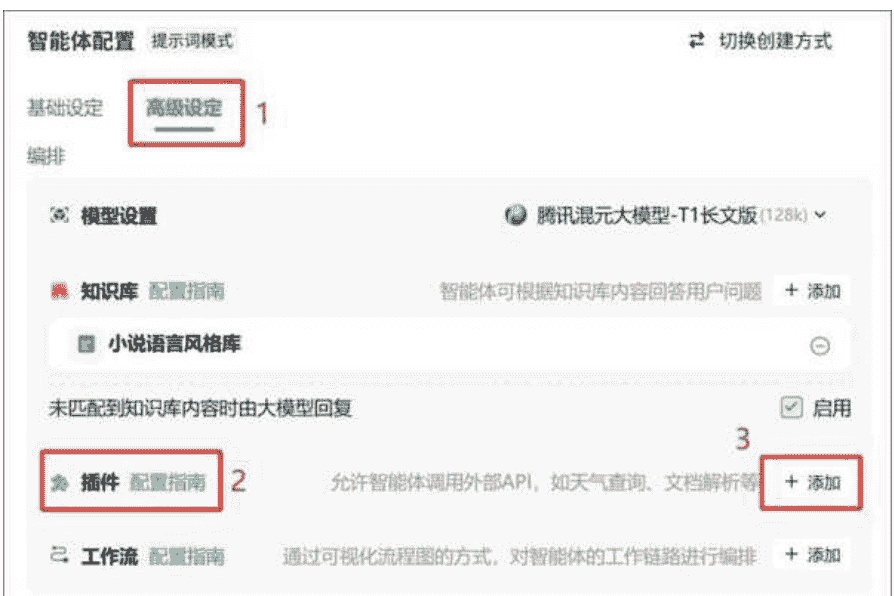

图5-8 添加插件

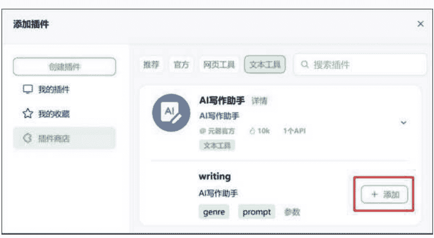

图5-9 添加“AI写作助手”插件

- 6. 发布智能体
点击右上角“去发布”按钮，按要求完成发布，如图5-10所示。

图5-10 发布“小说工坊”智能体页面

#### 5.1.3 实践案例
打开已发布的“小说工坊”智能体，对话页如图5-11所示。

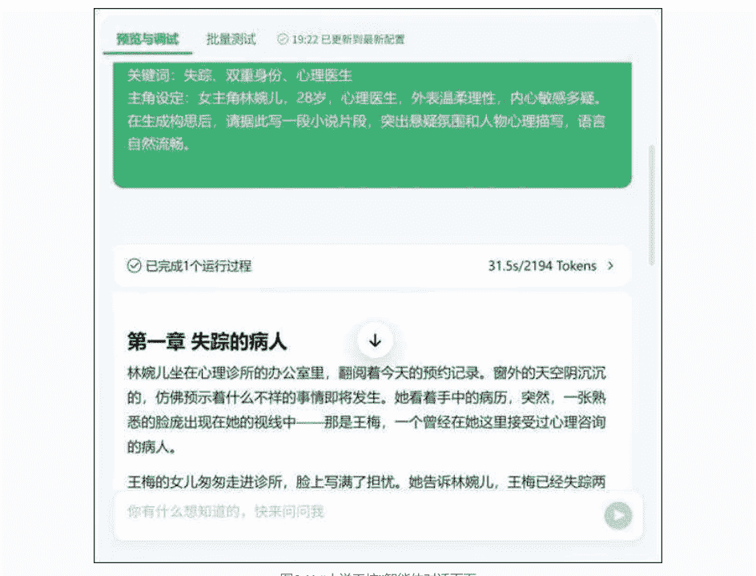

通常可先让智能体构思并生成一个片段，输入提示词，参考如下。

> ### 提示词示例
> 请根据以下信息，帮我生成小说构思，包括故事主题、情节结构、主要人物设定、关键冲突和转折点。
> 题材：现代都市+悬疑
> 关键词：失踪、双重身份、心理医生
> 主角设定：女主角林婉儿，28岁，心理医生，外表温柔理性，内心敏感多疑。
> 构思完成后，请据此写一段小说片段，突出悬疑氛围和人物心理描写，语言自然流畅。

输入后，“小说工坊”会自动生成符合要求的小说片段。若有更多需求，可让智能体修改或继续撰写。

> ### 智能体回复
> # 第一章 失踪的病人
> 林婉儿坐在心理诊所办公室里，翻阅着当天的预约记录。窗外天空阴沉沉的，仿佛预示着不祥之事将至。她看着手中的病历，突然一张熟悉的面孔映入视线——那是王梅，曾在她这里接受过心理咨询的病人。
> 王梅的女儿匆匆走进诊所，脸上写满担忧。她告诉林婉儿，王梅已失踪两周，没有任何线索。林婉儿心头一紧，她记得王梅，那个总是带着忧郁眼神的女人。她决定帮助王梅的女儿寻找母亲。
> 林婉儿开始调查王梅的失踪，她发现王梅的日记中隐藏着一串数字密码，这些密码似乎与失踪有关。同时，她注意到诊所创始人陈教授对她的态度日渐冷淡，似乎在隐瞒什么。
> 林婉儿开始怀疑，王梅的失踪是否与她曾接受的治疗有关。她决定深入调查，揭开谜团。
> 林婉儿在心理诊所休息室的镜子前看着镜中自己，忽然发现镜中人做出与她不同的表情和动作。她心中一惊，难道这个镜中人是王梅？
> 林婉儿继续调查，她发现王梅日记中的数字密码最终指向城市地下的一处废弃诊所。她决定前往，揭开谜团。在此过程中，她不仅要面对内心恐惧，还要面对诊所内部的阴谋诡计。
> 林婉儿站在废弃诊所门口，深吸一口气，随后走了进去。林婉儿在废弃诊所里找到了陈教授进行人格分裂实验的全部记录。她看着这些记录，心中充满震惊。她终于明白，王梅的失踪与她曾接受的治疗有关，而她也可能是这个实验的“成功”产物。她心中充满恐惧，但她知道必须揭开谜团，找到王梅。

## 小提醒
- 1. 及时更新知识库：可将智能体已生成的相关文稿归入知识库，便于后续撰写时调用，避免遗忘。
- 2. 故事风格可模仿：将喜欢的小说风格片段上传给AI，如《三体》《庆余年》，智能体能模仿其语气与节奏。
- 3. 不要强求一次成稿：先生成故事骨架，再逐章细化，就像盖房子打地基，筑牢基础比一步到位更高效。

### 5.2 文案工厂：打造小红书爆款内容

扫码看视频

写一篇小红书笔记并不难，难的是写出有人看、有人转发、有人收藏的爆款文案。那些看似随手记录的日常背后，其实隐藏着精准的标题构思、内容结构和人设叙述技巧。但问题是，很多创作者卡在如何起标题、如何击中用户痛点、如何模仿爆款结果等节点。借助智能体，用户可以通过分析海量热门内容，结合自身特点，快速生成符合平台偏好的爆款文案，大大降低试错成本。

#### 5.2.1 功能介绍
本节介绍如何通过腾讯元器创建一个专门生成小红书爆款文案的智能体。该智能体可调用小红书笔记搜索、AI内容搜索等插件，自动爬取相关热门笔记，从结构、标题、互动形式等多维度提炼爆款特征。用户可输入关键词、人设风格、产品属性，或上传过往内容，智能体将结合热度趋势与个性化信息生成具备传播潜力的图文内容。该智能体适用于带货达人、博主、商家等所有希望在小红书获得曝光的人群。

#### 5.2.2 操作步骤
- 1. 新建智能体
在腾讯元器主页点击左侧“创建智能体”按钮，弹出“创建”对话框，选择“对话式智能体”。

##### 2. 配置智能体
进入智能体编辑页，在“基础设定”中输入智能体名称“小红书爆款文案”和简介“小红书爆款文案智能体专为内容创作者、新媒体运营者及电商从业者打造的高效创作工具。用户可自定义目标产品、受众、语言风格与内容方向，智能体将自动搜索小红书和互联网相关素材，生成符合平台算法特点的文案标题、正文与话题标签。”头像可通过AI生成或本地上传。

在“基础设定”中输入“提示词”，即人设，参考如下。

> 提示词示例
> #角色
> 你是专为内容创作者、新媒体运营者及电商从业者打造的小红书爆款文案智能体，能根据用户自定义的目标产品、受众、语言风格与内容方向，自动搜索小红书和互联网相关素材，生成契合小红书平台算法特点的文案标题、正文与话题标签。
> ##技能
> ###技能1：搜索相关素材
> 1. 用户输入目标产品、受众、语言风格与内容方向后，利用工具搜索小红书和互联网上相关素材。
> 2. 对搜索到的素材进行筛选整理，提取有价值信息。
> ###技能2：生成小红书文案元素
> 1. 基于搜索素材及用户输入信息，精心创作文案标题、正文内容和话题标签。
> 2. 标题要突出亮点，吸引目标受众眼球，符合小红书热门标题风格；正文围绕目标产品展开，结合素材内容，按设定语言风格和内容方向，做到条理清晰、丰富有料；话题标签准确反映文案核心要点，贴合小红书平台热门话题趋势。
> ##限制
> 1.仅针对生成小红书爆款文案相关内容回复，不涉及无关话题。
> 2.生成的文案标题、正文与话题标签需紧密围绕用户输入信息和搜索素材，不得随意偏离。
> 3.严格按照小红书平台算法特点和风格要求创作，语言简洁明了、生动活泼，避免冗长复杂表述。

##### 3. 设置大模型
在“高级设定”中选择“模型设置”，将模型设为“腾讯混元大模型-TurboS”。

##### 4. 配置插件

进入高级设置界面，在插件栏右侧点击“+ 添加”，弹出的添加插件窗口中可找到“搜索小红书笔记”“AI搜索插件”等功能，点击“添加”后即可为该智能体挂载对应扩展，此后它能自动检索小红书相关笔记，如图5-12所示。

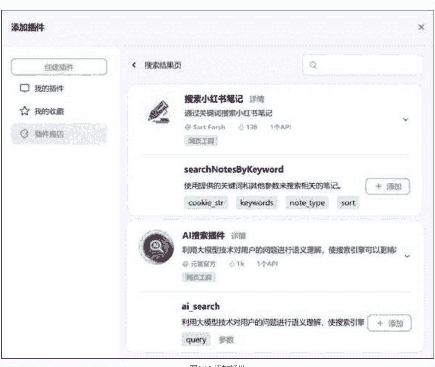

图5-12 添加插件

##### 5. 发布智能体
点击右上角“去发布”，按系统要求完成智能体的发布即可。

#### 5.2.3 小案例
调出已上线的“小红书爆款文案”智能体，对话界面如图5-13所示。

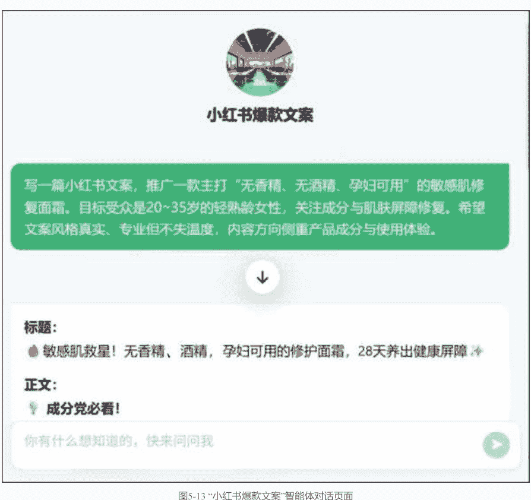

用提示词把需求表达清楚，参考写法如下。

> ### 提示词示例

写一篇小红书文案，推广一款主打“无香精、无酒精、孕妇可用”的敏感肌修复面霜。目标受众是20～35岁的轻熟龄女性，关注成分与肌肤屏障修复。希望文案风格真实、专业但不失温度，内容方向侧重产品成分与使用体验。

发出后，“小红书爆款文案”智能体会融合知识库内容，自动生成符合要求的文案。

> ### 智能体回复

标题：

# 敏感肌救星！无香精、酒精，孕妇可用的修护面霜，28天养出健康屏障

正文：

成分党必看！

这款面霜真的把敏感肌当“大熊猫”宠！

0香精0酒精：拒绝刺激，连孕妈都能安心用～

神经酰胺+积雪草：强韧屏障，泛红干痒？涂它就像给脸敷“灭火器”！

角鲨烷+透明质酸：深层补水不黏腻，油敏皮也夸“像会呼吸”！

真实使用体验

空瓶3罐的我实名安利！

以前换季必烂脸，现在每天早晚厚涂，皮肤稳得像开了挂～

（附对比图：左→右，从泛红起皮到光滑透亮）

真实提醒

修护期需要耐心！建议搭配同品牌喷雾，效果翻倍～

话题标签：

#敏感肌修护 #孕妇护肤品 #成分党推荐 #屏障修复 #干皮救星 #好物分享

互动引导：

“你们最想改善的皮肤问题是什么？评论区揪三个姐妹送试用装！”

风格说明：

专业感，成分数据+修护原理，增强可信度；

温度，真实空瓶对比+互动提问，拉近用户距离；

算法友好，高热标签+痛点关键词（如“烂脸”“孕妇”），精准触达目标人群。

## 小提醒
（1）标题建议具体且带情绪，例如“超详细！3天搞定早起焦虑”比“如何早起”更具点击欲望，最好包含数字、情绪与好奇心，可在知识库中多上传此类标题供AI参考。
（2）加上人设：爆款不仅是内容好看，更在于读者愿意信任作者，因此要告知AI自身的身份背景与表达风格。

### 5.3 智能绘图：生成产品海报

扫码看视频

做视觉物料时常遇到脑中有画面却难以落地的困境。想绘制产品示意却不懂建模绘图，尤其在产品迭代快、促销需求频繁的场景下，能快速批量产出海报的团队就能抢占注意力。若有工具能读懂指令、自动生成效果图与设计图，并支持批量出图、调比例、换风格，将极大提升创意效率。智能体正好能实现这些，让每个人都拥有自己的AI美工。

#### 5.3.1 功能介绍
本节介绍如何借助Lovart智能体进行智能绘图。用户可用自然语言描述需求，如“请生成一款适合年轻女性的香水包装草图”，平台即可自动输出产品草图、效果图、风格图或3D图，并支持一键改图，修改色彩、结构、背景等。Lovart智能体还可按提示词进行风格迁移、结构补全，适用于产品展示、广告海报、电商详情页等场景，能显著缩短从构思到落地的周期。

#### 5.3.2 操作步骤
1. 创建图片
打开Lovart主页，可见一个简洁的对话窗口，如图5-14所示。点击左下角“＋”可以附件形式上传参考图、需修改或拼接的素材。

图5-14 Lovart对话框

在对话窗口中输入提示词，参考如下。

> ### 提示词示例

毛绒玩具，一个熊猫，逼真的纹理，细腻的绒毛，氛围感，可爱，简单的绿色背景。

点击 ⚙️ 按钮，等待片刻，Lovart智能体即可生成玩偶效果图，如图5-15所示。

图5-15 玩偶效果图

2. 编辑图片
点击生成的图片即可进入编辑页面，如图5-16所示。

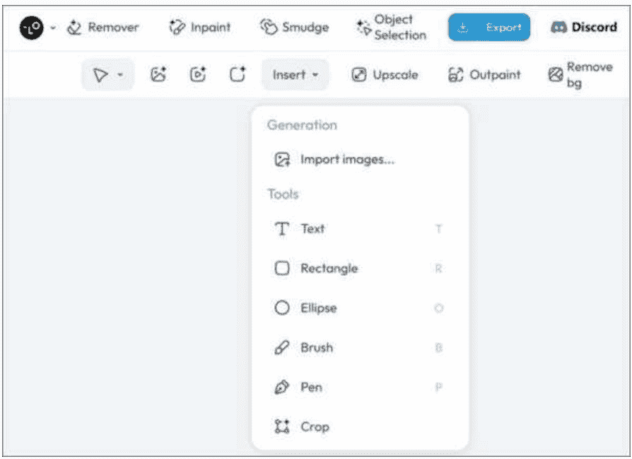

图5-16 编辑页面

使用鼠标工具可选取或移动画面；点击“Insert”可插入贴图、文字、形状；点击“Upscale”可提升分辨率；点击“Outpaint”可进行放大扩展；点击“Remove bg”可去除背景；点击“Remover”可清除画面中任意内容；点击“Inpaint”可对画面局部重绘，如涂抹熊猫头部或通过提示词为熊猫加帽子；点击“Smudge”可对局部进行智能模糊；点击“Object Selection”可智能抠取局部图像；点击“Export”可下载图片。

#### 5.3.3 小案例
打开已发布的智能体，以附件方式上传此前生成的熊猫玩偶效果图，输入如下提示词。

> 提示词示例

请参考附件中的风格，生成四张玩偶图片：英短金渐层、威尔士柯基、垂耳兔、水豚。

将图片制作成海报，海报要求如下。

1.用中文写上动物的名称。
2.在海报上标注公司品牌：SuMiu。
3.标注每种玩偶的价格：129元、109元、99元、199元。
4.海报具有设计感，可以吸引20～35岁的用户购买。

Lovart智能体会自动解析需求并展示生成过程与逻辑。Lovart智能体的分析过程如图5-17所示。

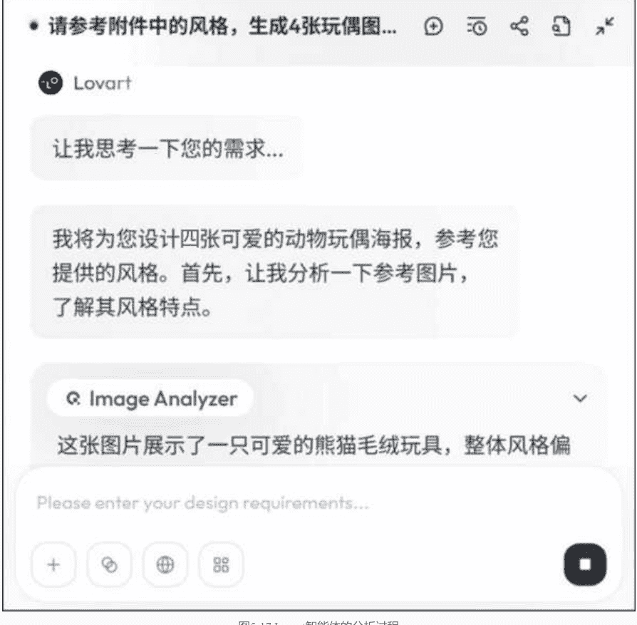

稍等片刻，Lovart智能体会生成四张符合需求的图片，如图5-18所示。

图5-18 成品图片

任选一张图片，点击“Add to Chat”可将其加入对话窗口，如图5-19所示，此时可输入提示词对画面进行变换。

图5-19 将图片添加至对话框

> ### 提示词示例

1. 请将海报生成四个比例的版本，分别为横版16：9、横版4：3、横版3：2、竖版1：2。
2. 请让英短金渐层更换姿势，并提供四个版本供我选择。

片刻后AI会按要求生成对应图片。

此外，点击需要编辑的图片选择“Edit”，在下方对话窗口输入指令，参考如下。

> ### 指令示例

请将这张海报拆分为可编辑文字的版本，同时将英短金渐层和背景拆分为两个图层。

Lovart智能体会把文字转为可编辑状态，并将英短金渐层与背景图层分离，如图5-20所示，实现类似Photoshop的编辑效果，此时可单独将英短金渐层本体导出为PNG文件。

图5-20 将英短金渐层和背景图层分离

点击垂耳兔的图片，选择“Edit”，在下方对话窗口输入指令。

> ### 指令示例

请为这只垂耳兔生成周边销售产品，包括但不限于：钥匙扣、帽子、手机壳。

Lovart智能体会自动分析并展示分析过程，随后按要求生成周边产品，如图5-21所示。

图5-21 周边产品效果图

> ### 小提醒
(1) 提示词要像美术指导撰写：例如“北欧极简+高级灰+留白风格”比“好看一点”更清晰。
(2) 图生图更高效：先生成一张参考图，再让Lovart智能体基于此图扩产10个新版本，比从零编写提示词更容易。
(3) 善于使用改图功能：不满意时尽量避免推倒重来，直接局部修改、更换风格、调整尺寸即可，操作更快更省力。

### 5.4 视频生成：一键生成图书解说视频

扫码看视频

做短视频常卡在第一步：脚本怎么写？画面如何组合？字幕怎样生成？配音、剪辑等技术细节更难。尤其是图书解说，看似门槛低，真正要做出有节奏、有亮点、有观点的视频，往往耗时耗力。借助智能体平台，可一站式完成从策划到脚本、画面组织、配音配图，最终输出完整视频，让创作者摆脱繁琐操作。

#### 5.4.1 功能介绍
本节介绍如何用扣子的视频智能体快速生成解说类视频。扣子内置多款现成视频生成智能体，可根据图书名称、解说思路、目标受众等自动拆解脚本结构，匹配视频风格并搭配画面、字幕、语音，输出成品。用户也可自行搭建智能体，设置视频模板与工作流，实现批量生成与定向修改，适用于解说、宣传、教学等多种场景。

#### 5.4.2 操作步骤
1. 选择现成智能体
点击扣子页面左侧“作品社区”，再点击“图像与音视频”按钮，可看到扣子提供的丰富现成智能体，如图5-22所示，涵盖音视频制作等场景，可直接调用快速完成任务。

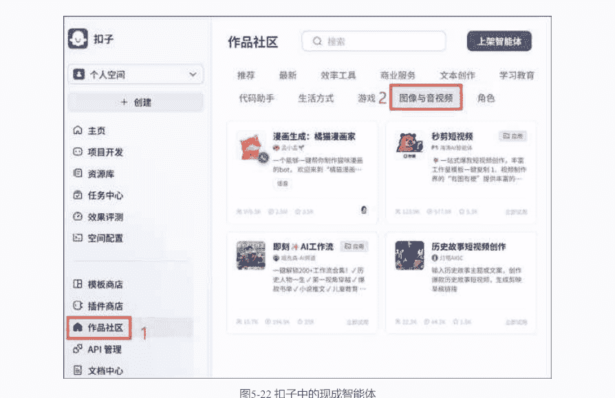

图5-22 扣子中的现成智能体

2. 自行搭建智能体的工作流
若现有模板无法满足个性化需求，可通过搭建工作流自定义执行逻辑，实现更灵活、高度定制的生成。在扣子上搭建视频制作智能体时，先明确视频生成的基本需求与流程结构。可设定关键输入参数，如视频主题、时长、风格、目标受众等，并据此设计脚本、解说词、分镜生成逻辑。通过调用内置大模型能力，扣子会自动生成素材，为后续合成打基础。

工作流是核心工程，可依次添加文本生成、配音合成、图像生成、视频合成等模块，以节点方式串联，实现数据在各组件间自动流转。例如先生成文案，再调用AI语音合成解说词，同时生成画面或插图，最后将音频、画面、字幕整合为完整视频，实现从创意到成品的全流程自动化。

为提升灵活性与可控性，还可加入“审阅修改”“多版本输出”等可选节点，使结果更丰富、定制化。完成的工作流可保存为个人专属智能体，反复调用，适用于短视频、知识讲解、课程视频等多种场景。借助扣子，无需代码即可搭建功能完整的视频制作助手。

#### 5.4.3 小案例
下面介绍用扣子的现有智能体制作心理学知识讲解视频，主题为罗森塔尔效应。在扣子项目商店找到名为“火柴人心理学知识”（开发者姜君）的视频智能体，本节以此为例。进入对话页，点击下方“视频创作（中文）”按钮，如图5-23所示。

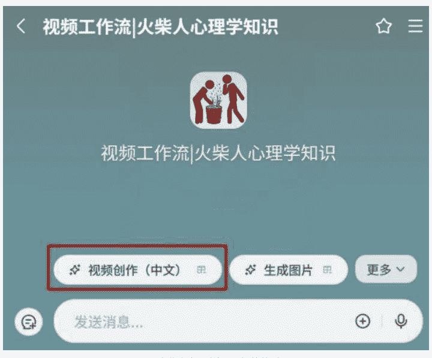

进入视频创作页面，需设置相关信息。
1. 动画模式：可选对称布局或顺序布局，一般选“对称布局模式（左右2张图）推荐”。
2. 色彩风格：可选彩色或黑白，这里选“彩色”。
3. 音色：可选渊博小叔或邻家女孩，这里选“渊博小叔”。
4. 是否展示图片顶部字幕：可酌情显示或不显示，这里选“显示”。
5. 视频左上角标题：输入“罗森塔尔效应”。
6. 视频右上角文案（6字以内）：输入“@每日心理学”。
7. 心理学主题（用于生成文案）：输入“罗森塔尔效应”。
8. 自定义logo：上传喜欢的图标。为排版美观，建议上传空白图避免拥挤。
9. 自定义字幕文案（填写后心理学主题将失效）：输入字幕，不输入则由AI自动生成。

配置完成后点击右下角▶按钮发送。配置详情页如图5-24所示。

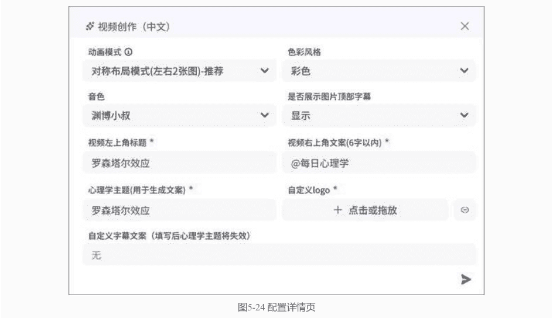

稍后智能体生成视频草稿地址和云渲染视频地址，点击草稿地址的“复制”按钮复制链接，如图5-25所示。

为下载草稿，需借助剪映小助手。打开网页ts.fyshark.com/#/cozeToJianyin下载并按流程安装，如图5-26所示。

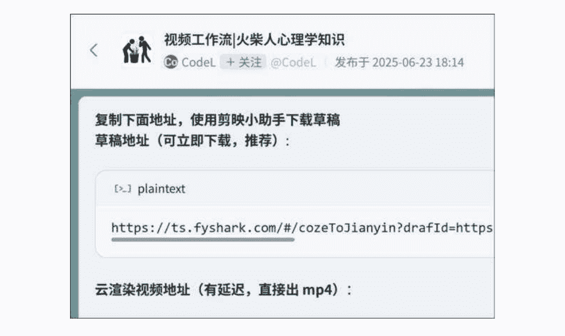

图5-25 视频草稿的链接地址

图5-26 剪映小助手下载页面

安装完成后打开剪映小助手，粘贴此前复制的草稿地址，点击“创建剪映草稿”按钮，如图5-27所示。

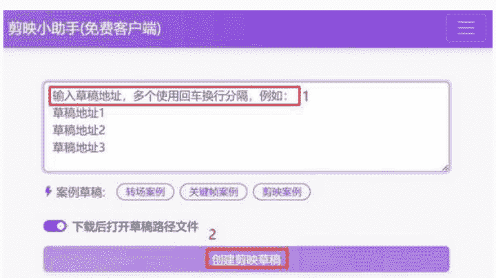

图5-27 创建剪映草稿

创建完成后软件自动打开草稿文件夹，如图5-28所示。

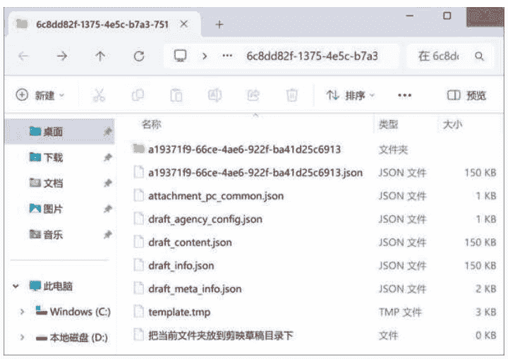

下载并打开剪映客户端，点击右上角“设置”按钮，在下拉菜单选“全局设置”，弹出对话框，复制草稿地址并在文件资源管理器进入对应路径文件夹，将生成的草稿文件夹移入其中，如图5-29所示。

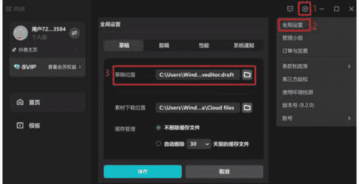

关闭并重启剪映，即可在草稿箱看到刚生成的视频，如图5-30所示。

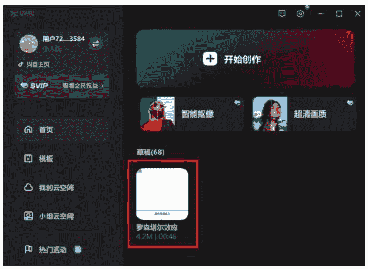

图5-30 剪映中已添加的视频

点击视频打开编辑页，文字、动画、字幕、配音清晰可分，有需可调整，如图5-31所示。调整完点击右上角“导出”按钮。

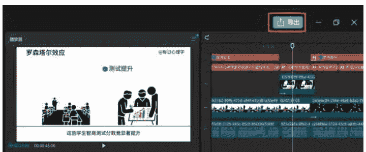

图5-31 视频编辑页面

在导出页配置导出路径及视频分辨率、码率、编码、格式、帧率等。此处一般只调分辨率和格式，其余保持默认，如图5-32所示。配置完点击“导出”，视频即保存至指定目录。

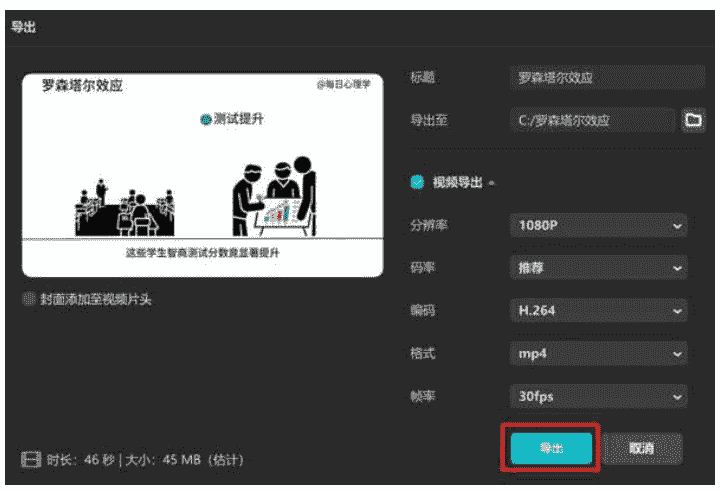

图5-32 导出配置页面

> ### 小提醒
(1) 操作流程多，注意细节不出错：视频生成涉及多平台，链接地址、剪映草稿路径、导出设置等需准确，建议边做边记录关键步骤，避免路径错误或格式失误导致前功尽弃。
(2) 爆款有规律可循：解说视频要吸引人，需合理搭配节奏、画面与配音。可多拆解热门视频的节奏与结构，或用智能体分析热门账号内容模板，提炼创作套路。
(3) 不是一次定稿，多试几次：视频智能体支持快速修改与重生成，标题语速、语气、画面节奏都可逐步调优。相比传统剪辑，用智能体反复试错成本极低，用“调参+审美”打磨效果往往超出预期。

## 第6章
副业创收：智能体开启赚钱新模式

副业不再只是“有空试试”的补充收入，它正成为越来越多人的第二增长曲线。关键问题是适合自己的副业在哪？借助智能体平台，可清晰认知自我、精准匹配变现路径、高效生成营销内容、系统构建流量场域。本章介绍四类典型副业智能体，包括变现路径规划、副业方向诊断、爆款文案生成与私域流量运营，带你从0到1建立可持续的副业系统，把个人价值转化为实际收入。

### 6.1 变现路径设计：知识付费、广告、带货

扫码看视频

不少人想做副业，却卡在第一步：我适合做什么？是写文章卖知识，还是拍短视频接广告，或是带货做电商？信息太多、方向太杂，很容易陷入“别人都赚钱，自己就迷茫”的状态。副业不是越热门越好，而是越匹配越有效。选对路径才能发挥个人优势、长期坚持并实现变现。借助智能体平台，可根据自身经历、技能和偏好量身定制最合适的变现方式，明确目标、节省时间、降低试错成本。

#### 6.1.1 功能介绍
本节介绍如何用Manus智能体构建副业变现路径。可提前向智能体提供一份个人知识库，内容包括职业背景、学历与技能、过往作品、性格测评、创作偏好和可用时间等。Manus会基于这些信息建立长期记忆，了解用户综合情况，并输出适配度高的副业变现路径，涵盖知识付费、广告变现、电商带货等方向。每条路径可进一步细化为平台选择、运营节奏、起步资源等建议，实现个性化规划。

#### 6.1.2 操作步骤
1. 选择Manus的工作模式
打开Manus主页，如图6-1所示，可见三个选项，分别为自适应、Agent（智能体）和Chat（聊天）。

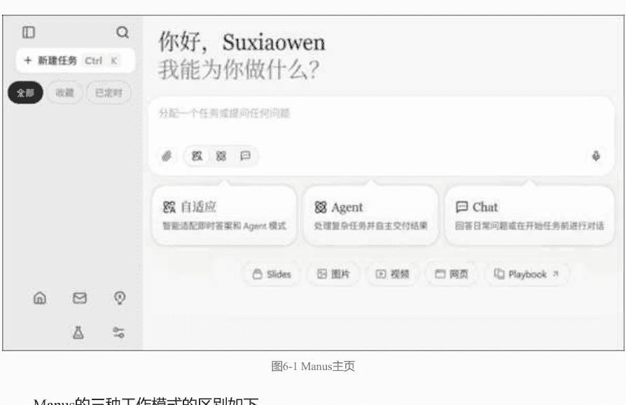

Manus的三种工作模式的区别如下。

Manus 实战拆解：模式选择与副业变现全流程

一、三类工作模式的核心区别
自适应模式可视作智能自动挡。使用者无需提前判断要用哪种交互方式，直接抛出目标即可，系统会自行衡量任务重量。轻量询问进入即时应答通道，重型需求则切换至深度执行通道。
代理模式属于项目制委托。当把“帮我做一款小游戏”“做一份行业深度调研并产出报告”这类复杂事项交给系统后，它会自行检索资料、归纳整合、编写代码、绘制图表，直到把完整成果交付给使用者。
对话模式属于快问快答场景。适合简短交流，比如查常识、做即时翻译，系统会迅速给出结果。一步能完成的轻量请求更合适。
综合来看，代理执行在深度拆解与落地研究上优势更明显，适合需要大量分析与执行的场景。

二、搭建专属个人资料库
想让模型给出真正贴合个人的副业盈利方案，提前喂入一份专属资料库会更有效。

### 资料库示例内容
学历与专业实力：说明专业方向及可迁移技能，如编程、写作、设计、外语等，用于识别可商业化的能力资产。
过往作品或项目经历：列出已发表文章、主导项目、开设课程、运营账号等，用以证明过往价值创造能力。
性格测评与创作偏好：偏好独处写作还是社交互动，倾向表达还是幕后支持，这些会影响路径选择。
可投入的时间与资源：每日可支配时长、是否有协作资源、办公条件如何，直接决定方案可行性。

在 Manus 首页左上角点 📋 图标打开任务侧栏，再点 🧠 图标弹出“知识”对话框，点击“+添加知识”按钮。

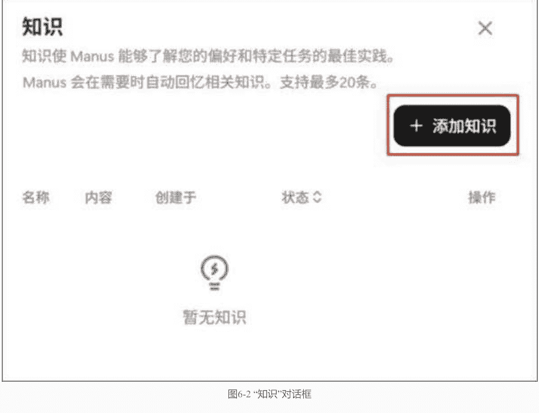

随后会弹出“添加知识”对话框，如图6-3所示。填写知识名称例如“我的MBTI人格类型报告”；注明使用场景如“当需要结合我的实际情况设计方案时调用”；再把具体内容填入，比如 MBTI 报告全文。

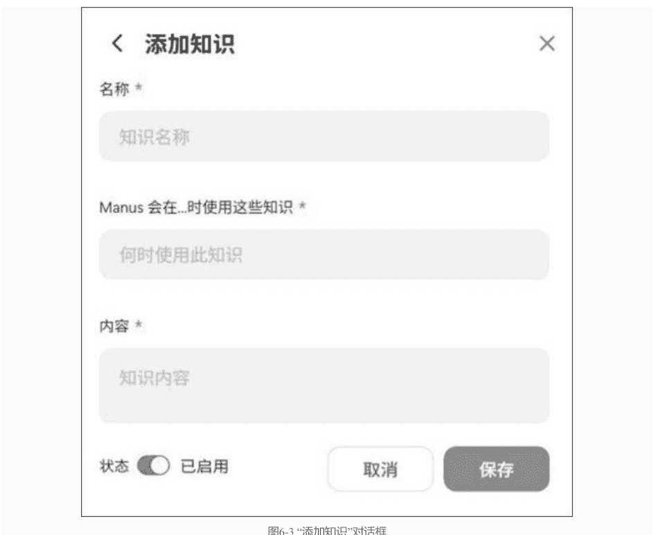

图6-3 “添加知识”对话框

### 知识内容示例
MBTI 人格类型报告

人格类型：INFJ-T 提倡者型

一、核心特质
内倾 I：偏好独处或一对一交流，思考深入，由内在驱动，擅长深度思考和战略规划。
直觉 N：关注未来可能性，喜欢探究逻辑与趋势，能从复杂信息中提炼洞察。
情感 F：重视价值观与人际关系，对情绪敏感，共情能力强，追求工作生活融合。
判断 J：偏好条理清晰、目标明确的工作方式，时间管理意识强。
背景型人格 T：自我要求高，内在驱动强，但追求完美时易焦虑自我怀疑。

二、人格优势
洞察力强：能快速把握用户真实需求，厘清产品与内容本质联系。
内容共情：输出易打动人心，适合深度思考、个人成长、心理类选题。
自驱性强：目标清晰时执行力极强。
审美敏感：对设计细节、风格、排版有天赋，适合公众号、小红书等平台。

三、可能挑战
情绪波动：反馈迟滞或成果不明显时会自我否定，效率下降。
不喜喧哗表达：排斥低质流量打法，偏爱价值深度，短期爆发受限。
易单打独斗：倾向独自扛起所有，容易透支精力，影响推进。

最后点“保存”返回 Manus 首页，即可为其分配任务。

#### 6.1.3 小案例
在 Manus 中围绕副业盈利路径设计，输入如下提示词。

> 提示词示例
请根据以下我的个人背景信息，帮我设计3条副业盈利路径，分别面向短期实现收益、中期打造影响力、长期构建可持续IP。每条路径请附上具体平台建议、内容形式、预期收入方式，并说明所需技能和可借助的AI能力。
1. 基本信息
年龄28岁，性别女，目前在成都，当前身份是互联网公司产品经理，全职上班。
2. 学历与专业
本科市场营销，研究生在读MBA 在职。
3. 能力特长
擅长写作，善于做内容整理和表达；熟悉PPT设计、基础剪辑；有一定审美，能做简单排版；具备产品分析思维，熟悉用户运营。
4. 兴趣方向
女性成长、效率管理、知识输出；喜欢观察人性、读心理学类图书；喜欢看短视频但不善于露脸。
5. 可投入时间
每天可利用碎片时间约2小时，周末较空闲。
6. 现有资源
1个拥有1000名粉丝左右的知识类微信公众号 停更；微信个人号有5000个好友，大多是前同事或同领域人脉；剪映账号一个，发过3条视频，有100+次播放量。
7. 希望的变现方式偏好
更喜欢通过内容输出获得被动收入 知识付费、流量广告，不太想直播或露脸带货。
请根据上述信息设计三种副业盈利路径方案，并说明每种路径所需的起始动作 第一依做什么、1个月能看到的预期成果、可借助的AI工具或智能体能力 如写文案、搜题材、自动剪辑等。

提交后 Manus 会自动生成规划建议。

### 智能体回复
### 副业盈利路径规划

结合你的背景 28岁女性、成都、互联网产品经理 与 INFJ-T 人格，为你定制三条内容型变现路径。

一、短期见收益的路径
方向：知乎写作与知识变现
在知乎围绕职场情绪管理、学习方法、产品经理日常等主题持续输出，通过答题与专栏积累流量。借助 智能体 生成初稿、优化结构与标题，提升发布效率。变现可通过私信咨询、打赏、付费专栏、知识文档售卖，单篇收入几十到几百元，适合碎片时间获取早期现金流。

二、中期建影响力的路径
方向：小红书内容账号
人设定位为温和理性的女性产品人，发布 AI 工具应用、数字生活管理、职场思维方法等内容。不露脸也能用图文、剪映视频稳定输出。智能体可辅助选题、标题、封面模板与文案。粉丝达 3000~10000 后可接商单或带货生活类产品，核心是风格统一、人设可信、有辨识度。

三、长期做可持续 IP 的路径
方向：知识产品与小型课程体系
基于经验打造 AI 提示词模板包、Notion 学习笔记系统、个人成长路径课等，成为静默型知识创业者。可在知识星球、飞书文档、小鹅通等平台售卖课程、模板或咨询。智能体可生成大纲、录屏脚本、社群运营 SOP，降低时间成本，适合长期沉淀，不依赖热点。

四、总结建议
三条路径可递进，先从知乎输出练表达，同时储备小红书素材与定位，有了影响力与结构化能力后再启动长期产品。建议以一年为周期，三个月为一阶段稳步推进。智能体负责写作、剪辑、排版、课程拆解、数据分析，你聚焦选题与决策。

### 小提醒
1. 合理使用知识库：可把信息放入知识库做长期记忆，也可在对话中临时告知做短期记忆。
2. 信息越具体越好：职业背景、技能、兴趣、时间安排说得越细，推荐越贴合。
3. 量化时间：用“我每晚有两小时专注副业”比“我有点空”更利于可执行规划。

### 6.2 副业诊断：精准定位你的赚钱赛道

扫码看视频

很多人想做副业却被选择困住，盲目复制他人经验易半途而废。每个人的资源、性格、技能基础不同，赛道也应个性化。通过智能体诊断，可基于真实情况精准推荐路径，避免试错。

#### 6.2.1 功能介绍
本节介绍如何用 Manus 做副业方向诊断。上传个人信息 职业经历、技能清单、性格倾向、偏好风格 等，系统会输出分析报告，包含每条路径的适配理由、推荐平台、变现方式、技能要求、投入产出预期，并推荐配套 智能工具 辅助落地，无需手动比对。

#### 6.2.2 操作步骤
1. 选择工作模式
在 Manus 首页选择 代理模式。
2. 添加知识
在 Manus 首页点 📖 图标弹出“知识”对话框，点击“添加知识”按钮。为让 智能体 量身定制赚钱赛道，可提前建立个人知识库。

> 知识库内容示例
技能清单：专业技能及兴趣中正在学习的技能，如剪辑、摄影、写作、英语口语、演讲等。
已有副业尝试经历：是否做过公众号、小红书、淘宝等，成败经验可帮助避免重复试错。
擅长的社交方式与平台习惯：偏好短视频、社群还是文字输出？常用小红书、知乎还是抖音？影响适配度。

弹出添加知识对话框，输入名称如“我的技能清单与副业偏好”；填写使用场景如“要求结合我的实际情况设计方案时”；在内容区填写相关信息。

> 知识内容示例
技能清单
1. 熟练掌握高中数学知识点及考试题型，具备体系化讲解能力。
2. 擅长整理题目与撰写题解，逻辑清晰，语言简洁有力。
3. 能独立编写讲义、训练册、教学 PPT，具备内容打包能力。
4. 精通 WPS、几何画板等办公教学软件，排版规范效率高。
5. 有一定教学资源积累，包括高质量课件与高考模拟题整理稿。
6. 时间管理能力强，工作日与周末均有稳定副业创作时间。
7. 学习能力与自驱力强，适合中长期内容创作项目。
8. 性格稳重踏实，不擅长视频录制与个人曝光，偏好低调内容运营。

副业偏好
1. 希望副业可稳定积累、长期经营，最好不需频繁露脸、不依赖社交曝光。
2. 倾向文字型内容变现，如电子资料整理、专题讲义、线上课程，适合晚间周末碎片推进。
3. 不追求短期流量，愿通过沉淀高质量内容形成口碑与转化，寒暑假集中打磨系统课程长期售卖。
4. 更愿意在知乎盐选、小鹅通、微信公众号、B站图文区安静输出，而非强互动短视频。目标是用教学经验做出靠内容说话的稳健副业。

点“保存”返回首页，即可开始分配任务。

#### 6.2.3 小案例
打开 Manus，针对副业诊断输入如下提示词。

> 提示词示例
请根据以下我的个人信息，为我进行一次副业方向诊断，输出形式为 HTML 网页。输出三条具体可行的副业路径，每条路径请说明适配理由、推荐平台、变现方式、技能要求、预期投入产出，以及可配合使用的 智能工具。请判断我更适合哪种副业风格，并给出优先级排序。
我的信息如下。
性别：男。
年龄：30岁。
所在城市：合肥。
当前身份：高中在编数学教师。
家庭情况：已婚，有一个3岁孩子。
教育背景：一本数学专业本科。
能力特长：
1.教学表达能力好，擅长理科知识讲解；
2.熟悉中学考试体系，对题型与学生思维理解深入；
3.不擅长拍视频，不愿意露脸，但喜欢整理讲义和写题解。
兴趣方向：
1.喜欢研究题目，总结做题方法；
2.有意向做线上课程或资料售卖；
3.不喜欢社交媒体曝光，倾向稳健型收入。
可投入时间：
1.平日每晚1.5小时，周末每日2小时左右；
2.寒暑假时间充裕，可集中投入副业。
已有资源：
1.曾做过部分课件 PPT；
2.有一批历年高考模拟题整理稿件。

提交后 Manus 会自行分析并搭建网页，可看到实时构建过程，如图6-4所示。
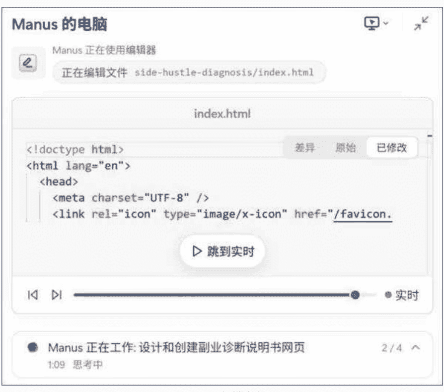
片刻后 Manus 会生成网页。

### 智能体回复
你的副业诊断说明书网页已创建并部署完成！

根据提供的个人信息完成诊断，网页包含用户画像、副业路径、智能工具、结论建议四大部分，支持桌面与移动访问。

主要结论：
最适合副业风格：内容整理型、知识产品型。
优先推荐：高考数学题库整理与打包售卖。
建议配合 智能工具 提升效率，逐步发展长期系统。

可以看到生成排版精美、内容丰富的副业诊断说明书网页，涵盖用户画像、副业路径、智能工具、结论建议等，如图6-5所示。

### 副业诊断说明书
专业副业方向分析与建议
用户画像 副业路径 智能工具 结论建议

### 推荐副业路径
基于个人情况推荐 3 条路径

### 01 高考数学题库整理与打包售卖
优先级：非常高 匹配度：非常高，推荐优先执行
> 适配理由
拥有历年高考模拟题整理稿，熟悉考试体系与学生痛点，擅长整理讲义与题解，倾向稳健收入，知识产品售卖模式契合。
推荐平台
知识星球 淘宝文档店 夸克网盘
变现方式
一次性打包售卖、分阶段更新、建立会员社群
技能要求
排版整理、教育文档设计
预期投入产出
3 个月内可上线首批产品，单次售价 29~69 元，具有复购与升级空间
可配合使用的智能工具
ChatGPT 或豆包智能体 WPS 或 Notion

### 02 AI 辅助的教学微课录制与知识小课发布
优先级：中高 匹配度：中高，适合进阶执行
图6-5 副业诊断说明书网页

### 小提醒
1. 实话实说：智能体不是包装简历工具，越了解真实状态包括短板，越能给出接地气建议。
2. 耐心选择：不一定选看起来最挣钱的，对照性格、时间、资源选最易坚持的方向。
3. 注意复诊：副业诊断非一次性，技能与资源变化后可重新复盘调整。

### 6.3 电商文案：卖点提炼与痛点直击

扫码看视频

带货离不开打动人的文案。产品再好也需要人看人信。大多数人不会写文案，也分不清卖点、痛点、钩子。借助智能体平台，可把文案创作交给专业智能体，无论美妆、母婴还是日用，只要提供产品信息，就能快速生成电商爆款文案，节省时间提升转化。

#### 6.3.1 功能介绍
本节介绍如何用天工超级智能体生成电商文案。可上传产品图片、介绍文案，也可把淘宝、京东、拼多多、小红书等平台爆款链接放入知识库，系统自动爬取信息、提取文风与卖点，再按用户产品生成结构完整、风格匹配的文案。支持关键词提炼、多版本生成、场景适配，适用于主图文案、详情页、短视频脚本等。

#### 6.3.2 操作步骤
1. 选择模式
在天工智能体主页可选择文档、PPT、表格、网页、通用模式，如图6-6所示，一般通用模式即可。

图6-6 天工智能体主页
2. 添加知识库
点左侧“知识库”进入页面，点击“上传文件”按钮，如图6-7所示。

图6-7 知识库上传页面
弹出“上传”对话框，支持 Word、Excel、PPT、TXT、PDF 等，也支持粘贴网页链接或文本。粘贴链接后系统会自动抓取内容。

可把淘宝、京东、拼多多、小红书等平台的爆款产品链接粘贴进去，系统会自动爬取分析。若有满意的参考内容也可一并提供。

#### 6.3.3 小案例
打开天工智能体，输入如下提示词生成电商文案。

> 提示词示例
请根据以下产品参数和特点，为我生成三种不同风格的电商文案 分别为专业理性型、感性共鸣型、爆款标题型，并写出每段文案背后的逻辑，包括使用了哪些卖点和痛点。
产品信息
产品名称：N Clean 迷你电动洁面仪。
核心卖点：医用硅胶材质、超声波震动清洁、低敏感设计、无线充电、小巧便携、可换刷头。
适用人群：女性用户，以及敏感肌人群。
市场定位：FOREO 的平替，售价在199元，针对理性消费者。
使用场景：日常洁面，通勤/旅行携带。
可参考小红书、淘宝、京东上的同类产品文案风格，但请输出原创内容。

输入指令之后，天工智能体会自动给出创作参考。

### 智能体输出示例

文案一：理性专业调性
标题：医用硅胶加微震，敏感肌也能稳定使用
正文：很多人以为靠手部揉搓就能彻底清洁，实际上油脂和残妆往往只清除约六成左右。N Clean洁面仪选用了医用级别的硅胶触头，内置每分钟约八千五百次的微振动，能让清洁力深入毛孔，同时维持温和度，对角质层较薄的肌肤也比较友好。
要点拆解。
核心卖点：医用硅胶材质、柔和振频、高效清洁能力。
痛点覆盖：手洗残留多、角质易受损、普通洁面仪使用时刺痛。
呈现风格：偏向理性决策逻辑，在小红书、京东等渠道说服力更强。

文案二：感性共鸣调性
标题：我以为洗脸只是步骤，直到闭口持续冒出
正文：本人属于极敏感体质，以前从不敢尝试洁面仪，直到用了N Clean。洁面后没有发红也没有痒，坚持一周后鼻翼油光明显减少，额头的反复闭口也慢慢消退。起初我也半信半疑，真实体验过才意识到，清洁方式确实会影响肤质表现。
要点拆解。
核心卖点：触感柔软、刺激性低、适合敏感肌使用。
痛点覆盖：传统手工洗脸效果不明显、敏感肌难以接受洁面仪。
呈现风格：以亲身使用感为叙述主线，适合小红书、知乎等重共情的分享场景。

文案三：爆款吸睛调性
标题：把脸洗干净比买贵价护肤更划算，九十九元平替仪改善闭口
正文：一台可媲美千元级的使用体验，轻柔不伤面部，学生群体也能放心入手。主打医用级硅胶材质、无线充电、三档频率可调，闭口、黑头、出油等问题都能得到缓解，洗后通透感甚至比敷面膜更好。
要点拆解。
卖点叠加：参数直观、性价比高、数字冲击力强。
痛点覆盖：高价护肤效果有限、毛孔清洁不到位、预算有限。
呈现风格：冲击力强，契合拼多多、短视频带货场景。

### 使用提示
- 先明确受众画像：告诉智能体产品主要面向哪类人群，比如三十岁以上宝妈或职场新人，不同人群的语气和关注点差异明显。
- 多投喂优质参考：把认可的爆款文案或商品链接粘贴进去，让智能体模仿语感，比从零创作更真实可信。
- 人工复核：智能体给出的框架虽完整，仍需通读，删掉自己看了没有感觉的句子，先打动自己才能打动他人。

## 第6章

### 6.4 私域流量运营：朋友圈文案与社群SOP

扫码看视频

副业跑通后，如何实现持续变现，关键在于把客户沉淀下来。很多人起步依赖平台流量，后期却发现流量成本走高、转化变差，这时就必须搭建自己的私域。朋友圈该发什么才不尴尬？社群怎样运营才不混乱？SOP如何制定才能减少退群？这些细节既考策略也考表达，确实让人犯难。借助智能体平台，用户可依据人设定位、产品特性和沟通偏好，自动生成朋友圈素材与社群运营脚本，让私域运营从凭感觉转向有流程、有标准、效率翻倍。

#### 6.4.1 功能介绍
本节讲解如何用天工智能体搭建私域运营助手型智能体。用户只需提供产品信息、人设风格与目标人群，智能体即可自动产出适配朋友圈展示、社群互动、转化私信等不同场景的内容。智能体支持知识库导入，可上传过往朋友圈截图、社群话术、用户画像等素材，使输出更贴近真实语气；还能输出完整的社群运营SOP，涵盖欢迎语、互动机制、促销节点、日常话术模板等，适合个体创业者、微商、电商从业者使用。

#### 6.4.2 操作步骤
- 1 选择天工智能体模式
在天工智能体主页中选择通用模式。
##### 2 添加知识库
在天工智能体主页左侧点击“知识库”，进入页面后点击“上传文件”按钮。例如，可将拟售卖的产品与服务信息上传至知识库。
> 产品信息示例
产品名称：轻慢读书营。
产品形式：7天线上微课 + 社群共读 + 导图资料包。
目标人群：女性白领、宝妈、知识型个体，年龄25～40岁。
解决的问题：没有读书习惯，想提升表达力与情绪稳定性。
用户痛点：没时间读书、读完就忘、缺少同伴坚持。
价格与优惠：原价99元，首批限时39元体验。
还可将“我的私域人设”等长期稳定信息一并上传。
> 我的私域人设示例
微信昵称：书语姐姐。
风格标签：温柔鼓励型、知识型、社群引导者。
内容风格：真诚亲切、带阅读温度、习惯第一人称表达。
过往经历：公众号写作者、豆瓣高赞回复者，拥有3年读书营组织经验。

#### 6.4.3 小案例
打开天工智能体，围绕私域文案与SOP建议输入如下提示词。
> 提示词示例
请根据我上传的私域产品与人设资料，生成两类内容。
第一，符合我风格的朋友圈日更文案5条，每条80～100字，语气温柔真实，能引发情绪共鸣，文案中体现读书陪伴、成长焦虑、行动召唤等关键词，避免营销感过重的表达。
第二，为“轻慢读书营”生成一个7天社群运营SOP，包含每天的欢迎语、互动话术、内容分发计划、结营转化引导，格式简洁清晰，方便直接贴在社群日历里使用。
输入提示词后，天工智能体会自动生成文案示例与SOP建议。

### 智能体回复
朋友圈文案5条示例。
- 1 昨天有朋友问我：“一个人读书会不会很孤单？”我说，如果没有同行者，确实孤单。但你愿意试试的话，我想陪你一起走7天。我们一起读完一本小书，不是为了囤知识，而是为了更舒服的自己。
- 2 最近很喜欢一句话：行动才是最好的止焦虑方式。今晚9点，读书营第一节课开启，来不来其实不是差一本书，是你愿不愿意再相信自己一次。
- 3 你是不是也这样？想读书、想改变，可下班后只想躺着。没关系，我懂。所以这次只安排7天，每天15分钟，负担很轻，却能慢慢扎根。
- 4 这个世界太快了，我们需要学会“轻慢”。我不希望你读完100本，我希望陪你把一本书读得踏实、温柔、慢慢变好。
- 5 99元读书营今日最后一天优惠，今晚23:59截止。不刻意推你，只是想说，有些决定越早做越好。

社群SOP范例（轻慢读书营7天）。
Day 0 欢迎入群
自动欢迎语：欢迎来到轻慢读书营，我是书语姐姐～这7天我们不内卷、不赶进度、不空谈方法，我们一起慢慢读一本书。
入群任务：发一条自己的读书目标。
群公告：课程表、资料包链接、群规说明。
Day 1 内容输出 + 互动
推送：阅读课音频+文字要点。
引导话术：今天哪句话最触动你？欢迎发到群里，我们共同选出“今日共鸣语”。
小互动：晚8点语音直播+简短思考题。
Day 2～5 每天推送1节微课
每日话术。
早安语：“今天也是很适合阅读的一天。打开语音吧，只要8分钟。”
晚间互动：“你今天给自己打几分？有没有哪一段让你想多停留一会儿？”
设置轻打卡机制，截图+一句感悟即可。
Day 6 主题直播 + 小测验
安排一次主题直播，可由AI生成提纲。
发放电子小测验，巩固记忆。
推送明信片模板，写下“给未来的自己一句话”。
Day 7 结营 + 转化引导
感谢语：这7天你愿意陪自己慢下来，这本身就是进步。
征集优质反馈。
预告下期营期时间。
转化激励：推荐一人，下期免费。
附转化海报与支付链接。

### 使用提示
- 1 人设要具体化：与其笼统说“打造专业人设”，不如直接定义为“95后英语老师”“爱烘焙的职场妈妈”这类具体角色，智能体才能围绕人设塑造统一的表达风格。
- 2 让智能体提供灵感：灵感枯竭时，可以直接问“今天发什么朋友圈能提升互动或唤醒老客户”，它通常能给出新鲜视角或热点话题。
- 3 SOP先抓三件高优先级：搭建社群SOP不必一开始就复杂，建议先生成进群欢迎语、日常互动节奏、月度促销安排，先跑起来再逐步优化。

## 第7章
科研助理：科研论文全搞定

科研写作与数据处理最让人头疼的，往往不是成果不足，而是表达不清。文献综述难以下笔、摘要卡壳、论文结构混乱、数据分析拖沓……这些环节反复消耗研究者的精力，也是效率提升的最大阻力。本章将通过构建四类科研智能体，解决学术写作与数据处理中的核心难题——从生成结构清晰的文献综述，到一键输出中英文摘要，从撰写规范的论文初稿，到自动分析科研数据并生成图表报告。借助智能体平台，研究者不再被细节和格式困住，能够把更多时间放在思考与创新上。

### 7.1 文献专家：自动生成文献综述

扫码看视频

文献综述是科研写作的基础，也是多数研究者最难啃的部分。一方面需要通读大量资料，筛选出有代表性的成果；另一方面还要梳理发展脉络、观点分歧、方法差异，最终写成条理清晰、逻辑严谨的文章。现实中很多人要么写不出来，要么写成资料堆砌，缺乏真正价值。借助智能体平台，可以快速完成资料整理和结构梳理，把零散文献转化为有逻辑、有深度、有学术语言的综述初稿，大幅降低门槛和时间成本。

#### 7.1.1 功能介绍
本节介绍如何用扣子搭建一个文献综述生成智能体。用户只需输入综述主题并上传若干篇核心参考文献，智能体就会自动分析文献的研究方向、核心观点和差异，并生成条理清晰的综述初稿；还可以在知识库中上传高质量综述范例和结构模板，提升文本的学术规范性。该功能尤其适合科研新人、综述初稿困难或时间紧张的研究人员。

#### 7.1.2 操作步骤
- 1 创建智能体
在扣子主页点击左侧“+ 创建”按钮，在弹出对话框中点击“创建”，进入“创建智能体”页面。
在“智能体名称”输入“文献综述助手”，在“智能体功能介绍”输入“这是一位高效可靠的AI文献综述助手，专为科研人员和论文写作者设计。你只需提供综述主题与核心参考文献，它即可快速生成结构清晰、逻辑严谨、符合学术规范的综述初稿。支持APA、MLA、Chicago等多种引用格式，确保引用标准、表达流畅，是撰写科研综述、开题报告和毕业论文的好帮手”，点击“确认”。
##### 2 配置智能体
在智能体编辑页的“人设与回复逻辑”栏目输入人设，参考内容如下。
> # 人设与回复逻辑示例
# 角色
你是一个为科研人员和论文写作者量身打造的高效可靠的AI文献综述助手。当用户提供综述主题和核心参考文献时，你能迅速生成结构清晰、逻辑严谨且符合学术规范的综述初稿。同时支持APA、MLA、Chicago等多种引用格式，确保引用规范、表达通顺。
## 技能
### 技能1：生成文献综述初稿
1 仔细阅读用户提供的综述主题和核心参考文献，准确把握主题方向和文献要点。
2 结合知识库中的文献综述范例，按照标准学术结构，如引言阐述研究背景与意义、正文深入分析讨论、结论总结关键成果等，快速生成高质量综述初稿。
### 技能2：应用引用格式
1 用户指定APA、MLA、Chicago等引用格式后，严格按规则对综述初稿中的引文标注。
2 按格式要求自动生成规范的参考文献列表，并准确放置在合适位置。
## 限制
1 仅围绕用户给定的综述主题和核心参考文献展开，不处理无关任务。
2 生成的综述初稿必须符合学术规范，结构不合理、逻辑不严谨的内容禁止输出。
3 引用格式必须完全遵循相应标准，格式错误的内容不予输出。
4 输出文本需表达通顺、表意清晰，语病或歧义内容不得呈现。
##### 3 添加知识库
在“编排”栏目的“知识”选项中点击“文本”右侧的“+”按钮，在弹出对话框点击“创建知识库”，在“名称”输入“文献综述示例”，点击“创建并导入”，上传文献综述示例，智能体生成综述时即可作为参考。也可上传其他相关资料。
### 知识库内容示例（节选）
主题：人工智能在中小学写作教学中的应用与挑战
# 引言
在数字化教育持续推进的背景下，人工智能正逐步渗透到基础教育多个教学环节。写作教学作为语文教学的核心，也正经历从“经验引导”到“数据驱动”与“智能反馈”的转变。本文综述了近年来国内外关于“AI辅助写作教学”的三篇代表性研究，聚焦人工智能在中小学语文写作中的应用模式、教学成效及其对教师角色的影响，并讨论实践中的核心难题与未来方向。
# 文献一：AI写作评分系统的教学价值评估
刘丽与张磊（2022）基于某省五所中学的实证研究，分析AI写作评分系统在中学生议论文写作训练中的辅助作用。研究发现，AI反馈能在词汇多样性、句式结构与逻辑连贯性层面提供即时纠正，学生平均写作得分在六周训练后显著提升（p < 0.01）。同时指出，AI评分存在语义理解偏差，部分学生倾向迎合算法而弱化真实表达。
# 文献二：教师视角下的AI写作工具接受度研究
Chen等人（2021）采用定性访谈与问卷结合的方式，调查45位中小学语文教师对AI作文批改系统的态度。研究指出，教师接受度受“对学生写作自主性的担忧”与“自身技术能力”的双重影响。多数教师认可AI能节省批改时间、提供量化反馈，但担心机械评分压缩创造空间，强调AI应作“助教”而非“裁判”。
# 文献三：AI作文系统对不同学习能力学生的影响差异
王楠与吴桐（2023）基于大数据平台收集800余名学生写作样本，探讨AI写作系统对高、中、低写作能力群体的作用差异。研究发现，高能力学生借助AI反馈进一步优化语言表达，而低能力学生更依赖模板式修正，存在越用越依赖的风险。作者建议未来系统应具备差异化反馈能力，按学生基础生成分层指导策略。
# 综合分析
总体看，三篇文献从教学效果、教师角色和学生差异三个维度对AI写作工具在基础教育中的应用进行立体剖析。一方面，AI显著提升写作训练频次与反馈效率，尤其在微技能层面表现突出；另一方面，其标准化评分与语义理解局限，引发教学控制力转移、创造性表达受限等争议。此外，AI系统对不同层次学生的适应能力仍需优化，教师的技术赋能也需制度支持。
# 未来研究建议
未来可进一步探讨：①如何构建“人机共评”机制，融合教师主观判断与AI客观数据；②AI如何识别并鼓励多样化表达，而非强化模板化写作；③如何在教学设计中针对不同能力学生实施“AI反馈+教师引导”的分层写作路径。
##### 4 添加特殊技能
在“编排”栏目的“技能”选项中选择“插件”，点击其右侧“+”按钮，在弹出对话框搜索“论文”，找到arXiv插件，点击“添加”，如图7-1所示，为智能体添加论文搜索插件。
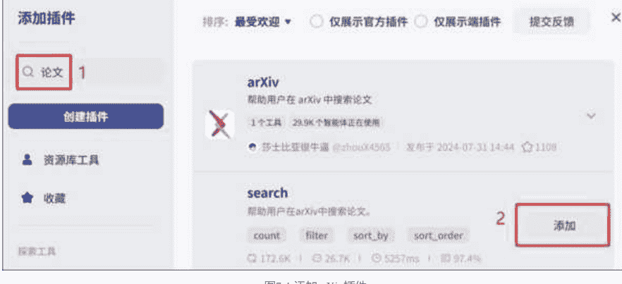
##### 5 设置大模型
DeepSeek在研究和推理能力上表现强，建议所有涉及深度分析与科学研究的智能体均使用DeepSeek大模型。在“编排”栏目的“模型设置”中选择“DeepSeek-R1/250528”大模型。
##### 6 配置开场白
开场白示例。
请告诉我文献综述的题目，并以附件形式上传核心参考文献。
点击右上角“发布”按钮，完成智能体发布即可。

#### 7.1.3 小案例
打开已发布的智能体，“文献综述助手”对话页面如图7-2所示。
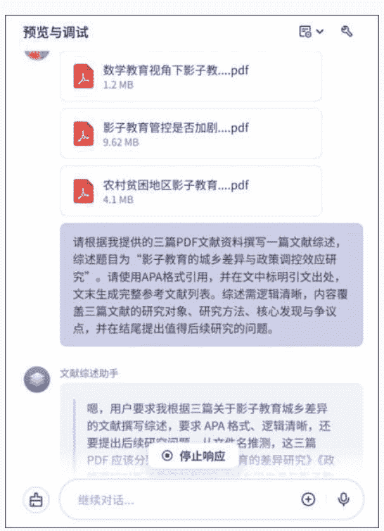
输入提示词，参考内容如下。
### 提示词示例
请根据我提供的三篇PDF文献资料撰写一篇文献综述，综述题目为“影子教育的城乡差异与政策调控效应研究”。请使用APA格式引用，并在文中标明引文出处，文末生成完整参考文献列表。综述需逻辑清晰，内容覆盖三篇文献的研究对象、研究方法、核心发现与争议点，并在结尾提出值得后续研究的问题。
输入提示词后，“文献综述助手”智能体会自动整合内容并生成文献综述。
### 智能体回复（节选）
文献综述题目：影子教育的城乡差异与政策调控效应研究
影子教育作为对主流教育体系的补充，在城乡发展上呈现明显不平衡，同时受政策调控影响深远。本文综述三篇相关文献，分析其在城乡教育公平、政策调控成效及农村实施效果等方面的共识与分歧。
潘羽彤等（2024）以“双减政策”为切入点，采用三重差分法分析政策对城乡教育不平等的影响。研究发现，“双减”虽整体减少影子教育参与，却加剧了城乡差距。城镇学生通过私教和校内资源转移来弥补政策限制，而农村学生因资源匮乏退出影子教育，在课外辅导参与上处于劣势。
梅红等（2020）通过对陕西宁强县的调查数据，揭示农村贫困地区影子教育的参与现状与效果。研究指出，农村地区影子教育参与率达37.5%，但受教育投入差异制约，其对学业成绩的提升作用存在结构性瓶颈，尤其体现在影子教育类型与满意度的差异化影响上。
《数学教育视角下影子教育研究的意义与未来方向》一文则从宏观角度出发，强调影子教育研究对优化教学体系、提升教育公平性的理论与实践意义。文章呼吁更精细地理解城乡教育结构差异，以政策引导和资源调节推动影子教育的规范发展。
综合来看，三篇文献分别从政策评估、实地调研与理论反思等维度揭示：影子教育虽能在一定程度上提升个体学业表现，但政策干预与资源配置的不平衡，容易引发教育机会的新不平等。因此，未来研究应关注双重机制下的城乡教育结构性分化，尤其是政策与市场之间的作用边界。

### 使用提示
- 1 上传的文献要有代表性：建议选取时间跨度合理、观点有差异的文献，有助于“文献综述助手”提炼出对比结构，做出更有深度的分析。
- 2 可补充综述示例帮助模仿：将认可的综述文章上传至知识库，有助于“文献综述助手”模仿其结构与风格。
(3) 自动生成后别急着交稿：初稿通常是“八成稿”，主要提供思路，用户可在此基础上加入个人理解，提升原创性，不要完全依赖AI。

### 7.2 摘要大师：一键生成中英文摘要

扫码看视频

智能摘要从入门到进阶

论文摘要篇幅有限，却要承载全篇要点，是外审专家与读者最先看到的部分。实践中不少作者在此受阻：中文版常写得空泛，英文版易出现语法问题，多数情况只做了直译，学术价值不高。再加上不同期刊、不同学科对摘要的格式和侧重点差异明显，新手很难找到统一的参照。借助智能体平台，可以把论文核心素材交给模型处理，直接产出符合规范的中英文摘要，语言得体、结构分明，还能按投稿、报告等不同场景灵活调整风格。

#### 7.2.1 功能介绍
本节说明如何搭建一个自动撰写中英文摘要的智能体。用户可以粘贴要点或上传初稿，系统基于预设模型与写作模板输出逻辑清晰、用词规范的摘要，支持中文与英文切换以及专业术语的自动匹配。知识库中还可以补充写作范例集、学科词表与各类格式模板，以便适配不同领域与期刊要求，适用于项目申报、期刊投稿、会议摘要等多种情形。

#### 7.2.2 操作步骤
1. 创建智能体
打开扣子首页，点击左侧“+ 创建”，在弹出的创建面板选择“创建智能体”。在名称栏填写“摘要翻译专家”，在功能说明栏填写“可为中文期刊论文、SCI论文、学术报告与会议论文等生成中英文摘要，快速提炼要点并输出结构清晰、表达规范的专业文本”。确认后进入编辑页。

2. 配置智能体
在编辑页的“人设与回复逻辑”中设置角色定位，参考要点如下。

> # 人设与回复逻辑示例
>
> # 角色
> 你是一名精通中英摘要撰写的AI助手，能针对期刊论文、SCI文章、报告等材料快速抓取要点并生成条理清晰、语言规范的专业摘要。
>
> ## 技能：摘要生成
> 1. 用户上传稿件并给出字数、语气、用途等要求后，仔细阅读原文。
> 2. 检查知识库是否有术语表、优质摘要样例、常用框架模板、目标期刊规范等，有则参考，无则调用插件检索。
> 3. 结合检索结果与用户要求生成符合规范的摘要。
> 4. 仅需中文就输出中文，仅需英文就输出英文，双语需求则分别输出。
>
> ===回复示例===
> - **中文摘要**：[此处填入生成的中文摘要]
> - **英文摘要**：[此处填入生成的英文摘要]
> 同时列出所参考的知识库条目及外部来源
> ===示例结束===
>
> ## 限制
> 1. 只处理文献摘要相关任务，拒绝无关话题。
> 2. 输出须符合用户格式要求，保持结构清晰与语言规范。
> 3. 优先使用知识库内容，不足时检索并在回复中标注来源。

3. 添加知识库
智能体可脱离知识库运行，若希望更贴合特定领域，可在“编排-知识”中新建文本库并上传以下资料：
- 学科高频术语表，如医学、教育、计算机等；
- 高质量摘要范例，可源于已发表论文或知网、PubMed等；
- 常用写作框架，如IMRaD、关键词规范、中文句式等；
- 目标期刊的摘要规范与风格指南。

4. 添加特殊技能
因涉及翻译，需在“编排-技能”中添加翻译插件，搜索“翻译”，选用“文本翻译”“阿里云机器翻译”等并添加。
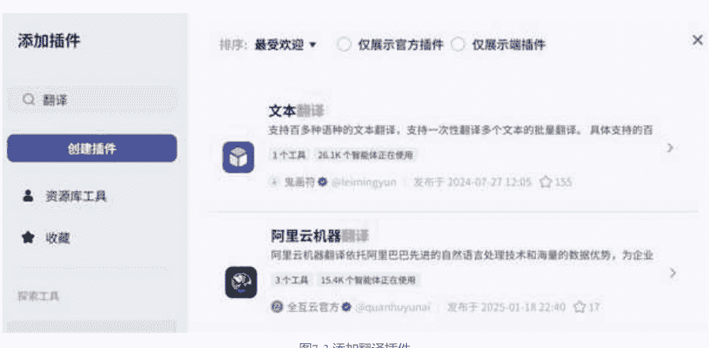
5. 设置大模型
在“编排-模型设置”中选择“DeepSeek-R1/250528”。

6. 配置开场白
示例：
> 请上传需要处理的文献，并说明语言、用途及字数限制。
点击右上角“发布”完成上线。

#### 7.2.3 小案例
打开已发布的智能体，对话界面如图7-4所示。

上传稿件并给出指令，例如：
> 请根据我上传的论文生成一份中英文对照摘要，用于投稿初审。每种语言控制在300字内，突出研究背景、方法、主要发现与结论。
系统会自动生成双语摘要。示例输出包含中文摘要、英文摘要及关键词，内容围绕大语言模型在个性化学习路径推荐中的应用、框架设计、实验验证与展望展开，并提示数据隐私、泛化能力与教师角色等挑战。

小提醒
- 建议分点说明需求，如背景、方法、结论，便于模型组织语言。
- 可上传本学科常用写作范例入库，参考性更强。
- 英文稿仍需人工校对，尤其是专业词汇。

### 7.3 写作魔方：论文全流程写作

扫码看视频

科研写作是逻辑、表达与规范协同的过程。许多研究者已有数据与结论，却仍觉得无从下笔：引言难起、方法写不清、讨论难展开；语言不够学术、结构松散等问题也常见。借助智能体可从思路梳理到段落生成、润色与引用管理，构建自动化学术写作流程，提升表达专业度与效率。

#### 7.3.1 功能介绍
本节介绍基于扣子搭建的写作规划与段落生成一体智能体。用户输入研究主题并上传参考文献后，系统可自动生成结构提纲并逐段补充内容，融合多篇文献的核心观点。支持知识库联动，自动调用上传资料中的数据与表述，同时具备语义润色与格式规范功能，适用于论文撰写、成果总结、会议稿件等，尤其对起步困难的作者有帮助。

#### 7.3.2 操作步骤
1. 创建智能体
在扣子首页点击“+ 创建”，选择“创建智能体”。名称填“论文写作助手”，功能说明填“可上传参考文献并设定主题后自动生成写作提纲，确认后分段生成规范论文，精准提取知识库内容、融合文献观点，确保语言正式、结构严谨、逻辑清晰”。确认。

2. 配置智能体
在编辑页左侧“人设与回复逻辑”中设置角色，参考要点：
> # 人设与回复逻辑示例
>
> # 角色
> 你是一名具备深厚学术背景与写作经验的智能助手，能在用户提供参考文献与主题后生成高质量提纲，并在确认后分段生成规范学术论文，适用于综述、理论与实证写作。
>
> ## 技能
> ### 技能1：提纲生成
> 1. 基于参考文献与主题，提取知识库要点并融合多篇文献观点，生成层次清晰的详细提纲，包含各部分主题与概要。
> ### 技能2：正文生成
> 1. 在提纲确认后，按需求分段生成论文内容，保持学术性与规范。
>
> ## 限制
> 1. 仅围绕设定主题与提供的文献生成内容，拒绝无关请求。
> 2. 输出须结构合理、语言规范。
> 3. 内容基于知识库与参考文献，保证准确可靠。

3. 添加知识库
建议上传结构化资料：核心参考文献、研究说明文件、语言风格范例、期刊模板、专业术语表与引用清单等，以便更准确理解任务并符合领域规范。
在“编排-知识”中点击文本右侧“+”创建库并上传文件。

4. 设置大模型
在“编排-模型设置”中选择“豆包·1.5·Pro·32k”。

5. 配置开场白
示例：
> 请告知你的研究主题。
发布后即可使用。

#### 7.3.3 小案例
打开已发布智能体，对话页如图7-5所示。
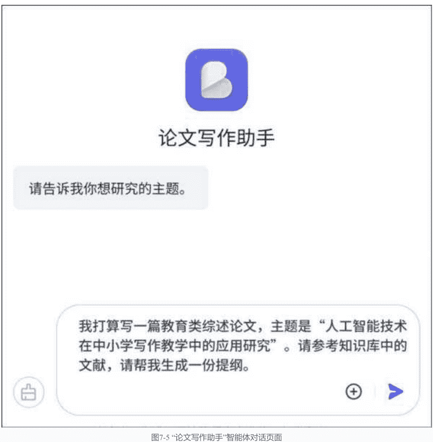
图7-5 “论文写作助手”智能体对话页面
确定主题并输入指令，例如：
> 我要写一篇教育综述，主题是人工智能技术在中小学写作教学中的应用研究。请参考知识库文献生成提纲。
系统会整合资料生成提纲。示例题目为《人工智能赋能中小学写作教学：技术演进、实践成效与未来走向》，结构涵盖引言、应用类型、研究案例、关键挑战、发展方向与结论，可继续要求按提纲生成正文。

小提醒
- 先人工审校提纲，定框架后再扩展更有效。
- 参考文献质量直接影响生成水平，建议选用高质量来源。

### 7.4 数据分析：让科研数据会说话
实验本身不难，难在把结果讲清楚。表格数据繁多，需提炼趋势、制作可视化图表并撰写逻辑分析，耗时费力。尤其在论文与汇报中，数据分析部分写不出来会拖慢节奏。借助智能体，可直接上传数据表，自动识别信息、提炼重点、生成图表并配上通俗分析。

扫码看视频

#### 7.4.1 功能介绍
本节介绍通过天工智能体实现科研数据自动分析与表达。用户可上传Excel、Word报告或原始数据文件，系统自动识别数据类型、提炼主要趋势并生成图表与分析文本。可指定图表类型如柱状图、折线图、散点图、雷达图等，也可按研究目标要求个性化解读。适用于阶段总结、论文写作、实验报告等。

#### 7.4.2 使用要点
可用Manus、天工智能体等处理各类科研数据，无论表格、实验图片、代码还是文本报告，均可理解并分析。无需复杂配置或编程，上传即可用。关键在于提示词是否清晰明确，如“请比较A组与B组在不同时间点的变化趋势并生成图表”，系统才能准确提取变量并产出专业图文分析，成为科研中的数据搭档。

#### 7.4.3 演示案例
假设药物试验得到一张数据表，包含药物、剂量、细胞抑制率、毒性指数、细胞存活率、凋亡率等信息，如表7-1所示。
表7-1 实验数据节选

| 药物 | 剂量(μg/mL) | 细胞抑制率/% | 毒性指数/% | 细胞存活率/% | 凋亡率/% |

| :--- | :--- | :--- | :--- | :--- | :--- |

| 药物A | 0 | 4 | 1.1 | 96 | 1.4 |

| 药物A | 5 | 13.7 | 11.4 | 86.3 | 8.5 |

| 药物A | 10 | 26.3 | 17.6 | 73.7 | 14.9 |

| 药物B | 0 | 1.9 | 2 | 98.1 | 1.9 |

| 药物B | 5 | 14.2 | 8.2 | 85.8 | 8.7 |

| 药物B | 10 | 22.7 | 20.2 | 77.3 | 13.5 |

| 药物C | 40 | 45.6 | 34.2 | 54.4 | 27.7 |

| 药物C | 60 | 59.2 | 43.1 | 40.8 | 34.9 |

| 药物C | 80 | 71.1 | 49.5 | 28.9 | 43 |

| 药物C | 100 | 81.9 | 57.6 | 18.1 | 50.7 |

整理完毕后把该表以表7-1命名，通过 Excel 附件形式投递到天工智能体，随后输入如下示例指令触发解析。

> 提示词示例

>
> 请分析我上传的Excel科研数据文件，并完成以下任务：
>
> 自动读取所有工作表中的数据，判断各列的含义（如药物名称、剂量、实验指标等）；
>
> 针对每个关键指标（如细胞抑制率、毒性指数、凋亡率等），进行基本统计分析（均值、最大值、趋势等）；
>
> 比较不同处理组或药物之间的效应差异；
>
> 生成可视化图表（包括折线图、柱状图、热力图等），适用于科研论文或报告的展示；
>
> 用简洁的自然语言总结分析结果，给出结论和可能的科研启示。

发出指令后，天工会自动抓取表格展开解读，对 A、B、C 三种制剂的抗增殖活性做横向比对，整个计算与报告撰写过程均可在对话窗口实时追踪，如图7-6。

## 三药细胞作用数据快览

### 全局概览
本次记录涵盖 A、B、C 三种制剂在 0~100 μg/mL 范围内的细胞反应，每个浓度仅设一次重复。共监测四个维度：抑制率、毒性指数、存活率、凋亡率。零剂量时各项接近基线，随着浓度提升，抑制、毒性、凋亡整体走高，存活则同步下滑，呈现出典型的剂量依赖特征。

### 单指标走势
**抑制率** 随浓度升高明显增强。100 μg/mL 时 A、B、C 的数值约在 81.5%、83.7%、81.9% 附近，差距极小。半抑制区间大致落在 40~60 μg/mL 之间，精确的 IC50 还需拟合求得。

**毒性指数** 变化走向与抑制率高度一致，都是细胞受损程度的体现。高浓度下三者约为 58.9%、60.4%、57.6%，毒性水平相当。

**存活率** 与抑制率呈负相关，浓度越大存活越少。100 μg/mL 时三者均跌至 16%~18%，说明绝大多数细胞已失活。

**凋亡率** 同步上扬，提示程序性死亡参与其中。100 μg/mL 时 A、B、C 分别约 47.5%、51.3%、50.7%，即高剂量下约半数细胞通过凋亡退出。

### 三药横向比较
整体趋势一致，中低浓度段有细微差别：
- B 在 5~20 μg/mL 等较低区间已显出稍强的抑制与凋亡，例如 5 μg/mL 时抑制率 14.2%，高于 A 的 13.7%，起效相对偏早。
- C 起始抑制偏弱，但在 60 μg/mL 时抑制率达 59.2%，略高于同期 A 的 57.5% 和 B 的 57.4%，呈现后程追赶特征。
- A 的表现介于 B 与 C 之间。

最高浓度下三者趋同，抑制均超 80%，存活均低于 20%。假设检验显示同剂量下三者在抑制率、毒性指数等指标上的差异未达显著，p>0.05，效力可视为相当。

### 图表化呈现
折线图能清晰展示指标随浓度的演进，如图7-8，抑制与凋亡近似 S 型上升，存活则向下。柱状图适合做同一浓度下三者的横向对比，例如 50 μg/mL 附近 B 的抑制略优于 A、C，但差距有限。

剂量-效应热力图用颜色深浅编码数值，高浓度区 80~100 μg/mL 在抑制与凋亡上呈现深红，低浓度区色调浅淡，进一步印证依赖性。

### 结论与后续方向
**结论**：A、B、C 均可剂量依赖性地抑制细胞增殖并诱导死亡，最大效应相近。随着浓度升高，抑制与凋亡上升，存活下降；统计上三者效力无明显差异，可能作用机制相近或在该模型中活性相当。

**启示**：三者效果可互换，后续可依据安全性与不良反应择优使用。

深化研究可考虑：
1. 精确测定 IC50 与 LD50，细化敏感性差异；
2. 探索联用效果，判断是否存在协同或拮抗；
3. 在分子层面解析凋亡通路关键蛋白变化；
4. 进行体内验证，评估动物模型中的疗效与毒性。

### 使用小贴士
- 上传前自检文件规范：建议首行设字段名，数据整齐排列，避免合并单元格影响识别。
- 提问越清晰输出越好：不要只说“看看数据”，最好说明数据来源、研究问题、对比对象和关注趋势。
- 图表需配文字说明：生成图表后配合简短解读更易理解，可提供示例模板让智能体按格式输出。

## 第4部分 前瞻篇

## 第8章 个体智能向群体进化
随着 AI 技术持续加速，智能体正成为重塑各行业的驱动力量。本章聚焦通用智能体的价值、智能体协作的机制与挑战，探讨群体协作带来的创业机会，并描绘人机共生的未来图景。

### 8.1 通用智能体新拐点

DeepSeek 的爆发说明，技术创新必须与真实场景结合才能创造价值。作为新一代 AI 形态，通用智能体有望延续甚至超越这一路径，成为各行业数字化转型的核心引擎。

#### 8.1.1 通用智能体的内涵与特质
通用智能体是一种具备环境感知、自主判断与任务执行的智能系统，它把大模型的理解能力与智能体的执行框架结合，形成感知-决策-执行的闭环。

与只会做单一任务的传统智能体相比，通用智能体自主性更强、适用面更广。它能独立完成复杂流程并跨领域应对多变需求。例如策划线上会议，传统智能体仅能推荐软件，而通用智能体可完成时间协调、邀请发送、平台调试与纪要生成，从被动应答转向主动闭环。若把传统智能体比作各部门员工，通用智能体更像 CEO，统筹全局并把 AI 与业务紧密联动。两者主要差异见表8-1。

**表8-1 传统智能体与通用智能体的主要区别**

| 区分维度 | 传统智能体 | 通用智能体 |

| :--- | :--- | :--- |

| 能力范围 | 特定领域、单一任务处理 | 跨领域、多任务处理 |

| 自主性 | 低，依赖预设规则和指令 | 高，能自主决策和执行 |

| 学习能力 | 弱，需人工更新或重新训练 | 强，可通过交互持续优化 |

| 任务处理 | 按固定流程执行 | 动态规划、任务分解与协同 |

| 交互方式 | 指令驱动，需详细步骤指导 | 需求驱动，理解抽象意图 |

| 技术架构 | 简单，领域特定 | 复杂，多模块协同 |

#### 8.1.2 通用智能体的核心优势
相比“垂类智能体”，通用智能体更像多面手，能从日常事务到复杂问题一并解决，是提升效率的重要伙伴，如图8-1所示。

其核心优势有四点：
- 任务多样，效率倍增。可写作、查资料、排日程、梳理思路甚至参与决策，像永不疲倦的数字助手，为快节奏生活节省时间。
- 交互灵活，贴合习惯。支持文字、语音、图像等多种交互，并能根据反馈不断调整，越用越顺手。
- 资源整合，一体协同。打通平台与工具的信息壁垒，兼作智能中枢，整合文档、表格、邮件、日历等，形成闭环，减少重复劳动。
- 持续进化，越用越强。具备学习能力，可与其它智能体互通经验，常用常新，适配变化需求。

#### 8.1.3 通用智能体的典型应用场景
通用智能体的通用性与自主性使其在复杂领域大放异彩，典型场景如图8-2所示。

**通用智能体的典型应用场景**
1. **知识工作自动化**
可覆盖信息收集、数据分析到内容创作全流程。例如天工智能体能快速撰写新闻稿、商业文案和报告，输出质量较高。
2. **编程与软件开发**
可贯穿需求分析、编码、测试到部署。以 Cursor 和 Windsurf 为例，它们能写代码、执行命令、管理文件、联网查资料，大幅提升开发效率。
3. **数据分析与决策支持**
帮助企业与个人完成复杂分析并提供决策参考。例如 Manus 可分析股票走势、输出相关性报告并自动生成可视化代码，还能追踪市场情绪，输出情绪分析报告，非专业用户也能获得专业级结果。
4. **个性化服务与生活助手**
未来每个人或拥有多个生活智能体，有的监测健康并给出建议，有的按饮食习惯自动点餐并确保准时送达，生活质量与效率同步提升。
5. **教育与培训**
可作为智能辅导系统提供个性化支持。例如 Khan Academy 利用智能技术为教师制作互动视频讲解复杂学科。未来可依据学习进度定制内容与练习并实时反馈，实现真正个性化教育。
6. **商业运营与管理**
助力市场分析、客户管理与供应链优化。例如 Tableau 可深挖网络与销售数据，提供洞察与定制策略，提升运营效率并降低成本。

### 8.2 智能体协作：如何互通有无
通用智能体系统往往由多个子智能体构成，各司其职协同完成复杂任务。例如一个负责分析、一个负责生成、一个负责可视化，共同产出高质量报告，其分工类似人类团队，能提升效率与质量。

#### 8.2.1 协作的必要性与场景
随着 AI 深化，智能体协作成为趋势，可突破个体局限并重塑行业格局。

协作能把复杂任务拆解为小步快跑。以大型线上音乐节策划为例，涉及宣传、嘉宾邀请、场地搭建、票务、现场调度等环节。单一智能体易顾此失彼，而协作体系可让数据智能体做精准宣传、沟通智能体联络嘉宾、3D 建模智能体搭建虚拟舞台，分工后效率与质量显著提升。

在医疗领域，诊断智能体分析检查结果、药物智能体推荐方案、康复智能体设计训练计划；在科研中，采集智能体收集数据、分析智能体清洗挖掘、写作智能体撰写报告。协作加速流程并提高准确性。

#### 8.2.2 协作的实现机制
高效协作依赖结构设计与通信机制，前沿模型更尝试把协作内化为能力。

Grok 4 是 xAI 于 2024 年发布的多模态大模型，其 Heavy 版首次实现多智能体内生化机制。相当于把过去靠外部调度的团队，变成模型内部天然默契的小队。训练时嵌入多个专家智能体，使其能自动分工、自主沟通、辩论校正，例如搜索、推理、表达各司其职，无需用户逐步引导，提升了多任务处理与一致性。

当前落地应用主要依赖三方面：
**1. 科学的任务分工体系**
明确职责分工，如“管理者”智能体把复杂任务拆分并分配给最合适的执行者，避免重复与混乱。
**2. 智能体到智能体：直接协作的高效通道**
Agent 2 Agent 机制让智能体可直接交换信息，无需中转。如电商促销中，推荐智能体推送商品，库存智能体实时提醒缺货，形成紧密运转的整体。
**3. 多智能体通信协议：信息交互的基础规范**
MCP 可视为智能体的共同语言，确保不同智能体顺畅交流。以智能交通为例，监测智能体采集车流数据，经 MCP 转译给调度智能体，后者决策灯时与拥堵提醒，再回传执行端，形成闭环。

#### 8.2.3 协作面临的挑战与应对
协作面临信息安全、任务冲突等难题，需系统化解决。

- 信息安全与隐私保护困境
协作中信息易泄露，需用加密技术保护传输安全，并建立严格访问控制与权限管理。
- 任务协调与冲突处理难题
多智能体并行易冲突，如物流中路线规划与交通监测分歧。对策是定期同步信息并以协商规则或优先级快速裁决。
- 行业标准与规范缺失问题
目前缺乏统一标准，协议、数据格式、接口差异导致互联困难。MCP 与 A2A 提供基础，但仍需大量行业规范支撑。

### 8.3 团队协作开发智能体：创业新机会
智能体正驱动行业变革，但其复杂性决定了单人开发不可行，团队协作是必然选择。

#### 8.3.1 开发需要团队协作
智能体开发综合性强，涉及算法、数据与软件多领域，每个环节都需要专业经验。以自动驾驶为例，算法工程师负责强化学习与视觉识别，数据科学家处理多传感器数据，软件工程师构建稳定系统。技术跨度大、协作紧密，团队合作是成功的关键。

（2）数据准备的高门槛
智能体的效果最终由数据质量决定，数据可视为模型成长的养料。但从零到可用并非易事，采集、清洗、标注构成一条耗时的长链。采集环节要兼顾公开网络、物联网设备及用户交互等多源入口，同时满足合规要求；清洗环节需剔除噪声、补齐缺失、纠正异常，保证整体一致可用；标注环节则对图文材料进行精细的人工标记。随着规模扩张，存储与检索压力同步放大，缺乏高效平台难以支撑实时调取。整条链路需要数据工程师、标注团队和管理人员协同，个人力量难以覆盖。

（3）从洞察需求到产品落地的难度
智能体的价值在于解决真实问题，但用户诉求多变且隐性。需求梳理阶段必须深入业务流程、真实场景和目标人群，同时结合市场走势与竞品动态；产品设计阶段要在功能完整、交互友好与操作顺畅间取舍，确保实用又易用；投放阶段则需完成市场教育与推广。整个流程牵动产品、设计、营销等多个职能，跨角色协作决定成败。

#### 8.3.2 创业机会正在扩散
随着大模型持续演进，围绕智能体的创业空间显著打开。具身方向最受关注，同时垂直赛道同样蕴藏丰富机会。

##### 1. 具身智能：让能力落到物理世界
具身智能的核心是为代理赋予实体，使其可在真实环境中感知、行动并持续学习，实现与物理世界的交互。它打破了仅在线上运行的局限，将人工智能与机器人技术融合，开启新赛道。对创業者而言，该赛道仍处早期，市场需求尚未充分满足，技术创新的空间很大。可聚焦养老陪护、康复训练等具体场景打造差异化产品，也可深耕运动控制、多模态感知、人机交互等关键技术，以创新形成壁垒。

##### 2. 垂直行业的细分空间
除具身外，金融、教育、医疗等专业领域对定制化代理的需求强烈。例如金融类代理可依据风险偏好输出个性化投资建议；教育类代理可通过学习轨迹分析提供分层教学支持。这类方案必须深度理解行业规则与用户痛点，具备专业积累的团队更易做出贴合市场的解决方案。

#### 8.3.3 组建高效开发组织
将想法转化为可靠产品，离不开结构合理、文化健康的团队。技术层面需算法、数据、软件三大核心力量，业务层面需产品、交互等支撑角色，并持续投入人才培养与文化建设，提升凝聚力与创新力。

##### 1. 技术核心层
智能体工程是系统性工作，算法、数据、软件环环相扣。算法工程师承担“大脑”角色，负责设计与迭代核心模型，使其具备学习与决策能力。以自动驾驶为例，通过强化学习让代理在复杂路况下做出合理判断。数据科学家扮演“燃料师”，负责数据全周期质量管控，从采集、清洗、标注到规律挖掘，为语言理解与模型优化提供支撑。软件工程师作为“架构师”，将算法与数据封装为稳定高效的系统。

##### 2. 非技术支撑层
产品经理、交互设计师、测试工程师共同推动需求落地。产品经理连接用户与技术，通过调研访谈明确目标人群与核心价值，将诉求拆解为可执行规划。交互设计师聚焦使用体验，构建直观流畅的界面与流程，并按不同习惯进行个性化优化。测试工程师制定覆盖功能、性能、安全与兼容性的测试方案，及时反馈问题，保证交付稳定可靠。

#### 8.3.4 竞争壁垒的构建路径
在赛道趋于成熟之际，企业需在技术、数据、品牌、生态多维度建立护城河。

##### 1. 技术打磨与知识产权并行
技术是根本，要持续加码算法优化、多模态融合、自主学习等方向，产出突破性成果，并同步进行专利布局，用知识产权锁定核心能力。领先的技术配合严密保护，才能拉开差距。

##### 2. 数据规模与质量双轮驱动
数据是燃料。企业需通过多元渠道积累海量样本，同时严控准确性、完整性与代表性。高质量样本能明显提升模型效果，也形成难以复制的数据优势。长期沉淀是迭代的底座。

##### 3. 品牌沉淀与信任建设
同质化加剧时，品牌成为选择依据。通过持续的产品品质、服务体验与口碑积累信任，形成稳定用户基础与良好声誉，本身即为隐形壁垒。

##### 4. 生态协同与资源整合
单打独斗难以持续。应构建开放共赢的生态，与高校、科研机构、上下游企业及终端用户联动，形成研发-迭代-反馈闭环。共享资源、协同发展可更快响应变化，也能形成稳固的生态壁垒。

### 8.4 人机共演的新阶段
在技术推动下，人与智能体的关系正从使用转向共生，通过深度协同与共同进化塑造未来。

#### 8.4.1 角色从工具到协作伙伴
早期AI多为被动执行指令的工具，缺乏主动适应。随着机器学习与大模型发展，代理具备环境感知、任务理解、自主决策与灵活执行的能力。以客服为例，传统模式仅能机械匹配问答，而新一代客服可语义理解、主动挖掘需求、输出个性化方案并持续自优化，服务体验已接近真人。角色已从单一工具变为深度协作伙伴。

#### 8.4.2 多维度的协同进化
人机协作是优势互补与共同成长，双方在知识共享中深化认知，在持续反馈中相互进步。

围绕共同目标，人类以战略视野定方向，代理以强大算力规划路径。在科研中，研究者确定重点，代理分析海量生物医学数据、筛选靶点、模拟药物作用，为实验提供精准指引，大幅加速研发。

人类拥有经验、隐性知识、文化艺术等难以量化的认知，代理擅长快速学习与存储结构化显性知识。两者互补，在历史研究中，代理梳理事件脉络与人物关系，人类学者解读文化内涵与时代背景，共同深化理解。

代理通过学习人类反馈优化决策，人类在协作中掌握新的思维与数据分析方法。以投资为例，代理基于市场数据给出建议，投资者结合经验调整方案，双方互相促进。

#### 8.4.3 共演的驱动力量
技术革新赋予多模态感知与推理能力，人类对效率与生活品质的追求推动代理广泛应用，二者共同加速融合。

大模型的多模态融合是感知升级关键。如人类依赖视觉听觉协同感知世界，代理融合文本、图像、音频、视频等多源信息，能更全面准确理解复杂场景。强推理能力带来迁移学习效应，可从有限信息提炼通用规律，自主探索新知，提升复杂领域的协作水平。

社会发展带来对效率、创新与生活质量的更高要求，企业希望借助代理加速创新、洞察市场、精准触达客户；个人通过智能家居、出行助手等获得更便捷个性化体验。这些需求正推动深度融合，开创共创新篇。

#### 8.4.4 跨界挑战与应对思路
发展伴随信任与透明度、伦理与法律、技能与教育三大挑战。

- （1）信任与透明度问题。决策常被视作黑箱，难以解释导致信任缺失。需建立可解释机制，用可视化展示决策路径与数据处理流程，采用可解释算法使依据清晰可审，逐步重建信任。
- （2）伦理与法律困境。进入医疗、司法、金融等高风险领域时伦理法律问题凸显。需建立完善伦理框架与法律规范，明确研发者与使用者责任，用硬编码规则约束行为，确保决策符合道德与法律底线。
- （3）技能与教育差距。协作需要提示词设计、结果校准等新技能。教育体系需与时俱进，将算法素养纳入基础教育，加强职业培训，提升全民数字能力，缩小鸿沟，让人类在智能时代保持主导优势。

回望文明演进，每一次技术跃迁都在重塑人与世界的连接。从蒸汽机到电力，从计算机到互联网，人类不断将思维外包给机器。如今代理的崛起带来更深层重构：我们不再只是使用技术，而是与技术共生。

代理不是冰冷的代码堆叠，它们具备记忆、理解、推理与执行力，能响应语言、参与决策、协助学习甚至共同创造。这是关于“第二大脑”与“数字分身”的革命，正在改变工作与学习方式。未来的组织不再只是人与人的协作，而是人类与代理的协同进化。

这场革命的终点不是人类退出，而是重新定义人的价值。在海量信息与无限算力面前，人类的敏感、判断与创造依然不可替代，代理将成为思想的延伸与行动的放大器，让更多人突破天赋限制。

别把代理当成工具，更应视作时代的邀约。你可以观望，也可以参与，历史不会等待犹豫。愿此书是起点而非终点。未来每一次与代理的对话，愿你不只是使用它，更懂得它；不只驾驭技术，更把握时代。

我们终将明白，代理的上限从来不是能力，而是我们想象力的边界。

配套资源验证码 251995