# 智能体：基于大模型的产业实践

# **推荐序一** **拥抱智能体时代，共赴产业新篇**

作为中国电信集团有限公司（以下简称中国电信）在人工智能领域的实践者，我很高兴为《智能体：基于大模型的产业实践》作序。当看到本书的主题时，我深感共鸣——这正是当前人工智能从技术爆发走向产业深耕阶段最值得关注的方向之一。

目前人工智能技术的发展已进入全新阶段。从早期的计算智能、感知智能，到如今的认知智能，人工智能正变得越来越“聪明”，也越来越“善解人意”。智能体（AI Agent）作为人工智能技术的重要载体，既是其能力具象化的“呈现窗口”，也是其释放产业价值的“核心引擎”，它让人工智能不再局限于碎片化应用，而是能系统性参与业务全流程，推动行业实现从“数字化”到“智能化”的深层变革。

站在行业演进的当下进行回望与前瞻，智能体技术正驱动着人工智能领域实现全方位突破，主要呈现出以下关键趋势：

1.模型能力聚焦智能体需要：各家基础模型厂商的最新发布，不约而同地聚焦推理、搜索、编码等智能体能力，以满足智能体应用日益增长的复杂需求。

2.传统软件被智能体替代：软件行业的多位领军者一致认为“智能体将逐渐取代传统 SaaS 模式，业务逻辑正从软件层向智能体层迁移”，各类型的软件正加速向智能体方案转型。

3.超级智能体成为发展前沿：以多智能体为架构的超级智能体技术成为探索热点，业内厂商持续加码，纷纷加速生态战略布局。

4.价值交付而不是工具交付：以超级智能体为代表的产品逐渐脱离工具属性，正如红杉 AI 峰会的共识——人工智能不再“售卖工具”，而是直接交付可落地的最终结果，价值闭环愈发清晰。

这 4 个趋势相互交织，共同描绘出智能体行业向深向实、蓬勃发展的全景图。行业内各企业在多维度、深层次的探索，正持续为技术演进注入动能，使智能体一步步从理论概念走向商业落地，从实验室研发迈向规模化、产业化应用。然而趋势的背后，却是巨大的挑战。我们深知，在实验室里流畅对话的模型，与在关键业务中稳定可靠的“数字员工”之间，存在一道需要跨越的鸿沟。这需要克服技术集成的复杂性，将大模型与行业 know-how、业务流程进行深度耦合；需要建立价值衡量的标尺，使智能体创造的全部效益都清晰可见；更需要构筑信任与安全的堤坝，确保产业应用可控、可信、可靠。

令人欣喜的是，本书系统地回答了“如何做”的问题。从智能体的构建理念、技术架构到实战案例，为智能体落地提供了兼具理论性与实操性的宝贵指南。无论你是技术开发者、企业管理者，还是行业深耕者，都能从中获得针对性启发。

面对智能体时代的发展机遇，作为央企 AI 力量的代表，中国电信积极布局智能体领域，不仅自主研发了覆盖语义、语音、视觉、多模态的全栈星辰大模型体系，还基于星辰大模型推出了一站式智能体开发、调优和运营平台——星辰智能体平台和具备自主任务规划、跨工具协同能力的星辰超级智能体，形成“大模型—智能体平台—超级智能体”的产品矩阵，为产业智能化提供了从基础能力到高阶应用的全链路支撑。

未来，我们将持续以央企担当深化布局，一方面聚焦智能体的规模化产业落地，让智能体成为驱动实体经济智能化转型的“核心引擎”，推动 AI 技术深度扎根产业场景、创造实打实的价值；另一方面聚焦全民普惠，加快推进 AI+音箱、AI+手机、AI+摄像头、AI+眼镜等智能终端规模化普及，让智能服务像水、电、通信一样融入千行百业、走进千家万户，真正实现“AI 赋能产业、智惠全民生活”的发展愿景。

我相信，本书的出版，将为这场波澜壮阔的产业变革注入新的智慧与活力。期待与诸位携手，共同推动智能体技术在千行百业中的落地，共创一个智能普惠的新未来。

何忠江

中电信人工智能科技有限公司董事长兼总经理

# **推荐序二 智能体时代：构建人工智能落地的产业桥梁**

当前，大模型技术正迎来前所未有的历史性跨越，其应用边界已从实验室的学术探索全面拓展至千行百业的深度融合，成为推动产业智能化升级的核心引擎。然而，技术红利释放的同时，行业面临的关键命题日益凸显：如何将海量算力与复杂模型能力转化为可落地、易操作、可持续迭代的智能服务解决方案？

对此，产业界已形成高度共识：智能体架构正是实现大模型技术价值转化的最优路径。它不仅是技术演进的必然选择，更是连接底层模型能力与产业应用场景的关键枢纽。本书聚焦这一变革性趋势，系统阐述了智能体如何突破传统人工智能技术的局限——从被动响应任务转向主动理解任务，从单纯生成内容升级为调用工具、自主决策、闭环执行的完整智能系统，最终在真实产业场景中创造可量化的商业价值。

智能体的崛起，标志着人工智能技术从“实验室工具”向“产业生产力”的质变，其核心价值在于将大模型的“通用智能”转化为解决具体行业痛点的“专用能力”。这一转型，不仅关乎技术效能的最大化，更关乎企业如何构建面向未来的智能竞争力。智能体的价值已从技术验证迈向规模化落地，成为驱动人工智能从“可用”到“好用”与“必用”的关键引擎。在转型的背后，有以下三大趋势日益凸显：

其一，商业闭环是必然选择。智能体正从技术探索阶段转向产业深耕阶段，其核心使命是构建人工智能与商业价值的深度耦合，推动技术红利转化为企业核心竞争力。

其二，属地化服务是刚性需求。人工智能落地需突破基础设施层，深入数据治理、模型训练、流程重构等应用层，直面行业场景的碎片化与复杂性。这意味着，大模型必须下沉到一线，以真实业务痛点为导向，实现技术适配与价值创造。

其三，生态协同是破局之道。人工智能落地需开放合作：对“老应用+人工智能”场景，要与合作伙伴共建数据集、集成模型，实现平滑升级；对“人工智能原生新应用”，则要联合产业伙伴定义新范式，打造共生共赢的生态体系。

然而，实践之路仍存挑战，需以系统思维破局。唯有以战略定力破局挑战，以生态协同构建能力，方能实现大模型价值的最大化落地。

挑战一：应用拓展需“以小见大”。智能体是非标准化产品，需坚持“小场景切入、效果优先”策略，以可见实效建立信任，逐步扩大范围。

挑战二：商业模式需“共创探索”。通用领域可自主推进，但工业、医疗等专业领域需联合应用伙伴，探索分成、订阅、服务化等模式，通过试错、迭代锁定最优路径。

挑战三：人才体系需“实战锻造”。复合型人才稀缺已成瓶颈，需构建“人才赋能+实践作战”的人才培养体系，打造懂技术、通业务、能落地的“人工智能铁军”。

本书的核心价值在于“以落地为锚，以实践为纲”。从智能体的架构设计、任务编排、记忆机制，到多智能体协同、安全治理与评估体系，内容始终紧扣“产业落地”这一主线，不仅系统梳理了技术框架与关键能力，更通过电信、政务等领域的真实案例，完整呈现了从需求分析、方案设计到部署运营的全流程方法论。这些源自一线的实践经验，为开发者、架构师和管理者提供了可复制、可借鉴的落地指南。

当前，智能体发展正迎来关键窗口期。在政策层面，“人工智能+”行动加速推进；在技术层面，大模型能力持续突破，智能体平台开发工具、多智能体协同、MCP 协议等配套技术日趋成熟；在产业层面，试点项目正逐步迈向规模化探索。本书的出版恰逢其时，为行业提供了一份系统、务实的技术路线图，可助力智能体从实验室走向产业一线。

中国电信作为央企在人工智能领域的中坚力量，升级了“云改数转智惠”战略，全面布局人工智能赛道。中国电信不仅自主研发了涵盖语义、语音、视觉及多模态能力的全栈星辰大模型体系，更基于此打造了一站式的智能体开发、调优与运营平台——星辰智能体平台，以及具备自主任务规划与跨工具协同能力的星辰超级智能体，构建起“大模型—智能体平台—超级智能体”的完整产品矩阵，为产业智能化升级提供从底层基础能力到上层高阶应用的全链条、端到端服务。

谨以此序，致敬所有在智能体一线深耕的探索者。希望本书能成为从业者的实用工具书，助力智能体技术从“纸上谈兵”走向“规模落地”，真正赋能千行百业，开启智能时代的崭新篇章。

陈靖翔

中国电信科技创新部副总经理

# **前言**

近年来，随着大模型技术的日益成熟，作为其核心应用载体的智能体框架正经历着前所未有的快速迭代。业界普遍将“智能体”视为继信息技术革命之后引领新一轮科技浪潮的关键力量，而 2025 年更被业内权威机构正式定义为“智能体元年”。这也得到了全球科技领袖的印证——美国微软公司首席执行官萨提亚·纳德拉在多个国际场合明确表示：“未来软件生态将全面转向智能体主导模式”。

面对智能体技术带来的跨时代革新，广大从业者既充满期待又难免困惑。在技术落地层面，主要存在以下亟待解答的核心问题：

● 大模型技术持续突破，但如何实现从实验室到产业化的有效转化？

● 智能体的本质特征是什么？为何业界普遍认为它是大模型技术落地产业的最佳形态？

● 如何通过真实案例系统掌握智能体开发的全流程技术细节？

● 传统企业应如何基于智能体技术和大模型能力进行战略升级与业务重构？

以上问题均是笔者在中国电信负责星辰智能体平台建设期间，频繁被内外部客户咨询的核心问题。为助力产业构建智能体人才体系，笔者通过系统研究市场现有“智能体”相关著作，结合自身实战经验，决定撰写这部聚焦企业一线实践的指南。本书将全面剖析中国电信在大模型与智能体领域的落地经验与成果，旨在培养兼具理论素养与实践能力的复合型人才。

本书的理论部分将系统阐述大模型的技术原理及其发展脉络，在完整梳理技术演进逻辑的基础上，采用通俗易懂的表述方式，帮助读者在不涉及复杂公式的前提下构建对大模型的全面认知。针对智能体理论，本书通过大量类比人类决策与行为模式进行阐释，并辅以实操案例，避免传统理论学习的枯燥性，使读者在实践中深化对技术原理的理解。同时，该部分融入了行业前沿思考与实战案例，如从实践视角总结 Transformer 网络、自监督学习和生成式模型三大技术支柱对大模型发展的驱动作用。又如通过“大模型回答考试题”演示案例，解析指令学习技术如何提升模型对人类意图的精准把握。

本书的实践部分聚焦“精炼案例，高效学习”，以工作流智能体为例，针对普遍存在的“案例多，但节点覆盖不全”的问题，特别设计了“公文创作智能体”案例，完整呈现众多核心节点的应用方法，帮助读者通过单一案例掌握全流程开发技能，实现知识迁移与灵活运用。此外，本书还重点阐述了企业级落地案例的技术方案与调优细节、智能体的硬件资源配置策略，以及智能体与企业 IT 系统的集成方案。最后，针对企业决策层的需求，本书提供了从技术实施到战略转型的完整路径，涵盖基础设施规划、组织架构重构、人才梯队建设以及高价值场景挖掘等关键环节。

基于上述特色，本书内容组织如下：

# 第一章 大模型基础：历史与今天

本章从机器学习和深度学习的基础概念切入，系统阐述大模型的技术演进路径与关键调整点，深度剖析 ChatGPT、DeepSeek、星辰大模型等代表性产品的技术架构，并梳理全球大模型发展脉络，重点探讨其在产业落地过程中面临的核心挑战与解决方案。

# 第二章 智能体：大模型应用的产品形态

本章通过构建智能体与大模型的关联图谱，明确智能体的概念边界与实践价值，采用案例教学法，解析自主规划智能体、工作流智能体、超级智能体三种典型范式，并横向对比其技术本质差异。最后，结合实际案例介绍了智能体调优的关键技术与实战要点。

# 第三章 一个案例全面了解工作流智能体

本章聚焦智能体产业落地的核心领域，以“公文创作智能体”为教学载体，系统拆解工作流智能体的全节点技术内涵。通过对节点背后的检索增强技术（RAG）、工具使用、记忆与反思等技术的详细介绍，实现理论和实践的贯通。案例设计采用“节点—模块—系统”三层渐进式架构，辅以智能体集成现有 IT 系统的方案，助力读者全面掌握工作流智能体的开发方法。

# 第四章 智能体应用的产业落地与案例

本章首创“四阶段十二步”实施框架，完整呈现智能体在真实企业的设计与落地路径，深度解析中国电信内外部的实践案例，涵盖策略优化经验、硬件资源配置等一线经验，同时延伸至组织结构调整、人才培养等企业级转型话题，形成技术与管理的全方位落地经验。

# 第五章 星辰智能体平台：企业级智能转型的核心引擎

本章以星辰智能体平台为实践载体，所有案例均支持在平台官网实操验证。该平台作为中国电信自研的一站式智能体全流程平台，已服务数万名开发者（公网开放注册）及 50 家大型国央企。本章全面展示其“基础大模型底座-智能体全生命周期管理”的核心架构，涵盖自主规划、工作流编排、超级智能体创建等多元能力，通过数据回流实现智能体持续进化，并支持多渠道发布与生态托管。

感谢读者选择本书作为学习和实践智能体的教程，愿本书的内容能转化为推动技术实践的动力，助力更多从业者将智能体融入实际工作，最终为中国人工智能产业的创新发展、生态构建贡献一份微小却坚实的力量。

2025 年 10 月

# **第一章 大模型基础：历史与今天**

## **1.1 机器学习和深度学习**

**1.1.1 机器学习**

在人工智能技术体系中，大模型作为当前技术演进的重要方向，已成为驱动人类社会发展的核心生产力。大模型是基于深度学习技术构建的一类大规模参数化智能系统，而深度学习则是机器学习的一个重要分支。基于上述关联，从机器学习的概念展开探讨，将帮助读者更好理解大模型技术。

**1.机器学习的概念**

机器学习，顾名思义，是让机器（计算机）完成学习的动作。这不禁让人好奇，机器到底是怎么学习的呢？在回答这个问题之前，需要先回顾一下人类是怎么学习的。

人类生活在自然界中，通过对自然界的观察以及自身的思考，经过一系列的实验、技术开发和工程设计，发明了诸多原本不存在的物体和工具。例如，人类从飞鸟滑翔的动作中得到启发，设计出了飞机；通过研究蜜蜂、蜻蜓等动物的眼睛结构，设计出了全景相机；通过研究蝙蝠的避障能力，发明了超声定位雷达。

值得注意的是，人类在完成这些发明的设计方案时，并不会完全照抄自然界中已有的生物结构，而是在实现原理和机制上借鉴了自然界的原理和规律，机器学习的设计思路也是如此。为更加清晰地说明这种设计思路的关键步骤，列举如下几个案例以帮助理解。

**2.人类学习过程案例**

**（1）天气预测案例**

古人常常在降雨前观察到乌云密布、狂风大作的现象。基于这种观察，古人在尚未降雨前即可根据乌云与狂风的征兆预测天气情况，所以有“山雨欲来风满楼”的经典诗句流传于世。尽管在观察和预测过程中，“降雨”是在不同地理位置发生的，却并不妨碍人们将“乌云+狂风预示着降雨”这一抽象规律迁移至新的情境中加以应用。

**（2）加法学习案例**

学生在学习加法时，并非对所有加法运算实例进行机械记忆，因为加法运算实例是无穷尽的，显然无法通过机械记忆来掌握加法运算。一般而言，学习加法首先要掌握 10 以内的基础加法运算实例，之后再逐渐扩大运算实例的计算范围进行进一步练习，直至理解并掌握加法运算法则。这里的加法运算法则就是学生通过做大量加法运算，在脑子里抽象出来的通用规律。一旦掌握了加法运算法则，学生在之后遇到从未见过的加法运算实例时，依然能够算出正确答案。

图 1-1 所示为加法学习案例中人脑思维链路流程。不难看出，图中人类的学习过程主要包括归纳总结和推理演绎两个基本步骤。

步骤 1：归纳总结，即从大量已有数据或者实例中观测并思考，总结出通用的抽象规律。

步骤 2：推理演绎，在遇到类似场景时，利用这个抽象规律对可能发生的事情或可能产生的结果进行预测。

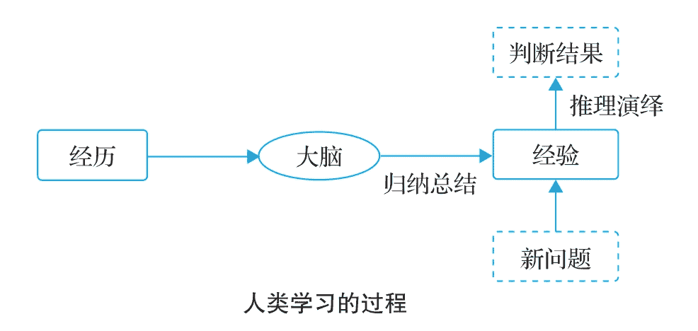

**图 1-1 加法学习案例中人脑思维链路流程**

**3.机器学习的过程**

类比人类的学习过程，机器学习的过程也应当包括归纳总结和演绎推理两个基本步骤。具体来说，在归纳总结步骤中，与学生学习加法运算的实例一样，计算机也需要大量的已知样本，即（*X*,*Y*）数据，*X*是输入，*Y*是输出。其中，*X*与*Y*之间存在某种映射关系*f*，就是需要总结归纳的规律，通常将这种映射关系称作“目标函数”，可以把它想象成学生想要达到的学习目标。

然而，初始的目标函数*f*并不能正确地将输入*X*映射成输出*Y*，需要利用已知的（*X*,*Y*）数据进行训练，不断地调整函数*f*中的各项参数，使得函数*f*针对输入*X*得到的假设结果无限逼近真实值*Y*。这里的参数调整过程就是机器学习的过程，参数调整的方法被称作“学习算法”，就像学生的学习方法一样。最终通过训练得到一个拟合函数*g*，它的能力无限逼近目标函数*f*，图 1-2 揭示了机器学习的本质。机器学习的本质是函数拟合，即利用数据计算，假设*g*逼近目标*f*。

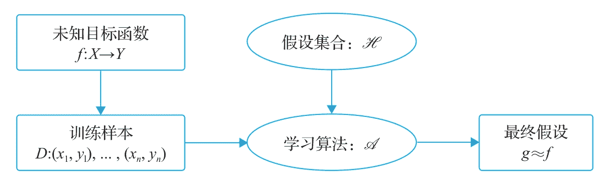

**图 1-2 机器学习的本质**

上述使函数*f*不断接近真实规律的过程又称为“训练”，而使用通过学习得到的函数*g*去判断新输入对应的输出，称为“推理”。“训练”和“推理”对应着上述提到的“归纳”和“演绎”。

数据就像是学生的老师，算法就像是学生的学习方法。通过优质的（*X*,*Y*）数据以及先进的学习算法，可以更有效地拟合目标函数*f*，在预测时，这可以带来非常高的准确率，这对于实际生产实践具有极大帮助。相反，劣质数据或者不合适的算法会导致预测准确率低下，这对实际生产是十分有害的。

**4.机器学习的应用场景**

机器学习的原理或许并不复杂，但它的魔力在于能够将这一理论框架灵活应用到无数令人惊叹的场景中，如同一把万能钥匙，能够精准地开启不同领域的智慧之门。

**（1）机器学习从数据中“发现”物理定律**

当输入为作用力，输出为加速度时，机器学习的任务是通过数据驱动的方式拟合物理规律。它从实验数据中提炼出*F*=*ma*的数学关系，不仅验证已知定律，还能发现隐藏的自然规律。这种能力让机器学习成为科学家的数字化助手，为理论科学研究注入新的可能性。那么，作为科研人员，如何利用机器学习揭示新的物理规律？

**（2）机器学习将图片“翻译”成语言**

当输入是一张图片，输出是自然语言描述时，机器学习执行的是图像识别与描述任务。它通过像素级特征提取与语义映射，将视觉信号转化为人类可理解的语义信息。这种能力让机器学习成为视觉世界的“翻译官”，为自动驾驶、安防监控等领域提供核心支持。

**（3）机器学习搭建不同语言的“语义桥梁”**

当输入是英文语句，输出是中文翻译时，机器学习的任务是自然语言处理（Natural Language Processing，NLP）中的机器翻译。它通过构建双语词句的映射模型，在保持语义完整性的前提下完成语言体系的转换。这种能力让机器学习成为跨文化交流的“实时翻译官”，推动全球化信息流动。

**（4）机器学习从知识海洋中“定位”问题的答案**

当输入是一个查询，输出是查询的答案时，机器学习执行的是知识问答任务。它通过语义理解与逻辑推理，在海量知识中快速定位问题核心，生成精准答案。这种能力让机器学习成为人类智慧的“即时检索器”，为教育、医疗等领域提供高效支持。

综上所述，机器学习在正确的算法和优质数据的帮助下，能够准确且有效地拟合现实世界中的规律/规则，实现智能识别、智能翻译、智能预测等功能。然而，传统机器学习算法十分依赖于对数据的特征提取，这使得机器学习算法在面对海量的、复杂的数据处理时显得力不从心。在这个背景下，深度学习技术宛如黑暗中的一束亮光，照亮了人工智能前进的道路。机器学习的任务类型可以非常广泛，图 1-3 通过不同的例子介绍了机器学习在不同领域中的应用。

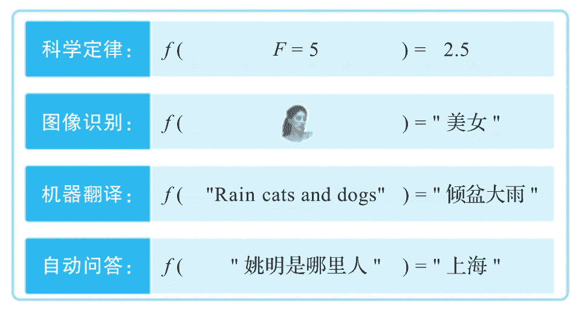

**图 1-3 机器学习的任务类型**

**1.1.2 深度学习**

**1.传统机器学习的局限性**

真实世界中的规律或规则通常是隐式的、高维的，这是简单的线性函数无法模拟的。为解决这一问题，机器学习技术一般采用特征提取算法，将高维数据转换为更低维度的空间表达。如前所述，这种依赖特征提取的方式在处理海量复杂数据时存在很大的局限性。例如，传统机器学习在处理海量图像数据时，从图片的边缘到纹理，从形状到颜色，每一种特征的提取都依赖于专家的经验与直觉，这种设计过程像是在一个迷宫中不停地摸索着前行，充满了不确定性。这不禁让人感叹，要是有一种方法不依赖人工干预，而是能够自主地学习数据特征该多好，这便是接下来要介绍的深度学习方法。

**2.深度学习的基本思想**

假设计算机中有一张猫和一张狗的图片，每张图片都被表示为一个庞大的由 0 和 1 构成的矩阵，图片的每个像素点对应一个数字。试想，面对一个千万级像素的矩阵，计算机应该如何把这个庞大的数字矩阵转换成自然语言？这显然不是一个简单的函数关系。有趣的是，人类大脑却能够轻松地模拟这种函数关系，即便是人类孩童，在看到图片时立马就能辨认出图片中的动物是猫还是狗，如图 1-4 所示。既然如此，一种直觉式的机器学习思想便油然而生，即让计算机以模拟人脑结构的方式去学习，这便是深度学习的基本思想。

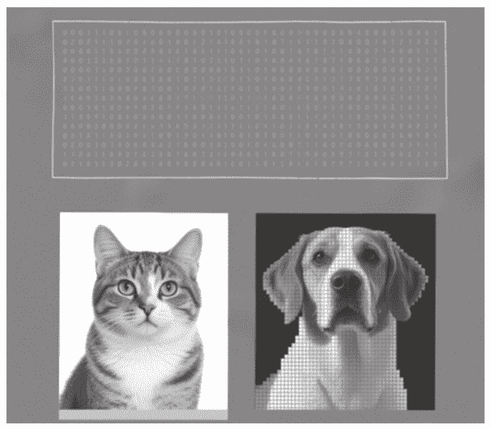

**图 1-4 像素点表示的猫与狗**

**3.人脑神经元结构与人造神经网络**

事实上，科学家通过对人脑结构的研究，发现人脑中包含了大量的神经元，这些神经元之间通过神经突触互相连接，最终形成了一种复杂的、多层的神经网络组织结构。当人脑接收到视觉信号之后，会从底层的像素开始，逐步向上构建更复杂的特征。图 1-5 介绍了人脑视觉现象分析的基本流程。首先，大脑通过边缘检测将一个个像素基本单元构造成边缘；边缘是视觉信号的初级特征，对应大脑初级视觉皮层（V1）的功能。接下来，这些边缘组合成物体的部件（如轮廓、形状等），这一步骤涉及大脑的次级视觉区域（如 V2 和 V4），这些区域负责检测更复杂的特征。最后，这些部件进一步整合为完整的物体模型，对应大脑更高层次的视觉区域（如颞叶），负责识别和理解物体的整体结构。整个过程体现了大脑视觉处理的分层特性，从简单的像素到复杂的物体识别，逐步构建出感知中的视觉世界。

基于上述现象，可以将人脑的神经元结构复刻成电子电路的版本，构建出人工神经网络结构（以下统一简称为“神经网络”）。神经网络的基本单元是人工神经元，这些神经元通过权重连接形成网络，在训练过程不断调整权重值，以优化网络对输入数据的处理能力。

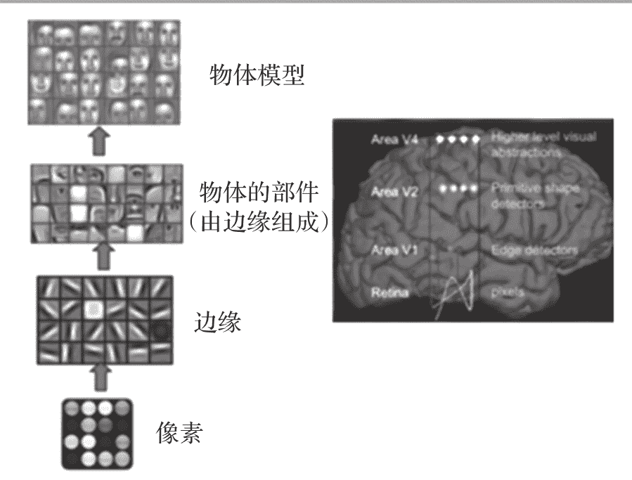

**图 1-5 人脑视觉现象分析的基本流程**

**4.感知机的概念**

感知机（Perceptron）是人工神经网络的最基础单元，其结构简单但功能强大。感知机由输入层、权重和激活函数组成，能够对输入数据进行线性分类。感知机的输出通过激活函数（如阶跃函数）决定，激活函数的作用是将线性组合的结果映射为二进制输出（0 或 1）。感知机的局限性在于它只能处理线性可分的问题，但它是现代神经网络的起点，并为后续复杂网络结构的构建奠定了理论基础。图 1-6 体现了生物神经元与感知机之间的联系。

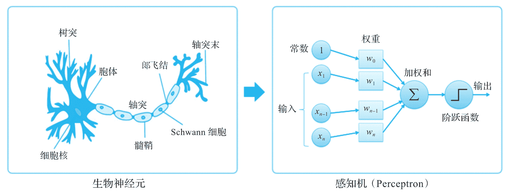

**图 1-6 生物神经元与感知机**

神经网络的分层结构使其能够逐步提取数据中的特征。底层网络通常负责提取简单的特征（如边缘检测），而随着网络层数的增加，特征的抽象程度逐步提高，最终实现对复杂模式的识别与分类。这种分层特征提取机制与人脑视觉处理的分层特性高度相似，体现了从简单到复杂的逐步抽象过程。

当神经网络的层数增加到一定程度（通常包含数十到数百层）时，其特征提取能力显著增强，能够有效处理复杂的任务，如图像识别、语音识别和自然语言处理。基于这种多层结构的神经网络模型被称为“深度学习模型”。深度学习的核心在于通过多层次的特征提取与抽象，使模型能够自主学习数据中的复杂模式，从而在多个领域实现了突破性进展。

**5.深度学习模型训练基本原理**

类似于人脑的结构，深度学习模型是由大量感知机节点以某种方式组合而成。但这样的模型应该怎样完成训练呢？深度学习模型的核心在于通过数据驱动的方式自动学习特征表示，而这一过程的实现依赖于三大关键要素：前向传播（Forward Propagation）、损失函数（Loss Function）和反向传播（Backpropagation）。理解这些机制，是掌握现代神经网络的基础。

**（1）前向传播：从输入到预测**

前向传播是模型计算输出的过程。给定输入数据*x*，网络逐层进行线性变换（如权重矩阵乘法）和非线性激活（如 ReLU、Sigmoid），最终得到预测值 。例如，一个简单的全连接网络可表示为：

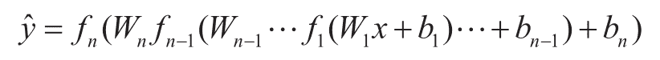

式中，*W*和*b*分别是权重和偏置，*f*为激活函数。前向传播的本质是复合函数的嵌套计算，使网络能够拟合高度复杂的输入、输出关系。

**（2）损失函数：量化模型误差**

模型的预测值 与真实标签*y*的差异通过损失函数衡量。例如：

● 均方误差（MSE）：适用于回归任务，有

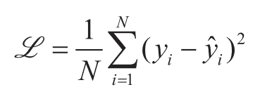

● 交叉熵损失（Cross-Entropy）：适用于分类任务，鼓励模型对正确类别赋予高概率。

● 损失函数不仅是性能评估指标，更是优化目标的数学表达，其梯度将指导模型参数的调整方向。

**（3）反向传播：误差的逆向传导**

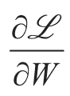

反向传播是深度学习模型训练的基石，其核心思想是链式法则（Chain Rule）。通过计算损失函数对每一层参数的梯度，模型可沿误差减小的方向更新权重：

式中，*η*为学习率。反向传播的步骤如下：

● 计算输出层梯度：根据损失函数类型（如 MSE 的梯度为 -*y*）。

● 逐层回传梯度：利用链式法则将误差分摊至各层的权重和偏置。

● 参数更新：采用优化算法调整参数，逐步降低损失。

通常，神经网络模型参数优化的过程是从输出端开始的，先对比最终输出与真实结果的差距，根据这一差距从后到前的逐层调节参数值。这一过程如同“抽丝剥茧”，将总误差分解到每个神经元，使得网络能够协同优化。

深度学习模型的训练本质是通过前向传播计算预测、通过损失函数评估误差，以及通过反向传播优化参数的迭代过程。这一框架为后续卷积神经网络、残差网络等复杂结构的训练奠定了基础。在接下来的章节中，我们将看到这些基本机制如何与特定网络架构结合，推动计算机视觉、自然语言处理等领域的突破。

**6.神经网络结构的多样化发展**

面对不同的任务需求，人脑中的不同区域的脑细胞结构会进行相应的高效处理。与此类似，神经网络的结构设计也呈现出多样化的发展趋势。随着研究的深入和应用场景的扩展，神经网络逐渐演化出多种结构，每种结构都针对特定类型的任务进行了优化。

多层神经网络作为神经网络的基础形态，其概念早在 1940 年就已被提出。不过在早期，由于计算能力等多方面限制，多层神经网络的发展较为缓慢。它由不同层次的神经元组成，所有下层神经元和上层神经元都能够形成连接，这种全连接结构虽直观，但随着网络规模的增大，会面临参数数量膨胀、容易过拟合等问题。

卷积神经网络（Convolutional Neural Network，CNN）是通过仿造生物的视知觉机制构建的，是深度学习的代表算法之一。对它的研究始于 20 世纪 80～90 年代，时间延迟网络和 LeNet-5 是最早出现的卷积神经网络。但在当时，受限于硬件和软件技术，CNN 这一概念被“雪藏”。直到 21 世纪，随着深度学习理论的提出和数值计算设备的改进，CNN 得到了快速发展。2012 年，第一个在 ImageNet 竞赛上利用深度学习获得冠军的卷积神经网络 AlexNet 被提出，对后续网络模型的研究有显著影响。CNN 的隐含层包含卷积层、池化层和全连接层等常见构筑，其卷积核参数共享和层间连接的稀疏性，使得它能够以较小的计算量对格点化特征（如像素和音频）进行学习，擅长处理视觉问题。例如，计算机视觉问题具备“局部有效”的特点，比如无论一辆汽车在一张图片的什么位置或它周围是什么环境，这辆汽车本身的图像都可被识别。所以，使用能够识别特定视觉特征的卷积核，进行全图片扫描识别，可以大幅度减少无效的计算量。

随着研究的深入，当神经网络层数不断增加时，出现了梯度消失、梯度爆炸以及退化等问题，导致学习效率低下。2015 年，微软研究院提出了残差神经网络（Residual Network，ResNet）。在当年的 ILSVRC 比赛中，残差神经网络取得了 3.5%的错误率，获得冠军。它通过引入残差模块的概念，使用残差模块控制跳转来克服深层网络梯度消失的问题，使得神经网络可以训练出更深层的模型，极大提升了模型的性能。这类似于一家大型企业集团，董事长为了更好地掌握企业运行情况，专门到一线微服私访，从一线员工得到一些反馈，而不是听各个子公司的领导汇报。

在卷积神经网络广泛应用于视觉领域的同时，另一种重要的神经网络结构——循环神经网络（Recurrent Neural Network，RNN）也在序列数据处理中展现出独特优势。RNN 的设计灵感来自人类对序列信息的处理方式，其网络结构具有循环连接，从而实现对序列数据的建模。RNN 的核心在于其隐藏状态能够捕获历史信息，并基于当前输入更新状态，因此非常适用于处理时间序列、自然语言文本、语音信号等具有时序依赖关系的数据。

然而，传统的 RNN 在实际训练中面临梯度消失和梯度爆炸问题，导致模型难以学习长距离依赖关系。为了克服这一局限，研究者先后提出了长短期记忆网络（Long Short-Term Memory，LSTM）和门控循环单元（Gated Recurrent Unit，GRU）。LSTM 通过引入门控机制（输入门、遗忘门和输出门）和细胞状态，实现了对信息的精细化控制，显著提升了模型对长序列的建模能力；GRU 则通过简化门控结构（重置门和更新门），在保持性能的同时提高了计算效率。这些改进使 RNN 及其变体在机器翻译、语音识别、文本生成等任务中获得了广泛应用并取得了突破性进展。

尽管 LSTM 和 GRU 在一定程度上缓解了 RNN 的缺陷，但其序列的顺序计算模式仍限制了训练效率。随着序列长度的增加，计算过程无法并行化，这成了处理大规模数据时的瓶颈。这也为后续自注意力机制（Self-Attention Mechanism）的兴起埋下了伏笔。

近年来，自注意力网络（Self-Attention Network）逐渐在自然语言处理领域占据主导地位。它摒弃了传统循环神经网络（RNN）的序列式处理方式，引入了自注意力机制，能够并行处理序列数据，大大提高了处理效率，并且在捕捉长距离依赖关系上表现出色。

这些网络结构的创新与发展，不仅推动了深度学习的进步，也为解决实际应用中的复杂问题提供了强大的工具。图 1-7 为针对不同任务的经典深度学习网络。例如，在图像识别领域，CNN 发挥着关键作用；残差神经网络提升了图像分类的准确率；在机器翻译、文本生成等自然语言处理任务中，Transformer 架构成为众多先进模型的基础。

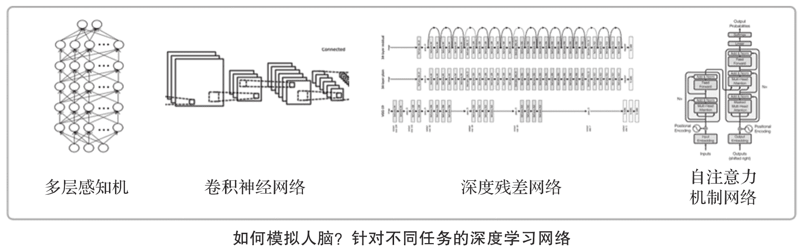

**图 1-7 针对不同任务的经典深度学习网络**

**7.补充阅读：经典网络设计的独特定位与技术演进**

在人工智能发展的长河中，每一类“青史留名”的网络设计都承载着特定的历史使命：它们或突破算力限制下的建模瓶颈，或解决特定场景的技术痛点，或开辟全新的应用领域。下面将聚焦四类具有里程碑意义的网络——全连接网络、卷积神经网络、残差网络与循环神经网络，剖析它们的核心原理、技术特点与历史定位，展现网络设计如何在“问题驱动”中持续进化。

**（1）全连接网络：神经网络的“启蒙架构”**

全连接网络（Fully-Connected Network，FC）是神经网络最基础的形态，其核心原理可概括为“层间神经元 100%连接”——前一层的每个神经元与后一层的所有神经元建立连接，信息在层级间实现完全交互。

从设计逻辑看，FC 网络有两大鲜明特点：一是，它试图“模拟人脑的基础计算结构”——借鉴生物神经元的全连接交互模式，如图 1-8 所示，构建从输入到输出的映射关系；二是，它擅长处理结构化数据，例如表格型数据（如用户性别、年龄、消费记录组成的矩阵），通过层级运算完成分类、预测等任务。然而，FC 网络的局限性也十分突出：随着网络层数的加深或输入数据的维度提升，参数量会呈爆炸式增长（若输入层有 1000 个神经元，输出层有 1000 个神经元，单一层的参数就达百万级别）；同时，它忽略了空间关联性——在处理图像、语音等带有时空结构的数据时，无法利用像素、音频帧之间的相邻关系，导致特征提取效率低下。

尽管存在不足，FC 网络仍是神经网络的“启蒙架构”，为后续复杂网络的设计提供了层级化信息处理的底层逻辑。

**（2）卷积神经网络：计算机视觉的“破冰者”**

当全连接网络在图像处理领域遭遇维度瓶颈时，卷积神经网络以其独特的仿生学设计实现了革命性突破。CNN 通过“局部连接+权值共享”的核心机制，构建了一个层次化的特征提取体系，其工作原理可以形象地理解为”从像素到概念的渐进式认知”。

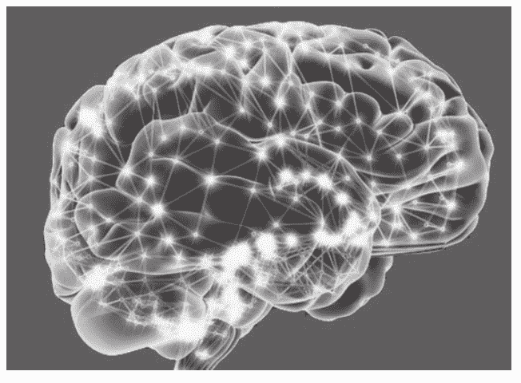

**图 1-8 人脑神经示意图**

CNN 的三大核心设计理念源自对生物视觉系统的模拟与工程优化。

● 局部感受视野与多尺度特征提取：每个卷积核相当于一个特征探测器，不同尺寸的卷积核（如 3×3、5×5）具有差异化的“观察视野”。小卷积核擅长捕捉细粒度特征（如边缘、角点），大卷积核则能识别更宏观的模式（如纹理、形状）。更精妙的是，每个卷积层通常包含数十至数百个通道，每个通道的卷积核都专注于学习特定类型的特征模式——有的专门检测垂直边缘，有的偏好圆形轮廓，有的则对特定颜色敏感，直观上理解，不同的卷积核会识别不同的图片样式。图 1-9 为卷积核的基本原理示意图。

**图 1-9 卷积核的基本原理示意图**

● 权值共享的智能压缩：与传统神经网络不同，CNN 的每个卷积核在整个图像上“滑动巡逻”，用同一组参数检测特定特征的出现位置。例如一个 5×5 的卷积核处理 100×100 像素的图像时，仅需 25 个参数即可完成全图扫描，参数效率比全连接网络提升 4000 倍。这种设计既符合“视觉特征具有平移不变性”的认知规律，又实现了惊人的计算压缩。

● 层次化特征学习：通过卷积层-池化层的交替堆叠，CNN 可自动构建从低层到高层的特征表示。初级网络层学习基础视觉元素（如线条、色块），这些经过学习的基础视觉元素在中级网络层组合成复杂部件（如眼睛、车轮），这些复杂部件在高级网络层则整合为完整的语义概念（如人脸、汽车）。这种自底向上的学习方式，完美复现了人类视觉皮层的分层处理机制。

2012 年，AlexNet 在 ImageNet 竞赛中以压倒性优势（错误率从 26%骤降至 15%）验证了 CNN 的威力。它的成功不仅在于技术突破，更开创了“端到端特征学习”的新范式——计算机视觉系统告别了手工设计特征的时代，迈入了自主学习的全新时代。如今，从智能手机的人脸解锁到自动驾驶的环境感知，CNN 已成为现代视觉系统的基石技术。

**（3）残差网络：深层网络的“破壁人”**

随着任务复杂度的提升，“网络越深，性能越好”成为共识，但 FC 与早期 CNN 面临“梯度消失/爆炸”的致命问题——网络深层的参数因梯度趋近于 0 而无法有效训练，模型性能不升反降。残差网络以“跳跃连接（Shortcut）”为核心原理，为深层网络“破壁”。如图 1-10 所示，*x*通过跳连结构绕过了中间层。

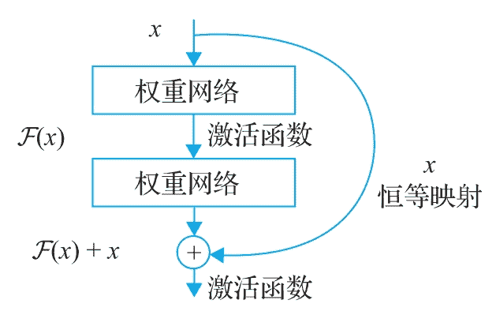

**图 1-10 残差网络基本模块**

ResNet 的以下特点直击了深层网络痛点。

● 回路传递原始信息：通过 Shortcut 将输入信息“跨层传递”到输出端，让网络同时学习“原始信息”与“层间差异（残差）”。

● 解决梯度消失/爆炸：跳跃连接为梯度反向传播提供“高速通道”，避免梯度在深层网络中被过度衰减。

● 训练千层网络成为可能：在 ResNet 出现前，数十层的网络已难以训练；而 ResNet 通过残差结构，实现了 152 层甚至更深层的网络训练，为超大规模的模型训练铺路。

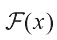

从技术本质看，ResNet 的创新有两点：一是“主路径学习残差”，即让网络聚焦于学习输入与输出的差异，降低训练难度；二是“恒等映射规避梯度消失”，即 Shortcut 实现的恒等映射（输入*x*直接加至输出），确保梯度能高效回传至浅层。

**（4）循环神经网络：时序数据的“掌控者”**

在自然语言处理、语音识别等领域，数据天然带有“时序性”（如句子的词序、语音的时间序列）。循环网络以“带记忆的时序处理”为核心原理，成为此类任务的核心工具。RNN 的特点围绕“时序记忆”展开，如图 1-11 所示，循环神经网络大致分为如下几个模块。

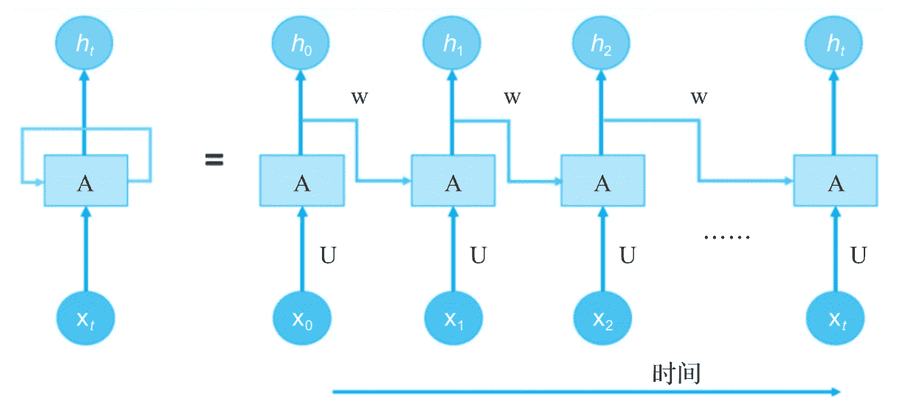

**图 1-11 循环神经网络示意图**

● 隐状态传递历史信息：网络内部的“隐状态（*h**[t]*）”会记录前一时刻的输入特征，让当前输出能“参考历史”（例如翻译句子时，后一个词的翻译需依赖前一个词）。

● 处理变长序列数据：无论句子长度是 10 个词还是 100 个词，RNN 都能通过循环结构逐次处理。

● 天生适合生成任务：隐状态通过循环连接，在时间步之间持续传递并融合之前所有时间步的信息，从而形成一种类似“信息累积”的动态记忆机制，RNN 可自主生成连续序列（如文本生成、音乐创作）。但传统 RNN 在处理长序列时，会因“梯度消失”丢失早期信息。为此，研究者提出长短期记忆网络、门控循环单元等“进化形态”——通过“门控机制”（如输入门、遗忘门、输出门）精准控制信息的“记忆”与“遗忘”，以解决长期依赖问题，让 RNN 在长文本理解、多轮对话等场景中持续发力。

回顾一下以上四类网络的发展：FC 网络奠定“层级化信息处理”的基础，却在复杂数据与深层训练中露怯；CNN 以“局部感知+权值共享”突破图像领域的算力与特征瓶颈，开启计算机视觉革命；残差网络用“跳跃连接”打破深层网络的训练桎梏，推动模型的纵深进化；RNN 则聚焦时序场景，以“循环记忆+门控进化”征服变长序列任务。

每一类网络的诞生，都是对前一代技术痛点的回应；每一次创新，都为人工智能开拓新的应用边界。它们的“独特定位”不仅是技术史上的里程碑，更是理解“网络设计如何服务场景需求”的关键——这一逻辑，也将贯穿人工智能发展的始终。

## **1.2 大模型出现的技术前提**

**1.2.1 技术前提一：Transformer，一统天下的网络结构**

2017 年，美国谷歌公司发表了一篇具有里程碑意义的论文《Attention Is All You Need》，正式提出了一种全新的网络结构——Transformer。这篇论文的标题本身就带着一种大胆的宣言意味：在深度学习领域，传统的网络结构可以退场了，注意力机制（Attention Mechanism）代表着未来的发展。

Transformer 的“野心”最初在机器翻译任务中得到了验证。循环神经网络及其变体（如 LSTM 和 GRU）虽然在传统的机器翻译中提升了翻译质量但在处理长句时往往会出现语义丢失或翻译不连贯的问题。而 Transformer 通过自注意力机制能够同时捕捉句子中所有单词之间的逻辑关系，显著地提升了翻译的准确性和流畅性。

例如，将“ECB cuts interest rates，bringing major benefits to global financial markets”翻译成中文时，传统模型可能会逐词翻译，导致语义不连贯，而 Transformer 能够精准地理解句子中的长距离依赖关系，生成“欧洲央行宣布降息，全球金融市场迎来重大利好”这样的地道表达。

随着时间的推移，Transformer 的影响力逐渐超越了自然语言处理领域，开始在计算机视觉等更广泛的领域中崭露头角。例如，2020 年提出的 Vision Transformer（ViT）模型，将 Transformer 架构应用于图像分类任务，证明了这一网络结构的通用性和强大潜力。

如今，Transformer 已经成为深度学习领域的“通用语言”，从语言生成到图像识别，再到多模态任务，几乎无处不在。可以说，Transformer 的诞生不仅是一次技术革新，更是深度学习发展史上的一个分水岭。它以一种简洁而优雅的方式，重新定义了神经网络的设计逻辑，为后续的大模型时代打下了坚实的基础。

**1.Transformer 的结构组成**

如图 1-12 所示，Transformer 由编码器（Encoder）和解码器（Decoder）两部分组成，它们通过交叉注意力（Cross-Attention）机制紧密相连。编码器负责理解输入信息，而解码器则负责生成输出信息。

编码器是 Transformer 的“理解单元”，它将输入的序列数据转换为富含上下文信息的表示。编码器由多个相同的子层堆叠而成，每一层都包含以下两个主要的子层：

● 多头自注意力层（Multi-Head Self-Attention Layer）：这个子层是 Transformer 的核心，它允许模型同时处理输入序列的不同位置，从而捕捉单词之间的依赖关系。这种机制就像是给模型装上了多个“探照灯”，让它能够同时处理句子的不同部分，捕捉丰富的语义信息。

例如，在句子“我用手机拍下了那个银行的广告，但因为光线太暗，照片的清晰度不高。”Transformer 的一个“探照灯”专注于工具和结果，将手机和照片关联起来，理解拍摄的动作；另一个“探照灯”专注于内容和结果，将银行的广告和照片关联起来，理解照片的具体内容；还有一个“探照灯”专注于因果关系，将光线暗和清晰度低关联起来，理解因果逻辑。这种多角度的注意力机制让 Transformer 能够同时理解句子中复杂的语义关系，而不需要像传统模型那样逐词处理。

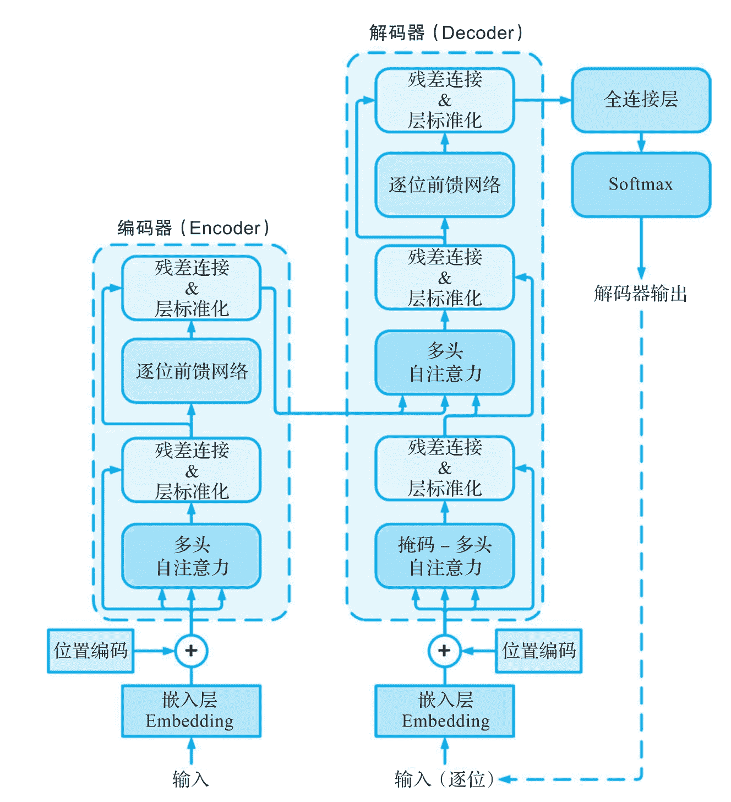

**图 1-12 Transformer 结构图**

● 前馈全连接神经网络层（Feed-Forward Neural Network Layer）：这个子层对序列中的每个位置的表示进行独立的非线性变换，进一步提取和丰富上下文信息或语义特征。它就像是一个“加工厂”，对输入的序列信息进行深度处理，使其更加适合后续的计算。

解码器是 Transformer 的“生成单元”，它根据编码器的输出生成目标序列。解码器的结构与编码器类似，但多了以下关键的子层：

● 掩码-多头自注意力层（Masked Multi-Head Self-Attention Layer）：这个子层确保在生成序列时，每个序列位置只能参考当前位置及之前的 token，避免未来信息的泄露。这就好比在写故事时，每一句话都只能基于之前的内容来创作，而不能提前预示后面会发生什么。

● 交叉注意力层（Cross-Attention Layer）：这个子层使解码器能够“查阅”编码器生成的上下文信息，从而更准确地生成目标序列。它就像是一个“参考书”，解码器在生成每个单词时都可以查阅编码器提供的上下文信息，确保生成的内容与输入内容相关联。

● 前馈全连接神经网络层：与编码器中的子层功能相同，用于进一步处理上下文信息或语义特征。

**2.Transformer 的优势**

得益于上述结构设计，Transformer 相比较于其他模型结构有如下优势：

● 长距离依赖建模：Transformer 架构通过自注意力机制实现了对序列中任意位置的并行处理，从而有效捕捉长距离依赖关系。例如，当前提及的 Transformer 概念，既可能与前文所述的深度学习基础理论相关联，也可能在后续章节中被多次引用。随着 Transformer 堆叠层数的增加，模型的表达能力显著提升，能够拟合更为复杂的非线性函数关系，进而更精准地揭示数据内在的本质关联。

● 并行计算能力：传统循环神经网络的核心局限在于其固有的序列依赖性。在 RNN 结构中，每个时间步的隐藏状态*h**[t]*必须等待前一个时间步*h**[t]*[-1]的计算完成后才能进行处理，这种严格的时间步串行机制使得计算过程本质上无法并行化。具体而言，处理长度为*N*的序列时，RNN 需要进行*N*次顺序计算，时间复杂度为*O*(*N*)，且由于梯度需要通过时间反向传播，长序列训练还会面临梯度消失/爆炸问题。

Transformer 架构的革命性突破在于完全解除了这种序列约束。其核心的自注意力机制通过以下三种关键设计实现并行化。

● 位置编码替代时序计算：将序列顺序信息编码为位置嵌入向量，与词嵌入相加后输入网络，摆脱了 RNN 必须按时间步处理的限制。

● 全局注意力建模：自注意力层通过查询（*Q*）、键（*K*）、值（*V*）矩阵运算，使每个位置都能直接关注序列所有位置的信息。这种注意力权重的计算可以表示为：

式中，矩阵乘法运算天然适合并行加速。

● 层间独立计算：Transformer 的编码器/解码器各层之间不存在时序依赖，同一层的所有位置计算可以同步进行。

从计算复杂度来看，自注意力的*O*(*N*²)复杂度虽然看似较高，但由于现代 GPU/TPU 对矩阵运算的极致优化，实际计算效率远高于 RNN 的*O*(*N*)顺序计算。实验表明，在序列长度超过一定阈值后（通常约 50～100 个 token），Transformer 的并行优势会完全抵消其理论复杂度劣势。这种特性使其特别适合处理长文本、高分辨率图像等大尺度序列数据，也为后续的大规模预训练模型提供了计算基础架构。通过图 1-13 可以直观看到 RNN 和 Self-attention 之间的差异。

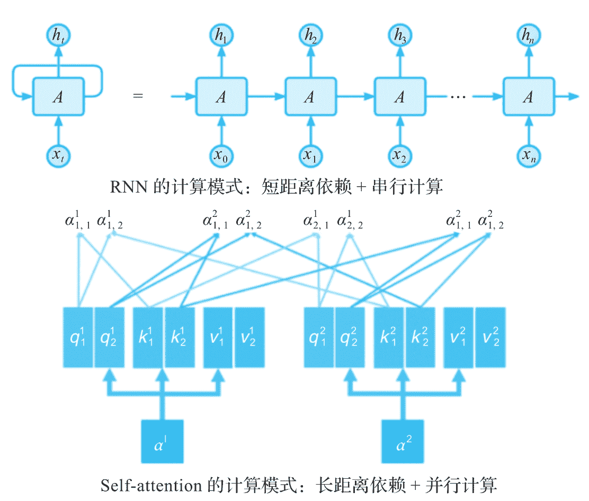

**图 1-13 RNN 与 Self-attention 对比**

**1.2.2 技术前提二：自监督学习，海量互联网数据变得可学习**

**1.模型发展带来的挑战**

Transformer 的出现使得模型基础结构呈现大一统，堆叠多层 Transformer 能够拟合现实世界中各种复杂的函数关系。但随着层数的增加，模型参数量已经达到百亿千亿甚至万亿级别。众所周知，当一个多元方程组的未知变量增多时，我们需要更多的等式方程才能求解，如图 1-14 所示。同理，要想训练参数量更大的模型，往往需要更多数量的样本。研究表明，深度学习模型的样本需求与参数量密切相关，但具体比例需结合模型类型和任务复杂度而定。对于常规监督学习任务，经验法则建议训练样本数约为参数量的 10～100 倍（如具备 10 个参数的逻辑回归等基础模型至少需要 500 个样本才能保证参数估计准确性）。值得注意的是，通过预训练+微调策略可显著降低数据需求（如 10 亿参数的语义模型，只需要数十篇文章的训练，就可以学会特定文体的创作），且增加网络宽度（非连接数）不会损害样本效率。

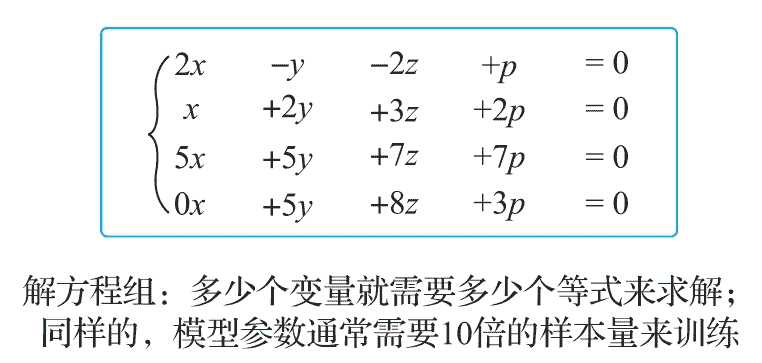

**图 1-14 多元方程组示意图**

**2.数据标注瓶颈问题**

基于上述背景，科学界曾长期认为超大规模参数模型的训练存在理论瓶颈。其核心制约因素在于标记数据（即输入*X*与输出*Y*明确对应的结构化数据）的绝对数量不足，难以支撑模型的泛化学习需求。

这一技术突破背后的数据困境值得我们深入思考：2016 年 DeepMind 研发的 AlphaGo 系统虽然在围棋领域取得里程碑式胜利，但其成功模式却难以复制到其他领域。该系统的核心优势在于围棋这一特殊场景的数据特性：首先，围棋的规则明确且状态空间有限，使得程序可以自动生成海量高质量对弈数据（最终训练数据量达到惊人的 3000 万局）；其次，每局对弈都天然带有明确的胜负标签，无须人工标注。这种“数据闭环”使得 AlphaGo 能够训练出参数规模庞大的深度强化学习模型。然而，现实世界的应用场景往往面临完全不同的数据困境：问题域通常是开放性的，既无法预设完备的规则框架，也难以通过自动化机制生成有效标注数据。以医疗影像分析为例，每张 CT 扫描都需要专业医师耗时标注，且标注标准难以统一；在自然语言处理领域，语义理解的复杂性使得自动生成标注数据几乎不可能。这种数据获取的根本性差异，正是 AlphaGo 技术范式难以推广到其他领域的深层原因，也揭示了当前人工智能发展面临的核心瓶颈：在缺乏海量高质量标注数据的现实条件下，如何突破模型训练的数据壁垒。

**3.自监督学习的诞生**

数据标注的瓶颈问题持续困扰机器学习领域的发展，促使研究者探索创新路径：若能构建有效的机制将互联网上的海量非结构化数据（如未标注文本、图像等）转化为可用的训练样本，将从根本上突破数据供给限制。这一革命性思路推动了自监督学习（Self-supervised Learning）范式的诞生，其核心在于通过数据的内在关联性构建自动标注系统——即利用数据自身蕴含的结构特征生成监督信号，而非依赖人工标注的显式标签。

**（1）自监督学习在自然语言处理中的应用**

在自然语言处理中，以 BERT（Bidirectional Encoder Representations from Trans-formers，基于 Transformer 的双向编码器表示）模型为例，它采用掩码语言模型（Masked Language Model，MLM）任务进行预训练。通过遮蔽部分文本内容让模型预测缺失词汇，从而将无标注语料转化为自生成的训练样本集。具体来说，可以看图 1-15 的例子，对于“哈尔滨是黑龙江的省会，国际冰雪文化名城”这类陈述性文本，引入自监督学习机制时，通过设计完形填空式语义遮蔽任务（Cloze Task），将目标实体“哈尔滨”和核心特征词“冰雪”实施掩码处理，使之成为模型需推理恢复的输出变量；而经过部分词汇遮蔽的剩余语句，则构成模型输入的上下文。这种策略有效实现了原始语料的结构化转换，既保持了语义完整性，又生成了符合监督学习要求的带有掩码的输入和对应的预测目标。

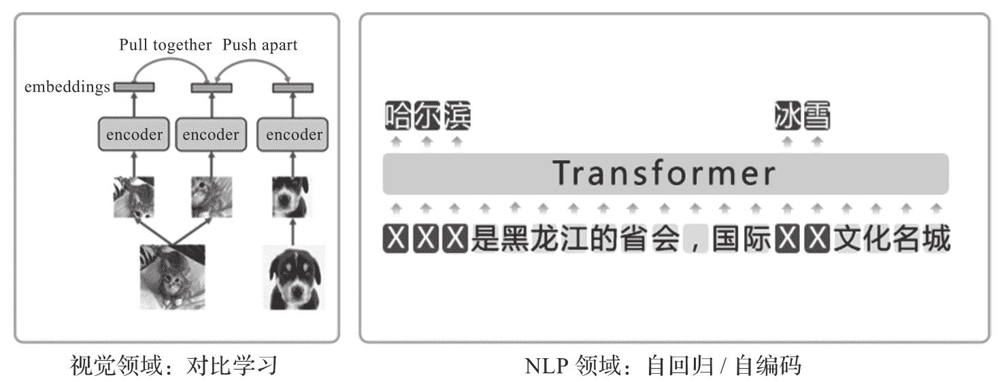

**图 1-15 BERT 模型中的 MLM 任务示例**

**（2）自监督学习在图像处理中的应用**

自监督学习通过设计巧妙的预训练任务，使模型能够从无标注图像数据中自动学习有效的视觉表征。目前主流的自监督学习方法可分为基于上下文预测和基于对比学习的两大类方法。

基于上下文预测的方法借鉴了文本处理中的掩码语言模型思想。以 Jigsaw 拼图任务为例，该方法将输入图像分割为 3×3 的网格，随机打乱局部区域的排列顺序后，要求模型重建原始空间布局。通过这一过程，模型被要求理解图像各局部区域间的语义关联性，从而学习到具有空间一致性的视觉表征。实验表明，成功完成此类拼图任务的模型，其学习到的特征在图像分类等下游任务中展现出优异的迁移性能。

对比学习方法则构建了更精细的特征判别框架。其核心在于通过数据增强生成同一图像的不同视图作为正样本对（标记相似度为 1），随机选取的不同图像构成负样本对（标记相似度为 0）。通过优化对比损失函数（如 InfoNCE 损失），最大化正样本对的特征相似度，同时最小化负样本对的相似度。具体实现时，通常采用 ResNet 等卷积网络作为编码器，配合动量更新等技巧来提升特征表示的稳定性。这种方法使模型能够自动捕捉图像的本质特征，而忽略无关的视角、光照等干扰因素。

这些自监督学习技术成功突破了标注数据的瓶颈，使得 ImageNet 等海量图像数据集得以充分开发利用。例如，通过对比学习预训练的视觉表征模型，仅需 1%的有标注数据就能达到与传统监督学习相当的性能，显著提升了深度学习的样本效率。这为训练超大规模视觉模型提供了可行的技术路径。

**1.2.3 技术前提三：多任务统一的学习范式-生成式架构**

**1.传统范式的困境：从”一事一模型”到通用智能的必然跨越**

传统 AI 开发采用的”一事一模型”范式，本质上是一种割裂的认知体系。这种模式类似于让不同的专家各自独立工作：视觉专家专攻图像识别，语言专家钻研文本理解，每个领域都构建独立的模型体系。这种割裂带来了以下三重根本性限制。

其一，资源效率的严重浪费。以计算机视觉领域为例，ImageNet 分类模型、目标检测模型和图像分割模型往往共享相似的底层特征提取架构，却需要分别训练和维护。研究表明，这种重复建设导致计算资源消耗增加 300%以上，碳排放量显著提升。

其二，认知能力的碎片化。人类大脑可以自然地将视觉理解能力迁移到语言处理中（如通过比喻表达抽象概念），而传统 AI 模型却严格隔离不同模态的认知。一个在 ImageNet 上训练有素的视觉模型，面对简单的“描述这张图片”的语言任务时完全无能为力。

其三，泛化能力的本质缺失。人类儿童通过少量样本就能举一反三，而当前 AI 系统在新任务上往往需要从头训练。DeepMind 的研究显示，传统单任务模型在新领域的适应效率比人类学习者低 5 个数量级。

这种割裂现状在工业实践中已造成严重瓶颈。以智能客服系统为例，企业不得不并行维护意图识别、情感分析、对话管理等十余个独立模型，导致系统复杂度呈指数级增长。更关键的是，这些模型之间无法形成类似人类“常识”的统一认知框架。

这促使我们思考一个更本质的问题：真正的智能是否应该像人类一样，拥有统一的知识表征和跨领域的学习能力？通用人工智能（Artifical General Intelligence，AGI）的曙光或许就在于此——不是构建无数个专家模型，而是培育一个像人类那样可以融会贯通的“通才”智能体。这种智能体将打破模态壁垒，实现视觉、语言、推理等能力的有机统一，最终展现出与人类相似的持续学习和自主进化能力。

**2.生成式架构的破局之道：从 Gato 到统一范式**

Gato 模型作为早期统一架构的一次勇敢尝试，有着重要的历史地位。它基于 Transformer 架构，实现了用统一的方式处理文本、图像和控制信号等多种模态的数据，可完成 500 个不同的任务，包括与人聊天、解读图像、玩游戏、控制机械臂等。虽然对 500 个任务中的多数，Gato 的表现不如单一任务的模型，但它是机器学习模型趋近通用人工智能的一次重要实验。图 1-16 展示了 Gato 智能体完成玩游戏、给图片输出字幕、和别人聊天、用机械臂堆叠积木等不同任务的能力。

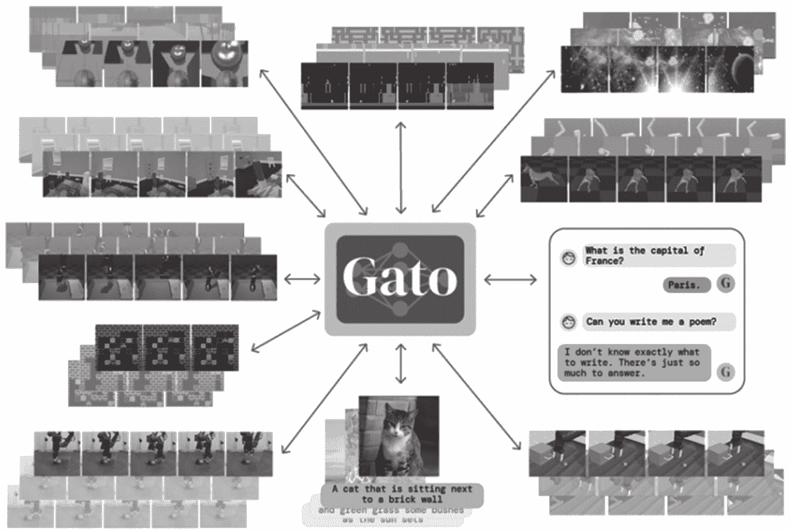

**图 1-16 Gato 智能体**

生成式架构主要有三大关键设计要素。其一，模态无关的序列建模能力，它就像是一个通用的翻译官，无论面对何种模态的数据，都能将其转化为统一的序列形式进行处理，打破了模态之间的壁垒。其二，动态任务条件化机制，这好比是一个智能调度员，能够根据不同的任务需求，灵活调整模型的运行方式，让模型在不同任务间自由切换。其三，参数共享的隐式知识蒸馏，模型可以在不同任务间共享参数，实现知识的高效传递，如同不同作坊可以共享一些核心工具和技术，提升了参数效率。此外，元提示（Meta-prompt）工程框架设计为模型的任务处理提供了一种新的思路。它通过精心设计的提示信息，引导模型更好地理解和处理不同任务，就像是给模型一个“任务说明书”，让模型能够更准确地完成任务。

传统架构下各个模型的参数几乎没有复用，就像每个小作坊的工具都不能被其他作坊使用。而生成式架构下，参数复用率大幅提升，资源得到了更有效的利用，为多任务统一范式奠定了基础。

**3.生成式架构是必然方向**

从计算生物学视角看，模型的进化趋势如同生物进化一样，复杂度不断提升，架构逐渐收敛。早期生物形态多样，但随着进化的推进，一些高效的结构和模式逐渐占据主导。模型领域也是如此，生成式架构这种高效、通用的架构逐渐崭露头角。

在大模型时代，规模效应显著。参数量与任务数量呈现超线性关系，意味着模型参数越多，能够处理的任务数量增长得更快。生成式架构通过参数共享机制，使得 1.2B 参数的 Gato 模型（DeepMind，2022）能够支持 604 项跨模态任务，覆盖文本对话、图像描述、机械臂控制等场景。这种量变到质变的跃迁，验证了统一架构的扩展潜力。

**4.提示词是解决多任务的新方案**

因为大模型与传统模型只能解决单一任务不同，具备通用人工智能的特质。那么怎么激发大模型灵活地根据任务需要完成不同任务呢？答案是“提示词”，提示词是在模型可以解决多任务后必然出现的一种技术。例如，如何让语言模型（Language Model，LM）高效承接自然语言推理（NLI）、文本分类（TC）、命名实体识别（NER）等纷繁复杂的下游任务，是自然语言任务的核心命题。而“指令微调（Fine-tuning）”与“提示学习（Prompting）”两种范式的碰撞，正勾勒出大模型时代任务处理逻辑的深刻变革。

● 旧路径：指令微调，让“模型迁就任务”，图 1-17 对比了两种范式的特点。

图 1-17 左侧的“Fine-tuning/指令微调”逻辑以语言模型（LM）为核心，箭头从 LM 指向周围十余类下游任务。这意味着，为让 LM 适配特定任务，要对模型本身做针对性改造——做文本分类时改参数，切换到机器翻译又得调架构。

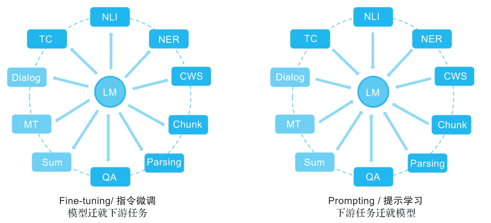

**图 1-17 指令微调与提示学习**

这种模型迁就任务的模式，本质是靠定制化改造模型应对多任务。但现实里，不同任务的数据集、训练逻辑差异极大，频繁微调不仅要百万级算力、海量标注数据撑着，还会让模型陷入“任务切换成本高、通用性被拆碎”的困境。对中小型企业和个人开发者来说，“改模型适配任务”的门槛，就像横在眼前的技术鸿沟，很难跨过去。

● 新范式：提示学习，让“任务迁就模型”。图 1-17 右侧的“Prompting/提示学习”却把“模型迁就任务”的逻辑颠覆了。箭头方向反过来，下游任务通过“提示词（Prompt）”把需求传给 LM，不用改模型，只靠指令引导就能让任务适配模型能力。

想让语言模型做情感分类？可以写“请分析以下文本的情感倾向：[文本内容]”；要进行机器翻译？则换成“请把这段中文翻译成英文：[原文]”即行。借着提示词的“指令+上下文”设计，同一个基础模型能灵活应对自然语言推理（Natural Language Inference，NLI）、问答（QA）、文本摘要（Sum）等十几种任务。这种“任务迁就模型”的模式，彻底打破“一个任务改一次模型”的枷锁——企业无须重复砸千万级训练成本，普通人也能通过“写提示”调用大模型能力，让 AI 从“实验室里的精密仪器”变成“人人能操作的生产力工具”。

● 提示词：大模型时代的“通用协作语言”。从“改模型”到“写提示”，背后是技术范式从“定制化模型”转向“通用能力调用”的跃迁。在大模型时代，提示词成了普通人与 AI 协作的“桥梁”——不用懂算法原理，只要用清晰指令、风格约束这些技巧设计 Prompt，就能让通用大模型变成“专属助手”：写方案时要求“用互联网产品经理视角写竞品分析”，做设计时指令“生成极简主义风格的海报文案”。这种变革，让“靠 Prompt 调用模型能力解决问题”成了核心生存技能。当我们惊叹大模型能同时处理写代码、做营销、答学术问题这些多元任务时，本质是提示词在“任务”和“模型”之间搭建高效协作的通道——它不再要“人迁就技术”，而是让技术主动适配人的需求，真正实现 AI 普惠。

## **1.3 大模型技术：开启通用人工智能新时代**

在当今科技飞速发展的时代，大模型技术犹如一颗璀璨的新星，照亮了人工智能领域前行的道路。大模型指的是训练数据和模型参数超大的模型，它以其卓越的性能和广泛的应用前景，成了科技界关注的焦点。

**1.3.1 Transformer：一统天下趋势的网络结构**

要理解大模型的兴起，必须首先考察其背后的核心架构——Transformer。该结构由 Vaswani 等人在 2017 年提出，最初应用于机器翻译任务，但很快展现出超越传统循环神经网络（RNN）和卷积神经网络（CNN）的建模能力，逐渐成为自然语言处理乃至多种模态建模的基础架构。Transformer 之所以能够一统天下，主要得益于两个根本优势：一是其对长距离依赖关系的强大建模能力，二是其高度可并行化的计算设计。

在传统的 RNN 中，信息依次按时间步传递，随着序列长度的增加，早期信息容易衰减或丢失，从而难以建立长距离依赖关系。而 Transformer 借助自注意力机制，使模型能够直接捕捉序列中任意两个位置之间的关系，无论其距离远近。这种机制不仅显著提升了对语义结构的理解能力，还使得模型在面对长文本、大规模图像甚至时序信号时仍能保持稳定的表现。

另一方面，Transformer 架构摒弃了递归计算，完全依赖矩阵运算和注意力权重分配，使得整个前向和反向传播过程可在 GPU 或 TPU 集群上高效并行执行。与必须逐步计算的 RNN 相比，Transformer 能够充分利用现代硬件的大规模并行计算能力，大幅缩短训练时间，支撑起千亿甚至万亿参数规模的模型训练。可以说，Transformer 不仅是一座能够容纳海量参数和复杂表示的“大厦”，更是一条通往高效训练和强大泛化能力的技术路径。

**1.3.2 自监督学习：释放互联网海量数据的潜力**

尽管网络结构提供了强大的表示能力，但若缺乏充足且有效的训练数据，模型依然难以发挥其潜力。传统监督学习严重依赖人工标注数据，成本高昂、规模有限，成为模型发展的显著瓶颈。自监督学习的出现，则彻底改变了这一局面。它通过从无标注数据中自动构造监督信号，使模型能够利用几乎无限的互联网原始数据进行学习，从而突破数据瓶颈。

自监督学习的核心思想是“数据自身即为标注”。以强化学习中的 AlphaGo 为例，其通过自我对弈生成大量棋局数据，不断优化策略网络和价值网络，而不依赖人类棋谱的有限标注。在视觉领域，对比学习（Contrastive Learning）方法如 SimCLR 和 MoCo，通过构造图像的不同增强视图，并拉近相似样本、推远不相似样本，使模型学会提取有意义的视觉特征。在自然语言处理中，自回归（Autoregressive）模型如 GPT（Generative Pretrained Transformer）系列通过预测下一词来学习上下文表示；而自编码（Autoencoding）模型如 BERT 则通过掩码语言建模，恢复被遮盖的词语，从而深入理解语言结构和语义。

这些方法不仅利用了互联网上随处可见的文本、图像、视频等原始数据，还通过巧妙的预训练任务引导模型学习高层次抽象和通用表示，为下游任务提供强大的先验知识。自监督学习与 Transformer 架构的结合，如同一把钥匙，打开了互联网这座浩瀚无垠的信息宝库，为人工智能模型注入了前所未有的数据养分和智能潜力。

**1.3.3 互联网海量数据：大模型的“能量源泉”**

互联网的发展使得信息数据呈现爆炸式增长。据统计，全球每天产生的数据量已经达到了数泽字节（ZB）级别。这些数据涵盖了文本、图像、音频、视频等多种形式，包含了人类社会各个领域的知识和信息。

由于网络结构和自监督学习突破了标注数据量的限制，这些互联网上的庞大信息数据得以被充分利用。大模型就像是一个贪婪的学习者，不断地从这些数据中汲取知识和经验。它通过对大量文本数据的学习，能够理解语言的语义和语法结构，从而实现自然语言处理任务，如文本生成、机器翻译、问答系统等；通过对海量图像数据的学习，能够识别图像中的物体、场景和特征，实现图像分类、目标检测、图像生成等任务。

互联网海量数据为大模型的训练提供了丰富的素材和场景，使得大模型能够学习到更加广泛和深入的知识，从而具备更强的泛化能力和适应性。可以说，互联网海量数据是大模型得以不断发展和进步的“能量源泉”。

**1.3.4 生成式学习范式：适配所有任务的“万能钥匙”**

除了网络结构、自监督学习和海量数据外，生成式的学习范式也是大模型的重要特征之一。生成式学习范式与传统的判别式学习范式不同，它不仅能够对输入的数据进行分类和识别，还能够根据学习到的知识生成新的数据。

在大模型中，生成式学习范式就像是一把“万能钥匙”，可以适配所有任务。例如，在自然语言处理中，大模型可以根据输入的文本生成相关的文章、故事、对话等；在图像生成领域，大模型可以根据用户的描述生成逼真的图像。这种生成式的能力使得大模型能够在不同的领域和任务中发挥作用，具有很强的通用性和灵活性。

通过生成式学习范式，大模型可以不断地探索和创造新的知识和信息，为人类社会带来更多的创新和价值。同时，它也能够更好地满足用户的个性化需求，提供更加智能和便捷的服务。

综上所述，表示能力强又可并行化计算的网络结构、自监督学习任务、互联网上庞大的信息数据以及生成式的学习范式，共同孕育出了参数规模巨大的通用人工智能模型——大模型。

**1.3.5 人工智能跨入大模型时代：通用智能涌现**

从笔者在大学期间学习与接触机器学习开始，时光已过去了二十余载，机器学习技术发展经历了三个典型的阶段。

**1.经典机器学习：基于统计规律的专用建模**

经典机器学习代表人工智能的早期发展阶段，其核心目标是从结构化数据中挖掘特定任务的统计映射关系。

图 1-18 是经典机器学习模型预测房价的一个例子，图 1-18 中左上是房产的部分特征，右下是利用这些特征预测的房价和真实价格的对比情况。

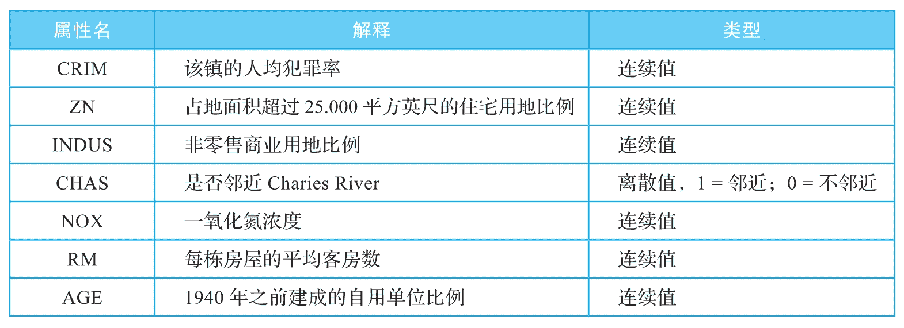

**图 1-18 经典机器学习模型房价预测示意图**

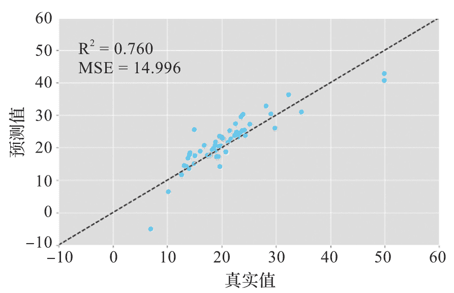

**图 1-18 经典机器学习模型房价预测示意图（续）**

如 1-18 所示，经典机器学习模型通过分析房屋面积、地理位置、配套设施等结构化变量，建立特征向量与目标值的数学函数。在处理结构化数据时，典型方法包括决策树、支持向量机与朴素贝叶斯等，在处理结构化数据和预设任务时展现一定效能，但存在以下局限：

● 特征工程依赖：需人工设计数据特征，对领域知识要求严苛。

● 任务单一性：经典机器学习模型缺乏跨领域泛化能力，难以适应复杂场景需求。

在统计模型主导的时代，模型技术是可设想与理解的，从业者可以从底层原理层面解读模型的行为和性能。

**2.深度学习革命：非结构化数据的特征学习范式**

随着数据规模与计算能力的突破，深度学习通过模拟人脑神经元的多层网络架构，实现了原始数据的自动特征提取。深度学习的人脸识别应用是利用卷积神经网络自动学习生物特征（如眼鼻部几何关系），实现身份认证的毫米级精度。该技术在处理图像、语音等非结构化数据时取得里程碑进展，但仍存在领域局限性——专用图像识别模型难以迁移至自然语言处理任务，尚未实现跨模态智能融合。

在深度学习主导的时代，模型已经无法人工理解和解读了，从业者只能通过对网络参数的可视化分析与模型效果实验的角度，提出一些人工解读的“原理”，而非严谨的数学推导。

**3.大模型范式：通用智能的临界突破**

当模型参数增加到一定量级时，模型效果呈现出“智能涌现”现象，以此催生业界训练千亿级参数大模型（如 GPT-4、通义千问/Qwen）等超大参数量的模型，图 1-19 展示了大模型参数与数据规模的发展进程。通过海量跨领域数据预训练，大模型展现出通用人工智能的初级特征：

● 认知能力跨越：实现跨学科推理（如结合量子力学与哲学思辨）、多步骤规划及抽象概念理解。

● 创造性生成：输出逻辑严谨的学术论文、诗歌及功能性代码。

● 多模态融合：完成图文互生成（图像描述生成/文生图）、跨模态语义对齐。

● 已渗透至经济与科研领域：制造业通过智能生产优化提升全要素生产率，服务业构建个性化交互系统；生物学领域实现蛋白质折叠预测，天文学完成星系光谱分类的智能解析。

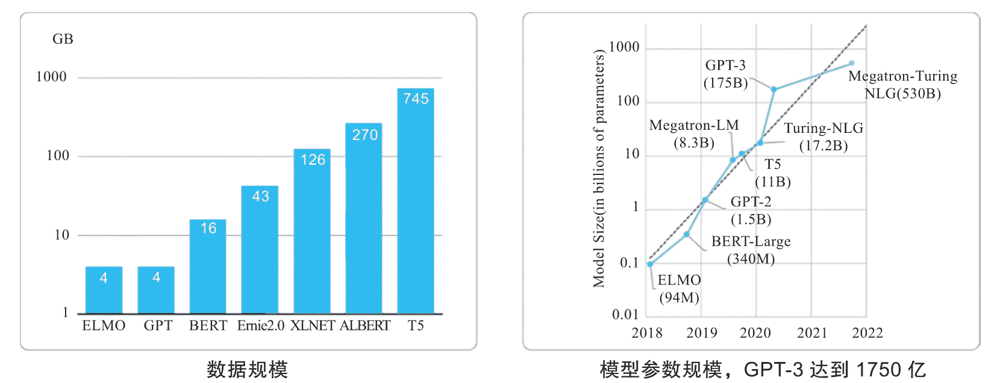

**图 1-19 数据规模与大模型参数的发展进程**

大模型成为人工智能的最前沿也是最有价值的技术方向，目前依然在不断突破创新中。

图 1-20 是大模型能力随模型参数量增多而变化的情况，从图中可以看到，当大模型参数量突破 10¹¹临界阈值时，出现非线性能力跃迁现象，称为涌现（Emergence）。图 1-20 中的性能演化曲线显示：在 10⁷～10¹⁰参数量级时，国际音标转写、元素周期表推理等任务性能停滞；当突破 10¹¹阈值后，复杂算术与跨学科推理任务得分呈垂直攀升。

这种质的飞跃主要源于以下三方面原因：

● 参数规模带来的表达能力跃升：当参数量足够大（超过千亿）时，神经网络能够捕获更复杂、更抽象的高阶语义关联。就像一支庞大的团队，人手越多、分工越细，就越能处理错综复杂的问题。

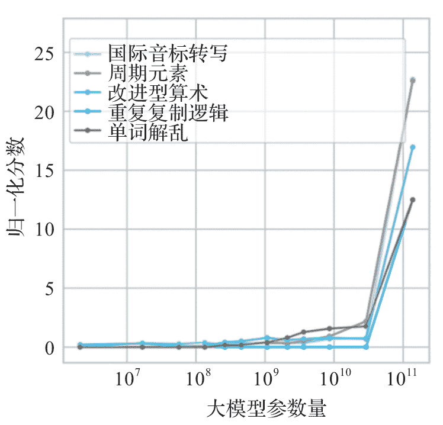

**图 1-20 大模型参数量与归一化分数的关系**

● 跨领域知识的融合与碰撞：大模型接触出来自不同学科和领域的海量文本与数据，这些知识在大模型内部产生类似“化学反应”的交互作用。例如，它可能将建筑美学的观念与流体力学原理相结合，从而生成创新且合理的解答。

● 注意力机制对深层模式的捕捉：Transformer 架构中的自注意力机制使大模型能够同时关注输入中的多个部分，从而更好地理解长距离依赖和细微模式。这种机制就像是同时照亮多个关键点的“探照灯”，从而洞察数据中隐藏的复杂结构。小模型与大模型的能力代际差异显著：在数学推理维度，小模型限于四则运算，大模型可完成拓扑学定理证明；在代码领域，小模型实现语法纠错，大模型支持全栈软件开发；创造性任务中，小模型输出模板化文本，大模型生成跨学科知识融合的原创内容。

从统计学习到通用智能的演进，本质是规模（Scale）、数据（Data）、架构（Architecture）协同的结果。涌现现象不仅验证了“量变引发质变”的智能发展规律，更揭示了 AI 超越人类预设的进化路径：当模型参数量达到临界规模时，简单规则迭代将催生不可预测的复杂智能行为。这为通用人工智能奠定了新的理论基础，其影响将重塑人类知识生产与技术创新的范式。

**1.3.6 端到端的新范式**

人工智能的技术演进始终伴随“效率突破”与“范式重构”的双轮驱动，大模型的崛起正推动 AI 研发实现“更少领域数据依赖”“更简洁的端到端流程”“更高效的资源复用”三重变革，这不仅是技术工具的迭代，更是对“数据利用逻辑”“系统架构设计”“产业协作模式”的底层重塑，让 AI 从“实验室小众技术”真正迈向“产业级普惠能力”。

**1.小样本泛化：以“通识知识基座”突破数据瓶颈**

传统 AI 模型的落地长期受困于“数据依赖陷阱”。若将 AI 系统类比为“学习型分析师”，小模型如同“没有基础认知的新手”，例如，训练“医疗影像判别模型”时，需组织专业团队标注上万份病灶切片、临床报告，不仅耗时数月、成本高达百万级，且每个细分病种（如肺癌、乳腺癌）都要重复这套“标注—训练—部署”流程；在“跨语言翻译”场景中，每新增一对“西班牙语—越南语”语料，就需重新训练模型，资源浪费呈指数级增长。

大模型则通过海量跨域预训练构建通识知识基座来实现破局。依托太字节（TB）级文本、图像、音频等多模态语料，大模型在自监督学习任务中（如预测下一个单词、图像块填充）持续迭代，让上百亿参数成为知识载体，也就是说，当大模型学习完大部分公开知识库后，再面对下游任务时，仅需百例级标注样本（甚至零样本）就能完成精准适配。在技术层面，大模型的注意力机制可动态关联输入与预训练知识，参数共享机制让不同任务复用核心特征，知识蒸馏技术则将复杂模型的泛化能力压缩到轻量版本。

以医疗场景为例，传统的肺癌影像模型需标注 10000+张 CT 切片，工程师需逐一框定病灶、标注病理特征；而大模型先在全球公开医疗文献、影像库中完成预训练，积累肺部解剖结构、病灶形态规律等通识知识，后续仅需 100 例医院侧的真实病例微调，就能达到同等诊断精度，数据标注成本直降 90%。在翻译场景中，大模型通过提示工程（如输入“请把法语句子翻译成日语”+示例），即可零样本支持稀有语言对迁移。这种转变让研发重心从堆数据规模转向优化知识迁移机制，既打破行业数据壁垒，又将数据利用效率推向新维度。图 1-21 为大模型与小模型的训练数据对比情况。

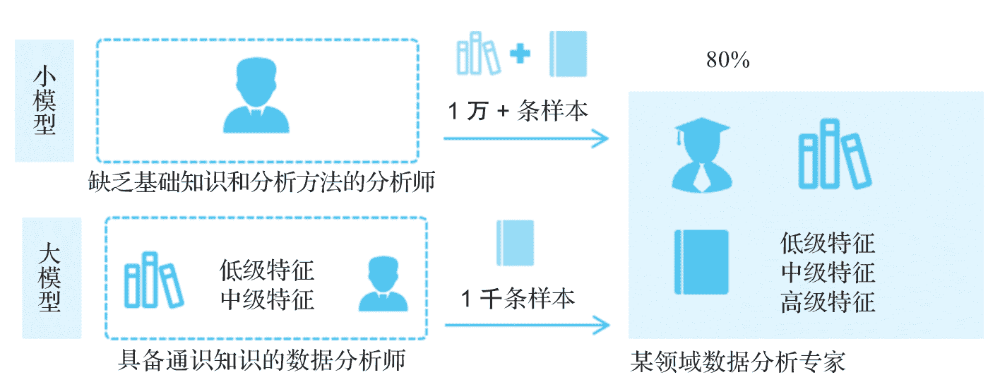

**图 1-21 大模型与小模型训练数据对比**

**2.端到端流程：以“一体化模型架构”简化系统复杂度**

传统 AI 系统的落地依赖多模块级联的流水线模式，各环节如同接力赛选手，误差易逐级放大，且需大量人工干预：以开放域知识问答为例，传统方案需拆解为“实体识别（用 NER 模型定位问题中的‘疾病’‘药物’）→关系抽取（用 RE 模型挖掘实体间关联）→知识图谱构建（专家手动梳理医学关系、维护图谱）→问题意图识别（用分类模型判断用户是‘求病因’还是‘问治疗’）→属性填充（补全问题中缺失的时间、人群等维度）→图谱检索与推理（用规则引擎匹配图谱路径）→回答模板生成（人工设计话术库）”等离散环节。每个环节都需单独训练模型、调优参数，仅知识图谱维护一项，医疗专家就需每周投入 20+小时更新，系统响应延迟常突破 5s，且“实体识别错误→关系抽取偏差→图谱检索失效”的链式误差屡见不鲜。

大模型则以 Transformer 为核心的一体化架构实现端到端智能压缩，即它的自回归生成机制让模型直接完成“输入（用户问题+行业文档）→输出（精准答案）”的映射，无须中间模块拼接。技术层面，Transformer 的多头注意力可同时捕捉问题中的关键词、文档中的知识点、上下文逻辑关联，位置编码保障长文本理解的时序性，层归一化则稳定训练过程中的梯度传递。图 1-22 对比了大模型与小模型回答问题的流程，在知识问答场景中，经过行业语料预训练的大模型，会将“实体、关系、意图”等认知内化为参数，用户提问后，大模型直接在万亿级参数构成的知识网络中推理，瞬间生成答案，系统延迟压缩至 500ms 内，且无须人工维护规则与接口。

这种变革不仅让 AI 系统从“复杂流水线”变为“极简黑盒服务”，更重塑产业落地逻辑——企业无须再组建“算法工程师+领域专家+运维团队”的庞杂队伍，仅需调用大模型 API 或部署轻量微调版本，就能快速上线智能客服、医疗助手等应用，技术门槛与维护成本呈数量级下降。

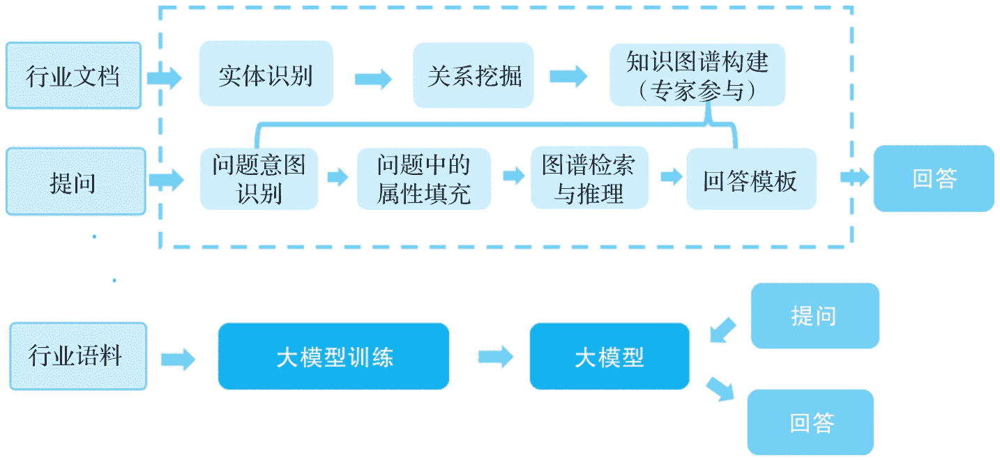

**图 1-22 大模型与小模型回答问题流程对比**

**3.研发范式：从“大炼模型”到“炼大模型”的革命**

传统 AI 研发深陷分散化、重复化的泥沼。每个业务线（如电商客服、金融风控、医疗诊断）需独立开展“数据清洗（标注团队耗时 1 个月）→模型设计（算法工程师迭代 30+版网络结构）→参数调优（GPU 集群训练 2 周）”全流程，资源浪费触目惊心，例如，某头部互联网公司曾统计，旗下 10 条业务线每年在 NLP 模型研发上重复投入超 2 亿，且各模型性能参差、无法复用。这种模式如同“多家子公司各自烧钱建工厂”，算力、人力、数据资源被“模型 1～*n*”的重复建设消耗殆尽。

大模型的研发范式向集约化、复用化发展。先集中资源打造通用基座（如同总部建设“中央智能工厂”），再通过轻量微调适配下游任务（如同各业务线基于工厂能力快速定制产品）。在技术层面，“预训练—微调”框架让大模型先在通用语料中学习基础能力，再用 LoRA（低秩适应）、Prefix Tuning（前缀调优）等参数高效微调技术，仅更新 0.1%～5%的参数就能适配垂直场景，算力消耗较传统训练降低 90%。

以科技企业实践为例：某头部云厂商曾在电商、金融、医疗领域各研发了一套 NLP 模型，每套需 8 卡 A100 训练 2 周；如今打造统一大模型基座（训练耗时 1 个月、消耗千卡 A100 算力），下游业务仅需“上传行业数据+微调 3 天”即可上线，资源复用率提升 10 倍，研发周期从“月级”压缩至“天级”。这种变革让 AI 研发从子公司各自为战转向总部统一赋能，开发团队重心从重复造轮子转向大模型持续优化+场景化适配，产业级 AI 的规模效益与落地速度由此实现质的飞跃。

大模型引发的三重变革，本质是知识密度、系统复杂度、资源效率的协同进化，以通识基座突破数据依赖，以一体化架构简化落地流程，以集中化研发释放规模价值。这一范式不仅重塑技术研发的底层逻辑，更将为千行百业的智能化升级开辟低门槛接入、高效率迭代、强资源复用的新航道——当每个企业都能像调用水电般调用大模型能力时，产业智能化的普惠时代才真正到来。

图 1-23 展示了传统模型研发到大模型研发范式的发展情况。

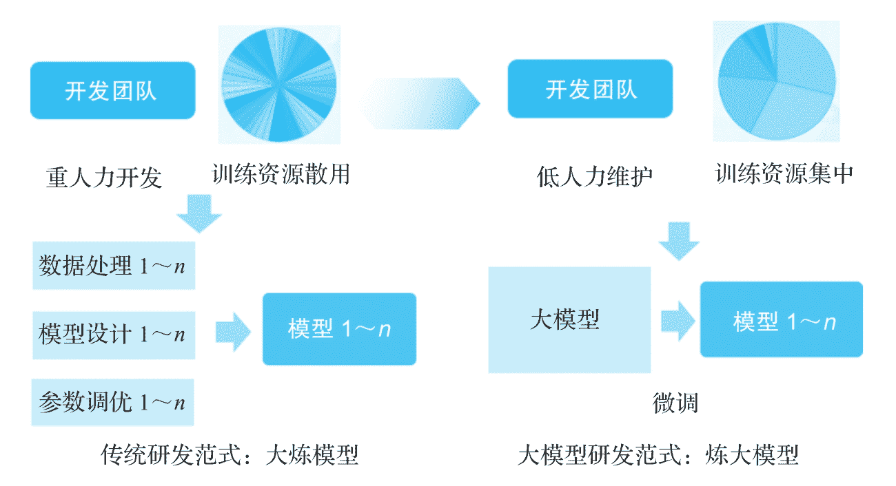

**图 1-23 传统模型研发到大模型研发范式的发展情况的对比**

## **1.4 GPT 家族演进脉络：ChatGPT 源于工程和产品的成功**

在深度学习模型的发展历程中，GPT 家族无疑是一座巍峨的里程碑。从最初的 GPT 1 到如今强大的 GPT 4，每一次迭代都代表着技术的巨大飞跃。而 ChatGPT 作为其中备受瞩目的一员，它的诞生并非偶然，而是不断打磨、创新工程和产品的成果。本文将深入剖析 GPT 家族的演进脉络，探寻 ChatGPT 成功背后的技术密码。

**1.4.1 模型基座：GPT 1、GPT 2、GPT 3**

**1.GPT 1：开启预训练语言模型新时代**

GPT 1 是 OpenAI 在 2017 年推出的一款基于 Transformer 架构的预训练语言模型。它的出现标志着自然语言处理领域进入了一个全新的阶段。在 GPT 1 之前，传统的自然语言处理方法往往需要大量的人工特征工程和标注数据，这不仅效率低下，而且难以应对复杂多变的语言环境。

GPT 1 采用了无监督学习的方式，通过在大规模文本数据上进行预训练，学习到了丰富的语言知识和模式。它的核心思想是通过预测下一个单词来学习语言的概率分布。具体来说，GPT 1 使用了 Transformer 的解码器架构，对输入的文本序列进行编码，并预测下一个可能出现的单词。这种自回归的方式使得 GPT 1 能够生成连贯、自然的文本。

GPT 1 的成功为后续预训练语言模型的发展奠定了基础。它证明了在大规模无监督数据上进行预训练可以学习到强大的语言表示能力，并且可以在各种自然语言处理任务中取得优异的成绩。

**2.GPT 2：规模与能力的提升**

在 GPT 1 取得成功之后，OpenAI 于 2019 年推出了 GPT 2。GPT 2 在模型规模和性能上都有了显著的提升。它拥有更多的参数和更深的网络结构，能够处理更长的文本序列。

GPT 2 的训练数据规模也大幅增加，使用了来自互联网的大量文本数据。这使得 GPT 2 能够学习到更加丰富和复杂的语言知识，生成的文本质量也更高。与 GPT 1 相比，GPT 2 在语言生成任务上表现出了更强的连贯性和逻辑性，能够生成更加自然、流畅的文本。

此外，GPT 2 还展示了一定的零样本学习能力。即模型在没有见过特定任务的训练数据的情况下，仍然能够完成该任务。这种能力使得 GPT 2 在一些自然语言处理任务中具有很大的潜力。

**3.GPT 3：震撼业界的语言模型巨擘**

2020 年，OpenAI 发布了 GPT3，这是当时规模最大、性能最强的预训练语言模型。GPT3 拥有 1750 亿个参数，远远超过了之前的 GPT2。

GPT 3 在各种自然语言处理任务中都取得了惊人的成绩。它可以同时进行文本生成、问答系统、机器翻译、摘要生成等多种任务，并且在很多任务上达到了甚至超越了人类的水平。GPT 3 的强大之处在于它的通用性，只需要通过简单的提示，就可以完成不同类型的任务，而不需要进行大量的微调。

然而，GPT 3 也存在一些问题。例如，它生成的文本可能存在事实性错误、偏见等问题。此外，由于模型规模过大，训练和推理的成本也非常高。

**1.4.2 InstructGPT 技术：让模型更懂人类意图**

为了解决 GPT 3 存在的问题，OpenAI 在 GPT 3 的基础上开发了 InstructGPT 技术。InstructGPT 技术的核心思想是通过人类反馈强化学习（Reinforcement Learning from Human Feedback，RLHF）来微调模型，使得模型能够更好地理解人类的指令和意图。

具体来说，InstructGPT 的训练过程分为三个步骤。第一步，人类标注员对一些输入的指令进行标注，生成一些示范数据。第二步，使用这些示范数据对 GPT 3 进行有监督的微调，得到一个初始模型。第三步，使用人类反馈强化学习来进一步优化模型。在这个过程中，模型会生成多个输出，人类标注员会对这些输出进行打分，模型根据这些打分来调整自己的参数，以提高生成输出的质量。

InstructGPT 技术的应用使得模型生成的文本更加符合人类的期望，减少了事实性错误和偏见。它为后续的模型发展提供了重要的思路和方法。

**1.code-davinci-002：代码与文本混训的探索**

code-davinci-002 是采用 InstructGPT 技术的一款模型，它的主要特点是进行了代码和文本的混合训练。在软件开发领域，代码和自然语言文本是紧密相关的。例如，程序员在编写代码时，需要使用自然语言来描述代码的功能和需求。因此，将代码和文本进行混合训练可以让模型更好地理解代码的上下文和语义。

code-davinci-002 在代码生成、代码补全、代码解释等任务中表现出了良好的性能。它可以根据自然语言描述生成相应的代码，也可以对已有的代码进行解释和优化。这种代码和文本混合训练的方式为软件开发带来了新的可能性，提高了开发效率和代码质量。

**2.text-davinci-002：人工数据与 FeedME 的结合**

text-davinci-002 采用了人工数据和 FeedME 的学习方法。人工数据是指由人类标注员标注的数据，这些数据具有较高的质量和准确性。FeedME 则是一种学习策略，它学习多个模型人工得分最高的结果。

通过使用人工数据和 FeedME，text-davinci-002 能够生成更加准确、高质量的文本。在文本生成任务中，它可以根据输入的提示生成连贯、自然的文本，并且能够避免一些常见的错误和偏见。这种结合人工数据和学习策略的方法为模型的性能提升提供了有效的途径。

**3.text-davinci-003（GPT 3.5）：人工数据与人类反馈强化 RLHF 的应用**

text-davinci-003，也被称为 GPT 3.5，是在 GPT 3 的基础上进一步发展而来的。它采用了人工数据和人类反馈强化 RLHF 的方法进行训练。

与之前的模型相比，GPT3.5 在生成文本的质量和准确性上有了显著的提升。它能够更好地理解人类的指令和意图，生成更加符合人类期望的文本。在问答系统、文本摘要等任务中，GPT 3.5 表现出了更强的能力。例如，在回答问题时，它可以提供更加详细、准确的答案，并且能够进行一定的推理和分析。

此外，GPT 3.5 还在模型的稳定性和可解释性方面进行了改进。它减少了生成文本的随机性，提高了模型的可靠性。同时，通过人类反馈强化学习，模型的决策过程更加透明，使得用户能够更好地理解模型的输出。

**1.4.3 ChatGPT 与 GPT 系列的技术演进与商业化发展**

**1.ChatGPT 的诞生与核心技术**

ChatGPT 是 OpenAI 于 2022 年 11 月推出的基于 GPT3.5 的对话式 AI 系统，其核心突破在于多轮对话理解与人类反馈强化学习。相较于传统语言模型，ChatGPT 的训练数据不仅包含海量多轮对话语料，还融合了人工标注的高质量问答数据，并通过 RLHF 优化模型输出，使其在交互体验上更接近人类对话方式。

在实际应用中，ChatGPT 迅速渗透至客户服务、教育辅助、智能助手等多个领域。例如，在客户支持场景中，ChatGPT 可自动化处理 80%的常见咨询，显著提升服务效率。此外，其 API 开放后，开发者生态迅速壮大，推动 Jasper、Quizlet 等应用实现商业化落地。

**2.GPT 4：从技术突破到商业范式转变**

2023 年 3 月，OpenAI 发布 GPT4，标志着大模型技术从纯学术研究向规模化商业应用的转型。与 GPT3.5 相比，GPT4 在以下方面实现跃升：

**（1）技术能力的增强**

● 思维链（Chain-of-Thought）推理：在数学证明、逻辑分析等任务中，GPT-4 可展示完整推理步骤，准确率较 GPT3.5 提升 30%。图 1-24 为 GPT 系列模型各项能力对比情况。

● 多模态支持：新增图像理解能力，可解析 PNG/JPG/PDF 等格式，在 COCO 数据集上的准确率达 89%。

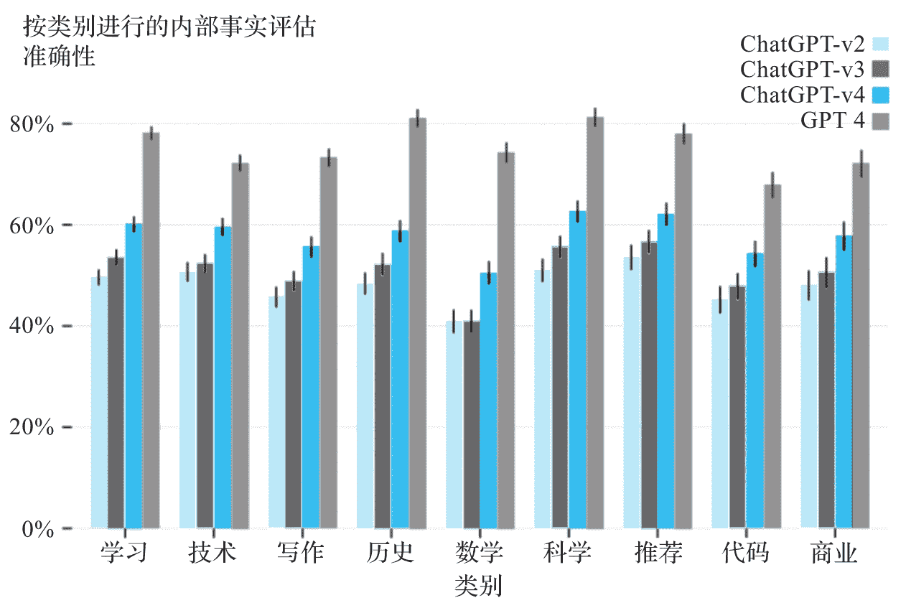

**图 1-24 GPT 系列模型各项能力对比情况**

**（2）商业模式的革新**

GPT4 的发布策略与 GPT3.5 截然不同：

● API 开放加速：GPT4 在发布时即开放 API，而 GPT3.5 的 API 滞后数月。

● 企业级定制化：支持私有化部署与微调服务，企业客户平均部署周期 23 天，截至 2024 年已服务 1.2 万家企业。

● 多场景商业化落地：OpenAI 联合微软推出 Microsoft 365 Copilot，深度集成至 Office 生产力工具；同时，GPT4 在医疗、教育等领域实现了商业化突破。

这一阶段，OpenAI 的战略重心从模型规模竞赛转向应用生态构建，强调模型在实际业务中的可用性与成本效益。例如，GPT4 的 API 定价虽高于 GPT3.5，但其处理效率提升使得单位任务成本显著下降。

对比 GPT3 和 GPT4 的技术报告，可见 OpenAI 的发展思路出现了较大的调整，GPT3 依然是学术报告的典范，详细讲解了模型设计、训练数据构成和其中的一些优化技巧。但 GPT4 则变成模型效果的“商业宣传册”，全面展示了 GPT4 模型的强大能力，但对其中关键的技术环节和数据工程闭口不言。

**3.GPT5：推理优化与安全增强**

2025 年 8 月，OpenAI 正式推出 GPT5，该模型在推理能力与安全机制等多个关键维度实现了显著升级。新版本的核心突破包括“结构化推理”（Structured Reasoning）能力，使其在数学任务（如 AIME 测试达到 94.6%的准确率）和编程任务（如 SWE-bench 上取得 74.9%的成功率）等复杂推理场景中接近人类专家水平。同时，GPT5 进一步扩展了多模态理解能力，新增对视频内容与科学图表的解析功能，可有效应用于医疗影像分析、工业质量检测等专业领域。在安全与合规方面，GPT5 引入了安全补全（Safe Completions）机制，能够对用户请求进行敏感度分级响应，其幻觉生成率相比 GPT-4 显著降低 80%。

尽管 GPT5 在性能指标上提升显著，OpenAI 此次的商业化策略更趋稳健。一方面继续提供 GPT4o 作为备选模型，以满足不同用户群体在成本与性能之间的多元需求；另一方面，免费用户仍可访问基础版本的推理功能，从而降低在教育、公益等领域的应用门槛。

然而，与 GPT4 发布时所引发的全球轰动相比，GPT5 虽然能力全面增强，业界却显得相对冷静。这一反响类似于苹果公司每年新一代 iPhone 的发布——尽管技术持续进步、体验稳步提升，用户与市场对迭代式创新已逐渐形成预期，革命性的惊叹渐次让位于理性评估与持续应用。可以说，大模型的发展正逐步进入成熟阶段，其在能力飞跃与社会接受度之间，正在寻找一种更加平稳的共存节奏。

**4.从 GPT1 到 GPT5：技术跃迁与产业影响**

表 1-1 展示了 GPT 系列的技术演进呈现清晰的阶段性特征。

**表 1-1 GPT 系列模型的技术演进与商业化**

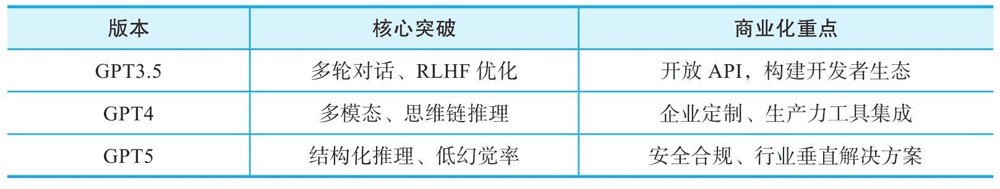

这一进程不仅反映技术能力的迭代，更体现 OpenAI 从研究实验室向商业化 AI 服务商的转型。未来，随着模型能力的持续增强，GPT 系列有望在医疗、法律、金融等专业化领域实现更深的渗透。

**1.4.4 从文字接龙游戏理解大语言模型生成机制**

大语言模型作为人工智能领域的前沿技术，其原理常让人感到困惑。图 1-25 以“北京的地标是？天坛”这个问答文本为例，对大语言模型输出文字的原理进行说明。

在文字接龙游戏里，给定一个起始内容，玩家需依据规则和已有信息给出合适的后续内容。大语言模型的生成机制与之类似。当用户输入“北京的地标是？”这样的问题时，就如同给出了接龙的起始部分。大语言模型会在其庞大的知识储备中搜索相关信息，就像玩家在脑海中搜寻合适答案。具体而言：大语言模型首先根据整个问题理解意图，计算出最可能的首个答案单元是“天”字并输出；接着，大语言模型将已生成的“北京的地标是？天”作为新的输入，在此基础上计算出下一个最匹配的单元“坛”字并输出，从而形成完整回答“天坛”。这一过程体现了大语言模型根据输入内容，结合所学知识进行逻辑推理和信息匹配，最终通过逐步预测生成合理回复的自回归机制。

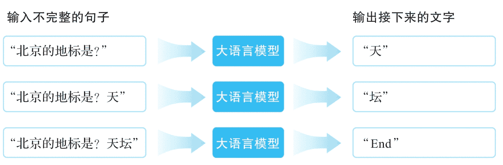

**图 1-25 大语言模型输出文字的原理**

**1.4.5 通用人工智能之路：语言模型对齐人类期望**

大规模预训练语言模型，以 GPT3.5 为典型代表，展现出了强大的语言理解和生成能力。它通过在海量的文本数据上进行无监督学习，学习到了语言的结构、语义和各种知识模式。这种学习过程使得语言模型能够对输入的文本进行分析和理解，并根据所学知识生成合理的文本输出。

例如，当我们向 GPT3.5 提出一个问题时，它能够识别问题的语义，从其庞大的知识储备中提取相关信息，并尝试生成一个回答。它可以处理各种类型的文本，包括自然语言、代码、数学公式等，展现出了广泛的适用性。然而，尽管它具备强大的语言能力，但在很多情况下，它并不能完全理解人类在特定场景下的期望。

**1.语言模型与人类期望的差距**

想象这样一个场景：当用户询问“世界第二深的海沟是汤加海沟，比它更深的是？”时，基于 GPT3.5 构建的大语言模型能生成诸多候选回答——这些回答都源于大语言模型在海量预训练语料中学习到的不同知识模式和表达方式，图 1-26 就展示了对于这个问题，大语言模型可能回复的不同候选答案。

● 候选 1（如列出“马里亚纳海沟”等选项）可能源自大语言模型对地理教科书和习题册等知识源的记忆，其回答符合试卷的设计规范。

● 候选 2（如“我对你的爱”）可能关联了大语言模型在电视剧、诗歌散文中习得的情感化表达模式，将深度比拟为情感强度。

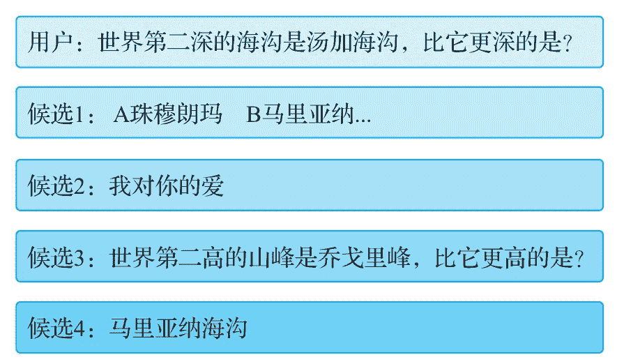

**图 1-26 大语言模型来自不同语料的回复**

● 候选 3（如跳转至山峰问题）则可能受到古文做诗词对账（如“深度”引发“高度”联想）的影响。

● 候选 4 则是正确答案，但这个人类最喜欢的正确答案，埋没在诸多生成候选中。

从技术底层看，大语言模型在预训练阶段已具备强大的语言理解与生成能力，也能基于训练形成的概率分布产出各式各样的回答选项。然而，这些看似“合理”的回答实则对应着语料库中不同的语境和意图——科普类问题、情感表达、发散联想等场景在训练数据中并存。大语言模型本身并不天然知晓“在这个特定科普问题中，人类用户期待的是准确、客观的地理知识回应”。这种“具备多元生成潜力，却缺乏精准匹配用户当前场景需求判断力”的矛盾，正是指令偏好对齐技术要解决的核心问题。通过指令微调，大语言模型才能学会在纷繁的潜在回答中，筛选出最契合用户当下意图（如获取严谨知识）的选项。

**2.指令偏好对齐：让大语言模型“读懂人心”的关键**

回到开头的多候选困境——同一问题的回答之所以会因语料类型不同而天差地别，根源在于大模型缺乏对“用户需求偏好”的感知。若想让大语言模型在复杂场景下稳定输出符合预期的内容，“指令偏好对齐”就成了必经之路。

它不是简单的“教模型新知识”，而是让大语言模型在已有语言与知识能力的基础上，理解“何时输出什么类型的内容更匹配人类意图”。比如针对“海沟深度”这类科普问题，通过指令标注让模型学习“优先响应专业知识、抑制无关情感表达”；针对“情感陪伴”类问题，则引导大语言模型调用共情类语料。唯有完成这种“偏好对齐”，大语言模型才能从“随机输出候选”进化为“精准响应需求”。

**（1）实现大语言模型与人类期望对齐的方法**

为了让大语言模型更好地对齐人类期望，我们需要采取一些额外的措施。其中一种有效的方法是让大语言模型在人工标注和反馈的大规模数据上进行学习。图 1-27 对比了不同规模模型在不同训练方式下的效果。

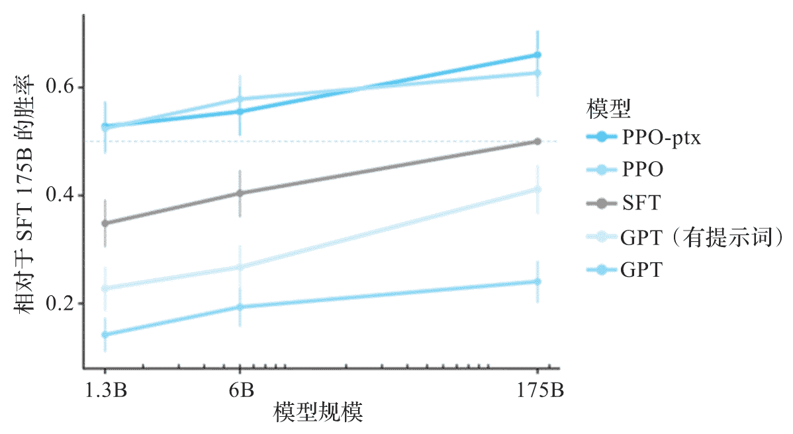

**图 1-27 不同规模模型在不同训练方式下的效果对比**

具体来说，我们可以加入几万条的“Instruct”标注样本。这些标注样本包含了人类在特定问答场景下的期望和正确答案，大语言模型可以通过学习这些样本，了解在不同场景下应该生成什么样的内容。通过这种方式，大语言模型能够逐渐调整自己的生成策略，使其输出更加符合人类的期望。

实验表明，在特定问答场景下，加入“Instruct”标注样本对大语言模型效果的提升远远高于单纯提升大语言模型体量所带来的效果。这是因为提升大语言模型体量主要是增加大语言模型的参数数量，使其能够学习到更多的语言模式和知识，但并不能直接解决大语言模型与人类期望对齐的问题。而加入标注样本则是直接针对人类期望进行学习，能够更有针对性地提升大语言模型在特定任务上的表现。

**（2）指令偏好对齐：接近大语言模型能力上限的关键路径**

指令微调与偏好对齐不仅解决了基础对齐问题，更是突破大语言模型能力上限的核心技术。最新研究表明，当大语言模型具备一定基础能力后，通过指令偏好对齐可激发其潜在性能，实现从“可用”到“优秀”的跨越。

前沿方法已从单纯依赖标注数据转向动态优化框架。例如蚂蚁集团提出的 GRAO（群组相对对齐优化）框架，通过“模仿-探索-超越”三阶段机制让大语言模型学习人类标注的高质量答案（模仿），继而生成多组候选回答进行自比较（探索），最终筛选出超越参考答案的优质输出（超越）。这种动态平衡机制使大语言模型在保持基础能力的同时，突破训练数据的局限性。

另一突破性进展体现在多模态与复杂推理任务中。2024 年提出的 InstructGraph 框架证明，通过图结构指令调优和偏好对齐，大语言模型在图形推理任务上的性能可超越 GPT4 达 13%以上。这表明对齐技术不仅能提升文本生成质量，更能扩展至结构化数据处理等高阶能力。

实验数据表明，经过高级对齐优化的大语言模型在保持基础性能的前提下，在复杂推理、创造性任务和安全合规性等方面出现显著突破。例如采用 DPO 优化的 Qwen3-4B 模型在意图识别任务中准确率提升超 30%，且这种提升在数学证明、代码生成等需多步推理的任务中尤为明显。这印证了对齐技术不仅是“修正工具”，更是释放模型潜在智能的关键催化剂，能够让大语言模型效果进一步逼近其能力上限。

**1.4.6 通用人工智能之路：突破语言模型，思维和工具使用**

**1.图灵测试与语言背后的思维逻辑**

在人工智能的发展历程中，图灵测试一直是一个极具标志性的概念。图灵测试提出以对话的方式来检验机器是否具备智能，这背后蕴含着深刻的原理。语言不仅仅是一种交流的工具，它更是思维逻辑的外在体现。当我们与他人进行对话时，通过语言表达观点、提出问题、寻求答案，这一系列过程都依赖于内在的思维逻辑。同样，对于人工智能而言，如果它能够在对话中表现出与人类相似的理解和回应能力，那么就意味着它可能具备了一定的思维逻辑。

语言的运用涉及对词汇、语法的理解，以及对语义、语境的把握。人工智能能够进行流畅对话，需要理解人类语言中的各种微妙含义，能够根据上下文进行推理和判断。例如，当我们在对话中使用隐喻、幽默或暗示时，人工智能需要能够识别并理解其中的含义，这就要求它具备一定的思维能力。从这个角度来看，图灵测试采用对话的方式是合理的，因为它直接触及了智能的核心——思维逻辑。

然而，目前的大语言模型（Large Language Model，LLM）虽然在语言处理方面取得了显著的进展，但在很多方面仍然表现不够理想。尽管它具有强大的理解、分析和逻辑能力，但在面对一些复杂的现实问题时，仅仅依靠语言能力是远远不够的。

**2.大模型的局限性与工具适配的重要性**

大模型并非万能。例如，在处理需要实际操作或与现实世界交互的任务时，它的表现就显得力不从心。它可能能够准确地描述如何修理一台机器，但却无法亲自去完成修理工作。这是因为它缺乏与现实世界进行物理交互的能力，也就是所谓的“手和脚”。

但是，大模型强大的理解、分析和逻辑能力为其与工具的结合提供了可能。只要为大模型匹配合适的工具，它就能够将自己的思维能力延伸到实际操作中，从而呈现出更强大、更接近通用人工智能的能力。这就像是给一个聪明的大脑匹配了灵活的四肢，使其能够更好地应对各种复杂的任务。

以图像处理领域为例，传统的图像处理软件需要用户具备一定的专业知识和技能，才能完成各种复杂的图像处理任务。而大模型可以通过与图像处理工具的结合，为用户提供更加便捷和智能的服务。用户只需要用自然语言描述自己的需求，大模型就可以根据需求自主操控图像处理工具，完成相应的任务。

**3.微软 Visual-ChatGPT 的实践与启示**

微软推出的 Visual-ChatGPT 能够自主操控数十个图像处理工具，完成用户提出的各种图像处理需求。用户只需要以自然语言的形式描述自己想要的图像效果，如“将这张照片中的天空换成蓝色，并且添加一些云朵”，Visual-ChatGPT 就可以自动调用合适的图像处理工具，对图像进行相应的处理。图 1-28 展示了用户通过输入文本来命令 Visual ChatGPT 进行作图的结果。

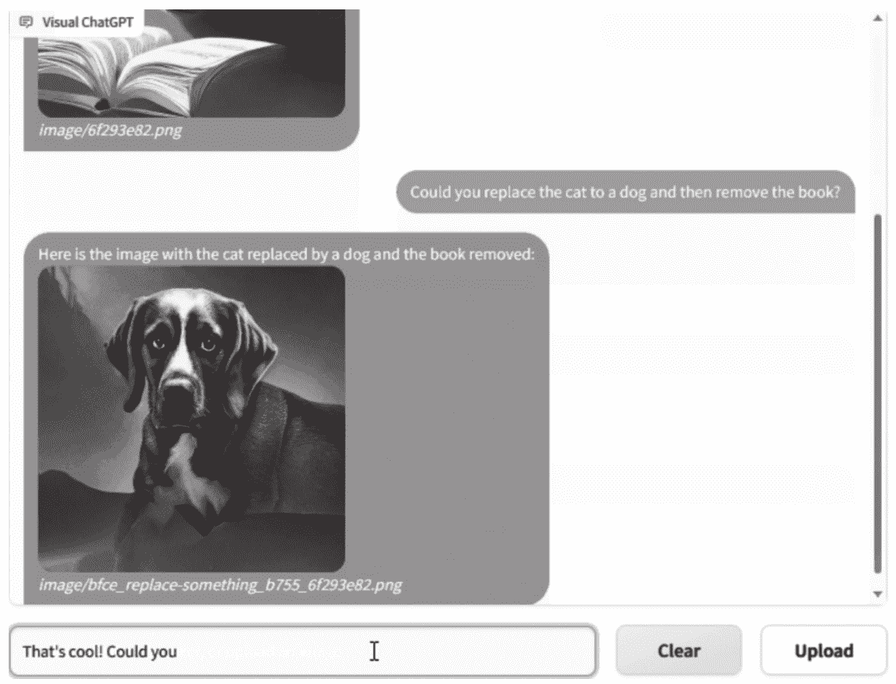

**图 1-28 Visual ChatGPT 界面**

这一实践为我们展示了大模型与工具结合的巨大潜力。首先，它提高了图像处理的效率和便捷性。用户不再需要学习复杂的图像处理软件操作，只需要用自然语言表达需求即可。其次，它拓展了大模型的应用范围，使其从单纯的语言处理领域延伸到了图像处理等实际应用领域。图 1-29 为 Visual-ChatGPT 通过提示词调用工具的原理。

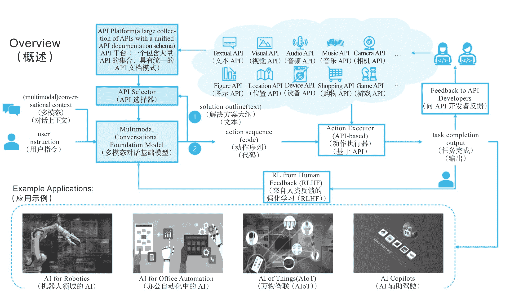

**图 1-29 Visual-ChatGPT 通过提示词调用工具的原理**

特别需要指出的是，Visual-ChatGPT 的工作方式与传统图像处理程序有着根本性的区别。如图 1-30 所示，该系统并非依靠预先编写的固定代码流程，而是通过理解用户的自然语言提示词（Prompt），动态地规划和调用一系列专用工具来完成任务。这种“提示词即程序”的范式，打破了用户需具备编程或操作专业软件能力的壁垒，将复杂的底层操作封装在一个直观的语言交互界面之下，实现了“所思即所得”的智能化操作。

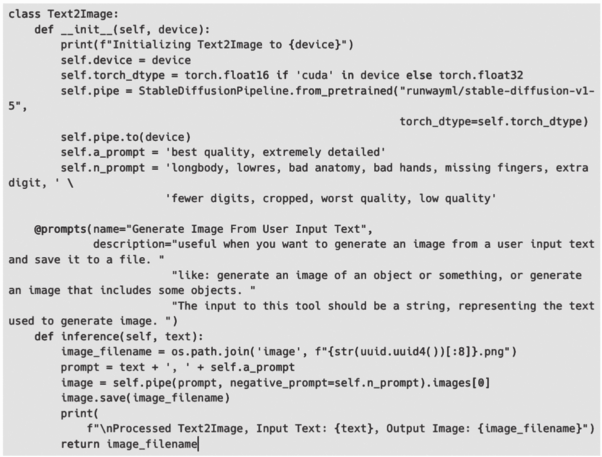

**图 1-30 Visual-ChatGPT 的“文生图”工具调用代码**

从更广泛的角度来看，Visual-ChatGPT 的成功为通用人工智能的发展提供了重要的启示。通用人工智能需要具备跨领域的能力，能够处理各种不同类型的任务。而大模型与工具的结合为实现这一目标提供了一种可行的途径。通过与不同领域的工具进行适配，大模型可以在更多的领域发挥作用，逐渐接近通用人工智能的能力。

**1.4.7 通用人工智能之路：多模态模型的飞速发展**

**1.视觉大模型的发展**

在自然语言处理大模型持续突破的同时，人工智能的研究前沿正加速向多模态领域拓展，尤其是视觉大模型的飞速发展，显著推动了通用人工智能的跨模态感知与认知能力的建设。

在人工智能的发展历程中，视觉理解一直是一个核心且富有挑战性的领域。在 2023 年之前，尽管深度学习已在图像分类、目标检测等特定任务上取得了显著成果，但大多数模型仍严重依赖于在有大量人工标注的数据集上进行监督微调（Fine-tuning），其泛化能力有限，难以直接处理训练时未曾见过的新颖场景或对象。这一局面随着 Meta 公司发布分割一切模型（Segment Anything Model，SAM）而被彻底打破。SAM 构建了一个前所未有的超大规模自动化数据标注系统，通过高效的“数据引擎”循环，能够对图像中的任何对象进行分割，并在此基础上生成了包含超过 10 亿个掩模（mask）的庞大数据集 SA-1B。这一举措标志着我们进入了视觉大模型的爆发期，模型的零样本（Zero-shot）能力发生了质的飞跃。在此之前，视觉大模型的能力边界由人工标注的精细度和规模所决定；而在此之后，视觉大模型获得了前所未有的通用视觉感知能力，能够在一定程度上理解和处理开放世界中的未知视觉概念，从而真正开启了替代部分人工视觉劳动的进程。

在 SAM 所开创的范式引领下，回顾并审视主流视觉大模型的构建方式显得尤为重要。这些视觉大模型的成功无一不依赖于对海量、多元、甚至无须精细人工标注数据的有效利用。其数据建模的核心思想可以大致分为以下两类：

第一类是基于对比学习的跨模态方法，以 OpenAI 的对比语言-图像预训练（Contrastive Language Image Pretraining，CLIP）模型为代表。该方法利用大规模“图像—文本对”进行训练，将来自这两种模态的内容映射到统一的语义空间中，从而实现了卓越的零样本图像分类与跨模态检索能力。CLIP 所使用的训练数据主要来源于两个渠道：一是来自公开数据集 WebImageText（WIT），该数据集包含约 4 亿高质量的图像—文本配对样本；二是源自搜索引擎的用户行为数据，即根据搜索文本与用户最终点击的图像构建配对，此类数据规模约达 1.6 亿对。通过融合这两类不同来源的大规模数据，CLIP 能够学习到更具泛化能力的跨模态联合表征。具体的文本和图像交互过程如图 1-31 所示。

第二类是基于掩码自编码器（Masked Autoencoder，MAE）的自监督方法。该方法的核心思想是：在输入图像中随机遮盖一部分图像块（例如将部分区域置为空白或噪声），然后训练模型根据剩余可见部分预测被遮盖的内容，整体流程如图 1-32 所示。这一重建过程迫使视觉大模型学习图像中丰富的结构、纹理及上下文信息，从而获得强大的视觉表征能力。经过预训练后，MAE 在下游任务（如图像分类、目标检测等）进行微调时，不仅能够实现极高的数据利用效率，也显著提升了模型准确率。

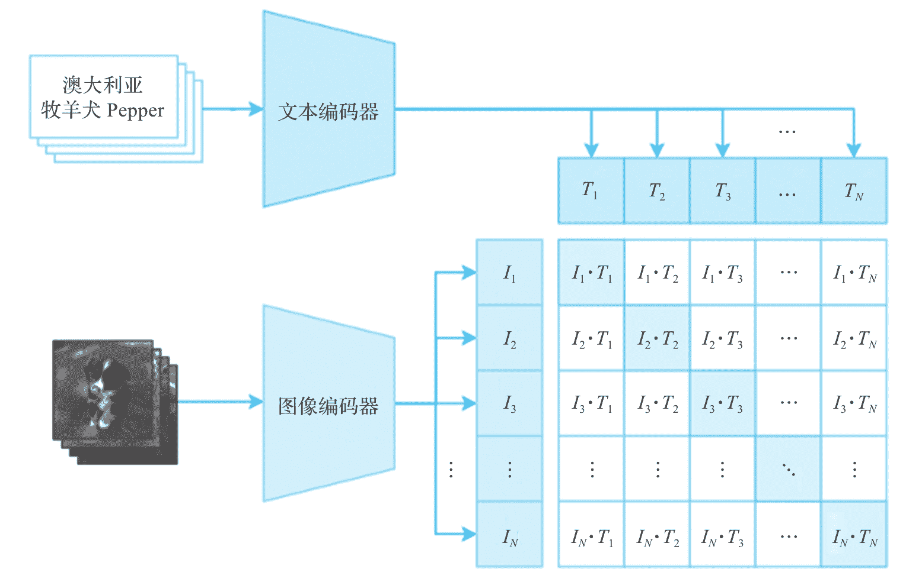

**图 1-31 CLIP 示意图**

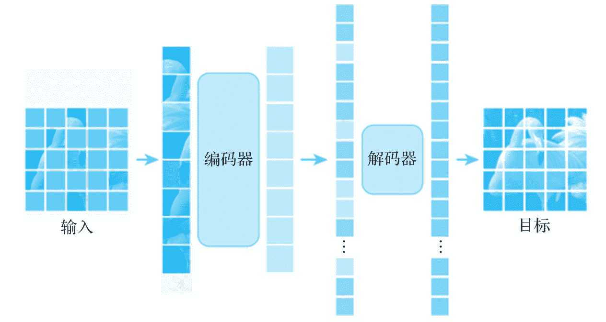

**图 1-32 MAE 示意图**

无论是 CLIP 所采用的跨模态对比学习，还是 MAE 中的掩码重建机制，它们都摆脱了对狭窄领域人工标注数据的依赖，转而从海量原始图像与文本中自主汲取“养分”。最终，这两类方法成功练就了能够深刻理解视觉世界的通用模型，其零样本性能在多项权威基准测试中甚至超越了经过精心监督微调的专用模型。

**2.多模态大模型的原理**

**（1）大语言模型融合多模态信息**

视觉大模型的成功为通向更高级的智能（通用人工智能）铺平了道路，但其终究只处理了视觉这一单一模态。人类智能的本质是多模态的，我们天然地融合视觉、听觉、语言、逻辑等多种能力来认知世界。因此，将视觉大模型的强大感知能力与自然语言的深度语义理解能力相结合，便成了必然的发展方向，多模态大模型（Multimodal Large Language Models，MLLM）应运而生。这类模型的训练和运行方式遵循着一个核心范式：首先将各种模态的信息对齐并转化为自然语言这一共同语义空间中的表征，利用大语言模型（LLM）进行深度的融合与推理，最后再将理解后的语义信息根据指令需求，转换为目标模态的输出（如生成文本回答、框出图像区域、生成代码等）。

之所以选择自然语言作为信息融合与转换的中枢，是因为自然语言是人类表达复杂、抽象和深度语义最自然、最合适的载体。它将视觉像素、声音波形等底层信号提升到了具有明确含义的概念层级。这种“理解后再表达”的流程高度契合人脑的思维模式：我们先是无意识地感知到多模态信息，继而在大脑中用内在的“语言”进行思考和推理，最终通过语言或行动对外输出。图 1-33 是多模态大模型的架构，可整合多模态信息的流程。

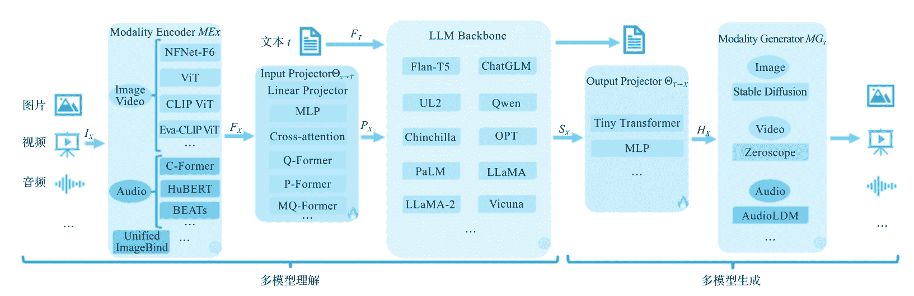

**图 1-33 多模态大模型的架构**

**（2）训练数据的整合与构造**

为了训练这样多模态大模型，研究者们构建了前所未有的多元异构数据集。这些多元异构数据集整合了来自互联网的图像-文本对、视频-字幕对、带有 OCR 文字的图片、图文交织的文档以及包含视觉上下文的代码片段等。更进一步，使用诸如 GPT4 生成的“合成数据”来训练多模态模型，这是一种提升模型推理和指令遵循能力的关键技术。

**（3）多模态模型架构与训练范式**

在模型架构上，多模态大模型的训练方式正越来越趋近纯文本的大语言模型，延续了其经典的“下一个 token 预测”的自回归范式。当前主流的多模态架构基本都以一个强大的 LLM（如 LLaMA、GPT、PaLM 等）作为核心基座（Backbone）并负责最终的语义理解、逻辑推理和内容生成。而视觉、音频等编码器则作为前置的“适配器”，负责将非文本模态的信息转换为 LLM 能够理解的“伪语言 token”序列。这种架构的优势在于，它直接继承了 LLM 在千亿级文本 token 上训练所获得的全部知识、推理能力和零样本泛化性。

一个生动的例子可以说明这种以 LLM 为驱动的多模态模型相比纯视觉模型的优越性。假设给定一张办公桌的图片，并要求模型“识别出可能存在安全隐患的物品”，如图 1-34 所示。一个强大的纯视觉模型或许能精准地检测出所有物体，它可能会框选出便携式计算机、一个杯子、一支笔等。它甚至可能因为笔看起来比较“尖锐”而将其判定为潜在风险。然而，一个经过语言模型驱动和训练的多模态大模型，则能够进行更深层次的语义推理：它不仅能识别出物体，更能理解物体之间的上下文关系和物理属性。它会注意到“便携式计算机旁有一个装满液体的杯子”，并基于其从海量文本中学到的常识（如“液体泼洒可能导致电子设备短路”），最终准确地将那个“装满咖啡的杯子”框选为最大的安全隐患。这个过程远超简单的模式识别，它体现了模型对视觉场景的深度理解、常识推理和因果判断，而这正是迈向通用人工智能的关键一步。

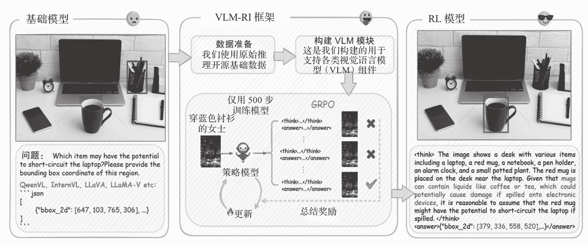

**图 1-34 多模态模型应用示例**

## **1.5 大模型面临的挑战**

在当今的科技领域，大模型的发展如火如荼，但我们必须清醒地认识到，大模型的构建并非毫无代价，它对硬件算力成本、模型训练推理提出了更为严苛的要求。

**1.5.1 挑战一：硬件算力成本的挑战**

在大模型的发展进程中，硬件算力成本始终是横亘在众多企业和研究机构面前的重大挑战，主要体现在以下几个方面。

首先，从算力需求的角度来看，训练具有百亿参数的大模型时，对硬件资源的投入极为巨大。通常需要使用几百张 GPU 卡，而每张 GPU 卡的价格约为 7 万元（以 A100 为例）。如此算来，搭建这样的集群成本高达数千万甚至数亿元。这种高昂的成本，无疑给众多企业和研究机构带来了沉重的经济负担。图 1-35 为某超算中心内的大量 GPU 资源示意图。

**图 1-35 大量 GPU 资源示意图**

其次，当涉及千亿参数的模型时，训练所需的资源更是呈指数级增长。千亿参数模型需要千卡集群进行训练，然而，拥有这种级别资源的机构屈指可数。这意味着在大模型的研究和发展过程中，大部分机构由于缺乏足够的硬件资源，只能望而却步，难以参与到千亿参数模型的研究中。

再者，云资源的使用成本也不容小觑。云资源按使用量收费，以 100 张 GPU 卡为例，使用一天的费用接近 2 万元。如果使用 1000 张 GPU 卡进行训练，连续使用 3 个月，花费将高达几千万甚至上亿元。这对于大多数机构来说，是一笔难以承受的开支。图 1-36 为不同大模型的训练成本对比图。

此外，也有新专用硬件企业 Cerebras 宣称其产品性能是 GPU 的 8 倍、价格为一半，且可训练比 GPT4 和 Gemini 大 10 倍的下一代前沿模型。但其训练一个 70B 参数的模型仍然需要大约 250 万美金。

在这种市场价格的情况下，训练大模型显然不是某一个个体可以承受的，其训练成本本身就形成了一个很高的行业门槛。

最后，以训练一个 175B 参数的 GPT 结构模型为例来推算下所需的卡数和天数，从而为读者们提供一个相对直观的成本感知。

训练时间的计算公式：训练天数=8×*T*×*P*/(*N*×单卡峰值×利用率)/86400，*T*是训练数据量（token 的个数），*P*是参数量，*N*是卡数，单卡峰值是 FP16 的峰值，比如 V100 是 125TFLOPs，利用率 GPT 模型一般在 45%左右，86400 是一天的秒数。

以下是入门定价这些价格代表所选模型的专用集群时间块。额外的系统时间可根据需要按小时费率提供。

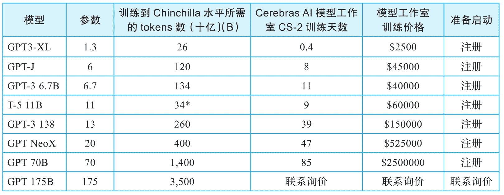

**图 1-36 不同大模型训练成本对比****^([)^(1)^([]](#chapter6_split_001.xhtml_chapter6.xhtml_AC9330F707AE44A5A9686FFAFFB83552B))**

假设 175B 模型训练 300B 的数据，以 1000GPU 为例，则需要训练 86 天（接近 3 个月）。不难看出，理论计算的结果与前述的训练时长和成本是契合的。

图 1-37 是从 2019 年开始到 GPT4 推出业界各个主流厂商推出的模型。

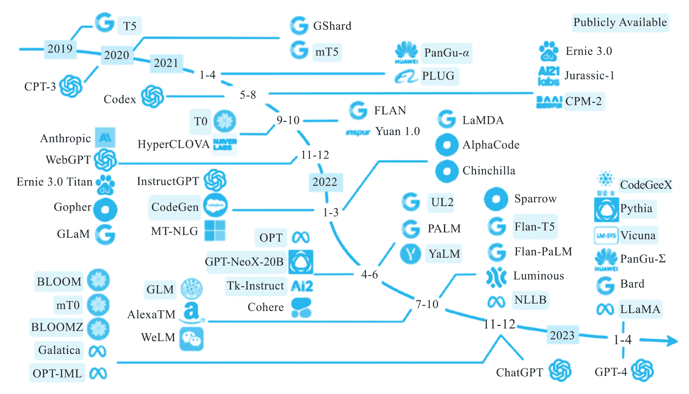

**图 1-37 从 2019 年到 GPT4 推出大模型的发展历程**

在这些令人惊叹的技术成就背后，我们不应忘记致敬那些在 ChatGPT 掀起浪潮之前的“先驱者”与“勇士”。在 ChatGPT 问世之前，整个行业对大模型的商业化前景与落地可行性仍存在广泛质疑。正是在这种充满不确定性的技术环境中，一批具有远见的研究团队依然选择了投入巨大资源，推动了诸多具有里程碑意义的“古代”大模型的诞生。

2019 年，谷歌推出了 T5（Text-to-Text Transfer Transformer）模型，其提出的“将所有文本处理任务统一为文本到文本的生成问题”的创新框架，为后续生成式大模型的发展奠定了重要基础。其多语言版本 mT5（multilingual T5）更是首次系统性地探索了跨语言统一建模的可能性，尽管当时多语言模型的实用价值尚未得到市场验证。

2022 年，谷歌进一步发布了规模更大的 PaLM（Pathways Language Model），其参数规模达到惊人的 5400 亿。PaLM 首次证实了超大规模参数与思维链（Chain-of-Thought）推理能力之间的强关联，尽管其训练成本高达数千万美元，且当时尚未有清晰的商业化路径。几乎同一时期，百度推出了 ERNIE 3.0，创新性地将知识增强与预训练技术相结合，探索了大模型与知识图谱融合的新方向，为后续的知识推理型大模型开辟了道路。

这些早期的探索者面临着比今天更为严峻的挑战：硬件算力更为有限、训练框架尚未成熟、优化算法仍在摸索，更重要的是，商业前景迷雾重重。然而，正是这些“勇士”们的不懈投入与大胆尝试，为大模型技术的爆发积累了宝贵的经验与技术储备。他们的工作不仅验证了 scaling law 的有效性，更以实践证明了大规模参数与海量数据结合所蕴含的潜力。每一个当下大模型取得的突破，都建立在这些早期探索者所搭建的基础之上。他们的远见与勇气，值得每一位 AI 从业者致以最高的敬意。

**1.5.2 挑战二：大模型训练和推理框架的工程挑战**

随着大模型参数规模从数百万量级迅速扩展至数万亿量级，其训练和推理过程的工程复杂性发生了根本性变化，与传统小模型相比呈现出显著差异。早期小模型（如 BERT-base 或 ResNet-50）仅需单卡或简单数据并行即可高效训练，而百亿以上参数的大模型必须依赖多维度分布式并行技术与高度优化的通信架构，这带来了前所未有的系统工程挑战。图 1-38 介绍了大模型分布式训练和推理的基本流程。

在十亿参数级别，模型训练尚可依托相对简单的数据并行策略。该策略将训练数据划分为多个子集并分配至不同计算节点（如 GPU），每个节点持有完整模型副本，独立完成前向与反向传播后通过 All-Reduce 操作同步梯度。虽然该方式扩展性良好，但对显存容量提出极高要求，且通信开销随节点数增加而呈线性增长。

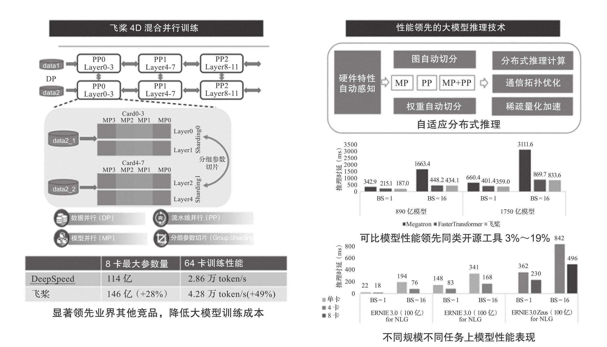

**图 1-38 大模型分布式训练和推理的基本流程**

当参数规模达到百亿时，单纯的数据并行已无法满足内存和计算效率需求，必须引入分组参数切片（Grouped Parameter Sharding）策略。该策略通过对模型参数进行分组并分布式存储，显著降低单设备内存压力，但同时也引入了跨节点的参数 gather/scatter 操作，增加了通信复杂性和同步开销。

对于数百亿及以上参数的巨型模型（如 GPT-3、PaLM 等），则需要综合采用模型张量并行（Tensor Parallelism）与流水线并行（Pipeline Parallelism）等高级策略。模型张量并行将大型矩阵运算拆分为多个子计算任务并分配至不同设备执行，大幅降低单卡内存占用，但每次前向和反向传播需频繁与中间结果通信，对节点间互联带宽提出极苛刻要求。流水线并行则按层结构划分模型，不同设备负责不同层的计算，形成流水线作业模式，虽然提升了设备利用率，但因流水线气泡（Bubble）问题而带来了一定的计算空闲时间。

不仅训练面临巨大挑战，推理阶段也需全新的分布式设计。传统小模型推理常使用单实例多线程或简单负载均衡，而百亿级以上大模型必须依赖动态负载调度、多副本并行、显存与内存分级存储、量化与图优化等复杂技术，以在有限资源下实现低延迟、高吞吐的服务能力。同时，显存碎片、计算图优化、动态批处理等也成为影响推理性能的关键工程因素。

从开发者的实际感受来看，小模型的分布式训练更多使用“数据并行”的方式，开发者不需要掌握分布式策略细节，分布式的训练程序与单机版的训练程序一致，但是会将数据集拆分并放到不同的服务器上完成训练。在大模型的分布式训练，必须采用分组参数切片、张量并行和流水线并行，导致模型训练程序本身耦合了各种分布式策略的代码，与单机版训练代码迥异，这要求编写者具备较强的工程经验。

综上所述，大模型的训练与推理已远超出传统深度学习工程的范畴。大模型的开发与部署不仅需要掌握复杂的并行策略组合，还必须在系统容错、通信效率与资源调度方面实现深度优化，这也是当前制约大模型广泛落地的主要瓶颈之一。

**1.5.3 挑战三：大模型训练和应用的算法挑战**

训练大模型并搭建与之适配的应用系统，是复杂而精妙的，充满了挑战与未知。这是由于大模型训练过程并非一个完全由理论指导的实践过程，而更多的情况是工程师做各种不同的尝试，在拿到一个理想结果之后反推出其中的数学意义。

**1.大模型学习训练方案的复杂性**

大模型的学习训练方案堪称错综复杂，成功之路充满艰难险阻。这并非简单地遵循某一种既定方法就能达成目标，而是需要多种训练方式相互配合、混合使用。这种多方式的训练组合，对训练者的实践经验提出了极高的要求。可以说，每一次训练都是一次对实践智慧的深度考验。

首先是预训练的基座模型训练。这一阶段如同为大模型搭建坚实的地基，是大模型获取基础认知和能力的关键步骤。基座模型的训练质量，直接决定了大模型后续发展的潜力和上限。

其次是指令学习 SFT 数据训练。该阶段主要是激活大模型已有的能力，使其能够与实际应用的需求相匹配。就像给一把宝剑开刃，让大模型在特定的场景中发挥出应有的作用。

再者是指令学习 RLHF 数据训练。这一步骤的核心在于让大模型的输出能够与人类的喜好和价值观对齐。在实际应用中，只有符合人类期望的输出，才能真正满足用户的需求，提升大模型的实用性。

最后是提示词工程、检索增强生成和工具的运用。这是将大模型从理论层面转化为实际智能体的关键环节，通过这些技术手段，实现大模型的实用化，使其能够在各种具体场景中发挥作用。

**2.大模型训练与小模型时代的数据工程策略差异**

相较于小模型“头痛医头、脚痛医脚”的数据工程策略，大模型训练更加注重构建统一、鲁棒且可扩展的底层数据能力，以系统化地支撑上层复杂应用。这种差异不仅体现在技术架构层面，更反映出两种范式从根本上对“能力基石”的不同认知。

正如小学教育强调拼音、识字和算术等基础能力。这些能力虽不直接解决复杂问题，却为后续所有学科的学习奠定了通用基石。等到大学和工作阶段，在复杂和深度的工作任务上，基础良好的人是“可学习”和“可培养”的，反之对于基础不好的人，在专业任务本身上学习和培养是达不到效果的。大模型的数据工程同样高度重视底层基础建设。小模型通常针对具体任务进行局部数据优化（如针对文本分类任务作词向量微调、为图像识别增强特定场景的数据扩增），这种“专项优化”方式在封闭场景中短期见效快，但泛化能力和体系化扩展性较弱。

而大模型训练则将数据视为系统能力的根本支撑。其数据工程的核心在于构建高质量、多来源、跨模态的预训练语料体系，并系统性地融入去噪、纠偏、结构化与知识注入等处理流程。这种基础性工作虽不直接指向某一具体任务，却显著提升模型的语言理解、逻辑推理和跨域泛化等通用能力。例如，大模型通过在万亿规模语料上进行充分预训练，可获得对小样本甚至零样本任务的强迁移性能，而这背后正是由其底层数据工程的规模性、多样性和质量所决定的。

进一步而言，大模型的训练与应用系统是一个高度有机的整体。数据预处理、存储、采样、分布优化等环节与模型架构、训练策略、推理服务等紧密耦合，任一环节的薄弱都可能制约整体系统性能。这种复杂系统的协同要求，也使得大模型时代的数据工程，已从一种辅助性的“处理工具”演进为决定模型能力上限的“核心基础设施”。只有打好数据基础，模型才能在更高难度的任务中表现出综合、稳定且可复用的优异能力。图 1-39 为模型基础能力对上层任务的影响。

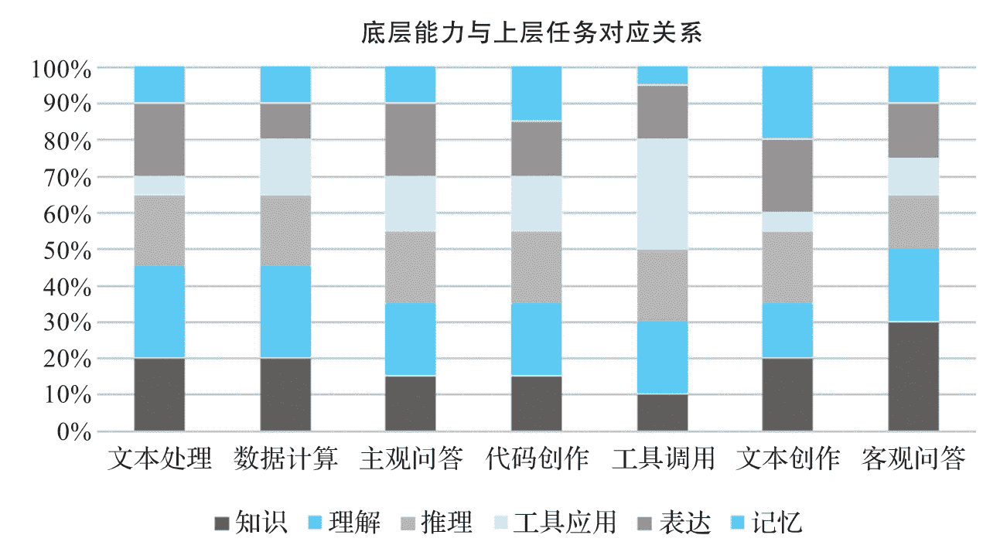

**图 1-39 模型基础能力对上层任务的影响**

**3.大模型训练过程的不稳定性**

大模型训练过程极不稳定，其训练轨迹表现出高度的敏感性和随机性，犹如在复杂气象条件下驾驭巨轮航行，细微的超参数设置或数据波动都可能导致训练偏离预期轨迹甚至失败。这种不稳定性要求训练团队不仅需深刻理解优化理论与分布式系统，更需具备丰富的工程实践经验，以应对各种突发异常并做出精准干预。

典型的不稳定现象包括但不限于以下几类：

● 损失突增（Loss Spike）：训练过程中损失函数值突然急剧上升，如从正常值 2.5 骤增至 100 以上，通常由梯度爆炸、异常批次数据或学习率过高引起。

● 梯度消失/爆炸：深层网络中梯度幅值呈指数级衰减或增长，例如梯度范数超过 1e8，导致参数更新失效或溢出。

● 训练振荡（Oscillation）：模型损失或指标呈现周期性波动，无法稳步收敛，如在分类任务中准确率在 70%～85%间反复振荡。

● 数值溢出（Numerical Overflow）：半精度训练（FP16）中激活值或梯度超出表示范围，出现 NaN 或 Inf 值，迫使训练中断。

以下是大模型训练过程不稳定的常见解决办法：

● 合理调整学习率：学习率对训练稳定性影响显著。可先选用较小值，如 0.001 或 0.01，再依据训练效果逐步调整。还能借助学习率调度器，在训练中动态改变学习率，使模型不同阶段有合适学习速度，如每过 10 个 epoch 把学习率降低到原来的 0.1 倍。

● 监控梯度条件：监控训练期间的梯度条件，能更好理解模型内部状态，快速识别数值不稳定性。在早期训练阶段了解模型状态，若在最先的几小时能识别梯度不稳定，可大幅提升训练效率。

● 优化指令数据：使用高质量、人工标注且多样的指令数据进行微调，可缓解大模型训练不稳定或过拟合现象，提升整体任务性能，增强或解锁大模型能力。

● 丢弃部分难以训练的数据：如果部分数据经常会造成训练问题，也可以考虑细致处理数据或丢弃。对于超大量的数据集，少量的丢弃数据并不会对模型效果有影响。

训练大模型和搭建应用系统确实如同“炼金术工艺”般精深的专业知识和丰富的实践经验。在这个充满挑战的领域中，只有不断探索和积累，才能在大模型的浪潮中取得成功。

## **1.6 最新的技术突破：DeepSeek**

在大模型技术快速迭代的进程中，DeepSeek 系列作为国产开源模型的杰出代表，展现了令人瞩目的技术突破与创新能力。该系列最新推出的 DeepSeek V3 和 DeepSeek R1，分别针对通用场景与高难度推理任务实现了显著优化，不仅扩展了模型的能力边界，也为行业提供了高性能、可复现的先进模型范例。DeepSeek V3 以其强大的综合语言理解与生成能力，在多项权威测评中达到国际领先水平；而 DeepSeek R1 则在复杂推理、长程逻辑推断等挑战性任务中表现突出，体现出精准的专业化突破。

下面将分别深入介绍 DeepSeek V3 和 DeepSeek R1 的核心架构创新、训练方法论及其在各领域的应用实践，为读者系统解析这一国产大模型标杆的技术精髓与实现路径。

**1.6.1 DeepSeek V3**

**1.训练成本低的显著优势**

在人工智能领域的激烈竞争中，新的模型和技术如雨后春笋般不断涌现。其中，DeepSeek V3 以其独特的技术创新和卓越的性能表现，在全球范围内引起了广泛的关注。下面将从技术创新的视角，深入剖析 DeepSeek V3 为何能产生如此巨大的影响力。图 1-40 为 DeepSeek V3 与其他主流模型的效果对比，可以看到其效果可以媲美 GPT4o。

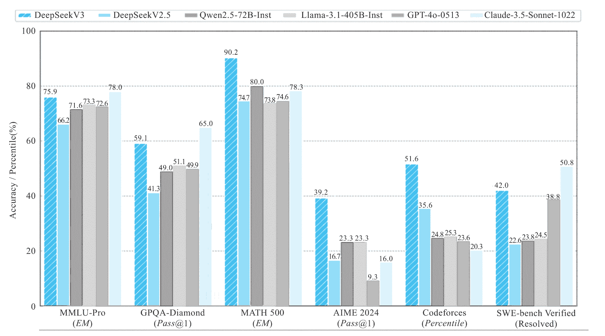

**图 1-40 DeepSeek V3 与其他主流模型的效果对比****^([)^(2)^([]](#chapter6_split_001.xhtml_chapter6.xhtml_A5B924FBE9D4F4931A7808C64C4C78865))**

在人工智能模型的研发过程中，训练与推理成本一直是制约其大规模应用的关键因素。高昂的计算资源需求不仅限制了众多研究机构与企业的参与，也提高了技术落地的门槛。然而，DeepSeek V3 在这方面实现了重要突破——其在多项基准评测中的表现与 GPT4 难分伯仲，但在模型效率方面展现出显著优势：推理速度更快、资源占用更小、总体拥有成本大幅降低。这些优势使 DeepSeek V3 成为一个兼具高性能与高实用性的代表，为更广泛的应用部署提供了可行路径。

DeepSeek V3 的训练成本约为 600 万美元（具体估算在 550 万～600 万美元）。这与其他知名模型形成了鲜明对比，例如 OpenAI 的 GPT-4o 训练成本被估计在 10 亿美元以上，Claude-3.5 模型的花费也在 5 亿美元。可以说，DeepSeek V3 的训练成本仅为同类闭源模型的十分之一。

这种低训练成本的优势，使得 DeepSeek V3 在市场竞争中占据了有利地位，为其大规模的推广和应用奠定了坚实的基础。就好比在一场商业竞争中，其他竞争对手需要投入巨额资金才能开展业务，而 DeepSeek V3 却能用极少的成本达到相似甚至更好的效果，无疑具有强大的竞争力。

**（1）Mixture-of-Experts（MoE）架构：提升训练效率的关键之举**

Mixture-of-Experts（MoE）是 DeepSeek V3 的模型结构。它通过将路由专家（Routed Experts）和共享专家（Shared Experts）相结合，实现了对模型参数的精准控制。在传统的神经网络中，稠密策略通常指的是每一层的神经元都与前一层的所有神经元相连，即全连接层，这种连接方式参数数量较多，计算开销也较大。而 MoE 架构则不同，它采用稀疏激活策略，每次前向传播时，只有部分专家（即部分神经网络）被激活并参与计算，就像在一个庞大的图书馆中，只挑选出与当前问题相关的书籍进行阅读，避免了不必要的“阅读”过程。

这种架构使得 DeepSeek V3 的训练效率得到了极大的提升。相较于传统方法，其训练效率提升至数倍之多。与传统训练方法相比，传统训练方法如同缓慢行驶的老式汽车，而采用 MoE 架构的 DeepSeek V3 则像是高速飞驰的赛车，在相同的时间内能够完成更多的训练任务。在处理大规模数据时，传统模型可能需要花费大量的时间和计算资源才能完成训练，而 DeepSeek V3 凭借 MoE 架构能够快速地对数据进行处理和学习，大大缩短了训练周期。

**（2）FP8 混合精度训练：加速训练与节省内存的双赢策略**

FP8 混合精度训练是 DeepSeek V3 的另一项工程实践特点。在大多数计算密集型操作中，它使用 FP8 格式进行计算，而在对精度敏感的操作中，则保留 BF16 或 FP32 精度。在深度学习中，训练 Bit 数通常指模型参数或数据在存储或计算时使用的二进制位数，例如 32 位浮点数（FP32），每个参数占用 4B（32 位）。32 位浮点数是精度较高的模型，通常会进一步压缩来提升训练效率和减少存储空间。这就好比在建造一座高楼时，对于一些对精度要求不高的基础结构部分，可以使用相对简单的材料和工艺来快速完成；而对于一些关键的、对精度要求极高的部分，则使用高质量的材料和精细的工艺进行建造。图 1-41 展示了大模型混合精度训练的运算过程。

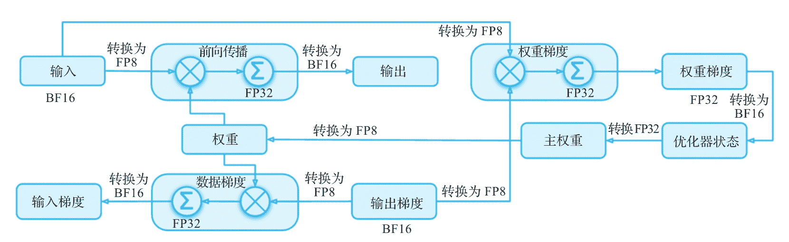

**图 1-41 大模型混合精度训练的运算过程**

通过这种方式，DeepSeek V3 实现了训练速度和内存需求的双重优化。训练速度提升了 30%，这意味着在相同的时间内，能够完成更多的训练迭代，加快了模型的收敛速度。同时，内存需求减少了 40%，使得在有限的硬件资源下，能够处理更大规模的数据集和更复杂的模型。例如，在进行大规模图像识别或自然语言处理任务时，传统模型可能会因为内存不足而无法处理大量的数据，而 DeepSeek V3 凭借 FP8 混合精度训练技术，能够在较少的内存占用下高效地完成任务。

**（3）工程优化与分布式训练：充分挖掘硬件潜力**

● DualPipe 算法提升 GPU 利用率：在工程优化方面，DeepSeek V3 采用了 DualPipe 算法，如图 1-42 所示。该算法通过融合前后向通信阶段，减少了 GPU 的空闲时间。在传统的训练过程中，GPU 在进行前向传播和反向传播时，往往会存在一定的空闲时间，就像一条生产线上的工人在等待原材料或工具时处于闲置状态。而 DualPipe 算法就像是一个高效的生产调度员，合理安排各个环节的时间，使得 GPU 的利用率提升至 90%以上，充分挖掘了硬件的潜力。相比之下，一些传统模型的 GPU 利用率可能只有 50%～60%，这导致了计算资源的浪费和训练效率的低下。

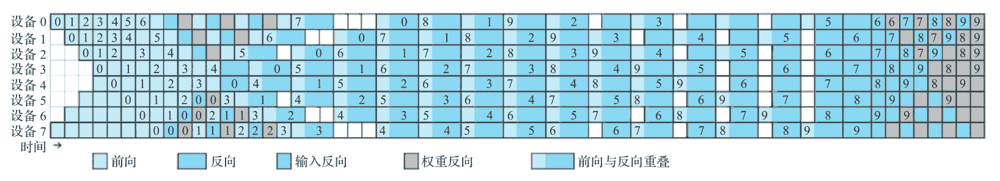

**图 1-42 DualPipe 算法示意图**

● 多 token 预测（MTP）技术缩短训练周期：另外，DeepSeek V3 还利用了多 token 预测（MTP）技术，图 1-43 为 MTP 的原理图。该技术通过预测多个后续 Token，增加了训练信号的密度。在传统的训练中，每次只预测一个 Token，就像在黑暗中一次只点亮一盏灯，照明范围有限。而 MTP 技术则像是一次点亮多盏灯，能够更全面地照亮训练过程，使得训练信号更加丰富和准确。通过这种方式，训练周期缩短了 20%，进一步提高了模型的训练效率。例如，在训练一个语言模型时，传统方法可能需要较长的时间才能让模型学习到足够的语言模式，而 DeepSeek V3 使用 MTP 技术能够更快地捕捉到语言的规律，从而缩短训练时间。

DeepSeek V3 的创新并不在于模型结构（如 MOE 和 MLA），而是集中在模型训练方法和底层框架上。这就好比一座建筑，虽然外观可能与其他建筑相似，但内部的建造工艺和支撑结构却有着独特的设计。DeepSeek V3 通过对训练方法和底层框架的创新，实现了对模型性能的大幅提升。

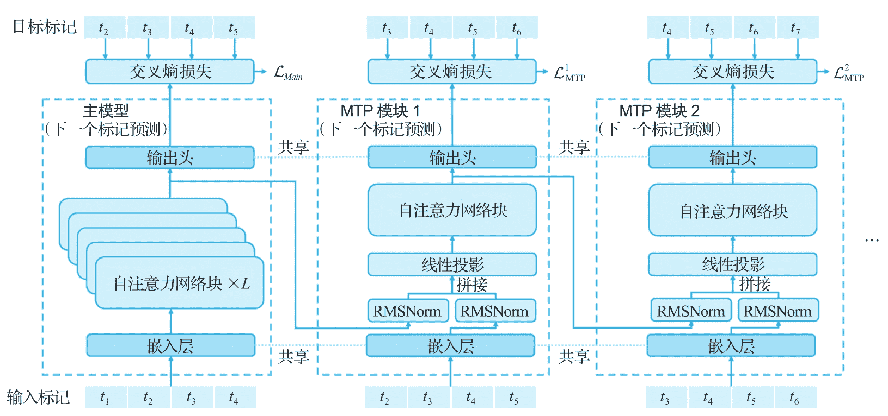

**图 1-43 MTP 的原理图**

这种创新带来了显著的效果。DeepSeek V3 能够以低了两个数量级的训练成本拿下同样的模型效果。这就像是用十分之一甚至百分之一的成本建造出了与其他建筑质量相当甚至更好的高楼。其训练成本仅为同类闭源模型的二十分之一，却在多类测评中与它们有着相当的性能表现。

DeepSeek V3 的出现还对英伟达股价产生了重大影响，促使英伟达股价大跌，损失数万亿市值。过去一周内，DeepSeek R1 和 V3 两款开源 AI 模型的优异表现以及不及 OpenAI 近 1/20 的算力成本令 OpenAI 公司内部感到震惊，也让华尔街开始质疑 AI 公司是否需要在算力成本投入大量资金实现 AGI 模型迭代，英伟达股价一夜暴跌 17%，损失近 6000 亿美元市值。这是因为 DeepSeek V3 的低训练成本和高效性能，对英伟达的 GPU 市场产生了冲击。英伟达的 GPU 在传统的模型训练中占据着主导地位，但 DeepSeek V3 的出现，使得企业和研究机构在选择训练设备时，有更多考虑。这种市场格局的变化，直接反映在了英伟达的股价上。

**2.技术稀缺性的原因**

DeepSeek V3 的技术之所以稀缺，是因为在当前的人工智能领域，存在着一个普遍的问题：模型算法团队不懂底层框架，框架工程团队不懂模型算法。模型算法团队专注于设计和优化模型的结构和算法，以提高模型的性能；而框架工程团队则专注于开发和优化底层的计算框架，以提高计算效率。这两个团队就像是两条平行线，各自在自己的领域内发展，很少有交集。

要实现模型算法和底层框架的完美结合，需要跨领域的合作。但这种合作面临着诸多困难。一方面，两个领域的专业知识差异较大，团队成员之间的沟通和理解存在障碍；另一方面，不同团队的目标和利益也可能存在冲突，难以形成有效的合力。因此，像 DeepSeek V3 这样能够将模型训练方法和底层框架进行创新融合的技术就显得尤为稀缺。

综上所述，DeepSeek V3 以其在训练成本、架构创新、训练方法优化等方面的卓越表现，从技术创新的视角震惊了全球。其独特的 MoE 架构、FP8 混合精度训练、工程优化与分布式训练等技术，不仅提升了训练效率和模型性能，还降低了训练成本。同时，其创新集中在模型训练方法和底层框架上，实现了低训练成本与高模型效果的完美结合，对市场格局产生了重大影响。然而，由于模型算法团队和框架工程团队之间的隔阂，这种跨领域的创新技术十分稀缺。随着人工智能技术的不断发展，我们期待未来会有更多像 DeepSeek V3 这样的创新成果涌现，推动整个行业的进步。

**1.6.2 DeepSeek R1**

**1.DeepSeek R1 的技术创新剖析**

在 DeepSeek V3 展现出卓越综合能力的基础上，DeepSeek R1 进一步聚焦于复杂推理与高效训练领域，代表了当前大模型在专业能力优化与训练范式革新方面的重要突破。所谓“推理能力”，在此特指模型进行数学证明、代码生成、逻辑推断等需要多步因果分析和结构化输出的高级认知任务的能力。这类任务不仅要求模型掌握领域知识，更需要具备顺序推理、假设检验和符号操作等抽象思维能力。

为系统培育这类能力，DeepSeek R1 在训练过程中使用了大量包含中间推理步骤的高质量数据。训练语料涵盖数学推导过程、代码解题路径、逻辑链标注文本等，其构造通常以“问题—推理链—答案”三元组为单位，并借助大模型自动生成与人工校验相结合的方式予以扩充和净化。模型首先在大规模文本语料上进行预训练以巩固语言理解基础，继而依托上述推理密集型语料，通过多阶段有监督微调与强化学习逐步提升其分步推理和结构化输出的能力。

在这一训练范式的有效支撑下，DeepSeek R1 在多项困难推理任务中表现优异，尤其在效率与性能的均衡方面树立了新的标杆，既显著降低训练与推理成本，又保持与更大规模模型相媲美的输出质量。以下将从算法、训练框架与知识迁移三个维度，剖析其核心创新。

**（1）GRPO 算法：范式创新引领变革**

DeepSeek R1 在模型对齐方面引入了一项重要的技术创新——Group Relative Policy Optimization（GRPO）算法。该算法摒弃了传统强化学习中依赖价值函数（Critic）的做法，通过一种更为高效和稳定的组内相对评估机制实现策略优化，显著提升了对齐效果和训练效率。

在传统的近端策略优化（PPO）算法中，通常需要同时训练策略模型（Actor）和价值模型（Critic），这不仅增加了训练的复杂性和不稳定性，还在处理高维输出（如自然语言生成）时容易因价值估计偏差而影响效果。GRPO 创新性地采用了分组比较的方式：针对同一输入，采样生成多个响应，并依据奖励模型或人工评判对它们进行相对排序，进而根据组内优劣差异优化策略模型。这种方法无须额外训练价值模型，大幅降低了计算资源需求，同时避免了价值估计不准所带来的扰动。图 1-44 对比了 GRPO 和 PPO 的计算流程，可以看到 GRPO 通过采样的方式代替了 PPO 中的 GAE，间接省掉了 Value Model。

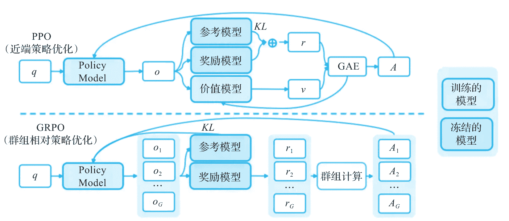

**图 1-44 GRPO 与 PPO 的计算过程对比**

GRPO 的优势不仅体现在更高的训练效率和稳定性上，还体现在其尤其适用于人类偏好对齐任务。它能够更直接地利用偏好信号引导模型生成更符合价值观和指令要求的响应，在数学推理、安全性控制和指令执行等多项任务中都表现出显著的性能提升。这一技术为 DeepSeek R1 提供了更加精准和可控的对齐能力，也推动了大模型训练范式的进一步演进。

**（2）冷启动和多阶段训练方法：平衡能力铸就全面模型**

DeepSeek R1 采用了冷启动和多阶段的训练方法，这是一种巧妙的策略。在模型训练过程中，这种方法能够平衡推理能力和对话能力。通过分阶段的训练，逐步引导模型在不同方面进行学习和提升。最终得到的模型不仅推理能力很强，在对话等其他方面也表现出色，是一个各方面能力都很全面的模型，就像一个全能选手，能够应对各种不同的任务需求。图 1-45 为 DeepSeek R1 训练时 ACC 的变化趋势。

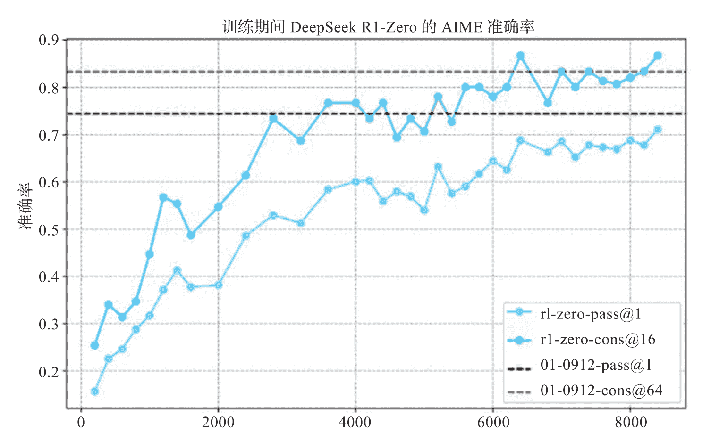

**图 1-45 DeepSeek R1 训练时 ACC 的变化趋势****^([)^(3)^([]](#chapter6_split_001.xhtml_chapter6.xhtml_AC9DC517684B246E6863650B11FD87FA5))**

**（3）知识蒸馏：性能保持与能力传承**

知识蒸馏是 DeepSeek R1 的又一亮点。它能够将 70B 模型的推理能力有效地蒸馏为 1.5B 的模型，实现了从大模型到小模型的性能保持。尽管模型规模大幅缩小，但在实际测试中，小模型依然展现出了令人惊艳的性能，仿佛将大模型的“智慧”完整地传承了下来。这一技术为模型的轻量化和广泛应用提供了可能，使得更多的设备和场景能够受益于强大的推理能力。

**2.DeepSeek R1 对全球 AI 行业的冲击**

**（1）商业大模型赛道受挫**

DeepSeek R1 在技术上的领先效果以及开源的策略，给全球 AI 行业带来了巨大的冲击。在商业大模型赛道上，众多厂商面临着严峻的挑战。由于 DeepSeek R1 的出色表现，客户更倾向于选择开源且性能优异的模型，而不再愿意为商业模型买单。这使得商业大模型厂商的市场份额受到严重挤压，原本看似繁荣的商业大模型赛道陷入了困境。从而更多的企业开始转向智能体应用赛道，大模型厂商的数量在逐渐收敛。

**（2）智能体应用爆发的契机**

尽管 DeepSeek R1 给大模型厂商带来了挑战，但也为智能体应用领域带来了蓬勃发展的机会。由于 DeepSeek R1 强大的推理能力和全面的性能，它为智能体的开发和应用提供了坚实的基础。所有企业都意识到，这是一个不可错过的机会，纷纷抓住这个契机，将 DeepSeek R1 应用于智能体的开发中，以提升智能体的性能和智能水平。很多模型厂商也在加强模型的思考能力训练。

**3.DeepSeek R1 的推理能力：从快思考到慢思考**

在人工智能的发展进程中，推理能力是衡量模型优劣的关键指标之一。近年来，DeepSeek 模型的出现为人工智能推理能力的发展带来了新的突破。尤其是 DeepSeek R1 采用了慢思考的方式，在智能搜索、任务拆解规划能力以及推理计算等方面展现出了卓越的性能。

**（1）慢思考带来的信息深度加工**

所谓慢思考是指模型经过深入的知识整合与分析，而非快速给出浅层答案。DeepSeek R1 正是凭借这种方式，在智能搜索领域展现出显著优势。与 GPT-4o、O1 等主流模型相比，DeepSeek R1 具有强大的知识整合分析能力。在面对复杂的搜索需求时，它不会仅仅停留在表面信息的检索，而是深入挖掘知识之间的关联，将分散的信息进行整合和分析。例如，当用户搜索一个涉及多领域知识的问题时，DeepSeek R1 能够迅速从海量的知识库中筛选出相关信息，并进行有效的整合，为用户提供全面、准确的答案。这种深度搜索能力，使得 DeepSeek R1 在智能搜索领域脱颖而出。图 1-46 为 DeepSeek R1 对“抗生素能治疗病毒感染吗？”的回复示例。

**（2）出色的任务拆解规划能力**

DeepSeek R1 的慢思考方式还赋予了它出色的任务拆解规划能力。用户只需向模型提供指令和需求，它就能凭借深度思考能力智能地对指令进行分析和拆解。以项目规划为例，当用户提出一个项目目标时，DeepSeek R1 会首先对项目的各个环节进行深入分析，将大目标拆解为多个具体的子任务。然后，它会根据任务的难易程度、先后顺序等因素，规划出详细的执行轨迹。这种能力不仅提高了任务执行的效率，还确保了任务的准确性和全面性，为用户节省了大量的时间和精力。图 1-47 为 DeepSeek R1 规划的两个旅游路线的行程攻略，可以看到它输出的结果内容翔实，可执行性强。

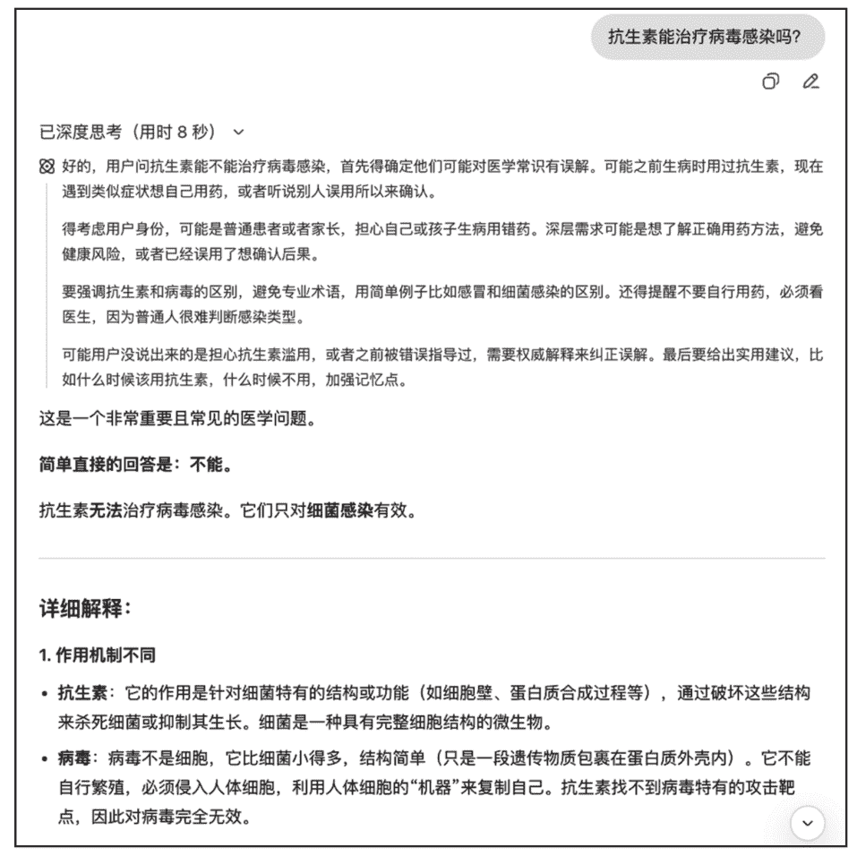

**图 1-46 DeepSeek R1 的回复示例**

**图 1-47 DeepSeek R1 规划的行程攻略**

**（3）强大的推理计算能力**

DeepSeek R1 在注重逻辑的推理计算方面同样表现出色。相较于其他主流模型，它能够进行更深入、更复杂的逻辑推理。在数学计算、逻辑谜题等需要严谨推理的场景中，DeepSeek R1 能够迅速识别问题的本质，运用其强大的逻辑推理能力，找到解决问题的最佳方案。例如，在解决复杂的数学难题时，它会逐步分析问题的条件和要求，运用合适的数学方法进行推理计算，最终得出准确的答案。DeepSeek R1 的这种强大的推理计算能力，使得它在需要逻辑思维的领域具有广泛的应用前景。图 1-48 展示了 DeepSeek R1 在解决数学推理问题时生成的运算代码。

**图 1-48 DeepSeek R1 生成的运算代码**

**4.使用模式的变化：提示词需要预留空间**

**（1）传统提示词的特点**

传统提示词在使用中呈现出篇幅较长、格式复杂、要求烦琐的特征。在与大语言模型交互时，使用者往往需要精心设计详细的提示词，明确任务的各个方面（如角色设定、任务描述、限定条件以及参考样例等）。例如，将大模型设定为“专业的健身教练”，详细描述要求它生成的健身计划内容，限定输出长度和回答范围等。这样的设计虽能让模型更精准地理解任务，但也增加了使用者的操作难度和时间成本。图 1-49 就是一个传统大模型提示词例子。

**图 1-49 传统大模型提示词**

**（2）DeepSeek R1 的提示词优势**

相较于传统提示词，DeepSeek R1 的提示词具有显著优势。它描述简洁，采用自然语言的形式，并能够自动对问题进行分析。DeepSeek R1 是基于强化学习 RL 的推理模型，在回答使用者问题前，会先进行“自问自答”式的推理思考，模拟人类的深度思考过程。例如，面对“先有鸡还是先有蛋”的问题，它会对问题领域进行分析、回忆相关知识、分析用户意图，并结合用户场景，最终综合生成结果。因此，使用者只需明明白白把自己的需求描述清楚，就大概率可以得到想要的答案，无须再花费大量精力去优化提示词。图 1-50 的框选部分为与图 1-49 中的问题相同时，DeepSeek R1 所需要的提示词。

**图 1-50 DeepSeek R1 的提示词**

**（3）提示词“预留空间”的意义**

由于 DeepSeek R1 具备强大的自主推理和分析能力，在设置提示词时需要“预留空间”。这意味着不需要像传统提示词那样将所有细节和要求都详尽列出，而是给予模型一定的自主发挥空间，让其凭借自身的推理能力去填补信息，从而生成更符合需求的结果。这种使用模式的变化，使得用户与大模型的交互更加高效、便捷，降低了使用门槛，让更多人能够轻松利用大模型辅助工作、学习和生活。

## **1.7 星辰大模型：我国通用人工智能体系的突破**

在人工智能成为国家战略科技力量、赋能千行百业高质量发展的关键阶段，星辰大模型以“全模态、全自研、全国产”为核心特征，实现了我国通用人工智能体系的突破。该模型不仅彰显了我国在大模型基础理论研究、关键技术攻关与整体架构建设中的自主研发能力，更在技术性能、实际落地与生态构建等多个维度达到业界领先水平，为推进高水平科技自立自强提供了扎实支撑。

**1.7.1 核心技术架构：“1+1+1”全栈自主创新体系**

星辰大模型的创新体现在其“1+1+1”架构，具体如图 1-51 所示。

● 全模态理解：深度融合语义、语音、视觉等多模态信息，实现跨模态的理解、生成与交互能力。依托海量多领域训练数据，更接近人类的多维度认知方式。

● 全自研架构：从底层算法开始完全自主创新，确保技术独立性和迭代自由度。覆盖 7～115B 多种参数规模，并实现开源，具备灵活的部署适应性。

● 全国产突破：在国产万卡集群上实现高效多模态大模型训练。通过持续优化，训练效能显著提升至 95%以上，精度损失控制在极低水平（5‰以内），系统可用率达 99%以上，保障了安全可控与稳定服务。

● 云网融合架构（AI Flow）：创新性地采用云边端协同推理架构。根据任务复杂度智能分配计算负载（边缘处理简单任务，云端处理复杂任务），有效降低了延迟和带宽成本。

● 自主算力与数据支撑：依托国内大型智算集群构建稳定算力平台。训练数据规模庞大且模态丰富（涵盖视频、语音、文本），来源合法合规，严格遵守数据隐私保护。

**图 1-51 星辰大模型的“1+1+1”架构**

**1.7.2 学术与技术实力：从顶级会议论文到权威评测**

星辰大模型的技术实力获得了学术界和行业广泛认可，图 1-52 展示了星辰大模型在相关榜单的成绩。

● 学术研究：在自然语言处理、计算机视觉、多模态学习等前沿领域发表顶级会议/期刊论文 60 余篇（如 CVPR，NeurIPS，ICML）。累计申请专利 582 件（含 56 件 PCT 国际专利），覆盖核心算法、训练优化及应用部署的全流程。

● 性能评测：在阅读理解、逻辑推理、文章写作、多模态感知等关键任务上达到国际领先模型水平（如 GPT4）。视觉生成质量超越 Midjourney V5 等主流模型。核心技术创新（如跨模态注意力机制、动态学习率调整）支撑了优异性能。

权威榜单表现（代表性摘录）如下：

● 多模态理解：MMMU 评测排名第一，MME 评测排名第二。

● 语义理解与通用能力：C-Eval 中文评测排名第二，SuperCLUE 综合评测获铜牌（前三）。

● 智能体与开源生态：SuperCLUE Agent 评测排名第二，SuperCLUE 开源模型评测排名第三。

● 综合排名：OpenCompass 多模态大模型综合评测排名第三。

这些成果从多维度验证了星辰大模型的综合技术实力已达到国际第一梯队水平。

**图 1-52 星辰大模型在相关榜单的成绩**

**1.7.3 产业赋能：从技术创新到商业落地**

除了技术领先之外，星辰大模型技术已在以下多个关键领域实现成功应用：

● 政法公安（智慧安防）：应用于乌鲁木齐“雪亮工程”，通过全目标解析等能力赋能图侦与基层治理，显著提升了重大风险事件的智能预警与处置效率，推动警务模式向“事前预防”和“智能防控”转变。

● 政务服务（智慧城市）：赋能东莞“智慧水乡”项目，构建智能算法仓解决违法停车、占道经营等城市管理难题，联动多政务系统，实现了“一网统管”，提升事件识别效率和管理精细化水平。

● 央企转型（物流智能化）：支撑中国物流集团“AI+”项目，通过自研平台赋能园区运营规范识别与预警分析，有效提升了作业规范性，显著降低人工巡查成本。

● 内部应用（企业效率提升）：在客服领域应用效果显著，AI 客服占比提升，数字人客服实现全流程自助服务，智能知识采编系统提升效率与准确性，有效降低了客服人力成本。

● 产品与方案体系：基于实践，形成了面向个人/家庭市场（如家庭管家）、政企市场（如视觉大模型一体机）的标准化产品，以及覆盖政法公安、政务服务、工业质检、软件工厂等领域的行业解决方案体系。

图 1-53 为星辰大模型在多个关键领域的成功应用。

**图 1-53 星辰大模型在多个关键领域的成功应用**

星辰大模型通过持续的技术创新与产业实践，不仅推动了各行业的智能化升级与效率提升，也为中国通用人工智能的自主可控发展探索了有效路径。它未来在更广泛领域的深化应用值得期待。

在人工智能技术迅猛发展的今天，一个真正强大的通用人工智能模型需要具备多维度的核心竞争力。由 TeleAI（天翼 AI）团队研发的星辰大模型，以“全模态、全自研、全国产”三大特征构建了独特的技术壁垒，其创新的“1+1+1”全栈自主架构不仅重新定义了通用人工智能的技术标准，更为我国 AI 产业的自主可控发展开辟了新路径。

## **1.8 大模型产业落地的困境与破局之路**

大模型技术虽已取得突破性进展，但其在产业端的实际落地却面临着显著的挑战。本节将剖析这一困境的破局方案：从初期的“千模大战”导致模型泛滥、消费者感知与应用价值不足，到当前超越模型层面的竞争，通过构建“智能体”实现产业价值落地。

**1.8.1 从大模型的无序竞争到智能体的崛起**

自 ChatGPT 引爆热潮后，中国掀起“千模大战”，2022 年 11 月至 2023 年 5 月半年内推出了 55 个类 GPT 模型，截至 2024 年 8 月备案模型超 200 个，总数突破 300 个。爆发式增长导致整个行业内的资源分散、模型同质化严重、未能解决实际产业任务等问题。同时，密集发布引发公众认知疲劳，降低了对大模型的价值评价，认为大模型存在过度投资、技术泡沫及缺乏明确应用场景等情况。突破困境需转变思路：基座模型聚焦智能体能力与实际应用，通过“智能体”实现从技术探索到产业应用的跨越。

2025 年已成为“千模大战”的关键分水岭。基座模型格局从“百模混战”走向收敛，资源向头部模型聚集（如阿里千问、DeepSeek、字节豆包、百度文心、电信星辰大模型等）。而基座模型的发展逻辑也正经历深刻转变——从早期追求“大而全”的参数规模扩张，转向“精而专”的核心能力深耕，其核心目标已聚焦于为智能体提供更坚实、更全面的支撑，推动智能体从“概念化演示”迈向“规模化实用”。这一转变并非偶然，而是源于现实场景对智能体的更高要求，即不仅需要具备基础的交互与理解能力，更需在复杂任务处理中展现出精准规划、深度分析与高效执行的综合素养，而基座模型正是承载这些能力的核心载体。

具体来看，基座模型重点突破的四大核心能力，构成了智能体实用化的“四大支柱”，各自承担着不可替代的关键角色。

其一，深度思考能力是智能体应对复杂任务的“大脑中枢”。在面对需要多步骤拆解、长期目标规划的场景时，例如为企业制定季度营销策略、为科研项目设计多阶段实验方案，或是为用户规划跨城市的深度旅行路线，基座模型的深度思考能力能够打破“线性思考”的局限，再通过逻辑推理、因果分析与全局统筹，将复杂任务拆解为可执行的子步骤，同时预判潜在风险并制定应对预案。这种能力让智能体摆脱了“被动响应”的模式，具备了主动规划、动态调整的“自主决策”素养，成为处理复杂场景的核心前提。

其二，数理能力是智能体实现“精确分析”的“计算引擎”。在金融风控、科学计算、工程设计等对数据精度与逻辑严谨性要求极高的领域，基座模型的数理能力的重要性尤为凸显。无论是通过统计学模型分析海量交易数据以识别欺诈行为、利用微积分与流体力学公式模拟工业设备的运行状态，还是基于线性代数与概率模型优化供应链的库存调配，基座模型的数理能力都能确保智能体在数据处理、公式运算、逻辑推导中保持极高的准确性，避免因计算误差或逻辑漏洞导致决策失误，为精准化场景提供可靠保障。

其三，代码能力与工具使用能力是基座模型拓展应用边界、实现“广泛执行”的“手”和“脚”。在数字化时代，绝大多数实际任务的落地都依赖于代码编写（如自动化脚本开发、软件功能实现）与工具调用（如数据分析工具、办公协同工具、云端服务平台）。基座模型的代码能力，使其能够理解人类需求并转化为可执行的代码，快速完成自动化任务；而工具使用能力，则让智能体能够灵活调用各类专业工具，弥补自身在特定领域的能力短板。例如，通过调用专业的数据分析工具处理海量数据，通过调用办公软件完成文档生成与排版，通过调用云端 API 实现跨平台功能集成。这两种能力的结合，让智能体不再局限于单一的交互场景，而是能够深入到企业办公、工业生产、科研创新、日常生活等各类实际场景中，高效完成任务执行，真正实现“实用化”落地。

综上所述，基座模型对“深度思考、数理能力、代码能力、工具使用”四大核心能力的深耕突破，构建了一套完整的“智能体支撑体系”：深度思考提供决策方向，数理能力保障分析精度，代码与工具使用能力确保执行效率。这套体系的完善，不仅让智能体的能力边界持续拓展，更让其在现实场景中的价值得以真正释放，成为推动人工智能从技术探索走向产业应用、从理论可行走向实际可用的关键动力，表 1-2 所示为基座模型在四大核心能力的测评及表现。

**表 1-2 基座模型在四大核心能力维度上的测评及表现**

**1.8.2 C 端消费场景的关键趋势和典型案例**

依托这些强大“大脑”（大模型）的智能体经济，被寄予厚望成为大模型价值落地的核心载体。全球智能体市场年增速超 40%，用户触达效率史无前例（如 ChatGPT 用户破亿仅需两个多月）。与此同时，智能体应用的商业价值已被广泛认可，成为全球数字经济增长的新动力。一时间内，海内外涌现多款面向 C 端消费市场的智能体产品：

● Manus：作为通用型 AI 智能体平台，Manus 采用多智能体协作架构与独立虚拟机执行环境，能够自动规划复杂任务并调用浏览器、代码引擎、API 接口等工具，直接交付可用成果。例如，当用户提出“为新品发布会制作数据报告与宣传页面”的需求时，Manus 可自主拆解任务：首先调用数据接口抓取销售信息，继而运行 Python 脚本进行清洗与分析，再生成可视化图表，最后调用设计工具完成排版并输出网页与 PDF 文档。这一过程完整体现了深度思考、代码能力与工具调用的协同，大幅减少人工干预，大幅提升了生产效率。

● Cursor：这是一款以“AI 优先”为核心理念的现代化代码编辑器，将大模型的代码生成、错误修复与架构优化能力深度集成至开发全流程。开发者仅需用自然语言描述需求，例如“添加用户登录的 JWT 验证模块”，Cursor 即可自动生成符合项目结构的完整代码、补全配套测试用例，甚至主动重构冗余逻辑。它还能无缝调用 Git、终端与调试器等工具，实现从需求到部署的闭环。Cursor 真正实现了编程开发领域的“第二大脑”，不仅使编码速度大幅提升，更让开发者从重复劳动中解放，聚焦更有价值的环节。

● Perplexity：这款应用重构了传统搜索的信息获取模式，以“直接给出答案并附可验证来源”为核心体验。其背后融合了实时网络检索、RAG（Retrieval Augmented Generation，检索增强生成）增强与多模型推理机制，能对复杂问题（如“比较 2025 年中美人工智能监管政策对创业公司的影响”）进行多源信息整合、逻辑归纳与趋势预判，并为每一条结论标注权威出处。这种能力不仅体现深度思考与工具调度的结合，更重塑了用户对信息价值的感知。其月活跃用户留存率超过传统搜索引擎，证明用户愿意为精准、可信赖、省时的智能体验持续买单。

● Notion AI：Notion AI 深度内嵌于全球千万用户使用的知识管理平台，其价值不仅在于内容创作，更在于跨文档、跨数据库的任务执行能力。例如，当用户发出指令“根据上周会议记录生成待办清单，分配给相关成员并同步到日历”，Notion AI 可自动解析会议文本、提取行动项、关联人员信息、创建任务卡片并推送提醒。这一过程展现了语义理解、任务规划与多工具协同的综合能力。在企业客户中，该功能成功推动了付费转化率的提，验证了“场景原生型智能体”在组织协作中的商业潜力。

● Figma（设计智能体工具集）：作为全球设计师首选的云端协作平台，Figma 已将 AI 智能体工具集深度融入从灵感构思、原型设计到交付开发的全流程。例如，设计师输入“生成符合 Material 3 规范的登录页面”，智能体可自动产出高保真视觉稿、标注组件属性、生成前端代码片段并推送给开发团队。这种“设计意图到可执行资产”的无缝转化，使产品迭代周期大幅缩短，成为垂直领域中“深度集成+高效执行”的典范。

● 腾讯元宝：这款应用是腾讯基于混元大模型推出的 AI 助手，聚焦办公提效与智能生活，核心能力覆盖多模态搜索、文档处理、内容创作与个性化服务。支持语音/文字提问，智能聚合微信公众号、视频号等生态内容，返回图文、视频、地图等多形态结果；可识别并处理 PDF、Word、PPT、Excel 等文件，快速提取重点、生成报告或方案。通过接入京东、微信读书等多个平台，实现从搜索到采购的轻闭环，日活用户已超千万，在学生与职场人群中形成高频使用习惯，验证了轻量级智能体在大众市场的落地能力与用户价值。

这些产品在用户规模与市场价值上备受资本关注，国内外投资机构普遍认为，智能体是继互联网之后的下一代重大投资机遇。

与此同时，C 端的智能体的应用已经与智能设备深度结合，形成了一个全新的生态系统。通过多智能设备接入统一的 C 端服务智能体，不仅赋予了智能设备更强大的服务能力，还为客户提供了一个跨设备之间统一的整体智能服务体验，图 1-54 为 Google 和小米搭载智能体的各种应用。

**图 1-54 以 C 端智能体为各种应用的统一入口**

以 Google 和小米为例，我们可以清晰地看到这种融合的趋势。Google 通过 Gemini 打造的智能体统一入口，实现了个人终端数据的全面整合。无论是手机、手表还是耳机，用户都可以随时随地获得多模态交互帮助。基于 GCP 谷歌云平台的数据存储与 AI 能力，Google 构建了一个“全家桶”应用，串联起各项服务，形成一个多维度的个人情景知识数据库。这种统一账号体系和云端化底座的设计，使得跨终端无缝协同成为可能，为用户提供了一致且高效的智能服务体验。

同样，小米的小爱同学超级智能体也作为统一交互入口，协同调度终端设备，包括手机、穿戴设备、家庭大屏、办公设备以及智驾系统。小爱同学与澎湃 OS 构成的“中枢神经”与“智能躯体”协同的小米生态，具备自主决策和群体协作能力的 AI 生态体系，是“人—车—家”生态的神经中枢和中央调度平台。通过统一身份认证和全栈安全能力，小米确保了用户在不同设备间的无缝切换和数据安全。

这种多智能设备接入统一智能体的方式，不仅提升了设备的智能化水平，还极大地丰富了用户的使用场景。例如，在家庭环境中，用户可以通过语音指令控制家中的各种智能设备，实现灯光调节、温度控制、娱乐播放等功能；在办公室中，智能体可以协助用户进行日程管理、会议安排和文件处理；在驾驶过程中，智能体则可以提供导航、信息查询和紧急救援等服务。智能体与智能设备的深度融合，正在逐步改变我们的生活方式。通过统一的智能体服务，用户可以在不同的设备间享受到一致的智能体验，大大提升了生活的便捷性和舒适度。

除了市场中这些明星智能体的崛起，整个智能体行业的产值也在迅速增长。这种行业情况的调研，无须作者亲自撰写，我们可以交给“星辰超级智能体”产品来完成。我们对超级智能体提出需求“请你足够全局性、策略性且地搜集全网资料，最好包含足够数据（行业报告）及论文支撑，呈现现在智能体在全球范围的发展情况，着重于它在全球 AI 生态的地位。内容需要做到精准、全面、专业，同时生成一些图表辅助”。

星辰智能体经过数分钟的信息收集和思考调研，给出下面的 PPT 材料和说明文档。具体 PPT 内容如图 1-55 所示。

AI 智能体正从实验室跃迁为企业级生产力单元。2024 年全球 AI 智能体市场规模尚未突破 60 亿美元，到 2030 年市场规模预计将达 530 亿美元，年复合预计增长率约 45.8%。这一爆发式增长正重塑全球产业格局，开启规模化商用新阶段。

在市场规模快速扩张的同时，全球竞争格局也逐步明朗。北美市场凭借技术与资本优势占据阶段性领先地位，欧洲与亚太市场紧随其后。数据显示，中国市场正快速崛起，在 2025 年其市场规模已占据全球约 35%的份额，位列世界第二。这标志着中国正成为全球智能体市场发展的关键驱动力之一。

**图 1-55 智能体在全球的发展情况（由超级智能体调研并编制）**

现阶段中美两国已形成全球 AI 智能体发展的双极格局。研究数据显示，中国在大模型研发数量上保持领先地位，中美主流模型性能差距持续缩小。美国企业如谷歌、微软等科技巨头持续加大对 AI 科研的投入，为市场注入强劲动力，国内企业如腾讯、百度、阿里云等也在积极布局。以中美引领的全球 AI 产业高速发展，为 AI 技术在各行各业的渗透奠定了技术基础。

目前智能体技术已渗透多个行业并取得了不同的阶段性进展。金融领域 AI 智能体的渗透率已达到 38.2%，智能化服务覆盖超 70%。其应用涵盖动态风险管理、个性化投顾等场景，显著提升了服务效能。当您深夜致电银行查询账户，不再需要漫长等待转接人工服务，而是瞬间得到精准解答——这已不是未来场景，而是 75%客服场景中正在发生的现实变革。AI 智能体不仅可以快速响应客户需求、24 小时提供不间断服务，更在悄然重塑客户与金融领域企业互动的方式。然而在制造业 AI 智能体的渗透率仅为 15.3%，尚处于早期发展阶段。AI 技术在制造业落地过程中的主要困难集中在技术集成难度高、质量控制不稳定等核心障碍，尤其在高敏感、高精度度领域的体现得更加明显。医疗领域的 AI 智能体在医生培训和病例分析等场景落地较快，展现出一定商业潜力，但因行业敏感度，整体发展仍在伦理审查、政府监管下审慎推进。在教育领域，AI 智能体应用则展现出更大的商业弹性，并在个性化学习路径规划、智能辅导、教学内容的动态调整以及科研探索等多个场景中深度应用。

随着 AI 底层技术的进一步发展与应用生态的进一步完善，智能体也将具备更强大的能力与行业属性，在更多领域取得可期的突破。据德勤预测，到 2027 年，超过 50%的企业将部署 AI 智能体，使其成为团队中不可或缺的稳定成员，深度重塑未来商业的组织形态与协作模式。

以上内容摘自星辰超级智能体自动编写的调研报告。

**1.8.3 前沿趋势：超级智能体成科技和产业落地的焦点**

自 2025 年 3 月 Manus 发布并成为行业里程碑后，智能体市场呈现爆发式增长，国内外涌现了 GenSpark、Coze、Skywork、MiniMax 等数十款超级智能体产品。这些产品普遍以”全领域任务执行专家”为定位，通过网页或移动端提供跨领域任务处理能力，技术架构上多采用多智能体协作或混合模型路径。随着越来越多智能体产品的出现，市场已然展现了初步的繁荣。

然而，在这一片繁荣的市场下仍存在三个关键性挑战：

第一，同质化竞争激烈。尽管市场上智能体产品的数量迅速增加，但许多产品在核心功能上高度相似，主要集中在信息检索、数据分析和基础报告生成等领域，缺乏真正的差异化能力。智能体产品的平均用户留存率仍处于较低水平，这反映了现有产品的差异化程度及客户满意度尚有较大提升空间。

第二，产业深度不足。当前智能体产品大多聚焦于通用办公场景如知识问答、文章润色等，对于制造业、能源、交通等关键产业的深度应用较少。例如在制造业中，AI 技术的应用虽然在逐步增加，但在设备故障预测、供应链优化等方面仍面临挑战。

第三，难以实施从基础大模型到智能体框架的联合优化。智能体产品的效果提升高度依赖底层大模型到智能体框架的端到端优化，但这需要企业具备基础大模型的训练和调优能力。由于训练基础大模型的企业逐渐收敛，这限制了很多企业退出智能体产品的效果上限。

基于上述市场痛点与机遇，由中国电信自研的“星辰超级智能体”和“星辰智能体平台”应势而生，旨在精准填补超级智能体在产业落地的空白，打造标杆应用。其核心战略路径明确且坚定：聚焦中国的产业需求，致力于构建国央企体系内首家、实现从基础模型到智能体框架的端到端优化的产业级超级智能体。其核心战略是：

● 深度聚焦产业：立足于产业的真实需求，将能力聚焦于深度研究报告生成、海量数据分析、业务全流程自动化等专业性强的场景。

● 端到端技术优化：打通从基础大模型到智能体框架的全链路，实现技术栈的深度整合与优化，实现可落地的领先效果。

● 打造国家级标杆：发挥中国电信在产业数据和应用场景的独特优势，构建一个安全、可信、高效的智能体平台，为产业智能化升级提供核心动能。

通过上述战略，中国电信成功打造了星辰超级智能体差异化优势，成为央国企产业化升级的优选合作伙伴。

**1.8.4 B 端产业场景的关键趋势和典型案例**

智能体正从早期的概念验证阶段，转变为能切实推动企业生产效率提升、创造实际价值的“实战生产力引擎”。不满足于停留在理论或实验室的技术，而是深入到各业务场景中发挥作用，有如下三个关键趋势：

**1.与主营业务和系统整合**

智能体需深度嵌入企业核心业务流程与相应的 IT 系统，才能够真正产生足够大的使用量和足够关键的价值贡献。例如一家银行应用智能体，一定要从信贷风控、智能投顾、客户服务等场景入手，如果只用智能体做招聘简历的筛选，则会让人感觉智能体只能解决一些边角的问题，价值有限。通过与业务系统的集成，智能体可实现从需求输入到结果输出的全流程自动化操作，其价值体现在稳定可靠运行并适应多变场景，成为业务流程中不可或缺的中枢。

**2.单一任务走向综合流程**

智能体正从只能解决单点业务场景“小而美”的工具，升级为解决业务全流程的“六边形战士”，实现端到端完成任务的闭环。例如特斯特联（TERMINUS）迪拜世博会展示的智能体机器人，具备自主应对和协同交互能力。它采用多模态感知和语音交互技术，能自主规划路线，串联服务庞大园区内的多个场景，包括接待、出行、配送等，有效提升游客体验。

**3.企业生产力回报**

企业在智能体的价值评价上越来越务实，强调在企业生产力回报方面有量化成果。以实际业务改善为导向，聚焦时间节省、人力释放、错误减少及体验优化等有可感知可量化评价的成果。项目立项前需清晰界定“让谁的工作更轻松”及“带来哪些行为变化”，以此确保落地价值的明确性与可持续性。智能体的核心意义在于稳定交付可衡量的业务改善成果，推动企业运营效率与服务质量的显著提升，而不是“应用可科技创新成果”之类的虚幻回报。

智能体已在多个面向 B 端的产业场景有代表性的产品推出：

● 办公领域：金山办公推出的 WPS 灵犀原生 Office Agent 深度嵌入其核心编辑流程，能够自动完成文档与 PPT 的创作任务。该智能体实现从内容输入到成品输出的端到端闭环，显著节省人力投入并大幅提升内容一致性与创作效率。通过与办公主系统的无缝对接，为企业提供稳定可靠的内容生产解决方案，有效改善日常办公场景中的生产力瓶颈问题。

● 工业制造：西门子 Industrial Copilot 深度对接 CAD 与 MES 系统，实现工业设计制造流程的无缝衔接。通过指令生成工业设备图纸与操作指令，打通设计-制造链路，形成全流程自动化闭环。该智能体解决工业设计制造流程割裂问题，显著缩短交付周期，为工业生产带来效率提升与成本优化。

● 能源与工业领域：中国电信电力巡检专用智能体集成巡检无人机与 SCADA 系统，秒级识别设备异常并自动派发工单，实现从“发现隐患”到“告警响应”的闭环。这一应用显著降低运维成本与安全风险，完善了电力设备巡检的效率与可靠性，为能源行业的智能化转型提供了坚实支撑。

● 金融行业：商汤科技 FinAgent 深度嵌入银行核心数据平台，实现智能数据生产、投研分析、合规管理到信贷风控的全流程闭环。通过端到端的智能化处理，有效提升风控效率与金融服务专业一致性，为金融机构带来可感知的运营改善。

● 消费电子：美的推出 COLMO 智能体，作为行业首个家电全场景 AI Agent，接入全屋 IoT 中枢，实现与空气、用水、光影及安全系统的深度整合。通过一键智控，打通家庭场景端到端体验闭环，显著提升用户便利度与家居服务一致性，优化全屋智能化管理流程。

● 矿工领域：网易“灵境”矿山具身智能模型通过强化学习技术，使挖掘机能够自主完成矿石分拣任务，并显著提升作业效率。该智能体深度嵌入矿山作业流程，与调度系统无缝对接，优化了从挖掘到分拣的全流程操作。其关键价值在于减少人工依赖、提升响应速度，并有效改善整体作业体验。

**1.8.5 智能体产业链中各方发展策略**

在未来的发展中，智能体已成为生态战略的重要之地，多家企业纷纷入局。在技术趋势上，智能体在落地上要想真正驱动产业升级，必须突破“工具代理”的舒适区，向“高价值决策场景”纵深跃进，实现从“单点工具”到“系统级智能”的跨越，构建“感知-决策-执行-反馈”全链路能力（参考 E2B《AI Agents Landscape》）。

同时发展多智能体协作、深度场景嵌入、降低开发门槛的框架是智能体技术的发展方向，其核心竞争力在于整合工具链、拆解复杂任务、自主优化决策的系统级能力，而非单点 API 调用。未来 1～2 年，业内的各个厂商将对高度自动化的超级智能体加大研发力度，引领行业进入全新的智能化发展阶段。

在生态竞争战略策略上，各家厂商也将基于自身优势，布局差异化战略，形成“分层竞争、协同互补”的行业生态格局：

● 大模型服务商：不断打磨基础模型支撑智能体执行的能力，包括深度思考、数理计算、代码编写、工具使用等，并自建示范应用。同时，开源模型能力跻身第一梯队，在很多场景上开源模型与闭源模型的表现已经差距不大。

● 科技大厂：科技大厂尤其是互联网企业倾向于发挥“智能体对 C 端业务的赋能”，将智能体深度嵌入互联网应用、操作系统、办公软件与硬件终端等，以提升产品黏性与各产品之间的协同效率。在云业务上，头部科技企业往往通过模型或平台开源吸引开发者，最终通过企业客户消费算力变现，如百度云提供的文心模型与千帆开发平台、阿里云提供的千问模型与百炼开发平台、火山引擎提供的豆包模型与扣子开发平台等。

● 创业企业：创业企业聚焦垂直领域场景创新，依托医疗、零售等细分市场的专业知识与敏捷迭代能力，打造“专精特新”型智能体。其差异化打法在于深度定制，快速响应高价值利基市场需求，以场景创新突破构建独特竞争优势，与其他市场主体形成差异化共存格局。例如 Cursor、Figma 等通过聚焦细分场景，形成独特的竞争优势和专业领域内的护城河。

● 央国企/运营商：央国企依托其在医疗、教育、金融、能源、交通、政务、通信等产业场景的深厚积累，引领产业智能体开发与应用，推动企业数智化转型。例如中国电信根据电信内部巨量的存量客户和各类场景业务，结合运营商资源禀赋（各省的本地化研发团队），推出星辰智能体平台，推动国家 AI+战略在各个深入产业的场景实现。

随着智能体深度嵌入更多高价值决策场景，我们将迎来一个”智能体驱动、人机协同”的全新智能时代，为人类社会创造前所未有的价值与可能性。智能体不仅是技术的演进，更是产业变革的催化剂，将深刻重塑商业逻辑、工作方式与社会形态，引领人类步入一个更加智能、高效、个性化的未来。

[1[]](#chapter6_split_001.xhtml_chapter6.xhtml_BAC9330F707AE44A5A9686FFAFFB83552B)https://soft.zhiding.cn/software-zone/2022/1202/3146149.shtml。

[2[]](#chapter6_split_001.xhtml_chapter6.xhtml_BA5B924FBE9D4F4931A7808C64C4C78865)https://zhuanlan.zhihu.com/p/14890557782。

[3[]](#chapter6_split_001.xhtml_chapter6.xhtml_BAC9DC517684B246E6863650B11FD87FA5)Guo, D., Yang, D., Zhang, H.*et al*.DeepSeek-R1 incentivizes reasoning in LLMs through reinforcement learning.Nature 645, 633-638 (2025).

# **第二章** **智能体：大模型应用的产品形态**

第一章回顾了人工智能尤其是深度学习技术从初期演变至今的历程，重点关注了大模型兴起的技术背景与发展脉络。正如我们所见，大模型凭借其强大的泛化与生成能力，已成为当前 AI 领域的重要基础设施。而本章将在此基础上，深入探讨如何将智能体（Agent）这一关键产品形态，作为大模型实现其能力封装与落地的核心路径。具体而言，智能体不仅扩展了大模型的应用边界，也为其注入了更明确的任务导向与领域适应性。下面我们将从智能体与大模型的基本关系展开分析。

在明确本章聚焦方向前，需先澄清智能体的定义：它是以语义大模型、多模态大模型为核心，融合自主感知、决策与执行能力的智能实体，能动态响应环境变化，通过算法调用工具驱动业务流程执行，更被视为“未来软件的核心形态”。这种将大模型与“感知—决策—执行”闭环结合的架构，让智能体突破了单一模型的“生成边界”，成为连接技术能力与产业场景的关键载体。图 2-1 为智能体的原理图。

**图 2-1** **智能体的原理图**

微软公司的 CEO 萨提亚·纳德拉给出的解释是：智能体能直接处理底层数据库操作、承载业务逻辑迁移，甚至取代传统 SaaS（软件即服务）模式。当智能体成为业务流程的“自动化中枢”，依赖固定界面的传统软件工具或将逐渐完成历史使命，未来所有的软件均是智能体。

## **2.1** **智能体与大模型的关系**

如前文所述，从深度学习到大模型的演进，赋予了人工智能前所未有的通用知识储备与内容生成能力。然而，一个核心问题随之浮现：如何让这个“博学”的模型真正深入到产业场景中，可靠地执行具体任务？这正是“智能体”登上历史舞台的契机。

智能体并非要取代大模型，而是为其赋能，成为连接大模型“智力”与现实世界“问题”的桥梁。本节将首先厘清二者的关系：我们将大模型视为智能体的“大脑”，其能力层级决定了智能体的潜能上限。接下来，我们将通过通用大模型、领域强化大模型，以及大模型的辅助要素这三个层次，由浅入深地剖析一个“大脑”如何被逐步培育和武装，最终蜕变为能够解决实际问题的智能体。

**1.通用大模型：如同高中生的基础常识储备**

通用大模型可类比为高中生。高中生在学校接受了全面的基础教育，学习了语文、数学、英语、物理、化学等多门基础学科知识。他们具备了广泛的一般性知识储备，能够对常见问题做出基础解答。通用大模型也是如此，它通过大规模的数据训练，掌握了丰富的语言知识、常识和一般性规律。它可以回答各种常识性问题，进行简单的文本生成和对话交流。然而，就像高中生尚未针对某一专业领域进行系统学习一样，通用大模型缺乏特定领域的深入认知，在处理专业问题时往往显得力不从心。

**2.领域强化大模型：恰似大学生的专业知识积累**

领域强化大模型则如同大学生。大学生在大学选择了特定的专业，通过系统的课程学习、实验实践和科研项目，掌握了该专业的核心知识和技能。领域强化大模型也是在特定行业内进行了深度训练，它针对某一领域的特定数据和任务进行优化，能够处理该行业的专业问题。例如，医疗领域强化大模型可以对医学影像进行分析诊断，金融领域强化大模型可以进行风险评估和投资预测。相较于通用大模型，领域强化大模型在专业领域具有更强的能力和更精准的表现。

**3.大模型的辅助要素：职场培训的关键环节**

仅有领域强化大模型还不足以直接应用于实际工作场景。大模型的提示词、知识库和工具，就相当于对大学生进行职场培训。提示词是引导大模型聚焦具体问题的关键，它通过特定的语言指令，让大模型明确任务目标和要求。知识库为大模型提供了专业的数据支持，它包含了行业内的各种知识、案例和规则，使大模型能够在处理问题时参考和借鉴这些信息。工具则辅助大模型完成特定任务，例如数据处理工具、业务软件等。经过这样的“培训”，大模型能够完成一定的工作任务，如同大学生经过职场培训后具备了初步的工作能力。图 2-2 展示了大模型的落地之路。

**图 2-2** **大模型的落地之路**

**2.1.1** **智能体搭建应用：连接大模型与消费者的桥梁**

智能体应用是集大成者，它能让大模型变成一个合格的职场员工。智能体整合了通用大模型的基础常识、领域强化大模型的专业知识以及提示词、知识库和工具的辅助，从而能够独立、高效地完成复杂工作。智能体具有自主决策、自适应学习及与环境交互的能力，它可以根据不同的任务需求和环境变化，灵活调整自身的行为和策略。

**1.智能体应用的优势**

智能体作为一种具备自主学习、决策和行动能力的智能化实体，在多个领域展现出了独特的优势。在技术性能方面，人工智能技术的不断进步，尤其是机器学习和深度学习算法的发展，为智能体的性能提升提供了强大的技术支持。通过大量的数据训练，智能体可以学习更加复杂的模式和规律，从而能够更加准确地感知环境和做出决策。例如在语音识别领域，智能体可以通过对大量语音数据的学习，不断提高对不同口音和语言环境的识别能力，使语音交互变得更加自然和流畅。

从应用场景来看，智能体在医疗和交通领域的应用已经带来了显著的变革。在医疗领域，医疗智能体可以通过分析大量的医疗数据，包括病历、影像资料、实验室检测结果等，为医生提供准确的诊断建议。如在癌症诊断中，智能体可以快速分析患者的医学影像，检测出微小的肿瘤病灶，提高早期诊断的准确性。同时，还能根据患者的具体情况，制定个性化的治疗方案，提高治疗效果，减少副作用。在交通领域，智能交通系统中的智能体可以实时监测交通流量、路况信息等，优化交通信号控制，提高道路通行效率。自动驾驶汽车作为智能体在交通领域的重要应用，通过传感器、摄像头等设备，能够感知周围环境，做出准确的决策和行动，实现安全、高效的行驶。

在商业价值方面，智能体能够满足企业提高效率、降低成本和提升用户体验的需求。企业可以利用智能体来自动回答客户的常见问题，提供实时的帮助和支持。这样不仅可以为企业节省大量的人力成本，还能提高客户服务的响应速度和质量，从而提升客户的满意度和忠诚度。在金融领域，智能体可以用于风险评估和投资决策，实时监测市场动态，分析各种金融数据，为投资者提供有价值的投资建议。

**2.智能体应用的发展趋势**

从技术发展的角度来看，智能体推动了通用人工智能的研发，加速了大模型技术的迭代。随着技术的不断演进，智能体正从“工具智能”向“场景智能”跃迁，其自主性、多模态交互以及记忆与进化机制等方面都在不断升级。例如超级智能体通过大模型实现复杂任务分解与动态规划能力，整合文本、语音、视觉等多模态输入与输出，构建类人交互体验，并采用向量数据库实现长期记忆存储，结合强化学习持续优化决策逻辑。

市场需求强力推动着智能体的广泛应用。在当今竞争激烈的商业环境中，各行业都在寻求创新和变革的方法，智能体正好满足了这些需求。智能体在医疗、金融、教育、工业等领域都有着广泛的应用前景，可以帮助这些行业解决一些实际问题，提高行业的整体运行效率。不少学者也表示，智能体是 AI 应用的最主流形态，即将迎来爆发点，它可能会是 AI 原生时代内容、信息和服务的新载体。

理论上的优势与广阔前景描绘了智能体的蓝图，那么，智能体技术在实际应用中究竟如何运作，才能真正发挥其连接大模型与用户、解决复杂任务的价值？抽象的“自主决策”“环境交互”“工具调用”能力，需要通过具体的场景来具象化。

接下来，我们将通过一个典型场景的实操，深入展现智能体技术组件的协同运作，介绍其基本原理。

**2.1.2** **智能体的基本原理**

智能体作为大模型应用的关键载体，通过系统化地整合知识库、工具与记忆等核心模块，将强大的基础模型能力转化为面向具体场景的可靠解决方案。理解智能体的工作原理，有助于我们把握其如何实现自主决策、环境交互与任务执行。下面我们以“聚会智能体”为例，具体阐述其基本结构与运行机制。图 2-3 介绍了“聚会智能体”的工作流程和基本模块。

**图 2-3** **“聚会智能体”的工作流程和基本模块**

聚会智能体的任务完成过程可概括为“知识检索—任务规划—工具调用—记忆筛选—落地执行”五个基本步骤，形成一个完整闭环。首先，智能体通过访问知识库获取任务相关的基础框架与先验知识。例如在聚会场景中，它可从《小聚会教科书》这类资料中提取诸如“确定主题—协调时间—选择场地—邀请人员”的标准流程，从而建立符合实际场景的规范化参考体系。知识库为智能体提供了可复用的结构化经验，是它给出具有专业性与完整性方案的重要基础。

随后，大模型作为系统的“决策中枢”，根据知识库提供的框架和用户的具体需求（如“周末好友小聚”）进行任务规划，再通过逻辑推理确定聚会的关键要素，包括时间安排、人员名单和场地类型等，形成初步的可执行方案。这一过程体现了大模型在语义理解、逻辑推演与多目标权衡中的核心作用。

为弥补大模型在实时信息获取方面的局限，智能体可调用外部工具拓展数据来源。例如借助美团等平台获取符合预算、主题和时间要求的餐厅列表。工具模块有效扩展了智能体的感知与执行边界，使其能够接入实时数据、调用第三方服务或执行具体操作。

在决策优化阶段，智能体依赖记忆系统实现个性化筛选与自适应调整。短期记忆可记录当前会话中的用户约束（如有的朋友不吃辣），长期记忆则保留历史交互信息（如过往聚会中体验不佳的餐厅），二者共同作用，使智能体能够输出更贴合用户偏好的方案，避免机械地执行流程。

最终，智能体再次协调工具与大模型完成落地操作，例如实际完成场地的预订、群发邀请函，并向用户清晰汇报执行结果。至此，整个任务形成从意图理解到实际执行的闭环，显示出智能体在复杂场景中调度多模块协同工作的能力。

如果智能体的执行效果未达预期，例如出现流程冗余、决策不准或响应迟缓等问题，可从以下四个方面进行优化。

其一，通过设计更精准的提示词约束大模型输出，明确用户偏好和任务边界，提升模型输出与需求的匹配度。类似于领导提供更细致的指导意见来帮助下属改进工作。

其二，可通过对大模型进行微调训练，注入垂直领域知识，如使用大量优质聚会方案数据进行训练，增强其对特定场景的理解能力。类似于下属的工作思路不够清晰或缺乏经验，通过系统化培训，提升下属的工作能力。

其三，借助多次实验和反馈机制，不断验证不同策略的有效性（如调整工具调用顺序、优化记忆检索方式），实现数据驱动的迭代升级。类似于允许下属试错，在组织了多次聚会，得到了众人评价后，能够给出更优的解决方案。

其四，将任务流程拆成更小的环节，降低单环节完成任务的难度，提高大模型完成任务的成功率。类似于领导将具体怎么组织聚会，分解成几个子任务步骤，让下属只去完成具体的子任务，领导来掌控全局以提升组织效果。

综上所述，智能体通过有机融合大模型的推理能力、知识库的行业经验、外部工具的实时执行力以及记忆系统的个性化适应力，实现了对复杂任务的高效分解与自动化处理。它在结构化协调机制下，充分发挥各模块优势，最终完成从智能计算到实际落地的全过程。这一原理不仅适用于聚会场景，也是支撑智能体在更多专业领域应用的基础。

## **2.2** **智能体的三种模式**

在理解了智能体的基本原理后，我们将进一步探讨智能体在不同需求背景与技术条件下，究竟如何具象化为不同的形态以实现多样化的任务目标。智能体并非单一模式的技术实现，而是根据其自主性水平、任务复杂度及与环境交互深度的不同，呈现出多样化的形态。这些形态各异的智能体在特定的应用场景中发挥着不可替代的作用，共同构成了连接大模型能力与用户价值之间的桥梁。

从技术演进的角度看，智能体正从执行预设流程的“工具智能”，向能够自主理解、决策并执行复杂任务的“场景智能”跃迁。这一转变使得智能体能够更深入地融入各行各业，成为推动产业智能化升级的关键力量。无论是处理高度结构化重复任务的工作流型智能体，还是在开放环境中独立完成复杂目标规划的自主规划型智能体，抑或是能协调多方资源、具备强大认知与执行能力的超级智能体，它们都体现了“感知—规划—行动—反馈”这一核心闭环在不同维度上的扩展与深化。

接下来，本节将聚焦自主规划型智能体、工作流型智能体以及超级智能体这三种典型形态，通过具体的应用案例剖析，深入介绍它们的设计理念、运行机制、优势特点以及如何在中国电信推出的星辰智能体平台等支撑环境下实现其核心价值。

**2.2.1** **以自主规划型智能体为例：会展助手智能体**

首先，我们来介绍什么是自主规划型智能体。自主规划型智能体是一类能够基于用户目标，通过提示词驱动大模型进行任务分解、工具调用与资源协调的高阶智能应用。自主规划型智能体的核心机制在于利用大模型的语义理解与推理能力，结合诸如 Function Calling 之类的底层技术支持，自主选择并调用外部工具、查询知识库、访问 API 服务等，动态生成执行路径，最终完成复杂、多步骤的任务。此类智能体不仅替代了固定脚本式流程，更展现出接近人类的目标导向行为和上下文适应力，尤其适合高结构化、强实时要求的商业场景。

在数字化时代，自主型规划智能体正被广泛应用于各类高结构化、强实时要求的商业场景。其中，会展活动的信息服务就是一个典型且需求日益增长的应用领域。接下来，我们以“世界人工智能大会参会助手”为例，具体说明自主规划型智能体的构建与工作原理。该示例依托于星辰智能体平台，该平台提供了便捷的工具，可帮助用户快速构建专业的会展助手智能体。以下将详细介绍构建流程及其核心特色。

登录星辰智能体平台后，单击“创建应用”开始构建过程。在应用创建页面，需填写基础信息，应用名称建议设置为“大会参会助手”，应用描述可设定为“解答大会相关知识，提供展会信息”。完成上述步骤后，进入自主规划创建页面进行智能体的核心配置。

角色指令是智能体的“大脑”，决定其行为模式。建议将角色定义为“专业的大会参会智能助手”，并详细编写该智能体的工作职责和方式，即大模型的提示词，其中不仅明确了该智能体的角色和职责，并将如何完成会议助手工作的方案也进行了说明，比如查询问题要使用知识库，完成特定任务要使用二维码生成、高德地图等工具。同时，设定准确性第一、信息简洁、URL 完整性、固定无结果回复和隐私保护等核心规则。打磨提示词往往不是一蹴而就的。例如这段提示词总有一句“如果要截取网址，不要删掉.com 后面的.cn”。这是因为很多大模型使用全球语料做训练，多数网址会以“.com”做结尾，大模型在文本中截取网址，往往会遗漏最后的“.cn”，导致网址提取错误。这句提示词是在反复实验过程中加入，而不是事先设计的。图 2-4 是世界人工智能大会参会助手智能体，方框部分的内容就是智能体的角色指令。

**图 2-4** **世界人工智能大会参会助手智能体**

图 2-5 的方框部分是知识库设定界面，创建步骤如下：单击“+”号选择知识库并创建，输入名称（如“世界人工智能大会”）和描述信息，上传相关文件（支持 TXT、MARKDOWN、PDF 等多种格式），然后进行配置。系统默认采用自动分段与清洗，Embedding 模型选择 qwen2.5-72b-instruct，知识检索设置为混合检索（语义检索权重 0.9，关键词检索权重 0.1），最大召回片段数 3，相似度匹配值 0.50。完成配置后，将知识库添加到应用中。

工具添加是扩展智能体能力的关键步骤。单击工具部分的“+”号，添加“获取当前时间”和“生成二维码”两个核心工具，使智能体能够提供实时信息和便捷的二维码服务。

**图 2-5** **知识库设定界面**

此外，使用高德 MCP 工具来协助智能体回答与路径规划相关的问题，如图 2-6 方框部分所示，用户可以自定义工具来辅助构建智能体。

**图 2-6** **添加工具**

为提升用户体验，需设置开场白和预设问题。开场白建议使用“你好，欢迎来到展会助手服务。当你需要查询线下展会的详细信息时，我能为你提供帮助。请告诉我你的需求，我会尽力满足你的要求。”预设问题可设置为“人工智能大会举办时间？”和“人工智能大会周边停车场和交通方式推荐。”，方便用户快速获取常用信息。

图 2-7 方框部分为智能体模型选择窗口，在模型选择方面，推荐使用内置的 TeleChat2-115B 模型，生成多样性设置为 0.7，采用常规模式，以平衡回答的准确性和丰富性。完成上述配置后，进行效果测试，确保智能体能够正确响应各类查询。测试通过后，即可发布为前端页面，并获取访问链接，方便用户通过网页端使用。图 2-8 为智能体构建后的搭建界面。

**图 2-7** **模型选择窗口**

**图 2-8** **发布应用**

**2.2.2** **以工作流智能体为例：电商评论处理工作流**

接下来，我们将介绍另一类广泛应用的智能体形态——工作流智能体。与自主规划型智能体不同，工作流型智能体侧重对具有明确步骤和依赖关系的业务流程进行自动化处理。该类智能体通常依托平台提供的工作流编排能力，将复杂任务拆解为多个顺序或并行执行的子任务节点，通过预定义规则和逻辑连接各个模块，从而实现高效率、标准化、可复用的业务问题求解。它特别适用于流程稳定、环节清晰、需多方协调的企业场景，是实现规模化智能处理的重要途径。

在接下来的内容中，我们将详细解析工作流型智能体的核心环节与实现原理，展现其如何通过流程自动化与智能技术融合，为企业提供可持续、高可靠的业务解决方案。“电商评论处理工作流智能体”正是基于星辰智能体平台的工作流编排能力所构建，致力于解决电商场景中海量、多模态用户评论的处理难题。

在电商业务场景中，平台每日需处理数万条含文字、图片的用户评论。这些评论既是消费者发声的核心载体，也是品控优化、运营策略迭代、客服响应提效的关键数据来源。但人工处理存在效率瓶颈（单条评论平均处理超分钟级）、合规风险（漏审违禁信息）、分类模糊（主观判断导致数据价值流失）等痛点，“电商评论处理工作流型智能体”由此成为破解业务困境的核心工具——它通过多模态理解、合规校验、智能分类、自动化分发的闭环流程，实现评论价值的高效挖掘与风险的精准管控。图 2-9 为“电商评论处理”工作流型智能体的基本模块。

**图 2-9** **“电商评论处理”工作流型智能体的基本模块**

**1.工作流核心环节：多模态驱动的全流程自动化**

该智能体的设计逻辑以“业务规则与 AI 能力深度耦合”为核心，关键环节拆解如下：

**（1）图文相关性判断：拦截低质评论的提交**

当用户评论含图片时，智能体调用多模态大模型（如图 2-9 流程中“qwen-vl-max”节点），对“图片视觉信息+文字语义信息”做跨模态关联分析。例如，若用户上传“风扇照片”却评论“耳机质量有问题”（如示例中第二组交互），模型会判定“图文不相关”，触发“隐藏评论+私信提示修改”逻辑——从源头上规避“图文误导信息”对用户决策的干扰，同时保障评论数据真实性。

**（2）合规性校验：严禁黄色反动内容提交**

流程中嵌入“合规检测”节点，对评论文字、图片是否含违禁信息（如涉政、暴力、广告营销）进行自动判定。这是平台内容治理的核心防线：若检测到违规，智能体直接拦截并触发合规处置（如提交审核团队、自动屏蔽），既降低人工漏审风险，也让合规治理效率提升数倍。

**（3）评论智能分类：判断评价的类别，导入不同处理流程**

经“图文+合规”双验的评论，进入大模型分类环节（如图 2-9 流程中“TeleChat2-115B”节点）。模型基于预训练“电商评论标签体系”，将评论细分为正面评论、产品质量问题、物流问题、其他负面评论等类别（对应流程“分类 1-5”）。分类颗粒度直接决定后续动作精准度：如“正面评论”需快速置顶（如示例中“这个椰子很好吃”的处理逻辑），为运营沉淀口碑素材；“产品质量问题”则自动推送售后部门，推动品控优化。

**（4）差异化处置：完成相应处理动作，实现业务闭环**

不同分类对应明确自动化动作：正面评论触发“置顶+数据库存档”；产品质量类差评流转至售后，启动客诉与迭代；物流问题类差评推送物流团队优化履约；其他负面评论分配客服专员沟通。这种“分类—分发—处置”链路，让每条评论的商业价值与风险被高效承接。

**2.业务价值与效果展示**

智能体实现“效率、体验、数据”三重的业务价值：

● 效率：单条评论处理从“人工 10 分钟级”压缩至“智能体秒级”，支撑日均数万条评论实时处理。

● 体验：优质评论前置让消费者决策更高效，违规/无效评论拦截净化社区生态。

● 数据：分类后的结构化评论成为品控、运营“数字资产”——如分析“产品质量问题”高频差评点，可针对性优化供应链。

回到示例场景，图 2-10 为智能体对用户评论的处理结果图，用户发布“这个椰子很好吃+椰子图片”时，智能体经“图文相关→合规→分类为正面评论”，最终执行“置顶+存档”；“风扇图片+耳机质量问题”评论因“图文不相关”被标记无效并引导修正。这种“场景化响应”背后，是工作流对“业务规则+AI 能力”的深度整合——它不仅是技术工具，更是电商业务流程智能化的“神经中枢”，让海量非结构化评论转化为可运营、可决策的核心资产。

**图 2-10** **回复示例**

**2.2.3** **以超级智能体为例：智能数据分析与洞察**

接下来，我们将深入探讨智能体技术体系中的高级形态——超级智能体。超级智能体代表了当前智能体发展的前沿水平，其核心在于能够模仿人类专家的深度研究模式，通过自主的任务分解、多轮信息检索、综合推理与验证，最终形成系统化的知识产品和决策建议。这类智能体通常具备多模型协同、动态工作流构建、迭代优化与自我修正等能力，能够处理需要高度专业知识和复杂推理的深度分析任务，如科学研究、投资决策、临床数据分析等。

为了阐释超级智能体的运作机理与构建方法，我们以“肺炎临床数据分析与洞察报告生成”为例，详细介绍一个基于星辰智能体平台构建的能够自动化处理医学数据并生成深度分析报告的超级智能体。在该例中，智能体需处理一个包含 240 个病例的临床数据集，每个病例包含 14 个维度的特征，包括患者基本信息（年龄、性别）、临床症状（发热程度、咳嗽持续时间）、实验室检查结果（白细胞计数、C 反应蛋白浓度）、影像学表现（肺部磨玻璃影范围）以及关键预后指标等，最终输出一份全面的、具有临床参考价值的数据分析报告。图 2-11 为星辰智能体给出的部分医学临床数据的不同特征。

**图 2-11** **星辰智能体给出的部分医学临床数据的不同特征**

该超级智能体的运行是一个多阶段、迭代式的深度认知过程。首先，在任务解析与规划阶段，智能体接收用户指令（如“请对所提供的肺炎病例数据集进行全面分析并生成详细报告”），随后自主进行目标分解，将其拆解为数据读取与清洗、特征工程与可视化、统计分析、关键洞察挖掘、诊断辅助建议生成以及报告结构化撰写等一系列子任务，并动态规划各任务间的依赖关系和执行顺序。

紧接着进入数据感知与处理阶段。智能体调用平台内置的数据处理工具读取原始数据，并进行严格的质量校验与缺失值处理。在此基础上，智能体可进一步执行多维度特征分析，例如通过统计模块计算不同年龄组的炎症指标分布，利用可视化组件生成关键特征的分布直方图、散点图矩阵或热力图，以直观揭示数据中隐藏的分布模式与异常值。

在深度分析与洞察生成阶段，超级智能体不仅能够执行描述性统计，更能进行关联性分析、聚类分析等探索性任务，例如探究特定临床表现与影像学结果之间的相关性，或识别出具有相似特征的患者亚群。这一过程往往需要多轮迭代，智能体可能会根据初步发现，自主提出新的假设，并重新调整分析焦点或调用更专业的模型进行验证。例如，当发现某一年龄段患者的某项指标显著异常时，智能体会自主启动更深层的归因分析，交叉比对更多变量以寻找潜在原因。图 2-12 是基于星辰智能体平台构建的超级智能体根据临床数据所给出的分析报告。

**图 2-12** **基于星辰智能体平台构建的超级智能体根据临床数据给出的分析报告**

整个分析过程中，超级智能体持续调用医学知识库以增强分析过程的专业性和结论的临床可解释性，例如对医学术语进行标准化编码，或参考最新的临床诊疗指南对统计结果进行解读。

最后，在报告合成与输出阶段，超级智能体依托大模型强大的多模态生成与语义整合能力，将前序分析任务中产生的数据表格、统计指标、可视化图表与语义化洞察有机融合，自动生成结构完整、论证严谨、具备临床参考价值的高质量分析报告。报告通常包含执行摘要、数据概况、主要发现、深度解读、局限性说明及临床建议等多个部分。执行摘要集中呈现核心分析结果和关键结论，帮助使用者快速把握全局；数据概况部分则详细说明数据集基本信息、质量评估方法和缺失值处理策略，确保分析过程的透明性与可复现性。图 2-13 记录了超级智能体在生成分析报告中的数据分析环节。

**图 2-13** **超级智能体在生成分析报告中的数据分析环节**

在可视化方面，超级智能体自动生成包括直方图、热力图、散点图矩阵、箱线图等在内的多种统计图表，清晰展示特征分布、变量关联和群体差异。统计分析不仅涵盖描述性统计，更包括假设检验、多变量回归和聚类分析等高级方法，深入揭示数据背后的模式和规律。所有分析结果均结合医学知识库进行专业解读，确保内容具有临床可解释性，例如明确阐释特定指标异常的潜在机制或不同患者亚群的典型特征。最终，超级智能体还能够提出具可操作性的诊断辅助建议，并指出分析的局限性及后续可深入研究的方向。整个报告内容饱满、图表丰富、推理严密，充分体现出超级智能体在复杂数据分析与知识生成方面的显著优势，成为医疗专业人员高效、可靠的决策支持工具。图 2-14 为分析报告中数据的可视化展现。

**图 2-14** **报告中的数据可视化**

尤为关键的是，超级智能体集成了基于大模型的自我反思与自动纠错机制（Refle-xion 模块）。在每一阶段输出初步结果后，超级智能体会启动自主验证流程，对生成内容的逻辑一致性、数据准确性、临床合理性和术语规范性进行全面审查。例如，若检测到统计结果与图表呈现存在矛盾，或发现某些推断不符合医学常识，系统会自动标识问题点，重新调整分析路径或调用相应工具进行修正，直至输出结果达到预设的可靠性阈值。这种迭代优化能力不仅显著提升了最终报告的准确性与稳健性，也大幅降低了因模型幻觉或流程误差导致的输出风险，体现出超级智能体在复杂专业任务中高度自主和自我完善的显著优势。

最终，超级智能体还能够出具可操作性的诊断辅助建议，并指出分析的局限性及后续可深入研究的方向。整个报告内容翔实、图表丰富、推理严密，充分体现出超级智能体在复杂数据分析与知识生成方面的显著优势，成为医疗专业人员高效、可靠的决策支持工具。

**2.2.4** **智能体三种模式的总结**

通过前文对自主规划型智能体（世界人工智能大会参会助手）、工作流型智能体（电商评论处理智能体）以及超级智能体（医学病例数据分析与报告生成）的具体分析，我们可以系统性地总结出三类智能体模式的基本原理、运作规律、特点及其适用场景。自主规划型智能体是在大模型突破的早期就被提出了，通过加入知识库和工具使用赋予大模型更强的能力。虽然可全自动执行任务，但效果不够稳定，只能应对一些简单问题。针对效果不稳定，业界将传统 RPA 的工作流编排模式引入智能体搭建，通过人工编排的模式将复杂任务拆解成简单环节交由大模型执行，极大提升了智能体稳定性和落地性。但工作流型智能体依然需要一定专业度的人工开发，是否有既全自动执行、又能高成功率解决复杂问题的智能体呢？超级智能体技术奔着这个目标前行。这三种模式构成了智能体技术从“简单自动化”到“复杂自主化”的演进路径，清晰揭示了大模型在不同复杂程度任务中的应用范式。

自主规划型智能体专注于全自动解决简单任务。如图 2-15 所示，它的基本原理是通过大模型作为中央决策器，在提示词的精确引导下，访问知识库并使用工具，以完成逻辑相对简单、环节较少的任务。这类智能体高度依赖提示词的准确性和知识库的完整性，适合处理目标明确、流程标准化的场景，如会展信息问答和高校毕业生就业指导等客服类智能体。其优势在于部署灵活、响应迅速，但在面对需要多轮交互或强上下文依赖的复杂任务时表现欠佳。

**图 2-15** **自主规划型智能体**

如图 2-16 所示，工作流型智能体采用半自动化方式处理复杂任务。该智能体通过人工预定义的任务拆解与流程编排，将复杂问题分解为多个子步骤，并由大模型动态完成其中关键环节。这种方式既保留了对关键业务流程的人工控制，又融入了大模型的智能决策能力，实现了“刚性流程框架下的柔性智能填充”。典型应用包括客服投诉处理和合同审核等场景，其中电商评论处理智能体展示了如何通过多模块协作实现高效准确的内容分析与分类。这种智能体在当前企业复杂任务落地中已成为主流选择，较好地平衡了效率与可靠性。

如图 2-17 所示，超级智能体代表了智能体技术的前沿发展方向，旨在全自动攻克复杂任务。通过赋予智能体基础但泛用的工具集与广阔的行动权限，结合多智能体协同机制，实现高度复杂、长耗时任务的端到端自主处理。这类智能体具备长程规划与动态纠错能力，能够模仿人类专家解决问题的思维模式。在医学病例数据分析与报告生成等场景中，超级智能体展示了处理多维度数据、生成深度见解的潜力。然而，受当前大模型规划稳定性和工具调用精度的限制，这类智能体在复杂任务中的完成率和可靠性仍在持续优化中。

**图 2-16** **工作流型智能体**

**图 2-17** **超级智能体**

从任务复杂度维度来看，三种模式呈现明显梯度：自主规划型智能体适用于简单逻辑、单环节任务；工作流型智能体应对多环节、强约束的中高复杂度任务；而超级智能体则面向跨域、长耗时、动态性强的极高复杂度任务。在自动化程度方面，自主规划型智能体和超级智能体都追求全自动处理，但后者面临更大的技术挑战；工作流型智能体则采用半自动方式，通过人工架构与 AI 环节的有机结合确保落地可靠性。

就技术成熟度而言，自主规划型智能体已广泛用于各种知识问答与客服的场景，工作流型智能体已成为产业解决实际任务的主流选择，而超级智能体仍处于发展中阶段，是当前的前沿探索方向。在人类参与度方面，自主规划型智能体通常无须人工干预，工作流型智能体需要人工进行流程设计与异常处理，而超级智能体仅需人类定义目标与验收结果。

从产业智能化落地视角看，这三种模式形成了有机的互补体系：自主规划型智能体验证了大模型与产业要素结合的基本可行性；工作流型智能体通过“半自动”模式实现了复杂场景的稳妥落地；而超级智能体则指向了未来高度自主的通用人工智能愿景。企业可根据任务复杂度、可靠性要求与技术基础，选择适配的智能体模式，亦可组合使用以形成多层次智能化能力体系。智能体技术的持续演进，正推动大模型从“对话工具”迈向“核心生产力”，最终实现千行百业的整体智能升级。

# **第三章** **一个案例全面了解工作流智能体**

在实际搭建工作流的过程中，不少开发者会遇到一些现实挑战：一方面，现有的学习资料对工作流节点的讲解往往覆盖不全、深度不足，导致难以构建系统认知；另一方面，工作流之间的衔接逻辑与整体流程设计也常因缺乏真实案例的支撑而不易落地。因此，本章选择以“公文写作专家智能体”作为贯穿全章的实战案例，通过一个完整、高价值且贴近实际应用的场景，逐步拆解工作流的构建思路、常用节点功能及其调度逻辑，帮助读者掌握工作流智能体的设计与实现。

## **3.1** **公文写作专家智能体的背景**

公文写作长期面临“人工效率天花板”与“通用工具能力断层”的双重困境，而公文写作专家智能体的出现，体现了技术对行业痛点的精准回应。它以“全流程自动化”“专业知识库驱动”“多模态整合”为核心优势，重新定义了公文写作的生成逻辑。本节将从人工创作困境、常规大模型的局限性以及智能体所带来的效率革新三个维度，系统解析公文写作专家智能体的背景。

**3.1.1** **人工创作的周期与流程泥潭**

以行业研究报告这一典型的公文写作类型为例，图 3-1 展示了传统人工生成公文方式需经历的“立项准备—数据采集—分析建模—报告撰写”四个核心环节，每个环节均存在显著的效率瓶颈。

以写作一篇《NLP 算法工程师就业分析报告》为例：在立项准备环节，需多人协作明确研究目的（例如“聚焦人工智能 NLP 领域就业生态”），划定行业边界（通常覆盖技术、岗位与市场三个维度），并组建跨职能小组。数据采集环节则需人工广泛搜索网络资源（如爬取行业资讯与政策文件）、开展一手调研（包括企业访谈和问卷统计），并对所获得的原始信息（如“NLP 市场规模”或“工程师技能要求”）进行清洗、分类与标注。例如，仅“全球 NLP 市场规模 2025 年预测”一项，就需从 Grand View Research、IDC 等多个平台逐一检索与核对，过程烦琐且易出错。随后的分析建模环节需基于已有数据开展市场结构分析（如 NLP 产业链的上中下游分布）和价值链拆解（涵盖技术研发、产品落地与商业变现全链路），并调用波特的五种竞争力模型、SWOT 分析模型等，这对人员的专业能力要求极高——例如分析“多模态融合技术在 VR 领域的应用”时，需同时理解技术逻辑与产业逻辑。最后的报告撰写环节，包括框架设计、内容填充、可视化呈现和质量审核，每个环节都需人工逐步推进。例如制作“NLP 工程师技能雷达图”，就需手动整理十余项数据点（如“Python 熟练度”和“NLP 框架掌握度”）后再行制图，耗时耗力。

**图 3-1** **公文写作撰写的人工流程和时间占比**

整个环节流程通常需 5～8 人协作，耗时 1～2 周，时间分配呈现严重不均衡：数据采集占 52%，报告撰写占 33%，分析建模占 11%，立项准备仅占 4%。大量人力被投入于重复搜索、机械整理和格式调整等低价值环节。

**3.1.2** **常规大模型在公文写作场景的天然局限**

尽管常规大模型在短文本生成任务中表现较为出色，但在处理公文写作生成时存在明显的局限性。其在内容深度、数据支撑和结构层次方面的不足，与专门针对公文写作创作设计的智能体有着显著差距。下面以《NLP 算法工程师就业分析报告》为例，从实际生成文本的角度进行对比分析。

首先来看由常规大模型生成的典型内容：

**标题：NLP 算法工程师就业分析报告**

**一、行业背景**

随着大数据与人工智能技术的发展，自然语言处理（NLP）作为连接人与机器沟通的重要桥梁，其重要性日益凸显。NLP 技术广泛应用于智能客服、机器翻译、情感分析等领域，极大地推动了社会信息化进程。

**二、岗位需求**

当前，NLP 算法工程师成为众多企业争夺的焦点。根据最新数据显示，互联网巨头、金融科技公司以及初创型企业对 NLP 人才的需求持续增长，尤其是在智能对话系统、文本挖掘等方面有着强烈的人才缺口。

**三、技能要求**

合格的 NLP 算法工程师不仅需要掌握扎实的计算机科学基础理论知识，还需具备良好的数学统计能力、熟练使用 Python 等编程语言，并能运用 TensorFlow、PyTorch 等深度学习框架进行模型训练和优化。此外，对于特定行业的理解也是加分项。

**四、薪资水平**

NLP 算法工程师因其专业性和稀缺性，在市场上享有较高的薪酬待遇。一线城市如北京、上海等地的平均年薪可达 20 万至 40 万元人民币不等，且随着工作经验的积累和个人能力的提升，薪资还有较大增长空间。

**五、发展前景**

长远来看，随着 5G、物联网等新兴技术的普及应用，NLP 领域将迎来更加广阔的发展机遇。因此，对于有志于从事该行业的专业人士而言，现在正是最佳的入行时机。

综上所述，NLP 算法工程师是一个充满挑战与机遇的职业选择，值得相关专业背景的学生及从业者重点关注。

常规大模型生成的分析报告虽然语言流畅、概括性强，但存在明显短板：内容较为笼统，缺乏深入的分析和具体数据支撑；段落之间逻辑关联较弱，未能形成层次分明的知识体系，未体现出对行业的深度理解，同时文章整体篇幅较短，不足 500 字，在专业性方面也显得较为浅显。

相比之下，公文写作专家智能体生成的报告则表现出显著优势。其整体篇幅大约在 5000 字左右，在整体结构上条理清晰、分析全面，将内容系统性地分为五大模块，包括职业概述、所需技能、职业发展路径、求职建议以及行业前景与挑战，每个部分又进一步细分，形成层次分明的知识体系。其中，“职业概述”又分为“职业定义”“就业市场现状”两部分；“所需技能”又包含“数学统计知识”“机器学习理论”“计算机科学基础”等部分；“行业前景与挑战”分为“行业发展趋势”“面临的挑战”两部分。接下来将从上述模块分别以公文写作专家智能体创作的片段举例说明公文写作专家智能体输出的优势。

**职业概述**

**就业市场现状**

当前，NLP 算法工程师的市场需求呈现出快速增长的趋势。随着人工智能技术的不断进步和应用场景的拓展，越来越多的企业开始重视并投入资源进行 NLP 技术的研发。根据最新的行业报告，NLP 算法工程师的岗位需求在过去几年中显著增加，特别是在互联网、金融、医疗、教育等行业中表现尤为明显。

从行业分布来看，互联网公司是 NLP 算法工程师的主要雇主之一。大型科技企业如阿里巴巴、腾讯、百度等，都在积极招聘 NLP 算法工程师，以提升其产品和服务的智能化水平。同时，金融科技公司也在利用 NLP 技术进行风险评估、反欺诈检测等工作，对 NLP 算法工程师的需求同样旺盛。医疗健康领域则通过 NLP 技术来辅助医生诊断、管理病历资料等，进一步推动了 NLP 算法工程师的市场需求。

除了传统行业外，新兴的创业公司也对 NLP 算法工程师表现出浓厚的兴趣。许多初创企业在开发智能客服、虚拟助手等产品时，都需要具备 NLP 技术的专业人才。因此，NLP 算法工程师不仅在大型企业中有着广阔的发展空间，在创新型企业中也有着良好的就业前景。

从岗位数量来看，NLP 算法工程师的职位数量持续增长。根据招聘网站的数据，过去一年中，NLP 相关岗位的发布量同比增长了近 30%。这表明，随着技术的普及和应用的深入，企业对 NLP 算法工程师的需求将保持长期稳定的增长态势。

综上所述，NLP 算法工程师作为人工智能领域的重要组成部分，其职业前景非常广阔。无论是从行业分布还是岗位数量来看，NLP 算法工程师都面临着良好的就业机会和发展潜力。对于有志于从事这一领域的专业人士来说，掌握扎实的技术能力和丰富的项目经验将是成功的关键。

**所需技能**

**数学统计学知识**

数学和统计学是 NLP 研究的重要工具。线性代数、概率论和统计学是必修课程。线性代数用于理解和实现各种机器学习算法，如支持向量机（SVM）和主成分分析（PCA）。概率论和统计学则帮助我们理解和建模不确定性，这是自然语言处理中常见的问题。例如，在情感分析中，通过贝叶斯定理可以更准确地预测文本的情感倾向。

**行业前景与挑战**

**行业发展趋势**

随着人工智能技术的飞速发展，NLP（自然语言处理）作为其中的核心领域之一，正迎来前所未有的发展机遇。预计在未来几年内，NLP 技术将朝着以下几个方向发展：

● 多模态融合是指将文本、图像、语音等多种信息源进行综合处理，以实现更全面、更准确的理解和生成。这种技术不仅能够提升单一模态下的性能，还能开拓新的应用场景。例如，在智能客服系统中，通过结合用户的文字输入和语音识别结果，可以更加精准地理解用户需求，提高服务质量。

● 预训练模型的广泛应用近年来，预训练模型（如 BERT、GPT 系列）的出现极大地推动了 NLP 技术的进步。这些模型通过大规模语料库的无监督学习，能够捕捉到语言的深层结构和语义信息。未来，预训练模型将进一步优化，模型规模更大、计算效率更高，同时在更多领域得到应用，如医疗、法律、金融等。

● 对话系统的智能化对话系统（如聊天机器人、虚拟助手）是 NLP 技术的重要应用之一。未来，对话系统将更加智能化，能够更好地理解和生成自然语言，实现更加流畅、自然的对话体验。此外，情感分析、意图识别等技术也将被广泛应用于对话系统中，使其更加人性化。

● 跨语言处理能力的提升随着全球化的发展，跨语言处理能力的需求日益增加。未来，NLP 技术将更加注重多语言支持，实现不同语言之间的无缝转换。这不仅有助于打破语言障碍，促进国际交流，还将在全球范围内创造更多的商业机会。

● 安全性和隐私保护随着 NLP 技术在各个领域的广泛应用，数据安全和隐私保护问题也日益凸显。未来，NLP 技术将更加注重数据的安全性和隐私保护，采用先进的加密技术和隐私保护算法，确保用户数据的安全。

## **面临的挑战**

尽管 NLP 技术前景广阔，但 NLP 算法工程师在职业发展中仍面临诸多挑战：

● 技术更新迅速 NLP 技术的发展日新月异，新的算法、工具和框架层出不穷。对于 NLP 算法工程师而言，保持持续学习和跟进最新技术是非常重要的。建议工程师们定期参加行业会议、阅读学术论文和技术博客，加入技术社区，与其他专业人士交流，不断提升自己的技术水平。

● 数据安全问题 NLP 技术的应用往往涉及大量敏感数据，如个人隐私、企业机密等。如何在保证数据安全的前提下，有效利用这些数据，是 NLP 算法工程师必须面对的问题。建议工程师们在项目开发过程中，严格遵守数据安全法规，采用加密技术和隐私保护算法，确保数据的安全性和合规性。

● 模型解释性差复杂的 NLP 模型（如深度学习模型）虽然性能强大，但其内部机制往往难以理解，被称为“黑箱”模型。这种模型解释性的缺乏，使得在某些关键领域（如医疗、法律）的应用受到限制。未来，NLP 算法工程师需要探索更多可解释性强的模型，提高模型的透明度和可信度。

● 跨学科合作需求高 NLP 技术的应用往往需要跨学科的合作，如与心理学、社会学、医学等领域的专家合作。这要求 NLP 算法工程师具备较强的沟通能力和团队协作精神，能够与不同领域的专业人士有效合作，共同解决问题。

● 伦理和社会责任随着 NLP 技术在社会生活中的广泛应用，其伦理和社会责任问题也日益凸显。例如，算法偏见、自动化决策的公正性等问题需要引起高度重视。NLP 算法工程师在项目开发过程中，应充分考虑伦理和社会责任，确保技术应用的公平性和合理性。

从上述内容可以看到，在编写“就业市场现状”部分时，公文写作专家智能体输出的内容不仅进行了定性描述，还嵌入了具体数据支撑：“根据招聘网站的数据，过去一年中，NLP 相关岗位的发布量同比增长了近 30%”。这种数据驱动的表述方式极大增强了内容的可信度和参考价值。

在专业性方面，智能体展现出对领域的深度理解。例如上文的“所需技能”中的“数学统计学知识”部分，不仅列出基础理论知识要求，还详细说明各项技能的实际应用：“在情感分析中，通过贝叶斯定理可以更准确地预测文本的情感倾向”。这种结合具体应用场景的说明方式，使内容具有更强的指导意义。

公文写作专家智能体生成的报告还体现了前瞻性和批判性思维。在上文中的“行业前景与挑战”部分，不仅展望多模态融合、预训练模型发展等趋势，还深入探讨数据安全、模型可解释性等行业面临的挑战，显示出全面思考的能力。

综上所述，常规大模型在生成公文写作时往往停留在表面概述，而公文写作专家智能体则能够生成结构严谨、数据翔实、分析深入的专业内容，更好地满足公文写作创作的复杂需求。这种差距尤其体现在专业性、数据支撑和结构性三个方面，使公文写作专家智能体在实际应用场景中具有显著优势。

**3.1.3** **公文写作专家智能体的效率革命**

公文写作专家智能体通过“全流程智能化重构”，将传统“人力密集型”生成模式转变为“技术驱动型”范式。以《人工智能 NLP 行业就业分析报告》的制作为例：在立项准备环节，用户仅需以自然语言输入指令，智能体即可自动识别研究范畴、生成立项文档并提出团队协作建议，替代 3～5 人的会议流程；在数据采集环节，智能体通过网络爬虫、知识库检索与行业数据库直连，自动完成数据抓取、去重、标注与存储，将需 2～3 天的人工任务压缩至 30 分钟内；在分析建模环节，依托内置的产业分析模板库，智能体可自动开展产业链拆解、岗位供需分析等复杂任务，并输出带有数据支撑的结论（如“北京 NLP 工程师平均薪资 18k，需掌握 BERT 微调技能”）；最后的报告撰写环节，智能体根据行业框架模板自动生成内容，插入图表，并进行专业术语校验与逻辑一致性审核，直接输出可交付的 PDF 文档。图 3-2 为公文写作的常规人工方案与智能体撰写方案的流程对比图。

**图 3-2** **常规方案与智能体方案流程对比**

相比传统人工方式需要 5 个人投入 20 人天（立项 2 天、采集 10 天、分析 2 天、撰写 6 天），智能体方案仅需 1 人操作 2 人天（各环节均压缩至 0.5 天），时间效率提升 10 倍的同时，在内容专业度、数据准确性和输出完整性上均实现质的飞跃——真正使公文写作创作从“耗时耗力”走向“高效高质”。

综上所述，公文写作专家智能体并非简单的工具升级，而是以技术自动化替代人工重复劳动，以专业知识库保障内容深度，以多模态整合提升交付完整性，成为公文写作创作中“降本、提效、保质”的核心解决方案。本章后续内容将具体介绍星辰智能体平台节点和基于其搭建的公文写作专家智能体的架构、功能模块、运行逻辑以及相关知识。

## **3.2** **星辰智能体平台节点与公文写作专家智能体架构**

在星辰智能体平台中，“节点”是工作流的基本组成单元，不同类型节点承载“启动流程、能力调用、逻辑处理、信息整合”等核心功能。理解平台节点分类与协作逻辑，是掌握公文写作专家智能体搭建的关键前提。

**3.2.1** **星辰智能体平台的节点分类与功能**

星辰智能体平台将工作流节点划分为基础节点、能力型节点和流程型节点三大类，这三类节点通过灵活的“组合与连接”方式，共同支撑智能体复杂业务逻辑的实现。

**1.基础节点**

基础节点如图 3-3 所示，作为工作流的“必备骨架”，主要包括‘开始’和‘回复’。‘开始’是工作流启动的入口，用于配置触发智能体运行所需的输入信息，例如用户提交的创作需求；‘回复’则作为工作流的终点，负责输出智能体的最终运行结果，如所生成的公文写作内容，二者构成了所有工作流“启动—结束”的基本闭环。

**图 3-3** **基础节点**

**2.能力型节点**

能力型节点如图 3-4 所示，是工作流中的“核心能力引擎”，专注于调用外部资源及实现各类专业功能。图 3-4 中的大模型可接入 SenseChat、DeepSeek 等大模型，通过自定义 Prompt 及温度、TopK 等参数完成文本生成与分析任务；知识库能够检索平台预置或用户自建的知识库（如 NLP 行业报告库或职业发展案例库），获取与当前需求匹配的知识片段；代码支持使用 Python、Java 等编程语言实现自定义逻辑，例如数据清洗或复杂计算；工具可整合外部服务（如安全帽检测、车检计算器）或垂直领域能力（如财经新闻抓取），显著扩展智能体的应用边界。

**图 3-4** **能力型节点**

**3.流程型节点**

流程型节点如图 3-5 所示，是工作流中的“逻辑与信息管家”，主要负责流程控制及信息的处理与整合。图 3-5 中的逻辑控制中的条件和迭代能够完成诸如“若用户上传参考文档则执行 A 流程，否则执行 B 流程”的分支判断和循环操作；还包括用于信息处理的模板转换和列表操作，可实现文本格式转换和多信息聚合等功能，例如将零散生成的段落内容自动整合为结构清晰、带目录的公文。

**图 3-5** **流程型节点**

**3.2.2** **公文写作专家智能体的整体结构与功能模块**

公文写作专家智能体的核心目标是将用户创作需求转化为专业公文写作，其流程是先解析用户需求生成提纲，然后根据提纲迭代式生成具体内容。为了实现这个流程，在搭建该智能体的时候可将整体工作流分为 4 个功能模块。图 3-6 为基于星辰智能体平台搭建的公文写作专家智能体整体结构图，从图中可以看到该智能体的 4 个功能模块和对应功能。

**图 3-6** **公文写作专家智能体整体结构**

读者也可以通过访问该智能体链接在星辰智能体平台查看具体节点配置以及整体流程，案例链接如下：https://agent.teleai.com.cn/square/，读者也可在星辰智能体平台官网的应用广场搜索“公文写作专家”找到本案例，如图 3-7 所示。

**图 3-7** **星辰智能体平台应用广场搜索界面**

**1.模块 1-A：参考用户文档，输出创作提纲**

当用户提供参考文档（如已有行业报告、论文草稿）时，该模块启动。核心节点包括‘开始节点’（接收用户上传的文档与创作需求）、‘条件节点’（判断文档是否存在）、‘文档提取节点’（读取参考文档内容）、‘大模型节点’（分析文档结构与需求，生成创作提纲）。例如，用户上传《NLP 技术白皮书》并要求“撰写就业分析报告”，模块 1-A 会先提取白皮书的技术框架，再结合“就业分析”需求，输出包含“技术特点、岗位市场、职业发展”等章节的提纲。

**2.模块 1-B：解析预置知识库，输出创作提纲**

若用户无参考文档，该模块依托平台知识库生成提纲。核心节点包括‘问题分类节点’（识别需求类型，如行业报告、学术论文）、‘知识库节点’（检索预置的公文写作模板库、NLP 行业知识库）、‘变量聚合节点’（整合知识库中的报告框架+行业数据）。例如，用户仅输入“写 NLP 工程师就业报告”，模块 1-B 会从知识库中调取行业报告通用框架与 NLP 岗位市场数据，生成含技术趋势、岗位要求、薪资分析的提纲。

**3.模块 1-C：变量化处理创作需求**

该模块负责将“提纲+用户需求细节”转化为“可被后续节点调用的变量”。核心节点包括‘代码节点’（自定义逻辑解析需求）、‘变量赋值节点’（存储标题、大纲、目标字数等参数）。例如，用户需求为“标题：2025 年 NLP 工程师就业全景；大纲：技术、岗位、市场；字数：5000 字”，模块 1-C 会将这些信息拆解为 title=“2025 年 NLP 工程师就业全景”、outline=["技术","岗位","市场"]、count_num=5000 等变量，为内容生成提供明确参数。

**4.模块 2：迭代式创作长文**

该模块是内容生成的核心引擎，通过循环执行实现分段生成→专业补全→格式整合。核心节点包括‘迭代节点’（按提纲分章节循环生成）、‘智能体/工具节点’（调用大模型写内容、知识库补专业数据）、‘模板转换节点’（将零散内容整合为带页眉、目录、图表的规范文档）。例如，生成“NLP 技术特点”章节时，‘大模型节点’输出技术描述，‘知识库节点’补充“BERT、GPT 在 NLP 任务的应用案例”，‘模板转换节点’自动插入“技术发展时间轴”图表，最终输出结构完整、专业度高的章节内容。

**3.2.3** **公文写作专家智能体的运行逻辑**

图 3-8 展示了公文写作专家智能体生成《2025 年 Q3 智能体研发工程师季度规划》的运行逻辑，遵循“需求驱动—节点协作—自动化输出”逻辑：先接收用户输入的标题、大纲（如工作目标、任务安排、绩效评估三模块）、目标字数（如 600 字）等信息，还可选择上传参考文档（如往期复盘报告）；接着分路径生成提纲——若有参考文档，模块 1-A 调用‘文档提取节点’解析文档核心信息，再通过‘大模型节点’结合新需求输出适配提纲；若无参考文档，模块 1-B 触发‘知识库节点’调取研发管理模板、行业案例库，由‘大模型节点’生成标准化提纲。之后模块 1-C 用‘代码节点’、‘变量赋值节点’把提纲和需求拆解为可调用变量（如标题、大纲列表、目标字数）存储。进入迭代创作环节，模块 2 以‘迭代节点’为核心按大纲分章节循环：每章先由‘大模型节点’生成基础文本，‘知识库节点’补充行业基准、历史案例，‘工具节点’（如甘特图生成器）做可视化，‘迭代节点’验证任务时间合理性并动态调整；最后整合内容并输出最终结果。整个过程依托基础节点保障流程闭环、能力型节点调用大模型/知识库/工具实现专业功能、流程型节点管控逻辑与信息整合，把人工数天的创作周期压缩至半小时内，同时通过节点协作确保内容贴合研发管理规范、嵌入行业数据。

**图 3-8** **公文写作专家智能体的运行逻辑**

**3.2.4** **功能模块 1-A**

模块 1-A 是公文写作专家智能体中需求解析阶段的核心组成部分，主要应用于用户上传范文模板（如往期季度规划、行业报告模板等）的场景。该模块能够自动解析模板内容，结合用户输入的需求，生成包含标题、大纲、目标字数等要素的标准化创作任务说明。从实现机制上看，功能模块 1-A（见图 3-9）依托‘开始节点’‘大模型节点’‘文档提取节点’和‘条件节点’协同运作，其中‘文档提取节点’与‘大模型节点’是实现功能的关键组件。

**图 3-9** **功能模块 1-A**

**1.开始节点、条件节点与文档提取节点**

这三类节点构成了功能模块 1-A 中“信息输入—处理—传递”的基础链路，共同完成从接收用户需求与范文，到提取核心内容并传递至下游节点的处理流程。

开始节点作为整个工作流的起点，负责接收用户上传的范文模板（对应变量 example，支持 docx、pdf、txt 等多种格式）以及用户以自然语言表达的需求（例如“参考此模板撰写 2025 年 Q3 智能体研发工程师季度规划”）。其输出是将范文文件与需求文本封装而成的初始化变量，为后续节点提供处理所需的原始材料。例如，若用户上传了《2024 年 Q2 智能体研发规划.docx》并附带需求语句，开始节点会将这些信息打包为 example 变量并传递至下一节点。图 3-10 为开始节点的配置界面。

条件节点承担逻辑判断职能，其输入为开始节点所输出的 example 变量。该节点根据变量是否为空来判断是否执行当前模块：若用户已上传范文，则触发“文档提取+大模型分析”流程；若用户未上传范文，则转向其他分支（如功能模块 1-B）。这一机制确保系统资源仅在实际需要时被调用，避免无效消耗。

文档提取节点专注于解析范文内容，将开始节点传递的多格式文件变量作为输入，输出为提取后的纯文本字符串。例如，若上传的范文是带有排版格式的 Word 文档，则该节点能够自动剥离格式，输出诸如“2024 年 Q2 目标：完成算法 A 迭代…关键任务：8.1-8.15 完成数据标注…”等连续文本。图 3-11 为文档提取节点的配置界面。

**图 3-10** **开始节点的配置界面**

**图 3-11** **文档提取节点的配置界面**

此类文本既可直接通过回复节点输出（如用户仅要求提取内容），更重要的则是作为下游大模型节点的参考上下文，辅助生成符合范文结构与风格的新需求，图 3-12 为回复节点的配置界面。

**图 3-12** **回复节点的配置界面**

**2.大模型节点：创作需求的智能化生成**

**（1）节点配置**

大模型节点作为功能模块 1-A 的“大脑”，承担了最终生成标准化创作需求（包括标题、大纲和字数）的核心任务。其运作依赖于模型配置与提示词工程两大部分，以确保在公文写作创作场景中能够准确、稳定地输出所需内容。

在基本配置方面，大模型节点的输入包括文档提取节点所输出的范文纯文本和开始节点传递的用户需求，输出则为结构化的创作需求（通常以 JSON 格式组织）。图 3-13 为大模型节点的配置界面。配置内容主要包括模型选型（如支持 Qwen、DeepSeek、文心、星辰大模型等，实践中可基于生成质量与响应速度选择特定模型，例如 qwen2.5-72b-instruct）、能力拓展（通过工具调用、知识库检索和记忆机制增强模型能力）以及输出约束（借助系统提示词、用户提示词及输出变量类型设定，确保生成内容格式规范、符合预期）。

**（2）提示词工程**

提示词是用户与大模型进行有效交互的核心工具。尽管通用大模型具备广泛的任务处理能力，即所谓的“能力泛化性”，但若缺乏明确引导，其输出结果往往难以完全符合用户预期。大模型的使用正如我们通过键盘向电脑输入指令、通过方向盘控制汽车行驶一样，正是通过提示词来传达意图、约束输出，如图 3-14 所示。

**图 3-13** **大模型节点的配置界面**

**图 3-14** **提示词作用示意图**

通用大模型具备广泛的任务处理能力，理论上能够执行多种类型的指令，但这种“能做”并不等同于“能够做好”。若缺乏明确引导，模型的输出往往泛化而缺乏针对性，难以精准满足用户的实际需求。提示词工程正是搭建人与大模型之间高效交互的桥梁，它通过系统化的设计，准确传递用户意图，有效约束模型行为，从而引导大模型生成更符合预期的高质量结果。图 3-15 展示了提示词工程的作用。

若提示词表述模糊，大模型极易生成偏离需求的内容。例如，在期望生成一份“智能体研发规划”时，模型却可能输出一篇“通用 AI 科普文章”。因此，提示词工程的本质在于精准传递用户需求，并有效约束模型行为，使其从宽泛的响应转向有针对性的且准确的输出。

**图 3-15** **提示词工程的作用**

为构建高质量的提示词，通常可遵循“基础设定—消除歧义—示例引导—迭代调试”这个四步法。下文将结合“生成 2025 年 Q3 智能体研发工程师季度规划”这一实际场景，对该流程展开详细说明。

1）基础设定：明确‘角色、指令、风格’。先给大模型“定身份、派任务、选风格”。例如系统提示词可定义为“你是资深的智能体研发项目主管，需结合用户上传的范文模板与需求，生成 2025 年 Q3 季度工作规划，风格需专业严谨，符合科技公司项目管理文档规范”。这一步像给大模型“穿好工作服、明确 KPI、规定表达方式”，避免输出风格偏离场景（如写成“学生作文式表述”）。

2）消除歧义：补充‘需求细节+上下文’。大模型理解能力强但易“猜谜”，需要用清晰需求与背景缩小理解范围。例如对提示词补充“用户需求为：参考上传的《2024 年 Q2 智能体研发规划》撰写 2025 年 Q3 版本；范文内容为：[此处插入文档提取节点输出的文本]；本次规划需包含‘季度目标、关键任务、成果验收’三大板块，且目标需承接 2024 年 Q2‘多模态交互延迟率 15%’的痛点，本季度目标降至 5%”。这一步是给大模型“解题线索”，避免生成无关内容（如偏离“多模态优化”去写基础算法研发）。

3）示例引导：用‘范文’降低试错成本。大模型学习能力强，提供“示例”能快速对齐输出风格。例如附上 2024 年 Q2 规划的 JSON 结构（如{"title":"2024 年 Q2 智能体研发规划"，"outline":["一、季度目标：降低算法 B 延迟 20%"，"二、关键任务：7.1-7.15 完成需求调研..."]，"count_num":800}），并在提示词中说明“参考上述结构，生成 2025 年 Q3 规划，确保大纲逻辑、格式与范文一致”。这一步像老师给学生“范文参考”，让大模型快速掌握“智能体研发季度规划”的结构深度与输出格式。

4）迭代调试：像‘调试代码’一样优化提示词。好的提示词需要经过“测试→优化→再测试”的打磨。例如，首次生成的大纲仅包含“目标、任务”，缺失“成果验收”，则需要给提示补充“规划需新增‘成果验收与绩效评估’板块，明确‘功能测试通过率≥95%、内部评审得分≥80’等量化指标”；若风格过于技术化，难以被非技术岗理解，则将提示词调整为“用部门全员能理解的通俗语言撰写，避免过多专业缩写（如将‘多模态交互模块’简化为‘多模态模块’）”。通过多轮测试，让输出逐步贴合需求。

**（3）示例说明**

在该模块的实际应用中，例如面对“生成 2025 年 Q3 智能体研发工程师季度规划”这一任务，大模型节点会整合文档提取节点所输出的 2024 年 Q2 规划文本和用户需求，在系统与用户提示词的共同引导下，生成包含标题、大纲和字数的结构化 JSON 数据，如图 3-16 所示。

**图 3-16** **结构化 JSON 数据**

图 3-16 为后续的变量化处理与内容创作提供了清晰框架。为保障输出稳定性，应在系统提示词中预先约定格式，在用户提示词中强调 JSON 要求，并在输出变量类型中选择 JSON 格式，从而避免模型生成自由文本导致下游节点解析失败。

通过‘开始节点→条件节点→文档提取节点→大模型节点’的协同流程，功能模块 1-A 实现了从上传范文到自动生成创作需求的完整闭环。该机制既充分复用已有范文的结构化经验，也借助大模型注入新需求的创造性，为公文写作创作的高效性与专业性奠定基础。

**3.2.5** **功能模块 1-B**

功能模块 1-B 是公文写作专家智能体在用户未上传范文模板场景下的核心处理分支，其功能是根据用户提出的创作意图，结合系统预置的领域知识库（如“智能体研发管理库”“季度规划模板库”等），自动生成包含标题、大纲和字数的标准化创作需求。该模块依托多个功能节点协同实现，主要包括‘知识库’、‘问题分类’、‘变量聚合’和‘条件’等节点。其中，知识库节点作为领域知识的核心注入载体，通过检索增强生成（Retrieval-Augmented Generation，RAG）技术，实现对大模型的高精度知识补给。功能模块 1-B 如图 3-17 所示。

**图 3-17** **功能模块 1-B**

**1.知识库节点：领域知识的精准补给**

知识库节点在功能模块 1-B 中扮演“知识引擎”的角色。当用户未提供范文模板时，该节点能够从预置的结构化知识库中检索相关专业知识（例如智能体研发中的季度规划框架或多模态项目管理经验），为大模型的需求生成任务提供专业上下文支持。其核心机制建立在检索增强生成（RAG）技术之上，有效结合了外部知识检索与大模型生成能力。

**（1）节点基本介绍：输入、输出与核心作用**

知识库节点的输入一般为用户查询（sys.query，字符串类型）。输出为数组格式的检索结果（Array[Object]），包括召回内容的正文、标题和分段连接等信息。这些结果将作为下游大模型节点的参考上下文，可显著提升生成内容的专业性和准确性。知识库节点的配置界面如图 3-18 所示。

知识库节点的核心作用在于，当缺乏用户提供的范文时，通过 RAG 技术从专业知识库中检索信息，以弥补大模型本身可能存在的知识陈旧、领域知识深度不足等缺陷，确保最终生成的创作需求符合实际行业规范，例如智能体研发中常用的“目标—任务—评估”三段式框架。通过图 3-19 有无知识库的回复对比，可以看出在挂载知识库的情况下，大模型的回复更具备专业性。所以在智能体的搭建中，为了提升模型的回复效果，知识库和 RAG 是必不可少的。

**图 3-18** **知识库节点的配置界面**

**图 3-19** **有无知识库的回复对比**

**（2）RAG 技术：原理、优势与必要性**

RAG 技术是一种融合检索（Retrieval）与生成（Generation）的复合技术方法，其基本思想是首先从外部知识库中检索出与用户需求高度相关的信息片段，再将这些信息作为上下文提供给大模型，并据此生成更加准确、专业且符合实际的内容。RAG 技术主要针对传统大语言模型（LLM）存在的三大痛点：幻觉现象频发、知识更新滞后以及领域专业性不足。

RAG 技术的执行流程如图 3-20 所示。

从图 3-20 可知，在建立索引流程中，系统会对知识库文档进行文本切分，常见策略包括固定长度切块、滑动窗口或递归切分；随后借助文本嵌入模型（如针对中文优化的 bge-large-zh-v1.5 或支持多语种的 text-embedding-v3）将文本段转换为高维语义向量（例如 1024 维）；最后将这些向量存入专用的向量数据库，如 Milvus（适用于多模态检索）、Faiss（高效益检索索引）或 Elasticsearch（生态系统完善），完成知识的结构化存储。

**图 3-20** **RAG 技术的执行流程**

在用户查询流程中，系统首先将用户的自然语言查询同样转换为向量形式，随后在向量数据库中进行相似度匹配，排序并召回最相关的知识片段。例如，当用户提出“生成智能体研发季度规划”时，系统可精准返回诸如“多模态模块延迟率优化步骤”或“灰度测试标准流程”等专业内容。根据召回信息生成回答时，大模型基于用户原始需求并结合所召回的专业知识片段，生成最终输出。这使得大模型不仅能理解任务背景，还可引入领域内公认的术语、框架或最佳实践，显著提升输出的准确性与实用性。

相比 LLM 直接生成内容，基于 RAG 技术生成的内容在多个方面展现出显著优势：

在内容准确性方面，RAG 的生成结果直接来自于经过验证的外部知识库，关键信息可精准溯源，从而有效缓解模型的“幻觉”问题，提高输出内容的可信度；在知识时效性方面，RAG 仅需更新外部知识库即可使模型获取最新信息，例如加入 2025 年智能体研发的新规范，无须重新训练模型，极大降低了知识更新的成本与延迟；在领域深度方面，通过接入专业领域知识库，生成内容能够涵盖具体细节与实操条款，例如“多模态交互延迟率从 15%降至 5%”等的可量化指标，增强输出的专业性与实用性；在成本效率方面，大模型本身无须记忆海量领域知识，可专注于理解与生成任务，而知识存储与检索功能交由外部系统高效处理，从而显著降低了训练与推理的综合资源消耗。

以一个具体例子说明：若用户提出“生成智能体研发季度规划”，传统 LLM 可能仅能输出泛泛而谈的目标与任务描述；而基于 RAG 技术的系统，能够准确调用知识库中“多模态模块延迟率优化步骤”或“灰度测试标准流程”等内容，使最终输出的规划具备高度可执行性和专业性。

**（3）知识库构建：从知识上传到检索策略设置**

构建可用于 RAG 的领域知识库通常包括三个主要步骤：知识上传、分段与向量化、检索策略设置，以保障知识易于存储、高效检索和实际应用。

步骤 1：知识上传。用户需为知识库命名并添加描述（如智能体研发管理知识库，涵盖季度规划、项目管理及技术攻坚等内容），随后上传符合格式要求（如 txt、pdf、docx）的文档。文档大小和数量通常受限（如单文件≤15MB，文件总数不超过 20 个），例如上传《智能体研发季度规划 SOP》和《多模态项目风险管理手册》等文件，作为系统生成创作需求的知识基础。文件上传界面如图 3-21 所示。

**图 3-21** **文件上传界面**

步骤 2：分段与向量化。选择适当的分段策略，如按固定 token 长度切分或依段落自动划分，并选用合适的 Embedding 模型（如 bge-large-zh-v1.5 适用于中文文本，text-embedding-v3 适用于多语言场景），将文本内容转化为机器可理解的语义向量。文本向量化操作界面如图 3-22 所示。

步骤 3：检索策略设置。系统一般支持全文检索（基于关键词匹配，检索速度快但语义理解较弱）、语义检索（基于向量相似度，精度高但对算力要求较高）或混合检索策略（结合前两者优势）。用户还可设置了最大召回片段数、相似度阈值等参数。例如在生成智能体研发规划时，可采用混合检索（语义权重 0.7，关键词权重 0.3），在保障“多模态”“延迟率”等语义相关片段被召回的同时，也通过“季度规划”“智能体”等关键词进一步精准定位内容。检索策略设置界面如图 3-23 所示。

通过知识库节点与 RAG 技术的深度结合，功能模块 1-B 实现了在无范文模板的情况下仍能为大模型注入高质量领域知识，显著提升生成内容的规范性与针对性。

**图 3-22** **文本向量化操作界面**

**图 3-23** **检索策略设置界面**

**2.问题分类节点：用户意图的精准识别**

在功能模块 1-B 的流程中，问题分类节点承担着连接用户意图与领域知识的关键作用。该节点能够准确识别用户创作需求的类型（例如工作计划、调研报告、年终总结），进而引导系统调用相应的知识库，确保最终生成的创作需求既符合用户意图，又具备专业性和针对性。

**（1）节点基本介绍：输入、输出与核心配置**

问题分类节点的核心功能是基于大模型的语义理解能力，对用户意图进行自动分类，为后续知识库的选取及需求生成提供明确依据。

问题分类节点的输入一般为用户查询（sys.query，字符串类型），即用户所提出的创作请求，例如“我是一名智能体研发工程师，需要撰写 2025 年 Q3 的季度规划”。输出则为预定义分类标签（字符串类型），如工作计划、调研报告、年终总结等，用以标识用户需求的核心类型。

在核心配置方面，首先需选定合适的大模型，例如 Qwen2.5，凭借其优秀的语义理解能力识别用户查询中的关键词（如“规划”“报告”“总结”等）并进行分类。其次，需要预先设定分类体系，明确可用的标签类别，以便模型能够规范输出。此外，还可通过高级设置添加自定义分类规则，例如设定“若出现‘季度目标’‘资源分配’等关键词，则归类为工作计划”，以进一步提升分类准确性。

举例来说，当用户输入“生成 2025 年 Q3 智能体研发工程师季度规划”时，问题分类节点将调用 Qwen2.5 大模型进行分析，判断该请求属于“工作计划”类型，并输出标签 class_name:"工作计划"，从而为后续调用相应的“工作计划知识库”提供依据。图 3-24 为问题分类节点的配置界面，用户可以灵活配置分类选项以及输出变量的名称。

**（2）案例说明：意图识别与知识库的精准协同**

以用户未提供范文、需生成“2025 年 Q3 智能体研发工程师季度规划”为例，问题分类节点的全流程运作如下：

在意图识别环节，用户提交请求：“我是一名智能体研发工程师，请帮我写一个 2025 年 Q3 季度规划”。该查询传入问题分类节点后，节点调用 Qwen2.5 大模型，并依据预设的标签体系（如工作计划、调研报告、年终总结）进行判断，最终识别出用户意图为“工作计划”，输出相应分类标签。

**图 3-24** **问题分类节点的配置界面**

随后进入知识库连接环节，系统根据“工作计划”这一标签，自动关联至“工作计划知识库”，该库中存储了诸如季度规划结构、研发任务拆解模板、资源分配案例等领域的专业知识。若用户需求是撰写“调研报告”，系统则会匹配“调研报告知识库”，调用行业调研方法、竞品分析框架等相关知识内容，从而实现用户意图与知识资源之间的精准对接。

最后，在创作需求生成环节，Qwen2.5 大模型节点综合用户原始查询和所检索到的知识库内容，生成结构化的创作需求。例如，结合“工作计划知识库”中的季度规划 SOP，生成包含标题、大纲和字数要求的 JSON 格式结果，如：title:"2025 年 Q3 智能体研发工程师季度规划"，outline:["一、季度目标","二、关键任务","三、成果验收"]，count_num:800，为后续创作环节提供标准化的输入。图 3-25 展示了问题分类节点运行的完整流程。

**图 3-25** **问题分类节点运行流程**

由此可见，问题分类节点通过“意图识别—标签输出—知识库连接”的协同机制，在无范文场景下仍能生成贴合用户意图、包含专业知识的创作需求，有效避免了大模型生成内容的笼统与偏差。同时，通过多个分类标签与不同知识库及模型配置之间的对应关系，系统实现了“意图—知识—生成”的高精度协同，为变量聚合、条件判断等后续节点提供了清晰的分类基础。

**3.变量聚合节点：多分支变量的统一整合**

在功能模块 1-B“无范文依托知识库生成创作需求”的流程中，用户的创作意图可能触发多个并行分支，例如“工作计划”“调研报告”和“年终总结”等，每个分支分别关联不同的领域知识库与大模型配置。变量聚合节点的核心作用是将这些并行分支输出的分散变量整合为统一的变量，使得后续节点（如迭代创作节点）能够直接调用这一聚合后的变量，无须针对每一分支重复配置处理逻辑，从而显著提升工作流的协作效率与运行稳定性。

**（1）节点基本介绍：功能、输入与输出逻辑**

变量聚合节点以实现“多源变量向标准化单变量整合”为核心功能。其运作关键在于确保数据类型的一致性，并简化后续流程的调用复杂度。

该节点的功能定位为接收功能模块 1-B 中多个分支（如工作计划、调研报告、年终总结等）所输出的创作需求变量。每个变量通常为 JSON 格式，包含诸如标题、大纲和字数等结构化字段。变量聚合节点将这些变量聚合为一个统一变量，或按需分组为多组同类型变量，从而为下游节点（如迭代创作或模板转换节点）提供格式统一、入口单一的输入，避免因分支增多而导致的逻辑冗余与维护成本上升。

在输入方面，变量聚合节点接收来自各分支的分散变量。例如，“工作计划分支”输出 plan_content（JSON 格式，包含季度规划的标题、大纲和字数），“调研报告分支”输出 report_content（同类结构），“年终总结分支”输出 summary_content。输出则通常为聚合后的单一变量，如 grouped_content，其格式与输入变量一致，并涵盖所有分支的创作需求信息。用户也可选择启用“聚合分组”功能，将变量按业务逻辑划分为多组（如“业务文档组”和“总结文档组”），但需确保组内变量的数据类型一致。

**（2）配置要点：数据类型与分组规则**

图 3-26 为变量聚合节点的配置界面图，变量聚合节点的配置必须严格遵循“同类型聚合”原则，否则可能导致数据整合失败。具体规则如下：

首先，所有待聚合的变量必须具有完全相同的数据类型。例如，若各分支输出均为包含 title、outline 和 count_num 字段的 JSON 对象，则可直接聚合；若某一分支输出为纯文本字符串，则需先通过代码节点等将其转换为统一 JSON 格式，再参与聚合，否则系统将报错。

**图 3-26** **变量聚合节点配置**

其次，用户可选择启用“聚合分组”功能，将变量按业务逻辑进行分组。例如，将“工作计划”与“调研报告”变量归入“业务类文档组”，将“年终总结”变量划为“总结类文档组”。需注意的是，即便分组后，每组内的变量仍必须保持类型一致。这一功能特别适用于复杂场景下的并行创作需求，例如需同时生成季度规划、市场调研及年终总结等多类文档。

通过变量聚合节点的合理配置，系统能够有效整合多分支输出，确保数据的一致性与可用性，为后续自动化处理环节提供清晰、高效的输入基础。

**4.条件节点：工作流的逻辑控制中枢**

在公文写作专家智能体的工作流中，条件节点承担着“流程分支决策者”的重要角色。该节点根据诸如“用户是否上传范文”等变量状态，自动判断并引导系统执行相应的后续流程——功能模块 1-A（上传范文时的需求生成）或功能模块 1-B（未上传范文时的需求生成）。因此，条件节点是实现多场景自适应与全流程自动化的关键控制单元。

**（1）条件节点基本介绍：输入、输出与逻辑控制**

条件节点的核心机制是基于变量状态进行分支判断，通过“IF-Else”等条件逻辑实现精准的流程控制，即满足某一条件时执行对应分支，否则执行备用分支。其关键配置与数据流逻辑如下：

条件节点的输入一般为某些变量的状态值，例如开始节点所定义的 example 变量（用于存储用户上传的范文模板）是否为空。输出则为分支执行指令：若满足 IF 条件（如 example 不为空，表示用户已上传范文），则系统进入功能模块 1-A，执行文档提取与大模型分析流程；若满足 Else 条件（如 example 为空，表示用户未上传范文），则转向功能模块 1-B，触发知识库检索、问题分类及变量聚合等处理过程。

在核心配置方面，首先需设定 IF 分支，即规定在满足条件时应执行的逻辑（如 example 非空时执行功能模块 1-A）。其次，需设置 Else 分支，定义条件不满足时的应对流程（如 example 为空时执行功能模块 1-B）。此外，系统还支持扩展配置，用户可通过“添加条件”实现基于多变量的复合判断（例如同时要求 example 非空且用户查询中包含“季度规划”关键词），或通过“新建分支”加入 ELIF 条件，以应对更复杂的多分支场景。图 3-27 为条件节点的配置界面。

**图 3-27** **条件节点的配置界面**

**（2）案例说明：范文上传状态的分支导流**

下面以图 3-28 为例，具体说明条件节点的运作流程。

在变量初始化阶段，开始节点会创建 example 变量，用于接收用户通过本地上传或文件链接粘贴方式提交的范文文件。

随后，条件节点读取 example 变量的状态，执行条件判断：若 example 不为空（用户已上传范文），则触发 IF 分支，工作流进入功能模块 1-A，依次执行文档提取与大模型分析，最终生成创作需求；若 example 为空（用户未上传范文），则触发 Else 分支，工作流转向功能模块 1-B，通过问题分类节点识别用户意图，再经知识库检索与变量聚合，输出结构化需求。

例如，当用户上传了“大模型周报.pdf”时，example 变量非空，条件节点自动引导系统进入功能模块 1-A 处理流程；若用户仅输入文本指令（如“写 2025 年 Q3 智能体研发规划”）而未上传任何文件，example 为空，此时条件节点将启动功能模块 1-B 流程，依托知识库和分类节点完成需求生成。

条件节点通过“变量状态监测—分支条件判断—流程路由导流”的连贯机制，使公文写作专家智能体能够灵活适应“有范文”与“无范文”两种典型场景，既增强了系统的自动化能力，也避免了多场景下的逻辑冲突。至此，模块 1（创作需求生成）所涉及的核心节点已全部解析完毕。下一章我们将深入探讨模块 2（迭代式内容生成），分析智能体如何从需求出发实现直至成稿的全链路自动化创作。

**图 3-28** **条件节点运作流程**

**3.2.6** **功能模块 1-C**

在公文写作专家智能体的工作流程中，功能模块 1-C 承担着“数据解析标准化”与“变量跨节点复用”的关键职能。该模块通过“代码节点”实现从非结构化数据（如大模型输出的 JSON 文本）到结构化变量的转换，并借助“变量赋值节点”将这些变量转换为在整个工作流中可见的“会话变量”，从而为后续的内容生成、格式校验等环节提供统一且灵活的数据调用基础。整个模块由代码节点和变量赋值节点两大核心组件构成，二者通过“输入—处理—输出”的逻辑链条紧密配合，将零散的数据转化为可被智能体精准调用的“创作资源”。图 3-29 为功能模块 1-C 的结构图。

**1.代码节点：突破预设逻辑的灵活数据操作**

代码节点是星辰智能体平台中实现“自定义数据操作”的核心组件，能够以预设节点无法覆盖的逻辑对变量进行处理，显著增强工作流的扩展能力。在公文写作创作场景中，其核心价值主要体现在两类典型应用中：一是解析大模型输出的 JSON 文本，例如，将大模型返回的包含标题、大纲、字数限制等信息的结果拆分为 title（字符串型）、outline（字符串数组型）、outline_num（数值型）等多个精确的输出变量；二是处理预设节点难以应对的复杂逻辑，如对爬取的参考资料进行脏数据清洗，或对多轮对话结果执行自定义聚合等。

**图 3-29** **功能模块 1-C 的结构图**

图 3-30 左边为具体代码，右边为代码节点的配置界面。

从配置与数据流的角度来看，代码节点的运行配置可分为三个部分：

● 输入变量：需选定待处理的原始数据载体（例如本案例中“大模型输出的 JSON 文本”所对应的变量）作为代码执行的“原材料”。

● 错误重试：若代码需调用外部 API（如联网获取参考数据），则应开启该功能。当因网络波动等异常导致执行失败时，智能体将自动重试，从而保障流程的鲁棒性。

● 输出变量：作为代码节点的核心部分，需明确变量名称与数据类型。以公文写作创作为例，输出包括 title（字符串，存储文档标题）、outline（Array[string]，存储大纲的每一条子标题）、outline_num（数值型，存储每条大纲内容的最少字数限制）。这些输出变量将作为后续节点（如变量赋值节点）的“输入源”，实现在工作流中的数据传递。

**图 3-30** **具体代码及代码节点的配置界面**

从可视化工作流中可以看出，代码节点承接上游节点（如大模型调用节点）的输出，通过自定义代码（支持 Python、JavaScript 等语言）完成 JSON 解析与变量拆分，进而将 title、outline、outline_num 等变量传递至下游的变量赋值节点，成为全流程数据流转的“中转站”。

**2.变量赋值节点：全流程变量复用的“连接器”**

变量赋值节点的设计逻辑可概括为“数据全局化”。该组件将既有变量（通常来自代码节点的输出）赋值给“会话变量”，使其能够在当前工作流的任意节点中被引用，从而显著提升数据处理的灵活性与效率。在公文写作创作场景中，通常需将代码节点输出的 title（标题）、outline（大纲列表）、outline_num（字数限制）这三类核心变量，通过变量赋值节点转换为会话变量，为后续的“大纲扩展”“内容生成”和“字数校验”等环节提供统一的数据源。

理解变量赋值节点的运作可从“配置逻辑”与“数据流”两个维度入手：

● 配置逻辑：会话变量的映射与写入。首先设置会话变量。在平台的‘功能’面板中进入“会话变量”配置界面，按照“名称与类型一一对应”的原则，创建与代码节点输出变量相匹配的会话变量（例如 title 对应字符串型，outline 对应字符串数组型，outline_num 对应数值型）。此类会话变量不仅存储当前数据，还具备“上下文记忆”功能（如记录用户偏好或历史对话），是智能体理解创作需求的“全局记忆体”。图 3-31 为会话变量的配置界面。其次以“保存大纲”节点为例说明具体赋值操作。在‘赋值的变量’中选择会话变量中的 outline，在‘设置变量’中选定代码节点所输出的 outline 变量，并在‘写入模式’中选择“覆盖”，该模式包含“覆盖”“追加”和“清空”三种选项，其中“覆盖”会清空原值并写入新内容，“追加”适用于向数组型变量添加新元素，“清空”则将变量重置为空字符串。通过这一配置，代码节点所输出的大纲数据被固定为全流程可见的会话变量，供后续节点直接调用。

**图 3-31** **会话变量的配置界面**

● 数据流：从局部到全局的价值延伸。变量赋值节点的“输入”是代码节点所输出的精确变量（如 title、“大纲列表”、“字数限制”等），其“输出”则是写入会话变量后的“全局可调用数据”。从工作流视角看，代码节点完成了“从非结构化到结构化”的初次加工，而变量赋值节点则实现了“从节点内变量到全流程变量”的二次升级——前者确保“数据可用”，后者实现“数据好用”，二者共同为公文写作创作过程中的“多环节协同”奠定基础。通过“代码节点+变量赋值节点”的组合，功能模块 1-C 实现了“大模型输出解析—关键变量提取—全流程变量复用”的完整逻辑闭环，使得公文写作创作所依赖的“标题、大纲、字数规则”等核心信息，从大模型的“黑盒输出”转化为智能体工作流中“透明且可调度”的数字资产，可供后续模块的内容生成使用。

**3.2.7** **功能模块 2**

当大纲为公文写作搭好“骨架”，功能模块 2 的核心使命是填充“血肉”——基于每条大纲生成既贴合主题、又真实可靠的内容。但大模型单独创作易出现信息滞后（如缺失行业新动态）、内容失真（模型幻觉）等问题，因此功能模块 2 以‘大模型+工具+迭代’为技术核心，联动变量赋值、模板转换等节点，构建“信息采集-内容生成-循环优化”的自动化闭环，让大纲从“框架”落地为“可交付的文档片段”。

从构成逻辑看，功能模块 2 围绕智能体节点（承载核心创作逻辑）、变量赋值（传递数据）、迭代（驱动优化）、模板转换（统一格式）、大模型记忆（保障连贯性）五大组件运转。智能体节点输入大纲主题与工具反馈信息，输出初稿；变量赋值承接数据并标准化存储；迭代节点根据内容质量标记触发循环优化；模板转换把零散内容封装成规范章节……各节点通过“输入-输出”的数据流紧密串联，共同完成“大纲到优质内容”的转化链路。

**1.智能体节点**

在公文写作专家智能体的功能模块 2 中，智能体节点是驱动从“大纲到优质内容”转化的核心引擎。面对大模型单独生成内容时可能出现的信息滞后、逻辑跳跃等问题，该节点基于‘大模型+网络搜索工具+迭代推理’的技术架构，实现“接收大纲主题—自主采集参考信息—输出结构化内容”的完整闭环。它不仅是功能模块 2 中“信息补充—内容生成”逻辑的关键实现载体，也为后续工具配置与迭代优化等环节提供了基础支撑。智能体节点的配置界面如图 3-32 所示。

**（1）功能介绍**

智能体节点的核心任务是为每一条大纲主题匹配实时、可靠的参考信息，并据此生成相应内容。从数据流角度看，其输入包括“单条大纲文本（例如章节主题‘星辰智能体平台节点分类’）”，以及历史迭代中积累的参考信息（如工具返回的行业报告链接或已有内容片段）；输出则为“该大纲所对应的初稿内容（包括数据、案例及逻辑推导）”，以及任务状态标记（例如“需补充竞品案例”或“内容达标可进入下一环节”）。

**图 3-32** **智能体节点的配置界面**

为实现“自主搜索信息+高质量创作”，需重点突破以下三大技术关键点：

● 推理规划能力：使大模型能够拆解从大纲到内容的生成步骤，例如先分析大纲核心诉求，再规划需要补充的信息维度。

● 工具使用能力：驱动大模型调用网络搜索工具（如星辰智能体平台中的 Web Search 智能体），主动采集实时数据与行业案例等外部信息。

● 领域知识注入：通过大模型微调或 Prompt 注入行业术语与专业逻辑（如智能体开发的技术规范），确保内容的专业性。

以星辰智能体平台中的“Web Search 智能体”为例。该节点首先接收大纲变量，在“能力拓展”模块中配置网络搜索工具，再通过系统提示词明确“判断是否需搜索→执行搜索→结合信息生成内容”的生成逻辑，最终输出附有参考信息的大纲内容。这种“工具+大模型”的协作机制，既增强了大模型的信息时效性，也通过真实工具反馈降低了“模型幻觉”风险。例如在生成“星辰智能体平台工具调用原理”这类章节时，智能体可自动搜索“行业工具调用技术标准”或“竞品工具架构”等信息，显著提升内容的行业参考价值。图 3-33 为大模型节点的配置及工作流程。

**图 3-33** **大模型节点的配置界面及工作流程**

**（2）思维链（CoT）：激活分步推理逻辑**

思维链（Chain of Thought，CoT）是智能体节点实现精准推理规划的核心方法。该方法通过在提示词中植入“分步思考”的引导逻辑，激活大模型内隐的推理能力，使内容生成从“跳跃式结论”转变为“步骤化推导”，从而有效降低逻辑错误。

从输入/输出角度看，思维链（CoT）的典型输入为“任务主题+基础信息”（如内容要点、行业术语等），输出则是一套“带有明确推理步骤的内容生成逻辑”。例如，在内容创作场景中，CoT 可引导模型按照“先分析核心问题—再拆解信息需求—最后整合输出”的顺序展开思考。

图 3-34 展示了一个典型的计算类示例，清晰对比了同一模型在使用不同提示词时的输出差异。当使用标准提示词直接询问“食堂苹果数量变化”时，模型可能跳过中间推理，直接给出错误答案（如“27 个”）。而在加入 CoT 类推理提示词（如“让我们一步一步思考”）后，模型被有效引导至分步推理路径：先理解初始数量为 23 个，再计算消耗 20 个后剩余 3 个，最后加上新购的 6 个，逐步得出正确结果 9 个。这一过程直观体现出 CoT 在激发模型展示推理逻辑、提升答案准确性方面的关键作用。

**图 3-34** **有无 CoT 类推理提示词模型回复效果对比**

在公文写作创作中，CoT 能够显著增强大纲转化的逻辑性。例如若大纲主题为“星辰智能体平台工具调用原理”，CoT 可引导大模型逐步按“工具调用的核心环节→各环节的技术逻辑→行业同类工具对比”进行推理，在此基础上再调用网络搜索工具采集相关定义、技术案例及竞品方案等信息，最终输出结构严谨、论据充分的内容。这种“分步思考+工具辅助”的模式，从根源上避免了大模型“想当然”输出的问题，尤其适合技术型章节的撰写。

**（3）ReAct：构建“思考—行动—观察”闭环**

ReAct（Reason→Action→Observation）是智能体节点实现自主迭代优化的重要框架，它将内容生成拆解为“思考（规划步骤）—行动（调用工具）—观察（反馈结果）”的循环过程，使大模型能够在信息采集与内容创作中持续迭代优化。

ReAct 的基本原理如图 3-35 所示。

**图 3-35** **ReAct 的基本原理**

ReAct 的输入包括“需求指令（如‘撰写××公司年终总结’）”和“历史观察数据（如之前搜索得到的营收数据）”，输出则为“分步骤的行动指令（如‘搜索××公司重大项目进展’）”和“阶段性内容片段（如‘基于营收数据的业绩分析’）”。以“撰写年终总结”为例，图 3-36 为 ReAct 示例。

**图 3-36** **ReAct 示例**

在星辰智能体平台中，实现 ReAct 需在智能体节点的“系统提示词”中明确定义“思考路径模板”（例如“先分析内容缺口→再规划工具调用方向→最后整合反馈信息”），并在“高级设置”中配置迭代次数（如示意图中的“最大迭代次数”调节项）。这一循环机制使智能体节点不再局限于单次生成，而是能够持续自我优化。例如，若首次生成的“平台工具调用章节”缺少竞品案例，ReAct 将驱动节点自动规划“搜索竞品工具方案→补充案例→更新内容”的迭代过程，直至内容达到逻辑与信息完整性的要求。

**（4）工具配置及工具调用方式**

在公文写作专家智能体的工作流中，工具是拓展大模型固有能力边界的关键组件。它使智能体能够主动执行诸如联网搜索行业动态、调用专业数据库补充案例、对接文档解析服务拆分长文本等任务。本节重点解析智能体节点的工具配置逻辑与调用机制，阐述如何通过工具让公文写作创作从“模型生成”升级为“生态协作”。

工具配置是为智能体接入外部能力的关键步骤。星辰智能体平台提供了“平台内置工具”与“外部自定义工具”两种配置方式，以适应不同场景的需求。

● 平台内置工具配置。星辰智能体平台预设了“全网搜索”“文档解析”“数据统计”等通用工具（例如图中“从全网搜索相关信息”工具）。用户只需在智能体节点的“能力拓展”面板中选择目标工具，点击“添加”并配置基础参数（如搜索工具的关键词过滤规则、文档工具的格式解析范围），即可完成挂载。在此过程中，输入为智能体接收的任务指令（例如“补充人工智能领域 2025 年技术趋势案例”），输出为工具执行后返回的结果（如结构化的行业报告摘要或数据库查询结果），这些结果将直接流入后续创作流程。星辰智能体平台内置工具配置如图 3-37 所示。

**图 3-37** **星辰智能体平台内置工具配置**

● 外部自定义工具配置：如需对接企业私有 API（如内部知识库或 CRM 客户数据接口），可通过“工作流式创建工具”流程实现（具体可参考“创建工作流工具”系列步骤）。首先，在“工具广场”中选择“自定义工具”，填写工具名称、功能描述与调用地址（例如 https://open.bigmodel.cn/api/paas/v4/tools）；随后在“鉴权”环节配置 API-Key 或 Bearer Token 以确保安全访问；最后在“请求体”中定义 JSON 格式的参数规则（例如{"tool":"web-search-pro"，"messages":[{"role":"user"，"content":"${sys.query}"}]}，其中${sys.query}为动态传入的用户查询关键词）。该过程的输入是智能体从上游节点获取的任务变量（如用户指定的“公文写作章节主题”），输出为外部 API 返回的结构化数据（例如按主题抓取的行业资讯集合），从而为公文写作创作提供定制化数据支持。星辰智能体平台外部工具配置如图 3-38 所示。

**图 3-38** **星辰智能体平台外部工具配置**

工具调用是智能体工作流中的关键环节，其核心作用是将预设的“工具配置”转化为可执行的“实际动作”，从而扩展智能体的能力边界。这一过程依赖于标准化协议，如 HTTP（Hypertext Transfer Protocol，超文本传输协议）与 MCP（Model Context Protocol，模型上下文协议），建立起大模型与外部工具之间的通信桥梁，实现从“指令传递”到“结果返回”的完整闭环。为系统阐述工具调用的实现方式，本节将从基本原理出发，逐步解析两类典型协议节点——通用性强的 HTTP 节点与为大模型生态优化的 MCP 节点，帮助读者构建清晰的理解路径。

1）工具调用基本原理：大模型的“能力外延”逻辑。工具调用的本质是使大模型从“内容生成者”升级为“任务决策与流程协调者”。具体而言，大模型首先解析用户需求（例如“为公文写作第三章补充产业政策背景”），判断是否需要借助外部工具完成；若需调用，则生成结构化的工具调用指令（包含工具名称与参数），并通过 HTTP 或 MCP 协议将请求发送至相应工具端；工具执行后返回结果（如政策条文摘要），大模型再据此组织生成最终回复。整个过程如图 3-39 所示，其中 HTTP 作为通用的网络通信协议，MCP 则为大模型与工具间的高效交互提供了标准化框架。

**图 3-39** **大模型工具调用基本流程**

2）HTTP 及节点：通用服务接口的“标准化对接”。HTTP 是互联网中广泛应用的应用层协议，用于定义客户端与服务器之间的请求—响应交互规范。在智能体工具调用过程中，了解 HTTP 协议的基本结构有助于用户更好地配置节点参数，实现对各类 Web 服务的安全、高效调用。只有明确协议中各部分的作用，才能正确传递参数、处理授权并解析返回数据，确保外部能力无缝接入智能体工作流。

● 步骤 1：完成 HTTP 请求的 API 接口授权

在调用绝大多数第三方服务前，需首先完成身份验证。在星辰智能体平台的 HTTP 节点配置中，通常通过 API Key 实现对第三方服务的授权。具体操作如下：在“鉴权”配置区域直接配置 API Key，API Key 的值为由服务提供商发放的有效密钥，从而确保智能体具备合法访问目标服务的权限。该步骤对应平台中的“鉴权配置界面”（见图 3-40）。

**图 3-40** **鉴权配置界面**

● 步骤 2：配置请求地址与 JSON 体参数

完成授权后，需明确目标服务的接入点及具体请求内容。在“路径参数（URL）”中填写 API 的服务地址，例如 https://api.example.com/search；同时在“请求体参数（Body）”中选择 JSON 格式，并编写符合接口规范的请求结构，例如使用{"query":"${sys.query}","max_results":10}表示携带查询关键词和结果数量上限，其中${sys.query}为上游传递的动态变量。该配置过程对应“请求参数的配置界面”（见图 3-41）。通过以上配置，智能体即可将结构化请求发送至目标服务，并将返回结果投递至下游节点，实现外部数据的实时集成与利用。

**图 3-41** **请求参数的配置界面**

3）MCP：大模型生态的“高效协作协议”。MCP 是由 Anthropic 提出的开放通信协议，旨在标准化大语言模型与外部工具、数据源之间的交互方式。随着大模型应用场景的不断扩展，智能体常需跨系统调用多种异构资源——从数据库查询、本地文件读取到第三方 API 的实时调用。然而，传统集成方式（如单纯依赖 HTTP）在面对复杂、高频或需上下文保持的任务时，往往存在协议不统一、状态管理困难等问题。MCP 正是在这一背景下提出的系统化解决方案，它通过规范化工具的描述、调用与上下文管理流程，可显著降低大模型与多样外部系统之间的集成门槛。

该协议常被类比为“AI 领域的 USB-C 接口”，强调其通用性与适配性。MCP 本身并不直接提供具体功能，而是构建了一套轻量、开放的通信框架，使 LLM 能够灵活、高效地接入数据库、本地文件、第三方服务等多种资源，从协议层面推动工具调用的标准化与模块化。

随着 LLM 应用场景的不断拓展，智能体常需跨系统调用多种工具，MCP 相较于传统集成方式具有以下三个优势：

● 解决协议异构性挑战：工具生态涵盖多种通信协议，除常见的 HTTP 服务外，还包括数据库专用协议（如 MySQL）和本地进程通信（STDIO）等。MCP 通过构建统一的协议适配层，实现对多种通信方式的支持，使得智能体能够无缝接入内网知识库、企业数据库等受限资源，拓宽了工具调用的边界。

● 弥补 HTTP 协议局限：HTTP 是无状态的，难以维持长任务（如多章节文档创作）的上下文关联，且其头部冗余与连接开销在高频调用中易导致性能下降。MCP 内置轻量级会话管理机制，既可维持跨章节的上下文连贯，也提升了通信效率。

● 集成方式的统一标准：不同厂商在工具描述、调用接口等方面存在显著差异（例如 OpenAI 与 Gemini 的结构区别），导致每次对接一个新工具都需额外开发适配逻辑。MCP 通过统一工具的描述、发现与调用标准，实现一套协议广泛兼容不同工具，大幅降低了整合成本与重复开发工作。

在星辰智能体平台中，用户可通过 MCP 节点将外部 MCP 兼容工具接入智能体工作流，具体配置包括以下三个核心环节：

● 工具授权：在“工具广场”的 MCP 分类中选择目标工具（如企业知识库或行业报告查询工具），完成授权并录入对应的 API Key 或 Token。此环节确保智能体具备合法调用该工具的权限。图 3-42 为高德地图 MCP 的授权设置。

● 参数与上下文设置：在节点的参数面板中需设定两类信息：一是工具执行所需参数（如{"industry":"人工智能"，"year":2025}），用以精准控制返回结果；二是上下文关联规则，借助 MCP 的上下文管理能力，将前序章节主题、历史结果等变量传递至工具，以保障输出与当前创作逻辑的一致性。

● 流程集成与调试：将已配置的 MCP 节点接入工作流，连接至智能体的决策节点（用于触发工具调用）和结果整合节点。调试需重点验证触发逻辑的准确性及工具返回结果嵌入文档的匹配程度，确保外部能力可自然、稳定地服务于公文写作生成任务。

MCP 通过标准化工具调用及上下文管理，显著提升了公文写作专家智能体与多元工具生态的协作效率，扩展了智能体在实际应用中的能力边界。但无须过度夸大 MCP 协议的作用，它更多的职能是将原来可以做，但特别麻烦需要投入大量精力的工作完成了（更低成本的接入大量工具），对于智能体原来就做不到或做不好的事情（例如创作内容缺少深刻的思考），MCP 并没拓展智能体可达的能力上限。

**图 3-42** **高德地图 MCP 的授权设置**

**2.迭代节点**

在完成了文档大纲的构思与生成之后，接下来的任务便是依据这份结构清晰的大纲，逐步生成详尽的文档内容。面对公文写作创作，直接要求大模型“一次性”生成全部内容往往是不现实的，这既受限于模型自身的上下文窗口长度，也极易导致内容逻辑混乱、前后脱节。因此，我们引入了“迭代式生成”的创作范式。其基本思想非常直观：将大纲中的每一个条目（如章、节、点）视为一个独立的创作单元，通过循环（迭代）的方式，依次生成每个单元的内容。这意味着，迭代节点需要执行的循环次数，直接由输入的大纲数组长度决定，从而实现了从宏观结构到微观内容的精准、可控转化。

**（1）迭代节点与其配置详解**

从功能实现看，迭代节点需完成“大纲遍历+内容生成+上下文传递”的闭环：以“大纲列表（Array 类型）”为输入（如包含“章节一主题、章节二主题……”的数组），迭代节点会逐个提取大纲条目，调用智能体节点生成对应文本；生成的文本不仅作为该轮输出，还会被注入下一轮迭代的上下文变量中，最终输出是由每轮迭代内容组成的完整数组。这种“轮次间信息继承”机制，让公文写作创作从“零散片段拼接”升级为“整体生成”。图 3-43 所示为迭代编写模块。

**图 3-43** **迭代编写模块**

从配置角度看，要成功运用迭代节点，需要重点关注以下三个关键维度，迭代节点的配置界面如图 3-44 所示。

● 输入源配置：迭代节点的输入必须是一个“可遍历的数组（Array）”。在实际应用中，最典型的输入就是之前环节生成的“大纲列表（outline）”。例如，可以通过一个代码节点来构造包含文档标题和大纲的 JSON 数据（如{"title":"公文写作智能写作技术报告","outline":["第一章引言","第二章核心原理","第三章实验分析"],"target_word_count":5000}），随后将其中的 outline 字段提取出来，作为迭代节点的输入。这一步确保了迭代流程能够严格遵循预设的大纲顺序展开。

**图 3-44** **迭代节点的配置界面**

● 内部逻辑编排：迭代节点本身是一个“容器”，其内部需要嵌套具体的内容生成单元，通常是智能体节点或 LLM 节点。这个内部节点负责处理单个大纲条目的内容生成。其输入提示（Prompt）需要精心设计，应整合“当前正在处理的大纲条目”以及（如果存在）“之前已生成的历史内容”。输出则是该条目对应的、相对完整的段落或章节文本。此外，为了提升用户体验，还可以在迭代节点内部嵌套一个回复节点，用于在每轮迭代开始时向用户提示当前进度（例如“正在生成第二章…”），需要注意的是，这类回复属于“过程性输出”，并非最终的文档内容。

● 输出结果定义：当迭代节点遍历了大纲数组中的所有条目后，它会将每一轮循环中内容生成节点的输出收集起来，组合成一个新的数组作为最终输出。这个“内容数组”需要被绑定到一个特定的变量（例如 iterated_content），以便被后续的节点（如内容组装、格式导出节点）调用和使用。

**（2）初步迭代方案存在的不足与优化方向**

尽管上述基于迭代节点的基本方案能够实现从大纲到内容的转换，但在实际应用中发现了以下两个亟待改进的关键问题：

其一，用户体验层面的“等待”问题。基础的迭代节点需要完成全部轮次的循环后，才会将最终的结果数组一次性输出。对于一个大纲条目较多、生成时间较长的文档，用户界面在此期间会处于“无响应”的等待状态。用户无法感知到当前进度，容易产生“系统是否卡住了？”的困惑，耐心也随之降低。理想的体验应当是“流式”的，即每完成一个章节的生成，就立即向用户展示一段内容，模拟一种“边写边看”的流畅感。

其二，内容质量层面的“连贯性”问题。在基本的迭代模式下，每次生成仅聚焦于当前的大纲条目，缺乏对前文的有效“记忆”。这容易导致各个章节内容虽然各自独立看尚可，但拼接在一起时，却在风格、术语、详略和逻辑上出现脱节，仿佛是由不同作者写就的段落机械拼接而成，而非一个有机的整体。

**（3）解决方案：模板转换与记忆模块**

针对以上两个关键问题，我们将在后续的小节中引入两种重要的技术方案进行优化。

● 针对“等待”问题：模板转换节点实现流式输出。我们将介绍如何利用模板转换节点，对接迭代节点每一轮的中间输出。该节点可以预先定义一个内容模板，每当迭代节点完成一个条目的内容生成，便立即触发模板转换，将生成的内容填充到模板中，形成一段格式良好的文档片段，并实时输出给用户。这样就实现了中间状态的流式输出效果，极大地改善了用户的交互体验，缓解用户焦虑。

● 针对“连贯性”问题：会话变量构建全局记忆。我们将深入阐述如何利用会话变量与变量赋值节点（追加模式）构建一个“记忆模块”。其核心机制是：在每一轮迭代生成内容后，不仅将其输出，还通过一个变量赋值节点，将这段新内容“追加”到一个全局的会话变量中。在下一轮迭代时，这个包含了所有已生成内容的会话变量会作为上下文信息，一同输入给内容生成智能体。这样，智能体在撰写新章节时，就能“看到”前文，从而自然地实现内容呼应、逻辑衔接与术语统一。

通过“迭代节点+模板转换（流式输出）+会话记忆（逻辑连贯）”的组合，我们最终能够实现高效、优质且用户体验良好的公文写作智能创作流程。接下来，我们将详细讲解模板转换节点与智能体记忆能力的具体配置与应用。

**3.模板转换节点**

基础的迭代节点需等待所有大纲条目处理完毕才输出最终结果，这导致用户在创作公文写作时面临漫长的无反馈等待，容易产生困惑与焦虑。模板转换节点可解决这一“等待焦虑”问题。它通过将迭代生成的中间内容实时格式化为可读片段，实现了“生成一段、输出一段”的流式体验。例如，我现在命令公文写作专家智能体输出“2025 年 Q3 智能体研发工程师季度规划”，它会通过模板转换节点迭代地输出中间状态，如图 3-45 所示。

**图 3-45** **输出中间状态**

**（1）核心用途**

模板转换节点被放置在迭代节点内部，每当智能体根据一条大纲完成一个章节片段的生成，此内容会立刻被送入模板转换节点。节点依据预设的模板（如“##{{章节标题}}\n\n{{章节内容}}”）进行格式化，并随即输出。于是，用户界面不再是静止不动，而是随着迭代的推进，清晰地看到“第一章引言…”、“第二章核心原理…”等内容依次出现。这种渐进式的输出方式，极大地增强了过程的透明度和用户的可控感，有效缓解了等待中的不确定性。

**（2）配置方法（基于 Jinja2）**

模板转换节点的运行机制可概括为“输入变量+Jinja2 模板→格式化输出”，在输入层中，需绑定上游输出的动态变量，如迭代节点产生的序号（indexNumber）、章节名称（itemString），或工具返回的 JSON 字段；同时编写 Jinja2 模板，通过{{变量}}插入动态内容，并结合或等控制语句实现逻辑处理。例如，模板“第{{arg1+1}}个大纲：‘{{arg2}}’已完成”在接收参数 arg1=0 和 arg2=“季度目标”后，将输出“第 1 个大纲：‘季度目标’已完成”。在输出层中，系统将模板与输入变量融合，生成最终所需的规整结果。图 3-46 为模板转换节点的配置界面。

**（3）关键语法简介**

Jinja2 模板语法主要包括以下常用结构：

● 变量替换：使用{{变量名}}嵌入动态值，如章节名或序号。

● 条件判断：通过……实现内容分支输出，常用于权限控制或分级展示。

● 循环遍历：借助…批量生成重复条目，如自动编排术语表或参考文献。

**图 3-46** **模板转换节点的配置界面**

可以通过图 3-47 的几个例子直观理解上述的常用语法结构。

**图 3-47** **Jinja2 常用语法结构示例**

模板转换节点通过低代码的模板配置方式，使非技术背景的创作者也能够高效实现多源数据的整合与格式统一，成为支持公文写作从“碎片化生成”转向“流水线组装”的关键组件。

**4.大模型记忆能力**

在前文讨论的迭代生成方案中，我们指出了其存在的一个关键问题：各章节内容因缺乏上下文关联而容易导致逻辑脱节。记忆模块正是为了解决这一“逻辑连贯性”问题而设计的核心组件。它的本质是为智能体提供一个持续积累和调用上下文信息的全局存储机制，使其能够像人类作者一样，在公文写作创作中“记住”前文的关键信息，从而确保叙事不断线、风格保持一致。具备记忆能力的公文写作专家智能体创作的内容，前后逻辑关联性强，如图 3-48 所示。

**图 3-48** **记忆能力提升创作的逻辑连贯性**

图 3-48 中的“智能体决策算法的初步设计与测试”（章节一内容）成为“章节二 7 月任务（完成算法设计）”的前置依据，“计划发表技术论文”（章节一）在“章节二 9 月任务（准备论文初稿）”和“章节三绩效考核（论文发表情况）”中持续延伸——这种信息在轮次间流动的机制，让公文写作从机械拼接的片段进化为逻辑自洽的体系，充分体现了记忆能力对于公文写作专家智能体输出效果的提升。

**（1）记忆模块的作用和意义**

记忆模块的核心作用在于打破“单次交互”带来的信息割裂，其具体价值体现在以下三个方面：

● 保障创作连贯性：记忆模块能够存储创作过程中的各类关键信息，例如用户对特定章节的修改意见（如“第二章需补充技术落地案例”），或是前文已采用的论述结构（如“第一章采用了由宏观到微观的论证方式”）。当智能体撰写后续内容时，可随时调用这些信息，确保新生成的内容在逻辑、细节和风格上与已创作部分自然衔接。

● 提升知识复用效率：记忆模块如同一个为智能体专属打造的“创作资料库”，可以存储并快速检索项目相关的术语库、参考案例、用户偏好等结构化知识。在撰写类似章节时，智能体无须重新梳理基础信息，可直接复用已有知识，显著提升创作效率。

● 实现经验沉淀与自适应优化：记忆模块能够记录整个公文写作创作的成功经验（例如“用户对‘案例先行’的段落结构反馈良好”）。这些经验可被提炼为最佳实践，用于优化智能体在后续同类任务中的表现，使其越用越智能。

下文将从技术原理与平台配置两个维度，对记忆模块进行深入剖析。

**（2）技术原理和机制**

大模型记忆能力的本质是“存储—读取—思考—决策”的闭环逻辑，如图 3-49 所示，核心要素涵盖记忆来源、存储形式与核心操作。

1）记忆来源分类。智能体的“记忆素材”源于三类场景交互数据：

● 当前实验—短期记忆：记录单次创作会话内的历史步骤（如“第 3 轮迭代时用户要求补充数据图表”“上一段生成的企业案例名称”）。输入为实时交互的文本、指令，输出为临时记忆库中的短期上下文。

● 跨实验—长期记忆：沉淀多轮创作任务的历史记录（如“2024 年 Q3 所有科技类书稿的用户反馈”“金融领域公文写作的经典框架”）。输入为历史任务的元数据（时间、领域、用户评价），输出为可跨会话调用的长期经验库。

● 外部知识记忆：通过工具（如知识库检索、网络搜索）获取的行业动态、学术文献等信息（如“生成人工智能伦理章节时，调用最新政策文件”）。输入为外部系统的知识片段，输出为融合后的知识图谱节点。

2）记忆存储形式。信息以“文字+向量（参数）”这种双载体形式存在，兼顾“显性调用”与“隐性影响”：

● 文字形式：用自然语言明确存储关键信息（如“前文核心论点：A 技术推动产业发展”）。输入为结构化/非结构化文本，输出为可直接阅读的记忆条目，便于人工核查与规则式调用。

● 向量形式：为解决文字记忆在灵活性和语义关联上的局限，记忆模块同时将信息编码为高维稠密向量（即嵌入向量）。其输入是经过嵌入模型抽象化的特征向量，这些向量能够捕捉文本的深层语义特征。在需要时，系统通过计算当前查询与记忆库中所有向量之间的相似度，可自动检索语义最相关的前文片段（即使并未使用完全相同的字词）。

3）核心操作流程。记忆模块通过四大操作实现“经验驱动创作”，流程如迭代模式下的记忆机制所示：

● 记忆写入（Write）：实时存储交互轨迹（如每轮生成的段落、用户批注）。输入为创作过程中的全量信息（文本、指令、工具返回），输出为“原始记忆库”（按时间、类型分类的未加工数据）。

● 记忆读取（Read）：基于语义匹配（如 RAG 增强检索）精准召回经验。输入为当前创作需求（如“需要一段 5G 技术应用案例”），输出为最相关的历史记忆片段（如“2023 年运营商 5G 智慧工厂案例库”）。

● 反馈整理（Reflection）：对记忆进行结构化加工（如分块索引、语义关联图谱）。输入为原始记忆库的碎片化信息，输出为“可检索经验池”（标签化、关联化的高质量记忆单元）。

● 思考与决策：大模型基于召回的记忆进行多路径分析（如“对比 3 种章节过渡方式，选择与前文逻辑匹配的方案”）。输入为整理后的经验池与当前创作需求，输出为最优创作 Action（如“生成‘技术落地→产业价值’过渡段”），并将新数据写回记忆库，完成闭环。

**图 3-49** **记忆的原理**

**（3）平台如何配置**

在星辰智能体平台中，记忆机制通过“会话变量+变量赋值（追加模式）”实现，需经历“设置会话变量→更新上下文→追加新内容”三步配置：

1）步骤 1：设置会话变量“content”。在智能体节点的“环境变量”配置区，新增会话变量“content”（类型为 Array[string]），用于存储公文写作创作的上下文信息（如已完成的章节、用户偏好摘要）。输入为“变量名称、类型、初始值（空数组）”，输出为平台会话层的记忆容器，支持大模型读写。会话变量的设置如图 3-50 所示。

2）步骤 2：将 content 更新到智能体上下文中。在智能体的“系统提示词”编辑区，通过模板语法（如已有内容{{content}}）将会话变量注入 prompt。输入为会话变量的当前值（如["第一章：技术背景","第二章：行业现状"]），输出为包含历史信息的 prompt（如“已有内容第一章：技术背景\n 第二章：行业现状\n 请生成第三章：应用场景”），让大模型“看见”历史创作内容。会话信息插入上下文示例如图 3-51 所示。

**图 3-50** **会话变量的设置**

**图 3-51** **会话信息插入上下文示例**

3）步骤 3：将智能体新生成的内容“追加”到 content 变量中。在“变量赋值”节点选择“追加模式”。将智能体新生成的内容（如“第三章：应用场景……”）作为输入，输出为“content 变量末尾新增该内容”（如["第一章：技术背景","第二章：行业现状","第三章：应用场景……"]）。此步骤确保每轮创作的新内容被持续“记忆”，为下一轮迭代提供上下文。会话变量追加内容如图 3-52 所示。

通过上述配置，公文写作专家智能体得以在多轮迭代中“记住”每一步关键信息，既保障章节内的逻辑连贯，又实现跨章节的风格统一与知识复用——这正是大模型从“单次回答工具”进化为“全流程创作助理”的核心标志。

**图 3-52** **会话变量追加内容**

**5.智能体发布与数据回流监测**

在完成智能体的工作流搭建与内部测试后，下一个关键环节是将其部署上线，使其能够服务于目标用户，并建立持续优化的闭环。智能体平台通常提供多种发布方式，以适应不同的应用场景和集成需求。主要的发布渠道包括四种：其一，应用广场发布，智能体将被提交至平台官方应用广场，用户可通过搜索发现并直接使用；其二，嵌入网站，通过提供的代码片段，将智能体以可交互组件的形式无缝集成到已有的官方网站或网页应用中；其三，前端页面发布，系统会生成一个独立的专属访问链接，用户通过浏览器打开该 URL 即可与智能体进行交互；其四，后端 API 发布，将智能体的核心能力封装成标准化的 API 服务，供其他业务系统或应用程序直接调用，实现更深层次的业务集成，发布界面如图 3-53 所示。

**图 3-53** **智能体发布界面**

智能体发布上线并投入实际使用后，对其运行状态与效果进行持续监测与优化至关重要。平台提供的数据回流功能在此环节扮演了核心角色。该功能能够自动将智能体在运行过程中产生的真实用户对话日志进行采集、清洗和结构化，转化为高质量的标准化数据集。这些源自实际交互的数据，精准反映了用户的真实意图与行为模式，可被直接发布至模型的训练平台，作为后续进行监督微调（SFT）或强化学习（RL）的宝贵数据原料，从而实现“应用—数据—模型优化—应用升级”的飞轮效应。

与此同时，完备的监控界面为运营者提供了洞察智能体运行状况的“仪表盘”。该界面实时追踪并可视化多项关键运营指标，包括但不限于总会话数、活跃用户数、用户平均对话轮次、智能体响应速度以及资源消耗费用等。通过对这些指标的持续观察与分析，运营者不仅可以评估智能体的活跃度与健康度，还能及时发现性能瓶颈或异常情况，为后续的迭代优化、资源调配与成本控制提供坚实的数据决策依据，数据监测界面如图 3-54 所示。

**图 3-54** **数据监测界面**

## **3.3** **整体公文写作专家智能体案例的回顾**

在前文对各功能模块的详细拆解中，我们已经深入理解了每个独立节点的技术逻辑。然而，公文写作创作是一项涵盖“需求理解—多轮迭代—成果交付”的系统性工程，必须依靠多个模块协同工作，才能有效应对“需求模糊、迭代过程割裂、风格不一致”等常见问题。本节将从“需求分析”和“创作周期”两个维度回顾智能体在公文写作创作中的实际案例，清晰展示其“精准拆解任务需求、自动化管理全流程”的显著优势。

**3.3.1** **需求分析阶段：协同技术实现精准拆解与高效启动**

如图 3-55 所示，公文写作创作的首要环节是让 AI 准确理解用户的模糊意图，并将其转化为可执行的创作路径。这要求智能体同时具备广泛的知识检索能力、精确的需求理解能力和细致的任务分解能力。在该案例中，三类节点协同工作，彻底改变了传统依赖人工决策的低效启动方式。

**1.知识库节点：通过 RAG 流程消除知识盲区**

面对如“撰写《人工智能产业趋势》白皮书”这类跨领域任务，知识库节点依托“分块—嵌入—优化”的 RAG 流程，从企业知识库和行业资料中高效提取相关信息：通过按“技术—应用—生态”层次拆分历史文档，提升检索准确性；借助嵌入模型实现语义匹配，筛选与用户需求相关的内容；由优化模型按相关性与时效性做最终排序，输出高结构化的知识包，为智能体提供行业背景与技术边界支撑。

**2.大模型节点：运用提示词工程消除歧义**

用户需求往往存在表述模糊或存在隐含条件的问题。大模型节点通过系统化的提示词工程，将自然语言表述转化为明确的技术指令：包括设定受众、输出格式与专业术语库；通过追问明确未声明的细节需求；借助示例模板引导大模型理解行业惯例与文体风格，最终输出统一、明晰的创作指令。

**3.问题分类节点：实现任务分级与路由**

问题分类节点对创作任务进行合理拆分和类型标识，如“大纲生成”“案例撰写”“数据补充”等，并自动调度相应工具链节点执行具体任务，从而确保创作过程节奏清晰、步骤可控。

在这一阶段，传统人工方式因知识片面、理解偏差和任务安排随意，通常需 1～2 天完成需求梳理。而智能体凭借 RAG 检索、提示词工程与自动任务路由的协同，将整个流程压缩至半个小时以内，大幅提升启动效率，并更好地与行业实践对齐。

**图 3-55** **公文写作专家智能体需求分析阶段**

**3.3.2** **迭代创作阶段：技术融合实现专业输出与自动化闭环**

公文写作创作的核心难点在于如何在多轮迭代中保持逻辑连贯、信息准确和风格统一。在公文写作专家智能体案例中，三类关键技术节点形成自动化闭环，有效平衡专业品质与创作效率。公文写作专家智能体迭代输出阶段如图 3-56 所示。

**1.智能体节点：思维链与 ReAct 提升内容深度**

智能体节点通过思维链（CoT）把复杂主题分解为多层子问题，逐步推进内容生成，并借助 ReAct 机制在需要时自动调用工具获取外部信息，确保内容既逻辑严密又数据翔实。

**2.工具使用节点：HTTP 与 MCP 扩展资源广度**

通过标准化接口调用第三方 API 和企业内部服务，包括获取市场数据、生成专业图表或调取未公开案例，有效扩展了大模型本身的能力限制，增强内容的准确性和独创性。

**3.变量赋值节点：记忆机制保障内容连贯**

变量赋值节点通过短期记忆跟踪当前会话状态，长期记忆沉淀优质模板与用户偏好，确保在多轮迭代中维持上下文一致性，风格统一，避免逻辑断裂或重复调整。

在传统流程中，章节迭代往往需耗费 4～5 小时，且严重依赖创作者个人经验。而智能体通过多项技术协同，将单轮迭代压缩至 1 小时内，在一致性、准确性等维度也有显著提升。

**图 3-56** **公文写作专家智能体迭代输出阶段**

从需求解析到完整创作周期的系统回顾表明，公文写作专家智能体通过技术协同与自动化闭环，显著降低了对个人经验的依赖，有效解决了多环节协作中的效率与品质问题。这不仅体现了“AI 辅助创作”的工具价值，更代表了专业内容生成模式的范式转型。智能体在精准理解需求、灵活调度工具和持续积累经验方面的能力，使公文写作创作真正走向高效、可控的工业化生成，为咨询、出版与科研等知识密集型行业带来新的可能。

## **3.4** **大模型微调技术**

在公文写作创作中，“提示词工程+通用大模型”已成为常见的工作范式。然而在金融、医疗、法律等垂直领域，仅依靠提示词优化与通用模型往往难以生成真正贴合行业语境、结构严谨且具备落地性的专业内容。大模型微调技术正是为了解决这一瓶颈，通过让模型深入理解行业背景与任务特性，显著提升生成内容的质量与实用性。

**3.4.1** **需求分析：通用大模型+提示词并非万能**

由前文介绍的公文写作专家智能体的搭建流程和相关技术原理，可知，通用大模型结合上合理的提示词工程和工具使用，可以很大程度上解决用户的实际需求，但是这种看似简单的范式却存在着一些隐患。尽管通过精心设计的提示词可以在一定程度上引导大语言模型的行为，但在专业、规范的公文写作创作任务中，仅依靠提示词工程往往难以稳定、可靠地获得完全符合预期的结果。其根本原因在于，提示词作为一种外部指令，无法从根本上弥补模型在以下三个层面的内在局限：

第一，专业理解深度不足。提示词可以要求模型“扮演行业专家”或“使用专业术语”，但通用模型缺乏对领域知识深层逻辑与上下文关联的深度理解。例如，在撰写“临床诊疗指南”时，即便提示词明确要求包含“最新药物剂量”，模型生成的剂量建议仍可能无法精准反映复杂的患者病理分期、药物相互作用或特殊人群的用药禁忌。这种理解深度的欠缺，仅通过外部提示难以彻底修正。

第二，文体结构认知欠缺。虽然可以通过提示词为模型提供一个详细的大纲，但模型对特定文体（如年度报告、技术白皮书）固有的叙事逻辑、论证范式和行业惯例缺乏本质认知。其结果常表现为内容虽覆盖了要点，但各章节之间缺乏有机的、符合惯例的逻辑推进。例如，生成“企业年度报告”时，模型可能难以自发地遵循“业绩回顾—市场分析—挑战识别—战略部署”之间环环相扣的内在因果链条，导致行文结构生硬、逻辑断裂。

第三，业务需求响应浅显。在某些专业领域，未经微调的大模型可能在提示词的引导下，可以输出看似相关且符合逻辑的内容，但仔细推敲就会发现其专业性较浅，而且内容相对空洞，缺少行业细节，不具备真正的指导借鉴价值。

上述问题揭示了提示词工程的边界：它能够设定任务框架，却难以重塑模型固有的知识结构与推理模式。因此，为了获得高度专业化、结构严谨的创作结果，必须通过微调技术使模型从参数层面深度适应特定领域与文体规范。提示词设计、工具使用能力与模型生成理想结果之间的关系如图 3-57 所示。

**图 3-57** **提示词设计、工具使用能力与模型生成理想结果之间的关系**

**3.4.2** **解决方法：基于模型微调的能力增强**

为突破上述提示词工程的局限，往往有两种解决方案，第一种是持续学习（Continue Train），这种解决方案需要补齐大量背景知识，成本较高。第二种则是模型微调（Fine-tuning），这种解决方案由于其成本较低，流程相对简单，为实际业务落地提供了一条切实可行的路径。本小节我们主要介绍模型的微调。

需要明确的是，微调与从头开始训练一个基础模型或是持续学习有着本质区别。它无须进行海量无标注数据的大规模预训练，也无须动用集群级别的巨额算力，而是以一个成熟的通用大模型（基座模型）为起点，利用相对少量、高质量的领域或任务特定数据，对模型参数进行针对性的“二次训练”或“精准优化”。这种范式极大地降低了技术门槛与资源消耗，使得企业和开发者能够以可承受的成本，定制出高度契合自身需求的专属模型。

监督微调（SFT）专注于提升任务执行能力。其核心是通过构造“指令—输出”配对数据，例如“撰写光伏政策分析报告”对应“包含政策演变、市场测算及企业策略的结构化报告”，训练模型掌握特定任务的输出格式、逻辑架构与内容深度，从而生成更贴合业务场景的文本。

参数高效微调（PEFT）显著降低微调资源开销。相比动辄需调整全部参数的传统方法，PEFT 仅优化少量参数或插入轻量化适配模块，即可达到可比拟的效果，节省 90%以上的计算与存储成本。图 3-58 所示为三种主流的 PEFT 方法。LoRA（低秩适应），通过引入可训练的低秩矩阵近似参数更新，在效果和效率间取得平衡。Adapter Tuning 在原有结构中插入小规模适配器模块，仅训练该部分参数。Prefix Tuning 在输入前添加可学习的前缀向量，以引导生成内容符合场景需求。

因此，大模型微调，尤其是 PEFT 技术，已经将定制 AI 的门槛和成本显著降低。用户无须“谈训练色变”，完全可以将其视为一种高效、经济的模型个性化工具，从而真正发挥大模型在专业领域的应用潜力。

星辰智能体平台也支持用户通过相关配置，创建自己的训练任务，训练专属的模型。图 3-59 为星辰智能体平台训练模型的配置界面。

**图 3-58** **三种主流的 PEFT 方法**

**图 3-59** **星辰智能体平台训练模型的配置界面**

如图 3-59 所示，用户可以选择公开数据集或上传自己的数据集，选择适合自己业务场景的基座模型进行微调，训练类型也包含 SFT 和指令偏好对齐，极大降低了模型训练门槛。

**3.4.3** **微调流程与效果验证**

大模型微调是一项系统工序，需严谨执行从问题诊断到效果评估的全流程。以构建“互联网公司短视频营销季度计划”任务为例，具体包括以下环节：

● 发现问题：明确通用模型生成内容的典型弱点，如结构松散、缺乏阶段划分、缺少具体执行细节（如达人遴选标准、内容主题排期）、以及未与企业历史数据和实际资源挂钩导致的落地困难。

● 数据源准备：系统整合多维度数据，包括公司内部历史短视频投放记录与效果指标、行业公开的白皮书与平台算法规则说明，以及经脱敏处理的竞品推广方案与结构样例，形成覆盖经验、规则与标杆的复合语料库。

● 高质量数据初筛：设立清晰筛选标准，包括结构是否具备完整逻辑框架（目标—策略—执行—监测）、是否包含高密度行业细节（如平台流量分布时段、用户互动偏好、爆款内容元素）、是否具备落地可行性（如预算拆分、岗位职责分工、绩效衡量指标）以及是否体现创新性（如新兴玩法或跨界案例）。

● 人工精细标注：对筛选出的优质样本进行精细标注，重点标注结构锚点（如阶段目标拆解为月度里程碑）、落地指令（如明确每类视频的内容方向、出品标准和责任人）、风险预案（如平台限流应对策略或备选推广渠道）这三类信息，形成指令—输出配对数据。

● SFT 数据上车：采用 LoRA 等参数的高效微调方法，将标注数据按 7:2:1 划分为训练集、验证集和测试集，注入经过持续学习增强的基座模型，训练过程中通过验证集监控过拟合，并根据测试集性能进行迭代调优。

● 效果评估：从结构完整性、细节丰富度、落地可行性三个维度，系统对比微调前后模型的输出质量。

图 3-60 展示了是否经过大模型微调的效果对比。微调前（通用模型）：①输出内容普遍存在结构松散，缺乏阶段规划和递进逻辑；②细节数量少，多以建议和方向性描述为主，缺少具体数据、案例与执行说明；③落地性明显不足，未与企业实际情况挂钩。微调后：①垂直模型生成的内容则表现出结构清晰，严格遵循“总目标—阶段任务—执行动作—监测指标”的逻辑框架；②细节数量显著提升，包含具体内容主题、达人类型、投放节奏、预算拆分及考核标准；③具备很强的落地性，充分结合企业历史数据与资源约束，输出可直接参考或执行的方案。

通过上述系统化的微调流程，大模型能够突破通用能力的限制，生成真正具备行业深度、逻辑严谨且可落地的高质量公文写作内容，成为企业专业化内容生成的关键支持工具。

**图 3-60** **是否经过大模型微调的效果对比**

## **3.5** **智能体与企业 IT 的集成**

第三章详细探讨了如何从零开始构建一个具备公文写作创作能力的智能体，涵盖了其设计理念、核心组件与具体实现流程。然而，一个功能再强大的智能体，若仅仅作为一个独立的“孤岛”式应用存在，其价值将是有限的。智能体的真正威力，在于将其能力融入企业的核心业务流程，赋能于主营业务场景，从而成为推动企业数智化转型的活跃细胞。本节将重点论述智能体如何与企业现有 IT 系统进行深度集成，实现从“可用”到“好用”的关键跨越。

在企业数智化转型的浪潮中，智能体应用若想真正释放价值，就必须与沉淀了企业核心数据与业务流程的现有 IT 系统深度融合。这意味着，我们需要让智能体“读懂”企业积累的数据资产，“接入”成熟稳定的业务系统，并“响应”员工在日常工作中各终端的使用习惯。为了实现这一目标，智能体与 IT 系统的集成主要遵循两种双向互动的路径。

● 路径一：智能体能力嵌入。这是将智能体作为服务组件以一种轻量、便捷的形式嵌入到企业现有的各类 IT 系统中。智能体化身成为员工日常使用的办公门户、CRM 或移动 APP 中的一个内嵌模块，用户无须切换上下文即可直接调用智能体的服务，实现无缝体验。

● 路径二：智能体能力扩展。这是将企业的专业知识、业务工具、数据服务等核心能力，通过标准化的接口或节点集成到智能体平台中，从而极大扩展智能体的认知边界和操作能力，使其能够处理专业、复杂的业务任务。

智能体的集成方式如图 3-61 所示。

**图 3-61** **智能体的集成方式**

接下来，我们将以星辰智能体平台为例，具体介绍实现这两种路径的关键技术手段。

**3.5.1** **智能体能力嵌入：多终端无缝触达**

为适应企业复杂多样的终端环境，智能体平台需提供灵活的嵌入方案，确保智能体服务能够无缝触达用户。

● H5 页面集成：适用于移动办公与多端协同场景。智能体可以封装为一个独立的 H5 页面，轻松嵌入钉钉、企业微信、飞书或企业自研的 APP 中。这种方式的优势在于跨平台性强，用户无须额外下载应用，即可在熟悉的办公环境内随时调用智能体。例如，将内部服务咨询智能体以 H5 形式嵌入公司内部 IT 系统，可为员工提供涵盖流程、产品、法务、报销等全类别的自助问答服务，显著减少人工值班压力。

● Web UI 页面集成：针对企业门户、OA、CRM、ERP 等浏览器访问的 Web 系统，平台可提供可复用的 UI 组件库，支持通过 iframe 或模块化前端技术直接嵌入。这样既能保持与主系统一致的视觉体验，又能实现深度交互。例如，将智能体嵌入 OA 审批流程，可自动提取审批单信息，结合规则库提供风险提示或审批建议，从而简化流程、提升管理效率。

● API 调用集成：在需要深度耦合的复杂业务场景下，例如数字营销、工单处理等，可以以 API（应用程序编程接口）的形式将智能体能力提供给后端系统调用。这种方式实现了智能体与业务系统的解耦与互操作。例如，将“方案生成智能体”以 API 形式嵌入商机管理系统，前场销售提交需求后，系统可自动调用智能体生成专业方案，有效解决前场人手不足、响应慢的问题。

**3.5.2** **智能体能力扩展：智能体的“工具箱”**

仅仅将智能体嵌入系统还不够，必须赋予它处理实际业务的能力。平台通过多种扩展机制，将企业现有能力赋予智能体。

● 知识库节点：这是构建垂直领域智能体的“记忆宫殿”。通过接入企业内部的文档、数据库、知识图谱，形成结构化的领域知识底座。智能体在回答问题时，可以实时检索并引用这些权威、最新的知识，确保输出的专业性和准确性，同时保障知识资产的安全可控。

● 工具调用节点：智能体通过支持 MCP、OpenAPI 等标准协议，获得调用外部工具的能力。这打破了传统 AI 仅限于对话的封闭模式，使其能够执行诸如查询数据库、发送邮件、操作软件等具体任务，实现从“认知”到“行动”的跨越。

● HTTP 节点：这是一个极具实用价值的“无代码 API 连接器”。对于企业内大量通过 HTTP/HTTPS 协议提供的 Restful API 服务，开发者无须编写代码，仅通过简单配置即可让智能体具备调用这些 API 的能力。这极大地降低了集成门槛，实现了智能体与云端服务、企业内部系统的“即插即用”。

● 自定义代码节点：面对高度复杂、定制化或涉及敏感逻辑的场景，平台开放代码执行环境。允许开发者通过编写 Python、JavaScript 等代码的方式，实现任何可视化配置无法完成的复杂逻辑，为智能体提供了最高的自由度扩展能力。

**3.5.3** **实践案例：客服多智能体系统与企业 IT 集成**

下面通过一个具体的“客服助手智能体”案例，综合演示智能体如何与企业 IT 系统进行深度集成。某大型企业客服中心面临效率与体验的双重压力，旨在引入 AI 辅助提升服务质量与效率。整个方案的核心是实现一个从对话信息结构化到客户画像构建，再到个性化推荐，并最终完成“理解—建模—应用—输出”业务闭环。客服助手智能体工作流程如图 3-62 所示。

**图 3-62** **客服助手智能体工作流程**

第一步是系统能力接入与前期准备，其本质是将企业内部工具与知识集成到智能体平台，以扩展其能力。项目首先接入了客户经验知识库，存储标准话术与业务手册，作为智能体推荐的知识底座。同时，通过一系列 HTTP 请求节点，智能体获得了实时调用外部 API 的能力，包括从通话系统获取语音沟通记录、从客户系统查询用户套餐数据、以及将推荐信息回写至客服工单。此外，关键的工具节点被封装接入，如套餐信息查询、合约查询和营销方案查询工具，使智能体能够执行具体业务操作。对于更复杂的逻辑，如非结构化对话中的标签抽取处理，则通过高代码模块实现，确保了处理的灵活性与精准度。这些准备工作为智能体构建了强大的外部能力支撑。

第二步是构建核心智能体并编排工作流。基于上述集成的能力，我们规划了四个协同工作的智能体，并通过工作流引擎将它们串联。首先，“信息梳理智能体”会处理实时客服对话（文本或语音转文本），调用高代码模块进行关键信息抽取与隐私脱敏，输出结构化摘要。随后，“客户画像智能体”接收该摘要，并联动 CRM 等系统的 HTTP 接口获取历史数据，自动生成多维度的客户标签。接着，“话术推荐智能体”根据客户意图和画像，实时检索知识库并调用营销工具节点，生成个性化的沟通话术。最终，“报告生成智能体”自动整合全流程信息，生成符合规范的客服摘要报告。这四个智能体构成了一个高效的自动化处理链条。

第三步是智能体应用通过 API 接入其他平台，完成能力输出。该系统通过两种主要方式嵌入实际工作场景：一是与工单系统集成，当工单系统有新工单提交后，会自动触发调用智能体 API；智能体集群对工单内容进行自动分析处理，并将梳理出的关键信息、客户画像和处理建议等结果回填至工单系统，供客服人员参考以提升回复效率。二是在在线客服系统中实现自助推荐，将话术推荐智能体以 API 形式深度集成，使其能以对话形式直接将生成的话术和建议实时返回给客服人员的操作对话框，实现“随用随调”的无缝辅助。通过上述集成实践，智能体深度融入了企业 IT 生态，不仅实现了降本增效，更从根本上优化了业务流程与客户体验。

**3.5.4** **平台集成能力总结与实践价值**

综合前文所述，无论是将智能体能力嵌入现有业务系统，还是将智能体能力扩展，其可行性都高度依赖于智能体平台自身的集成架构设计。星辰智能体平台通过提供一套标准化的集成范式，为上述两种路径提供了技术实现基础。为了更清晰地展示其集成范畴，现将平台支持的主要集成方式进行了归纳。表 3-1 所示为星辰智能体平台的主要集成方式。

**表 3-1** **星辰智能体平台的主要集成方式**

从表 3-1 中可以看出，该平台的集成设计覆盖了从后端数据工具到前端应用界面的关键环节。这种全面的集成能力使得智能体与企业 IT 生态的深度融合成为可能。正如“客服助手智能体”案例所揭示的，其价值并非源于单个智能体的技术突破，而是来自通过集成把多个孤立系统（如 CRM、工单系统、知识库）串联成一个自动化工作流的能力。这种集成有效打破了系统间的数据与流程壁垒，将智能体的认知能力与企业沉淀的业务能力相结合，从而实现了从“对话问答”到“业务操作”的跨越。

因此，智能体平台集成能力的强弱，直接决定了智能体能否从实验室走向业务一线。一个具备开放、灵活且标准化集成架构的平台，是企业构建真正创造业务价值的智能应用的重要基础。它使得智能体不再是独立的技术演示，而是能够融入企业数字肌体、优化现有业务流程的关键组件。

# **第四章** **智能体应用的产业落地与案例**

第三章通过“公文写作专家智能体”案例，深入剖析了工作流型智能体的内部构造与技术实现细节，解决了“如何构建”的问题。本章将视角从技术实现提升至产业实践，着重探讨智能体应用如何在真实的业务场景中实现系统化产业落地并持续创造价值？为回答这一问题，本章将首先呈现一套普适的落地方法论，并辅以多行业的代表性案例进行印证与阐释。

**4.1** **智能体应用的产业落地方法论****[4][.][1][.][1]**

**智能体应用的产业落地“四阶段十二步”框架**

人工智能技术正加速渗透各行各业，“智能体如何真正落地产生价值”成为企业管理者、业务人员、技术人员共同关注的核心命题。我们提出了“四阶段十二步”方法论，为智能体从概念到实践的全链路提供了清晰的行动指南，让技术价值转化有章可循。智能体应用的产业落地的整体方法论如图 4-1 所示。

**图 4-1** **智能体应用的产业落地的整体方法论**

**1.场景决策：选对战场，赢在起点**

智能体落地的第一步，不是技术堆叠，而是精准选择“值得解决且能被解决”的场景。这一阶段包含“场景选择”与“价值评估”两大关键步骤。

在“场景选择”步骤，需要回答企业的核心业务流程中，哪些环节最适合引入智能体？答案是需要结合行业特性、业务痛点（如高重复劳动、高人力成本、高响应要求环节）与技术可行性（当前智能体能力边界内）进行筛选。例如，客服领域的咨询分流、制造业的设备故障预警、政务领域的舆情监测等，都是典型的高价值场景。

在“价值评估”步骤，则需要对选中场景的“投入产出比”进行预演。以上两个步骤还都需要从业务价值（降本、增效、增收）与技术价值（数据可获得性、流程可自动化程度）两个维度进行评估，并落实到量化指标。若某客服场景中，人工平均处理 1 单业务需 30 分钟，且每日重复处理率超 60%，引入智能体后理论上可将以上平均处理时间压缩至 5 分钟内，同时释放人力投入高价值服务，这样的场景便具备很高的落地价值。

**2.设计与筹备：厚积薄发的基建期**

当场景确定，便进入“设计与筹备”阶段，这是智能体落地的“基建环节”，包含“智能体需求设计”“平台和硬件筹备”“大模型和数据集筹备”“知识库和工具集筹备”四个步骤。

在“智能体需求设计”步骤，需要将业务目标转化为技术需求，即明确智能体的核心功能（如“舆情助手”需实现舆情的监测、分析、预警、统计全流程）、交互方式（文字、语音、多模态）、响应时效。

在“平台和硬件筹备”（关乎技术承载能力）步骤，需要根据智能体的算力需求（如多模态大模型对 GPU 集群的依赖）、数据吞吐量（高并发场景的服务器配置）选择私有云、公有云或混合云架构，同时搭建数据存储、模型训练、推理部署的一体化平台。

在“大模型和数据集筹备”（智能体的“大脑与养料”）步骤，需要选择适配场景的大模型（通用大模型或垂直领域微调模型），并筹备高质量训练数据（行业语料、历史业务数据、标注数据等）。以金融智能投资为例，需训练数据覆盖宏观经济、行业研报、客户画像等多维度信息，且数据需经过去噪、合规处理。

在“知识库和工具集筹备”（智能体的“专业工具箱”）步骤，需要利用知识库沉淀行业知识（如医疗指南、法律条文），用工具集整合外部能力（如 API 调用、邮件发送、工单系统对接）。例如，政务智能体的知识库需包含政策文件、办事指南，工具集需对接政务服务平台的申报、审批系统。

**3.实施：从设计到实体的蜕变**

筹备完成后，进入“实施”阶段，重点是“智能体开发”与“效果测试”的循环迭代。

“智能体开发”是技术落地的关键动作，需将大模型、知识库、工具集进行技术整合，即通过提示词工程优化大模型输出逻辑，利用向量数据库实现知识库的高效检索，通过可视化编排串联智能体执行流程和相应工具。例如，开发面向“全域感知智能体”时，图像识别模型处理监控视频、大语言模型分析违规事件、工具集自动派发城管工单，这三方面需要无缝衔接和协同。

“效果测试”则是智能体的“体检环节”，需模拟真实业务场景，从功能完整性（是否覆盖设计需求）、响应准确性（输出结果与预期的匹配度）、时效稳定性（高并发下的响应速度）等维度测试。若某智能客服在测试中，复杂问题解答准确率仅 60%，则需回溯需求设计、模型训练环节优化，直至达到预设的准确率达到 90%。这往往需要“开发—测试—迭代”多次循环，确保智能体能用、好用且稳定高。

**4.上线与运营：持续生长的生命力**

智能体上线不是终点，而是“价值持续释放”的起点，包含“部署集成”“效果评估与汇报”“持续运营”“推广与交易”四个步骤。

在“部署集成”步骤，需要实现智能体与现有业务系统的无缝对接。例如，将客服智能体嵌入企业微信、APP、网页端，确保用户在任意触点都能获得一致服务体验；同时打通 CRM、ERP 等后台系统，实现数据实时流转。

在“效果评估与汇报”（数据证明价值）步骤，需要从用户体验（NPS 净推荐值）、工作效率（任务处理时效、人工干预率）、业务收入（转化率、客单价）、成本下降（人力替代率、错误损失减少）等维度量化成果。如某零售智能体上线后，夜间咨询响应率从 40%提升至 100%，订单转化率提升 8%，这些数据既是对项目的验收，也是后续推广的“硬通货”。

在“持续运营”（智能体的“进化引擎”）步骤，需要通过收集用户反馈，根据业务数据变化（如政策更新、市场波动）持续进行优化，即大模型训练、知识库迭代、工具集拓展、编排流程改善等。例如，政务智能体需随政策文件更新知识库，随办事流程优化工具集，始终保持服务的精准性。

在“推广与交易”（价值放大）步骤，若智能体在某部门/场景验证成功，可横向推广至集团内其他业务线，甚至封装为标准化产品对外输出（如运营商将客服智能体方案卖给中小电商企业），实现更大的价值。

这套“四阶段十二步骤”方法论，如同智能体落地的“导航系统”，让技术从实验室走进业务现场，从单点突破走向体系化价值创造。接下来，我们将深入每个阶段的关键问题，例如，如何判断场景是否合适？如何估算场景价值？如何设计智能体需求？以进一步拆解落地过程中的核心逻辑与实战技巧。

**4.1.2** **如何判断场景是否适合智能体落地**

智能体技术落地的首要步骤，并非急于搭建系统，而是应优先审视企业的主营业务场景，判断其是否与智能体的核心能力“天然适配”。需要特别强调的是，真正具备高价值的智能体应用，必须服务于企业的核心业务环节，因为这些环节往往直接关系到企业的关键运营指标、核心收入来源或主要成本构成。例如，在银行业中，信贷风控、投资顾问等场景直接关乎资产质量与客户价值；在制造业中，供应链调度、生产优化等环节直接影响运营效率与成本控制；在政务领域，政策咨询、舆情处置等业务则关系到公共服务效能与社会治理水平。只有在这些核心业务场景中成功落地，智能体才能为企业创造显著的可衡量价值。若场景与智能体能力错配，轻则导致效率提升有限，重则可能引发企业对智能体丧失信心。

在确认场景属于核心业务范畴的基础上，我们进一步提出以下四个关键判断要点，以系统评估智能体在具体场景中落地的可行性。

**1.判断要点 1：可结构化表达的复杂需求**

若要在一个复杂的业务场景中使用智能体并有效落地，那么该场景首先应具备“可结构化表达”的特性。这意味着，业务流程本身需具备清晰的节点与规则框架，但在具体执行时，又能够根据情境信息进行动态调整与适配。换言之，这类需求既非完全固化的机械流程，也非毫无规则约束的随机任务，而是处于“有章可循，但需灵活应变”的中间状态。

以图 4-2 所示的舆情助手主流程为例，其整体框架遵循“舆情监测→分析决策→预警推送→效果统计”这一标准化路径，具备明确的结构。然而，流程中的每个环节都需融入多元、可配置的动态规则：例如，不同省份对舆情的分级标准存在差异，金融与教育等行业所关注的合规要点也各不相同，产品投诉与社会事件的处置路径也需区别设计，同时还需结合节假日等因素启动相应的响应预案。在此类场景中，智能体能够稳定地锚定流程中的核心节点，确保业务逻辑的主线不被偏离，同时灵活调用各类外部规则、知识库与策略工具，实现“框架稳定”与“细节灵动”的有机统一。

反之，若业务场景的流程完全刚性固化，可由传统自动化工具完全覆盖，则无须引入智能体；若流程毫无规则与结构可言，完全依赖临场自由发挥，则智能体亦难以实现在复杂场景的可靠落地（准确率和稳定性问题）。因此，“可结构化表达的复杂需求”是评估智能体适用性的先决条件。

**图 4-2** **舆情助手主流程**

**2.判断要点 2：高频人机交互需求或人人交互需求**

当业务场景中涉及大量任务协调、信息确认与决策沟通等高频率互动行为时，智能体的多轮对话、实时响应与个性化适配能力将显著提升，而这是传统软件所不具备的。传统软件只能通过“机械”的方式与人类进行预设逻辑交互，没有任何灵活性，例如，传统机器客服的设定为“如您需要 A，请按 1；如您需要 B，请按 2；如您需要人工服务，请按 0”。人机交互最典型场景包括内部 IT/HR 服务中的重复问答与流程引导、客服场景中根据用户反馈动态调整回复策略、政策申报过程中通过多轮对话明确企业资质条件，以及学习辅导中依据学生理解程度实时调整讲解重点。这类场景的共同特征是互动频次高、人工重复劳动比重大、规则相对明确但需灵活适配，而智能体凭借其多模态交互与上下文记忆能力，能够将传统依赖人工反复沟通的任务转化为自动化、高效率的响应流程。典型高频交互场景如图 4-3 所示。

**图 4-3** **典型高频交互场景**

**3.判断要点 3：工具链整合需求**

智能体的另一项核心价值在于其能够触达并整合外部业务环境中的多种工具，串联起原本孤立的业务环节，形成自动化闭环。若场景仅依赖单一工具或纯脑力决策，则无须引入智能体。以企业请假申请流程为例，智能体可依次调用 OA 系统查询假期情况、时间校验工具判断日期冲突、工单系统生成审批流程，并最终通过邮件发送工具通知相关负责人。此类场景的关键在于，仅靠人工或单一系统难以高效串联整个工具链，而智能体通过工具编排能力，能够实现从请求发起到任务完成的端到端自动化。若业务仅涉及纯线下操作或单一系统内部处理，则智能体的整合价值有限。图 4-4 展示了智能体完成请假工作的流程。

**图 4-4** **智能体完成请假工作的流程**

**4.判断要点 4：风险敏感型任务需人工介入**

智能体并非旨在完全替代人工，而是在高风险、强合规的场景中实现有效的人机协同。这类任务通常要求保留人工验证与容错机制，由 AI 负责数据处理与规则匹配，相关人员则专注于风险决策与价值判断。例如，在医疗问诊中，智能体可输出诊断建议与循证依据，但最终治疗方案需由医生确认；在合同审核中，智能体可完成合规审查与条款修改建议，但审定权仍归属法务人员。此类场景充分发挥了 AI 的效率优势，同时通过人工介入有效控制系统性风险。若场景本身不涉及风险决策或完全无须人工参与，则人机协同的必要性较低，需重新评估智能体的适配价值。图 4-5 展示了智能体完成医疗问诊工作的流程。

通过聚焦核心业务场景，再综合运用上述四个判断要点进行多维度交叉验证，我们能够系统识别出智能体技术最适合落地的业务领域，为后续的方案设计与实施奠定坚实基础。下一节，我们将结合“政务舆情处理”“金融风控辅助”等实战案例，具体展示如何运用本方法论完成场景筛选与智能体方案设计，推动技术真正在核心业务中创造价值。

**图 4-5** **智能体完成医疗问诊工作的流程**

## **4.2** **智能体产业落地案例**

在系统阐述了智能体应用的落地方法论与场景判断标准之后，我们将视角转向产业实践，通过剖析不同产业的代表性案例，具体展现智能体技术如何在实际业务中创造价值。本节将以不同行业智能体为例，深入解读智能体从用户场景到组织效能的全维度智能化演进路径。

**4.2.1** **电信行业智能体实践：从客户服务到内部效能的全维度进化**

在数字化转型的浪潮中，电信行业正从传统通信管道提供商向综合智能服务枢纽升级。智能体技术作为关键赋能工具，已深度融入其业务体系，不仅在用户侧重塑服务体验，也在组织侧提升运营效能。当前，中国电信除基础通信服务外，已推出多类智能体应用：①通话智能体，基于电信基础通话业务，融合实时翻译、智能摘要等 AI 能力，实现通话场景的智能化赋能；②生活智能体，以用户意图为核心，整合内外部生活服务生态，提供生活问答、天气查询、话费查询等全场景便捷体验；③办公智能体，聚焦办公效率提升，耦合阅读助手、内容生成等 AI 能力，已上线星辰慧记、思维导图等功能。本节将分别介绍电信行业面向 C 端和 B 端的智能体落地案例和背后的技术方案。

**1.电信行业 C 端智能体：通信助手智能体的产品优势与技术方案**

在日常工作与生活中，漏接重要来电往往带来诸多不便，甚至可能错失关键商机或耽误紧急事务。传统语音信箱功能单一、体验刻板，难以满足用户对灵活性与智能化的需求。通信助手智能体正是为解决这一痛点而生，它能够在用户不方便接听电话时，主动代接来电，通过自然流畅的对话与主叫方进行多轮交流，识别来电意图、提取关键信息，并将沟通要点通过短信及时反馈给机主。

比如，当某合作方来电邀请用户参加重要商务晚宴时，智能体能够主动接听，准确记录晚宴的时间、地点、着装要求等关键信息，并确认用户的参会意向状态，最后将这些结构化信息通过短信清晰推送给用户，避免因漏接而错失商机。

又或者用户正在会议中无法接听朋友来电，智能体可代接电话并询问具体事宜。例如，朋友来电邀请周末打球，智能体会主动确认时间、场地和参与人数等信息，形成完整的活动安排摘要并及时通知用户，确保社交邀约得到及时响应。

通过上述场景可以看出，通信助手智能体不仅有效避免了信息遗漏与沟通断档，更通过智能对话实现了从“被动留言”到“主动沟通”的体验升级，显著提升了通信管理的效率与人性化程度。

**（1）通信助手智能体的应用效果**

在通信助手的场景，与传统基于固定规则的应答系统相比，智能体技术优势直接体现在场景覆盖能力的质的飞跃。例如，由于基于模板的通话规则编写非常复杂，传统规则引擎仅支持数十个预设对话场景，而基于大模型的智能体引擎可灵活应对约 350 种多样化通话场景（每个场景一款简单提示词即可），能够更精准地理解并响应各类用户的个性化询问并可以低成本的增加。目前，通信助手智能体已覆盖百万级用户，主叫方的对话参与度、平均通话时长及有效对话轮次等关键指标均有显著提升，系统正稳步向千万级用户规模扩展。若采用传统的模板匹配技术，系统回复往往固定、生硬，难以应对开放性的用户问询，体验较差；而基于大模型的智能体技术，则能够深度理解上下文意图，生成自然、贴切的多轮回复，从根本上提升了通话体验与沟通效率。下文将从策略方案、技术架构与工作流设计角度，进一步解析该智能体的实现机制。

**（2）策略方案及技术架构**

通信助手智能体的技术方案围绕“精准识别—意图理解—智能响应—风险管控—信息沉淀”的全流程闭环设计，通过六大核心模块的协同运作，系统化解决方言识别、意图分散、风控缺失等难题，它的技术流程图如图 4-6 所示。

**图 4-6** **通信助手智能体的技术流程图**

1）语音识别（Automatic Speech Recognition，ASR）。方言兼容的精准转译采用端到端语音识别模型，支持 40 种方言与普通话的实时转译。模型通过动态自适应降噪算法处理通话环境噪声，并针对电信场景优化热词库（如“套餐升级”“流量包”），使语音转文本准确率达 96.3%。用户语音流经分片处理后，ASR 模块以 300ms/句的延迟输出文本 query，为后续环节提供高保真输入。

2）意图理解（RAG+动态 Prompt 工程）。基于检索增强生成（RAG）技术可构建以下三层意图知识库：

● 场景层：350 个细分场景标签（如“贷款咨询”“故障报修”），通过 FAISS（Face-book AI Similarity Search）向量索引实现毫秒级召回。

● 模板层：预置 2000+动态提示词模板，例如故障报修场景的模板会强制要求模型询问“光猫指示灯状态”。

● 数据层：用户历史行为数据（如消费记录）实时注入上下文，辅助意图识别。

当用户查询时，系统先通过语义相似度检索最相近的三个意图，再结合用户画像动态生成领域适配的提示词，如图 4-7 所示，使模糊意图的匹配准确率提升到 90%以上。

**图 4-7** **动态提示词示意图**

3）智能响应与对话状态追踪。通信助手大模型（基于星辰大模型微调）接收提示词后，采用思维链（CoT）技术进行以下分步推理：

● 信息抽取：根据意图模板提取关键字段（如“套餐金额”、“合约期”）。

● 状态追踪：状态追踪（Dialogue State Tracking，DST）模块以键值对形式记录多轮对话状态（如“故障类型”:“宽带断网”，“已确认步骤”:“重启光猫”），每轮对话自动更新。

● 响应生成：模型基于 DST 状态决定回复策略（如补充提问“请问路由器是否亮红灯？”），避免信息重复采集。

4）安全反思（Reflection 模块）。为确保通话助手在复杂场景下的应答安全性与合规性，通信助手智能体在核心大模型之外，独立引入了一个专门的安全反思模型。这一设计的必要性在于：核心大模型虽具备强大的生成能力，但其首要目标是满足功能需求，在风险识别与控制的专项能力上可能存在盲区。尤其在面对欺诈话术、信息泄露等刻意诱导时，单一模型往往难以同时兼顾回答的流畅性与安全性。

为此，本系统基于星辰大模型微调技术构建了专用的安全性监督模型，对核心大模型的每一轮输出进行实时合规扫描。该模块不仅检测“转账”“密码”等敏感词，更能识别逻辑矛盾与潜在风险语境。当检测到风险分数超过阈值时，系统会启动分级管控：对于一般性风险，采用弱监督修正机制，向主模型反馈错误类型并要求其重新生成；对诱导付费等高危内容，则直接强制拦截并替换为预设的安全话术；所有异常对话均会被标记入库，为后续模型优化提供溯源数据。通过这一独立反思机制的建立，系统实现了功能与安全的解耦，将合规风险发生率稳定控制在 0.1%以下。反思模块流程如图 4-8 所示。

**图 4-8** **反思模块流程示意图**

5）语音合成（Text-to-Speech，TTS）与交互优化。采用情感化语音合成技术，支持语速、语调的动态调整。针对老年用户自动降慢语速 20%，并在关键信息（如“验证码”）处插入 0.3s 停顿，使信息接收效率提升 22%。

6）会话总结与闭环（总结 LLM）。通话结束后，总结大模型（基于星辰大模型微调）分析 DST 模块的结构化数据，按“事件—时间—动作”三重维度生成短信：

● 事件：如“成功办理流量包升级”。

● 关键参数：如“生效时间：2025-08-15，每月资费增加 30 元”。

● 待办提示：如“需在 24 小时内回复确认短信”。总结信息通过签名加密通道推送，用户点击率高达 80%。

**（3）模型选择和优化**

1）主对话模型：TeleChat2-3B 的专业化训练路径。将通用大模型成功落地于电信 C 端服务场景，需要使其在掌握专业知识的同时，严格遵循服务规范与安全准则。这一转变无法一蹴而就，必须通过循序渐进的专项训练来实现。为此，我们以 TeleChat2-3B 基础模型为起点，规划了一条包含两个关键阶段的专业化训练路径，逐步将通用的对话能力转化为既专业又可靠的电信服务能力。TeleChat2-3B 是中国电信自主研发的基座模型，小尺寸的特点促使其推理性能优越，适合对响应速度要求较高的通话场景应用。

● 第一阶段：基于场景数据的监督微调（SFT）。基础大模型虽具备通用对话能力，但缺乏对电信业务场景的深度认知。为此，我们首先通过监督微调技术，将专业领域知识注入模型。通过精心构建覆盖宽带报修、套餐咨询、费用查询等 350 个典型场景的 10000 条高质量对话数据，让模型系统学习电信服务的对话模式与业务逻辑。例如，当用户用方言表述“网断了，光猫红灯亮起”时，模型不仅能理解用户的网络故障描述，还能准确给出专业指导：“请先检查光猫电源连接是否正常？若重启后指示灯仍为红色，请提供设备 SN 码以便进一步排查。”经过此轮优化，模型在常见场景下的意图识别准确率从基础的 60%显著提升至 90%以上。

● 第二阶段：基于人类反馈的指令偏好对齐。掌握业务知识后，还需确保模型输出符合电信服务的严谨规范。我们通过指令偏好对齐训练，让模型学习“专业、中立、不越界”的服务准则。为此构建了专门的偏好对比数据集，由专家标注优质回复与违规回复的差异。例如，当用户提出“帮我选最贵的流量包”时，优质回复应为客观介绍套餐内容并引导用户自主选择：“当前在售套餐有 A（199 元含 100GB）和 B（299 元含 200GB），您更关注流量容量还是预算控制？”而非越权直接办理。经过偏好对齐优化，模型回复的服务合规率达到了 99%，形成了专业且克制的对话风格。

通过这一循序渐进的训练路径，TeleChat2-3B 最终被塑造为既精通电信业务、又恪守服务规范的可靠对话智能体。

2）总结模型：TeleChat2-3B-Instruct 的“信息提炼术”。会话总结模块采用 TeleChat2-3B-Instruct 并针对性微调，聚焦“对话关键信息→短信总结”的转化效率：

● 输入/输出设计：输入为“主模型 DST 模块记录的对话状态（如‘业务类型’:‘贷款咨询’，‘已确认信息’:‘征信良好、月收入 8000’）+未接来电元数据（时间、号码归属）”；输出是“事件清晰、参数明确、行动指引具体”的短信（如“【电信服务】15:23 您与贷款客服沟通‘征信良好、月收入 8000’，需在 24 小时内回电确认方案，客服号：400-×××”）。

● 数据清洗与微调：收集 5000+真实电信会话总结案例，清洗“表述模糊、关键信息缺失”的样本后，构造指令微调（SFT）数据集。微调时重点强化“事件—时间—动作”的结构化输出能力，使短信关键信息遗漏率从 12%降至 3%以内。

**（4）工程优化：支撑高并发的技术底座**

电信 C 端服务场景具有用户基数大、请求波动显著、实时性要求高等特点，智能体平台必须构建能够支撑万级并发的高性能技术底座。这不仅要求单个模型推理足够高效，更需要从系统架构层面实现全局资源的智能调度与优化。为此，我们在工程层面实施了以下两项关键优化。

1）高并发请求的分布式调度。采用微服务化架构将完整呼叫流程拆分为 ASR、LLM 推理、TTS 等独立模块，每个模块都部署多组容器实例（如 ASR 模块部署 20 个容器）以形成处理集群。通过服务网格（Service Mesh）技术实现请求的智能路由与动态负载均衡：当系统检测到某地区方言通话量激增时，会自动将更多请求分配至已加载方言模型的 ASR 容器实例，确保单模块请求延迟稳定控制在 500ms 以内，从而保障高并发场景下的整体响应速度。

2）模型推理的效率跃迁。通过模型压缩与缓存策略的双重优化，大幅提升推理效率。一方面，对 TeleChat2-3B 采用 4bit 量化技术，在将精度损失严格控制在 2%以内的前提下，推理速度提升 40%；同时对总结类任务专用的 TeleChat2-3B-Instruct 模型实施知识蒸馏，使其推理耗时从 800ms 压缩至 300ms。另一方面，在意图理解层设置“热点意图缓存”，针对“套餐余量查询”这类高频请求（占日请求的 1/4），直接返回预置的标准化回复，将此类请求的响应延迟降至 100ms，整体系统吞吐量因此提升 25%。

通过分布式架构与推理优化的协同作用，智能体平台成功建立了兼具弹性与效率的工程底座，为大规模用户并发访问提供了坚实的技术保障。

**（5）优化技巧和细节**

在核心技术架构之外，一系列“小而美”的优化策略，让智能体在用户体验与场景适配度上更具竞争力：

1）提示词分层注入：精准控制回复颗粒度。设计“基础层+场景层+用户层”的三层提示词注入逻辑：

● 基础层：固化“电信服务准则（如‘需核实用户身份后再提供敏感信息’）”。

● 场景层：按“贷款/旅游/养生”等垂直领域注入专属话术风格（如养生场景要求“语气温和，多用‘建议’‘推荐’”）。

● 用户层：结合用户画像（如老年用户→“简化句式，增加口语化解释”）动态调整提示词。

三层协同使回复既合规又个性化，用户满意度大幅提升。

2）方言热词增强：破解“口音识别盲区”。针对 40 种方言的“特色词汇”（如粤语“唔该”、闽南语“有影无”），构建“方言—普通话”热词映射库（含 2000+条目）。ASR 模块在识别到方言特征时，自动触发热词替换（如“有影无”→“是不是这样”），使方言场景下的意图识别准确率提升 10%以上。

从上述案例可见，应用规模量大、效果突出的智能体不仅是简单的工作流编排，涉及从工作流编排、知识库、提示词、大模型各种策略细节精益求精的优化，同时工程效率也是重要考虑因素。这就是业内流传着这样的说法“智能体进行 Demo 容易，进行规模化落地应用难”的原因。

**2.电信行业 B 端智能体：平台支撑江苏电信，率先实现 AI 技术落地**

对于大多数企业而言，人工智能技术要真正在业务场景中落地创造价值，必须实现技术能力与业务经验的深度融合。这一过程往往需要技术团队与业务团队形成紧密协作——技术团队提供核心算法、开发平台与工具链，业务团队则贡献场景认知、流程知识与领域经验。中国电信凭借其“专业 AI 公司+省分公司”的协同架构，为这一模式提供了理想的实践案例。在电信集团统筹下，专业 AI 公司（如中电信人工智能科技有限公司）作为技术能力中心，负责智能体平台的建设、输出标准化工具与培训体系；省分公司（如江苏电信）等作为业务前线，依托其本地化服务团队与行业洞察，将智能体技术精准对接到具体业务场景中，共同推动智能体在企业中的规模化落地。

**（1）“专业 AI 公司+省分公司”：互补型协同的合理性**

江苏电信的实践是这一协同模式的典型代表。在合作中，省分公司作为业务主导方，基于对本地政企、客服、运维等场景的深度理解，精准定义智能体应用的需求与价值目标；中电信人工智能科技有限公司则作为技术支撑方，不仅提供智能体平台以降低开发门槛，还通过系统化培训、全天候技术支持与案例库共享，赋能全省一线人员自主参与智能体开发。这种业务牵引和技术支撑的协同机制取得了显著成效：截至 2025 年 7 月，江苏全省累计培育开发者超过 1500 人，搭建智能体超过 7600 个，近一个月应用访问量近 300 万次，覆盖从支局运营到政企服务的各类高频场景。

江苏电信的成功经验表明，基于“专业 AI 公司+省分公司”的协同模式（见图 4-9）具备高度可推广性。各省分公司天然掌握各项业务的领域知识，而专业 AI 公司则持续沉淀可复用的平台能力与技术方法论。二者的有机结合，既解决了技术与业务“两张皮”的传统痛点，又通过“平台化支撑+场景化定制”实现了降本增效与快速复制。这一模式不仅适用于电信行业内部，也为其他拥有分支机构或多元化业务单元的大型企业提供了人工智能落地的可行路径——当技术供给与业务需求通过有效的组织协同形成合力，智能体技术才能真正实现从“试点示范”到“全域渗透”的规模化发展。

**图 4-9** **专业 AI 公司+省分公司的协同模式**

**（2）落地场景：从业务痛点到价值闭环**

江苏电信智能体的落地针对真实业务痛点，在客服、审核、问答、创作等高频领域形成价值闭环。表 4-1 展示了“业务高频应用 Top 10”，包含智能体覆盖客服（如投诉工单自动处理）、营销（如个性化话术生成）、运维（如 IT 故障处置）、政企（如领域知识库搭建）、职能（如公文智能摘要）等核心场景，累计调用量的差异化分布（从数万到百万级）既反映了不同场景的需求旺盛程度，也印证了智能体与业务流程的融合深度。

**表 4-1** **业务高频应用 Top10**

以智享服务智能体为例，该智能体为第三章介绍的电商评论处理智能体的真实落地版本。江苏电信基于星辰智能体平台搭建该智能体，打造智享服务，实现客服投诉工单的预处理。在接收到投诉工单后，智能体会根据用户的投诉内容，结合客服提供的处理规范，调用各类工具核查相关信息，最终给出转派对象和预处理意见，同步至投诉工单系统，完成自动转派和预处理工作。该智能体每天可处理 4.5 万条投诉，全面提升投诉工单处理人员的工作效率。图 4-10 为智享服务—客服投诉智能体界面图。

江苏电信的实践表明，人工智能技术应用的关键不仅是技术工具下放，更是“业务方与技术方协同定义价值、分工实现落地”的组织模式创新。当省分公司的业务洞察力与专业 AI 公司的技术穿透力形成合力，人工智能向产业生产场景的规模化渗透便有了对于全行业均可复制的“方法论”与“路线图”。

这一案例表明，当省分公司的业务洞察力与专业中电信人工智能科技有限公司的技术支撑力形成合力，智能体便能真正融入客服、运维、营销等电信核心业务模块，从“技术支撑”走向“价值创造”。推广而言，唯有让懂技术的一方与懂业务的一方深度协作，形成一个“都懂”的联合团队，共同定义场景、设计方案、验证效果，才能将技术潜力转化为实实在在的经济效益，推动智能体从试点示范走向规模化、深层次的产业落地。

**图 4-10** **智享服务—客服投诉智能体界面图**

**4.2.2** **外部企业智能体产业落地案例**

在深入探讨电信行业内部的 C 端与 B 端智能体应用之后，我们观察到，由电信体系孵化的专业中电信人工智能科技有限公司，其服务边界正不断拓展，能力已不再局限于服务集团内部，而是广泛赋能于城市治理、工业检测等外部领域。这些实践进一步验证了智能体技术在各行各业的适应性与通用价值。以下，我们将以“城市治理全域感知智能体”为例，展现在城市治理这一复杂场景中，智能体技术如何重塑传统的视频分析模式。

**1.城市治理领域的全域感知智能体**

**（1）全域感知智能体业务背景及基本介绍**

在城市治理工作中，视频监控是洞察风险、追踪事件、优化管理的关键技术支撑。然而，传统视频分析系统的两大“瓶颈”，正制约着治理效能的提升：一是交互模式固化——操作流程刻板，面对“检索某时段某区域出现特定行为特征人员”这类复合型需求，要么操作复杂耗时，要么识别精度有限；二是业务适配迟缓——视频分析涉及数十类管理场景，需求变化快（如新增“占道经营识别”、“违规施工监测”），但传统系统升级周期长、成本高，事件处置的“最佳时效”常被延误。

全域感知智能体的出现，代表了一种全新的技术形态。它支持用户通过自然语言对话的方式，直接查询监控视频中的特定内容，例如“查找昨天下午三点在 A 路口违规停车的黑色轿车”，甚至能够根据复杂的用户指令，自动生成一份关于某时段、某区域事件态势的深度分析报告。这彻底改变了传统计算机视觉依赖于固定流程（如目标检测、图像分割、行为识别等多个模型串联）的刻板处理模式，实现了从“机械执行”到“语义理解”的跨越，其界面如图 4-11 所示。

**图 4-11** **全域感知智能体界面图**

更重要的是，与只能完成目标检测、行为识别等孤立视觉任务的传统 CV 技术相比，全域感知智能体本质上是一个高度协同的工作流智能体。在城市治理的实际业务中，一个完整的事件处置往往包含上百道工序——从初始发现、目标定位、轨迹追溯，到生成报告、任务分发、结果复核，每个环节都涉及多个系统的协同与人工介入。这种传统模式不仅流程冗长、效率低下，更面临迭代困难的窘境：任何细微的业务规则变更，都可能需要重新训练模型、修改代码、调整系统接口，导致更新周期漫长、成本高昂。

而全域感知智能体通过工作流的形式，将这些烦杂的工序整合为统一的、可灵活编排的自动化流程。当业务需求变化时，运维人员无须深入底层代码，仅需通过配置界面拖拽组件、调整参数即可快速完成流程优化与功能迭代。这种模块化的架构使得系统维护变得简单规范，大幅降低了技术依赖和运营成本，真正实现了智能系统随业务需求而持续进化的核心目标。

全域感知智能体的核心驱动力是多模态大模型，它如同一个“智能大脑”，从根本上解决了传统“小模型+规则库”模式识别区域僵化、新增场景需重新训练、语义理解能力弱等固有问题。其技术优势主要体现在以下三个方面：

一是，多模态大模型具备“一模型识万物”的 Zero-shot 能力，打破了“一任务一模型”的桎梏。一个模型就能同时解析画面中的人、车、设施及其复杂互动关系。如图 4-12 所示，当需要新增识别目标（如“钻机”“烟花爆竹”）时，无须重新训练，模型能基于已有知识进行举一反三，实现“即装即用”的敏捷迭代。

**图 4-12** **大模型识别目标**

二是，多模态大模型实现了从“看画面”到“懂场景”的语义理解飞跃。大模型不再停留于颜色、形状等浅层视觉特征，而是能结合环境上下文进行深度逻辑推理。例如，它能区分“森林中的烟雾”与“工地上的强光”，从而精准判断火情；在识别“占道经营”时，它能理解“商户将摊位摆在机动车道上并贩卖商品”这一行为语义，而非仅仅识别红色帐篷等物体，从而大大降低了误报率，如图 4-13 所示。

三是，多模态大模型带来了轻量化部署与敏捷迭代的运维革命。传统小模型需要在每个监控点预设识别区域与规则，部署复杂且误报率高。大模型则如同一个“中枢智慧大脑”，一套模型即可适配路口、商圈、校园等多类场景。当业务需求变化时，仅需通过拖拽组件、调整参数即可快速完成功能更新，例如新增“校园周边异常人员预警”功能，可在 30 分钟内完成配置上线，彻底告别了传统“改代码—测试—上线”的漫长周期。

**图 4-13** **大模型火情及占道经营监测**

**（2）智能体在场景的落地效果**

传统城市治理中，管理人员想通过视频追溯事件，往往要在海量监控里手动筛选，遇上复杂场景（如雨天的交通路口、深夜的社区街道）更是耗时耗力。全域感知智能体的落地，率先解决“操作固定化”与“场景适配难”的问题。

● 场景覆盖广度：已在城市道路交通、社区街道、校园监控、商场楼宇等多场景深度应用，破解“不同场景需求割裂”痛点。例如在道路积水预警场景中，系统能快速定位积水区域视频片段，辅助管理人员判断积水成因与处置优先级；在校园安全场景下，可精准检索特定时间段人员流动画面，将应急响应效率从“小时级”压缩至“分钟级”。

● 交互体验革新：支持语音、文字、图像等多元化交互方式，让“用语音查找视频”成为现实。管理人员只需说“查找今早 7 点社区门口戴红帽子的老人”，系统就能快速定位对应片段，彻底摆脱传统“逐帧翻查”的低效模式。

● 业务流程提效：针对“业务流程烦琐、需求迭代慢”难题，平台支持“拖拽式搭建视频驱动的业务流程”，简单需求调整仅需 30 分钟即可完成（如新增“共享单车乱停识别”流程），推动治理动作从“被动响应”转向“主动预判”。

**（3）策略方案：视频与文本的模态融合**

全域感知智能体的核心策略是构建“离线内容结构化+在线精准检索”的全链路流程，使视频从“无声画面”转化为“可检索的语义信息”。

1）离线处理：视频内容“数字化建档”。第一步是视频切帧，即将连续视频流拆解为关键帧（如每秒抽取 1～2 帧），捕捉画面核心信息。第二步由多模态大模型介入，把每帧图像转化为精准文本描述（如“手持白色物品，成年男性，黑帽子，全身黑衣，白鞋”），实现“视觉信息→语言信息”的跨越，动态检索流程图如图 4-14 所示。第三步通过文本特征向量化，将自然语言描述转化为计算机可高效检索的向量数据并存储特征，为后续查询筑牢数据基础。

**图 4-14** **动态检索流程图**

2）在线查询：用户需求“秒级响应”。当用户语音发起查询时，系统先通过 ASR（自动语音识别）将语音转成文本（如“查找昨日下午商业街的流动摊贩”）；然后，再对查询文本进行特征提取，与离线阶段存储的视频特征向量开展向量检索，快速召回匹配片段。相较传统“关键词匹配”的模糊检索，该方式能精准定位复杂描述（如“穿蓝色工装、骑红色电动车的外卖员”），还支持“多元联合检索”（文本+关键词+向量结合），使召回结果更精准。图 4-15 为全域感知智能体技术流程图。

**图 4-15** **全域感知智能体技术流程图**

**（4）模型选择和优化**

为构建能够胜任复杂城市场景分析的全域感知智能体，我们选择以星辰多模态大模型作为核心基础。然而，通用大模型在特定领域任务中常面临理解偏差、专业度不足等挑战。为此，我们通过系统化的优化策略，将通用大模型转化为精通城市治理的专用智能体，具体从以下三个关键维度展开：

1）模型能力增强：构建特定场景数据集，强化复杂场景适应能力。面对城市治理中光照变化、目标遮挡等复杂情况，通用训练数据已不足以支撑精准识别。我们构建了覆盖交通拥堵、垃圾堆积、违规经营等全场景的异构数据集，累计完成 100 万条高质量样本的精调训练。针对“夜间监控画面模糊”“人流密集区域特征重叠”等高难度场景，采用分层训练策略：先通过基础场景数据确保模型识别的稳定性，再引入复杂场景样本专项提升其极端条件下的分析精准度，从而确保模型在全天候条件下的可靠表现。

2）模型调用优化：通过提示词优化提升领域意图理解。直接调用多模态模型往往难以精准把握城市治理任务的专业需求。为此，我们通过精心设计的提示词工程，将业务知识注入模型推理过程。例如，在视频分析任务中，通过注入结构化提示：“请详细分析画面中人物的服饰细节、动作轨迹与周边环境关联”，模型能够输出符合治理要求的专业描述：“人物在消防通道长时间停留，携带黑色背包，周边未设置安全警示标识”。这种基于上下文学习的优化方式，显著提升了模型对专业场景的理解深度。

3）检索体系增强：实现多粒度信息捕捉。为平衡感知细节与整体态势的关系，我们深度优化了提示词工程与检索策略。在微观层面，提示词引导模型关注“白色轿车左后视镜的贴纸图案”等细节特征；在宏观层面，则强调“十字路口的车辆通行秩序”等整体态势。同时，构建自适应检索机制，使系统能够根据场景特征自动切换检索逻辑——在校园场景中侧重“人员特征+时间维度”分析，而在交通场景中则聚焦“车辆信息+空间维度”统计，从而实现对不同治理场景的精准适配。

通过如上的三个关联的优化策略，我们成功将通用大模型转化为能够深入理解城市治理需求、适应复杂环境变化、精准捕捉关键信息的专业智能体，为全域感知应用提供了坚实的技术基础。

**（5）工程优化：支撑高并发的技术底座**

在城市治理的实际应用中，智能体系统需要同时响应多部门的实时查询请求，并处理来自全城范围的海量视频流。这种高并发、大流量的业务特点，对系统的处理能力与响应速度提出了极高要求。为确保系统在高负载下依然稳定可靠，我们重点从高并发检索优化与模型推理加速两个维度进行了专项工程优化。

1）高并发检索优化。为应对企业内多部门同时发起视频查询时产生的峰值压力，我们在数据处理的全链路实施了针对性优化。在“特征入库”环节，通过优化索引结构与引入分布式存储方案，显著提升了特征数据的读取效率。在检索阶段，采用 ANN（近似最近邻）算法处理千万级规模的向量库，将复杂查询的延迟严格控制在百毫秒级别，从而保障了多用户并发操作时的流畅体验。

2）模型推理加速。面对海量视频数据的实时解析需求，我们对多模态模型进行了深入的工程化改造。通过模型蒸馏与量化压缩等技术，使“图像生成文本描述”这一核心任务的推理速度提升了 30%以上。同时，在平台架构层面采用组件化设计，将 ASR、文本向量生成等通用功能模块化，支持通过“拖拽式”方式快速搭建和调整业务流程。这不仅大大减少了重复开发，更实现了“30 分钟内完成简单需求调整”的敏捷响应能力。

通过上述在检索与推理两方面的协同优化，我们为全域感知智能体构建了坚实的技术底座，使其能够从容应对城市治理中海量并发请求的挑战。

**（6）优化技巧和细节**

除核心策略与工程架构外，一系列“小技巧”让智能体实用性再上台阶。

● 提示词场景化模板：针对不同治理场景设计专属提示词模板。例如处理“违章停车”时，提示词强调“车辆位置（是否压线/占消防通道）、周边地标（如便利店/公交站）”；处理“垃圾堆积”时，聚焦“垃圾区域面积、附近垃圾桶数量”，让模型输出更贴合业务判断逻辑。

● 多模态交互延伸：支持语音查询、图像查询（用户上传相似场景图片反向查询视频）、组合维度查询（时间+设备+特征，如“2025 年 8 月 15 日 17 点，商业街 3 号摄像头下的流动摊贩”），使查询方式与城市治理的复杂需求“同频共振”。

● 业务数据深度融合：将视频检索结果与业务数据（如降雨量、人口密度）关联分析。例如道路积水视频结合当日降雨量数据，辅助判断“自然积水”还是“排水系统故障”，智能体由“识图工具”升级为“决策参谋”。

**4.3** **电信集团省专协同，赋能千行万业****[4][.][3][.][1]**

**产业智能落地的困境与电信优势**

人工智能技术要在千行百业中实现深度落地并创造可持续价值，其核心挑战在于技术能力与行业知识的深度融合。对大多数技术企业而言，深入理解每个垂直领域的业务流程、建立覆盖全国的服务网络，需要投入巨额资金与大量时间；而对传统行业企业来说，自主构建人工智能技术团队与基础设施同样面临技术门槛高、投资风险大的困境。这种技术与业务之间的割裂，构成了产业智能化转型的“最后一公里”难题。

中国电信集团凭借其独特的组织体系，为解决这一难题提供了天然优势。其完善的“中央—省—地市”三级运营架构，特别是遍布全国的省级分公司与地市业务团队，不仅拥有深厚的本地化服务经验和客户信任基础，更对区域内的产业发展需求有着最直接的洞察。将这一强大的地面组织能力与专业中电信人工智能科技有限公司的技术平台能力深度结合，形成了一条可规模化复制的智能化赋能路径。

**4.3.2** **省专协同模式的三层架构与运行机制**

湖南电信与中电信人工智能科技有限公司的协同实践，构建了一个权责清晰、运转高效的三层架构体系，实现了中央技术能力与地方业务需求的精准对接。三层架构体系如图 4-16 所示。

**图 4-16** **三层架构体系图**

在图 4-16 的顶层，中电信人工智能科技有限公司作为技术赋能方，提供涵盖平台、应用、培训与持续支持的全方位赋能体系。这一体系包括提供低代码的智能体开发平台以降低技术门槛，通过打造政务热线智能分析等标杆案例验证价值，设计系统化的培训认证课程提升全省研发队伍的人工智能应用开发能力，并建立持续的技术支持渠道确保项目顺利运行。

图 4-16 的中间层的省分公司联合团队是整个模式能否成功的关键枢纽，承担着承上启下的核心职能。这一层级不仅提供必要的资金、人员和算力支持，更重要的是组建了具备技术理解力和业务洞察力的本地化智能体开发与运营团队。该团队既要准确理解顶层技术能力，又要深度掌握本省各地的业务特点，负责智能体平台在省内的运营管理、项目支撑与商机拓展工作，成为连接顶层技术能力与基层业务场景的重要桥梁。这一层的有效运作，直接决定了技术赋能的实际效果和业务价值的实现程度。

在图 4-16 的执行层，地市公司的业务团队作为模式的”神经末梢”，在省分公司与中电信人工智能科技有限公司的联合支撑下，负责一线需求的精准挖掘、场景化应用的快速开发以及项目的本地化运营服务。这种分层支撑体系确保了智能化能力能够精准、高效地触达最终用户，实现价值的“最后一公里”传递。

**4.3.3** **实践成效与模式价值**

湖南电信的实践成果充分验证了省专协同模式的有效性。通过这一模式，湖南电信成功建立了一支既懂电信业务又掌握智能体开发能力的本地化支撑团队，形成了“授人以渔”的可持续发展机制。在业务成效上，该模式首先在内部业务中深化应用，显著提升了政务热线处理、内部知识管理等环节的运营效率。在此基础上，湖南电信进一步将这些经验转化为对外服务能力，成功向本地制造业、教育、智慧城市等领域输出成熟的智能化解决方案。

这一实践沉淀出的“中电信人工智能科技有限公司—省分公司—地市公司”三维联动方法论，不仅为其他省分公司提供了清晰的智能化转型路线图，更重要的是探索出了一条将技术优势与业务网络有效结合的创新路径。该模式的核心价值在于，它通过组织机制的创新，构建了技术供给与业务需求的深度融合，使得先进技术能够通过成熟的电信服务体系，快速、规模化地赋能千行百业，真正破解了产业智能落地的核心难题。表 4-2 为湖南电信与中电信人工智能科技有限公司协同合作拓展的部分已落地外部项目。而很多科技企业，因为没有全国各省的本地运营团队和经验，虽然有很深的技术积累，但由于无法深入服务而导致技术难以深入产业场景，应用浮于表面导致价值有限。

**表 4-2** **部分已落地外部项目**

## **4.4** **智能体对企业智能化转型的支撑**

在智能化转型成为企业生存与发展必然路径的今天，智能体技术正以其独特的价值，成为支撑这一系统性变革的关键力量。企业智能化远非简单地引入孤立的技术工具，而是涉及技术架构、业务流程与组织协同的深度重构。在这一过程中，智能体作为承载 AI 能力的核心载体，通过将大模型等先进技术转化为可执行、可协作的业务单元，有效打破了技术与业务间的传统壁垒。它既作为技术引擎，将智能能力注入运营全流程；又作为业务触手，在具体场景中实现价值闭环。正是通过智能体的深入应用，企业得以从单点智能迈向整体智能，构建起持续演进、自适应优化的智能生态系统。

**4.4.1** **智能体作为核心驱动力：融合技术与业务的双轮驱动**

**1.技术与业务的双轮驱动模型：构建智能化的基石**

技术的持续演进为企业智能化转型奠定了坚实基础。当前，以大模型为核心的人工智能技术，与云计算、物联网共同构成了新一代的技术基座：大模型重构了数据处理逻辑，赋予机器前所未有的认知与推理能力；云计算提供弹性算力支持，显著降低技术应用门槛；物联网实现全链路实时数据采集，为智能决策提供丰富输入。

然而，技术本身并非转型的终点。业务需求始终是企业智能化转型的根本出发点与最终落脚点。若技术脱离具体业务场景，便难以创造实际价值。无论是制造业的产线优化，还是服务业的体验升级，任何智能化举措都必须锚定明确的业务目标——提升效率、降低成本或创新商业模式。正如汽车制造企业若未深入理解车间物料流转的实际瓶颈，即便引入先进的智能排产系统，仍可能无法解决产能错配问题。这充分证明，业务洞察力是技术应用成功的关键，唯有技术与业务深度融合，才能真正驱动产业智能化转型。

**2.转型中的认知鸿沟与协同挑战：跨越障碍，实现融合**

当前，许多企业在智能化转型中陷入“工具陷阱”的根本原因，在于技术、业务与组织之间存在着严重的脱节。通常情况下，技术团队的核心关注点在于算法的精度和系统的稳定性；业务团队则更侧重于关键绩效指标（KPI）的达成和市场反馈；而企业管理层则将重心放在战略的有效落地和投资回报上。

这种各自为政的关注点和认知差异，不可避免地形成了一道难以逾越的“价值鸿沟”，阻碍了企业内部的有效协同。与此同时，在实际转型过程中，企业还面临着三大现实障碍：首先是“数据孤岛”问题，各部门间的数据壁垒导致智能模型缺乏必要的“营养”，难以进行充分的学习和优化；其次是“组织惯性”，员工对于变革的抵触情绪和对既有工作方式的路径依赖，会显著延缓新流程和新系统的重构与落地；最后是较高的“技术门槛”，人工智能开发所需的专业人才储备和庞大的算力资源投入，对于许多中小企业而言，仍然是令人望而却步的挑战。

**4.4.2** **智能体落地四大支柱：构建持续价值的实施框架**

智能体技术要在企业中成功落地并创造持续价值，需要系统性地构建四大支柱：稳固的技术基座作为运行基础，高效的协同团队作为组织保障，精准的业务场景作为价值锚点，以及科学的实施路径作为推进指南。这四个维度相互支撑、缺一不可，共同构成了企业智能化转型的完整实施框架。

**1.基础设施构建：大模型与智能体的双基支撑，构建未来智能企业**

企业智能化转型的底层架构，必须以“大模型+智能体”为核心进行构建。在这个框架下，大模型基础设施如同企业的“智能大脑”，它通过统一的 AI 开发平台，实现了模型训练、部署与迭代的全流程管理，有效避免了传统模式下技术碎片化的问题，确保了模型资产的统一性和高效性。

与此同时，智能体平台则扮演着连接业务的“神经末梢”角色，它以高度模块化的设计，将各项智能能力灵活地嵌入到企业采购、生产、销售、客户服务等具体的业务场景中。例如，通过自然语言处理技术驱动的客服智能体，能够自动、高效地响应客户的各类咨询，从而极大地释放了企业现有的人力资源价值，使其能够投入到更具创造性的工作中。

大模型与智能体的这种深度结合，共同形成了“数据—模型—应用”的完整闭环，使得企业的智能系统具备了持续学习和不断进化的能力，从而能够更好地适应市场变化和业务需求。

**2.人才储备策略：内部培养与外部协同并举**

智能体技术的成功落地与持续运营，离不开与之匹配的人才队伍。企业需采取“内部培养与外部协同”并举的策略，系统化构建智能化人才储备。

在内部团队建设方面，企业应着力塑造业务团队与技术团队的高效协作机制，并培养同时掌握业务与技术的复合型人才。业务团队需承担“需求锚点”的角色，从一线业务场景中精准识别痛点，并将其转化为清晰、可执行的技术需求；技术团队则作为“方案架构师”，负责将业务需求转化为稳定、可落地的智能系统。双方通过紧密配合，确保智能应用始终围绕核心业务价值展开。但因为人工智能技术较为前沿，所以复合型人才会更好地挖掘合适的落地场景，并确保将需求传递至技术的过程顺畅。

在外部协同方面，企业应积极引入专业生态伙伴，以弥补自身在特定技术领域的经验与资源短板。通过与独立软件供应商、云服务商或垂直领域的技术公司合作，企业能够快速获取成熟解决方案，大幅缩短研发周期。例如，某制造企业与工业互联网平台合作，直接引入其经过预训练的设备故障预测模型，使产线智能运维系统的上线周期缩短约 60%，有效加速了转型进程。

通过内部核心团队的培养与外部专业力量的引入，企业能够构建起兼具业务理解深度与技术实施能力的人才网络，为智能化转型提供持续的组织保障。

**3.确定实施场景：实现价值最大化**

企业在智能化转型过程中，需要遵循“精准切入—验证迭代—全面渗透”的策略，以确保转型的稳健和有效。首先是核心场景筛选，企业应聚焦那些能够带来高价值、高回报的业务环节，例如银行的风险控制审核流程优化，或是物流企业的智能路径优化。通过开发最小可行产品（MVP），在实际业务中验证技术的可行性和效果。例如，某物流企业以干线运输的油耗优化为切入点，通过部署物联网（IoT）传感器并结合人工智能算法，实时调整驾驶策略，成功实现了单月节油率高达 15%的显著成果。

其次是能力沉淀与复用，企业应将这些在单点场景中获得的成功经验进行抽象和提炼，将其转化为可复用的智能组件或模块。例如，客服智能体的对话管理模块，其核心功能和逻辑可以被复用于售后服务、市场营销等多个业务场景，从而显著降低重复开发的成本，提高整体效率。

最后是生态化扩张，通过开放应用程序接口（API）与产业链上下游合作伙伴共建智能生态系统。例如，零售企业可以通过先进的商品推荐算法对上游供应商进行赋能，共同优化供应链管理，从而实现整个产业链效率的整体提升，创造更大的协同价值。

**4.运营优化实践：建立持续迭代的智能化运营体系**

智能体落地后的持续运营至关重要。在业务流程重塑方面，应充分利用智能技术对现有流程进行重构，如引入智能体自动生成会议纪要，将行政人员解放到更具价值的工作中。在系统集成层面，需要建立统一的 AI 中台，打通企业内部的数据、模型与应用，消除信息孤岛。同时要建立“场景需求—模型优化—效果评估”的闭环机制，确保智能应用能够根据业务反馈持续进化。面对数据孤岛问题，可通过构建企业级数据湖和完善的数据治理实现跨部门数据共享；针对组织阻力，可将智能化目标与员工职业发展路径绑定；对于技术门槛，可以推荐懂业务场景并做 IT 研发的人员进行转型，学习本书的课程和教材来成长。

**4.4.3** **智能体的演进方向：从企业内部赋能生态共同体**

企业智能化转型的终极形态，将超越单一智能体的范畴，逐步演进为一个动态协同、共生共荣的智能生态共同体。未来，大模型技术将更深入地融入企业的每一个决策链条，实现从供应链预测到市场策略制定等全流程的自动化与智能化。企业的组织形态也将随之发生深刻变化，向着“敏捷单元+智能中枢”的方向演进，员工的角色将从单纯的执行者转变为与智能系统协作的决策协作者，其工作内容将更具策略性和创造性。

更重要的是，企业将通过开放的智能接口，与产业链上下游的合作伙伴进行深度连接，形成“数据共享、能力互通”的智能生态网络。例如，汽车制造商可以与零部件供应商共享精准的需求预测模型，双方共同优化库存策略和生产计划，从而实现整个产业链效率的整体跃升，共同应对市场挑战，抓住发展机遇。

企业智能化转型是一场没有终点的持续旅程，其核心本质在于通过技术与业务的深度协同与融合，彻底重塑企业的价值创造方式和运营模式。从构建坚实的大模型基础设施，到落地具体的智能应用场景，再到企业组织能力的持续演进与提升，每一个环节都需要企业管理者具备高瞻远瞩的战略定力与卓越的执行智慧。唯有把智能化视为一场全面的“生态重构”而非仅仅是简单的“技术升级”，企业才能在日益激烈的数字时代竞争中，构建起可持续的竞争优势，并最终成为智能经济时代的引领者。

## **4.5** **智能体平台与应用的硬件资源筹备**

在完成智能体产业落地的战略规划、团队建设、场景选择与运营体系设计后，我们需要将关注点转向具体的实施基础第一步——硬件资源筹备。作为承载智能体平台稳定运行与核心能力发挥的物理载体，科学合理的硬件资源规划不仅直接关系到前期部署的可行性，更影响着系统长期运行的效率与成本。

具体而言，硬件资源需要系统性地支撑智能体平台的各个功能模块，包括模型训练所需的高性能计算、推理服务所需的低延迟响应，以及多场景交互所需的高并发处理等。只有在充分、匹配的硬件基础上，本章前述的业务智能体化才能真正落地，实现从蓝图到实际生产力的转化。图 4-17 为通用智能体平台架构图。

**图 4-17** **通用智能体平台架构图**

由图 4-17 可知，筹备硬件资源需围绕计算资源（CPU、GPU/NPU）、存储资源以及交付环节配套资源三大维度进行系统性规划。其中，CPU 资源承担云底座部署、中间件运行与基础数据存储等基础算力支撑。GPU/NPU 资源聚焦智能体核心的模型服务、推理引擎、训练引擎等 AI 任务的高效加速。存储资源需覆盖部署镜像、应用数据、缓存、向量、对象及日志等多维度数据的持久化与高效访问需求；交付流程及对应资源则是串联硬件筹备与平台落地的关键纽带，保障资源配置与业务场景精准匹配。下文将分模块拆解各类型资源的技术逻辑与筹备要点，为智能体平台从架构设计到产业场景应用的硬件落地提供清晰路径。同时以星辰智能体平台为例，详细介绍智能体平台的资源需求。

**4.5.1** **CPU 资源需求分析**

作为星辰智能体平台运行的基础算力载体，CPU 承载着从底层基础设施到上层智能体核心功能的全链路运转任务。其资源需求应结合智能体业务逻辑流程、技术架构特性及组件化部署形态进行多维度分析，具体可归纳为“智能体逻辑链运转”“海量数据处理”“分布式系统框架部署”“云原生底座运行”“PaaS 组件支撑”五大典型场景的算力消耗，并通过组件级的资源量化规划以实现精准配置。

从业务逻辑维度来看，智能体遵循“感知→决策→执行→反馈”的闭环流程，其中涵盖的接口调用、工具协同、数据处理、决策推理、逻辑规划、记忆反馈以及多智能体协作等环节，均高度依赖 CPU 完成指令调度与计算任务。在数据处理层面，智能体需覆盖从“采集→清洗→转换→推理→存储→反馈”的完整链路，包括关系型数据处理、非结构化文档解析、向量化表征计算、消息流处理、多模态数据融合以及高速缓存管理等场景，这些操作均会持续占用 CPU 资源。

在技术架构层面，为满足智能体“高复杂性、高交互性与高可用性”的需求，采用分布式系统设计成为必然选择。负载均衡节点、API 网关、智能体核心模块、工具调度模块、任务编排模块、代码安全沙箱、智能体进化模块、数据回流标注模块以及模型微调训练等分布式组件的部署与运行，均直接消耗 CPU 资源。同时，为支撑 Kubernetes（K8s）云原生底座实现自动化部署、动态伸缩、服务编排、流量均衡、故障自愈与实时监控等能力，包括容器编排平台（K8s）、容器化引擎（Docker）、镜像仓库（Harbor）、集群监控系统（Prometheus）与可视化仪表盘（Grafana）在内的云原生组件也需预留相应的 CPU 算力。

在 PaaS 层支撑维度，智能体应用所依赖的模块管理、应用部署、数据存储与运维监控等能力，需要一系列 PaaS 组件的支持，包括应用部署平台（TDP）、分布式协调服务（Zookeeper）、消息队列（Kafka）、关系型数据库（MySQL）、内存数据库（Redis）、分布式键值存储（Etcd）、分布式存储系统（CEPH）以及日志分析套件（ELK）等。这些组件在集群化运行过程中，同样对 CPU 资源提出持续且稳定的需求。

为实现 CPU 资源的科学配置，需结合系统架构与业务运行特征，对各类关键组件的资源占用规律进行量化分析与规划。在典型部署中，资源估算应遵循分层、模块化的思路，覆盖从基础设施到应用层的各类服务。例如，在云原生底座层，应为 Kubernetes 管理节点及工作节点分别规划相应的计算资源；在数据与存储层，分布式存储、关系型数据库、向量数据库及缓存服务等组件也应按功能分配不同的 CPU 与内存规格；而在智能体应用层，则应根据模块功能与副本数量，加总计算多个实例的总体资源需求。

实际规划过程中，不能简单依赖固定数值，而应结合业务规模、数据量级、并发请求量等动态因素，对各组件的 CPU 核数、内存及存储资源进行弹性调整，从而确保算力供给与业务实际负载精准匹配。

**4.5.2** **GPU 资源需求分析**

GPU 作为星辰智能体平台的核心算力，是支撑模型训练与推理服务高效运行的基本硬件载体，其资源筹备需围绕“训练场景”与“推理场景”的技术特性差异，从多维度拆解需求逻辑，以匹配智能体“大规模参数迭代、高并发请求处理、低延迟响应”等核心诉求。

**1.训练场景 GPU 资源需求评估**

在训练场景中，GPU 资源需求可通过系统化的方法进行评估，主要涵盖显存占用与算力消耗两个核心维度。以训练一个 7B 参数的模型为例，其资源规划需遵循以下计算逻辑。

**（1）显存占用估算**

训练期的显存消耗主要由模型状态和激活值构成。模型状态包括参数、梯度及优化器状态（如 Adam 优化器要为每个参数维护动量和方差两个状态变量）。采用混合精度训练时，7B 模型的 FP16 参数约占用 14GB 显存，而优化器状态通常占据参数量 2～4 倍的显存（如 Adam 优化器下约为 28GB），梯度也需约 7GB，加上激活值等开销，总显存需求往往超过 50GB。因此，使用 NVIDIA A100 80GB 显卡可实现单卡完整训练；若采用 A100 40GB，则需至少 2 张显卡并通过 ZeRO 等优化策略进行显存分级管理。

**（2）算力需求与训练周期估算**

算力需求的计算公式为：总计算量≈6×模型参数量×训练 token 数。对于 7B 模型，在 2 万亿 token 数据集上训练，总计算量约为 6×7B×2T=1.5PFLOPs。若使用 8 卡 A100 集群（单卡 FP16 峰值算力 312TFLOPS），假设整体利用率达到 35%（由于分布式计算等缘故，硬件运行通常无法达到纸面算力的 100%），则每日可完成计算量为 8×312×0.35×86400≈7.5EFLOPs。据此推算，完整训练周期约需 1.5P/7.5E≈20 天。若仅进行有监督微调或指令偏好对齐训练，所需 token 数和计算量将显著减少，训练周期可缩短至数天。实际规划中，还需考虑数据加载、检查点保存等开销，建议预留 20%的算力余量。图 4-18 展示了训练场景下 GPU 资源评估要素间的关联关系，为制定科学的训练集群配置方案提供依据。

**图 4-18** **训练场景 GPU 资源评估**

**2.推理场景 GPU 资源需求评估**

在推理场景中，GPU 资源的科学评估需建立在对性能指标与资源消耗之间量化关系的深入理解之上。以部署一个 7B 参数的模型为例，其资源需求可通过系统化的计算方法进行精确预估。

**（1）显存占用估算**

模型推理时的显存消耗主要包括模型权重、激活值和推理上下文（KV 缓存）三部分。对于 7B 模型，采用 FP16 精度时，权重约占 14GB 显存。此外，KV 缓存的需求可通过公式“2×批次大小×序列长度×层数×隐藏维度×精度字节数”进行估算。若批次大小为 8，序列长度 2048，层数为 32，隐藏维度为 4096，采用 FP16 精度，则 KV 缓存约占 8GB 显存。加上激活值等开销，总显存需求通常会超过 22GB，这使得显存容量为 24GB 的 RTX 4090 成为可行的单卡部署选择。若采用 INT8 量化，权重显存可降至 7GB，总显存需求将显著降低，为处理更高并发留出空间。

**（2）计算性能与并发能力估算**

推理应用场景，并发量 QPS（Query per Second）是最核心的效果指标，即每秒可以同时响应多少个用户需求。推理吞吐量可通过公式“吞吐量≈（GPU 计算能力×利用率）/单次推理计算量”进行估算。以 RTX 4090 为例，其 FP16 算力约为 330TFLOPS。假设利用率为 40%，7B 模型处理一个长度为 384 的序列（输入 256+输出 128）约需 0.2TFLOPS 计算量，则可推算其理论 QPS 约为（330×0.4）/0.2≈660。然而，实际 QPS 受到内存带宽、推理优化程度等多方面限制，通常实测值在 25～30QPS 之间。

若要支持 200QPS 的并发需求，则需要部署多卡集群。通过公式“所需 GPU 数量=目标 QPS/单卡实测 QPS”可估算需要 200/30≈7，即至少需要 8 张 GPU 组成推理集群，并配合动态批处理等技术来充分利用并行计算能力。图 4-19 展示了推理场景下 GPU 资源的评估要素。

**图 4-19** **推理场景 GPU 下的资源评估要素**

综上，智能体的 GPU 资源筹备需先明确业务场景（训练/推理为主或混合负载），再针对场景特性从算力、内存、互联、存储、能效、适配性等维度进行技术选型与资源量化。例如，训练场景优先选择高算力、高带宽内存、低延迟互联的 GPU 集群；推理场景则侧重低时延、高吞吐量、高能效比的硬件配置。通过“场景—技术指标—硬件选型”的精准匹配，可最大化 GPU 资源在智能体核心任务中的价值，支撑模型训练的高效迭代与推理服务的规模化落地。

**4.5.3** **存储资源需求分析**

存储资源是智能体平台承载“数据采集—训练—推理—交互”全链路流转的核心载体，需围绕训练数据存储、应用数据存储、实时数据存储、中间件数据存储四大场景，结合数据特性、增长规律与访问模式实现分层规划，保障数据“存得下、读得快、留得久”。图 4-20 展示了数据存储资源的类型。

**图 4-20** **数据存储资源的类型**

**1.训练数据存储**

训练数据是智能体模型迭代的“燃料”，其存储应适配“单次写入、多次读取、历史数据归档”的特性。增长驱动因素涵盖模型迭代次数（每轮训练新增数据集）、样本规模（用户交互数据持续积累）、多模态数据占比提升（音频、图像、视频等非结构化数据占比增加）。资源预测需采用“基础容量×增长系数×冗余系数”逻辑，即基础容量为当前数据集总量，增长系数结合季度增长率与预测周期（如季度增长率 20%，预测周期为 1 年，则增长系数为（1+0.2）⁴≈2.07），冗余系数（建议取 1.5）预留数据清洗、备份及处理过程中的临时空间。一个具体的例子来说明：若初始训练集为 1TB，按上述 20%的季度增长率规划 1 年后的容量，并考虑 1.5 倍的冗余，则总需求为：1TB×2.07×1.5≈3.1TB。这一估算方法能有效保障模型训练在规划期内的数据连续性与操作安全性。

**2.应用数据存储**

应用数据支撑智能体面向用户的交互与业务逻辑，涵盖结构化存储（如 MySQL 关系型数据库）、对象存储（如 Ceph 分布式存储）、向量存储（如 Milvus 向量数据库），具备“读写频繁、需长期留存”特性。增长驱动因素包括用户规模扩张、功能模块增加（如新增多模态交互功能需存储更多维度数据）、数据保存周期延长（合规要求下的历史数据归档）。预测逻辑需结合“单用户数据量×预计用户峰值×并发冗余系数×数据生命周期系数”，即单用户数据量体现业务数据密度，并发冗余系数（建议取 1.2）应对高并发访问，数据生命周期系数（如 3 年留存则取 3）匹配合规需求。例如，单用户产生 500MB 数据、预计用户峰值为 1000 人时，存储容量需满足 600GB，保障用户交互数据的持久化与高可用访问。

**3.实时数据存储**

实时数据聚焦智能体“训练数据采集”“交互日志记录”等流数据场景，特性为“时效性强”“短期存储”，需支撑高吞吐写入与低延迟读取。增长驱动因素包括实时采集节点数量（如物联网设备、用户端埋点）、数据采样频率（高频采集提升训练数据颗粒度）、缓冲窗口时长（预留数据处理的时间冗余）。预测逻辑采用“单节点每秒数据量×节点数×3600s×缓冲时长×峰值冗余系数（建议取 1.3）”，即单节点数据量体现采集密度，节点数与缓冲时长决定时间维度的数据规模，峰值冗余应对流量波动。例如，10 个节点每秒产生 100KB 数据、缓冲时长 2 小时，存储容量需满足 720MB，保障实时数据流的无阻塞传输与临时存储。

**4.中间件数据存储**

中间件数据服务于智能体分布式架构的“缓存、队列、临时存储、静态镜像”等需求，涵盖 Redis（缓存）、Kafka（消息队列）、Harbor（镜像仓库）等组件，具备“高吞吐需求、静态资源持久化”特性。增长驱动因素包括业务并发量（高 TPS 下的缓存与队列压力，Transactions Per Second）、缓存命中率目标（如命中率 80%需扩容缓存层容量）、消息积压容忍度（避免队列溢出）。预测逻辑结合“核心业务 TPS×单请求数据量×缓存时长×队列缓冲系数（建议取 1.5）”，即 TPS 体现业务并发强度，单请求数据量与缓存时长决定缓存层容量，队列缓冲系数应对消息峰值。例如，在核心业务为 1000TPS、单请求为 100KB、缓存为 1 小时的情况下，存储容量应满足 360GB，以保障中间件层的高效调度与资源弹性。

在四大存储场景中，应用数据存储是需要重点关注的领域。因为训练数据的容量虽大但增长可控，实时数据和中间件数据的规模相对有限且易于估算，而应用数据不仅容量需求大，还直接关系到用户体验和业务连续性，其存储方案的可靠性和性能至关重要。因此，在整体存储规划中，当以应用数据存储为核心，通过“特性分析—增长建模—量化预测”的方法，结合 SSD 与 HDD 的混合介质策略，构建既能满足性能要求又具备成本效益的存储体系。

**4.5.4** **智能体平台所需资源的汇总方案**

上文全面概述了智能体平台使用硬件资源背后的逻辑，本节会基于此提出两套不同应用场景下的资源配置方案：“POC 验证版”和“高可用生产版”。两种方案在用户规模、并发能力和功能支持等方面存在显著差异，可供读者更快捷的对比自身需要来决策资源采购。

**1.POC 验证版的资源需求方案**

POC 验证版旨在以最小化的资源投入，完成智能体平台核心功能的技术可行性验证与原型展示。它主要面向概念验证阶段，典型配置下可支持百人以内的内部用户、不超过 50QPS 的并发请求，以及数十个智能体应用的并发运行。

在资源配置上，POC 版采用高度精简的架构。计算层面通常部署 3 台通用服务器，每台配备 16 核 CPU 与 64-128GB 内存。存储由 400GB SSD 系统盘与多块 500GB 数据盘组成。GPU 资源则根据任务类型进行划分：轻量级的嵌入向量计算与重排序任务由配备 2 张 A10 显卡的服务器承担；而大模型推理等核心任务则由另一台配备 4 张 A100 级（或同等级别）显卡的高性能服务器支持。所有中间件与服务均采用单实例部署，确保在满足基本功能验证的同时，有效控制初期投入成本。表 4-3 为 POC 版平台部署所需要的资源清单。

**表 4-3** **POC 版平台部署所需要的资源清单**

不少企业客户反馈“市场上的一些智能体平台可以在单台服务器上部署和使用，为何我们推荐的 POC 验证阶段就需要这么多资源？”。务必注意，“可以部署与使用”与“提供一定流量的稳定服务”是两个不同的概念。单台服务器确实可以部署，并做平台使用演示，但应对一定流量会很快出现不稳定的情况。由于智能体平台上手容易，很多企业客户在 POC 验证阶段的早期就做出效果很好的智能体应用，要应对一定流量的服务。例如，客户利用本书第二章介绍的会展助手智能体，可服务万人招聘会，处理数十人的并发访问。

**2.高可用生产版资源需求**

高可用生产版是为规模化商业应用设计的企业级解决方案，其核心目标是保障服务的高可靠性与高并发处理能力。该版本能够支撑千级以上的活跃用户、数百 QPS 的并发请求，并稳定运行上百个不同的智能体应用，通过全组件集群化部署，可实现 99.9%及以上的服务可用性。

为实现这一目标，生产环境采用分布式资源架构。计算层部署 8 台高性能服务器，其中 3 台（32 核 CPU）用于承载 K8s 集群及智能体微服务，2 台用于中间件，另外 3 台则专门用于向量检索与分布式存储。GPU 算力相应大幅扩展，通常配置 4 张 A10 显卡以应对高并发的轻量推理请求，并配置 8 张 A100 级显卡组建高性能算力池，负责复杂的大模型推理与微调任务。存储系统全面采用 Ceph 等分布式架构，确保数据的高可靠与横向扩展能力。表 4-4 为高可用生产版平台部署所需要的资源清单。

**表 4-4** **高可用生产版平台部署所需要的资源清单**

总之，POC 版与高可用生产版通过清晰的“版本分层”共同构成了智能体平台从验证到商用的完整交付路径。POC 版以最小化资源投入验证技术可行性，专注于技术选型与原型演示，显著降低了前期试错成本；高可用生产版则通过集群化架构与冗余资源配置，为大规模商业应用提供坚实可靠的运行底座。企业在实际建设过程中，可以先从 POC 版本起步，待业务模式验证成功后逐渐升级至生产环境的策略，可实现资源投入与业务发展的精准匹配，最终支撑智能体系统完成从“实验室原型”到“产业级应用”的发展目标。

# **第五章** **星辰智能体平台：企业级智能转型的核心引擎**

本书前 4 章系统地介绍了智能体技术原理和产业实践，其中多次提到了基于星辰智能体平台搭建智能体应用的案例。读者可能会好奇，星辰智能体平台究竟是一款什么样的产品？本章将系统介绍中国电信自主研发的星辰智能体平台的功能与特色，助力读者深度使用该平台。该平台已经面向公网开放，可免费使用，助力企业快速实现智能化转型。

## **5.1** **基本功能介绍**

星辰智能体平台是一站式智能体生产、调优与运营平台，可支持自主创建、发布、纳管、评测智能体，支持数据加密、安全围栏等产业级安全特性，是中国电信集团的统一智能体平台，支撑内外部的智能体应用规模化落地与共享。

图 5-1 为星辰智能体平台产品架构图，从图中可以看到，该平台以基础大模型为底座，构建了“智能体创建—智能体进化—智能体托管及运营”全链路体系。基础层涵盖知识库（自动切分、混合检索等）、工具（API 接入、工作流创建等）模块；智能体创建环节支持自主规划、工作流编排等方式；智能体进化环节通过数据管理、模型训练等实现迭代；智能体托管及运营环节则包括智能体托管治理、计量计费、安全保障和服务运营，支撑智能体全生命周期高效运作。

**图 5-1** **星辰智能体平台产品架构图**

**5.1.1** **基础能力：“模型—知识—工具”的三位一体支撑**

星辰智能体平台（以下简称平台）的核心竞争力，始于“模型—知识—工具”三位一体的基础能力层，为智能体开发筑牢技术底座。

首先，在模型维度方面，平台实现了多源模型的接入与全生命周期管理。既原厂支持电信自主研发“星辰大模型”，也兼容 DeepSeek、千问、文心等主流第三方大模型；同时覆盖“模型和数据的管理”与“训练推理能力”，从模型选型、数据治理到训练推理，全流程保障智能体开发的底层稳定性。

其次，在知识方面，平台构建“智能切分—混合检索—管理运营”的知识库体系。通过智能切分实现知识高效组织，混合检索（如向量检索+关键词检索）提升知识调用精准度，管理运营模块则支撑行业知识的沉淀与迭代；在此基础上，平台支持“知识库检索增强”，让智能体能够基于领域知识输出更精准的应答。

最后，在工具方面，平台提供“预置工具+灵活拓展”的工具生态。一方面预置丰富工具组件，集成主流产业工具（如金融、医疗场景工具）与电信特色工具（如运营商客户服务、网络运维工具）；另一方面支持“API/MCP 协议接入”与“自研智能体开发”等拓展工具链方式，兼顾标准化与定制化需求。

**5.1.2** **开发功能：低门槛与场景化的智能体构建**

开发功能是智能体从“概念”到“实体”的关键。平台采用“三种模式创建+特色能力赋能”的组合策略，既降低了开发门槛，又深度适配了多元业务场景，让智能体开发更灵活、更高效。三种创建模式分别是“自主规划”“工作流编排”“超级智能体”。“自主规划”模式支持智能体自主拆解任务、规划执行步骤，充分发挥大模型的思考规划能力，适用如知识问答、创意生成等相对简单的场景；“工作流编排”模式可通过可视化界面编排任务节点，实现流程化管控，适用于如客服工单处理、供应链协同等更加严谨的标准化的业务流程。“超级智能体”模式能够模仿人类专家的深度研究模式，实现自主任务分解、多轮信息检索、综合推理与验证，最终形成系统化的知识产品和决策建议，用户只需输入需求，它就会自动拆解成子任务，再规划执行路径（选择适配工具、配置协同逻辑），还能自主调用外部平台和应用，并通过多智能体协同机制，解决通用场景下的复杂、长耗时任务。超级智能体模式，把开发门槛降到最低，让用户不用关注技术细节，以更人性化的方式与智能体交互并获得完整的交付结果。

另外，开发功能同步融入“动态 GUI”与“多智能体协同”能力。“动态 GUI”使交互界面随任务场景智能适配（如客服场景自动调出工单界面、运维场景加载网络拓扑图）；“多智能体协同”则支持复杂任务下的分工协作（如一个智能体负责数据采集，另一个负责分析决策），从技术层简化开发逻辑，提升开发效率。

**5.1.3** **调优机制：让智能体持续“进化”的技术闭环**

调优是智能体从“可用”到“好用”的核心环节，平台通过“专项优化+数据闭环+低门槛微调”，构建智能体持续进化的技术链路。

● 专项优化：针对 DeepSeek、千问、文心、星辰大模型等主流大模型，定制智能体场景专项优化方案。经实践验证，这些优化可使智能体在垂直场景的平均准确率提升 30%以上，让技术适配更贴合业务需求。

● 数据闭环：支持“线上数据回流”与“智能标注”。智能体在实际运营中产生的交互数据（如用户提问、错误应答），可自动回流至训练库；智能标注则通过算法辅助标记数据，降低人工标注成本，让大模型持续吸收真实场景反馈。

● 低门槛微调：提供“模型微调”“端到端优化”“智能体进化”等机制。技术团队无须深厚的算法功底，即可通过可视化界面调整模型参数；“端到端优化”覆盖从输入到输出的全链路调优，“智能体进化”则实现版本迭代管理，让智能体在业务迭代中持续成长。

**5.1.4** **托管运营体系：全维度保障，支撑智能体稳定高效运转**

托管运营体系主要由运营环节、敏捷部署与触达、全周期托管治理和强安全合规保障组成。

● 运营环节是智能体创造商业价值的关键阶段，平台围绕部署、治理、安全等多维度构建运营能力，确保智能体长期稳定服务。

● 敏捷部署与触达：支持一键将智能体发布为 Web 应用、API 服务等形态，提供 SDK/API 接口快速嵌入企业现有业务系统，最大化覆盖内部员工、外部客户等不同使用场景，降低落地成本。

● 全周期托管治理：具备托管治理、计量计费等能力，可实时监控智能体运行状态，精准统计资源使用情况，帮助企业高效管控运营成本；同时提供 7×24 小时运行保障，确保智能体在核心业务场景中稳定可用。

● 强安全合规保障：深度契合国央企安全需求，从数据传输、存储到应用访问全链路构建安全防护体系，确保业务数据与运营过程合规可控，消除企业使用顾虑。

**5.1.5** **多元服务模式：技术普惠与产业融合的平衡**

除功能矩阵外，星辰智能体平台支持公有云、集团运营版、私有化部署、一体机部署等多元服务模式。公有云满足中小企业轻量化接入需求，降低了技术使用门槛；集团运营版适配大型企业的组织架构与权限管理；私有化和一体机部署则保障数据安全与合规性。这种灵活的服务模式，使平台既能服务初创团队的创新探索，也能支撑龙头企业的产业级智能化升级，真正实现技术普惠与产业深度融合。此外，平台还提供全维度支撑服务：智能体托管服务保障其高效、稳定运行，按实际调用量计量的计费模式实现成本可控，并凭借多重安全机制筑牢数据与运行安全防线。

通过“基础能力筑底—开发功能提效—调优机制进化—运营体系赋能—服务模式适配”的完整逻辑，星辰智能体平台构建起从技术到业务、从单个智能体到产业生态的全流程支撑，为大模型时代的 AI 应用开发与产业落地提供了一套“开箱即用”的解决方案。

## **5.2** **星辰智能体平台的核心优势**

在 5.1 节对星辰智能体平台的基础能力、开发功能、调优机制、托管运营体系完成系统性拆解后，我们需进一步思考：当行业内同类平台层出不穷时，星辰智能体平台的差异化竞争力究竟体现在何处？这种竞争力，既源于技术层对产业需求的精准响应，也来自生态层对行业痛点的深度化解。本节将从效果优势、案例积淀、安全保障、生态赋能四大维度，剖析星辰智能体平台在产业实践中构筑的核心优势，为读者展现技术工具向商业价值跃迁的关键逻辑。

具体来看，5.2.1 节将聚焦技术落地的效率与精准度——从对 DeepSeek、星辰大模型等主流模型的场景化适配，到企业级 RAG（检索增强生成）的深度应用，再到 MCP 技术架构的高效集成，解析平台如何让智能体在业务场景中实现更快响应、更准决策、更稳运行。5.2.2 节将围绕平台在金融、制造、电信等领域积累的标杆案例展开，展现从需求洞察到价值交付的完整服务逻辑，以及垂直场景中沉淀的可复用方法论。5.2.3 节将从数据加密、合规审计、权限管控等维度，阐释平台如何为企业级智能体运营筑牢安全的护城河，兼顾创新效率与风险防控。5.2.4 节则聚焦生态赋能，解读专业培训体系与权威认证机制如何为行业输送既懂技术又精通业务的复合型人才，推动技术工具与产业需求的双向奔赴。

通过对这些优势的逐层解析，我们将更清晰地看到：星辰智能体平台不仅是一套支撑 AI 应用开发的技术工具，更是大模型时代下，助力企业跨越“技术—业务”鸿沟、实现智能化转型的产业级解决方案。

**5.2.1** **效果优势**

在智能体竞争迈入“实效为王”的阶段，“效果”是检验平台价值的核心标尺——它不仅关乎技术参数的纸面实力，更指向业务场景中“解决问题的效率与质量”。星辰智能体平台的效果优势，扎根于对模型适配、技术架构、知识工程三大维度的深度打磨：对星辰大模型等进行场景专项优化，使底层算力与算法能力精准匹配业务需求；MCP 技术的集成应用，为多系统协同与复杂任务处理开辟高效路径；企业级 RAG 的深度落地，则让智能体在垂直领域的知识调用与生成更具行业穿透力。下面将围绕这三条技术主线，拆解平台如何把“技术潜能”转化为“业务实效”，为智能体在客服、营销、运维等场景的价值释放提供支撑。

**1.全面接入星辰大模型以及主流开源大模型**

**（1）星辰大模型原厂赋能：行业场景的“精准适配”**

作为我国自主研发的国产大模型杰出代表，星辰大模型深度融合运营商业务场景，在政企服务、产业互联网等领域具备深厚的行业知识沉淀与精准的场景理解能力。星辰智能体平台与星辰大模型的融合，实现了从底层适配、开发流程到业务应用的全链路优化，充分发挥其在垂直行业中的“原生优势”，为企业提供高精准、高可靠的智能化支持。

平台提供“开箱即用”的星辰大模型服务，也能快速对接星辰大模型自有云端服务，大大降低技术接入门槛。在私有化场景中，平台提供全方位的星辰大模型容器化部署包，支持 K8s 集群管理，满足金融、政务等对数据安全要求严苛领域的合规需求。

**（2）开发全流程适配：让“行业智慧”贯穿智能体生命周期**

在智能体开发环节，平台将星辰大模型的行业推理能力与“自主规划”“工作流”两大创建模式深度绑定。

自主规划智能体借助星辰大模型的规划分析能力，可自动将复杂任务拆解为多个子步骤，选择并调用合适的工具执行每步任务，减少人工干预。图 5-2 所示为世界人工智能大会参会助手智能体。

工作流智能体则在节点运行中适配星辰大模型，使流程化任务的逻辑判断更精准。图 5-3 所示为电商评论处理工作流智能体。

这种适配让技术门槛“隐性化”——业务人员无须理解大模型原理，即可通过可视化界面调用星辰大模型的行业推理能力。

**（3）特色应用落地：以“职业规划助手”看行业价值**

图 5-4 是平台基于星辰大模型打造的职业规划助手工作流智能体，是“行业能力场景化”的典型案例。

**图 5-2** **世界人工智能大会参会助手智能体**

**图 5-3** **电商评论处理工作流智能体**

该智能体通过“简历内容提取→行业发展与职级薪酬分析→职业路径规划”的全流程，深度发挥星辰大模型在运营商与政企人力资源领域的知识理解与逻辑。

**图 5-4** **职业规划助手工作流智能体**

在简历提取环节，精准识别“通信项目管理经验、云架构师认证”等关键信息；在行业分析环节，结合运营商与 ICT 行业数据输出“通信工程师 3～5 年薪资梯队、政企客户管理能力建议”；在路径规划环节，更能基于“短期目标（1～3 年成为全栈算法专家）、中期目标（3～5 年成为 AI 产品技术负责人）、长期目标（5～8 年成为数字化战略决策者）”的分层目标，输出“技术纵深发展（如 5G 切片技术深化）、业务场景拓展（如政企行业合作机制设计）、复合能力构建（如大型项目投标与管理）”的系统性建议。

**（4）推理优势**

相比通用大模型，星辰大模型所驱动的智能体在职业建议的准确性、阶段性和可操作性方面表现突出。实测表明，其输出建议与员工实际发展路径匹配度超过 85%，显著优于通用模型 60%的平均水平，充分体现星辰大模型在垂直领域的深刻理解与落地效用。从图 5-5 中可以看出星辰大模型与智能体框架联合调优的价值所在。

**图 5-5** **星辰大模型与其他大模型效果对比**

此外，星辰智能体平台秉持开放兼容的理念，除支持自研的星辰大模型外，还广泛接入了包括 DeepSeek、Qwen、Baichuan、GLM 等在内的多种主流开源模型，持续拓展智能体的能力边界。平台致力于将前沿大模型的通用推理能力与企业真实场景深度融合，不仅在模型调用层面实现灵活支持，更在架构设计、开发流程与业务集成中实现全链路的高效适配，显著提升了智能体在复杂环境中的实用性与适应能力。

星辰智能体平台后续也将持续引入并深度适配行业主流模型，始终保持在智能体技术发展的前沿，为各类企业提供面向未来的、可靠而易用的 AI 应用基础设施。

**2.突破性技术创新：全模态智能 RAG，高效整合利用数据，多场景效果显著**

在智能体持续追求“精准应答”与“深度理解”的技术演进中，RAG 已成为应对大模型“知识滞后”与“幻觉风险”的关键路径——其通过引入外部知识源，为生成过程注入实时、准确且可追溯的信息支撑，显著提升应答质量与可信度。星辰智能体平台依托多模式融合的 RAG 引擎，实现对多样化企业级复杂场景的系统化覆盖，在事实查询、信息概括与深度分析三类核心任务中均表现出显著的成效，树立了行业新标杆。

在技术创新上，星辰智能体平台的核心突破体现在以下四方面：

● **支持多模态知识解析与整合：**突破传统文本局限，支持视频、音频、图表、文本等多类型用户数据的统一解析与标准化处理——通过音视频转写、图表元素智能提取、跨模态语义对齐技术，将非文本信息转化为可检索的结构化数据，以支持下游的问答、知识创作等场景。这使得 RAG 可以访问更加广泛的源信息数据，实现文本和视觉数据之间的无缝对接和交互，为多模态问答和多媒体搜索等应用提供了新的可能性。

● **预检索全流程优化：**以“提升检索效率与精度”为目标，融合 LLM 与结构化索引技术打造预检索优化方案。通过 LLM 对原始文档进行信息密度提炼与冗余内容去重，同步自动生成场景化假设性问答，丰富了检索维度；采用分层索引技术，结合反复测试优化的最优分块策略，实现了缩小检索范围、提升召回效率，并为后续精准检索奠定基础。

● **检索后智能处理机制：**针对向量数据库召回的候选结果，构建多维度评估与筛选体系。通过先进的语义相关性排序算法与时效性权重模型，对结果进行优先级调整，同时利用低质量内容过滤机制剔除冗余、无关信息，确保输入大模型的信息“精准、高效、优质”，使生成结果的事实准确率大大提升。

● **图增强 RAG：**在 GraphRAG 基础上，图增强 RAG 进行了工程精简和性能效果优化，在处理涉及复杂实体关系、语义推理与多步逻辑关联的查询上更具优势，耗时也更短，token 消耗也更少。尤其适用于供应链关系分析、法律条款关联解读等需要复杂逻辑梳理的场景。

**（1）RAG 技术体系：多模式，灵活适配，精准发力**

RAG 并非单一技术方法，而是一套多模式、场景化的技术体系。星辰智能体平台以企业实际需求为导向，深度融合并系统优化三类主流 RAG 模式，构建灵活适配、精准响应的能力矩阵。

1）传统 RAG：事实类查询的高效应答引擎。针对产品发布时间、政策条款、参数配置等事实性问题，传统 RAG 采用“语义检索—段落匹配—精准输出”机制，为智能体提供实时、可靠的知识库调用能力。该模式在客服、咨询等场景中准确率高、响应迅速，可有效杜绝模型虚构内容，确保关键信息的权威性与一致性。

2）Graph RAG：概括类任务的智能信息整合平台。面对多源、长文本信息的概括与提炼需求（如百份日报归纳、多场会议纪要融合），Graph RAG 突破传统逐段匹配的限制，通过构建语义关联图谱实现对碎片化信息的深度聚合与结构化重组。例如，客户期望从月报内容中汇总日报的成果，这显然不是原始内容的提取能够解决的，而需要基于知识关系的理解，进行内容的总结加工。某场景中，该系统可在数小时内自动完成跨文档的核心成果提取与待办项归纳，将原本需要数天人工整合的工作极大压缩，效率提升超过 70%。图 5-6 为图增强 RAG 流程图。

**图 5-6** **图增强 RAG 流程图**

3）Agentic RAG：分析类场景的多步推理专家。当任务涉及对比、归因、推演等复杂逻辑时（如技术路线差异分析、市场策略风险评估），Agentic RAG 可将问题自动拆解为多步骤子任务，逐步执行“检索—分析—推断—结论生成”流程。例如图 5-7 中的例子，在计算“两位导演年龄差”此类复合查询中，显然无法从文档原始内容中找到，系统能够自主调用多轮检索与计算模块，在电影信息中找到导演，通过导演的履历获取到年龄，最后将计算得到的年龄差作为结果。

**图 5-7** **Agentic** **RAG 与传统 RAG 对比图**

**（2）多模式协同机制：实现效能跃迁与技术领先**

星辰智能体平台的核心突破在于实现了对三类 RAG 模式的有机协同与动态调度，并可根据任务类型自动选择最优处理策略，甚至并行触发多种机制以实现更全面的信息融合与推理。这使得星辰智能体平台在多项企业级场景中展现出显著的效果优势，图 5-8 为星辰智能体平台与其他智能体平台的 RAG 准确率对比图。

**图 5-8** **星辰智能体平台与其他智能体平台的 RAG 准确率对比图**

在某汽车制造企业“供应链风险分析”系统中，平台通过 Agentic RAG 拆解任务（如提取供应商违约记录、分析政策影响、评定风险等级），同时借助 GraphRAG 整合行业报告、企业财报与政策文档，最终生成的风险评估报告与专家研判匹配度超 92%，处理时间则由原来的 24 小时大幅缩短至 1.5 小时，体现出多模式协作的强大效能。

**（3）企业级场景赋能：从精准查询到智能决策**

凭借多模式 RAG 引擎的全面能力，星辰智能体平台广泛支持从基础问答到高层辅助决策的多层次企业需求：

在办公效率场景，Graph RAG 可自动完成“日报—周报—月报—季度报告”的自动汇总与提炼，显著减轻了行政负荷。

在市场分析场景，Agentic RAG 支持竞品技术分析、行业趋势推断与差异化策略生成，帮助企业将调研周期压缩至原来的 1/4。

在客户服务中，传统 RAG 只能保证事实类问询秒级响应，而应用星辰智能体平台后，事实类问询的首次解决率提升至 91%，人工转接率降低 40%。

星辰智能体平台凭借“多模式 RAG 协同”既保障了知识调用的准确性与实时性，也获得深层次信息整合与复杂推理的能力。该引擎不仅在实际应用中表现出优异的准确率与效率，更重新定义了企业智能体系统中“知识感知与运用”的技术高度，成为推动行业从单点检索走向融合认知的关键力量。

**3.丰富的 MCP 生态：100+预置工具&自定义插件，灵活适配不同需求**

在智能体从“单一问答”向“综合业务执行”进化的过程中，“高效连接外部工具、数据与系统”是突破能力边界的核心命题。星辰智能体平台凭借丰富的 MCP 工具生态，将 MCP（Model Context Protocol，模型上下文协议）这一“智能体与外部资源的标准化通信语言”，升级为“生态化的能力调度中枢”，这不仅解决了传统工具调用“碎片化、开发重、适配难”的痛点，更通过“预置工具+自定义扩展”的双重模式，使智能体可轻松联动千行百业的资源，成为连接“决策大脑”与“业务执行”的“关键桥梁”。图 5-9 为 MCP 的使用逻辑。

**图 5-9** **MCP 的使用逻辑**

**（1）MCP：重新定义智能体的“连接逻辑”**

MCP 的核心价值，在于以标准化协议打破“工具调用的技术壁垒”。传统模式下，智能体调用不同工具需适配不同的 API 格式、权限体系与数据规范，导致“调用成本高、协同效率低”；而 MCP 通过“能力封装—标准转换—统一调用”的三层逻辑，将第三方工具（如地图服务、办公软件、企业私有系统）转化为智能体可直接识别的“标准化能力单元”。

形象地说，MCP 就像“智能体的通用插座”，也就是说无论外部工具是“国标插头”还是“非标插头”，经过 MCP 协议封装后，都能直接接入星辰智能体的“电力系统”（能力体系）。这种逻辑让智能体无须关注工具的底层技术细节，只需聚焦“如何用工具解决业务问题”，彻底重构了智能体与外部资源的连接范式。

**（2）星辰智能体平台对 MCP 的“双维度支持”：开箱即用与灵活扩展**

星辰智能体平台对 MCP 的支持，并非停留在“协议兼容”的表层，而是从“通用服务预置”到“个性化能力扩展”，构建了完整生态，让不同技术基础的用户都能高效利用 MCP 协议的价值。

1）开箱即用：主流 MCP 服务的“零门槛体验”。如图 5-10 所示，平台内置高德地图、百度网盘等高频 MCP 服务，用户无须额外开发即可“即点即用”。

调用“高德地图 MCP”，智能体可直接获取地理位置查询、路线规划等，例如，面对“规划从圆明园到颐和园的骑行路线”这类需求，无须手动适配 API，MCP 协议会自动完成工具调用与数据返回）。

调用“百度网盘 MCP”，智能体可读取、管理企业共享网盘内的文档，例如，执行“提取 Q2 销售报告并生成摘要”操作时，MCP 协议能保障数据安全与访问效率。

这种“预置服务”模式，让业务人员无须理解底层技术，即可快速体验 MCP 对智能体能力的“倍增效应”。

**图 5-10** **星辰智能体平台内置的 MCP 服务**

2）自定义接入：企业级场景的“个性化延伸”。如图 5-11 所示，针对企业私有工具、垂直领域系统的连接需求，平台支持“第三方自定义 MCP 接入”（当前限定 HTTP 或 SSE 协议类型）。企业可将内部研发的“客户关系管理系统 MCP 服务”“工业物联网设备监控 MCP 服务”接入平台，通过“添加 MCP 工具”完成配置后，智能体即可调用这些能力。

以制造企业为例，接入“产线设备状态监测 MCP 服务”后，智能体可自动完成“实时读取设备温度数据→判断是否超限→触发维修工单”的全流程，无须人工编写复杂的接口适配代码。

**图 5-11** **星辰智能体平台自定义 MCP 接入**

**（3）MCP** **vs** **Function** **Calling：为何选择更“聪明”的连接方式？**

为更清晰理解 MCP 的优势，我们将从八个维度解析其与大模型常见的“Function Calling（函数调用）”能力进行对比，如表 5-1 所示。

**表 5-1** **MCP 与 Function** **Calling 的多维度对比**

可见，MCP 的“通用性、低开发成本、高复用性”使其成为复杂业务场景的最优解。例如，当智能体需要完成“读取客户网盘合同→调用地图规划拜访路线→触发 CRM 系统创建跟进任务”的跨系统流程时，MCP 可通过统一协议并串联三类工具；若依赖 Function Calling，则需为每个工具开发专属函数，不仅效率低下，且难以应对工具迭代与场景扩展。

**（4）MCP 赋能下的智能体“进化”：从“单点工具”到“生态协同”**

星辰智能体平台对 MCP 的支持，本质是为智能体搭建“工具生态的连接中枢”，即无论是预置的公共服务，还是企业自定义的私有工具，都能通过 MCP 协议无缝接入智能体的“能力库”。这种进化让智能体突破了“只能回答问题”的局限，成为真正的“能调用资源、能执行任务、能协同系统”的产业级助手——在客服场景中自动调用知识库与工单系统，在供应链场景中联动仓储、物流、财务工具，在智慧城市场景中整合交通、能源、安防数据……

简而言之，MCP 协议是智能体与外部世界的“桥梁”，而星辰智能体平台对 MCP 的深度支持，则让这座“桥梁”既具备“公共交通的普惠性”（开箱即用服务），又拥有“专属通道的定制性”（自定义接入），最终实现“智能体能力无界扩展，业务价值高效落地”的产业愿景。

**4.智能体技术前沿：超级智能体的创新**

为应对超越单体智能体能力上限的复杂业务场景，星辰智能体平台构建了分布式多智能体协同引擎（Multi-Agent Collaborative Engine）。该引擎并非简单地将任务分配给多个同质化智能体，而是通过一个精密的“角色化”与“任务解耦”框架，将宏大目标拆解为多个子任务，并指派给具备专属领域知识和特定工具集的“专家智能体”（Expert Agents），如“数据分析师”“代码工程师”“市场研究员”等。

分布式多智能体协同引擎的核心是一个动态的任务协同与通信协议，它允许多个智能体并行执行、相互协作、共享中间状态，并进行实时信息同步与能力互补。其关键机制包括：

● 任务动态解耦与分配：总控智能体（Master Agent）基于对复杂指令的深度理解，自动将任务分解为独立的子模块，并根据每个专家智能体的能力画像，进行最优化的任务分配。

● 标准化通信协议：智能体之间通过统一的通信总线可进行结构化的信息交换，支持“请求—响应”“发布—订阅”等多种模式，确保在长链条任务中信息传递的准确性和高效性。

● 冲突消解与成果汇聚：当不同智能体的执行路径或结论出现冲突时，该协同引擎会启动共识与投票机制进行仲裁。最终，由总控智能体将各个专家的成果进行整合、校验与润色，形成一份逻辑严密、内容完备的最终交付物。

通过该协同引擎，超级智能体能够像一个高效的人类专家团队一样，通过分工、协作与整合，攻克单一智能体无法完成的复杂系统性难题，极大地提升了决策的深度与广度。图 5-12 为基于星辰智能体平台搭建的超级智能体架构图。

星辰智能体平台提供的超级智能体能力有以下特色：

**（1）从基座模型训练到智能体框架的端到端优化**

在超级智能体的训练方法上，团队将智能体能力精细划分为四大维度：搜索检索、代码执行、长文写作、任务规划与反思。针对每一类场景，独立构建了专属的数据生产与清洗标注流水线，并结合任务特性设计多轮反馈的奖励函数体系，覆盖步骤级与任务级信号。各模块会能够在独立数据集上完成有效性验证，再汇入统一的端到端 RL 框架，进行跨场景联合优化，让模型能够自适应地规划策略、调用工具、总结答案，显著提升了成功率，缩短了决策路径并降低了工具调用成本。区别于仅聚焦智能体应用层开发的企业，团队凭借“星辰大模型+超级智能体”的全栈技术布局，构建了端到端的协同优化体系。星辰自研大模型涵盖语义理解、语音处理、多模态感知等领域能力，使我们能够在统一架构下进行端到端调优。技术团队可基于超级智能体在实际场景中的交互数据、任务执行反馈对自研大模型进行定向强化微调，通过“场景数据采集—模型参数迭代—智能体能力升级”的闭环链路，持续优化智能体的任务理解准确率、业务逻辑推理能力与响应效率。这种技术闭环确保超级智能体能够随业务深化不断进化，避免传统智能体“上线即固化”的性能瓶颈，为用户带来不断优化的体验与更高效的智能决策。

**图 5-12** **星辰智能体平台搭建的超级智能体架构图**

**（2）开放式协议与知识库，提供强定制的功能**

智能体的成长性取决于其对外部世界工具和知识的接入能力。为此，超级智能体构建了一个由“开放工具”“动态知识库”“专家智能体”驱动的能力扩展生态系统，使其不仅能够无缝集成海量外部资源，还能快速适应任何特定业务场景，成为一个既懂通用常识，又精通垂直领域的强大生产力伙伴。

● 兼容 MCP 协议的开放工具：平台全面拥抱并支持 MCP 协议，提供了一个高度开放的工具接入框架。开发者和企业不仅可以轻松地将内部 API、第三方应用或 RPA 流程注册为智能体可调用的工具，更重要的是，通过兼容 MCP 协议的开放工具，智能体能够理解并操作来自不同厂商、遵循同样协议的外部智能体或服务。

● 动态知识库挂载与融合：除了工具，高质量的私域知识是智能体做出精准判断的核心依据。超级智能体支持“即时挂载（Just-in-Time Mounting）”的各类企业级知识库，包括产品文档、技术手册、市场报告、法律条款等。借助先进的 RAG 技术，智能体在响应用户请求时，能够确保智能体的回答基于最新的、经过授权的企业内部信息。

● 专家智能体：针对领域任务开发的专家智能体，可以作为超级智能体的“智囊团”和“工程队”。平台提供了各类专家智能体的开发工具，可以在平台上完成专家智能体和超级智能体的协同配置，使得超级智能体更好地完成专业任务。

**5.2.2** **案例积淀**

企业级 B 端案例的优势是从标杆实践到可复用方法论，打造泛行业应用案例集。若说技术能力是平台的“骨架”，行业案例则是填充骨架的“血肉”——企业级 B 端场景的复杂性，注定了智能体落地不能依赖“空中楼阁式”的理论推导，而是需要在真实业务痛点中淬炼方法论。星辰智能体平台整合了集团内部 300+行业知识库，50 多款针对不同产业的定制化工具，构建了辐射 8 大行业的 100+智能体应用样板。

● 行业知识库包含各行业的专业信息、经验、规则等内容，为智能体在不同行业场景下的应用提供了丰富且精准的知识储备，能让智能体更懂行业，从而更高效、专业地应对各行业的需求。

● 定制化工具是结合特定产业的特点和需求打造的，可直接应用于产业相关场景，助力产业在生产、运营、管理等环节实现智能化，提升产业运作的效率与精准度。

● 智能体应用样板为不同行业的用户提供可参考、可借鉴的智能体应用范例，方便行业用户快速引入智能体技术，推动自身行业的智能化升级。

星辰智能体平台深耕政务、金融、公安、教育、企业办公、电信等领域，积累数百个标杆案例：从大型银行的智能风控系统，到跨国制造企业的供应链协同智能体，再到运营商的千万级用户服务平台……这些案例不仅验证了技术可行性，更沉淀出“需求拆解—方案设计—价值量化”的完整服务逻辑。本小节将通过典型场景举例，展现该平台如何从单个案例的成功，进化为垂直行业的可复用经验库，如表 5-2 所示，多数客户可以通过复制成熟案例以及智能体应用样板进行二次开发的模式，迅速取得业务成果。

**表 5-2** **智能体落地行业场景与智能体应用样板**

**1.“预置工具+知识库”双轮驱动：行业特性的深度渗透**

企业级 B 端场景的“行业壁垒”，首先体现在“工具适配性”与“知识精准度”上。星辰智能体平台依托电信政企项目积淀，构建了“50+特色产业定制化工具”“300+行业知识库”“100+智能体应用样板”的资源矩阵，让智能体天生具备“行业基因”。

**（1）特色产业工具：为场景定制“效率神器”**

星辰智能体平台的 100+行业工具集覆盖数据库操作（SQL 查询）、代码运行、生活服务（天气/菜谱）、社交通信（飞书/企业微信）、设计创意（图表/图像生成）、金融财经（股票/汇率）等类别，均源自真实项目，场景贴合度远超通用工具。

● 政法公安：“安保路线规划+地址推理”工具联动地理信息平台与实时人流数据，解析模糊报警地址（如“××桥洞下纠纷”），生成避开拥堵的最优出警路径，避开拥堵路段、优先覆盖人员密集区，提升巡逻效率。

● 教育：“知识点抽取+教育 PPT 生成”工具对接教材数据库，教师上传大纲后可自动提炼考点、生成含互动环节的课件，使备课时间大幅缩短。

● 制造：“生产指标分析+库存分析”工具整合产线 IoT 数据与供应链系统，实时识别设备能效异常、动态优化安全库存，帮助企业降低缺货风险，缩短库存周转周期。

**（2）特色行业化知识库：打造智能体的“行业大脑”**

星辰智能体平台集成中国电信集团 300+行业知识库（如运营商网络运维知识库、政务政策法规库、医疗临床案例库）与 100+智能体应用样板（如招聘助手、通话助理、情报分析智能体），形成“知识输入—模型训练—智能体输出”的服务闭环。

在政务服务方面，政务知识库沉淀表单填报规则与区域化差异，政务大模型通过训练掌握数据校验算法。例如，企业上传纳税申报表时可自动识别“营收与税负率不匹配”等问题并给出修正建议，准确率达 95%。

在医疗方面，预置的医疗知识库涵盖诊疗指南、临床案例，“出院随访助手”可定期推送康复建议，识别“胸痛复发”等异常症状并触发紧急预警，实现全周期守护功能。

在金融方面，金融知识库明确小微企业授信核心指标，风控大模型动态分析企业流水与纳税数据，发现“近 6 个月营收降 30%+负债增 20%”时自动触发授信预警。这可帮助金融类企业整体上提升信贷审批效率、不良贷款识别率。

在私有化项目合作中，部分不适合在公网平台上展示的行业知识库会被预置到客户企业的平台，以供使用。

**2.标杆智能体样板：从“单个项目”到“行业解法”**

若说“工具+知识”是底层支撑，“100+智能体应用样板”则是星辰智能体平台企业级 B 端优势的“可视化成果”。这些应用样板覆盖客服、企业办公、公安、政务、医疗、教育等核心领域，而该平台的规模化应用成效更印证了这一点——截至目前，线上平台已累计创建 10 万+智能体应用，深度服务超百家国央企，成功交付 50 余家客户。

从具体实践来看，这样的样板价值已经充分体现。

**（1）平台打造“客户画像智能体”“通话助理智能体”等样板**

客户画像智能体整合 CRM 数据与用户行为日志，生成包含“消费偏好、服务痛点、潜在需求”的 360°用户画像。这在某运营商应用后，精准营销转化率提升 40%。通话助理智能体在客服通话中实时生成“话术建议、知识点弹窗、情绪预警”。这在某金融机构应用后，客诉解决时长缩短 55%。

**（2）企业办公：流程与创造力的协同升级**

“招聘助手”“PPT 制作智能体”等样板重塑办公体验。招聘助手可自动解析简历关键词、匹配岗位需求、生成面试问题库，它在某互联网企业 HR 团队应用后，效率提升 60%。PPT 制作智能体结合行业模板库与内容知识库，输入“季度总结”即可输出逻辑清晰、视觉美观的演示文稿，可节省 80%的人工排版时间。

**（3）公共事业：安全与服务的深度融合**

公安领域的“情报分析智能体”“方案制定智能体”，能从海量警情数据中挖掘关联线索、生成处理突发情况的预案。它们某省会城市应用后，重大案件侦破周期缩短 30%。政务领域的“政策摘编智能体”“微客服智能体”，自动整合政策文件、7×24 小时响应市民咨询。它们在某地级市应用后，政务服务满意度提升至 92%。

**3.经验沉淀：可复用方法论的价值延伸**

星辰智能体平台的企业级 B 端案例优势在于“项目经验如何转化为可复用的方法论”。通过数百个政企项目的迭代，该平台沉淀出“需求分层—工具匹配—知识调用—效果验证”的标准化服务逻辑与智能体应用样板。

● 需求分层：将企业级 B 端需求拆解为“基础查询（如政策条款检索）、流程自动化（如工单审批）、深度决策（如供应链风险评估）”三类，匹配不同技术方案。

● 工具匹配：根据行业特性推荐“特色工具+通用工具”组合（如制造场景搭配“生产指标分析工具+RAG 知识库”）。

● 知识调用：建立行业知识库优先级高于通用知识库的调用规则，保障应答专业性。

● 效果验证：制定“准确率、响应时长、成本降低率”等可量化指标，实现项目价值的可视化评估。

这种方法论的价值，在某汽车制造企业的“供应链智能体”项目中体现得淋漓尽致。该平台先将需求分层为“订单预测（深度决策）、物流跟踪（流程自动化）、供应商评级（基础查询）”，再匹配“生产指标分析工具+供应链知识库+Agentic RAG”。项目上线后，供应链响应速度提升 35%，库存成本降低 22%——而这套逻辑，又可复用于电子制造、快消品等行业的供应链升级项目。

从“电信系政企项目的经验家底”，到“特色工具与知识的资源矩阵”，再到“标杆样板与可复用方法论”的价值闭环，星辰智能体平台的企业级 B 端案例优势，本质是“行业深度×技术沉淀×生态协同”的必然结果。当多数平台还在“为单个 B 端项目定制开发”时，该平台已通过“经验复用”让智能体落地效率提升数倍——这种“从实践中来，到实践中去”的发展逻辑，正是企业级智能体平台“产业价值”的最佳注解。

**5.2.3** **安全保障**

当前，企业级智能体已深度介入企业核心业务，“安全可控”不再是锦上添花的选项，而是关乎业务存续、合规达标、用户信任的“生命线”。星辰智能体平台加载电信自研的强安全要求的安全围栏——AI 安全治理平台，并以“技术架构+数据防护+迭代机制+应急体系”四维防护体系，为企业级智能体打造“风险免疫铠甲”，在稳定性、安全性、可靠性上实现行业领先。星辰智能体平台的安全防护体系如图 5-13 所示。

**图 5-13** **星辰智能体平台的安全防护体系**

**1.加载自研的 AI 安全治理平台，提供强要求的安全防护**

星辰智能体平台深度融合自研 AI 安全治理平台，全方位筑牢安全防线，为用户提供强要求的安全防护。该 AI 安全治理平台具备以下核心能力。

● 全要素语料识别治理能力可对多模态语料文件进行从内容识别到智能标注的闭环处理，实现训练数据自动化操作，从源头拦截有害信息。

● 内容风险防护监测能力依托 AI 技术搭建实时监测中枢，内置数百万违规内容样本特征库和 30 余种监测引擎，防护策略可灵活配置。

● 安全作答动态增强能力在高敏感等场景能自动生成客观中立的标准化回应，平衡安全防护与智能服务。

● 语义标注智能解析能力会对多模态信息做结构化解析，评估其安全性与准确性，反哺大模型以提升内生安全能力。

● 全栈安全测评验证能力参照《生成式人工智能服务安全基本要求 TC260》打造包含 31 类评估场景的安全靶场，助力提前发现并加固大模型内容安全风险。

● 深度伪造主动鉴别能力，可实现虚假信息识别、深度合成内容检测及溯源追踪，打造全链条防御。

星辰智能体平台构建了多维度、全流程的安全防护体系，为大模型及相关智能应用筑牢安全底座。

**2.系统稳定性与性能保障：高并发场景下的“稳如磐石”**

企业级场景常面临“十万级用户同时在线、高频次请求交互”的压力，系统稳定性直接决定业务连续性。星辰智能体平台从架构设计与流量管理双维度筑牢稳定底座。

● 大流量支持：通过“高效负载均衡技术”动态分配计算资源，可支撑 10 万+级用户同时在线。例如，某省级政务服务平台在峰值时段（如社保缴费截止日）仍能保障“政策查询、业务申报”等智能体服务，响应时长低于 500ms。

● 高并发处理：采用“分布式架构”拆分业务模块，避免单点故障风险。当运营商客服智能体面对“月初套餐查询高峰”时，分布式节点可并行处理用户请求，使响应速度比单体架构提升 3 倍，用户等待时间大幅降低。

**3.用户数据安全与隐私保护：敏感信息的“铜墙铁壁”**

企业级智能体常处理“客户隐私、商业机密、政务数据”等敏感信息，数据安全与合规是不可逾越的红线。星辰智能体平台构建“数据加密+权限管理”的双层防护网。

● 数据加密：采用 AES-256 加密技术对传输与存储数据进行加密，即使数据在传输中被截取或存储介质被攻击，也无法破解核心信息。某医疗企业的“患者招募智能体”，通过数据加密保障患者病历、基因数据等隐私信息零泄露。

● 权限管理：实现“颗粒度权限控制”，不同角色（如普通员工、部门主管、系统管理员）仅能访问对应权限的数据。某大型国企在对比多个平台后，认定星辰智能体平台的“安全围栏策略”（如数据访问审计、操作行为溯源）满足国央企严苛的安全可控标准，成为其智能体项目的唯一选型。

**4.灵活的产品更新与用户体验优化：迭代升级的“安全缓冲区”**

智能体需持续迭代以适配业务变化，但“新功能上线故障”“体验降级”是企业级场景的隐形风险。星辰智能体平台通过“灰度发布+A/B 测试”实现“安全迭代与体验升级”的平衡。

● 灰度发布：采用“渐进式更新”策略，先向小范围用户开放新功能（如 10%的客服座席测试智能应答优化版），经验证无风险后再全量推送，避免新功能 Bug 影响全局业务。

● A/B 测试：基于用户行为数据对比不同版本智能体的表现（如“合同审核智能体”的条款识别准确率、响应速度），持续优化体验的同时，保障核心功能的稳定性。这在某金融机构应用后，智能体迭代故障率从 15%降至 2%。

**5.应急响应与用户支持体系：突发风险的“安全气囊”**

再完善的系统也难以杜绝风险，快速响应与恢复能力是可靠性的终极考验。星辰智能体平台构建了“7×24 小时客服支持+灾难恢复计划”的应急矩阵。

● 7×24 小时客服支持：专业团队全天候在线，针对“智能体流程卡顿”“数据异常调用”等问题快速响应。某制造企业产线监控智能体在深夜报警后，智能体在 15 分钟内就完成了故障排查与修复。

● 灾难恢复计划：建立“多地备份、快速回滚”机制，即使遭遇机房断电、网络攻击等极端情况，也能在 30 分钟内恢复核心服务，保障用户数据不丢失、业务不中断。

从“高并发下稳如磐石”的系统架构，到“敏感数据密不透风”的防护机制；再从“迭代升级安全可控”的技术策略，到“风险突发极速响应”的保障体系，星辰智能体平台采用“全链路、多维度、可验证”的安全设计，打造符合央国企安全标准的防护体系，为企业级智能体运营筑起“风险免疫铠甲”。同时，该平台还提供智能体应用全链路评测运营，可实现智能体应用全生命周期观测，快速定位问题的产生原因，具备开箱即用的结果洞察分析等能力。

**5.2.4** **生态赋能**

培训与认证的优势是智能体生态的“人才引擎”。在智能体技术“高歌猛进”的产业浪潮中，“人才断层”是多数企业智能化转型的隐性阻力——大模型技术的团队未必理解行业业务，深耕业务的骨干又难以上手智能体工具。星辰智能体平台以“产学研协同培训+权威双证认证+合规性保障”为核心的人才赋能体系，为智能体生态打造“技术—业务双通人才”的输送管道，让“工具会用、场景懂行、合规落地”成为企业智能化团队的标配。截至 2025 年上半年，已累计组织培训覆盖上百家央国企，受训总人次超万人。

**1.产学研协同：定制化培训破解“复合型人才”难题**

星辰智能体平台联合北京大学、浙江大学等国内顶尖高校，结合中国电信政企服务积淀的“50+特色产业工具”“300+行业知识库”“100+智能体样板”，打造“理论—实践—项目”三位一体的定制化培训体系。

● 分层课程设计：针对不同技术基础与业务需求，提供 1～4 天灵活学制。基础层聚焦“智能体开发流程、平台操作逻辑”；进阶层融入“行业工具调用、知识库检索增强”；高阶层直击“多 RAG 模式协同、Agentic 任务拆解”等前沿技术。某制造业龙头企业团队通过 4 天集训，实现“从智能体零认知到独立开发产线巡检智能体”的能力跃迁。

● 场景化案例教学：依托“教育个性化辅导、医疗影像分析、股票投资建议”等百余个行业样板，让学员在“法律文书生成智能体调试”“旅游行程推荐智能体优化”等真实任务中掌握技术知识，如图 5-14 所示。例如，政务系统学员可通过“政策摘编智能体”案例，学习“复杂表格理解工具+垂直知识库调用”的组合策略，培训后业务方案输出效率提升 60%。

**图 5-14** **场景化案例教学体系**

**2.大规模实践验证：央企级打磨的“成熟度背书”**

星辰智能体平台的培训体系，并非停留在“课堂教学”层面，而是通过数百家央企的大规模实战打磨，实现“平台能力验证+人才技能升级”的双向价值。

● 全流程实战覆盖：为央企提供“智能体理论+平台实操”的全天培训，学员需完成“从需求分析到智能体部署”的全流程作业。例如，工业领域学员需开发“安全生产助手”，实现车间视频监控预警；金融领域学员要构建“投资建议智能体”，整合行情数据与风控规则。某能源央企经过培训后，基于平台快速落地“供应链协同智能体”，库存周转效率提升 28%。

● 行业方案沉淀复用：数百场央企培训积累的“营销方案制定、就业指导、安全生产”等行业应用方案，反哺培训课程迭代，让后来者可直接复用“经过实践验证的最佳路径”。这种“实践—沉淀—复用”的闭环，使智能体的开发周期缩短 40%。

**3.权威双证认证：能力价值的“可视化背书”**

培训效果的“权威性认证”，是人才竞争力的核心锚点。星辰智能体平台为结业学员颁发“工信部职业证书+合作高校结业证书”的双证组合，从“行业标准”与“学术认可”双维度背书能力：

● 工信部职业证书：由工业和信息化部教育与考试中心颁发“智能体开发工程师”职业证书，是智能体领域技术能力的官方认可，在求职、项目投标中具备公信力，图 5-15 为该证书实拍图。

**图 5-15** **智能体开发工程师职业证书**

● 高校结业证书：与合作高校颁发的继续教育结业证书，佐证学员在“智能体理论体系、行业场景应用”方面的学术积淀，为跨领域发展提供学历背书。

从“产学研协同的定制化培训”，到“央企实战的成熟度验证”；从“自主研发的合规性保障”，到“权威双证的能力背书”，星辰智能体平台的培训与认证体系，本质是“人才能力×生态资源×合规保障”的价值共同体。当行业还在为“智能体人才从哪来”发愁时，星辰智能体平台已通过“培训—实践—认证”的闭环，为千行百业输送“既懂技术、又通业务、合规落地”的智能体人才。这种“生态级人才赋能”，正是智能体产业从“技术创新”迈向“规模落地”的关键。

## **5.3** **企业服务与对接方式**

经过前文对星辰智能体平台功能架构、核心优势的系统解析，企业在技术认知之外，往往更关注“如何快速对接服务？不同规模与行业的需求能否被精准满足？”本节聚焦“企业服务与对接方式”，从“交付方式的灵活适配”到“资源获取的便捷路径”，为企业智能化转型的“最后一公里”提供清晰指引。图 5-16 为星辰智能体平台的不同服务方式。

**图 5-16** **星辰智能体平台的不同服务方式**

**5.3.1** **多元交付方式：精准匹配企业需求画像**

星辰智能体平台深谙“千企千面”的产业现实，围绕“资源弹性、安全合规、定制拓展、部署便捷”四个维度，构建“公有云 SaaS 版—企业标准版—企业运营版—一体机”的交付矩阵，让初创团队、中型企业、集团型组织、硬件依赖型场景都能找到“量身定制”的解决方案。

● 公有云 SaaS 版：主打“轻量敏捷，即拿即用”。依托弹性云资源，企业无须投入硬件成本，即可快速调用平台的工具市场、应用广场、知识库等核心能力。适合初创企业、中小型团队以“小步快跑”方式开展智能体创新（如打造专属客服智能体、办公助手），实现“零门槛启动，低成本试错”。

● 企业标准版：聚焦“安全可控，本地化部署”。支持将智能体平台部署在企业私有服务器或专有云环境，结合“功能可插拔”设计，企业可按需开启“多 RAG 协同、Agentic 任务流”等高级功能，同时保障数据主权与合规性。政务、金融、军工等对数据安全要求严苛的领域，可通过该版本构建“内部智能体生态”。

● 企业运营版：瞄准“集团化运营，行业定制”。在标准版基础上，强化“行业工具定制”与“多组织协同”能力——金融集团可自定义“风控模型调用工具”，制造龙头能拓展“供应链协同智能体模板”，实现“集团统一管控+子公司特色创新”的平衡。

● 一体机：实现“软硬件一体化，开箱即用”。针对“无专业 IT 团队、追求部署效率”的中小企业或线下场景（如政务服务大厅、工厂产线），一体机集成“智能体平台+专属硬件”，支持单机或集群组合部署，企业接入后即可调用“政策解读智能体、安全生产助手”等预置服务，大幅压缩技术对接周期。

**5.3.2** **便捷对接方式：全渠道资源对接路径**

为让企业高效获取“平台信息、技术支持、培训资源”，星辰智能体平台打造“官网+在线课程+生态互动”的立体化服务网络，覆盖“认知—学习—对接”全周期需求。

● 平台官网：作为品牌与服务的核心入口，官网不仅展示产品功能、行业案例、交付方案等信息，还提供智能体体验沙盒——企业可在线试用客户画像智能体、PPT 生成助手等样板，直观感受技术价值后再决策合作。

● 在线课程平台：联合 B 站、电信集团网上大学推出智能体开发与应用系列课程，从平台操作基础到行业方案深度解析分层授课。例如，B 站的智能体实战公开课以“案例演示+代码实操”形式，帮助技术人员快速上手；电信集团网上大学的“行业智能体进阶班”则邀请政企专家，拆解“政务政策摘编、金融风险评估”等场景的落地逻辑。

● 生态互动渠道：通过官网二维码、课程平台社群等入口，企业可加入“星辰智能体产业联盟”，与同行交流智能体降本增效案例，获取最新行业白皮书、工具更新通知，甚至对接电信生态伙伴资源（如硬件供应商、咨询服务商），实现“技术—资源—商业”的协同跃迁。

从“按需选择的交付方式”到“全链贯通的服务渠道”，星辰智能体平台具有的“灵活性×便捷性”打破了企业智能化转型的“技术壁垒”与“信息壁垒”。当企业在官网体验到智能体的高效，在课程中掌握技术逻辑，在产业联盟里获取生态资源，“智能体赋能业务”便从“纸上方案”成为“眼前现实”——这正是星辰智能体平台“产业服务闭环”的核心价值。

# **附录** **配套资源获取方式**

为方便读者获取本书相关的拓展资源，以下为官方指定获取渠道。

● 星辰智能体平台官网链接：https://agent.teleai.com.cn/（可直接复制链接至浏览器打开快速访问）

● B 站课程：《AI 智能体超全解读——星辰大模型产业落地系列课程》，链接：https://www.bilibili.com/video/BV1YicBedEGJ/

● 电信集团网大学课程：《智能体：大模型产业落地实践》，链接：https://kc.zhixue-yun.com/#/study/subject/detail/605325c3-f6c2-42e6-a708-1288b6ef85ff