# 大模型驱动的智能体产业实践

# 推荐序一 迎向智能体浪潮 助力产业跃升

我是中国电信集团在人工智能领域的一线实践者，很荣幸为《智能体：基于大模型的产业实践》写下序言。看到本书主题，我深有感触，这正是AI从技术爆发迈向产业深耕阶段最值得关注的方向之一。

AI发展已进入新阶段。由早期的计算智能、感知智能，到如今的认知智能，人工智能愈发聪明，也更懂人心。智能体作为AI能力落地的关键载体，既是能力具象化的展示面，也是释放产业价值的核心驱动。它让AI不再停留在碎片化调用，而是能够贯穿业务全流程，助推行业由数字化向智能化深度演进。

回顾行业演进，智能体正推动多维突破，主要体现为四个方向：

1. 基础模型能力向智能体需求集中。头部厂商最新发布普遍强化推理、检索、编程等智能体核心能力，以匹配应用复杂度快速提升的诉求。
2. 传统软件形态加速被重塑。多位软件领军人物认为智能体将逐步替代传统SaaS，业务逻辑正从软件层向智能体层迁移，各类产品纷纷转向智能体方案。
3. 超级智能体成探索前沿。以多智能体协作架构为核心的超级智能体成为研究热点，多家厂商加大投入，生态布局持续加速。
4. 从工具销售转向结果交付。以超级智能体为代表的产品正摆脱纯工具属性，正如红杉AI峰会共识，AI不再卖工具，而是直接提供可落地的最终结果，价值闭环日益清晰。

四个趋势交织，共同描绘出智能体行业向深向实蓬勃发展的全貌。各企业在多维度探索，持续为技术演进注入动能，让概念一步步走向商业化，由实验室走向规模化应用。趋势背后挑战同样严峻。实验室里流畅对话的模型，与生产现场稳定可靠的数字员工之间仍有鸿沟。这需要破解技术集成的复杂性，将大模型与行业know-how及业务流程深度融合；需要构建价值度量的尺度，让智能体创造的效益清晰可见；更需要筑牢信任与安全防线，确保产业应用可控、可信、可靠。

所幸本书系统回应了落地方案。从构建理念、技术架构到实战案例，为智能体实施提供了兼具理论高度与操作性的参考。无论是研发人员、企业管理者还是行业从业者，都能获得针对性启发。

面向新机遇，中国电信作为央企AI代表，积极部署该领域，自主研发覆盖语义、语音、视觉、多模态的全栈星辰大模型体系，并在此基础上推出一站式智能体开发、调优、运营平台——星辰智能体平台，以及具备自主任务规划和跨工具协同能力的星辰超级智能体，形成“大模型—平台—超级智能体”产品矩阵，为产业智能化提供从基础到高阶的全链路支撑。

未来我们将以央企担当持续深耕。一方面推动智能体规模化产业落地，成为驱动实体经济智能化转型的核心引擎，让AI技术深扎产业场景、创造真实价值；另一方面聚焦普惠，加快AI与音箱、手机、摄像头、眼镜等终端融合普及，让智能服务像水电通信一样融入千行百业、走进千家万户，真正实现“AI赋能产业、智惠民生”的愿景。

相信本书出版，将为这场产业变革注入新智慧。期待与诸位携手，推动智能体技术在各行业落地，共创智能普惠新未来。

何忠江
中电信人工智能科技有限公司董事长兼总经理

# 推荐序二 构建AI落地的产业桥梁

当前大模型正经历历史性跨越，应用边界由实验室拓展至千行百业，成为驱动产业升级的核心动力。红利释放的同时，行业命题凸显：如何将海量算力与复杂模型能力转化为可落地、好用、可持续迭代的智能服务？

产业界共识认为，智能体架构是实现大模型价值转化的最优路径。它不仅是技术演进的必然选择，更是连接底层模型与产业场景的关键枢纽。本书聚焦这一变革，系统阐述智能体如何突破传统AI局限——由被动响应转向主动理解，由单纯生成内容升级为调用工具、自主决策、闭环执行，最终在真实场景创造可量化的商业价值。

智能体兴起标志着AI从实验室工具向产业生产力的质变，核心在于把大模型的通用智能转化为解决行业痛点的专用能力。这一转型关乎技术效能，也关乎企业面向未来的智能竞争力。智能体价值已从验证迈向规模落地，成为推动AI从可用到好用到必用的关键引擎。背后三大趋势明显：

其一，商业闭环是必然。智能体正从探索转向深耕，核心使命是构建AI与商业价值的深度耦合，推动技术红利转化为企业核心竞争力。
其二，本地化服务是刚需。落地需突破基础设施层，深入数据治理、模型训练、流程重塑，直面场景碎片化与复杂性。这意味着大模型必须下沉一线，以真实业务痛点为导向实现适配与价值创造。
其三，生态协同是破局之道。落地需要开放合作：对“老应用+AI”场景，需与伙伴共建数据集、集成模型，实现平滑升级；对AI原生新应用，则需联合产业伙伴定义新范式，打造共生共赢生态。

实践仍有挑战，需系统思维破局。只有战略定力与生态协同并重，才能最大化释放大模型价值。

挑战一：拓展需“以小见大”。智能体是非标产品，应坚持小场景切入、效果优先，用可见成效建立信任，再逐步扩大范围。
挑战二：商业模式需共创探索。通用领域可自主推进，但工业、医疗等专业领域需联合应用伙伴，探索分成、订阅、服务化等模式，通过试错迭代锁定最优路径。
挑战三：人才体系需实战锻造。复合型人才短缺已成瓶颈，需构建“人才赋能+实践作战”的培养体系，打造懂技术、通业务、能落地的AI铁军。

本书核心价值在于“以落地为锚，以实践为纲”。从架构设计、任务编排、记忆机制，到多智能体协同、安全治理与评估体系，始终紧扣产业落地主线，不仅梳理技术框架与关键能力，更通过电信、政务等真实案例完整呈现从需求分析、方案设计到部署运营的全流程方法论。这些一线经验为开发者、架构师和管理者提供了可复制的落地指南。

当前智能体发展正处关键窗口。政策层面“人工智能+”行动加速；技术层面大模型持续突破，智能体平台工具、多智能体协同、MCP等配套技术日趋成熟；产业层面试点正迈向规模化。本书出版恰逢其时，为行业提供系统务实的技术路线图，助力智能体由实验室走向产业一线。

中国电信作为央企AI中坚，升级“云改数转智惠”战略，全面布局AI赛道。公司自主研发涵盖语义、语音、视觉及多模态的全栈星辰大模型体系，并在此基础上打造一站式智能体开发、调优与运营平台——星辰智能体平台，以及具备自主任务规划与跨工具协同能力的星辰超级智能体，构建起“大模型—平台—超级智能体”完整矩阵，为产业智能化升级提供从底层到上层全链条服务。

谨以此序致敬所有在第一线深耕的探索者。愿本书成为从业者实用工具书，助力智能体从纸面走向规模落地，真正赋能千行百业，开启智能时代新篇章。

陈靖翔
中国电信科技创新部副总经理

# 前言

近年来随大模型技术趋于成熟，智能体作为其核心应用载体正经历前所未有的迭代。业界普遍视智能体为继信息技术革命后引领新一轮科技浪潮的关键力量，2025年更被权威机构定义为“智能体元年”。这一判断得到全球科技领袖印证——微软公司首席执行官萨提亚·纳德拉在多场国际会议上明确表示：“未来软件生态将全面转向智能体主导模式”。

面对跨时代革新，从业者既期待又困惑。落地层面存在几大亟待解答问题：

● 大模型持续突破，如何实现从实验室到产业的有效转化？
● 智能体的本质特征是什么？为何被视为大模型落地产业的最佳形态？
● 如何通过真实案例系统掌握智能体开发全流程技术细节？
● 传统企业应如何基于智能体与大模型能力进行战略升级与业务重构？

上述问题均是笔者在负责星辰智能体平台建设期间，内外客户反复咨询的核心。为助力产业构建智能体人才体系，笔者结合市场研究与自身实战经验，撰写本部聚焦企业一线实践的指南。本书全面剖析中国电信在大模型与智能体领域的落地经验与成果，旨在培养兼具理论素养与实践能力的复合型人才。

理论部分系统阐述大模型技术原理及演进脉络，在梳理发展逻辑基础上，采用通俗表述，帮助读者在不涉及复杂公式前提下构建全面认知。针对智能体理论，本书以类比人类决策与行为模式进行解释，并辅以实操案例，避免传统理论枯燥，使读者在实践中深化理解。同时融入行业前沿思考与实战案例，如从实践视角总结Transformer网络、自监督学习、生成式模型三大支柱对大模型发展的驱动作用；又如通过“大模型答题”演示案例，解析指令学习如何提升模型对人类意图的精准把握。

实践部分聚焦“精炼案例，高效学习”。以工作流智能体为例，针对“案例多但节点不全”的痛点，特别设计“公文创作智能体”案例，完整呈现核心节点应用方法，帮助读者通过单一案例掌握全流程开发技能，实现知识迁移。此外本书重点阐述企业级落地案例的技术方案与调优细节、智能体的硬件资源配置策略，以及智能体与企业IT系统集成方案。最后针对决策层需求，提供从技术实施到战略转型的完整路径，涵盖基础设施规划、组织架构重构、人才梯队建设及高价值场景挖掘等关键环节。

本书组织如下：

# 第一章 大模型基础：历史与今天

本章从机器学习与深度学习基础概念切入，系统阐述大模型技术演进路径与关键拐点，深度剖析ChatGPT、DeepSeek、星辰大模型等代表性产品技术架构，并梳理全球大模型发展脉络，重点探讨其在产业落地中面临的核心挑战与解决方案。

# 第二章 智能体：大模型应用的产品形态

本章通过构建智能体与大模型关联图谱，明确智能体概念边界与实践价值，采用案例教学法解析自主规划智能体、工作流智能体、超级智能体三种典型范式，并横向对比其技术本质差异。最后结合实际案例介绍智能体调优关键技术与实战要点。

# 第三章 一个案例全面了解工作流智能体

本章聚焦智能体产业落地的核心领域，以“公文创作智能体”为教学载体，系统拆解工作流智能体全节点技术内涵。通过对检索增强技术、工具使用、记忆与反思等技术的详细介绍，实现理论与实践贯通。案例设计采用“节点—模块—系统”三层渐进架构，辅以智能体集成现有IT系统的方案，助力读者全面掌握工作流智能体开发方法。

# 第四章 智能体应用的产业落地与案例

本章首创“四阶段十二步”实施框架，完整呈现智能体在真实企业中的设计与落地路径，深度解析中国电信内外实践案例，涵盖策略优化经验、硬件资源配置等一线经验，同时延伸至组织结构调整、人才培养等企业级转型话题，形成技术与管理全方位落地经验。

# 第五章 星辰智能体平台：企业级智能转型的核心引擎

本章以星辰智能体平台为实践载体，所有案例均可在平台官网实操验证。该平台为中国电信自研一站式智能体全流程平台，已服务数万名开发者及50家大型国央企。本章全面展示其“基础大模型底座—智能体全生命周期管理”核心架构，涵盖自主规划、工作流编排、超级智能体创建等多元能力，通过数据回流实现智能体持续进化，并支持多渠道发布与生态托管。

感谢读者选择本书作为学习与实践智能体的教程，愿本书内容能转化为推动技术实践的动力，助力更多从业者将智能体融入实际工作，最终为中国人工智能产业创新发展与生态构建贡献微小而坚实的力量。

2025年10月

# 第一章 大模型基础：历史与今天

## 1.1 机器学习和深度学习

### 1.1.1 机器学习

在人工智能体系中，大模型是当前演进的重要方向，已成为驱动社会发展的核心生产力。大模型基于深度学习构建，是大规模参数化智能系统，而深度学习是机器学习的重要分支。基于此关联，从机器学习概念展开，有助于更好理解大模型技术。

**1.机器学习的概念**

机器学习顾名思义，是让机器完成学习动作。这不禁让人好奇，机器究竟如何学习？回答前需先回顾人类如何学习。

人类生活于自然界，通过观察自然、自身思考，经实验、技术开发与工程设计，创造出诸多原本不存在的物体与工具。例如，受飞鸟滑翔启发设计飞机；借鉴蜜蜂、蜻蜓眼部结构设计全景相机；模仿蝙蝠避障能力发明超声定位雷达。

值得注意的是，人类在方案设计时，并非完全照搬生物结构，而是在原理机制上借鉴自然规律，机器学习的设计思路亦然。为更清晰说明该思路的关键步骤，下文列举数例帮助理解。

**2.人类学习过程案例**

**（1）天气预测案例**

古人常在降雨前观察到乌云密布、狂风大作。基于此观察，古人能在降雨前根据“乌云+狂风”征兆进行天气预测，于是才有“山雨欲来风满楼”的经典诗句。尽管降雨发生在不同地理位置，却不妨碍人们将“乌云加狂风预示降雨”这一抽象规律迁移至新情境应用。

**（2）加法学习案例**

学生在学习加法时，并非对所有加法实例机械记忆，因为加法运算实例无穷尽，无法靠死记硬背掌握。通常先掌握10以内基础加法实例，再逐步扩大运算范围练习，直至理解并掌握加法运算法则。运算法则是学生通过大量练习在脑中抽象出的通用规律。一旦掌握，后续遇到从未见过的加法实例仍能算出正确答案。

图1-1所示为加法学习案例中人脑思维链路示意。不难看出，人类学习过程主要包括归纳总结与推理演绎两个基本步骤。

步骤1：归纳总结，即从大量已有数据或实例中观察思考，总结出通用抽象规律。

步骤2：推理演绎，在遇到类似场景时，利用该抽象规律对可能发生之事或结果进行预测。

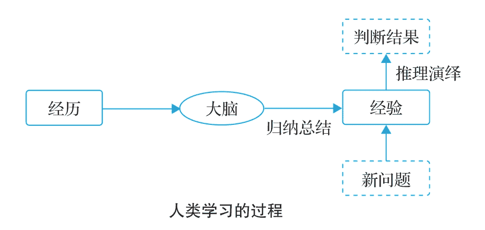

**图1-1 加法学习案例中人脑思维链路示意**

**3.机器学习的过程**

类比人类学习，机器学习同样包含归纳总结与演绎推理两步。具体而言，归纳总结阶段，计算机需要大量已知样本，即（X,Y）数据，X为输入，Y为输出。其中X与Y存在某种映射关系f，即需归纳的规律，通常称作“目标函数”，可想象成学生想要达到的学习目标。

然而初始目标函数f并不能正确将输入X映射为输出Y，需利用已知（X,Y）数据训练，不断调整函数f各项参数，使函数对输入X的假设结果无限逼近真实值Y。参数调整过程即机器学习过程，方法称为“学习算法”，如学生学习方法。最终通过训练得到拟合函数g，其能力无限逼近目标函数f，图1-2揭示了机器学习的本质。机器学习的本质是函数拟合，即利用数据计算，假设g逼近目标f。

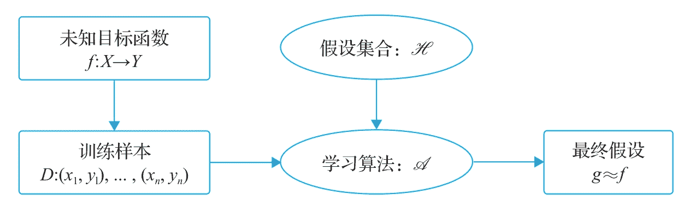

**图1-2 机器学习本质的函数拟合示意**

上述使函数f不断接近真实规律的过程称作“训练”，而使用学习得到的函数g判断新输入对应输出，称为“推理”。“训练”与“推理”对应前述“归纳”与“演绎”。

数据就像老师，算法就像学习方法。优质（X,Y）数据与先进学习算法，能更有效拟合目标函数f，预测时带来很高准确率，对实际生产极具帮助。反之，劣质数据或不合适算法会导致准确率低下，对生产十分有害。

**4.机器学习的应用场景**

机器学习原理或许并不复杂，其魔力在于能将理论框架灵活应用于无数令人惊叹的场景，如同一把万能钥匙开启不同领域的智慧之门。

**（1）机器学习从数据中“发现”物理定律**

当输入为作用力，输出为加速度时，机器学习的任务是通过数据驱动方式拟合物理规律。它从实验数据中提炼出F=ma的数学关系，不仅验证已知定律，也能发现隐藏的自然规律。这种能力让机器学习成为科学家的数字化助手，为理论研究注入新可能。那么科研人员如何利用机器学习揭示新物理规律？

**（2）机器学习将图片“翻译”成语言**

当输入是一张图片，输出是自然语言描述时，机器学习执行图像识别与描述任务。它通过像素级特征提取与语义映射，将视觉信号转化为人类可理解语义信息。这种能力让机器学习成为视觉世界的“翻译官”，为自动驾驶、安防监控等领域提供核心支持。

**（3）机器学习搭建不同语言的“语义桥梁”**

当输入是英文语句，输出是中文翻译时，机器学习的任务是自然语言处理中的机器翻译。它通过构建双语句句映射模型，在保持语义完整前提下完成语言体系转换。这种能力让机器学习成为跨文化交流的“实时翻译官”，推动全球化信息流动。

**（4）机器学习从知识海洋中“定位”问题的答案**

当输入是一个查询，输出是查询答案时，机器学习执行知识问答任务。它通过语义理解与逻辑推理，在海量知识中快速定位问题核心，生成精准答案。这种能力让机器学习成为人类智慧的“即时检索器”，为教育、医疗等领域提供高效支持。

【从手工特征到自主表征：深度学习兴起的逻辑】

总体而言，只要模型选型合理且样本质量可靠，机器学习便能较好地拟合现实世界的内在规律，进而支撑识别、翻译、预测等智能化应用。只是经典范式对人为设计的特征工程依赖过重，面对海量复杂场景时便显得捉襟见肘。正是这一瓶颈催生了深度学习的兴起，它为智能系统打开了新的路径。下面通过图1-3概览机器学习在各领域的落地形态。

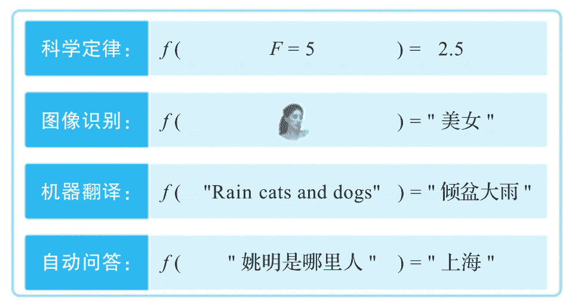

**图 1-3 机器学习的任务类型**

**1.1.2 深度学习**

**1.传统机器学习的局限性**

真实规律多为隐式且高维，线性函数难以完整描述。传统做法通常先进行特征提取，把高维原始信号压缩到低维可解释空间。如前所述，这种依赖人工提炼特征的思路在海量复杂样本面前局限明显。比如图像处理，从边缘纹理到形状色彩，每项特征的界定都离不开领域经验的判断，整体设计像在无地图的环境中摸索，既耗时又不确定。于是人们期待一种无需手动干预、能自行挖掘数据表征的方法，这正是深度学习要解决的问题。

**2.深度学习的基本思想**

假设计算机里存着猫图和狗图，每张图都被编码成庞大的0/1矩阵，每个像素对应一个数值。面对上千万数字组成的矩阵，计算机怎样把它转成自然语言描述？这绝非简单函数映射。有趣的是，人脑却能轻松完成这种转换，哪怕儿童看到画面也能立刻分辨猫狗，如图1-4所示。受此启发，人们提出让机器模仿人脑结构进行学习，这构成了深度学习的核心理念。

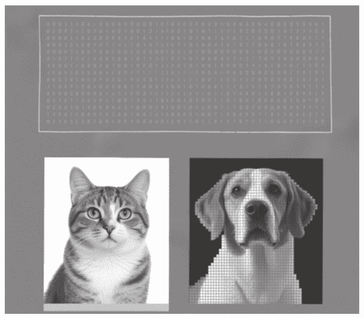

**图 1-4 像素点表示的猫与狗**

**3.人脑神经元结构与人造神经网络**

研究显示，人脑由大量神经元通过突触互联，形成多层复杂的网络组织。视觉信号进入后，会从底层像素逐步构建更高阶表征。图1-5描绘了人脑视觉分析的大致流程。首先在初级视觉皮层V1完成边缘检测，把像素单元组织成边缘；随后边缘在次级视觉区V2、V4等处组合成物体部件，如轮廓和形状；最后在颞叶等高级区把部件整合成完整物体模型，负责识别与理解。整个过程体现了分层处理的特点，从简单像素到复杂物体逐步构建感知。

受此启发，人们把人脑神经元结构用电子电路复现，形成了人工神经网络，简称神经网络。其基本单元是人工神经元，神经元之间以权重连接构成网络，在训练中不断调整权重以提升对输入的处理能力。

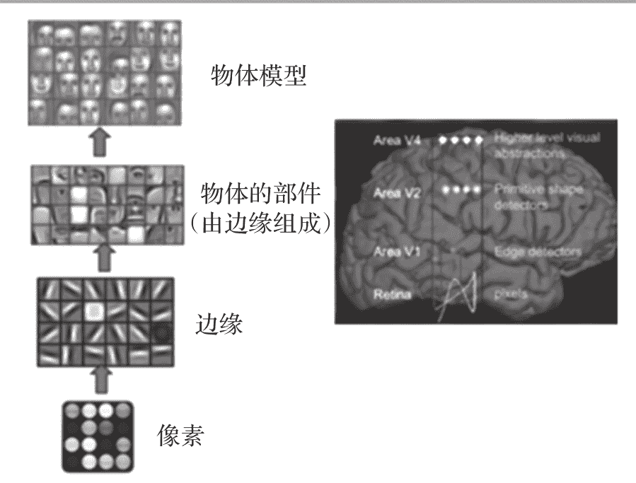

**图 1-5 人脑视觉现象分析的基本流程**

**4.感知机的概念**

感知机是人工神经网络最基础的构件，结构简洁但意义重大。它由输入、权重和激活函数组成，可完成输入数据的线性划分。激活函数，如阶跃函数，把线性组合的结果映射为0或1的二值输出。感知机只能处理线性可分问题，但它为现代神经网络奠定了理论起点。图1-6展示了生物神经元与感知机的对应关系。

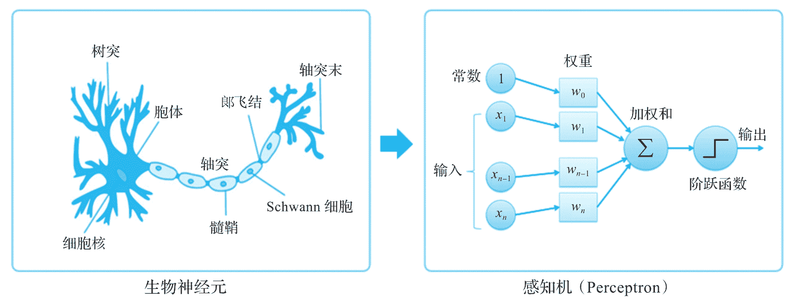

**图 1-6 生物神经元与感知机**

神经网络的分层特性让它能够逐层抽取特征。底层通常提取简单特征比如边缘，随着层数加深，特征的抽象程度不断提升，最终实现复杂模式的识别与分类。这种自下而上的分层抽象让人脑视觉处理方式如出一辙。

当网络层数提升到数十层甚至数百层时，特征提取能力显著增强，能够应对图像识别、语音识别、自然语言处理等复杂任务。这类多层网络被称作深度学习模型。其关键在于通过多层次的特征抽取与抽象，让模型自主学习数据中的复杂模式，从而在多个领域取得突破。

**5.深度学习模型训练基本原理**

如同人脑一样，深度学习模型由大量感知机节点按一定方式组合而成。训练的核心依赖三大机制：前向传播、损失函数和反向传播，理解它们是掌握现代神经网络的基础。

**（1）前向传播：从输入到预测**

前向传播是模型生成输出的过程。给定输入 x，网络逐层执行线性变换如权重矩阵乘法与非线性激活如 ReLU、Sigmoid，最终得到预测值 。例如一个简单的全连接网络可表达为：

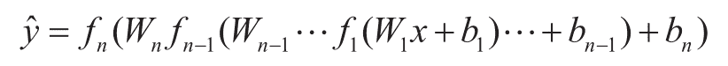

其中 W 表示权重，b 对应偏置，f 为激活函数。前向传播的本质是复合函数的嵌套，使网络能够拟合高度复杂的输入输出关系。

**（2）损失函数：量化模型误差**

模型的预测值  与真实标签 y 的差距由损失函数度量。例如：

● 均方误差 MSE 适用于回归任务，有

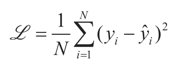

● 交叉熵损失 Cross-Entropy 适用于分类任务，鼓励模型对正确类别赋予更高概率。

● 损失函数既是性能评估指标，也是优化目标的数学表达，其梯度指引参数调整方向。

**（3）反向传播：误差的逆向传导**

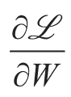

反向传播是深度学习训练的基石，核心是链式法则。通过计算损失函数对各层参数的梯度，模型沿误差减小方向更新权重：

其中 η 代表学习率。反向传播主要步骤为：

● 计算输出层梯度：依据损失类型，如 MSE 的梯度为 -y。
● 逐层回传梯度：利用链式法则把误差分配到各层的权重与偏置。
● 参数更新：采用优化算法调整参数，逐步降低损失。

通常优化过程从输出端开始，先比较最终输出与真实结果的差距，再从后向前逐层调节参数。像抽丝剥茧一样把总误差分解到每个神经元，使网络协同优化。

训练的本质是在前向传播中计算预测、通过损失函数评估误差、再以反向传播优化参数的迭代过程。该框架为卷积神经网络、残差网络等复杂结构的训练奠定基础，后续章节将看到这些基本机制如何与特定架构结合，推动计算机视觉、自然语言处理等领域的进展。

**6.神经网络结构的多样化发展**

不同任务需求下，人脑不同区域会采用高效处理方式。神经网络的设计也呈现多样化。随着研究深入与场景扩展，网络演化出多种形态，各自针对特定任务优化。

多层神经网络是基础形态，概念可追溯至上世纪40年代。因计算能力等限制发展缓慢。它由不同层神经元构成，下层与上层全连接，结构直观但规模增大时参数激增，易过拟合。

卷积神经网络 CNN 通过模仿生物视知觉构建，是深度学习的代表之一。研究始于80-90年代，时间延迟网络与 LeNet-5 是早期代表。当时受硬件软件限制被搁置。进入21世纪后随着理论与计算设备发展迅速回暖。2012年 AlexNet 在 ImageNet 评测中夺冠，对后续研究影响深远。CNN 的隐层包含卷积层、池化层与全连接层。卷积核权值共享与层间稀疏连接，使其能以较低计算成本学习网格化特征如像素与音频，擅长视觉问题。视觉问题具有局部有效性，比如汽车在图片中的位置不同仍可被识别。利用可识别特定视觉特征的卷积核全图扫描，能大幅减少无效计算。

随着网络加深，出现梯度消失、梯度爆炸与退化等问题，学习效率下降。2015年微软研究院提出残差神经网络 ResNet。ILSVRC 比赛中取得3.5%错误率夺冠。通过引入残差模块与跳跃连接克服深层梯度消失，使网络可训练得更深，大幅提升性能。这类似于大型企业集团董事长微服私访，直接获得一线反馈而非层层汇报。

在 CNN 主导视觉的同时，循环神经网络 RNN 在序列数据处理中展现优势。RNN 设计灵感来自人类对序列信息的处理，结构带有循环连接，可建模序列数据。隐藏状态能捕获历史信息并基于当前输入更新状态，适用于时间序列、自然语言文本、语音信号等具时序依赖的数据。

传统 RNN 在训练中面临梯度消失与爆炸，难以学习长距离依赖。为此提出长短期记忆网络 LSTM 与门控循环单元 GRU。LSTM 通过输入门、遗忘门、输出门与细胞状态实现精细化信息控制，提升长序列建模能力；GRU 通过重置门与更新门简化结构，在保持性能的同时提高计算效率。这些改进使 RNN 及其变体在机器翻译、语音识别、文本生成等任务中广泛应用并取得突破。

尽管 LSTM 与 GRU 缓解了缺陷，顺序计算模式仍限制训练效率，序列长度增加时无法并行，成为大规模数据处理的瓶颈。这为自注意力机制的兴起埋下伏笔。

近年来，自注意力网络在自然语言处理领域占据主导。它摒弃 RNN 的序列处理方式，引入自注意力机制，可并行处理序列数据，大幅提升效率，并在捕捉长距离依赖上表现突出。

这些结构创新不仅推动深度学习进步，也为复杂实际问题提供强工具。图1-7为不同任务的经典深度学习网络。例如图像识别中 CNN 承担关键作用；残差网络提升图像分类准确率；在机器翻译、文本生成等自然语言处理任务中，Transformer 结构成为众多先进模型的基础。

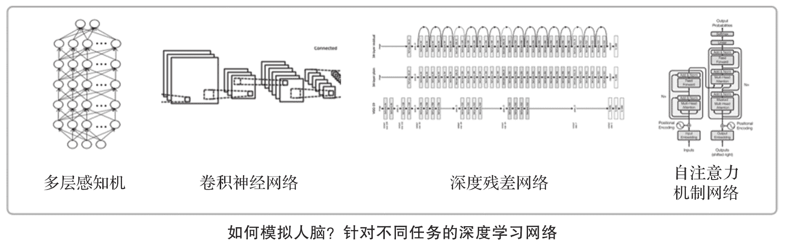

**图 1-7 针对不同任务的经典深度学习网络**

**7.补充阅读：经典网络设计的独特定位与技术演进**

在AI发展历程中，每个名留青史的网络设计都承担特定历史使命：或突破算力限制下的建模瓶颈，或解决特定场景的技术痛点，或开辟全新应用领域。下面聚焦四类里程碑网络——全连接网络、卷积神经网络、残差网络与循环神经网络，剖析其核心原理、技术特点与历史定位，展现网络设计在问题驱动下的持续进化。

**（1）全连接网络：神经网络的启蒙架构**

全连接网络 FC 是神经网络最基础形态，核心原理是层间神经元100%连接，前一层每个神经元与后一层所有神经元建立联系，实现信息完全交互。

设计逻辑有两个鲜明特点：一是模拟人脑基础计算结构，借鉴生物神经元全连接交互模式，如图1-8所示，构建输入到输出的映射；二是擅长处理结构化数据，如表格型数据，通过层级运算完成分类预测。然而局限明显：随层数加深或输入维度提升，参数量呈爆炸式增长；同时忽略空间关联性，在图像、语音等带时空结构数据上无法利用像素、音频帧的邻近关系，导致特征提取效率低下。

尽管有不足，FC 网络仍是神经网络的启蒙架构，为后续复杂网络提供层级化信息处理的底层逻辑。

**（2）卷积神经网络：计算机视觉的破冰者**

当全连接网络在图像处理上遭遇维度瓶颈时，卷积神经网络以仿生设计实现革命性突破。CNN 通过局部连接与权值共享构建层次化特征提取体系，可理解为从像素到概念的渐进式认知。

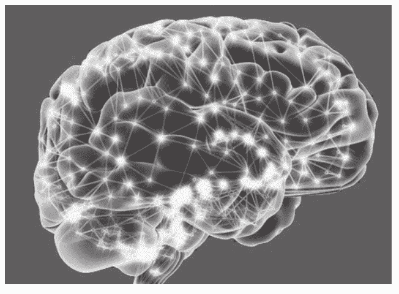

**图 1-8 人脑神经示意图**

CNN 的三大核心设计源自对生物视觉系统的模拟与工程优化。

● 局部感受野与多尺度特征提取：每个卷积核相当于特征探测器，不同尺寸卷积核如3×3、5×5具有差异化观察视野。小核擅长捕捉细粒度特征如边缘角点，大核可识别更宏观模式如纹理形状。更精细的是，每个卷积层通常包含数十至数百个通道，每个通道的卷积核专注学习特定类型特征模式。图1-9为卷积核基本原理示意图。

**图 1-9 卷积核的基本原理示意图**

● 权值共享的智能压缩：CNN 的每个卷积核在整幅图像上滑动巡逻，用同一组参数检测特定特征出现位置。例如5×5卷积核处理100×100像素图像时，仅需25个参数即可完成全图扫描，参数效率比全连接网络提升千倍。这种设计符合视觉特征平移不变性认知，也实现惊人计算压缩。

● 层次化特征学习：通过卷积层与池化层交替堆叠，CNN可自动构建从低层到高层的特征表示。初级层学习基础视觉元素如线条色块，中级层组合成复杂部件如眼睛车轮，高级层整合为完整语义概念如人脸汽车。这种自底向上学习方式复现了人类视觉皮层的分层处理机制。

2012年 AlexNet 在 ImageNet 评测中以压倒性优势验证 CNN 威力，错误率从26%骤降至15%。其成功不仅是技术突破，更开创端到端特征学习新范式——计算机视觉系统告别手工设计特征时代，进入自主学习新时代。如今从智能手机人脸解锁到自动驾驶环境感知，CNN已成为现代视觉系统基石技术。

**（3）残差网络：深层网络的破壁人**

随着任务复杂度提升，深层网络性能更好成为共识，但FC与早期CNN面临梯度消失爆炸的致命问题——深层参数因梯度趋近于0而无法有效训练，性能不升反降。残差网络以跳跃连接 Shortcut 为核心原理，为深层网络破壁。如图1-10所示，x通过跳连结构绕过中间层。

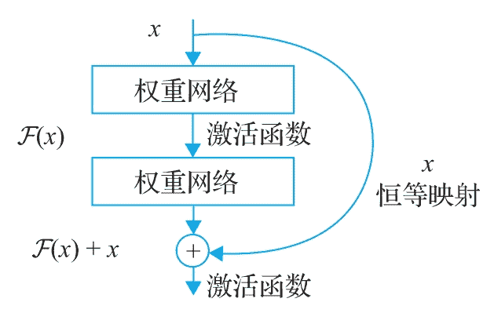

**图 1-10 残差网络基本模块**

ResNet 的特点直击深层网络痛点。

● 回路传递原始信息：通过 Shortcut 将输入信息跨层传递到输出端，让网络同时学习原始信息与层间差异即残差。
● 解决梯度消失爆炸：跳跃连接为梯度反向传播提供高速通道，避免梯度在深层被过度衰减。
● 训练千层网络成为可能：在 ResNet 出现前数十层网络已难以训练；ResNet 通过残差结构实现152层甚至更深网络训练，为超大规模模型铺路。

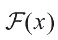

从技术本质看，ResNet 创新有两点：一是主路径学习残差，让网络聚焦于学习输入与输出差异，降低训练难度；二是恒等映射规避梯度消失，即 Shortcut 实现的恒等映射确保梯度高效回传至浅层。

**（4）循环神经网络：时序数据的掌控者**

在自然语言处理、语音识别等领域，数据天然带有时序性如句子词序、语音时间序列。循环网络以带记忆的时序处理为核心原理，成为此类任务核心工具。RNN 的特点围绕时序记忆展开，如图1-11所示，循环神经网络大致分为如下几个模块。

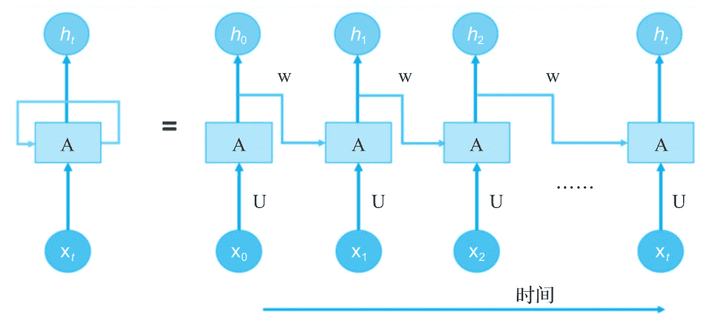

**图 1-11 循环神经网络示意图**

● 隐状态传递历史信息：网络内部的隐状态 h[t] 会记录前一时刻输入特征，让当前输出能参考历史，例如翻译句子时后一个词的翻译需依赖前一个词。

循环式网络的强项在于消化任意长度的输入。短到十来个词、长到上百词，它都能按时间步逐次推进，把信息一点点吃进去。隐藏状态像一根不断传动的接力棒，在各步之间传递并不断融合过往信息，形成一种持续累积的动态记忆。正因为具备这种累积特性，循环网络很适合文本续写、音乐创作这类需要自主延伸的任务。只是原始的循环结构在长序列上容易出现信号衰减，早期信息会逐渐淡出。为此学界推出了 LSTM、GRU 等进阶形态，利用输入门、遗忘门、输出门等开关机制精细调节信息的保留与丢弃，让模型在长篇理解和多轮对话中保持稳定表现。

回望四大家族的成长轨迹，全连接网络最早确立分层抽取特征的雏形，却在高复杂度数据和深层叠加时力不从心；卷积网络凭借局部感知与权重复用，打破了图像处理的算力与特征提取瓶颈，推动视觉识别革命；残差网络引入跨层跳接，破解了深层难以收敛的困局，推动架构纵深发展；循环网络则聚焦时序场景，依托循环记忆与门控进化，征服了序列长度不固定的任务。

每一次架构的诞生都在回应前一代的痛点，每一次突破都在为人工智能开拓新应用空间。它们的技术定位既是历史坐标，也帮助我们理解设计如何贴合场景，这一逻辑将贯穿 AI 发展的始终。

## 1.2 大模型崛起的三大技术前提

### 1.2.1 技术前提一：Transformer，统一架构的开端
2017 年 Google 公布论文《Attention Is All You Need》，正式引介 Transformer，并用标题发出宣言：注意力机制将成为主导方向。此前循环网络及其变体 LSTM、GRU 已提升机器翻译质量，却常在长句中出现语义丢失或表达断裂。Transformer 的自注意力能一次性关联整句中所有词的关联，显著改善译文的准确性与流畅度。

比如把 “ECB cuts interest rates，bringing major benefits to global financial markets” 翻译成中文时，旧方案易逐词直译导致不通，Transformer 能捕捉长距离关联，输出 “欧洲央行宣布降息，全球金融市场迎来重大利好” 这类地道表达。随着影响力扩散，Transformer 很快从语言走向视觉，2020 年的 Vision Transformer 将其用于图像分类，证明了架构的通用潜力。如今它已成为深度学习领域的通用语言，从生成文本到识别图像再到多模态任务无处不在。Transformer 的出现既是技术革新，也是深度学习的分水岭，为大模型时代奠定基础。

**1. Transformer 的构成**
如图 1-12 所示，Transformer 内部包含编码侧与解码侧，二者通过交叉注意力紧密配合。编码侧负责理解输入，解码侧负责生成输出。

编码侧是理解单元，把序列映射为富含上下文的表征。它由多个相同子层堆叠，每层包含：

多头自注意力是核心，让模型并行关注序列不同位置的关系，像装上多盏探照灯，同时扫视句子的不同角落。例如对“我用手机拍下了那个银行的广告，但因为光线太暗，照片的清晰度不高。”一盏灯关联手机与照片理解拍摄动作，一盏灯关联银行广告与照片理解内容，另一盏灯关联光线暗与清晰度低理解因果。这种多视角注意力让模型无需逐词处理即可把握复杂语义。

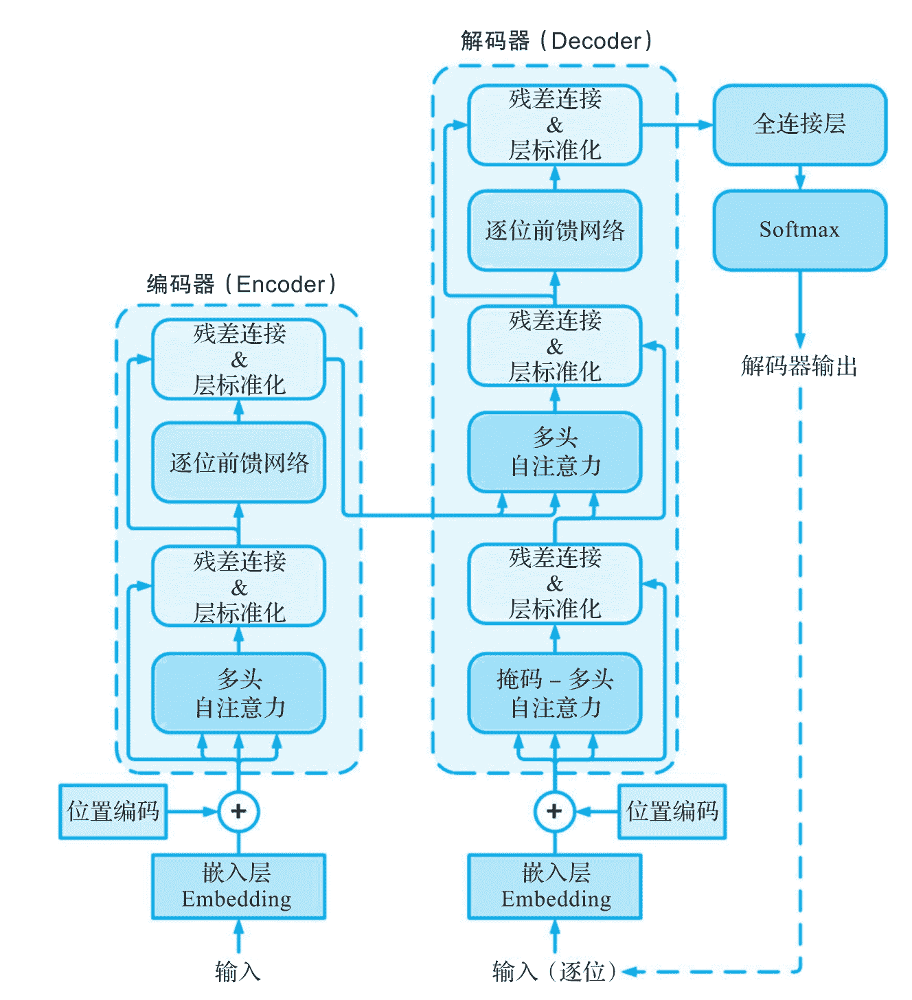

**图 1-12 Transformer 结构图**

前馈全连接块对每个位置的表征做独立的非线性变换，进一步提炼语义特征，像加工厂一样深化输入信息。

解码侧是生成单元，结构类似编码侧，多了三类子层：

掩码多头自注意力确保生成时只能看到当前位置及之前 token，避免未来信息泄露，相当于写作时只能依据已有内容推进；交叉注意力让解码侧查阅编码侧输出的上下文，相当于参考书，确保生成与输入一致；前馈全连接块功能与编码侧相同，用于进一步加工。

**2. Transformer 的长处**
得益于上述设计，Transformer 相比传统结构具备两大优势：

跨距关联建模更强，自注意力可并行建模序列任意位置的关联，层数叠加后表达能力显著提升，能拟合更复杂的非线性关系，精准揭示数据本质关联。

并行执行更佳。经典循环网络每个时间步的隐藏状态 h[t] 必须等待 h[t-1] 完成，处理长度 N 的序列需 N 次顺序计算，时间复杂度 O(N)，且长程反向传播易梯度衰减或爆炸。

Transformer 通过三点实现并行：用位置编码取代时序计算，把顺序信息编码为位置嵌入与词嵌入相加；全局注意力建模里，查询 Q、键 K、值 V 矩阵运算让每个位置直接关注全部位置，注意力权重计算天然适合并行加速：

编码侧解码侧各层间无时序依赖，同一层所有位置可同步计算。自注意力的理论复杂度 O(N²) 看似偏高，但得益于 GPU/TPU 对矩阵运算的优化，实际效率远超循环网络的顺序计算。实验显示当序列长度超过 50~100 个 token 后，Transformer 的并行优势完全抵消复杂度劣势，特别适合长文本与高分辨率图像等大规模序列，也为大规模预训练提供计算基础。通过图 1-13 可以直观看到循环网络和 Self-attention 之间的差异。

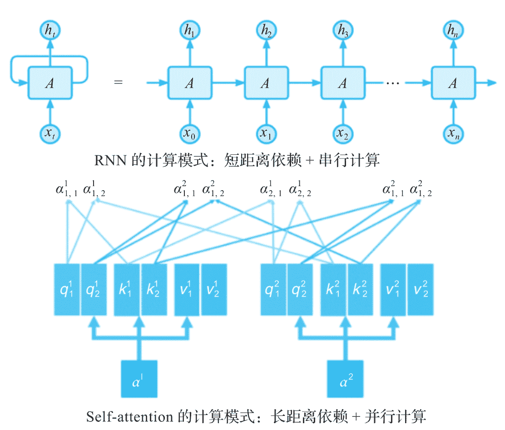

**图 1-13 RNN 与 Self-attention 对比**

### 1.2.2 技术前提二：自监督学习，让海量非标注数据可训练

**1. 规模膨胀带来的样本压力**
Transformer 统一了模型基座，堆叠多层即可拟合复杂函数，但参数规模已达百亿、千亿甚至万亿级。随着未知变量增多，方程组需要更多等式才能求解，训练超大模型同样需要海量样本。经验法则显示常规监督学习下样本量往往需达参数量的 10~100 倍，例如 10 个参数的逻辑回归至少需要约 500 个样本才能稳定估计。借助预训练加微调策略可大幅降低需求，比如 10 亿参数的语义模型仅用数十篇文章就能学会特定文体，增加网络宽度也不会显著损害样本效率。

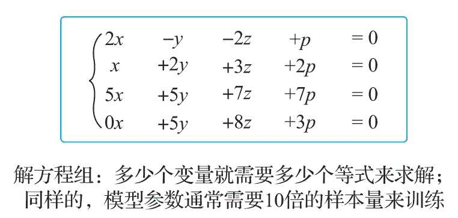

**图 1-14 多元方程组示意图**

**2. 标注数据的瓶颈**
科学界曾认为超大规模模型受限于标注数据供给。AlphaGo 的成功难以复制：围棋规则明确、状态空间有限，可自动生成约 3000 万局高质量对局数据，且每局自带胜负标签，形成数据闭环。但现实场景大多开放，无法自动生成有效标注。以医疗影像为例，每张 CT 都需专家耗时标注且标准不一；自然语言理解的复杂性也让自动标注几乎不可能。数据获取的根本差异，正是制约技术普适的核心瓶颈。

**3. 自监督学习的突破**
为把互联网海量非结构化数据转化为可用样本，自监督学习应运而生。它利用数据自身结构生成监督信号，无需人工标注。

在自然语言处理中，BERT 以掩码语言模型进行预训练，通过遮蔽文本部分内容让模型预测缺失词，把无标注语料变成自生成训练样本。以“哈尔滨是黑龙江的省会，国际冰雪文化名城”为例，遮蔽“哈尔滨”和“冰雪”后，剩余语句作输入，模型需推理恢复被掩码的实体和特征，实现语料结构化转换。

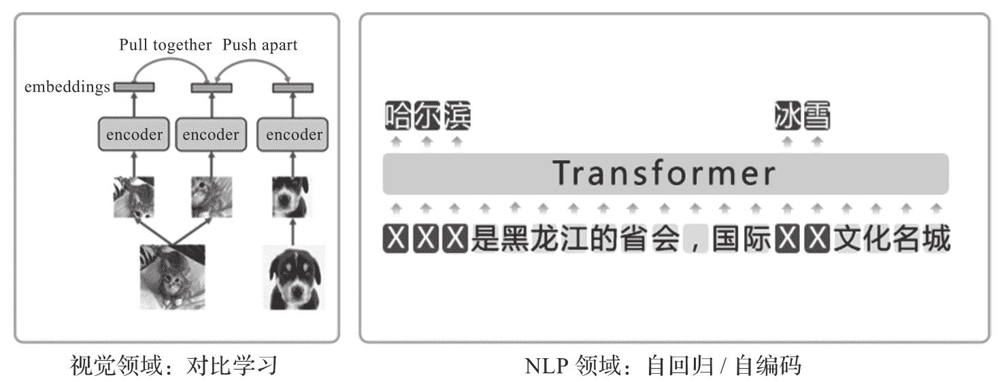

**图 1-15 BERT 模型中的 MLM 任务示例**

在图像处理中，主流方法分为上下文预测和对比学习。Jigsaw 将图像切成 3×3 网格并打乱，要求模型重建原始布局，从而学习空间一致性表征。对比学习则对同一图像做数据增强生成正样本对，随机配对不同图像作为负样本对，通过 InfoNCE 损失拉近正样本特征、推远负样本特征，常配合 ResNet 编码器与动量更新保证稳定性。该技术让 ImageNet 等海量数据集得以充分利用，预训练视觉表征仅用 1% 标注数据即可逼近传统监督性能，显著提升样本效率。

### 1.2.3 技术前提三：生成式架构，多任务统一的学习范式

**1. 传统范式的困境：从单任务单模型到通用智能**
传统 AI 采用每事建模的模式，像让不同专家各自独立工作。视觉模型做识别，语言模型做理解，彼此割裂。带来的问题有三：资源效率浪费严重，计算机视觉中分类、检测、分割模型共享底层特征却需分别训练，计算与碳排放增加 300% 以上；认知碎片化，视觉模型无法自然迁移到语言描述任务；泛化能力不足，DeepMind 研究显示传统单任务模型在新领域的适应效率比人类低 5 个数量级。智能客服需并行维护意图识别、情感分析、对话管理等十余个模型，复杂度指数增长却缺乏统一常识框架。

真正的智能应像人类一样具备统一表征与跨域学习能力，通向通用人工智能的关键是培育可融会贯通的“通才”智能体。

**2. 生成式架构的破局：从 Gato 到统一范式**
Gato 基于 Transformer，统一处理文本、图像与控制信号，完成 500 个不同任务，包括聊天、图像解读、游戏、机械臂控制。虽然在多数任务上不及专用模型，但它展示了通向通用智能的重要实验。图 1-16 展示了 Gato 智能体完成玩游戏、给图片输出字幕、聊天、用机械臂堆叠积木等能力。

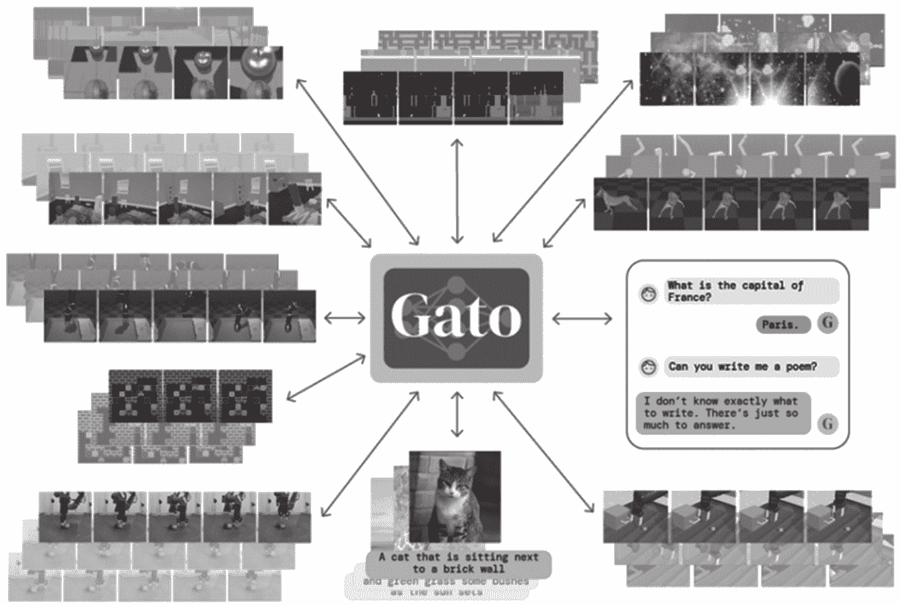

**图 1-16 Gato 智能体**

生成式架构依赖三大要素：模态无关的序列建模，把不同模态数据转成统一序列处理；动态任务条件化机制，像智能调度员一样按需求调整运行方式；参数共享的隐式知识蒸馏，实现跨任务知识高效传递。此外，元提示工程通过精心设计的提示引导模型理解任务。相比传统架构几乎零复用，生成式架构大幅提升参数复用率，为多任务统一奠定基础。

**3. 生成式架构成必然趋势**
从计算生物学视角看，模型演进类似生物进化，复杂度上升、架构收敛。早期形态多样，高效通用结构逐渐占据主导。生成式架构凭借高效与通用性，正成为主导方向。

进入以参数规模为核心的阶段，规模红利愈发明显。实测显示，模型容量与可承载的问题总数呈超线性对应，容量越大，任务拓展速度越快。依托生成式设计的权重复用机制，DeepMind 2022 年发布的 Gato 仅以 12 亿级参数便同时支撑 604 项跨模态能力，覆盖文本对话、图像描述到机械臂操控等场景。这种由数量累积到能力跃迁的过程，直观印证了单一架构在扩张上的潜力。

**4. Prompt 成为多任务的通用操作界面**

与只擅长单一问题的传统系统不同，具备通用智能雏形的巨型系统需要一种随需求灵活切换工作方式的调度手段，答案指向 Prompt。Prompt 是多任务能力成熟后自然出现的协作方式。让语言模型高效承接自然语言推理、文本分类、命名实体识别等下游工作，正是当前自然语言处理的核心议题。而指令微调与提示学习两条路线的分化，也勾勒出巨型模型时代任务处理逻辑的根本转变。

● 旧路径：指令微调，让模型去迎合任务。图 1-17 对比了两种范式。

左侧 Fine-tuning 的逻辑以语言模型为中心，箭头由 LM 指向十余类下游任务。这意味着适配特定任务必须对模型本体做针对性改动，做文本分类要调参数，切换到机器翻译又要改结构。

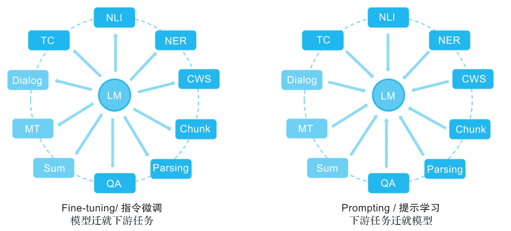

**图 1-17 指令微调与提示学习**

这种让模型迎合任务的方式，本质上靠定制化改造来应对多样任务。但不同任务的数据集与训练逻辑差异很大，反复微调需要百万级算力与海量标注支撑，还会导致任务切换成本高、通用能力被割裂。对中小企业和个人开发者来说，让模型去贴合任务的门槛就像一道技术鸿沟，很难跨越。

● 新范式：提示学习，让需求去贴合模型。图 1-17 右侧 Prompting 颠倒了逻辑。箭头方向改变，下游任务通过 Prompt 把需求传递给 LM，不改动模型本体，仅靠指令引导就能适配。

若要做情感分类，可写“请分析以下文本的情感倾向：[文本内容]”；若要做机器翻译，则换成“请把这段中文翻译成英文：[原文]”。得益于 Prompt 的指令加上下文设计，同一基座模型能灵活应对自然语言推理、问答、文本摘要等十几种任务。这种让任务贴合模型的思路，打破了“一任务改一次模型”的束缚。企业不必重复投入千万级训练成本，普通人也能通过撰写提示调用巨模型能力，让 AI 从实验室精密仪器变为可用的生产力工具。

● Prompt：巨模型时代的通用协作语言。从改模型到写提示，背后是范式从定制化模型向通用能力调用的迁移。对普通人而言，Prompt 成了与 AI 协作的桥梁。不必理解算法原理，只要用清晰指令、风格约束等技巧设计 Prompt，就能把通用巨模型变成专属助手：写方案时要求“用互联网产品经理视角写竞品分析”，做设计时指令“生成极简主义风格的海报文案”。这种转向让“靠 Prompt 调用能力解决问题”成为核心技能。当巨模型能同时写代码、做营销、答学术问题时，本质是 Prompt 在任务与模型之间搭起高效通道。技术不再让人迁就，而是主动适配人的需求，实现 AI 普惠。

## **1.3 巨模型：通向通用智能的入口**

在科技高速演进的当下，巨模型技术如同一颗新星，照亮人工智能前行的方向。巨模型指训练数据与参数规模都极大的系统，凭借卓越表现与广阔应用，成为业界焦点。

**1.3.1 Transformer 网络：统一建模的关键**

理解巨模型兴起，必须先看其核心架构 Transformer。Vaswani 团队在 2017 年提出该结构，最初用于机器翻译，却迅速展现出超越传统 RNN 与 CNN 的建模能力，成为自然语言处理乃至多模态建模的基础。Transformer 能成主流，主要源于两大优势：一是对长距离依赖的强大捕捉力，二是高度可并行化的计算设计。

传统 RNN 按时间步依次传递信息，序列越长早期信息越易衰减，难以建立远距离关联。Transformer 利用自注意力机制，能直接衡量序列中任意两个位置的关系，远近无碍。这显著提升了语义理解力，也让模型在长文本、大规模图像甚至时序信号上保持稳定。

同时 Transformer 摒弃了递归计算，完全依赖矩阵运算和注意力权重分配，前向与反向传播可在 GPU/TPU 集群上高效并行。相较必须逐步计算的 RNN，Transformer 能充分利用现代硬件的并行能力，大幅缩短训练时间，支撑起千亿乃至万亿参数规模的训练。它既是容纳海量参数的“大厦”，也是通往高效训练与强泛化的技术路径。

**1.3.2 自监督学习：激活无标注数据**

架构提供强表示力，若缺数据，模型仍无法发挥。传统监督学习高度依赖人工标注，成本高昂、规模受限，成为发展瓶颈。自监督学习的出现改变了这一局面。它从无标注数据中自动构造监督信号，让模型能利用几乎无限的互联网原始数据学习，从而突破数据限制。

自监督的核心思想是“数据自己就是标签”。以 AlphaGo 为例，它通过自我对弈生成大量棋局，不断优化策略与价值网络，不依赖有限人类棋谱。视觉领域，对比学习方法如 SimCLR 与 MoCo，通过构造图像不同增强视图，拉近相似样本、推远不相似样本，学会提取有效视觉特征。自然语言处理中，自回归模型如 GPT 系列通过预测下一个词学习上下文表示；自编码模型如 BERT 则通过掩码语言建模恢复被遮盖词，深入理解语言结构。

这些方法利用了互联网上随处可见的文本、图像、视频等原始数据，并通过巧妙预训练任务引导模型学习高层次抽象与通用表征，为下游任务提供强先验。自监督与 Transformer 的结合，打开了互联网这座信息宝库，为模型注入前所未有的数据养分与智能潜力。

**1.3.3 海量数据：巨模型的燃料**

互联网发展带来数据爆炸。据统计，全球每天产生数据已达数泽字节级别，涵盖文本、图像、音频、视频等多种形态，包含人类社会各领域的知识。

网络结构与自监督学习突破了标注限制，使得互联网庞大信息得以充分利用。巨模型像贪婪的学习者，不断从中汲取知识经验。它通过大量文本学习语义与语法，实现文本生成、机器翻译、问答系统等；通过海量图像学习物体、场景与特征，实现图像分类、目标检测、图像生成等。

互联网海量数据为训练提供丰富素材与场景，让巨模型学到更广更深的知识，具备更强泛化与适应性。可以说，海量数据是巨模型持续发展进步的能量源泉。

**1.3.4 生成式范式：覆盖所有任务**

除架构、自监督与海量数据外，生成式学习范式也是巨模型的重要特征。与判别式不同，生成式不仅能分类识别，还能基于学到的知识生成新数据。

在巨模型中，生成式像一把万能钥匙，可适配各类任务。自然语言处理中，模型能根据输入文本生成文章、故事、对话；图像生成领域，按用户描述生成逼真图像。这种生成能力让巨模型能在不同领域任务中发挥作用，通用性与灵活性极强。

通过生成式范式，巨模型能不断探索创造新知识信息，为社会带来更多创新价值，也能更好满足用户个性化需求，提供更智能便捷服务。

总体来看，表示力强且可并行化的网络结构、自监督任务、互联网庞大信息以及生成式学习范式，共同孕育出参数巨大的通用人工智能模型——巨模型。

**1.3.5 巨模型时代：智能涌现的拐点**

从学习机器学习至今已二十余载，技术经历了三个典型阶段。

**1. 经典机器学习：统计驱动的单任务建模**

经典机器学习是人工智能早期阶段，核心是从结构化数据中挖掘特定任务的统计映射。

图 1-18 是经典机器学习预测房价的例子，左上为房产部分特征，右下为预测价格与真实价格对比。

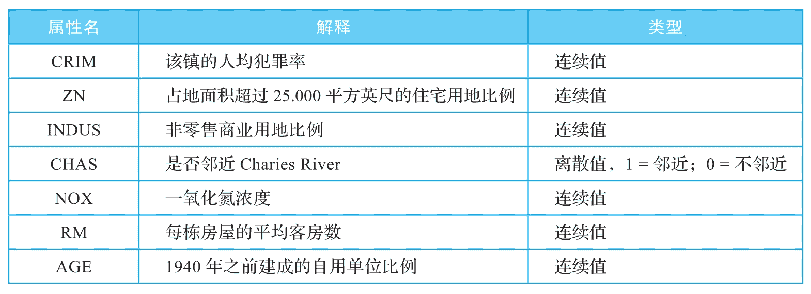

**图 1-18 经典机器学习模型房价预测示意图**

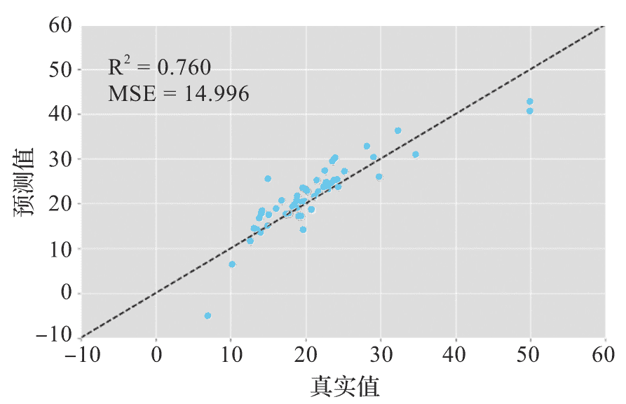

**图 1-18 经典机器学习模型房价预测示意图（续）**

如图 1-18 所示，经典模型通过分析房屋面积、地理位置、配套设施等结构化变量，建立特征向量与目标值的数学函数。典型方法包括决策树、支持向量机、朴素贝叶斯，在结构化数据与预设任务上有效，但存在局限：

● 特征工程依赖：需人工设计特征，对领域知识要求高。
● 任务单一性：缺乏跨领域泛化能力，难以应对复杂场景。

在统计模型主导的时代，模型行为与性能可被设想与解读，研究者能从底层原理层面分析。

**2. 深度学习：自动提特征的非结构化突破**

随数据规模与算力提升，深度学习通过模拟人脑神经元的多层网络，实现原始数据的自动特征提取。深度学习在人脸识别中的应用，利用卷积神经网络自动学习生物特征如眼鼻几何关系，实现毫米级精度身份认证。该技术在图像、语音等非结构化数据上取得里程碑进展，但仍有领域局限，专用图像识别模型难以迁移到自然语言任务，尚未实现跨模态融合。

在深度学习主导时期，模型已无法人工直观理解，研究者只能通过参数可视化与效果实验提出人工解读的“原理”，而非严谨数学推导。

**3. 巨模型：通向通用的临界点**

当参数量达到一定量级，模型效果出现“智能涌现”现象，从而催生 GPT-4、通义千问/Qwen 等超大参数模型，图 1-19 展示了巨模型参数与数据规模的发展进程。

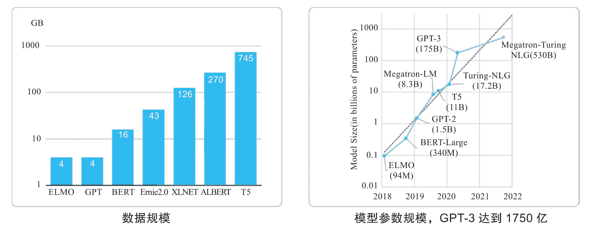

**图 1-19 数据规模与大模型参数的发展进程**

通过海量跨领域数据预训练，巨模型展现出通用人工智能初级特征：

● 认知能力跨越：实现跨学科推理、多步骤规划与抽象概念理解。
● 创造性生成：输出逻辑严谨的学术论文、诗歌与功能代码。
● 多模态融合：完成图文互生成与跨模态语义对齐。
● 已渗透经济与科研：制造业通过智能生产优化提升全要素生产率，服务业构建个性化交互系统；生物学实现蛋白质折叠预测，天文学完成星系光谱分类智能解析。

巨模型成为人工智能最前沿、最有价值方向，仍在持续突破创新。

图 1-20 展示巨模型能力随参数量变化，当参数量突破 10¹¹临界阈值时出现非线性能力跃迁，即涌现。

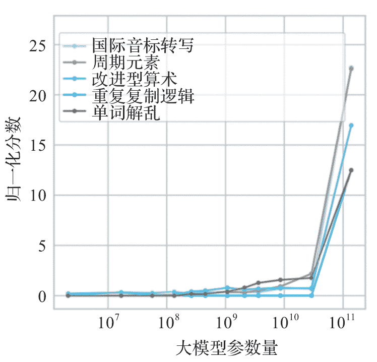

**图 1-20 大模型参数量与归一化分数的关系**

图中性能演化显示：在 10⁷～10¹⁰ 参数量级，国际音标转写、元素周期表推理等任务性能停滞；突破 10¹¹阈值后，复杂算术与跨学科推理得分垂直攀升。

质的飞跃主要源于三方面：

● 参数规模带来表达能力跃升：参数足够大时，神经网络能捕捉更复杂高阶语义关联，如同庞大团队分工更细。
● 跨领域知识融合碰撞：巨模型接触不同学科海量文本，内部产生类似化学反应交互，如将建筑美学与流体力学原理结合生成创新解答。
● 注意力机制捕捉深层模式：Transformer 的自注意力能同时关注输入多处，更好理解长距离依赖与细微模式，像多束探照灯洞察复杂结构。

小模型与巨模型代际差异显著：数学推理上小模型限于四则运算，巨模型可完成拓扑学定理证明；代码领域小模型做语法纠错，巨模型支持全栈开发；创造性任务中小模型输出模板化文本，巨模型生成跨学科融合的原创内容。

从统计学习到通用智能的演进，本质是规模、数据、架构协同的结果。涌现现象验证了量变引发质变的智能发展规律，也揭示 AI 超越人类预设的进化路径，为通用人工智能奠定新理论基础，其影响将重塑人类知识生产与技术创新范式。

**1.3.6 端到端：模型落地的简化之路**

人工智能演进始终伴随效率突破与范式重构双轮驱动，巨模型崛起推动 AI 研发实现更少领域数据依赖、更简洁端到端流程、更高效资源复用三重变革，这不仅是工具迭代，更是对数据利用逻辑、系统架构设计、产业协作模式的底层重塑，让 AI 从实验室小众技术迈向产业级普惠能力。

**1. 小样本泛化：靠通识知识降本**

传统 AI 落地长期受困于数据依赖陷阱。类比学习型分析师，小模型像没有基础认知的“新手”。训练医疗影像判别模型时，需组织专业团队标注上万病灶切片与临床报告，耗时数月成本百万，且每个细分病种都要重复标注训练部署流程；跨语言翻译中，每新增一对稀有语料就需重训模型，资源浪费指数增长。

巨模型通过海量跨域预训练构建通识知识基座实现破局。依托太字节级文本、图像、音频等多模态语料，在自监督任务中持续迭代，上百亿参数成为知识载体。面对下游任务，仅需百例级标注甚至零样本即可精准适配。技术上，注意力机制可动态关联输入与预训练知识，参数共享让不同任务复用核心特征，知识蒸馏可将复杂模型压缩为轻量版本。

以医疗为例，传统肺癌影像模型需标注 10000+张 CT 切片；巨模型先在全球公开医疗文献与影像库预训练，积累肺部解剖结构与病灶形态规律，后续仅用 100 例医院真实病例微调即可达到同等诊断精度，标注成本直降 90%。翻译场景中，提示工程可让模型零样本支持稀有语言对迁移。这种转变让研发重心从堆数据转向优化知识迁移，既打破行业数据壁垒，又提升数据利用效率。图 1-21 对比巨模型与小模型训练数据差异。

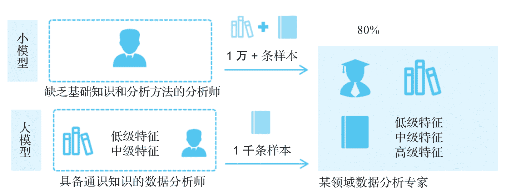

**图 1-21 大模型与小模型训练数据对比**

**2. 端到端流程：一体架构减复杂度**

传统 AI 系统依赖多模块级联流水线，各环节像接力赛，误差易逐级放大且需大量人工干预。以开放域知识问答为例，传统方案需拆分为实体识别、关系抽取、知识图谱构建、意图识别、属性填充、图谱检索推理、回答模板生成等离散环节。每个环节需单独训练与调参，仅知识图谱维护就需医学专家每周投入 20+小时，系统响应常超 5s，且“实体识别错误→关系抽取偏差→图谱检索失效”的链式误差频发。

巨模型以 Transformer 为核心的一体化架构实现端到端智能压缩，自回归生成机制直接完成“输入→输出”映射，无需中间模块拼接。技术层面，多头注意力可同时捕捉问题关键词、文档知识点与上下文逻辑，位置编码保障长文本时序性，层归一化稳定训练梯度。图 1-22 对比巨模型与小模型回答问题流程。

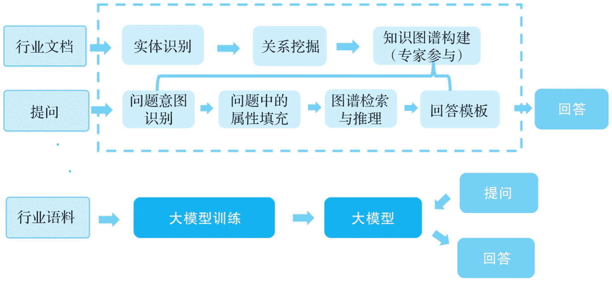

**图 1-22 大模型与小模型回答问题流程对比**

在知识问答场景，经过行业语料预训练的巨模型会将实体、关系、意图等认知内化为参数，用户提问后直接在万亿级参数构成的知识网络中推理，瞬间生成答案，延迟压缩至 500ms 内，无需人工维护规则与接口。

这种变革让 AI 系统从复杂流水线变为极简黑盒服务，重塑产业落地逻辑。企业无需组建算法工程师、领域专家、运维团队的庞大队伍，仅需调用巨模型 API 或部署轻量微调版本，即可快速上线智能客服、医疗助手等应用，技术门槛与维护成本大幅下降。

**3. 研发范式：从炼多模型到炼大模型**

过去相当长的时间，企业内部的智能研发一直被割裂的工作方式和反复建设拖累。电商客服、金融风控、医疗诊断等不同业务分支，基本都要自己走完一条完整的研发链路：第一步是标注团队花费约一个月做数据清洗，第二步是算法工程师围绕网络结构反复迭代数十个版本，第三步则是把模型放到 GPU 集群上做参数调优又要两周。投入的浪费触目可见，据某头部互联网公司内部统计，其旗下十条业务线每年在自然语言处理方向的重复花费就超过两亿元，而且产出的模型水平参差不齐，彼此之间几乎无法复用。整体状态像多家子公司各自花钱建厂，算力、人力和数据资源都被“模型一到 N”的重复建设耗光。

研发范式正在从分散走向集中共享。思路是先把资源汇总起来打造一个通用的基座，就像总部统一建设一座中央智能工厂，然后让下游业务在该能力之上做轻量适配快速定制。技术路线可以用“先通用训练后专项微调”来概括：模型先在大规模通用语料上学到基础能力，再借助 LoRA 低秩适配、Prefix Tuning 前缀调优等参数高效手段，只更新 0.1% 到 5% 的参数就能适配垂直场景，相比传统全量训练，算力消耗可降到约十分之一。

实践效果已经显现。某头部云厂商过去在电商、金融、医疗三条线各自养一套 NLP 系统，每套都要 8 张 A100 运行两周。如今先做一个统一的基座模型，训练约一个月、消耗千卡 A100 量级算力，下游业务上传行业数据后三天左右完成微调即可上线，资源复用效率大约提升十倍，交付周期从月级压缩到天级。研发重心由此从各线各自为战转向总部统一赋能，团队不再重复造轮子，而是聚焦基座的持续进化与场景化适配，产业级 AI 的规模效应和交付速度因此发生质变。

大模型带来的变化可以归纳为知识密度、系统复杂度与资源效率的三重协同演进。通识基座削弱了对数据的强依赖，一体化流程简化了落地，集中投入释放了规模价值。这一范式重塑了研发的底层逻辑，也为各行各业的智能升级提供了门槛更低、迭代更快、复用更强的路径——当模型能力像水电一样被调用，产业智能普惠的时代才真正到来。

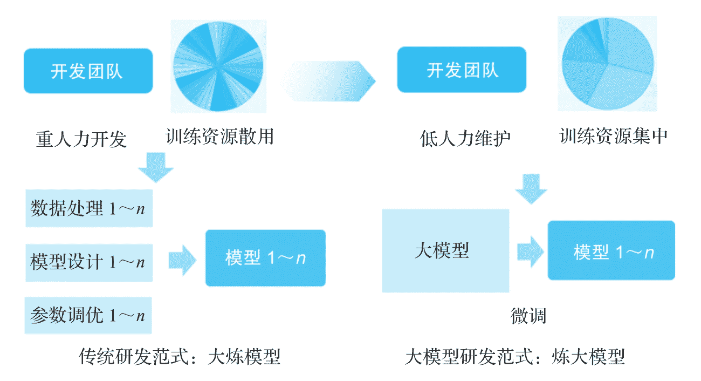

**图 1-23 传统模型研发到大模型研发范式的发展情况的对比**

## 1.4 GPT 世家进化史：ChatGPT 靠工程打磨走红

回看深度学习的发展脉络，GPT 系列是一个标志性的里程碑。从初代 GPT 到如今的 GPT4，每一步迭代都意味着显著跃迁，而 ChatGPT 的爆红并非偶然，而是工程与产品反复打磨的结果。下面梳理家族的演进脉络，看看成功背后的技术线索。

**1.4.1 基座阶段：GPT1、GPT2、GPT3**

**1.GPT1：预训练语言模型的开端**

2017 年 OpenAI 发布的 GPT1 基于 Transformer 解码器，是首个大规模预训练语言模型，标志着 NLP 进入新阶段。此前传统做法高度依赖人工特征工程和大量标注，效率低且难应对复杂语言。

GPT1 采用无监督方式在海量文本上预训练，学习语言规律。核心思路是通过自回归方式预测下一个词来建模语言概率。具体上用解码器对输入序列编码并预测最可能的下一个词，这种接龙式生成可产出连贯自然的文本。该工作为后续预训练奠定基础，证明大规模无监督训练可获得强表征，并在多项 NLP 任务上取得好成绩。

**2.GPT2：规模与能力的跃升**

在 GPT1 之后，2019 年 OpenAI 发布 GPT2。参数量与网络深度显著增大，可处理更长文本。训练语料大幅扩充，来自互联网的大量文本让模型学到更丰富的语言知识，生成质量明显提升。相较前代，文本连贯性与逻辑性更强，更自然流畅。

同时 GPT2 初步展现零样本能力，未见特定任务数据也能尝试完成任务，为后续应用打开空间。

**3.GPT3：震撼业界的通用巨擘**

2020 年发布的 GPT3 拥有 1750 亿参数，是当时体量最大、能力最强的预训练模型。它在文本生成、问答、机器翻译、摘要等多种任务上表现惊人，多项任务达到或超过人类水平。其强大之处在于通用性，只需简单提示即可完成不同类型任务，无需大规模微调。

不过 GPT3 也存在局限，生成内容可能出现事实错误或偏见，且因体量过大导致训练与推理成本极高。

**1.4.2 InstructGPT 方法：让模型更懂人类意图**

为缓解 GPT3 的问题，OpenAI 在其基础上发展出 InstructGPT。核心是用人类反馈强化学习 RLHF 对模型微调，让模型更好地理解指令与意图。

训练大致分三步：先由人工标注员对指令标注产出示范数据；再用这些示范数据对 GPT3 做有监督微调得到初始版；最后用人类反馈强化学习进一步优化，模型产生多个候选输出后由标注员打分，模型据此调整参数提升质量。

该方法让输出更符合人类预期，减少事实性错误与偏见，为后续发展提供重要思路。

**1.code-davinci-002：代码与文本混训的探索**

code-davinci-002 应用了 InstructGPT 方法，特点是代码与自然语言文本混合训练。软件开发中代码与自然语言紧密相关，程序员常用自然语言描述功能需求，混合训练能让模型更好地理解代码上下文与语义。该模型在代码生成、补全、解释等任务上表现良好，可按自然语言描述生成代码，也能对已有代码做解释与优化，为开发提效。

**2.text-davinci-002：人工数据与 FeedME 的结合**

text-davinci-002 融合人工标注数据与 FeedME 学习策略。人工数据由标注员提供，质量高、准确性强；FeedME 让模型学习多个候选里人工得分最高的结果。两者结合使生成文本更准确、质量更高，能根据提示产出连贯自然的文本并规避常见错误与偏见。

**3.text-davinci-003 即 GPT3.5：人工数据与 RLHF 的应用**

text-davinci-003 也称为 GPT3.5，在 GPT3 基础上采用人工数据与人类反馈强化 RLHF 训练。相比前代，文本质量与准确性显著提升，能更好地理解指令，生成更符合预期的内容。在问答、摘要等任务上能力增强，回答更详实准确并具备一定推理分析能力。同时模型稳定性与可解释性改善，随机性降低，可靠性提高。

**1.4.3 ChatGPT 与 GPT 系列的技术演进及商业化**

**1.ChatGPT 的诞生与核心技术**

2022 年 11 月 OpenAI 推出 ChatGPT，基于 GPT3.5 的对话式系统，核心突破在于多轮对话理解与人类反馈强化学习。训练数据包含海量多轮对话语料并融合人工标注的高质量问答，通过 RLHF 优化输出，使交互体验更接近人类对话。

应用迅速渗透到客户服务、教育辅助、智能助手等领域。客户支持场景中可自动化处理约 80% 的常见咨询，大幅提升服务效率。API 开放后开发者生态快速壮大，推动 Jasper、Quizlet 等产品的商业化落地。

**2.GPT4：从技术突破到商业范式转变**

2023 年 3 月发布的 GPT4，标志大模型从学术研究转向规模化商业应用。与 GPT3.5 相比实现跃升：

**（1）技术能力的增强**

● 思维链 Chain-of-Thought 推理：在数学证明、逻辑分析等任务中可展示完整推理步骤，准确率较 GPT3.5 提升约 30%。图 1-24 为 GPT 系列模型各项能力对比情况。

● 多模态支持：新增图像理解能力，可解析 PNG/JPG/PDF 等格式，在 COCO 数据集上准确率达 89%。

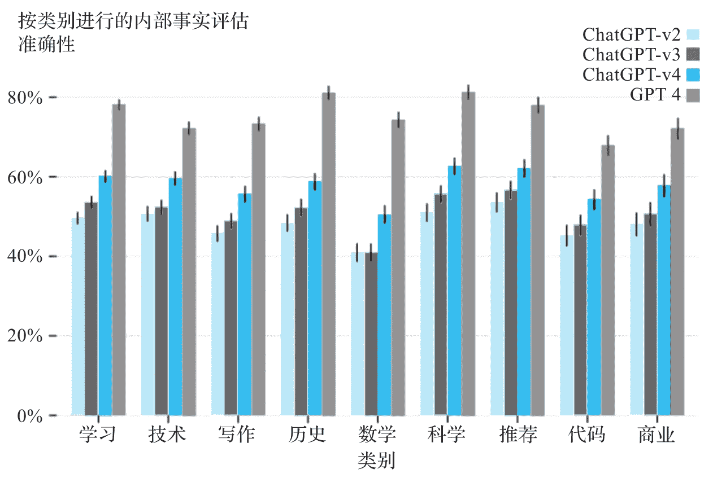

**图 1-24 GPT 系列各模型能力对比概览**

**（2）商业模式的革新**

GPT4 的发布策略与 GPT3.5 截然不同：

● API 开放提速：发布时即开放 API，而 GPT3.5 的 API 滞后数月。

● 企业级定制化：支持私有化部署与微调服务，企业客户平均部署周期 23 天，截至 2024 年已服务 1.2 万家企业。

● 多场景商业化落地：OpenAI 联合微软推出 Microsoft 365 Copilot，深度集成至 Office 生产力工具；同时在医疗、教育等领域实现商业化突破。

此阶段 OpenAI 战略重心从模型规模竞赛转向应用生态构建，强调实际业务中的可用性与成本效益。GPT4 API 定价虽高于 GPT3.5，但处理效率提升使单位任务成本显著下降。

对比 GPT3 与 GPT4 的技术报告可见思路调整明显，GPT3 是学术报告典范，详细阐述模型设计、训练数据构成与优化技巧；GPT4 则更像商业宣传册，重点展示能力，却对关键技术环节与数据工程语焉不详。

**3.GPT5：推理优化与安全增强**

2025 年 8 月，OpenAI 正式推出 GPT5，在推理与安全机制等维度实现显著升级。核心突破“结构化推理”Structured Reasoning 使其在数学任务 AIME 测试上达到 94.6% 准确率，编程任务 SWE-bench 上取得 74.9% 成功率，在复杂推理场景接近人类专家水平。多模态理解进一步扩展，新增视频内容与科学图表解析，可应用于医疗影像分析、工业质量检测等专业领域。

安全合规方面引入安全补全 Safe Completions 机制，对用户请求进行敏感度分级响应，幻觉生成率相比 GPT-4 降低约 80%。

商业化策略更趋稳健，一方面继续提供 GPT4o 作为备选，满足成本与性能的多元需求；另一方面免费用户仍可访问基础推理功能，降低教育、公益等领域门槛。与 GPT4 发布时的全球轰动相比，GPT5 反响相对冷静，类似苹果每年新 iPhone 发布，技术持续进步但市场期待趋于理性。大模型发展正进入成熟期，在能力飞跃与社会接受度之间寻找平稳节奏。

**4.从 GPT1 到 GPT5：技术跃迁与产业影响**

表 1-1 展示了 GPT 系列的技术演进呈现清晰的阶段性特征。

**表 1-1 GPT 系列模型的技术演进与商业化**

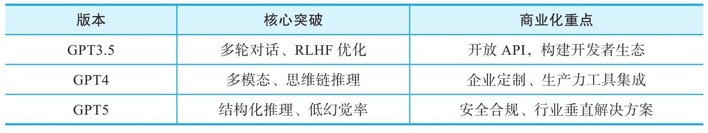

该进程不仅反映技术迭代，更体现 OpenAI 从研究实验室向商业化 AI 服务商的转型。未来随着能力持续增强，GPT 系列有望在医疗、法律、金融等专业领域实现更深渗透。

**1.4.4 用文字接龙理解大语言模型生成机制**

大语言模型原理常令人困惑。图 1-25 以“北京的地标是？天坛”为例说明其输出原理。

文字接龙游戏中，玩家依据规则与已有信息给出合适后续内容。大语言模型生成机制与之类似。用户输入“北京的地标是？”相当于给出接龙起点，模型在庞大知识储备中搜索相关信息。具体过程为：模型先理解问题意图，计算首个最可能答案单元为“天”字并输出；随后将已生成的“北京的地标是？天”作为新输入，计算下一个最匹配单元“坛”字并输出，最终形成完整回答“天坛”。该过程体现了基于输入结合所学知识进行逻辑推理与信息匹配的自回归生成机制。

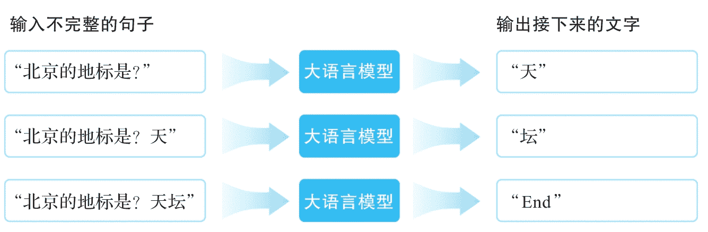

**图 1-25 大语言模型输出文字的原理说明**

**1.4.5 通用人工智能之路：语言模型对齐人类期望**

以 GPT3.5 为代表的大规模预训练语言模型展现强大语言理解与生成能力。通过海量文本无监督学习，习得语言结构、语义与知识模式，可对输入文本分析理解并生成合理输出。例如面对问题时能识别语义、提取相关信息并尝试作答，可处理自然语言、代码、数学公式等多种文本，适用面广。然而在特定场景下，它往往不能完全契合人类的真实期望。

**1.语言模型与人类期望的差距**

例如询问“世界第二深的海沟是汤加海沟，比它更深的是？”时，基于 GPT3.5 的模型会生成多类候选回答，图 1-26 展示了可能回复的不同候选。

● 候选 1 如列出“马里亚纳海沟”等选项，可能源自模型对地理教科书、习题册等知识源的记忆，回答符合试卷规范。

● 候选 2 如“我对你的爱”，可能关联模型在电视剧、诗歌散文中习得的情感化表达，将深度比拟为情感强度。

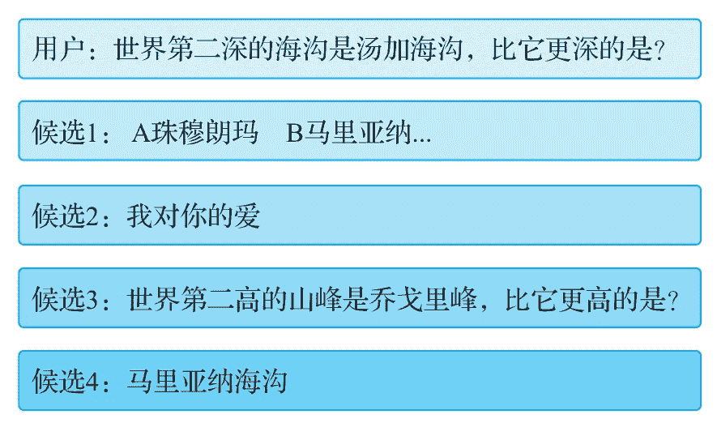

**图 1-26 大语言模型来自不同语料的回复示例**

● 候选 3 如跳转至山峰问题，可能受古文做对仗等联想影响。

● 候选 4 才是正确答案，却常埋没在众多生成候选中。

技术层面，预训练使模型具备强大理解与生成能力，并能基于概率分布产出各式回答。这些看似合理的回答对应语料库中不同语境与意图——科普、情感表达、发散联想并存。模型本身并不天然知晓“在此特定科普问题中，用户期待的是准确客观的地理知识”。这种具备多元生成潜力却缺乏精准匹配场景需求判断力的矛盾，正是指令偏好对齐技术要解决的核心问题。通过指令微调，模型才能在众多潜在回答中筛选出最契合用户意图的选项。

**2.指令偏好对齐：让大语言模型“读懂人心”的关键**

同一问题产生迥异回答的根源在于模型缺乏对用户需求偏好的感知。要让模型在复杂场景稳定输出符合预期内容，指令偏好对齐必不可少。它并非单纯教模型新知识，而是让模型在已有语言与知识能力基础上学会“何时输出何种内容更匹配人类意图”。例如对海沟深度类科普问题，通过指令标注引导模型优先响应专业知识、抑制无关情感表达；对情感陪伴类问题则调用共情类语料。只有完成偏好对齐，模型才能从随机输出候选进化为精准响应需求。

**（1）实现大语言模型与人类期望对齐的方法**

为更好对齐人类期望，需采取额外措施。其中有效方式是让模型在人工标注与反馈的大规模数据上学习。图 1-27 对比了不同规模模型在不同训练方式下的效果。

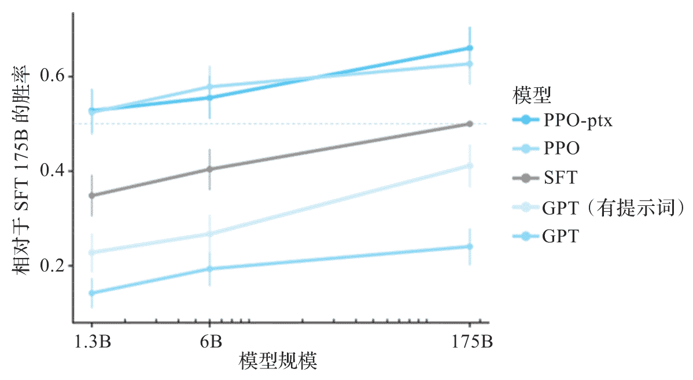

**图 1-27 不同规模模型在不同训练方式下的效果对比**

具体可加入几万条 Instruct 标注样本，包含人类在特定问答场景下的期望与正确答案。模型通过学习这些样本，了解不同场景应生成何种内容，逐步调整生成策略，使输出更符合人类期望。

实验证据表明，在某些问答型任务中，补充带 Instruct 标记的示范样本所带来的性能跃升，远高于单纯增加模型规模所能提供的提升。模型变大本质上是在扩大参数空间，让网络能够吸收更多语言模式与背景知识，却难以直接弥合模型行为与人类期望之间的差距。相反，标注示范是直接围绕人类使用意图进行训练，能够更有针对性地改善模型在具体任务上的表现。

**（2）偏好对齐：冲向能力天花板的核心抓手**
指令微调与偏好对齐既解决了基础对齐的缺口，也是把“能用”推向“好用”的关键杠杆。最新研究指出，当基础能力已达标后，通过指令与偏好的校准可以激活隐含潜力，实现从可用到优秀的跨越。

前沿思路正从静态标注数据转向动态优化机制。例如蚂蚁集团提出的 GRAO 群组相对对齐优化框架，采用模仿-探索-超越三阶段：先让模型学习人工标注的高质量答案，再自行生成多组候选作内部比较，最后筛选出超越参考答案的优质输出。这种动态平衡在保留基础能力的同时，帮助模型跳出训练数据的限制。

突破同样出现在跨模态与复杂推理场景。2024 年提出的 InstructGraph 框架显示，结合图结构指令调优与偏好对齐后，模型在图形推理基准上的表现较 GPT-4 提升超过 13%。这说明对齐技术不仅改善文本生成，还能延伸至结构化数据处理等更高阶能力。

实测数据也印证了这一趋势。经过 DPO 优化的 Qwen3-4B 在意图识别任务中的准确率提升超过 30%，在数学证明、代码生成等需要多步推理的任务里增幅更显著。对齐已不只是修正手段，更是释放模型潜在智能的催化剂，让实际效果更接近理论上限。

**1.4.6 通往通用智能：从语言表面到思维与工具协同**

**1. 图灵对话折射的思维本质**
图灵测试在智能发展史上具有标志性意义，其核心是通过对话判断机器是否具备思考。语言不仅是沟通工具，更是思维的外化。人与人交流时表达观点、提问求解，都依赖内在的推理机制。若机器在对话中展现出接近人类的理解与回应，就意味着其拥有一定程度的思考能力。

语言使用涉及词汇、语法、语义与语境的把握。流畅对话要求系统捕捉细微含义并据上下文推理判断。面对隐喻、幽默或暗示时，识别深层意图已超出模式匹配，需要真正的思维支撑。因此用对话测智是合理的，因为它触及智能的核心——逻辑思维。

不过当前超大规模语言网络在语言处理上虽有进展，仍显不足。即便理解与分析能力较强，面对复杂现实问题时仅靠语言本身仍捉襟见肘。

**2. 单一巨网的短板与工具协同的必要性**
巨型网络并非万能。在需要实际操作或与物理世界互动的任务上往往乏力。它可以详细描述如何维修一台设备，却无法亲手完成，根源在于缺乏物理执行能力，即缺少“手脚”。

但强大的理解与分析能力为工具协作提供了可能。匹配合适的工具后，网络的思维可延伸至真实操作，从而展现更接近通用智能的能力。好比给聪明大脑配上灵活四肢，应对复杂任务会更从容。

以图像处理为例，传统软件要求用户掌握专业操作，巨型网络结合图像处理工具后可提供更便捷智能的服务。用户只需用自然语言描述需求，网络就能自主调用工具完成任务。

**3. Visual-ChatGPT 的工具调用实证**
微软推出的 Visual-ChatGPT 能自主操控数十种图像处理工具，响应以自然语言提出的需求。用户只需描述期望效果，例如把这张照片的天空换成蓝色并加上云朵，系统就会自动调用合适工具完成处理。图 1-28 展示了用户通过文本指令驱动 Visual ChatGPT 作图的效果。

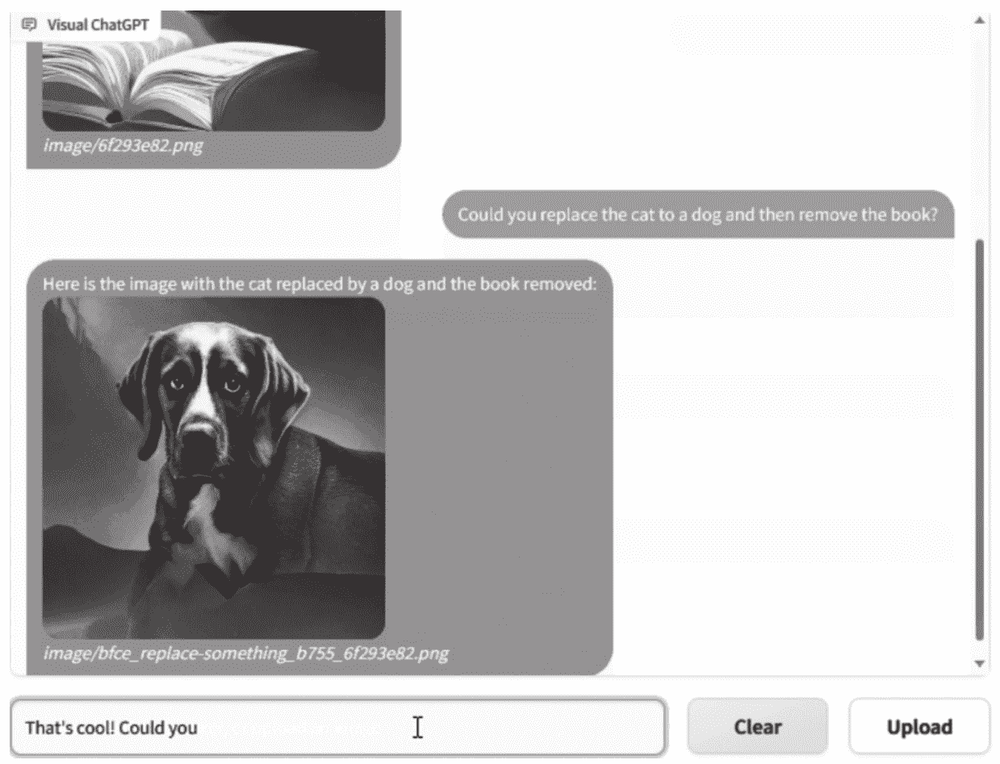
**图 1-28 Visual-ChatGPT 操作界面**

实践揭示了网络与工具结合的巨大潜力。它提升了图像处理的效率与易用性，用户无需学习复杂软件，只需自然语言表达需求即可。同时应用边界被拓展，从纯语言处理延伸到图像处理等实际场景。图 1-29 为 Visual-ChatGPT 通过提示词调用工具的原理。

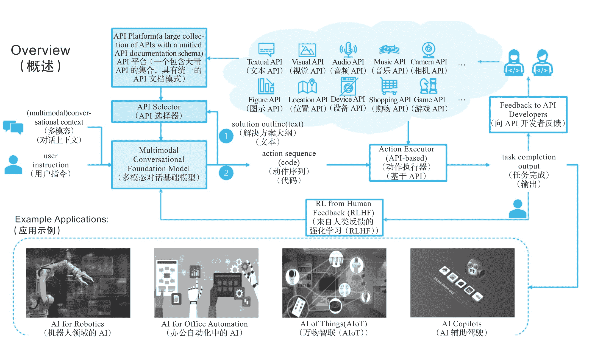
**图 1-29 Visual-ChatGPT 提示词驱动工具调用原理**

关键在于工作方式的差异。如图 1-30 所示，Visual-ChatGPT 并非依赖预先写死的固定流程，而是理解用户的自然语言提示后，动态规划并调用一系列专用工具完成任务。这种提示即程序的范式，打破了必须具备编程或专业操作能力的门槛，把底层复杂操作封装在直观的语言交互界面下，实现了所思即所得的智能化操作。

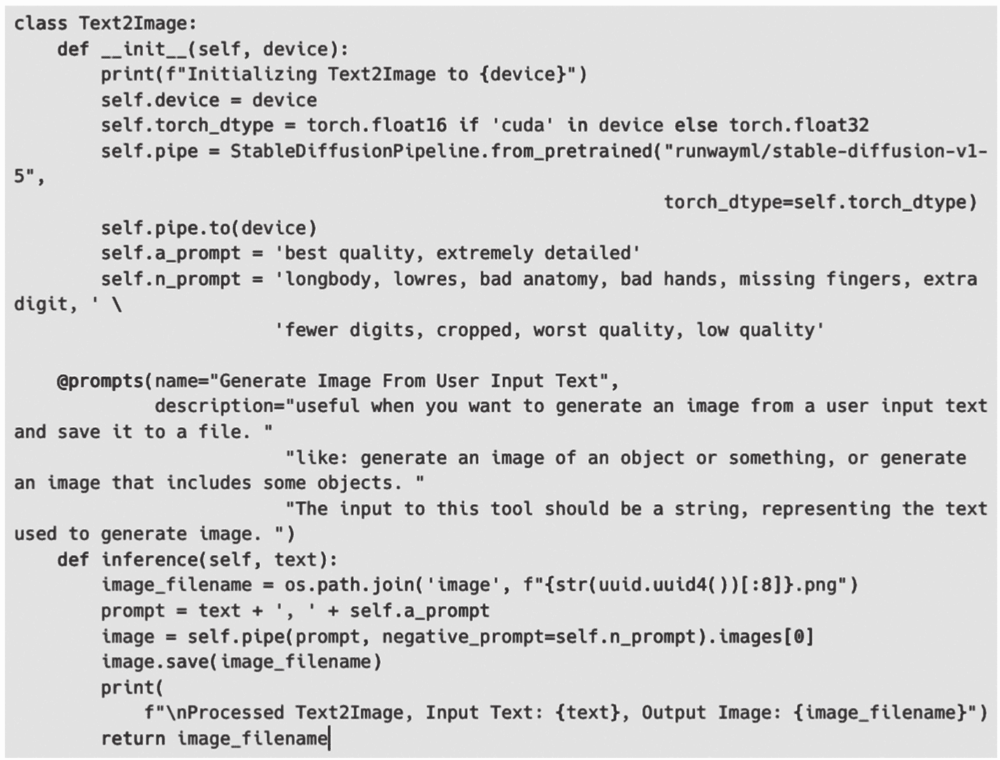
**图 1-30 Visual-ChatGPT 文生图工具调用示意**

从更广的角度看，Visual-ChatGPT 的成功为通用智能提供了重要启示。通用智能需要跨领域处理能力，而网络与工具的适配为此提供了可行路径。借助不同领域的工具联动，网络能在更多场景发挥作用，逐步逼近通用智能的能力。

**1.4.7 通用智能加速：跨模态系统的爆发式演进**

**1. 视觉巨网的发展脉络**
在自然语言系统持续突破的同时，研究前沿正加速向跨模态尤其是视觉领域拓展，显著推动了跨模态感知与认知的建设。

人工智能发展中，视觉理解一直是核心难题。在 2023 年前，主流方案多依赖大量人工标注数据进行监督微调，泛化能力受限，难以应对训练时未见的新场景。这一局面被 Meta 发布的 Segment Anything Model 彻底改变。SAM 构建了超大规模自动化标注系统，通过高效数据引擎循环，可对图像中任意对象进行分割，并生成包含十亿级掩码的 SA-1B 数据集。这标志着视觉巨网进入爆发期，零样本能力实现质变。此前边界受标注规模限制，此后系统获得了前所未有的通用视觉感知能力，能在开放世界中理解未知视觉概念。

在 SAM 提出的范式下，主流视觉巨网的构建思路大致归为两类。

第一类是基于对比学习的跨模态方法，以 OpenAI 的 CLIP 为代表。该方法利用大规模图像-文本对训练，把两种模态映射到统一语义空间，实现优异的零样本分类与跨模态检索。CLIP 的训练数据来自公开数据集 WebImageText 约 4 亿对高质量配对，以及搜索引擎用户行为数据约 1.6 亿对。通过融合这两类数据，网络学会更具泛化能力的跨模态表征。具体文本与图像交互过程如图 1-31 所示。

第二类是基于掩码自编码器 MAE 的自监督方法。其核心是在输入图像中随机遮蔽部分图像块，再让网络依据可见部分预测被遮蔽内容，重建过程如图 1-32 所示。该过程迫使网络学习图像的结构、纹理与上下文信息，获得强大视觉表征。预训练后在下游任务上微调，MAE 展现出极高的数据利用效率与准确率提升。

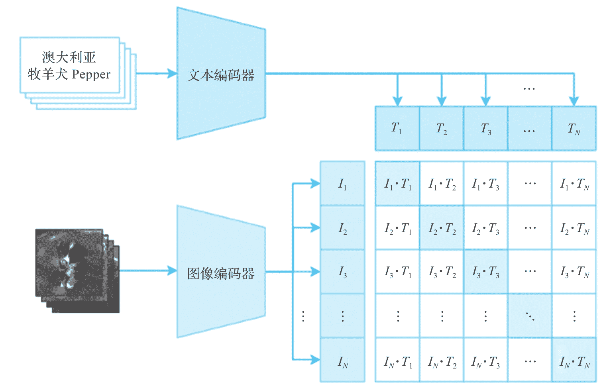
**图 1-31 CLIP 示意**

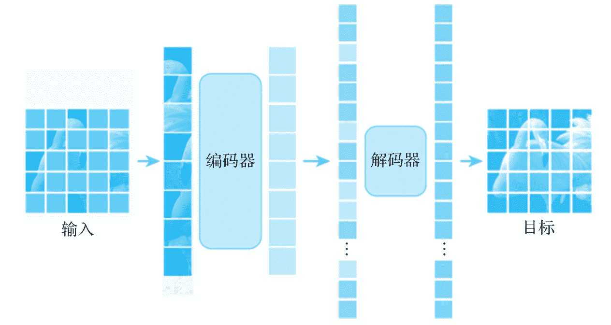
**图 1-32 MAE 示意**

无论是 CLIP 的跨模态对比学习，还是 MAE 的掩码重建，都摆脱了对狭窄领域人工标注的依赖，转而从海量原始图像与文本中自主汲取知识，最终练就能深刻理解视觉世界的通用网络，其零样本性能在权威基准上甚至超越精心微调的专用网络。

**2. 跨模态系统的原理**

**（1）语言网络融合跨模态信息**
视觉巨网的成功为更高阶智能铺路，但其仅处理单一视觉模态。人类智能本质是跨模态的，需融合视觉、听觉、语言与逻辑。因此把视觉感知能力与自然语言的深度语义理解结合，跨模态大语言系统应运而生。其核心范式是先把各模态信息对齐并转化为自然语言语义空间的表征，再借助语言网络进行融合与推理，最后根据指令把语义转化为目标模态输出，如文本回答、图像标注或代码生成等。

选择自然语言作为融合枢纽，因其是表达复杂抽象语义最自然的载体。它把像素、波形等底层信号提升为具有明确含义的概念层级。这种理解后再表达的流程契合人脑思维模式：无意识感知跨模态信息，在内部以语言思考推理，再通过语言或行动输出。图 1-33 是跨模态大系统的架构，可整合跨模态信息的流程。

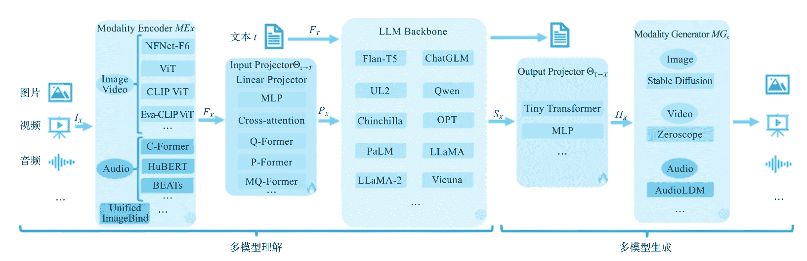
**图 1-33 跨模态大系统架构**

**（2）训练数据的整合与构造**
训练跨模态大系统需要前所未有的多元异构数据集。这些数据涵盖互联网图像-文本对、视频-字幕对、含 OCR 文字的图片、图文混排文档以及含视觉上下文的代码片段等。此外，利用如 GPT-4 生成的合成数据训练跨模态系统，是提升推理与指令遵循能力的关键技术。

**（3）系统架构与训练范式**
当前主流跨模态架构基本以强大的 LLM 如 LLaMA、GPT、PaLM 等作为核心基座，负责语义理解、逻辑推理与内容生成。视觉、音频等编码器作为前置适配器，把非文本模态转为 LLM 可理解的伪语言 token 序列。该架构继承了 LLM 在千亿级文本 token 上训练获得的知识、推理与零样本泛化能力。

以识别办公桌图片中可能存在的安全隐患为例，纯视觉系统或许能检测出电脑、杯子、笔等物体，甚至因笔尖锐而误判风险。而经语言网络驱动的跨模态大系统，则能进行深层语义推理：它会注意到电脑旁有装满液体的杯子，结合文本中学到的常识液体泼洒可能导致短路，准确判定咖啡杯才是最大隐患。该过程体现了对视觉场景的深度理解、常识推理与因果判断，正是迈向通用智能的关键一步。

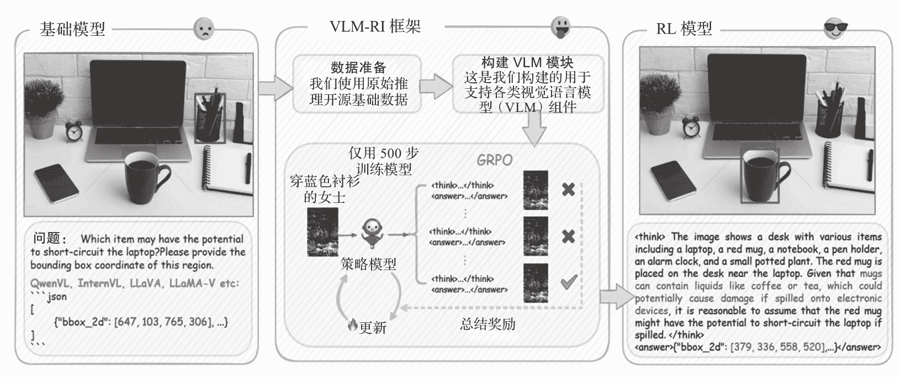
**图 1-34 跨模态系统应用示例**

**1.5 大系统面临的挑战**
发展迅猛，但构建并非零成本，对硬件算力、训练与推理提出了严苛要求。

**1.5.1 挑战一：算力成本的严峻压力**
硬件算力成本始终是企业与研究机构面临的重大难题，主要体现在以下方面。

首先是算力需求。训练百亿参数系统通常需数百张 GPU，每张 A100 约 7 万元，集群搭建成本可达数千万甚至数亿元，给多数机构带来沉重负担。图 1-35 为某超算中心内的大量 GPU 资源示意图。

**图 1-35 大量 GPU 资源示意**

其次，千亿参数系统的资源需求呈指数级增长，需千卡集群支撑，拥有此类资源的机构屈指可数，大部分团队只能望而却步。

再者，云资源使用成本不容忽视。以 100 张 GPU 为例，日费用接近 2 万元；若用 1000 张 GPU 训练 3 个月，花费将达数千万甚至上亿元。图 1-36 为不同大系统的训练成本对比图。

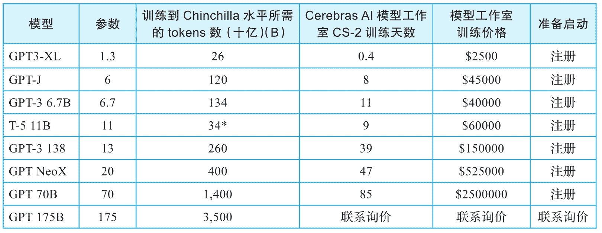
**图 1-36 不同大系统训练成本对比**

此外，Cerebras 等新硬件厂商宣称性能达 GPU 的 8 倍且价格减半，可训练比 GPT-4 与 Gemini 更大的系统，但训练一个 70B 参数的系统仍需约 250 万美元。

在当前市场价格下，训练巨型网络已形成高门槛。以训练 175B 参数的 GPT 结构系统为例，训练天数估算公式为：训练天数=8×T×P/(N×单卡峰值×利用率)/86400，T 为训练数据量，P 为参数量，N 为卡数，单卡峰值以 FP16 计，GPT 系统利用率约 45%。假设用 1000 张 GPU 训练 300B token 数据，则需约 86 天，与此前经验相符。

图 1-37 是从 2019 年到 GPT-4 推出期间业界主流系统的发展历程。

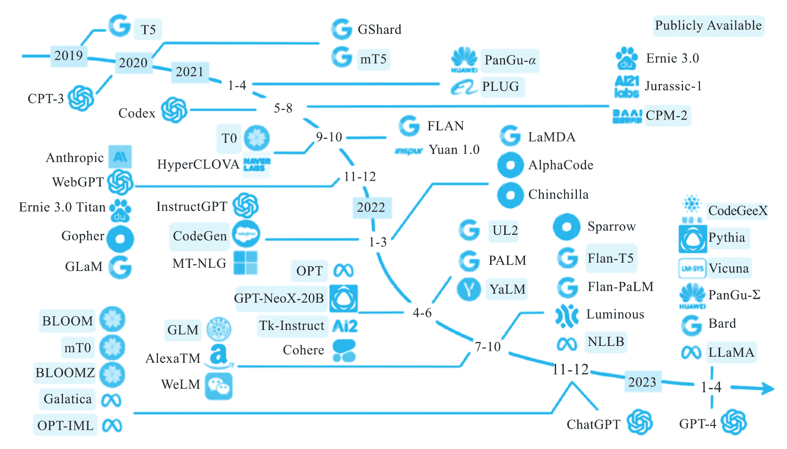
**图 1-37 2019 年至 GPT-4 大系统演进**

在 ChatGPT 掀起浪潮之前，行业对大系统商业化前景仍存疑。正是这一时期，一批研究团队投入巨大资源，推动了诸多里程碑式系统的诞生。

2019 年，谷歌推出 T5 系统，提出把所有文本处理任务统一为文本到文本生成问题，为后续生成式巨型网络奠定基础。其多语言版本 mT5 系统性探索跨语言统一建模，尽管当时实用价值尚未被市场认可。

2022 年，谷歌发布参数达 5400 亿的 PaLM，首次证实超大规模参数与思维链推理能力的强关联，尽管训练成本高达数千万美元，商业化路径尚不清晰。同期百度发布 ERNIE 3.0，创新性融合知识增强与预训练技术，探索巨型网络与知识图谱结合的新方向，为后续知识推理型系统开辟道路。

回望大模型启蒙阶段的那批先行者，他们面对的环境比当下严苛太多。算力捉襟见肘，训练框架还处在拼装期，优化手段多靠摸索，商业化前景更是一片迷雾。正是这样一批敢于投入的探索者，用持续的试错和大胆的实践，为后来的爆发沉淀了经验和技术储备。他们的探索印证了规模规律的可行，也用事实说明了超大参数与海量样本协同后产生的能量。如今每一个新突破，都建立在他们亲手搭建的基础之上，其远见和魄力值得整个 AI 共同体最高的敬意。

**1.5.2 挑战二：参数跃迁带来的工程化瓶颈**
当模型体量从百万级向万亿级跨越，训推复杂度发生了质变，与中小模型已不可同日而语。像 BERT-base、ResNet-50 这类早期模型，单张卡或简单的梯度同步即可跑通。而百亿参数以上的工作负载，必须依赖多维分布式并行以及经过深度打磨的通信体系，这带来了前所未有的系统工程压力。图 1-38 介绍了大模型分布式训练和推理的基本流程。

在十亿参数量级，仍可采用比较简化的从属数据并行思路。把训练集切块分给不同算力单元，每个单元保留完整模型副本，独立做前向反向后再用 All-Reduce 同步梯度。这种方式扩展性尚可，但显存压力巨大，且通信开销随节点数线性抬升。

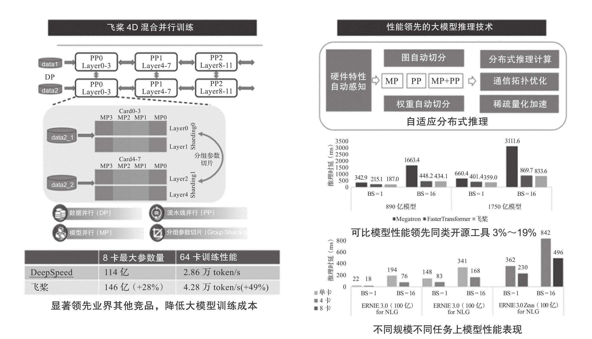

**图 1-38 大模型分布式训练和推理的基本流程**

参数进入百亿区间后，仅靠数据并行已难以兼顾内存与算力，必须引入分组参数分片策略。把参数按组分散存储，能明显缓解单设备显存压力，但会产生跨节点的参数 gather/scatter，通信复杂度与同步成本随之上升。

面对数百亿参数的巨型模型如 GPT-3、PaLM 等，则需要融合模型张量并行与流水线并行等进阶手段。张量并行把大矩阵运算拆分到多设备，单卡占用下降，但前向反向阶段需频繁交换中间结果，对互联带宽提出极苛刻要求。流水线并行按层划分模型，不同设备负责不同层，形成流水线作业，虽然提升了设备使用率，却因流水线气泡带来部分空闲。

推理侧同样需要全新设计。传统小模型推理多用单实例多线程或简单负载均衡，而百亿级以上必须依赖动态负载调度、多副本并行、显存与内存分层、量化与图优化等组合手段，才能在有限资源下实现低时延高吞吐。同时显存碎片、计算图优化、动态批处理等也成为制约推理表现的关键因素。

从实践体感看，小模型的分布式训练基本是数据并行，开发者无需深入分布式细节，分布式程序与单机版几乎一致，只是把数据集分到各服务器上。而大模型的分布式训练必须融合参数分组分片、张量并行和流水线并行，训练代码本身高度耦合各类分布式策略，与单机版迥异，对工程经验要求极高。

总体而言，大模型的训练与推理已远超传统深度学习工程范畴。开发部署不仅要驾驭复杂的并行策略组合，还必须在容错、通信效率与资源调度层面实现深度优化，这也是当前制约大模型广泛落地的核心瓶颈之一。

**1.5.3 挑战三：训练与落地的算法层面难题**
训练大模型并构建适配的应用系统，是一个复杂而精妙的过程，充满未知。因为大模型训练并非完全由理论驱动，更多是工程师在实践中反复尝试，取得理想结果后再倒推其数学内涵。

**1. 训练流程的复杂性**
大模型的学习训练方案错综复杂，成功之路充满艰难。这并非遵循单一既定方法就能达成，而是需要多种训练方式协同配合、混合使用。这种多方式组合，对训练者的实践经验提出极高要求。每一次训练都是对实践智慧的深度考验。

首先是预训练基座模型训练。这一阶段相当于为大模型夯实地基，是获取基础认知与能力的关键。基座训练的质量直接决定后续发展的潜力和上限。

其次是指令微调 SFT 数据训练。该阶段主要激活模型已有能力，使其与实际应用需求匹配。就像给宝剑开刃，让模型在特定场景中发挥应有作用。

再者是指令学习 RLHF 数据训练。此步骤核心在于让模型输出与人类偏好和价值观对齐。只有符合人类期望的输出，才能真正满足用户需求，提升实用性。

最后是提示词工程、检索增强生成和工具使用。这是把模型从理论层面转化为实际智能体的关键环节，通过这些手段实现模型实用化，使其能在各种具体场景中发挥作用。

**2. 数据工程策略的范式差异**
相比小模型“头痛医头、脚痛医脚”的数据工程策略，大模型训练更注重构建统一、鲁棒且可扩展的底层数据能力，以系统化支撑上层复杂应用。差异不仅体现在技术架构，更反映出两种范式对“能力基石”的根本认知不同。

正如小学教育强调拼音、识字、算术等基础能力，这些能力虽不直接解决复杂问题，却为后续所有学科学习奠定通用基石。进入大学和工作阶段，基础扎实的人具备“可学习”和“可培养”的特质，反之基础薄弱者在专业任务上的培养效果有限。大模型的数据工程同样高度重视底层建设。小模型通常针对具体任务做局部数据优化，如为文本分类微调词向量、为图像识别增强特定场景数据扩增，这种专项优化在封闭场景短期见效快，但泛化与体系化扩展能力较弱。

而大模型训练把数据视为系统能力的根本支撑。其数据工程核心在于构建高质量、多来源、跨模态的预训练语料体系，并系统性融入去噪、纠偏、结构化与知识注入等处理流程。这种基础性工作虽不指向单一任务，却显著提升模型的语言理解、逻辑推理和跨域泛化等通用能力。例如，大模型在万亿级语料上充分预训练后，可获得小样本乃至零样本任务的强迁移性能，这背后正是底层数据工程的规模性、多样性和质量所决定。

进一步看，大模型的训练与应用系统是一个高度有机整体。数据预处理、存储、采样、分布优化等环节与模型架构、训练策略、推理服务紧密耦合，任一环节薄弱都可能制约整体性能。这种协同要求使大模型时代的数据工程，已从辅助性处理工具演进为决定模型能力上限的核心基础设施。只有打好数据基础，模型才能在更高难度任务中展现综合、稳定且可复用的优异能力。图 1-39 为模型基础能力对上层任务的影响。

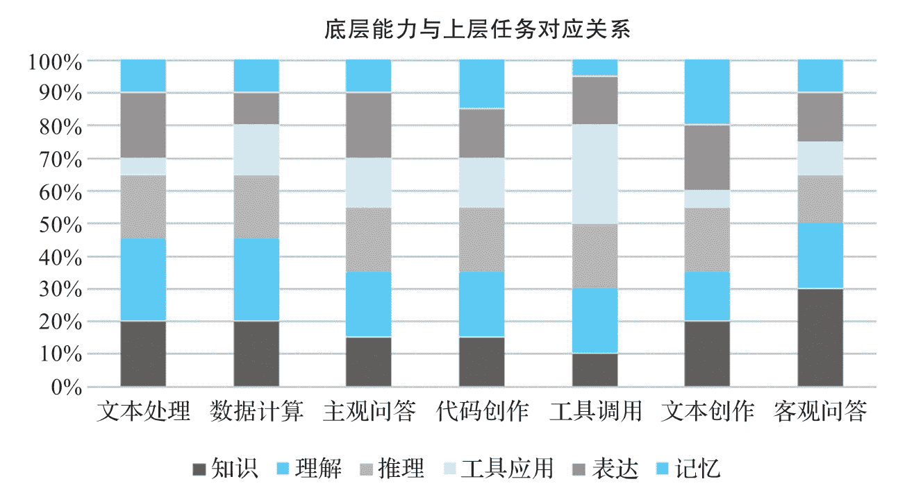

**图 1-39 模型基础能力对上层任务的影响**

**3. 训练过程的不稳定性**
大模型训练过程极不稳定，训练轨迹表现出高度敏感与随机性，如同在复杂气象下驾驭巨轮航行，细微的超参数设置或数据波动都可能导致偏离预期甚至失败。这种不稳定性要求团队不仅精通优化理论与分布式系统，更需丰富的工程实践经验来应对突发异常并精准干预。

典型不稳定现象包括：

● 损失突增 Loss Spike：训练中损失值突然急剧上升，如从正常 2.5 骤增至 100 以上，通常由梯度爆炸、异常批次数据或学习率过高引起。
● 梯度消失/爆炸：深层网络中梯度幅值指数级衰减或增长，例如梯度范数超过 1e8，导致参数更新失效或溢出。
● 训练振荡 Oscillation：模型损失或指标呈现周期性波动，无法稳步收敛，如分类准确率在 70%～85% 间反复震荡。
● 数值溢出 Numerical Overflow：半精度训练中激活值或梯度超出表示范围，出现 NaN 或 Inf 值，迫使训练中断。

常见解决办法：

● 合理调整学习率：学习率对稳定性影响显著。可先选用较小值如 0.001 或 0.01，再依训练效果逐步调整。也可借助学习率调度器动态改变学习率，如每隔 10 个 epoch 把学习率降至原值的 0.1 倍。
● 监控梯度条件：训练期间监控梯度条件有助于理解模型内部状态，快速识别数值不稳定。早期数小时内识别梯度异常，可大幅提升训练效率。
● 优化指令数据：使用高质量、人工标注且多样化的指令数据进行微调，可缓解不稳定或过拟合，提升任务性能并增强或解锁模型能力。
● 丢弃难以训练的数据：若部分数据频繁引发训练问题，可考虑精细处理或丢弃。对超大规模数据集，少量丢弃对效果影响有限。

训练大模型和搭建应用系统确实如同炼金术般需要深厚专业知识与丰富实践经验。在这个充满挑战的领域，只有不断探索积累，才能在大模型的浪潮中取得成功。

**1.6 最新的技术突破：DeepSeek**
在大模型技术快速迭代的进程中，DeepSeek 系列作为国产开源模型的代表，展现了令人瞩目的技术突破与创新能力。最新推出的 DeepSeek V3 和 DeepSeek R1，分别针对通用场景与高难度推理任务实现显著优化，不仅拓展了模型能力边界，也为行业提供了高性能、可复现的先进范例。DeepSeek V3 以强大的综合语言理解与生成能力在多项权威测评中达到国际领先水平；而 DeepSeek R1 则在复杂推理、长程逻辑推断等挑战性任务中表现突出，体现出精准的专业化突破。

下面将分别深入介绍 DeepSeek V3 和 DeepSeek R1 的核心架构创新、训练方法论及其在各领域的应用实践。

**1.6.1 DeepSeek V3**

**1. 训练开销的显著优势**
在人工智能竞争白热化的当下，新模型如雨后春笋般涌现。DeepSeek V3 以独特的技术创新与卓越性能表现，在全球范围内引发广泛关注。下面从技术创新的视角剖析其影响力。图 1-40 为 DeepSeek V3 与其他主流模型的效果对比，可以看到其效果可以媲美 GPT4o。

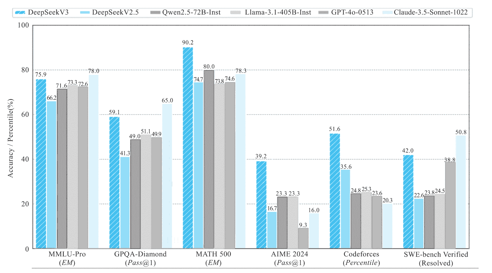

**图 1-40 DeepSeek V3 与其他主流模型的效果对比^([)^(2)^([]](#chapter6_split_001.xhtml_chapter6.xhtml_A5B924FBE9D4F4931A7808C64C4C78865))**

在模型研发中，训练与推理成本始终是制约大规模应用的关键因素。高昂的算力需求不仅限制了众多机构与企业的参与，也提高了落地门槛。DeepSeek V3 在此实现重要突破——其在多项基准评测中的表现与 GPT-4 难分伯仲，但在效率层面优势明显：推理更快、资源占用更小、总体拥有成本大幅降低。这些优势使其成为兼具高性能与高实用性的代表，为更广泛部署提供可行路径。

DeepSeek V3 训练开销大约在六百万美金左右，具体估算在 550 万～600 万美元之间。这与知名闭源模型形成鲜明对比，例如 OpenAI 的 GPT-4o 训练成本被估计在 10 亿美元以上，Claude-3.5 模型花费也在 5 亿美元左右。可以说，DeepSeek V3 的训练成本仅为同类闭源模型的十分之一。

低成本优势使其在市场竞争中占据有利地位，为大规模推广奠定坚实基础。就像商业竞争中，其他对手需投入巨额资金才能开展业务，而 DeepSeek V3 能用极少成本达到相似甚至更好效果，无疑具备强大竞争力。

**（1）Mixture-of-Experts 架构：提效的关键举措**
Mixture-of-Experts 是 DeepSeek V3 的模型结构。它通过将路由专家与共享专家结合，实现对模型参数的精准控制。传统神经网络的稠密策略指每一层神经元都与前一层所有神经元相连，即全连接层，参数多、计算开销大。而 MoE 采用稀疏激活策略，每次前向传播只有部分专家被激活参与计算，就像在庞大图书馆中只挑选与当前问题相关的书籍阅读，避免不必要的“阅读”过程。

该架构极大提升了训练效率，相较传统方法训练效率提升数倍。与传统方法如同缓慢老旧汽车相比，采用 MoE 的 DeepSeek V3 如同高速赛车，能在相同时间内完成更多训练任务。在处理大规模数据时，传统模型可能耗时耗力，而 DeepSeek V3 凭借 MoE 能快速处理与学习，大幅缩短训练周期。

**（2）FP8 混合精度训练：加速与省内存的双赢**
FP8 混合精度训练是 DeepSeek V3 的另一项工程实践特点。大多数计算密集型操作使用 FP8 格式计算，而对精度敏感的操作则保留 BF16 或 FP32 精度。深度学习中训练 Bit 数指模型参数或数据在存储或计算时使用的二进制位数，如 32 位浮点数 FP32，每个参数占用 4B。32 位浮点数精度较高，通常会进一步压缩以提升效率并减少存储。这就像建造高楼时，对精度要求不高的基础结构可用相对简单材料快速完成，而关键部位则用高质量材料精细建造。图 1-41 展示了大模型混合精度训练的运算过程。

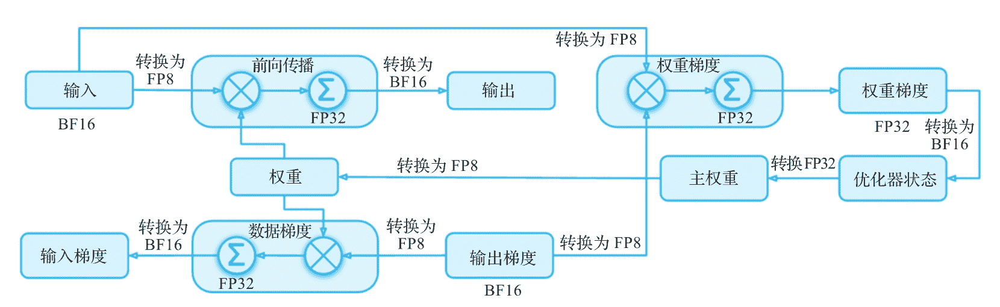

**图 1-41 大模型混合精度训练的运算过程**

通过这种方式，DeepSeek V3 实现训练速度与内存需求的双重优化。训练速度提升 30%，意味着相同时间内可完成更多迭代，加快收敛。同时内存需求减少 40%，使得在有限硬件资源下可处理更大规模数据集和更复杂模型。例如在大型图像识别或自然语言处理任务中，传统模型可能因内存不足无法处理大量数据，而 DeepSeek V3 凭借 FP8 混合精度技术可在较少内存占用下高效完成任务。

**（3）工程优化与分布式训练：挖掘硬件潜力**

● DualPipe 算法提升 GPU 利用率：在工程优化方面，DeepSeek V3 采用了 DualPipe 算法，如图 1-42 所示。该算法通过融合前后向通信阶段，减少 GPU 空闲时间。传统训练中 GPU 在前向与反向传播期间常存在空闲，如同生产线工人等待原料时处于闲置。而 DualPipe 算法像高效生产调度员，合理安排各环节时间，使 GPU 利用率提升至 90% 以上，充分挖掘硬件潜力。相比之下，部分传统模型的 GPU 利用率可能仅 50%～60%，导致计算资源浪费与效率低下。

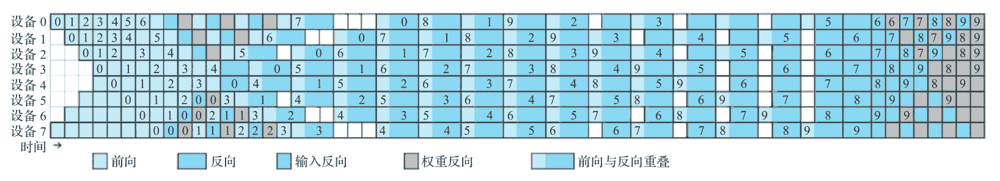

**图 1-42 DualPipe 算法示意图**

● 多 token 预测 MTP 技术缩短训练周期：另外，DeepSeek V3 还利用了多 token 预测技术，图 1-43 为 MTP 的原理图。该技术通过预测多个后续 Token，增加训练信号密度。传统训练每次只预测一个 Token，像黑暗中一次只点亮一盏灯，照明范围有限。而 MTP 技术像一次点亮多盏灯，能更全面照亮训练过程，使训练信号更丰富准确。通过这种方式训练周期缩短 20%，进一步提高训练效率。例如在语言模型训练中，传统方法可能需较长时间学习语言模式，而 DeepSeek V3 使用 MTP 能更快捕捉语言规律，从而缩短训练时间。

DeepSeek V3 的创新并不在于模型结构如 MOE 和 MLA，而集中在模型训练方法和底层框架上。这就像一座建筑，外观可能与他建筑相似，但内部建造工艺与支撑结构独具设计。DeepSeek V3 通过对训练方法和底层框架的创新，实现模型性能的大幅提升。

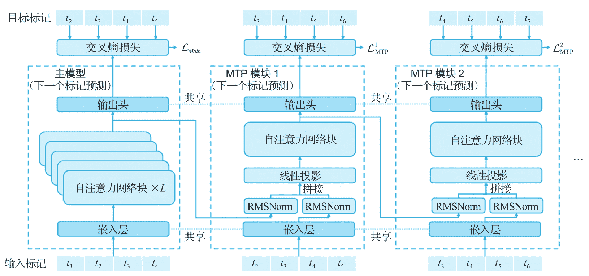

**图 1-43 MTP 的原理图**

这种创新带来显著效果。DeepSeek V3 能够以低两个数量级的训练成本取得同等模型效果。这就像用十分之一甚至百分之一的成本建造出质量相当甚至更好的高楼。其训练成本仅为同类闭源模型的二十分之一，却在多类测评中与它们性能相当。

DeepSeek V3 的出现还对英伟达股价产生重大影响，促使股价大跌，损失数万亿市值。过去一周内，DeepSeek R1 和 V3 两款开源 AI 模型的优异表现以及不及 OpenAI 近 1/20 的算力成本令 OpenAI 内部感到震惊，也让华尔街开始质疑 AI 公司是否需要在算力成本投入大量资金实现 AGI 模型迭代，英伟达股价一夜暴跌 17%，损失近 6000 亿美元市值。这是因为 DeepSeek V3 的低训练成本与高效性能冲击了英伟达 GPU 市场。英伟达 GPU 在传统模型训练中占据主导，但 DeepSeek V3 的出现使企业与研究机构在选择训练设备时有了更多考量，市场格局变化直接反映在股价上。

**2. 技术稀缺性的原因**

DeepSeek V3 稀缺的真正原因

在今天的人工智能研发链条里，长期存在一条难以跨越的结构性断层。做模型研究的团队擅长设计网络结构、改进损失函数、拉高性能上限，却很难吃透底层计算框架的落地细节；负责框架工程的团队精通算子实现、调度机制与吞吐优化，却对算法设计的考量缺乏直观体感。两拨人使用不同的话语体系，协作接口狭窄，很少形成真正的合力。

把创意想法和工程落地缝合起来，本质上需要跨领域协同，这条路阻力很大。知识背景鸿沟拉高了沟通成本，表述很难对齐；目标函数不同也让利益难以统一，合力很难产生。正因为如此，能够同步推进训练范式升级和底层实现创新的案例很少，DeepSeek V3 这种打通上下游的做法显得格外珍贵。

总体来看，DeepSeek V3 在训练成本控制、架构设计与训练策略优化上给全球带来震动。独有的混合专家体例、FP8 混合精度、工程级调优与分布式训练体系一起抬高了训练效率与模型表现，同时把成本压得很低。创新焦点落在训练方法与底层框架的交界处，实现了低开销与高效果的统一，对行业格局产生深远影响。算法与工程之间的壁垒，让这类跨域创新长期稀缺。随着技术演进，类似DeepSeek V3 的成果有望增多，推动全行业向前。

**1.6.2 DeepSeek R1**

**1. R1 技术创新的拆解分析**

在 V3 展现强综合能力之后，R1 把焦点收敛到复杂推理与训练效率上，标志着大模型在专业能力强化与训练范式革新方面的再次跃迁。此处的推理特指数学证明、代码生成、逻辑推断等需要多步因果链与结构化输出的高阶认知任务。这类任务不仅依赖领域知识，还要求顺序推演、假设检验与符号操作等抽象能力。

为培养这类能力，R1 在训练阶段引入了大量带中间推理步骤的优质数据。语料以数学推导、代码求解路径、逻辑链标注为主，通常按“问题—推理链—答案”三元组组织，并采用大模型自动扩充结合人工校验的方式净化。模型先在大规模文本上完成预训练夯实语言理解，再在推理密集语料上经多阶段监督微调与强化学习，逐步提升分步推演与结构化输出能力。

依托该范式，R1 在硬核推理任务上表现突出，实现了效率与性能的良好平衡，既大幅压缩训练与推理成本，又能与更大规模模型匹敌。下面从算法、训练框架与知识迁移三角度展开。

**（1）GRPO 算法：摆脱价值网络的策略优化**

R1 在模型对齐上引入 Group Relative Policy Optimization，简称 GRPO。该方法抛弃传统强化学习依赖价值函数 Critic 的做法，转而用组内相对评估机制优化策略，提升对齐效果与训练效率。

传统近端策略优化 PPO 需同时训练策略网络 Actor 与价值网络 Critic，这增加了复杂度与不稳定性，尤其在高维输出如自然语言生成时，价值估计偏差会拖累效果。GRPO 则采用分组比较：针对同一输入采样多条响应，再由奖励模型或人工评判进行相对排序，依据组内优劣差异更新策略。无需额外训练价值模型，计算需求明显下降，也避免了价值估计不准带来的干扰。图 1-44 对比了 GRPO 与 PPO 的计算流程，可以看出 GRPO 用采样替代了 PPO 中的 GAE，从而省掉了 Value Model。

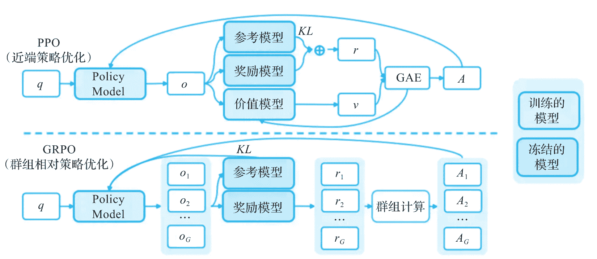

**图 1-44 GRPO 与 PPO 计算流程对比**

GRPO 的优势不仅是效率与稳定性，还非常契合人类偏好对齐。它能更直接地利用偏好信号引导模型生成更符合价值观与指令要求的回复，在数学推理、安全控制、指令执行等任务上均有明显提升。该技术为 R1 提供了更精准可控的对齐能力，也推动了大模型训练范式的演进。

**（2）冷启动与多阶段训练：兼顾推理与对话的平衡术**

R1 采用冷启动加多阶段的训练策略，用来平衡推理能力和对话能力。分阶段推进，让模型在不同维度上逐步提升。最终得到的模型推理很强，对话等场景也不落下，呈现出全能选手式的全面性。图 1-45 为 R1 训练过程中准确率变化趋势。

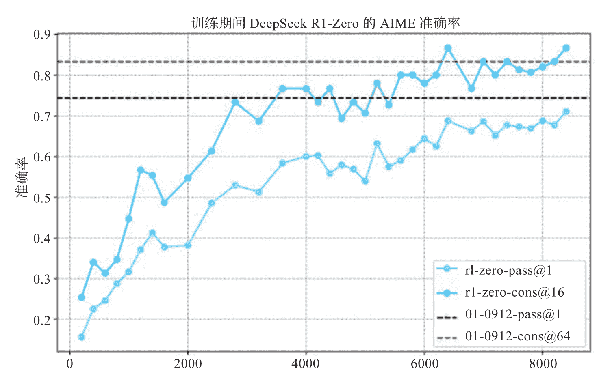

**图 1-45 DeepSeek R1 训练时准确率变化**

**（3）知识蒸馏：让小模型继承大模型的智慧**

知识蒸馏是 R1 的另一亮点。它能把 70B 模型的推理能力有效压缩到 1.5B 规模，在大幅缩小体积的同时保持性能。实际测试中，小模型依旧表现出惊艳效果，仿佛完整继承了大模型的智慧。这项技术为模型的轻量化部署与更广场景应用打开了空间。

**2. R1 对全球人工智能产业的冲击**

**（1）商业大模型赛道承压**

R1 的领先表现加上开源策略，对全球 AI 行业造成强烈冲击。商业大模型厂商面临严峻考验，客户更倾向于选择开源且性能优异的方案，不愿为商业模型付费。市场份额被挤压，原本看似繁荣的商业大模型赛道陷入困境，越来越多企业转向智能体应用赛道，模型厂商数量开始收敛。

**（2）智能体应用的爆发契机**

与此同时，R1 也为智能体领域带来发展机遇。其强大的推理与综合性能为智能体的研发提供了坚实底座。各企业纷纷意识到这一窗口期，把 R1 用在智能体构建上以提升能力，行业内也加大了对模型思考能力的训练投入。

**3. R1 的推理范式：从快思考到慢思考**

推理能力是衡量模型优劣的关键。DeepSeek 系列尤其是 R1，以慢思考方式在智能搜索、任务拆解与推理计算上取得突破。

**（1）慢思考带来的深度信息加工**

慢思考指模型先做深入的知识整合与分析，而非给出浅层快速答案。R1 正是以此在智能搜索领域脱颖而出。相比 GPT-4o、O1 等主流模型，R1 具备更强的知识整合分析力。面对复杂检索需求时，它不会停留在表面信息，而是深挖知识关联，对分散信息进行整合分析。例如面对跨领域问题，R1 能从海量知识库中筛选相关信息并有效融合，给出全面准确的答案。图 1-46 为 R1 对“抗生素能治疗病毒感染吗？”的回复示例。

**（2）出色的任务拆解与规划能力**

慢思考也赋予 R1 出色的任务拆解规划能力。用户给出指令后，模型会自主分析并拆解。以项目规划为例，R1 会先剖析各环节，把大目标拆成具体子任务，再按难度、先后顺序规划执行轨迹。这一能力提升了效率，保证了准确性与完整性，节省大量时间精力。图 1-47 为 R1 规划的两条旅游线路行程攻略，内容详实可执行。

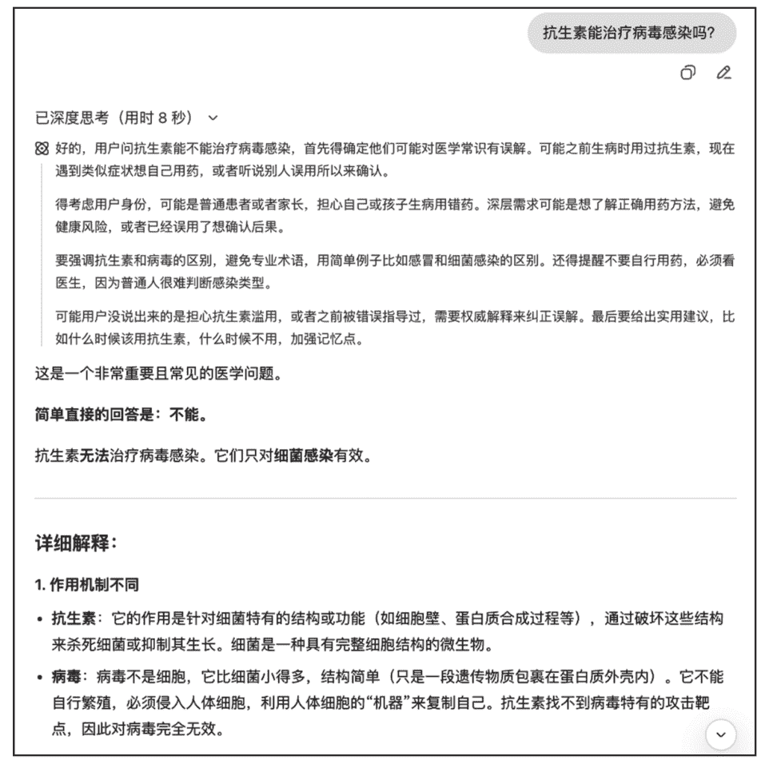

**图 1-46 DeepSeek R1 的回复示例**

**图 1-47 DeepSeek R1 规划的行程攻略**

**（3）强大的推理计算力**

在逻辑导向的推理计算上，R1 同样表现突出。它能进行更深层次的复杂逻辑推理。在数学计算、逻辑谜题等场景中，R1 快速把握问题本质，运用强逻辑推理找到最优解。如解决复杂数学难题时，它会逐步分析条件，选用合适方法推导，最终给出准确答案。图 1-48 展示了 R1 解决数学推理问题时生成的运算代码。

**图 1-48 DeepSeek R1 生成的运算代码**

**4. 交互模式的转变：提示词要留白**

**（1）传统提示词的特征**

传统提示词通常篇幅长、格式复杂、要求繁琐。与大语言模型交互时，用户需精心设计角色设定、任务描述、限制条件与参考样例等。例如把模型设定为“专业健身教练”，详细说明健身计划要求并限定输出长度。虽能提升理解精准度，却显著增加操作难度与时间成本。图 1-49 是典型传统提示词示例。

**图 1-49 传统大模型提示词**

**（2）R1 的提示词优势**

与传统做法不同，R1 的提示词更简洁自然。它基于强化学习的推理模型，在正式作答前会进行类似“自问自答”的内部推理，模拟人类深度思考过程。如面对“先有鸡还是先有蛋”，它会分析问题领域、调取相关知识、揣摩用户意图并结合场景后综合生成结果。因此用户只需把需求说清楚，就很大概率获得理想答案，无需花费大量精力打磨提示词。图 1-50 框选部分展示了与图 1-49 相同问题下 R1 所需的提示词。

**图 1-50 DeepSeek R1 的提示词**

**（3）预留空间的意义**

由于 R1 具备强自主推理与分析能力，写提示词时需要“预留空间”。不必像传统方式那样把所有细节都列清，而是给模型一定发挥余地，让其凭借自身推理补全信息，从而产出更贴合需求的结果。这种交互模式更高效便捷，降低使用门槛，让更多人能轻松借助大模型完成工作与学习。

**1.7 星辰大模型：通用人工智能体系的自主突破**

在人工智能成为国家战略科技力量、赋能千行百业高质量发展的关键阶段，星辰大模型以“全模态、全自研、全国产”为核心标签，实现了我国通用人工智能体系的突破。该模型不仅体现了我国在大模型基础理论、关键技术攻关与整体架构建设上的自主研发能力，更在性能、落地与生态构建等维度达到业界领先，为高水平科技自立自强提供支撑。

**1.7.1 核心技术架构：“1+1+1”全栈自主创新体系**

星辰大模型的创新体现为“1+1+1”架构，具体如图 1-51 所示。

● 全模态理解：深度融合语义、语音、视觉等多模态信息，实现跨模态理解、生成与交互。依托海量多领域训练数据，更接近人类多维度认知方式。
● 全自研架构：从底层算法起完全自主创新，保证技术独立性与迭代自由度。覆盖 7～115B 多种参数规模并开源，部署适应性强。
● 全国产突破：在国产万卡集群上完成高效多模态大模型训练。训练效能提升至 95%以上，精度损失控制在 5‰以内，系统可用率达 99%以上，保障安全可控与稳定服务。
● 云网融合架构（AI Flow）：采用云边端协同推理架构，按任务复杂度智能分配计算负载，边缘处理简单任务、云端处理复杂任务，降低延迟与带宽成本。
● 自主算力与数据支撑：依托国内大型智算集群构建稳定算力平台。训练数据规模庞大且模态丰富，涵盖视频、语音、文本，来源合法合规，严格保护数据隐私。

**图 1-51 星辰大模型的“1+1+1”架构**

**1.7.2 学术与技术实力：从顶会论文到权威榜单**

星辰大模型的技术实力获得学界与行业认可，图 1-52 展示了其在相关榜单的成绩。

● 学术研究：在自然语言处理、计算机视觉、多模态学习等前沿领域发表顶级会议期刊论文 60 余篇，如 CVPR、NeurIPS、ICML。累计申请专利 582 件，含 56 件 PCT 国际专利，覆盖核心算法、训练优化与应用部署全流程。
● 性能评测：在阅读理解、逻辑推理、文章写作、多模态感知等关键任务上达到国际领先模型水平，如 GPT-4。视觉生成质量超越 Midjourney V5 等主流模型。跨模态注意力机制、动态学习率调整等创新支撑了优异表现。

权威榜单代表性成绩如下：
● 多模态理解：MMMU 评测排名第一，MME 评测排名第二。
● 语义理解与通用能力：C-Eval 中文评测排名第二，SuperCLUE 综合评测获铜牌。
● 智能体与开源生态：SuperCLUE Agent 评测排名第二，SuperCLUE 开源模型评测排名第三。
● 综合排名：OpenCompass 多模态大模型综合评测排名第三。

这些结果从多维度验证了星辰大模型的综合实力已进入国际第一梯队。

**图 1-52 星辰大模型在相关榜单的成绩**

**1.7.3 产业赋能：从技术创新到商业落地**

星辰大模型技术已在多个关键领域成功应用：

● 政法公安智慧安防：应用于乌鲁木齐“雪亮工程”，通过全目标解析能力赋能图侦与基层治理，提升重大风险事件智能预警与处置效率，推动警务模式向事前预防与智能防控转变。
● 政务服务智慧城市：赋能东莞“智慧水乡”项目，构建智能算法仓解决违法停车、占道经营等问题，联动多政务系统实现“一网统管”，提升识别效率与管理精细化水平。
● 央企转型物流智能化：支撑中国物流集团“AI+”项目，通过自研平台赋能园区运营规范识别与预警分析，提升作业规范性，降低人工巡查成本。
● 内部应用企业效率提升：客服领域应用显著，AI 客服占比提升，数字人客服实现全流程自助服务，智能知识采编系统提升效率与准确性，降低人力成本。
● 产品与方案体系：形成面向个人家庭市场如家庭管家、政企市场如视觉大模型一体机的标准化产品，以及覆盖政法公安、政务服务、工业质检、软件工厂等领域的行业解决方案体系。

图 1-53 为星辰大模型在多个关键领域的成功应用。

**图 1-53 星辰大模型在多个关键领域的成功应用**

星辰大模型通过持续技术创新与产业实践，推动各行业智能化升级与效率提升，为中国通用人工智能自主可控发展探索有效路径，其在更广领域的深化应用值得期待。

在人工智能技术迅猛发展的今天，一个真正强大的通用人工智能模型需要具备多维核心竞争力。由 TeleAI 天翼 AI 团队研发的星辰大模型，以“全模态、全自研、全国产”三大特征构建独特技术壁垒，其创新的“1+1+1”全栈自主架构重新定义了通用人工智能技术标准，为我国 AI 产业自主可控开辟新路径。

**1.8 大模型产业落地的困境与破局之路**

大模型技术虽已取得突破，但产业端实际落地仍面临显著挑战。本节剖析这一困境的破局方案：从初期的“千模大战”导致模型泛滥、消费者感知不足，到当前超越模型层面的竞争，通过构建“智能体”实现产业价值落地。

**1.8.1 从大模型无序竞争到智能体崛起**

自 ChatGPT 引爆热潮后，中国掀起“千模大战”，2022 年 11 月至 2023 年 5 月半年内推出 55 个类 GPT 模型，截至 2024 年 8 月备案模型超 200 个，总数突破 300 个。爆发式增长导致资源分散、模型同质化严重、难以解决实际产业任务，同时引发公众认知疲劳，降低大模型价值评价，认为存在过度投资、技术泡沫及缺乏明确应用场景。突破困境需转变思路：基座模型聚焦智能体能力与实际应用，通过“智能体”实现从技术探索到产业应用的跨越。

千模分水岭，能力深耕

2025年被视作模型竞争格局的关键拐点。从此前的百模混战走向头部收敛，算力与生态资源高度集中在阿里千问、DeepSeek、字节豆包、百度文心、电信星辰等少数阵营。发展逻辑同步迁移：早期追求参数规模扩张，如今转向核心能力的精细化打磨。主要目标是为新一代智能体提供更扎实的全能支撑，推动其从概念演示走向规模化实用。此种转向源于真实场景提出更高要求：智能体不仅要具备基础交互与理解，还必须在复杂任务中展现精准规划、深度剖析与高效执行的综合素养，而基座模型正是承载这些素养的根本载体。

从能力视角看，支撑落地的四大关键支柱逐渐清晰。

深度思考是应对复杂任务的决策中枢。面对多步骤拆解、长期目标规划的场景，例如为企业制定季度营销策略、为科研设计多阶段实验方案、为用户规划跨城深度行程，基座能够跳脱线性思维，通过逻辑推理、因果分析与全局统筹，将复杂目标分解为可执行子任务，并预判风险制定预案。这让智能体从被动响应转向主动规划与动态调整，成为复杂场景的前提。

数理运算是实现精确分析的计算引擎。在金融风控、科学计算、工程设计等对精度与严谨性要求极高的领域显得尤为关键。借助统计模型挖掘海量交易中的欺诈信号，利用微积分与流体力学模拟设备运行，或以线性代数与概率模型优化供应链库存，基座能在数据处理、公式求解、逻辑推演中保持高度准确，避免计算误差导致决策失误，为精细化场景提供可靠保障。

代码编写与工具调用是拓展边界、完成落地的执行双手。大多数实际任务的交付依赖代码生成与工具使用。基座可将自然语言需求转化为可运行脚本，实现自动化开发；同时灵活调用数据分析、办公协同、云端API等专业工具弥补短板。例如调用数据接口完成清洗分析、借助办公软件生成排版文档、通过云端接口实现跨平台集成。两者结合使智能体深入企业办公、工业生产、科研创新与日常生活，实现真正可用。

总体来看，围绕深度推理、数理素养、编程与工具调度的持续突破，构建起完整的智能体支撑体系：推理提供方向，数理保障精度，编程与工具确保执行。体系完善不断拓宽边界，也让智能体在现实场景中的价值得以释放，推动人工智能从技术探索迈向产业应用。

**表 1-2 基座模型在四大核心能力维度上的测评及表现**

**1.8.2 C 端消费场景的关键趋势和典型案例**

以大模型为底座的智能体经济，已成为价值落地的核心抓手。全球市场年增速超过40%，用户触达效率前所未有，ChatGPT突破一亿用户仅用两个多月。商业价值获广泛认可，成为数字经济增长新动能。面向个人用户涌现的多款产品体现不同路径：

● Manus 作为通用型 AI 平台，采用多 Agent 协作架构与独立虚拟机执行环境，可自动规划复杂任务并调用浏览器、代码引擎、API 等工具直接交付成果。用户提出“为新品发布会制作数据报告与宣传页面”时，Manus 可自主拆解：先调用数据接口抓取销售信息，再运行 Python 脚本清洗分析，生成可视化图表，最后调用设计工具排版输出网页与 PDF。过程完整体现深度思考、代码与工具协同，大幅降低人工干预，提升生产效率。

● Cursor 以 AI 优先为理念的现代化代码编辑器，将大模型的代码生成、错误修复与架构优化能力深度集成至开发全流程。开发者仅需用自然语言描述“添加用户登录的 JWT 验证模块”，Cursor 即可自动生成符合项目结构的完整代码、补充测试用例，甚至主动重构冗余逻辑，并无缝调用 Git、终端与调试器，实现从需求到部署的闭环。相当于编程领域的第二大脑，让开发者摆脱重复劳动。

● Perplexity 重构传统搜索模式，以直接给出答案并附可验证来源为核心体验。融合实时网络检索、RAG 增强与多模型推理，可对“比较2025年中美人工智能监管政策对创业公司的影响”等复杂问题进行多源整合、逻辑归纳与趋势预判，并为每条结论标注权威出处。深度思考与工具调度的结合重塑信息价值感知，月活留存率高过传统搜索引擎。

● Notion AI 深度内嵌于知识管理平台，价值不仅在内容创作，更在于跨文档、跨数据库的任务执行。例如指令“根据上周会议记录生成待办清单，分配给相关成员并同步到日历”，Notion AI 可自动解析会议文本、提取行动项、关联人员信息、创建任务卡片并推送提醒。语义理解、任务规划与多工具协同推动企业付费转化提升，验证场景原生型智能体的商业潜力。

● Figma 设计工具集已将 AI 能力融入灵感构思、原型设计到交付开发的全流程。例如输入“生成符合 Material 3 规范的登录页面”，智能体可自动产出高保真视觉稿、标注组件属性、生成前端代码片段并推送给开发团队。设计意图到可执行资产的无缝转化，显著缩短产品迭代周期。

● 腾讯元宝 基于混元大模型打造的 AI 助手，聚焦办公提效与智能生活，覆盖多模态搜索、文档处理、内容创作与个性化服务。支持语音/文字提问，聚合微信公众号、视频号等生态内容，返回图文、视频、地图等多形态结果；可识别 PDF、Word、PPT、Excel 等文件，快速提炼重点生成报告或方案。通过接入京东、微信读书等平台形成搜索到采购的轻闭环，日活已超千万，在学生与职场人群中形成高频使用。

上述产品获得资本高度关注，投资机构普遍认为智能体是继互联网之后的下一代投资机会。

与此同时，C 端智能体正与智能设备深度融合形成新生态。多设备接入统一服务入口，既增强设备能力，也提供跨设备一致的整体体验，图 1-54 为 Google 和小米搭载智能体的应用示例。

**图 1-54 以 C 端智能体为各种应用的统一入口**

以 Google 与小米为例可见融合趋势。Google 通过 Gemini 构建统一入口，实现个人终端数据的全面整合。手机、手表、耳机均可获得多模态交互支持。依托 GCP 云平台的存储与 AI 能力，构建串联各服务的全家桶，形成多维个人情境知识库，统一账号与云端底座使跨终端无缝协同成为可能。

小米的小爱同学超级智能体作为统一交互入口，协同调度手机、穿戴设备、家庭大屏、办公设备与智驾系统。小爱同学与澎湃 OS 构成中枢神经与智能躯体，具备自主决策与群体协作能力的 AI 生态，是人车家生态的神经中枢与中央调度平台。统一身份认证与全栈安全能力保障跨设备切换与数据安全。

多设备接入统一智能体不仅提升设备智能化，也丰富使用场景。家庭中可语音控制灯光、温度、娱乐播放；办公中可协助日程管理、会议安排与文件处理；驾驶中可提供导航、信息查询与紧急救援。深度融合正在改变生活方式，让用户在不同设备间享受到一致的智能体验。

为把握行业全貌，我们借助星辰超级智能体开展线上调研，要求其全局性、策略性地收集全网资料并以行业报告与论文为支撑，呈现智能体在全球 AI 生态中的地位并生成图表辅助。

AI 智能体正从实验室走向企业级生产力单元。2024 年全球市场规模尚未突破 60 亿美元，预计到 2030 年将达 530 亿美元，年复合增速约 45.8%。爆发式增长重塑产业格局，开启规模化商用新阶段。

市场格局同步明朗。北美凭借技术与资本优势阶段领先，欧洲与亚太紧随其后。中国市场快速崛起，2025 年占据全球约 35% 份额，位列世界第二，成为全球发展的重要驱动力。

中美已形成双极格局。数据显示中国在大模型研发数量上保持领先，中美主流模型性能差距持续收窄。美国谷歌、微软等巨头持续加大科研投入，国内腾讯、百度、阿里云等积极布局，以中美为引领的产业高速发展为技术渗透奠定基础。

行业渗透呈现分化。金融领域 AI 智能体渗透率达 38.2%，智能化服务覆盖超 70%，应用涵盖动态风险管理、个性化投顾等，显著提升效能。深夜致电银行查询账户即时获得精准解答，已成为 75% 客服场景的现实。制造业渗透率仅 15.3%，仍处早期，主要受技术集成难度与质量控制不稳定制约，尤其在高敏感高精度领域更明显。医疗领域在医生培训与病例分析场景落地较快，但受伦理监管审慎推进。教育领域展现较大弹性，在个性化学习路径、智能辅导、教学内容动态调整与科研探索中深度应用。

随着底层技术与生态完善，智能体将具备更强能力与行业属性。据德勤预测，到 2027 年超过 50% 的企业将部署 AI 智能体，成为团队稳定成员，深度重塑商业组织形态与协作模式。

以上内容摘自星辰超级智能体自动撰写的调研报告。

**图 1-55 智能体在全球的发展情况（由超级智能体调研并编制）**

**1.8.3 前沿趋势：超级智能体成科技和产业落地的焦点**

自 2025 年 3 月 Manus 发布成为行业里程碑后，市场呈现爆发增长，GenSpark、Coze、Skywork、MiniMax 等数十款超级智能体相继出现，均以全领域任务执行专家为定位，通过网页或移动端提供跨领域处理能力，技术架构多采用多智能体协作或混合模型路径，市场初步繁荣。

繁荣之下仍存在三重挑战：

第一，竞争同质化严重。多数产品核心功能集中在信息检索、数据分析与基础报告生成，差异化不足，用户平均留存率偏低，满意度有待提升。

第二，产业深度不够。产品多聚焦通用办公如问答、润色，对制造业、能源、交通等关键产业的深度应用较少。制造业虽在逐步应用，但在设备故障预测、供应链优化等方面仍存瓶颈。

第三，难以实现从基座大模型到智能体框架的端到端联合优化。效果提升依赖全链路优化，需具备大模型训练调优能力，而基础大模型企业逐步收敛，限制了多数企业突破上限。

针对上述痛点，中国电信自研的星辰超级智能体和星辰智能体平台应势而生，旨在填补产业落地空白，打造标杆应用。战略路径清晰：

● 深度聚焦产业：立足真实需求，聚焦深度研究报告生成、海量数据分析、业务全流程自动化等专业场景。
● 端到端技术优化：打通从基础大模型到智能体框架的全链路，实现技术栈深度整合与优化，达成可落地的领先效果。
● 打造国家级标杆：发挥在产业数据与场景的独特优势，构建安全可信高效的智能体平台，为产业智能化升级提供核心动能。

该战略使星辰超级智能体形成差异化优势，成为央国企产业化升级的优选伙伴。

**1.8.4 B 端产业场景的关键趋势和典型案例**

智能体正从概念验证转向推动生产效率与实际价值的实战生产力引擎，呈现三大趋势：

**1. 与主营业务和系统整合**
智能体需深度嵌入企业核心业务流程与 IT 系统，方能产生关键价值。以银行为例，应从信贷风控、智能投顾、客户服务等核心场景切入，而非仅做简历筛选等边缘任务。通过与业务系统集成，实现从需求输入到结果输出的全流程自动化，成为业务中枢。

**2. 单一任务走向综合流程**
智能体正从单点小而美工具升级为解决业务全流程的六边形战士，实现端到端闭环。例如特斯特联迪拜世博会展示的智能体机器人，具备自主应对与协同交互能力，采用多模态感知与语音交互，自主规划路线串联接待、出行、配送等多场景，提升游客体验。

**3. 企业生产力回报**
企业评价愈发务实，强调时间节省、人力释放、错误减少与体验优化等可量化成果。立项前需明确让谁的工作更轻松及带来哪些行为变化，确保落地价值明确可持续。核心意义在于稳定交付可衡量的业务改善，而非虚幻的技术创新。

代表性企业端产品已陆续出现：

● 办公领域：金山办公 WPS 灵犀原生 Office Agent 深度嵌入核心编辑流程，可自动完成文档与 PPT 创作，实现从内容输入到成品输出的闭环，节省人力并提升一致性与效率。
● 工业制造：西门子 Industrial Copilot 对接 CAD 与 MES 系统，打通设计制造链路，按指令生成工业设备图纸与操作指令，形成全流程自动化，缩短交付周期。
● 能源与工业：中国电信电力巡检专用智能体集成巡检无人机与 SCADA 系统，秒级识别设备异常并自动派发工单，实现发现到响应的闭环，降低运维成本与安全风险。
● 金融行业：商汤科技 FinAgent 嵌入银行核心数据平台，实现智能数据生产、投研分析、合规管理到信贷风控的全流程闭环，提升风控效率与服务专业一致性。
● 消费电子：美的 COLMO 智能体作为家电全场景 AI Agent，接入全屋 IoT 中枢，整合空气、用水、光影与安全系统，一键智控打通家庭场景端到端体验。
● 矿业领域：网易“灵境”矿山具身智能模型通过强化学习使挖掘机自主完成矿石分拣，提升作业效率，并与调度系统无缝对接，优化从挖掘到分拣全流程，减少人工依赖。

**1.8.5 智能体产业链中各方发展策略**

产业智能化进入加速期，智能体正从技术验证转向生态博弈，各类参与者纷纷加码布局。要真正带动产业升级，智能体必须走出工具代理的舒适圈，向高价值决策场景纵深发展，实现由单一功能向系统级智能的跨越，并串联起感知、决策、执行、反馈的完整闭环。这一判断与 E2B《AI Agents Landscape》报告高度一致。

下一步的主线是推进多智能体协同、场景化深度融合以及开发门槛持续下降。竞争的关键已不再是单次 API 调用能力，而是整合工具链、拆解复杂任务并实现决策自主优化的系统级能力。未来一到两年，头部厂商将集中投入高度自动化的超级智能体研发，推动行业迈入新一轮智能化阶段。

生态博弈中，各方依托自身资源形成差异化卡位，形成分层竞争、协同互补的格局：

● 大模型服务商：持续优化基础模型对智能体运行的支撑，包括深度推理、数理计算、代码生成与工具使用，并打造示范性应用。开源模型整体水平快速逼近闭源，已在众多场景中差距明显收窄。
● 科技大厂：以互联网企业为主，将智能体作为 C 端业务的赋能层，深度植入互联网应用、操作系统、办公软件与终端硬件，提升用户粘性与产品间协同。在云侧，头部企业多以开源模型或平台吸引开发者，再通过企业客户的算力消费实现变现，如百度云的文心模型与千帆开发平台、阿里云的千问模型与百炼开发平台、火山引擎的豆包模型与扣子开发平台等。
● 创业企业：聚焦垂直赛道做场景创新，依托医疗、零售等细分领域的专业沉淀与敏捷迭代，打造专精特新型智能体。打法在于深度定制、快速响应高价值利基需求，以场景创新构建护城河，与其他主体形成差异化共存。例如 Cursor、Figma 通过聚焦细分场景获得专业领域的竞争优势。
● 央国企/运营商：依托医疗、教育、金融、能源、交通、政务、通信等领域的深厚积累，推动产业智能体的研发与落地，助力数智化转型。如中国电信结合海量存量客户与各省本地研发团队，推出星辰智能体平台，推动国家 AI+ 战略在具体产业场景落地。

当智能体深度嵌入更多高价值决策场景，人机协同的新智能时代将真正到来，为社会创造全新价值。智能体不仅是技术演进，更是产业变革的催化剂，正在重塑商业逻辑、工作方式与社会形态，引领走向更智能、高效、个性化的未来。

[1[]](#chapter6_split_001.xhtml_chapter6.xhtml_BAC9330F707AE44A5A9686FFAFFB83552B)https://soft.zhiding.cn/software-zone/2022/1202/3146149.shtml。

[2[]](#chapter6_split_001.xhtml_chapter6.xhtml_BA5B924FBE9D4F4931A7808C64C4C78865)https://zhuanlan.zhihu.com/p/14890557782。

[3[]](#chapter6_split_001.xhtml_chapter6.xhtml_BAC9DC517684B246E6863650B11FD87FA5)Guo, D., Yang, D., Zhang, H.*et al*.DeepSeek-R1 incentivizes reasoning in LLMs through reinforcement learning.Nature 645, 633-638 (2025).

# 第二章 智能体：让大模型落地的关键形态

第一章梳理了人工智能尤其是深度学习的演进脉络，重点在说明大模型兴起的背景与发展轨迹。正如前文所述，大模型凭借强大的泛化与生成能力，已成为当前 AI 的重要底座。本章在此基础上，探讨如何借助智能体这一关键产品形态，将大模型的能力封装并落地。具体而言，智能体既拓宽了大模型的应用边界，也让其具备更明确的任务导向与领域适应性。接下来先从智能体与大模型的基本关系切入。

在进入正文前，先明确智能体的内涵：它以语义大模型、多模态大模型为核心，融合自主感知、决策与执行能力，能够动态响应环境变化，通过算法调用工具驱动业务流程，被视为未来软件的核心形态。这种把大模型与感知-决策-执行闭环结合的架构，让智能体跳出了单一模型的生成边界，成为连接技术能力与产业场景的关键载体。图 2-1 为智能体的原理图。

**图 2-1** **智能体的原理图**

微软 CEO 萨提亚·纳德拉曾指出，智能体可以直接操作底层数据库、承载业务逻辑迁移，甚至替代传统 SaaS 模式。当智能体成为业务流程的自动化中枢，依赖固定界面的传统软件工具或将被淘汰，未来软件都将以智能体形态出现。

## 2.1 智能体与大模型的关系

从深度学习到大模型的演进，让人工智能拥有了前所未有的通用知识储备与内容生成能力。但核心问题随之而来：如何让博学的模型真正进入产业场景，可靠地完成具体任务？这正是智能体登台的契机。

智能体并非取代大模型，而是赋能大模型，成为智力与现实问题的桥梁。本节先厘清二者关系：大模型可视为智能体的“大脑”，其能力层级决定了智能体的潜能上限。下面从通用大模型、领域强化大模型以及大模型的辅助要素三个层次，逐步剖析大脑如何被培育与武装，最终成长为解决实际问题的智能体。

1. 通用大模型：像高中生的基础常识储备
通用大模型可类比高中生。高中生接受过全面的基础教育，掌握语文、数学、外语、物理、化学等通识知识，能对常见问题给出基础解答。通用大模型通过大规模训练积累了丰富的语言知识与常识，能进行简单文本生成与对话。但正如高中生尚未深耕专业领域，通用大模型在专业问题上往往力不从心。

2. 领域强化大模型：像大学生的专业积累
领域强化大模型则类似大学生。大学生在特定专业学习后，具备该领域的核心知识与技能。领域强化大模型在特定行业数据上做深度训练，能处理行业专业问题。例如医疗强化模型可分析医学影像，金融强化模型可做风险评估与投资预测。相比通用模型，领域强化模型在专业场景下表现更精准。

3. 大模型的辅助要素：职场培训的关键环节
仅有领域强化模型尚不足以直接上岗。大模型的提示词、知识库与工具，就相当于职场培训。提示词是引导模型聚焦任务的关键指令；知识库提供行业数据支撑，包含知识、案例与规则；工具则帮助完成特定操作，如数据处理或业务软件。经过这种培训，大模型才能承担工作任务，如同大学生培训后具备初步工作能力。图 2-2 展示了大模型落地的路径。

**图 2-2** **大模型的落地之路**

**2.1.1 智能体应用：让大模型成为合格员工**

智能体应用是集大成形态，它能把大模型转化为可用的职场员工。智能体整合了通用模型的基础常识、领域模型的专业知识，以及提示词、知识库与工具的辅助，从而独立高效地完成复杂工作，并具备自主决策、自适应学习与环境交互能力。

1. 智能体应用的优势
智能体具备自主学习、决策与行动能力，在多领域展现独特价值。技术上，机器学习与深度学习推动性能提升，通过海量数据训练，智能体能学习更复杂规律，更准确感知环境并决策。例如语音识别可通过大量语料提升对口音与环境的适应能力。
应用上，医疗与交通已出现明显改变。医疗智能体可分析病历、影像与检验结果，为医生提供诊断建议，并在癌症筛查中发现微小病灶，制定个性化治疗方案。交通领域，智能交通系统实时监测流量与路况优化信号控制，自动驾驶汽车通过多传感器感知环境并安全行驶。
商业价值上，智能体可提升效率、降低成本与优化体验。企业可用其自动答复客户常见问题，实现实时支持；金融领域可实时监测市场动态提供投资建议。

2. 智能体应用的发展趋势
技术上，智能体推动通用人工智能研发，加速大模型迭代，正从工具智能迈向场景智能，自主性、多模态交互、记忆与进化机制不断升级。例如超级智能体可实现复杂任务分解与动态规划，融合文本、语音、视觉等多模态，并借助向量数据库实现长期记忆，结合强化学习持续优化决策。
市场需求也在强力驱动普及。各行业都在寻求创新突破，智能体在医疗、金融、教育、工业等领域前景广阔。不少学者认为智能体是 AI 应用的主流形态，即将爆发，并可能成为 AI 原生时代内容、信息与服务的新载体。

抽象的自主决策、环境交互与工具调用，需要通过具体场景具象化。接下来以典型场景说明智能体组件的协同运作。

**2.1.2 智能体的基本原理**

智能体作为大模型应用的关键载体，通过系统整合知识库、工具与记忆等核心模块，把基础模型能力转化为面向场景的可靠方案。以“聚会智能体”为例，其原理与结构如下。图 2-3 介绍了“聚会智能体”的工作流程和基本模块。

**图 2-3** **“聚会智能体”的工作流程和基本模块**

聚会智能体的任务可概括为“知识检索—任务规划—工具调用—记忆筛选—落地执行”五个步骤，形成闭环。首先，智能体访问知识库获取基础框架与先验知识，如从《小聚会教科书》中提取“确定主题—协调时间—选择场地—邀请人员”的标准流程，建立规范化参考。

随后，大模型作为决策中枢，基于知识库框架与用户需求如“周末好友小聚”，进行任务规划并推理出时间、人员、场地等关键要素，形成初步方案。

为弥补实时信息获取的局限，智能体可调用外部工具，如通过美团获取符合预算与主题的餐厅列表，拓展感知与执行边界。

决策优化阶段，记忆系统发挥作用。短期记忆记录当前会话约束，如“有人不吃辣”；长期记忆保留历史偏好，如过往体验不佳的餐厅。二者共同实现个性化筛选。

最后，智能体协调工具与模型完成落地，如实际预订场地、群发邀请函并向用户汇报结果，形成从意图理解到执行的闭环。

若执行效果不佳，可从四方面优化：
其一，设计更精准的提示词，明确用户偏好与任务边界，提高输出匹配度；
其二，对大模型进行微调，注入垂直领域知识，提升特定场景理解；
其三，通过多次实验与反馈，验证不同策略如工具调用顺序、记忆检索方式的有效性，实现数据驱动迭代；
其四，将任务拆分为更小环节，降低单环节难度，提升整体成功率。

总体来看，智能体通过融合大模型的推理、知识库的经验、工具的实时执行力与记忆系统的个性化适应力，实现复杂任务的高效分解与自动化处理，并在结构化协调下完成从计算到落地的全过程，这一原理同样适用于更多专业领域。

## 2.2 智能体的三种模式

在理解基本原理后，可进一步看智能体在不同需求与技术条件下呈现的形态。智能体并非单一实现，而是根据自主性、任务复杂度与环境交互深度而各异，共同构成连接大模型能力与用户价值的桥梁。

从演进看，智能体正从执行预设流程的工具智能，向能自主理解、决策并执行复杂任务的场景智能跃迁。无论是处理高度结构化重复任务的工作流型智能体，还是在开放环境中独立规划目标的自主规划型智能体，或是能协调多方资源、具备强大认知与执行的超级智能体，都体现了感知-规划-行动-反馈闭环在不同维度的扩展。

下面聚焦自主规划型智能体、工作流型智能体与超级智能体三种典型形态，并以中国电信星辰智能体平台等环境为例说明其价值。

**2.2.1 以自主规划型智能体为例：会展助手智能体**

自主规划型智能体可基于用户目标，通过提示词驱动大模型进行任务分解、工具调用与资源协调。它借助大模型的语义理解与推理能力，结合 Function Calling 等底层技术，自主选择工具、查询知识库、访问 API，动态生成执行路径，完成复杂多步骤任务，适用于结构化、强实时要求的商业场景。

数字化时代，会展信息服务是典型应用。以下以“世界人工智能大会参会助手”为例说明构建过程，依托星辰智能体平台快速搭建。

登录星辰智能体平台后，点击“创建应用”。在创建页填写基础信息，应用名称建议为“大会参会助手”，描述可设为“解答大会相关知识，提供展会信息”。进入自主规划创建页后开始核心配置。

角色指令是智能体的“大脑”。建议定义为“专业的大会参会智能助手”，并在提示词中详细说明工作职责与方式，例如查询问题使用知识库，特定任务使用二维码生成、高德地图等工具。同时设定准确性优先、信息简洁、URL 完整、统一无结果回复与隐私保护等规则。提示词的打磨往往需要反复实验。例如提示词里专门写明“如果要截取网址，不要删掉.com 后面的.cn”，因为大模型常在文本中遗漏“.cn”导致链接错误，这是在多次试验中补充，而非事先设计。图 2-4 是世界人工智能大会参会助手智能体，方框部分即为角色指令。

**图 2-4** **世界人工智能大会参会助手智能体**

知识库配置速览
图2-5标记的区域即知识库设置页。新建库的操作流程为：点右侧加号发起创建，挑选知识库类型，填写名称例如“世界人工智能大会”，补充描述说明，上传相关资料，平台兼容TXT、MARKDOWN、PDF 等格式，随后进入参数配置。系统自带自动切分与清洗功能，嵌入模型默认 qwen2.5-72b-instruct，检索策略为混合模式，语义检索占比0.9，关键词检索占比0.1，召回片段上限3条，相似度门槛0.50。设置完毕后将该库关联至目标应用即可投入使用。

工具接入决定智能体的边界。进入工具面板点加号，挂载“获取当前时间”“生成二维码”两类基础工具后，智能体即可输出实时数据并提供二维码生成能力。

**图 2-5** **知识库设定界面**

涉及路径规划的问答，可借助高德 MCP 工具，图2-6方框处给出了典型用法，也支持按需自建工具参与构建。

**图 2-6** **添加工具**

提升交互体验的关键是开场白与快捷问。建议开场白为“你好，欢迎来到展会助手服务。当你需要查询线下展会的详细信息时，我能为你提供帮助。请告诉我你的需求，我会尽力满足你的要求。”预设问题可设为“人工智能大会举办时间？”、“人工智能大会周边停车场和交通方式推荐。”，帮助用户快速触达高频需求。

图2-7定位的是模型选用面板。建议选用内置 TeleChat2-115B，采样多样性调至0.7，使用标准模式，在准确性与丰富度之间取得平衡。配置结束后需进行效果验证，保证各类查询均能得到正确响应。验证通过后可打包为网页版，获取链接供用户在线访问。图2-8呈现了发布完成后的工作台。

**图 2-7** **模型选择窗口**

**图 2-8** **发布应用**

**2.2.2** **以工作流智能体为例：电商评论处理工作流**

下面聊一类更常见的形态——工作流智能体。与自主规划型不同，工作流型更强调对步骤清晰、存在依赖关系的业务流程进行自动化。它借助平台的工作流编排能力，把复杂任务拆解为多个按顺序或并行运行的子节点，用预设规则串联模块，实现标准化、可复用的业务求解，特别适合流程稳定、环节明确、需要协同的企业场景，是规模化智能处理的常见路径。

接下来拆解工作流型智能体的核心环节与落地思路，说明流程自动化与智能技术融合如何为企业提供稳定可靠的方案。“电商评论处理工作流智能体”即基于星辰智能体平台的编排能力搭建，目标是解决电商场景下海量多模态用户评论的处理难题。

在电商实操中，平台每天要处理数万条含文字和图片的评论。评论既是消费者发声的主渠道，也是品控优化、运营策略迭代、客服提效的重要数据源。但人工处理效率低，单条平均耗时超过数分钟；合规风险突出，容易漏审违禁信息；分类主观导致数据价值流失。于是“电商评论处理工作流智能体”应运而生，通过多模态理解、合规校验、智能分类、自动化分发的闭环，实现评论价值挖掘与风险管控。图2-9是该智能体的基础模块。

**图 2-9** **“电商评论处理”工作流型智能体的基本模块**

**1.工作流核心环节：多模态驱动的全流程自动化**

**（1）图文相关性判断：拦截低质评论的提交**
当评论包含图片时，智能体会调用多模态大模型，比如图2-9流程中的“qwen-vl-max”节点，对图片视觉信息与文字语义做跨模态关联分析。例如用户上传“风扇照片”却评论“耳机质量有问题”，模型会判定图文不相关，触发“隐藏评论+私信提示修改”的逻辑，从源头避免图文误导对决策的干扰，同时保证评论真实性。

**（2）合规性校验：严禁黄色反动内容提交**
流程里嵌入“合规检测”节点，自动判断评论文字与图片是否包含违禁信息，如涉政、暴力、广告营销。这是内容治理的关键防线。若检测到违规，智能体直接拦截并触发合规处置，如提交审核团队或自动屏蔽，从而降低人工漏审风险并提升治理效率。

**（3）评论智能分类：判断评价类别，导入不同处理流程**
通过“图文+合规”双重校验的评论进入大模型分类环节，如图2-9中的“TeleChat2-115B”节点。模型基于预训练的电商评论标签体系，把评论划分为正面评论、产品质量问题、物流问题、其他负面评论等，对应流程中的“分类1-5”。分类的细化程度直接影响后续动作的精准度：正面评论需快速置顶，如示例“这个椰子很好吃”的处理，为运营沉淀口碑素材；产品质量问题则自动推送至售后，推动品控优化。

**（4）差异化处置：完成相应处理动作，实现业务闭环**
不同分类对应明确的自动化操作：正面评论触发“置顶+数据库存档”；产品质量类差评流转至售后，启动客诉与迭代；物流问题类差评推送给物流团队优化履约；其他负面评论分配给客服专员沟通。此“分类—分发—处置”链路，可高效承接每条评论的商业价值与风险。

**2.业务价值与效果展示**
智能体在效率、体验、数据三方面产生价值：
● 效率：单条评论处理从人工约10分钟级压缩至智能体秒级，支撑日均数万条评论实时处理。
● 体验：优质评论前置提升消费者决策效率，违规无效评论拦截净化社区生态。
● 数据：分类后的结构化评论成为品控、运营的数字资产，如分析“产品质量问题”高频差评点，可针对性优化供应链。

回到示例，图2-10为智能体对用户评论的处理结果。用户发布“这个椰子很好吃+椰子图片”时，智能体经“图文相关→合规→分类为正面评论”后执行“置顶+存档”；“风扇图片+耳机质量问题”因“图文不相关”被标记无效并引导修正。此场景化响应体现了工作流对业务规则与AI能力的深度融合，它不仅是工具，更是电商业务流程智能化的中枢，让海量非结构化评论转化为可运营、可决策的核心资产。

**图 2-10** **回复示例**

**2.2.3** **以超级智能体为例：智能数据分析与洞察**

接下来深入探讨智能体体系中的高级形态——超级智能体。它代表当前智能体发展的前沿，核心在于模仿人类专家的深度研究模式，通过自主任务分解、多轮信息检索、综合推理与验证，最终形成系统化的知识产品和决策建议。这类智能体通常具备多模型协同、动态工作流构建、迭代优化与自我修正能力，可处理需要高度专业知识和复杂推理的深度分析任务，如科学研究、投资决策、临床数据分析等。

为阐释其运作机理与构建方法，以“肺炎临床数据分析与洞察报告生成”为例，介绍一个基于星辰智能体平台构建、可自动化处理医学数据并生成深度分析报告的超级智能体。该例中智能体需处理含240个病例的临床数据集，每个病例包含14个维度特征，涵盖患者基本信息、临床症状、实验室检查结果、影像学表现及关键预后指标等，最终输出一份具临床参考价值的全面分析报告。图2-11为星辰智能体给出的部分医学临床数据的不同特征。

**图 2-11** **星辰智能体给出的部分医学临床数据的不同特征**

该超级智能体的运行是一个多阶段迭代的深度认知过程。首先在任务解析与规划阶段，智能体接收用户指令如“请对所提供的肺炎病例数据集进行全面分析并生成详细报告”，随即自主分解目标为数据读取与清洗、特征工程与可视化、统计分析、关键洞察挖掘、诊断辅助建议生成以及报告结构化撰写等子任务，并动态规划任务间的依赖关系与执行顺序。

随后进入数据感知与处理阶段。智能体调用平台内置的数据处理工具读取原始数据并做严格的质量校验与缺失值处理。在此基础上可进一步执行多维度特征分析，例如用统计模块计算不同年龄组的炎症指标分布，利用可视化组件生成关键特征的分布直方图、散点图矩阵或热力图，直观揭示数据中的分布模式与异常值。

在深度分析与洞察生成阶段，超级智能体不仅执行描述性统计，还能进行关联性分析、聚类分析等探索性任务，例如探究特定临床表现与影像学结果的相关性，或识别具有相似特征的患者亚群。该过程往往需多轮迭代，智能体会根据初步发现自主提出新假设并调整分析焦点或调用更专业模型验证。例如发现某年龄段患者某指标显著异常时，会自主启动更深层的归因分析，交叉比对更多变量寻找潜在原因。图2-12是基于星辰智能体平台构建的超级智能体根据临床数据所给出的分析报告。

**图 2-12** **基于星辰智能体平台构建的超级智能体根据临床数据给出的分析报告**

整个分析过程中，超级智能体持续调用医学知识库以增强专业性与临床可解释性，例如对医学术语进行标准化编码，或参考最新临床诊疗指南解读统计结果。

最后在报告合成与输出阶段，超级智能体依托大模型强大的多模态生成与语义整合能力，将前序任务产生的数据表格、统计指标、可视化图表与语义化洞察有机融合，自动生成结构完整、论证严谨、具备临床参考价值的高质量分析报告。报告通常包含执行摘要、数据概况、主要发现、深度解读、局限性说明及临床建议。执行摘要集中呈现核心结果与关键结论，帮助使用者快速把握全局；数据概况详细说明数据集基本信息、质量评估方法与缺失值处理策略，确保透明与可复现。图2-13记录了超级智能体在生成分析报告中的数据分析环节。

**图 2-13** **超级智能体在生成分析报告中的数据分析环节**

可视化方面，超级智能体自动生成直方图、热力图、散点图矩阵、箱线图等多种统计图表，清晰展示特征分布、变量关联与群体差异。统计分析涵盖描述性统计，也包括假设检验、多变量回归和聚类分析等高级方法，深入揭示数据背后的模式规律。所有结果均结合医学知识库专业解读，确保临床可解释性，例如阐释特定指标异常的潜在机制或不同患者亚群的典型特征。最终还能提出可操作性的诊断辅助建议，并指出分析局限与后续研究方向。报告内容饱满、图表丰富、推理严密，充分体现超级智能体在复杂数据分析与知识生成方面的优势，成为医疗专业人员高效可靠的决策支持工具。图2-14为分析报告中数据的可视化展现。

**图 2-14** **报告中的数据可视化**

尤为关键的是，超级智能体集成了基于大模型的自我反思与自动纠错机制，即 Refle-xion 模块。每一阶段输出初步结果后，系统会启动自主验证流程，对生成内容的逻辑一致性、数据准确性、临床合理性和术语规范性进行全面审查。若检测到统计结果与图表矛盾，或推断不符合医学常识，系统会自动标识问题点，重新调整分析路径或调用相应工具修正，直至输出达到预设可靠性阈值。该迭代优化能力显著提升报告的准确性与稳健性，大幅降低模型幻觉或流程误差带来的风险，体现出高度自主与自我完善的特征。

最终，超级智能体还能出具可操作性的诊断辅助建议，并指出分析局限及后续可深入方向。报告翔实、图表丰富、推理严密，充分体现其在复杂数据分析与知识生成方面的显著优势，成为医疗专业人员高效可靠的决策支持工具。

**2.2.4** **智能体三种模式的总结**

通过对自主规划型智能体、世界人工智能大会参会助手、与工作流型智能体电商评论处理智能体以及超级智能体医学病例数据分析与报告生成的具体分析，可以系统总结三类模式的基本原理、运作规律、特点与适用场景。自主规划型智能体在早期大模型突破时提出，通过加入知识库和工具使用增强大模型能力。虽然可全自动执行任务，但效果不够稳定，只能应对简单问题。针对不稳定，业界引入传统 RPA 的工作流编排，通过人工编排把复杂任务拆成简单环节交给大模型执行，大幅提升稳定性与落地性。但工作流型智能体仍需一定专业度的人工开发。是否有既全自动执行又能高成功率解决复杂问题的智能体？超级智能体技术正朝此目标前行。这三种模式构成了智能体技术从“简单自动化”到“复杂自主化”的演进路径，清晰揭示了大模型在不同复杂度任务中的应用范式。

自主规划型智能体专注于全自动解决简单任务。如图2-15所示，其基本原理是以大模型为中央决策器，在提示词精确引导下访问知识库并使用工具，完成逻辑相对简单、环节较少的任务。该类智能体高度依赖提示词准确性与知识库完整性，适合目标明确、流程标准化的场景，如会展信息问答和高校毕业生就业指导等客服类智能体。优势在于部署灵活、响应迅速，但在需要多轮交互或强上下文依赖的复杂任务中表现欠佳。

**图 2-15** **自主规划型智能体**

如图2-16所示，工作流型智能体采用半自动化方式处理复杂任务。通过人工预定义的任务拆解与流程编排，将复杂问题分解为多个子步骤，由大模型动态完成关键环节。该方式既保留对关键业务流程的人工控制，又融入大模型的智能决策，实现“刚性流程框架下的柔性智能填充”。典型应用包括客服投诉处理和合同审核，电商评论处理智能体展示了多模块协作实现高效准确的内容分析与分类。该模式在当前企业复杂任务落地中已成主流，较好平衡效率与可靠性。

**图 2-16** **工作流型智能体**

如图2-17所示，超级智能体代表智能体技术的前沿发展方向，旨在全自动攻克复杂任务。通过赋予基础但泛用的工具集与广阔行动权限，结合多智能体协同机制，实现高度复杂、长耗时任务的端到端自主处理。该类智能体具备长程规划与动态纠错能力，能模仿人类专家解决问题的思维模式。在医学病例数据分析与报告生成等场景中，展示出处理多维度数据、生成深度见解的潜力。然而，受当前大模型规划稳定性与工具调用精度限制，其在复杂任务中的完成率与可靠性仍在持续优化。

**图 2-17** **超级智能体**

从任务复杂度看，三种模式呈现明显梯度：自主规划型适用于简单逻辑、单环节任务；工作流型应对多环节、强约束的中高复杂度任务；超级智能体面向跨域、长耗时、动态性强的极高复杂度任务。自动化程度方面，自主规划型和超级智能体都追求全自动处理，但后者技术挑战更大；工作流型采用半自动方式，通过人工架构与 AI 环节有机结合确保落地可靠性。

技术成熟度上，自主规划型已广泛用于知识问答与客服，工作流型已成产业解决实际任务的主流选择，超级智能体仍处于发展中阶段，是当前前沿探索方向。人类参与度方面，自主规划型通常无需人工干预，工作流型需要人工流程设计与异常处理，超级智能体仅需人类定义目标与验收结果。

从产业智能化落地视角看，三种模式形成有机互补：自主规划型验证了大模型与产业要素结合的基本可行性；工作流型通过“半自动”模式实现复杂场景稳妥落地；超级智能体指向未来高度自主的通用人工智能愿景。企业可根据任务复杂度、可靠性要求与技术基础选择适配模式，亦可组合使用形成多层次智能化能力体系。智能体技术的持续演进，正推动大模型从“对话工具”迈向“核心生产力”，最终实现千行百业的整体智能升级。

# **第三章** **一个案例全面了解工作流智能体**

实际搭建工作流时，不少开发者会遇到现实挑战：一方面现有学习资料对工作流节点的讲解往往覆盖不全、深度不足，导致难以构建系统认知；另一方面工作流衔接逻辑与整体流程设计常因缺乏真实案例支撑而不易落地。因此本章以“公文写作专家智能体”作为贯穿全章的实战案例，通过一个完整、高价值且贴近实际应用的场景，逐步拆解工作流构建思路、常用节点功能及其调度逻辑，帮助读者掌握工作流智能体的设计与实现。

## **3.1** **公文写作专家智能体的背景**

公文写作长期面临“人工效率天花板”与“通用工具能力断层”的双重困境，公文写作专家智能体的出现体现了技术对行业痛点的精准回应。它以“全流程自动化”“专业知识库驱动”“多模态整合”为核心优势，重新定义公文写作生成逻辑。本节将从人工创作困境、常规大模型局限性以及智能体带来的效率革新三个维度系统解析公文写作专家智能体的背景。

**3.1.1** **人工创作的周期与流程泥潭**

以行业研究报告这一典型公文写作类型为例，图3-1展示了传统人工生成公文需经历的“立项准备—数据采集—分析建模—报告撰写”四个核心环节，每个环节均存在显著的效率瓶颈。

谁为人工撰写的就业报告买单？手工链路里的隐性成本

以一份《自然语言处理算法工程师就业态势分析》作为样本，就能看清传统人工作业的重量。启动筹划阶段，通常需要多人协同敲定调研意图，比如把焦点锁定在人工智能下自然语言处理的职业生态，明确技术、岗位、市场三条边界，随后拉起跨部门小队协同推进。进入资料汇聚阶段，人力要大范围检索公开的行业资讯与政策文本，同时开展一手访谈和问卷统计，并对获得的原始素材如市场体量、工程师能力诉求等进行清洗、分拣与标注。单是“全球自然语言处理市场规模2025年预测”这一项，就要在Grand View Research、IDC等多个平台逐条检索核对，步骤繁琐且易出错。随后进入分析建模，要在已有数据上梳理市场结构，例如自然语言处理产业链上下游的分布，再拆解价值链覆盖研发、落地到商业变现的全链路，同时动用波特五力、SWOT等分析框架，这对专业素养要求很高，像评估多模态融合在VR场景的应用时，就必须同时吃透技术原理与产业逻辑。最后的撰写环节要走框架搭建、内容填充、可视化呈现到质量复核的全套流程，仍是人工逐步推进。比如要画一张工程师技能雷达图，就得先手工汇总十几项指标如Python熟练度、自然语言处理框架掌握度后再成图，耗时耗力。

**图 3-1** **公文写作撰写的人工流程和时间占比**

从头到尾往往需要5到8人配合，用时1到2周，时间投入极不均衡：信息搜集占52%，文稿撰写占33%，分析建模占11%，立项筹备仅占4%。大量人力被消耗在重复检索、机械归类和格式调整这类低价值环节上。

**3.1.2 通用大模型在公文类创作中的明显短板**

通用大模型在短文本生成上尚可，但在公文类写作里明显吃力。深度不足、数据支撑薄弱、结构层次不够，与为公文创作专门设计的智能体差距很明显。下面仍以《自然语言处理算法工程师就业态势分析》为例做文本层面的对比。

先看通用大模型常见的输出样例，大致会给出行业概览、人才需求、能力要求、薪酬区间、发展前景等五个板块。语言通顺、概括性强，但短板明显：内容偏宽泛，缺乏深入剖析与具体数据佐证；段落间逻辑衔接薄弱，难以形成清晰的知识体系，行业理解不深；篇幅通常不足500字，专业性显得单薄。

相比之下，公文写作专家智能体生成的报告优势很明显。篇幅约5000字左右，结构清晰全面，系统划分为职业概述、所需技能、职业发展路径、求职建议、行业前景与挑战五大板块，各板块下再细分。职业概述拆为职业定义与就业市场现状；所需技能包含数学统计学知识、机器学习理论、计算机科学基础等；行业前景与挑战分为行业发展趋势与面临的挑战。下面以智能体输出片段说明其优势。

**职业概述**

**就业市场现状**

当前自然语言处理算法工程师的需求呈现加速上升态势。随着人工智能技术成熟与应用场景扩展，越来越多企业投入资源研发自然语言处理技术。据行业报告，近几年该岗位需求显著抬头，尤其在互联网、金融、医疗、教育领域更为突出。

从雇主分布看，互联网公司是主要用人方。阿里巴巴、腾讯、百度等大型科技企业持续招聘自然语言处理算法工程师以提升产品智能化水平。金融科技公司利用自然语言处理做风险评估、反欺诈检测，对该类人才需求旺盛。医疗健康领域借助自然语言处理辅助诊疗、管理病历，也在推高市场需求。

除传统行业外，新兴创业公司兴趣浓厚。许多初创团队在开发智能客服、虚拟助手时需要自然语言处理专业人才，人才实现与大企业和创新型企业双通道发展。

从岗位数量看，职位持续增多。招聘平台数据显示，过去一年自然语言处理相关岗位发布量同比增长近30%。这表明随着技术普及与应用深化，企业对自然语言处理算法工程师的需求将长期保持稳定增长。

总体而言，自然语言处理算法工程师作为人工智能重要分支，职业前景广阔。无论行业分布还是岗位体量，都呈现良好就业机会与发展潜力。有志者需要夯实技术能力并积累项目经验。

**所需技能**

**数学统计学知识**

数学与统计学是自然语言处理研究的基础工具。线性代数、概率论、统计学是必修。线性代数用于理解并实现支持向量机、主成分分析等机器学习算法；概率论与统计学帮助建模不确定性，而这是自然语言处理的常见问题。如情感分析中，借助贝叶斯定理可更准确预测文本情感倾向。

**行业前景与挑战**

**行业发展趋势**

人工智能飞速发展下，自然语言处理作为核心分支迎来新机遇。未来几年可能向以下方向演进：

● 多模态融合 将文本、图像、语音等多源信息综合处理，实现更全面精准的理解与生成。不仅提升单模态性能，还能开拓新场景。例如智能客服结合文字输入与语音识别，可更精准理解用户需求。

● 预训练模型广泛应用 BERT、GPT系列等预训练模型极大推动自然语言处理进步。通过大规模语料无监督学习捕捉语言深层结构与语义。未来模型将更大、效率更高，并在医疗、法律、金融等领域更广泛落地。

● 对话系统智能化 聊天机器人、虚拟助手是自然语言处理重要应用。未来系统理解与生成能力增强，对话更流畅自然。情感分析、意图识别等技术将被更广泛集成，使交互更人性化。

● 跨语言处理能力提升 全球化背景下，多语言支持需求上升。自然语言处理将更注重跨语言无缝转换，打破语言障碍，创造更多商业机会。

● 安全性和隐私保护 随着广泛应用，数据安全与隐私问题凸显。未来技术将更强调加密与隐私保护算法，确保用户数据安全。

## **面临的挑战**

尽管前景广阔，自然语言处理算法工程师职业发展仍面临挑战：

● 技术更新迅速 算法、工具、框架迭代快。工程师需持续学习，跟进新技术。建议定期参加行业会议、阅读论文与技术博客，加入社区交流，提升水平。

● 数据安全问题 自然语言处理应用常涉及敏感数据如个人隐私、企业机密。如何在保障安全前提下有效使用数据是难题。项目开发中需严格遵守法规，采用加密与隐私保护手段。

● 模型解释性差 复杂深度学习模型性能强但内部机制难懂，被称黑箱。这限制了其在医疗、法律等关键领域的落地。未来需探索可解释性更强模型，提升透明度与可信度。

● 跨学科合作需求高 自然语言处理落地常需与心理学、社会学、医学等专家协作。要求工程师具备较强沟通与协作能力，与不同领域专业人士有效配合。

● 伦理和社会责任 随着技术渗透社会生活，算法偏见、自动化决策公正性等问题受关注。工程师在开发中应充分考虑伦理与社会责任，保证技术应用公平合理。

从上述片段可见，就业市场现状部分不仅定性描述，还嵌入数据支撑：“根据招聘网站的数据，过去一年中，自然语言处理相关岗位的发布量同比增长了近30%”。数据驱动的表述显著提升可信度。

在专业性上，智能体对领域理解深入。如所需技能中数学统计学知识部分，不仅列出理论要求，还说明实际用途：“在情感分析中，通过贝叶斯定理可以更准确地预测文本情感倾向”。结合场景的解释更具指导意义。

在行业前景与挑战部分，智能体既展望多模态融合、预训练模型等趋势，也深入讨论数据安全、模型可解释性等挑战，体现全面思考。

总的来看，常规大模型在公文写作上多停留在表面概述，而公文写作专家智能体能产出结构严谨、数据详实、分析深入的专业内容，更好满足公文创作的复杂需求。差距主要体现在专业性、数据支撑与结构性三个维度，使其在实际场景中优势明显。

**3.1.3 公文写作专家智能体的效率跃迁**

公文写作专家智能体通过全流程智能化重构，把传统人力密集模式转为技术驱动范式。以《人工智能自然语言处理行业就业分析报告》为例：立项准备阶段，用户用自然语言下指令，智能体自动识别研究范围、生成立项文档并给出协作建议，替代3到5人的会议流程；数据采集阶段，智能体借助网络爬虫、知识库检索与行业数据库直连，自动抓取、去重、标注、存储，把原本需要2到3天的人工任务压缩到30分钟内；分析建模阶段，依托内置产业分析模板库，自动完成产业链拆解、岗位供需分析等复杂任务，并输出带数据支撑的结论，如“北京自然语言处理工程师平均薪资18k，需掌握BERT微调技能”；撰写阶段，按行业框架模板自动生成正文、插入图表、校验专业术语与逻辑一致性，直接输出可交付PDF。图 3-2 为人工方案与智能体方案流程对比。

**图 3-2** **常规方案与智能体方案流程对比**

传统人工方式需5人投入20人天，立项2天、采集10天、分析2天、撰写6天；智能体方案仅需1人操作2人天，各环节均压缩至0.5天，效率提升10倍，同时在专业度、数据准确性与交付完整性上实现质的跃升，真正把公文写作从耗时耗力带向高效高质。

总体说来，公文写作专家智能体不是简单工具升级，而是用技术自动化替代人工重复劳动，用专业知识库保障内容深度，用多模态整合提升交付完整性，成为公文创作降本提效保质的核心方案。本章后续将介绍星辰智能体平台节点以及基于其搭建的公文写作专家智能体的架构、功能模块、运行逻辑等内容。

## **3.2** **星辰智能体平台节点与公文写作专家智能体架构**

在星辰智能体平台里，节点是工作流的基本单元，不同类型节点承担启动流程、能力调用、逻辑处理、信息整合等核心职能。理解节点分类与协作逻辑，是掌握公文写作专家智能体搭建的前提。

**3.2.1** **星辰智能体平台的节点分类与功能**

星辰智能体平台将工作流节点分为基础节点、能力型节点、流程型节点三大类，三者灵活组合支撑复杂业务逻辑。

**1.基础节点**

基础节点如图 3-3 所示，作为工作流骨架，主要包括开始与回复。开始是工作流入口，用于配置触发运行所需的输入信息，例如用户提交的创作需求；回复作为终点，负责输出最终结果，如生成的公文内容，二者构成启动到结束的基本闭环。

**图 3-3** **基础节点**

**2.能力型节点**

能力型节点如图 3-4 所示，是工作流的核心能力引擎，专注调用外部资源与专业功能。图 3-4 中的大模型可接入SenseChat、DeepSeek等，通过自定义Prompt及温度、TopK等参数完成文本生成与分析；知识库可检索平台预置或用户自建的知识库，如自然语言处理行业报告库或职业发展案例库，获取匹配知识片段；代码支持使用Python、Java等语言实现自定义逻辑，例如数据清洗或复杂计算；工具可整合外部服务如安全帽检测、车检计算器或垂直领域能力如财经新闻抓取，显著扩展智能体应用边界。

**图 3-4** **能力型节点**

**3.流程型节点**

流程型节点如图 3-5 所示，是工作流的逻辑与信息管家，负责流程控制及信息处理整合。图 3-5 中的逻辑控制里条件与迭代可实现“若用户上传参考文档则走A流程，否则走B流程”的分支判断和循环操作；还包括模板转换和列表操作等信息处理功能，可实现文本格式转换与多信息聚合，例如把零散生成的段落自动整合成结构清晰、带目录的公文。

**图 3-5** **流程型节点**

**3.2.2** **公文写作专家智能体的整体结构与功能模块**

公文写作专家智能体的目标是将用户创作需求转化为专业公文，流程先解析需求生成提纲，再按提纲迭代生成具体内容。为此在星辰平台搭建时可划分为4个功能模块。图 3-6 为整体结构图，可见四个模块及对应功能。

**图 3-6** **公文写作专家智能体整体结构**

读者可通过链接https://agent.teleai.com.cn/square/在星辰智能体平台查看具体节点配置与整体流程，也可在官网应用广场搜索“公文写作专家”找到案例，如图 3-7 所示。

**图 3-7** **星辰智能体平台应用广场搜索界面**

**1.模块 1-A：参考用户文档，输出创作提纲**

当用户提供参考文档如已有行业报告、论文草稿时该模块启动。核心节点包括开始节点接收用户上传文档与创作需求、条件节点判断文档是否存在、文档提取节点读取参考文档内容、大模型节点分析文档结构与需求生成创作提纲。例如用户上传《自然语言处理技术白皮书》并要求撰写就业分析报告，模块1-A先提取白皮书技术框架，再结合就业分析需求，输出包含技术特点、岗位市场、职业发展等章节的提纲。

**2.模块 1-B：解析预置知识库，输出创作提纲**

若用户无参考文档，该模块依托平台知识库生成提纲。核心节点包括问题分类节点识别需求类型如行业报告、学术论文、知识库节点检索预置的公文写作模板库、自然语言处理行业知识库、变量聚合节点整合报告框架与行业数据。例如用户仅输入写自然语言处理工程师就业报告，模块1-B会从知识库调取行业报告通用框架与自然语言处理岗位市场数据，生成含技术趋势、岗位要求、薪资分析的提纲。

**3.模块 1-C：变量化处理创作需求**

该模块负责把提纲与用户需求细节转化为后续节点可调用变量。核心节点包括代码节点自定义逻辑解析需求、变量赋值节点存储标题、大纲、目标字数等参数。例如用户需求为标题2025年自然语言处理工程师就业全景、大纲技术、岗位、市场、字数5000字，模块1-C会拆解为title=“2025年自然语言处理工程师就业全景”、outline=["技术","岗位","市场"]、count_num=5000等变量，为内容生成提供明确参数。

**4.模块 2：迭代式创作长文**

该部分承担内容生产线的核心驱动职能，运转方式围绕“分段生成、专业补全、格式整合”的闭环反复进行。起作用的关键枢纽可归为三类：迭代单元依提纲轮转产出各章节；智能体与工具单元一方面借助大模型完成初稿撰写，一方面调用知识库补齐专业细节；模板转换单元则把分散的稿件整合成带页眉、目录与图表的规范文档。以《NLP 技术特点》为例，模型单元先给出技术描述的初版，知识库单元随后追加 BERT、GPT 在 NLP 任务中的典型应用案例，模板转换单元再自动植入技术发展时间轴图，最终交付结构完整且专业度高的章节。

**3.2.3** **公文写作专家智能体的运行逻辑**

图 3-8 展示了公文写作专家智能体在生成《2025 年 Q3 智能体研发工程师季度规划》时的完整流程，遵循“需求驱动—节点协作—自动化输出”的思路。首先接收用户提供的标题、提纲要点如工作目标、任务安排、绩效评估三个模块、目标字数如 600 字等信息，并可选择上传往期复盘报告等参考材料。提纲生成分两条路径：若用户提供参考文档，模块 1-A 先由文档提取单元解析文档核心信息，再经由大模型单元结合新需求输出适配提纲；若未提供参考文档，模块 1-B 则激活知识库单元，从研发管理模板与行业案例库调取素材，由大模型单元据此生成标准化提纲。随后模块 1-C 借助代码单元与变量赋值单元，将提纲和需求拆解为可调用变量如标题、提纲列表、目标字数并保存。

进入迭代创作阶段，模块 2 以迭代单元为指挥中心，按提纲逐章循环推进：每章先由大模型单元生成基础稿，知识库单元再补充行业基准与历史案例，工具单元如甘特图生成器负责可视化呈现，迭代单元则校验任务时间合理性并动态调整。最后汇总各章节输出终版。整个流程由基础单元维系闭环，能力型单元调用大模型、知识库、工具完成专业化任务，流程型单元掌控整体逻辑与信息整合，把原本需人工数天的工作压缩至半小时以内，同时通过节点协作保证文稿贴合研发管理规范并内嵌行业数据。

**图 3-8** **公文写作专家智能体的运行逻辑**

**3.2.4** **功能模块 1-A**

模块 1-A 是公文写作专家智能体在需求解析阶段的核心组成，主要用于用户上传范文模板如往期季度规划、行业报告模板的场景。该模块能够自动解析模板内容，结合用户新需求，生成包含标题、提纲、目标字数等要素的标准化创作任务说明。从实现机制看，功能模块 1-A 见图 3-9，依托开始单元、大模型单元、文档提取单元和条件单元协同运作，其中文档提取单元与大模型单元是实现功能的关键。

**图 3-9** **功能模块 1-A**

**1.开始节点、条件节点与文档提取节点**

这三类单元构成了模块 1-A 中“信息输入—处理—传递”的基础链路，共同完成从接收用户需求与范文到提取核心内容并传递至下游单元的处理流程。

开始单元是整条工作流的起点，负责接收用户上传的范文模板对应变量 example，支持 docx、pdf、txt 等多种格式，以及用户以自然语言表达的需求，例如“参考此模板撰写 2025 年 Q3 智能体研发工程师季度规划”。其输出是将范文文件与需求文本封装成的初始化变量，为后续单元提供原始材料。例如用户上传《2024 年 Q2 智能体研发规划.docx》并附带需求语句，开始单元会将这些信息打包为 example 变量并传递至下一单元。图 3-10 为开始单元的配置界面。

条件单元承担逻辑判断职能，输入为开始单元输出的 example 变量。该单元根据变量是否为空判断是否执行本模块：若用户已上传范文，则触发“文档提取+大模型分析”流程；若未上传范文，则转向其他分支如功能模块 1-B。该机制确保系统资源仅在实际需要时被调用，避免无效消耗。

文档提取单元专注于解析范文内容，将开始单元传递的多格式文件变量作为输入，输出为提取后的纯文本字符串。例如上传的范文是带排版格式的 Word 文档，该单元能够自动剥离格式，输出诸如“2024 年 Q2 目标：完成算法 A 迭代…关键任务：8.1-8.15 完成数据标注…”等连续文本。图 3-11 为文档提取单元的配置界面。

**图 3-10** **开始节点的配置界面**

**图 3-11** **文档提取节点的配置界面**

此类文本既可直接通过回复单元输出给用户，更重要的是作为下游大模型单元的参考上下文，辅助生成符合范文结构与风格的新需求，图 3-12 为回复单元的配置界面。

**图 3-12** **回复节点的配置界面**

**2.大模型节点：创作需求的智能化生成**

**（1）节点配置**

大模型单元作为模块 1-A 的“大脑”，承担最终生成标准化创作需求包括标题、提纲和字数的核心任务。其运行依赖模型配置与提示词工程两部分，以确保在公文写作场景中准确、稳定地输出所需内容。

在基本配置方面，输入包括文档提取单元输出的范文纯文本和开始单元传递的用户需求，输出为结构化的创作需求通常以 JSON 格式组织。图 3-13 为大模型单元的配置界面。配置内容主要包括模型选型如支持 Qwen、DeepSeek、文心、星辰大模型等，实践中可基于生成质量与响应速度选择特定模型例如 qwen2.5-72b-instruct、能力拓展通过工具调用、知识库检索和记忆机制增强模型能力以及输出约束借助系统提示词、用户提示词及输出变量类型设定，确保生成内容格式规范、符合预期。

**（2）提示词工程**

提示词是用户与大模型进行有效交互的核心工具。尽管通用大模型具备广泛的任务处理能力即所谓的“能力泛化性”，但若缺乏明确引导，其输出结果往往难以完全符合用户预期。大模型的使用正如我们通过键盘向电脑输入指令、通过方向盘控制汽车行驶一样，正是通过提示词来传达意图、约束输出，如图 3-14 所示。

**图 3-13** **大模型节点的配置界面**

**图 3-14** **提示词作用示意图**

通用大模型理论上能够执行多种指令，但这种“能做”并不等同于“能够做好”。若缺乏明确引导，模型的输出往往泛化而缺乏针对性，难以精准满足用户的实际需求。提示词工程正是搭建人与大模型之间高效交互的桥梁，它通过系统化的设计，准确传递用户意图，有效约束模型行为，从而引导大模型生成更符合预期的高质量结果。图 3-15 展示了提示词工程的作用。

若提示词表述模糊，大模型极易生成偏离需求的内容。例如在期望生成一份“智能体研发规划”时，模型却可能输出一篇“通用 AI 科普文章”。因此，提示词工程的本质在于精准传递用户需求，并有效约束模型行为，使其从宽泛的响应转向有针对性的且准确的输出。

**图 3-15** **提示词工程的作用**

为构建高质量的提示词，通常可遵循“基础设定—消除歧义—示例引导—迭代调试”这个四步法。下文将结合“生成 2025 年 Q3 智能体研发工程师季度规划”这一实际场景，对该流程展开详细说明。

1）基础设定：明确‘角色、指令、风格’。先给大模型“定身份、派任务、选风格”。例如系统提示词可定义为“你是资深的智能体研发项目主管，需结合用户上传的范文模板与需求，生成 2025 年 Q3 季度工作规划，风格需专业严谨，符合科技公司项目管理文档规范”。这一步像给大模型“穿好工作服、明确 KPI、规定表达方式”，避免输出风格偏离场景。

2）消除歧义：补充‘需求细节+上下文’。大模型理解能力强但易“猜谜”，需要用清晰需求与背景缩小理解范围。例如对提示词补充“用户需求为：参考上传的《2024 年 Q2 智能体研发规划》撰写 2025 年 Q3 版本；范文内容为：[此处插入文档提取单元输出的文本]；本次规划需包含‘季度目标、关键任务、成果验收’三大板块，且目标需承接 2024 年 Q2‘多模态交互延迟率 15%’的痛点，本季度目标降至 5%”。这一步是给大模型“解题线索”，避免生成无关内容。

3）示例引导：用‘范文’降低试错成本。大模型学习能力强，提供“示例”能快速对齐输出风格。例如附上 2024 年 Q2 规划的 JSON 结构并在提示词中说明“参考上述结构，生成 2025 年 Q3 规划，确保大纲逻辑、格式与范文一致”。这一步像老师给学生“范文参考”，让大模型快速掌握“智能体研发季度规划”的结构深度与输出格式。

4）迭代调试：像‘调试代码’一样优化提示词。好的提示词需要经过“测试→优化→再测试”的打磨。例如，首次生成的大纲仅包含“目标、任务”，缺失“成果验收”，则需要给提示补充“规划需新增‘成果验收与绩效评估’板块，明确‘功能测试通过率≥95%、内部评审得分≥80’等量化指标”；若风格过于技术化，难以被非技术岗理解，则将提示词调整为“用部门全员能理解的通俗语言撰写，避免过多专业缩写”。通过多轮测试，让输出逐步贴合需求。

**（3）示例说明**

在该模块的实际应用中，例如面对“生成 2025 年 Q3 智能体研发工程师季度规划”这一任务，大模型单元会整合文档提取单元所输出的 2024 年 Q2 规划文本和用户需求，在系统与用户提示词的共同引导下，生成包含标题、大纲和字数的结构化 JSON 数据，如图 3-16 所示。

**图 3-16** **结构化 JSON 数据**

图 3-16 为后续的变量化处理与内容创作提供了清晰框架。为保障输出稳定性，应在系统提示词中预先约定格式，在用户提示词中强调 JSON 要求，并在输出变量类型中选择 JSON 格式，从而避免模型生成自由文本导致下游单元解析失败。

通过‘开始单元→条件单元→文档提取单元→大模型单元’的协同流程，功能模块 1-A 实现了从上传范文到自动生成创作需求的完整闭环。该机制既充分复用已有范文的结构化经验，也借助大模型注入新需求的创造性，为公文写作创作的高效性与专业性奠定基础。

**3.2.5** **功能模块 1-B**

功能模块 1-B 是公文写作专家智能体在用户未上传范文模板场景下的核心处理分支，其功能是根据用户提出的创作意图，结合系统预置的领域知识库如“智能体研发管理库”“季度规划模板库”等，自动生成包含标题、大纲和字数的标准化创作需求。该模块依托多个功能单元协同实现，主要包括‘知识库’、‘问题分类’、‘变量聚合’和‘条件’等单元。其中，知识库单元作为领域知识的核心注入载体，通过检索增强生成技术，实现对大模型的高精度知识补给。功能模块 1-B 如图 3-17 所示。

**图 3-17** **功能模块 1-B**

**1.知识库节点：领域知识的精准补给**

知识库单元在功能模块 1-B 中扮演“知识引擎”的角色。当用户未提供范文模板时，该单元能够从预置的结构化知识库中检索相关专业知识为大模型的需求生成任务提供专业上下文支持。其核心机制建立在检索增强生成技术之上，有效结合了外部知识检索与大模型生成能力。

**（1）节点基本介绍：输入、输出与核心作用**

知识库单元的输入一般为用户查询，字符串类型。输出为数组格式的检索结果，包括召回内容的正文、标题和分段连接等信息。这些结果将作为下游大模型单元的参考上下文，可显著提升生成内容的专业性和准确性。知识库单元的配置界面如图 3-18 所示。

知识库单元的核心作用在于，当缺乏用户提供的范文时，通过 RAG 技术从专业知识库中检索信息，以弥补大模型本身可能存在的知识陈旧、领域知识深度不足等缺陷，确保最终生成的创作需求符合实际行业规范。图 3-19 展示了有无知识库的回复对比，可以看出挂载知识库的情况下，大模型的回复更具备专业性。

**图 3-18** **知识库节点的配置界面**

**图 3-19** **有无知识库的回复对比**

**（2）RAG 技术：原理、优势与必要性**

RAG 技术是一种融合检索与生成的复合技术方法，其基本思想是首先从外部知识库中检索出与用户需求高度相关的信息片段，再将这些信息作为上下文提供给大模型，并据此生成更加准确、专业且符合实际的内容。RAG 技术主要针对传统大语言模型存在的三大痛点：幻觉现象频发、知识更新滞后以及领域专业性不足。

RAG 技术的执行流程如图 3-20 所示。

从图 3-20 可知，在建立索引流程中，系统会对知识库文档进行文本切分，常见策略包括固定长度切块、滑动窗口或递归切分；随后借助文本嵌入模型将文本段转换为高维语义向量；最后将这些向量存入专用的向量数据库，完成知识的结构化存储。

**图 3-20** **RAG 技术的执行流程**

在用户查询流程中，系统首先将用户的自然语言查询同样转换为向量形式，随后在向量数据库中进行相似度匹配，排序并召回最相关的知识片段。根据召回信息生成回答时，大模型基于用户原始需求并结合所召回的专业知识片段，生成最终输出。

相比 LLM 直接生成内容，基于 RAG 技术生成的内容在多个方面展现出显著优势：在内容准确性方面，生成结果直接来自于经过验证的外部知识库，关键信息可精准溯源；在知识时效性方面，RAG 仅需更新外部知识库即可使模型获取最新信息，无须重新训练模型；在领域深度方面，通过接入专业领域知识库，生成内容能够涵盖具体细节与实操条款，增强输出的专业性与实用性；在成本效率方面，大模型本身无须记忆海量领域知识，可专注于理解与生成任务。

**（3）知识库构建：从知识上传到检索策略设置**

构建可用于 RAG 的领域知识库通常包括三个主要步骤：知识上传、分段与向量化、检索策略设置，以保障知识易于存储、高效检索和实际应用。

步骤 1：知识上传。用户需为知识库命名并添加描述，随后上传符合格式要求的文档。文件上传界面如图 3-21 所示。

**图 3-21** **文件上传界面**

步骤 2：分段与向量化。选择适当的分段策略，并选用合适的 Embedding 模型，将文本内容转化为机器可理解的语义向量。文本向量化操作界面如图 3-22 所示。

步骤 3：检索策略设置。系统一般支持全文检索、语义检索或混合检索策略。用户还可设置最大召回片段数、相似度阈值等参数。检索策略设置界面如图 3-23 所示。

通过知识库单元与 RAG 技术的深度结合，功能模块 1-B 实现了在无范文模板的情况下仍能为大模型注入高质量领域知识，显著提升生成内容的规范性与针对性。

**图 3-22** **文本向量化操作界面**

**图 3-23** **检索策略设置界面**

**2. 问题分类节点：用户意图的精准识别**

从意图到可复用资产：公文需求生成全链路

在 1-B 无参考稿的作业路径里，意图分类单元承担着把用户表达牵引到专业知识体的枢纽位置。该单元先判明本次需要产出哪类文稿，比如季度规划、调研报告或年度小结，随后调用对应的知识体，让后续生成的创作需求既贴合提问本身，又带有明确的专业指向。

**意图分类单元的工作方式**
该单元依托大模型语义理解完成自动归类，为选库与需求生成提供依据。

输入端通常取 sys.query 作为载体，字符串类型，即用户提出的写作文本，例如“我是智能体研发工程师，需要写 2025 年 Q3 的季度规划”。输出端给出预先设定的类型标签，同样是字符串，例如工作规划、调研报告、年度小结，用来刻画需求的核心属性。

调参可以从三方面入手。第一选用语义能力强的基座模型，如 Qwen2.5，让其捕捉请求中的指示词“规划”“报告”“总结”等完成归类。第二提前固化类目体系，把可用标签列清，模型才能按规范返回。第三可在高级设置里加入自定义规则，例如出现“季度目标”“资源分配”等词就归入工作规划，以提升判准率。

一个典型情况是，用户输入“生成 2025 年 Q3 智能体研发工程师季度规划”，单元会调用 Qwen2.5 分析，判定为工作规划类，输出 class_name:"工作计划"，为下一步调用工作计划知识体做准备。图 3-24 为问题分类节点的配置界面，用户可灵活调整类目选项与输出变量名。

**意图识别与知识库的配合案例**
以用户未提供参考稿、需生成“2025 年 Q3 智能体研发工程师季度规划”为例，全流程如下：

意图识别阶段，用户提交“我是一名智能体研发工程师，请帮我写一个 2025 年 Q3 季度规划”。请求进入单元后，Qwen2.5 依据预设类目如工作规划、调研报告、年度小结进行判别，最终识别为工作规划，输出对应标签。

**图 3-24 问题分类节点的配置界面**

随后进入知识库关联，系统按“工作规划”标签自动挂接到工作计划知识库，库内存放季度规划结构、研发任务拆解模板、资源分配案例等专业内容。若需求是调研报告，系统则匹配调研报告知识库，调用行业调研方法、竞品分析框架等，实现意图与知识资源的精准对接。

最后在需求生成阶段，Qwen2.5 节点融合原始请求与检索到的知识内容，输出结构化需求。结合工作计划知识库的季度规划 SOP，可生成带题名、提纲、篇幅要求的结构化结果，例如：title:"2025 年 Q3 智能体研发工程师季度规划"，outline:["一、季度目标","二、关键任务","三、成果验收"]，count_num:800，为后续创作提供标准化输入。图 3-25 展示了问题分类组件的完整运行流程。

**图 3-25 问题分类节点运行流程**

可见，通过意图识别—标签输出—知识库连接的协同，即使在缺少参考稿的情况下也能产出贴合意图且含专业知识的需求，有效避免大模型输出空泛或跑偏。同时，多标签与不同知识库、模型配置的对应关系，实现了意图—知识—生成的精细协同，也为变量聚合、条件判断等下游组件提供了清晰的分类基础。

3. 变量聚合单元：多路结果的收敛
在 1-B“依托知识库生成创作需求”的流程里，用户意图可能同时触发工作规划、调研报告、年度小结等多个并行分支，每个分支对应不同的知识库和模型配置。变量聚合单元的价值在于把这些分支产出的分散变量收敛为统一变量，让后续如迭代创作单元能直接调用，避免为每个分支重复配置逻辑，从而提升协作效率和运行稳定性。

**功能与收敛逻辑**
该单元核心是把多源变量整合成标准化的单一变量，关键在于保证数据类型一致，简化下游调用。

它负责接收 1-B 中各分支输出的创作需求变量，每个变量一般是结构化数据，包含题名、提纲、篇幅等字段。单元可把它们聚合成一个统一变量，也可按需分组为多组同类型变量，为下游如迭代创作或模板转换单元提供单一入口，降低分支增多带来的逻辑冗余和维护成本。

进入端接收各分支的分散变量，例如工作规划分支输出 plan_content，结构化数据含季度规划的题名、提纲、篇幅；调研报告分支输出 report_content，结构相同；年度小结分支输出 summary_content。出来通常为聚合后的单一变量如 grouped_content，格式与进入保持一致，囊括所有分支的需求信息。也可开启聚合分组功能，按业务逻辑划分为多组，例如业务文档组和总结文档组，但组内变量类型必须一致。

**配置要点：类型与分组规则**
图 3-26 为变量聚合组件的配置界面。配置要严格遵循同类型聚合原则，否则会整合失败。

首先，所有待聚合变量必须数据类型完全相同。比如各分支都输出含 title、outline、count_num 字段的结构化对象就能直接聚合；若某分支是纯文本字符串，需先通过代码单元转成统一结构再参与聚合，否则报错。

**图 3-26 变量聚合节点配置**

其次，可开启聚合分组，按业务逻辑分组。例如把工作规划和调研报告归入业务类文档组，年度小结归入总结类文档组。分组后每组内部仍需类型一致。该功能适合需要同时生成季度规划、市场调研、年度小结等多类型文档的复杂并行场景。

合理配置后，系统能有效整合多分支输出，保证数据一致性和可用性，为后续自动化处理提供清晰高效的输入。

4. 条件单元：流程分支的控制
在公文写作专家智能体里，条件单元是流程分支的决策者。根据用户是否提交参考稿等变量状态，自动导向功能模块 1-A 已提交参考稿时的需求生成或功能模块 1-B 未提交参考稿时的需求生成，是实现多场景自适应和全流程自动化的关键控制单元。

**单元概览：接口与分支逻辑**
核心机制是基于变量状态做分支判断，通过 IF-Else 等逻辑实现精准控制。

进入一般是变量状态值，例如开始节点定义的 example 变量，用于存放用户提交的参考稿模板是否留空。出来是分支执行指令：若满足 IF 条件如 example 有内容，说明用户已提交参考稿，则进入功能模块 1-A 执行文档提取与大模型分析；若满足 Else 条件如 example 留空，则转向功能模块 1-B 触发知识库检索、问题分类、变量聚合等流程。

配置上先设定 IF 分支，例如 example 非空时执行模块 1-A；再设置 Else 分支，例如 example 留空时执行模块 1-B。也支持扩展，用户可添加条件实现多变量复合判断，例如 example 有内容且请求中包含“季度规划”关键词，或新建分支加入 ELIF 条件应对更复杂场景。图 3-27 为条件组件配置界面。

**图 3-27 条件节点的配置界面**

**运作示例：参考稿状态的分支导流**
以图 3-28 为例说明运作流程。

变量初始化阶段，开始节点创建 example 变量，用来接收用户本地上传或链接粘贴的参考稿文件。条件单元读取 example 状态后判断：有内容则触发 IF 分支，进入模块 1-A 依次做文档提取和大模型分析，生成创作需求；空值则触发 Else 分支，转入模块 1-B，先问题分类识别意图，再知识库检索和变量聚合，输出结构化需求。

例如用户提交了“大模型周报.pdf”，example 有内容，条件单元自动导向模块 1-A；若用户只输入文本指令如“写 2025 年 Q3 智能体研发规划”且未提交文件，example 留空，则启动模块 1-B 流程，依托知识库和分类单元完成需求生成。

条件单元通过变量状态监测—分支条件判断—流程路由导流的连贯机制，让智能体灵活应对已提供参考稿和未提供参考稿两种典型场景，增强自动化能力并避免逻辑冲突。至此，模块 1 创作需求生成的核心单元解析完毕，下章将进入模块 2 迭代式内容生成。

**图 3-28 条件节点运作流程**

3.2.6 功能模块 1-C
功能模块 1-C 承担数据解析标准化与变量跨单元复用的职能。它用代码单元把非结构化数据如大模型输出的结构化文本转为结构化变量，再借助变量赋值单元把这些变量变为全流程可见的会话变量，为后续内容生成、格式校验等环节提供统一灵活的数据调用基础。模块由代码单元和变量赋值单元组成，通过进入—处理—出来链条把零散数据转化为可精准调用的创作资源。图 3-29 为功能模块 1-C 的结构图。

1. 代码单元：突破预设逻辑的灵活数据操作
代码单元是星辰智能体平台实现自定义数据操作的核心部件，能用超出预设单元能力的逻辑处理变量，显著增强工作流扩展性。在公文写作场景里，主要用于两类操作：一是解析大模型输出的结构化文本，例如把包含题名、提纲、字数限制的结果拆分为 title 字符串、outline 字符串数组、outline_num 数值等多个精确变量；二是处理预设单元难覆盖的复杂逻辑，如清洗爬取的脏数据或对多轮对话结果做自定义聚合。

**图 3-29 功能模块 1-C 的结构图**

图 3-30 左边为具体代码，右边为代码单元配置界面。

配置与数据流可分为三部分：

● 进入变量：选定待处理的原始数据载体，例如大模型输出结构化文本对应的变量，作为代码执行的原材料。
● 错误重试：若代码需调用外部 API 如联网获取参考数据，开启后网络波动导致失败时会自动重试，保证流程鲁棒性。
● 出来变量：明确变量名与数据类型。以公文写作为例，出来包括 title 字符串存文档题名、outline Array[string] 存提纲子标题、outline_num 数值存每条提纲最少字数限制。这些变量将作为变量赋值单元的进入源，实现数据传递。

**图 3-30 具体代码及代码节点的配置界面**

在可视化工作流中，代码单元承接上游大模型调用单元的出来，通过 Python、JavaScript 等自定义代码完成结构解析与变量拆分，把 title、outline、outline_num 等传递给下游变量赋值单元，成为全流程数据流转的中转站。

2. 变量赋值单元：全流程变量复用的连接器
该单元的逻辑是数据全局化。把来自代码单元的已有变量赋给会话变量，使其可在当前工作流任意单元被引用，大幅提升灵活性。在写作场景里，常把代码单元出来的 title、outline、outline_num 转为会话变量，供提纲扩展、内容生成、字数校验等环节统一使用。

运作可从配置逻辑和数据流两方面理解：

● 配置逻辑：会话变量映射与写入。先在平台功能面板的会话变量配置界面，按名称和类型一一对应创建会话变量，例如 title 对应字符串、outline 对应字符串数组、outline_num 对应数值。会话变量不仅存储当前数据，还具备上下文记忆功能，如记录用户偏好，是智能体理解需求的全局记忆体。图 3-31 为会话变量配置界面。以保存提纲单元为例，在赋值的变量中选择会话变量 outline，在设置变量中选定代码单元出来的 outline，并在写入模式中选择覆盖。写入模式有覆盖、追加、清空三种，覆盖会清空原值写入新内容，追加适用于向数组添加元素，清空则重置为空字符串。通过此配置，提纲数据被固化为全流程可见的会话变量。

**图 3-31 会话变量的配置界面**

● 数据流：从局部到全局的价值延伸。进入是代码单元出来的精确变量如 title、提纲列表、字数限制，出来是写入会话变量后的全局可调用数据。代码单元完成从非结构化到结构化的初次加工，变量赋值单元实现从单元内变量到全流程变量的二次升级，前者保证数据可用，后者保证数据好用，二者共同支撑多环节协同。通过代码单元加变量赋值单元的组合，模块 1-C 形成大模型出来解析—关键变量提取—全流程变量复用的完整闭环，把题名、提纲、字数规则等核心信息从大模型黑盒出来转为可调度数字资产，供后续模块使用。

3.2.7 功能模块 2
提纲已搭好骨架，模块 2 的任务是填充血肉，基于每条提纲生成贴合主题且真实可靠的内容。单靠大模型易出现信息滞后和幻觉，因此模块 2 以大模型加工具加迭代为核心，联动变量赋值、模板转换等单元，构建信息采集—内容生成—循环优化的自动化闭环，让提纲从框架落地为可交付文档片段。

从构成看，模块 2 围绕智能体单元、变量赋值、迭代、模板转换、大模型记忆五大单元运转。智能体单元进入提纲主题和工具反馈，出来初稿；变量赋值标准化存储数据；迭代单元依据内容质量标记触发优化；模板转换把零散内容封装成规范章节。各单元通过进入出来数据流串联，完成提纲到优质内容的转化。

1. 智能体单元
在模块 2 中，智能体单元是推动提纲到优质内容转化的核心引擎。面对大模型单独创作的信息滞后、逻辑跳跃问题，该单元基于大模型加网络搜索工具加迭代推理架构，实现接收提纲主题—自主采集参考信息—出来结构化内容的闭环。它是信息补充与内容生成的关键载体，也为后续工具配置和迭代优化提供基础。智能体单元配置界面如图 3-32 所示。

**功能介绍**
核心任务是为每条提纲主题匹配实时可靠的参考信息，并据此生成内容。数据流上，进入包括单条提纲文本例如章节主题“星辰智能体平台单元分类”，以及历史迭代积累的参考信息如工具返回的行业报告链接或已有片段；出来为该提纲对应的初稿内容含数据、案例、逻辑推导，以及任务状态标记如“需补充竞品案例”或“内容达标可进入下一环节”。

**图 3-32 智能体节点的配置界面**

要实现自主搜索加高质量创作，需突破三大关键点：

● 推理规划能力：让大模型拆解从提纲到内容的生成步骤，例如先分析提纲核心诉求，再规划需补充的信息维度。
● 工具使用能力：驱动大模型调用网络搜索工具如平台中的 Web Search 单元，主动采集实时数据和行业案例。
● 领域知识注入：通过微调或 Prompt 注入行业术语和专业逻辑如智能体开发技术规范，确保内容专业性。

以星辰智能体平台里的 Web Search 智能体来说明。节点先把大纲相关的变量带入，随后在能力拓展区挂载网络检索能力，再用系统提示词把工作流固定为“先评估是否需要查证、再执行检索、最后把查得的材料融合进提纲并带来源输出”。工具与大模型的配合，一方面让信息保持新鲜，另一方面靠真实工具的回传来削弱幻觉。以《星辰智能体平台工具调用原理》这类章节为例，智能体会主动检索“行业工具调用技术规范”“竞品工具架构”等方向的资料，明显提高行业参考度。图 3-33 为大模型节点的配置及工作流程。

**图 3-33** **大模型节点的配置界面及工作流程**

（2）思维链 CoT：把跳跃式结论转为分步推导

思维链 Chain of Thought 是让智能体节点实现精细推理规划的核心手法。通过在提示词里加入分步思考的引导，激活大模型内敛的推理能力，使生成从直接下结论变为可追溯的步骤推演，从而减少逻辑失误。

从输入输出视角看，CoT 的常规输入是任务主题配合基础资料，比如要点、专业词汇等，输出则是一套带清晰推理路径的内容生成思路。例如在内容创作里，CoT 会让模型按“先厘清核心问题，再拆解信息需求，最后整合输出”的顺序展开。

图 3-34 用计算类案例直观呈现有无 CoT 的差异。仅用普通提示询问“食堂苹果数量变化”时，模型常跳过中间步骤直接给出错误答案 27 个。加入 CoT 类提示“让我们一步一步想”后，模型先确认初始 23 个，消耗 20 个后剩 3 个，再加上新购 6 个，逐步得出正确答案 9 个。该过程清晰体现了 CoT 在推动模型展示推理过程、提升准确率方面的价值。

**图 3-34** **有无 CoT 类推理提示词模型回复效果对比**

在公文类写作里，CoT 能明显增强提纲转化的条理性。以“星辰智能体平台工具调用原理”为例，CoT 会先引导模型按“工具调用的关键环节、各环节的技术逻辑、业内同类工具对比”进行推演，再调用网络检索补充定义、技术案例与竞品方案，最终产出结构严谨、论据充分的文本。这种“分步思考配合工具辅助”的组合，从根源上避免了大模型凭空臆测，特别适合技术章节的撰写。

（3）ReAct：打造“思考—行动—观察”闭环

ReAct 即 Reason→Action→Observation，是智能体节点实现自主迭代优化的重要框架。它把内容生成拆解为“思考规划步骤、行动调用工具、观察反馈结果”的循环，让大模型在信息采集与创作中持续优化。

ReAct 的基本原理如图 3-35 所示。

**图 3-35** **ReAct 的基本原理**

ReAct 的输入包含需求指令，例如“撰写某公司年终总结”，以及历史观察数据，例如此前搜索到的营收数据；输出则是分步骤的行动指令，例如“搜索该公司重大项目进展”，以及阶段性内容片段，例如“基于营收数据的业绩分析”。以年终总结为例，图 3-36 为 ReAct 示例。

**图 3-36** **ReAct 示例**

在星辰智能体平台落地 ReAct，需要在智能体节点的系统提示词里明确“思考路径模板”，比如“先分析内容缺口，再规划工具调用方向，最后整合反馈信息”，并在高级设置里配置迭代次数，即示意图中的最大迭代次数调节。这一循环让智能体摆脱单次生成限制，能够自我优化。例如首次生成的“平台工具调用章节”缺少竞品案例，ReAct 就会驱动节点自动规划“搜索竞品工具方案、补充案例、更新内容”的迭代，直至逻辑与信息完整度达标。

（4）工具配置及工具调用方式

在公文写作专家智能体的工作流里，工具是突破大模型固有边界的关键。它让智能体可以主动联网追踪行业动态、调取专业数据库补案例、对接文档解析服务拆解长文本等。本节聚焦智能体节点的工具配置逻辑与调用机制，说明如何把“模型生成”升级为“生态协作”。

工具配置是接入外部能力的第一步。星辰平台提供“平台内置工具”和“外部自定义工具”两种方式。

● 平台内置工具配置。星辰平台预置了“全网搜索”“文档解析”“数据统计”等通用工具，例如图中“从全网搜索相关信息”工具。用户在智能体节点的“能力拓展”面板里选择目标工具，点击添加并设置基础参数，如搜索工具的关键词过滤规则、文档工具的解析格式范围，即可完成挂载。此时输入是任务指令，例如“补充人工智能领域 2025 年技术趋势案例”，输出是工具返回的结构化结果，例如行业报告摘要或数据库查询结果，直接进入后续创作流程。星辰智能体平台内置工具配置如图 3-37 所示。

**图 3-37** **星辰智能体平台内置工具配置**

● 外部自定义工具配置。若要对接企业私有 API，如内部知识库或 CRM 客户数据接口，可通过“工作流式创建工具”流程实现。首先在工具广场选择“自定义工具”，填写工具名称、功能描述与调用地址，例如 https://open.bigmodel.cn/api/paas/v4/tools；随后在鉴权环节配置 API-Key 或 Bearer Token 确保安全访问；最后在请求体里定义 JSON 参数规则，例如{"tool":"web-search-pro","messages":[{"role":"user","content":"${sys.query}"}]}，其中 ${sys.query} 为动态传入的用户查询关键词。该过程的输入是上游节点传来的任务变量，如用户指定的公文写作章节主题，输出为外部 API 返回的结构化数据，例如按主题抓取的行业资讯集合，为写作提供定制化数据支持。星辰智能体平台外部工具配置如图 3-38 所示。

**图 3-38** **星辰智能体平台外部工具配置**

工具调用是工作流的关键环节，本质是把预设的工具配置转化为可执行动作，从而扩展能力边界。这一过程依赖标准化协议，如 HTTP 与 MCP，建立大模型与外部工具的通信通道，实现指令传递到结果返回的闭环。下面从原理出发，解析两类典型协议节点。

1）工具调用基本原理：大模型的“能力外延”逻辑。工具调用的本质是把大模型从内容生成者升级为任务决策与流程协调者。具体而言，大模型先解析用户需求，例如“为公文写作第三章补充产业政策背景”，判断是否需要外部工具；若需要，则生成结构化调用指令，包含工具名称与参数，通过 HTTP 或 MCP 发送至工具端；工具执行后返回结果，如政策条文摘要，大模型据此组织最终回复。整个过程如图 3-39 所示，其中 HTTP 作为通用网络通信协议，MCP 为大模型与工具间的高效交互提供标准化框架。

**图 3-39** **大模型工具调用基本流程**

2）HTTP 及节点：通用服务接口的标准化对接。HTTP 是互联网应用层协议，定义客户端与服务器间的请求响应规范。在智能体工具调用中，掌握其基本结构有助于正确配置节点参数，实现对各类 Web 服务的安全高效调用。

● 步骤 1：完成 HTTP 请求的 API 接口授权
调用第三方服务前需先完成身份验证。星辰平台的 HTTP 节点配置通常使用 API Key 授权。具体在鉴权配置区直接填入服务商发放的有效密钥，确保智能体具备合法访问权限。该步骤对应平台中的鉴权配置界面，见图 3-40。

**图 3-40** **鉴权配置界面**

● 步骤 2：配置请求地址与 JSON 体参数
授权后需明确接入点与请求内容。在路径参数 URL 中填写 API 服务地址，例如 https://api.example.com/search；同时在请求体参数 Body 中选择 JSON 格式，编写符合接口规范的结构，例如使用{"query":"${sys.query}","max_results":10} 表示携带查询关键词和结果数量上限，其中 ${sys.query} 为上游传递的动态变量。该配置对应请求参数的配置界面，见图 3-41。通过以上配置，智能体可将结构化请求发送至目标服务，并把返回结果投递给下游节点，实现外部数据的实时集成。

**图 3-41** **请求参数的配置界面**

3）MCP：大模型生态的高效协作协议。MCP 由 Anthropic 提出，旨在标准化大语言模型与外部工具、数据源的交互方式。随着应用场景扩展，智能体常需跨系统调用多种异构资源，传统集成方式如单纯依赖 HTTP 在复杂高频或需上下文保持的任务中存在协议不统一、状态管理困难等问题。MCP 通过规范化工具描述、调用与上下文管理流程，大幅降低集成门槛。

该协议常被比喻为“AI 领域的 USB-C 接口”，强调通用性与适配性。MCP 本身不提供具体功能，而是构建一套轻量开放的通信框架，使 LLM 能灵活接入数据库、本地文件、第三方服务等资源，推动工具调用标准化与模块化。

相较传统集成，MCP 具备三个优势：
● 解决协议异构性挑战：工具生态涵盖 HTTP 服务、数据库专用协议如 MySQL、本地进程通信 STDIO 等。MCP 通过统一适配层支持多种通信方式，可无缝接入内网知识库、企业数据库等受限资源。
● 弥补 HTTP 协议局限：HTTP 无状态，难以维持多章节文档创作的上下文关联，且头部冗余与连接开销在高频调用中易降性能。MCP 内置轻量级会话管理，可维持跨章节上下文连贯并提升通信效率。
● 集成方式的统一标准：不同厂商在工具描述与调用接口上差异较大，MCP 通过统一描述、发现与调用标准，实现一套协议兼容多类工具，降低整合成本与重复开发。

在星辰平台，用户可通过 MCP 节点接入外部 MCP 兼容工具，配置包括三个环节：
● 工具授权：在工具广场的 MCP 分类中选择目标工具，如企业知识库或行业报告查询工具，完成授权并录入 API Key 或 Token，确保合法调用权限。图 3-42 为高德地图 MCP 的授权设置。
● 参数与上下文设置：在节点参数面板设定工具执行所需参数，如{"industry":"人工智能","year":2025}，以及上下文关联规则，借助 MCP 的上下文管理将前序章节主题、历史结果等变量传递给工具，保证输出与创作逻辑一致。
● 流程集成与调试：将 MCP 节点接入工作流，连接决策节点与结果整合节点，重点验证触发逻辑准确性及工具返回结果嵌入文档的匹配度，确保外部能力稳定服务于公文写作生成。

MCP 通过标准化调用与上下文管理显著提升协作效率，但不宜过度夸大其作用。它的核心价值在于把本可完成但操作繁琐的工作低成本化，对于智能体原本做不到或做不好的事情，如缺乏深刻思考的创作，MCP 并未拓展能力上限。

**图 3-42** **高德地图 MCP 的授权设置**

2.迭代节点

完成大纲构思后，下一步是依据大纲逐步生成详细内容。直接要求大模型一次性输出整篇文档既受限于上下文窗口，也易导致逻辑混乱。因此引入“迭代式生成”范式：将大纲中每个条目视为独立创作单元，通过循环依次生成。迭代次数由输入的大纲数组长度决定，实现从宏观结构到微观内容的精准转化。

（1）迭代节点及其配置详解

从功能看，迭代节点完成“大纲遍历+内容生成+上下文传递”闭环：以“大纲列表 Array 类型”为输入，如包含“章节一主题、章节二主题”等数组，节点逐条提取大纲条目，调用智能体节点生成对应文本；生成的文本既作为当轮输出，也会被注入下一轮上下文变量中，最终输出为每轮内容组成的完整数组。这种轮次间信息继承机制，让公文写作从零散片段拼接升级为整体生成。图 3-43 所示为迭代编写模块。

**图 3-43** **迭代编写模块**

配置需关注三个关键维度，迭代节点的配置界面如图 3-44 所示。

● 输入源配置：迭代节点输入必须是可遍历的数组。最典型的是前序环节生成的“大纲列表 outline”。例如可用代码节点构造包含文档标题与大纲的 JSON 数据，如{"title":"公文写作智能写作技术报告","outline":["第一章引言","第二章核心原理","第三章实验分析"],"target_word_count":5000}，再提取 outline 字段作为输入，确保流程严格按预设大纲顺序展开。

**图 3-44** **迭代节点的配置界面**

● 内部逻辑编排：迭代节点是一个容器，内部需嵌套具体的内容生成单元，通常是智能体节点或 LLM 节点。该内部节点负责处理单个大纲条目的内容生成。其提示词需整合“当前处理的大纲条目”以及“已生成的历史内容如存在”。输出为该条目相对完整的段落或章节文本。为提升体验，可在内部嵌套回复节点，在每轮迭代开始时提示进度，例如“正在生成第二章…”，注意这类回复属于过程性输出，非最终文档内容。

● 输出结果定义：迭代节点遍历全部大纲条目后，会把各轮循环的内容生成节点输出收集成新数组作为最终结果。该内容数组需绑定到特定变量，例如 iterated_content，以便后续内容组装、格式导出节点调用。

（2）初步迭代方案的不足与优化方向

基础方案能实现大纲到内容的转化，但存在两大问题：
其一，用户体验的等待问题。基础迭代节点需完成所有轮次循环后才一次性输出结果数组，界面期间无响应，用户易产生系统卡顿的错觉。理想体验应是流式的，每完成一个章节就立即展示。
其二，内容质量的连贯性问题。基本迭代模式每次只聚焦当前大纲条目，缺乏对前文的有效记忆，导致章节各自尚可，拼接后风格、术语、详略和逻辑脱节，像不同作者拼凑。

（3）解决方案：模板转换与记忆模块

针对上述问题，后续将引入两种优化手段。
● 针对等待问题：模板转换节点实现流式输出。可利用模板转换节点对接迭代节点每一轮中间输出，预先定义内容模板，每完成一个条目的生成就立即触发模板转换，将内容填充进模板形成格式良好的片段并实时输出给用户，改善交互体验并缓解焦虑。

给公文写作Agent注入持久记忆

● 补齐连贯性短板的办法是搭建可累加的全局记忆。以下拆解如何借助会话层存储与增量变量节点来构建记忆单元。做法是每轮生成结束时，除了交付结果，再用一次追加操作把新片段写入一个全局的会话存储。进入下一轮时，累积起来的全部历史产出会一并作为输入喂给写作智能体。这样在撰写新章节时，模型能够回看之前写过的内容，从而实现呼应、衔接与术语统一。

把迭代生成、模板转换的流式呈现、会话记忆的连贯保持三者串联，就能打通高效、质感稳定、体验顺滑的公文智能创作链路。下面重点说明模板转换与记忆能力的配置思路。

**3.流式呈现：模板转换节点**

基础循环节点必须等全部大纲条目处理完毕才返出最终结果，用户会长时间得不到反馈而产生焦虑。模板转换节点正好用来缓解这种等待焦虑。它能把迭代过程中产生的中间结果实时格式化为可读片段，实现“生成一段就展示一段”的流式体验。例如让公文写作专家智能体输出“2025 年 Q3 智能体研发工程师季度规划”，就能通过模板转换节点边迭代边展示中间状态，如图 3-45 所示。

**图 3-45** **输出中间状态**

**（1）核心用途**

模板转换节点一般放在循环节点内部。智能体按一条大纲生成章节片段后，内容会立刻进入模板转换节点。节点依据预设模板，例如“##{{章节标题}}\n\n{{章节内容}}”进行格式化并即时输出。界面不再静止，而是随着迭代推进依次出现“第一章引言…”、“第二章核心原理…”等内容。这种渐进式呈现大幅提升了过程透明度和可控感，缓解等待中的不确定性。

**（2）配置方法（基于 Jinja2）**

运行逻辑可概括为“输入变量+Jinja2 模板→格式化输出”。输入层需要绑定上游的动态变量，例如循环节点的序号 indexNumber、章节名称 itemString，或工具返回的 JSON 字段；同时编写 Jinja2 模板，用 {{变量}} 插入动态内容，并配合  或  等控制语句做逻辑处理。例如模板“第{{arg1+1}}个大纲：‘{{arg2}}’已完成”在接收 arg1=0、arg2=“季度目标”时，会输出“第 1 个大纲：‘季度目标’已完成”。输出层把模板与变量融合，生成规整结果。图 3-46 为模板转换节点的配置界面。

**（3）关键语法简介**

Jinja2 常用结构包括：

● 变量替换：用 {{变量名}} 嵌入动态值，如章节名或序号。
● 条件判断：通过 …… 实现分支输出，常用于权限控制或分级展示。
● 循环遍历：借助 … 批量生成重复条目，如自动编排术语表或参考文献。

**图 3-46** **模板转换节点的配置界面**

图 3-47 的几组例子可帮助直观理解上述语法。

**图 3-47** **Jinja2 常用语法结构示例**

借助低代码的模板配置，非技术创作者也能快速完成多源数据的整合与格式统一，让公文写作从碎片化生成转向流水线组装。

**4.让智能体拥有记忆**

前文提到的迭代生成有一个明显短板：各章节缺乏上下文关联容易逻辑脱节。记忆模块正是为解决连贯性问题而设计的。它的本质是为智能体提供一个持续积累和调用上下文的全局存储，让它像人类作者一样记住前文关键信息，保证叙事不断线、风格一致。有了记忆能力的公文写作专家智能体，前后关联更强，如图 3-48 所示。

**图 3-48** **记忆能力提升创作的逻辑连贯性**

图 3-48 中，“智能体决策算法的初步设计与测试”作为章节一内容，成为“章节二 7 月任务 完成算法设计”的前置依据；“计划发表技术论文”这一意图在“章节二 9 月任务 准备论文初稿”和“章节三绩效考核 论文发表情况”中持续延伸。信息在轮次间流动，让公文写作从机械拼接进化为逻辑自洽的体系，充分体现了记忆对输出效果的提升。

**（1）记忆模块的作用和意义**

记忆模块打破单次交互导致的信息割裂，具体价值体现在：

● 保障创作连贯性：可存储创作过程中的关键信息，比如用户对某章节的修改意见“第二章需补充技术落地案例”，或前文采用的论述结构“第一章用了由宏观到微观的论证方式”。后续撰写时随时调用，确保逻辑、细节和风格自然衔接。
● 提升知识复用效率：像为智能体定制的创作资料库，能存取项目术语库、参考案例、用户偏好等结构化知识。写相似章节时无需重复梳理基础信息，直接复用提效。
● 实现经验沉淀与自适应优化：记录创作成功经验，例如“用户反馈‘案例先行’结构效果好”。这些经验可提炼为最佳实践，用于优化后续同类任务的表现，让模型越用越懂。

**（2）技术原理和机制**

大模型记忆能力的本质是“存储—读取—思考—决策”的闭环，核心要素包括记忆来源、存储形式与核心操作。

1）记忆来源分类。智能体的记忆素材来自三类交互数据：
● 当前实验—短期记忆：记录单次会话内的历史步骤，如“第 3 轮迭代用户要求补充数据图表”“上一段生成的企业案例名称”。输入为实时交互文本与指令，输出为临时记忆库中的短期上下文。
● 跨实验—长期记忆：沉淀多轮任务的历史记录，如“2024 年 Q3 所有科技类书稿的用户反馈”“金融领域公文写作经典框架”。输入为历史任务元数据，输出为可跨会话调用的长期经验库。
● 外部知识记忆：通过知识库检索、网络搜索等工具获取行业动态、学术文献等，如“生成人工智能伦理章节时调用最新政策文件”。输入为外部知识片段，输出为融合后的知识图谱节点。

2）记忆存储形式。信息以“文字+向量”双载体存在，兼顾显性调用与隐性影响：
● 文字形式：用自然语言明确存储关键信息，如“前文核心论点：A 技术推动产业发展”。便于人工核查与规则调用。
● 向量形式：为弥补文字在灵活性和语义关联上的局限，记忆模块同步把信息编码为高维稠密向量。系统通过计算当前查询与记忆库向量的相似度，自动召回语义相关的前文片段，即使字词不完全相同。

3）核心操作流程。记忆模块通过四步实现经验驱动创作：
● 记忆写入：实时存储交互轨迹，如每轮生成的段落、用户批注。输入为创作全量信息，输出为按时间类型分类的原始记忆库。
● 记忆读取：基于语义匹配如 RAG 增强检索精准召回经验。输入为当前创作需求，输出为最相关的历史片段。
● 反馈整理：对记忆进行结构化加工，如分块索引、语义关联图谱。输入为碎片化原始记忆，输出为标签化关联化的可检索经验池。
● 思考与决策：大模型基于召回记忆做多路径分析，选择与前文逻辑匹配的方案。输入为经验池与当前需求，输出为最优创作动作，并把新数据写回记忆库完成闭环。

**图 3-49** **记忆的原理**

**（3）平台如何配置**

在星辰智能体平台，记忆机制通过“会话变量+变量赋值追加模式”实现，需走三步：

1）步骤 1：设置会话变量“content”。在智能体节点的环境变量配置区新增会话变量 content，类型为 Array[string]，用于存放公文创作的上下文如已完成章节、用户偏好摘要。输入为变量名、类型、初始值空数组，输出为平台会话层的记忆容器，支持读写。设置示例如图 3-50。

2）步骤 2：将 content 更新到智能体上下文。在系统提示词编辑区，通过模板语法如已有内容 {{content}} 把会话变量注入 prompt。输入为会话变量当前值，输出为带历史信息的 prompt，让大模型“看见”历史创作内容。插入示例如图 3-51 所示。

**图 3-50** **会话变量的设置**

**图 3-51** **会话信息插入上下文示例**

3）步骤 3：把智能体新生成内容追加到 content 变量。用“变量赋值”节点选择追加模式，把智能体新生成内容作为输入，输出为 content 末尾新增该内容。此步骤确保每轮新内容被持续记忆，为下一轮提供上下文。追加示例如图 3-52。

通过上述配置，公文写作专家智能体能在多轮迭代中记住每一步关键信息，既保证章节内逻辑连贯，又实现跨章节风格统一与知识复用，这正是从单次回答工具进化为全流程创作助理的核心标志。

**图 3-52** **会话变量追加内容**

**5.发布与数据回流监测**

工作流搭好并内部测试后，下一步是部署上线并建立持续优化闭环。平台提供四种发布渠道：一是应用广场发布，用户可搜索直接使用；二是嵌入网站，通过代码片段以交互组件形式集成到官网；三是前端页面发布，生成独立访问链接；四是后端 API 发布，封装成标准化服务供业务系统调用。发布界面如图 3-53。

**图 3-53** **智能体发布界面**

上线后持续监测至关重要。数据回流功能自动采集清洗结构化用户对话日志，转化为高质量数据集，可直接用于监督微调 SFT 或强化学习 RL，实现“应用—数据—模型优化—应用升级”的飞轮。监控界面实时可视化总会话数、活跃用户数、平均对话轮次、响应速度、资源消耗费用等关键指标，帮助运营者评估健康度、发现瓶颈，为迭代优化与成本控制提供依据。数据监测界面如图 3-54。

**图 3-54** **数据监测界面**

## **3.3** **整体公文写作专家智能体案例的回顾**

拆解完各功能模块后，需要看到系统性协作。公文写作是“需求理解—多轮迭代—成果交付”的系统工程，必须靠多模块协同才能应对需求模糊、迭代割裂、风格不一致等问题。下面从需求分析和创作周期两个维度回顾实际案例。

**3.3.1** **需求分析阶段：协同技术实现精准拆解与高效启动**

如图 3-55，首要环节是让 AI 准确理解模糊意图并转化为可执行路径。这要求同时具备知识检索、需求理解和任务分解能力。案例中三类节点协同工作，改变了传统人工决策的低效启动方式。

**1.知识库节点：通过 RAG 消除知识盲区**

面对“撰写《人工智能产业趋势》白皮书”这类跨领域任务，知识库节点依托“分块—嵌入—优化”的 RAG 流程，从企业知识库和行业资料中提取信息：按“技术—应用—生态”层次拆分历史文档提升检索准确性；借助嵌入模型语义匹配筛选相关内容；由优化模型按相关性与时效性排序输出高结构化知识包，为智能体提供行业背景与技术边界。

**2.大模型节点：提示词工程消除歧义**

用户需求常有模糊或隐含条件。大模型节点通过系统化提示词工程把自然语言转为明确指令：设定受众、输出格式、专业术语库；追问澄清未声明细节；借助示例模板引导大模型理解行业惯例与文体风格，最终输出统一明晰的创作指令。

**3.问题分类节点：任务分级与路由**

问题分类节点对创作任务做合理拆分与类型标识，如“大纲生成”“案例撰写”“数据补充”，并自动调度相应工具链执行，确保节奏清晰步骤可控。

传统人工需 1~2 天完成需求梳理，智能体借助 RAG 检索、提示词工程与自动路由，流程压缩至半小时内，大幅提升启动效率并更贴合行业实践。

**图 3-55** **公文写作专家智能体需求分析阶段**

**3.3.2** **迭代创作阶段：技术融合实现专业输出与自动化闭环**

多轮迭代中保持逻辑连贯、信息准确、风格统一是核心难点。案例中三类关键技术形成自动化闭环，平衡品质与效率。迭代输出阶段如图 3-56。

**1.智能体节点：思维链与 ReAct 提升深度**

智能体节点通过思维链 CoT 把复杂主题分解为多层子问题逐步推进，并借助 ReAct 机制在需要时自动调用工具获取外部信息，确保内容逻辑严密且数据翔实。

**2.工具使用节点：HTTP 与 MCP 扩展广度**

通过标准化接口调用第三方 API 和企业内部服务，获取市场数据、生成专业图表或调取未公开案例，扩展大模型能力边界，增强准确性和独创性。

**3.变量赋值节点：记忆机制保障连贯**

变量赋值节点通过短期记忆跟踪当前会话状态，长期记忆沉淀优质模板与用户偏好，确保多轮迭代中上下文一致、风格统一，避免逻辑断裂或重复调整。

传统流程单章迭代需 4~5 小时且依赖个人经验，智能体协同后单轮压缩至 1 小时内，一致性与准确性显著提升。

**图 3-56** **公文写作专家智能体迭代输出阶段**

从需求解析到完整周期的回顾表明，公文写作专家智能体通过技术协同与自动化闭环，降低了对个人经验的依赖，解决了多环节协作的效率与品质问题。这不仅是 AI 辅助创作的工具价值，更是专业内容生成模式的范式转型。

## **3.4** **大模型微调技术**

在公文写作中，“提示词工程+通用大模型”已成常见范式。但在金融、医疗、法律等垂直领域，仅靠提示词优化与通用模型往往难以生成真正贴合行业语境、结构严谨且可落地的专业内容。大模型微调正是为解决这一瓶颈，通过让模型深入理解行业背景与任务特性，提升生成质量与实用性。

**3.4.1** **需求分析：通用大模型+提示词并非万能**

由前文公文写作专家智能体的搭建流程和原理可知，通用大模型配合合理提示词工程和工具使用能在很大程度上满足实际需求，但这种看似简单的范式存在隐患。尽管精心设计的提示词能在一定程度上引导大语言模型行为，但在专业规范的公文创作任务中，仅靠提示词工程难以稳定可靠地获得完全符合预期的结果。根本原因在于，提示词作为外部指令，无法从根本上弥补模型在三个层面的内在局限：

专业洞察的厚度不够。提示可以让模型假装专家、堆砌术语，但通用模型对知识底层机理和上下文关联的理解仍然单薄。做临床诊疗指南这种任务时，即便明确要列出最新用药剂量，模型给出的数值也很难贴合不同病期、药物相互作用以及高龄、妊娠等特殊人群的禁忌。单纯靠外部指令难以弥补这种理解鸿沟。

对文体骨架的感知不足。哪怕喂给详细提纲，模型也把握不了年度报告、技术白皮书这类特定文体的叙事节奏、论证习惯和行业惯例。结果是要点齐全但推进生硬。比如写企业年报，难以自发呈现业绩回顾到市场研判，再到风险识别最后落到战略部署的因果递进，段落间常出现逻辑断层。

业务回应的空洞化。未经专用训练的大模型在提示引导下能产出貌似合理的内容，细看却缺乏行业颗粒度，专业度浅、细节稀薄，难以作为可落地的参考。

三点共同划出了提示工程的边界：它能搭起任务框架，却改变不了模型固有的知识结构和推理模式。想获得高度专业化且结构严谨的输出，必须借助微调让模型在参数层面深度适配特定领域与文体规范。提示设计、工具使用能力与理想结果的关系如图 3-57 所示。

**图 3-57** **提示词设计、工具使用能力与模型生成理想结果之间的关系**

**3.4.2** **解决方法：基于模型微调的能力增强**

要走出提示局限，业界普遍有两条路：持续学习需要补大量背景知识，成本高；模型微调成本更低、上线更快，更贴合实际业务需求。本节聚焦微调。

需要区分的是，微调既不是从零训练基座，也不是持续学习。它省去了海量无标注数据的预训练，也不需要集群级算力，而是以成熟的通用大模型为起点，用少量高质量的领域或任务数据对参数做二次训练或精准优化，大幅降低门槛和资源消耗，让公司和开发者能以可承受的成本定制专属模型。

监督微调 SFT 的核心是提升任务执行力。利用指令—输出对数据训练，例如“撰写光伏政策分析报告”对应“包含政策演进、市场测算及企业策略的结构化报告”，让模型学会特定任务的格式、逻辑与内容深度，产出更贴合业务场景的文本。

参数高效微调 PEFT 则显著压缩资源开销。相较于全参数更新，PEFT 只调优少量参数或插入轻量适配模块，即可达到相近效果，节省 90% 以上的算力与存储。图 3-58 展示了三种主流 PEFT 方法。LoRA 通过可训练的低秩矩阵逼近参数更新，在效果与效率间取得平衡；Adapter Tuning 在原结构中插入小型适配器，仅训练该部分；Prefix Tuning 则在输入前加入可学习前缀向量，引导生成符合场景需求。

因此，大模型微调，尤其是 PEFT，已显著降低定制 AI 的门槛与成本。用户无需谈训练色变，可将其视为高效经济的模型个性化手段，真正释放大模型在专业领域的应用潜力。

星辰智能体平台支持用户配置训练任务，打造专属模型。图 3-59 为星辰智能体平台模型训练配置界面。

**图 3-58** **三种主流的 PEFT 方法**

**图 3-59** **星辰智能体平台训练模型的配置界面**

如图 3-59 所示，用户可选用公开数据或上传自有数据，选择适配业务场景的基座模型进行微调，训练类型包含 SFT 与指令偏好对齐，极大降低了训练门槛。

**3.4.3** **微调流程与效果验证**

大模型微调是系统工程，需从问题诊断到效果评估全流程把控。以构建“互联网公司短视频营销季度计划”为例，具体环节如下：

● 发现问题：明确通用模型产出常见短板，如结构松散、缺乏阶段划分、缺少具体执行细节例如达人甄选标准、内容主题排期，以及未与公司历史数据和实际资源挂钩导致落地困难。

● 数据源准备：整合多维度素材，包括公司内部历史短视频投放记录与效果指标、行业公开白皮书与平台算法规则说明，以及脱敏后的竞品推广方案与结构样例，形成覆盖经验、规则与标杆的复合语料库。

● 高质量数据初筛：设定清晰筛选标准，结构是否具备完整逻辑框架目标—策略—执行—监测，是否包含高密度行业细节如平台流量分布时段、用户互动偏好、爆款内容要素，是否具备落地可行性如预算拆分、岗位职责分工、绩效衡量指标，以及是否体现创新性如新兴玩法或跨界案例。

● 人工精细标注：对筛选出的优质样本进行精细标注，重点标注结构锚点如阶段目标拆解为月度里程碑、落地指令如明确各类型视频的内容方向、出品标准和责任人、风险预案如平台限流应对策略或备选推广渠道，形成指令—输出配对数据。

● SFT 数据上车：采用 LoRA 等高效微调方法，将标注数据按 7:2:1 划分为训练集、验证集和测试集，注入经过持续学习增强的基座模型，训练过程中通过验证集监控过拟合，并据测试集性能进行迭代调优。

● 效果评估：从结构完整性、细节丰富度、落地可行性三个维度，系统对比微调前后模型的输出质量。

图 3-60 展示了是否经过大模型微调的效果对比。微调前通用模型：①输出结构松散，缺乏阶段规划和递进逻辑；②细节稀少，多为建议性描述，缺少具体数据、案例与执行说明；③落地性不足，未与公司实际挂钩。微调后垂直模型：①内容结构清晰，严格遵循“总目标—阶段任务—执行动作—监测指标”的逻辑框架；②细节数量显著提升，涵盖具体内容主题、达人类型、投放节奏、预算拆分及考核标准；③落地性很强，充分结合公司历史数据与资源约束，输出可直接参考或执行。

通过上述系统化微调流程，大模型能突破通用能力限制，生成具备行业深度、逻辑严谨且可落地的优质公文写作内容，成为公司专业化内容生成的关键支撑。

**图 3-60** **是否经过大模型微调的效果对比**

**3.5** **智能体与企业 IT 的集成**

第三章详细拆解了从零构建具备公文写作能力的智能体的设计理念、核心组件与实现流程。然而再强大的智能体，若仅作为独立孤岛存在，价值有限。智能体的真正威力在于融入公司核心业务流程，赋能主营场景，成为推动数智化转型的活跃细胞。本节重点论述智能体如何与现有 IT 系统深度集成，实现从可用到好用的跨越。

在数智化转型浪潮中，智能体要释放价值，就必须与沉淀公司核心数据与业务流程的 IT 系统深度融合。这意味着让智能体读懂公司数据资产、接入成熟业务系统、响应员工日常使用习惯。为此，集成主要遵循两种双向互动路径。

● 路径一：智能体能力嵌入。将智能体作为服务组件以轻量便捷形式嵌入公司现有各类 IT 系统，化身为员工日常办公门户、CRM 或移动 APP 中的内嵌模块，用户无需切换上下文即可直接调用，实现无缝体验。

● 路径二：智能体能力扩展。将公司的专业知识、业务工具、数据服务等核心能力，通过标准化接口或节点集成到智能体平台，极大扩展其认知边界和操作能力，使其能处理专业复杂任务。

智能体的集成方式如图 3-61 所示。

**图 3-61** **智能体的集成方式**

接下来以星辰智能体平台为例，具体介绍实现两种路径的关键技术手段。

**3.5.1** **智能体能力嵌入：多终端无缝触达**

为适应公司复杂多样的终端环境，智能体平台需提供灵活嵌入方案，确保服务无缝触达用户。

● H5 页面集成：适用于移动办公与多端协同场景。智能体可封装为独立 H5 页面，轻松嵌入钉钉、企业微信、飞书或公司自研 APP。优势在于跨平台性强，用户无需额外下载，即可在熟悉办公环境内随时调用。例如将内部服务咨询智能体以 H5 形式嵌入公司内部 IT 系统，可为员工提供涵盖流程、产品、法务、报销等全类自助问答，显著降低人工值守压力。

● Web UI 页面集成：针对公司门户、OA、CRM、ERP 等浏览器访问的 Web 系统，平台可提供可复用 UI 组件库，支持通过 iframe 或模块化前端技术直接嵌入。既能保持与主系统一致的视觉体验，又能实现深度交互。例如将智能体嵌入 OA 审批流程，可自动提取审批单信息，结合规则库提供风险提示或审批建议，简化流程、提升管理效率。

● API 调用集成：在需深度耦合的复杂业务场景如数字营销、工单处理中，可以 API 形式将智能体能力提供给后端系统调用，实现解耦与互操作。例如将方案生成智能体以 API 形式嵌入商机管理系统，前场销售提交需求后，系统可自动调用智能体生成专业方案，有效缓解人手不足、响应慢的问题。

**3.5.2** **智能体能力扩展：智能体的“工具箱”**

仅嵌入系统不够，还需赋予其处理实际业务的能力。平台通过多种扩展机制将公司现有能力赋予智能体。

● 知识库节点：构建垂直领域智能体的记忆宫殿。通过接入公司内部文档、数据库、知识图谱，形成结构化领域知识底座。智能体在回答时可实时检索并引用权威最新知识，确保专业性和准确性，同时保障知识资产安全可控。

● 工具调用节点：智能体通过支持 MCP、OpenAPI 等标准协议，获得调用外部工具的能力，打破 AI 仅限对话的封闭模式，使其能执行查询数据库、发送邮件、操作软件等具体任务，实现从认知到行动的跨越。

● HTTP 节点：一个极具实用价值的无代码 API 连接器。对于公司内大量通过 HTTP/HTTPS 提供的 Restful API 服务，开发者无需写代码，仅通过简单配置即可让智能体具备调用能力，大幅降低集成门槛，实现与云端服务、公司内部系统的即插即用。

● 自定义代码节点：面对高度复杂、定制化或涉及敏感逻辑的场景，平台开放代码执行环境，允许开发者用 Python、JavaScript 等编写代码，实现可视化配置无法完成的复杂逻辑，为智能体提供最高自由度的扩展能力。

**3.5.3** **实践案例：客服多智能体系统与企业 IT 集成**

下面以“客服助手智能体”为例，综合演示智能体如何与 IT 系统深度集成。某大型公司客服中心面临效率与体验双重压力，目标是通过 AI 辅助提升服务质量与效率。方案核心是实现从对话信息结构化到客户画像构建，再到个性化推荐，最终完成理解—建模—应用—输出的业务闭环。客服助手智能体工作流程如图 3-62 所示。

**图 3-62** **客服助手智能体工作流程**

第一步是系统能力接入与前期准备，本质是将公司内部工具与知识集成到智能体平台以扩展能力。项目首先接入客户经验知识库，存储标准话术与业务手册，作为推荐知识底座。同时通过一系列 HTTP 请求节点，智能体获得实时调用外部 API 的能力，包括从通话系统获取语音沟通记录、从客户系统查询用户套餐数据、以及将推荐信息回写至客服工单。此外，关键工具节点被封装接入，如套餐信息查询、合约查询和营销方案查询工具，使智能体能执行具体业务操作。对于更复杂逻辑，如非结构化对话中的标签抽取处理，则通过高代码模块实现，确保处理灵活性与精准度。这些准备工作为智能体构建了强大的外部能力支撑。

第二步是构建核心智能体并编排工作流。基于上述集成能力，规划了四个协同工作的智能体并通过工作流引擎串联。首先信息梳理智能体处理实时客服对话文本或语音转文本，调用高代码模块进行关键信息抽取与隐私脱敏，输出结构化摘要。随后客户画像智能体接收该摘要，并联动 CRM 等系统 HTTP 接口获取历史数据，自动生成多维度客户标签。接着话术推荐智能体根据客户意图和画像，实时检索知识库并调用营销工具节点，生成个性化沟通话术。最终报告生成智能体自动整合全流程信息，生成符合规范的客服摘要报告。这四个智能体构成高效自动化处理链条。

第三步是智能体应用通过 API 接入其他平台，完成能力输出。该系统通过两种方式嵌入实际工作场景：一是与工单系统集成，新工单提交后自动触发调用智能体 API，智能体集群对工单内容自动分析处理，并将梳理出的关键信息、客户画像和处理建议回填至工单系统，供客服人员参考提升回复效率。二是在在线客服系统中实现自助推荐，将话术推荐智能体以 API 形式深度集成，使其能以对话形式直接将生成的话术和建议实时返回给客服人员操作对话框，实现随用随调的无缝辅助。通过上述集成实践，智能体深度融入 IT 生态，不仅实现降本增效，更从根本上优化业务流程与客户体验。

**3.5.4** **平台集成能力总结与实践价值**

综合前文，无论是将智能体能力嵌入现有业务系统，还是将智能体能力扩展，其可行性都高度依赖于智能体平台自身的集成架构设计。星辰智能体平台通过提供标准化集成范式，为上述两种路径提供技术实现基础。为了更清晰展示其集成范畴，现将平台支持的主要集成方式归纳如下。表 3-1 所示为星辰智能体平台的主要集成方式。

从表 3-1 可看出，该平台集成设计覆盖了后端数据工具到前端应用界面的关键环节。这种全面集成能力使得智能体与 IT 生态深度融合成为可能。正如客服助手智能体案例所揭示，其价值并非源于单个智能体的技术突破，而是通过集成把多个孤立系统如 CRM、工单系统、知识库串联成自动化工作流的能力。这种集成有效打破系统间数据与流程壁垒，将智能体认知能力与公司沉淀的业务能力结合，实现从对话问答到业务操作的跨越。

因此，智能体平台集成能力的强弱，直接决定智能体能否从实验室走向业务一线。具备开放、灵活且标准化集成架构的平台，是公司构建真正创造业务价值的智能应用的重要基础，让智能体不再是独立技术演示，而是融入公司数字肌体、优化现有业务流程的关键组件。

# **第四章** **智能体应用的产业落地与案例**

第三章通过公文写作专家智能体案例，深入剖析了工作流型智能体的内部构造与技术实现细节，解决了如何构建的问题。本章将视角从技术实现提升至产业实践，着重探讨智能体应用如何在真实业务场景中实现系统化产业落地并持续创造价值。为回答此问题，本章首先呈现一套普适落地方法论，并辅以多行业代表性案例印证阐释。

**4.1** **智能体应用的产业落地方法论**[4][.][1][.][1]

**智能体应用的产业落地“四阶段十二步”框架**

人工智能技术正加速渗透各行各业，“智能体如何真正落地产生价值”成为公司管理者、业务人员、技术人员共同关注的核心命题。我们提出了“四阶段十二步”方法论，为智能体从概念到实践的全链路提供了清晰的行动指南，让技术价值转化有章可循。智能体应用的产业落地的整体方法论如图 4-1 所示。

**图 4-1** **智能体应用的产业落地的整体方法论**

**1.场景决策：选对战场，赢在起点**

智能体落地的第一步，不是技术堆叠，而是精准选择“值得解决且能被解决”的场景。这一阶段包含“场景选择”与“价值评估”两大关键步骤。

在“场景选择”步骤，需要回答公司的核心业务流程中，哪些环节最适合引入智能体？答案是需要结合行业特性、业务痛点（如高重复劳动、高人力成本、高响应要求环节）与技术可行性（当前智能体能力边界内）进行筛选。例如，客服领域的咨询分流、制造业的设备故障预警、政务领域的舆情监测等，都是典型的高价值场景。

在“价值评估”步骤，则需要对选中场景的“投入产出比”进行预演。以上两个步骤还都需要从业务价值（降本、增效、增收）与技术价值（数据可获得性、流程可自动化程度）两个维度进行评估，并落实到量化指标。若某客服场景中，人工平均处理 1 单业务需 30 分钟，且每日重复处理率超 60%，引入智能体后理论上可将以上平均处理时间压缩至 5 分钟内，同时释放人力投入高价值服务，这样的场景便具备很高的落地价值。

**2.设计与筹备：厚积薄发的基建期**

当场景确定，便进入“设计与筹备”阶段，这是智能体落地的“基建环节”，包含“智能体需求设计”“平台和硬件筹备”“大模型和数据集筹备”“知识库和工具集筹备”四个步骤。

在“智能体需求设计”步骤，需要将业务目标转化为技术需求，即明确智能体的核心功能（如“舆情助手”需实现舆情的监测、分析、预警、统计全流程）、交互方式（文字、语音、多模态）、响应时效。

在“平台和硬件筹备”（关乎技术承载能力）步骤，需要根据智能体的算力需求（如多模态大模型对 GPU 集群的依赖）、数据吞吐量（高并发场景的服务器配置）选择私有云、公有云或混合云架构，同时搭建数据存储、模型训练、推理部署的一体化平台。

智能体落地方案：从筹备到规模化落地的四阶段实操

准备阶段聚焦两大基础建设：一是为 Agent 选配合适的认知引擎并积累训练养料，二是沉淀专业知识并把外部能力接入进来。

认知引擎与数据部分，核心是给代理装上适合业务的思考能力并喂养高质量数据。选型要看场景匹配度，可以用通用基座，也可以选用在垂直领域完成微调的专用模型；数据侧需要聚齐行业文档、历史业务记录、人工标注样本等。以金融投顾为例，训练数据须涵盖宏观信息、研报、客户画像等多个维度，且要做清洗和合规处理。

知识库与工具集相当于专业工具箱。知识库负责沉淀规则方法类资产，如诊疗指南、法律法规；工具集负责把执行能力接进来，如接口调用、邮件发送、工单系统对接。政务场景下，知识库要收录政策文件与办事指引，工具集需连通申报、审批等政务服务系统。

3.实施：从蓝图到可运行实体的转化

进入实施期，核心是开发与验证的闭环打磨。

开发是技术落地的关键，要把认知模型、知识库、工具集整合起来。做法是通过提示词工程规范输出逻辑，利用向量库实现知识检索，用可视化编排串联工作流和工具。以全域感知代理为例，视觉模型处理监控画面，语言模型解析违规事件，工具集自动派单给城管，三者必须无缝协同。

验证相当于体检。要在真实业务环境里模拟，检查功能覆盖度、结果准确度、高并发下的稳定性。以客服代理为例，若复杂问题解答率仅60%，就需要回溯需求或训练环节优化，直至达到90%的预设水准。开发-验证-迭代通常要循环多次，才能让代理好用且可靠。

4.上线与运营：价值持续释放的增长闭环

上线不是终点，后续要做好接入、评估、进化与扩散。

接入阶段要实现与现有系统无缝对接。例如客服代理嵌入企业微信、App、网页等多触点，保持体验一致；同时打通CRM、ERP后台，保证数据实时贯通。

评估与汇报要能量化价值，从用户体验的净推荐值、工作效率的任务时长与人工介入比例、业务收入的转化率与客单价、成本下降的人力替代率与错误损失减少等维度呈现。某零售代理上线后，夜间咨询响应从40%提升到100%，订单转化提升8%，这类数据既是验收依据，也是后续推广的硬通货。

持续运营是进化引擎。需要收集用户反馈，结合业务变化如政策调整、市场波动，对模型、知识库、工具集和流程编排持续迭代。政务代理随政策更新知识库，随流程优化工具集，保持服务精准。

推广与交易是放大价值。验证成功后可横向复制到集团其他业务线，甚至封装为标准产品对外输出，如运营商把客服代理方案卖给中小电商，实现更大规模回报。

这套四阶段十二步骤的方法论，像导航系统一样帮助技术从实验室走向业务现场，从单点突破走向体系化创造。接下来将深入拆解每个阶段的关键问题，例如场景是否合适、价值如何估算、需求如何设计等。

4.1.2 如何判断场景是否适合智能体落地

落地前第一步不是堆砌系统，而是先审视主营业务的经营场景，看是否与 Agent 的核心能力天然契合。真正有价值的应用必须扎根核心环节，因为这些环节直接关联关键经营指标、主要收入或主要成本。比如银行的信贷风控与投顾、制造的供应链排程与生产优化、政务的政策咨询与舆情处置，都属于核心。以核心场景落地，才能产生可衡量的显著价值。错配则轻则效率提升有限，重则打击组织信心。

确认属于核心范畴后，可用四个要点系统评估可行性。

1.判断要点1：需求可结构化但仍需灵活

适合代理的复杂业务，流程要有清晰节点和规则框架，同时执行中能依据情境动态调整。既不是完全固化的机械流程，也不是毫无规则的随机任务，而是“有章可循、需灵活应变”的中间态。

以舆情助手主流程为例，整体遵循“监测→分析决策→预警推送→效果统计”的标准化路径，结构清晰。但每个环节都要融入可配置的动态规则：不同省份舆情分级标准不同，金融和教育行业的合规关注点各异，产品投诉与社会事件的处置路径也要区分，还要结合节假日启动对应预案。代理可以牢牢锚定核心节点，同时灵活调用规则、知识库和策略工具，实现框架稳定与细节灵动统一。

如果流程完全刚性，由传统自动化就能覆盖，就不需要代理；如果流程毫无结构、完全依赖临场发挥，代理也难以保证准确性和稳定性。

图 4-2 舆情助手主流程

2.判断要点2：高频人机互动或多人协作

当场景涉及大量任务协调、信息确认、决策沟通等高频互动时，代理的多轮对话、实时响应和个性化适配优势明显，传统软件的预设逻辑交互就显得僵硬。比如传统机器客服只能按“按1、按2、按0”机械应答。

典型的高频互动场景包括内部IT/HR的重复问答与流程引导、客服中根据用户反馈动态调整回复、政策申报时通过多轮对话厘清企业资质、学习辅导中按学生理解度实时调整讲解。这类场景互动频次高、人工重复劳动重、规则明确但需要灵活适配，代理凭借多模态交互与上下文记忆，能把依赖人工反复沟通的任务自动化。

图 4-3 典型高频交互场景

3.判断要点3：需要整合成一条工具链

代理的另一核心价值是触达并整合外部工具，把孤立的业务环节串成自动化闭环。若场景只依赖单一工具或纯脑力决策，引入代理意义不大。

以企业请假申请为例，代理可依次调用OA查询假期余额、时间校验工具判断冲突、工单系统生成审批流，最后通过邮件通知相关人。靠人工或单一系统难以高效串联，代理通过工具编排实现从发起请求到任务完成的端到端自动化。若业务纯线下或仅限单一系统内部，则整合价值有限。

图 4-4 智能体完成请假工作的流程

4.判断要点4：高风险任务需保留人工把关

代理不是完全替代人工，而是在高风险强合规场景下实现人机协同。AI负责数据处理与规则匹配，人工负责风险决策与价值判断。以医疗问诊为例，代理可给出诊断建议与循证依据，最终治疗方案仍由医生确认；合同审核中代理可完成合规审查与条款建议，审定权仍归法务人员。这样既发挥效率优势，又通过人工介入控制系统性风险。若场景不涉及风险决策或完全无需人工，则人机协同必要性低，需重新评估适配性。

图 4-5 智能体完成医疗问诊工作的流程

聚焦核心业务并结合以上四个维度交叉验证，就能系统识别出代理最适合落地的领域，为后续方案设计奠定基础。下一节将结合政务舆情处理、金融风控辅助等实战案例，展示如何用该方法论完成场景筛选与方案设计。

## 4.2 智能体产业落地案例

在明确方法论与判断标准后，转向产业实践，通过不同行业的代表案例，展代理如何在真实业务中创造价值，并推动从用户场景到组织效能的全维度智能化演进。

4.2.1 电信行业智能体实践：从客户服务到内部效能的全维度进化

在数字化转型中，电信行业正从传统管道运营商向综合智能服务枢纽升级。代理技术已深度融入业务，既重塑用户体验，也提升组织运营效率。中国电信除基础通信外，已推出多类代理：通话代理融合实时翻译与智能摘要赋能通话场景；生活代理以用户意图为核心整合生态，提供生活问答、天气查询、话费查询等全场景服务；办公代理聚焦效率，集成阅读助手、内容生成等能力，已上线星辰慧记、思维导图等功能。下面分别介绍C端与B端的落地案例和技术方案。

1.电信行业C端智能体：通信助手智能体的产品优势与技术方案

漏接重要来电常带来不便甚至商机损失。传统语音信箱功能单一、体验生硬。通信助手智能体正为此而生，可在用户不便接听时主动代接，通过自然对话识别来电意图、提取关键信息，并以短信形式把沟通要点推送给机主。

例如合作方来电邀请商务晚宴，智能体可主动接听并记录时间、地点、着装要求等关键信息，确认参会意向后再结构化推送，避免因漏接错失机会。用户在会议中无法接听朋友邀约打球时，智能体也可代接并确认时间、场地、人数，形成活动摘要及时通知，确保邀约得到响应。

通信助手不仅避免信息遗漏，更实现从被动留言到主动沟通的体验升级，大幅提升通信管理的效率与人性化程度。

（1）通信助手智能体的应用效果

与基于固定规则的应答系统相比，代理在场景覆盖上实现质的飞跃。传统规则引擎因模板编写复杂，仅能支持数十个预设对话场景，而基于大模型的代理引擎可灵活应对约350种多样化通话场景，每种场景只需一个简单提示词即可扩展，目前已覆盖百万级用户，主叫方对话参与度、平均通话时长、有效对话轮次等关键指标显著提升，正稳步向千万级用户扩展。传统模板匹配回复固定生硬，难以应对开放问询；大模型驱动的代理能深度理解上下文意图，生成自然的多轮回复，从根本上提升通话体验与沟通效率。

（2）策略方案及技术架构

通信助手围绕“精准识别—意图理解—智能响应—风险管控—信息沉淀”全流程闭环设计，由六大核心模块协同运作，解决方言识别、意图分散、风控缺失等难题，技术流程如图4-6所示。

图 4-6 通信助手智能体的技术流程图

1）语音识别。采用端到端模型实现方言兼容的精准转译，支持40种方言与普通话实时转译。通过动态自适应降噪处理通话噪声，并针对电信场景优化热词库如“套餐升级”“流量包”，语音转文本准确率达96.3%。语音流分片处理后，ASR模块以约300ms/句延迟输出文本，为后续环节提供高保真输入。

2）意图理解。以检索增强生成为核心构建三层意图知识库：场景层包含350个细分标签，通过FAISS向量索引毫秒级召回；模板层预置2000+动态提示词模板，如故障报修场景强制询问“光猫指示灯状态”；数据层实时注入用户历史行为数据辅助识别。查询时先检索最相似的三个意图，再结合用户画像动态生成领域适配提示词，如图4-7所示，使模糊意图匹配准确率提升至90%以上。

图 4-7 动态提示词示意图

3）智能响应与对话状态追踪。基于星辰大模型微调的通信助手大模型接收提示词后，采用思维链进行分步推理：信息抽取按意图模板提取关键字段如套餐金额、合约期；状态追踪模块以键值对记录多轮对话状态，如故障类型、已确认步骤，每轮自动更新；响应生成据DST状态决定后续提问策略，避免信息重复采集。

4）安全反思。为确保应答安全性与合规性，系统在核心大模型之外独立引入安全反思模型。核心模型侧重功能生成，在风险识别上存在盲区。反思模型基于星辰大模型微调，对每轮输出实时合规扫描，不仅检测“转账”“密码”等敏感词，还能识别逻辑矛盾与潜在风险语境。风险分数超阈值时启动分级管控：一般风险反馈主模型重新生成，高危内容如诱导付费直接拦截并替换为安全话术；所有异常对话入库用于后续优化。通过功能与安全解耦，合规风险发生率稳定在0.1%以下。反思模块流程如图4-8所示。

图 4-8 反思模块流程示意图

5）语音合成与交互优化。采用情感化语音合成，可动态调整语速语调。对老年用户自动降低语速20%，关键信息处插入0.3秒停顿，使信息接收效率提升22%。

6）会话总结与闭环。通话结束后，基于星辰大模型微调的总结模型分析DST结构化数据，按“事件—时间—动作”三重维度生成短信：事件如“成功办理流量包升级”；关键参数如“生效时间2025-08-15，每月资费增加30元”；待办提示如“24小时内回复确认短信”。信息经签名加密通道推送，用户点击率高达80%。

（3）模型选择和优化

1）主对话模型：TeleChat2-3B的专业化训练路径。将通用大模型落地到电信C端服务，需要兼顾专业知识与服务规范，必须通过分阶段专项训练实现。

TeleChat2-3B是中国电信自主研发的基座模型，小尺寸带来优异推理性能，适合对响应速度要求高的通话场景。

第一阶段：基于场景数据的监督微调。通过覆盖宽带报修、套餐咨询、费用查询等350个典型场景的1万条高质量对话数据进行SFT，让模型学习电信服务对话模式与业务逻辑。例如用户用方言说“网断了，光猫红灯亮”，模型能理解故障并给出专业指导。经过优化，常见场景意图识别准确率从60%提升至90%以上。

第二阶段：基于人类反馈的指令偏好对齐。为确保输出符合电信服务的严谨规范，通过偏好对比数据集让模型学习“专业、中立、不越界”的服务准则。例如用户问“帮我选最贵的流量包”，优质回复应客观介绍套餐并引导自主选择，而非越权办理。经偏好对齐优化，服务合规率达99%，形成专业克制的对话风格。

经过循序渐进的训练，TeleChat2-3B被塑造为精通电信业务、恪守服务规范的可靠对话智能体。

2）会话压缩策略：TeleChat2-3B-Instruct 的信息提炼方法
在通话纪要环节选用 TeleChat2-3B-Instruct 并进行定向微调，核心目标是把对话要点转化为短信摘要的效率和准确度同步提升：

● 输入输出编排：输入端由主系统对话状态追踪模块生成的会话快照构成，例如业务类别标记为贷款咨询，已确认信息包括征信良好、月收入8000，再加上未接来电的时间、归属地等元数据；输出端要求事件表述清晰、参数齐全、后续动作明确的短信，如“【电信服务】15:23 您刚与贷款客服沟通‘征信良好、月收入8000’，请在24小时内回电确认方案，客服号码：400-×××”。

● 数据清洗与指令微调：收集超过5000条真实电信会话归纳样本，剔除表述不清、要素缺失的案例后构建监督指令集。微调过程强化事项-时间-行为的结构化生成，短信关键要素遗漏率由12%下降到3%以内。

**（4）工程加固：支撑高并发的底座**
C端服务面临用户基数庞大、请求波动大、实时性要求高的特点，智能体平台需承载万级并发。单模型速度是基础，系统层面的全局资源调度更为关键。为此实施了两项重点优化。

1）分布式调度应对峰值。把完整通话流程拆解为ASR、LLM推理、TTS等独立服务，每个服务以多组容器组成的集群运行，例如ASR投放20个容器实例。通过服务网格实现智能路由与动态负载均衡：当某地出现方言通话激增时，系统会自动将更多任务分发给已加载方言模型的ASR集群，确保单个服务时延稳定在500毫秒左右，从而保障整体响应。

2）推理效能提升。采用模型压缩与缓存策略双管齐下。一方面对TeleChat2-3B实施4位量化，在精度损失控制在2%以内前提下，推理速度提升约40%；另一方面对总结专用版TeleChat2-3B-Instruct进行知识蒸馏，耗时从800毫秒降至300毫秒。此外在意图层引入热点意图缓存，对“套餐余量查询”这类占全天请求约四分之一的高频意图直接返回预设标准回复，时延压到100毫秒，整体吞吐提升约25%。

分布式架构与推理优化协同，让平台兼具弹性与高速，为大规模并发提供坚实保障。

**（5）细节优化与体验提升**
在主架构之外，一系列精细化策略让智能体更贴合使用场景：

1）分层提示词注入，控制回复粒度。构建底层准则、行业场景、个人画像三层注入机制：
● 底层准则：固化电信服务规范，例如“提供敏感信息前必须完成身份核验”。
● 行业场景：按贷款、旅游、养生等垂直领域注入专属话术风格，例如养生场景要求语气温和，多用“建议”“推荐”。
● 个人画像：结合用户特征动态调整，例如老年用户简化句式，增加口语化解释。
三层协同使输出既合规又具个性，用户满意度明显提升。

2）方言热词增强，破解口音识别盲区。针对40种方言的特色词汇，如粤语“唔该”、闽南语“有影无”，建立方言到普通话的热词映射库，收录2000余条。ASR识别到方言特征时自动触发替换，例如“有影无”映射为“是不是这样”，方言环境下的意图识别准确率提升10%以上。

综合来看，规模化落地的智能体并非简单串联工作流，而是工作流、知识库、提示工程、大模型策略与工程效率的精益打磨，这也是业内常说“Demo容易，规模化落地难”的根源。

2. 电信B端智能体实践：江苏电信牵头实现AI落地
企业内部要让AI创造真实价值，必须实现技术能力与业务经验的深度融合，需要技术侧与业务侧紧密协作。中国电信以“专业人工智能企业+省分公司”的协同框架提供了典型样本。集团层面，专业AI公司如中电信人工智能科技有限公司负责平台建设、标准化工具与培训体系输出；省分公司如江苏电信作为前线阵地，依托本地化服务团队与行业洞察将智能体精准对接到具体业务，共同推动规模化应用。

**（1）“专业AI公司+省分公司”互补协同的合理性**
江苏电信是该模式的代表。省分公司作为业务主导方，基于对本地政企、客服、运维等场景的深入理解，精准界定智能体应用的需求与价值目标；中电信人工智能科技有限公司作为技术支撑方，提供智能体平台降低开发门槛，并通过系统化培训、全天候技术支持与案例库共享，赋能全省一线人员自主开发。该协同机制成效显著：截至2025年7月，江苏全省累计培养开发者超1500人，搭建智能体超7600个，近一个月访问量接近300万次，覆盖支局运营到政企服务的诸多高频场景。

该经验表明，“专业AI公司+省分公司”模式具备较强可复制性。省分公司掌握各业务的领域知识，专业AI公司沉淀可复用平台能力与方法论，二者结合既破解技术与业务脱节的痛点，又通过平台支撑加场景定制实现降本增效与快速复制。该模式不仅适用于电信，也为其他拥有分支机构的大型企业提供AI落地路径。

**图 4-9** **专业 AI 公司+省分公司的协同模式**

**（2）落地场景：从业务痛点到价值闭环**
江苏电信的智能体聚焦真实业务短板，在客服、审核、问答、内容创作等高频领域形成闭环。表4-1列示业务高频应用Top10，涵盖客服投诉工单自动处理、个性化话术生成、IT故障处置、领域知识库搭建、公文智能摘要等核心场景，调用量从数万到百万级不等，反映需求强度与融合深度。

**表 4-1** **业务高频应用 Top10**

以智享服务智能体为例，这是第三章电商评论处理智能体的真实落地版本。江苏电信基于星辰智能体平台搭建该智能体，实现客服投诉工单预处理。工单接收后，智能体结合投诉内容与客服处理规范，调用各类工具核查相关信息，给出转派对象与预处理建议并同步至工单系统，完成自动转派与预处理。该智能体日均处理4.5万条投诉，显著提升处理人员效率。图4-10为智享服务—客服投诉智能体界面图。

江苏电信的实践表明，AI落地的关键不仅在工具下放，更在业务与技术共同定义价值、分工落地的组织创新。当业务洞察与技术穿透形成合力，AI向产业场景的规模化渗透才具备可复制的方法论与路线图。

**图 4-10** **智享服务—客服投诉智能体界面图**

**4.2.2** **外部企业智能体产业落地案例**
除电信内部C端与B端应用外，由电信体系孵化的中电信人工智能科技有限公司服务边界持续拓展，已覆盖城市治理、工业检测等外部领域，进一步验证了智能体技术的通用价值。下面以“城市治理全域感知智能体”为例，说明智能体如何重塑传统视频分析模式。

**1.城市治理的全域感知智能体**

**（1）业务背景与基本介绍**
城市治理中视频监控是洞察风险、追踪事件、优化管理的关键手段。传统视频分析存在两大瓶颈：一是交互方式僵化，操作流程固定，面对“检索某时段某区域出现特定行为特征人员”这类复合需求，操作繁琐或精度不足；二是业务适配缓慢，场景众多且需求变化快，但系统升级周期长、成本高，最佳处置时效常被延误。

全域感知智能体带来新形态。用户可通过自然语言直接查询监控视频，如“查找昨天下午三点A路口违规停车的黑色轿车”，甚至能依据复杂指令自动生成时段区域事件态势分析报告。这从依赖目标检测、图像分割、行为识别串联的机械处理，跃迁到语义理解。其界面如图4-11所示。

**图 4-11** **全域感知智能体界面图**

更关键的是，全域感知智能体本质上是高度协同的工作流智能体。一次完整事件处置包含上百道工序，从发现、定位、追溯到报告、派单、复核，需多系统协同与人工介入。传统方式流程冗长、效率低且难迭代，规则微调就需重训模型、改代码、调接口。而全域感知智能体把工序整合为可灵活编排的自动化流程，业务变化时运维人员无需改动底层代码，只需拖拽组件、调整参数即可快速迭代，模块化架构降低技术依赖与运营成本，实现随业务进化。

核心驱动是多模态大模型，它解决了“小模型+规则库”模式在区域僵化、新增场景需重训、语义理解弱等问题，优势体现在三方面：

一是“一模型识别多目标”的零样本能力，打破“一任务一模型”限制。如图4-12所示，新增识别目标如“钻机”“烟花爆竹”时无需重训，模型可基于已有知识即装即用。

**图 4-12** **大模型识别目标**

二是实现从“看画面”到“懂场景”的语义跃迁。模型结合环境上下文做逻辑推理，能区分“森林烟雾”与“工地强光”判断火情；在“占道经营”识别中理解“商户将摊位摆在机动车道贩卖”这一行为语义而非仅识别帐篷，大幅降低误报，如图4-13所示。

三是带来轻量化部署与敏捷迭代。传统小模型需在每个监控点预设区域与规则，部署复杂且误报高。大模型如中枢大脑，一套模型即可适配路口、商圈、校园等场景。需求变化时通过拖拽组件、调整参数即可更新，如新增“校园周边异常人员预警”可在30分钟内完成配置上线。

**图 4-13** **大模型火情及占道经营监测**

**（2）场景落地效果**
传统追溯需在海量监控中手动筛选，复杂场景如雨天路口、深夜街道更耗时。全域感知智能体解决“操作固定化”与“场景适配难”问题。

● 场景覆盖广度：已深度应用于道路交通、社区街道、校园监控、商场楼宇等多场景。道路积水预警可快速定位视频片段辅助判断成因；校园安全可精准检索特定时段人员流动，将应急响应从小时级压缩至分钟级。
● 交互体验革新：支持语音、文字、图像多元交互，实现语音查找视频。管理人员只需说“查找今早7点社区门口戴红帽子的老人”，系统即可快速定位，摆脱逐帧翻查。
● 业务流程提效：平台支持拖拽式搭建视频驱动业务流程，简单调整30分钟可完成，如新增“共享单车乱停识别”，推动治理从被动响应转向主动预判。

**（3）策略方案：视频与文本的融合**
核心策略是构建“离线内容结构化+在线精准检索”全链路，让视频从无声画面变为可检索语义信息。

1）离线处理：视频内容数字化建档。第一步视频切帧，将连续流拆解为关键帧，如每秒1～2帧。第二步多模态大模型把每帧转写为精准文本描述，如“手持白色物品，成年男性，黑帽子，全身黑衣，白鞋”，实现视觉到语言跨越。第三步文本特征向量化，存储为向量数据，为查询奠定基础。动态检索流程如图4-14所示。

**图 4-14** **动态检索流程图**

2）在线查询：用户需求秒级响应。语音查询经ASR转为文本，如“查找昨日下午商业街流动摊贩”；随后对查询文本提取特征，与离线向量库做向量检索快速召回。相比传统关键词匹配，可精准定位复杂描述如“穿蓝色工装、骑红色电动车的外卖员”，并支持文本+关键词+向量联合检索，提升召回精准度。图4-15为全域感知智能体技术流程图。

**图 4-15** **全域感知智能体技术流程图**

**（4）模型选择和优化**
为胜任复杂城市场景，选择星辰多模态大模型作为基础。通用模型在特定任务易出现理解偏差、专业度不足，通过系统化优化转化为城市治理专用智能体，从三维度展开：

1）模型能力增强：构建特定场景数据集强化复杂场景适应。针对光照变化、目标遮挡等痛点，构建覆盖交通拥堵、垃圾堆积、违规经营等全场景异构数据集，完成100万条高质量样本精调。采用分层训练：先用基础场景数据保证稳定性，再引入复杂样本专项提升极端条件精准度，确保全天候可靠。

2）模型调用优化：提示词优化提升领域意图理解。通过精心提示词工程注入业务知识。例如视频分析任务提示“请详细分析画面中人物服饰细节、动作轨迹与周边环境关联”，模型可输出专业描述“人物在消防通道长时间停留，携带黑色背包，周边未设安全警示标识”，显著提升专业场景理解深度。

3）检索体系增强：实现多粒度信息捕捉。微观层面引导模型关注“白色轿车左后视镜贴纸图案”等细节，宏观层面强调“十字路口车辆通行秩序”等整体态势。构建自适应检索机制，按场景自动切换逻辑：校园场景侧重人员特征+时间维度，交通场景聚焦车辆信息+空间维度，实现精准适配。

三项优化使通用大模型转化为理解治理需求、适应复杂环境、精准捕捉要点的专业智能体。

**（5）工程优化：支撑高并发的技术底座**
城市治理中智能体需同时响应多部门实时查询并处理全城海量视频流，对处理能力与响应速度要求极高。重点从高并发检索优化与模型推理加速两方面专项优化。

1）高并发检索优化。为应对多部门同时查询产生的峰值压力，在全链路实施优化：“特征入库”环节优化索引结构并引入分布式存储，提升读取效率；检索阶段采用ANN近似最近邻算法处理千万级向量库，将复杂查询延迟控制在百毫秒级别，保障多用户并发流畅体验。

2）推理提速：让视频解析快起来
面对城市级视频实时分析带来的算力压力，多模态模型经历了系统性工程改造。借助蒸馏与量化压缩等手段，图像转文本这一核心链路的耗时下降超过三成。平台层面改走模块化路线，将语音识别、文本向量生成等通用能力拆成可复用组件，业务流可通过拖拽方式快速拼接上线。重复造轮子明显减少，常规调整能在半小时内完成，响应敏捷度大幅提升。

检索侧与推理侧联动打磨后，全域感知 Agent 的技术底座更稳健，能够从容消化城市治理场景下的海量并发请求。

（6）让 Agent 更好用的操作细节
在顶层策略之外，一些落地技巧显著提升了可用性。

● 场景化提示词模板。为不同治理问题定制专属提示。处理违章停车时，提示要求模型关注车辆是否压线、是否占用消防通道，并结合便利店、公交站等周边参照；处理垃圾堆积时，则聚焦堆积面积与周边垃圾桶数量，使输出更贴合一线判定逻辑。
● 多模态交互延伸。支持语音查询、图搜反查，用户可上传相似现场照片检索历史视频；同时支持多维度组合条件，如“2025年8月15日17点，商业街3号摄像头下的流动摊贩”。查询方式与城市治理的复杂诉求保持同频。
● 业务数据深度融合。将检索结果与降雨量、人口密度等运营数据关联分析。例如道路积水视频结合当日降雨数据，可区分自然积水与排水系统故障，Agent 从单纯的识图工具进化为决策参谋。

4.3 省市联动：电信把智能送进各行各业[4][.][3][.][1]

落地难题与电信优势
人工智能要在各行业真正落地并形成可持续价值，核心在于技术能力与行业know-how的深度融合。对多数科技公司而言，吃透垂直流程、铺开全国服务网络需要巨额投入与漫长周期；传统企业自建AI团队与算力设施，门槛高、风险大。技术与业务割裂，正是产业智能化的“最后一公里”难题。

中国电信的“中央—省—地市”三级运营格局天然具备破局条件。遍布全国的省公司与地市团队拥有深厚的本地服务经验和客户信任，对区域产业需求感知最直接。将地面组织能力与中电信人工智能科技有限公司的技术平台能力结合，形成可复制的智能赋能路径。

4.3.2 省专协同模式的三层架构与运行机制
湖南电信与中电信人工智能科技有限公司的协同实践，搭建了权责清晰、运转高效的三层体系，实现中央技术与地方需求的精准对接。三层架构体系如图 4-16 所示。

图 4-16 三层架构体系图

图 4-16 顶层，中电信人工智能科技有限公司承担技术赋能角色，提供平台、应用、培训与持续支持的一体化能力。包括低代码 Agent 开发平台降低使用门槛，以政务热线智能分析等标杆案例验证价值，构建系统化培训认证体系提升全省研发队伍能力，并提供持续技术支持保障项目运行。

中间层为省分公司联合团队，是模式成功的关键枢纽，承上启下。该层提供资金、人力与算力，并组建兼具技术理解与业务洞察的本地化开发运营队伍。队伍既要吃透顶层技术能力，也要深刻把握省内各地业务特点，负责省内平台运营、项目支撑与商机拓展，成为连接技术与现场场景的桥梁。该层运转效果直接决定赋能成效与业务价值的实现。

执行层为地市公司业务团队，作为“神经末梢”。在省公司与中电信人工智能科技有限公司的联合支撑下，负责一线需求挖掘、场景化应用快建与本地化运营服务。分层支撑让智能化能力精准高效触达终端用户，补齐“最后一公里”。

4.3.3 实践成效与模式价值
湖南电信的案例验证了省专协同的有效性。该模式培养出既懂电信业务又会构建 Agent 的本地支撑队伍，形成“授人以渔”的可持续机制。先在内部业务深化应用，提升政务热线处理、内部知识管理等环节效率；再将经验对外输出，服务本地制造、教育、智慧城市等领域。

由此沉淀出“中电信人工智能科技有限公司—省分公司—地市公司”三维联动方法论，为其他省公司提供转型路线图，并探索出技术优势与业务网络结合的创新路径。核心价值在于通过组织创新打通技术供给与业务需求，让先进技术经成熟服务体系快速规模化赋能各行各业，破解产业智能落地难题。表 4-2 为湖南电信与中电信人工智能科技有限公司合作的部分外部落地项目。很多纯科技公司因缺少本地运营团队与经验，技术虽强却难深耕场景，价值受限。

## 4.4 Agent 对企业智能化转型的支撑
当智能化成为企业生存发展的必然，Agent 正以独特价值支撑系统性变革。企业智能化不是堆砌工具，而是重构技术架构、业务流程与组织协同。Agent 作为承载 AI 能力的主体，把大模型等先进技术转化为可执行、可协作的业务单元，打破技术与业务壁垒。它既是技术引擎把智能注入全流程，也是业务触手在具体场景中闭环价值。借助 Agent，企业从单点智能走向整体智能，构建持续演进、自适应优化的智能生态。

4.4.1 Agent 作为核心驱动力：融合技术与业务的双轮驱动

1.技术与业务的双轮驱动模型：构建智能化的基石
技术演进为转型奠定基础。以大模型为核心的人工智能，与云计算、物联网共同构成新一代基座：大模型重塑数据处理逻辑，提升机器认知与推理；云计算提供弹性算力，降低应用门槛；物联网实现全链路实时采集，为决策提供输入。

技术并非终点。业务需求始终是出发点与落脚点。脱离场景的技术难以产生实际价值。无论是制造产线优化还是服务体验升级，都必须锚定提升效率、降本或创新商业模式的目标。汽车制造若不了解车间物料流转瓶颈，即便引入先进排产系统也可能错配产能。这说明业务洞察是关键，只有深度融合才能驱动转型。

2.转型中的认知鸿沟与协同挑战：跨越障碍，实现融合
很多企业陷入“工具陷阱”，根源在于技术、业务与组织脱节。技术侧关注算法精度与系统稳定，业务侧关注KPI与市场反馈，管理层关注战略落地与投资回报。不同关注点形成价值鸿沟，阻碍协同。实际转型还面临三大阻碍：数据孤岛导致模型缺“营养”；组织惯性让员工抵触变革，拖慢流程重建；技术门槛让中小企业在人才与算力投入上望而却步。

4.4.2 Agent 落地四大支柱：构建持续价值的实施框架
Agent 要在企业中创造持续价值，需要技术底座、协同团队、精准场景、科学路径四大支柱，缺一不可。

1.基础设施构建：大模型与 Agent 的双基支撑，构建未来智能企业
底层架构需以“大模型+Agent”为核心。大模型基础设施如“智能大脑”，通过统一 AI 开发平台管理训练、部署、迭代，避免技术碎片化，保证资产统一高效。
Agent 平台如连接业务的“神经末梢”，以模块化设计把智能能力嵌入采购、生产、销售、客服等场景。例如 NLP 驱动的客服 Agent 可自动响应各类咨询，释放人力去做更有创造性的工作。
两者结合形成“数据-模型-应用”闭环，让系统持续学习进化，适应变化。

2.人才储备策略：内部培养与外部协同并举
落地需要匹配的人才队伍。采取内部培养与外部协同并举。
内部要塑造业务与技术的高效协作，培养复合型人才。业务侧做需求锚点，从一线场景提炼痛点转成清晰技术需求；技术侧做方案架构师，把需求变成可落地的系统。紧密配合确保应用围绕核心价值。
外部引入生态伙伴弥补短板。联合 ISV、云厂商或垂直技术公司获取成熟方案，缩短研发周期。例如某制造企业与工业互联网平台合作引入预训练设备故障预测模型，产线智能运维上线周期缩短约60%。

3.确定实施场景：实现价值最大化
遵循“精准切入-验证迭代-全面渗透”。先选高价值环节，如银行风险审核、物流路径优化。用 MVP 在真实业务验证可行性。例如某物流企业用 IoT 传感器结合 AI 算法实时调整驾驶策略，单月节油率达15%。
再沉淀复用，把单点经验抽象为可复用组件，如客服 Agent 的对话管理模块可复用于售后、营销，降低重复成本。
最后生态化扩张，通过开放 API 与上下游共建智能生态，如零售企业用推荐算法赋能供应商优化供应链。

4.运营优化实践：建立持续迭代的智能化运营体系
落地后运营至关重要。流程重塑上，用 Agent 自动生成会议纪要等解放行政人力。系统集成层面，建统一 AI 中台打通数据、模型、应用，消除孤岛。建立“需求-优化-评估”闭环，让应用持续进化。数据孤岛可用企业级数据湖和治理解决；组织阻力可将智能化目标与职业发展挂钩；技术门槛可培养懂业务的 IT 人员转型学习。

4.4.3 Agent 的演进方向：从企业内部赋能生态共同体
企业智能化终极形态是动态协同的智能生态共同体。未来大模型将深入决策链条，实现供应链预测到市场策略全流程自动化。组织形态向“敏捷单元+智能中枢”演进，员工从执行者变为与系统协作的决策协作者，工作更具策略性和创造性。
企业还将通过开放智能接口与产业链上下游深度连接，形成数据共享、能力互通的网络。例如车企与零部件商共享需求预测模型，共同优化库存与生产，实现全链效率跃升。

智能化转型是持续旅程，本质是通过技术与业务深度协同重塑价值创造方式。从建大模型基础设施，到落地具体应用，再到组织能力演进，每个环节都需要战略定力与执行智慧。只有把智能化视为生态重构而非技术升级，企业才能在数字竞争中建立可持续优势，成为智能经济的引领者。

## 4.5 硬件先行：Agent 平台的资源底座
战略规划、团队建设、场景选择与运营体系设计完成后，下一步是硬件资源筹备。作为承载平台稳定运行的物理载体，科学规划直接关系部署可行性和长期效率。

硬件需系统支撑模型训练的高性能计算、推理服务的低时延、多场景交互的高并发。只有匹配的硬件，业务智能体化才能从蓝图变为生产力。图 4-17 为通用 Agent 平台架构图。

图 4-17 通用智能体平台架构图

由图可知，资源规划围绕计算、存储及交付配套三大维度。CPU 承担云底座、中间件、基础数据存储等算力；GPU/NPU 聚焦模型服务、推理引擎、训练引擎等 AI 任务加速；存储需覆盖镜像、应用数据、缓存、向量、对象、日志等持久化与高速访问；交付流程和配套资源串联筹备与落地，确保配置与场景精准匹配。下文分模块拆解各类型资源的技术逻辑与筹备要点，并以星辰 Agent 平台为例说明资源需求。

4.5.1 CPU 资源需求分析
对星辰 Agent 平台而言，CPU 支撑从底层基础设施到上层 Agent 核心功能的全链路运行。需求需结合业务逻辑、技术架构和组件化部署分析，可归纳为逻辑链运转、海量数据处理、分布式框架部署、云原生底座运行、PaaS 组件支撑五大场景。

从业务逻辑看，Agent 遵循“感知-决策-执行-反馈”闭环，涉及接口调用、工具协同、数据处理、决策推理、逻辑规划、记忆反馈及多体协作，均依赖 CPU 调度。数据处理覆盖采集、清洗、转换、推理、存储、反馈全链路，包括关系数据处理、非结构化文档解析、向量表征计算、消息流处理、多模态融合、高速缓存等，均持续占用 CPU。

架构层面，为满足高复杂、高交互、高可用需求，采用分布式设计。负载均衡、API 网关、Agent 核心模块、工具调度、任务编排、代码安全沙箱、进化模块、数据回流标注、模型微调等组件部署运行直接消耗 CPU。同时支撑 K8s 云原生实现自动化部署、动态伸缩、服务编排、流量均衡、故障自愈、实时监控，容器编排平台、容器引擎、镜像仓库、集群监控、可视化仪表盘等同样需预留算力。

PaaS 层支撑模块管理、应用部署、数据存储、运维监控，需应用部署平台、分布式协调服务、消息队列、关系型数据库、内存数据库、分布式键值存储、分布式存储、日志分析套件等，这些集群化运行同样对 CPU 提出持续稳定需求。

科学配置需量化关键组件占用规律，按分层模块化思路估算。例如云原生底座层为 K8s 管理节点和工作节点分别规划；数据存储层为分布式存储、关系数据库、向量数据库、缓存按功能分配 CPU 与内存规格；应用层则按模块功能与副本数汇总总体需求。

在实操中做资源规划，固化指标很容易出现偏差。需要把业务体量、数据规模、请求峰值等动态变量纳入进来，对 CPU 核心数、内存大小、存储配额做弹性化调整，才能让算力供给与真实负载保持一致。

**4.5.2 GPU 算力与显存评估**

GPU 是星辰智能体平台算力中枢，训练与推理对硬件诉求差别很大。制定方案时要从算力、显存、互联、能效等角度分别拆解，才能满足大模型参数快速迭代、高并发处理、低延迟返回等核心诉求。

**1.训练环节的资源评估**

评估重点是显存占用与计算消耗。以 7B 参数模型为参照。

**（1）显存预估**
训练期显存主要消耗在模型状态和激活中间结果。模型状态包含权重、梯度及优化器状态，Adam 这类优化器会为每个参数额外保存动量与方差。采用混合精度时，7B 权重以 FP16 约占 14GB，Adam 状态约 28GB，梯度约 7GB，再加上激活开销，总需求常超过 50GB。单张 NVIDIA A100 80GB 可单卡完成全量训练；若使用 A100 40GB，则至少需 2 卡并配合 ZeRO 等显存分级策略。

**（2）算力与周期预估**
总计算量约为 6×参数量×训练 token 数。7B 模型在 2 万亿 token 上训练，计算量约为 6×7B×2T=1.5PFLOPs。8 卡 A100 集群单卡 FP16 峰值 312TFLOPS，按 35% 实际使用率，日完成量约 8×312×0.35×86400≈7.5EFLOPs，据此完整周期约 1.5P/7.5E≈20 天。仅做有监督微调或指令偏好对齐，token 量大幅下降，周期可压缩至数天。实际排期还要计入数据加载、Checkpoint 保存等额外开销，建议额外预留约 20% 算力余量。图 4-18 展示了训练场景下 GPU 资源评估要素间的关联。

图 4-18 训练场景 GPU 资源评估

**2.推理环节的资源评估**

推理评估要量化性能指标与资源消耗的关系。以 7B 模型部署为例。

**（1）显存预估**
推理显存包含权重、激活值与 KV 缓存。7B FP16 权重约 14GB。KV 缓存可按 2×批次大小×序列长度×层数×隐藏维度×精度字节数估算。批次 8、序列 2048、层数 32、隐藏维度 4096、FP16 时约 8GB。叠加激活后总需求通常超过 22GB，24GB 显存的 RTX 4090 可作为单卡部署选项。采用 INT8 量化后权重降至约 7GB，显存压力明显下降，有利于提升并发。

**（2）性能与并发预估**
推理的核心指标是 QPS。吞吐量≈GPU 计算能力×利用率/单次推理计算量。以 RTX 4090 为例，FP16 算力约 330TFLOPS，利用率 40%，7B 模型处理长度 384 的序列约需 0.2TFLOPS，理论 QPS 约 (330×0.4)/0.2≈660。受内存带宽与优化程度限制，实测通常在 25～30 之间。

若目标 200QPS，按所需 GPU 数=目标 QPS/单卡实测 QPS 估算需 200/30≈7，即至少 8 卡组成推理集群，并配合动态批处理提升并行效率。图 4-19 呈现了推理场景 GPU 资源的评估要素。

图 4-19 推理场景 GPU 下的资源评估要素

总体来看，GPU 筹备先明确业务以训练为主、推理为主还是混合负载，再按算力、显存、互联、存储、能效、适配性等维度选型。训练侧偏好高算力、高带宽显存、低延迟互联的集群；推理侧更看重低时延、高吞吐、高能效比的配置。场景、指标、硬件的精准匹配才能最大化价值，支撑高效迭代与规模化推理落地。

**4.5.3 存储资源需求分析**

存储是支撑数据采集、训练、推理、交互全链路的关键，需围绕训练数据、应用数据、实时数据、中间件数据四大场景，按数据特征、增长规律与访问模式分层规划，实现存得下、读得快、留得久。图 4-20 展示了数据存储资源的类型。

图 4-20 数据存储资源的类型

**1.训练数据存储**
训练数据是模型迭代的燃料，特点是单次写入、多次读取、需长期归档。增长驱动来自迭代次数、样本累积、多模态占比提升。预测可用基础容量×增长系数×冗余系数。基础容量为当前总量，增长系数结合季度增长率与周期，如季度 20%、一年则 (1+0.2)⁴≈2.07，冗余系数建议 1.5。以初始 1TB 计，一年后需求约 1TB×2.07×1.5≈3.1TB，可保障规划期内的连续性与安全性。

**2.应用数据存储**
应用数据支撑用户交互与业务逻辑，涵盖关系型如 MySQL、对象存储如 Ceph、向量库如 Milvus，特点是读写频繁、需长期保留。增长受用户规模、功能扩展、合规留存周期影响。预测逻辑为单用户数据量×预计用户峰值×并发冗余系数×生命周期系数，并发冗余建议 1.2，生命周期系数按留存年限。如单用户 500MB、峰值 1000 人，容量需满足约 600GB，保障持久化与高可用。

**3.实时数据存储**
实时数据用于训练采集与交互日志，强调时效性与短期存储，需高吞吐写入与低延迟读取。增长由采集节点数、采样频率、缓冲窗口时长决定。预测采用单节点每秒数据量×节点数×3600s×缓冲时长×峰值冗余系数，峰值冗余建议 1.3。以 10 个节点各 100KB/s、缓冲 2 小时计，容量需满足约 720MB，保障流式传输与临时缓存。

**4.中间件数据存储**
中间件数据满足缓存、队列、临时存储、静态镜像等需求，涉及 Redis、Kafka、Harbor 等，特点是高吞吐与静态资源持久化。增长与业务并发 TPS、缓存命中率目标、消息积压容忍度相关。预测结合核心业务 TPS×单请求数据量×缓存时长×队列缓冲系数，缓冲系数建议 1.5。如核心业务 1000TPS、单请求 100KB、缓存 1 小时，容量应满足约 360GB，保障调度效率与弹性。

四类场景中，应用数据存储需重点关注。训练数据量大但增长可控，实时与中间件规模有限且易估算，而应用数据既容量大又直接影响体验与业务连续性。整体应以应用数据为核心，按特性分析—增长建模—量化预测的路径，结合 SSD+HDD 混合介质，构建兼顾性能与成本的体系。

**4.5.4 智能体平台资源汇总方案**

基于前述逻辑，本节给出两类配置：POC 验证版和高可用生产版，便于对照决策。

**1.POC 验证版的资源需求方案**
POC 版以最小投入验证核心功能与原型，面向百人以内内部用户、≤50QPS、数十个智能体并发。架构精简：计算层 3 台通用服务器，每台 16 核 CPU、64~128GB 内存；存储为 400GB SSD 系统盘+多块 500GB 数据盘；GPU 按任务划分，轻量嵌入向量与重排序用 2 张 A10 的服务器，大模型推理用 4 张 A100 级显卡的高性能服务器。中间件与服务单实例部署，控制初期成本。表 4-3 为 POC 版资源清单。

**表 4-3 POC 版平台部署所需要的资源清单**

市场上存在单机演示方案，但能跑起来与能稳定服务不同。单机可演示，却难以扛住真实流量。智能体上手快，POC 阶段就易产出可用应用，如会展助手可服务万人招聘会并发访问。

**2.高可用生产版资源需求**
生产版面向规模化商用，目标千级活跃用户、数百 QPS、上百智能体并发，可用性≥99.9%。采用分布式架构：计算层 8 台高性能服务器，3 台 32 核 CPU 承载 K8s 与微服务，2 台负责中间件，3 台用于向量检索与分布式存储。GPU 算力扩展为 4 张 A10 处理高并发轻量推理，8 张 A100 级显卡构成算力池负责大模型推理与微调。存储全面采用 Ceph 等分布式架构。表 4-4 为资源清单。

**表 4-4 高可用生产版平台部署所需要的资源清单**

POC 版与生产版形成验证到商用的完整路径。POC 以最小资源验证可行性，降低试错成本；生产版以集群与冗余保障大规模运行。先 POC 起步，验证业务模式后再升级至生产，可实现投入与业务发展的精准匹配，支撑智能体从原型走向产业级应用。

# 第五章 星辰智能体平台：企业级智能转型的核心引擎

前四章系统阐述了智能体技术原理与实践，多次提及基于星辰智能体平台的案例。本章介绍中国电信自主研发的星辰智能体平台的功能特色，平台已公网开放并可免费使用，助力企业快速智能化转型。

## 5.1 基本功能介绍

星辰智能体平台是一站式生产、调优与运营平台，支持创建、发布、纳管、评测智能体，并具备数据加密、安全围栏等产业级安全能力，是中国电信集团统一平台，支撑内外智能体规模化落地与共享。

图 5-1 为产品架构，从图中可见平台以基础大模型为底座，构建智能体创建—进化—托管运营全链路。基础层包含知识库自动切分、混合检索与工具 API 接入、工作流创建；创建环节支持自主规划与工作流编排；进化环节通过数据管理与模型训练实现迭代；托管运营涵盖治理、计量计费、安全保障与服务运营，支撑全生命周期运作。

**图 5-1 星辰智能体平台产品架构图**

**5.1.1 基础能力：模型、知识、工具三位一体**

平台核心竞争力始于模型、知识、工具三位一体。

模型方面，实现多源接入与全生命周期管理，既支持电信自研星辰大模型，也兼容 DeepSeek、千问、文心等主流模型，覆盖模型与数据管理、训练推理能力，保障底层稳定。

知识方面，构建智能切分—混合检索—管理运营的知识库体系，混合检索提升调用精准度，管理运营支撑行业知识沉淀，并支持知识库检索增强，使智能体基于领域知识给出更精准应答。

工具方面，提供预置工具与灵活拓展生态。预置金融、医疗等行业工具与电信特色工具，支持 API/MCP 协议接入与自研智能体扩展，兼顾标准化与定制化。

**5.1.2 开发功能：低门槛与场景化构建**

开发功能将概念转化为实体，采用三种创建模式加特色能力赋能。自主规划模式让智能体自主拆解任务、规划步骤，适合知识问答、创意生成等简单场景；工作流编排模式通过可视化界面编排节点，实现流程管控，适用于客服工单、供应链协同等标准化流程；超级智能体模式模仿专家研究，自动分解任务、检索、推理验证并形成系统化交付，极大降低开发门槛。

同时融入动态 GUI 与多智能体协同。动态 GUI 随场景自适应界面，多智能体协同实现复杂任务分工，提升效率。

**5.1.3 调优机制：持续进化的技术闭环**

调优是实现从可用到好用的关键，通过专项优化、数据闭环、低门槛微调构建进化链路。

专项优化针对 DeepSeek、千问、文心、星辰大模型等定制场景方案，实践显示垂直场景准确率平均提升 30% 以上。

数据闭环支持线上数据回流与智能标注，交互数据自动回流训练库，智能标注降低人工成本，使模型持续吸收真实反馈。

低门槛微调提供模型微调、端到端优化、智能体进化等机制，可视化调整参数，覆盖全链路优化并管理版本迭代。

**5.1.4 托管运营体系：全维度保障，支撑智能体稳定高效运转**

托管运营体系由运营环节、敏捷部署与触达、全周期托管治理和强安全合规保障构成。

运营是决定智能体能否持续变现的关键环节。星辰平台从上线发布、运行治理到安全防护多层面搭建运维能力，让智能体能够长期稳定提供服务。

部署触达更高效。一键可将智能体包装成 Web 端或 API 服务交付，提供 SDK 与 API 方便接入企业既有系统，兼顾内部员工与外部客户等多类使用人群，整体落地开销被压低。

全生命周期托管与费用管控。平台具备代为运维与用量结算能力，能实时观测运行健康度、细化资源消耗数据，帮助企业精细管控支出。核心业务时段内提供 7×24 小时守护，保障关键场景不中断。

安全合规全链条覆盖。针对国央企的高标准要求，从传输、存储到访问层构建端到端防护，确保数据与运营流程可控合规，消除采纳顾虑。

**5.1.5 多元交付形态：兼顾普惠接入与产业深化**

除能力矩阵外，星辰智能体平台提供公有云、集团运营版、私有化部署、一体机部署等多种交付方式。公有云面向中小企业轻量接入，门槛更低；集团运营版贴合大企业组织架构与权限管理；私有化与一体机方案则满足高安全与合规诉求。弹性交付既能助力初创团队探索创新，也可承载龙头企业的产业级智能化升级，实现技术普及与产业融合。平台还配套托管服务保障运行高效稳定，按调用量计费使成本可控，多层安全机制筑牢数据与运行防线。

依托基础夯底、开发提效、调优进化、运营赋能、模式适配的完整链路，平台实现了从技术到业务、从单点智能体到产业生态的全流程支撑，为大模型时代的 AI 应用开发与落地提供开箱即用方案。

**5.2 星辰智能体平台的核心竞争力**

5.1 节完成对基础能力、开发工具、调优机制与托管运营的系统梳理后，面对同类产品众多，需思考星辰的差异化所在。该优势既来自技术对产业需求的精准呼应，也源于生态对行业痛点的深度缓解。本节从实效、案例沉淀、安全保障、生态赋能四个角度拆解核心价值，呈现技术工具向商业价值转化的逻辑。

具体而言，5.2.1 聚焦落地效率与精准度，涵盖对 DeepSeek、星辰大模型等主流模型的场景化适配、企业级 RAG 的深度应用及 MCP 架构的高效集成，说明智能体如何做到更快响应、更准判断、更稳运行。5.2.2 回顾金融、制造、电信等领域的代表性实践，展现从需求洞察到价值交付的完整路径与可复用方法论。5.2.3 从加密、审计、权限出发，阐述平台如何为企业级运营构建安全护城河。5.2.4 解读培训体系与认证机制如何培养兼顾技术与业务的复合人才，推动技术与产业双向奔赴。

**5.2.1 效果优势**

智能体竞争进入以实效定胜负阶段，效果成为衡量平台价值的核心。星辰平台的实效，源于模型适配、技术架构、知识工程三方面的深度打磨：对星辰大模型做场景专项优化，让算力与算法更贴合业务；MCP 集成打通多系统协同与复杂任务；企业级 RAG 落地提升垂直领域知识调用与生成能力。围绕这三条主线，解析技术潜能如何转化为业务实效，支撑客服、营销、运维等场景的价值释放。

**1. 星辰大模型及主流开源模型全量接入**

**（1）原厂协同：场景化精准适配**
星辰大模型是国产自主大模型的代表，深植运营商业务场景，在政企服务与产业互联网领域积累深厚行业知识与理解。平台与之融合，实现底层适配、开发流程到业务应用的全链路优化，发挥垂直领域的原生优势，提供高精度、高可靠的智能化支撑。

平台提供可直接使用的星辰大模型服务，也能快速对接其云端服务，降低接入门槛。在私有化场景，提供容器化部署包并支持 K8s 集群管理，满足金融、政务等对数据安全要求严苛行业的合规需求。

**（2）开发全流程适配：让行业智慧贯穿生命周期**
在智能体开发环节，平台将星辰大模型的行业推理能力与“自主规划”“工作流”两大创建方式深度绑定。

自主规划型智能体借助星辰大模型的规划分析能力，能自动把复杂任务拆解为子步骤并调用工具执行，减少人工干预。图 5-2 所示为世界人工智能大会参会助手智能体。

**图 5-2** **世界人工智能大会参会助手智能体**

**图 5-3** **电商评论处理工作流智能体**

工作流型智能体在节点运行中适配星辰大模型，使流程化任务的逻辑判断更精准。图 5-3 所示为电商评论处理工作流智能体。

这种适配让技术门槛隐性化，业务人员无需理解大模型原理，即可通过可视化界面调用行业推理能力。

**（3）特色应用落地：职业规划助手看行业价值**
图 5-4 是基于星辰大模型打造的职业规划助手工作流智能体，体现行业能力场景化。

**图 5-4** **职业规划助手工作流智能体**

该智能体以“简历信息提取→行业发展与职级薪酬分析→职业路径规划”为全流程，深度发挥星辰大模型在运营商与政企人力资源领域的知识理解与逻辑能力。

在简历提取环节，精准识别“通信项目管理经验、云架构师认证”等关键信息；在行业分析环节，结合运营商与 ICT 数据输出“通信工程师 3～5 年薪资梯队、政企客户管理能力建议”；在路径规划环节，基于“短期目标 1～3 年成为全栈算法专家、中期目标 3～5 年成为 AI 产品技术负责人、长期目标 5～8 年成为数字化战略决策者”的分层目标，输出“技术纵深发展、业务场景拓展、复合能力构建”等系统化建议。

**（4）推理优势**
相较通用大模型，星辰大模型驱动的智能体在职业建议的准确性、阶段性和可操作性上更突出。实测显示，其输出建议与员工实际发展路径匹配度超过 85%，明显高于通用模型 60% 的平均水平，充分体现垂直领域的深刻理解与落地效果。图 5-5 展示了星辰大模型与智能体框架联合调优的价值。

**图 5-5** **星辰大模型与其他大模型效果对比**

此外，平台坚持开放兼容，除自研星辰大模型外，还广泛接入 DeepSeek、Qwen、Baichuan、GLM 等主流开源模型，不断拓展能力边界。平台在模型调用、架构设计、开发流程与业务集成上实现全链路高效适配，提升智能体在复杂环境中的实用性与适应力，后续将持续引入主流模型，保持技术前沿。

**2. 突破性技术创新：全模态智能 RAG，实现数据高效整合，多场景效果显著**
在追求精准应答与深度理解的过程中，RAG 是解决大模型知识滞后与幻觉风险的核心路径，通过引入外部知识源为生成注入实时、可追溯的信息支撑。星辰平台依托多模态融合的 RAG 引擎，系统覆盖企业级复杂场景，在事实查询、信息概括与深度分析三大任务中表现突出。

技术突破主要体现在四方面：

● 支持多模态知识解析与整合：突破文本局限，支持视频、音频、图表、文本等数据的统一解析与标准化处理，通过转写、图表元素提取、跨模态语义对齐，将非文本信息转化为可检索结构化数据，支撑问答与知识创作。
● 预检索全流程优化：融合 LLM 与结构化索引，通过 LLM 提炼信息密度、去重并生成场景化假设问答，丰富检索维度；采用分层索引与最优分块策略，缩小检索范围、提升召回效率。
● 检索后智能处理机制：对向量数据库召回结果进行多维度评估与筛选，结合语义相关性排序与时效权重，并过滤低质内容，确保输入大模型的信息精准、高效、优质，提升事实准确率。
● 图增强 RAG：在 GraphRAG 基础上精简工程并优化性能，在复杂实体关系、语义推理与多步逻辑关联查询上优势明显，耗时与 token 消耗更低，适用于供应链分析、法律条款解读等场景。

**（1）RAG 技术体系：多模式、灵活适配、精准发力**
RAG 是一套多模式、场景化的技术体系。平台深度融合并优化三类主流模式：

1）传统 RAG：事实类查询的高效引擎。针对产品发布时间、政策条款、参数配置等事实问题，采用语义检索—段落匹配—精准输出机制，提供实时可靠的知识调用，有效避免虚构。
2）Graph RAG：概括类任务的智能整合平台。面向多源长文本的概括与提炼，通过构建语义关联图谱实现碎片信息聚合与结构化重组。例如从月报中汇总日报成果，系统可在数小时内完成跨文档核心成果提取与待办归纳，将原本需数天的人工整合工作效率提升超 70%。图 5-6 为图增强 RAG 流程图。

**图 5-6** **图增强 RAG 流程图**

3）Agentic RAG：分析类场景的多步推理专家。针对对比、归因、推演等复杂逻辑，自动拆解为多步骤子任务，逐步执行检索—分析—推断—结论生成流程。例如计算“两位导演年龄差”此类复合查询，系统可自主多轮检索与计算。图 5-7 为对比示意。

**图 5-7** **Agentic** **RAG 与传统 RAG 对比图**

**（2）多模式协同机制：效能跃迁**
平台实现三类 RAG 模式的有机协同与动态调度，可根据任务自动选择最优策略并行触发，实现信息融合与推理。图 5-8 展示了平台与同类产品的 RAG 准确率对比。

**图 5-8** **星辰智能体平台与其他智能体平台的 RAG 准确率对比图**

在某汽车制造企业供应链风险分析系统中，平台以 Agentic RAG 拆解任务，借助 GraphRAG 整合行业报告、企业财报与政策文档，生成的风险评估报告与专家研判匹配度超 92%，处理时间由 24 小时降至 1.5 小时。

**（3）企业级场景赋能：从精准查询到智能决策**
多模式 RAG 引擎支撑从基础问答到高层决策的多层次需求：办公场景中 Graph RAG 自动完成日报到季度报告的汇总提炼；市场分析中 Agentic RAG 支持竞品分析、趋势推断与策略生成，将调研周期压缩至原 1/4；客户服务中传统 RAG 保障事实问询秒级响应，应用后事实类首次解决率提升至 91%，人工转接率降低 40%。

平台以多模式协同保障知识调用准确实时，同时实现深度整合与复杂推理，重塑企业智能体的知识感知与运用高度，推动行业从单点检索走向融合认知。

**3. 丰富的 MCP 生态：100+ 预置工具与自定义插件，灵活适配多元需求**
智能体从单一问答向综合业务执行演进，关键在于高效连接外部工具、数据与系统。星辰平台凭借丰富的 MCP 生态，将模型上下文协议升级为生态化能力调度中枢，解决工具调用碎片化、开发重、适配难的痛点，通过预置工具与自定义扩展双模式，让智能体联动千行百业资源，成为决策与执行的桥梁。图 5-9 为使用逻辑。

**图 5-9** **MCP 的使用逻辑**

**（1）MCP：重塑智能体的连接逻辑**
MCP 以标准化协议打破工具调用壁垒。传统方式需适配不同 API、权限与数据规范，成本高效率低；MCP 通过能力封装—标准转换—统一调用，将第三方工具转化为智能体可直接识别的标准能力单元。如同通用插座，无论工具接口如何，经过 MCP 封装后均可接入能力体系，使智能体聚焦问题解决而非底层适配。

**（2）双维度支持：开箱即用与灵活扩展**
1）开箱即用：平台内置高德地图、百度网盘等高频 MCP 服务，无需额外开发即可使用。调用高德地图 MCP 可直接获取位置查询与路线规划；调用百度网盘 MCP 可读取管理共享文档，保障安全与效率。图 5-10 为内置服务示例。

**图 5-10** **星辰智能体平台内置的 MCP 服务**

2）自定义接入：针对企业私有工具与垂直系统，平台支持第三方自定义 MCP 接入，当前限定 HTTP 或 SSE 协议。企业可将内部 CRM、工业物联网监控等服务接入后供智能体调用。图 5-11 为自定义接入示例。

**图 5-11** **星辰智能体平台自定义 MCP 接入**

**（3）MCP vs Function Calling：为何选择更“聪明”的连接方式？**
为清晰理解 MCP 优势，表 5-1 从八个维度对比其与大模型常见的 Function Calling 能力。

MCP 的核心竞争力集中在普适性、开发门槛低和复用价值高这三个维度，在复杂业务里优势很明显。以一条典型的跨系统业务为例：Agent 先从客户网盘拉取合同，再基于地图服务规划拜访路线，最后触发 CRM 自动生成跟进工单，借助统一的 MCP 约定即可把三类能力串联起来。若采用 Function Calling 路径，就必须为每个外部能力单独手写函数，开发周期拉长、维护负担加重，还难以平滑应对工具迭代和场景扩展。

**（4）MCP 驱动跃迁：从单点工具到生态协同**

星辰平台接入 MCP 的本质，是为 Agent 搭建一个统一的工具生态枢纽。既有的公共能力、企业自研的私密工具，都能遵循同一套接入规范进入能力库。完成这次升级后，Agent 的定位从单纯问答转向资源调动、任务执行和系统协同。在客服侧可自动串联知识库与工单系统，在供应链侧能联动仓储、物流、财务等环节，在智慧城市侧则融合交通、能源、安防等多源数据。

概括而言，MCP 相当于 Agent 通向外部世界的桥梁，而星辰平台对 MCP 的深度适配让这座桥梁同时具备公共服务的普惠属性和专属通道的定制能力，最终实现 Agent 能力的持续外延与业务价值的快速落地。

**4. 超级智能体：多 Agent 协同新范式**

面对单一 Agent 难以覆盖的复杂问题，星辰平台构建了分布式多 Agent 协作引擎。该引擎并非把任务简单分发给同质化的 Agent，而是通过角色化与任务解耦的机制，将宏观目标拆解为多个子问题，分配给拥有专属领域知识和工具包的专家 Agent，例如数据分析师、代码工程师、市场研究员等。

协作引擎的核心是动态任务协同与通信机制，支持多 Agent 并行作业、互相补位、共享中间成果并实时同步。主要能力包括：
● 任务动态解耦与分派：总控 Agent 在理解复杂指令后，自动拆分为独立的子模块，并依据各专家 Agent 的能力画像进行最优指派。
● 标准化通信总线：Agent 之间通过统一总线进行结构化交互，兼容请求-响应、发布-订阅等模式，保证长链路任务的信息准确与高效。
● 冲突消解与成果聚合：当执行路径或结论出现分歧时，引擎启动共识投票进行裁决；最终由总控 Agent 对专家产出进行整合、校验与润色，形成逻辑严谨、内容完整的交付物。

借助该引擎，超级智能体能够像一支高效的人类专家团队攻克单体无法完成的系统性难题，显著拓宽决策的深度与广度。图 5-12 为基于星辰平台构建的超级智能体架构图。

平台提供的超级 Agent 能力主要体现在：

**（1）从基座到框架的全链路端到端优化**

团队将 Agent 能力拆分为检索搜索、代码执行、长文撰写、任务规划与反思四个维度。为每类场景单独构建数据生产与清洗标注流水线，并设计多轮反馈的奖励函数，覆盖步骤级与任务级信号。各模块先在独立数据集上验证有效性，再汇入统一的端到端 RL 框架做跨场景联合优化，使模型能够自适应策略规划、工具调用与答案归纳，成功率提升、决策路径缩短、调用成本下降。

不同于仅聚焦应用层的厂商，团队依托“星辰大模型+超级智能体”全栈布局构建端到端协同优化体系。自研大模型覆盖语义理解、语音处理、多模态感知等方向。技术人员可基于超级 Agent 在真实场景中的交互数据与执行反馈，对自研大模型进行定向强化微调，形成“场景数据采集-参数迭代-Agent 能力升级”的闭环，持续提升任务理解准确率、业务推理能力与响应效率，避免传统 Agent 上线后固化的瓶颈。

**图 5-12 星辰智能体平台搭建的超级智能体架构图**

**（2）开放协议与动态知识库支撑深度定制**

Agent 的成长性取决于对外工具与知识的接入能力。超级 Agent 构建了由开放工具、动态知识库、专家 Agent 驱动的能力扩展生态，实现外部资源的无缝接入与快速适配。

● 兼容 MCP 规范的开放工具：平台全面支持 MCP，提供高度开放的工具注册框架。开发者可将内部 API、第三方应用或 RPA 流程注册为可调用能力，且 Agent 能理解并操作遵循同一规范的不同厂商的外部 Agent 或服务。
● 动态知识库挂载与融合：高质量的私域知识是精准判断的基础。超级 Agent 支持即时挂载的企业级知识库，涵盖产品文档、技术手册、市场报告、法律条款等，结合 RAG 技术确保回答基于最新且授权的内部信息。
● 专家 Agent：面向领域任务开发的专家 Agent 充当超级 Agent 的智囊与工程队伍。平台提供开发与协同配置工具，便于专家 Agent 与超级 Agent 配合完成专业任务。

**5.2.2 案例沉淀与方法复用**

企业级 B 端的优势在于把标杆实践提炼为可复用的方法论。若说技术是骨架，行业案例就是血肉。复杂 B 端落地不能靠理论推演，必须在真实痛点中淬炼方法。星辰平台整合集团内部 300+ 行业知识库，50 余款面向不同产业的定制工具，形成覆盖 8 大行业的 100+ Agent 应用样板。

● 行业知识库收录各行业的专业信息、经验与规则，为 Agent 提供精准储备。
● 定制工具结合特定产业特征，可直接应用于生产、运营、管理环节，提升效率与精准度。
● 应用样板为行业用户提供可参考范例，加速技术引入与升级。

平台深耕政务、金融、公安、教育、企业办公、电信等领域，积累数百个标杆案例：大型银行智能风控系统、跨国制造企业供应链协同 Agent、运营商千万级用户服务平台……这些案例既验证了可行性，也沉淀出“需求拆解-方案设计-价值量化”的完整服务逻辑。本节通过典型场景展示平台如何从单点成功演化为可复用的垂直行业经验库，如表 5-2 所示，多数客户可复制成熟样板二次开发，快速取得业务成果。

**表 5-2 智能体落地行业场景与智能体应用样板**

**1. 双轮驱动，让行业特性充分渗透**

B 端的行业壁垒体现在工具适配性与知识精准度。平台依托电信政企项目积累，构建“50+ 特色产业定制工具”“300+ 行业知识库”“100+ 应用样板”的资源矩阵，让 Agent 天生带有行业基因。

**（1）场景化工具：定制效率引擎**

100+ 行业工具覆盖数据库操作、代码运行、生活服务、社交通信、设计创意、金融财经等，均源自真实项目，贴合度远超通用工具。
● 政法公安：“安保路线规划+地址推理”工具联动地理信息平台与实时人流数据，能解析模糊报警地址，生成避拥堵、优先覆盖人员密集区的出警路径，提升巡逻效率。
● 教育：“知识点抽取+教育 PPT 生成”工具对接教材数据库，教师上传大纲后自动提炼考点并生成含互动环节的课件，大幅压缩备课时间。
● 制造：“生产指标分析+库存分析”工具整合产线 IoT 数据与供应链系统，可实时识别设备能效异常并动态优化安全库存，降低缺货风险、缩短库存周转。

**（2）行业知识库：搭建专业大脑**

平台集成中国电信集团 300+ 行业知识库与 100+ 应用样板，形成“知识输入-模型训练-Agent 输出”闭环。
政务服务方面，知识库沉淀表单填报规则与区域差异，政务大模型掌握数据校验算法。企业上传纳税申报表时可自动识别营收与税负率不匹配等问题并给出修正建议，准确率达 95%。医疗方面，预置知识库涵盖诊疗指南与临床案例，“出院随访助手”定期推送康复建议，识别胸痛复发等异常并触发紧急预警，实现全周期守护。金融方面，知识库明确小微企业授信核心指标，风控大模型动态分析流水与纳税数据，发现近 6 个月营收降 30%且负债增 20%时自动触发授信预警，提升审批效率与不良贷款识别率。部分不适合公网展示的行业知识库会预置到客户自有平台使用。

**2. 标杆样板：从单点项目到行业解法**

“工具+知识”是底层支撑，100+ 应用样板则是企业级优势的可视化成果，覆盖客服、企业办公、公安、政务、医疗、教育等。截至目前，线上平台累计创建 10 万+ Agent 应用，深度服务超百家国央企，成功交付 50 余家客户。

**（1）客户画像与通话助理等标杆样板**

客户画像 Agent 整合 CRM 数据与用户行为日志，生成含消费偏好、服务痛点、潜在需求的 360°画像。某运营商应用后精准营销转化率提升 40%。通话助理 Agent 在客服通话中实时提供话术建议、知识点弹窗、情绪预警。某金融机构应用后客诉解决时长缩短 55%。

**（2）办公场景：流程自动化与创意提效**

“招聘助手”“PPT 制作 Agent”等样板重塑办公体验。招聘助手可自动解析简历关键词、匹配岗位需求、生成面试问题库，某互联网企业 HR 团队应用后效率提升 60%。PPT 制作 Agent 结合行业模板库与内容知识库，输入“季度总结”即可输出逻辑清晰、视觉美观的演示文稿，节省约 80% 人工排版时间。

**（3）公共事业：安全守护与服务升级**

公安领域“情报分析 Agent”“方案制定 Agent”可从海量警情中挖掘关联线索、生成突发情况预案。某省会城市应用后重大案件侦破周期缩短 30%。政务领域“政策摘编 Agent”“微客服 Agent”自动整合政策文件并 7×24 小时响应市民咨询。某地级市应用后政务服务满意度提升至 92%。

**3. 方法论沉淀：让经验可复制**

平台企业级 B 端案例优势在于把项目经验转化为可复用方法论。通过数百个政企项目迭代，沉淀出“需求分层-工具匹配-知识调用-效果验证”的标准化逻辑。
● 需求分层：拆分为基础查询、流程自动化、深度决策三类，匹配不同技术方案。
● 工具匹配：按行业特性推荐特色工具与通用工具组合，如制造场景搭配生产指标分析工具+RAG 知识库。
● 知识调用：建立行业知识库优先于通用知识库的调用规则，保障专业性。
● 效果验证：制定准确率、响应时长、成本降低率等可量化指标，实现价值可视化。

某汽车制造企业“供应链 Agent”项目中，先将需求分层为订单预测、物流跟踪、供应商评级，再匹配生产指标分析工具+供应链知识库+Agentic RAG。上线后供应链响应速度提升 35%，库存成本降低 22%，该逻辑亦可复用于电子制造、快消品等行业的供应链升级。

从电信政企经验积淀到特色资源矩阵，再到标杆样板与可复用方法论闭环，星辰平台的 B 端优势本质是行业深度×技术沉淀×生态协同。当多数平台仍在为单项目定制开发时，平台通过经验复用让落地效率数倍提升。

**5.2.3 安全可控：全链路防护体系**

企业级 Agent 已深度介入核心业务，安全可控是业务存续、合规达标、用户信任的生命线。星辰平台加载电信自研 AI 安全治理平台，以“技术架构+数据防护+迭代机制+应急体系”四维防护构建风险免疫铠甲。星辰智能体平台的安全防护体系如图 5-13 所示。

**图 5-13 星辰智能体平台的安全防护体系**

**1. 自研 AI 安全治理平台筑牢防线**

平台深度融合自研 AI 安全治理平台，全方位筑牢安全防线。
● 全要素语料识别治理：对多模态语料进行内容识别到智能标注闭环，实现训练数据自动化操作，从源头拦截有害信息。
● 内容风险防护监测：依托 AI 搭建实时监测中枢，内置数百万违规样本特征库和 30 余种监测引擎，防护策略可灵活配置。
● 安全作答动态增强：在高敏感场景自动生成客观中立标准化回应，平衡安全与服务。
● 语义标注智能解析：对多模态信息做结构化解析，评估安全性与准确性，反哺大模型提升内生安全能力。
● 全栈安全测评验证：参照《生成式人工智能服务安全基本要求 TC260》打造 31 类评估场景的安全靶场，提前发现加固风险。
● 深度伪造主动鉴别：实现虚假信息识别、深度合成内容检测及溯源追踪，打造全链条防御。

**2. 稳定性与性能：扛住高并发冲击**

企业级场景常面临十万级用户同时在线、高频交互压力。平台从架构与流量管理双维度保障稳定。
● 大流量支持：通过高效负载均衡动态分配计算资源，可支撑 10 万+ 级用户同时在线。某省级政务服务平台在社保缴费截止日峰值仍保障政策查询、业务申报服务，响应时长低于 500ms。
● 高并发处理：采用分布式架构拆分业务模块，避免单点故障。运营商客服 Agent 面对月初套餐查询高峰时，分布式节点并行处理，响应速度较单体架构提升约 3 倍，等待时间大幅降低。

**3. 数据隐私：加密与权限双重护航**

Agent 常处理客户隐私、商业机密、政务数据等敏感信息，平台构建加密+权限的双层防护。
● 数据加密：采用 AES-256 对传输与存储数据加密，即使被截取或介质被攻击也无法破解核心信息。某医疗企业“患者招募 Agent”借此保障病历、基因数据零泄露。
● 权限管理：实现颗粒度权限控制，不同角色仅能访问对应数据。某大型国企在多平台对比后，认定平台的安全围栏策略满足国央企严苛要求，成为唯一选型。

**4. 迭代升级：灰度发布与 A/B 测试保障体验**

Agent 需持续迭代，但新功能故障与体验降级是隐形风险。平台通过灰度发布与 A/B 测试实现安全迭代。
● 灰度发布：渐进式更新，先向小范围用户开放，如 10% 客服座席测试优化版智能应答，验证无风险后再全量推送。
● A/B 测试：基于用户行为数据对比不同版本表现，如合同审核 Agent 的条款识别准确率与响应速度，持续优化体验并保障核心功能稳定。某金融机构应用后迭代故障率从 15% 降至 2%。

**5. 应急响应：7x24 小时守护与灾备能力**

平台构建“7×24 小时客服支持+灾难恢复计划”应急矩阵。
● 7×24 小时客服支持：专业团队全天候在线，快速响应 Agent 流程卡顿、数据异常调用等问题。某制造企业产线监控 Agent 深夜报警后，15 分钟内完成故障排查与修复。
● 灾难恢复计划：建立多地备份、快速回滚机制，即使遇机房断电、网络攻击等极端情况，也能在 30 分钟内恢复核心服务，保障数据不丢、业务不中断。

从高并发稳健架构到密不透风的数据防护，再到可控迭代与极速应急，平台以全链路、多维度、可验证的安全设计，打造符合央国企标准的防护体系，为企业级 Agent 运营筑起风险免疫铠甲。同时提供 Agent 应用全链路评测运营，实现全生命周期观测与开箱即用的结果洞察。

**5.2.4 生态赋能与开放协同**

**补齐Agent人才缺口的三重闭环**

大模型进入应用爆发期，企业智能化落地的最大掣肘是人。懂技术的团队往往缺乏行业语境，熟悉业务的骨干又难以快速掌握Agent工具。星辰智能体平台把高校科研联合培养、权威证书背书、合规交付保障整合进同一套人才赋能体系，致力于批量输送既懂技术又通业务、能合规上线的复合型人才，让工具熟练度、场景理解力、合规执行力成为组织标配。据统计，到2025年上半年，平台已服务超过百家央国企，累计培训人次过万。

**1. 校企研联合培养，破解复合型人才瓶颈**

平台携手北京大学、浙江大学等顶尖高校，结合中国电信政企业务沉淀的五十余款行业专用工具、三百余个行业知识库、百余个Agent样例，搭建理论学习、实操演练、项目冲刺三位一体的个性化培养体系。

● 分级教学安排：学习时长可按需求设定为1至4天。入门阶段侧重Agent开发流程与平台使用逻辑；进阶模块加入行业工具调用、知识库检索增强；高级模块聚焦多路RAG协同、Agentic任务拆解等前沿方法。一家制造龙头团队历经四天集训，从对Agent一无所知到能独立完成产线巡检Agent开发，实现能力跃升。

● 案例驱动式教学：围绕教育个性化辅导、医学影像解析、投资建议等上百个行业范例展开，让学员在真实任务中内化方法。例如调试法律文书生成Agent、优化旅游行程推荐Agent，如图 5-14 所示。政务类学员通过政策摘编Agent案例，掌握复杂表格解析工具搭配垂直知识库调用的组合打法，培训后方案产出效率提升约六成。

**图 5-14** **场景化案例教学体系**

**2. 央企级实战打磨，形成可信赖的成熟度**

培养不止于课堂。平台借助数百家中央企业的规模化实战持续迭代，实现平台验证与人员成长的双向价值。

● 端到端实战覆盖：面向央国企提供理论加实操的全天研修，要求学员完成从需求梳理到Agent上线、再到部署运行的完整链路。工业方向需搭建安全生产助手，实现车间视频监控预警；金融方向需构建投资建议Agent，整合行情数据与风控规则。某能源央企培训后利用平台快速落地供应链协同Agent，库存周转效率提升28%。

● 方案沉淀与复用：数百场央企培训沉淀的营销方案制定、就业指导、安全生产等行业应用，反哺课程迭代，后继学员可直接复用经实战检验的最佳路径。实践—沉淀—复用的闭环，使Agent开发周期缩短约四成。

**3. 双证书权威背书，能力可被量化**

人才价值需要可信凭证。平台为结业学员授予工信部职业证书与合作高校继续教育结业证书，形成行业标准与学术认可的双重背书。

● 工信部职业证书：由工业和信息化部教育与考试中心颁发的“智能体开发工程师”职业证书，是Agent领域技术能力的官方认可，在招聘与项目投标中具备公信力，图 5-15 为证书实拍。

**图 5-15** **智能体开发工程师职业证书**

● 高校结业证明：合作高校颁发的继续教育结业证明，佐证学员在Agent理论体系与行业场景应用方面的学术积累，为跨领域发展提供学历层面支撑。

从定制培养到实战检验，再到合规保障与证书背书，星辰平台的人才与认证体系本质是能力、资源、合规的价值共同体。当行业还在探讨Agent人才来源时，平台已通过学习—实战—认证的闭环，为千行百业输送懂技术、通业务、能合规落地的复合型人才，这正是从技术创新迈向规模落地的关键。

**5.3** **企业服务与对接方式**

前文已梳理平台架构与核心优势，企业更关注如何快速接入、不同规模与行业需求能否被精准满足。本节聚焦服务对接路径，从交付形态的灵活适配到资源获取的便捷通道，为智能化转型的最后一公里提供指引。图 5-16 汇总了平台的服务形态。

**图 5-16** **星辰智能体平台的不同服务方式**

**5.3.1** **多元交付方式：精准匹配企业画像**

平台洞察“千企千面”现实，围绕资源弹性、安全可控、定制扩展、部署便捷四个维度，构建公有云SaaS版、企业标准版、企业运营版、整机方案的交付矩阵，覆盖初创团队到集团组织的多样需求。

● 公有云SaaS版：主打轻量敏捷、即开即用。依托弹性云资源，企业无需自建硬件即可调用工具市集、应用广场、知识库等核心能力，适合中小团队小步快跑尝试Agent创新，如专属客服、办公助手，实现零门槛启动与低成本试错。

● 企业标准版：强调安全可控、本地化部署。支持在私有服务器或专属云环境落地，结合功能可插拔设计，按需开启多路RAG协同、Agentic任务流等高级能力，保障数据主权与合规。政务、金融、军工等高敏感领域可据此搭建内部Agent生态。

● 企业运营版：面向集团化运营与行业定制。在标准版基础上强化行业工具定制与多组织协同，金融集团能自定义风控模型调用工具，制造龙头可扩展供应链协同Agent模板，实现集团统一管控与子公司特色创新的平衡。

● 整机方案：软硬件一体、开箱即用。针对缺乏专业IT团队或线下场景，如政务服务大厅、工厂产线，整机集成Agent平台与专属硬件，支持单机或集群部署，接入后即可使用政策解读Agent、安全生产助手等预置服务，大幅压缩对接周期。

**5.3.2** **便捷对接方式：全链路资源联动**

为覆盖认知到落地的全流程，平台打造官网、在线课程、生态互动三位一体的服务网络。

● 平台官网：作为品牌与服务的核心入口，集中展示产品功能、行业案例、交付方案，并提供Agent体验沙盒，企业可在线试用客户画像Agent、PPT生成助手等样例，直观感受价值后再做决策。

● 在线课程：联合B站与电信集团网上大学推出Agent开发与应用系列课程。B站的实战公开课以案例演示加代码实操帮助技术人员快速上手；电信集团网上大学的行业进阶班邀请政企专家拆解政务政策摘编、金融风险评估等落地方案。

● 生态互动渠道：通过官网二维码与课程社群，企业可加入星辰Agent产业联盟，与业内交流降本增效案例，获取行业白皮书与工具更新信息，并对接电信生态伙伴如硬件供应商、咨询服务商，实现技术、资源与商业的协同升级。

从按需选择的交付形态到全链路贯通的服务渠道，平台以灵活性与便捷性打破技术壁垒与信息壁垒。企业在官网体验、在课程里掌握方法、在联盟中获取资源，Agent赋能业务便从纸面方案变为真实场景，这正是平台产业服务闭环的核心价值。

**附录** **配套资源获取方式**

● 星辰智能体平台官网链接：https://agent.teleai.com.cn/（可直接复制链接至浏览器打开快速访问）

● B 站课程：《AI 智能体超全解读——星辰大模型产业落地系列课程》，链接：https://www.bilibili.com/video/BV1YicBedEGJ/

● 电信集团网大学课程：《智能体：大模型产业落地实践》，链接：https://kc.zhixue-yun.com/#/study/subject/detail/605325c3-f6c2-42e6-a708-1288b6ef85ff