# 智能供应链：预测算法的理论基石与实战指南

## 书籍导读

这本书聚焦于人工智能技术与供应链管理深度融合的背景下，通用性强、落地性高的预测算法体系，并结合业界真实应用案例深度解析。作者旨在用通俗易懂的笔触，带领读者透彻理解供应链预测的核心应用场景。作者庄晓天博士深耕行业多年，兼具扎实的理论功底与丰富的项目实战经验，他将基础模型、进阶架构与行业落地有机串联，层层递进地讲解供应链预测算法，力求让读者在轻松愉悦的阅读中掌握知识并能举一反三。

全书系统梳理了智能供应链预测领域的算法理论与实战精华。内容编排由浅入深：先从具体的商品需求预测案例切入，拆解预测的标准化作业流程；继而深度剖析基础预测模型的底层原理与复杂模型的设计策略；最后通过跨行业的多个实战项目，演示算法在真实业务中的落地逻辑。算法覆盖面广，既包含传统的时间序列分析、统计学习方法，也涵盖机器学习与深度学习前沿模型，通过多模型融合策略，为多元化场景构筑坚实的算法基座。

**适读人群：**

*   **供应链算法工程师**：渴望系统深化预测模型技术栈的技术从业者。
*   **供应链管理师/从业者**：立志投身该领域或致力于提升预测决策能力的管理者。
*   **高校相关专业学生**：主攻物流管理、管理科学与工程等方向的在校生。

## 重磅推荐·序言一

怎样精准预判供应链内外部的关键变量？如何驾驭前沿模型与算法大幅跃升预测精效？这始终是供应链管理学界与业界的核心命题。得知好友庄晓天博士新著《智能供应链：预测算法理论与实战》即将面世并邀请作序，我欣然应兑，并第一时间沉浸式研读了这场干货满载的思想盛宴。

本书凝练了庄博士多年来海内外名校求学深造与标杆企业一线实战的双重积淀，理论洞察深刻，技术沉淀厚重，实操经验弥足珍贵。对于渴望系统掌握供应链预测技术的读者而言，这无疑是一本难得的案头必备佳作。书中不仅系统梳理了经典与前沿的理论模型，更配套大量实战案例与代码实现，助力读者快速内化核心方法论、熟练驾驭实操工具。翻开扉页，你将跟随作者精心设计的知识地图，从单一 SKU 需求预测出发，开启一场精彩的认知之旅：基础篇夯实时序分析、统计学习、机器学习、神经网络等方法论基石；进阶篇解读 Prophet、Transformer、Informer 等前沿成果；实战篇甄选制造、电商、线下零售、供应链网络等典型场景，演示模型落地的“打法”与“心法”；尾声更揭秘算法工程师的职场日常与成长进阶路径。

书中有句箴言：“掌握了预测，等于掌握了供应链的未来”。作为同行，我预判——无论是业界应用算法的实干家，还是学界钻研智能预测的探索者，皆能从此书中汲取养分，满载而归。

**张玉利 北京理工大学**
**2023 年 5 月 25 日**

## 重磅推荐·序言二

近年来，AI 与算法技术井喷式发展，推动智能供应链加速落地。无论是产端还是销端，智能化算法都是提质增效的核心引擎。在此宏大背景下，既懂供应链商业逻辑又精通核心算法的复合型人才需求爆发式增长，尤其是高阶人才更是“一将难求”。

相较于互联网知识的触手可及，供应链学科体系庞杂，入行门槛远超常规商科。尽管通用算法资料满天飞，但专门针对供应链场景的算法知识库却极其稀缺。考虑到智能供应链极强的业务属性，兼具理论深度与实战经验的优质资源几近空白。这让许多立志深耕此道的青年工程师倍感迷茫，寻不着入门的阶梯。

多年前庄博士向我透露写书计划时，我便知他要在无人涉足的“荒原”上开垦新径。相识多年，我想不出比他更合适的作者：扎实的理论根基、国际化的学术视野、接地气的本土转型实战，使他成为撰写“供应链算法工程师进阶指南”的不二人选。市面上现有书籍或浅尝辄止，或偏重高层流程与商业叙事，缺乏算法硬核；少数算法专著要么基础薄弱，要么与业务场景“两张皮”。本书恰好架起了商业与算法的连心桥，源于作者多年一线磨砺，深入浅出、案例驱动。尤为难得的是，庄博士不仅绘制了供应链算法全景图，更提炼提出“智能决策六阶理论”，无论职场新人还是资深“老鸟”，都能从中拆解到成长的密钥。

**叶韵 西门子中国研究院**
**2023 年 5 月 25 日**

## 作者自序：初心与期许

### 缘起：为何提笔？

2012 年，我博士毕业归国，踏入职场。彼时国内互联网野蛮生长，创业创新热潮涌动，新模式、新公司、新传说日日上演。初出茅庐的我，站在学生时代的巅峰，对京城、职场、未来满怀无限憧憬，自觉属于自己的时代来临。然而现实如电影剧本般给了当头一棒：职场冷峻理性，不信眼泪。光鲜与改变世界的梦想撞上跑腿打杂与纸上谈兵，理论与实践的巨大鸿沟让我一度深陷迷茫。辗转折腾中，我误打误撞闯入供应链行业，从初级算法科学家做起，一步步打开认知边界。

初入行时心态复杂：既想用最复杂、最炫酷的模型证明价值，又因不懂业务、不悉落地、缺乏“业务-数据-算法”整体思维框架而忐忑不安。那时买遍市面书籍，非纯理论教材即纯业务宏谈，要么高不可攀，要么隔靴搔痒。我渴望有一本“懂我”的书——白天随身翻阅找答案，夜晚枕边安放给力量，如《演员的自我修养》般给新人安全感与自信心。

十余载春秋，历经国企、民企、外企百余场面试，主导 IBM、亚马逊、唯品会、京东百余个项目，我才慢慢修炼出实用的“内功心法”，记录在手账本里：怎么面试、怎么落地、怎么成长。我深知从小白到老兵的心路历程，懂“新手”到底缺什么。著书初衷，便是将这些带着温度与汗水的经验，分享给即将或刚入行的你，愿君一路坦途，早日遇见更优秀的自己。

### 书中所获：带你快速进阶

本书是我智能供应链系列的开篇之作，聚焦“预测”。

预测是什么？是我们苦苦追寻却求而不得的确定性。如同人生，人人愿努力当下、着眼未来，却无人能精准预见来路。供应链亦然，预测是链条源头，也是全员最牵挂的核心。或许不懂数据、不通算法，但提起预测，人人都能说上几句。

我盼望通过本书，助你在最短时间内，成为预测领域的“半个专家”。

写作中，团队极力化繁为简、重在实战，意在将读者迅速拉入实战一线的硝烟中。我们从单品预测讲起，串联工作流；深入基础模型与复杂策略，武装工具箱；复盘多行业实战案例，明确应用边界。将算法策略与行业实践有机融合，只为让你：看得有代入感、学得有信心、用得有底气。

认知有限，疏漏在所难免。诚盼读者批评指正，共推领域繁荣。

## 致谢：岁月不居，致敬陪伴

上一次写致谢，还是十余年前博士论文里，菲尼克斯烈日下的孤独出租屋。弹指一挥间，十年已过。时光荏苒，岁月如梭。十年光阴，可让意气风发的少年沉淀为谨慎中年；让信奉“技术改变世界”的博士，转身做顺势而为的打工人。虽攻读不确定性优化，骨子里却厌恶变化：比起对“新”的追逐，我更钟情于对“旧”的坚守。可随时代潮起潮落、环境辗转腾挪，身边始终不变的“确定”，太过稀有。唯有家人，为我扬帆、等我归航，十余载相伴从未缺席。

**谢父母**：十余年风雨飘摇，你们始终是我身后最坚定的后盾。无论 07 年大连暴雪、12 年京城大雨；无论留学屡战屡败、归国四处碰壁，你们坚定信任我的判断与选择。蓦然回首，发现你们已两鬓斑白、日渐消瘦。虽成旁人口中“别人家的孩子”，我仍愿一觉醒来，爸仍在厨房备早餐，妈仍拎抹布擦拭家具；时光慢流，我慢长大；爱你们，重来一遍。

**谢爱人**：我默默无闻时，你义无反顾信我、随我。无婚礼、无豪宅、无浪漫，你以最美年华为我护航。陪我穿越冬夏、跨越南北、熬过长夜至暗。一路走来，你安静、温暖、包容，如抚育孩童般陪我成长，默默将自己排在后面。心有灵犀，恰写此处你发信息说：来京十年，盼下个十年我仍陪伴。我要说：人生不止如初见，下个十年我陪你、下程风雨我挡你、爱你如初、从未改变。

**谢儿子**：你是我写过最美的情书，是此生最珍贵的礼物。从你睁眼认出我那刻，人生仿佛重启，交织幸福与责任，轨迹随之改写。谢你到来，你身上的坚强笃定、内心的柔软细腻、眼里的纯真善良，满足我对完美孩子的所有想象。愿我长命百岁，陪你看遍复杂而美好的世界；愿将我所有阅历感悟倾囊相授；愿日子如当下般安宁温暖。我陪你长大，你陪我变老，你是我一生的软肋，更是毕生的铠甲。

**庄晓天**
**2023 年 4 月 25 日**

## 启篇

# 第 1 步：从单品 SKU 需求预测出发

## 核心信条

> **掌握预测，即掌握供应链未来。**

> ——作者笔记

## 1.1 智能供应链与需求预测的共生关系

回溯十年前，网购收货常需 5-7 天；如今，隔日达、次日达甚至当日达已成常态。购物体验的质变，源于电商平台供应链智能化水平的跃升。消费者感知的“快”，不仅仰赖物流硬件升级（航线网络、干线车队、末端机器人），更得益于平台对消费行为的深度洞察与算法迭代（个性化推荐、智能定价、需求预测等）。

这些算法集成于智能供应链决策中枢，以全局视角、自动化方式作用于海量商品与订单，通过深度挖掘海量数据，贯通“需求-履约”全链路。如今不限电商，线下零售、外卖、工业原材料备货，头部企业供应链系统均能自动感知需求、区域性预置库存，实现需求发生时的极速响应。

**供应链如何自动预知购买意图？答案在于智能需求预测。**

智能供应链的核心竞争力，建立在基于大数据与 AI 算法的需求预测能力之上，协同网络规划、库存优化、履约优化等模块，驱动供应链自动化生成最优决策。预测精度直接决定了整体决策最优化的天花板。以快消品 SKU（最小存货单位）为例，系统依据历史销量预测需求，进而推导上游生产计划、仓网布局、库存水位、配送路径等决策建议。预测偏差，将层层放大，牵一发而动全身。

那么，智能供应链凭何实现精准预测？各算法在不同行业实战中表现如何？这就是本书要揭晓的答案——**智能供应链预测算法的理论体系与实战范式。**

## 1.2 实战演练：单 SKU 销量预测全流程

让我们从一个具体的 SKU 销量预测案例起步，直观体验供应链需求预测全貌！

**任务设定**：预测某快消企业单款食品 SKU 的销量。
**数据范围**：获取 2018 年 1 月至 2022 年 12 月订单数据。以 2021 年 12 月 31 日为分界，历史数据用于建模，在 2022 年全年按月度维度预测，并用实测数据回测评估。
**技术栈**：Python 3 及配套库，需具备基础 Pandas 操作能力。本节附带完整复现代码。

```
# 导入 pandas
import pandas as pd

# 读取数据
df = pd.read_csv('sale_order.csv')
# 查看数据
print(df.head(10)) # 结果见表 1-1
```

需求预测标准作业流涵盖：数据预处理、探索性分析、模型训练预测。正式执行前，需先做数据初探。本案例获取的历史销量数据记录订单编号、时间、SKU 编号、发货件数、发货仓库等字段。数据样貌如下表所示。

| 订单编号 | 订单时间 | SKU 编号 | 发货件数 | 发货仓库 |
| :--- | :--- | :--- | :--- | :--- |
| POD-190405-0031 | 2019/4/8 | LG32118 | 50 | RDC_杭州 |
| POD-190711-0083 | 2019/7/11 | LG32118 | 10 | RDC_杭州 |
| POD-210318-0146 | 2021/3/19 | LG32118 | 30 | RDC_杭州 |
| POD-210302-0071 | 2021/3/2 | LG32118 | 10 | RDC_杭州 |
| POD-210422-0218 | 2021/4/23 | LG32118 | 50 | RDC_杭州 |
| POD-210323-0170 | 2021/4/13 | LG32118 | 30 | RDC_杭州 |
| POD-211116-0190 | 2021/11/17 | LG32118 | 32 | RDC_杭州 |
| POD-211007-0025 | 2021/10/7 | LG32118 | 10 | RDC_杭州 |
| POD-200706-0127 | 2020/7/23 | LG32118 | 30 | RDC_杭州 |
| POD-210818-0096 | 2021/8/24 | LG32118 | 15 | RDC_杭州 |

### 1.2.1 数据预处理：夯实模型地基

数据预处理是预测流程的“第一公里”。实战中，历史数据往往“脏乱差”并存：存在录入错误、业务异常，格式也不规范。必须通过基础排查，剔除干扰因子，转化为规范的建模数据集。本案例演示通用预处理四步法：**数据清洗、替换链处理、大单处理、时间维度对齐。**

#### 1. 数据清洗：过滤“毒数据”

实战获取的原始数据大概率是“脏数据”，常含缺失、错误等异常。下表列举典型待清洗样本：第 1 行发货仓库缺失；第 2 行发货件数为负值（疑似退货单）；第 3 行订单时间为非法占位符“0000-00-00”。需筛出确认后，按业务规则修补或剔除。

| 订单号 | 订单时间 | SKU 编号 | 发货件数 | 发货仓库 |
| :--- | :--- | :--- | :--- | :--- |
| POD-190405-0031 | 2019/8/4 | LG32118 | 500 | *(空值)* |
| POD-190711-0083 | 2019/8/9 | LG32118 | -100 | RDC_杭州 |
| POD-210318-0146 | 0000-00-00 | LG32118 | 30 | RDC_杭州 |

**本次处理逻辑**：
*   发货仓库空值、发货件数负值 —— 直接剔除。
*   订单时间字段为字符串，清洗逻辑相对复杂：剔除 2018-01-01 之前的订单，同时删除无法解析的异常日期数据。

具体实现代码如下：

```
# 利用条件筛选对异常值进行清洗
df = df[df['发货件数']>=0]
# 利用空值筛选对空值进行删除
df = df[~df['发货仓库'].isnull()]

# 日期清洗函数，对于异常值和早于 2018 年 1 月 1 日的订单进行空值处理
def datewash(x):
    try:
        x = pd.to_datetime(x)
        if x > pd.to_datetime('2018-01-01'):
            return x
        else:
            return
    except:
        return

# 对日期相关字段进行数据清洗
df['订单时间'] = df['订单时间'].apply(datewash)
df = df[~df['订单时间'].isnull()]
# 为了便于后续操作，我们筛选字段，并进行重命名
df = df[['SKU 编号', '发货仓库', '订单时间', '发货件数']]
df = df.rename(columns={'SKU 编号':'SKU', '发货仓库':'ware_house', '订单时间': 'order_date', '发货件数': 'y'})
```

#### 2. 替换链处理

# 订单数据预处理实战：SKU迭代衔接、异常大单剔除与时间序列构建

完成基础清洗后，关键的一步是利用“替换链”机制同步订单数据中的 SKU 编号。当下市场节奏加快，企业为增强供应链弹性、实现新品快速上市与需求精准匹配，常采取“老款退市、新款上市”的策略。虽实物属同一产品迭代，但系统中呈现为两个独立 SKU。若不处理编号断层，历史销量将被人为切割，导致预测模型无法捕捉完整生命周期规律。替换链记录了特定周期内 SKU 的代际传承关系，预测前需以此为依据，将历史数据中的旧编号统一映射至最新编号。

本案选取某快消爆款食品为例。通过梳理各 SKU 的首尾销售日期，可直观勾勒出迭代脉络。下面给出提取销售日期区间的代码实现，数据样貌参考表 1-3 与表 1-4。表 1-4 中 `before_SKU` 为前代编号，`replace_SKU` 为现行编号，二者在时间轴上首尾相接，构成连续序列。

```
print(df.groupby('SKU')['order_date'].agg(['min','max']))

# 读取替换链数据
replace_data = pd.read_csv('replace_chain.csv')
print(replace_data)
```

**表 1-3 SKU 销售周期抽样**

| SKU | 首单日期 | 尾单日期 |
|---|---|---|
| LG32021 | 2018/1/1 | 2018/7/25 |
| LG32108 | 2018/8/1 | 2019/6/1 |
| LG32118 | 2019/6/1 | 2020/1/24 |
| LG32234 | 2020/1/25 | 2020/7/9 |
| LG32310 | 2020/7/11 | 2021/1/25 |
| LG32498 | 2021/1/25 | 2021/12/14 |
| LG32568 | 2021/12/15 | 2022/4/21 |
| LG32875 | 2022/4/23 | 2022/11/2 |
| LG33472 | 2022/11/3 | 2022/12/29 |

**表 1-4 替换链关系抽样**

| 序号 | 前代 SKU | 现行 SKU |
|---|---|---|
| 0 | LG31852 | LG31853 |
| 1 | LG31853 | LG31865 |
| 2 | LG31865 | LG31869 |
| 3 | LG31869 | LG31752 |
| 4 | LG31752 | LG32252 |
| 5 | LG32252 | LG46552 |
| 6 | LG46552 | LG68552 |

执行替换前，必须校验链路数据的合法性。人工录入极易引发“一对多”、“循环引用”等逻辑漏洞。如表 1-5 所示的“循环替换”陷阱：A→B→C→A，若不拦截，程序将陷入死循环。因此，更新程序内置异常检测模块，一旦发现环状结构即报错并定位问题链路，需人工干预修正后方可继续。以下封装的方法可直接调用，实现订单 SKU 编号的批量迭代更新。

```
# 编写函数进行替换链操作

def replace_chain(replace_data: pd.DataFrame, order_data: pd.DataFrame) -> pd.DataFrame:
    ...
    替换链数据处理函数
    Args:
        replace_data (pandas DataFrame): 原始替换链数据，包含
        'before_SKU'. 'replace_SKU'字段
        order_data (pandas DataFrame): 原始订单数据，包含'SKU'字段
    Returns:
       order_data (pandas DataFrame): 替换链梳理后的订单数据
   ...

    replace_chain_data = replace_data.copy()
    replace_dic = dict(replace_data[['before_SKU', 'replace_SKU']].values)

    while len(set(replace_chain_data['before_SKU']).intersection(
    set(replace_chain_data['replace_SKU']))) != 0:
        replace_chain_data['replace_SKU'] = replace_chain_data[
            'replace_SKU'].apply(
                lambda x: replace_dic[x] if x in replace_dic.keys() else x)
    ring_check = replace_chain_data[replace_chain_data['before_SKU']
    == replace_chain_data['replace_SKU']]['before_SKU'].values
    if len(ring_check) > 0:
        raise Exception("替换链有环", ring_check)

    final_replace_dic = dict(replace_chain_data[['before_SKU',
    'replace_SKU']].values)
    order_data['SKU'] = order_data['SKU'].apply(lambda x: final_replace_dic[x] if x in final_replace_dic.keys() else x)
    return order_data

# 使用函数对原始数据进行替换链处理
df = replace_chain(replace_data, df)
```

实战中常面临两类特殊场景：企业未建立替换链档案，或新老 SKU 间实无传承关系。此时需转向“动销筛选”与“新品预测”双轨并行。动销筛选旨在剔除长期零售出的“僵尸 SKU”，依据全量 SKU 销售跨度设定零动销容忍阈值，超阈值者直接出局。新品预测则借助相似品溯源、外部大数据赋能等手段，为无历史负担的新品估算首发销量。后续实战篇将深度拆解。

#### 3. 异常大单识别与处理

预处理的另一重点是“去噪”。历史单据中偶现的极大销量值（大单），多因大客户集中备货触发，属低频偶发事件。若置之不理，会严重扭曲预测基线。先通过可视化侦查：以时间为轴、销量为纵绘制折线图，辅助制定清洗策略。Python 中 `matplotlib` 封装好的绘图方法可直接复用。

```
import matplotlib.pyplot as plt
import matplotlib.dates as mdates

def y_plot(df, title):
    ...
    销量绘图函数，随机抽取一个 SKU 绘制折线图，用于前期数据探查
    Args:
        df (pandas DataFrame): 订单数据，包含'y'、'order_date'字段
        title (str): 绘图的标题
    ...
    # 使用图像风格
    plt.style.use('seaborn-whitegrid')
    # 为了正常显示中文与图示
    plt.rcParams['font.sans-serif'] = ['SimHei']
    plt.rcParams['axes.unicode_minus'] = False
    # 查看数据折线图
    df_table = pd.pivot_table(df, index='SKU', columns='order_date',
                        values='y').fillna(0)
    # 设置画布
    ax = plt.subplot(1, 1, 1)
    # 以日期为 x 轴，绘制销量的折线图
    x = pd.to_datetime(df_table.columns.tolist())
    ax.plot(x, df_table.sample(1).values.reshape(-1, 1))
    # 设置图像标题、x 轴的标签、y 轴的标签
    ax.set_title(title)
    ax.set_xlabel('日期')
    ax.set_ylabel('销量', labelpad = 10, rotation = 0)
    # 设置 x 轴上每月的定位符：年
    ax.xaxis.set_major_locator(mdates.YearLocator()) # interval = 1
    # 设置日期的格式
    ax.xaxis.set_major_formatter(mdates.DateFormatter('%Y'))
    # 显示图像
    plt.show()

y_plot(df, 'SKU 销量情况')
```

##### 1) 大单定位手段

观察图 1-1 折线图，销量曲线呈现明显刺突，需引入统计手段精准定位，再结合业务经验复核。常用识别逻辑有二：固定阈值法与正态分布法。

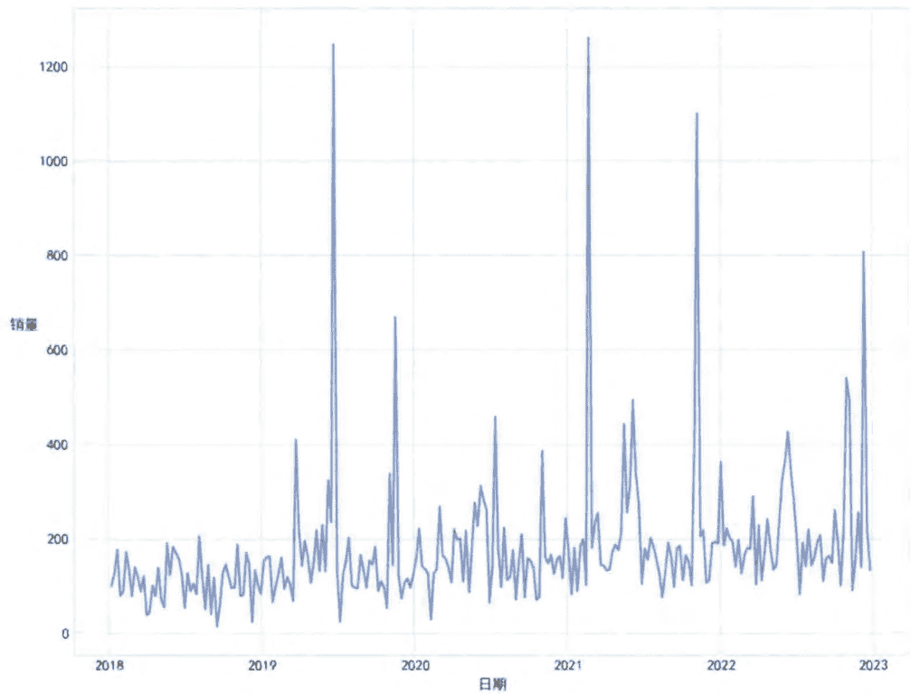

**图 1-1 SKU 历史销量走势图**

**固定阈值法**：融合业务认知与分布特征，为单 SKU 设定硬性分界线。图 1-1 显示常规单量多集中于 500 以内，故设 500 为截断点。本阶段采用“均值填补”策略，用非异常订单均值覆盖大单，处理效果见下图。

```
# 大单处理逻辑 1: 按阈值进行识别并替换
order_df1 = df.copy()
order_df1.loc[order_df1['y']>500,'y'] = order_df1.loc[order_df1['y']<=500,'y'].mean()
y_plot(order_df1,'按固定阈值识别并替换大单后的销量情况')
```

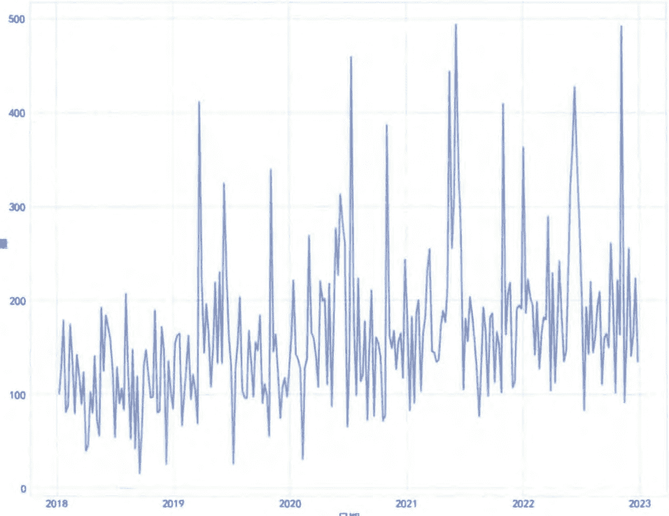

**图 1-2 固定阈值法清洗后销量分布**

**正态分布法**：假设历史销量服从正态分布，估计均值 μ 与标准差 σ。经典 3σ 原理指出，落入 (μ-3σ, μ+3σ) 区间概率达 99.74%，超界即判定为异常。下面给出拟合分布、识别替换的完整流程，结果如图所示。

```
# 大单处理逻辑 2: 按分布进行识别并替换
# 导入 scipy 的正态分布相关方法
from scipy.stats import norm
# 备份数据
order_df2 = df.copy()
# 计算历史销量的均值和方差
y_mean = order_df2['y'].mean()
y_std = order_df2['y'].std()
print('均值={:.2f}、方差={:.2f}'.format(y_mean,y_std))
# 计算上限阈值并识别填充
up_bond = y_mean + norm.ppf(0.9974) * y_std
order_df2.loc[order_df2['y']>up_bond,'y'] = order_df2.loc[order_df2['y']<=up_bond,'y'].mean()
# 查看折线结果
y_plot(order_df2,'按正态分布识别并替换大单后的销量情况')
```

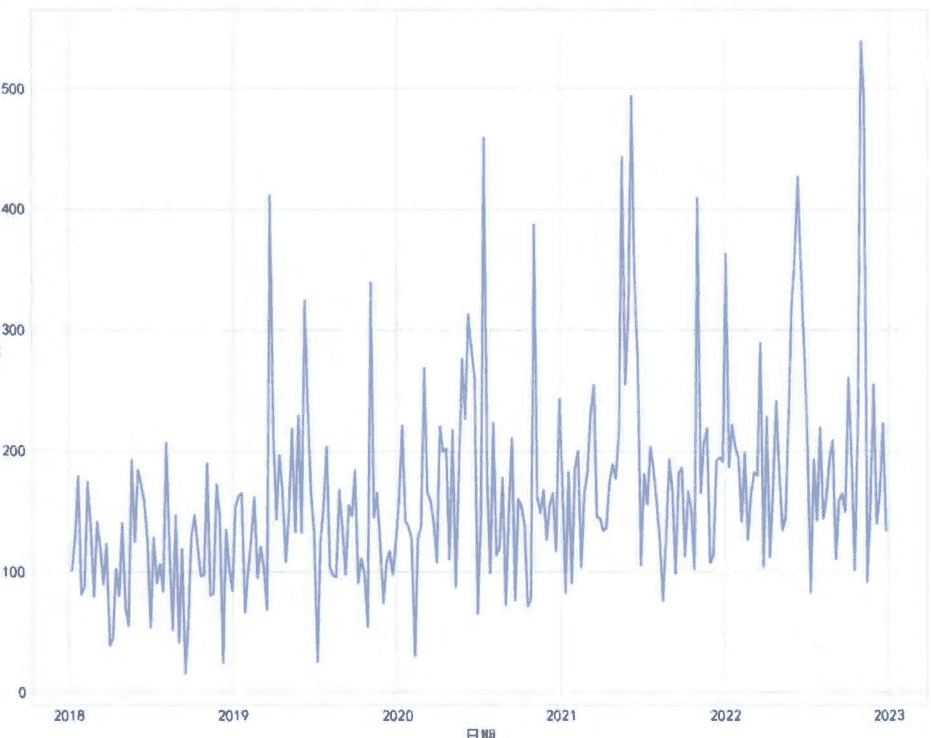

**图 1-3 正态分布法清洗后销量分布**

**特别提示**：大单常被拆单下单（如 3000 件拆 10 单分多日），单单维度难识别。实操中需结合业务节奏，将订单按周/月等粒度聚合后再筛查。

##### 2) 大单处置策略

视是否需预测大单发生而分两类处置：
*   **剔除模式**：大单可预知（客户提前锁单），供应链有备货缓冲，无需预测。直接剔除或均值填补。本案例属此类。
*   **拆解模式**：需预测大单发生时点与量级。则将销量拆解为“常规量”与“大单量”双序列。需溯源场景（促销、直播、特殊渠道），引入日历、折扣、目标等维度数据，结合识别算法与拆解模型，还原各场景真实需求面貌。具体建模细节后续专章详解。

#### 4. 时间粒度聚合与序列补全

预处理收官之作是时间维度对齐。预测任务可能要求不同频度（日/周/月），需按目标粒度聚合历史单据，并补齐完整时间轴。本案以月度预测为例：将日单按月求和，生成连续月份序列，无单月份补 0。实现代码如下，处理后数据样貌见表 1-6，月度销量走势见图 1-4。

```
# 复制大单处理逻辑 1 的结果
order_df = order_df1.copy()
# 把日期字段 order_date 转化成时间格式
order_df['order_date'] = pd.to_datetime(order_df['order_date'])
# 从日期字段 order_date 中抽取出月信息，并生成新字段 month
order_df['month'] = order_df['order_date'].dt.strftime('%Y-%m-01')
# 按 SKU、ware_house、month 的维度对销量字段 y 进行求和
order_df = order_df.groupby(['SKU','ware_house','month'])['y'].sum().reset_index()

# 把 month 字段更改为 order_date 字段（代表日期）
order_df = order_df.rename(columns={'month': 'order_date'})
# 生成完整的日期序列
date_idx = pd.date_range(start='2018-01-01',end='2022-12-01',freq='MS')
# 生成 pd.DataFrame 格式的日期序列，用于后续的 pd.merge 操作
date_df = pd.DataFrame(date_idx,columns=['order_date'])
# 将 date_df 字段转化为和 order_df 一致的 str 格式，并补齐 SKU 和 ware_house 字段
date_df['order_date'] = date_df['order_date'].dt.strftime('%Y-%m-%d')
date_df['sku'] = 'LG68552'
date_df['ware_house'] = 'RDC_杭州'
# date_df 为完整日期，所以使用 left 的 merge 操作，对缺失的日期进行补齐
order_df = date_df.merge(order_df,on=['order_date', 'sku','ware_house'],how='left')
# 对聚合后的销量数据进行 0 值填充
order_df = order_df['y'].fillna(0)
# 聚合后的订单结果
print(order_df.head(5))
```

**表 1-6 预处理就绪数据抽样**

| SKU | 仓库 | 统计月份 | 销量 |
|---|---|---|---|
| LG68552 | RDC_杭州 | 2018-01-01 | 617.8675 |
| LG68552 | RDC_杭州 | 2018-02-01 | 478.8136 |
| LG68552 | RDC_杭州 | 2018-03-01 | 475.9083 |
| LG68552 | RDC_杭州 | 2018-04-01 | 409.4465 |

### 1.2.2 深度剖析数据：探索性分析与特征构建

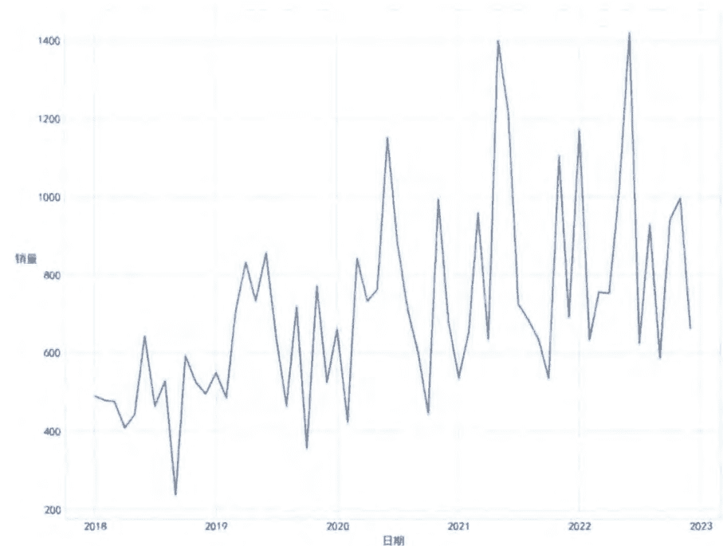

图 1-4 月度销量聚合视图

完成前序的数据清洗与转换后，原始 SKU 订单流已重塑为适合建模的月度销量序列。但在正式引入算法前，还需开展探索性分析（EDA）。这一步至关重要：它能帮我们透视数据全貌，洞察隐含规律，为后续模型选型与架构设计提供坚实依据。通常可从三大维度切入：基础统计画像、时序内在特质、以及有监督学习视角的特征重组。

#### 1. 基础统计画像：勾勒数据轮廓

基础统计量能让我们快速建立对数据整体分布的直观认知。除均值、方差等常规指标外，刻画波动幅度、数据间断程度的统计量同样不可或缺。此外，按年、按月等不同时间颗粒度剖面观测，有助于捕捉销量在不同周期下的状态差异。下文以均值与方差为例展开（详见表 1-7、表 1-8）。

```
# 查看整体销量均值
print(order_df['y'].mean()) # 736.9522426011429
# 查看整体标准差
print(order_df['y'].std()) # 239.7993607247544
# 查看每年的月销量均值
print(order_df.groupby(order_df['order_date'].apply(lambda x:x[:4]))['y'].mean())
# 按月查看所有时期的月销量均值
print(order_df.groupby(order_df['order_date'].apply(lambda x:x[5:7]))['y'].mean())
```

表 1-7 各年度月销量均值对比

| 年份 | 月销量均值 |
| :--- | :--- |
| 2018 | 492.64 |
| 2019 | 637.57 |
| 2020 | 740.11 |
| 2021 | 815.21 |
| 2022 | 875.10 |

表 1-8 全周期月度销量均值分布

| 月份 | 月销量均值 |
|---|---|
| 1 | 698.96 |
| 2 | 566.27 |
| 3 | 769.08 |
| 4 | 691.10 |
| 5 | 893.32 |
| 6 | 1026.23 |
| 7 | 713.63 |
| 8 | 676.68 |
| 9 | 614.82 |
| 10 | 685.94 |
| 11 | 870.78 |
| 12 | 636.62 |

纵观该快消品 SKU 的年度均值，呈现出持续攀升的增长轨迹；横向对比月度指标，二季度表现显著领先于其他季度。若进一步透过箱线图审视各月销量分布差异（见图 1-5），会发现 6 月销量突出，处于领先地位。

```
# 设置画布参数
plt.style.use('seaborn-whitegrid')
plt.figure(figsize=(10,5))
plt.title('month sale box',fontsize=20)
labels = month_list
plt.boxplot(month_data, labels = labels)
# 显示图像
plt.show()
```
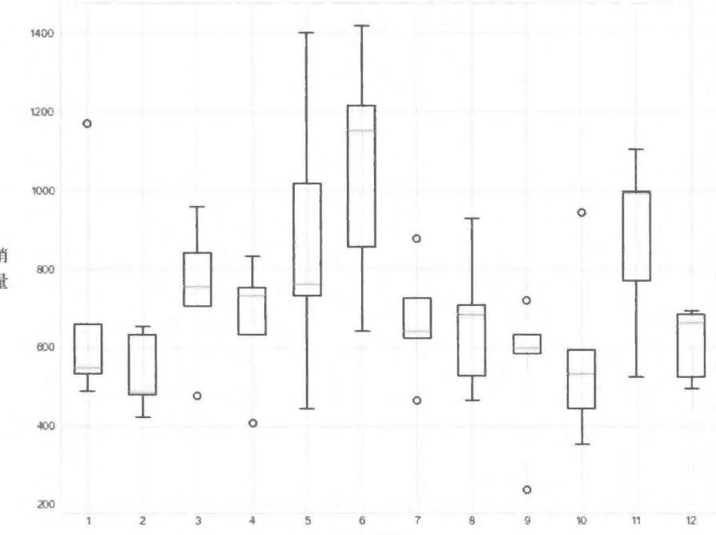

图 1-5 月度销量分布箱线图

#### 2. 时序内在特质：解码动态规律

时序特征挖掘是建模环节的基石。核心维度包括趋势演进、周期波动，以及基于分解算法衍生出的复合特征。

##### 1) 趋势演进特征

趋势判别手段多样，斜率法与非参数检验是两大主流。
**斜率法** 以时间为自变量、销量为因变量建立线性回归，经最小二乘法求解斜率。优势在于实现简便、解释性强，短板是仅适用线性趋势。本案例中，月度序列回归得斜率约为 9，参数显著性 p 值 < 0.001。原假设设定为“无趋势”，故可推断：该 SKU 月均销量大概率以 9 件/月的速度递增。

```
# 导入相关包
from scipy import stats
import statsmodels.api as sm

def trend_linetest(data):
    index=[i for i in range(1,len(data)+1)]
    slope, intercept, r_value, p_value, std_err = stats.linregress(index, data)
    return slope, p_value
# List 为单列数值数据
y = order_df['y']
slope, p_value=trend_linetest(y)
print(slope, p_value) # 9.11 0.0000131
```

**非参数检验法** 对数据质量容忍度更高，适合中心趋势不稳定的序列。Mann-Kendall 检验即典型代表。代码实测结果亦确证了销量上升趋势的存在。

```
# Mann-Kendall 检验法
def mk_test(y_data, alpha=0.05):

    n = len(y_data)
    # 计算秩 s
    s = 0
    for k in range(n-1):
        for j in range(k+1, n):
            s += np.sign(y_data[j] - y_data[k])

    # 计算数据数目
    unique_y_data, tp = np.unique(y_data, return_counts=True)
    g = len(unique_y_data)
    # 计算秩 s 的方差
    if n == g:
        var_s = (n*(n-1)*(2*n+5))/18
    else:
        var_s = (n*(n-1)*(2*n+5) - np.sum(tp*(tp-1)*(2*tp+5)))/18
    if s > 0:
        z = (s - 1)/np.sqrt(var_s)
    elif s < 0:
        z = (s + 1)/np.sqrt(var_s)
    else: # s == 0:
        z = 0
# 计算 p 值
p = 2*(1-norm.cdf(abs(z))) # 双侧检验
h = abs(z) > norm.ppf(1-alpha/2)
if (z < 0) and h:
    trend = 'decreasing'
elif (z > 0) and h:
    trend = 'increasing'
else:
    trend = 'no trend'
return trend
# 趋势性检验
y = order_df['y']
print(mk_test(y)) # 'increasing'
```

##### 2) 周期波动特征

时序周期性往往呈现多层叠加的复杂形态。所谓周期，即事件按固定顺序、固定间隔重现。数学定义为 $f(x+t) = f(x)$（$t$ 为周期倍数）。实战中需结合业务背景，拆解不同维度的周期融合。

自相关函数（ACF）是周期性初筛的利器。鉴于前文已证实存在趋势，需先对原序列做一阶差分消趋势。随后按季度聚合，计算各阶滞后自相关系数。图 1-6 显示，季度序列在滞后 4 期（即一年）处呈显著正自相关，强提示该 SKU 具备年周期特征。

```
# 将 order_date 字段转化为 pd.datetime 格式后，从中抽取季度日期
order_df['order_date'] = pd.to_datetime(order_df['order_date'])
order_df['quart'] = order_df['order_date'].dt.to_period('Q')
# 按季度日期进行聚合，同时获取一阶差分销量
y_diff1 = order_df.groupby('quart')['y'].sum().diff(1).values[1:]
# 自相关
fig = plt.figure(figsize=(12, 8))
ax1 = fig.add_subplot(211)
sm.graphics.tsa.plot_acf(y_diff1, lags=10, ax=ax1)
```
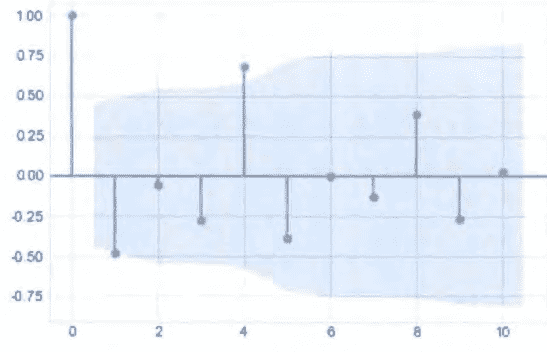

图 1-6 差分后季度序列自相关图

##### 3) 时序分解视角：STL 多成分拆解

将原始序列拆解为趋势、周期、残差等独立成分，是综合研判时序特质的高效路径。STL（基于 Loess 的季节趋势分解）是通用性极强的工具，可通过 Python `statsmodels` 库调用。

实操前需明确两点：其一，**周期长度**设定，前序分析建议取 12 个月；其二，**模型假设选择**——加性模型假设各成分相加（适合非指数增长），乘性模型假设相乘（适合增长率恒定的指数增长）。本案例销量增速非指数级，故采用加性模型。分解结果见图 1-7：原始序列被还原为趋势项、季节项（周期 12 月）与残差项。清晰的上升趋势与稳定的年度周期跃然纸上，这些均可作为后续建模的核心特征输入。

```
# 导入 STL
from statsmodels.tsa.seasonal import STL

# 输入销量序列，period 为季节性周期长度参数
stl = STL(order_df.set_index('order_date').y, period=12)
```
```
6. # 拟合
7. res_robust = stl.fit()
8. # 绘制图像
9. fig = res_robust.plot()
```
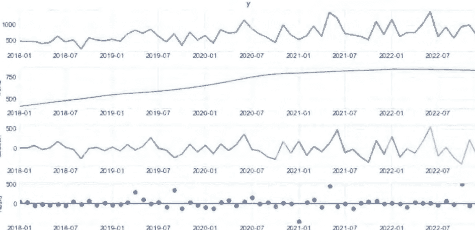

图 1-7 STL 分解结果：趋势、季节与残差

#### 3. 有监督学习视角：重塑特征矩阵

换个角度看，每个时间点皆可视为一个监督学习样本。以当期销量为标签（Target），过往多期销量作为原始特征。例如将数据重构为表 1-9 格式：样本 ID 由 SKU 与日期组成，`y` 为目标值，`lag1`~`lag4` 分别代表 1 到 4 期的滞后销量（其中 `lag1` 为上一期销量）。实际选取多少滞后阶数，需结合业务与模型复杂度权衡。

```
1. # 取过去 12 个月销量作为当期的训练特征，先将数据转化成有监督学习的格式
2. supervised_df = order_df[['SKU','order_date','y']].copy()
3. # 原始数据是按日期排序的，通过 shift 操作在日期上拼接前 n 期的数据
4. for i in range(12):
5.     supervised_df['{}'.format(i+1)] = supervised_df['y'].shift(i+1)
6. # 最开始的一些时期因为没有更早的历史数据，在数据行上会出现空值，需要删除
7. supervised_df = supervised_df.dropna(axis=0)
8. # 部分示例
9. print(supervised_df.iloc[:,:7])
10. # 把 SKU 和 order_date 拼接在一起，作为训练样本的标识符
11. supervised_df['SKU|order_date'] = supervised_df['SKU']+'|' + supervised_df['order_date'].dt.strftime('%Y-%m-%d')
12. # 删除 SKU 和 order_date 字段，并将二者拼接后的字段设为索引
13. supervised_df = supervised_df.drop(['SKU','order_date'],axis=1)
14. supervised_df = supervised_df.set_index('SKU|order_date')
```

表 1-9 监督学习格式样本示例（supervised_df 片段）

| SKU | order_date | y | lag1 | lag2 | lag3 | lag4 |
|---|---|---|---|---|---|---|
| LG68552 | 2019-01-01 | 549 | 495 | 525 | 593 | 237 |
| LG68552 | 2019-02-01 | 485 | 549 | 495 | 525 | 593 |
| LG68552 | 2019-03-01 | 705 | 485 | 549 | 495 | 525 |
| LG68552 | 2019-04-01 | 833 | 705 | 485 | 549 | 495 |
| LG68552 | 2019-05-01 | 732 | 833 | 705 | 485 | 549 |
| LG68552 | 2019-06-01 | 863 | 732 | 833 | 705 | 485 |
| LG68552 | 2019-07-01 | 642 | 863 | 732 | 833 | 705 |
| ... | ... | ... | ... | ... | ... | ... |
| LG68552 | 2022-12-01 | 759 | 820 | 1240 | 914 | 745 |

完成上述滞后特征拼接后，可进阶构造统计聚合特征（如不同时窗的均值、极值）、时间属性特征、业务事件标记、SKU 生命周期阶段、品类维度信息等。

工具层面，`tsfresh` 是时间序列特征工程的利器。它内置海量特征提取算子，支持自动化批量生成特征，并提供基于假设检验的特征筛选功能，剔除冗余噪声。表 1-10 展示了其自动提取的部分特征样貌（涵盖重复值检测、能量、变化率均值等）。本节仅演示基础调用，深度用法请参阅官方文档。

```
1. # 导入相关包
2. from tsfresh import extract_features
3. from tsfresh import select_features
4. from tsfresh.utilities.dataframe_functions import impute
5. # 把需要预测的目标 y 单独提取出来用于后续的特征选择
6. y = supervised_df['y']
7. # 从数据中删除目标 y 后，以 SKU 字段为 ID、order_date 字段为顺序参照，自动化提取特征
8. supervised_df = supervised_df.drop('y',axis=1).stack().reset_index().rename(columns={'level_1':'sort_val',0:'val'})
9. extracted_features = extract_features(supervised_df, column_id="SKU|order_date", column_sort='sort_val')
10. # 用 impute 先进行插值
11. impute(extracted_features)
12. # 用 select_features 选择与 y 相关性最高的特征
13. features_filtered = select_features(extracted_features, y)
14. print(extracted_features)
```

表 1-10 tsfresh 自动提取特征示例（extracted_features 片段）

| 日期 | val_has_duplicatemin | val_abs_energy | val_mean_abs_change | val_mean_change |
|---|---|---|---|---|

### 1.2.3 实战推演

| 日期 | 销量 | 交易额 | 客单价 | 环比 |
| :--- | :--- | :--- | :--- | :--- |
| 2019/1/1 | 5911.71 | 3038465 | 131.09 | -7.82 |
| 2019/2/1 | 5842.97 | 2958236 | 128.05 | -9.54 |
| 2019/3/1 | 5849.13 | 2964182 | 113.97 | 14.30 |
| 2019/4/1 | 6078.54 | 3235157 | 117.84 | -21.89 |
| 2019/5/1 | 6501.71 | 3760757 | 189.69 | -27.67 |
| 2019/6/1 | 6789.54 | 4099286 | 141.22 | -44.97 |
| ... | ... | ... | ... | ... |
| 2019/7/1 | 7010.24 | 4431484 | 173.72 | -24.58 |

步入推演环节，需融合业务认知与前期探查结论，筛选契合场景的算法。本节演示三类通用经典方案——ES、ARIMA 与 XGBoost，带你快速跑通建模至前瞻的完整链路。务必明确：**并无放之四海而皆准的“万能算法”**，唯有透彻掌握各方案底层逻辑与特性，方能依据任务实情做最优决策。在深钻理论基础前（后续章节详解），不妨先通过实操建立直观认知。

本案以 2018 年 1 月 1 日至 2021 年 12 月 1 日样本为建模依据，推演 2022 年全年月度出货量，事后对齐实测值复盘精度。指标选型至关重要，常用均绝对百分比误差（MAPE）、对称均绝对百分比误差（SMAPE）等。本案采用 MAPE，公式见式（1-1）。该指标量化推演偏离度，**数值越小越优**。指标敲定后，正式开启建模。

```
MAPE=\frac{1}{n}\sum_{t=1}^{n} \left| \frac{A_t - F_t}{A_t} \right|  (1-1)
```

式（1-1）中，$A_t$ 为 $t$ 期实际出货量，$F_t$ 为 $t$ 期推演值。

#### 1. 指数加权平滑法 (ES)

ES 算法核心：对过往一段时长的出货量加权求和作前瞻，**近期权重高、远期指数级递减**。结构简洁，稳健性强，是行业内人工辅助推演的常客。其延展版——**HW 算法**，引入走势与周期分量，能更精准捕捉序列规律。理论细节留待第 2 章展开，此处先跑通应用。借助 Python `statsmodels` 库 `ExponentialSmoothing` 模块即可落地拟合与前瞻，关键配置速查表 1-11。

**表 1-11 ExponentialSmoothing 关键配置速览**

| 配置项 | 类型 | 说明 |
| :--- | :--- | :--- |
| endog | array-like | 目标序列（出货量数据） |
| trend | {"add", "mul", ... , None} | 走势模式：加法/乘法/无 |
| damped | bool | 走势是否阻尼，默认否 |
| seasonal | {"add", "mul", ... , None} | 周期模式：加法/乘法/无 |
| seasonal_periods | int | 周期步长 |

依据前期探查：SKU 呈线性增势，故 `trend` 与 `seasonal` 指定为 `"add"`；偏相关函数显现 4 季度周期特征，`seasonal_periods` 置 12。运行脚本得输出（表 1-12）。

```
1. from statsmodels.tsa.holtwinters import ExponentialSmoothing
2.
3. # 从原始数据中获取用于建模的时间序列数据
4. y_data = order_df.set_index('order_date').y
5. # 完成参数设置和模型拟合
6. es_fit = ExponentialSmoothing(y_data[:-12], seasonal_periods=12,
trend='add', seasonal='add').fit()
7. # 输出未来 12 个月的预测结果
8. ets_y_hat = es_fit.forecast(12)
9.
10. print(ets_y_hat)
```

**表 1-12 ES 算法 2022 年月度前瞻值**

| 月份 | 前瞻值 |
| :--- | :--- |
| 2022/1/1 | 925.54 |
| 2022/2/1 | 746.43 |
| 2022/3/1 | 1009.29 |
| 2022/4/1 | 929.51 |
| 2022/5/1 | 1166.17 |
| 2022/6/1 | 1348.68 |
| 2022/7/1 | 957.68 |
| 2022/8/1 | 875.04 |
| 2022/9/1 | 826.30 |
| 2022/10/1 | 760.18 |
| 2022/11/1 | 1125.85 |
| 2022/12/1 | 863.29 |

出结果必复盘。精度无统一金标，跨行业、跨 SKU 差异巨大。可参照**过往波动系数**（波动率基准）或**滑动均值法**等朴素基线。工程上常用 **1—MAPE** 直观呈现，**越逼近 1 越优**。本轮 ES 算法该指标值为 0.776。

```
1. # 准确率指标计算
2. def mape(y,y_hat):
3.     ...
4.     :param y: 实际销量数据，float
5.     :param y_hat: 预测销量数据，float
6.     :return: 是否为趋势的结果，str
7.     ...
8.     if y == 0 and y_hat ==0:
9.         return 0
10.    elif y==0 or y_hat ==0:
11.        return 1
12.    return np.abs(y-y_hat)/np.abs(y)
13.
14. # 抽取测试集，和预测结果拼接
15. test_df = order_df[['order_date','y']][-12:]
16. test_df['y_hat'] = ets_y_hat.values
17. # 计算准确率
18. print(1-np.mean(test_df[['y','y_hat']].apply(lambda x:mape(x[0],x[1]),axis=1))) # 0.7768992944955736
```

除数值比对，绘图更直观。将实测与前瞻同图异色绘制（图 1-8），差异一目了然。

```
1. # 通过绘图查看预测情况
2. ax = y_data.plot(figsize=(10,6),
3.     marker='o', color='black', title="Forecasts result" , legend=True)
4. ax.set_ylabel("quantity")
5. ax.set_xlabel("date")
6.
7.
8. es_fit.forecast(12).rename("EMS Forecast").plot(ax=ax, style='--',marker='o', color='blue', legend=True)
```

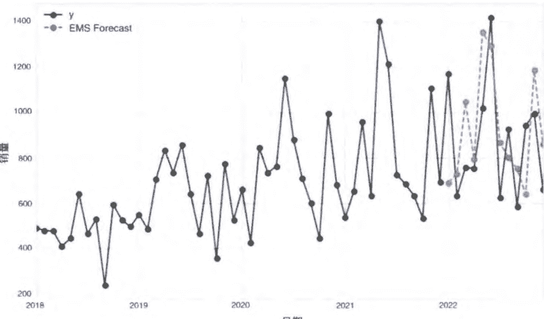

**图 1-8 ES 算法前瞻拟合图**

#### 2. ARIMA 算法

**差分自回归移动平均（ARIMA）** 是时序推演里程碑。它融合自回归（AR）与移动平均（MA），引入做差处理非平稳。标记为 **ARIMA(p, d, q)**：`d` 为做差阶层，`p`、`q` 分别为做差后数列的 AR、MA 阶层。传统流程需繁琐的做差后 ACF/PACF 分析（第 2 章结合理论详解），实战中可用 `pmdarima` 自主寻优。表 1-13 梳理核心配置。

**表 1-13 auto_arima 核心配置表**

| 配置项 | 类型 | 说明 |
| :--- | :--- | :--- |
| y | array-like | 目标序列 |
| exogenous | array-like | 外生变量 |
| start_p / max_p | int | 非季节 AR 阶层搜索下/上界 |
| d / max_d | int | 非季节做差阶层 / 上界 |
| start_q / max_q | int | 非季节 MA 阶层搜索下/上界 |
| start_P / max_P | int | 季节 AR 阶层搜索下/上界 |
| D / max_D | int | 季节做差阶层 / 上界 |
| start_Q / max_Q | int | 季节 MA 阶层搜索下/上界 |
| max_order | int | 阶层之和上限，默认 10 |
| m | int | 周期步长（月度=12），m=1 关闭周期项 |
| seasonal | bool | 是否启用周期 ARIMA |
| information_criterion | str | 选择准则：aic/bic/hqic/oob |
| alpha | float | 检验阈值，默认 0.05 |
| method | str | 似然类型 |
| trend | str/iterable | 确定性走势项 |
| maxiter | int | 最大轮次 |
| disp | int | 日志级别 |

本案采用缺省搜索空间，算法自主寻优。脚本执行后，**该指标 = 0.84**。寻优结果显示，最优配置为 **(p=1, d=1, q=2)**。输出值见表 1-14。图 1-9 显示：前瞻曲线随步长增长**逐步趋平**，这是 ARIMA 长步推演的典型特征。

```python
from pmdarima.arima import auto_arima
# 截取 12 个月前的数据作为训练数据
arima_model = auto_arima(y_data[:-12])
print(arima_model) # ARIMA(1,1,2)(0,0,0)[0] intercept
# 预测未来 12 个月的销量，置信度选择 0.05
arima_y_hat, conf_int = arima_model.predict(n_periods=12,
    return_conf_int=True,
    alpha=0.05)
# 抽取测试集和预测结果拼接
test_df = order_df[['order_date','y']][-12:]
test_df['y_hat'] = arima_y_hat.values
# 计算准确率
print(1-np.mean(test_df[['y','y_hat']].apply(lambda x:mape(x[0],x[1]),axis=1))) # 0.830
print(test_df['y_hat'])
# 通过绘图查看预测情况
ax = y_data.plot(figsize=(10,6), marker='o', color='black', title="Forecasts result" , legend=True)
ax.set_ylabel("quantity")
ax.set_xlabel("date")
# 绘制预测的曲线
arima_y_hat.rename('auto_arima Forecast').plot(ax=ax, style='--',
marker='o', color='blue', legend=True)
```

**表 1-14 ARIMA 2022 年月度前瞻值**

| 月份 | 前瞻值 |
| :--- | :--- |
| 2022/1/1 | 935.02 |
| 2022/2/1 | 921.10 |
| 2022/3/1 | 910.87 |
| 2022/4/1 | 903.36 |
| 2022/5/1 | 897.84 |
| 2022/6/1 | 893.79 |
| 2022/7/1 | 890.81 |
| 2022/8/1 | 888.62 |
| 2022/9/1 | 887.02 |
| 2022/10/1 | 885.84 |
| 2022/11/1 | 884.97 |
| 2022/12/1 | 884.33 |

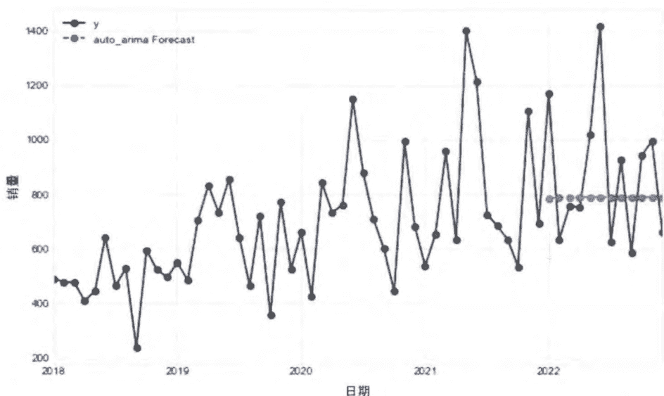

**图 1-9 ARIMA 前瞻走势图**

#### 3. 机器学习路径——XGBoost 算法

机器学习在需求推演中广泛落地，本节以 **XGBoost** 为例——并行树梯度增强架构，兼具强推演力与稳健性。进阶篇将讲授多方案集成、融合方案，那是行业内提升上限的关键。

**建模前置：监督式重构**。需将目标与属性按时间对齐，通过滑动区间等方式挖掘时序内生因子。完成合并后，引入 `tsfresh` 成批衍生因子。拟合时采用起始配置，建模样本随机划 20% 做校验，监控校验集误差下降确定早停轮数。最终 **XGBoost 实现该指标 = 0.842**，图示见图 1-10。**本轮实战中，XGBoost 效果稍优于 ES 与 ARIMA。**

图 1-10 XGBoost 前瞻对比图

```python
import xgboost as xgb

# extracted_features 为之前探索性分析中使用 tsfresh 生成的特征
# y 为每个月的销量数据
# 最后 12 个月为验证集，选取之前的数据作为训练集
train_x, test_x, train_y, test_y = train_test_split(extracted_features[:-12], y[:-12], random_state=0)
dtrain = xgb.DMatrix(train_x, label=train_y)
dtest = xgb.DMatrix(test_x, label=test_y)

# 封装常用的参数
params = {'max_depth': 10,
    'eta': 0.1,
    'subsample': 0.7,
    'colsample_bytree': 0.7,
    'verbosity': 0
    }
watchlist = [(dtrain,'train'), (dtest,'test')]
model = xgb.train(params,
    dtrain,
    num_boost_round = 50 ,
    early_stopping_rounds =10 ,
    evals=watchlist)
# 预测所用特征
pred_features = xgb.DMatrix(extracted_features[-12:])
xgb_y_hat = model.predict(pred_features)
# 抽取测试集，和预测结果拼接
test_df = order_df[['order_date','y']][-12:]
test_df['y_hat'] = xgb_y_hat
# 计算准确率
print(1-np.mean(test_df[['y','y_hat']].apply(lambda x:mape(x[0],x[1]),axis=1))) # 0.8427231638070866
```

```python
# 绘制原始销量折线图
ax = y_data.plot(figsize=(10,6), marker='o', color='black', title="Xgb Forecasts result" , legend=True)
ax.set_ylabel("quantity")
ax.set_xlabel("date")

# 把预测结果转化为 series 格式，通过绘图查看预测情况
xgb_y_hat_series = pd.Series(xgb_y_hat,index = pd.date_range('2022-01-01','2022-12-01',freq='MS'))
xgb_y_hat_series.rename('xgb Forecast').plot(ax=ax, style='--', marker='o', color='blue', legend=True)
```

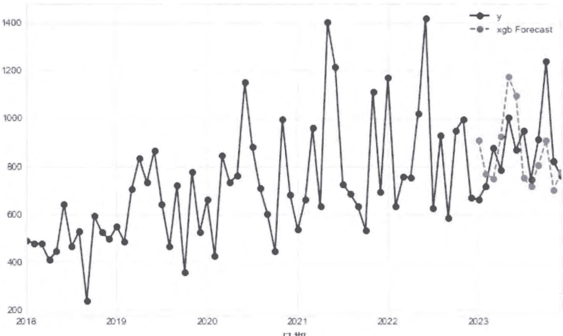

图 1-10 XGBoost 模型预测效果展示

### 1.2.4 小结

搞定需求预测任务其实并不复杂。前人已经沉淀了大量开箱即用的工具，让供应链预测的落地变得相对轻松。不过，随着机器学习与深度学习的快速迭代，基础模型的表现往往难以应对当下复杂的业务场景，它们更多充当“基准线”角色，划定准确率的下限。即便如此，我们依然强烈建议读者系统攻克单模型的原理与细节。唯有看透简单模型的本质，才能结合业务特性与模型长板，构建出更高阶的复杂方案。本书“基础模型篇”将系统梳理时间序列、统计学、机器学习及神经网络四大类模型。

吃透基础后，若想进一步拔高精度与鲁棒性，必须掌握进阶打法：高阶统计模型、深度学习架构、集成融合策略等。进阶的核心在于对基础模型的数学升维，或是基于不同模型特质的组合拳，这要求我们对复杂模型与集成策略有深度认知，相关内容将在“模型进阶篇”展开。

除技术维度，业务知识的积累同样不可或缺。它贯穿数据清洗、特征工程、模型训练、预测评估的全流程，更陪伴供应链算法工程师的整个职业生涯。供应链预测跨行业广泛，作者整理了多行业实战经验，将在“行业实践篇”倾囊相授。

## 1.3 智能供应链全景扫描

### 1.3.1 企业供应链智能决策六阶跃迁论

作者结合企业数智化演进历程，提炼出智能决策优化的六个发展阶段（见下图）。本书核心聚焦第三阶段的预测建模，当前技术生态为该阶段提供了成熟底座与广阔腾挪空间。深耕第三阶段的探索与沉淀，将为后续高阶跃迁筑牢根基。

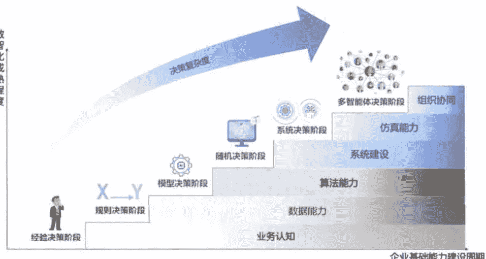

图 1-11 企业供应链智能决策六阶理论

- **经验决策期（Experience-Based）**：凭借业务直觉与浅层数据，纯靠“拍脑袋”拍板。
- **规则决策期（Rule-Based）**：引入业务逻辑、数据分析与启发式手段，以硬性规则驱动决策。
- **模型决策期（Model-Based）**：借力大数据挖掘、运筹优化、机器学习等技术，让模型输出决策依据。
- **随机决策期（Uncertainty-Based）**：面对外部环境与内生系统的不确定性，引入随机建模应对波动。
- **系统决策期（System-Based）**：聚焦系统内多主体协作与流程运作，以复杂模型求解整体最优。
- **多智能体决策期（Decentralization-Based）**：基于单体智能与群体博弈机制，用仿真、博弈等去中心化手段决策。

### 1.3.2 智能供应链算法全景图谱

智能供应链体系庞大，预测作为链路起点，与定价、库存、仿真等下游模块紧密咬合。正式入手预测算法前，建议先浏览本书配套折页的“供应链算法学习全景图”，建立全域认知，有助于后续更好地释放预测价值。

全景图揭示了各算法模块的关联与学习路径，若实战中需与其他系统联动，可参考路线图规划学习节奏。日常运营中，短期预测赋能选品定价、库存优化、仿真推演；长周期预测则支撑战略规划、分仓布局、排产作业。

后续章节我们将按图索骥，深入时间序列、机器学习、深度学习及各类场景化策略。预测精度的提升是场长跑，没有终点。迈开步子，翻开下一章，正式踏入预测算法的殿堂。

# 基础模型篇

- 第2章 时间序列模型
- 第3章 线性回归模型
- 第4章 机器学习模型
- 第5章 神经网络模型

# 第 2 章 CHAPTER 2

## 时间序列模型

## 2.1 指数平滑模型族

### 2.1.1 简单移动平均（SMA）

讲指数平滑前，先看最基础的简单移动平均。核心思路：用窗口函数取近 $k$ 期观测值的算术均值作为平滑统计量 $S_t$，公式如下：

$S_t = \frac{1}{k} \sum_{n=0}^{k-1} x_{t-n} = \frac{x_t + x_{t-1} + \cdots + x_{t-k+1}}{k} = S_{t-1} + \frac{x_t - x_{t-k}}{k}$

**窗口大小 $k$ 的权衡**：$k$ 小则灵敏跟随近期变化但平滑不足；$k$ 大则平滑效果好但滞后严重。

### 2.1.2 加权移动平均（WMA）

SMA 等权平均，WMA 引入权重因子 $\{w_1, w_2, ..., w_k\}$（满足 $\sum_{n=1}^k w_n = 1$），公式为：

$S_t = \sum_{n=1}^k w_n x_{t+1-n} = w_1 x_t + w_2 x_{t-1} + ... + w_k x_{t-k+1}$

实务中通常让近期数据权重更大、远期递减。缺点是至少需 $k$ 个样本起步，且计算量随窗口增大而增加。

### 2.1.3 简单指数平滑（SES / 一次指数平滑）

指数平滑的直觉：越久远的记录对当下影响越小，权重随时间**指数级衰减**。

**数学推导脉络**：
1.  **朴素法**：$\hat{y}_{T+1|T} = y_T$（明天=今天）。
2.  **均值法**：$\hat{y}_{T+1|T} = \frac{1}{T} \sum_{t=1}^T y_t$（全历史等权）。
3.  **加权均值**：$\hat{y}_{T+1|T} = \alpha y_T + (1-\alpha)\hat{y}_{T|T-1}$（$0<\alpha<1$）。

看似只用了当期真值 $y_T$ 与上期预测 $\hat{y}_{T|T-1}$，实则通过递归展开，融合了**所有历史真值**，且权重随时间指数衰减：

```
ŷ<sub>T|T-1</sub> = αy<sub>T-1</sub> + (1-α)ŷ<sub>T-1|T-2>
ŷ<sub>T-1|T-2</sub> = αy<sub>T-2</sub> + (1-α)ŷ<sub>T-2|T-3>
...
ŷ<sub>2|1</sub> = αy<sub>1</sub> + (1-α)y<sub>0</sub>
```

```
ŷ<sub>T+1|T</sub> = αy<sub>T</sub> + α(1-α)y<sub>T-1</sub> + α(1-α)<sup>2</sup>y<sub>T-2</sub> + ⋯
```

最终形式等价于：
```
F<sub>t+1</sub> = αA<sub>t</sub> + (1-α)F<sub>t</sub>
```

其中 $A_t, F_t$ 为真实值与预测值。变形得 $F_{t+1} = F_t + \alpha(A_t - F_t)$——**预测即对历史偏差的修正**。
- $\alpha=1$：退化为朴素法，全押注最近一点。
- $\alpha=0$：锁死初始值，无视新信息。
- $\alpha$ 越大，历史权重衰减越快。

**$\alpha$ 选取经验**：平稳序列取小（0.1~0.5），波动大取大（0.6~0.8），亦可用最小二乘法搜优。表 2-1 给出 $\alpha=0.8$ 时的迭代演示。

表 2-1 加权平均模型预测演示

| 期数 | $A_t$（实测） | $F_t$（预测） |
|---|---|---|
| 1 | 10 | / |
| 2 | 18 | 10 |
| 3 | 23 | $0.8 \times 18 + 0.2 \times 10 = 16.4$ |
| 4 | 22 | $0.8 \times 23 + 0.2 \times 16.4 = 21.68$ |

### 2.1.4 指数平滑进阶：趋势与季节

SES 仅需两点即算，适合**无趋势**序列。若有趋势，SES 会严重滞后。于是引入扩展体系：

| 模型 | 长期趋势 | 季节效应 |
|---|---|---|
| 简单指数平滑 | 无 | 无 |
| **二次指数平滑** | **有** | 无 |
| **三次指数平滑** | **有** | **有** |

> **趋势性 vs 季节性**
> - **趋势**：斜率 $b = \Delta y / \Delta x$。$\Delta x=1$ 时 $b = y_t - y_{t-1}$（可加性），亦可转可乘性（如“贵20元”vs“贵5%”），乘性模型往往更稳健。
> - **季节性**：固定周长的循环（春夏秋冬、周末效应）。
> - **周期性**：非固定频率的波动（经济周期）。

#### 二次指数平滑 — 引入趋势项
以加性模型为例，SES 输出水平基线（Level）$l_t$：
```
$\hat{y}_{t+h|t} = l_t$
```

二次平滑在水平线上叠加趋势项 $b_t$，$h$ 步预测：
```
$\hat{y}_{t+h|t} = l_t + h b_t$
```

**状态更新双方程**：
1.  **水平更新**：新水平 = 最近实测去季节化 + 趋势修正
    ```
$l_t = \alpha y_t + (1 - \alpha)(l_{t-1} + b_{t-1})$
```
2.  **趋势更新**：取近两期水平差平滑得趋势，随时间演化
    $$

b_t = \beta(l_t - l_{t-1}) + (1 - \beta)b_{t-1}

$$

新增趋势平滑因子 $\beta \in [0,1]$，控制趋势学习速度。

#### 三次指数平滑 — 再加季节项
即经典 **Holt-Winters 法**。$m$ 为季节长度（月数据 $m=12$，季度 $m=4$）。

加性模型预测公式：
$$

\hat{y}_{t+h|t} = l_t + h b_t + s_{t+h-m(k+1)}

$$

**三大更新分量**：
1.  **水平基线**：对实测去季节化后平滑
    $$

l_t = \alpha(y_t - s_{t-m}) + (1 - \alpha)(l_{t-1} + b_{t-1})

$$
2.  **趋势项**：同二次平滑
    $$

b_t = \beta(l_t - l_{t-1}) + (1 - \beta)b_{t-1}

$$
3.  **季节项**：对实测去趋势化后平滑
    $$

s_t = \gamma(y_t - l_{t-1} - b_{t-1}) + (1 - \gamma)s_{t-m}

$$

新增季节平滑因子 $\gamma \in [0,1]$，控制季节效应学习速度。

### 2.1.5 知识延伸

以上均为加性模型。乘性模型处理“比例型”季节波动更自然。图 2-1、2-2 直观对比了两者在趋势与季节叠加方式上的差异。

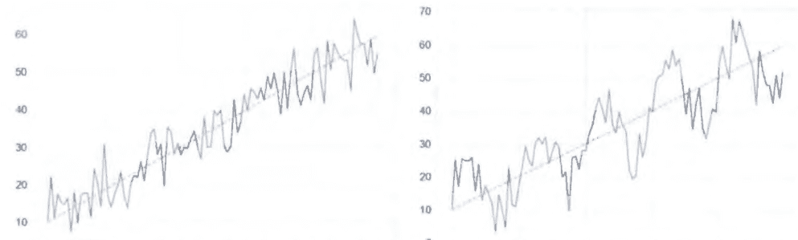
图 2-1 加性模型：趋势与季节叠加

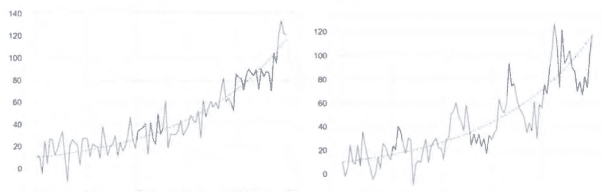
图 2-2 乘性模型：趋势与季节乘积

## 2.2 ARIMA 模型

指数平滑族捕捉趋势/季节，ARIMA 则专攻**自相关结构**（autocorrelation）。下面拆解核心概念与推导。

### 2.2.1 核心前置概念

#### 1. 平稳性
平稳序列的均值、方差不随时间漂移，长期看无可预测模式（如白噪声）。部分周期非固定的序列也可视为平稳。

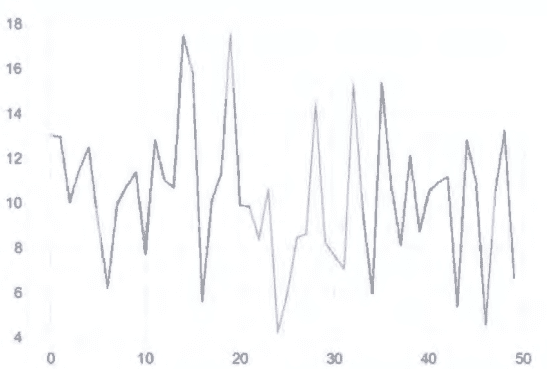

**图 2-3 稳态序列示意**

反之，若均值与方差随时间漂移、不再恒定，该序列即为非稳态序列。典型例子包括带有趋势或季节波动的时间序列，具体形态可参考下图。

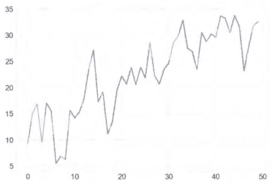

**图 2-4 非稳态序列示意**

判断序列稳态性，主流手段主要分三类：一是**目测法**，通过绘图直观识别趋势与波动；二是**分段统计法**，将局部统计特征（如分段均值）与全局特征对比；三是**假设检验法**，即专业的稳态性统计检验。非稳态往往源于序列内部存在自相关结构，而 ARIMA 模型的核心正是剖析这种自相关，后文将展开详述。

### 2.2.1 自相关函数（ACF）与偏自相关函数（PACF）

在正式定义 ACF 与 PACF 前，先用一个直观的销售预测场景热身：假设 $y_{t-2}$、$y_{t-1}$、$y_t$ 分别代表 1、2、3 月的平均销量。经验告诉我们，历史销量对未来颇有参考价值——上月热销，本月大概率延续火爆。那么，1 月销量是如何影响 3 月的？传导路径无外乎两种：
1.  **直达路径**：$y_{t-2} \rightarrow y_t$（直接影响）；
2.  **中转路径**：$y_{t-2} \rightarrow y_{t-1} \rightarrow y_t$（间接影响，经 2 月中转）。

简而言之，**ACF 捕捉的是“直接+间接”的总效应，PACF 则剥离中介，只保留“直接效应”**。

因此，ACF 刻画的是序列在不同时刻取值间的线性依赖程度，其计算本质是皮尔逊相关系数：

$$

\text{ACF} = \text{Corr}(y_{t-i}, y_t)

$$

该公式用于量化第 $t$ 期与滞后 $i$ 期数据的相关强度。以销量序列为例，滞后 2 期的自相关计算对齐方式如下表：

**表 2-3 自相关计算对齐示例（滞后 2 期）**

| 当前期 ($t$) | 滞后 2 期 ($t-2$) |
| :--- | :--- |
| 3 月销量 | 1 月销量 |
| 4 月销量 | 2 月销量 |
| 5 月销量 | 3 月销量 |
| 6 月销量 | 4 月销量 |

不同滞后阶数下，ACF 正负交替、大小不一，典型图谱如下：

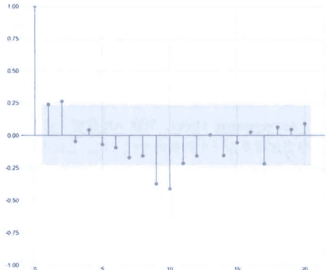

**图 2-5 不同滞后阶数下的 ACF 图谱**

ACF 的短板在于“混淆视听”：高相关可能只是间接传导的假象，真正的直接联系被噪音掩盖。PACF 正是为此而生——它锁定最直接的联系。例如滞后 2 期（Lag=2）时，$y_t$ 与 $y_{t-2}$ 的偏自相关系数记为 $\varphi_2$：

$$

y_t = \varphi_1 y_{t-1} + \varphi_2 y_{t-2} + e_t (\text{Lag} = 2)

$$

观察下图，PACF 随滞后阶数呈现正负波动，**超出虚线阈值（显著不为零）的尖峰，即为建模时应重点纳入的预测因子**（如图中 $y_{t-5}$、$y_{t-8}$）。

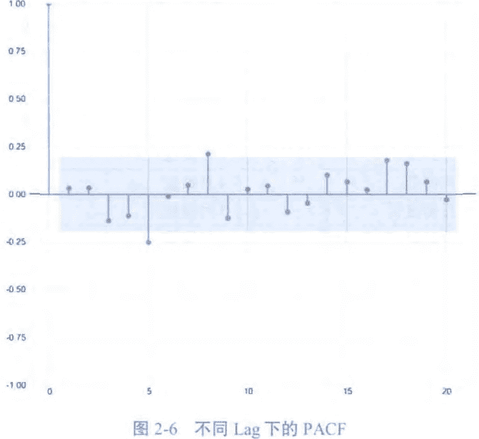

**图 2-6 PACF 图谱与显著滞后识别**

### 3. 自回归模型（AR）

自回归模型（AR）假设：当前值 $x_t$ 是历史值的加权求和。前文提到的 PACF，正是 AR 模型定阶（选滞后阶数）的关键工具。AR 模型三大核心参数：滞后阶数 $p$、自回归系数 $\varphi$、残差项 $\varepsilon_t$，数学表达如下：

$$

x_t = \varphi_0 + \varphi_1 x_{t-1} + \varphi_2 x_{t-2} + \cdots + \varphi_p x_{t-p} + \varepsilon_t

$$

**定阶实战**：通过 PACF 图“截尾”特征确定 $p$。如下图所示，PACF 在 2 阶后骤然归零、贴近零轴波动（95% 落入 2 倍标准差带内），这种**“前 $p$ 阶显著、后继阶数突降如截断”**的现象，称为**截尾**。截尾位置即为 AR 模型的最佳阶数 $p$。

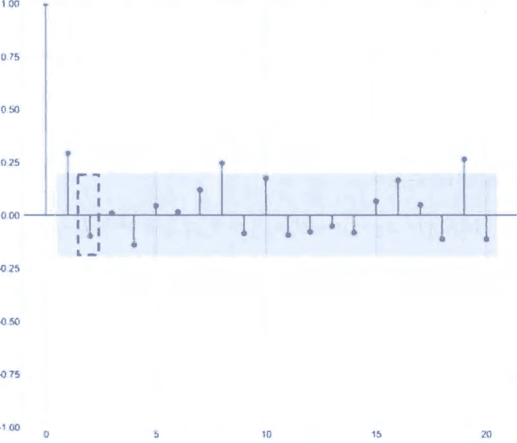

**图 2-7 PACF “截尾”特征判定 AR 阶数**

### 4. 移动平均模型（MA）

#### 1) 核心逻辑：围绕均值的“误差修正”

顾名思义，MA 模型认为当前值 $x_t$ 围绕长期均值 $\mu$ 上下波动，**波动源来自历史预测误差的加权累积**。$\theta$ 控制误差权重，$\epsilon_t \sim N(0,1)$ 为白噪声。这机制天然具备“自我纠偏”能力：上轮高估，下轮自动压低预测。

$$

x_t = \mu + \theta_1 \epsilon_{t-1} + \theta_2 \epsilon_{t-2} + \dots + \theta_q \epsilon_{t-q} + \epsilon_t

$$

**数值演示（MA(1)）**：设 $\theta=0.5, \mu=10$，则 $x_t = 10 + 0.5\epsilon_{t-1} + \epsilon_t$。预测过程如下表，可见预测值始终在 10 两侧震荡，且每步根据最新误差微调：

**表 2-4 MA(1) 模型滚动预测演示**

| t | 预测值 $f_t$ ($f_1=\mu$) | 实测值 $y_t$ | 误差 $\epsilon_t = y_t - f_t$ |
| :--- | :--- | :--- | :--- |
| 1 | 10 | 8 | -2 |
| 2 | $10+0.5\times(-2)=9$ | 10 | 1 |
| 3 | $10+0.5\times(1)=10.5$ | 10.5 | 0 |
| 4 | $10+0.5\times(0)=10$ | 9 | -1 |
| 5 | $10+0.5\times(-1)=9.5$ | 10 | 0.5 |

#### 2) MA 与 ACF 的数学渊源：为何 MA(q) 的 ACF 会在 q 阶后“截尾”？

$$

\text{MA(q): } x_t = \mu + \theta_1 \epsilon_{t-1} + \theta_2 \epsilon_{t-2} + \cdots + \theta_q \epsilon_{t-q} + \epsilon_t

$$

$$

\text{ACF: } \text{Corr}(x_t, x_{t-k}) = E(x_t x_{t-k}) - E(x_t)E(x_{t-k})

$$

$$

E(x_t) = \mu, \quad E(x_{t-k}) = \mu

$$

$$

x_t: [\mu, \epsilon_{t-1}, \epsilon_{t-2}, \cdots, \epsilon_{t-q}, \epsilon_t]

$$

$$

x_{t-k}: [\mu, \epsilon_{t-k-1}, \epsilon_{t-k-2}, \cdots, \epsilon_{t-k-q}, \epsilon_{t-k}]

$$

推导得 $E(x_t)E(x_{t-k}) = \mu^2$，关键在于求解 $E(x_t x_{t-k})$。通过交叉相乘展开，$E(x_t x_{t-k})$ 中含 $\mu^2$ 项可与分母抵消，**唯有“同期误差平方项”（如 $E(\epsilon_{t-1}^2)$）幸存产生非零相关**（因 $Var(\epsilon)=1 \Rightarrow E(\epsilon^2)=1$)。

由此分两种情况讨论：

*   **情况一：$k \le q$（滞后阶数在模型阶数内）**  
    两序列误差窗口有重叠（如图 2-8），存在同期误差相乘 $\rightarrow$ 协方差非零 $\rightarrow$ **ACF 非零**。

    $$

\text{Corr}(x_t, x_{t-k}) = E(x_t x_{t-k}) - E(x_t)E(x_{t-k}) > 0

$$

    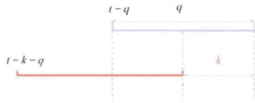

    **图 2-8 $k \le q$ 时误差窗口重叠示意**

*   **情况二：$k > q$（滞后阶数超出模型阶数）**  
    两序列误差窗口彻底分离（如图 2-9），全是独立误差相乘，期望为 0 $\rightarrow$ 协方差为 0 $\rightarrow$ **ACF 归零截尾**。

    $$

\text{Corr}(x_t, x_{t-k}) = E(x_t x_{t-k}) - E(x_t)E(x_{t-k}) = 0

$$

    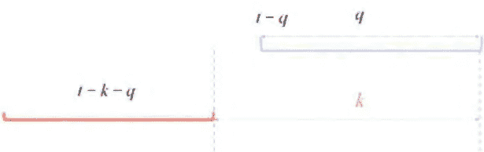

    **图 2-9 $k > q$ 时误差窗口无重叠示意**

> **核心结论**：**MA(q) 模型的 ACF 表现为“q 阶后截尾”，这是识别 MA 阶数的金标准。**

---

## 2.2.2 差分自回归移动平均模型（ARIMA 构建基石）

### 1. ARMA：预测与修正的“双剑合璧”

ARMA = AR（预测主力）+ MA（误差修正）。结合前文 ACF/PACF 与 AR/MA 的对应关系，定阶速查表如下：

**表 2-5 AR/MA/ARMA 的 ACF/PACF 行为特征速查**

| 模型 | ACF 表现 | PACF 表现 |
| :--- | :--- | :--- |
| **AR(p)** | **拖尾**（逐渐衰减） | **p 阶后截尾** |
| **MA(q)** | **q 阶后截尾** | **拖尾**（逐渐衰减） |
| **ARMA(p,q)** | **拖尾** | **拖尾** |

以 ARMA(3,3) 为例，引入**滞后算子 $L$（$L x_t = x_{t-1}$）**进行代数重构，为后续 SARIMA 铺路：

$$

x_t = \varphi_0 + \varphi_1 x_{t-1} + \varphi_2 x_{t-2} + \cdots + \varphi_p x_{t-p} + \theta_1 \epsilon_{t-1} + \theta_2 \epsilon_{t-2} + \cdots + \theta_q \epsilon_{t-q} + \epsilon_t

$$

$$

x_t = \varphi_1 x_{t-1} + \varphi_2 x_{t-2} + \varphi_3 x_{t-3} + \theta_1 \epsilon_{t-1} + \theta_2 \epsilon_{t-2} + \theta_3 \epsilon_{t-3} + \epsilon_t

$$

$$

x_t - \varphi_1 x_{t-1} - \varphi_2 x_{t-2} - \varphi_3 x_{t-3} = \varepsilon_t + \theta_1 \varepsilon_{t-1} + \theta_2 \varepsilon_{t-2} + \theta_3 \varepsilon_{t-3}

$$

令 $L$ 为滞后算子，则：

$$

L x_t = x_{t-1}, \quad L x_{t-1} = x_{t-2}, \quad L^2 x_t = x_{t-2}

$$

$$

x_t - L \varphi_1 x_t - L^2 \varphi_2 x_t - L^3 \varphi_3 x_t = \varepsilon_t + L \theta_1 \varepsilon_t + L^2 \theta_2 \varepsilon_t + L^3 \theta_3 \varepsilon_t

$$

$$

(1 - L \varphi_1 - L^2 \varphi_2 - L^3 \varphi_3) x_t = (1 + L \theta_1 + L^2 \theta_2 + L^3 \theta_3) \varepsilon_t

$$

化简得标准多项式形式：

$$

\Phi(L) x_t = \Theta(L) \varepsilon_t

$$

### 2. 差分（I）：把“非稳态”变“稳态”

时间序列非稳态，多半源于“趋势”。趋势分两种，处理逻辑截然不同。

#### 1) 确定性趋势（Trend Stationary, TS）
趋势是时间 $t$ 的确定函数（如线性、二次项）。

$$

x_t = \alpha + \beta t + e_t

$$

**对策：直接去趋势（Detrend）或一阶差分 $\Delta x_t = x_t - x_{t-1}$**。差分后序列均值方差恒常，满足稳态性。推导验证如下（$e_t$ 为白噪声，方差 $k^2$，相互独立）：

$$

\Delta x = x_t - x_{t-1} = \beta(t - (t - 1)) + e_t - e_{t-1} = \beta + e_t - e_{t-1}

$$

$$

E(\Delta x) = \beta (\text{Constant})

$$

$$

\text{Var}(\Delta x) = 0 + 2k^2 = 2k^2 (\text{Constant})

$$

#### 2) 随机趋势—— 核心挑战：单位根
以 AR(1) 为例：$x_t = \phi x_{t-1} + \epsilon_t$。因 $x_{t-1}$ 本身随机，趋势具有随机性。递归展开：

$$

x_t = \phi x_{t-1} + e_t

$$

$$

x_t = \phi x_{t-1} + e_t = \phi(\phi x_{t-2} + e_{t-1}) + e_t = \phi^t x_0 + \sum_{i=0}^{t-1} \phi^i e_{t-i}

$$

$$

e_t \sim N(0, \sigma_e^2)

$$

$$

E(x_t) = E(\phi^t x_0) = \phi^t x_0

$$

$$

\text{Var}(x_t) = \sigma_e^2(\phi^0 + \phi^2 + \cdots + \phi^{2(t-1)})

$$

基于期望和方差公式，$\phi$ 决定序列命运：

*   **$|\phi| < 1$**：均值方差收敛常数 $\rightarrow$ **本身稳态**，无需差分。

$$

E(x_t) \to 0: \text{Constant}

$$

$$

\text{Var}(x_t) \to \frac{\sigma_e^2}{1-\phi^2}: \text{Constant}

$$

*   **$|\phi| > 1$**：方差爆炸 $\rightarrow$ **极度非稳态**，工程罕见。

$$

E(x_t) \to +\infty

$$

*   **$|\phi| = 1$**：均值常数，**方差随时间线性膨胀** $\rightarrow$ **非稳态（随机游走, Random Walk）**。

$$

E(x_t) = x_0: \text{Constant}

$$

$$

\text{Var}(x_t) = t\sigma_e^2: \text{Non-Constant}

$$

**随机游走特征**：最佳预测 = 当前值；均值定、方差增。典型案例：股价、布朗运动、醉汉漫步。

$$

x_t = x_{t-1} + e_t = (x_{t-2} + e_{t-1}) + e_t = x_0 + \sum_{i=1}^t e_i

$$

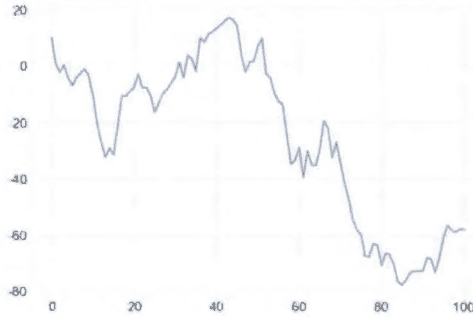

**图 2-10 随机游走过程模拟**

**关键洞察**：只有 $|\phi|=1$（单位根）时，**一阶差分 $\Delta x_t = \epsilon_t$ 能化非稳态为稳态**（白噪声）。$|\phi|>1$ 差分也救不活。

**如何验证 $\phi=1$？** $\rightarrow$ **Dickey-Fuller (DF) 检验 / 单位根检验**。

构造回归：$\Delta x_t = \delta x_{t-1} + c + e_t$。原假设 $H_0: \delta=0$（存在单位根/非稳态），备择 $H_1: \delta<0$（稳态）。

```
\(x_t = c + \phi x_{t-1} + e_t\)
```

```
\(H_0: |\phi| = 1 \Rightarrow x_t \sim I(1)\)
\(H_1: |\phi| < 1 \Rightarrow x_t \sim I(0)\)
\(x_t - x_{t-1} = c + (\phi - 1)x_{t-1} + e_t\)
\(\Delta x = c + \delta x_{t-1} + e_t\)
```

```
\(H_0: \delta = 0\)
\(H_1: \delta < 0\)
```

---

## 3. ARIMA：终极组装

针对一组非平稳序列 \(x_t\)，首要任务是通过差分操作将其转化为平稳序列：

```
\(z_t = x_{t+1} - x_t\)
\(z_t = \varphi_1 z_{t-1} + \theta_1 \varepsilon_{t-1} + \varepsilon_t\)
```

假设已知原始序列为 \([x_0, x_1, \cdots, x_l]\)，目标是预测 \(x_k (k > l)\)。那么，如何利用对差分序列 \(z_t\) 的预测结果反推原始值？请参考以下公式推导。

```
\(x_k = z_{k-1} + x_{k-1} = z_{k-1} + z_{k-2} + x_{k-2} = \sum_{i=1}^{k-l} z_{k-i} + x_l\)
```

## 4. SARIMA

SARIMA 中的 "S" 代表 Seasonality（季节性）。通常如何剔除季节性影响？以冰淇淋销量序列 \(y_t\) 为例，每年夏季销量激增，呈现以年为周期的季节性波动，如下式所示，但此法会导致首年数据缺失，因为首年之前无历史数据可供参考。

```
\(z_t = y_{t+365} - y_t\)
```

SARIMA 模型标记为 SARIMA(p, d, q)(P, D, Q)m。其中，前括号 (p, d, q) 对应非季节性部分；后括号 (P, D, Q)m 对应季节性部分；m 表示一个季节周期包含的阶段数。图 2-11 展示了按月统计的冰淇淋销量，其周期为“年”，即每周期含 12 个阶段（月份）。

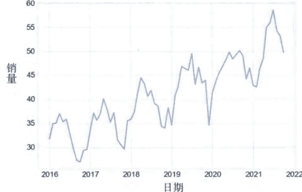

图 2-11 季节性

以 SARIMA(1,1,1)(1,1,1)4 为例，借助滞后算子 (Lag Operator) 推导，模型表达式展开如下：

```
$$(1 - \varphi_1 L)(1 - \gamma_1 L^4)(1 - L)(1 - L^4)x_t = (1 + \theta_1 L)(1 + \eta_1 L^4)\varepsilon_t$$
```

其中，\((1 - \varphi_1 L)\) 代表非季节部分的 AR 项 (p)；\((1 - L)\) 代表非季节部分的差分项 (d)，即 \(x_t - Lx_t = x_t - x_{t-1}\)；\((1 + \theta_1 L)\) 代表非季节部分的 MA 项 (q)；\((1 - \gamma_1 L^4)\) 对应季节部分的 AR 项 (P)；\((1 - L^4)\) 对应季节部分的差分项 (D)，即 \(x_t - x_{t-4}\)；\((1 + \eta_1 L^4)\) 对应季节部分的 MA 项 (Q)。

再看一个更简化的案例，SARIMA(1,0,0)(0,1,1)4：

```
$$(1 - \varphi_1 L)(1 - L^4)x_t = (1 + \eta_1 L^4)\varepsilon_t$$  
$$(1 - \varphi_1 L - L^4 + \varphi_1 L^5)x_t = \varepsilon_t + \eta_1 \varepsilon_{t-4}$$  
$$x_t - x_{t-4} = \varphi_1 x_{t-1} - \varphi_1 x_{t-5} + \varepsilon_t + \eta_1 \varepsilon_{t-4}$$
```

令 \(z_t = x_t - x_{t-4}\)：

```
$$z_t = \varphi_1 z_{t-1} + \varepsilon_t + \eta_1 \varepsilon_{t-4}$$
```

由该公式可清晰拆解 SARIMA 各组成部分：\(z_t\) 体现季节差分项 (D)；\(\varphi_1 z_{t-1}\) 体现非季节自回归项 (p)；\(\eta_1 \varepsilon_{t-4}\) 体现季节移动平均项 (Q)。

## 2.2.3 条件异方差模型

### 1. ARCH

ARCH（自回归条件异方差模型）全称为 Autoregressive Conditional Heteroskedasticity model。在诸多时间序列中，数据常呈现“波动聚类”特征：长期来看方差恒定、序列平稳，但短期内方差剧烈波动，这种现象称为条件异方差。传统 ARMA 类模型难以捕捉此特性。图 2-12 即为典型适合 ARCH 建模的序列形态。

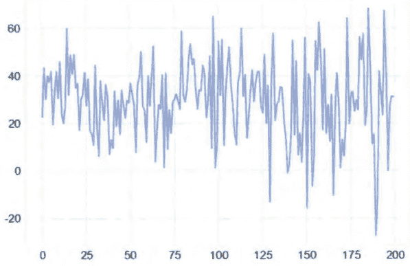

图 2-12 条件异方差数据形态

ARCH(p) 建模的核心在于对残差序列建模：

```
$$Var(x_t) = \sigma_t^2 = \alpha_0 + \alpha_1 \sigma_{t-1}^2$$
```

该式含义直观：若当期方差较大，则上一期方差大概率也较大。\(\epsilon_t\) 为白噪声。ARCH(1) 具体形式如下：

```
$$x_t = \epsilon_t \sqrt{\alpha_0 + \alpha_1 x_{t-1}^2}$$
```

以此类推，ARCH(p) 阶模型表达为：

```
$$x_t = \epsilon_t \sqrt{\alpha_0 + \alpha_1 x_{t-1}^2 + \cdots + \alpha_p x_{t-p}^2}$$
```

在 ARCH(p) 定阶检验中：

```
$$x_t = \epsilon_t \sqrt{\alpha_0 + \alpha_1 x_{t-1}^2}$$
```

\(x_t^2 = \varepsilon_t^2(\alpha_0 + \alpha_1 x_{t-1}^2) = \varepsilon_t^2 \alpha_0 + \varepsilon_t^2 \alpha_1 x_{t-1}^2\)

由上式可见自回归结构，即误差平方项的自回归过程。据此，可通过偏自相关函数 (PACF) 图谱的滞后截尾点确定 \(p\) 值。

### 2. GARCH

GARCH 是 ARCH 的广义推广形式（Generalized ARCH），能更精准刻画波动聚类，避免波动的突发性跳变。

以 ARCH(1) 为例：

\(x_t = \varepsilon_t \sqrt{\alpha_0 + \alpha_1 x_{t-1}^2} = \varepsilon_t \sigma_t\)

此类模型擅长拟合突发性剧烈波动，而非持续数日或数周的聚类性波动，因此引入 GARCH 机制：

\(x_t = \varepsilon_t \sqrt{\alpha_0 + \alpha_1 x_{t-1}^2 + \beta_1 \sigma_{t-1}^2} = \varepsilon_t \sigma_t\)

对比可见，新增项 \(\beta_1 \sigma_{t-1}^2\) 引入了对历史波动率的记忆。类比 ARMA 对 AR 的改进：当期波动不仅受过去观测值冲击影响，还受过去波动率水平影响，从而更好地描绘持续性聚类波动。

由此，GARCH(\(p,q\)) 通式为：

\(x_t = \varepsilon_t \sqrt{\alpha_0 + \alpha_1 x_{t-1}^2 + \cdots + \alpha_p x_{t-p}^2 + \beta_1 \sigma_{t-1}^2 + \cdots + \beta_q \sigma_{t-q}^2} = \varepsilon_t \sigma_t\)

## 2.3 Croston 模型及其变体

间断性需求的稀疏性（大量零值）让常规预测方法失效，催生了大量针对性算法，且多以学者名字首字母命名。Croston 模型及其变体是该领域的经典代表。Croston 提出组合预测策略：将序列拆解为“需求间隔”与“需求量”两个独立子序列分别预测，最后合成结果。具体逻辑如下：

若 \(X_t > 0\)，则
\(\begin{cases} Z_{t+1} = \alpha X_t + (1-\alpha)Z_t \\ V_{t+1} = \alpha Q_t + (1-\alpha)V_t \\ Y_{t+1} = Z_{t+1}/V_{t+1} \end{cases}\)

若 \(X_t = 0\)，则
\(\begin{cases} Z_{t+1} = Z_t \\ V_{t+1} = V_t \\ Y_{t+1} = Y_t \end{cases}\)

其中，\(Z_t\) 为 \(t\) 期非零需求量估计，\(V_t\) 为非零需求间隔估计，\(X_t\) 为真实需求，\(Q_t\) 为当前零需求持续周期，\(Y_t\) 为考虑零值后的综合需求估计。

原始 Croston 法存在偏差，Syntetos 与 Boylan 提出 SBA（非偏估计），引入平滑系数 \((1 - \alpha/2)\) 修正，即设 \(Z_t=\mu\)、\(V_t = p\)。推导表明新预测值趋近无偏，且经多研究验证有效提升精度。

\(E \left[ (1 - \frac{\alpha}{2}) \left( \frac{Z_t}{V_t} \right) \right] = (1 - \frac{\alpha}{2}) E \left[ \left( \frac{Z_t}{V_t} \right) \right] = (1 - \frac{\alpha}{2}) \left( \frac{\mu}{p} + \frac{1}{2} \frac{\partial^2 (\frac{\mu}{p})}{\partial p^2} Var(p) \right) = (\frac{2 - \alpha}{2}) \left( \frac{\mu}{p} + \frac{\alpha}{2 - \alpha} \mu \frac{p-1}{p^2} \right) = \frac{\mu}{p} \left( \frac{2 - \alpha}{2} + \frac{\alpha p - 1}{2} \frac{1}{p} \right) \approx \frac{\mu}{p}\)

上述方法未考虑产品生命周期终止（下市）场景。Teunter、Syntetos、Babai 等人提出 TSB 法，核心差异在于：不再估计间隔，而是直接估计“非零需求发生概率”，且**每期更新**而非仅在有需求时更新。\(D_t\) 指示 \(t\) 期是否有需求，\(P_t\) 为需求概率估计，\(\alpha, \beta\) 分别为需求量与概率的平滑系数。

若 \(D_t = 1\)，则
\(\begin{cases} P_{t+1} = \beta(1) + (1 - \beta)P_t \\ Z_{t+1} = \alpha X_t + (1 - \alpha)Z_t \\ Y_{t+1} = P_{t+1}Z_{t+1} \end{cases}\)

若 \(D_t = 0\)，则
\(\begin{cases} P_{t+1} = (1 - \beta)P_t \\ Z_{t+1} = Z_t \\ Y_{t+1} = P_{t+1}Z_{t+1} \end{cases}\)

TSB 优势显著：长期零需求下 \(P_t\) 指数衰减趋近 0，而 Croston 间隔估计不变。实战中可设概率阈值判断产品是否继续售卖。Prestwich、Tarim、Rossi 等人提出 HES（双曲指数平滑），融合 Croston 与贝叶斯思想。两者区别：HES 随零需求增加呈双曲线递减，TSB 为指数递减。

标准 Croston 假设需求发生服从伯努利分布；若服从泊松分布，Shale-Boylan-Johnston (SBJ) 与 Syntetos-Babai-Luo 给出了偏差修正系数。SBJ 摒弃简单指数平滑，改用简单移动平均或指数加权移动平均，平滑系数为 \((1 - \alpha/(2 - \alpha))\)。Leven 和 Segerstedt 提出 LAS，估计式为 \(Y_{t+1} = \alpha X_t / Q_t + (1 - \alpha)Y_t\)。Vinh 提出 VINH，与 Croston 相似但加权基于过去两期记录：\(Z_{t+1} = \alpha X_t + (1 - \alpha)Z_t + (1 - \alpha)^2 Z_{t-1}\)、\(V_{t+1} = \alpha Q_t + (1 - \alpha)V_t + (1 - \alpha)^2 V_{t-1}\)。这些变体在实测中均优于原始 Croston。

# 第 3 章 线性回归模型

## 3.1 简单线性回归模型

### 3.1.1 基本概念介绍

简单线性回归旨在建立单一特征变量与目标变量间的线性映射函数，核心在于求解参数向量以实现预测。多元线性回归则扩展为多特征变量联合建模。通过训练获取各特征的回归系数，加权求和得到预测值。多元线性回归基础表达式如下：

```
y = \theta_0 + \theta_1x_1 + \theta_2x_2 + \cdots + \theta_nx_n + \varepsilon
```

其中，\(\theta_1 \sim \theta_n\) 为回归系数，量化 \(x\) 对 \(y\) 的边际影响；\(\varepsilon\) 为误差项，捕捉线性关系外的随机扰动；\(\theta_0\) 为截距项。线性回归几何示意见图 3-1。

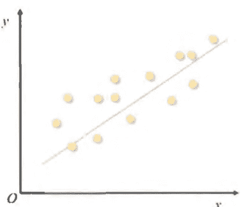

图 3-1 线性回归的示意图

如何求得最优系数组合？首先设定训练目标。因随机误差 \(\varepsilon\) 服从高斯分布，可通过极大似然估计 (MLE) 推导目标函数，再以最小化该函数为优化目标，利用梯度下降寻找极值点获取最终系数。以下详述推导步骤。

目标函数定义为：

```
J(\theta) = \min \frac{1}{2} \sum_{i}^{n} (y_i - \hat{y}_i)^2 = \min \frac{1}{2} \sum_{i}^{n} (y_i - \theta^T x^{(i)})^2
```

\(y_i\) 为真实值，\(\hat{y}_i\) 为样本 \(i\) 在参数 \(\theta\) 下的预测值。

该目标函数如何推导而来？核心依据是极大似然估计。因 \(\varepsilon(i)\) 服从高斯分布，可得：

```
p(\varepsilon^{(i)}) = p(y^{(i)}|x^{(i)}; \theta) = \frac{1}{\sqrt{2\pi}\sigma} \exp(-\frac{(y^{(i)} - \theta^T x^{(i)})^2}{2\sigma^2})
```

对每个样本，期望条件概率 \(p(y^{(i)}|x^{(i)}; \theta)\) 越大越好。将 \(n\) 个样本概率相乘构造似然函数，目标转化为最大化该函数：

```
L(\theta) = \prod_{1}^{n} p(y^{(i)}|x^{(i)}; \theta) = \prod_{1}^{n} \frac{1}{\sqrt{2\pi}\sigma} \exp(-\frac{(y^{(i)} - \theta^T x^{(i)})^2}{2\sigma^2})
```

乘法运算不便，对两边取对数转化为对数似然函数：

```
\log L(\theta) = n \log \frac{1}{\sqrt{2\pi}\sigma} - \frac{1}{\sigma^2} \cdot \frac{1}{2} \sum_{1}^{n} (y^{(i)} - \theta^T x^{(i)})^2
```

此时，最大化似然函数等价于最小化下式，即为目标函数的由来。

```
J(\theta) = \frac{1}{2} \sum_1^n (y^{(i)} - \theta^T x^{(i)})^2
```

### 3.1.2 最优参数求解

基于推导出的目标函数，进行最优参数求解。针对简单线性回归，目标函数为：

```
J(\theta) = \frac{1}{2} \sum_1^n (y_i - \theta_1 x_i - \theta_0)^2
```

只需对目标函数求导并令导数为零，即可定位最优解：

# 回归建模全景解析：从优度评估到分位建模的进阶之路

```
\frac{\partial J(\theta)}{\partial \theta_0} = - \sum_{i=1}^n (y_i - \widehat{\theta_0} - \widehat{\theta_1} x_i)^2 = 0 \\
\frac{\partial J(\theta)}{\partial \theta_1} = - \sum_{i=1}^n x_i (y_i - \widehat{\theta_0} - \widehat{\theta_1} x_i)^2 = 0
```

经过前两个公式的推演，可得出以下结论：

```
\widehat{\theta_1} = \frac{n \sum_{i=1}^n x_i y_i - (\sum_{i=1}^n x_i)(\sum_{i=1}^n y_i)}{n \sum_{i=1}^n x_i^2 - (\sum_{i=1}^n x_i)^2} \\
\widehat{\theta_0} = \bar{y} - \widehat{\theta_1} \bar{x}
```

### 3.1.3 决定系数 $R^2$：量化拟合优劣的核心指标

统计学泰斗 Galton 爵士在探究父子身高遗传规律时敏锐发现：即便父亲身高如出一辙，成年儿子的身高依然参差不齐。这一现象揭示了目标变量波动的双重驱动源——既受解释变量（如父亲身高）主导，也受不可控的随机扰动支配。将其映射到建模场景中，被解释变量 $y$ 的总离散程度，实质上是“模型捕获的系统性变异”与“模型遗漏的随机噪声”共同作用的结果。

统计学将这两部分量化为三大核心度量：
*   **SSR（回归平方和/解释平方和）**：解释变量 $x$ 对 $y$ 产生影响所形成的变差平方和，代表模型提取的“有效信号”。
*   **SSE（残差平方和/剩余平方和）**：随机扰动导致的 $y$ 变差平方和，代表模型捕捉不到的“背景噪声”。
*   **SST（总平方和/总变差平方和）**：$y$ 自身的总变异，满足恒等式 **SST = SSR + SSE**。

```
SSR = \sum_{i=1}^{n} (\hat{y}_i - \bar{y})^2
```
```
SSE = \sum_{i=1}^{n} (y_i - \hat{y}_i)^2
```
```
SST = SSR + SSE = \sum_{i=1}^{n} (y_i - \bar{y})^2
```

显而易见，优良拟合追求的是“信噪比”最大化——即 SSR 在 SST 中占比越高越好。如图 3-2 直观呈现：观测点紧贴拟合线，SSR 占比大，$R^2$ 便逼近 1；反之，数据点离散分布，$R^2$ 趋近 0。于是，**决定系数 $R^2$** 应运而生，定义为 $R^2 = \frac{SSR}{SST} = 1 - \frac{SSE}{SST}$。

```
R^2 = \frac{SSR}{SST} = \frac{\sum_{i=1}^{n} (\hat{y}_i - \bar{y})^2}{\sum_{i=1}^{n} (y_i - \bar{y})^2} = 1 - \frac{\sum_{i=1}^{n} (y_i - \hat{y}_i)^2}{\sum_{i=1}^{n} (y_i - \bar{y})^2}
```
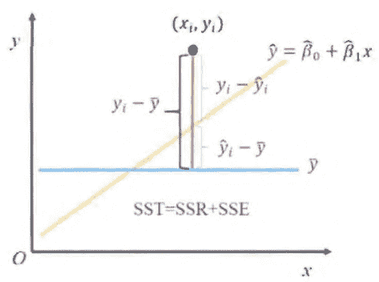

$R^2$ 取值锁定在 $[0, 1]$ 区间，它是检验回归直线拟合优劣的“试金石”：**数值越逼近 1，模型解释力越强；数值越逼近 0，模型失效风险越高。**

### 3.1.4 线性建模的“五大前提”：i.i.d. 假定体系

欲构建稳健的线性模型，必须通过“独立同分布”（i.i.d.）这道关卡。如图 3-3 所示，该框架拆解为五条不可逾越的红线：

1.  **线性关联**：解释变量与被解释变量须呈线性趋势。
2.  **严格外生性**：解释变量与扰动项零相关，扰动项之间互不相关。
3.  **特征正交性**：解释变量之间两两独立，无强耦合。
4.  **等方差性**：扰动项方差恒定，不随样本漂移。
5.  **高斯正态性**：扰动项服从均值为 0 的正态分布。

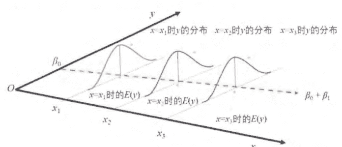

下面逐条深度解读这五大假定的实战含义。

#### 1. 线性关联：模型结构的基石
以房价预测为例（图 3-4），居住面积 $x$ 每增加 1 个单位，房价 $y$ 按固定斜率 $\theta$ 跃升，这是标准线性模式。一旦散点图呈现曲率（如 $x^2、x^3$ 等高阶项主导），强行套用简单线性模型必然导致严重的欠拟合，**泛化性能大幅下滑**。**结论：建模前务必通过散点图验证线性趋势。**

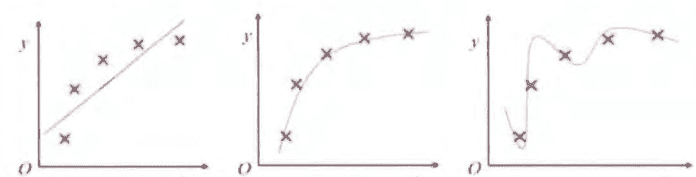

#### 2. 严格外生性：扰动必须是“纯白噪声”
设想研究“考试成绩 ~ 出勤率 + 智力水平”，随机扰动中包含“天气”因素。如图 3-5 所示，雨天降低出勤率，天气与解释变量产生耦合，导致扰动项随出勤率系统性波动——**序列相关（自相关）产生，模型假定崩塌**。反之，图 3-6 中天气与智力水平无关，扰动纯随机，假定成立。**核心要义：扰动项不得携带任何解释变量的遗漏信息。**

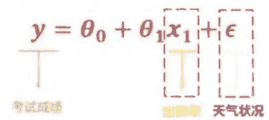


#### 3. 特征正交性：规避“协变量冲突”
图 3-7：智力水平与出勤率互不干扰，成绩随智力提升 $\theta_1$，因果关系清晰明确。
图 3-8：智力水平与解题速度强耦合，成绩提升究竟归功于智力还是速度？模型陷入**“归因模糊”的多重共线性泥沼**，系数估计极不稳定，标准误膨胀。**对策：建模前计算 VIF（方差膨胀因子），剔除或合并高共线特征。**

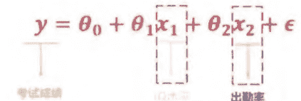
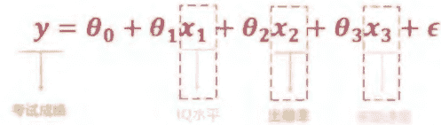

#### 4. 等方差性：扰动波动的“恒温器”
伽利略比萨斜塔实验中，风对不同铁球的干扰程度应一致，这就是等方差（图 3-9 上）。非等方差（图 3-9 下）则表现为残差散度随解释变量系统性收放——**漏斗形（递增）、逆漏斗形（递减）或复杂非单调模式**，均会破坏参数估计的有效性与推断精度。

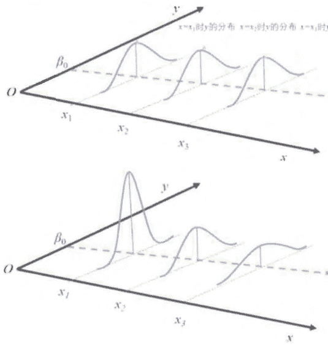

**非等方差三大常见诱因**：
*   极端离群点扭曲方差结构；
*   关键解释变量缺失（遗漏变量偏误）；
*   非线性真实关系被强行线性化。

**应对工具箱**：加权最小二乘法（WLS）、方差稳定变换（如 Box-Cox）、鲁棒标准误修正。

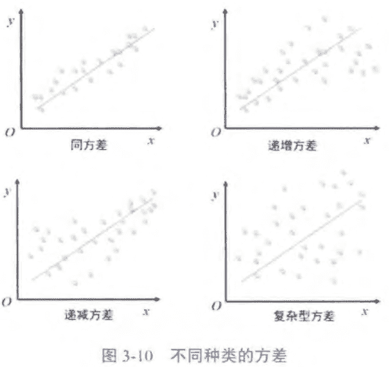

#### 5. 高斯正态与零均值：最大熵原理的自然归宿
为何扰动偏好正态分布？**自然界中，受海量微小独立因素叠加的随机量，大概率呈正态（中心极限定理）**。若残差非正态，暗示存在系统性遗漏因素。
**零均值**保证无偏估计：最优拟合线穿过样本点云质心，残差正负抵消。
**给定方差下，正态分布熵最大**——即不确定性最大、先验假设最少，符合“最大熵原理”，是最不武断的自然选择。

```
$p(\varepsilon^{(i)}) = p(y^{(i)}|x^{(i)};\theta)$
```

---

## 3.2 正则约束建模：破解“维数灾难”与“共线困局”

实战中常遭遇两大拦路虎：**特征维度超越样本量** ($p > n$)，导致正规方程 $(X^TX)^{-1}$ 不可逆；**特征高度耦合**，致使参数估计方差爆炸。正则化通过在损失函数引入惩罚机制，压缩参数空间，优雅化解上述难题。

### 3.2.1 核心逻辑：以“引入偏差”换“降低方差”，提升泛化性
$$
J(\theta) = \text{经验风险} + \lambda \times \text{复杂度惩罚}
$$
$\lambda$ 控制惩罚强度。三大主流变体：
*   **Lasso (L1范数)**：$\sum |\theta_j|$ —— 诱导稀疏，自带变量筛选。
*   **Ridge (L2范数)**：$\sum \theta_j^2$ —— 压缩系数幅度，缓解共线。
*   **ElasticNet**：L1 与 L2 混合，兼收并蓄。

```
f(x) = \theta^T x + b
```
```
J(\theta) = \frac{1}{2} \sum_{i=1}^{n} (\theta^T x_i + b - y_i)^2
```

### 3.2.2 Lasso：稀疏建模的“自动筛选器”
目标函数：
```
J(\theta) = \frac{1}{2} \sum_{i=1}^{n} (\theta^T x_i + b - y_i)^2 + \lambda \sum_{j=1}^{m} |\theta_j|
```

L1 范数的菱形等值线（图 3-11 黑色边界）极易与椭圆损失等值线在**坐标轴顶点**相切，迫使部分 $\theta_j$ **精确归零**。这意味着：**无关特征被直接“剔除”出方程**。高维稀疏场景首选利器。

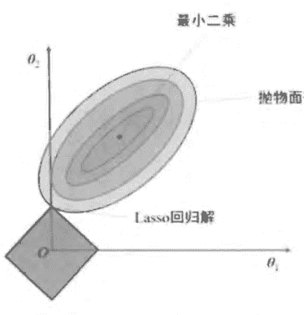

### 3.2.3 Ridge：共线数据的“稳定器”
目标函数：
$$J(\theta) = \frac{1}{2} \sum_{i=1}^n (\theta^T x_i + b - y_i)^2 + \lambda \sum_{j=1}^m \theta_j^2$$

L2 范数的球形约束域（图 3-12 灰色区域）与椭圆相切点极少落在坐标轴上，**虽难以置零系数，但能大幅压缩大系数幅度**。当特征间高度相关且均具预测价值时，Ridge 通过“分担权重”稳定估计，有效抑制过拟合风险。

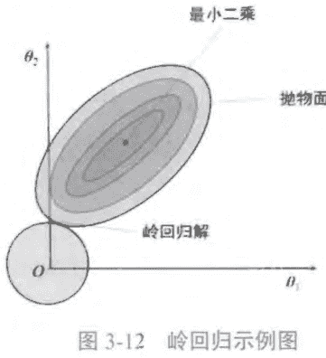

### 3.2.4 ElasticNet：融合双范数的“黄金平衡”
```
J(\theta) = \frac{1}{2} \sum_{i=1}^n (\theta^T x_i + b - y_i)^2 + \lambda (\rho \sum_{j=1}^m |\theta_j| + (1 - \rho) \sum_{j=1}^m \theta_j^2)
```
$\rho \in [0,1]$ 调节 L1/L2 占比（默认 0.5）。$\rho=1$ 退化为 Lasso，$\rho=0$ 退化为 Ridge。**既保留 Lasso 的稀疏筛选，又继承 Ridge 的分组效应（相关特征同进同出）**，是高维强共线数据的“瑞士军刀”。

---

## 3.3 分位回归：从“点预测均值”到“全景洞察分布”

最小二乘法（OLS）仅给出条件期望 $E(y|x)$，却掩盖了条件分布形态的关键信息。现实决策往往聚焦**尾部风险**：
*   **供应链管理**：高估需求→呆滞成本；低估需求→断货损失，**代价高度不对称**。
*   **金融风控**：关注 VaR（风险价值），即分布左尾分位。

### 几何直觉（图 3-13）
*   **OLS 线**：穿过数据云中心，斜率恒定，隐含同质性假设。
*   **0.9 分位线**：下方覆盖 90% 样本。若随 $x$ 陡峭上扬，揭示**高需求场景下的波动放大**——这是 OLS 绝无法捕捉的异质性洞见。
*   **全谱分位曲线族** ($\alpha=0.1, 0.2, ..., 0.9$)：像分层扫描般剖开条件分布，展现 $y$ 不同分位随 $x$ 的差异化演变。

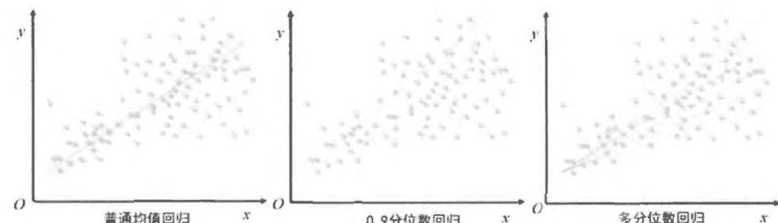

### 核心损失函数：Pinball Loss（跳针/弹球损失）
```
\(\rho_\alpha(y, \hat{y}) = \begin{cases} \alpha(y - \hat{y}), \text{若 } y - \hat{y} > 0 \\ (1 - \alpha)(\hat{y} - y), \text{否则} \end{cases}\)
```

**非对称加权绝对偏差**：
*   $\alpha=0.9$（绿线，图 3-14）：欠预测惩罚权重 0.9，超预测仅 0.1 → **强制曲线上抬，覆盖 90% 数据**。
*   $\alpha=0.1$（蓝线）：超预测惩罚重，欠预测轻 → **曲线下压，勾勒底部 10% 边界**。

**本质洞察**：分位回归 = **加权绝对偏差最小化** = 为不同样本分配差异化权重的加权 L1 估计。

> **实战启示**：当业务对“超”与“欠”敏感度不对称时（如：宁可多备货不可断货，设 $\alpha=0.85$；宁可漏报风控不可误伤优质客户，设 $\alpha=0.15$），分位回归提供了**定量化的决策边界**，远超单一均值预测的实用价值。

想要求出 0.7 分位数，不妨先设其为 q。接着，给大于 q 的数值配上 0.7 的权重，小于 q 的则配 0.3。核心在于最小化弹球损失函数，验算后可知，7 正是目标分位点。说白了，分位数回归的底层逻辑跟加权最小二乘法如出一辙，皆通过最小化特定函数来定位分位数。

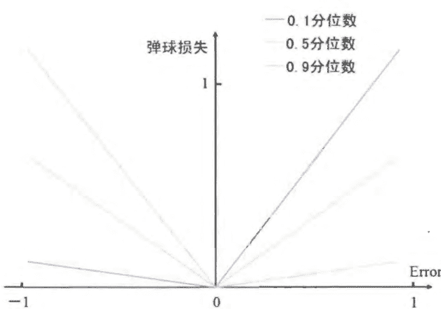

图 3-14 弹球损失

线性回归常靠最小二乘法拿均方误差做损失，从而拟合条件期望。若把损失函数换成上述加权最小二乘形式，产出的结果自然就符合分位数定义了。比如设 $\alpha$ 为 0.8，极小化损失求参数，得到的回归曲线 $f$ 下方正好覆盖 80% 数据。所以，分位数回归本质是一类模型或改良思路，能接入线性、多项式回归等，关键就在于把损失函数从最小二乘换成加权最小二乘，不同分位数对应不同结果，方便多角度分析。

# 机器学习模型

机器学习模型是时间序列预测的利器之一。相比传统时序模型，它在高维数据处理、特征深度挖掘、预测鲁棒性上更有话语权。首先，ML 模型对数据广度与质量的兼容性更强，不少模型在销量序列与多源特征的联合学习、缺失值自动填补上表现亮眼。其次，它能自动完成深层特征提取。传统时序预测里，滞后相关、周期性等特征常靠人工结合经验算（如 ARIMA 需跑 ACF/PACF），精度难保；ML 模型则能自主从数据习得这些特征，预测更准。最后是鲁棒性，集成模型尤甚。比如并行大量子模型预测，能有效压低过拟合风险。因此，供应链需求预测实战中，吃透常见 ML 模型及其用法至关重要。

本章将讲解 ML 经典基础模型：决策树、Logistic 回归、集成模型等。这些模型工具库成熟，调用即得结果。但实战要求按场景选模、改模。本章旨在助你更好地落地 ML 模型做时序预测。

## 4.1 决策树模型

### 4.1.1 模型介绍

本节借“人工预测销量”任务，拆解决策树如何模仿这套思路。以商品销量预测为例，数据集含两特征：上月销量均值、是否包邮。我们先复盘人工预测逻辑，再映射到决策树原理。

人工预测通常这么走：翻历史数据，找关联因子，发现上月均值高、当月销量大概率也高；同等条件下包邮更吸睛，销量更高。于是用这两特征分类：均值高+包邮=类1；均值高+不包邮=类2；均值低+包邮=类3；均值低+不包邮=类4。分好类后，用各类销量均值做预测值。新商品来了，对号入座，直接套用类别预测值。决策树示意见下图。

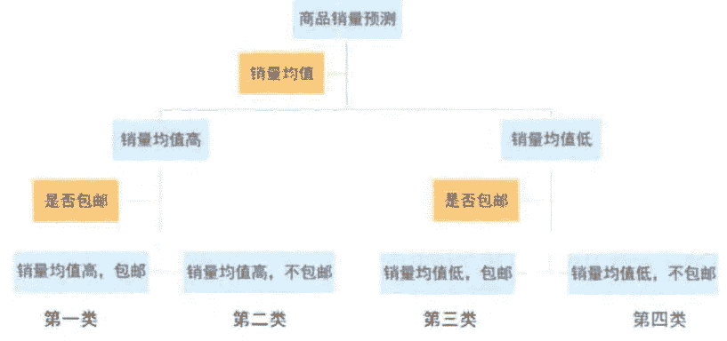

图 4-1 决策树模型示意图

决策树预测的内核逻辑与上述完全同构：按特征做判断分裂，层层筛选把样本分入不同叶节点，再以叶节点均值输出预测。

特征至关重要，两个核心问题：选哪特征分裂、何时停分。下文逐一展开。

#### 4.1.2 特征选择

特征选择关乎决策树生死。选得好，准确率升、过拟合降、算力省、模型更易懂。本质是从数据里筛出对目标影响最大的特征。类别特征直接拿类别分；连续特征比数值大小分。下面依次讲信息增益、增益率、基尼指数及其关联。

- 1. 信息增益

信息增益度量：知晓条件 A 后，信息熵降了多少，即不确定性减了多少。选增益最大的特征，让集合最“纯”。以此分裂建树即 ID3 算法。

先说信息熵。集合 D 有 Y 类，$p_k$ 为第 k 类占比，D 的信息熵定义为：
```
E(D) = - \sum_{k=1}^{Y} p_k \log p_k
```

再定义条件熵：
```
E(Y|X) = \sum_{i=1}^{m} p_i E(Y|X=x_i)
```
可见条件熵本质是条件期望的概率均值。有了信息熵，信息增益就好定义了：集合 D 熵记 E(D)，条件 A 下条件熵记 E(D|A)，差值 E(D)-E(D|A) 即信息增益，记 G(D, A)。

- 2. 信息增益比

信息增益有偏好：爱选取值多的特征。比如“随机编号”这类无用特征，分类数多导致增益高，实则无预测信息。解法是用“比”代“差”，引入信息增益比：数据集 D、特征 A 下，增益比为：
```
G_R(D, A) = \frac{G(D, A)}{E_{A(D)}}
```
其中：
```
E_{A(D)} = - \sum_{i=1}^{n} \frac{|D_i|}{|D|} \log_2 \frac{|D_i|}{|D|}
```
用增益比分裂，是 C4.5 算法核心。

- 3. 基尼指数

相比前两者，基尼指数处理类别不平衡更稳，树结构更稳健，计算也更轻量，工程落地效率高。

集合 D 有 k 类，第 k 类概率 $C_k$，基尼指数定义为：
```
Gini(D) = 1 - \sum_{k=1}^{K} \left( \frac{|C_k|}{|D|} \right)^2
```
若 D 在特征 $A=x$ 下分裂成 $D_1, D_2$，条件 A 下 D 的基尼指数为：
```
Gini(D, A) = \frac{D_1}{D} \text{Gini}(D_1) + \frac{D_2}{D} \text{Gini}(D_2)
```
以基尼指数建树，即 CART 算法核心。

#### 4.1.3 决策树剪枝

剪枝是治过拟合的利器。过拟合即训练集牛、测试集怂，常因模型过复杂。剪枝简化结构、降复杂度，缓解此病。

剪枝分预剪枝、后剪枝。预剪枝在建树时设停止条件（最大深度、最小样本量、最小增益等），优点是快，缺点易欠拟合（树长不到最优就停了）。后剪枝建完树再剪，常用子树替换（换成最佳叶节点）或子树折叠（合并叶节点），配合代价复杂度、错误率、交叉验证评估。后剪枝模型通常更精准，但算力贵。因预剪枝欠拟合风险大，实战多用后剪枝。

#### 4.1.4 构建决策树

建树即生成树形结构：内部节点做特征判断，叶节点给预测值。递归把数据集切分成越来越“纯”的子集，从而学规律、做预测。按不同分裂准则，衍生出 ID3、C4.5、CART 三大算法族。

##### 1. ID3 与 C4.5

ID3 核心：算全特征信息增益，选最大者分裂。按该特征取值切分子集。若节点分裂增益 < 阈值 $\epsilon$，停分。全体样本集 D 为根节点，特征集 A。流程：
- (1) 终止条件：D 全同类 -> 单节点树，打标签；D 不同类但无可用特征 -> 取多数类打标签。
- (2) 未终止时，算各特征增益，取最大者记 $A_g$。
- (3) 若 $A_g$ 分裂增益 < $\epsilon$，停分，用 D 里多数类标签。
- (4) 否则，按 $A_g$ 每个取值 $x$ 将样本分入 $D_x$。
- (5) 对每个 $D_x$ 用特征集 $A - A_g$，递归 (1)~(4)。

C4.5 唯一差别：分裂评价用信息增益比，其余同构。目的就是治 ID3 偏爱取值多特征的毛病。

##### 2. CART

CART 全称 Classification And Regression Tree。先讲分类树：用基尼指数分裂，强在处理类别不平衡、计算量小。样本集 D，特征集 A，流程：
- (1) 终止条件同 ID3。
- (2) 未终止时，遍历每特征 $a$ 及取值 $a_i$，按 $a=a_i$ 分裂成 $D_1, D_2$，算基尼指数（按前述公式）。
- (3) 选基尼指数最小的特征及取值分裂。
- (4) 对新节点迭代 (1)~(3)，至停止。

再讲 CART 回归树。核心：将特征空间切成 M 个区域 $R_m$，每区域有输出权值 $c_m$，模型写为：
```
f(x) = \sum_{m=1}^M c_m I(x \in R_m)
```
$f$ 为训练好的回归树，$x$ 为样本。训练目标仍是最小化均方误差。$c_m$ 最优解有解析式：
```
\widehat{c_m} = \text{average}(y_i | x_i \in R_m)
```
难点在怎么切空间，仍用最优化框架。对第 $j$ 个特征 $x_j$ 及取值 $s$ 定义区域：
```
R_{1(j,s)} = \{x | x^j \le s\}
R_{2(j,s)} = \{x | x^j > s\}
```
求解：
```
\min_{j,s} \left[ \min_{c_1} \sum_{x_i \in R_1(j,s)} (y_i - c_1)^2 + \min_{c_2} \sum_{x_i \in R_2(j,s)} (y_i - c_2)^2 \right]
```
解得的 $j, s$ 即最优特征和切分点。对所有区域递归重复，得 CART 回归树。流程描述：
- (1) 从全空间起，按上法找首个最优 $j, s$。
- (2) 按 $j, s$ 切两区域。
- (3) 对两新区域各自找最优特征、切分点。
- (4) 递归至停止条件。
- (5) 停止后，按划分区域及各区域 $c_m$ 生成最终树。

```
f(x) = \sum_{m=1}^M c_m I(x \in R_m)
```

## 4.2 Logistic 回归模型

### 4.2.1 模型介绍

Logistic 回归属广义线性模型，数据挖掘、预测领域常客，主攻二分类，适配供应链对可解释性要求高的动销预测场景，集成模型里也可做策略选择。

先从“补货需求预测”实战切入，看人工咋判。特征通常有：是否节假日、近期订单量、库存量等。人工凭经验给特征加权：节假日前补货需求大 -> “是否节假日”权重高；订单激增或库存告急 -> 补货概率大。综合加权判断，得出是否补货。

Logistic 回归逻辑同构：从数据自学特征与补货的关系，自动调权重。训练后，按特征加权求和预测。大多情况下，需补货日加权和偏大，无需补货日偏小。所以新数据来了，算加权和看大小，即可定夺。

引入 Sigmoid 函数的作用：把加权和压缩到 0~1。Sigmoid 能将任意实数映射至 (0,1)，值越大越靠 1，越小（大负数）越靠 0。这样输出可视作概率：越近 1 补货需求越大，越近 0 越小。设阈值 0.5 硬分类：>0.5 判定需补货，否则不需。

Logistic 回归靠线性加权 + Sigmoid 落地补货预测。它从历史数据学规律，服务新数据。这套路不限于补货，广泛适用于二分类问题。

#### 4.2.2 Logistic 回归模型原理

##### 1. 基础模型

特征向量记 $x$，系数向量记 $w$，加权求和记 $w \cdot x$。通常加常数项 $b$，即 $w \cdot x + b$。令 $w=(w_1,...,w_n,b)$，$x=(x_1,...,x_n,1)$，仍可记为 $w \cdot x$ 或内积 $\langle w, x \rangle$。

Sigmoid 函数定义如下：
```
\phi_{sig}(z) = \frac{1}{1 + \exp(-z)}
```
图形似 S，故名 Sigmoid，图像见 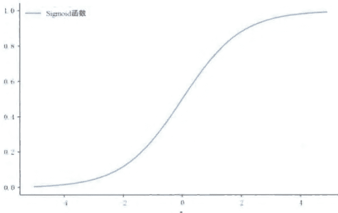 图 4-2。


图 4-2 Sigmoid 函数图像

将加权求和与 Sigmoid 复合，得 Logistic 回归通式：
\(\phi_{\text{sig}}(\langle w, x \rangle) = \frac{1}{1 + \exp(-\langle w, x \rangle)}\)

### Sigmoid 响应与损失函数构建

当特征向量与权重的内积 \(\langle w, x \rangle\) 取极大值时，Sigmoid 函数输出无限逼近 1；反之，若内积极小，输出则趋近于 0。

##### 2. 损失函数的选取与优化

前文提到，加权求和的关键在于确定系数 \(w\)。通常我们引入一个函数来量化模型优劣，即损失函数（记作 loss），其形式为：

loss = log(1 + exp(-y\(\langle w, x \rangle\)))

该函数的优势在于：预测越精准，损失值越低；预测越偏离，损失值越高。因此，目标转化为寻找使损失函数取最小值的 \(w\)。Logistic 回归关于 \(w\) 是凸函数，可直接用极值法求解。此外，此过程等价于极大似然估计，若采用该估计，常配合牛顿法或梯度下降法求解 \(w\)。

## 4.3 XGBoost 相关模型

自此，我们正式步入著名集成模型 XGBoost 的核心领域。集成学习的精髓在于：整合多个薄弱模型，合力构建一个高性能的强预测器。在此架构下，单个弱模型被称为“弱学习器”或“基模型”，融合后的整体称为“强学习器”或“集成模型”。集成框架繁多，XGBoost 采用的是 Boosting 范式。在此框架内，基模型间联系紧密，按序迭代训练，每轮通过调整样本权重或拟合残差来优化。相较单模型，集成模型通常拥有更高的准确率，这也是其核心优势；同时还能增强泛化能力，抑制过拟合，实战效果更优。

为深入剖析 XGBoost 的原理与长处，下文将先回顾 AdaBoost 与 GBDT 两大基石模型，为后续深入铺路。

### 4.3.1 AdaBoost 模型

#### 1. 模型直观理解

我们从极具 Boosting 特征的 AdaBoost 切入。假设要融合三个小模型 A、B、C 组成大模型 G 预测销量。流程如下：
首先训练模型 A，发现其在某些时段表现优异，但在其他时段乏力。为补齐短板，引入模型 B，并**提高**模型 A 表现差的时段的数据权重，强迫模型 B 专注这些“难点”。融合后，A+B 在弱势时段表现提升。若 B 单体表现更优，则在加权投票时赋予 B 更大权重。
随后引入模型 C，同理聚焦 A+B 仍表现不佳的时段。最终根据三模型表现分配权重，加权求和得最终预测。这种串联加权的过程，即“集成”的本质（见下图）。

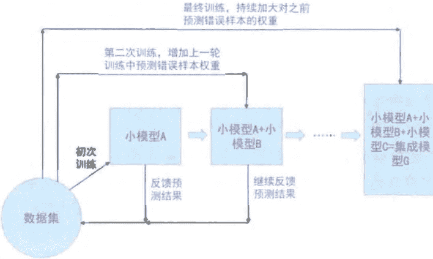

图 4-3 小模型集成为大模型的过程

AdaBoost 核心有二：**聚焦难学样本**与**基模型加权求和**。每轮训练都盯着预测差的样本；新模型基于旧模型追加训练。随着模型增多，性能通常渐增。投票时，强者话语权重，加权求和即最终输出。

#### 2. 数学原理推导

AdaBoost 解决两个核心问题：如何定义样本重要性、如何计算基模型权重。以分类为例：学得差的样本权重大；分得准的模型权重大。算法流程如下：

设有 \( N \) 个样本训练集 \( D = \{(x_1, y_1), \dots, (x_N, y_N)\} \)，\( x_i \in \mathbf{R}^N, y \in \{-1, 1\} \)。

**初始化：** 无先验信息，样本权重均等分布：

```
\( D_1 = (w_{11}, \dots, w_{1i}, \dots, w_{1N}), \quad w_{1i} = \frac{1}{N}, \quad i = 1, 2, \dots, N \)
```

**迭代：** 设定基模型数 \( T \)，对 \( t=1, 2, \dots, T \) 执行：

- **（1）训练：** 基于权重分布 \( D_t \) 训练得当前集成模型 \( G_t(x) \)。
- **（2）计算加权误差率：**

$$\epsilon_t = P(G_t(x_i) \neq y_i) = \sum_{i=1}^N w_{ti} I(G_t(x_i) \neq y_i)$$

其中 \( I \) 为指示函数。权重 \( w \) 使不同样本对总误差贡献不同，算法通过调整 \( w \) 让难学样本权重增大。

- **（3）计算基模型权重 \( \alpha_t \)：** 误差越小，权重越大。

$$\alpha_t = \frac{1}{2} \log \frac{1 - \epsilon_t}{\epsilon_t}$$

- **（4）更新样本权重：** 分错的样本权重增大。

$$D_{t+1} = (w_{t+1,1}, \cdots, w_{t+1,i}, \cdots, w_{t+1,N})$$

其中：

$$w_{t+1,i} = \frac{w_{ti}}{Z_t} \exp(-\alpha_t y_i G_t(x_i))$$

\( Z_t \) 为归一化因子：

$$Z_t = \sum_{i=1}^N w_{ti} \exp(-\alpha_t y_i G_t(x_i))$$

经过 \( T \) 轮，得到系数 \( \alpha_t \)，最终加权线性组合分类器为：

$$f(x) = \sum_{t=1}^T \alpha_t G_t(x)$$

集成模型再套一层符号函数 \( \text{sign}() \)：

$$G(x) = \text{sign}(f(x)) = \text{sign}\left( \sum_{t=1}^T \alpha_t G_t(x) \right)$$

可见，AdaBoost 组合过程直观，权重调整函数设计恰当，流程经典。

### 4.3.2 GBDT 模型

#### 1. 核心思想：拟合残差

GBDT 同属 Boosting 家族，但构建逻辑不同。它以决策树为基模型，通过学习**残差**（预测值与真实值之差）逐步提升。
举例：真实销量 100。模型 A 预测 70，残差 30。模型 B 学习这 30，A+B 预测变 90，残差降为 10。模型 C 学习 10，A+B+C 预测达 95，逼近真值。此即集成模型 G。这种不断增模型、学残差的机制，正是“前向分步算法”的核心。

#### 2. 原理深度：从 AdaBoost 的局限到梯度提升

GBDT 诞生旨在解决 AdaBoost 在某些损失函数下求解困境。AdaBoost 虽可写成前向分步形式，在平方损失和指数损失下易求解，但换其他损失函数则难以下手。GBDT 引入**负梯度**替代残差，打通了任意可导损失函数的优化路径。基模型用 CART 树：分类树称 GBDT，回归树称 GBRT，均性能强劲，应用广泛。

##### 1) 基模型与前向分步形式

记模型为：

```
$$f_M(x) = \sum_{m=1}^{M} T(x; \theta_m)$$
```

\( T(x; \theta_m) \) 为 CART 树，\( \theta_m \) 为参数，\( M \) 为树数。

初始 \( f_0(x) = 0 \)，第 \( m \) 步递推：
\( f_m(x) = f_{m-1}(x) + T(x; \theta_m) \)

参数 \( \theta_m \) 由经验风险最小化确定：
\( \widehat{\theta_m} = \arg \min_{\theta_m} \sum_{i=0}^N L(y_i, f_{m-1}(x_i) + T(x_i; \theta_m)) \)

这就是前向分步算法的数学表达。

##### 2）GBRT + 平方损失：残差视角的直观推演

以 GBRT 与平方损失为例。CART 回归树形式：
\( T(x; \theta) = \sum_{k=0}^K C_k I(x \in \mathbf{R}_j) \)

初始 \( f_0(x) = 0 \)，迭代 \( f_m(x) = f_{m-1}(x) + T(x; \theta_m) \)，最终 \( f_M(x) = \sum_{m=0}^M T(x; \theta_M) \)。

平方损失 \( L(y, f(x)) = (y - f(x))^2 \)。
第 \( M \) 步损失：
\( L(y, f_{M-1}(x) + T(x; \theta_M)) = [y - f_{M-1}(x) - T(x; \theta_M)]^2 \)

令 \( r = y - f_{m-1}(x) \)，这正是**残差**。损失变为：
\( [r - T(x; \theta_M)]^2 \)

可见，新树在拟合上一轮残差。平方损失下易求解，但推广至其他损失函数则复杂。解法是用**负梯度**近似残差，简化求解：

\( r_{mi} = -\left[ \frac{\partial L(y_i, f(x_i))}{\partial f(x_i)} \right]_{f(x)=f_{m-1}(x)} \)

这是 GBRT 算法的关键优化点。

### 4.3.3 XGBoost 模型

#### 1. 模型定位与核心改进

XGBoost 是工业界极受推崇的预测利器。从 AdaBoost 到 GBDT 再到 XGBoost，构成集成学习的完整进化链。XGBoost 沿用 GBDT 的残差学习（负梯度）机制，但在三大维度重构升级：
1.  **目标函数：** 引入**二阶泰勒展开**近似损失函数，数值偏差微小却大幅降低计算复杂度。
2.  **工程实现：** 缓存优化 + 并行计算，极致提速。
3.  **树结构分裂：** 创新分裂策略，确保节点在最优条件下分裂。

这些优化使 XGBoost 全面超越传统 GBDT，成为机器学习竞赛与工业落地的首选模型。

#### 2. 数学原理详解

##### 1) 目标函数构建：加性模型 + 正则化 + 二阶展开

XGBoost 采用加性模型：
\(\widehat{y}_i = \sum_{k=1}^K f_k(x_i)\)

前向分步下，第 \( t \) 轮预测：
\(\widehat{y}_i^{(t)} = \sum_{k=1}^t \widehat{y}_k^{(t-1)} + f_i(x_i)\)

为防过拟合，目标函数加入正则化：
\(L = \sum_{i=1}^N l(y_i, \widehat{y}_i) + \sum_{i=1}^t \Omega(f_i)\)

前项为传统损失，后项为正则化，累加所有基模型复杂度，控制整体模型复杂度。

聚焦第 \( t \) 轮优化。此时 \( \widehat{y}_i^{t-1} \) 为常量（上一轮已定），目标函数写为：
\(L^{(t)} = \sum_{i=0}^n l(y_i, \widehat{y}_i^{(t-1)} + f_i(x_i)) + \Omega(f_i) + \text{constant}\)

常数项含 \( t-1 \) 轮及之前的模型复杂度，不影响最优解，可忽略。难点在于直接求解该损失函数困难。故用**二阶泰勒展开**近似，将变量视为 \( \widehat{y_i^{(t-1)}} \)，增量视为 \( f_t(x_i) \)：

\(l\left(y_i, \widehat{y_i^{(t-1)}}\right)+g_i f_t\left(x_i\right)+\frac{1}{2} h_i f_t^2\left(x_i\right)\)

\( g_i \) 为一阶导，\( h_i \) 为二阶导。代入并去除常数项，得简化目标：

$L^{(t)} \approx \sum_{i=1}^N\left[g_i f_t\left(x_i\right)+\frac{1}{2} h_i f_t^2\left(x_i\right)\right]+\Omega\left(f_t\right)$

至此，目标函数仅涉及一二阶导数，求解难度大降。

##### 2）XGBoost 独创的树节点分裂策略

基于决策树的 XGBoost 在节点分裂时采用专用目标函数。拆解决策树，核心要素为：叶子权重 \( w \) 与样本到叶子的映射 \( q \)。单棵树表示为：

\( f_t(x)=w_{q(x)} \)

据此，模型正则化项可清晰定义为：

# XGBoost 目标函数推导与树结构评分

XGBoost 的优化目标由拟合误差与模型惩罚两部分构成。惩罚项定义为：

$\Omega\left(f_t\right)=\gamma T+\frac{1}{2} \lambda \sum_{j=1}^T w_j^2$

其中 $T$ 代表终节点总数，$w$ 为节点权值。该项通过惩罚终节点数量及权值平方和，有效抑制模型复杂度。

为便于推导，定义索引集合 $I_j=\left\{i| q\left(x_i\right)=j\right\}$，即落入第 $j$ 个终节点的样本索引集。借助二阶泰勒近似，目标函数可化简为：

$L^{(t)} \approx \sum_{j=1}^T \left[ \left( \sum_{i \in I_j} g_i \right) w_j + \frac{1}{2} \left( \sum_{i \in I_j} h_i + \lambda \right) w_j^2 \right] + \gamma T$

$g_i, h_i$ 分别为上一轮迭代预测值对应的损失函数一阶、二阶梯度，在当前轮次中视作常量。令 $G_j = \sum_{i \in I_j} g_i, H_j = \sum_{i \in I_j} h_i$，目标函数重写为：

$L^{(t)} = \sum_{j=1}^T \left[ G_j w_j + \frac{1}{2} (H_j + \lambda) w_j^2 \right] + \gamma T$

由于各终节点项相互独立，可单独求解每个 $w_j$ 的最优值。对单项 $G_j w_j + \frac{1}{2} (H_j + \lambda) w_j^2$ 求导置零，得最优终节点权值：

$w_j^* = - \frac{G_j}{H_j + \lambda}$

将最优权值代回目标函数，得到该结构下的最优目标值：

$L = - \frac{1}{2} \sum_{j=1}^T \frac{G_j^2}{H_j + \lambda} + \gamma T$

此评分函数用于衡量树结构优劣。若某节点一分为二生成左右子节点，分裂前后目标函数变化量（收益）为：

$Gain = \frac{1}{2} \left[ \frac{G_L^2}{H_L + \lambda} + \frac{G_R^2}{H_R + \lambda} - \frac{(G_L + G_R)^2}{H_L + H_R + \lambda} \right] - \gamma$

仅当收益为正时才执行切分，否则保持原状。

#### XGBoost 的切分点寻优策略

**属性预排序机制**
为加速寻找最优切分点，XGBoost 采用预排序机制：
1.  **预处理阶段**：训练前对各属性列排序并缓存顺序索引。
2.  **层层构建**：自根节点起，对每个终节点遍历全部属性。
3.  **线性扫描**：借助有序索引，线性扫描属性的所有候选切分点求取收益。
4.  **决策分裂**：选取收益最高的属性与切分点实施划分。
此举将切分点搜索复杂度从排序主导的 $O(ND\log D)$ 降为线性扫描的 $O(ND)$（N 为属性数，D 为样本数），显著提升效率。

**近似切分点方案**
海量数据下全量扫描仍有压力。XGBoost 提供近似策略：依据属性分位数将连续值映射为离散桶，仅在分位点间枚举。
- **全局模式**：训练伊始一次性锁定所有属性的分位点，全流程复用。
- **局部模式**：每次切分前依据当前节点数据重算分位点，精度提升但耗时增加。

---

### LightGBM：高效梯度提升的实践者

#### 模型定位
LightGBM 同样属于提升族算法，它在 XGBoost 基座上深度优化了训练速率、内存消耗与类别属性处理。凭借直方图决策、叶优先生长等创新，它在海量数据上展现卓越性能，且原生兼容类别型属性（如“包邮标识”），省去独热编码麻烦。

#### 核心优化技术

**1. 直方图分箱决策**
摒弃预排序，转而采用直方图统计梯度信息。
- **离散分箱**：把连续属性映射到 $k$ 个整数区间，建立宽度为 $k$ 的直方图，累加每箱的 $G、H$ 统计量。
- **降维搜索**：切分点搜索仅在 $k$ 个箱边界枚举，复杂度从 $O(ND)$ 降至 $O(Nk)$。
- **差分加速**：子节点直方图等于父节点减去兄弟节点直方图，仅需构建较小兄弟节点的直方图，大幅削减计算。
实验显示，适度离散化不损精度，反而因弱学习器特性及正则效应，有助抑制过拟合。

**2. 单边梯度采样 (GOSS)**
借鉴 AdaBoost 样本重加权思想，LightGBM 以梯度作为样本权重。GOSS 保留大梯度样本（欠拟合实例），对小梯度样本随机下采样并乘以系数 $(N-A)/B$ 校正分布偏移。
- **流程**：按梯度绝对值降序 -> 保留前 $A$ 个 -> 剩余 $N-A$ 中随机抽 $B$ 个并加权 -> 合计 $A+B$ 个样本参与增益计算。
兼顾“聚焦难例”与“保持分布”的平衡。

**3. 互斥特征捆绑 (EFB)**
面向高维稀疏属性（如独热编码向量），利用“互斥性”（两属性不同时非零）将多属性合并为一维。
- **配对策略**：建模为图着色问题，贪心近似求解互斥属性组合。
- **合并编码**：给属性加偏移量错开取值域（如属性A $[1,2]$，属性B $[1,3]$ 偏移2变 $[3,5]$），合并无损，维度大幅压缩。

**4. Leaf-wise 叶优先生长策略**
对比 XGBoost 的 Level-wise（层级生长，利于并行但易生冗余切分），Leaf-wise 每轮选取全局增益最大的叶节点进行切分。
- **优势**：同层数下误差下降最快，模型更紧凑。
- **防过拟合**：配合 `max_depth` 限制深度，兼顾泛化性能。

---

### 随机森林：Bagging 范式典范

#### 模型概览
随机森林采用 Bagging（自助聚合）框架，训练大量互独立决策树，经投票（分类）或平均（回归）融合预测。区别于 Boosting 串行依赖，其并行训练赋予极强鲁棒性与抗过拟合能力。

**分类例证**：100 棵树，90 判“补货”，10 判“不补”，最终“补货”。
**回归例证**：真值 100，三树预测 105, 96, 98，集成均值 99.7，误差 0.3%，显著优于单模型。

#### 算法流程详解
1.  **自助采样**：对 $M$ 个样本有放回抽样 $M$ 次生成新集（约 63.2% 覆盖），重复 $T$ 次得 $T$ 个数据集。
2.  **属性随机性**：建树时节点切分不遍历全量属性，而是随机选取 $m \ll M$ 个属性子集，在其中寻优。此举去相关，增强集成多样性。
3.  **全量生长**：树生长至纯或不可分，**不剪枝**，保证单树低偏差。
4.  **集成预测**：分类用多数投票，回归用算术平均。

样本扰动与属性扰动构建的多样性，加上独立性，奠定了随机森林泛化性能的基石。

---

## 神经网络模型：从感知机迈向深度架构

神经网络作为工业核心预测工具，在智能供应链需求预估（时序建模）中地位关键。本章由浅入深，覆盖基础单元、网络拓扑、训练范式，后续将拓展 RNN 等时序专用架构及前沿模型。

### 5.1 神经网络基石

#### 5.1.1 感知机与 Sigmoid 神经元

感知机 是二分类线性模型雏形。输入 $x_1...x_n \in \{0,1\}$（如：假期标识、订单高低、库存状况），输出 $y \in \{0,1\}$（是否补货）。
感知机模型示意图：
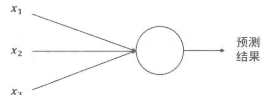
图 5-1 感知机模型示意图

数学表达：
$$

\sum_j w_j x_j = \begin{cases} 0, \sum_j w_j x_j - b_j \le 0 \\ 1, \sum_j w_j x_j + b_j > 0 \end{cases}

$$
$w_j$ 为权值，$b$ 为阈值。学习即优化 $w, b$ 使预测逼近真值。

痛点：感知机输出为阶跃函数，$w, b$ 微小扰动致输出 0/1 突变，梯度为 0 或不存在，无法用梯度下降优化。

Sigmoid 神经元 引入平滑激活函数 $\sigma(z) = 1/(1+e^{-z})$ 破解此困境。
考虑输入为 $x_1, x_2, \cdots$、权重为 $w_1, w_2, \cdots$、偏置为 $b$ 的 S 型神经元，此时的预测结果可以表示为
$$

\sigma(z) = \frac{1}{1 + e^{-z}}

$$
$$

\frac{1}{1 + \exp \left( - \sum_j w_j x_j - b \right)}

$$
这等价于 Logistic 回归形式。Sigmoid 将线性输出压缩至 (0,1)，零点处梯度最大（0.25），远离零点梯度衰减。设阈值 0.5 还原二分类判决。

#### 5.1.2 网络拓扑架构

标准前馈全连接网络结构如图：
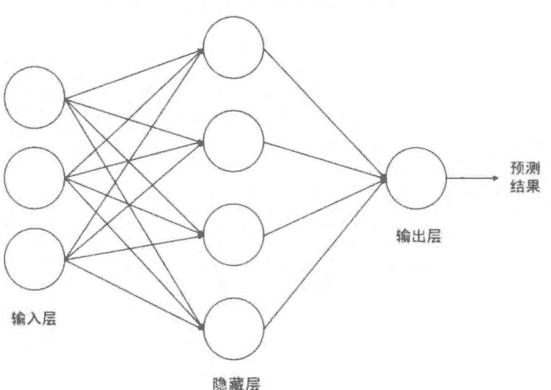
图 5-2 神经网络框架
- **入口层**：接收特征/时序数据。
- **中间层**：中间计算层，层数/宽度/连接模式决定模型表达力（“深度”名由来）。
- **出口层**：输出预测目标。

分层特征提取范例：面部识别任务中，浅层捕捉边缘/纹理（像素级），中层组合为眼/鼻/口，深层组合为人脸整体。层层抽象，由繁入简。

#### 5.1.3 训练核心概念

权值优化依赖 随机梯度下降 (SGD) 与 误差逆传播 (Backprop)。但深层网络训练面临两大挑战：
1.  **过拟合**：Hinton 提出 Dropout 随机失活神经元，迫使学习鲁棒特征。
2.  **梯度消失/爆炸**：预训练（逐层无监督初始化）缓解早期深层网络训练困境，为后续 ResNorm、ReLU 等现代技术铺路。

这些基石概念奠定了现代深度学习大厦的地基。

# 深度网络架构深度剖析

得益于海量神经网络技术涌现，深度学习得以驾驭极其复杂的网络拓扑。本质上，这些技术植根于随机梯度下降与反向传播两大基石，并融入创新概念以支撑更深层架构的训练。当前，多隐藏层网络已成主流，且在多数任务中深层模型超越浅层模型。其奥秘在于：深度网络能构建层级分明的复杂体系，宛如以模块化设计与抽象思维编写大型软件。

## 5.2 深度神经网络

本节聚焦深度神经网络（DNN），深度拆解其基础架构与运作机理。先梳理模型整体骨架，重点剖析激活函数、损失函数等核心模块；继而探讨训练核心算法——梯度下降、反向传播，并直击梯度消失、爆炸等训练顽疾；最后聚焦模型优化实战，涵盖训练提速、参数初始化、超参数调优及过拟合应对。掌握这些设计、训练与优化方法，将为后续探索神经网络在时间序列预测中的应用筑牢根基。

### 5.2.1 模型架构核心组件

神经网络架构中，激活函数与损失函数堪称双核驱动。前者将神经元输入转化为输出，引入非线性赋能网络捕捉复杂模式；后者量化预测偏差，指引权重偏置优化方向。精心搭配二者，可显著跃升网络学习效能。

#### 1. 激活函数：非线性引擎

- **Tanh 函数**

此前已见 Sigmoid。另一常用选择为 Tanh，定义如下：

$$

Tanh(z) \equiv \frac{e^z - e^{-z}}{e^z + e^{-z}}

$$

结合带权输入可表示为：

$$

Tanh(w \cdot x + b)

$$

其函数图像如下：

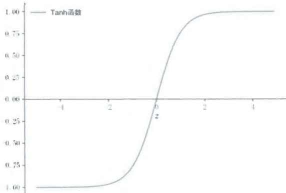

图 5-3 Tanh 函数图像

区别于 Sigmoid 仅输出正值，Tanh 覆盖负值区间。这使其在部分实验中更优：Sigmoid 易致权重同向更新，Tanh 则支持多向调整。但二者同患饱和症——输入极值时梯度趋零，引发神经元饱和导致梯度消失。ReLU 等新函数可破此局。

- **ReLU 函数**

ReLU 定义如下：

$$

max(0, w \cdot x + b)

$$

图像如下：

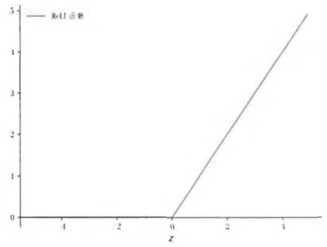

图 5-4 ReLU 函数图像

Sigmoid/Tanh 易饱和，ReLU 正向斜率恒为 1，有效缓解饱和。激活函数选择繁多（如 Leaky ReLU），常规用 Sigmoid 足矣，特殊场景再选其它。

#### 2. 损失函数：误差度量标尺

- **平方损失函数**

最基础的莫过于平方损失：

$$

C(w, b) \equiv \frac{1}{2N} \sum_x |y(x) - a|^2

$$

核心参数为 $w$、$b$，故记作 $C(w,b)$。销量预测中，它度量实销 $y(x)$ 与预测值 $a$ 的偏离。

- **交叉熵损失函数**

二分类 S 型神经元结构如下：

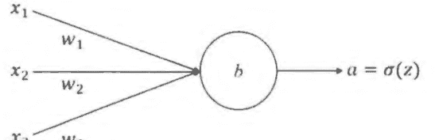

图 5-5 S 型神经元

其中 $z = \sum w_j x_j + b$，交叉熵定义为：

$$

C = -\frac{1}{N} \sum_x [y \ln a + (1-y) \ln(1-a)]

$$

$N$ 为样本总数，$y$ 为标签，$a$ 为激活输出。多分类推广至：

$$

C = -\frac{1}{N} \sum_x \sum_j [y_j \ln a_j^l + (1-y_j) \ln(1-a_j^l)]

$$

本质即输出层各类别神经元交叉熵求和。

- **对数似然函数**

引入对数似然前，先看其基石 Softmax：

$$

a_j^l = \frac{e^{z_j^l}}{\sum_k e^{z_k^l}}

$$

它将输出压缩至 (0,1) 且和为 1，形成概率分布。如补货预测：“需补货” 0.9，“无需” 0.1。其关键特性：一增必然他减，完美契合互斥分类。Softmax 广泛用于需概率输出的场景，配合对数似然损失：

$ C \equiv - \ln a_y^t $

补货预测中 $y\in\{0,1\}$，该式对激活值取负对数：预测准则激活值$\to1$，损失$\to0$；预测错则激活值$\to0$，损失指数级飙升，惩罚强力。

### 5.2.2 模型训练：核心流程与难点突围

本节详解训练关键概念与核心流程。训练本质是持续调参提升任务表现，供应链预测中即精准预判未来需求。重点覆盖：梯度下降（优化基石）、反向传播（高效计梯利器）、梯度消失与爆炸（深层训练拦路虎）。

#### 1. 梯度下降法：寻优路径

训练目标：寻最优 $w,b$ 使 $C(w,b)$ 最小。以平方损失为例：

$ C(w, b) \equiv \frac{1}{2N} \sum_x |y(x) - a|^2 $

梯度下降是主流求解路径。下面详述其原理、变体及实战应用。

- **基础优化逻辑**

设损失 $C$ 为 $v_1,v_2$ 二元函数。微变时用全微分近似：

$$\Delta C \approx \frac{\partial C}{\partial v_1} \Delta v_1 + \frac{\partial C}{\partial v_2} \Delta v_2$$

欲 $C$ 下降，需 $\Delta C<0$。引入梯度向量 $\nabla C$：

$$\nabla C \equiv \left( \frac{\partial C}{\partial v_1}, \frac{\partial C}{\partial v_2} \right)^T$$

损失变化重述为：

$$\Delta C \approx \nabla C \cdot \Delta v$$

$\nabla C$ 固定，关键在选 $\Delta v$。构造更新规则：

$$\Delta v = -\eta \nabla C$$

$\eta>0$ 为学习率。代入得：

$$\Delta C \approx -\eta \nabla C \cdot \nabla C = -\eta |\nabla C|^2$$

$\Delta C$ 必为负。参数更新规则：

$$v \rightarrow v' = v - \eta \nabla C$$

循环迭代即梯度下降。理论上不保证全局最优，易陷局部。最大痛点：计算量巨大。衍生变体如下：

- **随机梯度下降 (SGD)**

单样本梯度替代全量均值，大幅降算力，因无偏估计实战效果佳。

- **小批量梯度下降**

随机抽批量样本，用批均值替代全量均值：

$$

\frac{\sum_{j=1}^{M} \nabla C_{x_j}}{M} \approx \nabla C

$$

遍历全量完成一迭代。

- **进阶优化方案**

上述两法虽省算力但增方差，收敛震荡。学界提出 VRG、VR-SGD 等低方差加速法。另引入 **Momentum 动量法** 赋予参数惯性冲出局部最优：

$$

v \to v' = \mu v - \eta \nabla C \\

w \to w' = w + v'

$$

速度变量 $v$ 累积历史梯度，$\mu$ 控影响权重。集大成者 **Adam** 融合诸优势，成深度学习主流优化器。

#### 2. 反向传播算法：梯度计算快车道

梯度下降指明方向，海量参数梯度如何速算？深层网络直接求偏导算力爆炸。反向传播应运而生，让训练提速数数量级，成标配。数学本质为链式法则。以简易模型演示：

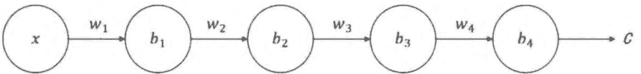

图 5-6 简易网络模型

传统法逐参数求导。反向传播妙在依赖链式传递：输出层梯度先算，倒数第二层依赖它，再往前依此类推，**从后向前逐层回溯**，一次性拿下全网梯度。

#### 3. 梯度消失与梯度爆炸：深层网络双子难题

梯度下降与反向传播推动发展，也暴露双子难题，严重制约深层训练稳定性。

- **梯度消失**：反向传播中梯度层层衰减，前层权重更新近乎停滞，深层网络尤甚，复杂预测模型失效。
- **梯度爆炸**：梯度指数级膨胀，权重更新过猛，模型震荡发散，引发过拟合或不收敛。

**消失根因**：链式法则下，前层梯度由多层 Sigmoid 导数与权重累乘得来。单神经元每层网络偏置梯度：

$$ \frac{\partial C}{\partial b_1} = \sigma'(z_1) \times w_2 \times \sigma'(z_2) \times w_3 \times \sigma'(z_3) \times w_4 \times \sigma'(z_4) \times \frac{\partial C}{\partial a_4} $$

权重初始化方差 1、均值 0，Sigmoid 导数上限 0.25，多层累乘致梯度指数级衰减至 0。反之初始权重过大则致爆炸。

**破局之道**：
1. **Hinton 预训练**：无监督逐层预训练，提供优质初始化，缓解消失。
2. **激活函数革新**：Glorot & Bengio (2010) 指出 Sigmoid 易致消失，推荐 ReLU 等。
3. **残差网络**：He Kaiming 等 (2015) 提出 ResNet，引入跳跃连接，梯度跨层直流，大幅缓解消失，性能跃升。

综上，预训练、选对激活函数、创新结构可有效驯服梯度难题。

### 5.2.3 模型优化：通往高性能的“最后一公里”

模型优化是训练成败关键，涵盖提速、初始化、调优、抗过拟合等。攻克这些，模型在供应链预测等领域才能释放最大威力。本节逐一拆解对策。

#### 1. 攻克训练缓慢

训练缓慢常因：偏差大时参数更新却迟缓，或损失函数对参数导数过小。巧搭损失函数与激活函数，可化解此困境。以下介绍几组黄金搭档：

- **平方损失 + 线性激活**

回顾平方损失：

$$

C(w, b) \equiv \frac{1}{2N} \sum_x |y(x) - a|^2

$$

线性激活即 $a^l = z^l$（$z^l$ 为加权和）。单样本 $x$ 误差：

$$

\delta^l = a^l - y

$$

权重偏置偏导：

$$

\frac{\partial C}{\partial w_{jk}^l} = \frac{1}{N} \sum_x a_k^{l-1}(a_j^l - y_j) \\

\frac{\partial C}{\partial b_j^l} = \frac{1}{N} \sum_x (a_j^l - y_j)

$$

此时导数值直接正比于“预测值与真实值之差”.**偏差越大，更新步长越大**，天然规避初期“差距大却学得慢”的尴尬。

- **交叉熵损失 + Sigmoid/Softmax**

回顾交叉熵损失。配合 Sigmoid 或 Softmax，可消除激活函数饱和区导数过小的副作用。当预测严重偏离时，损失函数梯度依然保持较大幅度，确保参数快速修正，显著加速收敛。

---

**核心启示**：损失函数与激活函数的“黄金搭档”直接决定学习动力机制。平方损失适配线性输出解决回归提速；交叉熵适配 S型/Softmax 破解分类饱和。实战中，根据任务性质选对组合，是训练提速的第一把钥匙。

# 深度学习实战：从损失函数到RNN的核心技巧全解析

在神经网络的训练过程中，损失函数与激活函数的搭配至关重要。以交叉熵损失为例，其公式表达为：

$$

当交叉熵损失函数和 Sigmoid 函数复合后，对权重和偏置求偏导：

$$

当 Sigmoid 激活函数与交叉熵损失结合时，权重 $w_j$ 与偏置 $b$ 的梯度推导结果分别为：

$$

由此便可以看出，模型输出值和实际预测值相差越大，偏导的数值越大，模型学习的速度越快。而对于 “平方损失函数+Sigmoid 函数” 而言，当预测值趋近于 1 时，学习速度会变慢，这是因为其偏导依赖 Sigmoid 函数的导数。然而，交叉熵函数不依赖该函数，因此成功地避免了这个问题的发生。

### 3）对数似然函数

交叉熵损失函数在很多情况下都可以解决大规模预测数据集下学习速度缓慢的问题，而 Softmax 是另一种解决方法。回顾它的定义如下：

$$

若切换到 Softmax 激活函数搭配对数似然损失，输出层激活值 $a_j^L$ 与损失函数 $C$ 定义如下：

$$

Softmax 的技术目前还不能直接看出是怎么解决大规模预测数据集学习缓慢的问题的，因为它还要搭配对数似然函数才能凸显这一点，回顾对数似然函数的定义：

$$a_j^L = \frac{e^{z_j^L}}{\sum_k e^{z_k^L}}$$

分析它们对学习速度的影响，只需求偏导：

$$C \equiv -\ln a_y^L$$  

$$\frac{\partial C}{\partial b_j^L} = a_j^L - y_j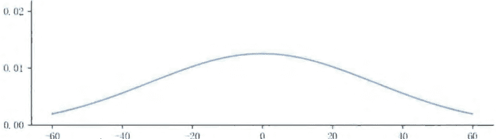\frac{\partial C}{\partial w_{jk}^L} = a_k^{L-1}(a_j^L - y_j)$$

观察上述求导结果不难发现，参数更新的幅度直接取决于预测值与真实值的偏差大小。这一机制从根本上解释了为何交叉熵能有效缓解梯度消失、加速收敛。其实，能实现“误差越大、修正越快”这一特性的函数组合不止一种。工程实践中，Softmax 配合对数损失适合需输出概率分布的场景（如补货需求预测），而 Sigmoid 加交叉熵则足以应对绝大多数二分类或多标签任务。

## 2. 参数初始化：别让“饱和”拖慢训练

搭建好网络架构后，权重与偏置的初始化是启动训练的第一步。经典做法是采用标准正态分布（均值0，方差1）随机赋值，效果虽可用，但并非最优。

想象一个拥有 1000 个输入连接的神经元，加上偏置共 1001 个独立同分布的标准正态随机变量。根据概率论知识，其加权求和 $z$ 的标准差约为 $\sqrt{1001} \approx 31.6$，分布极其扁平。这意味着 $|z|$ 很容易取到很大值，导致激活函数（如 Sigmoid 或 Tanh）直接进入饱和区，梯度趋近于零，训练陷入停滞。

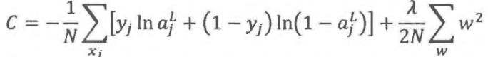

图 5-7 扁平的正态分布示意图

早期虽有针对输出层饱和的对策，但隐藏层依然深受其扰。破解之道在于调整初始化分布：对于拥有 $n_{in}$ 个输入的神经元，采用均值为 0、方差为 $1/n_{in}$ 的分布（即 Xavier 初始化的雏形）。如此，$z$ 的分布会变得尖锐集中于 0 附近，大幅降低饱和风险。实战证明，此法对最终精度影响微乎其微，却能显著提升训练速度。

## 3. 超参数调优：少走弯路的实战策略

超参数空间巨大且相互耦合，微小变动可能导致结果天差地别。以下几条启发式原则助你高效“炼丹”。

### 1) 宽泛策略：从简入繁，快速试错
不要上来就跑全量任务、调全量参数。以销量预测为例，先取平稳序列、仅调学习率步长；跑通后再扩展任务、引入新参数。每步仅调一两个关键项，配合 Hold-Out 法（留出验证集）快速评估。
核心在于**“快速反馈”**。看似笨拙的小步快跑，实则能让你在早期迅速定位高价值区域，避免在错误方向上深度搜索。

### 2) 提前停止：防过拟合的“自动刹车”
每个 Epoch 结束校验准确率，一旦连续数轮无提升即终止。这省去了手动寻找最佳迭代次数的痛苦，天然抑制过拟合。
**关键技巧**：设置“缓冲期”（如前 50 Epoch 不判停）。准确率曲线早期常波动，过早停车易错过后续反弹的最优解。

### 3) 学习率衰减：大步快跑，小步精调
固定学习率难两全：初期参数随机，需大步长跳出劣质局部最优；后期逼近最优解，需小步长精细收敛。
推荐**衰减策略**：起步设大值（如 0.1），随训练指数或分段衰减至最小值（如 1e-5）后保持。

### 4) Mini-batch 大小：在加速与频度间权衡
Batch Size 相对独立，可单独网格搜索。太小（如 1）无法利用矩阵并行加速；太大（如全量）更新频率低、泛化差。通常 32~256 为甜蜜区。
此外，Hyperopt、Optuna 等贝叶斯优化工具已成熟，建议接入自动调参流程，解放人力。

## 4. 过拟合：大模型的“心魔”怎么破？

参数量达百万、十亿量级的深度网络，极易“背诵”训练数据而失去泛化力。历史销量拟合完美，未来预测却惨不忍睹，这是典型过拟合。对抗手段主要有四类：Hold-Out 监控、正则化约束、Dropout 扰动、数据扩增。

### 1) Hold-Out 方法：最朴素的体检
划分 80% 训练 / 20% 验证。监控验证集指标，一旦训练集指标继续涨而验证集掉头，立即停止。简单直接，工业界标配。

### 2) 规范化技术：给复杂模型加“紧箍咒”
核心思想：在损失函数中加入参数规模惩罚项。

**L2 正则化（权重衰减）**
交叉熵加 L2 项：

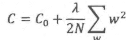

$\lambda$ 控制惩罚力度。梯度下降更新规则变为：

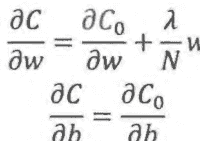

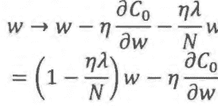

权重前多乘因子 $(1 - \eta\lambda/n)$，使 $w$ 持续收缩。但不会衰减至零，因梯度主项仍会拉升有效权重。
**额外收获**：正则化不仅防过拟合，还能增强模型鲁棒性。无正则时权重膨胀，梯度下降在平坦区难有效探索；加正则后权重保持小数值，输入微扰不致引发输出剧变，抗噪能力更强。这符合“奥卡姆剃刀”原则——简单模型更可信。

**L1 正则化（稀促性）**
惩罚项为权重绝对值和：

```
\( C = C_0 + \frac{\lambda}{N} \sum_w |w| \)
```

梯度更新含 $\text{sgn}(w)$ 项：

```
\( \frac{\partial C}{\partial w} = \frac{\partial C_0}{\partial w} + \frac{\lambda}{N} \text{sgn}(w) \)
```

```
\( w \to w' = w - \frac{\eta \lambda}{N} \text{sgn}(w) - \eta \frac{\partial C_0}{\partial w} \)
```

特性差异：大权重下 L2 压缩更猛，小权重下 L1 收缩更快（易产生稀疏解）。注意 $x=0$ 处不可导，工程上约定导数为 0。

### 3) Dropout 技术：训练时“随机阉割”，推理时“集成投票”
不同于修改损失函数，Dropout 直接动结构。前向传播时，保留输入输出层，**随机丢弃 50% 隐藏层神经元**（连同连接），仅更新存活子网参数。迭代重复，相当于训练了指数级子网络并取平均。

**为何有效？**
*   **集成视角**：单模型过拟合被平均抹平。
*   **共适应破坏**：神经元不再过度依赖特定前驱，被迫学习鲁棒特征。
*   **工程价值**：在大规模深层网络中效果尤为显著，是 ResNet、Transformer 等巨型模型的标配组件。

### 4) 人工扩展训练集：以假乱真也能练真功
数据不够，合成来凑。MNIST 做旋转、平移、弹性变形；语音识别加背景噪、变调变速；NLP 做回译、同义词替换。核心原则：**变换必须保留标签语义，且贴近真实分布**。这能显著拓宽决策边界，提升泛化上限。

## 5.3 循环神经网络：序列建模的利器

前馈网络（DNN）是“一次性买卖”，输入输出无反馈。而现实中大量数据具有时间序列特性（长度不定、前后强依赖），**循环神经网络（RNN）** 应运而生。

### 5.3.1 RNN 基础架构与 BPTT

RNN 引入隐藏状态 $h_t$ 作为“记忆载体”，当前状态由当前输入 $x_t$ 与上一状态 $h_{t-1}$ 共同决定。参数 $U, W, V$ 在所有时刻**共享**，体现了“循环”本质。


图 5-8 RNN 结构

前向计算流程：
$$h_t = \sigma(U x_t + W h_{t-1} + b) \quad (\sigma \text{ 通常取 Tanh})$$
$$o_t = V h_t + C$$
$$\hat{y}_t = \text{Softmax}(o_t)$$
总损失 $L = \sum_{t=1}^T L_t$（$L_t$ 为交叉熵）。

反向传播需展开时间维（BPTT）。输出层参数梯度直观：
$$\frac{\partial L}{\partial C} = \sum_{t=1}^T (\hat{y}_t - y_t)$$
$$\frac{\partial L}{\partial V} = \sum_{t=1}^T (\hat{y}_t - y_t) h_t^T$$

隐藏层梯度 $\delta_t = \frac{\partial L}{\partial h_t}$ 存在跨时刻递推：
$$\delta_t = V^T(\hat{y}_t - y_t) + W^T \text{diag}(1 - h_{t+1}^2) \delta_{t+1}$$
进而：
$$\frac{\partial L}{\partial W} = \sum_{t=1}^T \text{diag}(1 - h_t^2) \delta_t h_{t-1}^T$$
$$\frac{\partial L}{\partial b} = \sum_{t=1}^T \text{diag}(1 - h_t^2) \delta_t$$

**致命弱点**：长序列下 $\delta_t$ 反向传递需连乘 $W^T$ 与导数项（$<1$），极易**指数级衰减至零（梯度消失）**，或爆炸。导致模型无法捕捉长距离依赖。

### LSTM：门控机制破解长程记忆

为解决梯度消失，**长短期记忆网络（LSTM）** 引入三大门控单元，形状与隐藏层同维，功能分工明确：
*   **遗忘门**：决定丢弃哪些旧记忆。
*   **输入门**：决定写入哪些新信息。
*   **输出门**：决定输出哪些记忆内容。


图 5-9 LSTM 的遗忘门、输入门、输出门

时刻 $t$ 的门控计算逻辑如下：

```
F_t = σ(x_tW_xf + h_{t-1}W_hf + b_f)
I_t = σ(x_tW_xi + h_{t-1}W_hi + b_i)
O_t = σ(x_tW_xo + h_{t-1}W_ho + b_o)
```

通过精细的门控流，LSTM 让梯度在细胞状态 $C_t$ 中近乎恒等传递，彻底缓解了长程依赖建模难题，成为序列建模的里程碑架构。

# 深度解析：从门控循环到Theta分解，时间序列进阶建模全景指南

在时间序列预测的进阶赛道上，深度学习架构与高阶统计模型各展所长。前者依托门控机制破解长程依赖，后者通过巧妙分解提炼趋势与波动。本文将系统梳理 LSTM、GRU、CNN 及主流扩展架构的核心逻辑，并深度拆解 Theta 与 TBATS 两大统计进阶利器的实战精髓。

---

## 一、 门控机制的双子星：LST 与 GRU

### 1. LSTM：精细化的“记忆管理器”
长短期记忆网络（LSTM）通过三大门控单元，实现了对信息流的精准把控。

*   **三门协同**：遗忘门（$F_t$）、输入门（$I_t$）、输出门（$O_t$）分别由各自的权重矩阵（$W_{xf}, W_{xi}, W_{xo}, W_{hf}, W_{hi}, W_{ho}$）与偏置项（$b_f, b_i, b_o$）参数化，动态决定“丢弃什么、记住什么、输出什么”。
*   **候选单元（$\tilde{C}_t$）**：作为新信息的“预处理车间”，它融合当前输入 $x_t$ 与历史隐藏状态 $h_{t-1}$，生成高维投影向量，待输入门筛选后写入细胞状态。
*   **状态更新与输出**：
    ```
C̃_t = σ(x_tW_xc + h_{t-1}W_hc + b_c)
```
    细胞状态 $C_t$ 通过遗忘门保留旧记忆，经输入门融合新候选值：
    ```
C_t = F_t ⊙ C_{t-1} + I_t ⊙ C̃_t
```
    最终隐藏状态 $h_t$ 经输出门与 $\tanh$ 激活的细胞状态按元素相乘得出：
    
    其中 $\tanh$ 将输出压缩至 $(-1, 1)$，数值越接近 1 代表信息传递越充分，趋近 0 则倾向于冻结状态。
*   **全貌与评价**：
    
    LSTM 以此缓解梯度消散，捕捉长距离依赖，属典型的“带状态控制的隐变量自回归模型”。虽衍生出多层、残差、正则化等诸多变体，但训练开销大、需长序列、短序列易过拟合仍是短板。

### 2. GRU：轻量化的“极简主义者”
门控循环单元（GRU）由 Cho 等人 2014 年提出，以双门结构实现 LSTM 级效能。

*   **双门设计**：**重置门（$R_t$）** 控制历史保留比例，**更新门（$Z_t$）** 调节状态更新幅度。
    ```
$R_t = \sigma(X_t W_{xr} + h_{t-1} W_{hr} + b_r)$
$Z_t = \sigma(X_t W_{xz} + h_{t-1} W_{hz} + b_z)$
```
*   **候选隐状态（$\tilde{H}_t$）**：重置门直接作用于历史隐状态，若 $R_t \approx 1$ 退化为基础 RNN；若 $R_t \approx 0$ 则仅依赖当前输入 $x_t$（相当于单层 MLP）。
    ```
$\tilde{H}_t = \text{Tanh}(x_t W_{xz} + W_{hh} R_t \odot H_{t-1} + b_h)$
```
    
*   **状态融合**：更新门平衡旧状态与候选状态：
    ```
h_t = Z_t \odot h_{t-1} + (1 - Z_t) \odot \vec{H_t}
```
    $Z_t \to 1$ 时锁死旧信息（跳过当前步），$Z_t \to 0$ 时全盘接受新候选（缓解梯度消失）。
*   **架构图谱**：
    
    **结论**：GRU 参数更少、并行效率更高，是资源受限或追求推理速度场景的首选替代。

---

## 二、 卷积与注意力：CNN 及新生代架构

### 1. CNN：滑动窗口下的“自动特征工程”
卷积神经网络引入卷积层与池化层，赋予网络平移不变性与强特征提取力。

*   **核心操作**：卷积核 $w(t)$ 扫描序列 $x(t)$ 生成特征图 $s(t)$；池化层取窗口极值增强鲁棒性。
    ```
s(t) = (x * w)(t) = \sum_{a=0}^{T} x(a)w(t - a)
```
*   **直观理解**：以窗口 3 为例，卷积本质是**加权滑动平均**。若卷积核权重均为 $1/3$，等价于 `pandas` 中 `rolling(3).mean()`。差别在于：卷积核参数可经反向传播**自动学习**，实现“动态窗口特征生成”，远超人工特征工程的固定逻辑。

### 2. 明星扩展模型速览
针对长序列依赖与动态变化，学术界涌现三大代表作：

| 模型 | 核心创新 | 优势 | 劣势 |
| :--- | :--- | :--- | :--- |
| **WaveNet** | 因果卷积 + 膨胀卷积 | 解决 RNN 梯度消失，感受野指数级扩大，建模极强 | 训练计算量巨大，推理慢（自回归生成） |
| **Transformer** | 自注意力机制 + 残差归一化 | **全并行训练**，捕捉超长依赖，无循环瓶颈 | 位置编码引入复杂度，小数据易过拟合 |
| **N-BEATS** | 反向残差栈 + 全连接/逆卷积 | 纯前馈架构，**纯并行训练推理**，可解释性强（趋势/季节分解） | 对极长序列建模能力弱于注意力机制 |

> 详细架构细节与实战调参，将在第 7 章深度展开。

---

## 三、 进阶统计建模：跳出线性桎梏

经典方法（指数平滑、ARIMA 等）虽通用，却面临**建模能力不足（欠拟合）**与**适用边界受限**的双重困境。高阶统计模型由此诞生：在单变量框架下，通过模块组合、预后处理，大幅拓展边界、提升精度。

本章聚焦四大代表模型，先睹为快：**Theta 与 TBATS**。

---

## 四、 Theta 模型：用“放大镜”分离趋势与波动

Theta 模型的核心隐喻是**“可调曲率的放大镜”**——通过调节二阶差分系数 $\theta$，将去季节序列解耦为长期趋势线与短期波动线，分模建模再融合。

### 1. Theta 分解机制
```
\(X''_{\text{Theta}}(\theta) = \theta \cdot X''_{\text{data}}\)

在\(t\)时刻，\(X''_{\text{data}} = (X_t - X_{t-1}) - (X_{t-1} - X_{t-2})\)
\(= X_t - 2X_{t-1} + X_{t-2}\)
```
*   **Theta 系数（$\theta$）**：直接缩放二阶差分 $X''_{data}$。
    *   $\theta < 1$：压平曲率 $\to$ **长期趋势线**（$\theta=0$ 时退化为线性回归直线）。
    *   $\theta > 1$：放大曲率 $\to$ **短期波动线**。
    *   $\theta < 0$ 无预测意义，略。
*   **Theta 线性质**：
     
    所有 $\theta$ 线均值一致、最小二乘拟合斜率一致，保证分解的数学自洽性。

### 2. 经典双线分解与预测流程（$\theta=0$ 与 $\theta=2$）
原序列 $X = \frac{1}{2}[L(0) + L(2)]$，两线关于 $\theta=1$ 对称。

| 组件 | $\theta$ 值 | 物理含义 | 预测方法 | 理由 |
| :--- | :--- | :--- | :--- | :--- |
| **长期线** | 0 | 线性趋势 | **最小二乘线性回归** | 线性结构稳定，参数估计高效 |
| **短期线** | 2 | 放大近期波动 | **简单指数平滑 (SES)** | 指数衰减权重天然匹配“近期放大”特性 |

**完整 6 步建模流水线**：
1.  **季节性检验**：构造 $t = \frac{n \cdot ACF(s)^2}{\sum_{h=0}^{s-1} ACF(h)}$ 做 $t$ 检验。
2.  **去季节化**：STL 乘法分解 $\to$ 原序列除以季节项。
3.  **Theta 分解**：$\theta=0, 2$ 得两线。
4.  **分模预测**：长期线 $\to$ 线性回归；短期线 $\to$ SES。
5.  **等权组合**：两预测值平均。
6.  **复季节化**：乘回步骤 2 得到的季节因子。

### 3. 进阶变体与实战表现
*   **预测引擎升级**：引入 ARIMA + MLE 替代 SES，强化短期建模。
*   **系数搜索**：$\theta$ 不再固定 0/2，多系数集成提升鲁棒性。
*   **适用甜点**：**高波动序列**表现优异（分解机制天然适配波动放大）；**无超参、低算力、快速出结果**，是 Baseline 竞品中的“性价比之王”。

---

## 五、 TBATS 模型：攻克复杂季节性的“特种兵”

传统模型仅擅整数短周期（如 7、12），实战中常遭遇两大“硬骨头”：
1.  **非整数周期**：如石油消费呈现 365.25 天周期。
2.  **多周期叠加**：如农历新年（移动节日）与公历周/年周期耦合。

TBATS（Trigonometric, Box-Cox, ARMA, Trend, Seasonal）正是为破解此类**复杂季节性**而生，结合三角函数季节表达、Box-Cox 变换、ARMA 残差建模与趋势平滑，构建统一框架。具体数理推导与代码实战，将在 6.2 节详细拆解。

---

## 结语：模型选型的“罗盘”

| 场景特征 | 首选方向 | 备选/组合 |
| :--- | :--- | :--- |
| **长序列、复杂非线性、算力充足** | Transformer / N-BEATS | LSTM/GRU (加注意力) |
| **中短序列、需极快推理、工程落地** | GRU / N-BEATS | Theta (Baseline) |
| **单变量、强季节/趋势、可解释性优先** | Theta / TBATS / ETS | STL + ARIMA |
| **极长序列、音频/信号类** | WaveNet / TCN | Dilated RNN |

下一章，我们将深入 **第 7 章 深度学习模型**，实战代码复现上述架构；随后 **第 6 章继续推进 TBATS 及其余两大高阶统计模型**。敬请期待！

# 深度解析：TBATS、Bootstrap Bagging 与 Prophet 预测框架

### 6.2.1 Box-Cox 变换：破解非正态困局

经典时序模型往往苛求数据服从正态分布、误差独立同分布，但实际业务数据鲜能如愿。Box-Cox 变换正是为此而生的“通用钥匙”，它通过广义幂函数将非正态数据“拉”回正态轨道，同时赋予模型非线性表达能力，打破线性框架的束缚。

变换公式如下：

```
$$y_t^{(\omega)} = \begin{cases} \frac{y_t^\omega - 1}{\omega}, & \omega \neq 0 \\ \log y_t, & \omega = 0 \end{cases}$$
```

式中 $y_t$ 为原始观测值，$\omega$ 为通过极大似然估计确定的最优参数。注意：变换要求序列严格为正，供应链场景通常天然满足；若含零值，仅需整体平移加常数即可。建模预测完成后，别忘了施加**逆变换**，将结果映射回原始量纲空间。

### 6.2.2 ARMA 误差建模：捕捉残差里的“隐藏信息”

ETS 等指数平滑族模型默认残差 $\{d_t\}$ 互不相关（白噪声），但大量实证研究发现，Holt-Winters 等方法的残差往往呈现一阶自回归特征。TBATS 敏锐地捕捉到这一点，在状态转移方程中显式引入 ARMA 结构建模残差序列。

由于趋势、季节成分已在别处显式建模，残差序列可视为平稳过程，故无需 ARIMA 中的差分环节，直接上 ARMA($p, q$)：

```
$$d_t = \sum_{i=1}^p \phi_i d_{t-i} + \sum_{i=1}^q \theta_i \epsilon_{t-i} + \epsilon_t$$
```

此举将原本相关的残差 $\{d_t\}$ 彻底“拆解”为高斯白噪声 $\epsilon_t$（均值 0、方差 $\sigma^2$），确保模型假设落地。

### 6.2.3 BATS 模型：集大成的状态空间雏形

融合 Box-Cox 变换、ARMA 残差建模、趋势与季节项后，我们在 ETS 骨架上构建出升级版状态空间模型——**BATS**。其核心方程组如下：

$ y_t^{(\omega)} = \begin{cases} \frac{y_t^\omega - 1}{\omega} , & \omega \neq 0 \\ \log y_t , & \omega = 0 \end{cases} $

$ y_t^{(\omega)} = l_{t-1} + \phi b_{t-1} + \sum_{i=1}^T s_{t-m_i}^{(i)} + d_t $

$ l_t = l_{t-1} + \phi b_{t-1} + \alpha d_t $

$ b_t = (1 - \phi)b + \phi b_{t-1} + \beta d_t $

$ s_t^{(i)} = s_{t-m_i}^{(i)} + \gamma_i d_t $

$ d_t = \sum_{i=1}^p \varphi_i d_{t-i} + \sum_{i=1}^q \theta_i \epsilon_{t-i} + \epsilon_t $

**关键参数解读：**
- $m_i$：第 $i$ 个季节周期长度；$l_t, b_t, s_t$ 分别为水平、趋势、季节分量。
- $\phi$：阻尼参数，控制趋势衰减速度，$b_t$ 将收敛至长期趋势 $b$。
- $d_t$ 为 ARMA 过程，$\epsilon_t$ 为高斯白噪声。
- 模型全量参数向量：$(\omega, \phi, p, q, m_1, \cdots, m_T)$。例：BATS$(1, 1, 0, 0, m_1)$ 退化为单季节 Holt-Winters 加法模型。

**BATS 的得与失：** 兼容多季节、引入非线性与残差自相关，显著拓展了线性模型边界。但短板亦存：对**非整数周期**无解，且多重季节叠加时参数量爆炸，计算开销巨大。

### 6.2.4 TBATS 模型：傅里叶级数重塑季节性建模

TBATS 核心突破在于**季节性建模范式的重构**，直击 BATS “非整数周期难处理、多季节参数爆炸”两大痛点，实现“灵活性”与“计算简洁”的双赢。

传统/BATS 通过累加季节因子、差分更新估计，天然依赖整数周长。TBATS 另辟蹊径：借助**傅里叶级数**逼近任意周期函数。第 $i$ 个季节项拆解为 $k_i$ 个简谐分量之和：

$ s_t^{(i)} = \sum_{j=1}^{k_i} s_{j,t}^{(i)} $

每个简谐分量由两个递推方程驱动（含平滑参数 $\gamma_1^{(i)}, \gamma_2^{(i)}$ 与角频率 $\lambda_j^{(i)} = 2\pi j / m_i$）：

$ s_{j,t}^{(i)} = s_{j,t-1}^{(i)} \cos \lambda_j^{(i)} + s_{j,t-1}^{*(i)} \sin \lambda_j^{(i)} + \gamma_1^{(i)} d_t $

$ s_{j,t}^{*(i)} = -s_{j,t-1}^{(i)} \sin \lambda_j^{(i)} + s_{j,t-1}^{*(i)} \cos \lambda_j^{(i)} + \gamma_2^{(i)} d_t $

- $s_{j,t}^{(i)}$：季节水平项；$s_{j,t}^{*(i)}$：季节增长/相位项。
- 阶数 $k_i$ 越高拟合越精细，但警惕过拟合；初始值共需 $2\sum k_i$ 个。
- 模型标识升级为：$(\omega, \phi, p, q, \{m_1, k_1\}, \cdots, \{m_T, k_T\})$。

**TBATS 五大进化论：**
1.  **参数空间更广** → 预测上限更高。
2.  **原生支持嵌套/非嵌套多重季节** → 如“日内+周内+年内”复杂叠加。
3.  **Box-Cox 注入非线性** → 打破线性假设枷锁。
4.  **ARMA 显式建模残差自相关** → 捕捉更多信号。
5.  **傅里叶参数化季节** → 参数量随阶数 $k_i$ 线性增长，而非随周长 $m_i$ 爆炸，**高效支持非整数周期**。

**实战提示：** TBATS 虽强，但模型复杂、ARMA 参数搜索耗时、且存在过拟合风险，适合“复杂季节+非线性+样本量尚可”场景；简单场景下 ETS/ARIMA 可能更具性价比。

---

### 6.3 Bootstrap 与 Bagging：用“重抽样”炼就稳健预测器

统计学习中，单模型易陷入“高方差”陷阱。Bootstrap（自助法）通过重抽样扩充训练集，Bagging（Bootstrap Aggregating）再将多模型预测聚合，**以集成换稳健**，是提升单变量预测鲁棒性的经典范式。

#### 6.3.1 时间序列的四大 Bootstrap 变体

常规 Bootstrap 假定样本 i.i.d.，时序数据强相关性下直接用会破坏依赖结构。改良思路核心：**保留局部相关性、要求原序列平稳**。

| 方法 | 核心机制 | 关键特征 | 适用场景 |
| :--- | :--- | :--- | :--- |
| **MBB** (Moving Block Bootstrap) | 定长 $l$ 滑动窗口，有放回抽取 $(n-l+1)$ 个重叠块拼接 | 块间 i.i.d.；保留块内相关；**边缘点采样概率低** | 通用基准，最广泛使用 |
| **NBB** (Non-overlapping Block Bootstrap) | 将序列切分为**不重叠**的连续块抽样 | 消除块间重叠；保留 MBB 大部分性质 | 需避免样本点重复时 |
| **CBB** (Circular Block Bootstrap) | 首尾相连成环，在环上滑动抽取 $n$ 个长度 $l$ 的块 | **每个点采样概率均等**；彻底解决边缘效应 | 短序列、需充分利用边缘信息 |
| **AR-Sieve Bootstrap** | **模型驱动**：拟合 AR($p$) → 取残差经验分布 $F_{\hat{\epsilon}}$ → 递归生成新序列 | 无需选块长 $l$；理论性质优；依赖 AR 模型拟合优度 | 序列近似 AR 过程、平稳性好 |

**技术细节速览：**

- **MBB/NBB/CBB** 均为**基于块**的非参数法，   展示了三者采样几何差异。
- **AR-Sieve** 为参数法：拟合 $X_t - \mu = \sum \phi_i (X_{t-i}-\mu) + \epsilon_t$，得残差经验分布 $$X_t - \mu = \sum_{i=1}^p \phi_i(X_{t-i} - \mu) + \epsilon_t$$ $$F_{\hat{\epsilon}_t}(x) = \frac{1}{n - \hat{p}} \sum_{t=\hat{p}+1}^n I[\hat{\epsilon}_t - \overline{\hat{\epsilon}}_t \leqslant x]$$，再结合 AR 结构递归生成 $X_t^*$。优势在于自动捕捉相关结构，无需手工定块长。

#### 6.3.2 基于 STL 分解的 Bagging 预测全流程（经典范式）

该方法“分解→重抽样残差→重组→建模→聚合”，工程落地性极强，步骤如下：

1.  **Box-Cox 变换**：最优 $\omega$ 稳定方差、修正非线性。
2.  **时序分解**：
    - 无季节 → Loess 回归分解趋势 $T$ + 残差 $R$。
    - 强季节 → **STL 分解**得趋势 $T$、季节 $S$、残差 $R$（加法模型）。
3.  **残差重抽样 (Bootstrap)**：对 $R$ 用 MBB 或 AR-Sieve 生成 $b$ 组等长新残差 $R_i^*$。
4.  **样本重组**：$Y_i^* = T + S + R_i^*$（$T, S$ 固定，$R$ 扰动），构成 $b$ 个新训练序列。
5.  **逆 Box-Cox 变换**：将 $Y_i^*$ 映射回原空间得 $\bar{Y}_i$。
6.  **基学习器建模预测**：每个 $\bar{Y}_i$ 分别跑 ETS 或 ARIMA，得预测 $\hat{Y}_i$。
7.  **等权聚合 (Bagging)**：$\hat{Y} = \frac{1}{b}\sum_{i=1}^b \hat{Y}_i$，输出最终预测。

**精髓：** 仅对“最不可预测”的残差注入随机性，趋势季节确定性成分保留，兼顾**多样性**与**保真度**。

---

### 6.4 Prophet 模型：Meta 打造的“开箱即用”工业级预测器

2017 年 Meta (原 Facebook) 开源，**定位：业务分析师友好、自动化程度极高、工程落地极快**的单变量预测框架。

**三大差异化杀手锏：**
1.  **异常值/缺失值原生免疫**：基于分段线性/逻辑斯谛增长曲线 + 变点检测，粗糙数据无需繁琐清洗即可建模。
2.  **节假日/事件显式建模**：区别于纯单变量模型，支持引入外生变量（节假日、促销、体育赛事等），捕捉业务驱动因素。
3.  **可加性分解框架**：$y(t) = g(t) + s(t) + h(t) + \epsilon_t$
    - $g(t)$：趋势（分段线性/饱和增长，自动/手动设变点）。
    - $s(t)$：季节（傅里叶级数拟合，支持多周期、可随趋势变化）。
    - $h(t)$：假日/事件效应（独热编码建模，可设先验窗口）。
    - $\epsilon_t$：误差项。

**工程优势：** Python/R 双语言支持、超参自动调优（如变点灵敏度、季节阶数）、解释性强（分量可视化）、并行计算快。虽非竞赛榜单 SOTA，但**在“脏数据、强业务节奏、需快速迭代”的工业界场景，往往是性价比之选**。

---
**结语：**
从 TBATS 的“数学重装上阵”解决复杂季节，到 Bootstrap Bagging 的“集成思想”炼就稳健预测，再到 Prophet 的“工程化思维”降低落地门槛——**没有银弹，只有更贴合场景的工具箱**。实战中建议：复杂多季节首选 TBATS，追求鲁棒性上 Bagging，脏数据/强业务驱动/快速交付直奔 Prophet。

# 供应链预测利器：Prophet 核心机制与深度学习架构全景解析

在供应链需求预估场景下，Prophet 凭借对多维度拆解的精准把控、对大促假期等异常干扰的灵活建模，以及非线性机制的融入，确立了核心地位。该框架融合多维参数完成信息编码，使用者可凭借对数据的直觉直接下发参数，亦可通过调优榨干性能。针对多信息融合引发的算力压力，底层在参数估计与推断环节做了深度加速，显著提升拟合效率。

宏观来看，Prophet 采用加法分解范式，将序列拆为趋势、周期、事件三大驱动项叠加噪声：
\(y(t) = g(t) + s(t) + h(t) + \varepsilon_t\)
其中 \(g(t)\) 负责非周期性长期走势；\(s(t)\) 刻画周期性震荡；\(h(t)\) 量化节假日等特殊日子引发的、可能跨数天的非规则冲击；\(\varepsilon_t\) 为高斯白噪。

### 6.4.1 趋势项：从刚性直线到弹性饱和曲线

Prophet 在趋势拟合上实现关键突破，引入非线性机制打破传统桎梏，提供**线性**与**逻辑饱和**两大增长范式。

**1. 线性增长：分段拐点的动态自适应**
基础形式 \(g(t) = kt + m\) 假设斜率 \(k\) 与截距 \(m\) 恒定，实则业务增长率与基准常随时间漂移。Prophet 引入**拐点集合 \(S\)** 显性建模结构性断裂。
*   定义增长率调整向量 \(\delta\)，任意时刻 \(t\) 的实时增长率为基础值 \(k\) 累加过往所有拐点的调整量：\(k(t) = k + \sum_{j:t>s_j} \delta_j\)。
*   以指示向量 \(a(t)\) 标记拐点生效，配合对截距 \(m\) 的同步修正 \(\gamma\)（为保连续性，设 \(\gamma_j = -s_j \delta_j\)），构得**分段线性趋势函数**：
    \(g(t) = (k + a(t)^T \delta)t + (m + a(t)^T \gamma)\)
此机制赋予模型“随时切换走势”的柔韧度。

**2. 逻辑增长：拥抱业务天花板的 S 型轨迹**
现实中诸多指标（如汽车备件需求受保有量封顶）呈现饱和特性。基础 Logistic 为 \(g(t) = \frac{C}{1 + \exp(-k(t - m))}\)，\(C\) 为承载上限。
Prophet 进一步将上限 \(C\) 与增长率 \(k\) **时变化**：
*   容量上限 \(C(t)\) 随时间演进；
*   增长率引入拐点调整，同步修正平移量 \(m\)。
最终形成**时变逻辑增长模型**：
\(g(t) = \frac{C(t)}{1 + \exp(-(k + a(t)^T\delta)(t - (m + a(t)^T\gamma)))}\)
使模型精准贴合“高速增-逐步缓-触顶平”的完整生命周期。


### 6.4.2 季节项：傅里叶谱系解码多周期耦合

面对日、周、年多重周期耦合的复杂局面，Prophet 引入傅里叶级数构建周期基函数。给定周期长度 \(P\)，季节项展开为 \(N\) 阶谐波叠加：
\(s(t) = \sum_{n=1}^{N} (a_n \cos \frac{2\pi nt}{P} + b_n \sin \frac{2\pi nt}{P})\)
引入设计矩阵 \(X(t)\) 与参数向量 \(\beta = [a_1, b_1, \dots, a_N, b_N]^T\)，季节性表达简化为 \(s(t) = X(t)\beta\)。为控复杂度，\(\beta\) 设零均值高斯先验 \(\text{Normal}(0, \sigma^2)\)，超参 \(\sigma\) 直接调控周期强弱。**实战提醒**：\(N\) 切忌过大，极易陷入过拟合泥沼。

### 6.4.3 事件项：先验知识的显性注入

常规趋势周期无法解释“双十一”、“春节”等强冲击。Prophet 将各节假日视为相互独立的效应模块，要求使用者预先划定**影响窗口**（节前/节后天数）。
*   事件 \(i\) 的影响日期集记为 \(D_i\)，构建指示矩阵 \(Z(t)\)。
*   事件效应系数 \(\kappa\) 服从先验 \(\text{Normal}(0, v^2)\)，模型估计 \(h(t) = Z(t)\kappa\)。
**核心要点**：同名节假日（如连续多年“国庆”）共享参数估计，通过汇总历史同类经验，实现对未来冲击的鲁棒预判。

### 6.4.4 训练机制：贝叶斯框架下的自动化与不确定性量化

**1. 拐点自动筛选：拉普拉斯先验的稀疏魔法**
不预设拐点位置，而在密集候选集上施加拉普拉斯先验 \(\delta_j \sim \text{Laplace}(0, \tau)\)。
*   **\(\tau\) 是柔韧度旋钮**：\(\tau\) 越大，容忍更多拐点，拟合越贴史（易过拟）；\(\tau \to 0\) 退化为无拐点基础模型。
*   **未来不确定模拟**：基于历史拟合得出的拐点率 \(\lambda\)，在预测期随机采样未来拐点位置与幅度，经蒙特卡洛模拟生成预测区间，直观呈现趋势演变的不确定性。

**2. 参数推断：Stan 驱动的高效后验求解**
全模型置于贝叶斯框架，借 Stan 平台 L-BFGS 优化器求 MAP 估计（后验众数）。使用者通过调节各组件先验超参（趋势柔韧度 \(\tau\)、周期强度 \(\sigma\)、事件影响 \(v\)）实现“软约束”控制。
*   **工程落地友好**：支持按拐点数量、比例或自定义日历指定先验；节假日采用结构化表格（名称、日期、前后窗）批量导入。

**Prophet 优劣速览**：
✅ **白盒可解释**：输出趋势/周期/事件分解图，业务归因清晰。
✅ **参数直观**：支持先验注入，开箱即用。
⚠️ **单序列孤岛**：无法跨序列共享统计强度（层级预测、冷启动乏力）。
⚠️ **调优开销大**：超参敏感，大规模场景网格搜索算力重。

---

# 深度学习架构：从局部纹理到长程记忆的演进

## 7.1 CNN 家族：一维视角下的局部模式捕手

### 7.1.1 1D-CNN：将序列视作“单通道图像”
核心逻辑：卷积核宽度覆盖全特征维，仅在时间轴滑动，提取**局部时序纹理**。
**标准化流水线**：
1.  **全连接升维**：低维序列 \(\to\) 高维表达空间。
2.  **Reshape 重塑**：转为 `[Batch, Channels, Length]` 多通道张量。
3.  **1D 卷积 + 池化**：交替堆叠，逐层抽象、压缩时序分辨率。
4.  **Flatten + 回归头**：展平接全连接输出预测值。
**进阶强化**：引入残差短接缓解深层退化，显著提升长序列建模上限。


### 7.1.2 WaveNet：因果膨胀卷积构建的“感受野帝国”
DeepMind 之作，源自语音合成，天然适配**自回归预测**范式：\(p(x) = \prod_t p(x_t | x_{<t})\)。

**破解 CNN 短视痛点的三大杀招**：
1.  **因果卷积**：输出 \(t\) 仅依赖 \(t\) 及之前输入，严守时间箭头，杜绝“穿越未来”泄露。
2.  **空洞/膨胀卷积**：在核内插入孔洞，指数级扩大感受野（Layer \(l\) 感受野 \(\propto 2^l\)），**以常数参数量换取指数级历史覆盖**，完美规避加深层数带来的梯度消散与算力爆炸。
3.  **门控激活单元（Gated Activation）**：膨胀卷积输出分流经 \(\tanh\) 与 \(\sigma\)，逐元素相乘。借鉴 LSTM/GRU 门控思想，**动态筛选有效历史、屏蔽无关噪声**——这是纯 CNN 缺失的“注意力雏形”机制。
4.  **残差 + 跳跃连接**：残差块加深网络；跳跃连接汇聚各层特征直达输出，缓解长程梯度消失。


## 7.2 RNN 家族：循环架构下的状态演化艺术

### 7.2.1 ESN（回声状态网络）：只训练读出层的“懒惰智慧”
传统 RNN 靠反向传播练隐层权重，痛点显著：收敛慢、易陷局部最优、超参敏感。Jaeger (2001) 提出 ESN，**冻结隐层（储备池），仅训练读出层**，实现极简线性回归式训练。

**架构三板斧**：
*   **输入投影** \(W_{in}\)：稀疏随机映射，将输入投射高维。
*   **储备池** \(W_{res}\)：大规模、稀疏、固定随机递归矩阵，作为“非线性动态核”将历史压缩为高维状态 \(x(t)\)。
    状态更新：\(x(t+1) = f(W_{in}u(t+1) + W_{res}x(t))\)，\(f\) 通常取 \(\tanh\)。
*   **读出层** \(W_{out}\)：全连接线性映射，**唯一待训参数**，经岭回归/最小二乘闭式解直接得出。

**储备池“四大金刚”超参**：
| 参数 | 物理含义 | 调调建议 |
| :--- | :--- | :--- |
| **规模 N** | 神经元数量 | 越大表达力越强，但易过拟且慢。 |
| **谱半径 SR** | \(W_{res}\) 最大特征值模 | 核心记忆调节阀。经典要求 SR < 1 保“回声特性”，实战常微调突破。 |
| **输入缩放 IS** | 输入信号幅度控制 | 适配激活函数线性区，避免饱和。 |
| **稀疏度 SD** | 内部连接稀疏比例 | 类 Dropout，平衡动态丰富度与稳定性。 |

**三阶段训练范式**：
1.  **初始化**：按上表配置，生成固定 \(W_{in}, W_{res}, W_{fb}\)。
2.  **状态收集**：驱动储备池跑完训练集，记录状态矩阵 \(X\) 与目标 \(Y\)。
3.  **线性求解**：\(W_{out} = Y X^{\dagger}\)（伪逆/正则化），一步到位，无迭代烦恼。

> **ESN 启示**：用海量固定随机特征替代精心学习的权重，以空间换时间，为后续“随机特征厨房”（如 Random Kitchen Sinks、ELM）开辟新赛道。

# 深度解析：四大前沿时间序列预测模型架构详解

在时间序列预测领域，针对不同业务场景与数据特性，学术界与工业界涌现出多种创新架构。本文将深度剖析 TPA-LSTM、DeepAR、LSTNet 与 ES-RNN 四大经典模型的核心机制、结构设计及训练预测流程。

---

#### 7.2.2 TPA-LSTM：融合时序模式提取与注意力加权的混合架构

Shun-Yao 团队于 2018 年提出的 TPA-LSTM，是一种专为多变量时间序列预测设计的 LSTM 变体模型，其核心在于将 **TPA（Temporal Pattern Attention，时序模式注意力）** 模块与 **LSTM** 模块解耦协作。

**1. 双模块协作机制**
*   **LSTM 模块**：沿用经典门控机制，通过隐藏层状态传递，重点捕捉长序列的历史依赖，同时在高维空间完成多变量间的特征表达与组合。
*   **TPA 模块**：这是模型的创新核心，流程分三步走：
    1.  **CNN 滤波提取局部模式**：利用一维卷积核对 LSTM 输出的连续隐藏状态 $h_{t-w}, \dots, h_t$ 进行滑动窗口卷积，生成新特征表征矩阵 $H^C$（大小 $n \times k$）。公式为 $H^c_{i,j} = \sum_{l=1}^{w} H_{i,(t-w-1+l)} \times C_{i,(l)}$，可理解为对单一时间观测点的所有隐层取值进行特征压缩。
    2.  **注意力评分分配权重**：区别于标准 Attention，TPA 将 Query 设为 $H^C$，Key 设为当前隐藏状态 $h_t$，得分函数为 $f(H^c_i, h_t) = (H^c_i)^T W_a h_t$。经 Sigmoid 归一化得权重 $\alpha_i = \text{Sigmoid}(f(H^c_i, h_t))$。
    3.  **加权聚合输出上下文**：最终上下文向量 $v_t = \sum_{i=1}^{m} \alpha_i H^c_i$。由于行向量代表单变量的时序模式，该机制实现了**跨变量的相关性筛选与加权**。


图 7-6 TPA-LSTM 模型的结构

---

#### 7.2.3 DeepAR：基于自回归 RNN 的概率分布预测范式

DeepAR 是亚马逊开源的工业级模型，直击工业界“多序列、多量级、多周期”预测痛点（如冷热门商品销量差异达千万倍）。

**1. 核心设计哲学：自归一化 + 概率输出**
*   **自适应归一化**：摒弃全局归一化，强制各序列内部标准化，消除量级差异带来的梯度主导问题，保证不同序列可比性。
*   **分布式输出**：不预测点估计值，而是输出概率分布参数（如高斯分布的 $\mu, \sigma$）。
    *   优势一：契合数据内在随机性，提升精度。
    *   优势二：天然支持置信区间估计，量化不确定性。

**2. Seq2Seq 自回归架构**
模型目标为建模联合概率 $P(Z_{i,t_0:T}|Z_{i,1:t_0},X_{i,1:T})$。
*   **Encoder（编码器）**：吞吐回溯窗口（Context Length）历史数据，输出隐状态 $h_{i,t_0-1}$。
*   **Decoder（解码器）**：以 $h_{i,t_0-1}$ 为初始状态，自回归迭代生成预测窗口（Prediction Length）内各时刻隐状态 $h_{i,t}$，经神经网络 $\theta(\cdot)$ 映射为分布参数，最终构成似然函数乘积 $\prod l(z_{i,t}|\theta(h_{i,t},\Theta))$。

**3. 训练与推理的“教师强制”差异**
*   **训练期（Teacher Forcing）**：输入真实历史值 $z_{i,t-1}$ 与协变量 $x_{i,t}$，最大化似然函数。去除似然层后，结构退化为标准 LSTM。
*   **推理期（Autoregressive）**：输入上一步**预测值** $\tilde{Z}_{i,t-1}$ 而非真实值，循环滚动预测。
*   **采样策略**：推理时拟合高斯分布 $\mathcal{N}(\mu, \sigma)$，通过高置信度采样取均值作为最终点预测。


图 7-7 DeepAR 模型的训练过程


图 7-8 DeepAR 模型的预测过程

---

#### 7.2.4 LSTNet：长短期记忆与线性自回归的双流融合网络

针对多变量场景下“长短期模式混杂、自回归模型无法区分建模”难题，LSTNet 提出 **CNN + RNN + Skip-RNN + AR** 四层混合架构。

**1. 非线性特征提取塔（CNN + RNN + Skip-RNN）**
*   **CNN 层**：标准卷积（非因果/膨胀），核高等于变量数，无池化。提取短期局部依赖与变量组合特征，激活函数 ReLU，零填充。
*   **RNN 层（GRU/LSTM）**：接收 CNN 特征，建模短期时序动态。
*   **Skip-RNN 层（核心创新）**：解决标准 RNN 难捕捉**超长周期依赖**的问题。
    *   利用数据周期性 $p$，将当前隐状态 $h_t$ 与 $p$ 个周期前的同相位隐状态 $h_{t-p}$ 连接。
    *   更新公式：$c_t = \text{ReLU}(x_t W_{xc} + r_t \odot (h_{t-1} W_{hc}) + b_c)$，$h_t = (1 - u_t) \odot h_{t-p} + u_t \odot c_t$。
    *   最终融合：$h_t^D = W^R h_t^R + \sum W_i^S h_{t-1}^S + b$。

**2. 线性自回归塔（AR Layer）**
*   **动机**：深度非线性模型对输入尺度敏感，遇非周期突变数据易失准。引入线性 AR 组件专攻**局部缩放不变性**，增强鲁棒性。
*   **公式**：$h_{t,i}^L = \sum_{k=0}^{q^{ar}-1} W_k^{ar} y_{t-k,i} + b$，全维度共享线性参数。

**3. 最终输出**：双塔线性叠加 $y_t = h_t^D + h_t^L$，兼顾非线性模式识别与线性尺度稳定性。


### 图 7-9 LSTNet 模型的结构

```
$$h_k = \text{ReLU}(w_k X + b_k)$$
```

```
$$r_t = \sigma(x_t W_{xr} + h_{t-p} W_{hr} + b_r)$$ $$u_t = \sigma(x_t W_{xu} + h_{t-p} W_{hu} + b_u)$$
```

---

#### 7.2.5 ES-RNN：指数平滑与循环网络的分层解耦混合模型

ES-RNN（Exponential Smoothing - Recurrent Neural Networks）由 Smyl 提出，曾斩获 M4 竞赛冠军。其精髓在于**“全局非线性趋势建模（LSTM）”与“局部季节水平分解（ES）”的显式解耦**。

**1. 两阶段流水线：预处理解耦 + 神经网络建模 + 后处理重构**

**阶段一：去季节化与自适应归一化（预处理）**
*   **ES 分解**：采用 Holt-Winters 乘法模型，按频率自动选择非季节/单季节/双季节（如小时级 168 周期 + 24 周期）模式，分解出水平项 $l_t$、季节项 $s_t$、二次季节项 $u_t$。
*   **参数联合学习**：平滑系数 $\alpha, \beta, \gamma$ 与 LSTM 权重**共同通过 SGD 端到端更新**，实现预处理与建模的深度融合。
*   **自适应归一化 + 对数变换**：
    *   窗口滚动归一化：输入/输出窗口值除以输入窗口最后值，使数值贴近 1，保留波动率，消除振幅差异。
    *   输入窗口大小策略：季节性序列 $\ge$ 周期长度；非季节性序列 $\approx$ 预测长度。
    *   对数缩放：抑制异常值干扰。

```
$l_t = \alpha y_t + (1 - \alpha)l_{t-1}$
```

```
$l_t = \alpha y_t / s_t + (1 - \alpha)l_{t-1}
$s_{t+K} = \beta y_t / l_t + (1 - \beta)s_t$
```

```
$l_t = \alpha y_t / (s_t u_t) + (1 - \alpha)l_{t-1}
$s_{t+K} = \beta y_t / (l_t u_t) + (1 - \beta)s_t$
$u_{t+L} = \gamma y_t / (l_t s_t) + (1 - \gamma)u_t$
```

**阶段二：预测生成与重构（后处理）**
*   LSTM 对预处理后数据建模，输出 $NN(x)$。
*   逆变换还原预测值：$\hat{y}_{t+h} = l_t \times (NN(x)_h \times s_{t+h})$（单季节示例），将神经网络预测的“去季节化相对变化”乘回水平与季节分量。

```
y_{t+1...t+h} = exp(NN(x)) × l_t
y_{t+1...t+h} = exp(NN(x)) × l_t × s_{t+1...t+h}
y_{t+1...t+h} = exp(NN(x)) × l_t × s_{t+1...t+h} × u_{t+1...t+h}
```

**2. 三元参数体系：实现全局共享与个性化建模的平衡**
这是 ES-RNN 区别于传统统计学（仅局部）与标准机器学习（仅全局）的关键：
*   **全局常量**：LSTM 网络权重 —— 跨序列共享，学习通用非线性趋势模式。
*   **局部常量**：ES 平滑系数、初始季节项 —— 序列专属，不随窗口变化。
*   **局部状态**：水平项 $l_t$、季节项 $s_t$ —— 序列专属，随时间步动态演进。

这种 **“全局骨干 + 局部细胞”** 的参数分层设计，使模型在海量异构序列上兼具泛化能力与个性化精度。

---

### 总结对比

| 模型 | 核心创新点 | 适用场景亮点 | 输出形式 |
| :--- | :--- | :--- | :--- |
| **TPA-LSTM** | CNN滤波提取定长模式 + Attention跨变量加权 | 多变量强相关、需显式解释变量重要性 | 确定性点预测 |
| **DeepAR** | **自归一化**解决多量级 + **概率分布输出**量化不确定性 | 大规模异构序列、冷启动、需置信区间 | 概率分布 (采样得点) |
| **LSTNet** | **Skip-RNN**捕捉超长周期 + **AR线性层**修正尺度漂移 | 长短期模式混杂、存在突变/非平稳序列 | 确定性点预测 |
| **ES-RNN** | **显式ES分解**剥离季节/水平 + **三层参数**融合全局局部 | 强季节性、多周期、需可解释分解的业务场景 | 确定性点预测 |

四大模型各有千秋：TPA-LSTM 擅长多变量交互建模，DeepAR 是工业级多序列概率预测标杆，LSTNet 攻克长周期依赖与鲁棒性，ES-RNN 则通过结构化先验知识实现最优分解与融合。实际选型需结合数据特性（量级、季节性、变量数）、业务需求（点预测 vs 区间预测、可解释性）及算力预算综合考量。

### 3. 核心实现细节解析

#### 1）损失函数的选型逻辑

鉴于预处理阶段引入了对数缩放机制，模型参数实际是在对数空间内完成学习的；但最终的预测偏差评估却需落回线性空间。为协调这一空间差异，ES-RNN 引入了弹球损失函数（Pinball Loss），其数学定义如下：

```
L_t = (y_t - \hat{y_t})\tau, \quad y_t \geqslant \hat{y_t}
= (\hat{y_t} - y_t)(1 - \tau), \quad \hat{y_t} > y_t
```

其中超参数 \(\tau\) 取值略低于 0.5，通常设定在 0.45 至 0.49 区间。这使得损失函数呈现非对称特性：面对相同幅度的偏离，高估与低估将承受差异化的惩罚权重，从而赋予模型处理系统性偏差的能力。

#### 2）集成学习策略

考虑到数据集往往汇聚了多源异构的时间序列，单一模型难以覆盖所有模式从而达到全局最优。因此，ES-RNN 引入集成学习范式：同步训练多个子模型，每个模型仅聚焦于部分序列数据，以此提升整体预测鲁棒性。具体流程梳理如下：

- **构建模型池**：为每个子模型随机分配序列子集（如 50% 样本量）。
- **分布式训练与评估**：各子模型基于分配数据独立训练，并记录其在训练集上的拟合表现。
- **动态优选分针对每条序列，依据各子模型的拟合优劣排序，指派 Top-N 表现最佳的模型负责预测。
- **迭代收敛**：循环执行训练与分配步骤，直至验证集误差不再下降、开始反弹为止。

作为一种混合建模范式，ES-RNN 先利用指数平滑法完成去季节化与自适应归一化，再由集成神经网络捕捉未来演变趋势。其分层架构巧妙融合了跨序列共享的全局参数（神经网络权重）与序列专属的局部特征（平滑系数、初始季节项）。实测表明，该模型精度超越传统集成基线，但代价是神经网络融合带来的显著算力开销增长。

---

### 7.3 Transformer 架构深度剖析

区别于前述 CNN 与 RNN 范式，2017 年 Google 机器翻译团队推出的 Transformer[7] 彻底摒弃了卷积与循环结构，转而完全依托注意力机制完成特征提取，并经 Softmax 映射输出预测。机器翻译本质上属于长序列建模任务，因此 Transformer 顺理成章地迁移至时间序列预测领域。值得注意的是，相较传统深度学习模型，Transformer 在**长序列**建模上展现出独特优势：序列越长，可挖掘的历史特征越丰富，当前时刻的特征表达便越充分，预测质量随之提升。基础架构拓扑如图 7-10 所示，核心组件涵盖位置编码、多头（自）注意力、前馈网络以及加性归一化模块（含池化与输出层）。


图 7-10 Transformer 基础架构拓扑图

#### 7.3.1 位置编码机制

位置编码层并非寻常的维度投影映射（即将输入张量映射至目标维度）。时间序列观测点间存在严格的时序依赖，因此必须显式注入位置信息，使模型感知顺序关系。本节采用绝对位置编码方案，具体实现公式如下：

```
PE_{pos,2i} = sin(pos/10000^{2i/d_{model}})
PE_{pos,2i+1} = cos(pos/10000^{2i/d_{model}})
```

#### 7.3.2 编码器架构设计

Transformer 编码器最大的特征在于**完全抛弃循环与卷积**，仅凭注意力机制驱动计算。其核心单元由注意力层、归一化层与前馈网络串联而成，旨在提取每个输入单元的注意力特征。输入经编码层映射为张量表达，再经注意力矩阵变换重塑为目标形状，服务于后续特征提取。

#### 7.3.3 注意力机制核心详解

注意力机制是 Transformer 的基石。模型内部包含两类注意力：**自注意力** 与 **标准注意力**。

机制引入三大核心张量：查询向量 $Q$、键向量 $K$、值向量 $V$。三者均由输入编码结果经线性变换得到。获得 $Q, K, V$ 后，通过以下公式计算输出：

```
Attention(Q, K, V) = Softmax(\frac{QK^T}{\sqrt{d_k}})V
```

下面以**自注意力**为例拆解变换流程（见图 7-11）：


图 7-11 自注意力计算流程图

$Q, K, V$ 均源于输入张量 $X$ 与各自权重矩阵的乘积。假设 $X$ 形状为 $M \times N$，权重 $W_k$ 为 $N \times K$，输出 $Q$ 即 $M \times K$。可理解为：每个样本（原始观测点投影）经编码层扩维至 $1 \times N$，再经投影变为 $1 \times K$ 的 Query 向量。注意力本质即计算每个 Query 与所有 Key 的相似度。

在自注意力中，同一输入经不同权重矩阵投影，分别扮演 Query、Key、Value 三角色。

根据公式，每个 Query 需遍历全量 Key 计算相似度，此过程可通过矩阵乘法并行化完成（见图 7-12）：


图 7-12 Q 与 K 矩阵乘法并行计算示意

得到 $QK^T$ 后，经 Softmax 归一化生成注意力权重矩阵（图 7-13），标识各 Key 的重要性：


图 7-13 注意力权重矩阵示意

最后，对 Value 进行加权求和，构建最终的注意力特征张量（图 7-14）：


图 7-14 注意力特征聚合过程

**关键细节**：公式中引入缩放因子 $1/\sqrt{d_k}$，旨在抑制矩阵内积过大导致 Softmax 梯度饱和、分类判别力下降的问题。

**自注意力 vs 标准注意力**：二者核心差异在于 $Q, K$ 来源。例如解码层注意力块中，$K, V$ 来自目标真实值编码，而 $Q$ 源自编码器输出，实现编码端与解码端的交互匹配。

**多头注意力** 应运而生，解决长序列/高维度下矩阵运算效率瓶颈。其将单头 $Q, K, V$ 拆分为多个子空间并行计算（如 8 头，见图 7-15）：


图 7-15 多头注意力并行计算过程（上）


图 7-16 多头注意力拼接与融合过程

各头计算结果经拼接后，再过线性层融合输出。多头机制**保持输入输出维度不变**，亦不改变注意力模块本身的维度特性。

#### 7.3.4 层归一化与前馈网络

Transformer 弃用 Batch Normalization，改用 **Layer Normalization**。BN 在特征维归一化，长序列样本易引入整体偏移；LN 在样本维归一化，逐样本计算均值方差，天然规避序列长度差异带来的干扰。

归一化后接**残差连接**，公式如下：

```
LayerNorm(X + MultiHeadAttention(X))
```

此举有效缓解深层网络梯度消失风险。

前馈网络（FFN）本质为基础全连接结构，计算流程为：

```
max(0, XW_1 + b_1)W_2 + b_2
```

#### 7.3.5 解码器架构差异

解码器整体骨架沿用编码器设计，关键差异在于两点：
1.  **带掩码的自注意力**：Transformer 本身无时序感知，若直接可见未来数据会造成“信息泄露”（用未来预测过去）。掩码机制将当前时刻之后的位置置为 $-\infty$，利用 $Softmax(-\infty)=0$ 特性物理屏蔽未来信息（生成过程见图 7-17）。


图 7-17 掩码矩阵构建示意

2.  **编码-解码注意力块**：此处 $K, V$ 接收编码器输出，$Q$ 来自解码器自身，实现跨模块语义对齐。

#### 7.3.6 输出头与推理范式

输出结构轻量：解码器输出 $\to$ 线性层 $\to$ Softmax（分类）或全连接层（回归）。

**训练 vs 推理模式差异**：
- **训练期（Teacher Forcing）**：解码器输入为真实标签，单步预测、单步计算 Loss、迭代至终止。
- **推理期（Autoregressive）**：解码器输入仅含起始符，后续每步将上一步预测值作为当前输入，循环滚动预测至序列结束。

---

### 7.4 N-BEATS：纯全连接架构的极简范式

区别于 CNN/RNN/Transformer 等强先验结构，N-BEATS[8] 提出**纯全连接网络**拓扑，核心思想为**残差分解**：通过多层 Block 逐层拟合时间序列残差，每个 Block 捕获信号的一部分特征。

架构拓扑见图 7-18：


图 7-18 N-BEATS 模型架构图

模型三级层级：**Stack（栈） $\to$ Block（块） $\to$ Basic（基础层/FC）**：
- 整模型含多个 Stack（建议 2 个），分工明确：一栈拟合**趋势**，一栈拟合**周期**；栈内 Block 权重可共享。
- 每 Stack 含多个 Block（建议 3 个）。
- **Block 内部流程**：输入经 4 层 FC 后，末层分叉为两支全连接头：
    - **Backcast 分支**：输出“回望长度”（利用多少历史）。
    - **Forecast 分支**：输出“预测长度”（预测多远未来）。
- **堆叠逻辑**：
    - 同一 Stack 内，所有 Block 的 Forecast 直接 **求和** 作为该 Stack 输出。
    - 每个 Block 的 Backcast 与该 Block **输入相减**，得出**残差**传递给下一个 Block。
- 整体模型输出 = 所有 Stack 的输出求和。

**降维重构视角**：N-BEATS 将长度为 $L$ 的序列压缩至低维向量 $dim$ 再重构回 $L$，实现核心信息的瓶颈式提取与还原，数学表达为：

```
\hat{y}_l = \sum_{i=1}^{\dim(\theta_l^f)} \theta_{l,i}^f v_i^f

\hat{x}_l = \sum_{i=1}^{\dim(\theta_b^f)} \theta_{b,i}^f v_i^b
```

其中 $\theta_l^f$ 表示隐层到预测头的线性映射。

---

### 7.5 Neural-Prophet：从加法模型到神经增强的进化

Prophet 采用“积木式”分解建模：趋势、季节、节假日等分项独立建模再线性组合。Neural-Prophet[9] 作为其神经增强版，实现两大关键跃迁：

1.  **外部回归体系完善**：
    - **未来已知回归项**（预测期已知取值）：单权重线性建模。
    - **滞后回归项**（仅历史观测期已知）：同采用单权重建模。
    两类变量因无未来不确定性，轻量建模即可。

2.  **引入自回归神经网络（AR-Net）**：
    传统 $p$ 阶自回归为线性组合：$y_t = c + \sum w_i y_{t-i} + e_t$。
    AR-Net 继承此思想，植入隐藏层与激活函数，**引入非线性变换**捕捉复杂滞后依赖，并通过正则化诱导参数稀疏性。

最终预测公式演进为：
$$ y(t) = g(t) + h(t) + s(t) + f(t) + a(t) + l(t) $$
新增项解读：
- $f(t)$：未来已知回归效应。
- $a(t)$：基于历史序列的自回归效应（AR-Net 输出）。
- $l(t)$：滞后外生变量回归效应。

**全局参数共享优势**：原版 Prophet 面对万级 SKU 需建万个独立模型；引入神经网络后，可通过**共享全局参数**大幅压缩训练规模，实现规模化预测的工程落地。

---

### 7.6 Informer：面向长序列的 Transformer 变种

Transformer 原生设计用于机器翻译，句子过长易致关键 Token 关注度稀释；长序列预测同理，海量历史噪声特征淹没核心信号。Informer[10] 针对长序列场景实施四大定向优化：

1.  **编码层注入时间编码**：显式补全 Transformer 缺失的时间维度感知。
2.  **Prob-Sparse Self-Attention**：稀疏采样关键 Query，大幅降低 $O(L^2)$ 复杂度，聚焦高贡献特征。
3.  **Self-Attention Distilling（注意力蒸馏）**：层间蒸馏压缩序列长度，降维减参，加速收敛。
4.  **生成式解码器**：突破 Transformer 单步自回归瓶颈，**并行一次性输出全长预测序列**。

Informer 仍沿用 Encoder-Decoder 范式（见图 7-19），本节聚焦改进模块，基础组件请参考 7.3 节。


图 7-19 Informer 模型架构图

#### 7.6.1 编码层

Informer 的编码器由三大模块构建而成，其数学表达如下：

```
$X_l^t = \alpha v_l^t + PE_{(L \times (t-1)+i)} + \sum_p [SE_{(L \times (t-1)+i)}]_p$
```

具体而言，\(\alpha v_l^t\) 代表利用一维卷积将原始序列投影至 \(D\) 维空间；\(PE_{(L \times (t-1)+i)}\) 为位置编码，沿用了 Transformer 的标准方案；\(\sum_p [SE_{(L \times (t-1)+i)}]_p\) 则对应全局时间戳编码。该编码支持依据预测粒度灵活配置：以天级预测为例，输入特征包含 [年, 月, 日]，这部分元数据同样经由一维卷积映射到 \(D\) 维，随后与前两项求和融合。

这三者协同构成了编码层的完整表征，不仅捕捉了各时间步的数据内涵，还显式嵌入了位置次序与时间语义信息。

### 7.6.2 Prob-Sparse 自注意力机制

长序列预测面临的核心痛点在于：历史窗口往往夹杂大量噪声与冗余信息。标准自注意力机制会对所有信息无差别计算，导致注意力矩阵随序列长度呈二次方膨胀，内存与算力开销高达 \(O(L_Q L_K)\)，且无效特征的参与往往贡献零值甚至负向梯度，制约了传统 Transformer 的长序列建模能力。

Informer 引入稀疏性度量机制打破这一僵局：计算完初步注意力分布后，不直接进入后续流程，而是通过 **KL 散度** 量化各 Query 对应的注意力分布与均匀分布的偏离程度。核心假设是：高价值的注意力分布应当呈现“尖峰”特性（偏离均匀分布显著），而噪声分布则趋于平坦（接近均匀分布）。

基于此，模型仅保留 KL 散度最大的 Top-\(N\) 个 Query（\(N\) 为可调超参），构建稀疏注意力矩阵；被舍弃的低价值 Query 位置，则用 Value 矩阵的全局均值填充。理论依据在于：若某 Query 的注意力权重近似均匀，Softmax 归一化后的加权求和结果在数学期望上等价于 \(V\) 的均值向量，此举在大幅降低复杂度的同时保留了核心语义。

### 7.6.3 自注意力蒸馏层

Informer 的 Encoder 采用“主干 + 蒸馏”双分支架构。主干分支与标准 Transformer 结构近似，关键差异在于用一维卷积替代了逐点矩阵乘法，既加速了特征提取，又将卷积核尺寸引入为可调超参数。

蒸馏分支则实施“降维打击”策略：仅保留输入序列的一半长度，并省去一层自注意力计算。尽管层数减半，但通过卷积下采样提炼出的高阶抽象特征，往往蕴含更精炼的模式信息。最终将主干输出与蒸馏输出在特征维度拼接，形成完整的 Encoder 输出。这种非对称叠加设计，在削减参数量与推理延迟的前提下，实现了比同层数标准 Transformer 更优的收敛速度与拟合效果。

### 7.6.4 解码输出机制

推理阶段，Informer 采用掩码机制将输入封装为 `[历史实测值, 未来待预测区(掩码)]` 格式，整体送入 Decoder，实现**一次性全长预测**，彻底摒弃了传统 Step-by-Step 的自回归累积误差模式。其预测数据流如图 7-20 所示。


### 图 7-20 Informer 预测流程图解

图中双 Encoder 分支分别对应主干与蒸馏层，输出经拼接与线性变换生成全局 \(K, V\)。Decoder 端利用掩码后的输入计算 Prob-Sparse 稀疏注意力得到 \(Q\)，随后融合 \(Q, K, V\) 执行标准 Full-Attention 运算，直接产出全时程预测序列。该范式较逐步滚动预测，效率与精度双提升。

# 集成模型

实际零售场景中，单一商家往往运营着异构商品矩阵：眼镜店涵盖不同材质、度数、款式的镜片框架；服装店跨越季节、风格、尺码的多维 SKU。这些商品在需求量级、购买频次、规律性上差异巨大。经典的 “No Free Lunch” 定理揭示了真理：**不存在放之四海而皆准的单一预测模型**。工业界主流范式转向集成学习——融合多个异构时序模型的输出。实证表明，集成预测通常显著优于单模型基线，被公认为对冲模型选型风险的有效手段。

集成建模的核心聚焦两大决策：**模型选择**（从候选池中筛选适配当前场景的子模型）与 **模型组合**（设计融合策略产出最终预测）。本章将系统剖析几类经典集成框架如何通过这双引擎提升预测精度。

## 8.1 基础融合策略

“三个臭皮匠，顶个诸葛亮”，关键在于如何高效聚合三份建议。在预测领域，这转化为**多模型输出的组合艺术**。

**初级范式：单模型选型**
将选型建模为分类任务：类别即候选模型集。构建自动化选型管线——沉淀历史周期内“商品特征 -> 模型表现”的映射样本，训练分类器；推理期依据新品特征（品类属性、季节系数、历史销量分布、促销日历等）自动路由至最优模型。但此法本质仍是“单模型预测”，易受单一视角局限。

**进阶范式：集成融合**
集成非指特定算法，而是**“弱学习器融合成强学习器”**的元策略。单模型易过拟合、视角盲区大；多模型互补能增强泛化、降低方差。应用已渗透至气象、金融等领域。图 8-1 以天气预报为例演示投票法威力：


### 图 8-1 气象集成预测示例

| 维度 | Day 1 | Day 2 | Day 3 | Day 4 | Day 5 | Day 6 | Day 7 |
| :--- | :---: | :---: | :---: | :---: | :---: | :---: | :---: |
| **实况** | ☁️ | 🌤️ | 🌤️ | ☁️ | ☁️ | 🌤️ | 🌤️ |
| 模型 A | ☁️ | ❌ | 🌤️ | ❌ | ☁️ | 🌤️ | ❌ |
| 模型 B | ❌ | 🌤️ | 🌤️ | ❌ | ☁️ | 🌤️ | ❌ |
| 模型 C | ☁️ | 🌤️ | ❌ | ☁️ | ❌ | ❌ | 🌤️ |
| 模型 D | ☁️ | 🌤️ | ❌ | ☁️ | ❌ | 🌤️ | 🌤️ |
| 模型 E | ☁️ | ❌ | 🌤️ | ☁️ | ☁️ | ❌ | 🌤️ |
| **集成(少数服从多数)** | ☁️ | 🌤️ | 🌤️ | ☁️ | ☁️ | 🌤️ | 🌤️ |

5 个子模型单日错漏 2-3 天，但多数投票融合后 **7 天全中**。离散型目标适用投票法；连续型销量预测则常用 **均值法/中位数法**——如融合 SMA、ES、ARIMA 三模型预测均值作为终值。

**高阶范式：Stacking 堆叠法**
在子模型预测层之上，再训练一层元学习器（Meta-learner）学习最优组合权重。图 8-2 展示了其在预测场景的拓扑结构。


若元学习器选用线性回归，集成框架便纳入回归建模范式：以实测值为因变量，子模型预测值为自变量。均值法实则是“截距为 0、系数等权且和为 1”的特例。放宽约束后，系数 \(\beta_i\) 即为动态组合权重，无需强制归一化。最终预测表达式为：

```
Y = \beta_0 + \beta_1 \hat{Y}_1 + \beta_2 \hat{Y}_2 + \cdots + \beta_N \hat{Y}_N
```

参数估计是关键。均值法忽略了预测误差与真值的拟合关系。工程实践建议：在验证集上训练 **Lasso 回归**（L1 正则化），自动将表现差模型系数压缩至 0，实现**隐式模型筛选与加权融合一体化**，兼顾精度与推理轻量化。

训练细节：预留等长于预测窗口的历史作验证集；子模型在验证集上的预测值作 \(X\)，实测作 \(Y\)，限定系数非负拟合。预测期先得各子模型点预测，再代入 Lasso 模型得终值。进阶技巧：对 \(X, Y\) 施加对数或 Box-Cox 变换修正正态性，常能进一步提升效果。

**集成价值总结**：
1.  **信息全谱覆盖**：聚合多模型视角，规避单视角盲区。
2.  **兜底容错**：极大概率避免“最差预测”出现。
3.  **长程稳健**：单模型精度随预测步长衰减快，集成能显著抑制不确定性发散。
4.  **工程友好**：线性元模型训练极快、低数据饥渴、高可解释性（权重即贡献度）。

## 8.2 WEOS：M4 大赛铜奖方案解析

WEOS (Weighted Ensemble Of Statistical models) 在 M4 竞赛中斩获季军，核心逻辑是**“分类路由 + 加权集成”**。其流程框架见图 8-3：

```
Y = \beta_0 + \beta_1 \hat{Y}_1 + \beta_2 \hat{Y}_2 + \cdots + \beta_N \hat{Y}_N
```  *(注：原文此处标记为图 8-3 框架流程，对应素材中的流程图描述)*

### 图 8-3 WEOS 建模流水线

流程包含五大阶段：
1.  **序列分型**：依趋势性、季节性特征划分族群。
2.  **模型池初始化**：各类别配置候选基模型集。
3.  **滚动回测评估**：量化各子模型在各类别上的实战误差。
4.  **模型筛选与权重学习**：依误差分布确定最终子模型集及权重。
5.  **加权推理**：新序列分型 -> 调用对应模型池 -> 加权输出。

### 8.2.1 序列分型规范

WEOS 以 **趋势性** 与 **季节性** 为正交分型维度。

**1. 趋势性鉴别：Mann-Kendall (MK) 检验**
非参数检验，无正态假设负担，输出三态：无趋势(平稳)、上升、下降。
原假设 \(H_0\)：序列无单调趋势。
给定长度 \(n\) 序列 \(\{x_t\}\)，构造符号函数与统计量 \(S\)：


\(S > 0\) 倾向上升，\(S < 0\) 倾向下降。当 \(n \ge 8\) 时，\(S\) 近似正态 \(N(0, Var(S))\)，方差修正项考虑重复值：


标准化统计量 \(Z_{MK}\) 服从标准正态分布：

```
Z_{MK} = \begin{cases} \frac{S - 1}{\sqrt{VAR(S)}}, & S > 0 \\ 0, & S = 0 \\ \frac{S + 1}{\sqrt{VAR(S)}}, & S < 0 \end{cases}
```

双侧检验：\(Z_{MK} > Z_{1-\alpha/2}\) 判定显著上升；\(Z_{MK} < -Z_{1-\alpha/2}\) 判定显著下降；否则判无趋势。

**2. 季节性鉴别：自相关峰值检测**
沿用 M4 基准逻辑。周期 \(m\)：年/季/月/周/日数据分别设为 1/4/12/52/7。\(m=1\) 或 \(n < 3m\) 直接判非季节性。其余情况，若满足以下峰值显著性条件，则判定具有季节性：

```
|ACF_m| > q_{1-\alpha/2} \sqrt{\frac{1 + 2 \sum_{i=1}^{m-1} ACF_i^2}{n}}
```

其中 \(ACF_i\) 为 \(i\) 阶自相关系数，\(q\) 为正态分位函数（典型取 90% 置信水平，\(q_{0.95}=1.645\)）。核心逻辑：季节性序列在滞后 \(m\) 处自相关应显著突出噪声基线。

### 8.2.2 模型池构建策略

采用**“统一初始池 -> 分类别筛选 -> 专属子池”**的漏斗机制。初始候选池覆盖统计学主流基线：
- Naive / Seasonal Naive（基准基线）
- Auto-ETS（指数平滑族自动建模）
- Theta 方法（含经典版与优化版变体）
- Auto-ARIMA（自回归移动平均族自动建模）
- Linear Regression（趋势外推基线）

*工程提示*：同一方法不同超参（如 ETS 周期 7 vs 30）视为独立子模型；间歇性需求场景可注入 Croston 等专用模型扩充池容量。

### 8.2.3 滚动回测评估体系

为消除单次切分偶然性，采用**固定窗口滚动回测**。
- **切分**：每条序列切分为训练/验证段。
- **执行**：模型池中每个子模型依次回测。
- **度量**：验证集上计算 MAPE 作为单轮误差。
- **聚合**：滚动 \(N\) 轮（单步滚动），通过加权函数 \(f\)（算术均值或指数衰减加权）聚合 \(N\) 个 MAPE 得综合误差。
- **元参数搜索**：网格搜索最优滚动轮数 \(N\) 与加权策略 \(f\) 组合。

此机制确保模型筛选与权重分配建立在**统计鲁棒**的实证误差之上，而非单次运气。

# 8.2.4 模型甄选与权重分配策略

WEOS 框架针对同类时间序列采用统一的模型组合，因此筛选与赋权均以“类别”为最小操作单元。具体流程是：汇总该类别下所有序列的回测表现，借鉴“向后逐步回归”的思想，先将全部候选模型纳入池中组合并计算整体误差，随后按顺序踢出表现较差的子模型。

**权重初始化的核心逻辑**：回测误差越大，组合权重越小。常见的三种基于误差 $S$ 的权重映射公式如下（$\epsilon$ 为极小正数），最终通过参数搜索锁定最优 $g$ 值。

```
\(g_{inv}(S) = 1 / (S + \epsilon)\)
\(g_{sqr}(S) = g_{inv}^2(S)\)
\(g_{exp}(S) = \exp(g_{inv}(S))\)
```

**逐步剔除的标准化流程（单类别）：**

1.  **基线评估**：用归一化后的初始权重加权融合所有子模型在验证集的预测值，记录组合模型的平均误差。
2.  **劣势排序**：依据各子模型在验证集上的单体平均误差，从高到低排序。
3.  **候选剔除**：按顺序挑出当前池中误差最大、尚未被评估的模型予以移除。
4.  **复测验证**：重新组合剩余模型并计算新误差。**若误差上升**，说明该模型虽弱但具有互补价值，需**放回池中**；若误差下降或持平，则确认剔除。
5.  **遍历收敛**：重复步骤 3-4，直到所有模型均被评估一次（保证池中至少保留一模型）。
6.  **定型输出**：锁定该类别专属的最终模型池及对应权重。

WEOS 的选模逻辑如下图所示。


### 图 8-4 WEOS 模型选型流程图

## 8.2.5 生成最终预测

实战预测时，对每条序列：先按类别匹配其专属的“筛选后模型池 + 权重向量”；再调用池内各子模型建模出预测值；最后按权重加权求和，得出最终结果。

**为什么不直接平均？** M4 大赛证明，简单平均虽省事但非最优；WEOS 的高精度源于“池子筛得准、权重分得细”。甚至连“挑几个最强模型组合”这种直觉策略都可能失效——例如朴素法单看往往垫底，但纳入池中参与加权，反而能在不少场景下提升整体鲁棒性。

# 8.3 FFORMA 模型：用“元学习”破解组合难题

集成预测的核心痛点是**怎么分权重**。经验表明：盲目加权往往不如等权平均，这就是著名的“组合预测难题”。FFORMA（Feature-based Forecast Model Averaging，基于特征的预测模型平均）由 Montero-Manso 团队提出，是 M4 赛事中的明星方案。它**不做数据分类**，而是提取序列特征，交给机器学习模型自动学习“特征→权重”的映射，构建起一套自动化的组合框架。


### 图 8-5 FFORMA 模型架构图

## 8.3.1 双阶段架构解析

FFORMA 将流程拆为“离线训练元模型”与“在线推理预测”两大块：

*   **阶段一：元模型训练（离线）**
    切分现有序列为训练/测试集 → 训练集上提特征、拟合候选模型 → 测试集上算各模型损失 → **以“最小化加权组合平均损失”为目标**，训练出“序列特征 → 模型权重”的映射模型（元学习器）。
*   **阶段二：新序列预测（在线）**
    算新序列特征 → 喂给已训练好的元学习器 → 得到该序列专属的权重向量 → 加权融合候选模型预测值 → 输出最终结果。

实测表明，该方案显著优于单模型基线及简单组合基线。

## 8.3.2 算法落地细节

### 1. 特征工程：42 维画像
借助 Python `tsfeatures` 库，提取长度、趋势/季节强度、滞后相关性等 42 个统计特征。部分关键特征速览：

| 序号 | 特征名 | 业务含义 |
|---|---|---|
| 1 | T | 序列长度 |
| 2 | trend | 趋势强度 |
| 3 | seasonality | 季节强度 |
| 4 | linearity | 线性程度 |
| ... | ... | ... |
| 14 | y_acfl | 一阶自相关 |

*(完整列表见原著表 8-1)*

### 2. 候选模型池：8 大经典
囊括 R `forecast` 包核心算法：朴素法、带漂移随机游走、季节朴素法、Theta 法、Auto-ARIMA、Auto-ETS、TBATS、STLM-AR。

### 3. 核心创新：回归而非分类
传统元学习常将选模转为**分类问题**（选最优单模型），弊端显而易见：忽略了“多模型误差接近”及“不同样本难度差异”的情况。
FFORMA 转而采用**回归思路**——**直接最小化加权组合损失**，用 XGBoost 梯度提升树拟合权重模型。这相当于对每个模型的“权重/误差”做建模，权重随序列特征动态变化，且隐式建模了样本重要性差异。新序列进来，算特征、过模型、得权重（权重为 0 即隐式淘汰），一气呵成。前提假设：新旧序列同源（数据生成过程相似）。

### 4. 两阶段伪代码复现

**离线训练期**
输入：$N$ 条序列、特征函数集 $F$、模型池 $M$。
输出：元学习器 $w(\cdot)$。
流程：对每条序列 $x_n$ 切分训练/测试集 → 算特征向量 $f_n$ → 训练集拟合 $M$ 中所有模型 → 测试集算误差矩阵 $L_{nm}$ → **最小化组合误差训练 XGBoost**。

```
argmin_w \sum_{n=1}^N \sum_{m=1}^M w(f_n)_m L_{nm}
```

**在线推理期**
输入：元学习器、新序列 $x_{new}$。
输出：$x_{new}$ 预测值。
流程：算 $f_{new}$ → 元学习器出权重 $w(f_{new})$ → 跑 $M$ 中模型得预测值 → 加权融合输出。

### 5. XGBoost 目标函数推导（关键数学支撑）
设 $p(f_n)_m$ 为 XGBoost 对序列 $n$ 模型 $m$ 的原始输出，经 Softmax 转为权重：

```
w(f_n)_m = \frac{\exp(p(f_n)_m)}{\sum_m \exp(p(f_n)_m)}
```

序列 $n$ 的加权平均误差：

```
\bar{L}_n = \sum_{m=1}^M w(f_n)_m L_{nm}
```

一阶导数：

```
G_{nm} = \frac{\partial \bar{L}_n}{\partial p(f_n)_m} = w_{nm}(L_{nm} - \bar{L}_n)
```

二阶导数（用 $\hat{R}_n$ 近似 $H_{nm}$ 降低复杂度、增强泛化）：

```
H_{nm} = \frac{\partial G_n}{\partial p(f_n)_m} \approx \bar{H}_n = w_n(L_n(1 - w_n) - G_n)
```

### 6. 工程落地的灵活性
框架确立后，实战中可按需微调：
*   **特征增减**：如间歇性序列加“平均需求间隔”特征。
*   **指标替换**：损失函数可换 MAPE、wMAPE 等业务指标。
*   **模型热更新**：数据分布稳定期可冻结权重模型，大幅缩短推理耗时。

---

# 第 9 章 非标场景下的进阶策略

前面覆盖的基础与进阶模型，假设数据“平稳、充足、规律明显”。实战却常面对“非平稳、小样本、极度稀疏、规律隐匿”的**非理想常态**。本章抛砖引玉，针对典型棘手场景给出解题思路，供深入研究时作切入点。

## 9.1 间歇性需求预测：从“预测均值”到“预测分布”

### 9.1.1 定量界定：SBC 分类法
“零值膨胀”是制造业常态。量化判断靠两指标：
*   **ADI (Average Demand Interval)**：平均需求间隔 → 刻画**间断度**。
*   **CV² (非零需求变异系数平方)**：刻画**需求波动度**。

以 ADI=1.32、CV²=0.49 为阈值，将需求切分为四象限（见图 9-1）：
1.  **平稳需求**（低 ADI、低 CV²）→ 常规时序模型适用。
2.  **不稳定需求**（低 ADI、高 CV²）→ 需强鲁棒模型。
3.  **小批量/块状需求**（高 ADI、高 CV²）→ 间隔不规则、量也跳跃。
4.  **间歇性需求**（高 ADI、低 CV²）→ 间隔极不规则、但非零量相对稳定。


### 图 9-1 SBC 需求分类四象限图

### 9.1.2 三大流派实战打法

#### A. 非参数估计——用 Bootstrapping “变废为宝”
核心：对历史样本**有放回重采样**，模拟真实分布，无需额外数据、不假设分布形态（随机森林即经典应用）。
实测：**历史充足时非参优；数据稀缺时参数法（如 Croston）更稳。**

针对间歇性场景的两种 Bootstrapping 变体：
1.  **两阶段马尔科夫链**：生成非零发生点 → 重采样历史非零量。
2.  **间隔驱动重采样（表现更优）**：
    *   步骤：建历史“间隔直方图” → 按分布随机生成间隔、累积时间轴 → 未超提前期则生成需求量、循环；超期则求和得一次预测值 → 重复 1000 次 → 排序得提前期需求分布 → 按服务水平定安全库存/订货点。

#### B. 时间聚合与拆解（ADIDA 思路）
**动机**：把天粒度聚合为周/月，稀释零值 → 建模更易。
**代价**：样本量骤减、拆解分配逻辑难设计。
**ADIDA 三步走**：定聚合粒度/重叠策略 → 聚合序列上建模预测 → 按历史比例/等权/更优策略将预测值拆回天粒度。
**进阶变体**：强制每个聚合窗口至少含一非零值，彻底消除间歇性，再预测“未来哪天有单”。

#### C. 分段建模：解耦“发生”与“量级”
受 Croston 启发，将“需求是否发生（二分类/概率）”与“非零需求量（回归）”拆为两子模型，再按混合模型思想融合。
*   例：神经网络预测发生概率 + 指数平滑预测非零量。
*   优势：可注入业务特征工程（促销、节假日、价格等），从供需两侧联合建模，视角更全。

## 9.2 不确定性预测：拒绝“点估计”的虚假精确

点预测只给均值，**天然缺陷**：需求≠销量，隐变量（“未知的未知”）无处不在，**绝对准确不存在**，唯有“近似正确”可追求。工程上需引入**分位数预测、区间预测**，量化不确定性，为决策（如安全库存、产能缓冲）留余地。

> 第 3 章已详述分位数回归基础，此处拓展两个实战增强思路：
> *(后续内容待续...)*

# 不确定性预测的三大核心路径与迁移学习实战

## 一、 基于分布假设的参数化预测

首种思路的核心在于**“假设分布、估计参数、推导分位”**。我们预设数据遵循特定概率分布（如正态、伽马、泊松），再利用历史数据反推分布参数，进而计算出任意分位点。

*   **正态分布**：仅需历史数据的均值（$\mu$）与标准差（$\sigma$），即可解析出完整分布曲线及各分位点。
*   **伽马分布**：同样依赖均值与标准差反推形状、尺度参数，再获取分位值。
*   **泊松分布**：最为简洁，均值（$\lambda$）这一单一参数便足以确定分布全貌。

## 二、 引入模型预测参数的动态分布法

上述静态参数法在面对新样本时缺乏适应性（如图 9-2 所示），难以捕捉**异方差性**——即不同样本的波动程度不同。进阶思路是：**训练模型动态预测均值与标准差**。让参数随输入特征 $X$ 动态变化，从而生成针对性的条件分布，显著提升对异方差场景的拟合能力。


图 9-2 动态参数适应性示意

## 三、 免分布假设的共形预测体系

当数据形态复杂、难以套用标准分布时，**共形预测**提供了一种基于经验分布的稳健方案。它在给定误差水平 $\alpha$ 下，输出有效覆盖率达 $1-\alpha$ 的预测区间（如图 9-3），无需假设数据服从何种理论分布，极契合实际业务的“无规律”特性。


图 9-3 共形预测区间示意

以下梳理三种主流共形预测变体的计算逻辑与演进路径：

### 1. 简易共形预测：固定宽度的基准方法

**流程**：
1.  **切分数据**：训练集 $L_1$ 拟合均值回归模型 $\hat{\mu}$；验证集 $L_2$ 留作校准。
2.  **计算残差**：在 $L_2$ 上求绝对残差 $R_i = |Y_i - \hat{\mu}(X_i)|$。
3.  **定分位点**：按误差水平 $\alpha$ 取残差经验分布的 $1-\alpha$ 分位点 $Q$。
4.  **构建区间**：新样本 $X_{n+1}$ 的预测区间为 $[\hat{\mu} - Q, \hat{\mu} + Q]$。

```
\(\hat{\mu}(x) \leftarrow A(\{(X_i, Y_i): i \in L1\})\)
``` ```
\(R_i = |Y_i - \hat{\mu}(X_i)|, i \in L2\)
``` ```
\(Q_{1-\alpha}(R, L2) = \text{the empirical } (1 - \alpha) \text{ quantile of } \{R_i: i \in L2\}\)
``` ```
\(\mathcal{C}(X_{n+1}) = [\hat{\mu}(X_{n+1}) - Q_{1-\alpha}(R, L2), \hat{\mu}(X_{n+1}) + Q_{1-\alpha}(R, L2)]\)
```

**痛点**：区间长度 $2Q$ 恒定，**无法适应异方差**——高波动样本区间偏窄（覆盖不足），低波动样本区间偏宽（效率低下）。

### 2. 本地共形预测：引入缩放因子的自适应方案

**核心改良**：引入**残差缩放模型 $\hat{\sigma}(X)$**，将残差标准化，再反缩放生成变宽区间。

**关键流程差异**：
1.  $L_1$ 同步训练均值模型 $\hat{\mu}$ 与尺度模型 $\hat{\sigma}$。
2.  $L_2$ 计算**标准化残差** $\bar{R}_i = R_i / \hat{\sigma}(X_i)$（或加 $\gamma$ 平滑分母）。
3.  对 $\bar{R}$ 取分位点 $Q$。
4.  新样本区间：$\hat{\mu}(X_{n+1}) \pm \hat{\sigma}(X_{n+1}) \cdot Q$。

```
\(\hat{\mu}(x) \leftarrow A(\{(X_i, Y_i): i \in L1\})\)
\(\hat{\sigma}(x) \leftarrow A(\{(X_i, |Y_i - \hat{\mu}(X_i)|): i \in L1\})\)
```

**优势**：区间长度 $2\hat{\sigma}(X_{n+1})Q$ 随样本动态变化，完美解决异方差适配问题。

### 3. 共形分位数预测（CQR）：融合分位回归与共形校正

该方法结合**弹珠损失**训练初步分位边界，再用共形残差修正覆盖率（见图 9-4）。

**步骤详解**：
1.  $L_1$ 训练下/上分位模型 $\hat{q}_{\alpha/2}, \hat{q}_{1-\alpha/2}$，得初步区间 $\hat{C}(x)$。
2.  $L_2$ 定义**非对称评分函数 $E_i$**：
    *   真值在区间外：取到最近边界的距离。
    *   真值在区间内：取到两侧边界距离的**最大值**（保守策略）。
3.  对 $E_i$ 取 $1-\alpha$ 经验分位点 $Q_E$。
4.  最终区间：$[\hat{q}_{\alpha/2} - Q_E, \hat{q}_{1-\alpha/2} + Q_E]$。


图 9-4 共形分位数预测示意

**特点**：区间长度 = 初步区间宽度 + $2Q_E$，兼具**数据驱动的动态宽度**与**严格的有限样本覆盖保证**。

> **小结**：不确定性预测虽形式多样（概率预测、贝叶斯等），但内核统一——**以分布为锚，用统计学原理量化未知**。读者可按业务数据特性择优选型。

---

# 9.3 迁移学习：跨域知识迁移赋能新品预测

## 痛点背景：新品“冷启动”困局
零售需求预测中，新品上市缺乏历史数据，传统模型无从下手。运营侧常采用**“找对标品、参考老品曲线”**的经验法，这正是迁移学习的朴素雏形。

## 核心价值：打破“同分布”假设的桎梏
标准机器学习假设训练/测试数据同分布（IID），现实却充满**分布偁移**与**标注稀缺**。迁移学习旨在利用源域（相关旧品/外部数据）知识，补全目标域（新品/稀缺数据）建模能力，双重收益：
1.  降低标注/清洗成本；
2.  扩充有效样本，提升模型鲁棒性。

## 认知类比：人类的“举一反三”
如学会吉他再学小提琴事半功倍、吃橘子经验迁移剥柚子。**前提是源目域存在“共享通路”**——若领域鸿沟过大（如用图像知识预测股票），易触发**负迁移**，反损性能。

## 需求预测场景的最佳切入点：样本迁移
时序预测中，源/目标域均可构造同维特征（滞后项、滚动统计量等），天然满足**特征空间对齐**条件。因此，**样本级迁移**最契合业务：在海量源域样本中“淘金”，筛选有益目标域的子集融合训练。

### 经典算子：TrAdaBoost 及其回归延伸

| 维度 | TrAdaBoost (分类) | Two-Stage TrAdaBoost.R2 (回归) |
| :--- | :--- | :--- |
| **核心机制** | 目标域错样**增权**，源域错样**减权** (反向惩罚) | 继承反向惩罚策略，调整误差计算与权重更新公式适配回归 |
| **训练数据** | 源域 + 目标域 (特征字段严格对齐) | 同上 |
| **基学习器** | 每轮加权融合数据训练 | 同上 |
| **误差计算** | 仅基于目标域样本 | 仅基于目标域样本 |
| **关键洞察** | 源域含“金子”也含“沙砾”，动态权重筛选有益样本 | 将分类思想平移至连续值预测空间 |

**本质**：通过**不对称权重迭代**，压制源域噪声，放大目标域信号，实现“借力打力”。

---

# 行业实践篇：制造业供应链预测实战

## 第 10 章 制造业：需求预测驱动数字化升级

**产业地位**：制造业占 GDP 1/3，连续多年增值全球第一，拥有全球最完整产业链。供应链数字化升级是核心战略，**需求预测是基石**。

**业务价值**：精准预测 $\rightarrow$ 产能规划/生产排程优化 $\rightarrow$ 降本增效。
**现状痛点**：部分企业仍靠经验/简单规则 $\rightarrow$ 缺货或积压并存；头部企业已开启数字化转型。

本章聚焦三大高频场景：**备件需求、产品需求、预测性维护**。

## 10.1 备件需求预测：在“间断性”与“高成本”间寻找平衡

**业务矛盾**：
*   备件关联设备故障，**缺货即失客、损品牌**；
*   SKU 极多、需求稀疏，**盲目备库资金沉淀巨大**。
**破局点**：智能库存优化的前提是**高精度备件需求预测**。

### 10.1.1 四维特征工程体系

| 特征维度 | 核心内容 | 处理技巧与业务含义 |
| :--- | :--- | :--- |
| **1. 销量统计特征** | **常规量**：均值、方差、趋势、周期 <br> **间断性量**：ADI (平均需求间隔) | • ADI = 序列长度 / 非零次数倒数，量化“稀疏度”<br>• 按 ADI 分层（连续/间断），**分策略建模**<br>• 间断序列无趋势/周期，传统统计特征失效，需专用模型 (如 Croston, TSB) |
| **2. 业务驱动特征** | 关键等级、订货提前期 (LT)、产品关联性 | • **关键度**：故障影响范围与修复时效<br>• **LT**：影响需求信号的时间偁移<br>• **关联性**：组合特征挖掘共需模式<br>• **非对称损失导向**：高单价/短 LT 备件，偏高惩罚 > 偏低惩罚，需进目标函数 |
| **3. SKU 固有属性** | 数值型：单价、尺寸、重量<br> 类别型：品牌、材质、型号 | • **数值分箱**：等宽/等频离散化 $\rightarrow$ 树模型友好<br>• **类别编码**：One-Hot / Target Encoding 防维度爆炸 |
| **4. 外部环境特征** | 宏观经济、原材料价格、政策法规、天气灾害 | • 宏观周期波动传导至备件需求<br>• 原料涨价 $\rightarrow$ 维修成本升 $\rightarrow$ 需求抑制/延后 |

[PRE...] (后续内容待续)

# 10.1 备件需求预测：外部数据注入与多策略建模

面对需求高度稀疏、间断性极强的预测场景——譬如某些 SKU 超 95% 的周期销量为零——单纯依赖历史序列已难以支撑模型学习。此时，引入外部变量成为补充信息量的关键举措。数据收集需结合业务实情，剖析客户采购决策链路。以备件经销商为例，其进货量取决于库存计划，而库存计划受投资回报率驱动，后者又受采购成本、周转效率、终端售价及资金价格等共同制约。据此，可重点纳入生产端指标、价格体系指标与资本利率指标。这些均可从官方公开渠道或主流财经数据库获取。对外部特征的加工，可沿用前文第一章的特征工程体系。典型可用外部数据汇总如表 10-1 所示。

### 表 10-1 典型外部数据清单

| 维度 | 具体指标 |
|---|---|
| 生产端 | 期货交易所价格指数、工业原材料期货价格、国际运价指数 |
| 价格体系 | 居民消费价格指数 (CPI) / 工业生产者出厂价格指数 (PPI)、人民币对美元汇率、美元指数 |
| 资本端 | A股上证/深证/A50 指数、美股标普/道琼斯/纳斯达克指数、Shibor/LPR 利率 |

## 10.1.2 核心预测路径：三大策略破解“多品类、强稀疏”双重难题

数据探索后，制造业备件预测的两大拦路虎清晰可见：一是 SKU 种类浩繁，不同品类历史销量特征差异巨大，单一模型难以全覆盖；二是大量 SKU 陷入严重的间断性泥沼。针对这双重挑战，结合销量画像与业务属性对 SKU 分层分类，配合行业经验，可采取三大差异化建模策略。

### 策略一：常规时序建模——应对稳健需求的“标准利器”
**适用范围**：需求连续的消耗型备件，以及在大时间粒度下呈现连续特征的间断性备件。
此类备件历史数据波动平缓，趋势、季节等经典时序特征显著，可预测性强。实战中，先用统计手段深度刻画 SKU 画像，继而从基础模型库（如指数平滑、ARIMA）中精准选型快速出结果；若追求更高精度，可升级引入 Prophet 等进阶算法。这套组合拳能快速落地具备可解释性的预测方案。

### 策略二：间断性专用建模——攻克“零值荒漠”的三套打法
制造备件领域，间断性需求是常态亦是痛点。海量零值时期让常规模型“水土不服”，需专门对策：

*   **打法 1：经典分解重组——Croston 体系**。核心思路是“拆解与合成”：将原序列拆为“需求间隔”与“需求幅度”两条独立子序列分别建模，再重组为最终预测。注意，此类方法输出的并非单期精准值，而是未来一段时期的期望均值。
    
    *图 10-1 Croston 方法预测效果示意*
*   **打法 2：统计重采样——Bootstrap 机制**。从稀疏历史中有放回抽样生成虚拟样本，复现历史销量分布，进而给出每期“发生概率”与“条件销量”。最大亮点在于输出完整概率分布，为基于不确定性的库存决策提供量化底座。
*   **打法 3：双阶段机器学习——分类+回归解耦架构**。将序列拆解为“动销标记序列（0/1）”与“非零销量序列”。一阶段用二分类器（如 XGBoost）预测动销概率；二阶段仅针对预测动销的样本回归销量。该模式优势显著：特征来源灵活，可融入业务、外部等多源数据；一阶段作为二阶段正则约束，有效抑制过/欠拟合；二分类建模更能挖掘间断需求内在规律。

### 策略三：集成学习框架——海量 SKU 的“自动化驾驶舱”
面对庞大备件库，逐个建模分析成本高企。集成预测通过融合多模型构建“通用大模型”，实现多品类稳健输出。实操可采用 FFORMA 等元学习策略：依据探索性分析与经验构建基模型池，训练元模型自动完成分类选型与加权融合。关键在于**保证基模型间“低相关、高互补”**——若模型间高度同质化，集成反而会引入过拟合、拖累精度。唯有独立互补的模型组合，才能最大化释放集成红利。

## 10.1.3 落地实战：两大行业标杆的复盘样本

### 案例一：船舶备件——FFORMA 集成策略的“自动驾驶”实践
某船企智能供应链项目，覆盖全国多仓、月度粒度、近 2 万 SKU。岸上维修件相对平稳，海上备件极度稀疏，业务属性复杂难以简单分类建模，遂引入 FFORMA 框架，分三步走：

1.  **基模型池构建与筛选**。切分训练/验证集，拟合多模型。鉴于间断性导致 MAPE 失效（分母为零、惩罚不对称），采用 **SMAPE（对称平均绝对百分比误差）** 为评价指标。公式如下：
    $$SMAPE = \frac{1}{n} \sum_{t=1}^{n} \frac{|F_t - A_t|}{(A_t + F_t)/2}$$
    引入 1-SMAPE 作为得分，结合工程耗时权衡，最终入池 5 大基模型：朴素法、指数平滑、移动平均、Holt 加法、Croston——以简单模型为主，靠集成策略兜底精度与健壮性。
2.  **元模型训练——学会“动态分配权重”**。以 SMAPE 为损失函数，将“选最优模型”转化为“学最优权重”的回归问题。用 XGBoost 训练基于时序特征的权重模型，输入特征融合 tsfresh 自动提取特征、行业知晓的间断性指标（如平均需求间隔）及业务属性。核心逻辑：权重随序列特征动态变化，接近误差倒数分布，比硬分类更通用鲁棒。
3.  **推理输出**。加载元模型算权重，基模型预测值加权平均得最终结果。前提假设：训练期与预测期分布平稳，无重大结构性断裂。该框架实现了“千人千面”的自动选模融合，整体精度与稳定性显著超越单模型基线。

### 案例二：工程机械备件——双阶段 XGBoost 征服“95% 稀疏”挑战
某全球化工程机械巨头，经销商补货驱动需求，周维度 95% SKU 年销售不足 10 次。数据极度稀疏，引入宏观外部数据，采用**分层建模 + 双阶段 XGBoost** 方案：

#### 1) 特征工程：三维特征矩阵构建
*   **历史销量侧**：tsfresh 自动化生成 + 滑动窗口手工提取（近 1 周/月/季/半年周均值），平衡工程效率与业务经验，过滤宏观数据噪点，快速捕获均值、方差及近期趋势。
*   **外部宏观侧**：期货/股票类取周一收盘价，节假日缺失线性插补；月度宏观指标按周粒度向前填充。严格按先验知识筛选指标，预处理对齐粒度。
*   **日历属性侧**：探索性分析揭示趋势性与春节效应，构造年/季/月哑变量，并引入“距基准日天数”表达长期时间流逝。
*   最终按日期拼接三维特征与标签，制成监督学习数据集。

#### 2) 模型方案：分层建模与双阶段解耦
*   **分层策略**：业务维度（32 个三级品类）× 时间特征维度（ADI 与 CV² 阈值 1.32/0.49 划分稳定性）≈ 120 个细分簇。SKU 数不足 10 的簇按业务经验合并，保证样本量。
*   **阶段一：动销分类器**。分簇训练 XGBoost，特征含历史、宏观、日历三维，输出下期动销概率。
*   **阶段二：销量回归器**。以 0.5 为阈值筛选阶段一预测为动销的样本，特征在阶段一基础上增补“动销概率”，训练回归模型输出最终销量值。
*   **实战成果**：该双阶段架构显著优于常规时序基线，有效攻克高稀疏、高波动难题。

---

# 10.2 产品级中长期需求预测：宏观视野下的供应链决策大脑

随着信息技术迭代、产业链完善，现代制造核心竞争力已转向“以需定供”。产品设计、产能部署、仓网布局、库存管控……供应链每个关键环节成败，皆系于需求预测准度。曾有车企 2022 年全年多条主销产线库存高企，厂店合计占用资金超百亿，沉重资金成本几乎压垮运营节奏。复盘根源，正是长周期预测失准导致的供需错配。智能预测算法的引入，正是为打破僵局而生——助力企业穿透迷雾，精准把脉未来销量，从而在排程、调度、规划上实现降本增效，抢占竞争制高点。

回溯中国制造业发展史，企业命运与宏观经济周期深度共振。放眼长周期预测，单纯回溯历史销量已显乏力，必须将宏观大势与企业战略纳入方程。这也意味着，相较于备件预测的“短平快”，产品需求预测将在数据挖掘与特征构建上投入更重兵力。

## 10.2.1 数据与特征体系：内外兼修，筑牢长周期预测地基

产品中长期预测通常以企业主销产品聚合销量为对象。两大核心看点：一是预测单元常为大品类聚合而非单 SKU（同系列、同材质、同产线归类）；二是 ERP 历史数据常仅 3~5 年，大粒度下数据点稀缺，建模需显式处理短序列问题。销量侧预处理可参照通用流程，重点在于**宏观经济数据的深度挖掘与领先特征制造**——这比备件预测的短期外部数据更宏大、更长周期，处理链路分三步：指标筛选 → 数据对齐 → 领先特征制造。

### 1. 企业销量数据：聚合视角与短序列应对
本场景聚焦主营产品，涉及两个关键点：一是预测单元往往是历史主销产品聚合后的销量。因涉及产能与供应链规划，产品不按 SKU 划分，而是按多级分类中的大类目聚合（如同系列、同原料产线视作同一单元）。二是销量时序长度受限。受 ERP 系统或品类生命周期影响，SKU 维度历史可能仅 3~5 年，大粒度下数据点极少，建模时必须纳入短序列应对方案。预处理与特征构建与第一章通用流程一致，不再赘述。

### 2. 宏观经济数据：三步走构建领先指标体系
引入宏观数据需经历**初始指标选取、数据处理、领先特征工程**三个步骤。相比备件预测的短期经销商行为数据，本场景宏观数据更偏向长期经济系统信息概括，二者在时间粒度与历史长度上差异巨大，预处理逻辑亦大不同。

#### 步骤一：初始指标筛选——按业务逻辑“按图索骥”
宏观指标汪洋大海，需结合企业业务内在逻辑精准打捞。四大核心指标族群及其传导机制：

*   **资金价格信号——Shibor（上海银行间同业拆放利率）**。直接反映市场流动性宽松度。利率低 → 资本成本低 → 投资项目立项增 → 后续经济繁荣 → 制造需求放大。重点关注 1 年期、半年期品种，作为核心领先指标。
*   **实体经济脉搏——PMI（采购经理指数）**。官方月度调查汇总，覆盖新订单、产量、库存等。50 为荣枯线，高于 50 扩张，低于 50 收缩。其定性调查特性赋予天然先导性，是监测经济拐点的“听诊器”。
*   **资金预期合力——行业股价指数**。券商按市值加权编制细分行业指数。资金流速度远超物流，股价变动是市场对未来物流（实体销售）预期的“合力投影”，引入预测即引入集体智慧的前瞻视角。
*   **供需价格晴雨表——PPI（生产者价格指数）**。出厂价格直接折射当期供需张力，同时蕴含对未来制造经济状态的预期信息。

> 以上仅为通用起手式，实战中需结合具体赛道（如汽车看车市库存周转、家电看房地产竣工面积）扩充指标池。

#### 步骤二：数据处理——对齐粒度、补齐缺失、统一语言
完成指标入库后，必须解决三大“数据洁癖”问题：

**核心数据预处理步骤**

- **锚定预测粒度**：首要任务是明确按年、季还是月度维度建模，据此决定数据聚合逻辑，并依据该粒度向前截取最近期数据或采用均值聚合。
- **攻克缺失值难题**：宏观指标发布频率常低于建模粒度，导致大量无法直接剔除的空值。针对这类情况，线性插值是有效的填补手段。
- **筛选基准指标**：即寻找与销量相关性最强的宏观变量（如PMI、GDP），依托数据分析或业务经验确定，作为后续挖掘领先特征的参照坐标。
- **指标去趋势化**：针对季度GDP此类绝对值指标，自带趋势干扰，可通过同比计算剥离趋势成分，还原纯周期波动。
- **数据降噪平滑**：宏观数据常含噪点，可引入滚动平均或滤波算法对序列进行平滑处理，提升信噪比。

#### 3) 领先特征工程

在动手构建特征前，有必要先梳理宏观周期分析的理论基石。该理论指出，经济运行呈现有规律的周期性起伏，宏观系统跨周期呈现扩张与收缩交替的状态，具体映射为GDP、就业水平等核心变量的反复波动。主流学说将周期拆解为繁荣、衰退、萧条、复苏四个阶段，形似波浪起伏。


图 10-2 经济周期的四个阶段

理论延伸出的关键推论是：经济系统各部件与整体大周期协同运行，但传导次序上存在先后领滞。通常认为宏观指标符合加性模型（趋势项T、循环项C、季节项S、随机项I），其中循环项即为经济周期特征，可借助STL分解法提取。若以GDP为基准表征宏观状态，其他指标的周期成分在时间轴上会呈现领先关系。


图 10-3 宏观经济指标之间的领先关系

**领先特征工程的核心**，在于量化“提前多少期”最相关。经济逻辑上，同属一系统的指标相互关联：部分指标是未来信号（如利率），部分与未来周期存在因果链条。例如央行因应过热加息导致资金紧缩、制造业滑向萧条；不景气时降息刺激、推动复苏。实操中采用**时差分析法**：计算不同时滞下两指标相关系数，相关系数峰值对应的时滞即为“领先阶数”，该峰值系数为“领先相关系数”。计算工具可选皮尔逊系数或K-L散度。获取高领先特征后，将对应阶数前的宏观周期特征作为当期特征输入。

**周期拐点识别**是另一关键环节。借助峰值检测算法判断周期转折，前提通常预设周期长度：单向波动（繁荣转衰退）超一年，完整循环超两年。此为经验假设，实战中需结合行业特性校准。

### 10.2.2 预测思路

#### 1. 常规时间序列预测

制造业需求预测常规路径分为统计学与机器学习两派。

- **统计学路线**：ARIMA、Prophet等。制造业聚合粒度大，数据相对稳定，建模重点在于捕捉趋势、季节性及节假日/特殊事件冲击。
- **机器学习路线**：将宏观特征纳入回归框架，核心是用销量特征+宏观特征预测销量。主流回归模型皆适用，工程上为追求稳健与泛化，常选随机森林或XGBoost。建模前，通过滑动窗口在历史序列上切片，生成销量与宏观的特征样本集。

#### 2. 基于经济周期的预测模型

制造业长周期预测受宏观战略影响大，实践中常需“后处理”。传统靠业务专家凭经验人工调整，智能供应链则引入宏观预测模型自动化此过程：用数十年宏观史料预测下一期周期位置，进而修正常规模型输出。

**痛点在于数据长度错位**：百年宏观周期约5-10年一轮，但建模销量数据往往仅3-5年。短数据无法识别长周期，更无法预判未来周期走向。因此，周期模型**必须引入超长历史宏观数据**训练，跨越短样本的视野盲区。

### 10.2.3 实战案例：装载机销量预测

装载机为工程机械典型强周期品。本案例融合A企业3年销量史与宏观数据（2000-2022年，月度粒度）进行预测。相关宏观指标来源权威公开，涵盖宏观、行业、金融三大类，见下表。

**表 10-2 宏观数据源清单（节选）**

| 维度 | 指标示例 |
| :--- | :--- |
| **宏观经济** | GDP、PMI、PPI |
| **行业相关** | 房地产投资增速、房价指数、铁路货运量、工业金属期货指数 |
| **金融金融** | 上证/深证指数、人民币汇率、Shibor 1年期、M2同比 |

**特征工程实操流程：**

1.  **基准指标构造**：以月度GDP为基准，同比去趋势 -> STL提取周期项 -> 预测窗口长度平滑。周期项>0判定为繁荣期（值越大增量概率越大），<0则为衰退期。
2.  **协变量特征加工**（统一流程）：
    *   季度转月度 + 线性插值补齐。
    *   绝对值指标做累计同比，剔除季节性。
    *   STL分解获取周期序列。
    *   **领先阶数扫描**：计算不同时滞下与GDP周期项的相关性，锁定最大相关性对应的时滞窗口作为特征。

> **以1年期Shibor为例**：经扫描，第12期滞后相关性最强（-0.52）。故预测时，保留当期前10-14个月的Shibor序列作为特征输入。

完成特征拼接后，接入Ch1标准ML流水线：`tsfresh`自动生成/筛选特征 -> `XGBoost`回归预测 -> 得到基础销量预测值。

**后处理：周期修正机制（本案核心亮点）**

利用2000年至今长宏观序列预测GDP周期特征，再量化其对销量的修正幅度：
1.  **销量平滑化**：中心滑窗均值 / 过去一年均值 = 平滑环比率。
2.  **周期-销量回归**：GDP周期特征 回归 平滑环比率，检验显著性。
3.  **差分修正**：若显著，用回归方程算出未来环比率，**减去**近一年环比均值得到“差异值”。
    *   *逻辑*：若预测环比≈近期环比，说明周期状态未变，短数据模型已捕捉规律，无需修正；仅当长周期视角揭示出与近期截然不同的拐点信号时，差异值才非零，作为修正幅度乘以基础预测值。


图 10-4 基于经济周期预测的后处理方法执行效果

## 10.3 预测性维护

预测性维护（PDM）本质是**备件需求预测的进阶形态**。传统模式下，工厂被动囤积备件应对故障，库存成本高企；智能供应链时代，系统主动获取设备运行史、故障史，实现备件需求的敏捷预测与快速响应，是供应链智能化的关键场景。

### 10.3.1 数据特征画像

数据源分两代：
- **人工记录期**：故障时间、类型日志。数据稀疏、信息熵低。
- **传感器数字化期**：关键设备装载多维传感器（如柴油机上止点、转速、振动、缸压、油液颗粒等），高频实时采集，维度广、量大、蕴含深厚领域知识。辅以环境数据（温湿度等）构成工业大数据池。

**探索性分析四步法**：
1.  **分布剖析**：描述性统计摸底，同常规特征分析。
2.  **离群溯源**：制造场景复杂，离群点可能源于真故障、传感器毛刺/漂移、或小概率随机事件。需关联故障标签甄别：无关则用卡尔曼滤波等修复平滑；相关则保留为关键信号。
3.  **重要性筛选**：用模型特征重要性评分剔除多重共线性与低贡献特征（如多缸发动机各缸数据高度同构）。
4.  **按需降维**：实时监测频率极高，但PDM追求“尽早预警”而非“实时控制”。据分析结果聚合降维（如分钟级聚合至小时/天级），匹配预测视野。

### 10.3.2 预测建模策略

按预测对象分三类，分层打法：

| 预测对象 | 业务含义 | 核心方法论 | 关联备件 |
| :--- | :--- | :--- | :--- |
| **重点故障预测** | 判断下一期是否发生特定重大故障 | **间断性需求预测**（参考1.1节） | 应急抢修件 |
| **整体状态预测** | 多指标判别设备下一期健康等级 | **多指标判别分析 / SVM** | 检修工时、易损件 |
| **设备退化预测** | 追踪性能劣化轨迹（如电解质指标衰减） | **退化建模 / 深度学习**（参考Ch7） | 消耗品（润滑油等） |

前者类间断需求，后两者强依赖工理知与高维数据。数据量充足时，**先验知识 + ML/DL** 融合挖掘效果最优，可显著提前预警、提升设备可用性与安全性。

# 第 11 章 CHAPTER 11 电商零售

互联网红利催生电商零售，已成居民消费主阵地。以2020年为例，网零额破11.8万亿，深嵌经济生态。但行业已入**充分竞争存量期**，“快”（履约时效）与“稳”（低库存/低缺货）的博弈，成为生存核心命题。

破局关键在于**挖掘平台数据资产，精准预测销量**。数据基建完善支撑起复杂建模能力，但三大难题横亘：
1.  **海量品类并行精准**：品类万象，规律异构，需复杂模型矩阵支撑。
2.  **营销活动下的预测**：促销/直播/投放迭代极快，玩法、定价、资源位全变，**无重复性导致特征难结构化**，影响巨大却难建模。
3.  **新品迭代预测**：上新极快，新品无史数据，替代老品后规律易变，不确定性极高。

对此，笔者将电商销量预测拆解为三大独立场景：**常规预测**（平稳期日常）、**促销预测**（活动期冲量）、**新品预测**（冷启动/替代期）。

## 11.1 常规预测

原始销量 = 常规 + 促销 + 新品 混合叠加。起步需**拆解分离**：利用业务标识（促销日历、新老品表）或分解算法，剥离促销/新品增量，留下的“主体平稳销量”即为常规预测对象——即商品长期在售、状态相对稳定的基础需求。

### 11.1.1 数据处理与特征构建

**促销剥离实操**：在促销日历标记区间内，将销量置空，再用“全局非促销均值”或“滑动窗口均值”插补回缺口。二者取舍及窗长参数视业务定。若无促销日历，可回落至Ch1“大单识别+业务确认”兜底流程。

**常规销售特征谱系**（不同品类组合呈现）：

1.  **趋势性**：随平台/店铺运营周期呈长期增/降。
2.  **生命周期性**：新品爬坡 -> 成熟平台 -> 衰退下探。
3.  **季节性**：如年货春节前爆发。
4.  **商品内生属性**：价格、好评、收藏、店铺粉丝、曝光等。

**用户行为数据（表 11-1）**：电商决策链极短（分钟级），行为数据时效性强但噪声大，仍可作辅助信号纳入特征池。

**表 11-1 常规预测数据资产清单（节选）**

| 数据层级 | 具体字段 |
| :--- | :--- |
| **销量核心** | 订单流水、商品基础信息、活动标识 |
| **商品运营** | 评价详情、价格历史、店铺粉丝、店铺曝光 |
| **用户行为** | 访客数(UV)、商品浏览(PV/停留)、搜索热度、平均停留时长 |

### 11.1.2 预测思路

### 11.1.3 实战复盘：WEOS 模型落地全流程

以某大型零售品牌的线上业务为例，该品牌涵盖保洁、母婴、美妆、健康、家居五大一级品类，细分至二、三级。数据跨度为 2021 年 10 月至 2022 年 7 月，任务是预测 SKU 级别的日销量。

**起步：促销剥离与数据平滑**
建模伊始，先进行促销分解。拿某母婴 SKU 为例，依据促销日历剔除大促当天的销量峰值，随即用 30 天滑动窗口平滑填补空缺，得到的平滑序列作为基准目标值。


图 11-1 某母婴用品 SKU 的历史销量分解图

**分层：双维度分类策略**
分类逻辑分两步走：先按二级品类切分，再依据“是否有显著趋势”及“是否存在季节效应”做二级划分。

**建池：统一起跑线**
所有类别共用一套初始模型池，囊括：
- 3 类朴素预测（周/月/季度）、季节性朴素法；
- 加权移动平均（如近 3 个月权重 0.7，3-6 个月 0.3）；
- 自动调参的 ETS、Theta、ARIMA；
- 线性回归、Croston 模型（周/月版）。

**筛选：滚动回测定生死**
采用交叉验证机制，单次回测长度固定 10 期，滚动 3 次，误差指标用 SMAPE。通过误差加权函数（平均或指数加权）聚合 3 次误差，经参数搜索锁定最优组合（N 与 f）。

**定权：动态淘汰赛**
以某类别为例，流程如下：
1. 用归一化初始权重加权全池预测值，算验证集平均误差；
2. 按误差降序排列，剔除误差最大模型；
3. 重组池子算新误差：若误差上升，把模型放回；若下降，继续迭代；
4. 终止条件：仅剩单模型或无模型可剔。
最终，预测阶段的权重按“误差越大权重越小”原则实时计算，至此 WEOS 训练完毕，可输出最终预测。


图 11-2 某电商企业销量预测流程

---

### 11.2 促销预测：在“爆发”与“风控”间走钢丝

促销借广告、折扣、直播等手段激发购买欲，虽能引爆销量，却让供应链承压。业界常见痛点：促销成爆款却因缺货坏口碑，或预测过乐观导致积压。精准预测是提前调拨备货、平衡缺货与积压风险的基石。

#### 11.2.1 数据画像：四大维度勾勒促销全貌
促销历史数据源自常规预测的分解残差，还需融入多维外部信息：
- **商家促销档**：折扣、券等计划活动，需统一度量，刻画时段与强度。
- **营销计划档**：GMV、UV、广告成本等，强相关，反映平台流量操控节奏。
- **平台大促档**：“双 11”“618” 等，配合店级数据研判整体态势。
- **节假日档**：不同节日效应差异大，需单独建模刻画。

#### 11.2.2 破局思路：拆解三大难题，分步建模
原始序列中，促销呈现三大特征：**突变无规律**、**影响因子杂**、**效应难剥离**。
主流做法是“分而治之”：
1. 常规模型先出基础预测（常态分布下的销量）；
2. 促销模型接力，专攻促销时段增量；
3. 供应链侧融合双结果，重点修正促销段。

建模六步走：
1. **定输入**：联合业务跟踪验证，敲定影响因子及数据供给方式。
2. **洗数据**：解释性探查（趋势、因子）+ 标准化（多类活动统一度量为“力度指标”）。
3. **分效应**：目标是促销增量，用分位数法、STL 等从原序列剥离历史促销效应。
4. **造特征**：交互项、滑窗、同期对比等系统化加工，适配时序任务。
5. **训模型**：特征入模，分解增量为目标，训练促销专用模型。
6. **调输出**：促销值 + 常规值 = 初版预测，经后处理微调落地业务。

#### 11.2.3 实战复盘：LightGBM 打造促销预测闭环

**背景**：某平台大商家，主营快消，16 店、7 仓、约 300 品、近 5000 条序列。频繁促销导致跨仓调拨频繁、响应滞后。核心聚焦数据搜集、特征工程与目标构建。

**1. 数据搜集与特征工程：把“运营语言”翻译成“模型语言”**
经与运营、数字化团队反复对齐，输入规范为三类：
- **店级计划**：日 GMV（目标/挑战值）、UV、转化率、广告成本。
- **品级计划**：商品 GMV、增速、是否主推。
- **活动日历**：起止日、类型、预期价、力度。

*关键动作*：异构活动（满赠、满减、组合）按赠品价、折扣率、组合价折算为统一**力度指标**，同尺度建模。

特征加工清单（核心看板）：

| 维度 | 关键特征 | 处理要点 |
| :--- | :--- | :--- |
| **预测维度** | 店/仓/品牌编码 | 分类编码 |
| **时间** | 月/日 | 月份作分类变量 |
| **商品计划** | GMV/UV/广告量、占比、折扣力度、相对标准值、滚动均值、增长比例 | 滑窗 3/7 天，比率构造 |
| **店铺计划** | GMV/UV/广告量、滚动均值、增长比例 | 同商品维度 |
| **活动** | 等级、同等级历史销量均值 | 按店/品聚合 |
| **销量基线** | 序列/商品历史均值/滚动均值 | 长短周期结合 |

**2. 训练目标构建：用“控制图法”剥离促销真增量**

*步骤一：控制图法平滑原序列*
用分位数作上界识别离群点，均值填充，得平稳序列 $\widetilde{X}_i$。此法能过滤大促波动，保留常规信息，无促销期预测极准。


图 11-3 控制图法转化效果

*步骤二：多折回测分离促销目标*
常规模型集 $M = \{M_1, \cdots, M_l\}$ 对平滑序列 $\widetilde{X}_i$ 做多折回测（回测窗 $T$），得常规预测 $M_i(\widetilde{X}_i)$。目标值定义为：
$$Y_{iT} = X_{iT} - M_i(\widetilde{X}_i)$$
即：实发生量 $-$ 常规基线预测 = 促销纯增量。
*防泄漏铁律*：回测时严格屏蔽未来数据，保证评估真实性。


图 11-4 多折回测分离促销训练目标示意图

*步骤三：联动建模*
$Y_{iT}$ 连同特征矩阵喂入 LightGBM，学习促销因子真实效应。此法打通常规与促销任务：常规模型兜底基线，促销模型专攻增量，双轨并行，预测更准。

---

### 11.3 新品预测：无历史不代表无章法

APQC 与 PDI 调研 211 家企业（含强生、吉利等）显示，新品贡献占比年均 27%，预测价值不言而喻。实战分两阶段：**上市前**（纯经验/属性驱动）与 **上市初期**（微量实销辅助）。不同阶段预测效果差异显著。


图 11-5 不同阶段的新品预测效果示例

#### 11.3.1 数据溯源：跨部门协作链条

上市前流程：设计部调研测试 → 联合市场/销售实测 → 市场/销售/供应链联动备货。早期靠经验拍板，但品类复杂时人工失效，必须挖掘数据形态，用算法接力。

数据获取涉及多部门流转，形成完整证据链。


图 11-6 新品数据获取流程与部门示例

# 新品预测破局：从“找相似”到“分层建模”的实战方法论

新品需求预测的核心痛点，从来不是“算法不够强”，而是“数据不够用”。正因为上市初期样本极度稀缺，甚至完全为零，传统的统计建模直接失效。破局的关键，在于**如何高精度地定位“相似品”**，借用历史经验为新品“补课”。

要精准画像相似品，必须从六大维度全方位采集新品属性：
*   **身份标签**：全称、简称、标签体系；
*   **功能参数**：核心卖点、颜色、规格尺寸；
*   **品类层级**：品牌归属、一/二/三级品类树；
*   **营销画像**：投放渠道、预算分配、目标人群、合作平台；
*   **价格体系**：常规价格带、促销价格区间；
*   **早期序列特征**：趋势方向、自相关性、偏峰态、短期波动、离散稀疏程度等——这是新品上市初期唯一可直接观测的实测数据。

属性越全，匹配相似品的“指纹”越清晰，引入的高质量历史数据越多，预测地基自然越稳。夯实数据基础后，我们分阶段、分场景拆解四套核心预测范式。

---

### 11.3.2 预测思路全景图

#### 范式一：Bass 扩散模型——宏观趋势的“罗盘”
作为工业界验证度最高的扩散模型，Bass 模型通过三大参数刻画市场渗透曲线：
*   **$m$（市场天花板）**：潜在总需求；
*   **$p$（创新系数/外部影响）**：受广告、媒体驱动的“首批尝鲜者”比例；
*   **$q$（模仿系数/内部影响）**：受口碑传播、从众心理驱动的“跟随购买者”比例。

公式前半段捕捉外部拉动，后半段量化内部裂变。**优势在于结构简洁，适合中长期宏观判断**。但需警惕：它输出的是“购买人数”而非“销售量”；且依赖历史数据反推参数，新品早期 $p, q, m$ 估计极不稳健，仅适用于上市一段时间、已积累少量销量的阶段。

#### 范式二：文本相似度检索 + DeepAR 预训练——上市前的“冷启动”
新品未上市时，利用 NLP 技术从海量历史文本中“以文搜文”：
1.  输入新品名称、品类、属性、价格等关键字段；
2.  计算词向量相似度，召回 Top-K 相似历史商品；
3.  **核心引擎：DeepAR**。它支持自动生成时间特征（如 dayofweek）、接入自定义协变量，输出概率分布而非点预测，参数通过最大似然估计，鲁优于传统单序列模型。
4.  **两阶段训练**：全量历史 SKU 训练大模型（学习跨品类共性）→ 相似品数据微调/模拟新品序列 → 输出预测。

#### 范式三：DTW 趋势匹配 + 迁移学习——上市初期的“输血救急”
新品刚上市，有了几天销量但不足以训练模型。此时引入**动态时间规整（DTW）**，解决时间轴不对齐问题，从全量老品中检索“初期走势最像”的序列。
*   **策略**：基于样本迁移的回归融合。迁移学习不问数据出处，只论趋势相似度。内外部数据打通，扩充样本池，小样本下也能练出泛化能力强的模型。

#### 范式四：DeepAR 微调预测——短期精准“单点突破”
全量老品训练预训练模型 → 注入新品初期实测数据 → 直接推理未来 N 天。DeepAR 在冷启动短期预测上表现突出，虽训练耗时稍长，但新品涉及 SKU 有限，工程上完全可控。

#### 范式五：基于规则的相似品轨迹复制——中长期“参考坐标”
找到 N 个初期趋势相似的老品，取其后续 K 个月销售序列，经统计规整（均值/中位数/分位数）后，直接作为新品中长期预测基准。工程落地简单，实战效果稳健。

---

# 第 12 章 线下零售：三大业态的预测差异化实战

线下零售以“体验、履约、即时”为核心价值，与线上“选品、信息分发”逻辑迥异。本章聚焦**大型商超、服装、家具**三大民生强关联、实体为主的赛道，拆解差异化预测体系。

## 12.1 大型商超：在“长尾洪流”中构建分层预测体系

### 12.1.1 行业背景：存量博弈下的双轨突围
统计局数据显示，超市门店数从 2017 年 3.8 万家跌至 2.4 万家，大型连锁降速更甚。但危机孕育转型机遇，两条主线清晰可见：
1.  **新零售融合**：线下门店双重身份——卖场 + 前置仓/流量入口，供仓流深度打通；
2.  **仓储会员制**：山姆、Costco 领跑，2021 年规模破 300 亿、增速 12.3%。核心逻辑：极致坪效压成本 + 严选供应链/自有品牌筑质价比护城河。

无论哪条路，**供应链精细化、数字化、智能化**都是必修课。目标统一：融合数据底座，挖掘海量 SKU 规律，前置预判需求与履约，指导备货、选品、营销，实现成本与体验的双优。

### 12.1.2 数据特征：四大“难啃的骨头”
1.  **SKU 爆炸、分布多元**：全品类覆盖，强季节（羽绒服）、强平稳（纸巾）、强节点（礼盒）共存，特征受品牌、价格、周期多因子交织，必须**分类建模、个性化处理**。
2.  **任务复杂、维度立体**：SKU 层补货、品类层营销计划、门店层、大区层、省市层组织架构……多层级、多场景并行，**层级一致性**是硬约束。
3.  **头部集中、长尾难测**：典型二八定律。高销量可预测、业务重点；长尾新品/间断需求，数据短、噪音大、营销计划不可得，预测极度困难。
4.  **算力受限、工程优先**：时效性要求高、集群资源紧，模型复杂度与计算资源必须**精准权衡**。

### 12.1.3 预测思路：分而治之、层级协同、资源倾斜
实战沉淀出四大共识：
1.  **序列分层建模**：按统计指标（间断性 ADI、变异系数 CV²、季节强度）、品类、生命周期、区域类型分层。先筛高可预测性序列，再精细化分桶，不同桶配不同模型池。
2.  **单序列模型为主 + 大事件协变量**：计划数据难获取，主攻历史销量序列，集成多单序列模型。节假日/大促日历作为外生变量注入，强化事件感知。
3.  **层级协调三板斧**：自下而上、自上而下、中间层汇总拆分，按业务场景灵活组合，保证跨层级数据对齐。
4.  **算力向头部倾斜**：有限资源聚焦业务核心、数理特征显著的重点序列，复杂模型组合服务 Top SKU，长尾用轻量模型兜底。

### 12.1.4 实战案例：某头部连锁商超的分层建模全流程
**场景**：15 家门店、7 大一级品类（食品、生鲜、粮油、个护、母婴、美妆、家居），细分至 SKU。任务：门店+SKU 与 门店+品类双维预测，SKU 结果直驱补货，**强制要求品类与 SKU 数据自下而上汇总对齐**。

#### 步骤 1：时间序列分级分类——从“粗筛”到“精分”
*   **一级粗分（可预测性筛选）**：
    *   阈值：序列长度 < 30 → **新品**；日均销量 = 0 → **滞销**；(0, 3) → **低销**；≥ 3 → **畅销**。
    *   新品/低销/滞销 → 直接上简单模型（SES、移动平均）兜底。
*   **二级精分（畅销品深度画像）**：
    *   维度：促销强度（假设检验）、季节性强度（STL 分解）、间断性 ADI、波动性 CV²。
    *   引入 **SBC 分类法**（ADI-CV² 平面切分），将畅销品细分为：平稳、波动、季节、促销、闪现、间断六大末端类别。
    *   形成完整分类树：新品/滞销/低销 → 畅销六子类。

#### 步骤 2：差异化建模与集成策略——各类别“专属方案”
核心原则：**算力集中攻坚“平稳、波动、季节、促销、重点新品”五类主力序列。**

| 序列类型 | 模型池组合 | 集成策略 |
| :--- | :--- | :--- |
| **促销型** | Prophet（原生事件建模）、Bagged ETS + 历史促销系数后处理 | 简单平均 |
| **季节型** | Theta(季节版)、ARIMA、TBATS、三阶指数平滑、ETS 分解 | **加权回归集成 (WEOS)** |
| **波动型** | Theta、ARIMA、ETS、Bagged ETS、GARCH | **加权回归集成 (WEOS)** |
| **平稳型** | Bagged ETS、加权移动平均、ARIMA、简单平均 | **加权回归集成 (WEOS)** |
| **闪现/间断型** | Croston、TSB、SBJ | 简单平均 |
| **重点新品** | 相似品预测序列组合/平均 | 无 |
| **非重点新品/低销/滞销** | 移动平均 | 无 |

**WEOS 加权回归集成算法流（自动化权重搜索）：**
1.  基模型回测，误差升序排列；
2.  按误差反比加权融合，得集成误差 $e$；
3.  剔除当前最大误差基模型，重新加权得 $e'$；
4.  若 $e' < e$，迭代步骤 3；否则输出当前最优模型子集及权重。

**新品特殊处理**：业务标星的重点新品，按“继承/参照关系”找同品类相似老品集合，将其预测序列平均组合，生成新品预测曲线。

---

**总结**：商超预测无“银弹”，唯有**“分类解耦 + 模型池适配 + 集成策略差异化 + 算力向核心倾斜”**的工程化体系。将 3 万+ 异构序列拆解为可识别、可建模、可集成的标准化单元，才是规模化落地的正解。


```
N_t = N_{t-1} + p(m - N_{t-1}) + q \frac{N_{t-1}}{m}(m - N_{t-1})
```


## 12.2 服装行业

### 12.2.1 行业背景

服装业是零售版图里的绝对主力，供应链端的每一次创新试水都牵动着市场神经。国内经济高速增长期，服装消费需求旺盛，行业跑出了加速度。可随着城镇化推进、居民钱包鼓起来，追求审美、认准品牌、讲究品质的年轻一代成了消费主力，加上购物习惯和触达渠道双双变革，国内服装消费正全面迈入升级通道。

近几年针对女性服装消费的调研发现，30 岁以内的成年女性，背景虽各异，却在社交网络、时尚资讯、直播短视频等新媒体带来的信息爆炸与实时同步冲击下，消费观念高度趋同：既要性价比，又要颜值在线、个性彰显。笔者曾就女性获取时尚资讯的主流渠道、服装消费的核心驱动力做过问卷分析，结果见图 12-5 与图 12-6。从时尚信息获取渠道来看


消费者的触达路径已高度多元化，实体门店获客占比跌破 50%，社交媒体、时尚资讯等新媒体成为主力。图 12-6 进一步揭示，买衣服早已不只是遮寒暖，提升颜值、表达自我、犒劳自己才是核心动力。


图 12-6 女性服装消费的主要动机

消费端变了，服装行业自身的“硬骨头”属性也让企业压力倍增。款色码料组合极其复杂，生命周期短得惊人，过季滞销品价格跳水。春夏秋冬四季轮转，季节交接月重叠，品牌上新频次锁定在月 2-4 次（周更或双周更），这直接定调了品牌调性与运营节奏。服装行业季节管理节奏详见图 12-7。


图 12-7 服装行业季节管理节奏

生产端更是重人工、环节多、质量易受人为波动。作为典型季节性商品，销量受季节、潮流、天气、广告、区域偏好、突发事件等多重变量叠加影响。下游为应对波动往往故意放大订单，上游因信息不透明看不清真需求，只能维持高库存，“牛鞭效应”显著，见图 12-8。高库存占用资金、周转迟缓，一旦判断失误、过季品堆积成山，资金直接打水漂。面对海量 SKU、强个性化、高频上新、短周期，如何精准洞察真需求、科学分析、定向策略、敏捷响应，是每家服装企业的生存课题。


图 12-8 牛鞭效应

当下众多服装企业已从单一实体店向多渠道、全渠道进击。多点位、多品牌、多渠道让供应链复杂度指数级上升，如何在可视化全网库存与需求的前提下，不伤利润地精准满足消费者，成为数字化转型的核心动因。数实深度融合的大背景下，抓住数据与技术红利，推动产业链全链路数字化升级，打通线上线下，才能双提效率与体验、持续强化品牌势能。多渠道沉淀的消费大数据反哺数字化平台，能更精准估算需求、有效控库存、支撑柔性生产与精准营销，全面提升经营能力。

### 12.2.2 服装数据四大核心特征

- **1. 新品为王，周期极短**
  受新媒体裹挟，流行元素日新月异，商家被迫高频上新，“周更”成常态。区别于家居低频属性，新品是服装生意的核心引擎：留存老客、激发复购、拉新获客，样样靠它。数据显示新品客单价显著高于非新品，无论提粘性、优毛利、强财务模型，新品都是决定性变量。时效性极强，单品周期约一季度（导入-成长-成熟-衰退），老品退潮前必须有新品接力引流。

- **2. 季节性硬约束**
  季节属性极强，上新必须跟着气温走：冬末铺春装、夏末备秋装，周而复始。地理跨度大带来气候差异，同款不同区域门店需求天差地别，羽绒服南北需求就是典型反例。

- **3. 节假日脉冲效应显著**
  线下靠客流，周末胜工作日、节日胜平日。国庆人潮涌动销量涨，春节因习俗闭店少客流反跌。节点带货有结构性差异：儿童节拉童装、母亲节推女装，节日红利需精准匹配品类。

- **4. 促销驱动力强，撇脂定价为主流**
  新品高开、逐步降价的“撇脂策略”普遍适用：前期速回本、后期留调价空间。生命周期尾声常靠季末打折清库存、抢价敏型客群。日常折扣、满减、买赠等促销手段，均能带来可观销量增量。

### 12.2.3 预测思路：从拍脑袋到算模型

科学预测能辅助排产、降成本、保畅销、压滞销、增利润。但选择爆炸让需求碎片化，信息过载让偏好易变，叠加体育、文化、潮流干扰，需求高波动让预测难度直线飙升。

传统均值法只看近期平均销量，短期预测失准率高，完全忽略促销因子。促销期销量虚高，仅参照促销前均值会低估；促销后均值被拉高，又会高估。见图 12-9，上升趋势预测偏低、下降趋势预测偏高，滞后性导致促销初期爆品断货损售、促销后期爆品积压压仓。门店虽可靠人工调整补货周期（促前拉长多备、促中缩短少备、回归后复常），但流程繁琐、强依赖经验。破局关键在于**重构预测模型，显性化促销因子，提升准确度**。


图 12-9 传统预测

因此，预测必须纳入全维特征：历史销量、商品属性（品类、色码、材质、风格、上新天数、生命周期）、时间属性（年月日、仕节假）、营销节奏（日常价、促销价、活动类型）、门店画像（位置、面积、客流）、陈列方式、天气（类型、温度、风力）、供应端缺货标记等。见表 12-2。SKU 多、周期短、上新快、价格敏感，建议引入机器学习，通过学习同类商品销量趋势来推演。多门店预测还需融入门店特征。特征越全、数据越厚、算法越优（如 XGBoost），预测效果越好。数据积累与算法迭代双轮驱动，才能真正跑通数字化转型闭环。

## 表 12-2 服装预测输入特征清单

| 特征维度 | 核心指标示例 |
| :--- | :--- |
| 历史销量特征 | 近 7/14/30 天销量均值、同比环比增速等 |
| 产品基因特征 | 品类、颜色、尺码、材质、风格标签、上新天数、生命周期阶段 |
| 时间日历特征 | 年月日、周几、是否工作日/节假日/大促节点 |
| 营销价格特征 | 吊牌价、实时促销价、促销类型（直降/满减/买赠/折扣券） |
| 门店画像特征 | 地理位置等级、经营面积、日均进店客流量 |
| 陈列呈现特征 | 陈列位置、陈列面积、陈列形式（人台/挂板/堆头） |
| 天气环境特征 | 天气类别、最高/最低温、风力等级、降水概率 |
| 供应履约特征 | 当前是否缺货、在途库存天数、供应商交货准时率 |

预测终有偏差，不能盲信模型做库存决策，需配套精细化补货策略兜底：如提高订单频次、动态调整单单数量以减轻库存压力；区域销量异动时，结合周边门店研判成因，决策就近调拨还是紧急追单。核心逻辑：**数据驱动决策，建立专属库存模型，用科学管控对冲高库存成本，这是服装行业的长久生存法则。**

## 12.3 家具行业

### 12.3 家具行业全景扫描

家具承载居住、生产、社交等核心场景，是民生刚需。随着时间演进，设计、材质、规格、工艺迭代升级，产业发展水平直接折射宏观经济与居民消费能级。当前中国已是全球家具产销出第一大国，早 2006 年产值登顶世界。规上企业数量持续攀升，2020 年突破 6500 家，见图 12-10。


图 12-10 2014—2020 年中国家具行业规模以上企业数量

产业链完整：上游木材、金属等原料经加工成品，流向下游商场或 C 端。此模式决定了行业四大底层逻辑：

1.  **利润敏感于原材料**：木材、皮革、海绵等大宗原料价格波动直接传导至成本端，侵蚀利润。
2.  **强相关房地产周期**：装修、乔迁驱动超半数家用家具消费，房地产调控政策风吹草动，家具制造业必受牵连。
3.  **下半年旺季显著**：楼盘交房集中在 8-12 月，带动装修家具需求释放；下半年婚庆高峰叠加，消费旺季倾向下半年。
4.  **MTS（备货）与 MTO（订货）并存**：
    *   **MTS**：按预期销售“推”动生产，资源平准化好，但高度依赖预测准度，极易库存失衡。
    *   **MTO**：按客单“拉”动生产，库存成本低、支持定制，但旺季产能压力大、客户等待久。

电商红利下，网购成习惯，图文视频强展示、在线支付快结算。全友、索菲亚、喜临门等头部品牌全面布局京东、淘宝，自播号、短视频、直播间多管齐下抢心智、塑品牌、拉销量。线上渠道崛起叠加消费群体年轻化，线上收入占比稳步提升。

虽电商高增，主战场仍在线下：百货、专卖场、直营店、展会。头部企业门店网络极广（欧派约 7000 家、喜临门约 4500 家）。消费升级下，功能性只是底线，内涵、品质、设计、环保成决策关键，定制化大势所趋。如何保高周转不断货、低周转少占仓，是预测与库存管理的核心命题。

数字化建设打通长链条各环节。对企业端：掌控终端库存周转、极速响应市场；供应链端：质量成本反哺研发、设计端以体验为先；售后端：用户关爱数字化、服务体系一体化、流程透明化、服务主动化。

### 12.3.2 家具销量数据“四大画像”

- **1. 间断性强（长尾常态）**
  非快消耐用品，销售非连续，长尾 SKU 多，月级零销售常态，两单间隔极不稳定，日维度序列难寻规律。

- **2. 季节性规律性并存**
  下半年为主战场，节假日客流涌入销量跟涨，国庆、春节前后波动剧烈。

- **3. BOM 驱动的组合耦合关系**
  多物料拼装成品，BOM 明确定义成品与物料定量关系。若两物料仅共用于同一成品，其销量严格按 BOM 系数成比例联动。

- **4. 宏观环境敏感度高**
  经济周期、楼市冷暖、成本端波动、消费信心共同作用。经济下行→可支配收入降→减装修/少换房→楼市与家具双重承压。

### 12.3.3 预测实战：粒度对齐、分类分治、物料聚合

制造业高库存成本高（管、仓、耗），缺货成本也高（加急、加班、违约）。MTS 理想态是任一时点成品库存精准匹配未来需求，这要求预测足准、供产销平衡，必须结合数据特征选对方案。

**① 时间粒度：周/月级建模**
日级间断性太强，建议按周或月聚合预测，结合实际采购补货节奏定夺。

**② 预测维度：成品端 vs 物料端**
视库存管控模式而定。为省仓储运费扁平化包装（如桌腿桌面分仓）的商家，需在物料维度管库存。物料预测前，须依 BOM 将成品销量拆解聚合至物料层。
*例：成品 1=1 物料 1+4 物料 2；成品 2=1 物料 1+4 物料 3。两成品各销 1 件，则物料 1 需求 2，物料 2/3 需求各 4。*

**③ ABC 分层：资源向头部倾斜**
长尾多，必须 ABC 分类聚焦核心。成品维度 ABC 法见表 12-3：按半年累计销量降序，前 70% 占比为 A 类，70%-90% 为 B 类，其余 C 类。

### 表 12-3 ABC 分类示例（成品维度）

| 商品 | 销量 | 累计占比 | 分类 |
| :--- | :--- | :--- | :--- |
| 商品 1 | 1338 | 28% | A |
| 商品 2 | 1322 | 56% | A |
| 商品 3 | 318 | 62% | A |
| 商品 4 | 221 | 67% | A |
| 商品 5 | 176 | 70% | A |
| 商品 6 | 151 | 74% | B |
| 商品 7 | 135 | 76% | B |
| 商品 8 | 129 | 79% | B |
| 商品 9 | 127 | 82% | B |
| 商品 10 | 102 | 84% | B |
| 商品 11 | 59 | 85% | B |
| 商品 12 | 54 | 86% | B |
| 商品 13 | 54 | 87% | B |
| 商品 14 | 51 | 88% | B |
| 商品 15 | 48 | 89% | B |
| 其他商品 | 507 | 100% | C |
| **合计** | **4792** | | |

**分层策略落地：**
*   **A 类**：大单品、高确定性，**按预测重备货、库存深度高**（如覆盖周期内预测销量 80%）。
*   **B 类**：稳健型、**按预测轻备货、库存深度中**（如覆盖 50%）。
*   **C 类**：长尾款、不确定性高、**主推 MTO 订货生产**，辅以安全库存托底体验。

动态调整补货频次，A 类高频、C 类低频。若做物料维度 ABC，先按 BOM 聚合销量至物料层，再套用上述逻辑即可。

# 家具品类销量预测实战：从模型选择到异常修正

完成 ABC 分层后，核心任务转向对 A、B 类商品销量的精准预判。鉴于家具行业供货周期跨度大，决策层往往需要中长期预测支撑库存策略；加之可用于建模的重点 SKU 数量有限，时间序列方法成为首选方案。为规避极端值干扰模型判断，数据预处理阶段必须引入大单剔除逻辑（详见第 1 章）。针对家具销量数据自带的季节波动与趋势特征，我们部署第 8 章介绍的 WEOS 框架，为不同特征序列自适应匹配模型池——池内不仅囊括移动平均、指数平滑、Theta 等经典算法，还引入 Prophet 以量化节假日效应；若遭遇间断性需求，Croston 等专用模型亦需纳入备选。

家具销量极易受外部环境冲击：商场闭店、客流骤降、行业展会延期均会显著拖累业绩。因此，模型输出后必须引入“后处理机制”应对突发事件，常用手段包括近期均值填充或乘以经验修正系数。此外，预订单信息是修正偏差的关键增量。实操中，若历史模型预测 7 月销量 50 件，但已接预订单 60 件，则需在总预测量不变前提下，将 8 月预测下调 10 件，同步把 7 月值校准至 60 件。完整预测链路请参考图 12-11。


除了预测精度，库存运营的精细化同样关乎生死。企业需构建先进的管控体系，通过合理策略压降高库存、规避报废风险、加速资金周转。借助在线管理系统，运营端可实现库存实时可视、收发作业在线化、销存数据即时查询，并对积压与缺货实施动态预警。

# 第 13 章 物流行业

## 13.1 物流网络

### 13.1.1 行业背景

物流网络是供应链高效流转的“主动脉”，核心聚焦货物从产地到消费地的流通全程，承载快递、配送、仓储等核心职能，深度嵌入电商、零售、民营快递等版图。近年来中国物流规模持续扩容、运力跃升，但底层驱动仍依赖土地、人力等要素红利。面对资源枯竭与成本攀升的双重挤压，行业转型迫在眉睫。破局关键在于“数智化双驱”：以统一数字中台与智能决策工具赋能各环节，让物理设施在算法加持下释放效能。此处的智能化，既涵盖 RFID、IoT 等硬核感知层，也囊括预测、仿真、调度等数据科学层面的“软实力”。

本章聚焦网络层面的算法攻坚：长期线路网点规划、动态风险预警、网点装车排班等优化命题。以大促场景为例，成熟体系会提前洞察区域、站点、线路的包裹量画像，据此全链路预置资源——单站提前排班人车，干线实时预警时效，仓内优化拣货集单，通过实时算法构建自适应调控闭环，护航履约高峰。

### 13.1.2 预测思路

物流网络预测与传统供应链需求预测截然不同，核心标的为特定环节的货量、单量。考虑到线路繁杂，预测粒度通常上卷至粗维度（如首末分拣 OD 对），或聚焦节点间干线货量。

#### 1. 数据特征剖析

物流流量数据与商品销售数据差异显著，建模前须重点研判四大特征：

*   **维度稳定、新增少**：成熟网络中 OD 关系相对固化，历史数据长、依赖性强，新增预测维度罕见，这与快消品频发的“新品冷启动”形成鲜明对比。稳定的维度利于从长序列深度挖掘时序参数。
*   **多目标输出**：预测不关注具体商品，但需同步产出单量、货量、体积、重量等多维指标。作为网络优化的“灯塔工程”，预测模块需统一数据口径，一站式喂给下游各类优化模型。
*   **细粒度与长序列并存**：区别于天级补货，物流预测常下钻至小时甚至分钟级。海量长序列中蕴藏的统计关联，要求模型具备多效应融合的深度挖掘能力。
*   **复杂季节性叠加大促冲击**：线路货量呈现长周期、多周期叠加的复杂季节特征，大促期间更伴随显著脉冲式波动与趋势跃迁。

#### 2. 建模核心策略

针对上述特征，建模思路锁定三大支柱：

*   **时序机制显性化处理季节与大促**：利用序列稳定性，模型需显性建模季节、趋势、大促效应。既要提取跨序列全局特征，又要剥离单序列个性特征，为传统统计学与深度学习融合奠基。
*   **拓宽感知野解决长依赖**：细粒度预测下，短期记忆不足，必须攻克长序列梯度消失难题。传统模型擅长短期，新兴深度架构方能有效捕获长程依赖。
*   **多源特征编码融合**：货量受事件驱动与网络拓扑（分拣中心、地域）共同影响。需将异构信息编码嵌入模型联合学习，实现多维信号的深度融合。

### 13.1.3 经典案例复盘

通过两大标杆案例，拆解物流预测的模型机制设计精髓。

#### 1. OD 天级预测：ES-RNN 混合架构

首案聚焦 OD 粒度的天级预测。得益于 OD 维度稳定，我们可充分榨取历史时序信息。不同 OD 的季节趋势特性差异巨大，需将季节趋势因子作为序列级参数显性输入，经大规模训练优化得出个性化参数。基于此，选型 **ES-RNN** 作为基座架构（见图 13-1）。

### 图 13-1 ES-RNN 模型构建思路


架构前端，指数平滑（ES）负责序列“去趋势、去季节”规范化。平滑参数 α、β 非固定值，而是随网络参数联合训练优化，实时表征各序列的个性化季节趋势强度。规范化后，滑窗机制提取输入输出窗口，保留短期动态特征喂入 RNN。

**新增 OD 兼容策略**：若模型非天级离线训练，新增序列的 α、β 需默认值兜底。通用做法：跑 ETS 遍历搜优，按信息准则定最优参数估计作为初始值。

**外部事件注入**：OD 单量受动态外部因子（促销日历、节假日）驱动显著，静态属性（地域、分拣中心）因已在 ES 与序列建模中隐性吸收，此处不再重复引入。动态特征经 Embedding 编码为高维向量，拼接时序特征共同进入 RNN。

**长程依赖破解**：RNN 内部引入 **跳跃循环机制（Dilated RNN）**，以扩张跳跃连接（阶数 1、2、4）扩大感受野，专攻长跨度信息关联（见图 13-2）。

### 图 13-2 ES-RNN 架构详解


该方案针对粗粒度（OD-天）稳定序列，通过显性建模个性特征、注入外部动态、拓宽长程感知，充分释放历史数据价值，筑牢预测基石。

#### 2. 干线小时级预测：TFT 时序融合变换器

次案切入干线小时级预测。细粒度下传统建模失效，且无法像 ES-RNN 那样按序列显性建参，必须引入更丰富的静态/动态多通道特征，逐点建模。模型需具备三大硬核能力：长短期记忆并举（抗梯度消失）、多通道特征分流融合、信息门控筛选噪音。据此，选型 **TFT (Temporal Fusion Transformers)**。

*   **特征工程**：静态变量覆盖仓库、分拣中心、线路编码、区域画像；动态变量含事件标记、预报数据、宏观指标。经**变量选择门控**筛选，高相关特征获高权重，保障信息高效流转。静态上下文在此介入筛选逻辑——如特定仓库对促销敏感，特定区域跟随消费指数波动，模型自主学会差异化关注。
*   **双轨时序建模**：短期依赖由 LSTM 模块捕获；长期依赖交由 **Transformer 多头注意力机制** 攻坚（见图 13-3）。小时级序列过长超出 RNN 容量，Attention 引入全局视野，自主检索关键历史锚点，实现长程信息的选择性整合与参考窗口的动态拓展。

### 图 13-3 TFT 模型结构示意图


## 13.2 最后一公里

### 13.2.1 场景定义与价值

“最后一公里”指快递员从网点起运至消费者手中的终端段，是供应链末梢的“毛细血管”。其需求预测精度直接决定履约体验、运营效能与成本结构。

核心涉双预测任务：**单量预测**驱动运力调度与路由规划，助力资源精准匹配、降本增效；**送达时间预测（ETA）** 直面用户，既是体验承诺的对外展示，也是成本与服务平衡的内部调控杠杆。智能供应链系统通过海量历史数据挖掘与机器学习建模，双线并进，重塑末端竞争力。

### 13.2.2 数据资产与特征工程

#### 1. 多源数据清单

*   **订单流**：编号、时间、地址、支付方式等基础属性。
*   **骑手画像**：车型、责任区、历史履约时效、服务评分等。
*   **气象库**：温度、降水量等实时/预报数据（公开源获取）。
*   **社经图谱**：人口密度、建筑密度等宏观特征（官方统计源）。
*   **区域路网**：路网密度、施工路况、历史拥堵画像（联合地图厂商可获实时流）。

#### 2. 数据治理与聚合

清洗环节重点：剔除多次改派/改址订单噪音，标准化地址纠偏，剔除时间异常单。聚合环节依业务维度（站点、区域、骑手）汇总，如按骑手维度聚合可沉淀履约效率特征供 ETA 模型复用。

#### 3. 探索性分析五维透视

*   **时间维度**：日期、周内、小时粒度下的均值、方差、周期性基线。
*   **周期维度**：节假日、季节性对单量的驱动规律。
*   **天气维度**：恶劣天气抑制/激发需求的非线性影响。
*   **站点维度**：地域属性、规模、历史流量刻画站点势能。
*   **大促效应维度**：双 11、618 等营销节点的脉冲冲击量化。

#### 4. 特征工程落地库

| 特征族群 | 核心构建逻辑 |
| :--- | :--- |
| **时间特征** | 拆解年月日时，构建周期性编码（Sin/Cos 变换）显性化周内/年内循环。 |
| **周期特征** | 时序分解提取周期长度幅值，或通过滞后自相关捕获周期指纹。 |
| **天气特征** | 关键要素标准化/归一化；连续变量经聚合、差分衍生均值、极差、标准差等统计量。 |
| **站点特征** | 历史流量画像刻画势能；地理坐标聚类/网格化编码区域差异。 |
| **大促特征** | 节点二元化标记（是/否）；细分大促类型编码（预售期/爆发期/尾款期）区分影响强度。 |

特征工程非标准化流水线，需结合数据实况与业务反馈迭代调优，是提升模型上限与泛化力的关键杠杆。

### 13.2.3 预测建模攻坚

#### 1. 任务画像差异化

*   **单量预测**：典型**时序性、高维非线性、长依赖**三重挑战。需融合趋势、周期、节假日等时变因子，捕捉天气、区域等多变量复杂交互，且细粒度下历史序列极长，对长程记忆要求极高。
*   **送达时间预测 (ETA)**：叠加**稳健性、多变量异构、数据稀疏**三大难点。结果直达用户端，容错率极低，需显性量化不确定性并兜底；影响因子涵盖路况、里程、站点、天气等异构变量；实战中实测时长常缺失、漂移，需重预处理与缺失值鲁棒建模。

#### 2. 模型选型矩阵

**时间序列 + 神经网络混合建模** 为主流范式，兼顾时序先验与非线性拟合能力，详见后续章节展开。

# 供应链预测实战：从混合建模到工程师进阶全景

### 1) 时序统计与深度学习的混合建模范式

针对站点配送单量预测这类兼具时序依赖、变量交织及长周期记忆特性的任务，采用统计时序模型与深度网络协同的策略往往能取得较好效果。基础思路是：让统计模型（如 ARIMA、SARIMA、Prophet 等）拟合线性趋势与季节波动，深度网络（如 BP、LSTM、GRU 等）捕捉非线性残差与复杂模式，二者结合形成互补，架构示意见下图。


图 13-4 统计时序与深度网络协同架构示意

同时，也可通过滑动窗口将序列推演转化为有监督学习任务，直接由深度网络端到端建模。工程落地时，务必对输入做缩放规约，规避梯度爆炸与过拟合风险；评估环节引入交叉验证机制，反复打磨超参，保障泛化上限。

### 2) 树集成模型在复杂场景的适配性

配送需求与履约时效预测均面临样本量大、逻辑链长的挑战，树集成算法凭借鲁棒性与拟合力成为首选。随机森林与 XGBoost 在外部因子（天气、促销、假期等）对单量影响显著时优势更甚：它们能将历史序列与多维外生变量作为联合输入，自动学习特征间的非线性映射，输出高精度预估。

### 13.2.4 实战复盘：双模型落地范式

本节通过两个典型工程案例拆解落地细节：一是统计时序与 BP 网络联手预测站点单量，二是随机森林单模预测送达时效。

#### 1. 站点单量预测：混合建模化解非线性难题

该案例核心展示混合建模如何处理复杂非线性残差。

##### 核心建模逻辑

统计时序模型仅依赖序列自历史，擅长提取趋势季节等线性分量；深度网络则专攻非线性残差。为此需将时序问题重构为监督格式：截取回看窗口内的特征作样本，对应期单量作标签。融合关键在于权重分配，实战常验证两策略：**均等加权**，双模各占 0.5，简洁高效；**方差逆权加权**，依据验证集误差方差倒数分配权重——误差大、波动大的模型权重自动降低。工程建议采用留出法离线评估，结合均方误差或平均绝对百分比误差选定最优融合方案。

##### 统计时序模型搭建

案例数据呈现趋势但波动剧烈（见 ）。首步执行一阶差分消除趋势获取平稳序列，次步结合自相关与偏自相关图谱定阶 (p, d, q)，完成实例化。


图 13-5 样本波动分布示意

##### BP 网络超参配置

学习步长设为 0.01。隐层节点数 $p$ 依据经验公式估算：

```
p = \sqrt{d + m}
```

式中 $d$ 为输入维度，$m$ 为输出维度。确定节点区间后，层数范围随之锁定，最终结合校验集表现敲定超参，完成拟合与推理。

#### 2. 送达时效预测：树模型的可解释性实践

随机森林凭借强鲁棒性与白盒特性，在履约时效预测中应用广泛。本案以外卖场景为例：依送达时长将订单划分为极速单（<20min）、标准单（20-50min）、长耗时单（>50min）三类，样本占比分别为 12.87%、66.77%、20.36%。接入前文构建的特征集进行训练调优。得益于树模型天然的特征重要性输出，复盘发现：**运输里程**稳居首位（核心物理约束），**日期类型**与**天气状况**次之，精准量化了业务认知。

# 结语：代码与业务的双向奔赴

# 第 14 章 算法工程师的真实日常与成长坐标系

## 14.1 一名算法工程师的典型工作切片

时间分配近似于：40% 编码实现、30% 需求对齐、20% 事务协同、10% 技术充电。下面逐项拆解。

### 14.1.1 核心产出：从抽象建模到代码落地

编码是主业，但前置动作是“问题重构”。例如需求“预测新品销量”，重构为“极短甚至零历史序列的推演问题”。求解路径通常分三级：

1.  **资产复用**：过往是否攻克过同类短序列任务？若历史长度不足以支撑自回归，可否迁移“代理建模思路”——用成熟模型预测相似品，再映射回目标品？
2.  **开源移植**：引入开源方案时，核心难点在于框架适配（如 PyTorch 至工程框架）与业务定制化改造。需耐心细读源码，按需裁剪，确保可用。
3.  **自研攻关**：若前两条不通，需拆解问题、查阅文献、同行研讨，投入长周期自研。全程沟通贯穿始终，是避坑与提效的关键。

### 14.1.2 关键环节：跨角色协作与目标同频

主对接产品端。每日首要动作：同步目标与进度。需求虽变，总目标不变（如“上线可用的预测服务”），但细节常迭代（如新增促销/新品场景）。确认需求后，用**“输入-输出-建模逻辑”**三要素向产品同步技术方案，达成共识再开工。

协作链条延伸至前后端：算法输出模型，工程交付靠代码。需明确前端交互协议、后端调度接口、存储选型（ES vs MySQL）。同频沟通，保障链路畅通，这占据一天近 1/3 时间。

### 14.1.3 必修课：汇报答辩与项目管控

汇报材料需拆解为“业务价值+算法亮点”。算法部分忌堆砌术语，主打**“少公式、多效果图、强对比”**，用大白话讲清“做了什么、优在哪”，这本身是对模型理解的深度复盘。善用模板复用压缩无效耗时。

此外，还需介入数据治理（质量/安全）、技术攻关支撑、进度把控与测试验收。耐心、细节、责任感，是多任务并行下的生存法则。

### 14.1.4 成长引擎：论文复现与认知重构

算法迭代极快（注意力机制架构变种层出不穷）。工程师视角不同于研究员：聚焦**“如何落地解决业务痛点”**。高效阅读三部曲：**精读原文 → 细读源码 → 跑通样例**。这不仅是技能更新，更是认知重构。严守 10% 时间红线，持续复利。

## 14.2 入行指南：从零构建核心竞争力护城河

### 14.2.1 素质模型：六大关键维度

*   **理论底座**：统计学、机器学习、深度学习原理。
*   **工程硬功**：熟练编程、主流框架/库实战。
*   **抽象建模**：业务问题 $\to$ 数学问题的转化能力。
*   **沟通表达**：跨角色对齐、方案推介、知识沉淀。
*   **工程化落地**：脚本 $\to$ 服务/平台的全链路构建力。
*   **数据洞察**：敏锐发现特征、诊断数据健康度。

#### 进阶路线图：像训练模型一样训练自己

能力构建同模型训练同构：

1.  **准备数据（夯基础）**：概率论、线代、算法导论。
2.  **特征工程（强技能）**：系统攻克 ML/DL 理论与工程实现（推荐《机器学习》周志华版、《动手学深度学习》、公开课体系）。
3.  **选定模型（定方向）**：聚焦预测/CV/NLP 等细分赛道，产出工程化代码。
4.  **设定损失（立目标）**：明确能力达标标准。
5.  **迭代训练（勤实践）**：项目实战 $\to$ 复盘差距 $\to$ 补齐短板 $\to$ 再实战。漫长收敛期，需沉下心。
6.  **保存模型（做沉淀）**：建立个人知识库/代码库。
7.  **模型推理（解实际）**：用沉淀资产快速响应业务。
8.  **模型部署（全链路）**：封装服务、对接前后端、输出文档。
9.  **持续微调（终身学）**：新知识触发增量训练；知识体系膨胀至分布式规模时，补齐 Spark/Flink 等大数据工程能力。

#### 优质资源清单

*   **数理基石**：《概率论》《统计学》《线性代数》《算法导论》《数据结构》。
*   **核心进阶**：《机器学习》（周志华）、《动手学深度学习》、李沐课程体系。
*   **前沿跟踪**：GitHub Trending/Explore、ArXiv 日报。
*   **实战磨刀**：Kaggle、天池等竞赛平台。

## 14.2.2 破局四维：突破成长天花板

### 1. 夯实工程底座

“算法+工程”双腿走路。多数算法工程师短板在工程，缺大型项目历练。工程力不应是短板，而应成支柱。**只有落地，才能真懂算法**；落地过程中的按需改造、权衡取舍，更是核心竞争力。动手，方得始终。

### 2. 筑牢数学地基

算法本质是数学建模求解。数学功底决定能否看透模型“为何如此构造、边界在哪”。遇瓶颈回归教材补课，往往能打通任督二脉。

### 3. 深耕业务纵深

**业务导向，算法为器。** 学术界追 SOTA、求新颖；工业界求解决问题、求 ROI。滑动均值若能赢注意力架构，便是最优解。找准痛点靠“以业务理解算法”：不同领域决定模型适用边界，懂业务才能选对模型、改对模型。**算法是手段，业务才是目的。**

### 4. 强化表达与交流

成长源于碰撞。输出倒逼输入，分享促进共振。复盘过往项目、吸纳同行经验、规避重复造轮子。深度上精进原理，广度上积累项目库，**沟通是连接深度与广度的桥梁**。

## 14.3 未来图景：供应链预测算法的演进三部曲

回归供应链本质——商流、物流、信息流、资金流的耦合系统。现状是：算法仅捕获节点层面的结果信息，**全链路信息流尚未打通**。全局视角下的上下游协同信息，对单节点决策具有降维打击级价值，却是当前算法盲区。

**未来三大演进趋势：**

1.  **数据层**：质量决定上限。企业数据治理专业化、规范化、模式化，构建高质量数据资产底座。
2.  **算法层**：**轻量化、敏捷化、普惠化、可解释化**。模型下沉业务部门，技术反哺业务理解，双向奔赴。透明可解释，建立信任，贴近决策。
3.  **应用层**：数智化转型深水区。按行业粒度切分技术方案，匹配数据体量选型算法，**兼顾精度与时效**。强调模型自调适能力，快速响应市场变化。以预测驱动决策，重塑协同商业模式，实现产业链上下游价值共生。

### 书籍推荐：《智能供应链：预测算法理论与实战》

预测是供应链决策的“导航仪”，精度直接决定柔性与竞争力。但初学者常苦于无系统知识体系、实战落地无门路。

本书凝聚专家团队十年百余项目实战精华，致力打通“理论-工程-业务”全链路：

*   **知识层**：系统构建预测知识图谱，深度解析算法第一性原理，完整覆盖模型应用方法论。
*   **实战层**：开箱即用的基础代码库，标准化的问题求解范式，全景式的行业避坑指南。

**内容全景**：从商品需求预测切入，梳理标准化建模流程；详解统计学习、机器学习、深度学习全谱系模型；实战复盘多行业融合建模案例，揭秘差异化选型与集成策略。

助你从入门到精通，进阶供应链预测领域专家。