# 智能领跑：AI 如何重塑企业迭代速度并锁定胜局

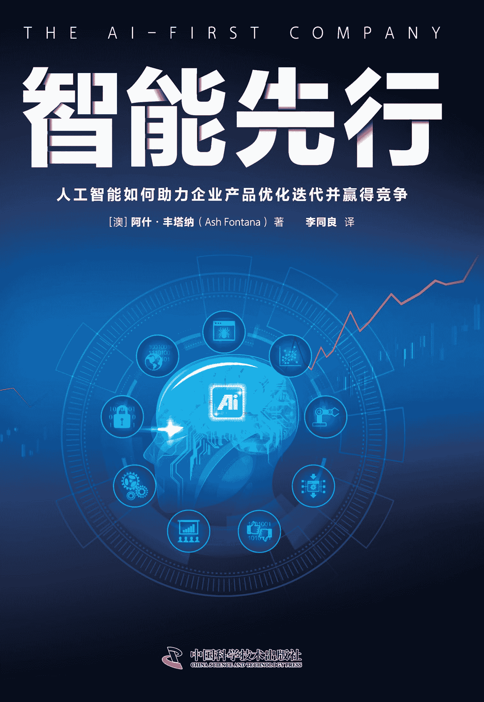

# 绪论

自然界从不缺乏感官超群的“专家”：猫头鹰的夜视、嗅探犬的灵鼻、鲸豚的超声波定位，甚至我们亲手造出的计算机，算力早已碾压人脑。人类的独门绝技，在于能同步调动多感知通道，海量摄入信息并并行处理——这种**极速学习**的能力，正是智能的本质。

如今，人工智能（AI）复刻了这一路径：采集高价值数据 → 加工为结构化信息 → 经网络极速分发 → 助力人类完成指数级学习。掌握这套方法论的公司，率先完成了自身智能的跃迁。本书的核心命题，正是指导你构建**“AI 优先公司”**——在“比对手学得更快”成为生死线的当下，建成“采集-处理-触达”全链路的智能飞轮。

放眼全球，首批市值破万亿的俱乐部成员，清一色是 AI 优先公司；未来十年，它们将以更显性的姿态，重塑更多行业的竞争版图。这就是你_all in_ AI 优先战略的根本动力。

## 新工具：从体力杠杆到决策杠杆

“把人类描述成制造工具的动物，一点也不为过。”查尔斯·巴贝奇的断语，道出了文明演进的主线——我们用认知理解世界，再造工具突破生理边界，将线性进化改写为“人+机器”的指数革命。

**第一波：石器时代的体力杠杆**  
260 万年前，石斧、绳套、长矛让原始人类突破徒手极限，单位时间获取更多热量。

**第二波：工业与信息时代的智力杠杆**  
蒸汽机、流水线把体力放大；印刷术、计算机把信息传播与运算外包。然而，受限于“我们能预知多少未来”，智力杠杆始终止步于**执行层面**。

**第三波：AI 时代的决策杠杆**  
AI 赋予机器“感知-判断-行动”闭环，将工具从**执行者**升维为**决策伙伴**。决策落地产生新数据，再反哺模型，形成“决策-学习-更优决策”的复利飞轮。

> **一条缝纫线串起三代杠杆**  
> • **体力杠杆**：多杠杆织机取代手工织布，速度提升。  
> • **信息杠杆**：CAD 软件将设计图自动转为织机指令，精度跃升。  
> • **决策杠杆**：AI 扫描社媒爆款穿搭 → 预测流行趋势 → 自动生成新版型 → 直推织机投产。款式尚在走红，成品已挂满货架——**时间红利**彻底改写商业逻辑。

早期工具解决“资源稀缺”（土地/劳动力/资本），AI 解决“认知稀缺”。工业纪元的赢家擅长调配有形资产；智能纪元的霸主，将擅长**运营无形信息资产**。市面上教你管地、管人、管钱的书汗牛充栋，本书专讲**如何把信息变成护城河**。

## AI 优先世纪：1950–2050 的百年长跑

我们将 1950 年（AI 概念萌芽）至 2050 年（AI 全渗透）定义为“AI 优先世纪”。当下处于前后半程交接点，**现在入场，正是黄金窗口**。

### 前半程（1950–2000）：实验室里的静默积累

若说前五十年 AI 只活在论文与实验室，后五十年便是其大规模落地的“兑现期”。技术成熟往往需要半个世纪的沉淀，因此我们既要对短期噪音保持宽容，又要有**将 AI 与业务战略深度耦合**的战略定力。

#### 奠基者与理论基石
- **麦卡洛克 & 皮茨**（1943）：用“阈值逻辑单元（TLU）”建立神经元数学模型，为人工神经网络打下第一块基石。  
- **达特茅斯会议**（1956）：正式冠名“人工智能”；感知器算法、早期神经网络相继问世。  
- **图灵测试**：以“对话不可区分”为基准，确立机器智能的判定标准。

#### 从理论走向工程
- **60 年代**：MIT、DARPA、IBM 攻克自然语言、视觉、推理；计算机学会下棋，引发持续二十年的公众狂热。  
- **70 年代**：政府断供（“承诺过多、兑现太少”）；工业界转攻机器人、语音识别、机翻，并与**泰勒制式的流程自动化**融合——SAP 用电脑管库存，美军用 AI 调度战时物资。  
- **80–90 年代**：自动驾驶跑通 1000 英里、IBM 深蓝击败卡斯帕罗夫、索尼 AIBO 机器狗上市。技术破圈，但受限于算力、数据、人才，**仅军方、IBM、索尼等巨头能玩得转**。

#### 拐点：神经网络“串得起、跑得快”
千禧年前后，本吉奥提出基于神经网络的语言模型，辛顿推出深度学习（多层神经网络）。关键在于：**显卡擅长并行矩阵运算**，让“训练周期从月缩至天”成为可能。

### 算力与数据双廉价：点燃爆发的两把火
1. **分布式系统 + 云计算**：IBM、微软把超算变成按小时计费的云资源，算力成本呈指数下探。  
2. **移动互联网数据井喷**：人人随身携带传感器（手机），每次交互都在生产训练燃料。  
2013 年，全网流量首破 **1 ZB（10²¹ 字节）**，同年我创立 Zetta Venture Partners——首支纯聚焦 AI 的基金。十年来，我们审阅数万个 AI 优先项目，领投 Kaggle（全球最大 ML 社区），见证并参与了“技术前沿兑现现实”的关键时刻。本书正是这些实战教训的系统性沉淀。

### 后半程（2000–2050）：交叉点上的指数红利
历史反复证明：**学科交叉产生质变**（哲学+数学=物理；工业工程+电气=现代工厂）。如今，**AI + 分布式系统**让大模型在海量数据上落地成为常态。无论你驾驶小艇还是巨轮，这股技术浪流都能托举你完成追赶与超越。现已有成熟方法论覆盖：小样本建模、合成数据生成、自动标注、AutoML、模型-软件无缝集成……全书将逐一拆解。

## 什么是 AI 优先公司

**定义**：在真实业务、有限预算、硬性截止日期约束下，**将 AI 能力置于决策首位**的组织。  
**核心逻辑**：接受短期投入产出比（ROI）的妥协，换取**长期智能复利**带来的非对称竞争优势。

本书直击运营层面的八大核心问题：  
实验设计 → 组织建设 → 数据获取 → 模型训练 → 生产部署 → 持续运维 → 效果度量 → 护城河构建。  
我们不追求把你培养成算法专家，而是为**商业决策者**提供“最小可行认知包”——术语表、底层原理、避坑指南，助你在 AI 优先世纪**用信息打赢商业仗**。问题不在于你能否参与，而在于你**愿不愿**领跑。

## 全书导航：八章打通“数据-智能-胜利”闭环

| 章节 | 核心交付物 |
|------|------------|
| **Ch1** | 定义**数据学习效应（DLE）**：源自“机器比人学得快”的全新护城河模型，超越网络/规模/学习曲线三大经典理论。 |
| **Ch2** | **精益 AI（Lean AI）**：以最小成本把 AI 塞给真实用户，完成“0→1”冷启动。 |
| **Ch3** | **数据获取策略**：从种子用户扩展到规模化语料，喂饱模型胃口。 |
| **Ch4** | **AI 优先团队拼装**：角色定义、技能矩阵、协作节奏。 |
| **Ch5** | **模型迭代与价值放大**：用更多数据训出更强模型，释放数据资产增值。 |
| **Ch6** | **从实验到生产**：深度集成客户系统 + 模型全生命周期运维（MLOps）框架。 |
| **Ch7** | **双轨度量体系**：定性（体验/信任）+ 定量（业务指标/模型指标）验证 ROI。 |
| **Ch8** | **护城河组合拳**：DLE 与网络/规模/品牌/转换成本叠加，构建“十年不倒”的护城河。 |

> 表 0-1 本书各章节概况  
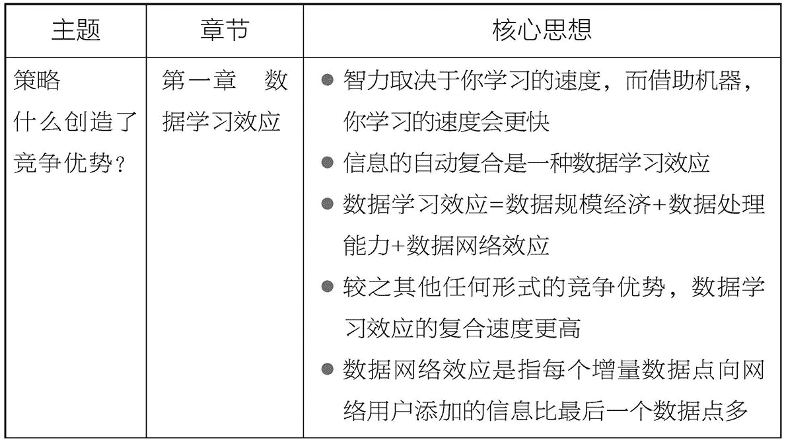  
▼续表  
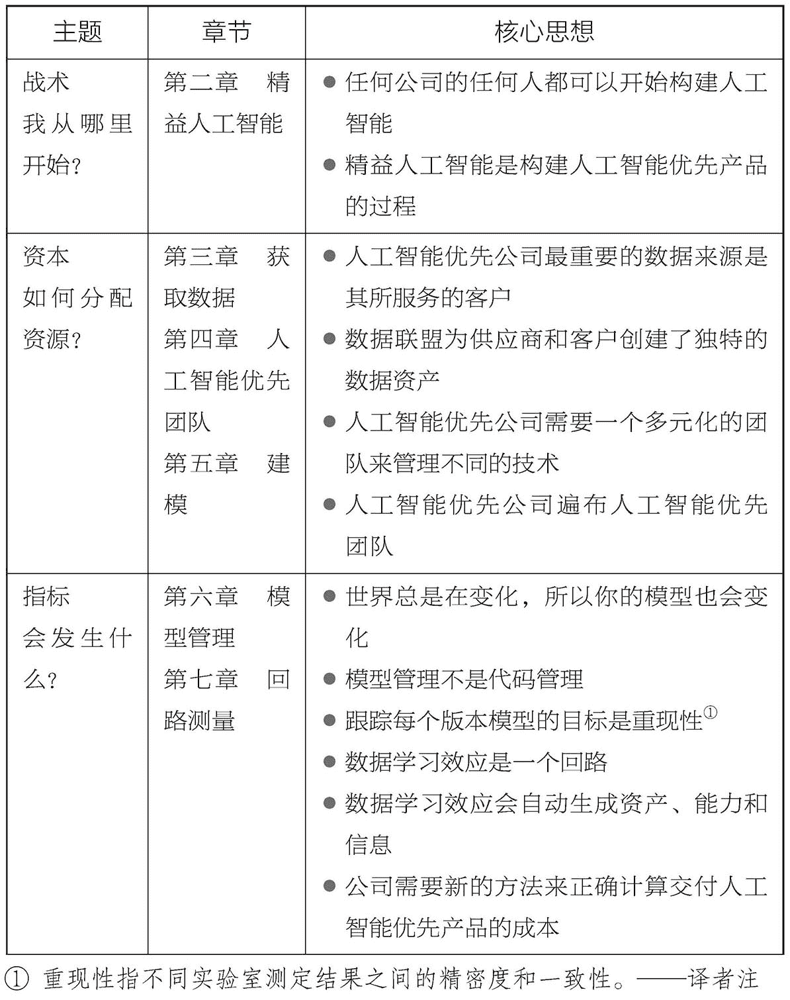  
▼续表  
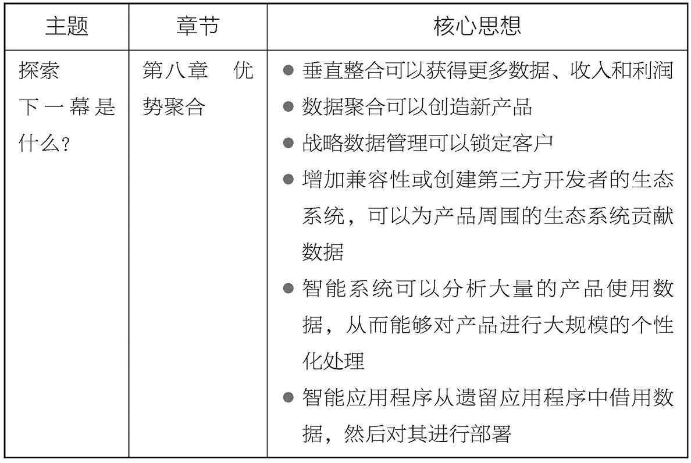

无论你是初创电商、家族二代接班，还是《财富》500 强掌舵人，都能在本书找到对应战位的**作战地图**——拿起 AI，赢下这场学习速度的军备竞赛。

# 第一章

## 数据学习效应：给“机器比人学得快”立个规矩

大脑皮层 860 亿神经元，在脑脊液与硬脑膜保护下，经树突轴突与肌肉双向连接——这精妙的生物架构，被我们用**纸上逻辑方程 → 计算机程序 → 分布式集群**三步复刻。AI 的威力源于：**更强算力跑更大网络吞更多数据 → 学习速度指数级跃升**。换工具，就换了智能进化的倍速。

然而长期以来，我们缺乏一个精准词汇来定义 AI 对商业的本质贡献。  
• 叫“新石油”？——暗示“囤得多赢”，忽略了**流动与提炼**的关键性。  
• 叫“数据网络效应”？——借用社交图谱红利，却漏掉了**模型自我进化**的核心机制。  

**规模效应、网络效应、学习曲线，均未捕获“自动化复合式学习”这一核心变量。**  
本书为此命名：**数据学习效应（Data Learning Effects，DLE） —— 信息的自动复利。**

本章将：  
1. 正式定义 DLE 并拆解三要素；  
2. 与传统三大护城河逐项对标，凸显差异；  
3. 揭示 DLE 如何驱动“赢家通吃”、强化产品效能、加速复利、制造成本优势、赋予智能定价权；  
4. 坦诚其边界与局限。

---

## 人类学习：集体外脑的跨时空接力

人类靠**感官并行采集 → 神经系统即时编码 → 与长时记忆比对 → 生成新知**。  
机制两大特征：  
1. **广度优先，再深度关联** —— 先扫描环境，再检索内库关联推理。  
2. **跨代复利** —— 锤子→铲子→斧头，技术不归零；语言、文字、互联网让个体站在巨人肩膀上，**“已知越多，学习越快；连接越广，获知越速”**。

---

## 机器学习：可规模化、可复制、可加速的“数字克隆”

机器复刻同构流程：**传感器采集 → 数据清洗入库 → 与历史参数比对 → 梯度下降更新权重 → 产出新策略**。  
关键差异在于三个**“可”**：  
- **可规模化**：万卡集群并行，单位时间处理量超人类数数量级。  
- **可复制化**：模型权重一键部署到万个边缘节点，零边际成本复制“专家”。  
- **可加速化**：算力按摩尔定律指数增长，学习周期持续压缩。

**DLE 的本质公式**：  
> **数据量 × 模型容量 × 算力预算 × 迭代频次 = 智能复利速度**

人类受限于生理带宽与寿命，复利曲线是**对数级**；机器在工程红利下，能跑出**指数级甚至超指数**的智能增长曲线。这，就是 AI 优先公司能在单位时间内“比对手学得更多、决策更优、护城河更深”的底层物理原因。

# Chapter 1: Data Learning Effects

**数据学习效应：AI 时代的核心护城河**

机器不再是孤岛。如今，它们能组网成群，协同完成计算任务。过去，机器只会按部就班地跑计算、存结果，新数据来了再重复一遍。现在不同了：输出结果可直接反哺输入，经运算转化为信息，并以此为养料“长知识”。这种学习能力随数据流入呈指数级跃升，让“第三波工具”威力倍增。

构建这套**数据学习飞轮**，核心三步走：
1.  **攒够关键量级的数据；**
2.  **练就把数据炼成信息的本事；**
3.  **喂给机器，让它自主进化。**

用一句大白话概括：**搞到海量数据，提炼成决策干货，建一套能自动产出更高阶数据的闭环系统。** 这不仅是基础公式，更是读懂后续所有内容的钥匙。不想看数学推导的可直接跳过，想深究的请看下式：

```
数据学习效应 = 数据规模经济 + 数据处理能力 + 数据网络效应
```

本质上，这是一个生成输出的函数序列：

```
输出 = 功能（数据量、数据处理能力和质量、数据网络效应）
```

操作顺序如下：

```
输出 = 功能{（数据网络效应［数据处理能力和质量（数据量）］｝
```

引入数据导数，可算出数据的边际价值：

```
数据的边际价值 = 数据网络效应价值 × （每增加一个数据处理单元所增加的网络价值 × 每增加一个数据单元而增加的已处理数据的价值）
```

两边取对数、除以初始输出，便能量化：增量数据究竟带来了多少增量产出：

```
来自增量数据的增量输出百分比 = log（数据网络效应价值） + log（数据网络已处理数据的价值） + log（数据规模经济）
```

这背后的逻辑揭示了三个关键点：
*   **这是条价值链：** 多环节协同，层层增值。
*   **环环相扣：** 链上每一环的价值，都取决于其他环节的发挥。比如，大宗商品数据需重度网络处理才能变资产；差异化数据则轻量化即可。
*   **门槛在降：** 数据收集、处理、网络构建的综合门槛正在走低。

**数据学习效应 = 数据规模 × 处理能力 × 网络效应**。三者合力，数据才能持续产出边际收益。

---

### 业界如何定义“数据学习效应”？

```
数据学习效应 = 供给侧输入优势 + 供给侧处理优势 + 需求侧不断增长的规模回报
```

### 为什么现在才爆发？三大底层基建刚好到位

1.  **数据规模经济：** 传感器普及，海量数据从个人/工业设备经互联网汇聚。
2.  **数据处理能力：** 算力白菜价，顶尖人类能跨数据集建连接。
3.  **数据网络效应：** 科学家搞定了“数据组网”——局部算完传下游，层层递进生成新知。这正是**神经网络**，广义上的**智能系统**雏形。

三大基建就绪，数据学习效应自然成型。下面我们逐一拆解，并对标当下热门认知。

---

## 别再用旧公式套新赛道

**数据学习网络效应是 AI-First 公司的核心护城河。** 它的复利速度碾压传统护城河，但长期以来定义模糊。我们曾天真以为“机器像人一样学”、“数据越多越好”、“万物皆网络效应”，实则这些只是拼图碎片，而非全貌。**数据学习网络效应 ≠ 学习效应 ≠ 规模效应 ≠ 网络效应。** 逐个拆解：

### PK 传统学习效应：慢人工 vs 极速机器

经济学家研究的学习效应，核心是**信息积累变现**。咨询公司沉淀客户案例成框架、成模型，就是典型。
*   **积累对象：** 个人/组织经验，结构化/非结构化混杂。
*   **处理主体：** 人+机器。
*   **收益：** 质量与数量并重。
*   **硬伤：** **慢。** 非结构数据（图片、文本）必须先经人手结构化，机器才能接手。

**数据学习网络效应则全程高速公路：**
*   **积累主体：** 单一或多组织。
*   **数据形态：** 天生结构化。
*   **处理主体：** 纯机器。
*   **收益：** 纯量级红利。
*   **优势：** **极速增长。** 结构化数据直喂算力强得多的机器，多模态并行，智能涌现。

**时代变了：** 学习效应适配“知识经济”（服务业时代）；数据学习网络效应属于**“AI-First 时代”**——数字化分发、自动化共享、思维级学习、硬件载体（而非大脑湿件）、多节点协同进化。

### PK 规模效应：供给侧降本 vs 需求侧增值

传统规模效应是**供给侧视角**：买芯片批发价、自建冷却系统、谈便宜电价（如云厂商），单位成本随规模下降。这不是网络效应（联网不直接增用户效用），也非学习效应（优势源于规模本身，而非认知迭代）。

数据也有规模效应：号码越多越好卖。但**边际效用递减**是铁律——同质数据堆砌，用完即止。**数据规模经济只是发端，非终局。**

**关键分水岭：数据 ≠ 信息。**
*   数据是客观事实，不一定有用；
*   信息能消除不确定性，指导决策，长在“脑子”里。
*   **AI-First 玩法：** 先囤数据，再用内部 AI 思维炼成信息，直击痛点——“下一步押注啥？”、“保费多少？”、“断粮在何时？”。
*   数据变信息的关键路径：**跨数据交互**。这在网络上发生，节点间互动产生效用。

### PK 网络效应：连人 vs 连数据

经典网络效应（电话、微信）：**节点是人**，边是通信。人多、网大、效用高。

**数据网络效应：节点是数据**，边是**计算与信息流**。
*   数据通过接口（如组合算法）集成；
*   遵循协议传递处理后的信息；
*   在激励机制驱动下贡献增量。
*   **神经网络**即为此类接口的典范：算法定义数据如何操作、流动、融合。

**本质区别：** 普通网络传“数据”，数据网络传“数据的衍生物——信息”。边缘不再是单纯通道，而是**可计算的信息加工带**。

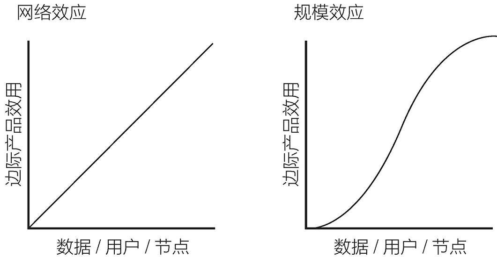  
*图 1-1 网络效应与规模效应对比*

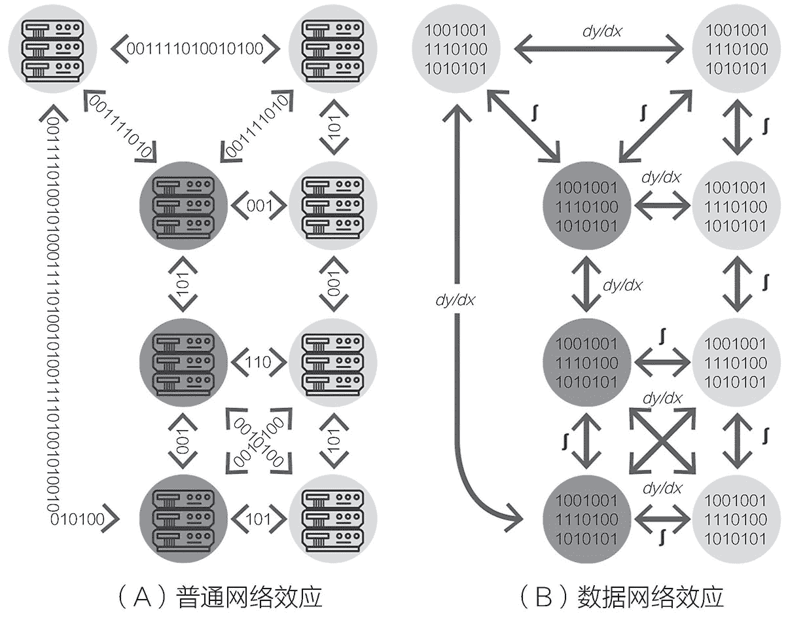  
*图 1-2 普通网络 vs 数据网络：前者节点存数据、边传数据；后者节点存数据、边算数据、传信息。*

---

## 深度解析：数据网络效应的两个进化阶段

数据学习效应 = 数据规模经济 + 处理能力 + **数据网络效应**。前两者在其他章节详述，本节聚焦第三项。

数据网络效应分**入门级**与**进阶级**，投入维度（数据、技术、人才、客户、伙伴）截然不同：

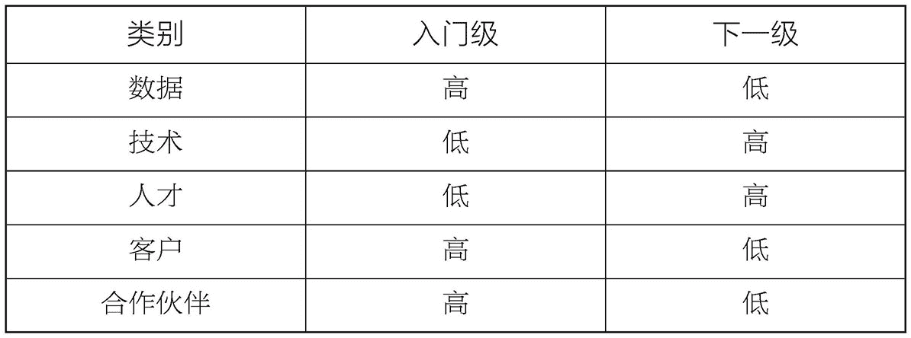  
*表 1-1 两级网络效应的资源投入对比*

*   **入门级：** 往网里加信息，现有数据获边际收益。**外源驱动**，靠用户/客户/伙伴喂数据。竞争优势的“第一因”。
*   **进阶级：** 加数据+引入生成模型（如 ML Model），产出复合边际收益。**内源驱动**，系统自造数据。竞争优势的“第二因”，增长指数级更猛。

**举例：**  
入门级靠 BD 拿客户偏好数据；进阶级造推荐模型，看用户买啥、点啥，反推偏好，自动生成洞察。

数学上，传统网络价值 ∝ $C \cdot n^2$（节点数平方），边际值常数。现实中大网络常递减。数据网络初期类似，但一旦**进阶升级**，指数突破 2，价值曲线垂直起飞。


---

### 阶段一：入门级——集体智慧的雏形

**核心机制：** 外部信息入网 → 产品更好用。  
**无关 AI。** 想象张 Excel 表，多加一行，分析维度更丰富，决策质量提升（如图 1-3）。

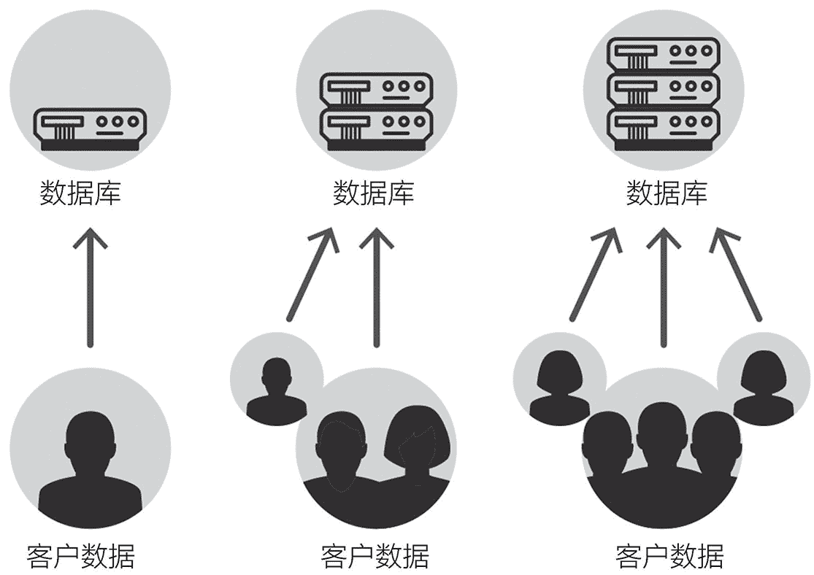  
*图 1-3 入门级数据网络效应示意*

**大数据时代（2010s）主打的就是这套：** 存、管、分析、可视化海量数据。

**实战场景：** 电商购物。  
选品多 ≠ 网络效应（那是采购能力）；**选品懂 = 网络效应**（评价、参数、评论组织成信息）。每条评论都是信息增量，买家受益于前人，留评又惠及后人。外源信息不断入网，飞轮转动。

---

### 阶段二：进阶级——自进化的“共享大脑”

**核心机制：** 外部数据入网 + **内部模型生成信息** → 自我进化。  
**升级关键：** 引入 AI（如 ML Model），指数破 2，复利加速（如图 1-4）。

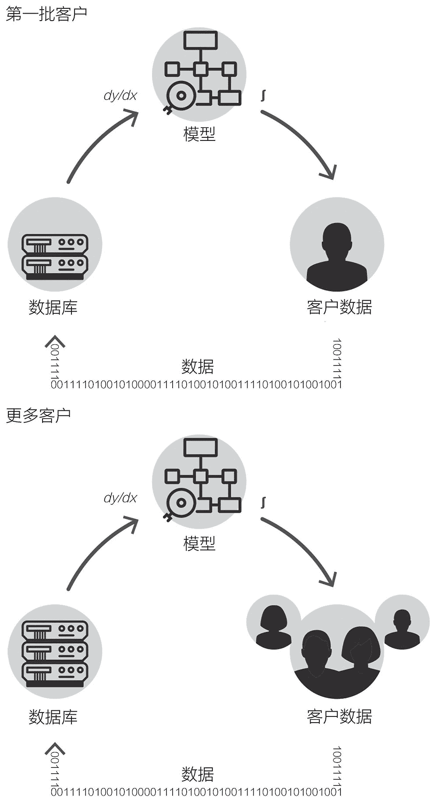  
*图 1-4 进阶级数据网络效应示意*

**实战场景：** 智能搜索。  
用户搜、点、买、赞，行为数据喂模型，模型实时调整排序，下一位用户直接受益。**无论点击与否，模型都在学。** 客户群即数据贡献者网络，新数据自动转化为全网红利。

---

### 从“各自为战”到“共享大脑”

**入门级本质：** 大家各用自己的**生物神经网络（大脑）**处理数据 → 变信息 → 对比 → 预测 → 决策 → 复盘。  
**上限：** 受限于单人脑容量、速度、寿命。学习不共享，决策即沉底。

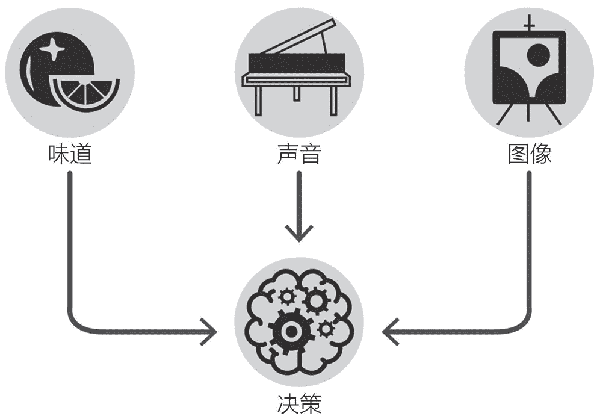  
*图 1-5 单一大脑处理数据流*

*案例：* 盯大屏看瓶盖缺陷，靠经验悟出“温度>250℃顶部变形”，下令限温。这招管用，但**无法复制、难沉淀、靠人传**。换人、换项目，经验归零。

**进阶级跃迁：** 突破生物脑，接入**大规模可计算的共享硅基网络**。  
节点更多、算力更强、数据更广，网络效应指数级放大。

*同案例升级版：* 系统同步调十条产线温度，视觉 AI 实测缺陷率，自动寻优、自动决策下一轮实验参数。多源数据（传感器、图像、历史运算）汇聚预测系统，**知识在网络层面沉淀、复利、共享**。

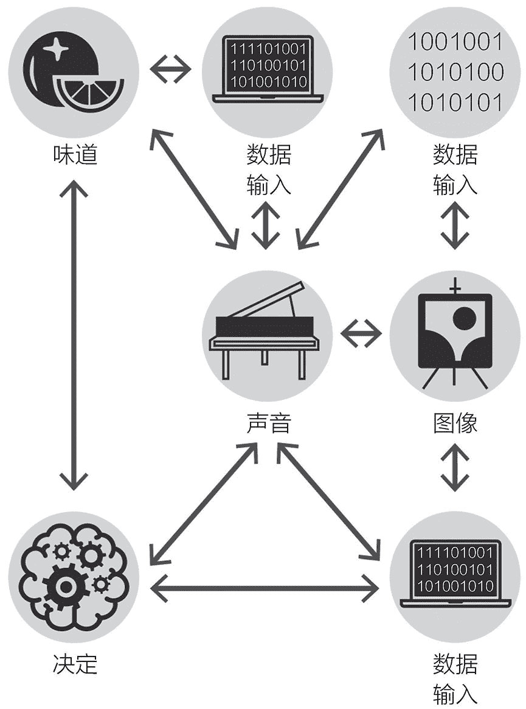  
*图 1-6 共享大脑架构：数据输入 → 共享网络 → 信息输出 → 反馈闭环*

**本质对比：**
*   入门级 = **集体智慧**（人类传承的超能力，靠人脑汇总）。
*   进阶级 = **超级智能**（AI 时代的核动力，跨系统共享信息，按最优解决策，学习速度按指数级）。

---

## 怎么选？建哪级网络？

看三张牌：**手里数据、团队人才、客户画像。**

*   **起步阶段：** 只要能加数据，就先跑**入门级**。门槛低、见效快、比较优势明显。
*   **进阶信号：** 存量数据能否跑通**自学习模型**？模型预测能否实打实惠及客户？
*   **决策权：** 两条路都通向数据学习效应核心——**网络数据越多，系统集体智能越强**。看准时机，果断加码进阶。

---

## 数据学习效应的终局威力

### 赢家通吃的底层逻辑

# 规模经济与多样性需求：为何市场倾向单一技术霸主

当规模经济效应显著、且客户对产品多样性的诉求强烈时，市场往往会演变为“单一技术统领”的格局。所谓规模经济，指的是随着产量攀升，边际成本持续下降；而多样性需求，则是客户渴望获得功能各异、形态丰富的产品选择。

请参考表 1-2 右下象限的案例：线上购物者需要海量SKU，而仓储规模越大，单位运营成本越低，这造就了亚马逊在电商领域的统治地位。再看左下象限：大众渴望新闻来源多元，但在传统媒体时代，记者产出有限、难以规模化复制，导致市场只能容纳寥寥几家大报。

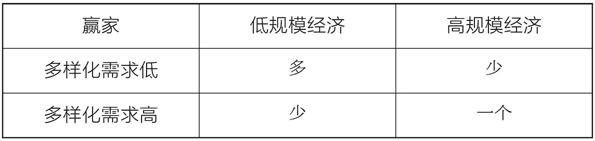

**资源垄断者如何锁定胜局？**  
在一个市场中，若仅有一家公司掌握了最多资源（资金、生态等），它就成为唯一有能力为该市场客户批量生产多元化产品的玩家。规模最大的企业能提供最丰富的产品矩阵，一旦跨越这个临界点，便将主导整个市场。

数据学习效应拥有极高的数据规模经济，因为其启动门槛极高，需要海量数据“冷启动”。这类效应能支撑各类预测任务，因为模型依托反馈数据持续迭代，输出差异化预测。此外，AI 原生产品的用户天然对“定制化预测”有极强刚需——每个客户都需要懂自己业务的专属模型。因此，数据学习效应天然通向“赢家通吃”市场。

---

## 数据学习效应：让产品在显性与隐性层面双重增值

数据学习效应常在幕后默默发力，而非台前高调展示。产品展示效用的方式分两类：前台显性化，用户直观感知到数据接入带来的精准预测或即时洞察（如导入销售数据立见竞品对比）；后台隐性化，用户不觉察数据带来的预测升级，也看不到新增信息。

**Square Capital：前台效用的教科书级范例**  
该公司向 POS 系统商户发放贷款。餐厅老板等商户只需在 POS 录入数据，近乎实时即可获得匹配营收状况的贷款额度。Square Capital 通过将商户上传数据与历史获贷商户数据比对，跑通贷款预测模型，输出基于还款能力的定价利率。不录数据就拿不到贷；正是因为数据可比对、可建模，商户才获得资格。这是数据学习效应在前台大放异彩的典型案例。

**Cloudflare：后台默默护航的隐形卫士**  
这款专注网站性能与安全的产品，让新闻站点等客户接入数据采集机制。它甄别合法访问与恶意请求（如流量洪峰攻击、DoS 攻击），拦截后者。站长不会实时收到“刚拦截一波猛攻”的弹窗，但系统持续学习、持续预警。不授权看流量，就拿不到这些防护红利。这是数据学习效应在后台深耕细作的代表。

---

## 复利速度：数据学习效应跑赢网络效应

网络效应的燃料是数据，客户供给燃料，最终受益于系统。

*   **入门级数据网络效应**：典型的“给-取”模式。客户贡献数据 → 产品变好 → 吸引更多客户 → 产生更优质数据。
*   **进阶级数据网络效应**：数据在产品使用过程中自然产生（反馈数据），关键在于**模型将其转化为预测，实现价值指数级放大**。

**对比更直观：**  
征信机构收集用户申请评分时的数据，优化评分模型再卖给第三方，这是入门级。  
借贷公司让用户授权持续读取消费习惯，实时预测还款概率，动态调整额度或止损，这是进阶级。  
**核心分水岭在于：有无反馈数据闭环、有无预测模型赋能。**

---

## 双飞轮共振：一个飞轮驱动另一个更强飞轮

将“采集数据 → 生成信息”自动化，仅是进阶的起点。真正的威力在于：共享大脑开始拿学到的知识与其他知识比对、关联，由此催生“飞轮驱动飞轮”的跃迁。

亚马逊完美演绎了这出大戏：  
第一幕，海量采集商品数据，构建结构化对比表，助力决策——这是入门级网络效应，凭“信息最全”称霸购物首选。  
第二幕，组建 A9 团队，用机器学习匹配商品数据与购买数据，精准推荐、优化搜索——这是进阶级网络效应，凭“懂你所需、搜你所想”巩固霸主地位。  
一个飞轮的输出，成为下一个飞轮的输入，威力指数级叠加。效果模型详见下图。

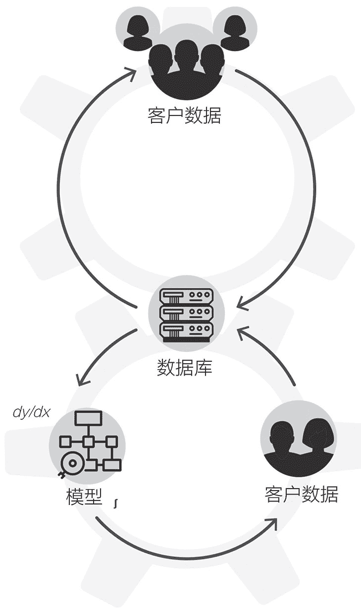

图 1-7 一个飞轮驱动另一个飞轮的效应模型

---

## 数据学习效应构筑成本护城河

数据学习效应能助企业自动压低生产成本。成本优势体现为：要么直接降费，要么持平收费却交付更高价值。

### 数据学习效应：成本摊薄与价值跃升的双重奏

利用数据学习效应构建产品的初始投入极高，涵盖数据采购、清洗、存储，以及高薪招募数据科学家与机器学习工程师。企业往往需先行投入巨资，待客户切实感受到预测价值后，成本曲线才会拐头向下。一旦用户接入并开始贡献数据——无论是自主标注、存储，还是通过界面调整模型、经由反馈机制隐性承担处理成本——生产与维护开销便显著下降，从而形成结构性成本优势。

与此同时，数据学习效应直接推高产品效用。数据量越大，预测越精准，决策质量越高。基础模型性能的每一次跃升，都让客户在不增加支出的前提下获得更高回报：分母（价格）锁定，分子（价值）却在攀升。


顺带一提，成本优势反哺能加速数据学习效应的形成。低成本策略吸引更多用户，用户带来更多数据。为凑齐提升 AI 可用性至关键的“临界数据量”，企业常不惜在一段时间内忽略即时收益，将此策略推至极致。图 1-8 直观展示了这一正向循环。

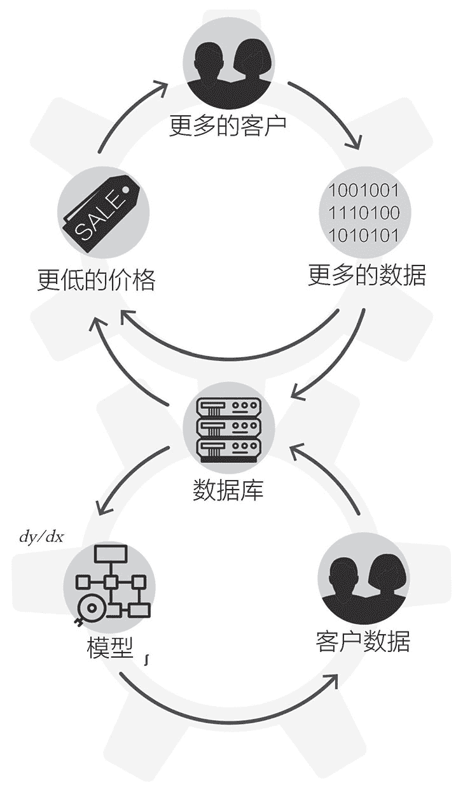

**图 1-8 数据学习效应创造成本优势**

## 数据学习效应与定价优化：一场信息博弈

数据学习效应赋能精准定价。合理定价撬动销量，更多客户汇聚更多数据，进而强化学习效应。需区分：成本优势源于规模摊薄，而定价优化是驱动学习飞轮的引擎。

定价本质是信息博弈，胜负手在于精准测算支付意愿。预测系统通过实验生成测试价：一是凭经验、启发式猜测；二是基于历史实验数据预测接受度。后者显然更接近最优解。

电商个性化定价即典型案例。同一商品，不同用户、甚至同一用户的手机端与电脑端呈现不同价格。AI 持续实验，融合用户画像（登录后的历史与人口属性）、地理位置、即时点击行为等海量维度——成熟平台常引入数百个特征、跨人群数十亿数据点定价。甚至不惜亏本促销，换取用户支付意愿的核心数据。

人工个性化流程是“观察→定价→实验→再观察”的循环；自动化流程则让机器学习模型基于梯度下降逻辑，自主输出最优测试价。

航空业的收益管理系统是鼻祖，依据座位数、航线成本、舱位、季节性需求等变量动态定价，其底层线性优化数学正是机器学习雏形。如今系统实时调价，分发至全渠道。

B2B 软件定价更棘手：企业采购频次低、决策路径隐蔽、行为数据难捕捉，导致训练数据稀缺。

若将定价利润再投入数据学习，将形成闭环：
- 优化定价 → 利润上升 → 资助 ML 研发；
- 优化定价 → 吸引客户 → 零成本获数据 → 利润再增 → 研发投入再增；
- 优化定价 → 降低销售营销依赖 → 利润释放 → 研发投入再增。

## 数据学习效应的边界：收益递减与外部制约

网络效应有天花板，数据学习效应亦然。

**外部制约**：垄断地位招致监管干预，数据所有者面临拆分风险。  
**内部瓶颈**：技术架构在特定规模下崩溃；数据存储管理成本指数级上升，提取、清洗、加载（ETL）开销蚕食规模收益。例如 CRM 引入更细偏好数据，需更细粒度标签，输出维度激增，边际成本超越边际收益。  
**效用饱和**：第 300 条咖啡店评价对决策帮助不大于第 3 条，聚合评分虽更稳但无人细读长尾。数据非越多越好。

获取新数据的边际成本若高于其带来的信息增量，学习效应即失效。判断数据价值需双维视角：技术上模型是否更准，实务上精度提升是否转化为客户实惠。

## 章末启示：AI 原生组织的进化坐标

我们已掌握描述企业群体性数据高速学习的词汇。这些领跑者实现了多维跨越：
- 信息分发：从口耳相传到数字化流转；
- 知识共享：从人工传递到自动化同步；
- 学习主体：从单一大脑到跨脑协同；
- 承载介质：从生物湿件到硬件算力；
- 计算拓扑：从孤立节点到网络化集群。

他们无一例外，皆为 **AI-First（AI 优先）企业**。

## 核心要点

AI 原生公司的网络效应运作逻辑，与社交网络截然不同。它源于用户间关系的持续深化，而非单纯的连接积累。数据网络效应的显现，往往需要经历数年的数据收集与处理磨砺，并非仅靠正确的技术选型即可速成。顶尖人才在此至关重要，他们精通数据的本质、来源及其与业务问题的关联性。实践证明，企业通过这一过程能习得强大认知。一旦数据学习效应启动，企业不仅能吸引更多客户，还能掌握核心业务的专有信息，进而探索核心流程的自动化路径。这种自动化双赢：客户业务更盈利，AI 产品也更具吸引力。

以下路径描绘了 AI 原生企业的学习进阶：首先掌握数据获取与评估；其次组建处理数据的 AI 团队；最后构建利用数据优化产品的模型。由此建立数据学习效应的竞争壁垒，实现高度自动化。随之而来的问题是：如何运用自动化节省的成本？这将在本书终章「优势聚合」中详述。数据学习效应全景图如图 1-9 所示。

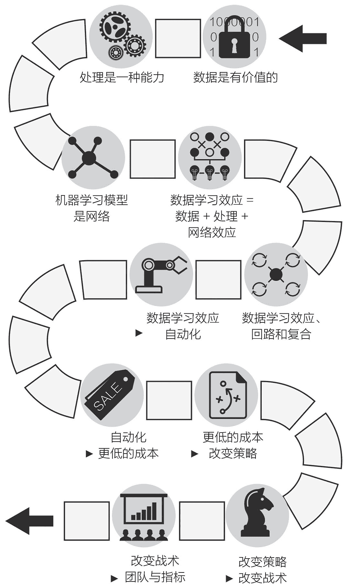

**图 1-9 数据学习效应全景图**

### 关键洞察速览

- **自动合成数据沉淀信息，即数据学习效应。** 构建三部曲：① 捕获关键规模数据；② 炼就数据转信息的能力；③ 反哺计算机，从新数据点持续学习。
- **数据处理能力与网络效应合力，催生边际产出。** 数据学习效应理清了数据周围的价值链条。
- **数据学习效应独树一帜。** 它以供给侧优势起势，引爆需求侧优势，融合资源获取特权与资源资产化能力。
- **数据网络效应 ≠ 普通网络效应。** 核心差异在于「入网之物」。普通网络靠节点间的连接（边）通信；数据网络让「边」变得可解读、可计算。
- **数据规模效应 ≠ 单纯的数据规模经济。** 数据量增加不自动产生网络效应，但可能因规模扩大而降低获取、处理成本，形成规模效应。
- **数据网络效应分「入门级」与「进阶级」。** 入门级：增数据见正效应；进阶级：增数据 + AI 見强正效应。前者易建，后者增速快。
- **进阶级效应能「自产数据」。** 入门级依赖外部输入；进阶级内部产出反馈数据，复利效应更强。
- **更高阶智能源于自生成数据网络。** 入门级提升智力上限；进阶级加速学习速率。
- **数据学习效应下，赢家通吃。** AI 产品具极高数据规模经济，客户多样化需求旺盛，跨越临界点即可行业称霸。
- **数据学习效应降本增效。** 降低数据获取处理成本，同时向客户交付更高价值。
- **数据学习效应简化定价。** 构建独立智能系统，跨细分人群跑价格实验，动态优化定价策略。
- **数据学习效应有边界。** 受制于周边技术规模、存储成本、客户边际效用递减及监管政策。

# Chapter 2: 精益 AI 路径

寻找构建 AI 的捷径：在打磨数据学习效应的每个组件前，先聚焦缩小当前工作范围。本章探讨如何利用现有资源冷启动项目；后续章节将拆解数据学习效应的三大基石——获取数据、组建团队、构建模型以激活网络效应。

起初，客户未必需要 AI，统计分析可能已足够。因此我们引入「精益 AI」新概念，将其与过往软件、创业话语体系区分开。精准度是 AI 产品的核心指标，**预测即产品**。

后续章节将落地精益 AI 体系：详解获取数据、构建模型、建立自我强化闭环，以及 AI 变现之道。

请记住：任何人、任何公司，当下即可启动 AI 系统构建。你准备好了吗？

## 客户真正需要什么？

客户往往不明说真需求，正如亨利·福特所言：「若问人们想要什么，他们会说更快的马。」产品设计早于 AI 诞生。本节梳理洞察客户需求的设计原则（见表 2-1）。

**表 2-1 洞察客户需求的产品设计原则**

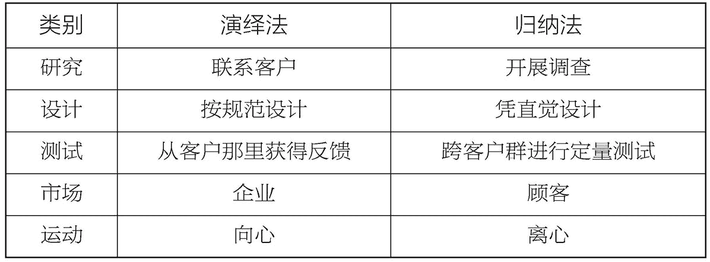

理解需求可走「归纳法」：提问、倾听、推断、构建。缺乏行业经验的创业者常通过大量提问归纳需求。核心是从潜在群体获取信息，捕捉需求趋势，提炼功能集。流程含调研、提案设计、分群测试、迭代优化。这是「离心过程」：先分析海量购物行为数据（供给），再定夺客户需求（需求）。多数消费品采用此法，因潜在用户基数大。

也可走「演绎法」：资深创业者常观察过往、叠加新品演绎供给。核心是从单一客户获取信息，判断供给趋势，制定功能清单。流程含电访、提案、多轮会议打磨、上线收反馈。这是「向心过程」：逐步收敛规格精准匹配需求。多数 B2B 产品适用，因潜在客户少，可逐一深谈。

下一问题：原型是否需要 AI 加持？需先搞清三点：客户是否需形成判断？是否需预测？是否需流程自动化？

## 客户真的需要 AI 吗？

AI 的承诺是助客户更优、更快决策。AI 需求度取决于决策类型及依赖数据。此处提供一套分类框架，将决策类型与手头数据置入决策树，以判断客户需 AI 还是分析。**精益 AI 决策树见图 2-1。**

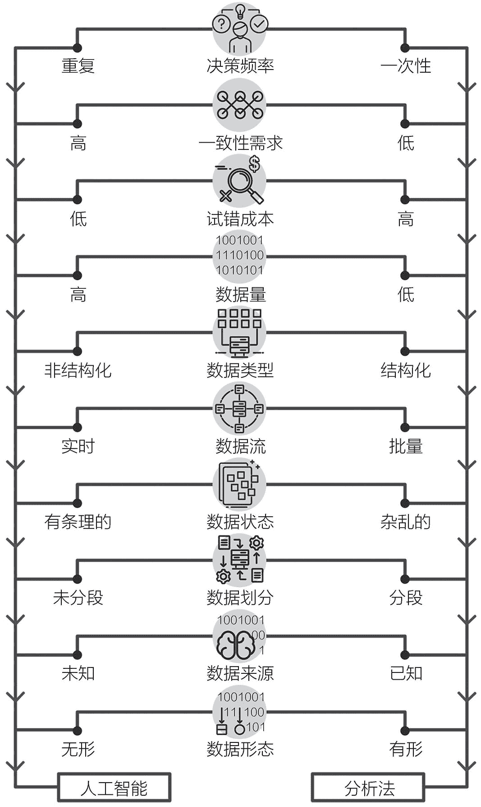

Figure 2-1 Lean AI Decision Tree

Traverse this decision tree and make choices sequentially to measure whether AI or analytics is chosen more often. If analytics is chosen more, then the customer likely needs data functionality, such as recording, cleaning, and manipulation—in other words, mathematical operations like calculating averages—but this is definitely not AI. If AI is chosen more, then the customer likely needs AI functionality, such as classification, segmentation, and manipulation of data.

## 第二章 精益人工智能

现实情况是，即便客户最终目标是上马 AI，前期往往也离不开“非 AI”手段的铺垫。因为 AI 的落地本质上是个渐进工程：数据工程与数据科学，是通往 AI 的必经台阶。

数据工程负责打地基——挖掘数据源、搭建存储设施、抽取转换异构数据、打通入库通道，确保优质数据源源不断。数据科学则负责挖价值——异常检测、建立分析流水线、切分聚合数据集、摸索哪些特征具备预测潜力。

等到这些准备就绪，才轮到 AI 登场：验证特征预测力、大规模实验、设计新算法、训练模型并推向实战。这得是个联合作战过程：先搞清客户真需求（分析还是 AI？），再用工程、科学、ML Engineering 快速跑通一个小模型。这些实战测试能指导怎么包装模型、怎么组建团队推向市场。不同于软件接口好复制，AI 模型难复刻。破局之道是“人工模拟”先行：手工生成预测，收集客户反馈。这步看似笨拙，实则最高效——直面客户痛点，才能把模糊的技艺变成确定的数据科学。

### 从小处着手：统计

想听懂客户心声、读懂数据语义，统计是性价比最高的切入点。客户有困惑，数据藏答案，数据科学是连接二者的桥梁。一旦明确“客户想知什么”与“数据已知什么”，数据科学就能反推“未来将知什么”。

别急着上神经网络。海量数据喂进黑盒，往往事倍功半——数据难配合、清洗累人、调参烧钱，这些动作离“帮客户省时省钱”十万八千里。

其实非 AI 工具箱里好用的家伙多了去了：用铅笔画统计图（直方图、散点图）看分布；用聚类、降维（如 PCA）找规律、减噪音；用聚类定位潜在因果——也就是 ML 模型的预测功能。找到一因，再上随机森林或 GBDT 组合拳，画变量重要性图、偏依赖图，验证关系是否靠谱。图像、语音、文本另当别论（可用预训练网络提特征）。核心逻辑就一条：**用一种统计法出答案，用答案引出下一个统计法，层层递进，最终长成 AI。** 关于 ML 的 ROI 视角，见图 2-2。

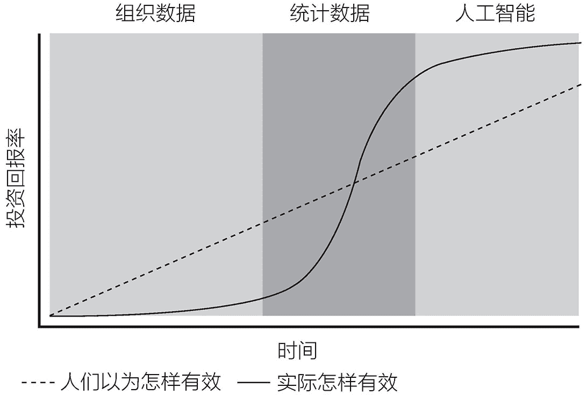

图 2-2 关于机器学习的投资回报率的观点

你可以这么理解：先试单招，再叠组合拳。后者就是神经网络——无数方程层层嵌套，下层输出喂给上层，层层抽象。这“网络”就是方程间跨层的接口。但在方程组开群聊前，先用单个方程跑一次单聊，看它能不能直接回应客户问题。

我们读这书不是为了开家数据科学咨询公司，而是要从数据科学起步，构建“数据学习效应”。绝大多数 AI 模型底子都是统计。当客户有钱有闲要上 AI 时，从统计入手，是通往目标最稳的路。

### 从小处着手：数据科学

与其大团队用 ML 硬啃模糊大问题，不如一名数据科学家精准解决一个定义清晰的小问题——更省时、省钱、见效快。让数据科学家做“客户顾问”，用数据驱动的单点回答证明 ROI。这与“用 ML 一次性答多题”形成鲜明对比，详见表 2-2。

表 2-2 一次性机器学习与自主机器学习的对比

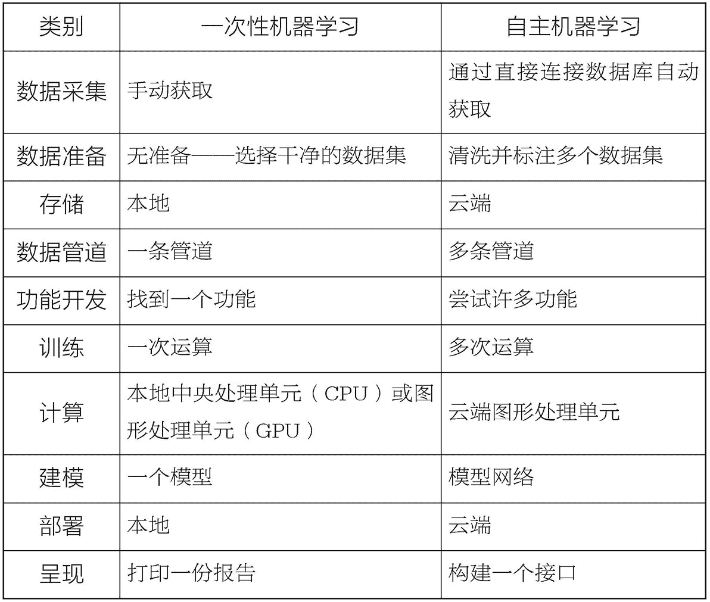

“只答一题”意味着：单一数据集、单一预测功能、单机跑通、报告交付。而“答多题”意味着：多数据源清洗标注、多功能并行、分布式训练、接口开发、参数调优。后者工程量巨大且不可规避。

实证也支持从数据科学起步，Kaggle 就是活证据^(¹)。

### 从小处着手：数据

实验阶段讲究精益，不是堆“粗”数据管道。如何低成本拿到够用的数据？

理想状态：单库、单表、单查询搞定。最佳切入点是问客户——他们最懂业务，最知哪些数据可能有预测力。

数据准备三步走：统一度量单位与格式、清洗（补缺、去重、纠错）、确保模型能高效跑通。因为单源，工作量可控。

**以下雷区坚决不踩：**
- **别贴太多标签。** 先摸清有哪些可预测数据，省下昂贵标注成本。
- **别贪多数据源。** 多源意味着授权、集成、规划成倍增加。单数据集跑实验，无效再换下一个。
- **别碰敏感数据。** 脱敏贵且扰模型，核心是避责。
- **别建独立库。** 本地安全低延迟环境跑数即可。
- **别急建数据平台/数据湖。** 工具链、元数据、ETL 自动化、数据管治……这些最佳实践留给“AI 证明有价值、需全组织数据接入”那一天。现在的唯一 KPI：交付一个有用的预测。

### 从小处着手：销售

小而美的项目，最易建立信任、拿到数据、摸清客户与遗留工具的交互模式。

单利益相关者、答最急的一个问题——参与度自然高。信任源于“听得懂问题、给得出答案”。预期管理靠解决“小而易”问题；隐私顾虑靠“单数据集”天然规避。

单数据集、单算法、单部署点（仪表盘一栏、流程末节点、规则集一条），风险降维打击。对初接触 AI 的团队，小切口也方便解释“为什么”（可解释性）。交付形式听客户的：报表、邮件、Excel、Dashboard，随心配。

一问一答、一法一群、一步到位。搞定最活跃客户的第一个问题，再接第二个，参与度螺旋上升。

### 概念验证

客户常纠结要不要做 PoC——资源有限，得花在刀刃上。大厂偏爱可控 PoC 起步。

AI First 产品非 PoC 不可，因为核心卖点是“准”，客户得亲测模型在自家数据、自家环境里表现如何。这与标准软件“功能清单好演示、差异小”截然不同。

PoC 成功三要素：准确度基线、时间表、成本，全要定预期。

- **准确度：** 实事求是定基线。如全自驾尚不可行，但坑洞预警传感器已成熟。外部基线参考客户现有水平。
- **业务目标：** 最贴近赚钱的指标。客户懂目标，但不一定懂 AI 怎么帮目标——帮他们对齐，区分 PoC 阶段目标与量产阶段目标。
- **数据：** 列源、查可用性。 80% 时间备数据， 20% 练模型。
- **依赖：** 梳理遗留系统挂钩，提前填坑。
- **团队：** 控规模，平衡“干事人”与“拍板人”。
- **时间表：** 评估构建周期、达标周期。遵循 80/20 法则： 80% 准召�可能 20% 时间搞定，剩 20% 可能耗 80% 时间。
- **成本：** 算清工时、外包、标注、工程费，出总账。

PoC 收官，须出后续提精度计划，并基于实测精度重设客户预期。

## 精益人工智能

上述全流程，即“精益 AI”——构建一个“小而全、解专题”的 AI。这不仅助新公司破局，也能助老公司转型 AI First。

精益创业 ≠ 精益 AI。前者目标是“创公司、推产品、做功能、求计算结果”；后者目标是“做项目、出预测、求准确率、比功能优劣”。关键里程碑对比见表 2-3。

表 2-3 精益初创企业与精益人工智能的重要事件

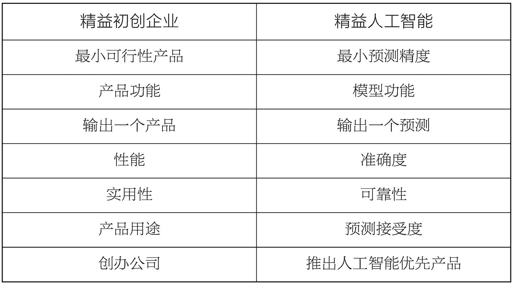

全流程步步差异见表 2-4。精益 AI 不造产品不建公司，只生成预测、建系统；不交付样品，交付报告；反馈不是定性的“好不好用”，是定量的“准不准”。

表 2-4 创办精益初创企业与构建精益人工智能的差异

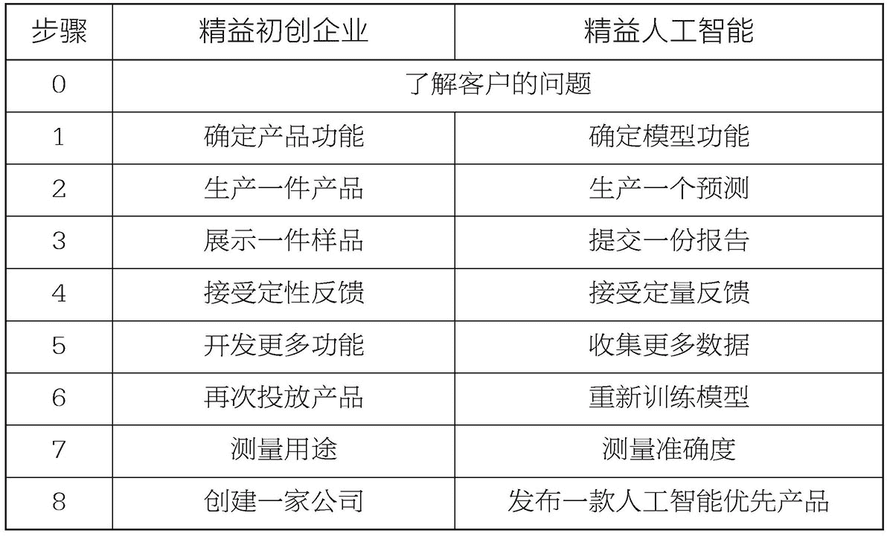

### 搁置 MVP，拥抱 PUT

精益创业推崇 MVP（最小可行性产品）：定义最小功能集再造，避免造没人要的东西。

本书主张 PUT（预测可用性阈值）：**模型预测开始对客户产生价值的临界点。** 这未必要求超越人类，哪怕准确度略低，胜在一致性稳定，依然有用。注意，“预测”含分类（如识别桥梁类型）。定义 PUT 是为了优化“造模型、调功能、取数据”的时间成本——不在无效功能上烧时间。

PUT 因人因事而异。关键决策阈值高，辅助决策阈值低。搞清“客户何时、如何、为何需要这个预测”，PUT 自然浮现。理想状态：PUT、客户 ROI、PoC 指标三位一体。

### 重新定义“功能”

产品功能 = 帮用户算结果的软件能力；模型功能 = 输入数据出预测的数学函数组。前者重实用（算得快），后者重预测（准不准）。产品功能决定“能做什么”，模型功能决定“能预测什么”。

功能工程烧钱：要数据、要算力、要资深 MLE。所以务实路径是：**先搞清客户要什么预测 → 反推达 PUT 所需最小功能集 → 取数训练 → 实测 → 回收反馈数据 → 算 ROI → 打包交付。**

### 选定功能

统计分析之外，精益 AI 还要迈出“造首批模型”这一步。常规打法：跑简单运算出预测，哪怕准确率低、不达 PUT。功能筛选可尝试：

- 访谈专家挖因果要素；
- 建“否决接口”，预测不合理客户一键驳回；
- 设回看功能，探变量相关性；
- 聚类找趋势、切小簇建模；
- 模型上跑随机森林，看随机规则能否出合理结论；
- 迁移学习，挪用同类数据集预训练模型。

把筛选过程透明化展示给客户，能激发反馈，为下轮实验攒情报。

## 本章结论：从多层到精益

如果光搭 ML 框架就要几个月，产品恐永无出头日。换条路：直接跟潜在用户聊天，把聊天记录提炼成几个硬问题，用统计学方法一个个击破。搞技术框架很爽，但本章这套“业务框架”同样硬核——它让你在全新问题空间里，找到支撑全新产品、全新业务的基石。

图 2-3 勾勒了精益造 AI 的路径（精益 AI 流程）。底部矩形提示垂直整合深度：拿够数 → 训练 → 实测 → 收反馈 → 算 ROI → 打包说服续约。以统计起手最稳，但终局是建 AI First 公司，而非咨询公司。用精益流程读懂痛点、拣单题、给独立解，才能真正起势。

精益 AI 就是：小样本出预测 → 给干系人看 → 反推他们真正要的全功能产品长啥样。像吃馅饼前先尝一口，让你在面对更高期望、更难建模、更多数据前，先拿到快速反馈。有了精益 AI，人人可启动 AI First 公司。精益 AI 技术栈见下图。

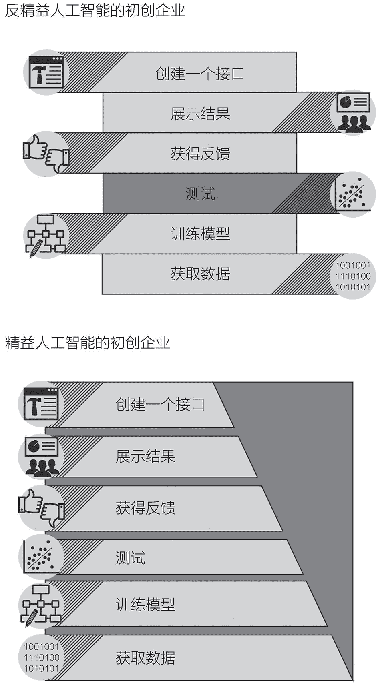

图 2-3 精益人工智能堆栈

## 本章要点

- **首发不一定是 AI。** 客户往往双轨并行：既要非 AI 方案，也要 AI 方案。
- **统计先行。** 一法一答，层层递进。AI 多源于实验数据科学确立的特征。
- **单点突破。** 盯一个数据集、一个问题，规避多数据库大杂烩。
- **单算法起步。** 组件越少，崩溃面越小。
- **PoC 证准。** AI First 产品卖的是“准”，客户必须在自家环境验准。
- **精益 AI = 造 AI First 产品的流程。** 用 AI 解专题，出“小而全、可扩展、可聚焦”的模型。

# 第三章 数据获取：构建AI护城河的起点

打造精益AI的路径，与精益创业的常规打法截然不同。精益创业的终点是交付MVP（最小可行性产品），而精益AI的核心落脚点，是拿到**预测可用性阈值**。这里的主角不是产品功能，而是模型能力；产出的不是计算结果，而是概率预测。在客户的实际业务流里，预测的花哨功能和运行速度，永远排在准确度与可靠性之后。

不同客户对准确度的“及格线”各不相同。每个客户都有各自的门槛，只有跨过这个**预测可用性阈值**，模型输出的预测才能真正转化为业务价值。

**重新界定“功能”**。传统软件开发里，功能指辅助用户完成计算任务的代码模块；但在机器学习领域，功能是一组数学映射——输入数据，吐出预测。产品功能拼的是“实用”，算得快；模型功能拼的是“预测”，准得狠。

```
数据学习效应 = 数据规模经济 + 数据处理能力 + 数据网络效应
```

In the second decade of the 21st century, as billions of devices connected to the internet, the volume of data in the world increased dramatically. Acquiring data seemed paramount, yet funding for data acquisition was severely limited. Data itself is a valuable asset class because it drives data learning effects. Compared to other strategic priorities, AI-first companies allocate more money, time, and effort to acquiring data. But how do you acquire unique data? Where does a data strategy begin? This chapter introduces a data assessment methodology for rapidly scoping data acquisition projects, where to find data, and how to create data from scratch (as shown in Figure 3-1).

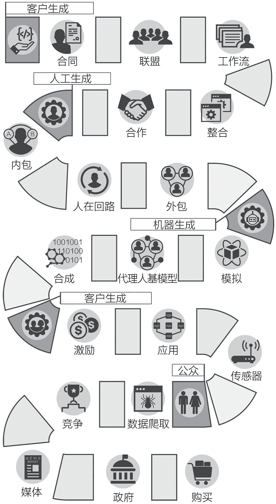

Figure 3-1 Acquiring Data `EPUB/images/image_024.jpg`

## 评估体系：买数据前先算清账

砸钱买数据之前，必须先建立一套评估框架。

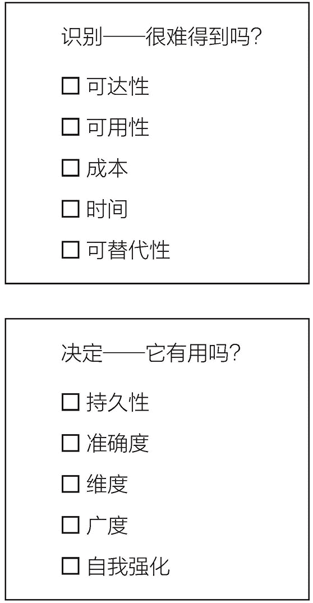

Figure 3-2 Data Assessment Framework `EPUB/images/image_025.jpg`

数据价值的评估维度分两类：一类看**“别人搞得到不”**（获取难度），一类看**“自己用得爽不爽”**（最终效用）。

### 一、 以“获取难度”定价值：筑高护城河

这五个指标衡量的是竞争对手复制你数据资产的难易程度。

**1. 可获取性：物理与政策的双重门槛**
你拿数据费劲，别人通常也轻松不了。比如非得跑趟当地档案馆，手动翻纸质卷宗、复印、再跑OCR识别、转文本，这套组合拳下来，天然过滤了大批懒人。更关键的是要看**未来性**：合同或政策会不会突然收紧？政府开放数据或私人商业数据，免费公开一阵子后突然收费或断供，是常有的事。

**2. 可用性：系统不给力，数据也是废铁**
数据躺在老旧系统里，调取速度慢得像蜗牛，这本身就是护城河。金融行情数据就是典型：报价推送间隔通常在几十微秒级，想要更高频？掏钱买高级套餐。几微秒的差距，足够让AI交易系统在对手面前完成降维打击。

**3. 成本：显性价格与隐性门槛**
数据商标价只是冰山一角。收入分成模式、强制捆绑昂贵终端（如彭博终端，本质是普货硬件却卖天价租金，核心卖的是数据通道），甚至要求你“以数换数”提交自家核心数据才给接口。贡献门槛越高（数据量、格式、行级完整度要求越严），竞争对手越难凑齐门票，你的数据源就越安全。

**4. 时间：不可压缩的自然积累周期**
有些数据靠砸钱买不来时间。气象数据绑定地球公转，就业数据卡在政府统计发布节奏上。想领先竞品？只能比他们早布局、早收集、早积累。时间维度构成的先发优势，往往最难被追赶。

**5. 可替代性：独家配方还是大路货？**
能不能用更便宜的替代数据达到同等决策效果？拿任意新闻网站的文本训练语言模型理解句法，这就是高可替代性——换个源照样行。一旦数据可被轻易替代，它的战略价值就大打折扣。

### 二、 以“最终效用”定价值：决策好不好用

这五个指标（耐久性、准确性、维度性、广度、自我强化）主观性更强，完全取决于具体业务场景怎么用。

**1. 耐久性：数据的“保鲜期”**
过期数据会误导模型产出无效预测。股价秒级变化，一秒前的价格可能对下一微秒毫无参考价值；但珠峰高程、地图数据十年不变，耐久性极强。消费偏好数据介于两者：衣码耐用，流行色转季即废。
*耐久性可通过更新频率延长*。数据源更新越快、分级定价越细（越新越贵），计算与获取成本就越高。高耐久数据看似划算，实则因需持续更新而隐形成本高企。

**2. 准确性：决策可靠性的基石**
数据准不准，直接定模型预测的可信度。通常得靠人工抽样验证——比如抽查产品规格书里的电压参数，跟厂家实测数据对账。成熟供应商会提供准确度担保，第三方机构也能按行业或维度做背书。

**3. 维度性：信息的“颗粒度”与“立体感”**
数据维度即实体属性，直观对应数据表的列数。人口统计数据若只含年龄性别，维度低；加上收入、职业、消费习惯，维度拔高，对精准画像的支撑力就强。维度越丰富，决策边界越清晰。

# 维度：决定数据价值的关键杠杆

当数据的用途指向训练机器学习模型时，“维度”便成为衡量其价值的核心杠杆。因为模型在捕捉数据中的形态与规律时，每一个维度都会直接施加影响。

### 广度

数据的广度，定义了它映照现实世界的程度。具体而言，广度指代实体数据点的数量或散点分布的规模，在数据表中通常对应行数。它意味着同类案例的更多样本，以及实体属性与边缘案例中更丰富的变异。拓宽广度的路径通常有二：一是整合来自不同来源但属性一致的数据集；二是对齐不同数据集的字段并补齐缺失值，实现融合。

### 自我强化

时间赋予数据增值的潜力。自我强化体现为同一实体属性随时间演变，但测量标准保持不变。以员工绩效反馈为例，不同时点的评分虽各自独立，但后者若与前者一致或呈同向趋势，便会相互佐证、增强彼此的可信度，从而提升整体数据资产的价值。

### 关于“体量”的抉择

追求大规模数据历来是执念，甚至常以牺牲质量为代价。孰优孰劣，取决于决策类型及辅助决策的模型（无论是人脑还是机器）。比如，训练图像识别模型，有标签数据可能仅需几百张，无标签则可能需数十万张，因不同系统对样本量与标注的敏感度不同。在自然语言理解领域，前沿模型的训练语料曾在短短一年多内从百亿量级跃升至近五千亿 tokens；反之，识别法律合同特定条款的模型，可能仅需百份 Word 文档即可训练成型。阅读本书时，这些数字恐已因 AI 进展而过时。数据规模的收益极少是线性的，它深度绑定决策场景与模型架构。数据量与价值的关系曲线请见下图。

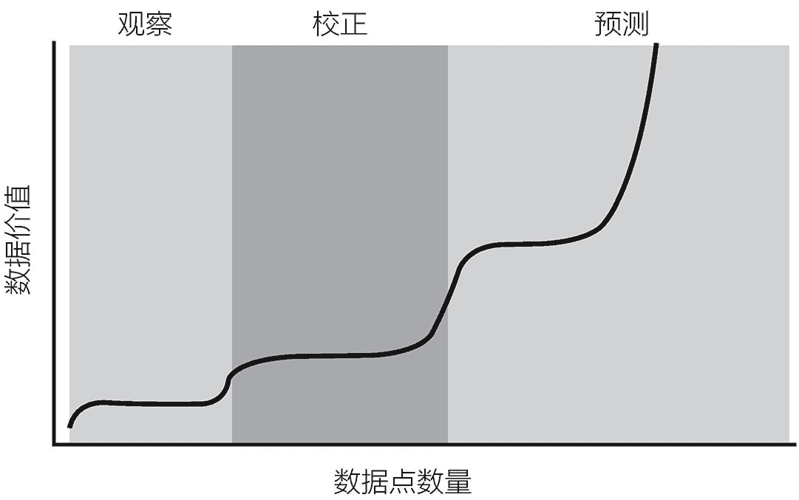

Figure 3-3 Data Volume and Value `EPUB/images/image_026.jpg`

## 客户生成数据：AI 先行企业的核心资产库

对 AI 先行企业而言，服务对象产生的数据往往是最宝贵的来源。既然产品旨在为客户预测业务或工业结果，那么以客户自身数据喂养预测模型，合乎逻辑且事半功倍。客户生成数据的结构示意如下。

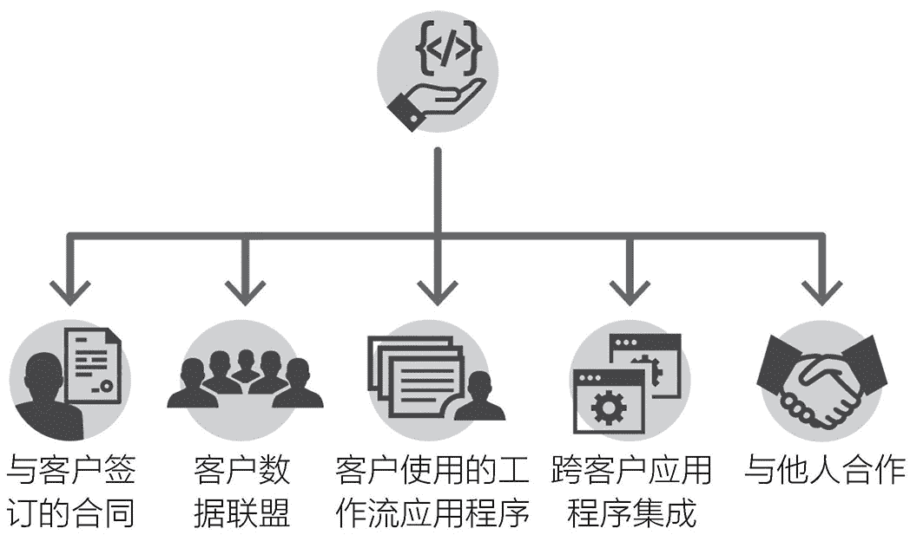

Figure 3-4 Customer-Generated Data `EPUB/images/image_027.jpg`

### 合同层面的数据权利博弈

本节聚焦数据权利的谈判策略与合同条款的实操技巧，旨在构建超越传统知识产权体系的竞争护城河，为老牌巨头与新兴挑战者提供双重防御。

### “白纸”优势：新旧玩家的分水岭

回溯 2000 年代初“云时代”伊始，绝大多数大型企业拒绝将数据托管给外部。对许多人而言，这是数据首次走出机房。为消除顾虑，云厂商在协议中普遍明确放弃对客户数据的一切权利。这些协议至今仍生效，成为云时代企业构建智能系统的枷锁：既要面对与存量客户重谈数据权的艰难，又要陷入疯狂获取数据的焦虑。

如今，AI 先行企业面对的客户群体对第三方托管数据的接受度显著提升，重塑了数据权利的对话语境。虽普遍认为初创公司缺乏大厂的品牌背书，处于劣势，但这反而倒逼它们更擅长通过谈判而非强势条款来解决数据归属问题。

### 谈判：破解“鸡生蛋，蛋生鸡”的死局

获取数据需证明效果，训练模型又需数据——这是典型的先有鸡还是先有蛋困境。AI 先行企业通过开发替代数据源破局：

- **瞄准中小企业（SMB）**：他们对数据权利较为开放，或认为自身数据价值有限，愿意以数据换取价格优惠；
- **设置免费层级**：以功能受限换取数据自由采集权；
- **成本价销售辅助产品**：以此为诱饵获取训练所需数据。

这些外部数据源往往能将模型推向企业级客户可用的预测门槛。

## 契约架构：在合规红线上跳舞

一个常见悲剧：初创公司携 AI 产品拜访大企业，演示自动化神技，试点通过、采购意向明确，却卡在法务合规关——数据不准碰，怕泄露、怕流向竞对，项目瞬间夭折。

破局者从谈判伊始就明示核心诉求：只为“向数据学习”，包括用户交互、元数据、数据流等“数据废气”，从而规避核心数据合规雷区。以下梳理合同条款设计的四大目标与关键概念：

**四大合同目标：**
- 持续迭代模型能力，让产品越用越好用；
- 适配客户业务环境的动态变化；
- 筑高竞争壁垒，阻止对手复制同级效率；
- 沉淀高价值数据资产。

**核心定义（将写入合同）：**

### 模型层面的界定

**专用模型**  
为特定客户定制预测的模型。或基于需求微调特定功能，或通用基座适配客户数据后差异化输出。核心特征：同一模型对不同客户无通用价值。

**全局多租户模型**  
服务于全体客户共性需求的模型。汇聚全客户数据训练，内含通用特征工程。核心特征：单一模型服务所有客户。

### 数据层面的分级

**原始客户数据**  
未经处理、归客户专有的源数据。

**匿名化与聚合数据**  
经处理无法溯源至特定客户的数据。手段包括哈希、移除直接标识、假名化、随机化、扰动等。此类数据可跨客户聚合，训练通用模型。聚合逻辑为：提取全客户共有的特定类型数据点，汇入单表——例如某日期全客户扫描特定 UPC 商品的次数统计。

**个人可识别信息 (PII)**

### 数据合规与存储：避坑指南

部分数据被界定为“个人身份信息”（PII），这意味着在美国及其他国家使用此类数据时，必须履行特定的法律义务，往往需要遵循严格的合规流程。出于对操作失误的担忧，不少客户干脆拒绝提供此类数据的访问权限。

**存储策略方面**，数据既可以部署在公有云，也可以驻留在私有服务器上。客户往往会要求不同类型的数据及模型分别存放在指定地点，这类条款通常会白纸黑字地写入合同。

梳理完上述概念，我们重点来看几类合同条款，**务必绕道而行**：

- 客户声称拥有全局多租户模型的所有权；
- 限制利用跨客户的匿名聚合数据来训练全局模型；
- 由己方承担 PII 管理的法律责任；
- 强制要求数据隔离存储，导致原有数据架构被迫拆解。

---

### 客户数据联盟：以弱胜强的集体智慧

所谓客户数据联盟，是指供方牵头，组织一群客户企业实现数据互通。这种模式能为供方与参与方共同沉淀出独一无二的数据资产。以下从通用框架出发，解析其构建优质数据资产的底层逻辑：

**1. 破解“小数据”困局**  
中小企业自有数据量往往不足以支撑智能系统训练，极易陷入“过拟合”陷阱——模型误将偶然噪音当作核心特征。引入大规模外部数据，能让模型在训练中对多个样本取均值，显著提升泛化能力。

**2. 丰富特征维度，对抗环境干扰**  
成员间可以获取同一品类数据的不同变体。例如，不同光照下的商品图片汇聚在一起，能训练出对环境变化鲁棒性极强的计算机视觉模型。

**3. 交叉校验，补全数据拼图**  
成员间可对非 PII 数据进行交叉比对。假设多方在邮件渠道均有同一用户的记录，但缺失其“偏好液体还是粉末洗衣液”这类偏好字段。通过统一邮箱 ID 作为键，即可填补空白，实现数据补全。

**4. 融合不同频次数据源，提升时效性**  
部分企业拥有持续数据流（如设备、POS 终端），另一些则依赖周期性采集（季度调研、按需采购）。联盟机制让高频数据赋能低频成员，帮助后者快速响应市场最新变化。

组建联盟的难点在于：**如何让每个客户都愿意与其他所有客户共享数据**。核心手段是通过合同授权特定用途（如训练 ML 模型），并支持多粒度的匿名化与聚合操作。共享深度由各方的“贡献-收益”预期共同决定。落地过程中，主要面对三大挑战：

- **冷启动与营销**：联盟是对抗行业巨头的利器，但首要任务是点燃参与热情。潜在成员天然顾虑数据外泄，邀约首批种子用户时，需权衡竞争关系、规模体量、成熟度等因素，精准的话术设计是破冰关键。
- **合同标准化**：供方与每位成员签署的协议必须完全一致，严禁出现“特权条款”（如允许部分客户访问特定数据）。
- **匿名化深度**：因成员间往往存在直接竞争关系，去标识化处理成为博弈焦点，必须投入重兵把控。

**实战推演：对标亚马逊的零售联盟**  
绝大多数购物旅程始于搜索，而商品搜索的主战场在亚马逊。其搜索推荐之所以精准，源于两大护城河：自 2003 年起数千工程师的长期打磨，以及海量用户搜索行为数据。工程师利用这些数据训练高精度模型，驱动搜索联想、结果排序、个性化推荐，构筑起极高的竞争壁垒。普通电商缺乏同级工程力与数据规模，难以复刻体验。

若组建零售商联盟，汇聚全员数据训练统一模型，部署在高度工程化的搜索平台上，单个零售商即可获得超越亚马逊单点能力的推荐精度。**集体智慧，由此重塑竞争格局。**

---

### 客户工作流应用：从“记录工具”进化为“智能大脑”

对于数据敏感度较低的中小客户，工作流应用是切入获取数据的高频替代路径。

**何为工作流应用？**  
它将现实中人执行的一连串动作数字化、软件化。例如，将建筑工地项目经理手写的纸质任务单，迁移至移动端 App，实现任务追踪、分派与报表自动生成。此类应用无处不在，且大量垂直领域仍处于“从 0 到 1”建设期，是深耕行业知乎的开发者的蓝海机会。

**数据生产飞轮**  
工作流产品天然是数据收集器。录入的每条数据自动沉淀入库。以车险理赔为例：传统流程依赖定损员拍照、手写报告、传真流转、人工核损、争议返工，全链路低效且数据流失严重。若引入专用 App：拍照上传、结构化填报、自动分发、争议退回重审，**“损失程度对应维修/更换决策、维修成本估算、车辆残值评估”**等高价值核心数据便能系统性沉淀。

**从数据到智能的跃迁**  
业务流数据在工作流应用中持续流动。企业可基于此构建智能系统——系统不再只是“记账本”，而是能**预测下一步动作、自动填充表单、甚至替代人工判断**。  
延续车险场景：输入车型规格，上传受损照片，模型自动评估损伤等级并输出总价预估。原本由定损员承担的繁琐核算实现自动化，大幅压缩理赔周期，甚至可对定损员工作进行审计或替代。**最终产出的，是一个越用越聪明、内嵌决策智能的新一代工作流产品。**

旧金山软件公司 `Expensify` 通过深度整合银行与信用卡机构，开辟了费用管理的新范式。产品能自动抓取交易流水生成报表，拖拽式操作彻底甩开逐条手录的笨重体验。第二步，他们推出 AI 自动分类功能，模型基于核心工作流全量数据训练，让交易自动匹配类别、标签与报表。这种“沉淀工作流→构建软件→注入数据与智能”的路径，正是我坚信所有商业软件终将智能化的铁证。

### 跨客户应用集成商

## 数据集成与 AI 优先数据战略

数据集成类产品能被动汇聚海量数据，凭借“轻松链接异构源、跨源标准化、连接变更自动同步”三大优势吸引客户。MuleSoft、Informatica 等厂商主导该赛道，随着数据分散于多元应用并通过 API 暴露，市场规模持续膨胀。集成商通过截获管道流经数据，或利用模式推导生成元数据，构建起高价值数据资产。

但搭建数据集成公司极难：
1. **门槛低、同质重**：基础形态极易复制，需求显性化导致玩家扎堆。
2. **巨头必争**：云厂商为多卖存储，战略上必须自研多源采集能力。
3. **运维重、毛利薄**：管道易因不可控因素中断，修复极度依赖人工，成本高企吞噬利润。
4. **定价权弱**：集成采购往往是核心产品落地后的附带决策，客户预算有限，或被核心厂商捆绑推荐。

即便如此，MuleSoft 仍凭此路径上市，Segment 与 Zapier 也跑通“工具集成多源→数据采集”闭环。Segment 被 Twilio 30 亿美元收购，其统一了 SaaS 与内部库的营销数据。从通用分析产品 `Connections` 切入，通过 API 驱动方式对标网页分析工具，数据源覆盖：
- iOS/Android 移动端；
- `Analytics.js`、Shopify、WordPress 网页端；
- 服务端直连；
- CRM、支付、邮件等云应用全谱系。

数据经管道流向邮件系统、分析看板、工单工具、归因平台、数据仓库。Segment 随后利用客户数据构建智能体：自动融合跨源用户历史为全景画像、生成智能用户肖像；合成特征、受众与预测；最终赋能营销活动与应用内体验的个性化。

Segment 两步走：第一步，整合既有源采集数据；第二步，以数据为燃料驱动 AI 优先产品。

### 两种范式的对决

构建工作流应用与搭建集成是截然不同的任务。下面对比工作流优先与集成优先公司（见表 3-1）。

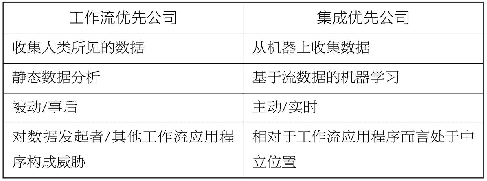

若目标是构建数据资产，集成优先模式具备显性优势：能直接从“机器”（含软件应用）端获取海量、高鲜度（近实时）、强结构化的数据，这三大要素直指高质量预测。反观工作流应用，数据多源自用户录入，易出现不准、非结构化（如文本）、滞后等问题，数据越精准，模型越强。

但集成优先路径更陡峭：一是外部集成数据通常非独家，除非来自内部系统；二是可用数据结构受制于上游工作流应用。相比之下，工作流优先通过在界面植入表单或 UI 组件，主动采集所需特定数据点，掌控权在握。

### 借力合作：低成本获取高价值数据

与外部建立数据联盟，能以极低边际成本获取大规模数据。合作最易达成于“数据互补”方：如构建信用模型，收入数据与负债数据互补。甲方有收入数据、乙方有负债数据，甲练信用评分、乙练消费预测，数据互换双模型同步增强，动机天然一致。

商业模式互补亦是关键：盈利逻辑不同者合作，收益不抵消，客群不冲突。

数据集成商模式不同：他们按客户需求，通过既有管道串联客户存储与目标应用，无需逐个谈判外部数据源。

以医疗影像 CV 为例：模型训练需海量标注图像，患者数据合规极严。AI 公司无自建医疗设施（建设周期年单位），也难直接获院方数据，必须独家合作。AI 方需临界量数据跨过预测可用性阈值，建立护城河。

院方诉求：提升诊断准度、可靠度、效率。重症（如肺癌）防漏诊，高发（如基底细胞癌）求性价比。院方缺 ML/CV 能力，但握核心资产（数据+设备）。合作模式通常含：院方限时独家使用 AI 产品、严控数据出域、集成至现有 X 光机等硬件，换取成本优势或诊断竞争力。

AI 公司带模型，院方带数据，商业模式天然互补。合作让 AI 方拿到临界量标注数据、攻克硬件部署与合规、获医生实战反馈——这些院方单干无法完成。后续可逐步扩展至关联机构，或开放商业化分享增量收益。

### 人工造数据：自建数据资产的硬核路径

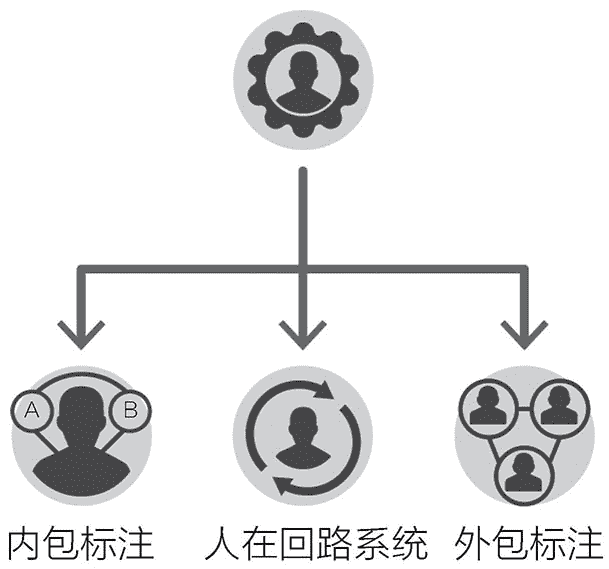

图 3-5 人工生成的数据

#### 数据标注：垂直领域的“稀缺燃料”

监督学习离不开标注数据。虽有迁移学习、半监督学习等新范式试图缩减标注依赖，在通用视觉、语言领域已见成效，但在垂直细分场景下仍难独当一面。获取并拥有经处理的垂直领域数据，是打造垂类 AI 优先公司的最硬骨头。

哪里搞 10 万张 2001 款雪佛兰 Silverado 挡泥板图片？众包、调研、给修理工做工具，短期内难凑齐。只能向常年拍摄车辆的车厂、连锁修理厂、保险公司购买或合作。无现成集，只能自建：组建专家+非专家混编团队，配套高效标注工具。

标注团队管理是新兴运营实践。目标明确时，标注高度可量化。例：目标达专家级准确度 → 先让专家全量标注 → 过渡至“模型预标注 + 非专家纠偏” → 终标：模型+非专家 ≈ 专家。由此得出“专家-非专家一致性”指标。

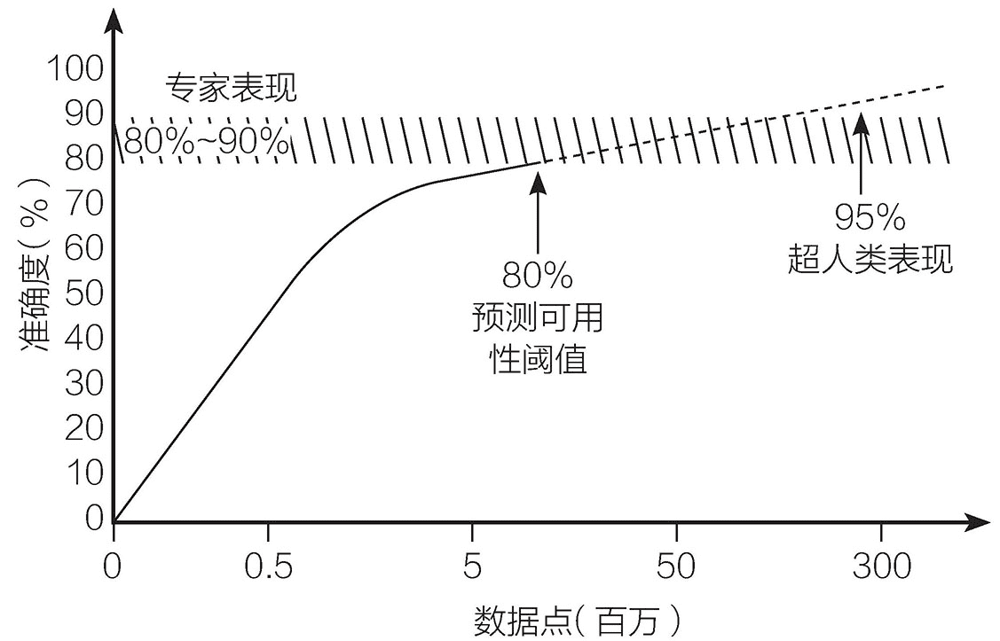

图 3-6 专家标注与模型表现

长期看，标注运营的经济账可算作：单标签自动化节省成本 × 达标所需标签总量，减去维持自动化水平的人力成本，即为标注投资 ROI。


不妨视作工厂：产出品是“已标注数据”，厂长核心 KPI 是提升“贴标签产线”效能。

#### 工具：从清洗到主动学习的进化

标注前常需工程师清洗数据。例：海量客服邮件文本，机器难直接挖掘模式。工程师可用 NLP 抽取实体、聚类投诉类别，再用这些类别标注新邮件，训练模型学会分类响应。人工全量标注贵，全自动又不准。主动学习等技术在两者间寻找平衡点：筛选对模型提升最大的样本交给人工，其余走自动。

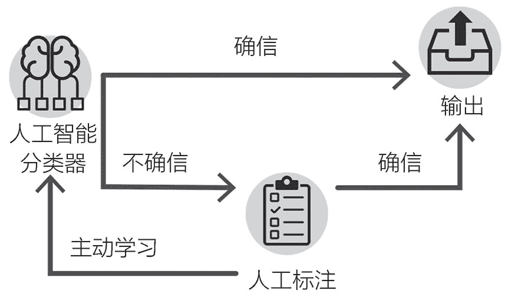

图 3-7 主动学习流程

图像标注时，系统呈图让标注员分组相似图；主动学习模型分析相似特征自动聚类，再让标注员细分子簇，模型持续学习子簇特征，循环迭代。本质上，模型根据标注员纠正的“最准预测”，反推下一步最需什么数据。

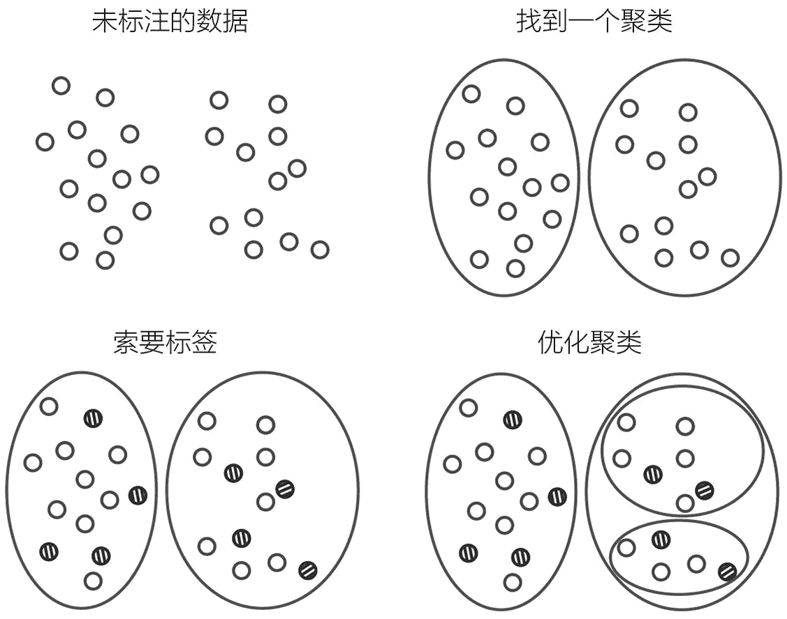

图 3-8 主动学习界面

主动学习系统构建难、价值高：
1. **降维打击门槛**：无技术背景人员也能通过反馈产出高质量标签。
2. **搜索捷径**：在解空间极大、计算昂贵的领域，人类引导机器快速逼近目标，规避盲目搜索。

**风险提示**：机器推荐会否诱导标注员“顺从式标注”？若标注员为迎合模型而改判，标签即失效。

**让用户顺手标注**：在产品内嵌入提示引导用户标注（如图片打标），配合算法从用户端采集最高价值数据：
- **不确定性采样**：标注模型最拿不准的样本。
- **委员会质询**：多模型投票分歧最大的样本交人工。
- **预期模型变化**：标注最能改变模型输出的样本。
- **预期误差减少**：标注最能降低模型误差的样本。
- **方差缩减**：标注最能压缩输出方差的样本。

以上非穷举，均基于 ML 核心原理衍生。

**交互式机器学习（IML）**：设计界面收集数据训练模型，呈现结果供用户决定下轮迭代投入何数据。可视为“让付费用户替付薪员工标注”的另类范式。

研发端，IML 加速分类器迭代：工程师基于用户对话数据开发分类器，用户纠偏越有效，迭代越快。例：造自动写营销邮件系统，工程师自备或网抓样本不如扔给运营实操，反馈质量指数级跃升。

**隐患**：用户可能喂入无信息量噪声，拖垮分类器。防御手段：多用户交叉验证同一数据点；并行跑非交互基线模型，对比差异定位交互模型失效区，或直接回退基线。

**IML 隐性红利——建立信任**：
1. **可解释性萌芽**：用户见数据进、结果出，能自证或向他人解释系统逻辑。
2. **尊重用户主观**：系统接纳用户对输出的修正（客观或主观均可）。
3. **显性影响力**：用户亲眼见自己输入直接塑造后续输出，掌控感油然而生。

#### 构建数据标签运营的最佳实践

对 AI 优先公司，自建标注团队可成核心护城河。但动手前，先评估亚马逊 `Mechanical Turk` 等平台方案：全球劳动力池、7×24h 弹性产能、内置工具保质控成本。

#### 管理：分层分级的运营体系

按专业度分专业/非专业标注员。专业组深谙分类规范（如放射科医生、车险定损师），非专业组经验不要求，招聘渠道广（招聘网、小时工中介、Turk、Upwork）。

架构：标注员 → 标注经理（运营背景，擅协调资源、控成本时限，若非专业占比高需强激励管理力，如客服中心主管经验） → 标注主管 → 中型公司汇报 VP Ops，小公司汇报 COO。初期探索期可汇报 ML Research Lead 或 CTO。

经验法则：未全自动化前，每 50-100 名标注员配 1 经理，视专业/非专业比例调整。

成本变量：标注量、采集难度、工具杠杆、专业度要求。Turk 单标几美分，医生单标可达百美元级。

#### 测量：用业务指标校准运营

终局是好产品，依托准分类器。核心指标：分类器准确度是否持续提升。

ML 领域“量即质”：海量标注即便含噪，仍能拉高准确度。总标注数据点数直接映射资产价值。

商业模型须平衡成本与收益。单标注成本是显性指标，也能反映工具杠杆与人员结构效能。

标注员共识度 = 准确度代理指标（无共识即测量失准）。专业组通常更准，非专业组准确度可通过对标专业组得出。专业组成本高，应动态调整比例向非专业倾斜降本。长期看，模型输出须与客户实况收敛；一致性下跌预警标注体系出问题。

#### 人在回路系统

### 核心概念：什么是“人在回路”系统？

简单说，**HIL（Human-in-the-Loop）** 就是人机协作的一种模式：机器跑流程，关键节点得人拍板、输输入，系统才能出结果。但别搞混了，它不等同于“主动学习”或“交互式学习”——那些算法未必要人参与，机器人自己给数据打标签也行。HIL 的本质更泛指：把数据扔给人，让人来标、来改、来打分（如图 3-9）。

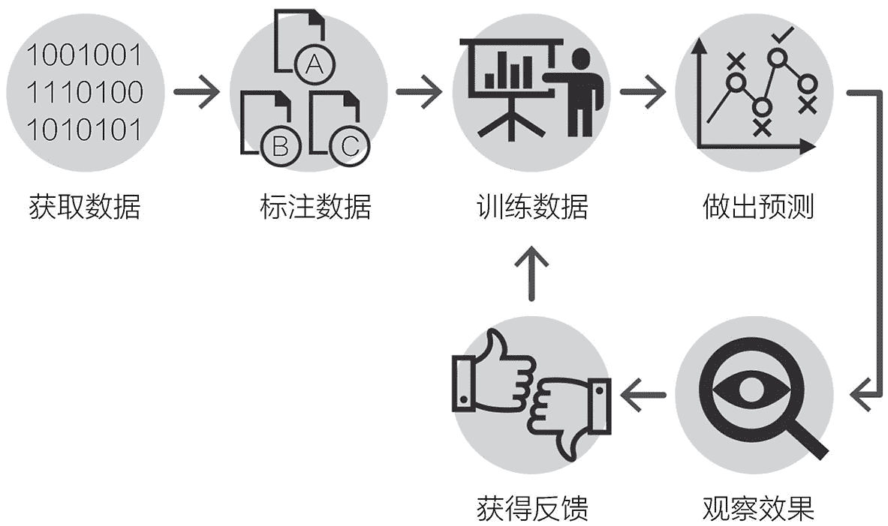

图 3-9 人在回路系统示意

人介入这个循环，通常干三件事：
1.  **造数据：** 比如发问卷、录语音，从零生成原始素材；
2.  **打标签：** 对着文本、图片选分类、输关键词；
3.  **给反馈：** 对模型输出打分，非对即错（二分类），或打 0-10 分（标量）。

---

### 外包标注：不只是省钱，更是为了“凑准”

把标注活外包出去，核心动力往往是**搞到更多高质量标签**。专业标注员识别特定目标（如医学影像里的病灶）确实更准，但谁都会犯错。解决思路是“以量补质”——找多几个人标同一份数据。数学上算笔账：单人错漏率 5%，三人同时犯同一个错的概率骤降至 0.01%（$5\%^3$），正确标签就被“稀释”出来了。

#### 外包 vs 众包：怎么选？

无论是传统 BPO 公司，还是 Mechanical Turk、Upwork 这类众包平台，工人们都能干：打电话采集、网上搜素材、清洗去重、改错别字、剔除模糊图。平台提供统一界面，顺带记录工时、质量。

**权衡点在于“专业度”vs“性价比”**：
- 外包团队面向大众客户，标签体系通用（识别“车”、识别“电影角色”），但不懂你的细分领域（如某款特定车型、精密仪器的异常震动）。
- 自己养团队（内包）专业可控，成本高；外包工具成熟、单价低，但需投入管理精力。
- 现实中，企业常**两条腿走路**，随业务阶段、数据难度动态调整内外包比例。

---

### 机器生成数据：另一条高速路

模型训练不差数据，机器自己造数据也是个硬核选项——稳定、快、便宜，既能给人工数据补位，也能独当一面（如图 3-10）。

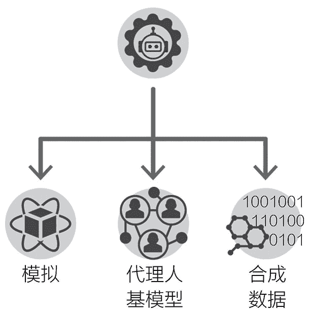

图 3-10 机器生成数据流程

#### 仿真：从“找 Bug”到“练技能”

传统软件工程里，仿真用来**验证逻辑**：穷举迷宫路径、推演电路电流。代码逻辑人写的，但输入组合太多想不全，写脚本随机造输入喂进去，看程序会不会崩。

到了 AI 时代，仿真玩法变了：模型靠数据“长脑子”，仿真不再找错，而是**造经验**。强化学习、智能体 AI 最吃这套——真实环境试错太贵、太慢、太危险，数据集又不够。设计好目标和环境规则（含现实约束），让模型在模拟器里疯狂试错、迭代策略。跑通了仿真关，再把学会的策略部署到生产环境，直接上手干活。

#### 智能体建模 (ABM)：看透复杂系统的“显微镜”

线性关系好建模，$y=ax+b$ 搞定。但现实里变量成百上千、相互咬合、牵一发动全身（经济、生物、社会系统），宏观趋势根本算不准。**ABM 的思路是“由微观推宏观”**：给每个微观主体（智能体）设定激励、约束、决策规则、学习机制，让它们在沙盘里博弈、进化。涌现出的宏观图景，往往能揭示临界点、路径依赖等隐性规律。

这融合了博弈论、社会学、进化论、复杂性科学。康威“生命游戏”、囚徒困境博弈是经典入门案例。实战中：
- 央行用它推演货币政策对楼市、信贷的传导；
- 反垄断审查用它模拟并购后的竞争格局；
- 对冲基金、资管机构靠它做宏观预测；
- 政府用它压力测试环保政策。

**ABM ≠ 仿真**。仿真环境写死规则，测确定性结果；ABM 环境松散，智能体自主决策、互相影响，**研究的是“行为涌现”**，是仿真的超集。

#### 合成数据：隐私合规的“完美替身”

不用真实用户数据，按规则或分布“凭空捏造”出新数据，就是合成数据。规则可以是硬编码（桌子必有四腿），也可以是大模型学来的分布特征（椅子也大概率四腿）。它保留原数据的结构、概念、依赖关系，**但没隐私、没风险**。

**区别于仿真**：仿真目的是“验证/推演”，合成目的是“创造/替代”。

**杀手级应用场景**：
- **研发测试：** 新功能上线前跑真实用户库？一不小心删库跑路或泄露隐私。合成数据随便造、随便毁。
- **售前演示：** 客户面前演示产品，不能拿真客户数据（泄密给竞品），也不能拿假得离谱的假数据（说服力不足）。高保真合成数据，既真实又安全。
- **全链路安全：** 只要不碰真实生产数据，数据安全审计、合规审查、模型训练全流程都能“零风险”过。

### 合成数据的五大核心优势

当数据标注面临成本高昂或执行困难的瓶颈时，合成数据便成了破局关键。文中虽以计算机视觉与图像为主要演示场景，但其底层逻辑同样适用于其他数据类型。

#### 规模化覆盖
识别“椅子”这类基础物体，人类轻而易举；但现实中椅子形态万千——躺椅、餐椅、人体工学椅，细微差别极大。模型想全识别，训练集就得囊括所有品类。收集并人工标注全品类图片，成本高得惊人，甚至不可行；再叠加材质差异、套罩遮挡等干扰，难度指数级上升。合成生成器只需拆解椅子的基础组件（腿、靠背、坐垫、套罩等），通过排列组合即可低成本批量产出数万张覆盖全变体的标注样本。

#### 视角灵活性
单视角标注容易，比如街景视角的房子；但无人机航拍、移动摄像头等场景下，物体呈现多变视角。要让模型适应全角度识别，实拍多视角数据成本极高。合成引擎只需建好单个物体的 3D 模型，便能模拟无限视角，沿轨迹移动、每一步自动输出带标签的数据点。

#### 稀缺场景获取
街边车辆随手拍，但战区坦克、特定医疗病灶等稀缺目标，实拍数据难寻、成本高甚至不可能获取。合成方案通过导入人工建模的目标资产，将其置入多样化环境生成数据。虽然构建生成器前期投入大，但边际成本可分摊至海量样本中——同一套生成器可复用产出无限样本。有趣的是，构建这些生成器的工具链，与游戏开发构建虚拟世界的工具同源。

#### 低概率事件模拟
海浪拍岸随处可见，但“闪电引发爆炸”这类极低概率事件，靠等、靠查历史记录都不现实。合成生成器支持按需定制场景，即时复现罕见事件，填补长尾数据空白。

#### 成本与速度的权衡
**成本端**：程序批量跑图的边际成本极低，常低于人工标注。但并非绝对——若需高精度 3D 模型，采购或聘请 CG 艺术家建模的前期投入不可忽视。  
**速度端**：人工标注流程长（打包、分发、等待、质检、返工、回传、增量训练），周期以周计；合成器秒级出图，直连数据管道，实现“数据即代码”的极速迭代。

**结论**：合成数据在非结构化数据（图像、音频等）上威力巨大，因物理世界是共享的“公共真相”，一套生成程序服务多客户；但在结构化数据（如用户画像）上效用有限——不同业务的用户画像差异大，缺乏通用的底层现实锚点，需为每个场景单独编码，规模化优势荡然无存。

---

### 消费者生成数据

在合理激励下，消费者会主动贡献数据。这不同于“客户提供数据”：客户为 AI 产品付费，消费者仅获得产品输出。相关机制示意见图 3-11。

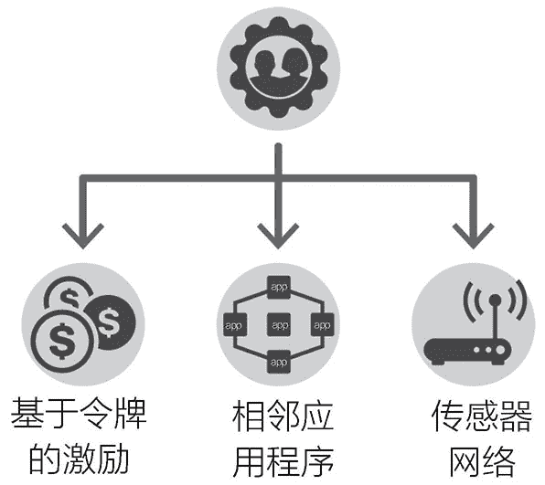

Figure 3-11 Consumer-Generated Data

---

### 代币激励机制

区块链原生的所有权代币或加密代币，可用于激励用户向网络提交数据。因概念新颖，先厘清术语：

*   **区块链**：去中心化、分布式、公开的交易账本。
*   **加密代币**：存储于区块链上的资产标识符。
*   **数据网络**：由原本无关的多方实体共同构建的数据集，而非单一主体垄断。

核心逻辑：向群体分发代币，用户提交/出售数据至网络，获得收益回报。

**区块链赋能数据网络的双重价值**：
1.  **数据溯源可信**：每笔提交上链即获唯一标识。提交时间、真伪均可链上验证；当验证节点足够多，溯源确定性达 100%。
2.  **自动化、防篡改的分账**：收益分配透明化为数学规则。代币持有者按贡献度获酬，全网节点验证，单一实体无法恶意拒付。代币管理极简：所有权登记即固化，分账公式自动执行，大幅降低运营方与贡献者的博弈冲突。

**核心挑战**：链上实现“标准化验证即自动结算”。需自动校验提交数据质量并即时发币。  
*路径一*：强参数标准化——仅对符合固定字段（如姓名、邮箱）的数据付费。  
*路径二*：软性软件验证——数据通过特定过滤器（数值范围、格式校验）即视为同类数据的不同形态，予以奖励。

---

### 消费级应用：头部科技巨人的护城河

对当今科技巨头而言，消费端应用可能是最关键的独家数据源。Meta 等公司凭借海量用户数据建立优势，再借机器学习强化护城河。它们日均采集海量用户行为数据，反哺预测模型，持续优化消费级产品体验与商业变现闭环。

# 数据变现的底层逻辑：从免费服务到商业护城河

回首过去几十年，谷歌推出了一系列颠覆性的创新产品，且大多对用户免费开放。其核心打法是“以免费换数据，以数据换市场”：通过免费服务收集海量用户行为，构建广告预测模型，再将这些精准预测以高性价比的广告位出售给品牌方。如今“用户端采集数据—商业端变现流量”这条路径清晰可见，但在谷歌创立之初，网络广告还是毫无章法的横幅广告——本质上是不分人群的“网络路牌”。谷歌彻底改写了规则：它依据用户的搜索意图、地理位置等多维信号进行预测，极大地提升了广告点击率与商业回报。

谷歌还为我们留下了多个经典的数据策略案例：谷歌翻译免费，但不倒卖用户贡献的语料库；TensorFlow 开源免费，但不交易开发者喂入的模型数据；搜索免费，也不直接向营销商或竞品出售搜索日志。谷之所以基业长青，在于始终坚守“收集高价值数据，打造智能化产品”这一核心战略。

Facebook（现 Meta）同样走过这条路径。作为全球霸主级社交平台，它免费连接人与人。用户在分享喜好、愿景、生活点滴时，源源不断地沉淀了海量高粘性数据。Facebook 利用这些数据训练预测系统，向广告主兜售精准投放能力。其广告之所以极致高效，关键在于“实名登录态”——平台精准掌握每个自然人的完整浏览轨迹，实现了人货场的完美匹配。

亚马逊则重塑了零售图景。它依托购买记录与浏览路径洞察需求，反哺推荐系统。时间是护城河：长期积累的行为数据让其推荐精度远超后入局者。

**“C 端采集，B 端变现”已成巨头标配。** 23andMe 用基因数据、BillGuard 用消费账单、Credit Karma 用信用评分、Onavo 用流量监控、Dark Sky 用定位轨迹，无不如此。但这条路走深走实，有三重隐忧：

1.  **诱饵失效：** “免费送服务骗数据”非长久之计，竞品随时能用更低成本的诱饵截胡同类数据。
2.  **管道博弈：** 若依赖付费开发者植入 SDK 采集，一旦上游涨价或下游降价，利润空间瞬间归零。
3.  **资产折旧：** 静态数据随时间贬值，难以持续产生复利收益。

值得注意的是，科技霸主多非 ToB 软件厂商。企业间数据壁垒森严：大厂为防竞品获益，严控对外共享；而 C 端用户无商业竞争顾虑，隐私敏感度相对较低，数据流转阻力小得多。

## 传感器网络：把物理世界“数字化”

若要跳出软件层、直击物理实界采集数据，传感器网络是关键一招，但部署成本高昂——传感器或简陋如计数器，或复杂如飞机黑匣子。

**全球移动网络是当之无愧的超级传感器网。** 智能手机内置的气压计、加速度计、GPS 等传感器，随时可被应用调用。Dark Sky 曾巧妙聚合手机气压计数据实现超局部天气预报，同时回收定位数据变现。目前手机传感器数据多为巨头垄断，但新型传感器或旧传感器新用法，仍留有差异化切入口。

**廉价普及型传感器将是未来最显性的数据富矿。** 受限于成本与易得性，单点数据无稀缺性，**竞争壁垒在于“专有部署方式”**——例如在特定商圈的每家门店铺设客流统计设备，形成独家商业洞察。

**专有定制传感器则是最高阶、最难触达的数据源。** 从生物电信号到深海温跃层，测量对象无上限。但研发制造门槛极高：芯片选型、封装材料、通讯协议、量产工艺、兼容适配，每一环皆可筑起专利护城河。造出来还不够，**还得解决“装机难”**：没人愿在家里装耗电、嘈杂、无收益的设备。破局有两招：一是像尼尔森付费装盒统计收视，直接发钱；二是像家用电力传感器，帮用户聚合数据谈电价、省电费——**让数据采集成为用户省钱的工具，而非负担。**

## 公共数据：免费但棘手的宝藏

对于 AI 优先企业，公共数据集虽免费获取，却常伴随获取困难、版权争议等坑点。

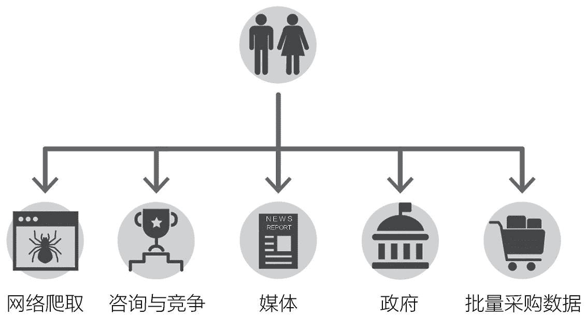

Figure 3-12 Public Data

## 网页爬虫：互联网规模的训练语料

网络上沉睡着海量结构化信息，是训练机器学习模型的天然矿床。谷歌的数据霸主地位，正是建立在其“全球最大网络爬虫”的身份之上。

# 数据获取实战：没有捷径，只有拼尽全力

数据量决定质量上限，海量积累能筑起护城河。从互联网抓取数据，业内通称“爬虫”。简单说，爬虫是自动化程序：沿着 URL 遍历网络，剥离排版噪音，提取核心字段，按标准格式（如 JSON）入库。比如盯上 SEC 官网的年报（HTML 格式），程序自动登录、解析、抠出营收数字、存成结构化文档。技术难点在于目标页面结构、位置、可用性时刻在变，优秀的爬虫必须具备极强的自适应能力。

爬虫已成成熟赛道。服务商分三类：按需定制采集特定数据点；针对固定源周期性更新、自动应对反爬与改版；提供通用抽取平台，随取随用。

**替代方案：DaaS（数据即服务）**。厂商自建爬虫集群持续清洗，再通过 API 端点直供干净、即用的数据。典型案例：输邮箱，返回姓名、职位、公司。数据源可能来自几百个公开渠道和政府公示。

---

## 咨询换数据，竞赛众智能

**痛点匹配**：一方手握海量数据却不会造模型，一方满腹 ML 才华却无米下锅。最朴素的合作是**咨询项目**——ML 方帮数据方跑项目，合同约定“项目结束数据归我（或保留衍生版权）”。

进阶玩法是**竞赛平台**，Kaggle 是鼻祖。企业放出数据集与奖金，全球数据科学家比拼预测精度，赢家拿现金。

终局形态是**去中心化联邦学习**：
- 数据不出本地，模型下发训练，仅上传加密梯度/参数；
- 差分隐私、多方安全计算、区块链激励护航；
- 数据方、算法方双盲，知识产权与隐私零泄露；
- 按准确度分级发奖，买方用私钥解密模型。

---

## 媒体收割数据，政府挖掘长尾

**媒体反向收割**：办榜单、出报告。企业为上榜主动填报详细数据，出版方坐享其成，双赢。

**政府数据**：美政府开放 API 供结构化调用，方便开发者造应用。**但公开数据无稀缺性**。真正的壁垒在于“以前没人搞定的公共数据”——手工录入档案、跑市一级政务大厅调离线库、清洗烂表。基层政府常无力建线上系统，这正是机会。

---

## 买数据：数据经纪人的奇特江湖

最直接的来源：批量采购。从上市消费数据巨头，到偷摸刮取 Facebook 数据的野鸡 App，甚至贩卖“酗酒者名单”、“负债求救名单”，江湖水深。

### 经纪人干什么
聚焦垂类，凑齐临界量，清洗、分析、补全，打包定价卖“洞察”而非裸数据。自有+授权混合，客户买的是“已处理、可直连”的确定性。商模极难：客户本质“租”数据，用完即弃。**核心生存法则：卖高频刷新数据（如股价）**。交付多走 API（DaaS），直插营销自动化管道。

### 经纪人画像
- **营销类**：卖“画像包”——ID（姓名/邮箱/设备号）+ 标签（人口属性、12 年前问卷、点击偏好）。衍生出心理画像、人群分桶，本质是把人“模式化”便于投放。
- **金融类**：彭博年入百亿。行情 tick 数据、估值建模素材（财报、私募财务、消费者调研、共识预期）。
- **垂直细分**：医疗、工业、商品参数……

### 采坑避雷清单
成熟商自助下单（价目表+API费），小商可能要填表寄U盘，或谈一次性买断。**付款前必须核验五项**：
1. **准确性**：第三方或自证？未验证=买垃圾。
2. **结构化度**：能否直入管道？不然还得花钱洗格式。
3. **所有权清晰度**：卖家有权卖？防侵权追责。
4. **合规性**：GDPR/CCPA 等隐私法合规？违规罚单飞向买家。
5. **安全性**：卖家被黑数据泄露，你手里的数据瞬间贬值。

---

## 绝不出售核心数据

AI-First 公司若想变现数据卖给经纪人，**通常是次优解**。经纪人估值倍数远低于“用数据造产品”的公司。

**铁律案例**：Facebook、LinkedIn 增长到中段，双双**砍掉开放 API**，收回数据主权。为何？只能靠卖广告、招聘会员、销售线索等高价值应用层产品，才能榨干数据终身价值。若把底层档案卖给别人做应用，自己就失去了造王者产品的根基。

**正道**：攒专有数据集（虽苦）-> 喂入自学习软件系统 -> 跑通数据学习效应 -> 建立永续技术护城河。

---

## 本章总结：想尽办法，搞到手

每周都能听到新奇的搞数据妙招，人类在“低成本获取”与“造社会工具”上的创造力惊人。虽多为一次性战术，但**串联战术、积累成战略数据集**，正是 AI-First 公司长坡厚雪的第一步。

**没有标准答案，没有“金线”，没有清单**。开头的评估框架用来分配预算、规划鲜活度维护。下一章讲：拿到数据后，如何选模型。

---

### 章节金句速记（17 条核心战术）

1. **给数据分层定价**：物理/法律可得性、成本、时间、可替代性 → 判断竞争壁垒。
2. **按业务相关性估值**：持久性、准确度、维度、广度、自我强化 → 决定预测上限。
3. **向客户要数据**：合同博弈“原始数据归客户，模型/衍生数据归我”的平衡点。
4. **先搞小客户**：数据共享意愿强、触达易、限制少；大客户法务重、要折扣。
5. **组建数据联盟**：联合长尾对抗头部巨头。
6. **造工作流软件吃业务数据**：日志自动化 → 训练预测模型 → 反哺产品。
7. **跨源抽取、链接、归一、更新**：服务即数据收集，副产品是元数据。
8. **找互补伙伴共享**：数据能增强彼此模型，天然有动力交换。
9. **自建标注团队**：外包/众包/内包皆可。内包需配专业+非专业混编 + 高效工具。
10. **主动学习加速标注**：少量人工种子 → 大量自动生成伪标签。
11. **用户入环**：让用户造、标、判。极致精度离不开人类思维对齐。
12. **代理人建模**：模拟激励/约束/互动，产出复杂系统数据。
13. **跑仿真模拟**：低成本生成长尾/极端场景数据。
14. **合成数据**：软件在同一对象的多版本、多视角、稀有/高危/昂贵场景下生成标签，非结构数据（图像）主战场。
15. **Token 激励第三方供数**：代币经济设计验证与奖励闭环。
16. **造消费级产品/硬件收数**：成本高但定向强、可控。
17. **爬公开网/政府/供应商**：爬虫、咨询、竞赛、媒体多管齐下。
18. **死守不卖数据**：经纪人估值低，数据学习效应才是终局价值。

---

# 第四章：组建 AI-First 团队

## 概览：数据到手，处理是第二步

**数据学习效应 (DLE) = 数据规模经济 + 数据处理能力 + 数据网络效应**

从“精益 AI”进化为“AI-First 产品”，核心杠杆是**人**。本章拆解：招谁、去哪招、怎么托底、怎么管、怎么设计组织。人才极度稀缺，**别盯着顶尖 CS 院系**，要在被忽视的角落（物理、统计、量化、跨学科）捡漏。终极挑战：把造 AI 的人渗透进全组织，让知识跨学科流动。

重点不在教工程师调参，而在教**管理者如何让 AI 团队赢**——配置最佳实践、给资源、给认可、给空间。

---

## 招什么人？技术栈全变了

AI-First 公司不吃传统 SaaS 技术栈。你需要：
- 高吞吐数据基建
- 毫秒级查询引擎
- 高并发分析管道
- 算力密集型可视化
- ML 模型训练/推理集群
- 预测交互界面 + 反馈闭环收集

驾驭这套栈的**九大核心角色**：

| 角色 | 核心使命 | 关键差异点 |
|------|----------|------------|
| **数据分析师** | 搭仪表盘、可视化、翻译模型输出 | 面向业务决策，非纯研发 |
| **数据科学家** | 设计并落地实验 | 偏假设验证、统计建模 |
| **数据工程师** | **数据管道守门人**：清洗、自动化、目录管理、资产整合、新源接入、管道维护、外部链接 | 最稀缺、最辛苦、地基中的地基 |
| **机器学习工程师** | 模型工程化：实现、训练、监控、运维、迭代 | 懂工程、懂模型、懂生产环境 |
| **数据产品经理** | **翻译官**：模型数据需求 ↔ 设计可用性 ↔ 客户偏好 → 决定“哪个功能能采到专有数据” | 懂数据飞轮，非传统功能型 PM |
| **数据基建工程师** | 选库、建库、迁库、控成本、保 SLA | 深度基建，非业务开发 |
| **机器学习研究员** | 前沿算法探索、跑高风险实验 | 论文级能力，产出不确定性高 |
| **软件工程师** | 写服务预测的代码：API、UI、边缘端 | 标准化工程交付 |
| **设计师** | 设计预测交互界面、**反馈采集入口** | 让“人机协作”自然发生 |

**关键提示**：这些岗位的画像常**非典型 CS 背景**（统计、物理、数学、量化金融、认知科学……），招聘 JD 别照抄互联网大厂模板。

# 核心岗位档案：学历与背景准入线

- **分析师岗**：MBA 或统计、计量经济、经济、数学等量化学科本科起步；
- **建模专家**：统计、应用数学、物理方向的深度专家；
- **数据工程师**：计算机科班出身，专攻数据库架构与治理；
- **ML工程师**：计算机研究背景，或机器学习、应用数学、物理硕士及以上；
- **数据产品经理**：软件产品全生命周期管理、项目落地实战派；
- **基建工程师**：分布式系统方向的计算机高阶人才；
- **前沿研究员**：机器学习、数学、物理、计算神经科学等硕博学位。

---

# 招聘节奏：循序渐进，步步为营

科学规划入职先后，能显著提升企业对数据战略的投入产出比、复盘迭代效率，并奠定“AI 原生”文化基石。以下序列假设组织零算力积累起步，适合小步快跑策略（大型项目或 AI 原生公司可一次性拉齐全编制）：

1.  **分析师（领跑）**：业务端对决策优化的刚性诉求，直接牵引建模项目的优先级排序。
2.  **建模专家（探路）**：引入统计与机器学习手段验证假设，为后续在特定数据源与算法族上的持续投资提供早期佐证。
3.  **数据工程师（筑基）**：数据采集、清洗、入库是建模的前置工程，必须提前就位。
4.  **ML工程师（落地）**：将原型转化为生产级服务，攻克稳健训练与系统集成难题。
5.  **数据产品经理（闭环）**：通过产品化设计收集模型反馈，驱动迭代并沉淀专有反馈数据资产。
6.  **基建工程师（扩容）**：应对海量数据存储、高速计算与质量保障，支撑模型规模化服务。
7.  **前沿研究员（突围）**：攻克长尾案例、突破现有框架边界，推动 SOTA 技术落地。

**外包策略：核心自建，边缘可借**  
视产品形态、团队成熟度及系统复杂度而定，部分环节可引入外部力量。边界清晰、数据源聚焦的独立分析任务，适合外包给自由职业者；数据管道搭建、基建选型与运维，亦可聘请顾问团队（决策取决于外包方能否接入既有算力与数据底座）。但**核心迭代（模型更新）极难外包**，因其需持续调参、训练、监控；**数据产品经理**需深度嵌入一线与用户交互，收集数据与呈现预测高度耦合；**前沿研究员**涉及长周期探索、昂贵算力独占、实验全控权及与工程团队深度协同，非短期外包能胜任。判断标准的核心在于：**该角色是否需要与客户及企业内部保持高频、持续的深度互动。**

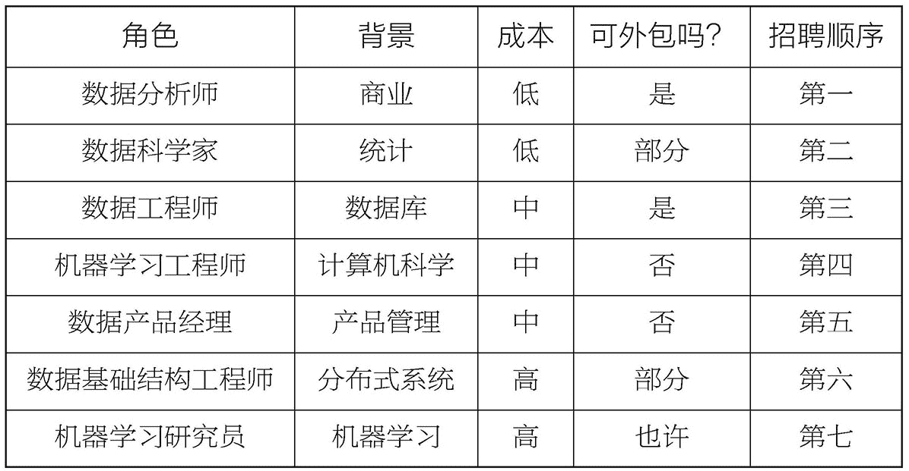

---

# 人才地图：跨学科广撒网

“统计先行”意味着在招聘工程师和研究员前，优先锁定分析师与建模专家。这种“数据科学与软件工程解耦”的策略，大幅拓宽了人才池，纳入了所有具备数据操纵深厚功底的学科背景。

可在**经济学、计量经济学、会计学、精算学、生物学、生物统计学、地质学、统计学、流行病学、人口统计学、工程学、物理学**等领域发掘人才。这些学科强制要求高强度的数理统计训练。例如，物理学博士往往天然精通数据分析的核心范式。上述背景的技术人员，通常已掌握“精益 AI”流程中数据集研究所需的核心技能——**统计学（测量、过程控制、仪器使用与建模）**。

---

# 第五篇 建模：织就数据网络效应

## 概览：从蓝图到落地

前文已界定竞争优势、引入新范式、给出度量标准与建设蓝图。第三章解决“获取数据”，第四章组建“AI 优先团队”，第二章奠定“精益 AI”基石，第六章将聚焦“模型管理”。本章切入**数据学习效应方程的第三环——建模技术**：如何利用机器学习、神经网络等跨网络操作技术，构建数据网络效应。

请重温数据网络拓扑图（图 5-1）。

```
数据学习效应=数据规模经济+数据处理能力+数据网络效应
```

图 5-1 数据网络

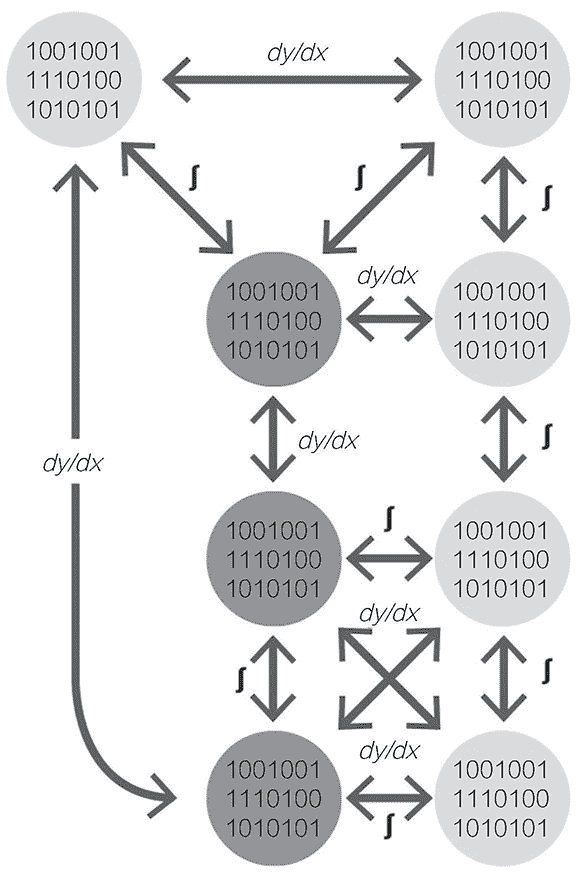

聚焦网络边缘（连接线）上的动态演化。一切围绕**“通过构建 ML 模型强化竞争壁垒”**展开。

AI 领域突飞猛进，可用建模手段繁多，微调即可适配数据处理。选型与调优取决于数据特质与业务目标，但共同点在于：**强化学习、积累智力、甚至通过沉淀独家数据创造新资产**。这正是 AI 优先企业将建模置于研发核心的原因。

以下案例展示特定方法如何生成数据，旨在帮助商业决策者洞察 ML 的战略价值，而非指导技术细节决策。

## 基石认知：特征与标签的博弈

机器学习赋予计算机大规模执行人类任务的能力，甚至超越人类极限。模型开发前期工作繁重：
1.  **定义目标变量**：预测标签数量、关联分析还是分类任务？
2.  **特征工程**：通过计算与编程让模型识别“特征”（潜在相关因子），标签即输出。

**特征来源四层级**：
- **显而易见**：如瞳孔几何特征，人工即可编码。
- **需领域专家**：如超声心动图识别左心室肥大，需医学专家定义病理阈值与解剖定位。实战中，专家需提出并验证“相关性为何可能为因果性”的假设。
- **人类难以言表**：如斑马条纹间距，人能识别个体难描述特征；机器在噪声数据中却能精准提取。
- **算法自动发现**：监督学习（喂入输入-输出对）让机器自学特征；无监督/半监督学习则对未标注数据自动聚类挖掘隐含结构。

**构建监督模型特征的实操阶梯**：
1.  显性特征直接用；
2.  隐性特征找专家；
3.  专家搞不定，写算法从标注数据挖掘；
4.  仍不行，转用无需显式特征/标签的方法。

**权衡**：显著预测性特征越多，模型越准；但特征过量易导致过拟合。目标始终是**在可控复杂度下最大化预测力贡献特征**。

## 方法选型：对症下药五大派

主流 ML 五大类：监督、无监督、强化学习、迁移学习、深度学习（后两者与前三类有重叠）。表 5-1 依据**手头数据、解释性需求、问题先验知识**给出匹配指南。

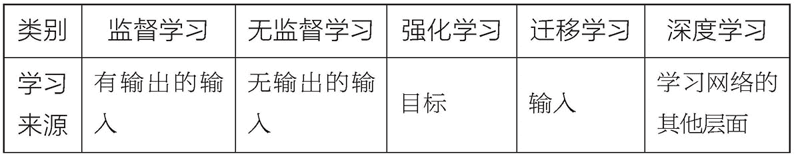
▼续表
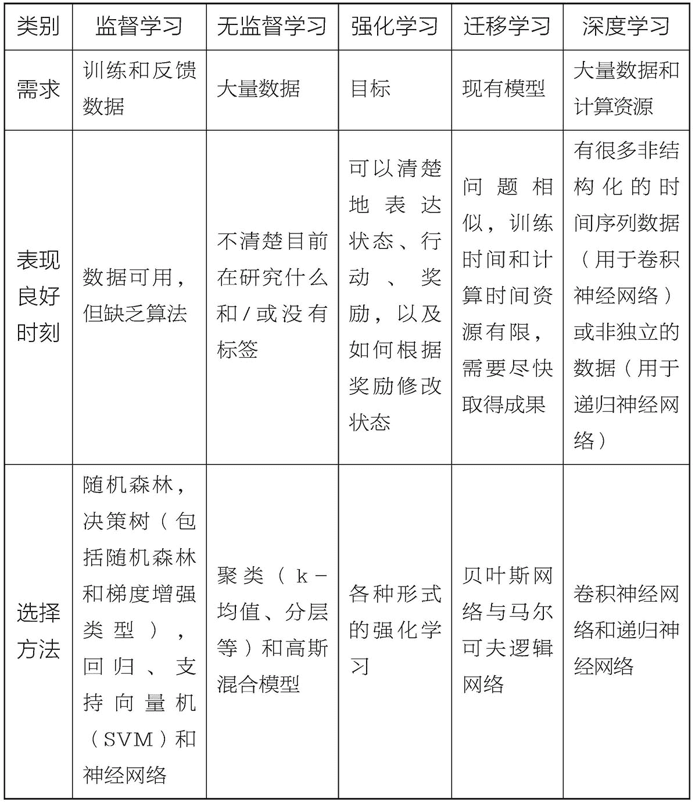

## 全景扫描：各流派的数据飞轮特性

预测方法百家争鸣，数据生成与积累机制各异。以下梳理常见流派的“数据飞轮”画像：

### 多元学科奠基派

| 方法 | 数据创造机制 | 数据积累特性 |
| :--- | :--- | :--- |
| **归纳逻辑编程 (ILP)** | 程序员定规则，程序按规则推演生成数据（仅实验成功时） | 非自动累积，需人工设计新规则或实验 |
| **统计分析 (如回归)** | 分配给数据点的类别成为元数据，助力后续建模 | 无自动积累，但极利于特征工程与数据清洗 |
| **决策树** | 构建过程产出的分类/数值属有价值元数据，可跨模型复用 | 支持递归自我演化（以新叶替旧叶），数据生成加速 |
| **决策网络 / 贝叶斯网络** | 推断网络结构、权重、隐变量、概率分布，输出可迁移决策 | 每次运行依据前序决策更新权重参数，持续积累 |
| **进化算法** | 每代迭代筛选最优算法并输出结果 | 以加速度持续生成输出，直至终止指令 |

### 机器学习核心派

| 模型 | 数据创造 | 数据积累 |
| :--- | :--- | :--- |
| **前馈神经网络 (FNN)** | 单次前向传播产出预测 | 无自动重跑与特征增殖，不自动累积 |
| **递归神经网络 (RNN)** | 序列建模中产出预测（常在达标精度时） | 每次自动运行生成预测，准确度动态演进 |
| **卷积神经网络 (CNN)** | 深层微分运算前学到的特征虽不直接提升准度但极具价值 | 每次自动运行累积特征（信息而非数据），指导后续探索与增量建模 |

### 生成对抗网络 (GAN)
**双模博弈**：生成模型（常为反卷积 CNN）依推断造假，判别模型（常为 CNN）凭真实分布鉴真。生成方试探判别方盲区，最终产出超越分布的“新知”。
- **创造力**：提出设计者未预设的特征。
- **累积力**：双模分布每轮迭代，功能指数级增强，直至判别模型失效。

### 强化学习 (RL)
**目标驱动智能体**：通过交互最大化奖励（如通关游戏）。
- **创造力**：智能体轨迹（观察-动作-反馈）全为创造者未预设的新观察。
- **累积力**：持续循环“观察状态→执行动作→观察效果”，数据自我增殖。

**表 5-2 详细对比各方法的数据创造与积累画像。**

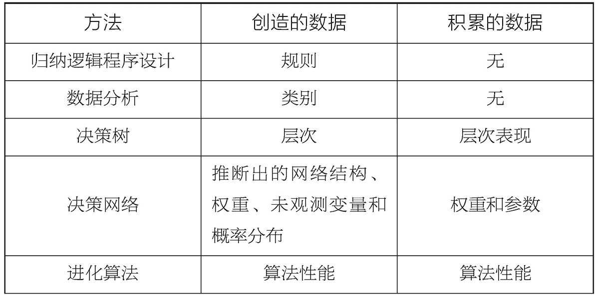
▼续表
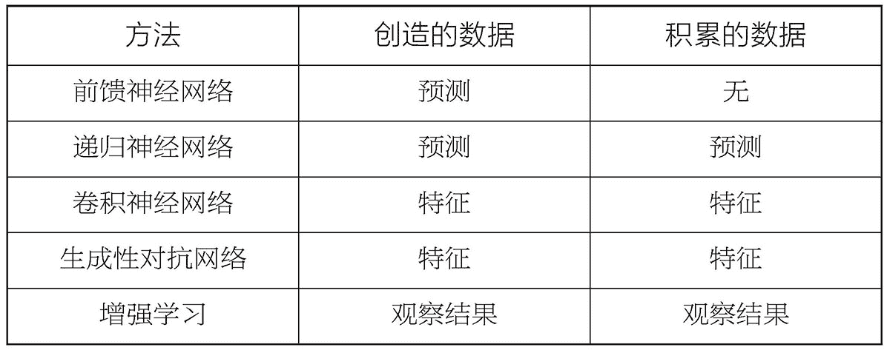

## 章末沉淀：把模型变成资产

前沿研究日新月异，但**入门建模从未如此容易**。选定基础框架跑通数据，是最佳起点。许多团队日迭代，待业务跑通后再攻关定制化难题。

**选型锚点**：你要预测什么、能拿到什么数据。
**跑通后的战略反思**：退一步思考——模型如何沉淀为公司核心资产？AI 力量源于时间积累的信息，不仅藏于数据，更蕴含于**学习规则、特征体系、类别结构、模型参数、每个循环周期的副产出**中。

**三大行动指南**：
1.  **据数选法**：有标签用监督，纯海量数据用无监督。
2.  **明确目标**：RL 必需目标函数；其他范式常可“无目的”产出洞见。
3.  **元学习思维**：部分 AI 能生成“如何学习”的元数据，在探索新解中沉淀高阶资产。

---

# 第六篇 模型管理：跨越“最后一公里”

下一关卡：**把 AI 推出实验室，接入真实世界**。AI 优先产品自带长留存基因，但必须与现有软件、流程、系统深度融合。本章从最佳客户实践切入。

舆论常诟病 AI“失控”：偏见输出、冒犯决策。核心挑战是**防止模型与现实脱节**。AI 产品强在持续适应、进化、生成新数据，但这“持续变化”让管理极难——如同同时平衡多维张力：

| 张力维度 | 矛盾焦点 |
| :--- | :--- |
| **实验 vs 实施** | 自由实验出强模，但仅落地生产才创造价值 |
| **去中心化 vs 中心化** | 影响模型的领域知识分散在各业务线，运行底座却高度集中 |
| **测试 vs 观察** | 离线测试暴露问题，但必须投入实战观察真学习 |

**理想管理系统**应支撑：去中心化实验 → 严格测试 → 上线后持续监控 → **模型不间断学习**。
核心构想：**构建 ML 管理闭环**——覆盖持续训练、修改、部署、测试、监控、修复的自动化飞轮。启动时无需全链路满速，先跑通最小闭环。同时建立**风险前置雷达**，预判问题发生时机与形态。我们将借鉴敏捷、DevOps、统计过程控制 (SPC)，并引入智能系统管理新范式。图 6-1 描绘模型验收全流程。

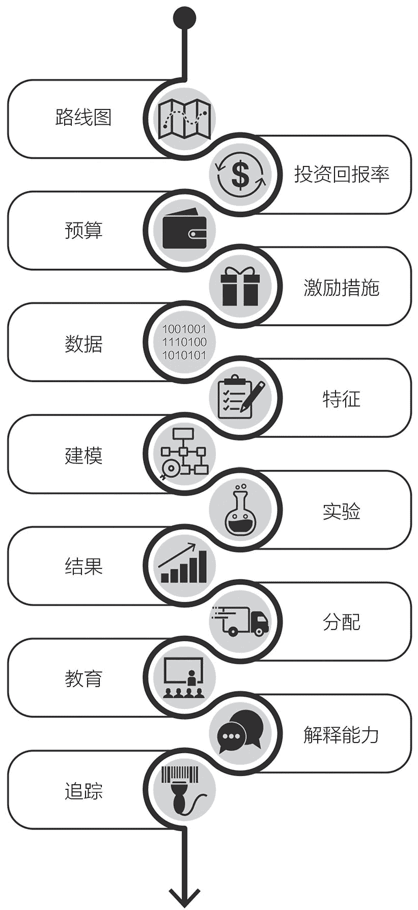

图 6-1 模型验收步骤

## 落地实操：没有标准答案，只有导航灯

模型出实验室涉及大量人员、流程、软件，每次实施皆独特。本节不提供清单，只给关键路标。

### 数据

# 落地 AI 产品的硬核指南：从数据管道到模型全生命周期管理

智能系统的运转离不开数据燃料。大多数供应商都能搞定从客户端抽取、转换、加载（ETL）的标准流程，但实战中总会遇到些“个性化”麻烦：客户对保留哪些数据表、如何定义字段总有自己的执念，甚至常借引入新产品之机大搞数据基建重构。与其让客户推倒重来，不如在单次提取中仅拿最核心的几张表、最精简的数据量——毕竟一次抽取根本暴露不了存储规范、标注规则等深层隐患。核心原则只有一条：严格界定“必须要的数据”，指定专人负责，主导 ETL 工具选型，实施自然提速。

选型数据基建时，探索期要在成本、延迟、规模、安全四者间找平衡。跑小规模实验不差钱，但争分夺秒出结果才能多迭代几轮，所以延迟优先；测试期规模不敏感，上生产才成硬指标。实验阶段砸钱买高可用、低延迟的库存实验数据划算，生产环境则得精打细算。你可以找云厂商要个生产级数据库，全球秒级拉新机器。但比起传统软件，AI-First 公司选库更烧脑：定期训练、测试、生产三个周期轮转，每阶段对成本、延迟、规模、安全的胃口全不同。

## 软件集成：要么造轮子，要么接管道

智能系统交付预测的路径分两派：自带 UI 的独立应用，或是无缝嵌入现有系统。AI-First CRM 要么给销售造个新日用工具，要么直接往 Salesforce 里塞建议。后者靠 API 对接，开放平台（如 Salesforce）还好办；遇上封闭系统（如 SAP），或是压根没 API 得定制开发，难度直线飙升。自建应用等于另起炉灶搞个软件项目，考量维度完全超出本文范畴。

## 安全红线：数据越多，责任越大

模型贪数据，数据越敏感（定位、财务），雷区越密。每个数据集的用户权限、外部访问规则都可能是定制的：客户能看实验集结果，绝不能碰测试集防作弊；隐私法规严（如医疗）时，实验数据全得合成；生产环境用真数据，得彻底脱敏，甚至要求模型自带隐私加密跑在客户自家环境里。权限管理更是烂摊子，内外部利益相关者的历史包袱一箩筐。

别忘了物理入口：摄像头、门铃、甚至智能牙刷，每个联网传感器都是黑客跳板。AI-First 公司建模时必须把这些固件漏洞纳入威胁模型，强制推送 OTA 补丁，一个都不能漏。

## 传感器部署：脏活累活全是坑

玩硬件的 AI 公司，得单独养工程+现场运营团队。从工厂发货到客户手里是物流题，安装更是体力活：搭架子、拉网线、联网调试。环境更刁钻：热传感器怎么在极寒别冻挂？户外设备怎么防偷防砸？每批传感器型号、场景不同，群控管理堪比放羊。报价时千万把实施成本、硬件费拆开列，别让隐形支出吞了利润。

## 借力第三方：系统集成商（SI）与独立软件商（ISV）

专业的事交给专业人。自建不划算、不核心时，引入 SI/ISV 是正解。AI-First 公司最吃 SI 红利：集成软件、对齐客户数据、训练模型，这三件事本身就分离。预测卡车停靠点要从旧版 SAP 拉数据？别自学 SAP 文档了，找专门搞 SAP 的 SI 拉数据，快十倍不止。

涉硬件安装维护，硬件系 SI 首选。他们跟厂商混熟了，懂串联传感器、联网、入库，经验和渠道能让安装少踩坑、修得快、备件充足。

## 组建“特种部队”：实施团队长啥样

核心阵容：数据校验员（查质量）、数据工程师（洗数据）、数据科学家（跑实验）、ML 工程师（转模型）。外围配齐：产品经理、应用开发、DevOps、法务。

还得有个“翻译官”团队单独对接客户：擅长把模型输出讲人话、做汇报、点燃试点热情、拿下采购单。这帮人通常是咨询/专服出身，懂数据科学基本功。定期产出 PPT、上门汇报，是提升产品最终验收率的关键动作。

## 攻克接受度：从技术信服到管理买单

AI 产品深度绑定现有系统，动一发牵全身，阻力来自技术质疑和管理条条。按时间轴拆解破局动作：

### 技术层：跑通才是硬道理

- **先跑通再谈完美。** 预测类产品兑现的是“未发生之事”，比交付功能的软件难验收多了。起步先查：手里这数据，真能用 AI 快速解决客户痛点吗？
- **别陷“治数据”无底洞。** 整理、入仓、清洗、标注、低成本存储，是永恒大坑。客户数据成熟度参差不齐，AI 项目常成催化剂。长远看数据治好了实验快好省，但眼下接受度才是生死线。**手动抠核心数据，快交付，强行启动**。哪怕单项目成本高，也比烂尾强。
- **给张靠谱路线图。** 客户并行 N 个项目，没时间陪你玩。没有路线图，POC 变无限 POC，热情熄火，采购单黄了。路线图发到所有干系人手里，落地才有谱。
- **建立“再训练”飞轮。** 新数据进、模型新、快部署、客户见效、愿喂更多数据。正循环跑起来，信任自然来。
- **小步快跑交付功能。** 像写软件一样响应反馈，信心在迭代中堆出来。

### 管理层——采购期：算账要算到心坎上

- **卖“增强”，别卖“替代”。** 定位专家副驾，消灭“被 AI 取代”恐慌。
- **讲增收，不光讲省钱。** 省钱是成本中心思维，增收才是利润中心语言。帮客户用 AI 盘活新机会，ROI 算得响亮，老板才拍板。
- **把 ROI 算到部门级。** 细化到各业务线，汇总成公司级大账，层层有据可查。
- **预算要覆盖“隐形账单”。** 标注费、买摄像头钱、传感器钱……客户若掏不起硬件钱，模型永远练不成。
- **设计共赢激励。** 现金奖励、准确率挂钩奖金，内外部激励双管齐下，绑定核心人成功交付。
- **落实问责制。** 数据工程、集成工程，名花有主，责任到人。

### 管理层——POC 期：快、准、狠

- **压缩价值实现时间（TTV）。** 最快出结果，一次性回应所有灵魂拷问：管不管用？是不理论？会不会拖？能不能接入？
- **为“签单人”造功能。** 掏钱的不一定是用的人。给买家备仪表盘、报告、管理视角，助其内部推进。
- **拉关键人下水做实验。** 定期同步进展、讲假设、秀结果、教概率思维。参与感能把旁观者变盟友，还能从业务侧反哺模型改进。

### 管理层——执行期：铺开、渗透、内化

- **早铺开、广覆盖。** 使用者多 → 反馈数据多 → 模型强 → 更多人用。别扔给一个横向职能分析团队（无权推动、传不了道、没动力跨部门落地）。要垂直穿透到各业务线，必要时联合客户调整组织架构，或请高管背书强推全域落地。
- **给高管补课。** 管理要懂技术细节、会说术语、知模型边界，才能给执行层发指令。自学包或外聘培训，二选一。
- **内嵌可解释性。** 让客户看懂预测依据，既建信任，又能反向指导修模型。
- **埋点追踪真用量。** 别光管发布不管用。API 调用、库读取、打标动作……用量指标得硬监控，不用等于白做。

这套组合拳覆盖了模型投产前中后的技术认同与社会认同。打什么牌、何时打，看当下接受度缺口在哪。

---

## 机器学习管理回路：让模型在生产环境“自我进化”

客户要的简单：模型要准、别崩。核心是让模型从真实数据里快学、稳学。人工盯着太慢，必须建一套**持续、自动**的模型管理系统——从线上采集观测与误差，反推如何保活、提准、降错。这就是机器学习管理回路（见图 6-2）。

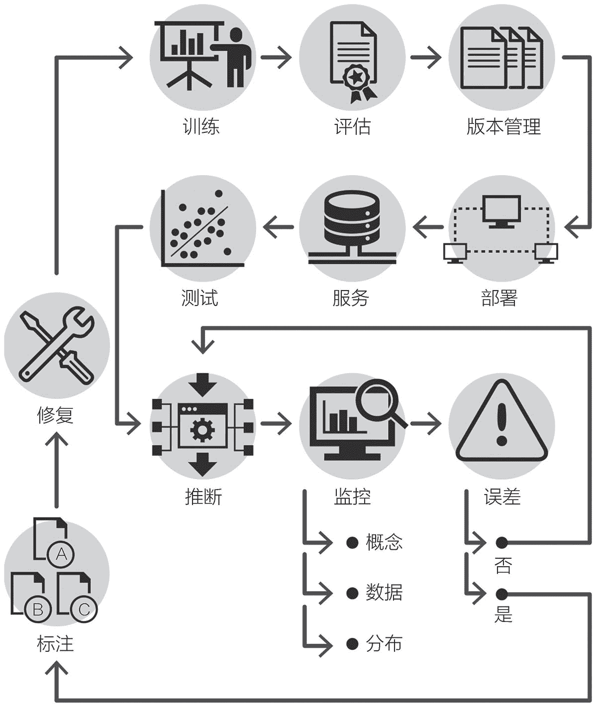

图 6-2 机器学习管理回路

该系统实现了真实数据的持续融入。我们逐拆六大模块：训练、版本管理、部署、服务、测试、监控。评估环节详见第七章“回路测量”。

### 训练：重构模型的核心车间

训练位于评估与部署之前，是模型重塑的地方。监控重点：**数据集切分**。

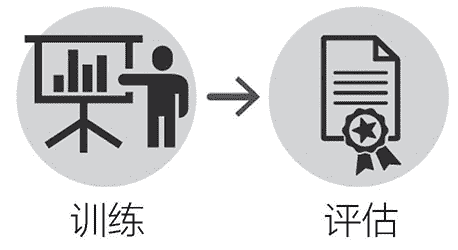

图 6-3 训练与评估

标准三分法：训练集、测试集、验证集。隔离测试数据防泄露；若拿训练集测，次次满分，那是自欺欺人（警示意）。

模型上线后会持续学习漂移，所以**投产前必须留对照组**——一批完全隔离、跑老系统、零 AI 干预的实体。软件好做特性开关分流量；硬件涉及执行器/机器人交互物理世界，难度指数级上升，可能得搭独立物理实例。副产品：给客户现成对照基准，决策投资 ROI 更从容。

另外，**每轮训练结果同步给客户看**。这不只是看预测对不对，更能激发业务侧灵感。比如客户发现“下雨天司机每站多等几分钟”，你回头加天气特征重跑，统计显著则入模。这过程等同于传统软件交付交互原型，沟通效率拉满。

### 版本管理：四维矩阵的驯服术

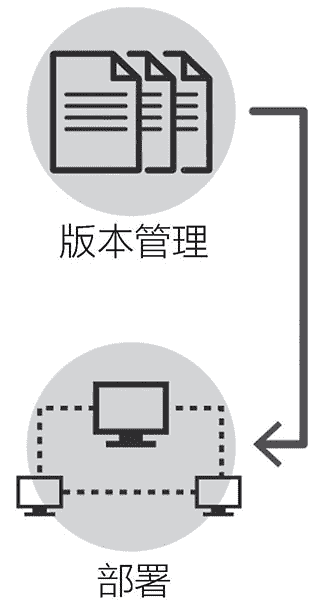

图 6-4 版本管理

留版本是为回滚兜底：新模型不行，秒切旧模型。难点在于**模型必须跟训练数据绑定版本**，因为模型+数据=输出。数据指“值”+“模式”（Schema），代码按 Schema 读库。加上推理代码、基建代码，共四维：**模型代码、数据值、数据模式、软件代码**。四维排列组合爆炸，锁定一维恒定能简化回溯。

模型代码版本化容易，成熟工具链现成。但**数据版本化是硬骨头**：数据集太大、太乱，Git 管不动；全量存每节点快照太烧钱。Schema 别单独管，从值里推断。带元数据管理、相似度建模、自动建目录的数据基建能让推断更靠谱。策略：**先版本化模型代码，做好模型版本、入库元数，再考虑数据版本**。数据版本工具在关键节点压缩、打标、归档快照。

#### 重现性：科学与合规的底线

版本管理服务于重现。追踪代码、模型、数据包、工具、依赖的每次变更，让别人能复现。训练期最难，深度学习更难。学术界、强监管行业（金融、医疗）硬性要求：必须能复现并解释每一次输出。

### 部署：预测触达用户的 N 种姿势

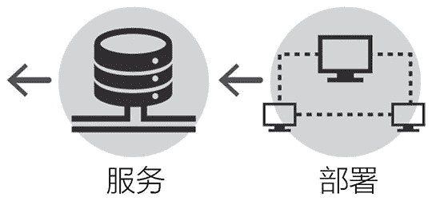

图 6-5 部署

怎么把预测塞给客户，顺着他们的决策流走：

- **报告：** 静态文档，含预测+解释，辅助决策。
- **电子表格：** 预测+关键变量可改、基础数据可改。仅适合 Excel 函数能跑的简单模型。
- **仪表盘：** Web 自动刷新，看预测。
- **模板：** 仪表盘+表单改变量/传新数据。
- **集成：** 推给 CRM/ERP，建模型与应用双向数据管道，保证预测鲜度。
- **应用：** 独立 App，改变量、传数据、点按钮全支持。
- **API：** 标准化接口访问预测，支持反馈数据回传、新数据上传。
- **增强：** 穿戴设备（眼镜/手表/投影）直接覆盖视野给预测，场景化交付。

### 测试：验证“物理世界意义”而非“代码能跑”

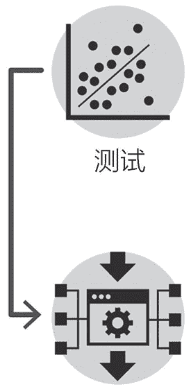

图 6-6 测试

测模型 ≠ 测软件。软件测“虚拟环境跑不跑得动”，模型测“输出在物理世界讲不讲得通”。核查假设、敏感性、采样分布是否贴合真实世界。

手段混用：规则自动化测（猫不可能是紫的）、对照组自动测（用 Ground Truth 数据集算偏差）、人工抽样测（凭经验常识判）。理想路径：随环境动态度降低、数据可解释度提高，自动化覆盖率升、人工降。

**测试三部曲：**

1.  **首查统计显著性。** 借统计过程控制（SPC）管数据质量：盯模型输出异常 → 追踪底层分布漂移 → 深度学习场景极难 → 分布对不上就回炉找好数据、重训、重部署。
2.  **中调模型内核。** 按可用性阈值，调参数、超参、特征、容量、训练轮数。建**混淆矩阵**（热图）：X 轴预测标签，Y 轴真实标签。盯浅色弱相关区，懂误判根因。反复刷指标，冲击左上到右下的满相关对角线。

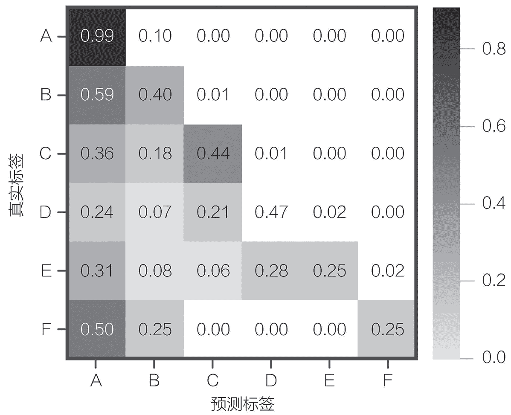

图 6-7 混淆矩阵

3.  **尾做集成测。** 模型代码在客户算力环境、选定基建上跑通；作为全量软件代码部署流程一环。成熟工具链自行解决，此处不展开。

### 监控：守住生产环境的“命门”

模型翻车原因五花八门：训练量炸库、模型大爆内存、入参校验挂、大数定律导致批量偏差……

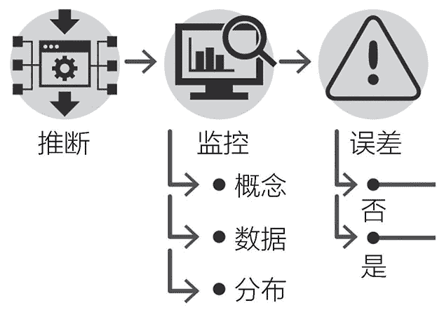

图 6-8 监控

生产监控双轨制：**质量**（性能、部署层面：代码质量、基建稳健性，软工最佳实践适用，超纲）与 **可靠性**（准确度+稳定性）。聚焦后者。

#### 准确度：量化+定性双轨制

统计指标（准确率、相关性、Loss）+ 语义指标（客户接受否、口头吐槽），合看才知预测质量达标没。这两者映射为**模型漂移**与**偏差**概念。

#### 稳定性：识别“脱离现实”的信号

漂移 = 偏离现实。模型脱线的几种典型姿势：

# 让模型跟上现实：从漂移监控到闭环进化的实战指南

### 核心漂移：概念偏移与数据失真

模型上线不是终点，而是维护的起点。最隐蔽的杀手往往不是报错，而是**“漂移”**——模型眼里的世界，与真实世界悄然脱节。

**概念漂移**，是预测目标的“游戏规则”变了。  
过去你预测“司机能否准点送达”，现在业务变了，核心变成预测“货物放门口会不会被偷”。任务定义本身发生了质变，旧模型自然失效。

**数据漂移**，则是输入分布的“地基”塌了。  
你以为客户全年均匀买电池，结果他们只在极端天气后下单；或者开发人员切断了 API，位置数据源直接消失。数据不再具备代表性，模型自然瞎猜。

**应对策略截然不同**：  
概念漂移需**重塑功能再训练**——重新定义预测目标；数据漂移需**跟踪新分布再训练**——更新认知底座。无论哪条路，重做模型、收数据、训练的成本都高得惊人。因此，精准度量漂移程度，是决定“是否值得投入成本”的关键决策依据。

### 怎么发现漂移？搭建三维雷达

单靠准确率不够，要建立**模型性能、数据质量、产品功效**三大指标体系，交叉验证才能找到不可靠的根源。

*   **模型性能**：F1 分值等准确度指标（详见第七章细讲）。
*   **数据质量**：标签覆盖率、分布稳定性等。
*   **产品功效**：真实业务 ROI，如生产线故障率、客户投诉率。

**关键洞察**：数据分布变了，但预测还准？那是运气好，不是模型强。  
**校准基准**：像训练期留验证集一样，在线上保留**对照组**，拿真实标签做地基，随时校准模型是否“诚实”。

### 测量节奏：快慢结合，周期覆盖

世界变化有快有慢、有规律也有突发，监控频率必须匹配：
*   **渐进变化** → 需要**长时间序列**指标才能看清趋势；
*   **突发变化** → 需要**准实时**指标才能第一时间捕捉；
*   **季节周期** → 需要**同比时间窗口**（如每个季度）积累指标才能对比。

只有把这三种节奏都跑通，监控体系才不留盲区。

---

### 偏见治理：加上“硬约束”

技术层面的偏见，本质是**失控的输出空间**。治理思路与管人类偏见如出一辙：**设严格边界**。

1.  **限输出**：模型能预测什么、不能预测什么，白名单管理。
2.  **限访问**：谁能调用预测，权限最小化。
3.  **限反馈/用途**：系统设计阶段就锁定反馈数据来源、预测使用场景，并配置告警。
4.  **立标准**：训练数据强制多样性指标，从源头扩大覆盖面。
5.  **问设计师**：直接沟通建模逻辑，排查固有偏见风险。
6.  **自动熔断**：约束触发时，直接下线或报警，不靠人工值守。

---

### 数据质量：给模型“吃”干净饭

数据管道长、环节多，任一节点故障都能让模型或下游仪表盘瘫痪。监控重点守住六关：

| 监控项 | 典型症状 | 后果 |
| :--- | :--- | :--- |
| **来源缺失** | 三方/内部源挂了、被切、关了 | 断粮 |
| **值缺失** | 库表结构变、字段删，函数找不到值 | **直接崩溃** |
| **数据不全** | 函数需 10 字段只来 5 个，却强行跑完 | **出烂预测**（比崩溃更隐蔽） |
| **标签缺失/错** | 标注员偷懒、标错类（如“闯红灯”标成“行人”） | 模型学歪，延迟爆雷 |
| **分布漂移** | 统计特性悄悄偏移 | 需用统计过程控制 (SPC) 等高阶手段捕捉 |
| **扰动测试** | 主动加噪、改格式 | **压力测试**，暴露管道脆弱性 |

> **区分关键**：值缺失=函数**不执行**；数据不全=函数**执行但出错**。后果截然不同，排查优先级要分清。

---

### 返工策略：从“无动作”到“重造”的决策树

模型管理回路的最后一步，是根据监控结果**调整**。世界必然变化，调整从来不是零成本，但必须有章法。  

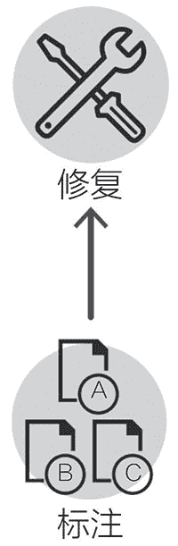

图 6-9 返工

**七级响应梯队**（按成本从低到高）：

1.  **什么都不做**：规则型底线不可破（如高攻击性邮件必拦），用户投诉也不行。
2.  **提问用户**：问懂业务的人，往往能挖出数据背后的因果。
3.  **补数据**：真实采集、众包标注、合成数据生成边缘案例，甚至接入自动修复流水线。
4.  **定期再训练**：数据有季节性、或旧数据过期，且训练成本可接受时，按节奏跑。
5.  **再修复**：分布变不是因为世界变，是**采集坏了**（如寒冷天传感器失灵导致“进店人数骤降”）。修传感器、补逻辑，把数据拉回真实分布。
6.  **再权衡**：现实变得比训练窗口快，不改分布，改**权重/时间窗**（如只训“近三个月”数据），让模型跟上节奏。
7.  **重做**：换预测目标、加新特征、跑数据科学实验、回测、决策上线。本质回到“预测什么”的原点。

**进化方向**：别让人工跑流程。成熟团队都把上述动作封装进 **AutoML / 模型管理平台**，实现持续自动再训练。

---

### 重新部署：小步快跑，分层验证

重新部署是回路闭环的收尾动作：  
**灰度发布 → 短期冒烟测试（防即时炸） → 定期回归测试（防慢性病）**。  
部署策略直接影响成本与未来评估基线，必须慎重设计。

---

### 复盘反思：把经验变资产

跑完几个回路，必须停下来问四个问题：

1.  **变了什么、何时变、为什么变**？（建立变更日志）
2.  **验证集还管用吗？** 除非大改模型，验证集应锁死，它是基准。
3.  **核心测量方法（性能/概念漂移/数据漂移）要不要换？**
4.  **客户觉得 ROI 变了吗？** 终极体检。

**从管道治本**：
*   标注体系化 → 管道崩了模型也能撑住；
*   数据治理上台面 → 杜绝低质量导致的漂移；
*   高频刷新管道 → 让数据保持鲜活。

---

### 章末清单：监控全景图

除性能与可靠性外，系统级监控还需覆盖：


---

## 第六章精华回顾：模型优化的 18 条铁律

让模型天天干实活，难如登天。多数公司还在自造轮子，但生态正在成熟。跑通理想化管理回路后，你心中自有产品蓝图。

**核心心法**：
1.  **贴近现实**：反馈是缰绳，时刻拉回失控的模型。
2.  **动态平衡**：实验要散、测试要严、监控要真，三者共存。
3.  **拒绝数据湖泛滥**：定需求、带团队、管供应商，快速上马。
4.  **分环境设安全线**：实验/测试/生产三级权限，合规场景支持“数据不出门、模型跑现场”。
5.  **传感器交给专业集成商**：后勤、工业设计、IT、环境四座大山，别自己扛。
6.  **沟通是润滑剂**：数据清洗、结果翻译，搞定验收。
7.  **客户参与训练**：每步给输出，激发常识反馈与新需求。
8.  **实验室准不算数，实战准才行**：实时吞真实数据，自动在线学习。
9.  **AI 接受度可破局**：早发布、保可用、缩短价值时间、造路线图、拉实验参与、高管教育、定期再训、快造功能、人工增强先行、嵌入可解释性、适时激励、落实问责、预算前置、评估用量、设业务线 ROI、**盯收入不盯降本**。
10. **模型管理 ≠ 代码管理**：**数据+代码**双管齐下。
11. **版本控制先后序**：先代码、后元数、最后数据（太贵太难）。
12. **版本目标是复现**：学术与合规核心，连依赖包/工具链一并锁死。
13. **训练/测试/生产数据物理隔离**：训练集自测必满分，对照组才能逼诚实。
14. **按客户爱好交付预测**：报表、表格、看板、模板、独立应用、API 集成……随 TA 便。
15. **测量三件套**：数据质量用统计学、模型质量用准确度、相关性用混淆矩阵、别忘了代码兼容性。
16. **漂移零容忍**：概念、数据双监控，不让预测离谱。
17. **偏见加硬栏**：限输出、限访问、限反馈、全员知晓红线。
18. **喂饱模型**：持续监控源/值/标签缺失，扰动测试主动找茬。
19. **世界变、模型跟着变**：再训练、再修复、再权衡、重做、重部署，**最终全自动化**。

---

# 第七章 回路测量：把“数据学习效应”装进仪表盘

本书核心是**造一家能永续经营的公司**。AI 优先公司砸钱造“数据学习效应”，换复利护城河。这一章，我们回到起点：用**正确指标**，把这飞轮的转速、扭矩、磨损度量清楚。

> **本章主旨**：数据学习效应是**动态循环运动**，而非静态护城河。它可拆解为闭环，成为选品、评估优势、判风险、算利润的基石。当飞轮卡顿，这套指标能点亮全链路、定位病灶。

我们先定义循环、剖析运动学、对比过时的“护城河”概念；再结合**问题收益、数据就绪度、漂移风险**三维度，给出“选对问题、用 AI 解”的方法论；最后两节硬核干货：模型准确度通用度量法、AI 优先公司建设成本核算模型。

### 循环：飞轮的三层嵌套结构

数据学习效应三要素：
1.  **输入**：独家数据获取权。
2.  **加工**：数据处理能力。
3.  **网络**：从加工数据中学习的模型。

前两层各自有**内循环**（如机器人巡航采集、ML 技术清洗数据），但**高阶飞轮**只有在前两层跑通、模型产生网络效应时，才真正启动。

**循环的威力在于自增强**：
持续生成自有数据 → 服务预测 → 观测收集新数据 → 再生成……  
**重复是循环的本质**，没有重复就没有复利。每一批反馈数据都是一个周期：预测 → 客户实战 → 学习 → 新预测。循环层层叠加，形成图 7-1 所示的**循环堆叠**结构。


Figure 7-1 Loop Stacking

### 一个预测如何完成“自我进化”闭环？

想象这样一个场景：AI 预测超市货架上的意面将在 15 分钟内售罄，系统立即提醒店员午休后去查看。店员核实属实，在应用中记录并补货。监控摄像头全程捕捉：有货 → 缺货 → 再次有货。AI 同步接收摄像头画面、应用记录与店员备注，确认预测精准，且补货动作由店员完成。这次验证证明闭环最后一环运转正常，系统信心大增，下一次预警可能提前数小时发出。补货响应时间，由此从“小时级”压缩至“分钟级”。

---

### 循环的“物理学”机制

循环背后隐藏着迷人的物理原理，可将其抽象为一种引擎：先是蒸汽机，而后演变为数据引擎。

1.  **双元互生**：两种要素相互作用，产出第三种结果。恰似水在锅炉中沸腾生成蒸汽，释放热能。
2.  **多元制衡**：单靠两要素不够，能量会耗散。燃料燃烧产生的蒸汽若不转化为动能便毫无价值。进入下一环节前，还需两个类似“平衡锤”的部件控制输入输出——蒸汽机里的汽缸与活塞。
3.  **协同受控**：各部件配合默契，反应不过度、能耗不浪费。蒸汽恰好填满汽缸，活塞刚好推动曲柄。
4.  **熵增的“魔法时刻”**：中间存在一个关键过渡期——熵增阶段。运动物体暂时无法转化为能量，因它们正忙于构建新结构。恰似曲柄几近停摆……直至临界量蒸汽聚集，曲柄再度转动。
5.  **落地实效**：活塞推动曲柄（进而带动其他机件）在物理世界产生作用。
6.  **复位重启**：每次推动后，活塞归位，循环再启。

将上述模型映射到**数据学习循环**：

1.  **数据与模型反应，生成预测**。
2.  **四要素齐动**：模型向人输出预测，但在落地前需经人处理。四大要素分别是：数据（燃料）、模型（氧气）、执行预测的人（汽缸与活塞）、被作用对象（曲柄）。
3.  **节奏一致性**：数据、模型、人为动作保持同步，核心在于——没有比人更快的执行者。
4.  **熵增发生地**：人思考（汽缸积压）与行动在现实生效（曲柄转动）的时段。
5.  **可观测性**：人依据预测行动，行为留痕可查。
6.  **闭环再造**：观测即数据；模型从中学习，生成新预测，下一轮循环开启。

理想状态下，循环高效运转，零浪费。汽车引擎烧汽油，AI 产品消耗**数据、工程师工时、客户注意力**。这种视角能帮我们辨别优劣循环：**好循环，输入充沛、熵增持续**。输入充沛即数据更多；熵增持续意味着人能用预测在现实中创造更多符合模型预期的效果，且反馈充分。通过观测现实影响、消化反馈、整合重启，模型终将化解无序。否则，只剩海量无用的传感器输出或人工反馈。这只是抽象类比，助我们理解循环运作。接下来谈谈“护城河”，虽是另一隐喻，却正是循环概念的源头。

---

### 护城河 vs. 循环

传统认知里，城堡护城河是竞争壁垒。但护城河是**静态**的：建成后宽窄变化只会让敌人更难或更易攻入，不会自动加深。如图 7-2 所示。


**图 7-2 护城河**

问题在于商业世界是**动态**的：竞争力量变，护城河形状也变。

护城河隐喻不适用数据学习效应。当独特数据成为核心竞争力（相当于河水），且因智能系统输出而自动加速增长时，护城河形态发生质变。**循环隐喻更贴切**：每次迭代方向一致，规模却可能放大。图 7-3 展示了迭代方向固定、规模递增的循环。


**图 7-3 迭代方向一致、规模潜在递增的循环**

循环面积代表竞争优势程度。若沿用护城河比喻，循环不仅**自动变形**，更**自动变scale**。图 7-4 展示了此类循环。


**图 7-4 自动变形与变 Scale 的循环**

数据学习循环自动扩张，源于**信息价值的复利效应**。循环内生成的一切留在循环内，被保存并用于生成更多信息。

当然，若模型失稳无法学习，循环会停摆；若被整体复刻，循环也会被替代。但**跑过多轮的循环极难被取代**——每一轮都沉淀数据，这些数据能与下一轮新采集数据产生关联。

---

### 点燃正确的循环

数据学习循环非仅写代码，需重资产投入，但回报丰厚。客户愿投资构建，但能否持续投资，取决于：循环表现、获取成果的风险、循环能否长跑。以下内容助你判断客户参与意愿及维持循环转动的关键。

#### 产品回报

机器学习依赖概率建模不确定性。概率非恒真，模型亦非恒准。构建 ML 产品时请铭记：**在规避高风险场景滥用 ML 的前提下，将客户预期拉满。**

#### 回报曲线（Payoffs）

建模产品使用回报形态，可判定客户价值。回报通常呈**曲线**——凸曲线或凹曲线（见图 7-5）。


**图 7-5 凸曲线回报 vs. 凹曲线回报**

**凸曲线回报**：使用越久价值越大（见图 7-6）。典型如消费级应用：谷歌搜索随时可用，每次结果均有信息增量；即使结果一般也无实害。曲线下行段与负值区，对应产品早期生产成本。


**图 7-6 凸曲线回报**

**凹曲线回报**：使用越久价值递减（见图 7-7）。即边际收益递减。


**图 7-7 凹曲线回报**

# 概率游戏：如何判断 AI 产品值不值得做？

核心提示词是“潜在”。曲线的形状取决于概率，这听起来很抽象，但极其实用——它能指导我们在何处落地机器学习：即**预期收益大于成本时**。别忘了，预期价值 = 收益值 × 获得收益的概率。

也可以从**交互频次**的角度切入：产品的平均用户体验如何？若是“一次性交互”（如疾病诊断），分母就是 1，体验必须完美无瑕。这正是难点所在——机器学习系统无法做到 100% 准确。下面通过两类收益模型来拆解：

---

### 凸性收益：试错成本低，上限极高

这类场景容错率高，哪怕大部分尝试落空，极少数命中也能覆盖成本、带来巨额回报。

*   **营销获客：** AI 挖掘潜在线索。即便多数线索无果，追踪成本极低，一旦转化即高回报。例如识别网站访客画像、获取联系方式，低成本撬动高价值新客。
*   **销售线索排序：** AI 标记高意向线索，提高发现概率。工具成本低，却能直接助力签单，投入产出比极高。
*   **库存管理：** 计算机视觉监控货架缺货，指导及时补货。留住购买意愿最强时刻的客户，直接转化为销售额。

---

### 凹性收益：容错率极低，单次失误致命

这类场景看似省时省力，实则 ROI 失衡。收益难以量化，一旦翻车，代价高昂，用户会直接归咎于产品。

*   **智能排程：** AI 助理虽省时间，但难以权衡用户时间的真实价值。重复预约导致错过关键会议，这是不可逆的重大损失，“完成任务”不等于“完成得好”。
*   **智能客服：** 低成本秒回看似完美，实则缺乏惊喜、共情与关系建立。若机器人制造更多工单、激怒用户，边际收益将趋近于零甚至为负。

---

### 核心抉择：概率系统 vs 确定性系统

创始人、PM 和设计师必须直面灵魂拷问：**带有概率假设的系统能否满足客户需求？还是确定性系统更稳妥？**

答案取决于两个变量：**准确率门槛有多高？失误成本有多大？**  
洞察用户真实诉求，并构建产品精准击中痛点，往往比攻克技术本身更难。

---

### 起步门槛：数据规模必须“够量”

《数据学习效应》公式揭示本质：`输出 = 函数{数据网络效应[处理能力与质量(数据量)]}`。  
没有足够数据启动飞轮，就无法提供价值，也无法诱导用户贡献更多数据。AI 优先公司通常通过三条路获取冷启动数据：直接获取客户数据、对接补充数据源、或参考《AI 优先团队》章节的其他策略。

---

### 避坑指南：并非所有数据都能入飞轮

数据分三类，只有**反馈数据**能持续增强模型：

1.  **训练数据（一次性消耗）：** 训练集、验证集、测试集。赋予模型预测力后即丢弃，**不累积资产价值**。
2.  **输入数据（流转消耗）：** 预测时的流入流出数据。验证集可作输入，后续可转为新模型训练素材，属**潜在资产**。
3.  **反馈数据（核心护城河）：** 用户基于预测行动后，从现实世界观测到的修正信息（如“预测是否准确？纠正或确认”）。**竞争对手无法获得这份独家观测**，务必在产品设计中持续收集。

---

### 规模的另一面：边际递减与护城河的动态博弈

数据飞轮转得越久，效果越好。但对数公式揭示真相：`数据规模经济` 决定了增量产出。

`数据带来的产出增幅 = log(数据网络效应价值) + log(处理数据价值) + log(数据规模经济)`

*   **规模经济极低时：** 少量数据即达标，新进入者易复刻。除非网络效应或处理能力极强（如小样本学习算法极其高效），否则难建壁垒。
*   **规模经济极高时：** 需巨额资本/时间堆叠数据网络。这是挑战，也是构建企业级护城河的机会。

**但这护城河可能不持久，两大变数：**
1.  **算法突破：** 新玩家用更强算法（如现代贝叶斯方法），以小数据达成同等效果，实现降维打击。
2.  **规模报酬递减：** 数据红利终有尽头。更多数据不再提升模型，飞轮停摆。

**应对之道：** 监控 `模型提升成本 / 收益比`。记录获取数据、特征工程、模型迭代的边际成本。一旦边际收益递减，通过持续收集数据解决相关问题，为客户创造增量价值。

---

### 最小化模型漂移

[PRE*]

### 模型漂移与数据护城河：谁能笑到最后？

训练数据一旦与现实世界脱节，模型就会发生“漂移”。理论上，高持久性数据的领域似乎更利好新入局者；但实战中，早已大规模落地的头部玩家，往往更容易获取海量新数据。AI 原生公司面临的核心难题在于：能否从客户或其他渠道持续搞到足够新数据，以压制模型漂移？

在同一赛道竞争中，若能在高度动态的系统里精准命中目标，并持续摄入新数据维持精度，这便构成了显著的竞争壁垒。即便你有精准的送达时间预测模型，缺了包裹实时位置、天气路况等最新输入，精度也难保证。离了 AI，几乎无法驾驭这类系统的动态变化；而引入 AI 后，学习曲线无终点，数据学习效应至关重要。

### 做预测前，必须想清的几个问题

靠谱的预测应具备四大特质：① 实战落地风险低；② 能产生凸性收益（越用越顺）；③ 现有数据能跑通可用性门槛；④ 具备数据规模收益。

以下场景可作为思考框架：

- **赌注有多大？** 决策失误会烧多少钱？会不会伤人害命？
- **资源强化效应如何？** 能帮客户用现有人力干更多事，还是直接砍编制？能不能激励客户持续投钱？
- **有数据练模型吗？** 算力、标注等训练资源够不够？
- **新人追赶有多快？** 多久能攒够有效数据量级？
- **数据收益在递减吗？** 模型还在涨点，还是已撞上性能天花板？
- **新鲜实战数据够不够？** 若暂时没有，有没有采集管道？还得不得重金部署传感器硬刷？
- **底层系统常年动荡？** 无新数据就无法建模？若是，能不能搞到独家专有数据？

**数据规模收益低、漂移概率高的赛道，极其不可靠。** 一方面，新人轻松凑齐数据反超老牌；另一方面，头部若能比对手更快、更持久地获取新数据，便能筑起护城河——实现高数据规模收益、低漂移风险。漂移概率与数据规模收益的博弈关系见下表：

**表 7-1 漂移概率与数据规模收益关系对照表**


---

## 模型度量：把“准不准”算明白

闭环飞轮由底层预测模型驱动，模型性能可量化。机器学习常用核心指标如下（各代模型虽有专属标准，但以下基础指标通用）：

### 准确率

准确率 = 正确预测数 / 总预测数。判断“对错”需对标真实世界的 Ground Truth（真值），而拿到真值数据往往是硬骨头。尤其是得从客户手里要一手数据来评估时——因为他们正为预测不准而头疼。书中提到的“准确率”即此意。通常不懂高数也行，靠常识即可，顶多补点统计或微积分基础。

### 二分类

现实常是非黑即白，但衡量准确率的逻辑不同。现实层面只有“真”（存在/发生）与“假”（不存在/未发生）；模型层面输出“正类”与“负类”。以验证过的真值为准，如画面里有猫/无猫。模型则给出判定为正/负的概率。由此衍生四种组合（见表 7-2）。

**表 7-2 四种预测结果组合**


模型判对时出现真阳性（TP）与真阴性（TN）；判错时出现假阳性（FP）与假阴性（FN）。以下是二分类场景下的准确率度量方式。

### 准确率公式


所谓“判定”，是按事件阳性/阴性概率划界。纯二值结果（如黑白像素判黑白）无需复杂判定；但绝大多数结果非纯二值，模型通常输出概率分布。例如模型 90% 确信图里有猫。设定阈值——输出概率超 90% 判为正类，此时判定才算数。

### ROC 曲线

受试者工作特征曲线（`ROC`）展示模型在不同阈值下的表现。

#### 调整阈值档位

设定一系列阈值，收集各档位下的真阳性率（命中率）与假阳性率（虚警率），如图 7-8 所示。曲线绘制于 XY 轴：Y 轴（纵轴）为真阳性率，X 轴（横轴）为假阳性率。


**图 7-8 不同决策阈值下的真阳性率与假阳性率**

#### 真阳性率公式


#### 假阳性率公式


#### AUC（ROC 曲线下面积）

用积分算出 AUC，即阴影覆盖面积（见图 7-9）。该面积代表模型在全阈值区间的综合准确度。模型全对则 AUC=1（占满全图）；全错则 AUC=0。


**图 7-9 ROC 曲线下面积示意**

### 精确率与召回率

这对指标衡量模型检索、识别相关结果的效率。精确率 = 模型检出的相关样本数 / 模型检出的总样本数，即随机抽取一个检出样本，它是相关的概率。召回率 = 随机搜索中，能精准找回多少比例的相关样本。二者缺一不可：光看精确率不知离“全拿下”还有多远；光看召回率，把所有样本全捞上来也能凑 100%。

#### 精确率公式


#### 召回率公式


### 损失函数

# 损失函数与梯度下降：模型优化的核心指南针

**损失值**是衡量模型单次预测偏离程度的关键指标。完美预测的损失为零，这并非非黑即白的对错，而是一个程度问题。引入损失度量的意义在于：现实任务鲜有二元输出，模型迭代的本质就是一步步压低这个数值。具体怎么算损失，取决于你盯着全量数据还是切片、预期分布是否均匀等多重因素。实操中，把所有损失平方求和，观察其是否向均值回归，以此判断是否需要调整；再把损失随参数权重的变化画成曲线，找到谷底锁定最优权重。寻找谷底的方法是对曲线求导：负梯度意味着正在下山（逼近极小值），正梯度则在上坡。这一“沿梯度下降寻优”的过程，便是**梯度下降法**（如图 7-10 所示）。


Figure 7-10 Gradient Descent

与模型构建者深度协作可能需要下潜到这个技术细节层，但理解其原理，掌握基础微积分通常已足够。

### 人工验收：最硬核的准确率标尺

AI 优先产品会显式引入人工反馈闭环——用户隐性或显性地接收/拒绝机器决策。例如，系统从照片判定某产品导致严重皮肤损伤，皮肤科医生可确认或推翻该判断。这堪称衡量预测精度的**最高单一标准**，因为反馈者往往融合了直觉、实战经验与领域专业知识。

### 使用指数：把“用得多”翻译成“价值大”

有条铁律不能忘：**判断客户是否获益，最直接的方式是看他们用了多少产品**。使用指数因产品而异，核心在于量化“获取价值的关键动作”，而非表面动作——如点击搜索结果而非仅搜索、下单购买而非仅浏览目录。对于 AI 优先产品，指数还必须覆盖**采集模型反馈数据的动作**。产品经理应梳理全链路，标记每一个显性/隐性、输入/生成的反馈节点，围绕这些节点度量使用深度，从而想办法提升用量、沉淀更多反馈数据。部分用户贡献数据量极大，他们是模型的“动力源”兼产品的“超级用户”；部分用户贡献数据质量极高，他们是数据飞轮中的“超级教师”。识别这两类人群、深度访谈、为他们定制功能，往往能撬动更高质量的反馈循环。

## 机器造血：从模型到利润的闭环

企业终归要自负盈亏、造血生存。前文大谈模型训练，现在聊聊**如何把 ML 模型变成真金白银**——给出盈利指标与改进杠杆。

**数据学习飞轮**为 AI 优先厂商创造利润与投资机会：更准的预测 → 更高自动化 → 运营成本降 → 更多资金投入研发（模型与数据）→ 预测更准……循环往复，最终跑出极高毛利、覆盖全部运营开支、实现盈利。图 7-11 描绘了厂商侧的数据学习飞轮。


Figure 7-11 Vendor's Data Learning Loop

换个视角看客户收益：预测更准 → 自动化程度更高 → 吸引新客/激活老客 → 产生更多数据 → 预测更准……正向循环同理。

### 垂直 vs 水平：两条截然不同的盈利赛道

**垂直类 AI 产品面临的盈利挑战远大于水平类产品。** 垂直产品把 ML 用在特定业务/工业数据上，输出对客户高价值的预测。例：采集产线机器数据训练模型预测故障，助客户规避停机损失；或海量商品图片训练识别模型，解决仓储/门店缺货高昂成本。水平产品则面向不同垂直领域的 ML 工程师与数据科学家提供通用工具。图 7-12 展示了客户侧的数据学习飞轮。


Figure 7-12 Customer's Data Learning Loop

两者商业经济学模型**本质不同**：垂直型要为客户解决**具体流程问题**，水平型要解决**通用流程问题**。垂直型需围绕客户问题**纵向整合**，打通解决全链路所需的一切——对接客户专有数据源、构建输出预测的工作流产品、为特定用户配置专属功能。水平型则需**泛化方案**，适配跨行业从业者——对接多源数据、多工作流产品、多沟通工具。AI 优先产品公司往往盈利压力较小，因边际交付成本极低，经济模型常酷似传统软件公司。

对 AI 优先公司而言，这套框架与传统软件公司差异不大。垂直传统软件如 `Veeva Systems`，整合医疗专业人士用的多款产品，提供临床数据管理、工作流与合规服务；水平传统软件如 `Salesforce`，打造全云平台构建应用市场，提供行业通用功能与灵活 API，让客户跨应用自建工作流。

### 利润拆解：三级阶梯看清赚钱链路

| 项目 | 关系 |
|------|------|
| **营收** | 起点 |
| 减：销货成本 (COGS) | → 得 **毛利** |
| 减：运营费用 | → 得 **营业利润** |
| 减：利息与税项 | → 得 **净利润** |

### 单元经济：把大账算细、把细账算透

衡量盈利的第一刀是**单元层面**。单元分析逻辑简单：选定一个业务单元，剖析其盈利能力。因商业模式千差万别，**每家企业的利润单元各不相同**。例：某产品通过降低机器能耗盈利，按节能比例计费，那么“单台机器的能耗降低量”就是核心核算单元。

# 核心指标拆解：AI 公司如何算清“单客利润账”

商业模型若建立在持续迭代与阶梯定价之上，以“单个客户”作为核算单元往往最为直观。这要求将与该客户相关的所有营收与支出精准归拢。营收端相对简单，即单客流水；难点在于成本端——必须追踪售前工程、数据对接、模型部署、专属功能开发、定制化训练、交付运维、客户成功服务等全链路投入。以此为基础测算单元毛利（详见表 7-3）。

表 7-3 单元毛利测算表（美元）


▼续表


单元分析的终局是提升毛利。这分两步走：先确保产品本身的边际贡献为正，再在覆盖交付服务成本后，实现客户层面的整体盈利。

净利润核算复杂得多，因研发、办公场地等间接费用难以精准分摊至单一客户，此处暂按下不表，后文详述。

### 投入成本深度剖析

商业本质是“投入产出”。以预测为核心产出的公司，数据采购成本即核心投入，剖析数据成本结构是盈利前提。

数据来源无外乎两类：新数据源于标注，旧数据源于管道沉淀。

#### 标注成本管理

标注主体分为专家、非专家及机器。专家处理需专业判断的场景（如医学影像骨骼识别），单价高昂；非专家负责通用识别（如桌椅标注），来源灵活，典型平台如 Amazon Mechanical Turk；机器标注依赖技术成熟度与数据特性。

**核心指标一：单位价值标注成本。** 外包时账单即成本；若客户自标或因训练失败导致工程师介入，隐性成本飙升。此时需核算员工备数工时，将标注成本精准摊销至具体价值单元（如单一客户项目）。

**核心指标二：专家与非专家的一致性演变。** 假设专家更贵，且长期标注量固定，关键在于监控双方标注一致率。一旦非专家表现逼近专家，即可大规模转移任务，以低成本维持模型精度。

**机器替代与合成数据。** 主动学习、半监督学习（如 GAN）可降低人力依赖。若标注量仍巨大，合成数据生成系统能“打包”输出数据与标签，成为终极备选。

#### 数据管道建设

从客户端拉取历史数据需构建管道。工程投入或外包费用可摊销至客户全生命周期（管道通常一劳永逸）。将工时成本归因至具体项目，可快速判断客户盈亏。

除管道搭建，常涉及人工录入等隐形工程。降本路径包括：开发自动化集成工具、培养初级工程师承接标准化对接、筛选主流存储格式客户（获低成本甚至零成本管道）、或将管道建设外包给客户端完成。

### 研发投入的分类与管控

科技公司研发预算往往占比极高（成熟巨头常达营收 25%）。面向所有潜在客户的通用软件开发常计入研发费用而非销货成本（COGS），分类差异直接冲击毛利与净利表现。

软件研发费用归类争议大：哪些功能是留存刚需？哪些是获客诱饵？难以界定。

AI 公司支出更复杂：人工调参、清洗数据等“非标动作”若能沉淀为通用模型能力，或反哺全局性能提升，原则上可归类为研发投入。

**AI 公司如何管控研发？拆解动作，验证有效性。**

*   **定制化开发（单客专属）：** 核心是“收钱”与“快”。必须向客户收取定制费，并压缩工期，确保工程师有效时薪回本率超 100%，至少覆盖全负载成本。
*   **通用能力建设（全客受益）：** 更考验科学严谨性。需遵循科学方法：提出假设（如“引入弱光/特殊角度谷物盒图片能提升全场景品牌识别率”）→ 实验验证 → 严谨追踪。领域专家常掌握启发式规则（如“瓶盖抬升 1mm 预示生产线强制停机”），若规律可复现，硬编码特征可能比训练模型更高效、更稳。

## 章末启示：飞轮先行

做对事，先会量。我见过太多标榜“AI 优先”却倒在核心数据飞轮构建上的团队。而每一次见证数据学习闭环的强大势能，都让这一信念更笃定。

当下 AI 公司管理体系仍处野蛮生长期，行业缺乏成熟范式。我们选择与合作伙伴共建工具产品，确立可持续的度量标准。实践证明，本章所述指标体系已助多家企业完成从“烧钱试错”到“构建资产”的质变。

# AI原生企业的制胜逻辑：优势聚合与纵向整合

把业务视为动态系统，面对必然发生的变化就不会措手不及。一旦数据学习效应的飞轮转起来，就会形成自我强化的闭环——每一圈迭代都在加深护城河。不过，启动飞轮往往困难重重：AI落地的固有风险、过高的性能预期、训练数据稀缺、以及难以持续获取新鲜数据。本章提供的框架与指标，能帮你挑对切入点，推动飞轮加速旋转。

## 核心要点

◆ **数据学习效应是个“活”的闭环。** 学习本质是循环：观察、复盘、行动、再观察。数据学习效应亦是如此：获取数据、喂入模型、输出预测、验证准确度。

◆ **“护城河”是个误导性比喻。** 护城河指静态资产堆砌的屏障，屏障可被跨越，资产可被剥离。数据学习效应积累的不仅是数据资产，更是沉淀的经验教训。

◆ **循环会自动生长。** 每一次迭代都自动积累经验，因此数据学习回路的形态与规模都在持续演变。

◆ **核心威力在于“内生性产出”。** 每一圈循环，智能系统都在自动生成数据、代码并沉淀经验。

◆ **分清好循环与坏循环。** 好循环数据充沛，通过预测引导用户行为产生现实反馈，再反哺模型；让预测深度介入客户业务，采集更多信息，学得更透彻。

◆ **算清“解决问题的投入产出比”。** 创始人、PM、设计师需审慎评估：概率系统能否满足需求？在容错成本下，确定性系统是否更优？

◆ **找准“预测可用性门槛”。** 这是证明产品能被采纳的最低性能线。搞清客户期望与目标，把精度做到对实战真正有用的程度。

◆ **评估能否达规模。** 盘点可获取数据，判断能否达到足够规模；达不到，果断放弃该模型。

◆ **并非所有数据都能喂飞轮。** 数据分三类：训练即丢弃、作为系统输入、通过反馈机制回流。唯有第三类能构筑竞争壁垒。

◆ **警惕“模型漂移”。** 训练数据更新速度必须跟上环境变化，否则模型会偏离现实。

◆ **选题要看全维表现。** 数据规模回报低、漂移风险高的领域靠谱；反之，数据规模回报高、漂移风险低的赛道更稳。

◆ **模型指标体系。** 准确率、二分类指标、ROC曲线、精确率、召回率，用这些监控模型能否交付预测及精度提升趋势。

◆ **追踪单位经济账。** 锁定交付给客户的核心单元，测算单元营收与支出，初步评估AI原生公司盈利潜力；再叠加标注、数据管道、采集、研发成本，算清真实毛利。

## 第8章：优势聚合

AI原生公司沿用经典战略框架，但核心在于构建数据学习效应——捕获流程信息实现自动化、极致降本。成本优势赋予管理者更多战略选择权：

*   **守价增利：** 维持定价，赚取差价；
*   **利润反哺技术：** 深化自动化、进一步压低成本；
*   **利润反哺业务：** 推进垂直整合，或重新定位获取更多数据。
*   **降价竞争：** 用自动化红利实现差异化定价、颠覆式进入、集群效应，在存量市场击败对手或在新市场占据先机。

AI原生公司的优势聚合逻辑如下图所示。


**图 8-1 AI原生公司优势聚合模型**

本章将拆解图顶端的五大策略：垂直整合、标准化定位、数据聚合、颠覆市场准入、基于数据贡献的差异化定价——它们形成正向飞轮：更多数据 → 更强效应 → 更多客户。管理者可选择分红，也可将利润再投资于业务、技术或战略，进一步驱动数据学习效应。

此外，数据学习效应让新入局者能正面挑战巨头：从客户现有数据库获取数据 → 转化为新产品 → 整合服务抢夺客户；掌握关键客户量 → 制定数据存储/流转标准 → 让整个生态围绕己方转动。将颠覆、聚合、垂直整合应用于数据学习效应，可构建长期、可持续、强大的竞争优势。

**前提警示：必须“AI First”。** 战略本质是取舍以建立优势。AI原生公司在资金、时间、资源上做取舍，只为建立数据学习效应。唯有拥有数据、算力、数据网络效应——即数据学习效应——才能聚合其他竞争优势。

## 传统竞争优势视角的重构

## 竞争优势的供需两面

商战教科书常把竞争优势分为供给侧（输入、流程、规模整合）与需求侧（品牌、转换、规模整合）两大类，这套通用话术对AI原生公司同样适用。

**供给侧聚合优势：**
*   垄断高价值数据获取权（AI核心输入）；
*   建设数据转信息的高效流程，压低算力成本，促进ML研究员、工程师、数据科学家协作；
*   以海量数据训练模型，或跨客户聚合模型，享受规模报酬递增。

**需求侧聚合优势：**
*   以数据信任、稳健预测、优质服务立品牌；
*   靠存储标准、生态互补品、长约制造转换成本；
*   设计“用户越多越好用”产品，跑赢网络效应规模回报。

此外，还可能获政府授予优势：独家政府数据、模型专利、因社会价值预测获补贴等。

## 纵向整合

全球顶尖产品多出自垂直整合企业：苹果软硬一体、亚马逊仓网协同、19世纪钢铁大王卡内基的“矿到厂”帝国。诺贝尔得主科斯、戴尔创始人迈克尔·戴尔皆推崇此道。打包交付实现质控、深度关系与定价主动权。

AI原生公司独有红利：**每日从用户端获取增量数据**。持续数据流保证模型常新、预测准、贴合现实。垂直整合示意见下图。


**图 8-2 纵向整合示意**

垂直整合能加速新技术推广。AI推广阻力大：后果严重（如漏诊）、价值难量化（如节省分析师时间）、资源门槛高（如顶尖ML工程师）。交付端到端整合方案，替换原有软件，可大幅简化销售链路。

实例众多：对冲基金自采数据、自建模、自交易，不卖预测；广告平台自找人群、自投广告，不卖模型；新消金App自评风险、自放贷，不卖评分卡给银行。

# AI门槛大降，为何巨头仍执着“垂直整合”？

人工智能技术飞速迭代。回溯十年，踏入这片领域门槛极高，核心难点在于让AI“跑通”太难。而今，开源代码库触手可及、成熟框架即拿即用、专业咨询公司与训练有素的人才随时待命。更关键的是，头部科技巨头纷纷开放基础AI能力，允许在任意数据上运行。然而，光有数据和算力远远不够。2005年前后，用专有数据微调基础模型尚能制胜；如今虽有小样本学习、GAN、概率编程等新范式助力小数据高精度，但规模效应仍是核心。将数据规模、算力与网络效应打通，构建**数据学习效应**，才是企业突围的关键——而实现这三要素的融合，往往意味着必须走向**垂直整合**。

## 核心动作：做“全栈解决方案”，不卖“单点工具”

垂直整合的本质，是替客户扛起业务结果的责任，而非仅交付技术模块——交付的是**完整解决方案**，覆盖业务闭环的每一环。具体表现为：

- 直接**代发邮件**，而非给客服建议“回啥”；
- 直接**输出多语言落地页**，而非卖给翻译工具；
- 直接**经营保险业务**，而非帮保司优化理赔流程。

这种全栈模式的层级结构，如下图所示：


图 8-3 人工智能优先公司的纵向整合

以亚马逊 **Alexa** 为例，其从0到1的全链路自建堪称教科书级垂直整合：

- 内部自筹资金；
- 跑在自家 **AWS** 算力与数据底座上；
- 从早期用户端收集文本/语音数据；
- 数据全程留存在内网清洗标注（兼顾隐私）；
- 自建标注团队处理语音切片；
- 自研语音识别模型（ASR）；
- 复用 **AWS** 监控体系；
- 内部闭环监控用户行为；
- 自研智能音箱硬件；
- 直达用户手中（App配网、组网、独立使用）；
- 云端持续回流数据迭代模型、迭代产品。

**Alexa 是一款彻底垂直整合的产品。**

企业面临的战略抉择是：甘做预测能力的“批发商”，还是构建**专有软件+服务+非软件资产**的“零售商”，将预测嵌入业务闭环？例如：设计自带通话预测模型的 CRM；开发依据偏好自动分桶、生成邮件的营销工具；把身份验证功能接入自动回复模型。

这还不止于代码层面。打破技术边界，直击物理世界——垂直整合还要求投入真金白银落地执行：招聘人工兜底模型低置信度预测、直接对话客户处理异常。这些人力成本可能远超服务器，但他们能实现 100% 的识别、通话、撰稿，弥补模型的必然盲区。

最后，回到金字塔底座：**为 AI-First 公司融资，是垂直整合独有的杠杆**。当 AI 失灵时，不计成本保运行；承诺兜底，意味着模型崩了赔钱，跑通了全赚。比如承担模型迭代期的贷款利息成本，但独享所有利息收入。早期靠风投（贵）、靠自有业务造血（无关风险收益）；等模型与商业模型双双跑通有据可查，债务融资才具备价值。终局是：资产负债表躺平足够现金，自吸模型错误成本（承保风险），**留存全部利润，无需分润给外部股东或债权人**。垂直整合做到“帮客户自负盈亏”，AI-First 公司才能从“正确的执行”中收割全部红利。

## 垂直整合的三重回报：数据、营收、利润

围绕垂直整合打造服务、集成、团队与技术，又难又贵，啃的骨头更多。但回报极其诱人：**更多专有数据、更高营收上限、更厚利润垫**。

### 数据飞轮转起来：产品层捕捉隐式反馈，服务层沉淀显性经验

提供模型即服务，能直接从客户端采集数据、元数据与洞见——源于“自动完成任务”的实战复盘。

**软件层（产品端）的整合**，让模型在真实场景接受检验，产生反馈数据回流训练。观测点分内外两类：
- **产品内**：用户点按钮、填表单，是采纳、修改还是拒绝 AI 给的答？客服系统自动生成、批准、发出回复＝模型“正确”；发送前被改＝模型“部分错误”，可学习“下次别用这个词”、确认满意度。
- **产品外**：传感器采集图像/声音。AI-First 公司掌握用户日用的产品与传感器，掌握数据源头，反哺模型迭代。

**人员层（服务端）的整合**，能产出领域专业知识，服务于更优预测与更准标注。一线天天跟客户打交道的人，观察行为、积累行业隐性知识。问问干了 20 年老手“什么信号能预测什么结果”，往往就是建模的捷径。

*实战案例*：整合客服系统时，咨询资深客服“什么话术最安抚客户”，植入自动回复让系统更“懂事”；或加个“敏感标记”按钮，代理判断客户暴怒需介入时一点，打标训练优先级模型。引入领域专家深度参与，产出更好思路与数据，模型自然更强。

### 敢于担责，才能按 ROI 分账赚大钱

若承担风险的一方对风险有合理认知，就能从风险中收割回报。最典型的如投资机构：判断企业能否用资本造产品、跑通商模、筑护城河维持利润率，判断比别人准就赚钱。本质是他们比别人更早看清：资本能否压低造货成本、找到客户、签下单、招猛将、守优势。投资机构之所以能成世界级巨头，除非判断彻底失误，风险收益必然复利增长。**AI-First 公司若基于风险评估设计商业模型，同理可放大营收。**

更关键的是，**AI-First 公司可因“承担 AI 运行风险”而获利**。客户能定指标（预测什么、准度多少、产出什么），但无法控制模型能否达标、投资能否回本。客户不愿为“AI 跑不通”买单。仍以邮件为例：只有当自动回复成本 < 人工成本 且满意度不降，客户才掏钱。对 AI-First 产品，若单次机器处理成本 < 现有人工成本，客户 ROI 为正。客户以更低成本拿同等结果，随自动化率提升，AI-First 公司利润率走高，且单次交付成本永远低于客户支付价格。

**对比传统 SaaS 模式**：交付确定功能比交付准确预测确定性强得多。买 Zendesk，功能清单明摆着，价格固定（预付/订阅）。客户可控功能，故知投资回报。AI-First 产品背负“传统软件交付风险”+“预测失准风险”，但这额外风险创造了定价机会：**预测准了赚钱，给客户 ROI**。AI-First 公司按 ROI 定价如下图：


图 8-4 人工智能优先公司基于投资回报率的定价

**按 ROI 定价的核心是“分享价值”**。难点一：找到能代表客户价值的指标作定价锚。指标随产品、客户异动。如 AI 读懂工单、生成回复，省时省钱。非 ROI 定价收“跑系统的软件费”，ROI 定价收“省下的时钱”。SaaS 通常抽 10%-30% 佣金；自动化率越高，AI-First 供应商省得越多、赚得越多。

图 8-3 展示了按 ROI 计费的商业闭环：供应商靠自动化从客户端拿回报，客户视角的 ROI% 与自动化收益一致。

**垂直整合仍是前提**。按 ROI 定价＝必须兑现承诺 ROI＝通常得跑通全链路。还是上面的例子，意味着：
- 从工单系统拉身份凭证；
- 自动回复写回系统；
- 训练 AI 客服批工单；
- 兜底修正发不出去的低质回复。

每步烧钱，加起来可能超重建一套客服系统。

**盈利取决于能否压住：数据集成、交付部署、培训赋能、售后支持成本**。如交付全栈方案，靠可复用连接器零边际成本对接、标准化在线课程零成本培训、完善文档零人工支持——低成本交付才能高利润。按 ROI 收费是 AI-First 独有红利：系统越强、赚越多；代价是须自担“以足够低成本交付并盈利”的风险。

### 爬金字塔，每层都加厚利润垫

垂直整合的利润优势，集中在金字塔每一层的**增量毛利**与**客户支付意愿**上。走个极端对比：
- 仅供 API 预测：成本 $0.5/次，售价 $1，**毛利 50%**。但客户可能没开发能力用不上。
- 再供接口、训练工具、教会客户用：成本加 $1，售价 $5，**毛利 70%**。客户从预测里榨出巨大价值，乐意付溢价。

对 AI-First 供应商，**攀登垂直整合金字塔，是确定性极强的增利路径**。

## 定价四维法：数据贡献、用量阶梯、模型迭代、功能切片

怎么收费是永恒难题，也是价值观与现实的博弈。定价即**差异化变现**——让客户为“别处买不到的独特性”买单。定价策略牵动收益质量、增长、利润、产品、营销、销售全盘。AI-First 公司更将**数据策略内嵌定价策略**。差别定价全景如下：


图 8-5 差别定价

以下是 AI-First 产品的四大定价维度：

### 1. 数据贡献定价：以数据抵扣或分红

对 AI-First 公司，数据极其珍贵，可强单客模型、亦可汇聚强群体模型。后者形成**数据贡献者联盟**，成员共享聚合数据红利。但即便脱敏聚合，部分客户仍拒共享，导致模型迭代受阻、无法向他人溢价、损失由拒共享者自担。

### 2. 用量阶梯定价：随用量增长分享增量价值

交易型定价——用得多、交得多——是共同成长的纽带。常见按“席位/用户数”收费，**但这对 AI-First 产品往往失效**：
- 抑制客户加席位，反减少回流使用数据；
- 设定收入天花板：AI 提效导致客户裁员、席位减、收入缩水。

**数据量、预测调用量**才是 AI-First 价值锚。按此定价不设用量上限，利好增长。客户怕用超预期、账单炸雷，可用**折扣档位、三阶梯定价、激励机制**化解，兼顾确定性与增长。

### 3. 模型迭代定价：为准度提升买单

云端在线分发模型更新。新版准度、鲁棒性、质量更高，即可按迭代周期收费。建对比界面让客户直观看清“旧 vs 新”差异，免费试用新版输出提升转化。买单后，云端推送或手动上传内网均可。

### 4. 功能切片定价：老树新枝，AI 特有功能再收费

按功能收费是通用套路。单品迭代成产品线，AI-First 公司可向 SaaS 看齐，对以下溢价：
- 通用功能：不同模块、界面、集成、格式、支持等级、延迟、速度、兼容性；
- **AI 专属功能**：预测不同事件类型的模型、单客专属预测模型、全客群通用预测模型。

收费即开权限，需交付机制（如 Web 控制台）。这是定价与产品策略联动的典型：**垂直整合产品掌握交付全控制权，才能按功能精准切片定价**。

## 三波颠覆浪潮：从降本到增值，再到全自动

克莱顿·克里斯坦森在《创新者的窘境》中阐述颠覆理论：新入局者以“牺牲小部分性能、极致降本、专供细分人群”切入，再向上游吞噬存量市场。核心假设是：识别出不需要全功能的客户，造出更专、更优、更廉的产品。发现利基、造专品，是客开与产品设计的基本功——**而这正是数据学习效应大显身手之处**。颠扑路径如下图：


图 8-6 人工智能优先的破坏力

**第一波：数据学习效应压低成本 → 低价收割价格敏感型客户。**  
智能系统搜遍化学组合空间自动化药物开发全流程，大幅压低生产成本 → 低价抢客。这是 AI-First 颠覆的**第一波：成本领先**。

**第二波：数据学习效应支撑高阶功能 → 个性化、观点生成等高价值特性 → 溢价收割价值敏感型客户。**  
存量厂商常低估高阶功能价值，以为客户不需要。AI-First 先以低价低质切入，再快速迭代：更强个性化、更全自动化、更准观点输出。如广告平台初期卖曝光比横幅广告便宜，后凭个性化投放产出优质线索大幅涨价。这是**第二波：价值领先，利润源于卖更高质、更高价的产品**。

**第三波：数据学习效应终极兑现 → 满足最苛刻场景：全自动化。**  
AI-First 公司开辟“全自动化解决方案”新蓝海，旧市场留给存量厂商慢慢枯萎。这是**第三波：范式重塑**。

三波浪潮总览：

Table 8-1 Waves of AI-First Disruption


## 终局：全球数据聚合与智能分发的永动机

这造就了一个宏大机遇：全球海量自由流动的数据被**聚合、被智能系统治理、被广泛分发**，进而产生更多数据，周而复始、生生不息。AI-First 聚合飞轮如下图：


Figure 8-7 AI-First Aggregation

海量数据的产生，催生了聚合的契机。互联网极大地压低了交易成本——用户只需在线输入信用卡信息，即可轻松接入新产品、创造更多数据；分发成本同样大幅下降——一下载应用即可触达服务，便于招徕客户、采集使用数据；边际成本也随之降低——云算力价格亲民，让低价产品在线供给成为可能。这一连串效应推动了用户规模、产品使用量与数据产出的齐头并进。

数据堆砌到一定体量，若想榨取更多价值，单纯扩量已无济于事，必须转向开发与治理。海量数据本身非产品，但信息可以是。大数据时代赋予了我们人工存储、管理、挖掘数据的工具；而AI能自动化处理海量数据，辅助我们发掘决策所需的关键信息。从本质上说，AI将数据转化为了产品。

以下是AI原生聚合者的四大核心特征：

- **直连客户，建立直接关系。** AI原生聚合者每天生成预测，直接服务于客户的决策。传统巨头沦为AI原生产品背后的“记录系统”，正如数据库之于软件应用——除非故障，用户从不直接打交道。打个比方，你不需要联系拥有版权、编目并全球分发的片方，只需在Netflix推荐列表里点击播放即可。

- **零边际成本服务客户。** 随着自动化程度深化，AI原生聚合者的生产成本持续递减。传统企业靠手动堆功能、加服务来缓慢扩张。例如，线下出版需雇译者逐页翻译后再付印，而在线出版只需接入自动翻译工具，即可将内容瞬间推送给全球受众。

- **零分发成本。** AI原生聚合者将产品嵌入或“搭便车”于客户已在使用的工具中，实现无感触达。比如，一款AI原生应用能从JIRA（Atlassian旗下软件）抓取工单身份标识，学习如何精准分派给工程师；它既能聚合数据，又能从该公司市场售卖的数据中学习。反观许多传统企业，缺乏可借力的产品，只能烧钱营销、拓展渠道来推销产品。

- **零交易成本。** AI原生聚合者运行于他人的基础设施之上。实际上，许多传统企业沦为AI原生产品的数据来源库。典型案例是接入Salesforce生态：应用挂载到Salesforce系统内部，利用其算力提取、处理数据，将AI原生产品处理数据的边际成本实质性压降至零。

聚合理论不仅解释了Netflix为何坐拥统治级市场地位，更预示AI原生公司将构建更强势的霸权。流媒体靠关键客户量（需求）激励内容生产（供给），形成正向循环；AI原生聚合者则能构建更高速的飞轮——客户同时是需求端与供给端。关键量级的用户产出足够数据，训练出精准预测；精准预测倒逼用户高频使用，产出更多数据。数据启动AI飞轮，系统自动迭代精度、拉动采用，助力AI原生公司迅速确立统治地位。

### 整合传统巨头

软件必须融入现有工作流才能生效。AI原生聚合者反转了集成方向，直接吸纳传统巨头的客户群。

- **传统巨头“向后集成”：** 先造日常工作流工具，再将产出数据沉淀入库。
- **AI原生公司“向前集成”：** 直接从数据库抽取数据，构建面向日常使用的智能系统。

AI原生聚合区别于垂直整合：前者聚焦数据、旨在促采用；后者涵盖数据、服务、设施、接口等全链路、旨在增利。此外，AI原生聚合催生了采集互联网数据流的新产品；这些新品优势显著，能从传统产品抽取数据、再经由其集成销售，从而将传统产品边缘化。传统巨头的向后集成模式如图8-8所示。


Figure 8-8 Incumbent Backward Integration

AI原生公司的向前集成模式如图8-9所示。


Figure 8-9 AI-First Company Forward Integration

## 定位策略

软件发展史上，为锁住客户，厂商习惃深度绑定使用环境。本节借鉴科技行业通识，为AI原生产品研发建立新框架，从存储、标准、生态三个维度将产品植入行业腹地。同时列出采购AI原生产品时合同必备的条款清单。图8-10展示了产品定位全景。


Figure 8-10 Product Positioning

以下详述AI原生产品如何沉淀核心资产、制定标准、构建生态、塑造品牌并优先捕获价值。

### 沉淀核心资产

将数据存储管理内嵌入AI原生产品：例如，仅向同意全量图像入库、或拥有可捕获存储数据传感器的客户开放强力图搜功能。但存储客户数据需就数据权属博弈。这本质是个抉择：是严苛条款拿下单一大客，靠其关键量级数据速练高精模型，再宽条件收割长尾市场；还是宽条件聚拢众多小客，靠聚合数据量达标训练高精模型？抉择取决于市场数据动态：关键量级数据是否集中在一两家头部客户手中。若单一客户数据已达标且愿签有效权属协议，全力攻克该客即可；否则需广撒网、多客户并进。

企业也可通过要求客户上传模型至云端存储，将此机制内嵌产品中——即模型必须上云。这与绝大多数云软件厂商托管存储与服务的逻辑一脉相承。

### 制定标准

厂商若想将产品深度植入生态体系，首要前提是确立并强制执行生产标准。这种基于技术规范的“嵌入式”策略，本质上区别于传统意义上的“供应商锁定”——后者本质是依靠苛刻商业条款捆绑客户，而前者是通过规则制定权构建护城河。掌握定标权通常有两条路径：要么以碾压性的技术领先优势服众，要么凭借绝对的市场统治力号令群雄。SAP、Oracle、微软等巨头的崛起史，皆是将自家技术内核植入行业生态的教科书级案例。

标准一旦落地为白皮书、认证体系与培训课程，便会在五个维度构筑起难以逾越的壁垒：协议、数据、产品、人才与流程。

**协议层面的锁定**，源于竞争对手被迫遵循特定系统架构（如数据格式、模型结构）。这把双刃剑在降低潜在用户准入门槛、利于标准品推广的同时，大幅抬高了现有用户的迁移成本——寻找兼容协议的替代厂商或重构数据格式，代价高昂。微软 Excel 便是典范：其专有格式构建了极强的分析工具护城河。反之，推动协议透明化、甚至开源数据规范，是推动行业标准普及的最强引擎。

**数据层面的锁定**，则利用“必经之路”收割数据红利。当竞品必须通过特定系统传输数据，宿主便可在传输环节合法收集训练素材。若基于此训练的智能模型超越对手，数据壁垒便愈发巩固。SAP 坐拥供应链数据中枢地位，任何试图切入供应链智能化的新玩家，都绕不开其数据协议。

**产品层面的锁定**，建立在“界面同质化”带来的惯性之上。竞品若需在特定界面内运行，且界面差异微乎其微，用户感知到的替代价值便极低。Salesforce 的 CRM 平台即利用此道：丰富的功能集吸引开发者上车，但应用必须跑在其界面之上，导致客户难以分辨上层应用的独特增值。

**人才层面的锁定**，锚定的是人力资本的沉没成本。客户员工一旦对基于特定架构、数据或界面的产品形成肌肉记忆，竞争对手的切换成本便陡增。过去几十年，Oracle 直接或间接培养了海量精通其专有查询语言的开发者，这支人才军团可在所有使用 Oracle 数据库的企业间自由流动，无形中锁死了生态人才流向。

**流程层面的锁定**，则抓住了质量管控的命门。合作伙伴（SI/ISV）为确保交付质量，必须遵循既定操作规程。客户更换厂商意味着必须重新寻找并磨合遵循该规程的新集成商，风险太大。VMware 培训系统集成商安装算力基础设施，客户极难冒险启用新集成商重构算力底座。

在制定产品与市场战略时，“何时以及如何推行标准化以锁定客户”，往往是科技企业面临的最关键战略拷问。算力系统的极致复杂，决定了全生态必须通过标准化协同才能运转。切入点的选择，取决于市场处于萌芽期还是成熟期。

**新市场阶段，先驱者往往主动拥抱标准化**。统一规范不仅让客户轻松接入现有系统（如按标准格式导入数据喂养 AI 优先产品），更为第三方开发者搭建增值功能敞开大门。一个允许非技术人员调参的标准化接口，能瞬间将市场边界从工程师圈层拓展至大众用户。有了标准，企业易于定位为“全能型选手”，借助标准工具快速理解新技术。此时产品空间碎片化，具备定制化应用能力的全能型公司增速最快，这也解释为何初创期企业倾向于延缓垂直细分布局。

**成熟市场阶段，霸主倾向于压低标准化程度、制造碎片化或推行极度详尽的微观标准**，以此筑高新进入者门槛。标准化反而助力后来者——他们可直接套用规范快速造品，直抵已习惯标准的用户。降低标准化程度，让新 entrant 难以构建“易迁移”产品；制造碎片化，迫使困惑的客户投奔架构最稳的霸主；制定微观标准，扼杀产品差异化空间，逼迫客户在功能同质化下转而比拼售后服务、商业关系等软性指标。此时，专注于推出“全合规”成熟产品的高度专业化公司，反而迎来收割期。

标准化落地的时机窗口，核心取决于谁掌握特定市场的支配权。关键角色可能藏在生态链底端——运行软件的硬件厂商。若他们拒绝采纳标准，上层软件尽废。英伟达在机器学习领域便占据这种底层统治力：其芯片跑模型性能最优，开发者被迫学习 CUDA 编程，一旦沉浸于 CUDA 生态，英伟达便可顺势推销上层软件栈。看清谁掌握核心用户交互界面、谁卡住数据管道瓶颈，是判断势力范围的关键。ERP 系统因掌握库存数据入口而成权力中枢；支配权有时甚至来自需方——政府及大型采购方可强制标准对齐其既有基建。

最后，跨企业、跨组织的联盟机制，往往是行业级标准的缔造者。组建并主导此类联盟，本身即是核心战略能力。电信业是经典范式：国际电联（ITU）在联合国框架下，历经长期博弈与谈判，联合运营商、广播商、终端与网络设备商确立了移动通信标准。软件界同理：Google 扶持 Kubernetes（多云部署标准）与 Keras（ML 建模框架），正是通过赞助联盟、巩固内部研发、投资生态、吸纳人才、完善产品，最终跑通“标准—生态—人才—产品—标准”的正向飞轮，稳坐定标者宝座。

### 破局关键：锁定与开放的博弈

用户从不为“被锁定”买单，除非锁定背后藏着不可替代的巨大价值。所以，在价值显现前强推锁定策略，纯属自讨苦吃；可一旦迟迟不推，客户又会被后来者同款功能抢走。技术初期，用严苛条款圈地自萌护住知识产权；待竞品追平，再松绑让利，引入外部产品共建生态，这才是上乘之选。这既是产品策略——看客户有无功能替代品，也是财务算计——看能否从存量用户深挖利润，或降门槛收割增量客户。

### 构建生态护城河

#### 兼容性抉择

对渴望外部数据训练底模的 AI 原生公司而言，“能否跟客户现有工具打配合”是生死线。真正颠覆性、垂直一体化的产品（如早期封杀第三方开发的 iPhone），凭借降维打击的体验，让用户甘愿接受算力、数据、人员的全盘重构。但这种“从零造神”难度极高。绝大多数改良型横向产品，价值本就依附于现有工具体系，**必须兼容，无法兼容等于自杀**。

关键在于冷静给产品定位：新颖度几何？垂直程度几何？依赖外部几何？很多产品起步只是“记录系统插件”，靠插件攒下数据，反手做成“预测系统”，摇身一变成革命性产品——BI 看板进化为决策大脑，便是活例证。

兼容不等于无原则开放。巨头往往缺增量功能，主动求集成；技术上可用中间件、IP 授权激励核心伙伴来适配。路子很多，但**过度开放等于把自家客户拱手让给竞对**。何时开放、开放多少，是道必答题。

#### 互补性布局

无论自建还是引入开发者生态，补齐互补品都能直接抬升客户价值。SAS 补统计，Tableau 补可视化，让分析链条更完整。投入研发资源前，得掂量清楚：这能强核心竞争力，还是单纯讨好用户？**坚决堵住与核心品打擂台的互补品，全力扶持能进化成“超级互补品”的方向。**

AI 产品的前身，多是把数据聚拢的非智能工作流——记录系统。比如预测补货模型，得吃库存系统里的数据。若市面上连个像样的记录系统都没有，**干脆免费送工作流工具，先把数据流跑通，再把 AI 产品深深嵌进去**。

### 先发制人：抢占价值高地

战略学界虽争论不休，但对 AI 创业者，**先入场稳赚不赔**。先发者能抢稀缺资产、立技术旗帜、筑转换高墙，AI 公司完美契合这三条：

1.  **抢数据**：用第三章多种手段囤积独家数据。Google 早早囤海量搜索日志，至今搜索霸主难撼。
2.  **建技术壁垒**：数据在手，模型迭代快人一步。Google 早早跑实车攒自动驾驶数据，技术领先至今。
3.  **锁客户**：把客户数据集中入库，跑出高精度模型。Gmail、地图、文档三位一体，让 Google 懂你买什么、去哪儿、写啥词，转换成本极高。

常见的“先发劣势”在 AI 面前统统失灵：
*   **搭便车者无数据无模型**：搜索改进思路满天飞，没海量查询日志训练模型，长尾语义根本破不了，Google 护城河极深。
*   **不靠互操作吃饭**：客户买“预测下个大单”不是看它能对接多少 CRM，只要预准了能对接自家 CRM 就行。AI 靠预测精度变现，真实数据越多越准，客户认知度反而成助力。
*   **系统天生自进化**：后发者反应快？智能系统持续吃新数据、自动迭代，天然适应市场变化，先发优势越滚越大。

### 用飞轮效应撼动巨头

用户只为信任与偏爱买单。信任源于**一以贯之**，偏爱源于**好用且懂我**。品牌通过**个性化体验**，把这两者死死咬合，滚出增长飞轮。

# 智能时代的竞争排序法则

客户之所以青睐品牌，本质上是渴望**确定性**——每一分钱都能兑换到标准化的价值。麦当劳的全球帝国即建于此：波士顿与柏林的巨无霸口感无差；IBM 的客户买单的也是那份“不踩坑”的专业服务承诺。

AI 优先公司天生自带“确定性光环”。概率算法虽有随机波动，但通过上层系统的约束、可解释性机制与审计功能，足以将“不确定”压缩至用户感知阈值以下。

**好用**，则是另一维度的核心竞争力。无需说明书的把手、直觉即懂的按键，皆是好用的注脚。AI 产品多以“推荐/决策”形态呈现，依托环境数据实时生成，天然契合使用场景——“及时雨”式的建议，远胜事后诸葛亮。

**矛盾在于：一致性要求“无视环境、如一”，好用却要求“因地制宜、因人而异”。**  
寒冬吃冰淇淋口感虽同，体验却大相径庭。破局之道是**规模化个性化**——这需要海量行为数据（点击、移轨、购买）做支撑。传统企业因数据点太多而望而却步，智能系统却擅长消化高维稀疏数据，将其转化为“千人千面”的产品体验，进而反哺品牌、获客、再攫数据，形成正向飞轮。

---

## 从数据库到智能应用：聚合优势的降维打击

新技术总站在旧技术肩膀上：先整合，后超越。智能应用需数据，而数据沉睡在客户正在用的**遗留系统（System of Record）**里。

回溯演进：  
- 早期：数据库仅技术把玩；  
- 90 年代：Access 让普通人触达关系库；  
- 云时代：人人成了不知不觉的数据库操作者——SaaS 本质是“长了 UI 的数据库”。

但旧系统诞生于“存储贵”的年代，只记关键字段。如今三变：  
1. 存储成本断崖式下跌；  
2. 全流程上云，产生海量“过程数据”（决策路径、操作细节）；  
3. 机器学习赋予了理解这些数据的能力。

**机会窗口由此打开：采集遗留系统排出的“数据尾气”（点击、改值等完整操作流），在记录系统之上重构智能应用。**

---

## 更好的数据收集，更好的产品

以 Salesforce 为例，传统记录系统与智能应用在数据输入上有本质分野（见表 8-2）。


展开右侧栏，可见智能应用如何用新范式处理数据（见表 8-3）。


对比显而易见：智能应用获得的数据更新、更杂、更全——这是模型迭代的优质燃料。

---

## 机会清单：缺失的智能工作流

大量垂直领域仍空缺**真·智能工作流应用**——融合丰富输入、数据尾气、外部数据，跑机器学习，直接输出预测甚至决策。切入点举例：

- **CRM**：销售线索预测、细分营销、智能筹资；  
- **库存管理**：缺货预警、自动补单建议；  
- **供应链追踪**：中断预判与应对方案生成；  
- **产品管理工具**：从工单自动提炼功能需求与 Bug 优先级。

现在，正是在记录系统之上构建此类应用的黄金期。

---

## 人才回路：数据引力吸纳顶尖大脑

构建智能系统，核心门槛是**人**。顶尖 ML 工程师、研究员、数据科学家，逐的是“最好用的数据”——通常意味着**最大规模、最高质量、最强相关性**的数据集。

**飞轮逻辑：**  
数据量↑ → 模型效能↑ → 吸引更强人才 → 产出更优模型 → 产生更多数据 → …

招聘时显性化数据资产：有人看重规模，有人看重科研匹配度，有人想借专有数据集攻克癌症等硬题。清晰阐述“数据与工程挑战”，本身就是最强招聘广告。掌握最高价值数据，才能锁住顶流人才。


图 8-11 人才回路示意

---

## 本章结论：为竞争排序

我认为，AI 领域最大商业机会是**打造全自动化、规模化交付高价值服务的公司**。但起步必是**人工 + 理解**，而非直接写代码。**收购一家服务公司，比融资立项科技公司更稳妥**——用低利润、重人工的业务换取种子数据，再逐步自动化、提利润，这对追求“最终全自动化夺取全部价值”的玩家极具诱惑力。

纵向整合虽能掌控推广与 ROI 定价，但代价高昂。替代路径：  
- 卡位利润最丰的价值链环节；  
- 基于数据贡献/使用强度/模型迭代频次/ROI 定价；  
- 以标准、生态、品牌、先发优势构筛锁定——**先发一旦启动自我强化回路，往往足以制胜**。

聚合优势让智能应用“借数据、反客为主、收数据、抢人才、用新打法”，正在日日聚合、压制、颠覆存量玩家。

---

## 本章要点速记

- **纵向整合 = 更多数据 + 更高收入 + 更厚利润**；全链路服务拿反馈数据、按 ROI 定价、提毛利。  
- **AI 重塑定价**：按数据贡献、使用率、迭代频次、预测功能、最终 ROI 收费——**ROI 承保是理想模式**。  
- **颠覆三部曲**：更低价 → 更个性 → 更自动。  
- **聚合数据造新品**：前向聚合/集成，从数据库取数，建日用智能系统。  
- **数据格式即锁定**；**兼容性即入口**——与生态互通，把数据引进自己池子训练模型。  
- **第三方补品贡献数据 → 生态增值 → 客户获益**。  
- **先发优势在 AI 赛道纯收益无成本**：更早积数据 → 更早跑学习效应 → 形成不可撼动领先。  
- **AI 公司独有的品牌力**：海量用量数据 → 规模化个性化 → 更强品牌 → 更多客户 → 更多数据。  
- **智能应用降维打击存量**：借遗留数据、变附庸、收新数据、招顶尖人才、用全新玩法。

---

# 结语：把 AI 放进每个议程首位

本书始终将 AI 置于战略（定位、定价、竞争）与战术（建模、监控、度量）的**第一位**——让数据学习效应（DLE）真正跑起来。

> **数据学习效应 = 数据规模经济 + 数据处理能力 + 数据网络效应**

若你愿意，本书赋予你的新词汇、新框架，本身就是注入你大脑的“新数据”。每段阅读、每个案例、每张图表，都在扩充你的认知网络。飞轮已启动，后续还有补充材料、工作手记、课程、社区节点持续加油。

**AI 优先公司，把 AI 排第一。你已把 AI 排在学习第一位，现在可把它排进公司战略、预算、会议首位。**  
带着“精益 AI”思维进场：哪怕项目极小，也要在客户接受度许可下装上自管系统、设监控指标、先跑 AI 实践。持续吸纳内部信息、迭代决策，终将以更大规模、更快速度交付产品。你将通过纵向整合、颠覆创新、标准化/聚合/从属定位，超越竞对。

**记住：不晚，AI 优先世纪才走完一小段路程。你依然可以创造工具，让所有人更强。让我们共赴这场彼此成就的长跑！**

---

# 术语表

`A/B 测试`：向不同用户组随机展示两版产品（A/B）测偏好，即对照实验。  
`K-均值`：无监督聚类，按到中心点距离分组。  
`安全多方计算`：输入保密的联合计算协议。  
`上凸曲线回报`：使用次数越多、边际回报越低。  
`版本控制`：保存模型/程序/数据集的每个历史版本。  
`边际贡献`：单价扣除人工与质检成本后的净值。  
`边缘`：节点间连接，亦称链接/线。  
`变量重要性图`：按对预测贡献排序的变量清单。  
`标签`：有监督学习的目标输出。  
`补充数据`：提升既有数据价值的新数据。  
`参与系统`：主动聚合特定业务信息的系统（如靠用户输入）。  
`层`：神经元集合，层间可连接。  
`查询语言`：从数据库检索数据的编程语言。  
`差分隐私`：不泄露单点前提下共享数据集的机制。  
`超参数`：控制模型训练的参数。  
`超级用户`：使用强度远超平均的用户。  
`超文本标记语言`：网页文档标记语言。  
`成本优势`：较竞对拥有更低生产成本形成的竞争力。  
`传感器网络`：采集现实世界数据的设备群。  
`代理人基模型`：基于属性/激励/约束生成代理行为与交互的模型。  
`递归`：方法的重复自调用。  
`定价`：按使用时长等使用量计费。  
`动力源`：贡献数据量远超平均的用户。  
`独立软件供应商`：发布软件的公司。  
`用例`：模型学习的单个输入-输出对。  
`方案`：数据库表结构的通用定义。  
`防御能力`：保护创收资产的相对能力。  
`有向无环图`：节点间跳跃而非固定顺序遍历的图结构。  
`概念漂移`：预测目标的潜在概念随观察发生变化。  
`概念验证`：供需双方联合验证产品理论价值的项目。  
`高斯混合模型`：假设子集服从正态分布的概率模型。  
`数据“尾气”`：用户在应用中点击、改值等操作产生的全量日志。  
`个人身份信息`：可关联真实自然人的信息。  
`工作流应用程序`：将现实操作步骤映射为可录入数据的界面软件。  
`方程`：输入映射预测的数学函数组。  
`光学字符识别软件`：图像转机器可读文本工具。  
`规模效应`：规模扩大导致边际收益增或边际成本降。  
`横向整合`：将多个行业专用功能合于单一产品。  
`护城河`：阻碍竞对、可能降低资产变现潜力的资产积累。  
`召回率`：检出的相关样本占所有相关样本的比例。  
`机器学习`：随新数据自动改进的可计算算法。  
`机器学习工程师`：落地、训练、监控、修复模型的人。  
`机器学习管理回路`：持续将实时数据注入模型的自动化系统。  
`机器学习研究员`：设计并运行 ML 实验的人。  
`基于使用量的定价`：与使用量直接挂钩的计费。  
`基于投资回报率的定价`：与 ROI 直接挂钩的计费。  
`集成商`：建连接器、跨源标准化、维护数据管道的软件公司。  
`记录系统`：被动聚合特定业务信息的系统。  
`加密令牌`：区块链资产凭证。  
`价值链`：数据→信息→预测的增值过程。  
`监督机器学习`：从带标签输入中学习。  
`监控`：观测产品保质量与可靠性。  
`降维`：如 PCA 等手段减少单点度量维度。  
`交互式机器学习`：收用户数据→入模→返输出给用户的闭环模型。  
`交易定价`：按处理数据点数或算力周期计费。  
`接受者操作特性曲线`：不同阈值下真正率/假正率表现曲线。  
`节点`：网络中收发处理信号的离散单元。  
`精确度`：检出样本中相关样本所占比例。  
`精益人工智能`：造小而全、准确的 AI 解决特定问题。  
`局部图`：展示增量变量对函数影响的图形。  
`聚合理论`：新进入者聚合存量资源（如数据点）创造新价值产品。  
`聚类工具`：无监督学习归类相似对象。  
`客服代理`：处理工单的员工。  
`客服工单`：用户求助消息。  
`客户关系管理软件`：存储处理客户数据的软件。  
`控制论`：机器与生物的控制通讯科学。  
`联邦学习`：数据不出域、跨节点训练模型的方法。  
`密码学`：编码与破码科学。  
`模拟`：造输入跑程序找故障/不准的方法。  
`内包`：用现有组织资源完成任务，避免新增资源。  
`帕累托最优解`：20% 力获 80% 果。  
`漂移`：模型概念或数据偏离现实。  
`破坏理论`：新进入者以极低价向细分市场倾销，掠夺存量客户。  
`瀑布图`：显示相邻列增减序列值结果的可视化。  
`企业资源规划产品`：采集库存数据的软件。  
`探索法（启发法）`：实践得来的经验知识。  
`强化学习`：从目标/奖励中学习。  
`区块链`：去中心化分布式账本。  
`ROC 曲线下面积`：ROC 曲线积分值。  
`权重`：节点间连接强度度量，可随学习自动/手动调整。  
`全球多用户模型`：在全客户汇总数据上训练、预测共性的模型。  
`扰动`：对对象（如数据）的故意修改。  
`人才回路`：凭更优质/更多数据吸纳顶尖人才形成的复合护城河。  
`人在回路系统`：需人工介入才能出结果的 ML 系统。  
`入门级数据网络效应`：新数据加入存量集合带来的复合边际收益。  
`软件即服务`：在线交付、订阅授权的软件模式。  
`软件开发工具包`：开发者基于其二次/并行开发的工具集。  
`散点图`：双变量坐标分布揭示相关性。  
`深度学习`：多层人工神经网络。  
`神经网络`：相互连接节点集合，信号经边按权重传递。  
`时段`：模型跑完全量训练数据一次的周期。  
`市场细分`：按相似性分类客户。  
`数据`：供参考/分析的事实与统计。  
`数据标注`：给数据打标签。  
`数据产品经理`：平衡模型数据需求、设计可用性、用户偏好，优先级排定专有数据采集功能的人。  
`数据分析师`：建仪表盘、可视化、解释模型输出的人。  
`数据工程师`：清洗、建自动化工具、维目录、融资产、合新源、维管道、建外链的人。  

# 索引

**数据管理员**：守护数据存储合规的人。  
**数据基础架构工程师**：选库、建库、迁库、管基建成本的人。  
**数据科学家**：跑数据科学实验的人。  
**数据漂移**：预测依赖分布变、或数据源变导致不可用/畸形。  
**数据网络**：多个本无关实体共建的数据组。  
**数据网络效应**：新数据点加入存量集带来的边际收益递增，按模型信息价值定义。

# AI核心术语速查：从数据飞轮到模型训练关键概念

**数据飞轮机制**  
智能系统在运行过程中持续产出独家数据，这些数据反哺下一代模型迭代，形成自我强化的增长闭环。

**数据复合效应**  
信息资产在自动积累中实现指数级价值增殖。

**随机森林算法**  
通过构建大量决策树组成“森林”，采用少数服从多数（分类）或平均预测（回归）的集成学习策略，提升判断鲁棒性。

**损失值**  
量化模型单次预测偏离真实标签程度的核心指标。

**损失函数**  
将预测误差映射为可计算数值的数学工具，指引模型优化方向。

**梯度提升决策树（GBDT）**  
按序列迭代生成弱学习器，每一轮拟合前一轮残差（负梯度），逐步降低损失函数值的强学习器构建法。

**ETL流程**  
数据迁移的标准化三部曲：从源头抽取、按规则清洗转换、加载入目标仓库。

**统计过程控制（SPC）**  
引入统计原理监控生产/业务流程稳定性，识别异常波动的质量管理体系。

**投资回报率（ROI）**  
资产收益与投入成本的比率，衡量资源配置效益的通用财务尺度。

**边际递增收益曲线**  
产品使用频次越高，单位投入带来的边际产出呈上升趋势的非线性增长特征。

**图结构**  
由节点与边构成的数学抽象，天然适配实体关系建模与网络拓扑分析。

**网络爬虫**  
自动化遍历公网页面，剥离噪声与格式，提取结构化核心字段并标准化存储（如JSON）至私有数据池的数据采集代理。

**网络效应**  
新节点接入存量网络带来的边际效用递增，价值锚定于网络规模对用户的综合效用提升。

**无监督学习**  
仅依赖输入数据内在结构（聚类、降维、关联规则）挖掘隐性模式，无需标注标签的学习范式。

**系统集成商**  
专业对接新旧技术栈，确保新软件平滑落地并与客户现有IT资产协同运行的交付主体。

**新一代数据网络效应**  
新增数据注入现有数据集，触发模型自动生成更高质量数据的复合式边际收益飞轮。

**先发优势者**  
抢占市场窗口期，锁定稀缺数据资产、确立技术护城河并人为提高用户迁移成本的领跑企业。

**存量市场领导者**  
已在细分赛道建立统治地位、掌握成熟商业模式与客户基座的现有巨头。

**消费级应用**  
面向C端个人用户而非B端组织设计的软件产品形态。

**信息本质**  
消除不确定性、降低熵值的度量单位。

**学习曲线效应**  
知识经验积累转化为成本下降或效率跃升的经济规律。

**遗留系统**  
正在生产环境稳定运行、但技术栈可能老旧的存量应用资产。

**应用编程接口（API）**  
定义标准化调用契约，让异构软件系统实现能力复用与数据互通的“通用语言”。

**用户界面（UI）**  
人机交互的可视化触点集合，承载用户发起任务、感知反馈的核心通道。

**预测生效阈值**  
模型输出结果开始对业务决策产生实质正向影响的最低性能门槛。

**泽字节（ZB）**  
数据量级单位，等于 $10^{21}$ 字节，描述全球数据总量量级的常用基准。

**支持向量机（SVM）寻找最大间隔超平面，将样本映射至高维空间实现非线性可分分类的经典监督学习模型。**

**直方图**  
矩形面积代表频数/频率，横轴划分数据区间的分布可视化图表。

**智能应用**  
内嵌机器学习推理引擎，能实时输出预测或自动决策的新一代软件形态。

**专有数据资产**  
归属特定主体、未公开流通、具备排他性商业价值的信息资产。

**垂直领域软件**  
深度耦合特定行业业务逻辑、仅服务细分赛道用户的专用解决方案。

**纵向整合战略**  
单一企业跨越价值链上下游环节（原材料→制造→分销→零售）实现自主可控的组织扩张模式。

**最小可行性产品（MVP）**  
以最低成本验证核心价值假设、仅保留“必杀技”功能的最简可用版本。

---

**注：**  
Kaggle，2010年诞生于墨尔本，是面向开发者与数据科学家的竞赛平台，集数据集托管、代码协作、模型复现于一体的社区生态。——编者按