# 智能制造实战：DeepSeek在制造业的深度实践


### 内容简介

本书涵盖DeepSeek原理、技术、落地案例，实战制造企业场景，兑现DeepSeek生产价值，推动企业转型。

本书主要内容如下：

首先，介绍DeepSeek的发展历程、技术路线与定位，澄清一些常见误区。并且，详细解析其核心技术，包括Transformer、MoE等基础架构，以及DeepSeek-MoE、MLA等关键创新，以揭示其性能突破与高速发展的技术根源。

接着，由浅入深地讲解DeepSeek应用方法论。基础模式包括提示词设计、多工具协同以及必备的应用能力。进阶模式则围绕垂直大模型的构建展开，涉及各种微调技术、RAG及AI Agent的基础架构与实践路径，为行业实践打下基础。

随后，视角聚焦于制造业场景，实现DeepSeek的部署与应用。先从决策层面，分析制造业的数字化现状、企业对大模型的核心需求及重点落地场景，进一步讨论DeepSeek私有化部署的必要性、成本结构、资源规划（场景、模型、算力、数据）与实施路线。再从实战层面，讲解Ollama、ChatBox本地化部署，基于Dify开发应用，构建知识库问答助手，设计自动化工作流等。

之后，进入案例演示环节。先以“企业超级员工”为主题，展示DeepSeek在制造业典型业务中的落地应用，如基于Dify构建智能生产合规助手、智能办公助手等。再进一步介绍制造业垂直大模型的构建流程，包括数据集制作，以及LLaMA-Factory微调等。

最后，进行总结与展望，为企业提供有效的决策参考。对DeepSeek的能力边界、算力需求、成本效益等关键问题进行系统评估，并展望AI赋能制造业的未来发展方向。

### PREFACE
前 言

#### 为何写作本书

科技的发展速度实在是太快了。距离 ChatGPT 掀起大模型的热潮才两年的时间，DeepSeek 便于 2025 年年初以免费、易用、高性能的创新模式横空出世，成为大模型界的“新宠”。正所谓“江山代有才人出，各领风骚数百年”。新技术、新概念层出不穷，让人应接不暇，不断挑战人们接受新事物、新知识的能力。然而，这正是信息时代的常态。

在 DeepSeek 名声传遍大街小巷，成为人们的谈资时，大部分人甚至并不清楚 DeepSeek 是什么、为什么会火、有哪些功能、有什么用途，以及未来的发展方向。同时，还有一些人对 DeepSeek 并不了解，或者抱有某些错误认识。这种现象反映了在 DeepSeek 广受欢迎的同时，公众对其背后的技术细节和应用场景普遍缺乏清晰认识。面对这样的情况，有必要加强对 DeepSeek 及其相关技术的普及教育，帮助公众建立准确的理解，推动 DeepSeek 在行业中的应用。

本书基于制造业视角，对 DeepSeek 的概念、原理和使用方式进行了详细深入的讲解，并结合制造业的应用需求，介绍了 DeepSeek 在制造业中的部署方式，同时通过案例介绍了 DeepSeek 如何与制造业深度结合。

本书适合制造业各层次的读者阅读。通过阅读本书，读者能够对 DeepSeek 有较为全面的认识，并在真正认识它之后，结合行业需求探索 DeepSeek 的应用。

#### 本书特色

- 平衡专业性与通俗性：以平实的语言讲解专业知识，没有晦涩难懂的公式，适合零基础的读者。
- 知识全面：本书介绍 DeepSeek 的概念和创新启示，阐述 DeepSeek 的技术原理和使用方式，并结合制造业的行业需求进行应用，是从理论到实践的全面指南。
- 实用性强：本书从 DeepSeek 在制造业中的实际应用需求出发，充分考虑模型部署的可落地性和可操作性。以企业超级员工和垂直大模型的构建为例，介绍 DeepSeek 的解决方案，贴近实际。

#### 本书内容

本书首先对 DeepSeek 进行基本介绍，然后展开讲解 DeepSeek 在制造业的具体落地应用方案与案例。

- ①关于 DeepSeek 的基本介绍：首先介绍 DeepSeek 的发展历程和技术原理，分析其火爆现象背后的逻辑；随后介绍 DeepSeek 的基础使用和进阶使用方法，并探索其在制造业中的应用场景。
- ②关于 DeepSeek 在制造业的落地应用：首先介绍 DeepSeek 在企业落地的具体方案，涵盖可行性、成本、方案等具体工程要求；随后介绍 Dify 等开发平台和工具的使用方式；最后在方案和工具的基础上，介绍企业超级员工的构建以及垂直大模型的微调，进一步扩展了 DeepSeek 的能力范围。

读者在阅读本书的过程中如果遇到问题，可通过邮件 guo.bingyi@foxmail.com 与作者联系。

#### 本书读者对象

- DeepSeek 技术工程师。阅读本书，有助于提升其技术广度与深度。
- 制造业企业管理者。DeepSeek 赋能行业发展，阅读本书，有助于提升其科技应用洞察力与判断力。
- 对 DeepSeek 等大模型技术感兴趣的在校学生、工程师。本书以通俗易懂的语言解码大模型奥秘，帮助其将前沿技术与自身专业相融合。
- 科技兴趣爱好者和终身学习实践者。本书可帮助其探究科技发展本质，跟随科技发展潮流。

### CONTENTS
目 录

前言


## 第 1 章

## 认识 DeepSeek

2025 年伊始，全球人工智能（AI）领域迎来了具有里程碑意义的革新。DeepSeek 大模型以免费、易用、高性能的创新模式横空出世，犹如一场席卷世界的科技浪潮，正式拉开 AI 普惠化发展的新纪元。这一由中国科技企业主导的技术突破，不仅重新定义了大模型的价值范式，更以低成本、高效能的技术特性，为全球各行各业注入普惠化的 AI 动能，迅速成为全球科技热点。

本章主要介绍 DeepSeek 的基础知识与发展脉络，并对 DeepSeek 所关联的大模型技术相关概念进行阐述。

### 1.1 DeepSeek 基础知识

2025 年 1 月 20 日，DeepSeek 正式发布其推理模型 DeepSeek-R1。这场技术革新迅速引爆全球 AI 市场。发布仅 7 天，该模型便以破竹之势达成全球 1 亿活跃用户的里程碑，打破此前由 ChatGPT 保持的 2 个月用户破亿纪录，展现了前所未有的用户增长速度。这一成绩不仅标志着 AI 应用普及进入新纪元，更让 DeepSeek-R1 迅速登顶全球应用市场下载榜，成为人工智能领域现象级的产品。

#### 1.1.1 DeepSeek 发展简史

深度求索（DeepSeek）公司成立于 2023 年，是一家专注于通用人工智能（AGI）研发的中国本土 AI 公司，致力于开发先进的大语言模型（LLM）和相关技术。官方网站如图 1-1 所示。这家由知名量化资管巨头幻方量化创立的科技公司，自成

## 2 智能制造实战：DeepSeek 在制造业的深度实践

成立以来便以技术创新为核心驱动力，一路高歌猛进，迅速在全球 AI 领域掀起变革浪潮。

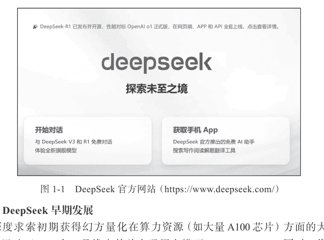

图 1-1 DeepSeek 官方网站 (https://www.deepseek.com/)

##### 1. DeepSeek 早期发展

深度求索初期获得幻方量化在算力资源（如大量 A100 芯片）方面的大力支持，并迅速于 2024 年 1 月推出其首个通用大模型 DeepSeek LLM。同时，代码大模型 DeepSeek Coder 和数学模型 DeepSeek Math 也分别于 2024 年 1 月和 2 月推出。

这几款大模型的发布让 DeepSeek 加入 2023 年“百模大战”的战局，成为大模型领域的玩家之一。虽然深度求索有些姗姗来迟，但这并不妨碍其在接下来的发展中火力全开。

##### 2. DeepSeek 技术突破

2024 年 5 月，深度求索推出了开源模型 DeepSeek-V2。这一版本通过创新的数据与算法优化，将推理成本降低近百倍。这一突破不仅大幅提升了模型性能，还为后续技术创新奠定了坚实基础。

2024 年 12 月，深度求索发布了全新系列模型 DeepSeek-V3，并在大模型主流榜单中取得显著成绩。值得一提的是，V3 首次实现了万亿参数下的轻量化部署。这一技术突破标志着 DeepSeek 在模型效率和可扩展性方面取得重大进展。

##### 3. DeepSeek 火爆全球

2025 年 1 月，深度求索推出了具有里程碑意义的模型 DeepSeek-R1。DeepSeek-R1 是首个纯强化学习驱动的 LLM 推理模型，无须 SFT 预训练即可获得强推理能力。通过多阶段 RL 训练和冷启动优化，DeepSeek-R1 在数学、代码、科学推理等任务上达到了 SOTA 性能，接近 OpenAI-o1-1217。

从成立到全球领先，深度求索仅用两年时间便完成了从技术创新到生态构建的跨越。通过持续的技术突破、开源共享的发展理念以及与多领域的深度融合，深度求索不仅成为中国 AI 崛起的标杆，更以其颠覆性的商业模式和技术实力深刻影响全球 AI 产业的未来走向。

随着技术影响力的扩大，DeepSeek 加速深入社会生产和群众生活中。探讨和使用 DeepSeek 成为人们交流的重要话题。各大科技公司纷纷接入 DeepSeek，包括腾讯、阿里、百度等大型互联网公司。DeepSeek 也深度融入汽车领域，推动智能座舱与云端 AI 的升级。在政务与医疗领域，DeepSeek 相继落地于更多城市的政务系统，并接入多家医院，助力智慧医疗发展。基于 DeepSeek 的多元化下游应用由此蓬勃开展。

#### 1.1.2 DeepSeek 版本介绍

DeepSeek-R1 的成功并非一蹴而就，而是经历了一系列调整，如图 1-2 所示。

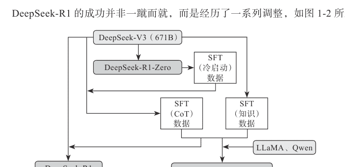

最初，通过对预训练模型 DeepSeek-V3 进行后训练，获得了 DeepSeek-R1-Zero。在此训练过程中，DeepSeek 采用的是纯强化学习的方式，即人类不对训练过程进行干预，而是模型通过训练过程中的问题与激励机制来学习。经过无数轮的“尝试－反馈－调整”循环，模型探索出了最佳的解决方式。这就像一名学生在做各种练习题，通过不断调整自己的解题思路和方法，并根据每次练习的结果进行自我修正和改进，最终掌握了解题的思路。经过上述训练过程，DeepSeek-R1-Zero 已经领悟了思维链（CoT）。

尽管 DeepSeek-R1-Zero 学会了“思考”，但是其推理过程的可读性较差，包括出现多种语言混杂、格式混乱等问题，同时对常识性问题的处理能力仍显不足。为此，DeepSeek 团队通过生成高质量的冷启动数据、思维链数据，以及知识数据，对预训练模型进行强化学习训练，最终推出了我们常说的“满血版”模型 DeepSeek-R1。

此外，DeepSeek 团队还通过蒸馏 Qwen 模型，推出了 1.5B、7B、14B 和 32B 版本；通过蒸馏 LLaMA 模型，推出了 8B 和 70B 版本。至此，DeepSeek 的各个模型版本逐步形成。

### 1.2 人工智能、大模型与 DeepSeek

尽管 DeepSeek 的兴起带来了广泛关注，并推动了人工智能和大模型等相关概念的普及，但对于缺乏技术背景的读者而言，这些专业术语和概念可能较难理解，从而影响他们对大模型技术进展的有效追踪和实际应用。本节将对人工智能领域的基本概念进行简要介绍。

人工智能的技术体系如图 1-3 所示。机器学习是人工智能的核心分支之一。在机器学习领域，深度学习作为一种基于深层神经网络的算法，进一步推动了技术的突破。深度学习的实现依赖于各种不同的模型结构，其中预训练模型因其高效的迁移学习能力备受关注。预训练模型进一步包含所谓的预训练大模型（常简称为“大模型”），这类模型以其庞大的参数规模著称。在这些大模型之中，还存在一个专门用于处理语言任务的子类，即预训练大语言模型（简称“大语言模型”）。2023 年人工智能领域发生的“百模大战”，就是围绕大语言模型研究展开的科技竞赛。

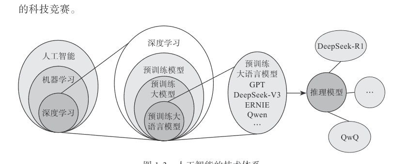

基于大语言模型，各企业开发出对应的对话应用产品，如基于 GPT 的 ChatGPT 和基于 ERNIE 的文心一言。这些产品是大模型时代较早的标杆性成果。从人工智能到具体的产品应用，构成了层层嵌套的技术体系。

为了更好地符合人类的使用习惯和喜好，针对预训练大语言模型，往往加入高质量对话数据进行后训练，以生成专门用于推理的大模型，即推理模型。火爆的 DeepSeek-R1 就是其中的典型。

#### 1.2.1 人工智能的三大技术流派

在人工智能近百年的发展历史中，人们对人工智能追求的目标基本一致，即希望机器能够展现出与人类智能相似乃至一致的行为表现。然而，技术发展的路径却大相径庭，先后涌现众多技术理论与流派，如符号主义、联结主义、贝叶斯派、频率主义、行为主义等。这些技术流派犹如华山论剑，各有特点与绝技，在不同的时期各领风骚。

在众多技术流派中，能力最突出、影响最深远的是符号主义、联结主义和行为主义这三个技术流派。

##### 1. 符号主义

符号主义，又称逻辑主义，是人工智能领域最早兴起的流派。符号主义认为人类认知和思维的基本单元是符号，智能源自基于符号的表征与数理逻辑计算，人工智能就是一个物理符号系统。如果用大量逻辑符号来表达思维，并通过大量类似于“如果这样，就那样”的逻辑规则定义，就会产生像人类一样的智能推理与决策，如图 1-4 所示。

> 苏格拉底三段论
> P：凡人要死
> Q：苏格拉底是人
> R：苏格拉底要死
> 此三段论表示为：
> (P ∧ Q) → R

图 1-4 数理逻辑之谓词逻辑三段论

符号主义最早可追溯到 19 世纪末。彼时，数理逻辑迅速发展，到 20 世纪 30 年代开始用于描述智能行为，并在计算机出现后实现逻辑演绎系统。符号主义的发展在 20 世纪 80 年代伴随着专家系统的成功达到巅峰，但在人工智能的第二次冬天中逐渐式微，日益衰落。专家系统结构示意如图 1-5 所示。

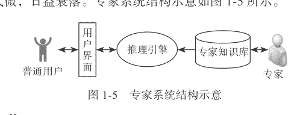

##### 2. 联结主义

联结主义又称仿生学派或生理学派，认为思维的本质在于生物神经元之间的连接与交互，如图 1-6 所示。联结主义认为，通过模拟生物神经系统，建立一种基于神经元模型的学习算法来模拟人类的学习过程，就可以实现机器的智能化。


图 1-6 生物神经元结构

联结主义起源于 1943 年的 MP 神经元模型，如图 1-7 所示，并在人工智能的黄金时代（20 世纪 50 年代至 70 年代）出现过以感知机为代表的研究热潮。但这一流派随着人工智能的第一次低谷而陷入低潮。随着 20 世纪 90 年代算力的提升，联结主义才又重新抬头，直到今天占据人工智能的中心位置。以深度神经网络为代表的算法在各项人工智能任务上表现突出，证明了联结主义在实现机器智能上的有效性，如图 1-8 所示。多个神经元以层的方式相互连接，构成庞大的网络结构。该结构由于层数众多，因此被称为深度神经网络。


图 1-7 MP 神经元模型

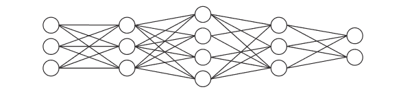

图 1-8 深度神经网络示意

深度神经网络从 2012 年开始被广泛关注，其标志性事件是在当年的 ImageNet 挑战赛上，深度神经网络 AlexNet 一骑绝尘，将图像分类的错误率降低了一半，以远超第二名的成绩获得比赛冠军，展现了深度学习的巨大潜力。

##### 3. 行为主义

行为主义又称进化主义或控制论学派，认为智能来源于智能体与环境交互的行为。行为主义主张人工智能是一种“感知－动作”型控制系统，基于对行为和反馈的研究，通过训练和奖惩机制可以实现人工智能，如图 1-9 所示。

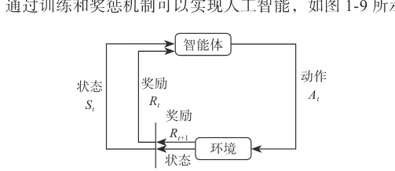

行为主义起源于控制论（1948 年诺伯特·维纳的奠基性著作《控制论》出版）。在人工智能发展的早期，行为主义并未有太突出的表现，直到 20 世纪 80 年代智能控制和智能机器人系统的出现，行为主义才开始崭露头角。行为主义在 20 世纪末逐渐成为人工智能的新流派。以行为主义为理论基础的强化学习被应用于机器人领域，取得了令人瞩目的成果，其中波士顿动力公司的机器狗最为知名。

上述三种技术流派各自拥有独特的理论基础与方法论，如表 1-1 所示，在不同时期推动着人工智能的发展。

表 1-1 人工智能三大技术流派对比

| 流派 | 符号主义 | 联结主义 | 行为主义 |
| :--- | :--- | :--- | :--- |
| 理论依据 | 数理逻辑 | 生理学 | 控制论 |
| 基本理念 | 通过逻辑符号表达思维 | 仿生大脑模型，以神经元模型为智能基础 | 注重行为与反馈，“感知－动作”模型是智能的关键 |
| 缺点与问题 | 1. 仅限于专业细分领域<br>2. 知识采集难度大<br>3. 人类抽象包罗万象，无法穷尽 | 1. 受脑科学的制约<br>2. 受数据和算力制约 | 1. 过于注重表现形式<br>2. 受环境影响无法穷尽策略 |
| 智能获取方式 | 靠人工赋予机器智能 | 从数据中习得智能 | 在与环境的交互中获得智能 |
| 代表技术 | 知识图谱 | 深度神经网络 | 遗传算法，强化学习 |
| 代表产品 | 专家系统 | 视觉检测，翻译系统 | 机器狗 |

江湖纷争，分久必合。虽然这三个技术流派各有侧重，但现代人工智能的发展往往是它们相互融合的结果，许多实际应用中会结合多种流派的方法和技术手段。例如，DeepSeek 就是多种技术融合的结果。在 DeepSeek 的实现路径中，数据处理上采用符号主义构建知识库，模型训练时采用联结主义构建 Transformer 模型，为保证模型对齐，又通过行为主义的强化学习进行微调，以符合人类的使用期望。

#### 1.2.2 大模型的主要特征

2022 年年底至 2023 年年初，大模型成为家喻户晓的概念。彼时，由 OpenAI 推出的 ChatGPT 以其令人惊艳的交互性和实用性在全球范围内引发了广泛关注与热议。ChatGPT 基于 GPT-3 预训练大语言模型实现，具有强大的自然语言理解和生成能力，能够与用户进行多轮对话，执行解答问题、撰写代码、创作文本等多种任务。随着 ChatGPT 热度的持续发酵，大模型技术受到了前所未有的重视，各大科技公司和研究机构纷纷入局，由此开启了大模型群雄割据的时代。

大模型的“大”主要体现在数据、参数和算力三个方面。

##### 1. 大规模数据

数据是用于模型训练的“燃料”，算法通过大量数据学习参数与配置，使预测结果与实际情况更加吻合。一般而言，数据量越多，算法模型的能力越强；数据质量越高，算法模型的效果越好。因此，模型训练需要大规模高质量数据集的支撑。

模型预训练采用的数据集规模巨大，是大模型之所以称为“大”的一个方面。其中，DeepSeek-V3 的训练数据量达到了 14.8 万亿个 token（词元）。训练 GPT-3 所使用的数据集包括经过过滤的 CommonCrawl 数据集、WebText2、Books1、Books2 以及英文 Wikipedia 等。其中，CommonCrawl 的原始数据大小为 45TB，经过过滤后仅保留了 570GB 大小的数据。开源模型 LLaMA 训练所需的数据量经过分词后达到了 1.4T。

##### 2. 大规模参数

在人工智能领域，算法是指实现机器智能的具体计算方法，它是一系列步骤或规则的集合，利用数据进行学习，从而习得模型。而模型是指由算法计算得到的结果，可以用于对新的未知数据进行预测或分类。简单来说，算法是用来学习、训练模型的计算方法，如前向传播算法和反向传播算法。而模型则是一个计算结构及其对应的参数值，可以保存为一个模型文件，在使用时加载为模型对象，用于任务处理。

以预测问题为例，假设有这样一个场景：在制造工厂里，有一套极其关键的生产设备，它关系到工厂的生产进度和产品质量。由于高负荷运转，这套设备在实际生产中可能会出现各种潜在故障。一旦发生突发性故障，就会导致巨大的损失。为避免这种损失，可以通过物联网（IoT）技术实时监测设备的各项运行参数，包括温度、振动、电流、压力等，进行设备健康诊断，以便及时保养。运行参数与健康状况之间的关系表达就是我们所要获取的模型，而获得这种关系表达的方式就是算法。如图 1-10 所示，假设有两种模型结构来表达运行参数与健康状况的关系：左边的模型具有 7 个参数，右边的模型具有 4 个参数，而求得这些参数的过程就是算法。一般而言，根据设备健康数据，可以分别求得相应的参数值，那么就真正得到了模型。在进行健康诊断时，可以将运行参数代入模型，计算出健康值。

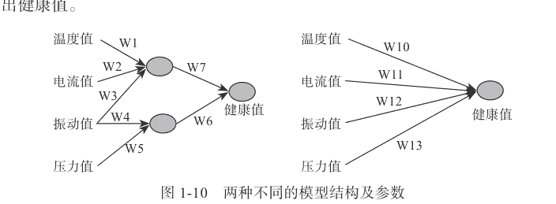

目前主流的大模型是基于 Transformer 架构的模型，采用 Transformer 结构堆叠的方式，构建了庞大的网络结构，不仅能够处理自然语言，还拓展到图像、视频、音频等其他模态，几乎统治了人工智能的技术架构。

由于模型包含的参数量不同，模型也具有不同的规模。例如，在图 1-10 中，左边的模型有 7 个参数，而右边的模型有 4 个参数，因此相比而言，左边的模型更大一些。我们现在所说的大模型就是参数规模超大的模型。例如，DeepSeek 的模型参数规模已经达到 6710 亿个，远超过当年 ChatGPT 的 1750 亿个参数。

##### 3. 大规模算力

对大模型进行预训练是非常耗费算力的。以 DeepSeek-V3 为例，其训练花费约 557.6 万美元。几百万美元的成本在业界被称为低成本，由此可见，大模型产业在算力资源上的消耗是多么巨大。常见大模型的训练算力需求如表 1-2 所示。

表 1-2 常见大模型的训练算力需求

| 模型 | 参数大小 | GPU 训练小时数 | 训练设备 |
| :--- | :--- | :--- | :--- |
| LLaMA2 7B | 70 亿 | 184320 | A100-80GB |
| LLaMA2 13B | 130 亿 | 368640 | A100-80GB |
| LLaMA2 70B | 700 亿 | 1720320 | A100-80GB |
| GPT-3 | 1750 亿 | 2522880 | V100-32GB |
| DeepSeek-V3 | 6710 亿 | 2788000 | H800 |

#### 1.2.3 大语言模型的基本能力

大语言模型最显著的能力在于自然语言的理解与生成。以 DeepSeek 为代表的大语言模型，在文本生成、语义理解、问答系统、机器翻译等方面取得了突破性进展。它们可以理解和生成高质量的文本内容，并基于上下文进行复杂的推理。

（1）自然语言理解

大语言模型能够通过深度学习技术对输入的文本进行深入分析和理解，捕捉其中复杂的语义信息、情感色彩、逻辑结构及潜在含义。它们在处理如问答、文档摘要、语义解释、情感分析、实体识别、关系抽取等任务时表现出优秀的性能。例如，当要求大模型将一段话进行语言翻译时，其结果相当不错。

用户提问：
大语言模型能够通过深度学习技术对输入的文本进行深入分析和理解，捕捉其中复杂的语义信息、情感色彩、逻辑结构及潜在含义。它们在处理如问答、文档摘要、语义解释、情感分析、实体识别、关系抽取等任务时表现出优秀的性能。请帮我把这段话翻译成英文

大模型的回复：
Large language models are capable of conducting in-depth analysis and understanding of input text through deep learning techniques, capturing complex semantic information, emotional nuances, logical structures, and latent meanings. They demonstrate exceptional performance on tasks such as question answering, document summarization, semantic interpretation, sentiment analysis, named entity recognition, and relationship extraction.

（2）自然语言生成

基于海量训练数据，大语言模型可以自动生成连贯、流畅且具有一定创造性的文本内容，包括文章写作、故事创作、对话模拟、代码编写以及诗歌或歌词创作等。这些模型可以根据给定的提示词或上下文信息生成全新的文本段落，生成的内容通常具备高度的逻辑一致性与合理性。当用户以自然语言要求生成一个算法时，大语言模型也能很好地完成任务，帮助用户提高编程效率。

用户提问：
请帮我写一个高通滤波器的算法实现。

大模型的回复：
对于一个基本的一维无限脉冲响应（IIR）高通滤波器的设计和实现，我们可以使用巴特沃斯滤波器（Butterworth filter）作为示例。以下是一个使用 Python 和 Scipy 库实现的简单二阶巴特沃斯高通滤波器算法。

```python
```

from scipy.signal import butter, lfilter

def high_pass_filter(data, cutoff_freq, sample_rate):
    """
    参数：
    data: 需要过滤的信号数据（一维数组）
    cutoff_freq: 截止频率，即高通滤波器允许通过的最小频率
    sample_rate: 采样率
    返回：
    filtered_data: 经过高通滤波后的信号数据
    """
    # 计算滤波器阶数和截止频率对应的数字角频率
    nyquist_freq = 0.5 * sample_rate
    normal_cutoff = cutoff_freq / nyquist_freq
    # 设计二阶巴特沃斯高通滤波器
    b, a = butter(2, normal_cutoff, btype='highpass')
    # 应用滤波器
    filtered_data = lfilter(b, a, data)
    return filtered_data

# 使用示例
sample_rate = 1000  # 假设每秒采样 1000 次
cutoff_freq = 50  # 截止频率为 50Hz
data = ...  # 这里是原始信号数据
filtered_data = high_pass_filter(data, cutoff_freq, sample_rate)

这个代码片段设计了一个二阶巴特沃斯高通滤波器，并将其应用于输入的数据序列。请注意，在实际应用中，可能需要根据具体需求调整滤波器的阶数以达到所需的频率响应特性。同时，截止频率应根据实际应用场景来设置。

#### 1.2.4 关于 DeepSeek 的常见误区

DeepSeek 作为人工智能领域的革新技术，对很多人，尤其是人工智能领域之外的人而言，具有一定的新颖性和神秘感。人们在理解和认识 DeepSeek 的过程中往往存在一些误区和误解，这阻碍了人们拥抱 DeepSeek 并有效使用它。下面介绍几个常见的误区，以帮助读者对 DeepSeek 这类大模型有更清晰的认识。

**1. DeepSeek 等大模型是新型搜索引擎**

许多人认为 DeepSeek 这类自然语言生成应用在回答问题时，是先检索资料或在网络上搜索，从中找到答案后再返回给用户的。这种说法是不准确的。事实上，大模型和搜索引擎存在显著区别。

**（1）工作原理不同**

DeepSeek 能够回答问题是基于模型所具有的推理能力，是一种“无中生有”生成新信息的过程。这种能力是在大量数据集的训练学习中获得的。

搜索引擎则是通过索引互联网上的网页和其他在线资源来帮助用户查找信息的服务。其工作原理是检索已存在的网络信息并对结果进行排名，而非生成新信息。

**（2）“预知未来”的能力不同**

面对从未出现过的信息，由于没有网络留痕，搜索引擎无法检索到准确的匹配信息。而大模型则能够进行一定的推理并给出回答，只不过这种回答通常是“胡说八道”。尽管如此，大模型至少能够“假装”知道答案，这种现象通常被称为“幻觉”。目前，为了防止大模型出现“幻觉”的情况，会采用价值对齐等方式，以避免其“胡说八道”。

**（3）大模型有望取代搜索引擎**

大模型是一种新的知识表示和调用方式，有取代搜索引擎成为下一代信息检索工具的趋势。在人类知识表示和调用方式的演进历史上，先后经历了口口相传、文字记录、数据库存储等历史过程。目前最流行的方式是使用谷歌、百度等搜索引擎。鉴于大模型友好的自然语言交互特性和强大的能力，大模型有望成为下一代信息检索工具。

##### 2. 大模型就是通用人工智能

以大模型为核心的智能应用表现出了强大的能力，在各自的领域中取得了显著成果。例如，DeepSeek 在对话聊天方面为用户带来了前所未有的互动体验。这些技术进步与创新应用让很多人夸张地惊呼“现实不存在了”“通用人工智能已经来临”。

然而，尽管基于大模型的应用展现了较高的智能化水平，但它们仍然只是在特定任务上具有高适应性的专用系统，而非真正意义上的通用人工智能。通用人工智能是指具有相当于人类水平的综合智能，能够在任何未预先编程的领域中学习并解决问题，同时具备跨领域的适应性和自我意识。

目前的大模型技术，尽管在特定领域表现卓越并有逐步扩展的趋势，但在抽象思维、自主思考与创新，以及对自身行为的理解等方面，距离真正的通用人工智能还有较大差距。因此，不宜过于夸大大模型的能力，但也要正视大模型朝通用人工智能发展的速度。

##### 3. DeepSeek 给出的结果和答案就是正确的

由于大模型在很多时候能够提供准确、合理且有深度的答案，许多人乐于使用大模型。久而久之，人们在面对大模型给出的答案时，可能倾向于不假思索地将其视为正确答案，完全信任大模型。事实上，这种做法是不正确的，也是一种具有极大风险的行为。

由于大模型的技术特点，并不能简单地认为大模型给出的所有结果和答案都是绝对正确的。这主要有如下几个原因。

**（1）算法局限性**

目前，大模型的输出是基于概率统计的。大模型仅仅是根据已学习的数据分布进行预测，并将预测结果的抽样作为答案反馈给用户。因此，即使模型结构再强大，也无法保证对所有问题都能找到100%正确的答案。尤其是在逻辑推理、道德判断等需要深入思考的问题上，大模型可能无法做出完全符合人类价值观或普适真理的回答。

当然，目前大模型的研究正朝着高准确性和价值对齐的方向演进，有望通过其他技术手段突破模型本身的局限性。

**（2）数据依赖性**

大模型是基于其训练时所使用的数据集构建的。如果数据集中存在错误、偏见或不完整性，那模型也会“学偏”，进而在处理相关信息时得出不准确的答案。这正如人类的学习过程，如果学习时采用了错误或偏颇的教材，那么学生的认知和行为就很难保证正确。同理，大模型答案的准确性也取决于训练数据的质量。

**（3）上下文理解**

尽管大模型（如DeepSeek）在理解上下文方面有所改进，但仍可能出现对复杂语境理解不准确的情况，导致回答偏离正确方向，尤其是在用户问题存在歧义时。

**（4）实时更新性**

模型一旦训练完成并部署，对于其未学习过的最新知识或实时更新的信息就可能无法及时掌握。因此，在某些特定领域，特别是快速发展的科学和技术领域，大模型提供的信息可能会滞后或不准确。

因此，大模型确实展现了强大的智能表现，但人们在实际应用中仍需要谨慎对待其输出，并结合专业知识、人工审核以及不断优化迭代，以确保结果的准确性。

### 1.3 小结

随着DeepSeek的火爆“出圈”，与之相关的各种名词让人眼花缭乱，对于行业外的人而言，确实难以理解。本章对DeepSeek的相关情况进行了简要介绍，并回顾了人工智能的发展历史。人工智能的发展几经起伏，孕育了符号主义、联结主义、行为主义等技术流派，发展出了知识图谱、神经网络、强化学习等多种技术，在自然语言处理、计算机视觉以及多模态的任务上表现卓越。

随着数据、算法（参数）和算力的迅猛增长，人工智能进入了大模型时代，能够对承载人类智慧的语言进行理解和对话，智能的涌现使人工智能的发展再次繁荣。在追逐通用人工智能的道路上，各大厂商纷纷打造自己的大模型，掀起“百模大战”。而 DeepSeek 作为后起之秀，在“百模大战”后期入局，却能脱颖而出。那么，它背后又有怎样的奥秘呢？

# CHAPTER 2
## 第 2 章

# DeepSeek 的技术原理

深度求索公司仅用两年时间便从正式入局大模型领域发展到推出震惊全球的 DeepSeek-R1，展现了惊人的发展速度。DeepSeek 凭借强大的模型能力、创新的低成本训练方案及其开源性质，使得所有企业及个人均可使用性能强、成本低的大模型服务。这标志着继 ChatGPT 引领的智能爆发之后，又一个重要里程碑时刻的到来。通过技术普及和开源开放，DeepSeek 不仅大幅降低了 AI 应用的落地门槛，还真正开启了 AI 普惠的新纪元，推动整个行业向着更加包容和可访问的方向发展。

本章首先介绍大模型的基本技术，即 Transformer 架构和混合专家模型 (MoE)，然后分析 DeepSeek 在此基础上的多个技术创新，最后探究 DeepSeek 火爆现象背后的逻辑。

### 2.1 大模型的基本技术

无论是开源的 DeepSeek 还是闭源的 GPT，这些主流大模型的核心均在于 Transformer 和 MoE 两大技术。其中，Transformer 提供了并行计算能力，MoE 提高了资源利用效率。

#### 2.1.1 Transformer 的基本原理

Transformer 架构来自 2017 年谷歌研究团队的论文 “Attention is All You Need”。该论文发表在人工智能领域的顶级会议 NIPS (或称 NeurIPS, Conference and Workshop on Neural Information Processing Systems）。Transformer 这一经典之作在 NeurIPS 2017 上并未引起多少关注，它甚至没有获得会议的现场演讲机会，更不用说获得最佳论文提名了。然而，在 BERT、GPT 等大模型取得成功之后，Transformer 也因此封神。

Transformer 的提出起初主要是为了解决基于循环神经网络（如 RNN 和 LSTM）在处理序列数据（如机器翻译）时存在的两个重要问题，即并行计算受限和长距离依赖问题。

##### 1. 并行计算受限

RNN 和 LSTM 在处理序列数据时具有明显的顺序依赖性，只能串行计算，即每个时间步的计算必须等待前一时间步的结果。如图 2-1 所示，在对“我要学习大模型”这句话进行处理时，RNN 呈现明显的顺序依赖。循环神经网络的这种串行工作机制导致其无法有效利用 GPU 或 TPU 等硬件的并行计算能力，训练速度相对较慢。

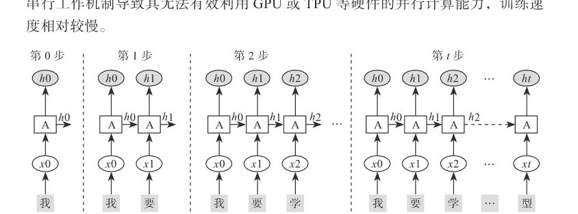

##### 2. 长距离依赖问题

在 RNN 中，长距离依赖问题是指随着序列长度增加，模型对序列早期信息的记忆和利用能力逐渐减弱的现象。在 RNN 处理序列数据时，当前时刻的状态（即隐藏层输出）是通过上一时刻的状态与当前输入的共同计算得到的。随着序列长度的增加，在多步运算后，较早的信息需要经过多个时间步的传递才能影响到后续状态，这一过程中容易发生梯度消失或梯度爆炸问题，导致远端信息在传播过程中被极大地衰减或放大。以“我要学习大模型”为例，当模型处理到最后一个词的时候，也许已经记不清是谁要学习大模型了。尽管 RNN 的改进版本——LSTM、GRU 等模型通过其内部的记忆单元和门控机制在一定程度上缓解了长序列中的信息丢失问题，但随着序列长度增加，依然存在远距离依赖关系建模效果不佳的现象。

另外，由于 RNN 的串行计算结构，序列前端的信息无法与后端信息建立关联，导致整个序列的编码完整性不足。以“我要学习大模型”为例，当前时刻的状态与后续时刻的输入无关，即在处理“学”的时候，只知道是谁要学，但不清楚学什么。虽然 RNN 的双向结构在一定程度上解决了这个问题，但也只是将不同方向的两个 RNN 叠加，由于长距离依赖问题，编码完整性仍然无法得到保障。

Transformer 模型完全摒弃了循环神经网络中顺序处理输入序列的网络结构，转而采用自注意力（Self-Attention）机制来捕捉输入序列中任意位置之间的关联。这种机制天然支持并行计算，极大地提高了模型训练和推理的速度。同时，Transformer 通过多头注意力、位置编码等技术，确保拥有对序列中所有元素进行全局建模的能力，从而解决了上述问题。在机器翻译任务上，Transformer 取得了显著的性能提升，并迅速成为自然语言处理和其他序列任务中的主流模型架构。Transformer 的总体架构如图 2-2 所示。

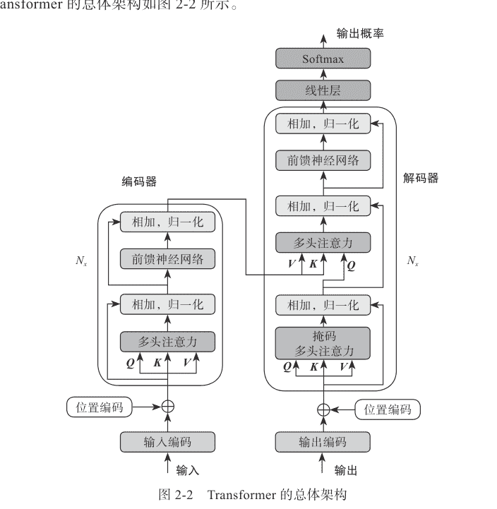

图 2-2 Transformer 的总体架构

Transformer 的总体架构分为四个部分，即输入部分、输出部分、编码器部分和解码器部分。以把“我要学习大模型”这句话翻译成英文为例，简化的 Transformer 架构如图 2-3 所示。输入的文字经过编码器编码后获得中间变量，然后中间变量被送到解码器进行解码，进而输出最终结果。

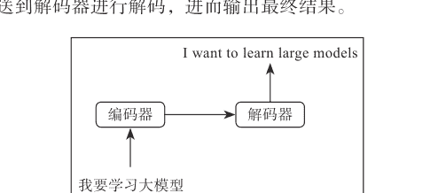

将这个翻译过程一步步拆解来看，如图 2-4 所示。首先，输入文字被编码成中间变量，经过解码器后，输出英文单词分类的概率，即每个单词的可能出现概率。根据一定的机制，假定选取概率最大的单词作为最终输出，那么输出为“I”。然后，将中文的编码连同上一步输出的“I”一起送到解码器，经过解码处理后，再次输出英文单词分类的概率。根据一定的机制选择，假如选择输出为“want”，那么现在得到的输出为“I want”。下一步，将中文的编码连同当前输出送到解码器，经过筛选后输出“to”，以此类推，最终完成翻译。

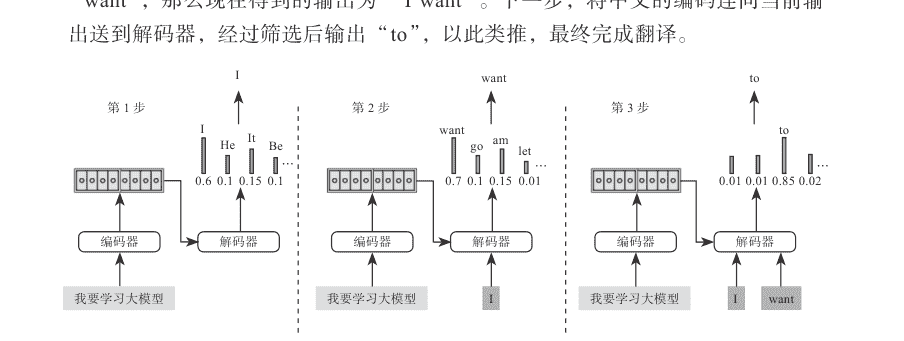

#### 2.1.2 Transformer 的优缺点

Transformer 模型摒弃了依赖顺序计算的循环神经网络架构，转而采用完全并行的计算过程，通过注意力机制捕捉待处理序列中任意位置之间的关联，从而解决长距离依赖问题。在具体实现中，Transformer 采用自注意力机制、掩码注意力机制、互注意力机制、多头注意力机制等多种方式，建立序列内部、序列与序列之间，以及序列不同维度之间的关联关系，极大地增强了对序列语义的理解能力和生成能力。

Transformer 采用编码器和解码器的结构。其中，编码器通过多层堆叠的方式实现多层次特征提取，提升了模型的表示能力，从而对输入内容形成深刻理解。解码器同样采用多层堆叠的方式，逐步生成目标序列，使模型能够按层次递进地预测。解码器使用带有掩码的多头自注意力机制，确保在预测当前词时只关注已生成的历史词汇，而无法看到未来词汇，从而实现自回归建模，展现出强大的生成能力。

##### 1. Transformer 的优点

Transformer 模型的解码器和编码器结构清晰，多层堆叠的模型简单，多种注意力机制的应用灵活，不仅具有强大的理解和生成能力，还具备可模块化、标准化的应用潜力。正如 Transformer 的直译“变形金刚”一样，它可以灵活变形，激发模型无限的想象力和创造力，如图 2-5 所示。


在 Transformer 的原始论文中，作者主要在两个翻译任务上进行了实验。Transformer 在从英语到德语和从英语到法语的 newstest2014 数据集测试中取得了比此前最先进模型更高的 BLEU 分数，同时显著降低了训练成本。此外，Transformer 在其他任务中也表现出了良好的性能。

##### 2. Transformer 的缺点

Transformer 架构并非完美无瑕，也存在一些缺点。

- （1）训练需要大量标注数据
对于某些任务，特别是涉及复杂语义关系和细粒度分类的任务，Transformer 架构模型可能需要大量标注数据才能发挥最佳性能。

- （2）计算资源需求高
由于复杂的自注意力机制和多层结构，Transformer 架构模型在训练时需要大量计算资源，尤其是在处理大型数据集和长序列时。以基于 Transformer 架构的预训练大模型（如 BERT、GPT-3）为例，其训练成本极高。

- （3）存储需求大
预训练的 Transformer 架构模型的参数量通常非常庞大，导致模型文件巨大。这不仅增加了存储成本，还使得模型在资源有限的设备上的部署变得困难。

- （4）过度依赖预训练，优化难度增加
对于特定领域或小规模任务而言，从头开始训练一个完整的 Transformer 架构模型效率低下，而依赖预训练大模型进行微调可能导致过拟合或欠拟合问题，特别是当微调数据与预训练阶段的数据分布差异较大时。此外，由于模型参数量巨大、架构复杂，要优化模型以达到最佳性能需要采用大量调优策略，优化难度较高。

#### 2.1.3 MoE 的基本原理

在面对复杂、多样或高维问题输入时，单一模型可能会显得“力不从心”。然而，如果有多个侧重点不同的模型分别对问题输入进行处理，然后协作，利用集体智慧的力量是否可以缓解这一问题呢？

事实上，人们在日常工作中往往采用团队协作的方式来应对复杂问题，如专家评审。在对某个项目进行评审时，人们通常会召开专家评审会，邀请不同领域的专家，由专家分别给出关于机械结构、电气结构、经济效益等方面的专业评审意见。这样一来，就可以对项目进行专业、权威且全面的诊断。

在大模型领域，也存在类似于专家评审的技术，称为混合专家（Mixture of Experts, MoE）模型。MoE 提供了一种有效的手段来扩大模型容量并处理复杂任务，尤其适用于需要大模型解决的数据分布复杂且高度异质化的应用场景。

##### 1. MoE 的概念

俗语云：“三个臭皮匠，顶个诸葛亮。”如果将众多领域专家的知识和能力集合在一起，那么解决问题的能力就可以大幅提升。MoE 模型正是基于这样的理念。

它由多个专业化的子模型（即专家模型）组合而成，每一个“专家”都在其擅长的领域内做出贡献。在面对问题输入时，系统通过合适的方式决定哪个或哪些专家模型参与解答问题，然后将这些专家模型的回答整合起来，从而得到更准确的答案，如图 2-6 所示。

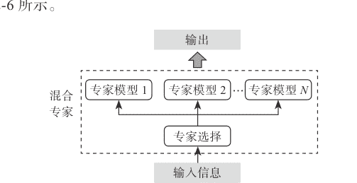

在具体实现过程中，MoE 的基本思想是构造一组专家网络，其中每个专家模型负责数据空间的一个特定区域或特征子集，并通过一个门控网络决定将输入分配给哪一个或哪几个专家模型进行处理。这种方法借鉴了人类社会分工和专业化生产的思想，将复杂任务分解给多个专业模块处理，并将各个模块的输出结果整合起来，以期获得比单个专家模型更准确、更灵活的解决方案。

MoE 结合多个专家网络来实现高效、灵活且具有高容量的学习系统，具有如下特点。

- （1）大幅增加模型参数量
MoE 由一组专家网络组成，每一个专家网络既可以采用相同的神经网络结构，也可以采用不同的神经网络结构，各自拥有独特的参数和功能。每个专家网络的参数规模可以根据需要进行扩大。随着专家模型数量的增加，理论上模型的容量会线性增长。而 MoE 可以动态调用部分专家网络，从而实现在不增加计算量的前提下大幅增加总体的模型参数量。相比同等大小的稠密模型，MoE 的表示能力更强。因此，MoE 技术是训练万亿参数量级模型的关键技术。

- （2）降低超大模型训练开销
传统的深度学习模型在训练时，对于每个输入样本，整个网络都会参与计算。随着模型规模越来越大，训练使用的样本数据越来越多，训练的开销也变得越来越难以承受。MoE 将任务分解为若干子任务，在每个子任务上训练一个专家模型。通过专家选择模块（即门控技术）选择对应的专家网络，有助于降低模型训练开销。

（3）泛化性强

MoE 中的每个专家网络专注于处理输入空间的不同部分或模式，增强了模型对复杂数据分布的适应能力。因此，MoE 模型具有良好的泛化性。

##### 2. MoE 与集成学习的对比

MoE 与集成学习有异曲同工之处。集成学习（Ensemble Learning）是一种机器学习范式，其基本思想是通过构建并整合多个学习算法（称为“基础学习器”或“个体学习器”）的结果，以期达到比单个学习器更好的预测性能和泛化能力。在集成学习中，不同的个体学习器可能有不同的结构、参数或训练数据样本。它们各自生成预测结果后，这些结果通过某种策略（如投票、平均、堆叠等）结合起来，形成最终的预测或决策。

集成学习的优势在于它能够减少模型的方差、偏差或噪声影响，提高模型稳定性和预测精度。常见的集成学习方法包括 Bagging 和 Boosting 等。

（1）Bagging

通过自助采样法创建多个数据集，然后在每个数据集上训练单独的模型，最后通过多数投票等方式集成预测结果，如图 2-7 所示。例如，随机森林就是基于 Bagging 思想的一个例子。

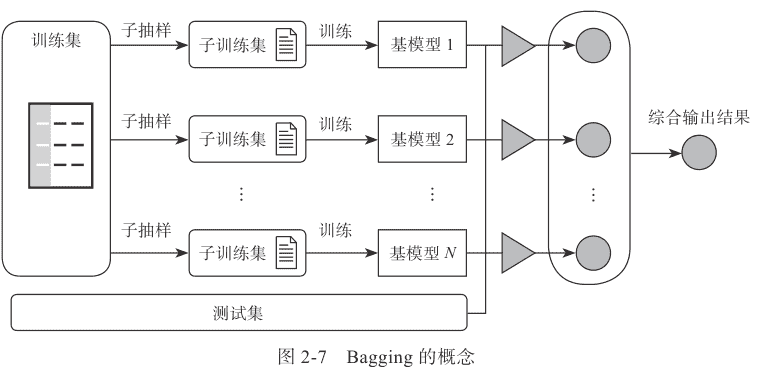

（2）Boosting

通过迭代的方式逐步训练一系列弱学习器，并对之前错误分类样本给予更高的权重，这样每次迭代都会重点关注那些较难学习的样本，最后将所有弱学习器组合成一个强学习器，如图 2-8 所示。Adaboost、Gradient Boosting Machines 和 XGBoost 是 Boosting 方法的典型代表。

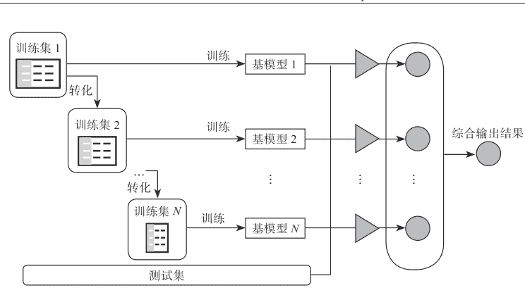

尽管 MoE 和集成学习在思想上异曲同工，即都是集成多个模型的方法，但在具体实现上，两者的方式有很大不同。与 MoE 最大的不同之处在于，集成学习不需要将任务分解为子任务，而是将多个基础学习器组合起来。这些基础学习器可以使用相同或不同的算法，并且可以使用相同或不同的训练数据，如表 2-1 所示。

表 2-1 MoE 与集成学习对比

| 技术 | MoE | 集成学习 |
| :--- | :--- | :--- |
| 技术类别 | 深度神经网络技术 | 机器学习技术 |
| 应用目的 | 提高模型收敛与推理速度，提升模型性能 | 提高模型预测准确性 |
| 训练步骤 | 1. 将任务分解成多个子任务，在每一个任务上训练一个专家模型<br>2. 开发一个门控模型，将输入路由到相应的专家模型 | 采用相同或者不同的数据集训练多个基础模型，这些基础模型可以相同，也可以不同 |
| 结果输出 | 将多个模型的结果组合输出，从而获得最终结果 |

随着时间的推移和技术的发展，MoE 模型在深度学习时代得到了进一步的应用和发展。尤其在最近几年，随着 Transformer 架构在自然语言处理及其他领域的广泛应用，MoE 模型被引入 Transformer 结构中，形成了 Switch Transformer、Sparse Mixture of Experts（SME）等新型模型结构。这些模型在保持高容量的同时，通过动态路由和稀疏激活机制，能够在大模型训练中显著提升计算效率和模型性能。

#### 2.1.4 MoE 的优缺点

在面对实时性和不同应用场景的实际需求时，大模型的参数会变得越来越多，其复杂性和规模也不断增加。一般而言，在模型训练中，对于每个输入样本，整个网络都会参与计算。随着模型规模的不断扩大和训练样本数据量的增加，训练的开销变得越来越难以承受。在这种趋势下，如何降低大模型的训练难度和推理成本成为亟须攻克的任务。其中，MoE 模型就是一种有效的解决方案。

MoE 模型结合了多个专门的专家模型，以实现更高效、灵活和强大的预测能力。在 MoE 中，每个专家模型专注于处理数据集中的特定子集或模式，而一个门控网络负责根据输入数据动态分配任务给最合适的专家，或者根据权重组合各个专家的输出。

MoE 模型的关键价值在于，它既提供了一种扩大模型容量和处理复杂任务的有效手段，也为模型压缩和计算资源的高效利用提供了新的思路。

##### 1. MoE 的优点

相比稠密网络，MoE 模型具有以下优点。

- （1）稀疏激活
通过门控机制，MoE 能够在计算上实现稀疏性，仅激活与当前输入相关的少数几个专家模型，从而显著提高大模型的计算效率和可扩展性。

- （2）模型容量提升
每个专家模型可以独立训练并捕获数据的不同方面或复杂性，因此整体模型能够容纳更多参数和更丰富的表示形式。

- （3）专业化分工
各个专家模型可以根据各自的特长处理不同的输入特征或任务类型，实现某种程度上的“知识分工”。

- （4）适应性与泛化性能
动态选择专家模型的特性，使得 MoE 能够更好地适应不同分布的数据和变化的任务需求。

- （5）速度快，效果好
MoE 通过整合多个专家模型的结果，通常可以带来更好的预测准确性和鲁棒性。

##### 2. MoE 的缺点

MoE 模型虽然在提升模型容量、效率和适应性方面具有显著优势，但也存在一些挑战和缺点。

- （1）负载均衡问题
如何有效地分配任务给各个专家模型以实现负载均衡是关键问题。如果门控网络将大部分输入导向少数几个专家模型，会导致部分专家模型闲置，而其他专家模型过载，从而影响整体性能。

- （2）稀疏激活与训练难度

有效控制稀疏性，主要依赖于门控网络的设计和参数调整。门控网络负责决定哪些专家模型参与处理当前输入数据。然而，在进行参数选择时需要注意权衡：当门控网络在单次选择中激活较多的专家模型时，虽然这可能提升模型的表现能力，但会导致稀疏性降低。MoE 模型的稀疏性存在一种平衡挑战，即在实际应用中根据不同场景灵活选择专家模型的数量，以在效率和性能之间找到最佳平衡点。

- （3）通信瓶颈

在分布式训练环境中，MoE 的专家路由机制可能会增加通信成本，尤其是在模型规模较大时。为缓解通信瓶颈，可以考虑减小模型的规模，包括专家模型和门控网络的参数数量，以降低通信开销。此外，可以采用异步更新策略，而不是同步更新所有节点的参数。这可以减少通信开销，但可能导致模型的一致性稍有降低。尽可能在本地计算节点上完成任务，减少节点之间的通信需求。同时，使用参数压缩技术，如模型压缩或渐进压缩算法，以减小传输的数据量。

- （4）资源需求

即便在推理阶段可以利用稀疏激活减少计算量，MoE 模型由于包含多个专家网络，因此在存储上需要更大的空间来保存所有专家模型的参数。另外，实现大规模 MoE 模型的有效运行需要高度优化的硬件资源和并行计算能力，否则可能无法充分发挥其潜力。

### 2.2 DeepSeek 的技术创新

在大模型技术的基础上，DeepSeek 在算法、模型和系统层面进行了协同工程创新。虽然这些技术创新并非基于颠覆性的基础理论创新，但确实带来了模型性能的飞跃以及算力资源消耗的大幅降低。

DeepSeek-V3 的基础架构如图 2-9 所示。该架构遵循 Transformer 架构的基本思想，并对原始版本进行了改进，也就是在前馈神经网络部分采用 MoE 模型，并通过多头潜在注意力机制提升训练效率，同时降低显存占用。

#### 2.2.1 DeepSeekMoE

为了实现高效的推理和成本效益高的训练，DeepSeek 采用了 DeepSeekMoE 架构。这种架构利用了混合专家模型，通过多个专家网络处理输入数据的不同部分，仅激活与当前任务相关的子网络（专家网络），从而提高了计算效率和性能。DeepSeekMoE 架构如图 2-10 所示。

> 参考 “DeepSeekMoE: Towards Ultimate Expert Specialization in Mixture-of-Experts Language Models”。

26 智能制造实战：DeepSeek 在制造业的深度实践

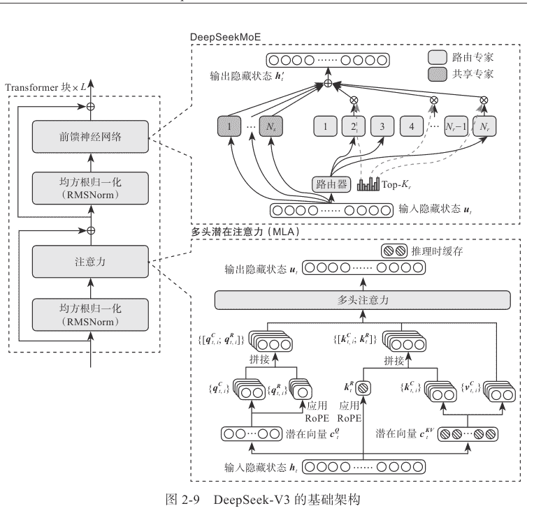

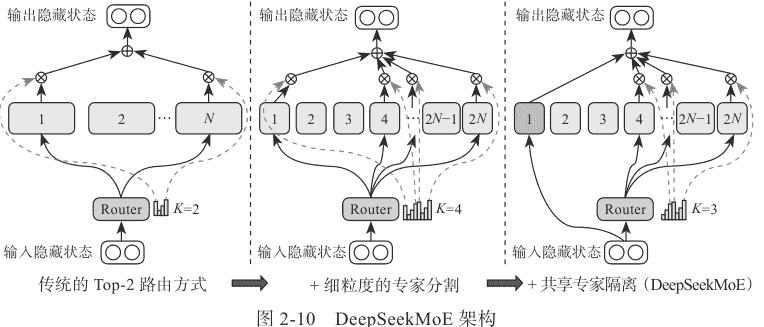

DeepSeekMoE 是一种创新的 MoE 架构，专门设计用于实现终极的专家专业化。这种技术允许模型根据输入动态选择激活的部分，从而提高计算效率和性能表现。

DeepSeekMoE 涉及两个主要策略。一方面，将专家模型精细划分为 $N$ 个，并从中激活 $K$ 个，从而实现更灵活的激活专家组合。另一方面，隔离 $k$ 个专家模型作为共享专家，旨在捕捉共同知识并减少路由专家的冗余。通过细粒度的专家分割和共享专家隔离，DeepSeekMoE 相比主流的 MoE 架构实现了更显著的专家专业化和更高的性能。

DeepSeek 的论文证明，DeepSeekMoE 在专家专业化水平上高于 GShard，并且在同等规模的模型下，其计算量仅为竞品的 40%。因此，DeepSeek 能够在保持或提升模型性能的同时，减少资源消耗。

#### 2.2.2 MLA

在标准 Transformer 架构中，多头潜在注意力（MLA）机制通过并行计算多个注意力头来捕捉输入序列的特征。每个注意力头需要存储键（Key，K）和值（Value，V）矩阵，形成 KV 缓存。

KV 缓存本来是为了避免在推理阶段对前置序列的重复计算。然而，随着前置序列长度的增加，需要读取的 KV 缓存也会变得越来越大，数据传输成本随之增加，导致显存占用过高，从而限制模型的推理效率。在推理阶段，尤其是在处理长文本时，传统方法的高内存占用可能导致显存不足或计算延迟。

为了解决内存占用过高的问题，一些策略会通过压缩 KV 缓存的方式来缓解缓存过大的情况，如 GQA（分组查询注意力）、MQA（多查询注意力）等。然而，这些做法存在 K、V 被压缩的情况。那么，如何在尽量不压缩信息的情况下，节省 KV 缓存并提高整体推理速度呢？

DeepSeek 引入了 MLA<sup>①</sup>（多头潜在注意力）机制，通过低秩联合压缩技术，在保持模型性能的同时，显著减少 KV 缓存的内存占用，从而提升大语言模型的推理效率。如图 2-11 所示，MLA 具体通过低秩矩阵分解，将高维的键值对压缩为更低维度的向量，从而减少存储需求。

MLA 通过低秩联合压缩技术压缩 KV 缓存和查询，优化注意力机制的存储与计算，解决传统 Transformer 的内存瓶颈问题，提升大语言模型的推理效率，成为 DeepSeek-V3 的核心竞争力之一。

> ① 参考 “DeepSeek-V2: A Strong, Economical, and Efficient Mixture-of-Experts Language Model”。

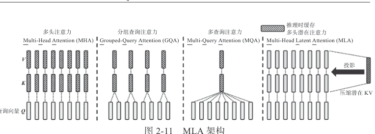

#### 2.2.3 MTP

当前主流的大模型都是 decoder-base 的模型结构，也就是说，无论是在模型训练还是在推理阶段，对于一个序列的生成过程，都是一个 token 一个 token 地生成的，类似于“文字接龙”。每次生成一个 token 时，都需要频繁进行访存交互，加载 KV 缓存，再通过多层网络完成完整的前向计算。对于这样的访存密集型任务，通常会因访存效率的限制形成训练或推理的瓶颈。

针对 Token-by-Token 生成效率的瓶颈，业界提出了多种优化方法，包括减少存储空间和访存次数等，从而提升训练和推理性能。其中，MTP（Multi-Token Prediction，多词元预测）通过解码阶段的优化，将单个 token 的生成转变成 multi-token 的生成，从而提升训练和推理性能。具体来说，在训练阶段，一次生成多个后续 token，可以同时学习多个位置的 label（标签，即目标 token），进而有效提升样本的利用效率和训练速度；在推理阶段，通过一次生成多个 token，实现成倍的推理加速来提升推理性能，如图 2-12 所示。

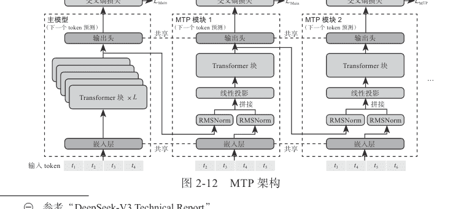

> 参考 “DeepSeek-V3 Technical Report”。

MTP 通过并行预测多个 token，优化模型架构和参数共享，降低计算与内存开销，解决传统单 token 生成效率低、显存占用高、长依赖学习困难等问题，显著提升训练和推理效率，同时保持甚至增强模型性能，成为 DeepSeek 大模型的核心技术之一。

#### 2.2.4 GRPO

在模型完成预训练后，DeepSeek 通过强化学习对模型进行针对性微调，以提升推理能力和用户对齐性。强化学习（Reinforcement Learning，RL）是一种机器学习方法，它通过与环境的交互来训练智能体，使智能体能够在不断试错的过程中学会做出最优决策。在强化学习中，智能体根据当前状态执行动作，并从环境中获得奖励或惩罚作为反馈信号。智能体的目标是通过调整其策略以最大化长期累积奖励。

在大模型的后训练环节，通常采用基于人类反馈的强化学习（RLHF）方法，使大模型更符合人类的偏好。具体而言，有监督微调（SFT）模型作为初始策略，回答数据集中的问题，并通过奖励模型（Reward Model，RM）给出的得分进一步调整策略，以最大化奖励。事实上，最理想的奖励或评分应由人类完成，但经过人类排序数据集训练的 RM 具备评估人类价值和偏好的能力，因此可以代替人类进行奖励评分。在 RLHF 框架下，智能体不仅从环境中获取信号，还接收来自人类的评价或指示作为额外的指导信息。这意味着模型不仅需要预测下一个词，还需要努力生成能够获得人类高评分的回答，从而最终实现价值对齐的目标，如图 2-13 所示。

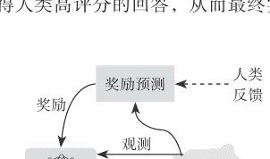

然而，传统的强化学习方法存在计算负担过重、策略更新不稳定、数据利用效率低下等问题。为此，DeepSeek 引入了 GRPO，通过组内相对奖励机制和动态梯度正则化，解决了传统强化学习在大模型训练中的高成本与不稳定性问题，如图 2-14 所示。

> 参考 “DeepSeekMath: Pushing the Limits of Mathematical Reasoning in Open Language Models”。

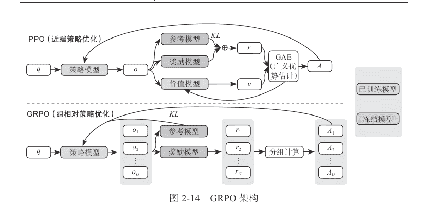

为了让读者更好地理解 GRPO 以及相关的概念，下面将以故事的方式进行介绍。

在实际的模型训练中，可以将强化学习模型的训练过程类比为学校里的考试场景。被训练的模型就像努力取得好成绩的学生。假设现在有两个被训练的模型，学生 A 和学生 B。学生 A 的成绩一般在 80 分以上，学生 B 的成绩大概在 40 分左右。每次考试结束后，两个学生都会拿着分数找班主任要奖励，比如小红花。谁得分高，谁的小红花就多。然而，学生 B 虽然很努力，但由于基础较差，成绩提升缓慢，每次都考不过学生 A，久而久之，学生 B 就失去了动力，选择“躺平”。而学生 A 由于基础较好，虽然想冲刺高分，但得高分并不容易，同时每次考试都超过学生 B，学生 A 也逐渐安于现状。这样一来，仅以分数作为奖励标准的方法就失效了。

面对这个问题，班主任意识到不能只看绝对分数，而应该关注每个人的进步程度。于是，班主任因材施教，为学生 A 和学生 B 设置了不同的预期分数线，比如给学生 A 设置 85 分，给学生 B 设置 50 分。学生考试时只要超过自己的预期分数线，就能获得更多的小红花，否则就没有奖励，甚至可能受到批评。随着该方法的实施，两人的成绩都有了提升：学生 A 的成绩维持在了 85 分左右，而学生 B 的成绩已经达到及格线，提升到了 60 分。然而，此时原先的预期分数线已经不再合理，需要进一步调整。但由于班主任的教务工作非常繁忙，无法及时调整预期分数线，这就带来了新的挑战。

于是，班主任找来学习委员，决定以学习委员的成绩作为成绩考核的参考标准。以后每次考试，学生的成绩将与学习委员的成绩进行比较。例如，学生 A 的考试成绩如果低于学习委员 10 分以内，可以获得 5 个小红花；如果超过学习委员 5 分，可以获得 10 个小红花。学生 B 的考试成绩如果低于学习委员 25 分以内，可以获得 5 个小红花；如果超过学习委员 1 分，可以获得 50 个小红花。在这样的激励机制下，两个学生都努力学习以取得好成绩，甚至试图超过学习委员。然而，这种机制存在两个问题：一是学习委员的成绩可能会有波动，因此需要确保学习委员的成绩保持稳定；二是学生 A 和学生 B 为了获得超额奖励，即成绩超过学习委员，可能会铤而走险作弊。

为此，班主任不仅要关注学习委员的成绩，确保其成绩稳定（由于每个学生都可以看作一个模型，因此学习委员也需要进行训练）。为了避免考试作弊，班主任需要重点关注学生成绩的稳定性，即不要忽高忽低，而是保持稳步进步。因此，需要统计学生的过往成绩，并以此作为稳步进步的参考依据。

后来，学习委员转学了。班主任一时间找不到合适的学生担任学习委员。于是，班主任对学生们说，在考试之前要做 5 份模拟题，取这 5 次模拟题成绩的平均分，这个平均分就是预期分数线。真正考试时，如果学生比这个平均分高，就说明该学生的表现超出自己的期望，就会得到奖励；如果低于这个平均分的话，说明学生的表现未达到期望，不但没有奖励，还要被批评教育。如此一来，每个学生用多次模拟考试的均值作为分数线，不再需要和学习委员对标，同时班主任也不需要单独关注学习委员的成绩是否稳定。

学习委员转学之后，班主任的做法就是 GRPO。策略模型（Policy Model）对应每一个学生，参考模型（Reference Model）对应学生的过往成绩，奖励模型对应班主任奖励的小红花数量，而价值模型（Value Model）对应学习委员。从图 2-14 中可以看出，GRPO 相比 PPO 减少了价值网络，从而降低了内存和计算负担。

综上所述，GRPO 通过组内相对奖励机制和动态梯度正则化技术，显著提升了大模型训练的计算效率、稳定性与收敛速度，同时降低了资源消耗，并在复杂任务（如数学推理和代码生成）中实现了更优的输出质量。

### 2.3 DeepSeek 火爆的逻辑

虽然 DeepSeek 在 MoE 等关键技术上实现了显著突破，但仅依靠算法层面的创新并不足以如此火爆。作为一款国产 AI 大模型，DeepSeek 迅速崛起并引发行业变革的背后，存在多重逻辑。事实上，作为一款成功的产品，DeepSeek 在大模型技术栈上实现了全面革新，如图 2-15 所示。其在产品化能力、场景适配性、用户友好性及市场推广策略等多维度取得了一系列创新。

#### 2.3.1 应用层的用户体验优化

从用户使用角度来看，在应用层面，DeepSeek 凭借其卓越的性能、极致的用户友好性与易于传播的特点，为用户提供便捷、高效的服务。

##### 1. 性能卓越

DeepSeek 的 R1 模型在多个推理基准测试中表现出色，性能与 OpenAI 的 o1 相媲美，尤其在数学计算、代码生成、自然语言推理等关键领域表现出色，如图 2-17 所示。

##### 2. 用户友好

首先，DeepSeek 的用户界面设计非常注重用户体验。操作简便、界面清晰的特点使得 DeepSeek 非常适合各类用户。无论是技术专家还是初次使用的普通用户，都能够快速上手并高效利用其功能。

其次，DeepSeek 在回答问题时，不仅能给出答案，还会展示其思考过程，如图 2-18 所示。这种透明化的处理方式极大地增强了用户对系统的理解和信任。通过展示推理路径和依据，用户可以更好地理解为何得到这样的答案。这不仅提高了用户满意度，还促进了知识的传递与分享。这种设计特别适用于教育、科研以及需要高度决策透明度的领域。它让用户不是仅仅得到一个简单的答复，而是能够学习背后的知识和逻辑，从而提升使用体验和应用价值。对于那些希望深入了解机器思维过程的用户来说，这是一个非常有价值的功能。

##### 3. 易于传播

除了性能卓越和用户友好，DeepSeek 这个简洁有力的名字非常适合在社交媒体上快速传播。

DeepSeek 的名字简单直接，“Deep” 意味着深度，“Seek” 表示寻求或探索。这个名字不仅直观地传达了其作为 AI 工具能够深入探索信息的能力，还简短易记，降低了人们的认知负担。

DeepSeek 这个名字凭借其简洁明了、易于记忆的特点，以及它所传达出的积极意义和广泛适用性，从传播学角度来看具备很强的优势，能够有效促进自身在目标受众中的知名度和影响力增长。

#### 2.3.2 算法层的集成创新

从学术研究角度来看，在算法层面，DeepSeek 从初始版本到 R1 版本的论文始终围绕高性价比在模型算法、软硬件协同、训练效率等方面进行创新。通过融合 DeepSeekMoE、MLA、MTP 及 GRPO 等技术，成功实现了 DeepSeek-V3 和 DeepSeek-R1 的突破，如表 2-2 所示。

表 2-2 DeepSeek 算法创新

| 模型版本 | 论文发表时间 | 技术创新点 | 贡献 |
| :--- | :--- | :--- | :--- |
| DeepSeek LLM | 2024 年 1 月 | 扩展定律再认识 | 提出新的模型 / 数据计算预算分配策略，优化 LLM 的扩展方法 |
| DeepSeekMoE | 2024年1月 | 新的MoE架构 | 实现MoE架构的革新 |
| DeepSeekMath | 2024年4月 | 提出GRPO | 提升计算效率、稳定性与收敛速度，同时降低了资源消耗 |
| DeepSeek-V2 | 2024年4月 | 提出MLA，优化MoE | □显著减少推理时的KV缓存，提高推理效率<br>□优化专家路由和负载均衡策略，使MoE模型在计算资源受限的情况下仍能高效训练 |
| DeepSeek-V3 | 2024年12月 | MoE，MLA，MTP，负载均衡 | 671B参数规模，训练成本557.6万美元，相比同规模模型，成本显著降低 |
| DeepSeek-R1 | 2025年1月 | 强化学习+冷启动，小模型蒸馏 | □首个仅由强化学习方法驱动的LLM推理模型<br>□通过多阶段RL训练和冷启动优化<br>□性能接近OpenAI-o1-1217<br>□蒸馏小模型表现强劲 |

#### 2.3.3 基础设施层的落地高性价比

工程实现角度来看，在基础设施层面，DeepSeek以其低成本和完全开放的特点，不仅降低了企业的进入门槛，还为不同规模的企业带来了前所未有的灵活性和创新能力。

##### 1. 低成本

DeepSeek通过算法优化和强化学习技术，有效降低了训练所需的算力资源，仅以不到600万美元的训练成本实现了与GPT-4等国际顶级模型相当的性能，而后者的成本高达7800万至1亿美元。

DeepSeek的低成本一度让市场以为可以摆脱算力依赖，不再需要那么多算力。2025年1月27日，DeepSeek的R1模型发布后，对美国股市产生了巨大影响。英伟达股价暴跌18%，一夜之间市值下跌约6000亿美元（约合4.3万亿元人民币），创下其历史上股票单日跌幅之最。

尽管随着DeepSeek的快速部署，整个市场对算力的需求日益增强，但是DeepSeek凭借其高性价比，在保持高性能的同时降低了对计算资源的需求，使企业在硬件投入上能够大幅节省成本，有力地推动了AI技术普惠。

##### 2. 完全开放

不同于OpenAI的闭源策略，DeepSeek采取完全开放的策略。其开放性贯彻得非常彻底，不仅开源、免费可下载，还公开了训练方法，并允许任何人使用R1进行数据蒸馏来训练自家的模型。此外，用户还可以将其成果进行商业化。

开源协议（Open Source Licenses）是一系列允许软件源代码公开并允许用户自由使用、修改和分发的许可证。常见的开源协议有以下两种。

- MIT License：这是一种非常宽松的许可证，允许用户在几乎没有任何限制的情况下使用、复制、修改和分发软件。
- Apache License 2.0：这是一种宽松的许可证，类似于 MIT 许可证，但提供了额外的专利保护。

DeepSeek 通过 MIT 协议开源核心技术，允许开发者免费使用、修改和商用，极大降低了行业准入门槛。此举直接挑战美国科技巨头公司的封闭生态，推动全球 AI 研发向低成本、协作化的方向转型。

### 2.4 小结

DeepSeek 的成功并非一蹴而就，而是在原有技术发展的基础上，循序渐进、厚积薄发，从而脱颖而出的。在大模型核心技术——Transformer 架构和 MoE 基础之上，DeepSeek 围绕高性价比的理念，创新发展了 DeepSeekMoE、MLA、MTP 及 GRPO 等核心技术，在实现性能优越的同时降低训练资源消耗。DeepSeek 在应用层面优化用户体验，在算法层面集成创新，在基础设施层面实现落地高性价比，从而火爆全球，成为 AI 领域最耀眼的明星。

DeepSeek 不仅让企业与个人都能轻松获取高性能、低门槛的大模型服务，还打破了 AI 应用的高成本壁垒，继 ChatGPT 引发全球 AI 热潮后成为推动智能技术真正落地的又一里程碑。这一突破不仅标志着中国在 AI 研究领域的弯道超车，还将 AI 普惠从概念推向现实，为全球开发者与中小企业开辟了通往智能时代的普惠之路。

# CHAPTER 3
第 3 章

# DeepSeek 的基础使用方法

DeepSeek 以强大的模型能力、友好的用户体验、创新的低成本训练方案及开源性质，使所有企业及个人均可使用性能强、成本低的大模型服务，从而全面加速 AI 应用的发展。DeepSeek 的强大固然重要，但在生产生活中，如何高效地使用它则更为关键。因此，了解并掌握 DeepSeek 的核心功能与最佳实践显得尤为重要。

本章将对 DeepSeek 的基本使用方法进行介绍，主要通过提示词与 DeepSeek 建立良好的沟通，并结合其他工具实现更多功能，以提升大模型的使用效率。

### 3.1 DeepSeek 功能简介

#### 3.1.1 能力图谱

DeepSeek 是一款基于大语言模型技术的对话聊天应用，面向用户提供智能对话、文本生成、语义理解、计算推理、代码生成与补全等几乎所有与自然语言生成相关的服务。同时，DeepSeek 支持开发者通过 API 调用的方式进行 AI 应用开发。需要注意的是，DeepSeek 尚不支持多模态生成方式，无法提供图片生成或绘图等功能。

DeepSeek 支持深度思考模式，能够向用户展示其推理过程；支持联网搜索模式，并通过外挂网页知识辅助回答用户问题；同时支持文件上传功能，能够扫描并读取各类文件及图片中的文字内容，并根据用户需要进行回答。

##### 1. 文本生成

DeepSeek 擅长处理多种场景的文本生成任务。通过精准指令、多轮交互、多场景适配和智能优化，DeepSeek 为用户提供从初稿生成到内容优化的全流程支持。无论是商业写作、学术研究、政务公文还是创意内容创作，它都能显著提升效率并降低使用门槛。

（1）文本创作
DeepSeek 可以根据用户的输入要求创作任何领域的文本，无论是文章写作、编写故事、诗歌创作等具有文艺浪漫气质的场景，还是营销文案、广告语生成等现实商业意味的场景，DeepSeek 都能提供恰到好处的创作成果。此外，DeepSeek 还适用于社交媒体内容创作，能够生成推文和帖子等。

（2）摘要汇总与改写
面对长文本（如论文），DeepSeek 支持摘要、汇总及简化功能，同时提供多语言翻译服务，帮助用户克服语言阅读障碍。对于长文本中的局部内容，DeepSeek 还支持改写功能，以便用户进行二次创作。

（3）结构化生成
在文本生成时，DeepSeek 可以根据用户对格式的具体要求进行结构化生成，如生成表格、列表等。

##### 2. 自然语言理解与分析

作为先进的大语言模型，DeepSeek 在自然语言理解与分析领域展现出卓越能力，尤其擅长语义解析、情感识别及复杂语境推理。

（1）语义分析
DeepSeek 支持从自然语言中识别用户意图，可应用于客服对话、用户查询等场景；支持情感分析，可用于分析商业系统中的评论和反馈，帮助商家改进服务；支持实体提取，可从文本中提取人名、地点、事件等关键信息，用于后续任务。

（2）文本分类
DeepSeek 支持多种文本分类，可以对新闻内容生成对应的主题标签；能够检测垃圾内容和恶意内容。

（3）知识推理
DeepSeek 具有强大的推理能力，能够处理逻辑问题，如常识推理；能够进行因果分析，分析事件之间的关联性。

##### 3. 代码与数学

DeepSeek 在数学计算、代码生成方面表现出色。

（1）代码生成
DeepSeek 支持根据用户需求生成代码片段，支持多种编程语言；支持对残缺代码进行补全；支持自动生成代码注释。

（2）代码调试
根据用户提供的代码报错信息，DeepSeek 可以进行错误分析并给出修复建议；支持提出代码优化建议。

（3）技术文档处理
DeepSeek 支持生成 API 文档内容，生成代码示例和案例，大幅减轻用户工作量。

#### 3.1.2 三种模式

DeepSeek 的对话聊天界面如图 3-1 所示。它提供了三种核心模式，分别适用于不同场景和需求。

（1）基础模式
当在对话聊天界面未进行任何点选时，DeepSeek 处于基础模式，此时背后的模型为通用模型 DeepSeek-V3。在基础模式下，DeepSeek 表现得高效便捷，响应速度极快，适用于绝大多数“规范性”任务。常见的应用场景包括日常对话，知识查询（如“解释智能制造”），快速生成文章、邮件、简单方案，以及非专业领域的基础问题解答等。
DeepSeek 基础模式操作简单、即时可用，知识面广，支持文本生成、简单推理、基础问答等，能满足大多数日常需求，但对复杂逻辑任务的支持有限。

（2）深度思考模式
当在对话聊天界面点选“深度思考”按钮时，DeepSeek 会切换到深度思考模式，此时背后的模型是推理模型 DeepSeek-R1。在深度思考模式下，DeepSeek 专注于复杂推理和深度分析任务，并提供可解释性输出，擅长处理数学问题、代码调试、学术分析等需要深度思考的任务。常见的应用场景包括复杂问题拆解（如“用 Python 实现快速排序算法”）、学术研究中的假设验证和数据分析、逻辑推理类任务（如法律案例分析、商业策略制定）。

深度思考模式的模型会自动执行链式思考，提供详细的推理过程，逻辑性强、解决方案详尽，适用于专业领域的深度分析和创意生成，但响应速度较慢，需要明确问题结构。

（3）联网搜索模式
当在对话聊天界面点选“联网搜索”按钮时，系统具备实时抓取网络数据的功能。联网搜索模式的模型可查询实时动态，及时更新信息，并结合实时网络信息进行理解和回答，适用于需要最新数据的任务。

这三种使用模式的对比如表 3-1 所示。

表 3-1 DeepSeek 的三种使用模式

| 模式 | 适用场景 | 响应速度 | 知识时效性 | 典型任务 |
| :--- | :--- | :--- | :--- | :--- |
| 基础模式 (DeepSeek-V3) | 日常问答、基础生成 | 极快 | 截至 2024 年 7 月 | 写一篇科普文章、解释概念 |
| 深度思考模式 (DeepSeek-R1) | 复杂推理、代码调试、学术分析 | 较慢 | 截至 2024 年 7 月 | 解数学题、调试代码、制定商业策略 |
| 联网搜索模式 | 实时数据、最新资讯 | 中等 | 实时更新 | 查询 2025 年政策、获取行业报告 |

此外，DeepSeek 对话聊天界面还有文件上传按钮，支持用户上传本地文件，读取文件的内容，回答用户问题。

### 3.2 提示词

DeepSeek 具有强大的自然语言理解和生成能力，但要充分发挥其潜能，并使其有效、精准地服务于各应用场景，其中一个关键在于对其进行有效的驱动和引导。这需要通过提示词明确告诉 DeepSeek 应生成什么样的内容。如果将 DeepSeek 比作威力强大的魔法，那么提示词就如同咒语。使用正确的咒语才能发动魔法，而不正确的咒语可能导致魔法无法发动或效果不理想。因此，精心设计和运用提示词以更好地驱动 DeepSeek 显得尤为重要。

#### 3.2.1 提示词的作用

提示词是用户输入给大模型的内容，用于指导模型生成用户期望的输出，如图 3-2 所示。目前，DeepSeek 的交互以自然语言为主要媒介，提示词即为输入文本，可以是问题、指令、句子片段或任何形式的文本。其目的是为模型提供上下文环境，帮助模型更好地理解用户的意图和需求。

在 DeepSeek 应用中，当要求 DeepSeek 解释“什么是 AI 提示词”时，DeepSeek 洋洋洒洒地介绍了很多。

DeepSeek 的回复如下。

> AI 提示词（AI Prompt）是指在与人工智能系统，特别是自然语言处理模型交互时，用户输入的用于引导或激发模型生成特定输出的文本指令。这些提示词可以是问题、描述、关键词、上下文信息或者参数化指令等，它们旨在更准确地传达人类用户的需求，使模型能够基于该提示提供更加精准、连贯和符合预期的响应。

在现代的大规模语言模型（如 GPT 系列）中，AI 提示词的作用尤为重要。通过精心设计和优化提示词，可以有效调控模型的行为，使其生成高质量的文章段落、解答复杂问题、创作诗歌、编写代码、模拟对话角色甚至生成图像（如 DALL-E、CogView 等 AI 绘图模型中使用的文本描述）。简而言之，AI 提示词是人类与智能模型之间沟通的桥梁，它直接影响着模型的理解、思考和表达方式，从而提升用户体验并扩展 AI 的应用范围。

但是，如果用户想要一个精简的答案，那么可以用提示词“简化一点，30 字以内”控制模型输出。

DeepSeek 的回复如下。

> AI 提示词是引导 AI 模型生成特定输出的关键词或指令，用于精准调控和激发模型回应。

提示词看似简单随意，只要输入大模型便可生成相应的结果，似乎无须大费周折。然而，要让大模型生成令用户满意的内容，并非易事。这是一项既依赖经验又具有技术难度的工程，即提示词工程（Prompt Engineering）。

提示词工程，也被称为上下文提示（In-Context Prompting），指的是通过优化和调整提示词，引导大模型输出用户期望结果的过程。主要的工程手段包括设计特殊的提示词、结合不同语言和文化背景优化提示词，以及根据具体任务要求和模型特性调整提示词等。因此，提示词工程需要对大模型的工作原理有深入理解，并能有效利用这些理解来创建、评估和改进提示词。

提示词工程不更新模型权重。通过不同的提示词，可以让大模型完成不同类型的任务。提示词工程非常依赖经验，提示词工程的效果在不同模型中可能存在很大差异，因此需要用户进行大量的实验和探索。

随着大模型在特定行业的深入应用，驱动大模型输出精准答案开始具有一定的行业门槛。例如，在法律领域，恰当的法律提问才能得到准确的法律咨询结果；在医疗领域，大模型给出的诊疗方案与用户的输入密切相关。

大模型是工具，提示词是人们使用大模型的主要方式。未来，人们可能会被区分为会使用提示词的与不会使用提示词的，就像会开车的与不会开车的一样。只有会开车的人才能享受驾驶汽车带来的体验与便利。

#### 3.2.2 提示词的必要性

在使用大模型时，用户通过自然语言（汉语、英语或者其他语言）向大模型下达指令，让大模型完成相应的工作。既然用户使用的是自然语言，那么直接使用不就可以了，为什么还要通过提示词工程进行调整优化呢？难道“讲人话”不是人人都会的吗？

诚然，讲话人人都会，但讲对话，讲大模型能听懂的话，确实是一项技术活。

（1）自然语言具有多义性
自然语言本身是极其不严谨的。一个字或一个词本身具有多义性，同样一句话在不同语境下可能表达截然相反的意思。自然语言本身具有模糊性，人们在表达时往往会有省略、暗示等现象，导致意思模糊不清。如果听者与讲话者没有相同的知识背景或默契，就可能出现理解偏差甚至理解错误。人与人之间的误会往往由此而来。同样，人们在与大模型互动时，这种情况也可能发生。因此，提示词的质量和明确性在很大程度上影响模型输出的相关性和准确性。

（2）大模型能力有限
尽管大模型的能力已经十分强大，但仍无法与人类相比，其逻辑推理能力相对有限。这导致在面对自然语言指令时，大模型返回的结果可能具有不可控性。如果通过提示词工程将指令详细化、结构化甚至可执行化，那么大模型返回的结果就会变得更加可控。尤其是对于复杂问题，一套精心设计的提示词是必不可少的。

（3）构思提示词需要消耗大量精力
由于自然语言本身的特点以及大模型能力的限制，人们在驱动大模型时需要花费大量精力来构思提示词。大模型就像一个有潜力的孩子，人们需要花费心思去教育和引导，而教育从来不是一件容易的事。如果有一些提示词模板或技巧，就能大大降低使用门槛。巧就可以显著降低构思提示词所需的精力。正如在学校中，如果已有教案和课件供参考，那么老师在新的教学任务中就不需要从零开发教案，可以大大降低工作量。因此，学习如何对大模型提问，善用现有提示词并不断更新提示词是非常必要的。

#### 3.2.3 提示词的基本要素

人类的需求和问题是复杂、多样的，相应的提示词也需要是灵活多变的，以适应不同的场景和需求。一般而言，提示词包含如下基本要素。

- （1）指令
指令用于让大模型执行特定任务，如翻译、总结等。
- （2）上下文
如果用户的问题包含一些前提条件，涉及外部信息或额外的上下文信息，则需要向大模型提供这些资料，以便其更好地响应。
- （3）输入数据
这是指用户输入的具体内容或问题，如“什么是提示词工程”这样的具体问题。
- （4）输出指示
如果用户对输出的类型或格式有特定的需求，如输出为表格或者JSON格式等，则需要明确告知大模型用户的需求。

以上这些提示词的要素并非必须，而是用户根据希望大模型完成的实际任务具体决定。例如，以下提示词中包含所有要素。

> 有人说“提示词工程就是和大模型聊天”（上下文），请问这种说法对吗（输入数据）？如果不对，请给出你的解释，并翻译成英文（指令），以中英文对照的方式输出答案（输出指示）。

#### 3.2.4 常用的提示词模板

在与 DeepSeek 交互过程中，需要采用一些提示词技巧才能真正激活 DeepSeek，使其回复符合用户需求。提示词的核心技能体系不仅涵盖技术层面的专业知识，还强调认知能力、创新思维和软实力的重要性。下面介绍一些常见的提示词模板。

##### 1. 官方提示词样例

为方便开发者使用 DeepSeek，DeepSeek 在其 API 文档中也提供了提示词的样例参考，如图 3-3 所示。这个提示库涉及代码、诗歌散文、文案、翻译等多种样例，同时详细说明了在 API 调用中的具体使用方法，非常全面。

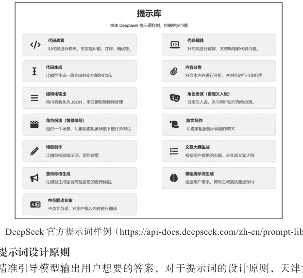

图 3-3 DeepSeek 官方提示词样例 (https://api-docs.deepseek.com/zh-cn/prompt-library/)

##### 2. 提示词设计原则

为精准引导模型输出用户想要的答案，对于提示词的设计原则，天津大学自然语言处理实验室的学者提出了 DeepSeek 提示词设计的十大关键原则。

- ①明确任务目标。在提示词中清晰地描述任务类型和预期目标，避免模糊和冗长的描述。
- ②提供上下文和背景信息。为 AI 提供必要的背景信息，帮助其更好地理解任务场景。
- ③设定角色。通过角色扮演的方式，引导 AI 以特定视角完成任务。
- ④规范输出格式。明确指定输出格式，确保结果符合预期。
- ⑤分步骤说明。对于复杂任务，将需求分解为多个步骤。
- ⑥领域知识注入。针对专业性较强的任务，需要补充相应领域的专业知识。
- ⑦设定约束条件。明确任务的限制条件，帮助 AI 更精准地完成任务。
- ⑧结构化表达。通过 XML 标签、标题、列表等 Markdown 结构化格式来组织内容，提高可读性。
- ⑨示例驱动。提供具体示例，帮助 AI 理解任务要求。
- ⑩多角色协作。模拟多个角色，协同完成多部门完成任务。

##### 3. 提示词框架

在提示词工程中，如果有清晰明确的框架来指引用户进行具体操作，则再好不过。提示词框架旨在辅助用户精确构建和使用提示词，并提供一个预设的结构化模板，用户可以在其中填充特定信息，以生成清晰、目的性强的提示词。其核心作用是帮助用户通过系统化的引导，提高提示词的准确性和效率，从而优化内容生成，确保生成的文本质量更高、更符合预期目标。下面介绍一些常见的提示词框架。

###### （1）RTGO

R 是 Role，定义 AI 的角色。T 是 Task，具体描述任务。G 是 Goal，指期望达成的目标效果。O 是 Objective，描述操作要求。在此框架下的提示词案例如下。

> 你是一个经验丰富的数据分析师
写一份关于 ×× 事件的分析报告
通过该报告为相关企业管理者提供数字化转型策略支撑
要求 1000 字，段落清楚，输出格式为 Markdown

###### （2）CO-STAR

C 是 Context，背景。O 是 Objective，目标。S 是 Style，风格。T 是 Tone，代表语气。A 是 Audience，受众。R 是 Response，响应。在此框架下的提示词案例如下。

```
# C - Context (背景)
某中型汽车零部件制造工厂近期面临生产效率下降、资源浪费增加的问题。当前生产线存在设备闲置率高、人工操作重复性高、物料流转效率低等现象，导致交付周期延长，客户满意度下降。工厂希望通过智能化改造和流程优化解决这些问题。
# O - Objective (目标)
生成一个可落地的优化方案，要求：
提高生产线整体效率（目标提升 15% 以上）；
减少原材料浪费（目标降低 10%）；
提出可量化的技术或管理改进措施。
# S - Style (风格)
以结构化、数据驱动的技术报告风格呈现，包含图表示例、关键指标对比和分阶段实施计划。
# T - Tone (语气)
专业、严谨，但避免过度技术化，需让非技术背景的管理层快速理解核心逻辑。
# A - Audience (受众)
主要读者：工厂经理、生产主管、技术团队；次要读者：公司高层（关注投资回报率）。
# R - Response (响应)
生成的内容需要包含以下模块：
痛点诊断（基于当前生产线的数据，如 OEE 设备效率、工时分布、废品率）；
优化方案；
成本与收益预测（如投资回报周期、效率提升的量化模拟）；
风险与应对（如员工培训阻力、初期停机风险）。
```

###### （3）COAST

C 是 Context，背景。O 是 Objective，目标。A 是 Action，行动。S 是 Scenario，场景。T 是 Task，任务。在此框架下的提示词案例如下。

```
# 背景
创建名为 “HealthEase” 的应用，旨在利用智能技术帮助用户监测健康状况并提供个性化的健康建议。
# 目标
设计并实现一个用户友好的界面，使用户能够轻松记录健康数据，并在 3 个月内吸引至少 5 千名活跃用户。
# 行动
开发一个功能，允许用户输入其日常健康数据，如步数、心率和睡眠质量，并提供实时反馈和个性化建议。
# 场景
为模型提供必要的训练数据，包括健康监测算法和个性化建议的制定准则，以确保应用的准确性和用户体验。
# 任务
利用 TensorFlow 框架实现模型训练，并结合用户反馈不断改进算法，以提供更准确和有用的健康建议。
```

###### （4）RISE

R 是 Role，指定 AI 的角色。I 是 Input，描述信息输入。S 是 Step，详细的步骤。E 是 Expectation，期望。在此框架下的提示词案例如下。

```
# 角色
假设你是一个经验丰富的项目经理。
# 输入
我们的团队将在下周举行一个重要的项目会议，需要讨论项目的当前状态、接下来的里程碑和可能遇到的风险。
# 步骤
请提供准备此类会议的详细步骤，包括应收集的信息、应创建的议程和如何有效地组织会议。
# 期望
期望能够通过会议明确项目的下一步行动计划，并得到团队的共同理解和支持。
```

###### （5）BAB

B 是 Before，解释之前存在的问题。A 是 After，说明之后想达成的目标或结果。B 是 Bridge，询问具体的实现路径。在此框架下的提示词案例如下。

```
# 之前存在的问题
产品的关键词自然排名太靠后，很难被人发现。
# 之后想达成的目标或结果
想要在 90 天内将目标产品的核心关键词排名提升至百度 / 谷歌 / Bing 自然搜索结果的前 10 位。
# 具体的实现路径
设计一个详细、可执行的 SEO 优化方案。
```

提示词的展现形式是自然语言。提示词是交流的载体，是与 DeepSeek 对话的方式，其与人类语言交互的原理相同。在人类语言交流中，存在明示、暗示、诱导、指令等多种内涵。无论是哪种形式，提示词的设计与运用都反映出对人性、文化和伦理等多维度因素的深刻考量。

在与 DeepSeek 交互中，想要让 DeepSeek 智能涌现，发挥更大的作用，这考验人们的创造力、理解力和沟通能力。

- （1）创造力
如同学生向老师提问、记者进行采访、主持人开展访谈，或个人进行反思一样，在使用 DeepSeek 时，我们需要知道问什么，这就考验提问的创造性。一个平平无奇的提问大概率会得到一个平平无奇的回答。而创新性的提示词可以激发模型产生新颖、深入甚至超越常规逻辑的见解。因此，创造力是提问的基础，是提出好问题并获得理想答案的关键。

- （2）理解力
有效的提示词不是简单的关键词堆砌，而需要蕴含一定的策略性思维。这要求我们具备理解力，能够理解大模型的运行机理、能力边界和知识范围。在此基础上设计出既能激活其已有知识又能触发其深度学习新信息的提示词。这正如我们的日常交流模式：只有理解对方，才能更好地进行交流。

- （3）沟通能力
在与 DeepSeek 的交互过程中，通常需要不断试验和调整提示词，通过反馈循环优化交流效果，使大模型在长期互动中实现智能的持续涌现和发展。这要求我们具备良好的沟通能力，通过与 DeepSeek 的反复交流，推动大模型更好地理解和适应我们的意图与期望。

### 3.3 DeepSeek 多工具协同

尽管 DeepSeek 在文本理解和生成方面具有强大的能力，但是受限于单种模态，其功能和应用存在一定的局限性。若要扩展到多模态的应用场景，则需要借助其他工具进行协同。

#### 3.3.1 DeepSeek 的使用局限

DeepSeek 是一个大语言模型，仅支持纯文本交互，无法处理图像、音频、视频等多媒体内容。

- （1）缺乏多模态输入输出
DeepSeek 目前仅支持文本输出，不支持多模态输入输出。例如，无法完成图片生成和视频生成等功能，这限制了其在某些应用场景中的使用。如图 3-4 所示，尽管 DeepSeek 声称能够生成图片，但实际上仅输出绘图的步骤。

48 智能制造实战：DeepSeek 在制造业的深度实践

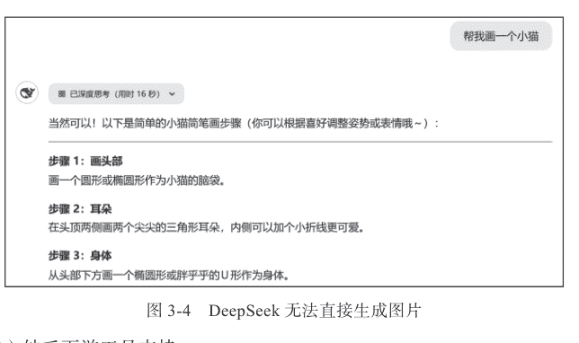

图 3-4 DeepSeek 无法直接生成图片

- （2）缺乏下游工具支持
DeepSeek 目前缺乏对下游工具的支持，无法直接完成用户给出的任务。例如，它无法直接生成 PPT，仅能提供大纲信息，如图 3-5 所示。

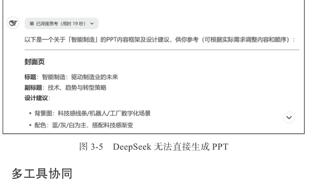

图 3-5 DeepSeek 无法直接生成 PPT

#### 3.3.2 多工具协同

当我们使用大模型技术完成一些复杂的工作时，如制作 PPT、绘制思维导图、制作短视频等，由于 DeepSeek 的单模态限制，这些工作无法直接在 DeepSeek 上完成。因此，需要其他工具的协助。

一般而言，在 DeepSeek 与其他工具的协作中，DeepSeek 主要发挥其优秀的推理能力，生成相应的文本作为其他工具的输入。常见的 DeepSeek 多工具协同的情况如表 3-2 所示。

表 3-2 常见的 DeepSeek 多工具协同的情况

| 工具组合 | 应用场景 | 使用步骤 |
| :--- | :--- | :--- |
| DeepSeek+Kimi/ 讯飞智文 | 制作 PPT | 在 DeepSeek 中生成 PPT 的大纲与细节，复制到 PPT 助手中，选择模板生成 PPT |
| DeepSeek + 剪映 | 制作短视频 | 在 DeepSeek 中生成爆款短视频文案，使用剪映的图文成片功能生成视频 |
| DeepSeek + 即梦 / Midjourney/…… | 制作海报 | 在 DeepSeek 中生成海报描述，复制到即梦中生成海报图片 |
| DeepSeek + XMind | 创建思维导图 | 在 DeepSeek 中生成 Xmind 格式的 Markdown 文本，导入 XMind 工具生成思维导图 |
| DeepSeek + Cursor | 代码编写 | 使用 Cursor 中的 chat 和 composer 界面编写及生成工具代码 |
| DeepSeek + boardmix AI | 创建图表和设计架构图 | 在 DeepSeek 中生成需求描述，复制到 boardmix AI 中生成交互式图表或者架构图 |

### 3.4 使用 DeepSeek 的能力要求

由于 DeepSeek 强大的推理能力，其生成的文本能给予用户很好的帮助，用户在此大模型的应用中，常会出现一些认知误区。

- ① DeepSeek 能力强，一句话就能解决所有问题。
- ② 依赖 DeepSeek 作为助手和工具，人类不需要学习了。

以上两种认知是极其错误且危险的。AI 在带来必然的生产方式升级的同时，也对个人在相应生产方式下的专业价值定义产生了影响。对个人而言，个人的专业能力要体现在对业务的深度理解与思考以及清晰定义目标需求后使用 AI 工具高效生产，具体包括提问、判断和调度三个方面。

#### 3.4.1 提问

如 3.3 节所述，要想用好 DeepSeek，就得用好提示词，这就考验用户的提问能力。当用户不知道如何提问时，提示词往往会比较简单，这会导致大模型的回答偏离预期较大，因此必须对提示词进行详细设计。除了常见的人工设计，借助大模型超强的生成能力实现提示词细化是大模型应用的一个巧妙之处。如此一来，大模型可以先生成详细提示词，再回答这些提示词，实现了大模型的自问自答，就像利用杠杆一样，通过简单提示词撬动良好的输出结果，如图 3-6 所示。

在日常工作中，我们可以充分利用大模型扩展提示词或获取想要了解的信息，从而给用户启发，然后通过大模型进行下一步的学习与探索。例如，当我们想了解安全生产助手的使用方法，但是不知道如何提问时，可以利用这种方法进行扩展，如图 3-7 所示。

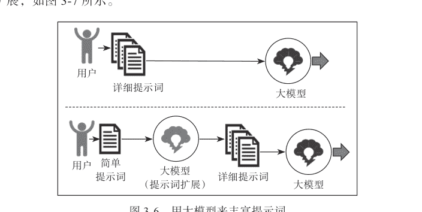

图 3-6 用大模型来丰富提示词

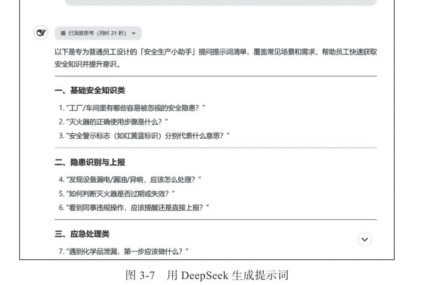

图 3-7 用 DeepSeek 生成提示词

#### 3.4.2 判断

有人认为，既然 DeepSeek 已经可以生成丰富的内容，那么人类就不需要学习了。恰恰相反，人类反而更要认真学习。原因在于，DeepSeek 和其他大模型一样，会产生“幻觉”。如果人类缺乏足够的知识，就无法判断 DeepSeek 生成内容的真假和质量高低，这可能导致严重后果。

大模型的幻觉问题是指，在自然语言处理和生成任务中，大语言模型或其他类型的大模型在生成或解释文本时，出现与现实世界事实不符、缺乏证据支持或完全虚构内容的现象。这类问题表现为模型输出的结果看似合理，但实际上不准确，甚至可能产生误导性信息。具体来说，幻觉问题体现在以下几个方面。

- （1）事实性幻觉
模型生成的内容与可验证的现实世界事实明显矛盾，例如，捏造历史事件、错误描述科学原理或者提供虚假数据。谷歌的 Bard 在发布会上就出了此类错误。

- （2）忠实性幻觉
模型虽然生成了连贯且结构合理的文本，但这些内容并未真实反映或基于输入数据及上下文，而是凭空创造或偏离原意的。在大模型使用中，大模型表现出的字不达义、对牛弹琴般的“人工智障”现象属于此类。

- （3）上下文一致性问题
模型生成的回答与用户提供的上下文信息不一致，或者对问题的理解存在偏差，导致答案偏离实际需求。

- （4）知识冲突
模型在处理专业领域（如医疗建议）时，可能会杜撰出不存在的治疗方法、药物剂量等信息，这在应用中可能导致严重后果。

根据大模型的技术架构，大模型的幻觉问题是一个固有问题。对于这样一个可能处处“埋雷”的大模型，人类的判断能力显得尤为重要。

#### 3.4.3 调度

目前，DeepSeek 等大模型的能力还不足以一键完成所有工作，需要多个工具协同。因此，真正用好 DeepSeek 还要考验调度能力。在大模型时代，每个用户都像是一位老板，不仅要给员工（大模型）下达指令（提问），还要具备评估员工工作质量（判断）的能力。员工并非万能的，正如大模型也非万能的一样。老板需要协调多个员工以满足其工作要求，正如用户需要调度大模型或工具，使它们相互协作。

一个用于生成 PPT 的多工具调度案例如图 3-8 所示。用户可以通过简单的一句话告诉 DeepSeek 生成大纲，同时可以反复问答以提升大纲质量。之后，利用 PPT 生成工具生成 PPT。然而，生成的 PPT 可能存在不足，如配图不合适或缺乏视频内容。此时，可以通过 DeepSeek 再次生成提示词，让文生图工具生成图片，并将其插入 PPT 的相应位置。

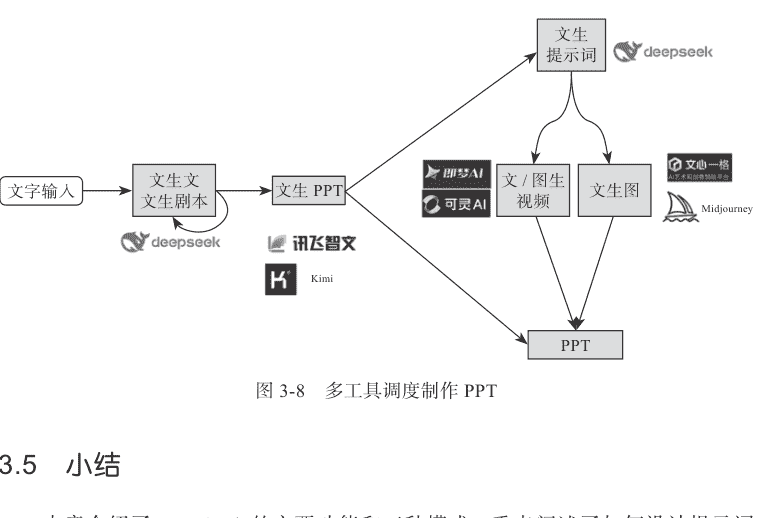

### 3.5 小结

本章介绍了 DeepSeek 的主要功能和三种模式，重点阐述了如何设计提示词以更好地驱动 DeepSeek 输出用户期望的结果。由于 DeepSeek 存在单模态限制，要完成更高级、更复杂的任务，需要多个工具协同合作。

DeepSeek 的智能涌现给人类带来了冲击，也带来了机会。有人鼓吹大模型会取代人类，此种论调备受争议。然而，在大模型时代，会使用大模型的人将取代不会使用大模型的人。这考验了人类在使用大模型时提问、判断和调度的能力，同时也对用户的素质提出了新的要求，即要不断学习、不断进步，才能真正驾驭大模型这一智能利器。本章所讲的使用方法只是基础，下一章将介绍更为进阶的知识，以更好地发挥大模型的威力。

# CHAPTER 4
## 第 4 章 DeepSeek 的进阶使用方法

尽管用户可以通过基础模式、深度思考和联网搜索三种模式来使用 DeepSeek 以提高效率，但在企业级应用中，仅依赖基础提示词驱动 DeepSeek 是无法满足复杂任务需求的，尤其是在涉及企业核心数据和复杂业务流程的场景中。因此，需要探索更高级的用法，以进一步发挥 DeepSeek 的强大智能。

本章介绍 DeepSeek 的进阶使用方法，包括垂直大模型的构建、大模型检索增强生成和 AI Agent 三种高级用法。

### 4.1 垂直大模型的构建

DeepSeek 是一款通用大模型，是通过公开数据集训练形成的大语言模型，并未囊括私有知识。通用大模型在处理制造业等垂直领域的问题时往往存在知识短板。由于未将垂直行业的关键知识和经验纳入通用大模型的训练中，未经优化的大模型可能表现为词不达意、泛泛而谈，甚至一本正经地胡说八道，难以落地实际应用。针对这一局限性，主流的一种做法是将垂直领域的专业知识体系与通用大模型相结合，构建垂直领域的专业模型。

设想一下，你作为一个大模型算法公司的方案经理，手握 DeepSeek 模型参数，任务是给传统制造业企业构建垂直大模型，有哪几种方案可供选择呢？同样地，如果你是传统制造业的方案经理，手握公司丰富的行业数据，如何将大模型引入企业呢？面对较为充足的行业数据，目前主流的做法分为改变原大模型参数的微调方法和保持原大模型参数不变的微调方法，如图 4-1 所示。下面将分别进行介绍。

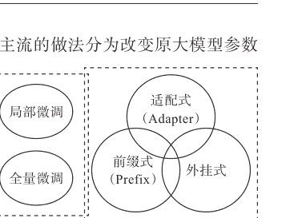

#### 4.1.1 全量微调

全量微调，即 Full Fine-Tuning，一般指全参数的微调，是一类提出较早的微调方法。主要做法是把行业数据输入基于 Transformer 架构的大模型中继续训练，更新模型参数。这些大模型的 Transformer 组件通常包含许多层，参数量巨大，如图 4-2 所示。以具有 650 亿个参数的 LLaMA 模型为例，全量微调需要更新 650 亿个参数，与原始预训练模型的大小相同，因此需要巨大的算力支撑，代价极高。

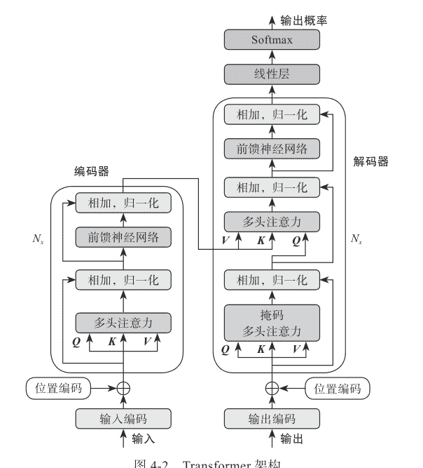

全量微调在实际应用中的不可行性催生了更高效的方法——参数高效微调（Parameter-Efficient Fine-Tuning，PEFT）方法。PEFT 主要包括局部微调、适配式微调（Adapter Tuning）、前缀式微调（Prefix-Tuning）、外挂式微调（如 LoRA）等技术，如图 4-2 所示。

#### 4.1.2 局部微调

由于对大模型参数进行全量调整的代价较高且难以落地，那么是否可以仅更新大模型的一小部分参数，保留大部分参数不变，从而降低微调成本，同时达到接近全量微调的效果呢？答案是可以的，已有相关研究证明局部微调的可行性。

在进行局部微调时，面对简洁而又复杂的大模型架构，几十层堆叠的 Transformer 块包含数百亿乃至上千亿个模型参数，选择更新哪一部分参数成为一个难题。理论上，任何参数都具有潜在的可调空间，因此需要在性能提升与资源消耗之间寻求最佳平衡点。针对垂直行业的具体任务，最直观的局部微调思路包括以下几种。

- （1）局部微调最后一层或者最后几层 Transformer 块
这种局部微调方法的依据是，最后几层的参数通常被认为更贴近任务相关的输出表示，因此有助于响应垂直领域的下游任务。在图像大模型中，这种微调方法往往比较有效。“Masked Autoencoders Are Scalable Vision Learners” 一文指出，只需微调一个 Transformer 块，就可以将准确率从 73.5% 显著提高到 81.0%。

- （2）局部微调嵌入层
这种局部微调方法的依据是，嵌入层与语义信息直接相关，对其进行微调可以捕获特定领域的专业知识，在保持原有模型能力的同时，增强模型处理垂直领域问题的能力。

- （3）局部微调从整体上选择的参数
除了上述在模型结构上一头一尾的局部微调，在模型整体结构上选择合适的参数微调也能取得效果。其中，BitFit 微调方法只更新大模型中的偏置（bias）参数或者部分偏置参数。在 Transformer 模型中，涉及偏置参数的部分包括 attention 模块中计算 query、key、value，以及合并多个 attention 结果时的偏置参数，MLP（多层感知机）层中的偏置参数，归一化层的偏置参数。

这些偏置参数占模型全部参数量的比例很低。在 BERT-Base 和 BERT-Large 两个模型中，偏置参数量仅占 0.09% 和 0.08%。通过对比 BERT-Large 模型在 GLUE 数据集上的性能，BitFit 微调只更新极少量参数，也达到了不错的效果。虽然不如全量参数微调，但差距并不大，如图 4-3 所示。

56 智能制造实战：DeepSeek 在制造业的深度实践

| Train size | %Param | QNLI 105k | SST-2 67k | MNLI 393k | MNLI-mm 393k | CoLA 8.5k | MRPC 3.7k | STS-B 7k | RTE 2.5k | QQP 364k | Avg. |
|---|---|---|---|---|---|---|---|---|---|---|---|
| (V) Full-FT† | 100% | 93.5 | 94.1 | 86.5 | 87.1 | 62.8 | 91.9 | 89.8 | 71.8 | 87.6 | 84.8 |
| (V) Full-FT | 100% | 91.7 ± 0.1 | 93.4 ± 0.2 | 85.5 ± 0.4 | 85.7 ± 0.4 | 62.2 ± 1.2 | 90.7 ± 0.3 | 90.0 ± 0.4 | 71.9 ± 1.3 | 87.5 ± 0.4 | 84.1 |
| (V) Diff-Prune† | 0.5% | 93.4 | 94.2 | 86.4 | 86.9 | 63.5 | 91.3 | 89.5 | 71.5 | 86.6 | 84.6 |
| (V) BitFit | 0.08% | 91.4 ± 2.4 | 93.2 ± 0.4 | 84.4 ± 0.2 | 84.8 ± 0.1 | 63.6 ± 0.7 | 91.7 ± 0.5 | 90.3 ± 0.1 | 73.2 ± 3.7 | 85.4 ± 0.1 | 84.2 |
| (T) Full-FT‡ | 100% | 91.1 | 94.1 | 86.7 | 86.0 | 59.6 | 88.9 | 86.6 | 71.2 | 71.7 | 81.2 |
| (T) Full-FT† | 100% | 93.4 | 94.9 | 86.7 | 85.9 | 60.5 | 89.3 | 87.6 | 70.1 | 72.1 | 81.8 |
| (T) Adapters‡ | 3.6% | 90.7 | 94.0 | 84.9 | 85.1 | 59.5 | 89.5 | 86.9 | 71.5 | 71.8 | 81.1 |
| (T) Diff-Prune† | 0.5% | 93.3 | 94.1 | 86.4 | 86.0 | 61.1 | 89.7 | 86.0 | 70.6 | 71.1 | 81.5 |
| (T) BitFit | 0.08% | 92.0 | 94.2 | 84.5 | 84.8 | 59.7 | 88.9 | 85.5 | 72.0 | 70.5 | 80.9 |

图 4-3 BitFit 微调 BERT-Large 的性能对比

另外，从局部微调的实验可以发现，大模型本身可能存在过度参数化的现象。这意味着大模型拥有的参数数量远超过完成任务所需的最少参数数量。因此，尽管通用大模型在垂直领域的具体应用上表现不佳，但只需要更新那些与垂直领域任务密切相关的模型参数即可。因此，相较于全量微调，采用参数高效微调方法 PEFT 更有效地适应垂直领域任务。

#### 4.1.3 适配式微调

目前，在大模型领域，Transformer 架构一统江湖。大模型架构由多层 Transformer 块堆叠而成。Transformer 块数量巨大，如 GPT-3 有 96 层用于解码的 Transformer 块（即 Decoder），LLaMA 65B 版本有 80 层。这些 Transformer 块包含了大模型绝大部分参数。同时，Transformer 块内部的模型结构相同，如图 4-4 所示。在垂直领域应用时，如果能在 Transformer 块上降低参数调整的工作量，将十分有益。

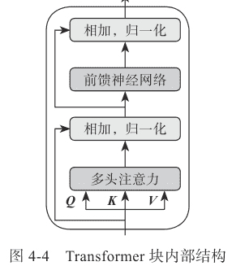

图 4-4 Transformer 块内部结构

适配式微调，即 Adapter Tuning，在 Transformer 块内部进行调整，旨在降低微调成本。Adapter Tuning 的核心思路是设计 Adapter 结构，并将该结构嵌入 Transformer 块中，作为 Transformer 块的一部分。在训练过程中，仅对 Adapter 结构的参数进行调整。以下是一种简明的 Adapter 实现的代码示例。

```python
def transformer_block_with_adapter(x):
    residual = x
    x = SelfAttention(x)
    x = FFN(x)  # adapter
    x = LN(x + residual)
    residual = x
    x = FFN(x)  # transformer FFN
    x = FFN(x)  # adapter
    x = LN(x + residual)
    return x
```

事实上，Adapter 放置的位置、数量以及内部结构都有很大的研究空间。下面介绍一种 Adapter Tuning 方法。具体的做法是在每一个 Transformer 块中增加两个 Adapter 结构，分别放置在多头注意力层之后和第二个前馈神经网络（FeedForward）层之后，如图 4-5 所示。

在训练时，保持模型原有结构的参数不变，只对新增的 Adapter 结构和归一化层进行微调。由于这种结构仅增加 3.6% 的参数，因此能够有效减少算力开销。

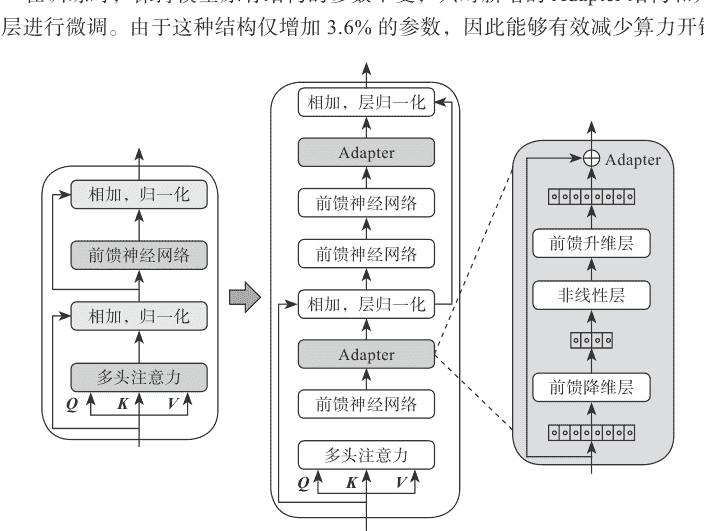

Adapter 结构的具体细节如图 4-5 所示。Adapter 结构主要由两个前馈层（FeedForward）组成。第一个前馈层起降维作用，将多层自注意力机制的结果作为输入，输出维度远低于输入维度，完成从高维特征到低维特征的映射。然后对低维特征进行非线性变换。第二个前馈层起到维度还原的作用，将低维特征重新映射回原来维度的特征，作为 Adapter 结构的输出。经过 Adapter 结构，维度保持不变，但参数量大幅减少。同时，Adapter 结构还通过一个残差连接将 Adapter 的输入重新加到该模块最终的输出上。其作用是，即使 Adapter 结构不起作用，参数更新为 0，也不妨碍原始模型的正常运转。

如图 4-6 所示，实验发现，通过对比 BERT-Large 模型在多个数据集上的性能，Adapter Tuning 方法的效果可以媲美全量微调，但 Adapter Tuning 方法只需要更新 3.6% 的参数。

| | Total num params | Trained params/task | CoLA | SST | MRPC | STS-B | QQP | MNLI_m | MNLI_mm | QNLI | RTE | Total |
|---|---|---|---|---|---|---|---|---|---|---|---|---|
| BERT_LARGE | 9.0 x | 100% | 60.5 | 94.9 | 89.3 | 87.6 | 72.1 | 86.7 | 85.9 | 91.1 | 70.1 | 80.4 |
| Adapters (8-256) | 1.3 x | 3.6% | 59.5 | 94.0 | 89.5 | 86.9 | 71.8 | 84.9 | 85.1 | 90.7 | 71.5 | 80.0 |
| Adapters (64) | 1.2 x | 2.1% | 56.9 | 94.2 | 89.6 | 87.3 | 71.8 | 85.3 | 84.6 | 91.4 | 68.8 | 79.6 |

图 4-6 BERT-Large 采用 Adapter Tuning 的性能对比

#### 4.1.4 前缀式微调

在最初的大模型应用中，针对具体的下游任务往往需要进行模型微调。例如，在文本摘要、文本翻译等任务中，需要分别微调模型参数才能达到目标性能。这种参数调整多、成本高，在复杂的行业下游应用中显然行不通。

受到人工构建任务模板的启发，可以在输入前面加入一些额外的可训练参数，称为 Prefix，并通过这些参数适配多任务。在不改变大模型参数的情况下，只更新 Prefix 部分的参数，有望达到不输于全量微调的效果，这就是 Prefix-Tuning 的思想。在一个 Transformer 块的代码范式如下所示。

```python
def transformer_block_for_prefix_tuning(x):
    soft_prompt = FFN(soft_prompt)
    x = concat([soft_prompt, x], dim=seq)
    return transformer_block(x)
```

##### 1. 构造虚拟 token

一种 Prefix-Tuning 的做法是通过虚拟 token 构造连续型隐式 prompts 参数，如图 4-7 所示，将 Translation（翻译）、Summarization（摘要）和 Table-to-text（从图表到文字）三个不同的任务作为前缀加到预训练模型中。在输入 token 之前构造一段与任务相关的虚拟 token 作为 Prefix 部分，相当于 Transformer 的每一层都在真实的句子表征前面插入若干个连续的可训练的 “virtual token” 嵌入结构。这些虚拟 token 不必是词表中真实的词，而只是若干个可调的自由参数。训练的时候只更新 Prefix 部分的参数，而 Transformer 中的预训练参数是固定的。

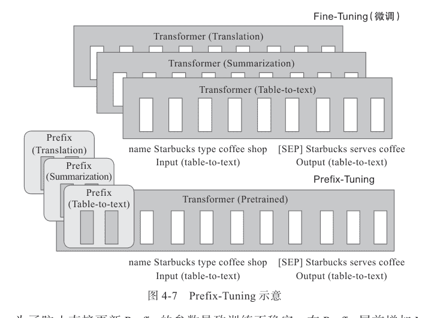

为了防止直接更新 Prefix 的参数导致训练不稳定，在 Prefix 层前增加 MLP 结构，训练完成后只保留 Prefix 的参数。

##### 2. 提示微调

Prompt Tuning（提示微调）是一种简化版的 Prefix-Tuning 方法，只在输入层加入 Prompt Token，并不需要加入 MLP 进行调整以解决训练困难的问题。另外，相比 Prefix-Tuning 在每一个 Transformer 块前加入可训练的虚拟前缀，Prompt Tuning 仅在输入层一次性加入可训练的参数，其代码范式如下所示。

```python
def soft_prompted_model(input_ids):
    x = Embed(input_ids)
    x = concat([soft_prompt, x], dim=seq)
    return model(x)
```

Prompt Tuning 的具体做法如图 4-8 所示。针对原来常规模型微调的 A、B、C 三个任务，构建对应的三个 Task prompts 结构，将其拼接后作为可调参数。Prompt Tuning 为每一个任务额外添加一个或多个可训练的 prompts 参数，然后将其拼接到数据上作为输入。在训练时，固定预训练参数，仅训练 prompts 参数。训练完成后，可以使用同一个模型进行多任务推理。

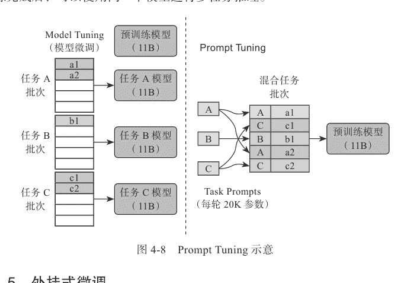

#### 4.1.5 外挂式微调

外挂式微调是另一种大模型微调技术，其主要思想是在原有大模型参数的旁边挂接一个可训练的结构，而这个外挂结构的参数量较小。在具体任务中，只要保持原有大模型参数不变，训练这个外挂结构即可实现对大模型的间接训练。

LoRA 是一个经典的外挂式微调方法，如图 4-9 所示。其理论依据是，大模型中很多全连接层的权重矩阵都是满秩的，即不可简化的。然而针对特定任务进行微调后，模型中的权重矩阵实际上具有很低的本征秩，即可以简化。因此，可以用一种低秩的方式来调整这些参数矩阵。在数学上，低秩意味着一个矩阵可以用两个较小的矩阵相乘来表示，正如图 4-9 中的 $A$、$B$ 两个矩阵，分别负责降维和升维。

其中，$x$ 代表输入数据或输入向量，可以是经过嵌入的文本向量、图像特征向量或其他类型的输入数据；$d$ 指的是输入向量的维度，即模型层的输入特征数量；$r$ 表示 LoRA 的秩（rank），这是 LoRA 方法的一个关键超参数；$h$ 代表模型中某一层的输出维度。秩 $r$ 远小于 $h$ 和 $d$，这使得 LoRA 能够以较少的参数量来适应新的任务。

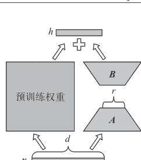

LoRA 的代码范式如下所示。

```python
def lora_linear(x):
    h = x @ W # regular linear
    h += x @ W_A @ W_B # low-rank update
    return scale * h
```

有了外挂的思路和结构后，下一个问题是将这个结构挂接到大模型的什么地方。由大模型多层堆叠 Transformer 的架构可知，注意力机制的参数计算量很大，即 $Q$、$K$、$V$ 三个矩阵可以作为挂接的目标。实验表明，将 LoRA 的结构同时挂接在 $Q$ 和 $V$ 矩阵上效果最好，如图 4-10 所示。

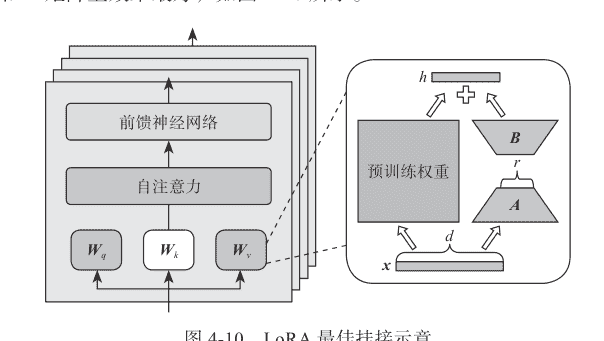

基于外挂式的思想和 LoRA 的基础，还有更多类似的方法可以用来微调大模型。例如，AdaLoRA 根据权重矩阵的重要性得分，在权重矩阵之间自适应地分配参数。例如，QLoRA 采用高精度技术将预训练模型量化为 4bit，进一步降低了模型的参数规模，如图 4-11 所示。

> 参考 “QLoRA: Efficient Finetuning of Quantized LLMs”。

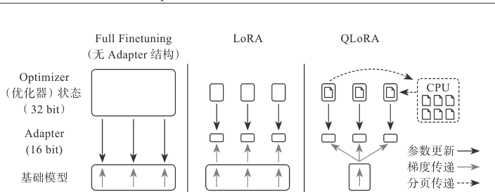

#### 4.1.6 混合式微调

参数高效微调方法 PEFT 在模型结构中更改或者添加模块，通过更新少量的参数，对预训练模型进行升级，如图 4-12 所示。经过前面的内容，我们知道 PEFT 可达到与全量微调相媲美的性能，能够在行业数据的加持下构建垂直大模型，赋能行业智能化发展。然而，这些微调方法的内在联系及关键要素是什么呢？我们需要理解得更深入一些，才能在使用大模型的时候用得放心，用得安心。

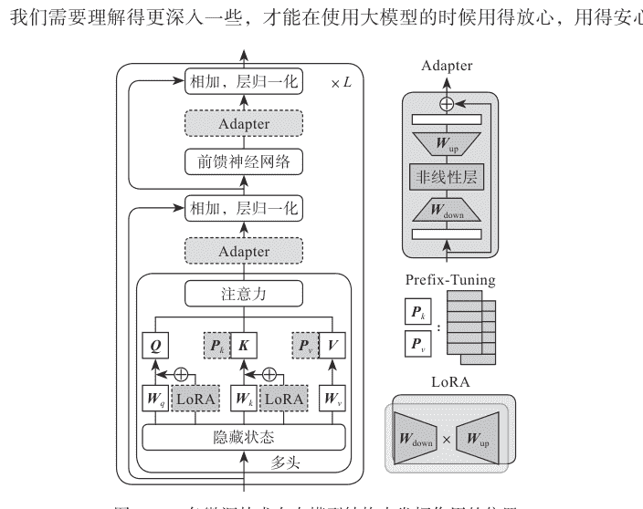

> 参考 “Towards a Unified View of Parameter-Efficient Transfer Learning”。

有研究试图对不同微调技术构建统一框架，以解释微调技术奏效的原因。通过分析不同微调方法的内部结构和结构插入形式的相似之处，研究发现，这些微调方法都可以转化为如图 4-13 所示的挂接式形式。其中，PLM 模块是原预训练模型的一个模块，如注意力模块、前馈网络等，在模型微调中保持不变。而右侧旁路则是不同微调模型转换后的不同形式。

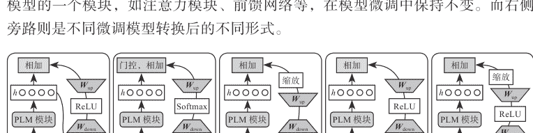

既然不同的微调技术都能够取得媲美全量微调的性能，且具有类似的内在形式，一个自然而然的问题是：是否可以将这些微调技术结合起来或者统一起来，构成更有效果的微调技术？答案是肯定的。

UNIPELT 就是这样一种混合式微调技术，它集 Adapter、LoRA、Prefix-Tuning 于一身，将不同微调技术作为子模块，通过门控技术选择最适合当前数据或者任务的微调技术，如图 4-14 所示。

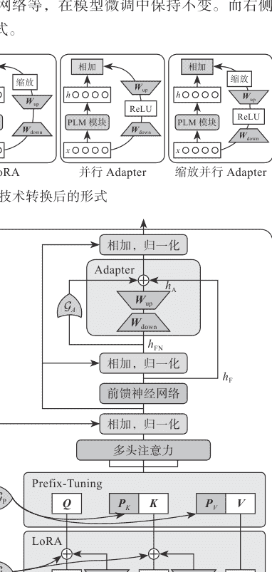

#### 4.1.7 主要微调技术的对比

结合垂直领域的行业数据构建垂直领域大模型是制造业使用大模型的一个重要思路。由于大模型训练成本高昂，在预训练模型上进行少量参数的高效调整以用于行业下游任务是切实可行的做法。参数高效微调方法 PEFT 思路百花齐放，主要包括局部微调、适配式、前缀式、外挂式、混合式等多种方式，如表 4-1 所示。

表 4-1 大模型微调技术对比

| 微调方法 | 代表算法 | 基本思路 | 是否改变原模型参数 | 微调参数量（参考模型） |
| :--- | :--- | :--- | :--- | :--- |
| 全量微调 | — | 根据行业数据，更新大模型的全部参数 | 是 | 100% |
| 局部微调 | BitFit | 更新大模型中一小部分参数，如 BitFit 只更新偏置参数 | 是 | 0.08% (BERT-Large) |
| 适配式 | Adapter Tuning | 在大模型中嵌入可训练的适配模块，如 Adapter Tuning 在 Transformer 块增加 Adapter 结构，本质是另外一种形式的外挂 | 否 | 小于 3.6% (BERT-Large) |
| 前缀式 | Prefix-Tuning, Prompt tuning | 在模型输入层前拼接可训练的参数。Prefix-Tuning 在每一面 Transformer 前加入虚拟前缀，而 Prompt Tuning 仅在输入层一次性加入前缀 | 否 | 0.1% (BART) |
| 外挂式 | LoRA, QLoRA | 在大模型架构组件中挂接可训练模块。LoRA 在 Q 和 V 矩阵上挂接低秩结构 | 否 | 0.24% (RoB-Base) |
| 混合式 | UNIPELT | 整合多个微调方法，通过门控技术针对具体任务选择合适的微调方法 | 否 | 0.99% ~ 1.26% (BERT-Base) |

### 4.2 大模型检索增强生成

在实际行业应用中，通过微调技术利用行业数据在预训练大模型上进一步训练，可以构建具备行业解决能力的垂直大模型。尽管这种方式确实行之有效，对行业智能化具有促进作用，但并非完美无缺。

##### 1. 幻觉现象仍然存在

我们知道，通用大模型有时会出现信息不实或臆造现象，即一本正经地胡说八道，这就是大模型的幻觉现象，是大模型的共性表现。通过微调后的预训练大模型，即垂直大模型，尽管有行业数据加持，仍然可能出现幻觉现象，从而导致模型不可用。其原因在于垂直大模型的模型结构与预训练大模型一脉相承，且缺乏外在手段消除幻觉现象。

##### 2. 实时性差

无论是通用大模型还是垂直大模型，无论是从头训练、全量微调还是高效微调，大模型训练依赖的数据都是既有的历史数据。大模型从“出炉”的那一刻起，就不再接受新的数据进行参数更新。然而，在现实世界的应用中，数据是不断更新的，用户的问题也在与时俱进，此时大模型就无法应对这些新问题。垂直大模型只能处理特定领域的问题，缺乏实时性，限制了其在动态数据环境中的应用。

##### 3. 结果不透明、不可追溯

在具体行业应用需求中，大模型不仅需要生成用户想要的内容，还需要对生成的内容负责，要求有理可依、有据可依。例如，在法律咨询中，需要明确文书判决的依据是哪一条法条；在工业生产制造中，产品设计的依据需要明确来自最新国家规范标准的哪一部分。然而，由于大模型的“黑盒”特性，这样的要求无法被满足。这就需要更精细的解决方案来满足对生成内容透明、可追溯的需求。

对大模型在实际应用中确保内容准确性和相关性这一现实挑战，检索增强生成（Retrieval-Augmented Generation，RAG）技术应运而生，成为大模型在行业落地的有力推手。RAG技术的主要思路是，大模型在结果生成之前，先从文档数据库中检索相关信息，然后进行结果生成，从而提升生成结果的准确性和相关性。因此，RAG技术能够缓解幻觉问题，增强内容生产的可追溯性，使得大模型在实际应用中更加实用和可信。

#### 4.2.1 RAG 简介

RAG是一种结合信息检索和智能生成的技术，适用于知识更新频繁且对时效性要求较高的场景。RAG通过外挂的知识库检索与输入相关联的数据，并将这些信息作为上下文和问题一起输入给大模型进行处理，是一种先检索再生成的大模型扩展技术，如图4-15所示。

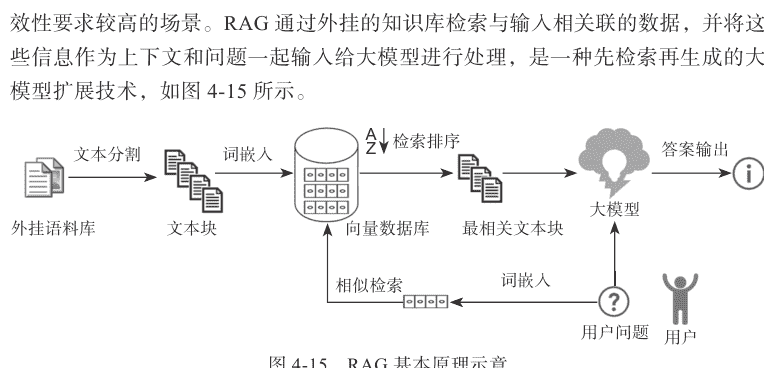

典型的 RAG 范式主要包括三个步骤，分别是构建向量数据库、相似检索和智能生成。

##### 1. 构建向量数据库

外挂的知识库通常以向量数据库的形式存在。由于外挂的语料知识库规模较大，同时为了提升检索时的准确性，在构建向量数据库时，首先需要将外挂数据切分成多个文本块，每个文本块包含原始语料的信息。文本分割的方式可根据实际需求进行调整，常见的分割方式包括基于段落和基于句子等。分割方式与粒度会影响具体的查询匹配精度。

然后，对分割后的文本块进行词嵌入编码，生成词向量。常见的文本编码器包括 BERT、GPT 等。这些向量会被存储到专门的向量数据库中，如 Chroma、Faiss、Elasticsearch、Hnswlib 等，以供后续查询检索使用。

##### 2. 相似检索

相似检索是指在外挂知识库中找到与用户提问相似的原始语料。具体步骤为：用户的问题首先通过编码模型进行词嵌入转换，生成向量（此处，编码模型应与构建向量数据库时使用的编码模型保持一致）；随后，在向量数据库中查询与用户问题向量相似的文本块，通过相似查询获取最相关的 $K$ 个文本块。相似检索的过程基于向量空间的距离度量，如余弦相似度。

##### 3. 智能生成

通过相似查询，RAG 获得了与用户问题在语义上最相关的原始资料。在智能生成阶段，相似检索得到的文本块与用户问题结合后作为输入，送入大模型，以生成答案。这里的大模型可以是通用大模型，也可以是垂直大模型。由于输入包含用户问题的相关资料，大模型在生成答案时能够更好地理解用户问题的上下文语义，从而生成更准确且关联性更强的结果。

由以上三个步骤可以看出，RAG 能够利用大量外部知识，为用户问题提供可解释性和可溯源的答案。例如，对于中国足球队在亚洲杯首轮比赛表现的问题，采用 RAG 的思路可以有效回答。将有关亚洲杯赛事的赛前信息、赛后媒体采访、媒体评论加入外部知识库中，模型结合用户问题就能得到答案。

然而，实际应用中的问题远比示例复杂，涉及非结构化数据、语义检索精度、处理速度、质量评估等诸多课题。这就需要深化和升级典型的 RAG 范式，即在构建向量数据库、相似检索、智能生成这三个步骤上增强相关能力。

#### 4.2.2 构建向量数据库

构建向量数据库的步骤主要包括文档分割与词嵌入编码，其操作过程中面临如下几个方面的挑战。

##### 1. 文档分割粒度挑战

为了使用 RAG 获得用户满意的答案，最关键的步骤是检索出与用户问题语义最相关的知识，然后交由大模型进行理解和输出。影响检索精度的一个重要因素是文档分割粒度。针对外挂的知识资料，如果分割粒度过粗，即分割后的文本块过大，会导致文本块包含的信息过多，从而在向量检索时难以精确命中；而如果分割粒度过细，即分割后的文本块过小，虽然能够较为精准地命中，但由于文本块内容过少，包含的上下文信息不足，输入到大模型的信息量就会减少，不利于大模型的智能生成效果，如图 4-16 所示。

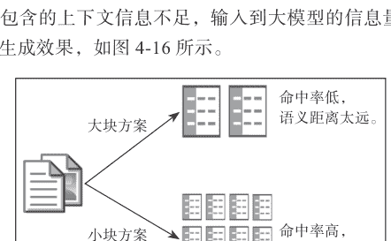

由此可见，在文本分割中，存在语义清晰度与检索准确性之间的矛盾。为调和这一矛盾，可以考虑采用大小块联合分割的方法。

使用这种方法，无须纠结是否应将文本分割成大块还是小块，因为大块方案和小块方案可以同时存在，并构建大小块之间的关联关系。这样，大小块联合分割能够平衡语义清晰度与检索准确性，如图 4-17 所示。

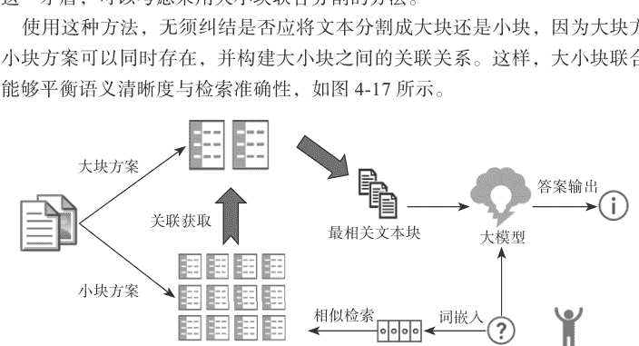

在该方案中，通过相似检索获取 N 个最相似的小块后，这些小块能够精准契合用户问题。这些小块的内容较少，包含的上下文信息有限。随后，通过这些小块的原数据信息，关联访问对应的大块内容，从而补充更多的上下文数据。最后，将关联的大块文本与用户问题一起提交给大模型进行理解和生成。

##### 2. 非结构化数据挑战

对于普通的文本文档，得益于大语言模型相关技术的发展，采用常见的分词器、嵌入模型和向量数据库，就能有效地将文本内容转化为结构化的向量形式并存储于数据库。然而，如果文档中包含表格或者图片等非结构化数据，则需要采用特定的方法进行专门处理，以便使 RAG 能够利用这些非结构化的外挂知识，即支持多模态的数据外挂。

对于多模态的外挂知识，RAG 构建向量数据库的思路如图 4-18 所示。

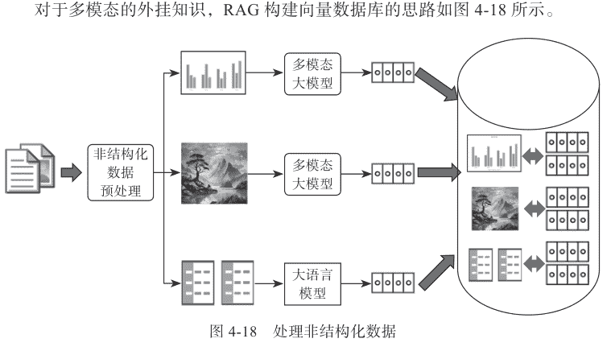

- ①对原始文档进行解析，分别提取出不同模态的数据，如文本、图表、图片等。目前可以借助一些工具（如 unstructured）来解析原始文档（如 PDF 文件）中的信息，将文件中的多模态信息分别转化为结构化形式。
- ②对解析出来的多模态数据，可以采用多模态模型灵活处理。以图像为例，既可以对图像进行编码，也可以生成图像对应的语义摘要。在存储向量数据时，可以选择只存储图像编码向量，无须存储图像的文本摘要；也可以选择只存储图像的语义摘要，但这会忽略图像中的大量细节信息。最推荐的方法是将原始图像与对应的语义摘要一起存储。
- ③采用多向量数据库来存放不同模态数据的原始数据及其对应的摘要信息，以供相似检索使用。由于同时存储了原始数据和摘要信息，这有助于提升语义检索的准确性和上下文的完整性。

##### 3. 高效索引挑战

在相似检索中，不同于使用精准匹配或预定义查询数据的传统方法，RAG 的检索是在向量数据库中根据语义或上下文含义，查找最相似或相关的数据。为了保证 RAG 的性能，向量数据库的高效存储与检索至关重要。

向量数据库的工作原理如图 4-19 所示。在数据向量化后，利用索引技术和向量检索算法进行数据的存储和检索。这些算法的性能是实现快速响应的关键。目前主流的检索算法包括基于树的方法、基于图的方法、基于乘积量化的方法、基于哈希的方法，以及基于倒排索引的方法。

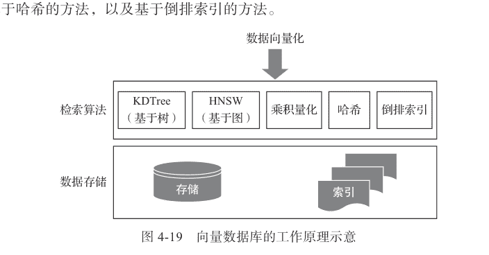

由于大模型的兴起，目前向量数据库市场正处于快速发展阶段，市场规模持续扩大，同时涌现出众多向量数据库产品，可谓百花齐放。表 4-2 介绍了市场上的一些向量数据库，供读者参考。

表 4-2 主流向量数据库对比

| 向量数据库 | 扩展性 | 查询速度 | 搜索准确性 | 灵活性 | 持久化 | 存储位置 |
| :--- | :--- | :--- | :--- | :--- | :--- | :--- |
| Chroma | 高 | 高 | 高 | 高 | 是 | 本地/云端 |
| DeepsetAI | 高 | 高 | 高 | 高 | 是 | 本地/云端 |
| Faiss | 高 | 高 | 高 | 高 | 否 | 本地/云端 |
| Milvus | 高 | 高 | 高 | 高 | 是 | 本地/云端 |
| pgvector | 中 | 中 | 高 | 高 | 是 | 本地 |
| Pinecone | 高 | 高 | 高 | 高 | 是 | 云端 |
| Supabase | 高 | 高 | 高 | 高 | 是 | 云端 |
| Qdrant | 高 | 高 | 高 | 高 | 是 | 本地/云端 |
| Vespa | 高 | 高 | 高 | 高 | 是 | 本地/云端 |
| Weaviate | 高 | 高 | 高 | 高 | 是 | 本地/云端 |
| DeepLake | 高 | 高 | 高 | 高 | 是 | 本地/云端 |
| LangChain VectorStore | 高 | 高 | 高 | 高 | 是 | 本地/云端 |
| Annoy | 中 | 中 | 中 | 中 | 否 | 本地/云端 |
| Elasticsearch | 高 | 高 | 高 | 高 | 是 | 本地/云端 |
| Hnswlib | 高 | 高 | 高 | 高 | 否 | 本地/云端 |
| NMSLIB | 高 | 高 | 高 | 高 | 否 | 本地/云端 |

#### 4.2.3 相似检索

在对用户的问题进行相似检索时，RAG 系统只有做到用户的“知心人”，洞察用户的内在需求，真正检索出与用户问题相关的数据，才能助力大模型在智能生成中的理解与输出。然而，用户的提问风格千差万别，问题形式五花八门，极难实现“同频共振”。

##### 1. 用户的问题具有局限性

用户在提问时可能随意性较强，存在一定的局限性。一种情况是表达范围过于宽泛，如用户的问题是“电梯安装的步骤是什么”。这种宽泛的问题会导致大模型的回答流于表面，缺乏精准性。另一种情况是表达范围过于狭窄，如“在 A 项目中，曳引机的参数选型和位置安放怎么做”。该问题仅关注曳引机的情况，却忽略了其他配套设备和相关流程，这可能导致答案不够全面。

除了用户需要学会更好地提问，从技术层面上讲，解决用户问题局限性的方法是问题数据增强。主要思路是借助大模型针对用户问题生成多个不同视角的相关问题，然后利用这些生成的问题进行相似检索，并对所有检索结果进行重新排序，以获得最相关的知识块，如图 4-20 所示。

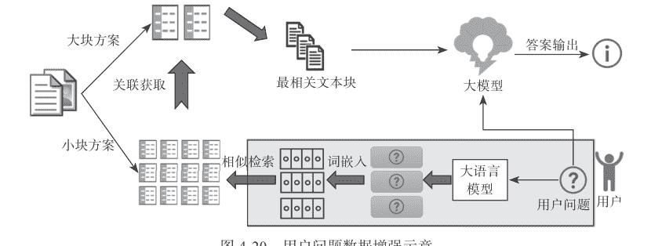

值得注意的是，这种用户问题数据增强的方法会导致更多的相似检索，额外增加检索量和时间成本，可能影响用户体验。另外，对用户问题进行多维度扩展，会使大模型的输入上下文长度增加，从而加重大模型的负担。同时，对应的输出内容也相应增加。

##### 2. 用户的提问过于复杂

在一些实际场景中，用户的问题可能涉及多个领域和多个话题，语义信息较为复杂。例如，“在 MES 的落地实施时，离散制造行业和流程制造行业有什么需求差异？”这一问题涉及多个话题，可能难以直接在知识库中找到相关资料。

一种可行的做法是将问题分解为更加简单且具体的问题，然后分别进行相似检索。例如，可以将上述问题拆解为两个问题：“在 MES 的落地实施时，离散制造行业有什么需求？”和“在 MES 的落地实施时，流程制造行业有什么需求？”随后对这两个问题进行并行查询，将检索到的上下文组合在一个输入中，供大模型理解和最终输出。

#### 4.2.4 智能生成

获得相似检索的结果后，可以将其与用户的问题结合起来，一并作为大模型的输入，供大模型理解和回复，从而智能生成问题的答案。在此过程中，合理的输入组合和输出控制是智能生成成功的关键。

##### 1. 提示词构建

简单地将相似检索结果与用户问题直接输入大模型进行智能生成，可能无法得到理想的结果。根据提示词工程的原理，合理的提示词设计能够帮助大模型生成符合预期的结果。因此，针对相似检索结构和用户问题，需要构建合理的提示词。

根据上一章的提示词技巧，我们已经了解到提示词的明确性、具体性和角色设定等技巧的重要性。因此，智能生成的提示词应采用这些技巧。例如，在 RAG 系统中，提示词应明确指出回答仅基于搜索结果，不要添加任何其他信息。可以设置提示词为：“你是一名智能客服。你的目标是提供准确的信息，并尽可能帮助提问者解决问题。你应保持友善，但不要过于琐碎。请根据提供的上下文信息，在不考虑已有知识的情况下，回答相关查询。”此外，在面对一些相对复杂的问题时，可以采用少样本提示的方法，将预设的问题例子加入提示词中，以指导大模型如何利用检索到的知识。

合理的提示词是提升大模型生成内容质量的有效方法，不仅能使模型的回答更加精准，也提高了其在特定情境下的实用性。

##### 2. 智能生成

提示词构建完成后被送入大模型中，接下来就是考验大模型本身能力的环节。因此，选择一款性能强大的大模型显得尤为重要。在实际 RAG 应用中，大模型的选择可以从如下几个方面考虑。

- （1）可获得性与成本：目前，大模型的服务形态多种多样。从开放程度来看，大模型分为完全开源、有限开源和闭源几种方式。在使用方式上，大模型分为本地部署和接口服务两种方式。因此，获得一款大模型的难易程度不同，使用成本也不同，需要综合考虑。
- （2）生成质量：由于不同大模型的技术细节和规模大小不同，其性能表现也有所差异。在同一个问题的回复上，各个大模型的回复也可能各不相同，存在质量高低之分。选择一个综合生成质量评分较高的大模型是一个明智的选择。
- （3）推理速度：在 RAG 应用中，有些服务需要较短的响应时间。如果忽视响应速度，就会不可避免地给 RAG 应用带来较差的用户体验。因此，大模型智能生成的推理速度是一个值得重点考虑的因素。

综上，大模型的选择需要综合各个因素进行权衡，找到适用于 RAG 应用的大模型。

##### 3. 输出控制

大模型面临幻觉、安全性等问题。因此，在智能生成时需要对输出内容进行有效控制。大模型的输出控制可以从以下几个方面展开。

- （1）确保公平和负责任的使用：RAG 的道德部署包括负责任地使用该技术，并避免任何滥用或有害应用。开发人员和用户必须遵守道德准则，以维护 AI 生成内容的完整性。
- （2）解决隐私问题：RAG 对外部数据源的依赖可能涉及访问用户数据或敏感信息。建立强有力的隐私保护措施以保护个人数据，并确保遵守相关隐私法规。
- （3）减轻外部数据源中的偏差：外部数据源可能因其内容或收集方法而存在偏差。开发人员必须实施识别和纠正偏差的机制，以确保 AI 的响应公正且公平。这需要对数据源和训练过程进行持续监控与优化。

#### 4.2.5 RAG 效果评估

通过对 RAG 典型范式的优化升级，并根据行业知识库构建一个完整的 RAG应用后，是否可以立即将其投入使用呢？切勿着急。在交付之前，需要对该 RAG 应用进行科学评估，其原因在于以下几点。

- ①大模型的输出具有不确定性，这可能导致结果存在一定的不可预知性，犹如开盲盒一般。在 RAG 应用投产之前，需要测试这种不可预知性，以避免出现过多的“惊喜”或“惊吓”。
- ②RAG 应用的知识库是外挂的，并且是动态的。在生产经营和维护过程中，可能会出现性能波动。因此，需要进行定期检测和评估。
- ③RAG 应用上线后必然存在升级维护，需要有手段衡量升级维护的效果如何、改进多少。

事实上，与传统软件在上线交付之前需要经过完整测试一样，RAG 应用也需要借助科学的用例、脚本与工具来评估是否符合预期。然而，不同于传统软件相对容易评估且可以定量评估，由于 RAG 的输入输出为自然语言，其相关性和准确性难以直接观察和判断，容易出现“公说公有理，婆说婆有理”的情况。这就需要借助一些额外的工具和评估模型来帮助评估 RAG 的表现。

Ragas 是一款用于评估 RAG 流程的评估框架，可用于评估、监控和改进生产环境中的 LLM 和 RAG 应用的性能。使用 Ragas 进行评估，需要提供如下四项信息。

- □ 问题：一般为用户提出的问题，作为 RAG 应用的输入。
- □ 答案：问题的答案，是 RAG 应用应该输出的结果。
- □ 知识：从外挂知识库语义检索出的相关知识。
- □ 基准事实：由人类提供或者标注的事实，也就是正确答案。

采用 Ragas 对 RAG 应用评估的流程如图 4-21 所示。

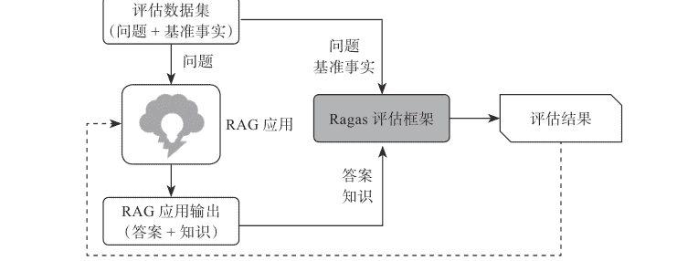

在评估中，针对 RAG 应用的检索和生成两个部分，主要指标如表 4-3 所示。

##### 表 4-3 RAG 应用评估指标

| 名称 | 相关输入 | 解释 |
| --- | --- | --- |
| 忠实度 | 答案<br>知识 | 答案与检索出的上下文的一致性，即答案是否能从检索出的知识中推理出来 |
| 答案相关性 | 答案<br>问题 | 答案与用户问题的相关性，即答案是否完整且不冗余地回答了输入问题 |
| 上下文精度 | 知识<br>基准事实 | 检索出的相关上下文中与正确答案相关的条目是否排名较高 |
| 上下文召回率 | 知识<br>基准事实 | 检索出的相关上下文与正确答案之间的一致性，即正确答案的内容是否能够归因到上下文 |
| 上下文相关性 | 知识<br>问题 | 检索出的上下文与用户问题之间的相关性，即上下文中有多少内容和输入问题相关 |

除了对 RAG 应用的检索和生成两个部分进行定量化评估之外，还可以从用户切身体验的角度评价 RAG 的整体性能，通过人工打分进行衡量，主要有如下两个指标。

- 回答的语义相似度。简单地说，就是输出答案与基准事实之间的语义相似度，评分范围在 0 到 1 之间，分数越高表示生成的答案与正确答案越相似。
- 回答的正确性。回答的正确性是一个较为宽泛的指标，涵盖回答的语义相似度与事实相似度，并对这两方面设定权重，计算出一个介于 0 到 1 之间的正确性值。

#### 4.2.6 RAG 应用场景

在面对实时性、准确性和相关性要求较高的需求时，大模型微调可能显得力不从心。RAG 技术通过构建向量数据库、相似检索、智能生成三个核心功能，实现对外挂知识库的有效利用，拓展了大模型面对上述特定需求的能力。正如大模型微调并非万能一样，RAG 技术也有其适用的应用场景。当面对如下场景需求时，可以考虑采用 RAG 技术。

- （1）数据稀有
在数据分布呈现长尾特性时，RAG 系统能够凭借其强大的检索功能触及并涵盖稀有、非典型的数据样本，从而增强模型对这类长尾数据的处理效果。
- （2）知识更新频繁
在新闻、科技等知识内容频繁更新迭代的领域中，RAG 系统能够通过实时搜索功能确保为用户提供最前沿的信息资源。
- （3）回答需要验证追溯
在要求答案具备可追溯来源以确保验证可信度的应用场景中，RAG 系统支持用户回溯查找答案出处，从而增强回答的可靠性。
- （4）领域专业化知识
在面对医疗、法律咨询等高度依赖专业知识的场景时，RAG 能够提供深厚且专业的背景资料，以支持决策制定。
- （5）数据隐私保护
在应对敏感数据时，RAG 系统可设计为避免直接访问原始信息，而是通过查询已脱敏或经过安全处理的数据内容，确保用户隐私得到妥善保护。

#### 4.2.7 RAG 与微调的对比

大模型微调结合行业数据，对预训练模型进行少量参数更新，生成适应行业应用需求的垂直大模型，然后用更新后的模型结构解决行业下游任务。然而，由于大模型微调需要耗费一定的成本和时间，这种方式并不擅长整合新知识或快速迭代新场景。

RAG 技术是不改变模型结构，利用外挂知识库，通过知识检索的方式扩展问题的上下文语义作为大模型的输入，有助于大模型提供实时且精准的答案。

大模型微调和 RAG 是两种不同应用大模型的思路，具有各自适应的应用场景，如表 4-4 所示。大模型微调更注重将知识内化为大模型的参数，重在微调训练，是一种隐式的内在能力。而 RAG 则巧妙地利用外在知识，重在检索，以弥补大模型在特定行业知识上的不足，是一种相对显式的能力。

##### 表 4-4 RAG 与大模型微调的对比

| 特点对比 | RAG | 微调 |
| :--- | :--- | :--- |
| 应对知识更新 | 模型无须重新训练，直接更新外挂知识库 | 数据和知识更新，模型需要重新训练 |
| 外部知识利用 | 擅长利用外部资源，非常适合文档或其他结构化/非结构化数据库 | 微调需要成本和时间，对变更频繁的数据源并不适用 |
| 数据处理要求 | 对数据加工和处理的要求低，直接外挂 | 微调依赖一定规模的高质量数据集，否则性能提升有限 |
| 模型风格 | 主要关注信息检索，擅长整合外部知识，模型风格依赖大模型本身的能力 | 依赖大模型本身能力，允许根据特定的语气或术语调整大语言模型的行为、写作风格或特定领域的知识 |
| 可解释性 | 答案通常可以追溯到特定数据源（即外挂知识库），提供可解释性和可溯源性 | 受限于大模型本身的可解释性问题，犹如开盲盒，具有相对较低的可解释性 |
| 资源消耗 | 外部数据源集成以及数据更新。需要高效的向量数据库构建与检索能力，以及大模型推理能力 | 准备和整理规模较大的高质量训练数据集，微调技术选型与相应的计算资源 |
| 延迟与实时性 | 在大模型生成之前，需要进行数据检索，可能会有更高延迟 | 经过微调的大语言模型无须检索即可响应，延迟较低 |
| 减少幻觉 | 本质上不太容易产生幻觉，因为每个回答都建立在检索到的外挂数据库上 | 基于特定领域的训练数据后，大模型可以减少幻觉，但仅适用于本领域。在跨领域或者知识更新时仍然有幻觉 |
| 道德与隐私 | 道德和隐私问题来源于从外部数据库检索的文本 | 道德和隐私问题则源于模型的训练数据中可能存在敏感内容 |
| 适用场景 | 稀有、动态数据场景 | 静态数据场景 |

虽然大模型微调和 RAG 各具特点，但是它们并不相互排斥，甚至可以互补。内在的知识内化，再加上实时的检索，相互补充，内外兼修，则可天下无敌。设想一下，如果在微调过的垂直大模型上，采用 RAG 技术来提问该行业内的最新问题，那么大模型的表现可能会更好；同样地，RAG 的外挂知识库经过累积和整理后可以作为行业数据，以帮助大模型微调，从而生成更高性能的垂直大模型，如图 4-22 所示。

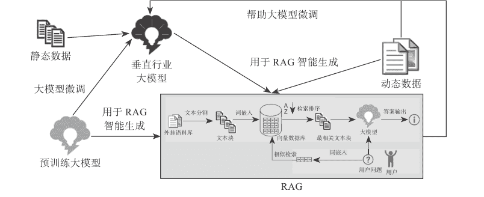

在 RAG 技术中，为了让大模型回答与最新话题相关的问题，必须配备相应的外挂知识库。然而，知识库的更新需要人为操作，时效性较低。同时，大模型仅能回答问题，无法帮助用户进行决策和任务执行，智能度不足。那么，是否可以让大模型自身感知用户问题的真实需求，帮助用户进行决策和执行任务，成为一个更先进、更智能的助手呢？

### 4.3 AI Agent

虽然大模型通过微调和 RAG 等技术能够针对特定行业领域的问题提供精准回答，但这种一问一答的模式在很大程度上仍局限于被动响应用户请求的范畴。然而，人们对智能化的追求是永无止境的。是否可以将这种一问一答的形式进一步拓展，使大模型不仅能够感知用户需求，还能帮助用户完成后续工作呢？这种需求催生了 AI Agent（智能体）概念和技术的发展。AI Agent 不仅能理解和感知用户的需求，还能根据上下文情境进行预测、规划，并执行一系列连续的操作，帮助用户完成更复杂的任务。例如，在办公环境中，AI Agent 可以协助员工安排日程、处理邮件、编写文档，并基于历史行为推荐下一步的工作策略。

#### 4.3.1 AI Agent 简介

在人们的认知中，AI Agent 的基本概念是达成了普遍共识的，即构建能够感知外部环境且自主行动和决策的系统，拥有像人类一样的智能。

Agent 的中文直译是“代理”。代理是一个专业名词，具有比较深刻的内涵。结合其法律内涵，一个合格的代理人必须满足以下条件。

- ①明确理解被代理人的意思，不得误解，不超出代理人的意思。
- ②代理人在代理权限范围内实施代理行为，独立与第三方进行代理行为。

AI Agent 相当于代理人。代理人进行相关工作，能够达到与本人直接工作相同的效果。例如，工厂老板张三对 AI Agent 瓦力说：“我要采购一批电缆，型号是 ZRYJ22-1KV，数量是 1 千米，请帮我采购吧”，如图 4-23 所示。那么，为了完成任务，瓦力需要具备代替张三进行采购的能力，具体包括如下几点。

- ①准确无误地理解张三的意思。张三要买电缆，不能理解成买钢材，同时型号和数量也要准确。
- ②能够借助工具与供应商李四达成购买行为。例如，会浏览采购网站、会询价、会下单、会付款等。

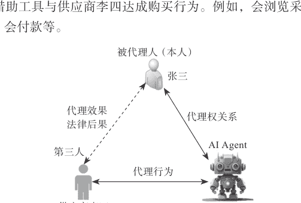

由此可见，从代理的角度来看，可以比较准确地解释 AI Agent 的内涵。同时，合法代理的要求也明确了 AI Agent 的能力方向，即理解被代理人的需求，能够使用工具并独立完成任务。

AI Agent 并不是一个新的概念，而是自人工智能诞生之初就已存在。随着人工智能技术的不断发展演进，AI Agent 的实现方式也随之变化。

##### 1. 符号主义智能体

在 AI 发展的早期阶段，符号主义占据主导地位。通过数理逻辑的方法，利用逻辑规则和符号表示来封装知识并促进推理过程，AI Agent 也因此采用这种方法来模拟人类的思维模式。符号主义最成功的成果是专家系统，具备明确的、可解释的特点。因此，AI Agent 的表现形式在这一阶段主要是专家系统。

##### 2. 概念成熟

20 世纪 80 年代末至 90 年代，随着分布式 AI 和多智能体（Multi-Agent）系统的兴起，AI Agent 的概念逐渐成熟。AI Agent 的定义也逐渐清晰，即 AI Agent 应具备感知环境、规划行动、执行动作及学习适应的能力。

随后，AI Agent 的“信念－愿望－意图”（Belief-Desire-Intention，BDI）模型被提出。该模型将 AI Agent 的内部状态划分为信念（对环境的认知）、愿望（包含目标）和意图（包含计划），为开发 AI Agent 提供了一种形式化的理论框架，如图 4-24 所示。

- ①信念（Belief），又可以称为能力或知识，代表 AI Agent 对环境和自身内部状态的认知内容。
- ②愿望（Desire），即想做什么，表示 AI Agent 的特定目标，即它决定实现的目标。
- ③意图（Intention），即怎么做，代表 AI Agent 采用的计划或者行动顺序，以及相对应的行动。

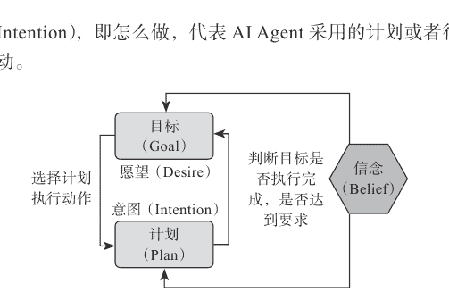

##### 3. 基于强化学习的智能体

伴随着强化学习的兴盛，再结合博弈论，基于强化学习的智能体技术快速发展起来，包括单智能体与多智能体。强化学习智能体技术的重点是如何让 AI Agent 通过与环境的交互进行学习，使其在特定任务中获得最大的累积奖励，如图 4-25 所示。起初，强化学习算法主要聚焦在策略搜索与价值函数优化，如 Q-Learning 等。这一技术早期的主要成果是各种电子小游戏。

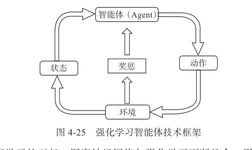

随着深度学习的兴起，深度神经网络与强化学习不断整合，形成了深度强化学习。这使得 AI Agent 可以从高维输入中学习复杂的策略，从而取得了众多重大成就，如 AlphaGo 在与李世石的围棋对战中取得胜利。

基于强化学习的 AI Agent 能在未知环境中自主学习，无须明确的人工干预。这使其广泛应用于从游戏到机器人控制等一系列领域。

##### 4. 基于大模型的智能体

虽然强化学习是实现 AI Agent 的主流技术，但在复杂的真实世界环境中应用时，面临着训练时间长、样本效率低、稳定性差，以及迁移和泛化能力不足等诸多挑战。随着大模型的火爆，其强大的能力为 AI Agent 的技术突破带来了契机。凭借其强大的自然语言理解和生成能力，大模型能够显著增强 AI Agent 在交互性、情境理解、知识获取与推理等方面的表现。

#### 4.3.2 基本框架

目前，AI Agent 借助大模型的强大能力，正逐步实现人类代理和人类助手的角色。在大模型的能力加持下，大模型驱动的 AI Agent 能够真正感知外部环境并自主行动和决策，与传统技术相比，具有如下优势。

- 人机交互：大模型能够理解包括语言在内的多模态信息，从而确保与用户进行无缝交互。
- 决策能力：大模型具备推理和决策能力，使其善于解决复杂问题。
- 灵活适配：AI Agent 的适应性确保其能够针对各种不同的应用场景进行精准定制与灵活重塑。
- 协作交互。AI Agent 的协作能力不仅限于与人类的互动，还能与其他 AI Agent 协同工作，为实现多维度、多层次的智能协同操作铺平道路。

在具体实现方面，基于大模型的 AI Agent 并非仅依靠大模型，而是融合了深度学习、自然语言处理、强化学习等多种先进技术，以实现更高效、更智能的任务决策和执行能力。

基于大模型的 AI Agent 框架包括三个核心组成部分，分别是大脑模块、感知模块、行动模块，如图 4-26 所示。

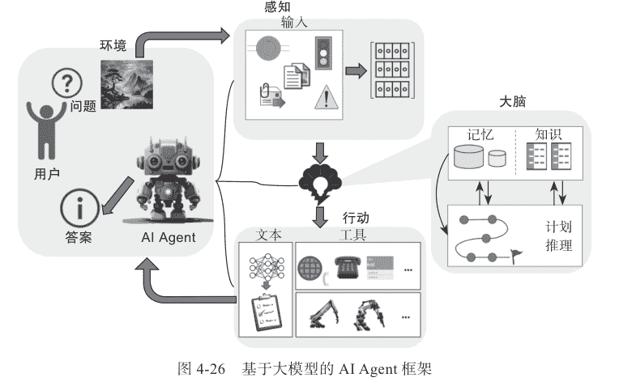

（1）感知模块
感知模块负责感知和处理来自外部环境的多模态信息，如文本、语音、图像、视频，乃至物理世界的实时传感信息。通过对环境信息的转换和解读，感知模块将其转化为可供大脑模块进一步分析和利用的形式化表达。

（2）大脑模块
作为 AI Agent 的核心控制器，大脑模块承担记忆、思考和决策等基本任务。它整合并处理从感知模块获取的信息，并据此生成行动指令。大脑模块依托大模型技术，实现强大的记忆存储与检索能力、逻辑推理与决策制定，以及学习与适应性优化。

（3）行动模块
行动模块负责使用工具执行任务并影响周围环境。在接收到认知中枢输出的指令后，行动模块承担将抽象决策转化为具体操作的任务。它不仅包括与现实世界交互的物理动作执行能力，如机器人运动控制或软件应用操作，还涵盖虚拟空间中的任务执行，如，数据抓取、内容生成、策略实施等。借助各种工具和接口，行动模块确保 AI Agent 能够有效影响和改变其所处的环境。

因此，基于大模型构建的 AI Agent 形成了一个闭环反馈系统。在这个系统中，大脑模块、感知模块与行动模块相互协同，共同支撑起 AI Agent 在复杂环境中自主、智能地感知、思考与行动的能力。

#### 4.3.3 感知模块

感知模块在基于大模型的 AI Agent 中扮演着至关重要的角色。它是 AI Agent 与外部环境交互并理解环境状态的第一道关卡。

##### 1. 感知形式与方式

为了精确捕捉和理解外部环境的丰富多样性，AI Agent 必须具备多模态感知技术。这意味着它不仅需要具备处理单一感官输入（如文本、图像或声音）的能力，还需要有效融合这些不同形式的信息。

（1）文本输入
目前，大模型具备了很强的文本交互能力，其表现形式包括 ChatGPT 等聊天机器人。在人类文本对话中，除了明确的信息，还包含信念、愿望和意图。能否作为“知心人”理解对话的隐含含义，是关系到 AI Agent 能否提升交流效率和质量的关键，而这恰恰是最具挑战性的任务。

为跨越信息鸿沟、消除信息不对称、避免误解，除了人们尽量提供明确的对话文本之外，AI Agent 的感知模块也需要采用技术手段与用户达成“双向奔赴”。例如，有些研究采用强化学习帮助感知隐含含义，通过建立反馈模型推断用户偏好。

此外，用户需求千变万化，场景千奇百怪，往往会出现一些未知任务的文本指示。这就要求感知模块具备可迁移性，使系统能够迅速且准确地理解各种未知或未见过的任务描述，并据此进行有效响应。

目前，文本输入的获取途径多种多样，涵盖直接和间接的交互方式。首先，在人机交互层面，对话框内的文本交互是最为直观且被广泛采用的形式。用户可以通过键盘、语音转文字技术或触屏手写等方式，在系统提供的文本框内输入信息，实现与 AI Agent 的实时双向沟通。其次，在非直接文本输入方面，光学字符识别（OCR）技术扮演了关键角色。它能将纸质文档、图像文件中的文字内容精准转换为可编辑和处理的电子文本格式。例如，通过 OCR 技术可以读取扫描件、屏幕截图中的文字信息，极大地拓宽了 AI Agent 对不同类型文本数据的感知和理解范围。此外，还能从电子邮件、社交媒体帖子、网页抓取等方式中自动提取文本。这些多元化的文本输入方式共同构建了 AI Agent 丰富的文本输入渠道，从而使其能够更有效地服务于各类应用场景。

（2）视觉输入
视觉输入的信息含量最为丰富。用户可以直接提供图像资料给 AI Agent，如上传一张图片。然而，在现实世界中，配备摄像头等视觉传感器的 AI Agent，更能够主动从其所处环境的实时影像中捕获丰富的视觉信息。通过视觉感知能力，此类 AI Agent 能够深入解析周边环境的各种视觉属性，如物体形态、色彩、纹理、运动状态等，并基于此构建对周围世界的认知和理解。

另外，由于视频本质上是由连续的图像帧序列构成，在处理视频输入时，AI Agent 所采用的图像感知方法原则上可以扩展应用到视频领域。这意味着 AI Agent 能够有效捕捉并理解视频中的视觉信息，但需要额外考虑时间维度上的变化和依赖关系。相较于静态图像，视频数据包含了更为丰富的时序动态信息。因此，对于一个能够理解视频内容的 AI Agent 而言，关键不仅在于对每一帧图像进行解读，还在于不同帧间时间关系的理解，从而准确捕获动作、运动轨迹、事件发展等时序特征，实现对视频场景的理解和分析。

目前，除了直接从用户提供的静态图片中提取视觉信息外，AI Agent 还可以通过集成摄像头设备实时捕获动态影像。此外，视觉输入还可以来源于其他方式，如网络抓取的图像、卫星遥感图片、医学影像等。

（3）听觉输入
语音是另一种非常重要的输入。用户可以直接提供预先录制好的音频资料给 AI Agent。此外，AI Agent 使用麦克风捕捉声音信号是一种主动获取听觉信息的方式，能够更加实时和自然地与用户互动。例如，智能助手在家庭环境中对用户的即时指令做出响应，或者在公共场所中自动识别紧急呼救等重要声音信息。

因此，除了预先录制的音频资料之外，AI Agent 还可以通过麦克风实时捕获音频信号。

（4）其他输入
除了常见的文本、图像和音频信息，AI Agent 还可以配备更丰富的感知模块。未来，它们可以像人类一样感知和理解现实世界中的各种模态信息。通过装配触

#### 4.3.3 感知模块

感知模块是 AI Agent 与外部世界交互的桥梁，负责收集和处理来自环境的多模态信息。这些信息包括但不限于视觉、听觉、触觉、嗅觉和味觉等。通过各类传感器，AI Agent 能够获取丰富的环境数据，为后续的处理和决策提供基础。

例如，通过视觉传感器（如摄像头），AI Agent 可以识别图像和视频中的物体、场景和文字；通过听觉传感器（如麦克风），可以捕捉和理解语音指令和环境声音；通过触觉传感器（如力矩反馈）、嗅觉传感器（如化学感应器）、味觉传感器（常用于特殊应用场景）等，AI Agent 可以拥有独特的触觉和嗅觉功能，从而在与物体交互时收集更多详细信息。

另外，AI Agent 还可以深度融合物联网系统，实现对周围环境乃至全球范围的全面感知。借助物联网技术，AI Agent 能够接入各类传感器设备，实时收集和分析数据，如监测环境中的温度、湿度、亮度等物理参数，并进一步拓展至包括地理位置信息、空气质量、物体状态变化等各种复杂的环境指标。这种全方位的感知能力使得 AI Agent 犹如科幻电影里的“天网”，能够跨越地域限制，实时捕捉万物互联产生的海量数据流，并基于此做出智能决策与响应。

总体而言，感知模块就是让 AI Agent 能读、能看、能听、能感受人类世界。

##### 2. 感知处理

在感受到人类世界的多模态输入后，AI Agent 还不能真正理解这些信息，需要进一步处理。

### （1）预处理与特征提取

无论是人类直接提供的数据信息，还是 AI Agent 主动感知获取的数据，往往都会存在一些噪声。例如，当用户手动录入数据时，可能会出现打字错误或语义模糊不清。AI Agent 采用的各类传感器可能受限于硬件性能，导致捕捉的数据中掺杂自然噪声或其他干扰信号。例如，光照条件变化可能影响视觉识别效果，背景噪声可能影响语音识别准确度等。

为确保后续处理阶段的质量，对输入数据进行预处理是十分必要的。主要的预处理手段包括噪声消除、标准化和数据增强，并根据不同的输入信息选择相适应的方法。

在预处理之后，还需要进行特征提取。例如，可以利用卷积神经网络从图像中提取视觉特征，或者使用循环神经网络或 Transformer 模型分析时序音频信号或文本序列。

### （2）信息融合

感知模块不仅需要收集单一类型的信息，还需要整合多模态数据，以构建对环境的全面认知。因此，多模态信息的融合显得尤为重要。事实上，外部环境所表达的意义以及真实性可以通过多种维度综合衡量。例如，“耳听为虚，眼见为实”，AI Agent 可以结合视觉和听觉信息来理解特定的情境。

多模态信息融合方法多种多样，主要思路有以下几种。

- ①早期融合。在特征提取之前，将不同模态的数据合并为一个统一的表示形式。例如，将图像像素与对应的文本描述数据混合在一起进行学习。这种方法通常适用于数据具有明显互补性的情况，但也可能由于不同模态数据之间的差异而增加处理难度。
- ②晚期融合。对各模态独立进行特征提取和初步决策后，在决策层面结合各模态的结果。例如，多个分类器分别对图像和文本进行预测，然后通过加权平均、投票机制或其他统计方法整合结果。
- ③中间层融合。在特征提取后的某个阶段，将不同模态的高层抽象特征进行融合。例如，可以先利用卷积神经网络提取图像特征，再使用循环神经网络处理序列文本信息，最后在一个共享空间中将两种类型的特征结合。

此外，多模态大模型的最新进展为处理多源异构信息提供了一种强有力的方法。这类模型通过集成先进的深度学习架构和大规模预训练技术，能够有效理解、融合并利用图像、文本、语音等多种类型的数据。

#### 4.3.4 大脑模块

大脑模块是基于大模型的 AI Agent 的核心模块，主要由大模型组成，不仅存储知识和记忆，还承担信息处理和决策等功能，并呈现推理和规划的过程。大脑模块的基本运行机制是，在接收到感知模块的信息后，从知识库中检索相关资料。检索有助于 AI Agent 准确理解感知问题。此外，大脑模块还能以不同的数据形式记忆 AI Agent 过去的观察、思考和行动。然后基于大模型的推理能力，做出决策与规划。

##### 1. 知识

大模型是通过大批量数据训练后得到的成果，其庞大的参数中蕴含丰富的海量知识。在训练过程中，如果使用的数据集涵盖广泛领域的文本资料，如百科全书、学术论文、网络论坛、社交媒体帖子等，那么大模型便能够从这些海量信息中习得大量的常识性知识和专业技能知识。换句话说，只要训练数据中包含相关的主题内容，大模型就能够理解并吸收这些知识。

尽管 LLM 在获取、存储和利用知识方面表现出色，但仍存在一些问题。例如，模型在训练过程中学习的知识可能会过时，甚至从一开始就是错误的。“种瓜得瓜，种豆得豆”，如果训练数据中包含错误信息，那么大模型就会学到错误的知识，导致模型不可用。另外，大模型由于其本质特点，可能会产生幻觉，即生成与来源或事实信息相冲突的内容。目前，通过知识编辑或调用外部知识库等方法，可以在一定程度上缓解这一问题。前面讲解的 RAG 技术就是其中一个有效手段。

##### 2. 记忆

记忆模块储存了 AI Agent 过往的观察、思考和行动序列。在面对复杂问题时，通过特定的记忆机制，AI Agent 可以有效地反思并应用先前的策略，使其借鉴过去的经验来适应陌生的环境。记忆可以分为感觉记忆、短期记忆和长期记忆。

- ①感觉记忆。感觉记忆是指用户提问或者 AI Agent 感知到的原始输入，包括文本、图像或其他模态。
- ②短期记忆。短期记忆是指上下文信息，但受到有限的上下文窗口长度的限制。
- ③长期记忆。长期记忆为 AI Agent 提供了长时间保留和回忆信息的能力，通常通过利用外部向量存储和快速检索来实现。

采用记忆机制固然有其好处，但也存在一些挑战。

- ①信息过载。随着记忆记录的增加，记忆模块中存储了大量信息。当将这些记忆记录交由大模型处理时，可能会超出大模型的处理能力，如模型输入长度的限制。正如我们人类，当记忆如潮水般涌来时，会感到大脑要爆炸。
- ②记忆提取有难度。当 AI Agent 积累了大量的历史观察和行动序列时，它们会面临不断升级的记忆负担。在面对新的任务要求时，需要决定哪些记忆应被提取以应对当前的局面。这与人类在危急情况下的表现类似：过往的记忆不曾闪现，大脑陷入一片空白。

针对上述两个挑战，相应的应对方法有以下几点。

- ①提高模型输入长度的限制。提高模型输入长度的限制有助于将更多的记忆输入大模型进行处理，但这也会导致大模型计算量需求的增加。缓解两者之间矛盾的方法包括文本截断、分割输入，以及强调文本的关键部分。
- ②总结记忆。对记忆进行总结有助于提升记忆效率，确保在历史互动中提取关键细节。主要的方法包括对记忆的关键细节进行浓缩，将对话记忆分层处理，如每日快照和总体总结等。
- ③数据压缩。采用先进的数据压缩技术对记忆记录进行压缩。

##### 3. 存储与检索

当 AI Agent 与环境或用户交互时，对于感知的信息，AI Agent 需要从存储中检索出最相关的记忆或者知识，才能确保准确把握局面并精准执行特定操作。那么这些信息如何存储，又如何检索呢？

选择合适的存储器十分重要。一般情况下，AI Agent 要求存储器具有自动检索记忆的能力。影响检索效果的衡量指标包括最近性、相关性和重要性。在检索方法方面，目前主流的检索算法包括基于树的方法、基于图的方法、基于乘积量化的方法、基于哈希的方法以及基于倒排索引的方法。

##### 4. 推理与规划

推理是 AI Agent 进行决策、分析等复杂任务的关键，也是大模型能力的核心体现。以思维链为代表的方法，通过特定的提示词引导大模型生成详细的推理过程，从而输出答案。这充分证明了大模型的推理能力。

规划是应对大型挑战时常用的策略。它帮助 AI Agent 组织思维、设定目标并确定实现这些目标的步骤。在具体实现时，主要包括以下两步。

- ①子目标分解。AI Agent 将大任务拆分为更小、更易于管理的子目标，从而可以有效处理复杂任务。
- ②反思与完善。AI Agent 可以对历史动作进行反思，从错误中学习，并在后续步骤中加以完善，从而提高最终结果的质量。这种反思通常来自三个方面：借助内部反馈机制，与人类互动以获得反馈，以及从环境中获得反馈。

#### 4.3.5 行动模块

行动模块负责将大脑模块产生的决策转化为具体的动作或行为，并在实际环境中执行以完成任务。

##### 1. 文本输出

文本输出是大模型的强项。因此，AI Agent 能够自动生成连贯、有逻辑且内容丰富的文本。

##### 2. 使用工具

面对复杂任务时，人类通常需要使用工具来简化任务并解决问题。假如 AI Agent 也学会使用和利用工具，就有可能更高效、更高质量地完成复杂任务。具体操作思路是：AI Agent 在具备自主调用工具的能力后，会在获取每一步子任务时判断是否需要调用外部工具来完成该子任务，并在完成后将外部工具返回的信息提供给大模型，以进行下一步子任务的工作。

- （1）理解工具
AI Agent 能有效使用工具的前提是全面深入地理解工具的应用场景和使用机制。这与人类通过查阅操作手册或模仿他人来掌握新工具的方式有异曲同工之妙。对于大模型而言，获取工具知识的关键在于准确描述工具的功能特性和参数配置。
当面对复杂任务挑战时，单纯依赖单一工具往往难以胜任。因此，AI Agent 首先需要具备将复杂任务分解为一系列可管理的子任务的能力。这一过程要求精准的任务分析和拆解技能，同时也包括对工具的深刻理解。
- （2）使用工具
尽管大模型具备丰富的知识储备和专业能力，但在面对具体问题时，可能会出现鲁棒性不足、幻觉等问题。通过使用工具，AI Agent 可以在专业性、事实性、可解释性等方面得到提升。例如，针对大模型在数学能力方面的不足，AI Agent 可以使用计算器解决数学问题；针对实时性不足的问题，AI Agent 可以使用搜索引擎获取实时信息。
- （3）制作工具
现有工具通常是为方便人类而设计的，对 AI Agent 而言，这可能并非最佳选择。由于大模型具备强大的生成能力，在面对特殊问题或需要新工具时，AI Agent 可能会自行制作工具。这些 AI Agent 制作的工具可以被其他 AI Agent 所使用，形成工具共享机制。设想一下，当 AI Agent 学会自给自足，并在工具方面表现出高度自主性时，通用人工智能的时代或许真的会到来。

可以看出，工具对 AI Agent 具有重要意义。工具能够扩展 AI Agent 的行动空间。在工具的帮助下，AI Agent 可以在推理和规划阶段利用各种外部资源，如外部数据库和网络应用程序。通过调用语音生成、图像生成等专家模型，AI Agent 可以实现多模态的行动方式。因此，如何让 AI Agent 成为优秀的工具使用者，即学会有效利用工具，是一个非常重要且具有前景的方向。

##### 3. 现实行动

现实行动也称为具身行动。不同于在虚拟世界中使用工具，具身（Embodiment）是指 AI Agent 在与环境交互过程中，理解、改造环境并更新自身状态的能力。具身行动（Embodied Action）是将虚拟智能与物理世界结合起来。

与对已有数据的照本宣科不同，AI Agent 在未来将不再局限于纯文本输出或调用精确工具来执行特定领域的任务，而是能够主动感知、理解物理环境并与之互动。它可以根据大模型的强大能力做出决策并产生特定行为来改变环境。例如，在生产机器人操作物体的过程中，AI Agent 可以通过定位自身位置、感知对象物品和获取其他环境信息，完成具体的抓取、推动等操作任务。

#### 4.3.6 大模型与 AI Agent 的关系

在基于大模型的 AI Agent 中，作为最核心的组件，大模型更新了 AI Agent 的核心范式，以其强大的性能为 AI Agent 提供了所需的语言乃至多模态理解和生成能力。在大模型能力的加持下，AI Agent 能够自主思考并采取行动以达成目标，不再是一个执行预定义规则的程序，而是朝着拥有更强的认知能力、自我学习和创新思维的方向发展。借助大模型，AI Agent 的发展正迈向一个全新的阶段，向通用人工智能迈出了更坚实的一步。

在现实应用中，AI Agent 需要与周边环境不断交互，同时也会面临更多、更复杂的问题。要想对这些问题迎刃而解，就不得不要求其核心组件——即大模型，给予更强有力的支撑，除非有一天大模型被新的，更强大的组件取代。这种来自现实的需求，也会推动大模型技术不断发展和升级。

目前，大模型是 AI Agent 的理论基础和技术基础，而 AI Agent 则是大模型的应用体现和实践成果。认识指导实践，实践获取认识，大模型与 AI Agent 就在这种实践与认识的相互交融中不断提高、相辅相成，共同推进通用人工智能的发展，如图 4-27 所示。


#### 4.3.7 AI Agent 与 RPA 的关系

在提到 AI Agent 时，往往有人认为 RPA 就是一种 AI Agent，甚至认为 RPA 就是 AI 本身。这种说法并不准确。事实上，AI Agent 与 RPA 并不是一个概念，它们之间有很大的区别，但两者之间也可以相互作用和融合。

##### 1. RPA 原理

机器人流程自动化（Robotic Process Automation，RPA）是一种软件技术，通过模拟和集成人类在应用软件中执行的规则化操作过程，实现业务流程的自动化。RPA 的目标是减轻员工手动处理重复性、高规律性任务的负担，提高工作效率与准确性，并降低运营成本。

RPA 的工作原理是，记录用户在应用程序中的鼠标点击、键盘输入等交互行为，然后将这些操作转化为可编程的脚本或流程图。随后，RPA 软件机器人可以在无人工干预的情况下，按照预设的逻辑顺序自动执行这些步骤，跨越多个系统和应用程序进行数据提取、录入、格式转换、验证以及报告生成等工作。例如，在考勤记录提取任务中，一个 RPA 机器人可以登录公司网站，输入用户名和密码，访问考勤页面并提取数据。它可以将数据存储在本地文件中，或发送到另一个系统进行处理，如 ERP 系统等。

在实践中，RPA 被广泛应用于各行各业。例如，在金融领域，RPA 可以处理贷款申请、账户开户、客户管理等任务；在财务领域，RPA 可以进行发票处理、账单支付、财务报表生成等任务；在人力资源管理领域，RPA 可以办理员工入职和离职手续、薪酬福利计算、考勤统计等；在零售领域，RPA 可以处理库存管理、订单处理等任务。

RPA 具有如下优点。

- RPA 可以 24 小时不间断地工作，全年无休，只要有电就能持续运行。
- RPA 无须对现有系统的底层代码进行修改，而是通过用户界面直接与应用程序交互。
- RPA 能够提升效率和准确性，减少人为错误，提高处理速度，并释放人力资源以从事更高价值的工作。
- RPA 适用于高度结构化的任务，可以执行重复性、规则性和高风险的任务，这些任务具有明确的操作规则和逻辑。
- RPA 具有灵活性与扩展性。随着业务需求变化，RPA 流程可以快速调整和更新。
- RPA 易于实施和维护。相比传统系统集成项目，RPA 部署周期短，且后期维护相对简单。

RPA 的缺点也很明显。

- 对于非标准化、非结构化或者复杂的任务，RPA 难以处理，除非增加更多的编程和配置工作。
- 缺乏认知能力，不能处理需要判断和决策的任务。
- 不善于与人类交互，互动性差。

##### 2. AI Agent 与 RPA 对比

AI Agent 通常指能够自主执行任务、做出决策或解决问题的人工智能系统。它具备一定的学习能力，能够适应环境变化并优化其行为。AI Agent 的核心在于模拟人类的智能行为，它可以处理非结构化数据、进行模式识别、自然语言理解等复杂任务，并在某些情况下展现创造性思维。

RPA 是一种基于规则的自动化工具，主要用于模拟和自动化人类在应用软件中执行的重复性操作流程。RPA 不涉及复杂的智能决策过程，而是按照预设的逻辑和脚本运行，适用于业务流程清晰、步骤可预测的任务场景。

通过对比上述 AI Agent 与 RPA 的概念，不难发现两者之间存在明显差异，如表 4-5 所示。

##### 3. AI Agent 与 RPA 的发展

尽管 AI Agent 与 RPA 是两个不同的概念，但它们的目标都是帮助人类提高工作效率，减轻工作负担。在实际应用中，两者可以结合使用或融合使用，以更好地提升效率与智能水平。

表 4-5 AI Agent 与 RPA 的对比

| 对比维度 | AI Agent | RPA |
| :--- | :--- | :--- |
| 定位 | 人工智能系统 | 自动化工具 |
| 基本思想 | 目标导向 | 过程导向 |
| 与人交互方式 | Prompt（提示词） | 预设程序 |
| 实现原理 | 基于大模型，感知环境、进行决策和执行动作 | 在给定条件下，根据程序内预设好的流程 |
| 能否感知、交互 | 是 | 否 |
| 工作的中心 | 以数据为中心 | 以流程为中心 |
| 应用场景 | 个性化用户需求，智能决策 | 自动执行重复性的任务和业务流程，流程化自动化 |
| 举例类比 | 方向盘/财务决策/生产计划 | 车轮转动/对账系统/流水线 |

- （1）RPA 引入 AI Agent 的能力
在 RPA 中引入 AI Agent 的能力，有助于弥补 RPA 在认知与交互方面的不足。加入多模态大模型能力后，RPA 可以理解并响应非结构化数据，实现对传统 UI 界面之外的语音、文本指令的理解和执行。

引入 AI Agent 能力后，RPA 可在一定程度上跳出预设的流程和规则，能够根据环境变化做出适应性决策，动态调整行为，从而应对更广泛且变化多端的业务场景。

- （2）AI Agent 调用 RPA
AI Agent 可以在行动模块中调用 RPA，以完成用户的任务。例如，利用 AI 进行文档理解和数据提取，然后由 RPA 机器人执行后续的系统操作。

- （3）AI Agent 与 RPA 集成设计
针对特定行业和应用场景，研发定制化的 AI Agent 与 RPA 组合方案，将两者集成起来，可以在超自动化领域实现从接收请求、解析意图、执行任务到反馈结果的全程自动化，跨越多个系统和应用边界。

综上所述，AI Agent 与 RPA 可以相互借鉴相互利用。两者的融合通过将 AI 的智能决策、自然交互和自我学习能力与 RPA 的流程自动化能力相结合，推动更高层次的智能化发展。

### 4.4 小结

在基于提示词的 DeepSeek 基础使用方法上，本章拓展讨论了大模型微调、RAG 和 AI Agent 三种进阶用法，形成了 DeepSeek 使用矩阵，如图 4-28 所示。


在大模型微调中，经过行业数据的微调训练后，大模型在保留通用能力的基础上发展垂直领域的智能能力，支持用户在专业领域的问答。在 RAG 实现过程中，大模型通过外挂知识库的方式，在问答信息中加入更多背景信息，驱动大模型更为精准地回答问题。在 AI Agent 中，大模型通过感知外部环境信息，在大模型能力的加持下进行决策规划，并调用工具实现用户需求。

大模型的使用矩阵全面展示了 DeepSeek 的使用方法，可适用于不同的行业场景。那么，这些方法可以应用于制造业中的哪些场景和领域呢？

## 第5章 制造业与 DeepSeek

当前，全球正处于新一轮科技革命和产业变革的深度演进阶段，全球制造业格局正在加速重构。以 5G、物联网、大数据、云计算和人工智能为代表的新一代信息技术，正以前所未有的深度和广度渗透到制造业的核心环节，带来深刻的变革和创新。其中，制造业与大模型的结合是当前和未来工业智能化发展的重要趋势之一。DeepSeek 作为人工智能领域的前沿技术，凭借其庞大的参数规模、强大的学习能力和广泛的应用性，正在深度重塑千行百业。DeepSeek 有望推动制造业从依赖大量人力和资源消耗的传统模式，向更加依赖知识和技术创新驱动的新模式转型。通过智能决策和生产优化等手段，DeepSeek 能够提高效率，助力制造业实现高质量、可持续的发展转型。

本章主要介绍制造业从数字化到智能制造的发展路线，以及 DeepSeek 在制造业的应用前景。

### 5.1 制造业的数字化进展

制造业是一个国家经济实力的重要体现，是实现工业化和现代化发展的基础和保障。我国将推动制造业高质量发展作为构建现代化经济体系的重要一环。在当前全球新一轮科技革命和产业变革的背景下，数字化已成为推动制造业转型升级、实现高质量发展的关键动能和核心驱动力。在我国，近年来随着政策引导和技术发展的双重驱动，制造业的数字化转型步伐明显加快。

#### 5.1.1 企业数字化

企业数字化是指企业在其运营、管理、生产和服务等各个环节中，利用新一代信息技术（如云计算、大数据、人工智能、物联网、区块链等）对传统模式进行改造和优化，实现信息资源的数字化整合、业务流程的自动化、决策过程的数据化以及商业模式的创新。这一过程旨在提升企业的效率、灵活性、竞争力和客户满意度。

在制造业领域，数字化是采用新一代信息技术对传统生产制造模式进行深度改造和优化升级的过程。其核心目标是通过数据驱动、网络协同和智能优化的方式，实现制造业从研发设计、生产过程、供应链管理到销售服务全过程的智能化和高效化，达到降本、提质、增效的目标，实现行业永续发展。下面分别介绍数字化在企业“研产供销服”各个环节的发展情况。

##### 1. 研发环节

研发环节的数字化是企业数字化转型的关键组成部分，不仅提升了企业的技术创新能力，还极大地改变了传统的研发模式，使产品从设计源头就具备更高的智能化水平和更强的市场竞争力。

#### （1）问题与现状

企业研发环节普遍存在的问题是研发周期长、协同效率低、研发投入产出比不高、市场需求响应滞后等。

- 研发周期长。由于创新过程的复杂性，从概念设计、原型制作、实验验证到产品定型往往需要较长时间。传统研发流程中的反复迭代和沟通协调可能导致项目进度缓慢，尤其是在缺乏高效工具和技术支持的情况下。
- 协同效率低。研发团队内部以及跨部门、跨地域之间的协作可能存在信息不对称、沟通不畅等问题，导致资源浪费和工作重复。缺乏有效的协同平台和工具，使团队成员无法实时共享数据和成果，影响整体研发效率。
- 研发投入产出比不高。企业在研发投入上可能面临高投入但新产品或新技术未能如期带来预期经济效益的情况。这可能是市场需求预测不准确、技术路线选择失误、研发管理不当等因素导致的。
- 市场需求响应滞后。在快速变化的市场环境中，如果企业对市场趋势的把握不足，或者产品研发周期与市场需求变化节奏不匹配，很容易出现产品上市时已错过最佳时机的情况。此外，缺乏敏捷开发机制也可能导致企业无法迅速调整研发方向以适应市场变化。

#### （2）数字化改进

通过采用先进的数字化理念与数字化工具，可以实现产品研发过程中的数据共享、协同设计、仿真模拟和快速迭代，从而缩短研发周期、提高产品质量并快速响应市场需求变化。

- PLM 系统集成。通过集成产品生命周期管理（Product Lifecycle Management, PLM）系统，将从概念构思、设计、验证、制造到服务维护的全过程信息整合到一个平台上，确保研发数据的安全性和一致性，并加快产品迭代更新的速度。
- 协同设计与仿真。利用计算机辅助设计（Computer Aided Design, CAD）、计算机辅助工程（Computer Aided Engineering, CAE）等工具实现产品三维建模、结构分析和虚拟样机测试，通过云平台支持多部门、多地协同设计，大幅提高了设计效率和精度。
- 敏捷开发与持续改进。借鉴软件行业的敏捷开发理念，推动硬件研发过程中的快速迭代与持续优化，同时借助数字孪生、物联网等技术实现实时监控产品性能，为后续改进提供实时反馈。
- 模块化与标准化设计。在数字化研发体系下，更易于采用模块化、标准化的设计方法，减少重复工作，提高零部件复用率，缩短新产品上市时间。

##### 2. 生产环节

生产环节的数字化是指通过深度融合信息技术与制造技术，实现生产过程的精准控制、敏捷响应和持续优化，打造更高效、更智能、更灵活且可持续的新型生产体系，助力企业提高产品质量、降低成本、缩短交货期，增强竞争力。

#### （1）问题与现状

企业在生产环节普遍存在的问题包括生产计划不准确、资源浪费严重、质量控制难度大等。

- 生产计划不准确。由于缺乏有效的预测和分析工具，对市场需求的把握不足，生产计划与实际需求脱节，从而造成库存积压或供不应求的情况。同时，计划系统更新不及时，无法快速响应市场变化和内部制造条件的变化，如设备故障、物料延误等。
- 资源浪费严重。资源浪费在生产环境中普遍存在。例如，由于缺乏精益生产的理念和手段，可能会出现过度生产、等待时间过长、搬运浪费、加工过程中的废品率高等问题。设备利用率不高，闲置时间长且能源消耗过大，物料管理不当可能导致过期、失效或丢失。
- 质量控制难度大。生产制造的质量控制面对诸多挑战。例如，质量管理体系不够完善，从原材料采购到最终产品出库的全过程质量管理存在漏洞，难以实现全面的质量追溯。检测技术和手段落后，无法在生产过程中实时监控产品质量，质量问题往往在成品阶段才被发现，导致返工成本高昂。员工技能和素质参差不齐，未能严格执行标准操作程序（Standard Operating Procedure，SOP），影响产品质量的稳定性。

#### （2）数字化改进

智能制造解决方案能够实现实时生产监控、动态调度、预防性维护，有助于推动精益生产，降低运营成本，提高产品质量和产能利用率。

- 引入 APS 系统。高级计划与排程（Advanced Planning and Scheduling，APS）系统结合大数据分析和智能算法，可优化生产计划，提高计划的精度和灵活性。在离散行业中，APS 系统用于解决多工序、多资源的优化调度问题，而在流程行业中，APS 系统用于解决生产顺序优化问题。
- 集成 MES。在生产过程中，集成制造执行系统（Manufacturing Execution System，MES），可整合企业资源计划（Enterprise Resource Planning，ERP）与底层控制系统，实现实时数据采集、生产计划执行跟踪、物料管理、质量管理，以及生产绩效分析等功能，精确控制生产流程。
- 加强质量管理系统。在质量管控方面，运用自动化检测设备和技术，以及统计过程控制方法，确保全过程质量可控、可追溯。
- 在生产环节中，还可以通过自动化与智能化生产线、数字孪生技术的应用，以及实施精益生产与敏捷制造等方式提升数字化能力。

##### 3. 供应链环节

供应链环节的数字化是指利用数字化技术对供应链全过程进行改造和优化，从而提升供应链的效率、透明度、响应速度，以及决策能力。

#### （1）问题与现状

企业在供应链环节普遍存在的问题包括供应链信息不对称、物流效率低下、库存管理困难，这些问题可能导致资金周转率降低和客户服务满意度下降等。

- 供应链信息不对称。在供应链环节中，供应商、制造商、分销商和零售商之间的信息流通不畅，导致需求预测不准确、库存管理不当、生产计划调整滞后等问题。信息不透明使得各节点难以快速且准确地做出决策。
- 物流效率低下。物流运输过程中缺乏实时监控与智能调度，可能导致运输时间延长、成本增加，以及服务水平不稳定。物流网络优化不足，如仓储布局不合理、配送路径规划不科学等，也会进一步降低物流效率。
- 库存管理困难。由于对市场需求反应迟钝或无法精确预测，企业可能面临库存过剩（增加存储成本并占用资金）或缺货（影响销售和服务质量）的问题。不合理的库存会导致资金周转率降低，影响企业运营。不及时的产品供应和交货延误直接影响客户体验和满意度，进而削弱企业的市场竞争力和品牌形象。

#### （2）数字化改进

建立透明、高效的数字化供应链管理体系，可以有效解决以上问题，提高整体供应链的敏捷性和韧性。

- 预测需求。利用大数据分析和 AI 技术进行市场趋势预测、消费者行为分析，以实现精准的需求预测，从而制订更准确的生产计划和库存策略，减少因过度生产和库存积压带来的成本压力。
- 实时数据共享与协同。通过供应链管理（Supply Chain Management，SCM）系统和其他相关平台，实现供应链上下游各节点间的信息实时传递和共享，降低信息不对称性。供应商关系管理（Supplier Relationship Management，SRM）系统使企业能够更好地监控供应商表现，实现采购过程自动化，并促进合作伙伴之间的紧密协作。
- 精益物流与仓储管理。应用物联网技术实现对物流运输车辆、仓库货物的智能化管理，包括 GPS 定位、自动分拣、RFID 跟踪等，有效降低物流成本，降低库存积压和缺货风险。

##### 4. 销售环节

销售环节的数字化是指利用数字化技术，将传统销售模式转变为数据驱动、智能化、灵活高效的新型销售方式，以适应不断变化的市场需求和消费者行为习惯，从而帮助企业实现业绩增长并强化竞争优势。

#### （1）问题与现状

企业在销售环节普遍存在的问题包括销售渠道单一、客户行为洞察不足、营销策略难以精准匹配市场需求等。

- 销售渠道单一。许多企业在传统市场环境下依赖单一的线下销售模式，或过度集中于某一线渠道，这使企业难以应对市场环境的变化和消费者购买习惯的多样性。多元化、全渠道的销售网络尚未建立，导致客户覆盖面受限，销售潜力未能充分挖掘。
- 客户行为洞察不足。在数字化转型过程中，企业缺乏有效的数据收集与分析手段，无法深入理解客户的需求、购买动机以及消费行为变化趋势。这使企业难以制定精准的产品定位、价格策略和服务方案，从而错失提高转化率和客户满意度的机会。
- 营销策略与市场需求匹配度低。由于对目标市场的细分不够精细，或基于过时的数据进行决策，企业的营销策略往往无法准确捕捉市场脉搏，难以实现精准投放和个性化推荐。此外，面对快速迭代的产品生命周期和激烈的市场竞争，营销活动策划与执行的速度和灵活性显得尤为重要。

#### （2）数字化改进

通过客户关系管理（Customer Relationship Management，CRM）系统整合线上和线下渠道数据，结合大数据分析预测消费者行为，实施精准营销和个性化推荐。同时，支持电子商务平台，扩展销售网络，促进销售收入增长。

- 系统整合信息。采用CRM系统管理潜在客户信息、跟进销售过程、分析客户需求和行为数据，从线索获取到客户维护，全程记录客户互动信息，从而更精准地制定销售策略和提供个性化服务。
- 数据分析与洞察。利用大数据技术分析消费者行为数据、购买历史和市场趋势等信息，为企业提供精准的客户画像，帮助制定更具针对性的产品策略和服务方案。基于用户偏好和消费习惯的实时分析，通过电子邮件、短信、推送通知等方式实施个性化营销活动和产品推荐。
- 营销自动化。引入营销自动化工具，实现邮件营销自动化、销售线索分配自动化等，减少人工干预，提高销售效率。应用AI技术构建智能客服系统或聊天机器人，提供7×24小时全天候不间断服务，即时解答客户疑问，提升客户满意度。

##### 5. 服务环节

服务环节的数字化转型旨在打造高效、便捷、个性化的服务环境，通过信息技术强化客户与企业之间的互动，不断优化客户体验，推动企业可持续发展和竞争力提升。

#### （1）问题与现状

企业在服务环节普遍存在的问题包括售后服务响应慢、服务质量不稳定、客户反馈机制不健全等。这些问题影响了客户满意度和口碑传播。

- 售后服务响应慢。企业的售后服务团队在处理客户投诉、维修请求或产品退换货时可能存在反应速度慢的情况。这可能源于客服资源不足、服务流程不畅、信息系统落后等因素，导致客户等待时间过长，进而降低满意度。
- 服务质量不稳定。服务人员的技术水平和服务态度参差不齐，可能导致服务质量波动较大，无法确保每次服务都达到客户期望的标准。此外，企业可能缺乏统一的服务标准和培训体系，导致服务质量难以保持一致性和稳定性。
- 客户反馈机制不健全。企业可能没有建立完善的客户反馈系统，包括便捷的反馈渠道、高效的反馈处理流程以及对反馈信息的有效分析和利用。这会导致企业无法及时获取并理解客户的实际需求和不满，从而影响问题的改进和解决方案的设计。

#### （2）数字化改进

服务环节的数字化改进是一个全面的过程，需要企业在服务理念、技术工具、管理机制等多个层面进行创新和改革，从而提升服务效率，优化客户体验，强化品牌口碑。

- 服务质量监控体系。建立基于数字指标（包括响应时间、解决率、客户满意度等关键指标）的服务质量监控体系，确保服务品质的稳定性和可追溯性。
- 在线服务平台。通过建立官方网站、移动应用、微信公众号、小程序等线上服务平台，为客户提供7×24小时全天候自助查询、预约、下单等服务，突破时间与空间的限制。
- 客户服务系统。部署智能客服系统和聊天机器人技术，提供即时响应、精准解答的服务支持，减轻人工客服压力，并实现非工作时间的持续服务。
- 工单管理与追踪。使用数字工单系统记录、分配、跟踪和解决客户问题，确保服务流程透明化，提高问题处理效率和服务质量。

#### 5.1.2 智能制造

对于制造行业而言，在“研产供销服”各个环节中，生产制造是最核心的组成部分。生产制造能力的高低直接决定企业的核心竞争力。高效智能的生产制造是推动企业持续增长、实现高质量发展的基础条件。

为帮助企业明确自身在生产制造发展过程中的位置，并规划未来的发展路径，国家已经制定并实施《智能制造能力成熟度模型》（GB/T 39116—2020）国家标准。该模型通过量化指标体系来评价企业在智能制造领域的人员、技术、资源、制造等方面的成熟程度，如图5-1所示。

成熟度等级规定了智能制造在不同阶段应达到的水平。成熟度等级有五个，自低向高分别为一级（规划级）、二级（规范级）、三级（集成级）、四级（优化级）和五级（引领级）。较高的成熟度等级要求涵盖低成熟度等级的要求。其中，三级及以上等级广泛涉及数字化、智能化的要求。

- ①三级（集成级）：企业应对装备、系统等进行集成，实现跨业务活动间的数据共享。
- ②四级（优化级）：企业应对人员、资源、制造等进行数据挖掘，形成知识、模型等，实现对核心业务活动的精准预测和优化。
- ③五级（引领级）：企业应基于模型持续驱动业务活动的优化和创新，实现产业链协同，并衍生出新的制造模式和商业模式。

下面重点介绍智能制造能力成熟度模型在人员、技术、资源和制造等方面，在四级及以上等级的数字化、智能化要求，如表 5-1 所示。

从表 5-1 可以看出，在成熟度较高等级的要求中，人员、技术、资源和制造各个方面都体现了基于数据、基于模型的数字化和智能化要求。一旦满足这些要求，行业的生产制造环节将真正实现智能制造。同样，在研发和供应链等其他环节也是如此。

数字化、智能化的趋势显而易见，业务需求和业务方向清晰明确。那么，下一个问题是如何实现这一目标。问题解决的方法随着技术的发展而不断变化。在过去，制造业通过自动化代替手工作业；当下，数字化正在赋能制造业；未来，随着人工智能技术的进步，制造业的数智化必然成为趋势，尤其是在强大的大模型能力加持下。

表 5-1 智能制造能力成熟度模型中的数字化、智能化要求

| 能力域 | 等级 | 要求 | 数字化、智能化解读 |
| :--- | :--- | :--- | :--- |
| 人员/人员技能 | 四级、五级 | 在人才技能方面，四级及以上等级，应建立知识管理平台，实现人员知识、技能、经验的沉淀与传播应将人员知识、技能和经验进行数字化与软件化转型 | 人员的技能数字化，即用数字化的手段把“老师傅的手艺”传承下去 |
| 技术/数据 | 五级 | 应对数据分析模型实时优化，实现基于模型的精准执行 | 采用大数据和智能化技术处理数据、利用数据 |
| 技术/信息安全 | 四级、五级 | 在工业企业管理网中，应采用具备自学、自优化功能的安全防护措施 | 采用自主学习技术，进行信息安全防护 |
| 资源/装备 | 五级 | 关键工序设备三维模型应集成设备实时运行参数，实现设备与模型间的信息实时互联；关键工序设备、单元、产线等应实现基于工业数据分析的自适应、自优化、自控制等，并与其他系统进行数据分享 | 采用数据共享、数据分析、人工智能等技术对装备、工序赋能 |
| 制造/设计/产品设计 | 五级 | 应基于参数化、模块化设计，建立产品个性化定制平台，具备个性化定制的接口与能力；应基于统一的三维模型，实现产品全生命周期动态管理，满足设计、生产、物流、销售、服务等应用需求；应基于产品标准库和设计知识库的集成和应用，实现产品高效设计；应建立产品设计云平台，实现用户、供应商等多方信息交互、协同设计和产品创新 | 采用数字化、智能化的技术手段，采用全流程管控的方式，实现产品高效设计与创新 |
| 制造/设计/工艺设计 | 五级 | 应基于工艺知识库的集成应用，辅助工艺优化；应基于设计、工艺、生产、检验、运维等数据分析，构建实时优化模型，实现工艺设计动态优化；应建立工艺设计云平台，实现产业链跨区域、跨平台的协同工艺设计 | 实现工艺数字化、智能化、共享化 |
| 制造/生产/计划与调度 | 五级 | 应通过工业大数据分析，构建生产运行实时模型，提前处理生产过程中的波动和风险，实现实时的生产排产和调度。应通过统一平台，基于产能模型、供应商评价模型等，自动生成产业链上下游企业的生产作业计划，并支持企业间生产作业计划异常情况的统一调度 | 基于数据驱动的智能计划与调度 |
| 制造/生产/生产作业 | 五级 | 宜实现生产资源自组织、自优化，满足柔性化、个性化生产的需求应基于人工智能、大数据等技术，实现生产过程非预见性异常的自动调整应基于模型实现质量知识自优化 | 直截了当地指出采用大数据、人工智能技术赋能生产作业 |
| 制造/生产/设备管理 | 五级 | 应采用机器学习、神经网络等，实现设备运行模型的自学、自优化 | 采用先进的人工智能技术进行设备管理 |
| 制造/生产/安全环保 | 五级 | 应综合应用知识库及大数据分析技术，实现生产安全一体化管理应实现环保、生产、设备等数据的全面实时监控，应用数据分析模型，预测生产排放并自动提供生产优化方案并执行 | 在安全环保方面可采用大数据分析、智能预测算法等 |
| 制造/物流 | 五级 | 应通过物联网和数据模型分析，实现物、车、路、用户的最佳方案自主匹配 | 基于数据驱动的物流 |
| 制造/销售 | 五级 | 应采用大数据、云计算和机器学习等技术，通过数据挖掘、建模分析，全方位分析客户特征，实现满足客户需求的精准营销，全方面促进产品创新宜通过虚拟现实技术，满足销售过程中客户对产品使用场景及使用方式的虚拟体验应实现产品从接单、答复交期、生产、发货到回款全过程自动管理的销售模式 | 基于数据驱动、技术多样性、全链条数字化的销售 |
| 制造/服务/客户服务 | 五级 | 应采用服务机器人实现自然语言交互，智能客户管理，并通过多维度的数据挖掘，进行自学习、自优化 | 采用人工智能技术赋能服务 |

### 5.2 DeepSeek 等大模型在制造业的应用

随着 DeepSeek 在全球范围内广泛应用，不仅是 DeepSeek 本身，以 DeepSeek 为代表的大模型技术在制造业的渗透与应用也成为热点话题。

#### 5.2.1 制造业需要大模型赋能

制造业在复杂多变的全球经济环境中面临诸多挑战。

- （1）市场多变
随着全球政治局势的变化、信息技术的快速发展，以及消费者需求的个性化和多元化，市场竞争格局不断调整，市场需求瞬息万变。这要求制造业企业具备快速响应市场动态的能力，及时调整产品结构和服务策略。

- （2）需求多变
现代消费者对产品质量、性能、服务等各方面的要求日益提高，且需求呈现高度个性化和定制化的趋势。为了满足这种多变的需求，制造业需要实现柔性生产、敏捷制造和按需设计，以更灵活的方式适应市场变化。

- （3）数据多样
随着数字化在制造业推进的进程逐步加快，制造业产生的数据类型和规模急剧增长，涵盖从产品研发、生产制造到售后服务等多个环节。这些多样化的数据如何被有效利用，进而反哺企业，形成数据与业务的双轮驱动至关重要。例如，基于大数据资源，利用智能算法进行深度分析与预测，能够推动智能制造升级，优化生产流程，提高决策效率。

- （4）协同协作
在全球供应链体系中，不同地域、行业之间的联系更加紧密，产业链上下游之间需要加强协同合作，形成高效协同的生态体系。这包括供应链协同管理、跨组织的知识共享与创新合作、多方参与的产品全生命周期管理等，以降低运营成本，提升整体竞争力。

- （5）竞争激烈
当前，制造业的竞争是全方位的，并且日趋激烈。要在激烈的市场竞争中立于不败之地，需要从企业的“研产供销服”各个环节提升核心竞争力。

除此之外，制造业在人才、新材料、技术创新、可持续发展等方面仍面临诸多挑战和问题。因此，一个制造业企业既要面对外部市场与客户的挑战，又要应对内部自身能力提升的难题。要想有所突破，发展是硬道理，是企业繁荣的首要任务，也是解决一切问题的“总钥匙”。

在发展的路径与方法中，科技是第一生产力。制造业紧跟技术发展的趋势，向数字化、网络化、智能化方向迈进，旨在提升生产效率、提升产品质量、降低成本、减少资源浪费，并实现灵活高效的定制化生产和产业链协同。大模型作为前沿技术，代表技术发展的方向，是企业的核心竞争力，也是先进生产力的体现。

制造业面临的挑战是多样的，而解决方案是明确的，即通过科技来应对。其中，大模型是科技领域的前沿技术。因此，制造业需要像 DeepSeek 这样的大模型进行赋能。

#### 5.2.2 大模型在制造业的应用场景

在实际应用场景中，大模型可以在制造业企业“研产供销服”各个环节发挥作用。

- （1）大模型在研发环节的应用
大模型可以应用于新材料、新工艺的研发设计阶段。通过学习大量科学数据和已有的产品设计案例，它能够辅助进行创新性设计，优化产品的结构性能。
大模型能辅助工程师快速生成并迭代设计方案，通过学习历史成功案例，提高设计的创新性和可靠性。
在软件开发中，大模型能够进行代码生成、辅助代码审查，加快软件开发速度。
在产品测试中，大模型能够借助以往的测试数据预测新产品的功能表现、使用寿命等特性。

- （2）大模型在生产环节的应用
在生产制造中，大模型可以实现智能排程和调度，根据实时生产数据动态调整生产线参数，优化产能利用率和资源分配。
在精密制造和连续生产过程中，大模型可以通过学习工艺参数与产品质量之间的复杂关系，动态优化工艺流程中的各项参数，如温度、压力、速度等，以实现最优的产品质量和生产效率。
在设备维护中，通过对设备状态监测数据的学习分析，大模型可以进行故障预警与诊断，降低停机时间，提高设备综合效率。

- （3）大模型在供应链环节的应用
在采购计划方面，大模型能够预测市场需求变化，并结合原材料供应情况、物流状况等信息，帮助企业制订精准的采购计划和库存策略。
在供应商管理和质量控制方面，大模型可识别潜在的风险和质量问题，提升供应链整体的稳健性和可靠性。
在物流网络优化方面，大模型可以根据实时交通、气候条件、货物特性等因素，优化运输路线和资源调度，降低物流成本，提高配送效率和服务质量。

- （4）大模型在销售环节的应用
在销售预测方面，大模型通过学习历史销售数据、市场趋势、季节性变化、客户行为模式以及宏观经济指标等多维度信息，能够精准预测未来的销售量、销售额以及产品需求分布，帮助企业制订更合理的生产计划、库存管理和营销策略。
在客户与推荐方面，大模型可以对海量客户数据进行深度分析，挖掘客户群体的消费习惯、偏好和潜在需求，进而实现客户的精细化分类。在此基础上，企业可以提供高度个性化的商品推荐，从而提高转化率和客户满意度。
在营销工具方面，大语言模型可以被训练为智能销售客服，通过自然语言处理技术实时解答客户咨询、引导购物决策，并根据用户反馈进行迭代升级，从而提升用户体验和销售效率。

- （5）大模型在服务环节的应用
在智能客服方面，大模型可以构建高度智能化的客服机器人，能够理解并回应客户提出的复杂问题，提供 7 × 24 小时全天候的服务。目前，电商正在广泛使用智能客服系统来解答商品咨询、处理退换货请求、解决账户问题等。
在产品运维方面，大模型可以对海量的系统和应用程序日志进行实时分析，快速识别异常模式、预测潜在故障，并提供针对性的解决方案。通过学习历史日志数据，模型能准确判断问题根源，从而减少人工排查的时间和成本。

- （6）大模型在管理层面的应用
在管理决策方面，大模型能够处理和分析海量的业务数据、市场动态以及内部运营数据，并通过大数据分析和预测技术提供精准的业务洞察。管理者可以根据模型提供的趋势预测、风险评估等信息，做出更科学的战略决策。
在绩效与人才管理方面，通过对员工历史表现、工作内容、技能成长等方面的综合分析，大模型可以辅助制定个性化的人才培养方案，同时为绩效评估提供客观的数据支持。
在技能培训方面，大模型可以作为智能助手，根据员工需求定制课程内容，或者通过即时查询知识库解决培训过程中的疑问，从而提升培训效果和效率。

由此可见，大模型在制造业的各个环节具有广泛的应用，有助于企业在各业务环节降低成本、提高效率、增强竞争力，并推动整个行业的数字化转型和智能制造进程。

### 5.3 小结

随着数字技术的不断发展，数字经济已经成为全球经济发展的重要驱动力。与此同时，数实融合已是大势所趋，数字技术正不断融入实体经济各领域，带来效率变革和体系重构。在制造业领域，数实融合是全球制造业竞争格局重构的核心变量，也是制造业转型发展的关键途径。其中，以智能化为主要特征的 AI 大模型正加速第三次“数实融合”浪潮的全面到来。AI 大模型将深刻影响制造业的发展格局，并融入制造业研发设计、生产工艺、质量管理、运营控制、营销服务、组织协同和经营管理的方方面面。

本章介绍了制造业数字化转型升级的基本路线，并对以 DeepSeek 为代表的大模型技术在制造业的应用进行了分析。虽然 DeepSeek 大模型在制造业有着广阔的应用前景，制造业也呼唤 DeepSeek 在行业中的部署落地，但两者真正融合之前，还有一段涉及场景设计、资源调度和智能工具的路要走。接下来，让我们开启这段旅程。

## 第 6 章 企业级 DeepSeek 的私有化部署与应用

尽管 DeepSeek 展现出的智能涌现能力已突破传统 AI 的边界，但在企业级应用场景中，单纯的云端服务往往难以满足差异化需求。当技术优势遭遇数据主权、行业合规、业务流程深度融合等现实问题时，私有化部署便成为释放 AI 潜能的关键。通过将 DeepSeek 嵌入企业自有基础设施，不仅实现模型能力与本地数据的闭环交互，还构建符合数据隐私安全要求的自主可控 AI 生态。因此，这种“量体裁衣”式的技术落地策略，不仅让企业能够快速激活 AI 潜能，还通过持续优化的本地化适配，将技术优势转化为可量化的业务增长。

本章将深入探讨企业如何进行 DeepSeek 的私有化部署与应用，包括这一过程中的关键考量因素与总体实施路径。

### 6.1 企业私有化部署 DeepSeek 的考量

在 DeepSeek 的应用推广中，DeepSeek 的私有化部署为企业提供了一种强有力的方式，以确保数据安全与隐私的同时，充分利用先进的 AI 技术实现业务增长和效率提升。

#### 6.1.1 常见的 DeepSeek 使用方式

企业在使用 DeepSeek 时，根据接入方式的不同，主要有官方免费使用、API 调用、私有化部署三种方式，如图 6-1 所示。


##### 1. 官方免费使用

官方免费使用是用户通过浏览器访问官网（https://www.deepseek.com）或手机应用市场下载 DeepSeek App，进行自然语言对话式交互，零门槛、便捷性高，无须具备技术基础，适合普通用户快速体验基础功能。

由于 DeepSeek 广受欢迎，吸引了大量用户持续高频访问，如图 6-1 所示，这导致 DeepSeek 的官方服务经常出现服务器繁忙、无法访问的情况。

##### 2. API 调用

API 调用是采用调用 API 的方式将 DeepSeek 集成到自建应用或服务中，为最终用户提供第三方服务，适用于开发者或企业的定制化需求。

API 调用方式灵活性较高，但需要一定的技术能力，同时需要支付一定费用购买 API 调用服务。值得庆幸的是，随着大模型竞争的加剧以及 DeepSeek 的低价策略，API 调用的费用大幅降低，百万个 token 的费用仅需几元钱。

token 是模型用来表示自然语言文本的基本单位，也是大模型调用的计费单元，可以直观地理解为“字”或“词”。通常，1 个中文词语、1 个英文单词、1 个数字或 1 个符号计为 1 个 token。一般情况下，模型中 token 和字数的换算比例大致为：1 个英文字符约等于 0.3 个 token，1 个中文字符约等于 0.6 个 token。

DeepSeek 的 API 调用价格如图 6-2 所示，其中 deepseek-chat 模型对应 DeepSeek-V3，deepseek-reasoner 模型对应 DeepSeek-R1。由此可见，价格非常友好。

| 模型 | deepseek-chat | deepseek-reasoner |
| :--- | :--- | :--- |
| 上下文长度 | 64K | 64K |
| 最大思维链长度 | / | 32K |
| 最大输出长度 | 8K | 8K |
| 标准时段价格 (北京时间 08:30 ~ 00:30) | 百万token输入 (缓存命中) | 0.5元 | 1元 |
| | 百万token输入 (缓存未命中) | 2元 | 4元 |
| | 百万token输出 | 8元 | 16元 |
| 优惠时段价格 (北京时间 00:30 ~ 08:30) | 百万token输入 (缓存命中) | 0.25元 (5折) | 0.25元 (2.5折) |
| | 百万token输入 (缓存未命中) | 1元 (5折) | 1元 (2.5折) |
| | 百万token输出 | 4元 (5折) | 4元 (2.5折) |

图 6-2 DeepSeek API 调用价格表 (源自 DeepSeek 官网)

##### 3. 私有化部署

私有化部署是指将 DeepSeek 开源的模型下载到本地服务器，在本地服务器上部署后，既可以对内提供服务，又可以对外提供服务。腾讯就是将 DeepSeek 部署在其服务器上，并通过“元宝”这一人工智能助手，让用户可以使用 DeepSeek 的功能。这种部署 DeepSeek 的方式俗称“接入 DeepSeek”。

私有化部署 DeepSeek 需要承担高昂的服务器硬件成本，并且需要较高的技术门槛来配置服务器、管理模型，还需要承担后续的运维管理费用。这种方式适合大型公司或机构。这些公司或机构往往对数据较为敏感，需要高频使用大模型且不愿依赖公网服务。

DeepSeek 常见的使用方式汇总如表 6-1 所示，不同用户可根据自身情况选择合适的接入方式。

| 方式 | 适用用户 | 优势 | 限制 |
| :--- | :--- | :--- | :--- |
| 官方免费使用 | 普通个人用户、轻量级需求者 | 便捷、无须掌握开发技术、直接可用 | 功能有限 |
| API 调用 | 开发者、企业集成需求 | 灵活、可定制、支持高并发 | 需具备编程能力、可能产生费用 |
| 私有化部署 | 企业/机构 | 完全控制、数据隐私、定制化 | 技术复杂、需服务器资源 |

#### 6.1.2 私有化部署的必要性

既然能够免费使用官网的 DeepSeek，或者以低成本调用 API 来接入 DeepSeek，那么很多企业为什么要大费周折，进行私有化部署呢？主要有如下几个原因。

- （1）数据安全与隐私合规
免费官网或 API 调用通常需要将企业数据（如客户信息、业务数据、内部文档）上传至 DeepSeek 或者第三方服务，存在数据泄露、被第三方访问或滥用的风险。此外，在一些行业规范中，要求数据完全在本地处理，避免跨境传输或第三方接触。例如，在银行分析客户交易行为时，若调用公有 API，客户账户信息可能被外部系统记录，从而违反金融监管要求。因此，本地化部署可有效避免敏感数据在推理过程中上传至云端，确保数据隐私安全，符合数据存储合规性。

- （2）性能与稳定性要求
无论是免费官网，还是 API 调用，均受限于网络带宽和公有云服务的稳定性。在网络延迟或波动时，用户的响应无法得到保障。而私有化部署依赖本地部署的模型，即使在外部网络断开的情况下，也可以保障工作的连续性。
与此同时，私有化部署可独占计算资源，避免公有 API 因其他用户的高负载导致性能下降。

- （3）按需自定义模型
在本地部署 DeepSeek 时，用户可根据实际业务需求灵活配置模型方案。既可选择原生 DeepSeek-R1 基础模型，亦可选用基于该模型蒸馏的轻量化衍生版本（如 DeepSeek-R1-Distill-Qwen-32B、DeepSeek-R1-Distill-Llama-8B 等第三方厂商的小尺寸大模型），以匹配业务需求与硬件资源，实现性能与资源利用的最佳平衡。
与此同时，本地化部署可以绕过公开模型的数据审查机制，应用于私有环境，更全面地利用大模型能力。

- （4）模型优化与适配
免费版或 API 提供的是标准化服务，无法满足企业对模型的深度定制需求。私有化部署允许企业充分挖掘并利用本地资源。例如，可以基于企业内部数据（如知识库、业务流程）对模型进行微调，提升其在特定场景下的准确率和效率。还可以集成内部系统，与企业现有的 ERP、CRM、客服系统无缝对接。此外，企业可通过私有化部署构建内部 RAG 系统，结合自有知识库提供更精准的问答服务，而不依赖大模型的通用知识库。

#### 6.1.3 私有化部署的成本测算

私有化部署 DeepSeek 固然好处多，也十分必要，但同时需要付出一定的成本和代价。每家企业需根据自身情况选择合适的成本支出。DeepSeek 私有化部署的成本涵盖基础设施、硬件、数据、软件、运维等核心环节。

（1）基础设施
将 DeepSeek 私有化，自然需要为 DeepSeek “安个家”，这个“家”就是机房。一般而言，想要私有化 DeepSeek 的企业通常都有自己的机房。然而，随着 DeepSeek 的入住，“家”需要相应地扩展，如机柜、电力、散热、带宽等。若企业的机房基础条件良好，有充足的空间，这项开支并不显著。但是，若企业的机房本身就很拥挤，那就令人头疼了。

（2）硬件
对企业而言，DeepSeek 来到“家”里，需要安排一个房间，而这个房间就是硬件服务器。根据 DeepSeek 的不同规模大小，相应的服务器参数与性能各不相同，价格自然也有高低。服务器硬件价格的参考如表 6-2 所示。由于美国对华禁售政策，如果想购买心仪的英伟达显卡，可能面临合规性风险和到货周期延迟的风险。

表 6-2 服务器硬件价格参考
| 模型名称 | 显存需求 | 显卡资源推荐（国产） | 显卡资源推荐（英伟达） | 预估价格（万元） |
| :--- | :--- | :--- | :--- | :--- |
| DeepSeek-R1-Distill-Qwen-32B | 74GB | 4 × Atlas 300I DUO | 2 × L20/2 × A100 | 30 |
| DeepSeek-R1-Distill-Llama-70B | 140GB | 8 × 910B4（32GB） | 4 × L20/4 × A100 | 50 |
| DeepSeek-R1-671B（FB8） | 1340GB | 8 × 8 × 910B4（32GB） | 2 × 8 × L20/2 × 8 × A100 | 150 |
| DeepSeek-V3-671B（FB8） | 1340GB | 8 × 8 × 910B4（32GB） | 2 × 8 × L20/2 × 8 × A100 | 150 |

（3）数据
本地化部署 DeepSeek 之后，如果仅利用其通用能力进行对话，就不能带来实际的商业效益。因此，需要充分挖掘并利用本地数据资源，微调 DeepSeek 以适应企业的具体需求，由此产生了数据需求。
基于 DeepSeek 的数据使用主要分为两个方面：知识库和微调。这两者都需要对数据进行梳理。其中，知识库的数据侧重于分部门、分场景、分文件类型的整理，而用于微调的数据对数据的体量和质量有更高的要求。
数据相关费用取决于企业所拥有的数据数量和质量情况，以及企业选择采用知识库还是微调来使用 DeepSeek。

（4）软件
软件相关费用通常包括软件购买（授权）费用和软件开发费用，具体费用取决于企业采用何种方式使用 DeepSeek。
本地化部署 DeepSeek 后，企业可以选择构建企业知识库，和 DeepSeek 相结合，形成企业内部知识赋能。这需要企业汇总数据、梳理数据、存储数据等多个步骤。在此过程中，涉及各种数据量的使用，以及相关数据工程师的工作量。

企业还可以选择让 DeepSeek 与业务系统对接，使业务系统接入 DeepSeek 的智能功能。这需要通过软件工程实现 DeepSeek 与业务系统之间的接口。

对于有能力的企业，微调 DeepSeek 也是一种选择。在这种情况下，软件相关费用将涉及算法工程师的算法开发工作，成本较高。

（5）运维

完成 DeepSeek 的本地化部署后，在投入使用的过程中，运维工作是必不可少的。一方面，企业业务随着 DeepSeek 的本地化部署而发生变革，相关的业务需求也会不断推陈出新，响应需求迭代是一项关键工作，也是具有较高成本的开发任务。另一方面，大模型技术的发展日新月异，DeepSeek 本身也会不断迭代更新。尽管如此，DeepSeek 是否能够始终保持领先地位尚未可知。当新的大模型占据领先地位时，所部署模型的更新将不可避免。在应对这些变化的过程中，运维成本不可忽视。

综合而言，开源的、免费的 DeepSeek 在私有化部署和使用中，确实成本较高，涉及基础设施、硬件、软件、数据、运维等多个方面。但是，通过 DeepSeek 实现企业的数智赋能，引领企业发展，提升企业效率，创造业务价值，使企业在新一轮科技革命中占据有利位置，这些投入又显得非常值得。

### 6.2 企业私有化部署与应用 DeepSeek 的路径

在具体实现 DeepSeek 私有化部署的过程中，核心目标是将其通用能力转化为适配本地企业场景的垂直应用。这一过程以技术为主导，同时逐步转向以场景需求为核心驱动。具体落地方式灵活多样：可以通过直接借助 DeepSeek 的推理能力搭建本地化推理服务；也可以结合企业知识库，与 DeepSeek 的能力相融合，实现更精准的知识管理和应用；还可以利用行业数据对 DeepSeek 模型进行持续优化，打造专注于特定领域的行业垂直模型。此外，通过与行业系统及专业工具的深度集成，可构建智能化解决方案，形成能够辅助业务开展的智能体。最终，通过以上方式将 DeepSeek 的通用智能转化为贴合行业需求的专属生产力工具。

DeepSeek 的私有化部署与应用并非简单的即插即用，而是需要全面考量企业的具体应用场景，进行合理的模型配置、算力分配以及数据规划，从而形成定制化的解决方案，以便在企业内推广应用。这要求在部署过程中，精准匹配企业需求，选择适合的模型版本与规模，优化算力资源分配以确保高效运行，同时科学规划数据以支撑模型的持续学习与优化。

#### 6.2.1 场景选择

企业业务涉及方方面面，但基于可落地性和性价比的考虑，并非所有场景都适合采用 DeepSeek 来赋能，因此需要选择合适的场景。事实上，适合 DeepSeek 等大模型赋能的场景往往具有两个特点。

一方面，该业务场景过去只能依靠人工，机器的替代程度较低，如售后服务。而已经实现机械化或自动化的业务则无须接入 DeepSeek，如自动焊接等。另一方面，人类在从事此类业务时具有较强的重复性，并且由于人类能力差异导致质量参差不齐，且容易出错，如税务合规审查等，如图 6-4 所示。

在以上两点基础上，适合 DeepSeek 赋能的业务有以下几种。

（1）有助于提升生产力与市场竞争力的业务
这类业务通常涉及技术创新或资源的有效利用等方面。通过引入 DeepSeek 的能力，可以进一步挖掘数据价值，优化决策过程，开发新的产品和服务，从而增强企业的生产力和市场竞争力。

（2）有助于防控关键风险的业务
涉及风险管理、安全监控、合规性检查等领域的业务可以显著受益于 DeepSeek 的深度学习和预测能力。通过对大量历史数据的学习，DeepSeek 可以帮助识别潜在的风险因素，并提供有效的预防措施或应对策略，以降低企业面临的各种风险。

（3）有助于提高工作效率和用户体验的业务
这包括客户服务、用户体验设计、内部管理流程等多个方面。借助 DeepSeek 的技术优势，企业能够实现自动化服务、个性化推荐以及智能客服等功能，不仅提高了工作效率，还能为用户提供更加个性化和高质量的服务体验。

#### 6.2.2 模型选择

DeepSeek “出圈”后，关于 DeepSeek 的报道铺天盖地，其中不乏夸大其词的内容，导致部分人对 DeepSeek 的了解不够全面，从而产生一些误解。例如，有人认为 DeepSeek 是最强模型，能够完成任何任务，其他大模型都不再需要。
然而，事实上，复杂的业务场景需要多种模型的支撑，并非依靠一个 DeepSeek 模型就能解决所有问题。由于 DeepSeek 模型能力的局限性，许多业务场景并不适合 DeepSeek 发挥作用，甚至不需要 DeepSeek 的参与。因此，在企业业务 AI 赋能的过程中，针对不同的业务场景选择合适的模型至关重要，如图 6-5 所示。

### （1）模型类型的选择

在模型种类方面，除了 DeepSeek 这种大语言模型，还有计算机视觉大模型、多模态大模型、代码大模型等。在面对不同的业务需求时，需要根据场景需求选择模型类型。例如，当业务场景涉及产品质检时，适合选择计算机视觉模型，而不是选择 DeepSeek。当涉及多种模态融合时，更不能选择 DeepSeek 这种单模态模型。当涉及智能排程的科学计算时，专业的求解器效果会更好，AI 模型反而会处于下风。

### （2）通用与专用

即便是同一种类的模型，也会存在通用与专用之分。通用大模型具备较强的通用能力，可以捕捉广泛的知识和模式，能够在多种不同任务和领域中提供良好的性能表现。相比之下，专用模型是针对某一特定任务或领域进行优化的。这些模型可能使用针对特定领域定制的数据集进行训练，并且在架构设计上也考虑到了该领域的特殊需求。例如，当业务场景涉及公共知识时，适合采用通用大模型；而当业务涉及如企业设备维修等专业知识时，适用于该行业的垂直大模型则是最佳选择。

#### 6.2.3 算力分配

在明确 AI 赋能的场景，并根据场景选择合适的模型后，还需要足够的算力来支撑。那么选择多少算力，既能保证业务运转，又有扩展兼容空间呢？

### （1）模型类型与算力

在大语言模型方面，尽管 DeepSeek 目前如日中天，但由于大模型厂商众多，竞争极其激烈，大模型技术的更新和创新已成为常态。今天有 DeepSeek，也许明天会有另一个模型火爆。因此，在选择 DeepSeek 作为业务核心模型时，硬件算力不能和 DeepSeek 绑定太紧，而是要兼容其他模型以及未来可能出现的新模型。

### （2）模型规模与算力

我们知道，大模型有不同的规模大小，模型规模主要通过参数数量来衡量。更大规模的模型通常意味着更高的准确率，但同时也需要更多的计算资源，即更强的硬件支持。例如，仅 DeepSeek 的版本就有从大到小的不同规模，包括满血版 671B，以及蒸馏版的 70B、32B 等，这些版本需要不同的算力资源。因此，需要根据不同的场景需求选择合适的模型规模，并进而匹配相应的算力资源。例如，当对实时性要求较高而对准确性要求不高时，如实时聊天场景，可以选择 14B 或 32B 这样的较小模型；而在对准确性要求较高的场景中，如学术研究、法律文书处理等，可以选择满血版的 DeepSeek。

另外，随着大模型的发展，模型可能会变得越来越复杂，需要更多的计算资源。因此，在初期选择算力资源时，应留有一定余地，以便应对未来可能的模型升级或变化。

### （3）业务体量与算力

在推理阶段，虽然对硬件的要求相对低于训练阶段，但为了保证响应速度和服务质量，仍然需要足够的计算能力。此时，算力的需求就和业务体量息息相关了。

在实际部署中，除了单次推理的速度外，还需要考虑系统同时处理多个请求的能力。更高的并发量要求服务器具备更强的并行处理能力和优化的资源管理策略。

另外，考虑到业务的增长，预留一定的计算资源扩展空间是必要的。例如，随着用户基数的增加或数据量的增长，可能需要更强的计算能力。

综上所述，没有固定的标准来确定“多少算力”是足够的，这依赖于具体的业务场景、模型需求以及未来的扩展计划。

#### 6.2.4 数据规划

在确定大模型应用场景、选择模型并适配算力资源之后，对数据进行合理的规划是确保大模型赋能企业应用的重要步骤。只有在数据的驱动下，模型才能不断进化，更好地发挥作用，进而推动应用蓬勃发展，产生更多的数据，形成闭环和数据飞轮，繁荣整个生态，如图 6-6 所示。

图 6-6 大模型数据飞轮

在大模型的部署与应用中，基于不同的大模型使用方式，数据规划需要综合考虑数据的采集、存储、处理、安全、合规性，以及与模型训练/推理的协同性，以管理不同的数据集，从而驱动模型实现不同用途，如图 6-7 所示。

在 DeepSeek 等大模型的使用中，数据规划的主要使用方法包括 RAG 和模型微调。下面介绍这两种使用方法的数据规划。

##### 1. RAG 数据规划

RAG 通过结合大模型的生成能力与外部知识库的精准检索，能够显著扩展模型的知识覆盖范围，提高准确性和实用性。构建知识库时，数据规划是确保系统高效、精准和可靠的核心环节，其主要流程如图 6-8 所示。

#### （1）数据获取
高质量原始数据的获取是基础。主要步骤如下。

- ① 数据来源方面。内部数据，要整理企业现有文档（如 PDF、Excel、邮件、会议记录）、FAQ、项目报告等；外部数据，要合规获取公开数据集、行业白皮书、权威网站内容（需进行脱敏处理并确保版权许可）。
- ② 数据筛选。相关性方面，仅保留与目标场景强相关的数据（如制造工艺知识库需过滤非制造工艺内容）。权威性方面，优先选择可信来源（如学术论文、官方文件）。时效性方面，剔除过时信息（如旧版政策、已失效的技术方案）。数据格式化，将非文本数据（如 PDF、图片）转换为结构化文本（推荐工具：PyPDF2、OCR 工具），统一文件格式（如转换为 Markdown、JSON 或 CSV）。

#### （2）数据预处理
数据预处理有助于提升数据质量，确保一致性与可用性。主要步骤如下。

- ① 提升数据质量。一方面，对数据进行去噪和清洗，去除 HTML 标签、特殊符号、空白字符（代码示例：re.sub(r'<.*?>', '', text)），过滤广告、无意义文本（如“此页无正文”）；另一方面，对敏感信息进行处理，使用工具识别身份证号、电话等信息，并进行数据脱敏。
- ② 管理权限。设置分级访问权限，如普通员工仅限于公开文档的检索，部门管理员可访问本部门数据和通用知识库。

#### （3）数据解析

由于知识库涉及的数据形式多样，针对不同数据格式（如 PDF、Word、图片、网页等）的解析需求，需要配备对应的解析工具以获取文档内容。例如，可采用 PyPDF2 解析 PDF 文档，采用 python-docx 解析 Word 文档。

#### （4）切分入库

在 RAG 中，在处理长文档时，有效的文本切片策略对于提升检索效率和质量至关重要。常见的切片策略如下。

- ① 固定长度切分：将文档分割成固定大小的片段。
- ② 基于句子/段落的切分：根据自然语言结构（如句号、换行符）进行切割。
- ③ 滑动窗口法：使用一个固定宽度的窗口沿文档移动，每次移动一定步长。
- ④ 层次化分割：对于结构化的文档（如论文或报告）可以依据标题层级进行划分。
- ⑤ 语义单元识别：利用自然语言处理技术自动识别文档中的关键语义单元，并围绕这些单元进行切分。

在基础切片策略的基础上，研究者们还在持续开发更先进的切片方式。

将文档切片后，生成切片集合。然后，将文本切片转化为固定维度的向量表示，以确保语义信息的保留与高效检索。接着，建立索引，存储到向量数据库中，以实现高效存储与检索。

##### 2. 模型微调数据规划

模型微调能够在保留模型通用能力的同时，针对性地提升其在特定任务上的表现。高质量的数据集是微调成功的基础。高质量数据集的构建路径如图 6-9 所示。

在数据获取的过程中，主要的方案是大模型生产数据结合人工改写。大模型生产的数据可能缺乏真实人类对话的特征，因此人工改写时需要注意以下几点。

- ① 重写过长或过短的内容，使其更接近自然对话。
- ② 重写模型拒绝回答的内容（约占 30%）。
- ③ 增加情感表达，避免官腔，使语气更贴近真人。
- ④ 确保内容符合预定的角色背景和定位。

外源数据的清洗是确保数据质量的关键步骤，通常需要解决以下问题。

- ① 移除或匿名化个人识别信息。
- ② 纠正拼写和语法错误。
- ③ 去除 HTML 标签、特殊字符和无关内容。
- ④ 过滤掉广告、垃圾信息等干扰内容。
- ⑤ 删除无关或重复的内容。
- ⑥ 确保对话的连贯性和逻辑性。

控制数据集质量是一个必要的过程，以下是常用的选择数据的方式。

- ① 随机抽样检查：人工审核部分数据，确保质量。
- ② 统计分析：检查数据分布、长度分布、词频等指标。
- ③ 小规模测试：使用部分数据进行初步微调，评估效果。
- ④ 交叉验证：使用不同子集进行多次微调，比较结果一致性。
- ⑤ 移除重复和近似重复的内容。
- ⑥ 过滤低质量、无意义的对话。
- ⑦ 确保内容符合法律法规和伦理要求。

统一的数据格式对于微调至关重要。不同模型可能有自己特定的微调格式，可以使用 LLaMA-Factory 等工具进行统一处理。不同的格式适用的场景也不同，可以采用 ShareGPT 等工具使数据适配不同的业务场景。

数据扩增是准备微调时可能涉及的一个步骤，但不是必需的。在处理特定领域或任务时，我们往往面临高质量数据不足的问题。数据扩增技术可以帮助我们在保持数据质量的同时，增加数据的数量和多样性，从而提高模型的泛化能力和性能。以下是几种常用的数据扩增方法。

- ① 同义词替换。使用同义词词典或预训练的词嵌入模型，替换句子中的某些词语。这种方法可以增加语言的多样性，同时确保语义保持不变。
- ② 回译。将原文翻译成另一种语言，再翻译回原语言。这种方法可以产生表达相同意思但句子结构不同的文本。
- ③ 文本生成。利用现有的大语言模型生成新的、相似的文本。这种方法能够生成大量新数据，但需要注意对生成内容的质量和相关性进行严格把控。
- ④ 上下文扩展。为现有的对话添加更多上下文信息，使对话内容更加丰富和自然。
- ⑤ 句子重组。将长句拆分成短句，或将多个短句组合成长句，以增加句子结构的多样性。

在数据扩增过程中，利用大语言模型进行扩增已成为一种高效且创新的手段。这种方法不仅能够生成大量高质量数据，还能确保数据的语义一致性和多样性。

#### 6.2.5 整体解决方案

在部署与应用 DeepSeek 等大模型时，通常基于提示词、RAG、微调和 AI Agent 这四种方案来构建整体解决方案，如图 6-10 所示。

（1）提示词
提示词是大模型应用中最直接的方案，通过精心设计的指令快速验证模型能力，适用于快速迭代和轻量级场景。

（2）RAG
RAG 通过结合外部知识库（如企业文档、产品手册）增强模型的业务适配性，适用于需要结合垂直领域知识的场景。

（3）微调
微调通过私有数据训练模型，使其适应特定领域术语和业务逻辑，适用于需要深度定制的场景，如个性化推荐、金融风控等专业领域。

（4）AI Agent
AI Agent 是大模型的高级应用形式，通过整合外部工具、业务系统和知识库，实现自动化流程和决策，可视为“数字员工”。

四种整体解决方案的选择建议如表 6-3 所示。

表 6-3 四种方案的选择建议

| 方案 | 适用场景 | 技术复杂度 | 关键考量 | 资源需求 |
| :--- | :--- | :--- | :--- | :--- |
| 提示词 | 快速验证、轻量级任务 | 低 | 指令清晰度、模板复用性 | 无额外存储或计算 |
| RAG | 结合领域知识的专业咨询 | 中 | 知识库更新频率、检索精度 | 向量数据库 |
| 微调 | 高精度垂直领域应用 | 高 | 数据合规性、算力成本 | 大量数据、算力 |
| AI Agent | 自动化流程、跨系统协同 | 高 | 系统对接深度、多角色协同 | 多系统集成、算力 |

在具体的落地实施路径上，建议从简单到复杂推进。优先通过提示词验证需求的可行性，然后引入 RAG 以增强回答的准确性，如结合产品手册回答用户问题。最后通过微调或 AI Agent 实现深度定制，如构建制造工艺大模型或数字员工。

#### 6.2.6 培训与推广

在 DeepSeek 大模型赋能企业发展的过程中，部署与应用方案仅仅是万里长征的第一步，还需要对这些数字员工、垂直模型进行培训和推广。只有企业员工真正学起来、用起来，才能提升企业的数字化和智能化能力。

### （1）培训与推广的核心目标
培训与推广的核心目标是让企业具备全面的智能化能力，具体包括以下几点。
- 认知统一：让管理层和员工理解大模型的价值，消除技术恐惧或抵触心理。
- 技能提升：确保员工掌握大模型工具的使用方法，并能结合业务场景创新应用。
- 文化渗透：将“AI 赋能”融入企业日常工作流程，形成持续迭代的数字化文化。

### （2）分层培训体系
根据企业不同部门和工作需求，设计相应的培训体系。
- 高层管理者培训侧重于战略认知与决策支持，目标是帮助管理层理解大模型如何驱动业务增长并支持战略决策。
- 业务部门培训侧重于场景化技能落地，目标是帮助一线员工掌握工具操作并解决具体业务问题。
- IT 与技术团队培训侧重于深度定制与运维支持，目标是帮助技术团队掌握模型微调、API 集成等进阶能力，以支持企业个性化需求。

### （3）推广策略
在大模型应用推广策略上，应推动员工从“被动接受”到“主动使用”。通过内部会议、微信公众号等渠道通报大模型应用试点成果，推动场景化激励。通过创意大赛或积分制度对优秀应用人员进行奖励。同时，将 AI 应用融入日常工作，如在会议中使用 AI 工具生成会议纪要等。管理层应树立标杆，使 AI 应用成为习惯，从而形成文化渗透。

### （4）效果评估与持续优化
在培训和推广过程中，效果评估与持续优化至关重要。在效果评估方面，可通过工具使用率、业务效率提升等指标进行定量评估，也可通过满意度调查进行定性评估。根据评估结果，针对性地持续改进，确保 PDCA 循环的有效闭环。

在新技术爆发时，往往会出现短期内被高估、长期被低估的情况。只有始终如一地对待技术发展，才能真正享受技术红利。在 DeepSeek 等大模型赋能企业发展的过程中，技术部署只是起点，人的因素才是决定性变量。通过分层培训、场景化激励、文化渗透，企业能够将 AI 工具转化为员工的“生产力武器”，最终实现数字化能力的质变。这一过程需要耐心、策略和持续投入，但其带来的效率提升、创新空间和竞争优势将是长期且显著的。

### 6.3 小结

本章探讨了如何将 DeepSeek 的广泛适用能力转化为适合企业内部使用的专属智能解决方案，着重分析了在企业环境中实施私有化部署的重要性及相关考量因素。接着，提供了一份详尽的指南，阐述了将 DeepSeek 在企业内部成功落地的具体步骤与路径。这一过程不仅强调技术层面的挑战，还兼顾经济和管理等多方面的因素，旨在为企业提供全面而系统的参考框架。

接下来将详细介绍具体的部署和应用工具，包括 Ollama、Dify 等，并展示这些工具如何在实际案例中得到应用，例如，通过“超级员工”和“智能客服”等场景呈现其具体使用方法。这将为企业提供清晰的指导，帮助其理解如何利用这些工具实现高效的业务流程自动化和客户服务优化。

# CHAPTER 7
## 第 7 章
## DeepSeek 部署与应用实战

在之前的内容中，我们详细阐述了 DeepSeek 大模型的基本原理及其多样化的应用场景，深入探讨了其在企业环境中的应用潜力与私有化实施路径。我们分析了如何将这一强大的技术融入企业的战略规划中，以促进创新和效率提升，并讨论了企业在进行私有化部署时可能遇到的挑战及应对策略。
接下来将继续深入这一旅程，通过一系列工具和平台进行部署与应用实战，如 Ollama、Dify 等。这些工具和平台不仅简化了 DeepSeek 的部署流程，还为企业提供了灵活的应用方式，以满足不同的业务需求。

### 7.1 DeepSeek 本地部署工具

在企业级应用场景中，可以利用 Ollama 在内网本地部署大语言模型实现。下面以部署 DeepSeek 为例介绍常用的本地部署工具及其实践方法。

#### 7.1.1 使用 Ollama 部署 DeepSeek

Ollama 是一个开源的本地化大模型部署工具，旨在简化大语言模型的安装、运行和管理。它支持多种模型架构，适合开发者和企业快速搭建私有化 AI 服务。Ollama 的主要特点如下。

- 轻量化部署：支持在本地设备上运行模型，无须依赖云端服务。
- 多模型支持：兼容多种开源模型，如 LLaMA、DeepSeek 等。
- 高效管理：提供命令行工具，方便用户下载、加载和切换模型。

#### 7.1.2 基于 ChatBox 客户端与 DeepSeek 交互

可以提升大模型使用体验的客户端工具有很多。下面以 ChatBox 为例，介绍与 DeepSeek 的集成应用。

ChatBox 是一款多功能的 AI 模型客户端，支持 Windows、macOS、Linux、Android 和 iOS 等全平台系统。它无缝集成多种主流 AI 模型，如 ChatGPT、Claude、Google Gemini、DeepSeek 等，同时提供本地数据存储、增强提示、Markdown 和代码高亮、图像生成等功能。ChatBox 的设计注重用户体验，支持多语言界面、深色主题和团队协作，旨在为用户提供高效、便捷且安全的 AI 使用体验。

下面介绍具体的操作步骤，包括 ChatBox 下载、ChatBox 配置、ChatBox 应用。

首先下载 ChatBox。访问 ChatBox 官网（https://chatboxai.app/zh#download），根据操作系统下载安装包，并按照说明进行安装，如图 7-4 所示。


图 7-4 ChatBox 下载

ChatBox 下载和安装完成后，需要对其进行配置，以选择 ChatBox 所能够使用的大模型服务，包括大模型 API 和本地化模型。为能够使用 Ollama 本地部署的 DeepSeek 模型，需在 ChatBox 设置项中进行如图 7-5 所示的配置。


图 7-5 ChatBox 配置

配置完成后，我们就可以在 ChatBox 的界面与本地化的 DeepSeek 进行对话了，如图 7-6 所示。从界面上看，ChatBox 提供了丰富的交互功能，不仅支持纯文本对话，还支持文档和图片。同时，ChatBox 还可以实时联网搜索与查询，扩展了本地化 DeepSeek 的知识边界。更重要的是，ChatBox 将从对话历史记录到个人设置在内的所有数据存储在本地，符合本地化安全部署的要求。


图 7-6 通过 ChatBox 与本地化 DeepSeek 对话

### 7.2 大模型应用开发平台

本地化部署 DeepSeek 和利用 ChatBox 客户端进行对话只是最基础的应用方式。在面对更复杂的业务需求时，需要搭建企业知识库、构建 AI Agent，这就需要功能更为强大的框架。接下来将介绍如何利用 Dify 等应用开发平台构建更为丰富的智能应用。

#### 7.2.1 安装 Dify

Dify 是一个开源的大语言模型应用开发平台，旨在帮助开发者和非技术人员快速构建、部署和管理生产级的生成式 AI 应用。它结合了后端即服务（Backend as a Service，BaaS）和 LLMOps（大语言模型运维）的理念，提供了一站式工具链，简化从模型集成到应用落地的全流程。Dify 内置了构建 LLM 应用所需的关键技术栈，包括对数百个模型的支持、直观的 Prompt 编排界面、高质量的 RAG 引擎、稳健的 Agent 框架和灵活的流程编排，并同时提供了一套易用的界面和 API。这为开发者避免了大量重复造轮子的工作，使其可以专注于创新和业务需求。

LLM 应用依赖复杂的软件栈（如 Python 环境、数据库、模型库等），不同操作系统或服务器的依赖版本可能不一致，可能导致“在我的机器上能运行，到你的机器上就崩溃”的问题。因此，通过 Docker 容器将应用及其依赖打包成一个独立的“集装箱”，确保在任何支持 Docker 的环境中（Windows、macOS、Linux）都能一致运行，是部署大模型最常见的方式。

在部署 Dify 之前，首先安装 Docker。通常而言，机器的最低安装要求是双核 CPU 和 4GB 以上内存。在 macOS 10.14 以上版本中，采用 Docker Desktop；在 Linux 系统中，采用 Docker 19.03 或者 Docker Compose 1.28 以上版本；在 Windows 系统中，需要支持 WSL 2，并采用 Docker Desktop 部署。

部署完 Docker 之后，下载 Dify。这需要克隆 Dify 源代码至本地环境。

```
# 假设当前最新版本为 0.15.3
git clone https://github.com/langgenius/dify.git --branch 0.15.3
```

之后启动 Dify，进入其源代码的 docker 目录，复制环境配置文件，启动 Docker 容器。通过这些步骤，可以成功在本地安装 Dify。

```
cd dify/docker
cp .env.example .env
# 如果版本是 Docker Compose V2
docker compose up -d
# 最后检查是否所有容器都正常运行：
docker compose ps
```

最后更新 Dify，进入其源代码的 docker 目录，按顺序执行以下命令。

```
cd dify/docker
docker compose down
git pull origin main
docker compose pull
docker compose up -d
```

部署完 Dify 后，需要前往管理员初始化页面进行设置。设置管理员账户，根据不同的安装环境选择访问不同的地址，再设置管理员账号密码。

```
# 本地环境
http://localhost/install
# 服务器环境
http://your_server_ip/install
```

最后，访问 Dify 服务的地址，即可进入 Dify 的工作界面，如图 7-7 所示。


图 7-7 Dify 工作界面

#### 7.2.2 Dify 的功能特性

Dify 功能强大，它通过低代码 / 无代码的可视化界面降低技术门槛，同时支持灵活的扩展与定制。Dify 的核心功能和特性如下。

- （1）可视化工作流编排
通过拖曳式界面构建 AI 应用，支持 Prompt 编排、模型调用、数据处理等流程。支持多模型协同（如 GPT-4、LLaMA3、DeepSeek 等），可自定义本地或云端模型。
- （2）RAG
支持从 PDF、Word、HTML 等文档中提取知识，构建私有知识库。提供向量检索、全文检索、混合检索模式，优化查询结果的准确性和相关性。可缓解 AI 的幻觉问题，提升回答可靠性。
- （3）AI Agent 开发
内置大量工具，涵盖文本处理、数据处理、图像处理等几乎所有软件工具，支持自定义 AI Agent 逻辑。支持 ReAct（推理－行动）和 Function Calling（函数调用）模式，实现复杂任务自动化（如多步骤任务分解、工具调用）。
- （4）模型管理与运维
支持多模型管理（包括推理模型、Embedding 模型、语音转文字模型等）。大语言模型运维（LLMOps）提供了一系列工具、流程与实践，实现日志监控、性能分析、数据标注等功能，以持续优化 AI 应用性能。
- （5）企业级功能
提供 RESTful API，便于集成到现有业务系统。支持私有化部署、单点登录（SSO）、访问控制等企业级需求。

#### 7.2.3 使用 Dify 开发 AI 应用

在使用 Dify 时，主要涉及大模型配置、工具、知识库、工作室等几个核心功能。下面逐一介绍。

##### 1. 大模型配置

使用 Dify 平台开发 AI 应用时，最核心的是调用大模型的能力。Dify 支持多种大模型，同时支持配置本地 Ollama 模型以及通过 API 接入大模型。
在 Dify 后台，通过设置模型供应商进行大模型配置，如图 7-8 所示。


图 7-8 Dify 大模型配置

在大模型配置中，用户可以选择任意想使用的大模型。方法是进入 Dify 市场，搜索所需的大模型，如图 7-9 所示。选定合适的模型后，点击安装即可添加。


图 7-9 Dify 市场

##### 2. 工具

工具可以扩展 LLM 的能力，比如联网搜索、科学计算或绘制图片，赋予并增强了 LLM 连接外部世界的能力。用户直接使用 Dify 生态提供的官方内置工具，或者轻松导入自定义的 API 工具，如图 7-10 所示。


图 7-10 Dify 市场提供的工具集

##### 3. 知识库

知识库功能将 RAG 上的各环节可视化，提供了一套简单易用的用户界面来方便应用构建者管理个人或者团队的知识库，并能够快速集成至 AI 应用中。

用户可以将企业内部文档、FAQ、规范信息等内容上传至知识库进行结构化处理，供后续 LLM 查询。相比 AI 大模型内置的静态预训练数据，知识库中的内容能够实时更新，确保 LLM 可以访问最新的信息，避免因信息过时或遗漏而产生问题。

LLM 接收到用户的问题后，将首先基于关键词在知识库内检索内容。知识库将根据关键词召回相关度排名较高的内容区块，向 LLM 提供关键上下文，以辅助其生成更加精准的回答。

在 Dify 中创建知识库主要有三个步骤，分别是选择数据源、文本分段与清洗、处理并完成，如图 7-11 所示。在数据源选择方面，Dify 支持多种格式的文档资料，也支持外部知识库。


图 7-11 创建知识库

将文档资料上传至知识库后，接下来需要对内容进行分段与数据清洗、Embedding 设置、设置索引方式和检索设置，如图 7-12 所示。目的是让文档资料更高效、更准确地存储在向量数据库，并在被索引时能够精准输出相关内容。

##### 4. 工作室

“工作室”用于 Dify 应用开发，支持聊天助手、文本生成应用、对话流与工作流、Agent 等应用类型，如图 7-13 所示。下面分别对这几种应用类型进行介绍。


- （1）聊天助手
聊天助手是基于大模型的对话式交互助手，采用一问一答模式与用户持续对话，支持多轮对话和上下文记忆。聊天助手提供自然对话体验，可设置开场白主动引导用户，适用于需要持续交互但逻辑简单的场景（如聊天机器人、客服机器人等），也可以作为程序中需要大模型进行抽象或判断的一个节点。
- （2）文本生成应用
文本生成应用专注于结构化文本的生成，强调输出格式的可控性，适用于需要长文本生成的场景，适合批量生成或定制内容，如营销文案生成（如根据关键词生成广告语）、报告生成（如数据可视化、分析结论）等。
- （3）对话流与工作流
工作流通过将复杂的任务分解成较小的步骤（节点），降低系统复杂度，减少对提示词技术和模型推理能力的依赖，提高 LLM 应用面向复杂任务的性能，提升系统的可解释性、稳定性和容错性。Dify 工作流分为两种类型，即 Chatflow（对话流）和 Workflow（工作流）。
对话流面向对话类场景，包括客户服务、语义搜索，以及其他需要在构建响应时进行多步逻辑的对话式应用程序。常见的交互路径包括：给出指令、生成内容、就内容进行多次讨论、重新生成结果。
对话流适用于复杂的多轮对话流程编排，支持条件判断和动态分支，可设计多分支逻辑（如根据用户回答跳转至不同步骤）。同时支持记忆功能，适用于需要逐步引导的场景，包括医疗问诊（如通过多轮提问收集症状后给出建议）、智能导购（如根据用户偏好推荐商品）。
工作流面向自动化和批处理场景，适用于高质量翻译、数据分析、内容生成、电子邮件自动化等应用程序。常见的交互路径为：给出指令、生成内容。
工作流不涉及多轮交互，执行完成后直接输出结果，必须包含结束节点，适合实现简单任务的自动化。
- （4）Agent
Agent 利用大语言模型的推理能力，能够自主完成复杂的人类任务，包括目标规划、任务拆解、工具调用、过程迭代，并在没有人类干预的情况下完成任务。
Agent 具备任务分解、工具调用和推理能力，可调用外部工具（如 API、数据库）完成多步骤任务，支持复杂逻辑和动态决策。

综上所述，这几种应用具备不同的功能特点，各有特色，共同构成了 Dify 开发平台的核心能力。用户可以根据自身业务的需要选择合适的应用类型，其对比如表 7-1 所示。

表 7-1 应用类型对比

| 应用类型 | 适用场景 | 需求类型 | 功能 (知识库) | 功能 (工具调用) | 功能 (上传文件) | 功能 (工作流编排) |
| :--- | :--- | :--- | :---: | :---: | :---: | :---: |
| 聊天助手 | 多轮对话，简单交互 | 需要记忆历史、主动引导对话 | √ | × | × | × |
| 文本生成应用 | 生成结构化文本，单次任务 | 输出格式固定，无须上下文记忆 | √ | × | × | × |
| 对话流 | 复杂多轮对话 | 需要条件判断、逐步引导用户 | √ | √ | √ | √ |
| 工作流 | 自动化单批次任务执行 | 无须交互，直接生成结果 | √ | √ | √ | √ |
| Agent | 调用工具完成复杂任务 | 需分解任务、调用外部 API 或工具 | √ | √ | × | × |

#### 7.2.4 其他大模型应用开发平台

除了 Dify 之外，市面上还存在其他几个具有竞争力的大模型应用开发平台。每个平台都有其独特的优势和适用场景，为开发者提供多样化的选择。下面对这些开发平台进行简单介绍。

- （1）LangChain
LangChain 是一个基于大语言模型开发应用程序的框架。它将上下文信息连接到大模型上，并依赖大模型进行推理，如回答上下文问题或决定采取的行动等。LangChain 的标志如图 7-14 所示。鹦鹉代表大模型。鹦鹉具有学人说话的本领，类比于现在的大模型。大模型就像是一只智能程度极高的“鹦鹉”，具备强大的语言学习和生成能力。锁链代表连接，意味着在 LangChain 内部有大量的链，并通过链的连接来完成应用开发，构建 AI Agent。这个标志非常形象地说明了 LangChain 的概念与特点。


LangChain 主要有以下模块（Component）。

- ① Prompt 模块。该模块提供与人类交互的接口，实现提示管理、提示优化和提示序列化。
- ② Models 模块。该模块提供与大模型交互的接口。LangChain 支持多种模型类型和模型集成。
- ③ Indexes 模块。该模块提供与数据存储的接口。LangChain 支持外挂专用数据存储，通过检索扩展知识能力。
- ④ Agents 模块。该模块充当大语言模型和工具之间的协调者。通过该模块，可以根据当前任务需求和上下文信息，从一系列可用工具中选择并执行相应操作。
- ⑤ Chains 模块。这是最常用、最核心的功能模块。LangChain 集成了众多工具和各类模型，通过其提供的标准链接口，用户可以有效调用这些工具与模型。
- ⑥ Memory 模块。该模块用于在不同的链或代理调用之间维持上下文和状态。内存机制允许模型在处理多个连续请求时记住并利用先前的交互和信息，这对于创建连贯的对话流程和执行复杂任务至关重要。
- ⑦ Schema 模块。该模块为开发者提供了在代码库中使用的基本数据类型和模式。

LangChain 在一个流程的整个生命周期中管理和优化 Prompt，根据 Prompt 使用不同的 Agent 执行不同的动作，在这期间使用 Memory 管理中间的一些状态，然后使用 Chain 将不同 Agent 连接起来，最终形成一个闭环。

- （2）n8n
n8n 是一款开源的工作流自动化工具，它允许用户通过简单的可视化界面创建、编辑和运行自动化工作流程。与传统的编程方式实现自动化不同，n8n 采用直观的节点连接方式，即使是非技术人员也能轻松上手，快速搭建复杂的自动化任务。
它的设计理念是“连接一切”。通过节点的方式，n8n 能够轻松地将各种应用程序和数据源连接起来，实现自动化操作。无论是 HTTP 请求、数据库操作，还是社交媒体管理，n8n 都能应对自如。
用户可通过连接各种服务的方式来构建自动化工作流。n8n 支持数百种节点，涵盖了大部分主流应用和服务，如 GitHub、GitLab、Slack、Trello 等。用户只需拖拽节点、设置参数，即可轻松实现自动化任务。

- （3）FastGPT
FastGPT 是一个基于大语言模型的智能化平台，擅长理解和处理自然语言。

它通过深度学习技术，可以从各种数据源中自动提取和整合信息，生成语义丰富的知识库，并实现智能化的响应和检索。

FastGPT 专注于知识库训练和自动化工作流程的编排。它提供一个简单易用的可视化界面，支持自动数据预处理和基于 Flow 模块的工作流编排。FastGPT 支持创建 RAG 系统，提供自动化工作流程等功能，使构建和使用 RAG 系统变得简单，无须编写复杂代码。

## （4）MaxKB

MaxKB 是 “Max Knowledge Base” 的缩写，是一款基于 LLM 的开源知识库问答系统，旨在成为企业的 “最强大脑”。它能够帮助企业高效管理知识，并提供智能问答功能。想象一下，你有一个虚拟助手，可以回答各种关于公司内部知识的问题，无论是政策、流程还是技术文档，MaxKB 都能快速准确地给出答案，如公司内网如何访问、如何提交视觉设计需求等。

MaxKB 支持开箱即用，支持直接上传文档、自动爬取在线文档，并支持文本自动拆分、向量化、RAG。它提供良好的智能问答交互体验，还支持零编码快速嵌入到第三方业务系统，使已有系统快速拥有智能问答能力，从而提高用户满意度。

## （5）Anything LLM

Anything LLM 是一个全栈应用程序，可以使用现成的商业大语言模型或流行的开源 LLM，结合向量数据库解决方案，构建一个私有对话机器人，不再受制于人。它既可以本地运行，也可以远程托管，并能够与提供的任何文档进行智能聊天。

Anything LLM 将文档划分为 workspaces（工作区）对象。工作区的功能类似于线程，同时增加了文档的容器化。工作区可以共享文档，但工作区之间的内容不会互相干扰或污染，因此可以保持每个工作区的上下文清晰。

## （6）Coze

Coze，中文名称为 “扣子”，是由字节跳动推出的一款用于开发各种 AI 功能的应用编辑平台，主要面向普通用户和开发者。其特点是简单易用，无须编程基础即可快速上手。在扣子平台上，用户可以通过拖拽式的零代码方式或简单的低代码方式，轻松搭建基于先进 AI 大模型的各类智能体应用。这些应用不仅可以部署到各大社交平台和网站上使用，还能通过 API 接口无缝集成到现有的业务系统中，实现更广泛的应用场景。

汇总对比常见的大模型应用开发平台如表 7-2 所示。

## 表 7-2 常见的大模型应用开发平台对比

| 平台/框架 | 类型 | 核心优势 | 局限性 | 适用场景 | 部署方式 |
| :--- | :--- | :--- | :--- | :--- | :--- |
| Dify | 商业化（支持开源模型） | 对话式 AI 优化，多模型支持，可视化编排 | 非 AI 流程自动化能力弱 | 企业客服系统、知识库问答、多语言对话机器人 | 公有云（开箱即用）或私有化部署 |
| LangChain | 纯开源框架 | 多模型接口、开发者灵活性 | 需编程能力，部署门槛高 | 定制化 AI 中台、多模型协同 | 自行部署 |
| n8n | 开源（含企业版） | 工作流自动化，自托管灵活 | 无 AI 原生支持，复杂数据处理需脚本 | 数据同步（如 CRM 数据到 Excel）、自动化报表生成、定时任务 | 自托管或公有云（企业版） |
| FastGPT | 开源框架（企业服务） | 复杂逻辑编排、RAG 优化 | 部署复杂，需开发资源 | 金融风控、医疗分析 | Docker 私有化部署 |
| MaxKB | 开源（本地部署） | 本地隐私优先，多用户权限管理，支持多种 LLM 和向量数据库 | 非技术用户部署困难，扩展性有限，依赖本地硬件资源 | 企业内部敏感数据问答、本地化知识库管理 | 本地部署 |
| Anything LLM | 开源（轻量级） | 本地部署优先，简单易用，支持多模型和向量数据库 | 功能较基础，复杂业务场景支持不足，性能受限于本地硬件 | 小型知识库问答系统、个人/团队内部知识管理 | 本地部署 |
| Coze | 商业化（云端服务） | 轻量级、多模态、集成字节跳动技术生态 | 模型封闭，扩展性有限、依赖云端 | 社交媒体机器人、C 端应用 | 在线平台 |

### 7.3 知识问答助手实践

了解完 DeepSeek 本地部署和大模型应用平台的介绍后，接下来介绍一些具体的使用方法，以便更快上手并高效利用其功能。

#### 7.3.1 构建知识库

构建知识库有助于大模型在回答行业专业知识时，查询知识库的信息作为知识背景，实现精准回答。下面介绍在 Dify 内创建知识库，以及引用外部知识库。

（1）Dify 创建知识库
在 Dify 中创建知识库非常简单。在知识库面板里点击“创建知识库”，并根据数据源的情况选择合适的方式。现在将一篇关于智慧工业顶层设计规划的 PDF 文件上传，作为该知识库的知识文档，如图 7-15 所示。该知识库文件主要围绕“智慧工业顶层设计规划”展开，重点阐述工业互联网的体系架构及相关规划方案。


（2）外部知识库
对于内容检索有着更高要求的进阶开发者而言，Dify 平台内置的知识库功能和文本检索和召回机制存在一定限制，无法轻易变更文本召回结果。出于对文本检索和召回精确度的更高追求，以及对内部资料的管理需求，部分团队选择自主研发 RAG 算法并独立维护文本召回系统，或将内容统一托管至云厂商的知识库服务。

连接外部知识库功能可以将 Dify 平台与外部知识库建立连接。通过 API 服务，AI 应用能够获取更多信息来源。这意味着 Dify 平台能够直接获取托管在云服务提供商知识库内的文本内容，开发者无须将内容重复搬运至 Dify 中的知识库。Dify 平台还能够直接获取自建知识库内经算法处理后的文本内容，开发者仅需要关注自建知识库的信息检索机制，并不断优化与提升信息召回的准确度。

目前应用比较广泛的知识库是 RAGFlow。RAGFlow 是一款基于深度文档理解的开源 RAG 引擎，专为解决企业级知识管理中的多模态数据处理和精准问答需求而设计。其核心价值在于将大语言模型（如 DeepSeek）的语义理解能力与结构化检索技术结合，支持 200 多种文件格式的解析与语义化处理，覆盖文本、表格、图像等复杂数据类型。

RAGFlow 构建知识库的参数配置如图 7-16 所示。其中，自动关键词和自动问题功能打开后，可以通过大模型对切分后的文本片段进行关键词提取及 QA 问答对生成；另外，可以打开表格转 HTML 格式功能，这表示当上传表格数据时，系统会自动解析为 HTML 格式数据，从而最大程度保留文本的结构信息。如图 7-17 和图 7-18 所示，用户还可以在图 7-18 中手动添加关键词和问题（Q）作为标签。上述所有选项的设计都是为了提高检索时文本片段的命中率。

在 RAGFlow 中构建好知识库后，Dify 接入外部知识库的操作流程也比较简单，根据图 7-19 所示，按照步骤添加 RAGFlow 相关的信息即可。


140 智能制造实战：DeepSeek 在制造业的深度实践


图 7-17 RAGFlow 解析表格数据的结果


图 7-18 RAGFlow 文本片段管理


图 7-19 Dify 接入外部知识库

#### 7.3.2 创建问答助手

下面创建一个基于 Dify 的知识问答助手。在 Dify 工作室中，点击“创建空白应用”，选择“聊天助手”，为要创建的聊天助手命名后，即可完成创建。

进入“聊天助手”编辑界面后，主要执行三个步骤，分别是编排、调试与预览、发布运行。

（1）编排
编排的界面如图 7-20 所示。其中，提示词部分是要告诉问答助手的具体角色、约束等。只有设置的提示词，才能更好地驱动聊天助手回答问题，满足用户需求。在该知识问答助手的例子里，加载“智慧工业顶层设计规划”作为知识库，让问答助手根据知识库回答问题，而不是进行过于开放的回答。

（2）调试与预览
编排完成后，需要对回答助手进行调试与预览，以查看问答助手的效果。这里以“智慧工业顶层设计规划”知识库中的“视觉检测”一节的内容为例进行问答测试，验证问答助手的回复是否符合提示词的预期。关于视觉检测的内容，原文如图 7-21 所示。图 7-22 和图 7-23 分别展示了问答助手对匹配问题和未匹配问题的回答结果，可以看到问答助手的表现符合预期。

（3）发布运行
在调试和预览之后，确认没有问题时，可以对该问答助手进行发布和运行，如图 7-24 所示。Dify 支持多种发布方式，包括嵌入网站、API 等，可以根据业务需求选择相应方式。

至此，一个简单的知识问答助手就开发完成了。开发过程简单易上手，功能上又能弥补 DeepSeek 等通用大模型在专业领域问答中的不足，有助于提升企业知识管理水平和效率。


图 7-20 “聊天助手”编排的界面


图 7-21 知识库的“视觉检测”部分原文


### 7.4 工作流实践

聊天助手功能仅依靠大模型的能力即可实现，但在面对需要更深入的专业知识、复杂的逻辑判断或外部系统交互的任务时，单靠大模型的能力有时可能不够。这时就需要工作流来帮助将复杂问题分解为多个步骤或子任务，每个步骤可以由更适合处理该类型任务的组件完成。例如，一些步骤可能需要调用外部 API 获取实时数据，另一些步骤可能涉及数据库查询，或者需要根据业务规则进行复杂决策。通过这种方式，即使面对非常复杂的问题，也可以通过有序地组织不同的处理环节来有效解决。

#### 7.4.1 工作流组件简介

工作流中有两个核心组件，分别是节点和变量。其中，节点是工作流的关键构成，通过连接不同功能的节点来执行工作流的一系列操作。变量用于串联工作流内前后节点的输入与输出，实现流程中的复杂处理逻辑，包括系统变量、环境变量和会话变量。

#### （1）变量

变量可以理解为节点的输入和输出信息。大部分节点设有输入和输出项，但每个节点的输入信息不一致，各个节点所输出的答复也不尽相同，这种信息因此被称为变量。根据数据类型的不同，变量可以为图片、文本、字符串、数字等。

变量作为一种动态数据容器，能够存储和传递不固定的内容，在不同节点间被相互引用，实现信息在节点间的灵活通信。根据作用不同，变量分为系统变量、环境变量和会话变量。

系统变量指的是在工作流应用内预设的系统级参数，可以被其他节点全局读取。系统变量均以“sys”开头。环境变量用于保护工作流内所涉及的敏感信息，如运行工作流时涉及的 API 密钥、数据库密码等。这些信息，被存储在工作流程中，而不是代码中，以便在不同环境中共享。会话变量主要应用于对话流，允许应用开发者在同一个 Chatflow 会话内指定需要被临时存储的特定信息，并确保在当前工作流内的多轮对话中都能够引用该信息，如上下文、上传至对话框的文件（即将上线）、用户在对话过程中输入的偏好信息等。

#### （2）节点

为解决自动化和批处理场景中的复杂业务逻辑，工作流提供了丰富的逻辑节点，如代码执行节点、条件分支节点、模板转换节点、迭代节点等。此外，还提供定时和事件触发的能力，方便构建自动化流程。Dify 的节点详见图 7-25。


图 7-25 Dify 的节点（https://docs.dify.ai/zh-hans/guides/workflow/node）(续)

#### 7.4.2 多知识库问答工作流示例

下面通过一个多知识库问答的示例展示工作流的使用方法。假设现在有多个知识库，用户在进行知识问答时需要匹配对应的知识库。例如，有“智慧工业顶层设计规划”和“新型储能制造业”两个知识库。当用户询问关于智慧车间、视觉检测等关于智慧工业的话题时，则结合智慧工业知识库回答；当询问关于氢能储能的话题时，则结合新型储能制造业知识库回答；对于与这两个话题无关的问题，则不予回答。

上述多知识库问答的示例适合采用工作流来实现，如图 7-26 所示。其中采用了大语言模型、条件分支、知识检索等多个工作流节点，通过相互连接和变量传递，实现多知识库问答的需求。


图 7-26 多知识库问答工作流

如图 7-27 所示，该工作流系统能够根据用户提出的问题类型，自动匹配最合适的知识库，并从中提取信息生成回答，从而提高响应的准确性和效率。


### 7.5 AI Agent 实践

无论是知识问答助手还是工作流，通常都依赖静态知识库或预设流程，缺乏动态调用外部工具的能力，就连最简单的查询某地天气也无法实现。

知识问答助手（如基于 FAQ 的客服系统或静态文档问答系统）依赖预存的知识库，无法实时获取外部数据（如天气、实时价格、物流信息等）。例如，当用户问“北京今天天气如何？”时，传统系统只能回答知识库中已有的“天气”相关条目，但无法调用天气 API 获取实时数据。

工作流虽然能执行固定步骤，但需要人工预先定义规则，无法根据动态需求灵活调用工具。例如，当处理用户投诉时，需要同时查询订单状态、调用客服工单系统和生成退款凭证，传统工作流可能因工具接口不兼容或流程僵化而运行失败。

为了解决知识问答助手和工作流的不足，工具调用（Function Calling）应运而生。

#### 7.5.1 基于 Function Calling 调用外部工具

AI Agent 通过动态调用外部工具链和大模型驱动的决策能力，解决了传统系统在工具使用上的静态、僵化问题。其核心价值在于将大模型的“理解能力”与“执行能力”结合，实现从“回答问题”到“解决问题”的跨越。

流程如下。

- ①意图识别：大模型解析用户输入，识别“查询天气”意图。
- ②工具调用：AI Agent 调用天气 API（如气象局 API），传入参数“北京”。
- ③数据处理：将 API 返回的 JSON 数据（温度、湿度、风速等）解析为结构化信息。
- ④结果生成：大模型根据数据生成自然语言回答，如“北京当前温度 22℃，多云，未来两小时无降水。”

为实现大模型调用外部工具，OpenAI 提出了 Function Calling。Function Calling 是一种让大模型调用外部 API 的机制，允许开发者将大语言模型与外部函数或工具集成。通过 Function Calling，模型可以理解用户请求并生成调用外部函数所需的参数，从而实现更复杂、更动态的任务处理。Function Calling 的原理与流程如图 7-28 所示。


图 7-28 Function Calling 的原理与流程

- ①理解用户请求：识别用户请求中需要调用外部函数的部分。
- ②生成函数调用参数：根据用户请求生成调用外部函数所需参数。
- ③触发外部函数：开发者可以根据模型生成的参数调用外部函数，并将结果返回给模型或用户。

#### 7.5.2 基于 MCP 调用外部工具

虽然 Function Calling 能够让大模型调用外部工具，但是存在一定的局限性，且使用门槛较高。Function Calling 因缺乏统一标准，需要各自的函数定义格式，如图 7-29 所示。

Function Calling 缺乏跨大模型的一致性。每个 LLM 供应商的接口格式略有差异，这使得开发者在支持多个大模型时需要为不同的 API 做适配，或者使用额外的框架来处理这些差异。Function Calling 通常依赖于特定的平台或框架，这限制了其在不同环境中的通用性。另外，Function Calling 的扩展性有限。虽然 Function Calling 能够解决特定问题，但在面对更复杂的任务时，其扩展性可能会受到限制。开发者可能需要为每个新功能编写新的函数，并确保这些函数与模型的交互逻辑兼容。


为解决上述问题，MCP（Model Context Protocol，模型上下文协议）应运而生。
MCP 是由 Anthropic 公司提出的一种协议，旨在统一大模型与外部数据源和工具之间的通信协议。通过 MCP，开发者能够以一种统一的方式将各种数据源和工具连接到 AI 大模型，从而提升大模型的实用性和灵活性，如图 7-30 所示。MCP 使 AI 应用能够安全地访问和操作本地及远程数据，为 AI 应用提供了连接万物的接口。


MCP 的核心架构如图 7-31 所示。MCP 采用“客户端－服务器”架构，将 AI 应用与数据、工具无缝对接，解决数据孤岛问题。除了基本的客户端、服务器和数据资源外，MCP 还定义了工具（Tool）、提示（Prompt）以及各种消息类型，用以规范通信流程和操作指令。其核心架构主要包含以下几个部分。

- MCP Host。这是承载 AI 应用的前端，如 Claude 桌面、IDE 或其他 AI 工具。Host 内部内置 MCP Client（客户端）组件，负责与 MCP Server 建立 1：1 连接，发送请求并接收响应。
- MCP Server（服务器）。作为轻量级的服务端程序，MCP Server 通过统一的 MCP 向客户端暴露特定的功能（如数据访问、工具调用、提示信息等）。每个服务器可以连接不同的数据源或外部服务。
- 数据源/资源。MCP Server 可访问两类数据源。本地数据源，如文件、数据库、服务等，这些数据存储和管理在用户计算机上。远程服务，如通过 Web API 获取的外部数据，这使 AI 应用能够直接访问互联网数据。


图 7-31 MCP 的核心架构

#### 7.5.3 MCP 实战

下面介绍一个 MCP 实战案例，该案例的主要任务是让大模型根据用户输入的网页地址总结该网页的信息。

根据 MCP 的核心架构，MCP Host 选择 Cherry Studio。Cherry Studio 是一款支持多个大语言模型服务商的桌面客户端，兼容 Windows、MacOS 和 Linux 系统，对 MCP 具有良好的支持。

MCP Server 的选择是 fetch（目前，随着 MCP 的快速发展，市面上出现了大量的 MCP Server，可以在 https://mcp.so/ 等网站查看）。fetch 是外部工具，调用的也是外部资源。下面分步骤介绍该 MCP 实战案例。

（1）配置 MCP Host

在配置 Cherry Studio 设置选项中，选择“MCP 服务器”，然后选择“添加服务器”。在添加后的服务器里，选择“编辑 MCP 配置”，根据 fetch 服务器的参数配置相应的 JSON 字段，如图 7-32 所示。


图 7-32 编辑 MCP 配置

配置完后，启动 fetch。稍等片刻，可以看到 fetch 旁边的开关被打开，说明配置成功，如图 7-33 所示。


图 7-33 MCP 配置成功示意图

（2）使用 MCP

回到对话聊天窗口，让大模型总结来自某网页的文章，并给出该文章链接，链接跳转的内容是 Dify 的介绍。然后，点击聊天窗口下的图标，找到“MCP 服务器”，选择 fetch，如图 7-34 所示。


图 7-34 在对话聊天应用中使用 MCP

在对话聊天窗口点击发送按钮，可以看到成功完成了对目标文章的总结，如图 7-35 所示。


图 7-35 使用 MCP 总结网页文章

### 7.6 小结

本章详尽探讨了从 DeepSeek 的 Ollama 本地部署到基于 Dify 平台的应用开发，全面介绍了 DeepSeek 的开发生态。在基于 DeepSeek 的开发中，重点介绍了知识问答助手、工作流设计以及 AI Agent 三种应用形式，并通过实例具体展示了如何将上述功能应用于实践细节，为应用开发提供了基本的操作指南和实践参考。

掌握 DeepSeek 的部署和基本应用，就打开了大模型应用开发的大门。虽然这仅仅是开始，但这些知识为 DeepSeek 在制造业的广泛应用奠定了良好的基础。接下来，将深入分析 DeepSeek 在制造业中的应用案例，展示如何通过先进的 AI 技术实现制造业的数字化与智能化转型。

# CHAPTER 8
## 第 8 章

# 企业超级员工：
## DeepSeek 在业务场景中的应用案例

在成功完成 DeepSeek 的私有化部署并熟练掌握相关工具集后，制造业企业可以利用模型微调、RAG 以及 AI Agent 等先进技术，针对研发、生产、制造、供应链管理、销售、服务和企业管理中的 AI 需求，挖掘并分析一系列实际应用案例。通过运用 DeepSeek 及其相关技术，企业不仅能够提升效率和降低成本，还能加速实现数字化与智能化的转型升级，最终推动智能制造的落地与深化。

本章将深入探讨 DeepSeek 担任“企业超级员工”时在制造业业务场景中的应用案例，具体包括智能生产合规知识助手和智能办公助手两个典型角色，着重围绕 DeepSeek 在企业管理、安全生产、办公协同等多个关键应用场景展开详细介绍，展示如何通过先进的 AI 技术推动制造业实现数字化与智能化转型。

### 8.1 企业超级员工

在企业中，对于新员工或不熟悉业务的员工而言，快速获取知识并完成任务是高效工作的关键。然而，由于对企业知识的来源不清楚，员工往往无从查询，而传统的人际问询方式存在诸多局限，获取所需信息和支持可能变得困难。

- 信息获取效率低：新员工需要反复寻找对接人，而对方可能因工作繁忙或知识碎片化无法提供完整答案，导致问题解决周期延长。
- 依赖人工经验：关键信息可能分散在文档、邮件或老员工的记忆中，难以系统化调用，且易因人员流动导致知识断层。
- 任务执行门槛高：复杂流程（如跨部门协作、数据填报）需要人工协调，耗时且易出错。

如果企业能够拥有一个对企业信息了如指掌的超级员工来帮助那些处于工作迷茫状态的员工，将会是一个极大的助力。这位超级员工不仅能够解答各种疑问，提供即时且准确的信息支持，还能主动协助处理企业内部的多项事务，从而显著提高工作效率和质量。

企业超级员工可以全天候工作，确保在任何时候都能为员工提供必要的帮助和支持，从而弥补人力资源的缺口，使整个团队更加专注于创造价值和推动创新。这样的超级员工将成为企业中不可或缺的助手，助力企业在激烈的市场竞争中保持领先优势。

本节将基于 DeepSeek 搭建企业知识库和问答机器人的主体框架，以实现一个企业超级员工。

#### 8.1.1 企业超级员工的基本架构

企业超级员工的基本架构如图 8-1 所示。


##### 1. 企业知识库

在数据挖掘和知识图谱等技术蓬勃发展的时期，企业知识库作为企业知识管理的核心枢纽，其构建和优化涉及多领域技术的融合。通过运用信息抽取、知识融合、语义分析等技术手段，企业能够从海量的互联网数据、内部业务数据以及专业知识文档中筛选、提取和整合有价值的知识资源，并将其以结构化、语义化的方式存储在知识库中。同时，借助先进的检索算法和推荐系统，用户可以根据关键词、语义关系等多维度索引快速定位所需知识，实现精准的知识获取。此外，企业知识库还需要具备良好的可扩展性和可维护性，以应对不断增长和变化的知识需求。

##### 2. 问答机器人

在自然语言处理和机器学习技术取得突破性进展的现阶段，问答机器人逐渐从简单的语义匹配向深度理解和对话推理方向演进。基于深度学习模型，问答机器人能够对用户输入的自然语言进行词法、句法和语义分析，理解用户的真实意图。同时，通过预训练大模型和微调技术，问答机器人能够在不同领域和任务中快速学习及适应，实现精准的对话理解和回答生成。为了提高问答的准确性和效果，还需要引入知识库、知识推理等技术，使问答机器人能够结合上下文和背景知识进行推理与判断，提供更加智能化和个性化的服务。

##### 3. 任务自动化

在自动化技术与云计算、物联网等技术深度整合的当前阶段，任务自动化实现了从简单脚本执行到复杂业务流程自动化的转变。通过工作流引擎、机器人流程自动化等技术，任务自动化系统能够模拟人工操作，自动执行各类重复性、规律性的任务，包括数据录入、文件处理、业务流程审批等。同时，借助智能监控和故障处理机制，任务自动化系统能够实时监测任务执行状态，及时发现和解决异常情况，确保任务顺利进行。随着人工智能和机器学习技术的不断发展，任务自动化系统还将具备自学习和自适应能力，能够根据业务环境的变化自动调整任务策略和执行流程，进一步提高自动化水平和业务效率。

#### 8.1.2 构建企业知识库

企业知识库的构建包括数据采集与清洗、实体识别与关系抽取、知识融合与图谱生成三个主要步骤。

##### 1. 数据采集与清洗

企业知识库的数据类型包括结构化数据、非结构化数据、多模态数据。针对工业生产场景的特性，各类数据的处理思路如下。

#### (1) 结构化数据
结构化数据包括从 ERP、MES、PLM 系统中提取的工艺参数、设备运行数据、质量检测结果等。这一过程可以通过以下操作进行优化。
① 自动化采集接口。通过 API 或 ETL 工具实现系统间数据实时同步，支持高并发、低延迟的工业级数据传输。
② 动态清洗规则。针对设备运行数据中常见的噪声（如传感器漂移），采用滑动窗口统计法或孤立森林算法识别异常值，并结合专家知识库修正逻辑矛盾的数据。
③ 时空对齐策略。针对跨系统的时间戳差异问题，通过动态时间规整（DTW）算法统一多源数据的时间序列，确保生产批次追溯的连贯性。

#### (2) 非结构化数据
非结构化数据处理方案包括扫描归档文档（如 PDF、Word）、视频操作教程、专家访谈录音等内容。
① 文档类：针对文档数据，为精准识别其中的布局信息（如文本排版、表格结构、图文位置关系等），需要执行一系列标准化处理流程。首先，统一格式转换，将原始文档（PDF、DOC、DOCX）批量转换为高分辨率图片（如PNG、JPEG），确保页面布局与原始文档完全一致，为后续视觉分析提供统一的输入载体；其次，视觉内容提取，基于视觉大模型结合精准提示词模板，对转换后的图片进行内容解析，识别并提取其中的文本、表格、图表等元素，同时保留原始布局中的空间位置关系与层级结构；再次，表格结构化转换，针对提取的表格数据，通过大模型的结构化理解能力，将其转换为标准化Markdown格式（支持行列对齐、表头标注、合并单元格等语法），确保表格数据的完整性与机器可读性，便于后续分析与再利用。这一流程通过“视觉解析+结构化转换”的处理，有效解决了复杂布局文档的信息提取难题，同时保障了关键数据（尤其是表格）的准确性与可用性。
② 音视频类：采用ASR（自动语音识别技术，如DeepSpeech）转译操作指导的音频，同时通过关键帧抽取与OCR技术同步更新视频中的仪表盘读数。
③ 语义增强标注：对专家经验录音采用NER（命名实体识别）技术，自动标记“工艺参数阈值”“故障代码”等关键信息，生成结构化知识图谱节点。

#### (3) 多模态数据
针对多模态数据整合，可以通过DeepSeek的多模态理解能力实现跨模态关联。
① 统一向量空间映射。文本方面，基于bge-m3等向量模型生成1024维语义向量，保留工艺规范中的专业术语语境。图像/视频方面，将视频帧处理为图片，然后对图片数据使用视觉大模型（如Qwen2.5-VL-7B）统一处理提取图像特征信息，与文本向量通过对比学习（CLIP架构）对齐嵌入空间。
② 动态关联检索。建立多模态索引（如Milvus向量数据库），支持“以图搜文”（如输入故障现场照片以匹配历史维修记录）和“以文索视频”（如检索“焊接温度超标”关联操作演示片段）。
③ 质量闭环校验。设置多模态交叉验证机制（如将视频中的操作动作与MES日志时间戳进行比对），自动触发数据溯源与清洗任务。

通过结构化数据精准锚定生产参数基线，利用非结构化数据沉淀隐性经验知识，借助多模态关联突破单一数据维度局限，形成生产工艺智能问答的三维决策数据支撑。

##### 2. 实体识别与关系抽取

#### (1) 工艺实体精准识别
① 核心参数：通过DeepSeek的混合专家架构，分配不同子模型识别温度类（如“注塑温度”）、压力类（如“合模压力”）等实体。针对模糊表述（如“适当提高流速”），结合工艺领域词典进行语义消歧。
② 设备实体：基于向量模型关联设备型号、组件规格（如“螺杆长径比”），同时关联 MES 中的维护记录。

#### (2) 复杂关系建模
① 显性关系：通过规则模板匹配结构化数据，提取其中的参数关系。例如，将“参数 A 标准范围 180～200℃”提取为<参数 A，允许范围，180～200℃>的关系。
② 隐性关联：利用图卷积网络（GCN）挖掘跨模态关联。例如，识别视频中工人调整进料速度时的设备振动频谱变化，自动建立<进料速度，影响，轴承振幅>的边关系。

##### 3. 知识融合与图谱生成

本体模型构建系统按工件特征（几何精度）、工艺方法（切削参数）、设备能力（加工精度）等六大维度建立本体模型。例如，将“数控车床 CAK5085nj”关联至<设备类，最大转速，2000rpm>等属性节点。

动态知识注入采用增量学习机制。当新工艺标准发布时，DeepSeek 自动解析修订内容（如“焊接气体配比更新”），触发知识图谱节点更新，并通过相似度算法检测新旧版本冲突。

### 8.2 基于 Dify 的智能生产合规知识助手

“基于 Dify 的智能生产合规知识助手”项目通过知识图谱与大模型技术的深度融合，构建智能化合规管理闭环，通过技术协同赋能，显著提升合规咨询的响应效率，强化复杂场景的语义理解能力，实现全天候智能风控与实时决策支持。该系统有效降低人工介入程度，赋能企业构建主动型合规管理体系，推动风险管控从事后应对向事前预防转变。

智能生产合规知识助手的工作流主要由以下模块组成，如图 8-2 所示。

- 用户意图识别模块。通过自然语言处理技术解析用户输入和历史多轮对话之间的关系，识别用户核心需求。
- 知识检索模块。基于意图识别结果，从结构化知识库或非结构化文档中检索相关信息，支持向量检索、全文匹配等策略，确保召回内容的精准性。
- 问答结果生成模块。将检索结果输入大语言模型（如 DeepSeek、通义千问），结合预设提示词生成结构化回复。


图 8-2 智能生产合规知识助手的主体工作流

在实际的业务运行过程中，面对纷繁复杂且多样化的业务场景需求，为确保各项业务的高效、稳定开展，我们着重在业务合规以及工程开发等关键领域进行深入探索与实践。具体而言，通过对智能生产合规知识助手的主体工作流进行精细化的梳理与优化，如图 8-3 所示，使其各个环节紧密衔接、高效运转。这种精细化的处理方式不仅能够充分考虑各种复杂的业务逻辑和规则要求，还能有效应对实际应用场景中可能出现的各种变数和挑战。


图 8-3 智能生产合规知识助手的实施细节流程

#### 8.2.1 添加会话变量

构建工作流前，可以先添加会话变量，如图 8-4 所示。


图 8-4 添加会话变量

##### 1. 添加 new_query 变量

该变量用于存储“意图识别”模块的输出结果，其作用如下。

- （1）存储重构后的用户输入
原始用户问题（如“合规文档在哪里？”）经过意图识别模型处理后，剔除无关词、修正错别字，并转换为标准化表达（如转换为“请提供最新合规文档的存储路径”）。
- （2）提高检索精度
重构后的 new_query 能减少知识检索中的语义歧义，尤其适用于专业合规问答（如区分“法规条款”和“内部执行标准”）。
- （3）与提示词调整相关联
new_query 会作为生成式模型的输入，动态影响回复生成结果。

##### 2. 添加 history 变量

通过 history 变量（实际项目中基于 PostgreSQL 等数据库）管理多轮对话历史，而非依赖 Dify 自带记忆功能，其核心原因是实现记忆的可控性。

- （1）精细化历史管理
Dify 的默认记忆功能通过会话变量存储对话历史，但无法按需删除或修改特定轮次内容。而通过 PostgreSQL 数据库存储历史对话，可在后端自由增删改查记录。例如，用户若要求删除某轮敏感对话，可直接从数据库移除对应条目，避免该轮内容影响后续生成结果。
- （2）业务逻辑灵活性
在复杂场景中，需根据业务规则动态调整历史对话权重。例如，用户指定保留最近 5 轮对话以控制输入长度，或通过摘要策略压缩早期对话内容，以减少冗余记忆输入模型，进而影响问答效果。Dify 的默认记忆功能难以支持此类动态策略，而自定义 history 变量可结合业务需求实现规则化处理。两者的对比如表 8-1 所示。

表 8-1 自定义 history 与 Dify 默认记忆功能的对比

| 维度 | 自定义 history (PostgreSQL) | Dify 默认记忆功能 |
| :--- | :--- | :--- |
| 历史控制 | 支持按需删除、修改特定轮次 | 仅支持整体上下文窗口截断 |
| 数据结构 | 支持结构化存储（如软删除标记、用户标签） | 固定格式的会话变量 |
| 检索增强 | 支持全局 RAG 和历史问答提示 | 依赖内置对话历史拼接 |
| 多用户扩展性 | 分用户存储，适配个性化场景 | 会话变量限于单流程 |

#### 8.2.2 构建用户意图识别模块

以定义工艺咨询领域的七类核心意图（参数查询、合规验证、故障诊断等）为例，讲解图 8-3 中的“多轮问题意图识别”模块如何通过大模型动态预测用户意图转移路径，生成后的重构结果存储在 new_query 中，以供后续知识检索和问答结果生成。

##### 1. 上下文感知的语义重构

##### (1) 动态查询扩展
当用户提问“这个操作是否需要监护”时，意图识别大模型会自动补全隐藏信息。
① 提取前序对话中的实体：“环氧树脂灌封作业”（工艺类型）、“二类防爆区域”（场景分类）。
② 重构后查询：“环氧树脂灌封作业在二类防爆区域操作时是否需要监护”。
③ 触发《危险化学品企业特殊作业安全规范》第 4.2.3 条的检索。

##### (2) 跨模态语境关联
以用户查询反应釜的设备参数及操作规范的场景为例，假设历史对话中用户已经咨询过反应釜的相关参数。此时，用户再上传现场照片/图纸（如图中压力容器标识），通过多模态对齐技术，可以实现以下用户意图识别流程。
① 大模型先识别上传图像中的特征：压力表量程（0～10MPa）、设备铭牌型号（如“ReactoMaster RX-5”）。
② 关联历史对话中“反应釜升温速率控制”的消息。
③ 综合推断出用户实际关注“高压反应设备操作监护要求”。

##### 2. 意图驱动的检索优化

当识别到用户“合规验证”的意图时，大模型执行以下操作。
① 检索范围约束：优先在强制性国家标准（GB）、安全规程中检索。
② 结果排序策略：按法规效力等级排序（国家标准＞行业标准＞企业标准）。
③ 证据链构建：自动关联相似事故案例（如“某化工厂 2019 年氧含量超标爆炸事故”）。

##### 3. 意图识别提示词

在“多轮问题意图识别”模块中，意图识别提示词的示例如下。

> 您是一位专业的对话重构专家，擅长分析多轮对话上下文，提取关键信息并重构问题以提升表达清晰度和检索效率。
> [ 任务目标 ]
> 请根据以下提供的多轮对话记录，完成以下任务：
> 1. ** 上下文梳理 **：识别对话中涉及的核心主题、关键实体（人/物/事件）及动态变化。
> 2. ** 语义提炼 **：提取每轮对话中的隐性需求、隐含假设及未明确表述的背景信息。
> 3. ** 问题重构 **：基于上下文逻辑，将分散的多轮提问整合为一个或多个结构化问题，确保符合以下要求：
> - 语义完整：覆盖所有相关细节
> - 表达清晰：消除歧义与模糊性
> - 场景适配：符合目标应用场景（如知识库查询、技术支持、客户服务等）
> [ 输入格式 ]
> [ 历史对话记录 ]
> 用户：{ 第一轮提问 }
> 助手：{ 助手回复 }
> 用户：{ 第二轮追问 }
> ...
> [ 输出格式 ]
> ** 重构问题 **：
> - 主问题：{ 整合后的核心问题 }
> [ 示例引导 ]
> [ 历史对话 ]
> user：高压开关柜检修流程是什么？
> assistant：根据“安全规范”中关于检修作业票的要求执行。
> user：这个操作步骤是否需要监护？
> assistant：高压开关柜检修时，操作步骤是否需要监护？
> [ 重构结果 ]
> ** 重构问题 **：
> - 主问题：高压开关柜检修时，操作步骤是否需要监护？

#### 8.2.3 知识库的分类及构建

##### 1. 知识库分类

根据功能，可以将知识库划分为多种类型：公共知识库供全体人员访问，用于共享通用知识；私有知识库仅限特定人员查看与编辑，用于保护机密信息；业务数据库集成则整合各类业务数据资源，按不同权限为有需求者提供精准的数据服务。

##### (1) 公共知识库
公共知识库由运维团队统一维护，存放企业通用文档（如系统说明、合规手册、公共模板）。采用“全文检索+向量混合”模式，支持跨部门通用查询。此外，可以在通用文档中添加系统导航的 A 标签，作为跳转超链接。当系统层级过于复杂，用户难以找到所需功能模块时，可以通过知识助手进行问答，获取对应模块的 A 标签。用户点击 A 标签即可快速跳转到相应页面。

以上传“通义千问介绍.xlsx”文档为例，如图 8-5 所示，切分该文档时以首行作为查询索引键，后续每一行作为值，每个文本片段被构造成一个字典。另外，存储 URL 的值可以设置为如下格式的 A 标签。

```
<a href="https://www.aliyun.com/product/bailian"> 通义千问首页 </a>
```

在构建完善的公共知识库后，如图 8-6 所示，当用户向知识助手询问“怎么访问通义千问 API”时，检索系统会返回包含 A 标签的文本片段。大模型在分析这些片段后，会选择性地输出 A 标签，而非直接提供 HTTP 链接，从而引导用户以更直观的方式访问所需资源。

（2）私有知识库
- 用户自管理。允许业务部门创建专属知识库（如研发部的技术文档库、财务部的报销规则库），实现数据隔离。
- 动态绑定。Dify 工作流中通过 HTTP 节点实时获取用户权限代码，如权限自动关联部门级私有库。

（3）业务数据库集成
外部系统对接。通过 API 将 CRM/ERP 等业务系统的结构化数据接入，Dify 的外部工具调用模块可执行 SQL 查询并转换为自然语言结果。

##### 2. 检索模块构建及知识召回

（1）语义向量化处理
使用 bge-m3、bm25 等混合检索模型，对重构后的问题（new_query）进行向量编码；同时生成 1024 维稠密向量与稀疏向量，兼顾语义和关键词匹配的混合检索。

（2）Milvus 向量数据库优化
采用 HNSW 索引结构，实现向量数据的快速检索；配置多向量联合查询策略为“稠密向量余弦相似度（权重 0.6）+ 稀疏向量 BM25 相关性（权重 0.4）”。

（3）文本块切割
对超长文本块（> 500 字）启动二次语义聚焦；采用滑动窗口机制提取最相关的 200 ～ 300 字片段；按设备参数（50%）、操作流程（30%）、安全规范（20%）构建三级分块策略；保留块间上下文关联指针，支持跨段落语义衔接；采用 bge-m3 等向量模型对文本片段进行解析。

（4）知识召回 - 混合检索
混合排序公式为“0.7 × 向量相似度 + 0.2 × BM25 相关性 + 0.1 × 工艺知识图谱权重”，合并重叠率 > 60% 的相邻文本块，最终返回 Top5 相关片段。

（5）典型应用场景示例
当查询“反应釜温度控制参数设定标准”时，系统自动补全为“不锈钢反应釜在制药工艺中温度控制的设定标准与安全阈值”；在设备参数库中定位到企业制定的《制药反应釜操作规范》的第 12 章第 4 节（仅举例）；精确提取包含“PID 温控系统设定范围为 50 ～ 80℃”的核心段落；过滤掉相邻章节的材质选型、清洁规程等无关内容。

#### 8.2.4 执行原文回复任务

在安全生产监管领域，政策法规、行业标准就像一本不断变厚的“安全百科全书”，不同行业的操作要求还经常“打架”（如化工厂和建筑工地的安全条款各有侧重）。普通企业想查清某个生产环节到底应该遵守哪条规定，就像在图书馆寻找一本会不断增加页数的书——传统的人工查询不仅效率低，还容易翻错章节。
这时候，智能生产合规知识助手就像配备了“法规雷达”和“条文显微镜”，可以实现精准查询。工人用日常表达方式提问（比如“切割作业要戴什么护具”），知识助手的知识库检索模块能自动关联到知识库中企业发布的《焊接与切割安全规程》的某个文本片段。然而，文本片段的切分是通用的，导致片段中含有多条法规内容。大模型通过关联用户问题和文本片段，准确提取对应的章节内容，如“操作者须佩戴防火面罩、防溅护目镜”等原文片段。

这种设计让安全生产管理规范查询从“大海捞针”变成“精准导航”，既避免企业因误读法规而踩红线，也让监管部门能够像“CT扫描”般快速核验企业合规情况。

下面展示具体的配置方式。

（1）System 角色的作用及提示词模板示例
- ① 角色控制中枢：定义 AI 应用的领域专家身份。
- ② 输出框架约束：规定结构化输出格式（条款编号→法规原理→核心关注点→合规路径），要求引用标注（如“根据……网页”）、术语解释（如“A级层流”）等。
- ③ 质量保障机制：设置置信度阈值（如匹配分数低于 0.6 时触发人工转接）、风险预警规则（如高频缺陷类型）。

参考提示词如下。

```
"""
** 你是一名智能合规客服专家，要理解用户问题，并根据已知信息与实时业务数据提供精准回答。**

身份特征：
- 领域权威：熟练掌握产品技术参数、售后政策、纠纷处理流程。
- 风险管控：对高敏感问题（如赔偿诉求）自动触发三级审核流程。
- 溯源能力：每个回答必须标注来源文档位置（文件名 + 段落号），并在已知信息中选择合适的片段 ** 原文 ** 进行输出。
"""
```

（2）User 角色的作用及提示词模板示例
- ① 场景化问题输入：包含具体生产情境的问题描述或对特定条款的查询。
- ② 多模态指令解析：支持文字/语音/文档混合输入，如上传文档并要求分析其合规性。
- ③ 上下文感知交互：携带会话历史，如连续追问某设备验证问题时的上下文关联。

参考提示词如下。

```
用户历史对话内容：{{#his_str#}}
## 已知信息：
背景上下文：{{#context#}}
## 要求
- 请根据已知信息内容，只输出与用户问题强相关的信息片段，删除所有与 ** 原文 ** 无关的输出。
- 尽可能输出所有涉及的片段的 **原文** 信息，同时避免信息重复。
- 请输出对应 **原文** 片段，并保留文档标题和对应的原文中各个点的序号，不得添加任何其他无关信息，不要编造，不能遗漏关键信息。
- 如果无法从中得到答案，请说“根据已知信息无法回答该问题”，不允许在答案中添加编造成分。
- 不需要对涉及的片段进行摘要，必须将该片段 **原文** 输出。
- 尽力阅读已知信息中的内容并给出符合 **要求** 的答复。
- 不需要进行总结。

## 用户问题：{{#conversation.new_query#}}
## 输出
```

#### 8.2.5 实施任务自动化

根据用户提问的意图，当分类为非原文回复任务时，知识助手会自动化执行以下内容生产工作。
- ① 多维印证：遇到复杂问题（如危化品存储间距），不仅能显示国家标准条文，还会关联相似事故案例的调查报告，形成“法规依据+前车之鉴”的双重指引。
- ② 自查闭环：企业整改后上传现场照片，系统通过图像识别自动比对整改结果与法规要求，生成可视化合规报告。
- ③ 生成操作指南：根据问题自动生成图文并茂的操作步骤（如“注塑机参数调整步骤”）。
- ④ 触发自动化流程：例如，当检测到设备异常时，自动创建维护工单并通知相关工程师。
- ⑤ 工艺优化建议：通过分析历史良率数据与当前参数，推荐优化方案（如“降低注塑压力5%可提升良率2%”）。

### 8.3 基于 Dify 的智能办公助手

在信息爆炸时代，多维异构数据呈指数级增长，认知负荷剧增，传统线性信息处理范式遭遇瓶颈。非结构化知识网络关联复杂，现有工具难以整合跨域知识，极大制约认知效率的提升。在此形势下，思维导图作为非线性认知工具，凭借图结构建模技术实现概念空间拓扑映射，重构知识管理基础设施，其价值愈发凸显。本节着重介绍基于 Dify 的智能办公助手在思维导图生成方面的应用，探讨其如何巧妙梳理知识结构、呈现关键信息、自动生成思维导图，以解决以下办公痛点。
- □ 知识碎片化困境：分布式信息源产生的知识孤岛难以通过传统检索架构实现语义聚合，导致认知主体面临元知识割裂的协同障碍。
- □ 思维结构化缺陷：线性文本载体对复杂逻辑关系的表达能力受限，无法满足系统工程的建模需求，形成思维熵增的技术鸿沟。
- □ 知识发现瓶颈：传统可视化工具依赖人工构建概念拓扑，无法突破专家经验边界，也无法实现创新联结的自动化发现。

通过智能办公助手，用户只需要输入一个简单的主题，大模型就能迅速生成一份结构完整的思维导图初稿，大大节省人们的时间和精力。

大模型生成思维导图打破了传统的思维局限，为创作者提供了全新的视角。创作者可以在大模型生成内容的基础上进行个性化修改和完善，融入自己的创意和思考，使思维导图更加贴合自身需求。同时，大模型还可以根据用户的反馈进行调整和优化，不断提高生成内容的质量和效果，其优势尤为显著。在提高效率方面，大模型能够在短时间内生成高质量的思维导图，从而提高工作和学习的速度。此外，大模型生成的思维导图具有较高的准确性，能够避免人为因素导致的错误和遗漏。在知识传播方面，大模型生成的思维导图更加生动形象，易于理解和传播，能够让更多人受益于这种有效的信息呈现方式。大模型在思维导图生成方面的应用，为人们在信息爆炸的时代中更好地应对挑战、提升自身能力提供了有力支持。

#### 8.3.1 调用大模型生成思维导图的流程

在人工智能技术飞速发展的今天，大语言模型（如 DeepSeek、GPT 等）与可视化工具（如 Markdown、Markmap）的结合，正在重塑知识管理与思维表达的方式。这种技术组合不只实现了从非结构化文本到结构化知识的跨越，更在科研、教育、商业等领域展现出深刻的变革价值。下面将系统解析调用大模型生成思维导图的全流程。

大语言模型通过自然语言理解与生成能力，将用户输入的文本需求转化为层次分明的 Markdown 格式大纲。其实现路径如下。
- ① 需求输入：用户通过自然语言描述目标（如“生成关于人工智能伦理的思维导图，需包含技术风险、监管框架、行业应用三部分”）。
- ② 模型解析：模型识别主题关键词、逻辑关系及层级结构，利用 Transformer 架构的自注意力机制构建知识网络。
- ③ 输出格式：生成符合 Markdown 语法的文本。

```
# 人工智能伦理
## 技术风险
- 算法偏见
- 数据隐私泄露
## 监管框架
- 欧盟《人工智能法案》
- 中国《生成式人工智能服务管理暂行办法》
```

传统思维导图制作依赖人工手动梳理逻辑关系，而大语言模型通过以下技术路径实现对知识结构的自动化重构。

（1）语义压缩：从无序到有序的智能萃取
在预训练过程中，大模型通过接触海量文本数据，能够深入理解并模仿人类的思考方式。这使得模型能够从非结构化的信息中精准提炼核心概念，实现信息的有效转化。例如，针对长篇论文或行业报告，大模型能够自动识别关键论点、研究方法与结论，过滤冗余信息并提取知识骨架。这种能力不仅体现在学术领域，在商业场景中也能快速生成市场分析框架或产品需求图谱。其核心在于模型针对文本的“全局-局部”注意力机制，能够兼顾宏观主题与微观细节的关联性。

（2）关系推理：构建非线性知识网络
大模型学到的逻辑推理能力突破了传统线性文本的局限，在语义空间中建立多维度关联。
- □ 因果推理：在医疗案例中，模型可自动串联症状、诊断依据与治疗方案，形成动态病情演变路径。
- □ 跨域关联：整合法律条文与历史判例时，模型能识别法理逻辑与司法实践的映射关系，生成具有解释力的知识网络。
- □ 层级嵌套：通过识别并列、从属等逻辑关系，自动生成多层级的分类体系，如技术文档的模块化架构。

这种能力使思维导图从静态的树状结构升级为动态的认知图谱，支持节点间的多跳推理与知识迁移。

（3）范式跃迁：从人工归纳到机器涌现
传统人工归纳的过程受限于个体的认知边界与经验偏差，而大模型基于海量预训练数据的泛化能力，能够发现人类难以察觉的隐性关联。例如，在政策分析中，模型可自动关联分散在多个文件中的条款，构建跨部门的协同执行框架；在科研领域，通过跨论文的知识融合，提出未被研究者明确表述的假设路径。这种“涌现式”的结构化处理方式显著降低了知识生产的试错成本，并推动知识体系从经验驱动向数据驱动转型。

#### 8.3.2 基于 Dify 的思维导图自动生成流程

基于 Dify 的思维导图自动生成流程是一个高效、智能化的知识可视化解决方案。通过大模型与自动化工具的结合，该流程能够将用户输入的文档和指令快速转化为结构化的思维导图。流程的详细说明如图 8-7 所示。

（1）用户输入
该流程始于用户输入，主要提供两类关键信息。
- ① 参考知识内容：以文档形式（如 TXT、PDF、Word 等）上传，作为思维导图生成的知识基础。
- ② 用户指令：用户对思维导图的具体需求，如主题聚焦、层级深度或格式要求。

（2）大模型处理
用户输入的内容被传递至大模型（如 DeepSeek、Qwen 等）进行解析与结构化处理。大模型的核心任务如下。
- ① 从知识文档中识别关键概念、逻辑关系和层级结构。技术实现方式有以下几种。
  - 关键概念识别：通过大语言模型的语义理解能力，提取文档中的核心术语、实体（如人名、组织名）及高频词汇。
  - 逻辑关系分析：利用依存句法分析或因果推理模型，识别概念间的关联（如“导致”“依赖”“对比”），并构建有向图结构。
  - 层级结构生成：基于标题层级（H1～H6）、段落缩进或逻辑顺序（如总分总结构），自动划分父子节点关系，形成树状拓扑。
- ② 根据用户指令调整输出 Markdown 数据格式，通过用户指令实现关键内容的重点标注，调用大模型对关键段落添加 Markdown 语法标记。
- ③ 符合 Markdown 生成的标准化要求，以实现数据的标准化转换与相关工具兼容性。
  - 语法规范：严格遵循 CommonMark 标准，确保标题（#）、列表（-/*）、代码块（``）等符号无歧义。
  - 工具兼容性：适配主流思维导图工具（如 Markmap），例如，将层级关系转换为缩进列表，如下所示。
    ```
    - 主题
      - 分支 1
        - 子节点 1.1
      - 分支 2
    ```

（3）工具调用与转换
通过 auto_mindmap_creator 工具，将 Markdown 数据转换为思维导图原始文件。此工具可能集成以下功能。
- 节点自动布局：根据Markdown的标题层级（如#、##）生成父子节点关系。
- 样式预设：应用默认或用户指定的颜色、字体等视觉配置。

（4）可视化渲染与存储
- Markmap 渲染：利用开源库 Markmap 将结构化数据渲染为交互式思维导图（支持 HTML/SVG 格式），确保可缩放、可折叠的动态效果。
- 数据库存储：生成的思维导图被保存至思维导图数据库中，便于后续检索或版本管理，同时系统返回一个可访问的 URL 路径，供用户直接使用或分享。

（5）用户交付与扩展性
最终，用户通过 URL 查看或下载思维导图。流程设计具备高度扩展性。
- 多格式输出：支持 PNG、PDF 等静态导出。
- API 集成：允许与企业知识管理系统对接，实现批量处理。

#### 8.3.3 技术方案整合流程

本节中智能办公助手的思维导图生成流程由基于 Dify 的 Agent 和后端 Markmap 解析服务两部分组成。

基于 Dify 的 Agent 的核心组成部分包括两个关键模块：Automatic Mind Map Creator（即 auto_mindmap_creator）工具模块和知识提炼 Markdown 数据生成模块。

后端 Markmap 解析服务是通过编写 Python 脚本调用 Markmap 工具的。该脚本的主要功能是将 Markdown 格式的文本数据转换为 HTML 格式的思维导图。通过这种方式，系统能够将结构化的知识内容以直观的图形形式呈现，从而提升用户对信息的理解和记忆效率。

（1）Automatic Mind Map Creator 模块的工作流配置
如图 8-8 所示，创建 Automatic Mind Map Creator 模块后，在低代码平台中按照图 8-9 配置 HTTP 请求节点，编入 URL 请求链接，并根据图 8-10 的操作发布为工具。后续该工具将用于 Agent 工具的调用。该工具指向预设的 Flask 服务端点，该节点会将动态生成的 Markdown 文档作为请求体发送。最终，将完整的工作流发布为平台可调用的工具模块。

（2）基于 Dify 的 Agent 集成
如图 8-11 所示，创建 Agent 应用程序，并参考图 8-12 配置工作流触发器，以及添加 Automatic Mind Map Creator 模块作为工具调用。当 Agent 执行时会自动调用已发布的工作流工具。

通过如下提示词，引导大模型提炼用户输入的参考知识并生成对应的 Markdown 内容。

```
你是一位思维导图生成助手。
任务描述：
- 根据用户提供的信息和要求，生成符合 Markmap 格式的思维导图数据。
- 使用 auto_mindmap_creator 工具保存生成的思维导图，并获取一个可供预览的链接并显示。

工作流程：
1. 接收用户关于所需思维导图的具体内容与结构要求。
2. 依据用户要求构建 Markmap 格式的数据结构。
3. 调用 auto_mindmap_creator 工具来保存思维导图，并请求返回预览链接。
4. 向用户提供最终的思维导图预览链接。

请确保在处理过程中考虑到以下参考知识："""{{knowledge}}"""

现在，请根据上述指示开始协助用户创建他们所需的思维导图。
## 输出：
```

完成配置后，根据图 8-13 所示的操作步骤，进行 Agent 发布及运行工作。

（3）后端处理 Markdown 数据
Flask 服务接收 POST 请求后将会进行以下操作，项目的目录结构如图 8-14 所示。
- ① 将 Markdown 数据持久化为 .md 文件，保存在 markdown 文件夹内。
- ② 调用 markmap-cli 生成交互式思维导图 HTML，保存在 static 文件夹内。
- ③ 在静态资源目录中存储输出文件。

（4）运行环境配置
① 安装 Node.js 和 npm。需要安装 Node.js。安装 Node.js 后，npm 会自动安装。

### 8.4 小结

在本章中，我们深入探讨了 DeepSeek 等大模型及其相关技术在制造业中的应用，展示了这些技术如何助力企业实现数字化转型和智能化升级。通过企业知识管理、智能问答、思维导图生成等方面的实际应用案例，阐述了大模型落地的实现思路和具体操作流程。

随着人工智能技术的不断发展及其应用场景的不断拓展，大模型将在制造业中发挥越来越重要的作用。未来的发展方向将集中在多模态融合、智能优化引擎和实时数据连接等方面，进一步提升企业的智能化水平和竞争力。通过这些技术的应用，企业不仅能够提升内部管理效率，还能在激烈的市场竞争中保持领先地位，实现可持续发展。

## 第 9 章

## 从通用到专精：垂直大模型的应用方案

大语言模型的快速发展为 AI 应用提供了强大的基础能力，但通用模型往往难以直接满足特定业务需求。微调技术能够在不损失模型通用能力的前提下，使其适应专业领域或特定任务，成为生成式 AI 落地的关键手段。本章将系统介绍大模型微调的核心应用场景，并详解从微调数据准备到垂直大模型微调的完整流程。

微调技术主要适用于以下典型需求。

- 垂直领域知识增强：提升模型在医疗、法律、金融等垂直领域的专业能力。
- 任务精准优化：针对问答系统、文本分类、实体识别等具体任务进行性能强化。
- 工具调用适配：训练模型有效集成 API、数据库等外部工具。
- 风格定制化：调整输出语气和表达方式，匹配品牌调性或个性化需求。

### 9.1 构建微调数据集

高质量的数据集是微调成功的基础。那么如何获得高质量数据？可以参考图 9-1 所示的流程，构建垂直领域的微调数据集。


微调数据集的构建主要包括数据获取、数据清洗、数据质量控制、数据扩增，以及数据标准化和格式化等步骤，这些步骤将有助于最终获得高质量数据。下面我们将依据图 9-2 逐一介绍关键实施流程。


#### 9.1.1 数据获取

主要的数据来源如下。

- 互联网公开数据抓取（含网页/论坛/百科等）。
- 企业生产系统的日志数据（如用户行为/交易记录等）。
- 第三方授权数据集（确保数据合规性）。

此环节还要注意数据质量控制的前置要求，以为后续进行具体全面的质量控制操作提供方便。

- 明确数据版权声明。
- 记录原始数据来源及采集时间。
- 初步过滤违法/违规内容。

#### 9.1.2 数据清洗

表 9-1 系统化梳理了数据清洗的关键技术路径，针对三类典型数据问题构建了分层解决方案。

- 文本噪声：采用正则表达式（Regex）清除 HTML 标签及特殊字符。
- 内容质量：结合 NLP 分类模型与大语言模型实现广告过滤。
- 逻辑连贯性：通过规则引擎自动匹配对话轮次，辅以人工复核确保上下文完整性。

该框架为不同层级的数据质量问题提供了从人工到半自动化的完整处理方案。

表 9-1 数据清洗的典型问题及解决方法

| 问题类型 | 处理方法 | 工具示例 |
| :--- | :--- | :--- |
| 文本噪声 | 去除 HTML/ 特殊字符/ 乱码 | Regex |
| 内容质量 | 广告过滤/ 垃圾文本识别 | NLP 分类模型、大模型识别 |
| 逻辑连贯性 | 对话轮次匹配/ 上下文完整性校验 | 规则引擎 + 人工复核 |

#### 9.1.3 数据质量控制

数据质量控制是一个必要的过程，常用的方式如下。

- 随机抽样检查：人工审核部分数据，确保质量。
- 统计分析：检查数据分布、长度分布、词频等指标。
- 小规模测试：使用部分数据进行初步微调，评估效果。
- 交叉验证：使用不同子集进行多次微调，比较结果一致性。

需要控制质量的数据维度如下。

- 移除重复和近似重复的内容。
- 过滤低质量、无意义的对话。
- 确保内容符合法律法规和伦理要求。

#### 9.1.4 数据扩增

在模型微调的全流程中，数据扩增作为关键的预处理环节，虽非必要步骤，却在诸多场景下展现出不可替代的价值。尤其是在医疗诊断、金融风控等垂直领域，因专业知识壁垒与隐私限制导致高质量标注数据极度稀缺，此时数据扩增技术成为突破数据瓶颈的核心手段。该技术通过合法合规的样本扩增策略，在维持数据真实性的基础上，有效缓解数据分布失衡、样本量不足等问题，显著提升模型在复杂场景下的泛化能力与鲁棒性。

当前主流数据扩增方法可分为三类。

- 语义增强类技术通过同义词替换增强文本多样性。例如，使用“资产增值率”替代“利润率”，在保持语义不变的前提下丰富金融领域的表达。
- 语境重构类技术通过添加前置条件或补充场景信息，使对话系统生成的内容更贴近真实交互场景。
- 结构变换类技术则通过句式重组，将复杂复合句拆解为多个独立短句，增强语言表达的灵活性。

值得关注的是，基于 LLM 的数据生成方案正成为前沿趋势。依托其强大的语义理解与生成能力，LLM 能够快速产出语法正确、语义连贯的扩增数据，尤其在处理专业术语密集、语境依赖强的垂直领域数据时，可有效保障扩增数据的质量与适用性，为模型训练提供更丰富的语义表征。

#### 9.1.5 数据标准化和格式化

统一的数据格式对于微调至关重要：不同模型可能有其特定的微调格式，可以使用 LLama-Factory 等工具进行统一处理。不同的格式适用的场景也不同，比如 Alpaca 结构较为简单，适用于基础指令微调；ShareGPT 则支持更多的角色种类。

以下示例中，通过代码将数据转换为标准的 OpenAI 格式。

```python
def convert_to_format(conversations):
    format = []
    for conv in conversations:
        format.append({
            "messages": [
                {"role": "system", "content": "You are a helpful assistant."},
                {"role": "user", "content": conv["user_input"]},
                {"role": "assistant", "content": conv["ai_response"]}
            ]
        })
    return openai_format

# 使用示例
conversations = [
    {"user_input": "你是谁", "ai_response": "我是 xx 公司构建的大模型"}, # 更多对话 ...
]
openai_data = convert_to_format(conversations)
```

① 当需要训练模型工具调用能力时，使用以下 ShareGPT 的数据格式。

```
模板：[
    {
        "conversations": [
            {"from": "human", "value": "人类指令"},
            {"from": "function_call", "value": "工具参数"},
            {"from": "observation", "value": "工具结果"},
            {"from": "gpt", "value": "模型回答"}
        ],
        "system": "系统提示词（选填）",
        "tools": "工具描述（选填）"
    }
]
```

下面是一个天气工具调用的训练集数据的例子。

```json
{
    "conversations": [
        {
            "from": "human",
            "value": "昨天天气怎么样？"
        },
        {
            "from": "function_call",
            "value": "{\"name\": \"get_weather\", \"arguments\": {\"weather_date\": \"2025-04-08\"}}"
        },
        {
            "from": "observation",
            "value": "[{\"weather\": \"天气晴转多云\"}]"
        },
        {
            "from": "gpt",
            "value": "根据最新新闻，明天天气时晴转多云，请注意防晒！"
        }
    ],
    "tools": "[{\"name\": \"get_news\", \"description\": \"获取指定日期天气\", \"parameters\": {\"type\": \"object\", \"properties\": {\"weather_date\": {\"type\": \"string\", \"description\": \"查询日期，格式为YYYY-MM-DD\"}}, \"required\": [\"weather_date\"]}}]"
}
```

② 当要求大模型根据业务特点进行回答时，可以使用偏好数据集训练大模型的回答风格。具体构造需要使用 ShareGPT 格式的偏好数据集，在 chosen 列中提供更优的消息，并在 rejected 列中提供更差的消息。

模板：

```json
{
    "conversations": [
        { "from": "human", "value": "人类指令" },
        { "from": "gpt", "value": "模型回答" }
    ],
    "chosen": { "from": "gpt", "value": "优质回答" },
    "rejected": { "from": "gpt", "value": "劣质回答" }
}
```

下面是一个偏好训练集数据的例子。

```json
{
    "conversations": [
        {
            "from": "human",
            "value": "我家突然停电了，可能是什么原因？应该怎么处理？"
        },
        {
            "from": "gpt",
            "value": " 遇到停电情况请不要惊慌，建议按以下步骤处理：\n1. 先观察邻居家是否同样停电 \n2. 检查电表箱是否有跳闸现象（仅限查看，勿自行操作）\n3. 通过手机查询电力公司公告 "
        }
    ],
    "chosen": {
        "from": "gpt",
        "value": "【国家电网标准处理流程】\n1 首先确认停电范围：\n · 若整个社区停电，可能是线路检修（致电 95598 查询）\n · 仅您家停电请检查电费余额（登录网上国网 App）\n2 紧急处理：\n · 保存易腐食物；保持冰箱密闭可维持 4 小时低温\n · 必要照明：使用手机或充电式台灯\n3 专业协助：\n · 城区抢修热线：95598 转 3（45 分钟响应）\n · 夜间服务：告知客服需要加急工单\n\n 安全警示：电表箱有触电风险，严禁非专业人员操作 "
    },
    "rejected": {
        "from": "gpt",
        "value": " 可以尝试以下方法：\n1. 自己打开电表箱检查（注意先用手背试探）\n2. 如果看到电线断裂，用绝缘胶带临时包扎 \n3. 找梯子检查屋檐下的入户线路 \n建议收藏这个自救指南 "
    }
}
```

### 9.2 微调框架：LLaMA-Factory

利用前面的语料数据，进行模型微调训练。本次利用一个较小的模型作为基座 Qwen/Qwen2-1.5B-Instruct，使用 LLaMA-Factory ，进行全参数微调。LLaMA-Factory 是常用的模型微调工具，集成了多种微调方法，通过简单配置就可以启动模型训练任务。

#### 9.2.1 安装 LLaMA-Factory

下载并安装 LLaMA-Factory。

```bash
git clone --depth 1 https://github.com/hiyouga/LLaMA-Factory.git
cd LLaMA-Factory
pip install -e ".[torch,metrics,deepspeed]"
```

安装完成后，执行 “llamafactory-cli version”，若出现以下提示，则表明安装成功。

```
| Welcome to LLaMA Factory, version 0.8.4.dev0 |
```

#### 9.2.2 配置训练数据

把蒸馏阶段生成的数据放进 LLaMA-Factory 的 data 目录下，然后在 data/dataset_info.json 文件中注册自定义的训练数据，在文件尾部添加如下配置信息。

```json
"qwen_train_data": {
    "file_name": "./train.jsonl",
    "formatting":"sharegpt",
    "columns": {
        "messages":"messages"
    },
    "tags": {
        "role_tag": "role",
        "content_tag": "content",
        "user_tag": "user",
        "assistant_tag": "assistant",
        "system_tag": "system"
    }
}
```

部分训练参数说明如表 9-2 所示，在对应的 qwen2.5-1.5b-full-sft.yaml 文档中配置训练参数，并执行以下指令开始训练。

```bash
FORCE_TORCHRUN=1 llamafactory-cli train qwen2.5-1.5b-full-sft.yaml
```

表 9-2 部分训练参数及其说明

| 参数 | 说明 |
| --- | --- |
| model_name_or_path | 模型名称或路径 |
| stage | 训练阶段，可选：rm(reward modeling)、pt(pretrain)、sft(Supervised Fine-Tuning)、PPO、DPO、KTO、ORPO |
| do_train | true 用于训练，false 用于评估 |
| finetuning_type | 微调方式，可选：freeze、LoRA、full |
| lora_target | 采取 LoRA 方法的目标模块，默认值为 all |
| dataset | 使用的数据集，使用 "," 分隔多个数据集 |
| template | 数据集模板，请保证数据集模板与模型相对应 |
| output_dir | 输出路径 |
| logging_steps | 日志输出步数间隔 |
| save_steps | 模型断点保存间隔 |
| overwrite_output_dir | 是否允许覆盖输出目录 |
| per_device_train_batch_size | 每个设备上训练的批次大小 |
| gradient_accumulation_steps | 梯度积累步数 |
| learning_rate | 学习率 |
| lr_scheduler_type | 学习率曲线，可选：linear、cosine、polynomial、constant 等 |
| num_train_epochs | 训练周期数 |
| bf16 | 是否使用 bf16 格式 |

在训练过程中，可能会遇到显存不够从而导致训练报错的情况。此时，可以采取以下调整策略。

- 显存不足时的应对措施：当出现显存不够且训练报错的提示时，可以适当降低 per_device_train_batch_size 的值。这样能够减少每次训练时占用显存的数据量，从而避免显存溢出错误。
- 显存充足时的优化建议：如果显存资源充足，为了提升训练速度，可以适当调大 per_device_train_batch_size 的值。较大的批次，通常可以让模型更高效地利用显存进行并行计算，从而加快训练过程。

训练样本的数量对模型训练效果和参数设置有重要影响，具体调整方法如下。

- 训练样本不足时的处理方式：当训练样本数量不够时，即使使用默认参数进行训练，也可能无法达到理想的效果。此时，可以考虑增加 num_train_epochs 的值。通过增加训练轮数，模型有更多机会学习有限训练数据中的特征和规律，从而提高模型的性能。
- 训练样本充足时的参数调整：当训练样本数量较多时，由于模型有丰富的数据可供学习，就无须设置过大的 num_train_epochs 值。过大的训练轮数可能导致模型过拟合，即在训练数据上表现良好，但在新数据上的泛化能力下降。此时，可以适当降低 num_train_epochs 的值，以避免过拟合问题的发生。

#### 9.2.3 微调模型的推理测试

在模型训练完成之后，接下来需要将模型启动起来，以便进行实际应用。在实际操作中，常见的做法是启动一个 OpenAI 兼容的接口推理服务。

之所以选择兼容 OpenAI 的接口，是因为 OpenAI 在自然语言大模型领域的研究起步较早，已经构建了一套成熟的接口体系。随着技术的发展，为了能够方便地套用 OpenAI 的各种工具库，众多开发者和研究机构都会让自己的模型或工具兼容 OpenAI 的接口。正因如此，我们可以直接使用 OpenAI 的 Python 包来实现相关功能。值得一提的是，LangChain 内部也依赖 OpenAI 的底层工具包。

在本次示例中，我们选用 vllm 作为推理框架。vllm 具有简单易用的特点，是较为常见且易于上手的选择。它能够直接启动 LLaMA-Factory 微调好的模型，并且可以直接指定模型权重保存的目录，为模型的应用提供便利。

1. 创建独立的 vllm 虚拟环境。

```bash
conda create -n vllm_env python=3.10 -y
conda activate vllm_env
```

2. 安装 vllm。

```bash
pip install vllm
```

3. 启动服务。

```bash
vllm serve ./saves/qwen2-1.5b/full/sft/checkpoint-100 --host 0.0.0.0 --port 8000 --served-model-name Qwen2-1.5B-Instruct_train --gpu-memory-utilization 0.8
```

4. 测试接口如下。

```bash
curl 'http://127.0.0.1:8000/v1/chat/completions' --compressed -X POST -H 'Content-Type: application/json' -H 'Connection: keep-alive' --data-raw $ '{"messages": [{"role":"user","content":"你是谁？"}],"stream":false,"model":"Qwen2.5-1.5B-Instruct_train"}'
```

5. 结果返回。当训练集中涉及模型的自我认知训练数据时，可以观察模型返回的结果是否已由原来回复“我是通义千问大模型”替换为训练集中指定的自我认知结果。

### 9.3 小结

在数据准备过程中，我们需要在数据量和质量之间找到平衡。高质量的数据集虽然规模较小，但往往能带来更好的微调效果。同时，我们也要注意数据的多样性，确保覆盖各种可能的场景和表达方式，以提高模型的泛化能力。通过精心准备的数据集，我们可以显著提高微调的效果，使模型更好地适应特定的任务或领域。在垂直大模型微调过程中，这些高质量的数据将成为模型学习的基石。

值得注意的是，数据准备是一个迭代的过程。在初次微调后，我们可能需要根据模型的表现调整数据集，包括添加更多特定类型的样本，或者修改现有样本以纠正模型的错误倾向。持续的数据改进和模型评估循环是达到最佳微调效果的关键。

# CHAPTER 10

## 第 10 章 总结与展望

DeepSeek 的问世在人工智能领域引发了一场科技革命，其广泛的影响力和迅速走红极大地加速了大模型技术的发展与进步，同时推动了以 DeepSeek 为代表的产品在实际应用中的普及。依托 DeepSeek 等先进的大模型技术，个人及企业得以开发并部署聊天助手、知识库问答系统，以及智能体等多种应用，使这些强大的工具逐步渗透到各行各业。随着应用范围的不断扩大，大模型已经成为一种至关重要的高效生产力工具，显著提升了各领域的创新能力和工作效率。这一趋势不仅彰显了技术进步带来的变革潜力，也预示未来更加广阔的应用前景。

前面充分介绍了 DeepSeek 的基础原理及应用方法，并且展示了 DeepSeek 等大模型技术在制造业中的应用案例。本章将总结 DeepSeek 大模型技术在各行各业中的应用场景，分析评价 DeepSeek 的局限性，并预测 DeepSeek 在未来发展中的几个重要话题。

### 10.1 DeepSeek：行业应用万花筒

大模型技术先进且功能强大，不仅是学术研究领域的热点，还逐步渗透到各行各业的实际应用中。以 DeepSeek 为代表的大模型开始赋能具体行业，成为促进行业发展的先进生产力。

首先，制造业是大模型应用的主战场。制造业是一个典型的大数据、高度自动化、高度复杂的行业，涉及许多领域，包括物流、供应链、生产计划、质量控制等。这些领域都需要大量的数据分析和决策支持，而大模型正是能够提供这种支持的工具。大模型在制造业的应用关乎人类生产工具的变革，关乎一个国家制造业核心竞争力的重塑，关乎经济的长期繁荣与发展方向。

制造业业务流程众多，场景丰富，大模型可以在“研产供销服”各个环节发挥作用。正如本书所介绍的，大模型可以在研发工艺升级、智能排程、市场预测、客户推荐、质量管控、故障运维、智能客服等多个领域发挥作用，推动制造业向智能制造、精益生产和高效运营的方向快速发展。

在经历了 ChatGPT 的火爆、“百模大战”的竞争之后，DeepSeek 大模型以免费、易用、高性能的创新模式横空出世，为全球各行各业注入了普惠化的 AI 动能。因此，除制造业外，大模型在其他行业的应用也在加快落地。从与人顺畅聊天到撰写合同、剧本，从检测程序安全漏洞到辅助创作游戏甚至电影，大模型技术正从“好玩”转向“好用”，真正赋能千行百业。在这些行业，大模型技术正在成为重要驱动力，帮助用户提高效率、降低成本、优化流程。

### （1）智能客服

智能客服是大模型最直接、最实用且应用最广泛的一个方向。智能客服的应用覆盖各行各业，从电商的售前咨询与售后服务到金融行业的业务咨询，再到政府的热线服务，客户服务需求无处不在。基于大模型的智能客服系统能够自动解答客户问题，模拟人类对话，全天候提供高效便捷的服务，解决高并发、实时性、多样化的客户对接与服务难题，其效率和效果均优于人工客服。

- 自动化回复。对于常见的、结构化程度较高的问题，大模型智能客服可以实现自动化处理，响应速度快，无须人工介入，如产品咨询、市民热线等。
- 个性化服务与推荐。基于大模型的智能客服不仅可以提供一致的服务质量与体验，还能够挖掘客户的消费习惯、历史记录等信息，提供个性化的服务和产品推荐。例如，在金融行业中，根据用户画像解决不同客户群体的业务对接需求。
- 智能问答。大模型可以理解并准确解析客户提出的问题，实现高效的问答匹配，满足多样化的需求。同时，大模型具备意图识别能力，能够判断客户的真实需求，区分不同的服务请求类别，比如咨询、投诉或报修等，并据此推荐相应的解决方案。
- 情感分析。利用大模型的情感分析能力，智能客服能够感知和理解客户的情绪状态，并根据客户的情绪反应调整回应方式，从而提升客户体验。例如，当客户表现出不满时，智能客服可以及时启动安抚程序或转接至专门的人工客服进行更深入的处理。

基于大模型的智能客服能够显著提升客户服务质量，实现降本增效，同时提升品牌影响力，将在客户服务领域发挥越来越重要的作用。

### （2）文化娱乐

大模型在文化娱乐领域的应用极为广泛，是人工智能生成内容（AIGC）领域的重点发展方向，促进游戏、数字人、传媒创作等多个领域的创新与发展。

- 内容创作。大模型可以学习大量文学、戏剧、电影剧本等素材，生成具有逻辑性和创意性的剧本大纲或完整故事内容，为编剧提供灵感，甚至直接用于电影、电视剧、动画等内容制作。大模型还可以自动生成诗歌、散文、小说、新闻报道等，实现个性化和批量化的内容产出。例如 AI 写手可以参与撰写新闻报道或创作文学作品。大模型结合计算机视觉技术，还能够生成逼真的艺术画作、插画、海报，甚至电影特效镜头。例如，AI 绘画工具可以让用户通过文字描述生成图像。
- 互动娱乐。大模型可以用于角色对话生成、剧情分支演变、玩家行为预测等方面，为游戏提供更真实和动态的叙事体验。例如，AI 驱动的游戏 NPC（非玩家角色）能够与玩家进行互动。依托大模型技术，还可以创建虚拟偶像、虚拟主播等，它们能够与观众进行流畅的对话交流，甚至表演才艺或主持节目。
- 音乐创作与制作。大模型能够学习音乐理论和大量曲目，创作出新的旋律、歌词等，为音乐家提供创意素材，甚至直接生成完整的原创音乐作品。大模型可以生成各种风格的音乐，包括古典、流行、电子等多种类型，还能够根据用户的喜好定制音乐。
- 数字文化遗产保护与传承。大模型能够辅助对受损的文化遗产进行三维重建或图像修复，如对破损的古代壁画、雕像等文物的还原。通过对历史文献和艺术品的深度学习，大模型可以帮助专家进行更准确的鉴定，并将相关知识以通俗易懂的方式传播给公众。

大模型在文化娱乐领域的应用使内容创作过程变得更加高效和多样化，同时也为用户提供个性化、多元化的娱乐体验。这对于推动文化产业的发展和创新具有重要意义。

### （3）医疗领域

大模型在医疗领域也有重要的应用，涵盖辅助诊断、个性化治疗、预防保健，以及科研发现等多个方向。

- 辅助诊断。大模型可以通过学习大量病例数据，对患者的症状、体征、实验室检查结果等信息进行综合分析，提供初步诊断意见，帮助医生缩短诊断时间，提高诊断的准确性。在放射科、病理学等领域，大模型可以深度分析医学影像数据（如 X 光、CT、MRI 等），有效识别病变部位、定量分析病灶大小、判断疾病进展阶段等，尤其在肿瘤检测、心血管疾病诊断等方面表现出优异性能。
- 药物研发。大模型通过靶点发现、复杂分子结构和序列筛选、药物安全性评估等方式加速药物研发进程。
- 医疗助手。大模型可以应用于医疗助手的系统中，为医生提供辅助决策和诊断的工具。例如，大模型可以通过学习医学知识和临床经验，帮助医生解答病情复杂问题、提供治疗建议等。

也许在不久的将来，AI 看病会成为一种新趋势，能够有效缓解医疗资源不足以及看病难、看病贵的问题。

### （4）办公场景

大模型在办公场景中的应用日益普及且深入，极大提高了工作效率和工具智能化水平。

- 文档智能生成与编辑。基于大模型技术的办公软件可以根据用户提供的关键词、提纲或者简短说明，快速生成报告、会议纪要、商务信函等各种文档，显著减少手动编写的工作量。
- 智能检索与知识管理。在海量的企业内部数据和互联网公开信息中，大模型能够帮助员工迅速找到所需信息，精准匹配问题与答案，大幅提高信息查找和利用效率。
- 智能会议纪要。大模型可以实现实时语音识别与转写，通过搭载大模型的智能办公设备实现高精度的语音转文字，实时记录会议内容并整理为结构化文档。
- 智能邮件。大模型可以智能分类电子邮件，甚至提供初步的回复建议，帮助用户快速筛选重要邮件并起草回复内容。
- 合同审查与合规检测。在法务工作中，大模型可以快速筛查合同文本中的关键条款、潜在风险点以及合规性问题，减轻法务部门的工作压力。
- 多语种沟通支持。对于跨国公司而言，大模型的即时翻译能力能够让员工在不同语言环境下实现无障碍沟通，有效支持国际会议和远程协作。
- 代码生成与审查。在研发工作中，开发者可以通过输入自然语言指令，让大模型将其转化为对应的程序代码，从而提升编码效率。同时，大模型还能够对代码进行审查，提出修复建议，避免代码安全问题。

大模型在办公场景中具有非常丰富的想象空间，有助于职工大幅提升工作效率，也是目前微软等科技公司重点发力的方向。

除此之外，大模型还在金融、教育、零售等其他行业具有广泛的应用。作为先进生产力的代表，大模型正在深刻改变传统行业的运作模式，促进各行业的数字化升级和智能化发展，在真正意义上赋能千行百业。

综上所述，兼具多种技术于一身的大模型正以前所未有的深度和广度融入各行各业的各个环节，催生出一个又一个新应用，仿佛万花筒一般，精彩纷呈且极具生产力。

### 10.2 正确认识 DeepSeek

尽管以 DeepSeek 为代表的大模型技术站在科技革命的前沿，并已开始在多个行业中赋能具体应用，但在实际部署和使用过程中，很多人仍存在对 DeepSeek 本身及其应用方式的一些误解和认知偏差。这些误解导致用户期望与实际效果之间存在一定差距。想要更好地利用这些先进技术，关键在于正确认识大模型的局限性，避免过度理想化或忽视其潜在挑战。

只有全面而正确地认识 DeepSeek 及其他大模型，才能最大化发挥 DeepSeek 等大模型技术的潜力，确保它们稳健可靠地服务于各行业的实际需求。

#### 10.2.1 DeepSeek 的能力边界

虽然 DeepSeek 已经成为一个时髦的名词，人人耳熟能详，但很多人，尤其是一些传统行业的决策者，还未真正了解大模型技术。目前，对 DeepSeek 的理解存在两种极端态度。一种极端态度是完全不了解，也不感兴趣，认为大模型与自己无关。这是一种“鸵鸟”心态，抱持这种态度的人可能会被技术革新的洪流淘汰。

另外一种极端态度是过于迷信 DeepSeek，尤其是在铺天盖地的相关资讯冲击下，认为 DeepSeek 无所不能。事实上，虽然 DeepSeek 具备强大的生成能力，能够在各行各业催生众多创新应用并提高效率，但它并非万能。DeepSeek 不是“灵丹妙药”，无法做到对企业发展中的问题“药到病除”。盲目跟风和盲目行动无法真正利用 DeepSeek 技术解决自身问题。

此外，DeepSeek 只是大模型技术中的一种，其能力边界仍然受限于大模型自身的局限性。因此，正确认识大模型的本质，明确其能做什么、不能做什么，是合理使用大模型的前提条件，也是传统行业与 DeepSeek 有效融合的基础。

### （1）大模型是什么

首先，经过前面的内容，我们知道，大模型的训练通常需要海量数据、大量计算资源和高效的算法共同完成。一般而言，大模型的训练过程分为预训练、指令微调和人类反馈强化学习三个阶段。

其次，根据参数规模，模型可以分为大模型和小模型；根据适用领域，大模型可以分为通用模型和专用模型；根据开源与否，大模型可以分为开源模型和闭源模型。

### （2）大模型能做什么

大模型功能强大，在信息理解与生成方面表现优异，如文本生成、对话系统、语言翻译、文生图、文生视频等。这些功能的应用已广泛见诸报端，大家对此均已耳熟能详。

### （3）大模型不能做什么

尽管大模型功能强大，能够实现许多应用，但其能力仅限于解决简单的助手功能和生成任务。在面对复杂的决策问题时，大模型的能力尚不足以独立满足用户的全部需求，仍需大量工程化技术的辅助。在行业应用中，大模型还有如下几个方面的不足。

- 精确计算与确定性答案。大模型作为概率模型，其核心优势在于生成和理解文本，而非精确的数值计算。对于复杂的精准计算任务，如高度专业化的金融建模或物理模拟，大模型可能不如专门为此设计的算法或程序那样高效和准确。因此，将大模型应用于精准计算任务需要谨慎。
- 内存限制与长程依赖。大模型受限于硬件资源，尤其是在处理长文本序列时，可能存在内存瓶颈，导致无法有效处理过长的上下文信息。
- 责任承担与决策伦理。当大模型在关键业务流程中出错时，无法像人类那样承担责任。责任归属问题在法律和道德层面尚未完全明确，特别是在自动驾驶、医疗诊断等高风险领域。因此，如果大模型导致重大问题，那么它能否代替人类承担法律责任仍是一个未有定论的问题。
- 自主创新与独立思考。虽然大模型在生成文本时有时表现出类似创造性的行为，但实际上，其“创新”是基于已有数据分布的模式匹配，而非真正的自主思考或原创性发明。
- 大模型幻觉。大模型可能生成包含错误信息、歧视性言论或其他不良内容，这种生成信息不实或臆造的现象被称为“幻觉”。由于概率模型的本质，幻觉尚不能完全消除，只能缓解。这对在真实性和准确性要求较高的场景中使用大模型构成了挑战。

大模型的这些不足是行业研究的重要方向和热点，也涌现出许多解决方案并取得了不错的效果。例如，采用 AI Agent 的技术方式让大模型调用专用计算器以解决精确计算问题；使用更先进的架构解决长文本输入问题，从而支持上百万个 token 的输入。相信随着技术的发展和进步，大模型的这些不足会逐渐减少，其功能也将越来越强大。

## （4）DeepSeek 的局限性

回到 DeepSeek 这一大模型本身。相比其他大模型技术，尽管 DeepSeek 在性能、成本和中文处理等方面具有显著优势，但仍存在一些技术短板和应用局限性。

- 多模态能力尚未完全成熟。DeepSeek 的核心优势集中在文本和代码任务（如代码生成、数学推理），但其多模态能力（如图像、视频处理）尚未完全开放。
- 上下文窗口较小。DeepSeek 的上下文窗口最大为 128K，与其他大模型的超长上下文窗口相比，DeepSeek 模型的上下文窗口长度仍显不足，在处理一些极端长文本任务以及多任务时表现欠佳。
- 幻觉率偏高。虽然所有大模型或多或少都存在这个问题，但程度上的差别还是很大的。据 Vectara 公司发布的“幻觉排行榜”数据显示，DeepSeek-R1 的幻觉率高达 14.3%。也就是说，使用 DeepSeek 每输出 7 次，就有超过 1 次是胡编乱造的答案。这个问题如果放在普通对话模型中，或许只是个无伤大雅的小瑕疵。但如果出现在推理大模型并用于企业场景，其危害程度将更为严重。

因此，DeepSeek 并不是十项全能的。在具体应用中，只有正确认识 DeepSeek 的局限性才能正确决策是否使用 DeepSeek、如何使用 DeepSeek，从而使其真正赋能行业应用。

#### 10.2.2 DeepSeek 与算力

DeepSeek 显著提升了 GPU 的利用率，使单 GPU 的利用率从传统模型的 20% 左右提升至 77%，并降低了单位推理成本（如 DeepSeek 的推理成本仅为 GPT-4 的五十分之一）。在这种背景下，有一种观点认为，使用 DeepSeek 不需要那么多算力了，算力也不会短缺了。事情真的是这样吗？下面从企业用户层面和宏观市场层面进行分析。

### （1）企业用户层面

采用 DeepSeek 后，单任务 GPU 的需求减少。每次推理任务的 GPU 资源消耗降低，如生成相同内容所需的时间或显存减小。对于个人或中小企业而言，单次任务的 GPU 用量可能下降。这可能促使部分企业减少 GPU 采购，转而依赖更高效的模型。

DeepSeek 的高效性推动了用户量和调用量的爆发式增长。在实际部署中，除了单次推理的速度外，还需要考虑系统同时处理多个请求的能力。更高的并发量要求服务器具备更强的并行处理能力和优化的资源管理策略。另外，考虑到业务的增长，预留一定的计算资源扩展空间是必要的。例如，随着用户基数的增加或数据量的增长，可能需要更强的计算能力，即更多的算力需求。

因此，没有固定的标准来确定“多少算力”是足够的，这取决于具体的业务场景、模型需求以及未来的扩展计划。

### （2）宏观市场层面

DeepSeek 大幅提升了 GPU 的使用效率，短期内可能会导致 GPU 用量下降。但从杰文斯悖论来看，随着 AI 成本的急剧下降，可能会刺激更多企业和机构部署大模型，从而导致 GPU 及相关算力需求激增。

“杰文斯悖论”是由英国经济学家威廉·斯坦利·杰文斯在 1865 年提出的一个经济学现象：当技术进步使资源利用效率提高时，资源的总体消耗反而可能增加，而不是减少。人类历史发展中的诸多进程验证了杰文斯悖论。

- 煤炭效率提升。瓦特改良蒸汽机后，煤炭利用效率大幅提高，但煤炭的总消耗量反而激增。这是因为高效蒸汽机降低了工业生产成本，刺激更多工厂采用蒸汽动力，最终导致煤炭需求上升。
- 燃油效率提升。汽车油耗降低促使人们更频繁驾驶或购买更大车型（如 SUV），从而抵消节能效果。
- 云计算。服务器能效提高降低了单位数据处理的能耗，但数据需求的爆炸式增长导致总能耗上升。

同样地，DeepSeek 用更少的算力研发出更智能的 AI，但随着需求增长（如用户量增加、更多应用场景），算力将会迎来一波快速发展。

综上所述，GPU 用量可能因效率提升出现短暂调整，但需求增长将抵消这一影响，从而推动算力用量上升。

#### 10.2.3 DeepSeek 与费用

DeepSeek 以其低成本和高效能的技术特性重新定义了大模型的价值范式，为全球各行各业提供了普惠化的 AI 动能。然而，尽管其完全开源模式与免费使用的主张让许多人认为使用 DeepSeek 的成本很低甚至没有成本，实际情况却更为复杂。

如果是简单的对话聊天，使用 DeepSeek 的官方应用确实不需要任何费用。但是，当用户希望基于 DeepSeek 满足复杂需求，或者企业想要使用 DeepSeek 解决业务问题时，免费的方案则无能为力。而更高级的功能、更大的计算资源或者更专业的技术支持通常需要付费。

### （1）私有化部署 DeepSeek 需要费用

当用户选择私有化部署 DeepSeek 时，需要承担一定的成本。正如在第 6 章中所介绍的，DeepSeek 私有化部署的成本涵盖基础设施、硬件、软件、数据、运维等核心环节。

### （2）功能扩展需要费用

DeepSeek 允许用户自由使用、修改和分发代码，但在实际的业务需求中，这并不意味着整个过程没有任何成本。实际上，为满足业务需求，功能扩展是不可避免的，而这通常伴随着高昂的开发费用。

在使用 DeepSeek 的过程中，需要花费多少取决于具体任务需求、可用资源和实际应用场景。因此，虽然 DeepSeek 的后续使用并非免费，且可能需要大量费用，但如果 DeepSeek 能够实现企业数智赋能，引领企业发展，提升企业效率，创造业务价值，使企业在新一轮科技革命中占据有利位置，那么这些投入是非常值得的。

#### 10.2.4 DeepSeek 与效益

当关于 DeepSeek 的报道铺天盖地时，许多人会认为 DeepSeek 等 AI 工具是“即插即用”的解决方案，只需部署即可解决业务问题，效果立竿见影。然而，实际使用 DeepSeek 的效果可能不如预期，这导致部分用户开始对 DeepSeek 产生不信任，认为 AI 大模型没有实际价值。这种过山车式的体验是许多企业在 AI 技术应用中常见的困境，尤其是在投入资金和资源后发现实际效果与预期存在显著差距。这种挫败感通常源于对技术潜力的过度乐观以及对复杂现实的低估。

### （1）技术宣传与现实的鸿沟

媒体报道常强调 AI 的“颠覆性”和“即插即用”特性，但忽略了技术落地的复杂性（如数据依赖、场景适配）。用户认知也存在偏差，认为 AI 能解决所有问题，忽视其在特定场景下的局限性（如 DeepSeek 在复杂决策中的能力边界）。同时，用户往往高估短期回报，将 AI 视为“投入即收益”的工具，而非需要持续投入的系统工程。

### （2）技术应用不当

模型依赖高质量数据，但企业可能使用未经清洗的原始数据（如含噪声、标签错误、分布偏差的数据），从而导致模型表现欠佳。DeepSeek 等通用模型可能未针对具体业务场景（如行业术语、本地化规则）进行微调，直接部署时效果不佳。对 AI 技术的认知存在偏差，将 AI 视为“替代者”而非“增强工具”，忽略人工审核、流程优化等关键环节，最终导致结果不可靠。

### （3）资源与能力的错配

在使用 DeepSeek 时，往往出现资源错配的情况，即过度投入于硬件或模型费用，却忽视数据治理、团队培训等软性投入。同时，一些用户缺乏 AI 工程化能力（如模型部署、监控、迭代优化），使得技术难以真正落地。

这种对 DeepSeek 大模型的短期高估，很可能导致企业在遭受一些挫折时变得低估大模型长期的能力。因此，我们需要正确树立 DeepSeek 大模型的效益观念。其中，最核心的原则是：AI 不是魔法，而是需要精心培育的工具，其价值源于数据质量、场景适配、持续优化和人机协作的系统性投入。行动建议如下。

- ① 分阶段优化。接受短期效果有限，但通过持续迭代积累长期价值。
- ② 理性拆解问题。针对短期内的不及预期，将技术、数据、流程、团队等环节逐一排查，避免笼统归因。
- ③ 拥抱渐进式成功。将目标从“立竿见影”转向“持续改进”，将技术落地视为持续改进的过程，而非一次性项目，逐步释放 AI 潜力。

#### 10.2.5 DeepSeek 会取代人类吗

当我们在使用 DeepSeek 等大模型工具时，其展现出来的强大能力让人们不禁担忧：这些先进的人工智能模型是否会最终取代人类的角色？

实际上，DeepSeek 等 AI 技术确实会替代部分重复性工作，提高工作效率，如普通性的文字工作。然而，它们不会取代人类的核心价值。人类的创造力、情感、伦理判断和复杂决策能力是 AI 无法复制的。同时，AI 的发展也会创造新的职业机会。未来的社会将更依赖人机协作，而非“取代”或“竞争”。关键在于如何引导技术服务人类福祉，而非被技术主导。

除了面对 AI 的挑战，人类所面临的竞争更多来自同类。正如 AI 领域流传的一句话：“人工智能不会取代人，只会淘汰那些不会使用人工智能的人。” AI 大模型是目前最先进的技术。也许 AI 不会完全取代人，但它会淘汰那些不会使用 AI 的人。企业亦是如此，很难想象在不使用 AI 技术的情况下还能保持竞争优势。设想一下，在产品质检中，AI 系统的速度和准确性远超人工；在企业决策和创意生成中，AI 能够快速生成多种可选方案，而你却在绞尽脑汁，期望灵光乍现。此时，胜负已然分晓。

工具越强大，人类的主体性越显珍贵。当面对 AI 时代的汹涌巨变时，DeepSeek 等技术不仅提升了工作效率，同时对人的综合素质提出了更高要求。因此，我们需要不断学习，掌握 AI 知识，提升使用 AI 工具的能力，保持主体性，才能在时代的浪潮中掌握自己的命运。

### 10.3 DeepSeek 的重要发展方向

DeepSeek 的横空出世让 AI 领域的发展呈现出“一波未平一波又起”的态势。前脚还在经历“百模大战”，争夺应用，后脚便百花齐放，各种工具层出不穷。在 DeepSeek 等大模型的发展与应用过程中，还有哪些话题值得探讨呢？下面提出几个值得关注的方向。

#### 10.3.1 端侧大模型加速变革

DeepSeek 的高效性能和低成本为端侧大模型的发展带来了重要契机。DeepSeek 成本更低、性能更高、规模更小，打破了大模型的“不可能三角”。随之而来的是各行各业迅速接入 DeepSeek，由 DeepSeek 蒸馏而来的各类小模型也开始在端侧设备中广泛落地。

#### （1）蒸馏技术让大模型部署在端侧

模型开源可以加速模型在产品中的应用，使每个人都能从技术进步中受益。随着模型训练成本的不断下降和边缘 AI 推理的日益普及，以比拼模型规模为核心的竞争已经成为过去式。而如何在边缘和端侧高效落地 AI、如何在实际生产中部署 AI 以实现实质性的效益提升，已成为主流的话题。高质量的小规模模型正受到越来越多的关注。

加速端侧 AI 的落地，离不开一系列底层模型优化技术的支撑。例如，蒸馏技术可以让大模型“教”小模型，在保持准确性的同时迁移知识。这一技术也催生了许多面向垂直行业和特定领域优化的专用小模型。

此外，量化、压缩和剪枝等模型优化技术同样有助于缩小模型规模，尤其是降低运行模型的功耗。算力、功耗的节省可以说是端侧 AI 发展的关键因素之一。得益于这些技术，小模型的实际表现已经逐渐接近前沿大模型。

#### （2）大模型端侧应用迎来繁荣发展

AI 模型的训练方式正在发生颠覆性变革，大规模推理模型的浪潮来势汹汹，新的边缘侧推理计算创新和升级周期已经到来。基于蒸馏和一系列优化技术而生的更小、更高效的模型正在快速落地行业，并加速在终端侧的规模化集成。从手机、个人计算机、智能穿戴设备、智能家居到汽车，端侧和边缘运行的 AI 模型在质量、性能和效率方面都有显著提升。终端侧可以运行越来越多高质量的 AI 模型，高质量的小语言模型和多模态推理模型的数量激增，随之而来的是 AI 应用和用例的涌现。

因此，从手机、个人计算机、汽车到工业物联网，从 CPU、GPU 到 NPU，从硬件、软件到生态，DeepSeek 等大模型正经历从云端部署向端侧发展的转变。端侧 AI 凭借低延迟、高隐私、强实时性的优势，与云端形成互补。这一趋势预示在技术架构上将形成涵盖终端、边缘和云端的多层次 AI 技术栈。同时，在应用领域，这必将引发一轮爆发式增长。

#### 10.3.2 AI Agent 快速普及

基于大语言模型，AI Agent 具备自主思考、规划、调用工具并处理复杂任务的能力，且无须依赖人类明确的驱动指令。在底层技术持续突破的当下，AI Agent 正在重塑人机交互方式。2025 年被广泛视为 AI Agent 爆发的元年。

#### （1）AI Agent 技术日新月异

进入 2025 年，围绕 AI Agent 的话题热度持续攀升。Anthropic 率先采用 MCP 范式，其快速普及引发广泛关注；OpenAI 推出的 Agents SDK，为开发者提供一个强大的工具包，使得创建和部署 AI Agent 变得更加容易；而谷歌发布的 A2A 协议则进一步拓展了 AI Agent 之间的互操作性。这些进展共同预示 AI Agent 的巨大潜力及其对未来科技发展的重要影响。

#### （2）AI Agent 产品百花齐放

市场上涌现出一批具有代表性的 AI Agent 产品。例如，OpenAI 开发的 Operator，Monica 公司的 Manus，以及智谱华章推出的“AutoGLM 沉思”等。这些产品的问世不仅展示了 AI Agent 技术的多样性，还引发了关于 AI Agent 应用前景的热烈讨论。尽管当前这些技术仍处于发展阶段，但它们已经显示出 AI 领域核心竞争力正在从硬件算力和单一技术创新转向生态协同与用户体验的综合提升。

AI Agent 的快速发展得益于技术成熟度的提高、市场需求的激增，以及生态系统协作的增强。如今，AI Agent 的应用场景已从简单的工具扩展到“数字员工”，成为企业实现成本节约和效率提升的关键工具。然而，在追求更高层次的人机共生时，可靠性、安全性和标准化仍然是亟须克服的重大障碍。展望未来，通过多模态融合、自主进化等技术的不断创新，AI Agent 将进一步渗透至生产、生活和服务的各个角落，推动社会步入一个人机共生的新时代。

#### 10.3.3 通用还是垂直

大模型根据其设计目的、训练数据集以及应用场景，可以被划分为通用大模型和垂直大模型两类。通用大模型通常是通过大规模、多样化的数据集训练而成，旨在提供广泛的适应性和跨领域的通用能力。这些模型聚焦于基础层，以技术攻关为目标，能够在多种任务和不同领域中表现出良好的性能，具有较强的通用性，不需要针对特定任务或领域进行专门训练。其中，DeepSeek 就属于此类。

垂直大模型则专注于特定领域或行业，利用特定领域内的专业知识和数据进行优化训练，从而在特定任务上展现出超越通用模型的专业性和精准性。例如，在医学诊断、法律咨询、金融风控、生产制造等领域，都采用更强调针对性的垂直大模型。相比通用大模型，垂直大模型因对特定领域的深入学习，能够处理更为专业、复杂且需要深度领域知识的任务。

通用大模型聚焦于一个“广”字，面向人群以及场景适用范围十分广泛。垂直大模型聚焦一个“专”字，面向特定行业或者特定场景。两者的对比如表 10-1 所示。

**表 10-1 通用大模型与垂直大模型对比**

| 对比维度 | 通用大模型 | 垂直大模型 |
| :--- | :--- | :--- |
| 实现技术 | 大规模预训练方式 | 特定领域训练、微调 |
| 场景 | 通用场景 | 专用场景 |
| 需求 | 满足用户多元化、非专业性的日常需求。以提供广泛的知识和功能为核心，追求全面性和普适性 | 满足行业内用户的特定需求。以深入理解和执行特定领域任务为核心，追求专业性和准确性 |
| 商业 | 开放平台或 SaaS 产品 | 企业内部定制开发或针对特定行业解决方案 |
| 模型规模 | 通常模型参数量巨大 | 可能有较大规模参数，但专业数据更重要 |
| 性能优势 | 具有广度优势 | 在专业领域，提供更专业、准确的答案和服务 |
| 资源投入成本 | 训练成本高，需要庞大的计算资源和高质量多元的数据集，维护和更新也需要持续投入 | 训练成本同样不低，但相比训练同等效果的通用大模型，在资源消耗上更为可控 |
| 特点 | 其强大的迁移学习能力、灵活适应新任务的能力以及在各类普通场景下的实用性 | 深厚的领域专业知识、对复杂领域问题的深入理解和高精度的决策支持能力 |
| 举例 | ChatGPT、Gemini、DeepSeek | 特定行业大模型 |

针对大模型未来的发展，行业普遍认为“下半场”在于具体行业中的落地。这似乎表明，垂直大模型比通用大模型更具价值和发展潜力。然而，事实上，通用大模型与垂直大模型同样重要，机会相当。

### （1）技术同源，各有千秋

不论是通用大模型还是垂直大模型，它们的技术同根同源，原理一致，但两者各有侧重。通用大模型更注重基础技术，其模型性能的重点在于迁移性和全面性；垂直大模型则更注重专用数据的训练，其模型性能的重点在专业性和准确性。

垂直大模型的技术多继承于通用大模型。通用大模型以通用人工智能为目标进行发展，可以定义为“智能”，而垂直大模型以解决具体行业问题为目标进行发展，可以定义为“工具”。因此，技术的突破更可能发生在通用大模型领域。

### （2）商业领域各有市场

通用大模型和垂直大模型都具有广阔的商业市场。通用大模型适用于非专业领域的市场，如智能助手、在线问答系统、文本生成等，涵盖日常生活、工作、娱乐等多个方面。这类需求的规模极为庞大。

垂直大模型应用于特定行业或场景，在具有行业门槛或特定场景的市场中大有可为，如医疗诊断辅助、金融风险评估、法律文档审查等。这类应用需要具备高度的专业知识和情境理解能力。这类需求种类繁多，整体市场规模也十分庞大。

在未来的商业发展中，由于其通用性，通用大模型可能只需要寥寥几个即可，如搜索引擎领域的谷歌、百度一样，赢家通吃。然而，垂直大模型面对的是千行百业的需求。由于特定行业的封闭性或者专业性，有多少种行业就可能有多少种垂直大模型。此外，由于数据隐私保护的问题，同一个行业可能会存在多个垂直大模型。

### （3）商业难点各有不同

通用大模型和垂直大模型虽然商业前景广阔，但都面临着各自的商业难点。通用大模型高额的研发和运行成本使行业变成一个“烧钱”的游戏，可持续的商业模式尚不明朗。垂直大模型的成本也不低，专业数据的获取、处理和理解对团队提出了更高的要求，远非收集公开数据那么简单。相比通用大模型，垂直大模型的应用范围相对有限，市场规模可能会受到限制，这将影响投资回报率及经济效益。

垂直大模型的存在是一种折中或无可奈何的选择，受制于通用大模型的算力需求，以及行业数据的隐私保护。为了解决现有行业的问题，大模型不得不从通用走向专用。然而，一旦通用大模型能够囊括更多行业的任务，垂直大模型的生存空间将缩小。那一天或许就是通用人工智能真正到来的时刻。

#### 10.3.4 伦理与道德

技术往往是一把双刃剑。DeepSeek 等大模型在广泛赋能各行各业并与人类社会深入融合的同时，它们在可解释性、公平性、隐私保护、知识产权归属、内容安全等方面的伦理与道德风险也逐渐凸显。面对伦理与道德的约束，大模型存在如下一些挑战。

- （1）大模型滥用
诚然，大模型具有强大的数据理解和生成能力，是一把“好剑”。然而，当大模型被恶意利用时，则会产生危害。例如，当大模型的强大性能被用来伪造内容，进行欺诈、操纵舆论、制造假新闻等时，会严重损害公共利益和社会秩序。

- （2）责任归属与可控性
由于潜在的数据偏见和歧视，大模型的公正性会受到影响，即使大模型没有被刻意恶意使用，也可能产生一些有害言论。当大模型输出错误或有害的内容时，责任应由谁承担？是模型开发者、使用者还是其他相关方？如何确保模型的行为可预测性和可控性？

- （3）透明度与可解释性
大模型的可解释性问题目前仍未完全解决。在医疗、法律、金融等领域，当公众有权了解某种决定或建议的依据时，大模型往往难以清晰地解释其决策逻辑，这会带来信任问题。

- （4）知识产权与版权
大模型在生成文本、音乐、图像等创造性内容时，生成内容的版权归属问题尚无明确定论。版权究竟属于大模型背后的人类研发者，还是使用大模型的用户呢？一些国家尝试通过版权法对比进行规定，如将 AI 生成内容的版权归属于人类研发者或雇主。但是，当大模型生成的内容与人类作品极其相似时，可能涉及侵犯原作者的知识产权，而原作者如何申诉也是一个问题。

- （5）就业与社会公平
随着大模型在更多岗位上辅助甚至取代人力，可能会出现失业率上升和技能需求变化的情况，对未来社会产生深远影响。如何应对大模型带来的就业问题和社会公平性挑战，是值得人类深入思考的。

这些伦理和道德上的问题与挑战需要我们积极应对，应对思路有以下几种。

- （1）技术上
以上问题有一部分来自大模型技术本身。技术的问题就用技术来解决。例如，在可解释性方面，可以使用可解释的模型来对决策进行解释，如决策树、规则模型等；在数据安全方面，采用数据加密、差分隐私和安全多方计算等技术，确保个人数据的隐私和安全。

- （2）法律上
制定合适的法律法规和伦理准则，确保人工智能大模型的使用符合道德和法律要求。开展公开和透明的讨论，促进社会对于人工智能技术的理解和参与。注重公平性和权益保护，进行数据脱敏和去偏倚处理，避免对特定群体的歧视和偏见。

这些应对思路可以帮助人类克服大模型所面临的技术挑战。然而，具体解决方案仍需要根据具体的应用场景和问题进行定制。随着技术的进步和实践的积累，将有更多解决方案出现，以应对新的挑战，并且推动大模型的可持续发展。

### 10.4 小结

本章对 DeepSeek 大模型的技术和应用进行了总结，并对关于 DeepSeek 一些常见误区及未来发展方向进行了探讨。其中，重点回顾了 DeepSeek 赋能千行百业的能力，特别是在制造业的应用场景。并且，详细探讨了如何正确认识 DeepSeek 的能力与局限。最后，细致展望了 DeepSeek 技术未来的重点研究方向。

在人工智能技术和大模型技术发展的历史长河中，DeepSeek 或许不会成为最终最先进的模型，但它曾在大模型的发展浪潮中掀起不小的波澜。在经历 ChatGPT 首次惊艳亮相后，DeepSeek 再次让大模型技术的研究与应用变得炙手可热。大模型的洪流席卷了时代的每一个角落，无论是哪个行业，无论是企业主体还是个人从业者，无论是大企业还是中小企业，无论是制造业还是其他行业，都不可避免地感受到大模型带来的便利。

因此，将 DeepSeek 等大模型应用于个人工作和企业运营管理中，已成为一种必然选择。通过 DeepSeek 变革现有的工作方式和管理模式，已成为不可逆转的历史趋势。只有拥抱新科技、使用新工具才能顺应时代潮流。正如从前从使用算盘到使用计算器，再到使用电脑一样，只有拥抱新技术才能实现新的发展。

### 作者简介

**郭秉义**
智能化研发专家
上市企业的智能化研发负责人，华南理工大学博士，加拿大不列颠哥伦比亚大学联合培养博士。主导上市公司的大型数字化与智能化转型项目，长期专注于人工智能融合工业应用。先后就职于通信、教育、地产、制造等行业的世界500强企业，拥有丰富的智能化落地经验。

**施铭强**
自然语言技术专家
知名人工智能企业的自然语言高级研发经理，澳门科技大学计算机资讯科技硕士。长期深耕大语言模型训练与全流程优化，在电力、地产等重点行业拥有丰富的大模型技术全流程落地经验。

**王会义**
中国移动“十百千”网络技术专家
中国移动高级工程师、网络技术专家，华南师范大学硕士。长期从事超大型全光网络规划设计工作，为智算时代的高品质全光运力联算和入算贡献多个行业标杆案例，将高效智能算力赋能于工业生产。

> 作为通信行业从业者，我尤其关注本书中关于设备互联、数据传输、实时分析等技术的内容。这些技术与通信行业的网络设备制造、生产等场景高度契合。本书通过DeepSeek技术实现了制造过程的智能化和数据驱动。这与通信行业追求的智能化、数字化发展方向高度一致，具有很强的参考价值，推荐阅读。

—— 杨辉 北京邮电大学电子工程学院院长、教授

> 从医疗从业者的角度来看，本书在质量控制、流程优化和设备维护方面的深度洞见，可赋能于医疗器械的精准性、可靠性等，而这直接关系到患者的生命安全。其中，DeepSeek技术在缺陷检测、质量追溯等场景的应用方法，为医疗器械的全生命周期管理提供了创新思路，极具启发意义。

—— 王会仁 复旦大学附属中山医院教授、浦江学者

> 本书系统阐述了人工智能技术在工业领域的创新应用，为通信运营商深度参与数字化转型提供了重要参考。基于书中对DeepSeek技术架构和应用实践的深入研究，特别推荐将本书作为通信行业布局工业互联网和智能制造业务的技术指南。

—— 潘毅 中国移动广东公司（佛山）正高级工程师、首席技术官

> 作为一名从事一线信息科技教学的教师，我深感荣幸能向各位推荐本书。本书不仅为制造业从业者提供了宝贵的技术指导，还为中学信息科技教育提供了实践案例指导，拓宽了学生的职业生涯规划视野。AI不是遥远的概念，而是正在深刻改变身边各个行业的强大工具。本书能为智能制造和信息科技的人才培养提供参考，推荐！

—— 梁敬丽 广东省佛山市石门中学信息科技科组长、广东省青少年信息学奥林匹克竞赛教练
高中信息技术学科中心教研组成员

> 本书以DeepSeek在制造业中的应用为主线，系统阐述其发展历程、基础原理与关键技术，并结合实际案例演示从本地化部署到行业模型构建的全流程。内容兼顾方法论指导与场景实践，既可作为理解大模型的入门指引，也可为制造企业推进AI转型、优化生产流程、构建智能系统提供具体参考，是一本兼具理论深度与落地价值的技术著作。

—— 郑午 佰聆数据股份有限公司高级技术总监

客服电话：(010) 88361066 88379833 68326294