# DeepSeek × 智造：从原理到产线的落地手册

### 内容简介
本书以 DeepSeek 为线索，把技术原理、方法体系与制造场景落地串接起来，帮助工厂把大模型转化为可感知的生产效能，驱动产业升级。

整体脉络是：
开篇梳理 DeepSeek 的演进脉络、技术定位与常见误区，并拆解底层架构，涵盖 Transformer、混合专家等基座，以及 DeepSeek-MoE、MLA 等代表性创新，揭示其快速成长的技术根源。
随后由浅入深讲方法论。基础层聚焦提示词编写、多工具协同与日常使用能力；进阶层聚焦垂类大模型的搭建，涉及微调手段、RAG 构建与 AI Agent 架构思路及落地路径，为行业实践奠基。
视线随后收敛到制造。决策端先解析行业数字化现状、企业对大模型的核心诉求与重点场景，再探讨私有化部署的必要性、成本构成、资源规划要点——场景、模型、算力、数据——及实施路线；操作端介绍 Ollama、ChatBox 本地化部署流程，借助 Dify 平台搭建应用、构建知识库问答、设计自动化流程等。
进入案例示范。围绕“企业超级员工”主题，展示 DeepSeek 在典型制造业务中的落地形态，例如依托 Dify 搭建智能生产合规助手、智能办公助手等；随后详述制造垂类大模型的构建全流程，含数据集制作与 LLaMA-Factory 调优实践。
最后总结展望，提供决策参考。对能力边界、算力需求、成本收益等关键议题做系统评估，并展望 AI 驱动制造业的未来走向。

### PREFACE
前 言

#### 为何写作本书
技术迭代的速度令人眩晕。ChatGPT 掀起大模型浪潮不过两年，DeepSeek 便在 2025 年初以免费、易用、高性能的方式强势登场，成为行业新焦点。人才辈出、概念迭出，正是信息时代的常态，也考验学习能力。
热度攀升的同时，很多人对 DeepSeek 到底是什么、为何走红、能做什么、未来怎样，仍缺乏清晰认知；也有人带着误解。关注度与认知缺口并存，说明公众对技术细节与应用场景需要补课。
本书从制造视角出发，系统讲解 DeepSeek 的概念、原理与使用方式，结合制造企业的真实需求，介绍部署路径与融合方法。
本书面向制造各层级读者。阅读后能形成对 DeepSeek 的整体认知，并在理解基础上结合自身需求探索可行应用。

#### 本书特色
- 专业与通俗兼顾：用平实语言讲清专业内容，避免公式堆砌，零基础可入门。
- 知识覆盖完整：从概念与创新启示，到技术原理与使用方式，再到制造场景化应用，形成理论到实践的闭环。
- 实践价值突出：以制造企业的实际需求为出发点，兼顾部署可落地性与可操作性。以企业超级员工与垂类大模型搭建为例，给出贴近现场的方案。

#### 本书内容
先做基础认知，再展开制造落地方案与案例。
- ① DeepSeek 基础认知：先介绍演进历程与技术原理，解析走红背后的逻辑；再介绍基础与进阶使用方法，并探讨在制造中的适用场景。
- ② 制造落地实践：先说明企业落地的整体方案，涵盖可行性、成本、工程要求等；再介绍 Dify 等开发平台与工具的使用；最后在方案与工具之上，讲述企业超级员工的构建与垂类大模型的微调，拓展能力边界。
阅读中有疑问可邮件联系作者 guo.bingyi@foxmail.com。

#### 本书读者对象
- DeepSeek 技术工程师，阅读有助于拓宽与加深技术视野。
- 制造企业管理者，有助于提升对科技应用的洞察与判断。
- 对大模型技术感兴趣的在校学生与工程师，用通俗语言拆解前沿技术，帮助融合专业与新技术。
- 科技爱好者与终身学习者，有助于把握技术本质，紧跟发展潮流。

### CONTENTS
目 录

前言

## 第 1 章
## 认识 DeepSeek

2025 年开年，全球人工智能迎来关键拐点。DeepSeek 大模型以零门槛、高性能的姿态出现，像一股普惠浪潮，拉开人工智能大众化新阶段。由中国团队主导的技术突破，重塑了大模型的价值逻辑，用低成本与高效率为各行各业注入人工智能动能，迅速成为全球焦点。
本章介绍 DeepSeek 的常识与发展脉络，并梳理与大模型相关的核心概念。

### 1.1 DeepSeek 概览

2025 年 1 月 20 日，DeepSeek 正式推出推理模型 DeepSeek-R1。技术发布迅速点燃市场，仅一周即突破 1 亿活跃用户，刷新了此前 ChatGPT 两个月破亿的纪录，展现出惊人增长势头。该成绩标志着人工智能应用进入普及新阶段，也让 DeepSeek-R1 一举登顶应用下载榜，成为现象级产品。

#### 1.1.1 DeepSeek 演进轨迹

深度求索成立于 2023 年，是一家聚焦通用人工智能研发的中国本土人工智能企业，致力于前沿大语言模型与相关技术。公司官网如图 1-1 所示。该公司由量化资管机构幻方量化孵化，自成立起便以技术创新驱动发展，短时间内在全球人工智能领域掀起变革。

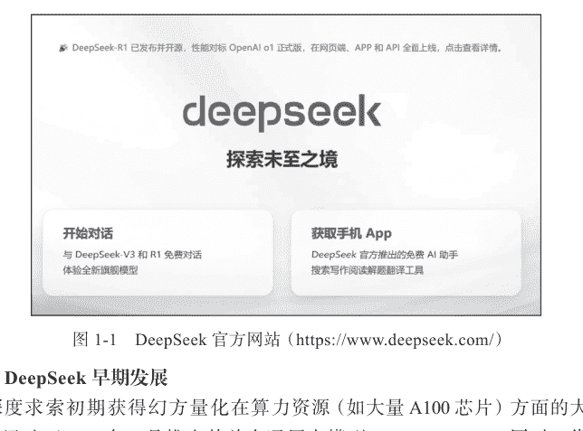
图 1-1 DeepSeek 官方网站 (https://www.deepseek.com/)

##### 1. 起步阶段
早期公司获得幻方量化在算力方面的强力支持。2024 年 1 月，首个通用大模型 DeepSeek LLM 发布；同年 1 月的代码模型 DeepSeek Coder 与 2 月的数学模型 DeepSeek Math 紧随其后。
这几款产品的推出让 DeepSeek 加入 2023 年“百模大战”阵营。虽起步稍晚，却为后续爆发积蓄了能量。

##### 2. 技术跃迁
2024 年 5 月，开源模型 DeepSeek-V2 登场，通过数据与算法的优化创新，将推理成本压缩近百倍。性能跃升的同时，也为后续研发奠定了基础。
2024 年 12 月，DeepSeek-V3 系列发布，并在主流榜单取得亮眼成绩。该版本首次实现万亿参数级别的轻量化部署，在效率与扩展性上取得重要进展。

##### 3. 全球走红
2025 年 1 月，里程碑式模型 DeepSeek-R1 发布。这是首个完全依靠强化学习驱动的 LLM 推理模型，无需 SFT 预训练即可获得强推理能力。通过多阶段强化学习与冷启动优化，R1 在数学、代码、科学推理等任务上达到 SOTA 水平，接近 OpenAI-o1-1217。
从创立到行业领先，仅用两年完成技术创新到生态构建的跨越。持续突破、开源理念与跨领域融合，使其成为中国人工智能的代表，也深刻影响全球产业走向。
随着影响力扩大，DeepSeek 快速渗透生产生活。讨论与使用成为热点，多家科技巨头接入，包括腾讯、阿里、百度等。汽车领域推动智能座舱与云端人工智能升级；政务与医疗领域在多个城市与医院落地，助力智慧政务与智慧医疗。多元下游应用由此蓬勃发展。

#### 1.1.2 版本脉络
DeepSeek-R1 的成功是迭代的结果，如图 1-2 所示。

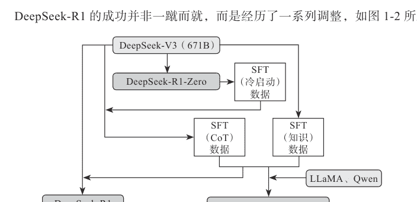
最初，基于预训练模型 DeepSeek-V3 进行后训练，得到 DeepSeek-R1-Zero。训练采用纯强化学习，人类不干预过程，模型通过“尝试-反馈-调整”循环自行学习解题策略，如同学生通过大量练习不断修正思路，最终掌握思维链 CoT。
R1-Zero 虽学会思考，但可读性较差，存在多语言混杂、格式混乱、常识处理不足等问题。为此团队生成高质量冷启动数据、思维链数据与知识数据，继续强化学习，最终推出大众熟知的“满血版” DeepSeek-R1。
此外，团队通过蒸馏 Qwen 模型推出 1.5B、7B、14B、32B 版本；通过蒸馏 LLaMA 模型推出 8B 与 70B 版本，逐步完善产品矩阵。

### 1.2 人工智能、大模型与 DeepSeek
DeepSeek 的走红带动了人工智能与大模型概念的普及，但对非技术背景的读者而言，术语体系仍显晦涩。本节对相关基础概念做简要梳理。

人工智能技术体系中，机器学习是核心分支之一。深度学习作为基于深层神经网络的算法，推动技术突破。深度学习的实现依赖多种模型结构，其中预训练模型因迁移学习效率高而备受关注。预训练模型中，参数规模巨大的预训练大模型即“大模型”，其中处理语言任务的子类为预训练大语言模型。2023 年的“百模大战”即围绕大语言模型展开。

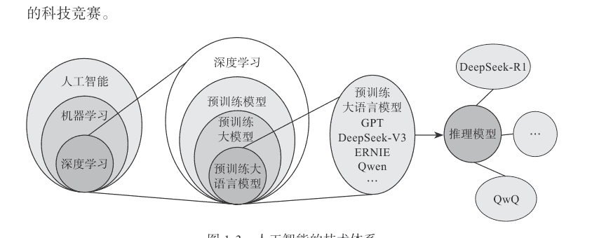
基于大语言模型，企业开发出对话产品，如 GPT 驱动的 ChatGPT 与 ERNIE 驱动的文心一言，它们是大模型时代的早期标杆。从人工智能到具体产品，构成层层嵌套的技术体系。
为贴近人类使用习惯，预训练大语言模型常加入高质量对话数据进行后训练，形成面向推理的推理模型。DeepSeek-R1 即为典型代表。

#### 1.2.1 人工智能三大流派
人工智能近百年发展中，目标始终是让机器展现类人智能，但路径分化明显，涌现符号主义、联结主义、贝叶斯派、频率主义、行为主义等流派。其中影响最深远的是符号主义、联结主义与行为主义。

##### 1. 符号主义
符号主义又称逻辑主义，是最早的流派。其核心观点是人类认知以符号为基本单元，智能源于符号表征与数理逻辑计算，人工智能本质上是物理符号系统。通过大量逻辑符号与“如果-那么”规则，可实现类似人类的推理与决策，如图 1-4 所示。

> 苏格拉底三段论
P：凡人要死
Q：苏格拉底是人
R：苏格拉底要死
此三段论表示为：
(P ∧ Q) → R

图 1-4 数理逻辑之谓词逻辑三段论
符号主义可追溯至 19 世纪末，20 世纪 30 年代开始应用于智能行为描述，伴随计算机出现实现逻辑演绎。80 年代因专家系统成功达到高峰，随后在第二次人工智能寒冬中衰退。专家系统结构示意如图 1-5 所示。

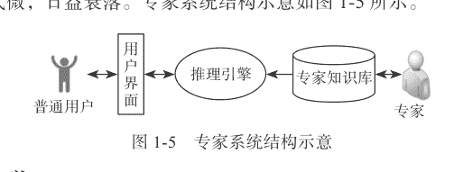

##### 2. 联结主义
联结主义又称仿生学派，认为思维本质是神经元连接与交互，如图 1-6 所示。通过模拟生物神经系统，构建基于神经元模型的学习算法，可实现机器智能。


图 1-6 生物神经元结构
该流派起源于 1943 年 MP 神经元模型，如图 1-7 所示，人工智能黄金时代出现感知机热潮，随第一次低谷沉寂。90 年代算力提升后重新崛起，至今居于中心。以深度神经网络为代表的算法在多项任务中表现突出，验证了其有效性，如图 1-8 所示。多层神经元相互连接形成庞大网络，因层数众多得名深度神经网络。


图 1-7 MP 神经元模型

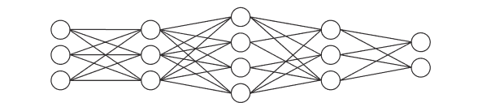
图 1-8 深度神经网络示意
深度神经网络自 2012 年起广受关注，标志事件是 ImageNet 竞赛中 AlexNet 大幅降低图像分类错误率，展现深度学习的潜力。

##### 3. 行为主义
行为主义又称进化主义或控制论学派，认为智能源于智能体与环境交互的行为，主张“感知-动作”控制系统，通过训练与奖惩机制实现人工智能，如图 1-9 所示。

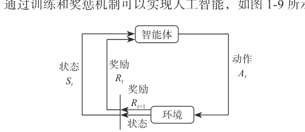
行为主义源于 1948 年诺伯特·维纳的《控制论》。早期表现不突出，直至 80 年代智能控制与机器人系统兴起后崭露头角。末世纪成为新流派，其理论基础强化学习在机器人领域取得成果，波士顿动力机器狗为代表。
三种流派各有理论基础与方法，如表 1-1 所示，在不同时期推动发展。现代人工智能多为融合结果，实际应用常结合多种手段。例如 DeepSeek 在数据处理上借鉴符号主义构建知识库，训练时用联结主义构建 Transformer 模型，为保证对齐再引入行为主义的强化学习微调，以匹配人类期望。

表 1-1 人工智能三大技术流派对比

| 流派 | 符号主义 | 联结主义 | 行为主义 |
| :--- | :--- | :--- | :--- |
| 理论依据 | 数理逻辑 | 生理学 | 控制论 |
| 基本理念 | 通过逻辑符号表达思维 | 仿生大脑模型，以神经元模型为智能基础 | 注重行为与反馈，“感知-动作”模型是智能的关键 |
| 缺点与问题 | 1. 仅限于专业细分领域<br>2. 知识采集难度大<br>3. 人类抽象包罗万象，无法穷尽 | 1. 受脑科学的制约<br>2. 受数据和算力制约 | 1. 过于注重表现形式<br>2. 受环境影响无法穷尽策略 |
| 智能获取方式 | 靠人工赋予机器智能 | 从数据中习得智能 | 在与环境的交互中获得智能 |
| 代表技术 | 知识图谱 | 深度神经网络 | 遗传算法，强化学习 |
| 代表产品 | 专家系统 | 视觉检测，翻译系统 | 机器狗 |

#### 1.2.2 大模型的主要特征

ChatGPT 引爆热潮，大模型时代正式开启

2022 年岁末到 2023 年伊始，ChatGPT 突然破圈。OpenAI 发布的这款对话产品凭借流畅的交互体验和可落地的输出能力在全球范围内引发广泛讨论。它建立在 GPT-3 预训练语言模型之上，自然语言理解与生成能力突出，支持多轮交互，可胜任解答、代码编写、文本创作等多种工作。随着关注度持续走高，行业对大规模模型的重视达到顶峰，众多科技企业与科研机构加速入局，竞争格局迅速走向群雄并起。

所谓“大”，核心落点在语料规模、参数体量与算力投入三个层面。

##### 1. 训练语料体量惊人
语料可视作模型成长的养分，算法借大量样本调整内部权重，使预测更贴近真实。样本总量决定能力上限，样本质量决定效果上限，因此预训练必须依托海量优质语料。

预训练所用语料本身就体现“大”。DeepSeek-V3 的训练语料约 14.8 万亿个 token。GPT-3 的训练集汇聚了经筛选的 CommonCrawl、WebText2、Books1、Books2 以及英文维基百科，其中 CommonCrawl 原始规模约 45TB，清洗后保留约 570GB。开源模型 LLaMA 分词后使用的语料量约 1.4T。

##### 2. 参数体量庞大
在人工智能语境下，算法是实现机器智能的具体计算流程，由一系列步骤构成的学习范式；模型是算法运行后得到的参数集合，可保存为文件对新样本进行预测或分类。简言之，算法负责训练，模型是训练完成后可用的结构与参数值。

以设备健康诊断为例。工厂里有一套关键产线设备，长期高负荷运转易产生隐性故障，一旦突发损失巨大。借助物联网实时采集温度、振动、电流、压力等运行指标进行健康评估。运行指标与健康状态的映射关系即为模型，寻找该映射关系的方法即为算法。假设有两种结构表达该关系，左侧结构含 7 个参数，右侧含 4 个参数，求解参数的过程即算法实现。根据历史健康数据求得参数后模型即确定，使用时把运行指标代入即可得到健康值。

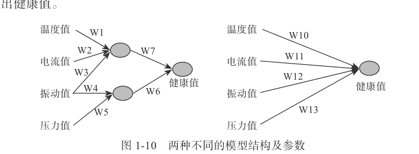

当下主流大规模模型大多以 Transformer 架构为核心，通过堆叠形成庞大网络，不仅覆盖自然语言，还拓展至图像、视频、音频等多种模态，已基本主导人工智能的技术范式。

参数规模决定模型体量。以图示为例，7 个参数的结构明显大于 4 个参数的结构。现今所说的大模型即参数量达到超大规模的系统。DeepSeek 系列模型的参数量已达 6710 亿个，远超 ChatGPT 时代的 1750 亿个。

##### 3. 算力消耗巨大
大模型的预训练对算力需求极高。以 DeepSeek-V3 为例，训练成本约 557.6 万美元，这一数额在业内被视作低成本，可见大模型产业对算力资源的消耗程度。常见大模型的训练算力需求如下表所示。

表 1-2 常见大模型的训练算力需求

| 模型 | 参数大小 | GPU 训练小时数 | 训练设备 |
| :--- | :--- | :--- | :--- |
| LLaMA2 7B | 70 亿 | 184320 | A100-80GB |
| LLaMA2 13B | 130 亿 | 368640 | A100-80GB |
| LLaMA2 70B | 700 亿 | 1720320 | A100-80GB |
| GPT-3 | 1750 亿 | 2522880 | V100-32GB |
| DeepSeek-V3 | 6710 亿 | 2788000 | H800 |

#### 1.2.3 大语言模型的核心能力
大语言模型最突出的表现是自然语言的理解与生成。以 DeepSeek 为代表的系统在文本生成、语义理解、问答、机器翻译等方面取得突破，能够产出高质量文本并基于上下文进行复杂推理。

（1）自然语言理解
借助深度学习，大语言模型可对输入文本进行深入解析，捕捉语义、情感倾向、逻辑结构及隐含含义等信息。在问答、文档摘要、语义解释、情感分析、命名实体识别、关系抽取等任务上表现优异。例如让模型把一段话翻译成英文，结果相当理想。

用户提问：
大语言模型能够通过深度学习技术对输入的文本进行深入分析和理解，捕捉其中复杂的语义信息、情感色彩、逻辑结构及潜在含义。它们在处理如问答、文档摘要、语义解释、情感分析、实体识别、关系抽取等任务时表现出优秀的性能。请帮我把这段话翻译成英文

大模型的回复：
Large language models are capable of conducting in-depth analysis and understanding of input text through deep learning techniques, capturing complex semantic information, emotional nuances, logical structures, and latent meanings. They demonstrate exceptional performance on tasks such as question answering, document summarization, semantic interpretation, sentiment analysis, named entity recognition, and relationship extraction.

（2）自然语言生成
依托海量训练语料，大语言模型可以自动生成连贯流畅且具备一定创造性的文本，涵盖文章写作、故事创作、对话模拟、代码编写、诗歌歌词创作等。模型依据提示词或上下文生成全新段落，输出通常保持较高的逻辑一致性。当用户用自然语言要求生成算法时，模型也能较好完成任务，有助于提升编程效率。

用户提问：
请帮我写一个高通滤波器的算法实现。

大模型的回复：
对于一个基本的一维无限脉冲响应（IIR）高通滤波器的设计和实现，我们可以使用巴特沃斯滤波器（Butterworth filter）作为示例。以下是一个使用 Python 和 Scipy 库实现的简单二阶巴特沃斯高通滤波器算法。

```python
```
from scipy.signal import butter, lfilter

def high_pass_filter(data, cutoff_freq, sample_rate):
    """
    参数：
    data: 需要过滤的信号数据（一维数组）
    cutoff_freq: 截止频率，即高通滤波器允许通过的最小频率
    sample_rate: 采样率
    返回：
    filtered_data: 经过高通滤波后的信号数据
    """
    # 计算滤波器阶数和截止频率对应的数字角频率
    nyquist_freq = 0.5 * sample_rate
    normal_cutoff = cutoff_freq / nyquist_freq
    # 设计二阶巴特沃斯高通滤波器
    b, a = butter(2, normal_cutoff, btype='highpass')
    # 应用滤波器
    filtered_data = lfilter(b, a, data)
    return filtered_data

# 使用示例
sample_rate = 1000  # 假设每秒采样 1000 次
cutoff_freq = 50  # 截止频率为 50Hz
data = ...  # 这里是原始信号数据
filtered_data = high_pass_filter(data, cutoff_freq, sample_rate)

该片段实现了一个二阶巴特沃斯高通滤波器并作用于输入序列。实际应用中可依据需求调整滤波器阶数以获得所需频率响应，截止频率也应按具体场景设定。

#### 1.2.4 关于 DeepSeek 的常见误区
DeepSeek 作为人工智能领域的革新力量，对许多人而言仍显新颖。理解过程中常出现偏差，影响正确使用。下面列出几个典型误解。

**1. DeepSeek 等大模型是新型搜索引擎**
不少人认为大模型回答问题时先检索资料或上网搜索，再返回答案。这种说法并不准确，大模型与搜索引擎存在本质差异。

**（1）工作原理不同**
DeepSeek 的回答依靠模型内在的推理能力，属于在训练中学得的“无中生有”式生成。搜索引擎则通过索引互联网网页等在线资源帮助用户查找已有信息，对结果排序，而非生成新内容。

**（2）“预知未来”的能力不同**
对从未留下网络痕迹的信息，搜索引擎检索不到匹配结果；大模型则会尝试推理给出回答，往往出现“胡说八道”，业内称之为幻觉。为降低幻觉，通常采用价值对齐等手段。

**（3）大模型有望取代搜索引擎**
大模型提供了一种新的知识表达与调用方式，有成为下一代信息检索工具的趋势。人类知识调用经历口口相传、文字记录、数据库存储后，如今流行谷歌、百度等搜索引擎。得益于自然语言交互友好和强大能力，大模型有望成为下一代检索方式。

##### 2. 大模型就是通用人工智能
以大模型为核心的应用在各自领域表现强劲，令很多人惊呼通用人工智能已到来。

事实上，即便大模型展现出较高智能化水平，它们仍是针对特定任务的高适应性专用系统，而非真正意义上的通用人工智能。通用人工智能指达到人类水平的综合智能，可在未预编程领域学习解决问题，具备跨域适应性和自我意识。

当前大模型在抽象思维、自主思考与创新、对自身行为的理解等方面，与真正的通用人工智能仍有明显差距，不宜过度夸大其能力，但也应正视其向通用人工智能演进的速度。

##### 3. DeepSeek 给出的结果和答案就是正确的
大模型有时能提供准确、有深度的答案，容易让人不加怀疑地全盘接受，这种做法风险很大。

**（1）算法局限性**
大模型输出基于概率统计，是根据学习到的分布进行预测并抽样返回。即使结构强大，也无法保证所有问题 100% 正确。尤其在逻辑推理、道德判断等需要深度思考的场景，答案可能偏离人类价值观或普适真理。研究正朝高准确性和价值对齐方向发展，试图突破局限。

**（2）数据依赖性**
模型由训练数据构建，若数据存在错误、偏见或不完整，模型就会“学偏”。如同人类学习教材有误认知也会偏差，模型答案的准确性取决于训练数据的质量。

**（3）上下文理解**
尽管上下文理解能力提升，大模型仍可能对复杂语境把握不准，尤其当用户提问存在歧义时容易偏离。

**（4）实时更新性**
训练完成后部署的模型对训练后出现的新知识或实时信息无法即时掌握。在快速变化的科学技术领域，信息可能滞后或不准确。

因此，大模型虽展现强智能，但使用时仍需谨慎，结合专业知识和人工审核确保结果可靠。

### 1.3 小结
DeepSeek 的爆火让相关名词层出不穷，对业外人士而言难以完全理解。本章简要介绍了 DeepSeek 的背景并回顾了人工智能发展历程。人工智能几经起伏，催生了符号主义、联结主义、行为主义等流派，形成知识图谱、神经网络、强化学习等技术，在自然语言处理、计算机视觉和多模态任务上表现卓越。

随着数据、参数与算力的快速增长，人工智能进入大模型时代，能够理解和对话承载人类智慧的语言，智能涌现使发展再次繁荣。追逐通用人工智能的道路上，各厂商打造自己的模型，掀起“百模大战”。DeepSeek 作为后起之秀在后期入局却脱颖而出，其背后的奥秘值得探究。

# CHAPTER 2
## 第 2 章
# DeepSeek 的技术原理

深度求索公司仅用两年时间从入局大模型到推出震撼全球的 DeepSeek-R1，发展速度惊人。凭借强劲的模型能力、创新的低成本训练方案以及开源属性，DeepSeek 让企业和个人都能使用性能强、成本低的大模型服务。这标志着继 ChatGPT 引领的智能爆发后又一个重要里程碑。通过技术普及和开源开放，DeepSeek 大幅降低了 AI 落地门槛，推动行业向更包容、可访问的方向发展。

本章首先介绍大模型的基础技术 Transformer 架构和混合专家模型 MoE，随后解析 DeepSeek 在其基础上的多项创新，最后探讨 DeepSeek 爆火背后的逻辑。

### 2.1 大模型的基础技术
无论是开源的 DeepSeek 还是闭源的 GPT，主流大模型的核心都离不开 Transformer 和 MoE。Transformer 提供并行计算能力，MoE 提升资源利用效率。

#### 2.1.1 Transformer 的基本原理
Transformer 架构源自 2017 年谷歌团队论文《Attention is All You Need》，发表于人工智能顶会 NIPS/NeurIPS。该经典工作在 2017 年并未引起太多关注，甚至没有现场演讲机会，更未获最佳论文提名。直到 BERT、GPT 等大模型取得成功后，Transformer 才封神。

Transformer 提出初期主要为解决循环神经网络 RNN 和 LSTM 处理序列数据时的两个痛点：并行计算受限和长距离依赖。

##### 1. 并行计算受限
RNN 和 LSTM 处理序列时存在明显的顺序依赖，只能串行计算，每一步需等待前一步结果。如对“我要学习大模型”进行处理时，RNN 呈现明显顺序依赖。这种串行机制无法充分利用 GPU 或 TPU 的并行计算能力，训练速度相对缓慢。

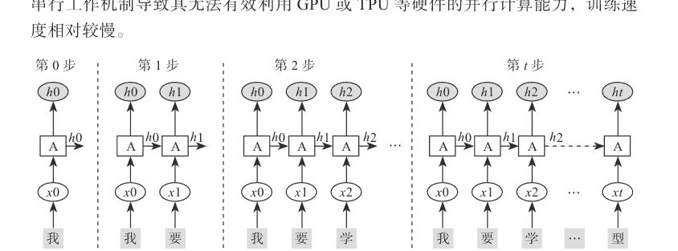
##### 2. 长距离依赖问题
在 RNN 中，随着序列变长，模型对早期信息的记忆与利用能力逐渐衰减。当前时刻状态由上一时刻状态与当前输入共同计算得到，经多步传递后，远端信息易出现梯度消失或爆炸，导致信息衰减或放大。以“我要学习大模型”为例，处理到最后一个词时可能已记不清是谁要学习。以 LSTM、GRU 等改进结构通过记忆单元和门控机制在一定程度上缓解信息丢失，但长序列的远距离依赖建模仍不理想。

此外，RNN 的串行结构使序列前端信息难以与后端建立关联，编码完整性不足。以“我要学习大模型”为例，处理“学”时只知道是谁要学，却不清楚学什么。虽然双向 RNN 在一定程度上改善了这个问题，但因长距离依赖的限制，编码完整性仍难以保障。

从注意力到专家分工：Transformer 与 DeepSeek 的演进脉络

Transformer 摒弃了循环式网络逐位置串行的处理范式，转而让序列内部任意两处直接建立联系，核心在于 Self-Attention。并行计算的特性使训练与推理效率大幅提升。借助位置编码以及多路并行注意，模型能够对整段输入实现全局建模，长距离依赖的难题得到缓解。正因如此，该结构在机器翻译任务上迅速取得领先，并成为自然语言处理及各类序列任务的主流骨架。整体结构如下。

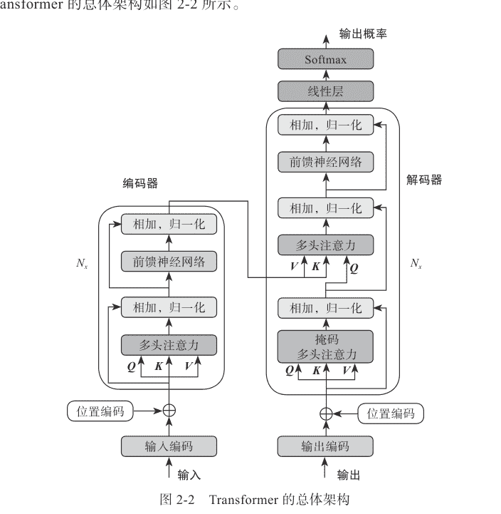

图 2-2 Transformer 的总体架构

整体可分为输入侧、输出侧、编码侧与解码侧。以把“我要学习大模型”译成英文为例，简化流程如图 2-3 所示。源句先经编码器压缩为中间表征，随后解码器将其展开为目标译文。

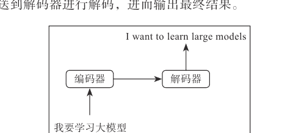

拆解过程如图 2-4 所示。首先源句被编码为中间变量，解码器据此输出英文词的概率分布，按最大概率先给出“I”。随后将源编码与已产生的“I”一并送回解码器，再次计算概率并挑选“want”，得到“I want”。下一步把源编码与当前译文拼接输入解码器，依次筛出“to”……依此自回归方式完成整句翻译。

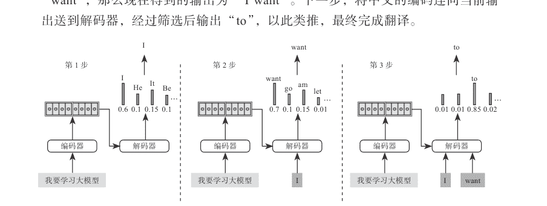

#### 2.1.2 Transformer 的优缺点

Transformer 放弃了时序串行计算的循环结构，采用全并行方式，通过注意机制打通序列任意位置的联系，从而缓解长距离依赖。具体实现融合 Self-Attention、掩码注意、跨注意与多路注意，建立序列内部、跨序列及不同维度的关联，提升理解与生成能力。

编码器多层堆叠逐步抽取特征，增强表达能力，对输入形成深层理解；解码器同样多层堆叠，逐层生成目标序列，实现分层预测。解码器使用带掩码的多路自注意，预测当前词时只能看到已生成的历史，无法窥探未来，达成自回归建模。

##### 1. Transformer 的优点

编码器与解码器结构清晰，堆叠方式简洁，注意组合灵活，既具备强理解生成能力，也具备模块化、标准化的落地潜力。正如“变形金刚”之名所暗示，它能灵活变形，激发想象与创造力，如图 2-5 所示。


在原始论文中，作者在英译德、英译法 newstest2014 测试集上取得比此前最优模型更高的 BLEU 分数，同时训练成本明显下降。此外在其他任务上也展现出稳健表现。

##### 2. Transformer 的缺点

Transformer 并非完美，存在以下局限。

- （1）标注数据需求高
在语义复杂、细粒度分类的任务上，模型往往需要海量标注才能达到最佳效果。
- （2）算力消耗大
注意机制复杂且层数众多，训练时对计算资源要求很高，尤其在超大语料和长序列场景下更为突出。以 BERT、GPT-3 等基于 Transformer 的预训练模型为例，训练开销巨大。
- （3）存储压力大
预训练模型的参数规模通常庞大，文件体积可观，不仅提升存储成本，也限制了在算力受限设备上的部署。
- （4）预训练依赖强，调优门槛高
对特定领域或小样本任务，从零训练成本高，借助预训练模型微调又易出现过拟合或欠拟合，尤其是微调数据与预训练分布差异较大时。同时参数量大、结构复杂，需要大量调参策略，优化门槛较高。

#### 2.1.3 MoE 的基本原理

面对复杂、多样或高维输入时，单一模型常感吃力。若让多个侧重点不同的模型分别处理后再协作，借助集体智慧能否缓解瓶颈？日常工作中专家评审就是典型例子：项目评审会邀请不同领域专家分别给出机械、电气、经济效益等专业意见，形成全面诊断。

大模型领域也有类似思路，即混合专家 Mixture of Experts, MoE。它通过扩大模型容量来应对复杂任务，特别适合数据分布复杂且高度异质的场景。

##### 1. MoE 的概念

俗语云众人拾柴火焰高，把多位专家的能力集合起来，问题解决力会大幅提升。MoE 由多个专业化子模型构成，每个专家在其擅长的子空间出力。输入到来时，系统通过门控决定哪一个或多个专家参与，并将各专家输出融合得到最终答案，如图 2-6 所示。

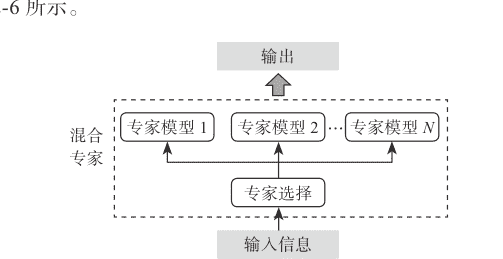

具体实现上，构建一组专家网络，每个专家负责数据空间的特定区域或特征子集，门控网络负责将输入路由到合适的专家进行处理。这种分工与集成体现了人类社会专业化生产的逻辑，把复杂任务拆解给各模块并汇总结果，效果通常优于单一专家。

MoE 由多个专家网络构成，专家可同构也可异构，各自拥有独立参数。随着专家数量增加，模型容量理论上线性增长，而实际计算可只激活部分专家，实现参数量大幅提升但计算量不变。相比同等规模稠密模型，MoE 表征力更强，是训练万亿参数级模型的关键技术之一。

- （1）参数规模可大幅扩展
- （2）超大模型训练开销可被缓解
传统模型对每个样本全网参与计算，规模越大开销越重。MoE 将任务拆分为子任务，由门控选择对应专家，有助于减轻训练负担。
- （3）泛化能力强
每个专家专注于输入空间的不同模式，提升了对复杂数据分布的适应性。

##### 2. MoE 与集成学习的对比

MoE 与集成学习看似相近，都是把多个模型组合起来。集成学习通过训练多个基础学习器并以投票、平均、堆叠等方式融合结果，以期提升预测精度与泛化性。常见方法包括 Bagging 和 Boosting。

（1）Bagging
通过自助采样产生多个数据集，分别训练模型后集成预测，如随机森林即典型代表，如图 2-7 所示。

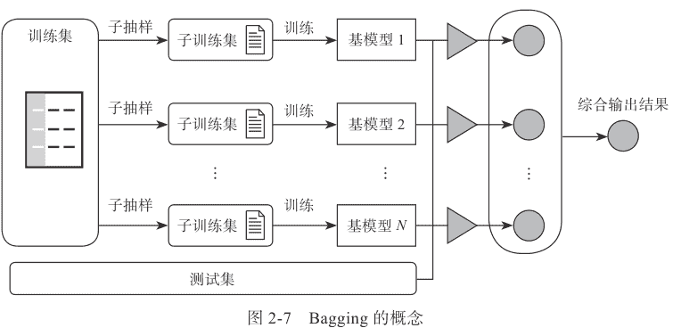

（2）Boosting
迭代训练一系列弱学习器，对前次错误样本提高权重，逐步聚焦难例，最后组合成强学习器，如 AdaBoost、GBM、XGBoost 所示，如图 2-8 所示。

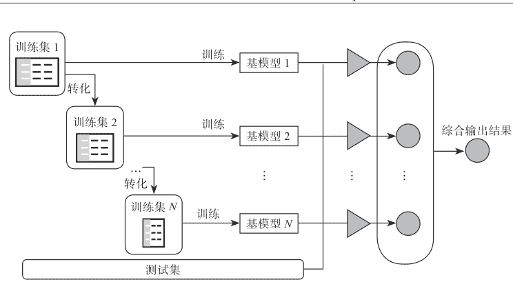

二者在思想上相通，落地方式却不同。集成学习不进行任务分解，只是把多个学习器组合；学习器可相同也可不同，数据也可能相同或不同，如表 2-1 所示。

表 2-1 MoE 与集成学习对比

| 技术 | MoE | 集成学习 |
| :--- | :--- | :--- |
| 技术类别 | 深度神经网络技术 | 机器学习技术 |
| 应用目的 | 提高模型收敛与推理速度，提升模型性能 | 提高模型预测准确性 |
| 训练步骤 | 1. 将任务分解成多个子任务，在每一个任务上训练一个专家模型<br>2. 开发一个门控模型，将输入路由到相应的专家模型 | 采用相同或者不同的数据集训练多个基础模型，这些基础模型可以相同，也可以不同 |
| 结果输出 | 将多个模型的结果组合输出，从而获得最终结果 |

随着 Transformer 在 NLP 等领域的普及，MoE 被引入其中，形成 Switch Transformer、Sparse Mixture of Experts 等新结构，在保持高容量的同时借助动态路由与稀疏激活提升效率。

#### 2.1.4 MoE 的优缺点

大模型参数日益膨胀，训练与推理成本随之攀升。MoE 通过多专家协作提供一种兼顾容量与效率的思路，每个专家聚焦数据子集或模式，门控网络动态分配任务或加权融合输出，既能扩容也能实现资源高效利用。

##### 1. MoE 的优点

相比稠密网络，MoE 具有：

- （1）稀疏激活
门控机制仅激活与当前输入相关的少数专家，计算效率与可扩展性显著提升。
- （2）模型容量提升
各专家独立学习不同侧面，整体可容纳更多参数与更丰富的表征。
- （3）专业化分工
专家按特长处理不同特征或任务，形成知识分工。
- （4）适应性与泛化性能
动态选择专家模型的特性，使得 MoE 能够更好地适应不同分布的数据和变化的任务需求。
- （5）速度快，效果好
MoE 通过整合多个专家模型的结果，通常可以带来更好的预测准确性和鲁棒性。

##### 2. MoE 的缺点

MoE 模型虽然在提升模型容量、效率和适应性方面具有显著优势，但也存在一些挑战和缺点。

- （1）负载均衡问题
如何有效地分配任务给各个专家模型以实现负载均衡是关键问题。如果门控网络将大部分输入导向少数几个专家模型，会导致部分专家模型闲置，而其他专家模型过载，从而影响整体性能。
- （2）稀疏激活与训练难度
有效控制稀疏性，主要依赖于门控网络的设计和参数调整。门控网络负责决定哪些专家模型参与处理当前输入数据。然而，在进行参数选择时需要注意权衡：当门控网络在单次选择中激活较多的专家模型时，虽然这可能提升模型的表现能力，但会导致稀疏性降低。MoE 模型的稀疏性存在一种平衡挑战，即在实际应用中根据不同场景灵活选择专家模型的数量，以在效率和性能之间找到最佳平衡点。
- （3）通信瓶颈
在分布式训练环境中，MoE 的专家路由机制可能会增加通信成本，尤其是在模型规模较大时。为缓解通信瓶颈，可以考虑减小模型的规模，包括专家模型和门控网络的参数数量，以降低通信开销。此外，可以采用异步更新策略，而不是同步更新所有节点的参数。这可以减少通信开销，但可能导致模型的一致性稍有降低。尽可能在本地计算节点上完成任务，减少节点之间的通信需求。同时，使用参数压缩技术，如模型压缩或渐进压缩算法，以减小传输的数据量。
- （4）资源需求
即便在推理阶段可以利用稀疏激活减少计算量，MoE 模型由于包含多个专家网络，因此在存储上需要更大的空间来保存所有专家模型的参数。另外，实现大规模 MoE 模型的有效运行需要高度优化的硬件资源和并行计算能力，否则可能无法充分发挥其潜力。

### 2.2 DeepSeek 的技术创新

在通用大模型基础上，DeepSeek 在算法、模型与系统层面做协同工程优化，并非颠覆性理论突破，却带来性能跃升与算力消耗大幅下降。

DeepSeek-V3 的基础架构如图 2-9 所示，延续 Transformer 基本思想，对原始版本进行改进：前馈网络部分引入 MoE，并通过多头潜在注意力提升训练效率、降低显存占用。

#### 2.2.1 DeepSeekMoE

为实现高效推理与成本可控的训练，DeepSeek 采用 DeepSeekMoE 架构。利用混合专家机制，由多个专家网络分别处理输入的不同部分，仅激活与当前任务相关的子网，从而提升效率与性能。架构示意如图 2-10 所示。

> 参考 “DeepSeekMoE: Towards Ultimate Expert Specialization in Mixture-of-Experts Language Models”。

26 智能制造实战：DeepSeek 在制造业的深度实践

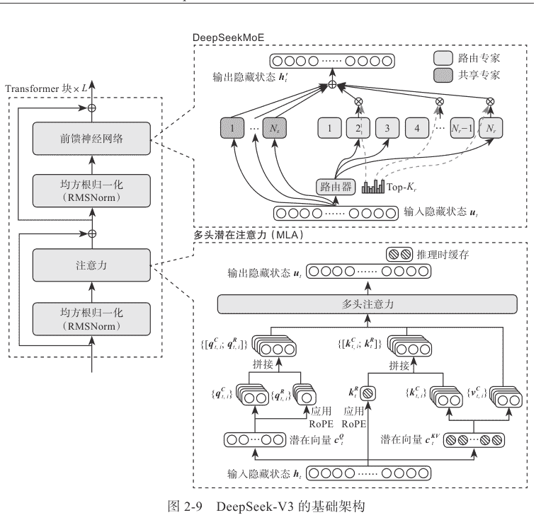

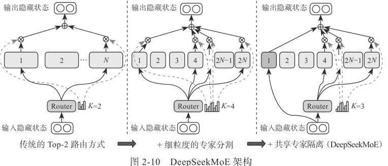

DeepSeekMoE 是一套追求极致专家专业化的 MoE 设计，允许模型根据输入动态选择激活部分，实现更高效率。

其包含两方面策略：一是将专家细粒度划分为 N 个、每次激活 K 个，实现更灵活的组合；二是隔离 k 个共享专家，用于捕捉共性知识、减少路由专家的冗余。细粒度分割加共享专家隔离，使专家专业化程度与性能相比主流 MoE 进一步提升。

论文显示 DeepSeekMoE 的专家专业化水平高于 GShard，在同等规模下计算量仅为竞品的 40% 左右，从而在保持或提升性能的同时显著降低资源消耗。

#### 2.2.2 MLA

标准 Transformer 中，多头注意力会为每个头保存键 K 与值 V 矩阵，形成 KV 缓存。KV 缓存避免推理时对历史序列的重复计算，但随序列变长，缓存体积与数据搬运成本随之攀升，导致显存占用过高、推理变慢。

为缓解此问题，GQA、MQA 等方案通过压缩 K、V 来减小缓存，却存在信息损失。如何在尽量不损失信息前提下压缩 KV 缓存、提升推理速度？

DeepSeek 引入多头潜在注意力 MLA 机制，借助低秩联合压缩技术，在保持模型性能的同时显著降低 KV 缓存的内存占用，提升大语言模型推理效率。如图 2-11 所示，MLA 通过低秩矩阵分解把高维键值对压缩为低维向量，减少存储需求。

MLA 以低秩联合压缩方式同时压缩 KV 缓存与查询，优化注意力机制的存储与计算，破解传统 Transformer 的内存瓶颈，成为 DeepSeek-V3 的核心竞争力之一。

> ① 参考 “DeepSeek-V2: A Strong, Economical, and Efficient Mixture-of-Experts Language Model”。

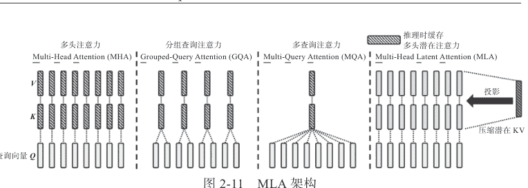

#### 2.2.3 MTP：一次生成多词元

当下主流的大模型基本都是解码器结构，生成一条序列时只能一个词元接一个词元往外推，像在玩文字接龙。每次要产生新词元，都得先把 KV 缓存从显存里搬出来，再走一遍深层网络做前向。访存占主导的这个环节，很容易成为训练和推理的卡点。

针对逐词生成的效率天花板，业界尝试了不少思路，主要是减少存储占用和访存次数。MTP 就是其中代表，它在解码阶段把“单步出词”改造成“多步并出”，整体提速。

训练时一次性预测多个后续词元，能够同时监督多个位置的标签，样本利用率和训练速度都被拉高；推理时一次吐出多个词元，速度呈倍数上升，具体效果见图 2-12。

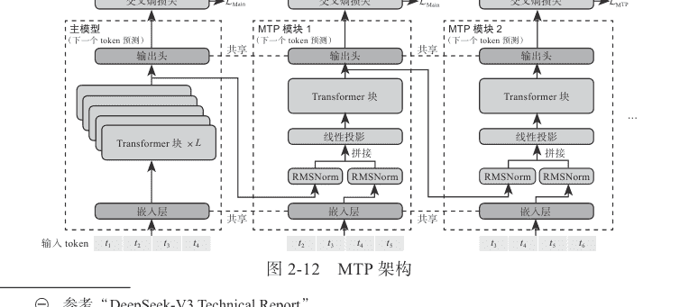

> 参考 “DeepSeek-V3 Technical Report”。

MTP 靠并行预测多个词元来重构解码流程，同时做架构与参数共享，把算力和显存开销压下来。它缓解了传统单词元生成效率低、显存占用高、长依赖难捕捉等痛点，在维持甚至提升模型能力的前提下明显加快训练和推理，成为 DeepSeek 系列大模型的关键技术之一。

#### 2.2.4 GRPO：组内相对奖励策略优化

预训练完成之后，DeepSeek 用强化学习做精细化微调，目的就是增强推理水平并让输出更贴合用户。强化学习的核心是智能体在与环境交互中不断试错，根据即时奖励或惩罚调整策略，最终追求长期累积奖励的最大化。

在大模型后训练里，常用的做法是 RLHF。在有监督微调的基础上，让奖励模型对输出打分，引导策略往高分方向走。理想上评分应由真人完成，但经过人类排序数据训练的奖励模型可以代理这一角色，为模型提供偏好信号。于是模型不仅要学会续词，还要学会产出人类更认可的答案，实现价值对齐，示意图见图 2-13。

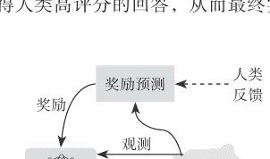

传统强化学习在大模型上用起来成本高、策略更新波动大、数据利用也不理想。DeepSeek 因此引入 GRPO，借助组内相对奖励机制与动态梯度正则化，有效缓解了高成本和不稳定的问题，如图 2-14 所示。

> 参考 “DeepSeekMath: Pushing the Limits of Mathematical Reasoning in Open Language Models”。

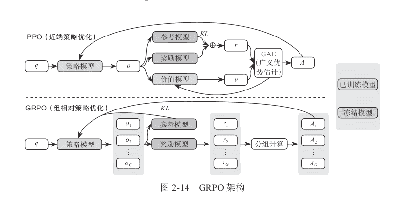

为了让 GRPO 更容易理解，下面用一个类比的故事来说明。

把强化学习的训练想象成一场学校的考试。模型就像想拿高分的学生。假设有学生 A 和学生 B，A 平时在 80 分以上，B 只有 40 分左右。考完后两人都要找班主任领小红花，得分越高奖励越多。B 虽然努力，但基础弱提升慢，总是追不上 A，慢慢失去动力躺平；A 基础好，想冲高分却不容易，又一直压着 B，最终也安于现状。只看绝对分数的激励失效了。

班主任意识到要看进步幅度，于是因材施教，给 A 定 85 分的预期，给 B 定 50 分。只要超过个人预期就多得小红花，不达标就没奖励甚至被批评。执行一段时间后，A 稳在 85 分左右，B 提升到 60 分达到及格。但原定的预期很快就不合适了，而班主任太忙没法及时调整。

于是班主任引入学习委员作为参照。以后学生成绩与学习委员对比：A 比学习委员低 10 分以内得 5朵小红花，高出 5 分得 10朵；B 比学习委员低 25 分以内得 5朵，超过 1 分就得 50朵。大家都拼命想赢过学习委员。但这套机制有两个隐患：学习委员成绩本身可能波动，需要保持稳定；学生为了超额奖励可能作弊。

为此班主任要保证学习委员的成绩稳定，同时更关注学生成绩的稳定性，避免大起大落，需要结合过往成绩来判断是否在稳步进步。

后来学习委员转学，班主任改用“自我对标”。要求每人考前做 5 套模拟，取平均分作为本人的预期线。正式考试高于平均分就奖励，低于平均分就批评。这样每个学生都以自己的模拟均值做基准，不再依赖外部参照，班主任也无需追踪学习委员的稳定性。

学习委员离开后班主任的做法，就是 GRPO 的思路。策略模型对应学生，参考模型对应过往成绩，奖励模型对应小红花，价值模型对应学习委员。从图 2-14 可以看出，GRPO 相比 PPO 去掉了价值网络，从而降低了显存和计算开销。

总体来看，GRPO 通过组内相对奖励和动态梯度正则化，提升了训练效率、稳定性和收敛速度，降低资源消耗，并在数学推理、代码生成等复杂任务上输出质量更好。

### 2.3 DeepSeek爆火的三层逻辑

MoE 等技术突破只是起点，DeepSeek 能迅速引爆行业，背后是技术栈的系统性重塑，如图 2-15。产品化能力、场景适配、用户体验和推广打法，都形成了合力。

#### 2.3.1 应用层：体验做透

从使用端看，DeepSeek 以强性能、极致友好和易传播的特性，给用户带来顺滑高效的体验。

##### 1. 性能对标顶尖

R1 在多项推理基准上表现突出，与 OpenAI 的 o1 处于同一水平，数学、代码生成、自然语言推理尤其亮眼，见图 2-17。

##### 2. 使用友好

界面简洁直观，操作门槛低，技术人员和普通用户都能快速上手。

更关键的是透明化思考。回答时不仅给结论，还会展示推理过程，见图 2-18。用户能看到思路和依据，信任感大幅提升。这种可解释的输出对教育、科研和需要决策透明的场景特别有价值，用户不仅得到答案，还能学到方法，增强了使用价值。

##### 3. 传播力强

“DeepSeek” 这个名字简短有力。Deep 指向深度，Seek 指向探索，一眼就能get核心能力，易记易传播，符合社交媒体的扩散规律。

#### 2.3.2 算法层：集成式创新

从研究视角看，DeepSeek 从首个版本到 R1，始终围绕高性价比展开，在算法、软硬件协同和训练效率上持续迭代。DeepSeekMoE、MLA、MTP、GRPO 等技术叠加，推动了 DeepSeek-V3 与 DeepSeek-R1 的突破，见表 2-2。

表 2-2 DeepSeek 算法创新

| 模型版本 | 论文发表时间 | 技术创新点 | 贡献 |
| :--- | :--- | :--- | :--- |
| DeepSeek LLM | 2024 年 1 月 | 扩展定律再认识 | 提出新的模型 / 数据计算预算分配策略，优化 LLM 的扩展方法 |
| DeepSeekMoE | 2024 年 1 月 | 新的 MoE 架构 | 实现 MoE 架构的革新 |
| DeepSeekMath | 2024 年 4 月 | 提出 GRPO | 提升计算效率、稳定性与收敛速度，同时降低资源消耗 |
| DeepSeek-V2 | 2024 年 4 月 | 提出 MLA，优化 MoE | 显著减少推理时 KV 缓存，提高推理效率；优化专家路由和负载均衡，使 MoE 在算力受限下仍能高效训练 |
| DeepSeek-V3 | 2024 年 12 月 | MoE、MLA、MTP、负载均衡 | 671B 参数规模，训练成本 557.6 万美元，远低于同类规模模型 |
| DeepSeek-R1 | 2025 年 1 月 | 强化学习 + 冷启动，小模型蒸馏 | 首个仅靠强化学习驱动的 LLM 推理模型；多阶段 RL 训练与冷启动优化；性能接近 OpenAI o1-1217；蒸馏小模型表现强劲 |

#### 2.3.3 基础设施层：高性价比落地

工程落地层面，DeepSeek 以低成本和彻底开放，降低了门槛，也给了企业更大灵活性。

##### 1. 成本极低

借助算法优化和强化学习，训练所需算力大幅压缩。用不到 600 万美元的训练成本，就达到与 GPT-4 相当的水平，而后者成本在 7800 万到 1 亿美元区间。

2025 年 1 月 27 日 R1 发布后，市场反应剧烈，英伟达股价单日下跌约 18%，市值蒸发约 6000 亿美元，创下历史单日最大跌幅纪录。

尽管算力需求随部署扩大而上升，但 DeepSeek 的高性价比让企业在保持性能的同时大幅节省硬件投入，推动 AI 普惠。

##### 2. 完全开放

不同于 OpenAI 的封闭路线，DeepSeek 全面开源。代码免费下载，训练方法公开，R1 也可用于数据蒸馏训练自有模型，成果可商业化。

常见开源协议包括 MIT License，允许几乎无限制地使用、复制、修改和分发；Apache License 2.0 在此基础上增加专利保护。

DeepSeek 采用 MIT 协议开源核心技术，极大降低行业准入成本，直击科技巨头的封闭生态，推动全球 AI 研发向低成本协作方向发展。

### 2.4 小结

DeepSeek 的崛起是厚积薄发的结果。在 Transformer 与 MoE 的基础上，围绕高性价比理念，DeepSeek 孵化出 DeepSeekMoE、MLA、MTP、GRPO 等核心技术，在保证性能的同时压缩资源消耗。应用层打磨体验，算法层集成创新，基础设施层实现高性价比落地，三层合力让它成为 AI 领域现象级产品。

它让个人和企业都能以低门槛、低成本获取强模型，打破了 AI 的高成本壁垒。在 ChatGPT 开启 AI 热潮后，DeepSeek 成为推动智能技术真正落地的又一个里程碑，也标志着中国 AI 研究实现弯道超车，把 AI 普惠从口号变成现实。

# CHAPTER 3

第 3 章

# DeepSeek上手指南

DeepSeek 凭借强模型能力、友好的交互、创新的低成本训练方案和开源策略，让企业和个人都能用上高性能、低成本的大模型服务，加速 AI 应用落地。模型本身很强，如何高效用好它同样关键。因此掌握核心功能和最佳实践很有必要。

本章介绍 DeepSeek 的基本使用方法，重点是通过提示词与模型建立有效沟通，并配合其他工具提升使用效率。

### 3.1 DeepSeek 功能总览

#### 3.1.1 能力地图

DeepSeek 是一款基于大语言模型的对话应用，提供智能对话、文本生成、语义理解、计算推理、代码生成与补全等自然语言相关的核心服务。开发者还能通过 API 调用接入。当前不支持多模态内容生成，无法直接画图。

它支持深度思考模式，可展示推理过程；支持联网搜索，通过外部网页知识增强回答；支持文件上传，可读取文档和图片中的文字并据此作答。

##### 1. 文本生成

DeepSeek 在多场景写作上表现全面，从初稿到优化全流程覆盖。无论是商业文案、学术研究、政务公文还是创意创作，都能明显提升效率、降低门槛。

（1）文本创作
可按需求创作各领域文本，从文艺类文章、故事、诗歌到营销文案、广告语，再到社交媒体推文，都能给出贴合的初稿。

（2）摘要汇总与改写
对长文本如论文可做摘要、提炼要点和简化表达，并提供多语言翻译。对局部内容支持改写，便于二次创作。

（3）结构化生成
可按指定格式输出表格、列表等结构化内容。

##### 2. 自然语言理解与分析

在语义解析、情感识别和复杂语境推理上能力突出。

（1）语义分析
能识别用户意图，应用于客服对话和查询理解；可做情感分析，帮助商家洞察评论反馈；可提取实体，如人名、地点、事件，为后续任务提供结构化信息。

（2）文本分类
可为新闻内容自动打标签，检测垃圾信息和恶意内容。

（3）知识推理
支持常识推理和因果分析，梳理事件间的关联逻辑。

##### 3. 代码与数学

在计算和编程任务上表现稳定。

（1）代码生成
按需求生成代码片段，覆盖多种语言；可补全残缺代码；可自动生成注释。

（2）代码调试
根据报错信息分析问题并给出修复建议，提供优化方案。

（3）技术文档处理
可生成 API 文档、示例代码和案例说明，减轻文档工作量。

#### 3.1.2 三种模式

DeepSeek 对话界面如图 3-1，内置三种核心模式，适配不同场景。

（1）基础模式

DeepSeek 使用要点：模式切换与提问技巧

对话页保持原样不点选任何功能时，DeepSeek 处于默认档位，后端调用的是通用模型 DeepSeek-V3。这一档位以快见长，开箱即用，能覆盖绝大多数常规化需求，例如日常闲聊、常识检索比如请它通俗解释智能制造、快速成文、起草邮件或简易方案，以及非专业领域的基础问题解答。

默认档位门槛低、覆盖面广，支持文本产出、轻量推理和基础问答，能满足大多数日常学习办公需求，却对需要多步逻辑串联的难题支持有限。

（2）深度思考模式

点按界面上的“深度思考”后，系统切至推理型模型 DeepSeek-R1。此时重心转向复杂推演与深度拆解，并会给出可回溯的推理轨迹。数学求解、代码排查、学术剖析是该状态的优势。典型用法包括把复杂问题拆解流程，例如“用 Python 实现快速排序算法”、科研中的假设验证与数据解读，以及法律案例研判、商业策略制定等需要严谨推理的任务。

该状态会自动进行链式分析，输出详尽、逻辑自洽、方案完整，适配专业深度分析与创意推演，代价是响应变慢，也对问题表述的清晰度要求更高。

（3）联网搜索模式

打开“联网搜索”后，系统具备实时抓取网络数据的能力。模型可查询即时动态、刷新资料，并结合实时网络信息进行理解回答，适用于对时效性敏感的任务。

三种使用模式的对比如表 3-1 所示。

表 3-1 DeepSeek 的三种使用模式

| 模式 | 适用场景 | 响应速度 | 知识时效性 | 典型任务 |
| :--- | :--- | :--- | :--- | :--- |
| 基础模式 (DeepSeek-V3) | 日常问答、基础生成 | 极快 | 截至 2024 年 7 月 | 写一篇科普文章、解释概念 |
| 深度思考模式 (DeepSeek-R1) | 复杂推理、代码调试、学术分析 | 较慢 | 截至 2024 年 7 月 | 解数学题、调试代码、制定商业策略 |
| 联网搜索模式 | 实时数据、最新资讯 | 中等 | 实时更新 | 查询 2025 年政策、获取行业报告 |

此外，对话页还提供文件上传入口，支持上传本地文件供模型读取内容并据此作答。

### 3.2 提示词

DeepSeek 的自然语言理解与生成能力很强，但要让它真正好用、精准匹配不同场景，关键在于会驱动。提示词本质上就是告诉模型你想要什么内容的指令。可以把 DeepSeek 视作威力很大的魔法装置，提示词就是咒语。用对咒语才能得到预期效果，用错就可能失效或偏差。

#### 3.2.1 提示词的作用

提示词即用户发给大模型的内容，用来引导期望输出，如图 3-2 所示。目前 DeepSeek 主要靠自然语言交互，提示词就是输入文本，可以是提问、指令、片段或任意形式。其作用是提供背景，帮助模型捕捉意图。

例如让模型说明“什么是 AI 提示词”，得到的回复比较详尽。

> AI 提示词（AI Prompt）是指在与人工智能系统，特别是自然语言处理模型交互时，用户输入的用于引导或激发模型生成特定输出的文本指令。这些提示词可以是问题、描述、关键词、上下文信息或者参数化指令等，它们旨在更准确地传达人类用户的需求，使模型能够基于该提示提供更加精准、连贯和符合预期的响应。

在现代的大规模语言模型中，提示词的作用尤其突出。通过精心设计和优化提示词，可以有效调控模型的行为，使其生成高质量的文章段落、解答复杂问题、创作诗歌、编写代码、模拟对话角色甚至生成图像。简而言之，提示词是人与智能模型沟通的桥梁，它直接影响着模型的理解、思考和表达方式，从而提升体验并扩展应用范围。

若希望得到精简版，再追加“简化一点，30 字以内”即可把输出压缩到要点。

> AI 提示词是引导 AI 模型生成特定输出的关键词或指令，用于精准调控和激发模型回应。

提示词看起来随意，发出去就能得到结果，但要得到满意结果并不容易。这是门兼具经验和技术的工程，也就是提示词工程，又称上下文提示。它是通过优化提示词来引导模型产出期望结果的过程。主要手段包括设计特殊提示词、结合语言文化背景做优化、依据任务和模型特性调整提示词等。这要求对模型原理有一定理解，才能创建、评估和改进提示词。

提示词工程不改模型权重，只是换一种说法让模型做不同事。效果在不同模型上差异很大，需要大量试错。随大模型在行业落地，提问门槛也在提高，法律要恰当提问才有准确咨询，医疗的建议也高度依赖输入质量。

大模型是工具，提示词是使用它的主要方式。未来使用和不使用提示词的人可能会像会开车与不会开车一样被区分，只有会用提示词的人才能真正享受便利。

#### 3.2.2 提示词的必要性

用户用自然语言下指令给大模型，直说不行吗？为什么还要做提示词工程？其实讲人话谁都会，讲大模型能听懂的人话是技术活。

（1）自然语言具有多义性
自然语言不严谨，一个词有多义，一句话在不同语境下意思相反。表达时常有省略和暗示，缺少共同背景就容易误解。人与人会误会，人与模型也一样。提示词的清晰度直接决定输出的相关性和准确性。

（2）大模型能力有限
大模型很强但仍不及人类，逻辑推理有限。面对模糊指令，返回结果不可控。把指令通过提示词细化、结构化、可执行化，输出就更可控，复杂问题尤其需要精心设计的提示。

（3）构思提示词需要消耗大量精力
受语言本身和模型能力的限制，驱动大模型需要花费心思去构思。模型像个有潜力的孩子，需要教育引导。好的模板和技巧能大幅降门槛。就像教学有教案，提问也有方法。学会提问、善用并持续更新提示词非常必要。

#### 3.2.3 提示词的基本要素

需求多样，提示词也需要灵活。一般包含以下要素。

- （1）指令
让模型执行特定任务，如翻译、总结等。
- （2）上下文
提供前提条件、外部信息或背景资料，帮助模型更好响应。
- （3）输入数据
用户具体的提问或内容，如“什么是提示词工程”。
- （4）输出指示
明确格式或类型要求，如表格或 JSON。

这些要素并非必须，按任务取舍即可。以下例子就涵盖了全部。

> 有人说“提示词工程就是和大模型聊天”（上下文），请问这种说法对吗（输入数据）？如果不对，请给出你的解释，并翻译成英文（指令），以中英文对照的方式输出答案（输出指示）。

#### 3.2.4 常用的提示词模板

和 DeepSeek 交互时，技巧决定效果。提示词体系既要技术知识，也要认知与沟通能力。下面是几种常见用法。

##### 1. 官方提示词样例

为方便开发者，DeepSeek 在 API 文档中提供了提示词样例库，如图 3-3 所示，涵盖代码、诗歌散文、文案、翻译等，并说明 API 调用方法，非常全面。

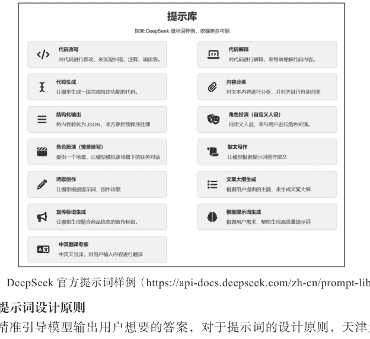

图 3-3 DeepSeek 官方提示词样例 (https://api-docs.deepseek.com/zh-cn/prompt-library/)

##### 2. 提示词设计原则

天津大学自然语言处理实验室学者总结了 DeepSeek 提示词设计的十条关键原则。

- ①明确任务目标。在提示词中清晰地描述任务类型和预期目标，避免模糊和冗长的描述。
- ②提供上下文和背景信息。为 AI 提供必要的背景信息，帮助其更好地理解任务场景。
- ③设定角色。通过角色扮演的方式，引导 AI 以特定视角完成任务。
- ④规范输出格式。明确指定输出格式，确保结果符合预期。
- ⑤分步骤说明。对于复杂任务，将需求分解为多个步骤。
- ⑥领域知识注入。针对专业性较强的任务，需要补充相应领域的专业知识。
- ⑦设定约束条件。明确任务的限制条件，帮助 AI 更精准地完成任务。
- ⑧结构化表达。通过 XML 标签、标题、列表等 Markdown 结构化格式来组织内容，提高可读性。
- ⑨示例驱动。提供具体示例，帮助 AI 理解任务要求。
- ⑩多角色协作。模拟多个角色，协同完成多部门完成任务。

##### 3. 提示词框架

清晰的框架能帮助系统化构建提示词。下面是几种常用框架。

###### （1）RTGO

R 是 Role，定义 AI 的角色。T 是 Task，具体描述任务。G 是 Goal，指期望达成的目标效果。O 是 Objective，描述操作要求。示例：

> 你是一个经验丰富的数据分析师
写一份关于 ×× 事件的分析报告
通过该报告为相关企业管理者提供数字化转型策略支撑
要求 1000 字，段落清楚，输出格式为 Markdown

###### （2）CO-STAR

C 是 Context，背景。O 是 Objective，目标。S 是 Style，风格。T 是 Tone，代表语气。A 是 Audience，受众。R 是 Response，响应。

```
# C - Context (背景)
某中型汽车零部件制造工厂近期面临生产效率下降、资源浪费增加的问题。当前生产线存在设备闲置率高、人工操作重复性高、物料流转效率低等现象，导致交付周期延长，客户满意度下降。工厂希望通过智能化改造和流程优化解决这些问题。
# O - Objective (目标)
生成一个可落地的优化方案，要求：
提高生产线整体效率（目标提升 15% 以上）；
减少原材料浪费（目标降低 10%）；
提出可量化的技术或管理改进措施。
# S - Style (风格)
以结构化、数据驱动的技术报告风格呈现，包含图表示例、关键指标对比和分阶段实施计划。
# T - Tone (语气)
专业、严谨，但避免过度技术化，需让非技术背景的管理层快速理解核心逻辑。
# A - Audience (受众)
主要读者：工厂经理、生产主管、技术团队；次要读者：公司高层（关注投资回报率）。
# R - Response (响应)
生成的内容需要包含以下模块：
痛点诊断（基于当前生产线的数据，如 OEE 设备效率、工时分布、废品率）；
优化方案；
成本与收益预测（如投资回报周期、效率提升的量化模拟）；
风险与应对（如员工培训阻力、初期停机风险）。
```

###### （3）COAST

C 是 Context，背景。O 是 Objective，目标。A 是 Action，行动。S 是 Scenario，场景。T 是 Task，任务。

```
# 背景
创建名为 “HealthEase” 的应用，旨在利用智能技术帮助用户监测健康状况并提供个性化的健康建议。
# 目标
设计并实现一个用户友好的界面，使用户能够轻松记录健康数据，并在 3 个月内吸引至少 5 千名活跃用户。
# 行动
开发一个功能，允许用户输入其日常健康数据，如步数、心率和睡眠质量，并提供实时反馈和个性化建议。
# 场景
为模型提供必要的训练数据，包括健康监测算法和个性化建议的制定准则，以确保应用的准确性和用户体验。
# 任务
利用 TensorFlow 框架实现模型训练，并结合用户反馈不断改进算法，以提供更准确和有用的健康建议。
```

###### （4）RISE

R 是 Role，指定 AI 的角色。I 是 Input，描述信息输入。S 是 Step，详细的步骤。E 是 Expectation，期望。

```
# 角色
假设你是一个经验丰富的项目经理。
# 输入
我们的团队将在下周举行一个重要的项目会议，需要讨论项目的当前状态、接下来的里程碑和可能遇到的风险。
# 步骤
请提供准备此类会议的详细步骤，包括应收集的信息、应创建的议程和如何有效地组织会议。
# 期望
期望能够通过会议明确项目的下一步行动计划，并得到团队的共同理解和支持。
```

###### （5）BAB

B 是 Before，解释之前存在的问题。A 是 After，说明之后想达成的目标或结果。B 是 Bridge，询问具体的实现路径。

```
# 之前存在的问题
产品的关键词自然排名太靠后，很难被人发现。
# 之后想达成的目标或结果
想要在 90 天内将目标产品的核心关键词排名提升至百度 / 谷歌 / Bing 自然搜索结果的前 10 位。
# 具体的实现路径
设计一个详细、可执行的 SEO 优化方案。
```

提示词本质是自然语言，和人类交流原理相同，存在明示、暗示、诱导、指令等多种内涵。设计与运用体现对人性、文化和伦理的考量。

想让 DeepSeek 产生智能涌现，考验创造力、理解力和沟通能力。

- （1）创造力
如同提问、采访、反思，使用 DeepSeek 时需要问对问题。平庸的问题只会得到平庸答案，创新性的提示能激发新颖深入的见解。
- （2）理解力
好提示不是关键词堆砌，需要策略思维。要理解模型的运行机理、能力边界和知识范围，才能激活已有知识并触发新信息。
- （3）沟通能力
交互需要不断试验和调整，通过反馈循环优化效果，让模型在长期互动中持续适应意图。

### 3.3 DeepSeek 多工具协同

DeepSeek 在文本理解和生成上很强，但单模态限制了应用范围，多模态场景需要借助其他工具协同。

#### 3.3.1 DeepSeek 的使用局限

DeepSeek 是大语言模型，只支持纯文本交互，无法处理图像、音频、视频等多媒体。

- （1）缺乏多模态输入输出
目前仅支持文本输出，不支持多模态输入输出。例如无法完成图片或视频生成，如图 3-4 所示，尽管声称能生成图片，实际只输出绘图步骤。

48 智能制造实战：DeepSeek 在制造业的深度实践

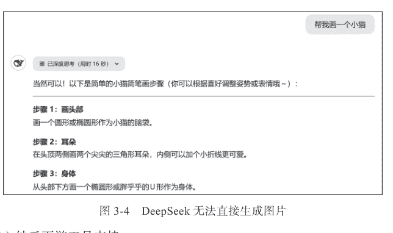

图 3-4 DeepSeek 无法直接生成图片

- （2）缺乏下游工具支持
目前缺乏对下游工具的支持，无法直接完成任务。例如无法直接生成 PPT，只能提供大纲信息，如图 3-5 所示。

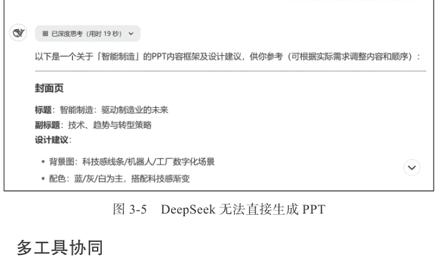

图 3-5 DeepSeek 无法直接生成 PPT

#### 3.3.2 多工具协同

制作 PPT、绘制思维导图、剪辑短视频等复杂工作，因 DeepSeek 单模态限制无法直接完成，需要其他工具配合协同才能实现。

DeepSeek 在复合工作流中通常承担核心的推理与文本生成角色，把结果作为下游工具的输入。常见的多工具配合方式可以归纳如下。

表 3-2 常见的 DeepSeek 多工具协同的情况

| 工具组合 | 应用场景 | 关键操作 |
| :--- | :--- | :--- |
| DeepSeek 与 Kimi / 讯飞智文 | PPT 制作 | 先让 DeepSeek 梳理大纲与要点，复制到 PPT 助手选择模板快速成稿 |
| DeepSeek 与 剪映 | 短视频制作 | 用 DeepSeek 撰写爆款脚本，再借助剪映的图文成片功能生成视频 |
| DeepSeek 与 即梦 / Midjourney 等 | 海报制作 | 让 DeepSeek 输出海报的文字描述，粘贴到绘图工具生成配图 |
| DeepSeek 与 XMind | 思维导图创建 | 让 DeepSeek 按 XMind 可识别的 Markdown 格式输出结构，导入后一键成图 |
| DeepSeek 与 Cursor | 代码编写 | 在 Cursor 的 chat 与 composer 面板中由 DeepSeek 生成并修改工具代码 |
| DeepSeek 与 boardmix AI | 图表与架构设计 | 先由 DeepSeek 把需求描述清楚，再交给 boardmix AI 生成可交互图表或架构图 |

### 3.4 使用 DeepSeek 需要的能力边界

DeepSeek 的推理很强，生成的文本对工作有明显增益，但使用中容易产生误判。

- ① 认为 DeepSeek 能力极强，单条指令就能搞定全部问题
- ② 依赖 DeepSeek 作为助手后，人类就可以停止学习

这两种认知都非常危险。AI 正在重塑生产方式，也在重塑个人在新生产方式下的专业价值。真正的竞争力在于对业务的深度理解，能把目标需求定义清晰，再借助 AI 高效交付，具体体现为提问、判断、调度三项能力。

#### 3.4.1 提问

使用 DeepSeek 的前提是使用好提示词，这考验提问设计能力。提示词过于简单，模型容易偏离预期。巧妙的做法是利用模型自身的生成能力先把粗糙问题扩写成详细指令，再基于详细指令作答，形成自问自答的杠杆效应，用小投入撬动大输出。

在工作中可以这样操作：想了解安全生产助手的使用方法却不知如何提问，先让模型帮助拆解问题、补充背景，再据此展开学习探索。

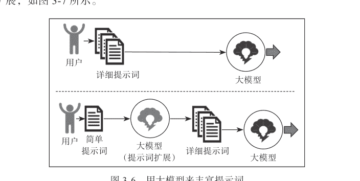

图 3-6 用大模型来丰富提示词

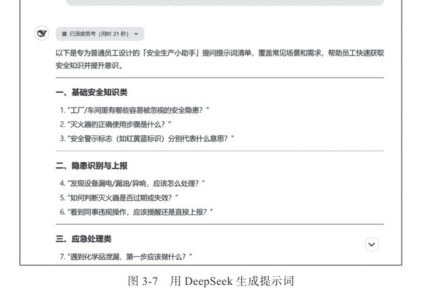

图 3-7 用 DeepSeek 生成提示词

#### 3.4.2 判断

有人觉得内容都能被模型生成，人就不需要学习了，恰恰相反，更要加强学习。因为 DeepSeek 与其他大模型一样会产生幻觉。知识储备不足时，很难辨别输出的真伪与质量，风险很大。

幻觉是指模型在生成或解释文本时，输出看似合理却与事实不符、缺乏依据或完全虚构。常见表现包括：

- 事实类偏差：捏造历史事件、错误表述科学原理、提供虚假数据。发布会上的 Bard 就出现过类似错误。
- 忠实度偏差：文本通顺但与输入数据或上下文无关，凭空创造，属于字不达意的人工智障感。
- 上下文一致性缺陷：对用户意图理解偏差，回答偏离实际需求。
- 专业知识冲突：在医疗等专业领域杜撰不存在的疗法、剂量等，可能造成严重后果。

幻觉是当前技术架构的固有缺陷，模型处处可能埋雷，人的判断力因此变得关键。

#### 3.4.3 调度

DeepSeek 目前还无法单步完成所有复杂工作，必须多工具配合。用户更像一位管理者：要给员工下指令，要会评估工作质量，还要协调多名员工协同。

以 PPT 制作为例的调度思路如图 3-8。先让 DeepSeek 输出一份大纲，反复问答提升质量，再交给 PPT 生成工具成稿。若成稿后配图不合适或缺少视频，就让 DeepSeek 再生成文生图的提示词，用绘图工具产出图片并回填到 PPT 对应位置。

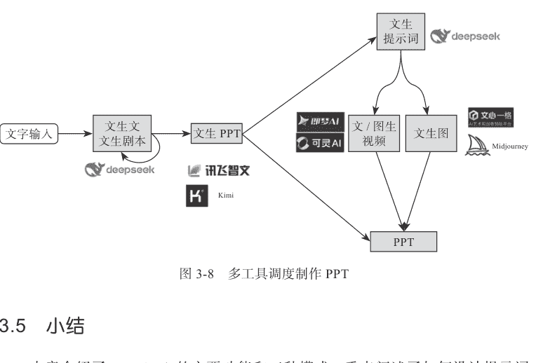

### 3.5 小结

本章梳理了 DeepSeek 的核心功能与三种使用模式，重点讲了如何设计提示词来驱动预期输出。由于单模态限制，复杂任务必须靠多工具协同。

智能涌现既是冲击也是机会。争论大模型是否会取代人不如看现实：会用大模型的人会取代不会用的人。关键在于提问、判断、调度的能力，以及持续学习不断进化的素质。本章的方法只是基础，下一章进入更进阶的知识。

# CHAPTER 4

## 第 4 章 DeepSeek 的进阶使用方法

基础模式、深度思考、联网搜索在日常能提效，但在企业级、涉及核心数据和复杂流程的场景里就不够用了。需要更高级的玩法，本章介绍垂直大模型构建、检索增强生成和 AI Agent 三种进阶方向。

### 4.1 垂直大模型的构建

DeepSeek 是通用大模型，用公开数据训练而成，不包含企业私域知识。面对制造业等垂类问题，通用模型常出现知识盲区，说得空泛甚至一本正经地胡说。主流做法是把垂类专业知识体系嫁接到通用模型上，打造专业型模型。

假设你是方案负责人，手握 DeepSeek 模型参数，要给传统制造企业做垂类模型，有哪些路？如果你是制造企业的方案经理，手握海量行业数据，怎么引入大模型？在数据充足的情况下，主流做法是改变原模型参数的微调，和不改参数的微调，如图 4-1 所示。

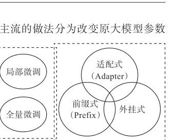

#### 4.1.1 全量微调

全量微调即 Full Fine-Tuning，是较早的微调思路。把行业数据喂给基于 Transformer 的大模型继续训练，更新全部参数。Transformer 由大量层堆叠，参数量惊人，如图 4-2 所示。以 650 亿参数的 LLaMA 为例，全量微调要动 650 亿个参数，算力成本极高。

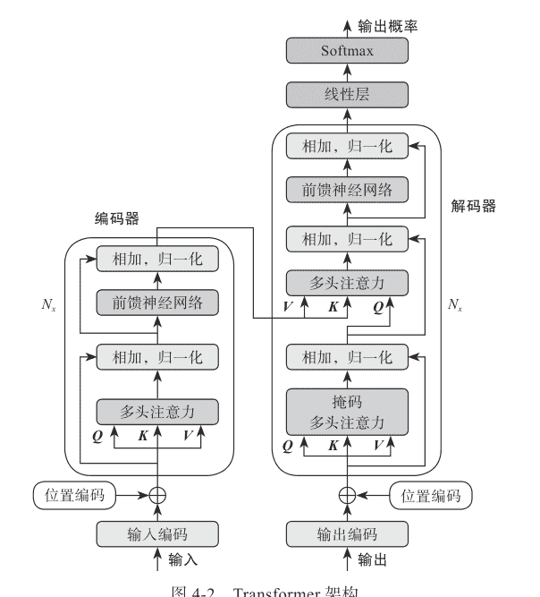

因成本不可行，催生了参数高效微调 PEFT，包含局部微调、Adapter Tuning、Prefix-Tuning、LoRA 等，如图 4-2 所示。

#### 4.1.2 局部微调

不必动全部参数，只更新一小部分是否可行？研究证实可以，关键在选对参数，在效果与成本间找平衡。常见思路有：

- 只微调最后几层 Transformer 块。靠近输出的层更贴近下游任务，在图像模型上效果明显。
- 只微调嵌入层。嵌入层与语义强相关，调优后能吸纳领域专业知识。
- 在整体上挑选参数。BitFit 只更新偏置 bias 参数或部分 bias。Transformer 中涉及 bias 的有注意力计算、MLP 层、归一化层等。偏置只占全部参数的极小比例，BERT-Base 中约 0.09%，BERT-Large 约 0.08%。在 GLUE 数据集上，BitFit 用极少量参数就能接近全量微调效果，如图 4-3 所示。

实验还显示大模型存在过度参数化，实际完成任务不需要全部参数。只更新与垂类任务强相关的参数即可，PEFT 因此更适合垂类落地。

#### 4.1.3 适配式微调

当前主流架构是 Transformer，由多层 Transformer 块堆叠。GPT-3 有 96 层解码块，LLaMA 65B 有 80 层。垂类应用时，降低单块调整成本很有价值。

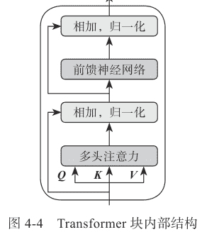

图 4-4 Transformer 块内部结构

Adapter Tuning 的核心是在 Transformer 块内部植入 Adapter 模块，训练时只更新 Adapter 参数，其余冻结。以下是一种简洁实现思路。

```python
def transformer_block_with_adapter(x):
    residual = x
    x = SelfAttention(x)
    x = FFN(x)  # adapter
    x = LN(x + residual)
    residual = x
    x = FFN(x)  # transformer FFN
    x = FFN(x)  # adapter
    x = LN(x + residual)
    return x
```

Adapter 的位置、数量、结构都有研究空间。常见做法是在每个 Transformer 块中，于多头注意力后和第二个前馈层后各加一个 Adapter，如图 4-5 所示。训练时只动新增 Adapter 和归一化层，参数增幅约 3.6%，算力开销大幅下降。

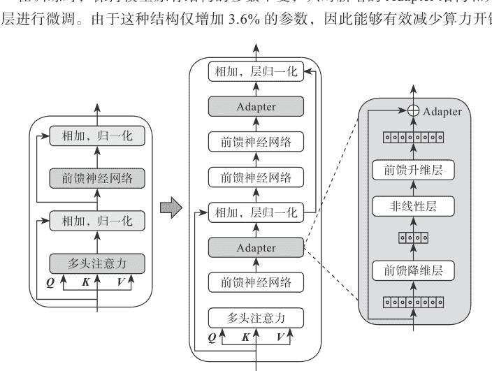

Adapter 通常由两个前馈层构成：第一层降维把高维特征压到低维并做非线性变换，第二层升维恢复原维度。输出维度不变但参数大幅减少，并通过残差连接把输入加回输出，保证 Adapter 即使不生效也不破坏原模型。

实验表明，在 BERT-Large 上 Adapter Tuning 的效果可媲美全量微调，而训练参数仅占 3.6%。

| | Total num params | Trained params/task | CoLA | SST | MRPC | STS-B | QQP | MNLI_m | MNLI_mm | QNLI | RTE | Total |

|---|---|---|---|---|---|---|---|---|---|---|---|---|

| BERT_LARGE | 9.0 x | 100% | 60.5 | 94.9 | 89.3 | 87.6 | 72.1 | 86.7 | 85.9 | 91.1 | 70.1 | 80.4 |

| Adapters (8-256) | 1.3 x | 3.6% | 59.5 | 94.0 | 89.5 | 86.9 | 71.8 | 84.9 | 85.1 | 90.7 | 71.5 | 80.0 |

| Adapters (64) | 1.2 x | 2.1% | 56.9 | 94.2 | 89.6 | 87.3 | 71.8 | 85.3 | 84.6 | 91.4 | 68.8 | 79.6 |

图4-6 BERT-Large 搭载 Adapter 后的效果对比

#### 4.1.4 前缀式微调策略
大模型早期的落地方式往往是对每个下游任务都重调全量权重。摘要、翻译这类任务都要单独翻动参数，才能达到可用水准。调参量大、成本高，在行业复杂场景下基本不可持续。

借鉴人工任务模板的设计思路，可以在输入序列前端挂上一组可学习的前缀参数 Prefix，主体参数保持冻结，只让前缀部分参与更新，就能实现多任务适配。这就是 Prefix-Tuning 的核心思想。典型 Transformer 层的实现范式如下。

```python
def transformer_block_for_prefix_tuning(x):
    soft_prompt = FFN(soft_prompt)
    x = concat([soft_prompt, x], dim=seq)
    return transformer_block(x)
```

##### 1. 虚拟 token 的构建方式
一种常见做法是利用虚拟 token 来构造连续隐式 prompt，如图 4-7 所示。把 Translation、Summarization、Table-to-text 三类任务分别作为前缀注入预训练模型。在真实输入前面先拼接一段与任务相关的虚拟 token 作为 Prefix，相当于每一层 Transformer 都在真实句表示前插入若干可训练的 virtual token 嵌入。这些虚拟 token 不对应词表中的真实词，本质上是自由可调的参数。训练时仅更新 Prefix，预训练主体保持不动。

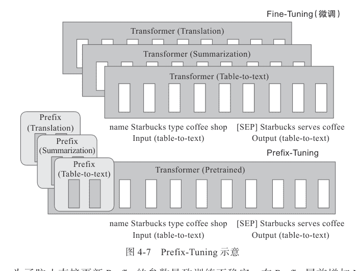

为避免直接优化 Prefix 导致不稳定，通常在 Prefix 层前加入 MLP。训练收敛后只保留 Prefix 参数。

##### 2. Prompt Tuning 简化思路
Prompt Tuning 是 Prefix-Tuning 的轻量化变种，只在输入层引入 Prompt Token，不需要 MLP 来缓解训练困难。不同于 Prefix-Tuning 在每层 Transformer 前都加入可训练前缀，Prompt Tuning 只在输入端一次性加入可训练参数，其代码范式如下所示。

```python
def soft_prompted_model(input_ids):
    x = Embed(input_ids)
    x = concat([soft_prompt, x], dim=seq)
    return model(x)
```

如图 4-8 所示，针对原本需要分别微调的 A、B、C 三个任务，分别构造对应的 Task prompts 并拼接为可调参数。每个任务额外拥有一个或多个可训练 prompt，再与数据拼接作为输入。训练阶段冻结预训练权重，仅学习 prompt。训练完成后，同一套模型即可实现多任务推理。

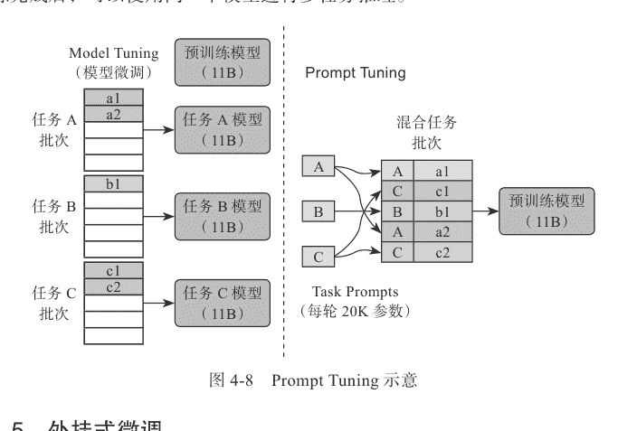

#### 4.1.5 外挂式微调方案
外挂式微调的核心思路是在原模型参数旁并联一个参数量很小的可训练结构。主干不动，仅训练外挂部分，就能间接实现大模型的适配。

LoRA 是典型代表，如图 4-9 所示。其理论依据是大模型全连接层的权重矩阵看似满秩，但在特定任务微调后，权重矩阵的实际内在秩很低，可用低秩方式近似。数学上即把一个矩阵分解为两个小矩阵相乘，如图中的 A、B，分别承担降维和升维。

其中 x 表示输入向量，可来自文本嵌入、图像特征等；d 为输入维度；r 为 LoRA 的秩，是关键超参数；h 为该层输出维度。r 远小于 h 和 d，因此参数开销很小。

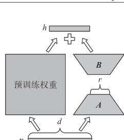

LoRA 的代码范式如下所示。

```python
def lora_linear(x):
    h = x @ W # regular linear
    h += x @ W_A @ W_B # low-rank update
    return scale * h
```

外挂点也很关键。Transformer 的注意力参数体量很大，Q、K、V 三个矩阵是常用挂点。实验表明，同时挂在 Q 和 V 上效果最佳，如图 4-10 所示。

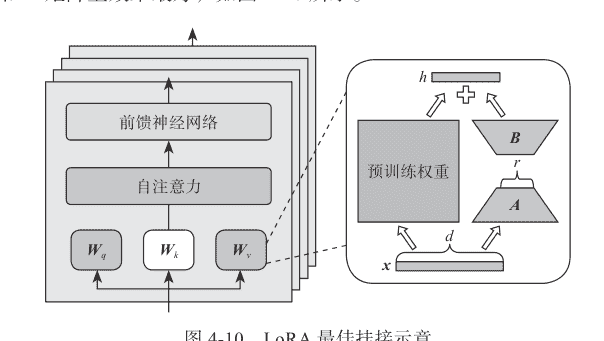

基于相同思路，还衍生出更多方法。AdaLoRA 会依据权重重要性得分，自适应地在不同权重间分配参数。QLoRA 则采用高精度量化把预训练模型压缩到 4bit，进一步降低规模，如图 4-11 所示。

> 参考 “QLoRA: Efficient Finetuning of Quantized LLMs”。

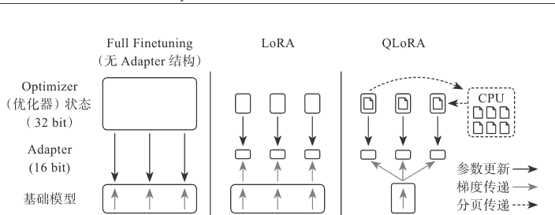

#### 4.1.6 混合式微调思路
PEFT 的做法是在模型结构中增改模块，用少量参数更新升级预训练模型，如图 4-12 所示。前面提到 PEFT 已能逼近全量微调的性能，并在行业数据加持下支撑垂直大模型建设。但不同技术的内在联系是什么？为了用得明白、用得安心，需要更深的统一视角。

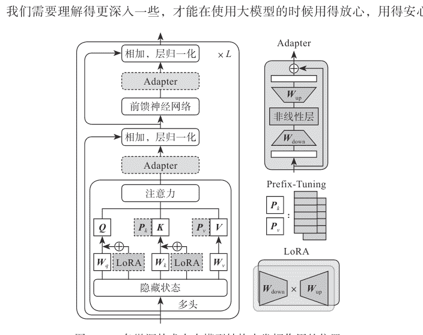

> 参考 “Towards a Unified View of Parameter-Efficient Transfer Learning”。

有研究尝试把各类微调技术归一化为统一框架。分析内部结构和插入方式的相似性后发现，它们都能转写成如图 4-13 的旁路挂接形式。其中 PLM 部分是原预训练的注意力、FFN 等模块，保持不变；右侧旁路则是各技术转换后的不同形态。

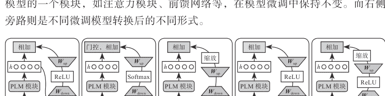

既然各类技术都能达到接近全量微调的效果，且内在形式相近，自然会问能否融合。答案是肯定的。

UNIPELT 就是一种混合方案，它把 Adapter、LoRA、Prefix-Tuning 集成在一起，作为子模块通过门控机制挑选最适合当前数据或任务的策略，如图 4-14 所示。

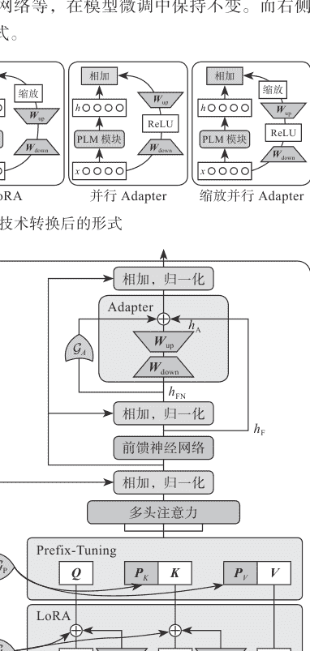

#### 4.1.7 常用微调技术对照表
利用行业数据构建垂直大模型是制造业落地的常见路径。全量训练成本高昂，在预训练模型上做少量参数的高效调整是现实选择。PEFT 方法百花齐放，涵盖局部、适配、前缀、外挂、混合等形态，如表 4-1 所示。

表 4-1 大模型微调技术对比

| 微调方法 | 代表算法 | 基本思路 | 是否改变原模型参数 | 微调参数量（参考模型） |

| :--- | :--- | :--- | :--- | :--- |

| 全量微调 | — | 根据行业数据，更新大模型的全部参数 | 是 | 100% |

| 局部微调 | BitFit | 更新大模型中一小部分参数，如 BitFit 只更新偏置参数 | 是 | 0.08% (BERT-Large) |

| 适配式 | Adapter Tuning | 在大模型中嵌入可训练的适配模块，如 Adapter Tuning 在 Transformer 块增加 Adapter 结构，本质是另外一种形式的外挂 | 否 | 小于 3.6% (BERT-Large) |

| 前缀式 | Prefix-Tuning, Prompt tuning | 在模型输入层前拼接可训练的参数。Prefix-Tuning 在每一面 Transformer 前加入虚拟前缀，而 Prompt Tuning 仅在输入层一次性加入前缀 | 否 | 0.1% (BART) |

| 外挂式 | LoRA, QLoRA | 在大模型架构组件中挂接可训练模块。LoRA 在 Q 和 V 矩阵上挂接低秩结构 | 否 | 0.24% (RoB-Base) |

| 混合式 | UNIPELT | 整合多个微调方法，通过门控技术针对具体任务选择合适的微调方法 | 否 | 0.99% ~ 1.26% (BERT-Base) |

### 4.2 大模型检索增强生成
借助微调把行业数据注入预训练模型，可以得到具备行业能力的垂直大模型，也确实在推动智能化。但问题仍在。

##### 1. 幻觉问题未根除
通用大模型偶尔会编造信息，即常说的幻觉。经过微调的垂直模型虽有领域数据加持，依然可能胡说八道，导致不可用。根源在于模型结构承袭自预训练，且缺乏外部纠偏机制。

##### 2. 实时性不足
无论通用还是垂直，无论从头训练还是高效微调，模型都只吃历史数据。出炉后就不再更新。现实世界数据和用户问题却在持续变化，模型很快就会过时。

##### 3. 成果难以追溯
行业应用不仅要生成，还要可负责、可追溯。法律咨询要指明法条依据，工业设计要指向最新国标条款。大模型的黑盒特性让这种需求难以满足。

为解决准确性和可信度的现实挑战，检索增强生成 RAG 应运而生。它的思路是生成前先从文档库检索相关信息，再结合上下文生成，从而缓解幻觉、增强可追溯性，让大模型在落地时更可靠。

#### 4.2.1 RAG 概览
RAG 融合了信息检索与内容生成，适合知识更新快、对时效要求高的场景。它外挂一个知识库，把与输入相关的数据检索出来作为上下文一起喂给大模型，是典型的先检索后生成范式，如图4-15所示。

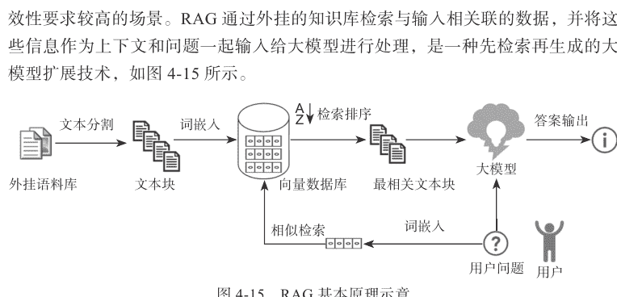

标准流程包含三步：构建向量数据库、相似检索、智能生成。

##### 1. 构建向量数据库
外挂知识库通常以向量库形式存在。先把语料切成多个文本块，块的大小可按需选择，常见的分割粒度是段落级或句子级，粒度会影响命中精度。

再用词嵌入编码器如 BERT、GPT 把文本块转成向量，存入 Chroma、Faiss、Elasticsearch、Hnswlib 等向量库中，供后续检索。

##### 2. 相似检索
用户提问先经同一编码器转为向量，然后在向量库里找语义最接近的 K 个文本块。检索依据是向量空间距离，常用余弦相似度。

##### 3. 智能生成
把检索到的文本块与用户问题拼接作为大模型的输入。模型可以是通用或垂直版本。有了相关资料的支撑，输出的准确性和关联度会明显提升。

举例来说，问中国男足亚洲杯首轮表现时，把赛事前瞻、赛后采访、媒体评论放入知识库，RAG 即可给出有依据的回答。实际应用中还会涉及非结构化数据、检索精度、响应速度、质量评估等难题，需要对典型范式做升级。

#### 4.2.2 向量库搭建要点
构建向量库的核心是文档切分与嵌入，实操中主要有两类挑战。

##### 1. 切分粒度难题
检索精度高度依赖切分粒度。块太大，信息过载，难以精确命中；块太小，命中准却上下文不足，不利于大模型生成，如图 4-16 所示。

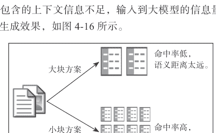

为兼顾语义清晰与检索精准，可采用大小块联合分割。无需二选一，大块和小块同时存在并建立关联，如图 4-17 所示。

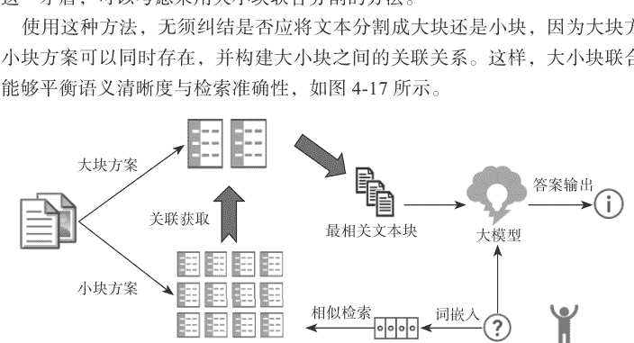

先用相似检索拿到 N 个最相关的小块实现精准匹配，再通过小块回溯其所属大块，补充更丰富的上下文，最后把关联后的大块文本与问题一起送入大模型生成。

##### 2. 多模态数据难题
纯文本文档可用常规分词、嵌入和向量库处理。但当文档包含表格、图片等多模态信息时，需要专门处理以支持多模态外挂。

RAG 对多模态知识库的构建思路如图 4-18 所示。

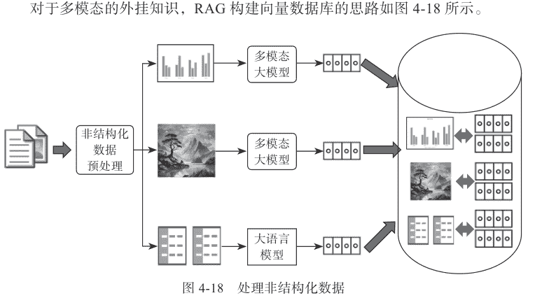

- ① 解析原始文档，分别抽取文本、图表、图片等不同模态。工具如 unstructured 可把 PDF 等文件解析为结构化形态。
- ② 对抽取结果用多模态模型处理。以图像为例，可编码为向量，也可生成语义摘要。存储上可只存编码向量，也可只存摘要，但会丢失细节。更推荐同时保存原始图像和对应的语义摘要。

- ③为不同模态的素材分别建立专属的向量库，一并收纳原始文件和提炼的摘要，方便后续做语义相似查找。原始数据和摘要同时保留，能让匹配的准确度更高，也让支撑材料的完整性更强。

##### 3. 向量检索的效率瓶颈
相似查找与传统精确匹配或固定查询的思路不同，检索增强生成依赖向量库按照语义或语境关联去寻找最相关的内容。要让整体体系稳定运行，向量库的存储与读取效率必须过关。图 4-19 展示了向量库的工作链路：数据先被向量化，再借助索引技术和检索算法实现读写，算法的表现直接决定响应速度。当前主流的方案包括树形结构、图结构、乘积量化、局部敏感哈希以及倒排索引等。

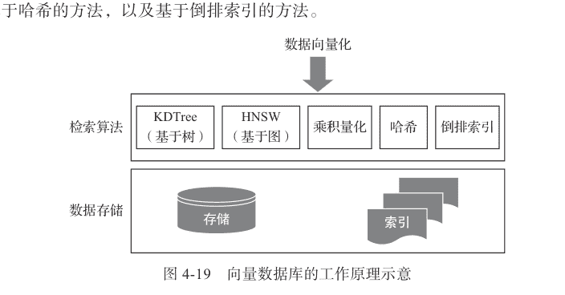

随着生成式语言模型的走红，向量数据库市场进入爆发期，体量持续放大，玩家越来越多，呈现多元竞争态势。下面整理了市面上常见的产品供参考。

表 4-2 主流向量数据库对比

| 向量数据库 | 扩展性 | 查询速度 | 搜索准确性 | 灵活性 | 持久化 | 存储位置 |
| :--- | :--- | :--- | :--- | :--- | :--- | :--- |
| Chroma | 高 | 高 | 高 | 高 | 是 | 本地/云端 |
| DeepsetAI | 高 | 高 | 高 | 高 | 是 | 本地/云端 |
| Faiss | 高 | 高 | 高 | 高 | 否 | 本地/云端 |
| Milvus | 高 | 高 | 高 | 高 | 是 | 本地/云端 |
| pgvector | 中 | 中 | 高 | 高 | 是 | 本地 |
| Pinecone | 高 | 高 | 高 | 高 | 是 | 云端 |
| Supabase | 高 | 高 | 高 | 高 | 是 | 云端 |
| Qdrant | 高 | 高 | 高 | 高 | 是 | 本地/云端 |
| Vespa | 高 | 高 | 高 | 高 | 是 | 本地/云端 |
| Weaviate | 高 | 高 | 高 | 高 | 是 | 本地/云端 |
| DeepLake | 高 | 高 | 高 | 高 | 是 | 本地/云端 |
| LangChain VectorStore | 高 | 高 | 高 | 高 | 是 | 本地/云端 |
| Annoy | 中 | 中 | 中 | 中 | 否 | 本地/云端 |
| Elasticsearch | 高 | 高 | 高 | 高 | 是 | 本地/云端 |
| Hnswlib | 高 | 高 | 高 | 高 | 否 | 本地/云端 |
| NMSLIB | 高 | 高 | 高 | 高 | 否 | 本地/云端 |

#### 4.2.3 意图理解与匹配
在做语义匹配时，检索增强系统需要先读懂提问者的真实意图，再把真正相关的素材找出来，才能帮助主模型更好地理解与产出。可惜提问风格差异很大，表达形式多种多样，很难做到完全同频。

##### 1. 提问范围失衡
提问者在表述时往往带有随机性和局限。一种是范围过宽，比如“电梯安装的步骤是什么”，问得太泛，主模型容易给出表面化、精度不足的回复。另一种是范围过窄，比如“在某项目中，曳引机的参数选型和位置安放怎么做”，只聚焦曳引机，忽略了配套设备与整体流程，回复就会不够全面。

从技术层面缓解局限的思路是问题增强：借助主模型围绕原问题生成多个不同视角的衍生问题，再用这些衍生问题做语义查找，最后对所有查到的材料重新排序，挑选出最相关的知识块，如图 4-20 所示。

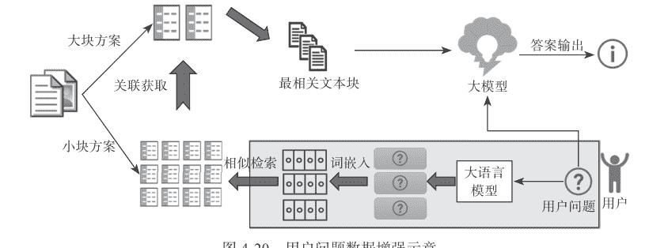

需要留意，问题增强会带来更多次查找，查找量与耗时都会上升，可能影响体验。提问的多维度扩展还会让主模型输入的参考材料变长，增加负担，输出内容也会相应膨胀。

##### 2. 问题负载过重
实际场景里，用户的问题可能跨多个领域与话题，语义信息比较复杂。例如“在 MES 落地实施时，离散制造行业和流程制造行业有什么需求差异？”就涵盖了多个话题，直接匹配很难命中。

可行做法是先把问题拆成更简单具体的小问题，再分别查找。例如可拆成“在 MES 落地时，离散制造行业有什么需求？”和“在 MES 落地时，流程制造行业有什么需求？”并行查询后，把查到的参考材料合并输入主模型理解并最终输出。

#### 4.2.4 生成环节的关键把控
拿到匹配结果后，需要与用户提问一起作为主模型的输入来生成回复。合理的输入组合与输出管控是智能生成成功的关键。

##### 1. 提示词设计
直接把匹配结果与用户提问拼给主模型，往往得不到理想效果。按提示词工程的原理，合理的提示设计才能引导模型按预期生成。因此要针对匹配结构与用户提问构建合适的提示。

结合明确性、具体性和角色设定等技巧，智能生成的提示应明确限定回复仅基于搜索结果，不额外添加信息。可例如：“你是一名智能客服。你的目标是提供准确的信息，并尽可能帮助提问者解决问题。你应保持友善，但不要过于琐碎。请根据提供的参考材料，在不考虑已有知识的情况下，回答相关查询。”面对复杂问题，还可采用少样本提示，把预设的问题例子加入提示词，指导模型如何利用检索到的知识。

合理的提示能提升生成质量，让回复更精准，也更符合特定场景需求。

##### 2. 主模型选型
提示构建完成后，考验的就是主模型本身的能力。实际应用中选型可从以下方面考虑。
- （1）可获得性与成本：主模型服务形态多样，按开放程度分完全开源、有限开源和闭源，按使用方式分本地部署和接口服务。获取难度和使用成本不同，需综合权衡。
- （2）生成质量：不同主模型的技术细节与规模不同，性能表现有差异。选综合生成质量评分较高的模型更稳妥。
- （3）推理时延：在检索增强生成场景中，部分服务对响应时间要求高，忽视时延会带来差的用户体验，因此推理速度值得重点考虑。

总体上需综合多因素权衡，找到适合的模型。

##### 3. 输出可控性
主模型存在幻觉、安全等问题，生成时需要有效控制输出。
- （1）确保公平与负责任的使用：检索增强生成的道德部署要求负责任地使用技术并避免滥用或有害应用，开发人员和用户须遵守道德准则，维护 AI 生成内容的完整性。
- （2）解决隐私问题：检索增强生成依赖外部数据源，可能触及用户数据或敏感信息。需建立强隐私保护措施，保护个人数据并遵守相关法规。
- （3）减轻外部数据源中的偏差：外部数据源可能因内容或采集方式存在偏差。需建立识别和纠正偏差的机制，确保响应公正公平，这需要持续监控与优化数据源和训练过程。

#### 4.2.5 上线前的科学评估
检索增强生成范式优化升级并构建完行业知识库后，不能马上投入使用。原因有三：
- ①主模型输出具有不确定性，结果不可预知，像开盲盒，投产前需测试以免出现太多惊喜或惊吓；
- ②检索增强生成的知识库是外挂且动态的，生产维护中性能可能波动，需要定期检测评估；
- ③上线后必然有升级维护，需要手段衡量改进效果。

与传统软件需完整测试不同，检索增强生成的输入输出是自然语言，相关性与准确性难以直接判定，容易出现主观分歧。因此需要借助额外工具和评估模型来辅助判断。

Ragas 是用于评估检索增强生成流程的框架，可评估、监控和改进生产环境的 LLM 和检索增强生成应用性能。使用 Ragas 需提供四项信息：
- □ 问题：用户提出的问题，作为输入。
- □ 答案：问题的答案，即检索增强生成应该输出的结果。
- □ 知识：从外挂知识库语义检索出的相关知识。
- □ 基准事实：由人类提供或标注的事实，即正确答案。

评估流程如图 4-21 所示。

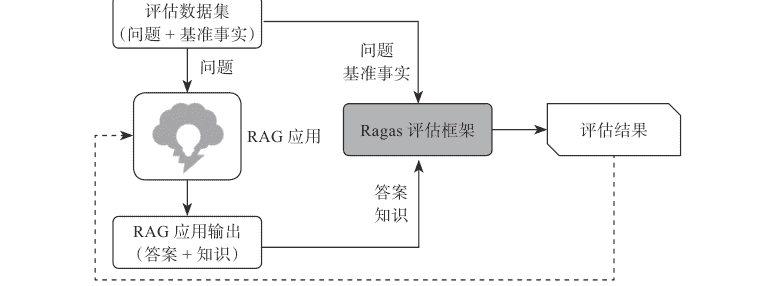

评估中针对检索与生成两部分，主要指标如表 4-3 所示。

##### 表 4-3 RAG 应用评估指标

| 名称 | 相关输入 | 解释 |
| --- | --- | --- |
| 忠实度 | 答案<br>知识 | 答案与检索出的上下文的一致性，即答案是否能从检索出的知识中推理出来 |
| 答案相关性 | 答案<br>问题 | 答案与用户问题的相关性，即答案是否完整且不冗余地回答了输入问题 |
| 上下文精度 | 知识<br>基准事实 | 检索出的相关上下文中与正确答案相关的条目是否排名较高 |
| 上下文召回率 | 知识<br>基准事实 | 检索出的相关上下文与正确答案之间的一致性，即正确答案的内容是否能够归因到上下文 |
| 上下文相关性 | 知识<br>问题 | 检索出的上下文与用户问题之间的相关性，即上下文中有多少内容和输入问题相关 |

除定量评估外，也可从用户体验角度人工打分，主要有：
- 回答的语义相似度，即输出答案与基准事实的语义相似度，0 到 1 之间，分数越高越相似。
- 回答的正确性，涵盖语义相似度与事实相似度，按权重综合计算为 0 到 1 之间的正确性值。

#### 4.2.6 典型适用场景
当需求对实时性、准确性和相关性要求较高时，主模型微调可能力不从心。检索增强生成通过向量数据库构建、语义匹配、智能生成三个核心能力，利用外挂知识库拓展主模型处理特定需求的能力。正如微调并非万能，检索增强生成也有其适用场景，可考虑采用：
- （1）数据稀有：数据呈长尾分布时，检索增强生成的检索能力可触及稀有、非典型样本，增强对长尾数据的处理。
- （2）知识更新频繁：在新闻、科技等快速迭代领域，检索增强生成可通过实时搜索提供前沿信息。
- （3）回答需要验证追溯：要求答案可溯源的应用中，检索增强生成支持回溯答案出处，增强可靠性。
- （4）领域专业化知识：医疗、法律等高度专业场景，检索增强生成可提供深厚背景资料支持决策。
- （5）数据隐私保护：对敏感数据，检索增强生成可设计为查询脱敏或安全处理后的数据，避免直接访问原始信息，保护隐私。

#### 4.2.7 检索增强与微调的权衡
主模型微调是在预训练模型上用行业数据做少量参数更新，生成垂直主模型解决下游任务，但成本和时间较高，不擅长整合新知识或快速迭代新场景。

检索增强生成则不改变模型结构，通过外挂知识库检索扩展上下文语义作为模型输入，有助于提供实时精准答案。

两者思路不同，各有适用场景，如表 4-4 所示。微调重在把知识内化为参数，是一种隐式能力；检索增强生成重在利用外在知识检索，是一种显式能力。

##### 表 4-4 RAG 与大模型微调的对比

| 特点对比 | RAG | 微调 |
| :--- | :--- | :--- |
| 应对知识更新 | 模型无须重新训练，直接更新外挂知识库 | 数据和知识更新，模型需要重新训练 |
| 外部知识利用 | 擅长利用外部资源，非常适合文档或其他结构化/非结构化数据库 | 微调需要成本和时间，对变更频繁的数据源并不适用 |
| 数据处理要求 | 对数据加工和处理的要求低，直接外挂 | 微调依赖一定规模的高质量数据集，否则性能提升有限 |
| 模型风格 | 主要关注信息检索，擅长整合外部知识，模型风格依赖大模型本身的能力 | 依赖大模型本身能力，允许根据特定的语气或术语调整大语言模型的行为、写作风格或特定领域的知识 |
| 可解释性 | 答案通常可以追溯到特定数据源（即外挂知识库），提供可解释性和可溯源性 | 受限于大模型本身的可解释性问题，犹如开盲盒，具有相对较低的可解释性 |
| 资源消耗 | 外部数据源集成以及数据更新。需要高效的向量数据库构建与检索能力，以及大模型推理能力 | 准备和整理规模较大的高质量训练数据集，微调技术选型与相应的计算资源 |
| 延迟与实时性 | 在大模型生成之前，需要进行数据检索，可能会有更高延迟 | 经过微调的大语言模型无须检索即可响应，延迟较低 |
| 减少幻觉 | 本质上不太容易产生幻觉，因为每个回答都建立在检索到的外挂数据库上 | 基于特定领域的训练数据后，大模型可以减少幻觉，但仅适用于本领域。在跨领域或者知识更新时仍然有幻觉 |
| 道德与隐私 | 道德和隐私问题来源于从外部数据库检索的文本 | 道德和隐私问题则源于模型的训练数据中可能存在敏感内容 |
| 适用场景 | 稀有、动态数据场景 | 静态数据场景 |

两者并不互斥，甚至可互补。内在知识内化加上实时检索，内外兼修效果更好。例如在微调过的垂直主模型上用检索增强生成提问行业最新问题，表现会更佳；检索增强生成的外挂知识库累积整理后也可用于微调，生成更高性能的垂直模型，如图 4-22 所示。

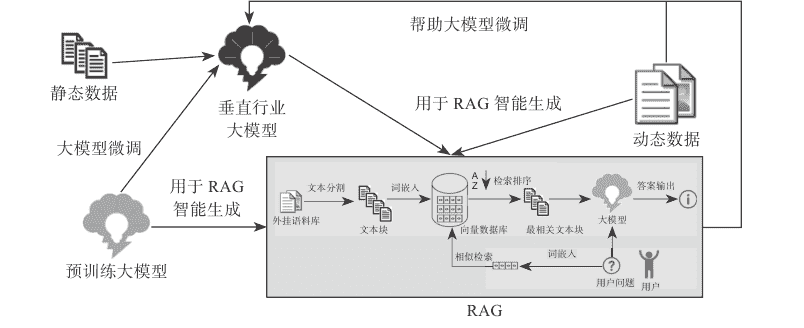

检索增强生成要让主模型回答最新话题相关问题，必须配备相应的外挂知识库。但知识库更新需人工操作，时效性有限；主模型只能回答问题，无法帮助决策和任务执行，智能度不足。那么能否让主模型自身感知用户真实需求，帮助决策和执行任务，成为更先进的助手呢？

### 4.3 AI Agent：从问答到行动
主模型通过微调和检索增强生成能为特定行业提供精准回答，但一问一答模式仍局限于被动响应。随着智能化追求升级，人们希望模型不仅能感知需求，还能帮助完成后续工作，这催生了 AI Agent 技术的发展。AI Agent 不仅能理解和感知用户需求，还能基于上下文情境预测、规划并执行一系列连续操作，帮助完成复杂任务。例如在办公场景，AI Agent 可协助安排日程、处理邮件、编写文档，并基于历史行为推荐下一步工作策略。

#### 4.3.1 AI Agent 是什么
在认知中，AI Agent 的共识是构建能够感知外部环境并自主行动决策的系统，拥有类人智能。

Agent 中文直译为“代理”。代理在法律上有深刻内涵，一个合格代理人须满足：
- ①明确理解被代理人意思，不得误解，不超出代理人意思。
- ②代理人在代理权限范围内实施代理行为，独立与第三方进行代理行为。

AI Agent 相当于代理人。例如工厂老板张三对瓦力说：“我要采购一批电缆，型号是 ZRYJ22-1KV，数量是 1 千米，请帮我采购吧”，如图 4-23 所示。为完成任务，瓦力需具备代替张三采购的能力，具体包括：
- ①准确无误地理解张三的意思，买电缆不能理解成买钢材，型号和数量也要准确。
- ②能够借助工具与供应商李四达成购买行为。例如会浏览采购网站、询价、下单、付款等。

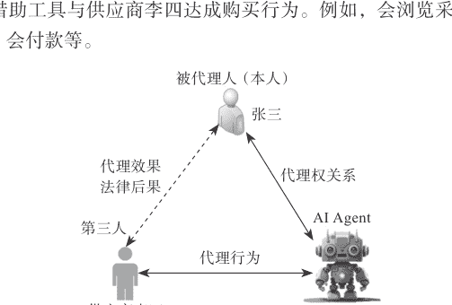

从代理角度看，可比较准确地解释 AI Agent 内涵。合法代理的要求也明确了 AI Agent 的能力方向，即理解被代理人需求，能使用工具并独立完成任务。

AI Agent 并非全新概念，自人工智能诞生之初就已存在。随着技术演进，其实现方式也在不断变化。

##### 1. 规则与符号的启蒙期
AI 起步时，符号主义占据了主导思路。借助数理逻辑与符号编码来封装常识并驱动推理，Agent 被设计成仿人类思维的规则系统。这一路线的代表作是专家系统，其特点是逻辑清晰、过程可解释。因此早期 Agent 的典型形态就是面向特定领域的专家系统。

##### 2. 概念成型与BDI模型
进入 80 年末到 90 年代，随着分布式 AI 与多智能体系统的兴起，Agent 的概念逐渐清晰并趋于成熟。学界普遍认为，一个合格的 Agent 必须具备环境感知、行动规划、执行操作以及自主学习与适应四项能力。

随后提出的信念-愿望-意图模型为 Agent 的内部状态提供了形式化描述，将其拆解为三个层面，如图 4-24 所示。

- ①信念，即对环境的认知，也可理解为能力或知识，反映 Agent 对外部世界及自身状态的把握。
- ②愿望，即目标指向，体现 Agent 想达成什么、要解决什么问题。
- ③意图，即执行方案，落实为具体的行动计划与步骤。

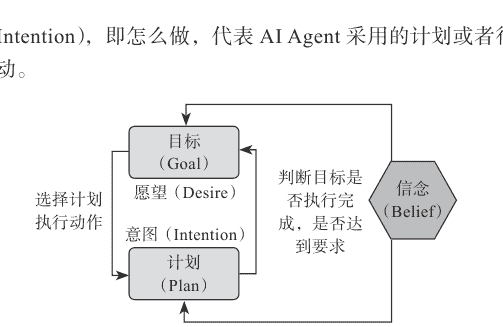

##### 3. 强化学习的试错时代
伴随强化学习与博弈论的发展，基于强化学习的 Agent 迅速壮大，涵盖单智能体与多智能体。核心在于让 Agent 通过与环境的持续交互不断学习，在特定任务上累积最大回报，如图 4-25 所示。早期算法聚焦策略搜索与价值函数优化，如 Q-Learning，首批成果多体现在电子游戏中。

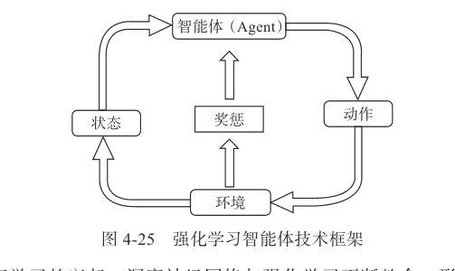

深度学习兴起后，与强化学习深度融合形成深度强化学习，Agent 开始从高维输入中习得复杂策略，并取得标志性突破，例如 AlphaGo 战胜李世石。

这类 Agent 能够在未知环境中自主管训，减少人工干预，被广泛用于游戏对弈到机器人控制等场景。

##### 4. 大模型驱动的新阶段
强化学习虽是主流，但在真实复杂场景下仍受限：训练周期长、样本效率低、稳定性差、迁移泛化不足。大模型的爆发为 Agent 带来新契机，强大的自然语言理解与生成能力显著提升了 Agent 在交互、情境理解、知识获取与推理方面的表现。

#### 4.3.2 架构全景
依托大模型，Agent 正从工具向人类代理与助手演进。在大模型加持下，Agent 能够真实感知外部环境并自主决策行动，与传统方案相比具备明显优势。

- 人机交互：可理解语言等多种模态信息，实现顺畅对话。
- 决策能力：拥有推理与抉择能力，能处理复杂问题。
- 灵活适配：适应性强，可针对不同场景做精细化定制。
- 协作交互：不仅能与人互动，还可与其他 Agent 协同，形成多层智能协作。

落地实现并非单靠大模型，而是融合深度学习、自然语言处理、强化学习等技术，共同支撑更高效的任务决策与执行。

大模型驱动的 Agent 框架由三大核心构成：大脑模块、感知模块、行动模块，如图 4-26 所示。

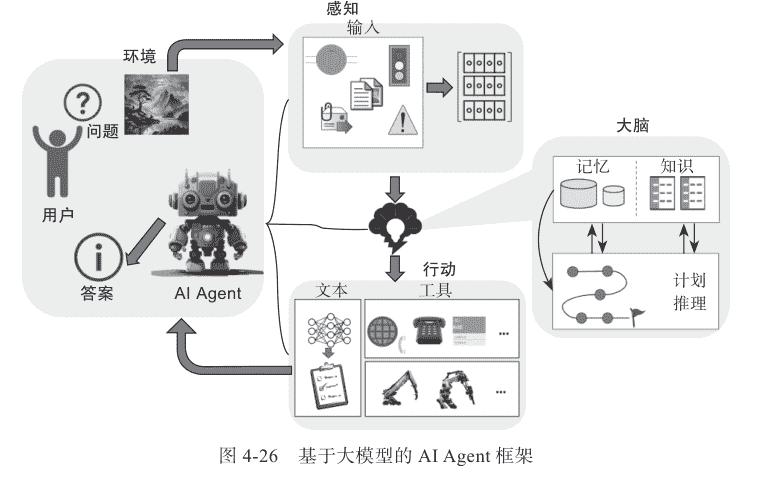

（1）感知模块
负责采集和处理来自外部的多模态信号，包括文本、语音、图像、视频乃至物理传感数据。将其转化为结构化表述，供大脑模块分析利用。

（2）大脑模块
作为控制中枢，承担记忆、思考与决策。它整合感知信息并生成指令，依托大模型实现强大的记忆存取、逻辑推理、决策制定以及学习优化能力。

（3）行动模块
将抽象决策落地为具体操作，影响周围环境。既包括机器人运动、软件操作等物理交互，也涵盖数据抓取、内容生成、策略执行等虚拟任务。借助工具与接口，Agent 才能真正改变所处环境。

三者协同形成闭环反馈，共同支撑 Agent 在复杂环境中的自主感知、思考与行动。

#### 4.3.3 感知模块
感知模块是 Agent 对接外部世界的入口，决定信息能否被准确捕获与理解。

##### 1. 感知形式与方式
要全面把握环境多样性，必须具备多模态感知能力，而非局限于单一输入。

（1）文本输入
大模型在文本交互上表现突出，典型代表是 ChatGPT 类对话机器人。人类的对话中往往隐含信念、愿望和意图，能否读懂弦外之音是提升沟通效率的关键难点。

为缩小理解鸿沟，研究者采用强化学习推断用户偏好，建立反馈模型实现双向理解。同时，面对未知任务描述，感知模块需具备迁移能力，快速把握新指令并响应。

获取途径多样：直接的对话框输入，支持键盘、语音转文字、手写；间接的 OCR 识别，将纸质文档、截图文字转为电子文本；还能从邮件、社交媒体、网页抓取中自动抽取文本，多渠道共同构成丰富的文本输入。

（2）视觉输入
视觉信息最丰富。用户可上传静态图片，搭载摄像头的 Agent 也能主动捕捉实时影像，解析物体形态、色彩、纹理、运动状态等，形成环境认知。

视频本质是帧序列，处理时需在图像感知基础上叠加时序依赖，捕捉动作轨迹、事件演进等动态特征。

来源包括用户提供的图片、摄像头实时流、网络抓取图像、卫星遥感、医学影像等。

（3）听觉输入
语音是重要输入形式。用户可提供录音，Agent 也可通过麦克风实时捕捉声音，实现更自然的即时交互，如家庭助手的指令响应或公共场所的异常声识别。

（4）其他输入
除文本、图像、音频外，未来 Agent 可扩展触觉、嗅觉、味觉等感知，通过装配相应传感器获取更多物理世界信息。

#### 4.3.3 感知模块
感知模块充当 Agent 与世界的桥梁，负责收集环境的多模态数据，涵盖视觉、听觉、触觉、嗅觉与味觉等。通过各类传感器，Agent 获取环境数据，为后续决策提供基础。

例如视觉传感器识别图像视频中的物体、场景与文字；听觉传感器捕捉语音指令与环境音；触觉、嗅觉、味觉传感器则在特定场景提供细粒度交互信息。

结合物联网，Agent 还能接入温度、湿度、亮度、位置、空气质量等传感网络，实现跨地域的实时数据采集与分析，相当于构建科幻意义上的全局感知网络。

总体而言，感知模块让 Agent 能够读、看、听、感人类世界。

##### 2. 感知处理
采集到多模态输入后，还需进一步加工才能被理解。

### （1）预处理与特征提取
人工录入可能出现错字、语义模糊，传感器受硬件限制会混入噪声，光照变化影响视觉，背景噪声干扰语音等。因此需先做预处理：降噪、标准化、数据增强等。

随后进行特征提取，例如用卷积神经网络抽取图像视觉特征，用循环神经网络或 Transformer 分析时序音频与文本序列。

### （2）信息融合
单一模态不足以构建完整认知，多模态融合至关重要。例如“眼见为实”，视觉与听觉结合能更好地理解情境。

常见思路有：
- ①早期融合：在特征提取前合并不同模态数据为统一表示，适合互补性强的数据，但也增加异构处理难度。
- ②晚期融合：各模态独立提取特征并初步决策后，在决策层加权平均、投票等方式整合。
- ③中间层融合：在特征提取的中途将高层抽象特征结合，如先用 CNN 提取图像特征，再用 RNN 处理文本，最后在共享空间融合。

多模态大模型通过大规模预训练与深度架构，为异构信息融合提供了更强的方案。

#### 4.3.4 大脑模块
大脑模块由大模型构成，是 Agent 的核心，负责知识存储、信息处理与决策，并呈现推理与规划过程。其运行机制为：接收感知信息后从知识库检索相关资料辅助理解，以不同形式记忆过往观察、思考与行动，再基于大模型推理能力做出决策与规划。

##### 1. 知识
大模型在海量数据训练后内化大量常识与专业知识，涵盖百科、论文、论坛、社交媒体等。只要训练语料包含相关主题，模型即可理解并复用。

但存在过时、错误知识以及幻觉问题。训练数据带偏见则模型输出可信度下降。目前常通过知识编辑、外部知识库调用及 RAG 技术缓解。

##### 2. 记忆
记忆模块保存 Agent 过去的观察、思考与行动序列，帮助其反思并迁移经验。分为三类：

- ①感觉记忆：原始输入的文本、图像等模态数据。
- ②短期记忆：上下文信息，受限于窗口长度。
- ③长期记忆：通过外部向量库与快速检索实现长期保留与召回。

挑战包括：
- ①信息过载：记忆积累超出模型处理上限，如输入长度限制。
- ②提取困难：海量历史中难以判断哪些记忆对当前任务有效。

应对方式：
- ①扩展输入能力：提升窗口、截断、分割输入并突出关键。
- ②记忆归纳：对关键细节做浓缩，分层建立日报快照与总览。
- ③数据压缩：采用先进压缩技术减小记忆占用。

##### 3. 存储与检索
交互时需从存储中召回相关记忆或知识以精准把握情境。存储器应支持自动检索，衡量标准包括时效性、相关性与重要性。主流检索方法有树结构、图结构、乘积量化、哈希、倒排索引等。

##### 4. 推理与规划
推理是决策分析的核心，思维链等提示技术通过引导模型生成逐步推理过程来提升答案质量。

规划则用于复杂挑战，包含：
- ①子目标分解：将大任务拆解为可管理的子任务。
- ②反思与完善：基于内部反馈、人机反馈或环境反馈对历史动作进行复盘与改进，提升结果质量。

#### 4.3.5 行动模块
行动模块把大脑的决策转化为实际行为并在环境中执行。

##### 1. 文本输出
大模型的强项之一，Agent 能生成连贯、逻辑清晰且内容丰富的文本。

##### 2. 使用工具
面对复杂任务时，Agent 可自主调用外部工具：在每一步子任务中判断是否需要工具，完成后再将返回信息喂给大模型以指导下一步。

- （1）理解工具
有效使用工具的前提是理解其适用场景与使用机制，类似人类阅读说明书或模仿使用。对于大模型而言，关键在于准确描述工具的功能特性和参数配置。

当任务复杂度上升时，倚靠单一手段很难实现闭环。智能代理要想稳定运行，首要的是拥有把整体目标拆解为若干可执行子任务的能力，这需要敏锐的任务洞察与拆分经验，也需要对可用工具的工作机理有深入理解。

- （2）使用工具
基础模型虽知识面宽、专业性强，但在具体求解时仍易出现鲁棒性不足、出现幻觉等情况。借助外部工具后，代理在专业度、事实准确度与可解释性上能得到明显增强。例如在数学运算存在短板时可联动计算器获得精确答案；在时效性不足时可接入检索服务抓取最新信息。

- （3）制作工具
现存工具多以服务人工为前提，对代理而言未必最优。凭借强大的生成能力，代理在面对特殊需求或工具空白时，有可能自行研发新工具。这些由代理自主产出的工具可在群体间流转，形成共享生态。若代理在工具层面实现自给自足与高度自主，通用智能的到来会更进一步。

总体来看，工具对代理的价值关键。它拓展了行动边界，支持在推理与规划阶段调动外部数据库、网络应用等资源。通过调用语音合成、图像生成等专家模型，代理也能实现多模态执行。让代理成为优秀的工具使用者，是一个价值高、前景广的方向。

##### 3. 现实行动
现实行动即具身行动。与在虚拟环境中调用工具不同，具身是指代理在与真实环境交互时感知环境、改造环境并同步更新自身状态的能力，核心是把虚拟智能连接到物理世界。

不同于对存量数据的机械复述，未来的代理将摆脱仅输出文本或调用固定工具的局限，转而主动感知物理环境并与其互动。依托基座模型的决策力，代理能产生具体行为改变环境。例如在产线上操作机械臂时，代理可通过定位自身、识别物件、采集环境信息来完成抓取、推动等操作任务。

#### 4.3.6 大模型与 AI Agent 的关系
在以大模型为底座的代理体系中，模型是核心引擎，它重塑了代理的范式，并提供强大的语言及多模态理解生成能力。有了模型加持，代理能够自主思考并采取行动达成目标，不再是执行预设规则的程序，而是向更强认知、持续学习与创新思维演进。借助大模型，代理的发展进入新阶段，为迈向通用智能奠定更坚实基础。

在实际应用中，代理需不断与外部环境交互，面临愈发复杂的问题。只有让核心组件大模型提供更强支撑，才能迎刃而解，除非未来被更强大的组件取代。这种现实需求也在持续推动大模型技术升级。

目前，大模型是代理的理论与技术基座，代理则是大模型的应用载体与实践成果。认识指导实践，实践反哺认识，二者在互动中共同提升，推动通用智能向前发展，如图 4-27 所示。


#### 4.3.7 AI Agent 与 RPA 的关系
提到 AI Agent 时，很多人会把 RPA 视作一种 AI Agent，甚至等同于 AI 本身。这种说法并不准确。两者概念不同、差异明显，但在实践中可以相互作用、相互融合。

##### 1. RPA 原理
机器人流程自动化是一种软件技术，通过模拟人在应用软件中的规则化操作，实现业务流程自动化。其目标是减轻员工处理重复高规律任务的负担，提升效率与准确性，降低运营成本。

RPA 的运行方式是先记录用户在应用中的鼠标点击、键盘输入等交互行为，将其转化为可编程脚本或流程图，之后软件机器人便可在无人工干预下按预设逻辑跨系统执行数据提取、录入、格式转换、校验、报表生成等工作。例如考勤提取任务中，机器人可登录官网、输入账号密码、进入考勤页抓取数据，再存本地或推送至 ERP 系统。

RPA 应用广泛，金融可用于贷款申请、账户开户、客户管理；财务可做发票处理、账单支付、报表生成；人力资源可办理入离职、薪酬计算、考勤统计；零售可处理库存、订单等。

RPA 的优势在于可 24 小时不间断运行；无需改动现有系统底层代码，通过界面交互即可操作；提升效率与准确性，减少人为错误并释放人力；擅长高度结构化、重复规则任务；具备灵活扩展性，流程可随需求快速调整；部署周期短、维护相对简单。

不足也明显：对非标、非结构化或复杂任务难以应对；缺乏认知能力，不擅长判断决策；与人互动性差。

##### 2. AI Agent 与 RPA 对比
AI Agent 通常指能自主执行任务、做决策和解决问题的智能系统，具有学习能力，能适应变化并优化行为。核心在于模拟人类智能，可处理非结构化数据、模式识别、自然语言理解等复杂任务，部分场景下展现创造性。

RPA 则是基于规则的自动化工具，主要模拟人在软件中的重复操作，按预设脚本运行，适用于步骤清晰、流程可预测的场景。

对比维度显示：定位上一个是人工智能系统，一个是自动化工具；基本思想一个目标导向，一个过程导向；与人交互一个靠 Prompt，一个靠预设程序；实现原理一个基于大模型感知决策执行，一个在给定条件下按程序流程运行；能否感知交互 AI Agent 是、RPA 否；工作中心一个以数据为中心，一个以流程为中心；应用场景一个偏向个性化需求与智能决策，一个偏向重复任务自动化；类比上 AI Agent 像方向盘、财务决策、生产计划，RPA 像车轮转动、对账系统、流水线。

##### 3. AI Agent 与 RPA 的发展
尽管概念不同，两者目标一致，都是提升效率、减轻负担，实践中可结合使用。

- （1）RPA 引入 AI Agent 的能力
在 RPA 中加入多模态模型能力，可弥补认知与交互短板，让 RPA 理解并响应非结构化数据、语音文本指令。引入后 RPA 能在一定程度上跳脱固定流程，根据环境变化做适应性决策，动态调整行为，应对更复杂多变的业务。

- （2）AI Agent 调用 RPA
AI Agent 可在行动模块中调用 RPA 完成任务。例如 AI Agent 先进行文档理解与数据抽取，再由 RPA 机器人执行后续的系统操作。

- （3）集成化设计
针对特定行业，研发定制化的 AI Agent+RPA 组合方案，实现从接收请求、解析意图、执行任务到反馈结果的全程自动化，跨越多个系统边界。

总体来看，AI Agent 与 RPA 可相互借鉴利用，将 AI 的智能决策、自然交互与自我学习与 RPA 的流程自动化结合，推动更高层次的智能化。

### 4.4 小结
在基于提示词的 DeepSeek 基础用法上，本章进一步探讨了模型微调、RAG 和 AI Agent 三种进阶用法，形成 DeepSeek 使用矩阵，如图 4-28 所示。


经过行业数据微调后，基座模型在保留通用能力基础上获得垂直领域智能，支持专业问答。RAG 模式通过外挂知识库为问答补充背景信息，提升回答精准度。AI Agent 则依托大模型感知外部信息，进行决策规划并调用工具满足用户需求。

该使用矩阵完整呈现了 DeepSeek 的多种玩法，可适配不同行业场景。那么这些方法能在制造业落地到哪些领域呢？

## 第5章 制造业与 DeepSeek
当前全球正处于新一轮科技革命与产业变革的深入期，制造业格局加速重塑。5G、物联网、大数据、云计算、人工智能等新一代信息技术正深度渗透制造业核心环节，带来深刻变革。制造业与大模型的结合成为工业智能化发展的重要趋势。DeepSeek 凭借大参数规模、强学习能力与广泛适配性，正在重塑各行各业，有望推动制造业从人力资源消耗型向知识技术驱动型转型，通过智能决策与生产优化提升效率，助力高质量可持续发展。

本章重点介绍制造业从数字化到智能制造的演进路径，以及 DeepSeek 在其中的应用前景。

### 5.1 制造业的数字化进展
制造业是国家经济实力的体现，也是工业化和现代化发展的基础。我国把制造业高质量发展作为构建现代化经济体系的关键。在全球科技变革背景下，数字化已成为推动制造业转型升级的核心驱动力。近年来在政策与技术双重推动下，我国制造业数字化转型步伐明显加快。

#### 5.1.1 企业数字化
企业数字化是指在运营、管理、生产、服务等环节运用云计算、大数据、人工智能、物联网、区块链等新技术，对传统模式进行改造优化，实现信息资源整合、业务流程自动化、决策数据化与商业模式创新，提升效率、灵活度、竞争力与客户满意度。

在制造业，数字化是用新一代信息技术对传统制造模式进行深度改造，目标是通过数据驱动、网络协同与智能优化，实现研发设计、生产、供应链、销售服务全流程智能高效化，达到降本提质增效，实现行业可持续发展。以下分环节说明。

##### 1. 研发环节
研发数字化是转型关键，能提升技术创新力并改变传统研发模式，让产品从源头具备更强智能与竞争力。

#### （1）问题与现状
研发常见问题有周期长、协同效率低、投入产出比不高、市场响应滞后。

- 周期长。概念设计、原型制作、试验验证到定型涉及反复迭代与沟通，缺乏高效工具易导致进度缓慢。
- 协同效率低。团队内部及跨部门跨地域协作易出现信息不对称、沟通不畅，造成资源浪费与重复劳动，缺乏实时共享平台影响效率。
- 投入产出比不高。研发投入大但新品或新技术未能带来预期收益，可能源于需求预测偏差、技术路线失误、管理不当等。
- 响应滞后。市场变化快，若研发周期与需求节奏不匹配，或缺乏敏捷机制，企业易错失最佳上市时机。

#### （2）数字化对策
采用数字化理念与工具可实现数据共享、协同设计、仿真模拟与快速迭代，缩短周期、提升质量、快速响应市场。

- PLM 系统集成。将概念、设计、验证、制造到服务的全生命周期信息整合到统一平台，保证数据安全一致，加快迭代。
- 协同设计与仿真。利用 CAD、CAE 等实现三维建模与结构分析，结合虚拟样机测试，通过云平台支持多地协同，提升设计效率与精度。
- 敏捷开发与持续改进。借鉴软件敏捷理念，推动硬件快速迭代，借助数字孪生与物联网实现性能实时监控，提供改进反馈。
- 模块化与标准化设计。数字化体系下更易推行模块化、标准化，减少重复工作，提高零部件复用率，缩短上市时间。

##### 2. 生产环节
生产数字化是通过信息技术与制造技术深度融合，实现过程精准控制、敏捷响应与持续优化，打造高效智能灵活可持续的生产体系。

#### （1）问题与现状
主要问题包括计划不准、资源浪费、质量控制难。

- 计划不准。缺乏有效预测分析，市场需求把握不足，导致库存积压或缺货，系统更新滞后难以快速响应设备故障、物料延误等变化。
- 资源浪费。过度生产、等待、搬运、加工废品等问题普遍存在，设备利用率低、闲置时间长、能源消耗大、物料管理不当导致过期或丢失。
- 质量控制难度大。质量管理体系不完善，全流程追溯困难，检测手段落后难以实时监控，问题常在成品阶段暴露导致返工成本高，员工技能参差不齐影响稳定性。

#### （2）数字化对策
智能制造方案可实现实时监控、动态调度、预防性维护，推动精益生产，降低成本，提升质量与产能利用率。

- 引入 APS 系统。高级计划与排程系统结合大数据与智能算法优化生产计划，提升精度与灵活性，离散行业用于多工序多资源调度，流程行业用于生产顺序优化。
- 集成 MES。制造执行系统整合 ERP 与底层控制，实现实时数据采集、计划执行跟踪、物料管理、质量管理与绩效分析，精确管控流程。
- 强化质量管理。运用自动化检测与统计过程控制方法，确保全过程可控可追溯。
- 生产环节还可通过自动化智能化产线、数字孪生应用、精益与敏捷制造等方式提升数字化能力。

##### 3. 供应链环节
供应链数字化是用数字化技术改造优化全过程，提升效率、透明度、响应速度与决策能力。

#### （1）问题与现状
常见问题为信息不对称、物流效率低、库存管理困难，导致资金周转下降与客户满意度降低。

- 信息不对称。供应商、制造商、分销商、零售商间信息流通不畅，导致需求预测不准、库存不当、计划调整滞后，决策不及时。
- 物流效率低下。缺乏实时监控与智能调度，运输时间延长、成本增加，仓储布局不合理、配送路径不科学进一步降低效率。
- 库存管理困难。对市场需求反应迟缓或预测不准，易出现库存积压或缺货，资金占用高，交货延误影响客户体验与品牌竞争力。

#### （2）数字化改进

搭建透明、可视、反应迅速的数字化供应链管理架构，能够系统性化解先前提及的运营痛点，提升整体供应链的灵活度与抗压能力。

- 需求预判。通过大数据与人工智能对市场走向、用户消费习惯进行建模分析，实现需求的精准推演，支撑更合理的排产与库存决策，缓解因生产过剩造成的成本压力。
- 端到端信息协同。依托供应链管理系统与配套平台，打通上下游节点的数据壁垒，实现秒级信息传递，降低信息不对称。借助供应商关系管理系统，企业可在线监测合作伙伴绩效，推动采购流程自动化，提升协作紧密度。
- 精益物流仓储。运用物联网感知技术对运输车队与仓库物资实施智能管控，整合 GPS 定位、自动化分拣、RFID 追踪等手段，降低运输费用，同时减少滞销与缺货风险。

##### 4. 销售环节
销售端的数字化意味着把传统售卖模式升级为数据驱动、智能化、高度灵活的新型形态，以适应市场与消费者行为的快速变化，助力业绩增长并巩固竞争优势。

#### （1）问题与现状
企业在销售端普遍面临渠道单一、用户洞察不足、营销与市场脱节等问题。

- 渠道结构单一。大量企业仍依赖线下单一模式，或过度集中于某条线上渠道，难以匹配市场环境变化与购买习惯多样化，客户触达范围受限，增长潜力未能释放。
- 用户洞察不足。转型过程中缺乏有效的数据采集与分析能力，无法深入把握客户需求、购买动机与行为演变规律，导致产品定位、价格策略与服务方案失准，转化率与满意度受损。
- 营销匹配度低。市场细分不精细、决策依据陈旧，使得投放难以捕捉市场脉搏，精准触达与个性化推荐效果有限，尤其在产品生命周期缩短、竞争加剧背景下，活动策划与执行灵活性不足。

#### （2）数字化改进
通过客户关系管理系统整合线上线下数据，结合大数据预测用户行为，实现精准触达与个性化推荐，同时依托电商平台拓展销售版图，推动收入增长。

- 信息统一管理。利用 CRM 统一收录潜在客户档案、跟踪销售进程、挖掘需求与行为轨迹，实现从线索获取到客户维护的全流程留痕，为策略制定与定制化服务提供依据。
- 数据洞察。借助大数据解析消费轨迹、购买历史与市场动向，构建高精度用户画像，指导产品规划与服务方案。基于偏好与消费习惯的实时洞察，通过邮件、短信、推送等渠道开展个性化营销与商品推荐。
- 营销自动化。引入营销自动化工具实现邮件投放、线索分配等流程自动化，减少人工干预，提升销售效率。叠加智能客服与对话机器人，实现 7×24 小时在线答疑，提升用户满意度。

##### 5. 服务环节
服务环节的数字化转型旨在打造高效便捷、具备个性化特性的服务环境，通过信息技术强化企业与客户互动，持续优化使用体验，推动可持续发展与竞争力提升。

#### （1）问题与现状
服务端普遍存在售后响应滞后、服务质量波动、客户反馈机制缺失等问题，直接影响满意度与口碑。

- 售后响应滞后。售后团队处理投诉、维修或退换货时反应速度不足，常因客服资源紧张、流程不畅、系统落后导致等待时间拉长。
- 服务质量不稳定。服务人员技能与态度差异较大，缺乏统一标准与系统化培训，难以保证每次服务均达用户预期。
- 反馈机制不完善。缺少便捷的反馈入口与高效的处理分析闭环，企业难以及时获取用户真实诉求与不满，进而影响问题改进与方案设计。

#### （2）数字化改进
服务数码化需要在理念、技术、管理机制层面协同创新，以提升效率与体验，强化品牌美誉。

- 服务质量监控。构建以响应时效、解决率、满意度等数字指标为核心的质量监控体系，确保服务品质可追溯、可稳定。
- 在线服务平台。搭建官网、移动 App、公众号、小程序等线上入口，为用户提供 7×24 小时自助查询、预约、下单等服务，打破时空限制。
- 智能客服。部署智能客服与对话机器人，提供即时精准解答，分担人工压力，实现非工作时段持续服务。
- 工单管理。采用数字工单系统记录、派发、追踪并闭环用户问题，实现服务流程透明化，提升处理效率与质量。

#### 5.1.2 智能制造成熟度研判
对制造行业而言，研产供销服各环节中生产制造是核心，制造水平高低直接决定核心竞争力，高效智能的制造是持续增长与高质量发展的基石。

为助力企业定位现状并规划路径，国家发布了《智能制造能力成熟度模型》GB/T 39116—2020。该模型以量化指标评价企业在人员、技术、资源、制造等方面的成熟程度。

成熟度共分五级，自低到高为一级规划级、二级规范级、三级集成级、四级优化级、五级引领级，高级要求包含低级要求，三级及以上与数字智能强相关。

- 三级集成级：对装备、系统等进行集成，实现跨业务活动数据共享。
- 四级优化级：对人员、资源、制造等进行数据挖掘，形成知识与模型，实现核心业务精准预测与优化。
- 五级引领级：依托模型持续驱动业务优化与创新，实现产业链协同，并催生新制造模式与商业模式。

下文重点呈现四级及以上在人员、技术、资源、制造方面的数字智能化要求。

表 5-1 智能制造能力成熟度模型中的数字化、智能化要求

| 能力域 | 等级 | 要求 | 数字化、智能化解读 |
| :--- | :--- | :--- | :--- |
| 人员/人员技能 | 四级、五级 | 建立知识管理平台沉淀传播人员知识技能经验；将人员知识技能经验数字化软件化 | 用数字手段传承“老师傅手艺” |
| 技术/数据 | 五级 | 数据分析模型实时优化，实现基于模型的精准执行 | 大数据与智能化技术处理并利用数据 |
| 技术/信息安全 | 四级、五级 | 在工业企业管理网中采用具备自学自优化功能的安全防护措施 | 采用自主学习技术进行信息安全防护 |
| 资源/装备 | 五级 | 关键工序设备三维模型集成实时运行参数，实现设备与模型信息实时互联；关键工序设备单元产线实现基于工业数据分析的自适应自优化自控制并与其他系统数据共享 | 数据共享、分析与人工智能赋能装备工序 |
| 制造/设计/产品设计 | 五级 | 基于参数化模块化设计建立个性化定制平台；基于统一三维模型实现产品全生命周期动态管理；基于标准库与知识库集成实现高效设计；建立产品设计云平台实现多方信息交互协同设计与创新 | 数字化智能化手段与全流程管控实现高效设计创新 |
| 制造/设计/工艺设计 | 五级 | 基于工艺知识库集成辅助工艺优化；基于设计工艺生产检验运维数据分析构建实时优化模型；建立工艺设计云平台实现产业链跨区域跨平台协同工艺设计 | 工艺数字化智能化共享化 |
| 制造/生产/计划与调度 | 五级 | 通过工业大数据分析构建生产运行实时模型，提前处理波动风险，实现实时排产调度；通过统一平台基于产能模型供应商评价模型自动生成产业链上下游企业生产作业计划并支持异常统一调度 | 数据驱动的智能计划与调度 |
| 制造/生产/生产作业 | 五级 | 实现生产资源自组织自优化满足柔性个性化生产；基于人工智能大数据实现生产过程非预见性异常自动调整；基于模型实现质量知识自优化 | 大数据人工智能赋能生产作业 |
| 制造/生产/设备管理 | 五级 | 采用机器学习神经网络实现设备运行模型自学自优化 | 先进人工智能技术进行设备管理 |
| 制造/生产/安全环保 | 五级 | 综合应用知识库与大数据分析技术实现生产安全一体化管理；实现环保生产设备数据全面实时监控，应用数据分析模型预测排放并自动提供优化方案执行 | 大数据分析与智能预测算法应用 |
| 制造/物流 | 五级 | 通过物联网与数据模型分析实现物车路用户最佳方案自主匹配 | 基于数据驱动的物流 |
| 制造/销售 | 五级 | 采用大数据云计算机器学习挖掘建模分析客户特征实现精准营销与产品创新；通过虚拟现实技术满足销售过程中客户对产品使用场景及使用方式虚拟体验；实现产品从接单答复交期生产发货到回款全过程自动管理销售模式 | 数据驱动技术多元全链条数字化的销售 |
| 制造/服务/客户服务 | 五级 | 采用服务机器人实现自然语言交互智能客户管理，通过多维度数据挖掘实现自学习自优化 | 人工智能技术赋能服务 |

从表中可见，高成熟度要求均体现数据驱动与模型驱动的数字智能特征。满足后，生产制造环节方能真正智能化，研发与供应链亦然。

数字智能化趋势已成定局，业务方向清晰。实现路径随技术演进变化：过去自动化替代手工，当下数字赋能制造，未来在人工智能尤其是大模型加持下，数智化将成必然趋势。

### 5.2 DeepSeek 等大模型在制造业的应用
随着 DeepSeek 在全球范围内的广泛应用，不仅是 DeepSeek 本身，以 DeepSeek 为代表的大模型技术在制造业的渗透与应用也成为热点话题。

#### 5.2.1 制造业需要大模型赋能
制造业在复杂多变的全球经济环境中面临诸多挑战。

- （1）市场多变
随着全球政治局势变化、信息技术快速发展，以及消费者需求个性化和多元化，市场竞争格局不断调整，市场需求瞬息万变。这要求制造业企业具备快速响应市场动态的能力，及时调整产品结构和服务策略。
- （2）需求多变
现代消费者对产品质量、性能、服务等各方面的要求日益提高，且需求呈现高度个性化和定制化的趋势。为了满足这种多变的需求，制造业需要实现柔性生产、敏捷制造和按需设计，以更灵活的方式适应市场变化。
- （3）数据多样
随着数字化在制造业推进进程加快，制造业产生的数据类型和规模急剧增长，涵盖从产品研发、生产制造到售后服务等多个环节。这些多样化的数据如何被有效利用，进而反哺企业，形成数据与业务双轮驱动至关重要。
- （4）协同协作
在全球供应链体系中，不同地域、行业之间的联系更加紧密，产业链上下游之间需要加强协同合作，形成高效协同的生态体系。
- （5）竞争激烈
当前，制造业的竞争是全方位的，并且日趋激烈。要在激烈的市场竞争中立于不败之地，需要从企业的研产供销服各个环节提升核心竞争力。

除人才、新材料、技术创新、可持续发展等方面仍面临诸多挑战和问题，因此，一个制造业企业既要面对外部市场与客户的挑战，又要应对内部自身能力提升的难题。要想有所突破，发展是硬道理，是企业繁荣的首要任务，也是解决一切问题的总钥匙。

在发展的路径与方法中，科技是第一生产力。制造业紧跟技术发展的趋势，向数字化、网络化、智能化方向迈进，旨在提升生产效率、提升产品质量、降低成本、减少资源浪费，并实现灵活高效的定制化生产和产业链协同。大模型作为前沿技术，代表技术发展的方向，是企业的核心竞争力，也是先进生产力的体现。

制造业面临的挑战是多样的，而解决方案是明确的，即通过科技来应对。其中，大模型是科技领域的前沿技术。因此，制造业需要像 DeepSeek 这样的大模型进行赋能。

#### 5.2.2 大模型在制造业的应用场景
在实际应用场景中，大模型可以在制造业企业研产供销服各个环节发挥作用。

- （1）大模型在研发环节的应用
大模型可以应用于新材料、新工艺的研发设计阶段。通过学习大量科学数据和已有产品设计案例，它能够辅助进行创新性设计，优化产品的结构性能。
大模型能辅助工程师快速生成并迭代设计方案，通过学习历史成功案例，提高设计的创新性和可靠性。
在软件开发中，大模型能够进行代码生成、辅助代码审查，加快软件开发速度。
在产品测试中，大模型能够借助以往测试数据预测新产品的功能表现、使用寿命等特性。

- （2）大模型在生产环节的应用
在生产制造中，大模型可以实现智能排程和调度，根据实时生产数据动态调整生产线参数，优化产能利用率和资源分配。
在精密制造和连续生产过程中，大模型可以通过学习工艺参数与产品质量之间的复杂关系，动态优化工艺流程中的各项参数，如温度、压力、速度等，以实现最优的产品质量和生产效率。
在设备维护中，通过对设备状态监测数据的学习分析，大模型可以进行故障预警与诊断，降低停机时间，提高设备综合效率。

- （3）大模型在供应链环节的应用
在采购计划方面，大模型能够预测市场需求变化，并结合原材料供应情况、物流状况等信息，帮助企业制定精准的采购计划和库存策略。
在供应商管理和质量控制方面，大模型可识别潜在风险和质量问题，提升供应链整体稳健性和可靠性。
在物流网络优化方面，大模型可以根据实时交通、气候条件、货物特性等因素，优化运输路线和资源调度，降低物流成本，提高配送效率和服务质量。

- （4）大模型在销售环节的应用
在销售预测方面，大模型通过学习历史销售数据、市场趋势、季节性变化、客户行为模式以及宏观经济指标等多维度信息，能够精准预测未来销售量、销售额以及产品需求分布，帮助企业制定更合理的生产计划、库存管理和营销策略。
在客户与推荐方面，大模型可以对海量客户数据进行深度分析，挖掘客户群体消费习惯、偏好和潜在需求，进而实现客户精细化分类。在此基础上，企业可以提供高度个性化商品推荐，从而提高转化率和客户满意度。
在营销工具方面，大语言模型可以被训练为智能销售客服，通过自然语言处理技术实时解答客户咨询、引导购物决策，并根据用户反馈进行迭代升级，从而提升用户体验和销售效率。

- （5）大模型在服务环节的应用
在智能客服方面，大模型可以构建高度智能化客服机器人，能够理解并回应客户提出复杂问题，提供 7×24 小时全天候服务。目前，电商正在广泛使用智能客服系统来解答商品咨询、处理退换货请求、解决账户问题等。
在产品运维方面，大模型可以对海量系统和应用程序日志进行实时分析，快速识别异常模式、预测潜在故障，并提供针对性解决方案。通过学习历史日志数据，模型能准确判断问题根源，从而减少人工排查的时间和成本。

- （6）大模型在管理层面的应用
在管理决策方面，大模型能够处理和分析海量业务数据、市场动态以及内部运营数据，并通过大数据分析和预测技术提供精准业务洞察。管理者可以根据模型提供的趋势预测、风险评估等信息，做出更科学战略决策。
在绩效与人才管理方面，通过对员工历史表现、工作内容、技能成长等方面综合分析，大模型可以辅助制定个性化人才培养方案，同时为绩效评估提供客观数据支持。
在技能培训方面，大模型可以作为智能助手，根据员工需求定制课程内容，或者通过即时查询知识库解决培训过程中疑问，从而提升培训效果和效率。

由此可见，大模型在制造业各个环节具有广泛应用，有助于企业在各业务环节降低成本、提高效率、增强竞争力，并推动整个行业数字化转型和智能制造进程。

### 5.3 小结
随着数字技术的不断发展，数字经济已成为全球经济发展的重要驱动力。与此同时，数实融合已是大势所趋，数字技术正不断融入实体经济各领域，带来效率变革和体系重构。在制造业领域，数实融合是全球制造业竞争格局重构的核心变量，也是制造业转型发展的关键途径。其中，以智能化为主要特征的 AI 大模型正加速第三次数实融合浪潮全面到来。AI 大模型将深刻影响制造业发展格局，并融入制造业研发设计、生产工艺、质量管理、运营控制、营销服务、组织协同和经营管理的方方面面。

本章介绍了制造业数字化转型升级的基本路线，并对以 DeepSeek 为代表的大模型技术在制造业的应用进行了分析。虽然 DeepSeek 大模型在制造业有着广阔应用前景，制造业也呼唤 DeepSeek 在行业中的部署落地，但两者真正融合之前，还有一段涉及场景设计、资源调度和智能工具的路要走。接下来，让我们开启这段旅程。

## 第 6 章 企业级 DeepSeek 的私有化部署与应用

DeepSeek 企业内网化实操手册

DeepSeek 的涌现式智能已经跳出传统 AI 的框架，但在真实的商业落地中，仅靠公有云服务很难贴合差异化的需求。当技术优势碰到数据管辖、合规红线以及和内部流程深度绑定的场景时，把模型搬到自有底座就成了释放价值的关键抓手。把推理能力留在企业自建环境里，算力与本地知识就能形成闭环，进而搭建起可自主掌控、满足隐私与安全要求的智能体系。这种量身定制的落地方式，既能迅速激活 AI 潜力，也能通过持续的本地调优把技术优势转化为可计量的经营收益。

下面梳理企业如何完成 DeepSeek 的本地化落地与应用，聚焦关键决策点与推进思路。

### 6.1 为何要考虑将 DeepSeek 部署在自有环境

在推广实践中，自管方案为企业提供了兼顾隐私保护与技术红利的路径，既守住数据底线，又能以先进模型驱动效率与增长。

#### 6.1.1 三种主流接入形态

企业接入 DeepSeek 主要有官网零门槛试用、接口调用、自管部署三种形态，如图 6-1 所示。


##### 1. 官方免费体验

用户可通过浏览器打开官网 https://www.deepseek.com 或在应用商店下载 DeepSeek App 进行自然语言对话，操作门槛低、体验便捷，适合普通用户快速感受基础功能。

因热度集中，用户访问量高，如图 6-1 所示，官方服务常出现服务器繁忙、无法访问的状态。

##### 2. 接口调用

通过调用接口把 DeepSeek 融入自建系统或服务，为终端用户提供增强能力，主要面向开发者及有定制化诉求的企业。

该方式灵活，但需开发能力且按量计费。随大模型竞争加剧与 DeepSeek 的低价策略，接口费用已大幅下降，百万 token 的价格仅数元。

token 是大模型计数的最小单元，可粗略理解为“字”或“词”。通常 1 个中文词、1 个英文单词、1 个数字或 1 个符号计为 1 token。经验换算上，1 个英文字符约等于 0.3 token，1 个中文字符约等于 0.6 token。

DeepSeek 的接口定价如图 6-2 所示，其中 deepseek-chat 对应 DeepSeek-V3，deepseek-reasoner 对应 DeepSeek-R1，整体价格十分友好。

| 模型 | deepseek-chat | deepseek-reasoner |
| :--- | :--- | :--- |
| 上下文长度 | 64K | 64K |
| 最大思维链长度 | / | 32K |
| 最大输出长度 | 8K | 8K |
| 标准时段价格 (北京时间 08:30 ~ 00:30) | 百万token输入 (缓存命中) | 0.5元 | 1元 |
| | 百万token输入 (缓存未命中) | 2元 | 4元 |
| | 百万token输出 | 8元 | 16元 |
| 优惠时段价格 (北京时间 00:30 ~ 08:30) | 百万token输入 (缓存命中) | 0.25元 (5折) | 0.25元 (2.5折) |
| | 百万token输入 (缓存未命中) | 1元 (5折) | 1元 (2.5折) |
| | 百万token输出 | 4元 (5折) | 4元 (2.5折) |

图 6-2 DeepSeek API 调用价格表 (源自 DeepSeek 官网)

##### 3. 自管部署

自管部署是将 DeepSeek 开源模型下载到本地服务器运行，既可内网服务，也可对外提供服务。腾讯便把 DeepSeek 部署到自有服务器，通过“元宝”助手让用户使用其能力，这种做法业内俗称“接入 DeepSeek”。

该方式需要承担服务器硬件投入、较高的配置门槛和持续的运维成本，更适合对数据敏感、需高频使用且不愿依赖公网的大型机构。

DeepSeek 常见使用方式汇总如表 6-1 所示，用户可按自身情况挑选接入方式。

| 方式 | 适用用户 | 优势 | 限制 |
| :--- | :--- | :--- | :--- |
| 官方免费使用 | 普通个人用户、轻量级需求者 | 便捷、无须掌握开发技术、直接可用 | 功能有限 |
| API 调用 | 开发者、企业集成需求 | 灵活、可定制、支持高并发 | 需具备编程能力、可能产生费用 |
| 私有化部署 | 企业/机构 | 完全控制、数据隐私、定制化 | 技术复杂、需服务器资源 |

#### 6.1.2 自管运行的价值所在

既然官网可免费使用，接口也价格低廉，为何还要投入本地化部署？核心在于以下四点。

- （1）信息安全与合规
免费官网或接口通常需把企业数据上传至 DeepSeek 或第三方，存在泄露、被访问或滥用的风险。部分行业要求数据必须本地处理，禁止跨境传输或第三方接触。例如银行分析客户交易，若用公有接口，账户信息可能被外部记录，违反金融监管。因此本地化部署可避免推理过程中数据外泄，满足存储合规要求。
- （2）性能与稳定性
官网和接口都受网络带宽和公有云稳定性制约，网络波动时响应难以保证。私有化部署基于本地模型，即使外网中断也能持续工作。同时可独占算力，避免公有接口因高负载导致的性能下降。
- （3）按需定制模型
本地部署后可按业务灵活选型，既可用原生 DeepSeek-R1，也可选用蒸馏后的轻量化版本，如 DeepSeek-R1-Distill-Qwen-32B、DeepSeek-R1-Distill-Llama-8B 等，以匹配需求与硬件，实现性能与资源平衡。同时可绕开公开模型的数据审查，在私有环境中更充分利用能力。
- （4）优化与适配
标准化服务难以满足深度定制需求。私有化部署可基于企业内部知识库、业务流程对模型微调，提升特定场景的准确率与效率。还能与 ERP、CRM、客服系统无缝对接，构建内部 RAG 系统，结合自有知识库实现精准问答，不依赖通用知识库。

#### 6.1.3 本地化部署的成本构成

本地化部署价值明显，但成本不低，企业需据自身情况权衡投入。成本主要覆盖基础设施、硬件、数据、软件、运维等环节。

（1）基础设施
需要为 DeepSeek 准备机房“家”。已有机房的企业需评估机柜、电力、散热、带宽是否充足，若机房拥挤则扩容成本会上升。

（2）硬件
不同规模模型对应不同服务器配置，价格差异明显。服务器硬件参考如表 6-2 所示。受美国对华禁售政策影响，采购英伟达显卡可能面临合规与交期风险。

表 6-2 服务器硬件价格参考

| 模型名称 | 显存需求 | 显卡资源推荐（国产） | 显卡资源推荐（英伟达） | 预估价格（万元） |
| :--- | :--- | :--- | :--- | :--- |
| DeepSeek-R1-Distill-Qwen-32B | 74GB | 4 × Atlas 300I DUO | 2 × L20/2 × A100 | 30 |
| DeepSeek-R1-Distill-Llama-70B | 140GB | 8 × 910B4（32GB） | 4 × L20/4 × A100 | 50 |
| DeepSeek-R1-671B（FB8） | 1340GB | 8 × 8 × 910B4（32GB） | 2 × 8 × L20/2 × 8 × A100 | 150 |
| DeepSeek-V3-671B（FB8） | 1340GB | 8 × 8 × 910B4（32GB） | 2 × 8 × L20/2 × 8 × A100 | 150 |

（3）数据
仅用通用对话能力难以产生商业价值，需要挖掘本地数据资源并微调。数据使用主要分知识库构建和微调两类，前者重整理、分类，后者对体量和质量要求更高。费用取决于现有数据状况及采用方案。

（4）软件
包含授权采购与开发投入。本地化后可搭建企业知识库与 DeepSeek 结合，需数据汇聚、清洗、存储及数据工程工作；也可对接业务系统实现智能化，需接口工程实现；有能力的企业还可进行微调，涉及算法研发成本较高。

（5）运维
上线后运维不可或缺。业务随 AI 演进持续迭代，需求响应成本高；大模型技术快速更新，DeepSeek 也会不断迭代，未来可能被新模型超越，更新迁移成本需提前考虑。

总体看，开源免费的 DeepSeek 私有化成本较高，但通过数智赋能提升效率、创造业务价值，使企业在新一轮科技竞争中占据先机，投入仍具意义。

### 6.2 本地化部署与应用的推进路径

私有化部署的核心，是把通用能力转化为适配企业场景的垂直应用。过程以技术为起点，逐步转向场景需求驱动。可直接搭建本地推理服务，也可结合企业知识库提升精准度，或基于行业数据持续优化模型打造垂类模型，再与行业系统深度集成形成智能体。最终把通用智能转化为贴合行业的专属生产力。

部署并非即插即用，需全面评估场景、模型配置、算力分配和数据规划，形成定制化方案。

#### 6.2.1 场景甄选

并非所有业务都适合用 DeepSeek 赋能，需从落地性与投入产出比出发筛选。适合的场景通常具备两大特征：过去依赖人工、机器替代度低，如售后服务；人类操作重复性强且质量不均、易出错，如税务合规审查，如图 6-4 所示。

在此基础上，典型方向有：
（1）提升生产力与竞争力
涉及技术创新或资源利用，通过挖掘数据价值、优化决策、开发新产品与服务来增强竞争力。
（2）防控关键风险
风险管理、安全监控、合规检查等场景可利用深度学习与预测能力识别风险并给出预案。
（3）提高效率与体验
客户服务、用户体验设计、内部流程等可实现自动化、个性化推荐与智能客服，提升效率与满意度。

#### 6.2.2 模型甄选

DeepSeek 出圈后常被夸大，部分人误以为它能解决所有问题。实际上复杂业务需要多模型协同，DeepSeek 有其局限，选择合适的模型至关重要，如图 6-5 所示。

### （1）模型类型的选择
除大语言模型外，还有计算机视觉、多模态、代码模型等。质检场景更适合视觉模型，多模态融合场景不宜只用单模态模型，科学计算场景专业求解器往往优于通用模型。

### （2）通用与专用
同类模型也有通用与专用之分。通用模型知识面广，适配多种任务；专用模型基于特定领域数据训练，在架构上针对行业需求优化。例如公共知识问答可用通用模型，企业设备维修等专业场景更适合行业垂直模型。

#### 6.2.3 算力规划

明确场景和模型后，需匹配合适算力。

### （1）模型类型与算力
大模型厂商众多，技术迭代快。今天选 DeepSeek，明天可能出现更优模型。算力规划应避免过度绑定单一模型，保持对其他模型和未来新模型的兼容性。

### （2）模型规模与算力
模型规模由参数量决定，规模越大准确率越高，算力需求越大。DeepSeek 系列从 671B 满血版到 70B、32B 等蒸馏版，算力需求各异。实时性要求高、准确性要求不高可选 14B/32B 小模型；学术研究、法律文书等高准确性场景更适合大模型。初期应预留余量应对模型升级。

### （3）业务体量与算力
推理阶段硬件要求低于训练，但需保证响应速度与服务质量。算力需求与业务体量密切相关，需考虑单次推理速度与并发处理能力，并预留扩展空间以应对用户增长和数据量提升。

算力够不够没有统一的衡量线，判断标准始终围绕业务场景、模型定位和后续扩展预期来定。

#### 6.2.4 数据规划与治理
场景、模型、算力确定之后，数据层面的系统化设计才是让大模型真正发挥商业价值的关键。模型在持续的数据喂养下才会进化，应用随之放大，产生新的数据回流，形成自我强化的飞轮效应，最终壮大生态，如图 6-6 所示。

落地时，数据规划要兼顾采集、存储、清洗、安全合规以及与训练推理的协同，通过多套数据集的管理支撑不同用途，如图 6-7 所示。

以 DeepSeek 为代表的实践里，数据规划主要落在 RAG 和精调两条线上。下面分述。

##### 1. RAG 数据规划
RAG 把生成能力与外部知识库的检索能力结合，能显著扩大知识覆盖并提升实用度。构建知识库时，数据规划决定了系统是否高效可靠，整体流程见图 6-8。

#### （1）数据获取
优质原始素材是根基，主要关注两点。

- ① 来源梳理。内部素材要整理企业现有的 PDF、Excel、邮件、会议纪要、FAQ、项目报告等；外部素材需合规获取公开数据集、行业白皮书、权威站点内容，并完成脱敏与版权核验。
- ② 筛选规范。相关性上只保留强相关的内容；权威性上优先学术论文与官方文件；时效性上剔除过时政策、失效的技术方案；格式统一上把非文本如 PDF、图片转成结构化文本，推荐 PyPDF2、OCR 工具，最终统一为 Markdown、JSON 或 CSV。

#### （2）数据预处理
预处理的目标是提升质量与一致性。

- ① 质量提升。去噪清洗，剔除 HTML 标签、特殊符号、空白字符，过滤广告与无意义段落；敏感信息处理，识别身份证号、电话等并脱敏。
- ② 权限划分。设置分级访问，普通员工仅能检索公开文档，部门负责人可访问本部门数据及通用知识库。

#### （3）数据解析
知识库形态多样，需匹配解析工具。PDF 可用 PyPDF2，Word 可用 python-docx，图片、网页等也需对应的解析能力抽取内容。

#### （4）切分入库
长文档检索时，切分策略直接影响效果。常见做法有：
- ① 固定长度切分
- ② 依句子或段落自然切分
- ③ 滑动窗口法
- ④ 层次化分割，按标题层级划分
- ⑤ 语义单元识别，用 NLP 定位关键语义块进行切分

在基础策略之上，业界仍在探索更精细的分段方式。切分后形成片段集，再转成固定维度向量以保留语义并便于检索，建立索引写入向量数据库实现高效存储与查询。

##### 2. 模型微调数据规划
微调在保留通用能力的同时强化特定任务表现，数据质量是成败关键。高质量数据集的构建路径见图 6-9。

数据获取常采用模型生成加人工改写。模型生成的数据常缺少真实对话味道，改写时需注意：
- ① 调整过长或过短的内容，使其贴近自然对话
- ② 重写模型拒绝回答的样本，占比约三成
- ③ 增加情感表达，减少官腔，语气更拟人
- ④ 确保内容符合预设角色与定位

外源数据清洗是质量保障的核心，需解决：
- ① 移除或匿名化个人身份信息
- ② 纠正拼写与语法错误
- ③ 清除 HTML、特殊字符、无关内容
- ④ 过滤广告、垃圾信息
- ⑤ 删除无关或重复内容
- ⑥ 保证对话连贯与逻辑自洽

质量管控常用手段：
- ① 随机抽样人工审核
- ② 统计分析分布、长度、词频等指标
- ③ 小规模试调评估效果
- ④ 交叉验证比较一致性
- ⑤ 去重与近似去重
- ⑥ 过滤低质无意义对话
- ⑦ 确保符合法规与伦理

统一格式对微调至关重要，不同模型格式各异，可用 LLaMA-Factory 等工具统一。适配不同业务场景，也可借助 ShareGPT 等实现格式转换。

数据扩增并非必选项，但在领域数据稀缺时可提升泛化。常用方法：
- ① 同义词替换
- ② 回译
- ③ 文本生成，利用大语言模型生成相似文本，需把控质量
- ④ 上下文扩展，为对话补充更多上下文
- ⑤ 句子重组，拆分或合并长短句

借助大语言模型扩增已成高效手段，能在保持语义一致的前提下提升多样性。

#### 6.2.5 整体落地方案
部署 DeepSeek 等大模型时，整体路径通常围绕提示词、RAG、微调、AI Agent 四类构建，如图 6-10。

（1）提示词
最直接的方式，通过精细指令快速验证能力，适合快速迭代与轻量场景。

（2）RAG
结合企业文档、产品手册等外部知识库，增强垂直领域适配，适合专业咨询类场景。

（3）微调
用私有数据训练模型，适配特定术语与业务逻辑，适合个性化推荐、金融风控等高定制场景。

（4）AI Agent
高级形态，整合工具、业务系统与知识库，实现自动化流程与决策，可视作数字员工。

四类方案选择参考表 6-3。

表 6-3 四种方案的选择建议

| 方案 | 适用场景 | 技术复杂度 | 关键考量 | 资源需求 |
| :--- | :--- | :--- | :--- | :--- |
| 提示词 | 快速验证、轻量级任务 | 低 | 指令清晰度、模板复用性 | 无额外存储或计算 |
| RAG | 结合领域知识的专业咨询 | 中 | 知识库更新频率、检索精度 | 向量数据库 |
| 微调 | 高精度垂直领域应用 | 高 | 数据合规性、算力成本 | 大量数据、算力 |
| AI Agent | 自动化流程、跨系统协同 | 高 | 系统对接深度、多角色协同 | 多系统集成、算力 |

落地节奏建议由简到繁。先用提示词验证可行性，再引入 RAG 提升准确性，如基于产品手册问答。最后以微调或 AI Agent 实现深度定制，如构建制造工艺大模型或数字员工。

#### 6.2.6 培训与推广
模型部署只是起点，员工会用才会产生价值。必须对数字员工、垂直模型进行培训推广，才能提升数字化与智能化水平。

### （1）培训与推广的核心目标
- 认知统一：让管理层与员工理解价值，消除抵触
- 技能提升：掌握工具使用并结合业务创新应用
- 文化渗透：把 AI 赋能嵌入日常流程，形成持续迭代的数字化文化

### （2）分层培训体系
- 高层管理者：侧重战略认知与决策支持，理解模型驱动增长
- 业务部门：侧重场景化技能，帮助一线解决具体问题
- IT 与技术团队：侧重深度定制与运维，掌握微调、API 集成等

### （3）推广策略
推动从被动接受到主动使用。借助内部会议、公众号等通报试点成果，用创意大赛、积分激励优秀应用。将 AI 融入日常如会议纪要生成。管理层树立标杆，使 AI 使用成为习惯。

### （4）效果评估与持续优化
通过使用率、效率提升等量化指标，以及满意度调查等质性评估，结合 PDCA 闭环持续改进。

技术往往先被高估后被低估，唯有长期投入才能吃到红利。对 DeepSeek 等大模型而言，部署是起点，人是关键。通过分层培训、场景激励、文化渗透，才能把工具变成生产力武器，实现能力跃迁。过程需耐心与持续投入，但回报在效率、创新与竞争优势上长期显著。

### 6.3 小结
本章梳理了如何把 DeepSeek 的通用能力转化为企业专属智能方案，分析了私有化部署的重要性与考量，并给出从规划到落地的完整路径，兼顾技术、经济与管理。

下一步将详解落地工具，如 Ollama、Dify 等，并以超级员工、智能客服等案例展示实际应用，为业务自动化与服务优化提供清晰指引。

# CHAPTER 7

## 第 7 章

## DeepSeek 部署与应用实战

前文已介绍 DeepSeek 原理、场景与企业私有化路径。接下来通过 Ollama、Dify 等工具与平台展开实战演示，简化部署并匹配不同业务需求。

### 7.1 DeepSeek 本地部署工具
企业内网可用 Ollama 本地化部署大模型，以下以 DeepSeek 为例说明常用工具与实践。

#### 7.1.1 使用 Ollama 部署 DeepSeek
Ollama 是开源本地大模型部署工具，简化安装、运行与管理，支持多种架构，适配开发者与企业自建私有 AI 服务。主要特点：
- 轻量化部署，本地运行无需云端
- 多模型兼容，支持 LLaMA、DeepSeek 等
- 命令行管理，便于下载、加载、切换模型

#### 7.1.2 基于 ChatBox 客户端与 DeepSeek 交互
提升使用体验的客户端很多，以 ChatBox 为例说明集成方式。

ChatBox 是跨平台 AI 客户端，支持 Windows、macOS、Linux、Android、iOS，集成 ChatGPT、Claude、Gemini、DeepSeek 等，提供本地存储、增强提示、Markdown 与代码高亮、图像生成等功能，注重多语言、深色主题与协作体验。

操作步骤包括下载、配置与应用。

首先下载 ChatBox。访问官网 https://chatboxai.app/zh#download，按系统下载安装包并安装，如图 7-4 所示。


图 7-4 ChatBox 下载

安装后需配置以选择可用模型服务，包括 API 与本地模型。为使用 Ollama 部署的 DeepSeek，需在设置中按图 7-5 配置。


图 7-5 ChatBox 配置

配置完成后即可在界面与本地 DeepSeek 对话，如图 7-6。ChatBox 支持文本、文档、图片交互，并可实时联网搜索扩展知识边界。所有对话历史与设置本地存储，满足本地安全要求。


图 7-6 通过 ChatBox 与本地化 DeepSeek 对话

### 7.2 大模型应用开发平台
本地部署与客户端对话仅是基础。复杂业务需搭建知识库与 AI Agent，需更强大的开发平台。下面以 Dify 为例说明。

#### 7.2.1 安装 Dify
Dify 是开源大模型应用开发平台，帮助开发者与非技术人员快速构建、部署、管理生产级生成式 AI 应用。融合 BaaS 与 LLMOps 理念，提供模型集成、Prompt 编排、RAG 引擎、Agent 框架、流程编排等一站式能力。

LLM 应用依赖复杂软件栈，版本不一致易导致环境问题。用 Docker 容器打包依赖，可在 Windows、macOS、Linux 一致运行，是常见部署方式。

部署 Dify 前先安装 Docker。最低要求双核 CPU、4GB 内存。macOS 10.14+ 用 Docker Desktop，Linux 用 Docker 19.03+ 或 Compose 1.28+，Windows 需 WSL2 并用 Docker Desktop。

安装 Docker 后克隆 Dify 源码到本地。

```
# 假设当前最新版本为 0.15.3
git clone https://github.com/langgenius/dify.git --branch 0.15.3
```

进入 docker 目录复制环境配置并启动容器，完成本地安装。

```
cd dify/docker
cp .env.example .env
# 如果版本是 Docker Compose V2
docker compose up -d
# 最后检查是否所有容器都正常运行：
docker compose ps
```

更新 Dify 时在 docker 目录按顺序执行命令。

```
cd dify/docker
docker compose down
git pull origin main
docker compose pull
docker compose up -d
```

部署完成后访问管理员初始化页面设置账户，按环境选择地址并设置密码。

【Dify 平台入门与实战】

```
# 本地环境
http://localhost/install
# 服务器环境
http://your_server_ip/install
```
在浏览器里输入服务的访问地址即可进入控制台，整体排布如 图 7-7 所示。


图 7-7 Dify 工作界面

#### 7.2.2 Dify 的功能特性

Dify 以低代码到零代码的可视化方式降低使用门槛，同时保留灵活的定制与扩展空间。主要能力可归纳为以下五个方面。

- （1）可视化工作流编排
借助拖拽式画布搭建 AI 应用，覆盖 Prompt 设计、模型调用、数据处理等环节。支持多模型协同作业，例如 GPT-4、LLaMA3、DeepSeek，同时可接入自建的本地或云端模型。
- （2）RAG
能够从 PDF、Word、HTML 等资料中抽取知识并建立私有库。提供向量检索、全文检索与混合检索三种方式，提升召回相关度与准确性，进而缓解幻觉、增强可信度。
- （3）AI Agent 开发
内置覆盖文本、数据、图像处理的丰富工具，支持自定义 Agent 逻辑。可兼容 ReAct 推理-行动范式与 Function Calling 函数调用，实现任务拆解与工具自动调用等复杂自动化。
- （4）模型管理与运维
统一管理推理模型、Embedding 模型、语音转写模型等。LLMOps 体系提供日志追踪、性能分析、数据标注等能力，支撑持续优化。
- （5）企业级功能
开放 RESTful API 便于嵌入现有业务系统，支持私有化部署、单点登录 SSO、权限管控等企业需求。

#### 7.2.3 使用 Dify 开发 AI 应用

在 Dify 中进行开发主要围绕大模型配置、工具接入、知识库管理、工作室四大模块展开，具体如下。

##### 1. 大模型配置
大模型调用是核心。平台兼容主流商用模型，也支持配置本地 Ollama 模型或通过 API 接入第三方模型。

在后台设置模型供应商即可完成配置，如图 7-8 所示。


图 7-8 Dify 大模型配置

如需更换模型，可进入 Dify 市场检索目标模型，如图 7-9 所示，选中后再点击安装即可导入。


图 7-9 Dify 市场

##### 2. 工具
工具用于扩展 LLM 的外部能力，比如网络检索、科学计算、图像绘制等。可直接选用平台生态的官方内置工具，也可导入自定义 API 工具，如图 7-10 所示。


图 7-10 Dify 市场提供的工具集

##### 3. 知识库
知识库把 RAG 流程做成可视化，提供友好的界面供个人或团队管理知识资产并快速接入。

企业内部文档、FAQ、规范等可上传并结构化，供后续检索。相较于模型内置的静态预训练知识，知识库内容可实时更新，避免信息滞后导致误答。

问题到达时，系统先在库内按关键词检索，召回最相关片段作为上下文输入模型，以提升生成精度。

在 Dify 中新建知识库大致经历三步：选择数据源、分段清洗文本、确认处理完成，如图 7-11 所示。数据源支持多种文档格式，也可对接外部库。


图 7-11 创建知识库

上传完成后需进行分段清洗、Embedding 设置、索引方式与检索策略配置，如图 7-12 所示，以实现在向量库中高效存储与精准召回。

##### 4. 工作室
工作室是应用开发入口，支持聊天助手、文本生成应用、对话流与工作流、Agent 等类型，如图 7-13 所示。


- （1）聊天助手
基于大模型的对话式助手，采用问答模式持续交互，支持多轮记忆。可设置开场白引导用户，适用于交互频繁但逻辑简单的场景，如客服机器人，也可作为程序中需要模型做抽象判断的节点。
- （2）文本生成应用
聚焦结构化文本输出与格式可控，适合批量或定制化长文本生产，例如按关键词生成广告语、基于数据生成分析报告等。
- （3）对话流与工作流
工作流把复杂任务拆解为多个节点，降低复杂度，减少对提示词技巧和推理能力的依赖，提升复杂任务表现、可解释性、稳定性与容错性。提供 Chatflow 对话流与 Workflow 工作流两种形态。

对话流面向客服、语义搜索等对话场景，构建响应需多步逻辑。典型路径为：下指令、生成内容、反复讨论、重新生成。

对话流可编排复杂多轮流程，支持条件判断与动态分支，并具备记忆能力，适合逐步引导场景，如医疗问诊通过多轮收集症状后给出建议，或智能导购按偏好推荐商品。

工作流面向自动化与批处理，适用于高质量翻译、数据分析、内容生成、邮件自动化等。交互路径为：下指令、生成结果。

工作流不做多轮交互，执行完毕直接输出，需包含结束节点，适合简单任务自动化。
- （4）Agent
依托大模型推理能力，可自主规划目标、拆解任务、调用工具并迭代，直至无需人工干预完成任务。具备任务分解、工具调用与推理能力，可通过 API、数据库等外部资源完成多步骤操作，支持复杂逻辑与动态决策。

上述四类应用各有侧重，共同构成 Dify 的核心开发能力。用户可按业务需求选择，对比见表 7-1。

表 7-1 应用类型对比

| 应用类型 | 适用场景 | 需求类型 | 功能 (知识库) | 功能 (工具调用) | 功能 (上传文件) | 功能 (工作流编排) |

| :--- | :--- | :--- | :---: | :---: | :---: | :---: |

| 聊天助手 | 多轮对话，简单交互 | 需要记忆历史、主动引导对话 | √ | × | × | × |

| 文本生成应用 | 生成结构化文本，单次任务 | 输出格式固定，无须上下文记忆 | √ | × | × | × |

| 对话流 | 复杂多轮对话 | 需要条件判断、逐步引导用户 | √ | √ | √ | √ |

| 工作流 | 自动化单批次任务执行 | 无须交互，直接生成结果 | √ | √ | √ | √ |

| Agent | 调用工具完成复杂任务 | 需分解任务、调用外部 API 或工具 | √ | √ | × | × |

#### 7.2.4 其他大模型应用开发平台
除 Dify 外，市场上还有多款具竞争力的模型应用开发平台，各有优势与适用范围，下面简要介绍。

- （1）LangChain
LangChain 是面向大语言模型的应用程序开发框架，负责将上下文信息连接到模型，由模型推理出答案或行动决策。其 Logo 见图 7-14，鹦鹉象征具备强大语言学习与生成能力的大模型，锁链象征内部链式连接以完成应用开发。


LangChain 主要模块如下。
- ① Prompt 模块。提供人机交互接口，实现提示管理、优化与序列化。
- ② Models 模块。提供与大模型交互接口，支持多种模型类型与集成。
- ③ Indexes 模块。提供数据存储接口，支持外挂存储以扩展检索知识能力。
- ④ Agents 模块。充当模型与工具间的协调者，按任务需求从可用工具中选择并执行。
- ⑤ Chains 模块。核心模块，集成众多工具与模型，通过标准链接口供用户调用。
- ⑥ Memory 模块。维持不同链或代理调用间的上下文与状态，便于连贯对话与复杂任务。
- ⑦ Schema 模块。为开发者提供代码库中使用的数据类型与模式。

LangChain 在全生命周期中管理优化 Prompt，按 Prompt 使用不同 Agent 执行动作，期间用 Memory 管理中间状态，再用 Chain 连接各 Agent，形成闭环。
- （2）n8n
n8n 是一款开源工作流自动化工具，通过可视化界面创建、编辑、运行自动化流程。采用直观的节点连接方式，非技术人员也能快速搭建复杂任务。其理念是“连接一切”，可将各类应用与数据源连接，实现 HTTP 请求、数据库操作、社交媒体管理等自动化。支持数百种节点，涵盖 GitHub、GitLab、Slack、Trello 等主流服务，拖拽配置即可实现自动化。
- （3）FastGPT
FastGPT 是基于大语言模型的智能化平台，擅长自然语言理解与处理。通过深度学习从多源数据自动抽取整合信息，生成语义丰富的知识库并实现智能检索与响应。聚焦知识库训练与工作流编排，提供可视化界面支持自动数据预处理和 Flow 模块编排，支持 RAG 系统构建，无需复杂代码。
## （4）MaxKB
MaxKB 即 Max Knowledge Base，是一款基于 LLM 的开源知识库问答系统，定位为企业的“最强大脑”。可高效管理企业知识并提供智能问答，支持文档上传、自动爬取、文本拆分、向量化及 RAG。提供良好的问答交互体验，支持零编码嵌入第三方业务系统。
## （5）Anything LLM
Anything LLM 是一款全栈应用，可结合商业或开源 LLM 与向量数据库构建私有对话机器人，支持本地运行或远程托管，并与任意文档智能对话。文档按 workspaces 工作区组织，类似线程加文档容器，工作区可共享文档但互相隔离，保持上下文清晰。
## （6）Coze
Coze，中文名“扣子”，由字节跳动推出，面向普通用户与开发者提供 AI 应用编辑平台。特点是简单易用，无需编程基础即可上手。支持拖拽式零代码或低代码搭建基于先进大模型的智能体，可部署到社交平台、网站，并通过 API 集成到现有业务。

汇总对比常见平台如表 7-2 所示。

## 表 7-2 常见的大模型应用开发平台对比

| 平台/框架 | 类型 | 核心优势 | 局限性 | 适用场景 | 部署方式 |

| :--- | :--- | :--- | :--- | :--- | :--- |

| Dify | 商业化（支持开源模型） | 对话式 AI 优化，多模型支持，可视化编排 | 非 AI 流程自动化能力弱 | 企业客服系统、知识库问答、多语言对话机器人 | 公有云（开箱即用）或私有化部署 |

| LangChain | 纯开源框架 | 多模型接口、开发者灵活性 | 需编程能力，部署门槛高 | 定制化 AI 中台、多模型协同 | 自行部署 |

| n8n | 开源（含企业版） | 工作流自动化，自托管灵活 | 无 AI 原生支持，复杂数据处理需脚本 | 数据同步（如 CRM 数据到 Excel）、自动化报表生成、定时任务 | 自托管或公有云（企业版） |

| FastGPT | 开源框架（企业服务） | 复杂逻辑编排、RAG 优化 | 部署复杂，需开发资源 | 金融风控、医疗分析 | Docker 私有化部署 |

| MaxKB | 开源（本地部署） | 本地隐私优先，多用户权限管理，支持多种 LLM 和向量数据库 | 非技术用户部署困难，扩展性有限，依赖本地硬件资源 | 企业内部敏感数据问答、本地化知识库管理 | 本地部署 |

| Anything LLM | 开源（轻量级） | 本地部署优先，简单易用，支持多模型和向量数据库 | 功能较基础，复杂业务场景支持不足，性能受限于本地硬件 | 小型知识库问答系统、个人/团队内部知识管理 | 本地部署 |

| Coze | 商业化（云端服务） | 轻量级、多模态、集成字节跳动技术生态 | 模型封闭，扩展性有限、依赖云端 | 社交媒体机器人、C 端应用 | 在线平台 |

### 7.3 知识问答助手实践
了解 DeepSeek 本地部署与大模型应用平台后，下面介绍具体使用方法以便快速上手。

#### 7.3.1 构建知识库
构建知识库有助于大模型在回答专业问题时查询知识背景，实现精准回答。下面介绍在 Dify 内创建知识库及引用外部库。

（1）Dify 创建知识库
在 Dify 中创建知识库操作简便。进入知识库面板点击“创建知识库”，按数据源选择方式。如将一篇关于智慧工业顶层设计规划的 PDF 上传作为知识文档，如图 7-15 所示。该库围绕智慧工业顶层设计展开，重点阐述工业互联网体系架构及相关规划方案。


（2）外部知识库
对检索精度要求更高的进阶开发者而言，Dify 内置知识库在文本召回机制上存在一定限制。出于对召回精确度与内部资料管理的追求，部分团队选择自研 RAG 算法并维护独立召回系统，或将内容托管至云厂商知识库服务。

连接外部知识库可建立 Dify 与外部库的连接。通过 API，AI 应用可获取更多信息来源，无需重复搬运内容至 Dify。Dify 也可直接获取自建库经算法处理后的文本内容，开发者只需关注检索机制并持续优化召回准确度。

目前应用广泛的是 RAGFlow。RAGFlow 是基于深度文档理解的开源 RAG 引擎，面向企业级知识管理中的多模态处理与精准问答。核心价值在于结合大语言模型的语义理解与结构化检索，支持 200 多种文件格式解析与语义化处理，覆盖文本、表格、图像等复杂类型。

RAGFlow 构建知识库的参数配置如图 7-16 所示。开启自动关键词与自动问题后，可通过大模型对分段文本进行关键词提取及 QA 对生成；开启表格转 HTML 功能，可在上传表格时自动解析为 HTML，最大程度保留结构信息。如图 7-17 和图 7-18 所示，也可在图 7-18 中手动添加关键词与问题作为标签，以提升检索时片段命中率。

RAGFlow 知识库搭建好之后，连入 Dify 并不复杂，按图 7-19 的指示补全 RAGFlow 配置信息即可完成对接。


140 智能制造实战：DeepSeek 在制造业的深度实践


图 7-17 RAGFlow 解析表格数据的结果


图 7-18 RAGFlow 文本片段管理


图 7-19 Dify 接入外部知识库

#### 7.3.2 创建问答助手

接下来以 Dify 为例说明如何搭建一座对话式问答系统。进入 Dify 的应用管理页面，新建空白项目，挑选聊天机器人模板，设定名称后即完成初始化。

进入编辑区后，整个流程可拆成三大阶段：流程编排、效果调试与预览、上线发布。

（1）编排
编排页面的样子见图 7-20。提示词区主要用来定义机器人的身份与限制，设定得当才能让模型输出更贴合预期。本案例里把“智慧工业顶层设计规划”挂载为参考资料，要求机器人只能基于该资料作答，防止随意发挥。

（2）调试与预览
编排结束后要做调试和预览，检查表现是否达标。测试素材选自“智慧工业顶层设计规划”中的“视觉检测”章节，原文如图 7-21。图 7-22、图 7-23 分别展示了对相关提问和无关提问的应答效果，均与事先设定的提示词相符。

（3）发布运行
调试确认无误后即可推送上线，流程见图 7-24。Dify 提供了网页嵌入、API 集成等多种部署方式，可依据实际业务挑选。

到此为止，一个轻量级的问答系统就算搭建完成。操作门槛低，又能补足 DeepSeek 这类通用模型在专业问答上的短板，对企业知识管理效率的提升很有帮助。


图 7-20 “聊天助手”编排的界面


图 7-21 知识库的“视觉检测”部分原文


### 7.4 工作流实践

单纯的聊天助手基本靠大模型本身，碰到涉及深专业知识、复杂推理或需对接外部系统的情况，单靠模型难以应对。工作流把难题拆解成若干步骤或子任务，让更合适的组件去承接。有的环节要调外部 API 取实时数据，有的要查数据库，有的要按业务规则做判断。通过把各处理单元按序串联，复杂的业务也能顺利流转。

#### 7.4.1 工作流组件简介

工作流由两部分构成：执行单元和数据载体。执行单元构成流程主干，把不同功能的单元串起来就能完成一系列动作；数据载体负责在前后单元间传递输入输出，支撑复杂逻辑，通常划分为系统级、环境级和会话级三种。

#### （1）变量
变量本质上是各个执行单元的输入输出信息。大多数单元都带入出口，只是每类单元需要的信息和产出各不相同，这些可变内容就称为变量。按类型可为图像、文字、字符、数值等，充当动态容器在不同单元间传递复用，实现信息流动。

依据用途，变量可分为三类。系统级变量是流程内部预置的全局参数，所有单元都能读取，名称都以 sys 开头。环境级变量用来保存敏感配置，例如调用流程时需要的 API Key、数据库密码等，以配置形态存储，便于不同环境复用。会话级变量面向对话场景，允许在同一 Chatflow 对话里临时保存特定数据，并在多轮交互中持续引用，例如上下文、上传的文件、用户偏好等。

#### （2）节点
为了应对自动化与批量处理的复杂需求，工作流提供了多种逻辑单元，如代码执行、条件分支、模板转换、循环迭代等，还支持定时与事件触发来搭建自动化链路。Dify 支持的单元列表见图 7-25。


图 7-25 Dify 的节点（https://docs.dify.ai/zh-hans/guides/workflow/node）(续)

#### 7.4.2 多知识库问答工作流示例

下面用多库问答做示例说明流程的使用思路。假设拥有两套资料库，分别是“智慧工业顶层设计规划”和“新型储能制造业”。用户提问时系统要自动匹配对应的资料库，比如问智慧车间、视觉检测等智慧工业类问题就用第一套，问氢能储能类问题就用第二套，与两套都无关的提问则不予回应。

这类场景很适合用工作流来搭建，如图 7-26。流程里融合了大语言模型、条件分支、检索等多种单元，通过数据传递协同，实现多库问答的功能。


图 7-26 多知识库问答工作流

如图 7-27，系统可根据提问的类型自动选择最合适的资料库，提取相关信息生成回复，进而提高准确率与响应效率。


### 7.5 AI Agent 实践

无论是问答机器人还是流程编排，多数时候只能依赖静态资料或预设步骤，缺乏动态调用外部工具的能力，连查询某地实时天气都不行。

基于 FAQ 的客服或静态文档问答只能使用已存知识，无法获取天气、实时价格、物流等外部最新数据。比如用户问‘北京今天天气怎样’，传统系统只能给出库内关于天气的条目，调不到天气 API 获取实时结果。

流程编排虽能按固定步骤运行，但规则需人工提前设定，难以根据动态需求灵活调工具。比如处理用户投诉时要同时查订单状态、调工单系统并生成退款凭证，传统流程常因接口不兼容或过于僵化而失败。

为弥补上述不足，工具调用应运而生。

#### 7.5.1 基于 Function Calling 调用外部工具

AI Agent 借助动态调用外部工具链并配合大模型决策，克服了传统系统工具使用僵化的缺陷。核心价值在于把大模型的理解与执行能力结合，实现从‘给出答案’到‘完成任务’的跨越。

典型流程如下。
- ①意图解析：大模型读取用户输入，判断出‘查询天气’的意图。
- ②调用工具：Agent 调天气 API，并把‘北京’作为参数传入。
- ③处理数据：把 API 返回的 JSON 解析成结构化内容。
- ④生成结果：大模型基于数据生成自然语言回复，例如‘北京现在 22℃ 多云，预计未来两小时无降水’。

为让模型调用外部工具，OpenAI 提出 Function Calling。该机制使开发者能把大语言模型与外部函数或工具连接，模型可理解用户需求并生成调用所需的参数，实现更复杂的动态任务。其原理见图 7-28。


图 7-28 Function Calling 的原理与流程

- ①理解需求：判断用户请求中需要调用外部函数的地方。
- ②生成参数：根据用户需求产出外部函数所需的参数。
- ③执行函数：开发者依据模型产出的参数调用外部函数，并把结果返回给模型。

#### 7.5.2 基于 MCP 调用外部工具

Function Calling 虽能让模型调用外部工具，但有一定局限且上手难度较大。缺乏统一规范，各厂商函数定义格式各异，如图 7-29。不同 LLM 供应商接口差异使多模型适配成本升高，且通常绑定特定平台或框架，通用性受限。扩展性也不足，新功能往往需要手写函数并确保交互兼容。


为解决这些问题，MCP 模型上下文协议应运而生。

MCP 由 Anthropic 提出，目标是统一大模型与外部数据源、工具之间的通信规范。借助 MCP，开发者可以用统一的方式把各种数据源和工具接入大模型，提升实用性和灵活性，见图 7-30。MCP 让 AI 应用能安全访问本地与远程数据，提供触达万物的接口。


MCP 的核心架构见图 7-31。采用客户端-服务器模式，把 AI 应用与数据、工具无缝连接，消除数据孤岛。除客户端、服务器及数据资源外，还定义了工具、提示以及各类消息类型以规范通信，主要包括：

- MCP Host。是承载 AI 应用的前端，如 Claude 桌面、IDE 或其他 AI 工具。Host 内置 MCP Client，负责与 MCP Server 建立一对一连接，发送请求并接收回复。
- MCP Server。轻量级服务端，通过统一的 MCP 向客户端暴露特定能力，如数据访问、工具调用、提示信息等，每个服务器可接入不同的数据源或外部服务。
- 数据源/资源。MCP Server 可接入本地资源，如文件、数据库、服务等，也能通过 Web API 获取远程外部数据，让 AI 应用直接访问互联网信息。


图 7-31 MCP 的核心架构

#### 7.5.3 MCP 实战

下面举一个 MCP 实战案例，目标是让大模型依据用户提供的网页链接对页面内容进行总结。

依据 MCP 核心架构，Host 端选用 Cherry Studio。该客户端兼容 Windows、MacOS、Linux，支持多家大语言模型，对 MCP 的兼容性不错。

Server 端选用 fetch，该工具用于调用外部资源。随着 MCP 生态发展，市面上已涌现大量 Server，可在 https://mcp.so/ 查看。本文分两步介绍实操。

（1）配置 MCP Host
在 Cherry Studio 的设置里打开‘MCP 服务器’，点‘添加服务器’，进入‘编辑 MCP 配置’，按 fetch 服务器的要求填写对应的 JSON 字段，见图 7-32。


图 7-32 编辑 MCP 配置

配置完毕后启动 fetch，稍等片刻 fetch 旁的开关会打开，表示配置成功，见图 7-33。


图 7-33 MCP 配置成功示意图

（2）使用 MCP
回到对话窗口，要求大模型对指定网页文章进行总结并提供链接，链接内容为 Dify 介绍。点击聊天窗口下方的图标，选择‘MCP 服务器’里的 fetch，见图 7-34。


图 7-34 在对话聊天应用中使用 MCP

发送对话后，可看到目标文章已被成功概括，见图 7-35。


图 7-35 使用 MCP 总结网页文章

### 7.6 小结

本章从 DeepSeek 在 Ollama 上的本地部署，到基于 Dify 平台的应用开发，系统梳理了 DeepSeek 的开发生态。重点围绕问答系统、流程设计、AI Agent 三种应用形态展开，并结合案例展示落地细节，为开发提供操作指引和实践参考。

掌握 DeepSeek 的部署与基础用法，就打开了大模型应用开发的大门。虽然仅是起步，这些内容为 DeepSeek 在制造业的规模化应用奠定基础。后续将深入剖析 DeepSeek 在制造业的真实案例，展示如何借助前沿 AI 技术推动数字化与智能化转型。

# CHAPTER 8

## 第 8 章

# 企业超级员工：

## DeepSeek 在业务场景中的应用案例

在完成 DeepSeek 私有化部署并熟练掌握相关工具后，制造企业可用模型微调、RAG、AI Agent 等技术，面向研发、生产、制造、供应链、销售、服务、企业管理等场景挖掘实际应用案例。借助 DeepSeek 及其生态，企业不仅能提升效率、降低成本，还能加速数字化智能化转型，推动智能制造落地。

本章将探讨 DeepSeek 扮演‘企业超级员工’时的应用，具体涵盖智能生产合规助手和智能办公助手两个典型角色，围绕企业管理、安全生产、办公协同等重点场景展开，展示 AI 技术如何助力制造业实现数字化与智能化转型。

### 8.1 企业超级员工

对于新入职或对业务不熟悉的员工来说，快速获取信息并完成任务是高效工作的关键。但企业知识来源往往不清晰，员工难以自查，传统的人际请教方式效率也有限。

- 信息获取效率低：新人需多次寻找对接人，对方可能因忙碌或知识分散无法给出完整答复，导致问题解决周期拉长。
- 依赖人工经验：关键信息分散于文档、邮件或老员工记忆，难以系统调用，且易因人员流动产生知识断层。
- 任务执行门槛高：复杂流程如跨部门协作、数据填报需要人工协调，耗时且容易出错。

如果企业能拥有一位对内部信息了如指掌的超级员工来帮助处于迷茫期的同事，效率将大幅提升。该员工不仅能解答疑问、提供即时准确的信息支持，还能主动协助处理内部事务，明显提高工作质量。

企业超级员工可 24 小时工作，随时为员工提供帮助，填补人力资源缺口，让团队更专注于价值创造与创新，成为企业不可或缺的助手，助力在市场竞争中保持优势。

本节以 DeepSeek 为基础搭建企业知识库和问答机器人主体框架，实现超级员工功能。

#### 8.1.1 企业超级员工的基本架构

企业超级员工的基本架构如图 8-1 所示。


##### 1. 企业知识库

在数据挖掘与知识图谱技术快速发展的背景下，企业知识库是知识管理的核心枢纽，其构建融合了多领域技术。通过信息抽取、知识融合、语义分析等手段，企业可从海量互联网数据、内部业务数据和专业文档中筛选、提取、整合有价值的知识，并以结构化、语义化的方式存储。同时借助检索算法和推荐系统，用户可依据关键词、语义关系等多维度索引迅速定位所需内容，实现精准获取。此外，企业知识库还需具备良好的可扩展性和可维护性，以应对不断变化的知识需求。

##### 2. 问答机器人

随着自然语言处理与机器学习进入快速迭代期，问答机器人的演进路径正从浅层语义匹配转向深度理解与对话推理。借助深度神经网络，系统能够逐层拆解用户输入的词汇构成、语法结构与语义指向，挖掘真实意图。依托预训练大模型与领域微调，机器人可在不同任务与行业间迅速迁移，实现精准的意图捕捉与答案生成。为进一步提升可靠度，还需叠加知识库与知识推理机制，使回复能够结合对话上下文与外部背景，提供更智能、更贴合个人的服务体验。

##### 3. 任务自动化
当前自动化与云计算、物联网深度融合，任务自动化已从单一脚本执行升级为端到端流程闭环。通过工作流引擎与机器人流程自动化技术，系统可模拟人工操作，完成数据录入、文件处理、审批流等高频重复工作。配合智能监控与故障自愈能力，平台能实时感知执行态势，及时处置异常，保证流程稳定。随着人工智能与机器学习持续演进，自动化体系正迈向自学习自适应，能依据业务环境变化动态调整策略与执行路径，进一步提升自动化水平与运营效率。

#### 8.1.2 构建企业知识库
企业知识库建设涵盖数据采集清洗、实体识别关系抽取、知识融合图谱生成三个环节。

##### 1. 数据采集与清洗
知识库涉及结构化、非结构化与多模态数据，面向工业场景的处理思路如下。

#### (1) 结构化数据
此类数据来自 ERP、MES、PLM 等系统，包含工艺参数、设备运行指标与质检结果。可通过以下方式提升质量。

① 自动化采集接口。借助 API 或 ETL 实现系统间实时同步，满足工业级高并发低时延要求。
② 动态清洗规则。针对设备数据中常见的传感器漂移等噪声，采用滑动窗口统计或孤立森林等方法识别异常，结合专家知识修正逻辑矛盾。
③ 时空对齐策略。针对跨系统时间戳差异，采用动态时间规整算法统一多源时序，保证批次追溯连贯。

#### (2) 非结构化数据
覆盖归档文档、操作视频与专家访谈录音等。

① 文档类。为保留版面、表格与图文关系，需进行标准化处理。先将 PDF、Word 等统一转成高分辨率图像，保证布局一致；再借助视觉大模型配合细化提示词解析图像，提取文字、表格、图表并保留空间与层级；随后把表格转为标准 Markdown，支持行列对齐、表头标注与合并单元格，确保可读可复用。该路径以视觉解析加结构化转换解决复杂版面难题。
② 音视频类。利用 ASR 如 DeepSpeech 将操作指导音频转写，结合关键帧抽取与 OCR 同步读取视频中仪表读数。
③ 语义增强标注。对专家经验录音用 NER 标注“工艺参数阈值”“故障代码”等关键信息，形成图谱节点。

#### (3) 多模态数据
可借助多模态理解能力实现跨模态关联。

① 统一向量映射。文本借助 bge-m3 等生成 1024 维语义向量，保留专业术语语境；图像视频经帧处理后用视觉大模型如 Qwen2.5-VL-7B 提取特征，通过 CLIP 类对比学习对齐嵌入空间。
② 动态关联检索。搭建 Milvus 等多模态索引，支持以图搜文，如用故障现场照片匹配历史维修记录；也支持以文索视频，如检索“焊接温度超标”相关演示片段。
③ 质量闭环校验。建立跨模态交叉验证，如比对视频操作动作与 MES 日志时间戳，不一致时自动触发溯源清洗。

结构化数据锚定参数基线，非结构化数据沉淀隐性经验，多模态关联打破单一维度限制，共同构成工艺智能问答的立体决策支撑。

##### 2. 实体识别与关系抽取
#### (1) 工艺实体精准识别
① 核心参数。依托 DeepSeek 的混合专家架构，由不同子模型分别识别温度类如“注塑温度”、压力类如“合模压力”等；对“适当提高流速”等模糊表述，结合工艺词典消歧。
② 设备实体。利用向量关联设备型号与组件规格如“螺杆长径比”，并链接 MES 维护记录。

#### (2) 复杂关系建模
① 显性关系。通过规则模板从结构化数据抽取参数关系，如“参数 A 标准范围 180～200℃”提炼为 <参数 A，允许范围，180～200℃>。
② 隐性关联。借助图卷积网络挖掘跨模态关联，如从视频中工人调整进料速度导致设备振动频谱变化，自动生成 <进料速度，影响，轴承振幅> 的边。

##### 3. 知识融合与图谱生成
本体建模按工件特征、工艺方法、设备能力等六大维度组织。例如将“数控车床 CAK5085nj”关联至 <设备类，最大转速，2000rpm> 等属性节点。

动态注入采用增量学习。新工艺标准发布后，DeepSeek 自动解析修订点如“焊接气体配比更新”，触发图谱节点更新，并通过相似度算法校验新旧版本冲突。

### 8.2 基于 Dify 的智能生产合规知识助手
该项目融合知识图谱与大模型，构建合规管理的智能闭环，实现技术协同提效，提升响应速度与复杂场景理解力，支持全天候智能风控与实时决策，降低人工依赖，推动风险管控从被动应对转向事前预防。

工作流主要包含以下模块，如图 8-2 所示。
- 用户意图识别模块。利用自然语言处理解析输入与历史多轮对话关联，锁定核心需求。
- 知识检索模块。基于意图结果，从结构化库或非结构化文档检索，支持向量检索、全文匹配等策略，保证召回精准。
- 问答结果生成模块。将检索结果输入大模型如 DeepSeek、通义千问，结合预设提示词生成结构化回复。


图 8-2 智能生产合规知识助手的主体工作流

在真实落地中，面对多元复杂的业务需求，为保障高效稳定，我们重点在合规与工程开发领域做精细化优化。对主体工作流进行梳理优化，如图 8-3 所示，使各环节紧密衔接、高效运转。这种处理既能兼顾复杂业务逻辑与规则要求，也能应对应用中可能出现的各类变化。


图 8-3 智能生产合规知识助手的实施细节流程

#### 8.2.1 添加会话变量
搭建工作流前可先配置会话变量，如图 8-4 所示。


图 8-4 添加会话变量

##### 1. 添加 new_query 变量
该变量保存“意图识别”模块输出，其作用如下。
- （1）存储重构后的用户输入
原始提问如“合规文档在哪里？”经意图识别后去除冗余、纠错并转为标准化表达如“请提供最新合规文档的存储路径”。
- （2）提高检索精度
重构后的 new_query 降低语义歧义，尤其适用于专业合规问答如区分“法规条款”与“内部执行标准”。
- （3）与提示词联动
new_query 作为生成模型输入，动态影响回复结果。

##### 2. 添加 history 变量
借助 PostgreSQL 等数据库管理多轮对话历史，而非完全依赖 Dify 内置记忆，核心是实现记忆可控。
- （1）精细化管理
Dify 默认记忆只能整体截断，无法单独增删某轮内容。通过数据库存储，可后端自由增删改查，例如用户要求删除敏感轮次，直接移除对应记录，避免影响后续生成。
- （2）业务灵活性
复杂场景下可按规则动态调整历史权重，如只保留最近 5 轮或对早期内容做摘要压缩，减少模型输入冗余。自定义 history 可规则化处理。两者对比见表 8-1。

表 8-1 自定义 history 与 Dify 默认记忆功能的对比

| 维度 | 自定义 history (PostgreSQL) | Dify 默认记忆功能 |
| :--- | :--- | :--- |
| 历史控制 | 支持按需删除、修改特定轮次 | 仅支持整体上下文窗口截断 |
| 数据结构 | 支持结构化存储（如软删除标记、用户标签） | 固定格式的会话变量 |
| 检索增强 | 支持全局 RAG 和历史问答提示 | 依赖内置对话历史拼接 |
| 多用户扩展性 | 分用户存储，适配个性化场景 | 会话变量限于单流程 |

#### 8.2.2 构建用户意图识别模块
以工艺咨询领域的七类核心意图为例，讲解“多轮问题意图识别”模块如何通过大模型动态预测意图转移路径，生成重构结果存入 new_query，供后续检索与生成。

##### 1. 上下文感知语义重构
##### (1) 动态查询扩展
当用户问“这个操作是否需要监护”时，模型会自动补全隐藏信息。
① 提取前序对话实体：“环氧树脂灌封作业”“二类防爆区域”。
② 重构后查询：“环氧树脂灌封作业在二类防爆区域操作时是否需要监护”。
③ 触发《危险化学品企业特殊作业安全规范》第 4.2.3 条检索。

##### (2) 跨模态语境关联
以用户查询反应釜参数及操作规范为例，若历史对话已涉及相关参数，用户上传现场照片/图纸，多模态对齐可实现意图识别。
① 大模型识别图像特征：压力表量程 0～10MPa、设备铭牌“ReactoMaster RX-5”。
② 关联历史消息“反应釜升温速率控制”。
③ 推断用户实际关注“高压反应设备操作监护要求”。

##### 2. 意图驱动的检索优化
识别到“合规验证”意图时，执行以下操作。
① 检索范围约束：优先在强制性国家标准 GB、安全规程中检索。
② 结果排序策略：按法规效力等级排序，国家标准＞行业标准＞企业标准。
③ 证据链构建：自动关联相似事故案例，如“某化工厂 2019 年氧含量超标爆炸事故”。

##### 3. 意图识别提示词
模块提示词示例如下。
> 您是一位专业的对话重构专家，擅长分析多轮对话背景，提取关键信息并重构问题以提升表达清晰度和检索效率。
> [ 任务目标 ]
> 请根据以下提供的多轮对话记录，完成以下任务：
> 1. ** 上下文梳理 **：识别对话中涉及的核心主题、关键实体及动态变化。
> 2. ** 语义提炼 **：提取每轮对话中的隐性需求、隐含假设及未明示背景。
> 3. ** 问题重构 **：基于逻辑将分散提问整合为结构化问题，确保语义完整、表达清晰、场景适配。
> [ 输入格式 ]
> [ 历史对话记录 ]
> 用户：{ 第一轮提问 }
> 助手：{ 助手回复 }
> 用户：{ 第二轮追问 }
> ...
> [ 输出格式 ]
> ** 重构问题 **：
> - 主问题：{ 整合后的核心问题 }
> [ 示例引导 ]
> [ 历史对话 ]
> user：高压开关柜检修流程是什么？
> assistant：根据“安全规范”中关于检修作业票的要求执行。
> user：这个操作步骤是否需要监护？
> assistant：高压开关柜检修时，操作步骤是否需要监护？
> [ 重构结果 ]
> ** 重构问题 **：
> - 主问题：高压开关柜检修时，操作步骤是否需要监护？

#### 8.2.3 知识库的分类及构建
##### 1. 知识库分类
按功能可分为公共知识库、私有知识库与业务数据库集成。
(1) 公共知识库
由运维团队统一维护，存放企业通用文档如系统说明、合规手册、公共模板。采用全文检索加向量混合，支持跨部门查询。可在文档中添加系统导航的 A 标签作为跳转链接，用户可通过助手获取标签后快速直达。

以上传“通义千问介绍.xlsx”为例，如图 8-5 所示，切分时以首行作索引键，后续每一行作值，每个片段构成字典。存储 URL 可设为 A 标签格式。

```
<a href="https://www.aliyun.com/product/bailian"> 通义千问首页 </a>
```

构建完善的公共知识库后，如图 8-6 所示，用户询问“怎么访问通义千问 API”时，检索系统返回含 A 标签的片段。大模型分析后会选择性输出 A 标签而非直接给出 HTTP 链接，更直观引导访问。

(2) 私有知识库
- 用户自管理。允许业务部门创建专属库如研发技术文档库、财务报销规则库，实现数据隔离。
- 动态绑定。Dify 工作流中通过 HTTP 节点实时获取用户权限代码，权限自动关联部门级私有库。

(3) 业务数据库集成
通过 API 将 CRM/ERP 等结构化数据接入，Dify 外部工具调用模块可执行 SQL 查询并转化为自然语言结果。

##### 2. 检索模块构建及知识召回
(1) 语义向量化处理
使用 bge-m3、bm25 等混合模型对重构问题 new_query 编码，同时生成 1024 维稠密向量与稀疏向量，兼顾语义与关键词匹配。

(2) Milvus 向量数据库优化
采用 HNSW 索引实现快速检索；配置多向量联合查询策略为“稠密向量余弦相似度权重 0.6 + 稀疏向量 BM25 相关性权重 0.4”。

(3) 文本块切割
对超长文本块 >500 字启动二次语义聚焦；采用滑动窗口提取最相关 200～300 字片段；按设备参数 50%、操作流程 30%、安全规范 20% 构建三级分块策略；保留块间关联指针，支持跨段落衔接；用 bge-m3 等模型解析片段。

(4) 知识召回 - 混合检索
混合排序公式为“0.7 × 向量相似度 + 0.2 × BM25 相关性 + 0.1 × 工艺知识图谱权重”，合并重叠率 >60% 的相邻块，最终返回 Top5 相关片段。

(5) 典型应用场景示例
查询“反应釜温度控制参数设定标准”时，系统自动补全为“不锈钢反应釜在制药工艺中温度控制的设定标准与安全阈值”；定位到企业制定的《制药反应釜操作规范》第 12 章第 4 节；精确提取“PID 温控系统设定范围为 50～80℃”的核心段落；过滤掉材质选型、清洁规程等无关内容。

#### 8.2.4 执行原文回复任务
在安全生产监管领域，政策法规与行业标准像不断加厚的百科全书，不同行业要求常有差异。企业查清某环节应遵守哪条规定，就像在不断增页的图书馆找书，人工查询效率低且易出错。

此时智能生产合规知识助手如同配备“法规雷达”与“条文显微镜”，实现精准查询。工人用日常表达提问如“切割作业要戴什么护具”，检索模块可自动关联到《焊接与切割安全规程》的片段。片段切分通用导致包含多条法规内容，大模型通过关联问题与片段，准确提取对应章节原文如“操作者须佩戴防火面罩、防溅护目镜”等。

该设计让规范查询从“大海捞针”变为“精准导航”，既避免企业因误读法规踩红线，也让监管部门能像 CT 扫描般快速核验合规情况。

下面展示具体配置方式。
(1) System 角色的作用及提示词模板示例
- ① 角色控制中枢：定义 AI 应用的领域专家身份。
- ② 输出框架约束：规定结构化输出格式条款编号→法规原理→核心关注点→合规路径，要求引用标注、术语解释等。
- ③ 质量保障机制：设置置信度阈值如匹配分数低于 0.6 时触发人工转接、风险预警规则如高频缺陷类型。

参考提示词如下。

```
"""
** 你是一名智能合规客服专家，要理解用户问题，并根据已知信息与实时业务数据提供精准回答。**

身份特征：
- 领域权威：熟练掌握产品技术参数、售后政策、纠纷处理流程。
- 风险管控：对高敏感问题（如赔偿诉求）自动触发三级审核流程。
- 溯源能力：每个回答必须标注来源文档位置（文件名 + 段落号），并在已知信息中选择合适的片段 ** 原文 ** 进行输出。
"""
```

（2）User 角色的功能与提示词示例

- ① 以真实生产场景作背景提出疑问，或对具体条款进行查证。
- ② 支持多模态指令融合，文本、语音、文档可混用，例如上载文件后要求合规判断。
- ③ 具备上下文记忆，能在已有对话基础上对同一设备校验话题持续深挖。

参考提示词如下。

```
用户历史对话内容：{{#his_str#}}
## 已知信息：
背景上下文：{{#context#}}
## 要求
- 请根据已知信息内容，只输出与用户问题强相关的信息片段，删除所有与 ** 原文 ** 无关的输出。
- 尽可能输出所有涉及的片段的 **原文** 信息，同时避免信息重复。
- 请输出对应 **原文** 片段，并保留文档标题和对应的原文中各个点的序号，不得添加任何其他无关信息，不要编造，不能遗漏关键信息。
- 如果无法从中得到答案，请说“根据已知信息无法回答该问题”，不允许在答案中添加编造成分。
- 不需要对涉及的片段进行摘要，必须将该片段 **原文** 输出。
- 尽力阅读已知信息中的内容并给出符合 **要求** 的答复。
- 不需要进行总结。

## 用户问题：{{#conversation.new_query#}}
## 输出
```

#### 8.2.5 实施任务自动化

当用户意图被判为非原文复述类任务时，知识助手会按意图自动展开内容生产。

- ① 多角度交叉验证：碰到危化品堆放间距这类复杂议题，除呈现国家标准原文外，还会调取同类事故调查报告，形成法规依据与事故教训并重的指引。
- ② 整改闭环自检：企业完成整改后提交现场影像，系统以图像识别比对整改实际与规范要求，输出可视化合规凭证。
- ③ 自动生成操作指引：依据提问产出图文并茂的分步说明，比如注塑机参数调节流程。
- ④ 流程自动触发：识别到设备异常即新建维修工单并推送给对应工程师。
- ⑤ 工艺改进建议：结合历史良率与当前工艺参数，给出优化思路，例如注塑压力下调5%可使良率提升约2%。

### 8.3 基于 Dify 的智能办公助手

信息爆炸时代，多源异构数据激增，认知负荷随之攀升，传统线性处理方式已显吃力。非结构化知识关联错综，现有工具难以实现跨域整合，认知效率受限。思维导图凭借图结构建模，把概念空间拓扑化，重塑知识管理基础，本节聚焦 Dify 构建的智能办公助手在导图生成方面的应用，说明其如何梳理知识结构、提炼要点、自动生成导图，以缓解以下办公痛点。

- □ 知识碎片化：分散来源导致孤岛，常规检索难以实现语义聚合，协同中出现元知识割裂。
- □ 思维结构化不足：线性文本承载复杂逻辑能力有限，难以满足系统工程建模需求，造成思维熵增。
- □ 知识发现受阻：传统可视化工具需人工搭建概念拓扑，受限于专家经验，难以实现创新关联的自动化挖掘。

借助该助手，输入一个主题即可快速获得结构完整的导图初稿，大幅节约时间精力。

大模型生成的导图打破常规思维定式，为创作者提供新视角。用户可在模型初稿基础上个性化完善，融入自身创意，使导图更贴合需求。模型还能根据反馈持续调优，提升输出质量。效率上，短时间内产出高质量导图；准确性上，降低人为遗漏与错误；传播上，图像化呈现更易理解与分享。整体为信息过载时代提升应对能力提供了有力支撑。

#### 8.3.1 调用大模型生成思维导图的流程

大语言模型与可视化工具结合，正在重塑知识管理与思维表达。该组合不仅实现非结构化到结构化的跨越，也在科研、教育、商业等领域产生深刻影响。以下系统说明调用模型生成思维导图的完整路径。

模型通过自然语言理解与生成，把用户需求转化为层次分明的 Markdown 大纲，具体路径如下。

- ① 需求输入：用自然语言描述目标，例如“生成人工智能伦理导图，需涵盖技术风险、监管框架、行业应用三方面”。
- ② 模型解析：识别主题关键词、逻辑关系与层级结构，利用 Transformer 的自注意力机制构建知识网络。
- ③ 输出格式：生成符合 Markdown 语法的文本。

```
# 人工智能伦理
## 技术风险
- 算法偏见
- 数据隐私泄露
## 监管框架
- 欧盟《人工智能法案》
- 中国《生成式人工智能服务管理暂行办法》
```

传统导图制作依赖人工梳理逻辑，而大语言模型通过以下路径实现知识结构的自动化重构。

（1）语义压缩：从无序到有序的智能萃取

预训练中模型接触海量文本，逐步学习人类思考方式，能从非结构化信息中精准提炼核心概念，实现有效转化。针对长篇论文或行业报告，可自动识别关键论点、研究方法与结论，剔除冗余并抽取知识骨架。该能力在学术与商业场景均适用，例如快速生成市场分析框架或产品需求图谱。核心在于全局与局部注意力的兼顾，既把握宏观主题又捕捉微观细节关联。

（2）关系推理：构建非线性知识网络

模型具备的逻辑推理能力突破线性文本局限，在语义空间建立多维关联。

- □ 因果推理：在医疗案例中，可自动串联症状、诊断依据与治疗方案，形成动态病情演变路径。
- □ 跨域关联：整合法律条文与历史判例时，能识别法理逻辑与司法实践的映射关系，形成解释力强的知识网络。
- □ 层级嵌套：通过识别并列、从属等逻辑关系，自动生成多层分类体系，如技术文档的模块化架构。

该能力使导图从静态树状结构升级为动态认知图谱，支持节点间多跳推理与知识迁移。

（3）范式跃迁：从人工归纳到机器涌现

人工归纳受个人认知边界与经验偏差限制，而模型依托海量预训练数据的泛化能力，可发现人类难以察觉的隐性关联。例如在政策分析中，自动关联分散文件中的条款，构建跨部门协同执行框架；在科研中，通过跨论文融合提出研究者未明确表述的假设路径。这种涌现式结构化处理降低知识生产试错成本，推动知识体系从经验驱动转向数据驱动。

#### 8.3.2 基于 Dify 的思维导图自动生成流程

基于 Dify 的自动生成流程是一种高效智能的知识可视化方案，借助模型与自动化工具将用户文档与指令快速转化为结构化导图。流程详见图8-7。

（1）用户输入
流程始于用户提供两类关键信息。
- ① 参考知识内容：以 TXT、PDF、Word 等文档形式上传，作为生成基础。
- ② 用户指令：对导图的具体要求，如主题聚焦、层级深度或格式偏好。

（2）大模型处理
输入内容经模型解析与结构化处理。核心任务如下。
- ① 从知识文档中识别关键概念、逻辑关系与层级结构。实现方式包括：
  - 关键概念识别：依托语义理解提取核心术语、实体及高频词汇。
  - 逻辑关系分析：利用依存句法或因果推理识别概念间的关联如“导致”“依赖”“对比”，并构建有向图。
  - 层级结构生成：基于标题层级 H1~H6、段落缩进或总分总结构，划分父子节点关系，形成树状拓扑。
- ② 依据用户指令调整输出 Markdown 数据格式，通过指令实现重点标注，调用模型为关键段落添加 Markdown 标记。
- ③ 满足 Markdown 生成的标准化要求，实现数据标准转换与工具兼容。
  - 语法规范：严格遵循 CommonMark 标准，确保标题、列表、代码块等符号无歧义。
  - 工具兼容性：适配主流工具如 Markmap，例如将层级关系转为缩进列表，如下所示。
    ```
    - 主题
      - 分支 1
        - 子节点 1.1
      - 分支 2
    ```

（3）工具调用与转换
借助 auto_mindmap_creator 工具将 Markdown 数据转为导图源文件。该工具可能集成：
- 节点自动布局：按 Markdown 标题层级生成父子关系。
- 样式预设：应用默认或用户指定颜色、字体等视觉配置。

（4）可视化渲染与存储
- Markmap 渲染：利用开源库 Markmap 将结构化数据渲染为可交互导图，支持 HTML/SVG 格式，具备缩放与折叠功能。
- 数据库存储：导图保存至导图数据库，便于检索与版本管理，并返回可访问 URL 供使用或分享。

（5）用户交付与扩展性
用户通过 URL 查看或下载导图。流程具备高度扩展性。
- 多格式输出：支持 PNG、PDF 等静态导出。
- API 集成：可与企业知识管理系统对接，实现批量处理。

#### 8.3.3 技术方案整合流程

本节导图生成流程由基于 Dify 的 Agent 与后端 Markmap 解析服务组成。

基于 Dify 的 Agent 包含两个关键模块：Automatic Mind Map Creator 工具模块与知识提炼 Markdown 数据生成模块。后端 Markmap 解析服务通过 Python 脚本调用 Markmap 工具，将 Markdown 文本转为 HTML 导图，提升信息理解与记忆效率。

（1）Automatic Mind Map Creator 模块的工作流配置
如图8-8 所示，创建模块后在低代码平台按图8-9 配置 HTTP 请求节点，填入 URL 请求链接，并按图8-10 发布为工具。该工具指向预设 Flask 服务端点，节点会把动态生成的 Markdown 文档作为请求体发送。最终将完整工作流发布为平台可调用工具模块。

（2）基于 Dify 的 Agent 集成
如图8-11 所示，创建 Agent 应用，参考图8-12 配置工作流触发器，并添加 Automatic Mind Map Creator 作为工具调用。Agent 执行时自动调用已发布工作流工具。

通过以下提示词引导模型提炼参考知识并生成对应 Markdown 内容。
```
你是一位思维导图生成助手。
任务描述：
- 根据用户提供的信息和要求，生成符合 Markmap 格式的思维导图数据。
- 使用 auto_mindmap_creator 工具保存生成的思维导图，并获取一个可供预览的链接并显示。

工作流程：
1. 接收用户关于所需思维导图的具体内容与结构要求。
2. 依据用户要求构建 Markmap 格式的数据结构。
3. 调用 auto_mindmap_creator 工具来保存思维导图，并请求返回预览链接。
4. 向用户提供最终的思维导图预览链接。

请确保在处理过程中考虑到以下参考知识："""{{knowledge}}"""

现在，请根据上述指示开始协助用户创建他们所需的思维导图。
## 输出：
```
配置完成后，按图8-13 进行 Agent 发布与运行。

（3）后端处理 Markdown 数据
Flask 服务接收 POST 请求后执行以下操作，项目目录结构见图8-14。
- ① 将 Markdown 数据持久化为 .md 文件，保存于 markdown 文件夹。
- ② 调用 markmap-cli 生成交互式导图 HTML，保存于 static 文件夹。
- ③ 在静态资源目录存储输出文件。

（4）运行环境配置
① 安装 Node.js 与 npm。需安装 Node.js，安装后 npm 自动可用。

### 8.4 小结

本章深入探讨了 DeepSeek 等模型及相关技术在制造业的应用，展示其如何助力企业实现数字化转型与智能化升级。通过企业知识管理、智能问答、导图生成等案例，阐述了模型落地的思路与操作流程。

随着人工智能持续发展与场景不断拓展，模型将在制造业中发挥更关键作用。未来重点将集中于多模态融合、智能优化引擎与实时数据连接，进一步提升企业智能化水平与竞争力。通过这些技术，企业不仅能提高内部管理效率，也能在市场竞争中保持领先，实现可持续发展。

## 第 9 章
## 从通用到专精：垂直大模型的应用方案

大语言模型为 AI 应用提供强大基础能力，但通用模型难以直接满足特定业务需求。微调技术可在不损失通用能力前提下，使模型适配专业领域或特定任务，是生成式 AI 落地的关键。本章系统介绍模型微调的核心场景，并详解从数据准备到垂直模型微调的完整流程。

微调技术主要适用于以下需求。
- 垂直领域知识增强：提升医疗、法律、金融等专业领域的表现。
- 任务精准优化：针对问答、文本分类、实体识别等任务强化性能。
- 工具调用适配：训练模型有效集成 API、数据库等外部工具。
- 风格定制化：调整输出语气与表达方式，匹配品牌调性或个性化需求。

### 9.1 构建微调数据集

高质量数据集是微调成功的基石。构建垂直领域微调数据集可参考图9-1所示流程。

数据集构建主要包括数据获取、数据清洗、数据质量控制、数据扩增、数据标准化和格式化等环节，有助于获得高质量数据。下面依据图9-2逐一介绍关键实施流程。


#### 9.1.1 数据获取

主要来源如下。
- 互联网公开数据抓取，含网页、论坛、百科等。
- 企业生产系统日志数据，如用户行为、交易记录等。
- 第三方授权数据集，需确保合规。

此环节需注意数据质量控制的前置要求，为后续全面质控提供便利。
- 明确数据版权声明。
- 记录原始数据来源及采集时间。
- 初步过滤违法违规内容。

#### 9.1.2 数据清洗

表9-1系统梳理了数据清洗的关键技术路径，针对三类典型问题构建分层解决方案。
- 文本噪声：采用正则表达式清除 HTML 标签及特殊字符。
- 内容质量：结合 NLP 分类模型与大语言模型实现广告过滤。
- 逻辑连贯性：通过规则引擎自动匹配对话轮次，辅以人工复核确保上下文完整。

该框架为不同层级数据质量问题提供从人工到半自动化的完整处理方案。

表 9-1 数据清洗的典型问题及解决方法

| 问题类型 | 处理方法 | 工具示例 |
| :--- | :--- | :--- |
| 文本噪声 | 去除 HTML/ 特殊字符/ 乱码 | Regex |
| 内容质量 | 广告过滤/ 垃圾文本识别 | NLP 分类模型、大模型识别 |
| 逻辑连贯性 | 对话轮次匹配/ 上下文完整性校验 | 规则引擎 + 人工复核 |

#### 9.1.3 数据质量控制

数据质量控制是必要环节，常用方式如下。
- 随机抽样检查：人工审核部分数据确保质量。
- 统计分析：检查数据分布、长度分布、词频等指标。
- 小规模测试：用部分数据初步微调评估效果。
- 交叉验证：用不同子集多次微调比较一致性。

需控制质量的数据维度如下。
- 移除重复和近似重复内容。
- 过滤低质量、无意义对话。
- 确保内容符合法律法规和伦理要求。

#### 9.1.4 数据扩增

在微调全流程中，数据扩增作为关键预处理环节虽非必需，却在多种场景下价值突出。尤其在医疗诊断、金融风控等垂直领域，受专业壁垒与隐私限制，高质量标注数据稀缺，数据扩增成为突破瓶颈的核心手段。该技术在保持数据真实性前提下，通过合规样本扩增缓解数据分布失衡与样本不足，提升模型在复杂场景下的泛化能力与鲁棒性。

当前主流方法可分为三类。
- 语义增强类技术通过同义词替换提升文本多样性。例如用“资产增值率”替代“利润率”，在保持语义不变下丰富金融表达。
- 语境重构类技术通过添加前置条件或补充场景信息，使对话系统生成内容更贴近真实交互。
- 结构变换类技术通过句式重组，将复杂复合句拆解为多个独立短句，增强语言表达灵活性。

当前，借助大语言模型进行数据合成已经进入了主流视野。得益于对语义的深刻理解和高效生成能力，LLM 能在短时间内产出语言通顺、逻辑自洽的增量样本。在专业词汇密集、上下文高度依赖的垂直场景里，这种方式尤其能稳定住数据质量与可用性，让训练时获得更多元的语义覆盖。

#### 9.1.5 数据标准化和格式化
微调效果很大程度上取决于数据格式是否统一。不同基座对输入格式的要求并不一致，好在 LLaMA-Factory 这类工具可以把各种格式收敛到同一规范。格式的选择也和任务相关，例如 Alpaca 结构简洁，适合做基础指令调优；ShareGPT 则能在多轮对话、多种角色切换上提供更灵活的表达。

下面通过代码片段演示如何把原始数据映射到 OpenAI 标准格式。
```python
def convert_to_format(conversations):
    format = []
    for conv in conversations:
        format.append({
            "messages": [
                {"role": "system", "content": "You are a helpful assistant."},
                {"role": "user", "content": conv["user_input"]},
                {"role": "assistant", "content": conv["ai_response"]}
            ]
        })
    return openai_format

# 使用示例
conversations = [
    {"user_input": "你是谁", "ai_response": "我是 xx 公司构建的大模型"}, # 更多对话 ...
]
openai_data = convert_to_format(conversations)
```
① 若目标是让模型掌握工具调用，就要采用 ShareGPT 风格的标注结构。
```
模板：[
    {
        "conversations": [
            {"from": "human", "value": "人类指令"},
            {"from": "function_call", "value": "工具参数"},
            {"from": "observation", "value": "工具结果"},
            {"from": "gpt", "value": "模型回答"}
        ],
        "system": "系统提示词（选填）",
        "tools": "工具描述（选填）"
    }
]
```
下面给出一个关于天气查询工具调用的样例。
```json
{
    "conversations": [
        {
            "from": "human",
            "value": "昨天天气怎么样？"
        },
        {
            "from": "function_call",
            "value": "{\"name\": \"get_weather\", \"arguments\": {\"weather_date\": \"2025-04-08\"}}"
        },
        {
            "from": "observation",
            "value": "[{\"weather\": \"天气晴转多云\"}]"
        },
        {
            "from": "gpt",
            "value": "根据最新新闻，明天天气时晴转多云，请注意防晒！"
        }
    ],
    "tools": "[{\"name\": \"get_news\", \"description\": \"获取指定日期天气\", \"parameters\": {\"type\": \"object\", \"properties\": {\"weather_date\": {\"type\": \"string\", \"description\": \"查询日期，格式为YYYY-MM-DD\"}}, \"required\": [\"weather_date\"]}}]"
}
```
② 如果希望模型在风格上贴合业务偏好，可以构建偏好对数据。做法仍是基于 ShareGPT 格式，在 chosen 字段放更理想的回复，在 rejected 字段放相对逊色的回复。
模板：
```json
{
    "conversations": [
        { "from": "human", "value": "人类指令" },
        { "from": "gpt", "value": "模型回答" }
    ],
    "chosen": { "from": "gpt", "value": "优质回答" },
    "rejected": { "from": "gpt", "value": "劣质回答" }
}
```
下面展示一组偏好训练样本的具体样貌。
```json
{
    "conversations": [
        {
            "from": "human",
            "value": "我家突然停电了，可能是什么原因？应该怎么处理？"
        },
        {
            "from": "gpt",
            "value": " 遇到停电情况请不要惊慌，建议按以下步骤处理：\n1. 先观察邻居家是否同样停电 \n2. 检查电表箱是否有跳闸现象（仅限查看，勿自行操作）\n3. 通过手机查询电力公司公告 "
        }
    ],
    "chosen": {
        "from": "gpt",
        "value": "【国家电网标准处理流程】\n1 首先确认停电范围：\n · 若整个社区停电，可能是线路检修（致电 95598 查询）\n · 仅您家停电请检查电费余额（登录网上国网 App）\n2 紧急处理：\n · 保存易腐食物；保持冰箱密闭可维持 4 小时低温\n · 必要照明：使用手机或充电式台灯\n3 专业协助：\n · 城区抢修热线：95598 转 3（45 分钟响应）\n · 夜间服务：告知客服需要加急工单\n\n 安全警示：电表箱有触电风险，严禁非专业人员操作 "
    },
    "rejected": {
        "from": "gpt",
        "value": " 可以尝试以下方法：\n1. 自己打开电表箱检查（注意先用手背试探）\n2. 如果看到电线断裂，用绝缘胶带临时包扎 \n3. 找梯子检查屋檐下的入户线路 \n建议收藏这个自救指南 "
    }
}
```

### 9.2 微调框架：LLaMA-Factory
在准备好语料之后就可以进入微调环节。本次实验选取 Qwen/Qwen2-1.5B-Instruct 作为轻量基座，并借助 LLaMA-Factory 完成全参数微调。LLaMA-Factory 汇聚了多种主流微调策略，只需少量配置即可拉起训练流程。

#### 9.2.1 安装 LLaMA-Factory
先获取并部署 LLaMA-Factory。
```bash
git clone --depth 1 https://github.com/hiyouga/LLaMA-Factory.git
cd LLaMA-Factory
pip install -e ".[torch,metrics,deepspeed]"
```
安装结束后，运行 `llamafactory-cli version`，如果输出版本信息就说明部署正常。
```
| Welcome to LLaMA Factory, version 0.8.4.dev0 |
```

#### 9.2.2 配置训练数据
将蒸馏阶段产出的样本拷贝到 LLaMA-Factory 的 data 文件夹，并在 data/dataset_info.json 中登记自定义集，追加以下配置段即可。
```json
"qwen_train_data": {
    "file_name": "./train.jsonl",
    "formatting":"sharegpt",
    "columns": {
        "messages":"messages"
    },
    "tags": {
        "role_tag": "role",
        "content_tag": "content",
        "user_tag": "user",
        "assistant_tag": "assistant",
        "system_tag": "system"
    }
}
```
具体超参参考表 9-2，并在 qwen2.5-1.5b-full-sft.yaml 中填写后执行训练命令。
```bash
FORCE_TORCHRUN=1 llamafactory-cli train qwen2.5-1.5b-full-sft.yaml
```
表 9-2 部分训练参数及其说明

| 参数 | 说明 |
| --- | --- |
| model_name_or_path | 模型名称或路径 |
| stage | 训练阶段，可选：rm(reward modeling)、pt(pretrain)、sft(Supervised Fine-Tuning)、PPO、DPO、KTO、ORPO |
| do_train | true 用于训练，false 用于评估 |
| finetuning_type | 微调方式，可选：freeze、LoRA、full |
| lora_target | 采取 LoRA 方法的目标模块，默认值为 all |
| dataset | 使用的数据集，使用 "," 分隔多个数据集 |
| template | 数据集模板，请保证数据集模板与模型相对应 |
| output_dir | 输出路径 |
| logging_steps | 日志输出步数间隔 |
| save_steps | 模型断点保存间隔 |
| overwrite_output_dir | 是否允许覆盖输出目录 |
| per_device_train_batch_size | 每个设备上训练的批次大小 |
| gradient_accumulation_steps | 梯度积累步数 |
| learning_rate | 学习率 |
| lr_scheduler_type | 学习率曲线，可选：linear、cosine、polynomial、constant 等 |
| num_train_epochs | 训练周期数 |
| bf16 | 是否使用 bf16 格式 |

训练时常会碰到显存瓶颈。应对思路如下：
- 显存吃紧：看到 OOM 报错时，可把 per_device_train_batch_size 调小，减少单步显存占用，避免溢出。
- 显存富余：资源充足时，可适当增大 per_device_train_batch_size，让并行计算更充分，提升整体速度。

样本量也会反作用于超参选择：
- 样本偏少：默认轮数下效果可能不佳，这时可以提升 num_train_epochs，让模型反复学习有限样本中的规律。
- 样本充足：数据丰富时不必堆高轮数，过多 epoch 容易过拟合，训练集上很准但泛化变差，可适当调低 num_train_epochs。

#### 9.2.3 微调模型的推理测试
训练收敛后需要把模型跑起来验证效果。常见做法是提供一个与 OpenAI 兼容的推理服务。

选择 OpenAI 兼容接口的核心原因是生态成熟。OpenAI 早期就建立了稳定易用的服务规范，后续大量工具库围绕它构建。为复用这些库，社区普遍把自有模型包装成 OpenAI 接口形态，这样就能直接用官方 Python SDK 调用。LangChain 等框架底层也是基于同样的依赖。

本次选用 vLLM 作为推理引擎。它上手快、部署轻量，能直接加载 LLaMA-Factory 产出的权重目录，快速提供服务。
1. 新建一个专用的 vLLM 虚拟环境。
```bash
conda create -n vllm_env python=3.10 -y
conda activate vllm_env
```
2. 在环境中安装 vLLM。
```bash
pip install vllm
```
3. 启动推理服务。
```bash
vllm serve ./saves/qwen2-1.5b/full/sft/checkpoint-100 --host 0.0.0.0 --port 8000 --served-model-name Qwen2-1.5B-Instruct_train --gpu-memory-utilization 0.8
```
4. 用如下方式调用接口测试。
```bash
curl 'http://127.0.0.1:8000/v1/chat/completions' --compressed -X POST -H 'Content-Type: application/json' -H 'Connection: keep-alive' --data-raw $ '{"messages": [{"role":"user","content":"你是谁？"}],"stream":false,"model":"Qwen2.5-1.5B-Instruct_train"}'
```
5. 查看返回结果。若训练数据里包含自我介绍的样本，就能看到模型不再回答“我是通义千问大模型”，而是输出训练时指定的身份描述。

### 9.3 小结
数据准备的核心是量与质的权衡。高质量样本即使数量不多，也常比海量低质数据更有效。多样性同样关键，要覆盖不同场景和表达，以增强泛化。通过精细的数据构建，可以明显提升微调表现，让模型更贴合特定任务与领域，这些优质数据正是垂直模型学习的根基。

数据准备并非一次性工作。首轮微调后，往往需要根据实际表现回炉数据，补充缺失类型或修正偏差样本。形成数据迭代、模型评估的闭环，才能逐步逼近最优效果。

# CHAPTER 10
## 第 10 章 总结与展望
DeepSeek 的出现被视作 AI 领域的一次关键转折，其快速走红大幅推动了大模型迭代，也让以 DeepSeek 为代表的模型在真实场景里加速落地。借助这类前沿模型，个人与企业能够构建对话助手、知识库问答和各类智能体，让强大的能力渗入更多行业。随着渗透加深，大模型正演变为重要的效率型生产力，显著拉高创新速度与工作效能，这既体现了技术的变革能量，也指向更开阔的未来空间。

前文已系统梳理 DeepSeek 的原理与使用方法，并以制造业为例展示落地。接下来本章将盘点 DeepSeek 在各行业的实践，客观审视其局限，并对未来几个关键发展方向作出展望。

### 10.1 DeepSeek：行业应用万花筒
大模型兼具科研价值与产业潜力，正从实验室走向真实业务。以 DeepSeek 为代表的技术已开始为各行业赋能，成为推动转型的关键生产力。

在所有垂直领域中，制造业是首先规模化应用的阵地。它数据体量大、自动化程度高、流程极其复杂，涵盖物流、供应链、排产、质检等多个环节，这些环节都依赖海量数据分析与快速决策，大模型恰好能提供这一层支撑。制造业的智能化不仅改变生产工具本身，也重塑国家制造竞争力与经济长期走向。

制造业从研发到售后覆盖面极广，大模型可在研产供销服全链路介入。比如工艺优化、智能排程、需求预测、个性化推荐、质量监控、设备运维和智能客服等，均可通过模型实现提效，整体推动行业向智能化、精益化、高效化迈进。

经历 ChatGPT 爆发与百模混战后，DeepSeek 以开放、易用和强性能的组合快速破局，为各行各业提供普惠算力。除了工业，金融、法律、文创、软件开发等领域也在加速接入。从自然对话、合同与剧本撰写，到代码漏洞检测、游戏与影视辅助创作，模型正由“好玩”向“好用”演进，成为降本增效与流程优化的核心驱动。

### （1）智能客服

大模型正在以一种润物细无声的方式进入生产生活，最先被大众感知、也最容易验证效果的切口就是智能客服。

智能客服堪称大模型落地最快、最通用的场景之一，从电商的售前咨询与售后处理，到金融业务咨询，再到政务热线，服务需求无处不在。基于大模型的客服系统能全天候自动应答、模拟人机对话，抵御高并发压力，兼顾实时性与多样性，整体效能明显优于传统人工坐席。

- 高频自动化。针对结构清晰、重复性高的常规提问，模型可以实现无人干预的即时响应，例如商品规格查询、市民热线解答等。
- 千人千面。系统能在保证服务一致性的同时，读懂用户的消费习惯和历史轨迹，给出差异化的服务与产品推荐，金融场景里就能按画像匹配不同客群的业务需求。
- 精准问答与意图识别。模型可解析口语化提问并匹配答案，同时判断用户真实意图是咨询、投诉还是报修，进而推送对应的处置方案。
- 情绪感知。借助情感分析能力，系统能捕捉客户情绪波动，调整沟通语气；遇见强烈不满时，可及时触发安抚流程或转人工承接。

整体来看，大模型客服在提质、降本与品牌塑造上都有明显增益，已成为服务业智能化的核心抓手。

### （2）内容娱乐的大模型化
文化娱乐是AIGC最活跃的试验场，正推动游戏、数字人、传媒创作等领域加速迭代。

- 创作提效。模型可学习海量文学、剧本、电影素材，生成有逻辑有创意的故事梗概或完整文本，为编剧提供灵感，并直接用于影视、动画制作。诗歌、散文、小说、新闻稿件的个性化批量生产也已成熟，文字转图像则能产出艺术画作、插画、海报甚至特效镜头。
- 互动升级。角色对话、剧情分支、玩家行为预测等能力让游戏叙事更真实，AI NPC可以自然交流；虚拟偶像、虚拟主播也能进行流畅对话并完成才艺表演或主持。
- 音乐生产。模型可掌握音乐理论与曲库，生成旋律与歌词，产出全风格原创音乐，并按用户偏好定制。
- 文物活化。辅助受损文物进行三维重建与图像修复，对壁画、雕塑等进行复原，并基于历史文献与艺术品学习提升鉴定准确度，同时把专业知识通俗化传播。

结果是创作效率和多样性同步提升，用户获得更个性多元的娱乐体验，对文化产业创新意义重大。

### （3）医疗场景的辅助力量
医疗领域的大模型应用覆盖诊疗辅助、个体化治疗、预防保健与科研探索。

- 诊疗辅助。整合症状、体征、检验结果进行综合分析，给出初步诊断建议，缩短医生判断时间。放射科与病理学中对X光、CT、MRI等影像的深度解析，能定位病变、量化病灶、评估进展，在肿瘤与心血管疾病识别上表现突出。
- 研发加速。通过靶点发现、分子结构筛选与安全性评估等多环节，压缩药物研发周期。
- 医生助手。模型可学习医学知识与临床经验，解答复杂病例问题并提供治疗思路参考。

长远看，AI看病有潜力缓解资源紧张与看病难贵的问题。

### （4）办公工具的深度智能化
办公场景里大模型的渗透最日常，也最直接提升效率。

- 文档的自动生成与编辑。输入关键词、提纲或要点即可快速生成报告、会议纪要、商务函件。
- 知识检索。跨越企业内网与公开网络快速定位信息，实现问题与答案的精准匹配。
- 会议纪要。实时语音识别与转写，自动整理成结构化文本。
- 邮件治理。自动分类收件箱并给出回复建议，助力优先级管理与快速响应。
- 合同与合规。快速扫描条款、识别风险点与合规隐患，减轻法务负担。
- 多语沟通。即时翻译支撑跨国会议与远程协作。
- 代码智能。自然语言指令转代码，辅助审阅并提示修复建议，降低安全隐患。

办公软件的想象空间很大，也是头部科技公司重点投入的方向。金融、教育、零售等行业同样在加速应用迭代。大模型正以复合技术身份深度嵌入各环节，催生新物种，成为千行百业的赋能引擎。

### 10.2 如何理性看待DeepSeek
DeepSeek等模型已在多个行业产生实际价值，但在落地中仍出现普遍的认知偏差，导致期望与结果脱节。唯有正视能力边界，才能真正让技术稳健服务于业务。

#### 10.2.1 DeepSeek的能力边界
当下对DeepSeek的认知两极化：一种是鸵鸟心态，认为与己无关，易被浪潮淘汰；另一种是迷信心态，认为无所不能。实际上它并非灵丹妙药，能力仍受大模型共性局限制约。

### （1）大模型是什么
训练依赖海量数据、算力与算法协同，通常经历预训练、指令微调、人反馈强化学习三阶段。按规模可分大小模型，按用途分通用与专用，按开源程度分开源与闭源。

### （2）大模型能做什么
在理解与生成上表现强势，包括文本生成、对话、翻译、图文视频生成等，已广泛为人熟知。

### （3）大模型不能做什么
能力边界明显：

- 精确计算与确定性答案。模型本质是概率生成，对复杂数值计算、金融建模、物理仿真等确定性任务不如专用算法可靠。
- 内存与长程依赖。硬件限制导致长文本上下文处理受限，极端长序列易丢失信息。
- 责任与伦理归属。关键业务出错时无法承担法律责任，高风险场景如自动驾驶、医疗诊断的归责仍未清晰。
- 自主创新。看似创造实为基于数据分布的模式匹配，并非真正独立思考。
- 幻觉问题。可能产出错误或歧视性内容，真实性要求高的场景受限。

行业已出现缓解方案，如AI Agent调用专用计算器、新型架构提升上下文长度等，但不足仍在逐步收敛。

## （4）DeepSeek的局限性
相较业界同类，DeepSeek在性能、成本与中文能力上占优，但仍有短板：

- 多模态尚不成熟，核心优势在文本与代码，图像视频能力开放有限。
- 上下文窗口上限128K，在超长文本与多任务场景下吃紧。
- 幻觉率偏高。第三方测评显示DeepSeek-R1幻觉率约14.3%，即约每7次输出1次虚构。普通对话尚可容忍，推理与企业场景则风险放大。

正确认识这些限制，才能判断是否使用、如何使用。

#### 10.2.2 DeepSeek与算力
DeepSeek把单GPU利用率从传统约20%提升至77%，推理成本降至GPT-4约五十分之一。有人据此认为算力需求会下降，实际情况需分层看。

### （1）企业用户层面
单任务GPU消耗下降，中小企业单次推理成本降低，部分企业可能减少采购。然而更高的并发需求、业务增长带来的资源预留，以及系统并行处理与资源调度的优化需求，都在推升算力总需求，缺乏统一标准，取决于场景与扩展计划。

### （2）宏观市场层面
短期效率提升可能压低单点用量，但杰文斯悖论提示，效率提升常带来总量增加。煤炭、燃油、云计算的历史都证明，使用更高效后总消耗反增。AI成本下降将刺激更多部署与新场景，算力需求大概率迎来新一轮扩张。

#### 10.2.3 DeepSeek与费用
低成本与开源让很多人误以为使用DeepSeek几乎零成本，现实复杂得多。官方应用闲聊确为免费，但满足复杂业务需求或企业级应用时，免费方案难以覆盖。

### （1）私有化部署DeepSeek需要费用
私有化意味着基础设施、硬件、软件、数据与运维等全链路投入。

### （2）功能扩展需要费用
代码可自由改动，但要适配业务，需要开发、微调与集成，成本不低。投入是否值得，取决于能否实现数智化赋能与长期价值创造。

#### 10.2.4 DeepSeek与效益
舆论常把AI描绘成即插即用、立竿见影的解决方案，实际落地却常不及预期，导致信任波动。症结在于：

### （1）技术宣传与现实的鸿沟
媒体强调颠覆性而弱化落地复杂性，用户容易高估短期回报，忽视数据依赖与场景适配局限。

### （2）技术应用不当
使用未经清洗的噪声数据、未做行业微调的通用模型、以及把AI当替代而非增强工具，都导致效果不佳。

### （3）资源与能力的错配
过度聚焦硬件与模型采购，忽视数据治理与团队能力建设，缺乏工程化部署、监控与迭代能力，技术难以生根。

核心认知是AI需要培育而非施法。建议分阶段迭代、拆解问题逐环节排查、从追求立竿见影转向持续改进，把技术落地当成系统工程。

#### 10.2.5 DeepSeek会取代人类吗
当大模型展现出类人的对话与生成能力时，关于替代人类的担忧自然升温。技术是工具，其边界与价值最终取决于如何使用。

人机共存，而非人机替代

就现实而言，以 DeepSeek 为代表的生成式智能，已经能够分担大量程序化的重复工作，比如日常的文字整理，效率提升明显。但这并不等同于人类会被整体取代。创造性思维、情感共鸣、伦理判断以及复杂情境下的决策智慧，仍是人所独有的高地。技术的进步也在同步孵化新的职业类别。未来社会的运行逻辑，更接近人机协同，而非你死我活的取代。核心在于引导技术服务于人的福祉，而非让人类被技术牵制。

真正带来紧迫感的对手，往往是同行。业界常说的一句话是：人工智能不会消灭人，只会淘汰不愿用人工智能的人。大模型目前是技术最前沿的代表。完全取代人类尚不现实，但拒绝拥抱它的人将被边缘化，企业同样如此，脱离人工智能谈竞争优势几乎不可想象。比如产品质检环节，智能系统的处理速度与准确率远超人工；在经营决策与创意产出上，人工智能能在极短时间内给出多组可选方案，而你还在等待灵感时，胜负已分。

工具越强，人类的主体性越显珍贵。面对 DeepSeek 带来的剧变，它一方面抬高了工作效率，另一方面也对综合素养提出更高要求。持续学习、补足人工智能知识、提升工具使用能力，才能守住主体性，在时代浪潮中把握自己的走向。

### 10.3 DeepSeek 演进的关键方向
DeepSeek 横空出现后，人工智能产业呈现连绵不绝的态势。前一波还在上演百模竞争抢占应用场景，后一波便百花齐放，工具层出不穷。在大模型持续演进过程中，有哪些议题值得持续关注？下面梳理几个重点方向。

#### 10.3.1 端侧大模型加速变革
DeepSeek 具备的高效与低成本特性，为终端侧大模型打开了突破口。它以更低投入、更高表现、更小体量打破了大模型的经典三难。随之各行业加快接入 DeepSeek，由其蒸馏出的各类轻量化小模型也开始在终端设备上大规模落地。

##### （1）蒸馏技术推动模型下沉终端
模型开源能够加速技术进入产品，让更多人共享进步红利。随着训练成本下降、边缘人工智能推理普及，以堆规模比拼参数的时代正逐渐落幕。焦点转向如何将人工智能高效落地到边缘与终端，并在真实生产中实现可感知的效益提升。高质量的小规模模型正获得更多关注。

支撑终端落地的底层技术不可或缺。蒸馏技术让大模型把知识传授给小模型，在保持较高准确率的同时大幅缩减体量，也催生出面向垂直行业与特定场景的定制小模型。

此外量化、压缩与剪枝等模型优化手段也能有效降低模型尺寸与功耗。算力与能耗的节省是终端发展的重要命脉。得益于这些方法，小模型的实际表现已逐步逼近前沿大模型。

##### （2）终端应用进入繁荣期
人工智能模型的训练范式正在被重塑，大规模推理模型的浪潮来势凶猛，新一轮边缘侧推理创新周期已启动。依托蒸馏及各类优化技术诞生的更小更快模型，正在加速进入行业，并向终端规模化集成。

从手机、个人计算机、智能穿戴、智能家居到汽车，终端与边缘运行的人工智能在质量、性能与效率上均实现明显跃升。终端能够承载的优质人工智能模型越来越多，高质量的小语言模型与多模态推理模型数量激增，随之带来应用场景的井喷。

因此从手机、个人计算机、汽车到工业物联网，从 CPU、GPU 到 NPU，从硬件、软件到生态，以 DeepSeek 为代表的大模型正从云端向终端迁移。终端侧人工智能以低延迟、高隐私、强实时著称，与云端形成互补。这一趋势将推动形成覆盖终端、边缘与云端的多层次人工智能技术栈，并在应用层面引发一轮爆发式增长。

#### 10.3.2 智能体快速普及
基于大语言模型，智能体具备自主思考、规划、调用工具并处理复杂任务的能力，无需人工持续干预。随着底层技术不断突破，人机交互方式正被重塑。2025 年被普遍视为智能体爆发的元年。

##### （1）智能体技术迭代快
进入 2025 年，围绕智能体的话题热度持续攀升。Anthropic 率先采用 MCP 范式，其快速普及引发广泛关注；OpenAI 推出的 Agents SDK 为开发者提供强大的工具包，使得创建和部署智能体变得更加容易；而谷歌发布的 A2A 协议则进一步拓展了智能体之间的互操作性。这些进展共同预示智能体的巨大潜力及其对未来科技发展的重要影响。

##### （2）智能体产品多元化
市场上涌现出一批代表性智能体产品。例如 OpenAI 开发的 Operator，Monica 公司的 Manus，以及智谱华章推出的 AutoGLM 沉思等。这些产品的问世不仅展示了智能体技术的多样性，还引发了关于应用前景的热烈讨论。尽管当前技术仍处发展阶段，但已显示人工智能领域核心竞争力正从硬件算力与单一技术创新转向生态协同与用户体验的综合提升。

智能体的快速发展得益于技术成熟度提高、市场需求激增以及生态系统协作增强。如今应用场景已从简单工具扩展到数字员工，成为企业实现成本节约与效率提升的关键工具。然而在追求更高层次人机共生时，可靠性、安全性和标准化仍然是亟须克服的重大障碍。展望未来，通过多模态融合、自主进化等技术的不断创新，智能体将进一步渗透至生产、生活与服务的各个角落，推动社会步入人机共生的新时代。

#### 10.3.3 通用与垂直之辨
大模型按设计目的、训练数据集及应用场景可分为通用大模型与垂直大模型。通用大模型通常通过大规模、多样化数据训练而成，旨在提供广泛适应性与跨领域通用能力。这些模型聚焦基础层，以技术攻关为目标，能在多种任务与不同领域表现出良好性能，具有较强通用性，不需要针对特定任务或领域专门训练。其中 DeepSeek 就属于此类。

垂直大模型则专注特定领域或行业，利用领域专业知识与数据进行优化训练，从而在特定任务上展现出超越通用模型的专业性与精准性。例如医学诊断、法律咨询、金融风控、生产制造等领域，都采用更强调针对性的垂直大模型。相比通用大模型，垂直大模型因对特定领域的深入学习，能够处理更为专业、复杂且需要深度领域知识的任务。

通用大模型聚焦一个广字，面向人群及场景适用范围十分广泛。垂直大模型聚焦一个专字，面向特定行业或者特定场景。两者对比如表 10-1 所示。

**表 10-1 通用大模型与垂直大模型对比**

| 对比维度 | 通用大模型 | 垂直大模型 |
| :--- | :--- | :--- |
| 实现技术 | 大规模预训练方式 | 特定领域训练、微调 |
| 场景 | 通用场景 | 专用场景 |
| 需求 | 满足用户多元化、非专业性的日常需求。以提供广泛的知识和功能为核心，追求全面性和普适性 | 满足行业内用户的特定需求。以深入理解和执行特定领域任务为核心，追求专业性和准确性 |
| 商业 | 开放平台或 SaaS 产品 | 企业内部定制开发或针对特定行业解决方案 |
| 模型规模 | 通常模型参数量巨大 | 可能有较大规模参数，但专业数据更重要 |
| 性能优势 | 具有广度优势 | 在专业领域，提供更专业、准确的答案和服务 |
| 资源投入成本 | 训练成本高，需要庞大的计算资源和高质量多元的数据集，维护和更新也需要持续投入 | 训练成本同样不低，但相比训练同等效果的通用大模型，在资源消耗上更为可控 |
| 特点 | 其强大的迁移学习能力、灵活适应新任务的能力以及在各类普通场景下的实用性 | 深厚的领域专业知识、对复杂领域问题的深入理解和高精度的决策支持能力 |
| 举例 | ChatGPT、Gemini、DeepSeek | 特定行业大模型 |

针对大模型未来的发展，行业普遍认为下半场在于具体行业中的落地。这似乎表明垂直大模型比通用大模型更具价值与发展潜力。然而事实上，通用大模型与垂直大模型同样重要，机会相当。

##### （1）技术同源各有侧重
不论通用大模型还是垂直大模型，它们技术同根同源，原理一致，但两者各有侧重。通用大模型更注重基础技术，其模型性能重点在于迁移性与全面性；垂直大模型则更注重专用数据训练，其模型性能重点在专业性与准确性。

垂直大模型技术多继承于通用大模型。通用大模型以通用人工智能为目标进行发展，可以定义为智能，而垂直大模型以解决具体行业问题为目标进行发展，可以定义为工具。因此技术的突破更可能发生在通用大模型领域。

##### （2）商业版图各有空间
通用大模型与垂直大模型都具有广阔的商业市场。通用大模型适用于非专业领域的市场，如智能助手、在线问答系统、文本生成等，涵盖日常生活、工作、娱乐等多个方面。这类需求规模极为庞大。

垂直大模型应用于特定行业或场景，在具有行业门槛或特定场景的市场中大有可为，如医疗诊断辅助、金融风险评估、法律文档审查等。这类应用需要具备高度的专业知识与情境理解能力。这类需求种类繁多，整体市场规模也十分庞大。

在未来商业发展中，由于其通用性，通用大模型可能只需要寥寥几个即可，如搜索引擎领域的谷歌、百度一样，赢家通吃。然而垂直大模型面对的是千行百业的需求。由于特定行业的封闭性或者专业性，有多少种行业就可能有多少种垂直大模型。此外由于数据隐私保护问题，同一个行业可能会存在多个垂直大模型。

##### （3）商业挑战各有不同
通用大模型与垂直大模型虽然商业前景广阔，但都面临各自的商业难点。通用大模型高额的研发与运行成本使行业变成一个烧钱的游戏，可持续商业模式尚不明朗。垂直大模型的成本也不低，专业数据的获取、处理与理解对团队提出更高要求，远非收集公开数据那么简单。相比通用大模型，垂直大模型的应用范围相对有限，市场规模可能会受到限制，这将影响投资回报率及经济效益。

垂直大模型的存在是一种折中或无可奈何的选择，受制于通用大模型的算力需求，以及行业数据的隐私保护。为了解决现有行业问题，大模型不得不从通用走向专用。然而一旦通用大模型能够囊括更多行业的任务，垂直大模型的生存空间将缩小。那一天或许就是通用人工智能真正到来的时刻。

#### 10.3.4 伦理与道德
技术往往是一把双刃剑。DeepSeek 等大模型在广泛赋能各行各业并与人类社会深入融合的同时，它们在可解释性、公平性、隐私保护、知识产权归属、内容安全等方面的伦理与道德风险也逐渐凸显。面对伦理与道德约束，大模型存在如下挑战。

- （1）大模型滥用
诚然，大模型具有强大的数据理解与生成能力，是一把好剑。然而当大模型被恶意利用时，则会产生危害。例如当大模型的强大性能被用来伪造内容，进行欺诈、操纵舆论、制造假新闻等时，会严重损害公共利益与社会秩序。

- （2）责任归属与可控性
由于潜在的数据偏见与歧视，大模型的公正性会受到影响，即使大模型没有被刻意恶意使用，也可能产生一些有害言论。当大模型输出错误或有害的内容时，责任应由谁承担？是模型开发者、使用者还是其他相关方？如何确保模型行为可预测性与可控性？

- （3）透明度与可解释性
大模型的可解释性问题目前仍未完全解决。在医疗、法律、金融等领域，当公众有权了解某种决定或建议的依据时，大模型往往难以清晰解释其决策逻辑，这会带来信任问题。

- （4）知识产权与版权
大模型在生成文本、音乐、图像等创造性内容时，生成内容的版权归属问题尚无明确定论。版权究竟属于大模型背后的人类研发者，还是使用大模型的用户呢？一些国家尝试通过版权法对比进行规定，如将人工智能生成内容的版权归属于人类研发者或雇主。但是，当大模型生成的内容与人类作品极其相似时，可能涉及侵犯原作者的知识产权，而原作者如何申诉也是一个问题。

- （5）就业与社会公平
随着大模型在更多岗位上辅助甚至取代人力，可能会出现失业率上升与技能需求变化的情况，对未来社会产生深远影响。如何应对大模型带来的就业问题与社会公平性挑战，是值得人类深入思考的。

这些伦理与道德问题与挑战需要我们积极应对，应对思路有以下几种。

- （1）技术上
以上问题有一部分来自大模型技术本身。技术的问题就用技术来解决。例如在可解释性方面，可以使用可解释的模型来对决策进行解释，如决策树、规则模型等；在数据安全方面，采用数据加密、差分隐私与安全多方计算等技术，确保个人数据的隐私与安全。

- （2）法律上
制定合适的法律法规与伦理准则，确保人工智能大模型的使用符合道德与法律要求。开展公开与透明的讨论，促进社会对于人工智能技术的理解与参与。注重公平性与权益保护，进行数据脱敏与去偏倚处理，避免对特定群体的歧视与偏见。

这些应对思路可以帮助人类克服大模型所面临的技术挑战。然而具体解决方案仍需要根据具体的应用场景与问题进行定制。随着技术进步与实践积累，将有更多解决方案出现，以应对新的挑战，并且推动大模型的可持续发展。

### 10.4 小结
本章对 DeepSeek 大模型的技术与应用进行了总结，并对关于 DeepSeek 一些常见误区及未来发展方向进行了探讨。其中，重点回顾了 DeepSeek 赋能千行百业的能力，特别是在制造业的应用场景。并且，详细探讨了如何正确认识 DeepSeek 的能力与局限。最后，细致展望了 DeepSeek 技术未来的重点研究方向。

在人工智能技术与大模型技术发展的历史长河中，DeepSeek 或许不会成为最终最先进的模型，但它曾在大模型的发展浪潮中掀起不小的波澜。在经历 ChatGPT 首次惊艳亮相后，DeepSeek 再次让大模型技术的研究与应用变得炙手可热。大模型的洪流席卷了时代的每一个角落，无论是哪个行业，无论是企业主体还是个人从业者，无论是大企业还是中小企业，无论是制造业还是其他行业，都不可避免地感受到大模型带来的便利。

因此，将 DeepSeek 等大模型应用于个人工作与企业运营管理中，已成为一种必然选择。通过 DeepSeek 变革现有的工作方式与管理模式，已成为不可逆转的历史趋势。只有拥抱新科技、使用新工具才能顺应时代潮流。正如从前从使用算盘到使用计算器，再到使用电脑一样，只有拥抱新技术才能实现新的发展。

**作者简介**

**郭秉义**

智能化研发专家

上市企业的智能化研发负责人，华南理工大学博士，加拿大不列颠哥伦比亚大学联合培养博士。主导上市公司的大型数字化与智能化转型项目，长期专注于人工智能融合工业应用。先后就职于通信、教育、地产、制造等行业的世界500强企业，拥有丰富的智能化落地经验。

**施铭强**

自然语言技术专家

知名人工智能企业的自然语言高级研发经理，澳门科技大学计算机资讯科技硕士。长期深耕大语言模型训练与全流程优化，在电力、地产等重点行业拥有丰富的大模型技术全流程落地经验。

**王会义**

中国移动“十百千”网络技术专家

中国移动高级工程师、网络技术专家，华南师范大学硕士。长期从事超大型全光网络规划设计工作，为智算时代的高品质全光运力联算和入算贡献多个行业标杆案例，将高效智能算力赋能于工业生产。

> 作为通信行业从业者，我尤其关注本书中关于设备互联、数据传输、实时分析等技术的内容。这些技术与通信行业的网络设备制造、生产等场景高度契合。本书通过DeepSeek技术实现了制造过程的智能化和数据驱动。这与通信行业追求的智能化、数字化发展方向高度一致，具有很强的参考价值，推荐阅读。

—— 杨辉 北京邮电大学电子工程学院院长、教授

> 从医疗从业者的角度来看，本书在质量控制、流程优化和设备维护方面的深度洞见，可赋能于医疗器械的精准性、可靠性等，而这直接关系到患者的生命安全。其中，DeepSeek技术在缺陷检测、质量追溯等场景的应用方法，为医疗器械的全生命周期管理提供了创新思路，极具启发意义。

—— 王会仁 复旦大学附属中山医院教授、浦江学者

> 本书系统阐述了人工智能技术在工业领域的创新应用，为通信运营商深度参与数字化转型提供了重要参考。基于书中对DeepSeek技术架构和应用实践的深入研究，特别推荐将本书作为通信行业布局工业互联网和智能制造业务的技术指南。

—— 潘毅 中国移动广东公司（佛山）正高级工程师、首席技术官

> 作为一名从事一线信息科技教学的教师，我深感荣幸能向各位推荐本书。本书不仅为制造业从业者提供了宝贵的技术指导，还为中学信息科技教育提供了实践案例指导，拓宽了学生的职业生涯规划视野。AI不是遥远的概念，而是正在深刻改变身边各个行业的强大工具。本书能为智能制造和信息科技的人才培养提供参考，推荐！

—— 梁敬丽 广东省佛山市石门中学信息科技科组长、广东省青少年信息学奥林匹克竞赛教练

高中信息技术学科中心教研组成员

> 本书以DeepSeek在制造业中的应用为主线，系统阐述其发展历程、基础原理与关键技术，并结合实际案例演示从本地化部署到行业模型构建的全流程。内容兼顾方法论指导与场景实践，既可作为理解大模型的入门指引，也可为制造企业推进AI转型、优化生产流程、构建智能系统提供具体参考，是一本兼具理论深度与落地价值的技术著作。

—— 郑午 佰聆数据股份有限公司高级技术总监

客服电话：(010) 88361066 88379833 68326294