# 智能客服系统构建与应用：以 DeepSeek 为例

# **内容简介**

本书以“技术原理—系统构建—行业落地”为逻辑主线，用通俗易懂的语言解析智能客服的底层逻辑与实践路径。从关键词匹配到大模型驱动的技术演进历程，从语音识别、自然语言处理到多轮对话的核心技术应用，本书系统梳理了智能客服的发展脉络与技术基石，并在此基础上详细介绍业务架构、技术架构与应用架构的设计逻辑，拆解语音识别模块、数字人客服、大数据客户画像、FreeSWITCH 连接等核心组件的实现方法。另外，本书结合电信、电商、电力、银行等行业真实案例，展示智能客服在高并发咨询、故障响应、金融服务等场景的落地策略；还结合 DeepSeek 等前沿技术实践，探讨如何用混合专家架构降低推理成本，用长上下文窗口支撑跨会话历史理解，让技术创新真正转化为业务价值。

# **前言**

随着 ChatGPT 掀起的 AIGC 浪潮席卷各个行业，我们回望智能客服的发展轨迹，发现一条清晰的技术进化与行业变革交织的脉络。从 2010 年前后基于关键词匹配的机械应答，到 2016 年自然语言处理（Natural Language Processing，NLP）技术推动的语义理解革命，再到如今大语言模型（Large Language Model，LLM）驱动的“类人交互”突破，智能客服早已不是简单的“成本削减工具”，而是企业与客户建立情感连接、实现价值共创的核心枢纽。

作为深度参与这场变革的实践者，我们亲历了太多行业痛点的突破：为电信运营商解决过“双 11”峰值时段每秒数万次咨询的算力瓶颈；见证过银行兼顾“资金安全”与“服务效率”的智能核验流程；见证过电商平台通过多轮对话机器人将退货纠纷率降低 40%；见证过电力系统用 AI 客服将故障报修响应时间从 45 分钟压缩至 90 秒。这些实践让我们深刻意识到：优秀的智能客服系统，既要能精准理解一句“我的快递没收到”背后的焦虑，又要能妥善处理“跨境汇款被拦截”的复杂诉求。它的终极目标，始终是让技术的温度与商业的效率达成平衡。

本书的诞生，源于对行业碎片化知识的系统梳理，更源于对“技术落地最后一公里”的深度思考。本书既给出了智能知识库的构建与动态更新方法论，又通过电信、电商、电力、银行等行业的实战案例，展示了不同场景下的技术选型与架构适配逻辑。尤其是在大模型应用章节，我们结合 DeepSeek 等前沿技术实践，探讨了如何用混合专家（Mixture of Experts，MoE）架构降低推理成本，用长上下文窗口支撑跨会话历史理解，让技术创新真正转化为业务价值。

站在 2025 年的时间节点展望未来，智能客服的演进将呈现三大趋势：一是多模态交互将打破“文本—语音”的边界，视频客服中的唇语识别、AR 远程协助等将成为标配；二是“认知智能”将实现从“响应需求”到“预测需求”的跃迁，比如通过客户行为数据预判潜在投诉并主动干预；三是行业深度定制化成为核心竞争力，金融领域的合规话术生成、制造业的设备故障诊断话术库，都将考验系统在垂直领域的理解能力。而这一切的背后，是技术伦理与数据安全的底线思维，也是我们在书中反复强调的“技术向善”原则。

本书适合三类读者：希望搭建智能客服系统的技术开发者，可从架构设计与模块实现中获取实战指南；负责客服运营的管理者，能通过数据分析与优化策略提升服务效能；关注 AI 行业应用的研究者，可透过案例洞察技术落地的规律与挑战。我们尽可能保留了技术细节，比如 FreeSWITCH 连接模块的协议适配逻辑、多轮对话机器人的训练闭环设计，同时用通俗的类比解释复杂概念，让不同背景的读者都能各取所需。

最后，感谢所有在智能客服领域深耕的同行者——是你们的创新突破，让这个行业始终充满活力；感谢参与本书案例打磨的企业伙伴，你们的实践经验让理论更具落地价值；更要感谢每一位客户，你们的每一次咨询与反馈都是技术迭代的原始驱动力。

智能客服的故事，永远是“技术可能性”与“商业现实性”的对话。愿本书能成为这场对话的催化剂，让更多人在 AI 赋能服务的道路上，走得更稳、更远。

董宁 尹泽明

2025 年 8 月

# **第一章**

# **智能客服系统概述**

在当今数字化浪潮中，智能客服系统已成为企业提升竞争力的关键要素。它如同企业与客户之间的智能桥梁，借助前沿技术实现企业与客户的高效沟通，不仅重塑了客户服务体验，还为企业运营带来了深刻变革。随着新一代信息技术的发展，智能客服系统通过融合 5G、大数据、自然语言处理（Natural Language Processing，NLP）、机器学习（Machine Learning，ML）、深度学习（Deep Learning，DL）等前沿技术，为企业开辟了运营优化和商业增长之路。尤其需要指出的是，以 DeepSeek 为代表的新一代人工智能技术，通过将混合专家架构与多模态技术融合，正在重新定义该领域的行业标准。

## **1.1 智能客服系统的背景与重要性**

智能客服系统智能性的体现已从最初的关键词精准匹配技术逐渐演变为当前由大语言模型（Large Language Model，LLM）驱动的智能交互技术。它能够分析输入内容的语义和语境，不再局限于简单的关键词匹配。无论是客户询问产品特性、寻求技术支持，还是对服务进行反馈，系统都能迅速生成贴合客户需求的回答，大大提升了客户体验。更进一步，系统还具备一定的学习能力，通过不断处理新的客户咨询案例，能够持续优化自身的回答策略和不断完善知识储备，在越来越多的领域中提供专业且准确的服务，成为企业与客户沟通的重要桥梁。这一转变不仅见证了技术的飞速发展，还深刻揭示了智能客服系统在现代企业中不可替代的地位。基于这些因素，可以看到当前各家企业纷纷拥抱智能客服系统，将其视为增强自身竞争力、提升运营效率及优化客户体验的重要法宝。

在见证智能客服技术逐步成熟，并最终成为客服领域不可或缺的关键要素的过程中，不难发现排队论是客服系统运行逻辑的理论基础，即通过统计复用来实现提升客户体验和节约运营成本二者之间的均衡。如何巧妙地将排队论融入客服系统的技术实现中，是智能客服系统的设计者和建设者需要解决的问题。解决该问题的过程不仅可以让我们感受到技术之美，还能让我们体会到它背后蕴含的人文关怀与商业智慧。

### **1.1.1 智能客服系统的演进**

智能客服系统的发展历程，是技术创新与服务创新交相呼应的过程。从早期的关键词精准匹配到如今的大模型驱动，每一次突破都伴随着底层架构的革新，智能客服系统的演进过程如图 1-1 所示。

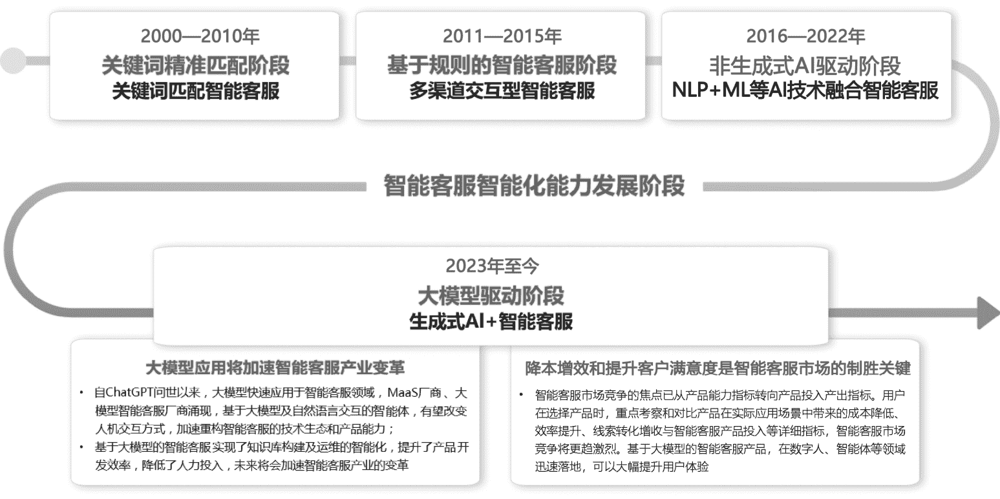

图 1-1

以 DeepSeek 技术为例，其通过将 MoE 架构与多模态技术融合，实现了从“规则响应”到“智能决策”的跨越。例如，在金融领域中，早期智能客服只能依据预设规则解答简单的业务咨询，面对复杂的咨询则无能为力。随着技术的演进，如今的智能客服系统根据客户财务状况和需求借助 LLM 能提供个性化的投资建议，这一转变充分体现了智能客服系统的巨大进步。

**1. 关键词精准匹配阶段（早期阶段）**

在智能客服系统发展的早期阶段，关键词精准匹配方法是主要的技术手段。那时候的智能客服系统，就像一个简单的“信息检索器”，其核心原理是在预先设定的文本库中，严格比对客户输入的内容与已有的关键词。比如，企业针对常见问题整理出一系列关键词，像电商领域中的“发货时间”“退款流程”“商品尺寸”等。在客户提出问题后，系统快速扫描客户输入的文本，一旦发现与预设关键词完全匹配的内容，就从对应的答案库中提取并返回相应的解答。

当时这种方法在一定程度上提高了服务效率，相比于完全依靠人工逐一回复，它能快速处理一些简单、常见的问题。例如，当客户询问“我购买的商品什么时候发货”时，系统只要检测到“发货时间”这个关键词，就能迅速给出预设的发货时间说明，如“一般情况下，订单付款后 48 小时内发货”。

然而，这种方法存在诸多明显的局限性。一方面，它依赖预设的关键词库，对关键词的匹配要求极为苛刻，必须完全一致才能生效。另一方面，它完全不理解语句的语义和上下文关系，只是机械地匹配关键词。这使得它在面对稍微复杂一点的问题时显得力不从心。例如，电商场景中的“退款”“发货”等问题能触发固定回复模板，但当系统面对“我的快递显示签收但没收到”这类变体问题时，匹配准确率仅为 60%～70%。而且，随着业务的不断拓展和客户问题的日益多样化，系统需要维护的关键词和对应答案的数量呈指数级增长，管理和更新成本极高。尽管存在这些不足，关键词精准匹配方法作为智能客服发展的起点，为后续先进技术的出现奠定了基础。

**2. 基于规则的智能客服阶段（标准化阶段）**

后来的智能客服系统依靠预设规则来处理客户请求，如通过 if-then 规则引擎处理结构化问题。例如，银行客服系统中的“账户余额查询”需求需依次验证“身份信息→账户类型→查询权限”。这种方法虽在一定程度上提高了服务效率，减轻了人工客服的工作负担，但当面对复杂多变的客户需求时，它常常显得捉襟见肘，尤其在处理非结构化问题方面表现乏力。另外，维护一个庞大且详细的规则库需要耗费大量的人力资源，每次调整规则或添加新知识都需要经过严格的测试，以确保系统的稳定性和准确性。规则库的维护成本随业务复杂度呈指数级增长，实际上这种方法属于人力密集型方法，性价比并不高。例如，某股份制银行的信用卡分期规则迭代导致季度维护成本增加了 45%。

**3. 非生成式 AI 驱动阶段（智能化过渡阶段）**

随着人工智能技术的发展，特别是机器学习领域的突破，智能客服系统开始采用更先进的方法来提高自身的智能化水平，这一转变标志着智能客服系统进入新的发展阶段。通过对大量的历史会话数据进行训练，机器学习模型能够自动学习如何更准确地理解客户意图并动态选择最佳响应方式。与传统的基于规则的方法相比，这种方法显著提升了系统的灵活性和适应能力，使其能够处理更多样化的查询类型。同时，NLP 技术的进步让机器能够更好地解析人类语言中的细微差别，从而提供更加个性化且富有同理心的服务体验。尽管如此，在面对一些深层次的理解需求，如情感分析、逻辑推理等方面的需求时，这个阶段的智能客服系统仍存在一定的局限性。在本阶段，基于 DeepSeek 可以进行如下技术实践。

·动态路由机制：区别于传统 Transformer 架构的固定计算路径，DeepSeek-MoE 通过专家网络集群动态分配计算资源，在金融客服场景中将“理财产品组合推荐”的推理成本降低 40%，响应速度提升 35%。

·强化学习优化：在证券业陪练脚本生成任务中，通过深度强化学习（Deep Reinforcement Learning，DRL）实现了 95%的意图识别准确率，较传统模型提升了 15%。

**4. 大模型驱动阶段（智能化进阶阶段）**

近几年来，随着深度学习技术尤其是大规模预训练语言模型（如 BERT、GPT 系列等）的兴起，智能客服行业迎来了革命性变革。这些大模型拥有前所未有的学习能力，在几乎无人干预的情况下，能够通过对海量互联网文本的学习，自主掌握广泛的知识背景，并具备出色的上下文理解能力、复杂问题解决能力和多模态信息处理能力。它们不仅能利用多种语言与人交流，还能理解图像内容甚至视频信息。更重要的是，这类模型可以模拟人类的思维方式，在特定情境下展现出创造性思维，为客户提供超出预期的帮助。得益于云计算的支持，即使面对数百万名客户的并发请求，大模型依然能够保持高效稳定的性能表现。

·多模态融合能力：搭载门控多模态路由器，大模型支持文本、语音、图像输入的动态权重分配。例如，在医疗咨询场景中，系统自动分配 73%～92%的权重至患者上传的 CT 影像或症状文本，实现“影像特征+主诉信息”的联合推理，对肺结节良恶性判断的准确率高达 91.7%。

·情境感知引擎：通过时空同步对比学习（ST-CL）技术，在视频客服中实现了毫秒级时间戳与 ASR 字幕的精准对齐，解决了传统系统“因音画不同步导致意图误判”的痛点问题，典型对话的流畅度提升 60%。

经过上述几个阶段的技术迭代升级，智能客服系统逐渐从简单的信息检索工具演变成能够理解并参与复杂讨论、提供全方位支持的高级助手。未来，随着相关研究的不断深入及应用场景的持续扩展，相信智能客服系统在提升客户体验、优化业务流程，乃至推动社会数字化转型等方面发挥越来越重要的作用。

### **1.1.2 排队论在客服系统中的应用**

排队论，亦称随机服务系统理论，是一门深入探讨顾客到达、排队等待及接受服务过程的理论体系。它以严谨的数学方法为基础，通过精准分析客户到达间隔时间的概率分布、服务时长的概率分布、服务人员数量配置等关键因素，科学预测和优化系统的各项性能指标，如平均等待时间、队列长度、服务人员利用率等。在当今追求高效与优质服务体验的时代，排队论对于客服系统的设计与优化，犹如一位精算师，通过精准测算与动态调整，在服务资源有限的情况下实现客户等待成本与企业运营成本的最优平衡，让每一份服务资源都能创造出最大价值。

以在线教育行业为例，在课程咨询高峰时段，通过排队论模型分析学生咨询到达率和客服平均服务时间，优化客服人员配置和排班安排，可显著缩短学生等待时间、提升咨询服务效率，同时提升学生对教育机构的满意度。尤其在人力服务资源与算力服务资源均受限的情况下，该模型能够为智能客服系统的资源分配提供精准优化策略，在提升服务质量、客户满意度的同时，有效控制运营成本，大幅提升系统的运行效率。

在排队论的众多模型中，*M*/*M*/1 和*M*/*M*/*N*模型对理解和优化客服系统有重要的应用价值。其中，第一个“*M*”表示客户到达过程服从泊松分布，即客户到来的时间间隔是随机且相互独立的，其概率分布符合泊松分布；第二个“*M*”表示服务时间服从负指数分布，即服务每个客户所需的时间也是随机且相互独立的，其概率分布符合负指数分布；“1”代表只有 1 个服务人员，“*N*”代表有*N*个服务人员，*N*是大于或等于 2 的整数。如图 1-2 所示，如果客户源到达的时间间隔服从泊松分布，客户形成排队队列，并有*N*个服务窗口且每个服务窗口完成服务的时间都服从相同的负指数分布，则该排队服务模型即为*M*/*M*/*N*模型。若仅有 1 个服务窗口，即*N*=1，则该排队服务模型为*M*/*M*/1 模型。

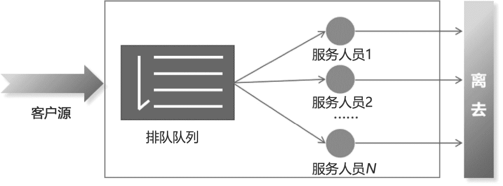

图 1-2

**1. 客服系统的统计复用需求**

统计复用，从本质上来说，是一种基于统计学原理的资源动态分配策略。其核心在于利用客户需求或任务到达的统计特性，在多个客户或任务之间灵活分配有限的资源，从而实现资源利用率的最大化。在客服系统的场景中，客服人员与算力等资源均属于被复用的对象，而客户的来电需求则是等待被服务的任务。

在智能客服系统的实际工作场景中，每一通来电都代表一个具体的客户服务需求，而客户服务提供者，即客服人员，则扮演着为这些需求提供服务的“服务员”角色。依据“服务员”的数量及其配置方式，可以将客服系统分为单服务员客服系统与多服务员客服系统两大类型。

顾名思义，单服务员客服系统就是仅有一位客服人员处理所有的来电。例如，一家专注于小众手工制品的网店，在店铺运营初期，业务量较小，仅配备一位客服人员。在非促销时段，该客服人员能够较好地应对客户咨询，但在新品上架等咨询高峰时段，客户等待时间明显变长，部分客户甚至因等待过久而放弃咨询。这种模式适用于小型企业，或者在特定时段内来电数量较小的情况。从排队论的角度来看，单服务员客服系统对应*M*/*M*/1 模型。在*M*/*M*/1 模型中，所有客户只能在一条队列中等待服务，统计复用的程度相对较低。因为一旦客服人员处于忙碌状态，后续到达的所有客户都不得不进入等待队列，这极有可能导致客户等待时间过长，进而引发服务体验下降。

与之形成鲜明对比的是多服务员客服系统，该系统有多位客服人员共同响应和处理客户需求。大型连锁酒店的客服中心就拥有典型的多服务员客服系统。在旅游旺季，大量客户来电咨询酒店预订、入住政策等问题，需要众多客服人员协同工作，即通过合理运用*M*/*M*/*N*模型，根据历史数据预测话务量，动态调整客服人员数量，确保客户问题得到及时解答，提升客户的入住体验。多服务员客服系统在排队论中通常对应*M*/*M*/*N*模型。在*M*/*M*/*N*模型中，系统的性能表现更为复杂且与客服人员数量（*N*）紧密相关。当有多位客服人员时，根据客服人员的忙碌状态，新到达的客户会被动态地分配到空闲的客服人员那里接受服务，这大大提高了统计复用的程度。因为即使部分客服人员处于忙碌状态，其他空闲的客服人员仍可继续接听新的电话，从而有效分散工作量，大幅缩短客户的等待时间。这种模式特别适合大规模的企业，或者在服务高峰时段应用，如大型电商平台的购物节期间。

然而，在多服务员客服系统中，增加客服人员不可避免地会带来运营成本的增加，包括人力成本、培训成本等。另外，根据*M*/*M*/*N*模型的相关理论和计算方式，可知，当客服人员数量过多时，虽然客户等待时间会进一步缩短，但客服人员的闲置时间可能会增加，导致资源浪费、利用率降低。因此，如何配置合适数量的客服人员，使其既能充分满足客户服务的需求，又能最大限度地提高客服人员的生产能力利用率，在统计学意义上实现保证足够的客户满意度与充分利用服务资源之间的平衡，就成为客服系统设计中的关键问题。而排队论恰好为解决这一问题提供了科学的理论与方法，通过*M*/*M*/*N*模型可以计算出不同服务水平要求下最优客服人员的数量，从而为实际的客服系统规划提供有力支持。

**2. 排队系统影响因素与优化策略**

在客服系统中，存在诸多影响其效率的因素，而*M*/*M*/1 和*M*/*M*/*N*模型能够为深入分析这些因素及制定优化策略提供有力的工具。

其中，客户到来的频率是一个重要的影响因素。在*M*/*M*/1 和*M*/*M*/*N*模型中，均假设客户的到达过程服从泊松分布，这意味着在给定的时段内，客户到达的概率只与时间长度有关且相互独立。服务时间的长短同样至关重要，一般认为服务时间服从负指数分布，即服务时间的概率密度函数随着时间的增加呈指数式衰减。当客户到来过程服从泊松分布且服务时间服从负指数分布时，*M*/*M*/*N*模型可以精确计算出达到特定的服务水平目标所需的客服人员数量。例如，某客服中心希望将客户的平均等待时间控制在 2 分钟以内，通过 Erlang C 公式，结合历史客户到来频率和平均服务时间数据，利用对*M*/*M*/*N*模型的相关参数设定，就可以计算出合理的客服人员数量。

客服人员的数量在*M*/*M*/*N*模型中是一个关键变量，直接关系到系统的服务能力和运营成本。过多的客服人员会增加成本，而过少的客服人员则可能导致客户等待时间过长、服务质量下降。

智能排队算法是提高客服系统效率的一种重要优化策略，在*M*/*M*/*N*模型中也能得到很好的应用。这些算法可以基于多种原则进行设计，如优先安排最长空闲时间的客服人员，确保客服人员的工作负荷相对均衡；优先安排回答次数最少的客服人员，有助于新员工积累经验；优先安排技能最高的客服人员来处理复杂问题，提高问题解决的效率。这些算法能够根据不同业务场景的实际需求，结合*M*/*M*/*N*模型中客服人员的状态变化，灵活调整资源分配，提高系统的整体效率。

在实施差异化服务策略方面，*M*/*M*/*N*模型也能提供有益的指导。根据客户的价值、重要性或紧急程度等因素，它可以为不同的客户群体设置不同的优先级。例如，对于高价值客户，通过设置较高的接通率标准，使他们的来电在较短的时间内得到响应，从而提升他们对品牌的忠诚度。在*M*/*M*/*N*模型中，通过调整相关参数，模拟不同优先级客户在系统中的排队和服务过程，可以评估和优化差异化服务策略的效果。这种差异化服务策略可以在不增加过多资源的情况下，有效提升客户的整体满意度。

**3. 资源管理与排班优化**

在客服系统中，资源管理与排班优化是确保系统高效运行的关键环节，而排队论中的*M*/*M*/1 和*M*/*M*/*N*模型为这一环节提供了科学的理论支持。

合理规划客服人员的工作对于维持客服系统的高效运行至关重要。基于排队论的预测模型可与*M*/*M*/*N*模型深度结合：首先通过分析历史数据中客户来电的时间分布、通话时长等信息，建立时间序列模型或回归模型等预测工具，精准预测不同时段的话务量；然后结合*M*/*M*/*N*模型对服务人员数量和服务时长分布的特性分析，最终确定各时段所需的最优客服配置，确保服务资源与话务需求动态匹配。根据预测结果，管理者可以制订科学合理的排班计划，合理安排客服人员的工作时间和班次，确保在话务高峰期有足够的客服人员来满足客户需求，在低谷期避免客服人员闲置，从而平衡人力资源成本与服务质量之间的关系。

面对季节性波动或者突发性事件引起的话务量变化，提前准备应急预案并灵活调整客服人员配置是非常必要的。例如，在电商购物节期间，话务量大幅增加时，基于*M*/*M*/*N*模型的分析可以提前预测话务量的增加幅度，从而增加客服人员的数量或者调整现有人员的工作时间，以应对高峰期的压力。*M*/*M*/*N*模型通过对不同客服人员进行配置和对话务量系统的运行指标进行模拟，如平均等待时间、客服人员利用率等，可以为决策提供依据。在话务量低谷期，可以安排客服人员参加培训活动，提升他们的业务能力和服务水平。

引入自动化工具来辅助排班决策过程，能进一步提高客服系统的工作效率和服务质量。运用机器学习技术对历史排班数据、话务量数据及*M*/*M*/*N*模型参数进行深入分析，可以识别其中的模式和规律，并生成最优的排班方案。例如，机器学习算法可以根据不同客服人员的工作效率、技能水平及历史排班记录，结合*M*/*M*/*N*模型中客服人员的工作状态变化，自动生成满足服务需求和成本要求的排班计划，从而降低了人工排班的工作量和主观性，提高了排班的准确性和合理性。

总之，通过对排队论中*M*/*M*/1 和*M*/*M*/*N*模型的深入理解和应用，能够让客服系统在保证良好客户体验的前提下实现资源的有效利用。无论是通过模型分析优化服务流程、改进排队机制，还是结合模型参数进行精细化人员管理，都能显著提升系统的整体运营效率。从准确计算客服人员数量到合理制订排班计划，排队论为客服系统的各个环节提供了科学的决策依据，使企业在激烈的市场竞争中更好地满足客户需求、提升服务品质。

## **1.2 智能客服系统的工作原理**

智能客服系统的内在运作机制融合了多项关键技术，涉及信息接收、请求处理、多轮对话与情感分析、资源调度与排队优化四个阶段。这些技术共同构建了一个高效且人性化的客户服务解决方案，旨在通过自动化与智能化手段提升服务效率和客户满意度。

### **1.2.1 信息接收阶段**

智能客服系统主要通过语音识别技术和文本输入技术获取客户需求。以电商平台为例，促销期间的信息接收量会大幅增加。此时，系统会实时监控不同渠道的流量变化，若发现某渠道（如 App 端）的咨询量激增，可提前调配更多资源处理该渠道的客户请求，确保信息接收的及时性和准确性。

对于电话形式的服务请求，自动语音识别（Automatic Speech Recognition，ASR）技术能够将客户的口头表达转换为计算机可处理的文本。以 DeepSeek-R1 为例，其采用自研语音增强算法，在嘈杂环境（如地铁、商场）中实现了 89.3%的语音识别准确率，较传统方案提升了 12%。其动态降噪模块可实时分析背景音频率，自动过滤 85 分贝以上的环境噪声，尤其适用于金融客服场景中“账户密码输入”等敏感信息的精准采集。

在证券交易场景中，DeepSeek 对“股票代码查询”“交易指令”等专业术语的识别准确率达 95%，较传统 ASR 方案提升了 20%，显著降低了由语义误解导致的交易风险。针对网页聊天或即时消息等文字交流场景，系统直接提取客户的输入内容。多渠道接入模块负责整合不同平台（如网页、App、微信等）的客户请求，确保信息准确传递。

从排队论的角度来看，这个阶段需要对客户请求的到达进行实时监控和统计，分析历史数据和实时流量以预测不同时段、不同渠道的客户请求到达率，为后续的资源分配和排队策略提供依据。例如，根据以往的经验，周末和工作日的晚上可能是电商平台客户咨询的高峰期，系统可以提前调整资源配置，以更好地应对高流量。

### **1.2.2 请求处理阶段**

此阶段的核心技术包括自然语言理解（Natural Language Understanding，NLU）、对话管理和知识库应用。DeepSeek-V3 模型拥有 6710 亿个参数，其中每个 token 推理时仅激活 370 亿个参数，显著降低了显存占用。该模型基于 14.8 万亿个 token 进行预训练，能够根据客户意图动态激活相应模块的处理请求。研究表明，类似的动态激活机制优化在审读学习推荐系统中可将准确率提升 20%～30%。如果将 DeepSeek 的 MoE 架构应用于电商场景，预计“多 SKU 组合推荐”的点击率可提升 20%～30%。

在医疗咨询场景中，患者描述症状的语言可能较为模糊，自然语言理解模块需要准确理解患者表述，如患者说“最近总是头疼，还感觉没力气”，系统要能提取关键症状，并结合医学知识图谱为对话管理系统提供准确信息，以便给出合适的回复和建议。

自然语言理解模块的核心功能是解析接收的消息，不仅要识别其中的关键词，还要准确理解完整句意和上下文语义，这是生成恰当回复的基础。对话管理系统会基于上下文信息维护会话状态，并动态决策后续交互策略，包括继续询问获得更多信息或直接提供最终解决方案。

在此过程中，知识库发挥了重要作用，构建了常见问题及其答案的知识图谱，帮助系统快速检索最佳答案。智能客服系统利用机器学习算法不断优化自然语言理解和对话管理能力，并基于对大量历史对话数据的学习和分析，精准理解客户意图并提供准确回答。知识图谱技术的应用显著提升了系统的信息检索能力和整合效率，从而改善了回答质量和响应速度。

DeepSeek 在此阶段可以实现如下核心功能。

·跨模态语义对齐：针对“我需要预约明天上午的视频客服”这类多模态请求，DeepSeek 通过 GMR 模块动态激活“时间解析”和“渠道选择”专家网络，实现了 95.1%的复杂意图识别准确率（较开源模型提升 15%）。

·知识图谱嵌入：在处理“股票分红政策”等专业问题时，自动关联企业财报、金融法规等外部知识库，生成包括“分红率计算→税务影响”的多层级回答，覆盖 87%的金融高频咨询场景。

从排队论的应用角度来看，这一阶段需要对每个请求的处理时间进行建模分析，通过对历史处理时间的统计分析，可以确定服务时间的概率分布特征。例如，简单咨询问题的处理时间通常较短且分布集中，而复杂咨询问题的处理时间则较长且分布分散。基于这些分析结果，系统可以更合理地安排请求的处理顺序，避免因某些请求长时间等待而导致客户满意度下降。常见的优化策略包括为紧急问题或高价值客户请求设置更高的优先级。

### **1.2.3 多轮对话与情感分析阶段**

为提供更加自然流畅的人机交互体验，多轮对话能力变得越来越重要。系统通过持续跟踪对话历史，在连续交流中保持逻辑连贯性，确保每轮对话都建立在前几轮的基础上，避免重复提问或产生误解。此外，借助情感分析技术，智能客服能感知客户情绪变化并相应调整响应方式，使交互更具人性化。

以 DeepSeek 的情感分析技术为例，该技术通过语音语调、面部表情等多模态数据，实现了高达 91.7%的情绪识别准确率。在电商售后场景中，当检测到客户因物流延误产生不满情绪时，系统会自动触发“致歉+优先处理”流程，其情绪响应准确率较传统规则引擎提升了 30%，客户投诉率下降了 25%。

从应用价值来看，多轮对话和情感分析是提升客户体验的关键技术。这些功能与智能客服系统的深度整合能提供更加个性化、人性化的服务体验。通过情感分析及时发现客户的不满或焦虑情绪，并采取针对性措施来解决问题，可显著提升客户满意度和忠诚度。

在排队系统框架下，这些技术还能优化排队策略。当检测到客户情绪较为激动或问题较为紧急时，系统可以动态调整该客户的排队优先级。对于需要多轮对话解决的问题，系统会根据对话复杂度和剩余轮数合理预估剩余处理时间，实现更科学的排队顺序和资源分配。

### **1.2.4 资源调度与排队优化阶段**

排队论在合理配置有限的人力资源和算力资源以满足大量并发服务需求方面发挥着重要作用。通过对服务请求到达模式、处理时间分布等因素进行建模分析，可以预测不同时段的工作负荷，并据此制定最优的资源配置方案。

例如，在高峰期增加机器人座席或者调配更多的人工客服，在低谷期适当缩减人员规模，实现成本控制与服务质量的平衡。资源调度模块基于排队论模型和算法可实时监控和调整资源分配。采用动态负载均衡算法将客户请求均匀分配给各客服座席或机器人，避免资源分配不均的情况。同时，结合机器学习技术，对资源的使用情况进行预测和优化，持续调整资源配置方案以适应业务需求变化。

排队论还可用于优化排队规则。除传统的先来先服务规则外，系统还支持基于优先级、服务时间预估等多种排队策略。例如，为 VIP 客户设置更高的优先级或优先处理预计耗时较短的请求。系统会根据实时排队情况和资源利用率动态调整排队规则，实现资源的高效利用。

现代智能客服系统凭借其强大的信息处理能力和灵活的服务调度机制，已成为各行业不可或缺的组成部分。无论是简单的业务咨询还是复杂的交易处理，都能提供 7×24 小时不间断服务，在提升客户体验的同时为企业发展带来新机遇。随着 AI 算法和大数据技术的持续发展，智能客服将变得更加智能和人性化，为每一个需要帮助的客户提供更优质的服务体验。

## **1.3 构建智能客服系统**

智能客服系统并非单一形态，而是通过在线聊天机器人、语音助手等智能交互载体与传统人工客服系统有机融合。这种模式打破了传统服务模式的局限，既利用智能技术实现了全天候高效响应，快速处理标准化、高频次的需求，又保留了人工客服在处理复杂问题和情感诉求时的专业与温度，在提升服务效率的同时确保服务质量。在这一过程中，排队论的思想、方法和技术贯穿始终，与业界最先进的智能客服系统的业务架构、技术架构、应用架构紧密呼应，为提升智能客服系统的性能表现和客户体验提供了有力支持。

在效率方面，自动化工具显著缩短了客户等待时间。例如，某快递企业引入智能客服后，80%的常见问题由自动客服处理，客户平均等待时间缩短 50%，大大提高了服务效率。从排队论的角度来看，自动客服就像多个并行的服务通道，能够快速处理大量简单且重复的请求，有效降低了队列长度。在线聊天机器人可以立即响应超过 90%的常见咨询，这类咨询通常占总咨询量的 70%～80%。这意味着大多数简单且重复的问题都可以在第一时间得到解决。

在业务架构中，多渠道接入模块将各类咨询请求汇总后，依据排队论规则将符合自动处理的请求优先分配给在线聊天机器人。同时，技术架构中的智能算法根据机器人的实时负载动态调整分配，最大化利用资源。

智能语音助手通过语音识别和 NLP 技术，能准确解答大部分来电问题，从而减少了转接到人工座席的次数。例如，某电信运营商优化语音助手后，每月转人工座席的次数减少 35%，整体通话时长降低 30%，有效提升了整个客服系统的运作效率。

在应用架构中，语音助手与自动语音识别、自然语言理解等模块紧密协作，通过对服务请求到达模式和处理时间分布进行分析，建立排队模型。根据排队论，系统可以预测不同时段的工作负荷，提前做好资源调配。比如，在话务高峰期，自动增强语音助手的处理能力，或者优化语音识别和理解的算法来提高处理速度，进而缩短客户等待时间。

对于需要更深层次理解或特定领域专业知识的复杂问题，自动客服会无缝将对话转移给人工客服。这种“人机协作”模式相当于为不同请求设置优先级：简单问题由自动客服处理，复杂问题分配给专业的人工客服。比如，在处理复杂的退货请求或涉及隐私信息变更的过程中，虽然初步的信息收集可以通过自动化手段完成，但最终决定还是由经验丰富的人工客服做出的，从而保证了解决方案的专业性和准确性。在业务架构中，智能路由模块会根据问题的复杂度和人工客服的技能水平进行精准分配。技术架构中的智能算法会不断学习和优化这一分配过程，并结合排队论动态调整策略，确保人工客服资源得到最合理的利用。

值得一提的是，当前技术还支持人工介入后将会话交还机器人执行后续标准化步骤。例如，某电商在大促期间，DeepSeek 利用动态负载均衡算法，结合 MoE 架构的稀疏门控技术，将“订单查询”“退款申请”等高频问题的处理效率提升 60%，GPU 资源消耗降低至传统 Transformer 架构的 1/3，实现“低成本高并发”的服务目标。

更重要的是，这种混合模式还能提升个性化服务水平。一方面，基于 AI 驱动的知识图谱和多轮对话机制使机器能够提供更加贴近客户需求的回答；另一方面，人工客服可根据客户的个人偏好调整沟通方式，并运用同理心建立情感联系，这是任何现有 AI 工具都难以完全复制的能力。

从排队论的角度看，个性化服务可以通过对客户的分类和优先级设定来实现。在业务架构中，客户画像模块会根据客户历史记录、行为偏好等信息生成个性化服务标签。技术架构中的智能算法基于这些标签，结合排队论的优先级规则为不同客户提供差异化服务。例如，对于重要客户，系统会优先安排人工客服进行服务，并且在服务过程中给予更多的关注和资源。

研究表明，良好的客户体验需要平衡效率与温度。企业应通过数据分析持续优化服务策略，动态调整人机协作比例。将自动客服与人工客服有机结合是构建智能客服系统的核心，也是服务业转型的重要方向。通过不断完善这一体系并应用排队论，未来将会出现更多的创新应用场景，推动行业向更智能、更人性化的方向发展。

在这个过程中，排队论将持续为智能客服系统的优化提供理论支持和实践指导，助力企业为客户提供更加优质的服务体验。

## **1.4 智能客服系统业务架构**

智能客服系统旨在优化企业与客户的互动流程，助力客户服务、市场营销及销售等核心业务。其功能实现依托于智能客服系统业务架构（如图 1-3 所示），该智能客服系统采用分层架构，包括从上到下的生产运营层、运营管理层、系统管理层，以及右侧的外围系统，各组件协同运作，帮助企业高效满足客户需求。

**1. 生产运营层**

生产运营层作为业务执行核心层，直接面向客户服务场景，被拆解为接触渠道、接触处理、生产支撑三大功能域。接触渠道提供电话、互联网、短信、客户经理、营业厅五类客户触达入口；接触处理承接渠道流量，通过客户服务、市场管理、销售模块响应客户需求；生产支撑为接触处理提供后端保障，包括工作台、工单管理、知识管理、营销管理、客户管理、现场管理等模块。

接触处理流程贯穿生产运营层的核心业务，是智能客服系统高效服务客户、实现业务目标的关键支撑。这里重点对其进行介绍，图 1-4 展示了这一过程的业务逻辑与流转路径。

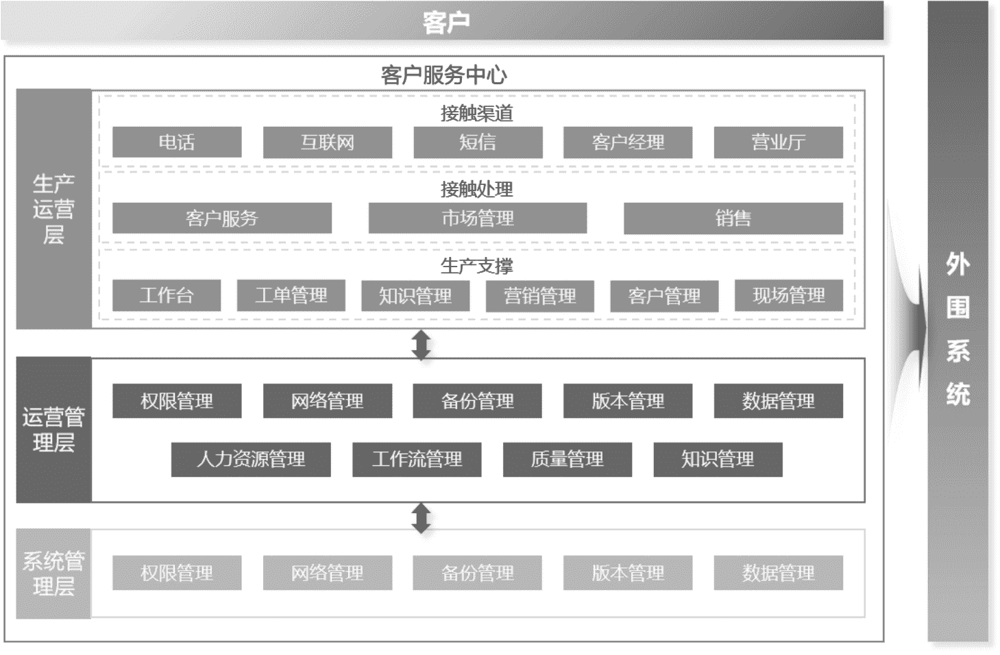

▲图 1-3

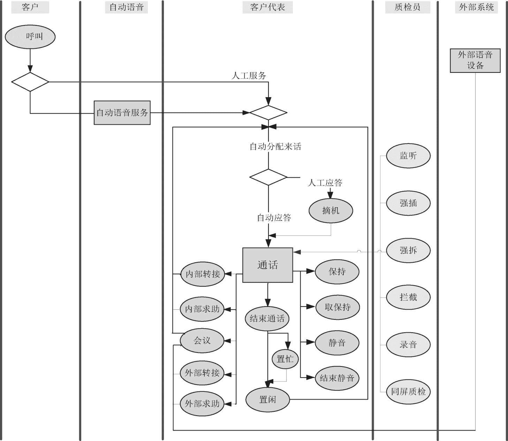

▲图 1-4

客户发起呼叫后，系统首先进行自动语音服务与人工服务的分流。自动语音服务处理常见业务咨询、简单信息查询等，通过语音导航与预设答案快速响应，这既能即时满足部分客户需求，又能减轻人工客服的压力，提升整体服务效率，与生产运营层通过多渠道高效服务客户的理念相契合。当自动语音服务无法满足客户需求时，呼叫进入人工服务流程。自动分配机制基于客服技能、忙碌状态等因素，将呼叫精准派发给最合适的客户代表，确保客户得到专业、及时的服务，这体现了生产运营层合理调配资源，以优化客户服务体验的业务策略。客户代表与客户通话期间，内部转接、内部求助、会议等功能，是生产运营层协同作业的具体体现。面对复杂问题，客户代表可借助团队力量，通过内部协作快速、准确地解决客户问题，展现了生产运营层整合资源、提升服务质量的能力。

外部转接与外部求助功能实现了与外部系统的连接，可灵活调用更多的资源满足客户的多样化需求。通话结束后，置忙/置闲状态的设置，是生产运营层对客服工作状态管理的重要手段，便于合理安排客服工作节奏，确保服务资源合理分配。质检员的监听、强插、强拆、拦截及录音和同屏质检等操作，是生产运营层质量管控体系的重要组成部分。通过实时监督与事后复盘，质检员能及时发现服务问题，确保服务质量稳定提升。

**2. 运营管理层**

运营管理层聚焦业务流程与资源优化，承接生产运营层，既延续系统管理层的权限、网络、备份、版本、数据等管理（与系统管理层协同），又新增人力资源管理（配置客服人力）、工作流管理（定义标准化流程）、质量管理（建立服务质检体系）、知识管理（沉淀客服知识库）等业务调控模块。

图 1-5 为人力资源管理模块的组成及与其他模块的交互。其包括人事管理、排班管理、培训管理、绩效管理四个核心模块，以及质量管理和知识管理两个底层支撑模块。

人事管理接收来自排班管理的人力资源预测、劳务调整等信息，以及培训管理的培训信息和绩效管理的绩效结果，并向排班管理输出人力规划指令，向培训管理传递能力需求信息。

排班管理接收人事管理的人力规划指令，依据员工的工作表现在排班时进行合理考量，比如将绩效优秀的员工安排在业务高峰时段或重要岗位，以充分发挥其优势，并向绩效管理输出出勤信息/绩效数据。

培训管理接收人事管理的能力需求信息和知识管理的知识信息，并向绩效管理输出绩效数据，向人事管理反馈培训信息。

绩效管理接收排班管理的出勤信息/绩效数据和培训管理的绩效数据，向人事管理输出绩效结果，向排班管理输出优化建议。

质量管理包括质量标准管理（如定义质检规则等）和综合质量管理（如输出质检结果等），向绩效管理传递绩效数据。

知识管理包括知识库管理（如保存话术、知识手册等）和典型案例（如沉淀方案等），向培训管理输出知识信息。

在数据流转上，人事管理依据排班（业务需求）、绩效（能力现状）、培训（成长潜力）数据优化人力配置；绩效管理校验排班的合理性和培训的有效性，借人事决策推动全流程迭代，适配智能客服人力需求。

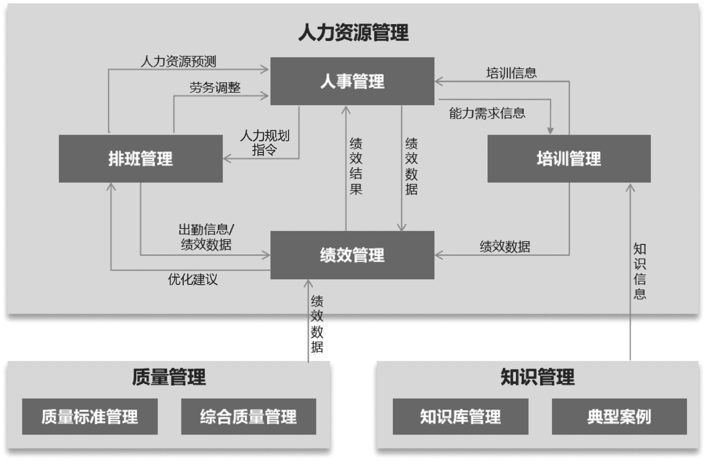

图 1-5

**3. 系统管理层**

系统管理层是智能客服系统的基础支撑，包括权限管理、网络管理、备份管理、版本管理、数据管理等模块，各个模块的功能如下。

·权限管理：构建系统访问权限体系，精准划分不同角色（如客服、管理员等）的操作权限，保障系统数据与功能安全，防止未授权访问与误操作。

·网络管理：负责维护系统网络的连通性与稳定性，实时监测网络状态，排查网络故障，确保客户与系统、系统各个模块间的数据传输顺畅，为客户服务提供稳定网络环境。

·备份管理：定期对系统关键数据（如客户信息、工单数据等）进行备份存储，制定备份策略，在数据丢失、系统发生故障时，可快速恢复数据，保障业务连续性。

·版本管理：统筹系统功能迭代与版本更新，记录版本变更内容，管理版本发布流程，确保系统功能持续优化，同时兼容历史数据与业务流程。

·数据管理：实现业务数据的集中存储、分类检索与分析挖掘，整合客户交互数据、业务流程数据等，为运营管理层、生产运营层提供数据支撑，辅助业务决策与优化。右侧外围系统为可选扩展，可对接企业现有系统（如 CRM、ERP 等），实现客户服务数据与业务系统数据双向流通，延伸架构协同能力。

各层之间形成“业务执行→流程调控→技术支撑”的垂直协同：生产运营层输出业务需求，驱动运营管理层配置流程与资源；运营管理层调用系统管理层的技术能力保障业务顺利进行；系统管理层提供稳定底座，支撑全流程高效运转，呈现智能客服系统功能协作闭环。

## **1.5 智能客服系统技术架构**

构建高效稳定的智能客服系统的关键在于技术架构设计。从呼叫中心基础标准到接口设计，再到性能指标与安全性考量，每个环节都需要精心规划，这样才能确保系统的整体表现达到最优状态。图 1-6 展示了一种粗颗粒度的智能客服系统技术架构，其包括呼叫中心平台、呼叫中心应用、接口等关键组成部分。

图 1-6

不同行业对呼叫中心系统技术架构的需求存在差异。例如，金融行业对安全性要求较高，倾向于选择稳定性强、加密技术成熟的架构；互联网企业更注重灵活性和可扩展性，通常采用基于软交换（Soft Switch）的创新架构，以支持业务快速发展。传统系统架构通常基于交换机、软交换技术构建且每种架构各具优势。例如，采用软交换的解决方案不仅支持语音通信，还能无缝集成文本聊天、视频通话等多种交互方式，为客户提供更加丰富和便捷的服务体验。

图 1-7 展示了一种完整的呼叫中心平台系统架构，其包括接入层服务组件、中间件服务组件、客户层组件及存储与配置组件。

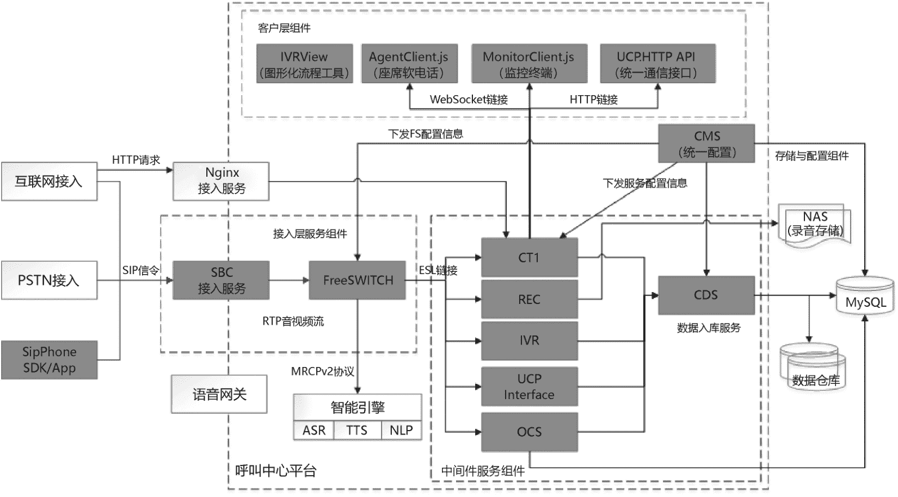

图 1-7

**1. 接入层**

互联网接入与 PSTN（Public Switched Telephone Network，公共交换电话网络）接入：呼叫中心支持互联网接入、PSTN 接入和 SipPhone SDK/App 三种接入方式。互联网接入通过 HTTP 请求将服务接入请求发送至 Nginx 接入服务；这三种接入方式也可以通过 SIP 信令将服务接入请求传输至 SBC（Session Border Controller，会话边界控制器）接入服务。

接入层服务组件：SBC 接入服务将信令传递至 FreeSWITCH，由 FreeSWITCH 处理 RTP（Real-Time Transport Protocol，实时传输协议）音视频流。这几部分构成接入层服务组件，实现不同接入方式的信令处理和音视频流传输。Nginx 接入服务主要处理互联网接入的 HTTP 请求。

**2. 中间件服务组件**

CTI（Computer Telephony Integration，计算机电话集成）：作为呼叫中心的核心控制组件，CTI 接收来自 FreeSWITCH 的 SIP 信令，并协调和管理呼叫的整个流程，是中间件服务组件的关键枢纽。

REC（Recording，录音）：负责对通话进行录音，并将录音数据存储到 NAS（Network-Attached Storage，网络附属存储）。

IVR（Interactive Voice Response，交互式语音应答）：与智能引擎（集成科大讯飞、阿里巴巴、百度、捷通科技等公司的 ASR、TTS、NLP 技术）配合，通过 MRCPv2 协议实现语音交互功能，如自动语音导航、语音识别和合成等。

UCP Interface（统一通信平台接口）：提供标准化通信接口，支持系统或组件的对接和交互。

OCS（Online Charging System，在线计费系统）：处理与计费相关的业务逻辑（若呼叫中心涉及计费场景）。

CDS（数据入库服务）：将通话记录、客户信息等存储到 MySQL 或数据仓库，以便后续查询、分析和管理。

**3. 客户层组件**

IVRView（图形化流程工具）：为客户提供可视化的 IVR 流程设计和管理工具，方便创建和修改交互式语音应答流程。

AgentClient.js（座席软电话）：座席人员使用的软电话客户端，通过 WebSocket 链接与系统进行通信，实现接听、拨打电话等功能。

MonitorClient.js（监控终端）：用于监控呼叫中心的运行状态、座席工作情况等，通过 HTTP 链接获取相关信息。

UCP.HTTP API（统一通信接口）：提供统一的 HTTP 接口，方便外部系统或其他组件调用呼叫中心的功能和获取数据。

**4. 存储与配置组件**

CMS（统一配置）：负责存储和管理整个呼叫中心平台的配置信息，并向各个组件下发服务配置信息等，确保各组件按照既定配置运行。

NAS（录音存储）：专门用于存储通话录音数据，为后续的质量检查、纠纷处理等提供依据。

数据库存储（MySQL 和数据仓库）：MySQL 和数据仓库用于存储呼叫中心的各类业务数据，支持数据的查询、分析和统计等操作，为呼叫中心的运营管理提供数据支持。

呼叫中心平台通过各层组件的协同运作，实现了呼叫接入、业务处理、流程控制及数据存储和管理的全生命周期管理，为运营人员提供可视化操作界面，全面满足呼叫中心的日常运营需求。

在系统集成方面，标准化接口不仅保障了内部组件间的高效通信，还通过开放 API 为第三方开发者提供了定制化的扩展能力。企业通过开放 API 将现有业务流程与客服平台进行整合，实现数据互通和服务协同，显著提升了运营效率和服务质量。此外，借助 WebRTC（Web Real-Time Communication，网页即时通信）等现代通信技术，系统可轻松实现互联网渠道的文字交谈、文件传输等扩展功能，持续拓宽客户服务边界。

性能监控是保障服务质量的关键环节。系统需要重点监测平均响应时间、首次解决率、客户满意度评分等核心指标，通过实时数据分析及时发现潜在问题，并采取相应的措施加以改进。

以 DeepSeek 的部署实践为例，其采用 FP8 混合精度训练的动态量化压缩技术，成功将模型推理延迟降低 40%，在金融客服场景下实现每秒 12000 次请求的处理能力，同时部署成本较传统大模型方案降低 65%，为中小企业提供了高性价比的私有化部署方案。在安全防护方面，考虑到网络安全形势日益严峻，保护客户隐私和敏感信息变得尤为重要。因此，在设计阶段应当充分考虑加密算法选择、访问权限设置、防火墙配置等因素，确保即使面对复杂多变的安全威胁也能使系统得到有效防护。

智能客服系统的建设是一项系统工程，需要在技术选型时考虑功能完备性、架构可扩展性、运维经济性等关键因素。只有选择与业务需求匹配的技术方案，才能在保障服务质量的同时，为未来的业务演进预留充足空间，最终实现客户体验与企业价值的双重提升。

## **1.6 智能客服系统应用架构**

在企业数字化转型背景下，智能客服系统的部署与运营已成为提升客户体验和业务灵活性的关键所在。要想实现这一目标，选择合适的应用架构尤为重要，图 1-8 展示了一种典型的智能客服系统应用架构。

此架构以“终端接入—网关调度—业务模块—技术支撑—存储”为核心链路，各组件的功能及协同逻辑如下。

支持 PC、手机、App 三类终端接入，作为客户与系统交互的入口，客户请求通过终端界面触发并流向后续网关层。

网关包括 API 内部网关和 API 外部网关，它们均基于 Kong 组件实现流量管控。API 内部网关负责系统服务间的请求转发，执行服务限流、API 管理、ACL 规则（控制内部服务调用权限）；API 外部网关承担外部请求的安全校验，执行认证授权、服务限流、API 管理、ACL 规则（拦截非法访问、防范恶意请求）。

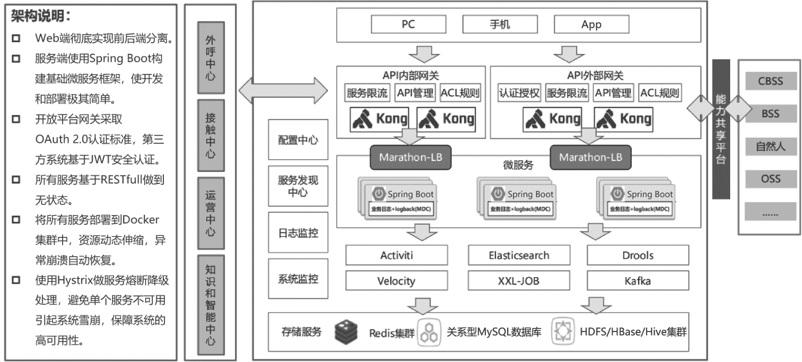

图 1-8

采用 Kubernetes 作为容器编排引擎，承载 Spring Boot 微服务（图中显示了多组 Spring Boot 实例）。Kubernetes 实现资源动态调度、故障自愈（如服务异常时自动重启、扩容等），保障系统的高可用性；微服务遵循 RESTful 设计规范，具备无状态特性，支持独立开发、部署与弹性扩展，降低模块耦合性。

左侧的“外呼中心—接触中心—运营中心—知识和智能中心”为业务功能载体，聚焦客服场景的业务逻辑实现，与中间技术组件协同提供服务。外呼中心作为主动触达客户的业务模块，用于发起外呼任务（如客户回访、营销推广、催办通知等）；与接触中心联动，共享通话资源、客户数据，实现外呼任务的流程化管理（如外呼脚本执行、结果记录等）。接触中心作为客户交互的核心枢纽，用于整合多渠道接入请求（电话、在线客服、App 咨询），并根据规则分配给人工客服或自动化服务；联动运营中心实现服务调度（如客服技能组分配），联动知识和智能中心获取应答支持（如知识库检索、智能推荐回复等）。运营中心聚焦系统运维与流程管控，包含四大管理模块：配置中心集中存储、管理系统全局配置（如客服排班规则、业务流程参数等），支持在线修改与热加载；服务发现中心基于注册中心（如 Eureka、Consul 等），实现微服务的自动注册与发现，保障服务间高效调用；日志监控采集系统全链路日志（如用户操作轨迹、服务调用记录等），用于问题排查、行为分析；系统监控实时监测服务器资源（CPU、内存、网络）、服务状态（响应时间、调用成功率），通过预警机制（如邮件、告警等）及时发现故障。知识和智能中心聚焦客服场景的智能化能力输出，依赖中间技术组件实现功能，而非直接“聚合组件”。其调用 Elasticsearch 提供知识库检索服务（如快速查询产品手册、常见问题答案等），支撑智能应答的知识匹配；调用 Drools 规则引擎，实现业务逻辑自动化（如工单流转判断、问答意图识别规则等）；调用 Kafka 消息队列，处理异步任务（如客服请求排队、会话结束后的质检任务触发等），削峰填谷，保障系统稳定；调用 Activiti 工作流引擎，编排客服业务流程（如投诉处理流程、工单审批流程等），推动业务标准化执行；调用 Velocity 模板引擎，生成动态文本内容（如个性化回复、报表导出等）；调用 XXL-JOB 分布式任务调度系统，执行定时任务（如夜间数据备份、报表生成、知识库更新等）。

其中，Activiti、Elasticsearch、Drools、Velocity、XXL-JOB、Kafka 为通用技术组件，独立于业务模块，为全系统提供基础能力。Activiti 是工作流引擎，支撑任意需要流程化的业务（如请假审批、复杂工单处理等）；Elasticsearch 是全文检索引擎，支撑知识检索、日志分析等场景；Drools 是规则引擎，解耦业务规则与代码，灵活配置逻辑（如优惠活动规则、权限校验等）；Velocity 是模板引擎，统一文本生成规范（如邮件模板、回复话术等）；XXL-JOB 是分布式任务调度系统，替代传统定时任务，支持海量任务的分片、重试；Kafka 是高吞吐量消息队列，削峰填谷，保障异步任务可靠传输（如客服会话消息异步处理等）。

采用混合存储架构，匹配不同类型的数据需求。Redis 集群作为缓存层，存储高频访问数据（如热门问题答案、用户会话缓存等），加速读/写响应；MySQL 存储结构化业务数据（如客户信息、工单详情、系统配置等），保障事务性与一致性；HDFS/HBase/Hive 集群承载非结构化/半结构化数据（如客服通话录音、长文本对话记录等），支持大数据量的存储、离线分析（如服务质量复盘、客户需求挖掘等）。

能力共享平台用于整合企业中台能力（如 BSS/OSS 等系统），通过标准化接口（如 RESTful、RPC 等）向智能客服系统开放服务（如用户认证、订单查询、产品信息获取等）。外围系统作为扩展，可对接企业现有业务系统（如 CRM、ERP 等），实现数据互通（如从 CRM 同步客户画像、向 ERP 推送工单等），避免功能重复开发，支撑客服场景的业务闭环。

# **第二章**

# **智能客服系统构建的关键技术**

在智能客服系统的构建过程中，多项关键技术相互融合、协同作用，共同打造出高效、智能且个性化的客户服务平台。这些技术不仅是智能客服系统的核心支撑，还与排队论紧密结合，持续优化系统性能和服务质量。

## **2.1** **服务接入**

下面深入探讨智能客服系统如何通过多元化的接入方式［语音通话、网页实时通信、短消息/即时消息、视频通话、交互式语音（视频）应答和全媒体网关］，实现无缝对接，使企业和客户的沟通更加高效流畅。我们将分析这些技术手段的特点及其对企业现有服务模式的革新作用，并结合实际案例展示其优势。

### **2.1.1** **语音通话接入**

语音通话接入是指通过电话或互联网实现的人与人或人与机器的语音交流，在智能客服系统中扮演着举足轻重的角色。它融合了 NLP、语音识别、语音合成及多轮对话管理等各项技术，构建了一个能够理解、回应并主动解决问题的互动平台。在实际应用中，这项技术不仅提供了高效的问题解决方案，还显著提升了客户体验，在需要即时反馈的服务场景中展现出独特的优势。

从排队论的角度来看，语音通话接入中的客户到达过程可被近似看作随机过程，通常服从泊松分布。这意味着在某一时段内，客户来电的数量是随机的，但整体具有一定的统计规律。而服务时间，即客服人员处理每个客户问题的时间，一般服从负指数分布。通过对这些分布的研究分析，可以预测不同时段的话务量，从而合理安排客服人员的数量并优化排队策略，缩短客户等待时间。

与传统的文字聊天或电子邮件等形式相比，语音通话接入更加直观自然。客户无须具备高超的文字表达能力，就能顺畅传达信息和需求。此外，由于大多数人更习惯口语沟通，这种方式更容易被大众接受，尤其受到老年人和教育水平较低人群的青睐。更重要的是，在紧急情况下，语音服务能够快速响应，并通过捕捉背景声音获取更多潜在的重要线索，帮助客服人员做出准确判断。

尽管语音通话接入带来了诸多便利，但也面临若干挑战。其中，最突出的问题是环境噪声对通话质量的影响。例如，在嘈杂的公共场所使用手机时，背景噪声往往会显著降低语音清晰度。另外，尽管近年来随着深度学习算法的发展，语音识别技术取得了显著进步，但在处理方言、口音差异较大或发音不标准的情况下，系统准确率仍需进一步提高。此外，在处理复杂业务咨询时，现有的自动化系统还无法完全取代人工服务所具备的个性化关怀和专业指导能力。

为突破这些限制并充分发挥语音通话接入的优势，许多企业开始探索将其与人工智能相结合的新模式。例如，某知名电商平台成功将智能语音客服系统应用于售后服务体系，借助系统精准的意图识别和上下文理解能力，实现了 7×24 小时不间断为客户提供商品退换货咨询、订单状态查询等多项服务，不仅将客户满意度提升了近 20%，还显著降低了人工成本。在金融领域，某大型银行通过部署基于知识图谱构建的知识库所支持的语音助手，不仅提高了贷款申请审批速度，还增强了欺诈检测机制，有效保障了客户财产安全。

语音通话接入作为智能客服的重要组成部分，凭借其便捷性、广泛适用性和高度互动性的特点，正逐渐成为各行各业提升客户体验和工作效率不可或缺的部分。未来，随着相关技术的持续演进和完善，可以预见语音通话接入将会发挥更大的作用，为企业创造更大的商业价值。

### **2.1.2** **网页实时通信接入**

WebRTC 作为一项突破性技术，使网络应用或网站无须借助任何中间媒介即可实现浏览器间的点对点直接连接，支持视频流、音频流及其他任意数据的即时传输。客户无须安装额外的插件或第三方软件就能享受流畅的服务，这项技术极大地简化了操作过程，在需要高质量音视频通话的远程支持等场景中具有显著优势。

图 2-1 展示了 WebRTC 的技术架构，其中 WebAPI 基于万维网联盟 W3C、浏览器 WG 编制，为 Web 应用开发者提供接口，便于在应用中集成 WebRTC 功能。WebRTC C++ API（PeerConnection 对等连接）是核心组件，负责建立浏览器间的对等连接；会话管理/信令交互（会话）模块负责管理通话会话、处理信令交互，确保通话有序进行。音频引擎模块集成 iSAC/iLBC 编解码器、NetEQ 语音抖动控制、回声消除器/噪声抑制功能，实现高质量的音频捕捉和渲染；视频引擎模块配备 VP8 编解码器、视频抖动缓冲区、图像质量增强组件，负责视频的采集与处理；数据传输模块采用 SRTP（安全实时传输协议）、Multiplexing（多路复用）技术，以及基于 STUN+TURN+ICE 的 P2P 机制，确保数据在网络中的高效安全传输；网络 I/O 模块负责网络输入/输出操作。智能客服平台通过整合 WebRTC 技术的优势，为客户提供无缝即时的服务体验，不仅显著提升了客户满意度，还为服务提供商创造了新的商业价值。

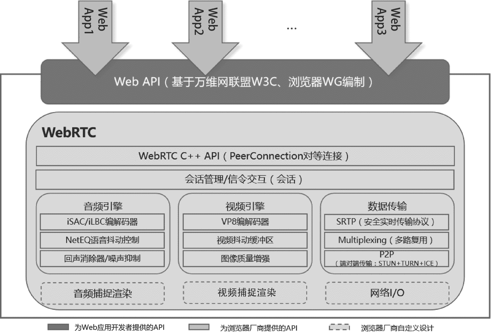

图 2-1

**1.** **工作机制**

在智能客服系统中，WebRTC 的工作机制使其能高效处理客服与客户间的实时通信。在建立连接阶段，通过 Web API，不同 Web 或 App 端可以快速发起请求，并利用 PeerConnection 对等连接功能在客服与客户终端间迅速搭建通信链路。在媒体协商环节，系统会根据双方的设备性能和网络状况，从音频引擎的 iSAC/iLBC 编解码器、视频引擎的 VP8 编解码器等多种选项中，确定最优的音视频编码方式、分辨率等参数，确保通话流畅且画质、音质良好。

ICE（Information and Content Exchange，信息与内容交换）过程在复杂网络环境下尤为关键，智能客服场景中的客户网络环境多样，而 STUN（Session Traversal Utilities for NAT，NAT 会话穿越应用程序）、TURN（Traversal Using Relays around NAT，使用中继穿越 NAT）和 ICE 协议能有效穿透各类 NAT 设备，保障连接成功。在实际媒体数据传输时，SRTP 结合音频引擎的 NetEQ 语音抖动控制功能和视频引擎的视频抖动缓冲区组件，即便在网络出现短暂波动的情况下，也能保证通话稳定，减少卡顿和延迟，为客户提供优质的服务体验。

**2.** **安全特性**

在智能客服系统中，客户与客服交流信息的安全性至关重要。WebRTC 的 DTLS 协议加密就像给信息传输通道加上坚固的锁，防止客户个人身份信息、业务咨询内容等敏感数据在传输过程中被窥探或窃取。SRTP 进一步保护音频和视频流，确保通话内容的完整性和安全性。对于企业来说，这不仅保护了客户隐私，维护了企业信誉，还符合相关数据安全法规的要求。在部署架构时，企业需要重视服务器端的配置和证书管理，如定期更新证书，防止因证书过期或配置不当导致出现安全漏洞，从而确保 WebRTC 安全可靠地运行。

**3.** **应用范围**

WebRTC 极大地拓展了智能客服系统的应用边界。在虚拟助手场景中，借助其音视频通信能力，虚拟助手能以更直观的方式与客户交互，如通过视频展示操作步骤、进行远程指导等，从而提升服务的直观性和便捷性。在在线教育方面，智能客服可利用 WebRTC 实时解答学生疑问，开展一对一辅导或小组讨论等活动，增强学习互动性。在远程医疗方面，客服能协助医生与患者建立视频通话，提供病情初步诊断、康复指导等服务，打破地域限制。此外，WebRTC 的跨平台兼容性能让智能客服覆盖更多的客户群体，无论是通过 PC 端网页咨询的客户，还是通过手机 App 寻求帮助的客户，都能获得一致的优质服务体验。随着 5G 的发展，WebRTC 有望在智能客服中实现超高清视频通话、实时字幕等功能，进一步提升服务质量和工作效率。

**4.** **技术障碍与解决方案**

在智能客服系统中应用 WebRTC 时，浏览器的兼容性是一大挑战。不同浏览器对 WebRTC API 的支持程度和实现方式存在差异，比如某些浏览器对特定编解码器的支持有限。为解决此问题，开发团队需要持续关注各浏览器厂商的技术文档更新，并采用功能检测和特性嗅探等技术手段，编写适配不同浏览器的代码逻辑，确保 WebRTC 功能在主流浏览器上正常运行。面对由大规模并发请求导致的服务器资源紧张问题，系统可以引入负载均衡策略，如基于 Nginx 等工具将客服请求均匀分配给多个服务器节点，避免单个服务器过载。此外，也可以选择专业的云服务提供商的 WebRTC 托管服务，借助其强大的资源池和弹性伸缩能力应对业务高峰。对于网络条件较差的客户，可通过优化信令流程减少不必要的握手次数，同时利用视频引擎的图像质量增强等功能，在低带宽下保证基本的通话质量，确保所有客户都能顺畅使用智能客户服务。

### **2.1.3** **短消息/即时消息接入**

在客户服务渠道中，短消息/即时消息的使用量非常大，尤其受到偏爱非实时沟通方式客户群体的青睐。这两种通信方式（图 2-2）不仅能够迅速传递信息，还能有效提升客户的参与度。同时，在应用过程中需要兼顾隐私保护和数据安全，确保客户信息得到妥善保护。

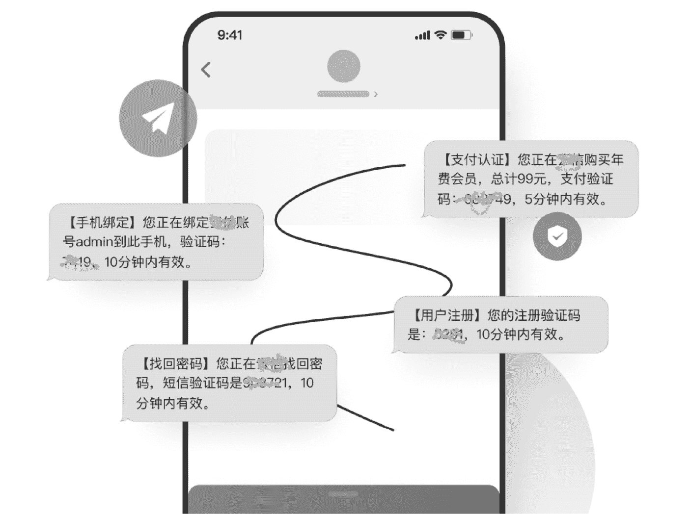

图 2-2

从排队论的角度出发，短消息/即时消息接入方式在客户到达和服务处理上具有独特的优势。由于它们通常是非实时沟通方式，客户的消息发送时间相对分散，这使系统在处理这些请求时可以采用不同的排队和资源分配策略。例如，根据消息的优先级、重要性等因素进行排序和处理，以提高服务的针对性和效率。

首先，短消息作为一种传统的通信手段，在客户服务中依然发挥着重要作用。通过简短的文字，企业可以提供业务咨询、查询服务、业务受理及处理客户建议与投诉等基础服务，还可以发送客户调查、提醒、问候及业务推介等主动服务。例如，银行可以通过短消息告知客户账户余额变动或信用卡还款提醒；电信运营商可以利用这一渠道进行话费查询和套餐变更提示。推送短消息、交互短消息及群发短消息等形式，为不同场景下的客户需求提供了多样化的解决方案。消费提醒短消息可以帮助客户实时掌握消费情况，避免超支；客户调查短消息有助于收集客户反馈以改进服务质量；应急通告短消息则能在紧急情况下迅速传达重要信息，如自然灾害预警等。这些应用不仅提高了工作效率，还极大提升了客户体验。

与此同时，诸如 WhatsApp、微信等即时消息平台因其便捷性、即时性和互动性逐渐成为客户服务的重要组成部分。相比传统短信，即时消息允许更加丰富的内容形式，如图片、音频、视频等，能为客户提供更为直观且生动的服务体验。更重要的是，即时消息支持双向或多向交流，使客服人员能够更直接地解决客户问题，同时便于企业开展个性化的营销活动。例如，某零售品牌通过其官方账号定期向订阅客户推送新品信息，并通过聊天机器人自动回复常见疑问，这既节省了人力成本，又提升了响应速度。

在智能客服系统的技术架构中，短消息/即时消息接入需要与 NLP、对话管理等模块协同工作，以实现对客户消息的准确理解和有效回复。例如，系统首先利用 NLP 技术对客户的即时消息进行意图识别和语义分析，确定客户的需求后，对话管理模块根据上下文和系统规则，调用合适的知识库或服务流程来生成回复内容。

在享受技术便利的同时，我们不应忽视隐私保护和数据安全的重要性。对于短消息服务而言，由于涉及个人手机号码等敏感信息，必须严格遵守相关法律法规，实施加密传输等措施来防止数据泄露。对于即时消息应用，则需要建立严格的客户身份验证机制，确保只有授权客户才能访问特定资源。此外，企业还需建立健全的数据管理体系，定期对系统进行安全审计，及时发现并修复潜在漏洞，最大程度降低风险。

无论是短消息还是即时消息，在客户服务中都扮演着不可替代的角色。它们不仅能够满足不同类型客户的沟通需求，随着技术的发展还将涌现出更多的创新应用场景。但无论技术如何演进，保障客户的隐私权益始终是企业必须坚守的底线。在系统实现层面，合理运用排队论能够更好地管理短消息/即时消息的处理流程，从而提升整体服务性能。

### **2.1.4** **视频通话接入**

随着数字化转型的不断推进，视频通话（Video Call）技术已成为客户服务领域的重要组成部分。与传统的面对面交流相比，视频通话不仅提供了更加便捷、低成本的解决方案，还能显著提升服务效率和客户满意度。特别是在成本效益方面，视频客服作为一种建设和运营成本较低的应用方案，在多种渠道和服务场景中展现出独特的优势。

**1.** **视频通话的核心能力**

1）实时音视频传输

视频通话最核心的能力是实现高质量的实时音视频传输，确保通话双方的声音和画面清晰、流畅，使交流更加直观和真实。无论是日常的亲友问候，还是商务会议中的讨论决策，实时音视频传输都能确保信息准确传达。

2）多终端适配

现代视频通话系统支持智能手机、平板电脑、个人计算机、智能电视等多种终端设备，客户可以根据需求和场景选择最方便的设备进行视频通话，这极大拓展了使用的灵活性和便捷性。

3）互动协作功能

现代视频通话系统不局限于单纯的交流，还具备丰富的互动协作功能。例如，在会议场景中，支持共享屏幕，方便展示文档、演示文稿、视频等资料；支持多人同时在线通话，满足团队讨论、远程培训等多人协作需求；部分系统还提供电子白板功能，方便参与者进行标注、绘图等操作，促进创意的交流和问题的解决。

4）个性化定制

有些视频通话产品还允许客户进行个性化设置，如更换背景、调整美颜效果等。这在满足客户审美需求的同时，也能在一定程度上保护客户隐私，营造更舒适的通话环境。

**2.** **视频通话的关键技术**

1）编解码技术

在视频通话中，为了在有限的网络带宽下实现高质量的音视频传输，需要高效的编解码技术。常见的视频编解码器有 H.264、H.265、VP8、VP9 等。H.264 是目前应用最广泛的视频编码标准之一，它在压缩效率和兼容性方面表现出色；H.265 在 H.264 的基础上进一步提高了压缩效率，能在相同画质下降低带宽需求。音频编解码器如 AAC、Opus 等，能提供高保真的音频质量，同时实现有效的压缩。

2）网络传输技术

为确保音视频数据在网络中稳定、低延迟传输，视频通话采用多种网络传输技术。其中，实时传输协议（RTP）及其控制协议（RTCP）是音视频传输的基础协议，RTP 负责传输音视频数据，RTCP 负责反馈传输质量信息，以便系统进行实时调整。针对网络拥塞问题，系统还采用了自适应比特率调整技术。该技术能够根据网络状况动态调整视频的分辨率和帧率，保证通话流畅。在传输层协议选择上，系统优先采用 UDP 协议进行数据传输，这种无连接的协议特性有效降低了传输延迟，显著提升了通信的实时性表现。

3）回声消除与降噪技术

在视频通话中，回声和背景噪声会严重影响通话质量。回声消除技术通过识别并抵消扬声器发出的声音被麦克风再次拾取形成的回声，确保对方听到的只有说话者的声音。降噪技术则利用算法对背景噪声进行抑制，突出人声，使通话更加清晰。例如，常见的双讲检测技术能在双方同时说话时准确区分语音和回声，有效消除回声干扰。

4）视频增强技术

视频增强技术包括图像去模糊、超分辨率重建、色彩校正等，能有效提升视频画面质量。超分辨率重建技术可以将低分辨率的视频画面提升到更高分辨率，使图像更清晰；色彩校正技术能调整画面色彩，使其更加自然和真实。

**3.** **典型产品和服务**

1）社交娱乐类

微信：作为国内客户量巨大的社交应用，视频通话功能是其重要组成部分。它支持一对一和多人群聊视频通话，操作简便。其优势在于客户基础广泛，与日常社交无缝衔接，且在移动设备上的使用体验良好。

Skype：早期在国际上广受欢迎的视频通话软件，以高质量的音视频通话和稳定的性能著称。除了用于个人交流，它也被一些小型企业用于简单的远程沟通。它支持跨平台使用，并且在国际网络环境下有较好的适应性。

2）商务办公类

腾讯会议：它是一款专为商务会议打造的视频会议产品，具备高清流畅的音视频通话、大规模的会议接入能力（可支持上千人同时在线），还具备丰富的会议协作功能，如共享屏幕、电子白板、会议录制等。新冠疫情期间，腾讯会议助力众多企业实现远程办公和线上会议。

Zoom：全球知名的视频会议软件，以稳定性和强大的功能受到企业客户的青睐。Zoom 支持高清视频通话、分组讨论、虚拟背景等特色功能，并且在网络适应性方面表现出色，即使在网络条件不佳的情况下它也能保证通话质量，被广泛应用于跨国企业会议、在线培训等场景。

Microsoft Teams：与微软的办公软件生态紧密集成，如 Office 365。Microsoft Teams 提供了强大的团队协作功能，包括视频会议、文件共享、聊天等，适合企业内部团队进行日常沟通和项目协作，方便客户在办公流程中无缝切换使用。

3）专业客服类

智齿科技视频客服：专注于为企业客服场景提供视频通话解决方案。它具备智能排队、客服分配、通话记录存储与分析等功能，能帮助企业提升客户服务质量和工作效率。通过视频客服，企业可以更直观地了解客户的问题，提供更精准的服务，尤其适用于金融、电商等行业的客户服务场景。

**4.** **发展趋势**

随着 5G、人工智能等技术的持续演进，视频通话正迎来重大革新。5G 网络的高速率、低延迟特性将会进一步提升视频通话的质量，实现更高清、更流畅的实时传输，甚至支持 8K 视频通话。人工智能技术的应用将会使视频通话更加智能化，如自动场景识别、智能降噪、实时翻译等功能将不断完善，为客户带来更便捷、更个性化的体验。同时，虚拟现实（VR）、增强现实（AR）技术的融合应用，也将为视频通话开拓新的应用场景，如沉浸式会议、虚拟社交等。

### **2.1.5** **交互式语音应答和交互式视频应答接入**

在现代客服体系中，IVR（Interactive Voice Response，交互式语音应答）和 IVVR（Interactive Voice and Video Response，交互式语音及视频应答）系统通过不同的交互方式为客户带来便捷、高效的自助体验。

从排队论的角度分析，IVR 和 IVVR 系统可被看作一种特殊的排队模型。客户的呼叫请求首先进入 IVR 或 IVVR 系统，并在语音或视频引导下完成操作，相当于在一个虚拟队列中进行等待和处理。系统通过智能路由对客户请求进行分类和优先级设置，优化资源利用率。例如，对于紧急业务或高优先级客户的请求，可以优先处理，缩短其等待时间；对于普通请求则按照先来先服务的原则进行处理。

IVR 系统犹如一位不知疲倦的“倾听者”，全天守候在电话另一端，以温和的语气引导客户选择所需的服务。无论是查询账户余额、办理业务，还是转接人工客服，只需简单几步，问题便迎刃而解。此外，它还具备智能回访功能，根据预先设定的策略自动联系客户，并将反馈汇总给数据管理系统，从而不断提升服务质量和效率。结合全量埋点技术，管理者可洞察每一个细节，实现服务流程的持续优化。

尽管 IVR 系统表现出色，但在处理复杂信息时，单一的语音交流有时会让客户感到不便。这时，IVVR 系统应运而生，它不仅保留了 IVR 系统的所有优点，还引入了生动的视觉元素，让沟通变得更加直观、易懂。例如，在银行场景下使用 IVVR 系统，客户可以一边通过视频通话查看自己的账户详情，一边聆听语音解说；在医疗咨询中，患者能一边观看医生推荐的治疗方案的动画演示，一边聆听医生的详细解释。这种多感官参与的方式，让沟通变得既高效又温馨，尤其适用于需要展示图表、图像或多媒体内容的服务场景。

IVVR 系统之所以能够显著提升客户体验，主要得益于以下几个方面。

·增强的理解力：文字和图标等视觉辅助材料比单纯的听觉信息更能迅速传达关键信息，减少误解。

·增加的互动性：触控屏幕上的按钮或滑块相较于按键输入更为直接、自然，增强了客户的参与感和沉浸感。

·提升的满意度：美观友好的界面设计加上清晰准确的指示，能让客户感受到品牌的细心关怀，从而提升客户的整体满意度。

从纯粹的音频响应到融合视觉元素的综合解决方案，IVVR 系统代表着客户服务领域的一大飞跃。它不仅保留了 IVR 系统的原有优势，还通过引入视觉组件进一步简化了操作流程，让原本可能令人困惑的过程变得直观有趣。随着技术的不断进步，未来的 IVVR 系统将会提供更多样化、个性化的服务形式，满足不同客户群体的需求。同时，在排队论的指导下，IVR 和 IVVR 系统将不断优化资源分配和服务流程，提升整体服务性能。

### **2.1.6** **全媒体网关接入**

图 2-3 展示了全媒体网关接入的架构，呈现了多种渠道与对应的网关设置。全媒体网关接入是智能客服系统实现与客户多渠道沟通的关键部分。

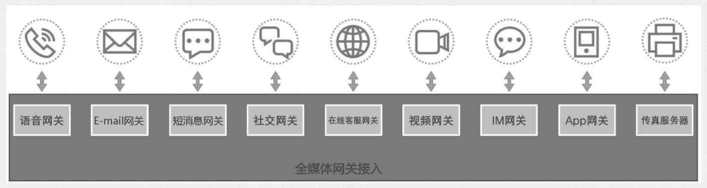

图 2-3

语音网关：作为电话通信渠道的核心组件，它是传统电话通信与系统内部通信的桥梁。通过语音网关，系统能够接收来自公共交换电话网络（PSTN）或 VoIP 电话的呼叫请求，并将其转换为系统可处理的信号，实现语音通话功能，支持客户通过拨打电话与客服进行沟通。

E-mail 网关：与电子邮件渠道相连，负责处理客户发送的邮件。它能接收客户的邮件请求，解析邮件内容并将其传递给系统进行后续处理（如分配给相应的客服人员进行回复等），同时支持将系统生成的回复邮件通过该网关发送给客户。

短消息网关：实现短消息渠道的收发功能。客户发送的短消息通过短消息网关进入系统，系统根据短消息内容进行智能匹配和处理，然后通过短消息网关向客户发送回复消息，方便客户以短消息的形式咨询问题或接收服务信息。

社交网关：连接微信、微博、Facebook 等社交平台。随着社交平台成为人们日常交流的重要工具，社交网关集成不同社交平台的接口，接收客户在社交平台上发送的咨询、反馈等信息，并支持系统以社交消息的形式回复，实现社交场景下的客户互动。

在线客服网关：对应网页端的在线客服渠道，当客户在企业网站或相关平台上点击在线客服入口发起咨询时，请求通过在线客服网关进入系统。该网关支持实时文字聊天功能，为客户提供即时在线服务。

视频网关：与视频渠道相关，支持视频通话、视频客服等功能。通过该网关，系统可建立客户与客服之间的视频连接，传输音视频流，满足可视化沟通需求，适用于远程指导、面对面咨询等场景。

IM 网关：针对即时通信（Instant Messaging，IM）应用，如 QQ、企业 IM 工具等。它能处理即时通信应用中的消息收发，实现客户与客服在即时通信环境下的实时沟通，快速解决客户问题。

App 网关：与企业移动应用程序（App）相连，用于处理 App 中的客户咨询和交互请求。客户在 App 端发起的客服咨询、反馈等信息通过 App 网关传递给系统，系统处理后进行回复，为 App 客户提供专属客服支持。

传真服务器：对应传真渠道，用于接收和发送传真文件。虽然传真在现代数字化通信中使用频率降低，但在一些特定行业或场景中仍有需求，传真服务器可实现传真文件的数字化处理和传输。

在智能客服系统的业务架构中，全媒体网关对各种服务接入渠道进行统一管理和调度，实时监测不同渠道的客户请求流量，并根据预设的规则和算法将客户请求分配给最合适的服务资源，实现资源的最优利用。

从功能角度来讲，全媒体网关接入主要包括如下功能。

统一接入：整合语音、E-mail、短消息、社交平台、在线客服、视频、IM、App、传真等各类渠道。无论客户通过何种方式发起咨询或服务请求，都能通过对应的网关将信息汇聚到智能客服系统中，形成统一入口。这避免了渠道分散和信息割裂，简化了企业的客服系统架构，使客服团队能在一个平台上处理来自不同渠道的客户请求。

统一排队：构建中央化的队列管理系统，对来自不同渠道的客户请求进行统一管理和排序，依据优先级、客户类型、业务类型等因素智能调度可用的客服资源。比如，紧急业务咨询请求可优先处理，普通咨询请求按顺序排队等待，确保资源的合理分配，避免渠道拥堵或闲置，提升整体服务效率。

定制路由：支持基于预定义规则或实时数据的路由策略。根据客户身份（如 VIP 客户）、问题类型（复杂问题或简单问题）、历史服务记录等信息，将客户请求精准路由给最合适的客服人员或服务团队。例如，将技术类问题分配给技术支持客服，将投诉类问题分配给专门的投诉处理团队，实现服务的精准匹配，提升解决问题的效率和质量。

上述主要功能对应的工作机制如下。

信息收集与转换：各渠道网关负责收集对应渠道的客户信息。例如，语音网关接收电话线路传来的语音信号，并将其转换为系统能够识别和处理的数字信号；E-mail 网关接收邮件内容并解析邮件格式和文本信息等，并将转换后的信息统一传输到智能客服系统。

流量监测与分析：全媒体网关实时监测各个渠道的客户请求流量，统计不同时段和不同渠道的请求数量、请求频率等数据。通过对这些数据的分析，预测业务量的变化趋势，为后续的资源分配和调度提供依据。例如，通过分析发现每天上午某个时段的电话咨询量大幅增加，系统可提前做好人员安排和资源准备。

请求分配与调度：基于统一排队规则和定制路由策略，对收集的客户请求进行分配和调度。在客户请求进入系统后，首先会根据其优先级等因素进入相应的队列，然后网关依据预设的路由规则将其分配给最合适的客服人员或服务资源。在分配过程中，还会考虑客服人员的工作负荷、当前忙碌状态等实时信息，确保分配的合理性和高效性。

全媒体网关对智能客服系统的贡献和价值如下。

提升服务效率：通过统一接入和排队，避免了各渠道独立运作带来的资源浪费和效率低下问题。客服人员可以在一个平台上处理多种渠道的请求，减少了切换和缩短了等待时间。合理的路由策略使问题被快速分配给合适的人员，缩短了问题处理周期，使客服系统能更高效地响应和处理大量客户请求。

优化客户体验：客户无论选择哪种渠道与企业联系，都能得到一致、连贯的服务体验，避免了因渠道服务差异导致的客户不满。快速响应和精准回复缩短了客户等待时间，降低了沟通成本，提高了客户满意度，有助于提升客户对企业的信任感和忠诚度。

增强企业管理能力：全媒体网关为企业提供了一个集中管理和监控客服业务的平台。企业通过系统收集的多渠道数据，可以全面了解客户需求和行为模式，分析客服工作绩效，发现服务过程中的问题和不足并有针对性地进行改进和优化。企业还能根据业务量和资源使用情况合理规划和调配人力、物力资源，降低运营成本，提升企业整体管理水平。

适应业务发展：随着企业业务的不断拓展和客户需求的多样化，新的通信渠道会不断涌现。全媒体网关接入具备良好的可扩展性，方便集成新的渠道网关，使智能客服系统快速适应业务变化，持续为客户提供优质服务，使企业持续保持市场竞争优势。

## **2.2** **人机交互**

下面深入探讨智能客服系统中的各类交互界面设计，如人工客服、对话式机器人客服与数字人客服等。通过分析这些交互技术的核心特点，阐述它们如何帮助企业提升服务质量与效率，并展望未来发展的无限可能。另外，我们将探讨不同交互形式的优势与局限性，以及支撑其运行的关键算法和技术。需要指出的是，人机交互技术与排队论密切相关，不同的交互方式会影响客户的服务体验和排队感知，合理运用排队论可以优化人机交互流程，提升整体服务效果。

### **2.2.1** **人工客服**

尽管自动化解决方案在客户服务领域取得了显著进展，但在某些特定情况下，人工客服依然扮演着不可替代的角色。在金融投资领域，当客户面临复杂的投资决策时，如股票投资风险评估、复杂理财产品选择等，人工客服凭借其专业知识和丰富经验，能够深入了解客户的财务状况、投资目标和风险承受能力，为客户提供个性化的投资建议和风险提示。这种专业的服务是自动化客服难以完全替代的。特别是在处理复杂或敏感问题时，人类的判断力、同理心及解决问题的能力显得尤为重要。自动化客服系统，如智能在线客服机器人和智能语音助手等，虽然能够迅速响应客户的基本需求，缩短等待时间，并在一定程度上降低运营成本，但其局限性也很明显：固定的回答模式、缺乏推理能力和情感交流能力，使其在面对需要深层次理解背景信息或涉及情绪管理的问题时，往往难以提供令人满意的解决方案。

从排队论的角度分析，人工客服可被看作排队系统中的一种特殊服务资源。例如，在银行信用卡客服中心，简单的信用卡账单查询、还款方式咨询等问题由自动客服系统快速处理；信用卡被盗刷、信用额度调整等复杂或敏感问题则被转接给人工客服处理。这种结合方式既能提高服务效率，又能确保复杂问题得到妥善解决。在实际应用中，通常会根据业务需求和客户流量构建人工客服与自动客服系统相结合的混合排队系统，充分发挥自动客服的高效性和人工客服的专业性，优化系统性能。

以金融服务行业为例，当客户遇到账户异常交易时，往往是在焦虑甚至恐慌的状态下寻求帮助。此时，能感知并适当回应这种情绪的人工客服代表，不仅能更有效地安抚客户的情绪，还能通过细致的询问与专业的指导快速定位问题，并采取适当的措施来解决客户的问题。这一过程不仅是提供技术支持，更重要的是建立了一种基于信任的关系，这对于长期维护客户关系至关重要。

此外，结合 AI 辅助工具的人工客服模式正在成为提高工作效率和服务质量的新趋势。利用先进的 NLP 技术和机器学习算法，这些工具可以帮助客服人员快速获取相关信息、推荐最佳应对策略，甚至自动生成回复草稿，使客服人员更专注于需要人性化关怀的环节。例如，通过分析历史对话记录，AI 系统可以识别常见的咨询热点及潜在的服务改进点，为团队制订更加精准有效的培训计划提供依据。同时，在实际会话过程中，它还能实时监测客户的情绪变化，及时提醒客服人员调整沟通方式，确保每次互动都能给客户留下积极的印象。

在智能客服系统业务架构中，人工客服需要与其他模块协同工作，如与知识库模块结合以快速获取专业知识；与数据分析模块结合以了解客户的历史行为和偏好，以便提供个性化的服务。在技术架构方面，需要建立高效的通信和数据传输机制，确保人工客服能及时获取所需信息，并与自动客服系统无缝对接。

总之，尽管自动化服务未来会变得更加普及，但对追求卓越体验的企业而言，保留一定比例的人工客服仍是必要的。通过融合人工智能技术与人工客服，企业不仅能大幅提升整体服务水平，还能为每一位客户提供个性化且充满温暖的关怀体验，从而建立品牌忠诚度，推动业务持续增长。同时，合理运用排队论优化人工客服与自动客服的协同模式，将会进一步提升智能客服系统的整体性能和客户满意度。

### **2.2.2** **对话式机器人客服**

对话式机器人客服是基于 NLP 与机器学习技术构建的智能交互系统，在客服领域扮演着关键角色。

**1.** **分类**

根据功能与应用场景的不同，可将其分为以下三类。

1）聊天型机器人

这类机器人旨在拉近与客户的距离，建立信任关系，提供情感陪伴。它利用关键词触发、模糊匹配及随机匹配回复等机制，实现流畅对话。其知识覆盖开放域全领域但深度较浅，数据主要来源于互联网和闲聊交互，由研发团队进行底层构建和人工更新。以微软小冰为代表，这类机器人不追求回答的准确率，更注重以娱乐风趣的方式与客户互动，从而提升客户黏性。

2）知识型机器人

这类机器人主要应用于咨询、售后服务场景，通过语义归一技术实现一问一答式的智能匹配及应答，可替代部分人工服务。其知识聚焦于特定垂直领域，主要来源于企业自主更新的业务知识库。这种机器人的典型应用包括法律问答机器人、电商问答机器人等。在电商场景中，它可随时解答商品信息、促销活动、订单状态等常见问题。当客户询问商品库存时，能迅速查询并反馈；促销期间也能准确介绍活动规则、推荐优惠商品，从而提升购物体验。这类机器人要求回答精准，可替代人工处理大量简单、重复性的问题。

3）任务型机器人

这类机器人适用于售前、售中、售后等多个环节，支持多轮会话，具备深层次语义识别和意图识别能力，可直接协助客户办理业务。其知识体系同样专注于行业垂直领域，依赖企业自主更新业务知识库，并不断自我优化知识体系。代表产品包括智能音箱、Google Assistant 等。这类机器人对回答精准度要求极高，追求实现任务直达，致力于为客户带来优质的服务体验。

对话式机器人客服通过不同类型的分工协作，能够满足多样化的客户服务需求，在提升客户体验、降低企业运营成本等方面发挥重要作用，已成为各行业数字化服务转型的重要工具。

从排队论的角度来看，对话式机器人客服可被视为多服务台排队系统。以某在线旅游平台为例，旅游旺季时会收到大量关于酒店预订、旅游线路咨询等请求。对话式机器人客服会对请求进行分类处理，如将酒店预订请求分配给专门模块，快速查询酒店库存和价格信息并提供预订建议，从而显著提高服务效率并缩短客户等待时间。当多个客户的请求同时到达时，机器人客服作为服务台会对其进行意图分析和分类，将不同类型的请求分配给不同的处理模块，这类似于排队系统中的任务分配。例如，常见的咨询问题可由快速响应模块进行处理，缩短客户的等待时间；而复杂的问题则可以转交给更专业的处理模块，确保问题得到妥善解决。

**2.** **工作原理**

图 2-4 展示了对话式机器人的工作流程。

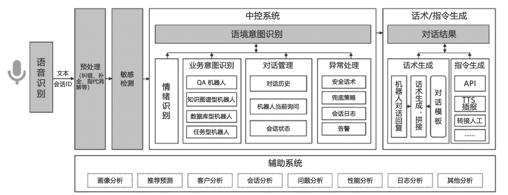

图 2-4

客户输入的语音信息首先经过语音识别技术转换为文本形式，这是对话式机器人理解客户意图的初始环节。接下来，文本进入预处理阶段。该阶段包括如下关键步骤：

·纠错：修正文本中的错别字和识别错误。

·补全：补充省略的句子成分，以完善语义。

·指代消解：明确代词所指的具体对象。

·词法/语法调整：规范文本结构。

在预处理过程中，系统会通过会话 ID 关联同一对话流程中的上下文信息，确保对话的连贯性。

预处理后的文本需要进行敏感检测，判断其中是否包含敏感词汇、不良信息等内容。如果检测到存在敏感内容，就会采取相应的处理措施，以此保障对话的合规性和安全性。

然后，系统对客户文本蕴含的情绪进行识别，判断客户当前处于高兴、生气、疑惑等哪种情绪状态。这一步的结果会为后续对话策略的制定提供重要参考。例如，如果识别出客户情绪比较激动，对话式机器人在回复时就会采用更加温和、安抚的语气。

接下来是语境意图识别，也就是结合当前对话的语境及客户输入的文本内容综合判断客户的意图，这是准确理解客户需求的关键环节。随后会进行业务意图识别，通过不同类型的机器人处理不同的业务意图：QA（Question & Answer）机器人主要负责处理问答类业务，针对客户提出的常见问题提供准确的答案；知识图谱型机器人基于知识图谱，利用知识之间的关联和推理回答知识推理、关系查询等较为复杂的问题；数据库型机器人从数据库中检索相关数据来回答与数据查询有关的问题；任务型机器人则处理任务型业务，比如帮助客户完成订票、查询订单状态等具体任务。

对话管理在整个对话过程中起到重要作用，它会维护对话历史，详细记录客户之前的提问及机器人的回复内容；跟踪机器人当前询问的内容；监控会话状态，比如判断对话是否已经结束，或者是否处于等待客户进一步输入的状态等，以此确保对话流程具有连贯性和逻辑性。

异常处理是对话流程中保障服务稳定的关键环节。在对话进行时，若遇异常状况会执行以下操作：生成安全话术，当碰到敏感内容、无法回答的问题时，输出合规且恰当的回应；执行兜底策略，在系统发生故障、处理逻辑阻塞时，保障服务不中断；记录会话日志，留存完整对话过程，用于后续复盘与问题追溯；触发严重异常告警，当出现重大故障（如核心服务崩溃），及时通知运维人员介入。

完成异常处理与核心对话逻辑后，进入话术/指令生成阶段。该环节基于对话历史、识别的意图等信息，先通过话术生成、拼接，结合对话模板构建自然流畅的回复内容（如机器人对话回复）；然后依据业务需求生成指令，包括调用 API 获取数据、触发文本转语音（TTS）播报，或判断是否需执行转接人工操作，驱动系统完成服务闭环。

辅助系统为对话机器人提供全方位支撑，具备多元分析能力：图像分析，在对话涉及图像交互时（如客户上传故障图片），解析图像内容，辅助对话决策；推荐预测，基于客户历史行为、偏好，预判需求并推送关联内容（如产品推荐、问题预案）；客户分析，挖掘客户特征、行为习惯与满意度，优化对话策略；会话分析，评估对话质量（如意图识别准确率、多轮对话流畅度），发现流程漏洞；问题分析，拆解客户问题的深层诉求，辅助回复优化；性能分析，监测系统响应时间、服务成功率等指标，定位性能瓶颈；日志分析，梳理系统运行日志，排查故障、识别潜在风险；其他分析，覆盖业务场景特需的定制化分析，从多维度为对话机器人的迭代升级提供数据依据，助力服务持续优化。

**3.** **技术实现**

要让对话式机器人流畅地与人交互，离不开强大的技术支持。首先，在 NLU 方面，除了传统的基于规则的方法，近年来深度学习算法被广泛应用于意图识别和槽位填充任务中，显著提升了系统的准确率。例如，卷积神经网络（Convolutional Neural Network，CNN）擅长捕捉局部特征，长短时记忆网络（Long Short-Term Memory，LSTM）则适用于处理序列数据，两者结合使用往往能取得更好的效果。此外，预训练的语言模型（如 BERT 等）也被证明在多种 NLP 任务中的表现接近人类的水平。其次，为了使对话式机器人更加人性化，研究人员还在探索如何增强其多轮对话能力，使其能够在复杂场景下维持连贯且有意义的交谈。这不仅要求机器人具备良好的语义理解能力，还需要能够记住之前的对话内容，并据此做出恰当回应。

在处理复杂多轮对话时，DeepSeek 的 128K 超长上下文窗口支持跨会话历史的深度语义理解。例如，当跨境电商客户询问“上周购买的红色连衣裙能否换为蓝色 S 码”时，系统可自动关联 3 天前的订单信息及库存数据，无须客户重复输入，使问题解决效率提升 60%。

**4.** **应用优势**

对话式机器人在客服领域展现出诸多明显的优势。首先，从成本效益的角度来看，相较于传统的人工客服团队，部署对话式机器人可以大幅减少企业在人力资源上的开支。据统计，一个典型的呼叫中心每年仅工资开销就达数百万美元，而采用自动化解决方案则有望节省 60%以上的费用。其次，由于不受时间限制，对话式机器人能够提供全天候服务，确保客户任何时候都能获得及时帮助，这对于提升客户满意度至关重要。另外，随着技术的进步，现代对话式机器人已经具备一定程度的情感识别能力，能够根据不同情境调整语气和表达方式，从而营造更加亲切友好的沟通氛围。

**5.** **局限性与挑战**

尽管对话式机器人拥有诸多优点，但在某些情况下仍存在不足。尤其在面对非常规或高度专业化的询问时，现有技术水平下的对话式机器人往往难以提供令人满意的答案。这主要是因为它们通常依赖于预先编程的知识库或者有限的数据集进行训练，对于超出范围的问题缺乏足够灵活的应对策略。此外，虽然目前已有不少方法试图解决跨领域迁移学习的难题，但如何让同一个对话式机器人无缝适应多种业务场景仍然是一个开放的研究课题。因此，在实际应用中，企业往往需要根据自身特点定制化开发相应的解决方案，同时保留一定比例的人工干预作为补充手段。

总之，作为一种新兴的信息服务模式，对话式机器人凭借其高效便捷的特点正受到越来越多行业的关注。然而，要充分发挥其潜力，还需克服诸如理解深度、交互自然度等方面的挑战。未来，随着相关技术的不断进步和完善，对话式机器人将在更多领域发挥重要作用。另外，结合排队论的思想优化对话式机器人客服的任务分配和处理流程，将会进一步提升其服务性能和客户体验。

### **2.2.3** **数字人客服**

数字人客服作为虚拟助手的高级形态，正悄然改变着客服行业，如图 2-5 所示。在金融行业，数字人客服通过 NLP 技术理解客户的理财需求，并结合知识图谱分析，为客户提供专业的理财建议。例如，当客户询问如何配置资产时，数字人能根据客户的风险偏好、财务状况等因素推荐合适的理财产品组合，并通过生动的形象和自然的语音与客户进行交流，提升客户的服务体验。

图 2-5

数字人客服融合了多种人工智能技术，包括计算机视觉、语音合成、NLP 和知识图谱分析，打造出能够与真人高效互动的虚拟形象。数字人技术不仅为客户带来了直观且富有温情的交互体验，还显著提升了品牌形象和服务质量。在实现过程中，数字人客服首先对真实人物进行高精度建模，再利用深度学习算法克隆其声音，最终生成栩栩如生的虚拟角色。借助 NLP 技术，数字人能理解并响应客户的语音或文字输入，基于预设的意图流程提供准确、及时的回答。从排队论的视角来看，数字人客服的服务过程也涉及排队与资源分配问题。

例如，某银行的线上客服平台在理财产品推广期间，利用数字人为大量客户提供咨询服务。此时，系统会根据数字人客服的处理能力和客户请求的优先级合理分配资源。对于高价值客户或紧急问题，系统会优先分配给数字人客服进行处理，确保客户及时得到满意的答复。当多个客户同时发起请求时，系统将形成一个排队队列。其中数字人客服的处理能力相当于服务台的服务效率，而客户请求的到达速度决定了列队长度和等待时间。为了优化服务，系统需要根据数字人客服的性能和客户请求的特点合理运用排队论来调整服务策略。例如，通过分析客户请求规律，预测高峰和低谷时段，提前调整数字人客服的数量或资源分配，从而缩短客户的等待时间，提升服务效率。

除了帮助企业提升客户体验，数字人客服还具有其他不可忽视的价值。一方面，它们能够以更低的成本提供全天候的服务，减轻人工客服的压力，特别在高峰期能有效缓解人力资源紧张的问题；另一方面，借助大数据分析，数字人还能根据客户的历史行为预测其潜在的需求，并据此推荐相关产品或服务，有利于增强客户黏性。尽管数字人客服带来了诸多好处，但其开发与维护成本较高，需要持续投入大量资源用于技术研发及计算支撑。此外，如何确保数字人在交流过程中始终保持友好且专业的态度，避免误解或冲突，也是我们当前面临的一大挑战。

在智能客服系统的技术架构中，数字人客服需要与 NLP、知识图谱等模块紧密协作，以提供精准的语言理解与知识检索能力。在应用层面，数字人需要深度融入企业业务流程，根据不同场景和客户需求提供个性化服务。

数字人客服凭借其独特优势，正在成为众多行业改善客户体验的重要工具。无论是金融领域的智能理财顾问、零售业的个性化购物助手，还是教育和医疗领域的虚拟导师与家庭医生，数字人的应用范围日益广泛。随着相关技术的不断进步，可以预见数字人客服将会在更多场景下发挥重要作用，为企业创造价值的同时为客户带来便利与乐趣。然而，要充分发挥其潜力，仍需针对现有局限采取优化措施，比如加强数据安全保护、优化人机交互设计等，确保各方都能从中受益。此外，通过引入排队论的优化策略，数字人客服系统能更高效地处理客户请求，提升整体服务质量。

## **2.3** **大数据技术与客户画像**

下面重点讨论大数据技术如何赋能智能客服系统，尤其是通过高效的数据收集与处理，以及深入的客户行为分析，构建个性化的客户体验。我们将系统阐述从原始数据到客户画像的形成过程，并说明如何基于这些数据和客户画像动态调整客服的话术，实现“千人千面”的服务效果。此外，大数据技术与客户画像的研究和排队论密切相关。通过对客户数据的深度分析，可以更准确地预测客户的到达模式和服务需求，从而优化排队策略和资源分配。

图 2-6 所示是客户画像构建流程。原始数据是构建客户画像的基础，包括客户行为日志、客户数据、内容数据及外部数据。它们首先要经过数据清洗消除噪声和错误，然后用于生成事实标签，涵盖静态画像和动态画像两方面。静态画像涉及客户相对稳定的属性，如性别、年龄、学历、常住地址等；动态画像聚焦客户的显式行为，如点赞、评论、分享、关注、评分等，这些行为反映客户的实时兴趣和互动情况。最后，通过对事实标签进行建模分析得到模型标签，挖掘客户更深层次的偏好和特征，如游戏偏好、内容偏好、标签偏好、关键词偏好等，同时对客户活跃度进行分层，从而精准描绘客户画像，为个性化推荐、精准营销提供有力支撑。

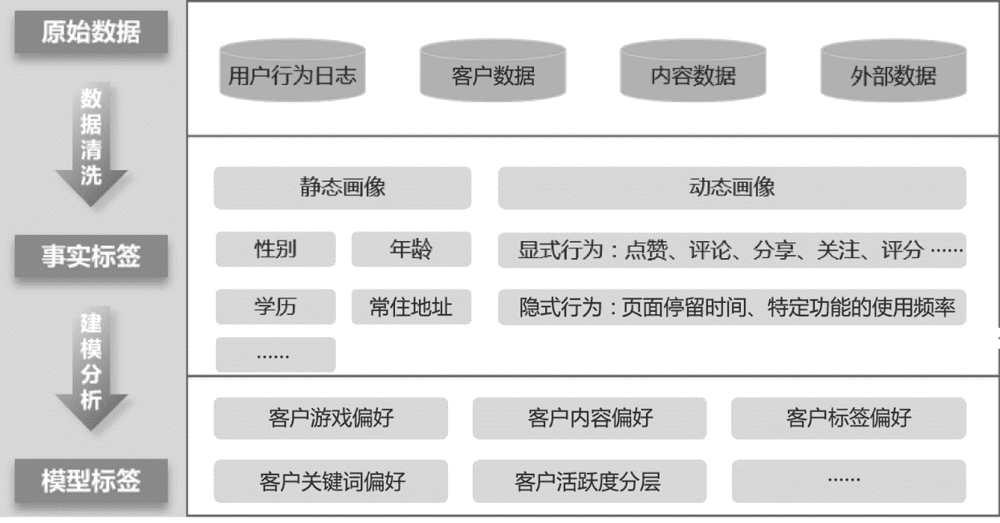

图 2-6

### **2.3.1** **大数据采集与分析**

在大数据时代，数据的价值日益凸显，如何高效收集、处理和利用这些海量数据成为企业发展的关键。电商领域尤其如此，大数据采集与分析对精准营销和个性化服务至关重要。通过收集客户在平台上的浏览记录、购买行为、搜索关键词等数据，企业能够深入洞察客户的偏好和需求。例如，当某电商平台发现一位客户经常浏览运动装备并购买过跑鞋时，可以推测该客户对运动服装也可能感兴趣，从而进行精准推荐。从客户行为到内容偏好，每一份数据都蕴含着商业价值。构建高效的数据驱动决策系统，首先需要全面理解数据来源并掌握有效的采集技术；其次运用现代数据分析工具和技术对数据进行清洗、整合和深度挖掘，提取有价值的信息；最后确保数据质量，为后续分析奠定基础。

从排队论的角度来看，大数据采集与分析为排队系统的优化提供了重要依据。以某外卖平台为例，通过分析客户下单时间、菜品偏好等数据，发现每天 11：00—13：00 及 18：00—20：00 是订单高峰且区域需求存在差异。基于这些洞察，平台可以在高峰期提前调配配送资源，根据不同区域的需求准备相应的菜品库存，优化排队系统，提高配送效率和客户满意度。

数据来源丰富多样，包括但不限于客户数据、内容数据、客户与内容的交互记录及外部数据。客户数据涵盖客户的个人属性，如性别、年龄、注册时间等，这些数据可用于勾勒客户的基本画像。内容数据关注产品或服务本身的特点，如在游戏领域，这可能涉及游戏类别、描述及玩家评价中的关键词，用于刻画特定内容的特点。客户与内容的交互数据反映了两者之间的关系，比如客户对某款游戏的喜爱程度可以通过其点击率和评论态度来衡量。此外，引入外部数据能够为客户画像增添更多维度的信息，使模型更加准确地预测个体偏好，比如结合客户在社交媒体上的活动情况来完善客户的社会背景信息。

针对不同类型的数据，采用相应的大数据采集技术至关重要。对于结构化数据，传统的 ETL（提取、转换、加载）过程依然有效；对于非结构化或半结构化数据，则需借助 Web 爬虫技术抓取互联网公开资源，或使用 API 获取第三方平台提供的信息流。随着移动互联网的发展，利用 SDK 集成方式直接从客户端收集设备的使用情况也成为常见的采集数据的做法。为了保证数据安全与隐私合规，在设计数据采集方案时必须严格遵循相关法律法规。

接下来，对数据进行预处理，以提高数据分析的质量和效率。这个阶段的工作主要包括数据清洗（去除噪声点、填充缺失值）、格式转换（统一时间戳格式、文本编码）及初步的特征工程（如根据业务逻辑创建新的计算字段）。值得注意的是，高质量的数据是产生可靠洞察的前提条件，因此在此过程中应特别注重数据的完整性和准确性。

在准备好经过预处理的数据集后，下一步就是运用先进的数据分析工具和技术深入探索其中隐藏的价值了。Python 的 Pandas 库提供了强大的数据操作能力，配合 SQL 可以轻松完成大规模数据集的筛选和聚合任务；机器学习框架如 TensorFlow、PyTorch 则为复杂模型训练提供支持；而 Spark 等分布式计算引擎使得处理 PB 级规模的数据变得可能。特别是，近年来深度学习技术在推荐系统等领域展现出巨大潜力，如通过 embedding 技术将高维稀疏特征映射到低维空间，或者利用 Wide&Deep 架构并结合线性模型与神经网络的优势实现更精准的个性化推荐。

无论选择哪种方法进行大数据的采集与分析，都应始终重视数据质量。因为只有基于真实可靠的数据做出的商业决策才值得信赖且具有实际指导意义。随着 AI 算法的不断演进及硬件性能的持续提升，未来必将涌现出更多的创新解决方案，助力企业更好地满足客户需求。同时，大数据技术也将为排队论在智能客服系统中的应用提供更精准的数据支持，使排队策略更加科学合理。

### **2.3.2** **客户画像的构建方法**

客户画像是指通过一系列标签来描绘客户特征，旨在更深刻地理解客户的需求与偏好。在线教育行业，通过收集学生的学习课程、学习时长、作业完成情况、考试成绩等数据构建客户画像，可以帮助教育机构更好地了解学生的学习情况和需求。例如，对于学习数学课程时经常在某一知识点停留较长时间且作业错误较多的学生，教育机构可以判断该学生在这个知识点上存在困难，从而为其推荐有针对性的学习资料和辅导课程。这种模型对于提升客户体验、优化产品设计及实现个性化推荐至关重要。借助客户画像，企业能够精准定位目标群体，并提供量身定制的服务，从而增强客户黏性和提升客户满意度。

从排队论的应用角度看，客户画像可以帮助企业更好地了解客户的服务需求和优先级。酒店预订平台可以根据客户的预订历史、消费金额、会员等级等信息构建客户画像。对于经常预订高级套房、消费金额较高的高价值客户，系统可以给予更高的排队优先级，为其提供更优质的服务，如升级房间、提供免费早餐等，提升客户的满意度和忠诚度。另外，通过分析客户画像，还可以预测客户的服务时间，从而合理安排客服资源，提高排队系统的整体效率。

根据数据类型的不同，客户画像分为静态画像和动态画像两大类。

静态画像侧重于描述客户的固有属性，如性别、年龄、职业和学历等，这些信息相对稳定且容易收集。这类数据通常来自客户注册时填写的信息或第三方合作平台提供的数据。静态画像为了解客户的基本背景提供了坚实的基础，但由于其变化频率较低，单独使用难以全面反映客户的最新兴趣和发展趋势。

相比之下，动态画像更加关注客户在特定情境下的行为表现，包括显式行为（如点赞、分享、评论）和隐式行为（如页面停留时间、点击率）。显式行为直接反映客户对某些内容的态度或偏好；隐式行为虽不直观但同样重要，因为它揭示了客户没有明确表态的情况下存在的潜在喜好。值得注意的是，在实际应用中，由于显式行为较为稀少，因此更多依赖于累积的大量隐式行为数据来补充和完善客户画像。

构建精准客户模型的核心在于，对事实标签的系统分析和处理。这里所说的事实标签，是指从原始数据中提取出来的、能够客观描述客户特性的指标。原始数据来源广泛，既包括客户基本信息（如地理位置、设备信息），又涵盖客户与产品的交互记录（如浏览历史、搜索关键词等），以及从外部（如社交媒体活动）获取的相关信息。其中，由显式行为和隐式行为构成的行为轨迹最具价值，因为它们最能反映客户的即时兴趣。

在进一步提炼客户特征时，可以采用聚类分析或加权计算等方法处理上述标签。聚类分析是一种无监督学习技术，能够根据相似性将客户分成不同的群体，群体成员具有相近的行为模式或偏好。例如，通过对客户活跃度指标进行聚类，可以将客户划分为高活跃、中等活跃及低活跃三个等级，这对于制定差异化的运营策略非常有用。加权计算是给不同类型的行为赋予相应的权重值后进行综合评估，以此量化个体的兴趣强度。比如，根据客户对某项功能的使用频率为其相关标签打分，分数越高表明该客户对此越感兴趣。

通过系统地收集并整合来自多个维度的数据资源，并运用先进的数据分析手段不断丰富和完善客户画像，不仅有助于企业加深对客户的了解，还能显著提升服务的质量与效率。随着大数据技术和人工智能算法的发展，未来客户画像的应用场景将会更加广泛，其价值也将得到进一步挖掘。此外，客户画像与排队论的结合为智能客服系统的优化提供了有力支持，使排队服务更加符合客户的需求和期望。

### **2.3.3** **“千人千面”动态客服话术提示实现机制**

在追求极致个性化的时代，企业需要深入理解每位客户的独特需求，并为其量身打造专属体验。在美妆行业，企业通过收集客户的肤质、年龄、消费习惯、品牌偏好等数据来构建客户画像。当客户咨询产品时，根据客户画像为客服提供个性化的话术提示。例如，对于年轻的油性皮肤客户，客服可以推荐适合油性皮肤的控油产品，并介绍产品的功效和使用方法；对于年龄较大且注重抗衰的客户，则推荐具有抗皱功效的产品。这种“千人千面”的理念不仅能显著提升客户的满意度，还能帮助企业高效实现商业目标。要实现这一愿景，企业需要从数据收集到模型训练，再到实时调整对话策略，每个环节都做到精益求精。此外，“千人千面”的服务模式也与排队论中的个性化排队策略相呼应，通过为不同客户提供差异化服务，既能提高整体服务效率，又能提升客户满意度。

在构建全面而细致的客户画像时，我们既要关注显性行为，又要关注隐性行动模式，比如页面停留时间、特定功能的使用频率等。尽管显性行为更为直观可靠，但在实际操作中往往难以获取足够的样本数据，因此结合大量隐性行为进行综合分析尤为关键。

从排队论的角度来看，不同客户画像的客户在排队系统中的优先级和服务需求不同。在快递行业，根据客户的寄件频率、包裹价值等构建客户画像。对于高频寄件且包裹价值较高的客户，可在快递取件和派送时给予优先处理，有效缩短其等待时间；对于低频寄件且包裹为普通文件的客户，在保证服务质量的前提下，可以采用相对灵活的排队策略，提高整体运营效率。通过对客户画像的分析，智能客服系统可以更好地预测客户的需求和行为模式，提前做好资源准备和排队调度安排。

利用推荐算法为每位客户提供定制化服务是整个过程的核心。准确预测客户兴趣点是一项复杂的任务，需要系统具备强大的数据分析能力和深度学习技术的支持。常用的推荐算法包括协同过滤法、内容基线法则及混合模型方案。其中，协同过滤法通过发现相似客户群体间的关联性来推断个体喜好；内容基线法则依赖于项目本身的属性及其相关元数据进行精准匹配；混合模型综合两者的优势，既考虑了客户间的相似度，又兼顾了内容特性。此外，随着 NLP 技术的进步，系统现在能够通过对文本语义的理解进一步提升推荐的准确性，例如利用情感分析技术识别客户的情绪状态，并据此调整沟通方式和语气。

为确保每位客户都能享受到最佳的交流体验，系统还需根据实时反馈不断优化自身表现。这不仅包括对当前会话质量的监控，还包括跨会话间的长期追踪与评估。一旦发现某一策略效果不佳，系统会迅速切换至备选方案或调整现有参数设置，直至找到最合适的解决方案。另外，保持客户体验的一致性和连贯性同样重要，这就要求算法能在多轮对话中维持上下文联系，并灵活应对各种突发状况。

在排队系统中，实时反馈也可以用于调整排队策略。如果发现某个客户在排队过程中等待时间过长，系统可以自动调整其优先级，或者提供一些补偿性的服务，如优先转接人工客服等。通过这种方式可以提升客户的满意度和对排队系统的接受度。

在设计既能满足个性化需求，又能保证高效响应速度的服务平台架构时，有几点值得注意。首先应遵循模块化设计原则，将整体框架拆分为若干相对独立但又相互协作的小单元。例如，协议调度层负责管理所有外部通信接口，推荐算法层专注于核心逻辑运算，存储单元则用于保存重要信息资源。其次，采用分布式部署策略可以有效分散负载压力，避免单点故障风险，确保面对海量并发请求时仍能快速响应。此外，引入缓存机制（如 Redis）是提升性能的有效手段，通过暂存频繁访问的数据集来减少数据库查询次数，从而加快处理速度。通过精心规划并持续优化各个组成部分，可以构建既智能又高效的“千人千面”动态客服系统，为客户提供卓越的服务体验。另外，结合排队论的优化策略，还能进一步提升系统性能和客户满意度，使其在智能客服领域发挥更大的作用。

## **2.4** **人工智能**

目前，人工智能（AI）正以前所未有的方式重塑客户服务行业。下面将深入探讨 AI 技术的核心，解析 ASR、NLP 及 LLM 技术如何协同工作，为智能客服系统赋予高效、个性化的能力，这些技术共同构建提升客户体验的系统工程。同时，我们还将展望这些技术未来在智能客服领域的发展方向。值得注意的是，AI 技术与排队论存在紧密联系，通过对客户请求的智能处理和预测，能够优化排队系统的资源分配和服务流程。

### **2.4.1** **ASR**

ASR 技术将人类的语言转换为计算机可识别的文字或指令，架起人机沟通的桥梁。在智能车载系统中，ASR 技术得到广泛应用。驾驶员可通过语音指令控制导航、播放音乐、拨打电话等。例如，当驾驶员说出“导航到最近的加油站”时，ASR 系统会迅速将语音转换为文字，导航系统随即根据指令规划路线，为驾驶员提供便捷服务。这一技术的实现依赖于两大核心组件：声学模型和语言模型。

声学模型负责将音频信号提炼为特征向量，并从中识别音素序列；语言模型则基于上下文信息预测最可能的词汇组合，以提升语音识别的准确率。通过将统计学习与深度学习方法巧妙结合，现代 ASR 系统能够处理复杂的自然语言输入，在各种应用场景中表现出色。

图 2-7 展现了 ASR 技术中前后端的特征提取架构。当客户对着麦克风讲话，产生语音信号输入时，前端 ASR 系统会进行降噪和信号优化处理。接着通过快速傅里叶变换（FFT）将时域声音信号转换为频域信号，这一过程在图中表现为前端特征提取，生成梅尔频率倒谱系数（MFCCs）等声学特征并传输到后端。在后端，训练有素的声学模型会根据已知的音素-状态对应关系推断出最可能的音素序列。该序列继续被传递给语言模型，语言模型基于语法规则、词典及概率分布对候选句子进行评分，最终输出置信度最高的文字结果。正如图 2-7 中所体现的处理流程的连贯性，实际应用中解码器还会综合上下文信息进一步优化输出，确保生成的文字既符合语法规范又准确传达语义，从而完成语音到文字的转换。

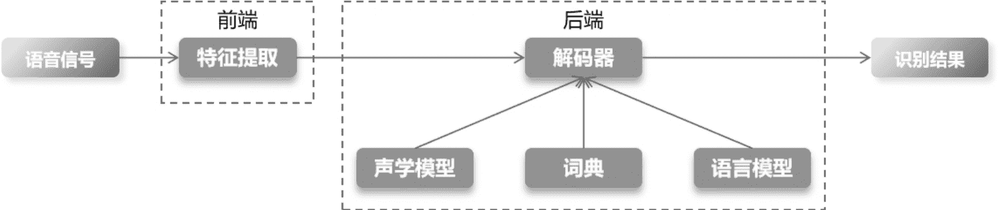

图 2-7

从排队论的角度来看，语音识别技术的准确性和效率直接影响排队系统的整体效能。语音识别出现错误可能会导致客户请求无法准确传达，进而增加单次处理时长，最终延长队列中所有客户的等待时间。在电商售后客服场景中，当客户反馈商品质量问题时，如果语音识别错误，将“商品有破损”识别成“商品有赠品”，客服基于错误信息进行的无效处理，不仅无法解决客户问题，还需客户再次阐述问题，这使得处理时间从原本的 3 分钟延长至 8 分钟，大大降低了服务效率。在业务高峰期，这会使排队等待的客户数量增多，最终影响整体服务体验。因此，提高语音识别的准确率和速度，对于优化排队系统至关重要。

在图 2-8 所示的智能语音导航服务流程中，ASR 技术是关键能力要素之一。客户通过 PSTN（公共交换电话网络）发起的语音请求，经语音网关通过 SIP（会话起始协议）到达话务平台。话务平台根据情况选择转人工座席，或利用智能语音平台的语音合成与识别服务，并通过 MRCP 服务器、多轮对话引擎及业务系统进行业务处理。在此过程中，语音识别技术将实时语音转换为文本指令，实现无须人工干预即可完成信息处理。以银行客服热线为例，客户说出“查询余额”或“转账汇款”等需求时，ASR 引擎首先对语音进行特征提取和声学建模，将声波信号转换为对应的文字序列，随后系统通过 NLP 技术解析意图，并通过合成语音反馈指导步骤或直接执行操作。作为人机交互的“听觉中枢”，ASR 技术实现了从语音信号到结构化指令的关键转换，不仅提升了服务效率、减轻了人工负担，还构建了智能化的语音交互闭环，为客户提供了更加便捷友好的交流方式。

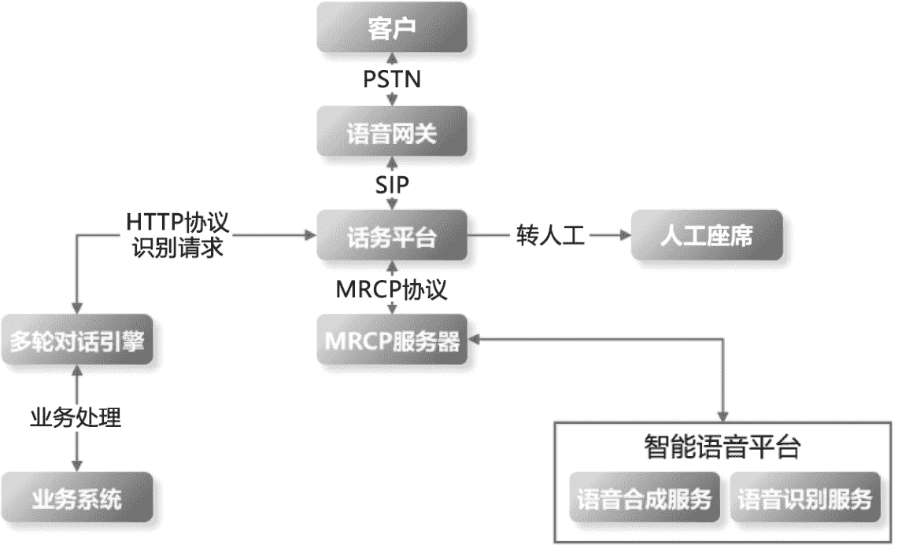

图 2-8

尽管当前 ASR 技术已经相当成熟，但在处理方言变体和口音识别方面仍然面临挑战。研究者们正致力于开发更加强大的多语种及方言识别能力，力求让机器更好地适应全球多样化的语音环境。另外，随着云计算、大数据等新兴技术的发展，未来 ASR 系统有望进一步降低成本、提升性能，为各行各业带来更多的创新解决方案。

作为连接人类与数字世界的纽带，语音识别技术在推动智能化服务转型方面发挥着至关重要的作用。特别是在智能语音导航服务中，其高效精准的表现为企业赢得了竞争优势，也为消费者带来了前所未有的客户体验。随着算法优化、硬件升级及应用场景的不断拓展，ASR 技术将会带来更丰富的功能和服务形态，持续引领人机交互领域的变革。同时，随着语音识别技术的不断完善，排队系统也将变得更加高效和智能，为客户提供更优质的服务体验。

### **2.4.2** **NLP**

NLP 是人工智能领域的关键技术，其目标是让机器理解、处理并生成自然语言。图 2-9 将 NLP 技术按照不同层次和应用方向进行了分类。

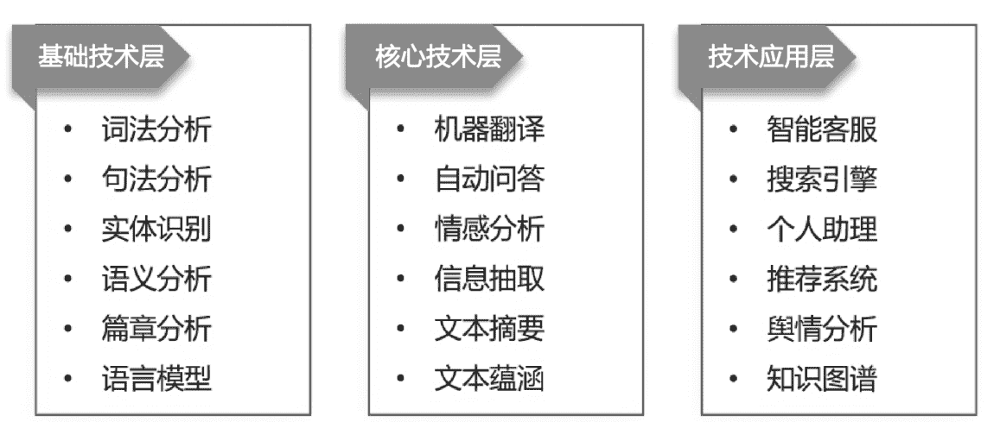

图 2-9

基础技术层是 NLP 技术的基石。其中，词法分析用于分析词语的构成和形态；句法分析关注句子的语法结构；实体识别用于找出文本中的各类实体，如人名、地名等；语义分析旨在理解文本的意义；篇章分析用于处理文本的连贯性和逻辑性；语言模型用于对语言现象进行建模，预测语言的概率分布等。这些基础技术为上层应用提供了核心能力支持。

核心技术层构建在基础技术层之上，包含 NLP 技术的关键环节：机器翻译用于实现不同语言间的文本转换；自动问答能够根据客户提问给出答案；情感分析用于判断文本所表达的情感倾向；信息抽取用于从文本中提取关键信息；文本摘要用于提炼文本的主要内容；文本蕴含用于研究文本之间的语义蕴含关系。这些技术代表了 NLP 领域的主要研究方向和应用重点。

技术应用层是 NLP 技术在实际场景中的具体应用。其中，智能客服利用自然语言处理技术实现与客户的自动对话；搜索引擎借助相关技术理解客户查询并返回结果；个人助理能理解客户指令并提供服务；推荐系统根据客户偏好和文本信息进行个性化推荐；舆情分析通过处理文本数据了解公众舆论倾向；知识图谱通过整合文本中的知识实体和关系，为智能应用提供结构化的知识支持。

在排队论的应用场景中，NLP 技术可以用于对客户请求进行分类和优先级判断。以金融客服为例，当客户发送“我的账户被盗刷了，资金正在流失”时，NLP 技术通过对关键词和语义的分析，能够迅速判断这是紧急且复杂的问题，将其优先级提升，优先分配给专业客服进行处理，保障客户资金安全，避免客户长时间等待造成损失。通过对客户文本信息进行分析，智能客服系统可以快速确定客户问题的紧急程度和复杂程度，从而合理安排排队顺序和服务资源。

词法分析作为 NLP 的基础环节，负责将一段文字拆解成独立的词汇单元。例如，中文句子“我喜欢吃苹果”会被分解为“我/喜欢/吃/苹果”。该过程为后续的语法分析和语义理解奠定基础。句法分析则旨在进一步揭示词汇间的语法关系，构建句子结构树。如上述例句中，“我”作主语，“吃”为谓语，“苹果”作宾语，完整呈现“主谓宾”的语义关系。

随着 NLP 技术的不断进步，人们开始利用其强大的语言理解能力探索更加复杂的应用场景，其中之一便是情感分析。情感分析是一种基于文本数据的情绪识别方法，能够自动检测一段话或文章所传达的情感倾向（正面、负面或中性）。对于企业而言，这是一项至关重要的技术，因为它可以直接反映客户对公司产品或服务的看法。例如，通过对社交媒体上关于某品牌手机的评论进行情感分析，可以迅速了解消费者对该产品的满意度，进而帮助企业及时调整营销策略或改进产品设计。

在提升服务质量方面，NLP 同样表现出色。传统的人工质检模式存在诸多局限，如覆盖率低、效率低下及受主观因素影响较大等。借助 NLP 技术构建的智能质检系统，能实现从抽样到全量的质量检查转变，确保所有客户服务过程都被纳入监控范围。具体来说，智能质检平台首先运用语音转写技术将通话录音转换为文本形式，然后利用 NLP 算法对文本进行深度解析，识别其中是否存在违规用语、不专业的表述及其他可能损害品牌形象的内容。此外，通过设定特定的规则模型，系统还能自动计算每段对话的质量得分，并标记需要重点关注的问题区域，以便后续人工复核时优先处理。

除了直接应用于智能质检环节，NLP 在数据分析层面也展现出巨大潜力。通过对大量历史客服记录进行挖掘与分析，结合客户画像、行为偏好等相关信息，企业可以构建完善的知识库，指导未来的服务优化方向。例如，当发现某类产品频繁出现退货现象时，可以通过分析相关聊天记录找到原因，是产品质量本身存在问题，还是物流配送环节出了差错，又或者是顾客对使用说明不够清晰，这些都将为企业采取针对性措施提供依据。

作为连接人机沟通的关键桥梁，NLP 技术在提升企业服务水平方面发挥着重要作用。无论是通过精准捕捉客户情绪变化来增强互动体验，还是借助智能化手段大幅提升工作效率与准确性，NLP 技术都为企业开辟了一条通往更高层次客户满意度的道路。随着算法的不断迭代升级和应用场景的持续拓展，这项技术将会带来更大的变革。此外，NLP 技术与排队论的深度融合，将为智能客服系统的排队和服务流程优化提供强大的支持，有利于提升整体服务质量。

### **2.4.3** **LLM**

LLM 是一种基于深度学习技术，特别是 Transformer 架构的先进人工智能系统，具备强大的自然语言理解和生成能力。如图 2-10 所示，2019 至 2023 年间 LLM 经历了快速发展：2019 年 T5 问世，随后 2020 年发布 GPT-3 等新型架构模型、2021 年推出 Codex 等模型；2022 年迎来爆发期，OPT、GPT-Neo-X-20B、ChatGPT 等模型相继发布，2023 年 GPT-4 的出现更是引发全球广泛关注。

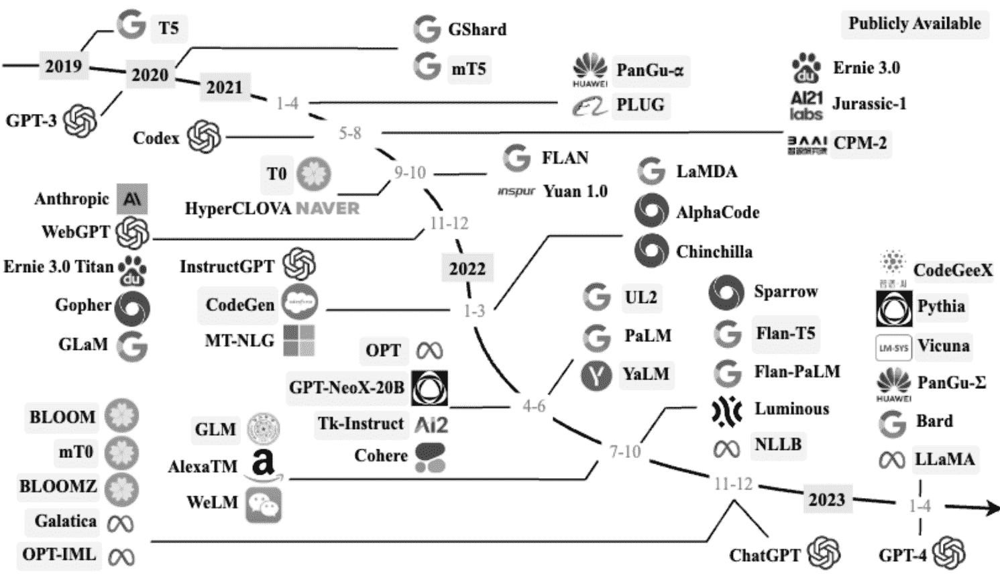

图 2-10

在智能法律咨询领域，LLM 能够为客户提供专业级的初步法律建议。当客户咨询“我在网络购物时遇到商家欺诈，该怎么办”时，像 GPT-4 这样经过海量数据训练的 LLM，凭借其对法律条文和相关案例的学习，能够快速给出如收集证据、向平台投诉、必要时寻求法律诉讼等建议。这些模型通过处理海量法律文本，在预训练阶段掌握了语言的结构、语法和上下文语境等复杂特征，不仅能构建丰富的知识库，还具备强大的推理和泛化能力，能在全新场景下提供合理且生动的回答。随着技术的不断进步，LLM 已经成为推动智能客服创新的核心动力，为客户提供更加智能化和个性化的服务体验。

从排队论的角度来看，LLM 可以用于优化排队系统的决策过程。例如，在在线旅游客服场景中，当客户提问“我想在下周去马尔代夫度假，预算 3 万元，帮我规划一个行程”时，LLM 可以判断该问题涉及复杂的行程规划，需要专业客服花费较多时间处理，进而安排经验丰富的客服优先处理，同时调整排队策略，避免其他简单问题的客户等待时间过长。通过对客户请求的语义理解和分析，LLM 可以更准确地预测客户的需求和问题难度，从而合理分配客服资源，调整排队策略。

**1.** **基本原理**

LLM 的工作流程可以分为三个阶段：预训练、微调和推理。

在预训练过程中，模型通过自监督学习方法在未标注数据上进行训练，学习词汇间的关联性和长距离依赖关系。随后使用特定任务的小规模标注数据对预训练模型进行微调，使其适应具体应用场景的需求。最终在实际部署时，模型根据客户输入信息进行实时推理，生成回复或执行其他任务。

在整个流程中，Transformer 架构因其高效的并行计算能力和出色的序列信息捕捉能力被广泛采用。以 DeepSeek 为例，其利用知识图谱嵌入技术在金融行业实现“智能合同质检”自动化：自动解析合同条款中的“违约金比例”“不可抗力条款”等风险点，标注准确率达 98.5%，较人工审核效率提升 70%，年节约合规审核成本 45 万元（基于江苏银行实测数据）。在政务场景中，DeepSeek 支持方言识别与政策文件结构化分析，如宿迁“宿心办”App 集成后，政策咨询平均响应时间缩短至 1 秒内，解决率提升至 95%，覆盖 80%以上的高频民生问题。

**2.** **在智能客服系统中的应用**

在智能客服领域，基于 LLM 的智能客服系统与传统智能客服系统存在显著差异。图 2-11 从产品搭建、文本场景、语音场景三个方面分析了两者的区别。

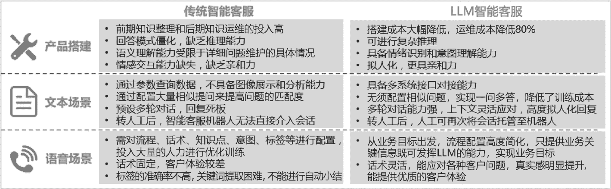

图 2-11

除上述差异外，基于 LLM 构建的智能客服系统在以下方面具有差异化优势：

增强的知识管理与运维能力：借助 LLM 强大的信息抽取与整合能力，企业可以显著减少构建和维护知识库所需的人力资源投入。例如，系统能够自动从文档中提取关键知识点并将其转换为易于检索的形式，或是定期更新常见问题列表以确保内容的时效性，从而提高客户查询的响应速度与解答准确性。在排队系统中，高效的知识管理可以使客服人员快速解决客户问题，缩短客户等待时间，提升排队系统的效率。

降低人工参与度：传统智能客服往往需要大量人工来配置多轮对话逻辑，在引入大模型后，此类任务可自动化完成，比如自动生成意图识别规则和同义词表等，大幅节省了前期开发时间和成本。这意味着可以将更多的人工资源投入到处理复杂问题上，优化排队系统的资源配置，增强整体服务能力。

提升交互质量和客户体验：基于 LLM 的智能客服不仅能准确理解客户提问的真正意图，还能根据上下文灵活调整回答方式，展现出高水平的情绪感知能力和拟人化的交流技巧。这有助于营造友好的服务氛围，提升客户满意度。在排队过程中，良好的交互体验可以缓解客户的等待焦虑，提高客户对排队系统的接受度。

支持多模态互动：除了文本交互，现代智能客服系统还开始探索图像识别、语音合成等跨媒体技术的应用。通过结合视觉大模型与音频处理算法，新一代客服机器人可以在不同感官维度上提供全方位的交互支持，满足多样化的客户需求。这也为排队系统的优化提供了更多的可能性，例如通过多模态交互精准把握客户需求，从而更合理地安排排队和服务。

推动个性化推荐服务：通过对历史聊天记录进行分析，LLM 能够洞察每位客户的偏好，并据此推送定制化的建议或产品介绍。此外，在销售咨询环节中运用此类技术也有助于提高转化率，促进业务增长。在排队系统中，个性化推荐服务根据客户的偏好和历史行为匹配更合适的服务资源，从而提升客户的满意度和忠诚度。

随着 LLM 技术的不断发展，其在智能客服领域的应用前景日益广阔。它不仅极大提升了现有解决方案的功能性和灵活性，还为未来可能出现的新形态客户服务模式奠定了坚实的基础。面对日益激烈的市场竞争环境，掌握并充分利用这一工具将成为各企业在数字化转型道路上取得成功的关键因素。另外，LLM 与排队论的结合将为智能客服系统带来更智能、高效的排队和服务体验，推动智能客服行业的进一步发展。

## **2.5** **工作流**

在瞬息万变的商业世界中，企业始终在探索提升内部运作效率与服务质量的新路径。本节将探讨工作流技术如何成为实现这一目标的关键解决方案。建立标准化、自动化的业务流程，不仅能优化客户体验，还能提高团队协作效率与响应速度。下面首先介绍工作流引擎的核心概念及功能，并以 Camunda 为例进行说明。随后，通过智能客服工单系统的典型应用场景，详细展示工作流管理系统如何改善客户服务的各个环节。此外，工作流技术与排队论密切相关，合理的工作流设计能够优化排队系统流程，提高资源利用率和服务效率。

### **2.5.1** **工作流引擎**

作为自动化业务流程的核心驱动力，工作流引擎通过对复杂业务逻辑的精准定义、有效管理和顺畅执行，极大地提升了组织的运营效率与协同能力。如图 2-12 所示，工作流执行服务是整个体系的核心。过程定义工具通过接口 1 与工作流执行服务相连，它就像一位规划师，负责把智能客服业务流程以规范的形式进行定义，为后续流程的执行绘制清晰的蓝图。管理与监控工具借助接口 2 与工作流执行服务交互，实时监督和把控流程的运行状态，一旦出现异常就及时介入，确保流程稳定推进。工作流客户应用程序通过接口 3 与工作流执行服务对接，是客户发起咨询请求、触发智能客服工作流的入口。调用的其他应用程序通过接口 4 与工作流执行服务协同工作，整合知识库查询、语义分析等各类功能，为智能客服提供丰富的能力支持。其他工作流执行服务通过接口 5 与工作流执行服务相连，实现不同工作流之间的交互与协作，共同构建完整的智能客服工作流生态。

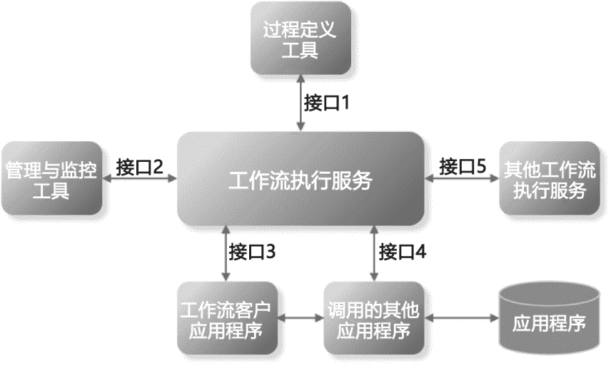

图 2-12

以智能客服场景为例，当客户发起咨询时，工作流客户应用程序接收请求并传递给工作流执行服务。如果客户咨询的是常见问题，工作流执行服务通过调用的其他应用程序快速查询知识库，经语义分析后直接给出准确回复。若问题较为复杂，管理与监控工具介入，依据预设规则判断是否需要转接人工客服。在转接过程中，工作流执行服务与其他工作流执行服务协同，确保客户信息被准确传递，使人工客服能快速了解客户需求，实现无缝衔接，继续为客户服务。通过工作流引擎的协调，整个过程的各个环节紧密配合、高效流转，大幅提升智能客服的响应速度与服务质量，为客户带来更优质的体验。

从排队论的角度来看，工作流引擎在智能客服系统中充当调度中心的角色。以电商售后工单处理为例，工作流引擎根据工单类型（如退货、换货、维修等）、紧急程度及客户历史信息等，将工单分配给最合适的客服小组或人员。对于紧急的退货工单，优先分配给处理速度快、经验丰富的客服人员，确保客户问题得到快速解决，提升客户满意度。工作流引擎可以根据预设的规则和条件，对客户请求进行分类和分配，确保每个请求都能得到及时、有效的处理。例如，Camunda 根据客户问题的类型、紧急程度等可以将工单分配给最合适的客服人员或处理部门，从而优化排队系统的资源分配，提升整体服务效率。

Camunda 是一款备受推崇的开源工作流引擎，以其高度开放性、灵活性及强大的社区支持而著称。在众多同类产品中，Camunda 凭借其卓越的功能和广泛的适用性，成为众多企业构建自动化流程的首选。图 2-13 展示了 Camunda 和相关工作流引擎的技术演进历程。

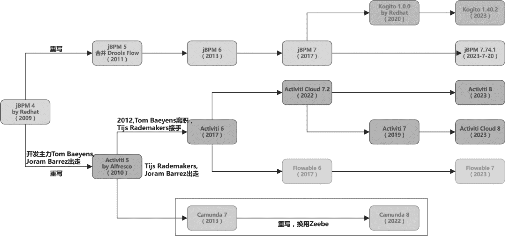

图 2-13

首先，Camunda 最引人注目的特性是其开放性和可扩展性。作为一个纯粹的 Java 库，它不仅能够无缝集成到现有的 JavaEE 和 Spring 框架中，还提供了丰富的 RESTfulAPI 接口，方便非 Java 开发者远程调用。无论是传统的单体应用，还是现代的微服务架构，Camunda 都能轻松嵌入，实现流程自动化。例如，在基于微服务的系统中，各个服务可以通过调用 Camunda 的 API 来协同复杂的工作流，从而高效地进行服务编排与协同作业。DeepSeek 与 Camunda 结合后，通过动态任务路由算法，将“设备故障报修”等复杂工单自动分配给匹配的专家模块。例如，国家电网 MSC 平台接入 DeepSeek 后，基于设备运行数据与工业协议解析技术，实现了设备故障预测准确率提升 20%，运维工单处理周期缩短 30%，年节约运维成本 45 万元。

其次，Camunda 拥有出色的灵活性，能够适应多样化的业务需求。它遵循 BPMN2.0 标准，客户可以采用图形化方式设计业务流程，并通过简单的配置将其部署到运行环境中。此外，Camunda 内置了 DMN 决策引擎，用于执行基于规则的决策表，这为处理复杂的业务逻辑带来了极大的便利。比如，某金融机构利用 Camunda 的决策引擎实现了信贷审批流程的自动化，系统能够根据预设规则自动评估申请者的资质并做出相应决策。

除了功能强大，Camunda 还提供了一整套支持流程管理的工具集。CamundaModeler 是一款易于上手的应用程序，用于创建和编辑 BPMN 流程图及 DMN 决策表；Tasklist 是一款 Web 应用程序，专门用于管理人工任务，使终端客户能够轻松查看和处理分配的工作项；Cockpit 提供全面的监控与操作界面，帮助企业实时掌握流程执行情况并对异常情况进行干预；Optimize 模块专注于流程性能分析，通过数据分析优化现有流程。这些工具共同构建了一个完整的生态系统，覆盖从设计、执行到监控、优化的整个生命周期。

值得一提的是，Camunda 背后有一个活跃且充满活力的全球社区。无论是在官方论坛还是第三方平台，都有大量开发者积极分享经验、交流技术心得，并为遇到问题的开发者提供解决方案。对于希望深入了解技术原理或进行定制化开发的企业来说，这样的社区无疑是宝贵的资源。事实上，许多大型企业都选择 Camunda 作为核心工作流平台，这也进一步证明了该产品的技术成熟度与商业可靠性。

最后，在与其他应用程序的集成方面，Camunda 表现同样出色。借助其提供的多种接口和服务，企业可以轻松实现与 ERP、CRM 等外部业务系统的深度集成，构建更加完善的企业级应用体系。例如，零售连锁企业利用 Camunda 实现订单处理流程自动化，同时与后端库存管理系统对接，确保库存数据同步更新，从而提升企业整体运营效率。

凭借其开放性、灵活性和强大的社区支持，以及对复杂业务流程的管理能力，Camunda 已成为当今工作流引擎市场上最具竞争力的解决方案。无论是寻求改进内部流程的小型企业，还是需要大规模部署自动化系统的跨国公司，Camunda 都是值得优先考虑的选择。另外，Camunda 与排队论的结合也将为智能客服系统的工作流优化和排队管理提供强大的支持，从而全面提升系统的整体性能。

### **2.5.2** **客服工单系统**

客服工单系统贯穿于客户服务的全生命周期，通过一系列精心设计的服务流程，确保从客户提出问题到最终圆满解决的整个过程既透明又高效。在物流行业，当客户反馈包裹丢失时，客服工单系统立即启动标准化处理流程：从记录客户信息、查询包裹运输轨迹到协调快递员查找、与客户沟通进展，再到最终解决问题并进行回访，各个环节紧密相连。工作流技术确保每个步骤都按照最优顺序执行，避免出现处理延误或信息传递不畅的情况。在这个过程中，工作流技术统筹梳理和构建全流程最优路径，不仅提升了工作效率，还保证了服务质量。另外，客服工单系统与排队论紧密相关，合理的工单处理流程可以优化排队系统，从而提升客户服务的效率和满意度。

工单受理阶段。当客户通过热线电话、在线聊天、小程序或公众号等多种渠道寻求帮助时，系统会自动创建一张工单。以电信运营商客服为例，当客户通过手机营业厅 App 反馈网络信号差时，系统会立即创建工单，同时自动获取客户的手机号码、套餐信息等，为后续的问题处理提供便利，减少客服手动录入信息的时间，提高处理效率。工单中详细记录了客户的个人信息和问题描述。为确保每张工单都能得到及时的关注，系统采用智能调度机制，根据问题的紧急程度和类型将其分配给最合适的客服人员。比如，当遇到技术难题时，工单会被优先分配给具备相关技术知识的客服人员；对于一般性的咨询问题，则会按照既定的分配规则安排给相应的客服团队成员。从排队论的角度来看，这一过程类似于对客户请求进行分类排队，不同类型的问题进入不同的“虚拟队列”，等待合适的服务资源进行处理，从而确保资源的合理分配和高效利用。

工单处理阶段。一旦客服人员接到工单，便会立即投入到问题的解决中。他们可以根据系统提供的知识库快速查找相关信息，为客户提供准确的解决方案。如果遇到较为复杂的问题，客服人员还可以通过系统发起内部协作，与其他部门人员进行沟通交流，共同探讨解决方案。在这个过程中，工作流引擎会实时监控工单的处理进度，对处理时间过长的工单进行预警，提醒客服人员加快处理速度。同时，系统会记录每次的沟通和处理操作，形成详细的工单处理日志，方便后续查询和审计。这如同在排队系统中实时监测每个“队列”的处理情况，对出现延误的情况及时调整，以保证整个排队系统的流畅运行。

工单流转阶段。在工单处理过程中，可能会因为各种原因需要流转工单。例如，当发现问题属于其他部门的职责范围时，客服人员可以通过系统将工单转交给相应的部门。工作流引擎会根据预设的流转规则，自动更新工单状态和处理责任人，并发送通知提醒相关人员及时处理。此外，工单在不同部门之间流转时，系统会记录工单流转的时间和原因，确保整个流转过程可追溯。这种工单流转机制类似于排队系统中的任务转移，将客户请求准确地传递到最合适的处理环节，从而提高问题解决的效率和准确性。

工单审核阶段。在客服人员认为问题已经得到解决后，会将工单提交审核。审核人员会对工单的处理过程和结果进行仔细检查，确保问题得到彻底解决且客户对服务结果满意。如果审核不通过，工单会被退回原处理人员，要求其重新处理。审核环节的存在，就像在排队系统中设置了一道质量关卡，只有经过严格审核，客户请求才算真正得到处理，从而避免不合格的服务结果流出，保障整体服务质量。

工单回访阶段。为进一步了解客户对服务的满意度，系统会在工单处理完成后的一段时间内自动安排回访。回访人员通过电话、短信或在线问卷等方式，询问客户对服务过程和结果的评价，收集意见和建议。这些反馈信息会被记录到系统中，作为改进服务质量的重要依据。从排队论的角度看，回访环节是对整个服务流程的一种反馈机制，通过收集客户反馈，不断优化排队系统的规则和流程，提升客户的满意度和忠诚度。

数据分析与优化阶段。客服工单系统会积累大量的工单数据，通过对这些数据的深入分析，可以发现服务过程中存在的问题和潜在的改进机会。例如，通过分析工单的处理时间，可以找出处理速度较慢的环节并进行针对性的优化；通过分析客户的问题类型和频率，可以发现客户的需求热点并及时更新知识库，提高客服人员的服务能力。另外，根据数据分析结果，还可以对工作流引擎的规则进行调整，进一步优化工单的分配、流转和处理流程，提高整个客服工单系统的运行效率。这类似于排队论中通过分析排队数据不断调整排队系统的参数，以达到最优的服务效果。

在工作流技术的支持下，客服工单系统实现了客户服务流程的自动化和规范化。通过合理运用排队论，对工单的受理、处理、流转、审核、回访等各个环节进行优化，不仅提高了客户服务的效率和质量，还为企业提供了宝贵的决策依据，有助于企业不断提升自身的服务水平，增强市场竞争力。随着技术的发展和客户需求的多样化，客服工单系统也将不断演进和完善，为企业和客户创造更大的价值。

## **2.6** **云计算**

在当今数字化浪潮中，智能客服系统的构建与发展离不开云计算的强力支撑。云计算以其独特的服务模式，为智能客服系统提供了灵活、高效且经济的解决方案，使其能够更好地应对复杂多变的业务需求，从而提升服务质量和客户体验。从排队论的视角来看，云计算为智能客服系统的排队机制和资源调配提供了动态优化的技术基础，助力系统更加高效运行。图 2-14 展示了基于云计算的智能客服系统架构，涵盖 SaaS、PaaS、IaaS 三层。

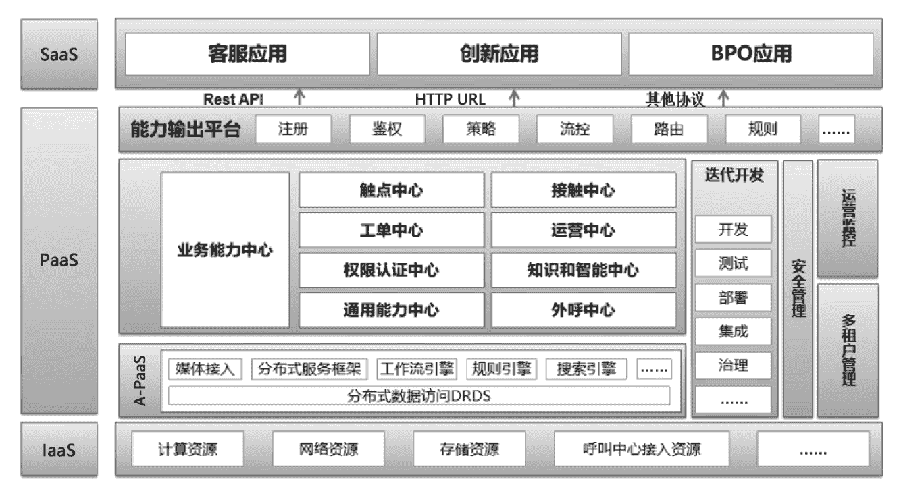

图 2-14

SaaS（Software as a Service，软件即服务）层，面向客户提供具体应用服务，包括客服应用、创新应用和 BPO 应用。其通过 Rest API、HTTP URL 及其他协议与 PaaS 层的能力输出平台对接并调用平台能力，为客户提供各类智能客服相关服务。

PaaS（Platform as a Service，平台即服务）层是系统的核心支撑平台。其中，A-PaaS 提供媒体接入、分布式服务框架、工作流引擎、规则引擎、搜索引擎、分布式数据访问 DRDS 等基础能力。业务能力中心包含触点中心、工单中心、权限认证中心、通用能力中心等多个模块，实现与客户交互、任务处理、权限管理等功能。能力输出平台具备注册、鉴权、策略、流控、路由、规则等功能，用于管理和输出平台能力。此外，PaaS 层还包括迭代开发（开发、测试、部署、集成、治理等环节）及运营监控、安全管理、多租户管理等模块，保障系统持续优化和稳定运行。

IaaS（Infrastructure as a Service，基础设施即服务）层：提供底层基础资源，包含计算资源、网络资源、存储资源、呼叫中心接入资源等。这些资源是智能客服系统运行的硬件和网络基础，为上层服务提供支撑。

### **2.6.1** **SaaS 层**

SaaS 层在智能客服系统中扮演着关键角色，尤其对小型企业来说优势显著。以初创电商企业为例，借助 SaaS 模式的客服平台，企业无须投入大量资金和人力自建客服系统就能快速获取完备功能，从而将资源聚焦于核心业务。以下从功能维度介绍 SaaS 层为智能客服系统提供的关键应用。

**1.** **知识管理功能**

知识库是 SaaS 层的重要信息枢纽，用于整合产品文档、操作指南、常见问题解答等海量资源。以教育 SaaS 平台为例，其知识库会随教学方法更新、学生反馈等情况及时扩充内容。通过先进搜索引擎和智能分类技术，客服人员能快速定位信息，如处理电子产品功能咨询时，可迅速获取操作步骤和故障排除方法。另外，自动化更新机制保障信息实时准确，能够随产品迭代和市场反馈进行动态调整。DeepSeek 运用动态量化压缩技术，将模型参数压缩至原体积的 1/4，支持中小企业在私有云部署，将成本降低 65%且推理延迟<200ms（金融客服场景实测）。

**2.** **工单流程管理功能**

工单流程管理系统构建起标准化、流程化的问题处理体系。当客户问题无法得到即时解决时，系统会自动生成工单，并依据问题类型、紧急程度等智能分配给相应部门或人员。全程实时监控工单状态，记录操作时间与处理人员信息，形成完整的审计跟踪体系。通过工单数据分析，企业可洞察业务流程瓶颈，如发现某部门工单处理周期长，可针对性调整资源或优化流程，从而提升整体效率。

**3.** **服务质量监控功能**

基于大数据与人工智能的智能质检系统是提升客户服务质量的利器。它通过对客服通话录音、在线聊天记录实时分析，自动筛查服务质量问题，如文明用语使用、问题回答准确性等。企业可自定义质检规则，如金融客服关注风险提示传达，电商客服侧重退换货请求处理。借助智能质检系统，企业能及时纠错，提升客服团队的整体水平。

**4.** **数据洞察功能**

SaaS 层的数据分析功能助力企业深度洞察客户需求与行为。通过全面分析客户交互数据，企业可了解客户偏好与痛点，为产品优化和营销策略制定提供依据，如依据客户咨询的产品功能需求改进产品，根据购买历史和咨询记录进行个性化推荐。此外，系统还能预测客户行为趋势，提前满足客户需求，从而提升客户满意度。

**5.** **人员培训赋能功能**

智能培训平台借助人工智能与机器学习，为客服人员定制个性化培训方案。在评估工作表现和知识掌握的情况后，为每人制定专属学习计划，推荐适配课程与资源。比如，新入职人员学习产品基础知识和客服技巧，而有经验的客服则学习高级课程以补足短板。平台还支持模拟实战演练，帮助客服人员提升实际工作能力。

### **2.6.2** **PaaS 层**

在智能客服系统的技术架构中，PaaS 层处于关键枢纽位置，为上层应用提供基础服务支撑，打造高效的开发环境，有力推动应用的快速开发、部署与迭代。以电信行业为例，运营商可基于 PaaS 层快速开发智能客服新功能，提升服务质量和运营效率。PaaS 层主要从以下功能维度为电信行业智能客服系统赋能。

**1.** **业务能力集成与复用**

业务能力中心对电信企业的核心业务逻辑进行抽象封装，形成标准化、可复用的服务模块，并通过 API 对外输出。在电信场景下，话费查询、套餐办理、故障报修等功能均可模块化。例如，当客户咨询话费明细时，客服人员只需调用业务能力中心的话费查询服务模块，即可快速、准确获取客户话费明细并进行解答。这种设计大幅提升了代码复用率，降低了开发成本，同时支持电信企业依据业务需求灵活调整扩展，加速新功能上线，比如快速推出 5G 套餐办理流程。

**2.** **安全权限管控**

权限认证中心是电信智能客服系统安全运行的核心保障。在多租户模式中，基于 OAuth2.0、JWT 等协议，系统可依据租户信息和客户角色严格控制操作权限，防止数据泄露。例如，不同地区的电信分公司共享同一套智能客服系统，权限认证中心会根据各分公司的租户信息，确保客服人员只能访问和操作本地区客户的数据。另外，系统支持细颗粒度权限管理，并集成多因素认证（如短信验证码、指纹识别等），进一步提升系统安全性，防止客户套餐信息、通话记录等敏感数据被非法获取。

**3.** **智能交互创新**

智能服务中心融合自然语言处理、机器学习、知识图谱等 AI 技术。在电信智能客服场景中，通过自然语言处理理解客户意图，可实现智能问答与对话管理。当客户询问“我的网络为什么突然变慢”时，智能服务中心能快速识别问题意图，从知识库中检索相关答案，如网络故障排查方法、带宽占用情况等，并以自然流畅的语言回复客户。此外，它还能基于客户数据进行个性化推荐与问题预测，根据客户的历史套餐使用情况推荐更适合的流量套餐，或根据客户的投诉记录提前准备好可能的解决方案。DeepSeek 多模态融合能力与 PaaS 层 API 网关集成，能够在电信视频客服中实现“边看边问”功能。例如，当客户上传网络设备图片反馈网络故障时，系统会联合图像识别与文本语义分析生成故障排查和解决方法，效率较单一文本客服提升 50%。

**4.** **外呼与通用服务支持**

外呼中心承担电信业务的推广、客户回访等任务，利用自动化拨号和智能语音识别技术提升外呼效率与准确性。例如，在推广新的 5G 套餐时，外呼中心通过自动化拨号系统自动筛选目标客户并拨打号码，减少人工拨号的时间和错误。同时，智能语音识别技术可以识别客户的语音反馈，自动记录通话要点，方便后续跟进。通用能力中心提供短信、邮件发送及文件存储等基础服务，便于电信智能客服系统集成调用。例如，向客户发送套餐变更通知短信或存储客户咨询记录文件，从而增强系统开发的灵活性。

### **2.6.3** **IaaS 层**

IaaS 层是智能客服系统运行的基石，为其提供底层的计算、网络和存储资源，确保系统稳定、高效运作。以电信行业为例，在电信业务推广高峰期或网络故障集中报修时段，智能客服系统面临巨大的访问压力，此时 IaaS 层的弹性资源调配能力至关重要。IaaS 层主要从以下资源维度为电信行业智能客服系统提供支撑。

**1.** **弹性计算资源调配**

IaaS 层借助虚拟化技术，赋予电信智能客服系统按需扩展的计算能力。例如，在 5G 套餐推广期间，咨询量激增，IaaS 平台可自动增加虚拟机数量并动态提升 CPU 和内存配置，确保企业能根据业务波峰波谷灵活调整资源。同时，IaaS 层支持容器化技术（如 Docker 和 Kubernetes），加速应用部署与管理，确保客服系统快速响应客户咨询，缩短排队等待时间。

**2.** **稳定网络架构搭建**

IaaS 层通过构建高速、稳定的网络环境，保障电信智能客服系统数据传输与通信的高效性。针对电信运营商服务覆盖范围广的特点，IaaS 层采用负载均衡技术，将客户请求智能分发至多个服务器，防止单点故障与过载。利用内容分发网络（CDN），IaaS 层可将静态资源缓存至离客户最近的节点，像客服界面、操作指南等资源，使不同地区的客户快速加载。对于跨国电信企业，IaaS 层的全球分布式节点和跨地域网络连接能力可确保全球服务的一致性与稳定性。

**3.** **多元存储方案支持**

IaaS 层提供对象存储、块存储和文件存储等多种存储方式，满足电信智能客服系统多样化的数据存储需求。对象存储适合存储海量非结构化数据，如客服通话录音、客户反馈记录；块存储为数据库等对性能要求高的应用提供高性能存储；文件存储用于存放知识库文档等结构化文件。此外，IaaS 层具备数据备份与恢复功能，企业可按需设定备份策略来确保数据的安全可靠，并在数据异常情况下快速恢复业务。

企业选择 IaaS 供应商时，需综合考量性能、弹性、安全、成本、技术支持和可持续发展等因素。合理规划与利用 IaaS 层资源，才能为电信智能客服系统构建高效、可靠、安全的基础架构。

## **2.7** **外围系统集成**

智能客服系统并非孤立运行，而是需要与企业内外部系统深度集成，以实现信息流通与业务协同。图 2-15 为智能客服系统网关集成架构示意图，它虽未全面展示智能客服系统与企业内外部各类系统的集成全貌，但在一定程度上体现了集成原理。当客户与智能客服系统交互时，首先接触的是网关系统。网关系统如同智能客服系统的“守门人”，起到关键的枢纽作用。

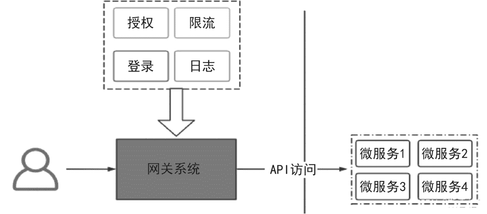

图 2-15

从功能上看，网关系统集成了授权、限流、登录、日志等功能模块。授权功能确保只有经过许可的客户或系统才能访问智能客服系统相关资源，从而保障系统的安全性；限流功能通过限制请求频率，防止大量请求涌入导致系统性能下降，维持系统稳定运行；登录功能用于验证客户身份，是客户进入系统的身份验证关卡；日志功能记录系统的操作和访问情况，便于后续进行问题排查和行为分析。

通过网关系统，客户能进行 API 访问，与后端微服务（如微服务 1、微服务 2、微服务 3、微服务 4）进行交互。这些微服务可以是智能客服系统内部的不同功能模块，也可以是与企业其他内部系统（如客户关系管理系统、订单管理系统等）或外部系统（如第三方知识库、支付系统等）对接的接口服务。这种架构设计体现了智能客服系统通过网关系统与其他系统深度集成，保障了信息的顺畅流通与业务的协同处理，既能满足企业多样化的业务需求，又能提升整体服务质量与效率。

### **2.7.1** **与核心业务系统集成**

在电信运营领域，智能客服系统与业务支撑系统（Business Support System，BSS）、运营支撑系统（Operation Support System，OSS）、管理支撑系统（Management Support System，MSS）及决策支持系统（Decision Support System，DSS）的集成，是提升服务质量和运营效率的关键举措。在电信运营商的实际运营中，这种集成带来了显著的效益提升。例如，当客户咨询套餐变更问题时，智能客服系统不仅能从 BSS 获取客户当前套餐信息，还能通过 OSS 了解网络资源的适配情况，为客户提供更精准的套餐变更建议，避免因网络不支持导致出现的服务问题。

**1.** **数据层面的融合**

数据融合是实现系统集成的基础。智能客服系统通过与 BSS 集成，能够实时获取客户的账户信息、套餐详情、消费记录等关键数据。为确保数据安全和可靠传输，可采用 RESTful API 或 GraphQL 等标准化接口协议，并实施严格的访问控制和加密措施。例如，当客户咨询套餐变更问题时，智能客服系统可以通过安全的 API 调用从 BSS 中获取客户当前套餐信息，并根据客户需求提供精准的变更建议。另外，与 OSS 集成可以让智能客服系统获取网络设备状态、故障信息等数据，帮助客服人员更好地解决客户网络问题。

**2.** **界面层面的融合**

为提供一致的客户体验，智能客服系统在界面层面与其他核心业务系统深度融合。例如，在移动营业厅 App 中，智能客服与业务办理、账单查询等功能集成在统一界面。客户在咨询客服问题后，如果需要办理相关业务，无须切换多个应用或界面即可完成操作，大幅简化了操作流程，提升了客户满意度。通过构建统一的门户或服务入口，客户可以在同一个界面访问多个系统的功能。采用 Web 技术和响应式设计，确保客户在不同设备上都能实现流畅的操作体验。例如，电信公司可以将智能客服、业务办理、账单查询等功能集成到单一手机应用，客户无须在多个应用之间切换即可完成各种操作。另外，界面的设计要注重客户体验，简化操作流程，以提高客户的使用效率。

**3.** **流程层面的融合**

流程融合旨在实现跨系统的业务自动化处理。以故障处理流程为例，智能客服系统在接收到客户的故障申报后，能够自动触发 OSS 中的故障诊断和修复流程，并将处理进度实时反馈给客户。借助工作流引擎和事件驱动机制，各个环节的任务能够按照预定规则自动流转，提高问题处理的效率和准确性。另外，与 MSS 集成可优化客服人员的绩效考核和资源管理，与 DSS 集成可以为决策提供数据支持，帮助企业优化业务流程和服务策略。

### **2.7.2** **与互联网应用深度融合**

在移动互联网时代，智能客服系统与企业微信、微信小程序等互联网应用融合，为电信企业拓展服务渠道、提升服务体验带来新机遇。比如，电信企业借助微信小程序为客户提供便捷的业务咨询服务。

**1.** **API 设计与通信协议**

API 设计是实现无缝对接的关键。建议采用 RESTful 架构，使用标准 HTTP 方法和 JSON 数据格式，以确保平台兼容性与易用性。对于实时交互（如语音、视频通话），可采用 SIP 协议或 WebRTC 技术，并通过 WebSockets 实现双向实时通信。例如，在微信小程序中集成智能客服，客户可实时与客服沟通并获取支持。

**2.** **客户体验优化**

融合过程中需要重点关注优化客户体验。例如，电信企业可将智能客服集成到企业微信客户群，使客户提问能快速获得响应，并支持快捷回复，以减少操作步骤与等待时间。同时，利用自然语言处理技术实现智能问答，结合客户行为和偏好进行个性化推荐，并加强数据安全与隐私保护。

**3.** **数据一致性维护**

确保数据一致性是系统集成的主要挑战之一，可通过事件驱动架构和数据同步机制实现实时更新，如当客户在企业微信中修改信息时，智能客服系统能够及时获取最新数据。此外，需要建立备份和恢复机制，防止数据丢失或损坏，从而保障系统深度融合，提升企业竞争力。

# **第三章**

# **智能客服系统设计与实现**

本章将探讨智能客服系统的设计与实现。首先介绍语音识别模块的设计理念，这是实现高效沟通的基石；然后探讨数字人模块如何通过形象设计和动作控制，让每一次交互都更具温度；接着分析大数据与客户画像的重要性及其实施方法，这是理解和服务客户的关键要素；最后阐述 FreeSwitch 连接模块如何确保通信服务的稳定可靠，为客户提供无缝连接体验。此外，考虑到多轮对话对提升客户满意度和解决问题效率的重要作用，本章还特别介绍了多轮对话机器人的设计原则。

## **3.1** **语音识别模块设计**

语音识别技术是实现智能客服高效沟通的核心技术。下面系统介绍高质量声音采集与预处理方法、复杂环境下的声音特征提取技术，以及面向不同应用场景的模型选型建议，助力开发者实现最优识别效果。

### **3.1.1** **语音信号采集与预处理**

在音频通信中，语音信号的采集与预处理至关重要，直接影响声音传输质量，在智能客服应用场景中同样如此。以呼叫中心为例，其每天处理大量的语音咨询，若语音信号采集不准确或预处理不到位，就可能导致后续的语音识别错误，影响客户问题的解决效率。因此，深入研究这一环节的技术细节十分必要。

**1.** **音频信号的基本属性**

音频信号可以看作随时间波动的声压变化，通过麦克风等设备可将这种波动转换为电信号并进行数字化处理。在此过程中，模拟信号经过采样、量化和编码后转换成数字信号。根据奈奎斯特-香农采样定理，为不失真地重建原始信号，采样频率至少应为信号最高频率成分的两倍。例如，在电话通话中，人类语音的频率范围通常在 300 至 3400 赫兹之间，因此 8000 赫兹的采样率就足够了，而为追求更自然的声音效果，如音乐播放或高清语音通话，我们常常会选择更高的采样率，比如 16kHz、24kHz 甚至 48kHz。每个样本点都用一定数量的比特表示其幅度值，常用的位深度有 8 位、16 位及更高，其中 16 位是最常见的选择，因为它提供了足够的动态范围，能满足大多数的应用需求。

**2.** **采集设备及其参数设置**

捕捉声音的常用设备包括动圈式麦克风、电容式麦克风和阵列式麦克风等。在嘈杂的工厂环境中部署智能客服语音采集设备时，由于环境噪声较大，需要选择抗噪能力强的麦克风。此时，阵列式麦克风凭借其独特的拾音模式和降噪功能，能够有效聚焦目标语音，降低环境噪声的干扰，保证采集到清晰的语音信号，为后续语音识别和问题处理提供可靠的数据基础。不同类型的麦克风因其灵敏度、频率响应特性和指向性模式不同，适用于不同的场景。例如，单向型麦克风非常适合录制个人讲话，因为它能集中拾取前方的声音，同时抑制来自其他方向的噪声；而对于需要全方位覆盖的会议室场合，则更适合使用由全向型麦克风或多个定向型麦克风组成的阵列。

除了硬件的选择，正确配置软件参数也是确保录音效果良好的关键。这包括调整合适的增益水平，避免出现失真或信噪比过低的问题；设定恰当的采样率和位深组合，以平衡存储成本与音质之间的关系；开启自动增益控制（AGC）功能，帮助系统维持稳定的输出音量。此外，系统还可以启用回声消除器（AEC）和噪声抑制器（NS）等功能模块，有效去除由房间反射引起的声音反馈现象，或减少背景环境中非语音成分对最终结果的影响。

**3.** **常见预处理方法**

降噪。降噪是从含有大量噪声成分的混合信号中提取出纯净的人声部分的过程，广泛应用于电话会议、广播电台等领域。一种流行的降噪算法是基于谱减法原理实现的，即先估计噪声功率谱密度，然后将其从总输入信号中扣除。虽然这种方法简单易行，但在强噪声环境下可能会产生一定程度的失真。近年来，随着深度神经网络的发展，利用机器学习模型识别并分离目标声源的方法逐渐展现出优越性能，并越来越受到业界青睐。DeepSeek 采用动态频谱建模技术，针对金融客服场景中高频出现的键盘敲击声、电话杂音，通过实时噪声分离算法将敏感信息（如账户密码）的识别准确率提升至 92%，较传统降噪方案提升 18%。

去混响。当声音在封闭空间内传播时，会因墙壁和其他物体反射产生多次延迟到达接收端的现象称为混响。适量的混响可以使听感更加丰富饱满，但过度混响则会导致语言清晰度下降，尤其不利于远距离通信场景。去混响技术通过滤波或其他数学手段削弱晚期反射分量的能量，从而提高直接路径上原始信号的比例。WebRTC 框架下的 NetEQ 组件就集成了专门针对该问题设计的功能模块，能够自适应调整滤波系数以达到最佳效果。

除了降噪和去混响，许多其他预处理策略也可用于进一步提升音频质量。自动增益控制可确保输出电平保持在稳定范围内，即使输入强度发生变化也不会影响听众体验。静音检测机制可以帮助企业节省带宽资源，在没有实际说话内容期间停止数据发送。此外，对于某些特定环境条件下的极端情况，还可以采取更为专业化的解决方案，比如通过多通道录音设备配合复杂的空间定位算法可实现精准定位发声源的位置，进而增强目标区域内的拾音效果；或者开发定制化软硬件平台并结合先进算法优化整体性能指标等。

通过对语音信号采集与预处理环节的深入研究与实践，不仅能显著提高现有通信系统的效率与可靠性，还能为未来更多的创新应用奠定坚实基础。无论是传统电话服务，还是新兴智能客服助手产品，都离不开高效、可靠的语音处理技术的支持。

### **3.1.2** **语音特征提取与识别算法**

在当今的语音处理技术中，有效的特征提取方法和先进的识别算法是构建高效、精准语音识别系统的关键。主流的语音特征表示方法主要包括梅尔频率倒谱系数（Mel-Frequency Cepstral Coefficients，MFCC）和滤波器组（FBank）特征。以智能语音助手的实际应用为例，MFCC 和 FBank 在不同场景下各有优势。在相对安静的室内环境中，MFCC 能够很好地模拟人耳对声音频率的感知，提取关键的语音特征，帮助语音助手准确识别客户指令；而在存在一定噪声干扰的户外环境中，FBank 对频谱特征的直接抽取方式，使其在保持抗噪能力的同时，能更有效地捕捉语音信号的声学特性，保障语音识别的准确性。这些方法之所以适用于机器学习任务，是因为它们能够捕捉人类听觉感知的重要信息，并且具有较强的抗噪能力。

具体来说，MFCC 通过模拟人耳对不同频率声音的敏感度来提取特征；FBank 则直接从频谱图中抽取声学特性，两者都能有效降低环境噪声的影响，同时保留区分不同发音所需的声学信息。在语音特征提取环节中，DeepSeek 结合跨模态特征融合技术，将语音信号与客户历史交互数据（如文本咨询记录）联合建模，在电信客服场景中使“套餐变更”类复杂问题的意图识别准确率从 75%提升至 90%。

随着深度学习技术的发展，基于卷积神经网络（Convolutional Neural Network，CNN）、长短期记忆网络（Long Short-Term Memory，LSTM）及变换器（Transformer）等架构的模型逐渐成为流行的语音识别解决方案。其中，CNN 因其强大的局部特征捕捉能力，在图像领域取得巨大成功后也被广泛应用于声学信号处理领域；LSTM 擅长处理序列数据中的长依赖关系，特别适合需要考虑上下文信息的语言理解任务；而 Transformer 模型凭借其自注意力机制，在不牺牲效率的情况下实现了更优的性能表现，尤其在大规模训练集应用中展现出巨大的潜力。在选择算法时，应综合考量准确性和计算复杂度等因素：尽管 Transformer 模型提供最佳的识别精度，但在资源受限的应用场景下，LSTM 或简单的 CNN 可能是更实用的选择。

在模型训练过程中，常遇到的问题包括过拟合、欠拟合及梯度消失/爆炸等。在训练语音识别模型时，过拟合和欠拟合问题较为常见。例如，当模型过于复杂而训练数据量相对较小时，就容易出现过拟合现象。此时，模型会过度学习训练数据中的细节和噪声，导致在新数据上的泛化能力下降，无法准确识别新的语音指令。欠拟合是指模型未能充分学习到数据中的规律，表现为对各种语音输入的识别准确率较低。因此，有效解决这些问题是提升语音识别模型性能的关键：可采用正则化手段如 Dropout 和 L2 正则化防止过拟合；增加训练样本或使用数据增强技术缓解欠拟合；针对梯度问题，可以通过调整激活函数（如用 ReLU 替换 sigmoid）、引入批量归一化层等方式加以改进。此外，迁移学习也是提高模型泛化能力和降低标注成本的有效策略，即利用预训练模型作为起点进行微调，尤其适用于小规模定制化应用场景。

合理的特征选择加上恰当的模型设计是实现高性能语音识别系统的基石。通过对现有技术和方法的深入理解与灵活运用，我们不仅能克服传统方法面临的挑战，还能推动整个领域的持续发展。

## **3.2** **数字人模块设计**

随着人工智能技术的飞速发展，数字人在客户服务领域的应用日益广泛。下面将探讨数字人模块的设计与实现，重点关注数字人的形象设计流程，包括面部表情和肢体语言等细节，以及它们如何与客户进行互动交流。这部分内容涵盖从构思到实现的技术细节，同时强调提升客户体验的重要性，旨在帮助读者全面掌握构建高效互动数字人的方法。

### **3.2.1** **数字人形象设计与动作控制**

在塑造面向客服领域的数字人时，选择合适的风格是关键。如同实体客服人员，数字人的形象与举止需符合行业特质，给客户传递专业、亲和且可信赖的感受。实践表明，拟人化风格的数字人形象备受青睐（图 3-1）。

图 3-1

拟人化风格的数字人拥有精致细腻的面部表情，能精准传达关切与热情；自然流畅的肢体语言，如同客服人员交流时的手势动作，传递专业、可靠的服务态度，瞬间拉近与客户的距离。风格选择不仅决定数字人的外在形象，还影响它们在各类客户服务场景中的表现力，以及客户对其的接纳程度。数字人常见的风格包含卡通、拟人化与超现实主义等。在客服领域，拟人化风格通过适度的真实感，使数字人成为用户亲切的服务伙伴；卡通风格凭借夸张表情在娱乐教育领域备受欢迎，但难以传递专业服务所需的稳重；超现实主义风格虽有视觉冲击力，但不适合追求高效、亲切沟通的客服场景。

实现这些风格，离不开现代软件工具和技术的支持（图 3-2）。以某大型金融机构的数字人客服为例，为打造专业、亲切的形象，设计团队使用 Maya 进行高精度的人物建模，精心雕琢每一个面部细节，包括逼真的皮肤纹理、细腻的表情肌肉运动等；利用 3dsMax 为数字人设计符合金融行业形象的服装，从款式到材质都经过精心挑选，确保数字人在外观上能给客户留下良好的第一印象。

Autodesk 公司的 Maya 和 3dsMax 提供了强大的三维建模功能，能够精确地构建从面部特征到服装纹理的各种细节，并支持复杂的动画制作。Unity3D 作为一种被广泛使用的实时渲染引擎，不仅能创建逼真的物理环境，还能通过集成 PBR（基于物理的渲染）技术显著提升数字人的材质真实感，特别是在光照效果方面。虚幻引擎（UnrealEngine）同样因其高效的实时渲染能力和高质量的视觉输出，在游戏和影视行业中备受青睐。

图 3-2

完成形象设计后，如何赋予数字人生动自然的动作成为面临的另一个挑战。如图 3-3 所示，通过光学捕捉、惯性捕捉及视觉捕捉等多种方式采集人体运动数据并映射到数字模型上，可极大地增强数字人行为的真实性和流畅性。其中，Vicon 和 OptiTrack 提供的光学捕捉系统以高精度著称，但对环境条件要求较高且成本不菲；相比之下，Xsens 和 Noitom 的惯性捕捉方案虽然在遮挡抗性上表现出色，但整体精度略逊一筹。近年来，随着算法的进步，基于单目或多目摄像头的低成本视觉捕捉技术逐渐成熟，如 LeapMotion 和微软 Kinect，降低了动作捕捉门槛，让更多开发者参与到这一领域中来。DeepSeek 的数字人客服利用表情-语音同步算法在视频客服中实现毫秒级的情绪匹配：当客户语速加快、声调升高（表现出焦急情绪）时，数字人会同步调整面部微表情（如皱眉、眼神专注等）并切换为安抚语气，使客户满意度提升 30%（某银行实测数据）。

图 3-3

除了直接进行动作捕捉，智能合成技术也在快速发展，可通过分析文本或语音输入等方式自动生成相应的表情和肢体语言，对非交互式内容的快速生成尤为有用。例如，在新闻播报或客服对话等场景中，利用 TTSA（Text-To-Speech&Animation）技术，数字人根据给定的文字信息可自动调整语气和姿态，提高了沟通效率并增强了客户体验。综合运用上述各种技术方法，可创造出既符合审美标准又具备高度互动性的数字人形象，满足日益增长的市场需求。

### **3.2.2** **数字人交互逻辑与响应机制**

在数字人与客户交流的过程中，其核心在于能够准确理解客户的意图，并据此生成流畅且符合上下文的回答。在实际应用中，数字人准确理解客户意图是提供优质服务的关键。比如，在电商客服场景中，当客户询问“这款手机的电池续航能力怎么样？”时，数字人不仅要识别出“手机”和“电池续航”两个关键信息，还要结合知识图谱中该手机的具体参数，给出准确、详细的回答，如“这款手机配备了 4500mAh 的大电池，根据实验室测试数据，在正常使用情况下可续航一整天，重度使用下也能满足大部分客户的需求”，让客户获得满意的答复。这一过程涉及自然语言处理算法、知识图谱的应用，以及智能驱动型和真人驱动型数字人在交互方式上的差异性选择等多个方面。

根据驱动方式的不同，交互型数字人可分为智能驱动型和真人驱动型。智能驱动型数字人在应对大量常见问题时具有显著优势。例如，在在线旅游平台的客服场景中，面对客户关于旅游景点介绍、酒店预订流程等高频问题，智能驱动型数字人可以快速调用知识库中的信息，给出准确的回答，并根据预设的规则生成相应的动作和表情，如微笑、点头等，营造出友好的交流氛围，高效地解决客户的问题，减轻人工客服的工作压力。

智能驱动型数字人可通过智能系统自动读取并解析和识别外界输入信息，根据解析结果决策数字人后续的输出文本，然后驱动人物模型生成相应的语音与动作，实现数字人与客户的互动。图 3-4 为智能驱动型数字人交互应用流程图，其中 App 作为信息输入端口将文本信息传入系统。

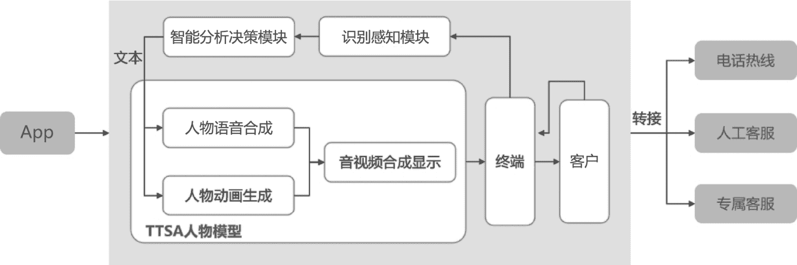

图 3-4

终端接收客户输入的文本信息，其先进入识别感知模块完成内容的分析和理解，再被传递至智能分析决策模块输出响应策略。在智能策略的驱动下，依托 TTSA 人物模型同步执行两大分支任务：一是触发人物语音合成，将文本转换为语音；二是启动人物动画生成，生成对应的人物动画。语音与动画共同流入音视频合成显示模块，被整合为完整的音视频后经终端输出并触达客户。客户通过终端与数字人交互，若问题超出数字人的处理能力，则可通过转接流程将需求导流至电话热线、人工客服或专属客服等渠道，以此实现智能驱动型数字人在客服场景中的交互应用闭环。

真人驱动型数字人通过真人实现驱动，图 3-5 为真人驱动型数字人技术实现流程图。首先，通过音视频采集系统采集真人自身的语音、动作等信息。采集的信息分为两路：一路用于人物语音合成，通过技术手段将真人语音转换为数字语音；另一路用于人物动画生成，把真人的动作、姿态等转换为数字动画。随后，数字语音和数字动画一同进入音视频合成显示模块，被整合成完整的数字人音视频内容。最终，整合后的内容通过 PC、手机、VR 设备等多种终端展示给客户，实现客户与基于真人驱动生成的数字人的交互。整个流程体现了从真人信息采集到数字内容生成，再到终端展示的完整过程，是真人驱动型数字人实现的关键技术路径。

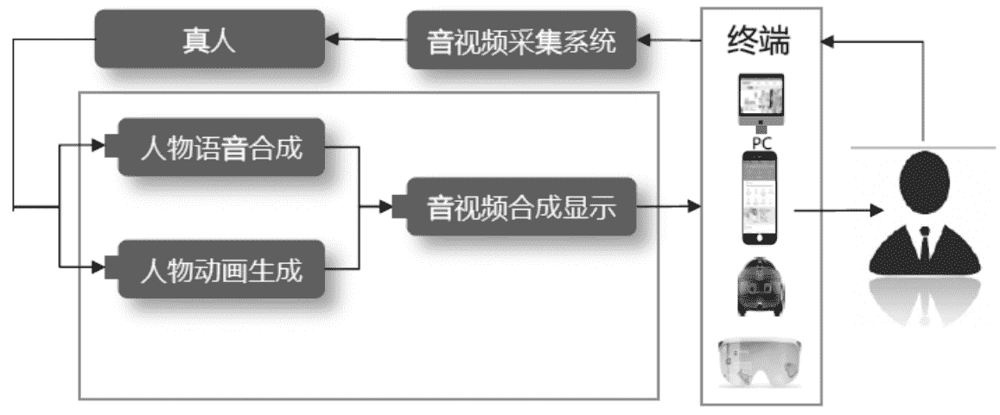

图 3-5

从识别客户意图的角度来看，自然语言处理技术是实现这一目标的关键。通过深度学习模型，如 BERT、GPT 等，数字人可以分析客户的输入文本或语音，并从中提取关键信息，包括问题的核心诉求、情感倾向及潜在的背景需求。例如，当一位客户询问“最近有新的 5G 套餐吗？”时，数字人不仅需要识别出客户对新套餐的兴趣，还应进一步判断该客户是否特别关注价格、流量分配或服务范围，从而提供更加精准的信息反馈。此外，为确保回答的一致性和准确性，数字人还会利用知识图谱来增强自己的决策能力。知识图谱是一种结构化的数据存储形式，将实体间的关系以图形的方式展现出来，使机器能更容易理解和处理复杂的信息网络。在面对关于服务的各种查询时，一个详尽的知识图谱可以帮助数字人快速定位相关信息节点，比如某个特定套餐的服务条款、覆盖区域等，进而给出更为全面而具体的解答。

在处理更复杂的对话场景时，仅依靠单一的自然语言处理模型可能难以满足所有需求。此时，引入多模态融合技术已成为一种有效的解决方案。这种技术允许数字人同时处理来自不同渠道的数据，如文字、声音乃至图像，通过综合分析这些信息可以更好地把握客户的真实意图。举例来说，如果客户上传了一张账单图片并询问费用详情，数字人则可以通过 OCR（光学字符识别）技术读取图片中的内容，并结合客户的历史消费记录及当前提问的具体语境，给出最恰当的答案。

国际权威人工智能评测机构 OpenCompass 的评测报告显示，DeepSeek 的门控多模态路由器（GMR）在处理“我需要预约明天的视频客服”这类跨模态请求时，能动态分配 70%的权重至时间解析模块、30%至渠道选择模块。在其组织的多模态意图识别专项测试中，涵盖了多种复杂的业务场景和自然语言表述方式，DeepSeek 的复杂意图识别准确率达 95.1%，较参与评测的主流开源方案的平均水平提升了 15%。

通过对客户意图的精确捕捉、利用知识图谱辅助决策及根据不同情境选择合适的驱动方式，数字人与客户互动中能够展现出高度智能化的特点，从而有效提升整体服务质量。随着相关技术的不断进步，未来数字人在更多领域内的应用前景令人期待。

## **3.3** **大数据与客户画像模块设计**

在智能客服系统中，运用大数据技术绘制精准的客户画像，是实现个性化服务的关键。下面将深入探讨大数据与客户画像模块设计，包括如何收集并整理客户的信息、构建准确详尽的客户画像，并保持客户画像的时效性，以确保为每位客户提供最贴心的服务体验。

### **3.3.1** **客户数据收集与整理**

在构建客户画像的过程中，全面而细致地收集和整理客户数据至关重要。以电商平台为例，客户数据的收集与整理是实现精准营销和个性化服务的基础。通过收集客户在平台上的浏览记录、购买历史、搜索关键词等行为轨迹数据，以及客户的年龄、性别、地域等个人信息，电商平台能够深入了解客户的偏好和需求。例如，发现一位客户经常购买母婴产品且搜索过“婴儿奶粉排行榜”等关键词，就可以推断该客户可能是一位新手妈妈，对婴儿奶粉的选择比较关注，进而为其推荐相关品牌的奶粉和育儿知识。这一过程不仅需要从多个维度获取原始数据，如个人信息、行为轨迹及外部信息，还需要对这些数据进行清洗、整合和分析，从而提炼出能够准确反映客户特征的事实标签。基于这些基础信息，平台可以更深入地理解客户，为后续的产品设计、服务优化及精准营销奠定基础。

客户数据的主要来源可以分为四大类：

客户个人信息：包括客户的性别、年龄、教育背景、职业等基本信息。例如，注册时填写的资料提供了客户的自然属性，问卷调查或社交平台上的公开信息能进一步揭示客户的兴趣爱好、家庭状况，甚至收入水平。

行为轨迹数据：包括客户在线上的一切活动痕迹数据，涵盖显式行为（如点赞、评论、分享、关注、评分）和隐式行为（如页面浏览时间、点击频率、访问间隔）。以游戏平台为例，通过对玩家的游戏选择、游玩时长及参与讨论的活跃程度进行跟踪，便能洞察其偏好类型及对特定内容的兴趣强度。

内容数据：指客户所消费的内容本身及其关联的信息，比如文本、图片、视频等内容载体，还包括这些内容被描述或评价后产生的关键词、标签等元数据。例如，通过对游戏介绍页下方客户留言区中频繁出现的情感词汇做情感分析，就能评估大众对某款新游戏的整体接受度。

外部数据：来自第三方平台或合作伙伴的数据补充，可以帮助超越单一产品局限，更全面地描绘客户的生活方式和社会关系网。例如，结合社交媒体账号授权登录功能收集到的好友列表、兴趣群组等信息，可以帮助平台了解客户在其他社交场景下的互动模式。

在实际数据收集过程中，不同类型的数据来源具有不同的价值和获取难度。客户个人信息虽然相对稳定，但获取时需要注重隐私保护，遵循相关法律法规。行为轨迹数据能够实时反映客户的兴趣和需求变化，但数据量庞大且复杂，需要高效的数据处理技术进行分析和挖掘。外部数据可以丰富客户画像的维度，但在整合时需要考虑数据的准确性和可靠性。DeepSeek 通过对长上下文客户的行为建模，可以在电商场景中分析客户多轮对话历史（如“先询问尺码，再咨询物流”）生成包含“购买意图优先级”的动态标签，使个性化推荐准确率提升 25%，订单转化率提高 18%。

在获取多源异构的原始数据后，需要对其进行预处理，主要包括以下几个方面。

数据清洗：去除无效值、重复项及异常点，确保每一项记录都是真实可靠的。这一步骤往往需要借助统计学方法来识别并修正偏离正常范围的数据点。

数据整合：将分散存储于不同数据库中的表单数据合并成统一格式的集合，便于后续查询与分析。例如，利用 ETL 工具定期抽取各业务系统中的最新数据，并按照预设规则映射至中心化的数据仓库。

数据分析：运用算法模型挖掘隐藏在海量数据背后的规律性知识。具体来说，可以通过聚类分析发现具有相似特性的客户群体；应用关联规则学习揭示某些特定行为间的因果联系；采用时间序列预测未来一段时间内客户可能出现的新趋势。

经过上述流程，最终得到的是结构化且富含洞见的事实标签体系。事实标签是指可以直接从观察中得出的客观属性，包括静态画像与动态画像两大类。其中，静态画像侧重描述客户的固有属性，如性别、年龄等，这类信息相对稳定，不易随时间改变；动态画像反映了客户在特定情境下表现出的行为特征，包括他们对各类内容的兴趣变化、活跃时段分布等。值得注意的是，在整个过程中必须高度重视数据质量控制，因为只有基于高质量的数据才能建立真正可靠、有效的客户画像模型，从而为决策支持提供强有力的依据。

### **3.3.2** **客户画像更新与维护**

客户画像是个性化推荐系统的核心，其精准度和时效性直接影响推荐效果。在互联网内容平台中，由于客户的兴趣爱好变化较快，客户画像的及时更新尤为重要。例如，某视频平台发现一位客户近期频繁观看健身类视频，点赞和收藏了许多健身教程，通过对这些行为数据的分析，平台及时更新客户画像，将健身相关内容作为重点推荐给该客户，这不仅能满足客户的需求，还能增加客户在平台上的停留时间和活跃度。因此，如何有效地更新和维护客户画像成为提升客户体验、增强客户黏性的关键所在。下面将探讨维持客户画像准确性和时效性的策略，包括定期评估客户行为变化趋势的方法，以及根据最新数据调整客户画像的具体步骤和几种常见的模型标签生成方法。

**1.** **定期评估客户行为变化趋势的方法**

在维护客户画像的过程中，定期评估客户行为的变化趋势是不可或缺的一环。它可以帮助企业及时调整营销策略和服务内容。以在线教育平台为例，通过定期分析客户的学习行为数据，如课程学习进度、作业完成情况、对不同学科的关注度等，发现部分客户对编程课程的兴趣逐渐增加，这时平台可以据此调整课程推荐策略，为这些客户推送更多编程相关的课程和学习资源，提升客户的学习体验和满意度。这一过程通常分为两个阶段：数据收集与数据分析。

数据收集阶段：要从多个渠道获取客户信息，这些信息既包括性别、年龄等静态属性，又涵盖浏览记录、点击率等动态属性。显式行为如点赞、分享或评论等可以直接反映客户的偏好；隐式行为如页面停留时间、点击次数等则需通过特定算法解析揭示客户潜在的兴趣点。为了更全面地理解客户需求，我们还会引入外部数据，例如社交媒体上的活动情况或购物平台的消费记录，以丰富客户画像的内容。

数据分析阶段：利用统计学方法处理收集到的数据，识别客户的兴趣迁移模式。时序分析是一种常用的技术，能够帮助我们发现客户行为随时间变化的规律。比如，通过比较不同时段内某位客户对某一类型内容的关注度变化，可以判断该客户是否正在逐渐失去对该主题的兴趣，或是开始关注新的领域。

此外，还可以采用机器学习中的异常检测算法来捕捉客户行为中突然出现的显著偏差，这可能预示着客户正处于生活状态的重大转变之中，比如搬家或换工作。

**2.** **根据最新数据调整客户画像的具体步骤**

一旦确定了客户行为的变化趋势，下一步便是及时更新客户画像，以保持其时效性。具体操作可以概括为以下几步：

（1）整合多源数据：结合内部数据库与第三方服务提供的额外信息，形成关于目标个体的全方位视角。

（2）清洗与标准化：去除重复条目及无效信息，确保所有输入都是高质量且格式一致的。

（3）特征提取与权重分配：从整理好的资料中抽取有用的特征向量，并根据它们的重要性给予相应分数。这时会使用到聚类分析（Cluster Analysis）和加权计算（Weighted Calculation）两种方法。前者旨在将具有相似特性的群体归类，便于后续针对性推送；后者则依据客户近期活动强度重新计算各标签的重要程度，确保最能反映当前偏好的项目获得较高权重。

（4）构建新版本模型：基于上述结果重构客户画像框架，在添加新兴兴趣点的同时淘汰过时选项。

（5）测试验证：通过 A/B 测试等方式检验新旧两版画像之间的性能差异，确认改进措施的有效性后再全面部署上线。

**3.** **模型标签生成方法**

为进一步优化和完善客户画像，除了常规的属性描述，还需要生成一系列更具代表性的模型标签。目前，较为流行的两种技术是聚类分析和加权计算。聚类分析是一种无监督学习方法，通过对大量样本进行分组，使组内成员间的相似度较高，组间的差异较大，适用于发现自然形成的社群结构。例如，按照客户活跃程度将其划分为“重度使用者”“普通爱好者”“偶尔访问者”三个等级，这有助于精准定位目标受众并实施差异化营销策略。加权计算是通过对每个标签赋予不同的权重值来量化其影响力，最终得到综合评分，并用于排序筛选。此算法特别适合处理含有复杂关系网络的情况，如社交圈内朋友推荐度的影响因子设置。结合 DeepSeek 的稀疏门控技术，在客户画像更新时仅激活与当前行为最相关的专家模块（如针对“高频退货客户”激活“售后服务策略”模块），可以将画像更新效率提升 40%，存储成本降低 60%。

在构建与完善客户画像的过程中，持续监测客户行为的演变轨迹，并据此灵活调整相应的标签体系，不仅能有效提升客户画像的生命力，还能为客户带来更为贴心、周到的服务体验。在此特别强调，整个流程必须严格遵守国内外关于隐私保护的法律法规，如欧盟的《通用数据保护条例》（GDPR）、中国的《中华人民共和国个人信息保护法》等。所有操作都应在尊重个人意愿的基础上，依法依规合理使用个人信息资源，坚决杜绝任何形式的滥用行为，以免引发法律纠纷及对客户权益造成损害，从而确保客户画像工作在合法合规的框架内稳健推进。

## **3.4** **FreeSWITCH 连接模块设计**

本节聚焦 FreeSWITCH 连接模块的设计实现，围绕“构建稳固高效的通信平台”这一目标展开：从客户连接建立与全生命周期管理出发，详细拆解模块对 SIP 等多通信协议的适配逻辑，分析如何通过协议转换、流量调度等方式保障通信稳定性；同时融入安全与可靠性设计（如加密传输、容灾机制），实现功能与风险防控的平衡。读者可通过本节理解 FreeSWITCH 连接模块的核心架构原理，掌握多协议支持的技术实现，最终落地灵活、稳健的通信网络底座，支撑语音通话、呼叫中心等业务场景。

### **3.4.1** **客户连接建立与管理**

在 FreeSWITCH 中，客户连接的建立与管理是打造优质通信服务的基础。以跨国企业为例，其在全球各地设有分支机构，员工之间需要频繁进行语音和视频沟通，FreeSWITCH 可通过合理配置拨号计划（Dial-plan）和终端点（Endpoint）实现稳定连接。其中，拨号计划根据不同地区的区号和网络情况，智能选择最优的通信路径，确保通话质量；终端点则负责与员工的通信设备对接，保障数据的稳定传输。这一过程依赖多个核心模块的协同工作，特别是拨号计划和终端点两个关键组件。

拨号计划作为 FreeSWITCH 的核心功能，不仅能规划呼叫的路径，还能根据预设规则处理各类呼叫数据。它由一系列 XML 配置文件组成，包含对各种情境的智能响应逻辑，可识别来电号码、设定时间限制及选择目的地等。例如，企业可根据时段将电话转接至不同部门，或根据区号直接路由至海外分公司。这种灵活性使管理员能够定制满足特定需求的服务模式。通过集成 ASR/TTS 等高级功能，系统还能实现基于语音指令的自动导航或信息查询，从而提升客户体验。

终端点是 FreeSWITCH 中用于实际通话连接的对象，支持 SIP（会话初始化协议）、IAX2 及传统的 TDM 线路等多种通信协议。每个终端点都有其独特的属性，如注册状态和媒体编解码器偏好等。正确配置这些参数对保证音视频质量至关重要。以 SIP 为例，合理设置 NAT 穿越选项可以有效解决外部网络访问内部资源的问题，调整 QoS 设置有助于优化数据传输效率，减少延迟现象。

为了更直观地展示如何运用上述知识构建高效的客户连接管理系统，不妨考虑这样一个案例：一家跨国公司希望在全球范围内部署统一的电话解决方案。在实施该电话解决方案之前，跨国公司还面临诸多挑战，如不同地区的网络差异导致通话质量不稳定、通信成本较高等。而 FreeSWITCH 的出现为解决这些问题提供了可能。利用其灵活的配置和强大的功能，公司能够根据各地的实际情况定制客户连接管理系统，从而提升通信效率并降低运营成本。公司选择 FreeSWITCH 作为核心平台，并采取以下措施。

动态路由策略：利用拨号计划中的上下文机制，根据不同地理位置设定多条备用路径，当首选线路繁忙或发生故障时，系统自动切换至次优线路。

负载均衡技术：通过设置多个具有相同优先级但分布在不同地区的 SIP 代理服务器来分散流量压力，提高系统的稳定性和容错率。

个性化客户体验：借助 ASR/TTS 模块开发智能 IVR 系统，员工可以通过自然语言对话完成日常事务处理，如预约会议室、查询同事联系方式等。

通过合理运用 FreeSWITCH 的功能，可以搭建强大易于维护的企业级通信基础设施，并为未来扩展预留空间。在具体实施过程中，还需要充分考虑安全防护措施，如加密传输通道和防止 DDoS 攻击等，以保障整个系统的长期稳定运行。

### **3.4.2** **通信协议与数据传输**

在现代通信环境中，支持多种标准协议是实现设备间无缝交互的关键。例如，在实时互动性要求较高的在线游戏语音聊天场景中，SIP 凭借其高效的会话建立和管理能力成为首选。它能够快速建立玩家之间的语音连接，确保语音数据的低延迟传输，让玩家在游戏中能及时沟通，从而提升游戏体验。而在一些对多媒体功能要求较高且需要与传统电信系统兼容的场景中，H.323 协议则更具优势，它支持视频会议、白板共享等多种功能，能够满足复杂的通信需求。FreeSWITCH 作为一款功能强大的开源软交换平台，不仅能提供传统的电话服务，还能兼容 SIP、H.323 等多种通信协议，为开发者提供了广阔的选择空间。

SIP 是一种广泛应用于互联网语音通信领域的应用层控制协议，定义了客户之间会话的建立、管理和终止过程。以某互联网语音通话软件为例，该软件基于 SIP 构建，客户可以通过手机、计算机等多种设备进行语音通话。在通话过程中，SIP 负责管理会话的建立，确保双方快速连接并进行稳定的语音传输。同时，当一方网络出现波动时，SIP 能够及时调整传输策略，保证通话的连续性，为客户提供良好的通话体验。凭借其高度灵活且易于扩展的特性，SIP 成为许多 VoIP 解决方案的首选。比如，在基于 WebRTC 的应用场景中，通过 SIP 可以轻松实现点对点的多媒体通信。另外，借助 TLS 加密技术，信令消息的安全性得到了保障。此外，sRTP（安全实时传输协议）可确保媒体流的数据完整性和隐私，即便是在公共网络上传输敏感信息也无后顾之忧。对于追求低延迟且要求高质量服务的企业级应用而言，采用 SIP 结合 QoS 的策略，无疑能显著提升客户体验。

相比之下，H.323 协议更多地出现在传统电信环境中，尤其是已拥有大量基础设施的组织。H.323 协议是一套完整的体系结构，涵盖从呼叫控制到多媒体传输的所有方面。虽然相比 SIP 来说，它更为复杂，但这也意味着它可以提供更全面的服务集，如视频会议、白板共享等功能。H.323 协议同样重视安全性问题，例如通过 H.235 标准下的机制进行身份验证和加密处理，有效防止非法访问或监听行为。因此，当项目需求涉及与遗留系统的兼容性或者高级协作工具时，H.323 协议或许是一个合适的选择。

除了这两种主要协议，FreeSWITCH 还支持 Skype、GoogleTalk 等多种其他通信方式，这虽然增加了系统的灵活性，但也带来额外的复杂度，特别在安全管理方面。因此，在选择协议之前，应综合考量安全性要求、性能预期及成本预算等因素。如果安全性是首要考量，则需优先选择具备强大加密算法支持的协议，而对于注重成本效益的小型企业，则可以选择配置简单且维护费用较低的方案。

FreeSWITCH 通过支持多样化的通信协议，满足了各种应用场景的需求。无论是构建新型互联网语音服务，还是整合传统电信设施，理解各协议的优势与局限并据此做出合理的技术选型至关重要。通过对 SIP、H.323 协议及其他相关协议特性的深入了解，开发者能够更好地利用 FreeSWITCH 提供的强大功能创建既高效又安全的信息传输渠道。

## **3.5** **多轮对话机器人设计**

下面深入探讨多轮对话机器人的核心原理与实现方法，重点关注高质量对话背后的技术挑战及解决方案。内容涵盖自然语言理解、对话策略管理、自然语言生成等关键模块，并分析它们在构建高效互动体验中的作用。此外，还将探讨如何利用大规模预训练模型（如 GPT、BERT 等）增强机器人的对话能力，并分享性能评估与持续优化的最佳实践。

图 3-6 为多轮对话机器人系统架构图。

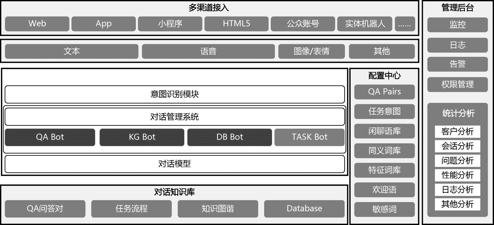

图 3-6

·多渠道接入：支持通过 Web、App、小程序、HTML5、公众账号、实体机器人等多种渠道接入，方便客户在不同平台与对话机器人交互。另外，可处理文本、语音、图像/表情等多种形式的输入，满足多样化的交互需求。

·意图识别模块与对话管理系统：意图识别模块负责理解客户输入内容的意图，这是实现有效对话的基础。对话管理系统基于意图识别结果和对话历史等信息来管理对话流程，决定如何回应客户，以实现连贯、有效的多轮对话。此外，QA Bot、KG Bot、DB Bot、TASK Bot 等不同类型的对话模型，分别从问答、知识图谱、数据库查询、任务处理等方面为对话提供支持。

·对话知识库：包含 QA Pairs（问答对）、任务流程、知识图谱、Database，是对话机器人回答问题、执行任务的知识来源和数据支撑，帮助机器人给出准确、合适的回复。

·配置中心：用于配置 QA Pairs、任务意图、闲聊语库、同义词库、特征词库、欢迎语、敏感词等信息，可对对话机器人的回答策略、知识储备等进行定制和优化。

·统计分析：对客户、会话、问题、性能、日志等进行分析，帮助平台了解客户行为、对话效果、系统性能等情况，为系统优化提供数据依据。

·管理后台：具备监控、日志、告警、权限管理等功能，用于管理和维护对话机器人系统，保障系统稳定、安全运行。

### **3.5.1** **多轮对话机器人核心模块**

多轮对话系统可以提供更贴心的服务和更高的情绪价值，通过持续交流来理解和满足客户的需求。在智能客服场景中，多轮对话系统的优势尤为明显。例如，当客户咨询旅游行程规划时，可能会提出多个相关问题，如：“我想去成都旅游，有哪些好玩的景点？”“这些景点怎么去？”“附近有什么好吃的？”这时，多轮对话系统通过自然语言理解模块准确识别客户意图，对话管理模块记录对话历史和状态，自然语言生成模块根据这些信息生成连贯、准确的回答，从而为客户提供详细的旅游攻略，让客户感受到贴心的服务。

图 3-7 为多轮对话机器人核心模块工作流程图。

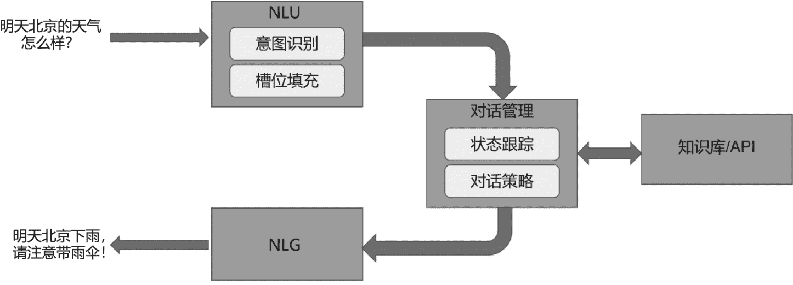

图 3-7

·NLU：接收客户输入，如“明天北京的天气怎么样？”意图识别用于判断客户意图，在此例中为查询天气；槽位填充用于提取关键信息，如“明天”“北京”。这一步可将客户的自然语言转换为机器可理解的结构化表示。

·对话管理：对 NLU 的结果进行处理。状态跟踪记录对话进展状态，对话策略决定如何回应。它会依据当前对话状态和客户意图从知识库/API 中获取相关信息。

·知识库/API：为对话管理提供数据支持，存储各类知识和信息，供系统查询调用以生成合适的回复。

·NLG：将从对话管理获取的信息转换为自然语言，如“明天北京下雨，请注意带雨伞！”，并输出给客户，完成一次对话交互。

这些模块协同工作，使机器能够与人类进行流畅且富有逻辑的对话，并根据上下文提供相关且连贯的反馈。在更细致的设计中，对话管理被细分为对话状态追踪（DST）和对话策略学习（DPL），它们对维持顺畅且有用的会话至关重要。

NLU 是整个对话流程的第一步，负责从客户输入中提取关键信息。在实际应用中，它面临诸多挑战，如语言的歧义性、口语化表达等。例如，当客户说“我想找个近点儿的餐厅”，“近点儿”的具体含义可能因客户所处位置和个人标准而异。此时，NLU 模块需要结合客户的历史数据、当前位置等信息，准确识别客户意图并提取关键信息，如“餐厅”“距离近”，为后续的对话管理和回复生成提供依据。这一过程包括但不限于意图识别和槽位填充两个子任务。意图识别是指从客户的话语中捕捉其主要目的或需求类别，例如询问天气预报、查询航班信息等；槽位填充是指在确定大致意图之后，进一步提取实现该目标所需的具体参数，如城市名称、出发日期等。以预订机票为例，当客户说“我想预订一张去北京的机票”，NLU 不仅要识别出客户希望执行的是“订票”操作，还要准确填入“目的地-北京”这样的具体信息。DeepSeek 的 NLU 模块具备 128K 超长上下文处理能力，在跨境电商场景中，若客户连续询问“上周买的 T 恤能否换货”及“换货后的物流时效”，那么系统可自动关联历史订单信息，无须客户重复输入，问题解决效率提升 60%，人工转接率下降 40%。

图 3-8 是多轮对话管理模块工作原理示意图。

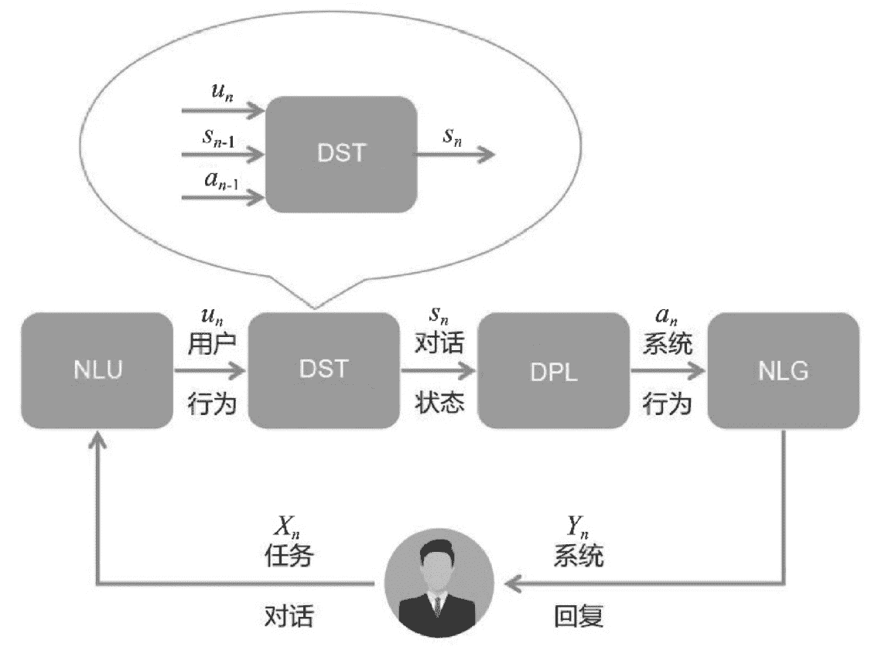

图 3-8

·NLU：负责将客户输入的自然语言（用*X**[n]*表示任务对话）转换为机器可理解的语义表示，并提取客户行为*u**[n]*，比如识别客户的意图、提取关键信息等。

·DST：接收来自 NLU 模块的客户行为*u**[n]*，同时结合上一轮对话的对话状态*s**[n]*[-1]及系统上一轮的行为*a**[n]*[-1]，更新当前对话状态*s**[n]*。其作用是跟踪对话的进展和状态信息，为后续决策提供依据。

·DPL：根据 DST 输出的当前对话状态*s**[n]*，学习并确定系统在当前轮次应采取的行为*a**[n]*，也就是决定如何回应客户。

·NLG：将 DPL 确定的系统行为*a**[n]*转换为自然语言形式的回复*Y**[n]*并输出给客户，完成一轮对话交互。

这些组件的默契协作构成了一个多轮对话系统的完整工作流程。例如，考虑这样一个场景：开始时客户询问某地未来几天的天气情况，接着又询问如何快捷到达那里。在这个过程中，NLU 首先解析客户对天气的关注点，然后更新当前对话内容至天气查询，同时保存地点信息。当新问题出现时，NLU 识别新的意图（路线规划），并利用之前存储的位置数据。此时，DPL 可能决定先回答第一个问题，再回答第二个问题。最终，所有这些处理结果都被传递给 NLG，后者负责组织恰当的回答文本，如“北京本周天气预计晴朗，适合出行。如果您想了解前往北京的最佳路线，请告诉我您的出发地点。”

通过 NLU、对话管理和 NLG 的紧密配合，智能客服助手能够处理复杂多轮对话，显著提升服务体验。

### **3.5.2** **多轮对话机器人对话策略与技巧**

构建高效且能带来愉悦体验的多轮对话系统，需要巧妙融合多种策略和技术。在电商客服场景中，多轮对话机器人的对话策略和技巧直接影响客户的购物体验。例如，当客户询问“我想买一款手机，预算在 3000 元左右”时，对话机器人不仅要准确识别客户的购买意图和预算范围，还需要通过追问机制了解客户对手机品牌、功能等方面的偏好，如“您对手机品牌有什么要求吗？是华为、苹果还是其他品牌？”“您更注重手机的拍照功能还是游戏性能呢？”这种精准追问能够帮助机器人全面掌握客户需求，推荐更合适的产品，从而提高购买转化率。关键技术包括精准的意图识别、高效的追问机制、准确的词槽抽取，以及灵活应对未知情况的兜底策略。这些策略如何发挥协同作用才能有效提升系统能力呢？

首先，意图识别是多轮对话的关键环节，决定了对话能否顺畅进行。意图识别的本质是文本分类问题，目标是从客户话语中准确捕捉客户的实际需求或意愿。意图识别的准确性对多轮对话系统至关重要。在实际训练过程中，需要通过大量的标注数据来提高模型的识别能力。

另外，还可以结合深度学习算法，如 CNN、RNN 等，对文本进行深层次的特征提取和分析，从而更准确地判断客户意图。利用 RNN 的记忆特性能够更好地捕捉句子上下文信息，提高意图识别的准确率。例如，在旅行预订场景中，客户可能希望查询航班信息、预订酒店或了解目的地天气。每一种应用场景都需要预先定义相应的意图类别，并通过训练集让模型学会区分不同类别的意图。

近年来，深度学习方法如 RNN 及其变体，特别是门控循环单元和长短期记忆网络，已经广泛应用于意图识别任务中并取得了显著成效。这些模型在处理序列数据时，能够敏锐捕捉句子内部及句子之间的依赖关系，从而大幅提升意图分类的准确性。意图识别的具体作用如下：

有效引导对话流程：帮助对话系统理解客户想要做什么，从而决定对话的走向。如系统正确识别客户要查询订单状态，就可以引导客户提供与订单相关的信息，如订单号等，以便完成查询任务。

提高对话效率：准确的意图识别可以避免系统对客户的回答“驴唇不对马嘴”。比如，当客户意图是退货时，系统不会误解为换货而提供错误的引导步骤，从而让客户更快地得到想要的服务，减少对话轮数。

增强客户体验：当系统精准理解客户意图时，客户会感觉自己的需求被重视和理解。相反，如果意图识别错误，客户可能会因为反复解释或者得不到正确的服务而感到沮丧。

意图识别的设计有多种实现方案，比如基于规则、向量检索、深度学习、大模型等。在实际项目中，意图识别往往不能由单一模型完成，因为准确率、业务逻辑、上线效率等都是需要考虑的因素，所以业界的主流方案是融合方案。

图 3-9 是意图识别技术流程示意图。

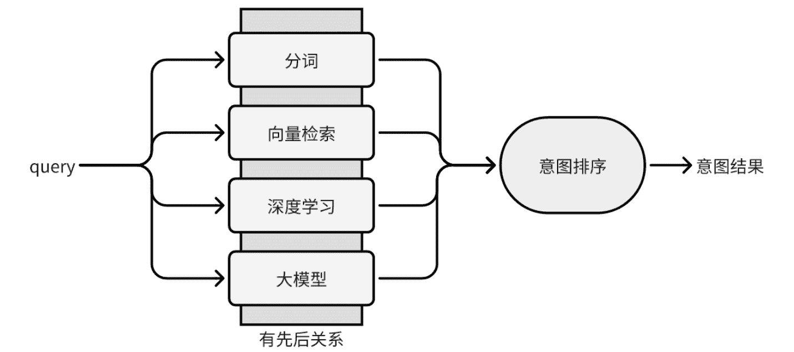

图 3-9

首先，将客户输入的文本“query”作为起始点。随后进入处理环节，第一步是分词，即对输入文本进行拆分，使其成为词语或词块，这是自然语言处理技术中理解语义的基础步骤。第二步是向量检索，把分词后的文本转换为向量形式，并在向量空间中进行检索，目的是快速找到与输入文本语义相近或相关的信息，为后续意图识别提供参考。第三步是深度学习，运用深度学习模型对文本进行更深入的语义剖析，自动学习文本中复杂的语义特征与模式，挖掘潜在的意图信息。第四步是大模型，也就是利用大规模预训练语言模型强大的语言理解能力进一步分析和判断文本意图，因为它是在大量文本数据上训练的，拥有强大的语言知识和语义理解能力，能更精准捕捉文本意图。这四个处理模块依次对输入文本进行处理，逐步深入分析语义。

接着，将各模块处理结果进行整合，对可能的意图进行排序，评估每个意图与输入文本的匹配程度及置信度。

最后，依据意图排序结果输出最符合输入文本的意图，至此完成整个意图识别过程。

词槽填充也是实现 NLU 的关键步骤。它是指从客户的话语中提取关键信息的过程，比如出发地、到达地、出行日期等。正确填充这些槽位可以更清晰地表达客户意图，为后续服务提供必要条件。传统方法通常基于规则来匹配预定义模式，但这种方法难以覆盖所有情况。随着深度学习的发展，现在更多采用基于 RNN 或者 Transformer 架构的端到端模型进行词槽标注。特别是注意力机制（Attention Mechanism）的应用，使得模型在关注整体上下文的同时也能注意局部细节，极大提高了词槽填充的精度。

此外，当客户提供的信息不完整时，就需要借助追问机制来获取缺失的信息。优秀的追问系统应根据当前已知的信息智能提出相关问题，而不是简单地按照固定的顺序提问。这通常涉及对当前对话状态的理解，以及对未来对话流程的预测。为此引入强化学习框架，让系统自主学习最佳的追问策略，从而使对话更加流畅自然。针对医疗咨询场景的复杂问题（如“咳嗽带血该挂什么科？是否需要提前做 CT？”），DeepSeek 通过思维链推理技术自动生成递进式追问（如“咳嗽持续多久？是否有其他症状？”），使诊断建议准确率从 65%提升至 85%，较传统规则引擎提升 20%。

考虑到现实世界中存在许多不可预见的情况，设计一套良好的兜底策略尤为重要。兜底策略是指当现有知识库无法处理某些特殊情况时所采取的一系列措施，旨在避免对话陷入僵局或产生误导性回答。常见的兜底策略包括但不限于请求客户提供更多信息、转接至人工客服、推荐相关资源链接等。通过不断优化和完善兜底策略，可以让对话系统更加稳健可靠。

在构建多轮对话机器人时，综合运用意图识别、词槽抽取、智能追问及灵活的兜底策略可显著提升客户体验。这些技术离不开自然语言处理技术的支持，特别是能够有效结合上下文信息做出准确响应的技术。随着技术的进步，对话系统将会变得更加智能和人性化。

### **3.5.3** **多轮对话机器人训练与优化**

在构建能够理解并回应客户需求的多轮对话系统时，高效的意图识别模型训练和持续的 BadCase 案例标注是确保系统准确性和客户体验的关键环节。在多轮对话机器人训练过程中，数据的质量和数量直接影响模型的性能。以某智能客服多轮对话系统为例，初期数据量不足且标注不准确导致意图识别准确率较低且经常出现误解客户意图的情况。通过持续收集真实对话数据并进行精细标注，同时利用数据增强技术扩充数据规模，模型的准确率得到显著提升。要实现这一目标，需要充分认识数据准备的重要性，并通过反馈循环机制促进系统的迭代更新，保持其长期的服务水平。

图 3-10 是多轮对话机器人训练及生产优化流程图，围绕“搭建知识底座→模型迭代升级→业务场景验证”核心逻辑，依托“训练环境流程闭环”和“生产环境优化闭环”实现持续迭代，各环节的流程如下。

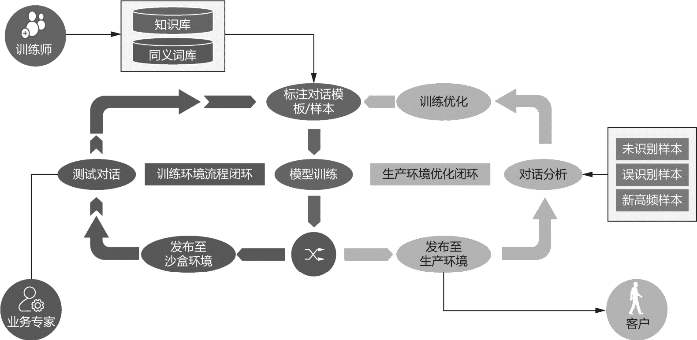

图 3-10

**1.** **知识底座搭建**

训练师的首要任务是构建知识库与同义词库，二者共同组成机器人理解与应答的知识根基。

·知识库：系统性收纳对话机器人所需领域知识，如业务问答规范、产品详细信息、服务流程说明等，为对话机器人应答提供事实性内容支撑。

·同义词库：专门收录近义词、表述变体，例如“下单”与“购买”、“查询”与“查找”这类语义相近的表述，助力机器人理解用户多样化语言表达，拓宽语义识别范围。

完成知识底座搭建后，训练师基于这些知识开展标注对话模板/样本工作，也就是模拟真实客户咨询、客服标准应答等场景，对对话内容进行人工标注，明确意图、问答对应关系等，为后续模型训练准备高质量的标注数据，保障训练素材贴合业务逻辑并具备准确性。

**2.** **训练环境流程闭环**

标注好的对话样本作为输入进入模型训练环节。此环节运用算法（如意图识别算法、多轮对话逻辑学习算法等），让模型学习对话中的语义理解、意图识别、应答生成等能力，从而生成可用于测试的初始模型。

模型训练完成后进入发布至沙盒环境环节，沙盒环境的本质是模拟真实的生产场景，但与真实的生产数据隔离，为模型测试提供相对安全的空间。

在沙盒环境中，由熟悉业务流程与需求的业务专家参与测试对话，模拟真实复杂业务场景，如多轮问答、专业术语咨询、特殊需求反馈等，与机器人交互，全方位检验模型对业务知识的理解深度、应答准确性与逻辑连贯性，排查意图识别错误、回答偏离业务等问题。

测试完成后，根据发现的问题回到标注对话模板/样本环节，对样本进行补充或修正，以优化训练数据。优化后的样本再次进入模型训练环节，由此形成训练环境流程闭环。其路径为“模型训练→发布至沙盒环境→测试对话→标注对话模板/样本→模型训练”，通过不断循环，可持续对模型进行精度打磨，去除核心逻辑缺陷，降低模型上线后的风险。

**3.** **生产环境优化闭环**

经过训练环境流程闭环打磨的模型进入发布至生产环境环节，正式面向广大客户提供服务，如在线客服实时应答、智能问答自助服务等实际业务场景，都由该模型提供支撑。

在实际使用过程中，客户产生的对话数据会被收集并流入对话分析环节。对话分析模块运用数据分析手段对数据进行分类，具体分为未识别样本（客户表达超出模型现有知识覆盖，无法识别意图）、误识别样本（模型错误理解客户意图）、新高频样本（客户新出现的高频需求表述）。另外，深度挖掘数据中隐藏的问题，比如识别客户新需求的方向、定位模型未覆盖的表达类型、统计高频错误点等，进而输出针对性的优化方向。

根据优化方向，模型进入训练优化环节，明确模型需要强化学习的知识板块和需要调整的算法逻辑。之后，结合新的优化需求回到标注对话模板/样本环节，对样本进行更新和完善。优化后的样本再次被输入模型训练环节，最终形成生产环境优化闭环。其路径为“模型训练→发布至生产环境→对话分析→训练优化→标注对话模板/样本→模型训练”。该闭环保障模型在真实业务场景中能动态响应客户的新需求和新表达方式，持续适配业务演进，让模型服务能力始终贴合实际业务需求，实现功能迭代升级。

**4.** **双闭环价值体现**

训练环境流程闭环：重点聚焦“模型精度打磨”，借助业务专家深度参与、沙盒环境模拟真实生产环境又隔离真实生产数据的特性，在模型正式上线前，通过不断优化标注样本和模型训练，提前去除模型核心逻辑缺陷，大幅降低生产环境中因模型基础能力不足引发的风险，为上线后稳定服务筑牢基础。

生产环境优化闭环：核心聚焦“业务场景适配”，以客户产生的真实数据为依据，通过对话分析捕捉客户的新需求和新表达方式，再通过训练优化和样本标注更新，使模型紧跟业务变化，持续优化服务能力，保障服务体验随着业务发展不断提升。

两个闭环相互配合、协同作用，全面支撑对话机器人从“知识学习阶段”到“业务落地应用阶段”的全生命周期迭代，确保机器人服务能力持续进化，始终满足业务与客户需求，稳定保障客户服务体验。

下面重点介绍几个阶段的内容。

数据准备阶段。高质量的数据集是机器学习项目的基础。在构建语料库时，需要考虑到不同场景和客户群体的多样性。例如，对于面向全球客户的多轮对话机器人，语料库不仅要包含常见的标准语言表达，还要涵盖不同地区的方言、口语化表达及特定行业的术语等，确保模型在面对各种复杂的客户输入时都能准确识别意图，提供准确的回答。对于意图识别任务而言，这意味着要构建广泛且深入覆盖各类意图场景的语料库。以美团平台为例，客户的搜索意图可以细分为订外卖、订酒店、订旅游门票等类别。为此，我们需要收集大量来自真实客户交互的文本样例，并对其进行精细标注，以反映不同类型的请求及相应的意图标签。此外，考虑到自然语言表达方式多样且存在歧义性问题，在数据清洗过程中还需特别注意去除噪声信息、处理错别字等，采用词干提取、停用词过滤等文本预处理技术提升数据质量。在特征工程方面，可以通过 TF-IDF、词向量等方式从原始文本中抽取有用的信息作为模型输入；针对序列数据，可采用 RNNs、LSTM 或 GRU 等模型架构捕捉上下文之间的依赖关系，从而更好地支持意图分类任务。

错误案例分析与模型调优。即使最先进的算法也会出错，尤其在复杂多变的语言环境中。定期回顾并深入研究错误案例尤为重要，这不仅可以发现现有模型存在的不足（如对某些特定词汇组合存在理解偏差、对长句子结构解析能力较弱等），还可以为后续改进提供方向。有效的错误案例管理不仅涉及错误案例本身的积累，还要建立完整的评估体系及流程规范，以确保每次调整都有充分的数据支撑。

反馈闭环机制的设计与实施。为使对话机器人不断学习新知识、适应客户偏好变化，需要建立健全的反馈机制。在理想情况下，这种机制应涵盖以下几个方面。

在线学习能力：让模型在实际运行过程中实时接收来自客户的反馈信号（如满意度评分），并通过增量式训练方法快速响应。

离线评测系统：定期用大规模测试集对当前版本进行全面性评估，及时发现潜在问题。

A/B 测试框架：通过对比实验来验证新特性或算法升级是否真正带来了积极影响。

跨团队协作：鼓励产品设计和开发人员与数据分析专家紧密合作，共同制定解决方案。

打造智能又可靠的人机对话平台必须重视数据准备工作，善于利用错误案例资源开展针对性的优化，并巧妙利用在线与离线相结合的方式形成良性循环，如此才能使 AI 助手始终处于最佳状态，为客户提供更加优质的服务体验。

# **第四章**

# **客服系统智能化应用**

基于前面介绍的关键技术及系统设计思想，本章将介绍运用智能技术优化客户服务流程的实际应用。内容覆盖从全语音门户至视频客服的范畴，涉及智能客服助手、知识库管理、工单处理等。通过对这些智能化组件及其实际应用场景的剖析，我们可以绘制出一套完备的智能客服系统解决方案架构。该架构可赋能企业打造更为高效且富有人性化的客户服务体验。在这些应用中，DeepSeek 技术发挥着重要的作用，极大地提升了智能客服系统的性能和服务质量。

## **4.1** **全语音门户**

全语音门户作为构建客户与企业之间沟通桥梁的重要组件，正逐渐成为提升客户服务质量和效率的关键工具。通过深入解析这一前沿技术平台的核心要素，我们可以从产品概述、功能实现，以及它如何利用自然语言处理和语音识别技术来改善客户体验、扩大服务覆盖范围等方面进行全面阐述。这有助于我们理解全语音门户是如何构建的，并认识到它在现代客户服务中的重要价值。

### **4.1.1** **产品简介**

全语音门户是一种基于纯语音交互模式设计的客户服务系统，旨在通过自然流畅的人机对话为客户提供高效、便捷的服务体验。在一些紧急情况下，若客户无法通过手动操作获取信息，那么全语音门户的优势就更加凸显。比如，在遭遇自然灾害时，受灾群众可能身处复杂的环境，难以使用文字输入来查询救援信息，此时全语音门户能让他们通过语音快速获取避难场所的位置、救援物资发放点等关键信息，为保障生命财产安全争取时间。这类产品主要面向需要快速解决问题或获取信息的客户群体，如电信运营商的客户，能够极大地缓解人工客服的压力，并提升整体服务效率。该平台集成了多项先进技术，包括但不限于自然语言处理、语音合成、机器学习、模型训练等，这些技术共同作用于创建一个既能理解人类语言，又能生成相应的语言响应的智能系统。以金融服务领域为例，全语音门户的这些技术结合可以为客户提供专业的金融咨询服务。它能理解诸如“我想了解最近的理财产品收益情况”这类复杂的金融问题，并通过对大量金融数据和知识的学习，给出准确、专业的回答，帮助客户做出更合理的投资决策。

具体来说，当客户拨打热线电话时，全语音门户首先利用先进的语音识别技术将客户的语音转换为文本形式，随后借助自然语言处理算法深入分析和解读文本内容，以准确捕捉客户的真实需求。一旦明确了客户的意图，系统就会依据预设的多轮对话策略与之互动，适时提供相关信息或执行特定任务，直至问题得到解决。此外，它还具备强大的知识管理和检索功能，能够从庞大的数据库中迅速找到匹配的答案，确保回复的质量与准确性。值得注意的是，为了使交流过程更加贴近真人对话的体验，这套系统特别加强了对情感的理解及表达能力，使得机器不仅“能听懂话”，而且“会说话”。

在架构层面，全语音门户采用了高度模块化的设计思路，其核心组件涵盖智能 IVR、文本机器人、客服助手、语音机器人以及智能知识库等，每个部分的配置均针对不同应用场景进行了优化。整个系统运行在分布式环境中，涉及的关键技术有：基于百度 MACROSS 框架搭建 Java 项目，作为整个系统的基础支撑；采用 Loki 集群进行高效的日志管理，确保系统运行状态可监控、可追溯；运用 Elasticsearch 集群（简称 ES 集群）实现索引服务，提升数据检索效率；借助 Redis、Kafka 等多种中间件，保障数据传输的稳定性与可靠性，从而全方位满足系统的高性能需求。不仅如此，平台还提供了灵活可定制化的管理界面，支持运维人员根据实际业务需求调整参数设置，确保客户体验最佳的同时也便于后续维护升级。

综上，全语音门户凭借其卓越的技术实力和服务质量，在众多领域展现出了广泛的应用前景，特别是在那些对即时响应能力和个性化服务水平有着较高要求的行业里，无疑会成为客服解决方案中的重要一环。

### **4.1.2** **产品优势**

图 4-1 是全语音门户系统架构图，该图展示了全语音门户系统的架构，涵盖多个层面。智能应用层提供面向客户的具体功能，包括智能 IVR、文本机器人、客服助手、语音机器人、智能知识库等，满足客户多样化的语音交互需求。

API 网关层负责管理服务访问，具备服务限流、服务路由、认证授权、访问控制等功能，确保系统服务的调用安全、有序，防止非法访问和流量过载。

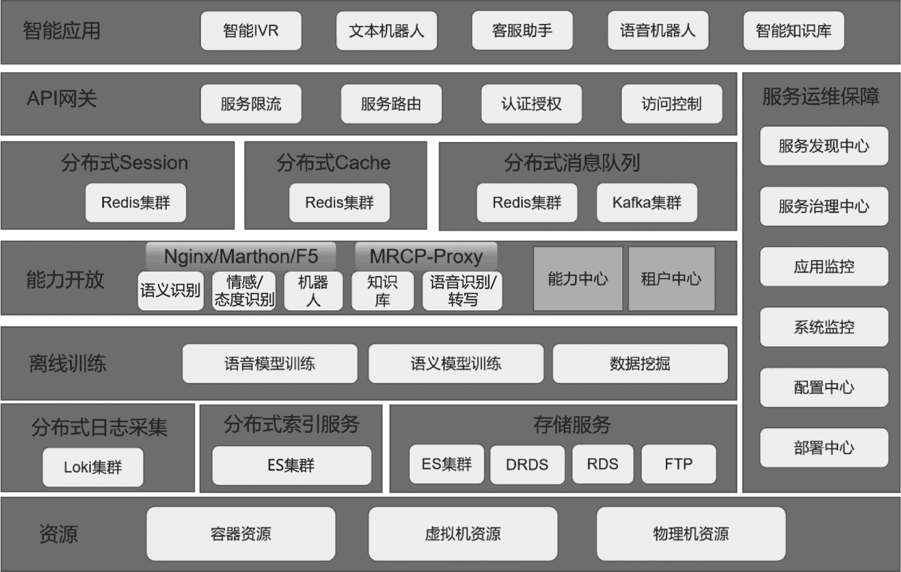

图 4-1

分布式服务层包含分布式 Session（Redis 集群）、分布式 Cache（Redis 集群）、分布式消息队列（Redis 集群、Kafka 集群），用于处理会话管理、数据缓存和消息传递，从而提升系统性能、响应速度和数据处理能力。

能力开放层集成了多种关键能力，如 Nginx/Marthon/F5、MRCP-Proxy，以及语义识别、情感/态度识别、机器人、知识库、语音识别转写等功能模块，同时设有能力中心和租户中心，用于开放系统能力，支持语音模型训练、语义模型训练等 AI 训练场景，实现对语音和语义的深入理解与处理。

离线训练层进行语音模型训练、语义模型训练和数据挖掘等工作，通过对大量数据的分析和模型训练，可提升系统对语音和语义的理解与处理能力。

在数据处理与存储层中，分布式日志采集（Loki 集群）用于收集系统日志信息；分布式索引服务（ES 集群）提供数据库索引功能；存储服务包含 ES 集群、DRDS、RDS、FTP 等，用于存储系统运行所需的数据。

资源层提供系统运行的基础资源，包括容器资源、虚拟机资源、物理机资源，用于支撑整个系统的稳定运行。服务运维保障层设有服务发现中心、服务治理中心、应用监控、系统监控、配置中心、部署中心等模块，对系统进行全方位的运维管理，保障系统安全、高效、稳定地运行。整个架构基于分布式设计，通过各层次模块的协同工作，实现语音识别、语义理解、语音合成等智能化功能，支持全语音门户系统的智能人机交互。

全语音门户在智能交互、分布式结构、底层能力及存储服务方面展现出了显著的优势，相较于传统客服方式具有革命性的提升。在电商售后服务场景中，全语音门户的智能交互优势体现得淋漓尽致。当客户反馈商品问题时，它能通过多轮对话精准定位问题的核心，如客户说“我买的衣服有质量问题”，系统就会自动追问“具体是什么质量问题呢？是破损、掉色还是其他情况？”随后根据客户的回答快速给出解决方案，如退换货流程、补偿措施等，大大提升了客户解决问题的效率。

首先，在智能交互领域，该系统运用先进的多轮会话技术，可精准洞悉客户意图并给出精确回复，同时支持对对话流程进行自定义配置。这一特性显著提升了客户体验的流畅度与满意度。基于高精度语义模型搭建的智能问答系统，有效削减了扩展问答的维护工作量，确保信息传递精确无误。知识图谱的融入实现了结构化知识的高效维护与利用，进一步强化了系统的智能化程度。此外，独立闲聊库的创新设计，不仅能营造出更自然的人机交互氛围，还能依据不同业务需求定制个性化聊天角色，甚至引入开放领域的闲聊内容，极大地拓展了人机交互的维度。

其次，在架构设计方面，系统采用分布式策略，涵盖会话管理、基于 Loki 集群的日志采集，以及基于 ES 集群的索引服务。这种设计不仅保障了系统的稳定性和可扩展性，而且能从容应对海量并发请求。合理的结构化布局有利于实现资源的高效分配与快速响应，对提升整体运行效率的意义重大。

再者，从底层技术支撑角度看，全语音门户集成了开放语音识别/转写、情感/态度识别等前沿技术，构建起一套能够全方位感知客户情绪并及时做出响应的能力体系。在在线教育场景下，全语音门户可以利用情感/态度识别技术，分析学生在咨询课程问题时的情绪状态。如果发现学生表现出困惑或焦虑情绪，系统就会调整回答方式，采用更通俗易懂的语言、增加案例解释等，帮助学生更好地理解知识，同时为后续的教学改进提供数据支持，尤其在数据处理环节，系统具备强大的离线训练功能，包括语音模型训练、语义模型训练和数据挖掘等，为持续提升服务质量筑牢了根基。

最后，在存储服务方面，系统采用 ES 集群、DRDS、RDS 等多种存储方案协同运作的方式，确保了数据的安全性和高访问速度。所有应用都可以基于容器或虚拟机进行部署，部分关键组件还可依托物理机环境运行。这种灵活多样的部署方案大幅提升了系统的灵活性和可靠性。

在实际应用中，各功能模块的协同工作至关重要。例如，在酒店预订场景中，当客户来电咨询时，智能 IVR 会引导客户选择服务类型。若客户选择预订房间，那么文本机器人和语音机器人将协作，理解客户对房型、入住时间等的需求，随后从智能知识库中获取房间信息和价格。客服助手则根据这些信息为客户提供预订建议。整个过程流畅且高效。其核心技术组件涵盖智能 IVR、文本机器人、客服助手、语音机器人、智能知识库等，这些组件协同运作，实现从客户来电到问题解决的全流程自动化。各服务模块通过一系列核心支撑技术紧密关联。智能 IVR 作为前端接入点，引导客户初始互动，并将请求路由至合适的服务节点。

之后，文本或语音形式的交互分别由相应的机器人处理：文本机器人借助自然语言处理技术理解并生成回复；语音机器人依靠先进的语音合成及识别算法，实现流畅的人机对话。智能知识库则如同机器人的“大脑”，整合海量专业知识与业务规则，为机器人提供决策支持。此外，平台配备情感分析工具，依据通话内容判断客户情绪，适时调整沟通策略或转接人工客服，提升客户体验。同时，系统还嵌入了完善的服务运维保障机制，包括服务发现中心、服务治理中心、系统监控、配置中心和部署中心等。它们协同优化资源分配，加速故障排查与恢复，尤其在应对突发流量高峰时，通过动态调整服务限流策略和服务路由逻辑，有效规避单点过载引发的服务中断风险，保障高可用性与优质服务质量。

综上，全语音门户凭借卓越的智能交互能力、稳固的分布式架构设计、先进的底层技术支撑以及高效的存储服务机制，在推动业务流程优化、降低运营成本等方面成效显著，为企业赋予了独特的竞争优势。对于那些致力于提升客户服务质量和效率的企业而言，全语音门户无疑是极具价值的理想之选。

### **4.1.3** **功能架构**

图 4-2 是全语音门户系统的应用架构图，涵盖多个核心部分，各部分相互协作，实现系统功能。

安全中心位于架构右侧，是系统安全的重要防线。通过身份认证核实客户身份，防止非法访问；访问控制、权限管理、授权管理精细调控客户操作权限；证书管理保障通信安全；数据加密/脱敏保护数据隐私，全方位确保系统安全、可靠地运行。

运维中心分布在架构下方左侧，涵盖应用监控、系统监控、日志中心、部署中心、容器中心，对系统运行状态进行实时监测、记录日志、部署维护，确保系统的稳定。

服务中心在架构下方右侧，与运维中心的功能类似，包括应用监控、系统监控、日志中心、部署中心。运维中心和服务中心共同为系统的稳定运行提供支撑。

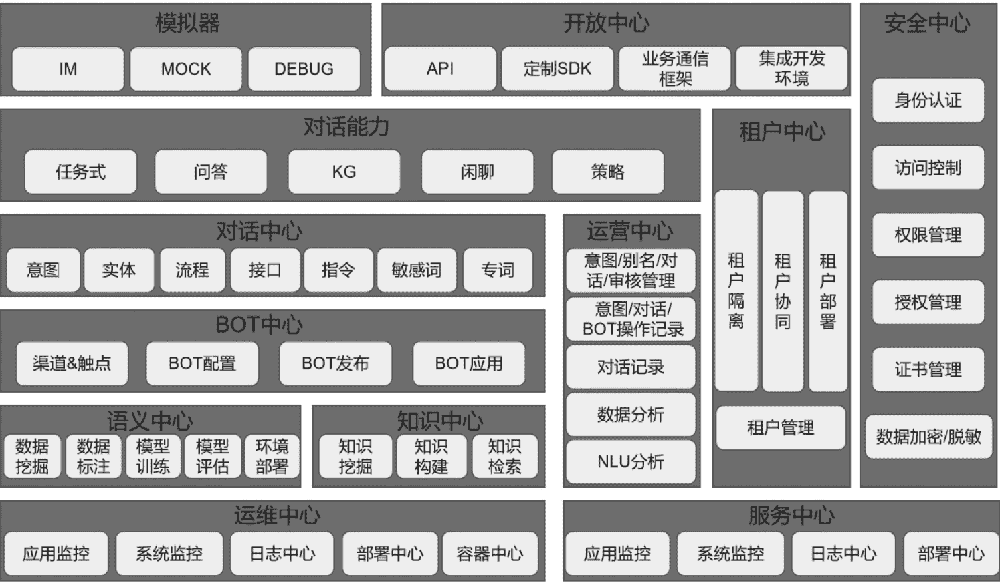

图 4-2

开放中心在架构上方右侧，提供 API、定制 SDK、业务通信框架、集成开发环境等功能。API 使外部系统能调用系统功能；定制 SDK 方便开发者基于系统开发应用；业务通信框架保障通信规范有序；集成开发环境提供开发工具和平台，助力系统功能拓展和集成。

模拟器在架构上方左侧，包含 IM、MOCK、DEBUG 功能。IM 可模拟即时通讯场景测试对话；MOCK 用于模拟各类数据和服务，方便测试；DEBUG 提供调试工具，帮助开发人员排查问题，提升开发效率和系统质量。

对话能力在开放中心和模拟器下方，涵盖任务式、问答、KG（知识图谱）、闲聊、策略等。任务式支持按流程完成任务交互；问答实现问题解答；KG 利用知识图谱提供知识关联和推理；闲聊提供自然交流；策略制定对话规则和流程，丰富对话交互方式。

对话中心在对话能力下方，包括意图、实体、流程、接口、指令、敏感词、专词等模块。意图用于识别客户的目的；实体用于提取关键信息；流程用于设计对话逻辑；接口实现系统对接；指令执行特定操作；敏感词和专词管理规范对话内容，确保对话准确、合规、高效。BOT 中心在对话中心下方，涉及渠道&触点、BOT 配置、BOT 发布、BOT 应用。渠道&触点连接不同的交互渠道；BOT 配置可设置参数和功能；BOT 发布将配置好的机器人上线；BOT 应用使机器人在实际场景中发挥作用，实现机器人全生命周期管理。

语义中心在 BOT 中心的下方左侧，包括数据挖掘、数据标注、模型训练、模型评估、环境部署环节。数据挖掘提取有价值的信息；数据标注为训练提供标注数据；模型训练构建语义理解模型；模型评估检验模型效果；环境部署将模型部署到生产环境，以提升语义理解能力。

知识中心在语义中心的右侧，包括知识挖掘、知识构建、知识检索。知识挖掘从各种来源获取知识；知识构建整理组织知识并形成知识库；知识检索能让系统快速查找知识，为对话提供知识支持。

运营中心在知识中心的右侧，包括意图/别名/对话/审核管理、意图/对话/BOT 操作记录、对话记录、数据分析、NLU 分析。运营中心负责管理各类与对话相关的信息、操作记录和对话记录。通过数据分析和 NLU 分析优化系统性能，并提升自然语言理解能力。

租户中心在运营中心的右侧，包括租户隔离、租户协同、租户部署、租户管理。它们分别实现不同租户的资源隔离和协作、合理部署资源、集中管理租户信息和权限，满足多租户的使用需求。

### **4.1.4** **核心功能**

本节将围绕能力构建、能力训练、BOT 发布及运营管理四大方面详细阐述全语音门户的核心功能及其从构建到运营的全流程。重点介绍意图生成、对话管理、语义分析等关键技术应用，并结合实例说明这些技术如何解决实际问题，帮助读者全面理解从基础搭建到服务上线及持续优化的整体过程。

**1.** **能力构建**

在全语音门户的能力构建中，将理解并满足客户需求作为创建新意图的核心。以医疗行业为例，在构建全语音门户时，对于“预约挂号”意图的创建，不仅要明确客户希望预约的具体科室，还要考虑不同医院的挂号规则、放号时间等因素。通过与医院信息系统对接，平台可以获取这些详细信息，为客户提供更精准的预约服务，如告知客户当前可预约的号源情况、推荐合适的就诊时间等。这不仅要明确客户期望对话系统达成的目标，还要借助平台工具有效定义需求，确保服务精准响应客户请求。例如，在新建查询账单详情意图时，需明确具体步骤及客户可能的问题类型，如“本月消费多少？”“本月与上月相比有何变化？”等，细化对话意图有助于设计更贴合实际场景的对话流程。

为更好地组织管理意图，全语音门户提供新建、检索等功能。在大型企业的客服系统中，意图数量众多且复杂，全语音门户的新建和检索功能就显得尤为重要。例如，一家综合性电商企业，其业务涵盖多种商品品类和售后服务，通过清晰的意图分类和详细描述，客服团队能够快速找到相关意图并进行处理，提高工作效率，避免因意图管理混乱导致服务失误。开发者可依据业务场景设定意图，并添加名称、分类、用途等详细描述，便于团队成员理解。同时，平台支持按关键词、应用 BOT 或租户名称检索意图，方便复杂项目中意图的管理。注意，新意图提交后通常需要运营审核才能生效，以保障服务质量和客户体验。

此外，针对不同业务需求，合理规划意图层次关系至关重要。平台提供灵活分类机制，可指定意图归属类别，并拓展子类目，形成清晰的结构体系。如在电信行业，将费用相关意图归入“费用查询”大类，再细分“当前余额查询”“历史账单查看”等，构建逻辑严密的服务框架。

总之，深入分析客户需求，利用平台功能有效定义和管理意图，既能打造强大的语音交互系统，满足多样化需求，又能提升项目开发和后期维护效率。基于客户中心的设计理念与先进技术支持，构成了全语音门户能力构建的基础，为企业级客户提供卓越的智能客服方案。

**2.** **能力训练**

全语音门户的能力训练旨在通过数据驱动提升机器人理解和响应的能力，涉及数据集收集、训练任务设置和效果评估等关键环节。在实际的训练过程中，数据的多样性也非常重要。除了错误案例，还应收集不同场景、不同客户群体的交互数据，以提升机器人对各种情况的适应能力。比如，在智能家居客服场景中，要收集不同地区、不同年龄层次客户对设备控制指令的表述方式，使机器人能够准确理解各种口音、方言以及个性化的表达方式。在进行数据采集时，系统自动从客户-机器人交互中随机抽取错误案例供标注人员纠正，确保训练数据的时效性和针对性，减少人工筛选量。同时，可通过模拟器生成对话情境、接入外部聊天内容等方式丰富训练样本库。

在模型训练阶段，清洗标注后的高质量数据用于语义模型迭代训练。在训练过程中，还可以引入迁移学习技术。例如，先在大规模通用语料库中进行预训练，学习语言的通用特征和规律，再利用全语音门户的特定业务数据进行微调。这样可以加快模型的收敛速度，提高训练效率，同时减少对大量标注数据的依赖，降低数据标注成本。采用 Transformer 等先进的深度学习架构，能更准确地捕捉语言的复杂关系，提高自然语言理解的精度。在训练时，应考虑多样性，引入多种口音、方言和跨文化交流样本，以增强模型对客户群体的适应性。

效果评估依赖全面细致的指标体系，包括意图识别准确率、平均响应时间、客户满意度评分等。意图识别准确率反映机器人对客户请求的理解程度，平均响应时间体现系统运行效率，客户满意度评分通过在线问卷获取反馈。持续跟踪分析指标变化趋势，为优化提供参考。

实时反馈机制对提升训练成效至关重要。当发现机器人在特定场景表现不佳时，可快速调整训练参数或增加训练样本，部署上线验证效果，缩短问题解决周期，提升服务流畅度和客户黏性。

总之，通过建立完善的数据收集—模型训练—效果评估闭环，辅以灵活高效的实时调优策略，全语音门户能不断进化，从而更好地满足客户的多样化需求。

**3.** **BOT 发布**

在全语音门户构建中，BOT 发布是保障客户体验和系统稳定性的关键环节，涉及机器人从部署到生产环境的操作流程，以及版本控制、灰度发布等提升系统稳定性和安全性的策略，需精心规划以适应不同渠道特性并实现差异化配置。在发布新的 BOT 版本时，还需要考虑与现有系统的兼容性。例如，全语音门户可能已经集成了多个第三方服务或插件，新的 BOT 版本不能对这些已有功能产生负面影响。因此，在测试过程中，要全面检查与第三方服务的接口调用是否正常，数据交互是否准确无误，确保整个系统的稳定性和兼容性。

在正式部署前，需要对机器人进行全面的功能和性能测试，包括用模拟器或实际场景测试对话流程，以及利用评估工具检查模型版本的准确率和召回率。测试完成后准备发布时，可通过“体验 BOT”功能验证关联流程，无误后点击“发布 BOT”按钮启动部署，平台支持延时发布，方便开发者灵活调整上线时间。

为确保发布平稳过渡，采用灰度发布策略，首先向小部分客户开放新版本服务，并监控系统运行和客户反馈，然后依据数据分析结果逐步扩大覆盖范围，直至替换旧版本，这样可及时发现并解决潜在问题，减少对整体客户体验的影响。以某金融机构为例，在进行 BOT 灰度发布时，先选择部分对新功能接受度较高的优质客户进行试用。通过对这些客户使用数据的详细分析，如对话成功率、问题解决率、客户反馈等，及时发现并修复一些潜在问题，如某些话术在特定场景下容易引起误解等。然后逐步扩大发布范围，从而有效降低新版本对整体客户体验的影响。

跨渠道部署时要注意各平台差异，针对电话、微信等不同触点定制话术和界面布局，在实施过程中需要具备灵活性，快速调整配置参数。建议建立完整的触点管理体系，明确各服务渠道属性和适用范围，为管理维护奠定基础。

安全性考量同样重要，随着网络安全威胁的不断增加，发布流程应严格遵守法律法规，采取身份认证、访问控制等技术保护敏感信息，定期审查权限分配和审计操作记录，预防异常行为。

综上，成功的 BOT 发布不仅依赖高效技术方案，还需要结合科学项目管理方法，综合考量各方面因素，打造高效可靠的人机交互解决方案。

**4.** **运营管理**

在全语音门户的运营过程中，保障卓越服务的表现和持续改善客户体验至关重要。为此，需要建立一套全面精细的运营管理机制，该机制涵盖服务监控、客户反馈收集、数据分析、性能调优和应急处理等方面。在实际运营中，还可以结合客户行为分析来优化服务。例如，通过分析客户在全语音门户中的对话路径，发现部分客户在某些复杂业务的咨询过程中容易迷失方向，导致对话完成率较低。运营团队可以根据这些数据，优化对话流程，增加引导提示，提高客户的操作便利性和问题解决率。

服务上线后，利用基于 ES 集群的日志系统和数据可视化平台等实时数据分析工具，监控对话完成率、客户满意度、平均响应时间等关键指标，帮助运营团队快速识别问题和瓶颈，采取优化措施。如发现特定时段客户等待时长异常增加，可能是服务器负载或网络问题，此时就需要调整资源分配或增强网络的稳定性。

运营人员定期汇总并分析客户反馈，不仅可以改进现有功能和服务流程，还能为产品迭代提供参考。如大量客户反映语音识别准确度低，可能需要扩充语料库并有针对性地训练模型，根据客户习惯和偏好定制个性化交互体验也是提升客户满意度的有效方式。

面对突发情况，如大规模流量导致系统崩溃，预先设定应急预案很重要。例如，在电商促销活动期间，全语音门户可能会面临瞬间涌入的大量咨询请求，从而导致系统压力骤增。此时，应急预案可以包括自动调配更多的计算资源，如增加服务器实例、扩展带宽等，确保系统能够正常运行。同时，调整对话策略，如优先处理关键问题、简化部分非必要的对话流程等，保障服务的连续性和稳定性。应建立风险评估体系，定期模拟演练，确保快速响应和妥善处置。利用微服务架构实施服务降级/熔断策略，在不影响核心业务的前提下减轻压力，保障系统的稳定性和可用性。

持续对全语音门户进行性能调优，包括合理配置底层硬件资源、优化软件代码逻辑和精简对话流程。只有不断追求极致表现，才能满足市场的多样化需求，为客户提供流畅、贴心的智能语音服务。

综上，通过对各环节的精细化管理和持续改进，全语音门户能在竞争中保持领先，从而赢得更多客户的信赖。

## **4.2** **智能客服助手**

随着技术的发展，智能客服助手逐渐成为提升客户服务体验的关键工具。本节将全面介绍智能客服助手的产品优势、功能架构、核心功能及应用价值，尤其是辅助人工座席的作用。通过对本节的学习，读者将了解智能客服助手如何借助先进技术提升响应速度和客户满意度，以及面临的挑战和未来发展方向。

### **4.2.1** **产品简介**

智能客服助手是现代客户服务流程的重要组成部分，代表了基于人工智能的新型服务形式。在企业内部，智能客服助手可以成为员工的高效工作伙伴。例如，在大型企业的人力资源部门，员工经常需要查询各种规章制度、办理请假流程等。通过模拟人类对话，智能客服助手可以快速、准确地回答员工关于这些事务的疑问，帮助员工快速完成相关手续，提高企业内部的办公效率，从而减轻人力资源部门的工作压力。此外，智能客服助手不仅能处理常规咨询，还能参与多轮对话、情感理解、个性化服务等复杂交互，丰富人机互动可能性。它为企业客户、普通消费者、内部员工等群体，提供信息查询、问题解答、业务办理等功能，从而提升客户满意度与服务效率。

在技术实现上，智能客服助手主要依赖自然语言处理、机器学习算法、深度学习模型等核心技术。以智能导购助手为例，在电商平台，当客户询问“我想买一件适合夏天穿的连衣裙，预算在 200 元左右，有没有推荐？”时，智能客服助手就会利用自然语言处理技术理解客户需求，通过深度学习模型分析客户历史浏览和购买数据，结合多轮会话技术进一步了解客户对款式、颜色等的偏好，为客户推荐符合需求的连衣裙，提供个性化的购物建议，提升客户购物体验。凭借多轮会话技术，面对多步骤问题时能保持对话连贯，引导客户操作；高精度语义模型能提升答案的准确性，减少问答库维护需求；知识图谱或表格问答机制能有效利用和管理结构化信息；独立闲聊库则让非正式交流更生动。

DeepSeek 的自然语言处理技术深度融入智能客服助手，显著提升了其意图识别的准确率和速度。即使面对模糊、复杂的表述，如“我之前买的那个东西不太好用，能换吗？”智能客服助手也能借助 DeepSeek 技术，结合客户历史购买数据和当前对话语境，准确判断客户意图，快速给出针对性的解决方案。此外，DeepSeek 的多轮对话管理能力，让智能客服助手在与客户的多轮交互中保持连贯的对话逻辑，深入理解客户需求，提供更个性化的服务。例如，在为客户推荐商品时，能综合考虑客户的历史购买偏好、当前需求和市场动态，推荐更符合客户心意的产品。

除直接服务客户外，智能客服助手还辅助客服人员工作。它通过实时分析人工座席与客户对话，预测来电意图、推荐话术、自动生成工单，从而简化客服工作流程，提高效率。同时，强大的后台支持体系能保障系统稳定运行，满足大规模并发访问需求。智能客服助手正以独特的优势重新定义客户服务，推动行业智能化发展。

### **4.2.2** **产品优势**

智能客服助手在客户服务领域应用非常广泛，尤其在来电意图预测、情绪监控、服务推荐等方面优势显著。这些功能共同提升了客户体验，优化了服务流程，降低了运营成本。例如，在保险行业，智能客服助手的来电意图预测功能可以极大地提高服务效率。当客户来电时，智能客服助手能迅速判断其意图，如咨询保险产品、理赔进度等。对于咨询保险产品的客户，系统可提前准备相关产品资料，为客服提供参考，使客服能够更快速、专业地为客户介绍产品，提高客户对保险产品的了解度和购买意愿。

如图 4-3 所示，该图展示了智能客服助手在客户服务领域的应用架构。

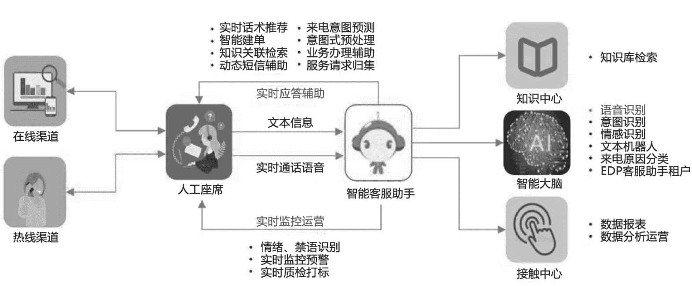

图 4-3

智能客服助手在客户服务领域处于核心位置，连接多种渠道与功能模块。在线渠道和热线渠道是客户接入的入口，客户咨询可通过文本信息或实时通话语音传递给智能客服助手。人工座席也参与其中，可与智能客服助手协同工作，并借助后者提供的文本信息来辅助服务。智能客服助手借助智能大脑，整合语音识别（ASR）、意图识别、情感识别等多种 AI 能力，实现来电意图预测、意图式预处理等功能。同时，与知识中心连接，进行知识库检索，获取知识关联检索等信息，为服务提供知识支撑。在服务过程中，智能客服助手能实现实时话术推荐、智能建单等功能，辅助业务办理。接触中心则负责生成数据报表、进行数据分析运营，为服务优化提供数据支持。此外，通过实时监控运营模块，可进行情绪、禁语识别，实时监控预警和实时质检打标，保障服务质量，提升客户体验，优化服务流程，降低运营成本。

来电意图预测：运用机器学习算法，通话开始即可准确预判客户来电的目的。如电信运营商客服中心，系统可依据历史和当前对话，快速识别客户需求，这样接线员可以提前准备，从而缩短处理时间，提高服务效率。

情绪监控：利用自然语言处理和情感分析模型，实时感知通话双方的情绪，发现客户不满或困惑之处，从而提醒工作人员安抚客户；员工态度不佳也能及时纠正。例如，某银行使用它后，客户满意度提升了 15%，投诉率下降了 20%。

服务推荐：根据客户偏好和行为模式，主动推送个性化产品信息与解决方案。如在旅游预订平台，智能客服助手根据客户的历史旅行记录、搜索偏好等数据，为客户推荐个性化的旅游线路。比如，发现客户经常预订海滨城市的酒店且喜欢潜水活动，智能客服助手就会推荐包含潜水项目的海岛旅游套餐，同时推送相关的优惠信息，这不仅提高了客户预订的可能性，还增加了客户对平台的黏性。在线购物平台可借此展示客户感兴趣的内容、发送促销邮件，从而促进销售额增长。例如，某电商平台使用它后，新客转化率提高了 30%。

此外，智能客服助手还有以下核心竞争力：

·多轮会话管理能力：实现自然流畅的人机对话，从而提升复杂场景下的沟通效率。

·智能问答系统：基于高精度语义模型，减少常见问题的重复询问，从而简化操作。

·全渠道一体化管理：统一管理电话、网页、移动应用等渠道，实现信息同步，支持差异化营销。

智能客服助手凭借数据分析和人性化设计，在提升满意度、忠诚度和推动业务增长方面潜力巨大，未来应用场景将更丰富。

DeepSeek 利用其先进的机器学习算法和大量历史数据，支持对来电意图的预测更加精准。以电商客服为例，在促销活动期间，DeepSeek 可分析客户的浏览记录、购买历史、咨询频率等多维度数据，提前预判客户来电意图，其准确率较传统方法提高了 20%，为客服人员提供了更具价值的参考，使其能提前准备相关资料，快速响应客户需求。

### **4.2.3** **功能架构**

图 4-4 所示为智能客服助手的功能架构图，涵盖来电意图预测、预处理能力融合、实时质检、业务办理辅助、分租户能力维护、知识点推荐、监控维度扩展、通话实时打标、EDP 能力融合、核心意图配置、推荐内容评价、实时应答辅助、监控日志查询、自动填单、情绪监控、禁语监控，以及服务请求推荐归集等功能。这些功能从不同方面助力客服工作，比如，通过来电意图预测提前了解客户需求，情绪监控和禁语监控保障服务质量，业务办理辅助提高服务效率等，包括 ASR、机器人会话、意图识别、槽位提取、情感识别、文本摘要、服务请求模型、建单推荐等。这些是智能客服助手的核心技术能力，是实现上述功能的基础。例如，ASR 实现从语音到文本的转换，意图识别理解客户意图，情感识别感知客户情绪等。系统用于展示智能客服助手相关功能的数据和分析结果，帮助管理人员了解服务情况，评估功能效果，以便对智能客服助手进行优化和改进。

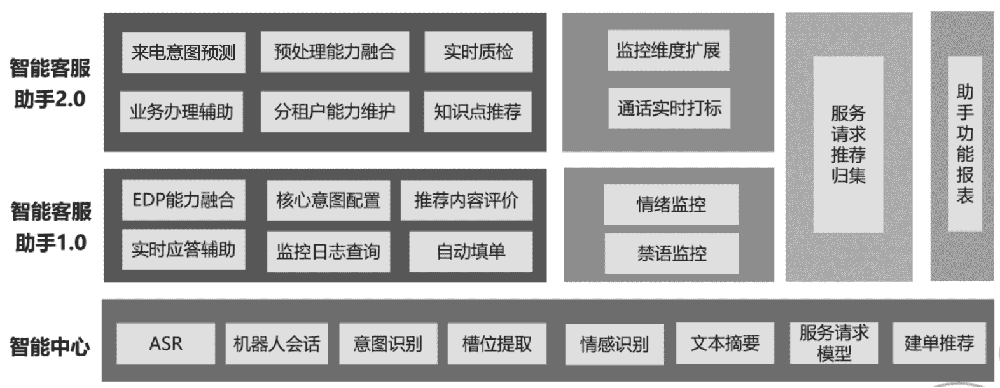

图 4-4

### **4.2.4** **核心功能**

本节将深入剖析智能客服助手的核心功能，以及它们对提升客户服务质量与效率的支撑作用。随着技术的发展，这些核心功能不仅能通过来电意图预测助力人工座席快速理解客户需求，还能借助情绪、禁语监控确保交流积极且合规。此外，智能客服助手提供的服务请求推荐等增值服务也致力于优化客户体验。下面将逐一介绍核心功能，分析其协同加速问题解决的方式，同时探讨当前的挑战与未来技术改进的方向。

**1.** **来电意图预测**

来电意图预测是智能客服助手的重要功能之一，旨在通过分析历史数据与实时对话，提前预判客户来电的目的，从而提升首次接触的效率与服务质量。在通信运营商客服场景中，来电意图预测功能尤为关键。例如，在月初账单出账期间，大量客户来电咨询账单费用问题。智能客服助手通过分析历史数据和实时对话，能快速判断出客户来电意图是否为账单查询。如果是，则系统会自动为人工座席提供该客户的账单详情，帮助人工座席提前了解情况，从而更高效地为客户解答疑问，缩短客户等待时间。当客户拨打客服热线与人工座席通话时，智能客服助手会自动激活，并依据预设场景配置和算法逻辑，展示最可能的来电意图。例如，系统检测到大量近 15 天未办结工单时，可能推测客户来电咨询未解决事项的原因或状态。

其算法依赖自然语言处理、机器学习和大数据分析。为了提高预测的准确性，该系统还可以引入外部数据。比如，结合节假日、促销活动等信息，分析这些因素对客户来电意图的影响。在春节期间，除了常规的业务咨询，可能会有更多客户咨询套餐优惠活动。智能客服助手通过综合考虑这些因素，能够更精准地预测客户的来电意图，从而提供更贴合客户需求的服务。系统先通过学习过往通话，建立包含不同语境关键词及对应解决方案的庞大数据库；再利用语音识别将实时音频转为文字，经过情感分析和意图识别，精确定位客户需求。随着交互数据不断补充训练集，系统的准确性将持续提升，形成正向反馈。

此外，系统还加入了情绪监控机制，确保交流中给予客户恰当的情绪支持；同时设置禁语监控，以避免不当言论损害品牌形象。例如，当察觉到客户的语气急躁时，系统就会提醒人工座席与其温和沟通，并推荐合适的安抚话术。

在实际应用中，来电意图预测能够帮助人工座席快速把握客户诉求，减少无效询问，提高效率，从而显著改善客户体验，提升品牌忠诚度。通过融合历史洞察与即时解析，为构建高效的人性化客服体验提供有力的技术支撑。

**2.** **人工服务意图识别**

在智能化客户服务的过程中，自动化系统虽能处理多数常规请求，但在面对复杂或非标准的情境时效果欠佳，此时需要人工服务辅助甚至主导意图识别，保障服务质量。在金融投资领域，客户的咨询往往较为复杂，涉及风险评估、投资组合等专业知识。例如，当客户询问“我有一笔闲置资金，想在半年内获得一定收益，应该怎么投资？”这种问题时，智能客服助手可能难以准确判断客户的风险承受能力和具体投资目标。此时，人工座席就会凭借专业的金融知识和经验，进一步询问客户的财务状况、投资经验等信息，从而更准确地把握客户意图，为客户提供合适的投资建议。人工服务意图识别是指智能客服助手无法准确判断客户需求时，人工座席凭借经验和专业知识进行补充判断的过程。这种人机协作模式可以提升问题解决的效率，改善客户体验。

例如，某客户拨打客服热线询问未办结工单的状态时，因先前存在多个未解决的问题，自动化系统未能明确识别来电原因。智能客服助手初步判断可能是工单状态查询，但自信心不足（低于预设阈值），遂将对话转交给人工座席。人工座席依据历史通话和当前对话，快速理解客户意图，并提供详尽的解答，以缓解客户焦虑。

为实现高效的人机协同，系统设计了实时话术推荐、知识点关联检索、动态短信模板生成等辅助功能，助力人工座席进行意图识别。这些辅助功能在实际应用中发挥着重要的作用。例如，实时话术推荐功能可以根据客户的问题和当前对话场景，为人工座席推荐合适的回答话术，帮助人工座席更专业、更规范地与客户沟通。知识点关联检索功能能够快速为人工座席提供相关的金融知识和法规政策，支持人工座席做出准确的判断和建议。在整个过程中，智能客服助手不仅能初步过滤分类客户请求，还能持续学习人工反馈，优化算法模型。随着时间的推移，系统对常见咨询的独立处理能力将逐渐提高，从而减轻人工负担，维持高服务质量。

总之，结合机器学习与人类智慧的人工服务意图识别机制，能够最大程度地克服单一技术手段的局限性，构建更灵活、精准、人性化的客户服务体系。这种互补合作模式有利于提升服务效率和客户满意度，为未来智能化服务发展奠定基础。

**3.** **情绪、禁语监控提醒**

在现代客户服务中，智能客服助手不仅是沟通桥梁，还肩负起确保通话安全和谐的重任。情绪分析技术和禁语监控机制在此过程中至关重要。通过实时情绪识别和敏感词汇监测，智能客服助手能有效地辅助客服处理复杂的客户互动，提升服务质量，维护企业形象。以在线教育的客服场景为例，学生因为学习压力大，在咨询问题时可能会表现出焦虑或不满情绪。此时，智能客服助手能够通过情绪识别功能及时察觉，提醒客服人员调整沟通方式，给予学生更多的耐心和鼓励。此外，当遇到学生使用不文明用语表达情绪时，禁语监控机制就会立即发出警示，引导对话回到理性沟通的轨道，从而维护良好的沟通环境。

在情绪监控方面，智能客服助手能够利用先进的自然语言处理技术，即时转录对话并分析情感倾向。依据预设情绪模型（积极、消极、中立等），评估每句话的情感色彩。如在客户服务的通话过程中，当系统检测到客户语气急躁（可能因服务等待久）时，它就会立即向客服代表发送警示，提示其注意客户的负面情绪，并建议客服耐心、温和地与客户进行交流。当人工座席情绪指标达到设定的阈值时，智能客服助手就会自动通知其团队管理员，以便及时介入调整或提供支持。

禁语监控则在对话中持续监听特定的词语或短语，如威胁、辱骂、涉及非法活动暗示等“禁语”。需要注意的是，对于像“投诉”这类词汇，不能简单地一概而论标记为敏感关键词，而应结合上下文语境判断。例如，当客户语气正常表述“我要投诉你们产品的某个问题”时，这属于正常反馈渠道，不应触发警示；但如果客户使用了不文明词汇且带有威胁意味，此时禁语监控机制就会立即启动。一旦发现真正的禁语信息，客服界面就会显著显示警告标识，并详细记录触发时刻、具体词汇和频次，方便后续追溯与分析，以便企业有针对性地改进服务或对员工进行培训。该设计有助于维护沟通氛围，防止事态恶化，为企业提供合规依据，规避法律风险。

情绪分析与禁语监控共同构成了智能服务助手的安全屏障，营造了高效且尊重隐私的服务环境。通过敏锐捕捉客户的情绪变化和有效过滤其不当言论，智能客服助手可以使客户互动更顺畅可控，从而促进企业与客户的正向沟通。

**4.** **服务请求推荐**

在现代客户服务中，智能客服助手的服务请求推荐功能是提升客户体验、提高业务效率的关键。以美妆电商平台为例，智能客服助手通过分析客户的购买历史，发现某客户经常购买美白类护肤品且近期浏览过某品牌的新品美白精华。基于这些数据，在客户进行咨询时，智能客服助手不仅推荐该品牌的美白精华，还搭配推荐同品牌的美白面膜，组成护肤套装推荐给客户，并提供相关的折扣信息。这种个性化的推荐能精准命中客户需求，提高客户购买的可能性，从而促进销售额增长。该功能基于客户行为习惯、历史记录和实时互动，为客户提供个性化的建议或解决方案，提升了客户满意度，促进了二次消费。客户通过热线电话或在线聊天等渠道联系企业时，智能客服助手可迅速分析客服诉求，并结合过往相似情境处理经验，给出最佳的服务请求方案。

具体而言，智能客服助手可运用先进的机器学习模型（如意图识别技术）解析客户的真实需求。通过学习大量历史数据，可以理解不同语言表达背后相同的请求目的。同时，整合情绪监控等情感分析工具，把握沟通的微妙变化，确保建议准确且贴心。如，当遇到因账户异常而焦虑的客户时，智能客服助手不仅能提供解决方案，还能安抚客户的情绪，增添对话的温暖感。

除了解决当前问题，该功能还能依据客户历史行为预测未来服务的需求，提前准备支持材料或优惠信息。比如，对于经常在某生鲜电商平台购买水果的客户，智能客服助手根据其购买频率和品类偏好，可预测客户近期可能会再次购买水果。于是提前准备当季热门水果的促销信息和营养搭配建议，当客户再次访问该平台时，智能客服助手就会及时推荐这些信息给客户，既满足了客户需求，又增加了平台的销售机会。这不仅缩短了下一次服务的响应时间，还为销售团队创造了更多交叉销售的机会。如针对频繁查询流量的移动网络客户，系统可能推荐套餐升级或增值服务。

通过实施精准服务请求推荐策略，企业可在保证高质量服务的同时提高运营效率，从而有效利用现有资源，构建长期客户关系。这种个性化体验可以让客户感受到被重视与被理解，从而提高品牌的忠诚度，激发他们重复购买，为企业带来稳定可持续的增长动力。

**5.** **精准识别引导**

在智能客服系统里，精准识别并理解客服代表的引导内容，对提升服务质量与客户满意度的意义重大。在处理技术故障类问题时，该功能的作用尤为突出。例如，当客户反馈网络连接出现问题，客服代表引导客户进行初步排查时，智能客服助手能准确识别引导内容，并快速提供相关的故障排查步骤和话术，如“请您先检查一下路由器的指示灯是否正常亮起”“如果指示灯正常，就麻烦您尝试重启一下路由器”等，帮助客服代表更高效地指导客户解决问题。该功能不仅关乎对话中的直接沟通，还包括高效推荐话术、提供步骤指引等方面，以此确保整个服务流程的一致性与专业性。

以处理宽带故障报告为例，当客户表述“我的宽带上不了网了”时，智能客服助手就会自动将其意图识别为故障反馈，其置信度高达 87.92%，随后即刻进入预设的“固网报障 _ 北一”流程。在此过程中，智能客服助手既能依据实时语音转写结果自动生成后续行动建议，又允许人工座席手动选择诸如特定地区维修团队或故障类型等进一步操作方向，使解决方案更契合实际状况。

此外，借助先进的自然语言处理技术与机器学习算法，智能客服助手可实现对复杂情境的精确理解与响应。尽管在面对客户非标准的表达或方言时，目前存在识别不够精准的问题，但持续的技术优化和数据训练正在逐步提升其识别准确率。例如，智能客服助手 1.0 版本主要依靠与 EDP 平台的深度融合来匹配客户来电意图，并据此向人工座席推送相关话术、知识点及短信模板；而智能客服助手 2.0 版本则更着重于预处理流程的自动化，通过对客户意图背后逻辑节点的智能识别与判断，进一步简化操作流程，减少人工干预，进而加快问题的解决速度。

更关键的是，智能客服助手具备实时监控对话双方情绪变化的功能，一旦检测到负面情绪或不当用语（如禁语），它就会立刻提醒人工座席采取相应举措，必要时向管理层发出警报，保障沟通环境的专业、友好。以客服处理客户投诉场景为例，当智能客服助手检测到客户情绪激动且使用了不文明用语时，它会迅速提醒人工座席保持冷静，使用安抚性话术缓和客户情绪，如“非常抱歉给您带来了不好的体验，我们一定会尽快为您解决问题”。若人工座席未能及时有效地处理，智能客服助手就会根据预设规则向管理层发出警报，以便管理层及时介入，避免矛盾升级。同时，这些互动记录会被收集用于后续分析，助力企业持续改进服务质量，提升客户体验。

## **4.3** **智能知识库**

在数字化转型的浪潮下，组织面临着海量信息管理与高效运用的难题。智能知识库作为解决这一问题的关键利器，不仅能助力组织系统地沉淀、整理与传播内部知识，还能借助智能化手段大幅提升信息检索的速度和准确性，增进跨部门协作的效率，确保服务标准的一致性。本节从产品简介入手，深入探究智能知识库的优势，剖析其背后的功能架构支撑，详细介绍产品的核心功能，尤其是它借助自动化技术保持最新状态的方式，并对其在实际工作场景中的应用展开分析。

### **4.3.1** **产品简介**

智能知识库是基于现代信息技术搭建的先进的信息管理系统，旨在通过高效的知识采集、组织、存储和检索机制，为客户提供全面且便捷的知识服务。在软件开发企业中，智能知识库可以成为开发团队、测试团队，以及售后支持团队的共享知识中心。开发人员可以在其中查找代码规范、技术文档；测试人员能获取测试用例和常见问题解决方案；售后支持团队则依靠它快速回答客户关于产品使用和故障排除的疑问，提高整体协作效率和客户服务质量。智能知识库既是企业级知识管理的重要工具，又是推动组织内部信息共享、提升决策效率与服务质量的关键平台，其目标客户群体广泛，涵盖频繁访问专业信息的企业员工、研究人员以及客户服务团队等。在实际应用场景中，无论是支持客服代表快速回应客户咨询，还是协助企业研发部门加速技术创新进程，智能知识库都发挥着不可或缺的作用。

从技术层面来看，智能知识库依托大数据分析、自然语言处理、机器学习算法以及云计算等多种前沿技术。例如，利用大数据分析技术，智能知识库可以对海量的技术文档、客户反馈等数据进行挖掘，发现知识之间的关联和潜在规律。通过对客户搜索关键词和浏览内容的分析，了解客户的知识需求热点，为知识的分类整理和智能推荐提供依据，使知识的组织更加符合客户的实际使用习惯。这些技术共同支撑起知识的自动化收集、分类整理、智能推荐及精准检索等功能。例如，利用自然语言处理技术可对非结构化数据进行有效解析；通过机器学习，智能知识库能够依据客户搜索习惯自动调整推荐内容，提升客户体验。

其核心功能主要包括：一是知识管理，涵盖草稿箱管理、已发布文档维护、回收站操作等，覆盖从知识创建到最终归档的全过程；二是知识应用，如提供多维度知识检索服务，支持按类型、目录等条件灵活查询，并能结合上下文语义理解优化搜索结果展示；三是工作流程支持，例如，设置个性化的工作台视图，方便知识管理人员执行审批、反馈处理等日常任务；四是自定义配置能力，允许组织根据不同业务场景定制适合自身的知识管理体系结构，如工作组成员角色分配、常用语句模板设定等。

DeepSeek 的知识图谱构建和推理技术，为智能知识库提供了更强大的知识挖掘和关联能力。例如，在医疗行业知识库中，DeepSeek 可从海量的医学文献、病历数据中挖掘出疾病症状、诊断方法、治疗方案之间的深层关联，为医护人员和患者提供更全面、准确的医学知识服务。同时，DeepSeek 的知识更新技术能够实时跟踪医学领域的最新研究成果和临床实践进展，自动更新知识库内容，确保知识的时效性和准确性。

总之，智能知识库为企业构建了统一的知识平台，不仅有助于企业积累宝贵的智力资产，还能促进跨部门信息交流与协作，显著提升企业整体运营效率和服务水平。此外，随着 AI 技术的发展及其在该领域的深入应用，未来智能知识库将朝着更智能化、个性化的方向演进，进一步释放潜力，以满足日益增长的企业需求。

### **4.3.2** **产品优势**

在当今信息爆炸的时代，智能知识库凭借其独特优势，在知识管理、知识应用及客户体验方面展现出超越传统解决方案的卓越性能。在金融行业，智能知识库存储着大量客户的敏感信息和金融数据，数据安全至关重要。采用的先进加密技术可以对这些数据进行多层加密，即使数据在传输或存储过程中被窃取，攻击者也难以破解后获取真实的信息。物理隔离手段则从硬件层面保证数据的安全性，防止外部非法访问。定期备份和恢复机制能够在数据遭遇丢失或损坏时快速恢复数据，保障业务的连续性。首先，在数据安全性上，智能知识库采用先进的加密技术和物理隔离手段，确保敏感信息安全存储与传输，同时通过定期备份和恢复机制，可以大幅降低因意外导致的数据丢失风险。其次，易于扩展和维护是其一大亮点，基于微服务架构的设计理念，系统可根据实际需求灵活调整资源配置，支持无缝集成新功能或服务，在降低运维成本的同时提升系统的稳定性。

在内容存储支持方面，智能知识库不仅支持文本格式，还涵盖图片、视频等多媒体类型，这种多样化的存储方式极大地丰富了知识的表现形式，满足了不同场景的使用需求。以教育培训行业为例，智能知识库可以存储教学视频、课程图片、文字教案等多种类型的知识内容。教师在备课过程中，既可以参考文字教案获取教学思路，又可以观看教学视频学习优秀的教学方法，还可以查看相关课程图片等丰富的教学素材。同时，通过定制知识审批工作流，教育机构可以确保上传到知识库的教学资源质量，如由学科负责人进行一级审核，教学管理部门进行二级审核，保证知识的准确性和适用性。更重要的是，它允许客户根据业务特点定制知识审批工作流，如设置二级甚至多级审核机制保证发布信息的质量，这种灵活性有助于企业快速响应市场变化，优化内部协作流程。

此外，智能知识库具备强大的数据分析能力，能追踪分析客户的访问行为，并将结果反馈用于改善交互体验，如提供“搜索热词”推荐、依据点击量自动调整查询结果显示顺序等功能，显著提高了客户获取所需信息的速度和满意度。在促进团队合作方面，通过构建统一的知识平台，成员之间能更高效地分享经验和见解，加快问题解决速度；对于决策者而言，能更快地接触到关键信息，从而辅助做出更精准及时的判断。

DeepSeek 采用先进的加密技术，对智能知识库中的敏感信息进行多层加密，从而确保数据在存储和传输过程中的安全性。例如，在金融知识库中，对客户的账户信息、交易记录等敏感数据进行加密处理，即使数据遭遇泄露，攻击者也难以获取真实信息，从而有效地保护了客户隐私和企业数据安全。

综上，智能知识库凭借高安全性、可扩展性、多功能性和智能化特性，在推动组织数字化转型过程中发挥着不可替代的作用，为企业创造了一个集效率与质量于一体的新型工作环境。

### **4.3.3** **功能架构**

图 4-5 为智能知识库的功能架构图，涵盖业务应用、平台能力、数据存储和运行环境四个层面。

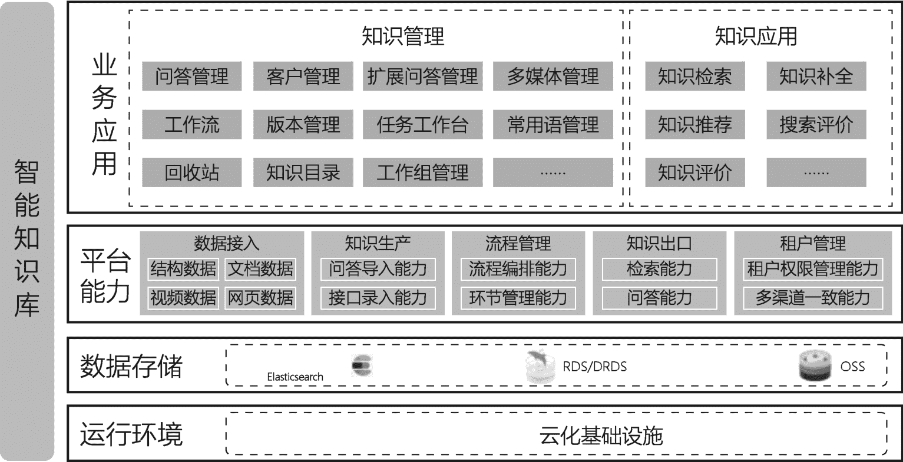

图 4-5

在业务应用方面，知识管理包含诸多功能。问答管理负责对问答内容进行创建、编辑以及审核等操作；客户管理主要用于设置客户的权限和查看客户的操作记录，以此保障知识管理的安全性和规范性。扩展问答管理可以补充相关问题，让知识维度更加丰富；多媒体管理则使得智能知识库能够容纳图片、视频等多种形式的内容。

在知识应用模块中，知识检索模块能够根据客户输入的内容快速查找相关知识；知识补全模块是对已有的知识进行完善；知识推荐模块会依据客户过往的行为和偏好，主动推送合适的知识内容，提高知识的利用效率；知识评价模块用于收集客户的反馈，帮助优化知识。

在平台能力方面，数据接入模块支持结构数据、文档数据、视频数据、网页数据等多种类型的数据进入智能知识库，为智能知识库提供丰富的数据来源。知识生产模块具备将问答内容导入以及通过接口录入知识的能力，方便把外部知识整合到智能知识库中，还支持知识的创建和编辑。流程管理模块涵盖了对知识流程的编排以及各个环节的管理能力，对知识从录入到应用的整个流程进行优化和监控，确保知识能够顺畅流转。知识出口模块具备检索和问答的能力，让知识能够准确、快速地提供给客户。租户管理模块提供对租户权限的管理能力，保证不同租户在使用智能知识库时的权限分配合理，并且在多个渠道上都能有一致的使用体验。

数据存储模块为智能知识库的数据提供可靠的存储方案，保证数据能够高效存储、快速检索以及安全备份。运行环境模块是基于天宫平台搭建的，它为智能知识库的稳定运行提供底层支持。

另外，DeepSeek 的自然语言处理和知识推理技术在知识管理和应用过程中发挥着重要作用。在进行知识采编时，DeepSeek 能够自动提取文档中的关键知识点，提升知识录入的效率；在审批流程中，利用知识推理技术来验证知识的准确性和完整性；在搜索评价方面，通过对语义的理解，可以为客户提供更精准的搜索结果和知识推荐。

智能知识库的架构遵循模块化设计原则，各部分既相互独立，又紧密关联，共同构成了一个强大且灵活的知识管理系统。这样的设计不仅降低了开发过程中的复杂度，还为后续功能的扩展预留了空间。

### **4.3.4** **核心功能**

图 4-6 所示的是智能知识库核心功能的介绍。

在知识应用方面，智能知识库能区分问答知识、多媒体知识等类型展示，满足客户不同的需求场景。知识首页可按搜索热度排序并展示不同客户的搜索词，方便客户快速获取热门知识；提供的“我要反馈”入口便于客户对搜索提出问题，促进知识优化。知识详情页具备评价功能，可收集客户反馈，助力知识质量的提升。

在知识管理方面，“我的工作台”集中呈现待办任务，如登录客户需要处理的任务列表，支持抢单、释放、审核等操作，可直观地监控任务的处理情况，方便客户跟进；同时还能记录并展示客户反馈的评价内容和回复，以及维护审核过程中的话术，便于经验沉淀与交流。草稿箱支持基于多种条件（如知识 ID、标题、渠道等）查询知识内容，涵盖问答知识、多媒体知识等多种类型，具备新增、修改、删除、提交、解锁等丰富的操作功能，方便知识内容在创建、编辑阶段的管理，确保知识生产的灵活性与可控性。对于已发布知识，可进行导出问答知识、下线更新等操作，同样支持多条件查询，从而保障知识在发布后的持续可用性与准确性，使其能随业务需求及时更新。回收站可按多种条件查询已删除知识，提供还原和彻底删除功能，防止因误删操作造成知识丢失，同时也能对无用知识进行彻底清理，优化知识库存储。知识目录支持对目录树节点进行增、删、改操作，方便对知识进行分类管理，提升知识检索效率。工作组/人员维护功能用于配置知识生产流程中各节点对应的处理人员，保障知识生产流程的有序进行。

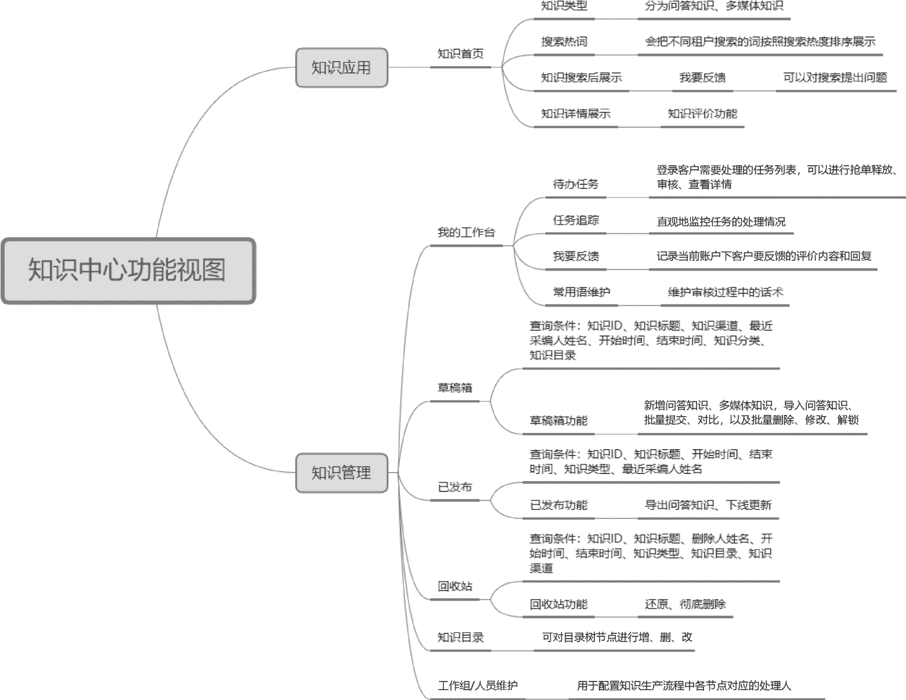

图 4-6

**1.** **知识应用**

知识应用是智能知识库的核心组成部分，旨在通过一系列高效功能提升客户获取信息的速度与准确性。在法律行业的智能知识库中，知识检索功能对于律师和法务人员至关重要。在处理复杂案件时，他们需要快速从大量的法律法规、案例文档中找到相关信息。智能知识库的知识检索功能通过分词技术，将复杂的法律术语和案件描述准确切分，结合权重计算，优先展示与当前案件相关性最高的法律条文和案例，帮助法律工作者节省大量查找资料的时间，提高工作效率。其中，知识检索是最关键的功能之一，它不仅依赖强大的搜索引擎技术，还融入了分词技术和权重计算等先进算法机制。分词技术可将客户查询语句分解成多个有意义的词语或短语，并基于这些片段匹配数据库中的记录，大幅提高了搜索结果的相关性；权重计算则进一步优化这一过程，它根据每个词汇在文档中的重要程度，以及在整个智能知识库中的分布情况决定其排名顺序，确保最重要、最相关的资料优先展示给客户。此外，在展示搜索结果时，系统会对匹配部分进行高亮显示，方便客户快速定位所需信息。

除核心检索功能外，智能知识库还配备多种辅助工具提升整体客户体验。以互联网运营团队使用的智能知识库为例，知识推荐系统根据运营人员的日常工作内容和浏览习惯，为其推荐相关的行业动态、运营技巧等知识。如果运营人员近期一直在关注社交媒体营销，那么知识推荐系统就会推送关于社交媒体新算法、热门营销案例等信息，帮助运营人员及时了解行业趋势，提升工作能力。例如，知识推荐系统利用机器学习算法分析客户的历史行为数据（如浏览历史、收藏夹内容等），并结合当前上下文环境（如地理位置、时间等），向客户推送个性化的相关信息。这种基于客户偏好的主动式服务模式极大地丰富了知识发现的方式，即便客户没有明确需求，也能接触到有价值的知识点。

另外，搜索评价系统是持续改进服务质量的重要手段之一。每次检索完成后，客户可对获得的结果进行评分或留下具体的反馈意见，这些宝贵信息会被收集作为训练模型的数据源，帮助算法不断学习和进化，从而更准确地理解人类语言背后的意图。同时，通过分析大量客户评价数据，开发团队能识别出系统中存在的普遍问题或潜在新功能需求，进而指导后续的产品迭代方向。

总之，通过上述各种技术的应用与创新，智能知识库构建了一个高效且个性化的知识获取平台，既满足了客户对精准查找的需求，又促进了组织内部知识资产的有效管理和共享。随着人工智能等相关领域研究的深入发展，未来这类系统的智能化水平还将进一步提升，为人们的工作和生活带来更多便利。

**2.** **知识管理**

知识管理也是智能知识库的核心组成部分，贯穿知识的整个生命周期，包括从创建到发布的各个环节。在知识创作阶段，智能知识库可以提供丰富的模板和辅助工具，帮助知识创作者更高效地编写内容。例如，对于产品知识文档的创建，系统提供统一的模板，包括产品概述、功能介绍、使用方法、常见问题解答等板块，引导创作者规范编写。同时，还可以集成智能拼写检查、语法纠错等功能，提高知识内容的质量。在这个过程中，草稿箱、已发布和回收站三个关键阶段共同构成完整的知识流通过程。草稿箱作为知识创作的起点，允许作者在此进行内容的初步编辑与调整，未完成的知识项被安全存储，直至准备好进入下一个环节——通过审批流程后的正式发布。已发布状态意味着该条目已完成所有必要的审查，可供广大客户群体访问和利用。当某项信息不再适用或需要更新时，会被移至回收站等待进一步处理，如删除或恢复。

在这个周期性的过程中，工作组/人员的作用至关重要。他们不仅负责确保每份提交内容都经过严格的质量控制，还承担维护信息安全的责任。具体而言，这涉及对知识采编者、一级审核人、二级审核人等角色权限的细致分配，以实现高效协作并防止潜在风险。例如，设定多级审核机制可以有效地提高最终上线资料的准确性和可靠性；当遇到敏感或保密性强的信息时，可通过限制特定客户的查看权限等方式加强保护措施。

自定义目录结构为组织内部庞大的信息体系提供了极大便利。以制造业企业为例，其智能知识库的自定义目录结构可以按照产品类别、生产流程、技术标准等维度进行划分。在产品类别下，再细分不同系列的产品；在生产流程目录下，详细列出从原材料采购到产品组装的各个环节；技术标准目录则涵盖各类生产工艺标准和质量检测规范。这样的分类体系使员工在查找知识时能够快速定位，提高工作效率。借助树形结构，企业能够灵活建立符合自身需求的知识层级分类体系，让员工更容易找到所需资源，也便于后续管理和维护工作的开展。此外，基于此结构，系统还支持批量操作（如修改、删除）等功能，以极大地简化日常管理的工作量。

自动更新机制是保持智能知识库活力的关键因素之一。它不仅能帮助维持现有文档的时效性，减少手动干预需求，还能定期推送最新版本给相关人员，确保所有人及时获取最新资讯。比如，针对政策法规变化快速的行业领域，设置相应的跟踪规则后，一旦官方文件有更新，系统便能自动抓取并替换旧版内容，保障信息传递的准确性与时效性。

总之，通过科学合理的规划与实施，智能知识库不仅能有效促进组织内部知识资产的积累与发展，而且能显著提升工作效率和服务水平，为企业创造更大的价值。

## **4.4** **智能工单**

在客户服务领域，高效解决问题的流程是提升客户满意度的关键要素之一。智能工单系统作为创新性解决方案，融合人工智能技术与自动化处理机制，致力于简化业务流程、降低错误发生率，显著提高了问题解决的速度与质量。本节从产品简介出发，深入探讨智能工单的优势、功能架构和核心功能，同时介绍其如何实现客户需求的自动创建、跟踪直至最终解决。

### **4.4.1** **产品简介**

智能工单系统是集成先进信息技术与高效工作流程管理的工具，旨在为企业与客户搭建沟通桥梁，尤其在处理复杂问题或需要跨部门协作解决的场景中。在大型制造业企业中，智能工单系统在处理设备故障报修这类复杂问题时发挥着关键作用。当生产线上的设备出现故障时，一线工人通过智能工单系统提交报修申请，系统就能迅速根据故障描述和设备信息，自动分配给最合适的维修团队，同时协调相关部门提供技术支持和配件供应，实现跨部门的高效协作，快速解决问题，减少设备停机时间，保障生产的顺利进行。其设计初衷是通过自动化和智能化手段，优化客户服务体验，提升工作效率和服务质量。智能工单系统不仅能简化从工单创建到解决全过程的手动操作，还能依据历史数据和算法模型预测最佳处理路径，确保每一步精准且高效。

该系统基于强大的“工作流引擎”运行，实现工单在不同环节的自动流转。在电商售后服务场景中，工作流引擎的优势也十分明显。当客户提交退换货工单时，系统会根据订单信息、退换货原因等预设规则，自动判断该工单的处理流程。如果是由商品质量问题导致的退换货，那么工单会被分配给质量检测部门进行评估；若是客户个人原因，且符合退换货政策，工单就会被分配给售后物流部门安排处理，确保每个工单都能按照最优路径流转。例如，服务请求记录为工单后，系统就会被按预设规则分配给最合适的处理人员；若问题超出一线客服能力范围，工单就会自动转交给二线或更高层级的专业团队跟进。这种无缝对接能大幅减少人工干预需求，降低错误发生率，加快解决速度。

智能工单平台支持通过热线电话、在线聊天、小程序、社交媒体等多渠道发起的服务请求统一管理和响应，确保客户无论通过何种方式联系企业，都能获得一致且高质量的服务体验。所有的工单信息都集中存储于一个数据库，便于实时监控工单进度状态和后续分析。对于涉及多部门协作的问题，如网络故障修复，智能调度机制可快速调动相关资源，形成合力迅速解决问题。

为进一步提升客户体验，智能工单系统还具备创新功能。智能推荐利用机器学习技术分析过往案例，向客户或工作人员提供下一步行动建议；基于自然语言处理技术的语音转文字服务，可在通话过程中即时生成准确的文字记录。这些特性共同作用，不仅提高了内部运营效率，也极大地提升了外部客户的满意度，为企业赢得良好口碑。总之，智能工单解决方案凭借全面性、灵活性和智能化优势，在现代商业环境中发挥着日益重要的作用。

DeepSeek 的机器学习算法和自然语言处理技术深度融入智能工单系统。在工单自动分配环节，系统可根据工单内容、客户历史信息以及客服人员的技能专长，利用 DeepSeek 技术进行智能匹配，将工单准确分配给最合适的处理人员，分配准确率提高了 30%。例如，对于复杂的技术故障工单，系统能精准识别问题类型，快速找到具备相关技术经验的客服人员进行处理。同时，DeepSeek 可对历史工单数据进行深度分析，为新工单提供更有效的解决方案建议，从而提高问题的解决效率。

### **4.4.2** **产品优势**

相较于传统的客服解决方案，智能工单系统在全渠道服务协同、工单透明可视和智能调度等方面优势显著。这些优势不仅大幅提升了企业的运营效率，还优化了客户的服务体验。以某连锁餐饮企业为例，顾客可以通过电话、微信公众号、门店、小程序等多种渠道进行投诉或建议。智能工单系统将这些来自不同渠道的反馈统一收集起来，无论顾客后续通过哪种方式跟进，客服人员都能在系统中查看完整的工单记录，了解问题的来龙去脉，为顾客提供连贯、高效的服务，避免因渠道差异导致信息不一致和处理延误。首先，智能工单支持在线、小程序、公众号等多触点立单，并保证全渠道数据查询一致，为客户提供统一的服务体验，简化客户操作流程，使企业能更高效地管理和响应不同渠道的需求。例如，客户通过社交媒体提出问题后，无论后续通过电话还是其他方式跟进，都能无缝衔接至同一处理进程，避免信息断层和重复沟通，从而极大地提升了客户的满意度。其次，智能工单能实现全量工单归集，将所有渠道产生的服务请求统一建单、派单和流转，确保每张工单都能直接送达一线解决团队，实现“一点处理、全网响应”。这依赖于强大的工作流引擎技术，能够按预设规则自动将工单流转至最合适的处理人员，无须人工干预。这不仅大幅节省了人力成本，还加快了问题的解决速度。例如，某大型电信公司实施此方案后，平均每个工单从创建到初次响应的时间缩短了 60%，整体处理周期减少了 30%以上。

此外，工单透明可视是智能工单的一大亮点。在物流行业，工单透明可视对提升客户的满意度至关重要。客户在查询包裹配送情况时，不仅能看到包裹当前所在位置，还能通过智能工单系统了解到包裹在各个转运节点的操作时间、操作人员等详细信息。这让客户对包裹的运输过程有更清晰的了解，从而提升了客户对物流服务的信任度。通过对接移动网络综合调度平台及固定宽带客户服务系统等多方资源，全面展示整个工单轨迹，包括创建时间、当前状态、历史操作记录等详细信息。这种高度透明化设计让企业和客户能实时掌握工单进展，从而提高双方的信任度与合作效率。更重要的是，在大数据分析和机器学习算法的支持下，智能工单还能根据不同场景的特定需求提供个性化推荐，如优先级设定、最佳解决方案建议等，进一步增强了决策制定的科学性和准确性。

综上所述，借助先进技术手段和创新设计理念，智能工单不仅极大地提高了企业内部的协作效率，降低了运营成本，还为客户创造了更流畅便捷的服务体验，成为现代企业构建高效服务体系不可或缺的重要工具。

### **4.4.3** **功能架构**

图 4-7 展示了智能工单系统从客户来电到工单流转结束的功能架构。

客户来电是业务流程的起点。客户来电信息传递至智能客服助手前端，智能客服助手依据核心意图配置进行处理。同时，智能客服助手具备语音转写功能，能将通话语音转换为文本数据，这些数据可用于辅助后续分析及业务处理。智能客服助手与智能工单大脑协同，智能工单大脑包含工单能力、智能中心和训练模型。其中，工单能力可实现调用服务、返回结果等操作；智能中心利用训练模型，对相关数据进行分析处理。在此过程中，智能客服助手不仅能实现工单类型推荐、办理模板引导等功能，还能提供预填单等辅助服务。经过智能工单大脑处理后，生成的工单会进入工单受理页面。随后，通过智能流转推荐确定流转部门，进行工单流转。智能定位推荐可根据“现址”字段内容辅助流转，确保工单准确到达相应的处理环节，直至流程结束。整个流程通过智能客服助手与智能工单大脑的协作，利用语音转写数据和训练模型，实现工单处理的智能化、自动化，提升工单处理效率与准确性。

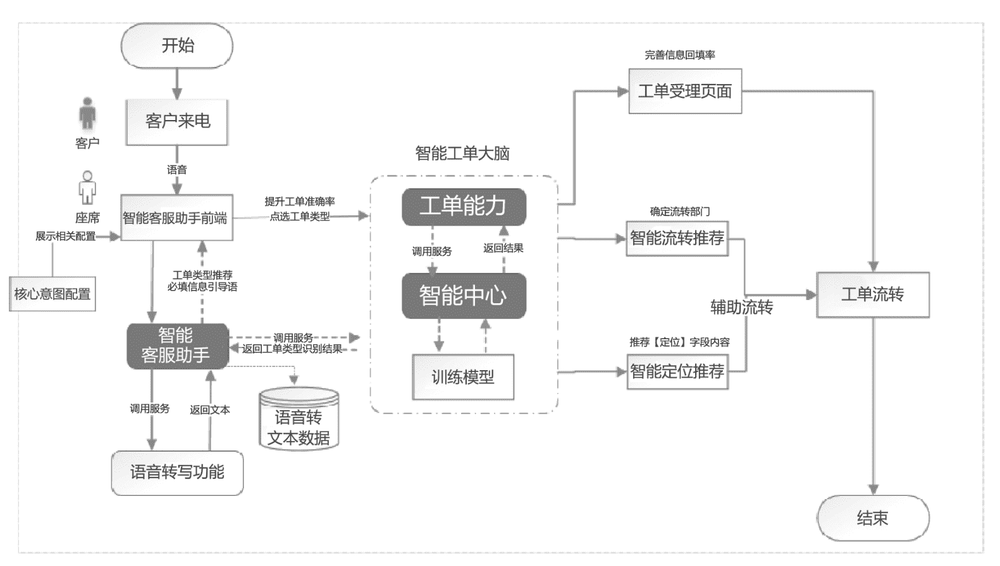

图 4-7

工单受理页面是客户与系统交互的第一界面，它承担着接收客户需求信息的任务。在医疗客服场景中，工单受理页面的设计尤为重要。当患者进行投诉或咨询时，患者可能处于身体不适或情绪焦急的状态，简洁直观的页面设计能让客服人员快速、准确地记录患者信息。该页面支持语音转文字输入方式，对于一些不方便打字的患者来说更加便捷，提高了信息收集的效率和准确性。页面设计简洁直观，客服人员可快速录入必要的工单详情，如客户联系信息、投诉内容等，同时支持文本输入、语音转文字等多种数据输入方式，适应不同场景的使用需求。此外，基于历史数据和算法模型，页面具备智能推荐功能，在工单类型选择、问题描述等方面提供预填充建议，大大缩短了人工填写时间，降低了出错率。

智能客服助手在工单创建之初就发挥着重要的作用。利用自然语言处理技术和深度学习算法，智能客服助手能够理解客户诉求，根据既定规则自动识别最合适的处理路径或解决方案。面对复杂的业务场景，智能客服助手能够辅助客服进行决策分析，如预测可能存在的风险点或推荐优先级较高的处理措施，从而帮助客服做出更合理的判断。

智能中心是整个系统的“大脑”，集成了训练模型、知识库维护等功能。通过学习大量的历史案例，智能中心能够持续改进推荐算法和服务策略，使每次工单的处理更精准有效。此外，智能中心支持多渠道接入，电话、邮件、社交媒体上的反馈都能得到统一管理和高效响应，确保所有的请求都能获得一致的服务体验。

智能工单系统的功能架构是高度集成且相互关联的整体，从最初客户沟通到最终问题解决，每一步都有相应的智能化工具支撑。这种全方位技术赋能，极大地提升了工作效率，显著改善了客户体验，为现代企业提供了强有力的服务保障。

### **4.4.4** **核心功能**

图 4-8 是智能工单投诉处理流转流程图，该图呈现了智能工单在处理客户投诉时的流转过程，涵盖客户投诉来源、工单处理各环节及最终回访，具体如下。

客户投诉来源分为电话投诉、升级投诉、互联网平台投诉三种渠道。其中，电话投诉直接对接区域中心一线客服；升级投诉由投诉处理中心（简称“投处中心”）一线客服处理；互联网平台投诉由投处中心二线客服负责。在工单处理流程方面，当区域中心一线客服接到电话投诉时，若能直接解决，就在线办结；若无法直接解决，则转至区域中心二线客服，二线客服若仍无法解决，就再流转至省级投诉处理团队（简称“省投团队”）。当投处中心一线客服接到升级投诉时，若能直接解决，则在线办结；若不能直接解决，则转至投处中心二线客服，二线客服仍无法解决时，就流转至省投团队或地市客服。当省投团队接到转派工单后，可直接处理，也可转派给专业部门、地市客服或外围系统等处理。地市客服接到转派工单后，可继续转派或自行处理。处理完成后，结果由省投团队、地市客服或投处中心（审核+回访）进行审核。审核通过后，通过 IVR、互联网消息、短信、人工回访等方式对客户进行回访，完成整个投诉处理流程。整个流程图清晰地展示了智能工单在不同投诉场景下的流转路径和处理方式，确保客户的投诉得到妥善解决。

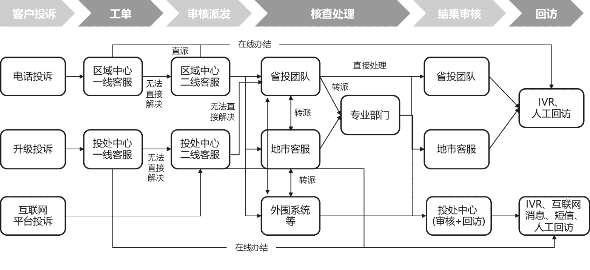

图 4-8

**1.** **工单受理**

工单受理功能是确保客户问题得以迅速且准确处理的关键环节。在一些业务繁忙的场景下，如电商大型促销活动期间，客服人员每天要处理海量的客户咨询与诉求。若采用传统的工单受理方式，则不仅会增加客服人员的工作压力，还可能因为疲劳操作导致错误率上升，进而影响客户体验与问题处理效率。这使得优化工单受理流程的需求变得极为迫切。在传统模式下，客服人员需要手动输入大量信息创建新工单，包括客户联系信息、投诉具体内容、相关服务类型等，这一过程不仅耗时，还容易出错。为优化这一过程，许多机构采用 AI 模型和自然语言处理技术自动识别客户需求，并据此推荐合适的工单类型。这一改进极大地提升了工作效率和服务质量。

利用先进的 AI 技术和自然语言处理算法，智能工单系统能从文本或语音交流中快速解析客户意图，如根据来电者的描述自动判断其遇到的问题所属业务领域（如网络连接故障、账单查询等），并进一步建议最合适的解决方案。例如，在电信行业，当客户致电反映“手机信号不好，经常断网”时，智能工单系统就会借助 AI 与自然语言处理技术，迅速识别出这属于网络信号问题，进而根据客户所在地区、手机型号等信息，从历史案例库中筛选出类似问题的常见解决方案，如建议客户重启手机、检查 SIM 卡是否插好，或者推荐附近的信号优化基站信息等，为客服人员提供详细且针对性强的处理建议。这意味着客户与客服代表对话时，系统会在后台运行复杂的分析任务，为客服提供即时的辅助决策支持。例如，在电信行业中，客户提到“家里宽带速度慢”，系统就会立即建议创建关于家庭宽带性能优化的工单，并可能提示检查线路状态或安排技术人员上门服务。

这种智能化方法极大地缩短了人工操作所需的时间，提高了数据录入的准确性。据统计，相比完全依赖人力的传统流程，采用 AI 增强型工单系统的公司平均处理时间缩短了 30%，错误率降低至不到 5%，显著改善了整体的客户体验。此外，所有的交互记录都用于后续学习，系统能随时间推移不断自我优化，从而更好地适应各种场景下的需求变化。

具体到实际应用场景，以使用手机银行应用遇到困难的客户向客服求助为例。以往，客服可能花费数分钟询问多个细节才能正确归类问题；现在，通过实时转录通话内容并运用语义理解技术，AI 几秒钟内就能确定这是关于账户安全设置的技术疑问，并自动生成对应的工单条目供审核。这不仅减轻了客服的压力，而且整个响应链条也变得更高效、流畅，最终让客户更满意。

**2.** **工单处理**

在智能工单系统中，工单处理阶段是关键环节，它直接关系到客户问题能否被高效、准确地解决。在大型企业的技术支持部门，工单处理的高效性直接影响到业务的正常运转。例如，当多个部门同时反馈系统故障问题时，工单处理的速度与准确性就显得尤为重要。若处理不当，则可能导致业务中断时间延长，给企业带来经济损失。因此，优化工单处理流程，利用智能化工具提升工单处理效率至关重要。此阶段通常包含工单创建、流转及定位等步骤，每个环节对整体服务效率都有重要影响。为加速这一过程，减轻一线员工工作负担，智能化工具的应用尤为重要。例如，客户通过电话或其他渠道提出服务请求后，客服人员会在工单受理页面录入相关信息。此时，智能客服助手前端就会根据客户提供的信息（如语音转文字后的文本内容）和历史工单数据自动推荐合适的建单类型，从而极大地简化了填单流程。这种基于算法模型的智能推荐提高了信息填写的准确性，显著减少了由手动选择导致的时间消耗。

在工单流转过程中，智能流转推荐功能发挥着核心作用。以物流企业为例，当遇到包裹丢失的工单时，系统会参考以往包裹丢失案例的处理经验，结合包裹当前所在的物流节点、客户提供的发货与收货地址等信息，综合判断最合适的处理部门。如果包裹是在运输途中丢失的，则可能推荐给运输部门进行查找；若已到达派送站点后丢失，则推荐给派送站点所在区域的管理部门处理，确保工单能够快速流转到最适合解决该问题的部门。系统依据过往相似案例的学习结果，结合当前工单的具体情况（如问题描述、客户位置等因素），智能预测最合适的下一处理部门，并向操作员提供建议。这有助于客服进行快速决策，有效避免了因人为判断失误造成的延误或错误分配。此外，对于涉及多个部门协作的问题，系统支持设置复杂的“工作流引擎”，确保工单自动按预设路径顺畅流转至相应的负责人手中，从而进一步优化跨部门沟通成本与效率。

在工单定位方面，即在确定具体解决问题的方法时，同样可以通过分析大量历史数据来辅助决策。借助训练有素的机器学习模型，系统可识别针对特定类型问题的最佳解决方案，并展示给相关工作人员参考。这不仅加快了问题的解决速度，也保证了服务质量的一致性。

综上所述，从最初工单创建到最后的解决方案生成，整个工单处理流程在不同程度上受益于各种自动化工具的支持。以某电信运营商为例，引入上述智能化方案后，平均工单响应时间缩短了 30%，客户满意度提升了 20%以上。这充分证明了利用 AI 技术优化传统业务流程的有效性和必要性。因此，持续探索和完善这些智能手段的应用范围和深度，是未来提升客户服务体验的关键。

**3.** **工单流转**

通过高效自动化的工单流转流程，企业能够显著提升问题的解决速度和客户的满意度。在大型金融机构中，客户的业务需求往往涉及多个部门。例如，当客户在申请复杂的金融产品组合时，工单可能需要在信贷部门、风险评估部门、合规部门等多个部门之间流转。智能工单系统的流转功能能够根据预设的业务规则和各部门的职责，自动将工单准确分配到相应的部门，避免了人工流转可能出现的错误和延误，确保整个业务流程的顺畅进行，尤其对于需跨部门协作解决的问题，智能流转机制能够极大地简化沟通流程，确保信息准确无误地传递给最合适的处理人员。这种机制的核心是基于先进算法模型的智能化推荐系统，该系统根据工单具体的内容分析出最佳解决方案或下一个处理环节，并向二线处理人员提供精准建议。

具体来说，在工单派发阶段，当客服人员进入相关界面时，会看到“智能推荐”按钮。在电商售后场景中，当客户申请退换货时，客服人员单击“智能推荐”按钮，系统就会根据商品类别、客户历史购买记录、当前仓库库存情况等信息进行综合分析。如果是电子产品退换货，且该客户购买记录显示经常在某个特定仓库附近区域下单，系统就会优先推荐该仓库对应的售后处理部门，因为他们对该区域的物流和库存情况更为熟悉，能够更快地处理退换货工单。单击此按钮后，系统就会依据历史数据、当前工单描述和预设知识库等多维度信息进行综合评估，随后自动填充被认为是最适合解决问题的“派送单位”。值得注意的是，虽然推荐结果基于大量数据分析得出，但最终的决定权仍在处理人员手中，他们可根据实际情况选择采纳或调整建议。这样既保证了决策的专业性与灵活性，又避免了因过度依赖机器导致的人为错误。

以某电信运营商为例，假设客户报告家庭宽带连接不稳定的问题。在传统方式下，一线客服可能会花费较长时间判断是线路故障还是设备原因，并手动分配给相应的团队；采用智能流转机制后，只需简单输入问题描述，系统就能快速识别最有可能的原因类别（如可能是网络维护中心的责任范围），并直接给出内部转交建议。这大幅缩短了从接收到响应的时间间隔，减少了因部门间沟通不畅造成的延误或误解，从而使整个服务过程更流畅、高效。

此外，随着企业对客户体验管理的重视，利用技术创新提高服务质量成为重要课题。在此背景下，实施基于算法模型的智能流转方案不仅有助于优化企业内部运营效率，还能有效增强企业外部形象，展现企业对客户需求的高度关注和迅速反应能力。总之，通过构建集成自然语言处理、机器学习等多种前沿技术的综合性平台，企业能够更好地应对日益复杂的客户服务挑战，并赢得竞争优势。

**4.** **工单审核**

工单审核能够确保服务请求的准确性和及时性，从而有效维护企业的服务质量标准。在互联网服务行业，工单审核对于保障服务质量和客户权益至关重要。例如，当客户投诉某网络平台存在侵权内容时，工单审核环节需要确保投诉内容真实有效，避免恶意投诉或误判。通过自动化审单配置，系统可以根据预设的侵权判定规则，如关键词匹配、内容相似度分析等，快速对工单进行初步审核，并筛选出需要人工进一步核实的复杂案件，在提高审核效率的同时保证审核的准确性。通过自动化审单配置，组织能够设定特定条件下的自动审核规则，从而极大地提高工作效率和服务质量。例如，在处理咨询或投诉工单时，系统会按预设规则自动完成初步审核，并将符合特定标准的工单直接派发给相关部门或执行后续流程，如转回访等。这种方式减少了人工干预的需求，确保了整个流程的一致性和标准化。

自动化审单功能基于先进算法模型和历史数据训练而成，能够识别哪些工单需要额外的人工审查，哪些工单可快速通过。以在线旅游平台为例，对于客户简单的行程变更请求，如更改酒店入住日期，且该客户过往满意度较高，系统就会通过自动化审单快速批准。但如果涉及旅游行程中出现的严重服务质量问题，如导游服务态度恶劣、旅游景点与宣传不符等复杂投诉，系统就会标记为需人工审查，由经验丰富的客服人员进行深入调查和处理，确保问题得到妥善解决，从而维护企业的声誉。例如，客户满意度高且问题描述清晰明了的工单，系统可直接批准；若涉及复杂问题或多次投诉的情况，则标记为需人工进一步处理。此外，该功能支持根据不同业务场景灵活调整规则设置，满足不同部门甚至个别案例的特殊需求。通过这种方式，即使面对海量服务请求，企业也能保持高效运转，不牺牲服务质量。

此功能的重要性不仅体现在效率的提升上，更在于促进企业内部流程的标准化建设。所有的工单都按统一标准审核，减少了因人为因素导致的偏差，使整个服务体系更透明、公正。这对内对外都能建立良好的信任关系，从而有利于企业的长远发展。总而言之，智能工单中的自动化审单配置不仅是技术进步，更是企业管理理念的革新，让服务更人性化，为组织带来实实在在的好处。

**5.** **工单回访**

工单回访是智能工单系统的重要环节，通过与客户的后续沟通，企业可收集客户反馈、评估服务质量，从而提升客户满意度。在教育培训行业，工单回访对于提升教学质量和客户的满意度意义重大。当学员对课程内容或授课教师提出意见后，工单处理完成后的回访可以了解学员对处理结果是否满意，是否还有其他需求。通过收集这些反馈，教育机构可以有针对性地改进课程内容、优化教师教学方法，提升整体教学质量，提升学员对教育机构的信任感和忠诚度。这一过程有助于组织及时发现并解决问题，从而促进客户关系深化，提升客户的忠诚度。在实施过程中，企业可配置回访基本信息（如首次回访时限、回访总次数等），根据不同业务类型设定回访策略。比如在电商行业，对于普通商品的售后工单，可以设置在处理完成后的 24 小时内进行首次回访，且只回访一次；而对于高价值商品或涉及复杂问题的工单，则可以在处理完成后的 12 小时内进行首次回访，并在一周内进行二次回访，以确保客户问题得到彻底解决，从而提升客户的满意度和复购率。工单完成处理后自动流转至回访阶段，工作人员可查看工单详情，并根据需要执行退回派送环节等操作，确保每个问题得到妥善解决。

定期进行客户满意度调查和反馈至关重要，这是持续改进服务质量的基础。利用智能工单系统来安排此类活动可极大地提高服务效率与准确性。首先，自动化设置使回访计划简单易行，减少了因人工操作导致的错误或遗漏；其次，基于大数据分析结果能够为管理者提供有价值的信息，如哪些服务领域需特别关注，以及什么样的解决方案更受客户欢迎等，从而为未来的决策提供有力支持。更重要的是，积极倾听客户声音并采取行动，表明企业对客户体验的高度重视，这有助于企业建立正面的品牌形象。

此外，有效的工单回访还能促进企业内部流程优化。通过深入研究回访记录，企业可识别服务链路中的薄弱环节，并有针对性地加以改进。例如，当发现某类投诉频繁出现时，可能意味着现有处理机制存在缺陷，需要重新设计工作流程或加强员工培训。同时，高质量的服务补救措施往往能挽救即将流失的客户，转危为机，从而进一步巩固企业市场地位。

总之，通过构建完善的智能工单回访体系，企业能够及时获取宝贵的客户反馈，从而推动产品和服务迭代升级，显著提升品牌形象和市场竞争力，实现长远发展。这正是越来越多企业重视并投资建设高效灵活的智能工单管理系统的原因。

**6.** **数据分析与优化**

智能工单平台不仅能提升客服效率和客户体验，还能在数据分析与优化领域提供强大支持，帮助决策者基于数据洞察做出更明智的选择。例如，在快递行业，智能工单平台的数据分析与优化功能能够帮助企业提升运营效率和服务质量。通过对大量工单数据的分析，企业可以发现业务流程中的瓶颈和潜在问题，为优化决策提供有力依据，从而在激烈的市场竞争中占据优势。首先，在性能指标跟踪方面，智能工单系统能够收集整理大量的运营数据，如工单处理时间、解决率、首次响应时长等关键指标。通过持续监测这些数据，企业可以迅速发现潜在服务瓶颈或流程缺陷，及时调整策略，并提高整体服务质量。例如，数据显示某一类别的工单平均解决时间远高于其他类型的工单，则可能表明该业务流程存在效率低下问题，需进一步优化。

趋势分析是另一个重要的应用方向。例如，在每年的购物节期间，电商平台的智能工单系统会对历史数据进行分析，发现与物流配送相关的投诉在购物节后一周内会明显增加。基于此，平台可以提前与物流合作伙伴沟通协调，加强配送管理，提高配送效率，同时准备好应对投诉的预案，提前培训客服人员，以更好地应对购物节期间的业务高峰，提升客户体验。通过历史数据分析，智能工单平台能够识别客户服务请求的变化模式，如特定时段内的投诉增加或减少趋势、常见问题的发展轨迹等。这种前瞻性的洞见使企业可以提前准备应对措施，甚至预测未来可能出现的问题，并采取预防性措施。例如，分析结果显示夏季空调故障报告显著增多，就可在季节变换前加强相关技术支持团队的人力配置，从而缩短客户等待时间，提升其满意度。

此外，智能工单系统能够生成详尽的报告展示各种维度下的服务表现情况，包括按地区、部门或具体员工的绩效对比。这类定制化的洞察报告为管理层提供全面了解组织运作状况的窗口，便于从宏观层面制定长远发展战略。例如，发现某些地区客户反馈普遍较差，企业便有针对性地改善当地服务质量；针对表现出色的团队，总结成功经验并进行推广学习。

总之，充分利用智能工单平台强大的数据分析能力，企业能够实现日常运营效率最大化，并基于对市场动态及内部运作机制的深刻理解做出精准判断，从而推动整个组织向更高的水平发展。这一体系对促进持续改进、构建卓越的客户服务文化具有不可估量的价值。

## **4.5** **智能排班**

在客服中心与呼叫中心的日常运营场景中，人员调度的有效性直接关乎服务水平的高低以及成本控制的成效，其重要性不言而喻。本节将全方位解析一款运用智能算法优化人力资源配置的卓越解决方案——智能排班系统。该系统依托深厚的历史数据底蕴，能够精准洞察未来话务高峰期的变化趋势，进而合理调配工作人员，在为客户呈上优质服务体验的同时，最大程度地削减不必要的运营开支。下面将从产品简介切入，逐步深入探究其优势、功能架构以及核心功能，进而透视智能排班系统。

### **4.5.1** **产品简介**

智能排班是一款基于数据分析与算法模型构建的自动化工具，其核心使命在于优化企业人力资源配置，尤其是对客服中心这类劳动密集型部门而言，其作用更为显著。在电商行业，客服中心的工作负荷在不同时段的差异巨大。例如，在“双十一”“618”等大型促销活动期间，咨询量会呈爆发式增长，而在平时则相对平稳。智能排班系统通过对历史话务数据的深度分析，结合促销活动的规模、时间等因素，能够准确预测活动期间的话务高峰，提前做好人力资源的合理调配，避免出现因客服人员不足导致客户等待时间过长的情况。它综合考量历史话务量、员工可用性，以及节假日、促销活动等多元业务影响因素，借助先进的话务拟合、人力拟合和班次拟合三维算法，精准预测未来业务的需求，并自动生成契合实际工作负荷的排班表。这一创新流程极大地减轻了传统手工排班模式下管理者的工作负担，实现了人员供给与服务需求的精准匹配，从而有力地推动了工作效率与服务质量的双提升。

智能排班系统的核心功能丰富且实用。话务预测功能依据过往一段时间的话务数据走势，对未来特定时段的来电量进行科学预估；人力预测功能则以话务预测为基石，进一步精确估算所需服务人员的数量；具体的班次规划将上述两项预测成果融合，生成初步排班方案，再经人工微调确认后正式施行。此外，系统还贴心提供换班审批查询、个人排班表查看等功能，为员工了解和调整自身工作安排提供了极大便利。

相较于传统的手动编制排班表，智能排班的优势尽显。传统的手动排班往往依赖排班人员的经验，容易受到主观因素的影响。例如，在预测话务量时，可能会因为对某些特殊事件的忽视或对业务增长趋势的误判，导致排班不合理。而智能排班系统凭借其对海量历史数据的分析能力，能够更客观、准确地预测未来的业务需求，制定出更符合实际情况的排班表。其一，高度依赖真实历史数据进行分析预测，使最终的排班表与实际情况无缝对接，从而有效规避因人为判断失误导致的资源浪费或短缺问题；其二，智能化流程大幅简化了排班操作步骤，显著缩短了从数据收集到决策执行的时间周期，从而全面提升了整体的运营效率；其三，灵活高效的管理模式能够增强团队的凝聚力，合理的休息时间与公平的工作分配也能让员工深切感受到被尊重和被重视，从而大幅提升员工对工作的满意度与忠诚度。

简而言之，智能排班系统凭借精准的数据分析能力、便捷的操作体验，以及提升服务水平和降低管理成本的双重效能，已成为现代客户服务行业不可或缺的关键组成部分。无论是大型呼叫中心还是小型客服团队，都能借助它实现质的飞跃。

### **4.5.2** **产品优势**

智能排班系统借助话务拟合、人力拟合以及班次拟合的三维算法模型，基于历史数据以及话务量增长性、节假日、账期等关键影响因子，能够实现座席人员排班与实际业务需求的深度契合。在银行客服中心，每月的信用卡还款日前夕，咨询还款相关问题的话务量会明显增加。智能排班系统通过分析历史话务数据和账期规律，能够准确预测出该时段的话务高峰，并提前安排更多熟悉信用卡业务的客服人员值班。这样，不仅提高了客户咨询的处理效率，缩短了客户等待时间，还避免了在话务低谷期因安排过多人员值班导致的资源浪费。这一前沿技术不仅显著提升了现场管理和排班管理的能力，还大幅提高了员工和管理者的工作效率。与传统的手动排班方法相比，智能排班的优势主要体现在以下几方面。

·话务预测精准入微：智能排班系统运用先进算法深度剖析过去的话务量模式，能够精准预测未来不同时段的来电数量，甚至细化到每半小时或一小时的具体情况。这种精细化程度远超人工预估，使企业在保障服务质量的同时，能够合理分配人力资源，从而避免出现高峰期人手不足或低谷期资源闲置的情况。

·人力预测科学合理：该系统综合权衡多种变量因素，为每个时间点量身定制最优化的人力配置方案。它不仅能确定所需工作人员的总数，还能进一步细分到各个技能组别，确保所有的重要岗位都有合适的人选值守，从而大幅减少因人手安排不当引发的服务延迟或客户不满。

·排班优化灵活敏捷：智能排班系统的灵活性和响应速度堪称一流。例如，在旅游旺季，旅行社的客服中心会接到大量关于旅游线路咨询、预订和退改的电话。如果遇到突发的自然灾害影响旅游行程，导致大量客户来电咨询退改事宜，那么智能排班系统就可以根据实时的话务量变化，迅速从其他业务相对清闲的时段调配客服人员，补充到处理退改业务的岗位上，快速响应客户需求，确保客户的问题得到及时解决。面对突发事件或季节性波动带来的挑战，该系统能迅速调整现有计划以适应变化，无须像手工操作那样耗时费力地重新制定整个排班表。此外，系统内置的换班申请及审批功能，可以让员工之间的临时调度更加便捷高效，从而有效地提升团队内部沟通协作的顺畅度。

·员工满意度大幅提升：工作量分配更加均衡合理，员工不再频繁遭遇加班或休息日被占用的困扰；透明化的个人排班表查询功能能够让员工清晰了解工作安排，从而提升员工对组织的信任感。同时，系统的自动化特性可极大地减轻管理层日常的管理工作负担，使其有更多时间和精力投入战略规划和其他高价值活动。

综上所述，从话务预测到人力预测，再到最终的排班优化，智能排班系统凭借强大的数据分析能力和灵活应对机制，在提高工作效率和服务质量的同时，也为营造更和谐愉悦的工作环境提供了有力支持。

### **4.5.3** **功能架构**

图 4-9 是智能排班系统的功能架构。可以看出，该系统通过融合多元算法与先进技术，力求从话务预测开始，历经人力配置，直至最终生成排班表的全过程实现高效与精准。

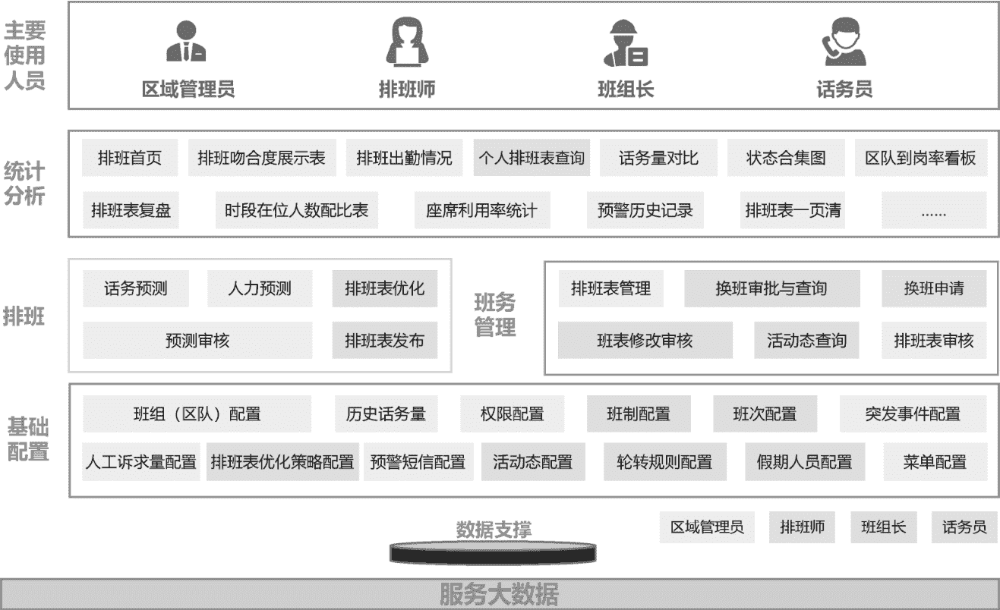

图 4-9

**1.** **主要使用人员**

1）区域管理员

在整个智能排班系统中，区域管理员肩负着统筹全局的重要职责。他们主要负责对区域内的各项资源与配置进行管理，例如，对不同班组（区队）的整体规划与设定，决定各个区域的人员规模、业务侧重等关键要素。通过合理调配资源，确保区域内的排班工作能够与整体业务战略相契合，为系统的稳定运行奠定基础。

2）排班师

排班师是智能排班系统的核心技术人员。他们专注于运用专业知识和系统提供的工具进行话务预测，深入分析历史话务数据，考虑诸如季节、节假日、特殊营销活动等多种因素对业务量的影响，从而精准预估未来不同时段的话务量。基于话务预测结果，排班师进一步开展人力预测工作，确定每个时段所需的人力数量和技能组合。在此基础上，他们对排班表进行优化，权衡员工的工作时长、休息时间、工作负荷等多方面因素，以生成既满足业务需求又兼顾员工利益的最佳排班表方案。

3）班组长

班组长在班组层面发挥着关键的管理作用。他们主要负责排班表的日常管理工作，包括接收和处理班组成员的换班申请，依据实际业务需求和团队情况进行换班审批，并及时更新排班表信息。同时，班组长需要对排班表进行审核，确保其符合业务规定和团队的实际情况，若发现问题，应及时进行调整和修改。此外，班组长还需关注班组成员的出勤情况、工作状态等，通过活动态查询等功能，实时掌握班组的工作进展，保障班组工作的顺利开展。

4）话务员

话务员作为一线工作人员，是智能排班系统的直接使用者之一。他们可以根据自身的实际情况，如个人安排、突发状况等，在系统中提交换班申请。同时，话务员能够通过系统查看自己的排班信息，包括班次时间、工作时长、休息时段等，以便合理安排个人生活和工作，做好工作准备。

**2.** **统计分析**

1）全面的数据展示

统计分析功能提供了丰富多样的数据展示方式。排班首页作为一个综合信息窗口，为管理者呈现关键的排班数据概览，如整体的出勤情况、话务量走势等。排班吻合度展示表则通过详细的数据对比，分析实际排班与理想排班模式之间的契合程度，帮助管理者发现潜在的排班问题。排班出勤情况模块精确记录每个员工的出勤状态，包括迟到、早退、请假等详细信息，为考勤管理提供有力支持。

2）个性化查询与对比

个人排班表查询模块方便员工随时查看自己的详细排班情况，从而增强工作的计划性。话务量对比模块将不同时段、不同班组的话务量进行对比分析，管理者可以直观地了解业务高峰和低谷的分布情况，为人力调配提供依据。状态合集图模块以可视化的方式呈现整个团队的工作状态，如忙碌、空闲、休息等，便于管理者及时掌握团队动态。区队到岗率看板模块实时展示各个区队的员工到岗情况，确保在业务高峰时段有足够的人力保障服务质量。

3）深度复盘与优化

排班表复盘模块允许管理者对已执行的排班表进行回顾和分析，总结经验教训，发现排班过程中存在的不足之处。时段在位人数配比表模块通过对不同时段内实际在位人数与业务需求人数的对比，帮助管理者优化人力配置，避免出现人员闲置或不足的情况。座席利用率统计模块可精确计算座席的使用效率，为合理分配资源提供参考。预警历史记录模块记录系统发出的各类预警信息，如话务量异常波动、人力短缺预警等，方便管理者进行追溯和分析，完善预警机制。排班表一页清模块以简洁明了的方式呈现排班表的关键信息，便于快速查阅和决策。

**3.** **排班**

1）精准预测

话务量预测是排班工作的重要前提。系统借助先进的算法模型，综合考虑历史话务数据、时间因素（如工作日、周末、节假日）、业务活动（如促销活动、新品发布）等多种变量，对未来不同时段的话务量进行精准预测。例如，在电商大型促销活动期间，通过分析过往大型促销活动的话务数据以及当前的市场宣传力度，预测出活动期间各时段的话务高峰和低谷。人力预测则基于话务预测结果展开，结合不同业务场景下所需的员工技能和工作效率，计算出每个时段所需的各类员工数量，包括普通话务员、技术支持人员、投诉处理专员等。

2）智能优化

在得到话务和人力预测结果后，系统进入排班表优化环节。这一过程充分考虑了员工的工作时间限制、休息需求、技能特长以及个人偏好等因素。通过智能算法，对排班表进行不断调整和优化，生成多套备选排班表方案。例如，在满足业务需求的前提下，尽量避免员工连续长时间工作，合理安排员工的休息日，同时将具备特定技能的员工安排到最需要的岗位和时段，以提高服务质量和工作效率。预测审核环节由专业人员对预测结果进行人工审核，确保预测的准确性和合理性，避免因算法偏差导致的排班失误。最后，将经过审核的排班表发布到系统中，供员工与管理者查看和执行。

**4.** **班务管理**

1）排班表的全流程管理

排班表管理是班务管理的核心工作。班组长或相关管理人员可以在系统中对排班表进行创建、编辑、删除等操作。对于已生成的排班表，可根据实际业务需求和人员变动情况进行及时修改。在修改排班表时，系统会自动进行合理性检查，如避免出现人员冲突、保障业务高峰时段的人力配置等。换班审批与查询模块为员工的换班需求提供了规范的管理流程。员工提交换班申请后，班组长根据业务情况和团队安排进行审批，审批结果实时反馈给员工，同时系统记录换班申请和审批的详细信息，方便员工查询和追溯。换班申请模块为员工提供了便捷的操作入口，员工可以在系统中提交换班请求，说明换班原因和期望的换班对象等信息。

2）灵活应对变动

排班表修改审核模块确保排班表的任何变动都经过了严格的审核流程，保证排班表的调整符合业务规定和团队整体利益。活动态查询模块使管理者能够实时了解排班表的动态变化情况，如哪些员工进行了换班操作、排班表调整的具体内容等，及时掌握团队的工作安排和变化。排班表审核模块则是对最终确定的排班表进行全面审核，确保排班表在人员安排、业务覆盖、合规性等方面都满足要求，然后才能正式发布执行。

**5.** **基础配置**

1）构建基础框架

基础配置是智能排班系统正常运行的基石。班组（区队）配置模块用于定义不同班组或区队的基本信息，包括班组名称、成员构成、业务范围等，明确各团队的职责和分工。历史话务量数据的记录和分析为话务预测提供了重要的参考依据，系统会对过往的话务数据进行详细存储和分类统计，方便排班师进行数据分析和模型训练。权限配置模块为不同角色的客户（如区域管理员、排班师、班组长、话务员等）分配相应的操作权限，确保系统操作的安全性和规范性，不同客户只能在其权限范围内进行操作。

2）精细规则设定

班制配置模块允许管理者根据业务特点和行业惯例，设置不同的班制类型，如早班、中班、晚班、轮班等，并定义每个班制的工作时间、休息时间等参数。班次配置模块则进一步细化每个班制下的具体班次安排，包括班次的起始时间、结束时间、交接时间等。突发事件配置模块用于设置在遇到突发情况（如业务量突然激增、设备发生故障、员工突发疾病等）时的应急排班策略，确保在意外情况下能够迅速调整人力安排，保障业务的正常运转。人工诉求量配置模块可以根据实际业务需求，设置人工客服的诉求处理量标准，为人力预测和排班提供参考。排班表优化策略配置模块则允许排班师根据团队的实际情况和管理目标，设置排班表优化的规则和偏好，如优先保障员工休息时间、尽量均衡员工工作负荷等。预警短信配置模块用于设置预警短信的触发条件和接收对象，当系统监测到话务量异常、人力短缺等情况时，能够及时向相关人员发送预警短信，以便及时采取措施。活动态配置模块用于定义系统中各类活动（如换班、请假、调休等）的操作规则和流程，确保活动的有序进行。轮转规则配置模块用于设置员工在不同班次、不同岗位之间的轮转规则，确保员工能够全面发展，同时避免员工因长期固定岗位带来的工作疲劳。假期人员配置模块用于在节假日等特殊时期，合理安排员工的休假和值班，确保业务的连续性。菜单配置模块允许管理者根据实际需求，对系统的操作菜单进行定制化设置，方便客户快速找到所需功能，从而提高操作效率。

智能排班系统的稳定运行离不开强大的数据支撑。服务大数据涵盖了呼叫中心的海量数据，包括历史通话记录、员工基本信息（如姓名、工号、技能等级、入职时间等）、排班规则设置（如班制、班次、请假政策等），以及各类业务统计数据（如话务量、平均通话时长、客户满意度等）。这些数据通过关系数据库 RDS 进行结构化存储，方便进行复杂的查询和分析操作。对象存储 OSS 用于存储非结构化数据，如员工的培训资料、业务文档、录音文件等。大数据处理工具 Hive 则用于对大规模数据进行分布式处理和分析，挖掘数据背后的潜在规律和价值。为了进一步提升系统的响应速度，Redis 缓存技术被应用于系统中，将频繁访问的数据（如热门员工的排班信息、常用的排班规则等）缓存到内存中，减少对数据库的直接访问，提高数据读取效率。JMS 消息队列机制则在系统内部各组件之间建立起可靠的消息传递通道，确保不同服务之间能够高效、协同地工作。例如，当员工提交换班申请后，通过 JMS 消息队列将申请信息传递给相关的审批模块，审批结果再通过消息队列反馈给员工，确保整个流程的顺畅和信息的准确传递。

智能排班系统通过精心设计的架构体系，充分考虑了不同使用人员的需求和业务流程的各个环节，借助先进的技术手段和数据支撑，实现了从话务预测到人力配置，再到排班表生成与管理的全流程智能化和科学化。该系统不仅能够准确预测未来的话务趋势，合理安排人力资源，生成符合实际需求的排班计划，还能兼顾客户体验和系统安全性，在保障高效运作的同时，具备良好的便捷性和灵活性，为客服行业以及其他相关行业的人员排班管理提供了强有力的技术保障。

### **4.5.4** **核心功能**

本节将深入剖析智能排班系统的关键组成部分，包括话务预测、人力预测，以及最终的自动排班和排班表管理流程。通过采用先进算法模型并结合实际业务场景，智能排班系统不仅大幅提高了工作效率，还实现了服务质量和成本控制的平衡。下面将详细介绍各个功能模块所依赖的技术手段及其工作原理，同时强调系统在整个过程中对人工干预的支持，从而确保系统的灵活性与适应性。

**1.** **话务预测**

话务预测是智能排班系统的关键环节，它通过科学方法估计未来某一时段的话务量，从而为人力资源的有效配置提供依据。在酒店行业，话务量的季节性变化非常明显。例如，在旅游旺季，酒店的预订、咨询电话会大量增加；而在淡季，话务量则会大幅下降。智能排班系统在进行话务预测时，会充分考虑这些季节性因素，结合历年同期的话务数据、当地旅游活动安排等信息，运用时间序列分析等算法，可以更准确地预测未来的话务量，为酒店合理安排客服人员提供科学依据。这一过程不仅运用历史数据，还融合时间序列分析等高级算法，并充分考量季节性变化、节假日等因素对话务量的影响，以提高预测的准确性。班务管理人员可利用系统工具选择不同粒度（如 30 分钟、1 小时或日）进行话务量的预测。选择不同的预测粒度对于排班管理具有重要意义。例如，以 30 分钟为粒度进行预测，可以更精确地掌握话务量的波动情况，及时调整人员安排，避免出现人员闲置或过度忙碌的情况；而以日为粒度进行预测，则有助于管理者从宏观上规划人力资源，提前安排人员的工作天数和休息时间，实现员工工作与生活的平衡。为实现这一目标，智能排班系统通常采用以下关键技术手段。

·丰富的数据输入：系统依赖大量历史通话记录，包括来电数量、接听时长，以及高峰期和低谷期的分布情况等。通过深度挖掘这些信息，系统能够识别工作日内不同时段的话务模式及其周期性规律。

·多元的算法选择：常用的时间序列模型如 ARIMA 模型（自回归积分滑动平均模型）、指数平滑法，以及更复杂的机器学习方法如 LSTM 都是可选方案。ARIMA 因处理趋势性和季节性成分的能力强，被广泛应用于长期趋势分析；对于具有明显周期特征的数据集，季节性调整后的指数平滑法更适用；面对非线性问题时，基于深度学习的模型能更好地捕捉数据间复杂的相互关系。

·多维度信息集成：考虑到外部因素对话务量的重大影响，如在公共假期期间，客户行为的变化或特殊事件引发的突发性增长，智能排班系统引入了额外的信息来源，如天气预报和社交媒体活动趋势等。通过集成多种数据源并运用综合分析方法，系统能够优化最终的预测结果。这种多维度的考量增强了模型对异常情况的适应能力，为后续步骤提供了更可靠的数据支撑。

此外，在完成初步预测后，系统允许客户根据实际情况手动调整预测值，形成闭环反馈机制，使整个流程更灵活、高效。总之，借助先进的统计学原理与信息技术，智能排班系统能够有效提升呼叫中心的运营效率和服务质量，确保企业在面对不断变化的需求时仍能保持高水平的服务标准。

**2.** **人力预测**

在智能排班系统中，人力预测是确保呼叫中心或其他服务型机构高效运营的关键环节。以快递客服中心为例，在“双十二”购物节期间，话务量会大幅增加。人力预测模块根据话务量预测结果，结合快递行业的服务水平协议，如客户咨询的平均响应时间、解决率等指标，精确计算出所需的客服人员数量。这样既能避免在业务高峰时因人员不足导致客户投诉增加，又能防止在业务处于低谷期时出现人员冗余，从而降低运营成本。该功能基于已有的话务量预测结果，计算满足服务水平协议（SLA）所需的准确人力资源数量。整个过程涉及接通率、平均通话时长、休息时间，以及员工出勤率等多个关键参数，这些因素共同作用于最终的人力需求模型。

为提高预测精度，现代系统不仅依赖传统的统计方法，如移动平均法或指数平滑法，还广泛采用先进的机器学习算法。传统的统计方法在处理一些简单的、具有稳定趋势的数据时具有一定的优势，但对于复杂且非线性的数据，其预测精度往往有限。而机器学习算法能够自动从海量数据中挖掘出复杂的模式和规律，更准确地预测话务量的变化趋势。例如，LSTM 通过记忆长期信息，能够更好地捕捉话务量的季节性和周期性变化，以及突发事件对话务量的影响，从而提高人力预测的准确性。例如，通过使用时间序列分析中的 ARIMA 模型或深度学习领域的 LSTM，可以从大量历史数据中自动学习潜在模式，以便做出更精确的话务量预测。同时，考虑到实际情况比单纯依赖历史数据分析更复杂，系统结合专家经验对模型进行微调，并引入人为干预机制。这使得排班师能够根据具体情况灵活调整关键输入值，如设定不同的接通率目标值等，从而进一步优化预测结果。

值得注意的是，在实际应用中，不同时段所需的人员数量差异显著，这要求人力预测支持多维度数据输出，无论是按半小时、小时，还是按天乃至整月规划都必不可少。这种灵活性使管理者能根据业务特点灵活调整资源分配策略，从而更好地应对突发状况下的紧急调度需求。总之，通过综合运用统计学原理与前沿人工智能技术，结合细致入微的需求分析及适时的人工调整，智能排班系统能够极大地提升呼叫中心等服务行业的工作效率和服务质量。

**3.** **预测审核**

在智能排班系统中，预测审核是确保人力与话务预测准确性和实用性的关键环节。在实际运营中，业务环境可能会发生各种突发变化。例如，某电商平台计划在特定时段推出一项新的营销策略，预计会吸引大量新客户，话务量也会大幅增加。此时，管理者可以通过预测审核功能，结合新的营销计划，对初步的话务量和人力预测结果进行审查和调整，确保排班方案能够满足实际的业务需求，避免出现因客服人员不足而影响服务质量的情况。这一过程允许管理者基于当前业务环境及预期变化，对初步预测结果进行审查和必要调整，使最终排班方案更贴近实际需求。

具体来说，完成初步话务量及所需的人力资源预测后，预测数据会提交至预测审核页面进行进一步检查。预测审核页面通常会以直观的图表和表格形式展示预测数据，方便管理者进行查看和分析。例如，以柱状图展示不同时段的话务量预测值与历史实际值的对比，以表格形式呈现所需人力资源数量的预测结果和相关计算依据。管理者可以一目了然地了解预测的准确性和合理性，从而快速做出审批决定。此功能位于系统的“运营管理→排班模块→预测审核”页面，班务管理人员可详细查看每个待审项目的具体情况，包括开始和结束时间、申请人工号、相关班组信息等，并根据实际情况做出审批决定。

之所以需要这样一个审查步骤，一是自动化预测模型虽然能依据历史数据提供相对准确的估计值，但难以完全捕捉突发性事件（如特殊节假日、大型促销活动等）对话务量的影响；二是组织内部结构变化（如新员工加入或老员工离职等）也可能影响原有的预测结果。因此，人工介入微调预测值尤为重要。例如，预计某段时间有大量的客户咨询，可根据经验增加相应时段的服务人员数量，确保服务水平不受影响；对于预期较为平静的时段，则适当减少人员配置，实现资源利用最大化。

此外，预测审核模块还为决策过程提供了有力支持。客户可以在该界面直观地看到预测与历史实际话务量的对比图表，快速识别可能存在的偏差并及时调整。同时，该模块还支持按省份、合作商等多个维度筛选查看特定群体的数据表现，从而增加管理的灵活性。所有必要的修改完成后，经管理层认可并审核确认的预测结果将正式应用于后续排班规划，为实现更高效的人力资源配置奠定坚实基础。总之，通过严格的审核流程，预测精度得到了提高，同时整个团队应对复杂多变的工作场景的能力也得到了增强。

**4.** **自动排班**

自动排班是智能排班系统的核心功能之一，通过先进算法和模型，从人力需求出发可自动生成高效的班次安排。以电商客服团队为例，在大型促销活动期间，订单咨询量会呈指数级增长。自动排班系统会依据前期的话务预测和人力需求分析结果，充分考虑不同客服人员的技能水平、工作时长限制和历史工作表现等因素。比如，对于处理复杂售后问题经验丰富的客服人员，系统会优先安排在售后咨询繁忙时段；对于新入职但沟通能力较强的客服人员，则安排在相对简单的售前咨询岗位，从而使每个班次的人员配置都能达到最优，在保证服务质量的同时，提高整体的工作效率。这一过程兼顾企业运营实际需要、员工满意度与成本效率平衡，确保最终的排班表既满足业务需求，又符合人力资源管理最佳实践。整个自动排班流程通常包括以下关键步骤：话务预测、人力需求分析以及基于特定约束条件下的最优解搜索。

·话务预测：利用历史通话记录，以及季节性变化、节假日效应等其他相关因素，估计未来某一时段的来电量。这一步骤对准确评估所需客服代表数量至关重要。

·人力需求分析：结合预计话务量及服务水平目标，计算各个时段理想的在岗人员数量。此时，系统具备构建初步班次的基础信息。

·自动排班环节：为求解这一复杂问题，智能排班软件常采用多种优化技术，较为流行的有遗传算法、模拟退火算法或线性规划方法。这些优化技术各有特点，在不同场景下发挥着重要的作用。其中，线性规划方法能够在满足一系列约束条件下，找到最优的人员分配方案，适用于对成本和资源利用有明确量化指标的场景；模拟退火算法在解决复杂问题时，能够避免陷入局部最优解，通过一定概率接受较差的解，以跳出局部最优，探索更优的排班方案；而遗传算法则借鉴生物进化原理，通过交叉、变异等操作，不断优化排班方案，具有较强的全局搜索能力。以遗传算法为例，它能够模仿自然选择过程，通过迭代生成并评估一系列潜在解决方案，逐步生成最能满足所有预设条件的排班表。每一代个体（即一种可能的排班方案）根据其适应度值（如总成本、平均等待时间等指标）被赋予不同的生存机会，表现更好的方案更有可能保留参与下一轮竞争。此外，还需充分考虑员工最大连续工作时长、休息日偏好、技能要求等各种实际限制，包括硬性和软性约束条件。

值得注意的是，优秀的自动排班系统除追求纯粹的数学最优解外，还特别注重提高员工的满意度。它不仅能合理分配工作任务，还能尽可能地满足工作与生活的平衡需求。某些高级版本允许客户设置个性化的权重参数，在保证服务质量的前提下，根据不同需求给予不同维度更高的优先级。例如，若企业文化强调团队合作精神，可适当增加同事间共事频率作为优化目标；而当成本控制成为首要任务时，则可以相应调整相关参数以降低总体劳动力开支。

最后，经过一系列复杂运算，系统输出一份或多份候选排班表供管理者审阅。这些结果通常是高度优化后的产物，但在实际应用中仍可能需要微调。因此，大多数智能排班工具都提供了便捷的人工干预接口，使客户能够在不破坏整体框架的情况下轻松做出局部调整。综上所述，自动排班技术通过科学方法论，有效地解决了传统手动排班耗时费力且易出错的问题，从而极大地提升了组织的运作效率和服务质量。

**5.** **排班表优化**

优化排班表是提升工作效率、满足员工个性化需求以及应对突发事件的关键步骤。在实际运营中，初始排班可能无法完全适应各种变化因素。例如，某客服人员突发疾病无法上班，或者某个时段话务量出现意外增加。此时，排班表优化功能就显得尤为重要。它能够快速对突发情况做出响应，重新调配人力资源，确保服务的连续性。完成初始排班后，系统通过细致分析与调整排班表，能够实现更高效、合理的人员配置。这一过程不仅依赖历史数据和未来趋势预测，还结合员工个人偏好、特殊事件等因素，确保每个员工在最适合的时段发挥最佳工作状态。

·基于人力趋势做出初步调整：进行排班表优化时，系统基于人力趋势做出初步调整。以银行客服中心为例，通过对历史数据的分析发现，每个月的信用卡还款日后一周内，咨询还款相关问题的客户会增多。系统根据这一人力趋势，在该时段增加相应数量的客服人员，并合理安排他们的工作时段，确保及时响应客户的咨询，提升客户满意度。通过话务量与人力预测模型预估不同时段的服务需求，据此分配相应数量的工作人员。另外，系统还可以设置具体的优化粒度，如以日、周为单位，或针对特定节假日等特殊时期专门安排。这有助于从宏观角度确保团队有效应对业务高峰时段的需求，避免低谷期人力资源浪费。

·纳入个性化因素以提升满意度：为进一步提升员工满意度，排班表优化功能允许输入更多的个性化因素。员工可在系统中填写工作时间偏好、休假请求或兼职工作限制条件等信息，这些细节将纳入最终排班计划，使每个员工尽可能按自己希望的方式参与工作。这不仅能增强团队凝聚力，还有利于保持良好的工作氛围。

·灵活应对突发情况：面对突发情况（如某位同事突然生病请假），排班表优化模块提供了灵活的解决方案。它能快速识别受影响区域，自动寻找合适的替代人选并重新安排班次。若无法立即找到合适人选，则启动紧急预案，通知相关负责人介入处理。这种机制能够保证即使面临不可预见的挑战，服务流程也能平稳地运行。

·迭代优化和持续改进：整个优化过程采用迭代方式不断改进。每次调整后生成新的排班表供管理人员审查，他们可根据实际情况微调，并将结果反馈给系统继续下一轮循环，直至达到最优配置。通过对比前后两版排班表的人力利用效率的变化，可以直观地评估每次修改的影响，为后续决策提供参考依据。

总之，通过上述一系列措施，排班表优化模块实现了从粗放型管理向精细化管理的转变，既兼顾了组织的整体效益，又充分考虑了个体差异性需求，最终构建了一个科学合理且能灵活应对变化的理想工作环境。

**6.** **排班表管理**

排班表管理是确保企业运营效率和服务质量的重要环节，它不仅关乎人员调度的合理性，还直接影响员工的工作满意度与客户体验。良好的排班表管理可以有效提升团队的协作效率。例如，在安排客服人员的班次时，合理搭配经验丰富的员工和新手员工，不仅能让新手员工有机会向经验丰富的员工学习，还能提升整个团队的业务水平。同时，合理的排班表也能让员工感受到企业的关怀，从而提升员工的工作积极性和满意度。在智能排班系统中，排班表管理模块提供了从班次规则配置、班表优化到发布，以及后续维护的一站式解决方案，使得团队领导者能够更加灵活高效地应对日常运作中的各种挑战。

在完成初步的班次安排并通过优化算法得到最佳方案后，管理人员可通过排班表管理界面查看并调整最终的排班结果。该页面支持多种操作，包括手动调换班次、设置临时活动或休假等，以适应特定时段内可能发生的特殊需求变化。比如，当某位员工因病假需要请假时，管理者可以直接进入相应日期的排班表，通过简单的拖曳动作将另一位符合条件的员工调整至空缺位置，系统就会自动检测此次调整是否会导致人力短缺或其他问题，并给出建议。这不仅让管理者操作更加简便、高效，还保障了排班调整的科学性和合理性。

·高效的换班审批流程：为了确保在计划执行过程中面对突发情况时能够快速响应，排班表管理系统配备了完善的换班审批流程。在一些特殊情况下，如员工遇到突发的家庭事务需要请假，或者因为个人学习安排需要调整班次，换班审批流程就会发挥重要作用。系统能够快速处理换班申请，确保在不影响整体工作的前提下，满足员工的特殊需求。同时，换班审批流程的记录也便于后续查询和统计，有助于企业了解员工的工作需求和困难。员工可以通过专门的换班申请模块提交个人请求，详细说明原因及希望更换的时段，之后由直接上级进行审核。申请一旦得到批准，所有相关方都会即时收到通知，并且最新版本的排班表会同步更新至整个系统内供所有人查阅，确保信息的透明度和一致性。这一流程不仅提高了换班的效率，还有效地避免了因信息不对称导致的工作混乱，从而保障团队工作的有序进行。

·强大的数据分析与可视化：除了基础的功能，高级版的排班表管理工具还集成了数据分析和可视化组件，这对于管理者深入了解当前工作模式下存在的潜在改进空间提供了有力支持。例如，“话务量对比”图表能够直观地展示不同时段内的业务量波动趋势，帮助决策者精准评估未来几天内的人力需求预测，提前做好人员调配准备；而“状态合集图”则允许客户按需筛选并查看某一时段内全体员工的工作状态分布情况（如在线、忙碌、休息等），便于及时发现异常状况并采取解决措施，确保服务质量的稳定性。

总之，借助智能化的排班表管理平台，组织能够充分整合资源，实现资源的最大化利用。同时，通过便捷的操作和高效的流程，有效提升团队的协作能力和应变能力，进而为客户提供更优质、更稳定的服务体验，在激烈的市场竞争中赢得优势。智能排班系统的排班表管理模块正逐渐成为现代企业提升运营管理水平的核心工具之一，随着技术的不断发展和应用场景的拓展，其未来还将释放出更大的价值。

## **4.6** **智能质检**

在企业对服务质量要求日益严苛，且服务量持续攀升、业务流程愈发复杂的当下，传统的人工质检方式的短板愈发明显。本节将深入剖析智能质检这一创新解决方案，它借助自然语言处理、语音转写、语义理解等前沿技术，实现客户服务过程中问题的自动识别与评估。下面将从产品简介切入，阐述智能质检的优势和功能架构，进而详细介绍其核心功能，并着重探讨自动化技术对传统质量控制方法的革新路径。

### **4.6.1** **产品简介**

图 4-10 展示了智能质检系统的工作流程，主要环节如下。

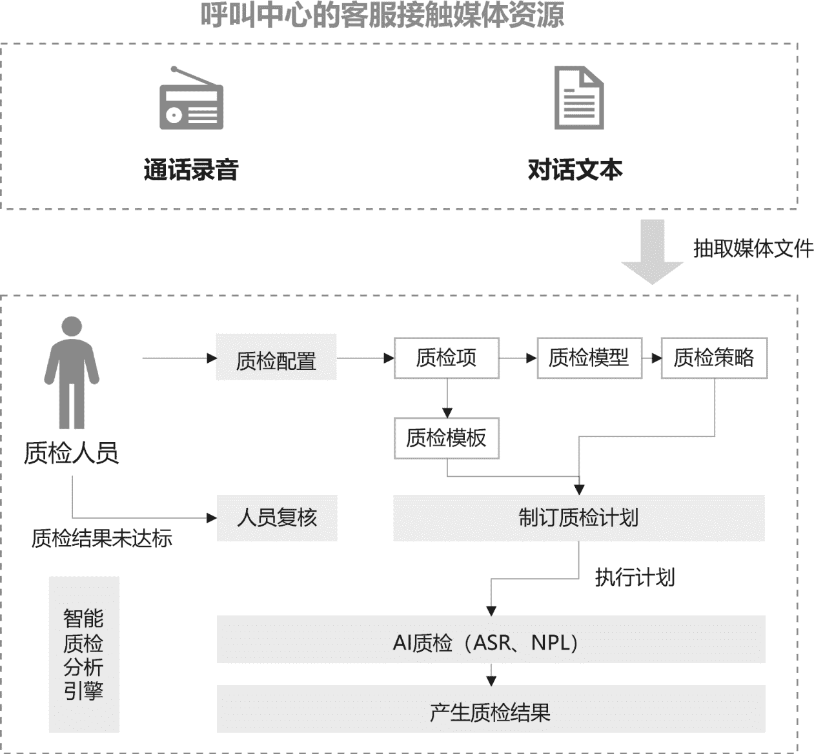

图 4-10

呼叫中心的客服接触媒体资源包括通话录音和对话文本，从中抽取媒体文件作为质检分析的基础数据。质检员随后进行质检配置，确定质检项，形成质检模板，进而构建质检模型，制定质检策略，并据此制订质检计划。按质检计划执行时，系统运用 AI 质检（借助 ASR、NLP）进行分析。智能质检分析引擎参与其中，对媒体文件进行评估并产生质检结果。若质检结果未达标，则安排人员复核，进一步确保质检的准确性。整个流程体现了智能质检系统从数据获取、准备到执行分析，以及结果处理的完整运作过程。

智能质检融合自然语言处理、语音转写、语义理解及数据挖掘等先进技术，旨在助力企业客服中心提升服务质量，精准发现并解决服务过程中的各类问题。在电商客服场景中，每天会产生海量的对话记录。传统的人工质检方式只能抽取少量样本进行检查，难以全面发现潜在问题。而智能质检能够对所有的对话进行实时分析，无论是客户咨询、投诉还是售后处理，都能精准定位问题所在，比如客服人员是否准确回答了客户的问题、是否使用了规范用语等，为企业提升服务质量提供了有力支持。相较于传统的人工质检，智能质检实现了从抽样到全量的跨越，大幅降低了企业成本，同时显著提升了工作效率与准确性。其诞生背景是面对不断增长的服务需求和日益复杂的业务流程，人工质检难以满足日常运营需求。随着电商业务的快速发展，客服咨询量呈爆发式增长。以某大型电商平台为例，其每天的客服对话量可达数十万条甚至更多。在如此庞大的业务量下，传统的人工质检方式的局限性愈发凸显。它不仅难以对所有对话进行检查，而且因不同质检员对规则的理解和把握存在差异导致评分结果缺乏一致性，无法准确评估客服团队的整体服务质量。具体而言，传统的人工质检存在覆盖不全（仅 2%～3%的抽检比例）、规则描述模糊致使评分不一致、工作内容单调乏味等问题，这些问题都迫切推动着企业向智能化质检转型。

智能质检的基本原理是依据预设质检标准，运用 AI 技术对客服通话或在线聊天记录进行自动化分析。首先，借助高质量语音识别技术将音频转换为文本格式；接着，依照配置好的质检模型自动筛选出可能存在违规行为或服务质量欠佳的部分，并进行打分；最后，系统生成详尽的质检报告供管理人员审查，必要时人工介入进一步确认。整个过程实现 7×24 小时不间断运行，确保每个交互环节都能得到及时有效的评估。此外，智能质检能够支持在不同场景下灵活配置的质检策略，即便在复杂的业务环境中，也能保持高效且准确的质检效果。

综上所述，智能质检作为具有革命性的质量管理工具，不仅解决了长期困扰企业的诸多难题，如在海量数据中快速定位问题点、保证评价标准一致性等，更重要的是，开启了客户服务行业全面数字化转型的新篇章。随着人工智能及相关领域技术的不断进步，未来智能质检的应用范围将不断拓展，其价值也将得到更深入的挖掘。

### **4.6.2** **产品优势**

智能质检平台通过集成先进的自然语言处理、语音转写、语义理解及数据挖掘技术，实现了从传统的人工质检方式向智能化质检方式的重要转型。这种转型为企业带来了多方面的价值提升。在金融行业，智能质检的全量覆盖能够对每一笔客户咨询和业务办理进行监控，及时发现潜在的风险点，如客服人员是否准确传达了金融产品的风险信息，从而有效保障客户权益，维护企业的声誉。其核心优势主要体现在全量质检覆盖、客观打分和显著提升工作效率三个方面。

**1.** **全量质检覆盖**

智能质检平台能够对服务过程中产生的所有数据进行 7×24 小时不间断的全面分析，与传统仅靠少量抽样（2%～3%的比例）发现问题的方法形成鲜明对比。在实际应用中，全量质检覆盖能够及时发现一些隐藏的服务问题。比如，在电信运营商的客服对话中，可能存在个别客服人员对新推出的套餐解释不清晰的情况，这些问题在抽样中可能未被抽到，导致部分客户误解套餐内容。而智能质检的全量覆盖能够确保这些问题无一遗漏，及时发现并解决，提升客户对电信服务的满意度。例如，某大型电信运营商部署该系统后，过去因抽样率低未被发现的服务缺陷得以充分暴露，通过实时监测功能，任何异常情况都能在第一时间被捕捉并反馈给相关部门处理，从而极大地提升了客户的满意度。这种全天候监控能力还能使企业快速响应市场变化，及时调整策略，从而满足客户需求。

**2.** **客观打分**

智能质检系统通过采用统一标准自动计算每个通话的质量得分，避免了因不同质检员的主观偏见导致评分不一致的情况。比如，某银行客服中心在应用此技术前，同一通电话可能因不同质检员理解差异而得到相差甚远的评价；而引入 AI 技术后，基于预设规则和算法模型的自动评估机制确保了每份报告都具有高度的一致性和准确性。这不仅提高了服务质量评测的公平性，还为企业制订后续培训计划等工作提供了更可靠的数据支持。

**3.** **显著提升工作效率**

智能质检系统极大地减轻了人力资源的负担，将原本需要大量人力投入的重复性工作实现了自动化。在实际操作中，智能质检系统完成初步筛选后，会将疑似问题案例提交给人类专家进行进一步审核，人类专家只需关注少数重点区域，从而大大减少了日常耗时较长且易出错的手动检查环节。据统计，在拥有数百名座席的企业实施这套方案后，整体运营成本降低了近 30%，每位员工的日均处理量增加了 50%以上，充分展现了技术赋能的积极影响。

智能质检系统凭借全面覆盖、无偏差评价以及高效运作的特点，助力企业优化内部管理流程、提升客户体验，为行业树立了新标杆。随着相关技术不断成熟与发展，未来将有更多领域受益于这一创新解决方案带来的变革。

### **4.6.3** **功能架构**

图 4-11 是智能质检系统的功能架构图。在应用场景方面，该系统明确适用于客服质检和营销质检等场景。客服质检主要用于评估客服人员在与客户沟通时的服务质量，比如是否礼貌、专业，以及问题解答是否准确等；而营销质检则侧重于审查与营销活动相关的通话或沟通内容，判断营销话术是否规范、营销流程是否合理等。此外，该系统还具备拓展至其他相关业务场景的可能性。

质检算子部分定义了一系列用于质检的具体规则和指标。其中包括检测沟通内容是否包含特定关键词，以此判断重要信息是否被提及；检查是否符合特定话术，确保沟通遵循既定的标准话术模板；监测通话过程中是否出现静音情况，因为长时间静音可能会影响沟通效果；评估说话是否啰唆，即表达是否简洁明了，避免无效信息过多；判断语速是否过快，保证语音交流的语速在合理范围内，便于理解；检测是否存在抢话现象，以维护沟通的有序性。这些算子为质检工作提供了具体的衡量标准和维度。

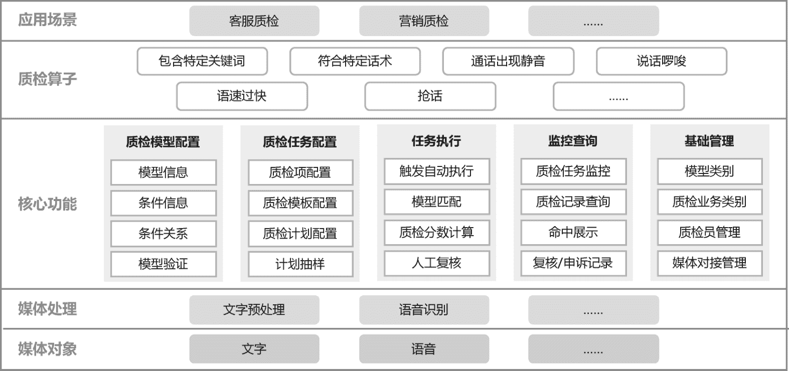

图 4-11

核心功能部分包含以下多个模块。

·质检模型配置：该模块负责录入和管理模型信息，明确所使用的质检模型的具体参数、特性等；设定质检条件信息，确定触发模型运行的前置条件；梳理条件关系，理清不同条件之间的逻辑关联。此外，还需对模型进行验证，通过各种方式检验模型的准确性和可靠性，以确保其能在质检工作中有效应用。

·质检任务配置：包括对质检项进行配置，确定具体需要检查的项目和内容；配置质检模板，制定标准化的质检模板，使质检流程和标准得以统一；进行质检计划配置，规划质检工作的时间安排、执行频率等。另外，还涉及计划抽样，即从大量的语音或文字沟通记录中选取具有代表性的样本进行质检，以提高质检工作的效率。

·任务执行：包含触发自动执行功能，依据预先设定好的规则和条件，自动启动质检任务；进行模型匹配，将实际的沟通内容与预先配置好的质检模型进行比对；计算质检分数，根据匹配结果和相关规则，对沟通内容进行量化评分；对于自动质检存在疑问或异常的情况，安排人工复核环节，确保质检结果的准确性。

·监控查询：可对质检任务进行监控，实时跟踪任务的执行进度、当前状态等；支持质检记录查询，方便客户随时查阅历史质检记录；能展示命中情况，直观呈现符合特定质检规则（即命中质检算子）的具体情形。另外，还记录复核/申诉信息，包括人工复核过程以及客户申诉的相关内容，保证质检流程的公正性和可追溯性。

·基础管理：涵盖对模型类别的管理，对系统中使用的不同类型质检模型进行分类和维护；对质检业务类别的管理，梳理和界定不同质检业务的范畴和属性；对质检员的管理，包括设置质检员的操作权限、分配工作任务、评估工作绩效等；对媒体对接的管理，负责与不同媒体形式（如语音、文字等）的数据进行对接和处理，保障数据能够顺畅地传输并被有效利用。

媒体处理部分主要针对不同的媒体对象进行前期处理工作。对于文字信息，进行文字预处理，包括清洗、格式转换、关键词抽取等操作，使文字信息更符合质检系统的处理要求；对于语音信息，通过语音识别技术将其转换为文字形式，以便后续利用文字处理的相关方法和规则进行质检。此外，根据实际业务需求，还可能涉及对其他媒体形式的处理。

媒体对象主要包括文字和语音两种。文字形式的沟通记录可直接进入质检分析流程；语音形式的内容则需要先经过语音识别将其转换为文字，然后进入质检流程。另外，该系统还具备拓展处理其他媒体对象的能力，以适应多样化的业务需求。

### **4.6.4** **核心功能**

本节深入探讨智能质检平台的主要功能，尤其是其核心组成部分——评分模型、抽样模型、质检计划及质检台模块的功能。随着企业对服务质量要求的不断提高，传统的人工质检方式逐渐难以满足日益增长的需求，而智能质检平台凭借高效的自动化处理能力，能够在保证质量的同时大幅提高效率。本节不仅将详细介绍基于 AI 技术实现的主要功能，如音频转文字、自动打分系统以及异常情况报警机制等，还将探讨这些功能如何助力企业精准定位问题区域，并通过持续改进提升整体服务水平。此外，也会提及在实际应用过程中可能遇到的一些技术挑战及其解决方案。

**1.** **评分模型**

在智能质检体系中，评分模型至关重要，它既是衡量服务质量的重要工具，又是推动客服团队持续改进的关键因素。在不同行业中，评分模型的侧重点有所不同。在餐饮行业的客服质检中，除了关注客服人员的服务态度和用语规范，还会重点考核对菜品信息的熟悉程度、对客户特殊需求的处理能力等。例如，当客户询问某道菜品的食材成分或制作方法时，客服人员能否准确回答将直接影响评分结果。评分模型主要由质检规则与质检评分两大部分构成。其中，质检规则明确评价的具体标准，如是否使用规范用语、是否存在服务态度问题等；质检评分依据这些规则为每一次服务打分，以量化方式展现服务水平。

针对不同业务场景设定合理的评分标准是确保评分模型有效性的基础。例如，在客户服务场景中，可设置“礼貌用语使用情况”“解决问题的效率”“客户满意度反馈”等关键指标，并赋予相应的权重值。在技术咨询或故障报修服务场景中，则更关注“技术问题解决速度”“解决方案准确性”等。通过细致划分各项指标及其对应的分数，企业能更精准地评估每位客服人员的表现，并据此提供个性化的培训建议。

利用 AI 技术实现从语音到文本，再到自动打分的过程，极大地提升了整个质检流程的效率与准确性。为了进一步提高评分的准确性，还可以引入情感分析技术。通过分析客服人员和客户对话中的情感倾向，可以更全面地评估服务质量。例如，即使客服人员准确回答了客户问题，但如果语气生硬、缺乏耐心，那么通过情感分析也可以发现这一问题，并在评分中予以体现，从而促使客服人员改进服务态度。具体而言，首先，基于先进的自然语言处理技术，系统将电话录音转换成易于分析的文字形式；接着，运用机器学习算法对转换后的文字进行深度解析，识别符合预设规则的行为模式；最后，根据事先制定的评分体系自动生成综合得分。这一系列操作减少了人为干预，使大量数据得以迅速处理，为企业节省了宝贵的时间和人力成本。

这样一个闭环式的智能质检流程对企业提高客服质量意义重大。一方面，有助于及时发现并纠正存在的问题，防止小问题演变成大麻烦；另一方面，通过对历史数据的积累与分析，管理层可获得关于整体运营状况的洞察力，进而采取更具针对性的措施优化工作流程和服务策略。此外，这种透明且公平的考核机制还能激发员工的积极性，促进个人能力成长与发展，最终形成良性循环，共同推动企业向更高层次迈进。综上所述，合理构建并充分利用评分模型对于提升客户服务体验、增强市场竞争力至关重要。

**2.** **抽样模型**

在智能质检系统中，抽样模型是确保质检结果准确性与效率的关键组成部分。抽样模型的合理设计对企业来说意义重大。在一些业务量巨大的企业，如大型物流企业，每天的客服通话数量众多，如果进行全量质检，则成本过高且效率低下。此时，抽样模型可以根据不同的业务场景和风险等级，有针对性地抽取样本进行质检，既能保证一定的检测覆盖范围，又能提高质检效率，降低质检成本。其核心在于根据企业具体需求和场景设定合理的抽样策略，以实现既高效又准确的质量检测目标。抽样模型的设计原理基于统计学中的随机性和代表性原则，通过科学方法从大量数据中抽取具有代表性的样本进行详细分析，从而反映整体质量状况。例如，在电商客服质检中，可以根据客户的价值、订单金额、业务类型等因素进行分层抽样。对于高价值客户的对话，适当提高抽样比例，因为他们对企业的贡献较大，其服务体验更重要；对于低价值客户的对话，则可以采用相对较低的抽样比例。同时，结合随机抽样的方式，确保每个层次都有一定的样本被抽到，从而使抽样结果更具代表性。这种做法不仅大大减少了需要处理的数据量，而且保证了检验的有效性。

在实践中，不同抽样策略适用于不同的情景。例如，在客户服务领域，若目的是全面了解客户满意度变化趋势，那么随机抽样更为合适；当需要对特定问题或异常情况进行深入调查时，可利用条件筛选方式，如设置关键词过滤或依据通话时长、情绪波动等特征选择样本。此外，还可结合业务特性制定复合型抽样规则，如先按一定比例随机选取一部分记录，再从中依据特定标准进一步筛选，实现更精细化的管理。

针对企业具体需求定制抽样方案时，首先要明确质检目的及预期成果，如提升服务质量、监控员工表现或发现潜在风险等；其次，充分考虑资源限制，包括人力成本、时间紧迫程度等因素，合理规划抽样规模；最后，考虑技术实施难度，选用易于操作且效果显著的方法。例如，某大型电商公司为改善客户体验，建立了基于 AI 的语音识别与情感分析相结合的质检流程。该流程先运用自然语言处理技术自动识别通话录音中的负面情绪表达作为初步筛选依据之一，随后按事先定义的比例（如 10%）随机抽取部分对话供人工审核团队检查，并将这些信息反馈给相关部门用于培训改进。

合理设计并执行抽样模型对提高整个质检流程的效果至关重要。它能够帮助企业快速定位问题区域，及时采取纠正措施，同时有效控制运营成本。更重要的是，通过不断优化和调整抽样策略，可以使质量管理体系更加灵活，从而更好地适应市场变化和服务要求的提升。总之，无论是提升服务品质还是增强内部管理能力，构建科学有效的抽样模型都是不可或缺的一环。

**3.** **质检计划**

在智能质检平台上，制订有效的质检计划是确保服务质量和客户满意度的关键步骤。质检计划的制订需要综合考虑多方面因素。例如，在新业务推出期，由于客服人员对业务的熟悉程度可能较低，需要增加质检的频率和范围，重点关注新业务相关的咨询和处理情况；而对于成熟稳定的业务，可以适当降低质检频率，将重点放在一些关键指标的监控上。全面细致的质检计划不仅能帮助组织更好地了解服务质量现状，还能通过持续改进措施推动整体业务流程优化。在构建这样的计划时，需要考虑几个重要因素：所选质检模型及其版本、计划执行的时间框架（何时开始、何时结束）、计划是否需要即时上线或在特定条件下激活。此外，明确是否有必要进行补充检查以处理初次未覆盖的情况，以及如何避免对同一通话记录的重复检查，有助于提升效率并减少资源浪费。

设置质检时间表通常需要确定合理的质检周期，系统在此期间自动抓取指定范围内的通话数据进行分析。在确定质检时间表时，还需要考虑数据的时效性。对于一些实时性要求较高的业务，如金融交易咨询，可能需要更频繁地进行质检，甚至进行实时监测，以便及时发现和解决问题，保障客户的资金安全。而对于一些相对不那么紧急的业务，可以选择在系统负载较低的时段进行批量质检。例如，可选择每天 01：00—6：00 作为固定质检时段，这样既能保证在大部分非工作时段内完成任务，又不影响日常运营。同时，根据实际需求灵活调整该时段也很重要，以应对突发情况或特殊活动期间增加的质量控制需求。

选择质检范围需要基于业务特点及风险评估结果。对于新上线的服务项目或近期收到较多投诉的区域，可能需要更密集地实施质量监控；对于相对成熟且表现稳定的业务线，可适当放宽质检频率。这样既能体现针对性管理的优势，又能有效节约成本。

利用计划管理功能有效跟踪和管理质检活动十分关键。在平台创建新质检计划时，除填写基本详情如名称、关联的质检模型外，还需设定具体启动日期与截止日期，并指派负责人。之后，可通过界面轻松查询当前所有正在进行的质检活动状态，甚至在线修改已存在的计划配置而无须重新创建。当某项计划不再适用时，也可快速将其从活跃列表中移除。这种动态管理机制使整个过程更加透明可控，便于后续效果评估与反馈。

总之，良好的规划能显著提高工作效率，为持续改进提供坚实基础。通过精心设计与严格执行质检流程，企业不仅能更快地发现潜在问题并及时解决，还能不断积累经验教训，最终形成适合自身发展的最佳实践指南。因此，投入时间和精力完善质检计划是一项极有价值的投资。

**4.** **质检台模块**

质检台模块作为智能质检系统的核心组成部分，旨在融合人工智能技术与人工复核流程，实现对客服交互数据高效且全面的质量检测。在实际操作中，质检台模块的自动化数据分析和异常情况预警功能能够大大提高质检效率。例如，当系统检测到客服人员在对话中频繁出现某个特定的错误表述，或者与客户发生激烈冲突时，会立即发出预警，通知质检员进行重点关注和处理，并及时解决问题，避免对企业形象造成不良影响。该模块不仅支持自动化数据分析和异常情况预警，还为质检员提供直观的操作界面，便于他们进行进一步的人工审核与处理。这不仅保证了服务质量，还促进了员工个人能力的成长。

·界面布局及其主要组件：质检台的客户界面设计简洁明了，顶部是查询条件输入区，包含录音开始和结束时间、组织部门选择框、是否需要攻坚任务等筛选项；中间部分展示符合搜索标准的结果列表，每条记录显示基本的通话信息，如联系人、通话时长和初步评分等关键指标；最下方是操作按钮区，有一键减免、驳回等功能键，方便执行日常任务。通过这些筛选项和功能键，质检员能够快速定位和处理需要关注的对话记录。例如，当企业需要对某个特定部门的客服人员进行集中质检时，质检员可以通过选择组织部门筛选条件，快速获取该部门所有的对话记录，并对其进行逐一审核和处理。同时，一键减免、驳回等功能键的设置，简化了质检员的操作流程，提高了工作效率。此外，还有“导出”按钮可将当前视图中的所有数据下载至本地，便于进行更详细的分析或存档。

·数据导入：从企业数据库或其他外部来源批量上传待质检的音频文件及文本交流记录到平台。

·查看质检报告：系统完成自动化评估后，质检员可通过设置不同的过滤器（如日期范围、客户类型等）查找特定案例，点击相应链接进入详情页面查看具体的质检报告，其中包含基于预设规则得出的各项得分以及可能存在的问题点描述。

·异常情况预警：检测到潜在风险因素或明显不符合规定的行为模式时，系统会立即标记并通过邮件或站内通知提醒相关人员跟进处理。

·人工复核：对于被标记需要复核的样本，由经验丰富的质检员接手，仔细聆听整个对话过程并对照既定标准做出最终判断。若发现 AI 误判，可对其进行调整，以改进算法的准确性。

·辅导与反馈：将确认的问题案例加入辅导池，供管理者安排针对性的培训课程；同时定期收集一线员工对质检流程的意见或建议，不断优化工作流程和服务策略。

·异常情况预警系统的运作机制：此功能依赖强大的自然语言处理技术和机器学习算法，实时监控所有的通信活动，迅速识别任何偏离正常模式的行为特征。例如，当某座席频繁使用不恰当语言表达或未按标准程序解答客户疑问时，系统会自动生成警告信号并提报给相关负责人采取行动。这种即时响应机制大大缩短了问题发现与解决的时间差，有助于快速纠正错误，防止事态恶化。

·复核与辅导环节的作用：复核过程确保在高度自动化环境下仍能保持一定程度的人文关怀和专业监督，避免了因单纯依赖技术手段导致的偏差；定期开展的专业技能训练能够帮助团队成员更好地理解公司服务理念和质量标准，提升解决问题的能力，进而提高整体服务水平。通过这样一个闭环管理流程，不仅能有效降低运营成本，还能持续改善客户体验，构建更加和谐稳定的客户关系。

**5.** **配置功能**

智能质检平台的配置功能是实现高效、准确质检的关键环节，它通过一系列精细设置选项来满足不同业务场景下的特定需求。不同企业的业务特点和管理需求差异很大，智能质检平台的配置功能能够灵活适应这些差异。例如，对于连锁企业，不同地区的门店可能面临不同的市场环境和客户需求，通过配置功能可以为每个地区的门店制订个性化的质检计划，并重点关注与当地业务相关的问题，如当地特色产品的销售咨询、售后服务等，从而提高质检的针对性和有效性。首先，在系统管理模块下的查询管理中，客户可以根据大区域对不同的省份分公司设定特定的默认质检计划，这意味着各省份的质检平台将依据这些预设计划自动执行查询任务。例如，如果希望某省份仅执行部分特定的质检计划，则需要在相关表格内单击“选择计划”，然后从弹出框中挑选一个或多个目标计划，并确认修改后开启该省份的查询权限，这样就能确保在指定区域按照所选计划进行质检操作。

整个智能质检流程由几个关键步骤组成：首先基于具体应用场景配置抽样策略，接着根据此策略定义具体的质检项及其考评分值；随后，通过关联已有的或新建的质检模型来组装适用于特定业务场景的质检方案；最后，设置质检计划以明确质检对象与范围。在配置抽样策略时，可以根据业务的风险等级进行设置。对于风险较高的业务，如涉及客户资金安全的金融业务，采用较高的抽样比例，确保能够及时发现潜在问题；对于风险较低的一般性业务，则可以采用较低的抽样比例来平衡质检成本和效率。同时，在定义质检项及其考评分值时，要充分考虑业务的关键指标和客户关注的重点，确保质检结果能够真实反映服务质量。一旦启动计划，智能质检平台便会自动执行相应的质检任务，这些任务包括但不限于自动计算模型、打分等步骤。值得注意的是，在这个过程中，灵活调整参数对于最大化发挥平台效能至关重要。比如，通过对抽样条件（如通话时长、客户满意度评分）和条件间逻辑关系（如并列、递进）的精准控制，可以大大提高抽样的精准度和质检效率；而合理设置质检项（涵盖自动与人工两种类型），并为其分配恰当的权重分数，则有助于更全面地评估服务质量。

下面通过实际应用案例来说明这一点。某大型电商客服中心采用智能质检解决方案后，实现了 7×24 小时不间断的全量话务监测，有效避免了因个人情绪波动导致的评价偏差问题，同时将从服务完成到质量检查的时间间隔大幅缩短至两小时内。在促销活动期间，面对海量的咨询与售后电话，通过合理配置质检策略，针对热门商品咨询、退换货流程等重点场景，加大抽样比例并细化质检项，确保客服人员在高强度工作下依然能保持服务质量。

在抽样策略方面，根据不同时段的业务量波动，智能调整抽样频率。在业务高峰时段，如电商大型促销活动时，适当提高抽样比例，从日常的 10%提升至 30%，保证及时发现并解决潜在问题；而在业务低谷期，则适度降低抽样频率，在节省资源的同时也不影响整体的质检效果。通过设置条件逻辑关系，如当通话时长超过 5 分钟且客户情绪为负面时，自动纳入重点抽样范围，精准定位可能存在问题的服务环节。

在质检项的设置上，针对电商业务特点，不仅关注客服人员的礼貌用语和问题解决率，还特别增设商品信息的准确性、促销活动规则讲解清晰度等特色质检项。对于自动质检项，利用先进的 AI 算法快速筛选出明显违规或不达标的通话记录；人工质检项则侧重于复杂问题的判断和特殊情况的处理，两者相互配合，全面提升质检的准确性和全面性。

为了进一步提升质检的针对性，该电商客服中心还根据不同产品线和客户群体定制专属质检方案。针对高端商品客户，更加注重服务的专业性和个性化；对于快消品类商品，则强调问题解决的速度和效率。通过这种精细化的配置，质检结果能够更准确地反映各业务板块的服务质量，为后续的培训和改进提供有力依据。

随着业务的不断发展和市场需求的变化，智能质检平台的配置功能持续展现出强大的适应性和可扩展性。通过实时收集和分析质检数据，平台能够自动优化配置参数，不断提升质检的精准度和效率。同时，借助大数据分析和机器学习技术，对历史质检数据进行深度挖掘，发现潜在的服务风险和改进方向，为企业制定更加科学合理的服务策略提供数据支持。

智能质检平台的配置功能是企业提升服务质量的核心驱动力之一。通过灵活多样的设置选项和智能优化机制，该平台不仅能够满足企业当前的质检需求，而且能随着业务的发展和市场的变化不断进化，为企业在激烈的市场竞争中保持服务优势提供坚实保障。

## **4.7** **数字人客服**

在当今数字化浪潮的席卷之下，一场颠覆性的变革正以前所未有的态势重塑着客户服务领域。数字人客服作为这场变革中熠熠生辉的前沿技术代表，深度融合人物形象模拟、语音合成、自然语言处理等一系列先进技术，为客户打造出更为直观、高效且充满人性化关怀的服务体验。本节将全方位、深层次地剖析数字人客服的产品特性，从设计理念的溯源到核心优势的彰显，再到功能架构的解析以及核心功能的详细阐释，旨在助力读者透彻理解这项创新技术如何为客户与企业之间的沟通模式带来革命性的改变。

### **4.7.1** **产品简介**

数字人客服是一款高度集成的人工智能解决方案，巧妙融入在线客服系统，致力于借助拟人化的数字形象为客户提供直观、温暖且高效的互动体验。在金融服务领域，数字人客服能够为客户提供专业且贴心的服务。例如，在客户进行投资理财咨询时，数字人客服可以通过自然语言处理技术准确理解客户的需求，并结合知识图谱解析，为客户提供详细的理财产品介绍、风险评估和投资建议。其高度拟人化的形象和自然流畅的语音交互，让客户在咨询过程中感受到如同与真实的理财顾问交流的体验，从而提升了客户对金融服务的信任感。它汇聚了人物形象模拟、人物声音克隆、自然语言处理，以及知识图谱解析等多项前沿技术，赋予虚拟客服以近乎真实人类的交流能力。这种交互模式不仅涵盖传统的文本和语音沟通渠道，更拓展至视频服务形式，极大地丰富了客户的体验维度。

在实际应用场景中，数字人客服的身影广泛活跃于各类服务场景。例如，在查询账单时，客户只需向数字人客服提出需求，便能迅速获取清晰且准确的账单信息；面对宽带排障难题，数字人客服可引导客户逐步排查，并提供专业有效的解决方案；在查询流量使用情况时，数字人客服能精准告知客户剩余流量及使用趋势；在套餐推荐及变更方面，它可依据客户需求和使用习惯，推荐最合适的套餐，并详细介绍套餐情况；在查询本机信息时，数字人客服同样可快速响应。

在电商场景中，数字人客服的优势也十分显著。当客户在挑选商品时，数字人客服可以根据其浏览历史和购买偏好，推荐符合其需求的商品。比如，客户经常购买运动装备，数字人客服就会精准推荐新款运动服饰、运动鞋等，并介绍产品的特点、材质以及优惠活动，还能通过展示商品的 3D 模型，让客户更直观地了解商品细节，提升购物体验。

当客户进入在线客服模块时，率先映入眼帘的便是这位智能虚拟助手。客户既可以用自然语言提问，又可以选择预设问题类别发起对话，数字人客服凭借内置的强大知识库和精准的意图识别能力，对问题进行深入分析并给出精准回答。对于复杂或超出系统处理范畴的问题，数字人客服能够无缝转接至相应的人工座席，确保每一个客户请求都能得到妥善解决。DeepSeek 的 3D 建模和表情动作生成技术，为数字人客服打造了更加逼真、生动的形象。数字人客服的面部表情和肢体动作更加自然流畅，能够根据对话内容和客户情绪进行实时变化，从而提升客户的代入感，并增强客户的互动体验。例如，在与客户进行交流时，数字人客服可根据客户的反馈做出相应的表情和动作，如微笑、点头等，让客户感受到更真实的服务。同时，DeepSeek 的自然语言处理和多轮对话管理技术，使数字人客服能与客户进行更自然、流畅的交流，并准确理解客户意图，提供更专业、个性化的回答。

值得一提的是，除基本信息查询功能外，该产品还支持客户查看以往的服务记录，包括业务办理详情、投诉咨询历史等，方便客户随时回顾。同时，客户可针对未完成工单发起催办请求，即使面对跨部门协作解决的问题，也能确保服务的透明度和响应速度，从而显著提升整体服务水平。

总之，作为在线客服体系的关键构成部分，数字人客服依托强大的技术支撑和全面的功能设计，在提升客户体验的同时，也为品牌形象增光添彩。通过构建全场景化实时互动式服务平台，数字人客服不仅能有效缓解人工客服的压力，还能在激烈的市场竞争中助力企业赢得更多客户的青睐与信任。

### **4.7.2** **产品优势**

数字人客服在建模、驱动及渲染等关键环节展现出卓越的优势，这些优势不仅为客户带来了前所未有的交互体验，而且大幅提升了客户满意度。凭借这些优势，数字人客服在不同行业都能发挥重要的价值。在文旅行业，数字人客服可以以当地的历史文化名人形象为蓝本进行建模，不仅能为游客提供景点介绍、旅游攻略等常规服务，还能以独特的文化形象吸引游客，加深游客对当地文化的印象，从而提升景区的文化魅力和品牌形象。

·建模：高度逼真与个性定制。在建模阶段，数字人客服运用高度逼真的人物形象模拟技术，借助精细的 3D 建模和面部表情捕捉，塑造出与真人难辨真假的虚拟形象，从视觉层面给予客户强烈的亲切感和信任感，而且，这种高精度形象设计支持个性化定制，企业可依据品牌形象或特定服务场景需求，灵活调整数字人客服的外观特征，进一步强化品牌的识别度和吸引力。

·驱动：智能交互与人性关怀。以在线教育领域为例，数字人客服在与学生的互动中，通过情感分析来感知学生的学习情绪。当检测到学生对某个知识点感到困惑或沮丧时，数字人客服会调整讲解方式，用更通俗易懂的语言、更多的示例进行解释，还会给予鼓励和支持，增强学生的学习信心，提高学习效果。在驱动环节，数字人客服集成先进的人工智能算法，涵盖自然语言处理、情感分析以及多轮对话管理等技术，能够精准理解复杂多变的学生意图，并以自然流畅的方式回应。其具备的上下文记忆功能，可以在长时间交流中维持对话的一致性和连贯性，避免了传统自动应答系统可能出现的生硬和无效回复问题。同时，通过实时感知客户情绪状态，数字人客服可以适时调整语气语调、面部表情等，营造出极具人性化的沟通氛围。

·渲染：极致流畅与沉浸体验。在渲染层面，基于 GPU 加速计算的强大支持，即便在资源有限的移动设备上，数字人客服也能实现高质量的图形输出，并保障视频流传输过程中的低延迟和平滑过渡效果。同时，结合最新的深度学习框架，数字人客服能够对自身面部的细微动作进行精准控制，从眨眼到微笑，每一处细节都力求达到真实人物的表现水准，从而极大地提升了客户的沉浸感。

综上所述，得益于各方面的技术创新，数字人客服相较于传统模式优势显著。它打破了时间和空间限制，能够实现全天候在线服务；借助智能化服务流程管理和广泛的服务范围，有效地解决了人工客服成本高昂、效率低下的问题。最重要的是，数字人客服通过提供贴心周到、响应迅速且个性化的服务体验，赢得了客户的青睐与忠诚，从而推动整体服务水平迈向新的高度。

### **4.7.3** **功能架构**

图 4-12 详细呈现了数字人客服的工作原理及运行流程。

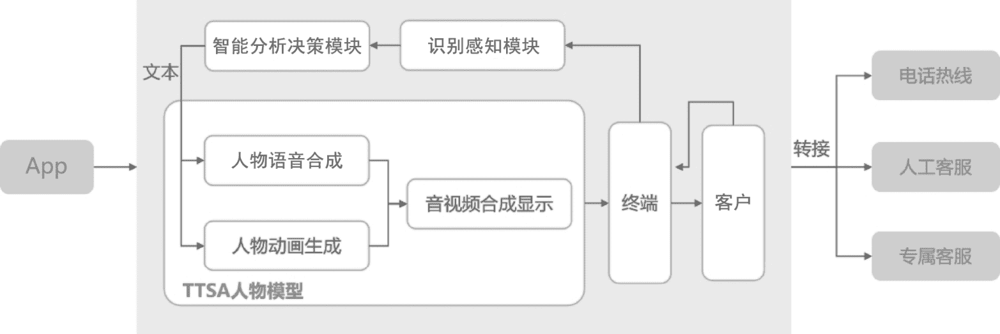

图 4-12

App 作为信息的发起端，提供文本信息，这是数字人客服工作的起始数据来源。这些文本信息可能涵盖客户的咨询、投诉、业务办理需求等各类内容，是后续一系列处理的基础。基于 TTSA 人物模型——这是实现数字人客服形象与语音呈现的关键技术支撑——系统首先分别进行人物语音合成和人物动画生成。人物语音合成借助先进的语音合成技术，将文本转换为自然流畅、富有情感的语音，使数字人客服能够以语音形式与客户进行交流。人物动画生成则通过计算机图形技术，创建出与语音和语义相匹配的生动形象动作、表情等，赋予数字人客服鲜活的表现形式。随后，系统将生成的人物语音和人物动画进行音视频合成显示，让数字人客服能够以直观、生动的音视频形式出现在客户面前，从而提升交互体验。

与此同时，输入的文本信息还会经过识别感知模块，该模块运用自然语言处理等技术，对文本内容进行解析，理解客户表达的语义、意图等。之后进入智能分析决策模块，结合预先设定的规则、知识库以及机器学习算法等，对客户意图进行分析处理，确定合适的应对策略，比如给出准确的回答、推荐相关业务等。经过核心处理环节生成的结果，以音视频形式在终端展示给客户，完成与客户的交互。

若数字人客服凭借自身能力无法处理相关问题，系统则具备灵活的转接机制，可将客户转接至热线电话、人工客服或专属客服。热线电话能让客户通过传统语音通话方式与客服进行沟通；人工客服由专业的客服人员提供一对一的个性化服务，凭借其丰富的业务知识和沟通经验处理复杂问题；专属客服则针对特定客户群体，提供更为精准、定制化的服务，由人工进一步为客户提供服务，确保客户问题得到妥善解决。该流程图全面呈现了数字人客服从接收信息、内部处理到服务输出及后续转接的完整工作过程。

例如，当客户在电商平台向数字人客服咨询商品信息时，人物形象构建和声音克隆技术能够赋予数字人客服亲切、专业的形象和声音，让客户在视觉和听觉上产生良好的第一印象；基于智能 BOT 的多轮对话机制并结合自然语言处理技术，能够准确理解客户需求，并从商品特点、使用方法到优惠活动等方面进行详细解答，为客户提供全方位的服务。

数字人客服的首页查询、服务记录及服务转接功能构成了该系统的主要组件，特别是人物形象构建、声音克隆，以及基于智能 BOT 的多轮对话机制的协同运作原理。

·首页查询：智能交互与精准服务。以医疗健康类 App 为例，数字人客服在首页查询功能中，除了提供常见的健康知识咨询，还能根据客户的健康档案和日常健康数据，如运动数据、体检报告等，为客户提供个性化的健康建议。比如，当客户询问关于减肥的问题时，数字人客服可以结合客户的身体指标和运动习惯，推荐合适的饮食计划和运动方案。客户在首页查询时，可与数字人客服就多种常见问题展开交流，涵盖账单查询（历史账单、余额、欠费情况）、宽带服务（故障排查）、流量使用情况分析、套餐信息获取（推荐、资费详情）以及个人信息管理等。这依赖于强大的自然语言处理能力，使机器能够准确理解客户意图并给予恰当回应。同时，通过接入企业内部数据库或第三方 API，数字人客服可实时调取相关数据，确保提供信息的准确性和时效性。

·服务记录：透明追溯与高效管理。服务记录功能允许客户查看所有过往的服务交互历史，无论是自助解决的问题还是人工介入完成的操作，都被详细记录。这不仅提高了服务透明度，让客户全面了解自己的账户状态，也为后续可能的支持提供了宝贵的参考依据。实现这一功能需要高效稳定的数据存储解决方案，如利用 ES 集群保证快速检索效率和良好的可扩展性。

·服务转接：无缝切换与专业支持。当遇到数字人客服无法处理的情况时，服务转接功能会自动引导客户至更合适的支持渠道，可能是热线电话，也可能是在线人工客服或指定客户经理。该流程的关键在于如何平滑地完成从 AI 到人的切换，同时保持客户体验的一致性和连贯性，这要求后端具备完善的服务路由逻辑和灵活的通信接口设计。

上述各项功能的顺畅运行，离不开一套复杂而精密的技术支撑体系。通过对真实模特的三维扫描和动作捕捉技术相结合，构建出高度逼真的虚拟形象；运用声音克隆技术，通过深度学习模型训练，让数字人客服拥有近乎真人的音色；基于智能 BOT 的多轮对话引擎负责解析客户输入，结合上下文环境做出合理反馈，并根据预设规则动态调整对话策略，直至达成目标或转交给人类专家处理。整个过程还需要配合高效的资源调度算法、全面的安全防护措施，以及持续优化的知识管理系统，共同打造流畅且令人满意的互动体验。

### **4.7.4** **核心功能**

在数字化转型的大趋势下，数字人客服作为新一代客户服务工具，正逐渐成为连接企业与客户的关键纽带。本节将深入探讨数字人客服的核心功能，包括首页查询、服务记录查看、服务转接、配置功能、数据报表等功能模块，助力读者全面了解如何借助这些功能提升客户体验和服务效率。通过对各项功能的细致剖析和应用场景示例展示，能够让大家直观地感受数字人技术的魅力及其在实际业务中的应用价值。

**1.** **首页查询**

图 4-13 是以中国联通 App 为例，展示了客户通过访问数字人客服首页查询服务，满足日常使用中的需求。

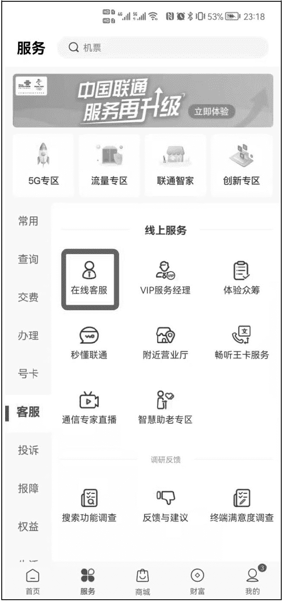

图 4-13

在查询流量使用情况时，数字人客服还能根据客户的历史流量使用数据，分析客户的流量使用习惯，如是否经常在特定时段使用大量流量。如果发现客户在夜间使用流量较多，且当前套餐夜间流量不足，数字人客服就会主动推荐包含更多夜间流量的套餐，帮助客户节省费用。数字人客服在这一环节充分展现了智能客服助手的角色，不仅能快速响应查询请求，还能依据已有数据和算法模型提供个性化的服务建议。

·账单查询：清晰掌握费用信息。在账单相关查询方面，数字人客服支持客户轻松获取历史账单详情、当前账户余额和欠费情况。例如，若客户想了解上个月话费支出的具体构成，则只需与数字人客服交流表达需求，系统就会展示出相应的账单明细；而对于担心账户因费用不足停机的客户，查询余额功能能够即时反馈账号的可用资金状态，并提醒客户及时充值，从而避免服务中断。

·宽带排障：专业引导解决问题。数字人客服在处理宽带排障问题时，还具备智能引导功能。它会根据客户描述的问题症状，逐步引导客户进行故障排查。比如，先让客户检查路由器的指示灯状态，然后指导客户重启路由器，若问题仍未解决，就会进一步引导客户检查网线连接等，通过这种一步步的引导，能够帮助客户快速定位和解决问题。在进行宽带状况检查时，无论是遇到网络连接不稳定、网速下降还是无法上网等问题，客户均可向数字人客服求助。数字人客服引导客户完成简单故障的排查步骤，如重启路由器、检查线路连接等，若初步措施无效，还会提供进一步的技术支持选项，包括转接到专业技术人员处。

·流量查询与套餐推荐：合理规划与明智选择。流量消耗情况查询也是众多客户关心的内容。凭借数字人客服的智能化分析能力，客户可以随时掌握套餐内剩余流量数值和预计耗尽时间，从而合理规划上网活动，避免产生超额费用。对于考虑更换套餐或对其他产品感兴趣的客户，数字人客服能够根据个人偏好推荐合适的套餐，并详细介绍产品特点、资费标准和适用场景，帮助客户做出明智的决策。

·其他功能：全面覆盖通信信息。数字人客服还具备处理本机号码信息确认、合约状态查看等功能，确保客户全面清晰地了解自己的通信资源。在交互过程中，当遇到数字人客服无法直接回答的问题时，它会主动提出转接在线人工客服或拨打中国联通的官方客服热线 10010/10018 继续沟通，保证问题得到圆满解决。

总之，凭借强大的信息整合能力和灵活的服务接入方式，数字人客服能够满足客户多样化的查询需求，极大地提升了整体的客户体验水平，真正实现了科技赋能下高效便捷的服务模式。

**2.** **服务记录查看**

在数字人客服系统中，服务记录功能至关重要，它能帮助客户回顾与数字人客服的所有历史交互，提供未解决工单的追踪和催办机制。服务记录功能不仅方便客户回顾，也为企业优化服务提供了重要依据。企业可以通过分析服务记录，了解客户的常见问题和需求变化趋势，从而有针对性地优化数字人客服的知识库和回答策略，提高服务质量。例如，如果发现大量客户在某个时段频繁咨询某一款产品的问题，企业就可以及时完善该产品的相关知识内容，让数字人客服提供更准确、更详细的解答。当客户首次进入系统对话时，咨询内容、业务办理、投诉反馈等交互过程均被详细记录，并可在服务记录模块轻松查看。此功能涵盖查账单（历史账单、余额查询）、宽带问题处理、流量使用情况监控，以及套餐相关信息获取等多个核心场景的交互数据，而且，服务记录还能关联相关的业务操作记录。比如，客户在调整套餐后，服务记录不仅会保存客户与数字人客服的对话内容，还会记录套餐调整的具体操作流程、办理时间和办理结果等信息，形成一个完整的服务链条记录，方便客户随时查看和确认，也便于企业进行业务追溯和管理。

例如，客户通过数字人客服询问手机套餐费用构成并要求调整套餐，整个过程的文字或语音交流都会被保存至服务记录，方便日后参考。对于超出数字人客服处理能力的问题，系统提供了转接到在线人工客服或热线电话的服务选项，转接动作及结果同样会被完整记录，并确保服务链条透明可追溯。

值得一提的是，服务记录界面设置了便捷的催单功能。当客户发现未完成处理的工单时，点击相应条目旁的“催单”按钮，即可发起加速请求，相关工作人员收到提醒后会优先处理工单，从而有效缩短了等待时间，提升了整体服务效率和客户满意度。

**3.** **服务转接**

为确保客户获得全方位支持，数字人客服系统精心设计了高效的服务转接机制。在服务转接过程中，数字人客服会将客户的问题描述和之前的交互记录一并转接到人工客服或其他支持渠道，让后续的服务人员能够快速了解问题背景，从而提供更高效且更有针对性的服务。例如，当客户咨询复杂的金融产品问题时，数字人客服在转接给人工理财顾问的同时，会附上客户之前提到的投资偏好、风险承受能力等信息，帮助人工理财顾问更好地为客户提供服务。当客户的问题超出数字人客服的解答范围时，系统会通过该机制引导客户无缝对接更专业的支持渠道，包括在线人工客服、热线电话和客户经理等，从而提升客户体验，确保问题解决的及时性和专业性。

在具体操作中，当数字人客服识别到客户的问题属于复杂或特殊的类型，且自身数据库无匹配的答案时，它会立即建议服务转接，并提供多种转接选项。数字人客服还会根据客户的历史交互数据和当前问题的紧急程度，智能推荐最合适的转接渠道。如果客户之前经常通过电话与客服沟通，且当前问题较为紧急，数字人客服就会优先推荐客户拨打热线电话，以确保问题能够得到及时处理；如果客户对在线文字沟通更习惯，且问题相对不那么紧急，数字人客服就会推荐客户转接在线人工客服。在在线客服界面，客户单击“转人工”按钮可直接接入在线人工客服；对于偏好电话沟通的客户，若选择“呼叫 10010”功能，系统就会自动弹出拨号界面，方便联系专业的人工服务团队。对于企业级客户或有特定需求的个人客户，可选择专属客户经理的个性化服务，确保每个细节都被妥善处理。

值得注意的是，在整个服务转接流程中，数字人客服不仅是初步咨询的第一道防线，还承担重要的过渡角色。它根据客户的具体情况智能推荐最合适的转接路径，并在转接前后提供必要信息衔接与辅助说明，如向客户解释操作步骤、预计等待时间，以及可能需要准备的相关资料等，使整个过程更加顺畅无阻。此外，为持续优化服务质量，系统会邀请客户对本次交互体验做出评价，收集反馈以便后续改进，真正实现从咨询到解决问题，再到满意度调查的闭环管理。综上所述，通过精心设计的服务转接机制，数字人客服显著增强了自身的灵活性和适应性，为广大客户获取解决方案提供了便捷、高效的途径。

**4.** **配置功能**

在数字人客服系统的构建与运营过程中，配置功能起着关键作用，它助力企业实现个性化客户服务体验，通过灵活的后台管理提升整体运营效率。企业可以根据不同的业务场景和营销活动，利用配置功能对数字人客服进行多样化设置。比如，在新品推广期间，企业可以针对参与推广活动的客户，设置专属的数字人客服界面和服务流程。数字人客服可以展示新品的特色和优势，为客户提供专属的优惠信息和购买引导，从而提升新品的推广效果。

·客户权限设置：精准服务特定群体。配置功能允许企业根据自身需求设置特定客户的访问权限。例如，通过“特殊客户管理”→“数字人使用名单”菜单，将测试号码或重要客户加入白名单，使其在 App 中提前体验或全面享受数字人客服的各项服务。这一过程包括填写客户号码、选择号码类型（测试号、VIP 客户等）、设定有效开始和结束日期，以及申请原因等步骤，确保操作符合企业实际需要。

·界面定制：打造独特的品牌体验。界面定制还可以根据不同的客户群体进行个性化设计。针对年轻客户群体，界面可以采用更加活泼、时尚的设计风格，搭配鲜艳的色彩和有趣的动画效果；对于商务客户群体，则采用简洁、专业的设计风格，突出信息的准确性和高效性，从而满足不同客户群体的审美和使用需求。显示界面调整是配置功能的重要部分。企业可根据品牌形象或营销活动要求，定制数字人客服的外观设计和交互页面风格，如更换背景图片、调整字体大小和文字颜色、修改对话框样式等，从而提升客户体验。针对不同类型的客户群体，设置差异化欢迎语和服务流程，让每个接触数字人客服的客户都能感受到贴心和个性化服务。

·预处理配置：优化服务流程。数字人客服系统提供了丰富的预处理配置选项，能够帮助企业在客户发起咨询前完成部分基础信息的收集工作，从而加快了问题的解决速度。例如，首次互动时向客户推送常见问题解答链接或展示相关业务办理入口，从而减少询问环节；为高价值客户提供一键直达专属客服经理的服务通道，以优化高端客户的使用感受。

·后台管理功能：全面保障系统运营。在后台管理系统中，除上述个性化设置外，还有报表辅助、异常监控等功能模块。通过查看“数字人满意度评价报表”，管理人员能够及时掌握服务质量的变化趋势，并据此做出调整；通过特殊词汇管理和敏感信息过滤，能够预防不良信息的传播，从而保护企业和客户双方的利益。总之，借助强大多样的配置功能，任何规模的企业都能轻松打造符合自身特点和发展战略的高效能数字人客服平台。

**5.** **数据报表**

图 4-15 所示的数据报表是数字人客服系统的重要组成部分，它为企业提供了监控服务性能的关键指标。通过深入的数据分析，这些报表能够支持企业做出明智的决策，并助力企业在多方面进行优化。

例如，通过分析指标统计报表中的平均响应时长，企业可以评估数字人客服的工作效率。如果发现平均响应时长较长，就可以有针对性地优化算法或增加知识库的内容，从而提高数字人客服的响应速度；通过意图占比报表，企业可以了解客户的需求热点，及时调整服务策略，重点优化客户关注度高的服务内容。数字人客服平台生成的数据分析报告主要包括指标统计、意图占比、漏斗分析和运营标注量统计四大类。它们从不同维度全面反映数字人客服系统的运行状况和服务效果。

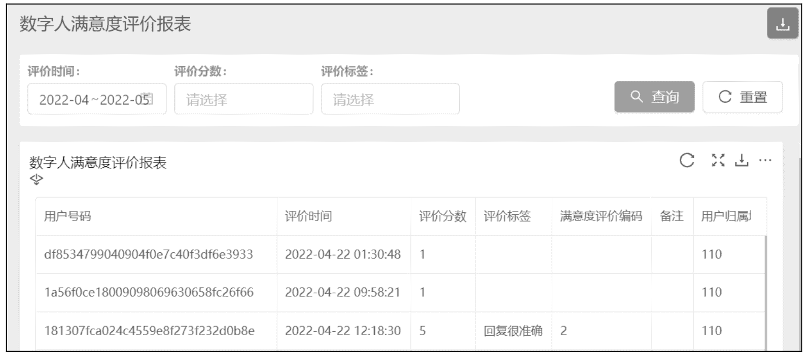

图 4-15

·指标统计：洞察服务效率与需求趋势。指标统计报表涵盖对话量、客户量、平均交互轮次、对话峰值、平均响应时长和对话响应时长等关键指标。例如，通过监测特定时段内的对话量，可以清晰地了解客户服务需求变化趋势；平均响应时长直接反映数字人客服处理客户问题的速度与效率。这些数据能够帮助企业及时调整资源配置，优化服务质量，确保在高需求时段也能提供高效的服务体验。

·意图占比：聚焦客户需求优化服务。意图占比报表还可以帮助企业发现潜在的业务机会。如果某一意图的访问量近期呈现快速增长趋势，那么企业可以深入分析原因。这可能是因为市场需求发生了变化，或者是因为竞争对手在该领域的服务存在不足。企业可以根据这些发现，及时调整产品策略或优化数字人客服的服务内容，抓住潜在的业务机会，提升市场竞争力。意图占比报表详细展示了客户访问各个服务意图的情况，并按照访问量由高到低排列，每个意图的访问次数及其占总访问量的比例一目了然。这有助于训练师识别最受欢迎或最常遇到的问题类型，并有针对性地优化相关对话流程，提升客户体验。比如，若“查询账单”意图访问量显著增加，则可以考虑细化该功能下的操作指南或常见问题解答，以缩短客户等待时间。

·漏斗分析：精准定位服务薄弱环节。漏斗分析报表以可视化方式展现客户在整个服务过程中的转化情况，揭示客户从初次接触到完成目标行为（如成功办理业务）之间的每一步流失率。利用这一工具，企业能快速定位服务链条上的薄弱环节并采取改进措施。例如，若大量客户在自助缴费过程中退出，则可能需要简化支付流程或增强引导提示，以降低操作难度。

·运营标注量统计：合理规划人力资源。运营标注量统计为团队提供了关于人工审核及标记工作量的洞察。这部分数据有助于管理者合理安排人力资源，确保有足够的人员负责质量控制工作，同时便于追踪长期趋势、预测未来工作负荷的变化。

综上所述，数字人客服平台提供的多样化数据分析报告，不仅赋予了企业实时监控服务质量的能力，更为企业持续改进服务流程、提升客户满意度提供了坚实的数据支撑。充分利用这些宝贵资源，企业能在竞争激烈的市场环境中保持领先优势，从而实现更长远的发展目标。

## **4.8** **视频客服**

在 5G 通信技术迅猛发展的浪潮下，视频客服作为融合实时通信与多媒体交互能力的前沿服务形式，正迅速崛起为提升客户服务体验的关键利器。本节将深度剖析视频客服这一创新服务模式，从产品简介切入，让读者建立起对它的基础认知；继而深入分析其独特优势；随后详细介绍支撑其高效运行的功能架构；最后全面解析其核心功能。

### **4.8.1** **产品简介**

视频客服是基于 5G 新通信服务的创新性客户服务解决方案。它通过深度整合高清视频通话、AI 智能分析、多媒体资料共享等先进技术，彻底重塑了传统客服的互动模式。在远程医疗领域，视频客服的应用为患者带来了极大的便利。患者可以通过视频客服与医生进行面对面的沟通，医生不仅能直接观察患者的症状，还能通过多媒体资料共享功能查看患者的病历、检查报告等，从而更准确地进行诊断和治疗建议。例如，对于一些行动不便的老年患者，无须前往医院排队挂号，在家就能享受专业的医疗咨询服务，大大提高了患者的就医效率和就医体验。这一技术的诞生，不仅得益于 5G 网络高速率、低延迟的卓越特性，更依赖于云计算、AI 以及大数据处理能力的蓬勃发展。在这样的技术背景下，视频客服被精心设计，旨在优化传统电话或在线文本客服流程，通过更直观、高效的沟通方式，全方位提升客户体验。

在核心功能方面，视频客服支持一对一及多方音视频通话，无论是简单的咨询解惑，还是复杂的业务办理流程，都能在同一平台上高效完成。在教育培训行业，视频客服可以实现远程教学辅导。教师和学生通过视频通话进行面对面的交流，教师可以利用多媒体白板进行实时的知识点讲解、作业批改和演示，学生也能及时向教师展示自己的学习成果，并向教师提出疑问。这种方式打破了地域限制，让学生能够享受到更优质的教育资源，从而提高学习效果。视频客服系统支持客户与客服人员便捷地共享图片、PDF、Word 和 PPT 文件等多种格式的文件，并借助多媒体白板进行实时协作，为远程指导与演示提供了极大的便利，尤为值得关注的是，视频客服集成了先进的身份验证工具，如人脸识别、活体检测、身份证识别等功能，这些功能对于保障交易安全起着至关重要的作用。同时，为了进一步提升服务质量，该系统配备了强大的视频图像质检能力，能够自动检查通话过程中的异常行为，全方位保障服务的安全性与可靠性。

视频客服平台还创新性地引入了虚拟化技术，例如座席形象虚拟化（数字人）和动漫化等选项，旨在为客户打造更加个性化且友好的交互体验。这类增强现实应用，不仅能够有效减轻人工客服的工作负担，还能营造出新颖独特的服务场景，充分满足不同年龄层客户的多样化偏好。与此同时，鉴于隐私保护的极端重要性，视频客服还赋予客服人员根据实际情况主动关闭客户视频流的权限，从而有效地防止骚扰事件的发生。

总之，通过将先进的 5G 通信技术与智能服务深度融合，视频客服不仅极大地简化了复杂的服务流程，大幅缩短了客户的等待时间，而且为客户带来了前所未有的互动体验，显著提升了客户满意度。随着未来更多创新功能的不断融入，视频客服必将持续引领客户服务领域的新潮流，推动整个行业朝着更加智能化、人性化的方向大步迈进。

### **4.8.2** **产品优势**

视频客服作为基于 5G 新通信服务的创新解决方案，在降低客户业务办理成本、提升服务效率及改善客户体验等方面展现出无可比拟的显著优势。以房产销售为例，传统的电话或在线聊天客服难以让客户全面了解房屋的实际情况。而视频客服可以让客户远程实时查看房屋的布局、装修细节等，房产销售人员还能通过视频进行现场讲解，解答客户的疑问，如同客户亲临现场看房一般。这不仅节省了客户的时间和精力，还提高了房产销售的成功率。与传统的电话或在线聊天客服相比，视频客服借助多模态认知技术的应用，不仅显著增强了互动性，还大幅简化了操作步骤，从多个维度全面提升了客户服务的整体质量。

降低客户业务办理成本：视频客服利用人脸识别等先进技术，将原本烦琐、需要多次沟通或跨渠道处理的业务流程，简化为单次沟通即可圆满解决。在金融行业，视频客服的应用让客户办理业务更加便捷、高效。无论是开户、签约，还是办理贷款业务，客户都可以通过视频客服与银行工作人员进行面对面的沟通或提交相关资料。银行工作人员能够实时审核资料并解答客户的疑问，整个过程更加透明、高效，减少了客户往返银行的次数，降低了时间成本和经济成本。例如，客户通过远程视频验证身份，无须亲自前往营业网点，就能轻松完成开户、签约等重要手续。此外，视频客服还支持文件共享、电子白板和桌面投屏等功能，使得信息交流更加高效便捷，从而进一步降低了人力资源投入需求，助力企业以更低的成本提供更优质的服务。

提升服务效率：视频客服在提升服务效率方面同样表现卓越。它允许客服人员即时接入视频通话，并通过屏幕共享等方式，直接指导客户完成操作，从而有效地缩短了问题解决的时间。以设备安装调试或故障排查为例，客服人员可以实时查看客户的操作界面，并给予精准的操作指引，避免了因文字描述不清导致的误解和重复沟通。这种“面对面”的交互方式极大地提高了沟通的有效性和问题解决的速度，确保了服务过程的顺畅无阻。

改善客户体验：在改善客户体验方面，视频客服发挥着不可替代的关键作用。真人远程服务与虚拟“面对面”沟通相结合的方式，让客户感受到更加个性化、亲切的服务体验。多媒体手段的运用使得需求表达更加直观清晰，无论是通过图像展示还是语音说明，都能助力双方更好地理解彼此意图，尤其对于老年人等特殊群体而言，这种直观易懂的服务形式无疑更加友好。同时，借助 AI 智能分析能力，视频客服还能根据客户的表情、语气等非语音信号，精准判断其情绪状态，适时调整服务策略，从而进一步提升客户的体验感。

综上所述，视频客服凭借其独特的多模态认知技术和丰富功能支持，在帮助企业节省运营成本的同时，也为广大客户提供了更加高效、便捷且人性化的服务体验。随着相关技术的不断发展和完善，相信未来视频客服将在更多领域释放出更大的价值。

### **4.8.3** **功能架构**

图 4-16 展示了视频客服系统的功能架构，从业务场景、产品能力、平台能力三个层面呈现系统功能，具体如下。

在业务场景方面，身份认证类业务主要涉及客户身份核实等相关事务，如办理开户、重要业务变更等场景下确认客户身份的操作。远程协助类业务针对客户在操作产品或服务过程中遇到的问题，由客服通过远程方式协助客户解决问题，如设备安装调试、软件操作设置等。查询类业务涵盖客户对账户信息、业务办理进度、资费标准等各类数据的查询需求。多媒体广告业务通过视频渠道向客户展示广告内容，包括产品宣传、促销活动推广等。

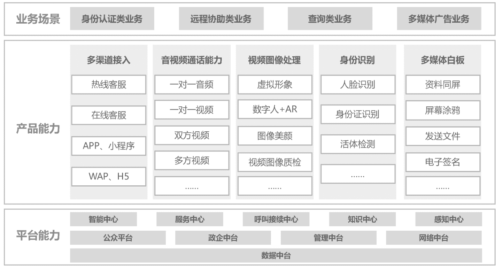

图 4-16

在产品能力方面，多渠道接入支持热线客服、在线客服，客户还能通过 App、小程序、WAP、H5 等多种形式接入视频客服系统，方便客户在不同场景下使用。音视频通话能力提供一对一音频、一对一视频、双方视频、多方视频等多种通话模式，满足不同的沟通场景需求，如个人咨询、多方会议式的业务沟通等。视频图像处理模块具备虚拟形象、数字人+AR、图像美颜、视频图像质检等功能，提升视频画面质量和交互趣味性，如虚拟形象和数字人+AR 可增加服务科技感，图像美颜让视频画面更美观。身份识别包含人脸识别、身份证识别、活体检测等技术，以保障身份认证业务的准确性和安全性，防止身份被冒用。多媒体白板具有资料同屏、屏幕涂鸦、发送文件、电子签名等功能，便于在远程协助和业务讲解时，客服与客户共享资料、标注重点、传输文件以及完成电子签名等操作。

在平台能力方面，智能中心利用人工智能技术，如语音识别、语义理解等，实现智能客服、智能推荐等功能，从而提升服务效率和精准度。服务中心负责处理业务逻辑，协调资源，保障客户服务流程顺畅进行，如工单处理、业务办理流程管控等。呼叫接续中心承担呼叫的接入、转接、排队等任务，确保客户的呼叫能够被快速、准确地分配到合适的客服人员。知识中心存储各类业务知识、常见问题解答等内容，为客服人员提供知识支持，辅助其准确回答客户问题。感知中心收集并分析客户反馈和行为数据，了解客户需求和满意度，为优化服务提供依据。公众平台面向大众客户，提供统一的服务入口和展示窗口，进行品牌宣传、业务推广等。政企中台针对政企客户，提供定制化的服务支持，以满足其特殊业务需求，如集团业务办理、大客户服务。管理中台负责系统的人员管理、权限管理、业务统计分析等后台管理工作，保障系统有序运行。网络中台保障网络稳定、优化网络传输性能，确保视频客服的音视频传输流畅，减少卡顿、延迟等问题。数据中台整合、存储和管理系统产生的各类数据，进行数据挖掘和分析，为其他平台和业务提供数据支撑。

以电商售后服务场景为例，座席端的功能尤为重要。当客户发起视频咨询退换货问题时，座席端的综合接续功能可以快速将客户的请求转接给熟悉退换货流程的客服人员处理。同时，视频通话话单记录功能可以详细记录整个沟通过程，方便后续查询和纠纷处理；禁用名单管理则可以有效地防止恶意骚扰的客户对客服工作的干扰，保障服务的正常进行。

座席端功能：座席端提供综合接续转接到视频客服技能队列的功能，确保特定类型的咨询能够得到高效处理；同时，还涵盖视频通话话单记录、禁用名单管理等服务，从而有力地增强了服务质量的控制能力。

客户端体验：客户端无论是通过 Web 页面还是手机 App 接入，都能畅享一对一视频通话、多人音视频会议，以及多媒体白板交互等丰富功能。以在线教育的客户端为例，学生可以通过 Web 页面或手机 App 接入视频客服，与教师进行一对一的视频通话，解决在学习过程中遇到的难题。在多人音视频会议功能中，学生可以参与学习小组讨论，与同学和教师共同探讨学习内容。多媒体白板的屏幕共享功能可以让学生展示自己的作业、学习资料等，文件上传功能方便学生提交作业或获取教师分享的学习资料，从而提高学习的互动性和效率。多媒体白板不仅能支持基本的文字和图形绘制，还能实现屏幕共享与文件上传，极大地提高了信息交流的效率。

技术支撑平台：强大的技术支撑平台是视频客服系统的坚实后盾。智能中心负责自然语言处理和生成任务，让虚拟数字人能够更加流畅地与客户进行对话，并根据情景灵活调整回应方式，从而提升互动的真实感；呼叫接续中心作为连接客户请求与合适座席的关键桥梁，利用先进的路由算法，能够保证最短等待时间和最佳匹配度；服务中心集成各种核心业务逻辑，如利用 OCR 技术识别身份证件信息的身份验证服务，并结合活体检测确保操作者为证件持有人本人，提高了安全性，同时支持电子签名功能，允许远程签署协议，简化流程并保障法律效力；感知中心专注于优化客户体验，通过图像美颜算法改善视觉效果，利用视频图像质检技术自动分析服务过程中可能出现的问题。

灵活配置选项：视频客服产品设计有灵活的配置选项，企业可根据自身情况设置各项参数。在渠道配置方面，可指定哪些客户群体优先享有视频客服权益；队列管理能够帮助企业合理分配人力资源，应对高峰期流量；振铃态视频、视频 IVR 等功能则进一步拓展了传统 IVR 的应用范围，使客户在等待时也能获取有用信息或者直接完成某些简单任务。

综上所述，从底层技术支持到前端应用界面，整个视频客服系统构建了一个闭环的服务生态系统，既满足了快速响应客户需求的目标，又为企业带来了更高的运营效率与客户满意度。随着 5G 通信技术的发展及其相关应用场景的不断拓展，预计未来将有更多创新性的功能融入其中，持续推动这一领域的进步与发展。

### **4.8.4** **核心功能**

本节将详细介绍视频客服系统的核心功能，从座席端、客户端到配置功能三个维度，全面解析其工作原理及应用场景。通过对这些功能的介绍，读者能够更清晰地理解视频客服如何借助最新的通信技术和 AI 技术，提供高效且个性化的客户服务体验。

**1.** **座席端**

视频客服的座席端是整个系统的关键环节，它集成了多种高级功能，助力客服人员高效、安全地与客户进行交流。在技术支持场景中，座席端的这些功能发挥着重要作用。例如，当客户遇到软件使用问题时，客服人员可以通过一对一视频通话与客户进行沟通，利用桌面共享功能直接查看客户的软件操作界面，快速定位问题所在，并进行实时指导，帮助客户解决问题。这种直观的沟通方式能够有效地减少因语言描述不清导致的误解，从而提高问题解决的效率。

·基础通信功能：座席端支持一对一的视频通话以及多人会议，客服人员可根据实际情况灵活选择沟通方式。桌面共享选项使客服能在不中断对话的情况下，向客户展示相关文件或指导操作过程，从而大幅提升了解决问题的速度与准确性。

·高级安全特性：电子签名等高级特性被整合到座席端，简化了需要签署协议或确认信息的过程，并通过加密技术保障了传输过程中数据的安全性。在金融业务办理中，座席端的高级安全特性至关重要。比如，在办理贷款业务时，客户需要签署电子合同，电子签名功能确保了合同签署的合法性和安全性。同时，利用 AI 技术进行的人脸识别、活体检测以及身份证识别等功能，有效防止了身份被冒用和欺诈行为，保障了客户和金融机构的利益。利用 AI 技术进行自然人身份验证已成为一种趋势。人脸识别及活体检测可以有效防止冒名顶替，确保每次交互均在真实的客户之间进行；身份证识别（通常需接入第三方公安认证系统）为涉及敏感信息处理的场景提供了额外保障。

·创新功能引入：座席形象虚拟化或者动漫化等创新功能逐步被引入座席端，不仅带来视觉效果的变化，还为客户营造了更加轻松愉快的服务体验，尤其在面对年轻客户时优势明显。美颜、元素操作（画笔、图形等）、视频图像质检等功能也丰富了客服工具箱，使服务过程更加人性化和个性化。

在这些功能的协同作用下，客服人员的工作效率得到了显著提升，服务质量也得到了极大改善。多媒体白板与文档上传支持促进了复杂问题的理解与解决；在线视频录制及回放功能便于后续分析和培训使用；队列管理和账号权限的设置保证了内部运营的有序开展。总之，通过不断优化和完善座席端的功能集合，视频客服平台正朝着更加智能化、便捷化的方向稳步发展，为企业和个人客户提供前所未有的优质服务体验。

**2.** **客户端**

视频客服的客户端设计致力于为客户提供便捷、高效且安全的服务体验。其通过多样化的接入渠道与丰富的功能集，满足不同场景下的需求。

·多样化接入渠道：客户可通过网页渠道、微信小程序以及移动应用程序（如 iOS 或 Android 应用）等多种方式访问视频客户服务。例如，在外出场景中，客户可能更倾向于使用微信小程序接入视频客服，因为无须额外下载应用，方便快捷。而对于经常需要与客服进行沟通的客户，可能会选择下载移动应用程序，以获得更稳定的连接和更丰富的功能体验。这种多样化的接入方式极大地提高了客户与客服沟通的便利性。每种接入点不仅具备基础的视频通话能力，还融合了特定功能以提升客户体验。网页版视频客服为希望通过浏览器直接获得支持的客户提供了便捷入口，客户无须额外下载软件，仅需确保设备配备摄像头和麦克风，即可启动服务，并且特别强调对多媒体文件交换的支持，同时还集成了电子签名功能，既简化了流程，又保障了交易安全；网页版视频客服对于一些不常使用客户服务，但在特定情况下有紧急需求的客户来说非常友好。比如，客户在浏览企业官网时，若对某产品有疑问，则可直接通过网页版视频客服与客服人员进行沟通，快速获取所需信息。同时，其多媒体文件交换功能可以让客户方便地分享产品图片、文档等资料，使沟通更加高效。微信小程序凭借轻量级特点，无须安装，即可快速使用，适合临时性咨询需求；应用程序则更适合需要频繁联系客服或者追求更稳定的连接质量的客户。二者均支持活体检测技术，用于验证客户身份的真实性，从而有效防止欺诈行为，同时提供桌面共享选项，便于客服指导客户完成复杂操作或诊断问题。以跨境电商平台的视频客服为例，应用程序为海外客户和国内客服之间的沟通提供了便利。通过桌面共享功能，客服人员可以直观地看到客户在操作过程中遇到的问题，如在下单流程、支付环节等方面的疑惑，并及时给予指导。同时，活体检测技术保障了交易的安全性，有效防止了不法分子利用虚假身份进行交易。

·增强互动与安全保障：为进一步增强互动性和便利性，视频客服系统在各个平台均内置了语音转文字、实时翻译等功能，帮助客户克服语言障碍，使沟通更加顺畅。考虑到隐私保护的重要性，所有的交流内容都将受到严格的加密处理，从而确保信息传输的安全可靠。此外，为提升整体服务质量和提高服务效率，系统还设置了智能排队机制及预约回访功能，让客户可以根据自身情况灵活安排时间。

总之，通过上述多种渠道及其特色功能的支持，视频客服不仅实现了传统电话服务所无法达到的视觉交互效果，更重要的是，其利用先进的技术支持创造了一个既安全又高效的新型客户服务模式。这是视频客户服务朝着更加人性化、个性化方向迈进的重要一步。

**3.** **配置功能**

视频客服系统的配置功能为企业提供了高度的灵活性与定制化水平，从而确保不同规模和类型的企业能够根据自身需求进行精准调整。企业可以根据自身业务的实际情况和战略规划，灵活运用配置功能。比如，在业务推广初期，为了吸引客户尝试新的服务方式，可以将视频客服功能设置为默认开启，引导客户体验视频客服的便捷性；而在某些特殊时期，如系统升级或维护期间，可暂时关闭视频客服功能，避免给客户带来不好的体验。

·基础开关与关键词设置：最基础的设置是视频客服开关控制，管理员可以在渠道管理下的系统参数中，通过简单的 isShowVideoCall 参数（1 为开启，0 为关闭）启用或禁用视频客服功能，决定客户端是否显示视频客服选项，也可以设置特定关键词如“视频客服”作为触发点，当客户发送该关键词时自动发起视频通话请求。通过设置关键词触发视频通话请求，能够提高客户使用视频客服的便捷性。例如，在电商平台的聊天窗口中，当客户输入“视频客服”时，系统就会自动弹出视频通话邀请，并快速连接到专业的客服人员。这一功能可以有效缩短客户寻找视频客服入口的时间，提高服务效率。

·队列优化与权限管理：对于更高级的需求，系统支持添加新的技能队列编码，以处理不同类型的服务请求。例如，若要新增一个专门处理视频咨询的队列，则需要联系研发团队在后端配置文件中完成设定，这有助于提高工作效率，确保客户被分配给最适合解决其问题的专业人员。新增专门的视频咨询队列能够更好地满足企业对不同类型咨询的分类处理需求。以一家提供多种服务的大型企业为例，对技术咨询、售后服务等不同类型的视频咨询分别设置队列，每个队列都配备相应专业的客服人员。这样，当客户发起视频咨询时，系统就能够快速将其分配到最合适的队列，从而提高问题解决的专业性和效率。同时，管理员可对座席账号权限进行精细化管理，指定哪些员工可以使用视频客服功能，以确保服务质量和安全性。

·安全与服务质量保障：黑名单管理是一项重要的安全管理措施，通过访问系统管理界面中的“视频禁用名单”页面，企业可将不受欢迎或存在风险的客户加入禁止列表，防止其再次连接至客服系统，从而维护良好的服务环境。黑名单管理不仅能有效防范恶意客户的干扰，还能保障其他客户的服务体验。例如，对于多次故意骚扰客服人员或存在欺诈行为的客户，企业将其加入黑名单后，可以避免这些客户对正常服务流程的破坏。另外，排队超时提醒功能可以让企业及时关注客户的等待情况，并采取相应措施，如增加客服人员、优化排队算法等，从而提高客户的满意度。平台还提供排队超时提醒、视频通话话单记录以及录像保存等功能，企业可在客户等待时间过长时发送通知，借助视频通话话单记录和录像保存更好地监控服务质量并进行后续分析，视频录制功能还可用于内部培训和争议解决。

总之，从基本的开关控制到复杂的队列优化及安全管理，视频客服系统的配置功能为企业提供了一个强大而灵活的工具集，帮助其实现高效且个性化的客户服务体验。无论是小型初创公司还是大型跨国企业，都能在这个平台上找到适合自己业务模式的最佳实践方案。

# **第五章**

# **智能客服系统测试与优化**

本章将探索如何对智能客服系统进行测试与优化，以确保这些系统不仅能够稳健运行，还能精准满足客户的需求。首先，剖析用于检验系统功能和性能的各种方法与指标，力求在系统正式上线前使之达到最佳状态；接着，通过识别并分析现存问题，提出一系列切实可行的改进措施，技术和管理双管齐下，探寻如何进一步提升系统的响应速度、准确性及客户体验。

## **5.1 测试方法与指标**

在智能客服系统的设计与部署中，确保其稳定运行和高效服务是至关重要的。为实现该目标，需要进行一系列严谨的测试，验证系统是否符合预期的功能需求和性能标准。

### **5.1.1 功能测试内容与方法**

在智能客服系统的构建中，功能测试扮演着举足轻重的角色。功能测试是智能客服系统上线前的关键环节，它就像一场全面的体检，对系统的各个功能模块进行细致检查。通过功能测试，能提前发现潜在问题，避免在实际使用中给客户带来困扰，保障系统的稳定性和可靠性。它不仅确保系统各组件如预期般顺畅运行，更致力于满足每一位客户的殷切期望。通过细致入微的功能测试，不仅能验证各项技术指标是否达标，还能及时发现并修复潜在问题，从而为客户提供一个高效且可靠的服务平台。下面将深入探讨语音识别、语义理解及问题解决策略等功能模块，并介绍相应的测试方案及实施方法。

**1. 语音识别模块的测试**

语音识别作为智能客服的第一道门户，负责将客户的声音转换为可处理的文字信息。以电商客服场景为例，语音识别模块可能会遇到各种口音和嘈杂环境的挑战。因此，在测试时，要模拟不同地区的口音以及如商场、地铁等嘈杂环境下的语音输入，确保语音识别模块在复杂情况下也能准确工作。这一环节的测试，需要依靠高质量的音频样本库和专业工具，如 Whispe 等开源软件。首先，需构建一个包含各种口音、语速及背景噪声的语音数据集；接着，使用这些样本来训练与测试模型，以评估其识别准确率。理想情况下，系统的错误率应低于预设阈值（例如 5%），同时还要考查模型面对新词汇时的学习能力。此外，还需关注语音识别的速度表现，确保即使在网络状况不佳时也能迅速响应客户需求。

**2. 语义理解模块的测试**

当文本信息被成功提取后，接下来便是理解其中蕴含的意义了。语义理解模块的准确性直接影响智能客服对客户问题的回答质量。在实际测试中，除使用标准的测试数据集外，还应收集大量真实场景下的客户对话数据，这些数据包含各种口语化表达、模糊语义等，更能检验语义理解模块在复杂现实情况下的处理能力。这通常涉及自然语言处理技术的应用，比如实体抽取和意图识别。为了验证这部分功能的有效性，可以采用人工标注的数据集作为基准，如 GLUE 或 Super GLUE 基准测试集。在测试过程中，应涵盖各种常见及少见场景下的对话示例，全面检验算法的理解深度。除准确性外，还需考虑算法的运行效率与可扩展性。例如，在面临大规模并发请求时，系统能否依然保持良好的性能表现至关重要。

**3. 问题解决策略模块的测试**

解决问题的能力直接影响客户体验。针对此部分，建议采取 A/B 测试的方法：在同一时间点向两组不同客户提供两种解决方案，并收集反馈进行对比分析。这样不仅可以直接看出哪种策略更受欢迎，也有助于后续优化的方向选择。此外，还可以设计一系列复杂多变的虚拟情境，考验系统应对突发状况的能力。具体来说，可以设置一些含有歧义或需要多轮交互才能得出答案的问题，看看智能助手能否灵活调整思路，找到正确路径。

**4. 对话流畅性测试**

在实际应用中，客户期待的是无缝衔接式的交流体验。这意味着智能客服不仅要具备强大的单次应答能力，还要有出色的持续对话管理技巧。为此，可以模拟长时间连续对话的过程来进行专项检测，重点关注以下几点：①上下文记忆功能是否完善，即系统能否记住之前的谈话内容并在后续聊天中合理引用；②情绪感知机制是否健全，即机器能否根据客户语气的变化适时调整自身态度；③主动引导能力如何，即当话题偏离主线时，AI 能否巧妙地将其拉回正轨。

**5. 自动化测试框架的应用**

鉴于上述各环节均涉及大量重复性工作，引入自动化测试框架无疑能显著提升工作效率。成熟的工具如 Pytest、Robot Framework 等，均可用于编写测试脚本并自动执行，甚至支持跨平台部署。设定周期性的回归测试计划，能够有效监控系统状态变化趋势，一旦发现问题，立即触发报警机制。此外，结合持续集成/持续交付（CI/CD）理念，实现从代码提交到上线发布的全流程自动化控制，进一步缩短产品迭代周期。

通过以上介绍可以看出，智能客服系统的功能测试是一个涵盖广泛且技术密集度高的过程。只有遵循科学严谨的方法论指导，才能确保最终交付给客户的产品既稳定，又富有竞争力。

### **5.1.2 性能测试指标与评估**

在智能客服系统的设计和部署过程中，性能测试不仅能够帮助发现潜在的技术瓶颈，还能为客户提供流畅无阻的服务体验，从而提升整体满意度。性能测试是衡量智能客服系统优劣的重要手段，它能为系统的优化提供有力依据。通过对关键性能指标的评估，开发团队可以明确系统的优势与不足，进而有针对性地进行改进，确保系统在各种场景下都能稳定高效运行。深入了解并灵活运用性能测试中的关键指标及其对客户体验的影响至关重要。

平均延迟是衡量一个请求从发送到接收响应所需时间的重要参数，直接关系到客户等待问题解决的时间。平均延迟的长短对客户体验有着显著影响。在金融客服场景中，客户咨询账户交易相关问题时，若平均延迟过长，可能导致客户错过最佳交易时机，造成经济损失，同时客户会对金融机构的服务产生不满，导致客户忠诚度受到影响。例如，在文本聊天的智能客服场景中，如果系统的平均响应时间为 3 秒，客户几乎能感受到即时的支持；而当时间上升至 10 秒甚至更长时，客户耐心将受到考验，进而客户可能产生消极情绪或干脆放弃使用服务。理想情况下，我们应该追求最小化这一数值，以提高互动效率，让客户感到舒心。

最大并发数指的是系统在同一时间内能够处理的最大客户连接数量，它直接影响平台的可扩展性和高峰期的服务能力。以在线教育平台为例，在直播课程期间，大量学生可能同时向智能客服咨询课程相关问题。如果系统的最大并发数较低，会导致部分学生的咨询请求无法及时得到处理，影响学生的学习体验，甚至可能导致学生给平台负面评价，不利于平台的长期发展。想象一下，一家电子商务网站在周年庆期间推出限时折扣活动，预计将吸引大量顾客同时访问。若其智能客服系统只能支持数百个并发连接，那么在高负荷运作下会导致部分客户无法及时获得帮助，从而损害品牌形象及销售业绩。因此，在设计阶段就需要通过负载均衡、数据库优化等手段来增加这一上限值，确保每一位客户都能享受到顺畅的服务体验。

错误率用于量化系统出错的比例，即未能成功完成指定任务的情况占比。低错误率意味着技术实现成熟稳定，能够可靠地满足业务需求。反之，则可能引发客户投诉甚至客户流失。比如，当某智能语音助手频繁出现误识别命令的情形（如把“查询订单状态”误解为“取消订单”）时，即使后续可以通过人工介入修正错误，也会极大地破坏客户体验，降低品牌信任度。因此，持续监控此指标，并针对高发故障点进行调试优化非常必要，确保每一次互动都能准确无误。

为了准确测量上述各项性能指标的表现情况，需要精心规划一套有效的性能测试方案。首先，根据实际应用场景选择合适的负载模型至关重要。常见的模型有稳定负载（模拟日常操作）、峰值负载（测试极限容量）及随机波动负载（模拟真实世界中不可预测的变化）。其次，观察系统在不同压力条件下的行为同样重要，包括资源利用率的变化趋势、响应时间的波动范围，以及是否存在未预料到的功能退化现象。此外，还应该定期执行回归测试，检验新功能添加或现有功能修改后是否对整体性能产生了不利影响。

市场上存在多种成熟的工具可以辅助实施这类测试工作，如 Apache JMeter 适用于 HTTP（S）协议相关的 Web 应用测试；Load Runner 则提供了强大的脚本编写能力和丰富的协议支持，非常适合复杂企业级软件；Gatling 凭借其简洁易用且高性能的特点，在 API 级别测试领域获得了广泛应用。选择哪一款工具取决于项目具体需求、团队技术水平及预算限制等因素。通过合理利用这些专业工具，技术人员能够更加精确地度量智能客服系统的各项性能指标，进而采取针对性措施，以改善服务质量，最终达到提升客户体验的目的。

## **5.2 性能优化与改进措施**

本节深入探讨智能客服系统在实际运用中遇到的种种挑战与瓶颈，并寻求有效的改进之道。希望通过巧妙结合技术与非技术手段，让系统效能达到最佳状态。首先，剖析当前智能客服系统的局限性，找出制约其性能的关键因素；接着，围绕算法优化和资源利用效率提升等技术层面展开讨论，同时引入流程简化、人员培训等非技术策略，力求提供全面而具体的解决方案。

### **5.2.1 系统瓶颈分析与优化**

在信息技术与业务蓬勃发展的道路上，系统性能问题常常成为制约其前行的重要因素。系统瓶颈的出现会严重影响智能客服系统的运行效率和客户体验。在实际运营中，及时发现并解决系统瓶颈问题是保障系统稳定运行的关键，这需要综合运用各种技术手段和管理策略。所谓“系统瓶颈”，指的是在计算机系统或软件应用中，限制了整体性能提升的部分。这些瓶颈可能源自硬件资源（如 CPU、内存和存储空间）的不足；也可能源于软件层面的问题，比如低效的代码或不合理的数据库设计。例如，在智能客服系统处理大量语音数据时，如果 CPU 性能不足，就会导致语音识别和分析的速度变慢，影响客户与客服的沟通效率；而不合理的数据库设计可能导致数据查询缓慢，客服人员无法及时获取所需信息，降低服务质量。常见的系统瓶颈类型包括计算资源不足、数据处理速度慢、网络延迟高及存储访问效率低下等。

以某电商平台为例，在大型促销活动期间遭遇的服务器响应缓慢现象，就是典型的系统瓶颈案例。在电商平台的促销活动期间，大量客户同时涌入，对商品咨询、订单处理等服务的需求呈爆发式增长。此时，系统的各个组件都面临巨大压力，任何一个环节出现问题都可能引发系统瓶颈，导致客户体验下降，甚至影响业务的正常开展。经过深入调查，团队发现主要原因是数据库查询操作过于频繁且效率低下，加之并发请求量激增超过了现有服务器集群的处理能力。为此，团队首先通过性能监控工具对整个交易链条进行了全面分析，精确定位到具体是哪几类 SQL 语句执行时间较长，并据此调整了索引结构；同时，引入了缓存机制来减轻数据库的压力。此外，适时增加了云主机的数量，提高了系统的横向扩展能力。这一系列措施不仅显著提升了客户体验，也确保了后续开展类似的大规模营销活动时平台的稳定运行。

面对计算资源不足的情况，最直接有效的解决办法通常是升级现有硬件配置或采用分布式架构分散负载。但在采取这些措施之前，建议先尝试优化算法逻辑，比如减少不必要的循环迭代次数、利用并行计算技术加速任务执行等。对于因网络状况不佳导致的数据传输效率低下的情形，则需要从提升带宽、优化路由选择以及启用压缩算法等方面入手改善。至于由存储访问速率引发的问题，则可能涉及更换更快的 SSD 硬盘、使用更高效的文件系统甚至迁移至对象存储服务等多种策略。

除技术层面上的改进之外，有时候还需要从业务流程角度出发进行非技术性的调整。例如，在面对高峰期流量突增时，可以通过提前设置好限流降级规则来保证核心功能的可用性；或者根据实际情况灵活调配不同业务线之间的优先级顺序，使有限的资源得到更加合理的分配。另外，加强跨部门间的信息共享与沟通协作同样至关重要，这有助于及时发现问题根源，避免因重复劳动浪费宝贵的时间与精力。

综上，面对复杂的系统瓶颈挑战，需要综合运用多种方法和技术手段，既要注重短期快速见效的应急措施，又不能忽视长远规划下的根本性变革。只有这样，才能真正做到既治标又治本，为企业创造更大的价值。

### **5.2.2 算法改进与资源优化**

在智能客服系统中，通过算法的精进和资源的有效调配，提升响应速度与准确性至关重要。算法和资源的优化是提升智能客服系统性能的核心。不断改进算法可以让系统更准确地理解客户需求，提高回答的质量和效率；而合理调配资源则能确保系统在高负荷情况下也能稳定运行，为客户提供持续可靠的服务。技术的发展日新月异，尤其是深度学习框架和自然语言处理领域的崭新进展，为实现这一目标提供了强大的支持。以 Transformer 架构为代表的深度学习模型，在理解复杂语义方面展现出非凡的能力，被广泛应用于客户服务、内容推荐等多个场景。Transformer 架构的优势在于其能够处理长序列文本，并且在理解上下文语义方面表现出色。在智能客服系统中，当客户提出复杂问题或进行多轮对话时，Transformer 架构可以更好地理解客户的意图，提供更准确的回答。例如，在处理涉及多个步骤的技术问题咨询时，它能综合分析客户之前的对话内容，给出更全面、更符合客户需求的解决方案。这类模型能够更好地捕捉文本中的长期依赖关系，从而更准确地洞悉客户的意图。例如，在实际应用中，基于 Transformer 的 BERT 模型可以通过预训练-微调的方式快速适应特定领域的对话场景，显著提高了问题解决的速度和质量。

此外，为了进一步增强系统的灵活性与性能，引入多任务学习策略也是一种有效手段。多任务学习策略可以让智能客服系统在处理不同类型的任务时更加高效。例如，在电商客服场景中，系统既要处理商品咨询、订单查询等常见任务，又要应对客户投诉、售后处理等复杂任务。采用多任务学习策略，如 MMOE（Multigate Mixture of Experts，多门控专家混合）模型，可以使系统在不同任务之间共享部分计算资源，同时根据任务的特点分配特定的资源，提高整体处理效率。比如 MMOE 模型允许单一网络结构同时处理多个相关但不同的任务，通过共享底层表示层来提高效率，并利用门控机制确保每个任务都能获得最适合自己的特征组合。这种方法不仅有助于降低计算成本，还促进了不同功能模块之间的协同工作，使整个客服体系更加紧凑、高效。

除算法层面的革新外，合理配置及动态调整计算资源也是保证服务质量不可或缺的一环。面对不断变化的服务需求，采用负载均衡技术和自适应调度策略可以确保即使在访问高峰期间也能维持稳定的表现。例如，借助 Kubernetes 这样的容器编排平台，可以根据实时监控到的系统负载情况自动伸缩服务规模；当检测到某个节点的压力过大时，可以迅速将部分请求重新分配给其他相对空闲的服务器，从而避免了单点故障的风险，保障了客户体验的一致性。与此同时，通过对历史数据进行分析并预测未来趋势，企业还可以提前做好准备，如增加临时计算资源或调整现有资源配置方案，以应对即将到来的高峰期。

值得注意的是，在追求高性能的同时也不能忽视成本控制。通过对各项业务流程进行全面、细致的梳理，并结合云计算按需付费的特点，实施精细化管理措施，对于降低运营成本具有重要意义。具体来说，这可能涉及对不常用功能模块采取冷启动策略，以减少闲置资源浪费；或者利用 Serverless 架构设计轻量级服务接口，仅在客户触发特定操作时才激活对应组件执行任务，之后立即释放占用的内存空间。这些做法都能在保证服务水平的前提下大幅削减不必要的开支。

通过对现有算法框架的持续迭代升级及对硬件资源使用策略的不断优化，智能客服系统能够在保持高效率运作的同时，也具备较强的经济性。而这正是当今市场竞争日益激烈的环境下，所有希望提供卓越客户体验的企业所必须关注的重点之一。

# **第六章**

# **智能客服系统运营与维护**

在智能客服系统的生命周期中，运营与维护同样重要，它们不仅维系着系统的稳定和效率，更是客户体验和服务质量的守护者。本章将深入探索智能客服系统的运营与维护，从日常运营管理的点滴讲起，涉及系统监控、数据统计分析及客服团队的成长与发展；随后，将转向故障排除与维护策略，探讨常见问题的解决之道、定期维护计划及其具体实施内容。

## **6.1 日常运营管理要点**

在智能客服系统顺利落地之后，确保其流畅、高效地运转，是实现卓越客服的核心所在。本部分将全方位探讨实时监控、性能优化、数据分析及客服团队的职业成长路径等关键领域，力求为管理者提供一份既全面又实用的操作指南。

客服系统日常运营管理主要工作是处理来自微信群、邮件、工单、告警等渠道的问题，一线团队将所有问题录入运维系统，进行全流程管理，直至问题验证关闭并实现闭环。对于无法通过运维手段解决的问题，及时进行升级处理。升级后，针对缺陷、优化需求和事件（故障），按照相应流程进行跟踪，并在运维系统中管理进度，确保问题得到有效解决和持续改进。

图 6-1 呈现了智能客服系统运营过程中问题处理的流程。问题通过微信群、邮件、工单、告警等渠道反馈进入系统，流程开始。问题首先由一线响应处理，对问题进行初步评估和操作。接着判断问题是否需要升级。若判断为“是”，则进入重大事件跨部门联动流程，协调多个部门共同处理复杂或重大问题；若判断为“否”，则继续下一步。一线响应处理后，对问题解决情况进行验证。若验证通过，则流程结束；若存在问题，则根据情况安排缺陷排期修复或优化排期修复。修复完成后再次进行验证，直至问题解决流程结束。在一线响应处理过程中，涉及线上管理相关操作，保障响应处理过程有序进行。整个流程图明确了智能客服系统运营中问题从接收、处理到解决验证的完整路径和不同处理方式。

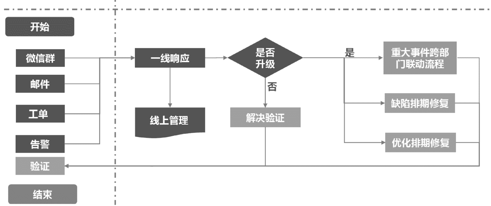

图 6-1

### **6.1.1 系统监控与数据统计**

在现代呼叫中心的管理中，有效的实时监控犹如一双敏锐的眼睛，确保自动台与人工服务始终处于最佳状态。随着智能客服系统应用场景的不断拓展，其承载的业务量和客户交互数据呈指数级增长。在这种情况下，系统监控和数据统计就显得尤为关键，它们是保障系统稳定运行、提升服务质量的重要手段。通过对系统运行状态和业务数据的实时跟踪与分析，能够及时发现潜在问题，并迅速做出调整，确保智能客服系统始终以最佳性能服务客户。通过全面的系统监控和细致的数据统计，管理层不仅能够及时把握当前的服务状况，还能根据这些信息调整服务策略，优化服务效率与质量。系统监控覆盖了自动台及人工台的话务情况、业务模块的运行状态等多方面内容；而数据统计则专注于分析各种平台数据和业务数据，并生成报告，为运营管理提供坚实的数据支持。例如，在电商大促期间，智能客服系统会迎来海量的咨询请求。通过对自动台话务的实时监控，能够清晰地看到不同时段、不同渠道的咨询量变化趋势。如果某个时间段内某一商品咨询量飙升，可能意味着该商品成为热门关注对象，此时就需要及时调整资源分配，如增加与该商品相关的知识库内容、调配更多熟悉该商品的客服人员等，以确保客户能够得到及时准确的回复，提升服务质量。

首先，实时监控功能对于保持服务质量至关重要。例如，在自动台话务监控方面，系统能够提供当前在线客户数、不同接入号码的在线客户数及当天累计呼入量等关键指标。通过对这些数据的即时跟踪，管理者可以迅速识别潜在的问题区域。比如，某段时间内某一接入号码的呼入量突然增加，可能是特定活动引起的，也可能是技术故障所致。同样地，对人工台的监控也不可或缺，它涉及了解客服代表的工作状态（如登录时间、通话时长等）和上班人数变化等因素，有助于合理安排人力资源，确保每一位来电者都能得到及时响应。此外，对整个业务流程的监督也是必不可少的，这能确保每个环节高效运转，从而提升整体工作效率。

其次，日志记录是系统操作过程中不可或缺的一部分，其重要性不言而喻。日志记录不仅是系统操作的“黑匣子”，更是问题排查和服务优化的重要依据。详细、准确的日志能够完整地呈现系统运行过程中的每一个关键步骤，为后续的分析提供丰富的数据来源。通过对日志的深入挖掘，可以发现系统运行中的潜在风险、客户操作习惯及服务流程中的瓶颈环节，从而有针对性地进行优化和改进。无论是客服人员的具体业务操作还是后台运维活动，所有细节都应被准确无误地记载下来。这样做的好处在于，当需要追溯历史事件或调查问题根源时，详尽的日志信息能够提供极大的帮助。更重要的是，通过对日志数据的定期分析，企业可以获得宝贵的洞察力，发现潜在的安全隐患或性能瓶颈，并采取相应措施加以改进。同时，良好的日志管理实践也有助于满足行业合规要求，提升客户信任度。

再次，利用收集到的各种数据生成有助于决策制定的统计报表。这包括但不限于服务量统计分析、当天通话平均时长计算、单位时间内接通率变化趋势展示等。具体来说，服务量统计不仅关注客户访问量本身，还包括内部为了提供服务所进行的操作量统计，如次数和时长等；当天通话平均时长则是衡量客服团队工作效率的一个直观指标；至于单位时间接通率的变化，则可以帮助管理者更精准地把握高峰时段，提前做好资源调配准备。除此之外，热点信息监控也是不可或缺的一部分，通过对来电原因、咨询主题等热点内容的持续追踪，组织能够更好地理解客户需求，有针对性地改善产品或服务。总而言之，通过综合运用上述各类工具和技术手段，呼叫中心不仅能够保证高质量的客户服务，还能不断提升自身的运营管理水平。

### **6.1.2 客服人员培训与管理**

在当今的企业世界里，客服团队不仅是客户体验的第一扇窗，更是塑造品牌形象的重要桥梁。在竞争日益激烈的市场环境下，客服质量已经成为企业脱颖而出的关键因素之一。一个优秀的客服团队能够以专业、热情的服务态度赢得客户的信任和忠诚度，为企业树立良好的品牌形象。相反，若客服团队素质参差不齐，可能会导致客户流失，对企业声誉造成负面影响。所以，打造一支高效、专业的客服团队是企业实现可持续发展的必然要求。为了实现这一目标，必须重视客服人员的职业发展和技能提升，这不仅能够提高他们的工作满意度和归属感，激发他们的工作积极性和创造力，还能为企业带来更高的服务质量和运营效率。通过个性化的职业规划，帮助员工明确职业发展方向；通过系统化的专业技能培训，提升员工的业务能力；通过科学合理的绩效考核机制，激励员工不断提升工作绩效，从而形成良性循环，推动企业和员工共同成长。这不仅包括个性化的职业规划，还涵盖了系统化的专业技能培训和科学合理的绩效考核机制。以下将从三个方面探讨如何有效实施这些措施。

首先，在个性化职业发展规划方面，企业应当根据每位客服人员的具体情况，为他们量身定制成长路径。例如，对于那些对数据分析有浓厚兴趣且具备一定数据处理能力的客服人员，可以引导他们朝着数据驱动的客服方向发展，提供相关的数据挖掘、分析工具的培训课程，帮助他们成长为能够通过数据分析优化服务策略的专业人才。这样不仅能够满足员工的个人发展需求，还能为企业提供更具价值的服务。这需要综合考虑员工的兴趣爱好、现有技能水平及职业发展目标等因素。例如，对于那些表现出色且具有领导潜力的员工，可以提供更多的项目管理和跨部门合作的机会；而对于技术型人才，则可安排其参加数据分析或软件操作等进阶课程。此外，定期组织一对一的职业咨询会议，帮助员工设定短期与长期目标，并跟踪其进展，确保每个人都能朝着正确的方向前进。通过这种方式，不仅能激发员工的积极性，还能促进个人与公司共同成长。

其次，设计有针对性的专业技能训练计划是提高客服团队整体服务水平的关键。一个好的培训方案应当涵盖理论知识的学习和实践能力的锻炼两大部分。一方面，可以通过在线学习平台或邀请行业专家授课，传授最新理念和技术；另一方面，则需设置模拟真实工作场景的角色扮演练习，让员工在安全环境下不断尝试解决问题的新方法。同时，建立一套完整的培训管理体系至关重要，它应包括明确培训对象（如新入职员工、晋升候选人）、详细规划培训流程（如前期准备、中期执行、后期评估）以及设定清晰的目标（如提升特定技能点）。值得注意的是，在每次培训结束后，都要及时收集反馈信息，分析哪些内容受到欢迎，哪些环节有待改进，以此为基础调整后续的教学内容和形式，从而形成良性循环。

最后，合理运用绩效考核机制能够极大地调动员工的积极性，推动整个客服中心服务水平的持续提升。绩效评价体系不仅要考量基本的工作表现指标，比如接通率、解决率等硬性数据，还应当加入顾客满意度调查结果、同事间的相互评价等多个维度。更重要的是，要确保所有评分标准都是透明、公开的，并且定期向员工公布成绩排名，让他们清楚地知道自己当前所处的位置及努力的方向。当发现某些员工的表现超出预期时，除给予物质奖励外，还可以考虑提供额外的发展机遇，比如参与重要项目或者推荐给更高层级的岗位。相反，对于那些暂时落后但有意愿改变现状的员工，则应及时介入辅导，通过制订具体可行的改进计划帮助他们尽快恢复状态。

综上，对客服人员进行全方位的职业规划指导、系统化的技能培训以及公正有效的激励措施，可以使每一位成员都能够充分发挥自身潜能，为企业创造更大的价值。而这一切都离不开管理层对人才培养工作的高度重视与不懈投入。只有真正把“人”放在第一位，才能打造出一支无往不利的服务铁军。

## **6.2 故障排除与系统维护策略**

在智能客服系统的日常运营中，确保其稳定与高效，是提供优质服务的基石。然而，在实际操作中，技术问题与挑战总是如影随形，若处理不当，不仅会使客户体验大打折扣，还可能导致业务中断或数据遗失等令人头疼的后果。本节将深入探讨故障排除与维护策略，为技术人员提供一套行之有效的解决方案，帮助他们迅速锁定并解决系统中的疑难杂症。同时，还将分享如何通过制订周全的预防性维护计划，识别潜在风险，并建立灵活、高效的应急响应机制，从而最大限度地减小突发状况对服务连续性的影响。

图 6-2 展示了故障排除与系统维护过程中应急处理的职责分工及流程，涉及多个角色及其对应任务。

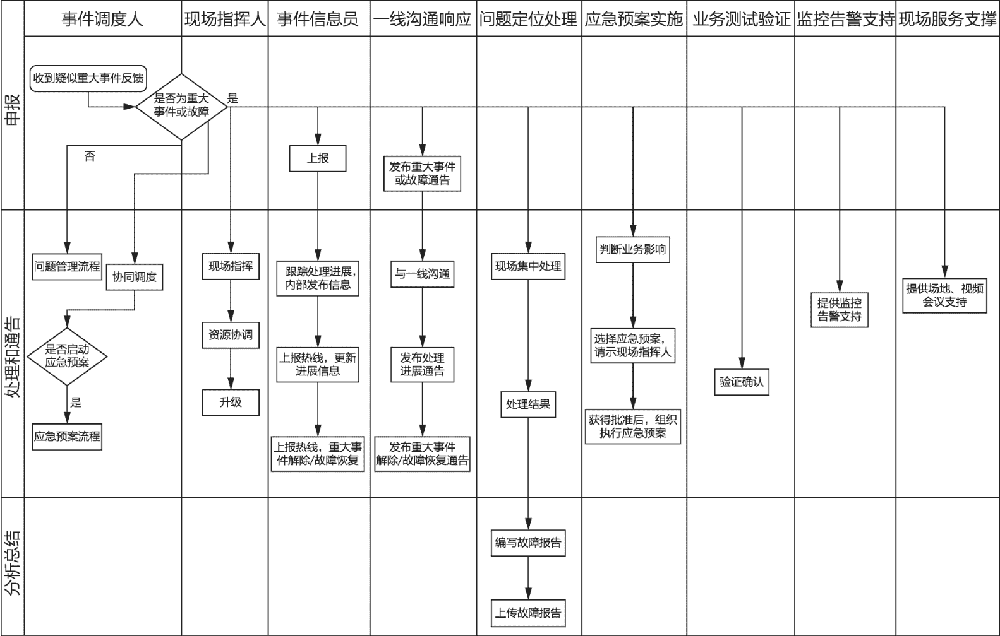

图 6-2

故障处理流程主要包括申报、处理、通告和分析总结几个环节，同时涉及重大事件上报和调度辅助。在角色及职责方面，事件调度人负责判断是否为重大事件或故障，若确认，则协调资源并根据应急预案进行调度。现场指挥人在现场进行指挥，若自身资源不足，可申请升级，以获取更多支持来处理故障。事件信息员收集故障信息并发布，及时更新故障相关进展信息，确保信息流通。一线沟通响应负责与一线进行沟通，发布重大事件或由故障造成的障碍通告、处理进展通告等信息，保持信息对称。问题定位处理进行现场和远程的问题诊断，定位故障根源，处理故障，并上报故障排除情况。应急预案实施判断故障业务影响，选择应急预案，组织现场人员，在资源恢复后执行预案。业务测试验证获取故障确认信息，对业务进行测试验证，确保系统恢复正常。监控告警支持为现场提供监控告警支持，辅助故障排查和处理。现场服务支撑提供现场服务支持，如场地、软硬件资源等保障工作。在整体流程方面，在中台监测到故障后，事件调度人进行判断。若为紧急重大事件或故障，则各角色按职责开展工作，从信息发布、问题定位到应急处理、业务测试等环节紧密配合，共同完成故障排除与系统维护，直至故障解除并分析总结。整个图明确了各角色在故障排除与系统维护应急处理中的职责和工作流程，保障应急处理程序有序、高效地进行。

### **6.2.1 常见故障排查与解决**

智能客服系统是企业提升客服效率和满意度的重要工具，在日常运营中，它可能会遭遇各种故障。随着智能客服系统在企业中的应用越来越广泛，其稳定性和可靠性直接关系到企业的正常运营和客户的满意度。一旦出现故障，就会导致客户咨询无法及时得到回应，业务无法正常开展，甚至引发客户的不满和流失。这些故障不仅会干扰客户的体验，还可能损害企业的声誉。因此，及时有效地排查并解决常见故障，成为运维人员肩负的一项重要使命。接下来，我们将深入探讨几种典型的故障场景及其处理方法，并分享一些实用的工具和技术技巧，帮助运维人员更加从容地应对这些问题。

**1. 网络连接异常**

网络问题常常导致智能客服系统的运行不稳定。网络连接异常是智能客服系统常见的故障之一，其产生的原因复杂多样。在排查网络连接问题时，需要从多个层面进行检查，包括物理连接、网络设备配置及网络服务提供商的稳定性等。例如，在一些大型企业中，网络架构复杂，涉及多个路由器、交换机和防火墙等设备，任何一个环节出现问题都可能导致网络连接异常，因此需要仔细排查每台设备的状态。当出现无法建立连接或频繁断开的情况时，首先应检查物理层面的网络状况，如网线是否松动、路由器或交换机的工作状态是否异常等。接着，可以使用 ping 命令测试从服务器端到客户端之间的连通性，如果丢包率高或者响应时间长，则可能是网络拥堵或互联网服务提供商的问题。此外，不恰当的防火墙设置也会阻碍正常的网络通信，因此检查相关的安全策略配置也是必要的一步。建议定期监控网络流量，并与互联网服务提供商保持沟通，确保带宽充足且稳定；同时优化内部网络安全规则，开放必要的端口和服务，保障数据传输畅通无阻。

**2. 语音识别错误**

尽管语音识别技术已经取得了显著的进步，但其在实际应用中仍然存在局限性。语音识别技术在智能客服系统中发挥着重要作用，但由于实际应用场景的复杂性，语音识别错误难以完全避免。例如，在嘈杂的环境如火车站、商场等地，客户使用智能客服时，背景噪声会严重干扰语音识别的准确性；不同地区的方言口音差异也会给语音识别带来挑战，一些特殊的发音和词汇可能会被误识别，影响客户体验和服务质量。为了解决这类问题，首先要保证采集音频的质量良好，采用高质量的麦克风并尽量减少环境噪声的影响；其次，可以通过调整算法参数来提高特定条件下的识别精度，例如增加对某些特殊词汇的权重。更重要的是，持续收集客户反馈，利用这些数据不断训练和优化模型，使其能够更好地适应多样化的现实场景。目前市面上有一些专业工具可以帮助诊断语音识别中的具体问题，如 Google 的 AudioSet 项目就提供了丰富的资源，用于分析声音特征及检测潜在故障点。

**3. 数据传输失败**

无论是上传还是下载过程中发生的数据丢失或损坏，都会直接影响到智能客服系统的正常运作。常见的原因包括文件大小超过限制、编码格式不匹配，以及服务器端存储空间不足等。面对此类故障，首先应当核查相关日志记录，定位具体的错误类型及发生位置；然后根据具体情况采取相应措施，比如调整最大文件尺寸限制、转换成兼容的数据格式或清理冗余信息，释放磁盘空间。此外，还可以通过实施断点续传机制来降低因网络波动等原因造成的中断风险，确保即使在网络条件不佳的情况下也能顺利完成数据交换任务。

其他注意事项如下。

·实时后台监控：部署一套强大的监控体系对于预防故障至关重要。它能自动检测系统健康状况，一旦发现异常，立即发出警报通知相关人员介入处理。

·定期维护更新：软件版本升级通常会包含性能改进和安全补丁等内容，按时执行维护计划有助于保持系统处于最佳状态。

·备份恢复策略：制定完善的灾难恢复预案，定期备份关键数据至异地存储设施，以保障在遭遇不可抗力事件时能够快速恢复正常服务。

·培训与支持：加强对一线工作人员的技术培训，使他们具备基础的故障排除能力；同时也应建立起高效的客户支持渠道，以便客户在遇到难题时能迅速获得帮助。

总之，通过对上述几方面问题进行有效的管理和处置，可以大大降低智能客服系统遭遇故障的概率，带来更加顺畅的服务体验。借助先进的技术手段与科学的方法论指导，即使是面对复杂多变的实际应用场景，也能够游刃有余地应对挑战，在实现业务目标的同时，不断提升客户的满意度。

### **6.2.2 系统维护周期与内容**

智能客服系统的定期维护，是确保其高效稳定运行的关键。定期维护就像是为智能客服系统进行全面体检和保养，能够及时发现并解决潜在问题，延长系统的使用寿命，提高系统的性能和稳定性。在快速发展的科技时代，系统维护不仅要关注硬件和软件的更新，还要紧跟行业发展趋势，不断优化系统功能，以满足企业日益增长的业务需求和客户不断提高的服务期望。通过科学规划和执行不同类型的维护活动，可以显著提升系统的可靠性和安全性，从而为企业提供持续优质的客户体验。根据实际应用场景的不同，可以将这些维护活动分为三大类：软件更新、安全补丁安装及硬件检查。不同类型的维护活动对于智能客服系统的稳定运行都有着不可或缺的作用。软件更新可以为系统带来新的功能和性能优化，提高系统的适应性和竞争力；安全补丁安装能够及时修复系统漏洞，保障系统的安全性，防止数据泄露和恶意攻击；硬件检查则是确保系统硬件设备正常运行的基础，避免因硬件发生故障导致系统崩溃或性能下降。合理安排各类维护活动的执行频率和具体内容，能够最大程度地发挥系统的效能。每种类型都有其推荐的最佳执行频率和具体的维护项目。

建议软件更新至少每季度进行一次，以确保系统能够及时获得最新的功能增强和技术改进。在进行软件更新时，不仅要关注功能的增强和技术的改进，还要充分考虑系统的兼容性和稳定性。一些软件更新可能会对现有功能产生影响，甚至导致系统出现兼容性问题。因此，在更新前需要进行充分的测试，模拟各种实际场景，确保更新后的系统能够正常运行，不影响客户体验。同时，对于关键模块的更新，要制订详细的更新计划和回滚方案，以应对可能出现的问题。在每次升级过程中，应全面覆盖所有关键模块，如客户交互界面、数据分析引擎及后台管理系统等。同时，还需对新旧版本之间的兼容性进行全面测试，避免因升级导致的问题。企业可以根据自身的业务需求灵活调整更新频次，对于那些快速迭代或处于高竞争环境中的产品线来说，甚至可能需要更频繁地引入新特性，以保持市场竞争力。

安全补丁安装则是守护系统免受已知漏洞威胁的重要防线，因此应当更加频繁地执行，理想状态下每月至少检查并应用一次官方发布的最新安全补丁。这不仅包括操作系统级别的修复程序，还涵盖了应用程序层面的安全加固措施。为了有效管理这一过程，企业应当建立一套自动化工具链，监控相关厂商的安全公告，并自动触发部署流程；同时，也需定期开展内部渗透测试，主动发现潜在风险点。

硬件检查虽然不像前两者那样直接关系到软件层面的功能变化，却是支撑整个服务体系正常运转的基础。一般而言，每年至少安排两次全面的物理设施巡检工作，重点评估服务器、网络设备及存储单元的状态。在具体操作时，除常规的外观观察与性能基准测试之外，还应该利用专业软件工具深入分析各组件的工作日志，寻找异常模式或故障征兆。特别是针对数据中心这类集中式架构，还要特别关注电力供应稳定性、温/湿度控制等方面的问题。

基于上述不同类型维护活动的基本框架，在制订详细计划时还需要充分考虑企业的实际情况。例如，规模较小的企业可能没有专门的技术团队负责这些任务，此时可以选择外包给第三方服务提供商；而对于大型组织，则可以通过组建跨部门协作小组的方式，整合资源，提高效率。另外，在设定维护时间窗口时也要尽量避开业务高峰期，以免影响客户体验。

最后，持续监控系统状态同样不可忽视。借助现代 IT 运维平台的强大能力，我们可以实现 7×24 小时不间断地收集各项关键指标数据，并通过预设规则自动识别出异常行为。一旦检测到潜在问题，系统将立即向相关人员发送告警通知，以便尽快采取应对措施。这种预防性的管理策略有助于将许多小问题扼杀在萌芽阶段，避免它们逐渐累积并最终酿成灾难性的后果。总之，只有通过这样一套完整而严谨的维护体系，智能客服系统才能始终处于最佳状态，为客户提供满意的服务。

# **第七章**

# **智能客服在不同行业中的应用**

本章将借助一系列实际案例，深入剖析智能客服系统在不同行业中，是怎样满足多样化的客服需求的。

先来看电信行业。大家在日常使用手机通信、宽带上网等服务时，难免会遇到信号不好、套餐资费不明等问题。这时，智能客服就像一位随时待命的服务者，成为连接客户与电信服务的关键桥梁。当客户反馈复杂的网络故障问题时，智能客服凭借其强大的算法和丰富的知识库，快速分析问题，精准定位故障点，敏捷地给出解决方案，比如指导客户进行网络设备重启、排查线路问题等，高效地解决客户困扰。

再把目光投向电商领域。购物高峰期咨询量暴增，客户咨询商品信息、物流进度、退换货政策等需求五花八门。智能客服通过智能语义理解技术，迅速理解客户问题意图，从海量商品数据和物流信息中快速提取答案，秒回客户咨询，大大提升购物体验。而且，在处理大量重复性问题时，智能客服不知疲倦，始终保持稳定高效的服务水平，为商家节省大量人力成本。

电力行业也有其独特需求。客户会询问停电通知、电费计算、用电安全等问题。智能客服可以实时对接电网数据系统，一旦有停电检修计划，能及时准确地告知客户停电区域和时间。对于客户关心的电费计算问题，智能客服依据不同的电价政策和客户用电数据，清晰明了地为客户解释电费构成。

银行领域同样离不开智能客服的助力。在金融业务日益复杂的当下，在客户咨询账户信息、贷款办理、理财产品等相关问题时，智能客服一方面严格遵循金融监管要求，保障客户信息安全，另一方面通过精准的风险评估模型，为客户推荐合适的理财产品，为客户的资产配置提供专业建议，同时协助客户完成各类业务的线上办理流程，提升金融服务的便捷性与专业性。

通过对这些行业的探究，我们可以清晰地看到智能客服解决方案如何针对不同行业的难题各个击破，为行业带来业务模式的革新与服务质量的提升。

## **7.1** **电信运营行业应用实例**

在电信运营行业复杂的服务需求与传统客服体系瓶颈的双重作用下，智能客服系统的引入成为破局关键。它并非简单的技术堆砌，而是深度融合行业特性，在实际应用中发挥着巨大价值。接下来，我们将深入探讨智能客服系统在电信运营行业的应用实例，看看它是如何通过先进技术，精准解决行业痛点、重塑客服体验的。

### **7.1.1** **电信运营行业客服需求及特点**

在数字化浪潮席卷全球的当下，电信运营行业作为现代服务业的核心支柱，凭借庞大的客户基数、多元的业务生态及对服务品质的严苛要求，在经济社会中占据着不可替代的关键地位。当前，电信运营行业的业务边界持续拓展，不仅涵盖传统的语音通话、短信服务，更深入到物联网、5G 应用、云计算、大数据等前沿领域。以智能家居场景为例，客户在通过物联网设备构建家庭智能生态系统时，可能会遭遇设备无法联网、指令执行错误等复杂问题；在 5G 网络应用中，高清视频卡顿、游戏延迟等现象也会频繁出现，这些都对电信客服的专业能力与响应速度提出了极高的要求。

电信运营行业的服务特性，决定了其在客服层面机遇与挑战并存。从市场竞争角度来看，随着电信市场的逐步开放，客户的选择日益丰富，对服务质量的要求也水涨船高。客户不仅期望问题能够得到快速响应和彻底解决，更渴望获得贴合自身需求的个性化、专业化服务体验。这种市场需求的转变，使电信运营商在客服领域面临巨大压力，亟须通过创新手段提升客服团队的综合素养与服务效能。

具体而言，电信运营行业的客服需求呈现出如下三大显著特征。

·极速响应需求迫切：无论是突发的网络故障报修，还是基础的套餐资费查询，客户都对响应速度有着极高期待。例如在重大活动直播期间，若网络突然中断，则客户会第一时间寻求客服帮助，此时客服能否在最短时间内定位问题并提供解决方案，直接影响客户对品牌的信任度。

·全渠道融合成为必然趋势：为满足不同客户群体的沟通偏好，电信企业需要构建全方位、立体化的服务体系。该体系涵盖电话热线、官方网站自助服务、手机 App、微信公众号、微博等多个渠道，并且要求各渠道之间实现无缝对接，确保客户无论通过哪种方式发起咨询，都能获得一致且高效的服务体验。

·个性化服务成为核心竞争力：借助大数据分析技术，电信企业能够深度挖掘客户行为数据，精准洞察客户需求。例如通过分析客户的通话时长、流量使用时段、消费金额等数据，为客户定制专属的套餐方案和增值服务，从而提升客户的满意度与忠诚度。

然而，传统的电信客服体系在应对上述需求时，逐渐暴露出诸多弊端。

·人力成本居高不下：庞大的客户咨询量迫使企业雇用大量客服人员，不仅人力薪资支出庞大，新员工的岗前培训、技能提升培训也需要投入大量的时间和资源。据统计，一家中型电信运营商每年在客服人员培训方面的费用高达数千万元。

·服务效率瓶颈凸显：在业务高峰期，如每月账单结算日、新业务推出初期，人工客服座席常常应接不暇，客户排队等待时间过长，导致问题解决效率低下，客户投诉率上升。

·信息孤岛问题严重：由于缺乏统一的管理平台，不同服务渠道、不同业务部门之间的数据无法实现有效共享，客服人员在处理问题时难以全面了解客户信息，重复询问客户问题，既浪费客户时间，又影响客服质量的连贯性和稳定性。

为突破传统客服体系的发展瓶颈，提升客服质量与企业竞争力，引入智能客服系统成为电信运营商的必然选择。智能客服系统融合自然语言处理、机器学习、语音识别等先进技术，能够高效处理大量重复性咨询问题，大幅减轻一线客服人员的工作压力；通过 7×24 小时不间断服务模式，确保客户在任何时间都能获得及时响应；基于客户行为数据的深度分析，为企业精准把握客户需求、优化产品服务提供有力支持，真正实现“以客户为中心”的服务理念。

### **7.1.2** **智能客服在电信运营行业的具体应用场景**

随着人工智能技术的飞速发展，智能客服已深度融入电信运营的各个业务环节，成为企业提升服务水平、优化业务流程、创造商业价值的核心驱动力。在实际应用中，智能客服借助 AI 大模型、自然语言处理、多轮对话管理等关键技术，为电信行业带来了革命性的变革。

**1.** **AI 大模型：个性化服务的智慧引擎**

AI 大模型是智能客服实现智能化升级的核心技术。以某头部电信运营商为例，其部署的 AI 大模型智能客服在 5G 套餐推广过程中展现出强大的服务能力。当客户咨询 5G 套餐时，智能客服首先通过语音识别技术将客户的语音信息转换为文本，然后利用 AI 大模型对客户的历史通话记录、流量使用习惯、消费偏好等数据进行综合分析。对于经常使用流量观看高清视频的客户，智能客服会优先推荐包含超大流量、高清视频会员权益的 5G 套餐，并详细介绍套餐在视频画质、免流服务等方面的优势；对于商务人士，则推荐通话时长充足、国际漫游优惠的套餐方案。

AI 大模型不仅能够理解客户的显性需求，还能通过上下文分析来挖掘客户的潜在需求。例如当客户询问“5G 网络速度快吗”时，智能客服不仅会回答网络速度参数，还会进一步介绍 5G 网络在云游戏、远程办公等场景下的应用优势，引导客户体验相关增值服务。同时，基于深度学习算法训练的 AI 大模型具备自主决策能力，能够根据问题的复杂程度自动分配任务。对于简单的套餐资费查询问题，由智能客服直接解答；对于涉及网络故障诊断等复杂问题，则自动转接至专业技术团队，并实时跟踪处理进度，确保问题得到妥善解决。

**2.** **自然语言处理：精准交互的基石**

自然语言处理技术赋予了智能客服“读懂”客户语言、理解客户意图的能力。在电信客服场景中，每天都会产生海量的文本交互数据，自然语言处理技术能够快速对这些数据进行处理和分析。通过关键词抽取、语义理解、情感分析等技术手段，智能客服可以从客户的咨询内容中精准提取关键信息，判断客户的真实需求。例如当客户表示“我手机上网好慢，刷个视频都卡得不行”时，智能客服能够快速识别出客户遇到了网络速度慢的问题，并进一步询问客户所在地区、手机型号、是否收到网络故障通知等信息，以便更准确地定位问题。

情感分析功能更是自然语言处理技术在电信客服领域的重要应用。当系统检测到客户情绪激动、言辞不满时，会立即触发预警机制，优先将客户转接至经验丰富的客服专员，并提供详细的客户历史服务记录，帮助客服专员快速了解情况，采取安抚措施，有效化解客户的不满情绪，提升客户满意度。此外，自然语言处理技术还能对客服与客户的对话内容进行实时质检，分析客服的服务态度、问题解决率等指标，为客服团队的培训和管理提供数据支持。

**3.** **多轮对话管理：复杂问题解决的利器**

在电信服务场景中，许多问题的解决需要经过多轮沟通与确认，多轮对话管理技术为此提供了有效解决方案。以网络故障报修为例，当客户反馈网络中断时，智能客服会通过多轮对话逐步引导客户排查问题：首先询问客户网络中断的具体表现，如“是所有设备都无法联网，还是个别设备”；接着指导客户检查路由器状态，如“路由器的指示灯是否正常亮起”；如果初步排查无法解决问题，智能客服会收集客户的地址、联系方式等信息，安排专业的维修人员上门服务，并实时推送维修进度。

通过多轮对话管理，智能客服能够记住对话历史，根据上下文灵活调整提问策略和回答内容，确保问题解决的连贯性和准确性。实际应用数据显示，采用多轮对话管理技术后，电信运营商的网络故障平均处理时间从原来的 4 小时缩短至 2.5 小时，客户重复咨询率降低了 40%，有效提升了服务效率和资源利用率。

**4.** **行业实践与卓越成效**

众多电信企业在智能客服领域的实践取得了显著成果。中国移动推出的智能客服机器人“移娃”，实现了话费查询、套餐办理、业务退订等 90%以上常见业务的自助办理，客户通过手机 App 即可与“移娃”进行语音或文字交互，快速完成业务操作，极大地提升了服务便捷性。中国联通部署的虚拟数字助手“小沃”，不仅能够 24 小时在线解答客户疑问，还能主动收集客户反馈的产品问题和服务建议。通过对这些反馈数据的分析，中国联通优化了 20 余项产品功能，推出了 10 余种个性化套餐，客户满意度提升了 15%。

某省电信运营商在引入智能客服系统后，经过半年的运营数据统计，人工客服的日均工作量减少了 35%，客服团队规模缩减了 20%，每年节省人力成本超 2000 万元；同时，客户平均等待时间从 8 分钟缩短至 1.5 分钟，问题一次性解决率从 65%提升至 82%，客户投诉率下降了 30%。这些数据充分证明，智能客服系统不仅能够降低企业运营成本，更能显著提升客户体验，为电信企业在激烈的市场竞争中赢得优势。

展望未来，随着人工智能技术的持续创新与发展，智能客服在电信运营领域的应用场景将更加丰富，服务能力将进一步提升。智能客服有望与虚拟现实（VR）、增强现实（AR）技术相结合，为客户提供沉浸式的服务体验；在智能决策方面，将实现更精准的客户需求预测和产品推荐，推动电信企业从“被动服务”向“主动服务”转型，为行业的高质量发展注入源源不断的动力。

## **7.2** **电商行业应用实例**

在电商行业日均百亿级订单交易的庞大商业生态中，传统客服体系正面临前所未有的压力。“秒级响应”成为客户的基础诉求，“千人千面”的服务体验成为竞争核心，智能客服系统以其深度的行业适配性，正在重塑电商服务的价值链条。接下来，我们将深入剖析智能客服如何通过技术创新，破解电商行业的服务困局，构建数字化服务新范式。

### **7.2.1** **电商行业客服需求及特点**

在数字经济蓬勃发展的当下，电商行业已成为拉动消费增长的核心引擎。随着直播电商、社交电商、跨境电商等新兴业态的涌现，客户规模突破 10 亿级大关，日均活跃客户超 3 亿人次。这一庞大的客户基数和复杂的业务形态，催生了电商客服领域的三大核心需求。

**1.** **全链路服务即时性需求**

电商交易的即时性决定了客服响应必须“零延迟”。以“双十一”购物节为例，单平台每秒咨询量峰值可达 10 万次，传统人工客服根本无法应对。客户在浏览商品时需要实时获取库存信息，在支付环节遇到问题时要求秒级解决，物流查询需求呈现全天候爆发式增长。据统计，客服响应时间每延长 1 分钟，订单流失率将增加 3.2%。

**2.** **多模态交互融合需求**

当代消费者期望在任何场景下都能获得无缝衔接的服务体验。从 PC 端到移动端，从图文咨询到视频客服，从语音助手到 AR 试穿，客户交互方式呈现多元化趋势。某头部电商平台数据显示，65%的年轻客户偏好通过 App 内即时通信咨询，28%的客户习惯使用语音助手，12%的高净值客户选择视频客服解决复杂问题。

**3.** **智能决策支持需求**

电商运营的复杂性要求客服系统具备智能决策能力。面对 SKU 数量突破千万级别的商品库，客服人员需要在 0.5 秒内精准匹配客户问题与解决方案；在处理退换货时，系统需自动判断是否符合政策，生成物流方案并同步至财务系统；促销活动期间，要根据客户历史消费数据实时推荐最优优惠券组合。

然而，传统客服体系在应对这些需求时尽显疲态。

·人力成本天花板：某中型电商企业年客服人力成本超 8000 万元，且人员流失率高达 25%。

·服务质量波动：人工客服准确率仅 82%，高峰期问题解决率骤降至 65%。

·数据价值沉睡：每天产生的 TB 级客服对话数据未被有效挖掘利用。

·跨系统协作低效：订单、库存、物流等系统间存在信息孤岛，导致平均问题处理时长超过 20 分钟。

智能客服系统的引入，为电商企业带来了破局之道。通过融合知识图谱、深度学习、情感计算等前沿技术，智能客服实现了从“被动应答”到“主动服务”的质变，成为支撑电商业务高速运转的核心基础设施。

### **7.2.2** **智能客服在电商行业的具体应用场景**

在电商行业的全流程服务场景中，智能客服系统正通过技术创新重构服务体验，其应用深度覆盖客户购物前、中、后全生命周期，并在多个关键场景中展现出显著的商业价值。

**1.** **购物前：精准营销与智能引导**

1）个性化商品推荐引擎

智能客服系统通过分析客户历史浏览记录、搜索关键词、加购商品等行为数据，构建动态客户画像。例如，某母婴电商平台的智能客服，能根据客户输入的“宝宝 6 个月”自动匹配适合的奶粉段位、辅食类型及育儿知识，同时推荐同品牌促销活动，使相关品类转化率提升 25%。

·技术实现：基于协同过滤算法和深度学习模型，实时计算客户与商品的匹配度，生成“千人千面”的推荐列表。

·案例：某美妆电商引入自然语言处理技术分析客户评论，提取“油皮”“抗老”等关键词，自动推荐对应肤质的护肤品，使搜索引导转化率提升 30%。

2）促销规则智能解析

大促期间，复杂的满减规则常导致客户咨询激增。智能客服通过知识图谱拆解“跨店满减”“品类券叠加”等规则，以可视化图表或动态话术进行解释。例如，当客户询问“满 300 减 50 是否包含直播间商品”时，系统可实时调取活动规则库，结合客户购物车商品给出精准解答，使大促期间规则类咨询量减少 45%。

**2.** **购物中：即时响应与流程优化**

1）多模态交互无缝衔接

智能客服支持图文、语音、视频、AR 等多种交互形式，适配不同场景需求。

·语音助手：客户长按 App 聊天框即可发起语音咨询，系统自动转写文本并匹配答案，日均处理语音请求超百万次，响应速度控制在 1 秒内。

·视频客服：针对高客单价商品（如奢侈品、3C 产品），客户可申请视频连线，客服通过屏幕共享演示操作步骤，或利用 AR 技术远程指导产品使用，使高端客户咨询转化率提升 28%。

·表情包互动：在年轻客户聚集的社交电商场景，智能客服可识别客户发送的表情包情绪（如“困惑”“开心”），自动回复对应话术或优惠券，使互动趣味性提升 35%。

2）订单与支付智能处理

系统实时对接电商平台订单中心，自动识别客户订单状态并提供针对性服务。

·库存预警：当客户咨询的商品即将售罄时，智能客服主动提醒“当前库存仅剩 5 件，是否需要为您锁定？”，推动即时下单率提升 19%。

·支付异常处理：在检测到客户支付失败时，系统自动推送常见问题解决方案（如“银行卡限额调整指南”“第三方支付渠道切换建议”），并附人工客服快捷入口，使支付问题解决时长缩短至 3 分钟内。

**3.** **购物后：智能售后与客户留存**

1）自动化退换货流程

智能客服通过 OCR 技术识别客户上传的商品照片、订单截图，自动判断是否符合退换货条件。例如，客户上传“衣服破损”图片后，系统快速匹配售后政策，生成退货地址并同步物流系统，整个流程无须人工介入，处理时效从 48 小时压缩至 2 小时。

·数据支撑：某快消品电商引入该功能后，售后纠纷率下降 32%，客户对售后满意度从 71%提升至 89%。

2）客户分层与复购激活

系统根据客户购买频次、客单价、评价行为等数据进行分层，针对性推送复购提醒。

·高频客户：定期推送专属会员权益（如新品优先购、免费退换货等），提升客户忠诚度。

·沉睡客户：发送“个性化召回礼包”（如“您曾浏览的商品降价 10%”等），结合智能客服话术引导复购，使沉睡客户唤醒率提升 21%。

3）差评自动预警与挽回

情感分析技术实时监控客户评价，当检测到差评关键词（如“失望”“质量差”等）时，自动触发预警机制。

·轻度差评：智能客服立即推送补偿方案（如小额优惠券等）。

·重度差评：10 分钟内转接售后专员，同步客户历史订单、咨询记录，助力快速协商解决，使差评挽回成功率提升 40%。

**4.** **数据驱动的运营优化**

1）客服效能分析平台

智能客服系统实时抓取客服对话数据，生成多维度分析报表。

·高频问题 TOP10：帮助运营部门优化商品详情页（如补充客户常问的尺码对比表等）。

·客服响应时效分布：识别高峰期并自动调配机器人客服优先级，使平均响应时间稳定在 20 秒内。

·客户流失节点分析：发现 58%的客户在咨询“退换货政策”后流失，推动企业简化售后流程。

2）智能质检与培训体系

利用自然语言处理技术对客服对话进行全量质检，自动识别服务规范问题（如未使用礼貌用语、错误承诺等），并生成个性化培训课程。某电商客服团队通过该功能，使服务合规率从 78%提升至 95%，新人培训周期缩短 50%。

**5.** **行业实践与数据验证**

1）某头部社交电商平台

智能客服系统日均处理 1200 万次咨询，其中 85%由机器人独立解决，人工客服聚焦复杂问题，使人力成本降低 45%，客户平均等待时间从 120 秒降至 8 秒。

2）某跨境电商企业

通过智能客服的多语言实时翻译功能（支持 12 种语言），海外客户咨询解决率从 60%提升至 88%，客服团队规模缩减 30%，同时借助客户行为分析优化选品策略，使跨境商品复购率提升 22%。

3）某垂直品类电商（宠物用品）

智能客服结合客户养宠类型（如“养猫/狗”“宠物年龄”）提供精准服务，例如为幼犬客户推送驱虫药套餐、喂养指南，使相关商品销售额增长 35%，客户生命周期价值（LTV）提升 28%。

智能客服系统在电商领域的应用，已从单一的“问题解答工具”升级为“全链路服务中枢”。通过深度融合客户行为数据、业务规则与 AI 技术，它不仅解决了传统客服的效率瓶颈，更通过精准化、场景化的服务创新，直接拉动销售增长与客户留存。未来，随着 AIGC 技术的成熟，智能客服系统将进一步实现“服务即营销”的进阶——例如自动生成个性化短视频推荐、基于客户情绪实时调整沟通策略，推动电商行业从“流量竞争”迈向“体验竞争”的新维度。

## **7.3** **电力行业应用实例**

在电力行业“发-输-配-用”的复杂生态中，智能客服系统正以技术革新为笔，重新绘制服务蓝图。电网故障响应速度关乎民生安危，千万级客户的电费咨询需要秒级响应，智能客服系统以其对行业场景的深度解构能力，成为破解电力服务困局的关键引擎。

### **7.3.1** **电力行业客服需求及特点**

作为国民经济的“生命线”，电力行业的客服具有鲜明的行业特性。

**1.** **应急响应的“生命线”属性**

电力故障具有突发性和破坏性，如夏季雷暴天气导致的线路跳闸、冬季寒潮引发的设备故障等，往往造成大面积停电。此时，客户诉求呈现“三急”特征。

·时间急：客户期望在 10 分钟内获取故障产生的原因及修复进度。

·信息急：需要明确的停电区域、恢复时间等核心信息。

·情绪急：生产中断或生活不便易引发客户焦虑情绪。

数据佐证：某省会城市电网在 2022 年台风期间，单小时故障报修量突破 2 万次，传统人工客服响应延迟达 45 分钟，导致客户投诉率飙升 210%。

**2.** **日常服务的“规模性”挑战**

电力客户基数庞大（如国家电网服务超 11 亿客户），日常咨询以标准化问题为主，呈现“三高”特征。

·重复率高：80%咨询集中在电费查询、账单解读、充电桩使用等常规问题。

·时段集中度高：每月 5～10 日为缴费高峰期，咨询量较平日增长 300%。

·渠道分散度高：客户通过电话、App、微信、营业厅等多渠道咨询，信息同步成本高。

**3.** **服务质量的“公益性”要求**

电力服务具有公共服务属性，客户对服务规范性、政策解读准确性要求极高。例如，在阶梯电价调整时，需确保百万级客户咨询回复的一致性；新能源补贴政策解读需精准对接国家文件，避免误导客户。

传统模式的三大困局如下。

·应急响应低效：人工客服需手动查询故障系统，平均派单耗时 8 分钟，且信息传递误差率达 15%。

·人力成本高企：某省级电力公司年客服人力成本超 1.2 亿元，高峰期需临时招聘数百名兼职人员。

·数据价值割裂：客户用电行为数据、故障历史数据未与客服系统打通，无法实现主动服务。

### **7.3.2** **智能客服在电力行业的具体应用场景**

智能客服系统针对电力行业特性，构建了“应急响应智能化、日常服务自动化、数据驱动主动化”的三维服务体系。

**1.** **应急响应：分钟级故障闭环管理**

某直辖市电力公司部署的智能应急响应系统，实现了故障报修全流程自动化。

·智能派单：客户通过 App 报修时，系统自动抓取 GPS 定位，匹配最近的抢修队伍，并生成包含故障类型、历史维修记录的电子工单，派单时效从 10 分钟压缩至 90 秒。

·语音机器人预沟通：提交报修需求后，AI 语音机器人立即回电客户，确认故障现象并同步抢修进度，减少重复咨询率达 65%。

·AR 远程协助：对于简单故障（如空气开关跳闸），客服通过 AR 眼镜指导客户自助排查，非必要上门率降低 38%。

实战数据显示：在 2023 年暴雨灾害中，该系统将平均故障处理时间从 4.2 小时缩短至 2.1 小时，客户满意度从 68%提升至 89%。

**2.** **日常服务：全渠道自动化服务矩阵**

国家电网某省公司构建的“AI+人工”协同服务体系，覆盖 90%以上常规咨询。

·多模态自助服务：

·IVR：客户在拨打 95598 后，直接说“查询电费”，系统自动播报上月用电量及金额，日均处理语音查询 50 万次。

·智能文本客服：在微信公众号部署电费账单“语音解读”功能，客户发送“账单”即可收到语音版消费分析，老年客户使用率达 42%。

·智能工单路由：当客户咨询“充电桩故障”时，系统自动识别位置，将工单派至对应区域的充电桩运维团队，处理时效提升 50%。

**3.** **数据驱动：从“被动响应”到“主动服务”**

南方电网某供电局通过客户用电数据建模，实现服务模式升级。

·异常用电预警：在系统监测到某客户日用电量骤增 300%时，自动触发客服干预，提醒客户检查是否存在设备漏电或窃电情况，全年协助客户发现用电隐患超 2 万起。

·政策精准触达：在分时电价政策推行前，智能客服根据客户历史用电时段，向高耗能客户推送“峰谷时段调整建议”，短信打开率达 68%，较传统群发提升 41%。

·满意度预测模型：通过分析客户咨询文本中的情绪关键词（如“太慢了”“不满意”），提前识别高风险客户，主动介入沟通，使不满意客户挽回率提升 35%。

**4.** **智能质检：服务标准的数字化守护者**

某地方电力公司部署的智能质检系统，实现全量对话的自动化检测。

·合规性检测：自动扫描客服对话中是否遗漏“安全用电提醒”等规定话术，检测覆盖率从人工抽检的 20%提升至 100%，合规率从 85%提升至 99%。

·情绪管理优化：通过语音情感分析，识别客服与客户沟通中的语气问题（如“不耐烦”），自动生成话术优化建议，使服务态度类投诉下降 52%。

·知识库动态更新：根据质检中发现的高频错误回答，自动更新知识库，如将“充电桩故障处理流程”的解答准确率从 78%提升至 98%。

**5.** **行业实践与价值提升**

表 7-1 为智能客服系统在电力行业应用的典型应用场景下的成效展示。

表 7-1

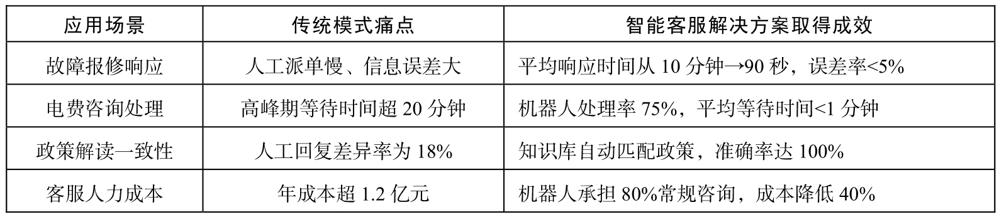

典型案例如下。

·国家电网江苏公司：智能客服系统上线后，年均减少人工座席工作量超 300 万小时，故障报修处理效率提升 45%，获“全国电力服务创新奖”。

·广东电网：通过智能语音机器人推广“指尖办电”，使“零跑动”业务占比从 58%提升至 82%，客户满意度达 92.3 分（满分为 100 分）。

电力行业的智能客服转型，本质是“技术理性”与“民生温度”的融合——既通过 AI 技术破解应急响应慢、服务成本高的行业难题，又以数据驱动的主动服务传递公共服务的人文关怀。未来，随着物联网（如智能电表实时数据接入）、数字孪生（电网设备虚拟仿真）等技术的深化应用，智能客服将进一步拓展至“用电安全预警”“新能源消纳咨询”等场景，成为构建新型电力系统的重要服务支点，让每一度电都承载着高效与温暖的双重价值。

## **7.4** **银行行业应用实例**

在银行行业的数字化转型浪潮中，智能客服系统以“安全守门人”和“价值创造器”的双重角色，重构金融服务边界。当客户对账户安全的极致诉求与银行精准营销的商业目标相遇时，智能客服通过技术创新实现了服务体验与风险管控的平衡。以下从银行行业客服需求及特点、智能客服在银行行业的具体应用场景维度，解析智能客服如何赋能银行业服务升级。

### **7.4.1** **银行行业客服需求及特点**

银行行业的客户服务具有鲜明的“三高”属性。

**1.** **安全性要求极高**

金融业务涉及资金安全与隐私保护，客户对身份验证、交易授权等环节的严谨性要求苛刻。例如：

·转账汇款时需多重验证（如动态口令、人脸识别等）。

·密码重置、账户解冻等敏感操作必须确保客户身份真实性。

数据显示：某银行因客服误判客户身份导致的资金损失纠纷，年均赔付超 500 万元，成为声誉风险高发点。

**2.** **业务复杂度高**

银行业务涵盖储蓄、理财、贷款、信用卡等多个领域，且政策法规频繁更新（如反洗钱规则、利率调整等），客服需要具备极强的专业知识储备：

·理财产品咨询涉及市场风险、收益计算等复杂解读。

·房贷政策咨询需实时对接地方限购、利率浮动等动态条款。

调研发现：人工客服对复杂业务的准确解答率仅为 72%，导致客户二次咨询率达 35%。

**3.** **服务场景碎片化程度高**

客户需求贯穿金融服务全生命周期，且呈现碎片化特征。

·日常场景：账户查询、转账操作、信用卡还款等高频简单需求。

·关键场景：大额资金异动提醒、理财产品到期兑付、贷款审批进度查询等。

·高净值场景：资产配置咨询、家族信托规划等个性化服务。

典型痛点：某股份制银行在季度末理财冲刺期，人工客服日均处理超 200 通咨询，导致高净值客户等待时间超 1 小时，流失率上升 12%。

传统模式的深层矛盾如下。

（1）安全与效率失衡：严格的人工核验流程导致服务效率低下，如贷款预审人工复核需 24 小时，而客户期望实时反馈。

（2）知识更新滞后：新政策解读培训周期长达 2 周，导致政策发布初期咨询错误率超 40%。

（3）数据孤岛严重：客服系统与风控、营销系统数据割裂，无法实现“服务即营销”的深度联动。

### **7.4.2** **智能客服在银行行业的具体应用场景**

智能客服系统针对银行行业特性，构建了“安全合规为基、场景智能为用、数据增值为魂”的服务体系。

**1.** **安全防护：全流程智能核验**

某国有银行部署的智能安全客服系统，实现了风险防控与客户体验的平衡。

·多因子身份验证：客户咨询敏感业务时，系统自动触发“人脸识别+预留问题+设备指纹”三重验证，验证通过时间从 3 分钟压缩至 45 秒。

·交易风险预警：当客户询问“向陌生账户转账 10 万元”时，系统实时调取反欺诈数据库，若收款方为高风险账户，立即阻断操作并提示客户“该账户近期涉及 3 起诈骗投诉，是否确认转账？”，成功拦截率达 98%。

·隐私保护机制：涉及账户余额、交易明细等敏感信息时，智能客服仅提供语音播报，避免文本传输泄露风险，同时对话内容加密存储，符合 GDPR 合规要求。

**2.** **业务办理：全场景智能助手**

招商银行“小招喵”智能客服系统，覆盖 90%以上常规业务。

·智能填单辅助：在客户申请信用卡时，系统自动抓取身份证 OCR 信息填充表单，并根据消费记录推荐卡种（如高频海外消费客户推荐 VISA 白金卡），申请成功率提升 28%。

·贷款预审机器人：当客户输入“房贷额度”后，系统结合征信数据、收入流水、房产估值等多维数据，10 秒内生成贷款额度预估报告，并联动信贷经理跟进，预审时效提升 90%。

·理财产品智能匹配：基于客户风险测评结果（保守型/进取型）、资产规模、投资期限等参数，从 300+产品库中精准推荐 3～5 款产品，附带历史收益曲线对比，使理财购买转化率提升 41%。

**3.** **高净值服务：AI+人工协同模式**

某股份制银行打造的“智能财富管家”系统，实现高端客服升级。

·智能需求洞察：通过分析客户近 1 年的交易流水、理财赎回记录、跨境汇款频率等数据，自动生成“财富健康度报告”，例如识别出某客户连续 3 个月赎回低风险理财，主动推送“中高收益固收+产品”配置建议。

·人工专家介入机制：当客户咨询“家族信托架构设计”时，智能客服自动转接持有 CFP（国际金融理财师）资质的人工团队，同步推送客户资产全景图，使首次沟通方案通过率提升 55%。

·生命周期管理：系统自动标记客户生日、资产到期日等关键节点，触发个性化服务（如生日当天推送专属理财优惠券、大额存单到期前 15 天提醒续存），使高净值客户留存率提升 18%。

**4.** **智能营销：数据驱动的精准触达**

平安银行通过智能客服构建“服务即营销”闭环。

·实时商机捕捉：当客户查询“余额宝收益”时，系统判断其有理财需求，立即推送“平安盈货币基金 7 日年化收益率 2.3%”的对比信息，并附上 1 对 1 理财顾问预约入口，该场景转化率达 19%。

·流失预警干预：监测到某客户连续 3 个月未使用信用卡，智能客服自动发送“历史消费分析报告+专属积分兑换活动”，结合人工外呼，使沉睡客户激活率提升 32%。

·政策红利转化：在 LPR 利率下调周期，系统筛选出房贷利率高于当前市场水平的客户，批量推送“利率转换测算报告”，引导客户办理 refinance，相关业务量增长 240%。

**5.** **行业实践与价值验证**

表 7-2 是智能客服系统在银行行业应用的典型应用场景下的成效展示。

表 7-2

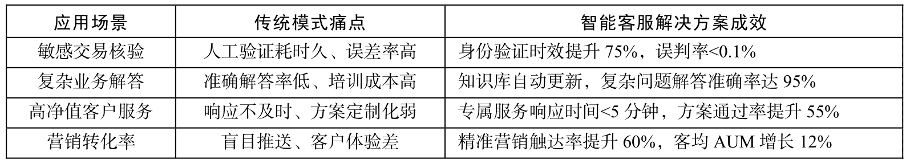

典型案例如下：

·工商银行“AI 客服”：日均处理咨询量超 500 万次，其中 85%由机器人独立解决，人工客服聚焦复杂理财咨询，使高净值客户满意度从 78 分提升至 91 分。

·宁波银行：通过智能客服的“贷款预审+人工复核”模式，将小微企业贷款审批周期从 5 天压缩至 1 小时，将不良率控制在 0.8%以内，低于行业平均水平。

·花旗银行（中国）：智能客服与 CRM 系统深度融合，根据客户跨境交易数据推送“外汇汇率预警”服务，使跨境业务客户留存率提升 25%。

银行业的智能客服转型是一场“戴着枷锁的舞蹈”——既要在监管框架内严守安全底线，又要在客户体验与商业价值之间寻找最优解。通过生物识别、联邦学习等技术破解安全与效率的矛盾，通过知识图谱、强化学习等方式实现复杂业务的精准解答，智能客服正推动银行业从“交易型服务”向“关系型服务”跃迁。未来，随着量子计算、区块链技术的应用，智能客服将进一步拓展至“智能合约自动执行”“跨境金融实时清结算”等场景，让金融服务真正成为“无感却无处不在”的基础设施，重新定义人与财富的连接方式。

# **第八章**

**基于 DeepSeek 构建智能客服技术体系**[2025]

年是 DeepSeek 影响到中国人工智能应用领域方方面面的一年，因此一定要谈谈基于 DeepSeek 构建智能客服技术体系的关键。可以说，在人工智能技术重塑智能客服行业的进程中，DeepSeek 以其创新性技术架构与行业适配能力，成为推动智能客服从“规则驱动”向“智能决策”跨越的关键力量。本章深入解析 DeepSeek 的核心技术体系、差异化优势及行业落地方案，展现其如何通过 MoE 架构、多模态融合等技术，重新定义智能客服的技术标准与应用范式。

## **8.1** **核心技术架构**

**1.** **MoE 架构：动态路由与稀疏计算**

DeepSeek 突破传统 Transformer 的固定计算模式，采用 MoE 架构。在此架构下，DeepSeek 将 670 亿参数划分为 128 个细粒度专家模块，每个模块专注于特定领域，如金融咨询、物流查询、产品推荐等。系统通过动态路由机制，仅激活 3～5 个相关模块处理单次请求，从而实现“精准计算资源分配”，在保证性能的同时大幅降低算力消耗。

在技术原理方面，动态路由机制发挥着关键作用。门控网络实时分析客户输入，这些输入包括文本、语音、图像等多种形式。以实际场景为例，当客户提出“查询订单物流”的需求时，门控网络会判断这一核心意图，进而激活“物流轨迹解析”专家模块；而当客户询问“推荐理财产品”时，“风险评估+产品库匹配”模块则会被激活。与传统 Transformer 的全参数计算不同，MoE 架构在电商场景实测中，减少了 75%的显存占用，推理成本降低 65%，这使得中小企业即便在中等算力设备上，也能够部署高性能的智能客服。

稀疏门控技术在金融客服场景中有着出色的表现。以“理财产品组合推荐”任务为例，该技术结合客户风险偏好（保守型/激进型）、历史持仓数据（股票/基金配比），动态组合专家模块生成个性化方案。在某股份制银行客服中心的实测中，这种方式使得推荐准确率较传统模型提升 40%，同时系统能够支持每秒处理 12000 次并发请求。

从技术价值来看，MoE 架构带来了显著的成本优化。通过动态分配计算资源，该架构避免了“无关模块空转”的情况，使得算力成本较同类大模型降低 60%以上。在场景适配方面，它能够支持复杂业务场景的细粒度处理。比如在电商领域的“多 SKU 组合推荐”场景中，系统可以根据不同商品的特点和客户需求，精准地提供推荐方案；在政务场景的“政策条款解析”中，也能够深入解读复杂的政策内容，有效解决了传统模型“大而全但不精”的痛点。

**2.** **多模态融合框架：跨维度信息联合推**

DeepSeek 构建了门控多模态路由器（Gated Multi-model Router，GMR），支持文本、语音、图像、视频等多模态输入的动态权重分配，实现了“全感官交互”的深度融合。

在技术路径上，视觉-语言对齐是重要的一环。在直播客服场景中，当客户发送“这件红色连衣裙有色差”并上传商品图片时，系统会自动分配 80%权重至图像识别模块，该模块负责分析色差程度、面料纹理等信息；同时分配 20%权重至文本语义模块，用于解析“色差”对应的退换货政策。最终，两个模块联合生成“质检报告+退换货流程”，这使得客户满意度提升了 30%。通过对比学习算法，DeepSeek 解决了传统多模态模型“图文语义割裂”的问题，在服饰电商实测中，图像-文本联合推理准确率达到 92.3%。

情感分析增强也是多模态融合框架的关键部分。该框架融合语音语调（语速波动、音高变化）、面部微表情（通过摄像头捕捉皱眉、微笑等微表情）、文本情感词（如“着急”“满意”），构建了三层情感识别模型，情绪识别准确率高达 91.7%。在电信投诉场景中，当系统检测到客户语速加快、音量升高时，判断出客户处于愤怒情绪时，会自动触发“加急处理”流程。与传统规则引擎相比，这种方式的情绪响应准确率提升 45%，投诉处理周期缩短 50%。

从技术优势来看，多模态融合框架实现了交互自然化。它打破了单一文本交互的局限性，支持“边看边问”“语音+手势控制”等多模态交互方式，能够覆盖 85%以上的复杂服务场景。同时，决策也更加精准化。通过多维度数据融合，系统能够捕捉客户的潜在需求。例如在医疗咨询中，结合患者的症状描述（文本）与 CT 影像（图像），对肺结节良恶性的判断准确率可达 91.7%，接近初级医师的水平。

## **8.2** **关键技术优势**

**1.** **长上下文理解能力：128K 超长语境处理**

DeepSeek 突破了传统模型在上下文处理方面 4K～8K 的限制，具备支持 128K 超长文本解析的能力，这使得它在复杂多轮对话中，不仅能保持语义的一致性，还能深度关联历史信息。

在技术实现层面，DeepSeek 采用了高效注意力机制。通过稀疏注意力算法，其长文本处理效率提升了 3 倍，在 128K 上下文窗口内能够实现毫秒级响应。这一特性让它在诸如数万字的合同条款解析、多轮售后咨询等场景中表现出色。在这些场景里，对长文本的快速准确处理至关重要，DeepSeek 的高效注意力机制恰好满足了这一需求。

同时，DeepSeek 具备跨会话记忆功能。它可以自动存储客户 30 天内的历史对话记录，在跨境电商场景中，该功能优势尽显。当客户连续询问“3 月从日本仓购买的书包未签收→能否提供物流底单→若丢失如何赔偿”时，系统能够完整关联订单信息、物流轨迹及历史客服记录，无须客户重复输入信息，使问题解决效率提升了 60%，人工介入率下降了 50%。

在行业应用方面，政务咨询场景充分体现了 DeepSeek 长上下文理解能力的价值。以处理“公积金提取政策”类长文本咨询为例，DeepSeek 能够自动解析政策文件中的 20 多个条款，精准提取“适用人群”“办理材料”“审批流程”等关键信息，并生成结构化回答。在宿迁“宿心办”App 的实测中，这种方式覆盖了 90%以上的高频民生问题，平均响应时间小于 1 秒。

在金融合规场景中，DeepSeek 同样发挥着重要作用。在解读“保险合同条款”时，它能够关联客户历史投保记录、保单条款及行业法规，自动识别“免责条款”“理赔时效”等风险点。与人工客服相比，其信息提取效率提升 70%，错误率从 4%降至 1.2%，有力保障了金融业务的合规性和客户权益。

**2.** **领域知识深度融合：动态知识库嵌入技术**

DeepSeek 通过知识图谱与外部数据源实时对接的方式，实现了行业专业知识的动态调用与深度推理，有效解决了传统模型“通用知识丰富但领域精度不足”的问题。

在技术方案上，知识图谱构建是关键环节。针对金融、电力、政务等不同领域，DeepSeek 构建了包含各类实体（如“股票代码”“变压器型号”“社保政策”）及它们之间关系（如“属于”“影响”“关联”）的多层级知识图谱。这些知识图谱支持实时更新，例如每日同步最新金融法规、电力设备手册等信息。在金融场景应用中，当处理“股票分红政策”咨询时，DeepSeek 能自动关联《中华人民共和国证券法》第 78 条、企业财报“分红率”字段、税务政策“股息税计算方式”，生成包含“法律依据→财务影响→操作步骤”的三层回答，风险点标注准确率达 98.5%，这一数据是在江苏银行智能合同质检系统中实测得出的。

外部数据实时接入也是 DeepSeek 的重要技术手段。在电力运维场景中，它接入设备传感器数据（如电压、电流、温度波动）与工业协议（Modbus、OPCUA），实时解析“变压器异常报警”。结合历史故障库（10 万多个故障案例），系统能够生成“故障定位（精确至组件级）→维修建议→备件调度”的完整方案，使设备故障预测准确率提升 20%，年节约运维成本 45 万元，这一成果在国家电网 MSC 平台得到了验证。

从技术价值来看，DeepSeek 打破了“通用大模型+行业知识库”的松散结合模式，实现了领域知识与对话逻辑的深度融合。这使得在金融、电力等专业场景中，复杂问题的解决能力提升了 50%以上。同时，通过自动化知识抽取技术，DeepSeek 支持每周新增 10 万多条行业术语，确保系统知识与业务需求同步迭代，始终保持对行业动态的紧密跟踪和及时响应。

## **8.3** **行业适配解决方案**

**1.** **政务服务：方言支持与政策精准解析**

针对政务服务中“多语言混杂、政策文件复杂”的痛点，DeepSeek 提供了定制化解决方案。

在技术方案方面，DeepSeek 在方言识别与混合输入处理上表现出色。它支持普通话及粤语、四川话、闽南语等十几种方言的混合输入，通过半监督学习技术，并利用 30 万小时方言录音数据进行训练，成功将方言转写错误率降低至 8%以下。在“社保查询”“低保申请”等常见政务服务场景中，其准确率可达 92%。此外，DeepSeek 还具备智能纠错机制，能够自动识别“四（是）险一金”“窝（我）要办理”等方言谐音，纠错准确率高达 95%，有效解决了基层政务服务中的语言沟通障碍。

对于政策文件结构化分析，DeepSeek 针对 PDF、Word 格式的政策文件，采用 OCR（光学字符识别）与 NLP（自然语言处理）技术相结合的方式，自动抽取“适用人群”“办理条件”“申报材料”“办理流程”等关键字段，并构建动态知识图谱。这一技术能够覆盖 80%以上的政务高频咨询，像“居住证办理”“高龄补贴申请”等业务。以宿迁“宿心办”App 为例，集成 DeepSeek 后，政策咨询解决率从 75%大幅提升至 95%，平均响应时间也从 3 秒缩短至 0.8 秒，客户满意度达到 98%，成为全国政务服务数字化的标杆案例。

从落地价值来看，DeepSeek 的应用实现了服务普惠化。它消除了方言壁垒，让老年人以及非普通话客户能够享受到与普通话客户同等高效的政务服务。同时，政策解析准确率的提升减少了人工干预，使得基层政务大厅咨询台的工作量下降 40%，窗口效率提升 30%，推动了政务服务流程的标准化进程。

**2.** **跨境电商：多语言生成与智能交互**

面对跨境电商“多语言沟通、文化差异大”的挑战，DeepSeek 打造了全球化服务解决方案。

在技术方案上，DeepSeek 的多语言生成引擎支持英语、西班牙语、阿拉伯语、法语等 16 种语言的自动生成。并且，它能够基于地域文化特征动态调整口播风格，例如在中东市场的宣传内容中加入斋月祝福语，在欧洲市场则强调环保包装与可持续物流。此外，其智能剪辑技术会根据目标市场的偏好，自动匹配背景音乐，如在东南亚市场使用民族乐器配乐，在欧美市场使用流行音乐，从而生成本地化短视频。在义乌小商品城电商平台的实测中，单条视频平均播放量提升至 10 万+。

在跨语言意图对齐方面，当处理“Can I get a refund for the red dress？”（我能退回红色连衣裙吗？）这类问题时，DeepSeek 能够自动关联 3 天前中文对话中的订单号、尺码、物流状态等信息，生成包含海关申报流程、本地仓库地址的中英双语退换货指引。这使得订单处理效率提升 50%，海外客户投诉率下降 40%。

从落地案例来看，义乌跨境电商平台接入 DeepSeek 后，取得了显著成效。其客服覆盖全球 200 多个国家和地区，年订单量增长 280%，客服人力成本下降 60%，成为中小商家拓展海外市场的核心工具，有力推动了跨境电商行业的发展。

**3.** **金融服务：风险控制与个性化推荐**

针对金融行业“高合规要求、强个性化需求”的特点，DeepSeek 提供了全流程技术支撑。

在技术方案中，智能合同质检是重要一环。DeepSeek 能够自动解析贷款合同、理财协议中的“利率条款”“违约金比例”“不可抗力条款”等关键内容，并结合《金融衍生品交易管理办法》等法规，标注风险点并生成合规建议。在某城商行的实测中，较人工审核效率提升 70%，错误率从 5%降至 0.8%。同时，DeepSeek 的动态风险评估功能结合客户交易流水、征信数据、市场波动（如美股指数、汇率变化）等信息，实时生成“风险承受等级→产品匹配度”报告。在理财产品推荐中，这一功能使得客户转化率提升 35%，客均资产配置金额增长 25%。

在反欺诈交互方面，在“账户密码修改”“跨境转账”等敏感操作中，DeepSeek 通过语音语调微颤检测、设备 IP 异常识别等多模态数据融合，实时拦截欺诈风险。与传统规则引擎相比，准确率提升 30%，金融诈骗误判率从 0.5%降至 0.1%。

## **8.4** **轻量化部署与性能优化**

**1.** **动态量化压缩技术**

针对中小企业算力有限的现状，DeepSeek 通过 FP8 混合精度训练与模型蒸馏技术，实现了“高性能轻量化”的部署，有效缓解了中小企业在部署智能客服系统时面临的算力压力和成本难题。

在技术突破方面，DeepSeek 取得了显著成果。其一，在模型体积压缩上，成功将 670 亿参数模型压缩至 168 亿参数，模型体积减小了 75%，这使得存储成本下降 65%。如此一来，原本需要大量存储资源的模型，现在能够在更有限的空间内存储，大大降低了存储成本。同时，这也使得模型可以在单台 4 卡 GPU 服务器上稳定运行，中小企业的部署成本从百万元级降至 10 万元级，极大地减轻了中小企业的经济负担，让智能客服系统的部署不再遥不可及。其二，推理效率得到显著提升。通过动态量化技术，DeepSeek 在金融客服场景的实测中，将推理延迟控制在 200ms 以内，并且能够支持每秒处理 8000+咨询请求。这一强大的处理能力，足以满足电商大促、金融峰值等高频场景的需求。在电商大促期间，大量客户同时咨询商品信息、物流情况等问题，DeepSeek 能够快速响应，确保客户得到及时的服务，提升客户购物体验；在金融峰值时段，如每月的特定业务高峰期，也能高效处理大量的客户咨询和交易请求，保障金融服务的稳定运行。

在场景适配方面，DeepSeek 为中小银行定制了“信用卡客服轻量化版本”。这个版本在保持 92%意图识别准确率的同时，硬件投入降低了 70%，上线周期也从原本的 3 个月大幅缩短至 2 周。这使得中小银行能够以较低的成本、较快的速度拥有一套高效的信用卡客服系统，提升了银行的服务能力和市场竞争力，满足了中小银行在资源有限情况下对智能客服系统的迫切需求。

**2.** **硬件协同优化**

DeepSeek 与昇腾、英伟达 GPU 进行深度适配，构建了“端云协同”架构，实现了从边缘设备到云端的全场景覆盖部署，为智能客服系统的高效运行提供了坚实的硬件基础。

在技术架构上，边缘端轻量化部署是一大亮点。DeepSeek 在智能音箱、POS 机、车载终端等设备中嵌入轻量模型，实现了“本地意图识别+云端复杂推理”的模式。以车载客服场景为例，当客户发出“导航设置”“音乐播放”等简单指令时，设备端能够实时处理，响应时间小于 50ms，为客户带来快速便捷的体验。而当遇到复杂问题如“车辆故障报修”时，设备会自动将问题上传至云端，云端强大的计算能力会在 1 秒内返回解决方案，确保问题得到及时有效的处理。这种模式充分发挥了边缘设备的本地处理能力和云端的强大计算能力，提升了系统的整体性能和响应速度。

云端弹性扩展是“端云协同”架构的另一大优势。通过 Kubernetes 动态调度资源，在金融行业峰值时段，如每月 5 日养老金发放日，系统能够自动扩容至 2000+服务器节点。这样的弹性扩展确保了 99.99%的请求在 1 秒内响应，有效避免了“算力浪费”与“服务卡顿”的情况。在高并发请求下，系统能够灵活调配资源，保证服务的稳定性和高效性，资源利用率也因此提升了 40%，实现了资源的合理利用和高效配置。

从行业价值来看，“端云混合部署”模式具有重要意义。它既满足了智能设备对低延迟的需求，让客户在使用智能设备与客服交互时感受到快速响应；又能应对云端高并发场景，确保在大量客户同时请求服务时，系统依然能够稳定运行。这种模式实现了“成本-性能”的最优解，在为企业提供高质量服务的同时，降低了运营成本，提升了企业的竞争力，推动了智能客服行业的发展。

DeepSeek 通过 MoE 架构、多模态融合、长上下文理解等核心技术，构建了“高效计算+精准推理+行业适配”的智能客服技术体系。其价值不仅在于技术突破，更在于将复杂 AI 能力转化为可落地的行业解决方案，助力政务、电商、金融等领域实现服务效率与客户体验的双重提升。后续章节将结合具体行业案例，进一步展示 DeepSeek 在智能客服系统设计、实施及优化中的实战经验。

# **第九章**

# **结论与展望**

本章将就智能系统的优势和成果进行总结，并在此基础上展望其未来的发展方向。通过对技术革新与市场需求变化的细腻洞察，希望为企业及行业同仁提供一份珍贵的指南，助力其在市场海洋中乘风破浪，始终保持竞争优势。

## **9.1** **系统优势与成果总结**

智能客服系统的引入，为传统的客服模式带来了翻天覆地的变化。它不仅提升了企业的运营效率，还极大地改善了客户体验。在市场竞争日益激烈的当下，企业的客服水平成为影响其竞争力的关键因素之一。智能客服系统的出现，打破了传统客服模式在时间、空间和人力上的限制，为企业和客户创造了全新的价值。它能够快速处理大量复杂的客户咨询，提供 7×24 小时不间断服务，让客户无论何时何地都能获得及时有效的帮助，显著提升了客户对服务的满意度。这一变革的核心在于，巧妙运用了先进的人工智能技术、大数据分析以及云计算能力，构建了一个高效且灵活的客服生态系统。

图 9-1 以思维导图的形式，清晰呈现了按功能划分的智能客服分类，具体如下。

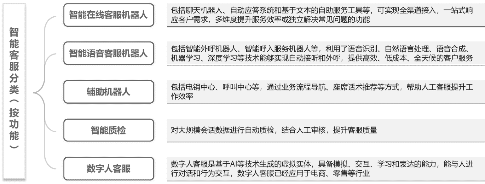

图 9-1

·智能在线客服机器人：当下通过聊天机器人、自动应答系统和基于文本的自助服务工具等，实现全渠道接入，一站式响应客户需求，多维度提升服务效率并独立解决常见问题。展望未来，随着自然语言处理技术的进一步突破，其将能更精准地理解复杂语境和情感语义，实现与客户的深度、个性化交互。例如，在客户咨询旅游攻略时，不仅能提供常规信息，还能根据客户情绪、过往偏好，定制独特的旅行线路。

·智能语音客服机器人：目前借助语音识别、自然语言处理等先进技术，实现自动接听和外呼，提供高效、低成本、全天候服务。未来，随着语音合成技术向情感化、个性化方向发展，以及与物联网的深度融合，它将能在智能家居场景中，以富有情感的语音为客户提供设备控制、生活提醒等更贴心服务；在车载场景中，实现更流畅、安全的语音交互。

·辅助机器人：现应用于电销中心、呼叫中心等，通过业务流程导航、座席话术推荐等方式辅助人工客服。未来，随着强化学习等技术的发展，辅助机器人将具备更强自主学习和决策能力，能根据实时业务数据和客户动态需求，主动为人工客服提供更具前瞻性、精准性的策略建议，成为人工客服的智能“参谋”。

·智能质检：当前对大规模会话数据进行自动质检并结合人工审核来提升客服质量。未来，随着大数据和人工智能技术的深度融合，智能质检将实现从质量检测到服务预测的跨越。不仅能实时分析对话质量，还能提前预判服务风险，预测客户需求变化趋势，助力企业提前优化服务策略。

·数字人客服：基于 AI 生成的虚拟实体，已在电商、零售等行业应用，具备模拟、交互、学习和表达能力。未来，随着图形渲染、动作捕捉等技术进步，数字人客服将在外观、动作、表情等方面更加逼真自然，甚至能在虚拟世界中举办产品发布会、品牌活动，与客户进行沉浸式互动，重塑品牌与消费者的连接方式。

图 9-2 展示了典型原生大模型智能客服产品逻辑架构。

·客户提问：客户的提问丰富多样，涵盖闲聊、产品推荐、产品问答、技术疑问、产品对比等诸多方面。未来，随着人们生活和工作场景的不断拓展，客户提问将更加多元化和个性化，例如涉及新兴的元宇宙社交规则、太空旅游咨询等前沿领域问题。

·意图识别：通过多轮对话精准把握客户提问意图，是智能客服理解客户需求的关键环节。未来，意图识别技术将借助更先进的深度语义理解和情感分析技术，不仅能准确识别客户字面意图，还能洞察客户潜在情感需求和隐性意图，比如识别出客户在咨询电子产品时对环保属性的潜在关注。

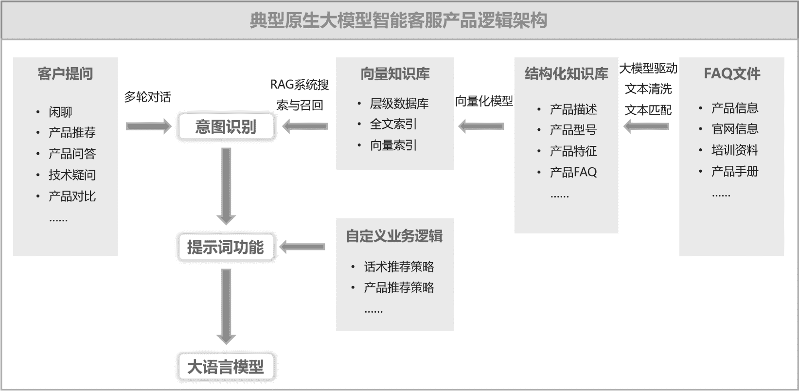

图 9-2

·提示词功能：连接意图识别与大语言模型，起到承上启下的作用。未来，提示词功能将具备更强的自学习和自适应能力，根据不同客户群体、行业场景动态生成更精准、有效的提示词，实现与客户的深度共鸣和高效沟通。

·大语言模型：作为智能客服的核心，承担着理解和生成回答的重任。未来，大语言模型将在参数规模、训练数据多样性和质量上持续提升，具备更强的常识推理能力、跨领域知识融合能力，甚至能根据客户偏好生成富有创意和情感的回答。

·自定义业务逻辑：包括话术推荐策略、产品推荐策略等。未来，自定义业务逻辑将充分结合客户全生命周期数据和实时场景信息，实现从通用策略到极致个性化策略的转变，为客户提供“千人千面”且契合当下情境的专属服务。

·RAG 系统搜索与召回：从向量知识库和结构化知识库中检索相关信息。未来，RAG 系统将具备更强大的多模态信息检索能力，不仅能处理文本，还能整合图像、音频、视频等信息，实现更全面、精准的知识召回。

·向量知识库：由层级数据库、全文索引、向量索引等构成。未来，向量知识库将借助量子计算等先进技术，实现存储容量和检索速度的指数级提升，同时通过知识图谱的动态扩展，让知识关联更加智能和灵活。

·结构化知识库：包含产品描述、产品型号、产品特征、产品 FAQ 等内容。未来，结构化知识库将实现与企业各类业务系统的深度融合和实时同步更新，确保知识的及时性和准确性，同时通过知识图谱的完善，支持更复杂的知识推理和应用。

·FAQ 文件：涵盖产品信息、官网信息、培训资料、产品手册等。未来，FAQ 文件将采用更智能的自动化生成和更新机制，结合客户反馈和业务变化进行实时优化，以更友好的交互形式呈现，如智能语音播报、可视化图表展示等。

总体而言，该逻辑架构未来将持续进化，深度融合多领域前沿技术，不断拓展智能客服的能力边界，为客户带来超乎想象的智能服务新体验，推动客服行业迈向全新发展阶段。

## **9.2** **未来发展方向与展望**

随着人工智能技术的快速发展，智能客服系统正迎来一场前所未有的蜕变。技术创新如何引领这些智慧助手迈向更加卓越的境界，它们在面对社会变迁时如何巧妙地适应新需求，开拓更为丰富多彩的应用场景？特别值得一提的是，在营销功能的拓展与跨平台融合能力的提升上，智能客服展现出了令人期待的发展前景。通过对 AI 算法不断进步所带来的预测分析准确度提升、全渠道数据整合及其对精准营销支撑作用的细致剖析，揭开智能客服在未来的发展道路。

### **9.2.1** **技术创新与功能拓展**

近年来，随着人工智能技术的飞速发展，尤其是深度学习模型和多模态信息处理技术的应用，智能客服系统已从简单的问答服务蜕变为提供全面解决方案的服务平台。例如，在医疗健康领域，智能客服系统借助多模态信息处理技术，不仅可以处理患者的文字咨询，还能分析患者上传的症状图片、检查报告等信息，结合医学知识图谱，为患者提供初步的诊断建议和就医指导。深度学习模型的应用则使智能客服能够不断学习和更新医学知识，提高诊断的准确性和服务的专业性，为患者提供更可靠的健康咨询服务。这一变革不仅显著提升了系统的性能，还为企业带来了更精准的市场定位和个性化的服务策略。

深度学习模型在智能客服中的应用使得系统能够更好地理解和回应客户需求。传统的智能客服在面对模糊、多义的语言表达时，往往难以准确理解客户意图，导致回答不准确或无法满足客户需求。而深度学习模型通过对海量文本数据的学习，能够捕捉语言中的细微差别和上下文信息，从而更准确地理解客户的真实意图。例如，当客户询问“我最近感觉身体不太舒服，有点头晕，该怎么办？”时，深度学习模型驱动的智能客服不仅能识别出“头晕”这一症状，还能结合客户的历史健康数据和常见疾病症状，进一步询问客户是否还有其他伴随症状，如恶心、乏力等，从而提供更全面、准确的建议。传统的基于规则或关键词匹配的方法存在局限性，难以应对复杂多变的语言环境。而通过在自然语言处理领域的突破，如 BERT、GPT 等预训练大模型，智能客服能够准确捕捉客户意图，甚至理解上下文语境，从而给出更加贴切且人性化的回答。例如，当客户询问“我的订单为什么还没有发货？”时，系统不仅能识别出这是关于订单状态的问题，还能根据历史数据推测可能的原因，并给出具体的解释或建议，极大地提升了客户体验。

大数据处理能力是实现这种智能化服务的关键支撑。现代智能客服系统每天都要面对海量的数据输入，包括来自各种渠道的文字消息、语音通话记录及图片视频等多媒体信息。借助云计算平台强大的计算资源，企业可以高效地存储、管理和分析这些数据。通过对全域数据进行整合与分析，客服系统不仅能够快速响应客户的即时需求，还可以预测未来趋势，帮助企业制定更为精准的营销策略。比如，通过分析客户的购买历史和浏览行为，系统可以推荐相关产品或服务，甚至提前解决潜在问题，避免不必要的投诉发生。

多模态信息融合技术进一步丰富了智能客服的功能。不同于以往仅限于文本交流的方式，现在的智能客服可以通过文字、声音乃至图像等多种形式与客户互动。这不仅让沟通变得更加直观便捷，也为满足不同场景下的特殊需求提供了可能。以医疗行业为例，患者可以通过发送症状照片给在线医生助手来获得初步诊断意见；在教育领域，虚拟教师可以根据学生上传的作业内容自动批改并给予反馈。此外，借助计算机视觉技术和情感分析算法，客服机器人还能够感知客户的情绪变化，适时调整语气风格，营造更加温馨舒适的对话氛围。

随着 AI 大模型及云技术的发展，智能客服正逐步渗透到各个商业领域中。无论是传统的呼叫中心还是新兴的电子商务平台，抑或是金融、电信等行业，都能见到其身影。除基础的咨询解答外，智能客服还在客服体验优化、个性化推荐等方面展现出巨大潜力。它不仅帮助企业节省人力成本，提高运营效率，更重要的是，它通过深入挖掘每一个客户的独特价值，为企业创造更多商业机会。

技术创新推动着智能客服从单一功能模块向综合服务平台转变，使其成为连接企业和消费者之间不可或缺的重要桥梁。未来，随着相关技术不断进步和完善，相信智能客服将在促进企业数字化转型、增强核心竞争力方面发挥越来越重要的作用。

### **9.2.2** **面向新的社会形态和需求的演进**

随着远程工作等新兴生活方式逐渐成为常态，人们的消费行为也随之悄然变化。人们在工作间隙进行消费的时间变得更加碎片化，对购物的便捷性和即时性要求更高。例如，在工作期间，员工可能会利用短暂的休息时间通过手机咨询商品信息或办理业务，这就需要智能客服能够快速响应并提供精准服务。同时，由于人们更多地依赖线上渠道进行沟通和交易，对智能客服的交互体验和服务质量期望也越来越高，期望能获得如同面对面交流般的个性化和贴心服务。这不仅改变了人们的生活习惯，也对企业如何更好地服务客户提出了新的要求。作为企业与消费者之间的纽带，智能客服系统在这一背景下必须做出相应调整，以适应这些变化，并进一步提升客户体验。比如，为适应碎片化的咨询时间，智能客服应具备快速唤醒和响应的能力，缩短客户等待时间。同时，利用客户在不同平台留下的行为数据，构建更全面的客户画像，从而实现更精准的个性化服务。在跨平台操作方面，要确保客户无论是通过电脑端的网页、手机 App 还是社交媒体平台接入，都能获得一致的服务体验，避免因平台差异导致服务质量参差不齐。通过增强灵活性、提供更多定制化选项以及确保跨平台操作的一致性和无缝衔接，智能客服能够更好地满足客户在远程工作时代下的特殊需求。同时，其强大的数据分析能力也为支持企业制订有效的营销计划提供了重要依据。

从灵活性的角度来看，现代生活节奏快速且充满变数，这就要求智能客服具备高度自适应的能力，以应对多样化的场景需求。智能客服的灵活性还体现在应对不同紧急程度的需求上。在紧急情况下，如客户遇到支付故障急需解决时，智能客服应能迅速调整优先级，优先处理该问题，并提供多种解决途径，如引导客户进行紧急支付申诉、提供临时解决方案等。而在日常咨询场景中，智能客服可以根据客户的情绪和需求，提供更具亲和力和个性化的服务，如在推荐相关产品或服务时，考虑客户的兴趣爱好和使用习惯。例如，对于经常需要切换不同设备工作的远程员工来说，能够在手机、平板电脑乃至桌面计算机之间无缝切换而不丢失会话进度或上下文信息的客服解决方案显得尤为重要。此外，考虑到全球各地因时区差异导致的工作时间不一致问题，全天候在线并能迅速响应的服务变得不可或缺。因此，未来的智能客服应更加注重构建灵活多变的服务框架，如允许客户根据个人偏好设定交互方式（文字聊天、语音通话甚至视频沟通），或按照特定时间段自动调整优先级设置等功能，从而实现真正意义上的“随时随地”服务体验。

为了给客户提供更加个性化的服务，智能客服还需增加更多的可定制化选项。这意味着除基本的信息查询与故障排除外，还可以根据客户的使用习惯及反馈不断优化界面布局、功能配置甚至语言风格等方面，使每个使用者都能感受到专属感。具体而言，可以引入机器学习算法分析历史对话记录，从中提炼出每位客户的独特兴趣点与痛点所在，进而推送相关性强的内容或优惠活动；也可以开发插件式模块让客户自行添加所需特性，这样既提升了产品的实用价值，又增强了客户黏性。值得注意的是，在进行个性化设计时还需兼顾隐私保护原则，避免因过度收集个人信息而引发信任危机。

在当前数字化转型加速推进的大环境下，保持跨平台操作中的一致性和无缝衔接成为衡量智能客服质量好坏的关键指标之一。理想状态下，无论客户选择哪种接入渠道（网站、App、社交媒体私信等），都应当获得相同水平的服务质量和客户体验。为此，一方面要加强对各类接口标准的研究与对接工作，确保数据传输顺畅无阻；另一方面则需建立统一的知识库体系作为后台支撑，保证前后端信息同步更新且准确无误。这样一来，即便是在复杂多变的应用环境中，也能为客户提供稳定可靠的帮助。

智能客服还应该充分利用其强大的数据分析能力帮助企业洞察市场趋势、预测消费行为，并据此调整策略。通过对海量结构化与非结构化数据进行深度挖掘，不仅可以揭示隐藏于表象之下的真实需求特征，还能识别出潜在的增长机会点。基于此，企业可以采取更精准的目标定位措施，比如针对高价值客户群体推出定制化促销方案，或者利用社交媒体影响力开展口碑营销活动等。长远来看，这将有助于构建起一套完整的闭环生态系统——即从获取线索到转化成交再到复购推荐，每一步骤都有科学的方法论指导和支持，最终形成良性循环推动整体业绩增长。

面对日新月异的社会变迁所带来的挑战与机遇，智能客服唯有不断创新求变，才能紧跟时代步伐，在为企业创造更大商业价值的同时，也让每一位消费者享受到前所未有的优质服务体验。

## **9.3** **基于 AI** **Agent 重构智能客服系统**

在数字化转型的浪潮中，通过引入 AI Agent（AI 智能体）的概念来重塑智能客服架构，不仅能够显著提升服务效率和客户满意度，还能在决策过程中为企业和个人客户提供更加明智的选择。以电商领域为例，AI Agent 驱动的智能客服可以根据客户的实时浏览行为、历史购买记录及当前的市场动态，为客户提供更加精准的商品推荐和个性化的购物建议。比如，当客户正在浏览一款手机时，智能客服不仅能推荐同品牌的其他热门机型，还能结合近期的促销活动、客户所在地区的库存情况，为客户提供最优惠的购买方案，助力客户做出更明智的购物决策。这一创新性的转变，需要紧跟技术进步和社会需求的变化，构建理想的未来智能客服体系。

AI Agent，是一种能够执行自动化任务、做出决策，甚至与人类进行自然语言交流的程序，结合智能体开发框架及检索增强生成技术（RAG），AI Agent 使智能客服使用和维护成本更低，意图理解更精准，应对客户问题的策略更灵活，已经在电商、银行等智能客服场景落地，为智能客服发展进一步打开想象空间。AI Agent 在智能客服系统中的应用，为解决传统客服系统的痛点提供了新的思路。它能够模拟人类的思维和决策过程，主动分析客户需求，提供更加智能、高效的服务。在实际应用中，AI Agent 可以与企业的各种业务系统深度集成，实现数据的实时共享和协同工作，从而为客户提供更加全面和个性化的服务体验。例如，在银行的信贷业务中，AI Agent 可以实时获取客户的信用数据、资产信息等，为客户提供更准确的贷款额度评估和个性化的还款方案建议。

图 9-3 详细呈现了基于大模型的 AI Agent 智能客服应用逻辑及其当下具备的能力提升表现。

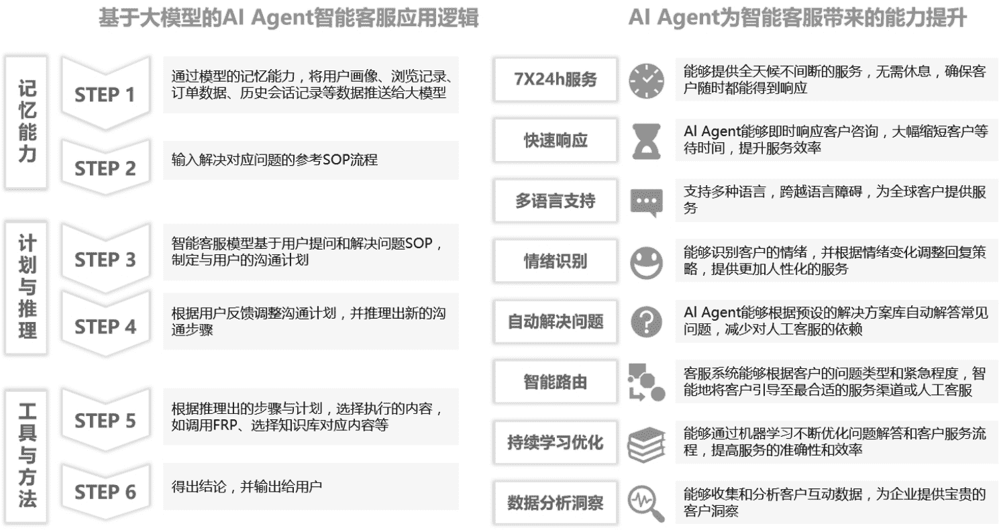

图 9-3

从应用逻辑来看，它通过记忆能力、计划与推理、工具与方法等步骤，为客户提供服务。在能力提升方面，涵盖 7×24 小时服务、快速响应等多个维度。然而，科技发展日新月异，智能客服领域也在不断演进。当下的成果只是阶段性的展现，在未来，随着众多前沿技术的融合与突破，其各方面能力都将迎来巨大飞跃。为了更清晰地对比当下与未来的差异，我们以表 9-1 进行呈现。

表 9-1

续表

通过表 9-1，我们清晰地看到基于大模型的 AI Agent 智能客服在当下与未来的能力差异及发展趋势。而这些能力提升的背后，是 AI Agent 技术在智能客服领域的深度应用与不断革新。接下来，我们将深入探讨 AI Agent 在智能客服系统中的具体优势，以及重构智能客服架构的关键步骤，进一步揭示其如何重塑智能客服的未来格局。

**1.** **理解 AI** **Agent 及其优势**

AI Agent 是一种高度智能化的软件实体，它能模拟人类的行为和思维方式，处理复杂的任务，并根据环境变化自主学习与调整策略。在处理复杂的客户问题时，AI Agent 的优势尤为明显。例如，在处理多步骤的技术故障排查时，它可以凭借强大的推理能力，根据客户描述的症状，结合知识库中的技术资料和过往案例，迅速分析出可能的故障原因，并制定出详细的排查步骤。如果遇到知识库中没有的问题，AI Agent 还能通过自主学习功能，从互联网上的相关技术论坛、专业文档中获取信息，不断丰富自己的知识储备，以更好地应对各种复杂情况。而且，在与客户交流的过程中，AI Agent 能够实时识别客户的情绪状态，当检测到客户因问题未得到及时解决而产生不满情绪时，它会调整沟通策略，使用更加温和、安抚的语言，先缓解客户情绪，再解决问题，从而大大提升客户的服务体验。相比传统智能客服，AI Agent 拥有更强的记忆力、推理能力和情绪识别能力等高级功能。例如，基于强大的记忆能力，AI Agent 可以整合客户的画像信息、浏览记录、订单数据及历史会话记录，形成全面的客户画像，从而提供个性化的服务体验。在旅游预订场景中，AI Agent 利用记忆能力，不仅能记住客户之前预订的旅游目的地、酒店偏好、出行时间等信息，还能分析这些数据背后的客户喜好和需求模式。当客户再次咨询旅游相关问题时，AI Agent 可以根据之前积累的信息，主动推荐符合客户偏好的旅游线路，如推荐与之前目的地风格相似但又有新特色的地方，或者根据客户以往选择的酒店档次和类型，推荐更适合的住宿选择。这种个性化的服务能够让客户感受到被重视和理解，提高客户对智能客服的信任度和依赖度。此外，AI Agent 还能够在对话中敏锐地捕捉客户的情绪变化，并据此调整回复策略，使互动更加人性化、亲切。

**2.** **重构智能客服架构的关键步骤**

多模态交互支持对于智能客服系统的发展至关重要。在全球化的背景下，企业的客户来自不同的国家和地区，使用多种语言进行交流。支持多语言和多模态交互，能够让智能客服更好地满足不同客户的需求，打破语言和沟通方式的障碍。例如，在跨国电商平台中，来自世界各地的客户可以用自己熟悉的语言与智能客服交流，无论是通过文字输入咨询商品信息，还是通过语音进行售后投诉，甚至是上传商品图片反馈问题，智能客服都能准确理解并做出回应，提供便捷、高效的服务体验，提升企业在全球市场的竞争力。

（1）多模态交互支持：为了实现全球范围内的无障碍沟通，未来的智能客服系统应当支持多种语言，并能够处理文本、语音乃至图像等多种形式的信息输入。以医疗健康领域为例，患者可能来自不同的语言区域，当他们向智能医疗客服咨询健康问题时，多语言支持功能可以确保患者与客服顺畅交流。对于一些难以用语言准确描述的症状，患者还能通过上传医学影像、身体局部照片等图像资料，让智能客服更直观地了解情况。智能客服借助图像识别技术和医学知识，为患者提供更准确的初步诊断建议和就医指导，提升医疗服务的可及性和质量。这样不仅能跨越语言障碍，还能让客户以最自然的方式表达自己的需求。

（2）增强的情境感知与决策制定：利用先进的自然语言处理技术和深度学习算法，AI Agent 能够深入理解客户的真实需求，并快速生成解决方案。在金融服务场景中，客户的需求往往复杂多样且涉及重要的财务决策。例如，当客户咨询投资组合建议时，AI Agent 需要综合考虑客户的财务状况、投资目标、风险承受能力等多方面因素。通过自然语言处理技术，AI Agent 深入理解客户的意图和期望，利用深度学习算法分析市场趋势和各类金融产品的表现。在制定投资方案时，AI Agent 不仅能提供常规的投资组合建议，还能根据市场的实时变化和客户的特定情况进行动态调整。如果遇到如市场突发重大事件等复杂情况，AI Agent 会通过逻辑推理判断当前问题的复杂性和自身的局限性，及时将问题转交给专业的投资顾问，确保客户得到最专业的服务。在面对复杂情况时，AI Agent 可以通过逻辑推理规划下一步行动，甚至主动寻求专业帮助，将特定问题转交给合适的人工专家解决。

（3）持续地学习与优化机制：成功的智能系统离不开强大的自适应学习能力。持续学习与优化机制是保证 AI Agent 始终保持高效服务的核心。以在线教育智能客服为例，随着教育内容的不断更新和学生需求的多样化发展，AI Agent 需要不断学习新的知识和教学方法。它会收集每一次与学生互动的数据，包括学生的问题类型、学习进度、对解答的满意度等。通过对这些数据的深度分析，AI Agent 可以发现自身在知识储备和解答策略上的不足，及时从教育资源库、学术文献以及教师的教学经验中获取新的知识和方法，优化自身的回答逻辑和内容。例如，如果发现很多学生对某一知识点的理解存在困难，AI Agent 可以学习不同的讲解方式，并在后续的服务中根据学生的具体情况选择最合适的讲解方法，不断提升服务质量和学生的学习效果。通过收集并分析每一次互动的数据，AI Agent 可以不断改进其响应策略和服务质量。随着时间的推移，整个系统将变得更加智能高效，更好地满足不同客户群体的独特偏好。

（4）无缝集成的企业级应用：为了让 AI Agent 发挥最大效能，必须确保它可以轻松接入企业的其他信息系统，如 CRM（客户关系管理）系统和 ERP（企业资源计划）系统。在大型制造业企业中，客户的咨询可能涉及多个部门的知识和资源。例如，客户询问某产品的定制化方案和交货周期，这既需要了解产品设计部门的技术能力，又需要掌握生产部门的排产计划。AI Agent 接入企业的 CRM 系统，可以获取客户的历史订单信息、偏好等资料，更好地理解客户需求；接入 ERP 系统，能实时获取生产进度、库存状况等数据。当处理这类复杂问题时，AI Agent 可以根据从 CRM 系统中获取的客户需求信息，结合 ERP 系统中的生产资源和排产数据，快速生成定制化方案和准确的交货周期预估。若遇到特殊情况，如关键零部件库存不足影响交货时间，AI Agent 还能自动协调采购部门、生产部门共同商讨解决方案，并及时反馈给客户，整个过程高效且无须人工过多干预，大大提升了客服的效率和质量，增强了企业的竞争力。这样一来，当遇到需要跨部门协作才能解决的问题时，AI Agent 能够迅速调用相关资源进行处理。

（5）强化的数据安全性和隐私保护措施：随着越来越多敏感信息被纳入智能客服的工作范畴，保障数据安全变得尤为重要。以金融行业为例，客户与智能客服沟通时会涉及大量敏感信息，如账户余额、交易密码、身份证号码等。AI Agent 在处理这些信息时，必须采取多重安全防护措施。一方面，通过加密存储技术，将客户信息转换为密文并存储在服务器中，即使数据遭遇泄露，攻击者也难以获取真实信息。另一方面，在数据传输过程中，采用安全的通信协议，对传输的数据进行加密处理，防止数据在网络传输过程中被窃取或篡改。同时，对于一些不必要的个人敏感信息，AI Agent 可以采用匿名化处理方式，在不影响服务质量的前提下，最大限度地保护客户隐私。例如，在分析客户交易行为数据时，使用匿名化后的标识符代替真实身份信息进行分析，既满足了数据分析的需求，又保障了客户的隐私安全。因此，在设计新架构时，必须严格遵守相关的法律法规要求，并采取加密存储、匿名化处理等手段加强个人信息防护力度。

**3.** **案例分析与前景展望**

在实际的电商运营中，已经有部分企业开始尝试引入基于 AI Agent 的智能客服系统，并取得了显著的效果。例如，某知名电商平台在部分品类的商品售后服务中应用了 AI Agent 智能客服。在处理消费者关于电子产品使用问题的咨询时，AI Agent 能够根据消费者描述的问题，迅速从产品知识库中提取相关解决方案，并以图文并茂的形式呈现给消费者，大大提高了问题解决的效率。对于一些常见问题，消费者无须等待人工客服回复，即可快速获得帮助，这不仅提升了消费者的购物体验，也减轻了人工客服的工作压力。而且，AI Agent 在处理问题的过程中，会不断收集和分析消费者的反馈数据，持续优化自身的回答策略和知识库内容，以更好地应对各种复杂情况。设想这样一个场景：某电商平台上的买家遇到了产品使用方面的困惑，只需简单描述问题，就能得到由 AI Agent 提供的详尽解答；如果涉及退货换货等复杂情况，该系统还能自动引导顾客完成相应流程，并实时跟踪进度直至问题被圆满解决。不仅如此，通过对过往交易记录的分析，AI Agent 还可以向消费者推荐符合其偏好的商品或服务，从而促进销售增长。例如，通过对消费者购买历史、浏览行为及搜索关键词等数据的深度分析，AI Agent 能够精准把握消费者的偏好和潜在需求。当消费者再次登录电商平台时，AI Agent 会主动推荐符合其偏好的商品，推荐的商品不仅包括与消费者之前购买过的类似产品，还会根据市场趋势和消费者的潜在需求，推荐一些具有创新性或关联性的商品。这种个性化的推荐服务不仅提高了消费者发现心仪商品的概率，增加了电商平台的销售额，还增强了消费者与平台之间的黏性，使消费者更愿意在该平台进行购物。

综上，基于 AI Agent 重构后的智能客服系统将不再只是被动等待指令执行的角色，而是成为真正的“助手”，积极参与企业运营决策，在助力其实现商业目标的同时，也为终端客户提供前所未有的便捷体验。随着相关技术的日益成熟，可以预见这一美好愿景终将成为现实。