# DeepSeek 时代的智能客服搭建与落地全攻略

## 内容速览
本书以原理拆解、架构搭建、行业应用为脉络，用易懂的表达把智能客服的底层思路和工程路径讲清楚。从早期的关键词匹配到如今的大模型驱动，本书梳理了技术演进的轨迹与关键底座，并在此基础上讲清业务架构、技术架构、应用架构的设计思路，拆解语音识别、数字人客服、大数据用户画像、FreeSWITCH 接入等核心模块的实现要点。结合电信、电商、电力、银行的真实案例，展示高并发咨询、故障快速响应、金融服务等场景的落地打法；并以 DeepSeek 等前沿实践为例，探讨混合专家架构如何降本增效，以及长上下文窗口怎样支撑跨会话的连续理解，让创新真正变成业务价值。

## 写在前面
ChatGPT 引爆的 AIGC 浪潮席卷各行各业，回望智能客服的发展，会看到技术进化和行业变革交织的清晰线条。2010 年前后是关键词匹配的机械答复时代，2016 年左右 NLP 带来的语义理解迎来一次跃迁，如今大语言模型推动客服进入类人交互阶段。智能客服早已不是单纯的降本工具，而是企业与用户建立情感联结、实现价值共创的关键枢纽。

作为一路参与这场变革的实践者，我们经历了不少痛点的突破：为运营商扛住双 11 峰值每秒数万次咨询的算力压力；为银行在资金安全与服务效率之间寻找智能核验的平衡；看到电商用多轮对话机器人把退货纠纷率拉低 40%；也看到电力系统把故障报修响应从 45 分钟压到 90 秒。这些案例让我们明白：好的客服既要读懂“我的快递没收到”背后的焦虑，也要能处理“跨境汇款被拦截”这类复杂诉求，终极目标是让技术温度与商业效率同频。

本书源于对行业碎片化经验的系统整合，也源于对落地最后一公里的思考。既给出智能知识库的建设与动态更新方法，也用电信、电商、电力、银行的实战案例说明不同场景下的技术选型与架构适配。特别在模型应用部分，结合 DeepSeek 的实践探讨 MoE 架构如何降低推理成本，长上下文如何支持历史跨会话理解，推动创新转化为可落地的商业回报。

站在 2025 年看未来，演进有三个方向：一是多模态交互打破文字语音边界，视频客服的唇语识别、AR 远程协助将成标配；二是认知智能从被动响应转向主动预测，通过行为数据提前预判投诉并干预；三是行业深度定制成为壁垒，金融合规话术生成、制造设备故障诊断话术库等对垂直理解能力要求更高。背后始终要守住技术伦理与数据安全的底线，这也是本书反复强调的技术向善。

本书面向三类人群：想搭建系统的技术开发者，可从架构设计与模块实现获指导；负责客服运营的管理者，可借数据分析与优化策略提升效能；关注 AI 产业落地的研究者，可从案例中洞察规律与挑战。我们保留了 FreeSWITCH 协议适配、多轮对话训练闭环等技术细节，也用类比把复杂概念讲明白，让不同背景的读者都能各有所得。

感谢深耕此领域的同行、提供案例打磨的企业伙伴，以及每一位用咨询和反馈推动迭代的客户。智能客服的本质是技术可能性与商业现实性的持续对话，愿本书成为这场对话的助燃剂，让 AI 赋能服务走得更稳更远。

董宁 尹泽明
2025 年 8 月

# 第一章

## 智能客服系统总览
在数字化浪潮中，智能客服已成为企业提升竞争力的核心抓手。它像一座智能桥梁，借助 5G、大数据、自然语言处理、机器学习、深度学习等技术，让企业与用户沟通更高效，服务体验被重塑，运营模式被改写。尤其以 DeepSeek 为代表的新一代 AI，通过把混合专家架构与多模态能力结合，正在重塑行业标杆。

### 1.1 智能客服系统的背景与重要性
智能客服的智能化已从早期严格的关键词匹配，演进为当下由大语言模型驱动的交互范式。它不再只比对字面词，而是能解析语义与语境。无论用户问产品细节、求技术支持还是提服务反馈，系统都能给出贴合需求的回答案例，体验明显提升。系统还有学习能力，随着新咨询案例的积累，回答策略和知识储备会持续进化，在更多领域提供专业支持，成为企业沟通的重要入口。这种转变既是技术飞跃的体现，也凸显了智能客服在现代企业中的不可替代性。于是众多企业把智能客服视为提效、降本、优化体验的关键抓手。

在这一进程中，排队论始终是客服运行的理论底座，通过统计复用平衡客户体验与运营成本。把排队论融入系统设计，是建设者必须回答的问题，这一过程既体现技术之美，也蕴含人文关怀与商业智慧。

#### 1.1.1 智能客服系统的演进
技术创新与服务创新共同推动了客服的迭代。从关键词匹配到大模型驱动，每一次突破都伴随底层的重构，演进脉络如图 1-1 所示。

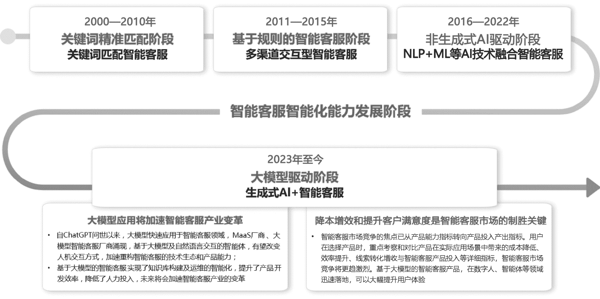

图 1-1

以 DeepSeek 为例，其将 MoE 与多模态融合，完成从规则响应到智能决策的跨越。金融领域过去只能用预设规则处理简单咨询，如今系统结合客户财务状况与需求，用 LLM 给出个性化投资建议，进步十分明显。

**1. 关键词精准匹配阶段**
早期系统像一个简易检索器，在预设文本库中严格比对用户输入与关键词。电商常见词如“发货时间”“退款流程”“商品尺寸”等被收录，匹配成功即返回固定答案。这种方式能快速处理常见简单问题，比如检测到“发货时间”就回复“付款后 48 小时内发货”。

局限也很明显：必须完全一致才生效，不懂语义和上下文。面对“我的快递显示签收但没收到”这类变体，匹配率仅 60%~70%。业务扩展时关键词与答案随之指数增长，维护成本高昂。尽管如此，这一阶段为后续技术奠定了基础。

**2. 基于规则的智能客服阶段**
此阶段用 if-then 规则引擎处理结构化请求，例如银行余额查询需依次校验“身份信息→账户类型→查询权限”。效率有所提升，人工压力减轻，但对非结构化问题无力。规则库庞大且脆弱，调整需严格测试，维护成本随业务复杂度指数上升，属于人力密集型模式。某股份制银行信用卡分期规则迭代就让季度维护成本上升 45%。

**3. 非生成式 AI 驱动阶段**
机器学习与 NLP 突破后，系统开始从海量历史对话学习意图识别与响应选择，灵活性和适应性明显增强，能处理更丰富的查询。NLP 让机器捕捉语言细微差别，服务更有同理心。DeepSeek 在此阶段的技术实践包括：

·动态路由机制：不同于传统 Transformer 的固定路径，DeepSeek-MoE 用专家网络集群动态分配算力，在理财产品推荐场景把推理成本降 40%，响应提速 35%。
·强化学习优化：在证券陪练脚本生成中，深度强化学习把意图识别准确率推到 95%，较传统模型提升 15%。

**4. 大模型驱动阶段**
BERT、GPT 等大规模预训练模型带来革命性变化。它们能自主学习海量知识，具备强上下文理解、复杂问题解决和多模态处理能力，可跨语言交流、理解图像视频，并在特定情境下展现创造性。云计算支撑下，百万级并发仍能保持稳定。

·多模态融合能力：门控多模态路由器支持文本、语音、图像动态加权。医疗咨询中，系统对上传 CT 和症状文本分配 73%~92% 权重，实现影像与主诉联合推理，肺结节良恶性判断准确率达 91.7%。
·情境感知引擎：时空同步对比学习技术让视频客服中时间戳与 ASR 字幕毫秒级对齐，解决音画不同步导致的误判，对话流畅度提升 60%。

经过四轮迭代，智能客服从信息检索工具进化为可参与复杂讨论的全能助手。未来它将在体验提升、流程优化和数字化转型中扮演更重要角色。

#### 1.1.2 排队论在客服系统中的应用
排队论即随机服务系统理论，用数学方法分析到达间隔、服务时长、服务人员配置等，预测平均等待、队列长度、利用率等指标。在资源受限时，它帮助客服在客户等待成本与企业运营成本间找到最优平衡。

以在线教育为例，咨询高峰时用排队模型分析到达率与平均服务时长，优化人员配置与排班，能明显缩短等待、提升效率与满意度。人力与算力都受限时，模型为资源分配提供精准策略。

在众多模型中，M/M/1 与 M/M/N 应用价值突出。第一个 M 表示到达服从泊松分布，第二个 M 表示服务时间服从负指数分布，1 为单服务员，N 为 N 个服务员且 N≥2。若到达间隔泊松、服务时长负指数、N 个窗口服务时间相同，则为 M/M/N 模型；N=1 时为 M/M/1 模型。

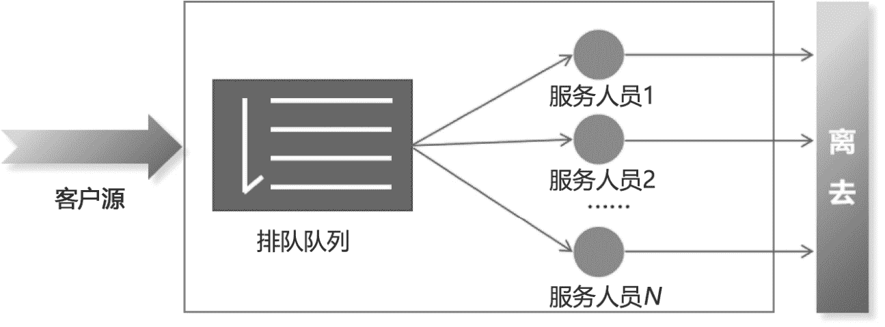

图 1-2

**1. 客服系统的统计复用需求**
统计复用是基于统计规律的动态资源分配策略，利用需求到达的统计特性在多任务间共享有限资源。客服中人员与算力均可复用，到达请求是等待服务的任务。

单服务员系统仅一人处理所有来电。小型手工网店初期采用此模式，非促销期尚可应付，新品上架高峰期等待明显拉长，甚至流失客户。M/M/1 模型下客户只能排一条队，复用程度低，忙时等待容易恶化体验。

多服务员系统由多人协同响应。大型酒店客服中心在旅游旺季通过动态调整人员应对高话务量。多服务员系统对应 M/M/N，空闲人员可即时承接新请求，复用程度更高，等待显著缩短，适合大规模企业与高峰场景，如电商购物节。

但增加人员会带来人力、培训等成本。M/M/N 理论表明，人员过多会带来闲置与浪费，利用率下降。因此关键是找到满足服务水平与资源利用率平衡的人数，排队论通过模型计算在不同服务目标下最优配比，为规划提供依据。

**2. 排队系统影响因素与优化策略**
M/M/1 与 M/M/N 有助于分析影响效率的因素。

客户到达频率在模型中假设服从泊松分布，到达概率与时间长度相关且相互独立。服务时长通常假设为负指数分布，时长越长概率越低。当到达与服务分别服从泊松与负指数时，M/M/N 可精确估算达到服务目标所需人员数。例如希望平均等待≤2 分钟，结合历史到达频率与平均服务时长，用 Erlang C 公式可算出合理人力。

人员数量是核心变量，关系到服务能力与成本。人员不足导致等待长、质量降；人员过多导致成本高、闲置多。合理配置才能兼顾满意度与资源利用率，这正是排队论为客服设计提供的科学方法。

在 M/M/N 排队框架下，智能派单是提升客服效能的常用手段。实现方式具有弹性：可将空闲时间最长的坐席先行匹配工单，使各客服负担趋于均衡；也可优先选择已处理工单数量最少的坐席，帮助新人更快进入实战；还能由技能等级更高的客服承接复杂度较高的工单，提升一次性解决效率。这些规则可结合具体业务诉求，随着 M/M/N 体系中客服状态的实时变化灵活调节资源占用，最终拉高整体运行表现。

差异化服务的构建也可以借鉴 M/M/N 模型。按照客户价值、重要性或响应时效等维度，为不同客群设定分层的优先规则。对高价值客户提高接通率标准，使来电在更短时间内得到响应，从而强化品牌忠诚。模型内部通过调节相关参数，模拟不同优先级的客户在系统中的等待与服务过程，可对差异化方案进行评估与打磨。在资源增量受限的情况下，这一做法仍能明显改善客户整体满意度。

**3. 资源管理与排班优化**

客服系统能否稳定高效，核心在于科学的资源管理与排班设计，而排队论中的 M/M/1 与 M/M/N 模型为此提供理论支撑。

人力规划是保持系统平稳运转的基础。将排队论的预测方法与 M/M/N 模型结合使用：先从历史数据中提取来电时段分布、平均通话时长等信息，构建时序或回归预测工具，精准预估各时段的话务量；再结合 M/M/N 模型对服务人数与服务时长分布的特性分析，确定各时段的最优配置，使服务资源与话务需求动态匹配。管理者据此制定排班计划，高峰期保证足够人力，低谷期避免闲置，从而在人力成本与服务质量之间取得平衡。

面对季节性波动或突发事件导致的话务变化，提前准备应急预案并灵活调配人力十分必要。如电商大促期间话务激增，可借助 M/M/N 模型的分析预估增幅，提前增员或调整工时以缓解压力。模型还可以通过仿真不同配置下的平均等待时长、客服利用率等指标，为决策提供依据。低谷期则可安排培训，提升业务能力与服务水平。

引入自动化工具辅助排班，能进一步提升效率与质量。利用机器学习对历史排班、话务量及 M/M/N 模型参数进行深度挖掘，可发现规律并生成最优排班方案。例如算法可结合各客服的工作效率、技能水平与过往排班记录，并参考 M/M/N 模型中客服状态的变化，自动产出满足服务与成本要求的排班计划，降低人工主观性，提升准确性与合理性。

总体来看，深入理解并应用 M/M/1 与 M/M/N 模型，能在保障客户体验的同时实现资源有效利用。无论是优化服务流程、改进排队机制，还是精细化人力管理，都能显著提升运营效率。从精确测算客服人数到制定科学排班，排队论为客服系统的各环节提供了科学决策依据，帮助企业在竞争中更好地满足客户需求、提升服务品质。

**1.2 智能客服系统的工作原理**

智能客服的内在机制融合了多项关键技术，覆盖信息接收、请求处理、多轮对话与情感分析、资源调度与排队优化四个阶段，共同构成高效且具人性化的服务方案。

### **1.2.1 信息接收阶段**

系统主要依托语音识别与文本输入获取客户需求。以电商促销为例，信息接收量会显著上升，系统需实时监测各渠道流量变化，若发现某渠道如 App 端咨询激增，可提前调配资源，确保接收及时准确。

电话请求借助自动语音识别将口语转为可处理文本。以 DeepSeek-R1 作为案例，其自研语音增强算法在嘈杂环境如地铁、商场中实现 89.3% 的识别准确率，较传统方案提升 12%。动态降噪模块可实时分析背景音频，自动过滤 85 分贝以上的环境噪声，适用于金融客服中账户密码等敏感信息的精准采集。

在证券场景，DeepSeek 对“股票代码查询”“交易指令”等专业术语的识别准确率达 95%，较传统 ASR 提升 20%，有效降低语义误解风险。文字交流场景则直接提取输入内容，多渠道接入模块整合网页、App、微信等平台请求，保证信息准确传递。

从排队论视角，该阶段需实时监控与统计请求到达，基于历史与实时流量预测不同时段、不同渠道的到达率，为资源分配与排队策略提供依据。例如周末及工作日晚间常为电商咨询高峰，系统可提前调整配置应对高流量。

### **1.2.2 请求处理阶段**

核心技术包括自然语言理解、对话管理和知识库应用。DeepSeek-V3 拥有 6710 亿参数，推理时每个 token 仅激活 370 亿参数，降低显存占用。模型基于 14.8 万亿 token 预训练，可根据客户意图动态激活对应模块。研究表明类似动态激活在审读学习推荐中可提升准确率 20%～30%。若将 MoE 架构用于电商“多 SKU 组合推荐”，点击率预计提升 20%～30%。

医疗咨询中患者表述常模糊，NLU 需准确抽取症状并结合医学知识图谱为对话管理提供信息。NLU 核心是解析消息，识别关键词并理解完整句意与上下文，为生成恰当回复奠基。对话管理系统维护会话状态，动态决定是否追问或直接给出解决方案。

知识库构建常见问答图谱，帮助系统快速检索最佳答案。机器学习持续优化 NLU 与对话管理能力，提升理解与回答精度。知识图谱应用提升信息检索与整合效率。

DeepSeek 在此环节可实现：
·跨模态语义对齐：针对“我要预约明天上午视频客服”这类请求，通过 GMR 模块动态激活“时间解析”“渠道选择”专家网络，复杂意图识别准确率达 95.1%，较开源模型提升 15%。
·知识图谱嵌入：处理“股票分红政策”等专业问题时，自动关联财报、金融法规等外部知识库，生成分红率计算到税务影响的多层级回答，覆盖 87% 金融高频咨询。

从排队论看，需对请求处理时间建模。简单咨询处理时间短且集中，复杂咨询则长且分散。基于此可合理安排处理顺序，避免长时间等待降低满意度。常见优化为对紧急或高价值客户请求赋予更高优先级。

### **1.2.3 多轮对话与情感分析阶段**

多轮对话能力保障交互自然连贯，系统跟踪对话历史，避免重复提问。情感分析技术可感知情绪变化并调整响应，使交互更人性化。

DeepSeek 的情感分析通过语音语调、面部表情等多模态数据，实现 91.7% 情绪识别准确率。在电商售后中，检测到客户因物流延误不满时，系统自动触发“致歉+优先处理”流程，情绪响应准确率较传统规则引擎提升 30%，投诉率下降 25%。

该功能提升客户体验，及早发现不满并针对性解决，有助于提高满意度与忠诚度。在排队框架下，技术可优化排队策略：情绪激动或问题紧急时动态提升优先级；对需多轮解决的问题，结合对话复杂度与剩余轮数预估剩余处理时间，实现更科学的排队与资源分配。

### **1.2.4 资源调度与排队优化阶段**

排队论在配置有限人力与算力资源以应对并发需求方面作用突出。通过建模请求到达模式与处理时间分布，可预测各时段负载并制定最优配置方案。

如高峰期增加机器人座席或人工客服，低谷期适当缩减规模，实现成本与质量平衡。资源调度模块基于排队论模型实时监控并调整分配，采用动态负载均衡将请求均匀分发，避免分配不均。结合机器学习预测资源使用并持续优化配置。

排队规则也可优化。除先来先服务外，系统支持基于优先级、服务时长预估等策略，如为 VIP 客户设高优先级或优先处理预计耗时短的请求。系统依据实时排队情况与资源利用率动态调整规则，提升资源使用效率。

现代智能客服凭借强大信息处理与灵活调度，成为各行业关键组成部分。无论简单咨询还是复杂交易，都能实现 7×24 小时不间断服务。随着 AI 与大数据发展，智能客服将更智能人性化。

**1.3 构建智能客服系统**

智能客服并非单一形态，而是在线聊天机器人、语音助手等智能交互载体与传统人工客服的有机融合。打破传统服务局限，既利用智能技术实现全天候高效响应，快速处理标准化高频需求，又保留人工在复杂问题与情感诉求上的专业与温度。

从效率看，自动化显著缩短等待时间。某快递企业引入智能客服后，80% 常见问题由自动客服处理，平均等待时间缩短 50%。从排队论角度，自动客服相当于多个并行服务通道，降低队列长度。在线聊天机器人可立即响应超过 90% 常见咨询，而此类咨询占总量的 70%～80%，意味着多数简单重复问题可即时解决。

业务架构中，多渠道接入模块汇总请求后，按排队论规则将可自动处理的请求优先分配给在线聊天机器人。技术架构中智能算法根据机器人实时负载动态调整分配，最大化资源利用。

智能语音助手借助语音识别与 NLP 可准确解答大部分来电，减少转人工次数。某电信运营商优化语音助手后，每月转人工次数减少 35%，通话时长降低 30%，整体效率提升。

应用架构中，语音助手与自动语音识别、自然语言理解协作，分析请求到达模式与处理时间分布，建立排队模型预测各时段负载，提前调配资源。例如话务高峰期增强语音助手处理能力或优化识别算法以缩短等待。

对于需深度理解或专业知识的复杂问题，自动客服会无缝转交人工。此“人机协作”相当于为不同请求设优先级：简单问题由机器处理，复杂问题由专业人工承接。业务架构中智能路由按问题复杂度与客服技能精准分配，技术架构中算法持续学习优化并结合排队论动态调整，确保人工资源合理利用。

例如电商大促期间，DeepSeek 使用动态负载均衡结合 MoE 架构稀疏门控技术，将“订单查询”“退款申请”等高频问题处理效率提升 60%，GPU 资源消耗降至传统 Transformer 的 1/3，实现低成本高并发。

混合模式还能提升个性化服务。AI 驱动的知识图谱与多轮对话提供贴近需求的回答；人工客服可依据个人偏好调整沟通方式并以同理心建立情感联系。排队论视角下，个性化可通过客户分类与优先级设定实现。客户画像模块依据历史记录与行为偏好生成服务标签，智能算法结合标签与排队优先级规则为不同客户提供差异化服务。对重要客户系统优先安排人工并给予更多关注与资源。

研究表明，良好体验需平衡效率与温度。企业应通过数据分析持续优化策略，动态调整人机协作比例。将自动与人工客服有机结合是构建智能客服系统的核心。通过不断完善体系并应用排队论，行业将走向更智能、更人性化的方向。

**1.4 智能客服系统业务架构**

智能客服系统旨在优化企业与客户互动，支撑客户服务、营销及销售等核心业务。其架构采用分层设计，包括生产运营层、运营管理层、系统管理层及外围系统，各组件协同高效满足客户需求。

**1. 生产运营层**

生产运营层为业务执行核心，直接面向服务场景，拆分为接触渠道、接触处理、生产支撑三大域。接触渠道提供电话、互联网、短信、客户经理、营业厅五类触达入口；接触处理承接渠道流量，通过客户服务、市场管理、销售模块响应需求；生产支撑提供后端保障，包括工作台、工单管理、知识管理、营销管理、客户管理、现场管理等。

接触处理流程贯穿核心业务，图 1-4 展示其逻辑与流转。

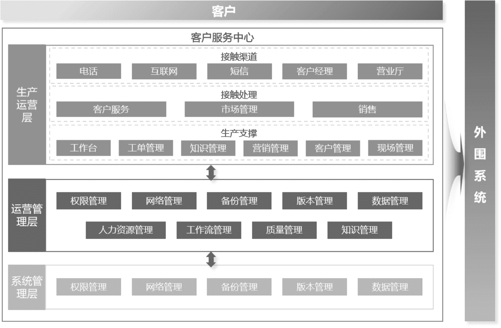

▲图 1-3

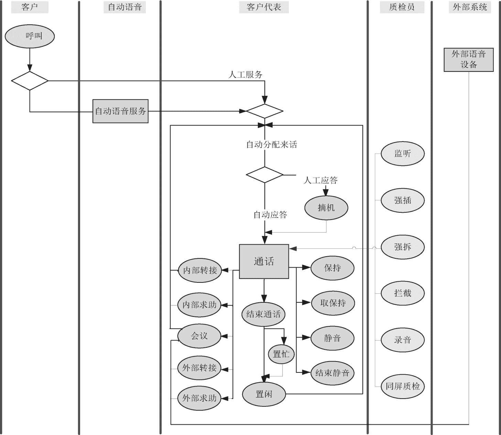

▲图 1-4

客户发起呼叫后，系统先进行自动语音服务与人工服务的分流。自动语音服务处理常见咨询与简单查询，通过语音导航与预设答案快速响应，既满足部分需求又减轻人工压力，与多渠道高效服务理念一致。无法由自动服务解决时，呼叫进入人工流程。自动分配机制基于客服技能、忙碌状态等因素精准派发，确保客户获得专业及时服务，体现资源合理调配。

通话期间，内部转接、内部求助、会议功能体现协同作业，复杂问题可借助团队快速解决。外部转接与外部求助实现与外部系统连接，灵活调用资源应对多样化需求。通话结束后，置忙/置闲状态设置便于管理客服工作节奏，保障资源合理分配。质检员的监听、强插、强拆、拦截及录音、同屏质检构成质量管控体系，通过实时监督与事后复盘确保服务质量稳定提升。

**2. 运营管理层**

运营管理层聚焦流程与资源优化，承接生产运营层，在系统管理层权限、网络、备份、版本、数据管理基础上，增加人力资源管理、流程管理、质量管理、知识管理等调控模块。

图 1-5 为人力资源管理模块组成及交互，包含人事管理、排班管理、培训管理、绩效管理四个核心模块，以及质量管理、知识管理两个支撑模块。

人事管理接收排班管理的人力预测与劳务调整信息，以及培训管理的培训信息与绩效管理的绩效结果，并向排班管理输出人力规划指令，向培训管理传递能力需求。

排班管理接收人力规划指令，依据员工表现合理安排，如将绩效优秀者安排在高峰或重要岗位，并向绩效管理输出出勤信息与绩效数据。

培训管理接收人事管理的能力需求与知识管理的知识信息，并向绩效管理输出绩效数据，向人事管理反馈培训信息。

绩效管理接收排班管理的出勤/绩效数据与培训管理的绩效数据，向人事管理输出绩效结果，向排班管理输出优化建议。

质量管控分为标准制定与结果汇总两大方向，前者负责明确质检规则等规范，后者输出质检结论并把相关绩效信息推送至绩效体系。知识资产管理则涵盖知识库维护，例如话术、知识手册的归档，以及优秀案例的沉淀复用，提炼后的知识会向培训体系输送。

在信息流动层面，人事部门综合排班需求、绩效表现、培训成长三类数据来动态调整人力部署；绩效部门则对排班合理性与培训实效进行核验，并以人事决策为抓手推动全链路迭代，以满足智能客服的人力侧需求。

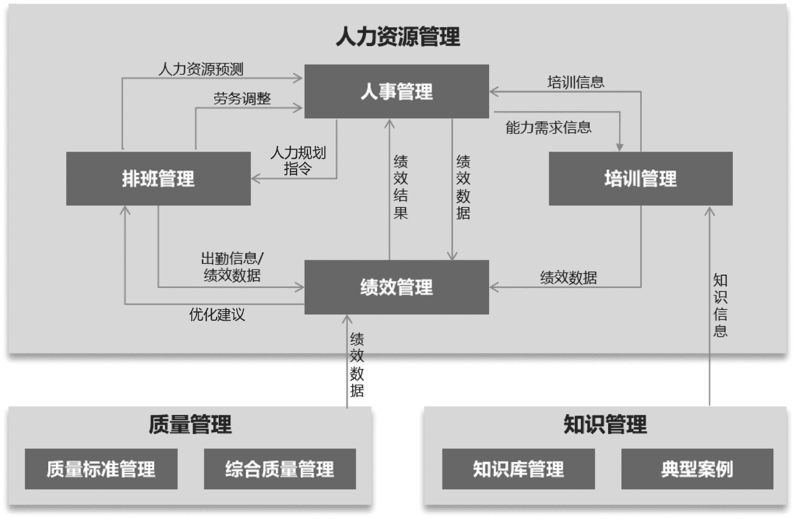

图 1-5

**3. 系统管理层**

系统管理层构成智能客服的技术底座，核心模块包括权限、网络、备份、版本、数据管理，各自承担以下职能。

·权限管理：构建分层访问控制体系，按角色如客服、管理员等细化操作权限，防范未授权访问和误操作，保障数据与功能安全。
·网络管理：维护网络连通与稳定，实时监控网络状况并快速定位故障，确保客户、系统与各模块间传输顺畅，提供稳定服务环境。
·备份管理：定期备份核心数据如客户资料、工单信息，制定恢复策略，以便在数据丢失或系统故障时迅速还原，保障业务连续性。
·版本管理：统筹功能迭代与版本发布，记录变更日志并管控发布流程，保证功能持续演进且兼容历史数据与既有流程。
·数据管理：实现业务数据的集中化存储、分类检索与深度分析，整合交互数据与流程数据，为运营与生产层提供决策依据。外围系统为可选扩展，可对接CRM、ERP等企业系统，实现客服数据与业务数据的双向贯通，提升整体协同。

各层之间形成“业务执行→流程调控→技术支撑”的纵向协同：生产运营层提出业务需求，驱动运营管理层配置流程与资源；运营管理层调动系统管理层的技术能力保障业务运行；系统管理层提供稳定支撑，推动全流程高效运转，形成闭环。

## **1.5 智能客服系统技术架构**

要打造稳定高效的智能客服，技术架构的设计是关键。从呼叫中心的基础规范到接口方案，再到性能与安全考量，每个环节都需要细致规划，才能使系统整体表现达到最优。图 1-6 展示了典型的粗粒度架构，包含呼叫中心平台、应用层及接口等核心要素。

图 1-6

不同行业对架构的侧重点各异。金融行业更看重安全性，常选用稳定可靠且加密成熟的方案；互联网企业更强调灵活性与可扩展性，倾向基于软交换的创新架构以支撑快速扩张。传统架构多以交换机与软交换为基础，各有优势。软交换方案除支持语音外，还能融合文本聊天、视频通话等多模交互，提升服务丰富度。

图 1-7 呈现了完整的呼叫中心平台架构，涵盖接入层组件、中间件组件、客户端组件以及存储配置组件。

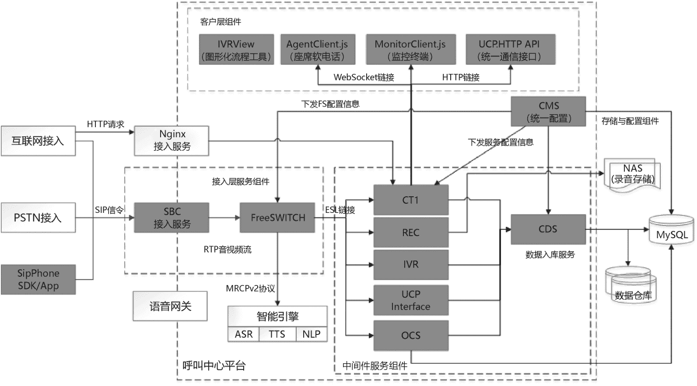

图 1-7

**1. 接入层**

互联网接入与 PSTN 接入：平台支持互联网、PSTN 及 SipPhone SDK/App 三种接入方式。互联网请求经 HTTP 送达 Nginx 接入服务；三种方式亦可通过 SIP 信令经 SBC 接入服务接入。

接入层服务组件：SBC 将信令转发给 FreeSWITCH，后者处理 RTP 音视频流。Nginx 主要负责 HTTP 请求的接入处理。

**2. 中间件服务组件**

CTI：作为呼叫控制核心，CTI 接收来自 FreeSWITCH 的 SIP 信令并统筹呼叫全流程，是中间件的关键枢纽。
REC：负责通话录音并把录音写入 NAS。
IVR：结合科大讯飞、阿里巴巴、百度、捷通科技等厂商的 ASR、TTS、NLP 能力，通过 MRCPv2 协议实现语音导航、识别与合成。
UCP Interface：提供标准通信接口，支撑系统及组件互联。
OCS：涉及计费场景时处理计费逻辑。
CDS：把通话记录、客户信息等写入 MySQL 或数据仓库，便于后续查询分析。

**3. 客户层组件**

IVRView：提供可视化 IVR 流程设计工具，便于创建与修改语音应答流程。
AgentClient.js：座席软电话客户端，通过 WebSocket 与平台通信，实现接听拨打。
MonitorClient.js：监控终端，通过 HTTP 获取呼叫中心运行状态与座席情况。
UCP.HTTP API：统一 HTTP 接口，供外部系统调用平台功能与数据。

**4. 存储与配置组件**

CMS：统一配置中心，存储并分发平台配置，确保各组件按预设运行。
NAS：录音存储，用于质检、纠纷举证。
数据库存储：MySQL 与数据仓库保存业务数据，支持查询、分析与统计，为运营提供支撑。

平台通过各层协同，实现接入、处理、控制、存储的全生命周期管理，并提供可视化操作界面，满足日常运营。

在集成层面，标准化接口既保障内部高效通信，也通过开放 API 为第三方提供扩展能力。企业可借助 API 将业务流程与客服平台打通，实现数据互通与服务协同，提升效率与质量。借助 WebRTC 等现代通信技术，系统可扩展文字对话、文件传输等互联网渠道功能，不断拓宽服务边界。

性能监控是服务质量保障的核心。需重点关注平均响应时长、首次解决率、客户满意评分等指标，借助实时分析及时发现并改进问题。

以 DeepSeek 部署为例，其采用 FP8 混合精度动态量化压缩，使推理延迟降低 40%，在金融客服场景下可达每秒 12000 次请求，部署成本较传统大模型方案减少 65%，为中小企业提供高性价比私有化方案。安全层面，网络威胁加剧，保护隐私与敏感信息至关重要。设计时需兼顾加密算法、权限配置、防火墙策略，确保在复杂攻击下仍能有效防护。

智能客服建设是系统工程，选型时需权衡功能完备性、可扩展性、运维成本等要素。匹配业务需求的技术方案才能兼顾服务质量与未来演进，实现体验与价值双提升。

## **1.6 智能客服系统应用架构**

在数字化转型背景下，智能客服的部署与运营是提升体验与灵活性的关键，选择合适的应用架构尤为重要。图 1-8 展示了典型应用架构。

该架构以“终端接入—网关调度—业务模块—技术支撑—存储”为核心链路，各部分协同如下。

PC、手机、App 三类终端为客户入口，请求经终端触发后进入网关层。

网关分为 API 内部网关与 API 外部网关，均基于 Kong 实现流量治理。内部网关负责服务间请求转发与限流、API 管理及权限控制；外部网关负责外部请求鉴权、限流、API 管理及访问拦截，防止非法调用。

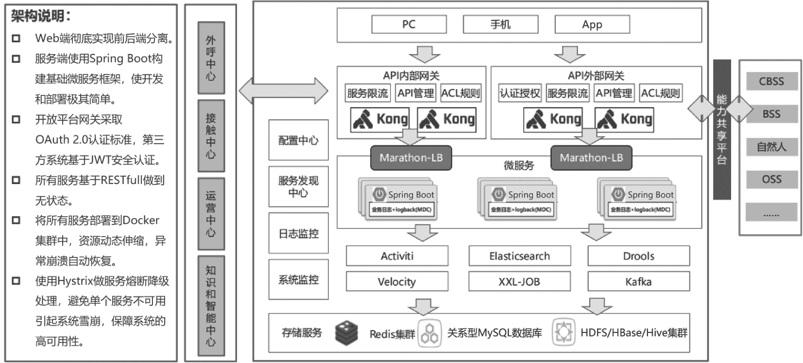

图 1-8

采用 Kubernetes 作为容器编排层，承载 Spring Boot 微服务集群。Kubernetes 提供资源动态调度与自愈能力，如异常自动重启与扩容，保证高可用；微服务遵循 RESTful 规范，无状态设计，支持独立交付与弹性伸缩，降低耦合。

左侧外呼中心、接触中心、运营中心、知识智能中心构成业务载体。外呼中心负责主动外呼任务如回访、营销、催办，与接触中心共享资源与数据，实现流程化管控。接触中心整合多渠道请求，按规则分发至人工或自动化服务，并联动运营中心进行调度，联动知识智能中心获取应答支持。运营中心涵盖配置中心、服务发现、日志监控、系统监控四大模块：配置中心集中管理全局配置并支持热更新；服务发现基于注册中心实现微服务自动注册与发现；日志监控采集全链路日志用于排查与分析；系统监控实时跟踪资源与服务状态，通过告警及时发现异常。知识智能中心依赖中间件提供能力，通过 Elasticsearch 实现知识检索，Drools 实现规则自动化，Kafka 处理异步任务实现削峰填谷，Activiti 编排业务流程，Velocity 生成动态文本，XXL-JOB 执行定时任务。

Activiti、Elasticsearch、Drools、Velocity、XXL-JOB、Kafka 为通用技术组件，为全系统提供基础能力。Activiti 支撑流程化场景；Elasticsearch 支撑检索与日志分析；Drools 解耦规则与代码；Velocity 统一文本模板；XXL-JOB 支持大规模定时任务分片重试；Kafka 保障异步消息可靠传输。

存储采用混合架构：Redis 集群作为缓存层存储热点数据，加速读写；MySQL 保存结构化业务数据，保证事务一致性；HDFS/HBase/Hive 集群存储非结构化与半结构化数据，支撑大数据分析。

能力共享平台整合企业中台服务，通过标准化接口向客服系统开放能力。外围系统可对接 CRM、ERP 等，实现数据贯通，避免重复建设，闭环客服业务。

# **第二章**

# **智能客服系统构建的关键技术**

构建智能客服平台需要多项技术协同融合，并与排队论结合持续优化性能与服务质量。

## **2.1 服务接入**

智能客服可通过语音通话、网页实时通信、短信/即时消息、视频通话、交互式语音视频应答及全媒体网关实现多渠道接入，实现企业与客户高效联通。下文分析各技术特点、革新作用及案例优势。

### **2.1.1 语音通话接入**

语音接入指通过电话或网络实现人机或人人语音交互，是智能客服的重要环节。它融合 NLP、语音识别、语音合成与多轮对话管理，构建可理解、响应并主动解决问题的交互环境，在需即时反馈场景中优势明显。

从排队论视角，客户到达过程近似随机且常服从泊松分布，服务时长近似负指数分布。基于分布特征可预测话务量，合理配置坐席并优化排队策略，缩短等待。

相较文字聊天或邮件，语音更直观自然，无需文字表达能力，接受度更高，尤其适合老年人与低教育水平人群。紧急场景下可快速响应，并通过背景音捕捉额外线索辅助判断。

挑战主要来自环境噪声影响通话清晰度，以及方言、口音、发音不标准导致识别率下降。复杂业务仍难以完全替代人工的个性化关怀与专业指导。

为突破限制，企业正探索 AI 融合模式。例如某电商平台将智能语音客服用于售后，实现 7×24 小时商品退换咨询与订单查询，满意度提升近 20% 并降低人力成本。某银行部署知识图谱驱动的语音助手，提升贷款审批效率并加强欺诈检测，保障资产安全。

语音接入凭借便捷、普适、互动性强正成为提升体验与效率的关键，未来随技术演进价值将进一步放大。

### **2.1.2 网页实时通信接入**

WebRTC 使浏览器间可直接点对点传输音视频与数据，无需插件即可实现流畅通信，操作简便，适用于远程支持等高质量音视频场景。

图 2-1 展示 WebRTC 架构。WebAPI 由 W3C 与浏览器工作组制定，提供集成接口；PeerConnection 为核心，对等连接建立模块；会话管理与信令交互模块负责会话控制；音频引擎集成 iSAC/iLBC 编解码、NetEQ 抖动控制、回声消除与降噪，实现高质量音频；视频引擎配备 VP8 编解码、抖动缓冲与画质增强；数据传输采用 SRTP、多路复用及 STUN/TURN/ICE 的 P2P 机制保障安全高效；网络 I/O 负责收发操作。客服平台整合 WebRTC，可提供无缝即时体验，提升满意度并创造商业价值。

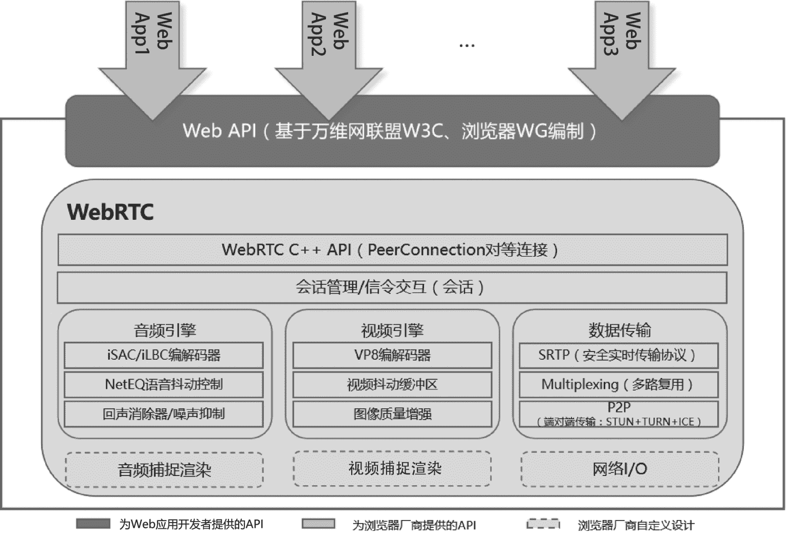

图 2-1

**1. 工作机制**

# WebRTC 驱动客服即时交互

在智能客服场景里，WebRTC 主要担负起客服与用户之间的低时延音视频通道搭建。连通阶段，Web 或 App 端通过 Web API 发起请求，随后借助 PeerConnection 在客服终端与用户终端之间迅速建立点对点链路。进入媒体协商后，系统会结合设备算力与网络状况，从音频引擎的 iSAC、iLBC 以及视频引擎的 VP8 等备选编解码方案中挑选最合适的编码参数与分辨率，让通话保持顺畅、画面与声音都达标。

网络环境复杂时，ICE 流程的作用尤为突出。客户侧网络差异很大，依托 STUN 与 TURN 配合 ICE 协议，能够有效穿透各类 NAT 设备，提高握手成功率。媒体数据传输环节采用 SRTP，并配合音频引擎 NetEQ 语音抖动控制以及视频引擎的抖动缓冲组件，即便网络出现短时波动，也能维持通话稳定，降低卡顿与延迟，为用户提供可靠体验。

## 2. 安全特性
信息安全是建立信任的前提。WebRTC 以 DTLS 对信令通道加密，相当于为传输通道加上防护锁，防止个人身份、业务咨询等敏感内容被窃听或截取。SRTP 再对音频与视频流进行额外保护，保障通话完整性与私密性。对企业而言，这既关乎用户隐私与品牌声誉，也满足数据安全法规要求。落地部署时需重视服务端配置与证书运维，定期更新证书，防止因过期或配置失误引入风险，确保系统持续安全运行。

## 3. 应用范围
WebRTC 不断拓宽智能客服的边界。虚拟助手借助音视频能力实现更直观的互动，例如通过视频演示操作流程或开展远程指导，提升服务可感性与便捷度。在线教育场景中，客服可即时解答疑问，支持单人辅导或小组研讨，增强互动。在远程医疗领域，可协助医生与患者建立视频连线，提供初步诊断与康复建议，打破地理限制。多平台适配保证 PC 网页与手机 App 的体验一致。随着 5G 普及，超高清通话与实时字幕等能力有望常态化，进一步提升效率与服务质量。

## 4. 技术障碍与解决方案
浏览器适配是首要难点。各浏览器对 WebRTC API 的实现与编解码支持存在差异，团队需持续跟踪厂商文档，采用功能检测与特性探测编写适配逻辑，确保主流浏览器下功能正常。大规模并发会造成服务端压力，可引入负载均衡策略，通过 Nginx 等将请求均匀分发至多节点，避免单点过载；也可选用专业的 WebRTC 云托管服务，借助其资源池与弹性伸缩应对流量高峰。针对网络条件较弱的用户，可精简信令流程减少握手次数，并结合视频引擎的图像增强技术，在低带宽下仍保持基础通话质量。

### 2.1.3 短消息/即时消息接入
在客服触达渠道中，短消息与即时消息的使用比重很高，深受偏好异步沟通的用户欢迎。这两种方式传递信息迅速且能提升参与度，同时必须兼顾隐私与数据安全。

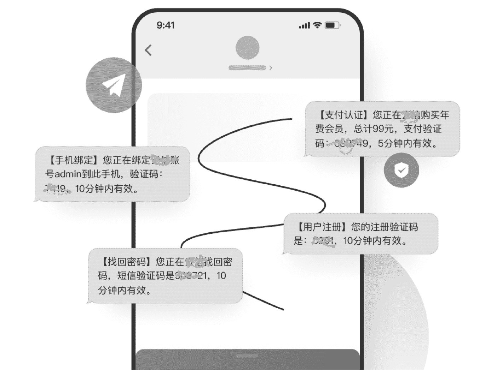

图 2-2

基于排队论分析，这类接入具有独特优势。用户发送时间相对分散，系统可采用差异化排队与资源分配策略，按消息优先级与重要性排序，提升服务针对性与效率。

短消息作为传统手段仍发挥作用。企业可用简短文字提供业务咨询、查询、受理、建议与投诉处理等基础服务，也可主动推送调查、提醒、问候与业务推广。例如银行通过短信告知账户余额变动或信用卡还款提醒，运营商用于话费查询与套餐变更提示。推送、交互、群发等形态满足不同场景：消费提醒帮助用户掌握支出避免超支；调查类短信收集反馈以优化服务；应急通告可在灾害预警等紧急情况下快速传达。

即时消息平台如 WhatsApp、微信因便捷、即时与互动性逐渐成为客服重要组成。相比传统短信，即时消息支持图片、音频、视频等丰富内容，体验更直观，且支持双向或多元交流，便于精准解决问题并开展个性化营销。某零售品牌通过官方账号定期推送新品信息，聊天机器人自动回复常见问题，既节约人力又提升响应速度。

技术架构上，接入需与 NLP、对话管理协同。系统先用 NLP 对即时消息做意图识别与语义分析，明确需求后，对话管理模块依据上下文与规则调用知识库或服务流程生成回复。

隐私与安全不容忽视。短信涉及手机号等敏感信息，必须遵循法规并实施加密传输。即时消息需建立严格身份验证机制，确保仅授权用户访问特定资源。企业还应健全数据管理体系，定期安全审计，及时修复漏洞，降低风险。

无论短消息还是即时消息，都在客服中占据不可替代的位置。随着技术演进应用场景会更丰富，但保障用户隐私始终是底线。合理运用排队论可更好地管理处理流程，提升整体服务性能。

### 2.1.4 视频通话接入
数字化转型推进下，视频通话已成为客服领域的重要形态。相较传统面对面交流，视频通话更便捷、低成本且能显著提升效率与满意度，在成本效益与多场景应用中优势明显。

**1. 核心能力概览**
1）实时音视频传输
视频通话的核心在于高质量实时传输，确保双方声音与画面清晰流畅，让交流更直观真实，无论日常问候还是商务讨论都能准确传达信息。
2）多终端适配
现代系统支持智能手机、平板、电脑、智能电视等多种终端，用户可依场景选择设备使用，极大扩展灵活性与便捷性。
3）互动协作功能
除交流外，还具备屏幕共享展示文档演示、支持多人同时在线满足团队讨论与远程培训、部分系统提供电子白板支持标注绘图等，促进创意交流与问题解决。
4）个性化定制
部分产品允许更换背景、调整美颜效果，既满足审美，也能在一定程度上保护隐私，营造更舒适环境。

**2. 关键技术**
1）编解码技术
为在有限带宽下实现高质量传输，需高效编解码。常见视频编解码器有 H.264、H.265、VP8、VP9。H.264 应用最广，压缩效率与兼容性均衡；H.265 在相同画质下带宽需求更低。音频编解码器如 AAC、Opus 提供高保真音质并实现有效压缩。
2）网络传输技术
为保证稳定低延迟，常用 RTP 与 RTCP 协议，RTP 负责音视频数据传输，RTCP 反馈质量信息以便实时调整。系统还采用自适应码率技术，根据网络动态调整分辨率与帧率。传输层优先选用 UDP，其无连接特性降低延迟，提升实时性。
3）回声消除与降噪技术
回声与背景噪声会严重影响体验。回声消除通过识别并抵消扬声器声音被麦克风再次采集形成的回声；降噪利用算法抑制背景噪声突出人声。双讲检测可在双方同时发言时区分语音与回声，有效消除干扰。
4）视频增强技术
包括去模糊、超分辨率重建、色彩校正等提升画面质量。超分辨率可将低分辨率画面提升清晰度；色彩校正使画面更自然真实。

**3. 典型产品与服务**
1）社交娱乐类
微信拥有庞大用户基础，支持一对一及多人群视频通话，操作简便，与日常社交无缝衔接，移动端体验良好。Skype 早期国际知名，音视频质量高、性能稳定，支持跨平台，在国际网络环境适应性好。
2）商务办公类
腾讯会议专为商务打造，具备高清通话、大规模接入及屏幕共享、电子白板、录制等协作功能，疫情期间助力远程办公。Zoom 以稳定与功能丰富著称，支持高清、分组讨论、虚拟背景等，网络适应性强。Microsoft Teams 与 Office 365 深度集成，提供会议、文件共享、聊天等协作能力，便于流程内无缝切换。
3）专业客服类
智齿科技视频客服聚焦企业客服场景，具备智能排队、客服分配、通话记录存储分析等功能，提升服务质量与效率，适用于金融、电商等行业。

**4. 发展趋势**
5G 与人工智能持续演进，视频通话迎来革新。5G 的高速率与低延迟将支持更高清、更流畅传输，甚至 8K 通话。人工智能带来自动场景识别、智能降噪、实时翻译等智能化体验。VR、AR 融合将开拓沉浸式会议、虚拟社交等新场景。

### 2.1.5 IVR 与 IVVR 接入解析
现代客服体系中，IVR 与 IVVR 通过不同交互方式提供高效自助体验。

从排队论分析，IVR 与 IVVR 可视为特殊排队模型。呼叫请求进入系统后在语音或视频引导下完成操作，相当于虚拟队列等待处理。系统通过智能路由分类与优先级设置优化资源使用，紧急或高优先级请求可优先处理，普通请求按先来先服务处理。

IVR 如同不知疲倦的倾听者，全天候以温和语音引导用户选择服务，查询余额、办理业务或转接人工均可快速完成。还具备智能回访功能，按策略自动联系用户并汇总反馈至数据管理，实现服务持续优化。结合全量埋点，管理者可洞察细节，持续优化流程。

单一语音在处理复杂信息时易显不便，IVVR 应运而生。它保留 IVR 优点并加入视觉元素，使沟通更直观。例如银行场景中用户可边看账户详情边听语音解说；医疗咨询中患者可边看动画演示边听医生解释。多感官参与使沟通高效而温馨，适用于需展示图表、图像或多媒体的场景。

IVVR 提升体验主要在于：
·理解力增强：文字、图标等视觉辅助比纯听觉更快传达关键信息，减少误解。
·互动性提升：触控屏幕按钮或滑块比按键输入更直接自然，增强参与感与沉浸感。
·满意度提升：美观界面与清晰指引让用户感受到品牌关怀，提升整体满意度。

从纯音频响应到融合视觉的综合方案，IVVR 代表客服领域的重要跃升。随着技术进步，未来将提供更多样化个性化服务形式。借助排队论指导，IVR 与 IVVR 将持续优化资源分配与流程，提升整体服务性能。

### 2.1.6 全媒体网关方案
图 2-3 展示了全媒体网关接入架构，呈现多渠道与对应网关设置。全媒体网关是智能客服实现多渠道沟通的关键。

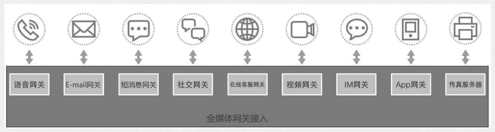

图 2-3

语音网关：电话通信核心组件，连接 PSTN 或 VoIP 与系统内部，将呼叫请求转换为系统可处理信号，实现语音通话。
E-mail 网关：处理邮件渠道，接收用户邮件、解析内容并传递系统处理，支持系统回复邮件发送。
短消息网关：实现短信收发，用户短信进入系统后智能匹配处理，再通过网关回复。
社交网关：接入微信、微博、Facebook 等平台，接收咨询反馈并以社交消息形式回复，实现社交场景互动。
在线客服网关：对应网页端在线客服，用户点击入口的请求经网关进入系统，支持实时文字聊天。
视频网关：支持视频通话与视频客服，建立音视频连接，满足可视化沟通与远程指导需求。
IM 网关：面向 QQ、企业 IM 等即时通信应用，处理消息收发，实现实时沟通。
App 网关：连接企业移动 App，处理 App 内咨询与交互请求，提供专属支持。
传真服务器：对应传真渠道，实现传真文件数字化处理与传输，服务特定行业场景。

在业务架构中，全媒体网关统一管理调度各类接入渠道，实时监测各渠道请求流量，按预设规则与算法分配至合适服务资源，实现资源最优利用。

功能上主要体现为统一接入：整合语音、邮件、短信、社交、在线客服、视频、IM、App、传真等渠道，无论用户通过何种方式发起请求，都汇聚至智能客服系统形成统一入口，避免渠道分散与信息割裂，简化架构，使客服团队在一个平台处理多渠道请求。

**全渠道聚合与智能分派**

**集中队列管理**：构建跨入口的统一待办中心，把电话、邮件、App 等不同渠道涌入的诉求收敛到一个池子，按紧急程度、用户等级、业务类型等维度进行智能排序与实时派发。紧急咨询可插队优先响应，常规咨询按序等待，避免某条渠道拥堵而其他资源空闲，提升整体运转效率。

**策略化路由**：路由既可依托预设规则，也可结合实时数据弹性调整。结合用户画像如 VIP 标签、问题复杂度、服务履历等信息，将请求精准送达最合适的坐席或团队。技术类问题直达技术支持，投诉类需求交由专项处理组，匹配更精准，解决速度与质量同步提升。

支撑能力的工作链路如下。

信息采集与标准化：各渠道网关负责抓取本地化数据。语音网关把电话线路的语音信号转为系统可识别的数字化信号；邮件网关解析邮件格式与正文，再把转换后的信息统一送入智能客服中枢。

客流监测与趋势推断：全媒体网关实时跟踪各入口的来访量，统计不同时段、不同入口的请求数与频率。基于这些数据研判需求波动，为资源投放与调度提供依据。例如发现每日上午某时段电话咨询量骤增，系统可提前安排人手与算力。

需求分配与动态调度：依托统一队列规则与路由策略，对采集到的请求进行分发。请求进入系统后先按优先级等要素进入对应队列，再由网关依据预设规则匹配最合适的坐席或服务单元。派发时兼顾坐席负载、当前忙闲等实时信息，确保分配合理高效。

全媒体网关的核心价值体现为：

服务提速：统一接入与排队终结了渠道各自为政带来的浪费。坐席在一个界面处理多渠道需求，切换成本下降、等待时间缩短。智能分流让问题快速找到对的人，处理周期被压缩，系统能更从容应对大流量。

体验趋同：无论用户选择哪种入口，都能获得连贯一致的服务，避免因渠道差异产生不满。快速响应与精准答复缩短等待、降低沟通成本，满意感提升，信任与忠诚随之增强。

管理更透明：网关为企业提供客服业务集中管控的平台。通过汇聚的多渠道数据，可洞察用户需求与行为模式，评估坐席绩效，发现流程短板并针对性优化。还能依据业务量与资源使用情况合理调配人力物力，运营成本下降，整体管理水平提升。

扩展更灵活：随业务拓展与需求多样化，新通信渠道会不断出现。网关具备良好的可扩展性，能平滑接入新的渠道适配器，让智能客服系统快速适应变化，持续提供优质服务，保持市场竞争力。

### 2.2 人机交互形态解析

接下来聚焦智能客服里的人机互动形态，如真人坐席、对话式机器人与数字人。通过剖析这些技术核心特点，说明它们如何帮助企业提升服务质量与效率，并展望发展空间。同时探讨不同交互形式的利弊，以及支撑其运行的关键算法与技术。需要强调的是，人机交互与排队理论密切相关，不同交互方式会改变用户的服务感知与排队体验，合理运用排队理论可以优化流程，提升整体效果。

#### 2.2.1 真人坐席：专业判断仍具不可替代性

即便自动化方案发展迅速，在特定场景下真人坐席难以被完全替代。金融投资领域，当用户面临股票风险评估、复杂理财产品选择等决策时，真人凭借专业知识与丰富经验，能深入了解用户的财务状况、投资目标与风险承受能力，给出个性化建议与风险提示。这种深度服务难以被自动化完全复刻。尤其在处理复杂或敏感问题时，人类的判断力、同理心与问题解决能力尤为关键。自动化客服如在线机器人和语音助手虽能快速响应基础需求、缩短等待并降低成本，但其固定话术、缺乏推理和情感交流能力，使其在涉及背景理解或情绪管理的问题上，往往难以让人满意。

从排队视角看，真人坐席可视作排队系统中的一种特殊服务资源。例如银行信用卡中心，简单账单查询、还款方式咨询由自动客服快速处理；信用卡被盗刷、额度调整等复杂敏感问题则转接真人。这种混合模式兼顾效率与专业。实践中通常会按业务需求与用户流量构建真人与自动客服结合的混合排队系统，充分发挥自动客服的高效性与真人坐席的专业性。

以金融服务为例，用户遇到账户异常交易时往往处于焦虑甚至恐慌状态。能感知并适度回应情绪的代表，不仅能有效安抚情绪，还能通过细致询问与专业指导快速定位问题并采取措施。这一过程不仅是技术支持，更是建立信任关系的关键。

此外，融合 AI 赋能的坐席模式正成为提升效率与质量的新趋势。借助自然语言处理与机器学习，工具可帮助坐席快速获取相关信息、推荐最佳应对策略、甚至自动生成回复草稿，让坐席更专注于需要人性化关怀的环节。例如分析历史对话记录，AI 可识别常见咨询热点与潜在服务改进点，为团队制定精准培训提供依据；会话中实时监测用户情绪变化并提醒坐席调整沟通方式，让每次互动都留下积极印象。

在业务架构中，真人坐席需与知识库协同以快速获取专业知识，与数据分析模块协同以了解用户历史行为偏好，从而提供个性化服务。技术架构上需建立高效的通信与数据传输机制，确保坐席及时获取所需信息并与自动客服无缝对接。

总之，自动化会不断普及，但对追求卓越体验的企业而言，保留一定比例真人坐席仍是必要的。融合人工智能与人工服务，企业能大幅提升整体服务水平，为用户提供温暖而个性化的关怀，建立品牌忠诚度，推动业务持续增长。同时，合理运用排队理论优化人工与自动客服的协同，也能进一步提升智能客服系统的整体性能与用户满意度。

#### 2.2.2 对话式机器人：多角色协同的智能客服

对话式机器人是基于自然语言处理与机器学习构建的智能交互系统，在客服领域扮演关键角色。

**1. 分类**

按功能与场景可分为三类。

1）聊天型机器人
这类机器人旨在拉近距离、建立信任并提供情感陪伴。利用关键词触发、模糊匹配及随机回复等机制实现流畅对话。知识覆盖开放域但深度较浅，数据主要来自互联网和闲聊交互，由研发团队构建并人工更新。以微软小冰为代表，这类机器人不追求回答准确率，更注重以娱乐风趣的方式互动，提升用户粘性。

2）知识型机器人
主要应用于咨询、售后场景，通过语义归一技术实现一问一答式的智能匹配。可替代部分人工，知识聚焦特定垂直领域，主要来源于企业自主更新的业务知识库。典型应用包括法律问答机器人、电商问答机器人等。电商场景中，它能随时解答商品信息、促销活动、订单状态等常见问题，库存查询迅速、促销规则介绍准确，从而提升购物体验。这类机器人要求回答精准，擅长处理大量简单重复问题。

3）任务型机器人
适用于售前、售中、售后多个环节，支持多轮会话，具备深层语义识别和意图识别能力，可直接协助用户办理业务。知识体系同样专注行业垂直，依赖企业自主更新并不断自我优化。代表产品包括智能音箱、Google Assistant 等。对回答精准度要求极高，追求任务直达，为用户带来优质体验。

不同类型分工协作，可满足多样化客服需求，成为数字化服务转型的重要工具。

从排队理论看，对话式机器人可被视为多服务台排队系统。以某在线旅游平台为例，旅游旺季会收到大量酒店预订、线路咨询需求。机器人会分类处理，如将酒店预订需求分配给专门模块快速查询库存和价格并给出预订建议，显著提高效率并缩短等待。当多需求同时到达，机器人作为服务台进行意图分析和分类，常见咨询由快速响应模块处理，复杂问题转交更专业模块，确保问题妥善解决。

**2. 工作原理**

图 2-4 展示了对话式机器人的工作流程。

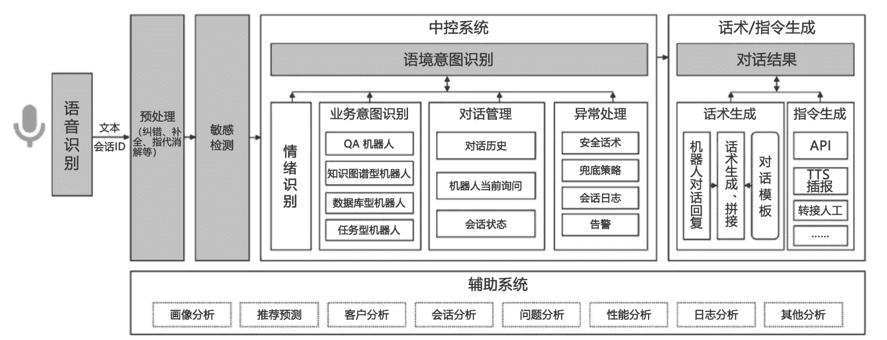

图 2-4

用户输入的语音信息首先经语音识别转为文本，这是理解意图的起点。随后进入预处理：纠错、补全省略成分、指代消解、词法语法调整，并通过会话标识关联同一对话的上下文，保证连贯性。

预处理后进行敏感检测，识别是否包含敏感词汇或不良信息，若存在则采取合规处理措施。

接着系统识别用户文本蕴含的情绪，判断处于高兴、生气、疑惑等何种状态，为后续策略提供参考。情绪激动时，回复会采用更温和安抚的语气。

随后进行语境意图识别，结合当前对话语境判断用户真实意图，再做业务意图识别：QA 机器人处理问答类业务；知识图谱型机器人基于图谱关联推理回答复杂知识问题；数据库型机器人从数据库检索数据作答；任务型机器人处理订票、查单等具体任务。

对话管理贯穿全程，维护对话历史、跟踪机器人当前询问内容、监控会话状态，判断对话是否结束或等待输入，确保流程连贯逻辑。

异常处理是服务稳定的关键：生成安全话术应对敏感或无法回答问题；执行兜底策略保障服务不中断；记录会话日志用于复盘；触发严重异常告警通知运维介入。

完成核心逻辑后进入话术/指令生成：基于对话历史和识别意图，通过话术生成与拼接构建自然流畅的回复；同时依据业务需求生成指令，如调用 API 获取数据、触发文本转语音播报、或判断是否转接人工，驱动服务闭环。

辅助系统为机器人提供全方位支撑：图像分析解析用户上传的故障图片；推荐预测基于历史行为预判需求推送关联内容；用户分析挖掘特征与满意度优化策略；会话分析评估意图识别准确率与多轮流畅度；问题分析拆解深层诉求；性能分析监测响应时间与成功率；日志分析排查故障与潜在风险；其他定制化分析为迭代升级提供数据依据。

**3. 技术实现**

流畅的人机交互离不开强技术支撑。自然语言理解方面，除传统规则方法外，深度学习被广泛用于意图识别和槽位填充。卷积神经网络擅长捕捉局部特征，长短时记忆网络适用于序列数据，二者结合效果更好；预训练语言模型如 BERT 在多项自然语言处理任务上接近人类水平。

为增强人性化，研究也在探索多轮对话能力，要求机器人具备良好语义理解并能记忆历史内容作出恰当回应。

在复杂多轮对话处理上，DeepSeek 提供 128K 长上下文窗口支持跨会话历史的深度语义理解。例如跨境电商用户询问“上周购买的红色连衣裙能否换为蓝色 S 码”时，系统可自动关联 3 天前的订单信息及库存数据，无须用户重复输入，使问题解决效率提升 60%。

**4. 应用优势**

对话式机器人在客服领域优势明显。成本效益方面，相较传统人工团队，部署机器人可大幅减少人力开销，一个典型呼叫中心年工资支出达数百万美元，自动化方案有望节省 60% 以上费用。机器人不受时间限制，提供 24 小时在线服务，提升满意度。随着技术进步，现代机器人具备一定情感识别能力，可根据情境调整语气表达，营造更亲切的沟通氛围。

**5. 局限性与挑战**

尽管优点众多，机器人仍有不足。面对非常规或高度专业化询问时，现有技术往往难以给出令人满意的答案，因其依赖预设知识库或有限数据集，对超出范围问题缺乏灵活应对。此外，跨领域迁移学习的难题尚未完全解决，如何让同一机器人无缝适应多种业务场景仍是开放课题。因此企业往往需定制化开发，并保留一定比例人工干预作为补充手段。

总之，对话式机器人凭借高效便捷正受各行业关注，但要充分发挥潜力仍需克服理解深度与交互自然度等挑战。未来随着技术完善，其应用将更广，结合排队理论思想优化任务分配与处理流程，也能进一步提升服务性能和用户体验。

#### 2.2.3 数字人客服：虚拟形象带来的新体验

数字人客服作为虚拟助手的高级形态，正悄然改变客服行业，如图 2-5 所示。在金融行业，数字人通过自然语言处理理解用户理财需求，结合知识图谱分析提供专业建议。当用户询问资产配置时，数字人能根据风险偏好与财务状况推荐合适产品组合，并以生动形象和自然语音交流，提升服务体验。

图 2-5

数字人客服融合计算机视觉、语音合成、自然语言处理和知识图谱分析，打造可与真人高效互动的虚拟形象。不仅带来直观且富有温情的交互体验，还显著提升品牌形象和服务质量。实现过程中，先对真实人物进行高精度建模，再利用深度学习算法克隆其声音，最终生成栩栩如生的虚拟角色。借助自然语言处理，数字人能理解并响应用户的语音或文字输入，基于预设意图流程提供准确及时的回答。从排队理论视角看，数字人服务过程同样涉及排队与资源分配。

例如某银行线上客服平台在理财产品推广期，利用数字人服务大量用户。系统会根据数字人处理能力和用户需求优先级合理分配资源，高价值用户或紧急问题优先处理，确保及时满意答复。多用户同时发起需求时会形成排队队列，数字人处理能力相当于服务台效率，需求到达速度决定队列长度与等待时间。为优化服务，系统可分析需求规律预测高峰低谷，提前调整数字人数量或资源分配，缩短等待、提升效率。

除提升体验外，数字人还能以更低成本提供 24 小时服务，减轻人工压力，尤其在高峰期缓解人力紧张。借助大数据分析，数字人可根据历史行为预测潜在需求并推荐产品，增强用户粘性。尽管好处明显，其开发与维护成本较高，需持续投入研发和计算资源。此外，如何确保交流始终保持友好专业、避免误解冲突，也是当前挑战。

在技术架构中，数字人客服需与自然语言处理、知识图谱等模块紧密协作，提供精准语言理解与知识检索。在应用层面，数字人需深度融入企业业务流程，按不同场景和用户需求提供个性化服务。

数字人客服凭借拟真外形与流畅交互，正在成为各行业提升服务感受的重要手段。金融领域出现了能进行投资沟通的智能顾问，零售场景里出现了陪同选购的购物助手，教育与医疗也在部署虚拟讲师和家庭医生，落地场景持续扩张。随着底层能力不断成熟，数字人可以切入更广的业务环节，既为企业带来商业收益，也让用户感受到省心有趣。要把潜能完全释放，还需弥补不足，例如强化信息安全保障、打磨交互细节。将队列优化思路引入数字人客服系统，可以让请求处理更顺畅，整体服务品质明显提升。

## **2.3** **大数据赋能客户画像**

下面重点探讨大数据怎样为智能客服提供支持，核心在于高效采集、清洗海量记录并深度挖掘用户行为，最终形成可感知的专属体验。先梳理从原始信息到画像落地的演进路径，再说明画像如何驱动话术动态调整，实现一人一策的效果。大数据、画像构建与队列理论相互关联，通过对用户数据的深度剖析，可以更准确预判到访模式与服务需求，进而优化排队策略与资源配置。

如图2-6所示，画像搭建的常规流程如下。画像的原材料是原始信息，包括行为日志、基础客户信息、内容信息以及外部信息。信息先经清洗剔除噪声和错误，再提炼为事实标签，分为静态画像与动态画像。静态画像描绘相对稳定的属性，例如性别、年龄、学历、常住地；动态画像捕捉显性行为表现，像点赞、评论、分享、关注、评分等，用来反映实时兴趣与互动状态。随后对事实标签做建模，得到模型标签，能挖掘更深层的偏好特征，如游戏偏好、内容偏好、标签偏好、关键词偏好，同时对活跃度做分层，最终完成精准画像，为定制化推荐和精准营销提供支撑。

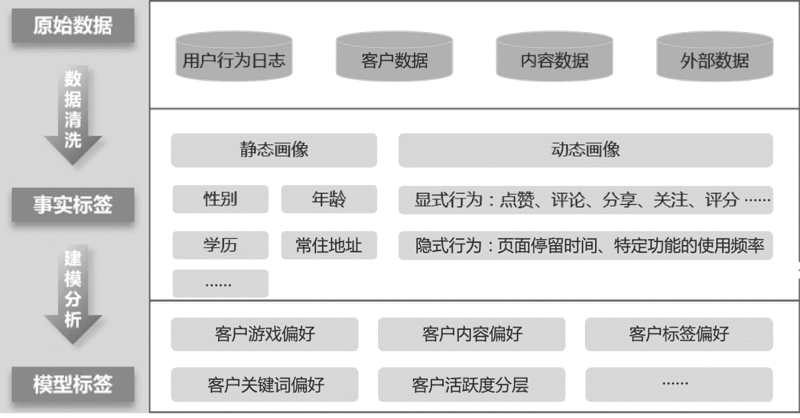

图 2-6

### **2.3.1** **海量数据的获取与洞察**

信息爆炸的时代，数据的价值日益突出，如何高效获取、加工并利用海量记录成为企业竞争的关键。电商尤其典型，采集与分析能力直接决定精准营销与专属服务的上限。通过收集用户在平台的浏览足迹、购买记录、搜索词等，可以洞察偏好与需求。比如某电商发现一位用户常看运动装备并购入过跑鞋，就能合理推断其对运动服饰的兴趣，进行定向推荐。从行为到内容偏好，每条记录都蕴含商业意义。构建数据驱动决策体系，需要先摸清信息来源并掌握采集方法，再用现代分析工具完成清洗、整合与深度挖掘，最后保证信息质量夯实后续分析基础。

从队列理论视角看，采集与分析为排队优化提供了依据。以外卖平台为例，分析下单时段、菜品偏好等发现，11:00—13:00、18:00—20:00 为订单高峰，且区域需求不同。平台据此提前在高峰期调配配送人力，按区域准备菜品库存，排队系统因此更顺畅，配送效率和用户满意度同步提升。

信息来源多元，包括客户基础信息、内容信息、交互记录与外部信息。客户信息勾勒基本画像，如性别、年龄、注册时间等；内容信息刻画产品或服务本身，如游戏类型、描述、玩家评价关键词；交互记录反映人与内容的关系，如点击率、评论态度体现喜爱程度；外部信息则补充社会背景，比如社交媒体活动，模型预测更准确。

针对不同类型信息，需选用合适的采集手段。结构化信息仍可沿用ETL流程；非结构化或半结构化信息则借助网络爬虫抓取公开资源，或通过API接入第三方信息流。移动互联网普及后，通过SDK嵌入客户端采集设备使用情况也成为常见做法。方案设计时必须严格遵循法规，保障安全与隐私合规。

采集后进入预处理阶段，以提升分析质量与效率。主要包括数据净化、格式统一与初步特征工程，如去除噪声、填补缺失、统一时间戳、文本编码、按业务逻辑新增计算字段。可靠洞察的前提是高质量信息，因此完整性与准确性要放在首位。

信息准备就绪后，就能用先进工具深入挖掘价值。Pandas配合SQL可高效完成筛选聚合，TensorFlow、PyTorch等机器学习框架支撑复杂模型训练，分布式计算引擎可处理PB级信息。深度学习在推荐场景表现突出，例如用embedding把高维稀疏特征映射到低维空间，或用宽深融合结构结合线性模型与神经网络，提升定制化推荐精度。

无论采用何种采集与分析方法，信息质量都应是核心关切。只有基于真实可靠的记录，商业决策才具可信度与指导性。随着算法演进与硬件提升，更多创新方案会不断出现，帮助企业更好满足用户需求。同时，大数据也能为队列理论在智能客服中的应用提供更精准的信息支撑，让排队策略更科学。

### **2.3.2** **画像建模的方式**

画像是通过一套标签描绘用户特征，帮助企业更透彻理解需求与偏好。在线教育中，通过课程选择、学习时长、作业完成情况、考试成绩等构建画像，能帮助机构把握学生的学习状态与需求。例如，数学学习中常在某知识点停留且作业错误多的学生，可判断其存在理解困难，从而推送针对性资料与辅导。这种模型对提升体验、优化产品和定制化推荐至关重要，企业可据此精准定位目标群体，提供定制化服务，增强黏性与满意度。

从队列理论角度看，画像有助于企业识别服务需求与优先级。酒店预订平台可依据预订历史、消费金额、会员等级构建画像。对经常预订高档房、消费高的高价值用户，系统可授予更高排队优先级，提供升级房型、免费早餐等增值服务，提升满意度和忠诚度。画像分析还能预测服务耗时，合理排布客服资源，提升排队整体效率。

按数据类型，画像分为静态与动态两类。静态画像描述固有属性，如性别、年龄、职业、学历等，信息相对稳定，多来自注册填写或第三方合作。静态画像为了解基本背景提供基础，但变化慢，单独使用难以反映最新兴趣。

动态画像则关注特定情境下的行为表现，包含显性行为如点赞、分享、评论，以及隐性行为如页面停留时长、点击率。显性行为直接体现态度，隐性行为虽不明显却揭示潜在喜好。实践中显性行为样本通常较少，更依赖海量隐性行为信息来完善画像。

构建精准模型的关键在于对事实标签的系统化分析处理。事实标签是指从原始信息中提取的客观指标，来源包括客户基本信息、与产品的交互记录、外部信息等。其中显性与隐性行为构成的行为轨迹价值最高，最能反映即时兴趣。

在特征提炼阶段，可采用聚类分析或加权计算。聚类是一种无监督方法，能按相似性把用户分成若干群体，例如按活跃度分为高、中、低三层，为差异化运营提供依据。加权计算则是为不同行为赋权后综合评估兴趣强度，如按功能使用频次打分，分数越高兴趣越强。

系统性整合多维度信息并运用先进分析手段不断丰富画像，既能加深企业对用户的理解，也能显著提升服务质量与效率。随着大数据与人工智能的发展，画像的应用场景将更广，价值也会持续释放。画像与队列理论结合，为智能客服优化提供有力支撑，让排队服务更贴合用户需求与预期。

### **2.3.3** **实现千人千面的话术触发逻辑**

在追求极致个性化的今天，企业需要读懂每个用户的独特诉求并提供专属体验。美妆行业通过肤质、年龄、消费习惯、品牌偏好等构建画像，客服咨询时可据此获得定制化话术提示。对年轻油性皮肤用户，推荐控油产品并讲解功效用法；对关注抗衰的年长用户，则推荐抗皱产品。这种一人一策的方式能明显提升满意度，也助力商业目标达成。要实现这一愿景，需要从信息采集、模型训练到实时对话策略调整，每个环节都精细打磨。此外，千人千面服务也与队列理论中的个性化排队策略相呼应，通过差异化服务兼顾效率与满意度。

构建画像时需兼顾显性行为与隐性行为模式，如停留时长、功能使用频率等。显性行为直观可靠，但样本往往不足，结合大量隐性行为综合分析尤为关键。

从队列理论看，不同画像的用户在排队系统中的优先级与服务需求不同。快递行业可按寄件频率、包裹价值构建画像，对高频且高价值客户优先取件派送，缩短等待；对低频普通文件客户，在保证质量前提下采用更灵活的排队策略，提升整体运营效率。画像分析还能帮助智能客服提前预判需求，做好资源准备与调度。

推荐算法是实现定制化服务核心。要准确预测兴趣点，系统需具备强信息分析与深度学习能力。常用方法包括协同过滤、内容基于方法与混合模型。协同过滤通过相似用户群体推断喜好；内容基于方法依赖项目属性与元数据匹配；混合模型兼顾用户相似度与内容特性。自然语言处理技术进步后，系统可通过语义理解进一步提升推荐准确性，如用情感分析识别情绪状态并调整沟通语气。

为保证交流体验，系统需基于实时反馈持续优化。不仅要监控当前会话质量，也要做跨会话的长期追踪评估。一旦某策略效果不佳，系统会迅速切换备选方案或调整参数，直至找到最优解。保持体验一致性与连贯性也至关重要，要求算法在多轮对话中保留上下文并灵活应对突发状况。

在排队场景中，实时反馈可用于动态调整策略。若发现某用户等待过长，系统可自动提升其优先级或提供补偿性服务，如优先转人工。通过这种方式提升接受度与满意度。

设计兼顾个性化与高响应能力的服务架构时，需注意几点。首先遵循模块化原则，将系统拆分为协作单元，如协议调度层管理对外通信，推荐算法层负责核心运算，存储单元保存关键信息。其次采用分布式部署，分散负载、避免单点故障，应对海量并发。引入缓存机制如Redis，可暂存高频信息，减少数据库查询，加速处理。精心规划并持续优化各部分，能构建智能高效的千人千面动态客服系统，为用户提供卓越体验。结合队列理论优化，还能进一步提升系统性能与客户满意度，在智能客服领域发挥更大作用。

## **2.4** **人工智能技术**

目前人工智能正以前所未有的方式重塑客服行业。下面深入探讨AI技术的核心，解析语音识别、自然语言处理及大语言模型如何协同工作，为智能客服赋予高效个性化能力，共同构建提升客户体验的系统工程，同时展望技术在智能客服领域的发展方向。值得注意的是，AI技术与队列理论存在紧密联系，通过智能处理与预测用户请求，能优化排队系统的资源分配与服务流程。

### **2.4.1** **语音识别技术**

语音识别技术把人类语言转化为计算机可识别的文字或指令，成为人机沟通的桥梁。在智能车载系统中得到广泛应用，驾驶员可通过语音指令控制导航、播放音乐、拨打电话。例如说出“导航到最近加油站”，语音识别系统迅速转文字后导航即规划路线。实现依赖两大核心组件：声学模型与语言模型。

声学模型负责把音频信号提取为特征向量并识别音素序列，语言模型则基于上下文预测最可能的词汇组合，提升识别准确率。统计学习与深度学习结合后，现代语音识别系统能处理复杂自然语言输入，在多场景下表现稳定。

如图2-7 展示了语音识别技术中前后端的特征提取架构。客户对着麦克风讲话产生语音信号，前端系统先做降噪与信号优化，再通过快速傅里叶变换把时域信号转为频域信号，形成梅尔频率倒谱系数等声学特征传至后端。训练有素的声学模型依据音素-状态对应关系推断最可能的音素序列，再交由语言模型基于语法规则、词典与概率分布打分，最终输出置信度最高的文字结果。解码器还结合上下文进一步优化输出，确保文字既合规又传达语义，完成语音到文字的转换。

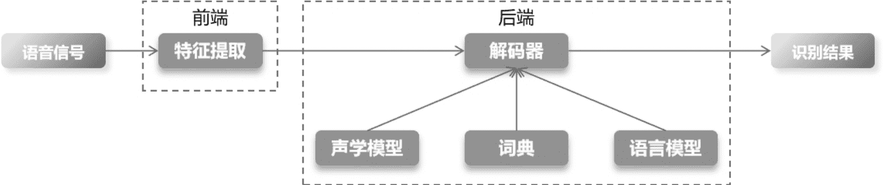

图 2-7

从队列理论角度看，语音识别的准确性与效率直接影响排队整体效能。识别错误会导致请求传达失真，增加单次处理时长，进而延长队列等待。以电商售后为例，客户反馈“商品有破损”被误识为“商品有赠品”，客服基于错误信息无效处理，需客户重复说明，处理时间从3分钟延长至8分钟，服务效率大幅下降。业务高峰时，后续排队的客户数量会增加，最终损害整体体验。因此提升识别准确率与速度对优化排队系统至关重要。

图2-8 所示的智能语音导航服务流程中，语音识别是关键能力要素。客户通过PSTN发起语音请求，经语音网关通过SIP到达话务平台，平台根据情况转人工或调用智能语音平台的语音合成与识别服务，并通过MRCP服务器、多轮对话引擎及业务系统处理。语音识别实时把语音转为文本指令，实现无人干预的信息处理。以银行客服热线为例，客户说“查询余额”或“转账汇款”，语音识别引擎先提取特征并声学建模转为文字序列，随后自然语言处理解析意图并通过合成语音反馈指导或直接执行。作为人机交互的听觉中枢，语音识别实现了从语音信号到结构化指令的关键转换，提升效率、减轻人工负担，构建智能语音交互闭环。

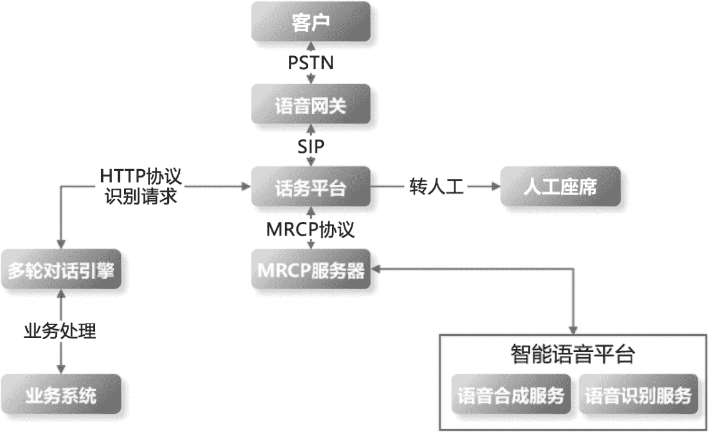

图 2-8

尽管语音识别已相当成熟，对方言变体与口音识别仍有挑战。研究者正致力于开发更强大的多语种及方言识别能力，让机器更好地适应全球多样化语音环境。随着云计算、大数据等新兴技术发展，未来语音识别系统有望进一步降本增效，为各行业带来更多创新。

作为连接人类与数字世界的纽带，语音识别在推动智能化服务转型中发挥关键作用。特别是在智能语音导航服务中，其高效精准表现为企业赢得竞争优势，也为消费者带来全新体验。随着算法优化、硬件升级与应用场景扩展，语音识别技术将带来更丰富形态，持续引领人机交互变革。同时，语音识别完善也让排队系统更高效智能，为客户提供更优质服务体验。

### **2.4.2** **自然语言处理**

自然语言处理是人工智能的关键技术，目标是让机器理解、处理并生成自然语言。图2-9 按层次与应用方向对NLP技术进行了分类。

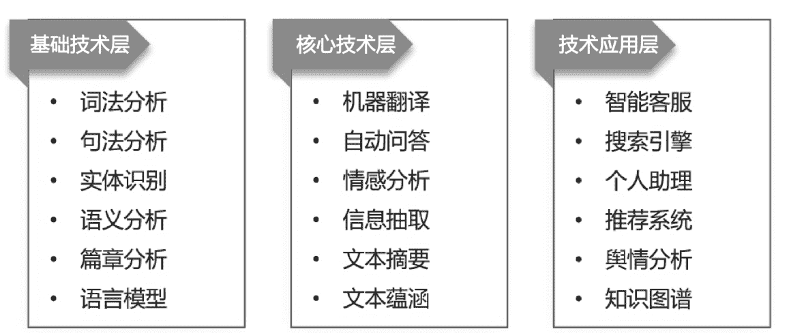

图 2-9

基础技术层是NLP的基石。词法分析拆解词语构成与形态，句法分析关注句子语法结构，实体识别找出人名、地名等各类实体，语义分析致力于理解文本意义，篇章分析处理连贯性与逻辑性，语言模型对语言现象建模并预测概率分布。这些基础能力为上层应用提供支撑。

核心技术层建立在基础层之上，涵盖机器翻译、自动问答、情感分析、信息抽取、文本摘要、文本蕴含等关键环节。机器翻译实现跨语言转换，自动问答根据提问给出答案，情感分析判断文本倾向，信息抽取抓取关键信息，文本摘要提炼主要内容，文本蕴含研究语义关系。这些技术代表了NLP的主要研究方向与应用重点。

NLP落地实践：从理解到调度

自然语言处理已从学术评测走向真实业务。会话机器人可实现人与机器的自动对话，检索系统能把握提问意图并返回匹配结果，数字助理可以解析用户指令并完成具体操作，推荐引擎结合偏好与文本特征推送个性化内容，舆情监测通过海量文本捕捉公众情绪走向，知识图谱把文本中的实体与关系结构化，为上层应用提供可检索的知识底座。

把排队管理的思路引入语言技术，请求分类和优先级判定变得关键。以银行客服为例，用户说“我的账户被盗刷，资金在快速流失”时，系统通过关键词抽取和语义判断立刻识别出高危且复杂的情形，马上提升优先级，优先分配给专业人员介入，避免损失和长时间等待带来的不满。总的来看，对用户文本做分析可以快速评估紧迫程度和复杂度，进而实现合理排队与资源分配。

词法分析是处理的起点，负责把一段文字拆成独立词元。中文“我喜欢吃苹果”会被切为“我/喜欢/吃/苹果”，为后续步骤打基础。句法分析在词元之上揭示语法关联，构建结构树，同一例子中“我”是主语，“吃”是谓语，“苹果”是宾语，呈现完整的主谓宾结构。

理解能力增强后，情感分析成为热点。它基于文本自动判断正面、负面或中性倾向，直接反映用户对产品服务的态度。比如对社交媒体上某款手机评论做情绪判断，就能迅速掌握满意度，帮助企业及时调整营销或改进设计。

服务质量控制上，语言技术作用明显。过去人工质检覆盖面窄、效率低且受主观影响大。基于语言技术的全量质检平台先用语音转写把通话转为文本，再用算法深度解析，识别违规用语、不专业表达等损害品牌形象的内容，按规则模型自动打分并标注重点区域，供人工复核优先处理。

在数据沉淀层面，历史服务记录结合用户画像和行为偏好可形成知识库，指导下一步优化。例如发现某类产品退货频发，通过分析对话记录就能定位是品质问题、物流差错还是说明不清，为针对性改进提供依据。

总体而言，自然语言处理是连接人与系统的桥梁，既能精准捕捉情绪变化提升互动体验，也能通过自动化大幅提升效率与准确性。随着算法迭代和场景拓展，价值会进一步放大。特别地，语言技术与队列管理思路的结合，为智能化客服的排队和流程优化提供强支撑，有助于整体服务质量提升。

### **2.4.3** **LLM**

大语言模型是基于深度学习、尤其是 Transformer 结构设计的先进人工智能系统，拥有强大的自然语言理解与生成能力。如图 2-10 所示，2019至2023年间发展迅猛：2019年T5问世，2020年GPT-3等新架构出现，2021年Codex等模型发布；2022年进入爆发期，OPT、GPT-Neo-X-20B、ChatGPT等相继登场，2023年GPT-4的发布引发全球关注。

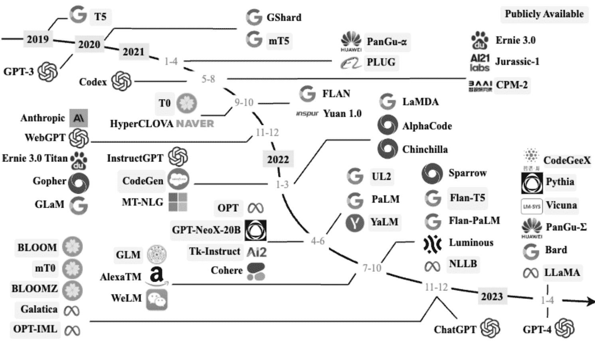

图 2-10

在智能法律咨询场景，大模型能提供初步的专业建议。用户问“我在网上购物遇到商家欺诈，该怎么办”时，经过海量数据训练的GPT-4等模型可依据法条和案例快速给出收集证据、向平台投诉、必要时诉讼等建议。模型在预训练阶段掌握了语言结构、语法和上下文语境，不仅能构建丰富知识库，还具备推理和泛化能力，可在新场景给出合理回答。技术进步让大模型成为推动智能客服创新的核心动力，提供更智能个性化的服务体验。

从队列视角看，大模型可优化排队决策。例如在线旅游服务中，用户提问“我想下周去马尔代夫度假，预算三万，帮我规划行程”，模型能判断其涉及复杂行程规划、需专业人员耗时处理，于是安排经验丰富的客服优先，同时调整排队策略避免简单问题用户等待过长。通过语义理解和分析，大模型能更准确预测需求难度，实现客服资源合理分配和排队策略优化。

**1.** **基本原理**

大模型的工作可分为预训练、微调和推理三阶段。

预训练采用自监督学习在未标注数据上训练，学习词汇关联和长距离依赖；随后用小规模标注数据对预训练模型微调，使其适配具体应用；部署后模型根据输入实时推理生成回复。Transformer 因并行计算效率高、序列信息捕捉能力强而被广泛采用。

以 DeepSeek 为例，其利用知识图谱嵌入技术在金融行业实现智能合同质检自动化，自动解析合同条款中的违约金比例、不可抗力条款等风险点，标注准确率达98.5%，较人工审核效率提升70%，年节约合规审核成本45万元，基于江苏银行实测数据。在政务场景，DeepSeek 可提供方言识别与政策文件结构化分析，如宿迁宿心办 App 接入后，政策咨询平均响应时间缩短至1秒内，解决率提升至95%，覆盖80%以上的高频民生问题。

**2.** **在智能客服系统中的应用**

图 2-11 从产品搭建、文本场景、语音场景三个维度对比了基于大模型的智能化客户服务与传统智能化客户服务的差异。

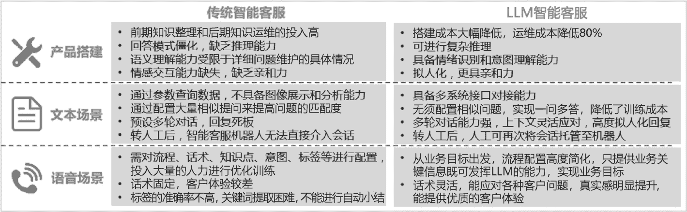

图 2-11

除差异外，基于大模型的系统还具备以下优势：

增强的知识管理与运维能力：依托强大的信息抽取与整合能力，企业可减少构建维护知识库的人力投入。系统能自动从文档提取关键知识点并转成易检索形式，或定期更新常见问题列表保持时效性，提升查询响应速度与解答准确性。在队列系统中，高效知识管理让客服更快解决用户问题，缩短等待时间。

降低人工参与度：传统智能化客户服务需大量人工配置多轮对话逻辑，引入大模型后可自动化完成，如自动生成意图识别规则和同义词表，大幅节省开发时间和成本，从而把人工资源集中到复杂问题上，优化排队资源配置。

提升交互质量和客户体验：基于大模型的客服不仅能准确理解提问真实意图，还能依据上下文灵活调整回答方式，展现情绪感知能力和拟人化交流技巧，提升服务氛围和满意度。排队过程中良好的交互可缓解等待焦虑，提升客户对排队系统的接受度。

支持多模态互动：除文本外，现代系统开始探索图像识别、语音合成等跨媒体技术。结合视觉大模型与音频处理，新一代客服机器人可在不同感官维度提供全方位交互，也为排队优化提供更多可能，如通过多模态精准把握需求从而合理安排排队与服务。

推动个性化推荐服务：通过分析历史聊天记录，大模型可洞察用户偏好并推送定制化建议或产品介绍，提升销售转化率。在排队系统中，个性化推荐可根据偏好和历史行为匹配更合适的服务资源，提升满意度和忠诚度。

随着大模型技术不断发展，其在智能化客户服务领域的应用前景广阔，不仅提升方案的功能性和灵活性，也为新型客户服务模式奠定基础。在数字化转型竞争中，掌握并善用这一工具是企业成功的关键。大模型与队列管理学说的结合，也将为智能化客户服务带来更智能、高效的排队与服务体验。

## **2.5** **工作流**

商业环境瞬息万变，企业持续探索提升内部运作效率与服务质量的新路径。本节探讨工作流技术如何成为关键解决方案。建立标准化、自动化的业务流程，可优化客户体验并提升团队协作效率与响应速度。下面先介绍工作流引擎核心概念并以 Camunda 为例说明，随后通过智能客服工单系统展示工作流管理如何改善客户服务各环节。此外，工作流技术与队列管理学说密切相关，合理设计可优化排队流程，提高资源利用率和服务效率。

### **2.5.1** **工作流引擎**

工作流引擎是自动化业务流程的核心驱动，通过精准定义、有效管理和顺畅执行复杂业务逻辑，极大提升组织运营效率与协同能力。如图 2-12 所示，工作流执行服务是体系核心。过程定义工具经接口1连接执行服务，像规划师一样把智能化客户服务业务流程规范化定义，为后续执行绘制蓝图。管理与监控工具经接口2交互，实时监督流程状态，异常时及时介入确保稳定推进。工作流客户应用程序经接口3对接，是客户发起咨询、触发智能化客户服务工作流的入口。调用的其他应用程序经接口4协同，整合知识库查询、语义分析等能力，为智能化客户服务提供支撑。其他工作流执行服务经接口5相连，实现不同工作流间的交互与协作，构建完整生态。

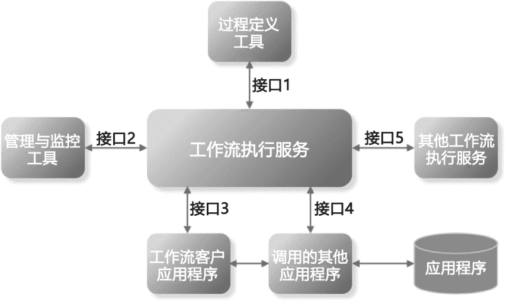

图 2-12

以智能化客户服务为例，客户发起咨询时，工作流客户应用程序接收请求并传给执行服务。若为常见问题，执行服务调用其他应用快速查询知识库，经语义分析后直接给出准确回复。若问题复杂，管理与监控工具介入，按预设规则判断是否转人工客服。转接过程中，执行服务与其他工作流执行服务协同，确保客户信息准确传递，使人工客服快速了解需求，实现无缝衔接，提升响应速度与服务质量。

从队列视角看，工作流引擎扮演调度中心角色。以电商售后工单处理为例，引擎根据工单类型、紧急程度及客户历史信息，将工单分配给最合适的客服小组或人员。紧急退货工单优先分配给处理快、经验丰富的客服，确保问题快速解决，提升满意度。引擎按预设规则和条件对请求分类分配，确保每个请求及时有效处理。例如 Camunda 可根据客户问题类型、紧急程度将工单分配给最合适人员或部门，优化排队资源分配。

Camunda 是一款备受推崇的开源工作流引擎，以开放性、灵活性及强大社区支持著称。图 2-13 展示了 Camunda 及相关工作流引擎的技术演进历程。

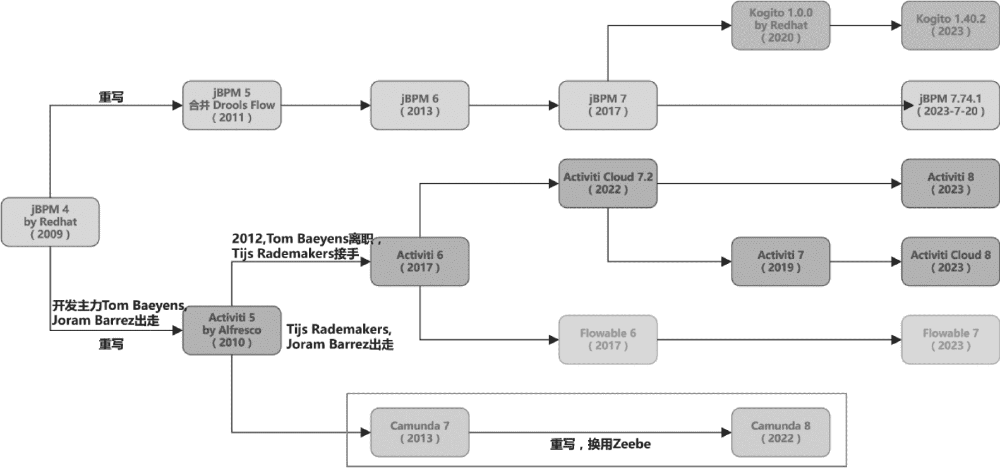

图 2-13

其开放性和可扩展性突出。作为纯 Java 库，可无缝集成到 JavaEE 和 Spring 框架，提供丰富的 RESTful API，方便非 Java 开发者远程调用。无论单体应用还是微服务架构，都能轻松嵌入。例如在微服务系统中，各服务可调用 Camunda API 协同复杂工作流。DeepSeek 搭配 Camunda 后，通过动态任务路由算法，将设备故障报修等复杂工单自动分配给匹配的专家模块。例如，国家电网 MSC 平台接入 DeepSeek 后，基于设备运行数据与工业协议解析技术，实现设备故障预测准确率提升20%，运维工单处理周期缩短30%，年节约运维成本45万元。

灵活性方面，Camunda 遵循 BPMN 2.0 规范，支持图形化设计业务流程并简单配置部署。内置 DMN 决策引擎执行基于规则的决策表，便于处理复杂业务逻辑。比如某金融机构利用 Camunda 决策引擎实现信贷审批流程自动化，系统按预设规则自动评估申请者资质并决策。

Camunda 还提供完整工具集。Camunda Modeler 用于创建编辑 BPMN 流程图及 DMN 决策表；Tasklist 是 Web 应用，用于管理人工任务，让终端客户轻松查看和处理分配工作项；Cockpit 提供全面监控与操作界面，帮助企业实时掌握流程执行并干预异常；Optimize 专注流程性能分析，通过数据分析优化现有流程。工具共同覆盖设计、执行、监控、优化全生命周期。

其背后活跃的全球社区持续分享经验、交流技术，为定制化开发提供资源。大量企业选择 Camunda 作为核心工作流平台，证明其技术成熟度和商业可靠性。

在集成方面，Camunda 表现突出，通过多种接口和服务可轻松与 ERP、CRM 等外部系统深度集成，构建完善企业级应用。例如零售连锁企业利用 Camunda 实现订单处理流程自动化，同时与后端库存管理系统对接，确保库存数据同步，提升整体运营效率。

凭借开放性、灵活性和强大社区支持，Camunda 成为市场上最具竞争力的解决方案之一。无论中小企业改进内部流程，还是跨国公司大规模部署自动化系统，Camunda 都是优先选择。Camunda 与队列管理学说的结合，也为智能化客户系统的工作流优化和排队管理提供强力支撑，全面提升系统整体性能。

### **2.5.2** **客服工单系统**

客服工单系统贯穿客户服务全生命周期，通过精心设计的服务流程，确保从问题提出到最终解决过程透明高效。在物流行业，客户反馈包裹丢失时，系统立即启动标准化处理流程：记录客户信息、查询运输轨迹、协调快递员查找、沟通进展、最终解决并回访，各环节紧密相连。工作流技术确保每步按最优顺序执行，避免处理延误或信息传递不畅，提升效率和服务质量。客服工单系统与队列管理学说紧密相关，合理流程可优化排队，提升效率和满意度。

工单受理阶段。客户通过热线电话、在线聊天、小程序或公众号等渠道寻求帮助时，系统自动创建工单。以电信运营商客服为例，客户通过手机营业厅 App 反馈网络信号差时，系统立即创建工单并自动获取手机号、套餐信息等，减少手工录入时间。工单详细记录个人信息和问题描述。为确保及时关注，系统采用智能调度机制，依据紧急程度和类型分配给最合适客服人员。技术难题优先分配给具备相关知识的人员，一般咨询按既定规则安排。从队列视角看，这相当于对请求分类排队，不同类型进入不同虚拟队列等待合适服务资源，实现合理分配与高效利用。

工单处理阶段。客服人员接到工单后立即投入解决，可根据系统知识库快速查找信息提供准确方案。遇到复杂问题，可通过系统发起内部协作，与其他部门沟通探讨方案。工作流引擎实时监控处理进度，对处理时间过长的工单预警提醒加快处理。系统记录每次沟通和操作，形成详细日志，便于后续查询审计。这如同排队系统实时监测各队列处理情况，对延误及时调整，保证流畅运行。

工单流转阶段。处理过程中因职责范围等原因需流转工单时，客服人员可通过系统转交相应部门。工作流引擎按预设流转规则自动更新工单状态和责任人，并发送通知提醒及时处理。工单在部门间流转时，系统记录流转时间和原因，确保可追溯。该机制类似于排队系统的任务转移，将客户请求准确传递到最合适的处理环节，提升问题解决效率和准确性。

工单复核环节。当坐席判断客户诉求已解决，会把工单推送到复核岗位。复核人员会逐项核对处理轨迹与交付结果，确认问题是否彻底根除、客户是否认可服务结果。若复核未通过，单据将被退回给原经办人重新处置。这一节点在排队模型中相当于一道质量闸口，只有经严格校验的请求才算真正结案，能拦截不合格输出，守住整体服务品质。

客户回访环节。为更全面把握客户满意度，系统会在结案后的一段时间内自动触发回访。回访人员通过电话、短信或在线问卷了解客户对服务流程与结果的评价，并收集改进建议。所有反馈都会写入系统，成为持续优化的重要依据。从排队论来看，回访是整个服务链路的闭环反馈，利用客户声音不断调整排队规则与作业流程，提升满意度与忠诚度。

数据分析与优化环节。客服工单长期积累的历史数据为改进提供了基础。对这些数据做深度挖掘可揭示流程短板。处理时长分析能定位瓶颈环节进行针对性优化；问题类型与频次分析可发现需求热点，及时更新知识库以提升坐席能力。基于分析结论，还可调整工作流引擎规则，优化工单的分配、流转与处理效率，提升整体运行效能。这与排队论中通过数据调参实现服务最优的思路一致。

在工作流技术支撑下，客服工单实现了流程自动化与规范化。结合排队论理念，对受理、处置、流转、复核、回访等环节进行系统化改进，不仅提升了效率与质量，也为企业决策提供依据，有助于持续提升服务水平并增强市场竞争力。随着技术演进与需求多元化，工单体系将不断完善，为企业与客户创造更大价值。

## **2.6** **云计算**
在数字化浪潮下，智能客服的构建与发展离不开云计算的支撑。云计算以弹性供给、高效运行和经济成本的服务模式，为智能客服提供灵活应对复杂业务的解决方案，从而改善服务品质与体验。从排队论视角看，云计算为智能客服的排队机制与资源调度提供了动态优化的技术基础，助力系统更高效运行。图 2-14 展示了基于云计算的智能客服系统架构，覆盖 SaaS、PaaS、IaaS 三层。

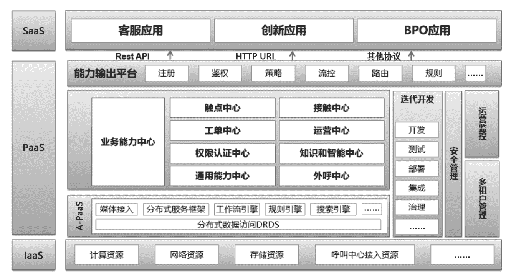

图 2-14

SaaS 层面向客户交付现成应用，包含客服应用、创新应用和 BPO 应用。该层通过 REST API、HTTP URL 及其他协议与 PaaS 层的能力输出平台对接，调用底层能力为客户提供各类智能客服服务。

PaaS 层是核心支撑平台。A-PaaS 提供媒体接入、分布式服务框架、工作流引擎、规则引擎、搜索引擎、分布式数据访问 DRDS 等基础能力。业务能力中心包括触点中心、工单中心、权限认证中心、通用能力中心等模块，实现用户交互、任务处理、权限管理等功能。能力输出平台具备注册、鉴权、策略、流控、路由、规则等功能，用于统一管理并对外输出能力。PaaS 层还包含迭代开发、运营监控、安全管理、多租户管理等模块，保障系统持续优化与稳定运行。

IaaS 层提供底层基础资源，包含计算资源、网络资源、存储资源、呼叫中心接入资源等，是智能客服运行的硬件和网络基础，为上层服务提供支撑。

### **2.6.1** **SaaS 层**
SaaS 层在智能客服中发挥关键作用，对中小企业尤其友好。以初创电商为例，利用 SaaS 客服平台无需自建系统即可快速获得完整功能，将资源聚焦于主营业务。以下从功能维度介绍关键应用。

**1.** **知识管理功能**
知识库是信息枢纽，整合产品文档、操作指南、常见问题解答等资源。以教育 SaaS 平台为例，知识库会随教学方法更新与用户反馈持续扩充。通过搜索引擎与智能分类，客服人员可快速定位信息，如处理电子产品咨询时迅速调出操作步骤与故障排除方法。自动化更新机制保障信息实时准确，可随产品迭代与市场反馈动态调整。DeepSeek 运用动态量化压缩技术，将模型参数压缩至原体积的 1/4，支持中小企业在私有云部署，将成本降低 65% 且推理延迟<200ms。

**2.** **工单流程管理功能**
工单流程管理系统构建标准化处置体系。客户问题无法即时解决时，系统会自动生成工单，并依据问题类型、紧急程度等智能派发。全程监控状态，记录操作时间与经办人，形成完整审计轨迹。通过工单数据分析可洞察流程瓶颈，如某部门处理周期偏长时可针对性调配资源或优化流程，提升整体效率。

**3.** **服务质量监控功能**
基于大数据与人工智能的智能质检是提升服务质量的利器。它对客服通话录音、在线聊天记录实时分析，自动筛查用语规范性、解答准确性等。企业可自定义质检规则，如金融侧重风险提示传达，电商侧重退换货请求处理。借助智能质检可及时纠偏，提升团队整体水平。

**4.** **数据洞察功能**
SaaS 层的数据分析功能助力企业深度洞察客户需求与行为。通过交互数据分析可把握偏好与痛点，为产品优化与营销策略提供依据，如依据咨询热点改进产品、依据购买与咨询记录实现个性化推荐。系统还能预测客户行为趋势，提前满足需求，提升满意度。

**5.** **人员培训赋能功能**
智能培训平台依托人工智能与机器学习为客服人员定制个性化学习方案。评估工作表现与知识掌握情况后，为每人制定专属学习计划并推荐适配课程。新员工可学习产品基础与客服技巧，资深客服可学习进阶课程补足短板。平台还支持模拟实战演练，提升实操能力。

### **2.6.2** **PaaS 层**
PaaS 层在技术架构中处于枢纽位置，为上层应用提供基础服务支撑，打造高效开发环境，推动应用快速开发、部署与迭代。以电信行业为例，运营商可基于 PaaS 层快速开发智能客服新功能，提升服务质量与运营效率。

**1.** **业务能力集成与复用**
业务能力中心将核心业务逻辑抽象封装为标准化、可复用的服务模块，并通过 API 对外输出。在电信场景下，话费查询、套餐办理、故障报修等功能均可模块化。例如客户咨询话费明细时，客服人员只需调用话费查询服务模块，即可快速准确获取信息并解答。该设计大幅提升代码复用率，降低开发成本，同时支持灵活调整扩展，加速新功能上线。

**2.** **安全权限管控**
权限认证中心是系统安全运行的核心保障。在多租户模式下，基于 OAuth2.0、JWT 等协议，系统可依据租户信息与客户角色严格控制操作权限，防止数据泄露。例如不同地区电信分公司共享同一套系统，认证中心会确保客服人员只能访问本地区客户数据。系统还支持细颗粒度权限管理，并集成多因素认证，进一步提升安全性。

**3.** **智能交互创新**
智能服务中心融合自然语言处理、机器学习、知识图谱等 AI 技术。在电信场景中，通过自然语言处理理解客户意图，实现智能问答与对话管理。当客户询问“网络为何突然变慢”时，系统能快速识别意图，从知识库检索故障排查方法、带宽占用情况等，并以自然语言回复。还能基于客户数据进行个性化推荐与问题预测。DeepSeek 多模态融合能力与 PaaS 层 API 网关集成，可在电信视频客服中实现“边看边问”。当客户上传设备图片反馈故障时，系统会联合图像识别与文本语义分析生成排查方案，效率较单一文本客服提升 50%。

**4.** **外呼与通用服务支持**
外呼中心承担业务推广、客户回访等任务，利用自动化拨号与智能语音识别提升效率与准确性。例如推广 5G 套餐时，外呼中心可自动筛选目标客户并拨打，减少人工操作。智能语音识别可识别客户语音反馈，自动记录通话要点，便于后续跟进。通用能力中心提供短信、邮件发送及文件存储等基础服务，便于系统集成调用。

### **2.6.3** **IaaS 层**
IaaS 层是智能客服运行的基石，提供底层的计算、网络与存储资源，确保系统稳定高效运作。以电信行业为例，在业务推广高峰或故障集中报修时段，系统面临巨大访问压力，此时弹性资源调配能力至关重要。

**1.** **弹性计算资源调配**
IaaS 层借助虚拟化技术赋予系统按需扩展的计算能力。例如 5G 套餐推广期间咨询量激增时，IaaS 平台可自动增加虚拟机数量并动态提升 CPU 与内存配置。IaaS 层还支持容器化技术，如 Docker 与 Kubernetes，加速应用部署与管理，确保客服系统快速响应客户咨询，缩短排队等待时间。

**2.** **稳定网络架构搭建**
IaaS 层通过构建高速稳定网络环境保障数据传输与通信高效性。针对运营商覆盖范围广的特点，采用负载均衡技术将客户请求智能分发至多台服务器，防止单点故障与过载。利用内容分发网络 CDN，可将静态资源缓存至离客户最近的节点，使不同地区客户快速加载。全球分布式节点与跨地域网络连接能力可确保跨国企业的服务一致性与稳定性。

**3.** **多元存储方案支持**
IaaS 层提供对象存储、块存储与文件存储等多种存储方式，满足多样化数据存储需求。对象存储适合海量非结构化数据，如通话录音、客户反馈记录；块存储为数据库等高性能应用提供支撑；文件存储用于存放知识库文档等结构化文件。IaaS 层还具备数据备份与恢复功能，企业可按需设定备份策略确保数据安全，并在异常情况下快速恢复业务。

企业选择 IaaS 供应商时，需综合考量性能、弹性、安全、成本、技术支持与可持续发展等因素。合理规划与利用 IaaS 层资源，才能构建高效、可靠、安全的基础架构。

## **2.7** **外围系统集成**
智能客服系统并非孤立运行，需与企业内外系统深度集成以实现信息流通与业务协同。图 2-15 为智能客服系统网关集成架构示意图，体现了集成原理。客户与系统交互时首先接触网关系统。网关如同系统的“守门人”，起到关键枢纽作用。

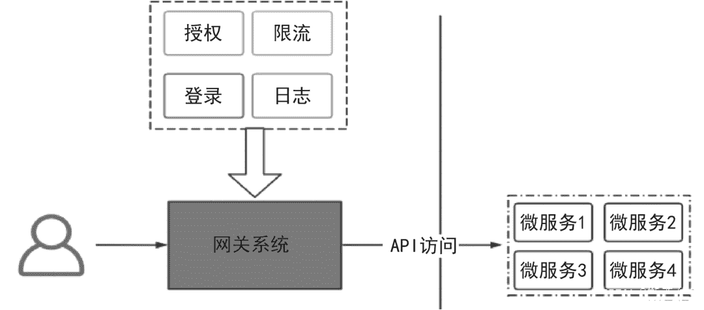

图 2-15

从功能上看，网关系统集成授权、限流、登录、日志等模块。授权功能确保只有经过许可的客户或系统才能访问相关资源，保障安全性；限流功能通过限制请求频率防止大量请求涌入导致性能下降，维持稳定运行；登录功能用于验证客户身份；日志功能记录操作与访问情况，便于问题排查与行为分析。

通过网关系统，客户可进行 API 访问，与后端微服务及企业内部系统如客户关系管理系统、订单管理系统等或外部系统如第三方知识库、支付系统等对接。该架构设计体现了智能客服通过网关与其他系统深度集成，保障信息顺畅流通与业务协同处理，满足多样化业务需求并提升整体服务质量与效率。

### **2.7.1** **与核心业务系统集成**
在电信运营领域，智能客服与 BSS、OSS、MSS、DSS 的集成是提升服务质量与运营效率的关键举措。例如客户咨询套餐变更时，智能客服不仅能从 BSS 获取当前套餐信息，还能通过 OSS 了解网络资源适配情况，为客户提供更精准建议，避免因网络不支持导致服务问题。

**1.** **数据层面的融合**
数据融合是集成基础。智能客服通过与 BSS 集成可实时获取账户信息、套餐详情、消费记录等关键数据。可采用 RESTful API 或 GraphQL 等标准化接口协议，并实施严格访问控制与加密措施。例如客户咨询套餐变更时，系统可通过安全 API 调用从 BSS 获取当前套餐信息并给出建议。与 OSS 集成可获取网络设备状态、故障信息等数据，帮助客服人员更好地解决网络问题。

**2.** **界面层面的融合**
为提供一致客户体验，智能客服在界面层面与其他核心业务系统深度融合。例如在移动营业厅 App 中，智能客服与业务办理、账单查询等功能集成于统一界面。客户在咨询客服问题后，若需办理相关业务，无需切换多个应用即可完成操作，大幅简化流程，提升满意度。采用 Web 技术与响应式设计，确保客户在不同设备上流畅操作。界面设计需注重简化流程，提高使用效率。

**3.** **流程层面的融合**
流程融合旨在实现跨系统业务自动化处理。以故障处理流程为例，智能客服在接收到客户故障申报后，可自动触发 OSS 中的故障诊断与修复流程，并将处理进度实时反馈给客户。借助工作流引擎与事件驱动机制，各环节任务可按预定规则自动流转，提高处理效率与准确性。与 MSS 集成可优化客服人员绩效考核与资源管理，与 DSS 集成可为决策提供数据支持。

### **2.7.2** **与互联网应用深度融合**
移动互联网时代，智能客服与企业微信、微信小程序等互联网应用融合，为电信企业拓展服务渠道、提升服务体验带来新机遇。

**1.** **API 设计与通信协议**
API 设计是实现无缝对接的关键。建议采用 RESTful 架构，使用标准 HTTP 方法与 JSON 数据格式，确保平台兼容性与易用性。对于实时交互如语音、视频通话，可采用 SIP 协议或 WebRTC 技术，并通过 WebSockets 实现双向实时通信。例如在微信小程序中集成智能客服，客户可实时与客服沟通并获取支持。

**2.** **客户体验优化**
融合过程中需重点关注体验优化。例如将智能客服集成到企业微信客户群，使客户提问能快速获得响应，并支持快捷回复，减少操作步骤与等待时间。同时利用自然语言处理技术实现智能问答，结合客户行为与偏好进行个性化推荐，并加强数据安全与隐私保护。

**3.** **数据一致性维护**
确保数据一致性是系统集成的主要挑战之一，可通过事件驱动架构与数据同步机制实现实时更新，如客户在企业微信中修改信息时，智能客服系统能够及时获取最新数据。此外需建立备份与恢复机制，防止数据丢失或损坏，保障系统深度融合，提升企业竞争力。

# **第三章**
# **智能客服系统设计与实现**
本章将探讨智能客服系统的设计与实现。首先介绍语音识别模块的设计理念，这是实现高效沟通的基石；然后探讨数字人模块如何通过形象设计和动作控制，让每一次交互都更具温度；接着分析大数据与客户画像的重要性及其实施方法，这是理解和服务客户的关键要素；最后阐述 FreeSwitch 连接模块如何确保通信服务的稳定可靠，为客户提供无缝连接体验。此外，考虑到多轮对话对提升客户满意度和解决问题效率的重要作用，本章还特别介绍了多轮对话机器人的设计原则。

## **3.1** **语音识别模块设计**
语音识别技术是实现智能客服高效沟通的核心技术。以下系统介绍高质量声音采集与预处理方法、复杂环境下的声音特征提取技术，以及面向不同应用场景的模型选型建议，助力开发者实现最优识别效果。

### **3.1.1** **语音信号采集与预处理**
在音频通信中，语音信号的采集与预处理至关重要，直接影响声音传输质量，在智能客服应用场景中同样如此。以呼叫中心为例，其每天处理大量语音咨询，若语音信号采集不准确或预处理不到位，就可能导致后续语音识别错误，影响客户问题的解决效率。因此深入研究这一环节的技术细节十分必要。

**1.** **音频信号的基本属性**

音频本质上是随时间起伏的声压波形，借助麦克风等拾音器件可以把它转成电信号再做数字化处理。模拟波先经历抽样、量化、编码三步，最终变成数字序列。依据奈奎斯特-香农准则，若要无失真还原，要把抽样速率定在信号最高分量的两倍以上。日常通话中，人声有效带宽多在300~3400赫兹，8kHz的抽样率已能满足基本需求；若追求更逼真的听感，比如音乐播放或高清语音，则常选用16kHz、24kHz乃至48kHz。每个采样点的幅度用比特数来表征，8位、16位及更高位深都有使用，16位是最主流的选择，因其动态范围足以兼顾音质与实用。

**2.** **采集设备及其参数设置**

常见的拾音硬件有动圈麦克风、电容麦克风和麦克风阵列。工厂这类噪声较大的场景部署智能客服采集时，抗干扰能力是首要考量。阵列麦凭借独特的指向拾音和降噪机制，能够把目标人声拉出来、压低环境干扰，为后续识别提供干净素材。不同麦克风在灵敏度、频率响应和指向特性上差异明显，适用场景也不同。单指向麦擅长收前方声音并抑制侧后噪声，适合个人讲话录制；会议室需要全覆盖时，更倾向全向麦或由多支指向麦组成的阵列。

硬件之外，软件参数的设定同样关键。增益必须适中以免失真或信噪比过低；抽样率与位深要兼顾存储成本和音质；打开自动增益控制可以让输出电平保持稳定。此外，回声消除AEC与噪声抑制NS等模块可削弱房间反射带来的声反馈，减少背景非语音成分的干扰。

**3.** **常见预处理方法**

降噪的目标是从噪声混杂的混合声中剥离出干净的人声，常用于电话会议、广播等。谱减法是经典思路，先估计噪声功率谱再从总信号中扣除，实现简单但在强噪下易失真。随着深度学习发展，基于神经网络的声源分离效果明显提升。金融客服场景里，DeepSeek 运用动态频谱建模来应对键盘敲击、高频电话杂音等干扰，通过实时分离把账户密码等敏感信息的识别正确率提升到92%，比传统降噪方案高约18%。

混响源于声音在封闭空间多次反射产生的延迟。适度混响带来饱满感，过量则损害语言清晰度，尤其影响远程通话。去混响技术通过滤波等手段削弱晚期反射能量，提升直达声占比。WebRTC 体系的 NetEQ 模块就内置了自适应滤波，可动态调节系数以获得最佳表现。

除降噪去混响外，还有多项优化手段。自动增益控制维持电平恒定；静音检测可在无语音时停止发送以节省带宽；极端环境下可采用多通道录音配合空间定位算法精确定位声源，或搭建定制软硬件平台提升整体指标。对采集与预处理的精细打磨，能明显提升通信系统的效率与可靠性，也为传统电话和智能客服等新应用奠定基础。

### **3.1.2** **语音特征提取与识别算法**

在语音处理链路中，特征表征与识别模型决定精度与效率。主流表示方式有梅尔频率倒谱系数MFCC和滤波器组FBank特征。安静室内，MFCC模拟人耳对频率的非线性感知，能提取关键声学信息；户外带噪环境下，FBank直接从频谱图抽取特性，抗噪更强且保留发音区分度。

在电信客服项目里，借助跨模态特征融合把语音与客户历史交互文本联合建模，“套餐变更”这类复杂意图的识别准确率由75%提升至90%。

模型层面，卷积神经网络CNN擅长捕捉局部声学模式，长短期记忆网络LSTM对序列长依赖建模效果好，Transformer凭借自注意力在大规模数据上表现突出。选型时需权衡精度与计算开销，资源受限场景下LSTM或轻量CNN更实用。

训练常见过拟合、欠拟合与梯度消失爆炸。模型过复杂而数据不足易过拟合，导致泛化下降；学习不足则整体准确率偏低。可通过Dropout、L2正则化抑制过拟合，扩充数据或数据增强缓解欠拟合；更换激活函数如ReLU、加入批量归一化改善梯度问题；迁移学习则能以预训练模型为起点微调，适合小样本定制。合理的特征与模型搭配是构建高性能识别系统的基石。

## **3.2** **数字人模块设计**

人工智能发展推动数字人在客服领域广泛应用。下面围绕数字人模块的设计与落地展开，重点在形象塑造、面部表情与肢体细节，以及如何与用户进行自然互动，提升体验感。

### **3.2.1** **数字人形象设计与动作控制**

面向客服的数字人，风格选择直接影响专业感与亲和力。实践中拟人化风格接受度较高。

图 3-1

拟人化数字人拥有细腻的面部表情，能精准传递关切与热情；自然流畅的肢体语言类似真人客服的手势，增强专业可靠感并拉近距离。常见风格包括卡通、拟人化与超现实主义。客服场景偏好拟人化带来的适度真实感，卡通虽适合娱乐教育但缺乏稳重感，超现实视觉冲击强却不利于高效沟通。

风格实现依赖三维工具。以某大型金融机构客服数字人为例，设计团队用Maya完成高精度建模，雕琢皮肤纹理与表情肌肉运动；用3dsMax设计符合金融调性的服装，兼顾款式与材质。Autodesk的Maya与3dsMax提供从面部到服装纹理的精确建模与动画能力。Unity3D作为实时渲染引擎，通过PBR技术提升材质真实感；虚幻引擎Unreal Engine凭借高效实时渲染与高质量视觉输出，在游戏影视领域广泛应用。

图 3-2

形象完成后，生动动作是另一挑战。如图 3-3，通过光学捕捉、惯性捕捉与视觉捕捉采集人体运动并映射到模型，可大幅提升真实感与流畅度。Vicon、OptiTrack的光学捕捉精度高但对环境和成本要求高；Xsens、Noitom的惯性方案抗遮挡更好，精度略低；基于单目或多目摄像头的低成本视觉捕捉，如LeapMotion、微软Kinect，降低了门槛。DeepSeek 的数字人客服借助表情-语音同步算法，在视频服务中做到毫秒级情绪匹配：客户语速加快、声调升高时，数字人同步皱眉、眼神专注并切换安抚语气，使满意度提升30%，为某银行实测数据。

图 3-3

除动作捕捉外，智能合成技术可根据文本或语音自动生成表情与肢体，如TTSA技术让数字人依据文字自动调整语气与姿态，提升沟通效率。综合应用上述技术，可打造兼具审美与互动性的数字人形象。

### **3.2.2** **数字人交互逻辑与响应机制**

数字人与用户交流的核心是准确理解意图并生成连贯回答。以电商客服为例，用户问“这款手机电池续航如何”，数字人需识别“手机”“电池续航”关键词，结合知识图谱中的4500mAh参数给出“实验室测试可续航一整天，重度使用也能满足大部分需求”等具体回答。

按驱动方式可分为智能驱动型与真人驱动型。智能驱动型擅长处理高频问题，如在线旅游平台的景点介绍、酒店预订流程等，可快速调取知识库并生成微笑、点头等动作，缓解人工压力。

智能驱动型流程如图 3-4，移动端作为输入端口将文本传入系统。终端接收输入后先经识别感知模块分析理解，再传至智能分析决策模块生成响应策略。在TTSA人物模型驱动下，同时触发语音合成与动画生成，最终经音视频合成显示模块输出。超出能力的问题可转接到电话、人工客服等渠道，形成闭环。

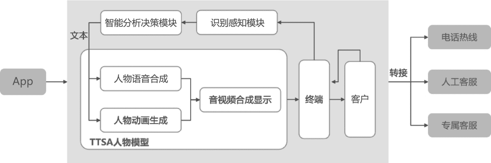

图 3-4

真人驱动型则通过音视频采集系统采集真人语音动作，一路用于语音合成，另一路用于动画生成，再经合成显示模块输出，实现基于真人表演的数字人呈现。

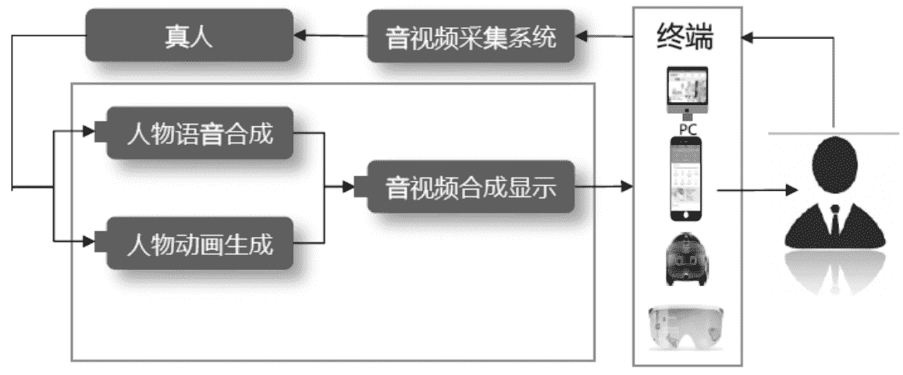

图 3-5

意图识别依赖自然语言处理，BERT、GPT等深度模型可抽取问题核心、情感倾向与背景需求。知识图谱提供结构化实体关系，帮助数字人快速定位服务条款、覆盖区域等信息，确保回答一致与准确。复杂对话中，多模态融合技术可同时处理文字、声音、图像等信息，如用户上传账单图片询问费用，系统可通过OCR读取内容并结合消费记录给出答案。

国际评测机构OpenCompass报告显示，DeepSeek的门控多模态路由器GMR在“我需要预约明天的视频客服”这类跨模态请求中，动态分配70%权重给时间解析、30%给渠道选择；在多模态意图识别专项测试中，复杂意图识别准确率达95.1%，较主流开源方案平均水平提升15%。精准意图捕捉、知识图谱决策与合适的驱动方式共同提升服务质量。

## **3.3** **大数据与客户画像模块设计**

智能客服中，利用大数据绘制精准画像是实现个性化服务的前提。建设过程涉及数据采集、整理与画像时效性维护，以确保服务贴心。

### **3.3.1** **客户数据收集与整理**

画像构建依赖全面细致的数据。以电商平台为例，浏览记录、购买历史、搜索关键词等行为轨迹，加上年龄、性别、地域等个人信息，可揭示偏好。例如频繁购买母婴产品并搜索“婴儿奶粉排行榜”的用户，可推断为关注奶粉选择的新手妈妈，进而推荐相关产品与育儿知识。原始数据需经清洗、整合、分析，提炼出反映特征的标签，为产品设计与精准营销提供依据。

客户数据主要来源于四类：

客户个人信息：性别、年龄、教育背景、职业等注册信息，以及问卷或社交平台透露的兴趣爱好、家庭状况、收入水平等。

行为轨迹数据：线上显式行为如点赞、评论、分享、关注、评分，以及隐式行为如页面停留时长、点击频率、访问间隔。游戏平台通过玩家选择、游玩时长、讨论活跃度即可洞察偏好强度。

内容数据：用户消费的内容本身及元数据，如文本、图片、视频，以及关键词、标签。游戏介绍页留言区的高频情感词汇可用于评估新游戏的整体接受度。

画像进化：用多源数据让用户更立体

外部渠道提供的补充信息能打破单一产品的视角局限，帮助勾勒出更完整的消费生活图景与人际关联。例如用户授权后通过社交账号登录带入的好友关系、兴趣圈层等资料，就能映照出其在不同场景下的互动偏好。

各类信息源的价值与采集难度并不相同。基础身份资料相对稳定，但获取必须兼顾隐私与合规；行为轨迹可以即时反映兴趣需求的变化，缺点是体量大、结构杂，需要高效的计算与挖掘能力。引入外部信息有助于拓展画像维度，合并时要重点核查真实性与可信度。依托 DeepSeek 的长上下文行为建模，在电商对话中，系统可解读多轮问答轨迹，如先问尺码再问物流，生成带有购买优先级倾向的动态标签，使个性化推荐命中率提升 25%，下单转化提升 18%。

进入应用前，异构原始数据需要预处理。

净化环节剔除空值、重复记录和异常点，保证每条记录可信。异常点常借助统计方法校正。

汇聚环节把分散在各业务库的表单统一为可查询格式，业界常用抽取转换加载工具定期从各系统抽取最新数据，按规则写入中心化的数据仓库。

洞察环节用算法从海量记录中提炼规律。通过分组发现相似用户群，用关联规则挖掘行为间的联系，用时间序列预测未来一段时间的趋势。

完成上述流程后，得到的是结构化且具洞察的事实标签体系。事实标签即直接观测得到的客观属性，包含相对固定的属性画像与随时间变动的行为画像。属性画像描述固有特征，如性别年龄，变化缓慢；行为画像捕捉特定情境下的表现，如兴趣迁移、活跃时段分布等。整个链路必须严控质量，只有高质量输入才能支撑可靠的画像模型，为决策提供依据。

### 3.3.2 客户画像更新与维护

画像的准确与时效直接决定推荐效果。在内容平台，兴趣变化快，画像必须及时刷新。例如某视频平台发现一位用户近期频繁观看健身内容并点赞收藏，系统即时更新标签，优先推送相关内容，提升停留时长与活跃度。让画像持续准确，是提升体验与黏性的关键。

**1. 定期评估行为变化趋势的方法**

定期评估是维护画像的基础，能让营销与服务更贴合需求。以在线教育为例，通过定期分析学习进度、作业完成度、对不同学科的关注度，发现部分用户对编程兴趣上升，就能及时调整课程推荐。

流程分两步：信息采集与分析。

采集要兼顾固定属性如性别年龄和动态属性如浏览记录、点击率。显性行为如点赞、分享、评论直接表达偏好，隐性行为如停留时长、点击频次需用算法解析潜在兴趣。为更全面，还会引入外部信息，如社交媒体动态或电商消费记录。

分析常用统计方法识别兴趣迁移。时序分析能揭示行为随时间的变化规律，判断用户是否在淡出或转移关注。机器学习中的异常检测也能捕捉行为突变，可能意味着生活状态的重大变化，如搬家或换工作。

**2. 根据最新数据调整画像的具体步骤**

确定趋势后要及时更新，具体可分为：

（1）多源汇聚，结合内部库和外部信息，形成对个体的全景视角。
（2）净化与标准化，剔除重复和无效信息，保证格式一致。
（3）特征抽取与权重分配，从整理后的资料中抽取特征向量并赋权。分组用于归并相似群体，便于精细推送；权重计算则按近期活动强度重新评估各标签的重要性，让最能代表当前偏好的标签权重更高。
（4）构建新版模型，在保留原有结构基础上加入新兴趣，剔除过时标签。
（5）效果校验，通过分组对比试验检验新旧画像差异，确认有效后再全面上线。

**3. 模型标签生成方法**

除基础属性描述外，还需生成更具代表性的模型标签。主流有分组分析和权重评分。

分组是无监督方法，把大量样本按相似度归类，类内相似、类间差异大，适合发现自然社群。例如按活跃度分为重度使用者、普通爱好者、偶尔访问者，便于差异化运营。权重评分为每个标签赋不同权重得到综合得分，用于排序筛选，特别适合处理社交推荐等复杂关系。

结合 DeepSeek 提供的稀疏门控方案，画像更新时仅激活与当前行为最相关的专家模块，如对高频退货客户激活售后服务策略模块，可使更新效率提升 40%，存储开销降低 60%。

全过程必须遵守隐私法规，如欧盟 GDPR、中国《个人信息保护法》，在尊重用户意愿下合规使用信息，杜绝滥用。

## 3.4 FreeSWITCH 连接模块设计

本节围绕构建稳固高效的通信平台展开，从连接建立与全生命周期管理出发，拆解对 SIP 等多协议的适配逻辑，分析通过协议转换、流量调度保障稳定性的做法，并融入加密传输、容灾等安全可靠性设计，实现功能与风险的平衡。

### 3.4.1 连接建立与全生命周期管理

在 FreeSWITCH 中，接入的建立与管理是优质通信服务的基础。以某跨国企业为例，员工全球分布需频繁语音视频沟通，FreeSWITCH 通过拨号计划和终端点实现稳定接入。拨号计划依据区号和网络情况智能选路；终端点负责与通信设备对接，保证数据稳定传输。

拨号计划是核心功能，由 XML 形式的配置文件构成，内置智能响应逻辑，可识别来电号码、设定时限、选择目的地。例如按时段转接不同部门，或按区号路由到海外分公司。集成 ASR/TTS 后，还能实现语音导航和信息查询。

终端点是实际通话对象，支持 SIP、IAX2、传统 TDM 等协议，每个终端点有注册状态、编解码器偏好等属性。合理配置对音视频质量至关重要，如 SIP 中设置 NAT 穿透解决内网访问问题，调整 QoS 降低延迟。

案例：某跨国公司部署统一电话方案，面临网络差异导致质量不稳、成本高等问题。采用 FreeSWITCH 后采取：

动态路由策略，利用拨号计划上下文设置多条备用路径，首选线路故障时自动切换。
负载均衡技术，通过多个同优先级、分布各地的 SIP 代理分摊流量，提升稳定性和容错。
个性化体验，借助 ASR/TTS 开发智能 IVR，员工可用自然语言预约会议、查询联系方式。
实施中需兼顾安全，如加密传输通道和防 DDoS 攻击，确保长期稳定运行。

### 3.4.2 协议选型与数据传输

支持多标准协议是设备无缝交互的关键。在线游戏语音对实时性要求高，SIP 以高效会话建立和管理著称，能低延迟传输语音。H.323 更适合对多媒体和传统电信兼容要求高的场景，支持视频会议、白板共享等。

FreeSWITCH 支持 SIP、H.323 等多种协议。SIP 是应用层控制协议，负责会话建立、管理和终止。以某语音通话 App 为例，SIP 管理连接并在网络波动时调整传输策略，保证通话连续性。借助 TLS 进行信令加密，sRTP 保护媒体流隐私，在公共网络也能安全传输。配合 QoS 策略，能显著提升企业级体验。

H.323 结构完整，涵盖呼叫控制到多媒体传输，复杂度更高但服务更全面，如视频会议。安全性方面采用 H.235 机制进行身份验证和加密。

除 SIP、H.323 外，FreeSWITCH 还支持 Skype、GoogleTalk 等，灵活性提升的同时复杂度增加。选型应综合安全性、性能和成本。

## 3.5 多轮对话机器人设计

重点关注高质量对话背后的技术难题与解法，涵盖自然语言理解、对话策略管理、自然语言生成等模块，并探讨如何用大规模预训练模型如 GPT、BERT 增强能力，以及评估与持续优化实践。

图 3-6 为多轮对话机器人系统架构图。

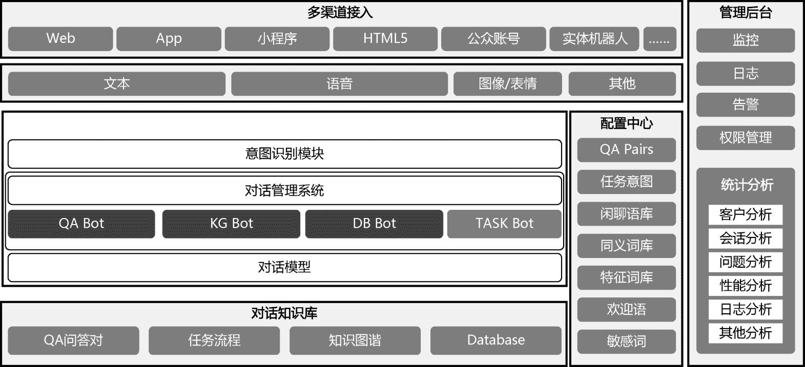

图 3-6

·多渠道接入：支持 Web、App、小程序、HTML5、公众账号、实体机器人等多种入口，处理文本、语音、图像/表情等输入。
·意图识别与对话管理系统：意图识别理解用户输入，对话管理系统基于意图和历史决定回应。QA Bot、KG Bot、DB Bot、TASK Bot 分别支撑问答、知识图谱、数据库查询、任务处理。
·对话知识库：包含 QA Pairs、任务流程、知识图谱、Database，为回复提供依据。
·配置中心：配置 QA Pairs、意图、闲聊语库、同义词、特征词、欢迎语、敏感词等。
·统计分析：分析客户、会话、问题、性能、日志，支持优化。
·管理后台：提供监控、日志、告警、权限管理等功能。

### 3.5.1 核心模块拆解

多轮对话系统能提供更贴心的服务。以旅游规划为例，用户可能连续问景点、交通、美食。系统通过 NLU 识别意图，对话管理记录历史和状态，NLG 生成连贯回答。

图 3-7 为多轮对话机器人核心模块工作流程图。

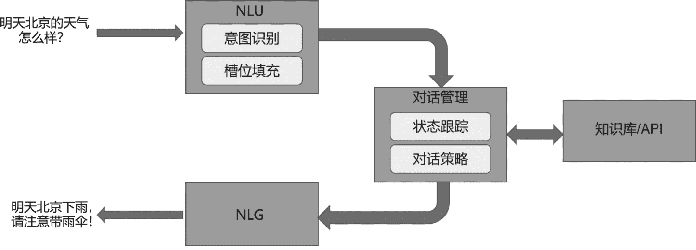

图 3-7

·NLU：接收输入如“明天北京的天气怎么样？”意图识别判断为查询天气，槽位填充提取“明天”“北京”，转为结构化表示。
·对话管理：状态跟踪记录进展，对话策略决定回应方式，并从知识库/API 获取信息。
·知识库/API：提供数据支撑。
·NLG：将信息转为自然语言如“明天北京下雨，请带雨伞！”，完成交互。

对话管理细分为对话状态追踪 DST 和对话策略学习 DPL，对维持流畅会话至关重要。

NLU 是第一步，面临歧义、口语化等挑战。如“我想找个近点儿的餐厅”，系统需结合位置和历史数据理解“近”的含义。任务包括意图识别和槽位填充。DeepSeek 推出的理解组件具备 128K 超长上下文，跨境电商场景下用户连续问“上周购入的 T 恤能否换货”和“换货后物流时效”，系统可自动关联历史订单，无需重复输入，问题解决效率提升 60%，人工转接率下降 40%。

图 3-8 是多轮对话管理模块工作原理示意图。

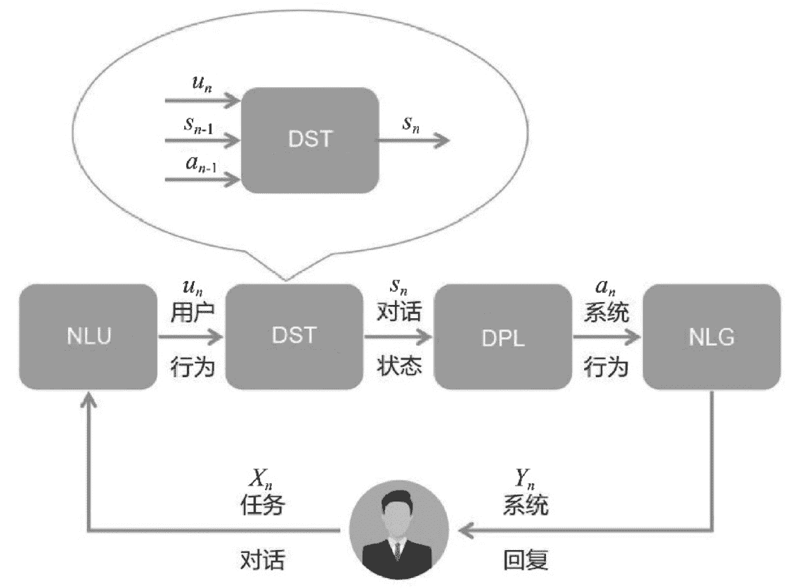

图 3-8

多轮对话系统的高效运转，本质上是四类核心组件的默契配合。

NLU 的工作是把用户用自然语言发来的对话 X[n] 转化为机器可读的语义，同时提炼出本轮用户行为 u[n]，也就是识别意图、抓取关键信息。DST 则在收到 NLU 提供的 u[n] 后，结合上一轮的状态 s[n-1] 和系统上一轮的动作 a[n-1]，更新并维护当前对话状态 s[n]，为后续决策提供上下文记忆。DPL 依据 DST 给出的 s[n]，决定本轮系统该做什么 a[n]。最后 NLG 把 a[n] 组织成自然语言回复 Y[n] 交给用户，完成一轮交互。

四者协作形成完整闭环。比如用户先问某地未来几天的天气，又追问怎么快去。NLU 先解析出天气意图并把地点信息存入状态，接着识别出新的路线规划意图并复用之前保存的位置。DPL 会判断先把天气回答，之后再处理路线。NLG 最终输出类似“北京本周预计晴朗，适合出行。要是想了解去北京的最佳路线，方便说下您的出发地吗？”这样连贯的回复。NLU、对话管理和 NLG 的紧密配合，才让复杂多轮对话变得顺畅，服务体验也随之提升。

### 3.5.2 多轮对话的实战策略
搭建真正好用的多轮系统，策略与技术的融合是关键。以电商客服为例，用户说“我想买手机，预算 3000 左右”，机器人不能只停在意图和预算，还要通过追问挖出品牌偏好、功能侧重，比如“您更倾向华为、苹果还是其他品牌？”“更看重拍照还是游戏性能？”精准追问能让推荐更贴合，转化率自然提升。核心能力包括意图识别的准度、追问机制的高效、词槽抽取的准确，以及遇到未知时的兜底策略。这四项如何协同，才是系统能否落地的差别。

意图识别是对话能否顺畅的基石，本质是一个文本分类问题。模型需要从用户话术里准确捕捉真实需求。训练依赖海量标注数据，常用 CNN、RNN 等深度学习方法做特征挖掘，RNN 的记忆特性尤其擅长捕捉上下文。在旅行预订场景，航班查询、酒店预订、目的地天气等都需提前定义意图类别，通过训练集让模型学会区分。

近年 GRU、LSTM 等循环网络变体在序列任务中表现突出，能捕捉句子内部及跨句依赖，显著提升分类准确率。

意图识别的价值体现在三方面：引导对话流程，比如识别到查询订单状态，就主动索要订单号；提高效率，避免“驴唇不对马嘴”，如把退货误判成换货；增强体验，用户感受到被理解，反之则因反复解释而沮丧。

工程上没有单一银弹，规则、向量检索、深度学习和大模型各有长处，业界更倾向融合方案。

图 3-9 是意图识别技术流程示意图。
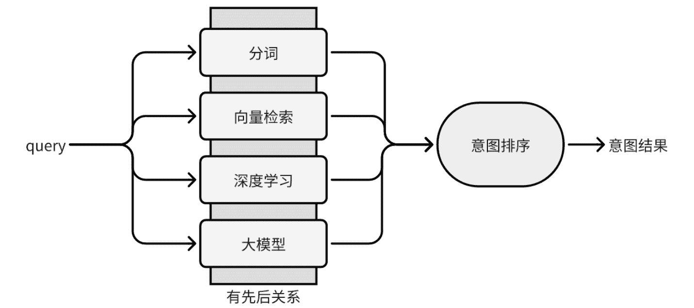
图 3-9
处理起点是用户输入的 query。第一步分词，将文本拆成词块，为语义理解打基础。第二步向量检索，把分词结果转成向量在语义空间里找相似信息，为意图判断提供参考。第三步深度学习模型做更深层的语义剖析，挖掘隐含意图。第四步大模型凭借大规模预训练的语言知识做最终判断。这四层逐级深入后，将结果整合排序，评估每个意图的匹配度和置信度，最后输出最符合的意图。

词槽填充是 NLU 的另一关键，从话语中抽取出发地、到达地、日期等关键要素。传统规则匹配覆盖有限，如今多用基于 RNN 或 Transformer 的端到端标注，注意力机制让模型兼顾全局上下文和局部细节，精度大幅提升。

信息不全时，追问机制就很重要。好的追问不是固定顺序提问，而是基于当前已知状态智能推断下一步。强化学习框架可让系统学习最优追问策略。对医疗咨询这类复杂问题，如“咳嗽带血该挂什么科？要不要提前做 CT？”DeepSeek 利用思维链推理自动生成递进追问“咳嗽持续多久？是否伴随其他症状？”，使诊断建议准确率从 65% 提升到 85%，比传统规则引擎高出 20%。

兜底策略是应对不可预见风险的保障。当知识库无法覆盖时，可请求补充信息、转人工、推荐相关资源，避免对话卡死。意图识别、槽位抽取、智能追问和灵活兜底共同构成可靠的多轮对话能力，离不开对上下文的深度理解。

### 3.5.3 模型训练与持续迭代
多轮对话机器人的效果，取决于意图模型训练的质量和 BadCase 的持续标注。数据量和标注质量直接决定性能。某智能客服初期因数据不足、标注不准导致误识别频繁，通过持续收集真实对话并精细标注，结合数据增强扩充规模，准确率才迎来明显提升。关键在于把数据准备作为核心，并建立反馈闭环实现迭代。

图 3-10 是多轮对话机器人训练及生产优化流程图，围绕“搭建知识底座→模型迭代升级→业务场景验证”推进，依托训练闭环和生产闭环持续进化。
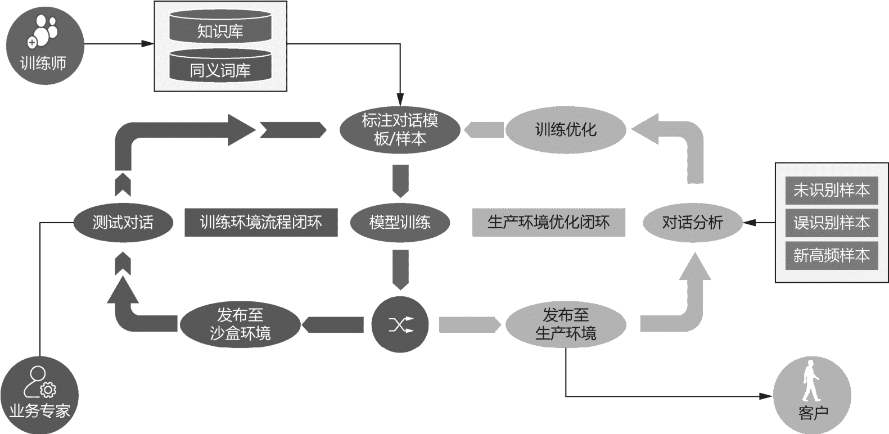
图 3-10

1. 知识底座搭建
训练师先构建知识库和同义词库。知识库收纳业务问答规范、产品详情、服务流程等事实内容；同义词库收录“下单/购买”“查询/查找”等近义表达，扩大语义覆盖。底座完成后，基于此模拟真实咨询进行对话模板和样本标注，明确意图和问答对应，为模型提供高质量训练素材。

2. 训练环境流程闭环
标注样本进入模型训练环节，使用意图识别、多轮对话逻辑学习等算法培养语义理解与应答能力。训练完成后发布到沙盒环境，该环境模拟生产但数据隔离。业务专家在此做多轮问答、专业术语咨询等测试，排查意图错误和逻辑偏离。发现问题后回流到标注环节补充修正样本，再次训练。闭环路径为：模型训练→发布至沙盒环境→测试对话→标注对话模板/样本→模型训练，不断打磨精度，降低上线风险。

3. 生产环境优化闭环
打磨好的模型发布至生产环境，服务真实客户。对话数据进入分析环节，分类为未识别样本、误识别样本、新高频样本，并挖掘新需求方向、未覆盖表达和高频错误点，输出优化方向。模型进入训练优化后回到标注环节更新样本，再次训练。闭环路径为：模型训练→发布至生产环境→对话分析→训练优化→标注对话模板/样本→模型训练，让模型动态适应客户新表达和业务演进。

4. 双闭环价值体现
训练闭环聚焦模型精度打磨，利用专家参与和沙盒隔离特性提前剔除逻辑缺陷；生产闭环聚焦业务适配，以真实数据为依据持续优化服务能力。两者配合覆盖从知识学习到业务落地全生命周期。

数据准备阶段，高质量语料是基础。面向全球客户需包含标准语、方言、口语化表达和行业术语。美团搜索意图就细分为外卖、酒店、旅游门票等，需收集大量真实交互样例并精细标注。清洗时要去噪、纠错，采用词干提取、停用词过滤提升质量。特征工程可用 TF-IDF、词向量，序列建模则用 RNNs、LSTM、GRU 捕捉上下文依赖。

错误案例分析与模型调优不可少。最先进模型也会出错，需定期复盘特定词组合误解、长句解析弱等不足，建立评估体系和流程确保每次调整有数据支撑。

反馈闭环机制应包含在线学习能力，通过满意度等信号增量训练；离线评测系统定期用大规模测试集评估；A/B 测试验证新特性效果；跨团队协作让产品、研发与数据分析协同制定方案。重视数据、善用错误案例、线上线下结合，才能让 AI 助手长期保持最佳状态。

# 第四章 客服系统智能化应用
在前述技术与设计思想基础上，本章聚焦智能技术如何重塑客户服务流程。从全语音门户到视频客服，涵盖智能客服助手、知识库管理、工单处理等环节，勾勒出一套完整智能客服解决方案。DeepSeek 技术在其中发挥了重要作用，显著提升了性能和服务质量。

## 4.1 全语音门户
全语音门户是连接客户与企业的语音桥梁，正成为提升服务效率的关键。

### 4.1.1 产品概览
全语音门户是一种纯语音交互的客服系统，通过自然流畅对话提供高效服务。在自然灾害等紧急场景，用户难以打字查询，语音门户能快速告知避难点、物资发放点等关键信息。在电信运营商等场景，它能分流人工压力，提升整体效率。

平台融合自然语言处理、语音合成、机器学习和模型训练。以金融咨询为例，用户问“最近理财产品收益如何”，系统能理解复杂问题并基于金融知识库给出专业回答。

通话流程为：语音识别将语音转文字，自然语言处理解析意图，系统按多轮对话策略互动并执行任务，知识检索保证回复准确。系统还强化情感理解与表达，让交互更接近真人。

架构上采用高度模块化，核心包括智能 IVR、文本机器人、客服助手、语音机器人、智能知识库，并针对不同场景优化。系统运行于分布式环境：基于百度 MACROSS 框架搭建 Java 项目；Loki 集群做日志管理；Elasticsearch 集群提供索引检索；Redis、Kafka 等中间件保证数据传输稳定。配套可定制管理界面，运维可按需调参，便于维护升级。

### 4.1.2 核心优势
图 4-1 是全语音门户系统架构图，该图展示了全语音门户系统的架构，涵盖多个层面。智能应用层提供面向客户的具体功能，包括智能 IVR、文本机器人、客服助手、语音机器人、智能知识库等，满足客户多样化的语音交互需求。

API 网关充当外部调用的统一入口，承担调度与安全管控职责，包含限流控压、请求分发、身份鉴权、权限校验等机制，使服务调用保持有序可控，同时阻断非法接入与流量冲击。

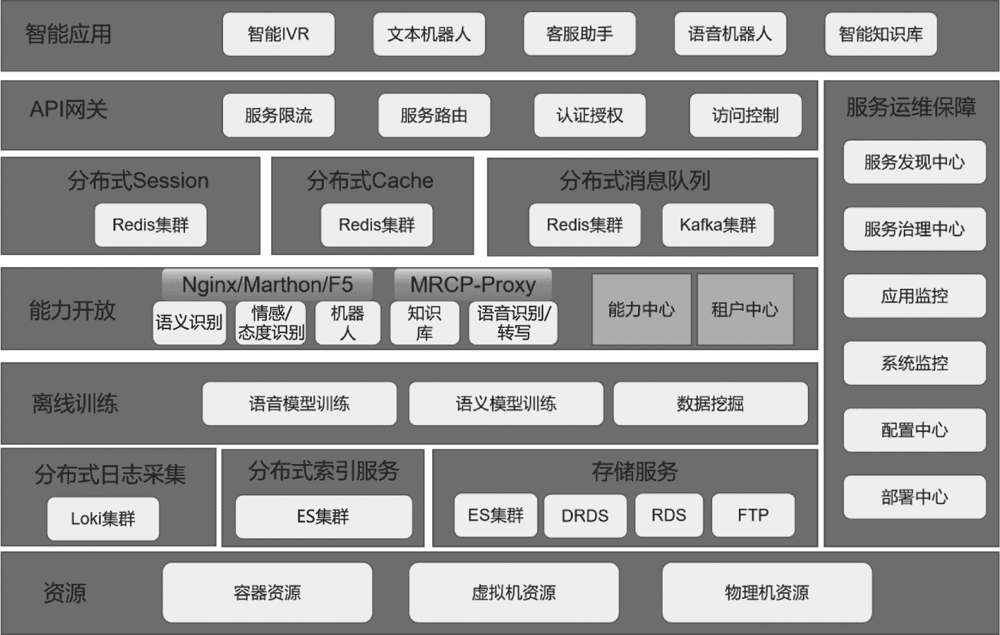

图 4-1

服务基础层以集群形态提供支撑，并行运行基于 Redis 集群的会话管理、基于 Redis 集群的缓存、由 Redis 与 Kafka 集群构成的消息中间件，共同负责会话维护、数据暂存与消息投递，提升整体性能、时效与处理承载。

能力开放层对接 Nginx/Marathon/F5、MRCP-Proxy 等底层设施，并集成语义识别、情感态度识别、机器人引擎、知识库、语音转写等能力集合，同时配置能力中心与租户中心，向外开放能力与模型训练入口，支撑语音模型与语义模型的训练场景，实现对语音语义的深入理解与加工。

离线训练层聚焦语音模型、语义模型训练及数据挖掘，通过海量数据的分析与迭代，提升语音语义的理解精度。

数据处理与存储层中，依托 Loki 集群的日志采集负责收集运行日志；依托 ES 集群的索引服务提供检索能力；存储服务由 ES 集群、DRDS、RDS、FTP 等构成，满足数据持久化需求。

资源层提供容器、虚拟机、物理机等算力与硬件底座。运维保障层由服务发现、服务治理、应用监控、系统监控、配置中心、部署中心构成，实现全链路运维，确保安全高效稳定。整体遵循分布式思路，各层协同支撑语音识别、语义理解、语音合成等智能能力，构建全语音门户的智能人机交互体系。

该门户在交互体验、分布式架构、底层技术与存储方案上优势明显，相较传统客服实现质变。以电商售后为例，用户反馈商品质量问题时，系统可通过多轮追问迅速锁定诉求，例如用户说“衣服有质量问题”，系统会追问“具体是破损、掉色还是其他”，随后依据反馈给出退换货流程或补偿方案，大幅提升解决效率。

在智能交互层面，系统依托多轮会话精准捕捉意图并给出准确回复，同时支持对话流程的个性化配置，提升流畅度与满意度。基于高精度语义模型的问答体系降低了问答集扩展的维护成本，保证信息准确传递；知识图谱强化了结构化知识的维护与利用；独立闲聊库让对话更自然，可按业务定制角色并引入开放域闲聊，拓展交互维度。

架构层面采用分布式策略，覆盖会话管理、基于 Loki 集群的日志采集及基于 ES 集群的索引服务，保证高可用与可扩展，能平稳应对大规模并发。清晰的结构化布局促进资源高效调配与快速响应，提升整体运行效率。

底层支撑方面，融合开放式语音识别转写、情感态度识别等前沿能力，形成对客户情绪的全方位感知与即时响应机制。在线教育场景中，系统可通过情感识别判断学员咨询时的困惑或焦虑，自动切换为更通俗表达并增加案例说明，同时沉淀数据为教学改进提供依据。数据处理环节的离线训练能力，包括语音模型、语义模型训练与数据挖掘，为服务质量持续优化提供基础。

存储层面采用 ES 集群、DRDS、RDS 等多类存储协同，确保数据安全与高并发访问。应用部署灵活支持容器化或虚拟化，部分核心组件可运行于物理机，提升部署灵活性与可靠性。

实际运行中模块协同至关重要。以酒店预订为例，客户来电后智能 IVR 引导服务类型选择，选择订房后文本机器人与语音机器人协同解析房型、入住时间等需求，从智能知识库调取房态与价格信息，客服助手据此给出预订建议，全流程顺畅高效。核心组件包括智能 IVR、文本机器人、客服助手、语音机器人、智能知识库等，实现从接入到解决的自动化闭环。

智能 IVR 承担前端接入与请求路由，文本机器人依托自然语言处理完成理解与回复生成，语音机器人借助语音合成与识别实现流畅对话，智能知识库作为“大脑”提供专业知识与业务规则支撑。平台还配备情感分析工具，根据通话内容判断情绪并动态调整沟通策略或转人工。运维保障体系涵盖服务发现、服务治理、系统监控、配置中心、部署中心等，协同优化资源分配、加速故障恢复，并在流量高峰时通过动态限流与路由调整规避单点过载，保障高可用。

总体来看，该门户凭借卓越的智能交互、稳健的分布式架构、先进的底层技术与高效存储机制，在业务流程优化与运营成本降低方面成效显著，为企业带来差异化竞争优势，是提升服务质量与效率的理想选择。

### 4.1.3 功能架构

图 4-2 呈现了系统的应用架构构成，各模块相互配合完成系统功能。

安全中心安排在架构右侧，构成安全防线。身份认证用于核验客户身份，访问控制、权限管理、授权管理实现操作权限的精细化管控，证书管理保障通信安全，数据加密与脱敏保护隐私，实现全方位的安全可靠运行。

运维中心安排在架构左侧下方，包含应用监控、系统监控、日志中心、部署中心、容器中心，实时监测运行状态、记录日志并完成部署维护，确保系统稳定。

服务中心安排在架构右侧下方，同样涵盖应用监控、系统监控、日志中心、部署中心，与运维中心共同支撑系统稳定运行。

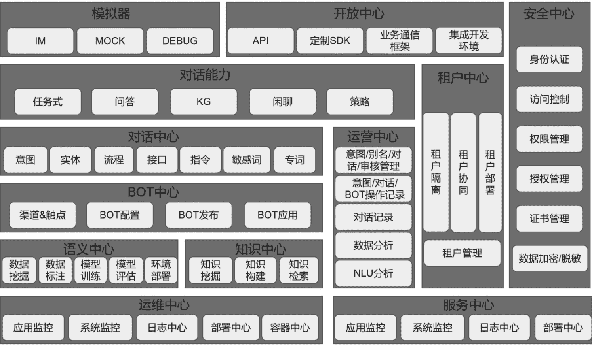

图 4-2

开放中心安排在架构上方右侧，提供 API、定制 SDK、业务通信框架、集成开发环境等。API 支持外部系统调用功能，定制 SDK 便于开发者构建应用，业务通信框架规范通信流程，集成开发环境提供开发工具，助力功能拓展与集成。

模拟器安排在架构上方左侧，集成 IM、MOCK、DEBUG 能力。IM 可模拟即时通讯场景测试对话，MOCK 用于模拟数据与服务，DEBUG 提供调试工具，提升开发效率与系统质量。

对话能力安排在开放中心与模拟器下方，包含任务式、问答、KG 知识图谱、闲聊、策略等。任务式按流程完成交互，问答实现问题解答，KG 提供知识关联与推理，闲聊实现自然交流，策略定义对话规则与流程，丰富互动方式。

对话中心安排在对话能力下方，由意图、实体、流程、接口、指令、敏感词、专词等组成。意图识别用户目的，实体提取关键信息，流程设计对话逻辑，接口实现系统对接，指令执行特定操作，敏感词与专词管理保证对话规范、准确、高效。

机器人中枢安排在对话中心下方，涵盖渠道与触点、机器人配置、机器人上线、机器人应用。渠道与触点连接不同交互通道，机器人配置设置参数与功能，机器人上线将机器人投入使用，机器人应用使其在实际场景中发挥作用，完成机器人全生命周期管理。

语义中心安排在机器人中枢下方左侧，包含数据挖掘、数据标注、模型训练、模型评估、环境部署。数据挖掘提取有效信息，数据标注提供训练样本，模型训练构建理解模型，模型评估检验效果，环境部署将模型推向生产，提升语义理解能力。

知识中心安排在语义中心右侧，包含知识挖掘、知识构建、知识检索。知识挖掘从多源获取知识，知识构建整理形成知识库，知识检索实现快速查找，为对话提供知识支撑。

运营中心安排在知识中心右侧，负责意图、别名、对话、审核管理，以及意图、对话、机器人操作记录、对话记录管理，并通过数据分析与 NLU 分析优化性能与自然语言理解能力。

租户中心安排在运营中心右侧，包含租户隔离、租户协同、租户部署、租户管理，实现多租户资源隔离与协作、资源合理部署、租户信息与权限集中管理，满足多租户需求。

### 4.1.4 核心功能

本节围绕能力构建、能力训练、机器人上线与运营管理四方面展开，重点说明意图生成、对话管理、语义分析等关键技术应用，并通过实例阐释从搭建到上线再到持续优化的全流程。

1. 能力构建
能力构建的核心在于基于客户需求创建新意图。以医疗场景为例，“预约挂号”意图不仅要明确科室选择，还需考虑各医院挂号规则与放号时间，通过对接医院信息系统获取实时号源与推荐时段，提供精准预约服务。新建意图时需清晰界定目标并借助平台工具定义需求，如查询账单详情意图需明确“本月消费金额”“环比变化”等具体问题类型，细化意图有助于设计贴近实际的对话流程。

意图管理提供新建、检索功能，适用于意图众多的大型客服体系。例如综合电商平台通过清晰的意图分类与描述，可快速定位处理意图，避免管理混乱导致服务失误。开发者可为意图添加名称、分类、用途等信息，平台支持按关键词、机器人、租户检索，新意图通常需运营审核后生效以保证质量。

此外需合理规划意图层级关系。平台支持分类与子类扩展，如电信行业的“费用查询”大类下细分“余额查询”“历史账单查看”等，形成逻辑严密的服务架构。总之，需求分析结合平台工具进行意图定义与管理，是构建强大语音交互系统、提升开发与运维效率的基础。

2. 能力训练
能力训练通过数据驱动提升机器人理解与响应水平，涉及数据集收集、训练任务设定与效果评估。数据多样性至关重要，除错误案例外，还需采集不同场景、不同人群的交互数据，如智能家居客服需覆盖不同地区、年龄层的指令表达，提升对口音、方言与个性化表达的适应性。系统可自动抽取客户-机器人交互中的错误案例供标注，同时借助模拟器生成对话或接入外部聊天数据丰富样本库。

模型训练阶段使用清洗后的高质量数据迭代语义模型，可引入迁移学习，先在大规模通用语料上预训练再用业务数据微调，加速收敛并降低标注依赖。采用 Transformer 等深度学习架构提升语言理解精度，训练时引入多口音、方言与跨文化样本增强泛化能力。

效果评估基于意图识别准确率、平均响应时长、客户满意度等指标，意图识别准确率反映理解水平，响应时长体现运行效率，满意度通过问卷获取。持续跟踪指标变化为优化提供依据。

实时反馈机制可快速响应场景短板，发现特定场景表现不佳时及时调整参数或补充样本并上线验证，缩短修复周期，提升流畅度与粘性。建立数据采集-训练-评估闭环并配合灵活调优，可实现系统持续进化。

3. 机器人上线
机器人上线是保障体验与稳定性的关键环节，涵盖部署、版本控制、灰度发布等策略，需兼顾渠道特性与差异化配置。发布新版本前需评估兼容性，确保与现有第三方服务接口正常、数据交互准确。

正式部署前需完成功能与性能测试，使用模拟器或真实场景验证对话流程，并通过评估工具检查模型准确率与召回率。测试通过后可借助“体验机器人”功能验证流程，点击“上线机器人”启动部署，平台支持延时发布以灵活控制上线时间。

灰度发布先向小范围用户开放，监控运行与反馈后再逐步扩大覆盖。某金融机构在灰度期间选取接受度高的优质客户试用，通过对话成功率、问题解决率等数据及时修复话术误解问题，再逐步全量，降低风险。

跨渠道部署需针对电话、微信等触点定制话术与界面，建议建立触点管理体系明确各渠道属性。安全性方面需遵循法规，通过身份认证、访问控制保护敏感信息，定期审查权限与审计操作，防止异常行为。成功的上线需技术方案与项目管理协同，综合考量各要素。

4. 运营管理
运营管理旨在保障服务表现并持续优化体验，涵盖监控、反馈收集、数据分析、性能调优与应急处理。可结合客户行为分析优化流程，如发现复杂业务咨询中用户易迷失方向，可增加引导提示提升完成率。

上线后借助 ES 集群日志与数据可视化工具监控对话完成率、满意度、响应时长等指标，快速定位问题。例如高峰时段等待异常增加时，可调整资源分配或网络配置。

运营人员定期汇总客户反馈用于功能改进与迭代，如语音识别准确度低的反馈可通过扩充语料与针对性训练改善，也可按客户习惯定制个性化交互。

突发情况需预案支持，如电商大促期间流量骤增，应急预案可包括弹性扩容服务器与带宽、简化非必要对话流程等。建立风险评估与演练机制，确保快速响应。结合微服务架构实施服务降级与熔断，在保护核心业务前提下减轻压力。持续的性能调优包括硬件配置、代码优化与对话流程精简，以满足多样化需求并提供流畅贴心的语音服务。

### 4.2 智能客服助手

随着技术演进，智能客服助手已成为提升服务体验的核心工具。本节介绍其产品价值、功能架构、核心能力与应用价值，重点阐述其对人工座席的辅助作用。学习后可了解其如何借助先进技术提升响应速度与满意度，以及面临的挑战与发展趋势。

### 4.2.1 产品简介

智能客服助手是企业客户服务流程的重要组成部分，代表了基于人工智能的新型服务形态。在企业内部，它可作为员工的高效助手。例如人力资源部门员工常需查询规章制度或办理请假流程，助手可模拟人类对话快速准确地给出解答，帮助员工高效完成手续，减轻部门压力。

该助手不仅处理常规咨询，还能进行多轮对话、情感理解与个性化服务等复杂交互，丰富人机互动形式。它面向企业客户、消费者与内部员工提供信息查询、问题解答、业务办理等功能，从而提升满意度与服务效率。

智能客服助手：从技术底座到场景价值

底层能力决定服务质感。自然语言理解、机器学习与深度神经网络共同构成智能助手的根基。以电商导购场景为例，顾客输入「夏天想买一条约200元的连衣裙，有没有合适的」，系统先做语义拆解，再调用深度模型融合过往浏览与购买轨迹，通过多轮追问逐步明确款式、色彩偏好，最终给出匹配预算的个性化建议。支撑这一过程的是多轮对话保持上下文连贯、高精度语义模型降低问答库维护压力、知识图谱与表格问答让结构化信息被高效利用，以及独立闲聊模块让非正式交流更自然。

DeepSeek 的自然语言能力被深度耦合进系统，意图判别的准确率与响应时效明显提升。面对「我之前买的东西不太好用，能换吗」这类模糊表达，系统能结合历史订单与当前对话语境快速锁定真实诉求并给出针对性处置方案。DeepSeek 在多轮对话管理上的优势，也让商品推荐能综合历史偏好、即时需求与市场动态，匹配更合心意的选项。

面向用户之外，助手同样赋能人工坐席。实时解析坐席与用户的交互，预判呼入目的、推送话术、自动生成工单，让服务链路更顺畅、效率更高。强健的后台支撑保障高并发下的稳定运行，整体以独特优势重塑客户服务，推动行业智能化进程。

### 4.2.2 产品优势

智能客服助手在服务域渗透广泛，尤其在呼入目的预判、情绪感知、服务推荐等环节体现明显价值，共同改善体验、优化流程、压缩运营成本。以保险行业为例，呼入目的预判可显著提效。用户来电时，系统迅速判断是咨询产品还是查询理赔进度，对咨询类需求提前准备资料，供坐席更快更专业地介绍，从而提升产品认知与购买意愿。

如图 4-3 所示，该图展示了智能客服助手在客户服务领域的应用架构。

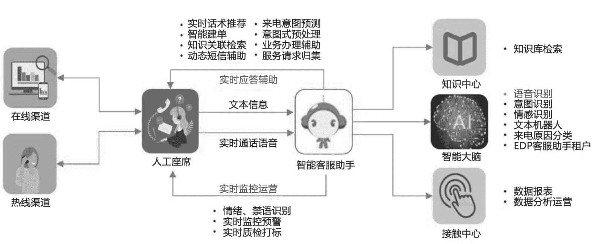

图 4-3

在整体布局中，智能客服助手处于核心枢纽，联动多渠道与功能模块。在线渠道与热线是入口，咨询以文本或实时语音送达。人工坐席可协同作业，并借助助手提供的文本辅助服务。智能大脑整合语音识别ASR、目的识别、情感识别等AI能力，实现呼入目的预测与意图式预处理，并与知识中心联动进行知识库检索与关联获取。服务中可实时推荐话术、智能建单，辅助业务办理。接触中心负责报表生成与数据运营，实时监控运营模块则进行情绪、禁语识别，实施预警与质检打标，保障质量、提升体验、降本增效。

呼入目的预测：依托机器学习算法，在通话伊始即可预判目的。以电信运营商客服中心为例，系统基于历史与实时对话快速识别需求，接线员可提前准备，缩短处理时长。

情绪监控：结合自然语言处理与情感分析模型，实时捕捉双方情绪，提示工作人员安抚用户或纠正不当态度。某银行应用后，用户满意度提升15%，投诉率下降20%。

服务推荐：依据偏好与行为模式主动推送定制化产品与方案。如旅游预订平台，系统根据历史出行记录与搜索偏好，推荐含潜水项目的海岛套餐并推送优惠，提升预订可能与平台粘性。电商平台借此展示感兴趣内容并发送促销邮件以促进销售，某电商应用后新客转化率提升30%。

此外，核心竞争力还包括：
· 持续对话管理能力：实现自然流畅交互，提升复杂场景沟通效率。
· 智能问答系统：基于高精度语义模型，减少重复提问，简化操作。
· 全渠道一体化管理：统一电话、网页、移动应用等渠道，实现信息同步并支持差异化营销。

得益于数据分析与人性化设计，助手在满意度、忠诚度与业务增长方面潜力巨大，应用场景将持续拓展。

DeepSeek 借助先进机器学习算法与海量历史数据，让呼入目的预判更精准。以电商客服为例，促销期可分析浏览记录、购买历史、咨询频率等多维数据提前预判意图，准确率较传统方法提高约20%，为坐席提供更具价值参考，快速响应需求。

### 4.2.3 功能架构

图 4-4 所示为智能客服助手的功能架构图，覆盖呼入目的预测、预处理能力融合、实时质检、业务办理辅助、分租户能力维护、知识点推荐、监控维度扩展、通话实时打标、EDP能力融合、核心意图配置、推荐内容评价、实时应答辅助、监控日志查询、自动填单、情绪监控、禁语监控以及服务请求推荐归集等。诸项功能协同助力客服，如呼入目的预测提前洞察需求，情绪与禁语监控保障服务质量，业务办理辅助提升效率等。底层能力包括ASR、机器人会话、目的识别、槽位提取、情感识别、文本摘要、服务请求模型、建单推荐等。系统用于呈现数据与分析结果，帮助管理者掌握服务态势、评估效果以便优化迭代。

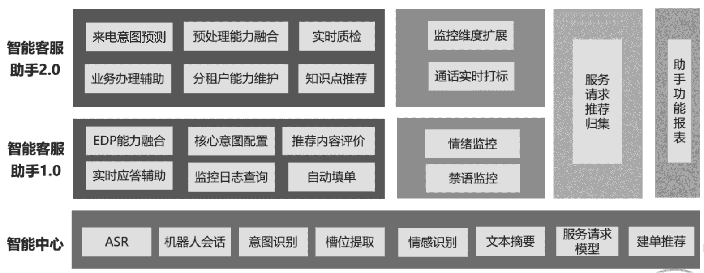

图 4-4

### 4.2.4 核心功能

本节剖析核心功能及其对服务质量与效率的支撑。随着技术演进，这些功能不仅能通过呼入目的预测帮助坐席快速理解需求，还可借助情绪、禁语监控确保交流积极合规，服务请求推荐等增值服务持续优化体验。

**1. 呼入目的预测**
通过分析历史数据与实时对话提前预判来电目的，提升首次接触效率。以通信运营商为例，月初账单出账期咨询高峰，系统可迅速判断是否账单查询并自动为坐席提供账单详情，减少等待。通话启动时助手自动激活，按预设场景与算法展示最可能目的；如检测到大量近15天未办结工单，可能推断用户咨询未解决事项。

算法依赖自然语言处理、机器学习与大数据分析，并可引入节假日、促销等外部因素以提高精度。春节期间，除常规咨询外可能出现套餐优惠咨询，综合考量后预测更贴合。系统先学习过往通话构建关键词与解决方案库，再经语音识别转文字后做情感与目的识别定位需求，随着数据持续训练准确率不断提升，形成正向循环。

同时融入情绪监控给予恰当支持，设置禁语监控避免不当言论。察觉用户语气急躁时，系统提示坐席温和沟通并推荐安抚话术。实际应用中可帮助坐席快速把握诉求、减少无效询问，改善体验并提升忠诚度。

**2. 人工服务意图识别**
自动化可处理常规请求，复杂或非标准情境需人工介入以保障质量。以金融投资为例，用户问“有一笔闲置资金，想半年内获一定收益应如何投资”，系统难以准确判断风险承受与目标，需坐席据专业知识进一步询问财务状况、投资经验后给出建议。人工服务意图识别即在助手判断不足时由坐席补充判断的过程，人机协同提升解决效率。

例如用户咨询未办结工单，因历史问题较多自动化未能明确原因，助手初步判断为工单状态查询但置信度低于阈值，转人工。坐席结合历史与当前对话快速理解意图并详细解答，缓解焦虑。

为实现高效协同，系统提供实时话术推荐、知识点关联检索、动态短信模板生成等辅助。实时话术推荐按问题与场景给出规范表达，知识点检索快速提供法规政策支持。助手初期过滤分类并持续学习人工反馈优化模型，常见咨询处理能力逐步提升，减轻人工负担并维持高质服务。

**3. 情绪、禁语监控提醒**
助手不仅是沟通桥梁，还承担通话安全与和谐的重任。情绪分析与禁语监控在此关键。以在线教育客服为例，学生因学习压力焦虑，助手通过情绪识别及时提醒客服调整方式给予耐心鼓励；学生使用不文明用语时禁语监控立即预警，引导对话回归理性。

情绪监控利用自然语言处理实时转录并分析情感倾向，按积极、消极、中立等模型评估每句话色彩。若检测到用户因等待久而语气急躁，立即向代表发送警示并建议耐心温和交流。坐席情绪指标达阈值时自动通知团队管理员及时介入。

禁语监控持续监听威胁、辱骂、非法暗示等词汇。对“投诉”等词需结合上下文判断，正常反馈不触发警示，带威胁与不文明用语时才启动。发现违规后界面显著警告并记录触发时刻、词汇与频次，便于追溯与改进，维护氛围、防范风险。

二者共同构成安全屏障，让互动更顺畅可控，促进正向沟通。

**4. 服务请求推荐**
该功能提升体验与业务效率。以美妆电商为例，系统发现用户常购美白护肤品且近期浏览某品牌新品美白精华，咨询时即推荐精华并搭配同品牌面膜成套装并附折扣，精准命中需求促进转化。基于行为习惯、历史记录与实时互动提供定制化建议，提升满意度与复购。

助手可运用机器学习模型解析真实需求，从海量历史数据学习不同表达背后的相同意图，并结合情绪监控把握沟通微妙变化。当账户异常导致用户焦虑时，不仅给解决方案也安抚情绪。

系统还能预测未来需求提前准备材料。生鲜电商用户常购水果，助手据购买频率与品类偏好预测下一次购买，提前准备当季促销与营养搭配建议，用户来访时即时推送，既满足需求又创造销售机会。对频繁查询流量的移动用户可推荐套餐升级或增值服务。精准推荐在保障服务质量的同时提升运营效率，构建长期关系，激发忠诚与复购。

**5. 精准识别引导**
精准理解坐席引导内容对提升服务质量与满意度意义重大。以技术故障为例，用户反馈网络连接问题，客服引导排查时助手可准确识别引导意图并快速给出排查步骤与话术，如“请先检查路由器指示灯是否正常亮起”“若正常请尝试重启路由器”，帮助高效指导。

以宽带故障报告为例，用户说“我的宽带上不了网了”，助手自动识别为故障反馈，置信度达87.92%，进入预设“固网报障_北一”流程。据实时语音转写自动生成后续建议，同时允许坐席手动选择地区维修团队或故障类型，使方案更贴合实际。

借助自然语言处理与机器学习，助手可对复杂情境实现精确响应。面对非标准表达或方言识别尚不完美，但持续优化与数据训练逐步提升准确率。助手1.0主要依托EDP平台深度融合匹配意图并推送话术、知识点、短信模板；助手2.0更侧重预处理自动化，对意图背后逻辑节点智能识别，降低人工干预、加速解决。

此外实时监控双方情绪变化，检测到负面情绪或禁语即提醒坐席采取措施，必要时向管理层报警。投诉场景中，检测到用户激动并使用不文明用语，会提示使用安抚话术，如“非常抱歉给您带来不好的体验，我们一定尽快解决问题”。若处理不当则按规则告警管理层，避免矛盾升级。记录用于后续分析，助力持续改进。

## 4.3 智能知识库

数字化转型下，组织面临海量信息管理与高效利用的挑战。智能知识库是关键利器，可系统沉淀、整理、传播内部知识，借助智能化手段大幅提升检索速度与准确性，增强跨部门协作效率，确保服务标准一致。本节从产品简介入手，探究优势与功能架构支撑，介绍核心功能，尤其是自动化保持最新状态的方式，并分析实际工作场景应用。

### 4.3.1 产品简介

知识流转，让业务更聪明

智能知识库本质上是依托当代信息技术搭建起来的知识管理平台，通过采集、编排、沉淀和检索的闭环，为企业提供系统化、可检索的知识服务。在软件研发型企业里，它常常扮演开发、测试与售后支持的共同知识中心。研发人员可快速调取编码规范和技术文档，测试人员能查到用例库和常见问题处置办法，售后团队则能借助它迅速回应客户使用与故障排查的提问，从而提升协作效率与服务品质。它既是企业级知识管理的基座，也是推动内部信息共享、加速决策和服务升级的关键抓手。使用者覆盖高频查阅专业信息的员工、研究者以及客服团队，典型场景包括帮助客服代表即时答复、助力研发部门提速创新。

技术上，平台整合了大数据分析、自然语言处理、机器学习和云计算等多项前沿能力。大数据分析可对海量技术文档、客户反馈等素材进行挖掘，发现知识间的关联与隐性规律；通过追踪搜索关键词和浏览轨迹，能洞察知识需求热点，为分类整理和智能推荐提供依据，从而让知识组织更贴合实际使用习惯。这些能力共同支撑起自动采集、自动归类、智能推荐和精准检索。自然语言处理让非结构化内容被有效理解，机器学习则依据使用习惯动态优化推荐，提升体验。

核心能力主要分四块：知识管理，覆盖草稿管理、已发布内容维护、回收站操作等全生命周期；知识应用，提供多维度检索，按类型、目录等灵活查询，并结合上下文语义优化结果展示；流程支撑，如个性化工作台视图，方便管理人员做审批、反馈处理等日常工作；自定义配置，支持按业务场景定制知识体系结构、角色权限与常用话术模板。

DeepSeek 的知识图谱构建与推理能力为挖掘与关联提供了增益。以医疗类知识库为例，DeepSeek 可从医学文献、病历大数据中梳理出疾病征象、诊断手段、治疗方案间的深层关联，为医护与患者提供更全面准确的信息。其知识更新机制还能实时跟踪最新研究成果和临床实践，自动刷新库内内容，保证时效与准确。

总体来看，统一的知识平台帮助企业沉淀智力资产，促进跨部门协同，显著提升运营效率与服务水平。随着 AI 持续渗透，智能知识库正向更智能、更个性化的方向演进。

### 4.3.2 产品优势

信息爆炸的当下，智能知识库在管理、应用和体验层面明显优于传统方案。金融场景下，客户敏感数据与交易记录的安全性要求极高。系统采用多层加密，即使数据在传输或存储中被截获，攻击者也难以还原真实内容。硬件层面的物理隔离进一步阻断非法访问，结合定期备份恢复机制，可在数据丢失或损坏时快速回滚，保障业务连续。简言之，在安全维度，加密与物理隔离加备份恢复大幅降低意外风险。扩展与维护同样突出，微服务架构让资源配置可弹性调整，新功能可无缝接入，降低运维成本并提升稳定性。

存储层面，除纯文本外，还原生支持图片、视频等多媒体，丰富了知识的表现形态。以教育培训为例，可同时容纳教学视频、课程配图与文字教案。教师备课时既能参考文字思路，也能观看示范视频、查阅素材图片。通过可定制的审批流，机构可做学科负责人初审、管理部门复审等分级把控，确保上架资源的质量与适用性。该机制支持二级甚至多级审核，增强企业对市场变化的响应力与协作效率。

平台还具备较强的数据洞察能力，能分析用户访问行为并反哺体验，例如展示搜索热词、依点击量自动调整结果排序等，缩短信息获取时间、提升满意度。在协作层面，统一平台让经验共享更顺畅，加快问题闭环；对管理者而言，关键信息触达更快，决策更及时。

DeepSeek 的加密能力同样加持安全。对金融知识库里的账户信息、交易记录等敏感字段做多层加密，即使发生泄露，也难以被还原，从而保护客户隐私与企业资产。

综合来看，高安全性、可扩展性、丰富功能与智能化特质，使智能知识库在数字化转型中难以替代，为企业打造效率与品质兼顾的工作环境。

### 4.3.3 功能架构

图 4-5 为智能知识库的功能架构，分为业务应用、平台能力、数据存储和运行环境四个层面。

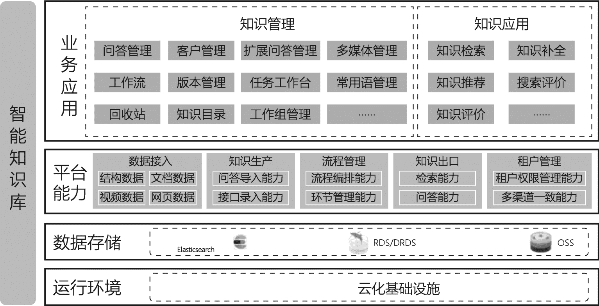

图 4-5

业务应用中，知识管理包含问答管理，用于创建、编辑与审核问答内容；客户管理用于配置权限与审计操作记录，确保规范与安全；扩展问答管理补充相关问题，丰富知识维度；多媒体管理支持图片、视频等多种载体。

知识应用模块里，知识检索依据输入快速定位相关内容；知识补全对已有条目做完善；知识推荐基于历史行为与偏好主动推送；知识评价收集用户反馈以优化内容。

平台能力方面，数据接入支持结构化数据、文档、视频、网页等多种来源；知识生产支持导入问答、接口录入、创建与编辑，方便外部知识融合；流程管理负责编排与监控从录入到应用的全流程；知识出口提供检索与问答能力，确保知识快速触达；租户管理实现权限分配与多渠道一致体验。

数据存储模块提供高效存储、快速检索与安全备份；运行环境基于天宫平台构建，为系统稳定运行提供底层支撑。

此外，DeepSeek 的 NLP 与知识推理在采编、审核、检索中发挥作用。采编时自动抽取关键知识点，提升录入效率；审批时利用推理验证准确性与完整性；搜索时借助语义理解提供更精准的结果与推荐。

整体架构遵循模块化原则，各单元独立又协同，降低开发复杂度并为后续扩展预留空间。

### 4.3.4 核心功能

图 4-6 介绍了智能知识库的核心功能。

知识应用层面，系统可区分问答类、多媒体类等形式呈现，适配不同场景。知识首页按热度排序并展示各用户的搜索词，帮助快速获取热门内容；“我要反馈”入口便于对检索结果提出意见，推动优化。详情页支持评价，持续收集反馈以提升质量。

知识管理层面，“我的工作台”集中展示待办清单，支持抢单、释放、审核等操作，直观跟踪进度；同时记录评价与回复、维护审核话术，便于经验沉淀。草稿箱支持按知识 ID、标题、渠道等多条件查询，覆盖问答与多媒体，具备新增、修改、删除、提交、解锁等操作，保证创作与编辑的可控性。已发布内容可导出、下线更新，并支持多条件查询，确保持续可用且随业务演进而更新。回收站可按多条件检索已删条目，提供还原与彻底删除，防止误删损失并清理冗余。知识目录支持节点增删改，提升分类与检索效率。工作组/人员维护用于配置生产流程各环节的责任人，保证流程有序。

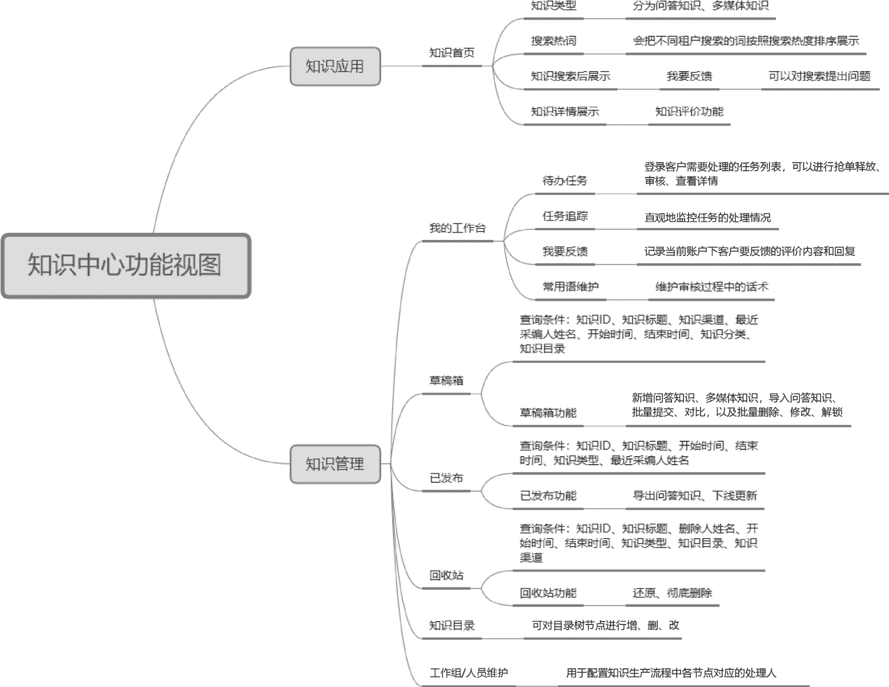

图 4-6

1. 知识应用
知识应用是提升信息获取速度与准确性的核心。以法律行业为例，律师处理复杂案件时需迅速定位法规与案例。系统通过分词将专业术语与案情描述拆解，结合权重计算优先展示最相关的条文与案例，节省检索时间。知识检索融合搜索引擎、分词和权重算法，分词将查询拆分为有意义片段实现匹配，权重依据词汇重要性与分布决定排序，并对匹配处高亮，便于定位。

除检索外，系统还提供辅助工具提升体验。以互联网运营团队为例，推荐系统依据日常工作与浏览习惯推送行业动态与技巧，如近期关注社交媒体营销时，会推送新算法与案例。其基于机器学习分析历史行为与上下文环境，实现主动个性化推送，即便无明确需求也能发现价值。搜索评价系统则收集评分与意见，作为模型训练数据帮助算法不断进化，同时为产品迭代提供依据。总体而言，平台构建了高效个性化的获取体系，推动知识资产管理和共享。

2. 知识管理
知识管理贯穿创建到发布的全生命周期。创作阶段提供模板与辅助工具，例如产品文档模板含概述、功能介绍、使用方法、FAQ 等板块，引导规范编写，并集成拼写与语法检查提升质量。草稿箱、已发布、回收站构成完整流转：草稿箱支持初稿编辑与暂存；通过审批后正式发布供使用；不再适用的内容进入回收站等待删除或恢复。

工作组与人员配置至关重要，需细化采编者、初审、复审等角色权限，实现协作与风控。多级审核可提升上线质量，对敏感信息可通过权限限制加强保护。

自定义目录结构提升可用性。以制造业为例，可按产品类别、生产流程、技术标准划分，细化到系列产品、原材料采购到装配环节、工艺规范与质检标准等。树形结构便于快速定位、批量维护与后续管理。

自动更新机制维持时效性，针对法规政策等快速变化领域，可设置跟踪规则自动抓取新版并替换旧内容，确保信息准确及时。

科学规划后，知识库能有效积累内部智力资产，提升效率与服务水平。

## 4.4 智能工单

智能工单系统融合人工智能与自动化流程管理，为企业与客户搭建沟通桥梁，尤其擅长处理复杂问题与跨部门协作。大规模制造企业中，生产线设备故障时，一线人员可通过系统提交报修，平台依据故障描述与设备信息自动分派给合适维修组，并协调技术与配件部门联动，减少停机时间。目标是通过自动化与智能化优化服务体验、提升效率。

系统基于工作流引擎运行，实现工单跨环节自动流转。电商售后场景下，客户提交退换货申请后，系统按订单信息与原因自动判定流程：质量问题转质量检测，符合政策的个人原因转售后物流，确保最优路径。服务请求被记录为工单后即按规则分配给合适处理人，超出能力范围时自动升级至二线或更高专业团队，减少人工干预、降低差错、加速解决。

平台支持热线、在线聊天、小程序、社交媒体等多渠道统一接入与响应，保证服务体验一致。所有工单集中存储，便于实时监控进度与后续分析。对于网络故障等多部门协作问题，智能调度可迅速聚合资源合力处置。

为提升体验，系统提供智能推荐，利用机器学习分析历史案例给出下一步建议；基于 NLP 的语音转文字可在通话中实时生成记录。上述特性兼顾内部运营与外部满意度。

DeepSeek 的机器学习与 NLP 深度融入工单系统。自动分配环节依据工单内容、客户历史与客服技能进行智能匹配，分配准确率提升约 30%。对复杂技术故障可精准识别问题类型并找到资深人员。同时可对历史工单做深度分析，为新工单提供解决建议，提升闭环效率。

### 4.4.1 产品简介

### 4.4.2 产品优势

智能工单：让服务从碎片化到全链路闭环

和传统客服比，智能工单在跨渠道联动、过程透明可视、调度自动化上形成了明显代差。这些能力直接拉高了企业的运转效率，也让客户体验变得更连贯、更省心。以连锁餐饮为例，顾客可能用电话、公众号、门店或小程序发起投诉或建议，智能工单会把这些分散入口的反馈自动归拢成一张工单。后续无论顾客换哪个渠道跟进，坐席都能看到完整记录，清楚来龙去脉，避免重复说明和信息断层。

多触点建单是第一层价值。电话、小程序、公众号等都能直接立单，且不同渠道的数据保持一致，客户操作更简洁，企业响应更高效。比如顾客先在社交媒体留言，后续拨打电话继续追问，系统会无缝衔接到同一条处理线，满意度自然提升。

第二层价值是全量归集与智能派单。所有渠道产生的服务请求统一建单、流转、派单，直达一线解决团队，实现单点操作、全网生效。背后是工作流引擎，按预设规则自动把工单推送给最合适的人，无需人工转交。某大型电信公司落地后，工单从创建到首次响应的时长压缩了60%，整体处理周期减少了30%以上。

透明可视是另一大亮点。物流场景里，客户不仅能知道包裹在哪，还能通过工单看到各转运节点的作业时间、经手人等细节，信任感明显增强。通过接入综合调度平台与宽带客服系统等资源，工单全程轨迹一目了然：创建时间、当前状态、历史操作全部呈现。管理者和客户都能实时掌握进展。

在大数据和机器学习加持下，系统还能做个性化建议，比如优先级的自动判定、最佳处理方案推荐，让决策更科学。

总体看，借助技术与设计，智能工单既提升了内部协同、降低了成本，也为客户提供了更顺畅的服务，正在成为现代服务体系的核心底座。

### **4.4.3** **架构全景**

图 4-7 描绘了从客户来电到工单结束的整体架构。

业务起点是客户来电。通话信息进入智能客服助手前端，依据核心意图配置完成初判。助手具备语音转写能力，能把通话转为文本供后续分析。客服助手与智能工单大脑协同工作。大脑由工单能力、智能中心和训练模型构成，工单能力负责调用服务和返回结果，智能中心依托训练模型对数据进行分析和处理。

在此期间，助手可完成工单类型推荐、办理模板引导、预填单等辅助。经过大脑处理后，工单进入受理页，随后由智能流转推荐确定归属部门。智能定位推荐会依据“现址”字段辅助流转，确保工单精准送达，直至闭环。整个链路通过助手与大脑的配合，利用转写数据与训练模型，实现处理智能化、自动化。

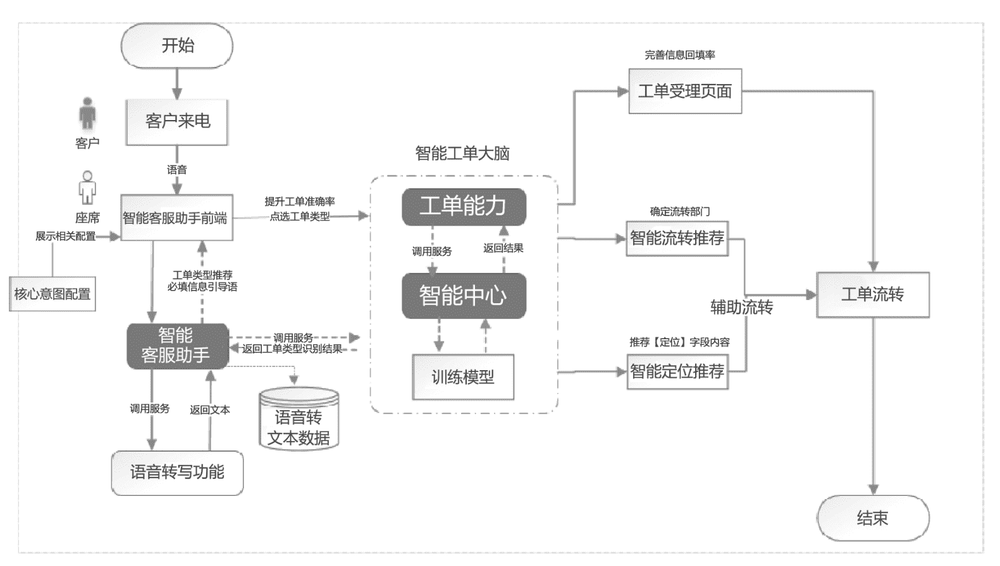

图 4-7

工单受理页是客户与系统的首个触点，重点在于高效采集需求。医疗客服场景下尤其关键，患者可能不适或焦虑，页面必须简洁直观，客服能迅速记录信息。页面支持语音转文字输入，对不便打字的用户更友好，同时兼容文本输入，适应不同场景。基于历史数据与算法，页面还能智能推荐工单类型和问题描述，提供预填充建议，缩短填写时间、降低差错。

智能客服助手在建单初期就介入。借助自然语言处理和深度学习，助手能理解诉求并按规则自动匹配最合适的处理路径。面对复杂业务，能辅助决策分析，预测风险点或推荐优先措施，帮助坐席做出更稳妥判断。

智能中心是系统的核心大脑，整合训练模型与知识库维护。通过海量历史案例学习，持续优化推荐算法与服务策略。多渠道接入是其标配，电话、邮件、社交媒体的反馈都能统一管理、一致响应。

整体架构高度集成、相互贯通，从首次沟通到问题解决都有智能工具支撑，大幅提升效率，改善体验，为企业提供强有力的服务保障。

### **4.4.4** **核心能力图谱**

图 4-8 为智能工单投诉处理流转图，涵盖投诉来源、各环节处理及最终回访。

投诉来源分为电话投诉、升级投诉、互联网平台投诉。电话投诉直连区域中心一线客服；升级投诉由投诉处理中心一线客服承接；互联网平台投诉由投处中心二线客服负责。

流程上，区域中心一线接到电话投诉能直接解决则在线办结，否则转二线，二线仍无法解决则上推至省级投诉处理团队。投处中心一线接到升级投诉可直接办结，否则转二线，二线无解时流转至省投团队或地市客服。省投团队收到工单可自行处理或分派给专业部门、地市客服、外围系统。地市客服可继续分派或自办。处理完成后由省投团队、地市客服或投处中心负责审核，回访通过 IVR、互联网消息、短信、人工等方式完成闭环。

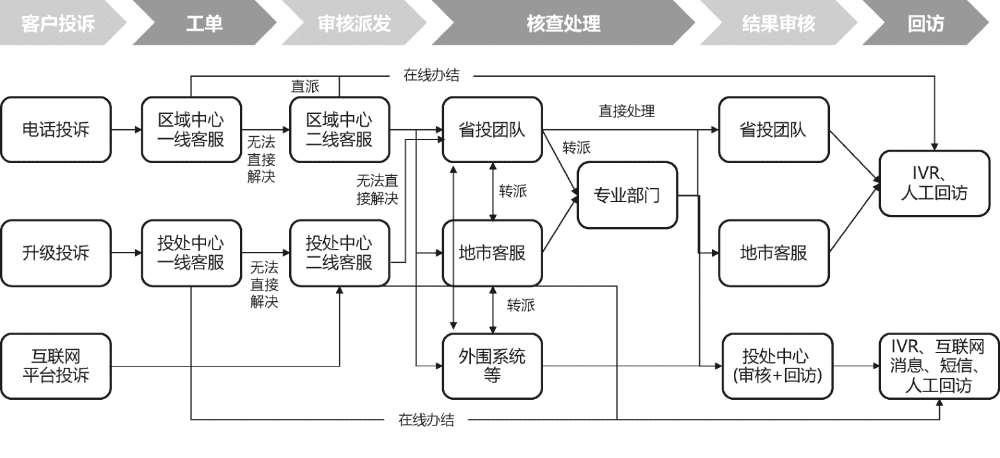

图 4-8

1. **智能接单**

工单受理是快速准确响应的关键。电商大促期间，客服需处理海量咨询，传统手工建单压力大、易出错，优化需求迫切。传统方式要求人工录入联系方式、投诉内容、服务类型等，耗时耗力。现通过 AI 与自然语言处理自动识别需求并推荐工单类型，效率和质量显著提升。

系统能从文本或语音中解析意图。例如电信客户反映“手机信号差、经常断网”，系统会识别为网络信号问题，结合地区、机型等信息，从案例库匹配常见解法，如重启手机、检查 SIM 卡、推荐附近信号优化基站等，为坐席提供针对性建议。客户说“家里宽带慢”，系统即提示创建家庭宽带性能优化工单，并建议检查线路或安排上门。

这种智能化大幅缩短人工操作时间并提高录入准确性。统计显示，采用 AI 增强型工单的企业平均处理时长缩短30%，错误率降至5%以下，客户体验明显改善。交互记录被用于持续学习，系统会随时间不断优化。

以手机银行求助为例，过往客服需多轮询问才能归类，现在通话实时转录并语义理解，AI 数秒内判定为账户安全设置疑问并自动生成工单草稿供审核，响应链条更顺畅。

2. **智能处理**

工单处理直接决定问题能否高效解决。技术支持部门在多部门同时反馈故障时，处理速度和准确性尤为重要。流程包含建单、流转、定位等环节，智能工具在此阶段价值突出。

客户通过电话或其他渠道发起请求后，坐席在受理页录入信息，智能客服助手会根据语音转文字内容和历史工单自动推荐建单类型，简化填写流程，提升准确性。

流转环节，智能流转推荐发挥核心作用。以物流为例，包裹丢失工单会结合历史案例、当前节点、发货收货地址等信息，判断最合适的处理部门：运输途中丢失推给运输部门，派送站点丢失则推给当地管理部门，确保工单直达最合适的人。系统基于相似案例学习和当前描述预测下一处理部门，供操作员参考，避免人为误判。跨部门协作时，工作流引擎按预设路径自动流转，提升沟通效率。

定位环节，借助训练好的机器学习模型，系统可为特定问题推荐最佳解决方案并展示给相关人员，加快解决并保持服务一致。

某电信运营商引入后，平均工单响应时间缩短30%，客户满意度提升20%以上，体现了 AI 优化传统流程的价值。

3. **智能流转**

自动化流转能显著提升解决速度和满意度。金融机构的金融产品组合申请往往涉及信贷、风险、合规等多部门，智能流转按业务规则自动分派，避免人工转交的错误和延误。

核心是基于算法的智能推荐，根据工单内容分析最佳方案或下一环节，并向二线人员提供精准建议。

派发时，客服界面提供“智能推荐”按钮。电商售后场景下，客户申请退换货，点击按钮后系统综合商品类别、历史购买记录、仓库库存等进行分析，例如电子产品且客户常在某仓库区域下单，则优先推荐该仓库售后部门。此后系统基于历史数据、工单描述和知识库自动填充派送单位，最终决策仍由人工掌控，保持专业与灵活。

以电信宽带不稳定为例，传统方式需人工判断线路或设备原因并手动分配，智能流转下只需输入描述，系统即可快速识别可能原因并给出转交建议，大幅缩短响应间隔，减少部门间沟通成本。

4. **智能审核**

审核确保请求准确及时，维护服务质量。互联网平台收到侵权投诉时，需甄别投诉真实性，避免误判或恶意投诉。自动化审单配置可按关键词匹配、内容相似度等规则快速初筛，将复杂案件筛选出来人工复核。

组织能设定条件自动审核，符合标准的工单直接派发或进入回访，减少人工干预，保证流程标准统一。

功能基于算法和历史数据训练，可判断哪些工单可快速通过、哪些需人工审查。在线旅游平台为例，客户简单更改入住日期且历史满意度高，系统可自动批准；涉及导游态度恶劣、宣传不符等复杂投诉，则标记人工审查，确保妥善处理。

规则可按业务场景灵活调整，保持高效率的同时不牺牲质量，利于标准化建设与信任构建。

5. **智能回访**

回访是收集反馈、评估质量的重要环节。教育培训机构在课程或教师被提出意见后，通过处理后的回访了解学员满意度，发现改进点，提升信任与忠诚度。

企业可配置回访参数，如首次回访时限、总次数，并按业务类型设定策略。电商普通售后可设处理后24小时内回访一次，高价值或复杂工单可在12小时内首次回访，一周内二次回访，确保问题彻底解决。

工单完成后自动进入回访阶段，工作人员可查看详情并执行退回派送等操作。定期满意度调查是持续改进的基础，自动化安排降低遗漏，数据分析为管理提供改进方向，也体现对客户体验的重视。

高质量回访还能识别服务链条薄弱环节，优化流程和培训，及时挽回流失风险客户。

6. **数据分析与优化**

一体化工单体系的价值早已超出加速响应和改善用户感受的范畴，在洞察挖掘与持续改进上也能释放强劲动能，为管理层提供可靠的决策依据。以快递物流为例，通过对工单信息的深度盘点，企业能够不断打磨作业链路和服务品质。对海量工单进行归类汇总，可以迅速揪出流程堵点和潜在风险，为下一轮改进提供清晰方向，帮助企业在竞争中保持领先。

在关键指标层面，工单系统可以集中呈现处理时长、闭环率、首次回复时长等运营核心维度。持续跟踪这些数值的变化，企业能及时捕捉服务薄弱点或流程瑕疵，并作出策略调整从而整体拉升服务水平。比如某类单据的平均处置时长明显高于其他类型，就说明该业务环节效率不足，需要针对性整改。

趋势研判是另一项重要应用。以电商平台为例，回溯历年数据会发现购物大促结束后的一周，物流配送相关诉求会出现明显抬头。基于这一规律，平台可提前与物流合作伙伴沟通对接，加强派送管控提升履约效率，同时准备好投诉应对预案并对客服团队进行专项演练，从而在大客流时段保持更稳健的用户体验。借助历史积累，企业还能识别服务需求的演进模式，比如投诉在特定时段的升降波动、常见问题的演进轨迹等。这种前瞻性认知让企业能够提前调配资源，甚至预判潜在问题并采取预防措施。例如分析显示夏季空调报修量显著攀升，企业便可在季节转换前加大技术支持团队的配置，缩短客户等待时长，提升满意度。

系统还能输出多维度的服务表现视图，按区域、部门或个人展示绩效差异。这类定制化洞察为管理层提供了观察组织运行的清晰窗口，便于从宏观层面制定长期战略。例如发现某区域用户反馈普遍偏低，企业可集中资源改善当地服务；针对表现优异的团队，则可提炼成功经验并推广学习。

总体来看，充分激活智慧工单体系的数据洞察能力，企业能够最大化日常运营效能，并基于对市场动向与内部机制的深入理解作出精准判断，推动整体水平不断提升。该能力对实现持续改进、营造卓越客户服务文化具有重要意义。

## **4.5** **智能排班**
客服中心与呼叫中心的日常运转中，人力调配的合理性直接决定服务质量和成本控制成效，本节将系统解析一款依托智能算法优化人力资源配置的解决方案——智能排班系统。该系统以厚实的历史数据为底座，能够敏锐把握未来话务高峰的变化规律，合理安排人员，既保障客户获得优质体验，又有效压缩不必要的运营开支。下面从产品概览入手，逐步展开其优势、架构与核心能力。

### **4.5.1** **产品简介**
智能排班是一款以数据分析与算法模型为底座的自动化工具，其核心目标是优化企业人力配置，对客服中心这类劳动密集型组织尤为关键。以电商行业为例，客服负荷在不同时间段差异极大，如双十一、618等大促期间咨询量会爆发式增长，而平日则相对平稳。系统通过深度分析历史话务数据，结合促销规模、时间节点等要素，能够准确预判活动期间的话务高峰，提前完成人力调配，避免因人手不足导致客户等待加长。

系统综合考量历史话务量、人员可用性、节假日、促销活动等多种业务影响因素，运用话务拟合、人力拟合、班次拟合三类算法，精准预测未来需求并自动生成贴合实际负荷的排班表。这一流程大幅减轻了传统手工排班给管理者带来的负担，实现供给与需求的精准匹配，促进效率与质量同步提升。

核心能力实用且丰富。话务预测基于一段时期的话务走势，对未来特定时段的来电量进行科学预估；人力预测在此基础上进一步测算所需服务人员数量；班次规划将两项预测结果融合形成初版排班方案，经人工微调确认后执行。此外还提供换班审批查询、个人排班表查看等功能，方便员工了解与调整自身安排。

与传统手工排班相比，智能排班优势明显。手工排班往往依赖经验，易受主观判断影响，例如对特殊事件的忽视或对增长趋势的误判会导致排班失衡。而智能系统凭借海量历史数据的分析能力，能更客观、更准确地预判业务需求，制定更贴合实际的排班。其一，依托真实历史数据分析预测，使排班表与实际需求无缝对接，有效避免人为失误带来的资源浪费或短缺；其二，流程高度自动化，显著缩短从数据采集到决策落地的周期，提升整体运营效率；其三，灵活高效的管理方式增强团队凝聚力，合理的休息与公平的分工让员工感受到尊重，满意度与忠诚度随之提高。

总体而言，智能排班凭借精准分析、便捷操作以及提升服务水平与降低管理成本的双重价值，已成为现代客户服务领域不可或缺的关键工具，无论是大型呼叫中心还是小型客服团队，都能借此实现显著提升。

### **4.5.2** **产品优势**
系统借助话务拟合、人力拟合、班次拟合的三类算法，结合历史数据及话务增长性、节假日、账期等关键因子，实现坐席排班与业务需求的深度契合。以银行客服中心为例，每月信用卡还款日前后，咨询还款相关问题的来电量会明显上升。系统通过分析历史话务与账期规律，可精准预判该时段高峰并提前安排熟悉信用卡业务的人员值班，既提升咨询处理效率、缩短等待时间，又避免低谷期人力过剩造成的浪费。这一技术显著提升现场管理与排班管理能力，也提高员工与管理者的工作效率。与手工排班相比，主要优势体现在：

·话务预测精准入微：系统运用先进算法深度解析过往话务模式，可精准预估未来各时段来电量，并细化到30分钟或每小时的粒度。这种精细度远超人工预估，有助于在保障服务质量的前提下合理分配人力，避免高峰人手不足、低谷资源闲置。

·人力预测科学合理：系统权衡多种变量，为每个时段定制最优化人力配置方案。不仅确定总人数，还细化到技能组，确保关键岗位有人值守，减少因安排不当造成的服务延迟或客户不满。

·排班优化灵活敏捷：系统响应迅速。以旅游旺季为例，旅行社客服常接到线路咨询、预订、退改电话。若突发自然灾害导致大量退改咨询，系统可依据实时话务变化，迅速从业务清闲时段调配人员补充至退改岗位，确保需求及时响应。面对突发事件或季节性波动，系统能快速调整计划，无需手工重排。此外内置的换班申请与审批功能，使员工临时调动更便捷，提升团队协作顺畅度。

·员工满意度大幅提升：工作量分配更均衡，减少频繁加班或休息被占用；透明的个人排班查询让员工清楚工作安排，增强对组织的信任感。自动化特性也减轻管理层日常负担，使其可投入更多精力于战略规划等高价值工作。

从话务预测到人力预测再到排班优化，系统凭借强大的数据分析与灵活应对机制，在提升效率与服务质量的同时，有助于营造更和谐愉悦的工作环境。

### **4.5.3** **功能架构**
图 4-9 是智能排班系统的功能架构。可以看出，系统融合多元算法与技术，力求从话务预测到人力配置再到排班表生成的全流程实现高效精准。

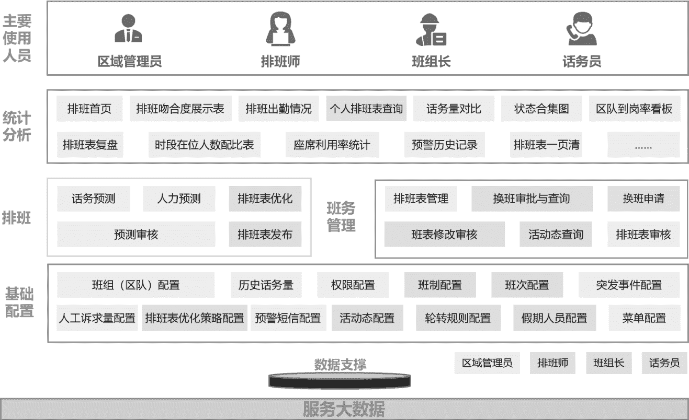

图 4-9

**1.** **主要使用人员**

1）区域管理员
在系统中负责统筹全局，主要管理区域内资源与配置，如对不同班组整体规划与设定，决定各区域人员规模与业务侧重，确保排班工作与整体业务战略一致，为系统稳定运行奠定基础。

2）排班师
系统的核心技术人员，负责利用专业知识与系统工具进行话务预测，综合季节、节假日、营销活动等多因素预估未来各时段话务量。基于预测结果开展人力预测，确定各时段所需人数与技能组合，并在考虑员工工时、休息、工作负荷等因素后生成兼顾业务与员工利益的最佳排班方案。

3）班组长
负责班组层面的日常排班管理，包括接收与处理成员换班申请、依据业务需求审批并更新排班信息，对排班表进行审核与调整，并通过活动态查询等手段实时掌握班组工作进展，确保工作顺利开展。

4）话务员
一线使用者，可根据个人情况在系统中提交换班申请，并查看个人排班信息，包括班次时间、工作时长、休息时段等，便于合理安排个人生活与工作准备。

**2.** **统计分析**

1）全面的数据展示
统计分析提供多样化展示。排班首页为管理者提供出勤情况、话务量走势等关键概览。排班吻合度展示表通过数据对比分析实际排班与理想模式的契合度，帮助发现潜在问题。排班出勤情况模块记录员工迟到、早退、请假等详细信息，为考勤管理提供支撑。

2）个性化查询与对比
个人排班表查询方便员工随时查看详细排班，增强计划性。话务量对比模块将不同时段、不同班组的话务量进行对比，助力人力调配。状态合集图以可视化方式呈现团队忙闲休息状态，便于及时掌握动态。区队到岗率看板实时展示各区队到岗情况，确保高峰时段人力充足。

3）深度复盘与优化
排班表复盘模块支持对已执行排班表进行回顾分析，总结不足。时段在位人数配比表对比实际在位人数与需求，优化配置。座席利用率统计精确计算座席使用效率，为资源分配提供依据。预警历史记录保存各类预警信息，如话务异常波动、人力短缺预警，便于追溯与完善机制。排班表一页清以简洁方式呈现关键信息，便于快速查阅决策。

**3.** **排班**

1）精准预测
话务量预测是排班前提，系统综合历史数据、时间因素、业务活动等变量，对未来各时段话务量进行精准预估。例如电商大促期间，结合过往数据与市场宣传力度预测各时段高峰低谷。人力预测基于话务预测结果，结合不同场景所需技能与效率，计算各时段各类员工需求，如普通话务员、技术支持、投诉处理专员等。

2）智能优化
在获得预测结果后，系统进入排班表优化环节，综合员工工时限制、休息需求、技能特长、个人偏好等，通过智能算法生成多套备选方案。在满足业务需求下避免长时间连续工作，合理安排休息日，并将具备特定技能的人员安排至最需岗位。预测审核环节由专业人员人工核验，确保准确性。审核通过后排班表发布至系统供员工与管理者执行。

**4.** **班务管理**

1）排班表的全流程管理
班组长可在系统中创建、编辑、删除排班表，并根据业务与人员变动及时修改，系统自动进行合理性检查，避免冲突并保障高峰人力。换班审批与查询模块规范换班流程，员工提交申请后班组长审批，结果实时反馈并记录，便于查询追溯。换班申请模块为员工提供便捷入口，说明原因与期望对象等信息。

2）灵活应对变动
排班表修改审核确保变动经严格审核，符合业务规定与团队利益。活动态查询使管理者实时了解排班动态，如换班操作与调整内容，及时掌握团队安排。排班表审核对最终排班在人员、业务覆盖、合规性等方面进行全面核验，通过后正式发布执行。

**5.** **基础配置**

1）构建基础框架
基础配置是系统运行基石。班组配置定义班组名称、成员构成、业务范围等，明确职责分工。历史话务量数据记录与分析为预测提供依据。权限配置为区域管理员、排班师、班组长、话务员等角色分配操作权限，确保安全规范。

2）精细规则设定
班制配置可设置早班、中班、晚班、轮班等，定义工作与休息时段。班次配置细化班次起止与交接时间。突发事件配置设定业务量激增、设备故障、员工突发疾病等情形下的应急排班策略。人工诉求量配置设定人工客服处理量标准，为预测排班提供参考。排班表优化策略配置允许按团队实际情况设定优化偏好，如优先保障休息、均衡工作负荷等。预警短信配置设定触发条件与接收对象，及时推送话务异常、人力短缺等预警。活动态配置定义换班、请假、调休等操作规则与流程。轮转规则配置设定员工在班次、岗位间的轮换，确保全面发展并避免疲劳。假期人员配置用于节假日等特殊时期安排休假与值班，保证业务连续。菜单配置支持按需定制操作菜单，提升使用效率。

系统稳定运行依赖强大数据支撑。服务大数据涵盖呼叫中心海量数据，包括历史通话记录、员工基本信息、排班规则设置、话务量、平均通话时长、客户满意度等，通过关系数据库 RDS 结构化存储，对象存储 OSS 保存培训资料、文档、录音等非结构化数据，大数据处理工具 Hive 用于大规模分布式分析，Redis 缓存加速高频数据读取，JMS 消息队列保障各组件间高效协同。例如员工提交换班申请后，通过消息队列传递至审批模块，结果再回传给员工，确保流程顺畅。

系统通过精细架构覆盖不同角色需求与业务流程各环节，借助先进技术与数据支撑，实现从话务预测到人力配置再到排班生成与管理的全流程智能化与科学化，既能精准预判趋势、合理安排人力，又兼顾体验与安全，为客服及相关行业人员排班提供有力保障。

### **4.5.4** **核心功能**
本节将深入剖析智能排班系统的关键组成部分，包括话务预测、人力预测与自动排班、排班表管理流程。通过先进算法模型结合实际业务场景，系统大幅提升工作效率，实现服务质量与成本控制的平衡。下面将详细介绍各模块所依赖的技术手段及其工作原理，并强调系统在过程中对人工干预的支持，确保灵活性与适应性。

**1.** **话务预测**

在智能排班体系里，话务量预估是整个安排的起点。它的作用就是用科学的方法推算未来某个时段的来电规模，为人力如何投放提供依据。拿酒店举例，话务的季节性波动非常明显，旅游旺季预订和咨询电话会集中爆发，淡季则明显回落。系统做预测时会把这种季节规律算进去，结合往年同期的数据和当地的旅游活动安排，借助时间序列分析等模型来提升预判的准度。不仅吃历史数据，还会把季节、节假日等影响因素一起纳入，从而让结果更可靠。

管理者在使用时可以自由设定预测的颗粒度，比如30分钟、1小时或按天。颗粒度不同用途就不同：30分钟的颗粒能捕捉到话务的细小波动，方便及时增减人手，避免出现空转或忙不过来的局面；按天来看则更利于宏观统筹，提前排好工作天数和休息，平衡员工的工作与生活。

要做到这一点，系统通常依托三类技术支撑。 
丰富的数据输入。系统会沉淀大量的历史通话记录，像来电量、通话时长、高峰低谷分布等，通过挖掘找出工作日内不同时段的话务模式及其周期性规律。 
多元的算法选择。常用的有ARIMA、自回归积分滑动平均、指数平滑等时间序列模型，以及LSTM等机器学习方法。ARIMA在处理趋势和季节成分上表现稳定，适合做中长期分析；季节性调整后的指数平滑对周期性强的数据更友好；遇到非线性关系时，深度学习模型能更好地捕捉数据间的复杂关联。 
多维度信息集成。外部因素对话务影响很大，比如节假日客户行为变化、突发营销事件等，系统会引入天气预报、社交媒体热度等额外信息源，综合分析后优化预测结果，也让模型对异常情况更抗干扰。

初步预测出来后，管理者还能根据实际情况手工微调，形成闭环反馈，让整个流程更灵活高效。最终依靠统计原理和信息技术的结合，呼叫中心的运营效率和服务质量都能得到明显提升。

2. 人力需求精算
人力预测是保证服务型机构平稳运转的关键。以快递客服中心为例，双十二期间话务会大幅攀升。人力预测模块会以话务预测为输入，结合行业SLA指标如平均响应时间、解决率等，算出需要多少客服才能达标。既能防止高峰人手不够导致投诉，又能避免低谷人员冗余浪费成本。

计算过程会把接通率、平均通话时长、休息时长、员工出勤率等多项参数一起纳入模型，得出满足服务水平协议的精准人头数。精度提升上，现代系统既保留移动平均、指数平滑等传统统计方法，也大量使用机器学习。传统方法在趋势稳定、数据线性时够用，但面对复杂非线性场景预测力不足。机器学习可以自动从海量数据中提炼模式，LSTM尤其擅长记忆长期信息，能更好反映季节周期和突发事件带来的话务波动。实际使用中还会结合ARIMA或深度学习从历史里学习潜在规律。

同时，系统不是完全放手让模型跑。排班师可以根据业务实际情况介入微调，比如调整接通率目标值，让预测更贴合现场。人力预测还支持多维度的输出口径，半小时、小时、天、月都能看，方便管理者按业务特点灵活调配资源，应对突发调度需求。总体上，把统计学、人工智能和精细需求分析结合，再辅以人工校准，能显著提升呼叫中心的工作效率和服务体验。

3. 预测复核与校准
预测复核是确保话务与人力预判既准又可用的环节。真实运营中业务环境会突变，比如电商平台在某个时段推出新营销，预计会拉来大量新客，话务会瞬间抬升。这时管理者就能用预测审核功能，把新的营销计划叠加到初版预测上进行复核和调整，让排班方案更贴近真实需求，避免客服不足影响服务质量。

流程上，先完成话务量及对应人力量的初步测算后，数据会进入审核页面。页面以图表和表格直观呈现，比如用柱状图对比各时段预测值与历史实际值，用表格列出所需人力和计算依据，方便快速判断合理性。功能入口一般在运营管理→排班模块→预测审核，班务人员可以查看每个待审项的起止时间、申请人、班组信息等，再做审批。

人工审核之所以必要，是因为模型再好也很难完全捕捉突发节假日、大型促销等异常，以及新员工入职、老员工离职等组织变动带来的影响。人工微调可以在经验上补位，比如预计某段会有集中咨询就适当加人，平静时段则适度减人实现资源最大化。

审核模块还支持多维度筛选，比如按省份、合作商查看特定群体的表现，帮助发现偏差。经管理层确认的预测结果才会进入后续排班，形成更高效的人力配置闭环，也提升团队应对复杂场景的能力。

4. 智能自动排班
自动排班是智能排班系统的核心应用，从人力需求出发自动生成高效班次。以电商客服为例，大促期间咨询量会指数级上涨，系统会基于话务预测和人力需求分析，结合每位客服的技能水平、工作时长限制和历史表现来排班。经验丰富的老员工会被优先放在售后高峰时段，沟通能力强的新人则安排在相对简单的售前岗，让每个班次的人员组合达到最优，在保证服务质量的同时提升效率。

整体流程分为三步：话务预测、人力需求分析、最优解搜索。话务预测利用历史通话、季节性、节假日效应等推算未来来电量；人力需求分析结合预计话务和服务目标算出各时段理想在岗人数，为排班提供基础信息。

在排班环节，系统常采用遗传算法、模拟退火或线性规划等优化技术。线性规划适合在明确成本和资源约束下求最优分配；模拟退火能跳出局部最优，通过接受一定概率的劣解寻找更优方案；遗传算法借鉴自然选择，通过交叉变异不断迭代，给出更符合全部约束的排班表。排班时还要考虑最大连续工作时长、休息日偏好、技能要求等硬性与软性约束。

系统同时兼顾员工体验，支持设置个性化权重，比如更看重团队协作或成本控制时可以动态调整。最终会输出多份候选排班表供管理者审阅，并提供人工干预入口，方便在不破坏整体框架的前提下做局部调整，解决传统手工排班耗时易错的问题。

5. 排班动态优化
排班表从初版到落地，往往需要不断优化来适应变化。比如客服突发疾病请假，或某个时段话务意外增高，优化功能就能快速响应，重新调配资源，保证服务连续性。优化过程结合历史数据、未来预测、员工偏好和特殊事件，让每位员工在最合适的时段发挥最大效能。

基于人力趋势的初步调整。以银行客服中心为例，每月信用卡还款日后一周咨询会明显增多，系统会据此在该时段增加人手并合理安排班时。通过话务与人力预测模型预估各时段需求，再按此分配人员。优化粒度也可以按日、按周或针对特定节假日设置，宏观上避免高峰缺人、低谷浪费。

纳入个性化要素提升满意度。员工可在系统里填写时间偏好、休假申请、兼职限制等信息，系统会把这些细节纳入排班，增强归属感和团队凝聚力。

灵活应对突发。遇到同事临时生病，模块能迅速定位受影响区域，自动寻找合适替班人并重排。若找不到合适人选则触发应急预案，通知负责人介入，确保流程不断。

整个优化是迭代的，每轮调整后生成新排班表供管理人员审阅微调，并把结果回传系统继续循环，直到达到最佳配置。通过前后版本的人力利用效率对比，可以量化每次修改的效果，为后续决策提供依据。

6. 排班表全流程管理
排班表管理直接关系运营效率、员工满意度和客户体验。合理的排班不仅能提升协作效率，还能让员工感受到关怀。以客服为例，经验丰富者带新手的结构化排班，既能促进学习，也能整体提效。

智能系统提供从规则配置、优化到发布和维护的一站式管理。排好班后，管理者可在管理界面查看和调整，支持手动换班、临时活动或休假设置。比如某员工因病假，管理者可直接拖拽另一位符合条件的同事补位，系统会即时检测是否出现人力短缺并给出建议。

高效的换班审批流程也很关键。员工可通过换班申请模块提交原因和期望时段，由直接上级审核，批准后相关方即时收到通知，排班表同步更新到全系统，保证信息一致，减少沟通混乱。

高级工具还集成了数据分析和可视化。话务量对比图表能直观看出各时段业务波动，帮助提前评估未来几天的人力需求；状态合集图可按需筛选查看员工在线、忙碌、休息等状态分布，及时发现异常并干预。通过智能化的排班表管理，企业能实现资源最大化利用，提升团队应变能力和客户服务稳定性。

4.6 智能质检
在服务质量要求提高、业务量攀升的背景下，传统人工质检的局限越来越明显。智能质检借助自然语言处理、语音转写、语义理解等前沿技术，实现服务过程的自动识别与评估。下面从产品介绍切入，说明其优势、架构和核心功能。

4.6.1 产品概述
图 4-10 展示了智能质检系统的工作流程，主要环节如下。

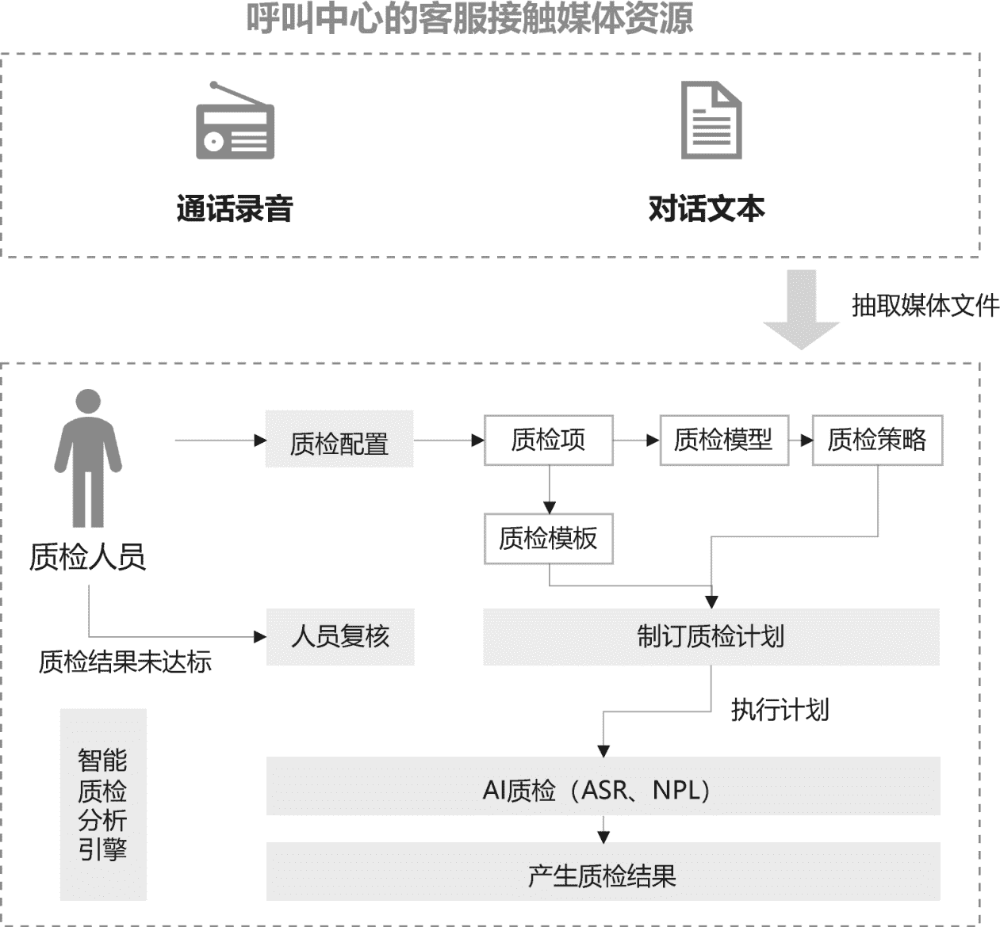
图 4-10

呼叫中心的客服接触媒体资源包括通话录音和对话文本，从中抽取媒体文件作为质检分析的基础数据。质检员随后进行质检配置，确定质检项，形成质检模板，进而构建质检模型，制定质检策略，并据此制订质检计划。按质检计划执行时，系统运用 AI 质检（借助 ASR、NLP）进行分析。智能质检分析引擎参与其中，对媒体文件进行评估并产生质检结果。若质检结果未达标，则安排人员复核，进一步确保质检的准确性。整个流程体现了智能质检系统从数据获取、准备到执行分析，以及结果处理的完整运作过程。

智能质检融合自然语言处理、语音转写、语义理解及数据挖掘等技术，帮助客服中心提升服务质量，精准发现服务中的各类问题。电商客服每天产生海量对话，人工质检只能抽样，难以全面覆盖。而智能质检可对全部对话实时分析，无论咨询、投诉还是售后，都能定位问题，比如是否准确答复、是否使用规范用语等。相比人工，它实现了从抽样到全量的跨越，大幅降本提效。

诞生背景是服务需求增长和业务流程复杂化，人工难以支撑。某大型电商平台每天对话量可达数十万条，人工质检覆盖率低、评分标准不统一、工作重复枯燥，导致质检结果不一致，无法真实反映团队服务水平。痛点包括覆盖不全、规则模糊、一致性差等，推动企业向智能化转型。

基本原理是基于预设质检标准，用AI自动分析通话或聊天记录。首先用高质语音识别把音频转成文本，再依据质检模型自动筛选出违规或服务质量不佳的部分并打分，最后生成报告供管理人员审阅，必要时人工复核。系统可7×24小时运行，确保每个交互得到及时评估，也支持在不同场景下灵活配置质检策略，保持高效准确。

智能质检正在重塑服务质量管理的规则。它一次性抚平了行业长期存在的两大痛点：在海量交互中迅速锁定疑点，以及让评价尺度保持统一。更重要的是，它为客服业务打开了向数字化的全面通道。认知计算、语音处理等底层能力持续演进，质检的边界会不断外扩，价值也将被逐层释放。

### 4.6.2 产品优势

把自然语言理解、语音转写、语义判断与数据挖掘打通，质检从抽样式的人工把关转向自动化巡检，带来多维度的业务增益。以金融场景为例，全样本监控能够追踪每一笔咨询与办理动作，立刻捕捉风险信号，例如坐席是否完整告知了产品风险要点，从而守住客户权益与品牌口碑。优势主要集中在无死角扫描、评分排偏、效能提速三个维度。

**1. 全样本扫描**
平台可以对服务全流程产生的交互记录进行持续不间断的扫描，和过去只抽2%～3%样本的做法形成鲜明对比。实践中，全样本扫描能揪出抽样难以触及的隐性瑕疵。比如运营商客服里，可能出现个别坐席对新套餐解释不清，这类问题在抽样里极易漏掉，导致客户误解。全样本扫描确保问题不被放过，实现即时发现与处置，明显拉升用户满意度。某头部运营商上线后，因抽样率低而长期隐藏的服务缺陷被彻底暴露，借助实时捕捉，任何异常都能在第一时间推送处置，满意度随之大幅改善。全天候的感知能力还能让企业更快读懂市场变化，及时调整策略匹配需求。

**2. 评分排偏**
系统依托统一规则自动生成每通电话的质量分，消除了不同质检员理解差异带来的评价分化。某银行客服中心在接入前，同一录音因评判者不同会得出截然不同的结论；引入模型后，基于预设规则与算法的自动化评估保证了报告的一致与准确。这不仅让质量评估更公平，也为后续培训规划提供了更可靠的依据。

**3. 效能提速**
智能质检大幅降低人力占用，把大量重复性劳动自动化。平台先完成初筛，只把疑似问题案例推送给专家做二次校验，专家只需聚焦重点区域，大幅减少耗时易错的手工环节。据统计，在拥有数百名坐席的企业落地后，整体运营成本下降近30%，人均日处理量提升50%以上，体现了技术赋能的实际效果。

凭借无死角扫描、去偏评价和高效运转，智能质检帮助企业优化内控流程、提升客户体验，为行业树立新标杆。随着技术持续成熟，更多领域将受益于该方案带来的变革。

### 4.6.3 功能架构

图 4-11 是智能质检系统的功能架构图。在应用层面，系统适配客服质检与营销质检。客服质检主要用于评估坐席沟通时的服务质量，例如礼貌专业度、解答准确性等；营销质检则聚焦营销相关通话，判断话术规范性、流程合理性等。此外，系统具备向其他相关业务场景延展的可能。

质检算子部分定义了一系列具体规则和指标。包括检查沟通内容是否出现特定关键词以判断关键信息是否提及；校验是否遵循标准话术模板；监控通话中是否出现长时间静音；评估表达是否啰嗦、是否简洁明了；判断语速是否过快以保证可理解性；识别是否存在抢话以维护沟通秩序。这些算子为质检提供了清晰的衡量维度和标准。

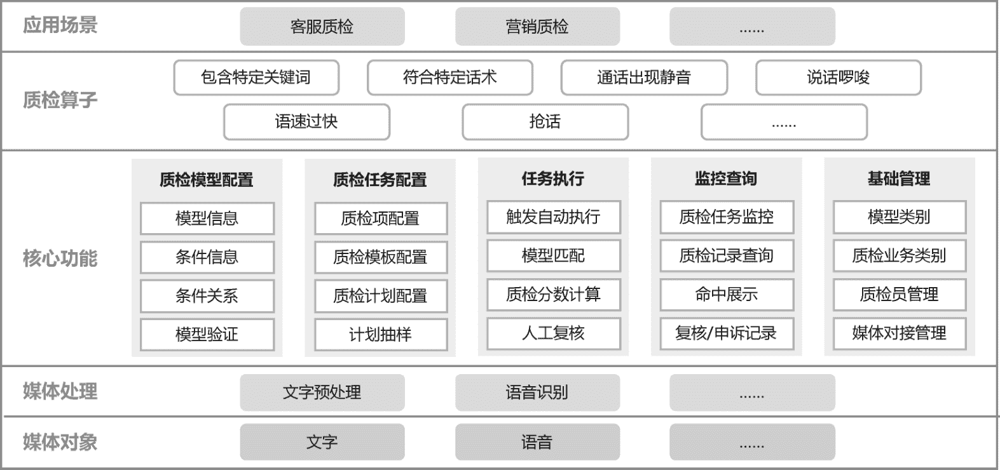

图 4-11

核心功能部分涵盖以下模块。

·质检模型配置：负责录入与管理模型信息，明确参数与特性；设定模型运行的前置条件；梳理不同条件间的逻辑关系；对模型进行验证以检验准确性和可靠性，确保可用。
·质检任务配置：配置需要检查的质检项；制定标准化模板以统一流程与标准；规划质检计划的时间安排与执行频率；进行计划抽样，从海量语音或文字记录中选取代表性样本以提升效率。
·任务执行：依据预设规则与条件自动触发质检任务；将实际沟通内容与配置好的质检模型进行比对；根据匹配结果计算质检分数；对自动质检存疑或异常的情况安排人工复核以确保准确。
·监控查询：实时跟踪质检任务的执行进度与状态；支持历史质检记录查询；直观展示命中特定质检规则的情况；记录人工复核与客户申诉信息，保证流程公正可追溯。
·基础管理：管理模型类别，对不同类型质检模型进行分类维护；管理质检业务类别，界定业务范畴与属性；管理质检员，设置权限、分配任务、评估绩效；管理媒体对接，确保语音、文字等多媒体数据顺畅传输与利用。

媒体处理部分针对不同对象做前期处理。文字信息进行清洗、格式转换、关键词抽取等预处理，使其更符合系统处理要求；语音信息通过识别技术转为文字，便于后续以文字处理规则进行质检；按业务需求可拓展处理其他媒体形式。

媒体对象主要包括文字和语音。文字沟通记录可直接进入分析流程；语音内容需先转写为文字后再进入质检。系统还支持拓展处理更多媒体类型以适应多样化业务需求。

### 4.6.4 核心功能

本节聚焦智能质检平台的核心能力，尤其是评分模型、抽样模型、质检计划及质检台模块。随着企业对服务质量的要求不断提高，传统人工质检已难以满足需求。智能平台依托高效自动化，能够在保证质量的前提下大幅提升效率。下面将详细介绍AI驱动的功能，如音频转文字、自动打分、异常报警等，并探讨其如何帮助企业精准定位问题并通过持续改进提升服务水平，同时提及实践中可能的技术挑战及应对思路。

**1. 评分模型**
在智能质检体系中，评分模型既是衡量服务质量的核心工具，也是推动客服团队持续改进的关键杠杆。不同行业侧重点不同，比如餐饮行业的客服质检，除关注服务态度与用语规范，还会重点考核对菜品信息的熟悉度、对客户特殊需求的处理能力等。客户询问食材成分或制作方法时，坐席能否准确作答直接影响得分。评分模型由质检规则与质检评分两部分构成，规则明确评价标准，如是否使用规范用语、是否存在态度问题；评分则依据规则对每次服务量化打分。

为不同业务场景设定合理标准是模型有效性的基础。客户服务场景可设置礼貌用语使用、问题解决效率、客户满意度反馈等关键指标并赋予权重；技术咨询或故障报修则更关注问题解决速度与方案准确性。细化指标与分数有助于更精准评估个人表现，并给出个性化培训建议。

借助AI实现语音到文本再到自动打分的闭环，大幅提升了效率与准确性。引入情感分析后，即使回答正确，若语气生硬缺乏耐心也能被识别并计入评分。具体流程为：系统先将电话录音转为文字，再用机器学习算法深度解析，识别符合预设规则的行为模式，最后按既定评分体系自动生成综合得分。减少人为干预后，大量数据得以快速处理，节省时间与人力成本。

这一闭环对提升客服质量意义重大：一方面及时发现并纠正问题，防止小瑕疵演变成大麻烦；另一方面通过历史数据积累，管理层可洞察整体运营状况并采取针对性优化措施。透明公平的考核机制还能激发员工积极性，形成良性循环。合理构建并充分利用评分模型，对提升客户体验与增强市场竞争力至关重要。

**2. 抽样模型**
抽样模型是保证质检结果准确性与效率的关键设计。对于业务量巨大的企业，如大型物流公司，日均客服通话量庞大，全量质检成本高效率低。抽样模型可依据业务场景与风险等级有针对性地抽取样本，既保证覆盖面，又降低成本。其核心是根据企业需求设定科学的抽样策略。

设计原理源于统计学的随机性与代表性原则，通过科学方法从海量数据中抽取具代表性的样本反映整体质量。例如电商客服质检，可按客户价值、订单金额、业务类型分层抽样，对高价值客户对话提高抽样比例，对低价值客户降低比例，同时结合随机抽样确保各层都有样本，提升代表性。这种方式在大幅减少处理量的同时保证检验有效性。

实践中，随机抽样适用于全面了解满意度趋势；条件筛选适用于对特定问题或异常深入调查，如关键词过滤、通话时长、情绪波动等特征筛选；复合型抽样则先按比例随机抽取，再按特定标准二次筛选，实现精细化管理。

定制方案时需明确质检目的与预期成果，考虑人力成本、时间紧迫等资源限制合理规划抽样规模，并兼顾技术实施难度。某大型电商公司基于AI语音识别与情感分析的质检流程，先自动识别通话中的负面情绪表达作为初筛依据，再按事先定义比例如10%随机抽取供人工审核，并将结果反馈用于培训改进。

科学设计与执行抽样模型可帮助企业快速定位问题、控制运营成本，并通过持续优化抽样策略使质量管理体系更灵活，应对市场变化与服务要求提升。

**3. 质检计划**
制定有效的质检计划是确保服务质量与客户满意度的关键。新业务上线期，坐席对业务熟悉度有限，需提高质检频率与范围，重点关注新业务咨询；成熟业务则可降低频率，聚焦关键指标监控。全面计划不仅帮助组织了解现状，也通过持续改进推动流程优化。

构建计划时需考虑：所选质检模型及版本、执行时间框架、是否即时上线或在特定条件触发、是否需要补充检查以覆盖初次遗漏、如何避免同一通话重复检查以提升效率。

设置质检时间表通常需确定周期，系统在此期间自动抓取指定范围通话数据分析。需考虑数据时效性，金融交易咨询等实时性要求高的业务可能需要更频次甚至实时监测，而相对不紧急的业务可选择系统负载低的时段批量处理，如每日01:00-06:00，既不影响运营又能完成任务，可根据突发情况灵活调整。

质检范围选择应基于业务特点与风险评估。新上线服务或投诉集中的区域需密集监控，成熟稳定业务线可适当放宽频率，实现针对性管理与成本节约的平衡。

计划管理功能对跟踪质检活动至关重要。创建新计划时需填写名称、关联模型、启动与截止日期并指派负责人，后续可查询正在进行的活动状态、在线修改配置或移除不再适用的计划，形成透明可控的动态管理，有助于效果评估与反馈。

良好的规划能显著提升效率，为持续改进提供基础。精心设计与严格执行质检流程可帮助企业更快发现并解决问题，积累经验形成最佳实践。

**4. 质检台模块**
质检台模块是智能质检系统的核心，融合AI技术与人工复核，实现对客服交互数据的高效全面检测。自动化分析与异常预警可大幅提升质检效率，例如系统检测到坐席频繁出现特定错误表述或与客户发生激烈冲突时，会立即预警并通知质检员重点处理，避免对企业形象造成负面影响。模块同时提供直观操作界面，便于人工审核与后续处理，保证质量并促进员工成长。

·界面布局及其主要组件：顶部为查询条件输入区，含录音开始结束时间、组织部门选择、是否攻坚任务等筛选项；中间展示符合条件的结果列表，每条记录显示联系人、通话时长、初步评分等关键信息；下方为操作按钮区，提供一键减免、驳回等功能，方便日常任务处理。通过筛选与功能键可快速定位重点对话，提升效率，同时提供导出功能以便本地分析或存档。
·数据导入：从企业数据库或外部来源批量上传待质检的音频文件及文本记录到平台。
·查看质检报告：系统自动评估后，质检员可通过日期范围、客户类型等过滤器查找案例，点击进入详情查看各项得分及问题描述。
·异常情况预警：检测到潜在风险或明显违规行为时，系统自动标记并通过邮件或站内通知提醒相关人员跟进。
·人工复核：被标记样本由经验丰富的质检员接手，聆听对话并对照标准作出最终判断，若发现AI误判可调整，以优化算法准确性。
·辅导与反馈：将确认问题案例纳入辅导池供管理者安排针对性培训；定期收集一线员工对质检流程的意见建议，持续优化流程与服务策略。
·异常情况预警系统的运作机制：依托自然语言处理与机器学习实时监控通信活动，迅速识别偏离正常模式的行为，如频繁使用不当语言或未按标准程序解答问题，系统将自动生成警告并上报，缩短问题发现到解决的时间差。
·复核与辅导环节的作用：复核确保自动化环境下仍有人文关怀与专业监督，避免单纯依赖技术导致的偏差；定期专业技能训练帮助团队理解服务理念与质量标准，提升解决问题的能力。闭环管理不仅降低运营成本，也持续改善客户体验，构建稳定和谐的客户关系。

**5. 配置功能**
配置功能是实现高效准确质检的关键，通过精细设置满足不同业务场景需求。不同企业的业务特点与管理需求差异大，平台可灵活适配。如连锁企业，不同地区门店面临不同市场环境与客户需求，可为各门店制定个性化质检计划，重点关注当地特色产品销售咨询、售后服务等问题，提升针对性与有效性。

在系统管理模块的查询管理中，可按大区域为各省份分公司设定默认质检计划，各省份平台将依此自动执行查询。若某省份仅需执行特定计划，可在相关表格中点击选择计划，从弹出框挑选一个或多个目标计划并确认修改后开启该省份查询权限，确保指定区域按所选计划运行。

**智能质检：配置决定质检效果**

一套可落地的智能质检体系，本质上是四段式闭环。先依业务场景确定抽样思路，再据此锁定检查点并赋权重；然后把已有或新搭的质检模型串联成适配该业务的方案；最后出台执行计划，明确对象与边界。

抽样思路与风险挂钩。涉及资金安全的金融类业务风险偏高，抽样比例要拉高，以便快速揪出隐患；风险偏低的常规业务可适当压低比例，在效果与成本间找平衡。梳理检查点和分值时，要紧扣业务核心指标与用户最在意的服务环节，确保最终评价能真实反映服务水位。

计划一经启动，平台会按流程自动跑批，涵盖模型计算、分值归类等环节。真正把效能发挥出来，关键在参数的灵活微调。例如细化抽样条件如通话时长、满意度评分，并设定条件间的与、或、递进逻辑，就能显著提升抽样精准度与作业效率；同时把自动质检与人工质检搭配使用，并为各维度分配合理权重，评估也更立体。

一家大型电商客服中心上线后，实现 7×24 小时全量话务监控，有效规避了因个人情绪带来的评分偏差，服务完成到质量反馈的时滞被压缩至两小时内。促销期间面对海量咨询与售后，团队强化质检策略，对热门商品咨询、退换货流程等重点场景提高抽样比例并细化考核点，客服在高强度下仍能保持水准。

抽样会随业务波动动态调节。日常约 10%，大促高峰提升至 30%，保证问题及时暴露；低谷期则适当收敛抽样频率，节省资源不影响整体效果。还可设定逻辑规则，例如通话超过 5 分钟且客户情绪为负面时自动进入重点抽样池，精准定位服务风险点。

检查点的设计贴合电商特性。除礼貌用语、问题解决率等基础项外，额外增加商品信息准确性、促销规则讲解清晰度等特色项。自动质检借助 AI 快速筛出明显违规或不达标记录，人工质检侧重复杂判断与个案处理，二者配合提升准确性与覆盖面。

企业还会按产品线与客群定制专属方案。对高端商品客户更强调专业性与个性化，对快消品类更强调解决速度与效率。精细化配置让结果更贴近各业务板块真实表现，为培训与改进提供依据。

随着业务演进，配置能力持续体现适应性与扩展性。平台实时采集分析质检数据，可自动优化参数，提升精准度与效率。借助大数据与机器学习对历史数据深度挖掘，发现潜在风险与改进方向，为服务策略制定提供数据支撑。

配置功能是提升服务质量的核心驱动之一。灵活的设置与智能优化机制，既能满足当前需求，也能随业务与市场变化持续进化，帮助企业在竞争中守住服务优势。

### 4.7 数字人客服

数字化浪潮下，客户服务正被重塑。数字人客服融合形象模拟、语音合成、自然语言理解等技术，为用户提供直观、高效且具人情味的互动体验。本节从设计思路、核心优势、架构到具体功能，解析这项技术如何改变沟通方式。

#### 4.7.1 产品简介

数字人客服是一款可嵌入在线客服体系的 AI 方案，通过拟人化虚拟形象实现温暖高效的交互。在金融服务场景中，数字人可理解投资理财咨询需求，结合知识图谱提供产品介绍、风险评估与建议，拟人形象与自然语音让用户感受到类似真人顾问的体验，提升信任感。技术栈涵盖形象模拟、声音克隆、语义理解与知识图谱解析，交互形态覆盖文本、语音与视频。

应用场景广泛：账单查询可秒级返回清晰结果；宽带排障可引导逐步排查并给出方案；流量使用可告知剩余量与趋势；套餐推荐可依据使用习惯给出建议；本机信息查询也能快速响应。

电商场景中，数字人可依浏览与购买偏好推荐商品，例如对常买运动装备的用户推荐新款服饰与鞋类，并介绍材质、特点与优惠，还可展示 3D 模型提升感知。

进入客服模块后，用户可用自然语言提问或选择预设问题。数字人凭借内置知识库与意图识别能力进行分析并作答；超出能力范围时可无缝转人工。DeepSeek 的三维建模与表情动作生成让形象更逼真，面部与肢体可随对话与情绪实时变化，提升代入感。其语义理解与多轮对话管理技术支持自然流畅交流，提供专业个性化回应。

除基础查询外，还支持查看历史服务记录、业务办理详情、投诉咨询历史，便于回溯。未完成工单可发起催办，跨部门协作问题也能保持透明与响应，提升整体水平。

作为在线客服体系的关键组成，数字人凭技术与功能设计提升体验，强化品牌形象，全场景实时互动既缓解人工压力，也助力企业赢得客户信任。

#### 4.7.2 产品优势

在建模、驱动、渲染环节，数字人客服具备明显优势，能带来全新体验并提升满意度。

建模：高度逼真与个性化定制。借助精细 3D 建模与面部捕捉，塑造出接近真人的虚拟形象，视觉上带来亲切感与信任感。高精度形象支持个性化，企业可按品牌或场景灵活调整外观，强化识别度。

驱动：智能交互与人性关怀。以在线教育为例，数字人可通过情感分析感知学习情绪，检测到困惑或沮丧时调整讲解方式，用通俗语言与示例解释并给予鼓励。驱动环节集成自然语言理解、情感分析与多轮对话管理，精准理解意图并自然回应。上下文记忆功能保持长时间交流的一致性，避免生硬回复；实时感知情绪后可调整语气、表情，营造人性化氛围。

渲染：极致流畅与沉浸感。基于 GPU 加速，即使在移动端也能输出高质量画面并保持低延迟。结合深度学习框架，可精确控制面部细微动作，从眨眼到微笑均逼近真人表现，提升沉浸感。

总体来看，数字人打破时空限制，实现全天候在线；智能流程管理与广覆盖解决人工成本高、效率低的问题；贴心、快速、个性化的体验赢得客户青睐，推动服务水平升级。

#### 4.7.3 功能架构

图 4-12 详细呈现了数字人客服的工作原理及运行流程。

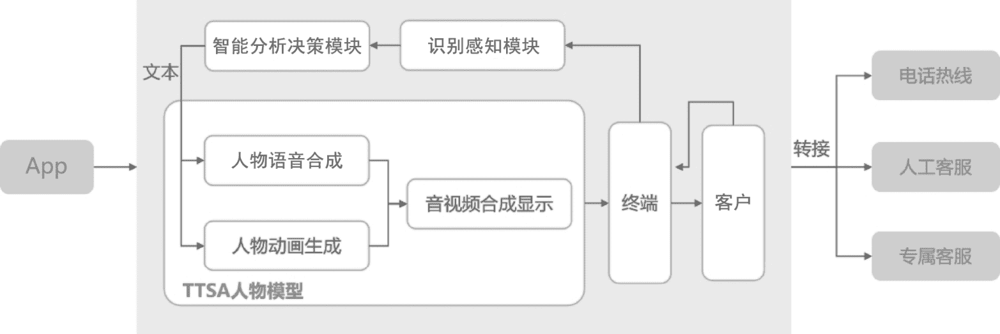

图 4-12

App 作为信息发起端，提供文本内容，这是工作的起点。基于 TTSA 人物模型，系统先进行语音合成与动画生成。语音合成将文本转为自然流畅且带情感的语音；动画生成通过图形技术创建与语音语义匹配的动作与表情。随后音视频合成显示，让数字人以直观形式出现。

同时，文本经识别感知模块解析语义与意图，进入智能分析决策模块，结合规则、知识库与机器学习确定应对策略，如给出回答或推荐业务。处理结果以音视频形式呈现，完成交互。

若能力不足，系统可转接至热线电话、人工客服或专属客服。热线提供传统语音沟通；人工客服提供一对一个性化服务；专属客服针对特定客群提供定制服务，确保问题妥善解决。

例如在电商咨询商品时，形象构建与声音克隆带来亲切专业的第一印象；智能 BOT 多轮对话结合语义理解可详细解答商品特点、使用方法与优惠。

首页查询、服务记录与服务转接构成主要组件，人物构建、声音克隆与多轮对话机制协同运作。

首页查询：智能交互与精准服务。以医疗健康 App 为例，除健康知识咨询，还可结合健康档案与运动、体检数据给出个性化建议。查询涵盖账单、宽带故障排查、流量分析、套餐获取与个人信息管理，依赖语义理解与企业数据库或第三方 API 实时调取数据，保证准确及时。

服务记录：透明追溯与高效管理。客户可查看全部历史交互，自助或人工操作均被记录，提升透明度并为后续支持提供依据。实现需稳定存储，如 ES 集群保证检索效率与扩展性。

服务转接：无缝切换与专业支持。无法处理时自动引导至热线、人工或客户经理。关键在于 AI 到人的平滑切换，保持体验一致，需完善路由逻辑与通信接口。

技术支撑包括三维扫描与动作捕捉构建逼真形象、声音克隆训练近真人音色、智能 BOT 引擎解析输入并结合上下文反馈，配合资源调度、安全防护与持续优化的知识管理系统，形成流畅满意的互动。

#### 4.7.4 核心功能

在数字化转型中，数字人客服是连接企业与客户的关键纽带。核心功能包括首页查询、服务记录查看、服务转接、配置与数据报表等，提升体验与效率。

**1. 首页查询**

图 4-13 是以中国联通 App 为例，展示了客户通过访问数字人客服首页查询服务，满足日常使用中的需求。

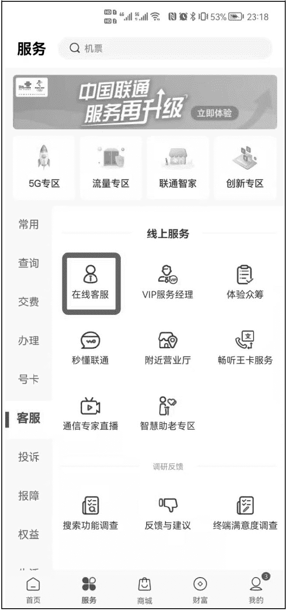

图 4-13

查询流量时，数字人可分析历史使用习惯，如夜间用量较大且套餐不足时主动推荐含更多夜间流量的套餐，体现智能助手角色。

账单查询：支持获取历史账单、余额与欠费情况。例如了解上月话费构成时可展示明细；担心停机时可即时反馈可用资金并提醒充值。

宽带排障：具备智能引导，可据症状逐步排查，如检查路由器指示灯、重启设备、检查网线连接等，初步无效时提供转接技术人员的选项。

流量查询与套餐推荐：可随时掌握套餐剩余量与预计耗尽时间，合理规划上网，避免超额。对换套餐需求，可按偏好推荐并介绍资费与适用场景。

其他功能：支持本机号码确认、合约状态查看等。无法直接回答时主动提出转接人工或拨打 10010/10018，保证问题解决。

凭借信息整合与灵活接入，数字人满足多样化查询需求，提升体验。

**2. 服务记录查看**

服务记录功能帮助客户回顾全部历史交互，并提供未解决工单的追踪与催办机制。对企业而言，分析记录可了解常见问题与需求趋势，优化知识库与回答策略。

客户首次对话的内容、业务办理、投诉反馈均被记录并可在模块查看，涵盖账单、宽带、流量监控、套餐获取等场景。记录可关联业务操作，如套餐调整会保存对话、操作流程、办理时间与结果，形成完整链条，便于回溯与管理。

比如有用户借助虚拟数字助理咨询手机套餐的收费明细并提出调整需求，整个文字或语音的交流过程都会被写入服务日志以便后续查阅。当问题超出虚拟助理的处理能力时，系统会自动呈现接入人工在线坐席或拨打热线的路径，交接动作与处理结果同样会被完整留存，保证服务链路可追溯、可核查。

日志页面内还内置了催办入口。若发现工单尚未闭环，点按条目旁的“催单”即可提交加速请求，相关同事收到提醒后会优先跟进，有效压缩等待周期，提升响应效率与用户满意度。

**3. 服务转接**
为给用户提供全方位支持，虚拟客服体系构建了高效的移交机制。移交时，用户的诉求描述及过往交互记录会一并带给人工或其它支持渠道，接手方能迅速把握背景，提供更高效更有针对性的解决方案。例如用户咨询复杂金融产品时，虚拟客服在移交人工理财顾问的同时，会附上过往提及的投资偏好、风险承受度等关键信息，帮助顾问快速切入。超出解答范围时，系统会引导用户无缝对接专业入口，涵盖在线人工、热线电话及客户经理等，以确保问题及时专业闭环。

具体执行上，当虚拟客服判定问题属于复杂或特殊类型且知识库无匹配答案时，会立即建议移交并展示多种可选路径。系统会结合用户历史沟通习惯与当前诉求的紧迫程度，智能推荐最合适的渠道。若用户过往多以电话沟通且当前诉求急迫，则优先推荐拨打热线；若用户习惯文字交流且问题不甚紧急，则推荐在线人工。在线界面点选“转人工”即可接入；选择“呼叫 10010”后系统自动弹出拨号页，方便联系专业团队。企业客户或有特定需求的个人用户，还可选用专属客户经理的个性化服务，确保细节妥善处理。

整个移交流程中，虚拟客服既是初步咨询的第一道防线，也承担过渡衔接角色。它会依据用户具体情况智能匹配路径，并在移交前后提供必要的说明，如演示操作步骤、告知预估等待时长、提示需提前准备的材料等，使体验更流畅。交互结束后，系统会邀请用户对本次体验进行评价，收集反馈以便持续优化，真正实现从咨询到解决再到满意度回访的闭环。总体来看，精细化的转接设计显著增强了虚拟客服的灵活性和适应性，为用户获取解决方案提供了便捷高效的通道。

**4. 配置功能**
在搭建与运营虚拟客服过程中，配置模块发挥关键赋能作用，帮助企业打造个性化服务体验，并通过灵活后台管理提升运营效率。企业可依据不同业务场景与营销活动，对虚拟客服进行多样化设定。例如新品推广期间，可为参与活动的用户定制专属界面与服务流程，虚拟客服既能突出新品卖点，也能推送专属优惠与购买引导，提升推广效果。

·客户权限设置：精准触达特定群体。配置功能支持按需设定特定用户的访问权限。如通过“特殊客户管理→数字人使用名单”菜单，将测试号码或重要客户加入白名单，使其可在 App 中提前体验或全面使用虚拟客服服务。操作需填写用户号码、选择号码类型如测试号或 VIP、设定有效起止日期并填写申请原因，确保符合企业实际需求。

·界面定制：打造品牌专属体验。可按不同客群定制个性化界面。对年轻用户采用活泼时尚的风格搭配鲜艳色彩与趣味动画；对商务用户则采用简洁专业的呈现，强调信息准确与高效。显示层面，企业可依据品牌形象或营销主题定制数字人外观与交互页面，如更换背景图、调整字号与文字颜色、修改对话框样式等。差异化的欢迎语与服务流程，能让每位用户感受到贴心与个性。

·预处理配置：前置优化服务流。系统提供丰富的预处理选项，在用户发起咨询前完成基础信息收集，从而加速问题解决。例如首次互动时推送常见问题链接或直接展示业务办理入口，减少重复提问；对高价值客户开放一键直达专属客服经理的通道，优化高端体验。

·后台运营保障：全链路运维支撑。后管系统除个性化设置外，还包含报表辅助、异常监控等模块。通过“数字人满意度评价报表”及时把握服务质量趋势并作出调整；通过特殊词管理与敏感信息过滤，防范不良信息传播，保护企业与用户双方权益。借助多样的配置能力，企业无论规模大小，都能快速搭建契合自身战略的高效虚拟客服平台。

**5. 数据看板**
图 4-15 所示的数据报表是虚拟客服体系的重要组成部分，为企业监控服务表现提供关键指标。深度分析这些数据能支撑决策，推动多维度优化。

例如分析指标统计报表中的平均响应时长，可评估虚拟客服工作效率。若时长偏长，可针对性优化算法或扩充知识库，提升响应速度；借助意图占比报表，则能洞察用户需求热点，及时调整服务策略，重点优化关注度高的内容。平台生成的数据分析主要涵盖指标统计、意图占比、漏斗分析和运营标注量统计四大类，从不同维度全面呈现系统运行状况与服务效果。

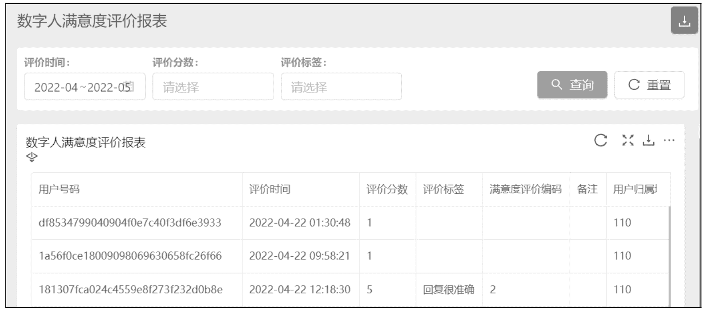
图 4-15
·指标统计：洞察效率与需求趋势。涵盖对话量、用户量、平均交互轮次、对话峰值、平均响应时长、对话响应时长等核心指标。监测特定时段对话量即可清晰把握服务需求变化；平均响应时长直接体现问题处理速度。数据助力企业动态调配资源，确保高峰期仍能保持高效体验。
·意图占比：聚焦需求优化服务。报表能帮助发现潜在业务机会。若某意图访问量快速攀升，可能反映市场需求变化或竞争对手服务不足，企业可据此调整产品策略或优化服务内容，把握增量。报表以访问量排序展示各服务意图的次数及占比，一目了然，便于识别高频问题，有针对性优化对话流程。例如“查询账单”意图激增时，可细化操作指引或 FAQ，缩短等待。
·漏斗分析：精准定位薄弱环节。以可视化方式呈现用户从首次接触到完成目标行为的转化路径及每步流失率，帮助快速定位服务链条问题。如大量用户在自助缴费环节退出，则需简化支付流程或加强引导提示，降低操作难度。
·运营标注量统计：合理规划人力。该统计呈现人工审核与标记工作量，助力管理者合理安排质检人力，确保质量控制到位，同时可追踪长期趋势预测未来负荷。

总体来看，多样的分析报告赋予企业实时监控服务质量的能力，为持续改进流程、提升满意度提供坚实数据支撑。善用这些资源，企业能在激烈竞争中保持领先，实现长期发展。

## 4.8 视频客服
在 5G 快速发展的背景下，视频客服凭借实时通信与多媒体交互能力，正迅速成为提升服务体验的关键手段。本节从产品认知、优势解析到架构展开，全面拆解这一创新模式。

### 4.8.1 产品简介
视频客服是依托 5G 新通信的创新客服方案，通过整合高清视频通话、AI 智能分析与多媒体资料共享，重塑传统客服互动方式。在远程医疗场景，用户可通过视频与医生面对面沟通，医生不仅能直观观察症状，还能借助多媒体共享查看病历、检查报告，从而作出更精准的诊断建议。对行动不便的老年群体而言，无需排队挂号即可在家获得专业咨询，大幅提升就医效率与体验。这一形态得益于 5G 的高速低延迟，以及云计算、AI、大数据能力的成熟。设计初衷是通过更直观高效的沟通优化传统电话与文本客服，提升用户体验。

核心功能上，视频客服支持单人及多人音视频通话，从简单咨询到复杂业务办理均可一站完成。在教育培训领域，视频客服可实现远程教学辅导。教师与学生视频连线，多媒体白板实时讲解知识点、批改作业，学生也能展示学习成果并即时提问，打破地域限制获取优质资源，提升学习效果。系统支持图片、PDF、Word、PPT 等多格式文件共享，并配合多媒体白板实时协作，为远程指导提供便利。同时集成人脸识别、活体检测、身份证识别等身份验证工具，保障交易安全；还配备视频图像质检能力，可自动识别通话异常，保障服务可靠性。

平台还引入虚拟化技术，如座席形象虚拟化、数字人、动漫化等选项，打造更个性友好交互。既能减轻人工客服负担，也能营造新颖服务场景，满足不同年龄层偏好。为保护隐私，客服可根据实际情况主动关闭用户视频流，有效防范骚扰。综合来看，5G 与智能服务的深度融合让视频客服大幅简化流程、缩短等待，并带来前所未有的互动体验。未来随着功能持续迭代，视频客服将持续引领行业向更智能人性化方向迈进。

### 4.8.2 产品优势
视频客服在降低办理成本、提升效率、改善体验上展现出显著优势。以房产销售为例，传统电话或文字难以让用户全面感知房屋。视频客服可让用户远程实时查看户型、装修细节，销售人员现场讲解并解答疑问，犹如亲临现场，不仅节省时间和精力，也提升成交率。相较传统方式，借助多模态认知技术，视频客服显著增强互动性并简化操作，全方位提升服务质量。

降低办理成本：利用人脸识别等技术，将原本需多次沟通或跨渠道处理的繁琐流程压缩为一次沟通完成。金融场景中，开户、签约、贷款等业务均可通过视频与银行人员面对面沟通并提交资料，实时审核与答疑让过程更透明高效，减少往返网点次数，降低时间与经济成本。以远程视频身份验证为例，无需到店即可完成开户签约等关键手续。此外，文件共享、电子白板、桌面投屏等功能提升信息交流效率，进一步降低人力投入，帮助企业以更低成本提供更优服务。

提升服务效率：客服可即时接入视频并通过屏幕共享直接指导操作，大幅缩短问题解决周期。在设备安装调试或故障排查时，客服实时看到用户操作界面并给出精准指引，避免文字描述不清导致误解与重复沟通。面对面式的交互极大提高沟通有效性，确保服务顺畅。

改善用户体验：真人远程服务与虚拟面对面结合带来更个性化亲切的感受。多媒体手段让需求表达更直观，图像展示与语音说明帮助双方更好理解意图，对老年人等特殊群体尤为友好。AI 智能分析可据表情、语气等非语音信号判断情绪状态，适时调整服务策略，进一步提升体验感。

### 4.8.3 功能架构
图 4-16 呈现了视频客服系统的功能架构，涵盖业务场景、产品能力、平台能力三个层面。

业务场景方面，身份认证类主要用于开户、重要变更等场景的身份核验；远程协助类用于客服远程帮助用户解决产品操作问题，如设备安装、软件设置；查询类覆盖账户信息、业务进度、资费标准等各类数据查询需求；多媒体广告类则通过视频渠道推送产品宣传、促销活动等内容。

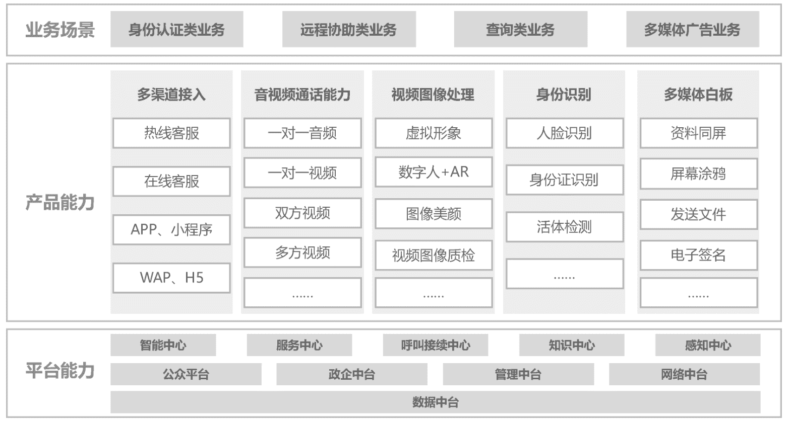
图 4-16
产品能力方面，多渠道接入支持热线、在线客服以及 App、小程序、WAP、H5 等多种入口。音视频通话提供单人音频、单人视频、双视频及多人视频等模式，满足不同沟通需求。视频图像处理包含虚拟形象、数字人+AR、图像美颜、视频图像质检等，提升画面质量与交互趣味。身份识别集成人脸识别、身份证识别、活体检测，保障认证准确性与安全性。多媒体白板支持资料同屏、屏幕涂鸦、文件发送、电子签名，便于远程协助与业务讲解。

平台能力方面，智能中心依托语音识别、语义理解等技术实现智能客服与智能推荐，提升效率与精准度。服务中心负责业务逻辑处理与资源协调，保障工单处理与流程管控顺畅。呼叫接续中心承担接入、转接、排队等任务，确保快速准确分配。知识中心存储业务知识与 FAQ，为客服提供支撑。感知中心收集分析用户反馈与行为数据，为优化服务提供依据。公众平台面向大众提供统一入口与品牌宣传；政企中台为政企用户提供定制化支持；管理中台负责人员、权限、统计分析等后台管理；网络中台保障网络稳定与传输性能，减少卡顿延迟；数据中台整合、存储与挖掘各类数据，为业务提供支撑。

以电商售后场景为例，当用户发起视频咨询退换货时，座席端综合接续功能可快速将请求派给熟悉流程的客服。视频通话话单记录功能详细留存沟通过程，便于后续查询与纠纷处理；禁用名单管理则可阻断恶意骚扰，保障服务正常。

座席端功能提供综合接续转接至视频客服技能队列，确保特定咨询高效处理，同时涵盖话单记录、禁用名单管理等服务，增强质量管控。

客户端体验上，无论 Web 或手机 App，均可享受单人视频通话、多人音视频会议及多媒体白板交互。以在线教育为例，学生可通过各端接入与教师单人视频解决学习难题，也可参与小组讨论；白板屏幕共享与文件上传功能方便展示作业、提交作业，提高互动效率。白板除基础绘图外还能实现屏幕共享与文件上传，显著提升信息交流效率。

技术支撑平台是系统坚实后盾。智能中心负责自然语言处理与生成，让虚拟数字人对话更流畅自然；呼叫接续中心利用路由算法实现最短等待与最佳匹配；服务中心集成 OCR 身份证识别与活体检测提升身份验证安全，并支持电子签名实现远程协议签署；感知中心通过图像美颜算法改善视觉效果，并借助视频图像质检技术自动分析服务异常，共同优化用户体验。

视频客服的弹性化设计让企业能够按需调参，在不同业务阶段灵活掌控服务能力。渠道侧可以定义哪些客群优先享受视频通话权益；排队侧借助队列管理实现人力在高峰期的动态分配；振铃态视频和视频IVR则把传统语音导航升级为可视化服务，客户在等待间隙就能获取有效信息或完成基础自助操作。

整体来看，从底层支撑到前端交互，视频客服已经形成一个完整的服务闭环，既能快速响应客户诉求，也能同步提升运营效率和满意度。随着5G网络的普及和场景拓展，更多创新能力将被接入，推动该领域持续进化。

### **4.8.4** **核心功能**

下面从座席端、客户端、配置功能三个视角拆解视频客服的工作原理与典型场景，帮助读者更直观地理解通信与AI技术如何共同打造高效、个性化的服务体验。

**1.** **座席端**

座席端是视频客服的运转核心，集成了一系列高阶能力，支持客服人员安全高效地与客户互动。以技术支持为例，客户遇到软件操作问题时，客服可发起一对一视频连线，并打开桌面共享直观查看操作界面，迅速定位根因并给出实时指引。这种可视化沟通大幅降低了因文字描述不清带来的误会，提升了问题解决速度。

·基础通信功能：支持1对1视频通话与多人会议，客服可按需切换沟通形态。桌面共享允许在通话不中断的情况下展示文件或演示操作，显著提高理解效率和解决准确度。

·高级安全特性：电子签名等功能被内嵌到座席端，简化协议签署和信息确认流程，并以加密手段保障传输安全。在金融业务中作用尤为关键，例如贷款电子合同签署，电子签名确保流程合规可追溯。配合AI驱动的人脸识别、活体检测及身份证识别，能有效遏制身份冒用与欺诈。AI身份核验正成为主流，人脸+活体可防止替身冒名，身份证识别结合第三方公安认证则为敏感业务提供额外风控层。

·创新功能引入：座席形象虚拟化或动漫化、美颜、画笔图形等元素操作、视频图像质检等功能逐步上线，既丰富视觉呈现，也为年轻客群营造更轻松的服务氛围，让交互更人性化、更具个性。

多项能力协同后，客服人效明显提升。多媒体白板与文档上传助力复杂问题的协同研讨，在线视频录制与回放为复盘培训提供素材，队列管理与账号权限设置保障内部运营有序。持续优化座席功能集合，视频客服平台正向更智能、更便捷的方向发展，为企业和个人用户带来更优质的服务体验。

**2.** **客户端**

客户端聚焦于客户侧的易用、安全与效率，通过多渠道接入和丰富功能满足多元场景。

·多样化接入渠道：客户可通过网页、微信小程序或iOS/Android应用接入视频客服。出差时用小程序无需安装即可快速发起咨询；高频用户则倾向下载App以获得更稳连接和更完整功能。不同入口均提供基础视频通话，并叠加差异化体验。网页版无需下载，只需摄像头麦克风即可启动，突出多媒体文件交换与电子签名能力，对偶发性紧急需求很友好，例如在官网浏览产品时即时发起视频咨询并上传图片资料。微信小程序轻量即用，适合临时咨询；App适合高频联系与追求稳定性的用户，且同样支持活体检测与桌面共享。以跨境电商为例，App让海外买家与国内客服顺畅连线，桌面共享可直观展示下单支付环节的问题，活体检测则保障交易身份真实。

·增强互动与安全保障：各平台均内置语音转文字、实时翻译等能力，帮助跨语言沟通更顺畅。隐私层面，全部对话内容均经严格加密传输。系统还提供智能排队与预约回访，客户可自主规划时间，减少等待焦虑。

总体而言，视频客服突破了传统电话的听觉局限，实现可视化交互，并以先进技术构建安全高效的新型服务模式，是向人性化、个性化迈进的关键一步。

**3.** **配置功能**

配置层为企业提供高度灵活的定制能力，适配不同体量与业务模式。业务启动期可将视频客服设为默认开启，引导用户体验；系统维护期可临时关闭，避免体验受损。

·基础开关与关键词设置：最基础的是开关控制，管理员在渠道管理的系统参数中通过isShowVideoCall参数1开启0关闭决定客户端是否展示视频入口；也可设置关键词如“视频客服”触发自动呼叫。例如电商聊天窗中输入关键词后自动弹出视频邀请，迅速接入专业坐席，缩短寻路时间、提升服务效率。

·队列优化与权限管理：系统支持新增技能队列编码以承接不同诉求，如单独设立视频咨询队列需在后端配置。分类队列让客户更快匹配到专业坐席。以多业务型企业为例，技术咨询与售后可分别建队并配置对应坐席，提升专业度与解决效率。管理员还能精细化座席权限，指定哪些员工可使用视频功能，兼顾质量与安全。

·安全与服务质量保障：黑名单管理通过“视频禁用名单”页面将高风险或骚扰客户拉黑，切断其接入路径，维护服务环境。排队超时提醒帮助运营及时感知等待压力，通过增员或优化算法改善体验。平台还提供通话话单、录像存档等能力，支持服务监控、质量分析、内部培训及争议举证。

从开关到队列再到风控，配置体系构成一套强大而灵活的工具集，无论初创企业还是跨国集团，都能在此找到贴合自身业务的最佳实践。

# **第五章**

# **智能客服系统测试与优化**

本章聚焦智能客服系统的检验与升级，目标是让系统既稳健运行又精准贴合客户需求。先梳理功能与性能的验证方法与指标，确保上线前达到最优；再结合问题诊断提出可落地的改进方案，从技术和管理双维度提升响应速度、准确率与整体体验。

## **5.1** **测试方法与指标**

设计与部署智能客服时，稳定性与服务效率必须通过严谨测试来验证，以确保系统符合功能预期与性能标准。

### **5.1.1** **功能测试内容与方法**

功能测试是系统上线前的全面体检，能够提前暴露风险，保障稳定可靠。它不仅验证各模块是否按预期工作，也确保服务能够满足客户的真实期待。通过细致测试可及早发现问题，为客户提供高效可靠的服务平台。

**1.** **语音识别模块的测试**

语音识别是智能客服的入口，需将声波转为可处理的文字。以电商客服为例，需应对多地口音与商场、地铁等嘈杂环境。测试时应构建含不同口音、语速与背景噪声的语音样本库，使用Whisper等开源工具进行评估，追求错误率低于设定阈值如5%，并检验对新词的学习能力与弱网条件下的响应速度。

**2.** **语义理解模块的测试**

文本提取后需理解意图，语义理解准确度直接影响回答质量。测试应结合标准数据集和真实对话，覆盖口语化表达与模糊语义。借助NLP技术如实体抽取与意图识别，采用GLUE、Super GLUE等人工标注基准进行验证，同时考察并发下的运行效率与可扩展性。

**3.** **问题解决策略模块的测试**

解决能力决定体验。建议采用A/B测试，对两组客户提供不同解法并收集反馈，判断更优策略。可设计含歧义或需多轮交互的复杂场景，检验系统能否灵活调整思路并给出正确路径。

**4.** **对话流畅性测试**

客户期待无缝连续交流。需模拟长时间对话，重点检查上下文记忆是否完整、是否能合理引用历史内容；情绪感知机制是否健全，能否随语气变化调整态度；主动引导能力是否足够，能否将偏离话题拉回主线。

**5.** **自动化测试框架的应用**

上述环节重复度高，引入自动化框架可大幅提效。Pytest、Robot Framework等均可编写脚本并自动执行，支持跨平台。配合周期性回归测试与CI/CD，可实现从代码提交到发布的全流程自动化，缩短迭代周期。

整体来看，功能测试覆盖面广、技术要求高，只有遵循科学方法论，才能交付稳定且具竞争力的产品。

### **5.1.2** **性能测试指标与评估**

性能测试帮助发现技术瓶颈，为客户提供流畅体验，实现满意度提升。

平均延迟衡量请求到响应的耗时，直接影响等待感知。金融客服场景下，延迟过长可能导致交易错失与信任下降。文本聊天场景中，3秒响应接近即时，10秒以上则易引发焦虑甚至流失，目标应是持续最小化延迟。

最大并发数代表系统同时承载的客户连接上限，决定可扩展性与高峰承载能力。例如在线教育直播期间大量学员同时咨询，若并发不足会造成大量请求被丢弃。电商大促期间并发能力同样关乎品牌与销售。需通过负载均衡与数据库优化提升上限。

错误率量化任务失败比例，低错误率意味着技术成熟可靠。若语音助手频繁把“查询订单”误听成“取消订单”，即使人工可纠正，也会严重破坏信任。持续监控并针对高频故障点优化至关重要。

测试方案需选择合适的负载模型：稳定负载模拟日常、峰值负载测试极限、随机波动负载模拟真实变化。观察资源利用率、响应波动与功能退化，并定期回归测试评估新功能对整体性能的影响。

常用工具包括Apache JMeter用于HTTP/S Web测试、Load Runner提供强脚本与多协议支持、Gatling以简洁高效著称于API测试。工具选择取决于需求、技术栈与预算，合理使用可精准度量性能并指导优化。

## **5.2** **性能优化与改进措施**

本节剖析智能客服在实战中常见的瓶颈与局限，提出技术与非技术相结合的改进路径，力求让系统效能达到最佳。

### **5.2.1** **系统瓶颈分析与优化**

系统瓶颈会严重制约智能客服的效率与客户体验，需及时发现并解决。瓶颈可能来自硬件资源不足，如CPU、内存、存储；也可能来自软件设计不合理，如低效代码或数据库结构欠优。例如语音数据处理时CPU瓶颈会导致识别延迟；数据库查询设计不当会让客服无法及时获取信息。

常见瓶颈类型包括计算资源不足、数据处理速度慢、网络延迟高、存储访问效率低等。识别瓶颈并针对性优化，是保障系统稳定运行的关键。

以一家头部电商的大促为例，促销期间服务器响应变慢就是典型的系统卡点。活动一启动，海量用户瞬间涌入，商品咨询、订单提交等请求呈爆发式攀升，系统各模块同时承压，一旦某环节吃紧就会拖慢整体，直接拉低客户体验甚至威胁业务运转。复盘发现，症结在于数据库查询过于频繁且耗时，结合并发请求远超现有集群的处理上限。团队先用性能监控工具对交易全链路做画像，精准揪出执行最慢的几类 SQL，据此重构索引结构；同时引入缓存层分担数据库压力，并在高峰期动态扩容云主机，实现横向弹性。组合拳下来，客户体验明显改善，后续同类大规模营销也能保持平稳。

面对算力捉襟见肘，往往最直观的做法是升级硬件或切到分布式架构来分散负载，但在动手前更建议先做算法层面的瘦身，比如裁减冗余循环、借助并行计算提速。网络传输慢则要从提速带宽、优化路由、启用压缩协议等角度入手。存储访问瓶颈可考虑换用高速 SSD、选用更高效的文件系统，或迁移到对象存储等方案。

技术之外，业务侧的非技术调整同样关键。高峰期可预先配置限流降级策略，保障核心链路可用；也可以按业务价值动态调整优先级，让有限资源用在刀刃上。强化跨部门协同、信息透明，也能避免重复排查浪费时间。

总的来说，应对复杂卡点要多管齐下，既有立竿见影的应急手段，也要有治本的长期规划，标本兼治才能为企业持续创造价值。

### **5.2.2 算法与算力协同优化**
在智能客服里，算法精度和资源调度共同决定响应快慢与答复质量。不断打磨算法能帮助系统更懂用户意图，提升回答效率与准确度；合理分配计算资源则能在高负载下保持稳定输出。当前深度学习与自然语言处理技术快速演进，为此提供了有力支撑。以 Transformer 为代表的模型在长文本理解与上下文把握上表现突出，已广泛用于客服、推荐等场景。遇到多轮对话或复杂技术咨询时，该架构能综合历史语境，输出更贴合意图的解答。基于 Transformer 的 BERT 通过预训练加微调，能迅速适应垂直领域的对话习惯，显著加速问题解决并提高质量。

为增强灵活性，多任务学习也是常用手段。电商客服既要处理咨询、查单等常规任务，也要应对投诉、售后等复杂场景。采用 MMOE 多门控专家混合模型，可让单网络同时承载多任务，底层表示共享，上层按任务门控分配特征，既提效又降本，利于模块协同。

资源侧，负载均衡与自适应调度不可或缺。借助 Kubernetes 这类容器编排平台，可根据实时负载自动伸缩服务规模；节点压力过高时，请求可被快速迁移到空闲机器，避免单点风险。结合历史数据做趋势预测，还能提前扩容或调整配置，迎战峰值。

性能提升不能脱离成本。梳理业务流程，结合云计算按需计费特性实施精细化管理，能明显降低开销。对低频功能采用冷启动，减少闲置浪费；用 Serverless 构建轻量接口，按需唤醒组件，任务结束即释放内存，在保证体验前提下削减不必要支出。持续迭代算法框架并优化资源使用策略，是兼顾效率与经济性的关键。

# **第六章**
# **智能客服运维与守护**
智能客服的生命周期里，运营与维护同样关键，它们维系系统稳定，守护客户体验。本章先从日常管理切入，涵盖监控、数据分析与团队成长；再转向故障处置与维护策略，说明常见问题的解决思路与预防机制。

## **6.1 日常运营核心要点**
系统上线后，如何让其高效运转是服务品质的核心。本文将从实时监控、性能优化、数据洞察及团队成长路径展开，为管理者提供实操指南。

客服日常运营主要围绕微信群、邮件、工单、告警等渠道展开，一线团队把问题录入运维系统进行全流程闭环管理，到验证关闭为止。无法通过运维手段解决的事项及时升级，按缺陷、优化需求、事件分别跟踪，确保闭环改进。

图 6-1 描绘了问题处理全流程。问题从上述渠道进入系统后先由一线响应评估处理，随后判断是否需升级。是则进入跨部门联动流程，否则继续验证。验证通过则结束，未通过则安排修复排期，修复后再验证。整个链路清晰呈现了接收、处理到验证的闭环。

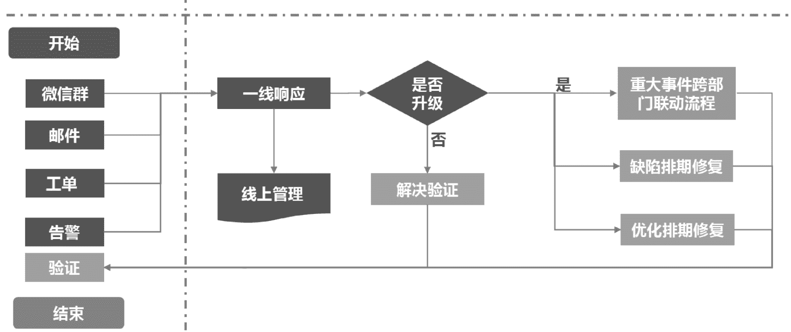

图 6-1

### **6.1.1 监控与数据洞察**
在呼叫中心管理中，实时监控如同敏锐的眼睛，保证自动与人工服务始终在线。随着应用场景扩展，业务量与交互数据指数级增长，监控与统计成为保障稳定、提升服务质量的基础。通过对运行状态与业务数据的实时追踪，可尽早发现风险并迅速调整。管理层借此把握服务现状并优化策略。

监控覆盖自动台与人工台话务、业务模块运行等多维度；统计则聚焦平台与业务数据，形成报表支撑决策。如电商大促时，实时监控自动台话务可清晰呈现分时段、分渠道咨询量变化。若某商品咨询骤增，说明热度上升，需及时补充知识库、调配熟悉该商品的坐席，保证回复及时准确。

实时监控是保持服务质量的关键。自动台可展示当前在线客户数、各接入号在线数、当日累计呼入量等核心指标，便于快速定位异常。人工台则关注坐席登录时长、通话时长、上班人数等，合理排班避免积压。业务流程监控确保各环节顺畅，提升整体效率。

日志是系统运行的“黑匣子”，也是排障与优化依据。完整准确的日志记录每个关键步骤，为后续分析提供素材。通过挖掘可发现潜在风险、用户习惯与流程瓶颈，指导优化。无论业务操作还是运维活动，均需详实记录，便于追溯与合规，也能通过定期分析发现安全与性能隐患。

数据报表为决策提供支撑，包括服务量分析、当日平均通话时长、单位时间接通率趋势等。服务量不仅看访问量，也统计内部服务操作次数与时长。平均通话时长反映团队效率，接通率变化帮助识别高峰并提前调度。热点信息监控通过来电原因、咨询主题等洞察客户需求，指导产品与服务改进。

### **6.1.2 团队成长与激励**
当今客服团队既是体验入口，也是品牌形象的代表。服务质量直接影响客户忠诚度与品牌声誉。打造高效专业团队，需重视职业发展与技能提升，以提升满意度与归属感，同时带来服务与运营效率的双增益。个性化职业规划、系统化培训与科学绩效考核形成良性循环。

个性化职业规划应结合兴趣与能力。以对数据分析感兴趣且具备基础的客服为例，可引导其向数据驱动客服方向成长，提供挖掘与分析工具培训，培养其用数据优化服务策略。表现突出且有领导潜质者可参与项目管理与跨部门协作；技术型人才可安排进阶课程。定期一对一职业咨询，帮助设定短期与长期目标并跟踪进展。

专业技能训练需兼顾理论与实操。可通过在线平台或专家授课传递新理念，也需在模拟场景中进行角色演练。建立完整培训体系，明确对象、流程与目标，培训后收集反馈持续迭代。

绩效考核要兼顾硬指标与软指标，如接通率、解决率、客户满意度、同事互评等，标准公开透明并定期公布排名。对超预期者给予物质与发展机会，如参与重点项目或晋升通道；对暂时滞后但有改进意愿者及时辅导，制定可行改进计划。

全方位的职业指导、系统培训与公正激励，能释放个体潜能，为企业创造更大价值，这需要管理层持续投入。

## **6.2 故障处置与运维策略**
在日常运营中，稳定高效是优质服务的基础。技术问题往往突如其来，处理不当会损害体验甚至导致业务中断。本节介绍故障排查思路与维护策略，帮助技术人员快速定位问题，并通过预防性维护与应急响应机制降低突发影响。

图 6-2 展示了应急处理中的职责分工与流程，涉及多个角色与任务。

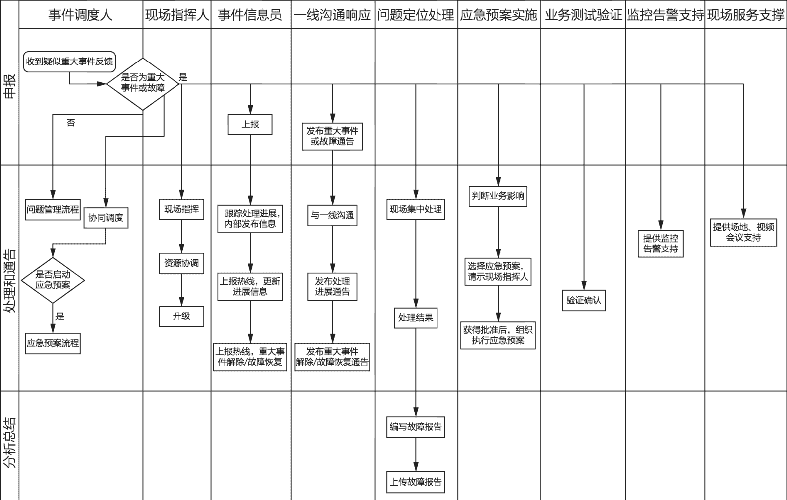

图 6-2

故障处理主要包括申报、处置、通告、分析总结，同时涉及重大事件上报与调度支持。事件调度人负责判断是否为重大事件并协调资源；现场指挥人在现场统筹，资源不足时申请升级；事件信息员收集并发布进展；一线沟通响应负责对外通告；问题定位处理进行现场与远程诊断并上报结果；应急预案实施根据业务影响选择预案并组织执行；业务测试验证确保恢复正常；监控告警支持提供排查辅助；现场服务支撑保障场地与软硬件资源。整个流程从中台监测到故障解除、复盘，形成闭环。

### **6.2.1 高频故障处理指南**
智能客服是提升效率与满意度的关键工具，稳定与可靠性直接关系业务运转。一旦故障，咨询无法及时响应，易引发不满与流失。及时排查常见问题是运维的重要职责。

**1. 网络连接异常**
网络不稳常导致系统运行异常。排查需从物理连接、设备配置、服务商稳定性等多层面入手。大企业网络架构复杂，路由器、交换机、防火墙任一环节异常都可能引发中断。出现无法连通或频繁掉线时，先检查网线松动、设备状态，再用 ping 测试连通性与丢包率，排查拥堵或 ISP 问题。防火墙策略不当也可能阻断通信，需核查安全规则。建议持续监控流量、与 ISP 保持沟通保证带宽，并优化内部安全策略，开放必要端口。

**2. 语音识别错误**

语音识别能力已大幅提升，但在真实业务里仍难以做到万无一失，尤其在智能客服这类强交互场景中。其价值毋庸置疑，可实际环境的复杂性让识别错误频发。比如在火车站、商场这类嘈杂场所，背景噪声会严重拉低识别准确率；不同地域的方言口音、特殊发音以及生僻词汇，也常被误判，直接影响客户感受和服务质量。

应对方向主要有三层。首先要打牢采集环节，保证音频质量过关，使用优质麦克风并尽量压低环境噪音干扰。其次要精细化调参，在特定场景下提升识别精度，例如为高频特殊词提权。更关键的是建立反馈闭环，持续收集客户的真实对话反馈，用这些数据不断训练优化模型，让系统更贴合多元现实。辅助诊断方面，市场上已有成熟工具可供参考，Google 的 AudioSet 项目就是一个典型资源库，可帮助分析声学特征并定位潜在故障点。

数据传输同样是隐形风险点。上传或下载过程中出现丢包、损坏，会直接导致智能客服无法正常运转。常见诱因包括文件体积超出系统限制、编码格式不兼容、服务器存储空间吃紧。排障时先查日志，精确定位错误类型和发生位置，再按情况处理：放宽最大文件尺寸、把数据转成兼容格式、清理冗余文件释放磁盘。另可引入断点续传机制，有效抵御网络波动引发的中断，保证在不稳定网络下仍能完成数据交换。

运营层面还有几项关键动作。

·实时后台监控：搭建健壮的监控体系，能自动感知系统健康状态，一旦异常立刻告警并推动人工介入。
·定期维护更新：版本升级通常带来性能改进和安全修复，按计划执行才能保持系统在最佳状态。
·备份恢复策略：制定完备的灾难恢复预案，定期将核心数据异地备份，以防不可抗力时快速恢复服务。
·培训与支持：强化一线人员的技能培训，提升基础排障能力；同时建设高效的客户支持通道，确保客户问题能被迅速响应。

总体来看，对语音识别、数据传输及运维管理等环节进行系统化管控，能明显降低故障概率，让服务体验更流畅。依托先进技术与科学的方法论，即便面对复杂多变的实际场景，也能保持从容应对，并在完成业务目标的同时不断提升客户满意度。

### 6.2.2 智能客服运维节奏与核心动作
智能客服的定期维护，本质是为系统做全面体检和保养，及时发现隐患、延长寿命并提升稳定性和性能。在技术快速迭代的背景下，维护工作既要覆盖软硬件更新，也要跟上行业趋势持续优化功能，满足企业增长和客户期望。按场景可分为三大类：软件更新、安全补丁安装、硬件检查，三者共同支撑稳定运行。

软件更新建议至少每季度执行一次，确保功能与技术保持同步。更新时不仅要关注新特性，还必须兼顾兼容性与稳定性。部分更新可能冲击现有功能，导致兼容问题，因此更新前需做充分测试，模拟真实场景验证运行效果。对核心模块的升级，要准备详细的实施计划和回滚方案。升级范围应覆盖客户交互界面、数据分析引擎及后台管理系统，并在新旧版本间做全方位兼容性测试。企业可根据业务节奏灵活调整频次，对快速迭代或竞争激烈的产品线，更新节奏可适当加快。

安全补丁安装是抵御已知漏洞的重要防线，建议每月至少检查并应用一次官方最新补丁，覆盖操作系统和应用层。企业应搭建自动化工具链，跟踪厂商安全公告并自动触发部署流程，同时定期开展内部渗透测试，主动挖掘风险点。

硬件检查是支撑服务的物理基础，通常每年安排两次全面巡检，重点关注服务器、网络设备和存储单元。除常规外观检查和性能基准测试外，还需借助专业工具分析组件日志，捕捉异常模式和故障征兆。对数据中心架构，还要特别关注电力稳定性和温湿度控制。

制定具体计划时需结合企业实际情况。小规模团队可考虑外包给第三方服务商，大型组织则可组建跨部门协作小组集中资源。维护时段尽量避开业务高峰，减小对客户体验的影响。

持续监控同样不可或缺。通过现代 IT 运维平台实现 7×24 小时采集关键指标，依托预设规则自动识别异常行为，一旦发现潜在问题即时推送告警，便于快速处置。这种预防式管理能将小问题扼杀在萌芽，避免累积成重大事故。只有建立完整严谨的维护体系，智能客服才能长期保持最佳状态。

# 第七章 智能客服跨行业应用全景
本章通过真实案例，拆解智能客服在不同行业如何满足差异化客服需求。

先看电信行业。日常通话、宽带使用中，信号不稳、资费不清等问题时有发生。智能客服相当于 24 小时在线的服务桥梁，面对复杂的网络故障，能借助算法和知识库快速分析、精确定位，提供重启设备、排查线路等具体指引，高效化解困扰。

电商领域在购物高峰期面临咨询井喷，商品信息、物流进度、退换货政策等问题同时涌现。智能客服凭借语义理解能力，能从海量商品和物流数据中迅速提取答案秒回咨询，并在处理海量重复问题时保持稳定高效，大幅降低人力成本。

电力行业需求更偏刚性，客户常咨询停电通知、电费核算、用电安全。智能客服可实时对接电网系统，及时推送检修停电范围和时间，并基于电价政策和用电数据清晰解释电费构成。

银行场景对安全与专业度要求极高。咨询账户、贷款、理财时，智能客服在严格遵循监管要求保护信息安全的同时，利用风险评估模型推荐适配的理财方案，并协助完成线上业务办理，提升便捷性与专业性。

综合来看，智能客服正通过定制化方案破解各行业痛点，推动业务模式升级和服务质量提升。

## 7.1 电信运营行业落地样本
在服务需求复杂化与传统客服瓶颈叠加的背景下，智能客服成为电信运营商的破局抓手。它并非简单叠加技术，而是深度契合行业特性，在实战中释放价值。

### 7.1.1 电信客服需求画像与传统困境
在数字化浪潮下，电信运营商作为服务业核心，拥有庞大用户基数和多元业务生态，涵盖传统通话短信到物联网、5G 应用、云计算、大数据等前沿领域。例如智能家居设备无法联网、5G 下高清视频卡顿，客服的专业性和响应速度都面临更高要求。

市场竞争加剧使客户对服务质量要求水涨船高，除了快速解决，更期待个性化专业体验。这种转变对客服能力提出巨大挑战。

当前客服需求呈现三大特征。
·极速响应需求迫切：网络故障报修、套餐资费查询等，都要求即时反馈。以大型直播期间网络中断为例，响应速度直接影响品牌信任。
·全渠道融合成为趋势：电话、官网自助、App、微信公众号、微博等多渠道并存，要求无缝对接，保证一致服务体验。
·个性化服务成核心竞争力：依托大数据分析通话时长、流量使用、消费金额等行为数据，为客户定制套餐和增值服务，提升满意度和忠诚度。

传统体系已显不足。
·人力成本高企：庞大咨询量需大量坐席，薪资和培训成本高昂。
·服务效率受限：业务高峰期如账单日、新业务上线，排队时间长、解决率低，投诉增多。
·信息孤岛严重：渠道和部门间数据不通，客服需重复询问客户信息，影响连贯性和质量。

为此，引入融合 NLP、机器学习、语音识别等技术的智能客服成为必然。它能高效处理重复咨询，减轻一线压力，实现 7×24 小时服务，并基于行为数据洞察需求，推动以客户为中心的转型。

### 7.1.2 电信场景中的四大技术应用
人工智能的快速发展让智能客服深度融入电信业务环节，成为提升服务与创造价值的核心驱动。

1. AI 大模型：个性化服务的智慧引擎
AI 大模型是智能化升级的核心。以头部运营商为例，其大模型客服在 5G 套餐推广中表现突出。客户咨询时，系统先通过语音识别转为文本，再综合历史通话、流量使用、消费偏好等数据分析。对高清视频重度用户，优先推荐超大流量及视频会员权益套餐；对商务人士，则推荐通话时长充足、国际漫游优惠方案。

大模型还能通过上下文挖掘潜在需求。客户问“5G 速度快吗”，系统不仅给出参数，还会介绍云游戏、远程办公等应用场景，引导增值服务体验。同时具备自主决策能力，简单资费查询由机器人直答，网络故障等复杂问题自动转人工并跟踪进度。

2. 自然语言处理：精准交互的基石
NLP 让智能客服读懂语言、理解意图。电信客服每天产生海量文本交互，NLP 可快速抽取关键词、理解语义、分析情感。例如客户说“我手机上网好慢，刷视频都卡”，系统能识别网络速度问题并追问地区、机型、故障通知等信息以便定位。

情感分析是关键应用。检测到情绪激动时，系统会触发预警，优先转接资深专员并提供历史服务记录，帮助安抚情绪。此外，对话实时质检可分析服务态度、解决率等，为团队管理提供数据支撑。

3. 多轮对话管理：复杂问题解决的利器
多轮对话管理解决了电信服务中常见的高复杂度问题。以网络报修为例，系统会逐步引导排查：是否所有设备都无法联网、路由器指示灯是否正常，若无法自助解决则收集地址联系方式安排上门，并实时推送维修进度。

凭借对话历史记忆和上下文灵活调整，问题解决更连贯。数据显示，采用该技术后，网络故障平均处理时间从 4 小时降至 2.5 小时，客户重复咨询率下降 40%。

4. 行业实践与卓越成效
中国移动的智能客服机器人“移娃”实现了 90% 以上常见业务的自助办理，支持语音和文字交互，极大提升便捷性。中国联通的虚拟数字助手“小沃” 24 小时在线，通过收集产品问题和服务建议，帮助优化 20 余项功能，推出 10 余种个性化套餐，满意度提升 15%。

某省运营商引入智能客服半年后，人工日均工作量减少 35%，客服团队规模缩减 20%，年节省人力成本超 2000 万元；平均等待时间从 8 分钟降至 1.5 分钟，一次解决率从 65% 提升至 82%，投诉率下降 30%。这充分证明智能客服既降本又提质。

未来，智能客服有望结合 VR/AR 提供沉浸式服务，并在智能决策上实现更精准的需求预测和产品推荐，推动从被动响应向主动服务转型。

## 7.2 电商行业智能客服实践
在日均百亿级订单的电商生态中，传统客服承受巨大压力。“秒级响应”成为基本要求，“千人千面”成为竞争关键，智能客服正重塑服务价值链。

### 7.2.1 电商客服三大核心诉求
数字经济下，电商已成消费增长引擎。直播电商、社交电商、跨境电商推动客户规模突破 10 亿，日均活跃超 3 亿人次，形成三大核心需求。

1. 全链路服务即时性需求
电商交易的即时性要求客服零延迟。以“双十一”为例，单平台咨询峰值可达每秒 10 万次，人工难以覆盖。客户在浏览时需实时库存，支付环节出问题需秒级解决，物流查询需求全天候爆发。据统计，响应时间每延长 1 分钟，订单流失率增加 3.2%。

2. 多模态交互融合需求
消费者期望在任意场景获得无缝体验。交互方式涵盖 PC、移动端、图文、视频客服、语音助手、AR 试穿等。某头部平台数据显示，65% 年轻客户偏好 App 内即时通信咨询，28% 习惯语音助手，12% 高净值客户选择视频客服解决复杂问题。

3. 智能决策支持需求

# 电商电力银行的智能服务升级路径

当商品编码数量冲破千万级，一次咨询必须在半秒内连到可执行的处置方案；退换流程里要自行判定是否符合规定并拟定物流安排推送到财务模块；大促节点则需依据往期消费轨迹即时拼凑出最合适的券包。运营节奏被拉伸后，传统问答式支持明显吃力。

旧模式的痛点体现在四方面。某中型平台一年用于人工服务的开支超过八千万，员工年度离职比例接近四分之一；人工应答的正确比例只有八成二左右，高峰时段能一次性办结的请求跌到六成五；对话记录每天以TB计基本闲置，无法形成经营洞察；订单、库存、物流信息彼此割裂，一单平均要耗费二十分钟以上。

引入知识网络、深度模型、情绪计算等能力后，服务从被动回应转向主动关怀，成为支撑业务运转的基础设施。

### 7.2.2 电商全链路智能服务落地
服务覆盖购前、购中、购后，技术重塑体验并在关键节点产生商业回报。

**1. 购前：引导与规则拆解**
1）个性化推荐引擎
系统以浏览轨迹、搜索词、加购行为构建动态画像。某母婴平台中，用户输入“宝宝6个月”，助手可匹配奶粉段位、辅食品类与育儿内容，并关联品牌活动，相关品类成交比例提高25%。技术层面用协同过滤与深度模型实时计算用户商品匹配度，形成千人千面清单。美妆平台利用自然语言解析评论，抽取“油皮”“抗老”等标签自动推送适配护肤品，搜索引导的成交比例提升30%。

2）促销规则智能化解析
大促期间满减叠加易引发咨询。借助知识网络拆解“跨店满减”“品类券叠加”等规则，以图表或动态话术解释。用户询问“满300减50是否含直播间商品”时，系统即时调取规则库结合购物车给出精准答复，规则类咨询量减少45%。

**2. 购中：响应与流程提效**
1）多模态交互衔接
支持图文、语音、视频、AR 等形态。
·语音助理：长按聊天框即可语音提问，自动转写并匹配答案，日均处理超百万次，回复时长控制在1秒内。
·视频服务：针对奢侈品、3C 等高客单，支持视频连线并屏幕共享或 AR 远程指导，高端客户成交比例提升28%。
·表情互动：在社交电商场景，识别“困惑”“开心”等表情情绪，自动回合适话术或券包，互动趣味性提升35%。

2）订单支付自动化处理
实时对接订单后台，识别状态并提供服务。
·库存预警：临近售罄时主动提示“仅剩5件，是否锁定”，即时下单的比例提升19%。
·支付异常：检测到支付失败即推送常见解决指南，如银行卡限额调整、支付渠道切换建议，并附人工快捷入口，问题化解时长压缩至3分钟内。

**3. 购后：售后自助与留存运营**
1）退换货流程自动化
OCR 识别用户上传的商品照片、订单截图后自动判定是否符合政策并生成退货地址，直接同步物流。例如“衣服破损”图片上传后，流程无需人工介入，从48小时缩短至2小时。某快消电商因此售后纠纷下降32%，客户认可度由71%升至89%。

2）分层运营与复购激活
依据购买频次、客单价、评价行为分层。
·高频用户定期推送会员专属权益，提升忠诚度。
·沉睡用户收到个性化召回礼包，如“曾浏览商品降价10%”，结合话术引导复购，唤醒比例提升21%。

3）差评预警与挽回
情感分析实时监控评价，捕捉“失望”“质量差”等信号触发预警。
·轻度差评自动推送补偿券。
·重度差评10分钟内转交售后专员并同步历史记录，挽回成功比例提升40%。

**4. 运营优化：数据驱动决策**
1）效能分析平台
抓取对话生成多维报表：高频问题TOP10帮助优化详情页；回复时长分布识别高峰并自动提升机器人优先级，平均回复稳定在20秒内；流失节点分析显示58%用户在咨询退换货政策后流失，推动流程简化。

2）质检与培训闭环
NLP 对全量对话质检，自动发现未使用礼貌用语、错误承诺等问题并生成个性化课程。某团队因此服务合规比例由78%提升至95%，新人培养周期缩短50%。

**5. 行业验证**
1）头部社交电商
日均处理1200万次咨询，85%由机器人独立完成，人员开销下降45%，平均等待由120秒降至8秒。
2）跨境电商
12语种实时翻译使海外咨询解决比例从60%提升至88%，团队规模削减30%，复购比例提升22%。
3）垂直宠物电商
依养宠类型与宠物年龄推送精准服务，如幼犬驱虫套餐与喂养指南，相关销售额增长35%，客户生命周期价值提升28%。

整体来看，智能服务在电商已从单一答疑工具演变为全链路服务中枢，通过数据、规则与AI的深度融合破解效率瓶颈，并以场景化服务拉动销售与留存。未来随AIGC成熟，服务将进一步走向“服务即营销”，如自动生成个性化短视频推荐、基于情绪实时调整沟通策略，行业竞争将由流量转向体验。

## 7.3 电力行业应用实例
在发输配用的复杂体系中，智能服务正重塑服务图景。电网故障关乎民生，千万级用户的电费咨询需要秒级响应，智能化成为破解服务难题的关键。

### 7.3.1 电力服务需求与特征
**1. 应急响应的生命线属性**
故障突发且破坏性强，客户诉求表现为三急：时间急，期望10分钟内获原因与修复进度；信息急，需明确停电范围与恢复时间；情绪急，生产生活受影响易引发焦虑。2022年某省会台风期间，单小时报修量超2万次，人工响应延迟45分钟，投诉率飙升210%。

**2. 日常服务的规模性挑战**
客户基数庞大，咨询以标准化为主：重复率高，80%集中在电费查询、账单解读、充电桩使用；时段集中，月5-10日缴费高峰咨询量较平日增300%；渠道分散，电话、App、微信、营业厅信息同步成本高。

**3. 服务质量的公益性要求**
作为公共服务，规范性与政策解读一致性要求高。阶梯电价调整需对百万级用户统一口径，新能源补贴解读须精准对标国家文件。

传统模式困局：
·应急低效：人工查询故障系统，平均派单8分钟，信息误差率15%。
·投入高企：某省级公司年人力支出超1.2亿元，高峰需临时增聘数百人。
·数据割裂：用电行为与故障历史未打通，难以主动服务。

### 7.3.2 电力场景智能服务落地
体系构建为“应急智能化、日常自动化、数据主动化”。

**1. 应急响应：分钟级闭环**
某直辖市电力公司实现全流程自动化：
·智能派单：App报修自动抓取GPS，匹配最近抢修队并生成含故障类型与历史记录的工单，派单由10分钟压至90秒。
·语音预沟通：报修后AI语音回电确认现象并同步进度，重复咨询降65%。
·AR远程协助：对空气开关跳闸等简单故障，客服通过AR眼镜指导自助排查，非必要上门比例降38%。
2023年暴雨中，平均处理时间由4.2小时缩至2.1小时，满意度由68%升至89%。

**2. 日常服务：全渠道自助矩阵**
某省公司构建AI+人工协同体系，覆盖90%以上常规咨询：
·多模态自助：95598 IVR可直接说“查询电费”自动播报上月用量金额，日均语音查询50万次；微信公众号提供账单语音解读，老年用户使用率达42%。
·智能路由：咨询“充电桩故障”时自动识别位置派单至对应运维团队，时效提升50%。

**3. 数据驱动的主动服务**
某供电局基于用电数据建模：
·异常预警：日用电骤增300%自动触发干预，提醒排查漏电或窃电，全年协助发现隐患超2万起。
·政策触达：分时电价推行前，依据历史时段向高耗能用户推送调整建议，短信打开率68%，较群发提升41%。
·满意度预测：通过文本情绪关键词识别高风险用户并主动介入，不满意客户挽回比例提升35%。

**4. 智能质检守护标准**
某地方公司实现全量检测：
·合规检测：自动扫描是否遗漏“安全用电提醒”等规定话术，覆盖率由20%提至100%，合规比例由85%提至99%。
·情绪管理优化：语音情感分析识别沟通语气问题并给出优化建议，服务态度投诉降52%。
·知识库自更新：质检发现的高频错误自动更新知识库，充电桩故障解答准确率由78%提至98%。

**5. 实践价值**
表 7-1

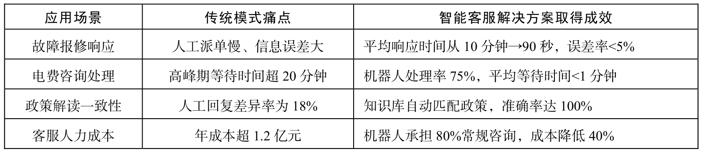

典型案例：
·国网江苏公司：上线后年均减少人工座席工作量超300万小时，报修效率提升45%，获全国电力服务创新奖。
·广东电网：智能语音推广“指尖办电”，零跑动业务占比由58%提至82%，客户满意度达92.3分。

电力智能服务转型是技术理性与民生温度的结合，既破解响应慢、成本高的难题，又以主动服务体现公共属性。未来随物联网、数字孪生深化，将拓展至用电安全预警、新能源消纳咨询等场景，成为新型电力系统的重要支点。

## 7.4 银行行业服务重塑案例
在数字化转型中，智能服务扮演“安全守门人”与“价值创造者”双重角色，平衡体验与风控。

### 7.4.1 银行服务需求与特点
**1. 安全性极高**
涉及资金与隐私，身份验证要求严格。某行因误判身份致损，年均赔付超500万元。

**2. 业务复杂度高**
涵盖储蓄、理财、贷款、信用卡，政策频繁更新。人工解答复杂业务准确率仅72%，二次咨询率达35%。

**3. 场景碎片化**
日常查询、转账还款与大额异动提醒、高净值资产配置并存。季度末某股份行人工日均处理超200通，高净值客户等待超1小时，流失率升12%。

传统矛盾：安全与效率失衡，知识更新滞后，服务与风控营销数据孤岛。

### 7.4.2 银行场景智能服务应用
体系为“安全合规为基、场景智能为用、数据增值为魂”。

**1. 安全防护全流程核验**
某国有银行部署智能安全服务：
·多因子验证：敏感业务触发人脸识别+预留问题+设备指纹，验证时间由3分钟压缩至45秒。
·交易预警：询问向陌生账户转账10万时，调取反欺诈库，风险账户即时阻断并提示，拦截率98%。
·隐私保护：余额、明细等敏感信息语音播报，避免文本泄露，对话加密存储符合合规。

**2. 业务办理智能助手**
招商银行“小招喵”覆盖90%常规业务：
·智能填单：信用卡申请OCR抓取身份证信息并按消费记录推荐卡种，成功率提升28%。
·贷款预审：输入房贷额度后，10秒内结合征信、流水、房产估值生成预估报告，预审时效提升90%。
·理财匹配：基于风险测评、资产规模、期限从300+产品库精准推荐3-5款并附收益对比，购买转化提升41%。

**3. 高净值服务协同**
某股份行“智能财富管家”：
·需求洞察：分析近一年流水、赎回记录、跨境汇款自动生成财富健康度报告并推送配置建议。
·专家介入：咨询家族信托架构时自动转接CFP资质人工团队并推送资产全景图，首次方案通过率提升55%。
·生命周期管理：自动标记生日、资产到期等节点触发个性化服务，高净值留存率提升18%。

**4. 智能营销精准触达**
平安银行构建服务即营销闭环：
·商机捕捉：用户查询余额宝收益时推送自家货币基金对比并附顾问预约，该场景转化率19%。
·流失预警：连续3月未用信用卡用户收到消费分析报告+积分活动结合外呼，激活率提升32%。
·政策转化：LPR下调期筛选利率偏高房贷客户批量推送测算报告，相关业务量增长240%。

**5. 价值验证**
表 7-2

智能服务在银行业已从成本中心转向价值中心，既筑牢安全边界，又通过场景化服务创造增量。

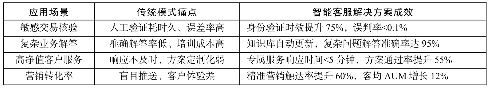

典型案例梳理如下：

· 工商银行部署的智能对话平台日均承接咨询超 500 万次，约 85% 的提问由机器人自主闭环，人工坐席聚焦高净值客户的复杂理财需求，该群体满意度由 78 分攀升至 91 分。
· 宁波银行采用“机器预审 + 人工复核”的小微贷流程，审批时长从 5 天压缩至 1 小时，不良率稳定在 0.8% 以内，明显优于行业均值。
· 花旗银行（中国）将智能对话与客户关系管理平台深度联动，依托跨境交易画像推送外汇汇率预警服务，跨境业务客户留存率提升 25%。

银行业推进智能客服的进程可形容为戴着枷锁起舞：既要在监管红线内守住安全底线，也要兼顾用户体验与商业回报。生物识别、联邦学习等手段缓解了安全与效率的张力，知识图谱、强化学习提升了复杂业务解答的精度。智能客服正把银行服务从交易导向推向关系导向。随着量子计算、区块链的渗透，未来可延展至智能合约自动履约、跨境资金即时清算等场景，让金融服务更隐形、更无处不在，重塑人与财富的连接逻辑。

# 第八章
**DeepSeek 智能客服技术全景 2025**

2025 年 DeepSeek 的影响已覆盖中国 AI 应用的各个角落，围绕其构建客服技术体系成为行业共识。在 AI 重塑客服的浪潮中，DeepSeek 以原创架构与强适配性，成为推动客服从规则响应迈向自主决策的核心引擎。本章拆解其技术底座、差异化能力与落地路径，说明专家混合、多模态协同如何重塑服务的技术标准与应用范式。

## 8.1 核心技术架构
1. 专家混合计算：按需唤醒与稀疏推理
DeepSeek 摆脱 Transformer 全量计算的惯例，采用专家混合形态。将 670 亿参数拆成 128 个细粒度专家块，每块聚焦金融咨询、物流查询、产品推荐等特定领域。系统借助门控调度，仅唤醒 3 到 5 个相关专家处理单次请求，实现算力的精准投放，同时大幅降低消耗。

原理上，门控网络实时解析客户输入的文本、语音、图像。以“查询订单物流”为例，系统会激活物流轨迹解析专家；遇到“推荐理财产品”则激活风险评估加产品匹配专家。与全参数推理相比，电商场景实测显存占用减少 75%，推理成本下降 65%，中小企业可在中等算力设备上部署高性能客服。

稀疏门控在金融服务中表现突出。以理财组合推荐为例，结合客户风险偏好与历史持仓动态组合专家生成个性化方案。某股份制银行客服中心实测显示推荐准确率较传统模型提升 40%，系统可支撑每秒 12000 次并发。

价值上，专家混合带来显著成本优化，算力支出较同类大模型降低 60% 以上。适配性上可对复杂业务进行细粒度处理，如电商多 SKU 组合推荐、政务政策条款解读，有效解决传统模型大而全不精的问题。

2. 跨模态融合：多维度信息协同推理
DeepSeek 搭建了门控多模态路由器 GMR，支持文本、语音、图像、视频输入的动态权重分配，实现全感官交互的融合。

视觉语言对齐是关键路径。直播客服中，客户发送“这件红色连衣裙有色差”并上传图片时，系统给予图像识别模块 80% 权重分析色差与面料，文本语义模块 20% 权重解析退换货政策，最终联合生成质检报告与退换货流程，客户满意度提升 30%。借助对比学习，服饰电商实测图像文本联合推理准确率达 92.3%，解决了图文语义割裂问题。

情感增强也是核心。框架融合语音语调波动、音高变化、面部微表情及文本情感词，构建三层情绪识别模型，情绪识别准确率达 91.7%。电信投诉场景中，语速加快音量升高被判定为愤怒，自动触发加急处理。较传统规则引擎，情绪响应准确率提升 45%，投诉处理周期缩短 50%。

整体优势体现在交互自然化与决策精准化。系统支持边看边问、语音加手势等交互，覆盖 85% 以上复杂服务。多维度融合可捕捉潜在需求，如医疗咨询结合症状描述与 CT 扫描图，对肺结节良恶性判断准确率可达 91.7%，接近初级医师水平。

## 8.2 关键技术优势
1. 超长语境理解：12.8 万长度窗口
DeepSeek 突破传统 4K 至 8K 的限制，支持 12.8 万长度文本解析，多轮对话中保持语义一致并深度关联历史信息。

实现层面采用高效注意力机制，稀疏注意力使长文本处理效率提升 3 倍，12.8 万窗口内毫秒级响应，适用于数万字合同解析、多轮售后咨询。

跨会话记忆可自动保存客户 30 天历史对话。跨境电商场景下，客户连续询问“3 月日本仓书包未签收→能否提供物流底单→若丢失如何赔偿”时，系统完整关联订单、物流轨迹及历史记录，无需重复输入，问题解决效率提升 60%，人工介入率下降 50%。

政务咨询中，以公积金提取政策为例，系统可自动解析 20 余条政策条款，提取适用人群、办理材料、审批流程等关键信息并生成结构化答案。宿迁宿心办应用实测覆盖 90% 以上高频民生问题，平均响应小于 1 秒。

金融合规场景下，解读保险合同条款时关联历史投保记录、保单条款及行业法规，自动识别免责条款、理赔时效等风险点。信息提取效率较人工提升 70%，错误率从 4% 降至 1.2%。

2. 领域知识融合：动态知识库嵌入
DeepSeek 通过知识图谱与外部数据源实时对接，实现行业专业知识动态调用与深度推理，解决通用模型领域精度不足的问题。

知识图谱构建针对金融、电力、政务等领域，涵盖股票代码、变压器型号、社保政策等实体及关系，并支持每日同步最新法规、手册。金融场景处理股票分红政策咨询时，可自动关联证券法第 78 条、企业财报分红率字段、股息税计算方式，生成法律依据、财务影响、操作步骤的三层回答，风险点标注准确率达 98.5%，数据来自江苏银行智能合同质检系统。

外部数据实时接入在电力运维中接入电压、电流、温度等传感器数据与 Modbus、OPCUA 等工业协议，实时解析变压器异常报警。结合 10 万余条历史故障案例生成故障定位、维修建议、备件调度方案，故障预测准确率提升 20%，年节约运维成本 45 万元，验证于国家电网 MSC 平台。

整体价值在于打破通用大模型与行业知识库松散结合，复杂问题解决能力提升 50% 以上。自动化知识抽取支持每周新增 10 万余条行业术语，保持系统与业务同步迭代。

## 8.3 行业落地路径
1. 政务服务：方言适配与政策精解
针对多语言混杂、文件复杂的痛点，DeepSeek 提供定制化方案。

方言识别与混合输入支持普通话及粤语、四川话、闽南语等十几种方言，通过半监督学习与 30 万小时方言录音训练，转写错误率降至 8% 以下。社保查询、低保申请等场景准确率可达 92%。智能纠错可识别“四险一金”“窝要办理”等谐音，纠错准确率高达 95%。

政策文件结构化分析采用 OCR 与 NLP 结合，自动抽取适用人群、办理条件、申报材料、办理流程等字段并构建动态知识图谱，覆盖 80% 以上政务高频咨询。以宿迁宿心办应用为例，集成后政策咨询解决率由 75% 提升至 95%，平均响应由 3 秒缩短至 0.8 秒，客户满意度达 98%，成为政务数字化标杆。

落地价值体现在服务普惠化，消除方言壁垒，让老年人与非普通话用户获得同等高效服务。政策解析准确率提升减少人工干预，基层大厅咨询台工作量下降 40%，窗口效率提升 30%。

2. 跨境电商：多语生成与智能交互
针对多语言沟通与文化差异，DeepSeek 打造全球化服务方案。

多语生成引擎支持英语、西班牙语、阿拉伯语、法语等 16 种语言，并基于地域文化动态调整口播风格，如中东市场加入斋月祝福，欧洲市场强调环保包装。智能剪辑根据市场偏好匹配背景音乐，东南亚用民族乐器，欧美用流行音乐。义乌小商品城电商平台实测单条视频平均播放量达 10 万+。

跨语言意图对齐可在“能否退换红色连衣裙”这类英文提问中，自动关联 3 天前中文对话的订单号、尺码、物流状态，生成含海关申报流程、本地仓库地址的中英双语退换货指引。订单处理效率提升 50%，海外客户投诉率下降 40%。

义乌跨境电商平台接入后覆盖全球 200 多个国家，年订单量增长 280%，客服人力成本下降 60%，成为中小商家出海核心工具。

3. 金融服务：风控与个性化推荐
针对高合规与强个性化需求，DeepSeek 提供全流程支撑。

智能合同质检可自动解析贷款合同、理财协议中的利率条款、违约金比例、不可抗力条款等，结合金融衍生品交易管理办法等法规标注风险点并生成合规建议。某城商行实测效率提升 70%，错误率由 5% 降至 0.8%。动态风险评估融合交易流水、征信数据、美股指数、汇率变化等信息实时生成风险承受等级与产品匹配度报告，理财产品推荐转化率提升 35%，客均资产配置增长 25%。

反欺诈交互在密码修改、跨境转账等敏感操作中，通过语音微颤检测、设备 IP 异常识别等多模态融合实时拦截风险，较传统规则引擎准确率提升 30%，金融诈骗误判率由 0.5% 降至 0.1%。

## 8.4 部署轻量化与性能优化
1. 动态量化压缩
针对中小企业算力限制，DeepSeek 借助 FP8 精度混合训练与模型蒸馏实现高性能轻量化。

模型体积由 670 亿参数压缩至 168 亿参数，体积缩小 75%，存储成本下降 65%。单台 4 卡 GPU 服务器即可稳定运行，中小企业部署成本由百万元级别降至 10 万元级别。推理效率方面，金融客服场景延迟控制在 200ms 以内，支持每秒 8000+ 咨询，满足电商大促与金融峰值需求。

中小银行定制信用卡客服轻量化版本，在保持 92% 意图识别准确率的同时硬件投入降低 70%，上线周期由 3 个月缩短至 2 周。

2. 硬件协同优化
DeepSeek 与昇腾、英伟达 GPU 深度适配，构建端云协同架构，实现边缘到云端全场景覆盖。

边缘轻量化部署将轻量模型嵌入智能音箱、POS 机、车载终端，实现本地意图识别加云端复杂推理。车载场景简单指令如导航、音乐播放本地响应小于 50ms，复杂车辆故障报修上传云端 1 秒内返回方案。

云端弹性扩展借助 Kubernetes 动态调度资源，金融行业峰值如每月 5 日养老金发放日可自动扩容至 2000+ 服务器节点，99.99% 请求 1 秒内响应，避免算力浪费与服务卡顿，资源利用率提升 40%。

端云混合部署既满足低延迟需求，又应对高并发场景，实现成本与性能最优解。

DeepSeek 通过专家混合、多模态融合、超长语境理解等核心技术构建高效计算加精准推理加行业适配的智能客服体系。其价值在于把复杂 AI 能力转化为可落地的行业方案，助力政务、电商、金融提升效率与体验。后续章节将结合具体案例展示系统设计、实施与优化的实战经验。

# 第九章
结论与展望

本章总结智能系统的优势与成果并展望发展方向，为企业提供保持竞争优势的参考。

## 9.1 系统优势与成果总结
智能客服系统的引入对传统客服模式产生颠覆性改变，不仅提升运营效率，更大幅改善客户体验。在激烈市场竞争下，客服水平成为竞争力关键。智能客服打破时间、空间与人力限制，创造企业与客户全新价值，可快速处理海量复杂咨询，提供 7×24 小时不间断服务，让客户随时获得及时帮助，显著提升满意度。核心在于人工智能、大数据分析与云计算构建的高效灵活客服生态。

图 9-1 以思维导图形式按功能划分智能客服分类，具体如下。

未来客服进化蓝谱

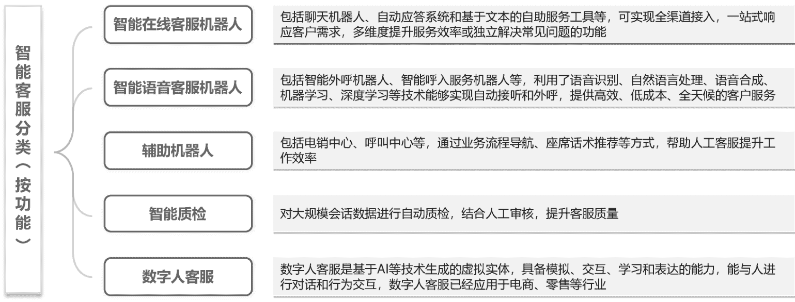

图 9-1

·在线对话机器人：当下依托聊天机器人、自动应答以及文本自助工具实现全渠道接入，统一响应需求，提升多维度效率并可独立闭环常见问题。未来随着自然语言处理持续突破，对复杂语境与情绪语义的理解会更精准，实现更深度的个性化交流。例如用户咨询旅行方案时，除常规信息外，还能结合当下情绪与过往偏好生成专属线路。

·语音交互机器人：现阶段借助语音识别与自然语言理解完成自动接听与外呼，以低成本、高效能提供 7×24 小时服务。未来语音合成向情感化、个性化演进并与物联网深度融合后，可在智能家居场景以更富温度的声音执行设备操控、生活提醒；在车载场景中实现更流畅安全的语音交互。

·座席辅助助手：目前已在电销与呼叫中心落地，通过流程指引与话术推荐赋能人工席位。未来伴随强化学习发展，自主学习与决策能力显著提升，可基于实时业务指标与客户动态需求，主动为人工输出更具前瞻性、精准性的策略建议，扮演智能参谋角色。

·会话质检：现阶段对海量对话做自动化质检并辅以人工复核以提升服务水准。未来在大数据与人工智能深度融合下，质检范畴将从质量把控延伸至服务预测，不仅实时评估对话质量，还能提前预警风险、洞察需求走势，助力企业前置优化服务策略。

·虚拟人客服：基于 AI 生成的数字形象已在电商零售等领域应用，具备模拟、交互、学习与表达能力。未来随着渲染技术与动作捕捉进步，外观动作表情将更逼真自然，甚至可在虚拟空间主办新品发布、品牌活动，与用户开展沉浸式互动，重塑品牌连接方式。

图 9-2 展示了典型原生大模型客服产品逻辑架构。

·用户咨询：问题类型丰富，涵盖闲聊、商品推荐、产品问答、技术求助、产品对比等。未来随生活工作场景不断拓展，咨询将更具多样性与个性化，可能涉及元宇宙社交规范、太空旅游咨询等前沿议题。

·意图解析：在多轮对话中准确捕捉用户真实意图，是系统理解需求的核心。未来意图解析将依托更强的深度语义解析与情感分析，不止识别字面意思，还能挖掘潜在情感诉求与隐含意图，例如在用户咨询电子产品时捕捉其对环保属性的关注。

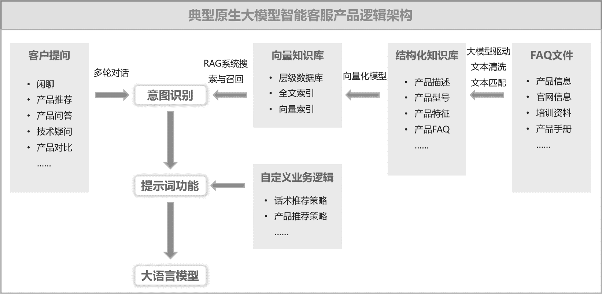

图 9-2

·提示词模块：位于意图解析与大模型之间，承担衔接作用。未来其自学习与自适应能力会增强，可针对不同用户群体与行业场景动态生成更精准有效的提示指令，实现更深共鸣与高效对话。

·大模型：作为服务核心引擎，负责理解输入并生成回复。未来在参数规模、训练数据多样性与质量上持续优化后，常识推理与跨领域融合能力将明显增强，甚至可按用户偏好产出更具创意与温度的答案。

·业务规则定制：涵盖话术推荐、商品推荐等策略。未来将深度整合客户全生命周期数据与实时场景信号，从通用方案转向极致个性化，为每位用户提供符合当下情境的千人千面服务。

·RAG 检索模块：从向量库与结构化库中调取相关信息。未来多模态检索能力将显著提升，除文本外还能融合图像、音频、视频等多源信息，实现更全面精准的知识召回。

·向量库：由分层数据库、全文索引及向量索引构成。未来借助量子计算等前沿手段，存储容量与检索效率有望指数级增长，同时依托知识图谱动态扩充，使知识联想更智能灵活。

·结构化库：收录产品描述、型号、特性及常见问答等内容。未来将与企业各业务系统深度打通并实时同步，保证知识时效性与准确性，并依托完善的知识图谱支撑更复杂的推理与应用。

·常见问答库：汇聚产品资料、官网信息、培训素材与使用手册等。未来 FAQ 的生成与更新将实现智能自动化，结合用户反馈与业务变化实时优化，并以更友好的交互形式呈现，如智能语音播报、可视化图表等。

总体来看，该架构会持续演进，深度融合多领域前沿技术，不断拓展服务能力边界，为用户带来超出预期的智能体验，推动行业迈向新阶段。

## 9.2 未来发展方向与展望

在人工智能快速演进的背景下，智慧服务正经历前所未有的蜕变。技术如何让助手更卓越、如何在社会变迁中适应新需求并开拓新场景成为关键。尤其在营销能力拓展与跨平台融合提升方面，前景值得期待。通过剖析算法进步带来的预测精度提升、全渠道数据整合对精准营销的支撑，可洞见其未来路径。

### 9.2.1 技术创新与功能拓展

近年深度学习与多模态处理技术快速落地，服务系统已从简单问答升级为综合服务平台。以医疗健康为例，系统借助多模态处理不仅能应答文字咨询，还能解析患者上传的症状图片、检查报告，结合医学知识图谱给出初步诊断建议与就医指引。深度学习使医学知识持续更新，提升诊断准确性与专业度，为患者提供更可靠的健康咨询，也为企业带来更精准的市场定位与个性化策略。

深度学习明显增强了系统理解与回应能力。传统方案面对模糊多义表达易失准，而深度学习通过海量文本训练，能捕捉细微差别与上下文，从而更准确把握真实意图。例如用户说“最近身体不舒服有点头晕怎么办”，系统不仅识别头晕症状，还能结合历史健康数据追问是否伴随恶心、乏力等，输出更全面建议。自然语言处理领域 BERT、GPT 等预训练大模型的突破，使客服能精准捕捉意图、理解语境，给出更贴切人性化的回复。用户问“我的订单为何还没发货”，系统不仅识别订单状态问题，还能基于历史数据推测原因并给出具体解释，显著提升体验。

大数据处理是智能化服务的基础。现代系统每天承接海量文字、语音、图片视频等输入，借助云计算实现高效存储、管理和分析。通过全域数据整合，客服不仅能快速响应即时需求，还可预测趋势助力企业制定精准营销策略。例如分析购买历史与浏览行为后可推荐相关产品，提前解决潜在问题避免投诉。

多模态融合进一步丰富功能。服务系统现可通过文字、声音、图像等多形式互动，沟通更直观。医疗场景中患者可发送症状照片获初步诊断；教育场景中虚拟教师可自动批改作业并反馈。结合计算机视觉与情感分析，机器人还能感知情绪变化，适时调整语气风格，营造更温馨对话氛围。

AI 大模型与云技术的发展推动智慧服务渗透各商业领域，无论是呼叫中心、电商、金融还是电信，都能见到身影。除基础咨询外，其在体验优化、个性化推荐方面潜力巨大，既节省人力提升效率，也通过挖掘客户独特价值创造更多商业机会。技术创新正把单一功能模块推向综合服务平台，成为连接企业与消费者的关键桥梁，未来将在数字化转型与核心竞争力打造中扮演更重要角色。

### 9.2.2 面向新的社会形态和需求的演进

远程工作等新生活方式常态化，消费行为随之改变。工作间隙消费更碎片化，对便捷性与即时性要求更高。例如员工在短暂休息时用手机咨询商品或办理业务，需要服务快速响应、精准。线上沟通依赖度提升，对交互体验与服务质量期望更高，渴求类面对面般的个性化贴心服务。这对企业服务能力提出新要求。

服务系统需随之调整以适应变化、提升体验。为适配碎片化咨询，系统应具备快速唤醒与响应能力，缩短等待；利用跨平台行为数据构建更完整客户画像，实现更精准个性化服务。跨平台操作要保证体验一致，无论网页、App 还是社交私信，都提供同等服务质量，避免平台差异导致体验参差。通过增强灵活性、提供更多定制化选项、确保跨平台无缝衔接，服务能更好地满足远程工作时代需求，其强大的数据分析能力也为企业营销规划提供依据。

从灵活性看，现代生活节奏快且多变，服务系统需具备高度自适应能力应对多样场景。在紧急情况如支付故障时，系统应迅速调高优先级，提供多种解决路径，如紧急申诉引导、临时方案等；日常咨询中则可依据情绪与需求提供更亲和个性化服务。跨设备无缝切换、不丢失会话进度对多设备办公者至关重要，同时全天候在线与快速响应应对全球时区差异。未来服务应构建灵活服务框架，支持客户按偏好设定交互方式与优先级，实现真正随时随地服务。

个性化服务需更多可定制选项。除基础查询与故障排除外，系统可基于使用习惯与反馈不断优化界面布局、功能配置与语言风格，让使用者感受到专属感。可引入机器学习分析历史对话提炼兴趣点与痛点，推送高相关内容或优惠；也可开发插件式模块供客户自行添加特性，提升实用价值与粘性，同时需兼顾隐私保护，避免过度采集引发信任危机。

在数字化转型加速背景下，跨平台一致性与无缝衔接成为衡量质量的关键。理想状态下不同接入渠道应提供相同服务质量。为此需加强接口标准研究与对接，确保数据传输顺畅；建立统一知识库作为后台支撑，保证前后端信息同步准确。这样即使在复杂应用环境中，也能提供稳定可靠帮助。

服务还应利用强大数据分析能力洞察市场趋势、预测消费行为，指导策略调整。通过深度挖掘结构化与非结构化数据，可揭示真实需求特征、识别增长机会，据此开展精准目标定位，如针对高价值客户推出定制促销，或借助社交媒体开展口碑营销。长远看，这将形成从线索获取到转化成交再到复购推荐的完整闭环，推动整体业绩增长。面对社会变迁，服务唯有持续创新求变，才能紧跟时代步伐，为企业创造更大价值，也让消费者享受到前所未有的优质体验。

## 9.3 基于 AI Agent 重构智能客服系统

在数字化转型浪潮中引入 AI Agent 概念重塑服务架构，不仅能显著提升效率与满意度，还能在决策层面为企业与个人提供更明智选择。以电商为例，AI Agent 驱动的客服可结合实时浏览行为、历史购买记录与市场动态，提供精准商品推荐与个性化购物建议。当客户浏览手机时，系统不仅推荐同品牌热销机型，还能结合促销活动、所在地区库存给出最优购买方案，助力更明智决策。这一转变需紧跟技术进步与社会需求，构建理想的未来服务体系。

AI Agent 是一种可执行自动化任务、做出决策并与人类自然语言交流的程序，结合智能体开发框架与检索增强生成技术 RAG，使服务使用维护成本更低、意图理解更精准、应对策略更灵活，已在电商、银行等场景落地，为发展打开想象空间。AI Agent 应用为解决传统服务痛点提供新思路，能模拟人类思维与决策过程，主动分析需求提供更智能高效服务。实际应用中可与企业业务系统深度集成，实现数据实时共享与协同，为客户提供更全面个性化体验。例如银行信贷业务中，AI Agent 可实时获取信用数据、资产信息，为客户提供更准确贷款额度评估与个性化还款建议。

图 9-3 详细呈现了基于大模型的 AI Agent 客服应用逻辑及其当下能力提升表现。

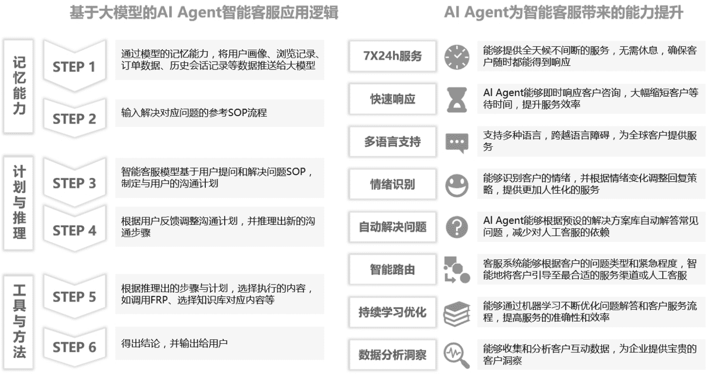

图 9-3

从应用逻辑看，它通过记忆能力、计划与推理、工具与方法等步骤为客户提供服务。能力提升涵盖 7×24 小时服务、快速响应等多个维度。然而科技发展日新月异，客服也在不断演进。当下成果只是阶段性展现，未来随前沿技术融合突破，各方面能力将迎来巨大飞跃。为更清晰对比当下与未来差异，以表 9-1 进行呈现。

表 9-1

续表

通过表 9-1 可清晰看到基于大模型的 AI Agent 客服在当下与未来的能力差异及发展趋势。这些提升背后是 AI Agent 技术在客服领域的深度应用与持续革新。接下来将深入探讨 AI Agent 在客服中的具体优势，以及重构架构的关键步骤，进一步揭示其如何重塑未来格局。

1. 理解 AI Agent 及其优势

AI Agent 是一种高度智能化的软件实体，能模拟人类行为与思维方式，处理复杂任务并根据环境变化自主学习调整策略。在处理复杂客户问题时优势尤为明显。例如处理多步骤技术故障排查时，它可凭借强大推理能力，根据客户描述症状结合知识库技术资料与过往案例，迅速分析可能原因并制定详细排查步骤。遇到知识库未覆盖的问题，还能通过自主学习从技术论坛、专业文档中获取信息不断丰富知识储备。交流过程中，AI Agent 可实时识别客户情绪，当检测到不满情绪时，会调整沟通策略使用更温和安抚语言先缓解情绪再解决问题，显著提升服务体验。相比传统服务，AI Agent 拥有更强记忆力、推理能力与情绪识别等高级功能。例如基于强大记忆能力，可整合客户画像、浏览记录、订单数据及历史会话形成全面画像，提供个性化服务。在旅游预订场景中，AI Agent 不仅记住过往目的地、酒店偏好、出行时间，还能分析数据背后的喜好与需求模式。再次咨询时，可主动推荐符合偏好的线路，或按既往酒店档次推荐更合适的住宿。这种个性化服务让客户感受到被重视，提升信任与依赖。此外，AI Agent 还能敏锐捕捉对话中情绪变化，据此调整回复策略，使互动更人性化亲切。

2. 重构客服架构的关键步骤

多模态交互支持对客服发展至关重要。在全球化背景下，企业客户来自不同国家地区，使用多种语言沟通。支持多语言与多模态交互能更好地满足不同客户需求，打破语言与沟通方式障碍。例如在跨国电商平台，客户可用熟悉语言咨询商品信息，或通过语音投诉售后、上传商品图片反馈问题，客服均能准确理解并回应，提供便捷高效服务体验，提升企业全球市场竞争力。

智能客服下一次升级，从能回话到真懂事

(1) 跨通道沟通，让表达不再受限
要实现真正全球无障碍的服务，下一代智能客服必须做到语言和形式双兼容，同时吃下文字、语音、图像等多种输入。医疗健康就是典型场景：来自不同语区的患者用母语提问时，多语种能力能让对话顺畅进行；遇到难以用嘴说清的症状，患者可以直接上传影像、局部照片，系统借助图像识别结合医学知识库，直观判断后给出初步诊断建议和就医指引。语言和感官的壁垒被打通，用户可以用最自然的方式把需求说清楚，服务可达性和质量同步提升。

(2) 更强的情境理解与自主决策
依托自然语言处理和深度学习，AI Agent 能读懂用户背后的真实意图，并快速给出可执行的方案。金融咨询里需求往往复杂且金额敏感，比如客户要投资组合建议，系统需要兼顾财务状况、目标收益、风险偏好等多个维度。通过语义理解把握客户期望，用深度学习拆解市场走势和产品表现，制定方案时不仅提供常规组合，还会随市场实时变化和个人情况动态微调。遇到市场突发、逻辑链超出能力边界的情形，系统会通过推理评估难度与自身局限，及时把工单转给专业投资顾问，确保最终落到最专业的人。面对复杂问题，它也能规划下一步动作，主动寻求专家介入。

(3) 越用越聪明的主动学习机制
自适应学习是保持服务水准不退步的关键。以在线教育客服为例，课程更新快、学生诉求分层，Agent 必须持续补课。它会记录每次交互的提问类型、学习进度、答复满意度等数据，通过深度分析找出知识盲区和答法短板，随后从资源库、学术文献和教师经验中抓取新内容，优化表达逻辑和答案结构。比如发现大量学生卡在同一知识点，就会学习多种讲解路径，后续根据学生具体情况匹配最合适的说法。随着数据不断累积，响应策略和整体服务质量会持续进化，越来越贴合不同群体的偏好。

(4) 企业级系统无缝联动
要发挥最大价值，AI Agent 必须能直接接入 CRM、ERP 等后台。在大型制造企业，客户的定制方案和交货周期咨询往往牵动设计、生产等多部门。接入 CRM 后，Agent 能调取历史订单、偏好等客户画像；接入 ERP 后，可实时查看生产进度、库存状态。综合两边信息，它能在几分钟内生成定制化方案和较准的交付预估。若出现核心零部件缺货等异常，还能自动牵头采购与生产部门会商对策，并即时回传给客户，基本无需人工穿针引线。这种跨系统协同大幅提升了响应效率和服务质感，也增强了企业竞争力。

(5) 数据安全与隐私的加固防线
客服触达的敏感信息越来越多，风控必须前置。金融场景下，账户余额、交易密码、身份证号等都可能被涉及。系统一方面采用加密存储，把信息转成密文入库，即使泄露也难以被解读；另一方面在传输环节使用安全通信协议全程加密，防止网络窃取篡改。对非必要的人身敏感字段，可做匿名化处理，用不可逆标识代替真实身份进行分析，既满足建模需求，又把隐私风险降到最低。新架构的设计必须严格遵循法规，用加密、匿名等手段夯实个人信息保护。

3. 实践案例与未来展望
电商里已有企业把 AI Agent 投入到售后，效果明显。某知名平台在电子产品售后品类试用后，消费者报修时 Agent 能迅速在知识库中匹配解决方案，以图文并茂的方式呈现，常见问题不再需要排队等人工，体验和效率双升。系统在服务过程中持续收集反馈，迭代答法和知识库。设想一个典型路径：买家遇到使用困惑，简短描述就能拿到详尽解答；若涉及退换货等复杂流程，系统自动引导完成并全程跟进至闭环。借助过往交易、浏览、搜索关键词的深度分析，Agent 还能主动推荐符合偏好的商品，既上架相似款，也结合市场趋势推关联或创新品，提升成交率的同时增强用户粘性。

总体来看，基于 AI Agent 重塑的智能客服已经从被动应答的工具进化为参与运营的“助手”，既能帮助企业实现商业目标，也为终端用户带来前所未有的便捷。随着技术持续成熟，这一愿景正加速落地。