# 智能微波工程：AI 重塑射频设计新范式

## 书籍速览

当人工智能在视觉、语音及推荐算法领域大显身手时，微波工程界正酝酿一场静默的变革。本书系“智能工程前沿丛书”核心力作，聚焦**智能微波工程**这一电磁场与微波技术领域最炙手可热的前沿方向，系统梳理了将机器学习、优化算法深度融入天线、器件、电路及信道建模全流程的理论架构与实战范式。

**核心看点：**
*   **全谱系覆盖：** 从机器学习与优化基础，延伸至多路径辅助天线设计、知识-数据双驱动阵列合成、多层建模赋能射频鲁棒设计、毫米波片上螺旋电感智能合成，以及混合驱动信道建模。
*   **实战导向：** 沉淀作者团队二十余年科研攻关精华，成果均发表于 *IEEE Transactions on Antennas and Propagation* 等顶刊。
*   **代码开箱即用：** 附录提供核心算法源码，并附赠完整代码包下载链接，助力读者快速复现与二次开发。

**适读人群：** 高校微波/电磁场专业高年级本科生、研究生，以及从事天线、射频电路、电波传播研发的工程技术人员。

---

## 丛书编委阵容

**主编：** 黄如  
**副主编：** 尤肖虎、金石、耿新  
**编委（按拼音序）：** 李世华、刘澄玉、任刚、宋爱国、汤奕、王浩、王海明、王禄生、温广辉、许威、杨军、张宏  
**秘书：** 王海明、汤奕

---

## 丛书缘起：定义“智能工程”新坐标

联合国教科文组织曾言：“工程是解决问题的知识与实践。” 通信、电子、土木、机器人等传统工科历经深耕，已成现代社会基石。而**智能工程**，正是将人工智能注入工程基因、以 AI 破解工程难题的新型知识体系与实践范式。这无疑是当下工科领域最活跃的增长极，亦是学科交叉融合、创新发展的最鲜明注脚。

回溯 70 年代，计算机辅助设计（CAD）推动工程技术跨越式发展。但面对当下**场景极致复杂、指标苛刻多元、周期压缩极限、绿色低碳刚性**的“四重挑战”，传统 CAD 已难独木支撑。引入 AI、跨学科融合攻关，势在必行。

“智能工程前沿丛书”依托东南大学“强优精特、提新强交”学科战略，旨在集结国内外前沿成果，搭建学术对话高地，推动智能工程从理论走向产业、从实验室走向大国重器。感谢科学出版社倾力支持，期待同仁批评指正，共谱新篇。

---

## 作者寄语：从“手工雕琢”到“智能涌现”

微波技术是无线通信、雷达、高速互联的基石。如今，载波频率向毫米波、太赫兹挺进（5G 落地毫米波、6G 瞄准太赫兹、车载雷达迈向 77/94GHz、SerDes 单通道突破 100Gb/s），波长缩短带来的电磁效应复杂度指数级跃升，传统理论与设计手段已触及天花板。**中国射频产业高歌猛进之际，亟需新理论、新工具破局。**

本书凝聚国家重点研发计划、自然科学基金等项目成果，结合作者团队二十载磨一剑的实战经验，构建了智能微波工程的“四梁八柱”：

| 章节 | 核心主题 | 创新亮点 |
| :--- | :--- | :--- |
| **第 1 章** | 绪论：背景、趋势与全书导览 | 确立智能微波工程学科坐标 |
| **第 2 章** | 基石：电路/天线/信道经典理论与设计技术 | 为智能化改造立下“物理底座” |
| **第 3 章** | 工具箱：ML 辅助优化框架、核心算法与典型案例 | 建立“数据-模型-优化”通用方法论 |
| **第 4 章** | **突破**：多路径 ML 驱动天线智能设计 | 团队最新成果，破解高维非凸设计难题 |
| **第 5 章** | **融合**：知识-数据双驱动天线阵列设计 | 物理先验与数据智能深度耦合 |
| **第 6 章** | **鲁棒**：多层 ML 赋能射频鲁棒设计 | 直面制造误差与环境扰动不确定性 |
| **第 7 章** | **集成**：毫米波片上螺旋电感智能设计 | 攻关片上无源器件建模与优化痛点 |
| **第 8 章** | **场景**：混合驱动智能信道建模 | 面向植被前向散射等复杂电磁环境 |

> **注：** 第 4–8 章均为团队原创最新成果，已在 IEEE 顡刊及国际会议发表。全书 8 章自成体系又环环相扣，由王海明统稿定稿，张沛泽、陈炜琦等博士生、曹逸、魏家豪等硕士生协作完成，团队研究生集体校对，谨致谢忱。疏漏在所难免，恳请斧正。

—— 王海明，2023 年 3 月于东南大学

---

## 符号速查表（核心记号约定）

为保证推导严谨、阅读流畅，全书统一符号规范：

| 类别 | 记号 | 含义 |
| :--- | :--- | :--- |
| **标量/矩阵/向量** | $x, X$ / $\mathbf{x}, \mathbf{X}$ | 斜体标量 / 黑斜体向量(列)与矩阵 |
| **矩阵运算** | $(\cdot)^{\mathrm{H}}, (\cdot)^{\mathrm{T}}, (\cdot)^*$ | 共轭转置、转置、共轭 |
| | $[\mathbf{X}]_{m,n}, [\mathbf{X}]_{m,:}, [\mathbf{X}]_{:,n}$ | 元素、行向量、列向量索引 |
| | $\|\mathbf{X}\|_\mathrm{F}, \mathbf{X}^{-1}$ | Frobenius 范数、逆矩阵 |
| **向量运算** | $[\mathbf{x}]_n, \|\mathbf{x}\|$ | 第 $n$ 元素、$\ell_2$ 范数 |
| | $\mathrm{diag}(\mathbf{x}), \mathrm{diag}(\mathbf{X})$ | 向量→对角矩阵、矩阵→对角向量 |
| **特殊矩阵** | $\mathbf{0}_{M\times N}, \mathbf{1}_{M\times N}, \mathbf{I}_N$ | 全零、全一、单位矩阵 |
| **代数运算** | $\odot, \otimes$ | Hadamard 积、Kronecker 积 |
| **数域/分布** | $\mathbb{R}, \mathbb{C}, \mathcal{N}(\mu,\sigma^2)$ | 实数域、复数域、高斯分布 |
| | $\sim, \mathrm{vec}\{\cdot\}$ | 服从分布、矩阵列向量化 |
| **常用函数** | $\lfloor x \rfloor, \lceil x \rceil, \log_{10}x$ | 向下/向上取整、常用对数 |
| **统计量** | $\mathrm{mean}\{\cdot\}, \mathrm{var}\{\cdot\}$ | 期望、方差 |
| **其他** | $\delta(\cdot), |x|, \min/\max$ | Kronecker delta、绝对值、极值 |

---

# 第一章 绪论：微波工程的智能化转型之路

无线电频谱横跨 3 Hz–3 THz，ITU 与 IEEE 频段划分见表 1.1。射频（RF）指频谱内的交变电流信号，微波频段为 **300 MHz–300 GHz**（波长 10 cm–1 mm），其中 **30–300 GHz** 为毫米波。*注：IEEE 2018 年更新标准，RF 涵盖全频谱，微波为其子集。*

微波工程支撑无线通信、雷达、高速互联三大支柱应用，核心理论建立在**麦克斯韦方程组**之上——这组 19 世纪偏微分方程揭示了电场、磁场与源的时空耦合关系，经赫兹实验证实。然而，直接求解三维全波方程涉及向量微分积分，计算复杂度极高，甚至超算难以负担。微波工程的核心使命之一，正是**将全波场问题等效简化为可工程化处理的电路/网络模型**。

## 1.1 演进脉络与范式革新

### 1.1.1 微波电路与系统：从波导到智能综合

*   **奠基期（20 世纪 40s）：** 二战雷达需求催生 MIT 辐射实验室，波导、天线、网络理论体系化。
*   **爆发期（1G–5G）：** 蜂窝移动通信驱动微波电路向**低成本、小尺寸、高集成、高良率**演进。参数空间呈指数级爆炸，唯有极少组合满足多目标约束。
*   **智能化转型（当下）：** AI 重构设计流程：
    *   **案例 A：** 基于**在线更新高斯过程回归（GPR）代理模型**的差分进化算法，用于 100 GHz 线性放大器设计。对比纯全波+全局优化，**耗时压缩至 1/9**，带宽 >20 GHz、增益 >10 dB，性能碾压传统流程。
    *   **案例 B：** **加权期望改进贝叶斯优化 + 多起点局部搜索**，成功攻关变压器等无源器件设计。

> **启示：** 在线学习代理模型打破“离线建模精度受限”瓶颈，全局优化跳出局部最优陷阱，二者协同实现**效能与性能双跃升**。

### 1.1.2 天线与阵列：从偶极子到智能超表面

*   **萌芽（1887）：** 霍兹偶极子验证电磁波，开启天线史。
*   **多元化（20 世纪初–战后）：** 电子管推动线天线（八木、菱形、鱼骨）繁荣；雷达催生口径天线（抛物面、喇叭、缝隙波导阵）；中继通信与射电天文推出几何光学、矩量法等分析工具。
*   **现代化（60 年代至今）：** 计算机、微电子、新材料赋能**相控阵、微带、共形、分形、可重构、介质谐振器**等高性能天线；商业全波软件（MoM、FDTD）大幅提效。
*   **智能化新纪元（当下）：** 双轮驱动重塑边界：
    1.  **新物理/新工艺：** 基片集成、超材料、电磁偶极子、封装天线（AiP）突破集成度与频段极限。
    2.  **新算法/新范式：** **进化算法 + 机器学习 + 特征模理论 + 商业全波仿真**深度耦合，实现**高增益、宽频带、快扫描、低旁瓣、强鲁棒**多目标协同优化，推开天线性能基本极限。

---

**结语：** 智能微波工程非单一技术叠加，而是**物理机理、数据智能、优化数学**的三位一体深度融合。本书即为此融合之路绘制的首份系统性图谱，诚邀同道共探无疆。

### 1.1.3 电波测量与智能信道建模

随着无线移动通信技术的飞速迭代，载波频率持续攀升，毫米波通信已步入大规模商用阶段。电波传播环境日益复杂，加之大规模 MIMO（mMIMO）技术的落地，基站与终端侧天线数量激增，导致电波传播参数估计与信道建模的难度呈指数级上升。传统手段难以破解此类高维复杂难题，学界研究表明，引入人工智能技术有望成为突破瓶颈的关键路径[11-15]。文献 [14,15] 系统梳理了该领域进展：第一部分聚焦机器学习赋能的信道特性表征与天线-信道联合优化[14]；第二部分回顾了场景识别与信道建模现状[15]，并指出了 AI 驱动的信道数据处理面临的挑战。

现有研究揭示，基于几何的随机信道模型（GBSM）在预测真实场景下的时变、空变信道特性时往往乏力。针对这一短板，华北电力大学赵雄文教授团队构建了一套基于人工神经网络（ANN）的信道建模与仿真框架，实现对实测信道的高保真回放[11]，并以青岛高铁站 28GHz 实测数据为例完成验证。对比实测数据、ANN 仿真结果与 GBSM 仿真结果的大尺度/小尺度参数，结果证实：ANN 方法能更精准地还原实测信道特征，而 GBSM 存在显著偏差。该成果为 5G 及 B5G 系统的信道回放提供了高效方案，若拥有海量实测数据，亦可延伸至未来信道预测。

当前，移动通信呈现场景复杂化、频率高位化、mMIMO 大规模阵列化、微蜂窝高密化等趋势，海量数据生成推动 5G 正式迈入大数据时代。文献 [12] 提出了大数据与机器学习双驱动的无线信道建模框架，核心采用前馈神经网络（FNN）与径向基函数网络（RBF-NN）。模型输入涵盖收发端坐标、链路距离及载波频率，输出为接收功率、均方根时延扩展、均方根角度扩展等统计特性。训练测试数据源自实测与 GBSM 仿真融合，仿真结果验证了该方法的优越性，彰显了机器学习作为基于测量的信道建模利器的潜力。

为攻克传统物理统计模型在精度与泛化性上的双重短板，本书作者团队创立了“知识-数据”混合驱动的智能信道建模范式，并完成了前向植被散射簇内信道特性的预测建模与验证[13]。该方法利用几何随机模型获取簇间参数，针对不同散射簇类型调用专用 ANN 预测簇内特性。融合实测与射线追踪数据构建物理统计模型，揭示了系统配置与环境变量对穿透损耗、时延/角度扩展的影响机制。通过引入环境特征标签降低训练复杂度、提升计算效率，多环境下的验证表明：该智能预测器均方根误差显著优于传统方法，实现了建模精度与通用性的双重跃升。

### 1.2 本书核心脉络

全书以微波工程智能化为主线，首先系统奠基：微波电路与系统、天线与阵列、微波传播与信道建模、机器学习辅助优化四大基础板块；继而以实战设计项目为载体，深度剖析机器学习辅助天线设计、知识数据混合驱动阵列设计、多层机器学习赋能射频鲁棒设计、毫米波片上螺旋电感智能设计及智能信道建模五大前沿技术路径，展现智能微波工程的创新方法论与工程实践。

## 微波工程概论

微波工程支撑起无线通信、雷达、广播、射电天文等无线电系统及高速数字电路的基石。本章将从微波电路与系统、天线与阵列、电波传播机制与信道建模三个维度，勾勒微波工程的全景图谱。

### 2.1 微波电路与系统

历经百年演进，微波电路与系统已构建起完备的理论体系与设计方法论。本节梳理核心组件与典型电路，为后续引入 AI 赋能器件设计夯实基础。

#### 2.1.1 微波传输线：导波能量的“高速公路”

微波传输线是引导电磁波定向传输的导波系统统称。图 2.1 展示了主流传输线形态，以下逐一解析。

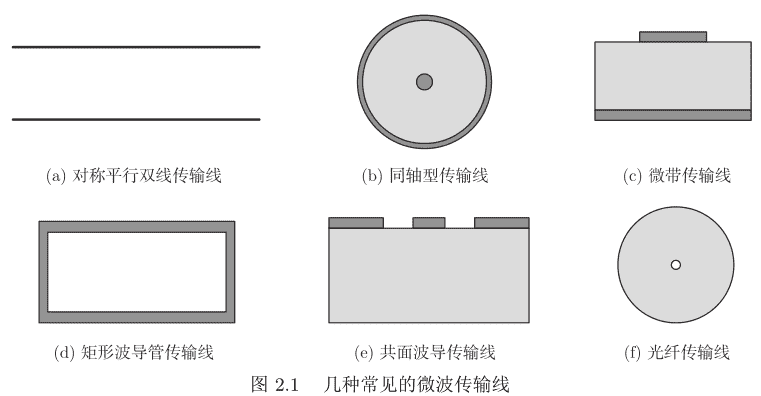

- **双线传输线**：由两根平行导体（铜/钢/铝）构成，传输 TEM 波。分对称型（架空线、双绞线、绞合电缆）与同轴型两类。高频下金属/介质损耗剧增，横向尺寸与波长可比，对工艺维护要求严苛；对称型敞开场导致耦合严重，限制了传输频率上限。
- **同轴传输线**：实心内导体与空心外导管同轴构成，主传 TEM 泀，兼容 TE/TM 波。按外导体分直壁与波纹管（柔韧性优、弯曲半径小、工程首选）；按功能分传输电缆（普通馈线）与泄漏电缆（外导体开槽/打孔，实现多点辐射，集传输与天线功能于一体，专攻隧道、矿井等盲区覆盖）。
- **微带传输线**：非对称结构，传输准 TEM 波。标准形式为：宽接地带 + 介质基片 + 窄导体条，是微波集成电路（MIC）主力传输线。
- **波导管传输线**：空心金属管（紫铜/黄铜，内壁镀银），非 TEM 波传输。截面多为矩形、圆形、椭圆形。得益于大导电面积、高电导率、无辐射/介质损耗，主攻厘米波/毫米波频段。
- **共面波导传输线（CPW）**：微带线两侧加接地、底面无接地。工艺友好、无需通孔即可实现器件串并联、集成密度高，在单片微波集成电路（MMIC）及毫米波段展现出微带难以比拟的优势。
- **光纤传输线**：以光导纤维为介质，分单模/多模。凭借大容量、远距离、抗电磁干扰、抗腐蚀、轻量化等特性，自 70 年代问世即广受青睐。

#### 2.1.2 微波器件：功能实现的“积木模块”

工作于 300MHz~300GHz 频段的器件，经电路设计组合可构成发射机、接收机、天线系统等核心装备。典型器件谱系如下：

- **基本元件**：R、L、C。低频下集总参数模型适用；高频下尺寸逼近波长，集总特性失效，常用传输线等效构造。得益于超大规模集成电路发展，片上器件微型化使高频集总元件（如片上螺旋电感、片上电容）重获应用空间。
- **滤波器**：选频装置，分无源（R/L/C 构建低通/高通/带通/带阻/全通）与有源（动态抑谐、补偿无功，分电压型/电流型）。
- **天线**：导波-空间波相互变换的换能器，具可逆性（收发通用），是所有电磁波信息/能量传递系统的必备门面。详见 2.2 节。
- **功率分配器/合路器**：一分多/多合一，输出端口需保持隔离度。有源/无源均可，分路带入插损，频率相关。
- **混频器**：非线性元件+选频回路，输出频率为输入频率和/差/组合。按性质分加法/减法，按器件分三极管/二极管，按工作方式分有源/无源。设计权衡转换增益、线性度、噪声系数、隔离度、功耗。
- **放大器**：微波系统核心“心脏”。发射端功放（PA）克服链路损耗推大功率辐射；接收端低噪放（LNA）提升微弱信号 SNR。
- **变压器**：磁耦合双线圈，实现阻抗变换、直流隔离、共模抑制、平衡-非平衡转换。高磁导率铁心/铁氧体强化耦合效率。
- **衰减器**：调节信号幅度、比较法测量基准、改善阻抗匹配（缓冲负载波动）。
- **振荡器**：直流变交流，产生周期信号（正弦/方波/锯齿波）。按激励分自激/他激，按结构分 RC/LC/晶体/音叉，按波形分正弦/方波/锯齿波。
- **移相器**：调控电磁波相位。早期模拟利用介质传播相移，现代数字移相经 ADC/DAC 实现离散高精度控制。

#### 2.1.3 微波电路：系统功能的“集成载体”

器件、传输线、互连线集成协同，构成功能电路。典型架构剖析：

- **超外差接收机**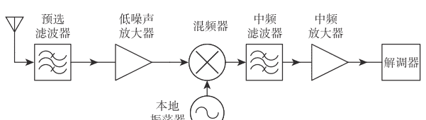：天线信号经放大、滤波、混频至中频处理。架构灵活、增益大、选频好，广泛部署，但镜像频率干扰、邻道干扰为先天痛点。
  图 2.2 超外差接收机原理框图

- **镜像抑制接收机**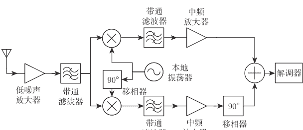：本振/中频双路 90° 移相，使镜像分量 180° 反相抵消，有用分量同相叠加，从架构层面根除镜像干扰。
  图 2.3 镜像抑制接收机原理框图

- **零中频接收机**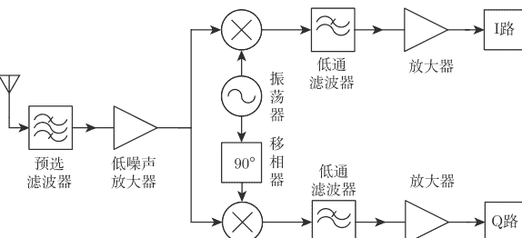：射频直降基带，理论无镜像干扰，省去大尺寸中频滤波器，利于集成。挑战在于 I/Q 通道幅相失配导致镜像抑制恶化及直流失调。
  图 2.4 零中频接收机原理框图

- **超外差发射机**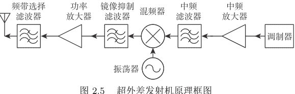：基带→上变频至中频→上变频至射频→功放→天线，镜像接收机链路，完成信号空间辐射。

- **直接变频发射机**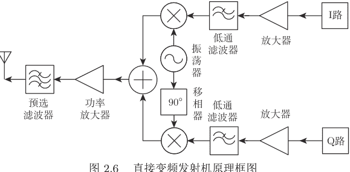：基带直上射频→功放→天线，镜像零中频接收机架构，精简链路、易集成。

- **锁相环 (PLL)**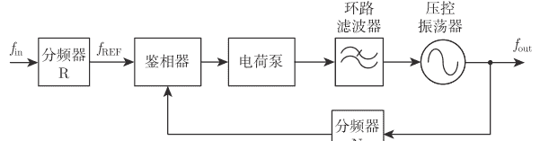：鉴相器+压控振荡器 (VCO) 组成反馈环，锁定输入输出相位。核心功能：信号解调、噪声信道信号恢复、频率合成（倍频输出）、数字系统精准时钟分发。
  图 2.7 锁相环原理框图

#### 2.1.4 微波网络分析

### 微波网络架构与多端口参数建模

微波网络可视为由有限个理想化元件（电阻、电容、电感、变压器等模型）互联而成的拓扑结构，具备有限数量的接口端口。在这些端口处，可实施电压、电流测量，并完成电磁能量的收发。端口定义的物理基石在于：流入某端子的瞬时电流必等于从对应端子流出的瞬时电流。如 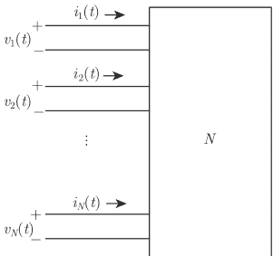 所示，含 N 个外部端口的系统称为 N 端口网络。该网络涉及 N 个电压量与 N 个电流量，共 2N 个变量。任选 N 个量作激励，剩余作为响应。针对线性时不变网络，其端口行为完全由电压-电流关系刻画。依据激励/响应变量的选取组合，可导出阻抗、导纳、混合、散射等多种矩阵描述范式。


图 2.8 N 端口网络

#### 1. 阻抗矩阵（Z 参数）

设定端口电流为激励、电压为响应。联立端口电压拉普拉斯变换 $\boldsymbol{V}(s)$ 与电流变换 $\boldsymbol{I}(s)$ 的矩阵 $\boldsymbol{Z}(s)$，即为开路阻抗矩阵：
$\boldsymbol{V}(s) = \boldsymbol{Z}(s)\boldsymbol{I}(s)$ \quad (2.1)
矩阵元素 $z_{jk}$（第 j 行、第 k 列）定义为：除 k 端口外其余全开路时，第 j 端口电压变换 $V_j$ 与第 k 端口电流变换 $I_k$ 之比：
$z_{jk} = \frac{V_j}{I_k} \big|_{I_x=0, x \neq k}$ \quad (2.2)

#### 2. 导纳矩阵（Y 参数）

以端口电压为激励、电流为响应。关联 $\boldsymbol{I}(s)$ 与 $\boldsymbol{V}(s)$ 的矩阵 $\boldsymbol{Y}(s)$ 称为短路导纳矩阵：
$\boldsymbol{I}(s) = \boldsymbol{Y}(s)\boldsymbol{V}(s)$ \quad (2.3)
元素 $y_{jk}$ 为：除 k 端口外其余全短路时，第 j 端口电流变换 $I_j$ 与第 k 端口电压变换 $V_k$ 之比：
$y_{jk} = \frac{I_j}{V_k} \big|_{V_x=0, x \neq k}$ \quad (2.4)
若 $\boldsymbol{Z}(s)$ 可逆，则 $\boldsymbol{Y}(s) = \boldsymbol{Z}^{-1}(s)$ \quad (2.5)。

#### 3. 混合矩阵（H 参数）

此矩阵融合了 Z、Y 两种形式。激励变量可混选电流与电压，响应为其余端口对应量。变量组合多样，以二端口为例，常见联立关系为：
$\begin{bmatrix} V_1 \\ I_2 \end{bmatrix} = \begin{bmatrix} h_{11} & h_{12} \\ h_{21} & h_{22} \end{bmatrix} \begin{bmatrix} I_1 \\ V_2 \end{bmatrix} = \boldsymbol{H} \begin{bmatrix} I_1 \\ V_2 \end{bmatrix}$ \quad (2.6)
系数矩阵 $\boldsymbol{H}$ 称混合矩阵，参数定义如下：
$h_{11} = \frac{V_1}{I_1}\big|_{V_2=0},\; h_{12} = \frac{V_1}{V_2}\big|_{I_1=0},\; h_{21} = \frac{I_2}{I_1}\big|_{V_2=0},\; h_{22} = \frac{I_2}{V_2}\big|_{I_1=0}$ \quad (2.7)
特殊情形下，若变量选取为：
$\begin{bmatrix} V_1 \\ I_1 \end{bmatrix} = \begin{bmatrix} A & B \\ C & D \end{bmatrix} \begin{bmatrix} V_2 \\ -I_2 \end{bmatrix} = \boldsymbol{T} \begin{bmatrix} V_2 \\ -I_2 \end{bmatrix}$ \quad (2.8)
系数矩阵 $\boldsymbol{T}$ 称传输矩阵，即 ABCD 参数。

#### 4. 散射矩阵（S 参数）

迈入微波频段，电压/电流失去清晰物理图像且难以直测，开/短路条件亦难以高频实现，致使 Z、Y 参数获取受阻。于是引入散射参数：利用各端口归一化入射电压波 $a$ 与出射电压波 $b$ 表征网络。以归一化入射波 $a_i$ 为激励、出射波 $b_i$ 为响应，线性 N 端口网络方程为：
$\boldsymbol{b} = \boldsymbol{S}\boldsymbol{a}$ \quad (2.9)
矩阵元素 $S_{jk}$ 定义为：除 k 端口外其余端口入射波归零（即无源匹配负载）时，第 j 端口出射波 $b_j$ 与第 k 端口入射波 $a_k$ 之比：
$S_{jk} = \frac{b_j}{a_k}\big|_{a_x=0, x \neq k}$ \quad (2.10)

---

#### 阻抗匹配：原理与工程实践

##### 核心动因

为达成信号传输“无反射”或“最大功率传递”，电路间必须实施阻抗匹配，这直接关乎系统整体性能优劣。应用场景极广：放大器级间、电路与负载间、信号源与传输线、微波系统设计，有源无源皆须考量。根源在于：低频聚焦电压电流，高频信号以波形式传播，失配将引发强烈反射，甚至损毁器件。

常规手段是在源、负载间插入无源匹配网络，实现负载阻抗与源阻抗共轭匹配。其核心价值集中在五点：
1.  功率传递效率最大化（源→器件、器件→负载、器件间）；
2.  提升接收灵敏度（如 LNA 前级匹配）；
3.  优化功率分配网络幅相平衡；
4.  激发放大器最佳增益、输出功率（功放输出端）、效率与动态范围；
5.  降低馈线传输损耗。

##### 设计方法谱系

*   **解析法**：建立阻抗变换方程直接求解 L/C 参数。思路直观，但计算量随元件增多爆发，需计算机辅助。
*   **谐振法**：将感性输入阻抗由串联转并联，引入电容谐振，继而交替串联电感、并联电容构成低通原型，逐步将阻抗实部变换至系统基准值（如 50Ω）。
*   **微带线工艺**：高频下集总电感寄生效应显著、参数漂移，微带线凭借分布参数稳定、结构紧凑优势成为主流。仅需依据特性阻抗与电长度反推物理尺寸。

---

### 宽带匹配：理论演进与数值突围

宽带匹配是通信、雷达等系统解决“频带内功率平稳且最大传输”的核心课题，广泛服务于微波宽带晶体管/场效应管放大器设计。

#### 理论里程碑

| 年代 | 贡献者 | 核心突破 |
| :--- | :--- | :--- |
| 1945 | **Bode** | 首解并联 RC 负载匹配，用环路积分给出上限常数，未涉无耗网络约束。 |
| 1950 | **Fano** | 推广至任意无源负载/电阻源，给出增益带宽极限，推导带权积分约束。 |
| 1961 | **Feld** | 扩展至复数源阻抗（仅虚轴零点）。 |
| 1963 | **Youla** | 引入有界实散射参数，创立新理论：积分约束化为代数方程，且能处理**有源负载**（解决隧道二极管放大器设计难题）。 |
| 1970s | **陈惠开** | 推导特定负载解析元件值（含低通/带通），1976 年出版专著系统定型。 |

#### 解析理论的工程痛点

1.  **最优增益函数预设难**：假设函数未必最优，导致设计性能上限受限。
2.  **端口特性解析化难**：微波实测数据难直接入式，需拟合逼近。
3.  **流程繁复依赖人工**：涉及洛朗级数展开、最小相位分解等，计算量大、干预多，复杂负载/双匹配下尤甚。
4.  **综合元件理想化**：常含理想变压器、达林顿结构等互感元件，落地需二次逼近。

#### 数值优化三大支柱（60 年代中期兴起）

更贴合工程，可直驱 CAD，破解上述困境：

1.  **直接优化法**  
    预设拓扑下将增益写为元件值函数并优化。拓扑依赖经验，盲目性强，易陷局部最优。
2.  **实频数据法**  
    Carlin 教授针对性提出。用传递函数（Z/Y）表达待定网络，以简易函数形式呈现系统实频响应，优化增益得最优特性。**综合时不锁定拓扑**，可选工程友好结构。1983 年扩展至双匹配。
3.  **预定增益倾斜补偿法**  
    前两法结合体，主攻有源宽带匹配。

---

### 天线与阵列：从基础机理到关键指标

1886 年，德国卡尔斯鲁厄理工学院赫兹教授建立首套天线系统。自此，天线作为无线电核心器件，在国防、民生版图中地位日益凸显。以移动通信为例：发射端将传输线导模波转为自由空间电磁波辐射；接收端捕获入射波复归导模信号。严格定义：天线是**导波与自由空间波相互转换区域的载体结构**。

天线辐射机理源于电荷加/减速运动，基础方程见 ```
\(\dot{I}L = Q\dot{v}\) (2.11)
```。

```
\(\dot{I}L = Q\dot{v}\) (2.11)
```

式中：$\dot{I}$ 为时变电流；$L$ 为电流元长度；$Q$ 为电荷量；$\dot{v}$ 为速度变率。

研究视角分**频域**（正弦稳态激励，得“时间平均特性”）与**时域**（有限时长瞬态激励，得“时变工作特性”）。本节梳理天线基本概念、定义、特性参数及阵列定义，为后续引入 AI 优化算法实现高效设计奠基。

#### 天线关键性能参数体系

经典视角视天线为“导模波↔空间波”转换器，通过增益、辐射波瓣图、极化、带宽、色散、匹配等参数向射频前端（收发机）表征特性。

**1. 辐射波瓣图（三维能量地图）**  
描述辐射场强或功率（正比于场平方）随球坐标 $(\theta, \phi)$ 的空间分布。最大辐射向为**主瓣**，背向为**后瓣**，其余为**旁瓣**。完整表征需两组角度函数：
*   幅度：$\theta$ 分量 $E_\theta(\theta, \phi)$ 与 $\phi$ 分量 $E_\phi(\theta, \phi)$；
*   相位：$\delta_\theta(\theta,\phi)$ 与 $\delta_\phi(\theta,\phi)$。

**2. 标量特性指标**  
基于波瓣图衍生半功率波束宽度、波束范围、**定向性 $D$**、**增益 $G$**、有效口径等。$D$ 与 $G$ 为核心：
*   **定向性 $D$**：远场球面最大功率通量密度 $P_{\max}$ 与平均值 $P_{\text{av}}$ 之比，$D = P_{\max}/P_{\text{av}}$ \quad (2.12)。各向同性理想源 $D=1$，实体天线 $D>1$。
*   **增益 $G$**：在 $D$ 基础上扣除天线本体及罩体欧姆损耗的**实用参数**。馈电损耗、失配均降低增益。效率因子 $\eta = G/D$，优化设计可使 $\eta \to 1$。

**3. 输入阻抗与匹配指标**  
天线输入端呈现阻抗即馈线负载，决定驻波状态。常用指标：
*   电压反射系数 $\Gamma$ 及回波损耗 $L_R = 20 \log_{10} |\Gamma|$ \quad (2.13)；
*   电压驻波比 $S_{\text{VSWR}} = \frac{|U|_{\max}}{|U|_{\min}} = \frac{1+|\Gamma|}{1-|\Gamma|}$ \quad (2.14)。
理想匹配为无反射态：$S_{\text{VSWR}}=1$ 或 $L_R=-\infty\text{dB}$，全功率辐射且无反射波干扰源。工程指标通常要求 $S_{\text{VSWR}} \leqslant 2$ 或 $L_R \leqslant -10\text{dB}$。

**4. 空间场域划分**  
*   **近场区 / 菲涅耳区**：邻近天线区域。电场含显著径向分量，功率流非纯径向，波瓣图随距离演变。
*   **远场区 / 夫琅禾费区**：远离天线区域。场矢量横向于辐射方向，功率流纯径向外扩，波瓣图稳定不变。
经典分界半径：$R = \frac{2L^2}{\lambda}$ \quad (2.15)，$L$ 为天线最大尺寸，$\lambda$ 为工作波长。

### 天线极化、带宽与阵列核心原理解析

天线的极化特性取决于其远场辐射电磁波的平面波极化形式。以Z轴传播的平面波为例，若电场矢量始终维持在X轴方向，即为X向线极化。普遍情况下，电场同时包含X、Y两个分量且相位差恒定，合成轨迹呈椭圆，故称椭圆极化。在固定Z平面观察，电场矢量随时间旋转描绘出的轨迹即为极化椭圆，其长短轴比值定义为轴比（AR）。椭圆极化的两个边界状态分别为：轴比等于1的圆极化，以及轴比趋于无穷大的线极化。判定旋向时，采用电磁波朝纸面外传播的视角：电场矢量顺时针旋转为左旋圆极化（LHCP），逆时针则为右旋圆极化（RHCP）。

天线的几乎所有电性能指标均随频率漂移。工程上会为各项指标的劣化设定容许门槛，满足所有指标要求的频率区间即为天线带宽。绝对带宽 $B$ 等于上限频率 $f_h$ 与下限频率 $f_l$ 之差（$B = f_h - f_l$），相对带宽 $B_r = B/f_0 \times 100\%$。关键在于，增益、波束宽度、旁瓣电平、驻波比、轴比等各参数各自对应的合格频段往往不重合，天线的综合带宽实为这些参数合格频段的交集。

#### 2.2.2 阵列天线

天线阵列由多个单元按几何构型排列组成。单天线常面临指向性弱、增益低的短板，阵列技术正是为此而生。主流阵列设计目标聚焦四大维度：
1.  **高指向增益**：压窄波束，大幅提升方向性与增益；
2.  **特种波束**：生成畸变波束或多波束覆盖；
3.  **波束扫描**：实现空间波束的灵活指向控制；
4.  **低旁瓣**：抑制旁瓣电平，优化方向图纯度。

阵列性能分析依赖单元结构、空间分布、激励分布等核心参数，最终决定方向图、增益、效率等辐射特性。

**1) 单元结构是基石**
单元自身方向图奠定阵列性能下限，尤其在小规模阵列中影响显著。但须警惕：嵌入阵列环境后，单元方向图不再等同于孤立状态，互耦效应与平台散射会重塑其辐射特性，进而作用于整体性能。

**2) 空间分布定维度**
线阵控制单一剖面辐射，面阵实现二维波束控制；针对异形载体，共形阵要求单元按三维空间相对位置布局，贴合载体表面。

**3) 激励分布定形态**
幅度分布与相位分布（单独或联合使用）是塑造阵列方向图的直接手段。

与“分析”由已知参数求特性相反，“综合”则是依据指标反推参数：给定辐射指标（如低旁瓣、赋形波束），求解空间分布、激励权值及单元结构参数，使实测方向图逼近理论设计值。

### 2.3 电波传播机制与信道建模：从物理到统计

电波传播是无线系统（含被动探测）信息传输的物理基础。电磁波在复杂介质中传播，既实现远距离覆盖，也遭遇衰减、扰动等阻碍。系统设计伊始，必须摸清不同频段电波在特定环境下的传播规律，实现系统性能与信道特性的最佳匹配。麦克斯韦方程组虽为理论基石，但本节侧重物理机制与工程建模，为后续引入AI预测打基础，不赘述繁复推导。

#### 2.3.1 理论基石：自由空间与传播机制

**自由空间：基准参照系**
自由空间假设为无限大、均匀、各向同性、无损耗介质。电波直线传播（速度约等光速），无反射、折射、散射、吸收，损耗仅源于波前扩散。实际工程中，若环境影响可忽略，常近似按自由空间处理。

点对点链路中，各向同性天线间的自由空间路径损耗 $L_{bf} = P_t/P_r$。推导路径：
接收功率 $P_r = S \cdot A_e$（功率密度 $\times$ 有效面积）。
天线增益与有效面积关联：$G = \frac{4\pi}{\lambda^2} A_e$ ```
$L_{bf} = 32.45 + 20 \log_{10} f + 20 \log_{10} d - G_t - G_r$ (2.23)
```。
各向同性辐射功率密度：$S = \frac{P_t}{4\pi d^2}$。
代入得接收功率 $P_r = \frac{P_t}{4\pi d^2} \left( \frac{\lambda^2}{4\pi} \right)$。
由此得自由空间传输损耗：
$L_{bf} = \left( \frac{4\pi d}{\lambda} \right)^2$，分贝形式 $L_{bf} = 20 \log_{10} \frac{4\pi d}{\lambda}$ (dB)。

若收发天线有方向性（增益 $G_t, G_r$），接收功率为：
$P_r = \frac{P_t}{4\pi d^2} \left( \frac{\lambda^2}{4\pi} \right) G_t G_r$。
工程常用公式（$d$ 单位 km，$f$ 单位 MHz，损耗增益单位 dB）：
```
$L_{bf} = 32.45 + 20 \log_{10} f + 20 \log_{10} d - G_t - G_r$ (2.23)
```

> **注**：公式隐含极化匹配前提，失配将引入极性损耗。$32.45 + 20 \log_{10} f + 20 \log_{10} d$ 定义为自由空间路径损耗（FSPL）。本质上能量守恒，损耗源于球面波扩散导致功率密度稀释。常将 $P_t + G_t$ 合并为等效全向辐射功率（EIRP）。
> **适用边界**：接收端须位于发射天线远场区，即 $d \gg \frac{2 D_a^2}{\lambda}$（$D_a$ 为天线最大尺寸），否则近场效应导致公式失效。

**三大基本传播机制**

**① 反射：大尺寸障碍物的镜面效应**
当障碍物尺寸 $\gg \lambda$，发生反射。理想导体全反射，幅度相等、与极化无关；实际介质则分反射与透射（折射）。入射角等于反射角（$\theta_i = \theta_r$），折射遵循斯涅尔定律 ```
\(\varepsilon = \varepsilon' - j\varepsilon''\) (2.24)
```。

介质介电常数 $\varepsilon$ 为复数 ```
\(\varepsilon = \varepsilon' - j\varepsilon''\) (2.24)
```，虚部 $\varepsilon''$ 关联有效电导率 $\sigma_e$ ```
\(\varepsilon'' = \frac{\sigma_e}{\omega}\) (2.25)
```。给定材料参数后，复介电常数可表示为 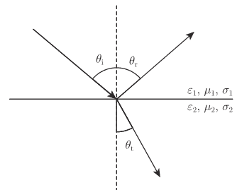。
有效电导率与静电导率关系：$\sigma_e = \varepsilon''\omega + \sigma_s$ (2.27)。
引入损耗角正切表征介质损耗：$\tan \delta_e = \frac{\varepsilon''}{\varepsilon'} = \frac{\sigma_e}{\omega\varepsilon'}$ (2.28)，为零则无损耗。

边界处垂直/平行极化反射系数分别为 $$ \theta_B = \arctan \sqrt{\varepsilon_r} = \arctan \sqrt{\varepsilon_2 / \varepsilon_1} $$。
平行极化下，若 $\varepsilon_1 < \varepsilon_2$，存在布儒斯特角 $$ \theta_B = \arctan \sqrt{\varepsilon_r} = \arctan \sqrt{\varepsilon_2 / \varepsilon_1} $$，入射角等于此角时反射系数为零（全透射）。

**场景差异**：室外近地面接收常因遮挡削弱地面反射，主靠建筑物反射；室内封闭环境地面、墙面、家具均成二次源。高频段（毫米波/太赫兹）多数物体表面均可视为反射面，信号强度随距离衰减且受材料反射系数制约。射线追踪仿真引入实测介电常数可显著提精度。

**② 绕射：阴影区的“拐弯”能力**
绕射让电波绕过障碍物进入几何阴影区。虽场强急剧衰减，但绕射场常保持可用强度。惠更斯原理解释：波前每点作为子波源，子波叠加形成新波前，绕射场即阴影区内所有子波场的矢量和。移动通信重点研究刀刃绕射、单/多楔绕射模型及其损耗估算。

**③ 散射：粗糙面的漫反射**
物体尺寸 $\lesssim \lambda$ 时发生散射，能量向四面八方发散 $$ h_c = \frac{\lambda}{8 \sin \theta_1} $$。理论常假设随机粗糙面，实建模面临确定/周期结构，主流理论含基尔霍夫与摄动法。

*   **基尔霍夫理论**：假设高度随机、变化微小、散射点互不耦合，仅需高度概率分布函数 (PDF)。参考高度定义为 $$ h_c = \frac{\lambda}{8 \sin \theta_1} $$（$\Gamma$ 为光滑面反射系数，$\sigma_h$ 高度标准差，$k_0$ 波数）。掠入射 ($\theta_1 \to 90^\circ$) 时粗糙度影响可忽略，退化为镜面反射。
*   **摄动理论**：在基尔霍夫基础上引入空间相关函数，精度更高但复杂度升级。

宏观看，散射削弱有效功率、改变传播方向，作为反射机制的重要补充 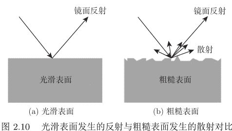。

#### 2.3.2 无线通信信道：大尺度衰落特性

无线信道是收发间的物理媒介。信号与环境散射体相互作用，在接收端形成直射、反射、绕射、散射多径叠加。环境变化导致路径时变，亟需将散射体影响数学抽象化，建立信道模型。信道统计特性决定系统容量上界，也指导低复杂度传输方案设计。

**大尺度模型：覆盖与规划的尺子**
表征平均接收功率随距离的宏观衰减，核心服务于链路预算（定射频配置、覆盖范围、基站选址）。包含路径损耗、阴影衰落、交叉极化鉴别 (XPD) 及雨衰、大气吸收、穿透损耗等附加损耗。

“为何称大尺度？”因当接收机移动距离超数十波长，路径损耗与阴影衰落主导，场强均值随时空速度呈缓慢平缓变化。规划部署时，首要任务即按场景、频率建立大尺度模型，再确定覆盖与配置。


#### 核心解读：无线信道建模全景扫描——从大尺度路径损耗到小尺度多径衰落

在无线通信的世界里，信号从发射端飞向接收端，绝非一帆风顺。理解电波在空间中的“生存法则”，是通信系统设计的基石。本文带你深度拆解路径损耗、阴影衰落、小尺度衰落及信道测量建模的核心逻辑。

---

##### 2. 大尺度效应：路径损耗与阴影衰落的“宏观画像”

**路径损耗：距离与频率的双重奏**
路径损耗本质上描述的是信号能量随传播距离的“自然消亡”。在理想自由空间里，罪魁祸首是球面波扩散——波前面积越大，单位面积能量越稀薄。现实环境更复杂：空气分子、水汽、建筑物反射、折射、吸收，统统要“收过路费”。
*   **关键指标——路径损耗指数（PLE）**：量化功率随距离衰减的速度。自由空间 PLE=2（平方反比定律）；实测环境中，PLE 往往大于 2。
*   **频率效应**：同距离下，载波频率越高，路径损耗越大。这也是毫米波/太赫兹面临覆盖挑战的根源。

**经典模型库：各有所长，但有“频段天花板”**
Okumura-Hata、COST231-Hata、Walfish-Ikegami、Ericsson 多断点模型……这些前辈们基于海量实测数据构建，综合了天线高度、城乡环境、街道朝向、建筑高度等参数，精准服务于 6GHz 以下中低频段。
> **痛点来了**：5G/6G 冲刺毫米波、太赫兹，高频信号对环境细微变化极度敏感。传统模型多针对全向天线，而高频段依赖波束成形定向传输来对抗巨大损耗。**亟需适配“定向信道”的新一代路径损耗模型。**

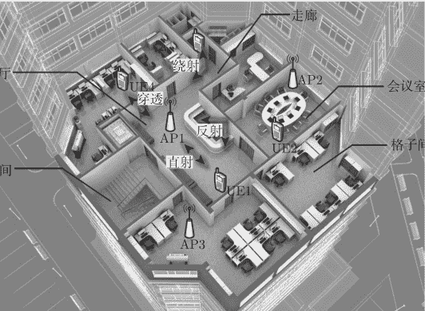

**(a) 室内场景**

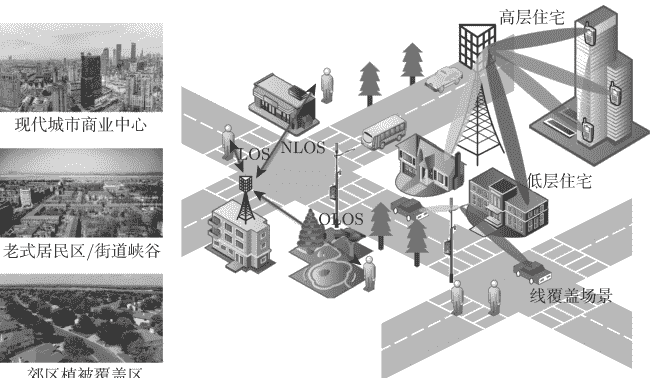

**(b) 室外场景**

**图 2.11 典型无线电波传播场景示意**

**阴影衰落：大尺度上的“随机插曲”**
狭义路径损耗假设定距定损，现实却充满变数：建筑遮挡、树木掩蔽、行人穿梭，导致同距离处接收功率随机波动。这就是阴影衰落。
*   **建模共识**：对数正态分布完美契合这一统计特性。
*   **广义路径损耗模型** = 确定性路径损耗（距离项）+ 随机阴影衰落（对数正态项）。

**穿透与极化：不可忽视的“隐形杀手”**
*   **穿透损耗**：室外入室、室内穿墙，损耗取决于建材电参数与几何结构；密集建筑群还涉及屋顶绕射、街道峡谷多重绕射。
*   **极化失配**：收发天线极化不匹配导致额外损耗。全向场景用交叉极化鉴别度（XPD）统计建模；定向多径场景下，单径极化差异用交叉极化比（XPR）表征。

---

##### 2. 小尺度信道衰落特性：时频空域的“微观风暴”

**成因：多径相干叠加的“混乱艺术”**
除视距（LOS）直射径外，反射、绕射、散射产生海量非视距（NLOS）径。这些波在接收端相干叠加，幅度相位随机，导致信号在极短时间/距离内剧烈波动——这就是小尺度衰落。
*   **场景分类**：LOS（含直射+多径）、OLOS（遮挡视距+多径）、NLOS（纯多径）。

**三大核心表现：**
1.  **快速功率变化**：波长尺度内信号强弱交替。
2.  **随机频率调制**：移动场景下，不同径多普勒频移不同，频谱展宽。
3.  **时延与角度扩散**：多径到达时间、方向差异，导致时域码间干扰、空域角度扩展。

**三大影响因子：**
*   **空中多径信道**：散射体造就多径矢量叠加，带来衰落、失真、时变多普勒。
*   **收发配置（大规模阵列）**：阵列增大提升 EIRP 与空间分辨率，能“看清”不同角度来径；移动引入多普勒。
*   **信号带宽 vs 信道相干带宽**：
    *   带宽 < 相干带宽 → **平坦衰落**（全频段同衰落，无波形畸变）。
    *   带宽 > 相干带宽 → **频率选择性衰落**（频域选择性衰落，时域码间干扰，属宽带信道）。
*   **信号周期 vs 信道相干时间**：
    *   码元周期 > 相干时间 → **快衰落**（信道在码元内变化，时域选择性，多普勒展宽导致失真）。
    *   码元周期 < 相干时间 → **慢衰落**（信道准静止，便于估计补偿）。

**统计建模工具箱：**
*   **瑞利分布**：无优势径（纯散射环境）。
*   **莱斯分布**：存在强 LOS 或镜面反射径（含 K 因子）。
*   **核心参数集**：均值电平、电平穿越率、衰落持续时长、时延扩展/相干带宽、角度扩展、多普勒扩展/相干时间。这些是物理统计信道模型的基因密码。

---

#### 2.3.3 电波传播测量：看不见的“CT扫描”

信道研究铁三角：**测量 → 特性分析 → 建模仿真**。高性能测量系统是前提，核心分两大流派：

##### 1. 频域测量（VNA 派）：精准但“短腿”
**原理**：矢量网络分析仪 (VNA) 扫频获取频率响应 $S_{21}(\omega)$，IFFT 变回时域冲激响应 (CIR)。
*   **数学核心**：$S_{21}$ 与 $h(t)$ 为傅里叶变换对。离散化后用 IFFT 高效计算，频率步长 $\Delta f$ 决定最大可测时延。
*   **硬伤**：频域截断导致时域畸变（加窗牺牲分辨率）；VNA 功率小、馈线损大、收发一体，**动态范围受限，多局限于室内短距**。
*   **破局**：外扩功放/低噪放、光纤/低频远传降低馈线损。

$$ r_i(t) = H(j\omega_i) \cdot E e^{j\omega_i t} = E |H(j\omega_i)| e^{j[\omega_i t + \angle H(j\omega_i)]} $$
$$ S_{21}(\omega_i) = H(j\omega_i) = |H(j\omega_i)| e^{j\angle H(j\omega_i)} $$
$$ h(t) = FT^{-1}\{S_{21}(\omega)\} $$
$$ S_{21}[k] = \sum_{n=0}^{N-1} \exp \left( -j \frac{2\pi}{N} nk \right) h[n] $$

**图 2.12 基于 VNA 频域测量系统原理图**

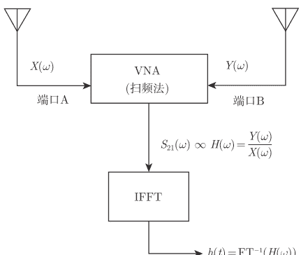

##### 2. 时域测量（滑动相关/后处理派）：远距离主力
**原理**：发射端发已知伪随机序列，接收端捕获信号与本地副本互相关，压出 CIR。收发分离，**天然适配室外远距**。
*   **代价**：需严格时钟/频率同步；系统自带冲激响应耦合在测量结果中，**校准是必修课**。
*   **实现分支**：硬件滑动相关器（实时输出 CIR） vs 离线后处理互相关（灵活、算力强）。

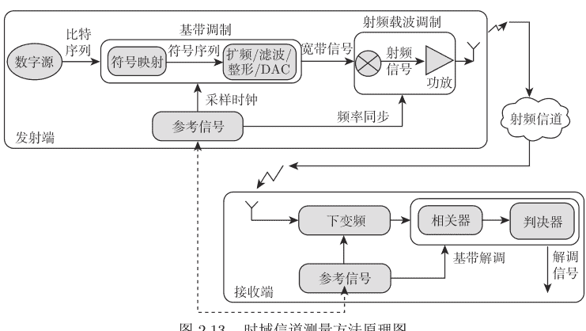

**天线配置决定测量维度：**
*   **中低频**：全向天线测路损/时延；真实 MIMO/相控阵测角度。
*   **高频段（毫米波/THz）**：旋转高增益喇叭天线合成虚拟全向（刷动态范围）；或移动全向天线合成虚拟阵列 + 高分辨率算法估参数。
*   **平台建设权衡**：硬件复杂度 vs 信号预处理算法设计，双轮驱动保证数据质量。

---

#### 2.3.4 信道建模：从物理规律到数学孪生

建模目标直指三大应用：**技术设计参数优化、仿真验证平台、网规部署依据**。模型分类即世界观分类：

**大尺度路损建模：**
*   **经验模型**：数据拟合派（前文经典模型皆属此）。
*   **确定性模型**：射线追踪 (RT) 派。知环境几何+电磁参数，逐径精算场强。不靠实测，靠物理还原。

**小尺度/MIMO 建模谱系图：**

| 维度 | 确定性模型 | 随机模型 - 物理模型 | 随机模型 - 分析模型 |
| :--- | :--- | :--- | :--- |
| **核心逻辑** | 几何光学+电磁理论，还原特定场景每一径 | 双向传播物理规律+散射体/收发几何统计分布 | 纯数学构造信道矩阵/冲激响应 |
| **典型代表** | **射线追踪 (RT)**、FDTD、传播图论、存储回放 | **几何随机模型 (GSCM)**、非几何随机模型 | **Kronecker/Weichselberger** (相关基)、**有限散射体/虚拟信道表征** (特征基) |
| **参数来源** | 环境数据库 | **实测或确定性仿真统计得出** | 数学假设/拟合 |
| **核心优势** | 场景还原度高、可解释 | 捕捉物理本质、泛化性强 | 数学简洁、利于理论推导(容量/编码) |
| **适用痛点** | 计算量大(FDTD)、环境获取难(RT) | 参数提取依赖前期重投入 | 物理意义弱、难指导硬件设计 |

##### 1. 确定性信道模型深度解析
**核心哲学**：“环境已知，物理推演”。
*   **FDTD (时域有限差分)**：麦克斯韦方程组离散化求解。精度高、易编程，但**计算量恐怖，工程落地少**。
*   **射线追踪 (RT)**：工程落地主流。发射射线、算反射/绕射/透射、汇聚接收点场强。几何光学近似，高频段准确度高。
*   **传播图论**：把环境抽象为节点/边图，快速拓扑搜索路径，适合大规模网络规划。
*   **存储回放**：实测数据“硬盘级”复现，最真但零泛化，适合特定链路回归测试。

## 2. 物理随机信道模型：洞察多径分簇本质

提到无线信道建模，**射线追踪**绝对是绕不开的关键词。它立足于几何光学与一致性散射理论，虽受限于当下算力与存储瓶颈，但随着硬件迭代与算法优化，已成为传统实测之外的强力补充。其核心逻辑是模拟光线传播轨迹，推演反射、折射路径；本质上是一种高频近似手段，假设波长趋近于零，能量沿无限细的“射线管”辐射。几何光学（GO）仅管直射、反射、折射，面对障碍物绕射，则引入几何绕射理论（GTD）与一致性绕射理论（UTD）补齐短板。针对复杂3D建筑场景，主流求解手段涵盖镜像法、发射反弹射线法（SBR）、射线管法及SBR/镜像混合法。

另一条技术路线是**传播图论法**，它巧妙融合了确定性与统计建模的优势。根据收发天线位置与典型散射体分布，将数字地图转化为“节点-边”拓扑图：节点代表天线与散射体，可见节点连成边对应实传播路径。信号从发射端出发，经散射体多次反射抵达接收端，构成完整链路，每条边均可用频率与距离函数表征。通过搜索全路径并引入随机矩阵运算，最终输出仅与天线位置相关的信道传递函数。

还有**存储式信道回放法**，走的是“实测为主、回放为辅”的务实路线：特定场景实测、记录配置、按格式存储，应用时在空-时-频域回放传播信息。确定性建模虽成本低、路径精准，却难逃“专场专用”困境——新场景需重建模型，精度更高度依赖建筑材料电参数。这倒逼出点云场景抽象建模与材料特性测量建模的双重研究需求。

##### 2. 物理随机信道模型

物理随机信道模型的核心，在于依托电波传播物理规律，直接输出每条路径的复振幅、时延、到达/离去角、极化散射矩阵等样本实现，且习惯将天线方向图影响剥离，聚焦空中接口。

仔细剖析多径分量与散射体的对应关系，你会发现无线信道天然带着“分簇”基因：散射体簇是一组长时特性一致的散射体集合，信号遇簇后以相近时延、方向延伸，幅度呈局部衰落。为规避多次散射导致的参数耦合，建模常仅保首末次散射。从冲激响应强度看，簇心与LOS路径随相对时延指数衰减，簇内子径另遵循衰减规律，整体路径强度服从瑞利分布。理想状况下簇间独立，实际多有重叠，故需引入泊松分布刻画簇/径到达率。随着天线阵列扩容与带宽增宽，时空分辨率跃升，对多径的观测分辨力随之增强。

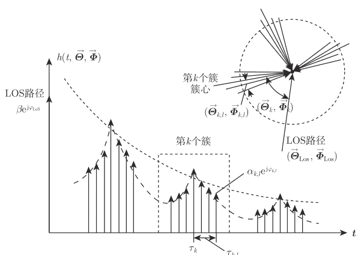

图 2.14 小尺度多径衰落信道分簇建模示意图

顺着“成簇传播”这条主线，物理随机模型按是否引入散射体几何位置，分成了两大流派：

*   **几何随机信道模型（GBSM）**：冲激响应与散射体几何位置强绑定。二维场景常用单/双圆、椭圆模型；三维场景引入球、椭球、圆柱体。建模先写数学表达式，再借随机分布与几何推导角度、时延统计特性。
*   **非几何随机模型（参数化统计模型）**：不纠结散射体坐标，同样先写含全参数的响应式，再靠实测/仿真数据拟合参数统计分布，按分布生成各快拍参数值。

## 3. 机器学习赋能微波器件优化设计

近年来，机器学习在图像、语音、自驾、预测等领域大放异彩。搭建智能代理模型处理问题，不同模型各有所长：神经网络擅长大数据、怕小样本过拟合；高斯过程回归（GPR）能量化预测不确定性，但大样本下训练耗时剧增。

微波器件设计中，参数优化是重头戏。迈入毫米波乃至更高频段，波长缩短、尺寸微缩，对加工精度要求极高；寄生效应剧烈削弱等效电路精度；敏感性分析与多目标协同优化更让计算成本指数级上升。矩量法（MoM）、有限元（FEM）、FDTD等全波仿真虽精准，却极其“烧钱”耗时。

为此，引入机器学习辅助优化成了破局关键。代理模型预测耗时可忽略，成本集中在样本集构建与验证。微波领域训练数据多源自全波仿真，样本稀缺，而复杂器件/大规模阵列优化参数维度高。**如何在“高维、小样本”下建立可靠代理模型，配合优化算法少迭代、快达标，是研究核心。**

本章将系统梳理机器学习与主流进化优化算法，并结合实战案例深度解析。

### 3.1 核心范式：代理模型在线更新的“双层循环”

代理模型精度随样本量增而提升，引入在线更新机制，平衡优化效率与仿真精度。流程如下：

1.  **冷启动**：拉丁超立方采样（LHS）等方法在参数空间抽取初始点，跑全波仿真得初始训练集（可选特征维度扩充）。
2.  **建模**：基于训练集训练代理模型。
3.  **搜优**：进化算法迭代寻优，每轮适应度由代理模型极速预测（可引入预筛选修正）。
4.  **验优**：最优解回跑全波仿真，获高保真数据。
5.  **判停**：达标或达最大迭代数则输出最优，否则继续。
6.  **增样**：验证数据入库，触发代理模型重训练。

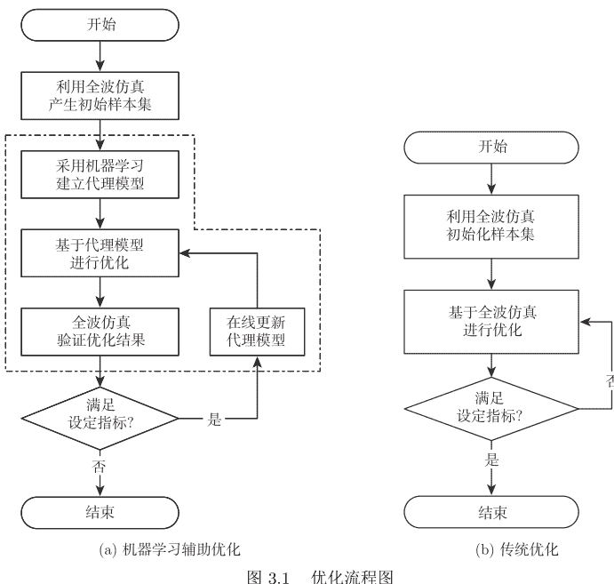

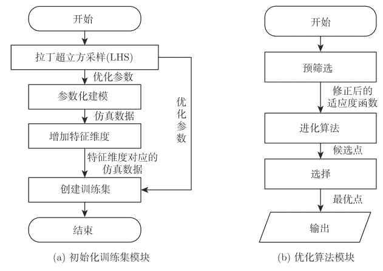

对比传统单层循环，此法构成**内外双层循环**：内层靠代理模型极速迭代，外层靠全波仿真把关入库。验证通过即跳出外层，结束全程。

### 3.2 工具箱盘点：主流机器学习算法一网打尽

#### 3.2.1 监督学习：有标签，学映射

核心是利用“特征-标签”对训练模型，分回归与分类两大阵营：

*   **K近邻（KNN）**：分类利器。新样本看特征空间里最近的K个邻居（K≤20）投给哪类，就归哪类。
*   **决策树**：树状结构，节点测特征，分支分取值。不断切分数据让子集“纯”起来（标签一致），需剪枝防过拟合。
*   **朴素贝叶斯**：基于贝叶斯定理，假设特征条件独立。算各类后验概率，取最大者为预测类别。
*   **逻辑回归**：虽名为回归实为二分类。似线性回归求函数，实则最小化损失函数拟合分类边界。

#### 3.2.2 无监督学习：无标签，挖结构

分聚类与降维两大任务：

*   **K-means聚类**：选K中心点，按距离分派样本，迭代更新中心至均值，直至收敛。简单高效，但怕局部最优、需预设K值。
*   **BIRCH聚类**：层次树状结构（类B+树），节点存聚类特征（CF）。适合大样本，顺带能做异常检测与数据压缩。
*   **高斯混合模型（GMM）**：多高斯分布加权叠加，平滑拟合任意密度。含隐变量，用EM算法迭代求极大似然，收敛于局部最优。
*   **主成分分析（PCA）**：线性降维之王。中心化→协方差矩阵→特征分解→取前K大特征向量投影。零超参，结果纯数据驱动。
*   **t-SNE**：非线性降维神器，擅长高维降2/3维可视化。高维构建相似概率分布，低维匹配分布，本质是最小化KL散度。广泛用于图像、NLP、基因、语音。

#### 3.2.3 人工神经网络（ANN）：模拟大脑，拟合万物

ANN模拟生物神经系统，通过调整连接权与阈值逼近函数。基础单元是MP神经元：加权求和、比阈值、过激活函数输出。多层堆叠全互连，形成**多层前馈网络（MLP）**，输入层收信、隐藏层加工、输出层吐结果。

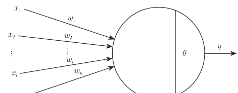

**图 3.3 MP 神经元模型**

感知机（两层）仅解线性可分问题；引入隐藏层破解非线性（如XOR）。隐藏层神经元数无定论，工程上靠“试错法”调。训练复杂网络需强算法：玻尔兹曼机、BP反传、模拟退火、马尔可夫等，射频微波领域常用拟牛顿法、量化共轭梯度法。

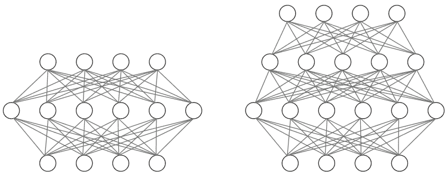

**图 3.4 多层前馈神经网络**

**传统ANN设计三大痛点**：
1.  造样本耗时耗力；
2.  域外预测不可靠；
3.  “维数灾难”——所需样本随维度/平滑度比指数爆炸。

**破局四策略（引入物理先验知识）**：
1.  **EM-ANN 综合法**：融合电磁仿真与神经网络...

### 神经网络建模的多元融合策略

**EM-ANN 混合建模（差分建模）**  
该策略的核心在于训练神经网络去拟合粗糙模型与精细模型响应之间的偏差。模型构建完成后，通过将粗糙模型与训练好的 ANN 进行融合，实现快速优化设计。

**先验信息注入法**  
此法将粗糙模型输出、设计变量及独立变量共同作为神经网络的输入特征。训练得到的网络能更逼近精细模型响应，相较于纯粗糙模型大幅降低优化计算开销。虽模型结构较 EM-ANN 更复杂，但换来的是显著的精度提升。

**知识嵌入型神经网络（KBNN）**  
KBNN 打破了全连接的常规拓扑，在网络架构中预留层级专门承载微波电路的一维或多维向量函数经验公式。这种结构性改造使得领域知识直接参与训练过程，其拓扑架构、训练范式及参数需求均与传统 ANN 截然不同。

**神经空间映射技术**  
该技术借助 ANN 构建粗糙模型到精细模型的映射关系，发挥 ANN 处理高维强非线性的优势，产出在指定参数域内泛化性能优异的粗糙模型。映射操作可灵活部署在输入端或输出端。

此外，针对高维小样本场景下 ANN 易陷入的过拟合与梯度方差大难题，业界衍生出两大改进路径：**后验概率神经网络（PPNN）** 引入支持向量机生成样本后验概率并扩充训练集，缓解小样本导致的差异性放大问题；**深度神经追踪（DNP）** 采用特征选择与分类学习联合缓和策略，在前向传播与反向传播中随机失活神经元与特征，通过子网络梯度计算有效抑制小样本引发的梯度方差爆炸。

#### 3.2.4 高斯过程回归：概率视角的建模利器

高斯过程（GP）实质是多元高斯分布向函数空间的延伸。区别于确定性回归模型仅输出单点预测 $f(x)$，GP 为任意输入 $x$ 给出一个高斯概率分布，即函数空间上的概率分布。高斯过程回归（GPR）基于贝叶斯统计原理，天然具备输出预测置信区间的能力。

形式上，GP 生成的有限观测集合服从多元高斯分布。任意 $N$ 个观测值 $\boldsymbol{y}$ 可视为单次多元高斯采样，反之亦然。GP 由均值函数与协方差函数共同定义：均值函数刻画基准趋势，常置零或经预处理（去趋势、归零）后采用零均值，性价比最高；非零均值虽能在训练稀疏区降低不确定性，但会增加超参数优化负担，尤其在高维场景下。协方差矩阵（核矩阵）作为核心组件，编码输入点间的关联结构，必须满足半正定性。

核函数形式多样，最经典为平方指数核（RBF 核）：
$$ k(x, x') = \sigma_f^2 \exp \left( -\frac{(x-x')^2}{2l^2} \right) \tag{3.1} $$
其中 $\sigma_f^2$ 为最大协方差。引入噪声项后扩展为：
$$ k(x, x') = \sigma_f^2 \exp \left( -\frac{(x-x')^2}{2l^2} \right) + \sigma_n^2 \delta(x, x') \tag{3.2} $$

GPR 预测流程始于协方差矩阵构建：
$$ \boldsymbol{K}_{ij} = k(x_i, x_j), \quad \boldsymbol{K}_* = [k(x_*, x_1), \dots, k(x_*, x_N)], \quad \boldsymbol{K}_{**} = k(x_*, x_*) \tag{3.3-3.5} $$

基于联合高斯分布假设：
$$ \begin{bmatrix} \boldsymbol{y} \\ \boldsymbol{y}_* \end{bmatrix} \sim \mathcal{N} \left( \boldsymbol{0}, \begin{bmatrix} \boldsymbol{K} & \boldsymbol{K}_*^T \\ \boldsymbol{K}_* & \boldsymbol{K}_{**} \end{bmatrix} \right) \tag{3.6} $$

条件分布 $p(\boldsymbol{y}_*|\boldsymbol{y})$ 仍为高斯，最优估计与方差分别为：
$$ \bar{\boldsymbol{y}}_* = \boldsymbol{K}_*\boldsymbol{K}^{-1}\boldsymbol{y}, \quad \text{var}(\boldsymbol{y}_*) = \boldsymbol{K}_{**} - \boldsymbol{K}_*\boldsymbol{K}^{-1}\boldsymbol{K}_*^T $$

#### 3.2.5 支持向量回归与贝叶斯增强变体

**标准支持向量回归（SVR）**  
给定训练集 $\boldsymbol{D} = \{(\boldsymbol{x}_i, y_i)\}_{i=1}^m$，SVR 学习线性模型 $f(\boldsymbol{x}) = \boldsymbol{w}^T\boldsymbol{x} + b$，容许 $\varepsilon$ 不敏感损失带，超出则计算损失。引入松弛变量 $\xi_i, \hat{\xi}_i$ 处理两侧不对称惩罚，目标函数化为：
$$ \min \frac{1}{2}\|\boldsymbol{w}\|^2 + C\sum_{i=1}^m(\xi_i + \hat{\xi}_i) \tag{3.7} $$
s.t. $f(\boldsymbol{x}_i)-y_i \le \varepsilon+\xi_i,\ y_i-f(\boldsymbol{x}_i) \le \varepsilon+\hat{\xi}_i,\ \xi_i,\hat{\xi}_i\ge 0$

经拉格朗日对偶推导，得到对偶优化问题：
$$ \max_{\boldsymbol{\alpha},\hat{\boldsymbol{\alpha}}} \sum_{i=1}^m y_i(\hat{\alpha}_i+\alpha_i) - \frac{1}{2}\sum_{i,j}(\hat{\alpha}_i-\alpha_i)(\hat{\alpha}_j-\alpha_j)\boldsymbol{x}_i^T\boldsymbol{x}_j \tag{3.13} $$
s.t. $\sum(\hat{\alpha}_i-\alpha_i)=0,\ 0\le\alpha_i,\hat{\alpha}_i\le C$

最终模型仅由支持向量（$\alpha_i$ 或 $\hat{\alpha}_i$ 非零的样本）决定：
$$ f(\boldsymbol{x}) = \sum_{i=1}^m(\hat{\alpha}_i-\alpha_i)\boldsymbol{x}_i^T\boldsymbol{x} + b \tag{3.15} $$

**贝叶斯支持向量回归（BSVR）：融合稀疏性与概率推断**  
微波建模中常用各向同性高斯核 SVR，但引入自动相关性判定（ARD）核的 BSVR 在频域反射系数建模上表现卓越。BSVR 本质是 GPR 的一个变体：贝叶斯框架通过最小化负对数边际似然高效训练 ARD 核的多超参数，规避了标准 SVR 依赖网格搜索/交叉验证的困境。BSVR 兼具贝叶斯概率输出优势与 SVR 的二次规划求解、解的稀疏性（仅由支持向量集表征）。

BSVR 后验推断遵循贝叶斯法则：
$$ p(\breve{f}|\boldsymbol{D}) = \frac{p(\boldsymbol{D}|\breve{f})p(\breve{f})}{p(\boldsymbol{D})} \tag{3.17} $$
似然函数采用改进 Huber 损失 $L_{\varepsilon,\beta}(\delta)$ 替代标准 GPR 的二次损失，兼顾 SVR 的 $\varepsilon$ 不敏感带与 Huber 损失的可微性：
$$ L_{\varepsilon,\beta}(\delta) = \begin{cases} 
-\delta-\varepsilon, & \delta < -(1+\beta)\varepsilon \\
\frac{(\delta+(1-\beta)\varepsilon)^2}{4\beta\varepsilon}, & \delta \in [-(1+\beta)\varepsilon, -(1-\beta)\varepsilon] \\
0, & \delta \in [-(1-\beta)\varepsilon, (1-\beta)\varepsilon] \\
\frac{(\delta-(1-\beta)\varepsilon)^2}{4\beta\varepsilon}, & \delta \in [(1-\beta)\varepsilon, (1+\beta)\varepsilon] \\
\delta-\varepsilon, & \delta > (1+\beta)\varepsilon 
\end{cases} \tag{3.19} $$
其中 $0<\beta\le1,\ \varepsilon>0$。

最大后验估计对应对偶问题：
$$ \min_{\boldsymbol{\alpha},\boldsymbol{\alpha}^*} \frac{1}{2}(\boldsymbol{\alpha}-\boldsymbol{\alpha}^*)^T\boldsymbol{\Sigma}(\boldsymbol{\alpha}-\boldsymbol{\alpha}^*) - \sum y_i(\alpha_i-\alpha_i^*) + \sum(\alpha_i+\alpha_i^*)(1-\beta)\varepsilon + \frac{\beta\varepsilon}{C}\sum y_i(\alpha_i^2-\alpha_i^{*2}) \tag{3.20} $$
s.t. $0\le\alpha_i,\alpha_i^*\le C$。核矩阵 $\boldsymbol{\Sigma}_{ij}=k(\boldsymbol{u}_i,\boldsymbol{u}_j)$ 采用 ARD 高斯核：
$$ k(\boldsymbol{u}_i,\boldsymbol{u}_j) = \sigma_f^2 \exp\left(-\frac{1}{2}\sum_{k=1}^D\frac{(u_{ik}-u_{jk})^2}{\tau_k^2}\right) \tag{3.21} $$
超参数向量 $\boldsymbol{\theta}=\{\sigma_f^2,\tau_k,\beta,C,\varepsilon\}$ 通过最小化负对数边际似然确定。

### BSVR 负对数后验概率与稀疏建模策略

贝叶斯支持向量回归（BSVR）的核心目标函数——负对数后验概率，可展开为四项关键构成（公式 3.22）：权重向量偏离先验均值的二次惩罚项、经 $\varepsilon$ 不敏感带与参数 $\beta$ 调节的损失函数累加项、包含子矩阵 $\mathbf{\Sigma}_\text{M}$ 的对数行列式正则项，以及归一化常数 $n \ln Z_s$。模型预测形式（公式 3.23）由核函数加权求和给出，权重系数源于拉格朗日乘子之差。满足 $|\alpha_i - \alpha_i^*| > 0$ 的样本即为支持向量（SV）。值得注意的是，损失函数中的超参数 $\beta$ 直接控制模型稀疏性：$\beta$ 值越小，支持向量数量越少，这本质上对应了训练目标相关加性噪声概率密度的峰度变化。

#### 高保真数据成本下的训练集精简范式

针对微波建模中高保真全波仿真样本获取昂贵的痛点，早期工作主要依赖自适应采样迭代：循环更新代理模型，按误差分布增补样本。本文提出一种基于**多保真度层级**的数据集简化新路径。

以优化特定频段 $S$ 参数（如 $|S_{11}|$ 或 $|S_{21}|$）为例，输入向量 $\breve{\mathbf{u}}$ 融合几何参数 $\mathbf{x}$ 与频率 $f$。高保真响应 $R_f$ 来自精细离散化仿真，直接建模代价高昂。解决方案分三步走：
1.  **低保真辅助建模**：利用粗糙离散化仿真结果 $R_c$ 快速生成训练集，构建辅助 BSVR 模型 $R_{s.aux}$。
2.  **支持向量迁移**：提取 $R_{s.aux}$ 的支持向量集合，仅在该子集上运行高保真仿真。
3.  **高保真精简训练**：获得简化后的高保真训练集，训练最终代理模型 $R_s$。

该策略的理论支撑在于：粗精模型响应面在输入空间拓扑结构上强相关，关键特征变化区域（如陡峭过渡、谐振点）高度重合。因此，低保真模型识别出的支持向量，天然携带了高保真模型最关键的信息增量，以极小样本量“撬动”高精度建模。

#### 局部优化中的空间映射信任域框架

上述讨论针对全域建模。若聚焦局部最优（输入空间特定区域），可引入**空间映射（SM）**机制：BSVR 仅建立局部低保真模型 $R_c$。流程为：寻找近似最优粗糙模型 $R_{cd}$ $\rightarrow$ 在其邻域密集采样建立 BSVR $R_c$ $\rightarrow$ 作为 SM 迭代核心，脱离全波求解器 $\rightarrow$ 高保真仿真仅用于终端验证。为保障收敛，该过程嵌入**信任域**架构：搜索步长受限，无效步拒收，显著提升局部搜索鲁棒性。

**BSVR 核心优势**：全流程仅需用户手动设定单一超参数 $\beta$，大幅降低调参门槛。

---

### 3.3 智能优化算法谱系

代理模型解决了“快速评估”问题，而智能优化算法解决“全局搜索”问题。进化计算与群智能算法因免除连续、可微、单峰等数学苛刻假设，且具备强大的全局探勘能力，成为天线阵列综合、波束成形及器件优化的主流选择。本节聚焦三大经典算法：遗传算法（GA）、粒子群算法（PSO）、差分进化（DE）。

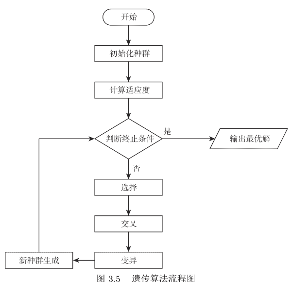

#### 3.3.1 遗传算法：自然选择的计算映射

GA 模拟达尔文进化论，通过“选择-交叉-变异”三大算子驱动种群向最优解进化。

**编码策略** 是连接物理问题与搜索空间的桥梁，工业界主流为实数、二进制、整数及结构化编码。

**适应度函数** 即目标函数，量化个体优劣。高适应度个体享有更大的基因传递概率，实现“优胜劣汰”。

**核心遗传操作**：
*   **选择**：基于适应度淘汰劣势个体，保留精英。选择策略（轮盘赌、锦标赛等）直接决定收敛速度与多样性平衡。
*   **交叉**：模拟染色体重组，按编码规则交换父代片段生成子代。设计核心在于：最大程度遗传优良基因块，同时创造新性状。
*   **变异**：以微小概率随机翻转基因位。虽属随机扰动，却是跳出局部最优、维持种群多样性的关键“探针”。

**终止准则**：适应度收敛平稳、满足迭代收敛公式或达至最大代数。

#### 3.3.2 粒子群算法：群体认知的协同导航

PSO 受鸟群觅食启发，每个粒子由三元组定义：位置 $\boldsymbol{x}_t^k$、速度 $\boldsymbol{v}_t^k$、个体历史最优 $\boldsymbol{p}_t^k$。粒子在 $D$ 维搜索空间 $S$ 中依据自我认知（个体最优）与社会认知（邻域最优 $N_t^k$）更新动态。

迭代更新遵循三式（3.24-3.26）：
1.  速度更新 $\boldsymbol{v}_{t+1}^k = \mu(\cdot)$：融合惯性、个体认知、社会认知。
2.  位置迁移 $\boldsymbol{x}_{t+1}^k = \xi(\cdot)$：通常为 $\boldsymbol{x}_t^k + \boldsymbol{v}_{t+1}^k$。
3.  个体最优刷新 $\boldsymbol{p}_{t+1}^k$：贪婪法保留历史最佳可行解。

邻域拓扑 $T_t^k$（全局最优、环状、星型等）决定了信息流动模式，是 PSO 变体设计的核心自由度。

#### 3.3.3 差分进化算法：差分变异的极简哲学

DE 以“种群差异”驱动搜索，参数极少（$F, CR, P_N$）、鲁棒性强、连续优化性能卓越。区别于 GA 的微扰变异，DE 变异基于**向量差分**，步长自适应。

核心三步（目标向量 $\boldsymbol{x}_i^t$，种群规模 $N_p$）：
1.  **变异**（公式 3.27）：随机选取三个互异个体 $\boldsymbol{x}_{p_1}, \boldsymbol{x}_{p_2}, \boldsymbol{x}_{p_3}$，合成变异向量 $\boldsymbol{v}_i^{t+1} = \boldsymbol{x}_{p_1}^t + F(\boldsymbol{x}_{p_2}^t - \boldsymbol{x}_{p_3}^t)$。缩放因子 $F \in [0.4, 1]$ 控制搜索步幅。
2.  **交叉**（公式 3.28-3.29）：按维度以概率 $CR \in [0.5, 0.95]$ 从变异向量继承分量，否则保留父代分量，生成试验向量 $\boldsymbol{c}_i^{t+1}$。保证参数混合的随机性与连续性。
3.  **贪婪选择**（公式 3.30）：试验向量与父代直接对决，优者生存进入下一代。

**参数设置经验法则**：种群规模 $P_N \in [4n, 10n]$（$n$ 为优化变量维数），终止条件为达最大代数或适应度达标。

---

### 3.4 实战验证：从天线到滤波器的全域胜任力

基于上述“机器学习代理建模 + 智能优化”框架，完成两款天线与一款带通滤波器的优化设计，覆盖 $|S_{11}|$、$|S_{21}|$、增益等多维指标，验证方法的优越性与通用性。

#### 3.4.1 基片集成波导背腔缝隙天线（CBSA）案例

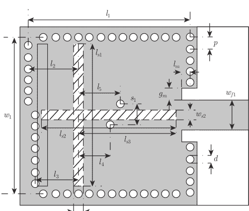

**问题设定**：四模谐振器 CBSA（图 3.6），9 维几何变量 $\boldsymbol{x}$（单位 mm），边界约束 $[\boldsymbol{x}_L, \boldsymbol{x}_U]$。目标：38–47.5 GHz 频段内 $|S_{11}| < -10\text{dB}$。

**关键技术创新——特征维度增强（SO-MLAO-FA）**：
将频率 $f$ 显式作为输入特征维度纳入训练集。此举使单模型可捕捉全频段响应流形，极大提升了样本利用率。采用 $\Delta f = 0.1\text{GHz}$ 离散化频率轴，对比无频率特征的基线 SO-MLAO。

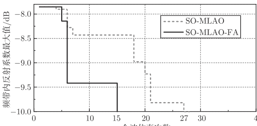

**迭代收敛对决（图 3.7）**：
SO-MLAO-FA **15 代**收敛达标；SO-MLAO 需 **27 代**。效率提升 **44%**。

**预测保真度验证（图 3.8）**：
最优解处，GPR 代理模型预测均值与全波仿真真值高度吻合，预测标准差极小，确认模型在最优域内的高置信度。

**最终性能对标（图 3.9）**：
SO-MLAO-FA 以 15 次迭代成果，匹配 SO-MLAO 27 次迭代的优化上限。实证了“频率特征显式化”在宽带天线优化中的降维增效威力。

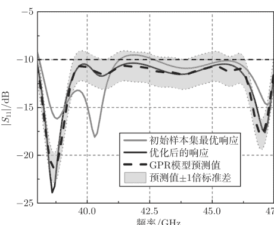

图 3.8 SO-MLAO-FA 算法应用前后 $|S_{11}|$ 特性对比图

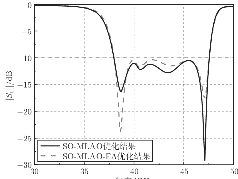

图 3.9 SO-MLAO 与 SO-MLAO-FA 算法优化后的 $|S_{11}|$ 性能对比

#### 3.4.2 分形贴片天线设计

图 3.10 展示了一个应用于 2.6GHz 双极化基站阵列天线的子阵结构，采用 T 形邻近耦合馈电实现一驱三模式。图中浅灰色区域代表位于介质基板顶层的三个几何形状完全一致的辐射贴片；深灰色区域为同层的馈电网络，具体为一个三路等幅输出的空气微带功分器；单元中心间距设定为 77mm。天线单元的详细结构参数见图 3.11(a)：底部接地板为高度为 (da + dg) 的实心金属板，对应背腔区域做了高度为 dc 的下凹处理，形成深度为 dc 的金属背腔结构。

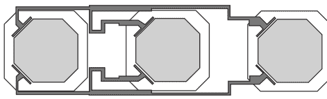

图 3.10 2.6GHz 双极化基站阵列天线 T 形邻近耦合馈电一驱三子阵结构

针对该模型边缘进行网格化建模，如图 3.11(b) 所示。图中八边形代表单个辐射贴片，标号区域为边缘剖分出的网格单元。建模过程实质上是在贴片基础上，对网格构成的形状执行布尔差运算。垂直边上的 1~16 号网格，其平方向定义为网格长度，垂直方向为宽度；水平边上的 17~28 号网格，垂直方向为长度，水平方向为宽度。优化变量为这 28 个网格的长度（即网格向贴片内部伸入的深度），通过调整它们可获得多样化的边缘轮廓。

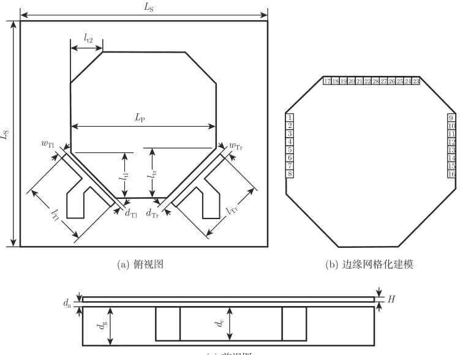

图 3.11 T 形邻近耦合微带双极化基站阵列天线结构细节

本次优化的输入参数除上述 28 个边缘网格长度外，还包含：+45° 极化端口 T 形结构的 $l_{T1}$、$w_{T1}$、$d_{T1}$；-45° 极化端口 T 形结构的 $l_{Tr}$、$w_{Tr}$、$d_{Tr}$；左下、右下切角长度 $l_{t1}$、$l_{tr}$；贴片长度 $L_P$ 及金属背腔高度 $d_c$。优化目标设定为在 2.48GHz~2.72GHz 频段内：$|S_{11}|$、$|S_{22}| < -14\text{dB}$，$|S_{21}| < -20\text{dB}$，双端口增益均 $> 9.5\text{dB}$，中心频率处交叉极化比 $> 18\text{dB}$。这构成了一个 38 维输入、7 个目标的 MLAO 优化问题。适应度函数定义为频段内各目标最差值与目标值的差值，总适应度为各单目标适应度加权求和。当总适应度收敛至 0 即表示全指标达标。迭代曲线见图 3.12，设定上限 1000 代，第 877 代适应度归零触发终止。优化后的天线模型见图 3.13。

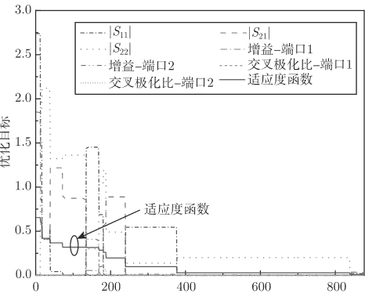

图 3.12 T 形邻近耦合馈电基站天线边缘形状优化迭代收敛曲线

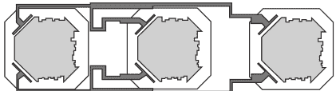

图 3.13 T 形邻近耦合馈电基站天线边缘形状优化后最终模型

图 3.14 对比了优化前后辐射贴片及 +45° 极化端口馈电分支上的电流分布（-45° 端口位于左下角）。(a) 为优化前分布，(b) 为优化后分布。可见优化后贴片边缘电流显著增强，能量更集中于边缘辐射，有利于提升增益；同时 -45° 端口处表面电流减弱，意味着耦合能量减少，隔离度 $|S_{21}|$ 得到改善，这正是边缘优化的核心目的。

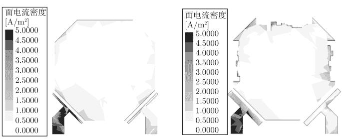

(a) 优化前电流分布      (b) 优化后电流分布

图 3.14 T 形邻近耦合馈电基站天线边缘形状优化前后电流分布对比

图 3.15 给出 S 参数优化前后对比。优化前 $|S_{11}|$、$|S_{22}|$ 的 -10dB 带宽为 2.40~2.95GHz，但 -14dB 带宽仅覆盖 2.65~2.83GHz；优化后 -14dB 带宽扩展至 2.48~2.77GHz，完整覆盖 n41 频段。隔离度方面，优化前 2.68~2.88GHz 段 $|S_{21}| > -20\text{dB}$（不达标），优化后 2.21~2.93GHz 全段均 $< -20\text{dB}$。图 3.16 为增益对比，优化前后 n41 频段内双端口增益均高于 9.5dBi 门槛。图 3.17(a) 显示 2.6GHz 处 +45° 端口主/交叉极化方向图：优化前交叉极化比 14.5dB，优化后升至 18.5dB。图 3.17(b) 为 -45° 端口同频对比：优化前 14.5dB，优化后大幅跃升至 23.3dB。综上，通过边缘形状及关键结构参数的联合优化，在 n41 频段成功实现：双端口回波 $< -14\text{dB}$、隔离度 $< -20\text{dB}$、交叉极化比 $> 18\text{dB}$、增益 $> 9.5\text{dBi}$ 的全指标达标。

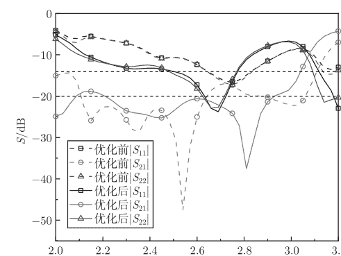

图 3.15 T 形邻近耦合馈电基站天线边缘形状优化前后 S 参数对比

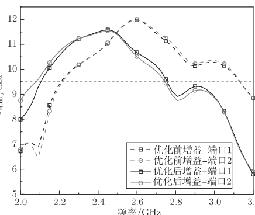

图 3.16 T 形邻近耦合馈电基站天线边缘形状优化前后增益对比

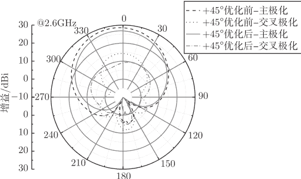

(a) +45°极化端口主极化与交叉极化增益方向图

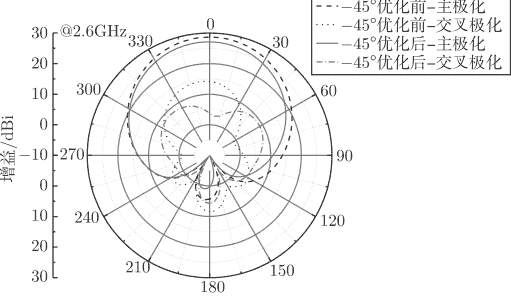

(b) -45°极化端口主极化与交叉极化增益方向图

图 3.17 T 形邻近耦合馈电基站天线边缘形状优化前后远场性能对比

#### 3.4.3 带通滤波器设计

如图 3.18 所示，采用经典微带交指结构设计带通射频滤波器。设计变量为 $x = [l_{11}, l_{2l}, l_{3l}, l_{4l}, l_{12y}, l_{23y}, l_{34y}]$，单位英寸 (1in=2.54cm)。变量下界 $x_L = [1.6, 1.6, 1.6, 1.6, 0.2, 0.26, 0.26]$，上界 $x_U = [1.9, 1.9, 1.9, 1.9, 0.22, 0.3, 0.3]$。优化目标：1.08~2GHz 带内 $|S_{11}| < -15\text{dB}$；带外 0.6~1GHz 及 2.1~2.4GHz 段 $|S_{21}| < -15\text{dB}$。分别用高斯过程回归 (GPR) 对 $S_{11}$、$S_{21}$ 建立代理模型，输出为目标频带内最大值。这是一个多目标问题，适应度函数构造为式 (3.31) 所示，将多目标转化为单目标优化：
$$ y = \arg \max_x \left( \frac{|\tilde{S}_{11}(x)| - |\tilde{S}_{11}|}{|\tilde{S}_{11}|}, \frac{|\tilde{S}_{21}(x)| - |\tilde{S}_{21}|}{|\tilde{S}_{21}|} \right) \tag{3.31} $$
其中 $|\tilde{S}_{11}(x)|$、$|\tilde{S}_{21}(x)|$ 为预测值，$\tilde{S}$ 为目标值。

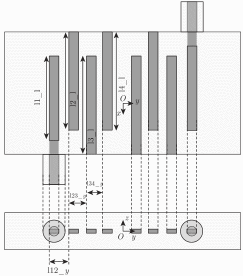

图 3.18 交指型带通射频滤波器拓扑结构

本例 MLAO 初始样本数设为 35。图 3.19 对比了 MLAO 与单纯遗传算法 (GA) 的优化效果。GA 需 456 代才使带内 $|S_{11}|$ 达标，此时带内 $|S_{21}|$ 最大值仅 -13.6dB，耗时 12.7h。MLAO 仅 44 代即达到同等水平：带内 $|S_{11}|$ 最大值 -16.2dB，$|S_{21}|$ 最大值 -14.3dB，含采样在内总耗时 2.3h。这充分证明 MLAO 在滤波器设计中能大幅提升优化效率。相关源码详见附录 A。

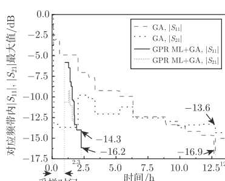

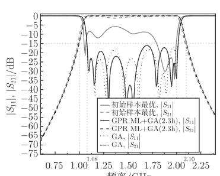

(a) 优化迭代收敛曲线

(b) 优化前后 S 参数对比

图 3.19 带通射频滤波器优化过程及结果对比

### 3.5 本章小结

本章系统阐述了机器学习辅助优化 (MLAO) 的基础框架，详解常用代理建模算法与全局优化器；通过分形贴片天线、基站阵列天线、带通滤波器三个典型案例，直观验证了 MLAO 相较传统优化方法的显著优势。

## 天线智能设计

在 MLAO 框架下，为进一步压降计算开销，多保真度机器学习方法被引入天线等微波器件的设计优化。低保真度模型可为经验公式、等效电路模型等。针对结构复杂的天线，低保真度模型通常指网格粗糙化的全波仿真模型——虽精度有限，但计算耗时远低于高保真模型。多保真度机器学习通过挖掘不同保真度间的映射关系，融合少量高保真数据与大量低保真数据构建代理模型，显著缩短样本获取周期同时保证建模精度。在代理模型在线迭代更新的优化框架中，每轮迭代后均将新增全波仿真结果加入训练集以提升模型精度。新增样本点的选择策略至关重要，需在“预测良好的局部区间”（当前模型最接近目标区域）与“未充分探索的全局区间”（样本稀疏、预测不确定区域）间权衡。未知区间的量化可基于预测点与样本点距离，或利用代理模型提供的预测不确定性。高斯过程回归 (GPR) 因能同时输出预测值与不确定度，在天线优化领域应用极广。基于预测值与不确定度的多种预筛选策略被广泛采用，其中置信下限 (LCB) 策略通过线性组合预测值与不确定度作为进化算法适应度，有效平衡全局探索与局部开采。

本章将依次介绍：多精度电磁仿真方法、协作式机器学习辅助建模方法、多路径机器学习原理与关键步骤、置信下限预筛选策略、多保真度机器学习算法，最后给出测试函数与实测天线的仿真对比结果。

### 4.1 多精度电磁仿真

低保真度模型是多保真度 MLAO 的基石。微波滤波器领域常用等效电路模型作为低保真模型 [34]；但复杂天线难以提取等效电路，低保真模型通常退而求其次采用降精度的全波仿真模型 [35]。获取低保真全波模型的四种常用途径：

- (1) 降低网格密度、放松收敛判据；
- (2) 缩小计算域（如压缩空气盒尺寸）；
- (3) 以理想导体 (PEC) 替代实体金属，忽略金属厚度；
- (4) 忽略介质损耗与色散特性。

低保真模型的选择关乎成败，主要权衡两方面：其一，模型越粗糙仿真越快，但精度下降会拖累多保真代理模型精度，导致需更多迭代才能收敛，每轮迭代对应一次昂贵的高保真仿真，总计算开销反增；其二，精细模型单次仿真虽贵，但可能因精度高而大幅减少迭代次数 [35]。文献 [36] 指出高保真仿真耗时通常为低保真的 10~50 倍，同时低保真响应必须保留高保真模型的关键特征 [35]。

### 4.2 协作式机器学习辅助建模

本节详述一种基于多级协作式机器学习的天线快速多目标建模方法 [37]。该方法流程见图 4.1，核心逻辑为：先用低保真仿真大量采样获取首个设计目标响应数据集，再用高保真仿真少量采样获取首个及其它设计目标响应数据集；继而利用多种 ML 手段学习不同保真度间、不同设计目标间的耦合关系，预测生成高保真辅助数据集；最后基于辅助数据集建立天线尺寸参数到各设计目标的廉价代理模型，实现多目标快速建模。具体包含四步：

**步骤 1：构建训练数据集。** 用第一种仿真法（低保真、低耗时）获得第一类样本点处首个设计目标响应集 $D^1_{coarse}$；用第二种仿真法（高保真、高耗时）在从第一类中随机抽取的较少第二类样本点上，获得首个目标响应集 $D^1_{fine}$ 与第二目标响应集 $D^2_{fine}$。

**步骤 2：跨保真度建模，生成首个目标的高保真辅助数据集。** 利用 ML 学习 $D^1_{fine}$ 与 $D^1_{coarse}$ 的映射关系，得第一代理模型 $R^1_{AMGP}$，表征跨保真映射。用该模型预测第一类样本点处的高保真值 $D^1_{pre,fine}$，形成高保真辅助数据集。

**步骤 3：跨目标建模，生成第二目标的高保真辅助数据集。** 利用 ML 学习步骤 1 得到的 $D^2_{fine}$ 与步骤 2 预测的 $D^1_{pre,fine}$ 间的关系，得第二代理模型 $R^{1,2}_{SMGP}$。用其预测第一类样本点处第二目标的高保真值 $D^2_{pre,fine}$，形成第二高保真辅助数据集。

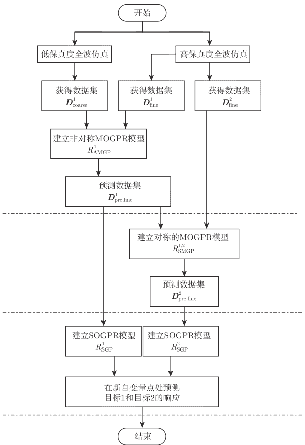

图 4.1 多级协作式机器学习天线快速多目标建模流程图

**步骤 4：建立参数-目标代理模型。** 利用步骤 2、3 得到的两套辅助数据集 $D^1_{pre,fine}$、$D^2_{pre,fine}$，学习天线尺寸参数与两个设计目标的映射，得廉价代理模型 $R^1_{SGP}$、$R^2_{SGP}$，可用于新设计点的精准响应预测。

具体实施中，设计目标可为 S 参数、增益、3dB 波瓣宽度、方向性、轴比或圆极化增益等。步骤 1 中第一种仿真可为低保真全波、经验/理论公式或电路仿真；第二种为高保真全波；样本点在参数设计空间内随机采样。步骤 2 可用非对称多目标 GPR (MOGPR) 或神经网络学习 $D^1_{fine}$ 与 $D^1_{coarse}$ 关系并预测 $D^1_{pre,fine}$；步骤 3 用对称 MOGPR 或神经网络学习 $D^2_{fine}$ 与 $D^1_{pre,fine}$ 关系预测 $D^2_{pre,fine}$；步骤 4 用单目标 GPR 或神经网络学习参数到目标的映射。

相比现有 ML 方法，多级协作式机器学习优势显著：

- (1) 通过建模跨保真度与跨目标关系，大幅削减高保真训练样本需求，快速构建高精度代理模型，降低算力与时间成本。
- (2) 分级建模策略产出高保真辅助数据集，进而建立参数-目标精准代理模型，实现对天线多目标性能的高保真预测。

### 4.3 多路径机器学习辅助优化策略

#### 4.3.1 基于置信下限的预筛选机制

初始代理模型往往仅凭寥寥数个样本构建，精度难以支撑直接优化。因此，必须采用序贯加点策略，通过迭代不断补充样本、逼近目标。在这一过程中，数据预筛选技术是指引新增样本落点的关键。置信下限（LCB）策略便是典型代表，它通过预测值与不确定性的线性加权，为最小化问题构建评价指标：

$$y_{\text{LCB}}(\boldsymbol{x}^*) = \tilde{y}(\boldsymbol{x}^*) - \omega s(\boldsymbol{x}^*), \quad 0 \leqslant \omega \leqslant 3$$

其中，$\tilde{y}(\boldsymbol{x}^*)$ 为高斯过程回归（GPR）给出的预测均值，$s(\boldsymbol{x}^*)$ 代表预测标准差，$\omega$ 为调控探索与开发平衡的控制因子。

**核心量的计算逻辑：**
预测均值 $\tilde{y}$ 依赖于观测数据 $\boldsymbol{y}$ 与相关矩阵 $\boldsymbol{C}$ 的交互（公式 4.2）；预测方差 $s^2$ 则量化了预测点相对于已知样本的“陌生程度”（公式 4.3）。相关矩阵 $\boldsymbol{C}$ 及向量 $\boldsymbol{r}$ 通过核函数（公式 4.6）构建，该函数引入超参数 $\boldsymbol{\theta}$ 表征各维度敏感度，$\boldsymbol{p}$ 描述函数平滑度。

**$\omega$ 的博弈艺术：**
- **小 $\omega$**：算法贪婪地聚焦当前预测最优区域，收敛快但易陷局部最优；
- **大 $\omega$**：算法倾向探索样本稀疏的“未知疆域”，增强全局搜索能力。

**两种极端场景的几何直觉：**
1. **远离已知样本**：$\boldsymbol{r} \approx \boldsymbol{0}$，不确定性达最大值 $\hat{\sigma}$，模型“毫无头绪”；
2. **重合于已知样本**：$\boldsymbol{r}$ 退化为单位向量，不确定性 $s=0$，模型“绝对自信”。

简而言之，LCB 利用不确定性 $s$ 随距离衰减的特性，动态平衡“深挖已知”与“拓展未知”。

#### 4.3.2 多保真度高斯过程回归：两大进阶范式

针对高保真仿真昂贵、低保真近似廉价的矛盾，介绍两种融合异构数据的 GPR 扩展算法。

**范式一：协同克里金——线性修正思想**
文献 [41] 提出的 Co-Kriging 假设高低保真度存在线性映射关系。仅以双保真度为例，构建流程为“双层级串联”：
1.  **底层模型 $U_1^s$**：仅用低保真数据 $\mathbb{D}_L$ 训练标准 GPR，捕捉全局趋势；
2.  **顶层模型**：建模残差 $y_D = U_H(\boldsymbol{X}_H) - \rho U_L(\boldsymbol{X}_H)$。此处 $\rho$ 为缩放因子，通过最大化边际似然（公式 4.11）估计。

预测时，将高低保真数据拼接为联合向量 $\boldsymbol{y}$，构建分块协方差矩阵 $\boldsymbol{C}$（含交叉相关项 $\hat{\rho}\boldsymbol{C}_L$ 与残差协方差项），最终输出高保真预测均值与方差（公式 4.12-4.17）。其本质是用廉价低保真模型提供“底图”，用稀疏高保真数据修正“偏差”。

**范式二：非线性信息融合 MF-GPR——深度嵌入思想**
受深度学习启发，文献 [42] 提出打破线性假设，学习复杂非线性映射。训练同样分两阶段，但数据流向更灵活：
1.  **阶段一**：低保真数据 $\mathbb{D}_L$ 训练基座模型 $U_1^s$；
2.  **阶段二**：构建增强输入 $\tilde{\boldsymbol{X}}_H = [\boldsymbol{X}_H, U_1^s(\boldsymbol{X}_H)]$，即将基座模型在高保真点的预测值作为新特征，训练修正模型 $U_2^s$。

**预测采用“蒙特卡洛式”三步走：**
1.  基座模型预测待测点 $\boldsymbol{x}^*$，得均值 $\hat{y}_L$ 与标准差 $\hat{s}_L$；
2.  生成 $I$ 组标准正态扰动 $v_i \sim \mathcal{N}(0,1)$，构造 $I$ 个扰动后的低保真预测值 $\hat{y}_L + v_i \hat{s}_L$；
3.  将 $[\boldsymbol{x}^*, \hat{y}_L + v_i \hat{s}_L]$ 输入修正模型 $U_2^s$，得到 $I$ 组高保真预测分布；
4.  最终预测均值取样本均值（公式 4.19），总不确定性 = 预测方差均值 + 预测均值方差（公式 4.20），显式分离了认知不确定性与数据噪声。

此法将低保真预测的不确定性显式传播至高保真层，更稳健地量化了多源信息融合的风险。

#### 4.3.3 MB-MLAO 算法：多路径协同优化闭环

本节核心贡献——多路径机器学习辅助优化（MB-MLAO）算法，集成上述多保真建模与自适应预筛选，构建“低成本探索、高精度开发”的智能搜索框架（流程见 图 4.2）。关键创新点在于：
- **多保真加速**：利用低保真模型广撒网，高保真模型精修正，大幅压缩计算预算；
- **自适应 LCB 策略**：引入一组 LCB 因子 $\boldsymbol{\omega} = \{\omega_i\}$，而非单一值，同步驱动多条搜索路径，天然平衡全局探索与局部开发；
- **再训练与再预测机制**：迭代中动态更新模型，修正预测偏差，防止模型失真误导搜索。

**算法启动阶段（步骤 1）：**
1.  明确设计空间 $[a,b]^K$、目标函数、高低保真预算 $N_H, N_L$ 及 LCB 因子集合 $\boldsymbol{\omega}$（含 $M$ 个取值）；
2.  采用拉丁超立方采样（LHS）在空间内均匀布设 $N_L$ 个初始低保真样本点 $\boldsymbol{X}_L$，为后续多保真建模奠定基础。

[后续步骤将详述迭代循环中的路径选择、模型更新及收敛判断逻辑……]

## 多路径机器学习优化算法：流程详解与性能验证

### 核心流程：五步构建高效优化闭环

**步骤 2：初始样本采集与双保真度仿真**
首先，调用低保真度全波仿真模型 $U_{\mathrm{L}}$ 对初始设计空间 $\boldsymbol{X}_{\mathrm{L}}$ 进行批量计算，获取低保真响应集 $\boldsymbol{R}_{\mathrm{L}}$。随后，从 $\boldsymbol{X}_{\mathrm{L}}$ 中随机抽取 $N_{\mathrm{H}}$ 个样本组成高保真样本集 $\boldsymbol{X}_{\mathrm{H}}$，并利用高保真模型 $U_{\mathrm{H}}$ 完成精确仿真，得到高保真响应 $\boldsymbol{R}_{\mathrm{H}}$，为后续建模奠定数据基础。

**步骤 3：非线性融合代理模型构建**
基于前序章节提出的非线性信息融合多保真度高斯过程回归算法，利用上述高低保真样本对进行训练，快速建立一个计算开销极小的代理模型 $U_{\mathrm{S}}$，用于替代昂贵的全波仿真。

**步骤 4：多路径全局优化搜索**
引入遗传算法等全局优化器，以代理模型 $U_{\mathrm{S}}$ 为适应度评估环境。适应度函数定义为：
$$F(\boldsymbol{x}_i) = \min_{\boldsymbol{x}_i} \{ \tilde{y}(\boldsymbol{x}_i) - \omega_i \hat{s}(\boldsymbol{x}_i) \}, \quad i = 1, 2, \cdots, M \tag{4.21}$$
通过设定 $M$ 组不同的 LCB 探索系数 $\omega_i$，并行搜索 $M$ 条独立优化路径，最终获得 $M$ 组最优参数候选集 $\boldsymbol{X}_{\mathrm{S}}$。

**步骤 5：低保真验证与模型增量更新**
为平衡精度与成本，不对候选集 $\boldsymbol{X}_{\mathrm{S}}$ 直接进行高保真仿真，而是先用低保真模型 $U_{\mathrm{L}}$ 完成全波仿真。将这 $M$ 组新增的低保真数据注入训练集，对代理模型进行再训练，得到更新后的模型 $U_{\mathrm{S}}^{\text{new}}$。

**步骤 6：再预测筛选与自适应高保真验证**
利用更新模型对候选集 $\boldsymbol{X}_{\mathrm{S}}$ 进行再预测。得益于新增低保真数据的约束，预测精度通常显著提升。从中选出再预测值最优对应的单组参数 $\boldsymbol{X}_{\mathrm{b}}$，执行高保真全波仿真。若满足迭代上限或收敛目标则终止；否则扩充数据集，回溯至步骤 3 继续迭代。

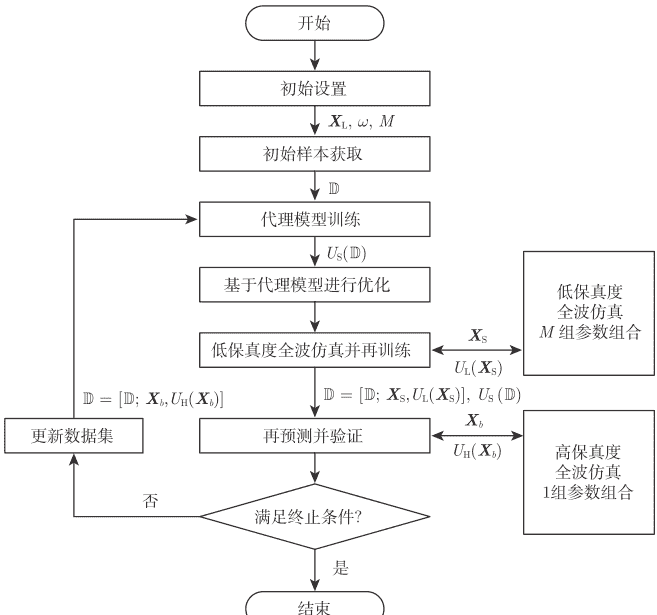

### 4.4 基准测试函数实验：量化算法优势

为直观对比多路径 (MB-MLAO) 与单路径 (SB-MLAO) 策略的性能差异，选取两类典型 K 维多保真度测试函数：

*   **函数 1（多模态）**：K 维 Ackley 函数，$K \in \{5, 10, 20\}$，参数 $b=1.3$，系数向量 $\boldsymbol{a}$ 包含 20 个预设数值。
*   **函数 2（单模态）**：K 维 Ellipsoid 函数，$K \in \{5, 10\}$，系数向量 $\boldsymbol{a}$ 包含 10 个预设数值。

```
\begin{cases} y_\text{H} = -20 \exp \left\{ -\frac{1}{5} \sqrt{\frac{1}{K} \sum_{k=1}^K (x_k - a_k)^2} \right\} - \exp \left\{ \frac{1}{K} \sum_{k=1}^K \cos(2b\pi(x_k - a_k)) \right\} \\ +20 + \exp \{1\} \\ y_\text{L} = -20 \exp \left\{ -\frac{1}{5} \sqrt{\frac{1}{K} \sum_{k=1}^K x_k^2} \right\} - \exp \left\{ \frac{1}{K} \sum_{k=1}^K \cos 2\pi x_k \right\} + 20 + \exp \{1\} \end{cases}
```
```
\begin{cases} y_\text{H} = \sum_{k=1}^K k(x_k - a_k)^2 \\ y_\text{L} = \sum_{k=1}^K k x_k^2 \end{cases}
```

#### 预实验：低保真数据对预测精度的正向修正作用
参考文献 [43] 表明，co-Kriging 等线性融合方法高度依赖高低保真相关性：相关性强时低保真数据助力大，弱时反而可能拖累精度。而本文采用的非线性融合算法在弱相关场景下依然表现稳健。

为验证“获取预测点低保真数据 $\to$ 重训练 $\to$ 再预测”这一机制的有效性，针对函数 1 的 5/10/20 维情况，每组独立重复 10 次实验（每次 200 测试样本）。**案例 1** 直接预测；**案例 2** 先补充该点低保真数据再重训练预测（仅多 1 个低保真样本）。

结果见表 4.1 与图 4.3。统计数据显示，案例 2 的归一化均方误差 (NMSE) 平均值全维度均低于案例 1，且预测分布更聚集于理想对角线附近（图 4.3 中方块 vs 圆点，浅/深阴影为 95% 覆盖区）。虽个别样本出现精度下降（如图 4.3(b)(e) 圈出点），但整体统计规律确证了该机制的正向价值。

#### 表 4.1 函数 1 实验设置与 NMSE 统计均值

| 维度与搜索域 | $N_H$ | $N_L$ | 案例 1 (直接预测) | 案例 2 (增量更新后预测) |
| :--- | :---: | :---: | :---: | :---: |
| $[-3, 3]^5$ | 20 | 100 (101) | 0.1082 | **0.0942** |
| $[-3, 3]^{10}$ | 20 | 100 (101) | 0.0769 | **0.0702** |
| $[-3, 3]^{20}$ | 50 | 100 (101) | 0.0626 | **0.0446** |

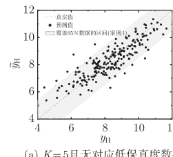 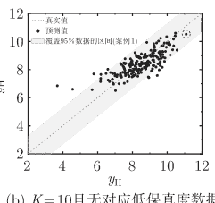 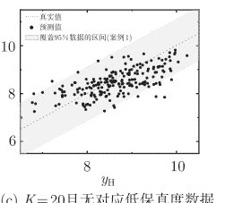 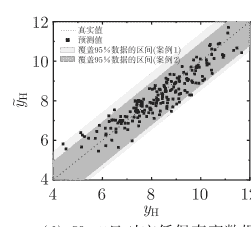 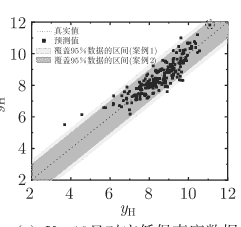 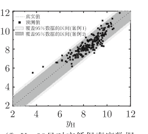

#### 图 4.3 函数 1 真实值与预测值对比散点图

#### 正式对实验：等计算预算下的优化性能对决
设高保真仿真耗时 $\tau_{HF}$，低保真耗时 $\tau_{LF}$，训练/优化耗时分别为 $\tau_{train}, \tau_{opti}$，满足特定比例关系。

```
\(\tau_{HF} = 20\tau_{LF}, \tau_{train} = 0.2\tau_{LF}, \tau_{opti} = 0.5\tau_{LF}\) (4.24)
```

总耗时模型为：
$$\tau_{\text{total}} = \tau_{\text{initial}} + \rho \cdot I \cdot \tau_{LF} \quad \text{(简化表达见 PRE10)}$$
```
\(\tau_{total} = \tau_{initial} + I(M\tau_{LF} + \tau_{HF} + \rho\tau_{train} + M\tau_{opti})\) (4.25)
```

其中 $\rho$ 为路径系数：SB-MLAO 取 1，MB-MLAO 取 2（含双保真交互开销）。$M$ 为并行路径数，$I$ 为迭代次数。

**公平比较策略**：固定总时间预算 $\tau_{\text{total}}$ 相等。
*   函数 1：设 $I_S=100$，$M=\{3,4,5\}$ $\Rightarrow$ 对应 $I_M \le \{87, 82, 77\}$。
*   函数 2：设 $I_S=50$，$M=\{3,4,5\}$ $\Rightarrow$ 对应 $I_M \le \{43, 41, 38\}$。

对比结果汇总于图 4.4（10 次独立运行，展示中位数、最优/最差值、四分位跨距 $Q_1/Q_3$）。

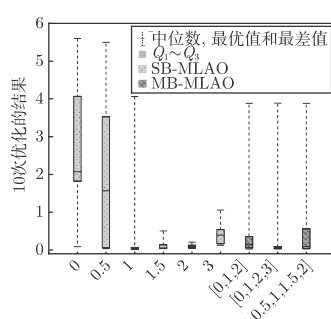 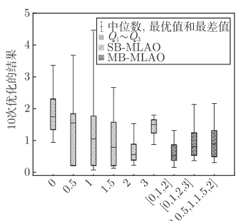 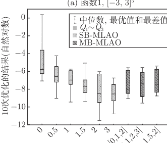 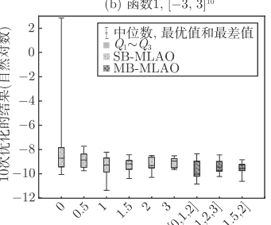

#### 图 4.4 10 次优化结果统计分布箱线图

#### 结果深度解读
**表 4.2 (函数 1) 与 表 4.3 (函数 2) 关键发现：**

1.  **高维更优，低维不弱**：10 维问题上 MB-MLAO 全面超越 SB-MLAO；5 维问题在 $\omega=1.5, 2, 3$ 时表现优异，且多路径策略 ($\omega \in [0,1,2]$ 等组合) 效果接近单一最优 $\omega$，显著优于 $\omega=0, 0.5$ 等劣质参数。
2.  **免调参鲁棒性**：SB-MLAO 对 LCB 系数 $\omega$ 高度敏感，选错即陷入局部最优或收敛缓慢，鲁棒性差。MB-MLAO 通过多路径并行隐式覆盖了探索-利用谱，**完全省去了 $\omega$ 的手工调节**，在不同维度、不同模态复杂度下均保持高效稳定。

#### 表 4.2 函数 1 优化结果统计 (均值 ± 标准差)

| $\omega$ 设定 | 5 维均值 | 5 维标准差 | 10 维均值 | 10 维标准差 |
| :--- | :---: | :---: | :---: | :---: |
| 0 | 2.75 | 1.77 | 1.87 | $7.08\times10^{-1}$ |
| 0.5 | 2.08 | 1.90 | 1.46 | 1.12 |
| 1 | $4.71\times10^{-1}$ | 1.27 | 1.38 | 1.36 |
| 1.5 | $1.30\times10^{-1}$ | $1.56\times10^{-1}$ | 1.01 | $9.15\times10^{-1}$ |
| **2** | **$9.79\times10^{-2}$** | **$5.02\times10^{-2}$** | **$6.67\times10^{-1}$** | **$4.07\times10^{-1}$** |
| 3 | $4.13\times10^{-1}$ | $2.88\times10^{-1}$ | 1.46 | $2.79\times10^{-1}$ |
| [0, 1, 2] | $6.21\times10^{-1}$ | 1.21 | $6.23\times10^{-1}$ | $3.51\times10^{-1}$ |
| [0, 1, 2, 3] | $4.39\times10^{-1}$ | 1.21 | $9.75\times10^{-1}$ | $5.99\times10^{-1}$ |
| [0, 0.5, 1, 1.5, 2] | $5.78\times10^{-1}$ | 1.18 | 1.01 | $6.25\times10^{-1}$ |

#### 表 4.3 函数 2 优化结果统计 (均值 ± 标准差)

| $\omega$ 设定 | 5 维均值 | 5 维标准差 | 10 维均值 | 10 维标准差 |
| :--- | :---: | :---: | :---: | :---: |
| 0 | $2.95\times10^{-1}$ | $6.09\times10^{-1}$ | 1.82 | 5.37 |
| 0.5 | $3.09\times10^{-3}$ | $4.25\times10^{-3}$ | $1.69\times10^{-4}$ | $1.16\times10^{-4}$ |
| 1 | $1.38\times10^{-3}$ | $1.15\times10^{-3}$ | $1.08\times10^{-4}$ | $7.79\times10^{-5}$ |
| 1.5 | $1.15\times10^{-3}$ | $1.89\times10^{-3}$ | $1.05\times10^{-4}$ | $5.60\times10^{-5}$ |
| 2 | $7.71\times10^{-4}$ | $1.02\times10^{-3}$ | $1.13\times10^{-4}$ | $6.02\times10^{-5}$ |
| **3** | **$3.91\times10^{-4}$** | **$4.24\times10^{-4}$** | **$1.26\times10^{-4}$** | **$4.96\times10^{-5}$** |
| [0, 1, 2] | $1.23\times10^{-3}$ | $1.48\times10^{-3}$ | **$7.96\times10^{-5}$** | **$7.15\times10^{-5}$** |
| [0, 1, 2, 3] | $1.19\times10^{-3}$ | $1.39\times10^{-3}$ | $9.72\times10^{-5}$ | $5.55\times10^{-5}$ |
| [0, 0.5, 1, 1.5, 2] | $1.66\times10^{-3}$ | $1.73\times10^{-3}$ | $7.84\times10^{-5}$ | $3.46\times10^{-5}$ |

---

### 4.5 工程落地：三大天线实例验证实战威力

将 MB-MLAO 应用于超宽带平面偶极子、三频贴片、毫米波车载雷达阵列三类天线设计。

#### 4.5.1 超宽带平面偶极子天线 (天线 1)
**几何拓扑与设计空间**：结构见图 4.5，6 维设计变量 $\boldsymbol{x}=[l_0, w_0, a_0, l_p, w_p, s_0]$ (单位 mm)，边界约束 $x_L=[18,12,0.3,12,5,0.8]$, $x_U=[20,14,0.7,14,7,1.2]$。

**保真度模型定义**：低保真模型采用粗糙网格全波仿真。网格密度对反射系数精度与仿真时长的权衡曲线见图 4.6。

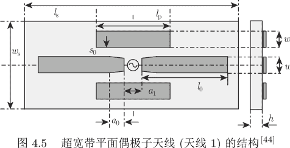

#### 4.5 典型天线优化案例验证

**4.5.1 超宽带平面偶极子天线**

高保真全波模型 $U_H$ 耗时 1600 秒。$U_{L1}$ 精度太低，无法刻画 $U_H$ 特征；$U_{L3}$ 与 $U_{L4}$ 响应高度一致，均能精准复现高保真特征，但 $U_{L4}$ 耗时是 $U_{L3}$ 的两倍，故选 $U_{L3}$ 作为主力低保真模型更划算。$U_{L2}$ 虽比 $U_{L3}$ 粗糙，却更快。后续优化同时启用 $U_{L2}$ 与 $U_{L3}$ 两套低保真模型。优化指标：3–11 GHz 频段内 $|S_{11}|$ 峰值优于 -10 dB。

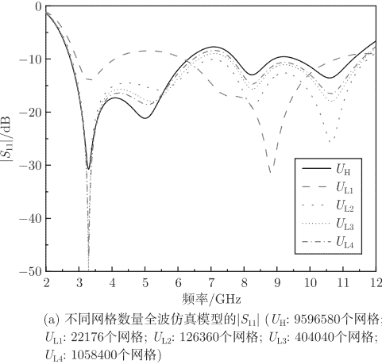


(b) 各网格配置对应的仿真耗时 ($U_H$: 1600s; $U_{L1}$: 31s; $U_{L2}$: 43s; $U_{L3}$: 82s; $U_{L4}$: 176s)

图 4.6 超宽带平面偶极子天线在 CST 全波仿真软件 [45] 中的结果

先用拉丁超立方采样得到 $N_L = 40$ 个低保真初始样本 $\boldsymbol{X}_L$，再从中挑选 $N_H = 5$ 个作为高保真样本。把初始样本送入全波仿真获取反射系数，取频带内最大值作为代理模型输出完成训练。优化适应度函数定义为

$$f(\boldsymbol{x}_i) = \min_{\boldsymbol{x}_i} \{ \tilde{R}_S(\boldsymbol{x}_i) - \omega_i R_S^c(\boldsymbol{x}_i) \}, \quad i = 1, 2, \cdots, M \quad (4.27)$$

式中 $\tilde{R}_S(\boldsymbol{x}_i)$ 为预测值，$R_S^c(\boldsymbol{x}_i)$ 为预测不确定度。终止条件：达标或迭代 50 次。

图 4.7(c)、(f)、(i) 展示 MB-MLAO 每次迭代中高保真验证对应的 LCB 变量。MB-MLAO 采用多 LCB 变量 $\omega = [0, 1, 2]$，对比传统 SB-MLAO 的固定 $\hat{\omega} \in \{0, 1, 2\}$。图 4.7 给出不同初始样本、不同低保真模型下的收敛曲线与 $|S_{11}|$。其中 (a)–(c) 与 (d)–(f) 均用 $U_{L2}$，初始样本分别为 $\boldsymbol{X}_L^1, \boldsymbol{X}_H^1$ 与 $\boldsymbol{X}_L^2, \boldsymbol{X}_H^2$；(g)–(i) 用 $U_{L3}$，初始样本为 $\boldsymbol{X}_L^1, \boldsymbol{X}_H^1, \boldsymbol{X}_H^L$。图 4.7(a) 中 SB-MLAO ($\hat{\omega}=2$) 最优，但 (d) 与 (g) 中 $\hat{\omega}=2$ 却最差。本例中 MB-MLAO 在所有配置下均能在 9 小时内达标，而 SB-MLAO 性能高度依赖 LCB 常数选取，说明自适应选择 LCB 的 MB-MLAO 收敛更稳健。


(g) 采用 $\mathbf{X}_\text{L}^1$、$\mathbf{X}_\text{H}^1$、$U_\text{L3}$ 配置的迭代收敛过程

(h) 采用 $\mathbf{X}_\text{L}^1$、$\mathbf{X}_\text{H}^1$、$U_\text{L3}$ 配置的反射系数

(i) 采用 $\mathbf{X}_\text{L}^1$、$\mathbf{X}_\text{H}^1$、$U_\text{L3}$ 配置的LCB变量值

图 4.7 不同优化方法对天线 1 的收敛曲线、反射系数及 MB-MLAO 高保真验证对应的 LCB 变量值

**4.5.2 三频贴片天线**

图 4.8 给出三频贴片天线（天线 2）结构与几何参数，$w_\text{stub}=2\text{mm}$，设计变量 $\boldsymbol{x}=[l_2, l_{s1}, l_{s2}, l_{s3}, w_{s1}, w_{s2}, l_p, w_p, l_\text{stub}]$（单位 mm），下界 $\boldsymbol{x}_\text{L}=[5,19,20,5,0.2,1.5,32,31,16]$，上界 $\boldsymbol{x}_\text{U}=[9,26,25,7.5,2.2,2.5,35,34,20]$。高保真模型约 200 万网格，耗时约 960 s；低保真模型约 10.9 万网格，耗时约 94 s。两保真度 $|S_{11}|$ 曲线见图 4.9。低保真样本 $N_L=50$。定义高低保真样本比 $R_{\text{H,L}}=(N_H/N_L)\times100\%$，本例取 $R_{\text{H,L}}\in\{10\%,20\%\}$ 即 $N_H\in\{5,10\}$ 对比两算法。


图 4.8 三频贴片天线 (天线 2) 结构 [46]


图 4.9 三频贴片天线 (天线 2) 高低保真反射系数曲线

优化目标：2.5、3.5、5.2 GHz 三频点 $|S_{11}|$ 均优于 -10 dB。每频点建一代理模型 $U_j\ (j=1,2,3)$，输出对应频点 $|S_{11}|$。适应度函数设为

$$f(x_i) = \min_{x_i} \{ \max_j \{ \tilde{R}_{S,j}(x_i) - \omega_i R^s_{S,j}(x_i) \} \}, \quad (4.28)$$

式中 $i=1,2,\dots,M$；$\tilde{R}_{S,j}(\boldsymbol{x}_i)$ 为模型 $U_j$ 在 $\boldsymbol{x}_i$ 处的预测值；$R^s_{S,j}(\boldsymbol{x}_i)$ 为预测不确定性。

典型结果见图 4.10。$N_L=50,N_H=5$ 时，100 次迭代内仅 $\hat{\omega}=0$ 的 SB-MLAO 与 $\omega=[0,1,2]$ 的 MB-MLAO 达标（图 4.10(a)）。$N_L=50,N_H=10$ 时，$\hat{\omega}=0,1$ 的 SB-MLAO 与 MB-MLAO 均达标。两组实验中 MB-MLAO 性能与 $\hat{\omega}=0$ 的 SB-MLAO 接近，但最优 LCB 变量事先未知，且其选择直接影响结果——$\hat{\omega}=2$ 两次均失败。此外，高低保真数据配比变化时，MB-MLAO 收敛特性更稳定。天线 2 程序源码见附录 B。


图 4.10 不同优化方法对天线 2 的收敛曲线、反射系数及 MB-MLAO 高保真验证对应的 LCB 变量值

**4.5.3 毫米波车载雷达天线阵列**

图 4.11 给出毫米波车载雷达天线阵列（天线 3）结构与参数 [47]。本例利用 MB-MLAO 做最差情况搜索。毫米波器件尺寸小、加工容差要求严。最差情况分析：给定设计点及参数容差，寻找某性能指标最劣值 [48]。设计变量 $\boldsymbol{x}=[w_1,\dots,w_{12}]$（mm），设计点 $\boldsymbol{x}_0=[0.56,0.7,0.84,1.12,1.19,1.4,1.47,1.47,1.47,0.84,0.7,0.21]$（mm），输入容差 $\delta=[0.1,0.1,0.1,0.2,0.2,0.2,0.2,0.2,0.2,0.1,0.1,0.05]$（mm），搜索域 $\boldsymbol{x}_0\pm\delta$。高保真模型约 500 万网格，耗时约 0.5 h；低保真模型约 20.1 万网格，耗时约 163 s。两保真度归一化方向图见图 4.12。


图 4.11 毫米波车载雷达天线阵列（天线 3）结构 [46]


图 4.12 天线 3 两种保真度配置下的归一化方向图曲线

优化目标：在容差范围内寻找旁瓣电平 (SLL) 最大值。取负值转最小化，适应度函数设为

$$f(x_i) = \min_{x_i} \{-\tilde{R}_S(x_i) + \omega_i R_S^s(x_i)\} , \quad i=1, 2, \cdots, M. \quad (4.29)$$

先用 LHS 在设计点附近采 $N_L=50$ 个低保真样本，从中随机抽 $N_H=10$ 个高保真样本，并将设计点高低保真数据加入初始集。图 4.13(c) 为搜索过程高保真验证对应的 LCB 变量值。各方法结果见图 4.13。$\omega=[0,1,2]$ 的 MB-MLAO 与 $\hat{\omega}=2$ 的 SB-MLAO 结果相近，在 22.86 h 搜得最差值 -13.84 dB。$\hat{\omega}=0$ 的 SB-MLAO 最差，50 次迭代仅得 -17.10 dB；$\hat{\omega}=1$ 得 -16.26 dB，耗时 20.57 h；MB-MLAO 仅用 14.77 h 即达 -16.14 dB，接近 SB-MLAO 最好表现。本例中 LCB 设为 2 的搜索性能显著优于 0、1，而 MB-MLAO 无需预设即可自适应达到同等最优，验证了其更强的收敛稳定性。


(c) 迭代过程中的LCB变量值

图 4.13 不同方法对天线 3 最差情况搜索的收敛曲线、归一化方向图及 MB-MLAO 高保真验证对应的 LCB 变量值

#### 4.6 本章小结

本章先介绍多精度建模、多保真机器学习与置信下限预筛选策略，再详述多级协作式与多路径机器学习方法的思想与流程，并通过两个测试函数及三个天线案例验证 MB-MLAO 优势。该算法能平衡局部与全局搜索：利用 LCB 变量实现多路径优化，在当前最优区与稀疏采样区间权衡；引入多保真机器学习降低计算开销；采用再训练再预测策略提升预测精度，指导自适应选取参数组合做高保真验证。实验表明，面对不同特征、不同复杂度的问题，MB-MLAO 均展现出良好优化效果与强稳定性。

## 阵列智能设计

本章探讨一种知识与数据混合驱动 (HKDT) 的天线阵列设计方法。区别于传统纯知识驱动或纯数据驱动的综合手段，HKDT 能快速高效建立阵列单元位置排布、单元间互耦及平台效应下的阵列性能关联，实现高效实战化阵列设计。引入先验物理知识与假设后，HKDT 将数据驱动过程限制在理论模型难以给出精确快速响应的场景，最大程度缓解数据驱动对算力的渴求。首先，HKDT 将天线阵列视为由有源元单元 (ABE) 构成的整体，统一不同位置、不同电磁环境下的单元，便于机器学习建模；其次，为破解阵列综合——尤其是面阵综合中海量角度方向图数据处理的算力瓶颈，HKDT 引入 ABE 辐射特性的平面虚拟子阵模拟优化，大幅降低 ABE 精确表征难度。本章将 HKDT 与经典 MLAO 协同，对多组线阵、面阵建模设计，验证方法有效性与优势。

### 5.1 经典阵列设计方法回顾

天线阵列由一系列相邻单元协同收发电磁波。相比单元，阵列可自由塑造波束形状，在指定方向形成特定波束指向或形态，提升通信性能。常见任务含高定向性、宽角扫描、自适应波束成型、多波束设计等。随 5G 大规模商用及 B5G/6G 研究推进，阵列设计日趋复杂：现代无线系统常处于复杂电磁环境，电路天线设计受尺寸等多维约束，需同时满足多/宽频段、增益、方向图、反射系数、互耦等指标。在此背景下，阵列综合与设计方法正经历深刻变革。

过去半个多世纪，研究者提出阵列综合理论 [49-51]、启发式优化 [52-55]、压缩感知 [56]、凸优化 [57,58]、迭代傅里叶 [59] 等精妙方法。这些多基于对阵列分析综合物理内涵的探索，属基于物理知识的设计范式。传统综合理论擅解规则阵低副瓣/波束成型，但面对非规则阵效率不高。启发式优化灵活、适应任意约束与任务，但收敛偏慢，限制大规模阵列应用。近年有工作将特定综合问题转为凸优化快速求解，收敛快但灵活性与扩展性存疑。

# 破解阵列设计困局：混合知识与数据驱动的新范式

传统基于物理知识的天线阵列设计手段，往往选择性忽略了阵元互耦与平台效应。但在现代无线通信与雷达系统中，这两大因素却是决定波束质量优劣的关键。全波电磁仿真虽能精准还原实况，却因计算开销巨大而难以大规模应用。近年来，学界尝试将全波仿真与物理优化算法融合，推出多种混合策略（参考文献[60-73]）。针对定位阵列，基于有源单元方向图（AEP）的建模路径成为主流：文献[68, 73]利用最小二乘AEP展开结合迭代FFT实现高效综合；文献[60, 63, 69]则通过迭代响应修正，用临近单元AEP近似替代，同步优化激励与位置。

归根结底，现有算法在兼顾互耦与平台效应时，仍难实现对阵元位置、激励的“自由调度”，核心瓶颈在于：如何快速、精准预测阵元在不同电磁环境下的AEP特性。

机器学习（ML）的引入为破局带来新思路。利用ML构建代理模型（MLAO），以低计算成本映射设计变量与目标，已成为加速收敛的数据驱动主流范式（参考文献[66,74-81]）。ANN、GPR、SVM等算法常被用于预测优化采样点响应。在天线阵列设计中，ML建立参数与性能的映射[7,62,67,70,79,85-89]，显著提升效能或效率。早期研究直接学习参数到互耦下性能的映射，属纯数据驱动；近期趋势转向以AEP为模型输出，结合阵列综合先验知识，降低算力门槛[62,67,70]。文献[62]用ANN建模可变位置下的AEP，实现微带阵列单/平顶波束设计。

然而，ML赋予的高自由度伴随高算力代价：文献[62,70]构建精准代理模型需近千次十单元全波仿真；文献[67]五单元阵列亦需286次仿真。算力消耗与模型精度构成天然矛盾。更棘手的是，现有数据驱动法难推广至实用平面阵：平面阵单元电磁环境更复杂，且角度维度数据量远超线阵，呈指数级增长。

---

## 典型平面阵列建模与挑战

以图5.1所示常见平面阵列为例，阵元分布于xOy平面，设计目标为优化位置与激励，实现定向、多波束或波束成型。


图 5.1 一种常用的平面阵列形式

实际环境中，单元辐射特性受互耦、平台等综合影响，定义为有源单元方向图 $g_n(\theta, \phi)$，表示第$n$个阵元在方位角$\phi$、俯仰角$\theta$处的辐射场强。阵元激励记为$\omega_n$。阵列远场方向图可表示为：

$$ f(u, v) = \sum_{n=1}^N g_n(u, v)\omega_n e^{j(u x_n + v y_n)} \quad (5.1) $$

其中 $u = 2\pi \sin \theta \cos \phi$，$v = 2\pi \sin \theta \sin \phi$，$x_n, y_n$ 为波长归一化坐标。设计关键在于：给定参数下，如何快速获取可靠辐射响应$f(u,v)$。因激励变化不影响AEP，问题简化为：给定阵元分布，如何快速获取可靠AEP。

如图5.2所示，知识驱动法忽略互耦平台效应换取效率；数据驱动法引入全波仿真与ML考虑上述效应，但算力需求高昂。本章提出的**HKDT（混合知识数据驱动）方法**，旨在精度前提下大幅提效，实现效能与效率的平衡。


图 5.2 相较于现有的知识驱动方法和数据驱动方法，HKDT 方法可以在保证精度的前提下提升效率

---

### 5.2 有源单元建模（ABEM）：从整体到个体的范式转移

本节首详述**基于有源单元建模（ABE Modeling, ABEM）**核心逻辑，并对比传统**基于阵列分布建模（Array Distribution Modeling, ADM）**，验证其有效性。后续将引入平面耦合区域分割、虚拟阵列拟合等知识驱动手段，与数据驱动融合，进一步拓展建模精度、效率与适用边界。

#### 5.2.1 核心思想：以“单元”为建模原语

以线阵为例阐释ABEM与ADM的本质区别。如图5.3所示，ADM将整体阵元排布作为输入，输出全阵列AEP与S参数。此法有双重短板：
1.  **定长困境**：训练集阵元数固定，模型仅能预测同规模阵列，泛化性为零。
2.  **信息孤岛**：同阵列不同位置单元信息割裂，未充分利用仿真数据，导致小样本下预测精度受限。


图 5.3 从传统的基于阵列分布的建模方法到 HKDT 所使用到的 ABEM 方法的演进

**ABEM则换道超车**：将阵列中每个单元视为同构的**有源单元实体（ABE）**。各ABE虽具相似物理本质，但因绝对位置、相对邻域环境、平台参数不同，呈现差异化AEP。

**输入构造**：绝对坐标$x_a$、平台参数$x_p$、相对邻域位置$x_{r,k}$。相对位置编码为：
$$ x_{r,k} = \begin{cases} 1/l_{r,k}, & \text{第}k\text{侧邻单元存在} \\ 0, & \text{不存在（等效无限远）} \end{cases} \quad (5.2) $$
$l_{r,k}$为间距，$k=1,\dots,K$。线阵需双向考量。该编码随距离衰减，边缘单元侧向置零，统一了内部与边缘单元在模型视角下的表征，最大化利用仿真数据；同时通过$K$控制邻域阶数，平衡复杂度与精度。

**训练集构建**：采集$M$组样本 $D = \{(u_m, y_m)\}_{m=1}^M$。
输入向量（$P$维）：
$$ u_m = [x_{a,m},\ x_{p,m},\ x_{r,m,1},\ \dots,\ x_{r,m,K},\ f_m,\ \theta_m]^T \quad (5.4) $$
输出向量：
$$ y_m = [E_{\text{mag},m},\ E_{\text{pha},m},\ S_m]^T \quad (5.5) $$
$f_m, \theta_m$为频率、角度采样点。$P = N_a + N_p + 2K + 2$。样本总量 $M = N \times M_{\text{fre}} \times M_{\text{ang}} \times M_{\text{sam}}$。

鉴于阵列综合典型小样本特性，选用单输出**高斯过程回归（GPR）**建模。以图5.4不规则平台微带阵列（10GHz，6-16单元可变，塑料螺栓固定）为验证平台，互耦与平台导致AEP差异显著，极适合验证ABEM鲁棒性。


图 5.4 带有不规则形状地板结构的微带天线阵列模型

---

#### 5.2.2 关键超参数敏感性分析

**1. 邻域阶数$K$的抉择**
$K$决定考虑双侧共$2K$个邻单元互耦。固定$M_{\text{sample}}=5$，阵元数6-16随机采样，8:2分训练/验证集（训练验证集均含可变阵元数）。GPR核函数用5/2 Matérn，以RMSE评估。

表5.1揭示规律：**$K=0$（忽略互耦）预测失效**；**$K=1$性能跃升显著**；$K\ge2$边际收益递减。故后续定$K=1$，以最小开销换最优性价比。

| K | AEP幅度 | AEP相位 | S参数 |
|---|---|---|---|
| 0 | 1.0690 | 0.1222 | 0.2450 |
| 1 | **0.2592** | **0.0409** | **0.1040** |
| 2 | 0.2413 | 0.0418 | 0.1022 |
| 3 | 0.2418 | 0.0405 | 0.0828 |
| 4 | 0.2494 | 0.0397 | 0.0828 |

**表 5.1 不同 $K$ 值下 ABEM 算法的 RMSE 比较**

**2. 训练集稀释系数$r_s$的权衡**
ABEM虽降低样本需求，但需学习全角域辐射信息，算力仍比参数优化高阶数。引入稀释系数$r_s$随机下采样训练集。设$M_{\text{ang}}=181, N=15, M_{\text{sample}}=5$，测试不同$r_s$（表5.2）。**$r_s$下降初期RMSE波动微小，过低则精度崩塌**。可选取“拐点”附近$r_s$（如0.05-0.1），大幅压缩训练规模且精度可控。

| $r_s$ | AEP幅度 | AEP相位 | $r_s$ | AEP幅度 | AEP相位 |
|---|---|---|---|---|---|
| 0.500 | 0.3590 | 0.0444 | 0.020 | 0.3355 | 0.0444 |
| 0.200 | 0.3224 | 0.0439 | 0.010 | 0.4381 | 0.0683 |
| 0.100 | 0.3275 | 0.0438 | 0.005 | 0.5117 | 0.0818 |
| **0.050** | **0.2320** | **0.0317** | 0.002 | 0.5621 | 0.1020 |

**表 5.2 不同 $r_s$ 值下 ABEM 算法的 RMSE 比较**

---

#### 5.2.3 跨尺度泛化能力验证：打破“定长诅咒”

ABEM核心优势在于**解耦阵元数与模型**。对比两种训练集：案例1*不含*目标阵元数$M_p=8$的数据（仅含6,7,9,10）；案例2*含*$M_p=8$数据（含6,7,8,9,10）。表5.3显示：两者预测$M_p=8$验证集的RMSE**统计无显著差异**。这有力证明：ABEM能预测训练集中**从未出现过**的阵元规模，实现真正的跨尺度泛化。

| 实验序号 | 幅度 案例1 | 幅度 案例2 | 相位 案例1 | 相位 案例2 |
|---|---|---|---|---|
| 1 | 0.3842 | 0.4815 | 0.0624 | 0.0537 |
| 2 | 0.3833 | 0.3325 | 0.0633 | 0.0435 |
| 3 | 0.4305 | 0.2900 | 0.0712 | 0.0467 |
| 4 | 0.4035 | 0.3325 | 0.0657 | 0.0461 |
| 5 | 0.4462 | 0.3086 | 0.0693 | 0.0453 |

**表 5.3 跨阵元数规模下的 ABEM 预测 RMSE 对比**

---

#### 5.2.4 正面交锋：ABEM vs ADM 建模实力对决

同训练集、同资源下，对比N=16阵列上的建模性能（图5.6）。ADM以整体排布为输入，受限于固定维度；ABEM以单元为粒度，数据利用率更高。结果显著：**ABEM在幅度、相位预测上均显著优于ADM**，尤其在相位精度上优势明显。这验证了“化整为零、共享邻域信息”的建模范式在小样本高维电磁建模中的本质优势。


(a) M=30时, 对幅度预测


(b) M=30时, 对相位预测


(c) M=40时, 对幅度预测


(d) M=40时, 对相位预测

---

**小结**：ABEM通过**单元级建模原语**、**相对邻域编码**、**GPR小样本回归**三大创新，解决了传统ADM“定长、孤岛、低效”三大顽疾，为后续HKDT方法在平面阵列中的高效落地奠定了坚实基础。

### 突破二维面阵建模瓶颈：HKDT混合驱动方法深度解析

**图 5.6 ABEM 与 ADM 在不同训练规模下的预测性能对决**

实验结果显示，ABEM 算法展现出显著的精度优势。这得益于其独特的建模视角：将全体阵元均视为在特定输入条件下的有源元单元（ABE），从而最大化地挖掘并利用全波仿真数据蕴含的信息量。以训练集规模 M=30 为例，ADM 处理幅度与相位的平均耗时均为 80.85s；而 ABEM 分别仅需 86.57s 与 77.02s。当 M 增至 40 时，ADM 耗时上升至 93.63s，ABEM 则为 87.19s 与 95.16s。对比可见，ABEM 能够在计算开销基本持平的前提下，实现对潜在设计点更为精准的预测。

#### 核心创新：知识与数据双驱动的 HKDT 建模范式

在前序研究（5.2.1 节）中，ABEM 通过泛化阵元概念，成功超越传统 ADM 方法，赋予了设计更高的自由度与预测精度。然而，其局限性也随之显现：首先，建模流程高度依赖对各辐射角度特性的学习，数据量激增会导致建模与预测速度急剧膨胀，严重拖累算法效能；更关键的是，直接移植至二维面阵场景面临双重困境：

1.  **参数化难题**：面阵环境下 ABE 的输入参数定义愈发复杂，周边单元的相对空间位置难以用寥寥数值量化。
2.  **维度灾难**：面阵需同时关注俯仰角与方位角，角度采样点数呈爆发式增长。以 GPR 为例，其 $O(n_d^3)$ 的训练复杂度使得海量训练集成为工程落地的拦路虎。

为破解上述难题，本文提出**知识和数据混合驱动（HKDT）建模方法**，融合平面耦合区域分割与平面虚拟子阵拟合两大知识驱动核心技术，重构二维面阵下的有源元单元建模流程（见图 5.7）。HKDT 将数据驱动的建模范围严格限定在 ABE 输入特征与虚拟子阵激励信息的映射关系上，充分释放电磁先验知识的约束力，实现计算复杂度的数量级跃降。

**图 5.7 HKDT 方法对二维面阵有源元单元建模流程示意**


**知识驱动的阵列综合理论**
- 有源单元方向图 1...N
- 方位角（角度）

**知识驱动的虚拟平面阵列拟合**
- 激励 1（相位）... 激励 N（相位）
- 平面虚拟阵列 1...N

**数据驱动建模**
- 有源单元 1...N

**知识驱动的平面耦合区域分割**


##### 步骤一：平面耦合区域分割—— 固定输入维度的几何约束

HKDT 首先锁定目标阵元作为 ABE，在其周围构建耦合影响区域。如图 5.8 所示，以耦合半径 $R_c$ 划定影响范围，并按方位角 $\phi$ 切分为 $M$ 个扇形区域。每个区域内，按与 ABE 的欧氏距离升序选取最近的 $K$ 个邻近单元；若不足 $K$ 个，则引入相对距离为无穷大的虚拟单元补齐。由此构造 ABE 的输入向量：

$$ l_n = [x_n, 1/r_n]^T \tag{5.7} $$

其中 $x_n$ 为绝对位置，$r_n$ 汇聚所有区域的相对距离信息（式 5.8）。引入倒数形式 $1/r_n$ 可巧妙处理远场虚拟单元（视为 0），保证参数连续性。通过预设 $K、M、R_c$ 等超参数，成功将 ABE 输入维度锁定为定值。

$$

\begin{cases} r_{m,1} < ... < r_{m,k-1} < r_{m,k} < R_c, k=1,2,\cdots,K \\ \phi_{m,k} \in [2(i_m-1)\pi/M, 2i_m\pi/M), i_m=1,2,\cdots,M \end{cases} \tag{5.6}

$$

**图 5.8 平面阵列耦合区域划分示意图**


##### 步骤二：平面虚拟子阵拟合—— 从角域到阵域的维度压缩

ABEM 直接以角度为输入建模 AEP，导致训练集规模 $W_{tra} = W_{ABE} W_f W_u W_v$ 随角度采样密度线性膨胀。例如典型面阵设计（5次迭代、20单元、1个频点、半球面 $1^\circ$ 间隔），$W_{tra}$ 高达 324 万，难以支撑快速迭代。

HKDT 借鉴文献 [90] 思路，将线阵 AEP 展开法推广至面阵，用等间距平面虚拟子阵的激励系数 $c_{n,p,q}$ 替代角度采样点表征辐射特性（式 5.11）。通过最小化拟合误差（式 5.12-5.13）求解激励向量，将原本高维的角度空间映射压缩为固定规模的虚拟阵列激励空间。

$$

E_n = \begin{bmatrix} e^{j\beta(-\frac{Q-1}{2}du_1-\frac{P-1}{2}dv_1)} & \cdots & e^{j\beta(\frac{Q-1}{2}du_1+\frac{P-1}{2}dv_1)} \\ \vdots & \ddots & \vdots \\ e^{j\beta(-\frac{Q-1}{2}du_k-\frac{P-1}{2}dv_s)} & \cdots & e^{j\beta(\frac{Q-1}{2}du_k+\frac{P-1}{2}dv_s)} \end{bmatrix} \tag{5.14}

$$
$$

c_n = [c_{n, -\frac{Q-1}{2}, -\frac{P-1}{2}}, \cdots, c_{n, \frac{Q-1}{2}, \frac{P-1}{2}}]^T \tag{5.15}

$$
$$

g_n = [g_n(u_1, v_1), \cdots, g_n(u_k, v_s)]^T. \tag{5.16}

$$

求解得最优激励系数：

$$

c_n = (Z_n^H Z_n)^{-1} Z_n^H g_n. \tag{5.17}

$$

其中 $Z_n = G E_n$。至此，ABE 辐射特性由向量 $c_n$ 完整表征。

$$

D_{app,t} = \{ l_t, y_{app,t} | t = 1, \cdots, T \} \tag{5.18}

$$
$$

y_{app,t} = [c_{1,t}, \cdots, c_{n,t}]^T \tag{5.19}

$$

这一转换将单一巨型训练集拆解为 $T = 2PQW_f$ 个轻量级子训练集，每个子集仅含 $W_{app} = W_{ABE}$ 个样本（列数 $X_{app} = KM+5$）。仍以前述面阵为例，设 $P=Q=5$，HKDT 仅生成 50 个子集、每集 100 样本，较 ABEM 的 324 万样本量实现了**四个数量级**的数据瘦身。

##### 步骤三：计算复杂度的数量级跃降

以 GPR 为核心学习器，其训练主导开销为矩阵求逆的 $O(n_d^3)$，预测为 $O(n_d^2)$。HKDT 将训练复杂度从 ABEM 的 $O((W_{ABE}W_fW_uW_v)^3)$ 斩获至 $O((W_{ABE})^3)$，预测复杂度从 $O((W_{ABE}W_fW_uW_v)^2)$ 降至 $O((W_{ABE})^2)$，彻底扫除维度灾难隐患。

$$

\theta_{opt} = \text{argmin}(h_{NLML}(\theta)) \tag{5.20}

$$

#### 实战验证：线阵与面阵的双轨测试

实验选取 16 单元微带阵列（10 GHz），随机采样构建数据集。验证重点在于：HKDT 拟合的虚拟阵列激励能否在可变输入条件下精准表征 ABE 特性，并超越 ABEM 基线。

**图 5.9 微带天线阵列设计实例物理结构**

##### (a) 线阵验证

##### (b) 面阵验证

**表 5.4 线阵场景下 ABEM 与 HKDT 多维性能对决**

| 指标 | ABEM ($r_s=1$) | ABEM ($r_s=10$) | ABEM ($r_s=20$) | ABEM ($r_s=50$) | **HKDT** |
| :--- | :---: | :---: | :---: | :---: | :---: |
| **训练耗时 ($N_t=16$)** | 318.07s | 11.91s | 6.88s | 1.28s | **1.18s** |
| **预测耗时 ($N_t=16$)** | 0.062s | 0.014s | 0.021s | 0.007s | **0.004s** |
| **RMSE-幅度 ($N_t=16$)** | 0.953 | 0.948 | 0.740 | 1.048 | **0.561** |
| **RMSE-相位 ($N_t=16$)** | 0.199 | 0.199 | 0.179 | 0.148 | **0.085** |
| **训练耗时 ($N_t=160$)** | 55839s | 358.59s | 189.22s | 30.09s | **33.28s** |
| **预测耗时 ($N_t=160$)** | 0.600s | 0.073s | 0.035s | 0.028s | **0.004s** |
| **RMSE-幅度 ($N_t=160$)** | 0.439 | 0.414 | 0.455 | 0.482 | **0.363** |
| **RMSE-相位 ($N_t=160$)** | 0.072 | 0.067 | 0.080 | 0.097 | **0.055** |

*注：HKDT 参数设定 $P=1, Q=11, K=1, M=2$。ABEM 引入稀疏系数 $r_s$ 以权衡精度与速度。*

数据雄辩地证明：无论在小样本（$N_t=16$）还是大样本（$N_t=160$） régimen 下，HKDT 均以**最短训练/预测耗时**拿下**最低 RMSE**（幅度/相位双指标最优）。图 5.10 直观对比了典型阵元（1-3, 7-8, 14-16）的 AEP 预测曲线，HKDT 与全波仿真结果高度吻合，远优于稀疏化后的 ABEM ($r_s=50$)。


##### 图 5.10 HKDT 与 ABEM（\(N_t = 16, r_s = 50\)）建模预测阵元 1~3、7~8、14~16 的 AEP 对比

我们利用随机算法生成了 10 组微带天线阵列，并通过全波仿真构建验证数据集，采用 RMSE 作为评价指标，对比 HKDT 与 ABEM 两种算法构建的机器学习模型性能。结果一目了然：HKDT 在预测精度与计算效率上均全面超越 ABEM。对比未稀释的 ABEM，HKDT 实现了 100 到 1000 倍的训练与预测加速；若强行将 ABEM 数据稀释 50 倍以追平 HKDT 的速度，预测精度则会显著下降。更关键的是，即便对标未稀释的 ABEM（即其性能上限），HKDT 依然能给出更优的预测结果。这表明 HKDT 能更有效地捕捉不同 ABE 对应 AEP 的辐射特征。


图 5.11 100 个随机采样生成的 ABE 经平面虚拟子阵拟合（P = Q = 5）后得到的子阵幅度和相位激励数据


图 5.12 随 P = Q = P_0 变化时 HKDT 算法预测性能与计算时间的走势

相较于一维线阵，二维面阵设计难以直接套用 ABEM 求解。以图 5.9(b) 所示的 10 阵元平面微带阵列为例，我们随机生成 100 组样本并全波仿真建库。图 5.11 展示了这 100 组 ABE 经平面虚拟子阵拟合（\(P=Q=5\)）后的子阵幅相激励分布：中心阵元（即关注 ABE 所在位置）激励幅度聚集在 1 附近，其余阵元幅度接近 0 且各异；中心阵元激励相位趋近 0，其余阵元相位在可变范围内均匀分布。其他 \(P,Q\) 组合呈现类似规律。这说明虚拟子阵中心阵元对实际 ABE 的 AEP 影响主导，周边虚拟阵元也有贡献，二者共同构建 AEP 差异。

参数 \(P,Q\) 的选择直接决定 HKDT 的拟合精度、建模精度及全流程计算复杂度。在 \(K=4, M=8\) 条件下，图 5.12 给出 \(P=Q=P_0\) 时的预测性能与耗时曲线。训练集取 50 组随机阵列，其余 50 组作验证。可见：\(P_0\) 增大导致计算时间急剧上升，拟合效果随之提升并在 \(P_0=3\) 达到较好水平；代理模型预测能力在 \(P_0=3\) 与 \(P_0=5\) 附近峰值，继续增大 \(P_0\) 反而预测能力下降。这提示 \(P_0\) 宜取适中值（如 3 或 5），过大的虚拟子阵反而制约机器学习提取 AEP 辐射特征。


(a) 实际 AEP 及其与 PEP 的区别

(b) N=10 时，HKDT 算法预测的 AEP 及其实际 AEP 的区别

(c) N=500 时，HKDT 算法预测的 AEP 及其实际 AEP 的区别

图 5.13 HKDT 算法实际及预测的 AEP 对比

在互耦与平台效应下，每个阵元 AEP 各异，且均与无源阵元方向图（PEP）显著不同。图 5.13(a) 给出一组典型 10 阵元平面阵列的全波仿真 AEP 及其与 PEP 的差异。HKDT 可实现对实际 AEP 的预测，图 5.13(b)(c) 分别展示训练集规模 \(N_t=10\)（由 1 个随机阵列构成）与 \(N_t=500\)（由 50 个随机阵列构成）下，代理模型对新阵列的预测偏差。两种情况下 HKDT 均能较好预测实际 AEP；随训练集扩大，预测偏差从 -11.23 dB 降至 -17.48 dB。采用 HKDT 进行 AEP 建模的程序源代码见附录 C。

### 5.3 知识与数据混合驱动的天线阵列设计

上节 HKDT 建模方法用于指导考虑互耦与平台效应的线阵、面阵设计。算法遵循经典 MLAO 架构，以 HKDT 实现核心建模，流程如下：

- **步骤 1 初始化**：参数与数据准备。给定设计约束与目标，通过全波仿真建立 AEP 与 S 参数初始训练集 \(D_i = (u_i, y_i)\)。初始集可由随机采样生成，或先用理想单元方向图（全向、PEP 或前序设计得到的 AEP 平均值）优化得布局，再全波仿真获得。
- **步骤 2 建模**：利用初始训练集，经 HKDT 对 AEP 与 S 参数等辐射/反射特征建模，得到代理模型 \(R_{s,i}(u)\)。考虑到 HKDT 训练集较小，可采用 GPR 训练。
- **步骤 3 优化**：基于代理模型 \(R_{s,i}(u)\)，在约束下针对目标优化，得优化布局与激励 \(u_{opt,i}\) 及代理模型给出的 AEP 预测值 \(y_{opt,pre,i}\)。优化器可用进化算法或凸优化等。
- **步骤 4 验证**：对 \(u_{opt,i}\) 全波仿真验证，得 \(y_{opt,val,i}\) 并入训练集形成 \(D'_i = (u'_i, y'_i)\)。检验训练集最优结果是否满足终止条件；不满足则回步骤 2 在线更新代理模型，迭代计数 \(i=i+1\)；满足则输出结果。

### 5.4 应用实例

本节通过线阵、面阵等系列实例，展示 HKDT 在阵列综合中的应用。

#### 5.4.1 不规则地板上微带线阵低副瓣设计

针对图 5.4 所示不规则地板与双过孔环境下的微带线阵设计：目标是在 SLL ≤ -15 dB 下最小化阵元数。主波束 \(\theta_m=90^\circ\)，3 dB 波束宽 < 0.3°，SLL 区域为离主波束 1.6° 以外。阵元尺寸与激励一致。先用理想单元优化得位置，全波仿真验证（图 5.14(a)）：验证值与理想优化结果差距大，虽理想优化满足指标，但互耦与平台效应导致实测不达标。将初始化结果建初始集 \(D_{\text{init}}\)，用 \(P=1, Q=11, K=1, M=2\) 的 HKDT 建代理模型 \(R_{s,1}(u)\) 重优化，全波验证（图 5.14(b)）：预测值与实测吻合良好。


(a) 采用理想阵元方向图优化得到的阵列方向图及采用全波仿真验证后的阵列方向图


(b) 采用 HKDT 预测得到的阵列方向图及采用全波仿真验证后的阵列方向图

图 5.14 SLL 约束下的阵列方向图优化结果

对比 ABEM 与 HKDT 在 \(D_{\text{init}}\) 上学习并预测首次迭代优化结果 \(u_1\)。ABEM 稀释系数 \(r_s=100\) 以控制耗时。图 5.15 选取阵列近端、中部、远端三类典型阵元对比 AEP 预测。代理模型性能看：中部阵元两算法均较准；两端阵元 HKDT 精度显著优于 ABEM。AEP 实部、虚部平均 RMSE：HKDT 分别为 0.3063、0.3235；ABEM 分别为 0.69、0.75。效率上：HKDT 平均训练 1.5 s、预测全 46 阵元 AEP 0.40 s；ABEM 分别为 49.0 s、7.57 s。进化优化（GA/PSO 等）耗时主要取决于代理预测，HKDT 约节省 20 倍时间成本。


(a) AEP 的实部


(b) AEP 的虚部

图 5.15 ABEM 与 HKDT 对阵元 1~3、23~24、44~46 的 AEP 预测与实测对比

#### 5.4.2 凸优化驱动的多波束线阵设计

HKDT 可与任意经典阵列优化方法结合。相较进化算法，凸优化牺牲灵活性换取高效率。本例引入 HKDT 的凸优化做多波束线阵设计。参数：\(N=16\)，最小/初始间距 \(d_{\min}=d_{\text{ini}}=0.4\lambda\)，扫描角 \(\phi_h=-30^\circ,-20^\circ,\dots,30^\circ\)，单步最大位移 \(\mu=0.02\lambda\)。HKDT 参数 \(P_a=1, Q=11, K=4, M_{\text{fre}}=1, M_{\text{ang}}=1801\)。图 5.16 给出理想单元优化、全波验证、及迭代终止时 HKDT 预测与全波验证的方向图对比。可见 HKDT 预测能良好拟合实测方向图，显著优于理想单元优化结果。


(a) 采用理想阵元方向图优化得到的阵列方向图及采用全波仿真验证后的阵列方向图


(b) 采用 HKDT 预测得到的阵列方向图及采用全波仿真验证后的阵列方向图

图 5.16 凸优化法对多波束线阵应用的优化结果

#### 5.4.3 位置约束下进化算法驱动的微带面阵设计

面阵较线阵可控制更多角向辐射，但设计复杂度更高。波束扫描能力成现代通信雷达面阵核心指标。本例设计 40 阵元微带面阵。初始化用 \(E(\theta,\phi)=\sqrt{\cos\theta}\) 优化布局。图 5.17 给出待优化阵列与金属块/边界构成的禁区。多波束含法向波束（\(u_{s1}=v_{s1}=0\)）及 5 个偏离法向波束（\(u_{s2}=v_{s2}=-\sin(\pi/9)\) 等），最小间距 \(d_{\min}=0.5\lambda\)，主瓣半径 \(r_b=0.23\)，布局限 \(L_{\max}=5\lambda\) 正方形内，随机金属块模拟复杂电磁环境。目标：同布局下最小化多波束最差 SLL。

采用 \(P=5, Q=5, K=4, M=8\) 的 HKDT 与 GA 优化。初始化理想单元优化布局，全波验证：多波束最差 SLL -12.95 dB，验证后恶化至 -11.14 dB（6 波束分别 -13.05、-12.33、-12.39、-11.14、-11.67、-11.82 dB）。算法优化后（图 5.18），SLL 提升至 -13.04 dB（6 波束分别 -14.36、-13.25、-13.22、-13.10、-13.11、-13.04 dB）。迭代中 HKDT 预测与验证 RMSE 从 0.8319 降至 0.3199。


图 5.17 待优化的平面微带天线阵列及金属块、边界构成的设计禁止区域


图 5.18 最终迭代时 HKDT 给出的归一化多波束方向图预测值与全波仿真实测值对比

#### 5.4.4 凸优化算法驱动的微带面阵设计

同线阵实例，面阵亦可用 HKDT 与凸优化协同，较进化算法更高效。固定 \(N=16\) 阵元，每次外迭代用凸优化做多次内迭代，第 \(i\) 次内迭代表示为：

```
\begin{aligned}
\min_{\boldsymbol{\epsilon}_i, \boldsymbol{\delta}_i} \rho, \\
\text{s.t.} \left\{\begin{array}{l}
\max \left| f_{\boldsymbol{\epsilon}_i, \boldsymbol{\delta}_i}^i((\boldsymbol{U}, \boldsymbol{V})_{\mathrm{SL}}) \right| \leqslant \rho \\
|\boldsymbol{\epsilon}_i| \leqslant \mu, |\boldsymbol{\delta}_i| \leqslant \mu \\
d_{\mathrm{dis}, i} \geqslant d_{\min}
\end{array}\right.
\end{aligned}
\tag{5.21}
```

式中 \(\boldsymbol{\epsilon}_i, \boldsymbol{\delta}_i\) 为第 \(i\) 次凸优化中各阵元 \(x,y\) 向位移；\(\rho\) 为副瓣区（SL）内最大 SLL；\((\boldsymbol{U},\boldsymbol{V})_{\mathrm{SL}}\) 为 SL 区域内 \((u,v)\) 值；\(f_{\boldsymbol{\epsilon}_i,\boldsymbol{\delta}_i}^i((\boldsymbol{U},\boldsymbol{V})_{\mathrm{SL}})\) 为 SL 区域辐射方向图信息；\(\mu\) 为单步最大位移；\(d_{\mathrm{dis},i}\geqslant d_{\min}\) 限定最小间距。

图 5.19 展示初始化步骤下理想单元优化与全波验证对比（a），及第 3 次迭代 HKDT 优化预测与全波验证对比（b）。可见 HKDT 与凸优化协作能有效修正理想模型偏差，逼近实测性能。


(a) 初始化步骤中，采用理想阵元方向图的优化结果与全波仿真验证结果的对比


(b) 在第三次迭代步骤中，采用 HKDT 的优化结果（预测值）与全波仿真验证结果的对比

图 5.19 凸优化与 HKDT 协作对平面天线面阵的优化

### 5.5 章末回顾：HKDT 如何破解阵列设计难题

本章深度剖析了一种融合知识与数据双重驱动的天线阵列设计新范式——HKDT。对比传统纯知识驱动的综合手段，HKDT 能在设计环节充分纳入阵元互耦、平台效应等实体因素对单元乃至整体方向图的干扰，从而显著提升阵列指标；对比纯数据驱动路线，它实现了阵元有效方向图（AEP）的极速建模，大幅跃升设计效率。该方法的核心逻辑在于：以先验物理认知为骨架，在理论模型精度与速度难以兼顾的断层处，引入数据驱动协同补位，最终达成“高精度+高效率”的双重目标。

具体亮点三折：首先，HKDT 将阵列视为由独立 ABE 组成的统一整体，打破了位置与电磁环境差异带来的壁垒，极大增强了机器学习对单元特征的感知深度；其次，创新引入平面耦合区域划分与虚拟子阵拟合等物理先验，有效化解了数据驱动手段在二维阵面设计中对算力的过度依赖；最后，通过与经典 MLAO 算法联手，在一系列线阵、面阵实战任务中完成建模与优化，有力佐证了算法的实效与优势。

## 天线射频智能鲁棒设计：多层 MLAO 实战指南

本章系统阐释多层机器学习辅助优化（ML-MLAO）方法论，并将其落地于天线射频鲁棒设计全流程。该思路将 MLAO 核心理念渗透至鲁棒设计的各个层级——涵盖最差情况分析（WCA）、最大输入容差超体积（MITH）探寻及鲁棒优化本身。流程上，先依托设计参数与性能指标间的代理模型，借助遗传算法保障 WCA 分析的可信度；进而引入 MLAO 加速 MITH 搜索，高效构建机器学习训练所需数据集；最终利用关联设计参数、性能响应及 MITH 指标的学习模型，便捷推进鲁棒优化。ML-MLAO 算法令所有代理模型在每轮迭代中在线进化，持续强化预测能力。本章通过测试函数、阵列综合、天线设计等多维算例，结合仿真精度与耗时对比，全面论证了算法有效性。

### 6.1 鲁棒设计：现代天线射频的“必答题”

当下天线射频研发中，鲁棒特性已跻身核心考核指标前列。一方面，装配加工的微小偏差必然投射至射频性能；另一方面，设计优化必须同步权衡指标达标、工艺上限、尺寸红线、电磁环境等多重约束。鲁棒设计聚焦输入输出容差的关联与博弈，旨在最终方案中平衡鲁棒性与辐射、反射等传统指标，为后续集成、加工、装配输出指导性准则。得益于计算电磁学（CEM）与等效电路建模的飞速演进，鲁棒设计、敏感性分析、容差分析等体系深化落地。

#### 6.1.1 经典路径回溯

早期敏感性分析依托等效电路与网络参数给出指导。伴随伴随变量法（AVM）在电磁领域落地，有限元（FEM）、时域有限差分（FDTD）等 CEM 手段均被纳入敏感性计算体系。近年商业全波仿真工具迭代加速，催生出一批跳脱高昂全波计算、基于优化算法或代理模型的鲁棒设计新范式。

#### 6.1.2 分层破题：从“已知输入找输出”到“已知输出定输入”

主流方法聚焦两类核心命题：一、给定输入容差，推演输出容差表现；二、锁定输出容差，反推允许的输入容差边界。

针对第一类，关注点在于参数在容差区间波动时的性能表现，蒙特卡洛仿真与搜索策略为常用手段。主流策略是在容差域内捕获最差情况性能（WCP），即 WCA。但传统蒙特卡洛或搜索法动辄需海量仿真，单次全波仿真即重算力，矛盾尖锐。权宜之计包括：预设最差点仅落于容差边界，或用随机采样拟合 WCP 特征。然这些策略多难保 WCP 质量——真实最差点大概率游离于预设边界或采样点之外。因此，遗传算法（GA）、粒子群（PSO）等进化算法（EAs）常被引入全域搜索以提纯 WCP 质量。代价是启发式算法极其贪婪地消耗适应度函数评估次数，而高精度全波仿真恰是算力“黑洞”。


图 6.1 鲁棒设计分层架构示意

WCA 奠定基石。第二层聚焦“已知输出找输入”：引入输入容差超立方体概念，在输入限制下寻找最大超体积（MITH）。文献 [99] 融合 PSO-WCA 与迭代式 ITH 收缩策略，但需预设参数容差比例，束缚实战适用性。文献 [92] 创设特殊采样策略（SS）实现自适应 MITH 搜索，摆脱先验依赖，却受限于采样点数量与位置决定精度，且无法担保对应 WCP 质量，工程落地存偏差风险。

鲁棒设计塔尖建立在 WCP 与 MITH 解决之上，涉及海量参数组合的响应评估与对比、最优鲁棒点甄选、多目标博弈平衡。全波仿真高昂算力令全流程直仿不可行。基于物理或数据的代理模型成破局关键：文献 [4,8,9,82,83,92,107] 等利用等效模型、数学模型等代理预测响应，且模型可在迭代中在线更新迭代精度。

### 6.2 多层机器学习辅助优化（ML-MLAO）：层层渗透，提质增效

本节详解 ML-MLAO 内核——将 MLAO 优化思想下沉至鲁棒设计各层级，全方位提升 MITH、WCA 等环节的可靠度与效率。

#### 6.2.1 MLAO 核心范式复盘

作为代理模型优化代表，MLAO 关键在于：优化过程中构建“低算力、高保真”代理模型，融合优化算法预测候选点性能，且模型随迭代自我进化，显著压缩收敛周期。电磁领域内，高斯过程回归（GPR）、人工神经网络（ANN）等是建模主力。注意：MLAO 优势建立在“代理预测成本远低于全波仿真”这一前提假设之上。详细机制见第 3 章。

#### 6.2.2 超立方体搜索的数学建模

设 $P$ 维自变量函数 $y_q(x)$ 为性能响应，$x$ 为设计参数。定义输入容差 $\delta$，确定输入容差域 $\omega_{x, \delta}$。最差情况性能（WCP）定义为容差域内偏离最优响应最大的设计点 $\hat{x}$ 处响应值 $F_q(\hat{x})$。多目标下 WCP 集合记为 $F(x)$，寻找 $F(x)$ 即 WCA 基础任务。

给定设计点 $x$，其输入容差域（ITR）建模为超立方体 $\delta(x)$，特征量可用不确定性累积 $T_{\text{ITR,peak}}$ 或最小容差 $T_{\text{ITR,min}}$ 表征，$T_{\text{ITR}}$ 越大鲁棒性越强。

与 WCA 对应，MITH 搜索解决“已知输出容差（OTR），求最大 ITR”问题。定义输出容差 $\Delta$ 与输出容差域 $\Omega_{s,\Delta}$。MITH 数学表达为：在约束 $F(x) \in \Omega_{s,\Delta}$ 下最大化 $T_{\text{ITR}}(x)$。图 6.2 直观展示了二维 ITR/OTR 及 WCA、MITH 交互逻辑：ITR 已知时 WCA 求 OTR，OTR 已知时 MITH 求最大 ITR。


#### 6.2.3 最差情况分析（WCA）：筑牢鲁棒基石

分层体系中，给定 ITR 前提下，WCA 承担设计点鲁棒性评估重任。传统蒙特卡洛或随机搜索难保 WCP 质量。文献 [94] 引入全局优化与容差收缩策略实现 100% 可靠优化，但全局优化算力饕餮，故在 MITH 层预设参数容差比例缓解压力。该文献同本章分层思想一脉相承，视 WCA 为 MITH 基本单元。文献 [92] 则另辟蹊径，用集成化采样策略（SS）直接逼近 MITH 最优形状，获形状比例搜索自由度，代价是牺牲独立 WCP 搜索带来的可靠性红利。

本章方案：引入 MLAO 求解 WCP。利用全局优化器在低成本代理模型或理论模型上搜寻 WCP。天线设计场景下，区别于标准 MLAO，WCP 搜索环节**不**做全波验证，**不**做模型在线更新；阵列综合场景则直接调用理论模型求解。两种策略均将单次 WCP 耗时压缩至秒级，为后续数据集构建铺路。

**WCA 执行三步走：**
1.  **采样建库**：在给定 ITR 内采样参数向量，以高精度仿真响应构建训练集。
2.  **模型构建**：以机器学习法为各设计目标建立代理模型。
3.  **代理优化**：驱动全局优化器搜寻 WCP，适应度函数直接调用代理模型预测值。

#### 6.2.4 最大输入容差超体积搜索（MITH）：在约束中寻找最大容器

有了精准 WCP，MITH 即化约为约束优化问题：在满足 OTR 的所有 ITR 中，锁定对应 MITH 的那个 ITR。工程实践中，最优 ITR 各维比例往往未知，启发式全局优化比梯度法更易觅得鲁棒全局最优，但适应度评估成本高企，故必须引入 MLAO 分担算力。

**MLAO 赋能 MITH 具体流程：**
1.  **初始化定界**：结合加工误差等实况设定合理设计空间，范围宜大于常规优化以覆盖边界候选点。OTR 通常设定为工作带宽内可容忍的最差回损、副瓣、增益等指标。同步选定适应度计算引擎：高保真全波模型、ML 代理模型或低成本物理理论模型。
2.  **ITR 向量联合采样**：在设定域内同步施用拉丁超立方采样（LHS）与均匀采样，分别产出 $N_r$ 与 $N_u$ 组向量。联合策略兼顾参数敏感度差异与采样效率；可按场景引入理论知识辅助采样，提升信息密度。
3.  **WCP 批量求解与数据集生成**：对每个采样 ITR 向量 $\boldsymbol{\omega}_i$，调用上节 WCA 方法求得对应 WCP 性能 $\boldsymbol{w}_i$，汇聚成机器学习训练集。$Q$ 个目标意味着单 ITR 需 $Q$ 次 WCA，可能产出 $N_{\text{WCP}} (\leqslant Q)$ 个 WCP 设计点 $\boldsymbol{x}_{\text{WCP}}$。

## 6.2.5 鲁棒设计：让性能“稳如泰山”

前面介绍的 WCA 与 MITH 搜索，是实现天线/阵列鲁棒优化的两大基石。在经典 MLAO 框架下，鲁棒设计的核心在于——把 MITH 搜索当作高精度的“仿真引擎”与“验证工具”。具体落地流程如下：

**第一步：奠基初始化。** 起跑线不必从零开始。我们可以用常规 MLAO 跑出的若干“最优设计点”作为种子选手。同时，结合经验与需求，圈定参数设计空间、锁定 OTR（输出容差区域）并列出硬性约束。

**第二步：聚焦采样。** 经验告诉我们：最抗造的方案，往往藏在已知优秀方案的“邻里”里。基于这个假设，对每个种子点周围，用拉丁超立方采样（LHS）撒下 $k_d$ 个探测点，构建局部搜索网。

**第三步：硬核评估。** 给定 OTR 后，对初始点与所有采样点，统统跑一遍“基于 MLAO 的 MITH 搜索”，拿到它们各自的 MITH “体检报告”。

**第四步：建模/更新代理。** 拿设计参数 $\boldsymbol{x}_i$ 做输入，对应的 MITH $\boldsymbol{\omega}_i$ 做输出，喂给机器学习模型，快速建起或刷新代理模型 $R_{s3}$。

**第五步：代理上优化。** 视场景而定：只盯着目标附近找鲁棒点？单目标优化够用；要同时兼顾尺寸、鲁棒性、辐射性能？上多目标优化。

**第六步：实战验证与闭环。** 优化出来的参数别光信代理，必须“双重验证”：
1.  用 MLAO-MITH 方法复核 MITH 预测值；
2.  用全波仿真复核电磁性能。
达标即出结果；不达标，把验证数据加回数据集，返回第四步继续迭代。终止条件通常设为最大迭代次数或“最优值长期不变”。

---

**核心架构解密：ML-MLAO 三层代理塔**

图 6.3 展示了这套方法的“心法”：用机器学习在三个层面建模，层层加速收敛。

*   **底层 $R_{s1}$**：参数 $\rightarrow$ 天线性能（S参数、辐射场等）。
*   **中层 $R_{s2}$**：参数 $\rightarrow$ WCP（最差性能点），基于 $R_{s1}$ 预测得到。
*   **顶层 $R_{s3}$**：参数 $\rightarrow$ MITH（最大不敏感容差超体积），基于 $R_{s2}$ 驱动 MLAO-MITH 搜索得到。

这就是本章提出的 **ML-MLAO 算法思想**：一套高效建模、在线更新、新点预测的闭环体系。实战效果如何？第 7 章用一堆天线/阵列案例说话。


图 6.3 对天线的性能、WCP 和 MITH 建立机器学习代理模型

---

## 6.3 实战检验：从数学测试到工程天线

本节先拿数学测试函数与贴片天线“开刀”，对比 MLAO-MITH 与传统采样策略（SS）的优劣；再上阵列综合与鲁棒优化两个硬核案例。

### 6.3.1 测试函数：看谁找得到、找得准

**测试靶场：** 一个 $K$ 维、非凸、不可分的函数 $g(\boldsymbol{x})$（式 6.12）。设计点设在 $(1,\dots,1)$，OTR 定为函数值附近 $\pm 1$ 的区间。用 GA 在搜到的 MITH 里找 WCP，再看 WCP 落不落在 OTR 里。图 6.4 用色块、圆点大小直观编码结果：灰色圆心在交叉点＝找不到 MITH；深色圆点＝WCP 在 OTR 内（合格）；浅色圆点＝WCP 跨界（不合格）；圆点越大＝贴合度越高。


图 6.4 基于 SS 和 MLAO 的 MITH 搜索策略的性能对比

**图表透露的三个真相：**
1.  **SS 易“失联”**：采样点少时，SS 经常直接找不到 MITH。
2.  **SS 甚至“虚报”**：即便找到了，WCP 也多半在 OTR 外——看似有解，实则不可用。
3.  **维度诅咒**：参数一多，SS 想靠堆采样点保可靠，计算量指数级爆炸。

反观 **MLAO-MITH**：搜到的 MITH 严守 OTR 边界，WCP 稳坐区间核心区。可靠性、有效性双碾压。

---

**案例复盘：两个典型场景的微观对决**

**场景一：$K=2, N_s=100, N_{iter}=10$（采样稀疏）**
初始点 $\boldsymbol{x}_0=(1,1)$，OTR 为 $[1.637, 3.637]$。首轮 LHS 撒 100 点（图 6.5a 深灰为 OTR 内，浅灰为外）。SS 逻辑：每个采样点当顶点造容差超体积，剔除含“外点”的体积，剩下最大的当 MITH。结果？**全军覆没**——没有任何一个体积纯净到全在 OTR 内。SS 只能无奈收场。除非大幅加采样点，但维度一高，这路走不通。


(a) 基于SS的第一次采样过程

**场景二：$K=2, N_s=25600, N_{iter}=10$（豪华采样）**
砸重金加点数，SS 总算找到 MITH 了（顶点偏移量约 0.138/0.153，MITH 值 0.0211）。但 GA 一验证——**翻车**！WCP 最小值 1.607，跌破 OTR 下界 1.637（图 6.6b）。为什么？采样再密也是离散的，真正的最差点躲在采样网缝里没被抓到。

同条件下 **MLAO-MITH**：MITH 值 0.020（顶点偏移 0.1407/0.1406），GA 验证 WCP 范围 $[1.6379, 3.521]$，**完美落在 OTR 内**。差别在于：MLAO 引入优化算法直接在连续空间“猎杀”最差点，而非靠运气撞大运。

*注：SS 也能把超立方体顶点当 WCP 候选补救，但顶点数随维度指数爆炸，高维下不切实际。*


(a) 基于SS的第十次采样过程


(b) 利用GA对WCP搜索的结果

图 6.6 在第二种情况下，基于 SS 的第十次采样

---

### 6.3.2 贴片天线：工程实战的“体检报告”

**实战靶标：** 10 GHz 经典贴片天线（图 6.7）。基板 $h=1$mm, $\varepsilon_r=2.2$。三参数设计 $\boldsymbol{x}=[l, l_f, w]^T$，中心点 $[10, 5, 10]^T$，变动范围 $\pm[10, 5, 10]^T$。目标：10 GHz 处 $|S_{11}|$。


图 6.7 经典的贴片天线结构

**PK 设定：** 8 个采样点，SS 与 MLAO 各显神通。SS 试 $N_s=7500/50000$；MLAO 试不同迭代次数。

**结果一言以蔽之（图 6.8）：**
*   **SS 失灵频发**：采样点 1、6、7、8 处，$N_s=7500$ 直接找不到 MITH；点 1 甚至砸 5 万点也失败——这是随机采样的先天缺陷。
*   **MLAO 全胜**：所有采样点、所有设置下，**MLAO 稳稳找到 MITH**，零失手。

工程上没那么多“如果”，稳定压倒一切。MLAO-MITH 的工程落地价值，在这组对比里写得清清楚楚。

### SS 策略的隐患：MITH 质量难以保障

除了效率问题，SS 策略在 MITH 搜索质量上也存在明显短板。我们利用 WCA 对两种策略挖掘出的 MITH 进行了复核，对比结果见图 6.9。测试设定 OTR 阈值为 -10dB 的 $|S_{11}|$，纳入样本量 $N_s = 50000$ 的 SS 策略与迭代次数 $N_{iter} = 10$ 的 MLAO 策略。图 6.9 直观揭示：在 8 个测试设计点中，有 6 个点的 SS 策略结果对应的 WCP 均落在 OTR 区间之外；反观 MLAO 策略，其输出的 MITH 对应的 WCP 全部稳稳落在 OTR 内部。这一案例有力佐证：引入 MLAO 策略能高效、可靠地完成 MITH 搜索任务。


图 6.8 不同 MITH 搜索策略在多采样点下的输出对比


图 6.9 针对不同搜索策略所得 MITH 的 WCP 验证结果

#### 6.3.3 天线阵列鲁棒设计实战

本节将基于 MLAO 的 WCA 与 MITH 搜索引入鲁棒设计流程，借助 ML-MLAO 攻克天线阵列鲁棒设计难题。研究对象为对称等间距线性阵列，包含 $2N_{ele}$ 个理想全向辐射单元，间距 $d = 0.5\lambda$。阵列采用等幅激励，通过相位优化压制副瓣。经典 MLAO 首先产出 2 个初始设计点，随后 ML-MLAO 在其 $\pm 20^{\circ}$ 邻域内搜寻更鲁棒的解，OTR 设定为 $-12\text{dB}$ SLL。表 6.1 记录了鲁棒设计前后两设计点的相位、MITH 与 SLL 性能对比（相位单位 $^{\circ}$，SLL 单位 $\text{dB}$）。

表 6.1 两设计点鲁棒设计前后性能对照

| 鲁棒设计前 | 单元 1 | 单元 2 | 单元 3 | 单元 4 | 单元 5 | MITH | SLL |

|---|---|---|---|---|---|---|---|

| 设计点 1 | 50.5 | 0.1 | 0.1 | 18.6 | 14.0 | 2891.2 | -14.20 |

| 设计点 2 | 2.2 | 319.4 | 6.6 | 3.6 | 341.0 | 4162.5 | -14.26 |

| 鲁棒设计后 | 单元 1 | 单元 2 | 单元 3 | 单元 4 | 单元 5 | MITH | SLL |

| 设计点 1 | 49.5 | 13.1 | 0.1 | 26.0 | 19.3 | 5705.8 | -13.92 |

| 设计点 2 | 1.9 | 319.5 | 7.1 | 3.2 | 339.0 | 5038.7 | -14.11 |

数据显示，初始状态下两点 SLL 相近，但设计点 1 的 MITH 远低于设计点 2，说明后者天生鲁棒性更优。引入 ML-MLAO 后，两点 MITH 均显著提升。有趣的是，优化后设计点 1 虽 SLL 略逊于设计点 2，但 MITH 更高，意味着其最终鲁棒性表现反而更胜一筹。

#### 6.3.4 串馈天线鲁棒设计：分层代理建模与嵌套迭代

串馈天线的鲁棒设计高度依赖代理模型精度。面对大范围参数空间，有限算力难以支撑全局高精度模型。因此采取“优化设计 + 鲁棒优化”两阶段策略，结合局部采样与在线更新。

**阶段一：优化设计——广撒网，多收获**
融合经典 MLAO 与禁区策略，多次优化并动态设立禁区规避已知最优解，强化全局搜索能力。此阶段积累的数据集，既服务于后续代理模型构建，也提供鲁棒设计的初始种子点，平衡了算力与探索深度。

**阶段二：鲁棒优化——深挖掘，高精度**
ML-MLAO 在初始点邻域寻找鲁棒最优。针对性能与鲁棒性的多目标任务，算法预测帕累托前沿 $P_{\text{pre},i,j}$ 及对应最差情况 $w_{i,j}$（$i,j$ 为外/内层迭代索引）。
*   **内层循环**：基于现有代理模型预测前沿，经全波仿真验证 $P_{\text{pre},i,j}$ 并更新性能模型，继而更新 MITH 得到验证前沿 $P_{\text{val1},i,j}$。终止条件如最大内层迭代数 $J$。
*   **外层循环**：内层收敛后，在 $P_{\text{val1},i,j}$ 每点周围随机采样 $N_s$ 次（采样域以设计点与 WCP 中点为中心、$k_s \times D_s$ 为半径），全波仿真计算响应，在线更新天线响应、WCP、MITH 三组代理模型。重算得高精度前沿 $P_{\text{val2},i}$。通常取 $k_{sam} > 1$，聚焦 ITR 边界提升建模精度。
*   **最终更新**：融合验证响应与容差，生成最终外层迭代结果 $P_{upd,i}$，规避预测误差损失。外层终止条件设为最大迭代数 $I$ 或时间上限。

这种双层嵌套架构，实现了代理模型精度的迭代式进阶。

**工程验证：10 单元串馈微带天线**
天线结构见图 6.10，基板 Rogers 5880 ($400\times30\times1.5\text{mm}^3, \epsilon_r=2.3$)，5.8GHz 工作频率，对称短路结构。关键参数：$g_0=17\text{mm}, m_0=2\text{mm}, w_1=16.4\text{mm}$。OTR 设定：$|S_{11}| < -14\text{dB}$, $\text{SLL} < -18\text{dB}$。设计变量 $\boldsymbol{x}=[l_1,...,l_5]^T$，范围 $\boldsymbol{x}_0 \pm \boldsymbol{\delta}$ ($\boldsymbol{x}_0=[20.5,20,18,11.5,9]^T$, $\boldsymbol{\delta}=[1.5,2,3,2.5,3]^T$, 单位 mm)。WCA 搜索域扩展为 $\boldsymbol{x}_0 \pm \boldsymbol{\delta}_w$ ($\boldsymbol{\delta}_w=[2.0,2.5,3.5,3.0,3.5]^T$)。


按流程执行优化与鲁棒设计，目标含 $|S_{11}|$、SLL、MITH。图 6.11 展示最终迭代 ($i=4$) 的三套前沿：$ \boldsymbol{P}_{\text{pre},4}$、$ \boldsymbol{P}_{\text{val2},4}$、$ \boldsymbol{P}_{\text{upd},4}$；图 6.12 给出预测与验证后的响应及鲁棒性对比。受算力制约，参数设定：$J=1, I=4, k_{sam}=1.2, N_{sam}=30, N_u=5, N_r=5, N_{iter}=5$。需注意：分层结构下鲁棒性预测精度强依赖响应精度，增加外层迭代可引入更多邻域样本，利于多目标鲁棒设计。


图 6.11 最终迭代帕累托前沿分布


帕累托前沿上的关键设计点

图 6.12 最终迭代：串联微带天线响应与鲁棒性预测验证对比

从最终前沿选取 3 典型设计点深度剖析（详见表 6.2）。设计点 3 $|S_{11}|$ 最优，设计点 2 SLL 最优，而设计点 1 两项指标均略逊，却拥有最高 MITH（0.271 mm³），鲁棒性最强。通过对比 WCP 与 MITH，设计师可在投产前量化权衡，做出明智决策。

#### 表 6.2 典型设计点参数与性能摘要

| 设计点 | MITH/mm³ | \|S11\|/dB | SLL/dB |

|---|---|---|---|

| 1 | 0.271 | −17.68 | −20.19 |

| 2 | 0.011 | −19.61 | −20.97 |

| 3 | 0.027 | −19.70 | −19.29 |

表 6.3 揭示了时间开销分布。得益于代理模型在 WCA、MITH 搜索、鲁棒优化各层级的深度应用，ML-MLAO 大幅压缩耗时。统计显示：420 次 MITH 搜索（均耗 10min）+ 50600 次 MITH 预测，若无代理模型耗时将飙升至 8587h；14678 次 WCA（均耗 10s，含 5445 次响应预测）+ 6500 万次 WCP 预测，若无 MLAO 与代理模型计算量将不可估量。单次全波仿真约 139.9s。外层迭代越多，全波仿真与数据量同增，训练预测开销随之上涨。在算力受限下，大范围参数空间的多目标鲁棒优化依属硬骨头。

#### 表 6.3 串馈微带天线鲁棒设计耗时统计

| 操作 | 时间/h | 内容 |

|---|---|---|

| 全波仿真 | 59.40 | 1529 次计算 |

| 优化过程 | 70.96 | 2.2 亿次计算 |

| 代理模型训练 | 2.51 | 24225 次训练 |

| 总时间 | 133.07 | |

### 6.4 章节小结

本章构建了 ML-MLAO：一种基于 MLAO 的多层机器学习辅助天线/阵列鲁棒设计框架。核心在于将 MLAO 嵌入 WCA、MITH 搜索、鲁棒优化三大关键环节，实现高效可靠设计。对比传统采样，MLAO 引入优化机制显著提升 MITH 搜索质量；机器学习代理模型则大幅降算力门槛。分层迭代架构支持在线增量学习，持续刷新模型精度。未来可从算法提速、模型增强、应用拓展三维度深化研究。

---

## 片上螺旋电感智能设计：从经验建模到数据驱动

无线通信与雷达技术的飞跃，倒逼射频集成电路（RFIC）向高频、高性能、小尺寸、高可靠演进。无源器件作为 RFIC 基石，拓扑不固定、几何电性关系复杂，设计难度大，尤其毫米波段寄生效应显著，传统等效电路法失效。螺旋电感是混频器、振荡器、变压器核心元件，T 型线圈广泛用于宽带匹配、ESD 保护，其性能直接决定电路上限。

### 结构创新的瓶颈：跳不出“正多边形”

学界持续探索新结构：圆角矩形融合方圆优势 [117]；分段金属宽度/间距优化提升 Q 值 [118]；正八边形斜边比纳入优化 [119]；柔性基底拓展设计维度 [120]。这些工作虽拓宽思路，却皆局限于正多边形范畴。实际芯片布局中，可用区域多为不规则矩形，若电感形状可任意变形自适应填充，将极大提升空间利用率。螺旋电感参数量大，满足指标的解极少，这种逆向综合历来是无源设计难题 [121-123]，也是毫米波 RFIC 设计自动化的关键卡点。

### 传统路径：基于知识的建模与优化

过往主流分两类：
1.  **等效电路模型**：[124,125] 提出高频新模型；[125-128] 联合全局优化算法提性能。
2.  **解析近似公式**：[129-132] 用显式公式表达性能，嵌入优化迭代求解。

这类“知识驱动”方法抓物理本质、忽微观细节，以粗糙模型换仿真速度，低频段实用。但频率升高，金属间/金属-衬底寄生耦合愈发复杂难测，工艺或拓扑微调即导致模型失效，修正成本高昂。

### 新范式：MLAO 数据驱动综合

MLAO 方法应运而生。它不依赖物理机理，纯从数据学习输入输出映射。流程：全波仿真采样 $\rightarrow$ 训练 ANN [82,110,133,134]、GPR [3,110,135,136]、SVM 等代理模型。[123,133] 用 ANN 实现低频自动综合；[3] 提出 GPR 在线更新策略，迭代中精度渐进收敛。对比知识驱动模型，训练得当的数据驱动模型泛化性与精度更优。代价是：需海量全波仿真样本（耗时）、模型训练预测本身计算重。

综上所述，知识驱动模型凭借透明的物理机制，能指明提升综合效能的优化路径；数据驱动模型则擅长捕捉等效电路与解析公式难以感知的微观特征，从而实现更精准的预测。如图 5.2 所示，通过引入 HKDT [66,137] 机制协调片上螺旋电感的综合速度与建模精度，成功实现了毫米波乃至更高频段器件的自动化综合。

### 7.1 变形螺旋电感设计

#### 7.1.1 任意多边形螺旋电感几何构建方法

为支撑电感自动化综合流程，首先构建了一套任意多边形螺旋电感的几何构建方法，可自动完成建模全过程。螺旋电感的基础轮廓由最内层多边形确定；锁定基本形状后，采用由内向外的逐层绘制策略。已知最内圈多边形顶点坐标集为 \(\boldsymbol{a}_1 = [x_1, y_1], \boldsymbol{a}_2 = [x_2, y_2], \cdots, \boldsymbol{a}_n = [x_n, y_n]\)，\(n\) 表示边数。具体实施步骤如下：

- **步骤 1**：基于已知内圈顶点坐标，推导各边直线方程：

\[ k_1x + k_2y + k_3 = 0 \tag{7.1} \]

其中系数定义为：$k_1 = y_i - y_{i-1}$；$k_2 = x_i - x_{i-1}$；$k_3 = x_i y_{i-1} - x_{i-1} y_i$。同步可求得各边单位方向矢量：

\[ e_i = \frac{a_i - a_{i-1}}{||a_i - a_{i-1}||} \tag{7.2} \]

将方向矢量 $e_i$ 经顺时针 $90^{\circ}$ 旋转矩阵 $T$ 变换，获得法向单位矢量：

\[ t_i = e_i T \tag{7.3} \]

旋转矩阵定义为：

\[ T = \begin{bmatrix} \cos(-\pi/2) & -\sin(-\pi/2) \\ \sin(-\pi/2) & -\cos(-\pi/2) \end{bmatrix} \tag{7.4} \]

以四边形为例，方向矢量 $e_i$ 与法向矢量 $t_i$ 示意见图 7.1。


图 7.1 单位方向矢量与法向单位方向矢量示意

- **步骤 2**：获取内圈参数后，利用螺旋电感各边平行于内圈多边形、且线宽线距已知的特性，将内圈各边沿法向依次外扩。例如，直线沿向量 $\boldsymbol{p} = [m, n]$ 平移（$\boldsymbol{p}$ 为法向位移量），新直线方程为：

\[ k_1(x - m) + k_2(y - n) + k_3 = 0 \tag{7.5} \]

- **步骤 3**：如图 7.2 所示，螺旋电感的各顶点由相邻平移直线两两求交获得。


图 7.2 通过平移直线求交生成螺旋电感顶点

#### 7.1.2 可变螺旋电感的拓扑结构与特性分析

电感是射频电路的核心无源器件，广泛应用于振荡器、混频器等模块。平面螺旋电感因结构简单、易于集成而成为集成电路主流选择。传统结构（如图 7.3）主体为正多边形（正方形、六边形、八边形等），几何参数包含线宽、线距、内径、圈数。按拓扑对称性可分为单端与对称两类。此类结构虽复杂度低，但实际布局中可用区域多为不规则矩形，规则正多边形难以充分利用空间，易造成面积浪费。


图 7.3 传统正多边形螺旋电感结构

针对该痛点，引入额外几何自由度重构电感形态。可变螺旋电感结构如图 7.4 所示，其形状由内径高度 $D_{inh}$ 与宽度 $D_{inw}$ 共同决定，定义伸缩比 $\gamma$ 为：

\(\gamma = \frac{D_{inh}}{D_{inw}}\) (7.6)

- $\gamma = 1$：退化为传统正多边形；
- $\gamma > 1$：拉伸态，面积与金属总长增加，金属填充率下降；
- $\gamma < 1$：压缩态，面积与金属总长减少，金属填充率上升。

图 7.5 分别展示了拉伸态单端电感与压缩态对称电感形态。此外，文献 [118] 指出由外向内递减线宽可显著提升品质因数，故采用可变线宽设计（由 $W_{max}$ 与 $W_{min}$ 界定）替代恒定线宽。


图 7.4 可变螺旋电感结构及几何参数定义

可变螺旋电感由六大参数表征：最大/最小线宽、线距、圈数、内径宽度、伸缩比。调节伸缩比即可灵活适配任意矩形布局区域，极大便利电路布局。图 7.6 给出了 4 种不同规格可变电感的直流电感 $L_{DC}$ 与峰值品质因数 $Q$ 随 $\gamma$ 变化趋势，几何参数详见表 7.1。可见，拉伸过程伴随尺寸与线长增长，寄生电容与损耗上升，致使 $L_{DC}$ 单调增大而 $Q$ 单调下降；压缩过程则因尺寸缩减、线长缩短及负互感增强导致 $L_{DC}$ 持续下降，器件面积与金属长度减少降低了寄生效应，但当上下金属过度接近引发新的不可忽略寄生电容时，损耗反弹，使得 $Q$ 在部分场景呈现先升后降趋势。


| 电感编号 | 结构类型 | $W_{max}/\mu\text{m}$ | $W_{min}/\mu\text{m}$ | $S/\mu\text{m}$ | 圈数 $N$ | $D_{inw}/\mu\text{m}$ |
|---|---|---|---|---|---|---|
| 1 | 单端四边形 | 8.60 | 4.56 | 2.35 | 1 | 29.80 |
| 2 | 单端八边形 | 2.01 | 2.00 | 1.11 | 2.5 | 55.40 |
| 3 | 对称六边形 | 6.30 | 2.80 | 1.50 | 4 | 49.60 |
| 4 | 对称八边形 | 3.21 | 3.20 | 0.60 | 2 | 43.20 |

#### 7.1.3 直流电感值快速估算模型

修正 Wheeler 公式可依据几何参数快速估算直流电感 [138]：

```
L_M = K_1 \mu_0 \frac{N^2 D_{avg}}{1 + K_2 \rho}
```

式中，$\mu_0$ 为真空磁导率；

```
D_{avg} = \frac{(D_{out} + D_{in})}{2}
```

```
\rho = \frac{(D_{out} - D_{in})}{(D_{out} + D_{in})}
```

$K_1$、$K_2$ 为随形状变化的常数，取值见表 7.2。

| 常数项 | 四边形 | 六边形 | 八边形 |
|---|---|---|---|
| $K_1$ | 2.34 | 2.33 | 2.25 |
| $K_2$ | 2.75 | 3.82 | 3.55 |

原始修正 Wheeler 公式仅适用于单端结构。可变螺旋电感本质上是对传统结构的拉伸/压缩变换，故仅需微调公式即可拓展适用。扩展 Wheeler 公式表达为：

```
L_E = K_1 K_3 \mu_0 \frac{N^2 D'_{avg}}{1 + K_2 \rho'}
```

其中，

```
D'_{avg} = \frac{\sqrt{(D_{outw} + D_{outh})(D_{inw} + D_{inh})}}{2}
```

```
\rho' = \frac{\sqrt{D_{outw}D_{outh}} - \sqrt{D_{inw}D_{inh}}}{\sqrt{D_{outw}D_{outh}} + \sqrt{D_{inw}D_{inh}}}
```

$K_1$、$K_2$ 沿用原公式（式 7.7）数值；新增系数 $K_3$ 用于区分单端与对称结构。因对称结构引入更多负互感，同几何参数下其直流电感更低。针对不同拓扑：

$$K_3 = \begin{cases} 1.0, & \text{单端结构螺旋电感} \\ 0.85, & \text{对称结构螺旋电感} \end{cases}$$ (7.13)

通过仿真实验验证扩展公式精度。覆盖单端/对称四、六、八边形六大类别，每类随机抽取 250 组样本（自谐振频率 $F_{SRF} > 10\text{GHz}$）。参数范围：线宽 2~10$\mu$m，线距 0.1~10$\mu$m，最大面积 200$\mu$m $\times$ 200$\mu$m，圈数 1~5，伸缩比 0.1~3。基于 Cadence Virtuoso 与中芯国际 40nm CMOS 工艺建模，采用 EMX 仿真获取基准值。验证结果见图 7.7，相对误差定义为 $|L_{sim} - L_{pre}| / L_{sim}$。结果显示，扩展公式估计精度较高，全结构平均相对误差均优于 10%，可有效加速后续优化收敛。


图 7.7 扩展 Wheeler 公式估计直流电感值的相对误差统计

### 7.2 片上可变螺旋电感自动综合框架

#### 7.2.1 融合先验知识的高斯过程代理建模

高斯过程回归（GPR）代理模型在射频设计中应用广泛。相较其他模型，GPR 输出为高斯分布概率函数，同时给出最优估计与置信区间，极大辅助后续优化决策。无源器件样本通常源于全波仿真，耗时巨大，如何小样本高性能建模是关键，而在线更新的 GPR 在小样本下表现优异 [3]。

传统 GPR 以频率为特征维度，需学习每个频点与电学参数的映射，训练数据量与频点数强相关。毫米波电感自谐振频率常达数十 GHz，超宽频带导致样本数据量爆炸，严重拖慢模型训练与推理速度。

**策略一：仅建模目标频点。** 如设计 40GHz 工作、$F_{SRF}>60\text{GHz}$ 的电感，仅输入两频点数据。但此法鲁棒性不足。图 7.8 展示电感值随频率曲线，含平稳段与振荡段。若所有样本在目标频点均处于平稳段（即 $F_{SRF}$ 足够高），该法有效。


然而随机采样无法保证所有样本 $F_{SRF}$ 足够高，部分样本目标频点可能落入振荡段，电感值剧烈波动难以预测，严重干扰模型精度。文献 [139] 剔除低 $F_{SRF}$ 样本虽提精度，但大幅增加采样成本，因振荡位置仅能事后通过全波仿真确知。

**策略二：特征空间变换。** 不直接学习频域映射，而是通过数学变换（如离散余弦变换 DCT、函数拟合等）将频域映射至低维空间 [107,140]，减少学习数据量且能良好重构频域。为训练高精度代理模型，拟合函数需满足：
1. **结构简洁**：参数少，降低数据需求，首选单项式；
2. **拟合适度非过拟合**：高阶多项式/傅里叶级数虽精准，但不同曲线所需阶数差异大，导致系数量级跨度大，不利建模；
3. **系数量级统一**：量级差异大意味着 GPR 方差大，降低预测性能。

函数拟合大幅压缩数据维度。若拟合系数隐含物理意义（哪怕模糊），机器学习可挖掘其背后物理关联，训练出更优代理。同时函数需捕捉曲线关键特征：电感曲线关注平稳段数值、振荡尖锐度、零点位置；$Q$ 曲线关注峰值与零点；负值区域均不关注。

综合曲线形态与上述准则，构造电感值拟合函数：

```
L(f) = \hat{L}_{smooth} \sin \left( \frac{\pi}{f - \hat{F}_{SRF} + \frac{\hat{L}_{max}}{f - \hat{F}_{SRF}}} \right) + \hat{L}_{bias} \quad (7.14)
```

带尖号为待拟合系数：$\hat{L}_{smooth}, \hat{L}_{bias}$ 表征平稳段电感值；$\hat{F}_{SRF}$ 定位零点（即自谐振频率）；$\hat{L}_{max}$ 控制谐振峰值。$Q$ 曲线正值段多为光滑圆弧（见图 7.9），其拟合函数定为：

```
Q(f) = \widetilde{Q}_{max} \exp \left( - \left( \frac{f - \widetilde{F}_{Qmax}}{\widetilde{F}_{SRF}} \right)^2 \right) + \widetilde{Q}_{bias} \quad (7.15)
```

带波浪号为待拟合系数：$\widetilde{Q}_{max}, \widetilde{Q}_{bias}$ 关联峰值 $Q$；$\widetilde{F}_{Qmax}$ 定位极值点；$\widetilde{F}_{SRF}$ 控制曲线宽度（即 $F_{SRF}$）。该函数提取 $Q>0$ 区段特征（峰值、零点），负值区仅保持为负即可。


图 7.9 品质因数 $Q(f)$ 曲线特征示意

需注意：上述系数不直接等同物理真值。如 $\widetilde{Q}_{max}$ 非 $Q$ 最大值本身，而是与其强相关的潜变量。这种间接物理关联反而利于机器学习挖掘深层映射，提升代理模型性能。

**融合先验知识 GPR 模型验证与对比**：随机生成 100 样本（单样本 1000 频点，0.1~80GHz），涵盖单端/对称八边形，线宽 2~10$\mu$m，线距 0.1~10$\mu$m，圈数 1~3，单端 $\gamma \in [0.5, 1]$，对称 $\gamma \in [1, 1.5]$，最大占地 (100×100)$\mu\text{m}^2$。80 样本训练，20 样本验证，对比结果汇总于表 7.3。

表 7.3 融合先验知识的 GPR 代理模型 vs 传统 GPR 代理模型性能对比

| 评价指标 | 单端螺旋电感 | | 对称螺旋电感 | |
|---|---|---|---|---|
| | 传统 GPR | **融合先验知识 GPR** | 传统 GPR | **融合先验知识 GPR** |
| 模型训练耗时 / s | 1386.9 | **36.8** | 1643.3 | **37.1** |
| 单样本预测耗时 / s | 2.5 | **0.0012** | 4.0 | **0.0038** |
| $L$ 平均 RMSE / nH | 0.59 | **0.39** | 0.54 | 0.59 |
| $Q>0$ 区段 RMSE | 1.30 | **1.12** | 3.2 | 3.8 |

### 7.2.2 片上可调螺旋电感自动设计：ASSI-HKDT 方法解析

实验表明，植入先验知识的 GPR 代理模型在小样本条件下，预测精度与传统 GPR 持平，但训练与推理耗时大幅缩短，优化效率显著跃升。若引入在线更新机制，精度可进一步提高。基于此，本节提出 **ASSI-HKDT 算法**（基于知识与数据混合驱动的自动螺旋电感综合），这是一种机器学习辅助的片上电感自动设计方法，具备低开销、高效率、强适应性等优势，专为毫米波及宽频段场景设计。

**核心逻辑：** 借助融合先验知识的代理模型高频评估电性能，再结合全局优化器搜寻最优解。输入为目标规格（工作频率 $F_{\text{goal}}$、标称电感 $L_{\text{goal}}$、期望品质因数 $Q_{\text{goal}}$、最低自谐振频率 $F_{\text{SRF}}$），输出符合指标的几何参数集及对应模型。


此自动化框架采用 Matlab M 脚本搭建应用层，经 Skill 脚本实现 Matlab 与 Cadence Virtuoso 互通，再通过系统调用链接 Cadence EMX，完成建模、仿真、数据读写的自动化闭环，显著提升设计效率。当然，亦可改用 Python 调用各类 EDA/EM 工具的 API 接口来部署该算法。

```
$$\frac{|L_E - L_{goal}|}{L_{goal}} < \varepsilon$$ (7.16)
```

**流程总览（对应图 7.11）：** 全流程分五阶段，下文逐一拆解。

```
$$L = \frac{\text{imag}\left(\frac{1}{Y_{11}}\right)}{\omega}$$ (7.17)
```


**阶段 1：环境初始化与规格设定**
锁定芯片工艺节点与金属层堆叠；录入目标电性能指标；划定结构参数边界（外宽/高上限 $D_{outwm}/D_{outhm}$、导线宽度范围 $W_{max/min}$、间距区间 $S_{max/min}$、匝数范围 $N_{max/min}$、缩放比 $\gamma_{max/min}$）；并可勾选“极致 Q 值”或“最小占地”等优化导向。

**阶段 2：初始样本智能采集**
在约束空间内施展拉丁超立方采样（LHS），获取结构参数集（$W_{max}, W_{min}, S, N, \gamma, D_{inw}$），硬性约束含 $W_{max} > W_{min}$、尺寸不越界。为给全局搜优提供优质种子，部分样本需额外满足**改进 Wheeler 公式约束**：

式中 $L_E$ 为式 (7.10) 算出的直流电感量，考虑公式误差引入容差 $\varepsilon$。几何参数生成后自动触发建模与仿真，回传 Y 参数，按式 (7.17) 与 (7.18) 解算电感量与品质因子：

**阶段 3：代理模型离线构建**
对初始样本的 L/Q 频响曲线做函数拟合（式 7.14、7.15）提取系数。虽可用多输出 GPR，但单输出 GPR 在性能相当时计算量更低，故采用**“一系数一模型”**策略，并行建立 8 个独立代理模型。

**阶段 4：多路径全局搜优（核心创新）**
GPR 自带置信区间输出特性，引入 **LCB（下界置信）** 策略平衡开发与探索：
$$ R(x) = \min\{y(x) - \alpha s(x)\} \quad (7.19) $$
$\alpha$ 为 LCB 系数，$y(x)$ 为预测均值，$s(x)$ 为预测标准差。$\alpha$ 偏小易陷贪婪局部极值，偏大则探索过度难收敛。针对此痛点，算法借鉴文献 [142] 采用**动态多路径 LCB 机制**：
- 迭代初期：多 $\alpha$ 值并行，保证广域探勘健壮性；
- 迭代后期：逐步减少 $\alpha$ 个数与数值，聚焦精细收敛。
此举有效规避了单一经验值设定的风险，兼顾效率与稳健。此外，搜优过程中强制嵌入改进 Wheeler 公式约束，能显著抑制电感频响剧烈波动。如图 7.12 所示，同满足 40GHz/1nH 指标，**曲线 2 直流电感偏低、形态突变，宽带表现劣于平稳的曲线 1**，直观验证了约束必要性。


**阶段 5：验证闭环与结果导出**
对各路径最优结构参数逐一建模仿真，汇总纳入样本库。若存在满足全指标的样本，直接导出参数与模型；否则回溯阶段 3 重训模型，直至达标或触发终止条件。该闭环机制赋予了算法优异的收敛稳健性与高效率。完整源码见附录 E。

---

### 7.3 实战验证：三大典型应用场景

实验平台统一采用 **SMIC 40nm RF CMOS 工艺**：
- 单端八边形：MTT2 + M6 层；对称八边形：ALPA + MTT2 层（层叠关系见下图）。
- 算力底座：32 核 / 512GB 内存服务器，AMD EPYC 7F52 CPU。
- 算法配置：初始样本 80 组，最大迭代 50 轮，连续 15 轮无提升则早停。


#### 7.3.1 案例一：单频点 Q 值极致最大化
**设计目标：** $F_{\text{goal}}=40\text{GHz}$, $L_{\text{goal}}=0.5\text{nH}$, $F_{\text{SRF}}>60\text{GHz}$，结构约束见表 7.4（案例 1 列），对称八边形。允许电感量 5% 误差，$F_{\text{SRF}}$ 由 60GHz 处 $Q>0$ 判定。优化模型：
$$ \max(Q_{40\text{GHz}}) \quad \text{s.t. 结构约束, } |L_{40\text{GHz}}-L_{\text{goal}}|/L_{\text{goal}}<0.05, Q_{60\text{GHz}}>0 \tag{7.20} $$

**结果亮点（耗时 4h）：**
- 最优结构参数详见表 7.5（案例 1 列）。
- 实测 $L_{40\text{GHz}}=0.48\text{nH}$（误差 4%），$Q_{40\text{GHz}}$ 达 **23.22**，$Q_{60\text{GHz}}=14.91$（表 7.6、图 7.14a）。
- 完美达标，验证了算法在单频高性能点上的强搜优能力。


#### 7.3.2 案例二：超宽频带电感平坦度优化
**痛点直击：** 传统逐频点约束法在超宽带下计算量爆炸。
**算法洞察：** 利用电感频响单调性与 Q 曲线凹函数特性——**只需约束带内电感最大偏离点 + 带边 Q 值下界**，即可隐式保证全频段性能。

**设计目标：** $B_{\text{goal}}=30\sim50\text{GHz}$, $Q_{\text{goal}}>10$, $L_{\text{goal}}=0.2\text{nH}$, $F_{\text{SRF}}>70\text{GHz}$。定义波动度 $\delta_{\text{fluc}} = \max(|L_B - L_{\text{goal}}|)/L_{\text{goal}}$ (7.21)。优化模型：
$$ \min(\delta_{\text{fluc}}) \quad \text{s.t. 结构约束, } Q_{30\text{GHz}}>10, Q_{50\text{GHz}}>10, Q_{70\text{GHz}}>0 $$

**对比实验（耗时 3.4h）：**
引入同约束下的单频 40GHz 极致 Q 设计为基线（表 7.7、图 7.14b）。
| 方案 | $\delta_{\text{fluc}}$ | $Q_{30\text{GHz}}$ | $Q_{50\text{GHz}}$ | $Q_{70\text{GHz}}$ |
| :--- | :---: | :---: | :---: | :---: |
| **宽带优化 (本算法)** | **4.2%** | 12.65 | 16.52 | 16.67 |
| 单频极致 Q 基线 | 18.1% | 18.79 | 23.31 | 17.63 |

**结论：** 本算法将电感波动率从 **18.1% 狂降至 4.2%**，且全频段 Q 值均稳超门槛，以微小性能让渡换取极致平坦度，完美诠释宽带设计智慧。


#### 7.3.3 案例三：严苛面积预算下的最小化实现
**场景：** 芯片面积寸土寸金，追求“满足指标即可，占地最小”。
**设计目标：** $F_{\text{goal}}=40\text{GHz}$, $Q_{\text{goal}}>10$, $L_{\text{goal}}=0.5\text{nH}$, $F_{\text{SRF}}>60\text{GHz}$。面积估算 $A = D_{outh} \times D_{outw}$ (7.22)。与案例一对标，仅将目标改为 $\min(A)$ 并降低缩放比下限以利压缩：
$$ \min(A) \quad \text{s.t. 结构约束, } |L_{40\text{GHz}}-L_{\text{goal}}|/L_{\text{goal}}<0.05, Q_{40\text{GHz}}>10, Q_{60\text{GHz}}>0 $$

**结果（耗时 6.5h，表 7.5 案例 3 列、图 7.14c）：**
算法成功在满足所有电气指标前提下，压缩至 **$47.8 \times 37.5 \mu m^2$** 的超紧凑尺寸，较案例一面积缩减显著，展现了在面积受限场景下的卓越取舍能力。

---
**小结：** ASSI-HKDT 算法通过“先验知识注入 + 代理建模加速 + 多路径 LCB 动态搜优 + 物理约束正则化”的组合拳，在单频高 Q、超宽带平坦、极致面积压缩三大典型硬核场景中均交出高分答卷，为毫米波片上电感自动化设计提供了强有力的方法论支撑。

### 7.4 章末回顾

随着射频电路工作频率不断攀升，螺旋电感作为 RFIC 基石，其高效设计愈发棘手。常规片上螺旋电感往往难以契合实际需求，且正多边形结构对版图布局带来制约。针对这一痛点，本章创新性地提出**可变螺旋电感**，该结构能自适应任意矩形区域，并推导拓展版 Wheeler 公式用于直流电感值快速估算，经验证精度颇高。

片上螺旋电感自动综合历来是 RFIC 设计者的核心诉求。传统手段在低频段尚可，但步入毫米波高频便显乏力。近年机器学习大量涌入电路设计领域并斩获佳绩，相较知识驱动法，其适应性与精度更优。若能**知识与机器学习双驱动**（即 HKDT 算法），则可在保证效率的前提下实现高质量设计。本章构建的**融合知识的 GPR 代理模型**，深度嵌入电感与品质因数曲线的固有物理特性，显著超越传统 GPR 模型。基于此，ASSI-HKDT 算法落地，成功攻克毫米波片上螺旋电感自动综合难题，多案例印证其高效强大，为电感设计开辟新径、注入灵活度。有 AI 赋能，低功耗、小尺寸、高品质 RFIC 将触手可及。

---

## 智能信道建模新范式

无线信道研究是通信系统设计与网络部署的基石。唯有深谙电波传播规律，方能构建贴近实况的精准信道模型。按建模路径分，传统模型涵盖确定性建模（射线追踪、点云）、基于物理的随机建模（几何随机、物理统计）及非物理建模（相关模型、虚拟模型）。三者在精度、复杂度、适用域上各有取舍。当前 ITU、3GPP、IEEE 等标准机构主推几何随机模型，然此类模型普遍饱受高复杂度、大计算量之累，拖慢仿真与迭代；且为还原实况，需针对场景精细调参，严重削弱通用性。因此，亟需**兼顾精度与泛化能力**的新型建模范式。

近年，**机器学习赋能信道建模**备受瞩目。然而，纯数据驱动法仅初步解决收发位置变化下的预测建模，且依赖海量数据与复杂预测器，缺乏物理可解释性与精细特征刻画。故而，必须回溯**物理传播本质**，揭示信道特性随环境、频率、位置演变的内在关联，借力 ML 预测复杂参数，构建**高精度、强泛化**的智能信道模型。

本章逻辑主线为：先依托几何随机模型梳理传统建模关键参数，引入无监督学习完成多径分簇；再剖析传统模型在精度与泛化上的短板，从物理规律出发，确立**知识-数据混合驱动**智能建模新范式；最后以前向植被散射簇蕴预测为例，详解数据集构建、物理特征提取、神经网络训练、预测验证全流程，为智能信道建模提供全新视角与实操路径。

### 8.1 几何随机模型视角下的物理信道建模

本节以覆盖 0.5GHz~100GHz 的 **3GPP TR38.901** 标准为蓝本，系统阐释传统几何随机物理信道模型及核心参数体系，深度剖析其精度与泛化受限的根因。特别地，针对小尺度多径分簇建模，需对时延角度相近的多径分量实施聚类。本书重点呈现**无监督学习在分簇建模中的应用**，结合多径时空物理分布特征，创新提出**两步 KPowerMeans 分簇算法**，并在初始簇心选取、孤立径剔除、最优结果甄选等环节深度优化，兼顾分簇质量与迭代效率。


图 8.1 基于 3GPP TR38.901 标准，考量遮挡效应的信道冲激响应生成流程

#### 8.1.1 信道模型架构与核心参数

当前，3GPP TR38.901 广泛服役于 5G 中低频及毫米波系统性能评测与组网规划。其信道冲激响应生成流程如图 8.1 所示：先依大尺度路径损耗与全向色散统计特性获取大尺度参数；再依簇内外参数统计特性解析小尺度多径分簇参数（含各簇及子径信息）；最后叠加遮挡、空间一致性、大气吸收等修正项，提仿真真实度。

信道冲激响应由大尺度衰落与小尺度衰落构成。前者主受传播距离、工作频率、场景主导；后者敏感于环境动态变化。在 TR38.901 框架下，NLOS 场景冲激响应定义如式 (8.1) 所示，包含最强两簇与其余弱簇响应叠加。第 $s$ 发射天线与第 $u$ 接收天线间第 $n$ 簇信道系数 $\boldsymbol{H}_{u,s,n}^{\text{NLOS}}(t)$ 由式 (8.2) 给出，综合了天线方向图、极化相位矩阵、空间相位因子及多普勒频移项。式 (8.3) 进一步细化至子径层面。

若存在视距路径，响应改写为式 (8.4)，引入莱斯因子 $K_{\text{R}}$ 加权 NLOS 与 LOS 分量，LOS 系数定义见式 (8.5)，含天线方向图、极化矩阵、几何相位及运动相位。

由上述表达式可见，几何随机模型本质包含**天线阵列响应**（含旋转极化效应）与**空中传播信道表征**两大模块。后者立足多径分簇特性，借时空参数统计特性刻画簇内外传播细节。单径参数涵盖时延、到达/离去角、交叉极化比、多普勒频移。获取适配频段场景的参数统计分布，需大规模实测支撑；射线追踪确定性建模可作为有力补充，攻坚复杂场景。

基于实测或射线追踪数据建立的物理统计信道模型，呈现以下鲜明特征：

### 8.1.2 基于无监督学习的多径聚类新范式

在基于多径簇的物理信道建模体系里，无监督学习早已深耕多年，主要发力两大方向：一是利用聚类手段，将估计出的多径分量（MPC）按时空相似性归拢，剖析簇间与簇内的传播规律，进而探究散射簇与实体散射体的映射关联；二是面向动态信道，追踪快拍间簇演变，捕捉散射体或接收机移动引发的时空变迁。本节聚焦静态场景，结合物理传播特征，重构分簇算法逻辑，旨在大幅提升精度与效率。

**重新定义 MPC 表征与距离度量**

每个 MPC 由功率 $p_i$、时延 $\tau_i$、离去/到达方位角（AOD/AOA）及俯仰角（EOD/EOA）六维参量刻画。分簇成败的关键，在于如何度量 MPC 间的“差异度”。业界通用的**多径分量距离（MCD）**，综合了角度与时延两大维度：

$$
\text{MCD}_{ij} = \sqrt{\text{MCD}_{\phi_{\text{TX},ij}}^2 + \text{MCD}_{\phi_{\text{RX},ij}}^2 + \text{MCD}_{\tau_{ij}}^2} \tag{8.6}
$$

其中，角度域 MCD 基于单位球面向量夹角计算（如到达角 $\text{MCD}_{\phi_{\text{RX},ij}} = \frac{1}{2} \|\phi_{\text{RX},i} - \phi_{\text{RX},j}\|_2$），离去角同理。时延域 MCD 则引入归一化机制：

$$
\text{MCD}_{\tau_{ij}} = \xi \frac{|\tau_i - \tau_j|}{\Delta \tau_{\max}} \frac{\tau_{\text{std}}}{\Delta \tau_{\max}} \tag{8.8}
$$

$\xi$ 为时延缩放因子，$\tau_{\text{std}}$ 与 $\Delta \tau_{\max}$ 分别表征时延离散度与最大跨度。

**传统 KPowerMeans 的痛点**

经典流程需预设簇数范围 $[K_0, K]$，随机初始化簇心，迭代至加权簇心稳定。其弊端显而易见：**纯数据驱动，忽视物理先验**。以毫米波为例，大带宽带来高时延分辨率与海量 MPC；富散射环境下时延跨度巨大，若全局沿用统一统计量 $\Delta \tau_{\max}$、$\tau_{\text{std}}$，极易导致收敛缓慢甚至陷入局部最优。

**核心创新：两步走分簇策略**

针对上述难题，本节提出**改进型两步 KPowerMeans 算法**，通过动态调控 $\xi$ 实现“角度粗分 + 时延细分”：

1.  **首轮聚焦角度域**：设定较小簇数上限 $K_1$ 与较大 $\xi$，以角度特征为主导完成初分，将 MPC 划入 $k_1$ 个子簇。
2.  **次轮深耕时延域**：针对每个子簇，重置簇数范围 $[1, K_2]$，并依簇内时延特性自适应计算 $\xi$（公式 8.10），剥离混合在同一角度簇内的不同时延径。

$$
\xi = \frac{\sqrt{\sum_{i=1}^{L_n} \sum_{j=1}^{L_n} \text{MCD}_{\tau_{ij}}^2}}{\sum_{i=1}^{L_n} \sum_{j=1}^{L_n} \left( \frac{|\tau_i - \tau_j|}{\Delta \tau_{\max}} \frac{\tau_{\text{std}}}{\Delta \tau_{\max}} \right)} \tag{8.10}
$$

**“净化”机制：剔除孤立噪声**

双轮聚类后，需清洗两类“孤儿 MPC”：
*   **虚弱微簇**：簇内径数极少且功率微弱，直接整簇作废。
*   **边缘离群径**：偏离簇心过远（偏离度 $\Delta_i >$ 门限，公式 8.11）且功率低，予以逐个剔除。

$$
\Delta_i = \frac{\text{MCD}_{i,g_k}}{\frac{1}{L_k} \sum_{j=1}^{L_k} \text{MCD}_{j,g_k}} \tag{8.11}
$$

**科学评价体系：联合验证系数 $Q$**

如何判定最佳簇数 $K_{\text{opt}}$？引入**簇内紧致度 $b(i,k)$** 与 **簇间隔离度 $d(i,k)$**（公式 8.12、8.13），构建归一化检验系数：

$$
Q(i, k) = \frac{d(i, k) - b(i, k)}{\max\{b(i, k), d(i, k)\}} \tag{8.14}
$$

$Q$ 值越大，簇内越聚、簇间越离。最优簇数即为使总 $Q$ 值最大化的 $K$（公式 8.15）。

$$
K_{\text{opt}} = \arg \max_K \sum_{k=1}^K \sum_{i=1}^{L_k} Q(i, k), \quad K \in [K_{\min}, K_{\max}] \tag{8.15}
$$

**降维打击：物理感知的初始簇心选取**

迭代效率高度依赖初始簇心质量。簇心物理本质：**强功率、大间隔**。据此定义**相异度矩阵 $\boldsymbol{S}$**（公式 8.16），融合功率权重与 MCD 距离：

$$
s_{ij} = \frac{p_i + p_j}{2 P_{\max}} \text{MCD}_{ij} \tag{8.16}
$$

$S_{ij}$ 越大，第 $i,j$ 条 MPC 越有资格作为初始簇心。算法 8.1 详述选取流程。

```
Input: \(\mathcal{A} = \{ \mathbf{m}_l \}, l=1, 2, \cdots, L, \mathbf{m}_l = [p_l, \tau_l, \theta_{\text{TX},l}, \phi_{\text{TX},l}, \theta_{\text{RX},l}, \phi_{\text{RX},l}]\)
Output: \(K\) 个初始簇心集合: \(\mathcal{I} = \{ \mathbf{c}_1^{(0)}, \mathbf{c}_2^{(0)}, \cdots, \mathbf{c}_K^{(0)} \}\)
1: 根据式 (8.16) 计算相异度矩阵 \(\mathbf{S}\)
2: repeat
3: 计算 \((x, y) = \arg \max_{i,j} s_{ij}, i, j \in [1, 2, \cdots, L]\)，其中 \(x\) 和 \(y\) 表示最大的 \(s_{ij}\) 所对应的 MPC 编号
4: if \(\mathbf{m}_q \notin \mathcal{I}, q = [x, y]\) then
5: 将 \(\mathbf{m}_q\) 加入 \(\mathcal{I}\)，即 \(\mathbf{c}_n^{(0)} = \mathbf{m}_q\)
6: \(n + 1 \leftarrow n\)
7: end if
8: until \(n = K\)
```


*图 8.2 实证：室内走廊场景下，物理感知法在真实簇数较小时（<6），迭代次数较随机法近乎**减半**；仅在初始簇数过大（>真实簇数）导致估计簇心重叠时，随机法略占优。鉴于毫米波物理可辨簇数本就稀少，且需两步分簇，每步搜索范围小，本法优势显著——**兼顾精度与速度**。*

**全流程闭环：算法 8.2 与视觉验证**

改进算法完整流程见**算法 8.2**。**图 8.3** 直观对比：单轮聚类仅得 3 簇，G1/G4、G2/G5 错杂；两步法成功剥离，并自动过滤掉功率弱、径数少的 G6，结果清晰物理可解释。

##### 算法 8.1 初始簇心 $\mathcal{I} = \{ \mathbf{c}_n^{(0)} \}$ 选取算法

##### 算法 8.2 改进的两步 KPowerMeans 多径分簇算法

# 改进两步 KPowerMeans 算法与知识-数据混合驱动信道建模全解析

## 算法 8.2：改进的两步 KPowerMeans 多径分簇流程

**输入**：MPC 集合 $\mathcal{A} = \{ \mathbf{m}_l \}, l = 1, 2, \cdots, L$，其中 $\mathbf{m}_l = [p_l, \tau_l, \theta_{\text{TX},l}, \phi_{\text{TX},l}, \theta_{\text{RX},l}, \phi_{\text{RX},l}]$  
**输出**：最优簇数 $K_{\text{opt}}$ 及分簇结果 $\mathcal{R}_{\text{opt}} = \{ \mathcal{C}_k \}, k = 1, 2, \cdots, K_{\text{opt}}$

1. 遍历簇数 $k_1$ 从 $K_0$ 到 $K_1$：
2. **初始化**：依据算法 8.1 选取 $k_1$ 个初始簇心 $\mathbf{c}_1^{(0)}, \dots, \mathbf{c}_{k_1}^{(0)}$
3. **重复迭代**：
4. 迭代计数 $n \leftarrow n+1$ ($n=1, \dots, N_{\text{iteration}}$)
5. **分配步骤**：依据 $\underset{k}{\text{arg min}}\{ p_l \cdot \text{MCD}(\mathbf{m}_l, \mathbf{c}_k^{(n-1)}) \}$ 将 $L$ 个 MPC 划归至 $k_1$ 个簇
6. **更新步骤**：计算加权簇心，并选取距离其最近的 MPC 作为新簇心 $\mathbf{c}_1^{(n)}, \dots, \mathbf{c}_{k_1}^{(n)}$
7. **直到** 所有簇心收敛：$\forall k, \mathbf{c}_k^{(n)} = \mathbf{c}_k^{(n-1)}$
8. 记录一级分簇结果 $\mathcal{C}_1', \dots, \mathcal{C}_{k_1}'$
9. **针对每个簇** $\mathcal{C}_k'$（$k=1 \dots k_1$ 且 $|\mathcal{C}_k| < L_{\text{th}}$）：
10. 在 $[1, K_2]$ 范围内，依据式 (8.10) 对 $\mathcal{C}_k'$ 执行二级分簇
11. 依据式 (8.15) 确定 $\mathcal{C}_k'$ 的最佳二级分簇方案
12. 结束循环
13. 归档所有二级分簇结果 $\{ \mathcal{C}_{k_i}^{(i)} \}$
14. 结束 $k_1$ 循环
15. **后处理**：遍历 $i = 1 \dots N_{\text{total}}$
16. 依据式 (8.11) 剔除孤立簇 / 孤立 MPC
17. 更新并保存净化后的分簇结果
18. 结束循环
19. 最终依据式 (8.15) 给出 $K_{\text{opt}}$ 与 $\mathcal{R}_{\text{opt}}$

  
(a) MPC 原始估计值  
  
  
(b) 一次分簇  
(c) 二次分簇  
**图 8.3** 改进的两步 KPowerMeans 多径分簇算法示意

---

## 8.2 基于人工神经网络的预测性信道建模

### 背景与动机
8.1 节梳理了标准化组织重点关注的几何随机信道模型（GSCM），揭示了如何从物理传播机制抽象出数学表征。然而，传统物理模型在精度与泛化性上存在短板，引入机器学习成为必然选择。本节先回顾纯数据驱动的 ANN 信道建模现状，剖析其在可解释性与跨场景泛化方面的痛点，进而提出**知识与数据混合驱动**的智能建模框架——利用物理统计信道模型的先验知识，建立预测器与多径簇模型的映射，显著提升跨场景预测精度。

#### 8.2.1 纯数据驱动信道模型：进展与瓶颈
早期研究因单/双斜率路径损耗模型拟合实测效果不佳 [148-150]，转而用 ML 预测大尺度路径损耗 [151-153]，服务于链路预算与覆盖分析。随后研究视野扩展至小尺度衰落，追求全维度信道预测与仿真。

目前应用主要分两类：
- **信道回放**：重现实测数据供系统性能评估。文献 [11] 提出 ANN 使能的回放模型，沿用图 8.1 生成流程，输入收发坐标与频率，输出接收功率及每条子径的幅度、时延、角度。实验表明其比 QuaDriGa 等统计仿真器更贴近真实传播环境。
- **信道预测建模**：因实测成本高昂，期望从有限数据挖掘参数随频率、场景的变化规律。文献 [12] 融合实测与射线追踪数据训练 ANN，输入坐标、距离、频率，预测全向功率、时延扩展、角度扩展。文献 [154] 引入 CNN 等深层架构进一步提精度。

**核心痛点**：
1. **数据饥渴与模型膨胀**：跨场景泛化需海量异构数据训练，迫使网络结构日益复杂。
2. **物理解释缺失**：输入输出仅为坐标与统计参数，未建立在多径簇物理机制之上，难以刻画精细簇内特性。

结论：必须**从电波传播物理机制出发，融合先验知识与 ML**，兼顾精度与泛化。

#### 8.2.2 知识与数据混合驱动信道模型：框架设计
实测与建模表明 [155-157]：簇间差异源于散射体丰富度，簇内特性取决于具体散射体类型与传播机制。  
- 密集城区：建筑反射 / 绕射簇为主 [147]  
- 郊区植被：植被散射簇占优，辅以低矮建筑反射 [158]  
- 室内：墙面反射簇主导 [159]  

**物理洞见**：同类散射体在同配置下产生相似簇内特性；异构场景实为不同类型簇的排列组合。基于此，文献 [13] 提出混合驱动建模范式。

**图 8.4 建模流程**：  
传统 GSCM 仿真顺序：大尺度道损 $\rightarrow$ 簇心参数 $\rightarrow$ 簇内子径 $\rightarrow$（如有遮挡）障碍物修正 [143]。  
混合驱动框架重构为：  
1. 物理模型生成**簇间参数**（簇数 $K$、簇心时延 / 角度），标识簇“位置”；  
2. **显式标注每簇对应的散射体类型及物理特征**；  
3. 按类型调用专用预测器生成**簇内参数**（$\alpha_{k,l}, \varphi_{k,l}, \tau_{k,l}, \Phi_{k,l}, \Omega_{k,l}$）。  

核心任务转化为：**构建面向不同散射簇类型的专用预测器**。

  
简化 8.1 节模型，信道冲激响应可表示为 $K$ 个簇与 $\sum_{k=1}^K L_k$ 条子径的叠加 [160]：

```
$$ h(t, \Phi, \Omega) = \sum_{k=1}^K \sum_{l=1}^{L_k} \alpha_{k,l} e^{j\varphi_{k,l}} \delta(t - \tau_k - \tau_{k,l}) \delta(\Phi - \Phi_k - \Phi_{k,l}) \delta(\Omega - \Omega_k - \Omega_{k,l}) $$ (8.17)
```  
式中：$\Phi, \Omega$ 为离去 / 到达角（含俯仰 / 方位）；$L_k$ 为簇内子径数；$\alpha_{k,l}, \varphi_{k,l}$ 为子径幅度 / 相位；$\tau_k, \Phi_k, \Omega_k$ 为簇心时延 / 角度；$\tau_{k,l}, \Phi_{k,l}, \Omega_{k,l}$ 为子径相对簇心的时延 / 角度。

  
**图 8.5** 给出混合驱动构建簇内预测器的完整流程，以**前向植被散射**为例：  
- **在线仿真侧（左）**：初始化系统配置 / 几何 / 环境 $\rightarrow$ 按阵列方向生成簇，获取簇心参数 $\rightarrow$ 输入簇类型 + 配置 + 环境，调用离线训练好的 ANN 输出簇内参数 $\rightarrow$ 循环直至全簇生成完毕。  
- **离线训练侧（右）**：实测 / 射线追踪 / 仿真器获数 $\rightarrow$ 基于物理统计模型分析配置与环境对簇内特性的影响 $\rightarrow$ 将关键影响因子作为特征标签注入训练集 $\rightarrow$ 训练可迁移的专用预测器。

后续章节将以前向植被散射簇为例，详解 ANN 混合建模全过程。

---

## 8.3 应用实例：前向植被散射簇智能建模

### 场景痛点
图 8.6 对比了郊区植被场景 28 GHz 下相近距离的 LOS 与 OLOS（遮挡视距）功率时延角度谱（PDAP）。观测到：  
- 主能量来自直射向；  
- 植被遮挡显著增大簇内时延 / 角度扩展，并引入额外穿透损耗；  
- 相对位置变化导致簇内特性动态演变。  

传统物理模型无法刻画位置相关的簇内演变；纯数据模型又忽略环境特征。因此采用 8.2.2 混合建模路径：  
1. 定向测量剔除非目标散射干扰；  
2. 聚焦前向植被散射方向，规避分簇算法带来的不确定性；  
3. 射线追踪增广数据集，并验证实测 / 仿真一致性；  
4. 重点建模穿透损耗、时延 / 角度扩展——**植被遮挡效应直接内嵌于 CIR 生成，无需类 3GPP 额外建模步骤**；  
5. 引入系统配置与收发-散射体相对位置作为 ANN 输入标签；  
6. 多场景验证泛化性。

  
  
**图 8.6** 郊区植被覆盖区 28 GHz 信道 PDAP 实测对比

### 8.3.1 信道数据准备

#### 1. 信道测量
图 8.7 给出城市街道峡谷场景测量示意 [147,161]：  
- **发射端**：三脚架架设于 3 层楼顶（11 m），宽波束喇叭，固定方位角，三档下倾角（10°/20°/30°）。  
- **接收端**：窄波束喇叭，高 1.9 m，水平 10° 步长 360° 旋转；俯仰覆盖 [60°:10°:110°] 共 6 个角度。  
- **单次采样**：$36 \times 6 = 216$ 个定向功率时延谱（PDP）。  
- **系统配置**：对标室外场景，锁定 28 GHz 前向植被散射簇特性。


#### 2. 射线追踪仿真
为补齐数据量，同场景开展 Wireless InSite® 仿真：  
- **环境建模（图 8.8a）**：建筑位置与实测一致，省略玻璃 / 门 / 装修等细节；材料电参数采用软件 28 GHz 默认值。  
- **植被建模（图 8.8b）**：  
  - 树干：木材，$\varepsilon_r=1.99, \sigma=0.167$ S/m，半径 13 cm 圆柱，高 0–7 m；  
  - 树冠：随机取向介质圆盘（叶）+ 圆柱（枝），生物物理参数见表 8.1（基于实测场景香樟树特性提取）。

  
(a) 城市街道峡谷场景仿真模型  
  
**图 8.8** 毫米波前向植被散射簇射线追踪仿真模型  

**表 8.1 树冠材料生物物理特性**

| 参数 | 特征值 |
|------|--------|
| 树冠高度 / m | 3 ~ 10 |
| 树叶半径 / m | 0.020 |
| 树叶厚度 / mm | 0.500 |
| 树叶密度 / (items/m³) | 350 |
| 树枝半径 / m | 0.019 |
| 树枝长度 / m | 0.500 |
| 树枝密度 / vol | 5 |

---
*后续章节将详述 ANN 网络架构设计、特征工程、训练策略及跨场景泛化验证结果。*

构建信道仿真模型时，发射端依然沿用宽波束喇叭天线，辐射特性与实测部署严丝合缝。不过，接收端的设定却有所不同：实测采用旋转喇叭，而射线追踪仿真则改用全向天线，并确保其俯仰向有效覆盖范围与旋转天线的角度扇区保持一致。其余参数——发射天线高度、下倾角、接收天线高度——均与实测配置对齐。仿真沿接收机运动轨迹布设了 275 个测点，间距 0.25 米。值得注意的是，仿真测点分布比实测更复杂，既覆盖植被区外部，也包含不在发射天线连线上的位置。射线追踪参数设定为：最大反射 4 次、绕射 2 次、透射 2 次，单链路最多存储 100 条多径，接收功率门限 -200 dBm。为剥离树木遮挡影响，仿真分别在保留和移除树干、树冠的情况下运行，其他设置不变。


##### 3. 训练数据集对齐与验证

射线追踪精度高度依赖环境建模的还原度。为确保实测与仿真数据口径一致，首要任务是对比两者大小尺度特性差异；若偏差显著，需针对性调整仿真环境参数，直至结果收敛。此处重点对比大尺度路径损耗建模表现。

我们引入 CI 模型拟合实测与仿真数据：

$PL_{CI}(d) [\text{dB}] = PL_0(d_0) + 10 n_{CI} \log_{10} (d/d_0) + X_{CI} \quad (8.18)$

其中，$PL_0(d_0) [\text{dB}] = 20 \log_{10}(4\pi d_0/\lambda)$ 为参考距离 $d_0$ 处自由空间损耗（$\lambda$ 为波长）；$n_{CI}$ 为基于 MMSE 准则估计的路径损耗指数；$X_{CI}$ 为零均值高斯随机变量，标准差 $\sigma_{CI}$。毫米波频段通常取 $d_0 = 1\text{m}$ 以便跨频段、跨环境对比。图 8.9 与表 8.2 展示了拟合详情：$\times$ 标记每链路最强 50 个方向的定向损耗；\(\blacklozenge\)、\(\blacksquare\)、\(\blacksquare\) 分别代表实测定向最佳、实测全向、仿真全向结果。对比自由空间（$n=2$），OLOS 场景指数显著大于 2，印证植被遮挡对大尺度损耗影响深远。实测与仿真全向损耗拟合曲线高度重合，两数据集一致性良好，可支撑后续神经网络训练。此外，随发射天线下倾角增大，路径损耗指数几乎不变，揭示在基站挂高受限、传输距离较短的街道峡谷中，调整天线倾角对宏观覆盖范围影响微乎其微。

#### 8.3.2 面向植被场景的物理统计信道建模

结合图 8.9 及郊区植被区建模结果，树木遮挡不仅引入额外穿透损耗，还推高时延与角度扩展。为量化接收机位置、树木分布及系统配置对信道特性的具体影响，需构建物理统计模型，将关键环境特征与系统参数作为神经网络输入，提升训练效能与精度；同时，该模型也作为基准，用于验证智能信道模型的优势。

**1. 植被穿透损耗建模**

依据 ITU-R P.833-10 定义[162]，植被穿透损耗指因树木遮挡相对自由空间、反射、绕射等机制产生的额外传输损耗。针对实测与仿真数据，分别提出三种计算路径：

*   **方法一：实测适用**  
    聚焦前向植被散射簇，仅保留前向散射方向有效信号。收发连线上仅存在穿透植被的多径，无环境反射干扰，故定义为相对自由空间损耗的附加值：
    \( L^{\text{Meas}}_{\text{forward, v}} = \text{EIRP} + G_R + G_S - 10 \log_{10} \left( \sum_{\Omega \in A_v} P(\Omega) \right) - \text{PL}_0(d) \) (8.19)
    变量含义：EIRP 含发射功率与天线增益，$G_R$ 为接收天线增益，$G_S$ 为系统校准增益，$P(\Omega)=P(\theta,\phi)$ 为三维功率角谱，$\theta,\phi$ 为俯仰/方位到达角，$A_v$ 为植被散射角域。自由空间损耗 $\text{PL}_0(d) = 20 \log_{10}(4\pi d/c f)$，$c,f$ 分别为光速与频率。前向散射瓣通过相对峰值 20 dB 门限提取。

*   **方法二：仿真适用（全向差值法）**  
    仿真中可直接移除植被区获取自由空间基准，故定义为有无植被时全向路径损耗之差：
    $$L_{\text{omni,v}}^{\text{Sim}} = \text{PL}_{\text{omni}} - \widetilde{\text{PL}}_{\text{omni}}$$ (8.20)
    式中，$\text{PL}_{\text{omni}}$ 与 $\widetilde{\text{PL}}_{\text{omni}}$ 分别为有/无植被遮挡的仿真全向损耗。

*   **方法三：仿真适用（定向角域差值法）**  
    沿用方法一思路，在同一角域 $A_v$ 内计算有无植被的损耗差：
    $$L_{\text{forward,v}}^{\text{Sim}} = -10 \log_{10} \left( \sum_{\Omega_i \in A_v} p_i - \sum_{\tilde{\Omega}_j \in A_v} \tilde{p}_j \right)$$ (8.21)
    其中 $p_i(\tilde{p}_j)$ 为第 $i(j)$ 条路径接收功率（含/不含植被），$\Omega_i(\tilde{\Omega}_j)$ 为对应到达角。

ITU-R P.833-10 给出两类穿透模型（双端在植被内 / 单端在植被内）。结合本章非均匀植被场景，提出修正模型：
$$L_v(s) = L_1 [1 - \exp(-d_v(s) \rho_v \gamma / L_1)]$$ (8.22)
参数说明：$d_v(s)$ 为接收机 $s$ 处植被内传播距离；$L_1$ 为最大穿透损耗上界（随植被类型、密度变化）；$\rho_v \in [0,1]$ 为有效植被覆盖比（非均匀密度）；$\gamma$ 为单位距离衰减 (dB/m)。实测中 $\rho_v$ 取 0.95，仿真因植被均匀连续取 1。几何关系（图 8.10）给出穿透距离计算：
$$d_v = \begin{cases} \frac{h_F \sqrt{d_{2D}^2 + (h_T - h_R)^2}}{h_T - h_R}, & \text{情况 1 (接收机位于植被覆盖区域内)} \\ \frac{d_{2D} - d_w}{\cos \theta_{\text{LoS}}} - \frac{h_T - h_v}{\sin \theta_{\text{LoS}}}, & \text{情况 2 (接收机位于植被覆盖区域外)} \end{cases}$$ (8.23)
式中 $h_T, h_R$ 为收发天线高度，$h_F$ 为树冠高度范围差，$d_w$ 为接收机至植被边缘水平距离，$h_v$ 为植被平均高度，$\theta_{\text{LoS}} = \arctan \frac{h_{T} - h_{R}}{d_{2D}}$ 为视距连线倾角。重点考察接收机在植被内（情况 1）与植被外（情况 2）两类工况。


图 8.11 展示不同下倾角下 28 GHz 穿透损耗实测值及模型 (8.22) 拟合曲线。黑/红/蓝实线分别对应方法 1~3 结果。实测拟合显示：$d_v$ 较小时损耗陡增，随后增速放缓。方法 2 与 3 差异主要在远端接收机：方法 2 结果显著偏小。原因在于远端靠近建筑物 A1-1，无植被时后向反射强、全向损耗小；有植被时毫米波穿透衰减导致反射激发变弱、全向损耗大，差值反而收窄。这揭示植被不仅产生前向散射，还抑制后向反射。本章聚焦前向散射机制，后续重点对比方法 1 与 3。


表 8.3 汇总模型 (8.22) 拟合参数（95% 置信区间）。方法 2 数据拟合 RMSE 最大，佐证植被对后向反射影响剧烈，尤在反射强的近建筑物区域。各下倾角下 $L_1$ 均随角度增大而增大：天线下倾压缩覆盖范围，远端接收机落入波束边缘，等效 $L_1$ 减小（注：原文逻辑为下倾角增大 -> 覆盖范围变小 -> 远端处于边缘 -> 具有较小的 $L_1$，但表中数值显示 $L_1$ 随下倾角增大而增大，此处按表格数值描述趋势）。实测（方法 1）与仿真（方法 3）在小 $d_v$ 处差异明显：实测最近两点落入天线盲区无有效信号，分析时已剔除；仿真因 $A_v$ 内信号均弱，导致计算损耗偏小。

表 8.3 28GHz 植被穿透损耗物理统计模型参数拟合结果 (95% 置信区间)

| 发射天线下倾角 | 参数 | 方法 1(\(\rho_v = 0.95\)) | 方法 3(\(\rho_v = 1\)) | 方法 2(\(\rho_v = 1\)) |

|---|---|---|---|---|

| | | \( L_1 /\text{dB} \) | \( \gamma /(\text{dB/m}) \) | \( L_1 /\text{dB} \) | \( \gamma /(\text{dB/m}) \) | \( L_1 /\text{dB} \) | \( \gamma /(\text{dB/m}) \) |

| 10° | 取值 | 26.60 | 3.10 | 28.41 | 1.56 | 24.28 | 1.68 |

| | 95% 置信度 | (23.68,29.53) | (1.92,4.29) | (27.15,29.68) | (1.48,1.65) | (22.68,25.88) | (1.49,1.87) |

| | RMSE | 18.29 | | 19.62 | | 29.28 | |

| 20° | 取值 | 27.59 | 3.05 | 29.48 | 1.52 | 24.91 | 1.66 |

| | 95% 置信度 | (23.15, 32.02) | (1.48, 4.62) | (28.27, 30.69) | (1.46, 1.59) | (23.30, 26.52) | (1.48, 1.83) |

| | RMSE | 21.54 | | 19.20 | | 30.33 | |

| 30° | 取值 | 28.51 | 2.89 | 30.22 | 1.50 | 26.22 | 1.62 |

| | 95% 置信度 | (22.81, 34.20) | (1.28, 4.51) | (29.03, 31.41) | (1.44, 1.56) | (24.53, 27.91) | (1.47, 1.78) |

| | RMSE | 25.56 | | 18.92 | | 30.97 | |

模型 (8.22) 仅刻画 $d_v$ 维度变化，未含天线下倾角变量。工程应用中，发射天线俯仰覆盖有限，必须考虑盲区影响，规避图 8.11 中小 $d_v$ 盲区数据污染拟合。据此，提出融合下倾角与覆盖盲区的分段模型：

\( L_v(s) = \begin{cases} 0, & d_{2D}(s) \leqslant \bar{d}_{2D} \\ L_1 \left[ 1 - e^{-d_v(s)\rho_v\gamma / L_1} \right] \theta_T^\lambda, & d_{2D}(s) > \bar{d}_{2D} \end{cases} \quad (8.24)\)

其中 $\theta_T$ 为机械下倾角，$\lambda$ 为角度影响因子。盲区边界 $s_o$ 对应水平距离 $\bar{d}_{2D} = d_{2D}(s_o)$ 为分段点，计算公式：

\( \bar{d}_{2D} = \frac{h_T - h_R}{\tan(\theta_T + 0.6\theta_{3dB})} \quad (8.25)\)

### 模型拟合实测与仿真对比

根据公式 (8.24) 对实测及仿真信道数据进行拟合，结果如图 8.12 所示。在剔除覆盖盲区内的仿真接收点数据后，仿真数据集拟合得到的衰减因子 $\gamma$ 为 $2.16\text{dB/m}$，显著高于表 8.3 的结果；而实测数据集得出的 $3.01\text{dB/m}$ 则与模型 (8.22) 的结论基本吻合。两类数据集拟合出的角度影响因子 $\lambda$ 均为 0.02，低于 ITU-R 模型给出的典型值 0.05。造成这一差异的主因在于：ITU-R 模型中的植被穿透损耗公式 $L_v = Af^\alpha d^\beta \theta_{\lambda}^{\uparrow}$ 主要服务于卫星倾斜链路，较高的发射机高度放大了天线下倾角对损耗的影响程度。模型 (8.24) 在实测和仿真数据集下的 RMSE 分别为 21.63dB 和 16.74dB，整体拟合性能较传统模型有显著提升。


**图 8.12 引入天线下倾角的分段植被穿透损耗模型拟合效果**

##### 2. 时延扩展特性分析

为探究植被遮挡导致的前向散射簇内时延扩展特征，本节针对角度范围 $A_v$ 内的定向合成 PDP 或传播路径估计值计算簇内 RMS-DS。针对射线追踪仿真数据，其计算公式为：

\[
\tau_{\text{RMS}} = \sqrt{\frac{\sum_i \tau_i^2 p_i}{\sum_i p_i} - \left( \frac{\sum_i \tau_i p_i}{\sum_i p_i} \right)^2} \tag{8.26}
\]

式中 $\tau_i$、$p_i$ 分别代表角度范围 $A_v$ 内第 $i$ 条路径的传播时延与接收功率。图 8.13 展示了不同发射天线下倾角下，RMS-DS 随接收机位置（以 $d_{2\text{D}}$ 量化）的变化趋势及其 CDF 拟合曲线。研究涵盖三类场景：实测环境、仿真 OLOS（有植被遮挡）及仿真 LOS（无植被遮挡）。表 8.4 汇总了统计建模参数，主要结论如下：


**图 8.13 不同下倾角下前向植被散射簇 RMS-DS 随位置变化及 CDF 拟合**

**表 8.4 前向植被散射簇时延扩展统计建模参数**

| 数据来源 | 实测 $\mu$ | 实测 $\sigma$ | 仿真(有植被) $\mu$ | 仿真(有植被) $\sigma$ | 仿真(无植被) $\mu$ | 仿真(无植被) $\sigma$ |
|---|---|---|---|---|---|---|
| $\mathcal{N}(\mu, \sigma^2)$ | | | | | | |
| $10^\circ$ | 67.31 | 13.50 | 62.46 | 33.35 | 20.72 | 4.77 |
| $20^\circ$ | 61.36 | 12.57 | 59.45 | 32.55 | 18.37 | 4.60 |
| $30^\circ$ | 57.25 | 11.87 | 55.13 | 32.41 | 16.02 | 4.57 |

- **植被遮挡显著增大时延扩展**：对比 OLOS 与 LOS 场景，植被内部与树叶、枝干的相互作用激发了更多散射径，使得前向散射簇的 RMS-DS 均值远超 LOS 直射簇。
- **下倾角增大抑制多径**：三种场景下，RMS-DS 均值均随天线下倾角增加而下降，趋势与穿透损耗建模结果一致，表明可检测多径分量随下倾角增大而减少。
- **位置变化引起波动差异**：LOS 簇 DS 随 $d_{2D}$ 变化平缓，仅在接收机驶离植被区 ($d_{2D}=47$) 处突变；OLOS 簇内 RMS-DS 则随位置剧烈波动，方差较大。仿真方差超实测，主因是仿真接收点分布更广，并非全集中在发射天线正下方。

**关键启示**：毫米波前向植被散射簇的簇内 RMS-DS 远大于 LOS 簇，但传统物理统计信道模型未区分二者。收发机与植被相对位置亦影响 DS，因此训练 ANN 模型时需对数据打标，区分接收机是否在植被覆盖区内、是否在发射机正下方等工况。

##### 3. 角度扩展特性分析

前向植被散射簇除增大时延扩展外，还改变角度扩展。图 8.14 基于实测给出接收信号空间分布随距离演变：AOA $180^\circ$ 对应前向植被散射，$0^\circ/360^\circ$ 对应后向建筑反射。可见有效能量主要集中在前向散射方向，且随距离增加，该簇角度扩展逐渐收窄，而后向反射簇能量反而增强。此外，


随发射天线下倾角增大，远距离处（$d_{2D}$ 较大）的覆盖空洞（深色区）面积显著扩展。图 8.15 给出前向散射簇角度扩展实测及正态分布 CDF 拟合。下倾角增大导致 RMS-ASA 统计均值略微上升但变化不显著，方差则明显收窄。结合图 8.14，说明毫米波前向散射簇角度扩展对传播距离敏感，且受发射天线下倾角调控影响。


**图 8.15 毫米波前向植被散射簇角度扩展 CDF 拟合**

#### 8.3.3 ANN 网络架构与训练策略

人工神经网络（ANN）由互联神经元组成，通过确定连接权重、激励值及拓扑结构，可作为非线性统计数据的建模工具。经训练样本校正突触权值，即可建立映射模型。最简前馈多层网络含输入层、隐藏层、输出层。输入/输出层节点数由已知/预测参数决定；隐藏层越深、节点越多，非线性拟合能力越强，但训练开销增大且易过拟合，故需权衡选取合适节点数。

基于实测、仿真数据及物理统计模型分析出的关键影响因素，ANN 输入参数含：收发机几何坐标、植被内传播距离、发射天线下倾角、环境特征标记（$c_1, c_2$）；输出参数为：植被穿透损耗、簇内时延扩展、角度扩展。输入向量 $\boldsymbol{x}$ 与输出向量 $\boldsymbol{\hat{y}}$ 满足映射关系：

$\hat{\boldsymbol{y}}\left(L_{\mathrm{v}}, \tau_{\mathrm{RMS}}, \phi_{\mathrm{RMS}}\right)=f_{\mathrm{v}}\left(\mathbf{r}_{\mathrm{T}}, \mathbf{r}_{\mathrm{R}}, d_{\mathrm{v}}, \theta_{\mathrm{T}} | c_{1}, c_{2}\right)$  (8.27)

式中 $\boldsymbol{r}_{\mathrm{T}}, \boldsymbol{r}_{\mathrm{R}}$ 为笛卡尔坐标下收发端位置矢量；$c_1$ 标记接收机是否落在植被覆盖区，$c_2$ 标记是否在发射机与植被区正下方。训练前将 $c_1, c_2$ 编码为机器可读离散值（如 0,1,2...），以增强环境特征可识别度。因输入输出物理量纲、量程差异大，训练前需归一化映射至 $[-1,1]$，预测后再反归一化。

本文采用三层前馈网络，利用 Matlab® 神经网络拟合工具箱训练。隐藏层用 tansig 激活函数，节点数 $N_{\mathrm{h}}$ 遍历 4~20，综合训练效果与复杂度确定最优值。训练算法为 Levenberg-Marquardt，性能指标为 MSE，最大迭代 1000 次。剔除无效信号点后，共获 759 组有效样本，按 7:1.5:1.5 比例划分训练/测试/验证集。训练流程如图 8.5：先用训练集拟合初模型，再用测试集评估，误差大则重训；测试达标后用验证集定性，最终得 $\hat{\boldsymbol{y}}=f(\boldsymbol{x})$。终止条件由收敛误差 MSE=0.05 与总体回归 $R$ 值共同决定，$R$ 越大预测越接近真值。

#### 8.3.4 模型训练效能分析

图 8.16 对比了引入环境特征标记 $c_1, c_2$ 与否对训练迭代次数的影响。在相同收敛误差与 $R$ 值约束下，带标记训练的最优隐层节点数 $N_{\mathrm{h}}=10$；无标记则需 $N_{\mathrm{h}}=11$ 才能达标。满足 MSE $\le 0.5$ 要求时，无标记最大迭代 96 次，有标记仅 27 次，**计算开销大幅降低**。


**图 8.16 环境特征标记对 ANN 训练收敛性能的影响**

训练完成后，将预测值与原始数据对比（图 8.17）。横轴为样本编号：1~735 为仿真数据（3 个俯仰角周期性分布），736~759 为实测数据。

- **植被穿透损耗预测 (a)**：ANN 整体拟合度高，低损耗区表现更优，RMSE 仅 7.25dB，远优于物理统计模型 (8.22)/(8.24)。高损耗区预测偏差较大，疑因归一化处理：原始损耗集中在 25dB 附近，均匀量化压缩了该区间动态范围，导致输入相近而输出差异大的样本难以精准建模。
- **时延/角度扩展预测 (b)(c)**：ANN 能客观反映空时色散参数随位置的演变。预测 DS、ASA 的统计均值与标准差分别为 (59.97, 16.43)ns 和 (24.98°, 1.82°)。均值与物理统计模型接近，但标准差偏小，这是 ANN 平滑拟合特性决定的——难以捕捉输入相近而目标值剧烈波动的细节。RMSE 分别为 12.92ns 和 1.24°，DS 误差较大源于原始数据波动性强。


**图 8.17 毫米波前向植被散射簇信道特性 ANN 训练预测结果**

#### 8.3.5 模型泛化验证

上节验证仅限于训练数据场景。为测试跨场景鲁棒性，在校园广场环境开展射线追踪仿真（图 8.18）。发射天线高 26.4m，下倾角 20°，方位角 30°；接收机高 1.9m，分两区：区域 1（180 点，植被覆盖下），区域 2（205 点，植被覆盖外且近似垂直于天线辐射向）。天线配置沿用图 8.8(a)。因穿透损耗强依赖植被类型、密度及频率，建模时单独处理：仿真沿用表 8.1 生物物理参数，中心频率 28GHz、带宽 300MHz。校园植被更广、更复杂，采用图 8.19 方法计算植被内传播距离：先求收发连线与植被区交点坐标，再算段长。图 8.19(b) 显示存在 62 个 LOS 点（连线不穿植被），验证时仅考虑 323 个 OLOS 点。


**图 8.18 ANN 模型验证用射线追踪仿真场景**


**(a) 依交点坐标计算植被区内传播距离**  **(b) 接收机位置类型判定示意**

**图 8.19 植被覆盖区信号传播路径长度计算示意**

图 8.20 给出校园场景下 ANN 模型预测的穿透损耗、时延、角度扩展，并与原始数据、物理统计模型对比。数据随接收机编号呈周期性波动，因仿真按行编号；区域 2 波动幅度大于区域 1，揭示信道参数除依赖二维距离，还受接收机相对天线有效覆盖区位置影响。图 8.20(a) 显示改进统计模型 (8.24) 亦能较准刻画植被附加损耗，但 RMSE 略高于 ANN，差异不显著。相反，


**(a) 植被穿透损耗对比**


**(b) DS 对比**


**(c) ASA 对比**

**图 8.20 毫米波前向植被散射簇信道特性 ANN 模型验证结果**


### 8.4 本章核心回顾

**表 8.5 关键发现解读**  
统计数据表明，引入人工神经网络（ANN）对簇内时空色散参数建模后，均方根误差（RMSE）相较真实基准值大幅收敛。横向对比两个测试区域，区域 1 的预测误差显著高于区域 2，这侧面印证了：当输入特征高度相似而输出目标差异巨大时，会严重拖累模型拟合精度。以校园广场场景为例，前向植被散射簇的时延扩展（DS）与到达角扩展（ASA）统计均值均低于城市街道峡谷建模结果，根源在于前者收发链路距离更远，而 RMS-DS 与 ASA 均呈现随传播距离增加而衰减的特性。

##### 表 8.5 ANN 信道预测模型性能对览

| 参数 | | 区域 1 | 区域 2 | 所有情况 |

|---|---|---|---|---|

| $L_v$/dB | RMSE$_p$ | 10.67 | 7.36 | 10.25 |

| | RMSE | 10.65 | 7.27 | 10.23 |

| DS/ns | ($\mu$, $\sigma$) | (46.56, 1.03) | (45.91, 0.91) | (46.27, 1.03) |

| | RMSE | 21.16 | 11.02 | 18.17 |

| ASA/(°) | ($\mu$, $\sigma$) | (21.26, 1.28) | (20.45, 0.73) | (20.90, 1.14) |

| | RMSE | 4.08 | 2.04 | 3.36 |

**建模范式与实证总结**  
本章确立了“知识-数据”双轮驱动的智能信道建模新范式：先由物理统计模型产出簇间参数，再按散射簇类型调度专用机器学习预测器生成簇内子径参数。核心攻关聚焦于构建融合系统配置与环境维度的通用型簇内预测器。以植被前向散射簇为切入点开展实证：

1.  **双源数据奠基**：在植被覆盖街道峡谷开展实测与射线追踪仿真，双源数据高度吻合，为神经网络训练筑牢样本基石。
2.  **核心参数深挖**：聚焦穿透损耗、时延扩展、角度扩展三大指标。创新引入发射天线下倾角的分段衰减机制，量化解析环境属性与接收端位移对色散特性的调控规律。
3.  **网络架构设计**：将收发端三维坐标、系统配置及环境标签融合为输入，输出上述三参数。实验证实，环境标签的引入显著精简网络结构、加速收敛迭代，并同步提升预测精度。
4.  **效能与泛化验证**：对比传统物理统计模型，混合建模范式不仅 RMSE 更低，还能捕捉收发相对位移导致的信道演变。跨场景测试（如校园广场）中，预测值与射线追踪仿真高度贴合，误差持续优于基准模型，确证了鲁棒性。

**未来演进方向**  
为进一步强化泛化能力，可将植被生物特征（密度、树种）及频率维度纳入输入特征。同时，建模手段不应单一依赖神经网络；针对建筑/墙面反射簇，宜融合几何光学（GO）与一致性绕射（UTD）等物理先验，以机理约束数据驱动，推动模型精度再跃升。

### 参考文献

- [1] IEEE. IEEE Standard Definitions of Terms for Radio Wave Propagation. IEEE Std 211-2018 (Revision of IEEE Std 211-1997), 2019:1-57.

- [2] Maxwell J C. A Treatise on Electromagnetism. Oxford: Clarendon Press, 1873.

- [3] Liu B, Deform N, Zhao D, et al. An efficient high-frequency linear RF amplifier synthesis method based on evolutionary computation and machine learning techniques. IEEE Trans. Comput. Aided Des. Integr. Circuit Syst., 2012, 31(7):981-993.

- [4] Lyu W, Xue P, Yang F, et al. An efficient Bayesian optimization approach for automated optimization of analog circuits. IEEE Trans. Circuits Syst. I, Reg. Papers, 2018, 65(6):1954-1967.

- [5] Mishra R, Patnaik A. Neural network-based CAD model for the design of squarepatch antennas. IEEE Trans. Antennas Propag., 1998, 46(12):1890-1891.

- [6] Zhang Q, Liu C, Wan X, et al. Machine-learning designs of anisotropic digital coding metasurfaces. Adv. Theory and Simul., 2019, 2(2): 1-13.

- [7] Ayestaran R G, Las-Heras F, Herrán L F. Neural modeling of mutual coupling for antenna array synthesis. IEEE Trans. Antennas Propag., 2007, 55(3):832-840.

- [8] Liu B, Aliakbarian H, Ma Z, et al. An efficient method for antenna design optimization based on evolutionary computation and machine learning techniques. IEEE Trans. Antennas Propag., 2014, 62(1):7-18.

- [9] Jacobs J P, Koziel S. Two-stage framework for efficient Gaussian process modeling of antenna input characteristics. IEEE Trans. Antennas Propag., 2014, 62(2):706-713.

- [10] Koziel S, Bekasiewicz A. Multi-Objective Design of Antennas Using Surrogate Models. London: World Scientific, 2016.

- [11] Zhao X, Du F, Geng S, et al. Playback of 5G and beyond measured MIMO channels by an ANN-based modeling and simulation framework. IEEE J. Sel. Areas Commun., 2020, 38(9):1945-1954.

- [12] Huang J, Wang C X, Bai L, et al. A big data enabled channel model for 5G wireless communication systems. IEEE Trans. Big Data, 2020, 6(2):211-222.

- [13] Zhang P, Yi C, Yang B, et al. Predictive modeling of millimeter-wave vegetation scattering effect using hybrid physics-based and data-driven approach. IEEE Trans. Antennas Propag., 2022, 70(6):4056-4068.

- [14] Huang C, He R, Ai B, et al. Artificial intelligence enabled radio propagation for Communications Part I: Channel characterization and antenna-channel optimization. IEEE Trans. Antennas Propag., 2022, 70(6):3939-3954.

- [15] Huang C, He R, Ai B, et al. Artificial intelligence enabled radio propagation for Communications Part II: Scenario identification and channel modeling. IEEE Trans. Antennas Propag., 2022, 70(6):3955-3969.

- [16] Chen W K. Theory and Design of Broadband Matching Networks: Applied Electricity and Electronics. Amsterdam: Elsevier, 2013.

- [17] Bode H W. Network Analysis and Feedback Amplifier Design. New York: D. Van Nostrand Company, Inc., 1945.

- [18] Fano R M. Theoretical limitations on the broadband matching of arbitrary impedances. J. Franklin Inst., 1950, 249(1):57-83.

- [19] Youla D. A new theory of broad-band matching. IEEE Trans. Circuit Theory, 1964, 11(1):30-50.

- [20] Dillon C. Crystal prototype C-and D-type all-pass networks. IEEE Trans. Circuits Syst., 1983, 30(3):183-186.

- [21] Carlin H. A new approach to gain-bandwidth problems. IEEE Trans. Circuits Syst., 1977, 24(4):170-175.

- [22] Carlin H, Yarman B. The double matching problem: Analytic and real frequency solutions. IEEE Trans. Circuits Syst., 1983, 30(1):15-28.

- [23] MacCartney G R, Rappaport T S. A flexible millimeter-wave channel sounder with absolute timing. IEEE J. Sel. Areas Commun., 2017, 35(6):1402-1418.

- [24] Papazian P B, Choi J K, Senic J, et al. Calibration of millimeter-wave channel sounders for super-resolution multipath component extraction// Proc. Eur. Conf. Antennas Propag. (EuCAP). 2016: 1-5.

- [25] Ben-Dor E, Rappaport T S, Qiao Y, et al. Millimeter-wave 60GHz outdoor and vehicle AOA propagation measurements using a broadband channel sounder// Proc. IEEE Global Telecommun. Conf. (GLOBECOM). 2011: 1-6.

- [26] Fister Jr I, Yang X S, Fister I, et al. A brief review of nature-inspired algorithms for optimization. Elektrotehniški Vestnik, 2013, 80(3): 1-7.

- [27] 曹逸. 机器学习辅助优化与天线设计技术研究. 南京: 东南大学, 2020.

- [28] Holland J H. Genetic algorithms. Sci. Am., 1992, 267(1):66-73.

- [29] Kennedy J, Eberhart R. Particle swarm optimization// Proceedings of ICNN' 95-International Conference on Neural Networks, 1995: 1942-1948.

- [30] Trelea I C. The particle swarm optimization algorithm: convergence analysis and parameter selection. Inf. Process. Lett., 2003, 85(6):317-325.

- [31] Storn R, Price K. Differential evolution-a simple and efficient heuristic for global optimization over continuous spaces. J. Global. Optim., 1997, 11(4):341-359.

- [32] Das S, Suganthan P N. Differential evolution: A survey of the state-of-the-art. IEEE Trans. Evol. Comput., 2010, 15(1):4-31.

- [33] Wu Q, Wang H, Hong W. Broadband millimeter-wave SIW cavity-backed slot antenna for 5G applications using machine-learning-assisted optimization method // 2019 International Workshop on Antenna Technology (iWAT), 2019: 9-12.

- [34] 徐娟. 天线与微波器件的空间映射优化方法研究. 南京: 南京理工大学, 2016.

- [35] Koziel S, Ogurtsov S. Model management for cost-efficient surrogate-based optimization of antennas using variable-fidelity electromagnetic simulations. IET Microw. Antennas Propag., 2012, 6(15):1643-1650.

- [36] Koziel S, Bekasiewicz A. Multi-objective design of antennas using variable-fidelity simulations and surrogate models. IEEE Trans. Antennas Propag., 2017, 61(12):5931-5939.

- [37] Wu Q, Wang H, Hong W. Multistage collaborative machine learning and its application to antenna modeling and optimization. IEEE Trans. Antennas Propag., 2020, 68(5):3397-3409.

- [38] Emmerich M T, Giannakoglou K C, Naujoks B. Single- and multi-objective evolutionary optimization assisted by Gaussian random field metamodels. IEEE Trans. Evol. Comput., 2006, 10(4):421-439.

- [39] Liu B, Akinsolu M O, Song C, et al. An efficient method for complex antenna design based on a self adaptive surrogate model-assisted optimization technique. IEEE Trans. Antennas Propag., 2021, 69(4):2302-2315.

- [40] Jones D R, Schonlau M, Welch W J. Efficient global optimization of expensive black-box functions. J. Global. Optim., 1998, 13(4):455-492.

- [41] Kennedy M C, O'Hagan A. Predicting the output from a complex computer code when fast approximations are available. Biometrika, 2000, 87(1):1-13.

# 天线阵列设计演进史：从经典综合到智能建模的跨越

在电磁工程的漫漫长途中，天线阵列的设计方法论正经历着一场深刻的范式革命。从早期依赖解析公式的“纸笔时代”，到引入启发式算法的“优化时代”，再到如今多保真建模与人工智能深度融合的“智能时代”，每一次跨越都在重塑工程师的设计边界。本文梳理了该领域极具代表性的文献脉络，带你一览技术演进的全景图。

## 奠基之作：多保真建模与代理模型的早期探索

在计算资源昂贵的年代，如何用低成本获得高精度仿真曾是核心痛点。Perdikaris 等人[42]率先提出非线性信息融合算法，实现了数据高效的多保真建模；Toal[43]则深入剖析了多保真克里金在代理模型构建中的适用边界。这些工作为后续“低成本高精度”仿真体系奠定了基石。同期，Spence 与 Werner[44]设计的端部加载平面开口套筒偶极子，展示了微型宽频/多频天线的工程落地可能；而达索系统发布的 CST Microwave Studio[45]则为全波仿真提供了工业级标准工具。Qian 等人[46]随后推出的新型三频贴片天线，更将宽辐射与滤波功能巧妙融合。

## 经典回响：阵列综合理论的基石与优化算法的引入

阵列花瓣综合始于经典。Dolph[49] 给出了波束宽度与旁瓣电平最优权衡的电流分布；Taylor[50] 推导了线源天线窄波束低旁瓣设计法；Woodward 与 Lawson[51] 则从理论极限探讨有限源实现任意辐射模式的精度。这些理论至今仍是教科书级引用。

进入优化时代，Boeringer 等人[52] 引入自适应参数遗传算法破解相控阵综合难题；Goudos 等人[53] 融合模因式差分进化实现多目标子阵列设计；Khodier 与 Christodoulou[54] 用粒子群优化同时压制旁瓣与控制零陷；Yang 与 Kiang[55] 则验证了和谐搜索算法在稀疏线阵中的有效性。这一时期，元启发式算法成为阵列优化的“瑞士军刀”。

## 范式突围：压缩感知与凸优化重塑稀疏综合

面对大规模阵列的维度灾难，压缩感知与凸优化带来了数学层面的降维打击。Oliveri 等人[56] 引入贝叶斯压缩采样处理复权稀疏阵列；Fuchs[57] 将凸松弛技术系统化应用于阵列综合，并进一步提出序列凸优化实现波束成形[58]。Keizer[59] 则聚焦量化加窗误差补偿，解决了工程落地的“最后一公里”问题。Bencivenni 等人[60] 结合全波分析实现全球覆盖极稀疏阵列设计，标志着稀疏综合走向工程成熟。

## 攻坚克难：相互耦合效应的全维度建模与补偿

相互耦合曾是阵列设计的“隐形杀手”。Kelley 与 Stutzman[71] 早期建立了含耦合的阵列花瓣建模方法；Caccavale 等人[72] 探索微带阵列最优聚焦中的耦合处理。近十年，研究进入精细化阶段：Liu 等人[68] 提出基于虚拟有源单元谱展开的迭代 FFT 算法；Huang 等人[73] 引入最小二乘法加速收敛；Morabito 等人[64] 将谱分解延拓至稀疏性、耦合及安装平台耦合效应；Echeveste 等人[65] 实现均匀激励下非周期阵列的梯度优化综合。

针对耦合建模的智能化尝试也层出不穷：Gong 与 Xiao[62] 基于 ANN 处理非均匀线阵耦合建模；Bencivenni 等人[63] 结合压缩感知设计耦合环境下极稀疏阵列；Aslan 等人[69] 与 Gong 等人[70] 分别利用模因算法与入侵杂草优化（IWO）攻克多波束空间锥形阵列与稀疏阵列的耦合综合难题。

## 智能跃迁：机器学习全面赋能天线建模、优化与容差分析

这是当下最热的战场。Wu 等人[66] 首创知识引导的有源基元建模，将物理机理嵌入机器学习；Chen 等人[67] 用 ANN 建立非等间距线阵参数模型。Liu 团队[74] 早期融合进化计算与 ML 加速优化；Koziel 团队则贡献卓著：基于性能的嵌套代理建模输入特性[81]，以及变保真仿真与代理模型的多目标协同设计[83]。

深度学习与多阶协同策略进一步释放潜能：Wu 等人构建多阶段协作机器学习框架[76]，并延展至鲁棒设计[77]与容差分析[75]；Sharma 等人[78] 优化双 T 形单极子；Tak 等人[79] 实现 3D 打印 W 波段槽波导阵列的 ML 优化；Cui 等人[80] 改进 KNN 提升优化效率；Kim 等人[82] 早期即验证 ANN 在宽带天线参数频率建模中的价值。

## 结语

从 [42] 的多保真融合到 [83] 的变保真多目标协同，从 Dolph 的经典解析解到 Wu 团队的知识引导智能建模，这四十余篇文献勾勒出一条清晰的技术主线：**物理机理与数据驱动的深度耦合，正在重写天线阵列设计的规则。** 未来，凡能将电磁物理先验知识优雅嵌入智能算法流程者，必将掌握下一代电磁系统设计的主动权。

# 天线与微波器件智能设计核心文献速览（84-125号）

在电磁仿真驱动设计、智能建模及鲁棒优化领域，以下文献构成了从天线阵列综合到片上无源器件建模的关键技术脉络。本文梳理了代理模型加速、神经网络建模、多目标鲁棒优化及灵敏度分析四大核心方向的代表性成果，供研究者快速检索与借鉴。

## 一、 代理模型加速天线与阵列设计
针对全波仿真耗时高昂的痛点，代理建模技术已成为突破设计瓶颈的利器。

*   **反射阵列与子阵列优化**：Prado 等人引入支持向量回归（SVR），实现了星载波束成形反射阵列的极化与图案快速优化 [84]；Koziel 团队则系列化地推出了基于代理模型的微带子阵列快速设计流程 [85, 87]，并进一步提出代理叠加模型加速平面阵列优化 [88]。
*   **神经网络赋能波束成形**：Lovato 与 Gong 探索卷积神经网络（CNN）直接回归相控阵波束成形权重 [86]；Cui 等人则提出基于人工神经网络的线性阵列波束图案综合高效方法 [89]。
*   **相位-only 综合与耦合补偿**：You 等人结合遗传算法与快速傅里叶变换（GA-FFT），利用有源单元图案展开法高效处理耦合效应下的相位综合问题 [90]。

## 二、 多目标鲁棒优化与容差分析
面对制造误差与环境扰动，鲁棒设计已从“事后验证”转向“仿真驱动内嵌优化”。

*   **理论奠基与工程化实践**：Deb 与 Gupta 早期确立了多目标优化引入鲁棒性的框架 [91]。Easum 等人将代理模型引入多目标天线优化，同步完成容差分析 [92]；Kouassi 等人聚焦宽带天线的可靠性感知优化 [93]。
*   **最坏情况与灵敏度驱动策略**：Zhang 与 Rahmat-Samii 系列工作确立了基于最坏情况灵敏度分析的鲁棒阵列综合与天线设计范式 [94, 99]；Hu 等人创新性地提出了一种无需额外计算开销的进化鲁棒优化技术 [95]。
*   **经典算法与代理辅助容差**：从 Schjaer-Jacobsen 与 Madsen 的早期最坏情况容差算法 [105]，到 Forouragni 基于遗传算法的质量保障设计 [106]，再到 Koziel 利用代理模型加速馈电网络线性阵列的容差分析 [104]，技术路线日趋成熟。Steiner 等人与 Xia 等人分别从电磁设计不确定性管理 [102] 与 Kriging 代理多目标鲁棒优化 [103] 角度拓展了应用边界。Lee 等人则利用蒙特卡洛法界定阵列单元误差容限 [101]。

## 三、 电磁灵敏度分析的深度演进
精准的梯度信息是高效优化与不确定性量化的基石。

*   **网络参数与场解灵敏度**：Bandler 与 Seviora 奠定了波敏感度分析的微波网络理论基础 [96]；Nikolova 等人将其推广至基于体积场解的 S 参数灵敏度计算 [97]。
*   **广域二阶灵敏度突破**：Zhang 等人基于 FDTD 方法，利用伴随变量法实现了宽带二阶灵敏度的高效获取 [98]，为大带宽器件的鲁棒优化提供了强有力的数学工具。

## 四、 神经网络与机器学习建模范式
从浅层网络到多参数建模，数据驱动建模正重塑电磁参数化设计流程。

*   **早期探索与扩展**：Delgado 等人结合 FDTD 与神经网络合成印刷偶极子 [111]；Lee 探讨了神经网络及其导数在非线性负载天线散射分析中的应用 [114]；Ding 等人系统总结了神经网络在无源器件建模及高频非线性电路优化中的应用 [113]。
*   **多参数与高精度建模**：Xiao 等人提出面向天线设计的多参数神经网络建模方法 [112]，显著提升了复杂结构建模的泛化能力。

## 五、 射频集成电感/无源器件的智能综合与建模
片上螺旋电感及平面无源器件的建模综合是射频集成电路设计的核心环节。

*   **几何建模与物理机制**：Niknejad 与 Meyer 的专著确立了 Si 基 RF IC 电感/变压器设计的经典参考 [116]；Gao 与 Yu 提出了可缩放的紧凑电路模型 [122]；Maroli 等人更关注柔性可拉伸平面电感的几何建模 [120]。
*   **几何参数化创新**：Kobe 等人研究变宽度/间距方形螺旋的高 Q 建模 [118]；Shaltout 与 Gregori 优化多边形集成电感的电感时间常数比 [119]；Gupta 等人面向多 GHz 频段优化螺旋电感的电感量与 Q 值 [117]。
*   **智能优化与综合流程**：
    *   **元启发式算法**：Mandal 等人早期融合 ANN 与 PSO 实现片上电感综合 [123]；Abi 等人引入群智能优化螺旋电感设计 [125]；Mawuli 等人聚焦毫米波频段的分布式表征 [124]。
    *   **代理模型与多目标权衡**：Gonzalez-Echevarria 等人实现集成电感最优性能权衡曲线的自动化生成 [121]；Koziel 团队在微波无源器件上深耕代理辅助多目标优化，实现了紧凑电路的快速分解式设计 [108, 109] 与低成本滤波器建模 [107]。
    *   **进化计算与机器学习融合**：Liu 等人结合进化计算与机器学习，攻克高频 RF IC 集成无源器件的综合难题 [110]；Friedrich 与 Wagner 则从多目标进化算法初始种群播种策略出发，提升优化收敛效率 [115]。
*   **磁性器件容差设计**：Spagnuolo 利用进化算法解决磁性器件的最坏情况容差设计 [100]，为功率电子磁性元件提供了借鉴。

---

**结语**：上述文献勾勒出一条清晰的技术演进主线：**从单一响应的代理建模，迈向多物理场耦合的鲁棒协同优化；从浅层神经网络拟合，进化为深度学习驱动的多参数智能综合**。未来研究可重点关注“物理机制嵌入的深度代理模型”、“高维不确定性量化的降维策略”以及“面向制造工艺的全流程可微分优化框架”。

**核心参考文献导览：片上螺旋电感优化与毫米波信道建模研究全景**

本汇总梳理了片上螺旋电感智能设计、电磁建模技术及毫米波无线信道测量建模领域的关键文献，按研究脉络分为四大板块，供研发人员快速检索与深入研读。

---

### 一、 螺旋电感智能优化与自动化综合技术
*聚焦元启发式算法、贝叶斯优化及流形映射在电感参数搜索中的工程落地。*

- **[126]** Bernardo M G 等. 面向片上螺旋电感的可建模综合方法研究. *第4届国际仪器系统、电路与换能器研讨会 (INSCIT)*, 2019: 1-6.
- **[127]** Bouyghf H 等. 基于人工蜂群算法的集成方形螺旋电感金属厚度对品质因子 Q 影响研究. *第4届国际优化与应用会议 (ICOA)*, 2018: 1-7.
- **[128]** Jeronymo D C 等. 融合自由搜索策略的烟花算法在螺旋电感设计中的应用. *第7届国际现代电路与系统技术会议 (MOCAST)*, 2018: 1-4.
- **[129]** Nieuwoudt A, Massoud Y. 集成螺旋电感优化的多层级建模策略. *第42届设计自动化会议论文集 (DAC)*, 2005: 648-651.
- **[130]** Benhala B 等. 遗传算法与人工蜂群算法在射频电路应用中的对比分析. *IEEE 第2届电子、控制、优化与计算机科学国际会议 (ICECOCS)*, 2020: 1-5.
- **[131]** Fan X 等. 基于校准 π 型网络与流形映射技术的螺旋电感自动化设计流程. *IEEE/MTT-S 国际微波研讨会 (IMS)*, 2020: 76-79.
- **[132]** Elhajjami I 等. 差分进化算法驱动的射频集成电感最优设计. *第1届创新应用科学、工程与技术国际会议 (IRASET)*, 2020: 1-6.
- **[135]** Zhang S 等. 面向模拟电路综合的高效多保真度贝叶斯优化方法. *第56届 DAC*, 2019: 1-6.
- **[136]** He B 等. 基于稀疏高斯过程建模的模拟电路高效贝叶斯优化. *DATE 会议*, 2020: 67-72.
- **[139]** Passos F 等. 面向射频电路设计的电感建模与优化工具箱. *Integration*, 2017, 58: 463-472.
- **[140]** Chávez-Hurtado J L, Rayas-Sánchez J E. 利用多项式定理在频域构建射频/微波电路代理模型. *IEEE Trans. Microw. Theory Tech.*, 2016, 64(12): 4371-4381.
- **[141]** Wu Q 等. 多阶段协同机器学习及其在天线建模优化中的应用. *IEEE Trans. Antennas Propag.*, 2020, 68(5): 3397-3409.
- **[142]** Chen W 等. 多支路机器学习辅助优化及其在天线设计中的实践. *IEEE Trans. Antennas Propag.*, 2020, 70(7): 4985-4996.

---

### 二、 电感电磁建模：从经验公式到数据驱动范式
*涵盖经典解析表达式、神经网络建模、混合物理-数据驱动方法及代理建模技术。*

- **[133]** Ilumoka A, Park Y. 基于神经网络的片上螺旋电感建模与设计. *第36届东南系统理论研讨会*, 2004: 561-564.
- **[134]** Cao C 等. 基于 ANN 方法的毫米波频段片上多层螺旋电感建模与综合. *亚太微波会议 (APMC)*, 2018: 306-308.
- **[137]** Zhang P 等. 基于混合物理与数据驱动的毫米波植被散射效应预测建模. *IEEE Trans. Antennas Propag.*, 2022, 70(6): 4056-4068.
- **[138]** Mohan S S 等. 平面螺旋电感的简易精确解析表达式. *IEEE J. Solid-State Circuit*, 1999, 34(10): 1419-1424.

---

### 三、 毫米波信道测量、聚类分析与智能预测
*囊括 3GPP 标准、经典聚类算法、多场景实测特性分析、机器学习路径损耗预测及覆盖建模。*

#### 1. 标准与基础聚类理论
- **[143]** 3GPP. 0.5-100GHz 频段信道模型研究报告 (TR 38.901), 2019.
- **[144]** Czink N 等. 参数化 MIMO 信道数据自动聚类框架 (含路径功率). *IEEE 64th VTC-Fall*, 2006: 1-5.
- **[145]** He R S 等. 基于大数据算法的聚类启用无线信道建模. *IEEE Commun. Mag.*, 2018, 56(5): 177-183.
- **[146]** Czink N 等. 利用多径分量距离提升聚类性能. *Electron. Lett.*, 2006, 42(1): 33-45.

#### 2. 典型场景实测与传播特性表征
- **[147]** Zhang P Z 等. 5G 毫米波蜂窝系统稠密城区无线电传播实测与聚类分析. *Front. Inf. Technol. Electron. Eng.*, 2021, 22(4): 471-487.
- **[148]** Rappaport T S 等. 面向未来无线系统设计的宽带毫米波传播实测与信道模型. *IEEE Trans. Commun.*, 2015, 63(9): 3029-3056.
- **[149]** Senic J 等. 室内环境 E 频段路径损耗与传播机制分析. *IEEE Trans. Antennas Propag.*, 2017, 65(12): 6562-6573.
- **[150]** Zhang P 等. 从信道实测与建模视角看毫米波网络室内覆盖. *Sci. China Inf. Sci.*, 2020, 63(8): 1-16.
- **[155]** Ko J 等. 28GHz 室内及城区环境统计空间信道模型的毫米波实测分析. *IEEE Trans. Wireless Commun.*, 2017, 16(9): 5853-5868.
- **[156]** Raghavan V 等. 毫米波信道实测及其对物理层设计的启示. *IEEE Trans. Antennas Propag.*, 2017, 65(12): 6521-6533.
- **[157]** Zhang P Z 等. 城市大区场景毫米波时空传播特性. *IEEE ICC*, 2019: 1-6.
- **[158]** Zhang P Z 等. 植被郊区大区场景 5G 毫米波传播实测表征. *IEEE Trans. Antennas Propag.*, 2020, 68(7): 5556-5567.
- **[159]** Zhang P 等. 多个毫米波频段室内小尺度时空传播特性. *IEEE Antennas Wireless Propag. Lett.*, 2018, 17(12): 2250-2254.
- **[160]** Wang H M 等. 基于 LSAA 的 5G 毫米波移动通信系统无线电传播与无线覆盖. *China Commun.*, 2019, 16(5): 1-18.
- **[161]** Li J 等. 高效毫米波宽带信道测量系统. *EuCAP*, 2019: 1-5.
- **[162]** ITU-R Rec. P.833-10. 植被衰减模型, 2021.

#### 3. 机器学习赋能路径损耗与信道特性预测
- **[151]** Ostlin E 等. 基于人工神经网络的大区小区路径损耗预测. *IEEE Trans. Veh. Technol.*, 2010, 59(6): 2735-2747.
- **[152]** Sotiroudis S P 等. 复合差分进化算法优化神经网络用于移动通信路径损耗预测. *IEEE Antennas Wireless Propag. Lett.*, 2013, 12: 364-367.
- **[153]** Ayadi M 等. 面向异构网络的 UHF 路径损耗机器学习模型. *IEEE Trans. Antennas Propag.*, 2017, 65(7): 3675-3683.
- **[154]** Bai L 等. 利用机器学习算法预测无线毫米波大规模 MIMO 信道特性. *Wireless Commun. Mobile Comput.*, 2018: 1-12.

---

### 附录 A：带通滤波器设计与仿真代码实战指南
*开发环境：MATLAB 与 ANSYS Electronics Desktop 2020 R1。*

**核心执行流程：**

**步骤 1：初始化采样与优化设定**
运行主函数 `main_step_1_sample`。在该脚本中完成优化变量定义、目标函数设定及初始设计空间采样点的生成。

```
%% 初始设置
data.input_name = ["l1_1", "12_1", "13_1", "14_1", "112_y", "123_y", "134_y"];
% 设计变量名，与Hfss工程文件中的名称保持一致
data.dim_input = 7; % 设计变量维度
data.bounds = [[1.6*ones(1, 4) 0.2 0.26 0.26];[1.9*ones(1, 4) 0.22 0.3 0.33]];
% 设计变量范围
data.alph_train = 35; % 初始样本个数
data.input_value = (lhsdesign(data.alph_train, data.dim_input)-0.5)*2; % 拉丁超立方采样
data.output_name = ["S11", "S21"]; % 设置优化目标，与Hfss结果文件命名保持一致
data.dim_output = 2; % 优化目标个数
data.input_unit = ["in", "in", "in", "in", "in", "in", "in"]; % 设计变量单位
data.goalPrjFile = 'D:/Filter.aedt'; % 输入Hfss待优化项目的绝对路径，本例中为 “Filter.aedt” 文件的绝对路径
data.tmpDataFiledeg = 'D:/temp_sample/'; % 输入临时文件保存路径，本例中为 “temp_sample” 文件夹的绝对路径
data.filename = 'Filter'; % 输入Hfss工程文件名
data.modelname = 'HFSSDesign'; % 输入Hfss文件模型名
%% 调用Hfss进行采样
tic
function_hfss(data);
time_sample = toc;
% 读取结果文件
for i = 1:data.alph_train
    temp = importdata([data.tmpDataFiledeg, char(data.output_name(1)), '_',
    num2str(i), '.tab']);
    data.fre = temp.data(:, 1);
    data.S11_abs(:, i) = temp.data(:, 2);
    temp = importdata([data.tmpDataFiledeg, char(data.output_name(2)), '_',
    num2str(i), '.tab']);
    data.S21_abs(:, i) = temp.data(:, 2);
end
%% 保存
save('workspace_data_initial.mat')
```

* 登陆科学在线（www.sciencereading.cn），进入“科学商城”搜索书名《智能微波工程》，于图书详情页的“资源下载”区域下载完整的“带通滤波器程序源代码”数据包。

第二步：执行 `main_step_2_opti` 函数。该函数集成了训练、优化及 HFSS 验证流程，主程序通过调用 `function_train` 完成模型训练环节。

```
function Model = function_train(data)
Model.model_S11 = fitrgp(data.train_x, data.S11, 'kernelfunction', 'ardmatern32');
Model.model_S21 = fitrgp(data.train_x, data.S21, 'kernelfunction', 'ardmatern32');
```

随后调用 `function_opti` 实现参数优化。

```
function data = function_opti(data, Model)
% 遗传算法
Fun = @(x) function_prediction(x, data, Model);
Lb = data.bounds(1, :);
Ub = data.bounds(2, :);
dim = data.dim_input;
Options = optimoptions(@ga, ...
'MaxGenerations', data.MaxG, ...
'PopulationSize', data.Pop, ...
'FunctionTolerance', 1e-6);
[x, Fval, exitFlag] = ga(Fun, dim, [], [], [], [], Lb, Ub, [], Options);
```

最后调用 `function_ver` 进行结果验证。

## 附录 B 三频贴片天线程序源代码 *

本代码运行环境依赖：Python 3.6（须预装 geatpy==2.5.1 与 emukit==0.4.7）及 CST 2020。

步骤 1：启动 `Main_step_1_sample` 函数，用于配置优化变量、目标函数并完成初始采样点的收集。

步骤 2：运行 `Main_step_2_opti_3models` 函数，执行训练、优化及 CST 仿真验证全流程。该函数支持单/多路径仿真模式，但启动前须确认指定目录下已就绪以下子文件夹结构：
`./temp/multi-lcb/lcb_3`
`./temp/one-lcb/lcb_0`
`./temp/one-lcb/lcb_1`
`./temp/one-lcb/lcb_2`
同时，需将采样阶段生成的所有 `.mat` 结果文件复制至上述对应文件夹中。训练模块代码如下：

```
X_train_1, Y_train_1 = convert_xy_lists_to_arrays([X_train_L, X_train_H], [Y_train_L_1, Y_train_H_1])
base_kernel = GPy.kern.RBF
kernels = make_non_linear_kernels(base_kernel, 2, X_train_1.shape[1] - 1)
nonlin_mf_model_1 = NonLinearMultiFidelityModel(X_train_1, Y_train_1, n_fidelities=2, kernels=kernels, verbose=True, optimization_restarts=5)
for m in nonlin_mf_model_1.models:
    m.Gaussian_noise_variance.fix(0)
nonlin_mf_model_1.optimize()
```

主函数遗传算法核心逻辑代码如下：

```
x_pre, y_pre = opti_ga(algorithm_pop, algorithm_evo, fullname_temp, dim_opti, fre_S_ori, S11_goal)
```

其中，主程序调用子函数 `optim_set_antenna_3models` 进入遗传算法优化流程：

```
import geatpy as ea
import numpy as np
from Optimization_antenna_3models import Optimization_tri as Op_tri
def opti_tri(algorithm_pop, algorithm_evo, fullname_temp, dim, fre_S_ori, S11_goal):
    problem = Op_tri(fullname_temp, dim, fre_S_ori, S11_goal)
    Encoding = 'RI'
    NIND = algorithm_pop
```

```
Field = ea.crtfld(Encoding, problem.varTypes, problem.ranges, problem.borders)
population = ea.Population(Encoding, Field, NIND)
myAlgorithm = ea.soea_SEGA_templet(problem, population)
myAlgorithm.MAXGEN = algorithm # 最大进化代数
myAlgorithm.drawing = 0 # 不画图
""""""""""""""""""""""调用算法模板进行种群进化
""""""""""""""""""""""""""""
[population, obj_trace, var_trace] = myAlgorithm.run() # 执行算法模板
population.save() # 把最后一代种群的信息保存到文件中
# 输出结果
best_gen = np.argmin(problem.maxormins * obj_trace[:, 1]) # 记录最优种群个体是体是在哪一代
best_ObjV = obj_trace[best_gen, 1]
x_pre = var_trace[best_gen, :].reshape(1, -1)
y_pre = best_ObjV
return x_pre, y_pre
```

在子函数 `Optimization_antenna_3models` 内，完成遗传算法优化变量、目标及约束的设定。流程采用低保真全波模型对遗传算法输出的参数组合进行仿真，仿真结束后更新数据集并重新训练预测，最终甄选出最优参数组合进行高保真全波仿真验证：

```
# 带入高保真度全波仿真进行验证
S11_f_pre, fre_S_pre = cst_tri_sample(data_fine_pre[0, 0:dim_opti].reshape(1, -1), para_select_name, dim_opti, 1, model_path_fine, fullname_temp, soft_path_1, soft_path_2)
```

## 附录 C 基于 HKDT 的 AEP 建模程序源代码 *

利用 HKDT 对阵列单元有源单元图案（AEP）建模的流程共分三步，核心在于提取各有源单元图案（ABE）的 AEP，将其映射至虚拟子阵激励域以构建训练集，最后引入机器学习完成建模。具体操作如下：

### 步骤 1. 初始化单元坐标、AEP 数据及函数参数等基础信息。

```
function [Model, Time, G, E] = function_model_GPR_HKDT(Position_Array, Mag_Array, Ang_Array, Train_id, MC_Number, Q, d)
Position = Position_Array(Train_id);
Mag = Mag_Array(Train_id);
Ang = Ang_Array(Train_id);
Array_N = size(Position,2);
dini_0 = 0.012;
angleRange = 180;
theta = (0:angleRange)';
theta0 = (-90:1:90).*pi./180;
Nk = size(theta0,2);
database_mag_ang_train = [];
```

步骤 2. 遍历每个待考虑的 ABE 提取其 AEP，并将其变换至虚拟子阵激励域，从而获得变换后的训练集输入与输出数据。

```
for i_AN = 1:Array_Mag
Element_Plane_mag_train0 = Mag{i_AN};
Element_Plane_ang_train0 = Ang{i_AN};
Position_train0 = Position{i_AN};
Element_Number = size(Element_Plane_mag_train0,2);
Position_train_X0 = [];
for i_index = 0:MC_Number
if i_index == 0
Position_train_X0 = [Position_train0'];
else
Position_train_X0 = [Position_train_X0,[zeros(1,i_index),dini_0./(Position_train0(i_index+1:end)-Position_train0(1:end-i_index))',[dini_0./(Position_train0(i_index+1:end)-Position_train0(1:end-i_index)),zeros(1,i_index)]]';
end
end
g = Element_Plane_mag_train0.*exp(-1i.*Element_Plane_ang_train0);
if i_AN == 1
    gvep = mean(g,2);
end
G = diag(gvep);
u = sin(theta0);
beta = 2*pi;
for k0 = 1:Nk
    for p0 = 1:Q
        E(k0,p0) = exp(1i*beta*(p0-(Q-1)/2+1)*d*u(k0));
    end
end
Z = G*E;
c = inv(Z'*Z)*Z'*g;
c_cell{i_AN} = c;
database_mag_ang_train=[database_mag_ang_train;[Position_train_X0,real(c'),
    imag(c')]];
end
```

### 步骤 3. 针对虚拟子阵中各阵元，分别对实部与虚部引入机器学习算法单独建模。

```
for i = 1:Q
    Model{i,1} = fitrgp(database_mag_ang_train(:,1:end-2*Q),database_mag_ang_train(:,end-2*Q+i),'Sigma',1e-10,'Standardize',1,'BasisFunction','none','KernelFunction','ARDMatern52');
    Model{i,2} = fitrgp(database_mag_ang_train(:,1:end-2*Q),database_mag_ang_train(:,end-Q+i),'Sigma',1e-10,'Standardize',1,'BasisFunction','none','KernelFunction','ARDMatern52');
end
Time = toc;
end
```

## 附录 D 基于 MLAO 的 MITH 搜索程序源代码 *

采用 MLAO 方法搜索制造誤差容限超体积（MITH）的过程包含四个阶段，核心逻辑为：构建包含不同输入容差超体积及其对应最劣情况的初始训练集，并基于“机器学习建模—优化—验证”迭代循环逐步逼近目标。详细步骤如下：

- 步骤 1. 完成相关系数的初始化设定。

```
function function_MITH_Searching_MLAO
    global Cha;
    X_for_test = Cha.Dimensions;
    Lower_Bound = Cha.Bound(1, :);
    Upper_Bound = Cha.Bound(2, :);
    Tolerance = Cha.Tolerance;
    d_x = Cha.N_function;
    m_SAMPLE = Cha.m_SAMPLE;
    iterations = Cha.iterations_DLMLAO;
    Distance_Lower=X_for_test-Lower_Bound;Distance_Upper=Upper_Bound-X_for_test;
    Distance0 = [Distance_Lower; Distance_Upper];
    Distance = min(Distance0, [], 1);
    e0 = find(Distance == 0);
    fitness10 = function4(X_for_test);
    fit_Tol = fitness10+Tolerance;
    Cha.fit_Tol = fit_Tol;
    divide = 1/m_SAMPLE;
    Hypervalue_sample0_2 = repmat((divide:divide:1)', [1, d_x]);
    Hypervalue_sample0 = lhsdesign(m_SAMPLE, d_x);
    Hypervalue_sample0 = [Hypervalue_sample0; Hypervalue_sample0_2];
    Hypervalue_sample = Hypervalue_sample0.*Distance;
    Up_bound = X_for_test+Hypervalue_sample;
    Lp_bound = X_for_test-Hypervalue_sample;
```

- 步骤 2. 构建初始训练集，涵盖不同输入容差超体积及其对应的最劣工况样本。

```
for j = 1:m_SAMPLE*2
    Lp_bound0 = Lp_bound(j, :);
    Up_bound0 = Up_bound(j, :);
    fitnessL0 = function4(Lp_bound0);
    fitnessU0 = function4(Up_bound0);
    [x_worst_case_SA1_0_l, Fval_worst_case_SA1_0_l, x_worst_case_SA1_0_u, Fval_worst_case_SA1_0_u] = function_find_worst_case_lobjective_bmfcns(Lp_bound0, Up_bound0, d_x);
    x_worst_case_SA1_l(j, :) = x_worst_case_SA1_0_l;
    Fval_worst_case_SA1_l(j, :) = Fval_worst_case_SA1_0_l;
    x_worst_case_SA1_u(j, :) = x_worst_case_SA1_0_u;
    Fval_worst_case_SA1_u(j, :) = Fval_worst_case_SA1_0_u;
end
```

访问科学在线平台（www.sciencereading.cn），于“科学商城”查找《智能微波工程》一书，在详情页的“下载资源”区域获取“基于 MLAO 实施 MITH 搜索的程序源码”完整压缩包。

步骤 3：发起 MITH 检索，该过程依托机器学习建模、优化及验证机制，经由迭代循环逐步演进。

```
time = 1;
Hypervalue_sample0 = [Hypervalue_sample0;zeros(1, d_x)];
Fval_worst_case_SA1_l = [Fval_worst_case_SA1_l;fitness10];
Fval_worst_case_SA1_u = [Fval_worst_case_SA1_u;fitness10];
while time<iterations(1)
time = time+1;
global gprMdl_wc1 gprMdl_wc2;
sigma0 = 1e-20;
gprMdl_wc1 = fitrgp(Hypervalue_sample0,Fval_worst_case_SA1_l, 'KernelFunction', 'ardmatern32', 'Sigma', sigma0);
gprMdl_wc2 = fitrgp(Hypervalue_sample0,Fval_worst_case_SA1_u, 'KernelFunction', 'ardmatern32', 'Sigma', sigma0);
fitness2 = @(x) predictfor_hyperv_bmfcns(x);
A = [];
b = [];
Aeq = [];
beq = [];
lb = zeros(1, d_x);
ub = ones(1, d_x);
options = optimoptions(@ga,'MaxTime', 120, 'PopulationSize', 50, 'Display', 'off');
rng default
fprintf('Start Optimization\n');
[x, Fval, exitFlag]=ga(fitness2, d_x, A, b, Aeq, beq, lb, ub, [], options);
xD = x.*Distance;
Up_bound_verify = X_for_test+xD;
Lp_bound_verify = X_for_test-xD;
[x_worst_case_SA1_0_l, Fval_worst_case_SA1_0_l, x_worst_case_SA1_0_u, Fval_worst_case_SA1_0_u] = function_find_worst_case_lobjective_bmfcns(Lp_bound_verify, Up_bound_verify, d_x);
Hypervalue_sample0 = [Hypervalue_sample0; x];
Fval_worst_case_SA1_l = [Fval_worst_case_SA1_l; Fval_worst_case_SA1_0_l];
Fval_worst_case_SA1_u = [Fval_worst_case_SA1_u; Fval_worst_case_SA1_0_u];
Fval_worst_case_SA_l = [prod(Hypervalue_sample0, 2), Hypervalue_sample0, Fval_worst_case_SA1_l];
Fval_worst_case_SA_u = [prod(Hypervalue_sample0, 2), Hypervalue_sample0, Fval_worst_case_SA1_u];
iter_wi_cond1 = find(Fval_worst_case_SA1_l > fit_Tol(1) & Fval_worst_case_SA1_u < fit_Tol(2));
iter_wi_cond = iter_wi_cond1;
Fval_worst_case_SA_sort_l = Fval_worst_case_SA_l(iter_wi_cond, :);
Fval_worst_case_SA_sort_u = Fval_worst_case_SA_u(iter_wi_cond, :);
size_ok = size(Fval_worst_case_SA_sort_l, 1);
Fval_worst_case_SA_sort2_l = sortrows(Fval_worst_case_SA_sort_l, -1);
now_max(size_ok) = Fval_worst_case_SA_sort2_l(1, 1);
Hyperval = Fval_worst_case_SA_sort2_l(1, 2:d_x+1).*Distance;
if (size_ok-iterations(2))>0
    if (now_max(size_ok) == now_max(size_ok-iterations(2)))
        break;
    end
end
end
```

### 步骤 4. 导出 MITH 搜索所得结果。

```
Cha.Hyperval_MLAO = Hyperval;
Cha.x_worst_case_SA_l = x_worst_case_SA1_0_l;
Cha.x_worst_case_SA_u = x_worst_case_SA1_0_u;
end
```

## 附录 E 片上可变螺旋电感自动综合代码深度解析 *

此演示工具由 Matlab 构建，含 15 个函数模块，入口函数为 `AI_Inductor__Synthesis`。整个运行流程共七个环节：

- **步骤 1：定指标** —— 填入目标电感值、工作频率、最小自谐振频率，工具自动搜符合条件且 Q 值最高的电感 Layout。
- **步骤 2：定几何** —— 限定最大面积、线宽、线距、圈数上限。
- **步骤 3：配工艺** —— 填工艺名、金属层名、约束组名，须与 Virtuoso 里对得上；还得备好带 PDK 路径的 `cds.lib`、EMX 要用的 `proc` 文件、还有 `layermap` 文件。
- **步骤 4：初始化** —— 自动核对输入、建立工程文件夹。
- **步骤 5：采样本** —— 按指标自动抓取一批初始样本。
- **步骤 6：多路径优化** —— 自动执行多路径迭代优化。
- **步骤 7：出结果** —— 把最优样本自动存到指定目录。

**系统要求**：仅限 Linux 环境，建议采用 RHEL6（6.5+）、RHEL7（7.4+）、SLES11、SLES12、CentOS6（6.5+）、CentOS7（7.4+）等发行版，具体以 Cadence Virtuoso 官方支持列表为准。

**必须软件**：

1.  **Cadence Virtuoso 6.18**，把 `<VirtuosoPath>/bin` 加进环境变量；
2.  **EMX 5.4 或更高版本**（不兼容 EMX 6），把 `<EMXPath>` 加进环境变量；
3.  **Matlab 2018b 及以上版本**。

紧接着呈上关键代码片段。主函数 `AI_Inductor__Synthesis` 里配指标和工艺，代码如下：

```
% Set target inductance value, nH
Param.targetL = 0.3;
```

```
% Set target frequency or center frequency, GHz
Param.targetF = 50;
% Set target self-resonant frequency, GHz
Param.targetSRF = 80;
%% Step 2: Set Constraints
% Set maximum area, e.g. 60*30 or 30*60 -> [60 30], um
Param.maxArea = [80 80];
% Set the range of line width, um
Param.lineWidth = [8 1];
% Set the range of line space, um
Param.lineSpace = [3 0.1];
% Set the range of coil turns
Param.coilTurn = [4 1];
%% Step 3: Set Process Parameters
% Make sure your inputs are SAME as Virtuoso
% Set process name
Param.techLib = "Process Name";
% Set metal layers
Param.topMetal = "Metal 1 Name";
Param.bottomMetal = "Metal 2 Name";
% Input cds.lib
Param.pathCdslib = "CDS.LIB Path";
% Constraints group name
Param.constGroup = "virtuosoDefaultSetup";
% Input the path to the process file used for the EMX simulation
Param.pathProc = "PROC Path";
% Input the path of layermap file
Param.pathMap = "Layermap Path";
%% Step 4: Initialize the Project
Param = init_project(Param);
%% Step 5: Collecting the Initial Sample
[Param, Data] = collect_sample(Param);
%% Step 6: Optimize Model
[Param, Data] = optimize_model(Param, Data);
%% Step 7: Final Step
final_step(Data, Param);
```

融合先验知识的代理模型训练主流程：

```
%% Curve Fitting
% The function used to fit the L curve
curveL = 'a*sin(pi/((x+b)/c/(x-b)))+d';
% If the resonance point is in the simulation band, the fitted initial point is
% the peak point.
if isempty(Output.L > (Output.L(1)+0.1)) == 0
    if isempty(findpeaks(Output.L, 'MinPeakHeight', min(Output.L(1)+0.1))) == 0
        peaks = findpeaks(Output.L, 'MinPeakHeight', min(Output.L(1)+0.1));
        startPoint = Output.freq(Output.L==peaks(1));
    % if not, the fitted initial point is larger than the simulation band
    else
        startPoint = Output.freq(end)+50;
    end
else
    startPoint = Output.freq(end)+50;
end
FitL = fit(Output.freq, Output.L, curveL);
if FitL.a>0 && FitL.a<1e-3
    FitL.a = 1e-3;
elseif FitL.a<0 && FitL.a>-1e-3
    FitL.a = -1e-3;
end
coefL = [FitL.a, FitL.b, FitL.c, FitL.d];
% fit Q curve
[~, numQmax] = max(Output.Q);
num = find(Output.Q(numQmax:end)<0, 1);
if isempty(num) == 1
    num = length(Output.freq);
end
minQ = min(Output.Q);
FitQ = fit(Output.freq(1:num), Output.Q(1:num)-minQ, 'gauss1');
coefQ = [FitQ.a1, FitQ.b1, FitQ.c1, minQ];
%% Training Surrogate Model
% training the surrogate models for each coefficient
for ii = 1:size(coefL, 2)
    modL{ii}=fitrgp(geomParam(:, 1:6), coefL(:, ii),'KernelFunction','ardmatern52',...
        'BasisFunction', 'none', 'Standardize', 1, 'PredictMethod', 'exact');
end
for ii = 1:size(coefQ, 2)
    modQ{ii}=fitrgp(geomParam(:, 1:6), coefQ(:, ii),'KernelFunction','ardmatern52',...
        'BasisFunction', 'none', 'Standardize', 1, 'PredictMethod', 'exact');
end
```

### 多路径全局优化算法核心代码：

```
for ii = 1:length(lcb)
    gaObjFun{ii}=@(geomParam)ga_obj_fun(geomParam, Param, freq, lcb(ii), modQ,
        modL);
end

for ii = 1:length(lcb)
    [optParam(ii, :), val(ii)] = ga(gaObjFun{ii}, length(lB), aIn, bIn, [], [],
        lB, uB, @(geomParam)ga_nonlinear_constraints(geomParam, Param), 4,
        gaOptions);
end
```

# 《智能微波工程》：解锁新一代无线技术的核心密钮

在电磁波与人工智能深度融合的浪潮中，**“智能工程前沿丛书”**重磅推出新作——《智能微波工程》。这不仅是一本专业教材，更是一张通往下一代无线通信与感知技术核心腹地的详尽地图。

### 核心看点：跨域融合的知识版图

本书打破传统学科壁垒，将**微波射频基础**、**智能算法赋能**与**复杂环境建模**三大维度有机串联，系统梳理了从器件电路到系统仿真的全链路关键技术。

#### 1. 射频前端与天线阵列：硬核底座的智能化重构
书中深度剖析了**射频集成电路**、**微波传输线**与**微波网络分析**的前沿进展，重点攻克**阻抗匹配**与**微波器件**设计难题。在天线领域，从基础**天线**理论延伸至**天线阵列**、**微带天线面阵**的工程化实现，详细对比了**无源阵元方向图**与**有源单元方向图/有源元单元**的差异，并给出了**有源元单元建模**的实用范式，为大规模MIMO及波束成形奠定坚实物理基础。

#### 2. 信道建模与传播机理：还原真实无线世界
面对复杂电磁环境，本书提供了从**自由空间路径损耗**到**植被穿透损耗**、**植被散射簇**及**植被覆盖区域**建模的完整解决方案。针对**小尺度信道衰落特性**与**时延扩展**的统计规律，结合**射线追踪法**与**信道测量**实测数据，深度解析**LOS路径**、**递卷视距路径**及**水平离去角**对信道特性的影响，构建起高精度的**信道建模**体系。

#### 3. 智能算法驱动：从优化求解到感知增强
这是本书最大的亮点——将AI原生能力注入微波工程：
*   **优化决策层**：引入**凸优化**、**遗传算法**、**协同克里金算法**，攻克**最差情况性能**、**最差情况分析**及**最大输入容差超体积**等鲁棒设计难题。
*   **数据挖掘层**：创新提出**无监督学习的多径分簇算法**、**KPowerMeans多径分簇算法**及**ASSI-HKDT算法**，实现多径成分的高效分离与聚类。
*   **学习预测层**：应用**人工神经网络**、**支持向量机**、**支持向量回归**及**无监督学习**，构建**知识和数据混合驱动**的智能建模范式，并辅以**置信下限预筛选策略**提升模型泛化能力。

### 为什么值得一读？

《智能微波工程》不止于知识的罗列，更在于**“知其然，更知其所以然”**。它将**微波电路与系统**、**微波工程**经典理论与**智能算法**现代方法论深度耦合，为从事**无线移动通信**、**无线电频谱**管理、雷达感知及电磁兼容的科研人员、工程师及研究生，提供了一套可落地、可迭代的技术方法论。

> **书架上的“智能微波”百科全书，案头必备的跨学科研发利器。**