# 智能开源硬件入门要义

## 前言

技术创新驱动新动能、支撑高质量发展的议题持续受关注。在这样的时代语境下，本书以学习者成长为核心，结合智能开源硬件的工程特点与创新型人才培养诉求，探寻理论与实践深度融合、同时强化创新思维的教学思路。书中梳理了教学现场使用智能开源硬件的经验与思考，期望为教学工作提供参考。

全书围绕智能开源硬件的电路根基、分析手段与实战设计展开叙述，理论与动手并重，共分 4 篇 14 章。前三篇聚焦电路分析基础、正弦稳态交流电路、一阶电路、数字逻辑基础、组合逻辑电路、触发器、时序逻辑电路、放大电路、模拟集成电路等硬件开发必备的电路理论；第四篇以 `Arduino` 开源平台为载体，介绍超声波传感器、数字温湿度传感器等 17 种常用传感器的原理及使用方法，并涉及 `ZigBee`、`蓝牙` 和 `WiFi` 等短距离无线通信技术，最后汇聚综合开发实践案例的创意、设计、实现与复盘。

无论是想借助开源硬件迅速把点子落地，用于艺术创作，还是希望走向硬件技术开发岗位，本书都能作为可靠的入门依据。在此之上继续研读电路、传感器、物联网等专题著作，便能建立扎实的智能硬件开发能力。

本书由高立与兰名荥共同完成。高立撰写第 1 章至第 3 章、第 8 章、第 9 章，兰名荥撰写第 4 章至第 7 章、第 10 章至第 14 章。

本书获北京邮电大学创新创业教育精品课程项目和高新课程项目资助，特此致谢；感谢研究生刘远航、李若暄、李江楠在节假日及寒暑假期间整理部分章节资料；感谢本科生谭奇明、白文鑫、彭龙锐、杨梦南、田文娟、钟媛媛、喻恬、熊宇伦在课程综合实践中完成案例的创意、设计、开发与总结。

感谢读者的关注。受时间限制，书中难免有不足之处，敬请指正以便改进。

编者邮箱：
高立：gaoli@bupt.edu.cn；
兰名荥：lanmingying@bupt.edu.cn。

高 立
2021 年 3 月
于北京邮电大学

# 第一篇　电路分析基础

## 第 1 章　电路及电路分析基础

### 1.1　电路及电路分析的基本物理量

#### 1.1.1　电路及其组成

电的应用渗透到民用、工业生产、科研以及国防的各个领域。各种实用电路大多由电阻器、电容器、线圈、电源、晶体管等元件相互搭接而成。微电子工艺的进步使得若干部件、器件可以集成在一起电气互联形成整体，即集成电路 IC。手电筒电路是最直观的简例，如图 1 - 1（a）所示，由干电池、灯泡、开关和作为导线的筒壳构成。

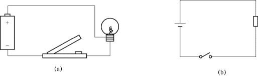

图 1-1　手电筒电路

（a）实际电路；（b）电路模型

制作器件的初衷是利用其某种主导物理特性，比如电阻器的主要作用是对电流产生阻碍，但通电时也会伴生磁场而兼具电感特性。其他器件亦存在类似更复杂的情形，这给电路分析带来干扰。因此在适当条件下忽略次要特性，用能反映主要性能的等效模型来描述，如图 1 - 1（b）所示的手电筒等效模型。

当实际电路的物理尺寸远小于其最高工作频率对应的波长时，可用若干集总参数元件搭建器件的等效模型。每种集总参数元件仅体现一种基本电磁现象，可用数学方法定义。例如电阻元件只关联电能消耗，电容元件只关联电场现象，电感元件只关联磁场现象，电场与磁场被视为集中在元件内部。此外还有电压源、电流源等多类元件。各元件可用图形符号表示。在特定条件下，部分器件模型很简单，仅含单一元件，部分则由多种元件组合。

由元件搭建的电路称为实际电路的集总电路模型，简称集总电路。电路理论研究的对象是模型而非实物。电路图即用元件符号绘制的模型。如何用元件拼装某一部件模型，并非本书讨论重点。

集总的概念意味着忽略电路内部电场与磁场的相互作用，也忽略电磁波的传播，视能量传输为瞬时完成。当电路尺寸大于或接近最高频率对应的波长时，就不能再视为集总电路，而需按分布参数电路处理。比如无线电调频接收机工作频率 100 MHz 时，波长`λ`=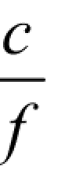\=3 m，连接天线与接收机 1 m 左右的传输线就不能用集总方式处理。又如我国电网频率为 50 Hz，对应波长 6×106 m，对该频段的用电设备可视为集总，而长距离输电线必须考虑沿线电场磁场的分布，不能按集总处理。

集总假设是本书的基本前提，后续定律与定理都基于此成立。本书仅讨论集总电路分析。集总电路可分为电阻性电路与动态电路。前者仅含电阻元件与电源元件，习惯上称电阻电路。

#### 1.1.2　电路分析的基本物理量

电路分析能得到给定电路的电学表现。电性能通常用一组随时间变化的变量描述，分析任务即求出这些变量。其中最常用的是电流、电压与功率。

##### 1. 电流

###### 1） 电流的定义

电子与质子都带电，电子带负电，质子带正电。电荷量的国际单位是库仑 C，用`q`或`Q`表示。带电粒子有规则地移动便形成电流。

每单位时间内流过导体横截面的电荷量定义为电流强度，简称电流，如图 1 - 2 所示。国际单位为安培 A，用符号`i`表示，即

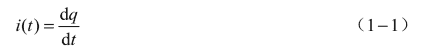

式中`dq`为通过横截面的电荷量。

###### 2） 电流的方向

习惯上把正电荷移动方向规定为电流方向，但在具体问题中真实方向常难以在图中标明，因此引入参考方向的概念。

电流的参考方向是人工设定的方向，在图中用箭头标注，如图 1 - 3 所示。参考方向在计算前预先确定，可任意选择，一旦选定分析过程中不再更改，并按此方向解读结果。约定：

若`i＞0`，说明参考方向与真实方向一致；
若`i＜0`，说明参考方向与真实方向相反。

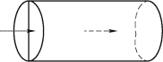

图 1-2　电流强度

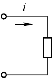

图 1-3　电流的参考方向

##### 2. 电压

###### 1） 电压的定义

电路两点间的电压等于单位正电荷由高电位点 a 移动到低电位点 b 时电场力所作的功，也称电位差，用符号`u`表示，即

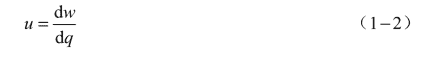

式中`dq`为从 a 移到 b 的电荷量，单位库仑 C；`dw`为转移过程所作功，单位焦耳 J。电压单位为伏特 V。正电荷在电路中移动时电能的增减表现为电位升高或降低，即电压升或电压降。

###### 2） 电压的极性

与电流需规定参考方向类似，电压也需规定参考极性。实际极性为从高电位到低电位，参考极性为人为设定。图 1 - 4 中电流参考方向用箭头表示，电压参考极性在元件两端用“ + ”“ - ”标注。“ + ”为高电位端，“ - ”为低电位端。

参考极性一旦确定便不再变动，并按设定方向解读计算结果。约定：

若`u＞0`，说明参考极性与实际极性相同；
若`u＜0`，说明参考极性与实际极性相反。

###### 3） 电压与电位、参考点的关系

设定电路中某点为参考点即电位为零，则各点电位即该点到参考点的电位差，电位高低会随参考点改变。

电压等于两点间电位差，如图 1 - 4 中，`uab = ua - ub`，两点间电压不随参考点改变。

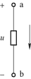

图 1-4　电压的极性

##### 3. 电流与电压的关联参考方向

当支路电流的参考方向与支路电压的参考方向一致时，称为关联参考方向，即电流指向电压下降的方向，如图 1 - 5 所示。

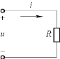

图 1-5　电流与电压的关联参考方向

关联与否会影响公式符号。例如电阻的伏安关系，在关联方向下`u=ri`；在非关联方向下`u=-ri`。

##### 4. 功率与能量

电路中存在能量流动，下面讨论某段吸收或释放能量的速率，即功率。功率用符号`p`表示，单位瓦特 W，即

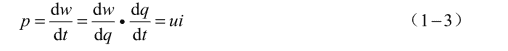

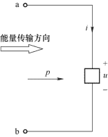

图 1-6　功率的参考方向

能量流动方向被规定为功率方向。同样可为功率假设参考方向，如图 1 - 6 所示。参考方向与实际方向一致时功率为正，反之为负。

支路电流与电压取关联参考方向时，乘积即该支路吸收的功率，即

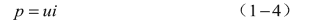

若为非关联方向，则用

计算结果为正表示吸收功率，为负表示输出功率。

例 1 - 1 已知图 1 - 7 中支路电流`i=1A`，电压`u=3 V`，求吸收功率`p`。

解 电压与电流为非关联方向，`p=-ui=-3 W`，即吸收功率为 - 3 W 或输出功率为 3 W。

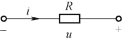

图 1-7　例 1-1 图

本质上电荷与能量是描述电现象的基本原始量，为便于表述电路引入电流、电压、功率等变量，均易于测量。由于功率可由电压电流求得，电路分析常侧重求解电流与电压。求解时必须先假定所求量的参考方向。

### 1.2　基尔霍夫定律

在集总参数电路中，任一时刻流经元件的电流与元件端电压都是确定的物理量。它们是集总电路分析研究的对象。基尔霍夫定律是电路中电压电流遵循的基本规律，也是分析计算的基础。先介绍几个名词。

（1）支路：一个元件或若干元件串联构成电路的一个分支，称为支路。同一支路电流处处相等。
（2）节点：支路的连接点称为节点。
（3）回路：电路中任一闭合路径称为回路。
（4）网孔：回路内部不含其他支路的回路称为网孔。

例 1 - 2 如图 1 - 8 所示，求图中支路数`b`及节点数`n`。

解 如图 1 - 8（b）所示，有 ab、ac、ad、bc、cd 及 bd 共 6 条支路，`b = 6`；有 a、b、c、d 共 4 个节点，`n = 4`。

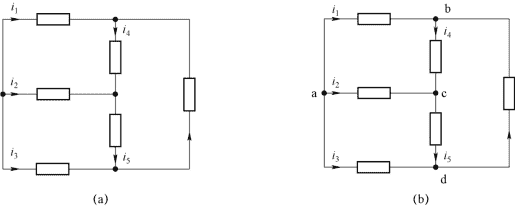

图 1-8　例 1-2 图

#### 1.2.1　基尔霍夫电流定律

电荷守恒与能量守恒是自然界基本法则，应用于集总参数电路即得基尔霍夫两条定律。

基尔霍夫电流定律 KCL 表述为：任一时刻，电路任一节点，流出该节点所有支路电流的代数和为零，即

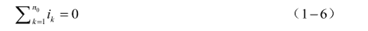

其中`n0`为该节点连接的支路数，`ik`为第`k`条支路电流。上式即节点电流方程，简称 KCL 方程。

图 1 - 9 所示为集总电路中的一个节点，与之相连的各支路电流分别为`i1`、`i2`、`i3`，参考方向如图所示。根据 KCL，有：

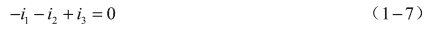

由此得

即

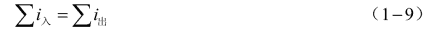

因此 KCL 也可表述为：在任一时刻，电路任一节点，流入节点的支路电流之和等于流出节点的电流之和。

上述讨论对元件没有要求，只要是集总参数电路，KCL 总是成立。

使用 KCL 列写节点方程时，可按流进为正或流出为正，二者任选其一。

KCL 反映节点相连各支路电流间的约束，不仅适用于节点，也适用于包围若干节点的封闭曲面。如图 1 - 10 所示，根据 KCL 可得：

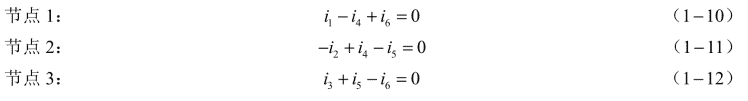

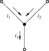

图 1-9　一个节点的支路

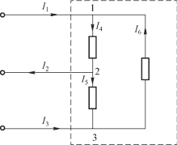

图 1-10

三式相加，得：

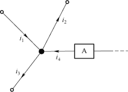

可见，流入或流出一个封闭曲面的各支路电流代数和恒为零，此即广义 KCL 方程。

图 1-11　例 1-3 图

例 1 - 3 在图 1 - 11 所示的某复杂电路的一个节点处，已知`i1=5 A`，`i2=2 A`，`i3=-3 A`，试求流过元件 A 的电流`i4`。

解 `i1`、`i2`、`i3`、`i4`汇集于该节点，满足 KCL 且线性相关，已知其中任意 3 个即可确定另一电流。先列出节点的 KCL 方程。设`i4`参考方向如图所示，由 KCL 得：

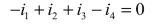

即

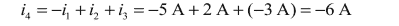

负号表示`i4`实际方向与参考方向相反。

例 1 - 3 表明，使用 KCL 时常需处理两套符号。一是方程中各项的正负号，取决于电流参考方向与节点的相对关系；二是电流数值本身的正负号。两者不可混淆。

#### 1.2.2 基尔霍夫电压定律

基尔霍夫定律有两条，已述电流定律反映各支路电流规律，体现在节点上。另一条是基尔霍夫电压定律 KVL，反映各支路电压规律，体现在回路中。

KVL 可表述为：在集总参数电路中，任一时刻，任一回路各支路电压的代数和恒为零，即

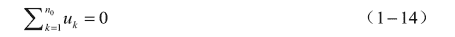

其中`n0`为该回路支路数，`uk`为沿该回路第`k`条支路电压。其内容也可表述为：任一时刻，任一回路各支路电位升等于电位降，即

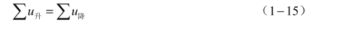

列写 KVL 方程时，先选定回路绕行方向，支路电压参考极性与绕行方向一致取“ + ”，相反取“ - ”。

如图 1 - 12 所示，设回路绕行方向为顺时针，则 KVL 方程为

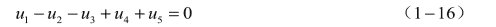

即

上式中，左边电位降之和等于右边电位升之和。

从能量守恒看，单位电荷沿回路绕行一周，所获能量必须等于所失能量。因此闭合回路中电位升必然等于电位降，即闭合回路各支路电压代数和为零。

#### 1.2.3 KCL、KVL 方程的独立性
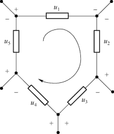

# KCL 与 KVL：由守恒决定的拓扑规则

在集总参数模型里，KCL 是电荷守恒的直接表象，KVL 则把能量守恒与电荷守恒结合起来。两者一个管节点上各支路电流的相互平衡，一个管回路上各支路电压的相互平衡。值得注意的是，这类平衡只与元件的连接方式、也就是拓扑有关，而与支路上具体是什么器件无关。无论是电阻、电容、电感还是各种电源，也不论器件表现线性还是非线性，KCL 与 KVL 的写法保持不变。

若一个网络包含 b 条支路、n 个节点，则节点与支路之间存在确定的计数关系：

（1）真正可以相互独立的节点数为 n-1。
（2）最多能写出 n-1 个线性无关的 KCL 表达式。
（3）线性无关的 KVL 表达式有 L 个，其中 L = b - (n-1) = b - n + 1。

例 1 - 4 图 1 - 13 对应的电路有 4 个节点、6 条支路，对节点 a、b、c、d 逐一写 KCL 得到：

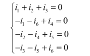

将这 4 个式子相加，左右两边都化成 0=0，可见它们并非相互独立，去掉其中任意一个，剩下的便构成独立集合。

例 1 - 5 图 1 - 14 包含 4 个网孔，对每个网孔依次写 KVL 得到：

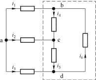

图 1-13　例 1-4 图

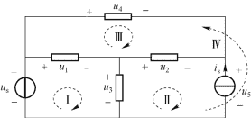

图 1-14　例 1-5 图

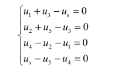

同样把 4 个式子相加也得到 0 = 0，说明存在依赖。对于 KVL，网孔数目决定了可写的方程数目，去掉一个后即为独立组。

### 1.3 电路元件与电路的等效变换

#### 1.3.1 电阻电路的等效变换

#### 1. 电阻元件

电阻元件是对实际耗能器件的理想化，如灯泡、烙铁、电机等，它只保留对电流的阻碍特性，如图 1 - 15 所示。用欧姆定律可写成

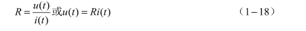

式中 u 为两端电压，单位 V；i 为通过电流，单位 A；R 为电阻，单位 Ω。当 R 为常数时 u 与 i 成正比，这类元件称为线性电阻。

欧姆定律揭示了电阻耗能的本质：电流克服阻力流动必然产生电压降，其大小等于电流与阻值的乘积。电流与电压降方向一致时上式成立，若取反向参考则应写为

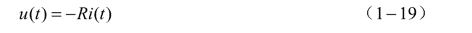

在 i-u 或 u-i 平面上作图可得伏安特性，如图 1 - 16 所示。

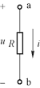

图 1-15　电阻元件

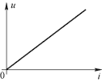

图 1-16　电阻元件的伏安特性曲线

电压与电流均为标量，线性电阻可用单一参数 R 刻画，R 属于电路参数。也可用电导 G 表示，其定义为

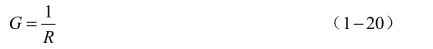

国际单位为西门子 S。

由伏安特性可见，线性电阻的电压仅由同一时刻的电流决定，不依赖历史，因此具有无记忆性。电阻与具记忆性的动态元件一起构成集总电路两大类。

#### 2. 电阻元件的串联

如图 1 - 17 所示，结合 KVL 与欧姆定律可得：

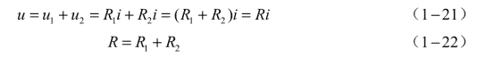

关于分压可写：

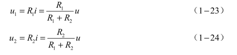

联立得：

结论：R1 越大则 u1 越大，分得的电压随阻值增大而增大。

若有 n 个电阻串联，如图 1 - 18 所示，等效电阻为

分压关系可表为

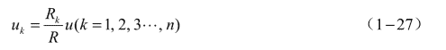

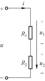

图 1-17　串联电阻的分压关系

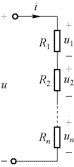

图 1-18　n 个电阻串联的分压关系

#### 3. 电阻元件的并联

如图 1 - 19（a）所示，等效电阻为

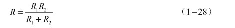

结合欧姆定律研究分流：

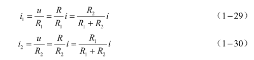

相比可得：

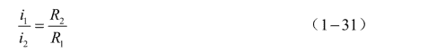

结论：R1 越大则 i1 越小，分得的电流随阻值增大而减小。

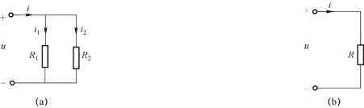

图 1-19　电阻元件的并联

n 个电阻并联时用电导更方便，如图 1 - 20 所示。

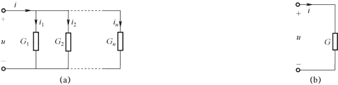

图 1-20　n 个电阻元件的并联

图 1 - 20（a）的等效电导为

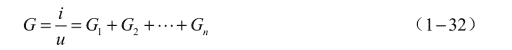

相应的分流关系为

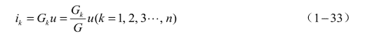

例 1 - 6 求图 1 - 21 给出的无源二端电阻网络 ab 的等效电阻。

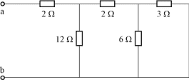

图 1-21　例 1-6 图

解 6 Ω 与 3 Ω 并联可等效为 R1：

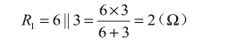

R1 再与 2 Ω 串联等效为 R2：

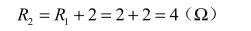

R2 与 12 Ω 并联等效为 R3：

R3 与 2 Ω 串联，故 ab 间等效电阻为 5 Ω，即

#### 4. 电阻的混联

实际网络多为串并混合。

例 1 - 7 如图 1 - 22 给出，求 RAB。

解 原结构不易计算，先整理成如图 1 - 23 的形式。

图 1-22　电阻的混联

图 1-23　例 1-7 图

再按串并等效逐步求得 RAB：

#### 1.3.2 含独立源电路的等效转换

#### 1. 理想电源

##### 1） 电压源

理想电压源是对实际电源的抽象，理想无损耗，具有：

（1） 端电压为定值 US 或时间函数 uS(t)，与流过电流无关。开路时仍保持 US 或 uS(t)。
（2） 电压由电源本身决定，电流随外负载而变。

在 u-i 平面上，t1 时刻的特性为一条平行于 i 轴、纵坐标为 uS(1 t) 的直线，如图 1 - 24 所示，说明端电压与电流无关。图 1 - 25 为符号。

注意：R=∞ 时开路，开路电压等于源电压；R=0 时短路，与特性矛盾，电路无意义。

图 1-24　电压源在 t1 时刻的伏安特性曲线

图 1-25　电压源的符号

（a）直流电压源；（b）一般电压源

理想电压源不存在，电池、发电机等在一定电流范围内可近似为电压源，也可用电压源串电阻构成实际电源模型。

##### 2） 电流源

理想电流源是另一种抽象，能向端口提供与端电压无关的电流。光电池在定照度下产生与照度成正比的电流，可据此定义。电流源具有：

（1） 输出电流为定值 IS 或 iS(t)，与两端电压无关。电压为零时电流仍为 IS 或 iS(t)。
（2） 电流由电源本身决定，端电压随负载变化。

在 u-i 平面上，t 时刻的特性为一条平行于 u 轴、纵坐标为 iS(1 t) 的直线，如图 1 - 26 所示。图 1 - 27 为符号。

注意：R=∞ 时开路违背特性，电路无意义；R=0 时短路，短路电流等于源电流。

图 1-26　电流源在 t1 时刻的伏安特性曲线

图 1-27　电流源的符号

电流源物理上也不存在，光电池等在一定电压范围内可近似为电流源，也可用电流源并电阻建模，还可由电子电路实现。

#### 2. 实际电路两种模型的互相等效转换

##### 1） 电压源

图 1 - 28 为含内阻的电压源模型，由图可得输出电压与电流关系为

## 图 1-28 电压源

由此可知：

（1） RS=0 时退化为理想电压源 u=uS。
（2） 与负载 R 相连时，开路 i=0，开路电压 uOC=uS。

## 2） 电流源

图 1-29 为含并联内阻的电流源，输出电流与电压关系为：

可得：

（1） SR′=∞ 时为理想电流源 i=Si。
（2） 与负载 R 相连时，短路 u=0，短路电流 iSC=iS。
（3） 开路 i=0 时，开路电压 uOC=RS′ iS。

## 3） 电压源与电流源的等效互换

对外电路，两种模型可互换。由式（1-36）及式（1-37）可知，若

图 1-29 电流源

则两者等效，上式为等效条件。转换后如图 1-30 所示。

图 1-30 电压源等效变换为电流源

（a）电压源；（b）电流源

等效互换时应注意：

图 1-31 电流源等效变换为电压源

（a）电流源；（b）电压源

图 1-32 例 1-8 图

（1） 等效仅对外电路成立，内部不等效。
（2） 转换时电流源电流流出端应与电压源正极对应。
（3） 理想电压源与理想电流源之间不可等效。

利用此方法可简化复杂电路计算。

例 1-8 求图 1-32 所示电路的最简等效电路。

解 先将右侧电流源化为电压源，左侧电压源化为电流源，便于叠加，如图 1-33（a）所示。

图 1-33 电源模型等效过程

再将两电流源叠加并化为电压源，与右侧电压源叠加，如图 1-33（b）所示。最后叠加两电压源，得最终等效电路，如图 1-33（c）所示。转换时需同时注意参数计算与极性方向。

### 1.4 直流电路及基本分析法

#### 1.4.1 支路电流法

支路电流法以各支路电流为变量，利用 KCL、KVL 及元件关系列方程求解。步骤为：

（1）确定各支路电流参考方向。
（2）选取 n-1 个独立节点，列 KCL 方程。
（3）选取 b-(n-1) 个回路，标定绕行方向，列 KVL 方程。
（4）联立求解得 b 个支路电流。
（5）计算其他待求量。

例 1-9 用支路电流法求图 1-34 所示电路各支路电流。已知 R1=10Ω、R2=3Ω、R3=12Ω、RS=2Ω、uS1=12 V、uS2=5 V。

可列一个独立 KCL 方程和两个独立 KVL 方程：

整理后得：

图 1-34 例 1-9 图

把参数代入可得：

由此算出各支路电流：

支路电流法需要对 b 条支路列出 b 个方程求解，一旦分支数量增多或拓扑变得复杂，计算量会显著增大，这是该方法的一个短板。

#### 1.4.2 节点电压法

节点电压法把各独立节点的电位作为未知量，利用 KCL 建立方程组求解。以下以例题说明一般步骤。

例 1-10 写出图 1-35（a）所示电路的节点电压方程。

图 1-35 例 1-10 图

（1）选定参考节点并将其电位归零。如图 1-35（b）取 D 为参考，UD=0，则 UA、UB、UC 为独立变量。

（2）对独立节点列 KCL，规定电流流出为正，即

（3）把支路电流用节点电压表示出来，即

（4）把方程组②代入①整理归并，令 UA、UB、UC 按顺序排列，可得节点电压方程组：

也可以直接按规则列写节点电压方程，避免先写 KCL 再整理时出错。从③可见，节点电压 UA、UB、UC 的系数行列式关于主对角线对称。

直接列写节点电压方程的规则如下：

左端：本节点所有连通支路电导之和乘以本节点电压取正；相邻节点间共用支路电导乘以相邻节点电压取负。

右端：流入本节点的电流源电流的代数和，流入为正流出为负。

例 1-11 已知图 1-36（a）的参数，列出节点电压方程。

图 1-36 例 1-11 图

解 如图 1-36（b）设 ud=0，ua、ub、uc 为独立节点，按规则得到：

其中 ua=us，无需单独列式。

特殊情况的处理：

（1）电流源串联的电导不计入自电导和互电导。

（2）含理想电压源时，尽量把参考点选在电压源的一端以减少变量；也可把该支路电流作为未知量并另加约束。

（3）对受控源先按独立源处理，再把控制量用节点电压表示，整理后系数矩阵一般不再对称。

### 1.5 电路定理

#### 1.5.1 叠加定理

由线性元件和独立源构成的电路为线性电路。独立源是激励，其余元件电压电流是响应，二者呈线性关系。

叠加定理是线性分析的核心，它表明：在含线性元件、线性受控源和独立源的电路里，某支路在所有独立源共同作用下的电流或电压，等于各独立源单独作用时在该支路产生的电流或电压的代数和。单独作用时，其余独立源置零：电压源短路，电流源开路，内阻保留。

例 1-12 如图 1-37（a），已知 us=9 V，is=3 A，R1=3Ω，R2=6Ω，用叠加定理求 i1、i2、u1、u2，并求 R1 消耗功率，讨论功率能否叠加。

图 1-37 例 1-12 图

解 先求电压电流。

（1）仅 Us 作用时令 Is 为零即断开，如图 1-37（b）得：

（2）仅 Is 作用时令 Us 为零即短路，如图 1-37（c）得：

把两部分结果相加即得总响应：

求功率。

例 1-13 续上例，求两电源对电路提供的总功率。

方法一：由上例结果得：

故电压源功率为

电压源消耗 9 W，即向电路提供 -9 W。

又电流源端电压为

故电流源功率为

电流源提供 36 W。

功率计算要注意电压电流参考方向。两电源总提供功率为

方法二：另行计算。电压源单独作用时，由图 1-37（a）可知：

电压源功率为

电压源对电路提供 9 W。

电流源单独作用时，由图 1-37（c）可知电流源功率为

电流源对电路提供 18 W。

两者之和为

与方法一一致。

可见，不含受控源的线性电路中，电源总提供功率等于各电源单独作用时提供功率之和，可推广为电压源组与电流源组分别叠加。

#### 1.5.2 戴维南定理

实际工程中常只需求某支路响应。可把待求支路以外的有源二端线性网络等效为最简模型再求解。有源二端网络的等效模型有电压源串电阻和电流源并电阻，统称等效电源定理。其中电压源型为戴维南定理，电流源型为诺顿定理。

戴维南定理表述为：任何有源二端线性网络对外可等效为理想电压源串联电阻，电压等于原网络开路电压，串联电阻等于独立源置零时从输出端看入的等效电阻。

例 1-14 求图 1-38 所示电路的戴维南等效电路。

图 1-38 例 1-14 图（1）

解 求开路电压 uOC。用叠加定理，如图 1-39。

图 1-39 例 1-14 图（2）

根据叠加，开路电压为

求等效电阻 Ro。如图 1-40。

图 1-40 例 1-14 图（3）

戴维南等效电路如图 1-40（b），Ro=8 Ω，uOC=12 V。

#### 1.5.3 诺顿定理

电压源模型与电流源模型可互换，有源二端网络也可等效为电流源并电阻，即诺顿定理。内容为：任一有源二端线性网络对外可等效为电流源并联电阻，电流源电流等于原网络短路电流，并联电阻等于独立源置零后的等效电阻。

图 1-41 有源二端线性网络 N 等效电流源模型

求诺顿等效关键是正确求出短路电流 iSC 和等效电阻 Ro。短路电流指负载短路时流过短路支路的电流，等效电阻指独立源置零、保留受控源后从端口看入的电阻。

求诺顿等效电流一般有两种方法。一是直接求；二是先求戴维南等效再转换，如图 1-42。其中，

图 1-42 戴维南等效电路和诺顿等效电路的转化示意

（a）戴维南等效电路；（b）诺顿等效电路

#### 1.5.4 最大功率传输定理

如图 1-43 所示，负载 RL 的电流为

功率为

对 RL 求导并令导数为零，即

可得 RL=RS 时功率最大，负载功率曲线如图 1-44 所示。

用诺顿等效表示为

因此，由含源线性单口网络向可变负载传输功率最大的条件是负载电阻等于戴维南或诺顿等效电阻，即最大功率传输定理。

图 1-43 连接外电路负载为 RL 的线性网络

图 1-44 负载 RL 的功率曲线

注意：定理以 RL 可变为前提。若 RS 可变而 RL 固定，则应尽量减小 RS 以增大负载功率，RS=0 时负载功率最大。

## 例 1-15

图 1-45（a）所示电路中负载电阻可任意改变，RL 等于多少时可获得最大功率？求最大功率 Pmax。

图 1-45 例 1-15 图（1）

### 解

求开路电压 uOC。先断开 RL，设 uOC 如图 1-45（b）所示。由分压关系可得：

求等效内阻 RS。把图 1-45（b）化为图 1-46（a），经串并联等效得：

图 1-46 例 1-15 图（2）

由最大功率传输定理可知，当 RL=RS=20 Ω 时功率最大。此时

注意，先断开负载再用戴维南或诺顿定理化简，负载与等效电阻相等时可实现最大功率传输。

#### 1.5.5 受控源及含受控源电路的分析

受控源是实际电子器件的电路模型，如晶体管、运放、变压器等，其输出受输入控制。

受控源是双口元件，一口为控制口，另一口为受控口。受控源并非真正电源，只是描述内部物理关系的模型，取出后即无意义。

受控源常用菱形符号表示，按控制/受控类型可分为四种，如图 1-47 所示。

图 1-47 4 种受控源

（a）电压控制电压源；（b）电压控制电流源；（c）电流控制电压源；（d）电流控制电流源

当 μ、g、γ、α 为常数时，受控源为线性元件，分析方法与普通线性电路相同。

## 例 1-16

求图 1-48 所示电路的等效电路。

图 1-48 例 1-16 图（1）

### 解

按独立源等效转换规则，将受控源及其他支路等效为图 1-49（a）电路，再进一步等效为图 1-49（b）电路。

图 1-49 例 1-16 图（2）

由图 1-49（b）可写出伏安关系式

即

画出等效电路，如图 1-50 所示。

图 1-50　例 1-16 图（3）

受控电压源和受控电流源之间的模型互换，其规则与独立电源完全一致。遇到含有受控源的网络时，可暂且把受控源视作独立源完成等效化简，待整体电流电压关系确立后再反推控制变量，便可得到完整解。等效变换的要点在于始终保留住控制量，不能在化简过程中将其丢弃。

## 第 2 章 正弦稳态电路分析

本章围绕单频正弦稳态电路展开系统讲解。涉及内容涵盖正弦量在时间域的描述及相量转换、R、L、C 元件在正弦激励下的伏安关系及其相量模型、阻抗与导纳的概念，以及正弦稳态电路通用的求解流程。

此前所处理的电路均属于直流供电稳态，激励与响应均为恒定值。本章转向仅含一种正弦频率激励的线性系统，激励大小与方向、响应幅度与相位均随时间周期性变化。直接用三角函数求解计算量较大，把正弦量映射为复数相量后，运算难度与直流电路相当，分析过程得以大幅简化。

### 2.1 正弦信号

#### 2.1.1 正弦信号

1. 周期信号

在进入正弦信号前先厘清周期信号的概念。周期信号的瞬时幅值会随时间重复出现，典型的有脉冲波形和正弦波形，示意如图 2 - 1。

图 2-1　常见的周期信号

描述此类信号常用三个指标：周期、频率、平均值。

（1） 周期：完成一次完整重复所需的时间间隔，用`T`标注，单位秒 s。

（2） 频率：单位时间内重复的次数，用`f`标注，单位赫兹 Hz。两者互为倒数，即

图 2 - 1（b）中出现的角频率，用`ω`表示，它刻画相位角随时间变化的快慢，单位弧度每秒 rad/s，`ω`与`f`的关系为

（3） 平均值：通常取一个周期内的均值，计算式为

2. 正弦信号及其 3 个特征量

电压或电流随时间按正弦或余弦规律变化统称为正弦信号，属于周期信号的一类，可用表达式或波形图描述。正弦电压`u(t)`的瞬时表达式为

正弦电流`i(t)`的瞬时表达式为

以电压为例，`Um`代表波形的峰值，也称振幅；`ωt+φu`为瞬时相位，其中`ω`为圆频率，`φu`为`t=0`时刻的相位，简称为初相角或初相位，单位为度或弧度。峰值、圆频率、初相位构成正弦量的三要素，根据这三要素即可导出周期信号的三个参数。

例 2 - 1 画出`u(t)=10cos(103t +15°)V`的波形，并标出其峰值、圆频率、频率和初相角。

解 峰值 `Um =10 V`，圆频率 `ω=103 rad/s` ，初相 `φu=15°`，。波形如图 2 - 2 所示。

#### 2.1.2 同频率正弦交流电的相位差

对于式（2 - 4）及式（2 - 5）给出的电压、电流表达式，两者的相位差为

图 2-2　例 2-1 图

图 2-3　3 种特殊的相位关系

（a）同相；（b）反相；（c）正交

例 2 - 2 求出图 2 - 4 中两同频正弦量的超前与滞后关系。

图 2-4　例 2-2 图

解 图 2 - 4 中的电压与电流同频，初相不同，

故相位差为

因此 `φ＜0`，电压滞后电流 75°。

#### 2.1.3 正弦信号的有效值

正弦量的瞬时值时刻在变，工程上更关注热效应等价的恒定值，即有效值。将交流电流`i(t)`与直流电流`I`分别接入相同阻值的电阻，若相同时间内产热相等，则称`I`为`i(t)`的有效值。

设正弦电流`i(t)=Im cos ω t`，其有效值`I`与峰值的关系为

### 2.2 正弦信号的相量表示

#### 2.2.1 电路中的正弦信号

如图 2-5 所示，在电阻`R`支路施加正弦电压`u(t)=Um cos(ωt+φu)`，支路电流为

可见电流仍为同频率正弦，只是幅值与初相发生变化，电感支路亦然。对正弦量求导、积分、相加或乘除常数，均不改变角频率，只改变幅值与初相。

图 2-5　电阻支路

图 2-6　电容支路

#### 2.2.2 相量法

相量是用复数表征同频正弦量的手段，引入后可把三角函数运算转为复数运算，降低分析难度。下面先回顾复数基础。

1. 复数

1） 复数的 4 种表示方法

复数有多种写法，可相互转换。

（1） 代数形式。

复数的代数形式为

其中 `a`、`b`均为实数，`a`为实部，`b`为虚部，`j`为虚数单位，`j^2=-1`。

（2） 复平面中的向量表示。

图 2-7　复数的复平面表示

（4） 复指数形式。

由欧拉公式

可将复数写成复指数形式

为便于电路计算，常把复指数形式写成极坐标形式：

2） 复数的运算

（1） 复数的加减法。

加减可采用代数形式

即实部与实部相加减，虚部与虚部相加减。

加减也可在复平面上用矢量三角形法则完成，细节在此省略。

（2） 复数的乘除法。

乘除多采用复指数或极坐标形式。

① 复指数形式：

② 极坐标形式：

由此可见，两复数相乘模相乘辐角相加，相除模相除辐角相减。

代数形式也可直接乘，满足分配律，即

（4） 复数的相等。

两复数相等时实部与虚部分别相等，或模与辐角分别相等。

2. 正弦信号的相量表示

其中`Um`为幅度，`φ`为幅角。

据此可建立正弦量与相量的对应，见表 2 - 1。

表 2-1　正弦量与相量之间的对应关系

总体而言，相量与正弦量是映射关系，并非数值相等，但用相量参与运算可大幅减少计算量。正弦量的峰值、初相、有效值分别对应振幅相量的模、辐角、有效值相量的模。

相量的数学运算遵循复数运算法则。重要结论是若干正弦量之和的相量等于各相量之和。

则其有效值相量为

由`i=2cos(1 000t -50°)`可得其振幅相量为

有效值相量为

相位差为

即电压超前，电流落后电压 30°。

3. 相量图

图 2-8　电压和电流的相量图表示

### 2.3 动态元件

正弦稳态电路除电阻与电源外，还包含储磁的电感和储电的电容，需先了解其特性。

#### 2.3.1 电容元件

电容元件是实际电容器的理想化模型，符号如图 2 - 9 所示。

电容用于存储电场能量，其电荷与电压的关系称为伏库特性。对线性电容，电荷与电压成正比，表达式为

图 2-9　电容元件的符号

比例系数`C`即电容量，单位法拉 F。实用电容的容量一般在皮法到千微法之间。

由电流强度的定义

#### 2.3.1 电容元件

把伏库关系代入上式可得电容的伏安特性

该式表明电容电流的大小取决于电压的变化率。电压变化越快电流越大，反之越小。电压恒定时电流为零，等效于开路，故电容具有隔直特性。电压突变会导致电流趋于无穷大，实际中电压不会突变，故称其具惯性。

需注意式（2 - 25）在电流电压参考方向关联时成立，非关联时需添负号，即

若用电压表示电流，可对上式积分：

设`t=0`为初始时刻，则

由此可见，`t`时刻的电压不仅取决于当前电流，还与过去电流的历史有关，所以电容属记忆元件，亦称动态元件。

#### 2.3.2 电感元件

电感元件是理想化线圈模型。当电流`i(t)`流过线圈时产生磁场，磁通量用`Φ`表示，单位韦伯 Wb。若线圈匝数为`N`，磁链为

显然磁链`Ψ`随电流变化。当周围介质为非铁磁时，磁链与电流成正比，可写成

式中`L`为常数，称为电感或自感，单位亨利 H，磁链单位韦伯 Wb。该元件把电能转化为磁场能，属理想电感。由于磁链与电流呈线性关系，故称线性电感，符号如图 2 - 10 所示。

直流通过理想电感时产生恒定磁场，不感应电压，两端电压为零。若通入交流，磁链随时间变化，在线圈两端感应出电压，即

图 2-10　电感元件的符号

将`ψ`与`i`的关系代入并利用`L`恒定，得

此式为电感伏安瞬时关系，适用于参考方向关联的情况，非关联时公式前加负号，即

伏安关系也可写成积分形式：

若`t=0`为初始时刻，则

该式说明电感电流在某一时刻的大小不仅与当前电压相关，还依赖于之前各时刻电压的累积，因此电感是记忆元件或动态元件。

### 2.4 电路定理的相量形式

#### 2.4.1 基尔霍夫定律的相量形式

相量视角下的正弦稳态

在线性正弦稳态网络里，所有支路的电压电流都保持同一角频率，因此基尔霍夫定律可以直接搬到相量域使用，具体形式见表2-2。

表 2-2　基尔霍夫定律的相量形式

#### 2.4.2 电路元件的相量模型

正弦交流工况下，各支路的电压电流同频。采用相量法分析稳态响应前，先厘清电阻、电容、电感这三种基本元件在相量域的表现规律。

#### 1. 电阻元件
图2-11(a)给出电阻在时域内的电压电流关联，阻值记为R，参考方向取关联。设流过电阻的电流为i，时域伏安式写成

稳态时，电阻上的电压电流频率相同，有效值间的联系为

电阻电压有效值与电流有效值的比例关系与直流欧姆定律完全一致，二者保持同相。相量形式为

电阻的相量伏安特性如图2-11(b)，其相量图如图2-11(c)。

图 2-11　电阻元件的相量模型
（a）时域伏安关系；（b）相量伏安关系；（c）相量图

#### 2. 电容元件
图2-12(a)呈现电容元件的时域电压电流关联，电容量为C，电流电压参考方向关联。设电容电压为u(t)，瞬时伏安式为

正弦稳态下，电容电流与电压同频，有效值关系是

相位关系为

这说明电容电压有效值与电流有效值也满足类欧姆的比例关系，比例常数为容抗；电容电压初相落后电流初相90°。相量表达为

电容元件的相量伏安特性如图2-12(b)，相量图如图2-12(c)。

#### 3. 电感元件
电感元件是对实际线圈的理想化抽象，属于储磁器件。

图2-13(a)展示电感元件时域电压电流关联，电感量为L，电流电压参考方向关联。设电流为i(t)，瞬时伏安式为

图 2-12　电容元件的相量模型
（a）时域伏安关系；（b）相量伏安关系；（c）相量图

上式表明任一时刻电感电压取决于该时刻电流的变化率，而非电流瞬时值。在直流稳态下，电感电流恒定，变化率为零，端电压为零，对外等效为导线。电流变化时线圈两端产生电压，变化越快电压越大。

正弦稳态中，电感电流电压同频，有效值关系为

相位关系为

这表明电感电压有效值与电流有效值的联系与直流欧姆定律相似，比例系数为感抗Lω。电感电压初相超前电流初相90°。相量写法为

电感的相量伏安特性如图2-13(b)，相量图如图2-13(c)。

图 2-13　电感元件的相量模型
（a）时域伏安关系；（b）相量伏安关系；（c）相量图

### 2.5 阻抗与导纳

#### 1. 电阻
电阻R的阻抗数值等于R，为实数且与频率无关。导纳是电阻的倒数，即电导G。

#### 2. 电容
电容量为C的电容元件阻抗为

Y_C为电容导纳，其中B_C=Cω称为容纳，单位为西门子S。

#### 3. 电感
电感元件电感为L，其阻抗为

定义阻抗虚部为感抗X_L，即

可见感抗X_L正比于角频率ω，频率越低感抗越小，直流下电感近似短路；频率越高感抗越大，频率趋于无穷时电感近似开路。

电感的导纳为

### 2.6 一阶电路的零输入响应

按所含储能元件不同，一阶电路分为RC与RL。若换路前动态元件已储能，换路后在无外激励下由自放电产生的响应称为零输入响应，对应齐次微分方程的解。

### 2.6.1 RC 电路的零输入响应
图2-14(a)为一阶RC电路。开关动作前电路已达稳态，电容电压u_C(0-)=U0，t=0时开关闭合，分析t≥0时电容电压u_C与电流i_C的变化。t≥0后电容经R支路放电，放电过程中能量在电阻上耗散，t→∞时放电结束。闭合后依据KVL有

图 2-14　一阶 RC 电路及其零输入响应曲线
（a）一阶 RC 电路；（b）零输入响应曲线

这是一阶线性齐次微分方程，可设解为

代入式2-44得特征方程

特征根为

λ称为自然频率或固有频率。通解为

用初始值u_C(0+)=U0确定系数A，即

于是A=U0，代回得t≥0时电容电压零输入响应为

电路电流为

式中τ=RC，量纲为时间，称为时间常数，单位s。τ反映过渡过程快慢，τ越小放电越快，反之越慢。

RC电路零输入响应曲线如图2-14(b)。

### 2.6.2 RL 电路的零输入响应
图2-15(a)为一阶RL电路。t<0时电路稳态，t=0时开关断开，分析t≥0时电感电压u_L(t)与电流i_L(t)。

t=0时换路，i_L(0-)=i_L(0+)=I0。

t≥0+时电路变为单回路，电感经电阻释放能量，最终全部消耗在电阻上，电路重新进入稳态。RL零输入响应的求解思路与RC类似，直接给出结果为

图 2-15　一阶 RL 电路及其零输入响应曲线
（a）一阶 RL 电路；（b）零输入响应曲线

图2-15(b)给出RL电路零输入响应曲线及电压变化。

零输入响应是在无输入时由非零初始状态产生的，体现电路自由运行的固有特性。求解时必须先知道电容电压或电感电流的初始值，电路特性对一阶电路由时间常数τ体现。RC与RL的零输入响应均按指数规律衰减，因为无外电源时储能会逐渐耗尽。RC中u_C由初始值u_C(0)指数单调衰减到零，τ=RC；RL中i_L由初始值i_L(0)指数单调衰减到零，τ=L/R。已知u_C(t)、i_L(t)后即可求得其他电压电流。

初始状态可视为激励，由式2-44～2-47可知，初始状态放大m倍，零输入响应也相应放大m倍。此比例关系即为零输入响应比例性，也称线性性。

例 2-4 如图2-16所示，换路前电路稳态，t=0时开关打开，求换路后电感电流i_L(t)与电容电压u_C(t)。

解 换路前稳态得

图 2-16　例 2-4 图
依据换路定则，有

换路后开关打开，电路分为左右两个独立的一阶电路。左边为RL零输入响应，代入公式得

右边为RC零输入响应，代入公式得

### 2.6.3 阻抗的串联和并联

#### 1. 欧姆定律的复数形式

Z称为复数阻抗，单位Ω。

Y称为复数导纳，单位S。

#### 2. 阻抗的串联
多个阻抗首尾相接构成二端网络称阻抗串联，根据KVL相量形式，有

故多个阻抗串联可等效为单一阻抗，其值等于各阻抗之和，即

等效导纳为
阻抗Z_k上分得的电压相量为

例 2-5 求图2-17中支路的阻抗和导纳
图中已给出元件阻抗。

#### 3. 阻抗的并联
多个阻抗并联连接在同一两节点上，根据KCL相量形式，有

图 2-17　例 2-5 图

因此多个阻抗并联可等效为单一阻抗，等效导纳等于各支路导纳之和，即

等效阻抗为

阻抗Z_k上分得的电流相量

例 2-6 求图2-18中支路的阻抗和导纳
图中已给出元件阻抗。

图 2-18　例 2-6 图
解 依据阻抗与导纳定义式即可求得

## 2.7 用相量法分析电路的正弦稳态响应

把相量形式的欧姆定律和基尔霍夫定律应用于电路相量模型，建立相量电路方程求解，即可得到正弦稳态响应，该方法称为相量分析法。

与电阻电路类似，相量方程是线性代数方程，只是系数一般为复数，因此电阻电路的公式、方法和定理均适用于正弦稳态相量分析。典型步骤为
1 画出与时域电路对应的相量模型；
2 建立相量电路方程，求出相量；
3 将相量还原为正弦函数。

例 2-7 试求图2-19所示电路中的u_C，已知C=1μF，

图 2-19　例 2-7 图
解 用相量法。电流相量为

电容容抗为

电容电压相量为

将电压相量化为一般形式为

# 第 3 章 一阶电路

## 3.1 电路的换路过程及换路定则

电阻电路中线性电阻伏安关系为代数关系，描述方程为代数方程，此类电路称静态电路。静态电路响应仅由外激励决定，工作状态改变时响应立即改变。

实际工程里所用的网络模型，并不局限于电阻与电源，电容与电感的参与也很普遍。 这两类元件的端电压与端电流不再是代数约束，而是呈现微分或积分关系，因此常被归入储能型动态元件。 含有这类元件的网络就是动态网络，其行为可以用电压或电流为变量的微分方程来描述。

动态网络的阶次以描述方程的最高微分次数为准。 只带有单一储能元件时，对应的方程是一次微分，这类网络称为单阶网络；若网络中有 n 个相互独立的储能元件，方程的最高阶数一般为 n，这类网络称为 n 阶网络。 对动态网络的研究也常说成瞬态分析，本章先交代瞬态分析的基础，之后集中讨论仅含一个储能元件的单阶网络。

当工作条件被改变时，网络不会瞬间到达新的稳态，而是要经过一段渐进过程才趋向新的平衡，这个过程叫做过渡过程或暂态。 在分析语境中，电路结构的改动例如开关动作，或激励参数例如电源信号的改变，都概括为换路，换路等同于工作状态的改变。

暂态的外因是换路，内因是电容与电感的存在。 这两种元件本身不耗能，只是把能量暂存起来再与外界交换。 在某一稳定工作点，它们储存确定的能量，一旦换路发生，这些能量必须重新分配，能量的改变需要时间来完成。 若没有过渡，就意味着电容中的电场能量、电感中的磁场能量发生跃变，这要求功率趋于无穷大，在实际电路中是不可能出现的。

取切换时刻为 `t=0`，`t=0-` 表示切换前的极限瞬间，此时尚未切换；`t=0+` 表示切换后的极限瞬间，此时刚刚完成切换。此时有：

以上即为换路定则。`0-` 与 `0+` 在数值上都等于零，但在动态网络里物理含义完全不同。

## 3.2 一阶电路的零状态响应

这里所说的零状态即动态元件的初始储能为零，响应完全由外加激励引发，称为零状态响应。 下文以直流激励为例展开说明。

### 3.2.1 RC 电路的零状态响应

图 3-1（a）所示为 RC 回路，开关闭合前即 `t≤0-` 时网络已达稳态，电容电压 `uC(0-)=0`；当 `t=0` 时开关接通，电源开始对电容充电；`t=0+` 时 `uC(0+)=uC(0-)=0 V`；`t≥0+` 时电容可视为短路。下面考察 `t≥0+` 时电容电压 `uC` 与电流 `iC` 的变化。

图 3-1　RC 电路及响应曲线

（a）RC 电路；（b）响应曲线

换路后依据 KVL 得到：

这是一个以电容电压为变量的一阶线性非齐次微分方程，其通解可写成特解与对应齐次方程通解之和

为便于表述，记 `Cu` 为全解，`uC′` 为特解，`Cu′` 为齐次通解。取稳态解作特解最为简便，即

对应齐次方程的通解为

总解为 `t`

由电容的伏安关系求出电容电流为

由此可得 RC 回路的响应曲线如图 3-1（b）所示。零状态响应按指数规律变化，其快慢与时间常数 τ 密切相关。

### 3.2.2 RL 电路的零状态响应

图 3-2（a）所示为 RL 回路。

图 3-2　RL 电路及响应曲线

（a）RL 电路；（b）响应曲线

开关接通前 `t≤0-` 时电感无初始储能，电感电流 `iL(0-)=0`；`t=0` 时开关接通，电感电流随时间增大，最终再次达到稳定，此时电感可视为短路，`iL(∞)=IS`，而 `iL(0+)=iL(0-)=0`，所以 `t=0+` 时电感可视为开路。下面分析 `t≥0+` 时电感电流 `iL` 与电压 `uL` 的演变。

换路后依据并联分流关系可得：

由此可见电感电流与电压的演变同样受时间常数主导。推导结果与物理直觉一致，最终 `iL(∞)=IS`。零状态响应可以表示为

电感电压为

RL 回路的响应曲线如图 3-2（b）所示。

时间常数为

图 3-3　例 3-1 图

因此电感电流为

要计算电压源发出的功率，先求其电流。设电流参考方向如图 3-3（a）所示，由于

电阻电流为

电压源电流为

于是电压源发出功率为

## 3.3 一阶电路的全响应

### 3.3.1 线性动态电路的全响应

外加电源与储能元件初始储能共同作用产生的响应，等于零状态响应与零输入响应之和，称为全响应。本书仅讨论一阶电路的全响应。

#### 例 3-2 如图 3-4 所示，已知换路前开关闭合，电路处于稳态，`t=0` 时进行换路。分析该电路的全响应。

解 换路前稳态时 `L` 近似短路，在两电源共同作用下有：

图 3-4　一阶 RL 电路

当 `t0+` ＞ 时，电压源已不起作用，只有电流源作用于电路，且电感初始储能同时作用于电路。`t=∞` 时电路将再次稳定，`L` 近似短路，在电流源作用下有：

依据 KVL 列方程：

从上式可以看到，第一项与外加激励形式相同，称为强制分量，当 `t→∞` 时，该分量不随时间变化，又称为稳态分量。第二项是按指数规律变化且由电路自身特性决定的，称为自由分量，当 `t→∞` 时，该分量将衰减为零，又称为暂态分量。所以，全响应可表示成

式（3-10）也可以写成

上式右边第一项是无外加激励且电感电流初始值 `I0` 所产生的零输入响应，第二项是电感电流初始值为零且有外加激励作用产生的零状态响应，由此说明一阶电路的全响应是零输入响应和零状态响应的叠加，表示为

根据式（3-10），设 `I0＞IS`，电感电流的曲线如图 3-5（a）所示。`t＞0` 时，电感电流由初始值 `I0` 慢慢放电，最后稳定在 `IS`。

若 `I0＜IS`，如图 3-5（b）所示，电感电流由初始值 `I0` 慢慢充电，最后稳定在 `IS`，可以说从一个稳态达到另一个稳态。

### 3.3.2 三要素法

本节介绍的三要素法是一种求解一阶电路的简便方法，它可用于求解电路任一变量的零输入响应和直流作用下的零状态响应、全响应，不论它是状态变量还是非状态变量。

图 3-5　不同情况下电感电流的变化曲线

（a）`I0＞IS`；（b）`I0＜IS`

这一方法的背景是：① 一阶电路中的响应是按指数规律变化的，都有它的初始值和稳态值，其变化过程唯一地由时间常数决定；② “提前”运用换路定则，不必等状态变量求得后再运用。

考察全响应解的特点，以一阶 RL 电路为例。当换路发生在 `t = 0` 时刻，那么电流的全响应为

其中 `I0` 为电感电流的初始值 `iL(0+)`；`IS` 是 `t→∞` 时的电流值，`iL(∞)` 是稳态值；`τ` 为时间常数。

在 RC 或 RL 电路中，不管电路结构和参数如何，换路后，描述电路特性与激励关系的方程为一阶微分方程，其数学模型为

则对于任意一阶微分方程，当它输入电源为稳定激励时，任意电压、电流响应的形式可表示为

将此公式称为三要素公式。其中 `y(t)` 可以代表电路中的任一电压或电流；`y(0+)` 表示该电压或电流的初始值；`y(∞)` 表示该电压或电流的稳态值；`τ` 表示电路的时间常数。只要知道 `y(0+)`、`τ`、`y(∞)` 即可，而它们均可不用列微分方程求得。

#### 例 3-3 电路如图 3-6 所示，求 `uC(t)`、`iC(t)`、`i1(t)`。

图 3-6　例 3-3 图

解 `t=0-` 时，开关处于断开状态，电容 `C` 相当于开路。

（1）求初值。

（2）求终值。`t→∞` 时，电路将再次进入稳态。

（3）求时间常数。把电容 `C` 开路，并将电压源短路，`R` 为从电容向外看的等效电阻：

代入三要素公式：

求其他电量：

# 第二篇 数字电路

# 第 4 章 数字逻辑基础

## 4.1 数制

数字电路所处理的各种数字信号都是以数码形式给出的。不同的数码既可以用来表示不同数量的大小，又可以用来表示不同的事物或事物的不同状态。用数码表示数量的大小时，一位数码往往不够用，因此经常需要用进位计数制的方法组成多位数码使用。多位数码中每一位的构成方法和从低位到高位的进位规则称为数制。数字电路中使用最多的数制是二进制，其次是在二进制的基础上构成的十六进制和十进制，有时也用到八进制。当两个数码分别表示两个数量时，可以进行数量的加、减、乘、除等运算。这一类运算称为算术运算。

### 4.1.1 几种常见数制

1. 十进制

十进制是日常生活中使用最广泛的计数制。组成十进制数的有 0、1、2、3、4、5、6、7、8、9 共 10 个符号，称这些符号为数码。在十进制中，每一位有 0～9 共 10 个数码，所以计数的基数为 10。超过 9 就必须用多位数来表示。十进制数的运算遵循加法时“逢十进一”、减法时“借一当十”的原则。

十进制数中，数码的位置不同，所表示的值就不相同。如：

式中，每个对应的数码有一个系数 1 000、100、10、1 与之对应，这个系数叫作权或位权。

任意十进制数可表示为

式中，`ki` 为 0～9 中的任意数码；`10` 为进制的基数；`10i` 为第 i 位的权；`m` 和 `n` 为正整数，`n` 为整数部分的位数，`m` 为小数部分的位数。

若以 `N` 取代式（4 - 1）中的 `10`，即可得到多位任意进制（`N` 进制）数展开式的普遍形式：

式中 i 的取值与式（4 - 1）的规定相同。`N` 称为计数的基数，`ki` 为第 i 位的系数，`Ni` 称为第 i 位的权。

## 二进制

十进制数在计算机中无法使用，因为要找到表达 10 个状态的物理元件比较困难，要完成十进制的加、减、乘、除运算也比较复杂。所以，数字电路（通信）和计算机中常用二进制数，及相应变形的八/十六进制数。

在二进制数中，每一位仅有 0 和 1 两个可能的数码，所以计数基数为 2。低位和相邻高位间的进位关系为“逢二进一”。

根据式（4 - 2），任何一个二进制数均可展开为

并可用上式计算出它所表示的十进制数的大小。例如

上式中分别使用下脚注“2”和“10”表示括号里的数是二进制数和十进制数。有时也用 `B`（Binary）和 `D`（Decimal）代替“2”和“10”这两个下脚注。

## 八进制

在某些场合有时也使用八进制数。八进制数的每一位有 0～7 共 8 个不同的数码，计数的基数为 8。低位和相邻高位间的进位关系为“逢八进一”。任意一个八进制数均可展开为

也可用上式计算出它所表示的十进制数的大小，例如：

有时也用 `O`（Octal）代替下脚注“8”，表示八进制数。

## 十六进制

十六进制数的每一位有 16 个不同的数码，分别用 0～9、A（10）、B（11）、C（12）、D（13）、E（14）、F（15）表示，故任意一个十六进制数均可展开为

并可用上式计算出它所表示的十进制数的大小，例如：

式中使用下脚注“16”表示括号里的数是十六进制数。有时也用 `H`（Hexadecimal）代替下脚注“16”。

由于目前在微型计算机中普遍采用 8 位、16 位和 32 位二进制数进行运算，而 8 位、16 位和 32 位的二进制数可以用 2 位、4 位和 8 位的十六进制数表示，因而十六进制符号书写程序十分简便。

表 4-1　不同进制数的对照

### 4.1.2 进制换算精讲

#### 1. 各类进位制转十进位
把其他进位制表达的数换算成十进位，核心思路就是按位权展开后求和。
例 4 - 1 将下列数字转换为相应的十进位数。
（1） `(101.01)2`；（2）`(137.504)8`；（3）`(2AF.4)16`。
解 写出每一位的权值相乘后累加，系数为零的项可直接省略。

#### 2. 十进位转任意进位制
十进位向 R 进位制转换时，整数段和小数段要分开处理，最后再拼接。
做法是反复除基取余，具体步骤如下：
（1） 用基数 R 去除给定的十进位整数，得到的余数就是 R 进位制的最低位。
（2） 把上一步的商继续除以 R，余数作为次低位。
（3） 循环上述除法，直到商变成 0，最后一次的余数即为最高位。
（4） 小数段则反复乘以 R，乘积的整数部分依次作为各数位。
（5） 乘积的小数部分继续乘 R，直至乘积为零或达到设定精度。
例 4 - 2 将十进位数`(53)10`转换为二进位。
解 `(53)10`=`(110101)2`。计算过程如下：

例 4 - 3 将十进位小数`(0.375)10`转换成二进位。
解 `(0.375)10`=`(0.011)2`。计算过程如下（直至乘积为零或满足精度要求）：

当要转换的十进位数字同时含有整数和小数时，必须先分别完成两段的转换，再合并起来。因此有：

#### 3. 二八互转
基数为 2^k 的进位制之间可采用分组法。二进位三位对应八进位一位，四位对应十六进位一位。例如：

#### 4. 二十六互转
同上所述，二进位每四位可打包为一位十六进位。例如：

#### 5. 八十六互转
八进位与十六进位之间没有直接的位对应关系，通常先转成二进位中转再转换。例如：

## 4.2 编码

用不同符号标记不同事物或状态时，符号本身已失去量值含义，只起代号作用。这类符号称为代码。如长跑比赛给选手编号，编号仅用于区分身份，并无大小可比。为便于记忆与查找，编码需遵循一定规则，该规则即为码制。规则可自定，但为信息互通，还需统一标准，如国际通用的 ASCII。

### 4.2.1 常用编码一览

#### 1. 十进位代码
要用二进位表示十进位的 0～9 这十种状态，至少需要 4 位。4 位二进位共有 16 种组合，可从中挑选 10 种并建立对应关系，方案很多。表 4 - 2 列出了几种常见的十进位代码，各自规则不同。

表 4-2　几种常见的十进位代码

续表

8421 码也称 BCD，即二进制编码的十进位，是最常用的十进位代码。该码中每一位的 1 代表固定权值，各位相加即得代表的十进位数。8421 码的位权依次为 8、4、2、1，故名，属于恒权码。
余 3 码的构造与 8421 不同，若把余 3 码看作 4 位二进位，其数值比所代表的十进位数大 3，因而得名。两个余 3 码相加，结果会比十进位和对应的二进位数多 6，所以做十进位加法时，若和为 10，恰好等于二进位的 16，从而自动产生进位。此外，0 与 9、1 与 8、2 与 7、3 与 6、4 与 5 的余 3 码互为反码，便于求十进位的补码。余 3 码是非恒权码，代码中每一位的 1 并非固定权值。
2421 码是一种恒权码，其 0 与 9、1 与 8、2 与 7、3 与 6、4 与 5 也互为反码，特点与余 3 码相近。
余 3 循环码属于变权码，每一位的 1 在不同代码中权值不固定。其主要特征是相邻两码仅有一位不同。

#### 2. 格雷编码
格雷码又称循环码。由表 4 - 3 的 4 位格雷码可见其生成规律：每一位的取值按一定顺序循环。由 0000 起，最低位按 0110 循环变化，次位按 00111100 循环，第三位按 0000111111110000 循环，由右向左，每位的 0、1 连续段数翻倍。4 位共 16 个码，最高位仅半个循环，即 0000000011111111。按此原则可扩展到更多位数。
与常规二进位相比，格雷码的最大优点是相邻码之间仅有一位发生变化，因而代码转换时不会产生过渡噪声。普通二进位在转换时可能出现短暂的中间态噪声，例如 0011 转 0100 时若变化不同步，会瞬间出现 0101，而格雷码 0010 转 0110 则不会出现此类现象。该噪声在某些电路中会干扰正常工作。
表 4-3　4 位格雷码与二进位代码的比较

十进位代码中的余 3 循环码即取自 4 位格雷码的 10 个码，同样具备相邻码仅一位不同的特性。

#### 3. 奇偶校验编码
奇偶校验位用于指示一组数中 1 的个数是奇数还是偶数。许多系统都借助奇偶校验位检测位错误。任意位组中 1 的个数可能是奇数也可能是偶数。通过附加一位校验位，可使整组 1 的个数始终为偶数或始终为奇数。偶校验使总数为偶数，奇校验使总数为奇数。
系统只能工作于偶校验或奇校验其一。例如偶校验系统会检查接收到的每组数中 1 的总数是否为偶数，若出现奇数则判定出错。
表 4 - 4 列出了每个 BCD 码的偶校验位和奇校验位，校验位置于 P 列。
表 4-4　带奇偶校验位的`BCD`码

续表

校验位可加在码的前面或后面，具体取决于系统设计。包含校验位在内的 1 的总数，对偶校验总是偶数，对奇校验总是奇数。
奇偶校验可检测单个位错误，或任何奇数个错误，但无法检测两个错误。例如要发送 BCD 码 0101，采用奇校验时，发送的完整码为：

若左边数第 3 位出错，1 变为 0，则变为：

接收端检测到 1 的个数为 1 个，为奇数，而应为偶数，于是指出错误。
奇偶校验是以牺牲部分传输能力换取检错能力的。

## 4.3 逻辑代数
上一节提到，数码既可表示数量大小，也可表示不同事物。在数字逻辑电路中，常以二进位的 0 和 1 表示某一事物的两种对立逻辑状态，如真/假、有/无、通/断、亮/暗、开/关等。这种只有两种状态的逻辑关系称为二值逻辑。
“逻辑”在这里指事物间的因果关系。当两个二进位数码代表不同逻辑状态时，可按既定因果关系进行推理运算，这就是逻辑运算。
1849 年乔治·布尔提出布尔代数，后因其在开关电路和数字逻辑中的应用而被称为开关代数或逻辑代数。本节讨论的是布尔代数在二值逻辑电路中的应用。逻辑代数中用字母表示变量，称逻辑变量，其运算表示的是状态间的推理，而非数值运算。
二值逻辑中每个变量只有 0、1 两种取值，但多变量组合可表示多种逻辑状态，从而处理复杂问题。
逻辑代数的基本运算有与、或、非三种。

### 4.3.1 三大基础逻辑操作

#### 1. 与逻辑
与逻辑要求决定结果的所有条件同时满足，结果才成立。由图 4 - 1 可见，只有 A 和 B 两个开关全部闭合时，指示灯 Y 才亮；只要有一个或全部断开，灯就不亮。
这种关系可表示为

图 4-1　串联开关电路

若用 1 表示闭合、0 表示断开，Y 用 1 表示亮、0 表示不亮，则可列出真值表，见表 4 - 5。该表称为逻辑真值表。
表 4-5　与逻辑真值表

数字电路中实现与逻辑的是与门，其符号如图 4 - 2 所示。

图 4-2　与门电路符号
（a）国标符号；（b）、（c）习惯画法

图 4-3　并联开关电路

#### 2. 或逻辑
或逻辑只要决定结果的条件中有一个满足，结果就成立。由图 4 - 3 可见，只要 A 或 B 任一开关闭合，指示灯 Y 就亮；两开关都断开时灯不亮。
该关系可表示为

按前述约定，或逻辑真值表见表 4 - 6。
表 4-6　或逻辑真值表

实现或逻辑的电路为或门，其符号如图 4 - 4 所示。

图 4-4　或门电路符号
（a）国标符号；（b）、（c）习惯画法

#### 3. 非逻辑
非逻辑是指条件具备时结果不发生，条件不具备时结果一定发生。由图 4 - 5 所示电路可知，开关 A 接通时指示灯 Y 不亮，A 断开时 Y 亮。

图 4-5　开关与灯并联电路
该关系可表示为

非逻辑真值表见表 4 - 7。

实现非逻辑的电路为非门，也称反相器，其符号如图 4 - 6 所示。

图 4-6　非门电路符号
（a）国标符号；（b）、（c）习惯画法

## 4.3.2 常见复合逻辑
实际问题往往比基本运算复杂，但均可由与、或、非组合实现。常见的复合逻辑有与非、或非、与或非、异或、同或等。

### 1. 与非
#### (1) 定义
先对输入变量做与运算，再做非运算。

#### (2) 真值表
与非逻辑真值表见表 4 - 8。
表 4-8　与非逻辑真值表

#### (3) 电路符号
电路符号如图 4 - 7 所示。

图 4-7　与非门电路符号
（a）国标符号；（b）、（c）习惯画法

### 2. 或非
#### (1) 定义
先做或运算，再做非运算。

#### (2) 真值表
或非逻辑真值表见表 4 - 9。
表 4-9　或非逻辑真值表

#### (3) 电路符号
电路符号如图 4 - 8 所示。

图 4-8　或非门电路符号
（a）国标符号；（b）、（c）习惯画法

### 3. 与或非
#### (1) 定义
先对输入变量做与运算，再做或非运算。
#### (2) 真值表
与或非逻辑真值表略。
#### (3) 电路符号
电路符号如图 4 - 9 所示。

### 4. 异或和同或
#### (1) 定义
异或是指两个输入值不同时输出为 1，相同时输出为 0。表达式如下：

图 4-9　与或非门电路符号

同或是指两个输入值相同时输出为 1，不同为 0，表达式如下：

#### (2) 真值表

表4-10给出了异或逻辑的真值情况，表4-11给出了同或逻辑的真值情况。

表 4-10　异或逻辑真值表

表 4-11　同或逻辑真值表

#### (3) 电路符号

电路的图形符号见图4-10、图4-11。

图 4-10　异或门电路符号

图 4-11　同或门电路符号

#### (4) 结论

同或逻辑与异或逻辑在输出上互为反向。

## 4.3.3　逻辑代数的基本定律及规则

逻辑代数虽属代数体系，却有自身独特的运算规律。以下梳理其基本定律、常用恒等式与核心使用规则。

### 1. 基本定律

表4-12汇总了逻辑代数的基本定律。每一条等式的正确性都可通过真值表来检验，只要等式成立，任一组变量取值代入后左右结果必相同。真值表覆盖了所有取值组合，因而能作为判据。

表 4-12　逻辑代数的基本定律

若等式成立，则任意取值代入两端的结果必然一致，因此对应的真值表也必然相同。

例 4 - 4 用真值表证明表 4 - 12 中分配律的正确性。

解 由表 4 - 13 可得`A + BC = (A + B)(A + C)`。

表 4-13　分配律的真值表

### 2. 常用公式

工程推导中经常用到的恒等式收录于表4-14。

表 4-14　逻辑代数常用公式

### 3. 重要规则

逻辑代数共有三条重要规则：代入规则、反演规则和对偶规则，在运算中非常常用。

#### 1) 代入规则

在包含变量A的逻辑等式中，若把等式中所有A统一换成另一逻辑式，等式仍成立。

例 4 - 5 用代入规则证明分配律对多变量也成立。

解 已知`A(B + E) = AB + AE`成立，则把`E`换成`(C + D)`后，

左边：`A(B + (C + D)) = AB + A(C + D) = AB + AC + AD`；

右边：`AB + A(C + D) = AB + AC + AD`。

左右相等，等式成立。

#### 2) 反演规则

对任意逻辑函数表达式F，若把“·”换成“+”，“+”换成“·”，0换成1、1换成0，原变量换成反变量、反变量换成原变量，所得即为F的反函数。

反演规则为求反函数提供了简便途径。

使用时需注意：

（1）运算优先级为先括号后与最后或；
（2）不作用于单个变量的求反号应保持原样。解 依据反演规则可写出：

若仅用基本定律和常用公式推导，过程要繁琐得多。

#### 3) 对偶规则

对任意逻辑式F，把“·”换成“+”，“+”换成“·”，得到的新式称为F的对偶式，记作F′。若两个式子相等，则它们的对偶式也相等。

提示：对偶式与反演式含义不同，求对偶时无需互换原变量与反变量。

## 4.4　逻辑函数

### 4.4.1　逻辑函数及其描述方法

逻辑函数刻画输入变量与输出变量之间的因果联系，可用逻辑表达式、真值表、逻辑图、卡诺图、波形图等表示。

从前面内容可知，输入一旦确定，输出随之确定，二者构成函数关系，记作

由于取值仅有0和1，这里讨论的都是二值逻辑函数。

任何因果关系都可用逻辑函数描述。例如图4-12所示的举重裁判电路，其功能可用一个逻辑函数描述。

规则要求：在一名主裁判和两名副裁判中，必须有两人以上且必须包含主裁判认定动作合格，试举才算成功。主裁判控制开关A，两名副裁判分别控制开关B、C。运动员举起杠铃时，裁判认为合格就闭合开关，否则断开。指示灯Y的亮灭取决于开关A、B、C的通断。以1表示闭合、0表示断开，1表示灯亮、0表示灯灭，则Y是A、B、C的二值逻辑函数，即

图 4-12　举重裁判电路

常用的表示方式有真值表、逻辑函数表达式、逻辑图、波形图和卡诺图。卡诺图将在下一节介绍，本节先介绍前三种。

#### 1. 逻辑函数表达式

把输入输出间的逻辑关系写成与、或、非的组合式，即得到逻辑函数表达式。

在图4-12电路中，“B和C至少其一闭合”可表示为`(B + C)`，“同时要求A闭合”则为`A·(B + C)`。由此得到输出的表达式：

#### 2. 逻辑真值表

把输入变量所有取值下对应的输出值列成表格，即为逻辑真值表。

仍以图4-12为例，对应的真值表见表4-15。

表 4-15　 图 4-12 的逻辑真值表

#### 3. 逻辑图

用图形符号把函数中各变量的与、或、非关系画出来，即得到逻辑图。

图4-13为该电路功能的逻辑图，用图形符号替换代数符号即可得到。

图 4-13　图 4-12 的逻辑图

### 4.4.2　逻辑函数的两种标准形式

在介绍标准形式前，先说明最小项和最大项的概念，再介绍最小项之和与最大项之积这两种规范形式。

#### 1. 最小项和最大项

##### 1) 最小项

在n变量逻辑函数中，若m为包含n个因子的乘积项，且这n个变量均以原变量或反变量形式在m中出现一次，则称m为该组变量的最小项。

表 4-16　3 变量最小项的编号

同理，A、B、C、D四个变量的16个最小项记作m0～m15。

由定义可知最小项具有以下性质：

（1）任一组输入取值下恰有一个最小项为1；
（2）全体最小项之和恒为1；
（3）任意两个不同最小项的乘积恒为0；
（4）n个变量的每个最小项有n个相邻最小项。

##### 2) 最大项

在n变量逻辑函数中，若M为n个变量之和的和项，且每个变量均以原变量或反变量形式在M中出现一次，则称M为该组变量的最大项。

表 4-17　3 变量最大项的编号

最大项的主要性质为：

（1）任一组输入取值下恰有一个最大项为0；
（2）全体最大项之积恒为0；
（3）任意两个不同最大项之和恒为1；
（4）仅一个变量不同的两个最大项之积等于相同变量之和。

对比表4-16与表4-17可发现二者存在如下对应关系：

由此可知，n变量函数共有2^n个最大项和最小项。

#### 2. 逻辑函数的最小项之和标准形式

例如，给定逻辑函数

可化为

或写作

#### 3. 逻辑函数的最大项之积标准形式

先利用基本公式和定理把任意逻辑式化为与或或或与形式，再用`AA′ = 0`把每个和项中缺失的变量补齐，即可得到最大项之积形式。

### 4.4.3　逻辑函数的化简

逻辑表达式越简洁，实现所需的器件越少，可靠性越高。因此常需化简求最简形式。

#### 1. 逻辑函数的最简表达式

按运算关系不同，最简表达式主要有最简与或式、最简或与式、最简与非式、最简或非式、最简与或非式五类，前两类用得最多。利用基本定律可实现不同形式间的转换。

#### 2. 公式化简法

化简的目的是去掉冗余的乘积项和每个乘积项中的冗余因子，得到最简形式。常用公式化简和卡诺图化简。

公式化简法核心是反复使用基本定律和常用公式消去多余项和因子。

常用技巧归纳如下。

##### 1) 并项法

例 4 - 8 用并项法化简下列逻辑函数:

解

##### 2) 吸收法

例 4 - 9 用吸收法化简下列逻辑函数：

解

##### 3) 消去法

例 4 - 10 用消去法化简下列逻辑函数：

##### 4) 配项法

依据`A + A = A`，可在式中重复写入某项，有时能得到更简洁结果。

解 借助配项法可将`Y`写成：

##### 5) 配多余项法

总之，化简复杂函数时往往需要灵活交替使用上述方法，结果通常不唯一。

### 4.4.4　卡诺图化简法

公式化简缺乏固定步骤，灵活性大，化简复杂函数时要求较高。为此需要一种通用且步骤固定的方法。基于最小项合并的卡诺图化简法即是如此。

#### 1. 逻辑函数的卡诺图表示法

##### 1) 表示最小项的卡诺图

# 卡诺图

把n个变量的所有最小项各用一个小方格表示，并使逻辑相邻的最小项在几何上也相邻排列，得到的图形称为n个变量最小项的卡诺图。该方法由卡诺提出，故名。

## 2～4 个变量最小项的卡诺图

图4-14展示了2至4变量最小项的卡诺图。两侧标注的0、1表示使对应方格最小项为1的变量取值。这些二进制数对应的十进制数即为最小项编号。

图 4-14　`2～4`个变量最小项的卡诺图

（a）2 变量；（b）3 变量；（c）4 变量

为保证几何相邻即逻辑相邻，数码不能按自然二进制顺序排列，而需按图中方式排列，使相邻两项仅一个变量不同。

从图4-14还能看出，行列两端的最小项也仅一变量不同，故也具逻辑相邻性。因此卡诺图应视为上下左右封闭的图形。

## 用卡诺图表示逻辑函数

任何逻辑函数均可写成若干最小项之和，于是可用卡诺图表示。具体做法是把函数化为最小项之和，在卡诺图上对应位置填“1”，其余填“0”，所得即为该函数的卡诺图。函数等于图中填“1”的最小项之和。

解 先把函数化为最小项之和，即

再将含最小项的位置填“1”，其余填“0”或空，如图4-15所示。

例 4 - 15 已知逻辑函数的卡诺图如图 4 - 16 所示，试写出该函数的逻辑式。

图 4-15　例 4-14 的卡诺图

例 4-15 对应的卡诺图（图 4-16）

解 Y 的表达式由卡诺图上所有标注为 1 的最小项累加得到，即：

## 卡诺图化简法概述

把卡诺图作为化简手段通常叫做图形化简法。其核心思想是利用相邻最小项可以合并，从而消去矛盾的因子。卡诺图上几何上的邻接关系与逻辑上的邻接关系完全对应，因而能直观地找出可合并的最小项并完成化简。

### 最小项合并通则

总体来看，若有 2^n 个最小项在图上相邻并组成矩形，则可合成一个乘积项，同时去掉 n 对互补变量。合并后保留的因子是这些最小项共有的部分。

图 4-17 最小项相邻的典型情形

（a）相邻的 2 个最小项；（b）相邻的 4 个最小项；（c）相邻的 8 个最小项

### 化简流程

使用卡诺图化简逻辑函数时，建议按以下顺序操作：

（1）把函数先写成最小项之和的标准形式。
（2）依据函数绘制卡诺图。
（3）在图中圈出可以合并的最小项。
（4）挑选最终的乘积项。挑选原则为：覆盖所有 1，即覆盖函数中全部最小项；乘积项数量尽可能少，即矩形分组尽可能少；每个乘积项的文字因子尽可能少，即每组包含的最小项尽可能多。
（5）写出最简与或表达式。

例 4-16 采用卡诺图化简下式为最简与或式：

解 先按 F 绘制卡诺图，如图 4-18 所示。随后把所有可合并的最小项圈起来。

图 4-18 例 4-16 的卡诺图

在求最简与或式时，操作要点如下：

（1）圈子尽量大。圈住的最小项越多，消去的变量越多，得到的乘积项越简洁。
（2）每个圈至少包含一个新最小项。最小项可以被多个圈共用，但每个圈必须至少覆盖一个此前未被圈过的最小项，否则该圈是冗余的。
（3）函数的全部最小项必须被圈完。每个圈的公共因子构成一个乘积项，通常这些乘积项之和即为最简式。
（4）有时需比较才能确定最简。圈法不唯一，不同圈法会得到不同的与或式，虽然都覆盖全部 1，但最简形式往往需要甄别，有时还可能出现多个等价最简式。

## 含无关项的逻辑函数化简

### 约束与约束条件

分析具体电路时，常遇到输入变量并非全部取值都允许。对取值范围的限制称为约束。不会出现的取值对应的最小项称为约束项。把恒为 0 的约束项相加得到的恒 0 式称为约束条件。因为约束项恒为 0，任意叠加结果仍为 0。

另一种情形是，某些输入组合下函数为 1 还是 0 对功能无影响，这类取 1 时的最小项称为任意项。

约束项与任意项合称无关项。是否把这些最小项写进函数式并不重要，可写可不写。

### 含无关项函数的化简方法

卡诺图表示函数时，先化为最小项之和，再在对应位置填 1，其余填 0。无关项可视作 1 亦可视作 0，故卡诺图上常用 ×、d 或 φ 标记，表达式中常用 ∑d 表示。合理利用无关项通常可获得更简结果。

为此，无关项应尽量与原有最小项以及已选用的无关项保持逻辑相邻。合并时，对卡诺图上的 “×” 当作 1 还是 0 处理，应以相邻矩形尽可能大且矩形数量尽可能少为原则。

例 4-17 化简带约束的逻辑函数：

解 先画出 Y 的卡诺图，由图直观判断约束项的取舍。如图 4-19 所示，为得到更大的相邻最小项矩形，应取约束项 m3、m5 为 1，与 m1、m7 组成一个矩形组；同时取约束项 m10、m12、m14 为 1，与 m8 组成另一矩形组。卡诺图中未被圈入的约束项 m9 和 m15 视为 0。

图 4-19 例 4-17 的卡诺图

将两组相邻最小项合并后得到：

# 第 5 章 组合逻辑电路

## 5.1 概述

### 5.1.1 组合逻辑电路的特点

数字系统中，逻辑电路主要分为组合逻辑电路和时序逻辑电路两类。

组合逻辑电路的特征是：任一时刻的输出仅取决于该时刻的输入，与电路的历史状态无关；在结构上仅由门电路构成，不具有记忆能力，只有从输入到输出的通路，不存在输出到输入的回路。

### 5.1.2 逻辑功能的描述

任意一个多输入多输出的组合逻辑电路都可以用图 5-1 的框图表示。图中 a1、a2…an 为输入变量，y1、y2…ym 为输出变量。输出与输入之间的逻辑关系通常可写成

图 5-1 组合逻辑电路的框图

或写成向量函数形式：

除逻辑式外，描述逻辑函数还有真值表、逻辑图、波形图等方法。因此分析或设计组合逻辑电路时，可按需选用其一进行描述。

## 5.2 常用组合逻辑模块

按功能划分，组合逻辑电路可分为加法器、比较器、编码器、译码器、数据选择器、分配器等。实现各种逻辑功能的组合电路很多，本章重点介绍译码器和数据选择器。

在正式介绍前先了解正负逻辑的概念。

正逻辑下，“1”对应高电平，“0”对应低电平；负逻辑则相反，“0”对应高电平，“1”对应低电平。同一逻辑电路采用不同体系分析时，表述会不同，例如高电平可用“1”也可用“0”表示。不同表达方式服务于同一功能。

图 5-2 不同逻辑体系实现同一功能

（a）正逻辑下的与非门；（b）负逻辑下的或非门

### 5.2.1 译码器

编码器为每个代码赋予特定信息，译码器则相反，它把代码信息“翻译”出来，即把每个代码译成特定的输出信号，完成此功能的逻辑电路称为译码器。译码器种类很多，可归纳为二进制译码器、二-十进制译码器和显示译码器。

#### 二进制译码器

二进制译码器的输入为二进制码，输出为高低电平信号。若输入有 n 位，则共有 2^n 种组合，可译出 2^n 个输出，也称 n 线-2^n 线译码器。

图 5-3 给出原理。当使能端输入有效电平时，对应每一个代码输入，仅有一个与之对应的输出端有效，其余输出无效。

图 5-4 给出 2 线-4 线译码器的逻辑图。其中输入为两位二进制码，输出为 4 个信号 Y。对应的真值表见表 5-1。

图 5-3 二进制译码器原理

图 5-4 2 线-4 线译码器逻辑图

表 5-1 2 线-4 线译码器逻辑真值表

合理利用选通端，还可以扩展其功能。例如用 2 片 2 线-4 线译码器 CT54LS139/CT74LS139 构成 1 片 3 线-8 线译码器 CT54LS138/CT74LS138。

CT4139（74LS139）为集成二进制译码器，由两个 2 线-4 线译码器构成，其逻辑图如图 5-5。

图 5-5 CT4139（74LS139）集成二进制译码器逻辑图

表 5-2 CT4139（74LS139）功能表

CT4139（74LS139）的管脚如图 5-6，可见一片芯片内含两个 2 线-4 线译码器。

图 5-6 CT4139（74LS139）管脚图

#### 译码器与数字显示

解 按题意列出真值表，见表 5-3。需注意译码器输出只能给出电位，即逻辑 1 或 0，这里 1 表示有信号输出，0 表示无信号输出。

表 5-3 3 位二进制译码器逻辑真值表

逻辑表达式为：

3 线-8 线译码器的逻辑符号如图 5-7。

#### 二-十进制译码器

BCD 码是最常用的二-十进制码，用 0000～1001 表示十进制 0～9。二-十进制译码器的功能是将输入的 10 个 BCD 码译成 10 个高低电平输出。这种译码器应有 4 个输入端、10 个输出端，若译码结果为低电平有效，则输入一组二进制码时对应的一个输出为 0，其余为 1，这样就表示该二进制码对应的十进制数。

#### 显示译码器

在数字系统和装置中，常需把数字、文字和符号的二进制编码翻译成人们习惯的形式直观显示，以便查看和交互。由于各种显示器件对译码器的要求差异较大，且实际工作中希望显示器与译码器配合使用甚至直接驱动，故称此类译码器为显示译码器。

##### 数字显示的电路组成

图 5-8 给出数字显示电路组成框图，由译码器、驱动器和显示器三部分构成。

图 5-7 3 线-8 线译码器逻辑符号

图 5-8 数字显示电路组成框图

##### 常用的显示译码器

目前广泛使用七段字符显示器，也称七段数码管。这种显示器由七段可发光线段拼合而成。常见类型有半导体数码管和液晶显示器 LCD 两种。

###### 半导体数码管

某些特殊半导体材料，如用磷砷化镓制作的 PN 结，外加正向电压时可将电能转换为光能而发光。可封装成单个发光二极管 LED，也可封装成分段式或点阵式显示器件，如图 5-9（a）。图 5-9（b）为二极管共阴极接法，此时高电平时二极管发光。

图 5-9 半导体数码管示意

（a）外形图；（b）等效电路

###### 液晶显示器

液晶显示器是一种平板薄型显示器件，驱动电压低、工作电流小，易与 CMOS 电路组成微功耗系统，广泛用于电子钟表、电子计算器、各种仪器和仪表中。液晶是一种介于晶体和液体之间的有机化合物，常温下既有液体的流动性又有晶体的光学特性。液晶显示器本身不发光，依靠外界电场作用下的光电效应调制外界光线形成反差显示字形。

###### BCD-七段显示译码器

半导体数码管和液晶显示器均可由 TTL 或 CMOS 集成电路直接驱动。为此需要显示译码器把 BCD 码译成数码管所需的驱动信号，使其以十进制数字显示 BCD 码的数值。

如图 5-10 所示，以 Q3Q2Q1Q0 表示 BCD-七段显示译码器输入的 BCD 码，以 Ya～Yg 表示输出的 7 位二进制代码，并规定 1 表示线段点亮，0 表示熄灭，则可得到逻辑真值表（表 5-4），表中仅列出部分，其余请自行补充。

图 5-10 BCD-七段显示译码器原理

表 5-4 BCD-七段显示译码器逻辑真值表（部分）

### 例 5-2

七段数码管显示“5”时，对应图 5-9（a）中 abcdefg 的编码为？当 abcdefg 的编码为 1101101 时显示数字几？

解 abcdefg 的编码为 1011001；当 abcdefg 的编码为 1101101 时，显示数字 2。

## 5.2.2 数据选择器

在多路数据传输过程中，能按需挑选其中任意一路的电路称为数据选择器，也叫多路选择器或多路开关。

### 1. 4 选 1 数据选择器

#### 1） 输入输出信号分析

输入为 4 路数据，用 D0、D1、D2、D3 表示。两个选择控制信号用 A1、A0 表示。输出用 Y 表示，它是 4 路输入中的任意一路，具体由控制信号决定。4 选 1 数据选择器示意如图 5-11。其中 A1、A0 也称地址码或地址控制信号。

图 5-11 4 选 1 数据选择器示意

#### 2） 逻辑真值表见表 5-5。

表 5-5 4 选 1 数据选择器逻辑真值表

#### 3） 逻辑表达式

由表 5-5 可得：

### 2. 8 选 1 数据选择器

多路开关简介

八路输入仅取一路送出，选择由控制端口决定。真值与表达式在此略过。图5-13展示了八选一 MUX 符号，其中为 select port。

图5-12 四选一 MUX 符号

图5-13 八选一 MUX 符号

### 3. 用 MUX 构建 logic 函数

从工作机理看，MUX 输出可写成 combinational 表达式，该式由地址变量与数据端共同形成的全部 minterm 组成。任一 combinational 函数都可展开为 minterm 之和，故可借助 MUX 产生所需 minterm，再配合门电路即可实现目标函数。单个 MUX 可实现一个 logic 函数。

#### 例 5-3
求图5-14 的最简 AND-OR 表达式。

解 由图可得 F=Σ(2,4,6,7)，用 Karnaugh map 化简。

图5-14 例5-3图（一）

图5-15 例5-3图（二）

## 5.3 combinational 电路分析和设计

### 5.3.1 combinational 电路分析
由给定 logic diagram 出发推导功能，就是分析方法。一般得到 truth table 后，还需用文字概括功能特性，truth table 为最基础的描述方式。

#### 1. 分析方法
一般步骤如下：
（1）根据 diagram 写出输出表达式。
（2）化简，求最简式。
（3）列出输出 truth table。
（4）说明主要功能。
步骤可灵活调整。目的可能是检验输入不同时的功能是否符合预期，或是变换结构形式，如 AND-OR 变 NAND，或是得到标准 AND-OR 形式以便用中大规模集成实现。

#### 2. 分析举例
##### 例 5-4
分析图5-16 的功能。

图5-16 例5-4图

解 写出表达式：

代数化简：

列 truth table：

表5-6 例5-4 truth table

图5-17 XOR 符号

功能说明：
输入相同输出0，相异输出1，即为 XOR 关系。该电路为 XOR 门。

### 5.3.2 combinational 电路设计
设计是分析的逆过程，按实际需求经 logic 抽象，用最少门实现功能并画图。

#### 1. 设计方法
流程如下。

##### 1） logic 抽象
（1）弄清需求，确定输入输出信号及因果关系。
（2）设定变量，用字母表示输入输出，输入为输入变量，输出为输出变量或函数。
（3）状态编码，用0、1表示信号状态。
（4）列 truth table，按因果把各变量取值与对应函数值列出，变量顺序常按二进制递增，也可按循环码。

##### 2） 化简
（1）变量少时可用 Karnaugh map。
（2）变量多不便用 Karnaugh map 时可用公式法。

##### 3） 画图
（1）变换最简与或式，求所需最简式。
（2）按最简式画图。

#### 2. 设计举例
##### 例 5-5
用四选一 MUX 设计 combinational 电路。输入 ABCD 为余3 BCD 码，输出为 F。当输入十进制0、2、4、5、7对应的余3 BCD 码时，F=1；其余时F=0，输入端允许用反变量。

解 按题意列 truth table，见表5-7。

表5-7 例5-5 truth table

用 Karnaugh map 化简，如图5-18。化简结果为 Y = +，仅涉及3个变量，进一步得到最简 Karnaugh map，如图5-19。

图5-18 例5-5 Karnaugh map

图5-19 最简式 Karnaugh map

系统设计图如图5-20。

图5-20 例5-5 系统设计图

# 第6章 flip-flop

flip-flop 是构建复杂数字系统的基本单元，与 logic 代数一起构成时序电路的基础。数字电路除做算术运算外，还需保存中间数据和结果，所以存储电路必不可少。只能存一位的叫存储单元，存一组数据的叫寄存器，存大量数据的叫存储器，寄存器和存储器都由多个存储单元构成。

flip-flop 的本质是保存1位二值信息，也称半导体存储单元或记忆单元。n个 flip-flop 构成的寄存器可存储n位二值数据。

flip-flop 应具备：
（1）两个稳定状态：0和1；
（2）不同输入下可置0或1；
（3）输入消失后状态保持不变。

按功能分，有 RS、D、JK、T和T′ flip-flop。按结构分，有基本 RS、同步、主从、边沿 flip-flop。

需注意，结构形式与 logic 功能是两回事，无固定对应。同一功能可用不同结构实现，同一结构也可实现不同功能。选用时不仅要知道功能，还必须明确结构类型，才能把握动作特性，完成正确设计。

工作状态分现态和次态。输入前状态叫现态，用 Qn 表示；输入后状态叫次态，用 Qn+1 表示，二者为相邻两个离散时刻的输出。

常用的时序 logic 描述方法有五种：logic diagram、状态转移方程、状态转移 truth table、状态转移图、工作波形图。形式不同但本质相通，可互相转换。本章对各类 flip-flop 做以上五种描述。

## 6.1 基本 flip-flop
基本 flip-flop 又称直接复位置位，有时也叫 latch，是结构最简单、构成其他 flip-flop 的基础。

基本 RS flip-flop 由两个 NAND 门正反馈构成，也可用两个 NOR 门构成，本书介绍 NAND 构成的基本型。

### 6.1.1 电路组成及符号

图6-1 由 NAND 门构成的基本 RS flip-flop

（a）电路图；（b）符号

### 6.1.2 功能描述
#### 1. 状态转移 truth table

latch 的新状态 Qn+1 不仅与输入有关，也与原状态 Qn 有关，所以把 Qn 作为状态变量列入 truth table，这种表称为状态转移 truth table 或特性表。表6-1为基本 RS flip-flop 的状态转移 truth table。

表6-1 由 NAND 门构成的基本 RS flip-flop 的状态转移 truth table

#### 2. 波形图
波形图反映输入取值与状态的对应关系，可由特性表得到，如图6-2所示。

#### 3. 特征方程
依据表6-1化简，结合 Karnaugh map 图6-3可得：

图6-2 由 NAND 门构成的基本 RS flip-flop 的波形图

图6-3 由 NAND 门构成的基本 RS flip-flop 的 Karnaugh map

#### 4. 激励表和状态转移图
由特性表可得激励表表6-2和状态转移图图6-4。

表6-2 由 NAND 门构成的基本 RS flip-flop 的激励表

图6-4 由 NAND 门构成的基本 RS flip-flop 的状态转移图

## 6.2 钟控 flip-flop（同步 flip-flop）
基本 flip-flop 的特点是输入变化时状态立即变化。实际应用中希望状态在 clock pulse CP 作用下按当时输入激励转移。基本 flip-flop 加上导引电路即可构成钟控 flip-flop。

### 6.2.1 钟控 RS flip-flop
#### 1. 电路组成
图6-5（a）所示是钟控 RS flip-flop 的电路。NAND 门 A、B 构成基本 flip-flop，NAND 门 C、E 为控制门，R、S 经控制门传输，CP 为 clock pulse。

图6-5（b）所示是钟控 RS flip-flop 的符号，方框下方输入端小圆圈表示 low level effective，时钟 C1 端 high level effective，输出端 Q 无小圆圈，端有小圆圈，正常工作时二者互补。

图6-5 钟控 RS flip-flop

（a）电路；（b）符号

#### 2. 功能描述

表6-3 钟控 RS flip-flop 的状态转移 truth table

由表6-3可列状态转移方程：

其中 RS=0 为约束条件，用以避免 R、S 同时为1产生竞争。

##### 2） 波形图
由表6-3和 CP 可画出波形图，如图6-6所示。

图6-6 钟控 flip-flop 的波形图

##### 3） 激励表和状态转移图
由表6-3和 CP 可列激励表表6-4，状态转移图如图6-7所示。

表6-4 钟控 RS flip-flop 的激励表

图6-7 钟控 RS flip-flop 的状态转移图

### 6.2.2 钟控 D flip-flop
为解决钟控 RS flip-flop R、S 的约束问题，出现改进形式——钟控 D flip-flop，又称同步 D flip-flop 或 D latch。

#### 1. 电路组成
图6-8所示是钟控 D flip-flop 的电路组成。

图6-8 钟控 D flip-flop 的电路组成

#### 2. 功能描述

由此可得钟控 D flip-flop 的特征方程为 CP=1期间有效：

回顾基本 RS flip-flop 的状态转移 truth table，见表6-5。

表6-5 基本 RS flip-flop 的状态转移 truth table

根据式（6-4），钟控 D flip-flop 的状态转移 truth table 可简化为表6-6。

表6-6 钟控 D flip-flop 的简化状态转移 truth table

由此可得状态转移图如图6-9所示和波形图如图6-10所示，设初态为1。

图6-9 钟控 D flip-flop 的状态转移图

图6-10 钟控 D flip-flop 的波形图

### 6.2.3 钟控 JK flip-flop
JK flip-flop 与基本 RS flip-flop 结构相似，区别在于基本 RS 不允许 R、S 同时为1，而 JK 允许 J、K 同时为1，同时为1时输出状态翻转。

## 1. 电路组成
图6-11所示为钟控 JK flip-flop 的电路组成。

## 2. 功能描述

钟控 JK flip-flop 的特征方程为：

图6-11　钟控 JK flip-flop 的电路组成

由式（6-5）可得钟控 JK flip-flop 的状态转移 truth table，见表6-7。

表6-7　钟控 JK flip-flop 的状态转移 truth table

# 触发器发展脉络与时序电路要点

先前的分析可推导出钟控 JK 单元的状态迁移示意，见图6-12，初态置1时的驱动波形示例见图6-13。

图6-12　钟控 JK 单元状态迁移示意

图6-13　钟控 JK 单元时序波形

## 6.2.4 钟控单元的空翻问题

这里描述的是电平驱动的工作方式。即 CP 在低态期间单元关闭激励，状态保持；CP 在高态期间单元开启激励，状态随之迁移。这种工作方式的特点是：在约定的高电平区间内单元持续响应激励，激励的任何变动都会牵动内部状态，导致持续翻转的空翻问题出现；在非约定电平区间内单元对激励不敏感，无论激励怎样变化内部状态都维持原值。对电路加时钟的目的是限定状态变化的时刻。

## 6.3 主从结构单元

为消除同步电平驱动的空翻缺陷并提升工作可靠性，出现了在同步结构基础上叠加主从的主从单元。

### 6.3.1 主从 RS 单元

#### 1. 电路构成
主从 RS 单元的框图见图6-14。

图6-14　主从 RS 单元构成框图

#### 2. 功能说明

约束条件为 SR=0，上述关系在 CP 下降沿起效。

当 CP=0、CP′=1 时，前级被封锁，后级工作且跟随前级。此时

由此可推导出 R、S 与 Qn+1 的对应关系，详见表6-8。

表6-8　主从 RS 单元状态迁移真值表

工作过程可概括为：CP=1 期间前级按同步 RS 方式采样 R、S；CP 下降沿到来时后级依据前级内容刷新。每个时钟作用一次，属于计数型单元。

依据上述分析可绘制主从 RS 单元波形，见图6-15。

### 6.3.2 主从 JK 单元

图6-15　主从 RS 单元时序波形

主从 JK 单元是为解决主从 RS 中 R、S 受限而设计的。

#### 1. 电路构成
主从 JK 单元电路见图6-16。

主从 JK 是在主从 RS 基础上，将 Q 和分别反馈回前级输入端得到。原 S 变为 J，原 R 变为 K，主从骨架不变，输入改为 J、K，故得名。

#### 2. 功能说明

图6-16　主从 JK 单元电路图

主从 JK 采用主从配合与时钟驱动，功能完备，J、K 间无限制，使用灵活。但存在一次性翻转特性，前级在 CP=1 期间至多翻转一次。该翻转可能发生在上升沿、高电平期间任意时刻，甚至下降沿前瞬间；原因可能是 J、K 变化或干扰。因此通常要求 CP=1 时 J、K 保持稳定，否则会产生一次态变。

在 CP=1 期间前级可表示为

且与 J、K 无关。

依据式6-8 可列出表6-9 的迁移真值表，直观描述次态 Qn+1、现态 Qn 与输入 J、K 的逻辑关系。

表6-9　主从 JK 单元状态迁移真值表

图6-17　主从 JK 单元时序波形

图6-18　集成 JK 单元逻辑符号

## 6.4 边沿驱动单元

主从方式可抑制电平敏感下的多次翻转，但一次性翻转仍降低抗干扰能力。为解决主从 JK 的一次性变化问题出现了边沿驱动单元，可分为上升沿和下降沿两种。

以边沿 D 单元为例，其状态方程为

式中“↑”表示上升沿触发。由式6-12 可得迁移真值表，见表6-10。

表6-10　边沿 D 单元迁移真值表

依据特性表可绘制波形，见图6-19。

图6-19　边沿 D 单元时序波形

在某些场合边沿 D 单元不如 JK 方便，因为 JK 在时钟作用下按 J、K 可实现保持、清零、置一、翻转四种功能，而边沿 D 仅能置零与置一。

# 第 7 章 时序逻辑电路

第5章讨论的组合逻辑电路输出仅取决于当前输入，这是组合逻辑的共性，理论基础是逻辑代数及门电路。本章介绍另一类电路，其输出不仅取决于当前输入，还与电路的历史状态相关，称为时序逻辑电路，简称时序电路。

常用的描述方法有5种：逻辑图、状态方程、状态迁移真值表、状态迁移图和波形图。分析本质上是逻辑图到状态图的转换，设计则是在抽象出最简状态图后由状态图到逻辑图的转换。

## 7.1 时序逻辑电路的特点和分类

### 7.1.1 时序逻辑电路的特点

图7-1 为结构示意。

图7-1　时序逻辑电路结构示意

时序电路由组合逻辑部分和由触发器构成的存储部分组成。

定义即功能特点：输出除取决于当前输入外，还与电路历史状态相关。

状态由存储部分记忆，故时序电路必须包含触发器，可无组合逻辑，但不可无触发器。

### 7.1.2 时序逻辑电路的分类

1. 按单元状态变化是否同步划分

同步时序电路：存储状态由同一时钟同步更新，各单元同时翻转。

异步时序电路：各存储单元更新不同步，因各单元 CP 输入不同。

2. 按输出特性划分

米里型 Mealy：有外加输入，输出与现态及输入相关。

摩尔型 Moore：输出仅与现态相关。

## 7.2 时序逻辑电路分析和设计

与组合逻辑类似，时序电路也有分析与设计两大任务。

### 7.2.1 时序逻辑电路分析

1. 目的

分析给定电路的输入输出关系，描述功能并评估设计优劣。

2. 方法

可用状态迁移方程、输出函数、真值表、状态图、波形图分析。

3. 一般步骤

（1）写出存储电路即触发器的激励方程。
（2）写出状态迁移方程并写出输出函数。若存储电路由触发器构成，可依据状态方程与驱动方程写出各触发器状态迁移方程。
（3）由状态迁移方程和输出函数列出真值表并画状态图。
（4）画波形图。

例7-1 分析图7-2所示同步时序电路。

图7-2　例7-1 示意图

解 电路由3个 JK 触发器作存储单元，配合两个与非门一个与门，各单元受同一时钟 CP 控制。

驱动方程为：

输出方程为：

由状态迁移方程和输出函数列出真值表并画状态图。电路无外加输入，次态和输出只取决于初态。

设初态为=000，真值表见表7-1。

表7-1　例7-1 电路状态迁移真值表

偏离状态可在计数脉冲作用下自动进入有效序列，称为自启动特性。

状态图如图7-3。

图7-3　例7-1 电路状态图

波形图如图7-4。

图7-4　例7-1 电路波形图

### 7.2.2 时序逻辑电路的设计

设计是分析的逆过程，按给定要求设计满足要求的电路。计数器、移位寄存器是典型设计，后续结合实例介绍。

## 7.3 时序逻辑电路应用（一）——计数器

广义上能完成计数的装置都可称为计数器。数字电路中，记录 CP 脉冲个数的操作叫计数，能实现计数的电路称为计数器。

通常计数器除 CP 外几乎无其他输入，输出为现态函数，属摩尔型，CP 作为时钟信号处理。

主要单元为时钟触发器，除计数外还可用于分频、定时、产生节拍脉冲序列及数字运算。

按模值分：二进制、十进制、N 进制。

按计数趋势分：加法、减法、可逆。

按脉冲引入方式分：同步、异步。

按集成度分：小规模、中规模集成。

### 7.3.1 同步二进制计数器

同步计数器将计数脉冲同时送入各单元，时钟到来时各单元状态同时转移。

按二进制加法规律，多位二进制数末位加1时，若某位以下全为1，则该位翻转；最低位每次加1都改变。

图7-5 为应用 JK 触发器的同步二进制加法计数器原理。

图7-5　同步二进制加法计数器原理

激励信号为

状态迁移方程为

输出函数为

由此得到状态迁移真值表，见表7-2。

表7-2　同步二进制加法计数器状态迁移真值表

续表

图7-6 为对应的状态图。

图7-6　同步二进制加法计数器状态图

### 7.3.2 任意进制计数器

计数器在脉冲驱动下循环状态数称为模数。用 N 表示，则 n 位二进制计数器模数为 2^n，N=，n 为触发器数。构成 N 进制计数器方法大致有3种：反馈阻塞法、利用集成计数器的清零型和置位型、级联法。本书讨论后两种。

1. 中规模集成同步计数器

集成 N 进制计数器主要分为清零型和置位型。按是否同步可细分为同步清零、同步置位、异步清零、异步置位。本书仅讨论异步清零、同步置位。

1） CT54/74LS161 型计数器

图7-7 为 CT54/74LS161 引脚排列和逻辑功能示意。

图7-7　4 位同步二进制加法计数器 CT54/74LS161

（a）引脚排列；（b）逻辑功能示意

表7-3 为功能表，给出 CTT、CPT 不同取值时工作状态。

表7-3　CT54/74LS161 功能表

例7-2 用一片 CT54/74LS161 构成十进制同步计数器。

解 直接写出状态图，如图7-8。

图7-8　例7-2 状态图

电路连接如图7-9。

图7-9　例7-2 电路连接图

依据状态图可绘制波形，如图7-10。

图 7-10 例 7-2 的波形图

通过观察波形可以判断自启动能力是否具备，一旦自启动成立即可视为设计成功。该拓扑还能兼作分频使用。

### 2） 异步复零方案

假设现有的是 N 模的计数单元，而实际需要的是 M 模。

只要计数器带有复位输入，就能用复零思路实现。针对异步复位输入的情况，其工作机理如图 7 - 11 所示：原计数器为 N 模，从全零态 S0 起步计数，累计 M 个时钟后进入 SM 态。若把 SM 态译码产生的复零脉冲送到异步置零输入端，电路会立刻回到 S0，跳过 N-M 个状态，从而得到 M 模计数器，也就是分频器。

进入 SM 态后马上被拉回 S0，所以 SM 仅在极短瞬间出现，不计入稳定循环。

图 7-11 清零法原理示意

例 7 - 3 采用异步清零，用 CT54/74LS161 构成九进制。

表 7-4 九进制计数器的状态转移真值表

图 7-12 采用异步清零法的九进制计数器电路连接

### 3） 同步置数方案

对于只有同步清零端的计数器，清零电平有效后不会立刻动作，必须等到下一个时钟到来才复位，因此置零信号应由 SM1- 态译出，并且该态包含在稳定循环中。

置数思路与复零不同，是通过在特定点重写预置数值来跳过 N-M 个状态，从而获得 M 模计数器。只要器件支持预置功能，操作可在任意状态下进行。

例 7 - 4 采用同步置位，用 CT54/74LS161 构成九进制。

表 7-5 采用同步置位法的九进制计数器的状态转移真值表

## 2. 计数器的级联

前面讨论的是 M < N 的情形，M > N 时需要多片 N 模计数器组合。级间连接可分为异步串行进位和同步并行进位两类。

若 M 能写成两个小于 N 的因子乘积，即 M = N1·N2，则可直接将 N1 模与 N2 模计数器以异步或同步方式串联，构成 M 模。

图 7-13 采用同步置位法的九进制计数器电路连接

若 M 不能分解为 N1 与 N2 的乘积，则需在级联的基础上配合清零或置位，基本原理与 M < N 时相同。

### 1） 异步方式

串行进位即低位进位输出直接作为高位时钟，速度相对偏慢。

单片 CT54/74LS161 为 4 位，最多可作十六进制；两片异步级联最多可达二百五十六进制。

例 7 - 5 采用异步级联加置位法实现二百进制。解 采用置位，循环状态数为 N-1。

其中，高位数字 12 的 8421 码为 1100，对应连接 Q3 Q2。低位数字 7 的 8421 码为 0111，对应连接 Q2 Q1 Q0。具体连接如图 7 - 14 所示。

图 7-14 用异步级联置位法实现二百进制计数器

### 2） 同步方式

并行进位即各片 CP 端共同接入统一时钟，低位进位送往高位控制端，速度更快。

例 7 - 6 采用同步级联，实现一百进制。

解 采用清零，循环状态保留 N 个。

其中，高位数字 6 的 8421 码为 0110，对应 Q2 Q1。低位数字 4 的 8421 码为 0100，对应 Q2。具体电路如图 7 - 15 所示。

图 7-15 用同步级联清零法实现一百进制

## 7.4 时序逻辑电路应用（二）——寄存器

把二进制数据或代码暂存的操作称为寄存，完成该功能的电路称为寄存器。寄存器由具备存储能力的触发器搭建而成，一个触发器存 1 位，n 位寄存器需要 n 个触发器。

按功能划分，寄存器分为基本寄存器和移位寄存器。

### 7.4.1 基本寄存器

数据只能并行写入并行读出。存储单元可用基本触发器、同步触发器、主从触发器或边沿触发器。

按接收方式，基本寄存器有单拍和双拍两种工作模式。

#### 1. 单拍运行模式的基本寄存器

图 7 - 16 所示为 4 个 D 触发器构成的 4 位寄存器，触发器同步翻转，输出 Q0～Q3 随 D0～D3 同步变化。此电路无需先清除旧数据，时钟上升跳变一到，新的数据就会写入，所以为单拍，即

图 7-16 单拍工作方式的基本寄存器

#### 2. 双拍运行模式的基本寄存器

图 7 - 17 所示是由 4 个 D 触发器构成的 4 位寄存器，它接收代码分两步进行。

图 7-17 双拍工作方式的基本寄存器

双拍方式电路简单，但每次写入需要两个控制脉冲，操作不够方便且限制了工作速度，所以商品化集成寄存器很少采用双拍，都采用单拍。

### 7.4.2 移位寄存器

寄存器中的数据在移位脉冲作用下可逐位右移或左移。输入输出方式灵活，可并行进并行出、串行进串行出、并行进串行出或串行进并行出，用途广泛，这种寄存器称为移位寄存器。存储单元只能用主从触发器或边沿触发器。

按移位方向，移位寄存器分为单向和双向两大类。

#### 1. 单向移位寄存器

图 7-18 4 位右移寄存器

图 7 - 18 所示是用边沿 D 触发器构成的 4 位右移寄存器。从结构看，它有两个特征：一是由相同的存储单元组成，单元个数即位数；二是各单元共用一个时钟信号——移位操作命令，电路工作同步，属于同步时序电路，即有时钟方程：

驱动方程为

状态转移方程为

表 7 - 6 为图 7 - 18 所示 4 位右移寄存器的状态转移真值表。它详细描述了单向右移过程。当连续输入 4 个 1 时，iD 经 F0F 在 CP 正跳变下依次移入，经过 4 个 CP 脉冲，寄存器变成全 1 状态，即 4 个 1 右移输入完毕。若再连续输入 4 个 0，经过 4 个 CP 脉冲后，寄存器将变成全 0 状态。

表 7-6 4 位右移寄存器的状态转移真值表

左移寄存器的原理与右移本质相同，只是移位方向变为由右至左。

单向移位寄存器的主要特点：① 在 CP 脉冲作用下数码可依次右移或左移。② n 位单向移位寄存器可寄存 n 位二进制代码。n 个 CP 脉冲即可完成串行输入，随后可从 Q0～Qn-1 端获得并行 n 位二进制数，再用 n 个 CP 脉冲可实现串行输出。③ 若串行输入端保持 0，则 n 个 CP 脉冲后，单向移位寄存器被清零。

#### 2. 双向移位寄存器

把左移和右移结构组合起来，加上移位方向控制信号，便可构成双向移位寄存器。图 7 - 19 所示为基本的 4 位双向移位寄存器。M 是移位方向控制信号，DSR 是右移串行输入端，Q0～Q3 是并行输出端，CP 是时钟脉冲。

图 7-19 基本的 4 位双向移位寄存器

图中 4 个与或门构成 4 个 2 选 1 数据选择器，其输出送给相应边沿 D 触发器的同步输入端，M 为选择控制，由此可得驱动方程：

代入 D 触发器的状态转移方程可得到 4 个触发器的状态方程，CP 正跳变时刻有效：

当 M=0 时，电路为 4 位右移寄存器：

当 M=1 时，电路为 4 位左移寄存器：

#### 3. 集成移位寄存器

集成移位寄存器产品较多，现以比较典型的 4 位双向移位寄存器 74LS194 为例说明。

图 7-20 4 位双向移位寄存器 74LS194

a 引脚排列；b 逻辑功能示意

4 位双向移位寄存器 74LS194 的功能表见表 7 - 7，该表清晰反映了其异步清零、保持、右移、左移和并行输入功能。

表 7-7 4 位双向移位寄存器 74LS194 的功能表

# 第三篇 模拟电路

# 第 8 章 放大电路

电子器件组成的放大电路，核心在于功率放大。如共发射极电路同时放大电压和电流，共集电极电路放大电流且不降压，共基极电路放大电压且不减流，总之输出功率都得到放大。因此放大电路是用小信号去控制直流电源产生大功率输出。本章将研究输入电阻、输出电阻和温度特性等。与电路分析基础和数字电路相比，模拟电路更抽象难度更大。

## 8.1 放大电路基础

### 8.1.1 半导体概述

按导电能力，自然界物质可分为导体、绝缘体和半导体。大多数半导体器件由硅 Si 和锗 Ge 制成，完全纯净、单晶结构的称为本征半导体，如单晶硅。本征半导体内部原子呈晶体点阵，故半导体管也称为晶体管。

硅和锗均为四价元素，最外层电子既不像导体那样容易脱离，也不像绝缘体那样被束缚很紧，导电性能介于两者之间。

为使导电性可控，常掺入特定杂质。杂质半导体的导电性能会随光照、加热等发生变化，可制成热敏元件和光敏元件等。

图 8 - 1 所示为硅的晶体结构和原子结构示意。晶体中原子在空间排列成整齐有序的点阵，每个原子的价电子既围绕自身原子核运动，也参与相邻原子共价键形成。

图 8-1 硅的晶体结构和原子结构示意

室温下价电子难以挣脱束缚；经光照或加热，部分价电子获得能量变为自由电子，原共价键位置留下带正电的空位，称为空穴。

在纯净半导体两端加电场，自由电子在电场作用下定向移动形成电子电流；同时由于空穴存在，自由电子移动过程中会按一定方向填补空穴，可视为空穴也定向移动，其方向与电子相反，空穴移动形成空穴电流。本征半导体电流是两者之和，但数值很小。

通常把运载电荷的粒子称为载流子，故本征半导体中有自由电子和空穴两种载流子，均参与导电。

### 8.1.2 杂质半导体

在本征半导体中掺入微量杂质形成的半导体称为杂质半导体。根据掺入杂质种类不同，可分为 P 型半导体和 N 型半导体，室温下对外保持电中性。

#### 1. P 型半导体

在本征半导体中掺入微量三价杂质元素如硼、铝，导电能力显著增强。掺入三价杂质后，与半导体原子形成共价键结构时会多出一个空穴，空穴易接收电子使杂质原子成为负离子，如图 8 - 2 所示。此时空穴浓度大于自由电子浓度，因此空穴是多数载流子，简称多子；自由电子是少数载流子，简称少子。通常称这种掺入三价杂质的半导体为 P 型，也称为空穴型半导体。

#### 2. N 型半导体

在纯净半导体中掺入微量五价杂质元素如磷、砷，由于五价杂质原子最外层有 5 个电子，在与周围半导体原子形成共价键时会多出一个电子，电子在受外部条件激发时可能挣脱原子核束缚形成自由电子，此时杂质原子因失去电子而成为正离子，如图 8 - 3 所示。此时自由电子浓度大于空穴浓度，因此自由电子是多子；空穴是共价键上电子挣脱束缚产生的，故空穴是少子。通常称这种掺入五价杂质的半导体为 N 型，也称为电子型半导体。

图 8-2 P 型半导体

图 8-3 N 型半导体

### 8.1.3 PN 结及其单向导电性

采用不同掺杂工艺，通过扩散作用将 P 型半导体和 N 型半导体制作在同一块半导体基片上，在交界面处形成的空间电荷区称为 PN 结，PN 结具有单向导电性。

#### 1. PN 结的形成

P 型、N 型半导体交界面两侧载流子浓度存在很大差异：P 区空穴浓度远大于 N 区空穴浓度；而 N 区自由电子浓度远大于 P 区自由电子浓度。因此会产生载流子从高浓度区向低浓度区扩散运动，如图 8 - 4 所示。

图 8-4 P 区与 N 区多子扩散运动 ○—空穴，●—自由电子

# PN结：半导体里的单向阀门

## PN结的形成与空间电荷区

P区以空穴为主，多子空穴会越过交界面向N区扩散，在N区与多数自由电子复合消失；与此同时，N区多数电子也会越过界面涌入P区，被P区的空穴复合掉。来回的复合使界面附近的自由载流子减少，留下不能移动的正负离子，堆积出一个空间电荷区，并自发建立起内建电场，电场指向由带正电的N侧指向带负电的P侧。

随着扩散持续进行，离子区不断加宽，内建电场也随之增强，这个电场正好遏制多子空穴从P向N、多子电子从N向P的继续扩散。

在内建电场作用下，P区的少数电子被推向N区，N区的少数空穴被推向P区。漂移的方向与扩散恰好相反，漂移补充了界面两侧被消耗的多子，使空间电荷减少。漂移起着收窄耗尽区的作用，与扩散的扩张作用相互对抗。

没有外界激励时，多子扩散的数目与少数载流子漂移的数目达到相等，系统进入动态平衡。此时界面两侧保留一定厚度的离子空间电荷区，这就是PN结。

图 8-5　平衡状态下的 PN 结

## PN结的单向导电性

无偏置时扩散与漂移相抵，PN结内总电流为零。加上外加电压后平衡被打破，扩散电流与漂移电流不再相等，结中出现净电流。外加极性不同，导电表现也不同，这就是单向导电。

### 正向导通

外加P区电位高于N区，称为正向偏置。此时外电场与内建电场反向，且外场占优，势垒降低，耗尽区变窄，多子扩散加剧，扩散电流显著增大，方向为P→N，习惯上称正向导通。电流随正向电压升高而上升，为避免烧毁，通常在回路中串入电阻R限流。

图 8-6　PN 结正向导通

### 反向截止

外加N区电位高于P区，称为反向偏置。外场与内场同向，势垒升高，耗尽区展宽，多子扩散被抑制，少数载流子漂移增强，产生方向N→P的漂移电流。由于少数载流子浓度极低，该电流很小，量级在微安，近似分析可忽略。此状态下PN结呈现很大阻值，俗称反向截止。

图 8-7　PN 结反向截止

小结：正偏时能通过较大正向电流，反偏时仅有极小的反向电流，这正是PN结单向导电的本质。

# 8.1.4 二极管

## 1. 二极管的结构

把PN结封装后引出两根电极就得到半导体二极管。P侧引出的是阳极，正极；N侧引出的是阴极，负极。结构示意与电路符号如图8-8所示。

图 8-8　二极管的结构示意图和电路符号

（a）结构示意；（b）电路符号

## 2. 二极管的伏安特性

二极管本质上是带外壳的PN结，所以正向和反向加压时都会表现出单向导电。外加电压与电流的关系即伏安特性。

二极管的外加电压与电流的关系为

伏安曲线可分为正向和反向两部分。

### 正向特性

在U>0区间，电流在电压超过阈值后才开始出现，并随电压按指数规律快速上升。开始导电的临界电压称为开启电压UD，也叫门限电压。硅管的UD一般在0.5～0.7 V，锗管约为0.1～0.2 V。

### 反向特性

图 8-9　二极管的伏安特性曲线

在U<0区间，反向电流记为IS。IS很小且基本恒定，称为反向饱和电流。其大小随材料而异，硅管反向饱和电流小于0.1 μA，多在nA级；锗管则在几十μA量级。当反向电压增至一定程度，反向电流骤增而发生击穿，不同型号的击穿电压差别很大，普通管几十伏，高反压管可达数千伏。

## 3. 发光二极管

发光二极管按发光波段可分可见光、不可见光、激光等。可视光LED颜色取决于材料，可发出红、绿、蓝、黄等，形状多样。

图 8-10　常见发光二极管

图 8-11　发光二极管的外形和电路符号

（a）外形；（b）电路符号

LED同样具有单向导电性，只有正向电压足够大、正向电流足够时才发光，其开启电压高于普通二极管，且随颜色而异，红色约1.6～1.8 V，绿色约2 V。电流越大亮度越强，使用时需串联限流电阻，防止超过最大功耗、正向电流和反向击穿电压等极限。

凭借驱动电压低、功耗小、寿命长和可靠性高等优点，LED广泛用于显示、装饰、显示屏和照明等领域。

## 4. 光电二极管

光电二极管是利用PN结光敏特性将光变化转换为电流变化的光电转换器件，常用于红外接收。常见外形与电路符号如图8-12。

图 8-12　常见光电二极管的外形和电路符号

（a）外形；（b）电路符号

# 8.1.5 三极管

晶体三极管又称双极型晶体管BJT，是电子电路中关键的电流控制元件，具备放大能力。常见外形如图8-13。

图 8-13　三极管的几种常见外形

## 1. 三极管的结构及特点

按结构分为NPN型和PNP型。图8-14、图8-15为结构与符号。以NPN为例，中间是极薄的P型基区，两侧为N型，发射区为N+型，掺杂浓度高于集电区。集电极c、基极b、发射极e分别引出。两个PN结分别为发射结和集电结。

PNP与NPN结构类似。两类管符号区别在于发射极箭头方向：箭头指外的为NPN，指内的为PNP，箭头方向与放大时发射极电流实际流向一致。

图 8-14　`NPN`型三极管

（a）结构示意；（b）电路符号

图 8-15　`PNP`型三极管

（a）结构示意；（b）电路符号

归纳结构特点：
（1）三个区：集电区、基区、发射区；
（2）两个PN结：发射结、集电结；
（3）三个电极：集电极c、基极b、发射极e；
（4）发射区掺杂最高，基区最薄且掺杂最低，集电区面积大掺杂较少。发射区与集电区不对称，不可互换使用。

## 2. 三极管放大的条件

三极管有四种工作状态，见表8-1。实现放大需发射结正偏、集电结反偏。

表 8-1　三极管的 4 种工作状态

以NPN为例，发射结正偏时电子由N型发射区扩散进入P型基区，形成发射极电流IE。进入基区的电子一部分与空穴复合形成基极电流IB，大部分扩散至集电结，在电场作用下被收集形成集电极电流IC。图8-16示意电流关系：

工程上IB极小，可近似忽略：

图 8-16　`NPN`型三极管中电流示意

PNP放大原理相同，但极性相反。为使发射结正偏、集电结反偏，应满足UC＜UB＜UE，这与NPN相反。

## 3. 三极管工作的 3 种组态

三极管三引脚构成四端网络，必然有一个引脚兼作输入输出。按共用引脚不同有共集、共基、共射三种组态，三极管工作前提仍是发射结正偏、集电结反偏。

### 共射电路

图8-17为共射示意，对电流和电压均有放大作用。

图 8-17　共射电路示意

### 共基电路

图8-18为共基示意，对电压有放大，对电流几乎无放大。

图 8-18　共基电路示意

### 共集电路

图8-19为共集示意，对电流有放大，对电压无放大。

图 8-19　共集电路示意

## 4. 三极管的输出特性

三极管为三端器件，需用曲线簇描述伏安特性。本书侧重共射特性，即基极电流IB恒定时，集电极-发射极电压uCE与集电极电流IC的关系。曲线可划分为放大、截止、饱和、击穿四区。

图 8-20　三极管的输出特性曲线

### 放大区

发射结正偏uBE≥UD，集电结反偏uBC＜0。曲线近似平缓，IC主要由IB决定。调节时需避免反偏过大进入击穿区。

### 截止区

发射结未开启uBE＜UD且集电结反偏uBC＜0。此时IB=0，IC≈0，三极管无放大作用，对应图8-20阴影区。

### 饱和区

uBE≥UD且uBC＞0，发射结与集电结均正偏，放大能力丧失，对应靠近纵坐标的区域。

# 8.2 基本放大电路

## 8.2.1 放大器概述

放大器把微弱电信号放大至所需幅度和功率，同时保持变化规律不失真。按能量守恒，放大器不能自发产生能量，而是把直流电源能量按输入信号规律转换为负载所需能量。能控制能量的元件是有源元件，放大电路必须包含有源元件。

## 8.2.2 基本放大电路

三极管配合外围元件构成基本放大电路，多级构成放大器。三种组态可构成共射、共基、共集放大器。三极管放大器体积小、耗电省、易集成，共射和共集多用于低频，共基多用于高频。

图8-21为分压式基本共射放大电路，NPN为例。

图 8-21　分压式基本共射放大电路

图中UCC接VCC正极，负极接地。其一是提供发射结和集电结工作电压，保证发射结正偏集电结反偏，使管工作在放大区；其二是为电路和负载提供能量。保证放大区条件为UC＞UB＞UE，PNP型则相反。

# 8.3 放大电路的分析方法

分析放大电路即求静态工作点和动态参数。常用图解法和等效法。

## 8.3.1 放大电路的图解分析法

已知三极管输入输出特性及元件参数，用作图法分析称图解法，直观清晰，分静态和动态两步。

### 静态特性

例 8 - 1 以图 8 - 21 为例，求解其静态工作点。

解 静态时输入短路，ui=0。

列输入方程求IBQ、ICQ。

图 8-22　用图解分析法求解静态工作点

### 动态特性

放大状态下加交流信号时各支路电压电流的变化。当输入为正弦波且静态工作点合适、信号幅度较小时，uBE为正弦，基极电流iB与之同相。输出回路中IC随iB以β倍变化，uCE、即输出电压uo沿负载线变化，iC增大时uCE下降，iC减小时uCE上升，uo与ui反相。

晶体管失真机理与集成运放核心原理详解

图 8-23 未产生失真的静态工作点

（a）输入回路的波形；（b）输出回路的波形

当偏置点被设定得过高，例如图 8-24 b 中标注的 2Q 位置，输入信号正半周接近峰值的区间内三极管进入饱和，集电极动态电流 iC 的顶部被压平，集电极电阻 RC 上形成的电压波形同步出现顶部畸变。输出电压 uo 与 RC 电压相位相反，因而 uo 在下半部分出现失真。这种由饱和引发的非线性现象即为饱和失真。

图 8-24　饱和失真

（a）输入回路的波形；（b）输出回路的波形

## 截止失真

当偏置点选得过低，参照图 8-25 b 中的 Q3 点。输入信号负半周接近峰值时，uBE 下降至导通阈值 UD 以下，三极管进入截止。此时基极电流 iB 的底部被截断，集电极动态电流 iC 以及 RC 两端电压随之产生相同形态的畸变。考虑到输出电压 uo 与 RC 电压相位相反，uo 波形在上半部分出现失真，由截止引起的非线性现象称为截止失真。

饱和失真和截止失真都属于非线性失真的极端表现形式。驱动信号幅度过大时，两类失真可能同时出现。

负载电阻的取值对直流偏置点影响显著，负载过大导致偏置点下移，负载过小导致偏置点上移，具体关系见图 8-26。

图解分析法直观形象，能快速判断器件工作状态，但需要测得实际管子的特性曲线作图进行定量分析时误差较大。特性曲线只能描述低频条件下的伏安特性，难以体现高频下极间电容带来的影响。因此该方法主要适用于输出幅值较大而工作频率不高的场合，工程实践中多用于确定 Q 点位置、最大不失真输出幅度以及失真类型的判别。

图 8-25　截止失真

（a）输入回路的波形；（b）输出回路的波形

图 8-26　负载大小对静态工作点的影响

### 8.3.2 放大器的等效分析法

三极管电路分析困难的核心在于器件本身的非线性。若在特定条件下将特性线性化，用线性网络等效其非线性行为，建立线性模型，就能套用线性电路分析方法。常把三极管视为线性电流控制电流源 CCCS，替换为线性双口网络。需注意，等效仅针对管子外部端口，而非内部结构。

#### 1. 共射 h 参数等效模型

共射放大电路在低频小信号条件下，可把三极管近似为线性双口网络，通过 h 参数描述端口电压电流关系，得到共射 h 参数等效电路。该模型只适用于低频小信号动态参数分析。

图 8-27 a 给出管子的等效线性双口网络，以 Ube 为输入端口，Uce 为输出端口，端口电压电流关系可由输入特性和输出特性推导。

图 8-27　等效线性双口网络与共射 h 参数等效模型

（a）等效线性双口网络；（b）共射 h 参数等效模型

图 8-27 b 为共射 h 参数等效模型。其中 hie 为等效输入电阻；hfe 对应电流放大系数 β；hoe 为输出电导，工程计算中通常忽略。

#### 2. 共射放大电路动态参数的分析

借助 h 参数等效模型可求取电压放大倍数、输入电阻与输出电阻。其中电压放大倍数表达式为

源电压放大倍数表达式为

例 8-2 图 8-28 所示为基本共射放大电路，分析其动态参数，其中输入电阻记为 Ri，输出电阻记为 Ro，输出端常接入负载 RL。

图 8-28　基本共射放大电路

解 依据 h 参数等效模型画出交流等效电路，如图 8-29 所示。

图 8-29　 图 8-28 所示电路的交流等效电路

由交流等效电路可求得等效输入、输出电阻：

一般情况下 RB 远大于 hie，故 Ri 约等于 hie。

求 Ui 与 Uo 关系：

依据 KCL 有 Ic = hfe Ib，Uo 为 RC 两端电压，其极性与 Ic 相反，因此取负号。

电压放大倍数 A 的表达式为

求源电压放大倍数 SA。

工程中信号源内阻 Rs 与 hie 相近，故源电压放大倍数约等于电压放大倍数的一半。

# 第 9 章 模拟集成电路

集成电路把有源器件与互连线制作在同一块半导体衬底上，使体积质量大幅减小，成本降低，可靠性与稳定性显著提升。集成运算放大器是高电压增益、高输入阻抗、低输出阻抗的多级直接耦合放大器。线性应用时可构成比例、加法、减法、积分、微分等运算电路；非线性应用时可构成电压比较器，用于越限报警、模数转换及各类非正弦波的产生与变换。本章介绍集成运放的基本概念与典型运算电路。

## 9.1 集成运算放大器

### 9.1.1 基本概念和要点概述

#### 1. 集成运算放大器的组成及特点

图 9-1 所示为集成运算放大器的内部组成原理。不同型号实现各异，但结构共性明显，主要由输入级、中间级、输出级构成，且包含偏置电路为各级提供合适的静态工作电流。

图 9-1　集成运算放大器的内部组成原理

输入级对整体性能起决定性作用，是提升器件质量的关键，要求输入阻抗大、噪声低、零漂小。

中间级主要提供电压增益，可由一至多级放大电路组成，同时应具备较高的输入阻抗以减少对前级的影响，并能提供足够的电压电流驱动输出级。

输出级主要为负载提供足够的输出电压与功率，应具备较低的输出阻抗与较高的输入阻抗，实现放大级与负载隔离，同时需具备过载保护，防止输出端短路或负载取电过大烧毁管子。常见形式为射极输出器或由 NPN 与 PNP 晶体管组成的互补对称电路。

#### 2. 集成运算放大器的符号

集成运算放大器亦称集成运放。国家标准规定的图形符号如图 9-2 b 所示，图中三角表示放大器，A 表示开环电压增益。习惯使用的符号如图 9-2 a 所示。

图 9-2　集成运算放大器的符号

（a）常用符号；（b）国际符号

左侧 “+” 端为同相输入端，信号经该端与地输入时输出与输入同相。左侧 “-” 端为反相输入端，信号经该端与地输入时输出与输入反相。反相输入、同相输入与差分输入是集成运放最基本的三种输入方式。

### 9.1.2 集成运算放大器的理想模型

#### 1. 集成运算放大器的理想化条件

集成运放通常具有高增益、高输入阻抗、低输出阻抗，开环增益可达数万至数十万，输入阻抗达数百千欧以上。为便于分析，常将其理想化，主要参数如下：

（1） 开环电压增益 Aud→∞；
（2） 开环输入电阻 Rid→∞；
（3） 开环输出电阻 Ro→0；
（4） 开环带宽 BW→∞；
（5） 共模抑制比 KCMR→∞；
（6） 失调、漂移、内部噪声均不存在。

#### 2. 理想运算放大器的特性

运算放大器工作在线性区或非线性区时表现不同。线性工作时输出与输入满足：

由于开环差模增益很大，通常加入深度负反馈使净输入电压减小，以保持线性工作。理想运放在线性区具有两个重要特性：

（1） 因 Aud 无穷而输出电压 uo 有限，可得

即

表明两输入端电位相等，该特性称为“虚短”。

（2） 因开环差模输入电阻 Rid 无穷，输入偏置电流 IB=0，不会从外部电路吸取电流，故两输入端电流为零，即

该特性称为“虚断”。

## 9.2 集成运算放大器的应用

集成运放可构成多种运算电路，应用时需工作在线性区，利用深度负反馈配合反馈网络实现数学运算。基本运算电路包括比例、加减法、积分、微分等，本书仅介绍比例运算电路与加减法运算电路。

### 9.2.1 比例运算电路

比例运算电路分为同相输入与反相输入两种。同相输入属于电压串联负反馈，输入阻抗很高；反相输入属于电压并联负反馈，输入阻抗很低。同相输入对共模抑制比要求更高，反相输入要求相对宽松。

#### 1. 反相比例运算电路

图 9-3　反相比例运算电路

反相比例运算电路如图 9-3 所示。输入信号 ui 经电阻 R1 加至反相输入端，同相输入端经电阻 Rp 接地。Rp 为平衡电阻，应满足 Rp = R1‖R2，以使 ui=0 且 uo=0 时两输入端对地阻抗相等。电阻 R1、R2 组成反馈网络，属于电压并联负反馈。

反相比例放大电路中运放工作于线性状态，故 u+ = u- 且 i+ = i- =0，电阻 Rp 上无电流亦无压降，因此 u+ = u- =0。反相输入端并未直接接地，但电位等效于地，称为“虚地”，是该电路的重要特点。

利用虚地概念并结合节点 N 的电流方程可得：

依据虚断特性 i- =0，则 i1 = i2，即

从而

整理后电压放大倍数为

式表明输出电压与输入电压成比例，调整 R1、R2 可改变比例系数，负号表示输出与输入相位相反，故称为反相比例运算电路。

#### 2. 同相比例运算电路

同相比例运算电路如图 9-4 所示。输入电压 ui 经 Rp 加至同相输入端，反馈电阻为 R2，输出电压 uo 经 R2 与 R1 分压后反馈至反相输入端，形成深度电压串联负反馈。平衡电阻应满足 Rp = R1‖R2。

图 9-4　同相比例运算电路

依据虚短与虚断特性，有 u+ = u- = ui 且 i+ = i- =0，可得反相输入端电流方程为

由此可得

整理后电压放大倍数为

式表明输出电压与输入电压成比例，可通过 R1、R2 调节比例系数，uo 为正说明输出与输入同相，故称为同相比例运算电路。引入深度电压串联负反馈后，电路输入阻抗很高，输出阻抗很低。

#### 3. 电压跟随器

由式 9-10 可知，当 R2 =0 或 R1 无穷大时，有

图 9-5　电压跟随器

依据虚断特性，R1、R2 上无电流亦无压降，可省略二者，电路简化为图 9-5。此时输出电压全部反馈至反相输入端，是同相输入负反馈最深的情况，电压放大倍数为 1，输出电压跟随输入电压变化，故称为电压跟随器。

### 9.2.2 线性运算电路

能实现多个信号按比例求和或求差的电路称为加法或减法运算电路。若各路信号经电阻全部加至同一输入端，则为加法电路；若分别加至两个输入端，则为减法电路。

#### 1. 加法运算电路

在图 9-3 所示反相比例电路基础上增加若干支路即可构成反相加法运算电路，如图 9-6 所示。电路中接入 3 路输入信号至反相端，同相端平衡电阻为 Rp = R1‖R2‖R3‖Rf，该电路也称为反相加法器。

依据虚短特性，有 u+ = u- =0；依据虚断特性，有 i+ = i- =0，则

图 9-6　反相加法运算电路

即

整理得

当 R1 = R2 = R3 = R 时，上式化为

特别地，当 R = Rf 时，

可以实现多路输入信号的反相叠加运算。

#### 2. 差分运算电路

差分运算电路的输出是与两路输入电压之差呈正比，业内也称作差动比例运算或差动输入放大。图 9-7 就是典型的差分运算电路。

从图 9-7 可以看出，集成运放的同相端与反相端分别接入信号 `u1` 与 `u2`。整体结构相当于同相比例环节与反相比例环节的组合。下面采用叠加法来推导。

当 `u2` = 0 且仅有 `u1` 起作用时，电路退化为反相比例，其输出电压为

图 9-7　差分运算电路

当 `u1` = 0 且仅有 `u2` 起作用时，电路成为同相比例，其输出电压为

`u1`、`u2` 同时存在时，总输出为 `uo1` 与 `uo2` 的叠加，即

特别地，当 `R1` = `R2` 且 `Rp` = `Rf` 时，

若再取 `R1` = `Rf` 时，

# 第四篇　感知交互

## 第 10 章　Arduino 入门指南

### 10.1　认识 Arduino 平台

Arduino 起源于意大利的开源硬件项目，核心是一块带 USB 接口的简易 I/O 板，配套的是类 Java/C 的集成开发环境。

其核心采用 AVR 指令集单片机，但对底层工作流程做了大幅简化。将 AVR 库二次封装后，繁琐的寄存器、指针操作被封装成简洁实用的函数，开发者无需关心单片机底层细节，大大降低了开发门槛，非常适合教师、学生与业余创客使用。

Arduino 系列的主要特点如下：

（1）电路图开源，程序开发接口可免费获取并按需修改。
（2）供电灵活，既可通过 USB 供电，也可外接电源。
（3）支持 ISP 在线烧写，可把新的 bootloader 固件写入 CPU 芯片，有了 bootloader 后即可通过 USB 升级程序。
（4）可参照官方提供的 PCB 与 SCH 电路图（Eagle 格式）自行简化模组，实现独立微控；能便捷连接各类传感器与电子元器件，如红外、光敏电阻、热敏电阻、超声波、舵机等。
（5）兼容多种交互程序，如 Flash、Max/Msp、C、Processing 等。
（6）在应用上突破了传统鼠标、键盘、CCD 等输入方式，实现了更简便的单人或多人游戏互动。

### 10.2　硬件规格概览

Arduino 把互动设计的门槛拉得很低，艺术家、设计师等非电子背景人群也开始用它完成创意作品。为满足不同场景需求，官方推出了 Duemilanove、Nano、mini、BT、Fio、Uno 等多款开发板。本书重点介绍 Arduino Uno 与 Arduino Mega 2560。

#### 10.2.1　Uno 开发板详解

Uno 配备 14 个数字 I/O、6 个模拟 I/O、1 个复位开关、1 个 ICSP 下载口，并支持 USB。供电可直接通过 USB，也可用 7～12 V 外接电源，具体资源分布见图 10-1。

各引脚定义：

（1）数字引脚：0～13。
（2）串口通信：0 为 RX 接收，1 为 TX 发送。
（3）外部中断：2、3。
（4）PWM 输出：～3、～5、～6、～9、～10、～11。
（5）SPI 通信：10 为 SS，11 为 MOSI，12 为 MISO，13 为 SCK。
（6）板载 LED：13。
（7）模拟引脚：A0～A5，编号前加 A 以区分数字口。
（8）TWI 通信：A4 为 SDA，A5 为 SCL。

图 10-1　Uno 的资源分配

#### 10.2.2　Mega 2560 开发板详解

相较 Uno，Mega 2560 的资源大幅提升，提供 54 个数字 I/O（其中 14 路可 PWM）、16 路模拟 I/O、4 对串口 UART、1 个复位开关、1 个 ICSP 下载口，支持 USB 与直流供电，资源分布见图 10-2。

引脚定义：

（1）数字引脚：0～53。
（2）串口通信：共 4 对串口，0 RX/1 TX 为串口 1，19 RX/18 TX 为串口 2，17 RX/16 TX 为串口 3，15 RX/14 TX 为串口 4。

图 10-2　Mega 2560 的资源分配

（3）外部中断：共 6 路，2 为外部中断 0、3 为外部中断 1、21 为外部中断 2、20 为外部中断 3、19 为外部中断 4、18 为外部中断 5。
（4）PWM 输出：0～13。
（5）SPI 通信：53 为 SS，51 为 MOSI，50 为 MISO，52 为 SCK。
（6）板载 LED：13。
（7）模拟引脚：A0～A15，编号前加 A。
（8）TWI 通信：20 为 SDA，21 为 SCL。

### 10.3　驱动安装步骤

使用 Arduino 开发环境前，先为 Uno 安装驱动。本节介绍常规安装流程。

从官网下载驱动安装包，解压后打开 “drivers” 文件夹。32 位系统运行 “dpinst - x86.exe”，64 位系统运行 “dpinst - amd64.exe”，如图 10-3 所示。弹出对话框后点击“下一步”，如图 10-4 所示，即可完成安装，如图 10-5 所示。

图 10-3　运行对应“.exe”文件

图 10-4　点击“下一步”按钮

图 10-5　驱动安装完成

### 10.4　开发环境使用

Arduino IDE 主界面如图 10-6 所示，菜单栏包含“文件”“编辑”“项目”“工具”“帮助”5 类，菜单下方提供 5 个常用快捷按钮：校验 `Verify`、上传 `Upload`、新建 `New`、打开 `Open`、保存 `Save`。

图 10-6　Arduino IDE 主界面

5 个快捷按钮的功能见表 10-1。

下面以 Uno 自带 LED 闪烁为例，演示完整开发流程。

1. 新建文件
点击“新建”按钮即可创建空白 Arduino 程序文件。

2. 串口与板型选择
驱动安装后，在“我的电脑”→“设备管理器”中查看 Uno 对应的串口号，如图 10-7 所示，当前为 `COM3`。

图 10-7　在设备管理器中查看 Uno 串口号

在“工具”下拉菜单中选择“端口：”`COM3`”，如图 10-8 所示，完成串口配置。

图 10-8　在 IDE 中选择对应串口

点击“工具”→“开发板：”`Arduino Uno`”，在下拉列表中选择“Arduino Uno”，如图 10-9 所示，完成板型选择。

图 10-9　在 IDE 中选中 Uno 板型

3. 程序编写
在程序编辑区输入代码，如图 10-10 所示。

图 10-10　在编辑区输入程序代码

由图可知 Uno 板载 LED 引脚为 13，编写使其循环点亮-熄灭 1 s 的程序如下：

4. 程序保存
编写完成后选择“文件”→“保存”保存到当前路径，或“文件”→“另存为”保存到其他路径。

5. 程序编译
点击“校验”按钮编译，状态栏提示“编译完成”，信息栏显示编译后大小，如图 10-11 所示。

图 10-11　编译 Arduino 程序

6. 程序上传
点击“上传”按钮将编译好的程序烧入 Uno，上传期间串口指示灯 RX/TX 闪烁。上传完成后状态栏提示“上传完成”，板载 LED 开始间隔 1 s 闪烁。

至此，一个简单示例已完整演示 Arduino 的使用方法。

## 第 11 章　常用函数速览

Arduino 提供了大量基础函数，涵盖 I/O 控制、时间、中断、数学、串口通信等，可方便操作开发板资源。示例程序可在 IDE 的“文件”→“示例”菜单中找到。本章介绍常用基础函数。

### 11.1　模拟口操作函数

#### 11.1.1 `analogReference(type)`

`analogReference` 用来配置模拟输入引脚的基准电压，即输入范围的上限。无返回值，参数 `type` 可选 `DEFAULT`、`INTERNAL`、`INTERNAL1V1`、`INTERNAL2V56`、`EXTERNAL`，含义如下：

（1）`DEFAULT`：默认以 5 V 或 3.3 V 为基准，按开发板电压而定。
（2）`INTERNAL`：低压模式，使用片内基准源，Mega 不支持。
（3）`INTERNAL1V1`：低压模式，基准 1.1 V，仅 Mega 支持。
（4）`INTERNAL2V56`：低压模式，基准 2.56 V，仅 Mega 支持。
（5）`EXTERNAL`：扩展模式，以 AREF 引脚 0～5 V 电压为基准，AREF 位置见图 11-1。

图 11-1　AREF 引脚位置

将基准设为默认值的语句为：

#### 11.1.2 `analogRead(pin)`

`analogRead` 从指定模拟引脚读取值，单次读取约 100 μs，最高约 10 000 次/秒。参数 `pin` 为模拟输入引脚号，返回 `int` 型 0～1023。

Uno 主板配 6 通道、Mega 配 16 通道 10 位 A/D 转换器。5 V 输入时分辨率为 5 V/1024 ≈ 0.049 V/单位，约 4.9 mV。量程与基准可通过 `analogReference` 调整。

读取模拟引脚 4 电压 `a` 的示例：

注意：Uno 的 `pin` 范围为 0～5，对应 A0～A5，其他型号依此类推。

#### 11.1.3 `analogWrite(pin, value)`

`analogWrite` 通过 PWM 把模拟值输出到引脚，调用后该引脚产生约 490 Hz 的稳定方波，直至下次调用。常用于 LED 亮度调节、电动机转速控制等。

无返回值，参数 `pin`、`value`。`pin` 只能选支持 PWM 的引脚；ATmega168/328 通常为 3、5、6、9、10、11，Mega 为 2～13。`value` 为 0～255 的占空比，0 为常闭，255 为常开。带 PWM 的引脚均标注“～”。

从引脚 9 输出 PWM 的示例：

注意：引脚 5、6 的 PWM 输出在低占空比时会偏高，因 `millis` 与 `delay` 共用同一内部计时器。极端低占空比 0～10 时更明显；占空比为 0 时这两个引脚可能未完全关闭。

### 11.2　数字口操作函数

#### 11.2.1 `pinMode(pin, mode)`

`pinMode` 用于把引脚设为输入或输出，无返回值，通常放在 `setup` 中先配置后使用。

参数 `pin` 与 `mode`。以 Uno 为例，`pin` 范围为数字 0～13，模拟口 A0～A5 也可作数字口使用，编号为 14～19。`mode` 为 `INPUT` 读取信号，或 `OUTPUT` 输出控制信号。

将数字引脚 8 设为输出的语句：

#### 11.2.2 `digitalWrite(pin, value)`

`digitalWrite` 用于把某个数字口的电平强制拉高或拉低，该调用本身不返回任何值。在使用它之前，必须先通过 `pinMode` 把目标口配置为 `OUTPUT`。

函数接收两个参数——`pin` 与 `value`。`pin` 指定操作哪一路 IO，`value` 指定输出电平，取值只能是 `HIGH` 表示高电平或 `LOW` 表示低电平。

把 8 号数字口置为高电平的写法如下：

#### 11.2.3 `digitalRead(pin)`

`digitalRead` 用来读取指定引脚当前的电平状态，返回类型为 `int`，结果为 `HIGH` 或 `LOW`。使用前需要先用 `pinMode` 把该引脚设为 `INPUT` 模式。

函数只有一个参数 `pin`，表示要检测的引脚编号。若该引脚悬空未接任何器件，读到的结果会不确定地在高低之间跳动。

读取 8 号数字口电平的语句如下：

### 11.3　高级 I/O 函数

#### 11.3.1 `pulseIn(pin, state, timeout)`

`pulseIn` 可测量指定引脚上脉冲的持续时间，返回值是无符号长整型 `unsigned long`，单位毫秒；若在限定时间内未捕获到脉冲则返回 0。

它有三个参数：`pin` 为脉冲输入的引脚，`state` 为等待的电平，`timeout` 为超时时长。当 `state` 为 `HIGH` 时，函数会先等待引脚变高，随后开始计时直至引脚变低。

以引脚 4 接按钮为例，做一个反应速度测试，记录按下时长，示例代码如下：

#### 11.3.2 `shiftOut(dataPin, clockPin, bitOrder, val)`

`shiftOut` 把一个字节的数据逐位送出，引脚电平不产生返回值。数据可以从最高位开始或从最低位开始，按位写入数据脚，随后翻转时钟脚来表示本次位数据已有效。

## `shiftOut()`函数

`shiftOut()` 共四个参数，含义如下：

（1）`dataPin`：逐位输出数据的引脚，需事先设为输出。

（2）`clockPin`：时钟引脚，在数据脚输出后发生电平变化，需事先设为输出。

（3）`bitOrder`：位的输出顺序，可选最高位优先 `MSBFIRST` 或最低位优先 `LSBFIRST`。

（4）`val`：待发送的数值，以一个字节形式发出。

例如用引脚 7 作数据脚、引脚 10 作时钟脚，按最低位优先方式发送，示例代码如下：

注意：`shiftOut()` 目前仅能发送 1 个字节 8 位，若数值大于 255 需要分两次发送。

## 11.4 时间函数

### 11.4.1 `delay(ms)`

`delay()` 产生阻塞式延时，无返回值，参数为毫秒数。

跑马灯类程序常用此函数，示例代码如下：

### 11.4.2 `delayMicroseconds(μs)`

`delayMicroseconds()` 同样用于延时，但精度到微秒，参数单位为 `μs`。换算关系为 1 s = 1 000 ms = 1 000 000 μs。

因此 `delay(1 000)` 延时 1 秒，可等价改写为 `delayMicroseconds(1 000 000)`。

### 11.4.3 `millis()`

`millis()` 返回主控上电后累计运行的毫秒数，类型为无符号长整型 `unsigned long`。计数上限约 9 h 22 min，超过后从 0 重新开始。

该函数不带参数，可用作非阻塞计时，而 `delay()` 在延时期间会卡住其它任务。

例如上电 10 秒后点亮接在 13 号引脚的 LED，示例代码如下：

### 11.4.4 `micros()`

`micros()` 返回自开机以来的微秒数，类型同样为无符号长整型 `unsigned long`，约 70 min 后会溢出。

显示当前微秒计数的示例代码如下：

## 11.5 中断函数

中断可以概括为：当某个随机事件发生时，单片机暂时中断当前主程序，转去执行中断服务程序，处理完毕后再自动回到主程序继续执行，其流程如图 11 - 2 所示，主要要素包括：

（1）中断源：产生中断请求的原因或来源。

（2）主程序：当前正在执行的程序。

（3）中断服务程序：专门处理该中断事件的代码。

### 11.5.1 `interrupts()`和`noInterrupts()`

`interrupts()` 用于开启总中断，`noInterrupts()` 用于关闭总中断，两者均无返回值也无参数。

图 11-2　中断发生过程

### 11.5.2 `attachInterrupt(interrupt, function, mode)`

`attachInterrupt()` 用来配置外部中断，包含 3 个参数：

（1）中断源：取值 0 或 1，对应数字引脚 2 或 3。

（2）中断处理函数：中断发生时要执行的子程序，以函数指针形式给出。

（3）触发模式：共四种——`LOW` 低电平触发、`CHANGE` 电平变化触发、`RISING` 上升沿触发、低到高、`FALLING` 下降沿触发、高到低。

示例：D2 接按钮开关，D4 接红色 LED1，D5 接绿色 LED2，板载 LED 每秒闪烁。用中断 0 驱动 LED1、中断 1 驱动 LED2，按下按钮可立即响应，而板载 LED 的闪烁不受影响。程序如下：

### 11.5.3 `detachInterrupt(interrupt)`

`detachInterrupt()` 用来取消已设置的中断，参数 `interrupt` 指定要移除的中断源。

## 11.6 串口通信函数

Arduino 的串口功能由头文件 `HardwareSerial.h` 中的 `HardwareSerial` 类对象 `serial` 提供，通过其成员函数实现。

### 11.6.1 `Serial.begin()`

`Serial.begin()` 设置串口波特率，波特率即每秒传输的比特数，除以 8 可得每秒字节数。常用值有 9 600、19 200、57 600、115 200 bit/s 等。

### 11.6.2 `Serial.available()`

`Serial.available()` 判断串口是否有数据待读，返回 `int` 型，参数为空。

### 11.6.3 `Serial.read()`

`Serial.read()` 把串口接收到的数据取出，返回 `int` 型，无参数。

### 11.6.4 `Serial.print()`

`Serial.print()` 把变量或字符串通过串口发送出去。

### 11.6.5 `Serial.println()`

`Serial.println()` 功能与 `Serial.print()` 类似，区别在于发送结束后会额外加上回车换行。

向串口输出 “I have received！” 的示例代码如下：

# 第 12 章 常见传感器及应用

## 12.1 认识传感器

### 12.1.1 传感器的组成

传感器通常由敏感元件、转换元件、转换电路三部分构成，如图 12 - 1 所示，各部分作用如下：

（1）敏感元件：直接感知被测物理量，并输出与其相关联的某种物理量。

（2）转换元件：把敏感元件的输出转化为电路参数。

（3）转换电路：把电路参数进一步处理为便于显示、记录或控制的电信号。

图 12-1　传感器的组成

其中负责把非电信息变成电信号的转换元件是核心。敏感元件先把被测非电量变换为易于转化的中间非电量，再由转换元件变为电量。因此并非所有传感器都同时具备两部分，物性型传感器一般只有转换元件，结构型传感器则包含敏感元件与转换元件。

转换电路的作用是把转换元件输出的电量变换为可用信号，常用电桥、高阻抗输入、脉宽调制、振荡等电路实现。

### 12.1.2 传感器的分类

传感器可按多种方式划分：按基本效应分物理型、化学型、生物型；按结构分结构型、物性型；按测量原理分应变式、电容式、压电式、热电式等；按能量关系分能量转换型自源型、能量控制型外源型；按输入量分超声波、颜色、水位、红外、位移、温度、压力、流量、加速度等；按输出形式分模拟式、数字式。

作为智能感知系统的前端，传感器应具备快速、准确、可靠、经济的信息转换能力，主要要求如下：

（1）量程或工作范围足够大，并有一定过载能力。

（2）与系统匹配良好，灵敏度高。

（3）精度合适且稳定性高。

（4）响应迅速，可靠性高。

（5）适用性强，对被测对象影响小，抗干扰能力强，安全可靠。

（6）成本低、寿命长，易于使用、维护和校准。

本章将介绍超声波、光敏、水位、振动等常见传感器的原理与应用。

## 12.2 超声波传感器

### 12.2.1 超声波传感器的工作原理

#### 1. 超声波传感器的组成

超声波传感器属于仿生类传感器，其结构如图 12 - 2 所示，包含敏感元件、转换元件、转换电路。

图 12-2　超声波传感器的组成

敏感部分由超声波发射器和接收器组成，核心是压电晶片，如图 12 - 3 所示，发射与接收各用一片，通过压电效应实现电能与机械能的相互转换，如图 12 - 4 所示。发射器在压电晶片两端施加交变电压，在逆压电效应作用下晶片伸缩，将电能转换为超声波；接收器则利用压电效应，把接收到的超声波引起的晶片形变转成电信号。

图 12-3　超声波传感器敏感元件的核心——压电晶片

图 12-4　压电效应和逆压电效应

#### 2. 超声波测距的原理

测距依据是超声波发射后碰到障碍物反射回来的时间差。

计算公式为

式中 `L` 为距离，`V` 为空气中声速 20 ℃ 时约 344 m/s，`T1` 为发射起始时刻，`T2` 为回波接收时刻。先求出往返时间乘以速度再除以 2 即得实际距离。

超声波测距常用于智能车避障、倒车雷达、工地与工业现场距离测量，量程可达百米，但常规精度多在厘米级。

若要求精度达 1 mm，就必须考虑环境温度对声速的影响做温度补偿。例如 0 ℃ 时声速约 332 m/s，30 ℃ 时约 350 m/s，温差引起的声速变化达 18 m/s。若在 30 ℃ 环境下仍按 0 ℃ 的声速计算，测 100 m 会产生约 5 m 误差，测 1 m 会产生约 5 mm 误差。

#### 3. HC - SR04 超声波测距传感器

超声波测距模块种类较多，部分带串口或 I2C 输出，部分带温度补偿。本书选用 HC - SR04，如图 12 - 5 所示，包含发射器、接收器及控制电路，可实现 2～450 cm 的非接触检测，精度约 3 mm。

图 12-5　HC-SR04 超声波测距传感器

（a）实物图；（b）示意图

HC - SR04 引脚功能见表 12 - 1。`Trig` 控制发射，`Echo` 输出回波信号。

表 12-1　HC-SR04 超声波测距传感器的引脚功能

#### 4. HC - SR04 超声波测距传感器的规格参数

规格参数见表 12 - 2。

表 12-2　HC-SR04 超声波测距传感器的规格技术参数

#### 5. HC - SR04 超声波测距传感器工作流程

使用时先将 `Trig` 拉低，再给至少 10 μs 的高电平触发。触发后模块自动发出 8 个 40 kHz 方波，并检测回波。`Echo` 在检测到回波时输出高电平，高电平持续时间即为声波往返时间。距离计算公式为：距离 = 高电平时间 × 340 m/s × 0.5。

### 12.2.2 HC - SR04 超声波测距传感器应用示例

#### 1. 搭建硬件电路

实验所需：Arduino UNO 开发板 1 块、HC - SR04 超声波测距传感器 1 个、面包板、电阻、LED 灯、若干导线、万用表，如图 12 - 7 所示。

图 12-6　HC-SR04 超声波测距传感器的波形图

图 12-7　实验材料

实验电路图如图 12 - 8 所示，按图连接硬件。

图 12-8　设计 HC-SR04 超声波测距传感器实验电路图

HC-SR04 与 Arduino Uno 的硬件连接细节见表 12-3。

表 12-3　Arduino Uno 开发板与 HC-SR04 超声波测距传感器接线说明

#### 2. 程序设计和软件控制

先参照 HC-SR04 的工作时序和参数绘制流程草图 示例在图 12-9 随后根据草图编写控制程序 示例在图 12-10 编写时请把程序中的输入输出引脚与实体电路一一对应 避免逻辑错误。

图 12-9　HC-SR04 超声波测距传感器实验流程

图 12-10　编写软件控制程序

## 12.3 光敏传感器

### 12.3.1 光敏传感器的工作原理

光敏传感器的核心元件是光敏电阻 照度越高电阻越低 照度下降电阻抬高 完全遮光时电阻达到峰值 该器件把光强变化转成模拟电平送给微控制器 如图 12-11 所示 对应参考电路见图 12-12。

图 12-11　光敏传感器

图 12-12　光敏传感器示例电路

### 12.3.2 光敏传感器应用示例

实验所需：Arduino Uno 主板一块 光敏模块一个 面包板 1~10 kΩ 电阻一只 导线若干 万用表一台 硬件搭建参考图 12-13。

图 12-13　光敏传感器应用示例

示例程序代码如下：

用手电筒照射器件时 运行效果如图 12-14 所示。

图 12-14　光敏传感器的采样结果

图 12-14 显示 强光下阻值降低 弱光下阻值升高 AVR 的 ADC 为 10 位 量程 0~1023 有光时读数偏小 相当于导通 无光时读数偏大 相当于断开 自动冲水 路灯控制等应用就基于这一特性。

## 12.4 水位传感器

### 12.4.1 水位传感器的工作原理

图 12-15　水位传感器

## 12.4 水位传感器

液位测量方法很多 非接触的有超声波 接触的有伺服式和静压式 各有优劣 适用范围不同 本书介绍一种简易水位模块 模块图见图12-15 原理是利用板上多根裸露的平行铜箔随水位上升而逐步导通 水位越高连通导线越多 导电面积增大 输出电压随之抬高 检测面尺寸 40 mm × 16 mm 除可测约 4 cm 水深 外还可用于雨量测定。

水位传感器的规格参数见表 12-4。

表 12-4　水位传感器的规格参数

### 12.4.2 水位传感器应用示例

模块共三脚 S 数据 GND 地 VCC 电源 使用时把 S 接到 Arduino Uno 的模拟输入 A0 具体连线见表12-5 读取 AD 值即可反映水位高低。

表 12-5　Arduino Uno 开发板与水位传感器接线说明

示例程序代码如下：

## 12.5 振动传感器

### 12.5.1 振动传感器的工作原理

振动传感器能把机械震动转成开关量 因灵敏度高 被广泛用于玩具 小家电 运动装备 防盗等 按结构分弹簧开关和滚珠开关 此处以弹簧开关为例 实物见图12-16 原理图见图12-17 模块内部弹簧与静触点被胶固定 静止时不导通 受震动时弹簧晃动 动触点瞬时搭接电路导通 弹簧开关多用于测震动或离心力 安装时建议竖直放置。

图 12-16　弹簧开关模块

图 12-17　弹簧开关模块电路原理

### 12.5.2 振动传感器应用示例

如图12-16 模块自上而下为 S 数据 VCC 电源 GND 地 实际接法可把 S 接到 Arduino Uno 的数字口 如 D5 详见表12-6 同时用数字口13的板载LED做指示 检测到震动LED亮 反之熄灭。

表 12-6　Arduino Uno 开发板与振动传感器接线说明

示例程序代码如下：

## 12.6 触摸传感器

### 12.6.1 TTP223 触摸传感器的工作原理

图 12-18　TTP223 触摸传感器

触摸器件用于捕捉物理接触 比机械按键敏感 可响应敲击 滑动 按压等 常见于手机 电脑等消费电子。

#### 1. TTP223 触摸传感器的特点

TTP223 为电容式点动触摸开关 常态输出低电平 处于低功耗 待手指触碰图12-18中指纹状环形区后 输出拉高 切换至快速模式 12秒无操作后自动回低功耗 器件可贴在塑料 玻璃等非金属表面 也可用非金属薄纸覆盖做隐藏按键。

#### 2. TTP223 触摸传感器的规格参数

TTP223 触摸传感器的规格参数见表 12-7。

表 12-7　TTP223 触摸传感器的规格参数

### 12.6.2 TTP223 触摸传感器应用示例

如图12-18 模块三脚 Sig 数字输出 GND 地 VCC 电源 可把 Sig 接到 Arduino Uno 数字口 如 D7 连线见表12-8 同时在数字口13外接有源蜂鸣器 电路见图12-19 触摸有效时蜂鸣器鸣响。

图 12-19　TTP223 触摸传感器示例电路

表 12-8　Arduino Uno 开发板与 TTP223 触摸传感器接线说明

示例程序代码如下：

## 12.7 红外避障传感器

### 12.7.1 红外避障传感器的工作原理

红外避障模块靠红外反射判断前方是否障碍 对环境光适应性好 由发射管和接收管组成 实物见图12-20 原理见图12-21。

#### 1. 红外避障传感器简介

发射端发出特定频率红外 无障碍时光线衰减消失 遇到反射面光线返回被接收 经比较器处理后输出端拉低 模块可通过电位器调节探测距离 抗干扰强 装配方便 工作电压 3.3~5 V 有效距离 2~30 cm 广泛用于机器人避障 小车避障 流水线计数 黑白线循迹等。

#### 2. 红外避障传感器参数说明

1）探测到前方障碍时 板载绿灯亮 OUT端持续低电平 探测范围 2~30 cm 视场约 35° 电位器顺时针调距离增大 逆时针减小。
2）探测距离受目标反射率和形状影响 黑色反射弱距离近 白色反射强距离远 面积大距离远 面积小距离近。
3）输出口 OUT 可直接接入 Arduino UNO IO 口 也可驱动 5 V 继电器。
4）供电 3~5 V 直流。
5）板上 3 mm 螺丝孔 便于固定安装。
6）电路板尺寸约 3.2 cm × 1.4 cm。
7）出厂时阈值已调好 非必要勿随意调节。

图 12-20　红外避障传感器

图 12-21　红外避障传感器电路原理

### 12.7.2 红外避障传感器应用示例

如图12-20 模块三脚 GND 地 VCC 电源 OUT 输出 可把 OUT 接到 Arduino Uno 数字口 如 D3 接线见表12-9 并用数字口13板载LED指示 检测到障碍 OUT为低电平 LED亮 无障碍 LED灭 可做障碍提示灯。

表 12-9　Arduino Uno 开发板与红外避障传感器接线说明

示例程序代码如下：

## 12.8 火焰传感器

### 12.8.1 火焰传感器的工作原理

火焰传感器内置专用红外接收管 捕捉火焰红外波段 把温度信息转成电平送单片机分析 达阈值判为起火 器件如图12-22 探测角约 60° 工作温度 -25 ℃~85 ℃ 使用时探头需远离火源避免损坏 器件还可测光强 可感应 760~1100 nm 波段。

图 12-22　火焰传感器

### 12.8.2 火焰传感器应用示例

实验电路参考图12-23 材料：火焰传感器一件 有源蜂鸣器一件 10 kΩ电阻一件 面包板 杜邦线 万用表。

图 12-23　火焰传感器示例电路

Arduino Uno 与火焰传感器的接线说明见表12-10 传感器短脚接 5 V 长脚经 10 kΩ电阻下拉到 GND 中点接入 Arduino Uno 模拟输入 A0 蜂鸣器正极接数字口 8 负极接地 检测值超阈值时蜂鸣器报警 可做火灾报警器。

表 12-10　Arduino Uno 开发板与火焰传感器接线说明

示例程序代码如下：

## 12.9 寻线传感器

### 12.9.1 寻线传感器的工作原理

寻线传感器机理与红外避障相同 基于红外反射 实物见图12-24 原理见图12-25 发射功率小 白面反射强 黑面吸收多 可实现白底黑线或黑底白线跟踪 检测到黑线输出低电平 检测到白线输出高电平 可用于光电测试 程控小车 轮式机器人等。

图 12-24　寻线传感器

图 12-25　寻线传感器电路原理

### 12.9.2 寻线传感器应用示例

如图12-24 模块自上而下 GND 地 VCC 电源 S 信号 可把 S 接到 Arduino Uno 数字口 如 D3 接线见表12-11 并用数字口13板载LED指示 检测到白色反射LED亮 检测到黑色LED灭。

表 12-11　Arduino Uno 开发板与寻线传感器接线说明

示例程序代码如下：

## 12.10 HC-SR501 人体红外感应传感器

### 12.10.1 HC-SR501 人体红外感应传感器的工作原理

#### 1. HC-SR501 人体红外感应传感器简介

HC-SR501 基于热释电效应探测人体或动物红外辐射 广泛用于自动感应灯 安防 感应玩具 工业自动化等 适合电池供电控制产品 模块带两个旋钮 可调 3~7 m 探测范围和 0.5~300 s 延时 并通过跳线选择单次触发或连续触发模式 正面如图12-26 所示 反面及引脚说明如图12-27 所示。

# 传感器实战速览：红外、声音、颜色与手势的快速上手

图 12-26　HC-SR501 人体红外感应传感器正面

图 12-27　HC-SR501 人体红外感应传感器反面及引脚说明

灵敏度电位器顺时针拧动可把探测距离拉大至约7米，反向调节则缩至约3米；延时电位器顺时针调节会把触发后的保持时间延长到约300秒，逆时针则能把最短延时压到约0.5秒。旋钮旁的三针跳线用于选择工作模式，帽子插在L脚为单次不可重复触发，插在H脚为可重复连续触发。单次模式下，人体移动导致输出拉高后，只要延时结束便会自动回到低电平；连续模式下，一旦触发高电平，只要人体仍在检测区内输出就会一直保持高电平，等人体完全离开后再按设定延时回落。两者差异的核心在于触发后人体继续移动时是否持续置高。

#### 2. HC-SR501 人体红外感应传感器的规格参数

HC-SR501 的详细规格汇总在表12-12中。

### 12.10.2 HC-SR501 人体红外感应传感器应用示例

如图12-27所示，HC-SR501共提供三路接口：电平信号输出、VCC电源和GND地线。实际接线可把信号脚接到Arduino Uno的数字口，例如D3，具体连法见表12-13，并借用开发板13号引脚的内置LED做指示。传感器探测到人体时输出高电平LED点亮，未探测时输出低电平LED熄灭。

表 12-13　Arduino Uno 开发板与 HC-SR501 人体红外感应传感器接线说明

示例程序代码如下：

## 12.11 RB-02S102 红外手势传感器

### 12.11.1 RB-02S102 红外手势传感器的工作原理

#### 1. 红外传感手势识别原理

红外传感系统由红外光源和红外接收器组成，光源发出不可见红外，具备反射折射吸收特性，通过监测能量变化实现手势判断。

##### 1） 单光源红外传感手势识别

单光源手势识别示意见图12-28，发光单元与接收单元同向布置，手掌遮挡在光路上时接收端可捕捉到反射红外。接收到的光强大致与手到传感器的距离成反比。探测距离和覆盖范围受光源视角影响很大，红外光呈圆锥扩散，锥角即视角，如图12-29所示，视角越小能量越集中，覆盖面积缩小但远距探测能力增强。

单光源检测波形如图12-30所示，仅能通过光强上升下降判断手是否靠近，适合用于智能家居开关这类有无检测场景。

图 12-28　单光源红外传感手势识别示意

图 12-29　不同红外视角检测范围对比

##### 2） 双光源红外传感手势识别

## 双光源红外检测波形

双光源波形见图12-31，两只光源置于同一平面，利用手遮挡先后与信号上升时序对应，可区分两种往返滑动方向，即手是从光源1向光源2移动，还是从光源2向光源1移动。

图 12-30　单光源红外检测波形

图 12-31　双光源红外检测波形

图 12-32　三光源红外检测波形

## 多光源红外传感手势识别

### 三光源传感器检测

以三光源为例，三个红外单元非共线布置，可识别三种以上手势。波形如图12-32所示，光源1和3的信号几乎同时抬升，随后光源2抬升，即可推断移动方位。因此要实现三种及以上的手势识别，至少需要三个及以上红外光源构成阵列。多个光源在空间的分布形成手势识别用的红外场，只要手势变化落在该场内即可被检测到。

## RB-02S102 红外手势传感器

### RB-02S102 红外手势传感器简介

RB-02S102如图12-33所示，采用光电二极管作为接收端，通过四个方向的光电二极管接收集成LED产生的红外反射能量，将物理运动信息如速度方向距离转换为数字信号，实现手势方向识别。

手从左往右挥动时，光电二极管1先接收到反射，随后二极管1与4几乎同时接收，最后二极管3接收，接收顺序为1-2，4-3对应左到右。其他方向判断如下：

3-2，4-1⇔从右往左

4-1，3-2⇔从上往下

2-1，3-4⇔从下往上

由此可依据光电二极管接收先后顺序判定手势挥动方向。

图 12-33　RB-02S102 红外手势传感器

### RB-02S102 红外手势传感器的规格参数

RB-02S102的各项参数见表12-14。

### RB-02S102 红外手势传感器应用示例

#### RB-02S102 红外手势传感器示例电路

RB-02S102共引出四个引脚：VCC、GND、SDA、SCL。实际使用时可把SDA接Arduino Uno模拟口如A4，SCL接A5，示例电路如图12-34所示，接线说明见表12-15。

图 12-34　RB-02S102 红外手势传感器示例电路

表 12-15　Arduino Uno 开发板与 RB-02S102 红外手势传感器接线说明

#### 示例程序代码

#### 程序效果

手在传感器前上下左右及远近滑动时，串口会打印如图12-35所示的数据。RB-02S102基于手势不同方向动作引起红外场变化的原理，通过监测场的变化判断手势方向和幅度，可作为视力测试过程中与电脑交互的主要手段。在固定距离下，通过判断屏幕上E字方向后经红外手势传感器回传数据，第14章给出进一步分析。

图 12-35　RB-02S102 红外手势传感器示例输出结果

## KY-038 高感度声音传感器

### KY-038 高感度声音传感器的工作原理

图 12-36　KY-038 高感度声音传感器

#### KY-038 高感度声音传感器简介

声音传感器相当于麦克风，可记录声波振动图像但无法测量噪声强度。KY-038如图12-36所示，电路原理如图12-37。模块内置驻极体电容话筒，声波使振膜振动导致电容变化，产生与声波对应的微弱交流信号，经隔直滤波、放大、整流变换后转换为0～5V电压，供单片机模数转换采集为数字信号。

图 12-37　KY-038 高感度声音传感器电路原理

#### KY-038 高感度声音传感器的特点

（1）采用5V直流供电，工作电压范围3.3～5V；
（2）提供模拟量输出A0，实时输出麦克风电压；
（3）提供阈值翻转电平输出D0，输出高低电平信号；
（4）高灵敏度驻极体电容式麦克风ECM；
（5）通过电位器调节灵敏度；
（6）带电源指示灯和比较器输出指示灯；
（7）设有3mm固定螺栓孔，安装方便；
（8）PCB尺寸3.2cm×1.7cm；
（9）可检测环境声音强度。

使用注意：该传感器只能识别声音的有无，不能识别声音大小或特定频率。

### KY-038 高感度声音传感器应用示例

KY-038共引出四脚，自上而下为模拟输出A0、地线GND、电源VCC和数字输出D0。A0可实时输出麦克风电压，D0在声强达到设定阈值时输出高低电平，阈值可通过电位器改变。

采用模拟输出实现检测时，可将A0接到Arduino Uno模拟口如A5，接线说明见表12-16，并利用13号引脚内置LED指示，有信号时LED点亮，同时显示声音采样值。

表 12-16　 Arduino Uno 开发板与 KY-038 高感度声音传感器接线说明（1）

示例程序代码如下：

采用数字输出实现检测时，可将D0接到Arduino Uno数字口如D3，接线说明见表12-17，利用13号引脚内置LED指示，有信号时点亮，反之熄灭。

表 12-17　Arduino Uno 开发板与 KY-038 高感度声音传感器接线说明（2）

示例程序代码如下：

## TCS3200D 颜色传感器

### TCS3200D 颜色传感器的工作原理

#### TCS3200D 颜色传感器简介

TCS3200D是一款全色域颜色检测器，如图12-38所示，电路原理如图12-39所示，内部包含TAOS TCS3200RGB感应芯片和四颗白光LED。可在一定范围内检测几乎所有可见光。依据三原色原理，选定颜色滤波器后仅允许特定色光通过，通过RGB值分析反射光颜色。

图 12-38　TCS3200D 颜色传感器

图 12-39　TCS3200D 颜色传感器电路原理

#### TCS3200D 颜色传感器的规格参数

TCS3200D的规格参数见表12-18。

表 12-18　TCS3200D 颜色传感器的规格参数

#### 引脚定义

图12-38中TCS3200D各引脚定义见表12-19。

表 12-19　TCS3200D 颜色传感器引脚定义

### TCS3200D 颜色传感器应用示例

TCS3200D与Arduino Uno的接线说明见表12-20。传感器可读取红绿蓝三色，但输出并不相等，使用前需进行白平衡调整，使检测白色时三原色相等。白平衡时环境尽量为白色或接近白色，以使结果更接近真实值。

使用时应注意：
（1）测试期间保持光源恒定，避免移动或改变光源，封闭环境效果更佳。更换光源后需重新白平衡。该传感器不适用于小车避障颜色识别。
（2）受环境和光源影响易出现颜色漂移和误差，不适合高精度颜色识别。

表 12-20　Arduino Uno 开发板与 TCS3200D 颜色传感器接线说明

示例程序中先点亮LED延时4秒，通过白平衡测试计算出白色物体RGB255对应的三色脉冲数比例因子，随后将1秒内的三色光脉冲数乘以相应比例因子得到标准RGB值。调用定时器中断函数每1秒产生中断，计算该时间内的红绿蓝滤波器脉冲数并存入对应数组变量输出。需要提前下载TimerOne.h库文件。

示例代码如下：

## MPU6050 运动检测传感器

### MPU6050 运动检测传感器的工作原理

#### 惯性测量单元传感器

运动感知与无线通信入门

`IMU`即惯性测量单元，核心作用是采集运动载体的加速度、角速度等动态状态。市面上常见的`IMU`方案通常会把多种传感器做成一体，按重要程度一般包含加速度计、陀螺仪、磁力计和测高仪。加速度计主要感知轴向的线性运动，陀螺仪则用于捕捉旋转、倾斜所产生的角速度。

加速度计是一种能实时输出加速度信号的电子器件，在手机的重力感应、地震监测、汽车碰撞判断、机器人姿态跟踪等场景被广泛使用。陀螺仪测量的物理量是偏转或倾斜时的角速度变化，在航空领域可用于姿态保持与惯性导航，在移动终端上则能够高精度识别翻转、转动等手势，并据此触发相应的交互操作。

把加速度计和陀螺仪合用，就能实现手机或虚拟设备之间的动作交互，配合卡尔曼滤波后更能实现无人机姿态的稳定控制。常见产品包括 `ADXL345` 加速度传感器、`ITG3200` 陀螺仪以及 `MPU6050` 运动检测传感器。

#### MPU6050 运动检测传感器简介
`MPU6050`是基于微机电系统 `MEMS` 技术的六轴`IMU`型号，如图 12 - 40 所示。它把三轴加速度计与三轴陀螺仪集成在同一芯片，采用标准的`I2C`总线通信，避免了分体使用时校准困难的问题。借助内置的陀螺与加速度单元，能够较好地获取物体的运动与位置信息，若再外接磁力计、气压计、`GPS`等模块，可组成更精确的定位组合。

#### MPU6050 运动检测传感器的规格参数及特点
`MPU6050`运动检测传感器的规格参数见表 12 - 21。

图 12-40　MPU6050 运动检测传感器

表 12-21　MPU6050 运动检测传感器的规格参数

该型号的主要特性如下：

（1）三轴陀螺仪，灵敏度为 131 LSB·s/（°），量程可选 ±250、±500、±1 000 与±2 000 （°）/s。
（2）三轴加速度计，量程可选 ±2g、±4g、±8g 和±16g。
（3）内置数字运动处理引擎 `DMP`，可自动完成倾角计算，降低主控负担，适合使用性能有限的单片机，该功能需授权，通常面向行业用户。
（4）官方提供跨平台运动处理库，支持 Android、Linux 与 Windows，便于多系统开发。
（5）具备传感器运行时的时序偏差校正以及与电子罗盘的磁力感测校正，无需额外校准；实现时需把电子罗盘接入另一组`I2C`总线作为从设备。
（6）集成数字温度传感器。
（7）采用`QFN`封装，引脚功能见表 12 - 22。

注意：`MPU6050`可作为`I2C`主设备读取`HMC5883L`磁阻传感器数据，其`XDA`与`XCL`分别对应`HMC5883`的`SDA`和`SCL`，两者联合可获得更精确的姿态信息。

表 12-22　MPU6050 运动检测传感器功能引脚说明

### MPU6050 运动检测传感器应用示例

#### 连接 Arduino Uno 开发板与 MPU6050 运动检测传感器
按图 12 - 41 将`Arduino Uno`与`MPU6050`连接。该传感器仅需`I2C`接口，`MPU6000`则可支持`SPI`总线。接线对应关系见表 12 - 23。在`Arduino Uno`上，`SDA`为`A4`，`SCL`为`A5`。传感器工作电压为 5 V，可直接由`Arduino Uno`供电。

图 12-41　MPU6050 运动检测传感器示例电路

表 12-23　Arduino Uno 开发板与 MPU6050 运动检测传感器接线说明

#### 编写程序示例
编程时可以直接调用厂商提供的“`MPU6050.h`”库，通过相关函数读取加速度计与陀螺仪的原始数据。

示例程序代码如下：

### 3. MPU6050 运动检测传感器的量程和灵敏度
上述代码给出的是未处理的原始值，若需得到实际的角速度与加速度，可查表 12 - 24 和表 12 - 25 的灵敏度，再将原始值除以对应灵敏度。例如默认加速度量程为±2g，原始值除以 16 384；默认角速度量程为 250°/s，原始值除以 131，即可换算。

表 12-24　MPU6050 运动检测传感器加速度量程灵敏度对照表

表 12-25　MPU6050 运动检测传感器角速度量程灵敏度对照表

若要改变量程，可参照数据手册修改寄存器中的`AFS_SEL`与`FS_SEL`。示例代码如下：

## 12.15　Joystick PS2 摇杆

### 12.15.1　Joystick PS2 摇杆的工作原理

图 12-42　Joystick PS2 摇杆

Joystick PS2 摇杆提供两路模拟输出 `X` 轴、`Y` 轴和一路按钮数字输出，配合 Arduino 扩展板可制作遥控类互动作品，如图 12 - 42 所示。其内部由两个电位器和一个按键开关构成。拨动电位器会改变阻值，从而改变输出电压，为模拟量；按键输出高低电平的数字信号。

该摇杆可读取 `VRX`、`VRY` 两路模拟信号以及按键状态。`VRX`、`VRY`接入 Arduino 的模拟引脚，按键接入数字引脚。引脚说明见表 12 - 26。

表 12-26　 Joystick PS2 摇杆引脚说明

### 12.15.2　Joystick PS2 摇杆应用示例
未按下时`SW`端电压低于 2.5 V，数字口难以识别为高电平；按下后`SW`端为 0 V，因此示例中改用模拟口`A2`读取。接线说明见表 12 - 27。

表 12-27　Arduino Uno 开发板与 Joystick PS2 摇杆接线说明

示例程序代码如下：

## 12.16　DHT11 数字温湿度传感器

### 12.16.1　DHT11 数字温湿度传感器的工作原理
DHT11 可用于环境温湿度的测量，如图 12 - 43 所示，电路原理见图 12 - 44。温度量程 0～50 ℃，误差约 2 ℃；湿度量程随温度变化：0 ℃时 30%～90%RH，25 ℃时 20%～90%RH，50 ℃时 20%～80%RH。传感器由电阻式湿敏元件和 NTC 感温元件组成，输出校准后的数字信号，采用单总线接口，共输出 5 字节数据，分别为湿度整数、小数、温度整数、小数及校验和，校验和为湿度与温度之和的低 8 位。

图 12-43　DHT11 数字温湿度传感器

图 12-44　DHT11 数字温湿度传感器电路原理

### 12.16.2　DHT11 数字温湿度传感器应用示例
图 12 - 45 所示电路中传感器引出`GND`、`VCC`和数据线`S`三脚。`S`接入 Arduino 的数字输入口，接线见表 12 - 28。

表 12-28　Arduino Uno 开发板与 DHT11 数字温湿度传感器接线说明

图 12-45　DHT11 数字温湿度传感器示例电路

使用前需在 Arduino 中导入`DHT`库。示例代码如下：

## 12.17　MQ-2 烟雾传感器

### 12.17.1　MQ - 2 烟雾传感器的工作原理
MQ 系列传感器常用于家庭或工业气体泄漏监测。MQ - 2 基于 QM - NG1 探头，对氢气、液化石油气、一氧化碳、烷烃类气体、酒精、乙醚、汽油、烟雾等多类可燃及有毒气体敏感，如图 12 - 46、图 12 - 47 所示。其气敏材料为二氧化锡，洁净空气中电导率较低，存在可燃气体时电导率随浓度升高而增大，通过简单电路即可转换为对应浓度信号。

图 12-46　MQ-2 烟雾传感器

图 12-47　MQ-2 烟雾传感器电路原理

### 12.17.2　MQ - 2 烟雾传感器应用示例
MQ - 2 共 4 脚：`GND`、`VCC`、数字输出`D0`、模拟输出`A0`。提供两种输出方式：数字输出通过电位器设定阈值，超阈时`D0`输出低电平；模拟输出随浓度升高而电压升高，经 ADC 采样可得数值。实际接线时可将`A0`接入 Arduino 模拟口，说明见表 12 - 29。

表 12-29　Arduino Uno 开发板与 MQ-2 烟雾传感器接线说明

示例程序代码如下：

# 第 13 章　短距离无线通信技术

## 13.1　短距离无线通信技术简介
短距离无线技术可应用于体域网 WBAN、车联网 IoV、物联网 IoT 等场景。指作用范围为毫米到千米级的局域无线通信，速率从数千 bps 到数 Gbps，模式包括点对点红外 IrDA、点对多点蓝牙、网状 ZigBee 等，介质有红外、可见光、微波等。发射功率通常小于 100 mW，多工作于免申请的 ISM 频段，具有低成本、低功耗、小型化、移动性和对等通信等特点。

常见技术包括蓝牙、WiFi、红外、ZigBee、近场通信 NFC、超宽带 UWB、可见光通信 VLC 等，其距离与速率对比见图 13 - 1。

图 13-1　几种常见短距离无线通信技术的通信距离和速率对比

### 13.1.1　ZigBee 简介
ZigBee 源于蜂群通讯方式，适用于短距离、低速率、低功耗设备间互联，典型速率约 250 kb/s，距离可达数百米，可通过自组织网络扩展。工作在 2.4 GHz ISM 频段，采用跳频。相比蓝牙，其协议更简单，功耗与成本更低。

### 13.1.2　蓝牙简介
蓝牙是低成本的短距离无线传输技术，可在手机、无线耳机、笔记本及外设等间交换信息，也用于工业场景。采用分布式网络、快速跳频与短包技术，支持点对点与点对多点，工作于 2.4 GHz 全局通用频段，采用时分双工实现全双工。

蓝牙 4.0 速率约 1 Mb/s，距离约 10 m。2016 年 6 月 16 日发布的 5.0 版速率近 2 Mb/s，距离可达 300 m，针对物联网优化并增强导航，结合 5G/WiFi 可实现小于 1 m 的室内定位。2019 年 1 月 21 日发布的 5.1 版提供厘米级定位，助力 GPS 等位置服务。2020 年 1 月 15 日发布的 5.2 版引入增强版 ATT、LE 功率控制、LE 同步通道，并正式加入寻向功能 Direction Finding，配合 AOA 与 AOD 提高物联网定位能力。

目前主流移动设备均支持蓝牙，与 Arduino 结合可用于物联网、智能家居、智能玩具等近远距离控制。

### 13.1.3　WiFi 简介
WiFi 全称 Wireless Fidelity，即无线保真，是当前最广泛的无线网络接入技术，几乎所有智能手机、平板和笔记本都支持。

WiFi 快速认知
WiFi 的根基是 IEEE 802.11 无线局域网规范，该规范家族已经演化出 a、b、g、n、ac、ax 六条技术路线，其中 802.11n 被称作 WiFi 4，802.11ac 也就是 WiFi 5，目前仍是部署最广泛的主流方案。工作频段集中在 2.4 GHz 附近。最突出的优势在于速度，随着代际推移，WiFi 4 的理论吞吐量约 150 Mb/s，WiFi 6 可提升至 9.6 Gb/s，带宽随世代扩大，并发能力增强、时延压缩、功耗优化。信号变弱或干扰加重时，链路会自适应降低速率，以保证连接的稳定可靠。整体特性是传输迅速、可靠性高；开阔区域配合大功率平板天线可实现数十公里覆盖，封闭室内也能做到数百米通信，具体距离与发射功率相关。同时可以便捷地与有线以太网络互联，降低组网成本。把 WiFi 用在 Arduino 项目中，可在物联网、智能家居、智能玩具等场景实现远近距离的联网与控制。

13.2　HC-05 蓝牙传输模块

13.2.1　蓝牙的模式和系统构成
蓝牙规范在连接状态下定义了三种省电状态保持模式 HoldMode、嗅探模式 SniffMode、休眠模式 ParkMode，加上正常的活动模式 ActiveMode，支持电源管理的设备可在四种状态间切换。按电能消耗由高到低排序为活动模式、嗅探模式、保持模式、休眠模式，其中休眠模式的节能效果最好。蓝牙技术为移动终端与外围设备之间提供了低功耗、低成本、短距离的无线连接途径。
蓝牙系统一般由天线单元、链路控制器 Link Controller LC 硬件、链路管理 Link Management LM 软件和蓝牙协议栈软件等四个功能模块组成，如图 13 - 2 所示。天线单元体积小巧，多为微带天线。链路控制器内部包含连接控制器、基带处理器以及射频收发器。链路管理负责发送接收数据、请求名称、查询链路地址、建立连接、鉴权、链路模式协商与建立、决定帧类型等。

图 13-2　蓝牙系统组成模块

13.2.2　HC - 05 蓝牙模块的使用

1. HC - 05 蓝牙模块简介
本书选用了搭载英国 CSR 公司主流蓝牙芯片、遵循蓝牙 2.0 版规范的 HC - 05 模块。该模块接口丰富、成本低、体积小、功耗低、收发灵敏，配上少量外围元件即可实现较强功能。模块正面如图 13 - 3 所示，引脚如图 13 - 4 所示。

图 13-3　HC-05 蓝牙模块正面

图 13-4　HC-05 蓝牙模块引脚

HC - 05 蓝牙模块与市面上常见蓝牙模块的对比见表 13 - 1。

表 13-1　HC-05 蓝牙模块和市场上常见的蓝牙模块的对比

HC - 05 蓝牙模块的主要参数为：
（1）遵循蓝牙 2.0 版规范。
（2）具备主从一体设计。
（3）可通过软硬件方式切换主从角色。
（4）供电范围 3.6～6 伏，严禁超过 7 伏。
（5）支持 1 200 bit/s、2 400 bit/s、4 800 bit/s、9 600 bit/s、19 200 bit/s、38 400 bit/s、57 600 bit/s、115 200 bit/s 等波特率，串口出厂默认 9 600 bit/s。
（6）带连接状态指示灯，LED 快闪表示未连接；LED 慢闪表示进入 AT 命令模式。
（7）板载 3.3 伏稳压芯片，输入直流 3.6～6 伏；未配对时电流约 30 mA，配对成功后约 10 mA。
（8）可与蓝牙笔记本电脑、加装蓝牙适配器的电脑等设备无缝连接。

HC - 05 模块具有两种工作形态：命令响应形态与自动连接形态。自动连接形态下又可分为主模式 Master、从模式 Slave、回环模式 Loopback 三种。处于自动连接形态时，模块会按预设方式自动建立连接并传输数据；处于命令响应形态时执行 AT 命令，用户可发送 AT 指令为模块设定参数或下发控制命令。通过外部引脚 PI011 输入电平可实现工作状态的动态转换。

各引脚名称与定义见表 13 - 2。

表 13-2　HC-05 蓝牙模块各引脚的名称和定义

续表

2. 常用 AT 指令设置
新模块使用前需先配置设备名称、配对码与波特率。常用 AT 指令如下：

13.2.3　Arduino Uno 开发板通过 HC - 05 蓝牙模块与手机连接测试示例
按照图 13 - 5 将 Arduino Uno 开发板与 HC - 05 蓝牙模块连接，接线说明见表 13 - 3。

# 表 13-3 Arduino Uno 开发板与 HC-05 蓝牙模块接线说明

## 图 13-5 Arduino Uno 开发板与 HC-05 蓝牙模块连接测试电路

在编写示例前，先在 Arduino 环境导入 SoftwareSerial 库。具体程序代码如下：

把程序写入 Arduino Uno 开发板，按下“reset”按钮，此时 HC-05 进入 AT 模式。进入 AT 模式后，可在串口监视器中输入 AT 指令修改设置。打开监视器，输入指令 AT + NAME = "MyBlueteeth"，将设备命名为 MyBlueteeth，监视器返回 OK 表示命名成功，如图 13-6 所示。

### 图 13-6 输入 AT 指令命名蓝牙设备

在串口监视器输入 AT + PSWD = "123456"，把配对密码设为 123456，监视器返回 OK 说明密码修改成功，如图 13-7 所示。

### 图 13-7 输入 AT 指令设置蓝牙配对密码

断开 KEY/EN 跳线，再按 reset，蓝牙设备进入工作模式。下载蓝牙串口助手，打开进入搜索页面，如图 13-8 所示。

### 图 13-8 手机蓝牙串口助手搜索页面

选择 MyBlueteeth，点击连接设备，输入配对密码 123456 完成连接。连接完成后切换至命令行模式，输入 Hello World 并发送。此时打开串口监视器可以看到收到的 Hello World，如图 13-9 所示。

### 图 13-9 串口监视器接收到数据

# 第 14 章 综合开发案例：家庭儿童自助视力检测

## 14.1 家庭儿童自助视力检测项目简介
儿童时期晶状体发育最快，不良用眼习惯可能带来严重后果，及时关注视力水平非常重要。传统视力检测需要专业医师配合，至少两人协作。为让家长居家随时检测，本项目设计并实现了一款可由使用者独立完成的儿童视力测试产品，如图 14-1 所示。方案基于国际标准视力检测原理，结合 Arduino Uno 开发板、RB-02S102 红外手势传感器、HC-SR04 超声波测距传感器等硬件，并以 Qt 图形用户界面框架开发高度封装的 exe 程序。可根据显示屏规格与用户年龄选择视力表。测试开始时先用 HC-SR04 判断检测距离是否达标，随后屏幕自大到小依次呈现视力表上的 E 字母，并以 RB-02S102 识别使用者判定方向是否正确，直至连续判断错误为止，从而给出视力值。该产品面向青少年儿童视力筛查与健康追踪，操作界面友好，可在短时间内独立完成检测，让家长实时记录结果并追溯历史变化，及时把控视力动态。

### 图 14-1 家庭儿童自助视力检测示意

## 14.2 总方案设计
总体结构如图 14-2 所示。

### 图 14-2 总方案设计结构

### 14.2.1 项目设计

1. 产品功能
帮助儿童自主完成视力检测，省去以往两人配合所需的人力与时间成本，使用者无需外出到眼镜店或医院即可在家快速自助检测。

2. 产品特点
（1）年龄适配：针对 3～6 岁儿童视力差异，对不同年龄段视力表进行调整并配以相应音频提示，提升交互友好度。
（2）屏幕适配：适配主流电脑显示屏，避免画面呈现差异导致测试误差。
（3）降低空间需求：测试距离缩短至 1 m。
（4）信息保存：测试结束后可选择将视力信息导出至本地，便于日后观察变化。

3. 产品定位
面向非特殊视力状况的大众群体，尤其是近视儿童，完成远视力筛查并预警视力变化。

### 14.2.2 软件设计
基于 Arduino IDE 编写的程序主要采集传感器数据：超声波测距传感器获取使用者与屏幕距离，红外手势传感器获取手势挥动方向，并将数据发送至串口供 Qt Creator 接收处理。
基于 Qt Creator 的程序实现年龄适配、屏幕适配、音频播放等功能，并根据串口数据作出相应调整。距离数据用于判断使用者是否处于约 1 m 范围内以决定是否开始测试；手势方向数据用于判断挥动手势是否正确，进而决定是否切换图片或结束测试并输出视力数据。

### 14.2.3 算法设计
首先进行超声波测距，确认被测者与屏幕距离是否达到 1 m，并在超声波模块代码中加入滤波算法以减小误差，不达标则不呈现视力表。达标后屏幕随机出现字母图片，并读取红外手势传感器返回的手势方向，与屏幕上 E 字母朝向匹配并记录结果，按测量逻辑逐步缩小字母，直至得出视力测量结果并在屏幕显示。

### 14.2.4 硬件设计
主要硬件为 Arduino Uno 开发板、HC-SR04 超声波测距传感器与 RB-02S102 红外手势传感器。两类传感器采集的数据经 Arduino Uno 串口发送。HC-SR04 实时采集使用者与显示屏间距，RB-02S102 采集手势挥动方向。

## 14.3 技术架构
技术架构分为硬件层、传输层、软件层，软件层再细分为数据层、应用层与 UI 层，如图 14-3。

### 图 14-3 家庭儿童自助视力检测技术架构

1. 硬件层
最底层负责数据采集。包括 HC-SR04 超声波测距传感器、RB-02S102 红外手势传感器及 Arduino 基础硬件与电路。HC-SR04 负责读取距离并在代码中加入滤波以降低误差，RB-02S102 在测试过程中读取手势并与 Qt 界面交互。Arduino 硬件完成电路与电脑连接，将传感器数据传输至电脑。

2. 传输层
对数据进行处理与转发。项目使用 DistanceSRF04 扩展库支持 HC-SR04 滤波与数据传输，ALS_APDS_9960 扩展库用于 RB-02S102 手势识别并返回上下左右结果。Arduino IDE 将结果经程序发送至串口。Qt Creator 通过 QSerialPortInfo 读取可用串口信息，通过 QSerialPort 连接串口并读取 Arduino 发送的数据。

3. 软件层
数据层存放视力测试图片、屏幕适配数据、UI 设计素材与音频文件。视力测试图片按行计算视力值与 E 字母大小并制作四个方向，预存为图片库。屏幕适配数据收集主流笔记本与台式机显示屏分辨率与尺寸，计算每英寸点数 DPI 及 E 字母在屏幕所占像素。UI 素材与音频用于营造儿童风格界面并提供测试提示。
应用层包含实现整体功能的 MainWindow 类与导出结果到 txt 文件的 FileDialog 类。
UI 层包括 Menu 类、ToolBar 类与 DataView 类。Menu 呈现选项与文件功能，ToolBar 呈现开始按钮、串口选择、年龄选择、屏幕尺寸选择及提示信息，DataView 显示提示语、视力表图片与儿童风格画面，主要依据手势是否匹配 E 方向来决定图片切换或结果展示。
整体上硬件与软件数据层负责产生与存储过程数据，Arduino IDE 与 Qt Creator 通过传输层交互，数据层为核心采集层，应用层与 UI 层负责与用户的直接交互。算法主要集中在软件层，Arduino 端负责降噪与结果生成并经传输层传给 Qt，后续由数据层与应用层处理，UI 层负责正确展示与切换并最终给出结果。

## 14.4 模块组成
视力测试装置由硬件与软件两大部分构成，如图 14-4 所示。硬件主要为 HC-SR04 超声波测距传感器与 RB-02S102 红外手势传感器，软件为基于 Qt 平台开发的可安装程序。

### 图 14-4 家庭儿童自助视力检测重要软、硬件模块组成

1. HC-SR04 超声波测距传感器

相较于普通声波，超声波的振动频率更高、波长更短，因而衍射现象弱、方向性强、衰减更小、传播更远。在标准大气压、15摄氏度的空气环境里，它的传播速率约为每秒340米。波在行进中碰到阻挡物会产生反射和衍射，利用发射到回波回来的时间差即可推算出波程。

HC-SR04超声波测距模块正是利用声波撞物反射这一特性，如图14-5所示，它会持续向一定锥形范围内发出脉冲，随后捕捉反射回来的信号，通过时间换算得出间距。项目正是借此来实时监测受检者与显示屏之间的距离，确保测试距离恒定可靠。

### 图 14-5 超声波测距原理

#### 2. RB-02S102 红外手势传感器

RB-02S102红外手势模块的工作根基是手势方位与动作会改变红外场分布，它通过感知场的变化来识别手势的朝向与幅度。本方案将其作为视力检测期间人机交互的核心入口，在距离被锁定时，用户对屏幕上呈现的E字开口方向做出判断，手势数据经传感器上传，由上层软件完成后续解析。

## 14.5 实现步骤

### 14.5.1 建立视力表库

先实测实验用屏幕尺寸，据此确定远视力表最多可排13行，并把E字统一置于中心基准线上。

随后借助AI与Photoshop按此规格绘制素材，1到13行分别用A至M命名，其中第11行对应标准5.0视力线，测试时需与该线水平对齐。开口朝向用2、4、6、8表示，分别对应下、左、右、上四个方向。文件命名采用“行字母+方向数字”的组合，这样即可凭行号和方向码快速调取所需图片，同时映射出标准手势，便于后期将用户输入与真值对照。

整体共13行，每行4个朝向，总计52张单字母图，如图14-6所示。

### 图 14-6 视力表库（部分）示意

### 14.5.2 实现 Arduino 与 Qt 的串口通信

调用Qt自带的QtSerialPort与QSerialPortInfo类相关接口，把串口协议与Arduino端保持一致，就能实现两端稳定通信。

### 14.5.3 核心算法开发

#### 1. 检测视力算法流程

视力检测的流程图如图14-7所示。

### 图 14-7 检测视力算法流程

算法的起点是按计算尺寸生成对应图片。项目用A到M标注当前E字所在行，用2、4、6、8标识E字的正确开口朝向，便于手势读取后比对。变量row用于记录行位，其值与A-M的ASCII码关联，驱动行号切换；变量picid保存当前正确朝向，供手势对比。

判断人与屏幕距离是否达到1米时依赖串口通信，实时接收Arduino发回的信号，一旦距离合适Arduino会推送提示。程序采用简易循环不断读取串口，循环继续的条件是无数据或数据不属于2、4、6、8，借此过滤非法格式。读取到合法数据后进入下一步处理。

核心部分使用WRONGTIME、RIGHTTIME、RIGHTEVER等标记变量，通过if-else分支分别管理错误次数、正确次数以及是否曾正确的情况，按不同情形更新或累加，再据此决定是否退出循环及返回何种结果。

边界方面，行号加减时都会检查溢出，即是否超出图片行数范围，根据判断结果决定继续或直接输出结果。

#### 2. Arduino 部分算法逻辑介绍

Arduino端的流程如图14-8所示，程序可预先烧录进Arduino Uno，按下复位键即可重复执行，无需反复烧录。

硬件上将USB一端接至电脑端口并确保连接正常，按下复位后程序从头运行。

第一阶段超声波测距传感器单独工作，红外手势传感器处于休眠。超声波模块向指定角度范围内持续发射固定频率信号，根据回波时间间隔算出距离并判断是否在预设区间。若距离不在范围内，说明受检者未到位或已超出范围，测试结果将无意义，此时仅把距离值通过串口发送以提示用户调整，并继续测距。若某次测得距离落在设定区间内，则在发送距离数据的同时附加字符串“true”，提示可开始，随后转入第二阶段。

### 图 14-8 Arduino 部分的算法流程

第二阶段超声波停止工作，仅红外手势传感器持续把识别到的手势通过串口上报，其中2代表向下、8代表向上、4代表向左、6代表向右。程序进入循环，仅在识别到有效手势时发送2、4、6、8其中之一。

#### 3. 测距滤波器处理的算法实现

滤波采用连续取N个采样值求算术平均的方式：

N越大，信号越平滑但灵敏度下降；
N越小，平滑度变差但灵敏度提升；
通常取N=12。

### 图 14-9 测距滤波器代码实现

该方法适用于存在随机干扰的信号。测试者移动时，滤波后的数据变化趋于平稳；站定时数据在某一区间小幅波动，取平均后可忽略微小抖动，从而提示开始检测。但该法不适合低速实时控制，且比较占用RAM。

在编写Arduino程序前，需先下载ALS_APDS9960、Wire、DistanceSRF04库并导入。具体代码如下：

## 4. Qt软件部分程序执行流程

Qt端执行流程如图14-10所示，具体代码见14.4.8节。

程序启动后先播放5秒启动界面，展示软件标题、版本号、版权信息等。

随后分为三大功能区：视力测试逻辑区、打开文件区、退出区。三区无先后顺序，按用户点击位置给出不同响应。

在视力测试逻辑区，年龄选择与屏幕尺寸下拉框默认设为“未选择”，强制用户必须填写，以适配不同年龄与屏幕。程序先校验年龄与屏幕规格是否均已选择，若任一项缺失则等待用户补全，否则点开始会弹出提示框要求完成选择。

用户完成选择后点击开始，程序打开端口、扫描已连接设备并填入串口列表，开始扫描串口并设置回调持续获取数据。

初期获取的是超声波测距的距离数据，读取串口后判断是否包含字符串true。若不包含，说明距离不合适，将该距离显示在距离区域继续读取；若包含true，则解析出距离作为最终距离显示在上方文本框，进入下一步。

距离确认后进入视力测试逻辑。先从初始行中随机挑一张图展示，并用变量记录正确答案，图片置于中间区域。随后持续从串口读入数据，判断是否为2、4、6、8其中之一，若不是则视为异常忽略，若是则与正确答案比对。设置正确次数与错误次数计数器，匹配则正确次数+1，不匹配则错误次数+1。

正确次数+1后若为1，则在当前行内再随机选一张图展示，继续读取并比对；错误次数+1后若为1，则同样在当前行内换一张图继续检测。

只要错误次数不为0，正确次数清零；只要正确次数不为0，错误次数清零。

若正确且正确次数达到2，则进入下一行，错误次数归零。若下一行已超出该年龄段上限，说明视力已达优秀水平，无需继续，关闭串口、停止接收、汇总结果等待用户操作。

若错误且错误次数达到2，则需综合判断。若此前曾正确，说明用户能看清更大字母但对本行为难，直接给出结果、关闭串口、汇总。若从未正确，说明初始难度过高，需降低难度，则回到上一行。

每次换图时内置播放器会播放换图音效，既增加趣味也提示上次输入已生效，避免用户盲目确认。得出结果时，系统会依据结果位于正常/超常或较差区间播放不同语音提示。

打开文件区点击打开文件按钮后弹出文件对话框，按用户指定路径打开文本文件，展示历史记录便于追踪视力变化。

退出区点击退出按钮直接关闭窗口。

图 14-10　`Qt`软件部分程序执行流程

## 14.5.4 调研儿童视力范围，改进程序逻辑

为让产品真正适配儿童视力检测，项目结合某医院眼科医生建议，调研了儿童视力健康标准与视力区间，并据此优化程序逻辑。儿童视力区间资料如图14-11所示。

综合资料后，为提升每次测量科学性，项目新增年龄适配环境，使用前可选择孩子年龄段，程序自动生成对应年龄段适宜的视力表范围，如图14-12所示。

图 14-11　儿童视力范围资料

图 14-12　年龄段设置

## 14.5.5 调研市场主流设备屏幕参数，完成屏幕适配功能

降低成本、便于推广，项目选用家庭常见电脑屏幕作为显示设备，程序主要在电脑运行。为避免不同显示参数影响视力表呈现尺寸，项目调研了主流台式机与笔记本屏幕参数。基于分析，按屏幕尺寸与分辨率固定视力表在各设备上的显示大小，确保测量科学可靠。用户使用前只需选择自身设备参数，即可生成适配尺寸的视力表。

## 14.5.6 软件界面 UI 设计

产品面向家长与儿童，UI需简洁友好。借助Qt强大的界面编辑能力，项目实现了这一目标。

启动Logo采用卡通风格并配有醒目的“Family”家庭标志，如图14-13所示。

图 14-13　软件启动界面

素材选用卡通小熊作为程序引导形象，提升趣味性，如图14-14所示。

图 14-14　卡通小熊

测试完成后设置温和女声语音提醒，提示孩子关注视力状况，更显人性化。首界面展示如图14-15所示。

图 14-15　首界面展示

## 14.5.7 完成结果导出与存储功能

产品除实时监测外，还需让家长追踪视力变化，故需导出存储功能。每次测试结束显示“导出结果”按钮，点击后导出测量结果并记录测试时间。用户可在存储位置打开txt文件查看，如图14-16所示。

图 14-16　导出数据

## 14.5.8 `Qt`软件部分代码

Qt代码包含mainwindow.h、mainwindow.cpp、main.cpp，编写前需将图片存入根目录imgs文件夹。各部分代码如下。

### `mainwindow.h` 代码

### `mainwindow.cpp` 代码

### main.cpp 核心代码

【注记】
[1] 一英寸约等于 0.0254 米。

文献列表
[1] 李瀚荪 编著《电路分析基础》第4版，2006年北京高等教育出版社出版。
[2] 刘长学、成开友 编著《电路基础》，2020年北京人民邮电出版社出版。
[3] 美籍作者奥马利 所著《基本电路分析》，由李沐荪、张世娟、丘春玲 译，2002年北京科学出版社出版。
[4] 阎石、王红 编著《数字电子技术基础》，2016年北京高等教育出版社出版。
[5] 美籍作者弗洛伊德 所著《数字电子技术》第10版，由余璆 译，2014年北京电子工业出版社出版。
[6] 清华大学电子学教研组 编著《模拟电子技术基础》第5版，2015年北京高等教育出版社出版。
[7] 李永华 所著《Arduino开源硬件概论》，2019年北京清华大学出版社出版。