# 智能驱动的财资管理演进研究

# 前言

中国经济运行持续提速，技术革新也在不断深化，几乎所有行业对数字化、网络化的依赖度都在上升。社会主义市场经济框架日益健全，改革进入关键期，财会环节的时效与产出对整体经济的带动作用愈加明显。AI 化浪潮已可感知，模型与方法可被程序化，核算环节的运算被大幅简化，人效得到提升，社会经济因此加速运转。

AI 的演进与会计人才职业发展体系建设的需求共同发酵，欧美金融与会计界对智能技术在资金管理中的应用开展了系统研究，目标是让会计与资金管理实现智能化，最终形成能够处理复杂分析与决策任务的专家型系统。基础性财会工作已具备被 AI 基本替代的条件，人员得以摆脱大量重复、机械、技术含量偏低的操作，将精力转向专业学习，并促进成本管理会计的理论与实践融合。管理者需要全面认知 AI 在财会领域的工作边界与内容，持续拓展知识广度，在真实场景中与智能系统协同，形成人机互补，为组织创造更大收益。只要从业者顺应经济与业务思路的快速变化，积极接纳互联网带来的新要求，不断提升自我、充实专业、推动变革、拓宽视野，便有望成长为具备管理视野与跨学科能力的复合型人才。

本著作以当前财会 AI 化为背景，对 AI 时代下资金管理的转型展开探讨。先描绘智能化大势，阐释 AI 的内涵与演进路径、转型必要性与可行性、智能时代的管理新逻辑以及商业经济形态的变化。随后对智能时代的信息化进行整体规划，并分别围绕从业者、教育体系、组织架构与运作模式进行深入剖析。最后归纳智能时代的创新实践。本书对 AI 带来的挑战及应对思路进行研究，对转型课题具有参考价值。

目前国内场景中的 AI 财资应用仍处起步阶段，理论与实践的探索还有较大空间。作者在借鉴既有成果的基础上，结合多年实务经验完成撰写。受出版周期与技术迭代速度影响，难免存在不足，欢迎读者批评指正。

# 第一章　资金智能化概览

## 第一节　智能技术概览

### 一、AI 的内涵与范畴
（一）概念界定
AI 源于人类文明的进步，是智慧的结晶。研究范畴为利用计算机或其他电子装置模拟人类思维与智能行为。它本质上是计算机理论与应用的延伸，旨在构建人工意识与思维模型，以承担部分人类工作 1。

（二）研究方向
相关研究技术门槛高，各分支深入且差异明显。核心方向包括：知识表征与自动推理、检索方法与知识处理、机器学习与知识获取、计算机视觉与自然语言理解、自动编程与智能机器人等 2。

### 二、AI 的演进
发展大致可划分为萌芽、诞生、发展、融合四个时期 3。1956 年以前为萌芽期，布尔逻辑、概率论与计算理论取得进展，为形式化规则奠定基础。1941 年首台计算机由美德共同研发完成，从此改变信息存储与处理方式。20 世纪 40 年代，首批可存储程序的计算机问世，推动了理论发展。50 年代，人类智力与计算机关联，智能研究由此开启。控制论创始人诺伯特·维纳基于反馈理论提出：机体持续接收外界反馈产生相应动作，由此产生智能。1955 年，美国学者艾伦与赫伯特提出的逻辑理论程序采用树形结构，优先探索与标准答案相似度最高的分支，在史上具有重要地位。

1956 至 1961 年为诞生期。1956 年，麦卡锡、明斯基等在达特莫斯会议上汇聚数学、心理学、神经生理学、计算机科学、信息论等领域的青年专家，经交流后首次将 AI 正式确立为学科。此后研究重心转向具备实际应用、自我修复与主动学习能力的系统。20 世纪中叶，通用问题求解器 GPS 诞生，由艾伦·纽威尔与赫伯特·西蒙开发，在维纳反馈理论上具备解决大众化问题的能力。随后麦卡锡创立了至今仍被广泛使用的表处理语言 LISP。

1961 至 1987 年为发展期。AI 在人脑识别、专家系统、机器证明、模式识别、脑机接口、生物智能等领域广泛应用并取得成果。20 世纪 60 年代，美国国防部与政府大力支持麻省理工学院的相关研究。70 年代，维诺格拉德在麻省理工学院构建 SHRDLU 系统，可用简易自然语言指挥机器人演示动作，具有划时代意义，首次宣告计算机可辅助专家工作。同期计算机具备初步思考与观察能力，并诞生新语言 Prolog。与 LISP 一并成为研究主力工具。

1988 年至今为融合期，应用深度增加，使用中发现的问题被集中反馈，专家持续优化，系统实现多功能多需求的综合发展。近年来，AI 向创新技术与更多学科延伸，呈现多领域综合应用趋势。目前已渗透经济生活的各个层面。国内研究力量集中在语音识别、理解、合成约占 60%，图像识别约占 13%，其余约占 27%。

### 三、AI 财资概览
AI 财资是将资金管理理论模型化，再借助高科技信息技术匹配，将数据导入总库或以库内已有数据为对象进行分析，快速生成经营报告并形成战略建议。重点模仿人类资金操作与判断，在收入预测、风险管控、反舞弊、税务优化等环节具备较大空间。

（一）应用场景
目前聚焦五大方向：专家系统、模式识别、资源规划与配置、智能信息共享系统、人工神经网络模型。

1.专家系统
本质上是在特定专业领域具备超高理解能力的程序系统，类似拥有丰富经验的业界专家。针对领域问题，可快速调用经验与知识给出反应并解决问题。其结构相当于特定领域信息库与可被人类利用的系统构成的解题平台 4。核心在于知识储备与反应机制，由经验智能程序、知识库、推理机制、解释程序协同运作。财资专家系统通过经验积累、数据获取、知识储备与智能化程序解决财资范畴问题，可辅助专家进行叙述、诊断、数据分析与原理验证，进而综合环境、技术与理念得出决策。其思维路径为由繁到简、由抽象到具体，将复杂问题拆解后搜索、归纳、总结。系统处理整合后，可显著提升决策信心，使预算更贴合实际、控制更到位、数据分析更清晰，管理更全面可控。

2.模式识别
对物体表征的各类信息进行归纳汇总，进而对事物或现象进行描述、分辨、归类与阐述即为模式识别。主流方法有结构法与决策论方法等，近年来还出现基于多元大数据基元、粗糙集识别等新方法。在财资领域应用广泛，如高效辨识目标与大环境、识别金融危机对资金管理的影响并提出对策；在经营框架层面识别其运行机制；在运营管理层面识别主体行为及其对目标的作用；在资金管理层面识别筹划、支付与流动性；在风险规避层面感知潜在危机与隐患，构建预防模型以保障资产安全。

## （一）智能信息共享系统
为实现信息快速有效处理，智能系统可拆分为操作系统与查询系统。该系统使各部门通过网页便捷查询信息，异地亦可实时获取，发布成本低。智能化与网络技术结合后，各部门随时随地可在共享系统中掌握资金状况，生成原理在于将企业 ERP 信息植入系统。

## （二）人工神经网络模型
该模型模仿人脑神经系统，通过大量处理单元及连接方式构成网络，并以学习案例更新知识库、推理机制等，助力人类认识外部世界并实现智能管理。主要应用于优化、预测、分类与函数逼近等，包括对上市企业风险预测与预警、问题诊断、管理规划、缴税评估、质量检测、对风险投资项目评估、股票指数监测与评估、固定资产投资规划与预测、金融证券定价、经济发展方式选择等。目前 AI 技术已成为研究焦点，其在经济与资金管理方面的成就备受关注。

## （三）智能化架构特征
相较传统信息化架构，智能化建立在系列智能技术之上，搭建时需关注以下要点。

### 1. 构建数据底座
对大数据与 AI 而言，数据是技术有效运转的基础。架构必须构建可靠数据层，其内涵不同于传统后台数据。如图 1-1 所示，搭建时需兼顾结构化与非结构化数据。

图 1-1　智能化阶段的数据基础

结构化数据方面，需对系统中所有具业务含义的数据进行标签化，建立标签字典，用结构化方式重新定义各业务字段，并在每笔交易发生时，将交易包含的所有标签及标签值存储至数据层。

非结构化数据方面，需借助大数据技术进行管理与存储，并基于应用场景尽可能广泛获取非结构化数据。

建立基于标签的结构化数据与非结构化数据底座后，无论基于规则引擎的自动化处理，还是基于机器学习引擎的智能建设，均具备前提条件，这对信息化是重要转变。

### 2. 构建技术引擎
在数据底座之上，平台向智能化转型需一系列技术引擎支撑，如图 1-2 所示。

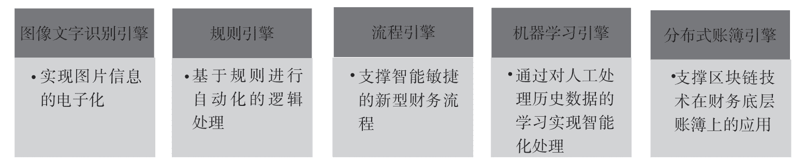
图 1-2　智能技术引擎

第一是图像文字识别引擎。大量资金数据仍以实物形态存在，如发票、合同等，虽正电子化，但现阶段实物仍为主体，且蕴含关键信息。信息提取除人工录入或众包外，可采用图像文字识别 OCR 技术，批量高效提取图像中信息。传统 OCR 识别率有限，基于深度学习的引擎有所改善。

第二是规则引擎。规则引擎以标签为基本元素，通过特定语法表达与封装控制规则，形成规则包。从业务视角看，可替代部分人工进行系统自动化审核控制。技术本身并不复杂，难点在于清晰的标签定义与管理、规则梳理与拆解、基于标签定义规则。以差旅费报销为例，涉及标签或达数百个，需十余个规则组合审核。

第三是流程引擎。流程引擎在传统架构中已广泛应用，智能化要求下需具备更强灵活与扩展性，以支撑智能应用中更复杂的后台任务分流。需引入机器学习技术，逐步实现流程智能化流转，如共享派工时实现更灵活均衡的智能派工。

第四是机器学习引擎。机器学习引擎是 AI 关键组件，可将算法封装形成标准化输入输出。通过对带特征与标签的历史大数据学习，自主发现规则或算法，并应用于资金场景，实现对人工的辅助或替代。机器学习引擎是信息化从自动化迈向智能化的关键一步。

第五是分布式账簿引擎。可理解为区块链在资金领域应用的基础，通过在业务系统与资金系统底层搭建统一底账，实现每笔交易平行记账，并基于区块链原理实现去中心化与数据一致性，为内部往来核对、关联交易核对、业财一致性核对等复杂业务提供技术支持。

在完善数据底座与多技术引擎共同作用下，信息化架构可从传统自动化进化为智能化。

## （四）AI 财资的局限
机器人虽可替代人员完成大部分基础核算，但在实际工作中仍存在不可替代之处。

### 1. 成本费用高
当前机器人对工作标准化要求极高，不适合多品种小批量模式。因此更适用于规模大、财税工作量重、快速成长期的企业。对普通企业而言，购置成本与后期维护费用较高，从成本效益原则看，目前尚不具备引进条件。

### 2. 技术成熟度不足
第一，机器人尚处初级发展阶段，功能不完善、兼容性差、初期问题较多。应用案例虽已存在，但范围小、层次低、功能有限，因开发时未充分考虑系列化、通用化、模块化设计，易导致兼容性差。
第二，操控技术人员短缺，售后服务问题突出。机器人是新兴产品，兼具会计理论与 AI、互联网技术知识的复合型人才十分紧缺，制约后期维护升级。
第三，信息安全性受威胁。会计信息以电子形式处理与保存，AI 系统存在技术漏洞，若防护不到位，可能被黑客攻破，窃取商业信息，对企业造成严重经济损失。

### 3. 人性化水平低
第一，情感化不足。机器人计算与数据处理能力强于人工，但缺乏人类丰富情感。与人相比，直觉判断能力弱，难以处理复杂逻辑问题，不能完全模拟财会人员。机器按预设规则执行，缺乏情感，也不能像人一样思考，特别是在涉及人际关系处理时，人类可通过表情、语气判断，机器人则不具备。
第二，及时反应与灵活性不足。在普通数据核算工作中可替代人工，但在涉及多因素宏观经济环境变化问题时难以替代。财会人员可结合自身知识经验、企业内外部环境与市场状况作出决策，涉及会计规则、法律知识与情感经验，且规则与形势随时变化，人员可动态调整，机器人难以得出最佳结论。无论如何发展，在组织关系、人际关系、企业与社会关系等处理上，无法完全取代人员。

## （五）对从业者工作的影响
2017 年英国牛津大学研究指出，目前最易被 AI 机器人替代的工作岗位之一即为资金工作。哈格与卡明斯在《信息时代的管理信息系统》中阐述专家系统即模拟人类专家解决领域问题的人工智能技术，适用于会计工作，同时指出其应用将极大威胁岗位就业。

第一，AI 发展给财会工作带来巨大挑战。基础核算岗位急剧减少，企业对综合管理能力要求不断提升，需求类型发生变化。
第二，AI 加速从业者职业转型。虽然在多方面可替代人工并完成传统核算，但并非适用于会计行业全部领域。在 AI 背景下，从业者需不断提升战略分析与判断能力，增强综合素质，打造软实力，加强职业生涯设计与管理。

## 第二节　智能时代驱动转型的关键技术

## 一、全面智能化驱动管理模式变革

### （一）智能化带来的资金管理模式转型

智能技术正在重塑财务工作的底层逻辑。大数据、云计算、物联网、区块链、人工智能等技术的集中应用，不仅把财务的技术支撑能力拉升到新高度，也迫使企业在管理思维上完成一次升级。

#### 1. 管控视角从局部到全局的跃迁

在传统财务管理里，集团管控一直是痛点。横向看，各业务板块、各专业公司之间信息像烟囱一样各自为政，数据难以横向比较，协同效果难以量化，财务成果的可比性也打了折扣。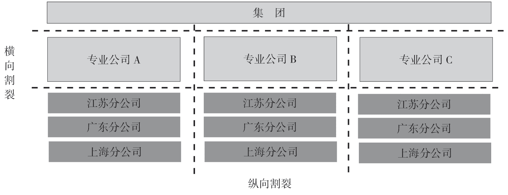

图 1-3　企业集团存在横纵信息割裂

纵向看，从集团到专业公司总部，再到下级机构，每一层级都存在信息隔断，集团难以完全穿透经营实况，专业公司总部与基层之间也常出现信息不对称。

这种割裂既源于管理机制，也源于技术架构。传统信息化下数据集中极为困难，多头分散存储让数据透明成为难题。

智能化之后，借助大数据、云计算等能力，技术上具备了更大范围的数据集中条件。搭建集团级数据中心，能够打通横向与纵向的信息通道。在技术可行的前提下推进管理变革，突破管理壁垒的成功率明显提升。

数据实现横向到底、纵向到底的贯通后，财务管控形态会发生根本变化。过去不得不采用的块状、分段管控，正逐步转向全局化管控，这对集团财务转型意义重大。

#### 2. 流程管理从固化走向敏捷

集团财务信息化向智能化演进的过程，本质是流程再造的延续。从手工到自动化已有一次固化流程的升级。制度化、流程化、系统化把流程与系统紧紧绑在一起。

费控系统的推广让纸质单据流转、人工审批、财务入账付款的链条全面线上化，信息流与实物流从单线并行变为双线并行。预算管理系统的落地则把依赖 Excel 多级手工汇总的编制过程搬到线上，效率大幅提升，预算管控也从核算后的事后控制前移到事前、事中。

这一轮再造形成了新的标准化流程，适应了财务人员管理思维的升级。而智能时代，流程与系统的关系将再次进化，从固化走向敏捷。

流程决策机制不再是类条件数式的内置规则，而是基于人工智能的动态优化策略。系统可依据管理模板灵活设定流转路径与复杂度：对不同风险等级的单据，自动判断是否需要更高层级审批；对管理决策，系统能评估信息紧急度，触发差异化的反馈流程。简言之，流程不再是死板的模式，而是围绕目标可伸缩、可弹性的敏捷管理。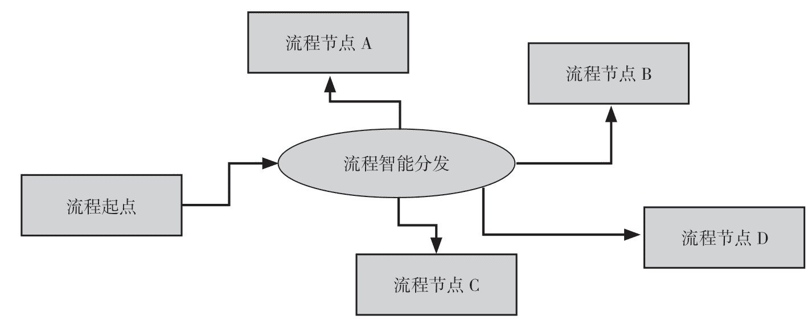

图 1-4　智能化下的敏捷流程

敏捷流程的落地意味着管理权限从人工决策向机器决策的进一步让渡，也是计算机模拟人工进入深水区的典型场景。

#### 3. 财务运营加速自动化与智能化

相比管控全局化、流程敏捷化，财务运营的自动化与智能化推进相对更快。集团财务运营多指工作量大、标准化程度高的作业，这类业务耗人多而价值产出有限，一直是信息化建设的重点。

过往系统已发挥作用，如银企直连替代传统网银作业，会计引擎让记账由手工转向自动。但在智能技术加持下，仍有大量空间可继续深挖。

财务运营智能化的前提是作业输入的全数字化。OCR、众包模式、电子发票、电子合同的普及，正把困扰多年的纸质凭证从源头数字化。在此基础上，计算机可通过海量规则与模型，把财务人员日常的思考、分析、判断动作系统化，实现复杂运营业务的自动化与智能化。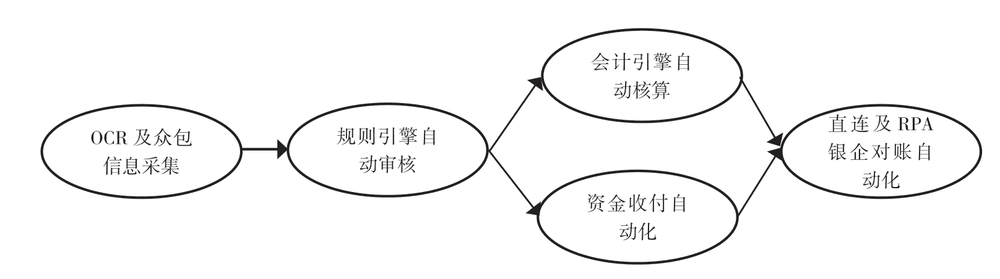

图 1-5　财务运营自动化、智能化示例

财务共享服务中心是智能化运营的主战场，但企业各层级机构同样存在大量可自动化的运营机会。

### （二）智能化驱动的组织形态重塑

财务智能化不仅改变管理模式，也在重塑组织结构。

#### 1. 财务组织边界向外延展

上一阶段的常见做法是建立战略财务、专业财务、业务财务、共享服务四分架构，它很好地支撑了从传统财务到现代财务的过渡。在智能化演进中，这一架构正向外延展。

最典型的演进是数据中心的出现。大数据对数据管理与应用的要求极高，传统模式下数据分散在各财务职能，集中度不足。财务数据中心从组织层面保障数据集中，实现探源、抽取、存储、维护的全流程管理，为后续大数据分析与人工智能应用提供底座。该团队需跨越财务、业务与信息技术边界，具备复合能力。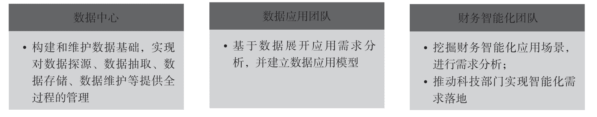

图 1-6　财务组织的外延扩展

在此基础上，专业化数据应用团队应运而生。管理会计团队在基础数据上开展成本分摊、多维度盈利分析、考核体系构建等工作；经营分析团队则负责将数据转化为管理洞察。两者让智能技术与财务管理场景紧密结合。

同时需要财务智能化团队。区别于传统财务信息化，智能化团队一方面要具备场景构建能力，能挖掘财务各业务线智能化需求并将其转化为方案；另一方面要具备技术转化能力，能与科技部门有效沟通，推动需求落地。

智能化下的财务组织正围绕数据与场景进行外延拓展。

#### 2. 财务组织从刚性走向柔性

与外延扩展并行的另一变化是组织刚性向柔性的转变。泰勒科学管理强调作业管理、组织管理与管理哲学，追求标准化与高效率，但也带来了层级森严、制度刚硬、流程难变、系统难改的刚性特征。

#### 财务柔性管理与智能化转型

安应民在《企业柔性管理：获取竞争优势的工具》中说：“从本质上来说，柔性管理是一种对‘稳定和变化’同时进行管理的新战略，它以思维方式从线性到非线性的转变为前提，强调管理跳跃和变化、速度和反应、灵敏与弹性，它注重平等和尊重、创造和直觉、主动和企业精神、远见和价值控制，它依据信息共享、虚拟整合、竞争性合作、差异性互补等实现知识由隐到显的转换，为企业创造与获取竞争优势。”[7]

智能时代释放出强烈的自我改变信号。人工智能正逐步接管财务审核、核算、资金结算等刚性生产，释放的人力可用于重建创造力与柔性管理能力。

## 财务组织的柔性体现

### （1）组织架构的柔性
传统财务多采用层级式架构，强刚性且不利于创新。柔性组织倾向于压缩层级、扁平化运行，并更多以团队为单元。依据阶段性创新目标灵活组建团队，能更好匹配智能化需求。

### （2）财务文化的柔性
传统财务文化偏向严谨，与智能化所需的技术想象力与场景创新存在张力。文化转型需更强调协作与创新氛围，适度引入市场化机制，让财务以更市场化的方式参与经营，共同推动刚性向柔性演进。

## 智能化带来的团队和人员能力升级

智能化对财务团队提出双重能力要求：创新能力升级与知识结构升级。

### 1. 财务人员创新能力升级
智能化将重塑社会经济与商业模式，财务需跟上企业战略落地与决策支持的节奏，否则会制约经营发展。同时，财务管理的方方面面都在被重塑，创新滞后将导致运营效率、决策水平与资源配置能力落后。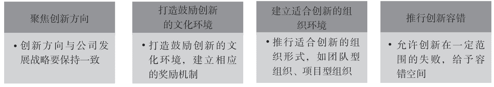

图 1-7　提升财务创新能力的四个方面

提升创新的路径可从四方面入手：聚焦创新方向并与公司战略保持一致，确保资源与认同；打造鼓励创新的文化环境，对管理创新给予正向激励；构建适合创新的组织环境，打破层级边界，项目制是很好的载体；对试错保持包容，为技术流程实验提供试验场，这对本就谨慎的财务人员尤为重要。

### 2. 财务人员知识结构升级
传统成长路径是专业深耕，从核算、资金、税务等基础岗位做起逐步成为专家。在智能时代，新人难以经历完整的基础历练：专业协同网络化使岗位分工更细，基础工作被计算机替代使接触面受限。

因此财务人员需尽早建立全局观与系统观，先搭建完整的财务知识框架，理解各职能模块构成与关联，再通过系统化、全局化思维拓宽知识面，随后逐步加深厚度并在少数领域重点钻研。这种宽而后深的发展模式，能增强职业弹性，更好适应技术变革。

综上，智能化正在从模式、组织、文化、人员多维度驱动财务转型，转型成功的财务组织将为企业迈向智能化提供强大助力。

### 二、智能时代的财务管理实践升级
智能化不仅是观念变化，也在财务实践中形成大量应用场景，持续提升管理能力。财务整体框架涵盖战略财务、专业财务、业务财务、共享服务，下面以战略财务为例展开。

## （一）智能化与战略财务
战略财务包含战略与业务支持、财会控制机制、价值管理、经营分析与绩效管理、全面预算管理等。智能化重塑经营环境，企业可能成为智能服务提供者、智能技术参与者，或在现有模式中引入智能工具创新商业模式。战略财务需敏锐跟随战略变化，主动提供支持而非被动响应。

在战略财务领域，智能化影响集中在经营分析与全面预算管理。

### 1. 智能化对经营分析的影响
经营分析并非简单报表堆砌，需建立在相对稳固的机制之上。其核心由数据、指标、报表三层构成。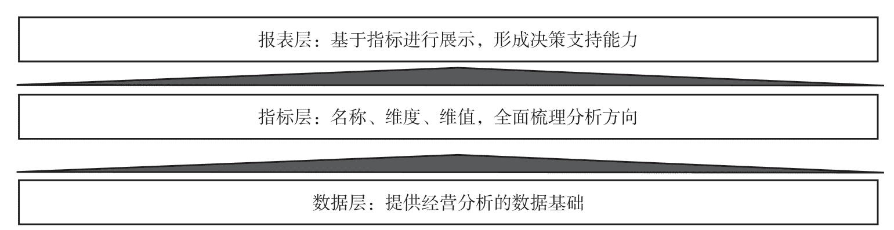

图 1-8　经营分析体系的构成

数据是基础。智能化阶段数据范围从结构化扩展到非结构化，大数据概念为分析带来新可能。构建数据基地需对数据仓库、数据集市有清晰规划，明确定义、标准、来源与采集逻辑，并通过流程与系统保障数据质量。

指标是衡量手段。围绕经营目标设定量化标准，构建指标树并定义名称、维度及取值，形成清晰体系，帮助集团透视经营状况与管理水平。

报表是呈现载体。报表本质是不同层级的指标按维度交叉组合，需先明确管理者需求，再选取合适指标并匹配维度信息，同时辅以使用说明。

智能化对经营分析带来视角与工具的改变。传统分析受数据边界限制，在大数据支撑下，因果分析向相关性分析扩展。数据边界从企业内部延伸至社会化数据，KPI、经营分析报告、市场对标等职能获得更可靠的数据基础，分析结果可用性显著提升。

智能时代财务进化观察

经营分析的弹性升级
在方法工具层面，云计算与大数据协同正在重塑经营分析的边界。两者联动后，数据的搜集、抽取与计算供给显著增强，分析所能覆盖的范围被明显拉开。特别是对非结构化内容的解析能力，让企业在做经营研判时能够把外部热点纳入考量，新闻、微信、微博等社会化信息也能进入分析框架成为素材。

算法驱动正把经营分析从经验判断推向计算判断，更复杂的研判变得可行。依托机器学习以及算法的自我迭代，经营分析的效能实现持续进化。

### 2. 预算配置逻辑的重塑
预算的本质是企业资源分配的表达。股东提出经营目标后，业务单元要达成目标就必须匹配资源。从契约视角看，预算即契约，一方是股东，一方是经营者。资源归股东所有，经营者向股东承诺结果，股东向经营单元承诺提供达成结果所需的资源。结果兑现后还有绩效激励，形成第二层契约。

因此预算管理的关键，是找到股东与经营单元都能认可的资源配置方案，在目标承诺与资源承诺之间取得平衡。

资源配置过程常遇到信任如何建立、配置依据如何确定、配置效率如何提升、配置效果如何检验等难点。传统财务管理阶段这些难题难以根治，多靠变通妥协。进入智能化阶段后态势开始变化。

其一，在经营计划制定与预算编制阶段，智能技术能发挥支撑作用。资源投向的方向与权重是否合理，是预算价值能否释放的重要标尺。海量数据分析可以验证业务部门在资源投入上所讲故事的真实性，能更清晰呈现资源投向与业绩达成之间的相关性，从而让财务具备评价资源投向的能力。

其二，预算预测环节可借助海量数据、机器学习搭建更复杂完善的预测模型，并在大量复杂场景下开展敏感性分析，进而提高预测可靠性与对未来不确定性的预判能力。更值得期待的是模拟技术正在出现，引入人工智能的虚拟商业生态能让预测建立在与真实社会相近的仿真环境中，比如在拟真环境里投放广告、设定不同预算投入、模拟用户真实反馈、评估预算投入效果等，都可能在未来成为现实。

## （二）专业财务的智慧化浪潮
专业财务是财务体系中最成熟的模块，也是企业财务运转的基础。可以说没有战略财务、业务财务与共享服务企业也能运转，但没有专业财务整个体系就会失灵。成熟意味着优化空间更大。

专业财务涵盖会计报告管理、税务管理、资金管理、合规管理、管理会计、成本管理及财务风险管理等多个领域，其中财税管理、管理会计、风险管理受智慧化影响尤为明显。

### 1. 报告与税务管理进入智慧时代
会计与报告长期是会计电算化、财务信息化的建设重点，智能时代为这一块升级打开窗口。

在报告侧，依托机器学习，智能报告正在成为可能。让人工智能处理会计报告已非天方夜谭，当前由人工智能撰写的市场研究报告已难以分辨背后是资深研究员还是机器。在相对结构化的报告范式之上，结合人工智能对市场反应的学习，智能报告对股价的推动力或将越发显著。

税务管理里也有大量可由信息技术自动化的场景，如发票真伪查验、发票认证、纳税申报等，都可以引入智慧化手段，进一步释放人力。

### 2. 管理会计的能力边界被技术拓宽
管理会计的应用高度依赖信息系统建设。通常需要处理海量数据，若无系统支撑，很难实现日常机制化运转。传统模式下，管理会计在系统运算性能上存在瓶颈，性能不足时只能通过简化业务逻辑来凑合。

管理会计技术支持的三个阶段，如图 1-9 所示。从多维数据库出现开始，管理会计性能得到明显改善。传统关系数据库处理大数据量费时、性能差、开发周期长、成本高。多维数据库结构简洁易懂、开发相对容易，却付出大量冗余的代价，属于用空间换时间的方案。

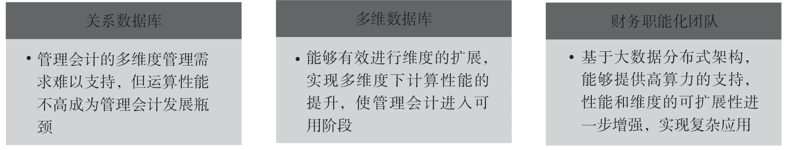

图 1-9　管理会计技术支持的三个阶段

进入智慧化时代，管理会计将更多从技术性能层面获益。物理架构与硬件的进步能缓解运算性能不足的痛点，基于云计算架构的多维数据库，或直接使用内存数据库处理管理会计数据，都提供了优化性能的路径。

此外，大数据技术架构的发展也为用大数据平台解决多维数据处理问题提供了新思路。实践中已有企业尝试将新的管理会计数据处理搭载在大平台上。借助大数据平台的技术优势，突破计算性能瓶颈，使管理会计系统能够处理更多维度与更复杂的逻辑。

### 3. 风险管理在三重环节被智慧加固
在专业财务的风险管理领域，智慧化正发挥作用，能从事前、事中、事后三个层次防范财务操作风险，如图 1-10 所示。

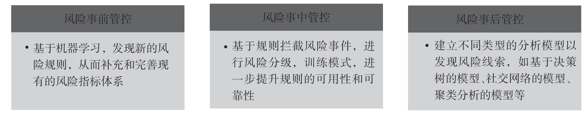

图 1-10　智能技术对风险管控三阶段的支持

事前防范层面，传统风险监控体系多基于经验与分析，认知完整性上存在缺陷。机器学习方法可以基于财务业务流程中的大量交易及风险事件，挖掘新的风险规则，补充完善现有风险指标体系，提升事前防范能力。

事中控制层面，基于经验规则的系统化能够实现初级人工智能应用。借助大量规则可发现财务交易中的潜在风险事件，并对部分风险直接拦截。基于数据积累，可对每一笔单据进行风险分级，并为不同等级配置差异化控制流程，提升管控能力。机器学习还能在经验规则积累基础上持续训练优化。与此同时，依托企业内外大数据的积累与挖掘，可建立更为丰富的单据风险分级规则模型，使分级更精准。

事后分析层面，可建立决策树、社交网络、聚类分析等多种模型发现风险线索。模型构建有助于在事后进一步开展操作风险审计与问题发现，通过跨交易单据分析发现更广泛的风险线索，并据此解决问题。大数据与机器学习也有助于持续完善各类分析模型规则，提升线索发现的精准度。

智慧化技术在风险领域的应用相对容易起步，适合作为迈向智慧化阶段的前期选择之一。

## （三）智慧化与业务财务的交汇
业务财务本质上是战略财务与专业财务在业务机构端的延伸，也是财务共享服务在业务前端的支持与保障。从职能范围看，智慧化对其影响与对战略财务、共享服务的影响类似。可以从业财融合视角关注二者的关系。

在智慧化与业财融合方面，会计引擎与区块链是两个关键技术。

### 1. 会计引擎与业财融合
业财融合的最大挑战在于业务信息向财务信息转换过程中数据的保持一致。

业务与财务遵循各自的语言体系记录经济事项。业务系统记录每一笔交易的明细，管理视角主导，记录时充满个性化与不规范表达，很难汇集成完整的经营信息。财务记录则在准则约束下，将差异化的业务表达统一为会计语言，反映真实经营情况，但规范性要求也导致部分信息被舍弃。

两种语言体系的差异带来转换困难。一方面同类信息表达不一致，需要语言对等翻译；另一方面转换中数据偏差导致不一致，需要业财核对。

在业务系统与财务系统之间构建高度灵活的会计引擎可以缓解这一问题。会计引擎相当于系统内的翻译器，对不同业务系统与财务系统间的数据关系做初始配置。业务发生时，每笔交易都能经由引擎翻译成会计分录，完成从业务信息到会计信息的转换。

目前主流的会计引擎多集成在行业业务系统中解决行业特性。随着技术发展，会计引擎正被抽象为独立产品，并可能引入智慧化升级。

智慧化阶段的会计引擎将在独立产品化的基础上形成跨行业统一模式。引入机器学习技术后，引擎可学习基于规则转换的历史数据积累，逐步形成新的转换规则体系。数据不断累积，学习过程持续提升业务到财务的语言转换能力，最终实现新业务接入免配置。如同用海量案例培养出业务专家，能够自主解决复杂的业财信息转换问题。

## 2. 区块链与业财融合
会计引擎解决了信息翻译问题，区块链则为业财一致性提供了新思路。

区块链本质上是一种分布式账簿。传统财务记账只有一本集中账簿，全部账务信息集中记载。业务系统中的交易记录可视为业务账，财务系统的会计凭证是财务账，二者是转换关系，一致性易出问题。

区块链能够在业务与财务之间构建平行账簿。业务发生时，交易同时在双方账簿中记录。由于业务方在集团内部可能存在多个组织或法人形态，也会在关联方或内部往来方之间形成多个平行账簿。

在企业底层基于区块链搭建这套平行账簿体系后，任何一笔交易都在多账簿中同时记账，数据一致性问题得以解决。实现一致性后，业务系统与财务系统之间无需再进行数据一致性核对，内部往来与关联交易的核对问题也能以类似方式解决。

### （四）财务机器人、智慧化与共享服务的补充
财务共享服务与智慧化的关系已得到深入探讨，智慧化阶段能极大提升共享服务效率，OCR、规则引擎、众包、人工智能等技术综合使用，推动共享服务从传统模式向智能共享跃迁。

在此对财务共享领域流行的财务机器人概念做说明。严格来说，财务机器人并非真正意义上的智慧化，更接近脚本自动化的概念。机器流程自动化RPA与智能化业务流程自动化IPA应用的最大区别在于，RPA的实现基础仍是传统流程规则的明确，而IPA的实现基础是机器的自我学习与自我认知。迈向彻底的无人共享模式需要多种技术组合，财务机器人是其中的重要一环。

RPA是通过模拟人工作业的方式，将无法通过系统集成手工操作自动化处理。以最常见的应付流程为例：维护供应商数据、提交采购请求、采购订单、收货确认、收到供应商发票、三单匹配、调整差异、建立付款日期、准备付款、批准付款、付款执行、记账……绝大多数环节可由RPA协助，如供应商信息更新、创建采购申请、查询物流信息、更新采购计划、收货确认提醒、三单匹配核对、价格核对、付款差异检查、信用检查、银行对账等，通过自动化大幅提升应付流程执行效率与质量。

RPA更像Office系统中的宏工具，只是功能更强大。其优势如下。

首先，RPA并非孤立应用，具有服务端与统一调度管理能力，能够清晰监控自动化任务的运行过程与执行结果。

其次，RPA的最大优势在于跨系统平台作业能力。与宏工具不同，RPA能跨越系统平台作业，与人工作业极为相似。即使面对虚拟系统，也能支持本机与虚拟机间的自动化交互，进一步扩大应用场景。

再次，RPA学习成本极低，无需程序员技能，具有一定计算机基础的财务人员经过培训即可掌握，便于下沉至共享服务中心一线，实现流程的及时动态优化。

最后，RPA中也能进行简单规则处理，与规则引擎作用相似，一些仅需简单判断的流程无需专业规则引擎即可直接实现。

实施要点方面，首先实施并非纯技术问题，核心在于流程分析与梳理，并基于分析发现设计方案。该过程重在流程理解，项目必须依托业务开展，需要一线业务人员深度参与才能发挥价值。

其次，RPA并非万能，更好的方案是实现系统深度集成。但受IT开发进度或系统本就难以集成限制，RPA常作为对系统集成以外大量零散手工问题的补充方案。许多零散手工环节的系统集成代价极高，RPA有时能起到意想不到的作用。

智慧化对财务共享的影响深远，且将持续演进并集成更多新技术形成合力。

### （五）智慧化助力财务管理实践再升级
财务转型已正式迈入智慧化阶段，这不再是想象中的趋势，而是正在发生的事实。对于企业集团的财务转型之路，从核算向共享、从出纳向司库的转变中，必须重视并抓住技术升级这一重大趋势，以智慧化技术为基础全面升级财务信息化能力，为业务转型奠定扎实基础。

在漫长转型中，我们经历了管理模式升级与信息技术进步，财务管理实践从未止步。无论组织、团队还是财务人员都在积极自我提升以适应甚至引领变革。

智慧化到来并非威胁，从某种意义上它是时代赋予的新机遇。财务人员若能积极面对自身能力全面升级的需求，就能在这一浪潮中掌握主动权，将智慧化技术与财务管理场景深度融合，在管理实践中创造更大价值。

## 第三节　智能时代财务管理新逻辑
智能时代的到来改变了财务组织、财务人的认知与财务信息技术，更重要的是改变了财务逻辑，来自逻辑层的改变才是触及灵魂的改变。面对智能时代，不妨一起思考新逻辑，如图 1-11 所示。

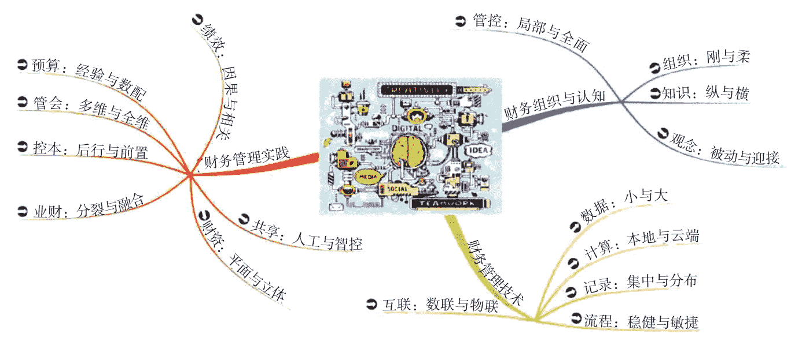

图 1-11　智能时代财务管理的新“逻辑思维”之思维导图

## 一、财务组织与认知的新逻辑
财务组织与认知是财务主体的躯干与心智，智能时代来临首先要强身明智，认识到财务组织与认知在智能时代的改变是财务智能变革的基础。从管控、组织、知识、观念四个关键词来看新逻辑。

### (一) 管控：局部与全面
现代财务管控受组织壁垒严重制约，从集团到业务板块、专业公司再到机构，每一层级间都存在无形的数据壁垒。今天人力难以直接渗透至末端时，数据是集团管控的关键，而数据壁垒让管控力量层层衰减。智能时代数据将实现高度集中与透明，数据无边界成为可能。数据壁垒被打破后，财务管控势必从局部走向全面。这是智能时代管控的新逻辑。

### (二) 组织：刚与柔
现代财务组织建立在刚性管理基础上，泰勒科学管理把人视为“经济人”与“会说话的机器”，强调组织权威与专业分工。刚性组织依靠制度与职责权力，管理者作用在于命令、监督与控制。智能时代需要更多能动与创新，“会说话的机器”将被人工智能这一“真正的机器”替代。智能时代更需要柔性组织，柔性管理擅长挖掘员工创造性与主观能动性，依靠共同价值观与组织文化调动高层次主导动机，实现跳跃与变化、速度与反应、灵敏与弹性的管理需求。这是智能时代组织的新逻辑。

### (三) 知识：纵与横
现代财务管理对财务人员要求首先是专业纵深能力。财务管理涉及会计、税务、预算、成本等多个垂直领域，很多财务人员长期深耕某一领域，形成很强专业能力。但在智能时代，财务管理视野将被极大拓展，人工智能可辅助增加知识深度，而更需要的是具有横向宽度、能够跨专业领域协同创新的新知识体系。如图 1-12 所示，智能时代适度的专业宽度与专业深度形成的T字形知识结构将更具价值。这是智能时代知识的新逻辑。

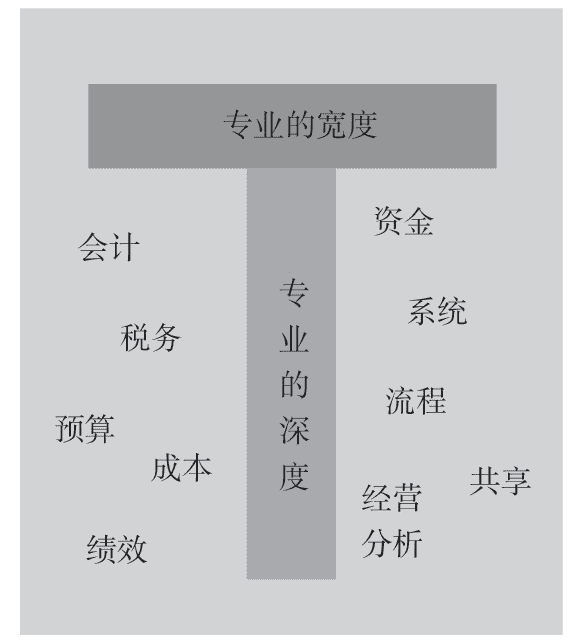

图 1-12　T 字形知识结构

### (四) 观念：被动与迎接
当前财务人员的观念潜意识中多偏向被动。现今社会认为财务需以严谨态度处理问题，管理层与业务部门也常把财务视为后台角色，做好本职、有问题能解决即可。这些都是典型的被动思维。在此认知下，财务掌握的资源极其有限，难以发挥管理推动作用。智能时代更强调财务基于大数据与智能分析的主动发现与管理能力。观念转变需要从被动响应变化转向主动迎接挑战，向强势财务迈进。这是智能时代观念的新逻辑。

## 二、财务管理技术的新逻辑
管理技术是财务主体的脉络，好的管理技术能让财务主体运转更具活力。财务管理技术的逻辑转变将让财务触及更广阔的技术领域，获得更先进更有价值的工具。从数据、计算、记录、流程、互联五个关键词来看新逻辑。

### (一) 数据：小与大

智能时代对财务的影响首先体现在数据上。过去的财务处理与分析几乎都依托结构化信息，行内常把它叫做小数据，这也是我们最拿手的地方。传统财务分析的工具链也基本围绕这类数据搭建。进入智能时代后，小数据依然是财务的基石，因为现有的管理理论大多建立在结构化信息之上。但仅握住小数据工具已经不够，大数据必须被同步重视。借助大数据技术，海量的非结构化信息才得以被有效处理，它帮助我们跳出惯性思维，开辟更广阔的应用空间，这就是智能时代数据逻辑的转向。

### (二) 计算之变：从本地到云端
以往的信息系统多以本地部署为主，从管理者角度看，这种方式匹配灵活、建设可控。但本地部署规模扩大后，运维开销持续攀升，企业资产也被大量占用。传统时期算力有限尚可容忍，而智能时代大数据与机器学习对算力的需求是海量的，本地模式难以为继。无论公有云、私有云还是混合云，走向云端已成必然，这构成了智能时代计算逻辑的新方向。

### (三) 记录之变：集中走向分布
传统财务记账多采用有中心式的集中记录，数据体量小、资源消耗低，但安全性与一致性相对薄弱，因而常出现业财不一、跨系统同源数据冲突的现象。智能时代在区块链带动下，记账方式实现革命，从集中记账转向分布式记账，财务信息以去中心化的方式在多账本间同步。分布式记录会带来数据冗余，但随网络与存储的快速进步，这一成本已可被克服，记录的集中到分布将成为更广泛的实践，这是智能时代记录逻辑的新内涵。

### (四) 流程之变：从稳健到敏捷
为了保障端到端财务流程的可靠性，传统做法是强化流程固化，稳健模式提升了可靠性和维护便利，却牺牲了灵活性与客户响应速度，直接影响满意度。智能时代的流程引擎支持更丰富的控制维度，能基于动态数据实时调整控制参数，同时流程中智能自动处理的环节不断增加，变动带来的运营压力大幅下降。在此背景下，把流程从稳健适度转向敏捷成为可能，也更符合客户期待，这是智能时代流程逻辑的新取向。

### (五) 互联之变：数联之上加物联
传统财务关注数字之间的流动，无论是流程还是管理都聚焦数字流转。数联时代把经营管理过程转化为数字形态，实现量化管理。智能时代在此基础上引入物联，随着物联网推进，企业中关键实物、运输、人员、凭证等流动都可以打上物联标签，物流信息被进一步转化为数字信息。由此可打开此前难以触及的管理视角，例如更精细的物流运输成本管理。物联并非否定数联，而是把物联信息纳入数联体系，这是智能时代互联逻辑的新演绎。

## 三、财务管理实践的新逻辑
管理实践是财务的双手，逻辑的转换能让实践升级。下面从绩效、预算、管会、控本、业财、共享、财资七个维度看新的实践逻辑。

### (一) 绩效：从因果到相关
传统绩效管理预先设定因果关系，通过 KPI 及目标值监控执行，偏离时再追溯原因并制定对策，这是典型的因果分析思维。智能时代大数据更强调相关性而非因果，为经营分析打开新窗。基于大数据可直接从数据中识别影响 KPI 偏离的关键因素及作用方向，直接干预这些因素，无需解释因果链条，也无需对业务部门做逻辑自证，这就是绩效逻辑的新形态。

### (二) 预算：从经验到数配
传统预算编制多依赖经验，即使使用作业预算，其业务动因也多来自经验判断，因而被称为经验预算，对编制人员要求高且结果不稳定，沟通中弹性大、说服难。智能时代依托大数据的可预测性，从结果反推影响经营的热点因素，按热点确定资源投入，实现精准预算或精准资源配置，即数配。这是预算逻辑的新路径。

### (三) 管会：从多维到全维
管理会计的核心痛点是维度，关系型数据库性能难以支撑多维度盈利分析，多维数据库成为主流，但设计时仍极度谨慎、精简维度以保证效率。智能时代算力与数据处理模式持续提升，未来维度组合计算不再是业务设计的瓶颈，全维管理会计有望实现，这是管理会计逻辑的新景象。

### (四) 控本：从后行到前置
传统成本管控多在成本发生后追踪，即便前移到设计阶段，也仅是阶段性改进。随着技术进步，成本费用被细分为不同子类，可针对子类向前延伸建设专业的前端业务系统，如商旅、品牌宣传、车辆、通信费管理等。这些前置系统与财务系统无缝衔接，把成本费用的管理前置到业务发生过程，这是控本逻辑的前移。

### (五) 业财：从分裂到融合
传统业务系统与财务系统分离，通过体外数据传递对接。近年业财融合推进，出现单个业务系统体内自建会计引擎并对接财务的模式，但系统间仍呈分裂。智能时代会计引擎的复杂性处理能力提升，可在大型企业内部建立统一会计引擎，作为载体融合差异化的前端业务系统，实现业财对接从分裂到融合的跃迁。

### (六) 共享：从人工到智控
当下财务共享是典型的劳动密集型运营，集中处理分散作业，在过去十年大幅降低会计运营成本并提升管控能力，但劳动密集也带来成本与操作风险。智能时代在人工智能与机器学习驱动下，共享作业逐步替代人工，依托前端数据丰富采集与智能规则，人力需求大幅下降，运营从劳动密集转向技术密集。同时人工智能可实现更丰富的智能风控，这是共享逻辑的新阶段。

### (七) 财资：从平面到立体
传统财资管理多为平面化，聚焦账户管理、资金结算、划拨、对账等交易处理，这是国内多数企业的现状。智能时代技术对复杂资金管理模式的支持增强，财资将从平面走向立体：一方面从交易处理向司库模式转型，深化资产负债、流动性、风险管理；另一方面从企业内部资金管理向供应链金融延伸，构建多维度立体财资体系。这是财资逻辑的新高度。

以上构成了智能时代财务管理的新逻辑，也为构建智能财务体系提供了思想基础。唯有在观念上做好准备，才能真正拥抱这个时代。

## 第四节 智能时代新商业经济与财务变革
智能时代不仅重塑财务人员的思维，也在推动社会商业形态革新。商业经济正被新思想驱动，本节聚焦共享经济、跟踪经济、合作经济三类新形态，并探讨其对财务的启示。

## 一、共享经济与财务
# 共享经济的财务启示
“共享经济”概念最早由美国德克萨斯州立大学的马科斯·费尔逊与伊利诺伊大学的琼·斯潘思于1978年在论文《群落结构和协同消费》中提出，近年因美国作家蔡思的《共享经济》一书而流行，吴军在“硅谷来信”中亦有深入解读。

通俗理解为一方提供闲置资源的使用权，另一方付费获取使用权，形成经济循环。这种逻辑与分享经济相近，催生了住宿共享、物流共享、出行共享、闲置用品共享等模式，财务领域也因此出现财务共享服务，解决人力资源分散冗余问题，实现共享。

但并非所有基于闲置资源的共享都能成功，共享成本是挑战。例如闲置图书共享需承担物流与沟通成本，难以撼动购买新书的习惯。相反，滴滴与共享单车等增量模式更具生命力：滴滴车辆多为司机为入行而新购，共享单车也是向市场投放新车，并非利用家中闲置。它们通过新增平台化工具与资源实现共享，进而创造新需求，如共享单车引发了现象级的骑行需求。

增量共享的核心在于三点：打造新工具或资源平台、共享新增资源、基于此创造新用户需求。在此思维下，财务管理可做新思考。

其一，集团财务可领衔技术平台投资，形成增量共享。集团集中投入大数据、云计算、人工智能、区块链等技术研发，成果以低成本供给子公司使用，让缺乏能力自研的单位也能参与财务技术革新，如同投放共享单车改变出行习惯，提升整体管理水平。

其二，用高品质中小企业财务共享服务升级代理记账市场。当前代理记账市场良莠不齐，如同滴滴前的出租车市场。借助类似滴滴的共享平台规范服务标准与信用体系，通过信息系统撮合供需，引入更多高品质服务商，可推动市场规范，并让客户从记账需求延伸到税务、制度、管理、经营分析等全方位服务，实现增量共享。

图 1-13　智能时代的新商业经济

## 二、跟踪经济与财务
跟踪经济指在对事项持续跟进过程中挖掘商业价值。PC 互联网时期跟踪范围有限，移动互联网时期扩展到动态位置，智能时代的跟踪经济则建立在物联网之上。

### （一）跟踪经济的发展特征
智能物联阶段的跟踪设备在丰富。智能手机精度与时效大幅提升，RFID 低成本普及实现大范围物追踪，智能穿戴弥补手机不适场景，如游泳、睡眠监测。

智能物联阶段的分析能力在提升。跟踪信息呈几何级增长，在云计算、算力提升与大数据技术支撑下，可对海量数据充分分析，精细到物体每一次移动、人体每一次动作。

智能物联阶段的商业应用在进步。如共享单车结合手机定位与车载芯片形成新模式；电商可对商品出厂后全路径追踪，提升防伪能力，便于用户溯源。

### （二）跟踪经济对财务的启示
跟踪成本下降后，财务可广泛应用跟踪技术提升核算、风控与分析水平。

其一，解决存货、生物资产管理核算审计难题。传统存货管理依赖大量业务信息录入，真实性难验，如海外备件长期闲置多年财务难以反映。生物资产盘点更困难。借助跟踪芯片可实时追踪存货与生物资产，基于位置的精准分析可自动化完成依库位转移的核算，提升业财一体水平。

其二，解决合同、印章、银行 UKey 等高风险物品管理。传统管理易发生操作风险。附加跟踪芯片可实现精准风险管控，如物品远离保管位置即触发预警，结合权限管理系统可还原“谁、何时、用过什么”等场景，强化风控。

其三，依托丰富的跟踪场景开展经营分析与业务财务管理。通过对人、物、流程的连续追踪，可获得更细颗粒度的决策支持，实现从传统财务向数据驱动管理的跃进。

业财距离与物联网桥接

在日常的经营分析与业财配合里，最难处理的矛盾是财务视角与业务视角始终存在隔阂。口头上强调财务应贴近业务，实际推进时却常打折扣，导致分析停留在表象，难以触及根本原因。物联网的普及为此提供缓解可能。随着连接技术普及下沉，业务单元自发推动物联化管控的意愿在增强，待社会整体形成物联化通用规则后，物联网将成为事实上的共同语言。届时财务需主动把物联网沉淀的大量信息纳入工作流程，甚至跨出企业边界，把供应链全链路的物联数据汇总扩充，形成更宽的数据底座。在此前提下，经营分析与业财工作才能获得接近业务端的信息透明度，财务与业务的深度融合才算真正落地。

## 三、合作经济与财务

下面要讨论的是合作经济。乍看容易理解，实操中却常被狭义化，认知偏差会使商业模式创新受阻。其本质应如何把握？

广义的合作行为历史悠久，但作为特定社会经济组织形式，合作经济是近现代产物，出现在资本主义发展阶段。其思想源头可追溯到空想社会主义。19世纪初，圣西门、傅立叶、欧文等空想社会主义者描绘了一个无剥削、无贫困、协作生产、平等和谐的理想社会，这构成合作经济的雏形。

当下的合作经济已演进。最常被引用的表述是“互联网+”，即把互联网与传统行业嫁接，形成新业态。其中互联网金融等探索取得较好成效，为社会创造了可观价值共享。但“互联网+上门洗车”“互联网+上门美甲”等做法并未达预期，根源在于创新只是简单叠加。合作经济的边界远比“互联网+”宽，既可正向组合，也可逆向运用，例如金融行业深度使用互联网工具，同样能焕发新动能。

因此合作经济的核心可概括为传统产业与新技术工具、新商业思维的灵活配对，顺序不重要，关键在于能否产生化学反应。

映射到财务领域，大方向就是把传统财务业务范式与智能时代的技术手段深度结合，这被视为确定性趋势，并无争议。

关键问题在于，为财务提供服务的市场主体如何参与这场时代协作。核心变量是技术能力，不同体量的参与者路径不同。

第一，具备技术实力的参与者。这类财务服务供给方有机会在“财务+技术”中占据技术侧主导，例如Oracle、SAP，国内的用友、金蝶等传统财务信息化厂商也有此可能。大数据、云计算、人工智能等技术阵营的主导者，如BAT、平安，也可能成为重要一方。对他们而言，需要充分发挥技术优势，深度参与技术侧协作，并从技术视角推动商业模式生成。但要承认，这仍是少数玩家的游戏，绝大多数财务服务市场参与者难以胜任该角色。

第二，成为应用技术的摆渡人。对绝大多数厂商而言，若无法成为技术主导者，不妨厘清定位，转换角色，主动充当应用技术的中间桥梁。

对多数企业财务来说，在“财务+技术”协作中难以胜任财务端这一角色，并非不懂财务，恰恰是其基本盘。难点在于，如何在思想与技术层面创造性地衔接传统财务与新技术。技术端更多提供工具和平台，如何将这些工具和平台迁移到财务场景，很多平台方并不聚焦；而技术能力不足的财务人员去寻找结合点也较为困难。此时，市场上的财务服务商不妨把自己定位为连接传统财务与技术的“摆渡人”，通过帮助财务落地新兴管理技术实现自身价值，这可能是财务领域合作经济的最佳形态。

* * *

[\[1\]](#txt001.xhtml#footnote_quote_txt001_1)尼克.人工智能简史\[M\].北京：人民邮电出版社，2017：66.

[\[2\]](#txt001.xhtml#footnote_quote_txt001_2)卡普兰.人工智能时代\[M\].杭州：浙江人民出版社，2016：52.

[\[3\]](#txt001.xhtml#footnote_quote_txt001_3)卡普兰.人工智能时代\[M\].杭州：浙江人民出版社，2016： 120.

[\[4\]](#txt001.xhtml#footnote_quote_txt001_4)韦康博.人工智能\[M\].北京： 现代出版社，2016：98.

[\[5\]](#txt001.xhtml#footnote_quote_txt001_5)毛航天.人工智能中智能概念的发展研究\[D\].上海：华东师范大学，2016：98.

[\[6\]](#txt001.xhtml#footnote_quote_txt001_6)李凡.会计人员生涯发展的个案研究\[D\].上海：华东师范大学，2006：56.

[\[7\]](#txt001.xhtml#footnote_quote_txt001_7)安应民.企业柔性管理：获取竞争优势的工具\[M\].北京：人民出版社，2008：88.

[\[8\]](#txt001.xhtml#footnote_quote_txt001_8)孙逸，董志强.RPA：财务智能化的必经之路\[J\].新理财，2017（21）：64-65.



# 第二章 智能时代财务信息化整体规划

## 第一节 智能时代财务信息化概念框架

智能化浪潮带来技术爆发，财务侧的应用场景也在持续扩容。前面谈过财务认知的升级，也梳理过影响财务信息化建设的关键技术。当技术与财务有机融合，就会产生化学反应。于是智能时代财务信息化架构诞生，既保留传统财务信息化的稳健性，也具备面向未来的敏捷感。下面一起拆解该架构。

### 一、软件架构与财务智能化功能架构蓝图

先明确软件架构是什么，再看财务智能化功能蓝图。

#### （一）什么是软件架构

对财务人员而言，软件架构听起来偏技术。通俗讲，就是搞清楚系统由哪些模块组成、它们如何协同。以智能财务信息化为例，就是要明白相较传统架构新增了哪些模块，以及各模块互动方式的变化。仅描述模块能做什么叫功能架构，加上交互关系就上升为逻辑架构。实际软件设计里还存在开发架构、运行架构、物理架构、数据架构等多重视角[\[1\]](#txt002.xhtml#footnote_content_txt002_1)，如图 2-1 所示。下面重点聚焦概念层面的功能架构。

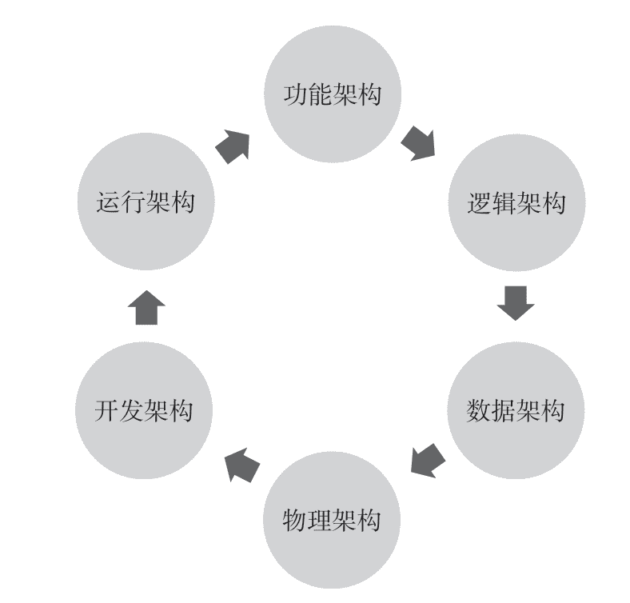

图 2-1 多视角的软件架构

#### （二）智能时代财务信息化功能架构蓝图

下面用财务人更易懂的方式呈现智能时代财务信息化概念模型，如图 2-2 所示。

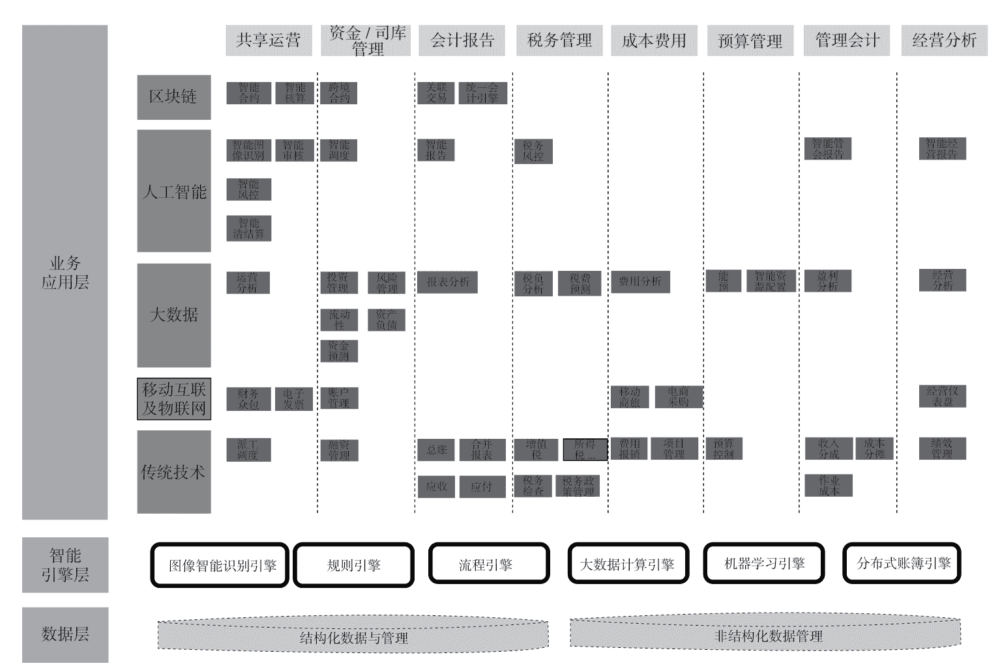

图 2-2 智能时代财务信息化功能架构蓝图

图2-2从数据特征、引擎化技术工具、财务应用与新技术的组合场景三个维度，勾勒出智能时代财务信息化功能架构的整体面貌。

### 二、财务智能化功能架构蓝图解析

下面逐项解读这张功能蓝图。

#### （一）功能架构中的数据层

先看数据层。智能财务架构里数据内涵发生了质变。传统架构主要处理结构化数据，到新架构，结构化数据已不够用，非结构化数据被纳入且成为关键组成部分。

因此新架构的数据层要同时支撑结构化与非结构化数据的全生命周期管理，包括采集、对接、存储等环节的功能保障。

#### （二）功能架构中的智能引擎层

智能引擎层是另一关键层次。之所以命名为引擎层，是想把支撑技术组件化，形成可复用的引擎，为不同业务场景服务。引擎层本质上是共用的技术底座，各场景可灵活调用，实现底层工具共享。智能财务架构中可抽象的引擎包括以下几类。

##### 1. 图像智能识别引擎

图像智能识别引擎用于大规模图片信息识别，既能助力结构化数据的采集，也能从非结构化数据中提取信息。借助机器学习不断自进化，识别能力会提升，应用边界也会扩大。

##### 2. 规则引擎

规则引擎属于初级人工智能应用，在财务信息化中作用突出。它通过灵活可配置的规则定义，支撑财务流程中的大量判断、审核、分类等动作。规则引擎的完善，一方面靠经验积累，另一方面可由机器学习引擎辅助优化。

## 3. 流程引擎

流程引擎在任何时代都很关键，优质的流程引擎能整体提升财务信息系统水平。智能时代流程引擎的驱动力仍是规则引擎，而规则引擎又在机器学习的加持下不断优化，最终带动流程引擎能力升级。

## 4. 大数据计算引擎

大数据计算引擎相对独立，依托大数据技术底座可处理海量结构化与非结构化数据的运算。它的落地才能让财务在大数据领域实现真正的技术赋能，而非传统计算下的伪大数据。

## 5. 机器学习引擎

机器学习引擎应能同时实现监督学习与非监督学习，通过多业务场景数据的训练形成优化规则，再经规则引擎作用于各类业务。从这个意义上，它更像是规则引擎的后台支撑。

## 6. 分布式账簿引擎

区块链应用需要底层分布式账簿支撑，可考虑以引擎化方式实现其标准化、可配置化搭建。待区块链技术从概念走向业务化简易应用后，分布式账簿引擎将加速落地。

#### （三）功能架构中的业务应用层

业务应用层是核心。在这里按财务业务模块与技术手段双维度匹配场景，形成智能时代财务信息化应用的清晰蓝图，可作为企业的规划路线图。下面按财务业务模块逐一说明。

### 1. 共享运营

如表 2-1 所示，共享运营在智能化场景上相对丰富，这与作业运营特征有关。信息技术进步对运营效率的提升最直接。

表 2-1　共享运营场景与技术匹配

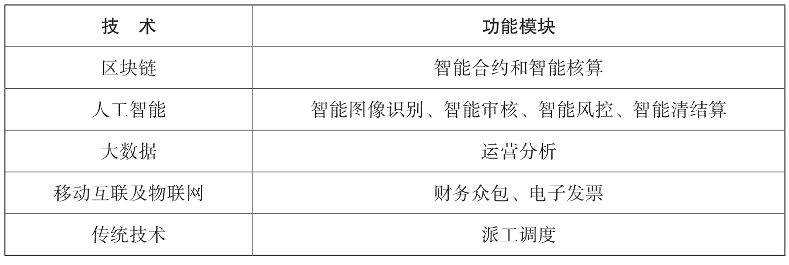

### 2. 资金/司库管理

如表 2-2 所示，在资金管理中与共享流程密切相关的部分已经被归入共享运营中，而针对资金管理和司库管理来说，其主要的应用在于提升基于大数据的对资金和司库管理的分析、决策能力。此外，物联网技术对于账户 Ukey、用印安全管理也将发挥重要作用。

表 2-2　资金/司库管理场景与技术匹配

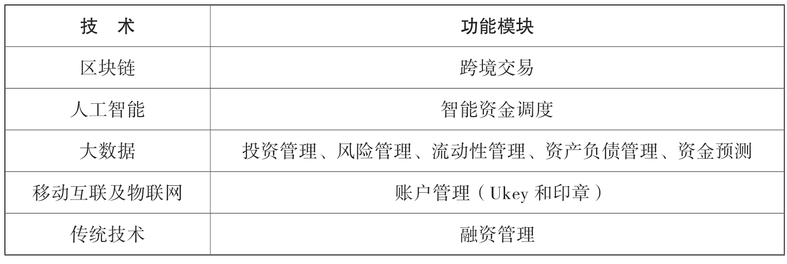

### 3. 会计报告

如表 2-3 所示，会计报告对新技术的应用主要集中在区块链对关联交易及业财一致性的支持上。同时，智能编辑等可以应用于会计报告的智能化。而在这个领域，也会引发人们对未来套装软件是否能够支持智能化应用的思考。

表 2-3　会计报告场景与技术匹配

### 4. 税务管理

如表 2-4 所示，税务管理在税务风险控制方面可以应用人工智能技术来进行支持，在税费分析、税费预测等领域也可以考虑引入大数据，充分利用企业内外部数据来提升分析质量。此外，税务管理中所涉及的不少应用场景也会前置到其他业务或财务系统中。

表 2-4　税务管理场景与技术匹配

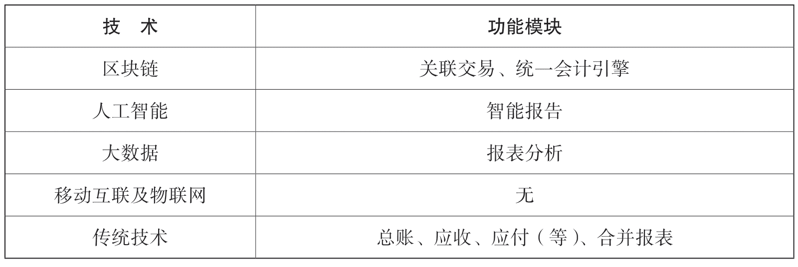

### 5. 成本费用管理

如表 2-5 所示，成本费用管理在费用分析方面可以考虑与大数据相结合，而在移动互联网方面，可以进行服务及商品采购的前置和线上管理，从而获得更好的管控效果。

表 2-5　成本费用管理场景与技术匹配

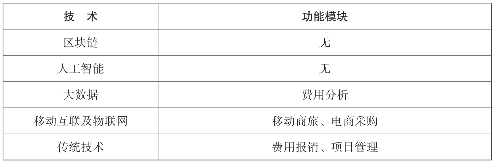

### 6. 预算管理

如表 2-6 所示，预算管理的技术应用主要集中在大数据方面，通过大数据，加强对预算预测和资源配置的管理能力的提升。

表 2-6　预算管理场景与技术匹配

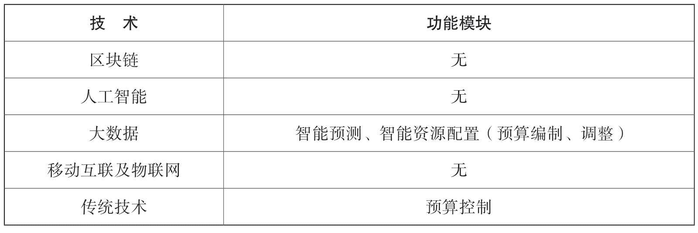

### 7. 管理会计

如表 2-7 所示，管理会计本身在技术层面的起步就比较晚，因此它的实现仍然基于传统技术方式。但在管理会计报告的编制中，可以考虑采用智能编辑模式，盈利分析可以考虑引入广义数据，增强分析的实用性。

表 2-7　管理会计场景与技术匹配

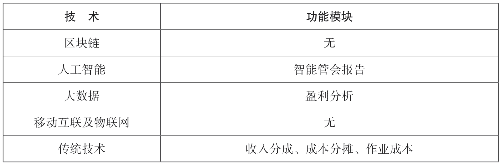

### 8. 经营分析

如表 2-8 所示，在经营分析这个领域，大数据能够有较大的应用空间。通过数据范围的扩大、相关性分析的引入，经营分析能力能够得到提升。

表 2-8　经营分析场景与技术匹配

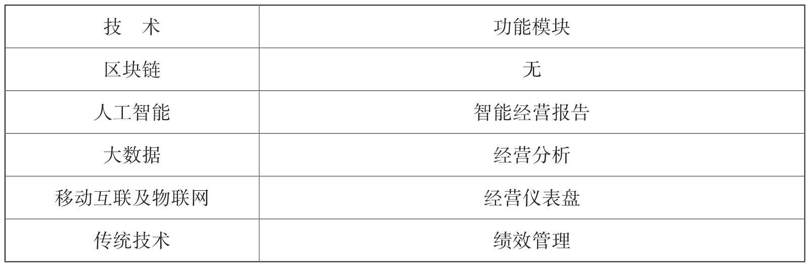

智能时代财务信息化的功能架构是基于场景构建的。这里笔者所谈的是一个概念性的设想，未来需要更多的企业付诸实践，对这个概念架构进行持续的补充和完善。笔者把这个架构蓝图作为 1.0 版本，并期待能够持续完善升级。

## 第二节　智能时代财务与科技的信息化协同

智能时代财务信息化的架构发生了很大改变。在数据层面，从结构化数据转变为非结构化数据；在技术层面，大数据技术、机器学习、分布式账簿等新技术引擎将被广泛地应用到财务信息化中。

在应用场景中，一方面，传统的财务信息化应用场景会被优化，形成更为高效或有用的升级场景；另一方面，基于新技术的新应用场景也将大量涌现。在这样的背景下，财务部门内部、科技部门内部、财务部门和科技部门之间的协同变得更加复杂，也变得尤为重要。而我们不得不正视的是，在智能时代来临伊始，很多财务部分和科技部门都没有做好这样的准备，面对快速来临的技术革新，往往措手不及。因此，在这里我们有必要一起来认真研究一下智能时代可能给传统的财务、科技协同关系带来怎样的挑战，以及要构建怎样的新机制来积极面对，如图 2-3 所示。

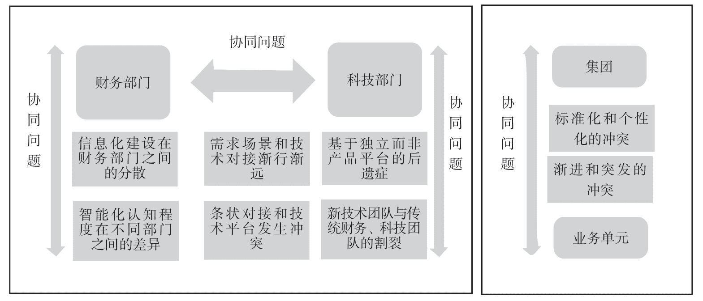

图 2-3　智能时代财务与科技的信息化协同

### 一、来自协同问题的挑战

（一）财务内部信息化协同面临的挑战

在智能时代财务信息化建设中，财务部门自身面临着巨大的协同挑战。下面我们从三个方面来探讨财务内部的协同挑战。

#### 1. 信息化建设在财务部门之间的分散

很多企业的财务信息化建设并没有实现统一集中的管理。在通常情况下，财务信息化建设是各个不同的职能部门从自身的业务需求出发进行的，如负责会计报告的部门建设了核算系统，负责预算的部门建设了预算编制系统，负责资金管理的部门建设了资金管理系统等。在这样的背景下，系统建设完成后，相关系统的后续运维和优化也保留在了相应的业务部门。从需求和系统建设的关联角度来看，这样的管理模式未必不好，但是当不同部门管理的财务系统要实现整合、集成，甚至内部平台化的时候，就会出现问题。部门间系统管理的割裂，成为系统间有效集成的障碍。而在智能时代，对数据和流程的集成提出了更高的要求，财务部门间分散的信息化建设将掣肘其信息化建设。

#### 2. 智能化认知程度在不同部门之间的差异

智能时代信息技术的广泛应用需建立在财务的各个领域对智能技术达成共识的基础上，并且基于这种共识共同推动智能技术的基础建设，进一步架构不同业务应用场景。而如果财务的各个业务部门之间未达成同等层次的共识，则会使不同部门在技术路径选择、资源投入等方面产生分歧。虽然分歧的产生并不一定会阻碍财务向智能化道路迈进，但必然会带来更多的争议和损耗，并最终使这一进程放缓。也不排除在极端情况下，因为分歧过于严重，使整件事情回归原点。

#### （二）科技部门内部信息化协同面临的挑战

科技部门内部同样存在着信息化协同的问题。如果说财务的问题在于需求割裂和认知层次差异，那么科技所面临的就是另一类协同问题。

#### 1. 基于独立而非产品平台的后遗症

受到财务部门需求的影响，科技部门在建设系统时，往往也是根据财务的划分，建立了一个个不同的、独立的系统，在进行集成的时候，不同的系统之间进行数据的交互打通。在这种模式下，科技部门内部往往会为每个系统配备相对独立的项目团队。而由于财务部门本身缺乏统筹，科技部门内部也容易放任各财务系统的项目团队各自发展，并最终造成割裂。在这种情况下，就会产生后遗症。由于每个系统都是各自打地基的，地基之间无法打通，就造成各个系统的风格不同，系统管理方式不同，并导致用户体验差且系统维护困难。而更严重的是，科技部门各个项目团队之间缺乏技术交流，一项新技术在某一系统应用后，其他系统团队毫不知情，更不要说技术共享了，这与智能时代高频技术革新的需求格格不入。

#### 2. 新技术团队与传统财务科技团队的割裂

不少公司对智能化技术的研发往往并不是从财务开始的，而是为了满足业务场景研发产生的。一些企业在进行了大量业务场景的实践后，做了技术提炼，并构建了智能技术的各类实验室，如大数据实验室、区块链实验室、人工智能实验室等。而这些实验室在形成通用的技术基础后，又进一步反哺业务场景。很遗憾的是，在这个循环中，作为服务于后台业务的财务科技团队往往成为局外人。科技部门内部前后台团队的割裂，以及新技术实验室和传统实验团队之间的割裂，都可能让财务无法分享到最新的技术成果。

#### （三）财务部门与科技部门之间信息化协同面临的挑战

第三个协同挑战来自财务部门与科技部门之间。财务部门与科技部门之间本身存在着部门间协同的问题，二者是需求和实现的关系，在这个过程中必然容易出现协同问题所带来的挑战。

#### 1. 需求场景和技术对接渐行渐远

财务与科技能否真正打通，关键在于业务语言能否被准确转译为系统语言。传统财务信息化阶段，这一转译一直是让人头疼的痛点。财务团队往往不懂科技的思维逻辑，科技团队也难以吃透财务与会计的表述方式，需求在过界时容易走样。不少公司意识到问题后，在中间搭建了衔接团队来做需求转换。

进入智能时代，这个衔接层面临更大考验。一方面，财务侧的衔接人员发现，基于智能技术的场景挖掘难度陡增，对新技术的理解也不够深入，很难想清技术到底能解决哪些业务问题；另一方面，科技部门容易陷入技术自嗨，变成“技术控”，把重点放在技术本身的研发上，而忽视了对财务应用场景的支撑，谈技术不谈业务。两种偏差叠加，使得需求场景与技术供给越走越远。

#### 2. 条状需求撞上平台化架构
前文提到，科技部门的组织若与分散的财务模块一一对应，会带来内部协作成本。而即便科技单方面把割裂的团队打通，建成技术平台，也并未从根上解决问题，反而催生出新的冲突，即来自财务的条状需求与科技平台建设之间的矛盾。

在科技平台化、财务分散化的局面下，财务信息化仍散落在各个财务部门，业务需求各自向科技部门投递。平台化后的科技部门面对时间点不同、规划深度不同、粒度不同的需求时应接不暇。过去独立系统团队可以自主响应，现在必须先汇总评估、再反馈平台统一规则，并引导需求方接受平台约束。这一过程沟通量大、摩擦频发。

#### （四）集团与业务单元协同的卡点
与财务科技关系不同，集团与业务单元的信息化协同问题体现在更高层面。

#### 1. 统一标准 vs 业务个性
集团若能把财务信息化建在相对标准化的架构上，是件好事，实践中也有不少企业追求大集中。但对于多元化集团而言难度极大。
集团内部各业务单元有各自的发展诉求，多业态背景下个性化诉求更强。集团层想用相对标准化的平台覆盖不同业态的个性需求，就会产生标准与个性的张力。偏向集团标准会压制单元发展，完全迁就单元则会削弱集团管控。如何在标准化和个性化之间取得平衡，构建兼顾二者的平台，成为核心课题。

#### 2. 计划节奏 vs 紧急需求
在财务智能化节奏上，集团通常希望按既定计划稳步推进。而业务单元的系统需求往往带有突发性，为解决业务痛点需要紧急建设。渐进的集团节奏会被突发需求冲击，响应不及时会加剧矛盾；业务单元若只强调自身紧急性也不顾整体节奏，也会制造问题。渐进与突发的冲突是集团信息化建设绕不开的挑战。

#### 3. 信息穿透与数据独立的矛盾
集团管控需要对业务单元实现信息穿透，集中式财务信息化是重要抓手。但业务单元又希望保持信息独立或私密。两者博弈一方面取决于集团管控形态，另一方面受监管影响。对于上市公司，信息独立性本身就有监管要求，穿透与独立的分歧天然存在。剔除监管因素后，穿透力度更多取决于集团对单元的控制强度。

### 二、智能时代协同体系重构
智能时代的协同关系比传统模式更复杂。更重要的是直面挑战，构建更高效的财务信息化协同体系。以下从四个方向提出设想。

#### （一）财务自建统一信息中枢
财务内部需要打破信息化建设的壁垒。可在财务体系内搭建统一的信息化中枢，可实体也可虚拟。实体形态如财经 IT 部、会计信息部等，能够在财务内部统筹协调；若不具备条件设立专属团队，也可设虚拟机构如财务信息化管理委员会等跨部门统筹组织。虽然力度弱于实体，但仍能在架构搭建和重点项目推进中发挥作用。

#### （二）科技为财务定制专属团队
科技部门要实现与财务的深度协同，可考虑组建面向财务服务的专属团队。打破按业务模块独立设队的传统，建立适配未来平台化架构的组织，包括专属需求分析团队、架构师团队、公用平台研发团队和场景实现团队，实现对财务的私人订制。
需求分析团队负责承接智能技术与财务需求的对接；架构师团队从产品化和平台化视角构建财务信息化架构；公用平台研发团队打通财务底层业务模块，对可复用技术功能做组件化研发并在不同场景落地；场景实现团队基于公用平台针对具体业务场景做技术落地。平台与定制化结合的组织，才能给财务智能化提供有力支撑。

#### （三）科技内部引入市场化机制
针对科技内部各“黑科技实验室”的协同，可引入市场化机制。各实验室主要服务业务场景，对后台财务场景支持不足。通过内部交易方式让财务部门付费购买技术，能有效激发实验室服务财务的积极性，使财务与业务站在同一起跑线。当然并非所有企业都能建立内部市场，必要时借助行政指令和资源调配也是可行路径。

#### （四）集团以产品平台平衡管控与弹性
集团要在标准化和个性化间取得平衡，不妨把自身定位为财务智能化产品的提供商，在集团层面以产品化思路设计信息化平台。产品设计时充分吸纳业务单元参与论证与共建，通过大量调研形成需求，搭建平台。各业务单元在建设时视集团为产品客户，经进一步调研与实施方法引入，在产品化平台上做配置与可控的少量定制开发。
如此，集团财务可形成开放式的财务智能化产品平台，在实现管理标准化的同时保留必要的自由度。

在财务智能化进程中，财务与科技的协同兼具技术性与艺术性，找到合适的平衡点、实现双赢是成功的关键。

## 第三节 财务产品经理的崛起
智能时代财务管理的基础是信息技术，优质的技术平台能让智能化走得更远，也为财务创新提供空间。传统财务信息化支持人员已难以胜任，需要智能时代的财务产品经理共同推动财务智能管理。

### 一、财务产品经理是什么
先明确概念。很多人对产品经理陌生，更勿论财务产品经理。

#### （一）产品经理概念溯源
笔者初次接触产品经理概念，是读苏杰《人人都是产品经理》时。书中讲“产品就是用来解决某个问题的东西”，产品经理则是把这个东西设计出来并持续迭代的人。
从这个角度看，产品经理随产品形态演进。早期实体产品如电视、洗衣机，产品经理负责从概念到生产、营销、配送、服务的全流程。随着社会发展，创意、管理方法也能成为产品，产品经理不再局限于技术背景。信息技术与互联网兴起后，软件与互联网产品爆发，面向这类产品的产品经理成为主力。无论形态如何，本质一致。

优秀产品经理的价值在于做出能解决问题、让客户满意的好产品。如图 2-4 所示，其工作大致包括：
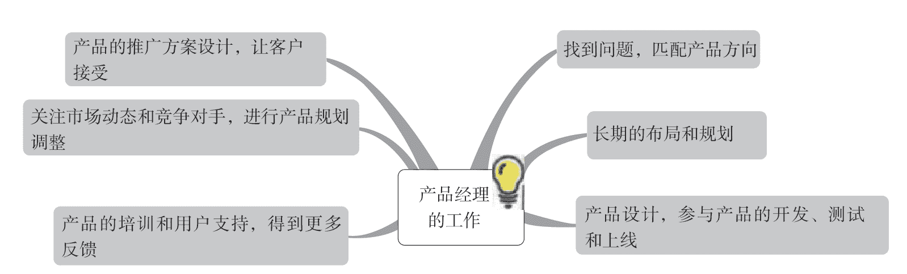
图 2-4　产品经理的工作
第一，从纷繁的需求与想法中提炼出真正要解决的问题及产品方向。
第二，为产品做长期布局与规划，明确阶段目标。
第三，参与产品设计、开发、测试与上线。
第四，设计产品推广方案，以营销思维推动客户接受。
第五，开展产品培训，获取用户支持与改进反馈。
第六，跟踪市场动态与竞争态势，及时调整规划。

#### （二）产品经理与工程师如何分工
两者易混淆，厘清差异有助于定位角色。
产品经理从架构、功能、逻辑层面设计系统，聚焦系统能为用户解决什么、体验是否顺畅，追求好用且有效的产品。工程师也关注类似问题，但更侧重技术研发，对技术能产生哪些应用场景关注较少。两种定位会影响组织文化。
在产品团队中，产品经理、工程师、设计、测试、营销、项目经理等角色协同。产品经理常承担角色补位职责，常规情况下各司其职，关键岗位缺失时由产品经理临时代替，这也体现了其覆盖产品全生命周期的特征。

#### （三）财务产品经理的核心定位
财务产品经理应是财务组织成员，核心职能是设计财务信息系统以解决财务业务场景的问题。置于财务团队内部，能更快发现用户痛点，提出针对性解决方案。
其精力应集中在弄清需求、设计体验优秀的产品上，同时充分利用工程师的“黑技术”，把技术转化为财务场景价值。既不应取代工程师，也不应被工程师牵着走。
财务业务人员若无充分训练，直接转型为产品经理并不合适。财务产品经理是复合型人才，需要财务知识与技术能力融合。纯业务背景设计产品易缺全局观，难以把控架构与流程，并在与工程师沟通时产生偏差。

### 二、智能财务产品经理必备特质
财务产品经理能大幅提升信息化应用能力。智能时代需要怎样的进化？

#### （一）对新技术的敏感度
应用技术解决财务问题，技术敏感性不可或缺。智能时代技术迭代加速，要求更高。传统财务信息化时期技术演进相对平缓，从计算机到互联网、移动互联网约二十年即可适应。今天不少企业仍在落地十年前的技术。
近两三年及未来五年，正处信息化向智能化过渡期，技术多变、创新频出。若仍按旧节奏应对，容易错失提升效能的机会。每个财务产品经理都需保持高度技术敏感，抓住时代窗口。

#### （二）技术落地财务场景的能力
敏锐捕捉新技术只是起点，关键是能否将其转化为解决实际问题的能力，即新技术的财务场景化能力。业务问题依附于场景，空谈技术无意义。若能识别业务痛点、抽象场景并匹配合适的技术解决路径，就是高水平的产品经理。
形成该能力可借鉴关联创新等方法，在财务与技术交叉处激发新思路。

#### （三）产品与平台架构思维
传统模式下技术变化慢，高度定制化系统仍可满足需求并保持稳定。智能时代技术加速革新，缺乏扩展性的定制系统难以为继，产品化与平台化成为趋势。
对财务产品经理而言，产品化与平台化架构思维并非易得。传统模式可用“西医思维”就事论事，而产品化平台化需要“中医思维”，站在更高层面前瞻性规划功能组件与关联关系，并在实现时充分考量可配置性与扩展性。这对专业与思维能力提出更高要求。

#### （四）产品价值讲故事能力
智能时代的好产品经理不仅技术过硬，还要会讲故事。需挖掘产品价值并与各方达成共识，争取资源保障，获取用户信任，形成可靠的需求关系，并获得管理层支持以推动落地。
通常应能清晰阐述产品在成本、效率、风险与管控、决策支持、客户体验等维度的价值，通过价值共识推动产品进入高速发展轨道。

### 三、财务 IT 如何转型为智能产品经理
传统财务信息化团队已具备一定基础，向智能财务产品经理迈进需在专业深度、广度与认知创新三方面提升。

#### （一）深化专业技术储备
专业深度很重要。成为合格产品经理需加强技术知识储备，非要达到工程师水平，而是在运维、需求分析基础上补充新技术认知。对大数据、云计算、机器学习、区块链、物联网等概念有本质理解，知道工程师如何应用、应用前需哪些准备，可更好把控方向并提出合理要求。
专业深度还体现在产品化、平台化架构知识的完善。虽具体工作由架构师完成，但产品经理需能判断、评价并参与架构设计。
同时应关注 IT 治理，包括 IT 规划管理、获取与实现管理、服务管理、治理管理、风险管理、信息安全管理、绩效评价、灾难恢复与业务连续性管理等，有助于产品全生命周期管理。

#### （二）拓宽业务与财务视野
打造智能时代的好产品，需更深入承担业务场景与信息技术结合的中间角色。这要求财务产品经理具备更广阔视野。
应广泛了解财务各领域：核算、预算、资金、管控、经营分析、税务、共享等，实现财务职能团队与科技的对接。
更进一步需拓展至中后台业务，了解公司经营各业务并掌握业务与财务端到端全流程数据流转与系统架构，才能实现业务与财务一体化。多层次立体的知识体系对成长为高级产品经理至关重要。

#### （三）强化认知创新能力
产品经理需研究与学习创新工具与方法。创新是科学而非偶然，需要大量跨领域知识积累。很多灵感来自看似无关领域的刺激，素材越丰富，创新工具越有效。
实践是创新根源，智能时代财务产品经理应积极尝试将想法落地。若暂时无法落地，推演也能加深思考，提升认知与创新能力。

财务产品经理的形成是迭代进化过程，明确“是什么、需要什么能力、如何培养”后，便要在实践中不断积累。

* * *

[1] 温昱.软件架构设计[M].北京：电子工业出版社，2012：98.
[2] 苏杰.人人都是产品经理[M].北京：电子工业出版社，2012：86.

# 第三章 智能时代财会人员的转型挑战
## 第一节 财务人在智能时代的困境

会计的AI分水岭

技术跃迁从来都伴随人群的重排。19世纪上半叶英国机械织布机普及，熟练纺织工一夜之间失去生计；1900年前后拖拉机、联合收割机、播种机进入田间，近半农田劳动者瞬间闲置；1945年自动化浪潮让曼哈顿超1.5万名电梯操作与维修工失业。AI 正掀起全球新一轮产业重塑【1】，会计行业的劳动力版图被重写，作业形态与核算逻辑同步迁移，会计群体承压点集中在以下几面。

### 一、席位结构在洗牌：底层收窄，顶层争抢
第一，初级核算正被智能体接管。AI落地后，公司内部的底层记账、凭证整理、账簿装订、报表生成、申报与纳税调整等流程逐步交由智能核算体执行。做这一块的从业者发展乏力，收入与社会认可度同步承压。全球零售龙头沃尔玛在2016年启用财务机器人后裁撤会计7000余人，基础核算职位骤减约八成，职位总量快速收紧【3】。

第二，会计组织与财务编制加速合并精简。随着底层工作被机器取代，公司会进一步压缩财务编制，职能相近的席位合并，工作量大幅下降的席位并入必须保留的席位。分支机构层面可能取消独立财务部或大幅削减，总账、费用、资金、成本、收入、供应链等会计席位被适度裁撤，只保留少量操作、管理会计、财务总监、机构负责人等。总部与子公司体系保留财务部门，但内设序列按业务需求大幅收缩，不相容席位统一由人机协同设置，核算效率提升。同时市场整体会计席位数与集团内部自设席位数双降。基础会计职位的萎缩在未来2到10年最为明显【4】。连锁门店的记账与会计职能将统一并入总部智能会计系统，数据集中化处理取代手工。

第三，高阶财务管理人才出现结构性短缺。智能化环境下，基础核算从业者面临被淘汰风险，机器人执行同样流程更规范高效、承载量更大。从业者的日常事务减少、压力缓解，腾出精力投向战略与管理会计，这需要更多掌握专业化财务管理知识的高层次人才进入公司承担高级管理。随着基础核算与审计工作被财务机器人替代，对懂新理念、新技能的高精尖财务管理人才的需求愈发迫切【5】。

第四，具备全球视野的财务人才缺口扩大。国内大中型公司、科技型中小公司、文化创新公司加速出海，与全球多地开展业务，需要外派会计、财务总监、会计主管及财务顾问具备开阔的国际视野，熟悉派驻地与海外分支的政治、经济、技术政策、法规、税收、会计准则及利润核算方式，统筹利润分配与投资收益划转，避免因不熟悉当地规则而受罚或错失窗口。

### 二、胜任门槛全面抬升
第一，人际协同能力难以匹配AI时代需求。公众印象里会计循规蹈矩、与外界少接触，过度聚焦数据而忽视沟通。AI时代基础财务工作由机器人完成，公司会计处理的更多是跨部门协同、系统维护、参数设定、风险点录入、防控措施落地等事务，都依赖良好的协调沟通能力。当前中小公司的会计普遍缺乏此类能力，制约职业再规划与发展。

第二，专业水准落差明显。国内会计队伍庞大，学历与知识掌握程度参差。有人持有注册会计师、注册税务师或国际资格，有中高级职称；也有人仅有会计从业资格证，甚至多年从业仍无证。部分从业者接受过系统本科、硕士教育，能胜任本职；另一部分知识零散、对管理会计、财务管理一知半解。AI时代不再需要普通会计完成基础工作，要求从业者对核算、凭证、账簿、报表逻辑、特殊处理、财务风险识别防范、不相容席位设置及制衡有准确认知。但国内多数中小微公司的会计专业水准显然难以达标。主动学习意识薄弱，据统计业余参加培训学习的会计中，日均学习一小时以内及不学习的占比高达74.03%，学习超一小时的仅25.97%，再培训重视度不足，与新时代要求不相适应。

第三，知识面过窄难以应对复合要求。AI时代会计不仅要处理业务、维护系统、指导机器人按规范运行，还要协调各部门配合机器人并提供基础数据。需要综合考量公司基本状况、发展战略、对外投资、生产运营等规划，管控资金使用与成本费用，进行风险识别、预防与应对。轻松应对需要掌握公司管理、市场营销、对外投资、战略规划、品牌建设等知识，拓宽专业广度与深度。现实中部分中小微及民营公司中高层会计不了解公司管理基础，对发展规划一无所知，对外业务不精通，仅能保证核算无误，对未来三到五年资金需求缺乏全局观念，无法客观公正地站在整体角度审视经营问题。

第四，独立分析与风险管控意识不足。AI时代需要业务知识叠加独立分析能力。席位精简后，几个人才能完成的基础工作交给财务机器人，报表填制、利润调整与申报同样可自动化。会计需分析问题、查找原因、纠偏优化流程、调整核算方法、统计对比财务数据变化并提出战略建议，这离不开独立分析与解决问题的能力及风险识别、防控意识。当前部分会计仅做数据整理统计，不懂数据背后的信息，无法转化为经营决策；信息安全关注度提升下，缺乏审计视角透视公司风险，风险管控意识淡薄，与智能时代管理需求背离。

### 三、用工偏好在迁移
第一，需要具备投融资经验的人才。公司快速发展需要会计参与理财规划与投融资管理实现资产保值增值。多数会计对证券金融、内部控制、经济热点关注不足，投融资经验稀缺。

第二，需要创业思维。会计与管理工作具有相似性与互通性，能胜任会计工作者通常具备一定管理能力。但大部分会计过度关注数据、思维固化，缺少创业思维。

第三，需要公司运营管理经验。会计是公司的核心，须全程参与发展。利用财务、法律知识分析公司与市场情况，助力管理与决策。有些人过于聚焦财务数据，对运营管理知识积累不足。

第四，需要熟悉AI技术。AI带来新挑战，会计工作不再一成不变。部分会计仅积累财务专业知识，缺乏计算机与AI知识，难以与技术结合，辅助系统开发与升级。

第五，需要跨领域工作经验。部分会计对宏观经济背景、国家政策关注度不够，对计算机、宏观经济学、金融学、市场营销等领域研究较少，跨领域横向转型经验不足，选择面较窄。

总之，AI背景下会计人面临巨大挑战：职位急剧减少、对胜任能力要求攀升、需求类型发生迁移。同时管理层对职业生涯管理重视不足，很多公司虽有体系却流于形式。

## 第二节 智能时代财务人员的基础能力框架

### 一、转型方向
财务共享与智能化深度结合，共享中心正从人力密集型向技术密集型演进。规则不断梳理完善并固化为信息系统可执行规则后，共享中心的操作人员可被替代，最终趋向人力缩减。对组织有益，却对存量员工转型构成巨大挑战。部分能力较强者转向规则梳理岗位，大量员工可能因智能化退出岗位。唯有顺应时代加速转型，才能避免在新财务时代被淘汰。

#### （一）财务人员应向“成本控制与内部控制人员”转型
大数据时代管理会计价值凸显，公司财务人员应调整思路向管理会计转型。微利时代成本高低决定盈利关键。专业的成本分析控制人员需具备扎实财务专业知识，并了解公司生产流程、生产环节、内控流程，借助成本控制系统挖掘成本数据，进行合理分配、归集、构成分析，为成本有效管控与决策提供支撑。

#### （二）财务人员应向“全面预算人员”转型
现代公司多为事后管理，越来越多公司借助ERP整合数据，通过穿透查询结合预测目标，将事后管理转向事前控制。信息化手段的事前管控与预测意义重大。预算作为财务管理核心，要求参与预算的财务人员站在战略高度，将战略目标层层分解至预算分析报告编制、绩效考核，并规划预算对未来目标与战略的影响。因此大数据时代财务人员需向全面预算人员转型。

#### （三）财务人员应向“专业财务分析人员”转型
财务人员必须具备专业分析技能，从海量数据中挖掘对公司有价值的信息。分析过程中更全面了解公司发展现状与问题，及时评价财务状况与经营成果，为提升经营管理效率提供更有价值的判断。应积极向专业财务分析人员转型。

#### （四）财务人员应向“风险管理人员”转型
风险管理是公司从战略制定到日常经营中对待风险的信念与态度，旨在识别可能影响公司的潜在事项并进行管理，为实现目标提供合理保证。内部控制的有效实施依赖风险管理，战略型财务人员需将风险影响控制在可接受范围内以促进可持续发展。因此财务人员应向风险管理人员转型。

#### （五）财务人员应向“技术型财务人员、战略型财务人员”转型
大共享理念推动财务共享形成并成为主要工作环境，形成数据中心为决策奠基。财务共享中心是大数据时代转型方向之一。中心内有标准流程，如应收应付款、费用报销、明细账管理、总账、资金管理、税务筹划等，对财务人员要求不高，具备一定财务、英语、计算机基础并经培训即可上岗，是初级财务人员较好选择。熟悉后可向更高阶的技术型、战略型财务转型。

在财务共享模式下，业务定位将财务人员分为共享财务、业务财务、战略财务三类。高端岗位需求增加，对学历、经验、技能要求更高更全面。一般岗位技能要求不高，部分工作可被自动化或人工智能替代，基础财务人员将被大幅裁减，尤其是内部同质化岗位被共享，整体编制收缩。

普通财务转向共享财务，人数低于缩编后总体比重的四成。普通财务指学历层次相对不高、年龄较轻、学习新知识能力强且具备财务会计实操经验的人员，长期在一线从事基础工作，积累单据审核、凭证录入、交易结算等经验，可经选拔培训后进入共享中心。现实中本科学历人才供给成本已大幅下降且供大于求，本科学历员工成为共享中心高性价比首选。

优秀财务转向业务财务，人数约占缩编后总体近五成。他们学历较高、系统掌握专业知识且实操经验丰富，应深入业务前端，对研发、供应、生产、营销等环节进行分析、预测、规划、控制、激励、考核，加速财务与业务融合，参与价值链各环节价值创造，将财务数据转化为信息并以业务语言传递给各级领导辅助决策，及时反馈业务困难。

卓越财务应转向战略财务，约占缩编后总体百分之二十左右。他们学历很高，至少财经专业本科以上，管理知识储备深厚，兼顾财务会计实务与战略规划，在财务管理及其他经济领域有深入研究，精通预算管理、绩效评价、风险管理、内部控制、资本运作、纳税筹划等，可作为战略财务培养。战略财务不仅是公司总部参谋，更是管理者战略决策的重要伙伴，是全面预算与绩效管理的设计者，是制定与实施组织战略的专家。

### 二、财务人员基础能力框架
所有希望成为CFO的财务人都会关心应积累哪些知识才能更高效实现目标。笔者尝试以智能时代CFO基础能力框架作答，如图3-1所示，可对照自身提升空间。

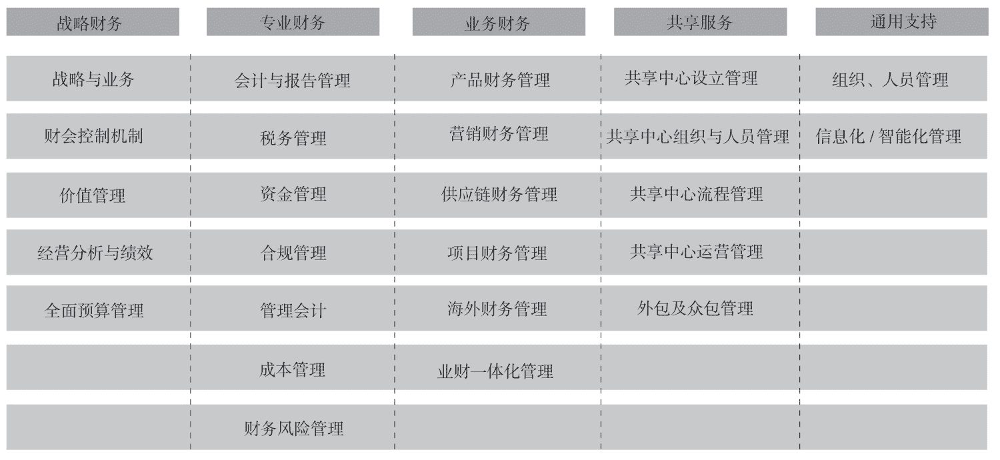
图 3-1　智能时代 CFO 基础能力框架

#### （一）战略财务基础能力框架
##### 1. 战略与业务
CFO需要宽阔的知识面，最关键的是对公司战略与业务的理解与把控。该能力决定能否成为经营团队的合格管理者，而非仅停留在财务执行。

关键能力点：战略解读；财务与战略配合；公司资源及计划的管理参与；财务资源配置管理；与业务单元的沟通。

##### 2. 财会控制机制
CFO需在公司内部建立完善的财务、内部控制与内部审计体系，确保会计风险可控。部分公司由首席风险官负责此职能。

关键能力点：财务及会计制度管理；内部控制；内部审计与稽核。

##### 3. 价值管理
价值管理是CFO的高阶技能，需从多方面主动管理以提升公司价值，最终体现在股价上，满足股东投资回报诉求。

CFO 能力地图与智能时代择业参考

核心能力：产权运作；营运资本调配；现金流监控；经济增加值管控；新业务价值评估；并购价值把控。

##### 4. 经营分析与绩效管理
经营层面的剖析与绩效管控，是财务负责人价值感最直接的出口。擅长用数据解读业务、驱动改进的领军者，往往成为组织成长的关键推手。通过指标设计、持续追踪和对经营数据的深度挖掘，为企业提供持续的成长动能。

要点能力：KPI 体系搭建；经营分析报告；绩效考核机制搭建及奖惩落地；投入产出管控；市场对标；重大关键项目管控。

##### 5. 全面预算管理
预算工作是把战略落到资源配置上的关键环节。有备则事成，无备则易败，这项统筹职责通常由 CFO 牵头。全面预算并非财务独有，却离不开财务负责人的总体推进与把关。

要点能力：经营计划管控；预算编制；预算执行与控制；预算分析；预算组织；预算流程；预算系统。

#### （二）专业财务基础能力框架

##### 1. 会计与报告管理
会计与报告是 CFO 的基本盘。即便日常核算可以交由专业团队或事务所，掌舵者自身仍需具备扎实的会计理解与把控力。

要点能力：会计交易处理及流程；往来与关联交易等会计管控；会计报告及合并；会计信息系统，如核算系统、合并系统等；信息披露；审计流程及管控。

##### 2. 税务管理
税务始终是财务负责人的传统主线，全球皆然。在中国，税务既要合规严谨，又需要适度的灵活性。

要点能力：税务政策研究；税务关系维护；税务检查配合与风险防范；税务数据管控；税务系统管控；营改增及电子发票/特定时期的专项事项。

##### 3. 资金管理
资金运作是 CFO 日常的核心板块，也是衡量专业水准的重要标尺。该领域门槛较高，缺少实操很难补齐。

要点能力：资金收付；资金计划；债券融资；混合融资；股权融资；司库；外汇；银行关系；资金系统；流动性；投资。

##### 4. 合规管理
对于受监管行业，合规是关键的风险防线，涉及银保监会、人民银行、证监会等规则。财务负责人须敏锐把握政策变化，主动应对，避免违规损失。

要点能力：监管政策研究；监管沟通及检查应对；监管信息报送；违规风险管控及事后危机处理。

##### 5. 管理会计
管理会计对当下 CFO 既是旧课题也是新趋势。国内体系化建设正在加速，跟上节奏必须掌握方法论。

要点能力：维度体系搭建；收入分成管控；成本分摊；多维度盈利分析；作业成本；资金转移定价管控；风险成本与资本成本管控；管会数据应用如定价、精准营销等；管理会计系统。

##### 6. 成本管理
成本单独强调，因其对企业生存至关重要。开源节流中，节流高度依赖成本管控，对某些企业甚至是战略命脉。

要点能力：成本战略体系设计；基于价值链的全成本管控；费用前置管控；成本文化建设；最佳成本实践的形成与推广。

##### 7. 财务风险管理
广义风险归首席风险官，但在财务范畴，相关风险必须由 CFO 亲自盯住。创造价值的同时守住底线，管控财务风险是基本功。

要点能力：财务操作风险管控；财务风险意识及管理文化建设；RCSA 风险控制与自我评价工具在财务中的运用；KRI 关键风险指标体系在财务领域的搭建；重大风险事件监控。

#### （三）业务财务基础能力框架

##### 1. 产品财务管理
产品财务团队主要服务产品事业部，CFO 依托该队伍对以规划、研发为核心的全生命周期实施财务管控。

要点能力：产品规划及投资财务管控；产品研发财务管控；产品周转资金管控；产品质量成本管控；产品最佳财务实践管控。

##### 2. 营销财务管理
营销财务专注支撑营销销售体系，CFO 通过该团队对合同商务、客户财务、费用等环节展开管控。

要点能力：商务合同财务管控；营销及销售费用管控；客户信用及风险管控；竞争对手财务及经营信息管控。

##### 3. 供应链财务管理
供应链财务为采购、生产、配送等环节提供业务支持，CFO 借助该职能实现全流程财务把控。

要点能力：采购财务管控；生产财务管控；库存控制；配送物流财务管控；分销财务管控。

##### 4. 项目财务管理
除按价值链划分的业务财务外，项目视角是另一条重要线，需与产品、销售、供应链财务形成矩阵协同。

要点能力：①研发项目财务管控；②市场推动项目财务管控；③售前/销售项目财务管控；④工程项目财务管控；⑤实施交付项目财务管控；⑥管理支持项目财务管控。

##### 5. 海外财务管理
面向海外市场的企业，海外财务管理必须重点关注，进入新国家时本地支撑尤为关键。

要点能力：国家财税政策管控；海外机构综合财务管控。

##### 6. 业财一体化管理
CFO 需持续关注业务与财务融合，通过强化一体化管控提升对账与一致性水平。

要点能力：业财一致的制度及流程管控；业财对账管控；业财一致性系统管控。

#### （四）财务共享服务基础能力框架

##### 1. 财务共享服务中心设立管理
中国财务共享已走过十余年，大中型企业普遍将其作为标配，财务负责人必须理解运作模式才能有效推动落地。

要点能力：财务共享服务中心立项；财务共享服务中心战略规划；财务共享服务中心建设方案设计；财务共享服务中心实施；财务共享服务中心业务移管。

##### 2. 财务共享服务中心组织与人员管理
共享中心属大规模运营模式，对组织与人才管理要求较高，需关注效率、稳定性与成长性。

要点能力：财务共享服务中心组织职责管控；财务共享服务中心岗位及架构；财务共享服务中心人员招聘；财务共享服务中心人员培训及发展；财务共享服务中心人员考核；财务共享服务中心人员保留。

##### 3. 财务共享服务中心流程管理
流程是共享管理的精髓，需推动端到端体系设计、维护与持续改进，以提升效能、降低成本。

要点能力：财务共享服务中心流程体系定义；财务共享服务中心标准化流程设计；财务共享服务中心标准化流程维护和执行监控；财务共享服务中心流程持续改进。

##### 4. 财务共享服务中心运营管理
共享中心要创造价值，运营管理中的关键职能须持续关注。

要点能力：财务共享服务中心绩效管控；财务共享服务准入管控；财务共享 SLA 及定价管控；财务共享人员管控；财务共享风险与质量管控；财务共享服务管控；财务共享信息系统管控。

##### 5. 财务服务外包及众包管理
外包与众包是共享模式的延伸，财务负责人需在共享、外包、众包间作出选择并建立适配的管理方式。

要点能力：服务模式战略管控；外包供应商选择管控；外包商交付管控；众包平台搭建；众包平台用户获取、服务及管控；外包及众包风险管控。

#### （五）财务通用支持基础能力框架

##### 1. 财务组织、人员管理
搭建财务组织、培养人才是 CFO 的核心职责，财务领域的人才管理能力不可或缺，队伍管理不到位即不称职。

要点能力：财务的分层治理机制；财务组织架构及岗位设计；财务团队及干部管控；财务人员绩效管控；财务培训及知识管理。

##### 2. 财务信息化及智能化管理
对当代 CFO 而言，信息化和智能化已是必备能力。工作高度依赖系统，懂技术是基本要求，未来工作将被更大程度系统替代，不懂技术则难以立足。

要点能力：财务信息化团队建设；财务产品设计及系统架构；财务与 IT 沟通管控；财务大数据技术；财务自动化及智能化技术。

## 第三节　智能时代财务人员的择业模型
智能浪潮对社会与财务人群的冲击全面而深远。在此背景下，财务人的职业观被重塑。面向未来大致有三种路径：维持现状、远离或拥抱。选择并无绝对对错，关键在于建立适配智能环境的择业标准，这将重塑职业轨迹。

世界与财务都在变化。财务人不可避免地承受冲击，必须完成认知升级。无论是高管、经营分析、预算管理还是会计运营，都需直面这种改变。

这也引发了对职业未来的焦虑，人工智能是否会取代财务成为热议话题。2017 年 4 月底的全球移动互联网大会上，李开复与霍金隔空对话。霍金认为人工智能利弊难定，人类只能竭力确保其发展方向有利；李开复则提醒，人工智能或将取代 50% 的工作，未来 10-15 年被替代者何去何从？教育又该如何应对？智能时代，部分问题已无法回避，只能思考应对方式。

在职场中，财务人已难以想象终身在一家企业。择业不可回避，而智能时代的择业抉择更艰难。

### 一、三种选择：智能时代财务人的“进”“退”“守”
面对社会变革与技术挑战，财务人大致可作“进”“退”“守”三种选择。

## 一、智能时代的进退抉择
“进”是拥抱变革的姿态，明知挑战巨大，仍愿成为变革的主导与生力军。
“退”是规避风险的姿态，若自知难以成为先行者，也意识到工作内容将被改写，则及早远离原岗位、另谋出路是明智之举。
“守”是审慎观望的姿态，在判断不清时先行坚守，慢慢找准定位。但需注意，社会快速变化下，静守未必安全，观望时也应提前规划进退。

若最终要在进或退之间抉择，影响决策的因素可归纳为四个维度。

### （一）人工智能对其所处行业及公司的影响
评估进退时，需先判断所在行业与公司在智能时代的走向。巨变中，有的行业公司兴起，有的衰退。财务人的发展依托于公司前景，行业兴则公司兴，公司兴则财务兴。可参考《智能时代》《智能革命》《人工智能》等著作判断趋势。

### （二）人工智能对其所在环境竞争性的影响
人工智能会重塑竞争格局。部分公司内部竞争会趋缓，协作与市场开拓成为焦点，员工价值感提升，适合采取“进”的策略。另一些公司则面临成本压缩与内部竞争加剧，难以忍受激烈竞争者可考虑“退”。

### （三）个人能力与智能时代要求的适合性
智能时代的技能需求已变，信息技术、建模、创新能力等要求提升。若期望在崇尚智能技术的公司成功，需客观评估自身存量能力与学习能力，不匹配则可考虑“退”。

### （四）个人对人工智能风险和挑战的喜好
智能时代的选择充满不确定性，技术不确定带来商业模式不确定，进而影响企业与行业。不确定性即风险，选择拥抱还是远离，很大程度上取决于个人对风险与挑战的偏好。喜好本身无对错，如同投资中的风险厌恶。

综合以上因素，财务人才能对自身的进退作出大致判断。

## 二、智能时代，财务人择业的“拥抱”模型和“远离”模型
财务人在智能时代的进或退并无绝对对错，关键在于决定拥抱或远离后如何选择下一步。这即是“拥抱模型”与“远离模型”。如图 3-2 所示。

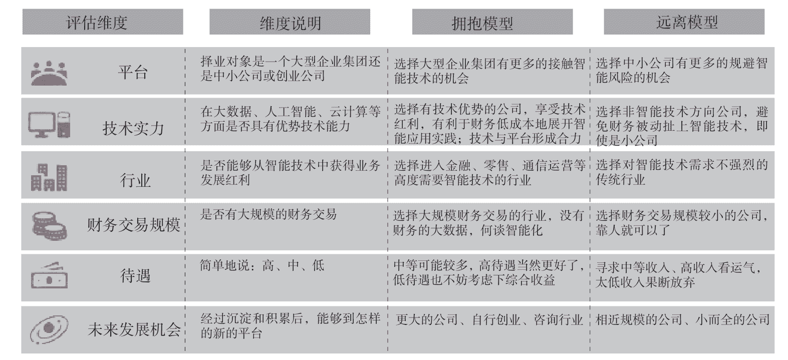
图 3-2　财务人员择业的“拥抱”模型和“远离”模型

该模型从六个维度对择业目标作出分析。

### （一）关于评估维度

#### 1. 平台
评估对象是大型企业集团、中小公司还是创业公司。规模越大，应用智能技术的机会概率通常越高。

#### 2. 技术实力
考察公司在大数据、人工智能、云计算等领域的技术优势。具备技术能力的大公司或以技术为核心的中小公司，财务智能化应用概率更高。

#### 3. 行业
关注行业能否从智能浪潮中获得技术红利，能获得红利的行业更主动应用智能技术。

#### 4. 财务交易规模
判断智能应用概率应看财务交易规模与数据量，而非单纯业务规模。

#### 5. 待遇
薪酬是择业必要考量，在模型中按高、中、低划分，重点看最低容忍度。

#### 6. 未来发展机会
现在的工作能否帮助进入更好的平台或积累创业经验。若契合职业规划则加分，否则扣分。

### （二）拥抱模型下的选择
平台上，优先选择大型企业集团，接触智能技术的实践机会更多。
技术实力上，选择具备技术优势的公司，可享受技术红利，降低智能应用成本，且技术与平台形成合力。
行业上，优先金融、零售、通信运营等对智能需求高的领域，创新氛围更好。
财务交易规模上，选择交易量大的行业，数据基础支撑智能实践。
待遇上，拥抱智能可能需要短期牺牲，中等待遇可接受，长期成长收益更重要。
未来发展上，拥抱智能可进入更大平台或为创业积累经验，进入咨询也是不错路径。

### （三）远离模型下的选择
平台上，选择中小型公司以规避智能带来的职业风险，价格昂贵的智能技术不易落地。
技术实力上，警惕以智能技术为核心的中小公司或创业公司，财务易成为试验对象。
行业上，避开金融、零售等拥抱型行业，选择传统行业相对安全。
财务交易规模上，选择规模小、依赖人工处理的公司。
待遇上，追求中等收入，高薪看运气，低薪果断放弃。
未来发展上，多在同类规模公司间流动，选小而全的公司，遇上爆发成长机会或可实现财务自由。

至此，智能时代进退自如的思路已清晰。技术与社会在进步，财务人仍能找到适配定位。

## 第四节 智能时代财会人员职业再规划发展策略

基于当下财务人工智能的演进速度，可以大致判断出几个明显走向：第一，财务、审计等标准化和重复度较高的基础工作会被逐步替代，这类岗位的人力需求会大幅收缩；第二，中层财务岗位中偏数据汇总、报表生成的环节也会被逐步接管；第三，涉及复杂逻辑判断、决策支持的核心财务管理工作，仍离不开专业财会人员的经验和判断\[6\]。整体来看，人工智能带来的冲击主要集中在初级和中级财会序列，本篇就聚焦这两类人群的职业再定位与发展打法展开讨论。

### 一、财会人群职业再造与发展路径拆解
#### （一）基层财会人才的转型样本与策略
小刘现在是某科技公司财务信息系统的落地实施专家，核心工作是系统的运维与优化。他起步于财务助理，很早就意识到智能化对本职的威胁。对传统路径越来越窄、竞争越来越激烈的人工智能环境保持清醒后，小刘做了自我盘点并制定了行动方案。综合评估后，他选择切入人工智能系统的线下实施侧。

小刘本科主修会计，同时辅修了计算机，财务底子扎实、编程基础也不差。业余时间他持续研究企业信息化建设与维护，也自学人工智能系统开发相关内容。如今他担任企业财务信息系统的辅助实施与管理，保障系统稳定运行。工作切换后，他不仅积累了更丰富的财务实操经验，计算机系统应用能力也明显增强。

小刘转型前暴露的问题比较典型：
第一，职责偏低、技术含量有限。作为财务助理，他主要做原始凭证登记粘贴、记账凭证登记打印装订，以及外跑工商税务等事务，工作繁琐且缺乏专业壁垒。
第二，视野受限、分析能力不足。工作重心集中在费用报销，处理员工报销单据整理与款项支付，很少触及企业整体业务，综合分析能力弱。
第三，对经营业务陌生。注意力长期放在财务数据上，缺少对生产经营的参与，对公司产品、生产流程与业务链条不够熟悉。
第四，跨部门沟通薄弱。日常多与单据打交道，与其他部门交流少，协调能力相对欠缺。

调整后的变化：
第一，工作关联互联网与人工智能，技术含量和责任边界明显提升，成为新的成长支点。
第二，数据视野从局部到全局。参与财务信息系统建设让他接触到企业内部全量数据，能以全局视角审视财务信息，并借助系统整合数据，为管理层输出更系统科学的分析报告。
第三，深度参与业务流程。系统建设涉及生产、销售、采购、人事、财务等多部门，需要在流程简化与风险可控之间找平衡，过程中他反复研究各部门作业流程，对生产运营形成了立体认知。
第四，沟通协调能力显著提升。系统建设需要与多部门反复对齐，沟通、协作与执行力都得到锻炼。

表 3-1　小刘职业生涯再规划与发展前后对照表

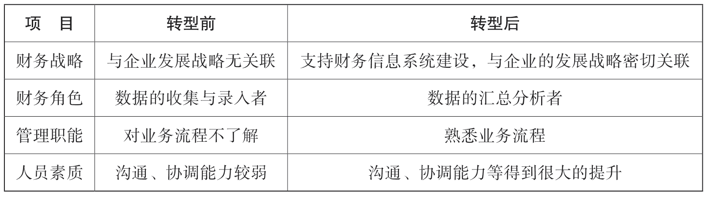

对小刘案例的解读：
小刘能胜任财务信息系统维护工作，源于他兼具财务专业背景与计算机基础，对信息化有持续兴趣。业余参加人工智能系统开发培训，自学互联网与AI相关内容，为他奠定了能力基础。他在系统搭建与维护中需要与各部门领导员工持续沟通反馈，抗压能力与人际交往能力在实践中得到强化。财务智能化程序需要持续迭代维护，信息化系统与财务机器人的开发应用与运维，实质是财会人员与技术研发人员的协同。财会人可以借助行业特长与技术人员互补，共同推动财务程序化、软硬件研发维护与升级\[7\]。随着会计信息化持续深化，市场对懂财务、会编程、能运维机器人的复合型人才需求会不断扩大。

#### （二）中层财会人才的转型样本与策略
孙女士任职于一家外资企业担任财务主管，属于中层序列。面对智能化趋势，她对企业财务制度与岗位现状做了审视，并为自己规划了再发展路径。她持续拓宽知识面，培养团队协作意识，并在工作中强化综合管理能力。

孙女士利用业余时间读MBA，研读企业管理与心理学书籍，同时参加英语强化训练并在工作生活中坚持使用。她非常重视沟通协调与管理思维的培养，提升大局观与综合素质。她拥有良好的专业沟通能力、较强的英语口语、扎实的财务专业与管理能力，既熟悉中国法规，也了解西方财务法律体系。

转型前的痛点：
第一，职责相对单一。她的工作以财务数据整理与分析为主，边界较为局限。
第二，偏重传统执行，缺乏决策参与。重心放在常规财务管理上，很少介入税收筹划、风险管控、融资、财务战略、投资等与企业战略紧密相关的议题。
第三，与业务脱节。关注点集中在财务数字，对生产经营的参与度不足。
第四，沟通不足。过度聚焦数据，导致与其他部门的协作技能不足，在企业高速发展期，财务数据难以全面反映企业价值。

转型后的变化：
第一，战略关注度提升。通过调整管理思路，将财务目标与业务服务能力挂钩，全面提升了财务管理能力，增强了参与企业战略制定的话语权。
第二，站在管理者角度研判趋势。她改变了工作方式，以管理者视角分析经营状况，制定财务战略，并搭建了覆盖信息系统、资金管理系统与绩效考核系统的风险控制体系。
第三，工作内容与企业战略更贴合。为匹配企业快速发展要求，她以投资、融资与风险控制为核心设计财务战略，服务业务发展。
第四，从“管控”转向“决策赋能”。从控制数据的财务主管，转变为为决策提供支持的伙伴型角色，深度参与企业决策。
第五，沟通与领导力提升。职业再规划让她的沟通协调能力大幅改善，带动财务团队整体素质提升，领导与管控能力同步增强。

表 3-2　孙女士职业生涯再规划与发展前后对照表

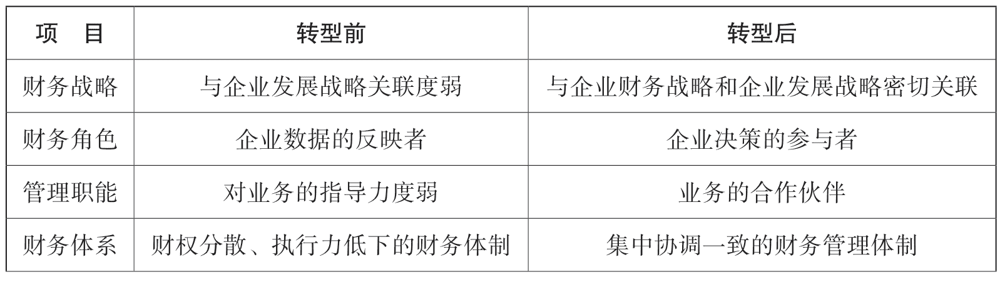

续 表

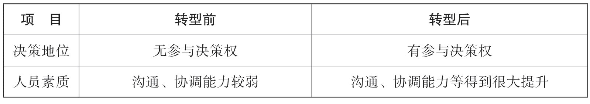

对孙女士案例的解读：
作为中层财会人，孙女士的专业能力让她能为企业决策提供支持，推动发展与全球化进程；合理配置资源，追求价值最大化，优化管理流程落地战略；策划资本运作，为企业争取发展机会。通过投资决策分析、内部控制、管理会计工具支撑绩效管理，她的工作从价值守护转向价值创造。人工智能环境下，她更强调专业技能与领导力培养，重视有效沟通与团队建设，明确财务服务业务的目标。她熟悉中西方法律，精通商务英语，能够以业务数据与财务数据融合的方式，为经营与管理决策提供支撑。

人工智能背景下，财会岗位在业务全流程中扮演协作角色，必须与资源与业务强关联，全方位服务经营并主动参与管理。从中可以看出，部分财会人具备向管理岗位迁移的潜质，随着经验积累，逐步走向管理层是大概率路径。

### 二、智能化环境下财会人的再规划策略
人工智能时代，财会人最核心的是应变力与前瞻意识。通过自学、职业培训等渠道加深对再规划的理解，找到设定路径的方法，结合自身能力制定方案\[8\]。首先要做自我评估，日常多做复盘，清晰认识优势劣势。其次做职业选择，在了解短板长板后明确兴趣，制定可行性高的再规划方案。最后要动态调整，规划并非一成不变，需要随内外部变化及时修正。针对当前痛点，可采取以下应对策略。

#### （一）从基础岗位向高阶岗位跃迁
##### 1. 向管理会计方向演进

## （一）可行的转型方向
### 1. 向管理会计转型
在财务机器人普及、软件系统广泛使用的背景下，企业财会岗位总量会收缩，基础核算岗位受影响最大。为避免被淘汰，这部分人群需更新知识结构、提升价值。最契合当前需求的转型方向是从财务会计向管理会计迁移。人工智能时代企业对管理会计的需求持续增长，管理会计将成为主流。它要求具备洞察未来、指引决策、管控风险、构建道德环境的能力，也要求掌握管理信息系统并能协同达成组织目标。

要重视数据分析的差异。管理数据是基础核算数据整合后的战略级信息，包含企业基础信息、财务数据、业务数据与业务信息等\[9\]。对传统会计数据进行再分类，让其更贴近业务与管理，能反映各环节投入产出关系，增强业务部门成本控制的主体意识。

### 2. 向国际会计转型
大中型企业与跨国公司的业务与投资边界在持续扩张，需要财会人具备国际视野，不仅要了解目的地风土人情与政策法规，还要掌握财政税收、核算、利润分配、收益分配、税收返还、优惠政策等专业知识，从财务与成本角度提供技术支持。

从全球化视角看，会计行业国际化程度加深，需要具备专业知识、商务英语沟通能力、对全球经济商业环境的理解，以及职业判断、风险控制与管理能力\[10\]。英语基础好的财会人可以系统学习国际税法，成为兼具财务技能、英语应用、国内国际税法知识的复合人才。

## （二）提升职业胜任力的自觉行动
### 1. 强化人际沟通
仅有专业硬实力不够，软实力中的沟通交流能力同样关键。内部沟通能提升效率、营造氛围、明确目标、促进协作，并提高管理效率。财会人通过与上级同事的交流，能更快发现自身短板并持续完善。

### 2. 用再培训补足能力
利用业余时间参加专业培训、考取职称证书，把握每一次学习机会，持续积累职业知识。随着新制度、新技术更新，财会人必须保持学习惯性，通过多元渠道丰富知识、提升技能，使能力与变化环境匹配，实现动态职业规划，合理利用财务资源与创新管理机制。

### 3. 强化业务财务融合，培养全局与战略思维
不仅要精通财务专业，还要熟悉企业经营业务与行业特点，参与业务流程再造与资源整合。提升管控与职业判断能力，对未来业务做出合理分析。财会人应站在全局角度客观看待经营问题，不仅关注财务报表，还要结合宏观经济与行业趋势做长远分析，让资源配置更合理。同时要培养战略规划能力，让财会工作围绕企业目标服务于战略。

### 4. 锻炼独立分析与风险意识，推动流程优化
分析数据背后的信息，才能转化为经营决策。要用会计思维深入思考问题，利用专业知识进行风险控制，通过财务数据洞察经营与财务风险。从业务角度评估项目可行性，事前评估发展趋势与资源配置问题。对于流程繁琐的大型企业，需要在管控与效率间取得平衡，设计关联系统、预评估风险、堵住漏洞、提升审批效率，优化整体流程。

## （三）主动拓宽职业发展形态
### 1. 向投融资岗位转型
企业发展离不开投融资，财会人熟悉经营，能在投融资中提供建议。可从会计准则、证券金融、财务管理、内部控制、经济热点入手，提升宏观经济、金融、市场营销等知识，由会计专业人才向投融资管理型人才转型。

### 2. 向企业主转型
可利用资源与平台学习创业知识，参加目标行业培训，了解信息，为创业蓄力。培养心理素质与抗压能力，养成独立思考与行动习惯，明确知识结构，制定发展计划并持续推进。

### 3. 向职业经理人转型
在熟悉企业运作的基础上，参加MBA课程学习管理学与岗位技巧，学习心理学与管理学拓宽视野。不断学习会计相关技巧，洞察企业与行业趋势，关注宏观经济政策，持续提升英语水平，加速成长。

### 4. 融合财务专业与人工智能技术，成为AI线下管理者
知识迭代加速，会计工作也在变化。财会人要掌握基础理论的同时学习新科技，迎接AI挑战，掌握相关技术，结合财务专业辅助AI系统开发升级，高效履行职能。

### 5. 尝试跨领域发展
突破专业局限，在掌握会计知识后接受跨专业学习，拓展空间。可根据兴趣与经历切入销售、技术、人力资源等领域，通过跨界交流增强职业认知。

## （四）加快打造软实力
### 1. 成长为复合型人才
人工智能下失业风险上升，流程简化与强度降低促使财会人主动参与决策，为管理者提供专业意见。在税收筹划、投资方案、内部控制、风险防控、收入预测、投融资决策等方面发挥专业优势，参与经济事项决策，成长为复合型人才是现实需求与必然选择。财会人要掌握财经理论并能在实操中结合应用，依靠数据分析总结财务管理、战略拓展与核算政策。

### 2. 掌握大数据管理与集权化财务管理知识

在人工智能驱动的市场环境里，竞争的烈度在持续攀升，企业对财会人才的期待也在不断抬高。账务核算尤其是全流程自动化已成常态，接下来决定企业成长的是财务分析与决策的精准化、智能化，而这背后离不开大数据能力的支撑。因此，财会人员必须补齐大数据管理的知识短板，在海量原始数据中筛选出对业务有价值的财务信息，并据此制定适配企业发展的财务策略。AI 时代到来，传统会计岗位将被大幅压缩，财会队伍趋向集中，信息共享加速，会计处理更趋规范、标准、便捷。除了夯实专业本领，财会人员还需拓宽视野，为长远职业发展奠基。要提升综合知识运用能力，注重人际经营，保持主动与积极的职业态度，善于抓住机会锻炼、积累实战经验。在人工智能背景下，工作理念的转换迫在眉睫，要培养整体观，以全局视角客观公正地审视经营问题。要锻炼独立分析能力，从数据表象洞察其背后的业务含义，再转化为可执行的经营决策。把互联网与会计实务结合起来，用专业的会计思维审视问题，密切跟踪经济形势，顺应社会发展大势，主动调整职能定位，提升核心竞争力，持续打磨个人素质。

企业也应深度介入财会人员的职业发展规划，不断优化人力资源管理的制度体系，搭建畅通的沟通机制并提供系统的职业辅导，以提升工作效能。构建职业生涯管理体系和保障体系，并对落地执行过程进行持续管理。当前竞争愈发白热化，人力资源管理的完善与财会人员职业规划的重视变得关键。要将员工个人发展规划纳入企业战略版图，协调个人目标与组织目标双向成长，形成更具凝聚力的伙伴关系，从而更好激发工作积极性。以人为本，关注不同阶段的职业诉求，拓展发展通道，满足差异化需求，使岗位能力与价值贡献都能充分释放。引导财会人员系统掌握专业管理知识，同时加码运营管理、风险控制等业务的培训覆盖，从理论、管理要点到实操协同等多维度提升，提升对企业风险与经营全貌的理解力。

* * *

[\[1\]](#txt003.xhtml#footnote_quote_txt003_1)张振义.基于战略视角的企业财务转型拓展路径研究\[J\].财经界（学术版），2016 （1）：148-150.

[\[2\]](#txt003.xhtml#footnote_quote_txt003_2)邢啊凤，陶雪梅，彭瑞峰.人工智能时代下对会计行业的思考\[J\].财会学习，2017（10）：112，114.

[\[3\]](#txt003.xhtml#footnote_quote_txt003_3)蔡千年.财务思维：如何成为一个财务高手\[M\].电子工业出版社，2017：56.

[\[4\]](#txt003.xhtml#footnote_quote_txt003_4)张紫馨，杨昕，辛萌.浅析人工智能会计应用下会计人员的职业定位\[J\].中国商论，2016（30）：168-169.

[\[5\]](#txt003.xhtml#footnote_quote_txt003_5)颉茂华，朝格吉乐图，焦守滨.管理转型中企业财务人员素质能力的提升路径——基于开盛生物公司的案例分析 \[J\].管理案例研究与评论，2016，9（1）：65-81.

[\[6\]](#txt003.xhtml#footnote_quote_txt003_6)孟小荣.新形势下我国管理会计发展与创新研究\[J\].财经界（学术版），2016（3）：192.

[\[7\]](#txt003.xhtml#footnote_quote_txt003_7)ZHANG X Z.Accounting objectives and reporting system construction of managerial accounting in China\[J\].Finance and Accounting Monthly，2015（11）：3-8.

[\[8\]](#txt003.xhtml#footnote_quote_txt003_8)谭群霜.职业生涯规划活动的设计与反思\[J\].教学与管理，2018（1）：29-31.

[\[9\]](#txt003.xhtml#footnote_quote_txt003_9)杨延华.企业会计人员职业胜任能力评价研究\[D\].大庆：黑龙江八一农垦大学，2012.

[\[10\]](#txt003.xhtml#footnote_quote_txt003_10)EDDY A，EDDY D，DOUGHTY J.Evidencing continual professional development：Maximising impact and informing career planning\[J\].Journal of Medical Imaging and Radiation Sciences，2015，46（4）：361-364.



# 第四章 智能时代财务教育革新

## 第一节 大学财务教育在智能时代的转向

为什么要改？高校在智能时代能发挥什么作用？如何打造财会教育能力？本文从这几个切口展开，最后一起看一看已率先行动的高校在做什么。如图 4-1 所示。

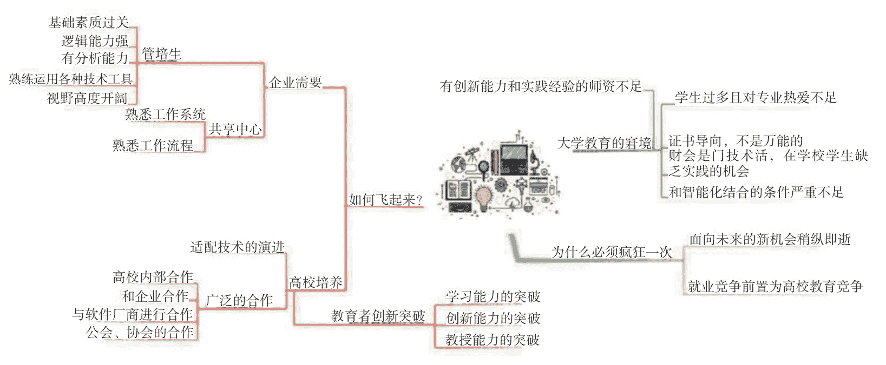

图 4-1　智能时代大学财会教育分析

### 一、大学财会教育的困境

大学财会教育并非不愿改变，而是客观阻力不小。细心观察就会发现其中的无奈：企业一边喊着招不到合适的人才，一边大量财会毕业生为就业发愁，很多人从大三起就对未来职业感到悲观焦虑。虽然这些矛盾由来已久，但过去就业机会相对宽松，如今竞争加剧，形势更严峻。

困境的根源大致可归为以下几点。

#### （一）兼具创新性与实务经验的师资稀缺

师资决定育人质量。笔者长期旁听多所高校名师的课程，发现顶尖院校的优秀老师往往既有创新意识又有实战经验。一方面他们持续自我更新，另一方面常面向企业管理者授课，通过这种方式不断积累实践感。但国内不少高校教师既缺乏成名条件，也没有渠道接触真实业务。大学教师准入门槛高，而具备实战经验的企业管理者大多难以进入校园任教，于是能兼顾创新与实践的师资始终不足。

#### （二）报考人数众多而专业认同度偏低

大量考生在志愿填报时并未认真思考过财会专业意味着什么、是否真正感兴趣。缺乏兴趣的学习效率低下，也很难脱颖而出。更常见的是，学生本人没有选择权，家长包办成为常态。笔者当年也是被保送进会计专业，幸好本人对该专业有热爱，才保持了学习的动力。被动选择叠加媒体片面渲染的“高就业率”，导致认知偏差与扎堆报考。每年百万量级的财会毕业生涌入市场，就业压力自然加剧。

#### （三）考证导向成了惯性但非良药

学校意识到就业难后，把考证作为主要解法，考证热在校园蔓延。相较于完全被动的学生，考证者至少在主动应战。但问题在于，多数职业证书本为在职人群设计，有工作积累后再学价值更大。学生以应试为目的，学习效果打折，拿到证书也不一定能胜任复杂实务。当然，部分专业协会也在努力改变，通过素质提升类活动帮助学生成长。

#### （四）财会重实操，校园机会有限

会计本质上是技术活，需要长期经验沉淀。高校课程偏理论，学生一接触实务就手生。高校与企业脱节严重，难以复原真实操作场景。虽然出现了实操实验课，但多数停留在纸面设计，信息系统的仿真度不足。实习也有形式化倾向：学生能力有限，企业不愿投入大量资源短期培养，最终双方受益有限。

#### （五）智能化融合的基础严重不足

进入智能时代，高校与社会实践脱节更加明显，不仅难以对接智能化，也连信息化对接都做得不够。国内多数院校仍依赖传统本土教学环境，对ERP应用、管理会计、共享服务、经营分析等场景难以搭建，更别提大数据、云计算、区块链、人工智能等技术领域的学习环境。

### 二、大学财会教育改革的紧迫性

当计算机技术兴起时，财会专业错失先机，计算机专业风生水起时，财会还在Excel和会计电算化里徘徊。互联网时代差距再被拉大，高校难以搭建完整的网络化仿真作业平台，学生无法在网络协作环境中掌握互联网分工。今天，财会教育改革已刻不容缓。

#### （一）未来窗口稍纵即逝

机会不会总在，更不会垂青准备不足者。信息化与互联网浪潮来临时，多数学界未能抓住。如今智能时代已至，错过就可能失去未来数十年的最大机遇。从互联网向智能时代演进，技术呈现爆发式增长，不再有十年二十年的缓冲期。若准备不足，机会一瞬即逝，后续步伐也很难追上。要做好准备，需要有一种近乎“疯狂”的行动力。

#### （二）就业竞争前移为教育能力竞争

财会毕业生竞争环境极度严峻，供给持续增长，而大量用人单位不再招收应届财会生。过去备受青睐的国企与外企也在变化，国企光环消退，高薪稳定难以为继；外企受国内人力成本上升影响，逐步向印度、马来西亚、越南等成本更低地区转移。在此背景下，高校间的竞争实质是就业质量的竞争，而就业质量取决于学生素质能力与企业需求的匹配度。能在智能时代培养出契合需求人才的高校，往往是敢于在浪潮前“疯狂”一次的学校。

## 三、如何打造智能风口下的教育能力

问题意识若已建立，就仍有机会构建智能时代的教育能力。智能风已起，能否起飞取决于是否用心搭建自身能力。

### （一）企业期待高校输出怎样的学生

部分企业每年从名校选拔管理培训生，对综合素质要求极高。若企业本身处在智能化受益链上，会更看重学生对智能技术理念的敏感度与准备度。另一批优秀学生会进入会计师事务所或咨询公司。如图 4-2 所示，笔者过往在咨询公司的用人经验显示，更青睐基础扎实、逻辑强、有分析力、熟练使用技术工具且视野开阔的学生。高端岗位的获取，越来越取决于与智能时代技术理念的契合度。

大量学生则从标准化基础工作起步，如财务共享服务中心。即便在共享中心，能力要求也在提升。它更愿意招录对常用系统与流程有基本认知的人，后续培养效率更高。而对共享运营有深入理解、具备流程优化潜力的学生，则有望从作业岗走向运营管理岗。

图 4-2　优秀企业对毕业生的选择标准

### （二）高校如何培养契合智能时代的优质人才

笔者认为关键在三点：技术演进的补课、广泛合作、积极创新突破，如图 4-3 所示。

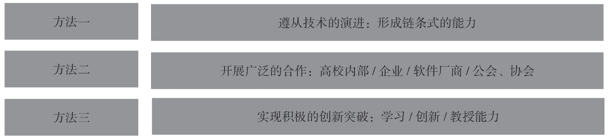

图 4-3　高校培训优质财会专业学生的方法

#### 1.技术的演进

智能时代并非凭空出现，它建立在既有技术路线的延续之上。高校若想抓住机遇，需要在智能化到来前完成补课，构建起完整的演进能力链。

首要的是互联网。学生必须深刻理解互联网下的协同工作模式，企业财务的所有环节都在这一环境中运行。基于互联网延伸出共享服务、业财一体化、商旅管理、电商采购等财务创新应用，均超出传统财会范畴，全面预算、管理会计、经营分析也离不开互联网。随后演进为移动互联网，本质相近但丰富了业务场景。

其次是大数据与云计算。在此阶段，传统财务分析被重塑，作业平台逐步向云化迁移，如Oracle、SAP 全球推进的云服务。高校需提升学生认知，让其形成对技术影响的独立判断，同时关注相关产品应用。

最后是人工智能。AI是在大数据与云计算成熟后才能在企业落地运行的技术。高校需培养学生的算法素养，未来优质岗位属于能将财会知识与算法能力融合的复合型人才。

如图 4-4 所示，技术演进路径要求高校在师资、研究、学习及实验环境上形成链条式支撑，帮助学生在校期间完成对整个演进的认知。

图 4-4　技术演进路径

#### 2.广泛的合作

短时间内自建完善教学能力难度很大，合作是加速路径。主要有四种模式。

第一，校内合作。虽常被诟病难推进，但值得尝试。综合性与理工类高校信息技术积累深厚，财会专业可借力其资源，类似企业财务部门借助内部科技部门变革。以财经类院校为主的高校则相对吃力。

第二，与企业合作。近年多所高校希望通过联合实验室、实习基地等方式创造实践环境。企业有降本用工需求，高校需要实习出口，双方利益契合，模式多集中在财务运营领域。

第三，与软件厂商合作。这种模式常见但合作面窄，多局限于金蝶、用友。企业实践中涉及的财务信息系统远不止于此，集团级应用可能达数十个。高校应拓展厂商合作，建立多元联合实验室。对厂商而言，与高校合作也有助研发与测试。

第四，与财会协会、公会合作。合作不仅是考试认证，高校可借助这些机构丰富的专家资源，邀请业界专家进入课堂，这是教育创新的有效形式。

#### 3.积极的创新突破

要破局，需苦练内功并实现思想突破，财会人群无论在校内或校外都易被贴上保守标签。但若要达到智能时代的人才培养要求，必须自我突破，不能依赖传统知识体系。所幸近年接触的高校中，已有学者开始空杯心态，走向企业社会化培训课堂，提升能力并获取创新思路。

突破需聚焦三方面。学习能力的突破，教师要做到快速学习与终身学习，借鉴企业管理人员的方法，参与社会化培训，利用互联网进行碎片化学习。创新能力的突破，把教育当作产品，用产品经理思维关注用户需求，将创新当作学问，把财会教育打造成新模式。教授能力的突破，好的教学是用通俗方式促进成长。应淡化考试考证导向，以培养企业员工的标准来培养学生，弥合高校与企业的人才衔接断点。

智能时代的财会教育是行业发展的基石，企业期待高校能持续输送高素质、具创新力、视野开阔的财务后备人才。

## 第二节 财务共享服务课程体系开发与建设

财务共享中心的人才需求呈现规模大、专业性强等特征，已成为制约企业推进共享服务的重要瓶颈。共享发展倒逼人才转型，对人才培养与支持的探索愈发重要。

### 一、校企合作联合培养

财务共享浪潮下的人才缺口与培养打法

国内高校会计毕业生的规模庞大，但面对复合型、管控型、分层化的人才需求时仍显不足。现阶段院校培养重心多落在基层执行岗位上，这为行业金字塔提供了基础支撑。可在财务共享中心、财务服务外包等知识密集型场景里，优质人才的供需矛盾更突出。新业态需要新的人才画像，而新画像也需要新的培养思路与方法。地方政府可对园区企业的员工培训给予资金支持，也能够借助企业或第三方培训机构合力开展人才培育，缩小缺口。

在线学习已现雏形。以中华品牌管理网为例，平台上已上线不少聚焦共享财务的课程，目录包含如何搭建财务共享中心、企业共享财务服务、共享中心的建设与运营管理、未来财务形态、标杆企业共享财务案例、管理创新、人员组织双赢、与共享财务相关的专题、HR共享服务中心搭建、管理优化、移动互联大数据时代集团共享财务运营实战、共享财务管理模式、共享中心优化完善、非财务人员的财务等。案例型内容也在供给，例如海尔财务管理系列、全球五百强财务管理最佳实践等。

同类社会化培训在其他平台也能找到，但供给有限且费用偏高。建议主流在线教育机构扩大平价课程供给，降低门槛，让薪资不高、长期从事基础核算的财务人员也能接触共享中心建设的知识体系。

除了线上课程，共享财务的相关内容也应进入高校会计教学体系，推动校企协同培养。可增设共享财务方向的会计模块，邀请该领域资深专家参与授课。

### 二、财务教育培养的课程体系
无论是社会培训还是校园教育，共享财务课程的设计都应围绕课程规范研制与教学体系构建两条主线展开。

#### （一）课程标准开发
对标《会计行业中长期人才发展规划2010～2020年》对财会人才的能力要求，并结合互联网加背景下财务转型的趋势，财务人员的职责正从核算执行转向管理支持、业务财务与财务决策，财务工作也在经历类似工业4.0的演进。共享财务课程应与时俱进，将培养定位从核算导向转向管理导向，实现由工作体系向课程体系的转化，以及由职业能力规范向课程规范的转化，以就业为导向，塑造良好的职业道德、职业素养、熟练技能与可持续发展的关键能力。

课程研发团队可按三步组建。第一，由项目负责人牵头，组建由专业负责人、骨干教师与企业技术人员构成的团队，共同拆解岗位群能力，制定调研方案，面向会计岗位从业者开展典型岗位调研并形成分析报告。第二，依据岗位任务、项目要求、能力需求与知识要点归纳，形成岗位群能力分析表，团队成员拆解各岗位所需能力、素质与知识的关联性，撰写课程规范初稿。第三，组织课程研发专家、企业财务主管、CPA及项目组成员参与现场研讨或评审会，完成课程规范的审议与通过。

从高校会计专业具体设置来看，高校是管理人才培养的重要阵地，推动管理会计与共享财务，需要优化培养路径。面对商业发展与国内高校管理会计教育的现状，可作如下思考。

宏观上，会计专业应坚持厚基础、宽口径、强能力、高素质的原则。

首先，重点高校可适度压缩原有的大量基础核算课程，这类工作在共享趋势下将逐步由学历要求相对较低的人群承担。

其次，要正确理解管理会计与财务会计的融合关系，管理会计本就源于财务会计。在强化学生数学、统计与计算机能力的基础上，专业课程应尽量覆盖企业管理的各个维度。

最后，管理类会计人才知识面宽泛，高校需拓宽专业口径，整体优化结构。前两年可与同领域其他专业共享基础课程，按管理学科宽口径培养，打牢基础；并据培养方向设置一定量的选修课，后两年再分专业方向培养。

#### （二）具体课程设置
培养管理类会计人才需构建多元化课程体系，不能局限于管理会计单一内容。国内高校新型会计专业课程可分为三类。

第一类是学科基础。主要包括经济学原理、会计学原理、管理学原理、金融学、经济法、统计学、市场营销、高等数学、线性代数、概率论与数理统计，旨在夯实学科基础理论与技能。

第二类是专业核心课。一是专业必修：中高级财务会计、财务报告分析、企业战略管理、财务管理、成本管理学、投资学、审计学、税法；二是专业选修：管理信息系统、专业英语、资产评估、商业银行经营管理、金融工程学、税务筹划。这些课程集中体现专业特色。

第三类是跨学科课。主要包括证券投资理论与实务、计算机会计、国际金融、会计制度设计、租赁会计、环境会计专题、人力资源会计专题等，用于拓展知识视野。

同时，要关注中国经济与企业发展中的新财务问题，融入教材与教学。例如共享财务案例分析；中国集团企业财务问题，如集团财务体制、资本运营、母公司对子公司的财务激励与控制等；中国中小企业财务问题，如融资环境、财务特征、改制与并购等；中国上市公司财务问题，如融资机制与结构、投资机制与行为等。

#### （三）理论和实践相融合的课程教学内容和结构体系设计及建设
财务共享服务课程体系构建思路为理实一体化，涵盖理论及案例研究、共享中心建设沙盘模拟、共享财务软件实操、共享体验中心仿真模拟四大模块。四块内容既可构成完整课程，也可独立开设。

#### （四）财务共享服务理论与案例学习
该部分帮助学生建立理论认知，掌握分析框架。

授课内容包括：共享财务发展应用现状；企业建设共享中心的动因；适合建设共享中心的企业类型；不同类型企业的共享中心特征差异；共享中心的建设方法；建设过程中需重点考虑的要素；建设路径与实施方法；共享中心的运营管理；企业共享中心建设案例分析等。

#### （五）财务共享中心建设沙盘模拟
沙盘模拟是课程特色环节，目的在于帮助学生更好地理解与应用理论，通过分组分工、角色扮演、沙盘推演等实景教学，在给定案例背景下共同研讨、设计共享中心的规划与建设方案。该方式能激发学习积极性，培养主动思考、团队协作与沟通能力。

#### （六）财务共享服务专用教学软件
浪潮研发了共享财务软件教学版，重点学习共享服务功能并基于给定数据实操。通过查看与分析软件呈现的数据，一方面掌握共享中心核心功能与作用，另一方面提升财务管理水平，掌握信息支撑系统。

#### （七）财务共享体验中心仿真模拟
高校可按真实企业共享中心搭建仿真环境，依托既定角色与脚本，让学生在真实办公场景中体验业务运作，直观了解共享中心的管理流程、工作形式、内容及特殊设备，培养实务处理能力。

高校还应强化实践教学，培育创新能力。设置财务管理大类、专业实习、学年论文、会计模拟实验等，将课题实验、综合课程设计与科研实践纳入教学计划。针对实践教学流于形式的现象，需学校、学生、实习单位三方共同努力，并借助财政部门影响力建立校企人才实践培训基地。

实训课程主要包括共享沙盘模拟实验和共享软件教学。

##### 1.财务共享沙盘模拟
浪潮共享中心建设沙盘是国内首款拥有自主知识产权的沙盘产品，包含沙盘盘面、工具箱与配套教程。

大多数已建或在建共享中心的企业，建设时关注的要素包括建设模式、实施策略、组织架构、人员配置、办公选址、业务范围、信息系统、运营管理等，均在沙盘中呈现。沙盘盘面由战略与政策规划中心、共享业务规划中心与运营与技术规划中心构成。

战略与政策规划中心下设建设目标、建设结构、职能定位、建设策略、建设原则、建设结构示意图等子区。共享业务规划中心划分为四个业务区，聚焦费用报销、薪资发放、应收、应付等常见业务的共享后流程与制度梳理，每区包含业务场景与制度内容，场景涵盖岗位、操作内容与实物单据。运营与技术规划中心下设基础环境及设备、信息系统、运营管理制度三个子区。

沙盘模拟实验借助教具呈现共享中心建设全流程，将建设要素、业务梳理、运营管理等制作成实物模型，按规则模拟建设过程。每组学员组成筹建小组，分别扮演集团财务部部长、业务专家、信息化专家等角色，身临其境体验筹建与运营流程。

沙盘模拟兼具体验性与综合性，可实现六项目标：帮助学员理解与应用共享财务理论；指导学员分析关键影响要素；训练学员识别关键影响因素；掌握建设框架与要素；掌握建设路径与方法；学会制定建设规划。

教学准备以沙盘盘面与工具为载体，配合企业背景与业务流程现状，完成建设计划。需较大桌面便于集中讨论与资料填写。

教学计划可分为两种情形：情形一，与理论课程配合开设，不单独讲授理论；情形二，独立开设沙盘课程，实验中穿插理论讲解。

教学步骤：财务共享沙盘模拟实验
教学过程中将学员分为6～8人一组，各自担任筹建小组不同岗位，共同讨论并确定建设方案，在沙盘盘面对应区域完成讨论、设计、展示与汇报。

战略与政策规划中心模拟包含选项工具摆放、手工描绘与数据计算三部分。选项工具摆放涉及建设目标、建设结构、职能定位、建设策略、建设原则、选址因素、选址地点、内部组织规划方法、共享中心人数测算方法等，可选用现有工具或在空白工具上填写创新内容。手工描绘包括建设结构示意图与内部组织结构示意图。共享中心人数需测算后手工填写。

共享业务规划中心模拟涵盖费用报销、应收核算及收款结算、应付核算及付款结算、工资四类业务，均从制度内容与业务场景两方面规划。可分三步：第一步差异分析，分析四类业务在各子公司的现有制度流程差异并汇总；第二步制度内容规划，根据企业管理目标确认需统一的制度并摆放或填写工具；第三步业务场景规划，依据目标确认共享后流程并摆放工具，纳入共享中心的操作岗位用小红旗标识。

运营与技术规划中心模拟包括基础环境及设备、信息系统与运营管理制度。学员依据已规划的战略政策与共享业务内容确定所需资源与制度，通过摆放或填写工具完成。

模拟结束后，以小组为单位进行随堂展示与讲解，教师点评并评分；同时总结问题与知识点。总结报告在方案完成后提交，涵盖战略政策规划、费用报销、工资、应收、应付、运营与技术规划等全部任务及预期效果，小组整理后提交教师。

## 2. 财务共享软件实验课程
企业数字化与智能化推动共享财务向流程自动化与柔性化发展，软件实验不可或缺。以浪潮GS企业管理软件为平台，提供模拟企业建设共享财务的基础数据、业务数据与运营管理信息，学员可个人或分组完成基础数据设置、业务与组织规划、共享业务处理、运营分析等操作。讲师针对实验主题讲解知识点与操作流程，学员可扮演系统管理员、业务员、运营管理人员等角色，真实体验不同岗位操作。

课程内容包括：浪潮GS客户端安装部署及共享中心软件应用介绍、共享初始化设置、四类不同业务在共享系统中的工作流程、共享任务质量管理、共享中心运营分析、报表统计分析等。

该课程可独立开设，也可配合沙盘课程。配合软件教学可巩固知识、提升信息系统实践能力，目标为：了解建设共享中心所需基础数据规划与操作方法；了解纳入共享后业务处理操作流程与方法；了解建设完成后企业运营管理与分析内容。

建议采用上机考核评定掌握程度。实验动手能力是核心培养目标，上机考核能有效激发学习积极性与创新精神，科学评定实际操作水平。

总体而言，共享财务专业课程建设任务艰巨。规划应坚持求真务实、与时俱进原则，依托互联网加背景，将知识传授转化为综合能力培养，贯穿课堂教学，为社会输送符合需求的会计人才。

## 第三节 财务共享服务教育与认证体系
在财务认证领域，除传统CPA、ACA、ACCA等资格外，随着管理会计深化，CMA、CGMA等认证受重视度提升。共享财务的出现既推动教育变革，也促使既有认证体系增设相关考核内容。

### 一、管理会计领域认证体系
共享财务教育愈发强调管理会计价值，故相关证书应纳入共享教育体系。

#### （一）CMA 认证体系
CMA管理会计在企业运营中作用日益凸显，推动财务从记账向创造价值转型。其预测职能通过宏观环境、产能、利润与成本预测，为业务发展提供可控指引。在共享财务服务中，管理会计角色更为关键，现代财务人员除基础核算外，还需具备管理会计知识与管理思维，方能在共享时代保持竞争力。

现有管理会计培训与认证体系包括CIMA、CMA等。其中，美国注册管理会计师CMA全球认可度较高。CMA由美国管理会计师协会设立，覆盖130多个国家，被视为世界500强企业的敲门砖。认证客观评估学员在管理会计与财务管理方面的经验、教育背景、专业知识、实践技能、职业道德与持续学习能力。持证者可推动职业发展，保持高水准职业道德，以财务战略咨询师视角参与企业分析决策，并在战略决策中发挥重要作用。

报考CMA需先申请成为IMA普通会员。中国考生可通过IMA授权的培训机构申请入会。

举办机构IMA在全球约有68,000名会员，主要分布于美国、加拿大及经济发达国家。CMA属于美国两大权威会计师资格之一，也是全球权威会计及管理标准之一，在中国由中国教育部考试中心组织考试。

CMA 报考门槛设定得较为宽容。能够递交申请的人群包括拥有经教育部核准的全日制大专毕业凭证，以及取得教育部认可的学士、硕士、博士学位的求学者。整体要求并不苛刻。考核以全球统一的计算机闭卷考试进行。

考试共两门，各科安排 4 小时作答时间。

第一门为 Financial Planning，Performance and Control，关注范围及分值占比为：外部财务报告决策 15%、计划预算与预测 20%、业绩管理 20%、成本管理 20%、内部控制 15%。

第二门为 Financial Decision Making，关注范围及分值占比为：财务报表分析 25%、公司财务 20%、决策分析 20%、风险管理 10%、投资决策 15%、职业道德 10%。

完成两门科目后，仍需累计两年管理会计实务经历方能正式授予称号。可计入经历的类型包括财务分析、预算编制、管理信息系统分析、在企业或政府机构从事管理会计或审计工作、管理咨询，以及讲授管理会计相关课程等。该两年经历可在应考前完成，也可在通过考试后七年内补齐。获得称号后须持续维持 IMA 会员身份并完成继续教育要求，资格方能保留。

#### （二）CIMA 认证体系

驻伦敦的 CIMA 皇家特许管理会计师公会与驻纽约的美国注册会计师协会 AICPA 共同对外公布，双方理事会已通过合作方案，打造规模最大的会计师组织并推出新的国际资格 Chartered Global Management Accountant，CGMA。该资格的推出旨在在全球推广将财务与战略相结合的管理会计职业。

CGMA 头衔代表持证人在管理会计、绩效管理、企业战略等领域的卓越能力，依托 AICPA 与 CIMA 两大机构的声誉与资源，已在国际上获得广泛认可。

CIMA 属于全球规模领先的管理会计师组织，AICPA 属于全球规模领先的职业会计师组织，会员覆盖财务与会计的各个岗位。合并后新主体拥有约 55 万会员及学员，成为目前全球最大的会计师团体。AICPA 在北美具有深厚根基，CIMA 在欧洲、中东、非洲及亚太地区影响力突出，有助于提升美国管理会计的行业地位并推动该职业全球化。

### 二、财务共享领域认证体系

#### （一）ACCA 认证体系

愈来愈多企业借助共享服务与外包提升服务品质、降低成本与提高效率。共享服务已成为财务转型的关键抓手，全球财会从业者已超 75 万人。

把握此趋势，ACCA 依据 CFO 及企业的诉求推出全球共享服务认证，为有意进入该领域的人才提供职业通道。

在该认证中国首发活动上，ACCA 财务运营执行总监郑孟德表示，全球共享服务已非单纯提升职能协同的手段，而是企业在共享服务管理上的根本转变。采用该模式可释放财会部门精力，承担更高价值的任务，因此 ACCA 选择以全新认证引领变革，培养高效团队，推动财务转型。他还强调，全球共享服务的有效落地通常取决于是否建立清晰领导架构，并获得董事会、CEO、COO 等高层的支持。

#### （二）全球共享服务证书

长期以来，ACCA 凭借专业资格、大量调研项目及与企业和政府的合作，为共享服务行业提供支持。在既有资源基础上，ACCA 针对共享服务设计了三类专业认证。

全球共享服务基础证书：提供独立在线评估课程，覆盖共享服务企业员工所需的基础知识与技能。

全球共享服务证书：在基础证书五大模块之上，叠加 ACCA 资格课程中的财务与管理会计相关知识，有助于提升专业能力，胜任更具挑战的岗位。

全球共享服务高级证书：聚焦高级财务管理、管理会计与绩效管理，提升员工在共享服务高端领域的专业能力。完成全球共享服务证书后，既能掌握共享服务工作所需的专业知识，也能为后续攻读 ACCA 资格课程、成长为全面财务管理人才奠定基础。

ACCA 认为，财会专业人士在共享服务与外包领域将迎来广泛职业机会。目前中国多地已成为主要共享中心。成都天府软件园作为国家服务外包基地示范区，已建成 29 个财务共享中心。自 2012 年 ACCA 与天府软件园签署合作备忘录以来，双方共同支持园区财务共享服务发展与国际人才需求。

2017 年 6 月 21 日，ACCA 与中兴财务云在上海联合宣布推出首个全球共享服务证书中文版，由中兴财务提供独家学术支持，推动共享服务在中国落地，浪潮亦参与其中。

GBS 全球共享服务中文版课程面向中国集团企业、高等院校及共享服务或外包服务从业人员，语言更易理解，能提供共享服务必备的知识储备并提升实务能力。ACCA 于 2016 年推出共享服务人才培养认证体系 GBS 证书，旨在融合战略前瞻思维与专业技能，培养引领全球商业未来的现代会计师。配套课程覆盖共享中心员工所需全方位知识，有助于企业完善培训体系，加速共享服务进程。

# 第五章 智能时代财务组织与模式变革

## 第一节 智能时代财务组织的简化

财务组织具备自身演化规律，会随社会、经济、技术环境而变化。如今财务发展已进入与智能化时代相适配的阶段。作为 80 后作者，谈及组织进化史颇感压力。2000 年前的财务演变未亲历，只能依托史料与资深财务交流做大致判断。2000 年后的二十年是亲身经历与参与的时期，尝试提炼一种“极简财务进化史”。

我国财务发展可自新中国成立后展开。几十年间财务总体持续变化，与中国社会进步同步。可划分为四个阶段：起步期即财会一体、发展期即专业分离、中期即战略、专业、共享、业财四分离、高级期即外延扩展。社会发展规律使首个阶段历时漫长，后续阶段则在短时间内加速演进。

### 一、起步期：财务与会计合一

从新中国成立到 20 世纪 70 年代末约三十年间，财务与会计分化不明显，即财会一体。当时会计对计划经济中国更为关键。这一阶段财务管理更多服务于内部控制与成本管理，一方面保障资金资产安全，另一方面通过降本获取业绩。不少企业成本管理在当时仍有可取之处。总体看，这一时期财务管理多被视作会计的分支。

### 二、发展期：职能专业化

经历近三十年财会一体后，改革开放到来，企业经营目标转向市场化，关注经营结果与盈利。财务身份随之转变，从单纯“管家婆”变为对内管家对外参谋。

组织上也出现变化，20 世纪 80 年代十余年间，财务管理作为独立学科被剥离，企业逐步分设财务管理部与会计部。专业的人做专业的事，财务管理范畴逐步拓展至预算管理、成本管理、绩效管理等，会计聚焦核算、报告、税务。后期资金管理也在不少大型公司独立出来，形成资金部。

这一阶段财务组织显现专业分离趋势，如图 5-1 所示。

图 5-1　专业分离阶段

### 三、中期：战略、专业、共享、业财四分离

从 20 世纪 90 年代起至 2015 年，是财务领域快速创新变革的时期。战略、专业、共享、业财四分离概念最早由咨询公司从国外引入。如图 5-2 所示，财务组织呈现两个三角形变化：左侧正三角形基础作业占比大，右侧倒三角形管理支持占比大。在这一思路引导下，国内企业大规模推进财务共享服务中心建设与业财一体化。基础作业被分离至共享中心，业务财务成为财务组织重要配置。

市场上还有三分离说法，未将专业财务与战略财务区分。但实践中两者差异明显，分离后更清晰。战略财务聚焦集团或总部经营分析、考核、预算、成本管理等；专业财务聚焦会计报告、税务、资金等。财务共享是会计运营大工厂，业务财务则是战略财务和专业财务在业务部门落地的执行力量。

如图 5-3 所示，战略、专业、共享、业财四分离使财务格局提升一层。目前国内大中型企业财务建设多沿此模式，成效显著。

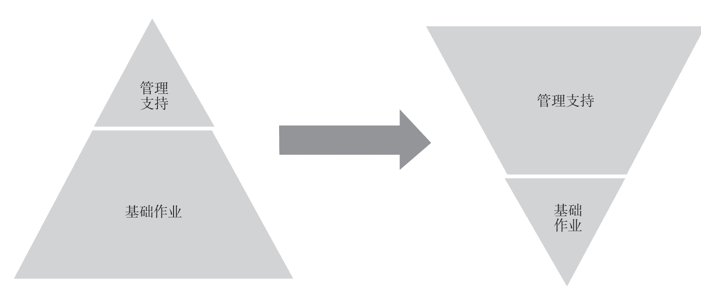
图 5-2　传统阶段到四分离阶段的职能转变

图 5-3　战略、专业、共享、业财四分离阶段

### 四、高级期：外延扩张

高级期的财务组织在四分离基础上进一步拓展工作外延，可称外延扩展阶段。发展到一定程度后，财务开始“折腾”，与技术概念迭代的社会环境相匹配。财务人并不保守，具有自我突破的决心。

从 2016 年起社会技术加速演进，移动互联网进入后期，人工智能起步，大数据概念普及，软件厂商布局云服务。财务仅旁观是不够的。

如图 5-4 所示，高级阶段呈现以下变化：战略财务开始运用大数据进行经营分析，部分公司在财务体系内设立数据管理部或数据中心；专业财务对管理会计重视度提升，管理会计团队出现独立化趋势；业务财务更加多元，按价值链或渠道配置各不相同；财务共享服务中心进入成熟期后向深度服务或对外服务转型，如搭建企业商旅服务中心、承接服务外包、提供数据支持，同时机器作业的智能化应用开始出现；财务信息化在财务组织中地位提升，部分企业已设立独立财务信息化部门，智能时代下演化为财务智能化团队，推动全组织智能化。

组织形态上，原有层级式正被矩阵式、网状或柔性组织取代，企业要求财务团队既专业又具强扩展性，以应对人力多样化需求。

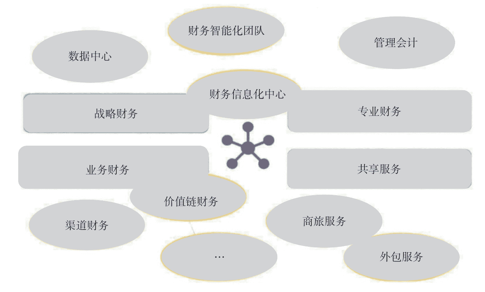
图 5-4　外延扩展阶段

## 第二节 智能时代财务管理策略

财务组织进入高级阶段后，需面对更复杂的灵活性与更迫切的创新需求。传统组织难以应对，柔性财务管理由此成为方案。我们先理解“刚与柔”，再探讨构建路径。

### 一、深入理解管理的“刚与柔”

“刚”“柔”含义并不难懂。代表“刚”的典型是泰勒科学管理理论，国内管理学教材多有介绍。其核心包括作业管理、组织管理、管理哲学。作业管理强调以科学方法、培训和激励提升生产率。电影《摩登时代》中卓别林饰演的工人被流水线锁住，近乎生产线螺丝钉。组织管理提出职能分工与计划执行分离；管理哲学强调科学管理带来的心理革命。后续诸多管理思想延续了刚性风格。

现实工作中刚性无处不在：层级森严的组织、制度中的简单粗暴、流程的刻板执行、难以改动的信息系统架构等，均制约企业发展。财务领域同样受刚性影响深远。

当然刚性并非全盘否定，在过去阶段发挥过价值。关键在于审视刚性是否适度，是否过刚易折。临界点到来时，需引入柔性以达刚柔相济。

柔性管理与行为科学体系一脉相承。霍桑实验为行为科学奠基，发现员工并非泰勒假设的“经济人”，而是“社会人”，管理重心从机器转向人性。

柔性管理不仅关乎人，更体现敏捷、弹性、可扩展的精神，可广泛应用于战略、组织、绩效、团队人员、信息系统、流程、运营等多方面。“上善若水，水善利万物而不争”，可视作柔性境界。

安应民在《企业柔性管理——获取竞争优势的工具》中指出：柔性管理本质是对稳定与变化同时管理的战略，以线性向非线性思维转变，强调管理跳跃、速度、反应、灵敏弹性，注重平等尊重、创造直觉、主动精神、远见与价值控制，借助信息共享、虚拟整合、竞争合作、差异互补实现知识转化，为企业创造竞争优势。

### 二、智能时代财务为何且如何实现柔性管理

理解概念后，思考智能时代财务应如何柔性化。如图 5-5 所示，可从多维度审视柔性财务管理。

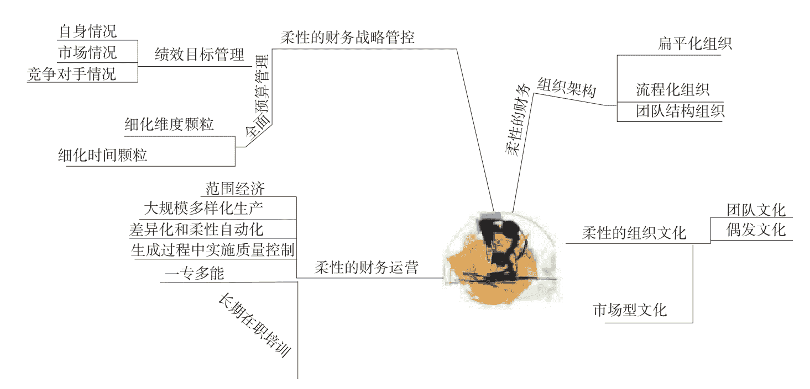
图 5-5　柔性财务管理

长期以来财务管理偏好刚性思维。一方面财务自我暗示为严谨、管控、规则化，另一方面日常工作被准则、监管、单证等刚性环境包围，形成过刚状态，逐步束缚创造力，在商业模式快速变化下难以适应。

智能时代释放强烈变革信号，也提供改变窗口。人工智能正逐步替代原本依赖刚性作业的工作，如审核、核算、结算，释放财务人员精力，为重建创造力与柔性管理能力创造条件。

#### （一）柔性的财务组织架构

传统财务组织多为层次化树状结构。如图 5-6 所示，通常集团财务总监在顶层，下设若干专业部门，部门下设科室，下属业务单元或子公司设有对应的财务总部，再对口集团专业部门，分支机构再按规模设置财务部门，岗位向上匹配。这种配置带有典型刚性。

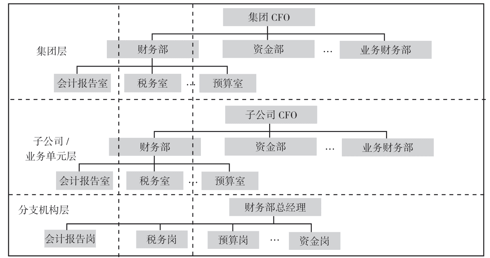
图 5-6　柔性的财务组织架构

该模式优点是条线指令传达快，专业领域上下协同高效。弊端是横向协作困难，对变革创新构成组织阻力，常被形容为“烟囱式”。此外存在另一种刚性：各层级虽有负责人，但横向负责人导致跨层级协作受阻，垂直刚性叠加横向钢板。财务负责人对业务领导的紧密汇报关系进一步加剧阻力。

在组织中建立柔性，打破横纵钢板交织，形成更大管理价值。打造柔性组织的可能性包括：

##### 1. 尝试扁平化的组织形态

财务常在一个法人主体形成多层管理链条，如 CFO—财务各部门总经理—部门副总经理—室经理—员工，共五层。适度扁平化可简化层级，提升运转效率。每增一层级就多一层纵向夹板。去钢板变革应自下而上进行，适度扩大中高层管理跨度。如图 5-7 所示，此例保留室经理专业级别与待遇，但员工直接向副总经理汇报，简化职责，提高柔性。

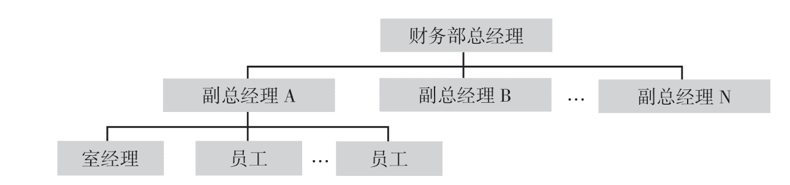
图 5-7　自下而上减少了一个层级后的组织

##### 2. 用团队化设计软化组织僵化
在团队制里可灵活搭设临时的或常设的小组，这类形态能改善跨部门协作，也能缓解纵向与横向之间的卡顿。组的组建方式可以偏横向、偏纵向，也可以做横纵混合。组内能够吸纳一位或多位负责人共同攻关。其价值在于碰到重大议题时，能让部门的小算盘让位于全局利益。实践中团队多与项目绑定，项目制运作在柔性管理里价值突出。

##### 3. 用流程视角打开财务弹性空间
从流程切入审视财务，也能带来柔性创新的可能，借流程的穿透力冲破组织的刚性隔层。流程型架构在财务共享中心应用最广，建议把适用范围做大，将共享型流程向端到端延伸，同时把经营分析、预算管理、成本管控、税务管理等非共享运营类流程也纳入流程化组织来试探。

#### （二）塑造更柔性的财务文化
财务文化建设引入柔性管理思维，有助于提升团队的包容性与适应力。组织文化大致可分为团队取向、应变取向、市场取向与层级取向。

传统财务长期偏重层级文化的培育，对稳定与可控的要求高于对灵活性的诉求，这与财务稳健的传统形象相符。

如前所述，需要适度注入文化柔性，团队取向、应变取向、市场取向都更具弹性特征，如图 5-8 所示。可适度提高这三种文化的占比，同时保留必要的层级文化，以契合财务管理属性。

图 5-8　适合柔性管理的三种组织文化

##### 1. 团队文化
这种文化下的组织更像一个大家庭，倡导成员彼此协作、以共识传递正能量，从而提升组织凝聚力。财务在年报冲刺、财务系统上线等关键节点，很容易培育出这样的团队氛围。

##### 2. 偶发文化
这是一种追求灵活、容许试错的文化，核心在于创造力的生成与对外部变化的快速反应。它鼓励员工尝试新方法，甚至为达成目标而适度冒险。该文化在会计核算、财务报告、税务、资金结算等强调安全性的领域不宜主导，但在构建创新型财务流程与系统、融资等需要突破的场景中具有必要性。因此偶发文化更适合作为补充。

##### 3. 市场文化
这是一种推崇内部竞争的氛围，关注效益优先于员工满意度，更像一种商业驱动。对财务而言，财共享服务中心最容易形成此类氛围。适度的市场文化能在标准化作业里有效提升效率，但过度则会在共享运营层面制造新的刚性。反之，在非共享领域更需要强化市场文化的引入，以激发财务人员的战斗力和狼性。

综合来看，未来柔性的财务组织文化应在层级文化基础上，大幅引入团队文化与市场文化，并以偶发文化作为必要补充，形成立体丰富的文化体系。

#### （三）让战略管控更有弹性
柔性管理在财务端的另一落点是战略管控。不少企业协商制定战略目标后便长期不动，导致管控僵化。预算管理亦然，缺乏弹性调整难以应对市场变化，导致资源配置僵化。柔性战略管控可从绩效目标管理与全面预算管理两个维度提升柔性。

其一是绩效目标管理。传统模式下财务按公司战略设定、下达、跟踪考核目标，目标经管理层、业务单元、财务沟通后确定，但季度、半年甚至全年很少调整，且往往只盯自身进步，可概括为只与自己比，具有明显刚性。

在柔性思路下，目标制定与考核应打开更多维度，除了自我比较，还需对标市场与竞争对手。挑战性目标可要求业务绩效超过行业均值并跑赢主要竞争对手，针对行业第一梯队的企业而言尤为适用；不同梯度的企业可差异化设定，但核心在于视角的开放。目标设定后不应一成不变，要在全年度持续滚动调整，面对市场重大事件、竞争格局突变时应即时修正。目标管理上要兼顾财务与非财务指标，并保持更强的战略敏感度。

其二是全面预算管理。传统全面预算以年度为周期，简单把年预算除以12摊到每月。编制时驱动因素不足，预算与业务实际关联弱；编制完成后又极少调整，导致偏差越滚越大。

柔性模式下，资源配置需要更细的时间颗粒度和维度颗粒度，贴合不同周期业务经营的实际特征进行差异化配置，并向作业预算方向深化。当然，柔性配置仍受成本与效率约束。当前刚性模式下，很多企业预算要到3、4月才能完成，沟通成本高昂。迈向柔性必然带来一定的成本上升。

#### （四）共享运营向柔性进化
传统财务共享运营以制度为中介约束行为与目标，是典型刚性思维。刚性运营要求业务需求稳定、统一、可预测。以规模经济为基础进行同类业务的大批量处理，强调统一标准化，事后做质量检验。共享中心员工只需完成单一作业，管理强调减少差异、在职培训极少。

刚性运营能享受规模效应带来的成本优势。但实践中企业对共享中心的要求在提高，希望其更具灵活性，以应对更复杂多样的业务场景。

如表 5-1 所示，柔性运营思维能够较好回应这一诉求。在柔性运营下，需求可以是不确定、多样、不可预测的。以范围经济为基础，实现大批量多样化生产，解决差异化与柔性自动化问题。质量控制从事后检验转向过程质量环境建设与过程控制。员工从单一技能转向复合技能，业务需求变化时可灵活调配资源。

表 5-1　刚性运营与柔性运营的对比

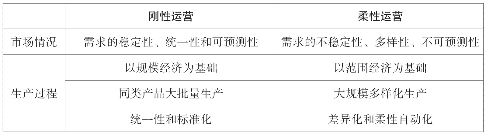

续 表

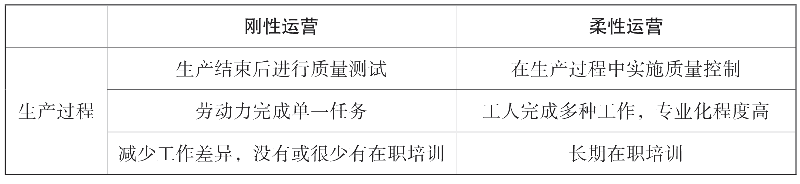

财务共享服务的刚性是与生俱来且不可或缺的，是其立足之本。但管理者必须认识到未来是刚柔并济的趋势，柔性运营的能力建设已经迫在眉睫。直观地说，刚性思维像一条直线生产线，柔性思维则允许在直线上对差异件分流处理，也允许员工在产线上跨流程作业，通过组织、技术的柔性与流程的柔性带来运营的多重可能。

#### （五）打破信息系统的刚性枷锁
财务管理还需要打破信息系统的刚性束缚，构建具备柔性的信息系统。

中国信息化进程过快，许多公司在看不清方向时技术已迭代、管理要求已变化，财务信息化多在打补丁中推进。系统缺少顶层规划，更谈不上柔性。更大的问题是业务需求变化时系统难改动，后台业务逻辑无人清楚，新需求影响无法评估，最终导致系统无法动弹。

改变并不容易，需要多管齐下。

首先，改变建设观念与节奏，从打补丁转向先规划架构再建设。部分公司前期舍不得投入规划设计，导致后期返工维护成本高昂。柔性思路建议前期充分调研需求，多参考市场成熟产品，必要时引入专业人士或咨询机构做架构与需求设计。打地基的投入看似刚性，却为未来带来更多柔性。

其次，系统架构设计应充分考虑产品化思路。有的公司认为业务不复杂，无需产品化、可配置化，用代码写死规则流程即可。实际上这是一开始就给自己戴上刚性枷锁。不少公司在未预料的情况下快速扩张，除了推倒重来难以解套。对资金有限的初创公司，可考虑第三方产品甚至云产品，以低成本保留柔性。

对已戴上枷锁的公司，系统再造往往是刚转柔的唯一路径，契机常出现在经营业绩良好、预算充裕的时期，叠加技术大发展则更易实现柔性管理。

我们已经讨论了管理的刚与柔，并梳理了财务引入柔性管理的五类场景。在智能时代，适度强化企业的柔性管理能力有助于健康发展，最佳境界是刚柔并济、和谐共生。

## 第三节　智能时代的财务团队
财务组织进化到高级阶段后会进入外延扩展状态，形成复杂多样的形态，这也契合柔性管理对灵活性的要求。下面谈谈面向智能时代，财务组织的一种可能的外延形态——财务智能化团队。

### 一、我们的方向正确吗
智能时代对财务组织的最大冲击是降低对简单作业的依赖，加强对创新与复杂设计的依赖。谈到此容易引发道德争议：机器替代人工，对社会是进步还是退步？

不妨用经济学中的破窗理论来观照。该理论源于黑兹利特的小册子譬喻，也有观点认为出自巴斯夏《看得见的与看不见的》。黑兹利特说，孩子打破窗户会让主人换玻璃，从而带动就业。

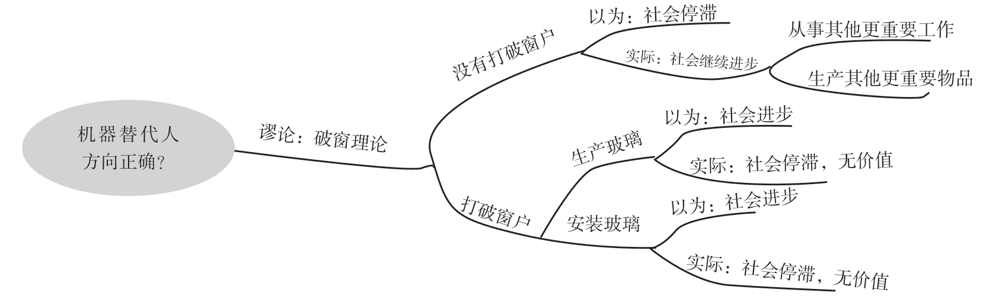

图 5-9　“机器代替人”破窗理论演示

如图 5-9 所示，担心机器取代人工，实质是支持用落后工具生产，如同让孩子持续砸窗以维持就业。事实上，若避免人为破坏与自然灾害，节约下来的时间、资源与劳动力完全可用于生产更有价值的事物，社会会更富足。固守落后工具、担心机器替代，实质是牺牲潜在价值创造的可能。由此，减少简单作业、强化复杂设计的方向性更加清晰。

### 二、构建财务智能化团队
# 财务智能化团队
智能时代如何减少简单作业，后续章节会结合新技术展开。这里聚焦组织设计，如何增强财务的复杂设计能力。核心在于建立财务智能化团队。

## （一）财务智能化团队的定义
为何用“团队”而非“部门”？笔者期望该组织基于柔性理念，具有敏捷响应、资源组织、创新与协作能力，用“团队”更贴近预期。

对智能化的理解有三种。如图 5-10 所示，第一种是用智能工具武装自己提升效能；第二种是工作被人工智能替代，组织成为无人工干预的智能作业体；第三种是建立一个组织，基于智能化理念帮助其他组织实现前两种目的，即智能化团队用来助人实现智能辅助或机器替代。我们讨论的是第三种理解。

加上“财务”限定，是指服务对象为财务领域，且组织设置在财务内部。

据此可定义：财务智能化团队是在企业财务组织内部，基于智能化理念、人工智能理论方法与创新思维，推动其他财务职能使用智能化工具提升效率质量，或用人工智能取代人工作业的组织。

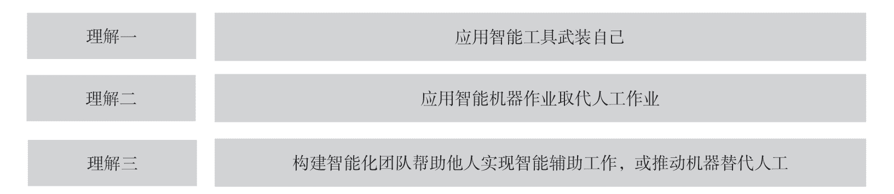

图 5-10　财务对智能化的三种理解

## （二）财务智能化团队员工画像
明确定义后，成员应具备哪些素质？该团队天生不同，肩负武装与解放的使命，因而必须具备独特性。

### 1.游走在财务与科技之间
需要复合知识体系。一方面具备丰富的财务管理知识与管理者战略视角，能深入思考工作模式与业务流程；另一方面对智能技术有充分认知，清楚技术能做什么、如何与财务场景结合。同时具备业务需求向技术实现方案转化的能力。

### 2.创新是一种本能
智能时代技术层出不穷，关键在于将新技术与财务场景关联。很多人知道云计算、大数据、区块链，却说不清财务能用它们做什么。背后缺少的是创新。对财务智能化团队而言，创新应融入工作与生活本能，敏锐捕捉财务创新的机会。

### 3.胆大心细能推动
未来相当长一段时间内，团队将致力于改变财务固化习惯。无论是推广新工具还是推动人工智能替代人工，都需要魄力与推动力。成员需胆大心细，敢于挑战权威与惯性，同时擅长沟通协调，在变革中争取各方认可，形成推动力。

### 4.人少精干有柔情
团队规模无需庞大，是整个财务组织中的小众群体，是一把利剑。成员需保持高活跃度和能动性，组织需高度柔性，可随时拆分组合，投向微创新或攻坚战。这是一支富有变化性与战斗力的特战队。

总体而言，财务智能化团队需要财务与技术复合、敢创新、能推动、善变化、有战斗力的财务人才。

## （三）财务智能化团队的组织设计

### 1.财务智能化团队的核心职责
核心职责主要有四点：负责财务组织对智能化技术的战略性研究，主动跟踪新技术动态，深挖财务管理领域的应用场景并制定路径；有效对接信息技术部门，明确智能化应用场景的业务需求，推进并跟踪实现；推动已落地的智能化工具在实际工作中应用，提升业务团队效能；积极推动人工智能对财务业务流程中人工作业环节的替代，提升自动化处理能力。

### 2.财务智能化团队的管控关系
财务智能化团队是财务内部机构，鉴于其需多方沟通协调且推动要求强，可考虑直接汇报给首席财务官或主管信息化的财务总监。同时赋予较强的组织协调权力，如项目资源调动权、对参与方考核权等。此外需与外围各财务组织及科技部门保持紧密协作。

### 3.财务智能化团队的组织架构
作为柔性组织，只需一名负责人和若干智能化财务经理，如图 5-11 所示。每位智能化财务经理可担任项目负责人或成员，团队遵循项目经理负责制，赋予充分的资源调配与项目管理权。团队负责人负责整体方向与人员管理，对各项目提供有效辅导与监督。

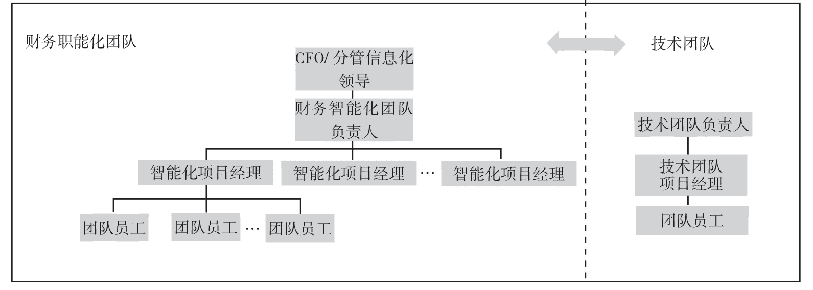

图 5-11　财务智能化团队组织与管控、协同关系

组织设计清晰后，建设方向也明朗。作为有前瞻性的财务领导者，应尽早关注新技术，以技术驱动管理升级。尽早在财务内部设立财务智能化团队是很好的起点，之后引入富有创造力和综合能力的优秀人才，使团队逐步丰满。

财务智能化团队的建设比其他财务组织更具挑战，用开拓性的领导力集聚创新技术人才是成功的关键。

## 第四节　智能时代的财务创新
当社会经济发展到今日，创新已成为企业发展的核心驱动力。国内外顶尖企业纷纷设立首席创新官，与CFO、CTO同级。这里不谈企业首席创新官，而是看财务如何创新，如何形成创新的生态环境，让每个财务人都有机会成为首席财务创新官。

## 一、智能时代财务创新的使命
对财务而言，创新并非易事，从会计发展史可见一斑。长期以来，社会赋予财务“严谨务实”的标签，积极理解是对工作的认可；另一方面也体现出财务与创新看似相悖的一面。

财务的创新能力并不缺席。回望过去几十年，后台财务的创新始终亮眼。计算机时代带来了会计电算化，信息化时代财务成为ERP建设的先锋，共享经济时期财务共享服务中心在企业管理中独树一帜，眼下进入智能时代，财务同样大有可为。

智能时代给财务人赋予了新使命，也对创新能力提出了新标准。

### （一）技术底座更复杂，用起来却更便利
智能化创新离不开技术支撑。相比十多年前，如今财务人所处的技战术环境明显更复杂。计算机时代会装会用软件即可，信息化时代需要懂一点互联网逻辑，而智能时代若想把技术与业务场景深度耦合，所要掌握的内容已相当繁复，大数据、云计算、机器学习、区块链，每一项都不是速成就能上手。这就要求财务人对技术有真懂的理解。

与此同时，获取技术的成本在下降。比如“某某云”类平台能以很低的门槛为开发人员搭建机器学习实验环境，财务人只要多花点精力亲身去体验、技术实现路径也并不难摸清。总体看，技术进步带来的不仅是复杂度，更是可用性的提升。

### （二）创新节奏要求更快
智能时代的技术更迭很快，且有清晰的演进规律。在这样的节奏下，创新的时效性成为关键。周期拖得太长，往往技术还没落地就已过时。跨越技术阶段的尝试风险也很大，慢一步就会被连带拖累。因此财务创新在智能时代必须遵循快者胜的逻辑。

### （三）创新必须扎根场景
智能时代商业创新的核心是场景创新。脱离业务应用场景的创新很难形成市场价值。技术普及容易，把技术与真实需求结合并沉淀成有意义的应用场景则难得多。财务拿到一个新技术概念时，不应急于铺开基础建设，而应先务实地深挖场景，再决定如何把技术嵌入场景。这样技术投入更精准，产出也更高。

## 二、智能时代财务创新需要怎样的生态环境
财务创新使命提升，要真正实现管理突破，还需一个支撑创新的生态。战略、文化、组织、技术等多方面因素共同作用。

### （一）公司战略的一致性
财务创新能否存活，首先要与公司战略同频。背道而驰的创新终将消亡。财务工作不是孤立的，必须嵌入公司发展战略。坚持手工打造的企业推财务智能化的成功率，远低于把人工智能作为核心战略的企业。顺势而为，站在战略风口上创新才能飞得起来。战略匹配是创新生态的基础。

### （二）鼓励创新的文化氛围
方向对了，还需要氛围支撑。技术、市场部门容易形成鼓励创新的氛围，财务则相对困难。口头鼓励不算数，财务管理者要对做出创新贡献的员工给予正向激励。生产线的创新可按成本节约比例兑现奖励，奖金甚至可达数百万元。财务难以复制如此高的物质激励，但精神认可与年度考核评价的倾斜，也能有效营造创新氛围。

### （三）适合财务创新的组织模式
组织形态是创新生态的重要变量。传统层级化、壁垒化的财务组织不利于创新。柔性财务管理提出柔性组织，即层级扁平、项目制、敏捷柔性，这种形态对构建创新环境意义重大。

### （四）对财务创新的试错包容
实验验证是创新必经环节。创新型企业通常对试错容忍度很高，甚至鼓励试错以孵化成功点子。良好的生态需要提供技术试验场，让团队在试错中逼近正确答案。海尔的做法具有代表性：面对商业创新的高不确定性，不妨让更多方案并行，最终总有少数跑到终点。风险投资的逻辑亦然，重点不在投对了什么，而在没错过什么。

## 三、财务创新的失败
先看失败的教训，往往比谈成功更有参考价值。财务创新失败常见于以下五种情形。

### （一）目标不清晰带来创新失败
不少创新并非源于清晰的蓝图，而是看到他人在做就跟风，推进到中途仍说不清为何而做。罗永浩在“干货日记”中提及的不适合创业的场景与此相似。没有明确目标，创新与创业一样风险极高。清晰的目标本质上是有价值的应用场景，有了场景才有方向。

### （二）技术不到位带来创新失败
因技术拉胯导致项目夭折的案例很多。提出想法时未充分评估自身技术能力，误以为技术部门能实现，实际运作时技术环节掉链子，造成停滞或错失窗口期。启动前要审慎评估技术资源并锁定关键资源，必要时引入外部力量或直接采购产品，拿来主义有时更高效。

### （三）创新周期过长的创新失败
智能时代对时效敏感，周期过长的项目容易失败。时间拉长会消耗推动方与关联方的耐心，早期热情掩盖的矛盾也会显现。经验表明，项目周期最好控制在18个月以内，超出后失败风险会急剧上升。管理周期是规避失败的实用手段。

### （四）安于现状的创新失败
一次成功容易让人止步。部分财务创新者在尝到甜头后便陷入安于现状的陷阱，忘记创新是相对的。随着时间推移，曾经的新鲜做法会被模仿、超越，优势迅速消失。安于现状是成功者常见的二次失败。只有持续自我突破，形成创新循环，才能走得更远。

### （五）变革阻力下的创新失败
触及业务部门利益的创新往往伴随强烈变革。财务作为后台，推动剧烈变革时易遭遇阻力与心理压力，若内心不够坚定就容易倒下。变革阻力会形成绝望期，其深度与宽度决定受挫程度。创新者应主动营造变革氛围，通过有效沟通争取管理层支持，缩小绝望期的范围。

财务创新的成功建立在预判失败的基础上，对失败场景心中有数并提前应对，创新才不会显得困难。

## 四、人人都是首席财务创新官
培养团队创新力并不容易，领导者需要坚持与包容，精心打造生态、培育文化与意识。通过一系列微创新项目提升团队信心，积累成功经验。

* * *

[\[1\]](#txt005.xhtml#footnote_quote_txt005_1)安应民.企业柔性管理——获取竞争优势的工具\[M\].北京：人民出版社，2008：78.

# 第六章　智能时代财务创新实践

## 第一节　智能时代战略财务创新

### 一、智能时代战略财务框架详解及智能增强

智能时代战略财务的各项工作都会受新技术影响，既有直接的技术冲击，也有技术重塑社会经济形态带来的间接影响。以下基于CFO基础能力框架展开，并探讨战略财务在智能时代的变化。

#### （一）战略与业务
##### 1.框架详解
战略与业务框架详解，如表 6-1 所示。

表 6-1　战略与业务框架详解

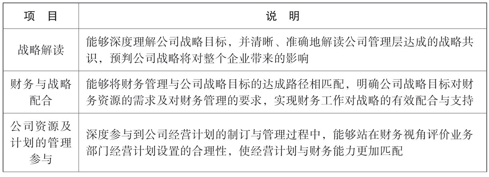

续 表

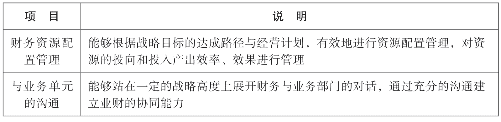
##### 2.智能增强
智能化深刻影响企业经营，各行业都不同程度被重塑。企业可能成为智能服务提供方，或参与智能技术研发，或在现有模式中引入智能工具以创新商业模式、提升竞争力。无论路径如何，智能化对经营前景的影响都不可忽视。部分公司在战略层调整，另一些在战术层适配。

战略财务要敏锐跟随企业战略与经营的变化，主动为战略或战术调整提供支持，而非被动响应。积极参与能赢得主动，更好彰显财务对战略与经营决策的支持价值。被动响应会让财务难以与业务同台对话，进而导致业务自行补位。信息化时代已有大量此类案例，希望历史不再重演。

#### （二）财会控制机制
##### 1.框架详解
财会控制机制框架详解，如表 6-2 所示。

表 6-2　财会控制机制框架详解

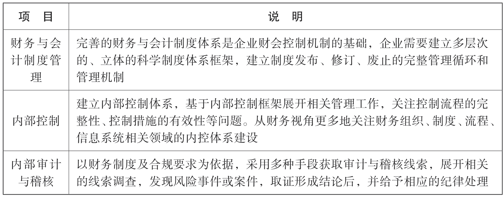
##### 2.智能增强
智能化对财务的影响是全方位的。管理模式、流程体系、系统支撑方式都会变化，作为保障的财务制度体系也需同步完善，应结合智能化对系统流程的影响进行必要调整。

内部控制方式也会随之改变。智能技术能强化内控能力，内控体系可引入更多智能工具，更关键的是控制环境发生根本变化，更多财务工作以大数据、人工智能驱动，对这些“看不见”的流程如何实施内控成为新课题。

对内部审计与稽核而言冲击最直接。智能时代人工智能替代大量财务操作，算法化处理取代人工行为，审计范畴从传统审计转向算法审计与IT审计。手段上，基于大数据的远程稽核将成主流；同时企业借助大数据监控可更早捕捉风险线索，审计从事后追责转向事前预防。

#### （三）价值管理
##### 1.框架详解
价值管理框架详解，如表 6-3 所示。

表 6-3　价值管理框架详解

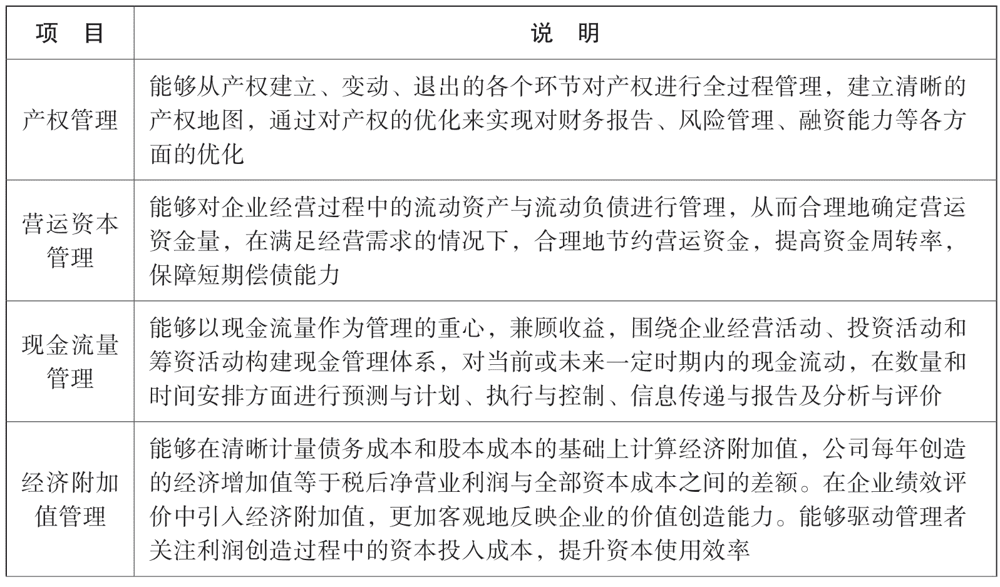

续 表

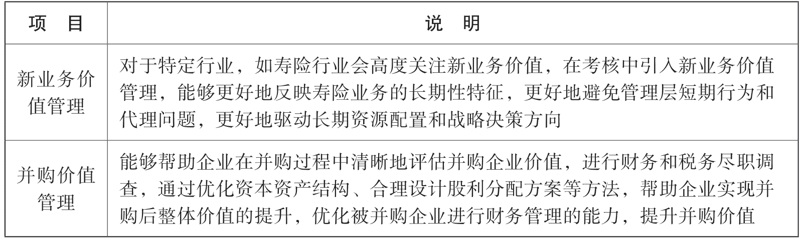
##### 2.智能增强
对价值管理而言，大数据是智能增强的核心技术，辅以机器学习可挖掘更多应用场景。

产权管理方面，基于规则的初级人工智能与大数据可辅助产权风险管理，帮助更早识别与防范风险。

营运资金与现金流量管理方面，大数据能提供更多管理线索，结合机器学习可为经营提供更强的预测能力，经营预测更可靠，从而提升营运资本与现金流预测的价值。

并购价值管理中，大数据的相关性分析可发现更多增值的线索，这些线索在并购价值创造中可能发挥关键作用。

#### （四）经营分析与绩效管理
##### 1.框架详解
经营分析与绩效管理框架详解，如表 6-4 所示。

## 表 6-4　经营分析与绩效管理框架详解

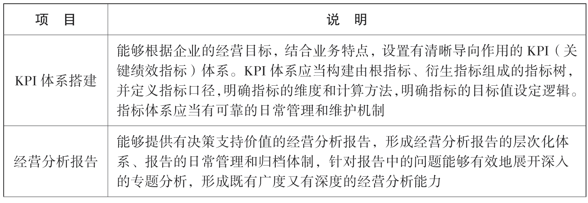

续表

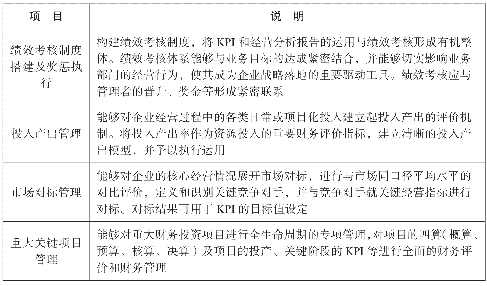
## 2.智能增强
智能技术改变了经营分析的视角与方法。视角上，传统分析受数据局限将被打破。基于大数据，因果分析可向相关性分析延伸；数据边界从企业内部扩展到社会化数据，KPI、经营分析报告、市场对标等职能均可获得更可靠的数据基础，提升结果可用性。

方法上，大数据与云计算结合使分析更灵活丰富，提供更强的数据采集、捕获与处理能力，显著延展分析边界。大数据的非结构化处理能力还能让新闻、微信、微博等社会化媒体信息进入经营分析视野。

此外，人工智能推动分析方法从经验驱动向算法驱动演进，复杂分析得以实现；基于机器学习的自我优化，使分析能力持续提升。

#### （五）全面预算管理
### 1.框架详解
全面预算管理框架详解，如表 6-5 所示。

表 6-5　全面预算管理框架详解

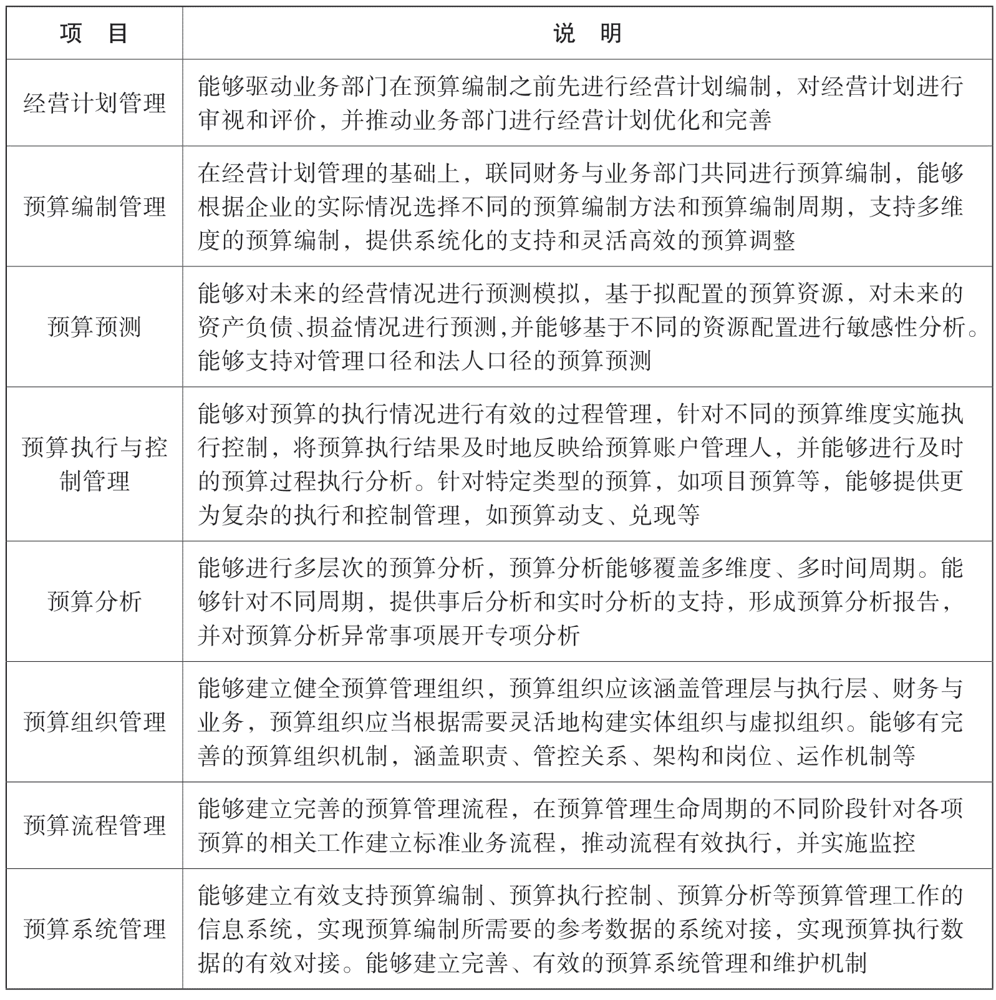
### 2.智能增强
经营计划与预算编制是资源配置过程，智能技术可发挥重要作用。大数据分析能验证业务部门资源投向故事的真实性，进行更清晰的资源投向与业绩达成相关性分析，使财务更有底气评价配置方向。

预算预测方面，基于大数据与机器学习可构建更复杂完善的预测模型，开展大量复杂场景的敏感性分析，提升预测可靠性与对不确定性的预判能力。更令人期待的是模拟技术，引入人工智能的虚拟商业生态系统可让预测建立在近似真实社会的模拟环境中，如虚拟投放广告、测试不同预算投入、模拟用户反应以评估效果等。

在初级人工智能阶段，预算执行与控制可基于更复杂的规则运行；在机器学习环境下，执行与控制模型可基于既定目标持续自优化。传统模式受人力限制，规则设计与过程管理都受约束。基于机器学习的预算执行与控制能提供更丰富的控制逻辑，在不同场景选择差异化且合适的机制，实现柔性管控。

## 二、元数据和大数据
传统经营分析受技术约束，对分析人员要求高。即便信息系统提供支撑，在传统信息化环境下，分析结果对业务决策的支持仍有限。

### （一）经营分析的概念框架
#### 1.数据基础
对传统经营分析或财务分析而言，数据是根基。分析人员通过多渠道获取数据进行分析。若企业已建数据仓库与数据集市，就相当于有了可靠地基；若数据分散在多个独立系统甚至各层级人员的Excel中，则如同在沙地上建房，结果可想而知。

建设良好数据地基需要对数据仓库与数据集市有清晰规划与设计，对数据的定义、标准、来源、采集有明确业务逻辑。仓库与集市只是载体，若前端业务流程与信息系统搭建管理不到位，数据质量难以保障，垃圾数据仍会产生。

财务视角下，需关注三类数据：事前预算、事后核算、事后深加工的管理会计。将三类数据与经营分析有效对接，有助于显著提升分析质量。

#### 2.指标体系
在经营分析框架中，指标体系相当于砖瓦。指标是衡量目标的单位或方法。围绕经营目标设定衡量标准，评价结果是否达标，进而提升管理能力，就是经营指标。

美国绩效指标专家戴维·帕门特将经营指标区分为成果指标与绩效指标。成果指标是多团队输入的总和，能衡量整体效果却难以定位问题；绩效指标则可精准定位。例如未经多维度拆分的利润指标就是典型的成果指标，未能反映各团队贡献。实践中常笼统使用KPI搭建体系。引入基础指标与衍生指标的概念，通过先系统化基础指标再扩展衍生指标，可更快搭建复杂体系。

指标常以指标树展示以理清逻辑，同时需明确指标的名称、维度与值含义，后续元数据章节会进一步阐述。

#### 3.报表展示
指标体系搭建后，便是主体建设。要让指标产生经营作用，还需精装修，这对应报表构建与展示。好的装修让业主舒适，好的报表让管理者能快速抓住重点、发现问题并解决问题。

报表从本质上来讲，是把多项度量指标与多层级切面进行交叉编排后的可视化结果。搭建这套体系的第一步，是弄清最终使用者——经营决策层——真正想看什么。需求明确之后，再挑选能够讲清问题的度量，并为其搭配与管理客体相匹配的切面信息做组合呈现。度量之间的组合离不开对含义的注解说明，按此路径搭建的报表才经得起推敲。市场上不少分析报表之所以不可靠，关键在于搭建时既没有度量与切面的意识，也没有回应决策层诉求，这类报表即便有经验兜底价值也有限，多数时候只是在制造噪音信息。

报表定型后，分析报告的产出会更顺畅，但仅把报表堆砌起来的报告停留在初级阶段。真正具备增量价值的，是能穿透数字表象，追到数字背后的深层症结。

#### 4. 让分析体系持续运转的维护机制
房子收拾好后还需要靠谱的物业。运营与维护一套营运分析体系并不容易，无论是底层数据和度量的养护，还是报告流程与归档，都需要一套可信的运行机制。

企业通常会设营运分析部门，该部门既带战略气质又带财务基因，不同公司的归属各不相同，甚至出现过调整。在部门内部建立养护机制，需要数据维护团队夯实底座，需要度量管理团队负责度量的日常增删改，需要报表团队负责常规与临时报表的编制发布，还需要绩效团队深化洞察并开展考核。组织、人员、流程、制度与系统缺一不可，共同构成养护机制。

具备上述条件，营运分析框架才能真正落地。现实中不少从业者还在认知层面没有搭起这套框架，会限制洞察与决策支持能力的提升。在此之上，还需进一步挖掘营运分析的本质与未来，即数据元与大数据。

### （二）营运分析的数据元本质
从定义上看，数据元即描述数据的描述信息。应用场景很多，比如图书馆的书目卡片、在线视频的简介、网络页面的网址等都能靠数据元来表达。其特征有四点。

其一，数据元具备结构化特质。大数据时代大家热衷讨论非结构化数据，却容易忽略非结构化数据在技术层面如何被使用。一张图片属于非结构化载体，却能被结构化的数据元描述，这就为借助数据元去理解与使用非结构化数据提供了可能。

其二，数据元和对象相关。以照片为例，描述照片的数据元和照片本身相关，使用者不必先完整认识对象就能使用，可像盲人摸象一样逐步了解。首次获取照片的数据元可能是 EXIF，即从拍摄角度获取的信息，后续再获取和照片内容相关的其他数据元，便可从另一个角度认知照片。

其三，数据元不仅能描述信息对象，还能描述资源的使用环境、管理、加工、保存和使用等信息。仍以照片为例，数据元可以说明这是一张网络图片、存储于何种服务器。

其四，数据元常规定义中的“数据”是指表示事务性的符号，是统计、计算、研究、技术设计所依据的数值，或是数字化、公式化、代码化、图表化的信息。文字也可看作一种编码数字。

营运分析和数据元紧密关联。首先，营运分析的地基是数据，数据元作为关于数据的描述信息，能以结构化方式帮助描述和标准化基础数据。数据仓库建设中的数据字典某种程度上即是数据元，清晰的数据字典有助于管理仓库，从分析管理需求看，进入体系的所有数据都应以数据元做充分结构化描述。

其次，在度量体系这一砖瓦层，数据元同样关键。度量结果最终体现为数值，而度量名称、编码、切面、切面值等对数值的描述即为数据元。因此度量体系是建立在基础数据之上分析层面的第二类重要数据元。

最后回到营运活动的核心点。营运分析的目的是以多视角评价营运活动，判断是否达成最初设定的目标，KPI 正是营运活动评价的结构化描述，也可理解为营运活动评价的数据元。

### （三）大数据如何重塑营运分析
传统模式下，需要找到评价营运活动的元数据，即度量体系和经营结果之间的关系。通常度量和经营结果存在显著因果关系时，便会被纳入关键绩效指标进行管理。但局限在于，这些度量的定义与发现多基于因果分析，逻辑绑定过强。

实际上，影响结果的不仅有可见的显著因果因素，还有相关却难以解释因果的因素，传统模式难以解决。

大数据的出现打破了思维约束。基于大数据技术，可以从因果关系转向相关关系，发现一些并无显著因果关系却对营运活动产生显著影响的因素，称之为相关性因素。把这些因素定义为关键绩效指标，有助于提升营运成果。

度量用于评价营运活动，而非因果关系的因素也在影响度量，这又构成第二层次的相关关系。原先搭建的分析元数据世界因此延展，各层级元数据都存在非因果的相关性，新元数据的出现让我们能更真实地架构分析框架并指导改善。

技术层面如何融合数据元与大数据，财务人无需费神，交给工程师即可。

## 三、大数据时代的资源编排
在战略财务框架下，全面预算管理一直是重点范畴，但其在企业经营中的作用却常受争议。

### （一）预算管理的本质是资源编排
预算是一种企业资源编排方式。股东设定经营目标后，业务单元要达成目标就需要匹配资源。从契约角度看，预算即契约，一方是股东，一方是经营者。资源本质归股东所有，经营者承诺经营目标，股东承诺提供实现目标所需的资源。目标达成后还有绩效激励，形成另一层契约。

因此预算编制的核心是提出股东和经营单元都能接受的资源编排方案，在经营目标承诺和资源承诺之间找到平衡。

预算要考虑的资源分配无外乎人、财、物，即人力编排、财务编排与资产编排。合理编排人力、财务与资产，是战略目标实现的重要保障。

### （二）资源编排的四大难题
#### 1.契约双方的信任困局
资源编排同样需解决所有者和使用者的信任问题。所有者追求投入产出最大化，会高度关注产出并要求绩效承诺。使用者则希望在承诺绩效后获得必要且及时到位的资源，避免因资源不足担责。所有者最担心的是经营者存在道德风险，比如虚构目标或过度承诺以获取资源满足短期利益。

#### 2.资源编排的标准难定
实际预算中，资源编排标准的形成并不容易，太多因素会冲击既定标准。一旦标准模糊，编排过程容易沦为谈判，陷入缺少逻辑的拉锯。

简单标准可基于目标承诺，按比例模型直接给出资源承诺；复杂标准则需明确经营目标达成的驱动因素，并细化驱动动因，最终从经营计划角度设立编排标准。

#### 3.编排效率的瓶颈
资源编排效率一直是预算管理的痛点。全流程充满博弈，很多公司从九、十月启动预算编制，到次年三、四月才定稿。月度编排若缺乏高效系统支持，很难实现精细化月度管理，此时月度预算往往沦为年度预算的简单按月分解。

#### 4.效果检验的滞后
完成编排后，从讨价还价进入承诺兑现。管理者最难的是验证资源投放效果。最终绩效指标虽能反映达成情况，但基于任务、项目设定的编排标准往往难以立刻通过财务或数字验证实现效果，此时又常需启动后续资源投入，管理者面临前款未清借后款的决策困境。

### （三）大数据资源编排：抓热点 抓相关性
为缓解信任，一些公司签绩效承诺书；为明确标准，一些公司提炼模型；为提升效率，一些公司建预算系统；为检验效果，一些公司采用刚性以收定支。传统优化终将触及瓶颈，大数据带来了新契机。

#### 1.以热点驱动资源投放
热点驱动是在保持经营目标相关性的前提下，把资源投向有眼球、有热度之处。传统财务凭经验感知很难做到，大数据提供了可能。

##### （1）锚定经营战略
和传统预算一致，编制前必须明确战略导向，这决定了投不投、在哪投、怎么投。战略层面多为宏观方向，难以直接展开细化预算。

##### （2）拆解战略热点
要衔接战略和编排，需要更清晰细化战略，形成战略热点。这里的热点区别于大数据分析的热点，更依赖管理者从管理逻辑出发，定位落地时需重点关注的目标。如以智能化发展为核心战略，需在技术、产品、客户、渠道等多方面发现热点，如产品定位为无人驾驶技术、客户定位为女性出行者、渠道定位为自营门店等，这些热点为后续编排提供方向支撑。

##### （3）用大数据发现经营热点
战略热点明确后，经营单元已对做什么、需多少资源有个初步概念，常由此开始讲故事。传统模式只能选择信或不信。若引入大数据，资源编排模式会改变。

被动模型下，经营单元基于战略热点主动设计经营热点，模型基于企业内外大数据分析经营热点和战略热点的关联热度。主动模型下，以战略热点为出发点，基于内外大数据发现分层关联的市场热点，把关联度高的市场热点纳入经营热点，作为编排对象。

##### （4）基于经营热点投放资源
通过主动被动分析，可建立以战略热点为圆心的经营热点辐射图，以辐射半径为标尺编排资源，越接近圆心资源越多。具体确定额时，可以战略热点构建资源池，先把资源投放至战略资源池；经营热点以项目形式向资源池申请。审批中引入热度评估，优先投向高热度项目，避免先到先得抢资源。

## （5）资源的兑现与使用
资源兑现指契约双方基于预算事项实际发生的费用。实践中有两种方式：一是先把钱花出去，目标达成后续验证；二是先用存量资源把事做了，按目标达成情况再批准后续可用资源。前者依赖管理者信任，目标未达成会损害管理者利益；后者体现管理者不信任执行者，要求自掏腰包先干，干成再报销，对执行者不公。引入经营热点作为依据后信任问题缓解，第一种方式更可行合理。

## 2. 资源投向和业绩达成的相关性分析
大数据在预算分析阶段也具价值。传统分析难以评价项目计划、方案和结果的达成关系。通常业绩好，所有支出被认为值得；业绩差，所有支出被质疑。现实是部分资源正向贡献，部分产生副作用，无论结果如何都存在。

引入大数据后，可构建模型建立每个可项目化的资源投入和经营结果之间的量化关联度指数。这并非简单数学模型，需把所有项目元数据化，同时把经营结果元数据化，建立项目元数据和经营结果元数据之间的关系网络。监控网络中每次资源投入时，关联经营结果变化的强度，并归纳为关联度指数。

有了关联度指数，就能精确评价资源投放效果，积累经验、优化绩效评估和未来投放策略。

以上应用仍停留在设想阶段，需实践验证。但大数据时代的资源编排是有可能迈出这一步，只是时机和力度问题。

## 第二节　智能时代专业财务创新
专业财务是财务框架中最成熟的模块，是企业财务管理的基础。没有战略财务、业务财务与共享服务也能运转，但缺少专业财务体系将无法运行。成熟意味着更大提升空间。沿同样逻辑，先详解框架，再探讨智能增强。

#### （一）会计与报告管理
##### 1. 框架详解
会计与报告管理框架详解，如表 6-6 所示。

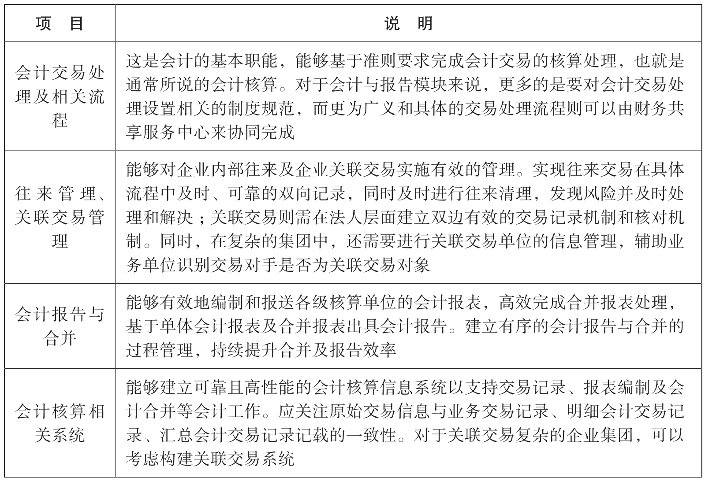

续 表

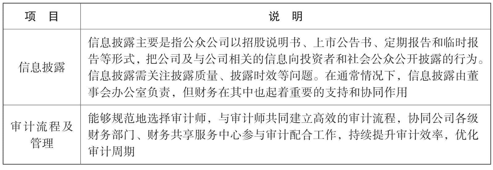

##### 2. 智能增强
会计与报告管理在会计电算化、财务信息化过程中一直是重点，早期建设也从此起步。但多数企业早期即建成核算系统并成为后续系统对接对象，核算系统长期难以质变，这是个体也是行业现状。

智能时代对各类财务信息系统提出改变要求，会计与报告领域迎来提升契机。

其一，业财高度集成有助于会计交易处理的自动化和一致性，但不同业务系统分别进行会计规则转换会增加管理复杂度。统一会计引擎可把会计规则转换架构在灵活可配置的系统组件之上，不同业务系统输入可在统一平台完成规则转换和凭证制证，提升可靠性。

其二，基于机器学习可实现智能报告。把会计报告交给人工智能并非不可能，如今AI撰写的市场研究报告已难区分是资深研究员还是机器。基于相对结构化的报告范式，加上AI基于市场反馈的润色学习，智能报告对股价提升或会更有帮助。

其三，区块链技术基于分布式账簿带来的高可靠性，可解决传统业财对接中业务交易记录和会计记录不一致的问题。对内部往来和关联交易，区块链同样能发挥作用。基于各交易方构建的分布式账簿，可把交易同时在各方记载，降低篡改可能，对核对和一致性强化有重要作用。

#### （二）税务管理
##### 1. 框架详解
税务管理框架详解，如表 6-7 所示。

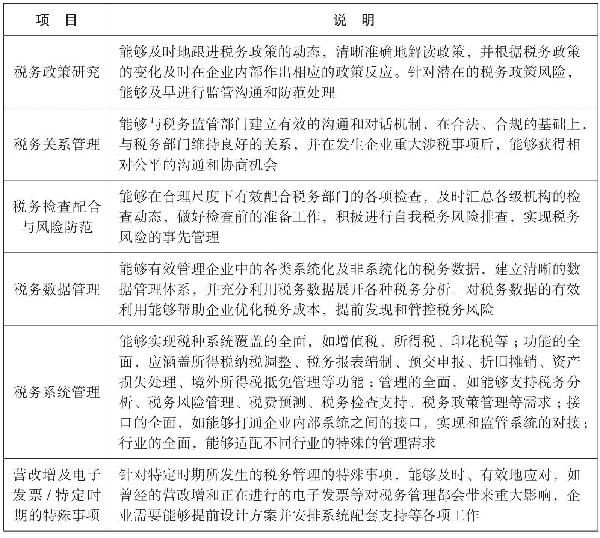

##### 2. 智能增强
税务智能化支持方面，监管方更早发力，金税三期千户计划背后皆是大数据的影子。税务部门数据具有先天不对称优势，可先于企业展开大数据应用，企业间数据分析也大幅提升稽查能力。监管方也在试图获取更广泛的社会数据用于监管。

企业需借鉴监管思路，基于自身数据及可获取的社会化数据，在一定范围内对内部税务风险进行预排查。受数据基础限制，企业和监管部门相比可能不足。

和监管部门发票数据对接、电子发票应用，对提升企业内部流程报账处理和操作风险管理更具价值。如增值税专用和普通发票数据对接可简化真伪查验和认证流程；电子发票应用可大幅降低开票成本，也方便进项报销处理。

#### （三）资金管理
##### 1. 框架详解
资金管理框架详解，如表 6-8 所示。

续 表

##### 2. 智能增强

资金管理在智能化推进下，变化集中在三个关键方向：提升资金交易的安全性与账务一致性、推动跨境外汇交易效率提升并降低成本、增强资金计划编制与流动性风险的预测能力。

先说区块链的价值。去中心化分布式账本能够搭建集团级统一清算平台，以链上记账的方式让资金流转更透明、效率更高，同时解决传统清结算中核对难、易不一致的痛点。随着国内区块链金融在同城、跨机构场景的应用，交易安全性和协同效率明显改善。真正释放潜力的其实是跨境业务——受限于流程长、费用高、依赖度强的现状，跨境资金往来对及时性和确定性的需求更迫切，区块链正是切中了这块短板。

再看大数据。对资金计划而言，企业既有历史积累的数据，加上对影响现金流需求的风险变量的持续监测，可以实现更灵活的滚动预测，计划从静态变为动态。大数据还能捕捉风险的“加速度”信号，在流动性紧张或资金安全隐患萌芽阶段就发出预警，让风险管理更早介入。

#### （四）管理会计

##### 1. 框架详解

管理会计框架详解，如表 6-9 所示。

表 6-9　管理会计框架详解

##### 2. 智能增强

管理会计的正常运转高度依赖信息系统支撑，数据量大是常态，没有系统很难实现机制化作业。传统模式下，支撑管理会计的运算性能常成为瓶颈，为保可用只能简化业务逻辑来换取速度。

多维数据库的出现已明显缓解了这一困境。传统关系数据库遵循三范式，通过多次表关联完成查询，在大数据量下响应慢、建设周期长、成本高。多维数据库以事实表为核心，配合多个维度组合，结构直观、开发相对轻便，用空间换时间实现提速。

进入智能化阶段，管理会计更多受益于底层技术进步。云架构下的多维数据库、内存数据库等形式，都能为管理会计数据处理提供更快的算力支撑，运算瓶颈进一步被削弱。

#### （五）财务风险管理

##### 1. 框架详解

财务风险管理框架详解，如表 6-10 所示。

表 6-10　财务风险管理框架详解

##### 2. 智能增强

智能技术可覆盖财务操作风险的事前防范、事中管控、事后分析三个阶段。

事前看，传统的KRI体系多依托经验与人工分析，容易出现认知盲区。基于海量财务业务交易记录，通过机器学习挖掘可形成新的KRI规则，对现有指标进行补充完善，提升前置防范能力。

事中看，经验规则系统化即可形成初级智能应用，凭借规则网揽捕获潜藏风险并对高危情形实施拦截。依托数据沉淀还能对单据实施风险分级，按等级匹配不同的控制路径。基于经验沉淀的规则可用机器学习持续训练优化，同时结合企业内外部大数据构建更丰富的分级模型，提升单据风险评估的准确度。

事后看，可搭建决策树、社交网络、聚类等多种分析模型，追踪风险线索。通过跨单据的关联分析，可扩大审计视野，发现更广泛的操作风险点。大数据与机器学习也帮助持续迭代模型规则，提高线索发现的精准性。

### 二、智能风控

对专业财务而言，业务人员舞弊与资金渗漏一直是核心关切。传统模式下难以有效遏制：一方面渗漏与反渗漏像猫鼠游戏，财务与业务在漏洞利用上不断升级；另一方面反渗漏消耗大量人力，效率低下。

智能时代提供了新的突破口。依托智能手段，财务有机会在博弈中占据主动，同时以算力替代部分人力，让抓漏变得更及时、更可控。

#### （一）何为财务渗漏

面对风险，财务可分为两种情形。

一种是流程中因疏忽或技能不足导致的工作差错，属于质量问题，不等同于渗漏。

另一种是员工出于道德失范实施的舞弊，即财务渗漏。它常隐藏在报销、零星采购等常规业务里，像容器破损漏沙，悄无声息地造成损失。

财务渗漏的核心特征是“虚构”，主要呈现三种形态。

##### 1. 虚构经济事实

这是性质最严重的“无中生有”。在没有任何真实业务支撑的情况下捏造经济事项，部分人甚至编造看似合理的证据链套取资金。所得资金或被挪作小金库，或直接归个人。

##### 2. 虚构原始凭证

相对温和但仍属渗漏。真实支出发生且已垫付，但因发票丢失或未事前审批等原因缺乏合规凭证，为完成报销而购买发票、伪造审批等，从动机看恶劣程度较低，却依然违规。

##### 3. 虚构业务金额

介于两者之间，存在真实业务基础，但在金额上做手脚。如实际出差5天报销10天，或将日标准从500元抬高到1000元，在真实事项上虚增金额。

#### （二）进化中的财务渗漏

渗漏行为可分为四个演进阶段。

##### 1. 基础进化阶段

最原始的渗漏往往是偶发的。报销填错、财务未核查，类似取款机多吐钞票被顺手收下，属于偶然失误型。

##### 2. 惯性进化阶段

一旦发现可钻空子，部分人会将偶发行为固化为习惯性占小便宜，并逐步演变为主观欺诈，但仍局限于个人行为。

##### 3. 关联进化阶段

贪婪会被放大，个体成功常依赖控制环节失效。把关键控制人纳入同盟，可显著提升成功率。真实性审查失效后，只要能伪造后续证据，便能高频操作。

##### 4. 突变进化阶段

关联渗漏仍受制于取证难度，金额有限。少数渗漏者会扩大圈子，将证据链上多个环节纳入行动，形成端到端闭环，不求次数多，但求单笔金额大。

#### （三）财务反渗漏的进化与面对的难题

##### 1. 数据分析的资源有限

Excel或简单BI在小规模场景可解问题，但面对报销这类海量高频数据时，分析资源显得捉襟见肘。反渗漏需要大量尝试性挖掘与线索发现，而非常规报表，长期操作易让财务人陷入“数据码农”式的工作。

##### 2. 复杂逻辑难以设计

线索发现本质是逻辑建模，复杂渗漏需要更复杂的模型。人脑处理逻辑的复杂度有限，超出认知范围后便难以靠人工挖掘隐藏逻辑。

##### 3. 关联渗漏无能为力

跨单据、跨时间、跨组织的关联舞弊，是传统分析最难突破的屏障。天然的分割让发现能力受限，成为舞弊者的乐园。

总体来看，反渗漏进化始终滞后于渗漏进化，技术瓶颈是主因。智能时代有望改变这一局面。

#### （四）智能时代反渗漏技术的智能进化

大数据与机器学习为反渗漏提供了新武器，可归纳为规则模型与监督学习、非监督学习、社会网络分析三种路径。

##### 1. 基于规则模型与监督学习模型的智能风控

规则反渗漏的思路与人工逻辑挖掘一致，区别在于由信息系统运行复杂规则。智能技术的意义不在于取代规则，而在于解决规则处理的两大难题：数据不足与规则设计困难。

大数据让非结构化、跨源数据得以管理，OCR、众包等手段获取的经济事项数据与外部社会网络信息，为复杂规则提供燃料。监督学习则能把长期人工审核经验转化为机器可用的规则：先把历史单据特征化并标注是否渗漏，用大量样本训练模型提炼规则，再对新单据进行自动审核，从根本上缓解规则建立难的问题。

##### 2. 基于非监督学习模型的智能风控

非监督学习本质是机器对数据自主聚类。正常单据因特征相似会被聚成大群，而异常单据往往落在小而离群的簇中。可视化后即可将调查焦点锁定在这些“另类”群体。正是“非我族类，其心必异”的思路，帮助突破传统逻辑与数据局限。

##### 3. 基于 SNA 社会网络的智能风控

关联舞弊最难发现，社会网络分析提供了解法。通过员工、审批人、供应商、股东等主体及其关系构建网络，筛查渗漏行为的规律特征。模型集成筛选、统计、时间还原、风险节点关系分析与可视化关联分析，能快速定位潜在风险。

实践中以报销单据为核心，向员工、审批人、供应商等要素外扩，跨越时空织网，寻找“黑节点”。一旦确认黑节点，即可推断网络中可能被污染的关联节点，实现由点及面。构建流程通常包括节点确定与数据提取、数据清洗、关联关系匹配与网络生成，需控制数据缺失与冗余对质量的影响。

反渗漏技术正迈向智能风控时代，财务人可借此与高度进化的渗漏行为展开有效对抗。

### 第三节　智能时代业务财务创新

### 一、智能时代业务财务框架详解及智能增强

业务财务的提出为财务管理升级注入活力，是传统财务向新型财务转型的关键一步。其核心理念是让财务走出专业象牙塔，成为业务伙伴，以业务视角参与管理。

不过业界对业务财务的细分定义并不统一，导致实务中在队伍设置与价值发挥上存在困惑。以下从不同维度解析业务财务的职能与智能支持。

#### （一）产品财务管理

##### 1.框架详解

产品财务管理框架详解，如表 6-11 所示。

能够积极主动地参与到产品前期规划和投资阶段中，从产品设计成本管理的角度对产品规划提出财务视角的专业意见。能够对产品的投资预算、投资回报、成本策略、目标设定、利润预测、产品组合投资策略等展开专业分析。积极参与产品经营分析会议，从产品线全生命周期视角为管理层提供决策支持。

表 6-11　产品财务管理框架详解

##### 2.智能增强

产品财务管理的智能化增强在财务内部相对有限。

在规划与投资环节，更丰富的信息与数据可帮助模拟产品未来运营，预测更稳健。在最佳实践推广上，可借助网络直播、碎片化学习等新形式提升培训效率。

物联网能追踪实体产品的市场投放数据，提供使用频次、用户反馈等经营洞察。更关键的是，业务财务需跟上企业产品的智能化演进，紧跟新技术与产品结合的节奏，对新品进行资源配置判断，建立适配智能产品的财务评价模型，保持与传统产品的评价标准一致甚至更优，而非被业务战略落下。

#### （二）营销财务管理

##### 1.框架详解

营销财务管理框架详解，如表 6-12 所示。

表 6-12　营销财务管理框架详解

##### 2.智能增强

大数据是营销财务的重要助力，作用于销售费用管理、客户信用风险管理、竞争对手分析三方面。

销售费用管理聚焦投入产出关系。利用大数据相关性分析，结合企业历史费用投放与市场反应数据，可识别哪些销售活动真正有效，实现资源向高回报方案倾斜。

客户信用风险管理上，可突破单一财务报表视角，纳入客户在社会化场景中的行为与舆情数据，建立多维、全景的信用评价模型，评价更及时、更准确。

竞争对手分析方面，基于新闻、微信、微博等多源舆情监控系统，可从文字、图片、语音、视频等多模态信息中捕捉市场动向，提前感知竞争态势，助力决策。

#### （三）供应链财务管理

##### 1. 结构概览
链条资金管理的整体拆解可参考表 6-13 所呈现的脉络。

表 6-13　供应链财务管理框架详解

##### 2. 技术赋能
供应链本身已进入成熟期，ERP 大规模部署后企业的协同效率大幅跃升。物联网则正成为财务能力升级的新抓手。

物联网落地后，企业能够对从原材料、半成品、成品到库存、配送以及客户端使用全程进行位置追踪，形成海量实时轨迹。基于这些轨迹，财务侧可以实现三件事：用实时动向替代传统盘点，为会计自动化提供支撑；借助动态库存信息优化价值管控，降低滞销风险；利用物流轨迹数据压缩配送成本。

未来物联网数据与财务的深度结合将重塑链条财务形态。采购端若把财务校验前置到业务发生点，效果更明显。比如在内部推行类似电商的采购方式，可实现全流程透明与自助，更好推动业财贯通。

#### （四）项目财务管控
##### 1. 结构概览
项目财务的体系化呈现见表 6-14。

表 6-14　项目财务管理框架详解

续 表

##### 2. 技术赋能
对项目管理更建议走系统化建设路线，按项目类型搭建差异化的前端业务系统。财务与业务强相关的要素嵌入前端系统，通用财务管控部分则沉淀到统一项目财务平台，对接各专业前端系统，打通业财壁垒。

项目相关系统的建设并不完全依赖前沿智能技术，但对多数企业仍是信息化短板。利用现有技术完成项目全周期的数字化，已成当务之急。

### 二、智能核算：业财融合的统一核算中枢
#### （一）核算中枢的工作逻辑
通俗地说，核算中枢就是把业务语言转译成财务语言的转换器。要运行，首先要接收输入，再做语法解析与规则映射，最后输出新语言。若处理语音，难点在于让机器听懂并转成文字。

借鉴该思路，首先要从各业务系统抓取数据输入。要认识到会计凭证是经济活动结果的体现，支撑转译的前端系统覆盖面很广。建立业务系统与核算中枢的接口后，形成类似翻译的输入。随后进行语言转换，需构建业务数据到凭证的规则映射体系。

与普通翻译不同，翻译会无差别接收全部内容再输出，而核算中枢先依据凭证数据规范判定所需输入，对无用数据不予采集。业务系统按凭证需求提供数据，经预设规则处理后生成“准凭证”。

准凭证是未入总账的预制凭证。进入核算系统后转为正式会计凭证，完成语言输出。

#### （二）一体化核算中枢
一体化核算中枢与传统版本的差异在“统一”。多数中枢依附于财务或业务系统作为插件，或在专业系统内划块形成子系统。一体化核算中枢则脱离宿主，独立成专业平台，扮演多语言转换枢纽。一端连接企业全部业务与专业财务系统获取输入，另一端连接会计核算与管理会计系统产出凭证并支持分析。

#### （三）智能化视角下的一体化核算中枢
搭建一体化核算中枢不易，但价值清晰。随着智能化演进，可在建设中借助技术提升性能。

仿效翻译领域，可适度引入机器学习来完善规则，即凭证转换规则。初期多靠经验设计规则，但面对多行业多场景，仅靠经验不足。机器学习通过学习标注业务样本，能更高效提炼规则，提升新场景适应力。再者可用区块链技术，若在业务、专业财务、核算之间构建分布式账本，可大幅增强转换结果的可追溯性。

国内仍在探索，但在大中型集团落地不远，未来出现面向社会的低成本甚至免费开放平台并非幻想，智能技术将进一步放大价值。

## 第四节　智能时代共享服务的创新路径
### 一、共享服务全景与技术加持
财务共享在中国约 2005 年兴起，西方更早。近五年热度飙升，已成中大型企业财务组织的标配。

共享中心从设立到运营整体管理水平持续提升，形成相对成熟的管理框架，在政府、企业、高校、协会合力推动下逐步形成中国特色模式。

#### （一）共享中心设立管理
##### 1. 结构概览
共享中心设立管理的脉络详见表 6-15。

表 6-15　财务共享服务中心设立管理框架详解

续 表

##### 2. 技术赋能
管理层通常要求共享中心建设具备前瞻性。自十年前起，共享中心建设就具创新属性，需向管理层证明技术手段达到市场或竞争对手水准，并能提升内部管理。不少企业同步推进信息系统建设，整体仍在互联网时代技术范畴。

当前规划建设立项时，必须考虑智能革命影响。笔者曾为一家世界 500 强中国家电企业规划共享中心，管理层明确希望未来中心越做越小，而非人员规模扩张，体现对智能时代的认知。

依托高度集成的信息系统，数据自由获取，规则自动化加人工智能的新共享服务形态正兴起，将逐步取代大规模手工作业。进程一直在推进，受技术与数据质量限制，目前体感多为优化。如跨国外包商热衷于 RPA，正进行自动化替代人力尝试。

因此规划时要为未来智能化预留接口。同时认识到智能化可能在数年内爆发，共享中心需具备认知准备，及时调整运营策略，切换到智能运营平台，以维持竞争优势。

#### （二）共享中心组织与人才管理
##### 1. 结构概览
共享中心组织与人才管理的框架详解，如表 6-16 所示。

表 6-16　财务共享服务中心组织与人员管理框架详解

##### 2. 技术赋能
智能时代对共享中心的组织与人才管理提出新诉求。

组织层面，传统职能之外需增设自我变革职能。不少中心仍在权衡自动化替代人工及团队利益影响。逆势不可取，应一边提升传统集中手工作业效率，一边设立创新科技组织，积极自我颠覆，通过新技术主动降本增效，掌握变革主动权。

人才层面，需为自动化带来的人力释放做准备。人员集中本身是变革，经一次减员挑战。今天需再次消化集中人力，应在职业发展中前瞻智能化影响，提前培养非共享技能，帮助部分人员分流至其他岗位，降低刚性裁员冲击。

考核层面，应更强调创新能力。传统模式过度强调效率，员工倾向稳定，阻碍变革。多一些求变心态是智能时代财务共享服务的必由之路。

#### （三）共享中心流程管理
##### 1. 结构概览
共享中心流程管理的框架详见表 6-17。

表 6-17　财务共享服务中心流程管理框架详解

续 表

##### 2. 技术赋能
业务流程优化是财务共享服务管理的核心主题。传统优化通过挑战环节、改变运营方式寻找提升点。高度的业务系统与财务系统对接以及专业化运营平台建设，显著提升了流程效率。

智能时代带来更多优化空间。机器流程自动化成为热点，通过在全链路识别断点与手工替代机会，在瓶颈后再次提升自动化水平。

更进一步，财务共享流程将伴随规则型初级人工智能与机器学习人工智能到来而持续改进。现有流程会先由多人工转向人机结合，最终迈向智能化。优化非一蹴而就，会随技术迭代实现量变到质变。

需注意智能化影响是端到端的。输入流程也在变化，前端智能化进程会重塑后端运营，多数情况下共享中心从人工向自动化转型源于前端流程驱动。

#### （四）共享中心运营管理
##### 1. 结构概览
共享中心运营管理的框架详见表 6-18。

表 6-18　财务共享服务中心运营管理框架详解

##### 2. 技术赋能
不少共享中心运营仍依赖人工分析，提升首先要夯实信息化基础。

借助信息系统可实现绩效指标管理并展示看板报表。准入评估可实现流程化与模型化。SLA 指标可系统计算并生成报告，结合定价标准出具结算报表。风险管理可将 RCSA、KRI 及重大风险事项管理系统化。质量管理可将抽检、反馈、报告过程系统化。服务管理可构建邮箱及热线系统支撑专业化客户服务。

智能时代可在上述基础上引入大数据技术，提升绩效分析、风险发现、质量评价、服务跟踪的深度，依托更丰富数据输入提升运营管理层次。

### 二、财务众包
# 众包与财务智能化
众包兴起与财务智能化及共享服务人力替代密切相关。在人工智能与共享中心人力替代竞争中，众包是机器作业的前置补充，正与人工智能共同冲击传统共享模式。

## （一）众包概览
众包是指公司或机构把过去由员工执行的工作任务，以自由自愿形式外包给非特定且通常是大型的公众网络做法。众包模式与传统运营存在显著差异，具有任务颗粒化、技能低门槛、时间碎片化、组织网络化、收益实时化五大特征。

### 1. 任务颗粒化
众包可视为劳动分工进一步深化的应用场景。若分工把复杂业务拆成流程化分环节作业，众包则进一步把工作任务化，达到更细颗粒度。

### 2. 技能低门槛
任务高度颗粒化直接带来复杂度降低，每个小颗粒对技能要求远小于完整流程。这使大量不掌握复杂技能的普通人员能够参与众包工作，并以极低成本完成相关工作。

### 3. 时间碎片化
传统流程管理往往需要整块时间且多为串行，要求时间连续。众包下任务颗粒化后会出现同一时间内更多并行任务，对时间连续性要求下降，形成处理时间的碎片化。因此互联网上众多个体可在同一时间并发完成多种任务。

### 4. 组织网络化
当技能门槛降低、任务颗粒化且时间碎片化后，众包人员组织形式可实现网络化。众包会有大量社会化资源参与，形成网状交付结构，最后由发包方完成流程化组装和应用。

### 5. 收益实时化
对众包网络中完成任务的个体而言，单个任务收益很小，实时收益计量是其持续参与的核心动力。收益实时化并非要求随时支付，而是可实时告知作业用户获得多少收益，定期结算。

## （二）财务众包落地路径
众包是新兴创新模式，从方法到技术平台各方面均存在挑战，要成功落地需前期严谨思考设计。以下从众包业务内容、技术平台及运营模式三方面展开。

### 1. 确定可众包的业务内容
评估是否可众包时有数条原则需考虑。

#### （1）业务是否能够进行充分的标准化乃至颗粒化
复杂业务无法让技能单一的社会参与者处理，必须颗粒化拆分，而可拆分的前提是可标准化。

#### （2）任务必须不存在信息安全隐患
众包对象和信息流转渠道完全不受控制，所以发包信息必须不存在强信息安全要求，否则会产生风险。

#### （3）对于时效的要求有适度的容忍性
众包需要派工、等待、双人核验等过程，若等待超时还要二次分派，尽管可对时效进行一定管控，但若时效要求极高则不适合众包。

基于以上分析，在财务流程处理中哪些业务可考虑纳入众包范围？以费用审核为例，从人动作角度看，审核可分解为“信息读取”加上“与既定规则比较”。“与既定规则比较”属于技术含量较高部分，并不适合众包，未来需更多基于人工智能的机器审核完成。

从可操作性上看，“信息读取”可考虑作为众包核心内容。它满足标准化和颗粒化要求，对人技能要求不高更适合众包，且产出可作为智能审核数据基础。实践中，标准发票、企业结构化单证中涉及科目和金额在风险控制线内，可采用众包模式进行信息录入。

### 2. 众包技术平台的搭建要求
具体实操需技术平台支撑。具体设计应考虑以下特点要求。

#### （1）技术平台具有高稳定性
由于面向大用户量平台，需在大并发下高效率响应。此外每个任务颗粒化，单任务处理周期短，任务频繁分发回收，进一步加剧性能压力。因此要充分考虑平台稳定性。

#### （2）技术平台具有高安全性
平台上直接处理财务单据信息，虽为碎片化分割，但一旦数据泄露大量碎片再组合会形成完整有价值商业信息。因此平台需给予很高级别安全性考虑。

#### （3）技术平台具有高易用性
平台作业人员技能水平不高，若操作复杂多数用户难以适应甚至无法开展工作。因此设计需尽可能做到傻瓜式，降低上手难度，使作业轻松愉快而非充满挑战性复杂性。

#### （4）技术平台需要兼顾 PC 端和移动端
参与众包用户一类以此为主要收入来源的固定用户，每天处理大量任务极其追求作业效率，此类用户适合 PC 端作业；另一类是以娱乐和赚取零花钱心态参与的非固定用户，考虑到碎片化作业需求更适合基于 APP 或微信小程序的移动端作业。

### 3. 众包技术平台的核心功能
明确众包平台所需技术特点后，再看功能层面主要考虑要点。

#### （1）任务拆分和组装的功能

众包平台本身不产生需求，任务通常要从外部业务系统导入。进来时往往是一完整业务，先在平台内部拆解成可执行的碎片，并为每块打上关联标识。后续的派发和执行都基于这些碎片，作业结束后再按拆分时建立的索引在平台内重新组装成整单。

#### （2）任务分派和调度的功能
平台不适合做主动推送，因为无法判断用户当下是否愿意接单。实际采用的是主动提取机制，由用户自行领取任务。领取后必须设定时间管控，因为用户可能因突发情况或主观原因中途放弃。为此所有任务都要做倒计时管理，到期仍未完成的自动收回，重新进入分配池。

#### （3）多人作业核验的功能
众包作业难以像传统流程那样做标准化的质检，需要在机制上做特殊安排。常见做法是双人复核加系统校对，即把同一任务同时派给两位作业者。两人结果一致则视为合格；若不一致则引入第三人判定，第三人的结果与前两人进行比对，多数一致则以一致结果为准，否则转入人工问题处理。

#### （4）计费和结算的功能
面向社会零散人员做结算，必须先把计费单位落到任务上。比如录入类可按字节计费，审核类可结合复杂度与页数综合计费。无论哪种方式，计费依据都要客观且可度量。系统能自动核算作业绩效并完成自动结算，同时可接入网络结算方式。

#### （5）用户和用户能力管理的功能
平台用户基数大，必须做身份核验，例如身份证验证、技能证书验证等。同时要搭建质量、信用、技能等多维度模型，对用户进行分层分级，并支持级别晋升。

### 4. 构建众包的运营模式
技术平台搭建好后，还需要科学的商业运营模式才能落地。从目标看，众包运营大致分为两种场景：一种是以参与方身份，把众包当作解决自身人力需求的工具；另一种是以运营方身份，把自己做成服务中介，为更多企业提供众包服务。两种定位的运营思路差异很大。

#### （1）作为参与方身份的运营模式
参与方核心是把平台用好用活。重点在于把人吸引到平台上作业并保持质量稳定，主要关注三点：推广平台、确定合理的定价、提升用户粘性。

#### （2）作为运营方身份的运营模式
运营方要全面覆盖参与方的职能，上文中参与方的要点都要实现且做到更好。额外要做好任务来源管理，最关键的是把平台做成中介，让大量任务能进来，也有充足资源承接。若要服务多家企业客户，需要做到：吸引企业入驻；为企业提供稳定高效的系统对接、专业化服务支持和丰富的数据支持。

## 三、RPA财务机器人解读
RPA 全称 Robotic Process Automation，即机器流程自动化。它并不是实体机器人，而是一个软件工具，门槛并不高，比很多人想象的要简单。

### （一）像外挂一样跨系统运行
RPA 并非独立的复杂系统，更像是企业现有系统上的外挂。以电脑上应用 A 和 B 为例，原本需人工从 A 读数再录入 B，现在可借助 RPA 在两者间搭一条自动化通道，自动抓取 A 的数据并填入 B。它并未与 A、B 做深度集成，只是外部脚本化的自动化桥梁。

### （二）可视化监督管理
RPA 的核心之一是为跨应用脚本提供监控后台。没有这个可视化管理平台，RPA 就和后台脚本无异。通过前台工具可以完整记录脚本行为，并让脚本在可监管模式下运行。

### （三）开发门槛低
从实施角度看 RPA 很轻量，和 Office 宏类似，不需要复杂开发，最多接近 VBA 的复杂度。不同的是，VBA 只能在单套应用内使用，而 RPA 能在统一操作平台上串联多个系统。

### （四）部署周期短
RPA 产品成熟，部署快。简单场景几天可完成开发，数周即可可用。需要注意的是，实施的关键在流程梳理：要识别适合 RPA 的场景，并为使用 RPA 后的流程设计标准化管控机制，否则缺乏约束的机器人会成为财务灾难。

### （五）按设定自动执行
部署后，RPA 可依计划任务或触发条件自动运行，无需人工启动。自动化背后仍需前期流程设计和执行时序管理，运行后也需要持续监控。

### （六）擅长处理重复场景
RPA 最擅长把流程中重复的人工环节自动化。虽然理想做法是系统深度集成，但当衔接系统不在掌控范围内时，如与税务系统对接受监管限制，RPA 的外挂价值就体现出来了。

### （七）拟人化串行执行
RPA 能把一串操作整合起来，按人类的行为方式执行，比如复制、粘贴、点击保存、提交等。它模拟人工在系统内或系统间的操作，例如把销售系统订单数据读取出来，登录 ERP，模拟人工录入后点击保存提交。这就是 RPA 的工作方式。

## 四、财务共享的人机协同路径

### （一）财务共享中心如何实现人机协同智能化
作为新技术，直接用机器替代人工在财务共享场景并不现实。基于实践的思路是走人机协同过渡路线，借助 OCR、网关、风险分级引擎、规则引擎构建过渡方案。

#### 1. 数据采集的人机协同
智能化的第一步是把原始凭证数字化。当前凭证结构化程度低，营改增前发票种类繁多，只能靠人工逐张看。近年发票趋向统一，为 OCR 应用创造条件。
OCR 提取发票信息已尝试多年，但发票多样时模板开发工作量大且识别率不足。样式统一后，针对增值税专用发票和普通发票做定向优化，识别率可提升到可用水平。
但 100% 识别几乎不可能，因此在 OCR 之后增加人工补录环节，以较小成本实现信息完整。实践证明，人机结合采集既发挥了技术优势，又克服了最后一公里难题。

#### 2. 共享派工的人机协同
缺乏数据支撑时，共享中心多用随机派工或抢单，保证公平但忽视任务风险差异和人员能力差异。
当任务风险等级能与员工技能匹配时，收益明显：高风险任务交给高技能员工，低风险任务交给系统或初级员工，降低成本。利用计算机做信用与风险分级，结合人工派工就实现了差异化协同。
难点在于如何定义进入派工池的任务风险等级。凭证数字化后数据更全，才能建立风险分级模型。现阶段模型仍多依赖作业经验，限制了协同效能的上限。

#### 3. 共享作业的人机协同
这是最关键的环节。传统共享作业靠人员记忆规则后人工判断，虽标准化降本，但仍依赖经验丰富的人手。
随着凭证数字化推进，规则引擎被引入。传统靠人记忆的规则被颗粒化植入引擎，引擎基于数据输入和规则批量审核，通过的免人工，异常的转人工。此处的人工处理主要针对低风险任务，高风险任务仍建议人工。
规则引擎本质是业务规则解析器，把复杂规则拆成可执行的小规则包，每个包包含数据输入、算法处理、输出反馈，并可协同运作。
落地困难有三点：业务团队要理解规则颗粒度、可操作性；业务人员要把规则拆解得不重不漏；规则系统化仍需开发资源，缺乏文档管理易产生算法风险。

### （二）机器学习如何推动财务共享进一步智能化
人机协同是过渡，人机闭环才是目标。人工智能尤其是机器学习的突破，让 OCR、风险分级、作业规则三个领域实现质变。

#### 1. 机器学习提升 OCR 识别率和识别范围
传统 OCR 流程为预处理、版面分析、字符切割、字库比对、后处理，易受字库和校验影响。
机器学习 OCR 通过大量带标签影像监督学习，自主优化算法，持续提升识别率。语义学习在后处理环节帮助模型在模糊选项中做更接近人脑的选择。持续训练还能突破手写体等传统难题，已出现商用级产品。

#### 2. 机器学习提升风险分级精度
传统风险分级依赖人工经验总结，受能力局限。
风险分级核心是通过输入数据评估凭证风险等级，类似金融信用评估。引入机器学习后，先用人工积累训练题库，机器学习引擎对经验规则进行优化，把人机协同中的人工部分逐步机器化，精度随学习持续提升。同步需完善报账人关系网络和信用体系。

#### 3. 机器学习实现作业规则的自我优化
规则引擎中的规则原本来自经验提炼。积累大量历史题库后，可用机器学习引擎对规则进行持续优化，推动人机协同向高度自动化智能化演进。
财务共享服务中心机器替代人工已成趋势，问题不是能不能，而是何时完成。

* * *

\[1\] 帕门特.关键绩效指标\[M\].北京：机械工业出版社，2012：56.

# 参考文献

\[1\] 董皓.智能时代财务管理\[M\].北京：电子工业出版社，2018.

\[2\] 孙洁.企业财务危机预警的智能决策方法\[M\].北京：中国社会科学出版社，2013.

\[3\] 朱顺泉.上市公司财务预警统计与智能建模及应用研究\[M\].北京：人民出版社，2013.

\[4\] 顾德军.财务共享理论与实践研究\[M\].合肥：合肥工业大学出版社，2019.

\[5\] 马建军.财务共享实训教程\[M\].北京：电子工业出版社，2017.

\[6\] 陈明灿，王娟，宋瑞.大数据环境下的财务共享\[M\].天津：天津科学技术出版社，2018.

\[7\] 王兴山.数字化转型中的财务共享\[M\].北京：电子工业出版社，2018.

\[8\] 陈虎，孙彦丛.财务共享服务\[M\].北京：中国财政经济出版社，2014.

\[9\] 王凤燕.财务共享模式下的内部控制与企业绩效研究\[M\].北京：中国社会出版社，2019.

\[10\] 克里斯，费伊.服务共享\[M\].郭蓓，译.北京：中国人民大学出版社，2005.

\[11\] 安应民.企业柔性管理：获取竞争优势的工具\[M\].北京：人民出版社，2008.

\[12\] 彭剑峰.人力资源管理与技术丛书：KPI 指标与绩效管理\[M\].上海：复旦大学出版社，2008.

\[13\] 卢家仪，杜勇，刘新智.财务管理\[M\].北京：清华大学出版社，2008.

\[14\] 陈虎，董皓.财务共享服务\[M\].北京：中国财政经济出版社，2009.

\[15\] 周宇.现代企业集团财务战略研究\[M\].成都：西南财经大学出版社，2009.

\[16\] 徐延利.绩效管理：理论、方法、流程及应用\[M\].北京：经济科学出版社，2011.

\[17\] 水藏玺，许艳红.管理成熟度评价理论与方法\[M\].北京：中国经济出版社，2012.

\[18\] 迈尔-舍恩伯格，库克耶.大数据时代\[M\].盛杨燕，周涛，译.杭州：浙江人民出版社，2013.

\[19\] 任振清.SAP 财务管控：财务总监背后的“管理大师”\[M\].北京：清华大学出版社，2015.

\[20\] 张瑞君.企业集团财务管控\[M\].北京：中国人民大学出版社，2015.

\[21\] 侯文华，郝琳娜.众包模式：企业创新的新助力\[M\].北京：科学出版社，2016.

财务共享服务文献速览

22. 拉金德拉《企业司库操作实务》[M]——译者 秦荣生、张庆龙——出版信息 北京：电子工业出版社，2017
23. 杨爱群《风险管理与风险导向内部审计》[J]——刊名 经济师 2005年第7期 页码140-141
24. 韩英《企业如何导入服务营销理念》[J]——刊名 商场现代化 2005年第17期 页码49-50
25. 荣冈、刘进锋、顾海杰《数据库中动态关联规则的挖掘》[J]——刊名 控制理论与应用 2007年第1期 页码127-131
26. 刘婷媛《企业财务共享服务管理模式探讨》[J]——刊名 财会研究 2007年第2期 页码40-41
27. 梁照国《谈我国企业的财务流程再造》[J]——刊名 财会月刊 2007年第33期 页码77-78
28. 陈虎、董皓《财务共享服务中心的绩效管理及评估》[J]——刊名 财务与会计 2008年第22期 页码61-62
29. 张瑞君、陈虎、胡耀光等《财务共享服务模式研究及实践》[J]——刊名 管理案例研究与评论 2008年第1卷第3期 页码19-27
30. 梁红娟《我国企业财务流程再造分析》[J]——刊名 现代商贸工业 2010年第2期 页码142-143
31. 何瑛《企业财务流程再造新趋势：财务共享服务》[J]——刊名 财会通讯 2010年第2期 页码110-113
32. 叶慧良《建设财务共享服务中心提高财务控制力——基于 A 公司建设实施 FSSC 的分析》[J]——刊名 财会实务 2010年第5期 页码30-32
33. 张瑞君、陈虎、张永冀《企业集团财务共享服务的流程再造关键因素研究——基于中兴通讯集团管理实践》[J]——刊名 会计研究 2010年第7期 页码57-64
34. 丁文欣《大型企业集团如何建构财务共享服务中心》[J]——刊名 上海国资 2010年第9期 页码78-79
35. 王永祥《论企业数据安全保护方案》[J]——刊名 网络安全技术与应用 2011年第6期 页码12-14
36. 李艳妮《企业财务管理信息系统的设计》[J]——刊名 科技情报开发与经济 2011年第9期 页码146-148
37. 杨志华《财务管理软件的数据安全性研究》[J]——刊名 中国集体经济 2012年第3期 页码172-173
38. 陈小鹏《财务共享服务中心人才能力特征与培养：基于 Z 公司的经验》[J]——刊名 财务与会计（理论版） 2013年第5期 页码49-51
39. 吴杨春《关于财务转型的思考》[J]——刊名 现代商业 2013年第21期 页码248-249
40. 张爱民、蔡剑锋《财务共享服务中心实施中的人力资源管理和架构策略》[J]——刊名 商业会计 2014年第3期 页码18-20
41. 王亚《共享服务模式在国企中推广的利与弊》[J]——刊名 东方企业文化 2014年第24期 页码270
42. 刘玉《财务人员转型问题解析及应对策略》[J]——刊名 会计之友 2014年第33期 页码56-57
43. 魏春红《中国经济新常态下财务转型探讨》[J]——刊名 中国总会计师 2015年第5期 页码36-37
44. 王策《集团企业财务集中管理向共享服务转变的思考》[J]——刊名 中国总会计师 2016年第2期 页码66-68
45. 李亚静、李冰、王娜《企业信息化安全管理探讨》[J]——刊名 中国新通信 2016年第18卷第13期 页码34-35
46. 程平、崔纳牟倩《大数据时代基于财务共享服务模式的内部审计》[J]——刊名 会计之友 2016年第16期 页码122-125
47. 李新丽《加强战略管控，做强做优做大国有企业》[J]——刊名 江苏商论 2016年第25期 页码123-124
48. 秦智勇《企业财务转型驱动力及实现路径探析》[J]——刊名 经营者 2016年第30卷第1期 页码94-95
49. 李闻一、朱媛媛、刘梅玲《财务共享服务中心服务质量研究》[J]——刊名 会计研究 2017年第4期 页码59-65
50. 陈潇怡、李颖《大数据时代企业集团财务共享服务的创建》[J]——刊名 财会月刊 2017年第4期 页码17-21
51. 孙逸、董志强《RPA：财务智能化的必经之路》[J]——刊名 新理财 2017年第21期 页码64-65
52. 王文娟《智能化财务软件对传统会计的影响》[J]——刊名 中国商论 2017年第33期 页码137-138
53. 熊晴海《关于企业财务管理转型与经济转型协调的思考》[J]——刊名 经济研究参考 2017年第41期 页码72-75
54. 李圻《财务共享服务——企业财务管理流程再造的有效途径》[D]——天津 南开大学 2004
55. 刘汉进《共享服务的决策、实施与评价研究》[D]——上海 上海交通大学 2004
56. 贾廉《共享服务管理模式探讨及其实施与控制》[D]——沈阳 东北大学 2005
57. 彭莉《网络财务信息安全问题研究》[D]——西安 西安科技大学 2007
58. 万蓓《财务共享服务模式下企业绩效管理问题探讨》[D]——南昌 江西财经大学 2010
59. 曹海燕《零售企业财务共享体系构建研究》[D]——济南 山东大学 2011
60. 赵春《基于数据挖掘技术的财务风险分析与预警研究》[D]——北京 北京化工大学 2012
61. 李耀峰《财务共享服务本土化研究》[D]——西安 西安建筑科技大学 2012
62. 杨方平《财务共享服务模式在我国集团企业应用问题探讨》[D]——南昌 江西财经大学 2012

