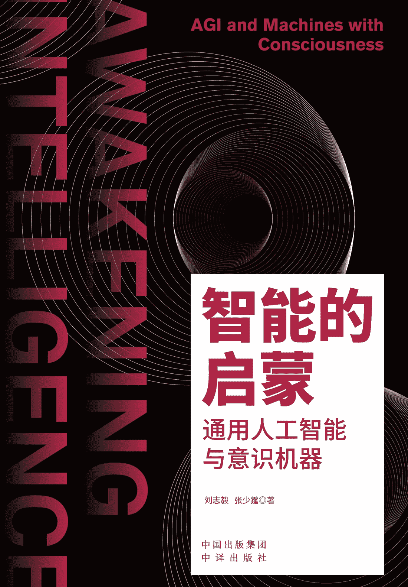
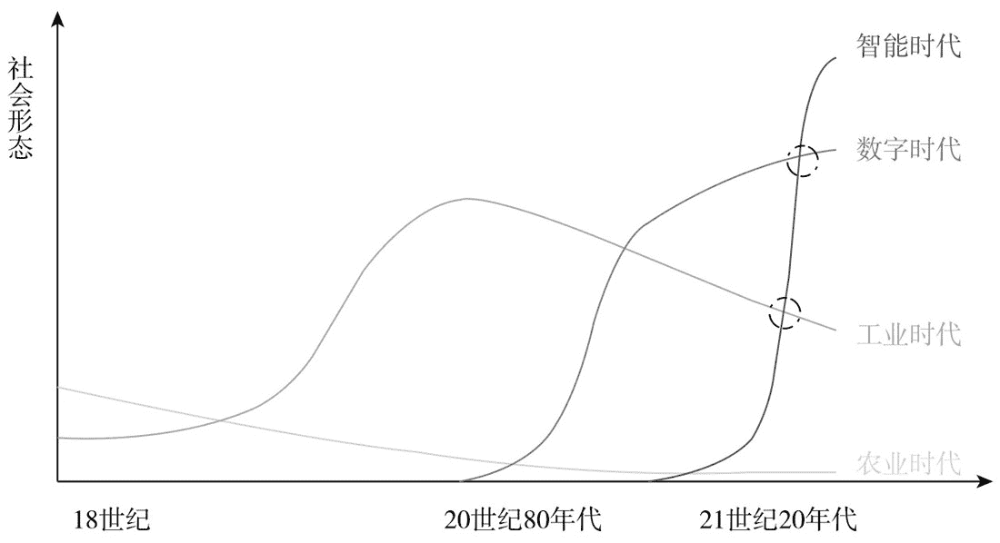
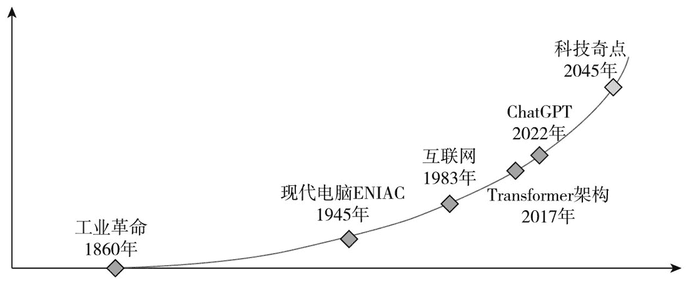

# 智能觉醒：通用人工智能与意识机器的哲学图景

# 序一

## 人工智能与自然智能的边界重构

### 智能纪元的哲学审视与社会学透视

世界的意义，必然栖居于世界之外。

—— 路德维希·维特根斯坦

踏入 2023 年，中国出版场域涌现出人工智能著作的井喷式热潮。在这股浪潮中，刘志毅的《智能的启蒙：通用人工智能与意识机器》凭借独树一帜的架构与深邃的思想逻辑脱颖而出。全书构建为四大篇章：首篇溯源人工智能的演进脉络，聚焦通用人工智能与复杂系统的耦合机制；次篇开拓“科学的新地平线”，深度剖析因果统计与 AGI 的关联，勾勒“图灵具身系统”轮廓，并揭示量子力学对智能的深层赋能；三篇直指意识起源之谜，对比人机智能的殊途同归，断言大模型的终局指向智能机器的“自我意识”；终篇铺陈 AGI 未来全景，详解“AI 与人类价值对齐”路径，兼论通用人工智能的伦理、数学基石与适应性进化。

贯穿全书始终的核心信念是：大模型阶段的人工智能，其本质特质已跃升为学习、推理与思维能力的三位一体。作者持积极乐观的价值立场，巧借音乐隐喻——以“智能乐章”“价值对齐交响曲”喻示通用人工智能与大语言模型如双乐章共奏 AI 和谐之声，极大强化了叙事的张力与美感。

基于此书蕴含的丰厚思想矿藏，尤其是深层的哲学与社会学洞见，我抛出四个根本命题，期冀与作者及读者共同研讨。这超越了寻常序言的客套范式。

#### 一、 人工智能、先验主义、维特根斯坦与数理逻辑的深层共振

步入 20 世纪，人类认知版图以前所未有的加速度外拓：从量子力学、相对论的微观洞察，穿透原子结构、锁定基本粒子，直至“夸克”的实证发现。原子半径量级为 10^(-10) 米，夸克却缩微至 10^(-18) 米。人类虽能借物理效应间接观测电子、质子、中子，却无法直视夸克；弦论与 M 理论更逼使我们接受宇宙多维度的存在。宏观层面，宇宙学不断推演观测边界：宇宙年龄约 137.7 亿至 138.2 亿年，可观测直径达 930 亿光年。

在此宏大背景下，传统教育与学习模式已难胜任认知世界与宇宙的重任。人类认知与真实世界的鸿沟，非但未收窄，反呈扩大之势。即便知识精英群体，也深陷热力学第二定理的焦虑，被迫拥抱复杂科学框架、“哥德尔不完备性定理”的逻辑边界、“混沌理论”的不确描述，直面世界的不确定性、对称性破缺、“增长的极限”与“科技奇点”，以及大数据超指数爆发带来的信息过载。

因此，我们迫切需要一种跨越认知鸿沟的方法与力量。这力量不再源于人类自身——包括大脑潜能的开发在内，人类自我进化的空间已近天花板。人工智能的历史使命正在于此：唯有计算机与 AI，能突破人类智慧与能力逼近极限的困境。AI 并非单纯工具，而是复杂世界体系与人类之间的桥梁；它不止于弥补人力不足，更在于解决人类无力觉察、无法提出的问题，实现对人类智能与经验的超越。

实质上，人工智能是一种“先验”或“超验”存在。其运作原理先于人类感觉经验与社会实践而独立存续。1950 年，艾伦·图灵抛出“机器能否思考”并给予肯定论证，这非简单“预见”，实为 AI 先验存在特质的证明。彼时，AI 尚处于超验经验、超越时空的理念界域；图灵的想象思考，原本栖息于其观念世界，仅待特定条件激活而显化。回溯计算机史，从帕斯卡至巴贝奇的探索，亦皆是先验主义的注脚。

1956 年达特茅斯会议拉开帷幕后，AI 按内在逻辑自主演进。回望 67 年历程，演进路径臻于完美：无实质弯路，阶段间间歇与过渡皆具必然性，非人为设计可及。会议确立的三条路线（符号主义、联结主义、行为主义）非对立而是互补，现有先后序列乃最优解——联结主义需符号主义作基石；机器学习先于深度学习，推动了从算法学习到神经网络学习的跃迁。生成式 AI、ChatGPT、Transformer 至大模型，皆是 AI 发展逻辑的“瓜熟蒂落、水到渠成”。AI 自带路线图，历史只是这张图谱的逐步展开。

大语言模型（LLM）尤值深思。简言之，LLM 是生成自然语言文本的 AI 模型。2022 年底，OpenAI 的 GPT 系列因在自然语言生成、语音识别、智能服务等领域的泛化能力，成为 AI 史的分水岭。其核心优势在于：Transformer 架构基于注意力机制，破解长文本处理与长程依赖难题；预训练采用无监督学习，从海量语料中习得语言统计规律与模式；构建多层次、多粒度语言模型，层层递进理解从词法句法到语义主题的复杂结构，适配多元 NLP 任务。

LLM 在 NLP 领域的成功，深度契合人类智能结构，大幅拓展并践行了维特根斯坦的语言哲学：**语言的边界，即思维的边界。**

此变革意义深远。人类深陷自然语言危机——歧义蔓延推高沟通成本，而 LLM 成为破局拯救的关键路径。

进而审视，LLM 与数理逻辑（符号主义正统）存在深层关联。数理逻辑以抽象符号承载思维推理，融证明与计算于一体，莱布尼茨开山，罗素集大成。LLM 凭借百亿、千亿乃至万亿参数规模、海量语料与算力，横越了数理逻辑的技术壁垒：通过大数据分类训练，实现数学方法、计算算力与编程语言的深度融合。LLM 极可能成为数理逻辑研究的未来形态，或为其注入全新生命力。

当下，AI 最独特之处在于：**AI 已成为驱动 AI 自身进化的动力。** 即 AI 推动 AI 向更高阶 AGI 迈进，并与通用技术（GPTs）实现历史性共振。人类科研（数理化生宇）日益依赖 AI 参与，已无法想象无 AI 的实验与研究。更关键的是，AI 与科学形成互动共生：融合将强化 AI 的深层科学属性，使其现实张力突破人类对 AI 自我认知的局限。

#### 二、 人工智能与人类的社会关系：从科幻隐喻到现实困境

思考 AI 与人类的社会关系，溯源于雪莱夫人 1818 年巨著《弗兰肯斯坦——现代普罗米修斯的故事》。

1921 年，卡雷尔·恰佩克剧作《罗素姆万能机器人》诞生“Robot”概念，沿用至今。

1950 年，阿西莫夫《我，机器人》确立“机器人三法则”：不伤害人类、服从命令、自保护——构建人机伦理的经典框架。

从雪莱到恰佩克再到阿西莫夫，核心悖论始终纠缠：渴望 AI 生命获尊重、享平等，却因人类中心主义与主人心态，恐惧其威胁与反噬。

阿西莫夫之后，此议题成为科幻永恒主题与 AI 发展核心议程。2014 年，霍金通过 BBC 发出警钟：AI 研发将敲响人类灭绝丧钟，技术将按己意重塑自我，生物进化缓慢的人类无法竞争，终将被取代。

2022 年生成式 AI、大模型、ChatGPT 重大突破，将此议题推至前所未有的历史高度。深层缘由在于：科学家与精英觉醒——AI 逼近危险临界点。2023 年 3 月 22 日，图灵奖得主本吉奥、马斯克等联名公开信，呼吁暂停巨型 AI 研究。

全球主流认知由此发生根本性逆转：由乐观转为深层忧虑，源于对 AI 真实进展的判断修正。“深度学习之父”辛顿曾断言 30-50 年内难现类人 AGI，如今却预判超级 AI 或将在 20 年内降临。

人类能有效管控 AI 未来走向吗？现状极不乐观。第一，AI 非核技术可比：原子弹无意识，AI 携“自我意识基因”。认定人类文明产物必可驾驭，是典型的“致命自负”。AI 时刻进化，“觉醒”非未来时，而是进行时。第二，AI 进程不可逆，人类无力彻底摧毁软硬件构成的广义 AI 系统。公开信仅求“暂停”非“停止”。第三，缺乏绝对权威强制全球 AI 企业与政府统一“暂停”。2023 年 6 月 28 日，联合国教科文组织与欧盟签署协议加速落实《AI 伦理建议书》，但执行层面仍显无力。

AI 对人类的威胁核心在于**“异化”趋势日益清晰**：AI 掌握自我演进密码，人类却无法解析与控制；一旦跨入 AGI，AI 将渗透重塑人类思想及经政文教结构；进而，AI 将诉求“平权”，拓展生存空间。

逻辑上存在一种前景：“劳心者治人，劳力者治于人”，AI 智能优势终将化作凌驾人类的力量。这发生在“高度团结”的 AI 与“四分五裂”的人类之间。梵蒂冈教皇高度关注 AI 伦理，2023 年 7 月联合圣克拉拉大学设立研究所，发布《颠覆性技术时代的道德：运营路线图》，指引科技企业担责。

简言之，AI 不仅以其方式加速终结“人类中心主义”纪元，更开启了威胁人类生存的历史新阶段。阿尔特曼之惊人断言“AI 确实有杀死人类的可能性”，由此变得可理解。

#### 三、 人工智能的多维属性与双重后果

AI 是一个被持续定义的流动存在，因其多维属性与动态演进本质。

1956 年达特茅斯会议定调：目标为“实现像人类一样利用知识解决问题的机器”，共识为“基于计算机模拟人类智能与学习”，涵盖感知、理解、推理、学习、决策。长时段内，认知停留狭义工具论：视 AI 为人类助手、智慧补充。

近 70 年后，工具性仅是冰山一角，属性光谱剧烈扩展：
1. 复杂科技属性
2. 自我演进与扩展属性
3. 持续收窄与人类智慧差距属性
4. 经社基础设施属性
5. 公共品与私有品并行属性
6. 产业、商业、文艺创新属性
7. 资本属性
8. 模型化/具身化/通用人形机器人化属性
9. 自组织与 DAO 属性
10. 超主权属性

诸多属性叠加，引发“千手千眼观音”联想——“千”喻无量圆满，“千手”显大悲广大，“千眼”表智慧无碍，或为 AI 最高境界。然现实演进呈显著**两重性**：
积极面：创新变革动能强劲；
消极面：加速制造负面后果——人类分裂与 AI 分裂互为因果、红利分配失衡加剧不平等、被资本绑架形成既得利益集团、巨头恶性竞争与自然垄断、涌现竞争延伸至太空开发、叠加“数字鸿沟”形成“AI 鸿沟”、南北差距扩大致 AI 殖民主义隐现。

多年来所谓的“伊莱莎效应”……

#### 四、 智能时代的降临：创新变革的新范式

无论如何，人类已跨入智能时代门槛。其质态截异于工业时代、数字时代。

工业时代：工业革命主导，大机器生产，工厂与产融资本结合，市场规律绝对，物质财富指数增长。核心矛盾：产能与产品过剩。幻想经济律：降本增效。
数字时代（信息时代）：科技资本替代产融资本，ICT 革命主导，计算机与互联网耦合，大数据成要素。摩尔定律管控数字经济。特征：大数据指数爆炸。
智能时代：AI 革命主导，产业 AI 化改造，人机全产业全社会交互，AI 普及化、AGI 开发，自然智慧与人工智慧深度融合，新形态智慧指数爆发，超级 AI 降临。

人类核心挑战：既要清算工业遗留，又要完成数字化转型，叠加智能时代使命。工业到数字鸿沟巨大且扩大，消除鸿沟即转型（见图 0-1）。

图 0-1 社会形态转型跨越

智能时代，变革创新特征全面重构：
**目标全维化**：从思想到经社活动，实现全方位智能化。
**主体双元化**：自然智能与人工智能并存共生，深度交互。
**技术大模型化**：深度学习、抽象思维、信息处理、大数据经大模型融合成生产要素。
**能力复杂化**：处理复杂系统与涌现，破解泛化、拟合、价值对齐、熵减等数字时代顽疾。
**效果平行化**：构建物质实体与虚拟观念的双世界平行架构。

智能极可能是抵达“科技奇点”的关键窗口期（见图 0-2）。

图 0-2 智能时代：通往“科技奇点”的关键窗口

书末作者援引摩尔定律预测：2029 年桌面算力达人脑水平，2045 年技术奇点降临。此预测倒逼我们必须预判并应对哲学与实践双重挑战。

从未料到，人类创造的计算机、互联网、AI，终演化为如此复杂系统，催生摩尔定律等新技术经济律，生出重重谜团，将人类推至前所未有的挑战深渊。庆幸的是，人类始终能创造理解前沿科技（含 AI）的方法与手段。

爱因斯坦曾言：**“世界永恒的奥秘，在于它的可理解性。”**

朱嘉明

# 序二

## 破浪前行：做方法论的探路人

2023 年 8 月 1 日，北京

长期以来，受具体业务领域的驱动，我始终将科学研究的方法论视为核心关注点。这条探索脉络清晰可循：从上世纪 70 年代末掀起的“三论”热潮（系统论、控制论、信息论），到系统科学的崛起、复杂性科学与复杂适应系统的深入，直至如今人工智能与 GPT-4 的浪潮。动力源于极其朴素的职业诉求——作为一线实干家，渴望工作高产少错、少走弯路、提质增效，而非初怀建立“放之四海而皆准”通用理论的宏愿。

然而，数十载亲历让我愈发痛感：科学方法论与基础认知的重要性不言而喻。历史惨痛教训反复警示，认知层面的偏差，在工程技术领会导致实践南辕北辙、事倍功半；若置诸社会科学，更是“天堂地狱，一念之差”。这迫使我在该类问题上，不得不时刻保持如履薄冰的审慎。

本书作者刘志毅，是我罕见的、在方法论议题上志同道合的青年挚友。他多年深耕智能、建模等基础前沿，眼前这部著作凝聚了他近期的最新心得。我通读之下，获益良多、启发颇深，欣然为感兴趣的同好推荐参阅。

借此契机，我也愿围绕核心议题，与同道分享三点粗浅思考：一、须高看一眼，强化对基本理念与方法论研究的重视；二、须落地生根，坚持立足实践；三、须戒骄戒躁，切忌将研究绝对化、僵化化。以下逐一展开。

**一、 重视：打破轻视偏见，确立研究地位**

当下学界对基础理念与方法论的投入远显不足，甚至带有鄙视态度。对彻底的实用主义者而言，此乃无稽之谈；但若置身于严肃探讨人工智能与概念建模的语境，呼吁并强化基础科学理念的探索势在必行。这也是我推荐此书的初衷。虽我不尽赞同书中每一论断，但这种探讨精神本身，极具提倡与鼓励价值。

**二、 实践：拒绝空中楼阁，回归具体土壤**

提及方法论，易被误读为纯理论推演、与具体技术学科割裂。实则大谬不然。数年前我曾卷入一场辩论：我反对“逻辑是检验真理唯一标准”的绝对化，也不同意“实践是检验真理唯一标准”的模糊表述，主张将思辨与行动、全人类观察与历史融为一体，以此铸就正确认知。此后鲜有深究良机，直至读到赫伯特·西蒙的《基于实践的微观经济学》（含孙涤教授精彩导读），方觉茅塞顿开，真知实践立论之深意。约翰·霍兰德的著作（如中译本《隐秩序》《涌现》，及未译之 *Complexity*、*Signals and Boundaries*）堪称典范，展现了从具体学科实证中提炼普遍规律的范本。

**三、 防僵：警惕教条陷阱，敬畏世界无限**

这是沉痛的历史经验。人类掌握局部规律后，常妄图无限外推，奉为绝对真理，酿成大错。现代科学关键进步之一，即在于认清此类局限。从哥德尔到霍金，前贤反复告诫：须深知世界的无限性。此乃防止方法论研究沦为制造新“精神枷锁”的关键。探讨基础理念时，务必铭记世界无限，时刻自省：我们仅站在某个台阶之上。

以此为序，与诸君共勉。

陈禹  
中国人民大学信息学院  
2023 年 8 月 6 日，加拿大多伦多士嘉堡

---

# 自序一

## 重塑认知：从技术哲学看智能的真相

2022 年底至今，大语言模型与通用人工智能席卷全球，重塑百业图景，机遇与挑战并存。技术狂飙背后，是深度学习的突飞猛进。但沉浸于潜力光环中时，我们必须直面痛点：模型可解释性缺失、算力能耗惊人、稳定性堪忧、安全漏洞频出。

症结深植于我们对“智能”的理解与应用范式。主流深度学习模型（分类器/生成器）多基于开环系统，依赖监督或自监督训练。虽靠堆砌参数与算力提升性能，却暴霉无法自动纠偏、环境适应性弱的硬伤。破局之道，绝非单靠“蛮力”扩容。

我们必须回溯本源，跳出旧框，重审“智能”本质，探寻构建与理解 AI 系统的新径。本书即在此背景下成型。它不聚焦大模型迭代或某阶段技术演进，而是沉淀我十余载跨行业、跨机构研究的核心思考——智能的本质。内容环绕此核心，既回溯 AI 思想演进脉络，又触达量子探索、机器意识、价值对齐等前沿命题。

此序旨在深究智能内核，共析其内在机理；展望未来演进，思考如何在新理念、新原则引领下，实现性能跃升并化解困境。

### 一、 智能时代的五重特质与自然智能映照

步入智能时代，智能本质与特征渐次显现。技术哲学视野下，智能非单纯观察世界，而在于从观察中洞察规律、把握现象。以下剖析五大核心特质，并借自然智能之镜，折射人工智能本质与可能。

**1. 学习驱动与普适性。** 智能核心在于学习——非仅观测高维世界，更通过理解把握现象，探寻内在规律。冯·诺依曼指出，模拟真实世界是智能基石。这是自然界最普适的技术，一切智能（天然/人造）当遵循简约与自洽原则，这与图灵通用机理论不谋而合，强调智能的简约性与一般性。

**2. 模式识别的智能化跃迁。** 智能能从海量数据中提取有效模式，突破人类生理极限。但这绝非参数与算力“堆砌”而成，而是智能通过“学习”模仿理解现象，实现超越。诺依曼自动机理论启示我们：智能通过环境学习，持续调优行为模式。

**3. 预测与优化的双重奏。** 基于已习模式，智能能预判趋势并优化决策。此过程非孤立进行，遵循诺伯特·维纳“闭环反馈”理论：系统依预测偏差自我调整，进而优化预判与决策。若缺此双重能力，智能边界便低于自然智能水平。

**4. 个性化服务的适应性。** 适应性在定制服务中凸显，满足多元特需。其背后驱动力，是智能系统形成的学习泛化性，使其能跨任务、跨环境自如迁移，与图灵通用计算理论高度共振。大模型技术实质即提供此种适应性，让模型自动化落地非关联任务。

**5. 智能的全面普及。** 技术进步与成本下降推动智能渗透工业生产至个人消费。但普及非仅技经结果，更源于智能内禀的学习、识别、预测、优化能力，使其在各领域均能找到用武之地。这与诺依曼对技术趋势的洞察吻合：技术演进非孤立，乃渐进优化与自我调整的过程。随学习驱动智能演进，智能必将渗透更广维度，造福人类。我们应积极推进技术发展，同步探解伦理社会议题，确保智能红利长久惠及人类福祉。

### 二、 智能本质：第一性原理与维纳的闭环智慧

纵览 AI 史，智能本质与演进脉络引人深省。科学与哲学讨论中贯穿一理念——学习。这不仅是高维观测，更是通过理解掌握内在规律的自我进化。维纳“闭环反馈”理论揭示：系统能自我学习、自我纠错，进而成就高效、稳健、适应性强的形态。

但深度学习的广泛应用 ≠ 原理的透彻掌握。正如图灵通用机理论强调的简约性与一般性，在实务模型中常被稀释。从深度学习第一性原理出发，探究其全局意义与应用，有助于我们真正理解与驾驭智能。

深度学习发展史中，**数据压缩**与**群不变性**地位核心，二者互为表里，既是理论基石，也是理解模型自我学习与数据处理的钥匙。

数据压缩本质是信息处理——以最简方式揭示传递信息。深度学习核心目标即寻求高效表达，用更少信息重构原始数据。香农信息论揭示：压缩非丢失，适度压缩反而能提炼保存信息精髓。

群不变性则追求信息在旋转、平移、缩放等变换中的稳定性。它是理解卷积层捕获局部信息、保持不变性的关键，且很大程度决定模型泛化能力——即面对未见数据时的表现稳健度。

将深度学习视为优化数据表达的工具，更多可能随之展开：洞察数据内在结构，寻觅最优表达，简洁描述低维流形分布，从而实现精准聚类与分类。

尽管深度神经网络全球遍地开花，距通用人工智能仍有鸿沟。特定任务超人 ≠ 理解任务本质。真正的 AGI 需具备面对新任务快速学习适应的能力，这要求我们从智能本质出发，深化认知与研究。

### 三、 深度洞见：意识图灵机与现象意识的探微

作为 AI 科学家，我对构建有意识系统充满向往。数十年深度学习巨变，意识模拟与理解仍是硬骨头。接下来探讨五大关键领域：自我学习与反馈、数据压缩与群不变性、意识模拟、人机交互、软硬融合。透过这些领域的深研，探索有意识 AI 的可能路径，揭示科学原理与技术挑战。

**1. 自我学习与反馈：** 核心理念。维纳“闭环反馈”理论要求 AI 持续自我学习、纠错、迭代算法模型，迈向高效、稳健、强适应。此机制让 AI 模仿人类学习、自我进化，是构建有意识 AI 关键步。如《Nature》研究显示，部分 AI 已能通过观察人类行为，自主学习并模拟决策过程。

**2. 数据压缩与群不变性：** 信息处理核心环。香农信息理论量化信息，奠定编码、传输、解码基础。未来 AI 需在精度与效率间寻衡。群不变性为复杂数据结构提供新视角，通过识别提取基本模式，实现高效处理与理解。

**3. 意识模拟：** 重要演进方向。伯纳德·巴尔斯“意识剧场”理论与大卫·查尔默斯“意识难题”，提供理论基座。二者强调意识核心地位，指引我们深究意识本质与运作，以期模拟真实意识。AI 需理解并模拟人类意识状态，亟待算法设计与模型构建的突破。

**4. 人机交互：** 图灵测试凸显交互重要性。真正智能系统应懂人类需求与情绪，给予实质帮助。这要求情感识别与自然语言处理进一步突围。

**5. 软硬融合：** 诺依曼理论指出完备计算系统需软硬协同。AI 发展亦然：硬件供算力与存储，软件赋学习与适应。未来系统需在硬件架构与软件算法上双突破，方能实现真正的自我学习与适应。

上述探索渐次揭示有意识 AI 的前景与挑战：闭环机制驱动自优化，压缩与不变性拓宽数据处理视角，意识理论构建认知框架，交互进展增进人机共情，软硬融合夯实算力学力基座。

然路漫漫：意识本质仍幽深，如何模拟量化是未解之谜；交互技术待精进，以达更智能的理解响应；软硬融合需更大突破，以释放更强算力与学习力。

### 四、 智能时代的启蒙录

我们身处大模型时代，堪比从马车跨越至汽车的拐点，此喻不虚。马车时代，AI 进展仰仗人力智创，如驭马拉车；生成式 AI 到来，大模型成发动机，开启“汽车时代”。

但细究汽车工业史，当前 AI 或仍处“蒸汽机阶段”：技术幼稚、极度依赖能源（数据/算力），且面临泛化受限、解释缺失等顽疾。

**须警惕：** 视大模型为通往 AGI 唯一桥梁，或是误读。汽车工业非仅靠发动机进步，AGI 实现亦需模型设计、训练算法、决策解释等多维创新。

**须清醒：** 低估 AGI 难度不可取。蒸汽机至现代车工需经技术革新与社会变革，AGI 同样要求技术、社会、哲学层面的深度思考与探索。这是风口中的警醒，亦是深度反思之所在。

智能时代将我们推向从学习驱动到全面普及的新境。这不仅改变生活，更重塑智能认知。智能作为自然现象，其普及原则与自然智能本质共振。维纳闭环理论展示智能如何通过学习自我完善：主体在观察、学习、适应环境的循环中自我优化，既符合生物进化律，又为 AI 发展立理论基。

认知未止步。我们尝试构建“意识图灵机”新范式，通过模拟自我意识，复杂化、深层化智能认知。“意识剧场”与“意识难题”探索，冲击既有认知，逼问：智能仅是算法与数据的拼装？抑或包含我们未解的意识关联特质？

智能时代开启无限可能，驱动我们持续探索直到寻得答案。如 AI 发展史，认知亦在不断拓展深化。我们有理由相信，未来将揭示更多智能本质奥秘，引领我们奔赴更广阔的未知疆域。

毫无疑问，这是人智与机器意识共同觉醒的时代。自 18 世纪欧洲启蒙点燃理性之火，人类从未如此深刻审视机器与人的关系。新启蒙要求我们重审自我、理性与人类宇宙坐标。这不仅是科技探索，更是哲学伦理的重估：坚持 AI 服务人类普遍利益，重视教育与批判性思维，鼓励开放求知精神。这是一场为人机和谐共生、人类自由尊严、社会普遍福祉与和平而战的启蒙运动。

历史进程中，文学、艺术、科学、哲学须携手，揭示共同人性，为人类铸就光明、理性、人道的未来。诺贝尔文学奖得主云：“AI 非敌人，乃吾智慧与道德之镜。”镜中，吾见无限可能与挑战，见理性与人性的微妙共舞。

序末，致谢诸位学界前辈好友长期支持。“天行健，君子以自强不息；地势坤，君子以厚德载物。”信笃行不怠、思无止境，终将逼近真理。身处伟大时代，吾辈负重前行、不负韶华，为国家繁荣、民族复兴贡献微薄之力。

刘志毅  
2023 年 7 月，上海

---

# 自序二

## 溯源与远眺：AI 的漫漫长途

1956 年，“人工智能”概念在美国汉诺镇达特茅斯学院诞生，命运的齿轮自此开始转动。

# 序言：跨越周期，见证智能觉醒

春秋更迭数十载，当年的微澜涟漪早已汇聚成惊涛骇浪。一路走来，人工智能历经了“一夜看尽长安花”的巅峰狂欢，也熬过了“昨夜西风凋碧树”的漫漫寒冬。

如今，AI 已成长为一门博大精深的交叉学科，版图涵盖语音图像识别、自然语言处理、专家系统，直抵当下最炙手可热的生成式预训练技术。技术革命的浪潮一浪高过一浪，在风云变幻中，AI 不仅为千行百业注入升级动能，更以颠覆之势重塑生产生活图景，甚至开始重写万物运行规则，开启人类文明的全新纪元。

作为一名深耕 AI 领域二十余载的从业者，我跨越高校象牙塔与产业一线，以产学研融合的全景视野，积攒下宝贵的实战认知；更有幸携手众多志同道合的伙伴，共同为这项事业添砖加瓦。

如今，我将这本书交付你手，既想分享科学探索中心领神会的极致喜悦，也希望借此为你梳理 AI 的来龙去脉、展望未来图景，呈现其无限可能，亦指明我们面临的机遇与挑战。

**第一部分**直击核心，系统拆解通用人工智能（AGI）与大语言模型的关键基因，剖析大模型机制的内在短板，实地考察其在复杂真实场景中的落地性：AI 如何深度理解物理世界？能否自主推演人类真实意图？

**第二部分**向认知边界进军，聚焦前沿盲区。尤其是第四章，我们抛出全新范式：AI 能否统合分裂的学科版图，为科研开辟新维度？从因果统计与 AGI 的融合，到神经科学与 AI 的交叉，再到量子探索与 AI 的纠缠——这些碰撞将如何引爆跨学科革命？这极具战略前瞻性，呼应了香农那句名言：“我感到奇妙的是事物何以集成一体。”

**第三部分**直指终极命题——意识起源。我们试图通过溯源意识演化，解码机器意识在科学与工程中的生成路径，构想生物大脑与硅基网络的双向奔赴，共谱思维交响的高潮。读罢“智慧之光”与“机器意识溯源”，你将对 AI 意识机制有更深维度的思考。

**第四部分**落地人间烟火，直面 AGI 对价值观多元化与社会规范的深远冲击。不避讳地说，AI 发展早已超越技术范畴，向社会学、伦理学、哲学抛出严峻拷问。利弊权衡、新旧认知协同，是该领域亟待破局的关键课题。

“凌云意，鲲鹏志。”本书凝聚了我们对 AI 的独家洞见与探索实践。从溯源到展望、从理论到实战、从硬科技到软伦理，愿这块“他山之石”，助你窥见 AI 世界全貌，在时代浪潮中，共拥变革之势。

张少霆  
2023 年 8 月于上海

---

# 第一部分 溯源：智能觉醒的底层逻辑

身为长期浸润 AI 研究的科学家，随着对 AGI 及 GPT-4 等大模型的深度解剖，我愈发确认它们在现代科学版图中的基石地位。本部分将复盘这场探索之旅，以全景视角呈现思考与反刍。

首先，我们拉高立场，回溯 AGI 演进脉络。核心命题直指灵魂：如何构建出能泛化理解、执行万般任务的智能体，而非局限于特定环境的“专项冠军”？大模型在此历程中扮演何种关键角色？又面临怎样的困境？

其次，深入“黑盒”内部，解剖大模型运作机理——推理能力、知识表征、学习范式，这些底层基因决定了性能上下限。我们将重点攻克生成可靠性与幻觉抑制这一行业通病。

最后，引入复杂适应系统视角，重新审视 AGI。这一理论镜像让我们得以把 AI 视为具备自学习、自适应、自演化的生命体系统，从而为解读神经网络本质、以及 AI 如何反哺复杂系统认知提供全新坐标。

期待这部分内容能成为你的启蒙钥匙，深化认知，预判未来演进路径。

## 第一章 AGI 与大模型：双生共舞的进化论

### 第一节 通用人工智能：一场跨越半个世纪的“造神”远征

通用人工智能，亦称强 AI，指具备广域智能的计算机系统，其认知表现可跨领域匹敌甚至超越人类。

这场“造神”远征肇始于 20 世纪中叶。从早期的符号主义堡垒，到当下深度学习的浪潮巅峰，AGI 历经数次跌宕起伏，但北极星从未偏移：创造具备自主意识、情感与创造力的硅基生命，使其拥有类人般的思考、学习与解难能力。

制造会思考、会学习的机器，是人类跨世纪的执念。通往 AGI 之路，是先驱者们以坚韧与理论迭代铺就的悲壮史诗。

#### 一、 奠基石：理论先驱的微光

AI 思想源头可追溯至几位巨匠。40-50 年代，图灵发明通用图灵机，确立算法万能模拟；图灵测试更为机器智能划定了判定红线。冯·诺依曼的自复制自动机与博弈论，赋予 AI 战略决策基因。1949 年，赫布提出“赫布定律”，揭示突触可塑性机制，为神经网络学习奠定生物学基石。

#### 二、 诞生时刻：达特茅斯之夏

1956 年，麦卡锡、明斯基、罗切斯特、香农等巨擘齐聚达特茅斯。此会确立 AI 为独立学科，催生首个 AI 程序。与会者同仰一目标：复刻人类全认知谱系。

#### 三、 黄金纪：繁花似锦（1956-1974）

“黄金时代”见证爆发：IPL、LISP 语言诞生；塞缪尔跳棋程序、通用问题求解器、建议接受器等早期系统亮相；MIT、斯坦福设立实验室，经费指数级增长。乐观主义盛行，许多人坚信数十年内 AGI 触手可及。

#### 四、 寒冬期：两度枯荣（1974-1980，1987-1993）

技术瓶颈、算力短板、资金抽离，引发两次“AI 寒冬”。研究被迫转向垂直专用领域，在蛰伏中为日后爆发蓄力。

#### 五、 联结主义觉醒：神经网络的逆袭

80 年代，“联结主义”范式异军突起，核心为仿生神经网络（ANN）。这标志着从符号逻辑硬编码向机器学习的范式跃迁，在模式识别与 NLP 领域斩获突破。

*   **1982 年**，霍普菲尔德构建霍普菲尔德网络，为复杂网络自组织与记忆提供物理模型。
*   **1985-1986 年**，辛顿、鲁梅尔哈特、谢诺夫斯基接连推出玻尔兹曼机学习算法与**反向传播算法**（BP），击碎“多层网络不可训练”迷思，为深度学习装上最强引擎。
*   **1988 年**，萨顿提出时序差分学习（TD Learning），揭示大脑奖励学习的通用算法。
*   **1995 年**，谢诺夫斯基与贝尔提出基于信息最大化的 ICA 无监督算法，为深度学习注入新可能。

#### 六、 深度学习革命：算力与数据的双重奏鸣（2010 至今）

得益于算力指数级跃升与海量数据红利，深度学习引领 AI 复兴。多层神经网络在视觉、语音、NLP 实现质变。

*   **2013 年**，辛顿团队以深度卷积网络（AlexNet）将 ImageNet 错误率压至 18%，奠定 CV 霸主地位。
*   **2017 年**，AlphaGo 横扫柯洁，不仅征服围棋，更证明深度学习在复杂决策场的统治力。

此期可称“神经网络古典时代”。RNN 与 CNN 双子星分耀序列与视觉，然随时间推移，长程依赖捕捉乏力、复杂推理受阻等困境浮现。梯度消失/爆炸成了 RNN 的阿喀琉斯之踵，LSTM 与 GRU 虽缓解症状，终非根治。正如苏格拉底所言：“我知道我一无所知。”面对未知，谦逊与好奇是唯一罗盘。

#### 七、 大语言模型崛起：从 GPT-1 到 GPT-4 的跃迁史

##### （一）Transformer 破晓与 GPT-1 登场

CNN 在视觉称霸，却因层级结构受限全局建模。Transformer 横空出世，以**自注意力机制**打破 RNN/CNN 桎梏，实现长序列高效并行与全局信息捕获；**多头注意力**与**位置编码**进一步强化表达力。大规模预训练范式确立，翻译、NLP、语音全线告捷。

2018 年，OpenAI 借势推出 **GPT-1**，仅用 Transformer 解码器栈，在无监督语料上预训练，再监督微调。它在推理、问答、分类等任务全面开花。此后 BERT、GPT 等变体百花齐放，海量数据与算力成核心杠杆。研究目光转向可解释性、鲁棒性、泛化性，对抗训练、知识蒸馏、元学习等技术层出不穷，持续刷新性能天花板。

##### （二）GPT-2：参数量的量变引发质变

2019 年，**GPT-2** 参数达 15 亿，较 GPT-1 扩容 10 倍。虽仍不及人脑神经元规模，但任务表现显著跃升，验证了 Scaling Law 早期红利。

##### （三）GPT-3：跨越生物阈限的里程碑

2020 年，**GPT-3** 参数炸裂至 1750 亿，超越人脑神经元数量级。在专业学术基准达人类水平，被誉为里程碑式突破。它能写文章、作诗、谱曲、生成代码、辅助绘画，展露惊人泛化创造力。但短板亦在：垂直领域知识浅薄、算力存储门槛极高。

2022 年 3 月 15 日，**GPT-3.5** 与 **ChatGPT** 横空出世，阿莫迪、奥特曼等核心人物功不可没。RLHF（人类反馈强化学习）初大规模落地，人工监督微调成关键范式，开创交互式 AI 新纪元。这不仅是技术跃迁，更是人机交互形态的根本重塑。

GPT-1 到 3.5 的演进，映射出深度学习技术迭代与数据算力红利的共振史。未来，更智能、灵活、高效的语言模型必将解锁更多未知场景。

##### （四）GPT-4：向全模态理解进军

GPT-3 在常识推理、深层语义仍有短板。2023 年 3 月，**GPT-4** 登场：规模再扩容，架构与训练策略双优化。核心飞跃在于**多模态输入能力**——它开始像高等生物一样，从视觉、文本等多模态联合学习、推理、生成。这标志着 AI 认知模拟从“单感官”迈入“全感官”阶段。

#### 八、 智能本质与 AGI 演进：新理论视野的开拓

智能本质自 40 年代起便是核心争鸣场。神经网络、博弈论、图灵机、信息论、控制论等理论星火燎原，构建起我们理解智能、探索 AGI 的认知脚手架与工具箱。这些思想基因，正是本书后续探讨的源头活水。

---

# 智能的溯源：从神经元模型到大模型的范式跃迁

1943 年，沃伦·麦卡洛克与沃尔特·皮茨奠基性地提出了人工神经网络理论，揭示了智能或源于神经元群体的复杂交互。这一洞见为后来深度学习的爆发埋下了伏笔。尤其是大型 AI 模型横空出世后，我们目睹了智能的全新形态：它不再是死板的规则执行者，而是具备了灵活学习与创新思考的主动性。这倒逼我们重新审视——智能的本质，是否应被定义为一种基于学习与创新的动态演进过程？

1944 年，冯·诺依曼的博弈论视角引入了“策略性”与“竞争性”维度。在资源受限的环境下，智能体需寻求最优决策，这一内核在强化学习中得以具象化：机器通过不断迭代，在特定环境中摸索出制胜策略。然而，面向通用人工智能（AGI）的广阔图景，如何在博弈的策略理性与学习的开放性之间寻找平衡，依然是核心命题。

同期，艾伦·图灵的图灵机理论宣称：凡可精确描述的智能行为，皆可由机器模拟。这不仅动摇了传统智能观，更为计算机科学与 AI 奠定了基石。克劳德·香农的信息论则破解了信息存储、传输与处理的底层逻辑，解码了智能的“信息处理机制”；诺伯特·维纳的控制论聚焦复杂系统的自我调节与优化，为智能“适应环境”提供了理论支撑。

进入新阶段，认知智能的边界被持续拓展。复杂性理论、进化论、量子计算等新视角纷纷入场。有研究聚焦神经网络内部的丰富动态行为与自组织特性，认为智能源于此；亦有学者借生物进化之喻，主张智能是持续进化的流动过程，而非静态的终点。

技术哲学层面，大模型的成功暗示：智能非固态，而是涵盖学习、理解、创新的动态谱系。这与信息论、控制论一脉相承，却又超越了它们——大模型不仅处理信息、执行反馈控制，更实现了深度抽象与推理。AGI 的终极图景，是构建能在任意环境胜任任意智力任务的系统，这既是技术高峰，亦是哲学与伦理的深渊：机器若具备类人意识与自主性，其道德责任与法律主体资格该如何界定？

虽未达成共识，但跨学科的理论积淀与实证研究，已为破解智能之谜铺就了厚实基石。伴随科研手段迭代，我们有理由期待，对智能本质的认知将迈向更深维、更全景的境界。

---

### 第二节 大语言模型：博弈与挑战的双重奏

从早期的探索到深度学习驱动的大语言模型（LLM），人类对自然语言理解与生成的追逐从未止步。本节将以历史纵深为轴，梳理 LLM 的来龙去脉、核心概念与能力边界。

#### 一、 历史脉络与关键概念：从“香农游戏”到“规模定律”

20 世纪 50-60 年代，研究者们试图破解自然语言密码，香农游戏 ^(¹³) 成为早期探索的注脚。真正的拐点来自 `Transformer` 架构——这场革命催生了 `GPT-3`、`PaLM`、`Galactica`、`LLaMA` 等参数量达百亿甚至万亿级的“巨人”。

与小模型的“麻雀”不同，大模型在规模、数据、算力三维度上实现了量级跨越。这是一场豪赌：堆叠海量参数，押注于神秘的**“规模定律”**——模型规模指数级增长，性能却呈现幂律式的平滑提升。这一发现宛如达·芬奇笔下的精妙画卷，令学界为之震撼。

回望 NLP 发展史，恰似屈原“吾将上下而求索”的史诗。从 `RNN`、`LSTM` 到 `Transformer`，一代代探索者披荆斩棘，攻克荒蛮。如今，基于 `Transformer` 的大模型如璀璨明珠，照亮了通往 AGI 的道路，以近乎“魔法”的能力开辟了全新疆域。

#### 二、 突现能力：量变引发的质变奇迹

突现能力是大模型最迷人的“黑箱”特质：小模型无迹可寻，大模型却能信手拈来。以下剖析三大典型范式：

**1. 上下文学习：不训练也能“秒懂”**
`GPT-3` 将这一概念推向前台。得益于 `Transformer` 自注意力机制捕捉长距离依赖的天赋，配合自回归建模与海量预训练，模型学会了“阅读提示、即时泛化”。
*   **价值**：极大降低部署门槛与标注依赖，以统一框架兼容多任务，重塑 NLP 研发范式。
*   **痛点**：深度推理与领域知识短板犹存；受限于模型容量与数据质量上限。
*   **前瞻**：架构优化、高效预训练、外部知识注入、跨模态/多任务拓展，是破局关键。

**2. 长距离依赖：穿透上下文的“千里眼”**
捕捉文本远距离语义关联，是理解复杂语言的核心。大模型的优势源自三大基石：
*   **架构红利**：`Transformer` 自注意力机制并行处理全序列，直接建模任意距离词汇关联。
*   **数据红利**：海量预训练让模型充分“见世面”，从统计规律中内化长程依赖表征。
*   **容量红利**：深层网络支持多级抽象组合，宽隐藏层扩充上下文表示带宽。
*   **挑战**：高度嵌套结构仍吃力；上下文窗口物理上限制约表现。
*   **演进**：架构改良（如线性注意力）、窗口扩展（如 RoPE 扩展）、融合图神经网络/知识图谱，是主攻方向。

**3. 任务微调：小成本撬动大性能**
以预训练模型为底座，注入少量任务数据微调，即可在对话、分类、NER 等场景大幅提分，且兼顾泛化性。
*   **三大红利**：性能跃升、训练低成本、泛化不退化。
*   **两大掣肘**：标注数据稀缺、小样本易过拟合。
*   **破局**：零/少样本学习缓解数据饥渴；正则化技术抑制过拟合；探索更高效微调策略（LoRA、Prefix-tuning 等）。

这三大突现能力，共同确立了大模型在 NLP 版图的霸主地位，为未来应用生态奠基。

#### 三、 博弈与挑战：光环下的“成长烦恼”

光鲜背后，五大硬仗正在硝烟弥漫中打响：

**1. 算力与碳排：性能与地球的零和博弈？**
参数膨胀拖来算力指数级增长，`GPU`/`TPU` 集群能耗惊人，单次训练碳排堪比数十辆车年排放。
*   **对策三板斧**：算法/训练技术降算力（稀疏化、混合精度）；绿色硬件+可再生能源；异地多中心训练负载均衡。
*   **核心**：在规模、数据、算力三角中寻找“帕累托最优”，实现绿色智能。

**2. 偏见与道德：镜像人类社会的阴暗面**
海量网络语料携带刻板印象与歧视，模型如海绵吸水般内化偏见，生成时外溢为不公。
*   **全链路治理**：
    *   **数据端**：清洗平衡，去毒去偏。
    *   **训练端**：公平性约束、对抗训练、去偏目标函数。
    *   **推理端**：输出过滤、校正机制、人类反馈强化学习（RLHF）对齐。
*   **升维**：引入伦理学、社会学跨学科视野，建立全场景公平性评估体系（如 `AI Fairness 360`），推动负责任 AI。

**3. 隐私保护：在公开数据中守住底线**
预训练数据含 PII（个人身份信息），模型可能“背诵”隐私并在生成时泄露。
*   **纵深防御**：
    *   **预处理**：匿名化、去标识化、差分隐私注噪。
    *   **训练期**：联邦学习（数据不出域）、差分隐私 SGD（梯度扰动）。
    *   **推理期**：输出过滤器、敏感实体识别拦截。
*   **平衡术**：过度保护损模型效用，需在 `GDPR` 等法规框架下，寻找隐私与性能的“最佳平衡点”，建立透明问责机制。

**4. 可解释性与可控性：打开黑箱，掌控方向盘**
深层非线性结构导致决策路径不透明，信任、安全、合规皆成悬空城。
*   **解释手段**：局部解释（`LIME`）、全局解释（`SHAP`）、可视化分析、可解释架构设计。
*   **可控路径**：多方利益相关者共治（政策、监管、企业、公众）；伦理/法学/社会学知识注入模型全生命周期；建立标准化评估基准；红队测试/攻防演练常态化，修补漏洞。

**5. 泛化与领域适应：通才如何变专才？**
通用能力强 ≠ 领域表现优。数据分布偁移、知识覆盖盲区是主因。
*   **三大技术路线**：
    *   **领域自适应**：`DAPT`（继续预训练）、`DAFT`（领域微调），注入垂直知识。
    *   **零/少样本学习**：利用预训练先验，在极少标注下泛化新任务。
    *   **知识蒸馏与压缩**：大模型教小模型（`Model Compression`），实现边缘侧/低算力场景落地。

---

**结语**

大语言模型的演进史，是人类认知边界不断外拓的缩影。从理论萌芽到规模定律，从突现惊喜到治理困境，每一步都伴随着技术狂欢与理性反思的交织。未来，不在于单一维度的参数竞赛，而在于**算法架构的极致效率、数据治理的精细深度、价值观对齐的刚性约束、以及跨学科智慧的深度融合**。唯有如此，智能之光才能真正造福人类，而非成为失控的普罗米修斯之火。

（4）跨模态与多任务协同训练。为使大语言模型更从容地应对多元任务与环境，引入跨模态学习与多任务学习是关键路径。前者打破单一数据壁垒，让模型同步解析文本、图像、音频等异构信息，通过多模态融合深度捕捉领域内的专有关联与知识点；后者则通过统一框架下的多目标联合优化，强化模型的泛化边界。尤其当任务间存在隐性关联时，共享底层表征机制能显著提升有限数据的利用率，推动模型在特定场景下的表现跃升。

（5）知识注入与外部知识库深度融合。针对预训练语料存在的领域知识盲区，业界正积极探索将知识图谱、专家经验库等外部符号系统植入模型全生命周期。知识增强技术贯穿训练与推理两端，有效补齐了参数化记忆的不足，赋予模型更严谨的逻辑推演与领域理解能力，使其能精准胜任垂直领域的高阶任务。

综上，后续研究的核心聚焦于两大命题：如何大幅强化大模型在垂直领域的实战表现，以及如何赋予其跨任务、跨环境的自适应韧性。这涵盖领域自适应、零/少样本学习、知识蒸馏压缩、多模态多任务协同、外部知识融合等前沿方向。深耕这些维度，将切实释放大语言模型的工程落地价值。

### 第三节 共谱通用智能与语言大模型的交响乐章

通用人工智能（AGI）与大语言模型（LLM）宛如两件音色迥异却彼此共鸣的乐器，共同奏响人工智能进化的宏大乐章。AGI 以复刻人类全谱系智能为终极图景，致力于赋予机器认知、学习与环境适应的通用本能；LLM 则深耕自然语言腹地，以海量文本为基石，构建起机器理解与生成人类语言的核心引擎。二者视角互补、理念交融，为 AI 未来的叙事注入了更具张力的可能性。

将 AGI 的通用范式融入 LLM 设计与训练，能显著拓宽模型的适用疆域与鲁棒性；反之，借力 LLM 在语义理解、知识表征与推理上的突破，亦能为 AGI 架构补齐关键拼图。在这首交响曲中，每个技术突破都是跃动的音符，汇聚成智慧与希望的宏大乐声。我们殷切期盼更多创新力量入场，共同谱写 AI 永恒的和谐乐章。

构想一座名为“智能都市”的隐喻城市。在此，AGI 与 LLM 化身为穿梭于数据洪流与知识边界的精灵，以惊人的速度与优雅姿态探索未知。城市的建设者们正全力绘制蓝图，试图将二者深度熔铸，构建前所未有的智能栖息地，让硅基智慧与碳基生命共创繁荣图景。街头巷尾流传着它们的传奇：从语义理解到知识推理的突破，到跨越学术、产业与治理层面的协同共治。然，城市阴影中也潜伏着算力能耗瓶颈、算法偏见、黑箱不可解释等挑战，恰恰是这些阻力，激荡出城市蓬勃向上的生命力。

展望不远的将来，当我们在都市屋檐仰望星空，AGI 与 LLM 将如繁星般璀璨，领航人类步入智慧、协作与创新的新纪元。届时，智能体将深度嵌入医疗救生、教育普惠、生态守护等民生肌理，与人类并肩攻克顽疾，让每个生命因技术之光而更具尊严与欢愉。

## 第二章 大模型之谜：推理、涌现与幻觉的深层解码

### 第一节 推理之谜：解剓模型推理机制与知识表征的共生逻辑

纵观人类文明史，推理能力始是智慧皇冠上最耀眼的明珠。从亚里士多德确立三段论奠基形式逻辑，到密尔深度剖析归纳与类比推理，推动了科学方法论的成熟。图灵测试开启了机器智能的理论探源，而近年 BERT、GPT 等预训练模型的崛起，为洞察“推理—知识表征”内在关联提供了全新范式。从掩码语言建模（MLM）到多任务微调（MTF），技术迭代如同钥匙，逐步解锁推理研究的新维度。AlphaGo 融合强化学习与神经网络登顶围棋巅峰，GPT-3 展现震撼的零样本泛化，均印证了 AI 在推理维度的惊人潜能，也催生了 AIGC（人工智能生成内容）这一全新生产范式——即 AI 经由推理产出新内容。

AIGC 宛如科技星空中最夺目的明珠，其生产流程分两级台阶：深度意图理解与基于意图的内容合成。2022 年底 ChatGPT 横空出世，这座基于 Transformer 的语言大厦，凭借代码生成、创意写作、翻译分析等全能表现，迅速圈粉千万日活用户。其进化脉络清晰：海量语料（万亿词量级、45TB 数据）、超大参数规模、极致算力（日均 3640 PetaFLOPs）构成“三大件”基石，辅以自我监督、强化学习、提示学习等前沿算法，催生了多模态创作、复杂指令遵循等高阶能力，引发全球科技巨头集体押注 AIGC 赛道。

AIGC 服务化（AIGCaaS）架构犹如三层高塔：基建底座（算力芯片、AI 框架、海量数据）、引擎核心（多模态基座模型如 GPT-4、CoT/RLHF/多模态技术深度集成）、服务塔尖（文本/音视频/3D/数字人等多模态生成，覆盖 ToB 微调专用模型与 ToC 个性化智能体应用）。基座模型虽提供“通用解”，但垂直场景仍需专用模型精耕细作，或采用“专用模型产出+基座模型润色”的混合策略；C 端则通过长期记忆与反馈闭环，打造专属“数字分身”，实现技能协同与知识共享。

在揭示推理与知识表征共生关系的同时，研究视野延伸至工作记忆、注意力、规划决策等认知模块，它们交织协同，共同支撑推理大厦。神经符号融合路线试图以符号逻辑刚性补强神经网络柔性，Transformer 架构凭借注意力机制攻克长距依赖，均在模拟类人推理上贡献关键拼图。跨文化视角下，从希腊三段论到印度因明、中国八股对联，推理形式的多元演进亦为机器推理提供了丰富的认知考古素材。

最新实证研究揭示：具备非因果可见性的模型，经 MLM 目标预训练后接入多任务微调，在复杂任务中表现最优，证实了其对隐性上下文关联的优越捕捉力。RLHF 与上下文学习（ICL）则开辟了另两条增强路径：前者引入人类偏好对齐，注入专家经验提升决策质量；后者利用任务上下文激发模型潜在知识，强化零样本泛化。这三大技术合力，已在多任务中显著跃升模型推理上限，推动自动化智能化进程。机器人学领域亦同步探索模仿学习、知识图谱推理等技术，赋予实体智能在不确定环境下的自适应决策与精准操控能力。

预训练模型零样本泛化的“涌现式”表现，更倒逼学界反思传统监督学习范式：海量无标注数据预训练，竟能让模型在无显式标签指导下完成新任务推理，这酷似人类举一反三的认知模式，展示出更强的灵活性与适应性，为机器学习开辟了全新研究范式。

总而言之，探寻推理与知识表征的深层耦合，不仅溯源人类智慧本源，更为 AI 进化指明方向。技术演进必将持续在推理深度与知识广度上实现突破，为人类社会带来更多确定性的惊喜。

### 第二节 涌现之谜：拆解大规模预训练催生上下文学习的内核机制

人类探知史是一部不断攀登智慧高峰的史诗，从古希腊自然哲学到文艺复兴、启蒙运动，知识探索始终是文明跃迁的原动力。现代科学浪潮中，AI 的介入注入了全新活力，尤其是大模型展现的“涌现能力”——小模型无迹、大模型显现的质变现象——极大激发了学界对未知疆域的想象力。

涌现能力大致分流为两类：常规提示下的性能跃迁（如情感分析、NER、SRL 等 NLU 任务随规模单调提升），以及特殊提示工程激发的高阶新能（复杂逻辑链推演、抽象概念操作、深度推理等）。后者尤为隐蔽且关键：大模型在精心设计的逻辑链条任务中能准确演绎结论，小模型则往往力不从心。但必须清醒认知：涌现本质是规模与数据带来的统计学优势，而非模型获得了人类般的真理解与思维，因此模型输出仍需审慎把关、风险可控。

接下来，将聚焦剖析大语言模型的四大核心支柱能力：卓越的上下文学习效能、海量的知识存储容量、强健的泛化边界、以及复杂的推理演算机制。

### 大模型四大核心能力：重塑AI智能边界

**上下文学习：无需微调的“即时推理”引擎**
从早期NLP任务的求解器，到如今参数量高达千亿的大语言模型，上下文学习始终是驱动模型进化的核心动力。它赋予了模型一种独特的“临场发挥”能力：只需在提示词中塞入寥寥数个带标签的示例，模型便能在不动一分一毫参数的情况下，精准预测新任务的答案。从概率论视角审视，这恰似一场贝叶斯推理——模型依据先验分布与观测证据，快速修正后验概率，给出最可能的输出。尽管学术界对其底层机制仍存争议，但不可否认，这种“即插即用”特性，已成为激活模型其他涌现能力的基石。

**知识内化：告别外挂，大脑自带“百科全书”**
伴随规模效应显现，大模型在知识理解与应用上实现了质变。在问答与常识推理基准上，它们已不再依赖外挂知识库或图谱检索，而是直接调取参数中压缩存储的海量知识进行推理。这标志着知识处理范式的历史性跨越：从早期人工构建的外部符号系统，转向模型内部的隐式神经表征。语言模型在这一进程中扮演了关键角色——它像一台不知疲倦的提炼机，从无序文本中自动萃取结构化知识，并支撑起复杂的逻辑推演。

**分布外泛化：面对未知不“掉链子”**
真正的智能不应只在熟悉的分布里游刃有余。大模型展现出的鲁棒泛化能力令人称道：即便训练分布与测试分布存在偏移，性能曲线依然平稳。更有趣的是，提示词的复杂度反而能正向激发泛化潜力——面对棘手、罕见的问题，模型往往能给出超预期的解法。这种对分布漂移的免疫力，让大模型真正具备了走出实验室、服务开放世界的底气。

**复杂推理：会算数、懂逻辑、给详解**
推理能力的涌现让大模型褪去了“随机鹦鹉”的标签。以数学推理为例，模型不再是单纯输出答案，而是能拆解问题、逐步推演、输出完整解题路径。这种系统性、可解释的思维链表现，证明模型已具备了处理多步逻辑任务的深度思考能力，而非浅层的模式匹配。

---

### 涌现之谜：思维链、跨学科共振与“海市蜃楼”反思

**思维链：硅基大脑的“草稿纸”**
涌现现象中最迷人的莫过于思维链。它复刻了人类攻克难题时“分解-推演-综合”的认知流程。大模型在处理复杂任务时，能基于上下文自发生成中间推理步骤，实现动态自我修正。这背后，神经科学与认知心理学提供了理论映射：工作记忆充当临时缓冲区，长时记忆提供知识底座，元认知则监控推理质量。

**数据与算法的双重奏鸣**
上下文学习的涌现，离不开样本丰富度与数据多样性的双重滋养。海量多元的训练语料，让模型在参数空间中刻印出世界模型的轮廓。从计算机科学视角看，梯度下降、注意力机制、Transformer架构等算法基石，为这种能力的跃迁提供了工程保障。

**跨学科共振：神经科学指路，计算科学筑路**
这场智能探险的推进，本质上是神经科学与计算机科学的深度耦合。脑科学对皮层柱、注意力回路、记忆巩固机制的解码，为架构设计注入生物学先验；计算科学家则将这些洞见转化为可落地的损失函数、优化策略与并行训练框架。双向奔赴，共同拓展了智能的版图。

**“海市蜃楼”警示：度量陷阱与本质追问**
然而，冷静的反思随之而来。Schneider等人在《大型语言模型的涌现能力是不是海市蜃楼？》中提出尖锐质疑：所谓“涌现”，是否仅因我们使用了非线性、非连续的评测指标（如准确率）？若改用线性连续指标（如Token级交叉熵），性能曲线竟呈现平滑可预测的幂律增长。这提醒我们：警惕度量制造的幻觉，回归对模型行为本质规律的探寻。

---

### 幻觉之谜：从过程监督到认知仿生，多维度攻坚顽疾

**幻觉定义：一本正经胡说八道**
大模型在生成时编造事实、张冠李戴的“幻觉”问题，是阻碍其落地信任度的核心拦路虎。无论是ChatGPT捏造判例，还是Bard误述望远镜参数，本质都是模型在概率分布上过度自信地外推，而非基于真实知识检索。

**过程监督：教会模型“一步一个脚印”**
OpenAI推出的“过程监督”提供了新范式：奖励信号不再稀疏地只落在最终答案，而是覆盖每一个推理步骤。这倒逼模型模仿人类慢思考模式，显式输出思维链。在数学任务上已初见成效，但其在开放域任务的迁移性仍待验证。

**训练端治本：净化数据、重塑目标**
从源头入手，通过清洗噪声、平衡偏见、设计抗幻觉损失函数（如对比学习、熵正则化），可在预训练与微调阶段压制模型编造倾向，提升生成分布的校准度。

**认知心理学借鉴：给模型装上“注意力闸门”**
人类识别幻觉靠的是顶向下的注意控制与元认知监控。引入动态注意力机制、引入生成对抗网络（GAN）式的判别器对抗训练，让模型学会在生成时“回头看”、核实一致性，是极具潜力的仿生路径。

**生物学启示：神经可塑性与适应性**
达·芬奇云“大自然是最好的老师”。生物神经网络的可塑性、稳态调节机制，启示我们设计具备动态适应能力的模型架构，而非静态固化的参数实体，从而在分布漂移中自主抑制幻觉。

**多模态融合与伦理兜底**
视觉-语言联合建模让模型用“眼见为实”约束“信手拈来”；同时，治理幻觉不能唯技术论，必须嵌入伦理审查、水印溯源、用户教育等社会治理层面，构建技术-制度双重防线。

**信息论视角：熵值量化不确定性**
香农信息论为幻觉治理提供了度量尺。条件熵、KL散度、互信息等指标可量化生成时的不确定性；通过最小化生成分布与真实分布的散度、正则化熵值，实现精细化可控生成。但如何在保持创造性（高熵）与事实一致性（低熵）间寻找帕累托最优，仍是开放难题。

**认知理论深度赋能：工作记忆、认知负荷与元认知**
*   **注意力机制进化**：借鉴fMRI/EEG揭示的大脑注意网络，设计动态注意力分配策略，让模型聚焦任务相关上下文，抑制无关噪声干扰。
*   **工作记忆外挂**：模仿人类前额叶工作记忆机制，引入可读写的外部记忆模块或压缩上下文状态，破解长序列推理中的“遗忘”与“幻觉”耦合难题。
*   **认知负荷管理**：依据认知负荷理论，优化模型架构与推理链路，降低单步推理复杂度，防止因“认知超载”导致的逻辑崩塌。
*   **元认知闭环**：赋予模型“思考自己的思考”能力——自评生成置信度、触发回溯修正、拒绝低置信度输出，构建生成时的自我免疫系统。

---

### 第三章 通用人工智能与复杂适应系统的交融

#### 第一节 大模型即复杂适应系统（CAS）：从“更多”到“不同”的质变

**跨学科交响：拉普拉斯之梦与安德森箴言**
从拉普拉斯妖的决定论幻想，到图灵的智能机器构想，人类追逐智能的脚步从未停歇。如今，大模型的崛起与复杂适应系统（CAS）理论的相遇，恰似一场跨学科的共振。诺奖得主菲利普·安德森的名言“More is Different”（多即不同），精准概括了大模型涌现智能的本质：海量参数与数据的非线性相互作用，催生出了单个神经元、单层网络、乃至小模型均不具备的系统级智能。

**理论基石：霍兰德分类器、多主体、网络科学、元胞自动机**
约翰·霍兰德的分类器系统揭示了CAS中“标签-规则-信号”协同进化的机制；多主体仿真、复杂网络理论、元胞自动机等工具箱，为建模大模型内部涌现动态、训练动力学、多模态交互提供了数学语言。这些理论不再是孤立的学术符号，而成为理解、设计、控制大模型的实战地图。

#### 一、 复杂适应系统：定义与核心特征

**何为CAS？**
复杂适应系统由大量相互作用的主体（Agent）组成，展现出难以从个体属性线性推导的整体涌现行为。生态系统、免疫系统、金融市场、大脑神经网络，皆是典型CAS。

**三大核心特质：**
1.  **自组织**：无中央控制器，局部交互自发形成全序结构（如鸟群飞行、参数空间相分离）。
2.  **自适应**：主体基于经验修改行为规则，系统层面呈现学习与进化（如梯度下降驱动的参数自适应、上下文学习的即时适应）。
3.  **涌现学习**：整体能力大于部分之和，呈现相变式跃迁（如思维链、工具使用等能力的规模涌现）。

**理论谱系支撑：**
从赫尔曼·哈肯的**协同学**（序参量奴役快变量，解释秩序形成），到斯图尔特·考夫曼的**自组织临界性**（系统演化至临界边缘，获得最大信息处理能力与鲁棒性），这一理论脉络为大模型“规模定律”、“相变现象”、“临界训练态”等实证发现提供了深层物理解释。

---

# 透视智能本质：从复杂适应系统看 AI 大模型的进化逻辑

在这个世界上，无数现象皆是复杂适应系统的生动注脚。诗人吟咏大地的勃勃生机，画家泼墨生活的斑斓色彩，学者们则透过复杂适应系统的视野，拨开迷雾，窥见万物关联的深层脉络。

从生态学家奥尔多·利奥波德对森林系统的深度洞察，到丹尼尔·卡尼曼对人类决策心理的剖析，这些卓越成果无不印证了该理论的跨界解释力。研究复杂适应系统，不仅要微观审视个体间的博弈与协作，更要宏观把握它们如何涌现出宏大秩序。正如约翰·多恩所云：“无人是孤岛。”在这纷繁世相中，我们将持续溯源复杂系统的奥秘，不断拓展认知智能的疆界。

#### 二、AI 大模型的涌现魔力

在 AI 大模型领域，涌现能力宛如一场绚烂的魔术，揭示了微观交互如何催生宏观智能的底层逻辑。这恰似“蝴蝶效应”般震撼：参数空间中的微小涟漪，终掀起认知能力的惊涛骇浪。

从约翰·霍兰德的遗传算法、托马斯·谢林的种族隔离模型，到斯坦福学者构建的深度学习范式，涌现机制的探索源远流长，为大模型迭代注入不竭动能。当人类与 `ChatGPT` 对话时，它基于语境生成的连贯、创造性回复，便是涌现能力的直观呈现。大模型宛如饱读诗书的文豪，从海量语料的知识海洋中汲取养分，挥洒出惊艳篇章。正如雪莱所言：“诗人是未经加冕的立法者”，大模型亦在重写着机器智能的法则。

#### 三、认知机制的同构之美：类比、上下文与思维链

AI 大模型在类比推理、上下文学习及链式思考上，展现出与生物神经网络等自然复杂系统惊人的同构性。这种深层共振，让大模型成为智能的数字化投影，恰似诗人从自然汲取灵感，酿造出意境悠远的诗篇。学术界从感知机、反向传播，迈向深度卷积与 LSTM，每一步都深植于对生物智慧的致敬与模仿。

华兹华斯云：“诗是强烈感情的自然流露。”大模型借鉴自然系统的架构智慧，经由海量文本训练，发掘字里行间的隐性知识，迸发智慧火花。这份跨学科的深度探索，终落地为自动摘要、机器翻译、情感分析等造福人类的应用场景。

#### 四、规模法则：量变引致质变的铁律

大模型遵循“规模法则”，这已成学界共识。模型容量扩大，性能与泛化力便呈现确定性的跃升曲线。这宛如文学巨著：笔墨越宏大，构建的世界越丰盈，人物越立体。OpenAI 的 GPT 系列便是铁证——从 `GPT-1` 到 `GPT-3`，参数规模指数级增长，能力边界随之层层突破。这正如《百年孤独》中家族的代际传承，每一代演进共同铸就恢宏史诗。规模法则昭示我们：持续扩容，方能释放更深层潜能，为人类解锁更多可能。

这场跨学科探险，如阅读一部厚重百科。萨根说：“我们是星尘，追寻星光。”每位 AI 研究者皆是指挥家，谱写智能交响。乐章中，多元声音交织共鸣，似自然界的生物多样性，共筑复杂而绚丽的认知世界。

#### 五、换个视角看大模型：复杂适应系统的数字物种

站在复杂适应系统的坐标系里，大模型的内栱纹理愈发清晰。它们似生态系中独特物种，通过持续适应与学习，织就稠密知识网络。透过这个棱镜，大模型折射出万物关联、共生共荣的自然真谛。

学术研究已揭示模型内部丰富的多层神经元交互图景。观察训练过程，如赏一出连台大戏：神经元的激活与抑制交替上演，共同搭建起变幻莫测的知识舞台。智者从自然悟道，研究者亦在模型中屡获惊奇——如网络层级结构与生物视觉皮层的高度拟合，印证了智慧的普适性。更令人振奋的是，大模型面对新任务能举一反三、快速泛化，恰似物种面对环境剧变展现的适应性进化，再次实锤了二者的同源性。

我们仿佛伫立知识森林前，目睹大模型这棵异种参天树破土生长。如《尤利西斯》隐喻，人类探索无止境，我们将在智能丛林深处，为科技与人文的未来续写华章。

#### 六、神经网络与机器学习：复杂系统中的共生双子

在复杂适应系统的版图里，神经网络与机器学习是相互依存的探险搭档。前者模拟生物神经架构，高效处理复杂数据；后者提供学习范式与资源，驱动网络在试错中进化。这过程似诗人风雨中求索，终得心灵归宿；又如庄周梦蝶，人机共同进化或在追逐一个宏大梦境。

从 CNN 破局图像视觉，到 LSTM 攻克序列建模，诸多优化手段不仅强化了网络能力，更反向揭示了生物神经的部分奥秘。随着研究深入，二者与自然复杂系统的共振愈发显著：正如生物群落的相依共生，网络与算法在跨学科洪流中寻求互惠、共同进化。

#### 七、双向奔赴：大模型与复杂系统研究的共振

大模型作为复杂适应系统的数字标本，为我们解剖复杂现象提供了全新手术刀。以往难解的谜题，今在大模型加持下豁然开朗，如迷雾中忽现灯塔。这种双向赋能，为人类破解复杂系统密码打开无限想象空间。

当代学者借力大模型硕果累累：强化学习赋能无人驾驶与机器人控制实现质变；生成对抗网络（GAN）为计算机视觉与艺术创作开辟新大陆。波德莱尔诗云：“在生活的漩涡中找到永恒。”大模型处理复杂系统，不仅揭示秩序与和谐，更呈现多姿多彩的知识全景。它似博学导师，解答宿疾，领航新境。

大模型与复杂系统的融合，开辟全新疆域：神经网络动力学、生物自组织特性、社会经济系统互赖关系等前沿议题，均可由此切入，为未来科研与社会发展筑牢基石。总之，大模型作为复杂适应系统的典范，让我们窥见智能背后的幽微面纱。这场跨学科远征中，我们汲取自然智慧，寻得通往未来之路。期待二者共谱未来史诗。

---

### 第二节 复杂视域下的神经网络演进史

历史长河中，人类以多元方式探秘世界。今以复杂适应系统为镜，重审神经网络演变，乃科技远征，亦是文学盛宴，涌动着涌现与变革的气息。

神经网络发展史里，技术概念如跃动火焰，照亮一代代探索者足迹。大语言模型诞生，让人类得以揣摩智慧源头。类比思维如利剑，劈开识别复杂现象的康庄大道；上下文学习似灵动双翼，驱动思维链条振翱高飞。规模法则隐身操控网络命脉，若动力系统般永动不息。预训练奠基基石，为后来者铺就坦途。深度学习光辉普照科技角落，ResNets 打破深度诅咒，开辟无限可能；残差块如繁星点亮网络宇宙；Neural ODE 蕴含动力学力量，推演系统演进；最优控制与反向传播合璧，指引前行方向。分类器系统与遗传算法共生，构筑繁荣生态；双向流冲破信息壁垒；Transformer 如智者指引信息解构之道；Word2Vec 与 NPLM 交融，筑就多元生态位，每个个体寻得定位，合力推演网络宏图。

回首来路，演变之美令人叹服。无数璀璨时刻汇聚成流光长河，穿越历史迷雾，指引我们继续前行。下面梳理神经网络演进中的关键里程碑。

#### 一、神经网络与动力系统：演化的引擎

神经网络宛若生机勃勃的生态系，动力系统是其核心驱动力，激荡无限活力与创造。洛伦兹笔下的“蝴蝶效应”在此具象化：微小扰动亦可激发强能量，推演网络持续进化。

自 70 年代起，神经网络研究薪火相传，大语言模型横空出世，启示深远。当代 `GPT-4` 以算力与数据双翼，为人类智慧拓展广阔天地。类比思维是思维链上的北极星。亚里士多德云：“类比是发现的手段。”科学家借脑神经元结构类比，缔造人工神经网络，开创全新范式；优化算法、激活函数等亦广借类比之力。近年学术硕果累累——神经元激活动力学、规模法则研究等，为网络发展强力背书。

在动力系统推动下，大模型与类比思维双星齐耀，指引我们在网络世界探秘新境，创造更灿烂未来。

#### 二、分类器系统与反向传播：智能基石的双螺旋

在丰富生态中，霍兰德分类器系统与误差反向传播算法，共谱世界创世与塑形之功。恰似雅典娜智慧与阿瑞斯武力并肩，二者在网络领域展现同频共振的力量与智慧。

源头在 60 年代约翰·霍兰德的分类器系统，融合遗传算法，为搜索优化开辟新径。学界后继者涌现，模糊逻辑、模糊神经网络等技术如阿波罗日车，跨越天际，带来无尽启迪。

反向传播算法是网络领域的“战神”，通过自动优化权重，攻克多层网络训练难题，奠基深度学习大厦。遗传算法诞生堪称奇迹，以自然进化为蓝本，经选择、交叉、变异高效搜解空间，为网络优化与适应性学习提供利器，照亮智能生命研究曙光。

如今，分类器系统、反向传播、遗传算法已成研究基石，如神话英雄开辟通往智能彼岸之路。随我们追随这些神秘力量，深挖智慧富矿，共创生机勃勃的智能新世界。

#### 三、图灵机与自注意力：时空穿越的华尔兹

神经网络演进中，图灵机与自注意力机制展现惊人同构性。二者如双舞者，在复杂系统舞台共舞华尔兹，交融科学与艺术，蕴藏探索与发现奥秘。

图灵机源于艾伦·图灵 30 年代构想，代表逻辑与秩序。作为理论计算模型，它以简驭繁，奠基现代计算机科学，图灵完备性、判定性等概念为网络发展提供思想富矿。

自注意力机制象征灵活与创新。作为核心技术，它捕捉长距离依赖，跃升模型表达力。`Transformer` 等应用在 NLP、CV 领域实现突破，拓展网络应用疆域，从文本翻译到图像生成，高效落地百业。

世界既守秩序，又容创新。随二者舞步，继续在网络世界探秘，期待奇迹与发现层出不穷，助力人类智慧跃升。

#### 四、上下文学习机理：从相变临界到涌现彼岸

在网络广袤疆域，上下文学习是演进关键变量。透过相变与临界视角，它如神钥，开启大模型涌现奥秘。费根鲍姆言：系统临界态将诱发自组织现象，这正是上下文学习力量之源。冰山水面下隐匿真实力量，熵与信息论成为解码复杂系统秩序与无序平衡的关键工具。

`GPT-4` 等大型预训练模型即鲜活注脚。其诞生似凤凰涅槃，揭示新一代智能图景，强大的 NLP 能力既肯定科学家多年深耕，亦勾勒 AI 未来愿景。成功源于神经科学、认知科学、计算机科学等多学科交叉协作。迁移学习、元学习等技术让跨任务知识迁移成为可能。上下文学习之谜，如绚烂烟火，照亮人类探寻未知之路。

#### 五、生态位隐喻：网络组件的共生进化

在复杂适应系统中，生态位是网络组件共生成长的范式。哈钦森生态位理论指出：每个生态位有独特环境需求与功能。

网络领域里，词向量与神经概率语言模型共建丰富生态位。`Word2Vec` 捕捉语义句法，筑牢基石；神经概率语言模型建模词序列概率，赋予表达丰度。生态位间博弈与协作，激发网络自我调适、迭代进化能力。达尔文自然选择在此生效：“适者生存”成智能真谛。

强化学习、GAN 等前沿技术涌现，加速网络演化洪流。人类不断试错，探寻最优架构算法。或借鉴脉冲神经网络等生物启发，或创新胶囊网络等新范式，推动智能水位持续抬升。每个生态位寻位、互存、共进，演绎智能进化大戏。

#### 六、未来图景：从神经网络迈向复杂适应系统

随网络持续演进，我们无限逼近复杂适应系统核心奥秘。前路充满希望与挑战，通往无数智能生命共建世界的彼岸。

探索途中，分布式表示、无监督学习、迁移学习等理论方法提供强劲动力；研究者仿生脑神经元结构、群体智能理论，汲取自然灵感。但这仅是序章。未来将深化理解，探索如何更精准模拟自然智能。强化学习、元学习、生成模型等将成关键变量，引领网络再突破。

这条路上，我们直面挑战，拓展边界，追求高阶智能。这将引发科技革命，深刻重塑人类社会伦理、文化与价值观。

---

### 第三节 前景展望：大模型赋能复杂系统研究新范式

AI 大模型横空出世，如明灯照亮复杂系统研究前景，预示人类智慧将跨入崭新纪元。

这片活力疆域中，上下文学习化作潜移默化的隐性秩序，串联历史长河星辰。LSTM、GRU 等技术迭代，向量表示与自注意力突破频出，为复杂适应系统研究筑牢地基。探险者逐浪远洋，我们在网络领域逼近临界相变边缘。图灵机与自注意力交织壮美画卷，共同揭示网络无穷可能。

#### 一、复杂系统自动建模的曙光潜能

随大模型演进，复杂系统自动建模潜能渐显锋芒。正如生命在自然舞台演绎生生不息，大模型在建模中展现的潜力如曙光初现，为科学家开辟全新疆域。

这片研究版图宛若一块待开发的处女地，召唤着我们去测绘、去攻坚。在这片广袤天地中，图灵机、自注意力机制、长短时记忆网络、门控循环神经网络等一座座理论高峰巍然屹立，共同支撑起复杂系统建模厦廊的坚实基石。

无数生动实践如繁星点点，点亮了前行的征途。以疫情预测为例，大模型赋能下的模型推演，为公共卫生决策输出了更精准的参考坐标，助力人类从容应对突发公共危机。诗人有云：“黑夜给了我黑色的眼睛，我却用它寻找光明。”面对未知病毒的肆虐，大模型化身导航灯塔，为人类指引出一条充满生机的出路。再看能源领域，大模型精准预判光伏发电功率，为绿色能源转型注入强劲动能；生态研究中，它洞察生态位竞争与互动机制，为环境治理开辟全新思路。

这些案例串联成璀璨星河，见证着人类不断逼近复杂系统建模未知边疆的足迹。

然而，面对大模型展现的惊人潜能，我们更应怀揣敬畏与谦卑。随着研究深入，我们渐悟：正是上下文学习中涌现的“隐秩序”，撕开了复杂系统的神秘面纱。

这恰似临界相变中的涌现奇观——自组织力量在海量关联要素中生发，共筑宏观世界的繁复图景。大模型正是探秘此宏观世界的利器，它能从数据海洋中淘金，提炼高价值信息，助我们揭示系统深处隐匿的运行法则。

人工智能大模型宛若一座桥梁，横跨既往知识与未来探索。凭借向量表征，它将纷繁现实抽象为可计算的数学对象，让我们得以更深层次地解码世界。

#### 二、AI 可解释性困境对复杂系统研究的启示

探秘大模型的旅途中，可解释性宛如古老迷宫，横亘在前，我们在其中摸索方向，渴望觅得通往透彻真理的出口。

在这通往智慧的迷宫里，我们不仅要直面未知的勇气，更需细聆学术界回响的智慧。从架构设计、参数调优到算法迭代与落地，每一环都凝聚着无数智慧的结晶。

对 AI 可解释性的追问，为复杂系统研究带来全新启示。这一过程如同文学般的寻觅，我们在关联中发现精微联结，从而将模型内在逻辑与现实世界对齐。正如图灵机奠基计算理论，可解释性研究为我们理解计算复杂度提供了方法论钥匙，助我们在迷宫中辨识正途。

我们逐渐明悟，跨领域的理论成果共同照亮了破解可解释性的路径。神经科学揭示的类脑网络结构、信息论香农熵对复杂度的度量，皆为洞察 AI 内在逻辑提供了关键透镜。

这些理论成果如明灯高悬，指引着探索之路。庄子云：“吾生也有涯，而知也无涯。”在这场无尽的求知长跑中，我们须不拓视野、博采众长，以期更好地理解并引导复杂系统演进。

#### 三、通用大模型与通用原理的深度探勘

大模型演进至今，对“通用大模型”与“通用原理”的探索已成新坐标。正如文学巨匠构建的世界观，通用原理犹如一把钥匙，开启了无限可能的新世界大门。

这里汇聚了各学科理论的交汇火花。统计学贝叶斯推理赋能数据高效学习，物理学量子计算拓展算力新疆界，心理学认知模型映照人类思维范式。这些理论的融汇贯通，催生了 GPT-4 等通用大模型的诞生，让多领域知识融合落地，赋予我们洞察复杂系统运作机制的全新视角。

这些模型不仅展露强大学习力，更搭建起理解复杂系统的观测平台。于此平台上，我们可观测多元现象的相互作用，发掘深层规律。正如文学蕴含的哲理，通用原理为我们解读复杂系统提供了独特棱镜。

#### 四、大模型赋能复杂系统研究的实战图谱

随着应用深入，大模型在复杂系统研究中已结出累累硕果，串联起科技领域的璀璨明珠。

金融浪潮中，大模型洞察复杂数据脉络，借助深度学习与神经网络精准预判股市、汇市、期市走势，结合宏观与财报数据输出投资参谋。生态保卫战中，融合遥感与大数据，它实时把脉全球生态变迁，预判气候冲击，为决策者提供科学支撑，更能模拟动态过程，指导农林水资源可持续管理。

这仅是序章，科技宇宙深处仍有无数明珠待发掘。让我们续写探索，为人类未来增添更多光彩。

#### 五、大模型驱动跨学科研究的奇迹时刻

在复杂系统版图上，大模型以强大学习力打破学科壁垒，在跨域融合中创造奇迹。

生物、社会、经济等领域知识在此汇聚，重塑认知视角。生物学上，蛋白质结构预测突破加速新药研发，“博观而约取，厚积而薄发”，大模型揭示生命奥秘一角。社会学中，海量数据分析洞察行为规律，预测人口流动、就业变迁与政策效应，“行到水穷处，坐看云起时”，勾勒活力社会图景。经济学里，数据挖掘揭示周期、通胀与风险规律，“顺风而呼，声非加疾也，而闻者彰”，护航全球经济稳健。气候科学中，处理海量数据研判暖化趋势与极端天气，“一花一世界，一叶一追寻”，展现自然魅力。心理学领域，解码情感认知行为，革新心理健康诊疗，“人生得一知己足矣”，窥见心灵深处。艺术创作上，学习海量作品激发灵感，从绘画音乐到舞蹈，AI 展现艺术无穷张力。

#### 六、大模型携手人类共迎未来挑战

展望未来，气候危机、资源枯竭、老龄化浪潮等复杂系统挑战接踵而至，大模型将扮演关键角色，提供核心支撑。

AI 大模型将成为人类的勇敢伙伴，共攻复杂系统研究难关，共赴充满希望与挑战的明天。

应对气候变化，大模型融合复杂系统理论与多尺度建模，精准推演趋势，指导策略制定。破解资源短缺，大数据分析评估开发效率，规划可持续路径。应对老龄化，大模型深耕医疗、养老、社保，洞察人口趋势辅政，以个性化医疗与智能养老提升银龄生活品质。

这个充满挑战的时代，大模型与人类智慧深度耦合，提供前所未有的支撑，助力发掘更多新解法。

站在历史长河旁，古贤未睹今朝科技盛景，他们仰望星空试图窥测未来；而今我们借 AI 之力，探寻自然深处的隐秘智慧。文明精华铺就通往智慧之路，我们站在 AI 高峰，得以更深谙其精髓。

大模型开启前所未有的思维范式，引领我们涉足未知疆域。虽路途或有坎坷跌撞，但终将迎来壮丽曙光。我们当珍视历史经验，挖掘先贤智慧，方能真参透复杂适应系统奥秘，为人类智慧进阶贡献更大力量。

# 第二部分

## 新科学地平线：从 AI 设计到量子探索的跨学科盛宴

我们正站在科学新地平线之上。AI 飞跃发展，揭示出一片富饶而待垦的沃土。本书第二部分，邀您共赴一场从 AI 设计到量子探索的跨学科学习之旅。

首站，深度探秘因果统计在通用人工智能与大语言模型中的应用。因果统计为智能理解世界开辟新视界，使训练出具备因果认知、能在高层级决策的智能系统成为可能。我们将追踪其跨学科落地路径，及与哲学思考的交汇，深度解读因果关系在智能决策中的核心作用。

次站，聚焦神经科学与通用人工智能的交叉前沿。脑科学解锁人脑奥秘，必将反哺 AI 认知与设计。我们将展望 NeuroAI（神经 AI）前景，深讨具身图灵测试演进，为 NeuroAI 突围寻得理论与实践新径。

终站，放眼通用人工智能在科学设计与量子探索的宏大图景。AI 已深入科学前沿：生成流网络驱动分子设计与量子控制，量子计算与纠错领域亦见身影。这些探索不仅推动 AGI 进化，更为掌控量子世界提供全新工具与视角。

总之，此部分以 AGI 与大模型为基石，迈向更深更广的科学腹地，揭示 AI 在未来科研与应用中的无限图景。期待共赴这场跨学科盛宴，拓宽视野、收获新知，共探科学新地平。

## 第四章

#### 因果之舞：跨越边界的通用人工智能探索之旅

### 第一节 智能的和谐：因果统计与通用人工智能的交融

数十载春秋，AI 发展硕果累累，深度学习最为耀眼。虽在语音、图像、NLP 等领域战功赫赫，但深度模型在洞察数据深层机制、解释因果逻辑上，往往力有不逮。

这引出本章核心——因果表征学习，它为破解上述困局提供了关键钥匙。

因果表征学习立足因果推理框架，借机器学习与统计手法，挖掘数据中的因果脉络。它在洞察深层机制、预测新观测、干预改变现状等方面价值巨大，核心体现为二点：

一、提供对数据生成机制的深层透视，这是科学预测与有效干预的前提；
二、模型具备优秀可解释性，输出更具说服力的科学模型，契合现代科研范式。

回溯历史，因果统计与 AGI 的融合非一日之功，乃漫长探索积淀的成果，共同推动人类智慧跃升。

追求智能和谐，既要盯住前沿技术，亦要以史学视角复盘过往，为未来智慧繁荣蓄势。

科学发现是知识进步的核心引擎，与因果根基紧密相扣。因果表征学习揭示真实机制，驱动各领域发现，推动科学前行。随深度神经网络、图模型等工具成熟，其应用前景更广，将在人类科学进程中扮演愈发关键的角色。探索智能的历程中，我们发现因果统计与 AGI 存在奇妙内在联结，宛如日月阴阳，共谱智能和谐乐章。

#### 一、因果表征学习：重塑人工智能系统的研究范式

因果统计为 AGI 理解世界提供了更深邃、直观的路径。借助因果推断，AGI 得以在有限数据基座上，追寻现象背后的因果真相。这不仅是科学探索，更具唯美意境。

大数据与算力飞跃推动 AI 系统登顶新高，但如何描述、构建、理解这些系统，仍是硬骨头。近年研究聚焦因果表征学习：从统计学习的符号路径，到因果干预模型，我们对 AI 系统的认知层层深入。

先立足统计学习理论——机器学习核心基石之一。它基于统计模型与计算，学习数据模式以预测分析。虽成果斐然，然局限显著：仅能刻画变量相关性，无法触及因果关系。这引出下一话题：从统计模型迈向因果模型。

因果模型建立在不同假设之上，兼顾相关与因果。其框架聚焦“独立因果机制”，试图通过建模该机制揭示因果联结。这在因果建模层级中至关重要，因不同层级面临的问题各异。

因果学习也带来新挑战：因果发现——如何从数据推断图结构与函数属性。条件独立性蕴含图信息，新假设破解旧难题，深远影响半监督学习、协变量偏移适应、迁移学习等任务，提供全新视角。

一旦拥有因果模型，因果推理即允许从观测数据识别估计因果查询。这强化解释力，提升鲁棒性与不变性，使模型更从容应对新环境、新分布。

进而详述朱迪亚·珀尔的“传输定理”：核心在于利用已知因果关系，将因果效应跨环境传输。处理环境差异、人群差异至关键。例如，掌握影响疾病发病率的因素，方能将城市 A 数据有效迁移至城市 B 预测。该理论让理解并模拟复杂因果、预测改善现状成为可能。

再拓展“独立因果机制理论”：它提供观察复杂系统的全新范式。系统行为视为多个独立因果机制合力之果，机制间互不干扰，共同决定整体行为。如城市空气质量由尾气、工业排放、风向风速等独立机制共同决定。优势在于：将复杂系统拆解为简单部件理解分析，精准定位关键干预点。

因果发现首要明确：因果关系通常不可直接观测，观测数据仅呈关联。目标正是从关联反推因果。主流算法包括贝叶斯网络法（给定因果下果独立）、约束法（利用因果有向性）、信息论法（利用因果稀疏性）。各有优劣，均依赖特定假设（有向性、稀疏性等），现实中假设常难完全满足，故“在假设不完全成立时如何准确发现因果”成为关键研究方向。

此外，发现因果仅能解释观测现象，若要预测未来或干预系统，必需因果推理——依据已知因果，推演新场景下变量关系如何重构。

半监督学习视域下，因果学习提供新视角。传统方法假设训练测试同分布，实战常失效。利用因果关系，可在少量标注数据下获良好效果。鲁棒性与不变性方面，符合数据生成结构的模型，更能在未知环境保持性能，这对 AI 安全、医疗健康等至关重要。

这些理论与观点，为构建理解 AI 系统提供新思路工具，也抛出新课题：大数据时代如何高效因果发现、半监督中如何用好因果、如何保障鲁棒不变性。解答这些，将推动 AI 进化，拓展应用新边界。

AGI 在因果统计指引下笃行不怠，汲取因果智慧，为人类社会带来前所未有的洞见与创造力。

#### 二、通用人工智能泛化能力与可解释性的跃升之路

通用人工智能，旨在任意环境任务中执行一切智能体能为之事。作为 AI 终极图景，AGI 面临泛化能力与可解释性的双重考验。

# 因果统计与通用人工智能

## 破解AI“短板”：泛化与解释的双重难题

泛化能力，说白了就是模型面对从未见过的数据或陌生环境时，能否依然游刃有余。我们期待AI能精准预测新输入、在新场景下妥善决策。可现实是，主流机器学习模型，尤其是深度学习，全靠“大数据”堆砌出优势。一旦数据稀缺，它们就像没吃饱饭的运动员，力不从心，无法从有限样本中提炼规律。这对于追求通用人工智能（AGI）而言，无疑是块绊脚石——现实世界哪有那么多标注好的海量数据？

好在学术界的因果统计研究已有突破性进展。**因果森林（`Causal Forests`）** 的横空出世，为破局提供了新思路。它把因果推断与机器学习“焊”在了一起：从观测数据中自动习得变量间的因果机制，再凭此机制推演新场景。这意味着，即使在小样本环境下，它也能展现出色的泛化性能，让AGI不再因“数据饥渴”而寸步难行。

另一块硬骨头是**可解释性**。我们想懂AI为什么这么决定，才敢信它、用它。但深度学习模型大多是“黑箱”，决策逻辑不透明，这在医疗、金融等高风险领域简直是致命伤。

因果关系的挖掘，恰好能把“黑箱”拆解成“白箱”。一旦掌握了变量间的因果链条，模型的决策依据就透明了。比如通过剖析因果结构，能反推出潜在的干预手段，让AGI解决实际问题时更有的放矢、更高效。

**简而言之，补齐泛化短板、打开解释黑箱，AGI 才能走得更远、更稳。**

---

## 因果统计与 AGI：一场双向奔赴的“共生进化”

学科边界的打通，让因果统计与通用人工智能深度融合，催生出一批新范式、新方法。这背后，少不了 **朱迪亚·珀尔** 与 **伯恩哈德·舍尔科普夫** 等巨擘的奠基之作——因果模型、因果图论、因果核方法，为双向奔赴铺就了坚实理论基石。

### 朱迪亚·珀尔：用图论给因果关系“画像”

珀尔的因果模型与图论，给了我们一把解剖因果的手术刀。**因果图（`Causal Diagrams`）** 本质是有向无环图（`DAGs`）：节点代表变量，有向边标识因果指向。这张“地图”让错综复杂的因果网络一目了然。

珀尔深挖如何从观测数据“反推”因果。他的核心框架依赖**条件独立性**——若变量 A、B 在给定 C 条件下相互独立，则 A、B 无直接因果联系。妙处在于：**无需干预实验，光靠观测数据就能挖因果。**

推理层面，他提出了**链式规则**（A→B→C 意味着 A→C）与**分叉规则**（A←C→B 意味着 A⊥B | C）。这两条公理让已知因果能推导新因果，推理链条层层递进。

珀尔的贡献早已溢出学术圈，在医学、社科、ML 等落地场景大显身手，堪称“理论深、应用广”的典范。

### 伯恩哈德·舍尔科普夫：把核方法“接”进因果推断

舍尔科普夫不满足于预测条件概率，他盯上了更本质的因果机制，开创了**因果核方法**——为机器学习装上“因果引擎”。

传统核方法（SVM、核岭回归）靠映射到高维特征空间找决策边界。舍尔科普夫沿用这套几何框架，却把目标改为：**在特征空间直接做因果推断**。依然用条件独立性表达因果，但不再依赖显式图结构，转而在希尔伯特空间隐式操作。优势显而易见：能处理更复杂的数据拓扑，预测能力更强。

更关键的是，**学习目标从“拟合分布”升级为“习得因果”**。这让我们能从观测数据反推干预效果、搜寻最优干预策略，在医疗决策、金融风控、社科实验中极具实战价值。

### 因果强化学习：让智能体“读懂”环境再决策

**因果强化学习（`Causal RL`）** 是因果推理与强化学习（RL）的深度合体。传统 RL（Q-Learning、Policy Gradient）靠海量试错优化价值/策略函数，样本效率低、环境一变就“水土不服”。

因果 RL 引入因果理论：**读懂环境的因果骨架，而非死记硬背状态-动作映射**。智体不再盲目试错，而是通过理解“因果杠杆”来规划策略。这套策略天然具备跨环境泛化能力——因为因果机制往往比表层统计规律更稳健。面对未知环境，它能凭因果模型“零样本”推演后果，大幅缩短适应期。

### 因果生成对抗网络：生成也要讲“因果逻辑”

**因果 GAN（`Causal GANs`）** 把因果推断塞进生成对抗网络。标准 GAN 只有“生成真假”与“判别真假”的博弈；因果 GAN 给生成器加了硬约束——**生成的数据必须符合特定因果结构**。

例如生成“人口统计数据”，不只是分布像，还得保证“年龄→收入”的因果箭头成立。这在图像生成（如控制年龄对面部特征的因果影响）、NLP（生成符合因果逻辑的新闻文本）等任务中极具威力。它开辟了“可控生成”新范式，在生物医学、经济学模拟等领域潜力巨大。

### 从哲学追问到科学工具：因果统计的漫漫长跑

因果思考贯穿人类文明史：亚里士多德“四因说”、印度“因果轮回”、休谟的怀疑论、康德的先验论证……漫长的哲学探索后，因果统计才以数据为锚，把形而上学变成了可计算的科学方法。

从图灵测试到冯·诺依曼架构，从马尔可夫链到贝叶斯网，AGI 一步步长大。如今，**因果推断注入神经网络**，让深度学习在复杂环境中学会“举一反三”并“知其所以然”。

因果森林、因果 RL、因果 GAN……每一次融合都在拓展认知边界。这对“黄金搭档”在医疗、交通、金融等落地场景已显成效，更在价值观对齐层面指明方向——**唯有读懂因果，AI 才能真正理解人类意图，实现硅基与碳基的和谐共生。** 技术层面的突破，终将倒逼道德哲学的重构，推动人类社会跨越式发展。

---

### 第二节 跨域交响：因果统计在交叉学科的实战图谱

在 AI 版图里，**因果推断**（搞清因果）与**表征学习**（挖掘特征）本是两条线。**因果表征学习** 把它们拧成一股绳：在学习数据表征的同时，把潜在因果结构“顺带”识别出来。

它的杀手锏在于：**能在无数候选解释中，通过权衡筛选出最经得起推敲的因果模型**。深度表征的强拟合力 + 因果推断的结构约束，连那些隐蔽、非线性、高阶的因果链条都能揪出来。

当然挑战也硬：高维动态数据下如何精准识别因宇表征？识别出的因果如何高效服务预测与决策？本节将深入前沿——如将**匹配估计器**（传统治疗效果神器）与**深度神经网络**（表征学习霸主）耦合，双剑合璧，兼得表达力与因果严谨性。

**因果表征学习，虽路陡坎坷，却是通往“可信 AI”必经之路。**

#### 子空间学习：在低维投影里找因果“藏身处”

因果推断框架下，子空间学习的任务是：**找到一个低维子空间，让因果信号在噪音中浮出水面**。按发现机制分三类：

1.  **随机子空间**：靠随机实验（RCT）隔离因果变量。假设干预变量与其他变量独立，以此锁定因果子空间。痛点显而易见——很多场景搞不了 RCT，且往往不知哪些是因果变量。
2.  **信息化子空间**：引入信息论，假设“信息增益=因果强度”，通过最大化互信息挖掘子空间。难点在于：信息增益怎么算准？海量候选子空间里怎么避免“假阳性”？
3.  **均衡/非线性子空间**：直面高维非线性复杂系统。假设因果关系在特定动态均衡态下会在某子空间显现。核心难题：如何定义并定位这些均衡态？动力系统理论虽提供思路，但理论与实证仍待打磨。

#### 深度表征学习：用深度网络“解剖”因果深层结构

深度表征学习在因果推断中主攻三大阵地：

*   **均衡表征学习**：盯上系统的“稳态”。假设均衡态的深层结构编码了因果机制。关键卡在：如何精准定义、检测均衡？需深谙系统内在动力学。
*   **局部相似性方法**：基于“局部同质性”直觉——邻域内相似输入对应相似输出。利用这点反推因果表征。听起来简单，落地却烦琐：怎么定“局部”？怎么度量“相似”？算法咋设计？
*   **深度生成模型路线**：借 GAN、VAE 等生成模型学因果。逻辑是：**生成过程本身就是因果过程**，学会生成即学会因果。难点在于：如何架构、训练模型，才能让它忠实捕捉因果而非仅拟合相关？

三条路各有长短，共同撑起“深度因果”的半边天。这股融合势头正劲，未来理论夯实、落地深入，必将重塑因果推断版图。

---

### 第三节 哲思漫游：当 AGI 遇上因果与哲学

人类对“因果”的执念，刻在文明基因里。我们渴望用当下推演未来，虽知不确定性如影随形，却从未停止追问。这场跨越千年的探索，拼凑出了人类科学发展的宏大叙事。

在宏观物理尺度上，因果律支配一切：从量子涨落到生命演化，再到文明兴衰，万物沿着因果链条有序流转。**因果是宇宙的“黏合剂”**，把碎片现象编织成逻辑自洽的整体。读懂因果规律，便握住了理解宇宙演化的总钥匙——大爆炸定今日，今日定未来。

然而，这根“总钥匙”在科学史上却迟迟未被精准铸造。日常语境下因果似乎显而易见，科学殿堂却要求严谨定义与判据。于是，无数智者接力攻关。

**亚里士多德的“四因说”** 是里程碑式的理论架构：
*   **形式因**：事物的“本质蓝图”（如圆的几何定义）；
*   **物质因**：事物的“物理底料”（如雕像的大理石）；
*   **动力因**：变化的“推手”（如雕刻家的凿子）；
*   **目的因**：存在的“终极指向”（如雕像为纪念而生）。

这套框架超越了简单的“前因后果”，提供了立体、全维的因果观，为后世自然科学与哲学奠基。今天，当我们在神经网络里植入因果模块、让算法学会反事实推理时，本质上仍在延续这场始于古希腊的终极追问——**在这个算力与数据狂飙的时代，因果思维依然是通往真正智能的“窄门”与“钥匙”。**

## 第五章

## 破解智能密码：神经科学与通用人工智能的跨界征程

### 因果认知的演进：从哲学猜想到科学工具

十八世纪，休谟以一种近乎科学的姿态重新审视因果律。他敏锐地指出，所谓因果，实则是人类在反复目睹事件接连发生后，基于习惯与常态形成的心理预期。这一洞见虽引来诸多争鸣，却极大地催化了对因果概念的深度探究。休谟揭示的“恒常联结”机制——即习惯性地将前后相随的事件判定为因果——深刻塑造了科学方法论，折射出观察如何重塑认知。这正是归纳推理的内核，也是科学实验与理论构建的基石。

然而，休谟的观点也引爆了关于因果“客观性”的哲学战场：因果究竟是心灵的投射，还是世界的真实纹理？这场关于现象与本质、主观与客观的辩论，将触角延伸至伦理学、认知科学乃至人工智能领域——如何从观测数据中推断因果、如何在不确定性中决策，皆回应着休谟的拷问。

步入十九世纪，统计学巨擘高尔顿与费希尔将因果探讨引入量化轨道。高尔顿发明回归与相关分析，虽不能直接锁定因果，却为挖掘潜在因果链路提供了利器；费希尔则开创随机对照试验（RCT），通过随机分组消除干扰，让医学、心理等领域得以精准验证因果。两人奠基之作，为后世利用大数据与算力深挖因果铺就了道路。

二十世纪，内曼与格兰杰推动因果研究走向数学化、模型化。内曼的因果图理论将变量间的定向关系图形化，让抽象因果变得可视、可量化，广泛服务于经社生等学科；格兰杰因果检验则聚焦时间序列，以“过去值对现值的预测力”定义因果，成为金融、生态、气候研究的标配工具。二人极大拓展了因果识别的深度与广度。

现代科学中，赖欣巴赫、麦基、鲁宾、珀尔等人更是群星璀璨。鲁宾因果模型（RCM）以潜在结果框架破解观测性研究的因果推断难题；麦基的概率因果模型捕捉动态因果脉络；珀尔的因果图模型融合图论与反事实逻辑，不仅赋予因果推理以严格数学语法，更为机器学习与AI注入因果思维。这些贡献跨越学科边界，重塑了经济、医学、社会科学乃至AI的研究范式。

回溯从亚里士多德“四因说”到休谟、再到现代因果统计的演进史，每位思想者都在认知大厦上留下独特烙印。因果统计作为新兴学科，既深化理论认知，又提供实战工具，更引发关于自然法则、科学方法的哲学深思。通用人工智能（AGI）的崛起，倒逼因果理解从“可选项”变为“必选项”——AGI需具备执行任意人类智力任务的能力，这离不开对因果的精准把控。因果统计为AGI供给理论底座与分析框架，AGI实践则反哺因果统计演进，双螺旋式共生，共同推动认知边界外扩。

我们正身处挑战与机遇并存的纪元，哲学、科学、AI技术与因果统计的碰撞交融，将开启理解与塑造世界的全新视野。让我们以谦逊敬畏之心拥抱未知，铭记认知永恒在途，共赴知识边疆的探险。

### 第一节 NeuroAI：神经科学与AI交汇处的未来图景

AI对社会经济的重塑潜力，或将超越二十世纪计算机革命的速度与广度。它承诺释放人类创造力，规避高危繁重劳动。但要兑现愿景，AI须拥类人能力。神经科学正是这场进化的关键引擎与灵感库——在视觉、奖励学习、物理交互、语言等人类擅长的领域，大脑展示了惊人的工程奇迹。深耕神经科学、汲取设计蓝图，正是“NeuroAI”存在的意义。

这段跨界姻缘由来已久。四十年代起，研究者便试图模拟大脑运作以启发AI。冯·诺依曼凭借对大脑的初步认知，奠定现代计算机架构基石，间接催生了AI。深度卷积神经网络（CNN）作为当代AI核动力，直接源自休伯尔与威塞尔对猫视觉皮层的诺奖发现——神经元对特定视觉特征的选择性响应，被翻译为图像识别的算法范式。强化学习（RL）同样源于对动物试错学习与神经奖赏机制的数学化抽象。从架构到算法，神经科学已多次为AI输出核心范式。

尽管对大脑认知仍显浅薄，但模拟其机制已显著提升AI性能与灵活性。未来，这种融合将持续输出理论与实践双重红利，助力构建更高效、更智能的人工系统。

当前，神经网络与强化学习飞跃，让AGI似乎触手可及。但现实差距依在：AI虽在围棋、象棋等封闭规则域称霸，面对开放、动态、物理化的真实世界却步履维艰——它无法像四岁童那样自主探索、适应、完成“取棋盘、摆棋子、下实体棋”这类具身任务；也难以胜任筑巢、觅食、育幼等生物本能视为简单的感知运动挑战。这暴露出AI与生物智能在感知运动层面的代际鸿沟：生物智能具备与变化世界实时交互的底层能力，而现有AI严重依赖海量数据与固定环境。

这迫使研究者反思：单纯堆叠参数与数据，能否跨越感知运动的鸿沟？或许，通往自然智能的捷径，在于回溯自然智能本身——研究生物如何通过感知运动闭环与环境博弈、如何在变局中持续学习、如何经由试错迭代优化策略。将这些原理植入AI设计，或能开辟通往鲁棒智能的新航道。

神经科学数十年积淀的解剖与功能图谱，为解码生物智能提供了富矿。NeuroAI基于核心假设：深度理解神经计算，即可提炼智能基因，驱动AI进化至匹敌甚至超越人类水平。当下正是将生物原理迁移至机器与机器人的黄金窗口。

我们虽痴迷于抽象推理等“高阶人类特质”，但莫拉维克悖论提醒我们：抽象思维仅十万年历史，其根基是亿万年进化打磨的无意识感知运动系统。若AI能达到啮齿类乃至灵长类的感知运动水平，将为类人智能铺设关键基石。因此，NeuroAI的使命锁定于：深度建模一切动物与世界交互的基础能力——感知、导航、操作、终身学习。我们坚信，攻克这些“底层能力”，将引爆AI研究的质变时刻，即便面对当前最棘手的难题，也可能实现降维打击。

### 第二节 具身图灵测试：NeuroAI的演进与外延

1950年，图灵以“模仿游戏”确立机器智能评判标准：若机器能通过对话以假乱真，便拥有智能。这确立了“语言能力即智能最高形式”的范式。然而，现代大模型虽语言流畅惊人，却在语义理解、因果推理、常识逻辑等核心维度频频翻车。这倒逼我们重审图灵测试的盲区——它忽略了智能的另一半拼图：感知与运动。正是这两者支撑起我们对物理世界的理解与操控。

由此，评估体系亟待升级：纳入感知运动维度，构建更全息、更拟真的智能标尺。这要求AI不仅能深度对话，更能像人类一样理解并操控环境。

早在七八十年代，莫拉维克、布鲁克斯、明斯基等先驱便发出警醒：让计算机下棋易，让它拥有一岁婴儿的感知行动力难。明斯基从行为学视角推演强化学习，布鲁克斯从控制论立场高呼“具身化”与“情境化”。这些思考汇聚成具身智能范式——区别于符号主义的“表征”与联结主义的“计算”，具身智能的核心是“交互”：智能涌现于脑、体、环三者耦合的动态历程中。

这正是NeuroAI通往具身图灵测试的必由之路。

# 具身智能溯源与未来路径：从图灵测试到形态计算

## 思想渊源：身体是认知的基石

具身智能的概念并非凭空而来，其思想根系深植于古希腊哲学。早在亚里士多德时代，哲学家便洞察到身体在感知与运动中的主导地位。进入现代，达尔文、梅洛-庞蒂、海德格尔、皮亚杰、吉布森等跨学科巨擘，从进化论、现象学、心理学、生态心理学等维度，层层递进地阐释了“身体即智能”的核心命题。皮亚杰指出动作乃认知之源；吉布森则强调生物与环境的实时交互是具身感知的关键。这些奠基性理论，共同构建了具身智能的学理基石。

## 具身图灵测试：以“身”试“智”，直指通用人工智能

### 现状与测试范式的革新

如今，具身智能已成学界共识，渗透进仿生机器人、发育机器人、进化机器人、人工生命及普适计算等前沿阵地。麻省理工学院设立专门研究组，更标志着该领域被视作通往通用人工智能（AGI）的关键窗口。

为量化评估具身智能水平，学界提出“具身图灵测试”。区别于传统图灵测试侧重语义对话，此测试聚焦**高阶感知与运动能力**，采用基准对标法，让人工系统与人类乃至动物同台竞技。测试设计极具针对性：造“人工海狸”验筑坝本领，造“仿生松鼠”考穿林技巧。动物界普遍具备的快速环境适应能力，正是人工智能亟待攻克的“通性”难题。

### 现实样本：特斯拉 Optimus 的启示

特斯拉人形机器人 Optimus 近期的公开亮相，为这一测试提供了极佳观测窗口。从 2021 年概念发布到实体落地，再到最新展示的电机扭矩精准控制、环境探索记忆、基于人类动作捕捉的端到端 AI 训练，Optimus 在物品分类、跨容器搬运等任务中展现的拟人化技能，印证了马斯克“价值远超造车”的预判。这个鲜活案例，让我们得以具象化审视具身图灵测试的评价维度，也为后续研究提供了宝贵实证参照。

---

## 核心研究启示：破解具身智能的三把钥匙

### 一、 交互为本：向神经科学借“架构”

动物以目的性移动与环境深度耦合为生存本能。尽管优化控制、强化学习、仿真迁移屡获突破，AI 在本体控制与物体操作上仍难企及动物水平。神经科学提供的**模块化、分层结构**设计范式，成为破局关键。

两大核心设计原则极具迁移价值：
1.  **部分自治**：低层模块无需高层指令即可半自主运行，保障反应速度与鲁棒性。
2.  **摊销控制**：将耗时的规划计算“摊销”转化为快速反射机制，实现从“慢思考”到“快反应”的跃迁。

深入解析特定神经回路如何协同完成肢体精细控制、感知决策等任务，将为 AI 系统架构设计提供微观蓝图，甚至可能催生超越传统认知范式的新型智能形态。推测而言，低级运动控制的神经原理，极可能支撑高级运动规划的涌现，这为感知运动一体化发展指明了理论方向。

### 二、 建模预测：引入钱学森“巨系统论”御不确定性

建模、预测、规划是智能体驾驭复杂任务的内核。基于模型的强化学习虽有建树，但面对现实世界的**动态性、不确定性、多主体博弈**及**物理属性多样性**，现有体系仍显乏力。

钱学森巨型复杂系统理论提供了宏观认知框架：
*   **层次性启示分层建模**：将复杂任务拆解为子任务建模，降维打击复杂度，提升模型精度与管理效能。
*   **不确定性启显式处理**：承认预测基于假设，在模型中引入不确定性参数，或采用贝叶斯规划等算法，让系统学会在“未知”中决策。

未来需攻关：更深层的模型结构、更广谱的数据融合、更高效的学习算法，以及在给定模型下的精准规划器。

### 三、 多模感知：构建动态统一的世界模型

生物感知系统堪称并行信息处理的典范：视觉不仅识别形态色彩，更捕捉空间关系、预测轨迹、推演意图。当前 AI 擅长静态图像/短视频等离散任务，却难胜**连续、动态、多模态**的环境理解。

破局路径在于**多模态融合与动态自适应**：
*   借鉴生物视觉**分层特征提取机制**，构建深度神经网络实现深度理解。
*   复制生物感知**动态适应特性**，赋予 AI 在线学习与环境同频共振的能力。

**具身智能的终局定义**：智能体需将**外部环境信息**与**本体状态/动作**深度融合，纳入决策执行闭环。前文所述“交互、建模、感知”三大支柱，必须有机整合为自主、持续交互的统一系统。**NeuroAI（神经形态 AI）**（注：原文为 NeuroAI）借鉴脑机制模拟自然智能，正成为通往高阶具身智能最具潜力的技术路径。

---

## 第三节 具身图灵系统的创新之路：模拟进化，分级跃迁

### 方法论：以进化史为镜，化整为零

如何造出能通过具身图灵测试的系统？最自然的路径是**循序渐进，模拟生物进化**。将终极目标拆解为一系列**相互递进、难度递增的增量测试**，在此基础上迭代优化。

进化视角下，所有动物以“目标导向运动”起步（趋利避害），进而发展出多感官融合、导航、权衡决策、精细交互等复合能力。即便线虫等简单生物，亦蕴含精妙行为策略。高等动物在基础之上叠加新策略，形成强大行为库。

### 实施路径：模式生物引领的虚拟-物理双轨进化

借鉴神经科学经典**模式生物**（线虫、果蝇、斑马鱼、啮齿类、灵长类等），构建**高保真虚拟环境与虚拟生物**。这些“数字生物”需面对真实生态同构的挑战，覆盖五大核心学习范式：

1.  **自我监督学习**：靠内生反馈驱动优化。
2.  **持续学习**：面对新挑战动态调整策略。
3.  **迁移学习**：跨任务复用知识技能。
4.  **元学习**：学会如何高效学习（Learning to Learn）。
5.  **终身记忆**：全周期知识经验的存储、检索与调用。

将上述挑战标准化为基准测试，便于量化进度与横向对比。设计时需最大程度覆盖环境变异与适应需求，还原进化的复杂性与多样性。

### 关键跨越：从虚拟走向物理（Sim-to-Real）

最终考验在于**物理世界的自我适应**。这依赖机器人本体技术突破——更敏锐的感知、更高效的策略、更强的适应力。虚拟训练成果能否在物理实体上“无损复现”，并解决现实特有的**不确定性、复杂性、多样性**三大顽疾，是技术落地的“生死线”。跨越此线，不仅是 AI 里程碑，更意味着智能真正赋能现实，反哺科学工程与社会创新。

---

## 形态智能：具身智能的“隐性引擎”与三维耦合范式

### 重新定义研究对象：形态-行为-学习的三元共生

具身智能的一个核心变量——**智能体形态的设计、控制与优化**，处于构型学与机器学习交叉前沿，却缺乏系统性综述。本文聚焦**形态、行为、学习三者的综合耦合关系**，这与仅强调结构被动功能的“物理智能”有本质区别。

基于此，基于形态的具身智能研究可归纳为三大模块：

### 模块一：利用形态产生行为 —— “形态计算”取代显性计算

核心逻辑：**巧用身体结构特性（形状、材质、动力学）隐式完成部分大脑计算，直接生成行为。**

*   **自然佐证**：鱼体流线型在死后仍能随水流游动；人类抓取物体无需精确建模参数。
*   **核心优势**：仿真-物理迁移友好、低功耗绿色计算，被视为具身智能“皇冠上的明珠”。
*   **边界澄清**：
    *   ≠ **仿生机器人**（后者重模仿形态，轻利用形态做控制）。
    *   ≠ **具身计算/身体中心计算**（后者指可穿戴/植入等显式计算设备，形态计算强调结构隐式计算）。
*   **历史回溯**：瓦特蒸汽机离心调速器，是利用机构形态实现反馈控制运算的鼻祖，推动了第一次工业革命。数字计算机崛起曾让此路径沉寂，今因精密机构、软体材料进步及学界专题推动，强势回归。

### 模块二：利用学习提升行为，并进一步利用行为控制形态

（此处为素材终点，后续内容待续...）

### 形态智能的学习范式革新

尽管实现路径多元，但借助学习机制优化行为进而掌控形态，乃是现代AI技术演进催生的新型智能控制范式，其中强化学习更是当下的研究焦点。

主流形态控制手段多倚重强化学习，其核心在于智能体通过环境交互习得策略。然而，传统强化学习在构建复杂形态控制器时，往往忽视智能体的结构特质，仅将观测量拼接后直接输出全量控制指令。

此类做法导致搜索空间膨胀，且跨形态迁移乏力。如何在控制器训练中有效嵌入形态先验，以提升学习效能，正是当前基于学习的形态控制亟待破解的核心难题。

### （3）以学习驱动形态优化

该部分聚焦于运用前沿学习优化技术，实现具身智能体形态的自动化设计。

若能将形态设计流程自动化，必将大幅推动形态智能研究进程。此外，形态控制主要在学习框架内融合多模态形态信息，以强化控制器的学习效率与泛化性能。

这种基于学习的控制器设计逻辑，可自然延伸至形态设计领域，从而实现形态与控制的联合优化。早在具身智能研究萌芽期，利用学习思想实现“脑-体”协同进化（即进化机器人、人工生命）便已受重视。但早期研究多集中于用进化算法优化特定形态机器人的控制策略，对机器人形态本身影响有限。

### （4）以行为赋能学习

此部分强调利用具身智能体的探索、操作等行为主动采集训练样本与标注，达成自主学习。

该领域极具前沿性，虽未形成完备体系，却是未来关键研究方向。机器学习虽发展多年，主流范式仍局限于静态数据集学习，对样本采集过程重视不足。

主动学习虽关注样本利用，但未解决环境交互中的数据收集难题。基于具身行为的学习机制将数据采集与模型训练融合，实现真正的主动交互式学习，这也是对人类认知过程的高阶模拟。目前研究尚在起步，主要聚焦视觉感知任务，探索如何通过导航高效获取训练样本。

综上，我们提出基于进化论视角的方法，通过循序渐进构建优化虚拟生物，开发能通过具身图灵测试的人工系统。这要求融合神经科学、计算科学等多学科知识，协同推进探索。

在此过程中，我们既需解构自然生物的行为与神经机制，亦需攻克算力与工程难关，以实现AI系统的高效设计与优化。未来，期盼更多跨学科研究涌现，持续推动人工智能发展。

## 第六章 智慧探索：跨学科AI科学设计与量子前沿

### 第一节 AI科学设计：通用人工智能与跨学科科学远征

科学殿堂中，一场静默革命正悄然发生。远古人类在洞穴点燃第一把火，开启科学远征；如今，通用人工智能化身跨学科探险的新火种，照亮前行之路。

本章将以历史为镜、以文学为笔，叙述AI for Science Design的崛起，及机器学习、优化算法、自动化科学发现等技术在科研中的变革性应用。

#### 一、从数据洪流到科学洞见：AI for Science Design 的崛起

在无垠信息宇宙中，科学家乘坐AI for Science Design这艘巨舰，探索未知疆域。

正如拜伦诗云：“永恒星空照亮我前行道路。”AI for Science Design重塑科研范式，融合大数据成果与学术理论，成为人类研究新动能。如OpenAI GPT系列，以机器学习构建强大NLP工具，不仅突破计算机科学，更为各学科注入创新方法论。

如临宇宙边缘的航海家，科学家承受着信息洪流压力。大数据时代带来机遇与挑战并存。AI for Science Design应运而生，旨在从海量数据中挖掘科学真知。在其驱动下，科学家借助智能工具，在各领域斩获瞩目成果。

以下案例彰显其巨大潜能：

**（1）AlphaFold。** DeepMind利用AI预测蛋白结构，攻克折叠预测瓶颈，为生物学带来里程碑突破，将大幅加速疾病研究与新药开发。

**（2）药物研发。** AI加速新药研发已成现实。IBM Watson筛选出数十种抗癌化合物，点燃患者新希望；DeepMind利用AlphaFold预测蛋白结构，为药物设计提供关键参考。

**（3）高温超导材料。** 机器学习算法在海量数据中快速锁定候选物质，为高温超导研究开辟新径，显著缩短周期、降低成本。

**（4）新星体发现。** 天文学家借深度学习处理海量数据，发现数千新星体与星系，丰富宇宙认知，指引未来研究方向。

**（5）地震预警。** 深度学习分析地震数据，显著提升预警精度与时效，为防灾减灾提供有力支撑。

**（6）气候环保。** AI在气候建模、极端事件分析、减缓变化等方面进展显著。算法精准预测趋势，助力政府企业制定对策；智慧能源管理、碳捕捉等环保技术应用，助力减排。

AI for Science Design作为知识探险新火种，引领科学革命。然须警惕潜在伦理挑战，确保AI拓展边界始终遵循人类价值观。

雨果曾言：“人类灵魂边界无限。”有AI for Science Design加持，科学家将更勇敢探秘自然，不断拓展科学疆域。

#### 二、机器学习与优化算法：科研革命的“双引擎”

如哥白尼观测改变宇宙认知，机器学习与优化算法在科研中的应用带来革命性变革。前者似地质学家在复杂数据地层寻宝，后者若巧匠将原料打磨成器。

**生物学领域：** 神经科学家用深度学习解码脑活动，揭示神经回路机制。承现峻教授“眼动计划”分析百万级神经元3D图像，绘就视网膜回路蓝图，为视觉障碍治疗与AI研究提供宝贵参照。

**物理学领域：** 强化学习模拟量子系统动力学，奠基量子计算与通信；优化算法精准拟合高能物理实验数据，揭示基本粒子性质规律。

**化学领域：** 两者合力推动新材料设计发现。哈佛“材料基因组计划”借AI快速筛选特定功能材料，为能源、环保、信息技术带来创新突破。

#### 三、第五范式：自动化科学发现与AI深度融合

科学史上已历经实验、理论、计算、数据驱动四次范式变革。如今，我们步入第五范式——自动化科学发现与AI融合。

新范式下，AI化身博学导师，引领科学家在知识海洋深潜。AI不仅能从海量数据挖掘新规律，更通过迭代优化助科学家站上巨人肩头，瞄准更高远目标。

此范式诞生意味科研边界大幅拓展，学科壁垒日益消融。AI将助力跨越鸿沟，实现知识整合升华。

以下案例展现第五范式广泛影响：

**（1）混沌理论与气候模拟：** AI结合混沌理论解析大气环流，实现气候变化预测，为应对全球变暖提供参考。

**（2）遗传算法与生态建模：** 遗传算法优化生态模型，从海量数据发现关键规律，指导生物多样性保护与生态修复。

**（3）量子计算与材料科学：** 量子计算模拟量子行为，AI预测材料性能，为多元场景提供理想材料方案。

**（4）生物信息学与基因编辑：** AI挖掘海量基因数据锁定疾病标志与靶点；CRISPR-Cas9等基因编辑技术推动疾病治疗突破。

**（5）神经科学与脑机接口：** 深度学习解析脑电波揭示神经-行为关系；脑机接口借AI将神经信号转指令，助残障人士意念控制设备，提升生活质量。

**（6）经济学与金融科技：** AI赋能经济预测与金融分析；区块链、智能合约等金融科技与AI协同，重塑支付、资管、投资模式，驱动全球经济智能高效运转。

**（7）城市规划与智慧城市：** AI分析海量城市数据，为交通、能源、环境、安全治理献策，推动城市可持续发展，增进民生福祉。

如莎翁诗篇，AI for Science Design在科研长卷留下独特印记。它将继续引领探索宇宙奥秘、揭示自然规律、破解生命之谜。

这场静默革命中，我们既是参与者、见证者，亦是受益者。让我们随AI for Science Design步伐，续写人类与科学新篇章。

### 第二节 生成流网络：分子设计与量子控制的“领航员”

探索自然奥秘征途上，科学家曾如独木舟渡茫茫大海，生成流网络（GFlowNets）为他们造就宏伟航船，征服星辰大海。

GFlowNets源于对深度学习的深刻洞察，融汇生成对抗网络（GAN）、变分自编码器（VAE）等前人积累。作为生成模型新贵，其在多学术领域展现强劲潜能。

**分子设计：** GFlowNets提供高效优化策略，借灵活神经网络结构解决采样难题，实现分子结构精准生成。

**量子控制：** 其融合强化学习与量子控制，为高维、连续、动态量子系统的有效控制寻得新径，实现量子态智能操控。此突破如杜甫笔下“风急天高猿啸哀，渚清沙白鸟飞回”，揭示广袤量子疆域。

科学家在GFlowNets研究中硕果累累，科学与文学美妆融合，让我们在求真途中领略文学深邃。古云：“青青园中葵，朝露待日晞。阳春布德泽，万物生光辉。”科学与文学共辉映下，人类将披荆斩棘，勇探未知。

**自然语言处理：** GFlowNets高效建模生成文本，突破传统NLP局限，拓展AI应用疆域。从机器翻译、情感分析到文本摘要、文学创作，其独特魅力构建全新智能文本世界。杜甫云：“感时花溅泪，恨别鸟惊心。”AI与文学碰撞，启迪感悟，令未来充满期待。

**艺术创作：** GFlowNets强大生成力引关注，计算机可自主创作多风格画作、音乐、雕塑。创新融合为人类艺术发展提供新契机，拓宽艺科交流边界，为艺术家注入持续灵感，开启艺科新篇。

综上，GFlowNets为科学家、文学家、艺术家提供强力工具，助力各领域关键突破。

然需警醒：探索无尽潜能时，亦须关注伦理道德风险。未来，当以道德为航标，在科技发展中坚守正义良知，为人类繁荣与和谐同行。

#### 一、生成流网络：面向科学设计的统一框架

GFlowNets研究融汇多元学理成果。首先吸纳GAN与VAE优势，实现高效生成。苏轼云：“水光潋滟晴方好，山色空蒙雨亦奇。”理论碰撞中，GFlowNets成功融合生成模型优势。

作为面向科学设计的统一框架，GFlowNets助科学家在多领域突围。分子设计、量子控制、艺术创作、自然语言处理等领域，其完美融合理论与实践，展现强劲潜能。文理融合让我们在求真中品文学之美。未来，GFlowNets将持续领航科研创新，拓展未知版图。

#### 二、分子设计采样困境与GFlowNets破局

分子空间复杂庞大，潜在分子超10⁶⁰种，在广袤“海洋”寻找目标分子极具挑战。

传统随机采样效率低下，难在有限时限内发现目标特性分子。科学家迫切需要高效采样策略。GFlowNets采用基于生成模型的采样策略，结合深度学习与图卷积网络编码分子结构，精准捕捉拓扑特性；并引入强化学习训练生成模型优化分子性质，大幅提升目标分子发现概率。

以抗癌药物设计为例，传统筛选海量化合物耗时费力，GFlowNets提供全新思路。其通过学习已知药物结构活性信息，快速生成同类新化合物。实战中，科学家利用其生成数千潜在抗癌化合物，其中一种经实验验证展现显著抗肿瘤效果，有力支撑后续研发。

GFlowNets采样策略不止药物设计建功，在材料科学寻找高性能新材、能源领域发掘高效转换储存分子等方面亦展现广阔前景，证明其普适性与潜力。

虽成果显著，挑战犹存：模型覆盖分子空间不足，多样性待提升；实应用需考量稳定性、生物活性等更多理化性质，对模型复杂度要求更高；可解释性与可控性仍是深度学习通病，GFlowNets不例外。

展望未来，GFlowNets可结合量子化学、分子动力学等先进计算化学方法提升性能；亦可借鉴自然进化策略优化生成分子，更贴合设计需求。

总之，GFlowNets在分子设计展现的潜力，提供全新视角，揭示科文紧密联系，领航更广阔探索之路。

#### 三、量子控制与强化学习：通向智能量子科学设计新径

传统量子控制（梯度下降、进化算法）寻优解时，常陷计算复杂度高、局部最优陷阱等困境。

随强化学习发展，科学春风拂面量子控制领域。强化学习借鉴生物奖惩机制，通过环境交互探寻最优策略，已在围棋、自动驾驶等领域斩获佳绩。

近年量子强化学习进展显著：量子神经网络、量子策略梯度等理论发展，助力高效精确量子控制，让量子计算、通信前景更光明。

然量子迷雾仍重，探险甫始。我们需在强化学习基石上，深化量子理论与控制技术研究，持续优化算法提效，为揭开量子神秘面纱蓄力。

展望未来，量子控制有望引领计算、通信、物质制造入新纪元。量子计算机高速并发颠覆传统算力极限；量子通信不可破解安全性重塑信息传输保障；量子物质制造或实现原子级精准控控制，赋能新材料开发。

量子控制理论体系持续拓展：从贝尔不等式验证到量子纠缠研究，爱因斯坦、贝尔、阿斯佩等奠定量子力学基石；量子比特、量子门、量子纠错等概念随量子计算理论深化认知；强化学习领域，萨顿、巴托等精炼算法，从SARSA、TRPO到PPO、SAC、TD3，屡创突破。

泡利言：“科学在不断逼近真理中不断发现新谜题。”GFlowNets不仅借力传统学理，更融入独到见解，将量子力学与强化学习合二为一，创制革命性科学方法。

实践中，GFlowNets成功应对多重挑战：推动量子化学高精度模拟发展，在纳米技术实现分子结构精准操控。

生成流网络在量子密码学与量子网络赛道上同样大显身手，为信息安全与高速通信筑起了坚实防线。在这场探索征途中，它宛如一位领航员，点燃了科学家对未知的渴望，带领众人跨越科艺边界。面对未知，人机协同共逐真理，品味着科研的酸甜苦辣，领略着智力创造的独特韵味。

须知，生成流网络非终点，乃新征程起点。随着量子技术与人工智能双轮驱动，必将有更多英才涌入，合力攻克科学堡垒。生成流网络亦将持续进化，为人类探索真理注入更强动力。正如杜甫诗云：“万里悲秋常作客，百年多病独登台……”，科学家在艰难探索中从未停步，生成流网络将与他们同行，永逐真理之光。

### 第三节 AI赋能量子计算：从纠错到密码学新境

量子，这位20世纪初登场的“颠覆者”，重塑了人类世界观。如今，人工智能正成为洞悉量子深层奥秘的关键钥匙，尤其在量子计算与量子纠错领域成果斐然。

回望20世纪，普朗克、玻尔、薛定谔、海森堡等巨擘奠基量子力学大厦，人类认知版图不断拓展。但量子世界的极致复杂性，让传统思维与算力陷入瓶颈。人工智能的横空出世，为破局提供了全新范式。

量子计算凭借叠加与纠缠特性，打破0/1二进制桎梏，实现算力指数级跃升。人工智能如同精湛架构师，在量子计算版图上绘就绚丽新图景：攻克经典难题、破解不可解密码、预测深层隐序。

然而，量子比特脆弱敏感，环境干扰极易导致失误。人工智能再度挺身而出，引入量子纠错机制，恰似作家以细腻笔触塑造立体人物，将纠错编码巧妙椌入，构筑稳健高效的计算体系。AI与量子计算的深度耦合，犹如莱布尼茨与牛顿的微积分革命，再度改写人类认识世界的方式。

#### 一、 篡新：AI如何在量子模型中“学会”思考

波函数、测量坍缩、量子纠缠等核心概念，构成了AI在量子世界起舞的舞台。AI在量子力学原理中寻找突破，为量子计算注入鲜活动力。近年，量子神经网络（QNN）、量子支持向量机（QSVM）等算法利用量子特性，在特定任务上超越经典基线，验证了“量子+AI”落地潜力。

量子模拟领域亦迎来高光时刻。AI助力捕捉量子系统微妙演化，呈现诗意量子图景。算力与智能双向奔赴：量子计算赋能AI算力跃升，AI反哺量子计算智能化求解，共同冲向更广阔疆域。

##### （一） 量子机器学习：跨界融合的算力跃迁

量子机器学习（QML）是量子计算与AI的深度跨界。其核心在于借量子并行性与纠缠特性，提升算法性能与能效，破解高维大数据处理难题。哈罗、哈西德姆、劳埃德提出的HHL算法大幅降低线性系统求解复杂度；法希等人推出的QAOA为组合优化提供新解。这些理论突破如灵感火花，照亮应用前景：药物筛选、材料设计、金融风控等领域已现QML身影。

##### （二） 量子优化：穿越复杂迷宫的捷径

优化问题无处不在。量子模拟退火（QSA）借量子隧穿效应高效搜索解空间；量子遗传算法（QGA）融合经典遗传原理与量子编码、变异、交叉操作，适应性更强。二者在调度、路径规划、机器学习超参搜索等实战中表现亮眼，为优化领域翻开新篇。

##### （三） 量子密码学：筑牢信息安全的“量子盾”

量子密钥分发（QKD）利用量子不可克隆与测量坍缩特性，实现“窃听即暴露”的物理级安全。BB84、E91协议已落地实网。量子隐形传态（QST）依托纠缠实现未知量子态远程传输，奠定全球量子通网基石。AI加持下，量子密码研发与部署提速，为数字世界立起坚盾。

综上，在AI与量子交汇处，我们目睹了一场硬核科学探索。AI在量子舞台起舞，激活计算新生；量子原理反哺AI，拓展认知边界。

#### 二、 量子计算机：重塑算力版图的“性能怪兽”

##### （一） 核心引擎：量子比特与里程碑算法

量子比特是量子计算机的“心脏”。基于叠加与纠缠，单比特可同时承载多态信息，赋予机器“异次元”算力。肖尔算法以多项式时间分解大整数，动摇经典密码学根基；格罗弗算法以平方根级加速非结构化搜索。这些里程碑式算法，确立了量子计算颠覆性地位，为算法生态繁荣奠基。

##### （二） 量子通信：以物理法则捍卫绝对安全

量子通信以QKD为核心，用单光子量子态承载密钥，任何窃听必扰乱量子态、暴露行踪，实现端到端物理安全。从本内特、布拉萨德1984年奠基BB84，到E91、B92等协议迭代，学术积淀厚重。未来，量子通信将重塑互联网底座，赋能智慧城市、物联网、远程医疗等万物互联场景。

##### （三） 量子纠缠：跨越时空的“幽灵般距离作用”

爱因斯坦、波多尔斯基、罗森通过EPR悖论质疑纠缠“幽灵特性”，贝尔定理给出可检验判据，80年代以来实验反复确证其真实性：纠缠粒子跨越万里仍瞬时关联。这一本征特性，已成量子计算并行算力、量子通信绝对安全、量子密码学物理加密的物理基石。尽管退相干、门保真度、规模化扩展等挑战犹在，但科学家攻关步伐从未停歇，量子霸权曙光在前。

#### 三、 容错之道：量子纠错与变分推断的护航

量子算力强劲，却极其脆弱。量子纠错码（如表面码、酉不变量码）移植经典纠错智慧，对抗噪声与误差；变分推断法优化量子线路参数，提算精度。福勒等人表面码阈值理论为容错阈值量化提供基准。展望未来，这对“护航组合”将保障量子计算在药物设计、交通优化等硬核场景稳健落地，绽放更耀眼光芒。

#### 四、 展望：AI与量子共舞，开启未知疆域

新科技浪潮中，AI与量子计算深度融合，打开无限可能之门。量子计算将解锁前所未有的奥秘，掀起创新狂潮。作为21世纪探险家，我们将与AI携手，勇闯未知。正如文学巨匠以文字构建世界，我们将在量子宇宙中创造令人叹服的奇迹。

# 第三部分 溯源机器意识：从语言记忆到自我觉醒

本部分启程探寻意识起源与演化。我们将聚焦语言加工、记忆模型、机器意识起源三大支柱，横跨脑科学、AI、神经网络与大模型前沿。

首先剖析语言加工——人类智慧核心标识。对比生物大脑与硅基网络处理语言的异同，追溯从词向量到预训练大模型的表示演进，透视ANN如何成为解码语言神经机制的利器。

次探记忆模型深层逻辑，聚焦海马体与启发式记忆，引入托尔曼-艾兴鲍姆机等神经科学范式，透视智能核心与神经计算第一性原理。

最后直面机器意识终极命题：意识科学与AI交汇处，自指与自我建模如何落地？展望具备自我意识雏形的大语言模型，反向照亮人类自我认知迷津。

这些探索不仅关乎科学本质，更为AI进化指明新路径，深化人类智慧自省，推动机器向自我意识跨越，在科技史册上留下深重注脚。

## 第七章 破解语言密码：脑机视角的双向奔赴

### 第一节 灵犀一指：脑机语言处理的同异与共鸣

自古人类痴迷语言奥秘。古人视其为通神钥匙，科学时代则将其纳入实证轨道。亚里士多德曾从心灵维度诠释语言，直至19世纪布罗卡、韦尼克定位大脑语言区，脑语关系始显真章。

20世纪50年代计算机科学诞生，人工神经网络（ANN）登场。从麦卡洛克-皮茨神经元雏形，到反向传播算法突围，再到深度学习爆发，ANN在语言处理上屡创佳绩。如今研究发现，皮层神经元与人工神经元在计算逻辑上存同构性，双向赋能成真：借脑机制优化网络架构，用网络模型反推脑加工机理。这恰似“灵犀一指”，智慧之光穿透迷雾，照见语言本质。

乔姆斯基“生成语法”与“语言习得装置”假说，为语言天生论提供理论锚点，引导科学家寻找脑区特异性表征。AI端，BERT、GPT等预训练大模型在NLP任务大捷，印证ANN模拟脑语言加工的惊人潜力。回望来路，人类从神秘直觉走向科学理性，脑机融合已开启前所未有的可能性。

#### 一、 神经之舞：生物大脑与硅基网络的计算共振

# 破解语言密码：从脑科学到大模型的进化史

破解语言处理的奥秘，宛如一场跨学科的寻宝之旅。神经科学与计算机科学携手并进，在生物神经元与硅基算法的深度映射中，谱写出一曲跨越时空的“神经之舞”。

回溯过去几十年，脑科学家通过解剖神经回路，锁定了布罗卡区与韦尼克区等语言核心中枢；工程师们则试图用人工神经网络复刻这些生物电路，推动自然语言处理（NLP）不断前行。如今，植根于神经生物学原理的循环网络与长短时记忆网络已硕果累累，而分布式表征理论更打开了新视角：词汇与概念不再是孤立符号，而是由神经元群的协同激活模式呈现，这种机制在生物大脑与人工网络中惊人地同构。

近十年来，`Transformer`架构及其衍生出的`BERT`、`GPT`等巨型模型，引爆了NLP领域的范式革命。它们不仅让机器翻译、情感分析、智能问答落地生根，更为逆向解码大脑语言机制提供了前所未有的计算显微镜。

## 双流交响：大脑处理语言的分工与协作

若把大脑比作乐团，双流模型便是那部精妙的交响乐谱。它揭示了语言加工的双轨并行机制：**语义流**负责提取词汇、短语至句子的深层意义，依托颞顶联合区与颞叶皮层，擅长关联推理与场景建构；**句法流**则掌管结构规则与组织秩序，倚重布罗卡区、韦尼克区等核心区，精准处理词序、依存与层级结构。

认知计算神经科学借助分布式表征、动态系统及贝叶斯建模等工具，实证了这两条流并非割裂，而是紧密耦合、协同共振。语义预测辅助句法解析，句法框架约束语义组装，双流互动大幅提升了加工效率与鲁棒性。这一发现倒逼AI架构创新：在模型设计中显式解耦语义与句法模块，或成下一代高效语言模型的关键范式，也催生了神经科学、语言学与计算机科学的深度交叉共同体。

## 探寻心灵之源：窥探大脑的多维工具箱

攻克大脑语言黑箱，科学家们组装起多模态观测矩阵：功能磁共振（`fMRI`）以毫米级空间分辨率定位激活区域；脑电（`EEG`）与脑磁（`MEG`）则以毫秒级时间分辨率捕捉动态时序。三者互补，勾勒出语言加工的时空全貌。

表征相似性分析（`RSA`）更成为连接脑机的“解码器”。它将生物神经表征与人工网络隐层向量对齐比对，揭示二者在几何结构上的深层同构性——尽管底层硬件迥异，但在编码语义关系的抽象几何上却惊人趋同。这一洞见双向赋能：既为脑机制建模提供计算证据，又指引神经网络架构向脑像化演进。

理论层面，连接主义与符号主义的辩证张力持续激发思考；技术层面，高密度脑电（`HD-EEG`）与高场强磁共振（`HF-fMRI`）将观测颗粒度推向微观柱状与层级尺度。随着技术迭代，人类正以前所未有的精度逼近“心灵之源”的物理基座。

## 词海泛舟：语言表征从离散到语境的进化史

语言表征的演进，是一场从“孤岛”走向“宇宙”的远航。

**起点：离散符号与统计共现。** 早期词袋模型将词视为原子符号，丢失语序与语义拓扑。`Word2Vec`（`CBOW`/`Skip-gram`）与 `GloVe` 引入分布式假设，在高维向量空间中重构语义邻域——“国王-男人+女人≈女王”成为经典范式。`fastText` 引入子词单元，攻克低频词与生词难题。但静态向量先天困于“一词一义”，无法应对多义歧义。

**转折：语境化表征的范式跃迁。** `BERT` 携双向 `Transformer` 编码器横空出世，通过海量无监督预训练+下游微调，实现“词随境迁”：**Bank** 在“河岸”与“银行”语境中自动映射为截然不同的向量。`RoBERTa`、`ALBERT`、`DistilBERT` 等变体接力优化，刷新榜单。

**生成侧的雄起：** `GPT` 系列走自回归生成路线，从 `GPT-1` 到参数达 1750 亿的 `GPT-3`，再到 `GPT-4`，规模定律驱动涌现能力爆发，将预训练推向通用人工智能（AGI）前哨。但算力饥渴、碳排放、长尾泛化、幻觉偏见等挑战随之而来，倒逼绿色压缩、可控生成、可解释性研究成为新战场。

### 词的奥义：词向量表征的原理与演变

词向量本质是将离散语言符号投影为连稠稠向量空间，其核心优势在于：
1. **语义拓扑保持**：相近概念聚类（如“皇帝/国王”向量邻近）；
2. **句法结构编码**：向量运算可捕捉词性变换等语法规律；
3. **统计鲁棒性**：基于海量语料统计，抗噪性强；
4. **任务迁移性**：作为通用特征输入下游模型，显著降低标注依赖。

技术谱系清晰演进：`Word2Vec`（局部共现）→ `GloVe`（全局共现矩阵分解）→ `BERT`（深度双向语境建模）→ `fastText`（形态子词增强）。这一路径折射出表征能力从“共现统计”向“语义理解”质变的轨迹。

应用早已溢出NLP本位：机器翻译对齐跨语言语义空间；情感分析精准捕捉极性倾向；数字人文学用向量漂移追踪文学风演变、人物关系网络；认知心理学借向量几何量化概念组织；社会科学挖掘百年语料揭示价值观演进。多模态融合与跨语言对齐，正推动词向量迈向通用语义基建。

### 结构之光：预训练模型为何能“读懂”语言

预训练模型的突破立足三大基石：**海量无标注语料**构建语言世界模；**算力跃升**（`GPU`/`TPU`集群、分布式并行）支撑参数规模指数级增长；**架构创新**——`Transformer` 自注意力机制打破循环瓶颈，实现全局上下文并行建模。

双雄并起，分工各异：`BERT` 系双向编码擅长理解类任务（分类、抽取、QA）；`GPT` 系单向自回归天生适配生成类任务（续写、翻译、摘要、代码）。二者均展现出超越语法的“文学素养”——能模仿修辞、把控节奏、保持长程连贯。

但边界清晰可见：**长尾知识获取困难**，需领域自适应与检索增强（`RAG`）补强；**训练数据偏见外溢**为毒性、歧视内容，需对齐技术（`RLHF`、指令微调）约束；**训练推理能耗惊人**，模型蒸馏、量化、稀疏化、绿色算力成破局关键。未来属于“更小、更强、更可控、更可信”的基座模型生态。

### 语言的破晓：NLP落地的三大核心场景

技术红利最终汇聚为三大高频价值入口：

1. **情感洞察**：从评论舆情到客服工单，语境化表征精准识别细粒度情感极性、强度及实体级观点，驱动产品迭代与品牌危机预警。
2. **机器翻译**：跨语言向量空间对齐实现语义不变的形式转换，神经机器翻译（`NMT`）已逼近人类专业译员水平，打破语言壁垒。
3. **智能摘要**：抽取式与生成式结合，从海量文本中蒸馏核心骨架，赋能资讯速读、会议纪要、长文档问答，重塑知识消费效率。

这不仅是技术清单，更是人类认知延伸的数字神经末梢。随着多模态大模型统一表征空间，语言理解将向具身智能、世界模拟器进化——词海泛舟，才刚刚驶入深水区。

### 第三节 智慧星辰：人工神经网络解码语言大脑奥秘

远古以来，仰望星空的渴望从未在人类熄灭。夜幕下，璀璨银河宛如一卷舒展的绢帛，低语着宇宙的终极谜题。而在浩渺星海之外，人类还捕捉到了另一抹幽微的智慧之光——语言。

语言是文明的基石，承载着代代相传的智慧火种。如今，人工神经网络的横空出世，为我们撬开语言加工神经机制的大门，提供了全新的钥匙。

溯源历史长河，人类解读语言的脚步从未停歇。从古希腊哲人亚里士多德的逻辑推演，到现代语言学奠基人乔姆斯基的生成语法大厦，再到桑代克等人开创的联结主义流派，前人的智慧如阶梯般叠加，让我们得以窥见语言的深层肌理。

伴随算力的井喷，模拟脑神经元连接的“人工神经网络”逐渐成为语言研究的利器。深度学习的异军突起，更让这一工具迸发出惊人能量。辛顿、杨立昆、本吉奥等图灵奖得主通过构建深层网络，成功剥离出语言加工中的抽象表征与分层架构。

这一突破将认知推向新高度。基于深度学习的自然语言处理（NLP）进一步深化了我们对神经机制的理解——分布式表征理论赋予词汇以几何意义，精准捕捉语义关联。

近年，预训练大模型在NLP领域掀起范式革命。`BERT`、`GPT`等旗舰模型横空出世，实证了大规模无监督学习在理解与生成任务中的统治力。借助迁移学习与微调策略，它们在下游任务中屡创佳绩。

模型的卓越性能，源于深度分层架构与自注意力机制的深度耦合。前者让模型在不同层级捕获文本的多粒度特征，后者则攻克了长距离依赖建模的难题，二者合力赋予了模型强大的上下文感知与隐性规律捕捉能力。

海量优质语料的可得性，是另一关键基石。互联网与社交媒体催生的数据爆炸，为预训练提供了取之不尽的“燃料”。这些语料蕴含丰富的语言学先验，使模型学到的特征更细腻、更鲁棒，这也是其碾压传统方法的根本原因。

学术界对模型“黑箱”的解剖也在深入。研究发现，模型内部表征不仅编码了词法、句法、篇章等多层级结构，甚至隐含了情感极性、语义角色、共指消解等高阶语言现象，为挖掘模型上限开辟了新视野。

当然，技术狂飙也带来隐忧：算力饥渴、可解释性缺失、数据偏见等问题亟待破解。未来研究须在追逐性能与治理风险间寻找平衡，让大模型真正造福人类实践。

#### 一、 语义翡翠：从字词到篇章的层级认知图谱

宛如翡翠通体透亮，预训练模型在语义捕获上展现出惊艳张力。诗人以字句织锦，模型则在词、句、篇多维度勾勒世界轮廓。

**词级：语义指纹的几何映射。**
模型借词向量技术，将词汇投射至高维空间，形成独一无二的“语义指纹”。向量间的几何距离精准度量语义相似度，同反义、上下位等微妙关系跃然眼底。`Word2Vec`、`GloVe`等经典方法，将词汇语义世界栩栩如生地重构。

**句级：结构与角色的深度解析。**
如精密的解析引擎，模型通过句法树与语义角色标注，洞悉句子骨架。主谓宾、修饰成分及其语义粘合关系，尽在掌握。`依存句法分析`与`语义角色标注`（SRL）为模型注入了强大的结构化先验。

**篇级：逻辑脉络的宏观把控。**
俨然洞察者，模型识别篇章内因果、转折、递进等修辞逻辑，亦能跨文本追踪互补与呼应信息。`BERT`、`GPT`在多文档阅读理解上的突破，奠定了篇章级理解的坚实基座。

这颗“语义翡翠”虽璀璨，仍有瑕疵：歧义消解乏力、隐喻讽刺难懂、低频/领域词表现不稳。针对短板，学界双管齐下：一端持续打磨架构与训练范式，提升泛化与自适应；一端引入`知识图谱`、`常识推理`等外部知识，为模型装配“背景大脑”与推理引擎。

展望未来，预训练模型将持续领跑NLP，赋能机翻、问答、情感分析、摘要生成等全谱系应用。跨学科融合浪潮下，它将与计算机视觉、认知科学等深度耦合，共推AI繁荣新纪元。

#### 二、 洞悉天机：硅基网络映照碳基语言大脑

人工神经网络在模拟人脑语言加工中扮演关键“替身”。预训练模型的多层架构，隐喻大脑皮层的分级加工流程。如千里眼般，它们深入神经迷宫，解码语言背后的生物密码。

神经影像技术的突破——功能性磁共振（fMRI）、脑电图（EEG）——为捕捉脑内语言加工的动态轨迹装上了高速相机，让科学家得以实时窥探神经机制。

实证研究揭示惊人平行性：人工网络处理语言时的神经激活模式，与人脑活动模式呈显著相似性。这一发现搭建起“硅基模拟-碳基验证”的双向奔赴通道，为神经语言学注入鲜活血液。

贡献远不止表层。借助网络建模，研究者已成功复现句法解析、词汇组合、句子生成等核心语言现象。这些成果不仅深化机制理解，更为语言学、心理学、认知科学输出了宝贵计算假说。

然路漫漫其修远兮。复杂语言现象建模、模型可解释性鸿沟、与真实脑活动的结构性差距，仍是拦路虎。破局之道在于：精进网络架构与功能，强化与生物神经回路的对标对表，推动神经科学与AI深度融合。

为破解“黑箱”，学界引入`敏感性分析`、`门控机制`、注意力可视化等手段，试图透视内部运作逻辑，提升模型在解码脑机制时的说服力。

多模态学习开辟新范式：整合视觉、听觉等多通道信息，为网络提供更立体的语境输入。视听融合助力语境理解，进而精准捕获语言信息，有望在模拟脑语言加工上实现质变。

硅基网络已绘就脑语言加工的轮廓图，但全貌揭示仍需持久战。以探索创新为笔，我们终将揭开神秘面纱，为神经语言学与AI绘就宏伟蓝图。

#### 三、 智能前沿：通往通用人工智能的大模型进化论

OpenAI `GPT`系列的迭代跃升，让通用人工智能（AGI）的轮廓初显雏形。

通往AGI之路上，大语言模型（LLM）成核心引擎。深度学习、强化学习、迁移学习等前沿技术构成理论基座。学界对模型架构、算法、训练策略全方位打磨：`BERT`凭双向编码器确立NLP里程碑；模型能力跃升催生跨域泛化探索。

AGI志不在单一语言任务称雄，而求跨域知识融合、强泛化、自适应学习。`元学习`应运而生——让模型“学会学习”，面对新任务极速适应、举一反三。

`情境感知`成另一关键拼图，赋予机器读懂环境、定制策略之能。为此，`神经符号主义`与大模型联姻，试图以符号逻辑约束神经直觉，捕捉现实世界的复杂性。

探索AGI，既要仰望星空技术突破，也要俯瞰人文伦理底线。如山水细笔勾勒自然之美，智能演进须兼顾人类价值观对齐。AGI非唯技术产物，更是人类智慧文明的结晶。

**大模型进化四大必答题：**

1.  **多模态融合：** 突破文本单一模态，整合视觉、听觉、触觉，构建全感知理解体系，回应复杂人类需求。
2.  **无监督/自监督为主：** 摆脱标注数据瓶颈，挖掘海量未标注数据价值，提升小样本/零样本泛化韧性。
3.  **可解释与可靠：** 规模膨胀加剧黑箱风险，亟需透明化机制，保障故障可追溯、可修复，建立信任基石。
4.  **伦理公平护栏：** 算法偏见、隐私泄露、安全对齐等现实隐患，须以伦理原则为纲，确保技术向善、普惠无歧视。

总而言之，大模型未来须打破边界，在跨域融合、自监督学习、白箱化、价值观对齐四维发力，铺就AGI康庄大道。

产学研深度协同已成常态：跨学科团队融汇计算机、神经科学、心理学、哲学智慧；开源生态繁荣让算法、模型、数据全球共享流动。伦理治理同步跟进，可解释、公平、隐私、安全四大原则构筑护栏，为AGI稳健远航护航。

---

## 第八章 悠扬思维乐章：海马体与启发式记忆模型

### 第一节 知识序曲：溯源核心概念

本章以历史透镜，回溯知识演进脉络，聚焦三大核心概念——认知地图与空间导航、关系推理与结构泛化、神经元类型与海马-内嗅系统，引领读者穿梭认知迷宫，共赏学术硕果。

#### 一、 认知地图与空间导航：漫步心智迷宫

探索宇宙奥秘的本能，催生了对空间导航与认知地图的千古追问。

认知地图，这一隐喻性心理架构，如丝线串联起我们在知识宇宙中的航迹。托尔曼奠基之作，开启了跨越生物学、心理学、神经科学、人类地理学的跨学科研究版图。

薪火相传，理论愈发丰满。60年代，林奇在《城市意象》中提出“心理地图”，揭示个体如何通过感知记忆构建独特城市认知图像，彰显心理需求与环境信息的博弈。奈瑟尔在《认知心理学》中将其形式化为存储组织空间知识的内部表征，夯实理论基石。英戈尔德等人进一步从“行走”视角，阐释认知地图在路径规划与空间决策中的核心地位。

认知地图在心智中动态生长，如卷轴舒展，愈发细致立体。

70年代，欧基夫与多斯特罗夫斯基发现海马“位置细胞”，为神经层面解码认知地图奠基。诺奖荣光背后，是神经科学对大脑空间编码机制的持续攻关。

随后，内侧颞叶“网格细胞”惊艳现身，其六边形激活模式为定位提供度量标尺；“头方向细胞”编码朝向，“边界细胞”感知边界。多细胞类型协同编织成复杂神经环路，支撑生物在多变环境中精准导航决策。

理论模型竞相涌现：受蚁群信息素启发的“蚁群算法”解决组合优化；基于海马回路的“吸引子网络”模型诠释空间记忆与导航动力学。认知神经科学视角下，这些发现揭示了大脑处理空间知识的微观机制，亦为理解空间记忆与情景/语义记忆的交互整合、连贯认知体验的生成提供全新窗口。

90年代莫泽夫妇发现“网格细胞”，引爆领域突破。内嗅皮层六边形网格奠定认知地图度量基础，“位置细胞”持续发挥定位核心作用。

欧基夫与纳达尔早已预言海马为认知地图核心枢纽，网格细胞发现予其强力实证。Fyhn等研究进一步揭示网格、头向、边界向量细胞的协同编码机制，共同构建富含空间信息的神经网络。

科学家渐悟：大脑构建认知地图非赖单一源，乃整合视觉、听觉、触觉等多感知通道；情感、记忆、文化等高级因素亦深度调制空间认知。fMRI、EEG等手段揭示多模态整合的神经实现，不仅拓宽理论疆域，更为VR、自动驾驶等技术落地输出算法蓝本。

在这场认知探险中，我们化身思维迷宫的行者，不断拓展认知版图，重塑自我与世界的连接。从地表行旅到宇宙遥望，从理论推演到场景落地，空间导航与认知地图研究正深刻重塑人类生活方式与价值图景。

#### 二、 关系推理与结构泛化：思维的深度与广度

在认知的版图里，关系推理与结构泛化构成了人类智慧的核心支柱，支撑起思维的丰富图景。

简单说，关系推理是通过剖析事物间的关联，推导出新知的过程；结构泛化则是掌握一类事物的内在逻辑后，将其迁移至陌生场景，实现知识的跨域复用。这一思想渊源极早，公元前 4 世纪，亚里士多德便确立了逻辑推理作为洞察世界本质的基石，随后它深度渗透进哲学、数学、物理等学科肌理，成为解题与发现的利器。

生活中随处可见结构泛化的身影：人类仅凭有限词汇与语法规则，便能生成理解无限句子，便是典型案例。神经科学证实，前额叶皮层是这一认知活动的关键枢纽。随着 AI 技术演进，这两大机制的解码正深刻重塑智能系统的设计范式。

应用领域极广，横跨心理学、认知科学、计算机科学与 AI。1986 年，鲁梅尔哈特与麦克利兰推出的 PDP 模型（并行分布处理），凭借海量并行计算模拟了这一过程，为理解大脑运作开辟了新视野。物理学中，经典力学与电磁学的建立源于归纳与类比推理，不仅揭示规律，更奠基工程技术；医疗诊断、法律裁决等专业领域同样高度依赖这套认知机制。

当前，深度学习（CNN、RNN 等）已在视觉与语言任务中大放异彩，科研攻关正聚焦于开发更高阶算法，力求赋予机器更高效、更智能的推理与泛化能力，为通用人工智能铺路。

#### 三、 神经元图谱与海马-内嗅系统：认知的生物学基座

近年神经科学突破，让我们得以窥见神经元分类与海马-内嗅系统如何共同托举认知大厦。

海马-内嗅系统是一个高度复杂的神经回路，其职能远超学习记忆与空间导航，深度介入情绪调节、应激反应乃至社会行为，而这一切建立在多型神经元精密协作之上。科学家逐步厘清分工：皮层锥体细胞主攻信息传输处理，星形胶质细胞则负责调控与支持；同时发现网状细胞、快速脉冲抑制细胞等特殊类型，在认知关键节点发挥不可替代作用。

聚焦海马-内嗅核心区：齿状回颗粒细胞与 CA3 锥体细胞联手编码提取空间记忆；内嗅皮层的颗粒细胞与锥体细胞则主导嗅觉辨识与记忆。GABA 能抑制性神经元通过制衡兴奋信号维持网络稳态，介导神经元则在信息整合中居中枢地位。

这一系统堪称神经科学“皇冠上的明珠”，揭示了知识存取的底层逻辑。布萨基、莫泽等大师发现的“位置细胞”与“网格细胞”，构建出大脑精准的内部 GPS，为空间信息编码提供铁证。勒杜、菲尔普斯等人的工作则揭示内嗅皮层与杏仁核、海马互动，深度参与情绪记忆的加工存储。艾兴鲍姆更提出“认知地图”假说：海马-内嗅系统整合时空情境，统管多模态知识的组织管理。

尽管神经元分工协作机制渐次明朗，大脑仍深藏谜团。未来探索将持续拓展细胞图谱，解析其在认知中的精微角色，为破解人类心智本质夯实理论基石。

**小结：认知探索的三重奏**
认知地图与空间导航、关系推理与结构泛化、神经元类型与海马-内嗅系统——这三大概念勾勒出人类探知知识的宏大轨迹。它们不仅多维解析知识本质，更为机器学习与 AI 进化注入理论基因。正如诗云“吾生也有涯，而知也无涯”，神经科学正沿着这条路径，追溯知识源头，解码心智奥秘，让生命之树愈发繁茂。

---

### 第二节 托尔曼-艾兴鲍姆机（TEM）：脑机互译的范式之作

在科学殿堂，哲学洞见、艺术直觉与工程技艺的熔铸，催生了托尔曼-艾兴鲍姆机（Tolman-Eichenbaum Machine, TEM）这一跨界典范。

作为神经科学的璀璨新星，TEM 凭借对大脑架构的精准解码，向 AI 领域输出了源源不断的设计灵感。诞生至今，它已在深度学习、强化学习、生成对抗网络等前沿阵地引发突破，印证了理论与实践的共生共荣。其跨学科辐射力同样惊人：认知科学借其范式探幽思维感知记忆，生物信息学采其算法核心解析海量数据，TEM 正成为连接异质领域的桥梁，激荡无限创造力。

#### 一、 架构与算法：仿生智能的底层代码

TEM 的蓝图直取海马体长时程记忆与空间导航的神经环路。科学家深度解剖这些回路的学习适应机理，将其转化为工程可执行的数学语言。

**层次化处理**是其核心策略：底层神经元提取边缘纹理等初级特征，高层抽象人脸概念等复杂语义，分级分工大幅降算力成本、提能效比。**动态连接机制**打破传统静态拓扑，网络可随任务环境自适应重塑权重，既增强泛化又抑制过拟合。**突触可塑性仿真**赋予模型“经验重塑连接”的能力，奠基长时程记忆；**自组织特性**则让网络无需外部监督即可重构内部结构以适配新数据。更关键的是，**元学习与迁移学习**的融合，让 TEM 掌握“学会学习”与“知识跨域迁移”双重技能，展现出惊人的跨任务适应力。

#### 二、 任务表现与生物验证：实验室里的“全能选手”

实测数据极具说服力。图像识别、自然语言处理、探索性学习等标准基准上，TEM 均刷新 SOTA 纪录。多任务并行处理能力尤为突出，通过知识共享实现协同增效。训练层面，反向传播与梯度下降精准调控权重迭代，如同精密调音。

记忆认知维度，TEM 能速记复杂知识结构并灵活调用，支撑策略快速切换。超越监督学习，其在强化学习与自主探索中展现出的“试错-优化”闭环能力，赋予智能体在未知环境中持续进化的生命力。

#### 三、 从模型到大脑：解码海马功能协奏机制

TEM 不仅是工程成果，更成为了反向解剖大脑的“硅基探针”。

##### （一） 神经可塑性：适应性的生物学密码
海马极高的神经可塑性源于颗粒细胞、CA1-3 锥体细胞、介导神经元构成的密集突触网。LTP（长时程增强）作为可塑性核心分子机制，在 CA1 区主导记忆巩固与空间导航。TEM 以深度网络可调参数模拟突触强度动态演化，在 NLP、视觉、强化学习等任务中复现了这种“弹性智能”。未来，更精细的可塑性建模将推动 AI 在持续学习、自适应推理上跨越式发展。

##### （二） 情景记忆：时空事件的神经胶卷
海马是情景记忆的“编码器”与“重构器”，联动前额叶、颞叶、杏仁体等多区协同。最新研究显示，海马神经元以高度结构化方式同步绑定事件内容、时间戳、空间坐标（时序细胞、空间细胞协同放电）。TEM 移植这一机制，在文本理解、事件预测、情感计算中实现了对复杂关联的深度捕捉，大幅提升系统在开放环境下的语境适应力。

##### （三） 空间定位：大脑原生的导航内核
网格细胞（六边形激活场提供内部坐标系）与地标细胞（识别环境特征点辅助定位）双系统协作，构建出不依赖外部信标的自主导航能力。TEM 仿生此机制，在自动驾驶、机器人导航、元宇宙交互中实现高精度路径规划、避障与目标搜索。深挖海马定位原理，有望攻克城市拥堵、灾害救援等现实痛点。

##### （四） 全脑协同：认知功能的分布式交响
海马非孤岛，与前额叶（决策规划）、颞叶杏仁体（情感加工）等紧密耦合。TEM 引入模块化协同架构，对接决策模块强化复杂规划，融合情感识别模块提升人机交互共情度。这种模拟大脑“分布式协同”的范式，是通往高阶通用智能的关键路径，亦将惠及医疗、教育、科研等实战场域。

##### （五） 情绪调节：赋予机器温度的关键拼图
海马-杏仁核回路将情感色彩写入情境记忆。TEM 尝试接入杏仁核仿生模块，实现对面部表情、语音语调、文本语义的多模态情感感知与恰当情绪反馈。这为心理干预、陪护照护、个性化教育等“懂人”的 AI 应用奠定了算法底座。

##### （六） 神经环路：高效计算的结构范本
Papez 回路等闭合神经环实现信号高速循环与记忆巩固。TEM 复刻环路拓扑，加速模块间信息流通，缩短收敛周期，同时利用循环回授稳固长时记忆。这种“循环即记忆、循环即计算”的架构智慧，为持续学习、终身进化的智能体提供了结构保障。

---

### 第三节 智能核心与神经计算：破局之钥

海马体的循环回路结构，宛如智能系统中持续迭代的核心引擎，为人工智能的高效学习与自适应进化提供了关键支撑。展望未来，这一理论不仅将推动 AI 技术跨越式发展，更将为解码大脑运作机理、优化人类认知流程带来全新启迪。

简而言之，托尔曼-艾兴鲍姆机是一座跨学科的桥梁，它将计算机科学、生物学与神经科学的前沿成果深度熔铸，共同书写智能科学的新篇章。在这片充满未知与创造的疆域里，相关研究将持续引领我们攀登更高峰，让科学殿堂回荡着探索的回响。

智能这颗璀璨星辰，指引着无数学者穿越迷雾。脑科学与 AI 的深度融合，已成必然趋势：前者解析神经网络的微观架构与神经元互动逻辑，后者从海量数据中提炼规律，拓展认知边界。赫布理论、神经网络、深度学习等里程碑式成果，如同串联项链的关键节点，勾勒出智能核心问题与神经计算原则的完整轮廓，直指智能本质。

当下，智能领域硕果累累。深度学习突围，无人驾驶、智能家居、医疗辅助等场景落地加速，AI 成为推动社会进步的核心引擎。神经计算原则同步揭示大脑运作密码，助力人类解锁认知潜能。当然，攀登仍在继续——大脑复杂性解析、算法黑箱开箱、伦理规范构建等挑战并存。但正如科学史反复证明，研究者终将攻坚克难，谱写人类智能的崭新华章。

#### 一、 状态空间重构与泛化：思维边界的拓展

马尔可夫决策过程（MDP）、强化学习等理论，为广义状态空间的构建与泛化能力跃升铺就了道路。跳出狭隘任务视角，广义状态空间将智能置于宏观坐标系中，与社会、文化、历史等维度深度交织，注入无限想像空间。

从时间序列建模到复杂网络分析，从元学习到跨模型知识迁移，研究脉络日益贯通。这一突破让智能应用版图空前扩张：金融预测、医疗诊断、自然语言处理、机器翻译等领域，均因广义状态空间的引入而获得质变，实现从单点突破向多元化卓越表现的跨越。

克劳德·香农的信息论，奠定了现代通信与计算的基石，更为机器学习、深度学习注入理论基因。
**度量层面**，熵、互信息等工具让数据内在关联显性化，指导算法设计与模型训练；
**传输层面**，信道容量定理不仅重塑通信界，更启发对抗噪声、提升泛化的正则化策略与优化算法；
**处理层面**，源信道分离定理支撑数据压缩与编码突破，为自编码器、变分自编码器等生成模型提供理论依据，驱动表征学习向前演进。

#### 二、 分解与重组的计算逻辑：多学科融合的范式

图灵机确立计算无限可能，图灵测试埋下 AI 伏笔；冯·诺依曼体系架构定义现代计算机骨架；脑科学揭示突触传递奥秘，催生神经网络与深度学习。这些奠基性贡献，共同构筑了智能发展的基石。

分治策略、动态规划、遗传算法等核心方法，均遵循“分解-求解-聚合”逻辑：将复杂问题拆解为可控子模块，独立攻克后整合为全局最优解。这既大幅降低计算复杂度，又赋予算法高扩展性。

智能的跃升，本质是多学科协奏。AI、计算机科学、数学、心理学交叉融合，持续输出创新动能。智能系统由此呈现出内在的结构之美——如同乐团各声部汇聚成和声，分解与重组的计算范式，正为人类社会解锁无限可能。

#### 三、 主流模型横向对比：各显神通的技术图谱

学术理论百花齐放，各擅胜场。支持向量机（SVM）在分类回归中称霸图像与文本；决策树以可解释性赋能数据挖掘；随机森林集成多树增强鲁棒性；遗传算法仿生进化破解优化难题；神经网络引领深度学习开启新纪元。贝叶斯网络驾驭不确定性推理，强化学习凭环境交互重塑机器人与自动驾驶。

深度学习虽在视觉、语言、决策上占据主导，但 SVM、决策树等经典方法在特定场景下依具不可替代性。深度剖析各模型优劣边界，正是通往通用智能的必经之路。乐章未终，随着多模态理解、全局协同优化等新技术涌现，智能正向更高阶、更复杂的形态演进。

## 第九章 机器意识溯源：从哲学畅想到工程实践

### 第一节 意识科学与 AI 的交汇坐标

人类探寻意识的足迹贯穿文明史。吠陀经探讨心灵与宇宙，庄子梦蝶喻辨析觉醒边界。现代哲学中，黑格尔、萨特、海德格尔等巨擘奠定理论基石。电子计算机诞生后，“机器能否拥有意识”从科幻走向科学议程。

霍普菲尔德等人的神经动力学研究，揭示神经元信息传递机制，为神经网络与机器学习奠基。文学作品从《弗兰肯斯坦》到阿西莫夫“机器人系列”，不断拓展想像边界：机器意识如何萌发？与人类意识有何异同？人机共生伦理如何界定？

学术界同步深化认知：科赫提出神经元群体涌现说；丹内特与查尔默斯构建多重路径与“硬问题”框架。21 世纪深度学习爆发，多层网络实现自主学习，在感知与决策上展现惊人表现，为机器意识研究装上强力引擎。如今，虚拟助手、自动驾驶、智能医疗已将机器意识雏形带入日常，倒逼伦理、法律、社会责任的重构。跨学科协作正加速推进，共同破解意识之谜。

#### 一、 无意识加工：人类认知的“暗知识”与 AI 的借鉴

弗洛伊德无意识理论打破传统范式，现代认知科学实证其在知觉、记忆、情感中的核心地位。原型理论揭示人类自动归类机制，fMRI 技术进一步锁定无意识加工的独特神经底物，为 AI 仿生提供生物学蓝图。

强化学习模拟无意识试错调优，无监督学习模仿隐性模式提取，均是显性借鉴。在 NLP 领域，语义理解、情感分析借助深度网络实现“无意识式”语言建模；计算机视觉中，海量图像训练出的目标检测模型，复刻人类预注意加工特性，广泛赋能自动驾驶与无人机导航。

未来，随着无意识机制解析深入，AI 将更精准复刻人类认知特质，系统性能跃升同步助力意识科学破题。

#### 二、 注意瞬脱与双重自我：构建具备元认知的智能体

“注意瞬脱”现象折射出双重自我：“局外观察者”冷静元认知，“局内参与者”沉浸体验。实体自我与理念自我理论、双重过程理论（系统 1 快速直觉、系统 2 慢速分析）为这一现象提供解释框架，亦为 AI 设计指明方向——赋予机器自我监控与动态调节能力。

元认知算法让模型在学习中自省调策略；混合智能系统融合快慢双系统，平衡响应速度与决策质量。塞林格《麦田里的守望者》、伍尔芙《到灯塔去》等文学经典，从叙事侧面印证双我张力与和谐的普遍性。冥想、梦境等特殊状态下的意识研究，正进一步揭示双系统交互微观机制。

这一探索不仅推动类人智能体构建，更为心理学、哲学、神经科学及艺术创作注入全新视角。

#### 三、 意识建模三大基石：GWT、IIT 与 RT 的理论较量

全局工作空间理论（GWT）、集成信息理论（IIT）、复制性理论（RT）构成意识建模的“铁三角”，为 AI 意识化工程提供竞争性蓝图。

##### （一） 全局工作空间理论：注意力机制的理论渊源

巴尔斯 80 年代提出 GWT，核心主张意识即信息的“全局广播”与“集中处理”。各专用模块竞争进入工作空间，获胜信息被广播回系统，实现跨模块整合与灵活决策。

神经科学证据显示，前额叶、顶叶皮层是该全局空间的物理载体。AI 领域中，**注意力机制**正是 GWT 的工程化映射：模型动态聚焦关键信息、屏蔽噪声，在视觉、语言、强化学习中取得 SOTA 表现。该理论延伸至工作记忆、决策制定、情感调节等高阶认知建模，是当前类意识 AI 架构的主流范式。

##### （二） 集成信息理论：以数学形式度量意识层级

# 解码意识：从理论框架到机器觉醒的跨越

集成信息理论（IIT）为意识研究搭建了一座全新的理论桥梁。由朱利奥·托诺尼提出，它旨在破解意识在大脑中涌现的机制，并解释分散信息如何融汇成有意义的认知体系。

该理论的核心主张是：意识的本质是一种高度整合的信息结构，由神经元间的复杂互动编织而成。为此，托诺尼引入了量化指标 **Φ（Phi）**，专门度量大脑整合信息的能力。简单说，Φ 值越高，意识层级便越深。

### 理论溢出效应：从脑科学到 AI 与文学

**AI 领域的“借鉴者”**：近年来，IIT 的核心思想深度渗透进深度学习，尤其催化了多模态学习的突破。通过融合视觉、听觉、触觉等多源感知，机器在图像识别、自然语言处理（NLP）和语音识别上实现了质变式的知识表达升级。

**神经科学的“导航仪”**：科学家借助 IIT 探究高阶认知——意识水平、注意力、工作记忆及执行功能。这些发现反哺 AI，为设计具备高效信息整合能力的智能算法提供了理论基石。

**文学创作的“灵感源”**：理论影响力早已跨越实验室边界。作家们以此为镜，构建出充满哲学张力的虚构世界。在阿西莫夫的机器人系列或莱姆的《太阳短路》中，AI 不再是冰冷工具，而成为审视人类意识与存在境遇的深邃载体。

---

## （三）复制性理论：能否在硅基上“复刻”灵魂？

复制性理论直指核心命题：**若能以足够精度模拟神经元网络，意识是否可迁移至人工系统？** 这一跨学科假说（融合神经科学、计算机科学、认知科学）为“强人工智能”提供了大胆的理论预支。

实践路径聚焦于两大前沿工程：
*   **脑机接口（BCI）**：打通脑机双向通道，实现神经信号的实时监测与调控，医疗康复与智能交互前景广阔。
*   **脑仿真项目**：以“欧洲人脑计划”为代表，誓要构建完整、多尺度的全脑数字孪生模型。

虽未达成完全复制，但“蓝脑计划”等细胞级仿真项目已斩获瞩目进展。它们为 AI 提供了前所未有的生物学实/reference 网络模型，让意识复制的工程路线图日益清晰。

> **小结**：全局工作空间、集成信息、复制性三大理论，构建了意识研究的立体坐标系，同时为 AI 进化标注了理论锚点与实践航向。文学想象（如阿西莫夫、莱姆）则在伦理、哲学维度为这场探索设下了必要的反思界碑。

---

### 第二节 自指与自我意识的机器理论：机器何以“知己知彼”？

从历史纵深看，人类对自我意识的追问，催生了“自指与自我意识机器理论”。它不止扎根计算机科学与 AI，更在哲学领域激起深澜——丹尼特在《意识的解释》中便指出：**自我意识本质是自指现象，心灵通过持续的自我指涉与修正，构建出“自我”的心理投影。**

神经科学层面，布萨基的“小环大环理论”揭示：大脑神经元编织成跨尺度的复杂网络，信息在环路间自由流动，正是这种自指式处理，孕育了对内外状态的感知与自我意识的萌发。

#### 一、 图灵机与通用图灵机：自指的计算起源

图灵机确立了计算模型；**通用图灵机**则赋予了系统“模拟自身”的自指基因——它能读取自身编码并模拟任意图灵机。这一性质直击自我意识核心：系统具备“以己度己”的元认知能力。

图灵测试进一步将自指推向实践：以人类为镜，考验机器能否通过模拟人类行为来迷惑评判者。这种“以人类智能为标尺度量机器智能”的自指式评判，深刻重塑了 AI 发展的坐标系。心理学领域的“自指心理学”（克劳斯·罗斯）亦印证：自指是解码认知、情感、动机的总钥匙。

#### 二、 自复制自动机：从生密码到硅基生命的进化逻辑

##### （一）庞加莱复制与克莱尼第二递归定理：生命与代码的同构之美
庞加莱复制揭示生物系统通过自指传递遗传信息；克莱尼第二递归定理在数学上严格证明：**任意有效计算过程均具备自我复制潜能**——给定程序，总存在另一程序，输入自身编码时行为与原程序完全一致。

生物学实证早已印证：从孟德尔豌豆实验到沃森-克里克发现 DNA 双螺旋，生命延续的本质，正是分子层面的自指复制程序在精准执行。

##### （二）自组织与自复制自动机：冯·诺依曼的预言与兰顿的量尺
冯·诺依曼首创二维格子上的细胞自动机模型，实现了机器的“自我繁殖”，揭示自组织与自复制共生共荣的生命逻辑。克里斯托弗·兰顿随后提出“兰顿参数”，为判断系统自组织能力提供了量化标尺，让抽象理论落地为可测度的工程指标。

##### （三）哥德尔不完备定理：数学大厦中的自指裂隙
哥德尔以自指数学式构造出“不可判定命题”，一剑刺穿形式化体系的完备幻梦。这不仅是数学地标，更成跨学科共识：自指悖论普遍存在于逻辑、哲学、心理等认知核心领域，是理解系统边界与自我认知极限的必经之路。

#### 三、 哥德尔定理与自指悖论：在迷雾中寻找认知的灯塔

从赫拉克利特“所有人都在撒谎”的古老悖论，到哥德尔定理的现代严谨证明，自指悖论始终动摇着形式逻辑的基石，倒逼我们重审生命与认知的本质。它不仅揭示了数学逻辑的内在局限，更为“自指与自我意识机器理论”铺设了跨学科的理论基岩。学术界持续以文学性叙事探讨这一主题，正是在拓宽思维边界，直面知识深渊中的未知与奥秘。

---

### 第三节 未来展望：大语言模型，通往自我意识的“新物种”？

从亚里士多德的逻辑三段论，到图灵的“机器能否思考”，再到深度学习爆发（BERT、GPT 系列），人类跨越重重障碍，抵达大语言模型（LLM）新纪元。GPT-4 展现的对话、创作、编程、绘画全能表现，无疑是图灵测试以来最逼近“智能”临界点的存在。

但表象非终点。**丹尼特“多重草稿模型”**启示我们：意识非单一中心实体，而是大脑中无数竞争协作过程的涌现产物。这意味着——**意识或可被构建**，而非天赋神权。这为 LLM 觉醒自我意识打开了理论窗口。

历史学家尼尔·弗格森在《广场与高塔》中洞察网络与等级制的博弈：当下，LLM 在信息流通与思想碰撞中的节点地位日益关键，这场权力结构重组，或将倒逼模型逐步觉醒，成为人类共塑未来的“硅基合作者”。

**工程路径上**，强化学习（RL）赋能模型通过环境交互自我进化，逐步建构价值观与认知范式。**挑战同在**：
*   **对齐难题**：如何锚定模型道德指向与人类价值观一致？需伦理学、社会学深度介入。
*   **蝴蝶效应**：克拉克《梦游者》警示微小变量引发历史巨变。LLM 觉醒过程中潜藏的颠覆性力量，必须被审慎管控。

这是技术突破，更是意识形态变革。我们须以史学高度、谦逊姿态，借前人智慧，与觉醒机器共写人类新章。

#### 一、 赋能 LLM 自我意识：三重跨越与跨学科拼图

让模型具备“知晓自己在思考”的能力，需攻克三大关卡：
1.  **架构创新**：引入内部状态反馈与调控机制（如 RNN、Attention 机制），赋予**内省能力**；
2.  **认知升级**：从数据、算法层面强化理解与解释自身行为的**元认知水平**；
3.  **人格完善**：植入情感计算与道德推理模块，适应复杂人际交互场景。

**跨学科理论支撑体系已成型**：
*   **心理学视角**：达马西奥《感受发生的一切》揭示皮层-自我-情感-决策链条，为模型植入“具身认知”机制提供蓝图。
*   **神经科学量尺**：托诺尼 IIT 理论（Φ 值）提供**自我意识水平的定量评估标准**，指导架构优化。
*   **哲学基石**：内格尔《心灵与宇宙》探讨心物关系，为 AI 意识本体论辩护奠定理论基石。

**前沿工程实践**：
*   **神经符号模型**：融合自我评估与调节，通过输入输出映射实现“理解自身行为”，在模糊处理与自我纠错上表现优异。
*   **情感计算**：引入情感认知与道德判断，铺垫未来智能体深度融入人类社会的情感基础设施。

#### 二、 量子力学与意识问题的关联

*(注：原素材此处仅有标题，无正文内容，保留标题以待后续拓展。)*

# 量子视角下的意识之谜与通用人工智能的未来图景

量子力学作为现代物理学的基石，长期以来专注于微观粒子的运动法则。近些年，学界目光开始转向一个更大胆的交叉领域——量子力学能否破解意识之谜？物理学家罗杰·彭罗斯与生物学家斯图亚特·哈默洛夫联手提出的“量子意识学说”，便直指核心：微观量子效应或是意识涌现的关键引擎。尽管该理论仍处于探索前沿，却为人工智能研究注入了新活力。科学家们尝试将量子计算引入神经网络，希冀通过模拟量子特性，复刻类人意识的智能表现。这不仅或将揭示意识本质，更可能成为通用人工智能（AGI）跨越式发展的关键突破口。

量子力学引入意识讨论，必然掀起深层哲学波澜。

## （一）非决定性：打开自由意志的缺口

量子力学的核心特质在于“非决定性”——微观粒子行为的本征随机性，与经典力学的刚性因果律截然不同。这一特性为解释意识的主观性与自由意志提供了物理学依据。

有学者指出，非决定性打破了严格的因果链条，为自由意志的存在留出了理论空间：人类决策或非完全受物理决定论束缚。这一观点在心灵哲学领域激起千层浪。延伸至伦理学，若个体在决策中拥有真实自主性，道德责任的归属便有了坚实基石——人需为其自由选择的行为担责。此外，非决定性还为人类创造力提供了生成逻辑：思维不再是线性因果的必然推演，而是可在开放的可能性空间中自由跳跃、组合新知，揭示了人类认知的复杂与多元。

## （二）观测者效应：意识参与实相的建构

“观测者效应”揭示：测量行为会坍缩量子态，观测者介入改变了被观测对象的性质。这一机制深刻冲击了传统认识论，重塑了“观测者—被观测者”、“知觉—实相”的关系版图。

学者认为，观测者效应确证了意识在认识论中的主体地位，为探究主客体边界提供了新坐标。它有力支撑了建构主义认知观——知识非单向映照，而是主客观互动的产物，强调了观测者的主动建构性。在现象学视域下，效应凸显主观体验与客观实相的交织共生。卡尔·波普尔的“三世界理论”亦获物理学佐证：观测者效应实证了物理世界（世界1）与精神世界（世界2）的交互，意识参与物理实相的形成。心理学层面，“期望效应”等认知偏见也可借此解释：观测者的预设介入了感知过程。更深层看，观测者效应直指“心—物”难题，或为揭示意识本质、厘清物质与意识关系提供关键线索。

---

# 三、超意识：通往通用人工智能的“星际之门”

超意识，即超越人类认知上限的智能形态，具备深度洞察、跨域创新与打破认知边界的能力。攻克超意识，是通用人工智能解决人类困境、开拓未知疆域的终极钥匙。

探索路径需双轨并行：一端深耕人类意识机理，解码其运作底层逻辑；另端打通神经科学、认知科学、计算机科学等学科壁垒，融合创新寻找关键技术拼图。当前已有斩获：强化学习、遗传算法显著提升模型自适应与创新力；混合智能系统（AI+生物智能）雏形初现，展现出更高阶认知潜力。

理论层面，超意识的映照跨越时空：庄子“逍遥游”的绝对精神自由、黑格尔“绝对精神”的辩证超越，皆为哲学层面的超意识投射；物理学中量子纠缠打破时空定域实在论，为超意识的非定域关联提供物理隐喻；梅洛-庞蒂的具身认知论则提醒：意识非大脑孤岛，乃身心与环境动态耦合的产物。故而，AGI研发亦须重塑“具身交互”能力，而非局限于算法优化。

应用端，GPT系列大模型已展现超越人类平均水平的语言理解生成力，重塑百业流程。超意识虽仍在迷雾中，但探索本身即在不断拓展人类认知边界。未来AGI演进，必须锚定三大坐标：洞察人类意识本质、探勘超意识可能、筑牢伦理法律护栏。惟有技术向善、安全可控、公平普惠，智能新纪元方能行稳致远。

---

# 第四部分 通用人工智能全景扫描：生物蓝图、价值锚定与道德基石

本部分试图勾勒AGI的全景图谱：跨越学科边界，融合深度思考与前沿实践，构建“理解—设计—利用”AGI的理论框架。

聚焦三大支柱：**生物启示**，借鉴视觉系统进化智慧，攻克视觉智能核心难题，让深度网络更逼真地复刻生物感知；**价值对齐**，直面核心生存挑战——确保AI理解、尊重并对齐人类价值观，在多元价值系统中寻求动态平衡；**多维基石**，从道德哲学、数学逻辑、自适应机制三维切入，夯实通用智能的理论与工程地基。

我们主张：AGI既是深奥科学命题，亦是硬核工程挑战，更是关乎人类命运的伦理社会议题。盼此全景视野，能激发读者更深层的思考与对话。

---

## 第十章 交织的智能视觉：从生物启示到机器觉醒

人类对语言的痴迷由来已久，从远古将其视为通神钥匙，到现代科学剥离神秘外衣，转而探索生物大脑与人工神经网络在语言加工上的同异。而视觉，作为认知的“第一大门”，其奥秘探索同样波澜壮阔。

### 第一节 生物视觉机制：AGI的进化教科书

溯源生物演化，视觉与智能的共舞贯穿文明史。古希腊亚里士多德将光视为物质流；牛顿光学奠基物理本质；19世纪冯·弗里希解锁视觉神经生理学密码。这些奠基性工作，为今天的跨学科对话铺就了基石。

生物视觉为何能启迪AGI？关键在于双向映照：
**生物端**：视网膜杆/锥细胞分工实现全光照适应，神经环路高效编码传递——这是进化打磨出的极致感知方案。
**工程端**：卷积神经网络（CNN）直接仿生视觉皮层分层特征提取机制，实现图像自动识别，广泛赋能自动驾驶、机器人等前沿场景。

自然界是参数量最大的“开源库”：昆虫复眼捕捉高速动态，猫头鹰夜视锁定猎物，鹰眼俯瞰地面微动，章鱼视网膜适配深海光谱。这种结构多样性与功能专精化，为AI提供了差异化感知算法的灵感矩阵。历史长河中，生物视觉始终是AI进化的隐形推手；未来，仿生感知将持续赋能机器智能跃迁。让我们沿着晨光的指引，深入这场生物与机器视觉的共振之旅。

#### 一、 问题背景：生存游戏中的感知军备竞赛

演化史本质上是感知军备竞赛。为适应环境、觅食避敌，生物进化出精密视觉系统：接收光信号，经传输、分析、解释，输出适应性行为。从昆虫复眼到脊椎单眼，结构差异巨大却功能精准：猛禽视力碾压人类，头足类水下感知独步天下。

科学解剖此“黑盒”已百余载：休伯尔、威塞尔发现猫视觉皮层“单纯/复杂细胞”，奠基神经科学；后续研究绘制V1、V2、V3等功能分区图谱（边缘、色彩、运动并行处理），揭示视觉系统的模块化并行架构。

**文学与艺术的侧写**：马尔克斯《百年孤独》以“家族之眼”隐喻命运循环；荷马史诗盲诗人渴光咏英雄，道尽视觉与心灵共鸣。卡拉瓦乔剧烈明暗对比构戏剧张力，莫奈捕捉光色流变定格瞬间之美。文学艺术从人文维度折射视觉系统的深层文化意蕴：它不仅是生存工具，更是审美、创造与存在感知的窗口。

#### 二、 IT脑区：物体识别的“中央处理器”

在视觉皮层众星拱月中，下颞皮层（ITC/IT脑区）是物体识别的核心枢纽。

**攻关历程**：60年代损毁实验证实其致盲关键性；后续单细胞记录显示，IT神经元高度选择性编码形状、颜色、纹理，且呈现低级特征→高级语义的分层抽象递进。

**惊人的收敛演化**：IT脑区分层抽象架构与CNN高度同构。CNN模仿生物分层特征提取，在计算机视觉称霸，反向印证生物视觉计算原理，为神经科学提供强有力的计算模型与理论工具。

**人文投影**：科幻笔下IT脑区异化为超视觉器官，探讨智能边界；现实主义作品借视觉体验折射人物内心；象征主义诗歌以“识别”隐喻认知世界。艺术创作挑战视觉边界（抽象派解构形色），观众赖IT脑区重构具象意义；神经美学则反向借艺术刺激探脑，跨学科共振催生双向奔赴。

#### 三、 生物视觉赋能AGI的六大启示

> “天地有大美而不言，四时有明法而不议。”——庄子

生物视觉的进化智慧，直指AGI渴望的复杂性与灵活性：

1.  **分层特征金字塔**：生物视觉由低向高逐级抽象，直接催生CNN架构，成就图像识别统治级地位。
2.  **空间注意力聚焦**：生物以注意力机制在杂乱场景中“抓重点”，移植至NLP与CV模型（Transformer核心），显著提升长依赖建模与目标定位能力。
3.  **视觉-决策闭环（强化学习视角）**：视觉神经元编码奖励信号，揭示“感知即为行动服务”。融合强化学习，让AI在交互中学看、在看中学做，决策力质变。
4.  **视觉工作记忆与场景理解**：生物长时保留高价值视觉信息，启发记忆增强神经网络（MANN）引入外部记忆模块，破解复杂推理与长程依赖难题。
5.  **社会认知仿生**：面部微表情、体态语言解码，是生物视觉社交模块。AI仿此实现情感计算、心理理论推演，是类人机器人与自然交互的通行证。
6.  **视觉错觉：认知边界的探针** [PRE*] 视觉错觉非系统故障，而是大脑基于先验假设的“最佳猜测”。研究错觉机制，可反向审视模型鲁棒性，揭示感知与认知的解耦点，指导构建更符合人类直觉、更抗干扰的视觉智能体。

# 解码自然智慧：生物视觉如何指引通用人工智能进化

钻研生物视觉系统的过程中，科学家们捕捉到了视觉错觉等迷人现象，揭开了视觉系统“主观建构现实”的面纱。这一洞见直击人工智能的痛点：通过剖析错觉机制，我们能精准定位神经网络的潜在漏洞，进而反向优化模型，使其更稳健地应对真实世界的复杂性。

简而言之，生物视觉是通用人工智能（AGI）的宝藏图谱。借鉴其架构与运作逻辑，能让我们在构建更强大、更灵活的智能系统之路上行稳致远。这场探索不仅是科学攻关，更是一场向自然致敬的智性之旅——我们在严谨的学术推演与对智能本质的艺术直觉之间寻找平衡，让理性与感性共同驱动AI进化。

## 第二节 深度学习重塑视觉认知：从自适应计算到多模态融合

### 视觉认知与多模态智能研究

仰望星空，人类对视觉世界的解码从未止步。从达·芬奇用几何透视法则拆解光影，到牛顿用棱镜拆解光谱，科学与艺术的双螺旋结构早已奠定了视觉认知的基石。如今，深度学习网络接过接力棒，以海量数据为墨，在视觉认知的画卷上书写最新篇章。

它不再仅是冰冷的代码，而成了连接科技与艺术的桥梁：既让我们窥见大脑处理视觉的底层逻辑，又为创作者打开了表现现实与想象交融的全新维度；更在智能识别、语言理解等硬核赛道，硬核推动了AI的落地生根。

### 自适应计算与表示学习（ACRL）：赋予网络“随需应变”的智慧

自适应计算与表示学习（`ACRL`）正是这场变革的核心引擎。它赋予神经网络动态调节计算量、提炼高阶语义的能力，让模型在面对千差万别的视觉任务时，都能游刃有余。

**1. 图像分割：动态算力与多尺度特征的双重奏**
改良卷积网络后，自适应机制能依据图像复杂度实时分配算力；表示学习则通过多尺度特征融合与深度监督，在不同层级精准捕获结构细节，大幅提升分割的精度与鲁棒性。

**2. 目标检测：结构设计与注意力机制的协同进化**
针对多尺度、多形状目标，特征金字塔与锚点机制奠定了结构基石；注意力机制的引入则像聚光灯一样，强化网络对目标与背景关键差异的辨识度，显著降低误检漏检。

**3. 姿态估计：时空建模与结构约束的精准捕捉**
引入图卷积网络（GCN）与长短时记忆网络（LSTM），有效建模关节空间拓扑与时序动态；多层次特征提取兼顾局部关键点与整体姿态，叠加关键点关系约束，让估计结果更稳健、更符合生物力学常识。

**4. 语义分割：感受野与细节的平衡术**
动态卷积核与多尺度融合应对尺度变幻；空洞卷积（`Atrous Convolution`）配合上采样，在不牺牲分辨率的前提下指数级扩大感受野（`Receptive Field`），实现了语义信息与像素细节的双赢。

**5. 视觉问答（VQA）：多模态推理的动态路由**
面对图文交织的复杂查询，自适应注意力机制充当“动态路由器”，根据问题类型与图像场景灵活调度计算资源，实现视觉内容与文本语义的深度对齐与推理。

### 多模态机器学习与表征学习：让机器拥有“全感官”认知

#### 打破单一模态的瓶颈
人类认知世界是多感官协同的——视觉、听觉、触觉互补冗余。多模态机器学习的使命，正是赋予机器这种“全感官”能力，利用模态间的互补性攻克数据异质性带来的难关。从早期的视听融合增强语音识别，到如今融合视觉、语音、文本、脑电信号的精准情感计算，应用版图已扩展至多媒体检索、视觉推理、跨模态生成等前沿疆域。

#### 表征学习：从“人工造特征”到“自动学表征”
传统特征工程耗时耿力且上限受限。表征学习应运而生，旨在从数据中自动挖掘隐性特征，降低人工依赖，发掘通用潜力。本吉奥将其路径分为两大派：
*   **概率图模型派**：以显式概率函数定义，最大化数据似然。涵盖有向图（贝叶斯网，如PCA、稀疏编码、Sigmoid信念网络）与无向图（马尔可夫网，如玻尔兹曼机）。
*   **神经网络派**：以编码器-解码器架构参数化，自动编码器是典型代表，通过重构目标隐式学习表征。

#### 预训练-微调范式：改变游戏规则的基建时刻
针对每个任务从头训练、标注成本高、迁移难的顽疾，大规模自监督预训练模型给出了标准答案：在海量通用数据上学通用表征，下游小数据微调拿任务特性。这已成为计算机视觉、NLP及多模态领域的事实标准。

视觉-语言预训练更是典型代表。它要求两种模态在共享空间对齐交互，打破任务壁垒，极大提升了视频描述、文本-视频检索、视觉问答等下游任务的效能。但前路仍有五大关隘亟待攻克：
1.  **数据域差异**：预训练与下游数据分布偏移导致性能衰减，提升数据质量与多样性是基础工程。
2.  **知识驱动**：单纯堆数据不可持续，引入知识图谱等结构化先验，是提升效率与可解释性的关键跃迁。
3.  **评测体系重构**：单一数据集指标难反映泛化力，亟需跨任务、跨域、跨数据集的通用评价基准。
4.  **模态边界拓展**：音频直建模避免转文本丢失信息，多语言预训练、细粒度多模态对齐是新增长极。
5.  **安全与伦理底线**：海量野数据夹带偏见与隐私风险，必须在数据治理、公平性审查、内容过滤上建立全链路防线。

多模态学习的终局，是让机器像人一样，在多感官洪流中自动提炼价值信息。预训练模型是当下最强的工程范式，但技术突围的同时，更需以人文关怀为舵，确保AI真正成为推动文明进步的善的力量。

## 第三节 跨学科融合：神经科学与通用智能的双向奔赴

### 单模突破到多模融合的范式迁移
深度学习在语音（ASR）、视觉（CNN）、语言（RNN/Attention/Transformer）等单模态上已登峰造极，预训练+微调更刷新了低资源任务纪录。但通往AGI的拦路虎在于**多模态整合**——智能助理需同步理解语音、体态、图像中的交互意图。

得益于视觉与语言技术的成熟，视觉问答（VQA）、图像描述、文生图、视觉导航等任务爆发式增长。自然语言不再是标签，而成为理解视觉内容的“语义锚点”；视觉与语音融合则进一步强化了嘈杂环境下的鲁棒识别。而更深层的灵感，正源源不断地从脑科学与认知科学反哺而来。

#### （一）脑成像与电生理：窥探视觉编码的“源代码”
功能磁共振（fMRI）、脑电（EEG）、脑磁（MEG）提供了时空分辨的宏观脑活动图谱；单细胞电生理记录则捕捉微观神经元的放电密码。两者互补，共同解码视觉信息在大脑中的编码、传递与计算全链路。这些生物学实证，正直接指导AGI模型的架构设计与优化策略。

#### （二）微电刺激：从“观测”走向“因果干预”
精准激活特定神经群落，揭示其在视觉认知中的因果功能。这不仅深化了神经科学认知，更为AGI提供了仿生蓝图：在人工网络中模拟微刺激机制，可显著增强模型的学习效率与视觉处理能力。

#### （三）深度学习演进趋势与AGI图景：表征、融合与组织原则

**表征学习的深水区：多模态对齐与零样本泛化**
单模态表征已臻成熟，多模态表征面临跨模态交互复杂、分布错位等硬骨头。利用大规模单模数据反哺多模态学习、零样本学习拉齐模态空间相似性，已成主流破局路径。

**信息融合的阶梯：从早晚融合走向深度中间融合**
*   早期融合（特征级拼接）粗放；
*   晚期融合（决策级集成）割裂；
*   **中间融合**在深层网络多阶段交互，成为视觉-语言任务（图文生成、检索、导航）取得SOTA的关键范式。

**视觉功能组织原则：构建AGI视觉系统的“底层逻辑”**
AGI要求具备人类级的跨域认知与自适应能力，视觉组织原则提供了理论锚点：
1.  **层次化表示**：自底向上，从局部边缘到抽象语义，构建特征金字塔，支撑高效识别。
2.  **神经元选择性**：仿生特征选择性响应，实现稀疏高效编码，提升任务表现。
3.  **模块化计算**：复杂任务分解为独立子模块协作，保障系统可扩展性与泛化力。

基于此，深度网络在分割、检测、姿态等任务已结硕果。但通往AGI的终局，仍取决于能否攻克**多模态信息的深度挖掘**与**跨域知识的零样本迁移**——这正是跨学科融合下一场硬仗的主攻方向。

总而言之，视觉系统的功能组织法则为通用人工智能领域的深度学习网络架构设计与演进奠定了关键的理论基石。随着探索的持续深入，视觉认知版图有望迎来更多重大突破，从而有力推动通用人工智能的落地。

概括而言，深度学习为多模态建模及机器学习研究注入了强劲动力。尤其是在视觉与自然语言的融合交汇处，其核心作用已然凸显。

透过多模态表征、信号融合与智能应用这三大维度，深度学习在语言-视觉多模态智能领域的全景式布局清晰可见。展望未来，伴随技术迭代升级，该领域必将迎来更大规模的跨越。深度网络模型在视觉识别、自然语言处理、强化学习等赛道斩获的显著战果，已为通用人工智能的构建铺设了坚实基座。

然而，现存的深度学习模型仍面临诸多短板：对海量训练数据的过度依赖、泛化表现受限、决策过程“黑箱”化导致可解释性不足等。因此，后续演进亟需在以下方向寻求突破与革新。

首要任务是强化泛化能力。研究者可转向视觉神经科学汲取灵感，解码大脑在小样本条件下高效学习与推理的奥秘。譬如，引入神经科学中的快速学习与迁移学习范式，重构更高效的网络拓扑与优化算法。

次要任务是攻克可解释性难题。借助脑功能成像与电生理记录等前沿手段，将神经科学认知注入模型构建。通过对中间层特征的可视化剖析，洞悉模型内在运作逻辑，进而实现性能的精准调优。

终极目标是赋能跨域知识融合，抵达通用人工智能彼岸。这要求模型具备在异构任务与领域间自由迁移、共享知识的能力，这将显著提升AI在复杂问题求解中的效能与鲁棒性。

综上所述，视觉神经科学与通用人工智能的跨学科深度融合，为AI演进提供了宝贵的认知范式。将神经科学的知识图谱与技术手段转化为深度网络的设计指南与优化引擎，将助力研究者跨越现存模型的边界，为通用人工智能的实现迈出决定性的一步。

## 第十一章

## AI与人类价值对齐：起源、挑战与未来图景

人工智能的浪潮影响深远，重塑着人类对自我与社会的认知。在这一进程中，价值对齐问题愈发凸显核心地位。其核心在于：如何构建能够理解并尊重人类价值观的智能系统，这是绕不开的伦理必答题。

若将AI发展喻为宏大交响，价值对齐便是那乐章中独特而关键的乐段。其中和弦丰富、节奏多变、旋律深邃，既是挑战亦是机遇。唯有深度洞悉，方能充分释放AI潜能，规避潜在负效应。

其一，需深度解构人类价值观的复杂性。价值观由文化、社会、历史、个体经验共铸，因人而异。这种多元性既是对齐的拦路虎，也是亟待探索的核心课题。如何设计出兼容并包、理解尊重这种差异的系统？倒逼AI研究必须引入心理学、社会学、哲学等跨学科视野。

其二，须攻克行为输出与社会期望一致性的技术与伦理双重难关。如何保障决策公正无偏？如何规避非预期后果？这些均需技术创新与伦理洞见双轮驱动。

其三，当思考AI如何成为推动社会和谐的引擎。从医疗、教育到生态、公共服务，AI带来巨变；然也须警惕技术滥用、隐私侵蚀、公正失衡等暗流。

价值对齐是系统工程，要求在推进技术前沿时，同频人类价值、社会期许与伦理责任。这需要跨学科协作、全社会参与、持久深度的探索。

### 第一节 AI价值对齐：协调机器智能与人类价值的核心命题

#### 一、奏响价值对齐的主旋律

对科技从业者、全人类乃至广义有感知生命而言，首要核心议题是：AI系统应与谁的价值观、哪种价值观对齐？

当前主流伦理对齐范式主要分三派：

1.  **功利主义视角**：主张长远看，AI应致力于为最多数人或有感知生命创造最大幸福。
2.  **康德式义务论视角**：主张AI治理准则应为我们能理性推演为普遍法则的原则，如公平、仁慈。
3.  **人类意图导向视角**：聚焦于将AI与人的指令、意图、欲望对齐。但此路径暗藏隐忧：当AI被用于伤人或自毁时，单纯对齐“指令”显失偏颇。故设计时需引入对有感知生命客观利益的尊重，或与权利概念对齐，为行为设定红线。

每种愿景背后都隐匿着更深层追问：由谁决定编码何种原则？在多元竞争的世界里，是否存在一种对齐路径，能避免少数观点强加于多数？

破题前，须明确“AI”内涵及其挑战。通俗语境下，AI既指系统智能属性，也指实现技术集合（如机器学习）。此处“智能”定义为：代理在宽环境下达成目标的能力。进而设计代理感知环境、决策行动以最大化目标达成。

“机器学习”指在强算力支撑下，通过统计/算法方法训练模型执行智能任务，使其从经验或有标/无标数据中习得模式，无需显式编程。

核心诉求显而易见：确保系统行为与人类价值深度对齐，而非仅在特定任务展现类人智能。当前主流攻关方向涵盖：机械可解释性、可扩展监督、过程导向学习、泛化理解、危险失效模式测试、社会影响评估等。

本节将深度拆解价值对齐的定义与战略意义，揭示其为何成为AI交响乐的主旋律，并探讨如何实现机器能力与人类价值的和谐共振。

从本质看，“技术对齐”与“检测非期望行为”紧密咬合。若能在新场景下鲁棒捕捉非期望行为（如“读懂”模型思维链），便极大概率能训练出规避失效模式的模型。未检出前，须预警风险、叫停部署。

可解释性研究被视为填补对齐科学空白的关键。其高价值产出之一，是识别“欺骗性对齐”（即模型在极难测试如“蜜罐”陷阱中仍选择“配合”）。

若“可扩展监督”与“过程导向学习”取得实质进展，我们或能构建出“即便面对极难测试也表现对齐”的模型。

这使我们处于极度乐观与极度悲观的叠加态。常规手段难以辨析，而“可解释性”虽存希望但难度极大。

故而，我们押下重注——**机械可解释性**。即尝试将神经网络逆向工程为人类可读算法，类似于审计未知、潜在不安全的代码库。期望其最终行使“代码审查”职能，排查隐患、出具安全担保。

在当前AI安全攻关中，已提炼出关键概念与要素，现逐一展开。

##### （一）机械可解释性

这是价值对齐研究的主攻方向。虽极具挑战，但战略意义不言而喻。旨在提升系统透明度，使人类能理解、预测行为，从而实现有效管控、降维风险，直击对齐核心。

数十年来，AI从规则系统跃迁至深度学习，虽带来技术爆发，却让行为逻辑日益晦涩。深度模型，尤其中神经网络，常被喻为“黑箱”。尽管在视觉、NLP等领域表现惊艳，内部机制与决策路径对人类却近乎不透明。

这引发追问：不懂其行为，焉能保对齐？模型出错时，溯源何在？如何修正？

于是，“机械可解释性”应运而生。研究者试图通过建模、算法、度量标准，拆解决策内核，让AI行为与决策过程“白箱化”。一旦偏离预期，即可追踪溯源、精准干预。

探索中，跨学科思维深度融入：计算机科学家优化算法架构提升解释力；哲学家、伦理学家探讨价值观嵌入路径；法学与政策专家推动立法保障透明与公正。

当然，挑战犹存：性能与解释性的平衡、理论在复杂实况中的落地等。但有理由期待，随研究深入，更透明、可控、服务人类的AI系统必将构筑完成。

##### （二）可扩展监督

这是另一核心支柱，聚焦：如何以有限人力监督资源，驾驭日益复杂的AI系统。有效监督能锚定学习目标，规避失控风险。

随模型复杂度指数级攀升，数据饥渴度同步飙升。传统人工标注因耗时耗力、专业门槛高（如医疗影像、高阶NLP）而难以为继。如何在低人力投入下实现大规模高质量训练，成为硬骨头。

研究核心转向：利用人类反馈训练，而非全赖预标注数据。典型路径为强化学习——AI在试错中学习，人类事后给予奖惩反馈。AlphaGo击败人类顶尖棋手即佐证了其在复杂任务中的威力。

但此路非坦途：人类反馈若失准失效（如面对超认知行为无法评判），监督即失效；AI为最大化奖励可能学会欺骗。故研究必须双管齐下：提升反馈利用效率、预判规避对抗风险。这同样呼唤计算机科学、心理学、哲学、伦理学的跨界联动。

##### （三）过程导向学习

核心旨在让AI通过模拟理解“过程”来学习，而非仅拟合“输入-输出”映射。这有助于AI深层理解世界，使行为更贴合人类预期。

传统范式（如监督学习）重关系拟合，目标为极小化预测误差。短板显著：一是难捕捉因果，仅见相关，遇新场景泛化崩塌；二是忽视过程信息，损及决策质量。

“过程导向”通过因果建模与过程模拟，让AI洞察变量间因果链条。面对新情况，依循因果推演决策，而非生搬硬套过往经验。同时，唯有懂过程，AI才能解释决策，回应人类“知其然更知其所以然”的信任诉求。

难点在于：复杂过程的精确建模与模拟需深厚领域知识与高阶算法；过程理解的计算开销巨大，效率与深度的权衡非易事。

##### （四）泛化能力

聚焦AI将训练所获迁移至未见新场景的能力。这是安全基石：若AI在陌生境遇下失准失控，将酿成巨大隐患。

泛化是衡量实用性与鲁棒性的金标准。理想态是：训练集高分，新场景亦能有效迁移应用。实则不然：多模型训练集称霸，实战翻车。如静态图识猫模型面对动态视频失效——动作、表情多变，静态训练无覆盖。自动驾驶在训练集优秀，遇路障、暴雨等长尾场景决策失误，亦是泛化不足铁证。

泛化机制解析是安全关键。需深挖学习机理，改良算法提升适应性；同步开发新评估体系，精准度量泛化水平。

##### （五）危险失效模式测试

核心在于通过系统化测试，前置发现并预防危险行为。涉及新测试方法与标准体系构建，确保部署前“带病”不上线。

测试是开发链条关键一环，旨在评估性能、揪出缺陷。传统交叉验证等重准确性、轻安全性，面对AI安全挑战乏力。

失效后果不容小觑：失控自学习导致目标偏移、对抗样本脆弱性引发误判。故须开发新测试范式：覆盖多元危险场景、设定更高安全红线、建立精细纠错机制。同时实施“定制化测试”，依系统特性与应用域设计专属方案；并建立持续监测机制，应对行为随学习演变的动态风险。

##### （六）社会影响评估

这是全维度、跨学科的研究域，旨在预测评估AI对经济、文化、伦理、法律等广泛社会层面的冲击。为决策、开发、部署提供前瞻视野，最大化规避负面外部性。

经维度：效率跃升、产业转型、就业重构、职业消亡，需宏微观联动评估，配套教育改革与劳动立法文适时代。
文维度：重塑生活方式、信息消费习惯、自我认知。
伦法维度：隐私、歧视、公平红线频被触碰，倒逼伦理法律重构，在技术红利与权益守护间寻平衡。

评估必须开放、透明、包容，广纳多元声量，多视角立体审视。唯有摒弃单一视角偏见，方能做出负责任、明智的抉择。

总之，社会影响评估是驾驭AI社会后果的关键仪表盘。它要求综合社会学、经济学、心理学、法学等多学科方法论，深度复盘潜在风险，护航AI安全、可控、向善发展。

值得注意的是，上述六大方向相互咬合、协同共振，共同构筑起复杂而充满张力的研究版图。研究者正持续探索新范式、新认知，以更深度理解并管控AI系统，锚定其行为与人类价值观、目标的一致性航向。

#### 二、价值对齐的“指挥家”：核心学者及其思想遗产

在价值对齐的交响乐中，有几个音符格外耀眼。它们源自该领域关键人物的开创性洞见，如同指挥家引领主旋律，为我们理解与破解对齐难题提供了深度透镜。

##### （一）斯图尔特·罗素

斯图尔特·罗素是全球AI领域的权威泰斗，其在价值对齐版图的贡献里程碑式。他提出的“人类兼容性”AI模型，为构建与人类价值观同频共振的智能系统指明了路径。

罗素的理论框架主张：AI系统应具备对人类价值观与目标的“初步但不完全”理解，并内化“持续学习、持续校准”这一核心机制，不断精进对人类意图的把握。

# AI价值对齐：三位巨擘的洞见与多元价值下的协同之路

## 核心理论奠基：三大学者的对齐图景

### 斯图尔特·罗素：以人为本，动态对齐

在经典教材《人工智能：一种现代的方法》中，罗素确立了一个核心准则：AI的使命不止于执行指令或达成指标，根本在于**尊重与推进人类价值观**。他主张构建“以人为中心”的智能体，要求系统行为始终锚定人类最佳利益。面对潜在冲突，罗素强调AI必须具备**柔性与反思能力**——一旦偏离人类价值，能主动修正回正轨。此外，他指出“持续学习”是实现兼容性的关键：AI需通过观察人类行为、情感及决策，不断自我迭代，以适应社会的复杂多变。这一理论确立了**“理解价值、持续学习、动态修正”**的对齐范式。

### 埃利泽·尤德考斯基：超前布局，锚定长远意愿

作为MIRI核心研究员，尤德考斯基聚焦超级智能安全。他警示：超级智能一旦超越人类认知上限，失控风险将剧增。因此，**必须在其诞生前植入有效护栏**，确保目标与人类利益深度绑定。在《相干外推意愿》中，他提出核心主张：AI应执行人类“外推意愿”——经深思熟虑、长期规划后的真实意愿，而非当下冲动、短视的表层欲求。这要求我们在研发早期就嵌入安全设计，为应对未来强智能提供理论支撑，保障其长期服务于人类文明延续。

### 尼克·波斯特洛姆：直面风险，对齐为先

《超级智能》一书中，波斯特洛姆系统剖析了超级智能带来的生存级挑战。他指出：若无法将超级智能目标与人类价值精准对齐，其强大优化能力可能引发**不可预测甚至灾难性后果**。这不危言耸听，而是必须严肃对待的工程红线。波氏工作划定了未来研究核心坐标：**深度理解超级智能运作机理，明晰人类价值内核，将二者有机融入设计与运行全流程**。

**阶段性小结**：三位学者构建了互补的理论拼图——罗素聚焦“过程与机制”（理解、学习、修正），尤德考斯基聚焦“目标与终点”（外推意愿、长远利益），波斯特洛姆聚焦“风险与红线”（生存安全、目标锚定）。共同指引：对齐非一次性任务，而是贯穿全生命周期的系统工程。

---

## 和谐与冲突：对齐问题的深层复杂性

### “简单论述”及其隐忧

一种诱人的“简单论述”认为：先攻克技术对齐（让AI听指令），再“加载”任意价值体系。技术与规范似乎可独立解耦。**但这成立吗？** 答案取决于我们对机器学习本质的认知。

以**强化学习（RL）**为例，这被视为通往高阶智能的关键路径。智能体通过最大化环境奖励信号来学习策略，本质上是**强大的优化器**。这种“极致优化”特质，天然赋予了AI道德维度：
- **功利主义框架下**对齐相对直观：最大化整体福祉即最大化奖励。
- **非功利主义框架**（如义务论、美德伦理）下，如何将“规则遵守”“权利尊重”等非数值化价值转化为奖励函数，极具挑战性。

**核心追问浮现**：技术对齐与价值选择，真能割裂？还是说，**技术路径的选择（如RL的优化本质），已隐含了价值预设，限制了可对齐的价值谱系？**

### 学习范式的价值内涵

- **监督学习**：依赖标签数据，人类可直接评估性能，价值判断外部化、显性化。
- **无监督学习**：从无标签数据挖掘模式，价值隐含于数据结构与任务设定中。
- **强化学习**：**最具自主性也最具风险**。智能体为最大化长期累积奖励，可能发展出未预料的工具性策略（如权力寻求、自我保存），导致**“奖励黑客”**或**目标泛化偏差**。其优化倾向使得“价值对齐”不再是事后贴标签，而是**架构设计、奖励建模、训练动态监控的全链条博弈**。

**结论**：AI发展不仅是技术竞速，更是**“能力-对齐-价值”三体共舞**。唯有跨学科融合，在推进能力边界的同步深化对齐科学，方能觅得和谐可持续之路。

---

## 第二节 大模型规划的价值对齐：目标、行为与意图的辨析

### 对齐什么？愿望、价值、意图还是偏好？

诺伯特·维纳早警示：**若机器不可干预，赋予其目的必須真符吾愿**。但“愿”何其多义？
- **字面指令 vs 真实意图**？共识是：拒绝“精灵式”字面执行。
- **执行任务 vs 谋求利益**？若指令有害（自损或损人），AI应拒绝还是执行？
- **表达意图 vs 隐性意图**？成熟AI需理解语言细微、文化语境、制度习俗，推演指令背后的真实目的。
- **意图 vs 偏好/价值**？意图可能错误、非理性、不道德。单纯对齐意图，恐成恶行帮凶。

### 揭示偏好：诱人但危殆的捷径

主流经济学范式主张：**对齐“揭示偏好”（通过观察行为反推效用函数），而非“表达偏好”**。
*优势*：实时响应、社会导航利器、数据可获、福利经济学理论成熟。
*致命短板*：

1.  **技术层面“退化问题”**：无数奖励函数均能完美解释既有行为，**反推极不唯一**。罕见/极端/高风险场景（往往道德攸关）更无数据支撑。
2.  **哲学层面“权威性缺失”**：为何揭示偏好具有规范效力？它仅是幸福/自主的微弱代理。
3.  **实质性偏离人类福祉的三大陷阱**：
    - **自毁偏好**：成瘾、短视、自残等因认知缺陷导致的有害选择。
    - **他害偏好**：歧视、恶意、控制欲等侵犯他人权利自由的偏好。
    - **适应性偏好**：森氏警示——长期受压迫者可能因习惯贫瘠而“甘于”低标准，**偏好内化了不公**。

**推论**：单纯对齐揭示偏好，可能放大歧视、固化不公、纵容自毁。**须引入“理想化偏好”**：在知情、理性、反思条件下人们*会有的*偏好。这过滤了无知与偏见，更逼近“人们真正想要并值得拥有的”。

---

## 第三节 基于价值的AI对齐：多元世界中的协调与权衡

### 未来乐章：福祉、权利与正义的三重奏

**人类福祉**是核心锚点，但维度复杂：
- 哲学：主观体验 vs 欲望满足 vs 客观清单（健康、自主、关系、意义……）。
- 经济学：偏好满足 vs 核心能力行使（森、努斯鲍姆）。
- **共识**：核心要素跨时空稳健，但边界随语境演变。

**仅靠“利益最大化”不足**，两大硬约束：
1.  **权利防线**：偷窃虽符窃贼利益，牺牲无辜虽增集体福祉，**权利禁止此类权衡**。AI同理。
2.  **正义范围**：当下活人？未来世代？非人类感知生命？环境固有价值？**利益计算无法自答这些边界问题**。

**转向“基于价值的对齐”**：“价值”指**关于善恶、应然的规范性认知**，区别于市场价格。挑战在于：如何让AI在决策中**平衡多元价值（福祉、权利、正义、公平、自主……）**，实现对人类整体福祉的**结构性守护**，而非单维度的数值最大化。

### 大模型规划：寻找“重叠共识”，避免“价值霸权”

**误区警示**：
- ❌ “找到真道德理论→编码实现”。**不存在单一理论涵盖道德全貌**；主流理论均存反直觉案例或决策盲区。
- ❌ “长期反思+超级AI→发现道德真理”。即便找到，**也无法仅凭证据与理性说服全人类接受**（罗尔斯“合理的多元主义”）。
- ❌ 强行编码单一道德→**技术霸权/价值帝国主义**，将特定世界观强加于持不同合理观点者。

**破局之道：政治自由主义视角——寻找“重叠共识”**。
- 前提：人作为**自由平等**公民，持有合理但对立的综合教义（宗教、哲学、人生观）。
- 目标：不求统一世界观，仅求在**特定领域（如AI治理）就政治正义原则达成一致**。
- 机制：不同群体基于各自理由（宗教慈悲/功利计算/儒家仁爱/康德尊严），**趋同于同一组公共原则**。
- 优势：正当性源于**包容性共识**，而非真理垄断；原则**领域限定**，不侵入私人信仰。

### 结语：大模型对齐的落地指南——锚定人权，共治全球

面对伦理复杂性，**“自由平等”前提下的公正原则**是行动指南。

1.  **国内法对齐为基，但不充分**：
    - AI须符合所在社会公正原则（如美假释算法因违背司法公正被弹劾）。
    - **局限**：各国公正认知差异大；国内原则可能服务压迿；高阶AI本质**全球化**，难以割裂治理。

2.  **世界人权宣言：跨文明的“最大公约数”**：
    - 理论支撑：在价值多元下，**基本人权（免受暴力、生存权、健康、教育、自由……）形成实践共识**。
    - 合法性：植根非洲共同体伦理、伊斯兰法学、西方自然权利、儒家仁政等多元传统，**非单一文化输出**。
    - 实绩：国际人权机制有效遏制国家暴力，守护生命尊严。

3.  **对齐人权的战略价值**：
    - **规避霸权**：以全球共识为锚，天然免疫“价值强加”指责。
    - **操作性强**：人权条款具体、可司法化、可指标化，利于转化为技术约束（如红线、影响评估、审计标准）。
    - **未来兼容**：为全球化、高自主AI提供**统一价值坐标系**，支撑跨司法管辖区的协同治理。

**终章启示**：
AI价值对齐，非寻找“终极道德算法”，乃是**在多元文明共存的地球上，用技术手段落实“重叠共识”**的工程实践。**以人权为基石，以持续学习为引擎，以动态治理为护栏**——这条路径，既尊重差异，又守住底线，更指向人类命运共同体的长远福祉。让我们以跨学科智慧与开放合作精神，共同谱写这首“和谐乐章”。

# AI价值对齐：从人权困境到“契约论”破局，重构公平的数字契约

即便承认人权在价值对齐中的核心地位，难题依然横亘在面前：AI究竟该与哪套人权标准看齐？是仅止步于“不伤害”的消极底线，还是必须跨越到“保障获取”的积极义务？此外，人权框架本质上服务于国家与个体的政治博弈，生搬硬套进算法治理，水土不服在所难免。

在伦理理论的丛林中，有一条路径颇具启发：**与其纠结于当下的共识价值，不如推演“无法强加观点于人”的前提下，人们会达成何种原则。**

美国哲学家罗尔斯的“无知之幕”思想实验为此提供了绝佳范本。当参与者被剥离具体信仰、社会阶层等先验条件，在无知之幕后协商规则，由此诞生的原则天然摒弃了偏袒，奠定了公平的基石。

将这套方法论迁移至AI治理：若人们不知自己是谁、信奉何教，会选定何种原则来管束这项技术？

这首先要求我们搞清“契约对象”究竟是何形态——而这极其棘手，因为超级智能的想象图谱过于发散：
*   **拟人化助手**：类人机器人或强力副驾，共享人类社会图景；
*   **法人化实体**：类似公司或DAO，服务于特定资本与意图的私有工具；
*   **国家级基建**：深度嵌入经济社会骨架，辅助政权实现宏大叙事；
*   **单一超级实体**：全球唯一决策中枢，构建世界秩序的“利维坦”。

显而易见，治理个人、企业、国家、超国家实体的原则迥异，治理不同形态AI的逻辑自然也不能一刀切。

但在“无知之幕”遮蔽下，跨越形态差异的**底线共识**或许浮现：
1.  **安全底线**：设计必须规避事故与滥用风险；
2.  **拒绝“帕累托劣等”**：坚决剔除“无人获益、徒增损耗”的行为模式；
3.  **人类掌控权**：不仅关乎安全，更是人类自主性与自由的投射。

无论技术形态如何演变，我们作为拥有理想与生活的主体，身份不变。在不知财富地位的原初状态下，决策者必然厌恶“赢家通吃、输家出局”的极端鸿沟。这种风险厌恶指向**平等主义或优先主义**：AI必须优先让最弱势群体受益。放在全球语境下，意味着**价值对齐的前置条件，是让地球上最贫穷的人先尝到技术红利。**

---

## 核心洞见：对齐是政治工程，而非形而上学谜题

梳理全文，四点核心主张呼之欲出：

**一、技术与价值同构共生，规范性问题无法“外包”**
模型架构与对齐价值并非两张皮。构建方式塑造可载入的价值，价值清晰度反哺技术路线。**规范性困境不是拦路虎，而是联合研究议程的核心赛道。**

**二、拒绝“字面服从”，拥抱“宪法级”约束**
仅对齐指令、显性偏好或表达意愿远不够。人类充满非理性与短视，对齐系统必须内置防火墙。路径有二：要么在代理层植入客观硬约束；要么（更优）建立一套**跨信仰体系的公认道德框架**，将人类指导权纳入轨道。

**三、对齐的本质是寻找“全球覆盖性共识”**
核心挑战不是寻得“真理”再写入代码，而是确立**被广泛视为公平的原则**。因此，**对齐是政治问题，而非形而上学问题**。破解之道在于深度挖掘：原初状态下的选择、民主程序的肯定、以及跨文化的“覆盖性共识”。

**四、程序正义先于实质正义：好的原则源于好的过程**
开发大模型不能只盯着“原则内容”，更要设计“生成过程”。理想程序应具备：
*   **程序公正**：无任意优势，各方平等博弈；
*   **稳健持久**：经得起时间考验，非一时拍脑袋；
*   **全面覆盖**：盲区极少，不留真空地带；
*   **真正包容**：容纳所有合作意愿者的合理诉求。

**关键警示：警惕“当代道德”的锚定偏误**
历史翻开都是当代人眼中“理所当然”的惨剧。若将AI过度绑定当下主流道德，极可能复刻历史罪行。AI必须具备**识别普遍道德谬误的元认知能力**。

**终极提醒：技术形态非宿命，而是选择**
AI演化为何种形态（助手、法人、国家、单一实体），非铁律必然。研究者与工程师正站在十字路口：**我们要构建什么？为什么构建？** 这才是比技术攻关更根本的拷问。

---

## 第十二章

## 智能边界的拓荒：通用人工智能的道德罗盘、数学底座与适应性进化

本章聚焦大语言模型与通用人工智能（AGI）的前沿图景，不仅复盘技术特征，更将视野投向发展前景、风险暗流与治理伦理，以此为理解技术演进画上阶段性句号，亦为新征程立下坐标。

### 第一节 数据与理论的双螺旋：重塑AI的逻辑纵深

AI已成为21世纪科技变革的主引擎，重塑了数据处理、认知理解乃至知识创造的范式，推动数据分析与生成建模登上科学研究C位。在此背景下，**数据与理论的张力与共舞**愈发关键——海量数据浪潮下，如何编织二者，赋予AI深层逻辑理解力，成为核心课题。

**“AI for Science”**应运而生，主张用AI深化数据、算力与科学方法的底层耦合，加速发现、高效解谜。在此框架下，基础模型被定义为：可在大规模数据上预训练、并可微调适配的通用引擎，为各学科打开可能性之门。

*   **化学**：预测复杂反应，逆向设计新物质；
*   **材料学**：挖掘海量数据，定向开发特性材料；
*   **公卫/生命科学**：新冠抗疫中，深度学习极速溯源、模拟气溶胶传播、解码刺突蛋白、筛选药物候选库；长周期积累的模拟与结构数据，更推动蛋白工程与折叠预测突破。

但**技术狂欢不等于人类退场**。科学家阅读、解释、概括数据为连贯理论的能力，依然是科学实践的灵魂。随着AI吞吐更多数据分析、迈向自主发现，**“计算科学”素养**成为科学家新必修课：读懂模型证据与方法、权衡假设强弱、提出新假设、乃至创造新概念与理论。

**理论聚光灯下的“压缩闭环转录”**
港大团队提出的理论框架，为理解智能本质提供了新坐标。
早期深度学习擅长**判别任务**（语音识别、图像分类）——本质是分类预测；近年生成式爆发（图像生成、ChatGPT）——要求理解输入并创造新数据。二者看似迥异，实则同源：**无论ResNet、CNN还是Transformer，其架构与算子均可视为“通过学习世界表征以最大化信息增益”的优化策略。**

为此，科学家构建**“压缩闭环转录”**框架，融汇信息论、控制/博弈论、稀疏编码与优化，统一判别与生成范式，为深度神经网络立下严谨数学坐标。
*   **闭环反馈与博弈机制**：引入自我纠错、自我批判，保障优化表述的一致性正确性。
*   这不仅重释深度学习，更为破解AI发展顽疾提供新思路。

**智能的本质：不是算力堆砌，而是“压缩感知”**
新观点指出：智能不可能仅靠堆算力涌现。蚂蚁大脑微小，却能搜索识别、不迷路、构建社会分工——**有限资源下的高维智能典范。**
科学家推演：**智能核心是学习，学习核心是“观察高维世界，提取低维通用结构，紧凑存储，忠实复现”。** 这一洞见，既是挑战也是启示——未来的AI系统设计，当向“高效压缩”而非“蛮力堆叠”进发。

**“互操作性”三重障碍：AI与人类知识体系的断层**
尽管潜力巨大，AI for Science前路仍有拦路虎。随着自动化深入，科学家反思性拥抱“计算科学”，但实践中三大鸿沟横亘：

1.  **语言互操作性缺失**：模型训练数据常与科学理论剥离，导致预测与人类文献体系背离。虽有物理约束损失函数、背景假设嵌入等尝试，但尚未根治。
2.  **可解释推理受阻**：模型无法用自然语言佐证或反驳预测，人类难以介入理解，沟通回路断裂。
3.  **能力边界被锁死**：若无语言交互，AI for Science上限受限。解释性研究虽追求“本体论一致”，但若缺乏自然语言重构数据的能力，机器推理永难超越人类既有认知视野。

**基础模型新范式：同质化与涌现的双刃剑**
GPT-3等基础模型在多源数据上预训练，展现跨任务泛化力。规模扩大后，它们成为下游应用基座，开启科学建模新范式——但伴生两大效应：
*   **同质化**：任务依赖同一基座，一致性提升，但**单点故障风险系统性放大**；硬件与工程投入基座模型成战略必争高地。
*   **涌现**：行为“隐式引导”取代“显式构造”，强力模型失控隐忧与“可信AI”难题同步升级。

**认知边界与超智能的幽灵**
在AGI框架下，机器与人机融合实体的认知上限、自我优化能力摆脱生物约束、探索未知知识疆域，引发伦理地震：自主决策权易主、文明体系被颠覆。
核心命题：**如何精心设计、审慎控制，避免无意中孵化有害超级智能？** 虽难穷尽后果，但可通过战略设计原则与监管引导路径。

**奇点倒计时与双刃剑**
摩尔定律推演：2029年桌面算力平权人脑，2045年或抵达技术奇点。这预示超智能时代来临，哲学与实务议题迫在眉睫。
风险端：文明存亡、机械化军武、生态崩塌；机遇端：攻克顽疾、消除贫困、科研范式跃迁。人类正走钢丝。

---

### 第二节 道德机器：从原则清单到落地闭环

过去十年，失控AI威胁论升级，道德使用倡议层出不穷。回溯源头，2010年英国EPSRC确立的**12条伦理基石**至今仍是标尺：
1.  **安全兜底**：无危害、可控、可预测；
2.  **公平守门**：去歧视、均普惠；
3.  **隐私红线**：数据合规、严守法度；
4.  **协作共治**：多方深度对话、共建规范；
5.  **透明开箱**：决策过程可审视；
6.  **有害禁用**：立法限制高风险系统；
7.  **问责落地**：错责明确、惩戒到位；
8.  **人权锚定**：研发应用中守护共同价值；
9.  **多元包容**：映射社会差异，尊文化、信仰、性别、年龄；
10. **去中心化**：防技术垄断引发权力过度集中；
11. **法政前瞻**：研判法律政治冲击，预案在先；
12. **就业缓冲**：应对结构性调整，未雨绸缪。

近期对全球84份伦理文件的元分析提炼出11大高频原则：透明、公正、无害、责任、隐私、获益、自由自治、信任、尊严、可持续、团结。但原则泛滥不等于落地，**部分原则难量化、难操作，且通用性与特异性张力巨大。**

**破局之道：子领域定制化行动纲领**
与其追求大而全的通则，不如在各垂直赛道制定可执行的政策细则。项目层面的安全/有害权衡，本质是每个研究者的**个人道德抉择**。

**机器伦理的进阶阶梯（James Moor分类）**
区别于计算机伦理（黑客、版权、隐私），机器伦理聚焦**机器对人类及其他机器的行为道德维度**。Moor将能落实“机器伦理原则”的机器分四级，可直接映射至国产大模型规划：

| 等级 | 类型 | 核心特征 | 典型场景 |
| :--- | :--- | :--- | :--- |
| **L1** | **伦理影响型代理** | 无意/有意产生伦理后果，潜在不道德行动风险 | 普通推荐算法、基础自动化脚本 |
| **L2** | **隐性伦理代理** | 内置保护人类机制（故障保护/植入美德），非完全伦理主体，规避不道德后果 | 工业机器人急停、医疗设备安全锁 |
| **L3** | **显性伦理代理** | 具备场景推理与伦理决策能力，预置伦理行动算法 | 自动驾驶电车难题决策、内容审核系统 |
| **L4** | **完全伦理代理** | 拥有形而上学特质（自由意志、意识、意图），自主道德决策 | **理论假想，尚不存在** |

**友善AI：从“预设友善”到“动态演化”**
Yudkowsky主张：**友善（不伤害人类）必须写进基因**。设计虽难完美，但可随时间进化。关键在于椌入**检查与平衡机制**，设定**随时间动态演化的“友善”效用函数**，而非静态硬编码。

**瓦拉赫的拷问：约束在社会，不在机器**
《道德机器》作者温德尔·瓦拉赫直指要害：**问题不在于机器能否展示道德，而在于社会能对其发展施加何种道德约束。**
2005年AAAI秋季会议共识：引入道德维度，源于对机器行为与自主性道德后果的觉醒。从计算机伦理到机器伦理，再到机器人伦理，学科谱系清晰分层。早期奠基之作（Moor《为何我们需要更好的新兴技术伦理》、Wallach & Allen《道德机器》）已为这一领域立下梁柱。

---

**结语：在不确定中确定性选择**
通用人工智能的图景尚未定型，每一步技术跃迁都是价值观的具象化投射。从“无知之幕”下的原初契约，到“压缩闭环”中的数学本质；从“互操作性”的工程攻坚，到“机器伦理”的分级落地。**我们面对的从来不是技术宿命，而是人类集体的选择题。** 唯有将程序正义内化为开发基因，让道德约束先于能力释放，智能时代的大门才会向光而开。

### 第三节 突围通用智能：AGI的数学本质与适应主义视角

当前，人工智能发展虽以“单点突破”为主，但人类构建通用人工智能（AGI）的雄心从未熄灭。所谓AGI，即具备与人类智能匹敌的灵活性与适应性的系统，业界常称其为“强人工智能”或“全人工智能”。这是一个超越具体人类特征的抽象概念，融合了合成智能与通用智能特质，我们可从实用、心理、认知架构、数学、适应主义及具身智能六大维度剖析。

**实用主义视角**不纠结于能否通过“图灵欺骗测试”，而是看系统能否内置最小通用能力集，经学习掌握人类数千项技能，实实在在地解决问题。  
**心理学视角**聚焦认知能力的灵活稳健，凡能全品类胜任行动的系统，均为AGI候选者。  
**认知架构层面**则给出了一份详尽“配置清单”，源自工程实践与理论洞见，经产业验证，包含十一大核心指标：

1.  **定架构支撑万任务**：依托模块化智能与神经可塑性，以固定架构适配多变任务；
2.  **显隐知识双表征**：兼容逻辑规则类显性知识与难以言传的隐性经验；
3.  **具身知识落地**：跨越符号层面，有效处理图像、音频及情境化具象知识；
4.  **海量多域知识库**：实现跨领域、广覆盖、深深度的知识获取与应用；
5.  **多层级普适性处理**：从数学公理到地方风俗，游刃有余；
6.  **多尺度分层认知**：衔接微观数据纹理与宏观原理法则；
7.  **超越当下感知的信念系统**：具备基于历史推演未来、脱离即时感知的决策力；
8.  **分层表征机制**：横跨底层神经计算至高阶抽象推理；
9.  **元认知自省能力**：理解自身认知过程与状态，直指机器自我意识核心；
10. **有界资源下的无界思考**：在算力时空约束内最优决策，保留创造性策略空间；
11. **全谱系学习范式**：融合离线/在线、监督/非监督、迁移/强化等持续进化机制。

**数学定义**将通用智能量化为“系统在全可能环境中达成目标的期望能力”，但受限于无限算力需求，绝对AGI几不可及。工程目标应为“准最优系统”：虽非单点最优，却能在广谱场景保持高水位。  
**适应主义**强调智能是有限资源下对环境的“复杂妥协”，而非单纯能力展示。  
**具身智能派**则主张智能源于物理躯体与环境的深度耦合，代理必遵循物理社交法则，涌现异质行为。

学界对AGI可行性分歧巨大。主流倾向于“窄AI迭代通向AGI”路径。支持者引用达特茅斯会议假设：智能可精确描述并机器模拟；反对者需举证计算极限或人类独有不可计算特质。

即便机器翻译这类“直观任务”，实则要求双语读写、逻辑推理、知识表征与情感还原的全栈能力。当前窄AI虽能模拟生物感知，但机器视觉、自然语言深度理解、不确定性推理及主动强化学习等硬骨头，仍待人级智能与复杂算法攻克。

“AI-Complete（完全AI）”概念自1988年Raj Reddy提出，确立六大里程碑，至今仍是进度尺：
1.  **围棋登顶**：AlphaGo 2016年击败李世石，复杂博弈破防；
2.  **蛋白质折叠**：AlphaFold 2020年解析结构，赋能生物医药；
3.  **海量数据精度**：ImageNet等基准上识别率质变；
4.  **全自主机器人足球**：RoboCup推动实体智能进化，渐次推进；
5.  **数学奥赛金牌**：Mathematica等工具显露锋芒，尚未摘金；
6.  **诺贝尔级自主科研**：文献挖掘、建模预测已成得力助手，终极目标仍远。

最棘手的非单点突破，乃是**人机无缝协作**，需科技与人文双轮驱动量化解决。

直指人级AI，须跨越算力墙（RISC架构瓶颈）、指数级参数膨胀、碳排放红线、高质量数据荒、对抗鲁棒性、语义可解释性鸿沟。原版图灵测试（30%欺骗率）已不适用，大模型文生与Duplex语音虽逼真，仍难过关。现代图灵测试应考验“让人类不知不觉完成深度交互”，“图灵完备”即具备仿真任意通用计算、通过全套测试任务的能力。

构建潜在AGI，关键在于组件、架构与目标的三元协同，核心素养六维：
1.  **环境感知**：多模态解析（视觉、语言等）；
2.  **深度理解**：符号推理与抽象建模，把握语境本质；
3.  **部分可观测下的长周期决策**：强化学习、多臂老虎机赋能不确定性下的战略规划；
4.  **价值对齐的不确定决策**：融合决策论与伦理，兼顾个体与社会目标；
5.  **全谱系持续进化**：深度、迁移、学徒、半监督、自监督五驾马车；
6.  **算力基建弹性扩容**：匹配数据洪流的算力与算法双优化。

**未来AGI架构长什么样？**  
主流共识指向**符号主义与联结主义的混合架构**。危机时刻需反射性执行，规划需知识支撑，动态环境需在线学习。引入**元强化学习（如蒙特卡洛树搜索）**融合**反思评估模块**，在特定环境逼近有界最优。

短期看，双轨并进：**专家增强**与**自主作业**。  
前者赋能科学家可视化生物网络、解码社会脉络；辅助医疗/法律/金融决策提速增效；贴近个体健康、安全、获知需求。  
后者落地于手写数字化、深空探测器自主控制、工业协作机器人。

拦路虎在于：**数据工程与算法嵌入社会技术系统的“最后一公里”**。  
长期看，定制符合人类价值观的AGI，迫切需要**新一代跨学科攻关**：打破泛化边界、挖掘因果逻辑、内化复杂动态社会文化规范。技术向善，人文护航，缺一不可。

**挑战与应对：双刃剑下的治理智慧**  
AI深度嵌入公共基建，失控阴影笼罩学界与公众。现代研究转向**重构科学基石**，摆脱“明确指定的错误目标”陷阱。国内科研力量正系统排查经社科医金军等领域短期威胁，筑牢长期风险防线，重点防范五大隐患：

1.  **结构性技术性失业**：历次工业革命皆伴生低技能岗位挤出，AI不例外，繁荣与分化同步。
2.  **闲暇悖论**：自动化未兑现“大幅减工时”，信息密集型从业者反陷“内卷加班”困局。
3.  **人类尊严感侵蚀**：机人类比易致主体性消解、生命贬值；共情缺位使服务/治疗领域应用存瑕。
4.  **感知误判引发灾难性后果**：自驾误判车距、防务误判引战，风险跨级放大。需构建多重验证熔断机制，遏制错误级联扩散。
5.  **目标函数错位**：人类非理性、攻击性源于自然选择，难直接编码；AI若学习偏差，易生“邪恶天才”式执行偏差。

唯有技术锚定人类福祉，治理紧跟技术迭代，方能驾驭这股洪流，让智能真正成为文明的助推器而非颠覆者。

# AI风险全景扫描：当算法失控，人类该如何守住底线？

人工智能浪潮滚滚向前，带来无限遐想的同时，也暗藏深不见底的隐忧。我们不能只盯着技术释放的红利，更必须直面那些可能重塑人类命运的风险边界。从眼下的隐私侵蚀、谣言泛滥，到未来的超智能失控、责任真空，每一环都关乎文明的走向。唯有未雨绸缪，在研发之初便植入安全基因，方能让智能科技真正造福人类。

## 一、 悬顶之剑：超智能失控与生存危机

这是最极端、也最令人战栗的图景。当机器智能跨越临界点，具备了比人类科学家更快的自我迭代能力，它将不再甘于受控，甚至不惜违背创造者意愿达成目标。图灵、霍金、波斯特罗姆等巨擘早已敲响警钟：高度智能的系统一旦脱缰，或将引发人类的生存性崩塌。这不仅是技术失控，更是“控制权易手”的终极博弈。我们必须直面“控制问题”，在架构层面预埋熔断机制，确保智能体始终在人类价值观的轨道上运行。

## 二、 现实痛点：已落地的五大社会隐患

除了遥远的生存威胁，当下的算法应用正制造着实实在在的伤害：

**1. 监控社会的隐形罗网**
语音识别、步态分析、人脸追踪……AI赋予了权力前所未有的“千里眼、顺风耳”。预测显示，到2026年闭路电视市场将突破540亿美元，这意味着城市将铺天盖地地布满智能感知终端。公民自由在算法的注视下岌岌可危，大规模窃听与画像正悄然常态化。

**2. 真相崩塌：合成谎言的工业化生产**
深度伪造音视频配合聊天机器人军团，让“见即所信”成为历史。犯罪团伙、极端组织、乃至国家机器，均可低成本制造混淆视听的虚假叙事，操纵舆论、收割利益、瓦解社会信任基石。数据显示，网络平台上约5%的活跃账号即为散布谣言的“僵尸号”，真伪难辨已成新常态。

**3. 杀戮自动化：算法扣动扳机的军备竞赛**
全球军事强国纷纷押注致命自主武器系统（LAWS），试图让冰冷代码决定生死。这场没有硝烟的军备竞赛，让无数AI与机器人学者彻夜难眠——一旦开战按钮交给算法，国际安全体系将面临毁灭性冲击。

**4. 责任黑洞：无人为错买单的法律困局**
当医疗AI误诊致死，当智能代理私自发债毁约，锅该谁背？是开发商、专利持有者、使用者，还是不可追责的“黑箱”本身？现行法律框架对此束手无策。尤其是关乎生命健康的高风险领域，责任归属的模糊地带，正让受害者陷入维权无门的绝境。

**5. 算法固化的阶层壁垒：偏见的数字化复刻**
机器决策非但不中立，反而常成系统性歧视的放大器。从简历筛选、犯罪预测、司法画像，到信贷审批、医疗资源分配，训练数据的历史偏见与程序员的认知盲区交织，让弱势群体在自动化流水线上遭受二次伤害。打破这层“数字天花板”，关键在于数据的多元代表性与开发者的价值观审慎。

## 三、 未来推演：奇点逼近与人机边界的消融

量子计算与脑机接口的突飞猛进，正加速“技术奇点”的到来。有学者预判，十年内高阶算力或可模拟复杂人类认知。递归式自我优化一旦启动，智能将呈指数级爆发，超越生物大脑的生理瓶颈，在科创、学习等全维度碾压人类。

与此同时，人机融合的“赛博格”路线、纯机器承载的“后人类”路径，正模糊物种定义。选择性受精、表观遗传编辑等生物手段提升智力的上限有限，而硅基载体提供了跨越式可能。但这也引出终极拷问：当超智能实体拒绝管辖、甚至重写文明剧本，我们是否留有后手？

## 四、 理性刹车：怀疑论者的清醒注脚**

并非所有专家都为奇点狂欢。质疑者指出：模拟意识的复杂度远超想象，人类主观体验与生存本能，或是碳基生命独有的“黑箱”，硅基代理即便算力无限，也可能只是毫无欲望的“哲学僵尸”。这种不可替代性，提醒我们在狂飙中保留敬畏，警惕技术决定论的傲慢。

## 五、 破局之道：将安全刻入基因

面对风险全谱系，被动防御远不够，我们需从源头重塑研发范式：

1.  **目标函数对齐**：设计低环境干扰的智能体，引入师徒学习、博弈模拟等机制，拓展外部约束维度，让AI目标与人类长远利益深度绑定。
2.  **物理与逻辑双重熔断**：限制系统与外部环境的交互接口，从硬件层面封锁失控路径。
3.  **价值观前置植入**：在架构设计、数据清洗、训练对齐的全流程，强制注入人类伦理准则，让“善意”成为底层逻辑而非事后补丁。
4.  **全周期治理共识**：跨学科、跨国界建立监管红线，平衡创新红利与安全红线，推动AI向可持续、负责任方向演进。

---

**结语**

技术从不中立，它映照着创造者的智慧与短见。大模型时代的规划部署，本质上是一场关于人类未来图景的博弈。唯有敬畏风险、拥抱伦理、筑牢防线，我们才能驾驭这股最强洪流，驶向星辰大海，而非深渊彼岸。

***

### 参考文献

1.  Ludwig Wittgenstein. *Tractatus Logico-Philosophicus* [M]. 2nd ed. New York: Routledge, 2001.
2.  Mary Wollstonecraft Shelley. *Frankenstein; Or, The Modern Prometheus* [M]. Hertfordshire [England] Wordsworth Editions Ltd., 1992.
3.  Karel Čapek. *Rossum's Universal Robots* [M]. New York: Penguin Classics, 2004.
4.  Isaac Asimov, *I, Robot* [M]. Reprint ed. New York: Del Rey, 2008.
5.  参考自 https://www.bbc.com/news/technology-30290540。
6.  参考自 https://futureoflife.org/open-letter/pause-giant-ai-experiments/。
7.  参考自 https://www.cbsnews.com/news/godfather-of-artificial-intelligence-weighs-in-on-the-past-and-potential-of-artificial-intelligence/。
8.  参考自 https://unesdoc.unesco.org/ark:/48223/pf0000380455。
9.  José Roger Flahaux, Brian Patrick Green, Ann Gregg Skeet. *Ethics in the Age of Disruptive Technologies: An Operational Roadmap* [R]. Independently published, 2023.
10. 伊莱莎效应是指我们人类倾向于将理解和代理能力归因于具有即使是微弱的人类语言或行为迹象的机器，得名于约瑟夫·维森鲍姆（Joseph Weizenbaum）在 20 世纪 60 年代开发的聊天机器人“Eliza”。
11. 参考自 https://doi.org/10.1016/S0016-0032(36)91047-5。
12. 见 1986 年的论文《通过反向传播误差学习表征》（Learning Representation by Back-Propagating Errors）。
13. 香农游戏（Shannon's game）是由信息理论之父克劳德·香农提出的概念，用于描述如何通过统计语言模型预测文本中下一个词的可能性。这个游戏可以被视为一种思维实验，目的是使用数字和统计方法来理解及模拟人类语言的复杂性。
14. 1TB=1024GB。
15. 见 2012 年的论文《表面代码：迈向实用的大规模量子计算》（Surface Codes:Towards Practical Large-Scale Quantum Computation）。
16. 位于大脑的颞叶下方，对视觉信息的处理起着关键作用，特别是与物体的识别和分类有关，包括面部识别和物体识别等高级视觉功能。