# 电网智能化实战：AI与电力系统


## 《智能科学技术著作丛书》编委会

名誉主编：吴文俊

主编：涂序彦

副主编：钟义信 史忠植 何华灿 何新贵 李德毅 蔡自兴 孙增圻

谭民 韩力群 黄河燕

秘书长：黄河燕

编委：(按姓氏汉语拼音排序)

蔡庆生(中国科学技术大学)

杜军平(北京邮电大学)

何清(中国科学院计算技术研究所)

何新贵(北京大学)

黄心汉(华中科技大学)

李德毅(中央军委联合参谋部第六十一研究所)

李祖枢(重庆大学)

刘清(南昌大学)

邱玉辉(西南大学)

史忠植(中国科学院计算技术研究所)

谭民(中国科学院自动化研究所)

涂序彦(北京科技大学)

王家骅(清华大学)

吴文俊(中国科学院数学与系统科学研究院)

杨义先(北京邮电大学)

张琴珠(华东师范大学)

钟义信(北京邮电大学)

蔡自兴(中南大学)

韩力群(北京工商大学)

何华灿(西北工业大学)

黄河燕(北京理工大学)

焦李成(西安电子科技大学)

刘宏(北京大学)

秦世引(北京航空航天大学)

阮秋琦(北京交通大学)

孙增圻(清华大学)

谭铁牛(中国科学院自动化研究所)

王国胤(重庆邮电学院)

王万森(首都师范大学)

于洪珍(中国矿业大学)

赵沁平(北京航空航天大学)

庄越挺(浙江大学)

## 内容概述

本书以当下 AI 理论为底座，聚焦智能技术在电力领域的落地路径。开篇对核心优化手段与机器学习方法作了通透阐释。优化侧涵盖遗传、免疫、蚁群、粒子群、模拟退火、禁忌搜索等；学习侧涵盖贝叶斯、决策树、支持向量机、卷积神经网络、循环神经网络等。在方法夯实后，结合背景、机理、建模、仿真验证等环节，围绕电网负荷与功率预测、监测辨识与故障诊断、系统优化等实际问题展开研究。

本书可作 AI、电气工程、控制工程等专业高年级本科生与研究生的参考资料，也适合对 AI 与电网交叉方向感兴趣的教师、科研人员及工程实践者阅读。

## 《智能科学技术著作丛书》序

智能是信息发展的精华结晶，智能科学技术是信息科学的璀璨篇章，智能化则是信息化进阶的新态势。

智能科学技术关乎广义智能的理论、方法与应用，其边界包括：

- 自然智能，涵盖人类智能与其他生物智能。
- 人工智能，涵盖机器智能与智能系统。
- 集成智能，即人机互补的融合智能。
- 协同智能，即个体智能协同共生的群体智能。
- 分布式智能，如广域网与分散大系统的分布式表现。

AI 自 1956 年诞生以来，历经波折，从狭义走向广义，从单体走向群体，从集中走向分布，在理论与工程两端均取得突破。可以说 AI 的诞生是生物科学、信息科学与系统科学的一次成功交汇，而智能科学技术的兴起则是信息化、网络化时代的多学科再融合。

1981 年，中国人工智能学会成立。此后数十年，从起步到壮大，从跟跑到自主，我国学者在 AI 研究、开发与应用上成绩显著，推动了智能科学技术发展。受华夏文化与东方哲学影响，我国智能技术研发呈现综合、整体、协调的特色，在理论与工程上产出了兼具创新性与开拓性的成果。智能化已成为新技术新产品的核心导向与标志。

为系统汇聚宣传我国学者在智能科学技术领域的成果，中国人工智能学会与科学出版社合作推出《智能科学技术著作丛书》。本丛书优先收录那些能助力科技成果转化、对社会和国民经济具重大价值且前景广阔的著作。

我们相信，在广大工作者的参与和编委会的共同努力下，本丛书将为繁荣我国智能科学技术、提升自主创新能力、建设创新型国家作出贡献。

祝《智能科学技术著作丛书》出版，特赋诗一首：

智能科技领域广

人机集成智能强

群体智能协同好

智能创新更辉煌

汪秀勇

中国人工智能学会荣誉理事长

2005年12月18日

## 前言

AI 正成为新一轮科技革命与产业变革的关键驱动，对经济、社会及国际格局产生深远影响。当前世界正处百年变局，我国外部环境日趋复杂。加快发展新一代智能技术是把握科技革命机遇的战略选择，也是赢得全球竞争主动权的重要抓手，更是推动科技跨越、产业升级与生产力整体跃升的核心资源。

电力工业的快速发展拉动了电网自动化需求的持续攀升，自动化与智能化本身也是电网演进的内在要求。伴随 AI 技术不断成熟，其与电力系统的结合应用日益增多，并在实践中取得良好成效。如今电能已成为生活不可或缺的基础资源，电网高速运行产生海量数据。面对管理复杂度指数级上升，纯人工手段难以为继。AI 以高度自动化与智能化特性脱颖而出，其在电力系统中的应用前景十分广阔。深度融合 AI 与电网，既强化了智能科学在电网中的科研与应用，也能更好地保障电网持续、稳定、安全、经济运行。

全书共 6 章。第 1 章为绪论，主要介绍 AI 的内涵、发展脉络及主要技术与应用方向，后续章节逐步展开。第 2、3 章为基础部分，阐述智能优化与机器学习的理论方法。第 2 章介绍受自然界生物进化与群体行为启发的典型智能优化方法，包括遗传、免疫、蚁群、粒子群、模拟退火等，并介绍各方法的基本概念与模型。第 3 章介绍机器学习基本概念、发展历程及算法理论基础与应用场景，重点介绍贝叶斯、决策树、支持向量机等传统学习方法，以及卷积神经网络、循环神经网络等深度学习方法，并介绍强化学习的马尔可夫与 Q 学习方法。第 4~6 章为应用部分。第 4 章介绍 AI 在电网负荷与发电预测中的应用，第 5 章介绍在监测辨识与故障诊断中的应用，第 6 章介绍在微电网及多能源系统优化中的应用。本书主要由东北大学杨东升教授撰写，东北大学周博文、李广地参与撰写，书中插图、表格、公式由高姝怡、王贺、谢杰绘制录入，在此致谢。

因作者水平有限，书中如有疏漏不当之处，恳请读者指正。

## 第1章 绪论

### 1.1 人工智能发展综述

#### 1.1.1 人工智能概述

AI 学界普遍认为其起点是 1956 年夏季美国达特茅斯会议，John McCarthy 在会上首次提出该命名。AI 是融合数学、计算机科学、哲学、心理学、信息论与控制论等交叉领域的研究方向，致力于研制能够模拟、延伸和拓展人类智能的理论、方法、技术与系统，理解智能本质，构建可像人类一样思考甚至超越人类的智能系统。研究范围包括机器人、语音识别、图像识别、自然语言处理、专家系统等，其核心在于对人类意识与思维过程的模拟。

40 至 50 年代，AI 尚处萌芽。计算机出现后，人类开始探索用机器替代部分脑力劳动。1949 年，Donald Hebb 首次提出基于神经心理学的神经网络假说；1950 年，Alan Turing 提出图灵测试用于判定机器是否具备智能，同年 Arthur Samuel 开发了一只跳棋程序。

50 至 60 年代，AI 进入形成期。1956 年达特茅斯会议确立了 AI 概念，一批数学家、信息学家、心理学家、神经生理学家与计算机科学家共同探讨机器仿智问题，研究重心转向数学与自然语言。1957 年 Frank Rosenblatt 提出感知机数学模型；1959 年 Oliver Selfridge 推出字符识别程序；1965 年 Roberts 编制出可识别积木三维结构的程序；1969 年首届国际 AI 联合会议召开，标志着该领域获得国际认可。

70 至 90 年代，AI 进入发展期。70 年代由理论走向应用，知识工程与专家系统成为主流。1974 年 Paul Werbos 首次提出反向传播算法；1975 年斯坦福大学推出基于知识的科学推理程序 Meta-DENDRAL；1977 年 Edward Albert Feigenbaum 提出知识工程概念。80 年代机器学习成为研究热点。1980 年美国召开首届机器学习国际研讨会。1981 年 Kohonen 提出自组织映射神经网络，同年 Werbos 提出多层感知器；1982 年 John Hopfield 提出模拟人脑的 Hopfield 循环神经网络；1985 年 Hinton 等人提出玻尔兹曼机；1986 年 Hinton 等人提出用于深度神经网络的反向传播算法，同年 Ross Quinlan 提出决策树算法，Rumelhart 等人提出多层感知机与反向传播训练相结合的方法。1995 年 Vladimir Vapnik 等人提出支持向量机；1997 年 Freund 等人提出 Adaboost 算法。

90 年代末至今，AI 进入成熟期。90 年代末深度学习研究兴起，1998 年 Y. LeCun 等人提出的卷积神经网络成为代表。21 世纪，机器学习与深度学习成为主流，并在各行业得到广泛应用。2001 年 William Cleveland 提出数据挖掘概念；2006 年 Hinton 等人提出深度学习概念；2015 年 Nature 发表 Y. LeCun 等人的深度学习综述，标志着学术界真正接受；2016 年谷歌开发出 AlphaGo 程序，其围棋水平已能超过人类顶尖棋手。AI 与基因工程、纳米技术并列为三大尖端科技，其核心是通过计算机实现人工模拟与控制，降低劳动强度、减少成本、替代复杂人工操作，对各行业发展具有重要意义。人工智能发展历程如图 1.1 所示。

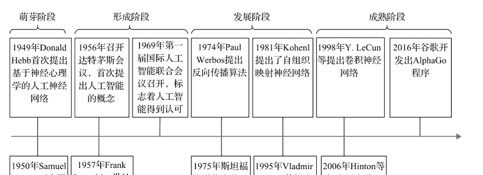

图 1.1 人工智能发展历程

#### 1.1.2 人工智能的主要算法

AI 的核心在于算法，不同任务依赖不同方法。总体可分为进化与群智能优化算法、机器学习算法两大类，如图 1.2 所示。

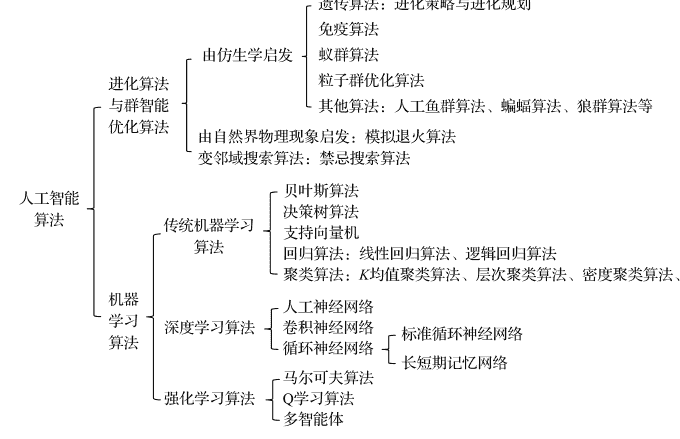

##### 1.1.2.1 智能启发算法

进化与群智能优化算法属于软计算范畴，受自然与生物规律启发，通过模仿其原理求解问题。其优势在于概念相对简单、易于实现、无需梯度信息、可跳出局部最优、可跨学科应用。遗传算法、免疫算法、蚁群算法、粒子群优化算法均源于生物进化或群体行为，其中遗传算法进一步衍生出进化策略与进化规划。模拟退火算法源于物理退火现象，能有效避免局部最优。禁忌搜索算法源于人类记忆搜索过程。这些启发式智能算法可用于函数全局优化，并在电力系统与综合能源系统规划运行优化、故障诊断、可再生能源发电预测与负荷预测中广泛使用。

##### 1.1.2.2 机器学习算法

机器学习研究计算机如何模拟人类学习行为以获取新知识或技能，重组知识结构并不断提升性能。其算法类型丰富。贝叶斯算法、决策树算法、支持向量机在电力系统应用较为广泛。贝叶斯算法利用概率统计进行大规模数据分类，方法简洁、准确率高、速度快；决策树算法通过规则序列对数据分类，能在较短时间内对大数据源进行有效分类；支持向量机擅长处理高维与非线性特征，提升泛化能力。除回归与聚类等基础方法外，机器学习还包括深度学习与强化学习两大分支。深度学习基于数据进行模拟人脑分析学习，以人工神经网络、卷积神经网络、循环神经网络为代表；强化学习描述智能体在与环境交互中学习策略以最大化回报的问题，以马尔可夫算法、Q 学习算法、多智能体为代表，其中马尔可夫算法与 Q 学习算法在电力系统中应用较多。

### 1.2 电力系统中应用人工智能的典型场景

当前工业、商业与居民用电需求持续增长，供电质量与可靠性要求不断提高，传统电网正向更安全可靠的方向演进。在电网规模扩大、电压等级提升的趋势下，自动保护、电力调度、检测维护、系统预测等环节亟需优化升级。人工智能为电网智能化运行提供关键技术支撑，其智能化、快速化与准确化的特点与电网故障诊断、自动化调度、电力预测等深度融合，既能保障运行安全可靠，又能实时评估关键设备运行参数。

#### 1.2.1 基于人工智能技术的电力系统负荷与发电预测

##### 1.2.1.1 负荷预测

负荷预测对电网调度运行至关重要。电力负荷受日期、政策、天气等多因素影响，具有显著非线性与随机性，难以用精确数学模型描述。传统方法如趋势外推、回归分析与时间序列法存在耗时长、精度低、性能不足等问题。随着电网快速发展，这些方法已难以满足需求。

新一代人工智能中的深度学习算法属于强感知型方法，能够挖掘大规模负荷数据中的非线性特征。卷积神经网络、深度信念网络、长短期记忆网络、深度递归神经网络与支持向量机在负荷预测中应用广泛。其中，长短期记忆网络凭借特殊记忆结构能更好学习时序相关性；卷积神经网络通过池化与卷积降低复杂度，减少训练参数；深度递归神经网络输出与历史状态强相关，适合关联历史负荷数据。上述方法均能在一定程度上提升预测准确率。

##### 1.2.1.2 可再生能源发电预测

高比例新能源接入是当前电网的典型特征，导致不确定性与波动性增强，影响调度运行与安全稳定。开展能源预测研究有助于降低不确定性，为规划与运行提供支撑。提升间歇性可再生能源功率预测精度的关键在于构建具备强大数据处理与特征提取能力的模型。

深度学习的引入显著改善了传统浅层模型的性能。长短期记忆网络的记忆能力、深度信念网络与卷积神经网络的特征提取能力、堆叠自编码器的强鲁棒性对提升新能源预测精度均有良好效果。此外，迁移学习的引入为不同风场的模型训练节省了大量时间成本。

#### 1.2.2 基于人工智能技术的电力系统监测辨识与故障诊断

智能电网：故障诊断与优化新打法

电网故障分析的核心任务是判别线路设备异常、测算故障距离并实现精确定位。诊断与定位的可靠性直接决定继电保护动作品质，也关系到整个系统的安全稳定运行。随着智能电网持续深化，电网呈现出体量扩张、拓扑更复杂、高渗透率分布式电源与集中式电源共存、电力电子化程度加深、感知融合推动数据量指数级增长等新特征。数据海量、机理多变、建模范式多元，已成为新阶段故障分析必须突破的关键难题。

以深度学习为代表的新一代人工智能，在大数据驱动的自主特征学习、强非线性逼近、端到端建模方面优势明显，例如借助并联卷积神经网络实现多端直流输电线路的故障判别。新一代智能网络架构灵活、层数充足，对海量信息具备较强的降维与处理能力。分布式电源大规模并网与电力电子装置普及，使得故障呈现更强的随机性与非线性。新一代技术凭借优秀的非线性拟合与特征表达能力，能够从多因素耦合、动态变化的故障流中提炼出利于准确判别的判别信息。在建模难度提升的背景下，端到端学习规避了中间环节误差累积，有助于提升诊断精度与可信度[5]。

### 1.2.3 基于人工智能技术的电力系统优化
电力系统参数众多，线性与非线性参量交织，使大规模优化问题极其复杂。传统手段包括线性规划、非线性规划、混合整数规划与动态规划。线性规划先把非线性函数与约束局部线性化再求解，运算速度快、收敛性相对可靠且易处理线性约束，常用工具是灵敏度分析与内点法，但精度有限，对大规模非线性问题适应性差。非线性规划以梯度寻优为基础，对非线性问题表现尚可，然而计算负担重、收敛性一般，易陷入局部极值，高维问题不理想；把大规模系统抽象为数学模型时常对连续变量进行离散化，忽略了实际运行细节，导致结果偏差增大。

人工智能方法兼具效率与精度，能够弥补上述不足。遗传算法、模拟退火、禁忌搜索及群智能优化在电力运行优化中已广泛应用，例如蚁群算法与内点法联用求解无功优化、遗传算法用于确定风电场接入点无功补偿电容器的分组与控制策略、粒子群优化与遗传算法协同解决机组启停状态、遗传算法结合粒子群优化的启发式特性共同解决资源分配问题。

### 1.3 本章小结
本章概括了人工智能的定义、演进脉络、核心算法与主要应用方向，后续章节将深入阐述电力系统中常用的人工智能算法原理、建模方式、特性及工程实践。

## 基础部分

## 第2章 进化算法与群智能
20世纪50年代中期仿生学兴起，研究者从生物体汲取灵感用于人造系统。部分学者从生物进化机理出发发展模拟进化优化方法，另一部分受自然物理现象启发提出复杂问题优化策略，统称智能优化方法。本章聚焦电力系统中常用的进化与群智能算法原理及建模方法。

### 2.1 遗传算法
60年代初，Holland 在人工自适应系统研究中提出借鉴遗传学原理模拟自然进化的设想。1975 年他出版系统论述遗传算法理论与方法的专著，提出模式理论，成为该领域里程碑，故1975年多被视作遗传算法诞生年。本节介绍基本概念与模型、特性及应用场景。

#### 2.1.1 遗传算法的基本概念及模型
遗传算法模拟达尔文自然选择与遗传学机制，是通过模拟生物进化过程寻找最优解的计算模型。

算法从代表潜在解空间的群体出发，群体由编码后的若干成员构成。每个成员可视作携带特征的染色体实体。染色体是遗传物质载体，由多个基因组成，其基因型决定表型。例如黑发特征由染色体中特定基因组合决定。因此起初需完成表型到基因型的转换，即编码工作，通常简化处理，如二进制编码。初代群体生成后，按适者生存原则迭代演化，逐步逼近更优解。每代依据适应值筛选成员，并借助遗传因子完成重组与突变，产生代表新解集的群体，后代比前代更适应环境。末代群体中最佳成员经解码可作为近似最优解。

##### 2.1.1.1 遗传算法的生物学原理
遗传算法是一种基于适者生存的并行、随机、自适应优化方法，通过复制、重组、突变使编码染色体群逐代进化，最终收敛到高适应群体，从而获得最优或满意解。达尔文自然选择学说认为变异、遗传与自然选择推动适应性改变，自然选择是进化动力。生物有繁殖过剩倾向，而生存空间与食物有限，成员需竞争。在同一群体中存在变异，具有利变异者存活并繁殖，无利者被淘汰。若环境变化有方向性，长期选择会使微小变异累积成显著差异，可能形成新物种。遗传是指亲代性状经有性或无性繁殖传递给子代。变异指物种与个体间差异，涵盖形态、生理、生化、行为等，是进化与育种根源，包含可遗传与不可遗传部分，受环境与基因型交互影响，表现为表型、环境与遗传变异，是进化的主要驱动因素[5]。

现代研究表明，染色体是遗传物质主要载体，基因是具遗传效应的片段，存储信息并可复制与突变。生物通过基因重组、基因突变及染色体结构与数目变异实现性状选择与控制。繁殖过程中基因交叉与变异导致性状连续变化，外界定向选择提供条件，使进化成为可能。人们模仿环境选择、基因交叉与变异这一生物迭代过程，提出用于求解最优化问题的遗传算法。

##### 2.1.1.2 遗传算法基本模型
遗传算法直接对结构对象操作，采用概率化寻优策略，可自动获取并引导搜索空间，自适应调整方向，无需确定性规则。

求函数最大值的优化问题通常表述为：

```
{
max f(x)
x ∈ R
R ⊂ U
}(2.1)
```
其中决策变量写作 x，目标函数表达为 max f(x)，约束条件记作 x∈R、R⊂U，U 为基本空间，R 是 U 的子集；满足约束的解 x 称为可行解，集合 R 为所有可行解的集合，称为可行解集。

遗传算法求解流程如图 2.1 所示，具体步骤如下：

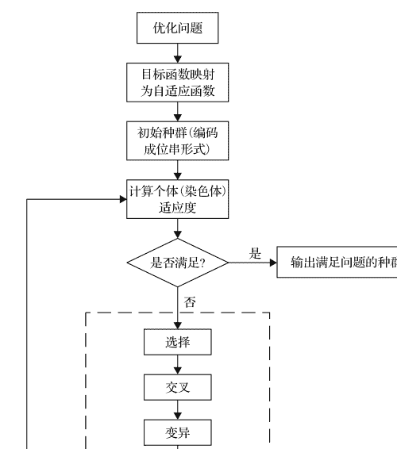
图 2.1 遗传算法求解流程图

- 初始化：令进化代数计数器归零，设定最大进化代数上限，随机产生 M 个成员作为初始种群 P(0)。
- 适应值评估：计算当前种群 P(t) 中各个体的适应度值。
- 选择操作：将选择算子施加于种群，目的是把优秀成员直接传递到下一代，或经配对重组产生新成员后再传递。选择建立在适应值评估之上。
- 重组操作：将重组算子施加于种群，重组是遗传算法的核心环节。
- 突变操作：将突变算子施加于种群，即对成员串中部分基因座的基因值进行扰动。经选择、重组、突变后得到后继种群 P(t+1)。
- 终止判断。若达到最大进化代数，则以进化过程中适应度最高的成员作为最优解输出并结束。

初始种群一般随机产生，设定策略可参考：依据问题先验知识把握最优解在问题空间中的分布范围，在该范围内构建初始种群，随机生成一定数量成员并挑选优质成员加入，直至规模达标。

遗传算法无法直接处理问题空间参数，需将其转化为遗传空间中由基因按一定结构组成的染色体或成员，该转换称为编码或问题表示。其中重组操作依据重组概率将种群中两个成员随机交换部分基因，产生新组合，期望汇聚有利基因。突变操作基本步骤为：按预设突变概率判定群体中各个体是否突变，对需突变成员随机选取突变位进行改写。

编码方式决定重组方法，如表2.1所示。

表 2.1 不同编码方式下的算子交叉方法

| 编码方式 | 算子交叉方法 |
|---|---|
| 实值重组 | 二进制交叉 |
| 离散重组 | 单点交叉 |
| 中间重组 | 多点交叉 |
| 线性重组 | 均匀交叉 |
| 扩展线性重组 | 洗牌交叉 |
| — | 缩小代理交叉 |

最常用的是单点交叉，操作是在成员串中随机确定一个交叉点，交换该点前后两个体部分结构，生成两个新成员。

编码策略评估常用完备性、健全性、非冗余性三个标准。

常用编码技术包括二进制编码、浮点数编码、字符编码等，其中二进制编码最常用，即用二进制字符集{0,1}构成的 0-1 字符串表示候选解，简洁易实现，符合最小字符集原则，便于模式定理分析。

适应度表示成员的环境适应能力，也反映繁殖能力。适应度函数即评价函数，用来衡量种群中成员的优劣，依据目标函数评估。遗传算法在进化过程中通常仅依赖评价函数评估优劣并指导后续操作。因适应度需排序并计算选择概率，其取值需为正值。不少情况下需将目标函数映射为求最大值且非负的形式。适应度函数设计应满足：单值、连续、非负、最大化；合理一致；计算量小；通用性强。设计需结合具体问题，直接影响算法性能。

#### 2.1.2 遗传算法的特点及应用场景
遗传算法是一种通用搜索算法，适用于各类问题。

搜索算法共性为：构建候选解集、依据适应性条件评估适应度；按适应度保留部分候选解，舍弃其余；对保留解进行操作生成新候选解。遗传算法以染色体群并行搜索、带猜测性的选择、交换与突变操作组合，形成独特机制。

主要特点：
- 从解的集合出发而非单一初始解，这与传统优化不同，传统方法易陷入局部最优，遗传算法覆盖面广，有利于全局择优。
- 同时处理种群多个成员，对搜索空间多个解并行评估，降低局部最优风险，易于并行化实现。
- 基本不依赖搜索空间先验知识，仅用适应值来评估并指导操作，适应度函数无连续可微限制，定义域可灵活设定，极大扩展应用范围。
- 采用概率变迁规则而非确定性规则引导搜索。
- 具有自组织、自适应与自学习能力，适应度高的成员生存概率大并获得更优结构。
- 可引入动态自适应技术，在进化中自动调整控制参数与编码精度，如模糊自适应法。

因不依赖梯度信息，仅需目标函数与适应度函数，遗传算法为求解复杂系统提供通用框架。下面介绍主要应用领域：

函数优化是经典应用，也是性能评价常用算例，测试函数包括连续与离散、凸与凹、低维与高维、单峰与多峰等。对于非线性、多模态、多目标优化，遗传算法易获得较好结果。

组合优化随规模增大搜索空间急剧膨胀，枚举法难以求解。遗传算法是求解满意解的有效工具之一，在非确定性多项式问题上表现突出，已成功用于旅行商、背包、装箱、图形划分等，也广泛应用于生产调度、自动控制、机器人学习、图像处理、人工生命、遗传编程与机器学习。

车间调度是典型 NP 难题，遗传算法被广泛应用，从传统车间调度到柔性作业车间调度均取得优异表现，常获得最优或近优解。

### 2.2 免疫算法
生命科学中遗传与免疫现象被深入研究，研究者将免疫概念引入工程实践，结合已有智能算法建立新进化理论与算法以提升性能。将免疫理论应用于遗传算法，在保留优良特性的同时利用问题特征信息抑制退化现象，形成免疫算法。本节介绍基本概念、模型及特点。

#### 2.2.1 免疫算法的基本概念及模型
免疫算法模仿人类免疫系统，是一种迭代生成与检测的群智能搜索方法，理论上在保留前一辈最优成员的前提下具有全局收敛性。

1. 免疫算法的生物学原理
免疫系统由免疫器官、细胞与分子组成，负责免疫应答与功能，识别并清除抗原性异物，与其他系统协同维持内环境稳定与生理平衡，是抵御病原体入侵的重要防线，可识别清除异物、外来微生物等，但功能亢进也可能损伤自身组织。免疫系统特点：
- 识别并清除外来入侵抗原如病原微生物，称为免疫防御，使机体免受病毒、细菌、污染物侵害。
- 识别并清除体内突变的肿瘤细胞、衰老细胞、死亡细胞等有害成分，称为免疫监视。
- 通过自身免疫耐受与调节维持内环境稳定，受损组织可被修复细胞修复。

生物免疫系统抽象模型如图 2.2 所示。免疫反应中大量抗体产生会降低抗原对免疫细胞的刺激，抑制抗体分化与增殖，同时抗体间存在相互刺激与抑制，抗原-抗体、抗体-抗体间的制约使免疫反应保持一定强度，保证免疫平衡。其中抗原在生命科学中指能刺激免疫系统产生应答并与产物特异性反应的物质，而在免疫算法中抗原是

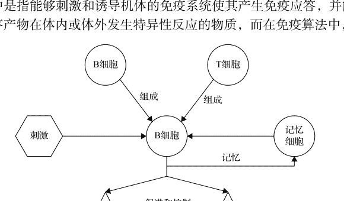
图 2.2 生物免疫系统的抽象模型
指所有可能错误的基因，即非最优个体的基因。抗体在生命科学中指受抗原刺激后免疫细胞转化为浆细胞并产生的能与抗原特异性结合的免疫球蛋白，而在免疫算法中抗体是指经疫苗修正个体基因后得到的新个体，其中疫苗修正过程即接种疫苗，目的是消除抗原在新个体产生时带来的负面影响。

免疫算子分为全免疫与目标免疫，对应非特异与特异免疫。全免疫指种群中每个成员在突变后对其各环节均进行一次免疫操作；目标免疫指突变后经判断仅在作用点发生免疫反应。前者多用于进化初期，进化中基本不作用，否则可能导致同化现象；后者伴随群体进化全过程，是常用算子。

免疫算法模拟人类免疫系统针对不同抗原产生相应抗体，将求解问题的目标函数对应外界抗原，将问题解对应免疫系统产生的抗体，可利用免疫系统的强自适应能力提升计算效果。

2. 免疫算法基本模型
免疫算法是一种具备自主选择学习、全息容错记忆、辩证克隆仿真与协同免疫优化的启发式人工智能算法，基本流程如下：
- 随机产生初始父代种群 A1，并依据先验知识抽取疫苗；
- 若当前群体中包含最优成员，则算法停止并输出结果，否则继续；

免疫计算与群智能算法要点梳理

迭代框架
在第 k 轮迭代中，父代集合 $A_k$ 先经重组产生中间集合 $B_k$；$B_k$ 再经突变得到 $C_k$；$C_k$ 随后进行疫苗接种形成 $D_k$；最后借助免疫选择从 $D_k$ 中筛选出下一轮父代 $A_{k+1}$，随后再进入下一轮循环。

完整求解思路对应的流程图见图 2.3，可归纳为七个环节：

- (1) 抗原识别。将待优化的目标函数与约束条件作为抗原输入，同时调取记忆库，若库为空则先初始化。
- (2) 初始解构建。根据抗原识别结果产生初始抗体，若记忆库已有部分解，则对缺失部分以随机方式补充。
- (3) 适应度评估。将每条抗体代入预设的适应度函数计算其得分。
- (4) 记忆单元更新。
- (5) 基于学习的择优。
- (6) 新抗体生成。
- (7) 终止判断。达到预设条件即停止，否则从步骤(3)起继续循环。

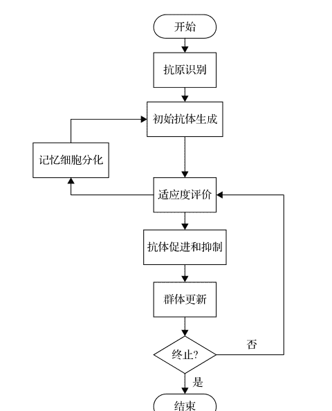
图 2.3 免疫算法求解流程图

寻优依赖的一组核心算子包括亲和度评价、浓度评价、激励度合成与免疫选择。

1) 亲和度评价算子
亲和度刻画免疫单元与抗原的结合紧密程度，在功能上与遗传算法中的适应度相近。常见形式为：
aff(x): S ∈ R
(2.2)
其中 S 为可行解区间，R 为实数域。输入为单个抗体即可行解，输出为该抗体的亲和度数值。具体的评判函数需依据问题特性单独设计。

2) 抗体浓度评价算子
浓度反映群体多样性。浓度过高意味着大量近似个体堆积，搜索会倾向于可行域的局部区域，不利于全局探索，因此需对高浓度个体加以抑制。常用定义为
den(ab_i) = 1/N Σ_{i=1}^{N} S(ab_i, ab_j)  (2.3)

3) 激励度计算算子
激励度是对抗体综合质量的最终判别，需同时考虑亲和度与浓度。一般亲和度越大、浓度越低，激励度越高。常见写法有
sim(ab_i) = a · aff(ab_i) − b · den(ab_i)  (2.4)
或
sim(ab_i) = aff(ab_i) e^{−a·den(ab_i)}  (2.5)
其中 sim(ab_i) 为激励度，a、b 为依据实际情境设定的系数；aff 为亲和度，den 为浓度。

4) 免疫选择算子
该算子依据激励度决定进入克隆选择阶段的抗体。激励度较高的个体质量更优，被选中的概率更大，在解空间中具备更高的探索价值。

### 2.2.2 免疫算法的特点
相较于其他方法，免疫算法呈现以下特质：

- (1) 具备记忆能力，能在记忆单元基础上快速回溯，加速收敛并更易逼近全局最优。
- (2) 拥有自调节能力，可动态维持群体平衡，对个体浓度进行抑制或促进，提升局部搜索效率。
- (3) 强调抗体多样性，通过亲和度计算体现抗体与抗原的匹配程度，从而增强全局搜索能力。

## 2.3 蚁群算法
蚁群系统由意大利学者 Dorigo、Maniezzo 等于 20 世纪 90 年代基于自然界蚂蚁觅食路径提出的一种模拟进化方法。随着改进研究的深入，其应用已扩展至多目标优化、数据分类、模式识别、生物建模、流程规划、决策支持等方向，在电力系统优化中的使用尤为广泛。下面围绕蚁群优化 ACO 的基本概念、模型、特征与应用展开。

### 2.3.1 蚁群算法的基本概念及模型
1. 生物学机理
单只蚂蚁行为看似简单，群体觅食却表现出智能。为寻找最短路径，蚁群会随环境变化自适应探索新路线。初始分布均匀时，各条路线的选择概率相同。

觅食时蚂蚁会留下信息素，随时间信息素会挥发。路径上经过的蚂蚁越多，信息素浓度越高，后续蚂蚁更倾向于选择高浓度路径，形成正反馈，最终往往找到蚁巢到食物的最短路线。

蚁群算法求解优化问题的思路为：①用蚂蚁的行走路线表示可行解，整个蚁群的路线集合构成解空间；②路线越短的蚂蚁释放信息素越多，短路线上信息素逐渐累积，选择该路线的蚂蚁也越来越多；③在正反馈作用下，群体集中于最优路线，对应问题的最优解。蚁群运动原理见图 2.4，A、F 分别为蚁巢和食物，存在 ABDEF 与 ABCEF 两条路线，BC 和 CE 总长为 10，BD 与 DE 总长为 17。起初各路线信息素为零，100 只蚂蚁随机出发，BCE 与 BDE 各约 50 只。由于 BCE 更短，其信息素积累更快，BDE 上的信息素逐渐挥发，最终群体选择 BCE。

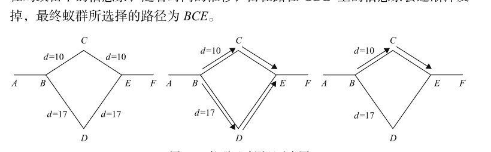

人工蚁群与真实蚂蚁的异同如下。

1) 相同点
- 任务一致，都是寻找起点到目标节点的最小路线。
- 均存在群体通信机制。自然界的信息素与人工蚁群的数字信息都会改变环境与历史记录，且均设有挥发机制随时间改变路线信息量。
- 均基于当前信息进行路线决策。

2) 不同点
人工蚂蚁拥有自然界蚂蚁不具备的特征：
- (1) 活动于离散空间，按状态转移。
- (2) 具备对自身历史行为的记忆状态。
- (3) 处于与时间无关的环境中。
- (4) 受问题空间特性启发。
为提升优化效率，可为人工蚂蚁赋予预测未来、局部改动等自然界不存在的能力。

2. 基本模型
设 n 只蚂蚁在相邻节点间移动，每步转移概率由信息素痕迹和可见度两类参数决定。信息素一方面挥发，另一方面对优质路线随蚂蚁增多而增强。转移采用随机原则，根据当前信息计算下一步可达节点的概率。

以旅行商问题 TSP 为例，t 时刻蚂蚁 k 从 i 移动到 j 的概率为
p_{ij}^k(t) = { [τ_{is}(t)]^α [η_{is}(t)]^β / Σ_{s∈J_k(i)} [τ_{is}(t)]^α [η_{is}(t)]^β , j∈J_k(i) ; 0, 其他 } (2.6)
其中 τ_is(t) 为信息素含量，η_is(t) 为启发因子即能见度，α 为信息素权重，β 为启发信息权重，J_k(i)={1,2,⋯,m}−τ_k 为下一步可选节点集合。τ_k 记录蚂蚁 k 本次迭代已走过的节点，禁止重复访问。

全部蚂蚁完成一次循环后信息素更新为：
τ_ij(t+1) = (1 - ρ) τ_ij(t) + Δτ_ij(t)   (2.7)
Δτ_ij(t) = Σ_{k=1}^{m} Δτ_ij^k   (2.8)
其中 ρ 为挥发系数，取值 0～1，1-ρ 为持久系数，Δτ_ij(t) 为本次迭代边 (ij) 的增量。

若蚂蚁 k 经过边 (ij)，则
Δτ_ij^k = { Q / L_k , 蚂蚁k在本次周游中经过边(ij) ; 0 , 其他 }   (2.9)
Q 为常数，L_k 为该蚂蚁本次周游路线长度。

按痕迹更新方式可分为蚁周算法、蚁量算法、蚁密算法。上述为蚁周算法。蚁量算法为
Δτ_ij^k = { Q / d_ij , 蚂蚁k在本次周游中经过边(ij) ; 0 , 其他 }   (2.10)
蚁密算法为
Δτ_ij^k = { Q , 蚂蚁k在本次周游中经过边(ij) ; 0 , 其他 }   (2.11)
蚁周算法使用全局反馈，蚁量与蚁密使用局部反馈，通常蚁周算法表现更优。

一般蚁群规模不超过 TSP 节点数。停止条件为外循环最大次数，或最优解连续 K 次不变，K 为预设整数，表示已收敛。

蚁群算法的求解流程见图 2.5，具体为：

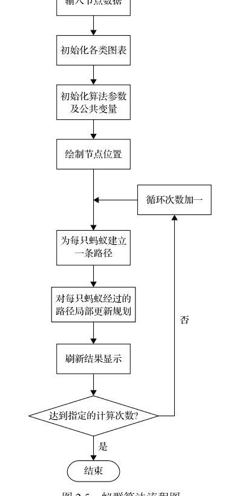
图 2.5 蚁群算法流程图
(1) 初始状态下各路线信息素相同，蚂蚁随机选择路线出发。
（2）蚂蚁到达不同节点后在路线上留下信息素，已到达终点的蚂蚁返回，同时下一批蚂蚁根据信息素浓度倾向于选择浓度高的路线出发，部分蚂蚁仍随机选择。
（3）未被经过的路线信息素逐渐挥发，被频繁经过的路线信息素增强，重复上述过程直至满足终止条件，找到原点到目标节点的最近路线。

### 2.3.2 蚁群算法的特点及应用场景
相较于其它优化算法，蚁群算法具有以下特点：

- （1）借助正向反馈机制，搜索过程逐步收敛并逼近最优解。
- （2）个体可通过释放信息素改变周围环境，并感知环境实时变化，个体间通过环境进行间接通信。
- （3）采用分布式计算，多个个体并行工作，提升计算能力与运行效率。
- （4）启发式概率搜索不易陷入局部最优，便于找到全局最优解。

自蚁群算法在 TSP、二次分配问题 QAP 等 NP 组合优化问题上取得成功后，已渗透至诸多工程领域：

- （1）工程与工业生产，如大规模集成电路综合布线。引脚对“蚂蚁”的引力按引力函数计算，线网智能体像蚁群一样在开关盒网格上爬行，布线后形成金属连线，完成线网连通。
- （2）规划问题，如机器人路径规划。机器人作为智能体在复杂环境下的路径与多机器人协作与蚂蚁觅食类似，信息素机制形成协作，蚁群算法在此类问题上优势明显。
- （3）动态优化组合问题，包括有向与无向网络路由、人工神经网络、车辆路径问题 VRP、图像处理与模式识别等。

## 2.4 粒子群优化算法
1995 年美国工程师 Eberhart 与社会心理学家 Kennedy 基于鸟群觅食行为提出粒子群优化 PSO 算法。1998 年 Eberhart 引入惯性权重修正速度更新公式，该形式被广泛采用。2001 年专著 Swarm Intelligence 出版，2003 年首届群智能研讨会在美国印第安纳波利斯召开。PSO 作为一种仿生智能算法，目前尚无完备的数学理论，但因其在动态多目标寻优中的简洁高效、全局搜索与良好收敛性，在函数优化等领域得到广泛应用。下面介绍其基本概念、模型、特点与应用。

### 2.4.1 粒子群优化算法的基本概念及模型
1. 生物学机理
PSO 模拟鸟类群体随机搜索食物的行为。鸟群在一定范围内寻找食物，个体并不知道食物确切位置，但可交流信息。搜索时常围绕目前最近食物的鸟所在区域展开，通过协作最终找到食物。飞行中每只鸟遵循三条原则：①避免碰撞；②与邻鸟保持速度一致；③向自身认为正确的群体靠近。

在 PSO 中，每个潜在解被看作空间中的一只“粒子”，具有由目标函数决定的适应度值，速度决定飞行方向与距离。粒子在解空间中追随当前最优粒子进行搜索。

每次迭代中，粒子依据两个极值更新位置：个体极值 pbest，即粒子自身历史最优解；全局极值 gbest，即群体历史最优解。粒子据此决定下一步轨迹。位置更新示意图见图 2.6。

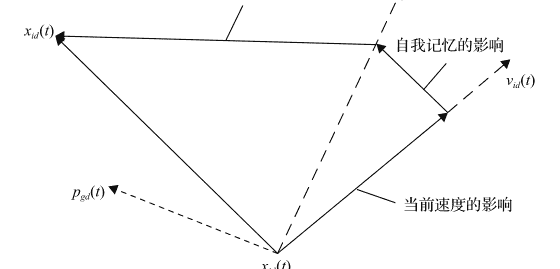
图 2.6 每代粒子位置更新方式

图中 x 表示初始位置，v 表示速度，p 表示最优位置。

2. 基本模型
设 D 维空间中有 n 个粒子，第 i 个粒子位置为
$X_i = (x_{i1}, x_{i2}, \dots, x_{iD}),\ i=1,2,\dots,N$  (2.12)
速度为
$V_i = (v_{i1}, v_{i2}, \dots, v_{iD}),\ i=1,2,\dots,N$  (2.13)
个体极值为
$p_i = (p_{i1}, p_{i2}, \dots, p_{iD}),\ i=1,2,\dots,N$  (2.14)
群体极值为
$g_i = (p_{g1}, p_{g2}, \dots, p_{gD})$  (2.15)

设目标函数为 $f(x)$，则当前最好位置由
$p_i(t+1)=\begin{cases}p_i(t), & f(x_i(t+1))\ge f(p_i(t))\\x_i(t+1), & f(x_i(t+1))< f(p_i(t))\end{cases}$  (2.16)
决定。

速度与位置更新公式为
$v_{id}(t+1)=w v_{id}(t)+c_1 r_1\big(p_{id}(t)-x_{id}(t)\big)+c_2 r_2\big(p_{gd}(t)-x_{id}(t)\big)$  (2.17)
x_{id}(t+1)=x_{id}(t)+v_{id}(t)  (2.18)
其中 t 为迭代次数，w 为惯性权重，c1、c2 为学习因子，r1、r2 为随机向量，p_{id}(t) 为个体历史最优，p_{gd}(t) 为群体历史最优。

式 (2.17) 由三部分构成：
- (1) “惯性” 部分，体现粒子保持先前速度的趋势。
- (2) “认知” 部分，反映粒子对自身历史经验的记忆，趋向自身历史最佳。
- (3) “社会” 部分，反映群体协作与知识共享，趋向群体或邻域历史最佳。

PSO 具有较好的搜索能力，有利于多目标意义下的最优解获取，通过并行搜索多个非劣解，可得到多个 Pareto 最优解。

单独把粒子群拿来用，单纯把迭代次数堆上去并不一定能把精度拉高。它的随机本质决定了即便参数锁定，多跑几次结果也可能不一样。把种群规模放大也未必等于解更好。真正起作用的是各控制参数之间是否能配合到位、达到均衡。

求解思路如图 2.7，推进顺序如下。

- (1) 生成初始群体并给出初始位移与速度，具体做法是：
  - ① 选定群体规模 n。
  - ② 对每个 i、d 在 [-x_max, x_max] 区间按均匀分布抽取位置 x_id。
  - ③ 对每个 i，把初速度 v_i 直接设为初始位置 x_i。
- (2) 评估所有个体的适应值。
- (3) 对每个个体，用本次适应值与自身历史最优 p_id 的适应值比较，取更优者更新个人极值。
- (4) 对每个个体，用本次适应值与群体历史最优 p_gd 的适应值比较，取更优者更新全局极值。
- (5) 按式(2.17) 与式(2.18) 刷新速度与位置。
- (6) 达到停止条件就输出结果，否则回到步骤(2)。

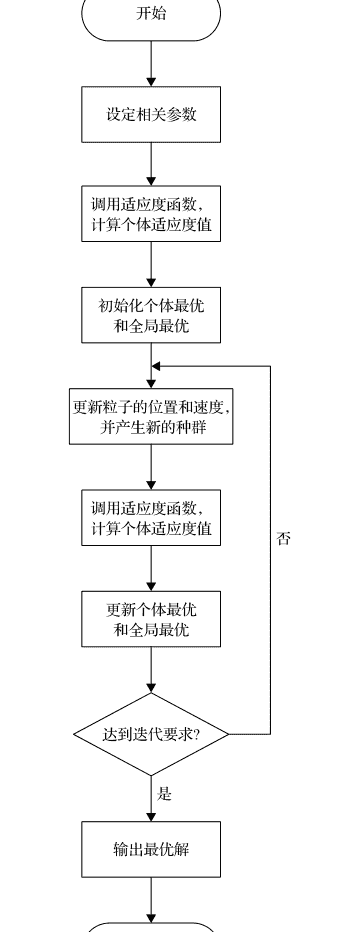
图 2.7 粒子群优化算法求解流程图

## 2.4.2 粒子群优化算法特性与适用范围

该方法呈现的性质主要有：

- (1) 具有不确定性。该随机性呼应自然界生物机理，在若干特定问题上常比确定性方法表现更好。
- (2) 属于概率式全局寻优。非确定带来更多触及全局最优的机会。
- (3) 不要求优化问题具备严格的数学前提，对目标函数的特殊性质不敏感。
- (4) 是多智能体驱动的仿生优化方式。群体中各智能体协同配合以适应环境，具备环境交互能力。
- (5) 天然具备并行性，既有内部并行也有内涵并行。
- (6) 呈现涌现特性。整体目标是在众多个体演化运动中自行显现。
- (7) 兼具自组织、演化与记忆功能，每个粒子都保存着自身最优解的相关知识。
- (8) 稳健性较强，在不同条件下仍具实用价值，不过其数学理论基础尚显薄弱，收敛性仍需深入探讨。

总体看该方法具备较大发展空间，在群智能领域占据重要位置，并在多行业产生价值，主要落地方向包括：

- (1) 模式识别与图像处理，已用于分割、配准、融合、识别、压缩与合成。
- (2) 神经网络训练，可完成权重训练、结构设计、学习规则调整、特征挑选、权重初始化与规则提取，但收敛速度不及梯度下降，计算开销较大。
- (3) 电力系统设计，如日本富士电力公司将无功电压控制问题转化为函数极值问题，并以改进的粒子群方法求解。
- (4) 半导体器件综合，在限定搜索空间内依据期望特性设计对应参数。
- (5) 其他方向，如自动目标检测、生物信号识别、决策调度、系统辨识、游戏训练等均有研究进展。

## 2.5 模拟退火算法

先回顾爬山法。该法每步从当前解的邻域里挑选最优解作为新解，直至陷入局部最优。其原理如图 2.8。设 C 为当前解，算法会沿 C 找到邻域最优 A 后停下，此后任何小幅调整都无法改进，只能停留在局部最优 A。

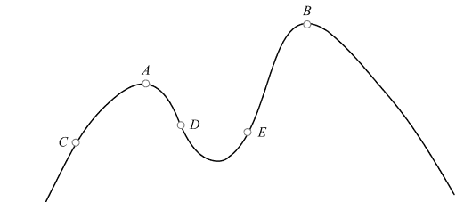
图 2.8 爬山算法原理示意图

模拟退火同样是贪婪式搜索，但加入了随机扰动，会以一定概率接受劣于当前解的解，从而有机会跳出局部最优。以图 2.8 为例，到达局部最优 A 后，可能以一定概率接受向 D 的转移，经过几次“变差”转移后到达 B，最终跳出 A 实现全局探索。

与只能得到局部最优的爬山法不同，模拟退火具备全局搜索能力。下面介绍其基本概念、模型、特性及应用。

### 2.5.1 模拟退火算法的基本概念及模型

模拟退火由 N. Metropolis 等于 1953 年基于 Monte-Carlo 迭代策略提出，模拟固体退火过程，从较高初始温度出发，随温度参数逐步降低，结合概率突跳特性在解空间中随机寻找目标函数，以避免陷入局部极小并最终趋向全局最优。

#### 1. 物理学机理

热力学中退火指物体缓慢降温的物理过程。高温下分子自由运动，冷却时原子活动减弱并自行排列成晶体，系统能量最低。若冷却过快，只能得到能量较高的多晶体或非晶态。因此退火关键在于缓慢降温，通常包括升温、等温、冷却三阶段。

升温通过增强粒子热运动使系统无序化，温度足够高时固体熔化为液体，消除原有非均匀态，为后续冷却提供平衡起点。升温对应熵增，能量随温度升高。

等温过程指系统与环境交换热量而温度不变时，自发变化总是朝自由能减小方向进行，自由能最低时达到平衡。

冷却与升温相反，温度降低时热运动减弱，系统逐渐有序，能量随温度下降而降低，最终形成低能晶体。

物理退火过程如图 2.9 所示，低温时物体呈非晶态，加热至充分高温使粒子无序，再缓慢冷却使粒子趋于有序，内能最低时呈现晶体形态。

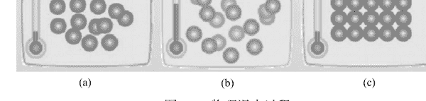
图 2.9 物理退火过程

1953 年 Metropolis 提出重要性采样，用于模拟固体在恒温下达到热平衡，是模拟退火的基础。其基本思路是优先抽取对结果贡献大的状态。设初始状态 i 的能量为 E_i，经扰动得到新状态 j，能量为 E_j。若 E_j < E_i，则接受为重要状态；若 E_j > E_i，则依据处于该状态的概率判断是否为重要状态，即

$p = \exp\left(\frac{E_i - E_j}{\kappa T}\right)$  (2.19)

式中 T 为热力学温度，κ 为玻尔兹曼常量。p ∈ [0,1]，p 越大被视为重要状态的概率越高。若 j 为重要状态则取代 i，否则保留 i 再产生新状态。大量迁移后系统趋于低能平衡，状态概率分布服从吉布斯正态分布，即

$$P = \frac{1}{Z} \exp\left(-\frac{E_i}{\kappa T}\right)\tag{2.20}$$
以上即 Metropolis 准则，核心思想是在能量升高时以一定概率接受而非完全拒绝。

模拟退火将热力学思想映射到优化问题，相似关系见表 2.2。

### 表 2.2 模拟退火算法与物理退火过程的相似性

| 模拟退火算法 | 物理退火过程 |
|---|---|
| 优化问题 | (退火)固体 |
| 解 | 分子状态 |
| 最优解 | 能量最低的状态 |
| 设定初值 | 熔解过程 |
| Metropolis 抽样过程 | 等温过程 |
| 控制参数的下降 | 冷却 |
| 目标函数 | 能量 |

算法基本原理流程如图 2.10 所示，步骤如下：

- 1. 初始化。设定初始温度 T 足够大、初始解状态 S、每个温度下的迭代次数 L。
- 2. 当 k=1,2,…,L 时进行步骤(3)～(6)。
- 3. 对当前解变换得到新解 S'。
- 4. 计算增量 Δt = C(S') - C(S)，C(S) 为评价函数。
- 5. 若 Δt < 0 则接受 S'，否则以概率 exp(Δt' / (κ T)) 接受 S'。
- 6. 若满足终止条件则输出当前解并结束。
- 7. 当连续若干个新解均未被接受时终止，T 逐渐减小，回到步骤(2)，直至 T 小于阈值。

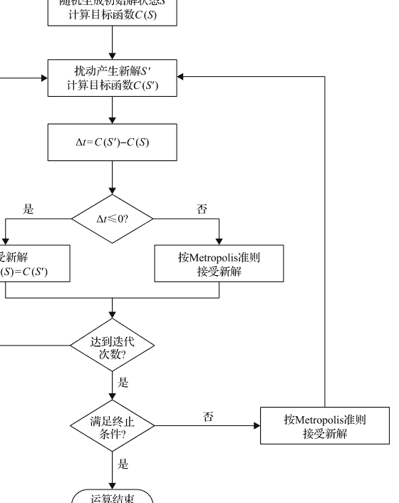
图 2.10 模拟退火算法基本原理流程图

#### 2. 基本模型

求解流程如图 2.11 所示，具体步骤为：

- (1) 初始化粒子的位置和速度。
- (2) 计算每个粒子的目标函数值。
- (3) 更新粒子的 pbest 和 gbest。
- (4) 重复执行下列步骤：
  - ① 对粒子的 pbest 进行模拟退火邻域搜索。
  - ② 更新各粒子的 pbest。
  - ③ 执行最优选择操作，更新种群 gbest。
  - ④ gbest 满足终止条件则转步骤⑤，否则回到步骤(3)。
- ⑤ 输出种群最优解。

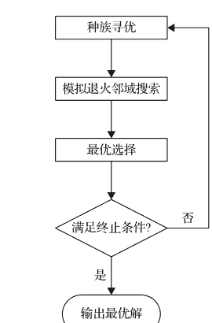
图 2.11 模拟退火算法求解流程图

实际应用中需解决若干技术问题。

(1) 温度 T 的初始值。初始温度越高，获得全局最优的可能性越大，但计算时间更长；温度设低可节省时间，却可能影响全局搜索。实践中常通过多次试验调优。

(2) 温度 T 的下降方式。当解质量变差概率呈玻尔兹曼分布时，对数降温式 t(k)=k / ln(1+k) (2.21) 可使算法收敛于全局最优；当概率呈柯西分布时，降温式 t(k)=k/(1+k) (2.22) 可实现收敛。式中 k 为常数，t 为降温次数。工程中常用每步温度按相同长度下降式(2.23)和按相同比例下降式(2.24)两种方法。

$$t_{k+1}=\frac{t_0(N-k)}{N}\tag{2.23}$$
$$t_{k+1}=\alpha t_k\tag{2.24}$$
式中 t0 为初始温度，N 为温度下降总次数，k≥0，α 为温降系数 0<α<1，α 越接近 1 降温越慢。

(3) 温度迭代长度的确定。可固定每个温度下的迭代步数，步数与邻域划分相关；也可依据状态接受与拒绝比例动态控制。高温时接受率高可适当减少步数，低温时拒绝增多则适当增加步数以防陷入局部最优。

(4) 算法的终止准则。常用方法包括：①零度法，给定极小正数 ε，当 t_k ≤ ε 时终止；②循环总数控制法，设定总迭代次数或温度下降次数 N，达到则终止；③基于不改进规则，当在最低温度和给定迭代次数内无改进时终止；④接受概率控制法，设定较小数 P，当除当前局部最优外其他状态接受概率均小于 P 时终止。

### 2.5.2 模拟退火算法的特点及应用场景

模拟退火适用范围广，获得全局最优的可靠性高，实现简单。其搜索策略有助于避免陷入局部最优，主要特点有：

- 1. 能够以一定概率接受“恶化”解。算法在迭代中不仅接受使目标更优的点，也可能接受使目标变差的点，接受概率随温度下降而减小。这种随机转移增加了灵活性，避免了传统确定性转移的局限。
- 2. 引入了算法控制参数。借鉴物理退火，优化过程被划分为若干阶段，每个阶段以不同标准取舍随机状态，接受函数由 Metropolis 算法给出。算法在每个控制参数下从前一迭代点产生邻域随机状态并按准则取舍，随后缓慢降低控制参数直至趋于零，提高全局最优可靠性。
- 3. 对目标函数要求不高。不需要导数等辅助信息，仅需定义邻域结构，在邻域内选取相邻解并用目标函数评估即可。

模拟退火已广泛用于大规模集成电路设计、神经网络计算、图像处理和组合优化，具体应用包括：

- 1) 超大规模集成电路设计。用于全局布线、布板、布局和逻辑最小化等优化设计，是模拟退火最成功的案例之一。
- 2) 神经网络计算。在玻尔兹曼机中，即使陷入局部最优，经过一段时间仍能跳出并向全局最优收敛。
- 3) 图像处理。可用于图像恢复等，将受污染图像重建为清晰原图，滤除畸变，具有广阔前景。
- 4) 组合优化。用于旅行商问题、背包问题等，实验表明能在较短时间内得到令人满意的近似最优解。

## 2.6 其他智能算法

### 2.6.1 禁忌搜索算法

禁忌搜索由 Glover 于 1986 年提出，是对局部邻域搜索的扩展，也是一种全局逐步寻优算法，模拟了人类智力过程。通过灵活的存储结构和禁忌准则避免重复搜索，通过豁免准则赦免优良被禁状态，从而实现多样化有效探索，最终达到全局优化。

#### 1. 局部邻域搜索与禁忌搜索

局部邻域搜索基于贪婪思想，在当前解邻域内持续寻找更好解，易实现且直观，但性能完全依赖邻域结构和初始解，无法保证全局最优。

禁忌搜索是在此基础上的扩展，兼具集中与扩散策略。集中体现在局部搜索，从一点出发在邻域内寻找更好解；扩散则由禁忌列表实现，记录已访问信息，避开已搜索点，从而扩大探索范围。

#### 2. 禁忌搜索算法的原理

算法通过标记已搜索的局部最优解所对应的对象，在后续迭代中尽量避开这些对象，保证探索不同有效途径。

禁忌搜索：用记忆避免原地打转

整体逻辑可以这样理解：先随机指定一个起点，同时让它担任当前解与暂定最优解的角色。围绕该解打开邻域，从中筛出数个候选解。用评价函数对候选进行打分，取分值最高的那个。若该候选的目标值比暂定最优更好，就无视其禁忌属性，以它同时更新当前解与暂定最优，同时把对应的操作写入记忆表并刷新各条目的剩余有效期；若最高分候选未能超越暂定最优，则在候选中挑选最优的非禁忌解作为新的当前解，无论优劣都把相关操作加入记忆表并更新有效期。如此往复，直至达到预设的停止条件。

整体流程在图 2.12 中呈现，拆解后是以下几步：
- (1) 设定算法参数，随机生成起点 x，将禁忌表置空。
- (2) 判定是否满足终止条件，满足则输出结果并结束，否则继续。
- (3) 以当前解 x 为中心，借助邻域算子产生一系列邻近解，并从中确定候选集合。
- (4) 先检验候选是否符合解禁条件。若符合，则用满足解禁条件的最佳候选 x′ 取代 x，即 x = x′，同时用 x′ 关联的禁忌对象替换禁忌表中最早进入的那条，并把 x′ 设为新的暂定最优，返回步骤 (2)；若不符合则进入下一步。
- (5) 考察候选各自的禁忌标记，从中选出最优的非禁忌解作为新的当前解，并用其对应的禁忌对象顶替禁忌表中最旧的元素，返回步骤 (2)。

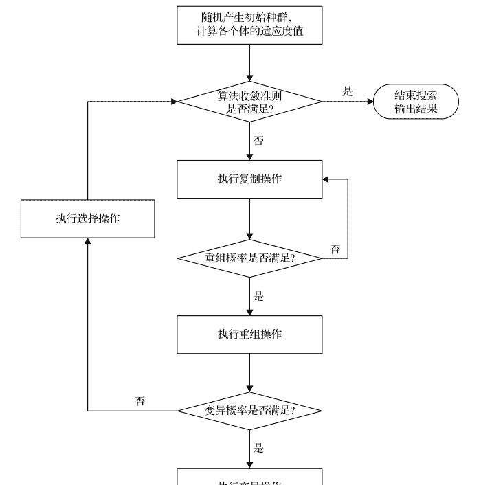

图 2.12 禁忌搜索算法基本原理流程图

在实际应用中，以下要素需要明确：
- 1. 起始解。禁忌搜索既可以随机给出起点，也可以借助别的启发式方法提供一个较好的初值。因为核心是邻域拓展，起点的质量会显著影响效率。在约束复杂的情形下，若随机起点质量很差，需要针对约束改进搜索质量，也可采用策略降低对起点的敏感度。
- 2. 评价函数。和遗传算法类似，评价函数用于衡量搜索状态，结合禁忌规则和解禁规则挑选新状态。目标函数可以直接作为评价标准，其变形形式也可以使用。若目标计算成本很高，比如工业过程需要仿真才能得到目标值，可以用反映目标特征的代理指标替代，以提升运行速度，选取时须保证代理指标和目标最优性保持一致。
- 3. 邻域算子。该算子继承局部搜索思想，用来指导如何由一个或一组解衍生出新解。设计取决于问题特性与解的编码方式，需要结合具体问题分析。
- 4. 候选集合。通常是当前状态邻域的一个子集。集合大小是影响性能的关键参数。候选中可在邻域中选取，取太多计算负担重，取太少易早熟。为降低计算，可在部分邻域中确定或随机抽取候选，具体规模视问题特性和算法需求而定。
- 5. 禁忌对象和禁忌规则。被写入禁忌表的元素即为禁忌对象。已搜索的局部最优解所对应的操作被标记为禁忌，后续迭代不再考虑。禁忌对象可取状态本身或状态分量。
- 6. 禁忌表的构造。体现避免反复搜索的思路。以状态本身或其变化形式作为禁忌对象列入表是最直观做法。具体而言，状态由 x 变化至 y 时视为禁忌对象，在一定条件下禁止 y 的再次出现。
- 7. 禁忌时长。即对象在不考虑解禁规则的情况下被禁止选择的最多次数，可看作任期。任期归零后方可解禁。时长选取和问题特性、经验相关，决定计算复杂度。可采用静态固定值，或和问题规模相关；也可动态调整，按搜索表现和特征在区间内变化。研究表明动态设计通常比静态更稳健。

### (8) 禁忌频率。
禁忌频率是对禁忌属性的补充，可放宽决策范围。若某个目标值反复出现，可能算法陷入循环或极小点，说明现有参数难以挖掘更好状态，需调整结构或参数。实践中可记录状态出现频率，也可记录交换对象或目标值等信息，信息可静态也可动态。

静态频率信息包括状态、目标值或交换对象在优化过程中的出现次数、出现次数和总迭代步数的比例、两状态间循环次数等，有助于了解对象特性及循环规律。

动态频率信息记录更复杂，提供的信息也更丰富，常用做法如下：
- ① 记录某个序列的长度，即元素个数，关键点序列按长度变化计算。
- ② 记录从序列中某元素出发再返回该元素的迭代次数。
- ③ 记录序列的平均评价值或各元素的评价变化。
- ④ 记录序列出现的频率等。

上述信息可增强禁忌搜索的能力和效率，也可据此对对象实施惩罚。例如对象频繁出现则延长禁忌时长；序列评价变化小则延长该序列对象时长，反之缩短；若最佳评价长期不变，可终止搜索认为已达最优。

### (9) 勘视规则。
若存在优于暂定最优的禁忌候选，则将其解禁；候选全部被禁忌时，勘视规则也会解禁最优禁忌候选以提升效率。常用方式有：
- ① 基于评价值的规则。若禁忌候选的评价优于暂定最优，则解禁为当前状态和新的最优。也可将搜索空间划分为子区域，若候选优于所在区域的暂定最优则解禁。
- ② 基于最小损失的规则。若所有候选都被禁忌且没有优于暂定最优的解，则解禁候选中最好者以继续搜索，可理解为死锁的简单处理。
- ③ 基于搜索方向的规则。若某禁忌对象上次使评价改善而被加入禁忌表，目前对应候选的评价优于当前解，则对该对象解禁。该规则对应有效搜索路径的延续。
- ④ 基于影响力的规则。不同对象变化对评价的影响不同，影响力和禁忌时长和评价共同构成勘视规则。解禁影响力大的禁忌对象有助于后续获得更好解。

### (10) 停止条件。
和模拟退火、遗传算法类似，禁忌搜索需停止条件实现收敛。遍历状态空间不现实，通常采用近似收敛准则，常见做法：
- 1. 给定最大迭代步数，到达后终止。
- 2. 设定对象的最大禁忌频率，当某状态、目标值或交换等对象的禁忌频率超阈值，或最佳评价连续若干次不变，则终止。
- 3. 设定评价偏离阈值。先估计问题下界，一旦最佳评价和下界的偏离小于规定阈值，终止搜索。

### 3. 禁忌搜索算法的特点
- 1. 新解并非在当前解邻域中随机产生，而是要么优于暂定最优，要么是非禁忌的最佳解，因此优良解被选中的概率远高于劣质解。
- 2. 具备灵活的记忆功能和勘视规则，且可接受劣质解，具有较强爬山能力，能跳出局部最优转向解空间其他区域，提高获得全局最优的概率。

尽管禁忌搜索在多个领域取得成功，也存在不足：对起点依赖较强，好的起点易快速达优，差的起点难以收敛，先验知识指导的起点更易找到最优；迭代过程是串行的单一状态移动，非并行搜索。

## 2.6.2 进化策略算法

### 1. 进化策略算法的基本原理
进化策略将优化问题的解视为个体，先随机产生初始群体，按某种重组方式产生新个体，再按变异规则对群体变异，最后按选择规则挑选下一代个体，重复变异选择直至满足终止条件。

### 2. 进化策略算法的实现
进化策略基本原理流程如图 2.13 所示，实现步骤如下：
- (1) 确定问题方案。寻找实数 n 维矢量 x，使函数 F(x) 取极值。
- (2) 初始化种群。每个维度都在可行区间内以概率方式随机选取亲本 x_i (i=1,2,⋯,p) 的初始值。
- (3) 对两个个体进行交叉重组。通过对 x 的每个分量叠加零均值、预先选定标准差的高斯随机变量，从每个亲本 x_i 中产生子代 x_i′。

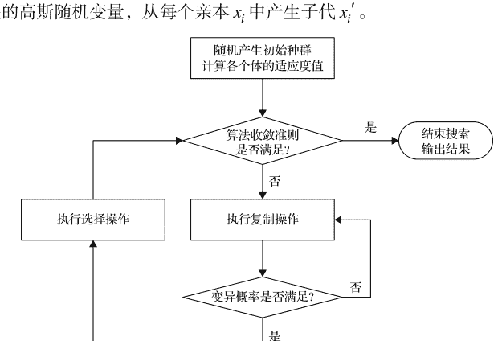

图 2.13 进化策略算法基本原理流程图

(4) 进行适应度排序和选择。把 F(x_i) 和 F(x_i′)(i=1,2,⋯,p) 按误差排序，选择保留。误差最小的 p 个矢量成为下一代新亲本。
(5) 重复步骤(3)和(4)直到收敛。

## 3. 进化策略算法的基本技术

### 1) 交叉重组
和遗传算法类似，交换个体基因，主要有三种方式：
- (1) 离散重组。随机选两个父代，随机交换其分量构成子代各分量。
- (2) 中值重组。随机选两个父代，用各分量的平均值作为子代分量。
- (3) 混杂重组。先固定一个父代，对子代每个分量再从父代群体中随机选第二个父代，第二个父代随分量变化。两父代的组合可采用离散重组、中值重组，或把中值重组中的 1/2 改为 [0,1] 区间内的任意权重。

### 2) 变异过程
在每个分量上加上零均值、某一方差的高斯分布扰动产生新个体。方差即变异程度，算法开始时较大，接近收敛时逐渐减小。

### 3) 选择过程
进化策略选择分两种：① (λ,μ)ES，即用 μ 个父个体产生 λ 个个体，从新个体中选 μ 个作为子代；② (λ+μ)ES，即用 μ 个父个体产生 λ 个个体，从父代和新个体中选 μ 个作为子代。(λ,μ)ES 中每个个体仅存活一代；(λ+μ)ES 可保证最优个体存活，使进化呈单调上升，但保留旧个体有时会滞留局部最优。

## 2.6.3 进化规划算法

### 1. 进化规划算法的基本原理
进化规划和进化策略类似，适用于目标函数或约束不可微的复杂非线性实值连续优化问题。

将解视为个体，随机产生初始群体，按变异规则产生新个体，按适应度函数评价，随机保留最好的一半，重复变异选择直至满足终止条件。

进化规划算法基本原理流程如图 2.14 所示。

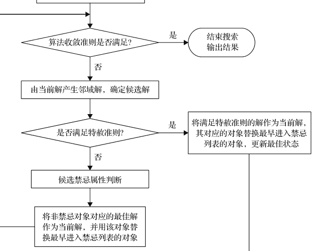

图 2.14 进化规划算法基本原理流程图

## 2. 进化规划算法的实现
实现步骤如下：
- (1) 确定问题方案。寻找实值 n 维矢量 x，使函数 F(x) 取极值。不失一般性，设为极小化。
- (2) 初始化种群。每个维度都在可行区间内随机选取亲本 x_i (i=1,2,⋯,p) 的初始值。
- (3) 亲本繁殖。将随机选取的亲本 x_i (i=1,2,⋯,p) 复制产生 x_i′。

## 2.7 本章小结
本章介绍了受自然界生物进化及种群特性启发的几类典型智能算法，包括遗传算法、免疫算法、蚁群算法、粒子群优化、模拟退火等；详细阐述了各类算法的基本原理与模型，为后续案例提供理论支撑。

## 第 3 章 机器学习
机器学习源于人工智能和统计学，是数据分析领域的研究重点。本章先介绍基本概念、发展历程和类别，再具体介绍贝叶斯、决策树、支持向量机等传统机器学习算法及其在电力系统的应用场景，同时介绍深度学习和强化学习相关理论，为后续应用奠定基础。

## 3.1 机器学习的基本概念与发展历程

## 3.1.1 机器学习的基本概念
机器学习指计算机通过挖掘数据内在规律，获取新经验和知识，提升智能，使决策更接近人类。数据需求增长、处理效率要求提高催生了系列算法。机器学习算法本质是通过数学统计方法求解最优化问题的步骤。针对不同数据和模型，选择合适的算法更高效地解决实际问题。

自 1980 年首届机器学习国际研讨会以来，机器学习影响各行业，如自动驾驶、异常检测、统计分析、在线推荐，在电力系统也有广泛应用。

机器学习源于人工智能和统计学，核心在学习。Simon 认为学习是系统的改进，使系统在重复或类似任务上完成得更好。机器学习模型即基于此建立，旨在使计算机模拟人类学习行为，自动获取知识技能并自我完善。

构建学习系统需合适环境、学习能力和知识库。一个学习系统一般由环境、学习机构、知识库、执行和评价四部分组成，各部分关系如图 3.1 所示。

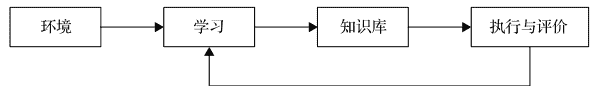

图 3.1 学习系统基本组成部分的关系

图中箭头表示信息流向。环境提供外部信息供学习。学习机构通过搜索环境获取信息，经分析、综合、类比、归纳等获得知识并存入知识库。知识库存储并组织学习得到的知识，便于应用和维护。执行和评价由执行和评价组成，执行应用所学知识求解实际问题，评价验证效果。从执行到学习需反馈，根据反馈决定是否进一步从环境索取信息以修正知识库，这是学习系统的重要特征。

## 3.1.2 机器学习算法的发展历程及分类
追溯时间，机器学习算法自 1940 年兴起，在电力系统中应用广泛的有贝叶斯、决策树和支持向量机，发展脉络如图 3.2 所示。

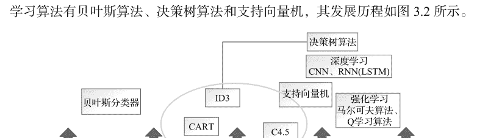

图 3.2 机器学习算法发展历程

### 1. 机器学习算法早期
贝叶斯分类器起步于 20 世纪 50 年代，基于贝叶斯决策理论把样本分到后验概率最大的一类。感知器兴起于 1950～1980 年，可视作深度学习人工神经网络的前身，但过于简单，甚至不能解决异或问题，仅具思想启蒙意义，为后续算法奠基。

1980 年前算法零散不成体系，但作用不可忽视；1980 年后机器学习真正成为独立方向，随后算法大量涌现并快速发展。

### 2. 机器学习算法中期
20 世纪 80 年代到 90 年代初取得重要成果，决策树算法诞生有 CART、ID3、C4.5 等典型实现，虽简单但可解释性强，至今仍在若干问题上被使用。

# 机器学习技术在电力系统中的演进脉络

上世纪九十年代初，支持向量机开始进入学术视野，其核心思想是利用隐式映射把原始样本送入高维空间，从而让原本在低维难以线性分离的非线性问题变得可处理；AdaBoost 则被看作集成学习的重要代表，其做法是将多个判别能力有限的基础分类器进行加权叠加，以提升整体的识别水平。

概率图模型方面，贝叶斯网络诞生于 1985 年，是概率推理的经典工具，创始人 Judea Pearl 在该领域贡献突出，并因此荣获图灵奖；条件随机场是图模型家族中出现较晚的成员，已在中文分词等自然语言任务及序列标注中得到广泛使用，也是一种很有力的序列建模手段。

### 3. 机器学习算法现期
近年来深度学习与强化学习在电力行业的渗透日益加深，神经网络在非侵入式负荷监测、风电概率式预测以及故障诊断等方向发挥了明显作用；马尔可夫类技术在负荷辨识层面也有重要进展，具体展开参见 3.2 节与 3.3 节。

## 3.2 传统机器学习算法
本节聚焦贝叶斯方法、决策树与支持向量机三类经典技术。

## 3.2.1 贝叶斯分类
贝叶斯分类器以贝叶斯定理为理论支撑，适合大规模数据，具备结构简洁、判别精度较高、运算速度快等特点，因而在机器学习中应用广泛[9]。

### 1. 理论基础
常见变体包括朴素贝叶斯、高斯型朴素贝叶斯、伯努利型朴素贝叶斯以及多项式型朴素贝叶斯，下面做简要说明。

#### 1) 朴素贝叶斯
朴素贝叶斯是一种基础的分类思路，给定待判对象，计算其在各类别下的后验概率并取最大者作为结果。

可作如下形式化：

- (1) 设 $x = \{a_1,a_2,\cdots,a_m\}$ 为待判项，其中每个 $a_i(i=1,2,\cdots,m)$ 为 $x$ 的一个特征。
- (2) 类别集合记为 $C = \{y_1,y_2,\cdots,y_n\}$。
- (3) 求 $P(y_1|x),P(y_2|x),\cdots,P(y_n|x)$。
- (4) 若 $P(y_k|x)=\max\{P(y_1|x),P(y_2|x),\cdots,P(y_n|x)\}$，则 $x\in y_k$。

关键在于求得条件概率，先从已标注样本中统计各类别下各特征的条件概率，即

$P(a_1|y_1),P(a_2|y_1),\cdots,P(a_m|y_1)$

$P(a_1|y_2),P(a_2|y_2),\cdots,P(a_m|y_2)$

$\vdots$

$P(a_1|y_n),P(a_2|y_n),\cdots,P(a_m|y_n)$

在特征条件独立假设下，由贝叶斯公式可得

$P(y_i|x)=\frac{P(x|y_i)P(y_i)}{P(x)}$

(3.1)

求解过程通常分为三阶段，其流程如图 3.3 所示。

- (1) 准备阶段。依据实际需求确定特征集合并对特征进行划分，由人工对部分待判项标注，形成训练样本。输入为全部待判数据，输出为特征描述与训练样本。该人工环节的质量直接影响后续效果。
- (2) 训练阶段。统计各类别在训练样本中的出现频率以及各特征划分在各类别下的条件概率估计并保存。输入为特征与训练集，输出为分类器。可由程序自动完成。
- (3) 应用阶段。利用训练好的分类器对新样本进行判别，输出样本到类别的映射关系。同样由程序自动执行。

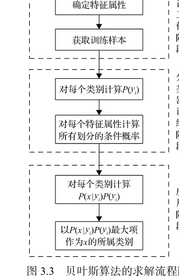

图 3.3 贝叶斯算法的求解流程图

#### 2) 高斯朴素贝叶斯
当特征为连续型且服从高斯分布时，$P(x|y)$ 的计算可直接采用高斯概率公式，即

$$g(\pi,\eta,\sigma)=\frac{1}{\sqrt{2\pi}\sigma}e^{\frac{-(x-\eta)^2}{2\sigma^2}}\tag{3.2}$$ $$P(x_i|y_k)=g(x_i,\eta_{i,y_k},\sigma_{i,y_k})\tag{3.3}$$

#### 3) 伯努利朴素贝叶斯
当特征服从伯努利分布时，$P(x|y)$ 的计算可使用伯努利分布的概率表达式，即

$$P(x|p)=\begin{cases}p^x q^{1-x}, & x=0,1\\0, & \text{其他}\end{cases}\tag{3.4}$$ $$E(x)=p\tag{3.5}$$ $$D(x)=p(1-p)\tag{3.6}$$ $$P(x_k|y)=P(1|y)x_k+(1-P(1|y))+(1-x_k)\tag{3.7}$$

#### 4) 多项式朴素贝叶斯
当特征服从多项分布，即特征取离散值时，对每个类别 $y$，$T_y$ 为该类别训练集，每个特征对应参数 $\theta_{yi}=(\theta_{y1},\theta_{y2},\cdots,\theta_{yn})$，$n$ 为特征取值数，则 $P(x_k=i\mid y)$ 等于 $\theta_{yi}$，于是有

$$\theta_{yi}=\frac{N_{yi}+\alpha}{N_{y}+\alpha^{*}n}\tag{3.8}$$

$$N_{yi}=\sum_{x\in T_{y}}x_{i}\tag{3.9}$$

$$N_{y}=\sum_{i=1}^{n}N_{yi}\tag{3.10}$$

### 2. 电力系统中的典型应用

#### 1) 风电功率预测
随风电装机规模快速增长，风电并网对系统稳定影响显著，高精度功率预测对经济社会发展意义重大。

为向决策者提供区间信息，基于贝叶斯的概率区间预测得到广泛应用，例如基于粗糙集属性约简与粒子群权重优化的朴素贝叶斯风电概率区间预测方法，利用粗糙集筛选输入变量并用粒子群优化输出权重，从而提高预测精度。

#### 2) 故障诊断
贝叶斯方法直观易懂，能清晰刻画电力元件、保护装置、断路器间的关联，被广泛用于故障诊断研究。

人工神经网络、专家系统、遗传算法、模糊理论、Petri网、粗糙集等方法虽各有成效，但复杂度较高。贝叶斯方法理论扎实、表示与推理灵活，引入后可建立更合理的诊断模型，直观表达元件、保护、断路器关系，便于存储维护；模型呈分布式，便于大规模电网的分布式存储与并行计算，具有较好的应用前景[1]。

#### 3) 可靠性评估
可靠性评估是电力系统规划、设计与运行的重要环节，目的是为决策提供可靠性指标并指导改进措施。

由于系统复杂，需寻求高效可行的评估手段。现有方法包括解析法、蒙特卡罗抽样、人工神经网络与贝叶斯方法等。相较之下，贝叶斯方法不仅能计算常规指标，还能识别薄弱环节，更契合可靠性评估需求。

## 3.2.2 决策树方法
决策树是机器学习中常用的分类模型，表示对象属性与取值之间的映射。节点代表样本，分支代表属性取值，叶节点对应从根到叶的路径所决定的类别。

### 1. 理论基础
逻辑上决策树由根节点、内部节点和叶节点构成，结构示意如图 3.4 所示。

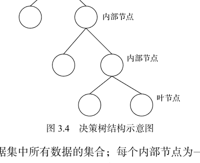

图 3.4 决策树结构示意图

根节点包含全部样本；内部节点对应一个判断条件，包含满足从根到该节点全部条件的样本，按测试结果分流到子节点；叶节点为最终类别，落入该叶的样本归属该类。

建模流程如图 3.5 所示。决策树通过建树与剪枝实现，剪枝时以整体损失函数最小为准则，裁剪子树或叶节点，将其父节点提升为叶，以简化模型。

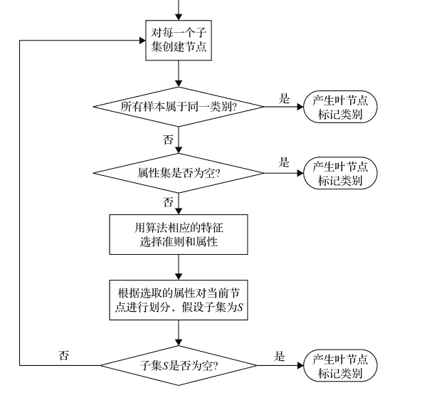

图 3.5 决策树算法的基本流程图

损失函数定义为

Cα(T)=∑_{t=1}^{|T|} N_t H_t(T)+α(T)=C(T)+α(T)  (3.11)

其中 $T$ 为子树叶节点集合，$H_t(T)$ 为第 $t$ 个叶的熵，$N_t$ 为样本数，$C(T)$ 为预测误差，$α$ 为复杂度惩罚系数。$α$ 小时倾向复杂树，$α$ 大时倾向简单树，$α=0$ 时仅考虑拟合。

剪枝即在固定 $α$ 下选择损失最小的子树，平衡拟合与复杂度。

特殊值处理如下。

- 1) 连续值处理
属性离散时选择方法已述，连续属性可二分处理。有限样本中属性 $a$ 取值 $a_1<a_2<\dots<a_n$，取中点 $t_i=(a_i+a_{i+1})/2$，任一 $t_i$ 将数据集 $D$ 划分为 $D^+$ 与 $D^-$，最大化信息增益的划分点为最优，则

$\text{Gain}(D,a)=\max_t \text{Gain}(D,a,t)$

$=\max_t \text{Ent}(D)-\sum_{\lambda\in\{+,-\}}\frac{|D^\lambda|}{|D|}\text{Ent}(D^\lambda)\quad(3.12)$

- 2) 缺失值处理
直接剔除会损失信息。给每个样本赋权重，根节点权重初值为1，则

$\rho = \frac{\sum_{x\in D} w_x}{\sum_{x\in D} w_x}\quad(3.13)$

$\tilde{\rho}=\frac{\sum_{x\in D_k} w_x}{\sum_{x\in D} w_x},\ 1\le k\le |V|\quad(3.14)$

$\tilde{r}_v = \frac{\sum_{x\in D^v} w_x}{\sum_{x\in D} w_x},\; 1\le v\le V\tag{3.15}$

$\rho$ 为子集占比，$\tilde{\rho}$ 为类别占比，$\tilde{r}_v$ 为分支占比。

在属性 $a$ 无缺失的子集上计算信息增益，总增益为

$\mathrm{Gain}(D,a)=\rho\cdot\mathrm{Gain}(\tilde{D},a)=\rho\left(\mathrm{Ent}(\tilde{D})-\sum\tilde{r}_v\mathrm{Ent}(\tilde{D}^v)\right)\tag{3.16}$

若样本在 $a$ 上缺失，按权重分摊到各分支，权重更新为

$w'_x = w_x \tilde{r}_v\tag{3.17}$

### 2. 电力系统应用场景
#### 1) 长期负荷预测
长期负荷预测是制定发展规划的基础，对安全经济运行至关重要。基于数据挖掘先对原始数据进行不完备数据补全预处理，再用决策树对清洗后的数据进行分类预测，使结果更贴合原始信息。

#### 2) 故障诊断
故障诊断需健康监测采集数据，将测量值与设定值对比，超阈值则报警，再定位故障。基于健康与异常数据建立基准模型。

决策树能处理多种数据类型，对海量数据分类效率高。应用于电力故障诊断可构建模型、提取分类规则，辅助准确决策。

#### 3) 暂态稳定评估
电网规模扩大使暂态稳定评估更复杂。单属性决策树不考虑变量相关性，而电力电气量间耦合紧密。现多采用二维组合属性决策树，在保持快速、可解释优势的同时挖掘更多信息，泛化能力更强。

## 3.2.3 支持向量机
支持向量机源于统计学习理论，在有限样本下平衡模型复杂度与学习能力，以期获得更好的推广性。

其亮点在于引入对偶理论，包括最大最小对偶与拉格朗日对偶。关键在于核函数。低维难以划分时可映射到高维，但直接映射计算代价高，核函数巧妙避免了显式映射，只要选取合适的核即可实现高维分类，不同核对应不同算法。

### 1. 理论基础
#### 1) 最优分类面
设线性可分样本 $(X_i, y_i)(i=1,2,\cdots,n; X_i \in \mathbb{R}^d; y_i \in \{-1,1\}$。判别函数一般形式 $g(X)=WX+b$，分类面 $WX+b=0$ (3.18)

归一化后调节 $W,b$ 使 $|g(X)|\ge 1$，间隔为 $2/||W||$，故最大化间隔等价于最小化 $||W||$。

满足 $|g(x)|=1$ 的点为支持向量，决定最优分类面。

优化问题为 $\min \Phi(W)=\frac12||W||^2$ s.t. $y_i[(WX_i+b)]-1>0,\ i=1,2,\cdots,n$ (3.19)

对偶形式为 $\min Q(a)=\frac12\sum_{i,j=1}^n a_i a_j y_i y_j (X_i X_j)-\sum_{i=1}^n a_i$

s.t. $a_i \ge 0,\ i=1,2,\cdots,n$  (3.20)

$\displaystyle\sum_{i=1}^{n} a_i y_i = 0$  (3.21)

其中 $a=(a_1,\dots,a_n)^T$，$b=(1,\dots,1)^T$，$y=(y_1,\dots,y_n)^T$，$A_{ij}=y_i y_j (X_i X_j)$。

最优分类函数为

$f(x)=\operatorname{sgn}\left\{\displaystyle\sum_{i=1}^{n} a_i^* y_i (X_i X)+b^*\right\}$  (3.22)

非支持向量 $a_i=0$，故只需支持向量求解，$b^*$ 可由任一支持向量约束求得。

#### 2) 核函数

# 从核映射到深度表征：方法脉络

Mercer 理论把核函数看作隐式特征空间里的内积。核心设想是，把本需要在高维空间完成的运算，通过核函数直接在原始样例空间里完成，而不必显式写出升维映射的表达式。

经典的降维思路是把高维原始数据压缩到低维表达以降低计算负担，但压缩往往伴随信息损失，影响泛化。核方法则反向操作：把低维向量提升到更高维甚至无穷维空间，在提升后的空间中建模，同时对维度膨胀带来的计算压力保持可控。核函数是支撑向量机的基石。依据 Hilbert-Schmidt 理论，只要映射 φ 满足 Mercer 规定的条件，便可据此构造合法核。

该条件写作

$\begin{cases}\displaystyle\int_{-\infty}^{+\infty}\varphi^2(x)\mathrm{d}x>0\\[6pt]\displaystyle\iint_{-\infty}^{+\infty}k(x,y)\varphi(x)\varphi(y)\mathrm{d}x\mathrm{d}y>0\end{cases}$  (3.23)

工程中常用的核有线性核、二次核、多项式核、高斯径向基核以及类 MLP 核等。

设非线性映射 $\phi:\mathbf{R}^n\to H$ 把输入送入可能是无穷维的特征空间 $H$。在 $H$ 中寻找最优分离超平面时，优化过程只涉及点积 $\langle\phi(X_i),\phi(X_j)\rangle$，而不会单独显式出现 $\phi(X_i)$。因此若能找到函数 $k$ 使 $k(X_i,X_j)=\langle\phi(X_i),\phi(X_j)\rangle$ 成立，高维内积便可全部在输入空间用 $k$ 计算，无需知道 $\phi$ 的具体形式。

这类具备内积性质的函数即为核函数，其理论已在 SVM 推导中说明。只要 $k(X_i,X_j)$ 满足 Mercer 准则，它就等价于某个变换空间的内积。

在此设定下，最优目标可写作

$$\max H(a)=\sum_{i=1}^{n} a_i - \frac{1}{2}\sum_{i=1}^{n}\sum_{j=1}^{n} y_i y_j a_i a_j k(X_i,X_j)$$  

s.t. $\sum_{i=1}^{n} y_i a_i =0,\ a_i \ge 0,\ i=1,2,\cdots,n$  (3.24)

对应的判别式为

$$f(x)=\sum_{i=1}^{n} y_i a_i^* k(X_i,X)+b^*$$  (3.25)

SVM 用输入空间的核替代了高维特征空间的内积，从而规避了高维灾难。建模流程不是先对样本做非线性变换再在特征空间求解，而是先在输入空间比较向量间的内积或距离，再进行线性组合。这样绝大部分计算保留在输入空间完成。

从结构上看，该判别式与神经网络相似，输出是若干基函数的线性叠加，每个基对应一个支持向量，其网络结构如图 3.6 所示。

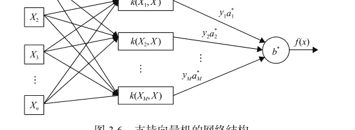

图 3.6 支持向量的网络结构

### 2. 支持向量机在电力系统中的应用场景

### 1) 支持向量机在电力系统负荷预测中的应用

SVM 最初面向模式识别，其分类器具有一定泛化能力。引入不敏感损失后，该方法扩展到非线性回归估计。正因回归侧的特性，SVM 表现出预测能力强、收敛快且易得全局最优等优势，在电力负荷预测领域受关注。大量研究显示，直接用 SVM 进行电力系统负荷预测，精度和速度均有提升，整体效果明显改善。

以负荷、气温等数据为训练样本，用 SVM 做短期负荷预测并与多层反向传播神经网络对比，短期预测效果更佳。同样，SVM 用于船舶电力负荷短期预测也取得较好结果。

### 2) 支持向量机在电力系统故障识别、定位中的应用

目前 SVM 常用于变压器故障识别、汽轮发电机组故障诊断、高压输电线路故障定位及线路参数精细定位等。

多级 SVM 在变压器故障识别分类器中呈现识别率高、训练耗时短且无局部极小值的优点。应用于汽轮发电机组故障诊断，可对多种故障进行准确辨识。在高压输电线故障定位中，算法基于测量的电压电流构建预测网络给出大致位置，随后分析该位置邻近区域的高频特性对初值进行修正。

### 3) 支持向量机在电力系统暂态稳定评估中的应用

暂态稳定评估对电力系统安全运行至关重要。有研究提出结合装袋与近似推理的暂态稳定评估模型，对未知样本进行精确推理。IEEE 39 节点测试系统的验证表明该方法有效，相较广义回归神经网络具有更高的稳定性和预测精度。另有研究设计用于暂态稳定分类的 SVM，将样本划分为稳定、不稳定和边界三类，与传统 BP 神经网络相比降低了误分率，提升了评估可靠性。

## 3.3 深度学习

深度学习是机器学习的新方向，使机器学习更接近人工智能初衷。该概念源于人工神经网络研究，含多隐层的多层感知器即为深度结构。深度学习通过逐层组合低层特征形成抽象的高层表征，以揭示属性或类别，从而挖掘数据的分布式规律。其动机是构建模拟人脑并具备分析学习能力的网络，用以解释图像、声音、文本等数据。

早期电力系统负荷预测多采用多元线性回归，虽然能大致预测出力，但负荷受天气、社会活动等多因素影响且存在强非线性，导致精度不足并易出现过拟合。人工神经网络作为一种分析手段，已成功应用于电力系统负荷预测并展现出良好前景。若在电力行业大规模推广，可大幅节省成本并延长系统使用寿命。

人工神经网络是一种大规模并行处理的非线性系统，依据数据内在关联建模，具有良好适应性、自学习能力和较强抗干扰能力。它是模仿脑神经信息处理智能的重要研究方向，主要用于计算机智能决策以提升感知预测精度，下面作详细阐述。

## 3.3.1 神经元与神经网络

人脑是自然界的最高级产物，思维由人脑实现，是人类智能的核心体现，人类智能多样且分层。科学家借鉴人脑结构与功能设计出具备一定智能的机器，使其拥有类人的信息处理能力，以完成人类可完成的任务。

人工神经网络是对生理学上真实人脑神经网络的结构、功能及基本特性进行抽象、简化与模拟的信息处理系统，由大量神经元经丰富连接构成自适应非线性系统。因连接方式不同，可形成形态各异的网络系统。

- 1. 生物学领域的神经元

人类智能依赖大脑，大脑由大量神经元和神经细胞构成，每个神经元可视为小型处理单元，多单元连接共同构成大脑网络。

神经元由细胞体、树突、轴突和突触组成，树突为信息输入端，轴突为信息输出端。突触包含突触前膜、突触间隙、突触后膜三部分。当神经末梢传来冲动时，突触前膜释放化学物质，经间隙与突触后膜受体结合引发新冲动，从而实现兴奋在神经元间的传递。神经元结构如图 3.7 所示。

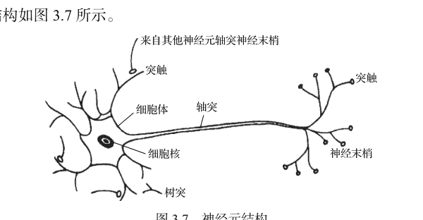

### 2. 人工神经网络原理

人工神经网络源于 McCulloch 与 Pitts 于 1943 年提出的“似脑机器”思想，该机器可依据生物神经元特性互联构建，是神经网络的雏形。他们构建了表征大脑基本组成的形式神经元模型，对逻辑操作具有通用性。20 世纪 60 年代 Widrow 提出自适应线性单元，Steinback 等提出学习矩阵。70 年代 Grossberg 提出若干新型线性动态系统结构，Kohonen 基于神经元自组织模式开展组织映射研究。1982 年，加州理工学院物理学家 Hopfield 提出 Hopfield 神经网络模型，引入“计算能量”概念并给出稳定性判据。

### 1) 人工神经元

人工神经元是人工神经网络的基本信息处理单元，也是设计基础。人工神经元模型如图 3.8 所示。

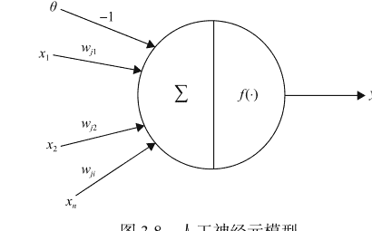

图 3.8 人工神经元模型

1943 年美国心理学家 McCulloch 与数学家 Pitts 提出的形式神经元数学模型，简称 MP 模型，由多个输入 $x$ 与一个输出 $y$ 组成。中间状态由加权和表示，输出为

y_j(t) = f(\sum_{i=1}^{n} w_{ij} x_i - \theta_j)  (3.26)

式中，$\theta_j$ 为阈值；$w_{ij}$ 为连接权值；$n$ 为输入信号个数；$f(\cdot)$ 为激励函数。

激励函数刻画输入与输出的关系，不同激励对应不同神经元模型。常见模型有：

- (1) 阶跃函数：该类神经元无内部状态，激励为阶跃函数，用以描述激活值与输出的关系。

$$f(x)=\begin{cases}1, & x \ge x_{0} \\ 0, & x < x_{0}\end{cases}\tag{3.27}$$

（2）分段线性函数：分段线性函数是一种简便的非线性函数，因实现简单而被采用。

$$f(x)=\begin{cases}1, & x>1 \\ x, & -1\le x\le 1 \\ -1, & x<-1\end{cases}\tag{3.28}$$

（3）非线性转移函数：这是连续型神经元模型，输出为具有上限的非线性函数，输出值在一定区间连续，输入输出特性常以 S 型函数表示，反映饱和特性。

$$f(x)=\frac{1}{1+e^{-x}}\tag{3.29}$$

（4）双曲正切函数：取双曲正切时饱和值为 1 与 -1。

$$f(x)=\frac{1-e^{-x}}{1+e^{-x}}\tag{3.30}$$

从生理学角度看，阶跃函数即阈值型最符合人脑神经元特点，人脑神经元正是通过电位高低两种状态反映兴奋与抑制。

当 MP 模型引入延时效应时可表示为

$$y_{j}(t)=f\left(\sum_{i=1}^{n}w_{ij}x_{i}(t-t_{ij})-\theta_{j}\right)\tag{3.31}$$

式中，$t_{ij}$ 为突触延时。式（3.31）具有以下特征：

- ① 神经元活动遵循 “0/1” 规律。
- ② 神经元为 “多入/单出” 单元。
- ③ 具有 “空间整合” 与 “阈值” 作用，表示为
- ④ 所有神经元工作规律相同且恒定，并取决于突触延时 $t_{ij}$。

$$y_{j}(t)=\begin{cases}1, & \displaystyle\sum_{i=1}^{n}w_{ij}x_{i}(t-t_{ij})-\theta_{j}\ge 0 \\ 0, & \displaystyle\sum_{i=1}^{n}w_{ij}x_{i}(t-t_{ij})-\theta_{j}<0\end{cases}$$

- ⑤ 神经元的突触延时 $t_{ij}$ 为常数。
- ⑥ 未考虑时间整合作用，未考虑不应期。

### 2) 人工神经网络的结构

多层神经网络由输入层、隐层和输出层构成。

每一层由单元组成，输入层接收训练集中实例特征向量，按连接权重逐层向前传递。输入与输出各只有一层，隐层数量可任意。层数统计不含输入层，例如含 2 个隐层的网络称为 3 层网络。作为多层前馈网络，理论上在隐层足够多且样本充足时，可逼近任意方程。

神经网络既可用于分类也可用于回归。

(1) 单层神经网络：若干神经元并联构成单层网络，又称感知器。如图 3.9 所示，其中有 2 个输入 $x1、x2$，连接权重分别为 $w1,1、w1,2、w1,3、w2,1、w2,2、w2,3$。输入与权重相乘求和作为 $y$ 单元输入，$y$ 单元为函数 $f$。

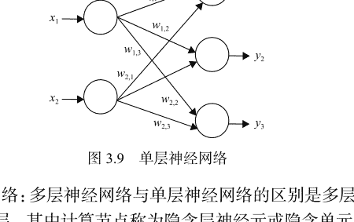

(2) 多层神经网络：与单层网络的区别在于含有一个或多个隐层，其计算节点称为隐层神经元或隐单元，如图 3.10 所示。在多层网络中，输出作为下一层输入，仍是输入乘权重后求和。

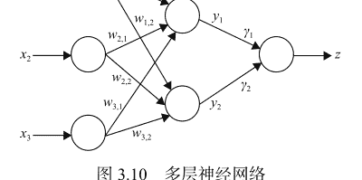

(3) 反馈神经网络：反馈网络是一种将输出经一步时移再接入输入层的系统，如图 3.11 所示。在此类网络中，每个神经元同时把自身输出反馈给其他神经元，需运行一段时间方能达到稳定。

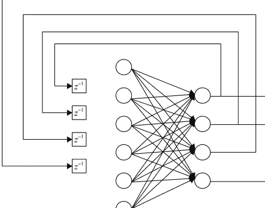

图 3.11 反馈神经网络

## 3.3.2 卷积神经网络

卷积神经网络是一类含卷积计算且具有深度结构的前馈网络，是深度学习的代表算法之一。卷积神经网络具备表征学习能力，可按层级结构对输入信息进行平移不变分类。

### 1. 卷积神经网络的理论基础

卷积神经网络由卷积层、池化层和全连接层组成，原始图像经卷积与池化处理后进入全连接层输出，下面分步介绍。

1) 卷积层

卷积层的目的是从输入图像中提取关键特征，卷积核是卷积层的重要部件，在处理中起到扫描作用，输入数据经多次扫描后重要特征被提取。

假设有一幅像素为 $32×32×3$ 的图像，其中 $32×32$ 表示长宽，3 表示三通道 RGB。将卷积核定义为 $3×3×3$ 的区域，前两个 3 为长宽，最后一个 3 为通道数。简化示例使用 $5×5×1$ 单通道图像作卷积操作，其过程如图 3.12 所示。

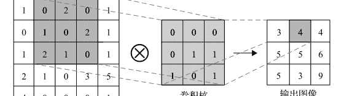

图 3.12 卷积过程

通常采用正方形卷积核遍历图像每个像素点，对应像素值与卷积核权重相乘求和再加上偏置。卷积层计算公式为

$X_j^l = f\left(\sum_{i\in M_j} X_i^{l-1} * K_{ij}^l + b_j^l\right)\quad(3.32)$

式中，$X_j^l$ 为第 $l$ 层的第 $j$ 个值；$K_{ij}^l$ 为卷积核函数；$*$ 为一维卷积运算；$b_j^l$ 为偏置参数；$M_j$ 为输入特征选择集合，可从中选取组合作为输出特征图；$f(\cdot)$ 为激励函数。

卷积核每滑动一次产生输出图像的一个值，从左上角滑到右下角结束，输出边长计算公式为

输出图像边长 = $\frac{\text{输入图像边长} - \text{卷积核边长} + 1}{\text{步长}}$\quad(3.33)

为使输出尺寸与输入保持一致，通常对输入图像外围进行全零填充 padding，使卷积核能覆盖全部像素，其过程如图 3.13 所示。

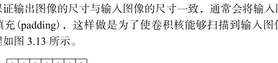

图 3.13 全零填充卷积过程

padding { same 输入图像边长 / 步长 ; valid (输入图像边长 - 卷积核边长 + 1) / 步长 }, 向上取整 (3.34)

式中，same 表示全零填充；valid 表示不使用全零填充。

当通道数为 3 时，卷积过程如图 3.14 所示。

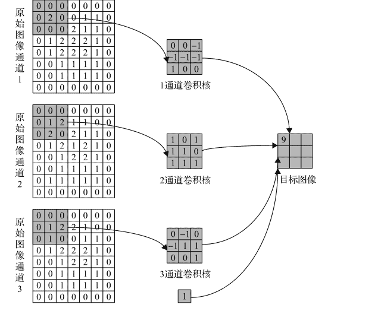

图 3.14 三通道卷积过程

三通道卷积与单通道类似，每个通道输入匹配一个卷积核，三层核套在三色图像上，重合的 27 个像素加权求和后加上偏移 $b$，即为输出图像的数值。

2) 池化层

输入图像像素众多，经卷积提取特征后数据量仍大，池化层通过剔除特征图不重要样本有效缩小尺寸。常用方法有最大池化和均值池化，最大池化利于纹理提取，均值池化利于保留背景特征。

与卷积层类似，池化过程也需一个 $2×2$ 的池化核提取原特征图特征，但该核不含可学习参数，与输入图像进行

采用 2×2 的池化窗口配合步长 2 做下采样，特征图的高度和宽度各缩小一半，像素总量只剩下原来的四分之一。最大值池化是在每个 2×2 小块里挑出数值最大的那个作为该块的输出，对应图 3.15 (a)。平均值池化的做法与之相近，区别在于用小块内部所有元素的均值来代表该块，对应图 3.15 (b)。

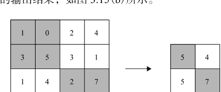

(a) 最大池化过程

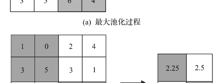

(b) 均值池化过程

图 3.15 池化过程

3) 全连接层

卷积与池化堆叠之后，一般会接上一个或多个全连接模块。在 CNN 结构里，这个模块主要承担分类决策，把前面产生的分布式表征映射到样本标签空间，并把卷积与池化阶段提取到的具类别区分性的局部信息进行整合。层内的神经元激励通常选用 ReLU，最后的类别判断多采用 softmax 回归，因此常被称作 softmax 层。缺点是参数规模容易急剧膨胀，导致训练变慢且过拟合风险升高，目前大量网络已对该部分大幅精简甚至完全去掉。

### 2. 卷积神经网络在电力系统中的应用场景

- 1) 应用卷积神经网络的电力系统短期负荷预测

短期负荷在统计上可近似为平稳随机过程，而中长期负荷受国家政策、经济走势等宏观因素影响，波动明显，不具备平稳性。负荷还受天气、社会活动等多重因素驱动，非线性特征突出。CNN 在非线性建模、精度以及抗过拟合方面表现较好，因而更适合短期负荷预测而不是中长期预测[12]。

- 2) 应用卷积神经网络的电力设备识别

电网长期安全稳定运行的基础是设备正常，定期巡检必不可少。传统巡检方式耗时耗力、效果有限。随着人工智能与图像处理技术成熟，CNN 可用于设备运行状态检测。通过对数据集进行训练和测试，能够实现设备位置自动定位、指针式仪表自动读数以及运行状态自动判别，有效弥补传统方法的不足。

- 3) 应用卷积神经网络的电力系统小干扰稳定评估

随着系统规模扩大，仅靠传统数值方法求特征值来做小干扰稳定评估已难以满足实时性要求。有研究提出一种基于深度学习的 CNN 方案，以广域测量系统可观测变量为输入、关键特征值为输出，经预处理后让深层结构学习两者映射。为缓解高维与训练缓慢的问题，采用离散余弦变换与 GPU 并行加速。基于历史数据离线训练后，在控制参数不变的条件下，能够较准确地计算出系统的关键特征值。

## 3.3.3 循环神经网络

循环神经网络 recurrent neural network, RNN 是一类以序列数据为输入、在时间方向上递归、循环单元链式连接的递归网络。相关研究起源于二十世纪，二十一世纪初发展为深度学习的重要分支。它具备记忆性、参数共享与图灵完备等特性，对序列非线性特征的学习有优势，在机器翻译、语音识别等领域应用广泛，在电力领域多用于负荷预测。

### 1. 循环神经网络的理论基础

标准循环神经网络与长短期记忆网络 long short-term memory network, LSTM 是常见代表，下面分别介绍。

1) 标准循环神经网络

与普通前馈网络相比，标准 RNN 结构更复杂，为增强时序相关性在隐层引入了循环单元，如图 3.16 所示。

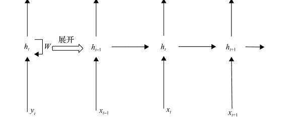

图 3.16 标准循环神经网络

由此可得

$h_t = f(W_{xh}x_t + h_{t-1})$  (3.35)

$y_t = g(W_{hy}h_t)$  (3.36)

式中，$x_t$ 为 $t$ 时刻的输入向量；$y_t$ 为 $t$ 时刻的输出向量；$h_{t-1}$ 为 $t-1$ 时刻的状态向量；$W_{xh}$ 为输入层到隐含层的权重矩阵；$W_{hy}$ 为隐含层到输出层的权重矩阵；$f(\cdot)$ 为隐含层的激励函数；$g(\cdot)$ 为输出层的激励函数。

激励函数会显著影响性能。隐含层常用 sigmoid、tanh 与修正线性单元。输出层常用 linear 与 softmax，公式如下：

linear$(x) = a x$, $a \neq 0$  (3.37)

softmax$(x_i) = \frac{e^{x_i}}{\sum_{k=1}^{K} e^{x_k}}$  (3.38)

式中，$x_i$ 为 $x$ 的第 $i$ 个分量，$i$ 与 $k$ 的取值范围是 $\{1,2,\cdots,K\}$，$K$ 为输出神经元的个数。

2) 长短期记忆网络

LSTM 由 Hochreiter 与 Schmidhuber 于 1997 年提出，属于 RNN 的一种，其隐层结构更为复杂。传统 RNN 的隐单元仅为简单的 tanh 或 ReLU，在参数学习时容易出现梯度消失或爆炸，削弱长期时序相关能力。为克服这一缺陷引入 LSTM。当远期信息不再需要时，单元可以遗忘旧状态并把新数据送入下一单元更新状态，通过调节权重让序列中部分时刻对当前时刻产生影响，提升对长延迟的敏感度，从而捕捉任意时间状态间的关联[13]。

神经元内部结构如图 3.17 所示。输入有当前网络输入值 x_t、上一时刻输出值 h_{t-1} 和上一时刻单元状态 C_{t-1}。输出有当前时刻输出值 h_t 和当前时刻状态 C_t。

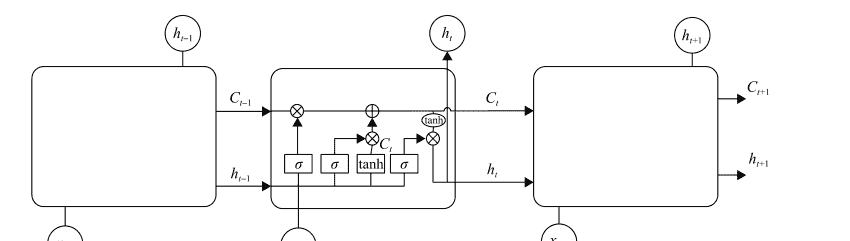

图 3.17 长短期记忆网络的神经元内部结构

LSTM 用三个门来控制单元状态：遗忘门、输入门和输出门。门的作用是让信息选择性通过，实现对单元状态的增删。

门结构可表示为

g(x)=σ(Wx+b)  (3.39)

式中，W 为门的权重矩阵；b 为偏置；σ 为 sigmoid 函数，其输出为 0～1 的一个概率值，用来描述有多少信息可以通过，0 表示完全阻断，1 表示完全通过。

- (1) 遗忘门。

遗忘门决定是否保留上一时刻细胞状态，即在传输时选择丢弃哪些信息。把 h_{t-1} 和 x_t 拼接后经 sigmoid 得到 0～1 的遗忘因子，再与细胞状态 C_{t-1} 相乘完成遗忘。

公式为

$f_t = \sigma(W_f \cdot [h_{t-1}, x_t] + b_f)$

(3.40)

式中，σ为 sigmoid 函数；W_f为遗忘门的权重矩阵；[h_{t-1}, x_t]为两个向量的连接；b_f为遗忘门偏置；h_{t-1}为前一时刻的输出值；x_t为当前时刻的输入值。

遗忘门的位置及结构如图 3.18 所示。

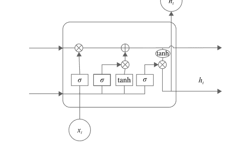

图 3.18 遗忘门的位置及结构

- (2)输入门。

输入门把即时状态转化为长期状态，包含更新单元状态与生成新单元状态两部分。更新单元状态由 sigmoid 层决定哪些值需要更新，tanh 层生成新的候选值向量 C_t。极端情况下 sigmoid 输出为零，单元状态不更新。

更新单元状态公式为

$i_t = \sigma(W_i \cdot [h_{t-1}, x_t] + b_i)$

(3.41)

式中，W_i为输入门的权重矩阵；b_i为输入门的偏置。

生成新单元状态公式为

$C'_t = \tanh(W_C \cdot [h_{t-1}, x_t] + b_C)$

(3.42)

生成过程为把 C_{t-1} 与 f_t 相乘丢弃不需要的部分，再加上 i_t C'_t 的更新量。

更新单元状态公式为

$C_t = f_t C_{t-1} + i_t C'_t$

(3.43)

输入门结构如图 3.19 所示。

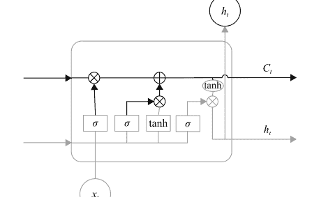

图 3.19 输入门结构

- (3)输出门。

输出门基于新状态产生当前输出。先用 sigmoid 层决定输出比例，再把单元状态 C_t 送入 tanh 层，两者相乘得到最终输出。

公式为

$o_t = \sigma(W_o \cdot [h_{t-1}, x_t] + b_o)$  (3.44)

最终输出为

$h_t = o_t \tanh(C_t)$  (3.45)

LSTM 具有如下特点：

- ① 对序列的本机支持。LSTM 将序列数据作为输入，后续观察必须作为网络的数据特征。
- ② 多变量输入。LSTM 直接支持多变量输入的多个并行输入序列。
- ③ 矢量输出。与其他神经网络一样，LSTM 能够将输入数据直接映射到可表示多个输出时间步长的输出向量。

### 2. 循环神经网络在电力系统中的应用场景

1) 应用循环神经网络的电力系统负荷辨识

负荷模型难以精确建立，负荷非线性动态仿真复杂。有学者提出基于径向基循环神经网络的负荷建模方法，结合 RNN 对时间序列的学习能力和径向基网络结构自适应快速收敛的优点，构建新的综合负荷模型。应用于典型新英格兰测试系统，验证了该模型在负荷辨识上的有效性和准确性。

2) 应用循环神经网络的电力系统短期负荷预测

过往负荷预测多用前馈人工神经网络、支持向量机等，网络无记忆单元，忽视时序数据的时间相关性。LSTM 可学习长短期依赖，含时间记忆单元，适合处理时间序列的间隔与延迟事件。学者利用张量流深度学习框架构建 LSTM 模型，对电力负荷时序数据做回归预测，帮助调度人员更清晰把握未来负荷波动，实施更有针对性的调度。

3) 应用循环神经网络的电力系统稳定性评估

电网规模扩大使稳定性更难掌控。跨区互联虽能优化资源、带来经济效益，但网架变化导致非线性特性更复杂。多次大面积停电表明，电压等级提升、联网扩大、传输容量增加都会放大故障危害，原因过程更复杂。实时在线监测、分析和控制需求迫切。传统时域评估计算量大、耗时长，不适合在线评估。人工神经网络善于处理复杂未知非线性系统，能捕捉电力系统动态特性。当前 RNN 广泛应用于非线性系统处理，电网结构变化时可有效提升稳定性分析的精度与效率。

## 3.4 强化学习

强化学习又称再励学习、评价学习或增强学习，是机器学习研究热点，较多用于对弈、决策和控制等领域，主要实现决策优化。3.4.1 节介绍基本概念及主要研究方向，3.4.2 节和 3.4.3 节分别介绍马尔可夫算法和 Q 学习算法并讨论实现方法。

### 3.4.1 强化学习的基本概念及主要研究方向

### 1. 强化学习的基本概念

强化学习源于动物学习、参数扰动自适应控制等理论，智能体以试错方式学习，通过与环境交互获得奖赏来指导行为。目标是动态调整参数以获得最大强化信号。学习状态到行为的映射，使选择的行为能获得环境最大奖励，外部环境对学习系统的评价达到最优。其基本原理框图如图 3.20 所示。

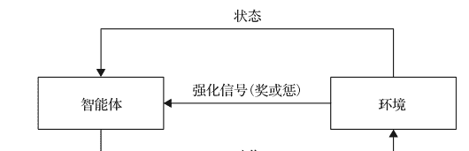

图 3.20 强化学习基本原理框图

由原理图可知，强化学习把学习看作试探评价过程。智能体选择动作作用于环境，环境状态随之变化并产生强化信号反馈给智能体，智能体据强化信号和当前状态再选下一个动作，原则是增大受正强化概率。动作不仅影响即时强化值，也影响环境下一时刻状态及最终强化值。

强化学习不同于连接主义的监督学习，主要体现在强化信号上。强化信号是对动作好坏的评价，通常为标量，而非告诉系统如何产生正确动作。由于环境信息有限，系统必须靠自身经历学习。通过这种方式，系统在行动-评价环境中获得知识，改进行动方案以适应环境。

### 2. 强化学习的主要研究方向

- 1) 深度强化学习

传统强化学习在简单场景效果不错，现实问题复杂，状态空间和动作空间维数很高，表格型方法不再适用。随着深度学习兴起，二者结合受关注。DeepMind 研究组把感知与表征能力强的深度学习与决策能力强的强化学习结合，形成新热点。原理框架如图 3.21 所示。

由图可知，学习过程为：每个时刻智能体与环境交互得到高维观察，用深度学习感知观察得到状态特征表示。基于预期回报评价各动作价值函数，通过强化学习决策把当前状态映射为动作。环境对此动作反应并给出下一个观察，如此循环，得到最优策略。

最具代表性的算法是深度 Q 网络，用深度神经网络替代传统 Q 表，适用于状态空间极复杂的场景。将当前状态作网络输入，输出端给出动作，更新网络参数，利用经验回放机制减小数据相关性，缩短训练时间。

DQN 优化时每次选取下一个状态最大 Q 值对应的动作，会带来过估计。van Hasselt 等基于双 Q 学习提出深度双 Q 网络。算法含两套参数网络：当前值网络和目标值网络，当前值网络选动作，目标值网络评估动作，分离选择与评估，有效降低 Q 值过估计风险。

DQN 成功后，DeepMind 的 Timothy 等把深度神经网络与确定性策略结合，提出深度确定性策略梯度算法。算法用深度神经网络表示策略，采用策略梯度更新策略，同时具备确定性策略算法和深度学习的优点，实际应用中往往带来更有效学习过程[14]。

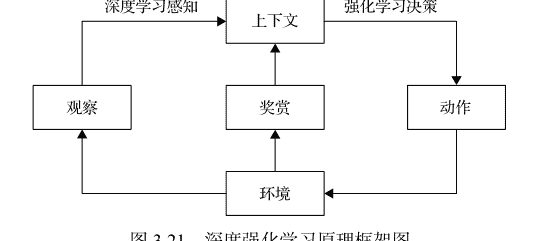

深度 Q 网络，适用于状态空间非常复杂的场景。将当前状态值作为神经网络的输入，输出端输出所要采取的动作，对神经网络的参数进行更新，利用经验回放机制减小了数据之间的相关性，缩短了训练时间。

## 2) 元强化学习

元学习的目标是学会学习，从一系列学习任务中训练模型，面对新任务时只需少量样本即可快速学习。其思想是把同一系列任务的内在特征分为通用特征和高敏感特征。实验中通过最小化方差得到通用特征，面对新任务时只需少量样本学习灵敏特征。

深度学习对大数据的依赖制约了深度强化学习发展，为实现小样本学习，元强化学习受关注。框架最早由 Schmidhuber 等提出。Jane X Wang 等结合深度学习与元强化学习提出深度元强化学习概念，用神经网络实现对强化学习任务的快速学习。

大部分研究假设环境不变，但现实环境常变，策略需不断调整以适应变化。Chelsea 等提出一种模型未知的元学习算法，不针对特定模型，采用梯度下降更新，面对新任务微调后可获得较好泛化。Maruan 等把 MAML 模型无关元学习算法与循环神经网络结合，实现强化学习模型在动态环境中的策略自适应。

元强化学习被视为最有可能实现通用人工智能的方式。DeepMind 先用深度学习复现大脑导航功能，再利用元强化学习框架探索研究了大脑中的多巴胺在学习过程中所发挥的作用，帮助解释神经科学和心理学现象，也说明元强化学习与人类智能的紧密联系。

## 3) 逆向强化学习

强化学习追求的是让智能体在交互试错中习得使长期累计收益期望尽可能大的行为。现实里收益函数的构造往往需要人工先行设定，面对复杂任务时合理的收益却难以直接给出，而收益设计的优劣会直接制约最终策略的好坏。为破解这一难题，吴恩达等人提出逆向强化学习的思路：专家在完成任务时的决策通常已属最优或接近最优，缺少显式收益时可以从专家的示范轨迹中反推出潜在的收益规律。

目前逆向强化学习的研究大体集中于学徒学习、最大边际规划、结构化分类以及概率建模几条路线。Abbeel 等提出的学徒学习采用函数逼近的方式从专家样本中估计收益，使得在该收益下求得的最优策略与专家策略保持邻近，主要用以缓解退化和收益歧义问题。最大边际规划的目标是寻找状态到收益的映射，使专家策略的累计收益明显高于其他备选策略，从而让最优策略逼近专家行为。Klein 等提出的结构化分类把策略优化视作分类问题，以专家期望特征构造收益函数，避免了反复迭代。最大边际规划与结构化分类容易出现多重收益对应同一专家策略的现象，Ziebart 等随后引入最大熵与交叉熵两类概率模型来削弱这种模糊性。

当状态维度较高时传统逆向强化学习的可扩展性受限，结合深度学习后效果明显提升。用深度神经网络替代模型中的状态与动作表征，算法在大型复杂任务中更为稳健，代表性工作包括基于最大边际的深度逆向强化学习、结合深度Q网络的逆向强化学习以及基于最大熵模型的深度逆向强化学习。

## 3.4.2 马尔可夫算法
学界长期形成的面向大多数强化学习问题的建模框架就是马尔可夫决策过程。

### 1. 马尔可夫算法的理论基础
马尔可夫性指系统的下一时刻情境 S_{t+1} 只取决于当前情境 S_t，与更早的历史无关，即满足 p(S_{t+1} | S_t) = p(S_{t+1} | S_1, ..., S_t) 时成立，已知当前情境后历史不再提供额外信息。单步性质由马尔可夫性刻画，序列性质则借助随机过程描述。若随机变量序列中每个情境都具备马尔可夫性，则该过程称为马尔可夫过程。

马尔可夫过程可记为二元组 (S,p)，S 为有限情境集合，p 为转移概率，转移概率矩阵写作

P = \begin{bmatrix} p_{11} & \cdots & p_{1n} \\ \vdots & & \vdots \\ p_{n1} & \cdots & p_{nn} \end{bmatrix}

强化学习的基本交互本质就是马尔可夫决策过程，它是当前理论推导的基石，可用于对问题建模。

马尔可夫决策过程如图 3.22 所示，可用四元组 {S,a,p,r} 表示，其中：

- 1. S 为环境所有情境的集合，S_t ∈ S 表示智能体在 t 时刻所处的情境。
- 2. a 为智能体可执行的动作集合，a_t ∈ a 表示 t 时刻采取的动作。
- 3. p 为状态转移概率，S×a×S→[0,1] 为状态转移概率密度函数，S_{t+1} ~ p(S_t, a_t) 表示在当前动作下转移到下一情境的概率。
- 4. r 为收益函数，r_t 表示智能体在情境 S_t 执行动作 a_t 所获得的即时收益。

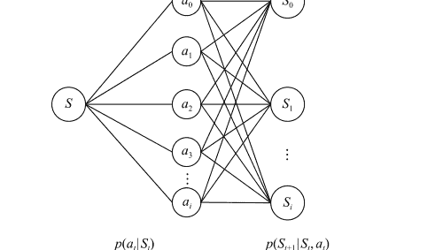

图 3.22 马尔可夫决策过程

强化学习的关键在于策略，即在不同情境下如何行动。理想情况下每个行动都应服务于长期收益最大化，价值函数用于衡量行动对最终目标的贡献。

先定义策略 π，S→a 为情境到动作的映射，表示智能体在 S_t 选择并执行 a_t，以概率 p(S_t, a_t) 转移到 S_{t+1}，并获得环境反馈的奖赏 r_t。假设未来各时刻的即时奖赏均乘以折扣因子 γ，则从 t 时刻起的累计奖赏 R_t 为

$R_t = r_t + \gamma r_{t+1} + \gamma^2 r_{t+2} + \cdots = \sum_{i=0}^{\infty} \gamma^i r_{t+i+1}$  (3.46)

式中 $\gamma \in [0,1]$，用于平衡未来奖赏对累计奖赏的影响。

随后寻找最优情境动作值函数。若在 S_t 执行 a_t 后始终遵循策略 π 直到结束，所能获得的累计最优回报定义为

$Q^*(S,a) = \max E[R_t \mid S_t = S, a_t = a, \pi]$  (3.47)

该函数满足贝尔曼最优方程

$Q^*(S,a) = E_{S'S}[r + \gamma \max Q(S',a') \mid S,a]$  (3.48)

通过不断迭代更新情境动作值函数直至收敛，即可得到最优策略。

### 2. 马尔可夫算法在电力系统中的应用场景
### 1) 应用马尔可夫算法的电力系统负荷辨识
需求侧负荷形态多样、特性多变、种类繁多，传统辨识方法识别率偏低、建模困难且推广性差。有研究提出基于多参量隐马尔可夫模型的负荷辨识方法，以电流、有功功率、无功功率、功率因数四个负载特性参数作为观测向量，通过模型学习与多次迭代，求得与隐藏状态匹配的观测序列最大输出概率和最优状态序列，完成负荷辨识，准确率可达 95% 以上，尤其对小功率负荷识别效果良好[15]。

### 2) 应用马尔可夫算法的电力系统连锁故障预测
电力系统正向复杂化、集成化、智能化发展，连锁故障易引发大面积停电。受网络复杂性、故障关联性和系统不确定性影响，常规预测方法难以适用。有学者采用隐马尔可夫模型预测连锁故障，该模型能精确计算状态转移概率或断路器异常动作概率，实现逐级故障发生预测；对各模块退化状态，隐马尔可夫模型可准确识别并有效评估连锁故障发生的概率。

## 3.4.3 Q学习算法
Q 学习属于典型的模型无关方法。智能体在不掌握全局环境信息、仅知当前情境的情况下，构建从 S_t 到 S_{t+1} 的动作即时收益矩阵 R 来挑选动作，并由 R 推导出行动的 Q 矩阵。Q 值的更新与动作选择时所遵循的策略分离，即更新时考虑了下一情境的最大值，但选取动作并不依赖当前策略。算法目标是抵达目标情境并获取最高收益，且到达目标后总收益保持不变。

Q 学习始终偏向选择价值最高的行动，在实践中具有较强的探索性，大胆尝试的特点使其成为强化学习发展的重要里程碑。

### 1. Q 学习算法的理论基础
### 1) Q 值表与目标期望
强化学习包含智能体和环境两个主体。在环境情境 S_t 下，智能体选择动作 a_t 得到收益 r_t 并进入下一情境 S_{t+1}，交互过程如图 3.23 所示。

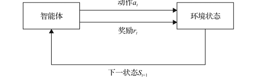

图 3.23 强化学习智能体与环境交互过程

Q 学习算法的核心是 Q 表，如表 3.1 所示，其行列分别对应情境 S 与动作 a，Q(S_i, a_j) 表示在情境 S_i 下执行动作 a_j 所能获得的收益，通过其衡量当前情境下某动作的价值高低。通过 Q 表获取 Q 值的示意如图 3.24 所示。

### 表 3.1 Q值表

|   | a₁ | a₂ | … | aₙ |

|---|---|---|---|---|

| S₁ | Q(S₁,a₁) | Q(S₁,a₂) | … | Q(S₁,aₙ) |

| S₂ | Q(S₂,a₁) | Q(S₂,a₂) | … | Q(S₂,aₙ) |

| S₃ | Q(S₃,a₁) | Q(S₃,a₂) | … | Q(S₃,aₙ) |

| ⋮ | ⋮ | ⋮ |  | ⋮ |

| Sₘ | Q(Sₘ,a₁) | Q(Sₘ,a₂) | … | Q(Sₘ,aₙ) |

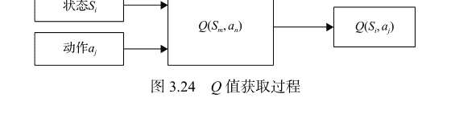

### 2) 贝尔曼理论
贝尔曼方程又称动态规划方程，由 Richard Bellman 提出，是求解最优化问题的必要条件。它以“初始选择报酬加上由此带来的后续决策问题价值”的形式描述决策问题在不同时点的取值。

### (1) 动态规划。
动态规划可用于资源分配、设备更新、最优搜索、马尔可夫决策过程、最优控制和自适应控制等，其主要特点为：

- ① 策略变量较多时，相较策略穷举法可降低维数。
- ② 对在给定定义域或约束条件下难以用微分方法求极值的函数，可用动态规划求解。
- ③ 对于不能用解析式表达的函数，可给出递推关系求数值解。
- ④ 多阶段决策过程为连续型时，动态规划与变分法处理问题相近。

动态规划原理可将变分法问题转化为多阶段决策问题，用贝尔曼方程求解。在最优控制理论中，动态规划方法比极大值原理更具普适性。

### (2) 贝尔曼方程。
首先介绍策略函数、情境价值函数和情境动作价值函数。

在情境 S 下采取动作 a 的策略记为 π(S)，称为策略函数。策略优劣可用情境价值函数 V_π(S)衡量，表示在情境 S(t) 下选择动作并与环境交互转到 S_{t+1} 过程中获得的收益累计：

$$V_{\pi}(S)=E_{\pi}[R_t \mid S_t=S]\tag{3.49}$$

$$R_t=\sum_{k=0}^{\infty}\gamma^k r_{t+k+1}\tag{3.50}$$

其中 r_{t+1} 表示由 S_t 到 S_{t+1} 获得的收益，γ 为衰减因子。

V_π(S) 用于评价情境，而 Q 值可同时评价情境与动作。情境动作价值函数 Q_π(S,a) 表示在情境 S(t) 下选择动作 a 并按策略 π(S) 与环境交互的累计收益期望：

$$Q_{\pi}(S,a)=E_{\pi}[R_t\mid S_t=S,a_t=a]\tag{3.51}$$

$$Q_{\pi}(S,a)=E_{\pi}\left[\sum_{k=0}^{\infty}\gamma^{k}r_{t+k+1}\mid S_t=S,a_t=a\right]\tag{3.52}$$

用贝尔曼方程求解动态规划问题即寻找最优策略并求解对应价值函数。最优价值函数是指在任意情境下数值均不小于其他价值函数在该情境数值者：

$$V^{*}(S)=\max_{x_{\pi}}V_{\pi}(S)\tag{3.53}$$

情境 S 的最优价值记为 V^{*}(S)，即在情境 S 下通过 Q 函数选择最优动作 a 可得价值 Q^{*}(S,a)：

$$V^{*}(S)=\max_{x_{a}}Q^{*}(S,a)\tag{3.54}$$

情境价值函数的贝尔曼方程为：

$$V_{\pi}(S)=\sum_{a}\pi(S,a)\sum_{S'}p_{SS'}^{a}\left[R_{SS'}^{a}+\gamma V_{\pi}(S')\right]\tag{3.55}$$

式中 p_{SS'}^{a} 表示前后情境转移概率，R_{SS'}^{a} 表示前后情境间收益值。

相应地，动作情境价值函数的贝尔曼方程为：

$$Q_{\pi}(S,a)=\sum_{S}\sum_{S'}p_{SS'}^{a}\left[R_{SS'}^{a}+\gamma\sum_{a'}Q_{\pi}(S',a')\right]\tag{3.56}$$

由式 (3.55) 和式 (3.56) 可得贝尔曼最优策略方程：

$$V^{*}(S)=\max_{x_{u}}\sum_{S}\sum_{S'}p_{SS'}^{a}\left[R_{SS'}^{a}+\gamma\sum_{a'}Q_{\pi}(S',a')\right]\tag{3.57}$$

### 3) 算法的基本流程
Q 学习算法流程如图 3.25 所示，主要步骤如下：

- (1) 初始化 Q 表。
- (2) 设置循环次数及每次步数。
- (3) 选择初始情境。
- (4) 选择当前情境下可能的操作。
- (5) 转移到下一情境。
- (6) 生成 Q 表并重复步骤(4)，更新 Q 表直至循环结束。

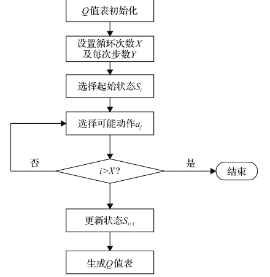

图 3.25 Q 学习算法的流程图

### 4) 深度强化学习算法原理
深度强化学习与 Q 学习同属基于值的迭代方法。普通 Q 学习适用于情境和动作空间离散且维数不高的情形，当维数高且连续时求解困难。结合深度神经网络提取复杂特征，用拟合函数替代 Q 表，即可寻找最优策略，这就是深度强化学习[16]。

实际应用中，环境情境较多时 Q 表规模庞大，可通过神经网络输入环境情境输出各动作下的 Q 值进行简化，简化过程如图 3.26 所示，得到深度强化学习算法的 Q 值网络如图 3.27 所示。

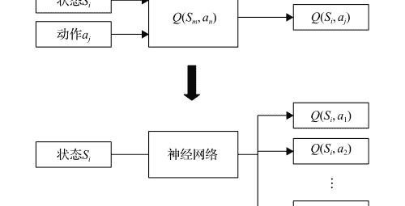

图 3.26 Q 值表简化过程

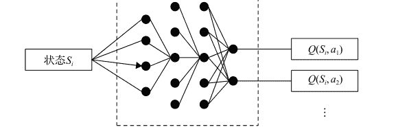

图 3.27 深度强化学习算法 Q 值网络

深度强化学习以神经网络作为 Q 值逼近函数，用 θ 表示权重和偏置，损失函数为：

$$L(S,a|\theta_i)\approx\left[r+\gamma\max_{a'}Q(S',a'|\theta_i)-Q(S,a|\theta_i)\right]^2\tag{3.58}$$

$$\theta_{i+1}=\theta_i+\alpha\nabla\theta L(\theta_i)\tag{3.59}$$

为避免样本相关性导致振荡或发散，深度强化学习采用经验回放和目标网络。经验回放将智能体与环境交互产生的经验 (S_t,a_t,r_t,S_{t+1}) 存入经验池 D，训练时随机抽样以削弱样本相关性；目标网络使用两个网络，一个与环境交互并持续更新，另一个隔一定时间才更新，其参数直接复制自当前网络。此时损失函数可定义为

$$L_i(\theta_i)=E_{(S,a,r,S')\sim D}\left[(y_i-Q(S,a|\theta_i))^2\right]\tag{3.60}$$

式中

$$y_i=r+\gamma\max_{a'}Q(S',a'|\theta^-)\tag{3.61}$$

算法流程用 Q(S,a|θ_i) 表示当前网络输出评估当前情境动作，用 Q(S',a'|θ^-) 表示目标网络输出。当智能体对环境采取动作 a 时计算 Q 并按损失函数更新当前网络参数，经过若干次迭代后将当前网络参数复制给目标网络，完成一次学习过程，其过程如图 3.28 所示。

### 2. Q 学习算法在电力系统中的应用场景
### 1) 应用 Q 学习算法的电力系统潮流智能调整
目前电网潮流调整多依赖工作人员经验，反复调试可调负荷出力才能使不收敛潮流收敛。该方法盲目性强、效率低、效果不佳，对操作者要求极高。为此有研究提出基于 Q 学习算法的电网潮流智能调整策略，通过自主尝试学习规律，挑选最优机组组合，将不收敛潮流调至收敛并使网损最小，克服了传统经验依赖的弊端，提高了调整效率和准确性[7]。

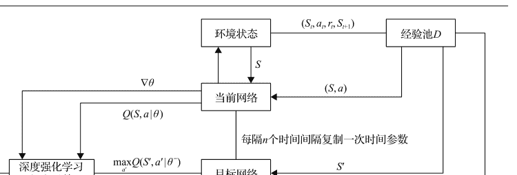

图 3.28 深度强化学习过程

### 2) 应用 Q 学习算法的电力通信网故障恢复
大规模自然灾害或恶意攻击可能导致智能电网电力通信网严重故障，若不能及时恢复将威胁系统安全稳定。在通信链路恢复资源受限的条件下，建立以失效业务数量恢复最大化为目标的链网大规模故障恢复模型。针对该模型，有学者提出基于强化学习的 Q 学习算法，利用链路恢复资源与故障链路在失效业务中的重要程度设置收益函数和选择规则，累计收益最大值，得到最优链路恢复组合，恢复更多失效业务。

## 3.5 本章小结
本章系统介绍了机器学习的基础概念、发展脉络以及理论基础与应用场景；重点阐述了贝叶斯算法、决策树算法、支持向量机等传统机器学习代表方法的原理与应用，以及深度学习中卷积神经网络和循环神经网络的基础与应用场景；同时对强化学习的马尔可夫算法和 Q 学习算法的理论基础与工程应用进行了梳理，为后续案例分析提供理论支撑。

## 应用篇
## 第4章 AI赋能的电力负荷与发电预测
本章围绕人工智能手段在电力系统负荷与发电侧预测中的落地展开，其中风电功率的LSTM预测、海水淡化系统负荷的PSO-LSVM预测以及工业用户负荷的形态聚类LightGBM预测分别在4.1～4.3节展开论述。

### 4.1 基于长短期记忆网络的风电预测
新能源大规模并网对电网安全与经济运行形成挑战，风电功率的高精度预报及合理利用成为热点。单点预测结合概率区间预测能够为爬坡事件、潮流优化与经济调度提供额外依据。电网运行对波动信息的诉求日益全面，单点值只能给出某一时刻的数值，无法体现不确定性，于是概率区间预测应运而生。该方法虽可扩大预测值的取值范围，却常伴随假设不合理、泛化能力弱以及不同方法导致误差来源不一致等问题。针对此，本节先用长短期记忆网络实现风电功率单点预测，随后提出基于LSTM的风电功率误差库构建方法以保证误差与预测方法匹配，并采用窗宽优化的非参数核密度估计降低误差影响[18]。

### 4.1.1 基于长短期记忆网络的单点值预测
传统循环神经网络易出现梯度消失或爆炸，长短期记忆网络作为其改进结构有效缓解了该问题。LSTM通过输入门、遗忘门和输出门三类门控实现信息筛选，其单元内部结构如图4.1所示。

可见不同于普通RNN，LSTM借助遗忘门的门控阈值对信息流进行分配，实现保留与丢弃，遗忘门的输出 $f_t$ 与当前输入 $x_t$ 的关系为：

$f_t = \sigma(W_f [h_{t-1}, x_t] + b_f)    (4.1)$

式中，$W_f$为遗忘门输入权重矩阵；$b_f$为遗忘门偏置；$\sigma(\cdot)$为激活函数，本节统一采用sigmoid函数。

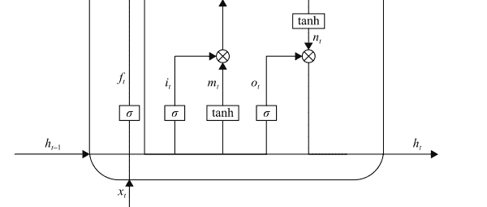

图4.1 长短期记忆网络的单元内部结构

引入经双曲正切激活的中间变量 $m_t$ 来决定输入门输出 $i_t$是否进入单元状态，二者关系为

$$m_t = \tanh(w_m [h_{t-1}, x_t] + b_m) \tag{4.2}$$ $$i_t = \sigma(w_i [h_{t-1}, x_t] + b_i) \tag{4.3}$$

式中，$w_m$、$w_i$分别为中间变量与输入门的权重；$b_m$、$b_i$为对应门控的偏置。

相较RNN，单元状态 $c_t$具有更强的长时间记忆能力，有效解决长间隔时序信息的提取难题。其表达式为：

$$c_t = c_{t-1} * f_t + i_t * m_t \tag{4.4}$$

在此基础上，当前时刻输出门的输出 $h_t$可表示为 $$h_t = o_t * \tanh(c_t) \tag{4.5}$$ $$o_t = \sigma(w_o [h_{t-1}, x_t] + b_o) \tag{4.6}$$ 式中，$w_o$、$b_o$分别为中间变量 $o_t$的输入权重与偏置。在风电应用中，将与功率相关性强的因子作为输入序列$\{x_t\}$，对应功率作为输出序列$\{f_t\}$。

### 4.1.2 基于窗宽优化的非参数核密度估计模型
风电功率点预测与误差分析中，获取误差概率密度函数PDF的途径主要有参数法与非参数法。参数法先假设先验分布再求解参数，非参数法不预设分布形态，直接依据数据特征刻画分布，表述更准确、适用范围更广。本节采用非参数法构建风电功率预测误差概率密度模型。

### 1. 非参数核密度估计
设风电功率预测误差样本为$p=\{p_1,p_2,\dots,p_n\}$，$n$为样本数。基于核密度估计原理的误差概率密度函数为

$$\hat{f}(p,h)=\frac{1}{nh}\sum_{i=1}^{n}K\left(\frac{p-p_i}{h}\right)\tag{4.7}$$

式中，$\hat f(p,h)$为误差概率密度函数；$h$为窗宽，决定分布区间划分；$p_i$为第$i$个误差样本；$K(p,h)$为核函数。

核函数选取与窗宽 $h$是影响估计质量的关键。常用核函数包括均匀核、伽马核、Epanechnikov核等。核选择对结果影响显著，文献也指出选择不影响渐近性质，本节选用高斯核，即

$$K(p)=\frac{1}{\sqrt{2\pi}}\exp\left(\frac{-p^{2}}{2}\right)\tag{4.8}$$

则误差概率密度函数可改写为

$$\hat{f}(p,h)=\frac{1}{\sqrt{2\pi}nh}\sum_{i=1}^{n}\exp\left(-\frac{1}{2}\left(\frac{p-p_i}{h}\right)^{2}\right)\tag{4.9}$$

### 2. 基于窗宽优化的模型
核密度估计中概率密度受窗宽制约。窗宽过小会放大局部波动，易受单点干扰；窗宽过大则使密度函数过度平滑，偏离真实分布。因此窗宽选取直接决定估计质量。

求窗宽常用均方误差MSE准则、平方误差积分ISE准则和均方积分误差MISE准则，前两者对单点与样本性质敏感，MISE具有更强的全局衡量能力。为避免不合适窗宽导致精度下降，本节采用MISE准则评估窗宽优劣：

$$\begin{aligned}\text{MISE}(h) &= E \int (\hat{f}(x)-f(x))^2 dx \\ &= \int (E\hat{f}(x)-f(x))^2 dx + \int \text{var}\,\hat{f}(x)dx\end{aligned}\tag{4.10}$$

式中右侧分解为期望偏差平方积分与估计方差积分两部分。

经偏差-方差分解并泰勒展开，得到MISE$(h)$表达式为

$$\text{MISE}(h)=\frac{1}{nh}R(K)+\frac{1}{4}h^4l^2(K)R(f'') + o\left(h^4+\frac{1}{nh}\right)\tag{4.11}$$

式中，$R(K)$为核函数平方积分；$l^2(K)$为核函数二阶矩。

其中$R(K)$与$l(K)$满足

$$R(K)=\int K^2(u)du\tag{4.12}$$

$$l(K)=\int x^2 K(x)dx\tag{4.13}$$

忽略高阶小量后得到渐近MISE AMISE，用于窗宽选择：

$$A(h)=\frac{1}{nh}R(K)+\frac{1}{4}h^4l^2(K)R(f'')\tag{4.14}$$

对式(4.14)中$A(h)$求导，令$\partial A(h)/\partial h=0$，可得最优窗宽

$$h_{\text{AMISE}}=\left(\frac{R(K)}{nl^2(K)R(f'')}\right)^{\frac{1}{5}}\tag{4.15}$$

### 4.1.3 误差数据库的生成及预测流程
概率区间预测多基于预测误差，但不同风电场采用的单点预测方法与数据差异较大，直接套用历史误差不可靠。本节利用LSTM模型，将历史数据集按8:2划分为训练集与备用集，从备用集中预留$M$个样本作测试集，其余作为误差生成集以构建误差数据库，流程如图4.2所示。

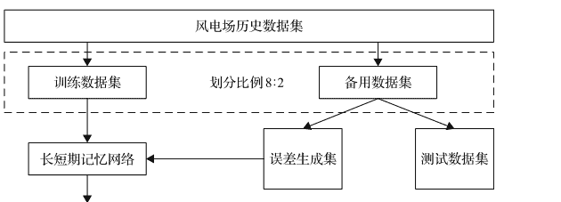

图4.2 风电功率预测误差数据的生成流程

风电功率及其影响因子量纲差异大，为加速训练并提升效果，采用如下标准化：

$$v' = \frac{v - v_{\min}}{v_{\max} - v_{\min}} \tag{4.16}$$

式中，$v$与$v'$分别为原始值与标准化值；$v_{max}$、$v_{min}$为该类数据的最大值与最小值。

单点预测与概率区间预测流程如图4.3所示。

对一组历史数据经标准化后，训练集用于训练LSTM，备用集中测试集用于检验，得到单点预测值$p^{pre}$。误差生成集产生的预测误差经非参数核密度估计得到误差概率密度函数与累积分布函数CDF，设定置信度后可得误差波动区间$[F_{\alpha/2},F_{1-\alpha/2}]$。据此上限与下限表示为

$$U^{\alpha} = p^{\mathrm{pre}} + F_{\alpha/2} \tag{4.17}$$

$L^{\alpha}=p^{pre}+F_{1-\alpha/2}$ (4.18)

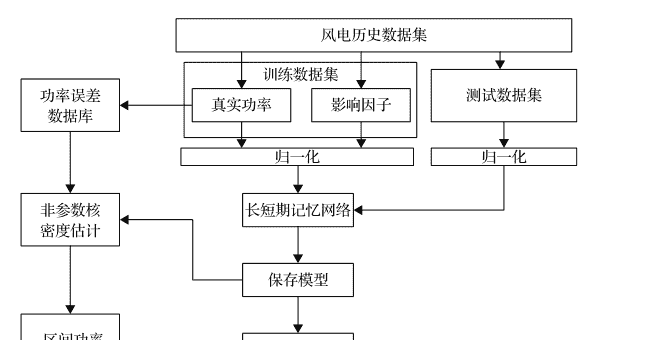

图4.3 风电功率的单点值预测及概率区间预测流程

### 4.1.4 仿真与验证
以美国国家可再生能源实验室提供的华盛顿地区风电历史数据为例，数据覆盖2012年全年，采样间隔5min，包含风速、风向、大气密度、气温、湿度与功率，经清洗后样本数为105019。按8:2划分训练集与备用集，测试集样本$M$取150，其余用于误差生成。实验环境为Intel Core i5-7300HQ、8GB内存的Windows Python环境，基于Keras构建LSTM预测模型[19]。

- 1. 风电功率的单点值预测结果
现有研究多聚焦BP神经网络与支持向量机，本节另引入Elman神经网络作对比。4种模型150个预测点的波动如图4.4所示，横坐标为5min间隔的连续采样点。

图示表明，相较BP、Elman和SVM，LSTM预测曲线的变化更平缓，在低频与高频波动下均保持较高精度。

为量化误差，选用平均绝对误差、平均绝对误差百分比与均方根误差：

$$M_{AE}=\frac{1}{n}\sum_{t=1}^{n}|\hat{y}_t - y_t| \tag{4.19}$$ $$M_{APE}=\frac{1}{n}\sum_{t=1}^{n}\left|\frac{\hat{y}_t - y_t}{y_t}\right|\times100\% \tag{4.20}$$ $$R_{MSE}=\sqrt{\frac{1}{n}\sum_{t=1}^{n}(\hat{y}_t - y_t)^2} \tag{4.21}$$

式中，$n$为样本数；$\hat y_t$、$y_t$分别为第$t$个样本的预测值与真实值。

各模型误差见表4.1。从表中可见，无论是$MAE$、$MAPE$还是$RMSE$，LSTM误差最低。BP与Elman易陷入局部最优，SVM基于结构风险最小化，受高维特征空间宽度影响难以找到最优超平面，效果有限。可见LSTM应用于风电功率预测具有显著优势。

表4.1 各模型预测误差

| 预测模型 | $M_{AE}$/kW | $M_{APE}$/% | $R_{MSE}$/kW |
|---|---|---|---|
| BP神经网络 | 196.376 | 2.445 | 217.932 |
| Elman神经网络 | 192.349 | 2.399 | 212.787 |
| 支持向量机 | 470.349 | 4.847 | 618.460 |
| 长短期记忆网络 | 67.627 | 0.855 | 76.215 |

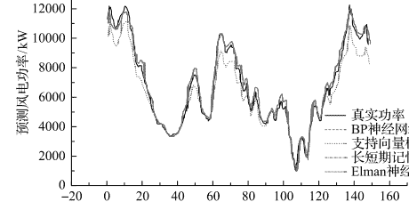

图4.4 四种模型的预测风电功率值

- 2. 风电功率的概率区间预测结果
已有工作常以功率点分布为对象，先按经验设定分布再求参数，该方法对特定场站可行，但受地理气象差异影响泛化性不足。

与功率点分布不同，预测误差分布受客观条件影响较小。非参数核密度估计无需假设误差分布，通过核函数与窗宽拟合，通用性强且更贴近真实。图4.5给出基于最优窗宽与随机窗宽的非参数估计，以及假设误差服从高斯分布的参数估计的概率密度函数，高斯模型均值10.21、标准差90.50。

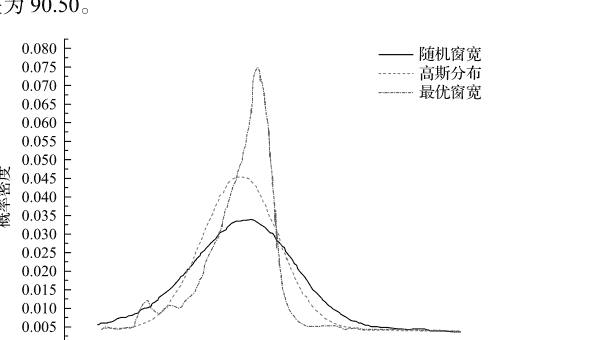

图4.5 风电功率预测误差概率密度函数

图4.5显示非参数估计拟合更优，更接近真实误差分布。进一步求得累积分布函数并基于分位点给出不同置信度的上下限，如图4.6所示。


图4.6 风电功率预测误差累积分布函数

基于最优窗宽的CDF，取分位点$\alpha/2=5\%$、10%与15%，得到90%、80%、70%置信度下的功率波动区间见表4.2。

表4.2 不同置信度下的预测功率波动区间（单位：kW）

| 置信度 | 预测功率波动区间 |
| --- | --- |
| 90% | [-276.168,142.302] |
| 80% | [-185.282,105.761] |
| 70% | [-123.838,88.539] |

结合表4.2误差区间与LSTM单点预测，可得150个测试样本在90%、80%、70%置信度下的预测区间，如图4.7～图4.9所示，横坐标采样间隔为5min。


图4.7 置信度90%的风电功率波动区间


图4.8 置信度80%的风电功率波动区间


图4.9 置信度70%的风电功率波动区间

## 4.2 基于PSO-LSVM的海水淡化系统负荷预测

# 淡水短缺下的海水淡化与负荷智能预测

全球人口持续攀升叠加气候格局变化，淡水供给缺口不断拉大，成为制约经济社会运行的关键卡点。海水淡化正逐渐成为缓解缺水的可行路径，沿海缺水区与岛屿地区的需求尤其迫切。早在十二五期间，我国就把海水淡化纳入战略性新兴产业重点培育范畴。如今一套淡化装置从取水到产水全流程耗电高昂、设备投入不低，市场化渗透率受限。好在海水淡化负荷具备较强的可调度性，与分布式可再生能源或电网联动后，利用可再生电力的零边际成本特性，能够显著降低运行经济性[20]。

针对淡化装置的典型用电特性，本文给出一种基于最小二乘支持向量机 LSSVM 的负荷预测方案，借鉴了电力系统依赖历史负荷与影响因素进行日负荷预估的做法。该思路同时兼顾了淡化负荷的多维表征、环境变量以及用水需求特征。借助粒子群优化对 LSSVM 的 γ 与 σ² 进行寻优，可在小样本场景下提升精度。先用灰色关联分析筛选出对负荷起决定作用的关键特征，再挑选与预测日最为接近的历史日构建小样本训练集，最终形成 PSO-LSSVM 预测算法。

### 4.2.1 海水淡化系统模型建立
海水淡化的本质是通过脱盐获得可用淡水，目前反渗透工艺因投资相对可控、能耗相对较低、运行简便，仍是全球主流。以下内容以最成熟的反渗透路线为例，其包含预处理的工艺流程见图 4.10。整体装置由给水泵、高压泵、RO 膜单元、回水泵、升压泵、能量回收设备及蓄水池构成，示意图见图 4.11。反渗透环节中耗电占比最高的是高压泵，因此机组的负荷预测实质上是对高压泵等核心用电设备的功率进行预估。


图 4.10 海水淡化工艺流程


图 4.11 海水淡化装置

### 4.2.2 海水淡化负荷求解方法建立
### 1. 特征量分析
淡化技术被广泛部署于生活岛、旅游岛、渔业岛、军事岛、沿海工业园区、居民区及商业区等多种场景，不同场景下驱动负荷的关键因子以用水需求和气温为主。以生活岛为例，负荷与居民作息习惯及气温条件高度相关；旅游岛则更多受气候与旅游旺季影响。本节聚焦温度与用水需求对负荷的驱动作用。

用于相似日筛选的表征包括温度归一化值、日用水映射值、给水泵/高压泵/升压泵时序功率对给水海水流速的映射、回水泵时序功率对淡水回水流速的映射，以及高浓度盐水流速对淡水回水流速的映射。上述指标综合反映了环境温度、日用水量、海水用量、淡水产出、电耗以及淡化效率等运行状态。温度归一化的计算式为：

$$T = \frac{T_i - T_{\min}}{T_{\max} - T_{\min}} \tag{4.22}$$

其中 i=1,2,…,n，n为历史天数；T_i 为第 i 日气温；T_min 与 T_max 分别为历史最低与最高气温。

日用水需求映射见表4.3。其余映射同样采用式(4.22)的归一化处理。

表 4.3 日用水需求的映射值

| 日用水需求/t | 映射值 |

|---|---|

| ≤500 | 0.4 |

| >500 | 0.7 |

### 2. 基于灰色关联分析的相似日选取方法
支持向量机类模型需要样本支撑，训练集存在信息冗余会延长训练时长并拉低精度，相似日筛选能够缓解该问题。早期常用人工经验，现有做法包括聚类分析、证据理论、趋势相似度与灰色关联分析等，本节采用后者。

将特征划分为历史样本与待测样本。设历史 n 天特征序列 X_m = (x_m(1),...,x_m(t))，待预测日序列 X_0 = (x_0(1),...,x_0(t))，m=1,2,…,n；t 为特征维度。

先求差序列 Δ = [Δ_m0,…,Δ_n0]，其中 Δ_m0=(|x_m(1)-x_0(1)|,…,|x_m(t)-x_0(t)|)，再求极值

Δ_max = max_n max_t (Δ)

Δ_min = min_n min_t (Δ)  (4.23)

关联度计算为：

γ(X_0, X_m) = (1/t) Σ_{k=1}^t [Δ_min + ρ Δ_max] / [Δ_m0(k) + ρ Δ_max]  (4.24)

其中 Δ_m0(k)=|x_m(k)-x_0(k)|；分辨率系数 ρ 取 0.5。

### 3. 最小二乘支持向量机模型
LSSVM 将不等式约束改写为等式约束，使二次规划转为线性方程求解，计算量下降、求解加快。给定数据集 {(x_i, y_i)}_{i=1}^l，其中 x_i 包含日用水映射、温度、给水/高压/升压泵功率对海水流速的映射、回水泵功率对淡水回水流速的映射、高浓度盐水流速对淡水回水流速的映射以及相似日负荷时序功率向量；y_i 为输出；l 为样本量。

淡化负荷属于非线性电机负荷，通用形式为

f(x) = (W, φ(x)) + b  (4.25)

其中 W 为可调权重向量；b 为超平面偏移。

依据统计学习理论，LSSVM 通过最小化目标函数确定回归式，即

$$J = \frac{1}{2}||W||^2 + \frac{1}{2}\gamma\sum_{i=1}^{l}e_i^2$$  

 s.t. $W^T\varphi(x_i)+b+e_i = y_i$  

 $i=1,2,\cdots,l$  

 (4.26)

其中 γ 为正则化系数；e_i 为残差，受正则化限制。

引入拉格朗日乘子可得

$$\min J = \frac{1}{2}||W||^2 + \frac{1}{2}\gamma\sum_{i=1}^{l}e_i^2 - \sum_{i=1}^{l}\lambda_i\left(W^T\varphi(x_i)+b+e_i-y_i\right)$$  

 (4.27)

对各变量求偏导归零得到

$$\begin{cases}\frac{\partial J}{\partial W}=0 \rightarrow W = \sum_{i=1}^{l}\lambda_i\varphi(x_i)\\\frac{\partial J}{\partial b}=0 \rightarrow \sum_{i=1}^{l}\lambda_i =0\\\frac{\partial J}{\partial e_i}=0 \rightarrow \lambda_i = \gamma e_i,\ i=1,2,\cdots,l\\\frac{\partial J}{\partial \lambda_i}=0 \rightarrow W^T\varphi(x_i)+b+e_i-y_i=0,\ i=1,2,\cdots,l\end{cases}$$  

 (4.28)

消去 W 与 e 后，问题变为线性优化，求解式(4.28)可得 λ_i 与 b。因此负荷预测式为：

$$y = \sum_{i=1}^{l}\lambda_i K(x_i,x)+b$$  

 (4.29)

其中 K(x_i,x)=φ^T(x_i)φ(x) 为核函数。

常用径向基核 RBF，表达式为

$$K(x_i,x)=\exp\left\{\frac{-||x_i - x||^2}{2\sigma^2}\right\}$$  

 (4.30)

其中 σ² 控制核宽度。

### 4. PSO-LSSVM 预测过程
采用粒子群优化 LSSVM 的 γ 与 σ²，该算法实现简单、收敛较快。

整体流程：先对淡化特征数据进行预处理；再从 90 天历史里用灰色关联挑出关联度最高的 30 天作为相似日，相似日的负荷与特征共同构成训练与测试样本；随后用粒子群优化模型参数；最后用 LSSVM 完成负荷预测。流程图见图 4.12。


图 4.12 PSO-LSSVM 预测流程图

模型效果以相对误差 RE 衡量：

RE = \frac{y_r - y_p}{y_r} \quad (4.31)

其中 y_r 为实测负荷；y_p 为预测值。

### 4.2.3 仿真与验证
选取东部某配备淡化系统的海岛进行验证，该系统额定功率 200 kW，日产水 100 t。居民日用水量如图 4.13。


图 4.13 居民日用水量

由图可知日用水约 500 t，尖峰出现在 9:00 与 17:00，最大值 22.8 t 出现在 17:00，最小值 16.3 t 出现在 4:00。

取 12 月 1 日至 2 月 28 日为历史样本，用灰色关联挑选相似日。负荷半小时采样一次，每日 48 点。以前 29 天的负荷与特征作为训练样本，训练曲线如图 4.14。利用训练结果预测第 30 天并与真实值对比，结果见图 4.15。

图 4.15 显示实测与预测曲线虽有偏差但走势一致，约 7 h 出现谷底，16～20 h 与 35～40 h 出现两处高峰。该结果可与分布式可再生能源或电网联动调度，提升经济性。


图 4.14 训练样本负荷值曲线


图 4.15 预测负荷值与实际负荷值的比较结果

将 PSO-LSSVM 与传统 LSSVM 的相对误差对比见图 4.16。传统 LSSVM 误差约 -0.08%~0.08%，PSO-LSSVM 约 -0.05%~0.05%。计算时长分别为 2.0298 s 与 1.8905 s，传统方法略快但与采样周期相比优势有限。经优化后精度明显提升，单点误差更小，时间成本可忽略。误差在低用水与高用水区间相对更大，说明精度受用水波动尤其是高需求波动影响。

将图 4.16 误差与图 4.13 日用水量结合可得误差对供水的影响如图 4.17。负值表示预测偏低即供水缺口，正值表示富余需蓄水。


图 4.16 相对误差曲线


图 4.17 预测误差对日用水量影响

由图 4.17 可知 PSO-LSSVM 下日最大供水缺口约在 3:00，缺水 2.029 t；最大富余约在 20 h，余量 1.647 t。计及累计误差，日最大供水缺口约 10:00，缺水 7.637 t，占全天用水 1.6%；最小缺口约 24 h，缺水 0.428 t，占 0.1%；累计误差中无蓄水富余。整体误差虽小，仍需蓄水池应对负误差带来的供水缺口。

传统 LSSVM 下日最大供水缺口约 9:00，缺水 8.829 t；最大富余约 24:00，余量 7.837 t。由此验证了 PSO-LSSVM 的优势。

### 4.3 基于形态聚类的 LightGBM 的工业用户负荷预测
电能难以大规模储能，发变输配用同步进行，准确的负荷预估对资源配置与系统运行至关重要。时间序列法原理简洁效率高但特征覆盖不足，精度受限；灰色预测数据需求少、操作快，却忽略其它影响因子，在非指数变化且离散度大时精度下降；人工神经网络鲁棒性与自适应性较好，但权重优化易陷入局部最优且训练耗时。

传统研究多聚焦算法本身，特征常依赖经验或试错，制约精度提升且难以应对海量实时数据。因此本节采用精度高、效率好的形态聚类结合 LightGBM 的中期负荷预测方案。

### 4.3.1 工业用户负荷形态聚类算法
本节提出基于 Pearson 相关系数的工业用户形态聚类 IUMC 算法，聚类时兼顾重负荷企业占比大以及弱相关轻负荷企业对曲线特性的干扰，与传统聚类相比鲁棒性更强。

具体步骤如下。

- (1) 数据预处理。

  - ① 对缺失值严重的样本进行剔除，不良数据不再参与。

  - 采集过程中因设备或人为失误产生缺失，若缺失比例超过用户总长度十分之一，则标记为坏数据并在后续步骤前剔除。

  - ② 其余缺失值采用相邻日插值填充。

  - 设用户序列为 X = (x₁, x₂, …, xᵢ₋₁, xᵢ₊₁, …, xₙ)，缺失为 xᵢ，则

  - xᵢ = (xᵢ₋₁ + xᵢ₊₁) / 2  (4.32)

  - ③ 用箱形图法识别异常。

  - 按时间顺序以 35 天为窗口遍历用户数据，节假日一般不处理。窗口内数据排序后取第 9 位为上值 du，第 27 位为下值 dl，上差 dul = du − dl，公式 (4.33)。

  - 上界 dum = du + 1.5 dul  (4.34)

  - 下界 dlm = dl − 1.5 dul  (4.35)

  - 窗口内负荷超出上界或低于下界则判定为异常。

  - ④ 异常值替换。

  - 将异常值用相邻日插值替换，公式同式(4.32)。

- (2) 识别并分离重负荷企业。

  - 单一企业日均负荷大于整体企业日均负荷 100 倍的判定为重负荷企业并单独分离；剩余企业归为轻负荷企业另行处理。

工业用电形态聚类与中期预测全流程解读

- (3) 合并低关联轻载客户
先用皮尔逊相关度量化轻载客户间的用电关联强度，设定弱关联判定线 δ₁。若某客户的日用电曲线与全部其他客户的相关度最大值仍低于 δ₁，则判定为低关联轻载客户。将此类客户的日用电量叠加为一条合成曲线，形成新客户，后续做专项处置。

- (4) 确定初始簇心
① 在剔除重载客户与低关联轻载客户后，对剩余样本计算相关矩阵记为 Q。取 Q 中相关度最大的客户对作为首个类，将与该对客户相关度均大于 0.9 的客户一并归入，计算该类用电均值作为初始簇心。
② 将已归类的客户对应系数从 Q 中剔除，再从剩余矩阵中挑选相关度最大的客户对作为新类，同样把相关度均大于 0.9 的客户加入，算出用电均值作为初始簇心。
③ 按②循环，直至类数达到预设 K_max。随后把先前分离出的每个重载客户、以及合并后的低关联轻载客户各自独立成类并入。若重载客户数为 N，则此时总类数与初始簇心数为
$N_{\text{user}} = K_{\max} + N + 1$ (4.36)

(5) 完善用户聚类
遍历包含重载客户与合并后轻载客户在内的全量用电数据，计算每个客户与各簇心的皮尔逊相关度矩阵，选取相关度最大的簇心归属，重新求各类的用电均值并更新簇心。

(6) 完善簇心并计算类间相关
设类间最大相关阈值为 δ₂。若两类间的皮尔逊相关度大于 δ₂，则合并为一类，新类的簇心为合并后类内全部客户用电的均值；若所有类间相关度均小于 δ₂，则保持现状进入(8)。

(7) 重复(6)，直至任意两个簇心间的皮尔逊相关度都小于 δ₂。

(8) 循环执行(5)～(7)，直至簇心不再变化。

(9) 计算基于类内与类间相关度的聚类有效性指标 R，择优锁定最佳类数。
基于皮尔逊相关的工业客户形态聚类流程如图 4.18 所示。


图 4.18 基于 Pearson 相关系数的工业用户形态聚类算法流程图

## 4.3.2 负荷曲线驱动的特征筛选

特征工程是构建中期用电预测体系的核心环节，常规流程包括特征构造、特征抽取与特征筛选。当前研究多聚焦模型本身，而输入特征的选取往往依赖经验试错，当候选特征众多时，合理筛选决定模型可靠性。剔除无效候选、压缩输入规模，能让模型更清晰地学习输入输出映射，从而提升精度。

特征筛选是数据挖掘与机器学习的常规任务，可降维并改善分类、聚类、回归及时序预测等任务的表现。搜索空间大、耗时长、效能难评估是其主要痛点。筛选通过剔除冗余与次要特征实现降维，可有效提升计算效率与泛化能力。

目标是去除原始特征中的冗余信息，保留关键信息，获得最小子集，使学习算法输入维度下降、计算更高效。无关特征不仅价值有限，还会增加建模复杂度，因此应从原始集中剔除。常见方法分为过滤式、封装式与嵌入式。

本节融合过滤式的高效与嵌入式的筛选效果，提出一种兼顾冗余性、关联性与重要性的混合 Filter-Embedded 筛选方案。先用皮尔逊相关剔除强线性相关特征，降低冗余并避免多重共线性；再用互信息剔除与目标弱关联的特征，保证筛选后特征与目标强关联；最后借 LightGBM 内置的重要性评分剔除不重要特征，得到最小特征子集。该混合流程如图 4.19 所示。

## 4.3.3 形态聚类驱动的 LightGBM 中期负荷预测

### 1. 预测方法建立
基于水平生长策略的传统 GBDT 示意图如图 4.20 所示，基于叶子生长策略的 LightGBM 示意图如图 4.21 所示。

传统 GBDT 用决策树学习输入空间 X_s 到梯度空间 G 的映射。设训练集含 n 个样本 {x1,x2,…,xn}，每个 xi 为 s 维向量。迭代中损失函数对输出的负梯度为 {g₁,g₂,…,gₙ}。决策树按信息增益最大原则拆分节点，GBDT 中通常以分割后方差衡量增益。


图 4.19 混合 Filter-Embedded 特征选择方法流程


图 4.20 基于水平生长策略的传统梯度提升决策树模型示意图


图 4.21 基于叶子生长策略的 LightGBM 模型示意图

水平生长的传统 GBDT 与叶子生长的 LightGBM 在分裂点选取原理上一致。
设 O 为节点上的训练集。节点在点 d 处以特征 j 分割的方差增益定义为
$$V_{j|O}(d)=\frac{1}{n_O}\left[\frac{\left(\sum_{\{x_i\in O;x_{ij}\le d\}} g_i\right)^2}{n_{l|O}^j(d)}+\frac{\left(\sum_{\{x_i\in O;x_{ij}\le d\}} g_i\right)^2}{n_{r|O}^j(d)}\right]$$\tag{4.37}
$n_O = \sum [x_i \in O]$ 
$n_{l|O}^j(d)=\sum [x_i\in O;x_{ij}\le d]$ 
$n_{r|O}^j(d)=\sum [x_i\in O;x_{ij}>d]$

LightGBM 基于梯度越大贡献越大的思想提出基于梯度的单边采样 GOSS。
流程：先计算所有样本的损失梯度并按绝对值降序；取绝对值最大的 a×100% 样本作为大梯度集 A，从剩余集 A_c 中随机抽取 b×100% 样本作为小梯度集 B；用 A 与 B 共同估计信息增益；最后选增益最大的特征值作为分裂点。其中 A 权重为 1，B 权重为 (1-a)/b。流程如图 4.22 所示。

GOSS 下信息增益的计算式为：
$$V_j(d)=\frac{1}{n}\left[\frac{\left(\sum_{x_i\in A_l} g_i+\frac{1-a}{b}\sum_{x_i\in B_l} g_i\right)^2}{n_l^j(d)}+\frac{\left(\sum_{x_i\in A_r} g_i+\frac{1-a}{b}\sum_{x_i\in B_r} g_i\right)^2}{n_r^j(d)}\right]$$\tag{4.38}
式中，$j$ 表示按特征 $j$ 分割；$d$ 为特征 $j$ 的分割值；$n$ 为节点训练样本数；$g_i$ 为损失函数计算得到的梯度；$A_l=\{x_i\in A: x_{ij}\le d\}$，$A_r=\{x_i\in A:x_{ij}>d\}$，$B_l=\{x_i\in B:x_{ij}\le d\}$，$B_r=\{x_i\in B:x_{ij}>d\}$。

GOSS 用子集估计 $\tilde{V}_j(d)$ 而非全量精确 $V_j(d)$ 来定分裂点，大幅降低计算成本且精度损失很小，优于随机森林的随机抽样。近似误差为

图 4.22 GOSS 算法流程图
ε(d) = |V_j(d) - \tilde{V}_j(d)|  (4.39)
\bar{g}_l^j(d) = \frac{\sum_{x_i \in (\mathcal{A} \cup \mathcal{A}_c)_l} |g_i|}{n_l^j(d)}  (4.40)
\bar{g}_r^j(d) = \frac{\sum_{x_i \in (\mathcal{A} \cup \mathcal{A}_c)_r} |g_i|}{n_l^j(d)}  (4.41)
在概率至少为 1-δ 时：
ε(d) ≤ C_{a,b}^2 ln(1/δ)·max{ 1/n_l^j(d), 1/n_r^j(d) } + 2 D C_{a,b} \sqrt{\frac{ln(1/δ)}{n}}  (4.42)
$$C_{a,b}=\frac{1-a}{b}\max_{x_i\in A_c}|g_i|\tag{4.43}$$
$$D=\max(\bar g_l^{j}(d),\bar g_r^{j}(d))\tag{4.44}$$
由此可得 GOSS 的渐近逼近比为
$$\gamma=O\left(\frac{1}{n_l^{j}(d)}+\frac{1}{n_r^{j}(d)}+\frac{1}{\sqrt{n}}\right)\tag{4.45}$$

随机抽样是 GOSS 中 a=0 的特例，在 C_{0,b} > C_{a,b-a} 条件下 GOSS 更优。小梯度集虽经随机采样，但通过系数 (1-a)/b 保持分布一致，故泛化误差接近全量计算，且提升学习器多样性。

针对高维稀疏数据，LightGBM 设计了互斥特征捆绑 EFB。稀疏特征空间中许多特征互斥，即不会同时取非零值，可在不破坏信息前提下将互斥特征捆成单一特征。
扫描捆绑后的特征可还原各互斥特征的直方图，使直方图构建复杂度由 O(样本数×特征数) 降为 O(样本数×特征捆数)，训练速度显著提升。
为在捆中识别原始特征值，EFB 在特征值上加入偏置。例如互斥特征 A 取值 [0,10)，B 取值 [0,20)，则 B 值加上偏置 10 变为 [10,30)，捆后 [0,30) 同时保留 A、B 信息。
EFB 将稀疏特征合并到更少特征中，提升空间局部性与缓存命中率，是利用直方图稀疏性的特征合并手段，可明显加快 GBDT 训练。

### 2. 预测模型的建立
先用工业客户形态聚类对用电曲线做形态聚类；再对各类别做特征工程，并用对应类别的 LightGBM 模型预测；最后融合结果。
基于形态聚类的 LightGBM 中期预测方法如图 4.23 所示，步骤如下：

图 4.23 基于形态聚类的 LightGBM 的工业用户中期负荷预测方法
- (1) 获取数据。采集原始工业客户用电数据，按格式区分客户。
- (2) 用形态聚类算法对原始客户做形态聚类，便于后续特征工程精细化并提升精度。
- (3) 基于用电特性的特征工程。利用考虑节假日规律的特征构造方法对聚类后各类别用电构建特征，再用混合 Filter-Embedded 方法做冗余性、关联性与重要性分析，得到各类别最优特征子集。
- (4) 分类预测、模型融合与结果分析。各类别用电用对应的 LightGBM 模型训练预测，再把各学习器线性组合得到最终结果，并与传统及前沿模型对比验证有效性。

融合计算式为：
Pre = Σ_{i=1}^{n} pre_i  (4.46)
式中，Pre 为最终预测值；n 为模型数；pre_i 为第 i 个模型的预测值。

## 4.3.4 仿真与验证
本算例从精度与计算效率两方面评估。精度指标为 MAPE、MAE、RMSE。效率用预测耗时衡量。公式为
MAPE = (1/n) Σ_{i=1}^{n} |y_i - ŷ_i| / |y_i| × 100%  (4.47)
MAE = (1/n) Σ_{i=1}^{n} |y_i - ŷ_i|  (4.48)
RMSE = sqrt( (1/n) Σ_{i=1}^{n} (y_i - ŷ_i)^2 )  (4.49)
式中，n 为预测点数；y_i 为真实值；ŷ_i 为预测值。

实验数据为欧洲某地区 2012-01-01 至 2014-12-31 的 15min 用电数据，2012～2013 年为训练集，2014 年为验证集做日前预测。运行环境为四核 Intel i7-6700 @3.40GHz，8GB 内存，1TB 硬盘，64 位 Windows，Pycharm 2017.3.4。

评价指标采用 MAPE 与计算时间。特征集包括当年中的第几天、星期、节假日、当天时刻、预测日前 7 天每天同一时刻用电、预测日前 14 天同一时刻用电、预测日前 21 天同一时刻用电、预测日前 28 天同一时刻用电。

表 4.4 展示了用 LightGBM、随机森林 RF、极限梯度提升 XGB 三种集成算法对 2014 年用电做日前预测的月均结果，最后一行给出全年 MAPE 均值与计算时间均值，三种算法均未调参。为直观比较，绘制 RF、XGB、LGB 的日前预测 MAPE 柱状图如图 4.24；计算时间柱状图如图 4.25。
由表 4.4、图 4.24、图 4.25 可知，在相同数据与特征下，LGB 的预测精度与 RF、XGB 相近甚至更好，而计算效率较 RF 提升约 3 倍，较 XGB 提升约 6 倍，效率优势显著。

### 表 4.4 三种集成学习算法日前预测时的 MAPE 和计算时间均值
| 时间 | 平均绝对百分比误差/% |  |  | 计算时间/s |  |  |
|---|---|---|---|---|---|---|

|  | RF | XGB | LGB | RF | XGB | LGB |

| 2014.01 | 3.169 | 2.993 | 2.736 | 2.875 | 5.579 | 1.093 |

| 2014.02 | 3.013 | 2.849 | 2.841 | 2.671 | 5.234 | 0.949 |

| 2014.03 | 3.774 | 3.613 | 3.776 | 3.084 | 6.015 | 1.081 |

| 2014.04 | 3.738 | 3.572 | 3.788 | 3.041 | 5.993 | 1.040 |

| 2014.05 | 4.650 | 4.684 | 4.245 | 3.291 | 6.512 | 1.109 |

| 2014.06 | 3.826 | 3.796 | 3.910 | 3.266 | 6.489 | 1.103 |

| 2014.07 | 3.752 | 3.381 | 3.322 | 3.492 | 6.876 | 1.118 |

| 2014.08 | 4.185 | 4.241 | 3.936 | 3.589 | 7.176 | 1.189 |

| 2014.09 | 2.661 | 2.789 | 2.640 | 3.547 | 7.092 | 1.193 |

| 2014.10 | 2.739 | 2.728 | 2.833 | 3.789 | 7.533 | 1.174 |

| 2014.11 | 4.422 | 4.265 | 4.448 | 3.750 | 7.507 | 1.143 |

| 2014.12 | 4.223 | 4.073 | 3.944 | 4.000 | 7.991 | 1.181 |

| 平均值 | 3.679 | 3.582 | 3.535 | 3.366 | 6.666 | 1.114 |


图 4.24 RF、XGB 和 LGB 日前预测结果平均绝对百分比误差柱状图


图 4.25 RF、XGB 和 LGB 日前预测时的计算时间柱状图

数据体量持续膨胀的背景下，LGB在工业侧日用电推演中呈现出精度与效率兼顾的优势，将这一思路延伸到其他负荷场景也能在不牺牲精度的前提下明显提速。

实证选用江苏某市高新区的1454家企业逐日用电序列，训练段为2015年1月1日至2016年5月31日，测试段为2016年6月1日至6月30日，时间粒度为1天。先用LGB完成日尺度预测，再通过集成融合得到最终答案。全部样本保持日级分辨率，所有基线均使用出厂默认配置，不做超参调优。

基于K-Means将企业划分为6组后，各组的输入变量经过工程化处理如下：
类别1：年内天序号、假期标记、当日最低气温、距起算日的间隔、上月日均用电，以及14/21/28/35天前的日用电；
类别2：年内天序号、星期、假期标记、当日最低气温、距起算日的间隔、上月日均用电，以及预测日前7至35天的逐日用电；
类别3：年内天序号、当日最低气温、距起算日的间隔、上月日均用电，以及预测日前7至35天的逐日用电；
类别4与类别1的最终变量一致；
类别5与类别1的最终变量一致；
类别6与类别2的最终变量一致。

形态聚类得到6类用电形态后，对聚类结果与未聚类的整体分别做特征工程，各组的变量构成如下：
类别1：当月日、年内天序号、当日最低气温、距起算日的间隔、上月日均用电、14/21/28/35天前的日用电；
类别2：年内天序号、当日最低气温、当日温差、距起算日的间隔、上月日均用电，以及预测日前7至35天的逐日用电；
类别3：年内天序号、星期、假期标记、当日最低气温、距起算日的间隔、上月日均用电，以及预测日前7至35天的逐日用电；
类别4与类别2变量相同；
类别5与类别1变量相同；
类别6与类别3变量相同。
未做聚类的整体变量为：年内天序号、星期、假期标记、当日最低气温、距起算日的间隔、上月日均用电，以及预测日前7至35天的逐日用电。

做月度前瞻时，各组的变量会去掉预测日前7至34天的逐日用电，其余输入保持不变。基于筛选后的子集完成分组预测与集成，并对结果加以解读。表4.5对比了单LGB、KM-LightGBM组合、IUMC-LightGBM组合在2016年6月的月前预测表现。

同样使用单LGB、KM-LightGBM、IUMC-LightGBM对2016年1月及2016年3至6月进行月前回测，结果见表4.6。鉴于春节负荷波动仅靠单一春节样本难以捕捉，本实验不涉及春节时段预测。表4.6末行给出了IUMC-LightGBM相对KM-LightGBM与单LGB中更优方案的提升幅度，用于验证形态聚类在中期负荷场景中的有效性。

表 4.5 LightGBM、KM-LightGBM 和 IUMC-LightGBM 模型预测结果比较

| 时间 | 真实值/kW | LightGBM 预测值/kW | LightGBM MAPE/% | KM-LightGBM 预测值/kW | KM-LightGBM MAPE/% | IUMC-LightGBM 预测值/kW | IUMC-LightGBM MAPE/% |

|---|---|---|---|---|---|---|---|

| 2016/6/1 | 3643260 | 3648684 | 0.149 | 3601002 | 1.160 | 3659472 | 0.445 |

| 2016/6/2 | 3642571 | 3610684 | 0.875 | 3613716 | 0.792 | 3672256 | 0.815 |

| 2016/6/3 | 3662290 | 3591218 | 1.941 | 3616106 | 1.261 | 3643420 | 0.515 |

| 2016/6/4 | 3526952 | 3567375 | 1.146 | 3558486 | 0.894 | 3556783 | 0.846 |

| 2016/6/5 | 3411983 | 3399879 | 0.355 | 3436495 | 0.718 | 3398440 | 0.397 |

| 2016/6/6 | 3600572 | 3518388 | 2.283 | 3508669 | 2.552 | 3569467 | 0.864 |

| 2016/6/7 | 3698994 | 3648144 | 1.375 | 3598196 | 2.725 | 3691228 | 0.210 |

| 2016/6/8 | 3609337 | 3664675 | 1.533 | 3586021 | 0.646 | 3665357 | 1.552 |

| 2016/6/9 | 3698994 | 3648144 | 1.375 | 3598196 | 2.725 | 3691228 | 0.210 |

| 2016/6/10 | 3609337 | 3664675 | 1.533 | 3586021 | 0.646 | 3665357 | 1.552 |

| 2016/6/11 | 3187291 | 3124444 | 1.972 | 3440684 | 7.950 | 3241750 | 1.709 |

| 2016/6/12 | 3447464 | 3041210 | 11.784 | 3294871 | 4.426 | 3230463 | 6.295 |

| 2016/6/13 | 3454646 | 3268644 | 5.384 | 3470313 | 0.454 | 3406775 | 1.386 |

| 2016/6/14 | 3596954 | 3566138 | 0.857 | 3531166 | 1.829 | 3589911 | 0.196 |

| 2016/6/15 | 3719384 | 3698998 | 0.548 | 3639104 | 2.158 | 3648291 | 1.911 |

| 2016/6/16 | 3812428 | 3804641 | 0.204 | 3723703 | 2.327 | 3753327 | 1.550 |

| 2016/6/17 | 3898269 | 3791424 | 2.741 | 3745585 | 3.917 | 3787657 | 2.837 |

| 2016/6/18 | 3708463 | 3823207 | 3.094 | 3702590 | 0.158 | 3752106 | 1.177 |

| 2016/6/19 | 3836862 | 3724263 | 2.935 | 3697028 | 3.644 | 3704483 | 3.450 |

| 2016/6/20 | 3861264 | 3705653 | 4.030 | 3729354 | 3.416 | 3740115 | 3.138 |

| 2016/6/21 | 3703465 | 3538954 | 4.442 | 3627800 | 2.043 | 3689953 | 0.365 |

| 2016/6/22 | 3900265 | 3767880 | 3.394 | 3736676 | 4.194 | 3827233 | 1.872 |

| 2016/6/23 | 4009508 | 3837895 | 4.280 | 3819800 | 4.731 | 3871836 | 3.434 |

| 2016/6/24 | 4044695 | 3812941 | 5.730 | 3809509 | 5.815 | 3963199 | 2.015 |

| 2016/6/25 | 4090630 | 3806898 | 6.936 | 3739342 | 8.588 | 3949241 | 3.456 |

| 2016/6/26 | 3994827 | 3751912 | 6.081 | 3844433 | 3.765 | 3920936 | 1.850 |

| 2016/6/27 | 3712729 | 3704126 | 0.232 | 3672681 | 1.079 | 3760133 | 1.277 |

| 2016/6/28 | 3558380 | 3518619 | 1.117 | 3576796 | 0.518 | 3535240 | 0.650 |

| 2016/6/29 | 3694199 | 3638306 | 1.513 | 3637639 | 1.531 | 3727975 | 0.914 |

| 2016/6/30 | 3771822 | 3677490 | 2.501 | 3693414 | 2.079 | 3760632 | 0.297 |

| 平均值 | 3703594.5 | 3618850.3 | 2.7 | 3627846.5 | 2.6 | 3669142.1 | 1.57 |

**表 4.6 LightGBM、KM-LightGBM 和 IUMC-LightGBM 模型各月预测结果比较**

(单位： s)

| 模型 | 2016.01 | 2016.03 | 2016.04 | 2016.05 | 2016.06 | 平均值 |

|---|---|---|---|---|---|---|

| LightGBM | 3.506 | 1.697 | 2.516 | 2.019 | 2.804 | 2.508 |

| KM-LightGBM | 3.093 | 2.023 | 2.312 | 1.772 | 2.769 | 2.394 |

| IUMC-LightGBM | 2.561 | 1.693 | 2.251 | 1.682 | 1.681 | 1.974 |

从表4.6可读出，在本数据下，融合形态聚类与LGB的中期方案IUMC-LightGBM平均精度最高，其次为K-Means加LGB的KM-LightGBM，单LGB最低。IUMC-LightGBM在2016年1月及3至6月的验证期上，相较于KM-LightGBM与单LGB中更优结果分别提升17.200%、0.236%、2.638%、5.079%、39.292%，整体平均提升17.544%。实验印证了配合工业用户形态聚类的LGB组合在中期负荷预测上优于单模型及K-Means组合。

## 4.4 本章小结

本章围绕人工智能在用电侧负荷与发电预测的落地展开。4.1节针对典型负荷特征，提出一种基于最小二乘支持向量机的海水淡化用电预测方案。借鉴电力系统日负荷预测思路，先锁定影响淡化负荷的关键因子，再借助灰色关联分析筛选相似日构建小样本集，并引入粒子群优化的最小二乘支持向量机进行推演。4.2节提出融合Pearson相关系数聚类与工业用户负荷曲线的形态聚类方法，聚类过程兼顾重负荷企业占比与轻负荷企业相关性弱易破坏曲线特性的问题，对比传统聚类体现出更强的鲁棒性与聚类有效性。上述工作对人工智能在负荷及发电预测的理论与工程均具参考价值。

## 第 5 章 基于人工智能技术的电力系统监测辨识与故障诊断

本章聚焦人工智能在电力系统监测辨识与故障诊断中的应用，涵盖基于卷积神经网络的非侵入式负荷监测、基于马尔可夫模型的负荷辨识、基于模拟退火算法的高压输电线路故障定位、基于卷积神经网络的多端直流输电线路故障诊断、基于深度学习的电力变压器故障诊断与定位，分别在5.1节至5.5节详述。

### 5.1 基于卷积神经网络的非侵入式负荷监测

随着智能电网应用与需求侧管理需求的提升，非侵入式负荷监测发展明显加速。本节提出一种基于卷积神经网络的非侵入式监测方法，用于刻画居民消费行为，重点解决现有技术适用性有限、识别精度偏低的问题。深度卷积结构提升了监测性能，并借助多类特征拓展了监测范围。同时设计事件驱动流程以精准捕捉设备启停时刻及状态变化，包含过零检测、电流相似性检测、阈值评估和事件电流采集，并将电流转化为图像作为卷积神经网络的输入，以识别用电功率和运行工况。

### 5.1.1 基于卷积神经网络的非侵入式负荷监测方法

1. 非侵入式负荷监测系统

伴随智能电网推广与需求侧管理深化，以及节能意识增强，负荷监测已成为降低电网损耗的重要手段。对家庭用户而言，掌握精细用电信息有助于养成合理消费习惯；对供电企业而言，了解用户行为模式可据此优化电能生产、传输与存储，提升服务质量与性价比。负荷监测与识别可分为侵入式与非侵入式。侵入式技术需在各设备上部署专用传感器以获取用电数据，识别率虽高但分布式传感网络部署难度大。非侵入式技术仅在主电源进线处测量即可实现功率监测与识别，安装维护成本更低，用户接受度更高，且更好地保护隐私与便利性。现有非侵入式系统的普遍框架由数据预处理、特征提取与负荷识别构成，从复杂电信号中提取代表性特征供模式识别或机器学习使用。但当前系统仍存在不足：

- 1) 传统技术的“分而治之”思路缺乏全局最优性，可能无法获得最佳特征提取器与分类器的组合精度。
- 2) 识别精度高度依赖人工设计的特征。基于先验知识手工构特征难度大，降维过程也会损失时域信息。
- 3) 实际采集数据包含多负荷多状态变化，传统方法难以处理扰动下混合负荷特性的非平稳信号。

受益于图形处理单元快速发展，深度学习已成为解决上述问题的有效集成框架。受端到端思路启发，本节提出一种基于原始电流信号的事件驱动卷积神经网络架构，用于非侵入式负荷监测。

2. 非侵入式负荷监测的检测方法

检测流程分为四个环节，即过零检测、电流相似度检测、阈值评估和当前事件采集，具体如下。

1) 过零检测

事件驱动电流成像：非侵入式用电识别全链路拆解

鉴于有功无功判别开销大且易受干扰，该方案直接把电流曲线作为描述家电运行变化的主信号。居民用电因电力电子装置广泛接入已不再是纯阻性负载，不同设备间的相位滞后各不相同，因而必须以电压过零为锚点切取电流的单周期片段，才能在周期内捕捉波动并推断事件是否触发。

### 2) 电流相似度检测
获得单周期波形后，采用动态时间规整 Dynamic Time Warping, DTW 来衡量周期序列的差异。DTW 通过弹性拉伸时间轴寻找两条序列间的最短弯折匹配路径，属于一种鲁棒的相似度计算手段。相较欧氏距离，DTW 降低了时间对齐难度，并摆脱了等长序列的先决条件，而在实际非侵入式负荷监测数据里，等长条件基本不成立。

一般把第 p 个周期的电流记作 $I_p = \{i_{p1}, i_{p2}, \cdots, i_{pm}\}$，第 q 个周期记作 $I_q = \{i_{q1}, i_{q2}, \cdots, i_{qn}\}$，长度可不同。$i_{pm}$ 为第 p 个周期第 m 个采样点，$i_{qn}$ 为第 q 个周期第 n 个采样点。通过寻找到 $u(k)<0$ 且 $u(k+1)>0$ 的正负穿越点 $u(k)$、$u(k+1)$，可按式 (5.1) 递归求得 DTW 距离，$k$ 为采样序号。由此得到与电压过零序列对应的复合电流单周期。

$$D(i_{pm}, i_{qn}) = d(i_{pm}, i_{qn}) + \min \begin{cases} D(I_p, \gamma(i_{qn})) \\ D(\gamma(i_{pm}), I_q) \\ D(\gamma(i_{pm}), \gamma(i_{qn})) \end{cases} \tag{5.1}$$

式中，点间距离由 $d(i_{pm}, i_{qn}) = (i_{pm} - i_{qn})^2$ 定义；$\gamma$ 为除当前采样点之外剩余部分的累积。以首个采样点为例，可建立如下关系：

$$\gamma(i_{p1}) = \{i_{p2}, \cdots, i_{pm}\}, \quad \gamma(i_{q1}) = \{i_{q2}, \cdots, i_{qn}\} \tag{5.2}$$

### 3) 阈值评估
通常弹性路径越短，两段电流序列越接近。因此需要用合适的 DTW 距离阈值来判定波形是否出现突变，进而确认负载启停或工况切换，即事件发生。经大量实验，阈值以 DTW 距离比值的形式确定，具体数值如下：

$$\lambda_D(p) = \frac{D(I_p, I_{p-1})}{D(I_{p-1}, I_{p-2})} \tag{5.3}$$

### 4) 当前事件采集
事件采集的核心是锁定有效数据，为电流转图像做准备。

事件触发后启动电流到图像的转换，将电气特征以图像形式送入卷积神经网络。转换时截取长度为 $L^2$ 的电流片段，生成 $L\times L$ 的灰度图像。但在非侵入式场景下，窗口位置随机或长度不合适容易丢失特征，灰度图会变得紊乱。为此采用滑动窗口配合目标波形的预处理。设目标电流 $i = \{(i(1), i(2), \cdots, i(m))\}$，$1 \le m \le L \times L$，来自某一窗口。假设通过过零检测确定首个过零点 $i(k)$，满足 $i(k-1)<0$ 且 $i(k)>0$，则把目标电流重排为序列 $i'(n)$，定义如下：

$$i'(n) = \begin{cases} i(n + k - 1), & 1 \le n \le L \times L - k + 1 \\ 0, & L \times L - k + 1 < n \le L \times L \end{cases} \tag{5.4}$$

如此可把电器运行特性以有序的二维像素强度呈现。如图 5.1 所示，尺度为 32×32。经电流到图像转换后，即使窗口位置任意，特性仍能以统一有序的灰度图表达，从而提升分类与识别的准确度。


图 5.1 运行特性的灰度图像标记的子部分为零填充区域

## 3. 非侵入式负荷监测的卷积神经网络架构
本研究在 VGG-16 基础上搭建卷积神经网络，用以解决非侵入式负荷监测与识别问题。整体包含 13 个卷积层、5 个池化层、3 个全连接层和 1 个 softmax 层，采用小卷积核，面向 320×320 灰度图像。

卷积层借助特定尺寸滤波器提取家电特征，是网络的基本运算单元。经上一层卷积核处理后，新特征图在激励函数作用下可表示为：

$$Y_j^l = f\left(\sum_{s \in M_{j(l-1)}} \sum_{(u,v) \in K^{(l)}} w_{js}^l(u,v) x_s^{(l-1)}(c+u, r+v) + b_j^{(l)}\right) \tag{5.5}$$

式中，$K^{(l)} = \{(u,v) \in N^2 | 0 < u < K_w, 0 < v < K_h \}$，$K_w$、$K_h$ 分别为卷积核宽高；$l$ 为当前层序号；$b_j^{(l)}$ 为第 $j$ 个特征图的偏置；$s \in M_{j(l-1)}$ 为前一层特征图集合。

卷积后使用池化层下采样以抑制过拟合并保持特征不变性。本节采用最大池化，具体过程为：

$$Y_j^l = \text{down}(Y_j^{l-1}) \tag{5.6}$$

式中，down 为下采样。在最大池化模式下可选取 $n\times n$ 滤波器的最大值重建新特征图。经过多次卷积池化后，全连接层用于增强非线性映射并控制网络规模，其操作可写为：

$$o_j^l = f\left(\sum_{i=1}^{n} x_i^{(l-1)} w_{ji}^{(l)} + b_j^{(l)}\right)\tag{5.7}$$

式中，$n$ 为前层神经元数量；$l$ 为当前层；$w_{ji}^{(l)}$ 为当前层 $j$ 与上一层 $i$ 神经元间的连接强度；$b_j^{(l)}$ 为偏置；$f(\cdot)$ 为激活函数。

最后 softmax 层担任分类器。训练时以随机梯度下降最小化交叉熵损失，损失形式如下：

$$J(\theta) = -\frac{1}{N} \left[ \sum_{i=1}^{N} \sum_{c=1}^{C} t_{iC} \log \frac{e^{\theta_i^T x_i}}{\sum_{l=1}^{C} e^{\theta_l^T x_i}} \right]\tag{5.8}$$

式中，当第 $i$ 个样本属于 $C$ 类负荷时 $t_{iC}=1$；$\sum_{l=1}^{C} e^{\theta_l^T x_i}$ 为归一化输出概率。

### 5.1.2 仿真与验证
本节对基于事件驱动卷积神经网络的非侵入式负荷监测算法进行测试验证。为展示方法优势，实验分为两个案例。案例 1 与案例 2 均选用 7 种常见家用负荷：洗衣机、电视机、热水壶、冰箱、微波炉、灯具、计算机。最后讨论工程落地情况。

1. 案例 1：单负荷识别测试
案例 1 研究一段时间内仅有一台负荷工作的情形。为验证算法对单负荷识别的适用性，每类家电选取 10000 组运行数据作为训练集，用以积累足够的单次运行波形并建立综合特性库，剩余数据用于测试。经事件驱动与电流转图像后，单负荷识别结果如图 5.2 所示。

考虑不同工况与工作时长的影响，对每个数据集进行重复实验，单负荷识别结果汇总于表 5.1。结论显示该算法具有高精度与稳定性，是识别单台负荷的有效手段。


图 5.2 单个负荷识别测试结果

### 表 5.1 单个负荷识别结果
(单位：%)

| 识别精度 | 洗衣机 | 电视机 | 热水壶 | 冰箱 | 微波炉 | 灯具 | 计算机 |
|---|---|---|---|---|---|---|---|
| 最大值 | 99.96 | 100 | 99.27 | 100 | 99.34 | 99.97 | 99.95 |
| 最小值 | 98.08 | 97.87 | 97.95 | 97.85 | 98.04 | 98.38 | 98.16 |
| 平均值 | 98.84 | 98.95 | 98.57 | 98.87 | 98.68 | 99.30 | 99.05 |
| 方差 | 0.63 | 0.67 | 0.42 | 0.70 | 0.45 | 0.51 | 0.63 |

2. 案例 2：多负荷识别测试
案例 2 研究两个或多个负荷同时工作的情形。为验证多负荷条件下的适用性，通过随机组合各类负荷采集复合电流，组合总数达 127 种。受篇幅限制，表 5.2 仅列出典型组合以说明算法有效性。

### 表 5.2 多负荷识别实验的准确性
(单位：%)

| 实际负荷组合 | 准确率 | 识别精度 |
|---|---|---|
| 洗衣机+电视机 | 96 | 99 |
| 热水壶+电视机 | 95 | 99 |
| 冰箱+微波炉 | 92 | 95 |
| 电视机+微波炉 | 97 | 99 |
| 冰箱+计算机 | 92 | 95 |
| 冰箱+灯具 | 93 | 97 |
| 电视机+冰箱 | 93 | 97 |
| 洗衣机+电视机+热水壶 | 92 | 98 |
| 微波炉+灯具+计算机 | 95 | 98 |
| 洗衣机+电视机+热水壶+冰箱/微波炉+灯具+计算机 | 79 | 85 |

从表 5.2 可见，多负荷同时运行时识别准确率与识别精度普遍在 80% 以上。当全部负荷同时开启时，准确率为 79%，精度为 85%。据对 100 户家庭的用电调查，同时开启 7 台负荷的概率低于 3%。因此该方法在实际工况下具备多负荷识别能力。

3. 实际应用
为实现落地，采用了一套非侵入式负荷监测装置。设备包含负责控制与计算的主板、通用无线分组业务 GPRS 通信模块、高速采样与模数转换的数据采集模块，以及用于深度计算的英特尔 Movidius 神经计算棒。该棒兼容 Windows 系统，可运行用 Python 3.5 编写的算法进行边缘计算以保证实时性。目前该装置与算法已在国家电网葫芦岛供电公司塔山电厂试点项目中试用。监测对象涵盖办公室、营业厅、餐厅和全电厨房，涉及家电有计算机、饮水机、电视机、灯具、空调、电饭锅、热水器、热水壶、冰箱、微波炉和消毒柜。截至目前项目仍处初期，后续将聚焦住宅设备识别的实现。

## 5.2 基于马尔可夫模型的负荷辨识
针对低频采样下辨识准确率与精度不足的问题，本节提出一种基于多特征融合的家用负荷辨识方法：先建立整数规划模型求解负荷存在可能性以降低计算维度；再借助滑动时间窗口获得组合功率序列与原始功率序列，提取统计特征与奇异值以补充特征信息；利用概率神经网络 PNN 结合 D-S 证据理论进行多特征融合，将融合结果作为隐马尔可夫模型 HMM 的观测序列；最后基于 HMM 的时序信息完成再辨识并估算各负荷耗电量。HMM 的引入考量到负荷运行不仅取决于当前功率值，还受上一时刻状态的间接影响，仅凭静态特征辨识会降低准确率，故能显著提升辨识性能 [22]。

### 5.2.1 多特征序列融合的负荷辨识原理
非侵入式辨识是在用户入口安装监测设备获取总用电信息，进而识别各负荷类型、工作状态并上传至客户端，最终掌握用电行为与能耗。

负荷总用电信息包括电流、电压、有功功率、无功功率等，其中有功功率是耗电最直接、最受关注的特征。本节基于多特征序列融合的技术框架如图 5.3 所示。


图 5.3 基于多特征序列融合的非侵入式负荷辨识技术框架

采集装置获取总有功功率，经时间滑动窗口得到功率序列，辨识框架主要包括：
- (1) 负荷初辨识，即用整数规划求解可能的工作状态组合；
- (2) 负荷特征提取，即由组合功率序列与原始功率序列计算统计特征和奇异值特征；
- (3) 多特征融合，即用 PNN 分别对统计特征和奇异值特征进行信度赋值，并通过 D-S 证据理论融合；
- (4) 功率序列信息融合，即对功率序列建立 HMM，并以相似度最大者作为辨识结果。

1. 负荷初辨识与负荷特征提取
使用时开启的负荷种类不同，用电功率也不同。设某时刻总表检测到总功率为 $P(t)$，可能存在的启停状态向量为 $S$。根据能量守恒可得

$S \in \{ S \mid |\Delta P = P(t) - X^T S| \le \theta_{\max}\}$  (5.9)

式中，$S$ 各元素取 0 或 1，分别表示关闭与开启；$X_i$ 为第 $i$ 台负荷的功率区间 $X_{\min i} \le X_i \le X_{\max i}$；$\theta_{\max}$ 为允许的最大功率误差，兼顾待机功率与线路损耗。通过整数规划可求出该时刻可能的工作组合。

负荷特征提取主要包括功率序列统计特征与奇异值特征，采用滑动时间窗口提取各负荷功率序列。随机抽取节能灯、台式电脑、微波炉各 5 组样本并提取其奇异值。

2. 多特征融合
融合时先将功率序列统计特征与奇异值特征作为输入向量送入 PNN 进行信度赋值，再用 D-S 证据理论融合两类信度矩阵。

PNN 为基于径向基神经网络与经典概率密度的前馈网络，可对两类特征进行信度赋值。设统计特征为 $\varphi_k$，奇异值特征向量 $\psi$ 维数为 $n_i$；初辨识后每个可能组合提取 $k$ 个训练样本、$m$ 个分类，$m$ 为可能组合数。

本节以 $\varphi_k$ 与 $\psi$ 分别作为 PNN 输入层，输入层归一化后进入隐含层，隐含神经元数为 $n \times k$，输出层经响应函数 (5.10) 得到信度赋值矩阵 $M$，输出神经元数为 $m$：

$$Y_{m,j}(X)=\exp\left(\frac{x^{\mathrm{T}}x_{m,j}-1}{\sigma^{2}}\right)\tag{5.10}$$

式中，$x_{m,j}$ 包含 $\varphi_k$ 与 $\psi$，为第 $m$ 种组合第 $j$ 个训练样本；$w$ 为训练样本总数；$\sigma$ 为平滑参数。

D-S 证据理论在多特征融合中常用。设 $m_1(a)$ 与 $m_2(b)$ 分别为统计特征与奇异值特征的基本信度赋值，组合结果 $m(c)$ 为

$m(c)=\frac{\sum_{a_i\cap b_j} m_1(a_i)m_2(b_j)}{1-\xi}\qquad(5.11)$

$\xi=\sum_{a_i\cap b_j} m_1(a_i)m_2(b_j)<1\qquad(5.12)$

3. 功率序列信息融合

功率时序关联+多特征融合：从家电识别到输电故障定位

实验数据反复验证，PNN 结合 D-S 证据合成已能完成基础的家用电器识别，但在多台设备同时工作且工况多变的情况下，识别正确率明显下滑。于是转向挖掘不同电器功率时序之间的内在关联来提升鲁棒性。实际使用中，各类用电设备的启停受使用者习惯和设备本身特性共同影响，不同时刻呈现的状态各不相同，却存在可关联的规律。针对连续时段内启停顺序不一致的功率曲线，把功率时序信息与已有识别结果联合分析，能显著提高识别正确率与稳定性。本部分引入 HMM 对各设备功率时序的状态信息做融合。

识别环节要准确捕捉各设备的启停及工作模式是成功的关键。为避免设备种类增多导致维度爆炸，先用整数规划对可能出现的设备组合进行初筛降维，再在缩小的集合上构建 HMM。

按实际可能出现的组合建立 HMM，建模思路如下。

### 1) 负荷状态建模
用电设备按运行时特征划分为恒定型、变动态、多模态三类，并把运行过程中出现的各种模式作为 HMM 的隐状态。恒定型设备开启后功率基本锁定在额定区间波动极小；变动态设备因使用方式不同功率持续波动；多模态设备因自身机理存在多个典型工况，例如冰箱为间歇运行，具有制冷、稳态运行和停机三种模式。

### 2) 负荷观察值建模
观察值的构建思路与状态建模相近，以每个设备的每个模式作为一个可观测值。观测序列由多特征融合得到：对长度为 2N 的功率时序，先提取统计特征和奇异值特征，再用 PNN 输出概率向量形成特征可信度矩阵，随后用 D-S 证据理论对两类特征进行融合，得到 HMM 所需的观测序列。最后计算该观测序列与各设备组合的相似概率，取最大值对应的类别作为最终识别结果[23]。

### 5.2.2 多特征序列融合的负荷辨识流程

### 1. 识别算法流程
对某一时刻待识别的单台或组合设备，先用滑动时间窗得到功率时序并提取统计特征与奇异值特征。随后用两个已训练的 PNN 分别对两类特征做基础可信度赋值并归一化，再借助 D-S 证据理论完成序列层面的融合，得到观测值序列。最后计算前向变量为

$$\Omega_{t}(i)=P_{r}(o_{1},o_{2},\cdots,o_{t},q_{t}=s_{i}\,|\,\lambda),\quad -N\leqslant t\leqslant N-1\tag{5.13}$$

$$P_{r}(o_{2N}\,|\,\lambda)=\sum_{s_{i}}P_{r}(o_{-N},o_{-N+1},\cdots,o_{N-1},q_{2N}=s_{i}\,|\,\lambda)=\sum_{i=1}^{N}\Omega_{2N}(i)\tag{5.14}$$

利用前向算法求取观测序列 $o_{2N}$ 与各设备 HMM 的相似度 $P_{r}(o_{2N}\,|\,\lambda)$，$i=1,2,\cdots,c$，$c$ 为识别类别数。采用最大似然思想，选相似度最大的类别作为识别结果 $\tau$，数学表达式为

$$\tau=\arg\max_{1\leqslant i\leqslant c}(o\,|\,\lambda_{i})\tag{5.15}$$

### 2. 算法合理性量度
多特征时序融合识别的合理性主要从正确率与识别精度两个维度评估。正确率要求识别出的启停集合与真实集合完全一致，定义为：

$$A=\frac{1}{M}\sum_{i=1}^{M}I(X_{i}=Y_{i})\tag{5.16}$$

式中，$M$ 为样本数；$X_{i}$、$Y_{i}$ 分别为第 $i$ 次识别结果与实际运行设备；$I$ 为符号函数，完全相同时取 1，否则取 0。识别精度为正确识别的设备数与识别集合规模的比值，表达式为 $$P_{\text{pre}}=\frac{1}{M}\sum_{i=1}^{M}\frac{|X_{i}\cap Y_{i}|}{|Y_{i}|}\tag{5.17}$$

为评估节能效果，还需计算耗电量与电量误差。基于识别结果的耗电量计算如式(5.18)，电量误差如式(5.19)：

$$\widehat{W}=P\Delta t\tag{5.18}$$

$$\varepsilon = \frac{\widehat{W}-W}{W}\times100\%\tag{5.19}$$

## 5.2.3 仿真与验证
验证对象为北方某小区居民家庭，采集了恒定型、变动态、多模态等不同用电设备的数据，采样频率 1Hz，采集周期为 2015 年 8 月至 11 月，数据类型为带时标的有功功率。

表5.3 用电负荷分类及功率范围

| 类别 | 负荷 | 功率值或范围/W |
|---|---|---|
| 单状态 | 节能灯1 | 40 |
|  | 节能灯2 | 60 |
|  | 电水壶 | 1800 |
| 多变化 | 微波炉 | 1300 |
|  | 液晶电视 | 140～180 |
|  | 笔记本电脑 | 30～90 |
|  | 台式电脑 | 40～90 |
| 多状态 | 冰箱 | 60～100 |
|  | 洗衣机 | 300～600, 1700～2000 |
|  | 电吹风 | 2200 |

训练阶段从样本库中提取功率时序统计特征与奇异值特征并训练 PNN，再用训练好的 PNN 与 D-S 证据理论初始化各设备的 HMM，形成样本数据库。识别阶段对待识别功率时序先用整数规划做初识别降维，再通过 PNN 与 D-S 多特征融合得到观察序列，计算其与各候选组合 HMM 的相似度，完成融合识别。

### 1. 单负荷辨识
单设备识别针对家庭在某段时间内仅开启一台设备的情形。为检验正确性，在固定时段单独启停各设备，采样周期 1s。先用训练样本训练模型，再随机抽取 100 组单设备作为测试数据。单设备启停时正确率与精度数值相同，结果如图 5.4 所示。


图 5.4 单个负荷的辨识准确率

结果显示，基于多特征时序融合的识别方法对单台设备的正确率均达到 92% 以上，单设备场景处理良好。恒定型与多模态设备的正确率与精度更高，前者功率波动小，后者功率变化特征明显，整数规划即可较好判定。变动态设备受使用方式影响功率波动大，易出现误判，正确率相对偏低。

### 2. 多负荷辨识
多设备识别指两台及以上设备同时开启时的类型与电量识别。采用组合实验获取总用电数据，采样周期 1s，融合识别结果如表 5.4。

表 5.4 基于多特征融合算法的典型负荷组合辨识结果（单位：%）

| 实际负荷启停情况 | 辨识准确率 | 辨识精度 | 电量误差均值 |
|---|---|---|---|
| 节能灯 1+液晶电视 | 96 | 99 | 3.5 |
| 节能灯 1+电水壶 | 95 | 99 | 2.5 |
| 节能灯 1+电水壶+液晶电视 | 92 | 98 | 4.7 |
| 液晶电视+笔记本电脑 | 82 | 95 | 6.8 |
| 液晶电视+台式电脑 | 79 | 94 | 7.3 |
| 液晶电视+笔记本电脑+台式电脑 | 69 | 92 | 10.2 |
| 冰箱+洗衣机 | 92 | 95 | 3.9 |
| 冰箱+电吹风 | 93 | 97 | 4.6 |
| 冰箱+洗衣机+电吹风 | 95 | 98 | 3.2 |
| 节能灯 1+液晶电视+冰箱 | 83 | 92 | 7.9 |
| 节能灯 1+电水壶+液晶电视+冰箱+洗衣机 | 82 | 93 | 9.4 |
| 全部负荷开启 | 56 | 79 | 41.2 |

可看出，恒定型组合、多模态组合及二者混合组合的正确率与精度普遍在 80% 以上；变动态组合如液晶电视与笔记本电脑、台式电脑组合正确率低于 80%，主因是笔记本与台式电脑功率区间相近。全部设备同时开启时正确率仅 56%，精度 79%。结合 100 户家庭用电统计与主成分分析，同时开启全部设备的概率低于 3%，属于小概率事件，可暂不纳入讨论。

### 3. 采样时间变化窗口
低频采样下，采样时长直接影响正确率与精度，时长越短精度越高但计算量上升。测试了 1s、5s、10s、1min、15min、30min、1h 七种时长，结果如图 5.5 所示。

随着采样时间增大，识别正确率与精度逐步下降，电量误差均值逐步上升。采样时间 ≥15min 时正确率低于 70%，不满足要求；1s 时时间复杂度高、计算耗时长。综合来看，10s 是该融合算法的最佳采样时长。


图 5.5 不同采样时间对负荷辨识结果的影响

## 5.3 基于模拟退火算法的高压输电线路故障定位
高压线路故障会造成重大经济损失并影响生产生活，需快速确定故障位置。早期方法由 Allen 与 Gross 提出，后发展为基于行波的双端不同步测距技术。其核心是通过故障模型建立测距方程组并求解。传统牛顿法收敛慢且对初值敏感，当前做法是用模拟退火获得较好初值后再用牛顿法精修，在保证精度的同时降低智能算法的计算负担[24]。

### 5.3.1 输电线路故障定位原理
故障简化模型如图 5.6 所示，f 为故障点，M、N 为相距 l 的两测量端，故障点距 M 为 k l，0≤k≤l。双端测距法得到测距方程：

$$\begin{cases}U_{Mf(\lambda)}=U_{M(\lambda)}k l \cosh \gamma_{(\lambda)}-I_{M(\lambda)}Z_{c(\lambda)}k l \sinh \gamma_{(\lambda)}\\U_{Nf(\lambda)}=U_{N(\lambda)}(1-k)l \cosh \gamma_{(\lambda)}-I_{N(\lambda)}Z_{c(\lambda)}(1-k)l \sinh \gamma_{(\lambda)}\end{cases}\tag{5.20}$$

式中，λ 为 0、1、2 分别对应零序、正序、负序；U_{Mf(λ)}、U_{Nf(λ)} 为两端计算得到的故障点电压；U_{M(λ)}、U_{N(λ)}、I_M(λ)、I_N(λ) 为两端电压电流；γ_(λ)、Z_c(λ) 为传播系数与波阻抗。


图 5.6 高压输电线路在发生故障时的简化模型

M、N 两端存在非同步角 δ，利用故障前信息及故障后正序负序信息建立方程组：

$$\begin{cases} U_M(1)k l \cosh \gamma_{(1)} - I_M(1)Z_c(1)k l \sinh \gamma_{(1)} = [U_N(1)(1-k)l \cosh \gamma_{(1)} - I_N(1)Z_c(1)(1-k)l \sinh \gamma_{(1)}] e^{j\delta} \\ U_M(2)k l \cosh \gamma_{(2)} - I_M(2)Z_c(2)k l \sinh \gamma_{(2)} = [U_N(2)(1-k)l \cosh \gamma_{(2)} - I_N(2)Z_c(2)(1-k)l \sinh \gamma_{(2)}] e^{j\delta} \\ U_N^{e j\delta} = U_M k l \cosh \gamma - I_M Z_c l \sinh \gamma \\ U_M = (U_N l \cosh \gamma - I_M Z_c l \sinh \gamma) e^{j\delta} \end{cases}\tag{5.21}$$

为简化表达，将 δ、γ、Z_c 在 [0,1] 内用 5 个变量 k0、k1、k2、k3、k4 表示：

$$\begin{cases} \delta = (2k0 -1)\Delta\delta \\ \gamma = (1 + 2k1\Delta k1 - \Delta k1)\gamma_a + j(1 + 2k2\Delta k2 - \Delta k2)\gamma_b \\ Z_c = (1 + 2k3\Delta k3 - \Delta k3)Z_a + j(1 + 2k4\Delta k4 - \Delta k4)Z_b \end{cases}\tag{5.22}$$

式中，Δδ 为最大非同步角估计值；γ_a、γ_b、Z_a、Z_b 为传播常数与波阻抗的实虚部；Δk1~Δk4 为线路参数估计最大偏差。按式(5.21)对 k、k0~k4 做归一化，得到

$$F1(x)= [ real[G1(x)] ; ... ; real[G4(x)] ] = 0, \quad F2(x)= [ imag[G1(x)] ; ... ; imag[G4(x)] ] = 0 \tag{5.23}$$

模型转化为最优化问题：

$$min |F(x)| , \quad x = [k, k0, k1, k2, k3, k4]^T \tag{5.24}$$

### 5.3.2 基于模拟退火-改进牛顿迭代法的模型求解

### 1. 算法的基本原理

**1) 模拟退火算法**
模拟退火借鉴退火过程，包含升温、等温、冷却三阶段。算法遵循 Metropolis 准则：

$$P(\Delta E, T)=\begin{cases}1, & \Delta E \leqslant 0 \\ e^{-\Delta E / T}, & \Delta E > 0\end{cases} \tag{5.25}$$

式中，$P$ 为当前解被接受概率；$\Delta E$ 为解的差值；$T$ 为退火温度。

实现步骤为：
- (1) 初始化。设定初始温度 $T_0$、迭代次数 $l$、衰减系数 $\alpha(0<\alpha<1)$ 及初始解 $s$。
- (2) 执行模拟，得到当前解 $s'$。
- (3) 计算 $\Delta E$ 并判断正负。若小于 0 则接受新解，否则以概率 $e^{-\Delta E / T}$ 更新最优解。
- (4) 若满足精度或达到最大迭代次数则输出，否则更新温度并返回 (2)。

**2) 牛顿迭代法及其改进**
牛顿迭代具有较好二阶收敛特性，常用于非线性方程求解。对 $f(x)=0$，记根为 $x^*$，初值 $x_0$，经泰勒展开递推可得 $x_{n+1}$。该方法对初值要求高且收敛速度受限，为此改进为三阶收敛。牛顿迭代的三阶收敛方程为

$$\begin{cases}z_n = x_n - \dfrac{f(x_n)}{f'(x_n)} \\ x_{n+1}= x_n - \dfrac{f(x_n)}{6}\left(\dfrac{1}{f'(x_n)}+\dfrac{4}{f'\left(\dfrac{x_n+z_n}{2}\right)}+\dfrac{1}{f'(z_n)}\right),\quad n=0,1,2,\cdots\end{cases}\tag{5.26}$$

式(5.26) 收敛性提升但需三次导数，计算量增大。为降低复杂度，可将 $f'(z_n)$ 与 $f'\left(\frac{x_n+z_n}{2}\right)$ 在 $x_n$ 处泰勒展开后代入式(5.26)...

$$x_{n+1}=x_n-\frac{f(x_n)}{6}\left(\frac{1}{f'(x_n)}+\frac{f'(x_n)}{f^2(x_n)-f(x_n)f''(x_n)}+\frac{4f'(x_n)}{f^2(x_n)-\frac{f(x_n)f''(x_n)}{2}}\right),\quad n=0,1,2,\dots\tag{5.27}$$

优化之后，式(5.27) 的微分求解次数被压到仅两次，计算负担和耗时都明显下降。

### 2. 混合求解流程概览
图5.7 给出了该组合算法的工作流程。核心思路是先用模拟退火得到一个低精度的粗解，再把该粗解作为改进牛顿法的起始点，从而规避初值不当导致的发散。准备阶段需要设定初始温度 $T_0$、循环次数 $l$、衰减系数 $\alpha$ 等常规参数，并对测距方程的状态变量进行初始化。模拟退火只负责寻优起点，对精度要求不高，迭代次数可适当调低，本节取 20 次。


图 5.7 模拟退火-改进牛顿迭代法解方程步骤

### 5.3.3 仿真与验证
在图5.6 的故障简化模型基础上，用 PSCAD 搭建 500kV 双端供电系统进行仿真，将仿真得到的故障电压电流导入 MATLAB 做定位计算。仿真工况设定线路总长 300km，单位长度电阻 0.0122Ω/km，单位长度电抗 0.25Ω/km。本节采用模拟退火-改进牛顿迭代法，以单相经接地和两相相间短路这两种常见故障为对象，在非同步角 15.0°、25.5°、45.3°、58.5°、70.2° 下，对 50km、100km、150km、200km、250km 五个故障点各重复 100 次，取最差误差汇总到表5.5。

表 5.5 最大误差所对应的故障定位计算结果 (单位： km)

| 故障位置/km | 非同步角 |  |  |  |  |

|---|---|---|---|---|---|

|  | 15.0° | 25.5° | 45.3° | 58.5° | 70.2° |

| 50 | 49.996 | 49.997 | 49.994 | 49.992 | 50.008 |

| 100 | 99.998 | 99.997 | 99.995 | 99.995 | 100.011 |

| 150 | 149.999 | 150.002 | 149.995 | 150.007 | 150.008 |

| 200 | 199.997 | 199.996 | 200.007 | 200.007 | 199.989 |

| 250 | 249.995 | 249.993 | 250.012 | 250.015 | 199.982 |

从表5.5 可看出，故障点固定时，非同步角越大定位精度越有下滑趋势。对 300km 线路而言，100～200km 区间的误差明显更小，说明该方法在全线 1/3～2/3 范围内表现更稳。整体来看，最差工况最大误差为 -0.018km，误差水平很低，满足工程实用要求。

## 5.4 基于卷积神经网络的多端直流输电线路故障诊断
用电需求攀升与新能源外送压力增大，使得东部沿海对远距离大容量输电的依赖加剧。高压直流输电相对交流输电故障率低、绝缘要求低且无需同步，得到广泛关注。由模块化多电平换流器构成的 HVDC 系统可实现功率双向流动，便于搭建多端直流输电系统。MMC-HVDC 构成的 MTDC 系统故障电流上升快、电力电子器件对过流敏感、直流故障电流难迅速切断，故障时必须在极短时间内隔离开故障区并精确定位，避免波及其它线路。

传统机理模型和信号分析方法在阈值选取上难以把握，传统人工智能方法又缺乏快速性要求。本节提出一种基于并联卷积神经网络的 MTDC 线路故障诊断方案。

### 5.4.1 MTDC 线路故障特征提取
为研究故障特性并获取样本，搭建如图5.8 的四端直流系统。模型中 B2、F1 为送端，B3、E1 为受端，直流母线电压 200kV。其中 TLB2E1 与 TLE1F1 为 1000km 架空线，TLB2B3 与 TLB3F1 为 800km 架空线；DCB1～DCB8 为直流断路器；EP1 为定值负荷。


### 1. MTDC 系统中故障、信号关系
以图5.8 系统为背景，研究直流线路 TLB2E1 上的正负极对地短路、两极短路，以及 B2 换流站交流侧单相、两相、三相短路共 6 类故障，同时实现故障线路的快速识别。

故障与直流电气信号关系如表 5.6 所示。

### 表 5.6 故障与直流电气信号关系

| 电气量 | 正极接地 | 负极接地 | 两极短路 | 单相短路 | 两相短路 | 三相短路 |

|---|---|---|---|---|---|---|

| 两极电压 |  |  | √ |  | √ |  |

| 正极电流 | √ |  | √ | √ | √ | √ |

| 负极电流 |  | √ | √ | √ | √ | √ |

| 正极电压 | √ | √ | √ |  | √ |  |

| 负极电压 | √ | √ | √ |  | √ |  |

表5.6 显示了各类故障下电气量的响应规律。受线路参数、负荷、谐波、过渡电阻等因素影响，故障时波形变化率与边界难以确定。信号变化虽与故障类型相关，但仅靠人工判别波形可靠性不足。

## 2. 基于故障信号的幅值、频率特征提取
MTDC 故障时电气量幅值变化可较明显区分故障类型，但故障距离对幅值影响不明显，仅凭幅值难以可靠辨别类别与位置。本节引入小波包分析做预处理，同时向网络输入幅值与频率特征，以更全面刻画故障信息。

### 1) 幅值特征提取
故障后电流电压会波动并趋向新稳态，若新稳态与正常稳态不同则视为发生变化。通过观察幅值是否变化及变化方式可辨识故障类型。幅值特征核心在于获取电气量幅值变化信息，即故障波形与正常波形的差异。本节在构建诊断样本时采用式(5.28) 将故障波形与正常波形首尾拼接形成新信号，实现前后幅值差异的提取。

```
x(i) = [x_{T-1}, x_{T-1+Δt}, x_{T-1+2Δt}, ..., x_{T-1+mΔt}, x_T, x_{T+Δt}, x_{T+2Δt}, ..., x_{T+mΔt}]  (5.28)
```
式中，x(i) 为合成后的数据；T 为发生故障的时刻；Δt 为采样点时间间隔，Δt = 10^{-4} s；m 为采样点的个数。

### 2) 频率特征提取
短路故障会引入高频分量，检测该信息可实现分类与定位。相比小波分析，小波包分析对频带进行多层次划分，能进一步分解高频部分并自适应匹配信号频谱，提升时频分辨率。本节对直流侧两极电压、正极电流、负极电流、正极电压、负极电压 5 种电气量进行 3 层小波包重构，提取各频段特征。式(5.29) 为小波包分解与重构关系：

```
⎧ d_{j,l,2n} = √2 Σ_k h_{0,k-2l} d_{j+1,k,n}
⎨ d_{j,l,2n+1} = √2 Σ_k h_{1,k-2l} d_{j+1,k,n}
⎩ d_{j+1,l,n} = Σ_k h_{0,k-2l} d_{j,k,2n} + h_{1,k-2l} d_{j,l,2n+1}
(5.29)
```
式中，d_{j+1,k,n} 为上一层小波包分解的结果；d_{j,k,2n}、d_{j,l,2n+1} 为下一级的小波包分解结果；j 为尺度指标；n 为频率指标；l 为位置指标；k 为变量；h_{0,k-2l}、h_{1,k-2l} 为分解采用的第 k-2l 个多分辨率滤波器系数。

## 5.4.2 P-CNN 构建

### 1. P-CNN 数据预处理
利用并联卷积神经网络在图像识别方面的优势，将直流系统故障幅值与频率特征映射为灰度图供 P-CNN 识别。

在 10kHz 采样下采集 5 个电气量各 20 个信息点构成待诊断波形，时长 2ms。同时取录波器中当前时刻前 1s 的 20 个信息点构成正常状态波形，将两段信号首尾相连并用式(5.28) 提取幅值特征，结果如图5.9 所示，其中区域①为 5×20 的正常状态波形；区域②为 5×20 的待诊断状态波形。

把两段信号的每一电气量波形做 3 层小波包分析，正常信号结果置于区域③，故障信号结果置于区域④，其中区域③为 5×8×20 的正常状态波形，区域④为 5×8×20 的待诊断状态波形。说明：“5”代表 5 种电气量，包括两极间电压、正极电压、负极电压、正极电流和负极电流；“20”代表每组 20 个信息点；“8”代表 3 层小波包分解重构后共 8 组结果。


图 5.9 MTDC 故障特征灰度图

利用式(5.30) 对 4 个区域灰度化处理，形成灰度图：

$x' = \frac{x(i)-\min(x(i))}{\max(x(i))-\min(x(i))}\times 255\tag{5.30}$

式中，$x'$ 为灰度化后的数据。

### 2. P-CNN 结构
本节提出的 P-CNN 模型如图5.10 所示。

该模型具有两条支路，支路 1 为故障分类支路，负责提取故障特征完成分类；支路 2 为故障定位支路，负责判定故障在 MTDC 系统的具体位置。两条支路各有 5 个卷积层，每两个卷积层之间经过批归一化、最大池化和 ReLU 激活。其中，第 3～5 层之后进行 2 次 dropout 操作，以抑制过拟合。

### 3. 基于迁移学习的 P-CNN 训练
双支路结构使诊断流程更有序，分类与定位特征可并行提取。因两支路目标不同，训练分开进行。


图 5.10 P-CNN 模型

P-CNN 训练过程如图5.11 所示，分别进行故障分类神经网络和故障定位神经网络的单独训练。由于只是单独做故障分类和故障定位的特征提取，神经网络的训练过程比较迅速，效果也很好。将训练完成的神经网络的隐含层权重和偏置提取出来赋给 P-CNN 的双支路。最后在训练微调后的 P-CNN 时，保持隐含层各层权重和偏置不更新，直至其他层神经网络全部训练完成。


图 5.11 P-CNN 训练过程

将预训练模型参数迁移到新神经网络模型中。重新训练分类器的方法实际上属于迁移学习。迁移学习包括基于实例的迁移学习、基于特征的迁移学习、基于模型的迁移学习和基于关系的迁移学习。本节应用的是基于模型的迁移学习思想，利用预训练模型的方法可减少 P-CNN 的训练时间，同时充分利用了模型之间存在的相似性。

迁移学习是实现 P-CNN 训练过程的一个重要环节。运用迁移学习实现了将两个单独训练的特有功能的神经网络的参数迁移到一个具有并联结构的神经网络上，从而实现 P-CNN 每个支路具有特定作用的特殊结构。

## 5.4.3 仿真与验证
本节以 B2 换流站端采集信号为研究对象，分别研究在 TLB2E1 线路、TLE1F1 线路、B2 换流站交流侧、E1 换流站交流侧发生 6 种故障的分辨能力。线路的电气量来自 B2 换流站的传感器，包括 TLB2E1 线路上的两极间电压、正极电压、负极电压、正极电流和负极电流 5 种电气量，采样频率为 10kHz。

本节利用 B2 换流站采集的数据，通过数据预处理的方法，形成两处故障位置，6 种故障类型共计 12 类的故障数据样本集合。其中，TLB2E1 和 TLE1F1 直流线路故障位置分别在线路的 1%、10%、30%、50%、70%、90%和 99%处，其中验证集在 10%和 90%处，其他为训练集。

### 1. P-CNN 故障诊断仿真
为证明 P-CNN 在 MTDC 线路故障诊断方面具有良好的准确性和快速性，在 MTDC 系统发生短路接地故障时，分别设置当过渡电阻 R 为 0Ω、100Ω、200Ω、300Ω 时，P-CNN 的故障诊断的结果如图5.12 所示。


(a) 过渡电阻为0Ω

(b) 过渡电阻为100Ω

(c) 过渡电阻为200Ω

(d) 过渡电阻为300Ω

图 5.12 P-CNN 的故障诊断结果

神经网络训练结果如表5.7 所示，由表5.7 可以看出，单支路 CNN 的故障分类和故障定位准确率均在 98.5%以上，由 2 个经过预训练神经网络合并而成的 P-CNN 的故障诊断准确率均达到 99%以上而且几乎不受过渡电阻的影响。同时 P-CNN 的诊断时长均在 2ms 以下，满足 MTDC 线路故障诊断快速性。

### 表 5.7 神经网络训练结果

| 过渡电阻 /Ω | 单支路 CNN |  | P-CNN |  |

|---|---|---|---|---|

|  | 故障分类准确率/% | 故障定位准确率/% | 故障诊断准确率/% | 诊断时长/ms |

| 0 | 98.63 | 99.99 | 99.43 | 1.901 |

| 100 | 98.71 | 99.99 | 98.95 | 1.898 |

| 200 | 98.88 | 99.99 | 99.01 | 1.940 |

| 300 | 98.61 | 99.99 | 99.24 | 1.856 |

从仿真结果来看，基于 P-CNN 的 MTDC 线路故障诊断方法在故障定位功能上的准确率高达 99.99%，而且诊断范围覆盖线路全长。所以，可以运用基于 P-CNN 的 MTDC 线路故障诊断方法来判断故障是否在其保护范围内，如果本方法发生漏检或错误检可以启动距离保护等继电保护辅助，保证系统安全运行。

### 2. 方法对比
利用仿真验证 K 邻近算法(KNN)、支持向量机(SVM)、单支路 CNN、两条预训练支路串联结构的 CNN 和基于 P-CNN 的 MTDC 线路故障诊断结果。各个人工智能方法故障诊断结果总结如表5.8 所示。

### 表 5.8 人工智能方法故障诊断结果

| 神经网络方法 | 故障诊断准确率/% | 诊断时长/ms | 训练时长/ms |

|---|---|---|---|

| KNN | 90.82 | 0.704 | 21 |

| SVM | 95.23 | 0.800 | 57 |

| 单支路 CNN | 90.45 | 1.243 | 28 |

| 两条预训练支路串联结构的 CNN | 95.61 | 1.864 | 79 |

| 基于 P-CNN 的 MTDC | 99.24 | 1.856 | 5.73(更新网络) |

由表5.8 可知，在 MTDC 线路故障诊断方面，两条预训练支路串联结构的 CNN 和基于 P-CNN 的 MTDC 准确性比 KNN、SVM 和单支路 CNN 高。而在快速性方面，结构简单的 KNN、SVM 及单支路 CNN 表现更优，但是整体均满足快速性要求。虽然单支路 CNN 的故障诊断时长优于基于 P-CNN 的 MTDC，但是准确性不足，如果在增加故障类型和故障位置导致输出数量激增的情况下，单支路 CNN 故障诊断的适应能力会进一步下降。从故障诊断模型训练来看，基于 P-CNN 的 MTDC 算法故障诊断时长在 2ms 之内满足故障诊断快速性的要求。

多端直流输电系统线路异常识别的对比实验表明，采用 P-CNN 结构的 MTDC 方法综合识别率达到 99.24%，显著高于其他对照算法。网络采用并联式拓扑，扩展功能或增加支路时仅需对新增的输出层进行单独训练，训练耗时约 5.73 ms，明显优于传统人工智能手段。总体来看，在满足实时性要求的前提下，该方案在识别精度与可扩展性两方面均更具优势。

### 3. 幅频特征协同检验
该方法在数据预处理阶段同时提取原始波形的幅值信息与频谱信息，两类特征互为补充，有助于提升异常判别的稳健性。仿真得到的准确度汇总见表 5.9。

表 5.9 基于 P-CNN 的 MTDC 线路故障诊断仿真验证结果的准确率

| 数据特征 | 分类准确率/% | 定位准确率/% | 综合准确率/% | 诊断时长/ms |

|---|---|---|---|---|

| 幅值 | 98.71 | 64.95 | 73.93 | 1.800 |

| 频率 | 67.98 | 99.99 | 80.11 | 1.800 |

| 幅值+频率 | 98.61 | 99.99 | 99.24 | 1.856 |

表 5.9 表明 P-CNN 的全连接层会对分类分支与定位分支的输出特征进行二次融合，因此三种工况的综合正确率均高于单项最低值。幅值特征在故障类别判别上作用更强，频率特征在位置定位上更突出，二者结合对线路故障诊断的提升十分明显。

## 5.5 深度学习驱动的电力变压器故障诊断与定位
智能配电网快速发展，对变压器安全稳定运行提出了更高要求，如何实现变压器故障的快速在线诊断与定位是亟待解决的问题。变压器故障可分为电气类与机械类，前者侧重故障类型识别，后者侧重故障部件与位置判断，二者均对时效性要求较高。深度学习中卷积神经网络具备较强的特征学习能力，结合离线训练、在线推理的方式，可大幅提升效率。本节采用 CNN 及其改进算法开展变压器故障的诊断与定位研究[28,29]。

## 5.5.1 基于卷积神经网络的变压器在线诊断技术
变压器油中溶解气体离线分析无需停电，是状态检修中较为成熟的手段。在线监测可作为补充，克服传统离线色谱干扰多、数据有效性不足的问题，实现运行状态实时解析与色谱数据在线传输。装置投运后可缩短气体监测周期，在故障萌芽期及时发现并诊断，降低人工成本。结合大样本采集与卷积神经网络智能分析，可显著提高结果可靠性与响应速度。

### 1. 油中溶解气体在线监测方案
依据油色谱在线监测装置的原理、技术与运行流程，设计的在线监测方案如图 5.13 所示。


图 5.13 变压器油中溶解气体在线监测方法

油气分离采用薄膜透气法，原理简洁成本低，在制造与投入上具有优势。随着材料工业发展，透气膜的平衡时间不断缩短，该方法仍是油气分离的主流。分离后的气体保存在气室中，监测控制单元按需控制气室阀门实现取样。色谱柱分离后，单一气体传感器依次检测各组分含量，数据存入存储器并传输至下一级诊断模块。

### 2. 基于卷积神经网络的故障诊断流程
电力变压器异常识别共包含 8 个步骤，流程如图 5.14 所示：
- (1) 采集变压器故障数据。
- (2) 将故障数据转为二维灰度图并归一化。
- (3) 搭建网络并初始化参数。依据样本与需求构建合适模型，确定网络参数。
- (4) 网络训练。将训练样本输入网络，通过前向传播计算输出与期望目标的误差。
- (5) 判断是否达到收敛要求，若收敛则执行(7)，否则执行(6)。
- (6) 利用反向传播更新权重。将误差逐层反传并更新权重，循环执行(4)～(6)直至收敛。
- (7) 根据测试样本精度判断是否满足实际要求，若满足则执行(8)，否则返回(3)修改参数。
- (8) 输出网络并应用于变压器故障诊断。


图 5.14 电力变压器故障诊断流程图

### 3. 仿真测试与结果分析
仿真以 220 kV 三相双绕组变压器为对象，采用辽宁某研究院提供的实测故障样本进行训练与测试，数据库构成如表 5.10 所示。

### 表 5.10 变压器故障诊断数据库参数

| 变压器状态 | 训练集数据量 | 测试集数据量 |

|---|---|---|

| 正常 | 4000 | 800 |

| 低温过热 | 1000 | 200 |

| 中温过热 | 1000 | 200 |

| 高温过热 | 1000 | 200 |

| 局部放电 | 1000 | 200 |

| 火花放电 | 1000 | 200 |

| 电弧放电 | 1000 | 200 |

| 合计 | 10000 | 2000 |

### 1) 网络结构配置
LeNet-5 是 CNN 的经典实现，在学习与匹配效果及运行效率上表现良好，本节选用其解决变压器异常识别问题。剔除输入层后共 7 层，每层均含可训练参数，多特征图通过不同卷积核提取信息。具体配置见表 5.11。

### 表 5.11 LeNet-5 具体网络参数

| 网络层类型 | 具体参数 | 输出特征图大小 |

|---|---|---|

| 输入层 | 输入二值灰度图像 | 32×32 |

| 卷积层 C1 | 6 个 5×5 卷积核，步长取 1 | 6×28×28 |

| 池化层 S2 | Max-pooling，采样区域 2×2，步长取 2 | 6×14×14 |

| 卷积层 C3 | 3 个 5×5 卷积核，步长取 1；S2 层中前 3 个相邻的特征图为第 1 组输入，S2 中后 4 个相邻特征图为第 2 组输入，S2 中所有特征图为第 3 组输入 | 16×10×10 |

| 网络层类型 | 具体参数 | 输出特征图大小 |

|---|---|---|

| 池化层 S4 | Max-pooling，采样区域 2×2，步长取 2 | 16×5×5 |

| 卷积层 C5 | 120 个 5×5 卷积核，步长取 1 | 120×1×1 |

| 全连接层 F6 | 84 个节点 |  |

| 输出层 softmax | 7 个节点 |  |

| 学习率 | 0.005 |  |

| 批尺寸 | 100 |  |

### 2) 数据预处理
为使原始特征更易被卷积神经网络识别，通常进行灰度图转换与归一化。采用如图 5.15 所示的转换方法，将数据表转为二维图像。


图 5.15 数据灰度图转换方法

转换后尺寸为 m×m，m=32。令 L(i) 表示转换生成的片段信号值，其中 i=1,2,…,m²；P(j,k) 表示图像像素强度，具体计算如下：

P(j,k) = round{ [ L(j-1)×m + k - min(L) ] / [ max(L) - min(L) ] × 255 }  (5.31)

式中，round 函数为取整函数；max(L) 为第一张灰度图中的最大元素；min(L) 为第一张灰度图中的最小元素。取整后像素值归一到 0～255。转换后的灰度图如图 5.16 所示。


正常


低温过热


中温过热


高温过热


局部放电


火花放电


电弧放电

图 5.16 数据灰度转换后的灰度图

### 3) 实验结果
预处理后的灰度图送入网络训练，损失函数反映训练质量。迭代误差收敛曲线如图 5.17 所示，横轴为迭代次数，纵轴为损失误差值。可看出迭代到第 5～10 次时误差迅速趋于平稳。多次迭代后识别精度可达 99% 以上，如表 5.12 所示，说明卷积神经网络能有效识别变压器异常，完成智能诊断。


图 5.17 迭代误差收敛曲线

## 表 5.12 多次迭代后故障精度

| 迭代次数 | 5 | 10 | 15 | 20 |

|---|---|---|---|---|

| 诊断准确率/% | 85.6 | 91.8 | 98.9 | 99.3 |

为直观展示结果，采用混淆矩阵可视化，如图 5.18 所示。矩阵行代表真实类别，列代表预测类别。如第 1 行第 1 列表示 99.88% 的正常样本被正确判断，第 2 行第 3 列表示 0.27% 的中温过热样本被误判为低温过热。整体平均正确率在 99.58%～99.96%，平均值达 99.82%，诊断效果良好。


图 5.18 诊断结果可视化混淆矩阵

NM 代表正常，LH 代表低温过热，MH 代表中温过热，HH 代表高温过热，PD 代表局部放电，SD 代表火花放电，AD 代表电弧放电

## 5.5.2 改进卷积神经网络实现变压器在线定位
现有变压器故障定位多依赖检修人员离线开箱检查，盲目性与滞后性强，资源消耗大。变压器振动源于绕组、铁芯等部件，并细分为 A、B、C 三相，振动方向包括轴向与辐向，特征提取与振源定位难度较大。振动信号采样频率远高于气体信号，原用于气体的 CNN 结构并不适用。本节先设计振动信号在线监测系统，再提出面向机械异常与多传感器输入的故障检测与定位卷积神经网络 FDL-CNN，可实时定位异常部件与方位。

### 1. 变压器振动信号在线监测方案研究
振动分析法通过箱体外壁传感器采集振动信号，与电力系统无电气连接，安全可靠，是在线定位的基础。本节采用多路传感器与信号装置，如图 5.19 所示。多传感器采集的振动信号经放大调理后由采集装置存储并传输至异常定位终端。


### 2. 振动信号传感器选型
选型需考虑灵敏度、漂移度、测量范围、输出范围等，同时兼顾确定性、可靠性和适应性。常用传感器有位移、速度、加速度三类，性能对比见表 5.13。

## 表 5.13 振动信号传感器的性能比较

| 项目 | 位移传感器 | 速度传感器 | 加速度传感器 |

|---|---|---|---|

| 频率/kHz | 0~0.01 | 0.01~1 | 0.3~10 |

| 温度范围/℃ | -40~180 | -40~120 | -50~120 |

| 性能比较 | 灵敏度高，结构简单，可非接触测量，不受油污影响 | 灵敏度高，输出信号大，但不够坚固 | 体积小，频率范围宽，可在强磁场、大电流、潮湿环境测量 |

低频范围位移传感器效果最佳。速度传感器原理是将永磁铁置于线圈内，振动时产生感应电动势，输出较大但坚固性不足。压电式加速度传感器应用广泛，灵敏度最高。本节选用压电式加速度传感器，如图 5.20 所示。


研究对象为三相双绕组油浸式变压器，器身内部主要振源结构如图 5.21 所示。


为全面监测绕组、铁芯、分接开关等部件，共采集箱体 10 个位置的振动信号，如图 5.22 所示，传感器编号见图 5.23。


图 5.23 变压器振动信号传感器位置及编号

其中 9 个传感器布置于箱体正面，A、B、C 相各 3 个，分别位于铁芯柱 1/6、1/2、5/6 处；另 1 个加速度传感器置于变压器顶端中间，用于获取分接开关等部件振动。

### 3. 基于改进卷积神经网络的异常定位模型

### 1) 故障检测与定位卷积神经网络结构
传统二维 CNN 的卷积核在正方形图像上滑动提取局部特征，对多传感器时间序列变量效果不佳。FDL-CNN 可直接输入并列的时间序列变量，多个传感器的振动数据按时间轴与传感器变量轴排列为二维矩阵，即输入层，如图 5.24 所示。


图 5.24 FDL-CNN 的输入层示意图

输入层采用宽高不等的矩形矩阵，特征提取阶段先通过调整卷积核尺寸使第一次卷积输出的特征图为正方形，再执行传统卷积。为兼顾低频特征提取与原始特征保留，卷积核不能过小也不能过大。变压器异常振动频率高于正常，高频伴随噪声，因此 FDL-CNN 首层采用宽卷积核，后续采用较窄卷积核以抑制噪声干扰。具体操作如图 5.25 所示。


图 5.25 中 K 与 J 分别表示输入层高度与宽度，对应 J 个传感器变量在时间间隔 K 上的监测值，输入层为 K×J 矩阵；k 与 j 表示卷积核高宽。卷积后激活值为：

y_{tt}=σ(∑_{r=1}^{k}∑_{c=1}^{j} w_{rc} x_{(r+i×S)(c+t×S)} + b)

0≤i≤(K−k)/S， 0≤t≤(J−j)/S

(5.32)

经式 5.32 卷积后，输出特征图尺寸缩小为 ( (K−k)/S +1 ) × ( (J−j)/S +1 )。

基于振动信号的 FDL-CNN 变压器故障定位方案

FDL-CNN 的输入组织与核设计
本方案里 FDL-CNN 把传感器通道数 J 设为 10，即十路振动采样，滑动步长 S 取 1。结合前文给出的特征图尺寸约束
(K−k)/S +1 = (J−j)/S +1
(5.33)
可解得 K 为 15。于是网络输入被整理成高 15 宽 10 的灰度平面，实质是把十个传感器的波形各取前 15 个采样点并行送入。与普通二维卷积网络不同，首层采用 6×1 的卷积核形态。随着层数与池化层数叠加，变量内部非线性关联的刻画愈加明显，特征可分性提升后对分类的准确性与稳定性更有帮助[30]。

### 2) 电力变压器故障定位方法
整体诊断可拆解为八个环节，流程见图 5.26。

- (1) 现场采集变压器故障状态下的振动信号。
- (2) 将振动信号采样后映射为灰度平面并进行归一化。
- (3) 构建网络并初始化参数，按样本需求确定模型结构与参数。
- (4) 开展训练，把训练样本送入网络，经前向传播得到输出与期望目标的误差。
- (5) 检视网络是否满足收敛要求，若已收敛则执行(7)，否则进行(6)。
- (6) 借助反向传播修正权重，把(5)得到的误差逐层回传并更新参数，循环(4)~(6)直至收敛。
- (7) 用测试样本的精度判断网络是否满足工程要求，若满足则进入(8)，否则返回(3)调整参数。
- (8) 输出最终网络并部署到变压器故障定位任务。


图 5.26 变压器故障诊断流程图

## 4. 仿真与验证
本次仿真以辽宁某研究院提供的 220kV 三相双绕组变压器振动数据为基础，对故障定位模型进行训练与测试。实验库共包含 3 类故障：绕组故障、铁芯故障、分接开关故障，其中绕组与铁芯各有 9 个位置，分接开关 1 个位置。采样间隔 0.02s，采样频率 50Hz。库参数见表 5.14。

## 表 5.14 变压器故障定位数据库参数

| 数据类型 | 训练集个数 | 测试集个数 |

|---|---|---|

| 绕组故障位置 1～9 | 18000 (每个位置 2000 个) | 3600 (每个位置 400 个) |

| 铁芯故障位置 1～9 | 18000 (每个位置 2000 个) | 3600 (每个位置 400 个) |

| 分接开关故障 | 2000 | 400 |

| 正常状态 | 2000 | 400 |

| 合计 | 40000 | 8000 |

## 1) FDL-CNN 网络架构
依据前述分析，本次 FDL-CNN 结构如图 5.27 所示，网络配置如表 5.15。除输入外共 8 层，第 1、3、5、6 层为卷积，第 2、4 层为池化，第 7 层为全连接，输出为 softmax。


图 5.27 FDL-CNN 网络架构

## 表 5.15 FDL-CNN 网络参数

| 网络层类型 | 具体参数 | 输出特征图大小 |

|---|---|---|

| 输入层 | 输入二维灰度图像 | 15 × 10 |

| 卷积层 C1 | 10 个 6×1 卷积核, 步长取 1 | 10 × 10 × 10 |

| 池化层 S2 | Mean-pooling, 采样区域 2×2, 步长取 1 | 10 × 9 × 9 |

| 卷积层 C3 | 20 个 3×3 卷积核, 步长取 1, 补零个数为 1; S2 层中前 3 个相邻的特征图为第 1 组输入, S2 层中间 3 个相邻的特征图为第 2 组输入, S2 层中后 4 个相邻特征图为第 3 组输入, S2 层中所有特征图为第 4 组输入 | 20 × 8 × 8 |

| 池化层 S4 | Max-pooling, 采样区域2×2, 步长取2 | 20×4×4 |

| 卷积层 C5 | 40个3×3卷积核, 步长取1 | 40×2×2 |

| 卷积层 C6 | 120个2×2卷积核 |  |

| 全连接层 F7 | 80个节点 |  |

| 输出层 softmax | 7个节点 |  |

| 学习率 | 0.005 |  |

| 批尺寸 | 100 |  |

## 2) 数据预处理
预处理仍分灰度图转换与归一化两步，转换方式如图 5.28。归一化与前述故障诊断网络一致，如式(5.31)。


图 5.28 数据灰度图转换方式

处理后灰度图如图 5.29。

## 3) 实验结果
为验证定位方法的有效性，分别用 LeNet-5 与 FDL-CNN 对定位数据集进行训练与测试，误差收敛曲线如图 5.30。

图 5.30 显示，FDL-CNN 第 5 次完整迭代即达到收敛，而 LeNet-5 需到第 10 次迭代，训练速度优势明显，且收敛时误差更低。


图 5.29 数据处理后的灰度图


图 5.30 LeNet-5 和 FDL-CNN 的迭代误差收敛曲线

## 5.6 本章小结
本章汇总了人工智能技术在电力系统监测辨识与故障诊断中的应用。5.1 节提出基于卷积神经网络的智能事件驱动非侵入式负荷监测方法，用以刻画居民用电行为，针对传统 NILM 适用范围窄、识别精度低的问题，深层 CNN 提升了监测性能，并结合事件驱动准确定位设备启停时刻；5.2 节针对低频采样下负荷辨识精度不足的问题，提出多特征融合的家用负荷辨识算法，引入隐马尔可夫模型提高准确率；5.3 节针对高压输电线路故障定位，基于行波法的双端不同步测距构建方程组，以模拟退火求初值再用牛顿迭代求解，在保证精度的同时降低计算量；5.4 节针对阈值难以确定与实时性不足的问题，提出并联 CNN 的 MTDC 线路故障诊断方法，实现快速准确定位；5.5 节利用 CNN 及改进 CNN 实现变压器故障的快速精准诊断与定位。上述工作对人工智能在电力系统监测与诊断中的应用具有理论与工程参考价值。

## 第 6 章 基于人工智能技术的电力系统优化
本章介绍人工智能技术在电力系统优化中的运用，涵盖基于粒子群优化的微电网容量优化配置、基于遗传算法的多能源系统能量枢纽优化配置、基于遗传算法的沿海水电系统优化运行、基于粒子群优化的多能源系统优化运行、基于免疫算法的水火电联合优化调度，以及基于蚁群算法的风电集群输电拓扑优化。

### 6.1 基于粒子群优化算法的微电网容量优化配置
本节探讨粒子群优化算法在微电网容量配置中的应用。合理的调控方案可实现分布式机组与大电网、用户侧间的电能交换与运行方式控制，有效抑制不确定性分布式电源并网带来的波动，提升供电可靠性与孤岛能力，满足用户对波动小、可靠性高的需求。微电网的诸多优势建立在合理容量配置与优化运行之上，如何为含大量清洁电源的微电网配置多种能源与储能容量，是提升清洁能源占比并降低全生命周期成本的关键。容量配置之后，对各类能源与负载的优化调度决定系统能否良好运行，研究含多类型可再生分布式发电单元的容量配置与调度具有重要意义。

微电网容量配置属复杂非线性优化问题，可用粒子群优化求解。为克服标准 PSO 在复杂非线性问题上的局限，本节采用自适应粒子群优化 APSO，通过粒子位置分布控制惯性权重，并借助个体最优与全局最优的平均作用避免陷入局部最优，相较 PSO 在收敛速度与解精度上提升明显，适用于微电网容量优化[31]。

### 6.1.1 微电网的容量优化配置模型
微电网可视为集发输变配用于一体的独立系统。风电与光电出力具有不确定性，其间歇性与电网可控性要求相悖，限制消纳能力。因此风力机 WT、光伏 PV、柴油发电机 DE 与电池储能 BESS 的最佳组合对降低缺电量、提升可再生能源利用率与系统经济性至关重要，也是后续优化运行的基础。考虑成本、供电可靠性与环保，在构建含 WT、PV、DE、BESS 的系统时，以年均等值成本最低为目标，提出四种不同优化目标的容量配置方法，并提出经济性最大化与环保性最大化的能量控制策略，仿真表明可降低缺电量并最大化可再生能源消纳与经济性。

#### 1. 微电网分布式供电单元容量配置优化目标模型
微电网作为含大量清洁能源的自治系统，能为用户提供稳定可靠且经济灵活的电能，降低排放并提高经济效益。本节计及经济性 EE、环保性 EP 与供电可靠性 PR 三指标，分别对应系统投运成本、污染物排放量与负载缺电量，构建含 WT、PV、DE、BESS 的容量配置模型，以年均等值经济性最大化为目标，形成四种兼顾不同因素的目标与约束组合，以研究其对容量方案的影响。

##### 1) EE 优化目标模型
EE 模型仅将经济性作为优化目标，PR 与 EP 作为约束。评价函数为系统年均等值成本，包含年均初始投资、年运维成本、年燃料采购成本。其计算式为

$C_{\mathrm{INVE}} = C_{\mathrm{GE}} + C_{\mathrm{FU}} + C_{\mathrm{OM}}$  (6.1)

式中，C_INVE 为系统年均等值成本；C_GE 为 PV、WT、DE 与 BESS 的年均初始投资；C_FU 为年燃料采购成本；C_OM 为年运维成本。

EE 模型的约束包括机组容量约束、机组数量约束、BESS 充放电约束、缺电量约束与排放约束。

###### (1) 分布式发电单元机组容量约束。
为保证经济性，机组容量应低于按负载需求与环境条件设定的上限：

0 ≤ P_WT ≤ P_WT,max  (6.2)

0 ≤ P_PV ≤ P_PV,max  (6.3)

0 ≤ P_BESS ≤ P_BESS,max  (6.4)

0 ≤ P_DE ≤ P_DE,max  (6.5)

其中 P_WT,max、P_PV,max、BESS,max、P_DE,max 为各机组额定容量最大值。

###### (2) 分布式发电单元数量约束。
各单元数量需限制在合理区间，上限由投资预算与安装场地决定：

0 ≤ N_WT ≤ N_WT,max  (6.6)

0 ≤ N_PV ≤ N_PV,max  (6.7)

0 ≤ N_BESS ≤ N_BESS,max  (6.8)

0 ≤ N_DE ≤ N_DE,max  (6.9)

###### (3) BESS 单元充放电约束。
BESS 寿命受充放电深度、功率与次数影响，为降低损耗并延长寿命，对充放电功率与 SOC 设定上下限，放电时 SOC 最小值 0.2，最大充放电功率为额定功率的 1/2，可表示为：

$$\begin{cases}P_{\text{Dis}}\leqslant 0.2\text{BESS}_{\text{rate}}/\Delta t\\P_{\text{Cha}}\leqslant 0.2\text{BESS}_{\text{rate}}/\Delta t\\\text{SOC}_{\min}\leqslant\text{SOC}_t\leqslant\text{SOC}_{\max}\end{cases}\tag{6.10}$$

式中，$P_{\text{Dis}}$、$P_{\text{Cha}}$ 分别为单位小时内 BESS 充放电功率，kW；$\Delta t$ 取 1h； $\text{BESS}_{\text{rate}}$ 为额定容量，kWh；$\text{SOC}_t$ 为 t 时刻荷电状态；$\text{SOC}_{\min}$、$\text{SOC}_{\max}$ 分别为 20% 与 100%。

###### (4) 负载缺电量约束：

$$\text{LPOR}\leqslant\text{LPOR}_{\max}\tag{6.11}$$

式中，$\text{LPOR}_{\max}$ 为允许的负载缺电概率上限；LPOR 为负载缺电概率，表示运行周期内供给电能无法满足需求的概率，即

$$\text{LPOR}=\frac{\sum_{t=1}^{T}\text{LPO}(t)}{E_{\text{LOAD-U}}}\tag{6.12}$$

式中，$\text{LPO}(t)$ 为 t 时刻未满足的负载需求；$E_{\text{LOAD-U}}$ 为全年负载需求电能。

$$\text{LPO}(t)=\begin{cases}E_{\text{LOAD-U}}-E_{\text{MG,max}(t)},&E_{\text{MG,max}(t)}<E_{\text{LOAD-U}}\\0,&E_{\text{MG,max}(t)}\geqslant E_{\text{LOAD-U}}\end{cases}\tag{6.13}$$ $$E_{\text{MG,max}(t)}=E_{\text{WT}}(t)+E_{\text{PV}}(t)+E_{\text{DE}}(t)+\eta\big(E_{\text{BESS}}(t)-E_{\text{BESS,min}}\big)\tag{6.14}$$

式中，$E_{\text{MG,max}(t)}$ 为 t 时刻微电网分布式单元可提供的最大电能；$E_{\text{WT}}(t)$、$E_{\text{PV}}(t)$、$E_{\text{DE}}(t)$ 分别为 WT、PV、DE 出力；$E_{\text{BESS}}(t)$ 为 t 时刻 BESS 荷电状态；$E_{\text{BESS,min}}$ 为最小荷电状态；$\eta$ 为充放电效率。

###### (5) 污染物排放量约束。
DE 发电排放 $\text{NO}_x$、$\text{SO}_2$、$\text{CO}_2$，排放系数分别为 4.33g/kWh、0.464g/kWh、232g/kWh，本节以 $\text{CO}_2$ 排放量作为约束，即

$$M_{\text{CO}_2}\leqslant M_{\text{CO}_2,\max}\tag{6.15}$$

式中，$M_{CO_2,max}$ 表示 $CO_2$ 排放的允许上限，单位为 g/kWh；$M_{CO_2}$ 则代表在特定统计周期内 $CO_2$ 的排放总量，单位同样为 g/kWh，可写成

$M_{CO_2}=\sum_{m=1}^{N_{DE}}M_{m,CO_2}\sum_{t=1}^{T}P_{m,CO_2}(t)$  (6.16)

##### 2) EE-EP 联合优化模型

EE-EP 模型是在 EE 单目标模型的目标函数上叠加系统的 EP 指标，并把 EP 转化为治污成本，而把 PR 指标保留在约束里。为方便表述，下文简称 EE-EP 模型，其目标与约束如下：

$C_{INVE}=C_{GE}+C_{FU}+C_{OM}+C_{PE}$  (6.17)

式中，年治污成本 $C_{PE}$ 计算为：

$C_{PE}=\sum_{m=1}^{N_{DE}}\sum_{t=1}^{T}(\varepsilon_1\delta_1\theta_{SO_2}+\varepsilon_2\delta_2\theta_{NO_x}+\varepsilon_3\delta_3\theta_{CO}+\varepsilon_4\delta_4\theta_{CO_2})P_{DE,m}(t)$  (6.18)

式中，$\varepsilon_1$、$\varepsilon_2$、$\varepsilon_3$、$\varepsilon_4$ 分别为 $NO_x$、$SO_2$、$CO$、$CO_2$ 的单位治理费用，元/kg；$\delta_1$、$\delta_2$、$\delta_3$、$\delta_4$ 分别为 $NO_x$、$SO_2$、$CO$、$CO_2$ 的排放系数，%；$\theta_{SO_2}$、$\theta_{NO_x}$、$\theta_{CO}$、$\theta_{CO_2}$ 分别为 $SO_2$、$NO_x$、$CO$、$CO_2$ 的单位排放量，kg/L。

EE-EP 模型的约束在 EE 模型的基础上取消 EP 限制，即不再约束污染物排放量，其余约束保持不变。

##### 3) EE-PR 联合优化模型

EE-PR 模型在 EE 模型目标函数里引入 PR 指标并转化为缺电补偿成本，而 EP 指标仅作为约束保留。简称 EE-PR 模型，目标与约束为：

$C_{INVE}=C_{GE}+C_{FU}+C_{OM}+C_{LS}$  (6.19)

式中，年缺电补偿成本

$C_{LS}=\sum_{t=1}^{T}c_l LPO(t)$  (6.20)

$c_l$ 为单位缺电量的补偿价格，元/kWh。

EE-PR 模型的约束在 EE 模型基础上去掉 PR 限制，即取消负荷缺电量约束，其他约束与 EE 模型一致。

##### 4) EE-EP-PR 三目标联合优化模型

EE-EP-PR 模型在 EE 模型目标函数上同时引入 EP 与 PR 指标，分别折算为治污成本和缺电补偿成本，简称 EE-EP-PR 模型，表达为：

$C_{INVE} = C_{GE} + C_{FU} + C_{OM} + C_{LS} + C_{PE}$ (6.21)

其约束在 EE 模型基础上同时移除 EP 与 PR 限制，即不约束污染物排放量也不约束负荷缺电量，其余约束不变。

#### 2. 微电网电源容量优化配置策略

微电网分布式电源容量的配置核心在于建立合理的优化模型并用合适算法求解，得到目标函数最优时的容量组合。电源的实际出力与负荷需求共同决定配置方案。现有文献多以清洁发电单元优先供电，不足时由储能补足，再以大电网作为后备，这会降低大电网利用率，增加 BESS 充放电频次，缩短寿命并抬高 EE。本节针对并网型微电网提出经济性最大化与环保性最大化两类能量控制策略并讨论其对配置的影响，孤岛型策略相对单一在此不展开。

##### 1) 经济性优先的能量控制策略

该策略的本质是最小化运行投入。清洁可再生能源运维成本低且零排放，因此优先最大配置；当仍不足时，比较柴油机组出力成本与向大电网购电成本的高低，选择更经济者。策略流程如图 6.1 所示，具体如下：


图 6.1 经济性最大化能量控制策略的流程图

(1) PV 与 WT 按自然资源条件满发，为负荷供电。
(2) 当 PV+WT 不足时，择优投运 DE 或从大电网购电。DE 投运费用与同段电网购电费用对比，取费用更低者。若 DE 在低负荷下运行效率低、油耗高，则设定出力下限，仅当负荷需求超过下限才启动。若 DE 出力未达上限即可满足负荷，则比较其出力成本与同段上网电价，成本更低时允许多发上网获取收益；成本更高时仅满足负荷，不多发。
(3) 储能运行成本较高，作为备用。仅在其他电源无法满足需求时放电；当 BESS SOC 低于允许值且清洁电源富余时充电，若未达 SOC 上限，则按(2)的经济性原则选择充电源，以储备电能供高峰使用。

##### 2) 环保性优先的能量控制策略

该策略以最小化污染物与温室气体排放为目标，本质是最大化清洁电源发电量；不足时比较 DE 出力排放与大电网购电引起的排放，选择排放更低者。流程如图 6.2 所示，具体如下：

(1) PV 与 WT 满发供电。
(2) PV+WT 不足时，比较 DE 投运产生的污染物与温室气体排放与同段从大电网购电对应的排放，选择排放更低的电源出力。


图 6.2 环保性最大化能量控制策略的流程图

(3) 当储能 SOC 低于允许值需充电时，按(2)的排放优先顺序确定充电源。

另需注意，环保策略下若清洁电源不足且 DE 出力未达上限，为保证 EP 最优，DE 不会额外多发，仅满足负荷，这是与经济性策略的主要差异[32]。

## 6.1.2 优化配置模型的求解算法

采用自适应粒子群 APSO 求解，模型为：

v_{id}^{k+1} = w v_{id}^{k} + c_1 r_1 (p_{id}^{k} - x_{id}^{k}) + c_2 r_2 (p_{gd}^{k} - x_{gd}^{k})  (6.22)

x_{id}^{k+1} = round(x_{id}^{k} + v_{id}^{k})  (6.23)

w = w_{min} + (w_{max} - w_{min}) (f - f_{min}) / (f_{avg} - f_{min})  (6.24)

式中，v_{id}^{k+1} 为第 i 个粒子第 k+1 次迭代的速度；w 为惯性权重；c₁、c₂ 为学习因子；r₁、r₂ 为 [0,1] 随机数；round(...) 为位置取整；w_max、w_min 为惯性权重上下限；f、f_avg、f_min 分别为当前粒子目标值、群体平均值与最小值。

- 1. 基于 APSO 求解多目标模型下的容量配置

求解流程如图 6.3 所示，主要步骤：

(1) 粒子初始化。种群规模 100，迭代 100 次，c₁=c₂=1.49445，维度 4，x=[N_{PV}, N_{WT}, N_{DG}, N_{BESS}]。
(2) 出力模式选择。孤网微电网常见出力顺序为风-光 WL、风-光-储 WLS、风-光-储-柴 WLSD。能量控制如下。


图 6.3 基于 APSO 对不同优化目标模型下电源容量配置求解流程

清洁电源出力与负荷差值

ΔP(t) = P_WT(t) + P_PV(t) - P_LD(t)  (6.25)

若 ΔP(t) > 0 且储能未满，则充电

P_BESS(t) = ΔP(t)  (6.26)

盈余超过充电能力时，多余电能由弃载等方式消纳。

若 ΔP(t) < 0，则优先由储能放电

P_{BESS}(t)=|-ΔP(t)|  (6.27)

不足时由 DE 补足

P_{DG}(t)=P_{L}(t)-P_{WT}(t)-P_{PV}(t)-P_{BESS}(t)  (6.28)

若仍不能满足，即

P_{L}(t)-P_{WT}(t)-P_{PV}(t)-P_{BESS}(t)-P_{DG}(t)<0  (6.29)

则将缺电量计入 PR 约束。
(3) APSO 迭代。将各粒子对应的出力代入适应度 C_{INVE}=C_{GE}+C_{FU}+C_{OM} 求值，直至 100 次迭代结束。
(4) 结果输出。对四种模型分别配置并统计分析，给出容量配置建议。

### 2. 基于 APSO 求解不同能量控制策略下的容量配置

求解流程如图 6.4 所示。孤网策略单一，本部分聚焦并网运行。与前述求解的主要差异：

(1) 适应度函数引入与大电网交换成本

C_{INVE}=C_{GE}+C_{FU}+C_{OM}+C_{Grid}  (6.30)

C_{Grid}=∑_{t=1}^{T}c_{Grid}(t)P_{Grid}(t)  (6.31)

c_{Grid}(t) 为 t 时刻实时电价，P_{Grid}(t)>0 为购电，<0 为售电。


图 6.4 基于 APSO 对不同能量控制策略下的电源容量配置求解流程

(2) PR 约束修正。并网时可向大电网购电，不会出现缺电，故 PR 约束修正为 $$\sum_{i=1}^{n} P_i(t)+P_{Grid}(t)=P_L(t)\tag{6.32}$$
(3) 能量控制策略按图 6.1 与图 6.2 采用经济性最大化或环保性最大化。

## 6.1.3 仿真验证

以某实际区域微电网为对象，电源含 WT、PV、DE、BESS，具体参数略。为便于分析，本节仅对孤网模式下四种优化目标模型的容量配置进行仿真，运用 APSO 求解并分析结果。

### 1. 不同优化目标模型下的容量配置结果

仿真得到的配置结果如表 6.1 所示，典型日出力曲线见图 6.5～图 6.8。

表 6.1 四种优化目标模型下孤网型微电网电源容量优化配置结果

| 项目 | EE | EE-EP | EE-PR | EE-EP-PR |
|---|---|---|---|---|
| WT/台 | 11 | 11 | 12 | 12 |
| PV/个 | 55 | 57 | 59 | 60 |
| DE/台 | 5 | 5 | 5 | 5 |
| BESS/个 | 32 | 55 | 56 | 58 |
| WT 出力/kW | 344166 | 344166 | 375454 | 375454 |
| PV 出力/kW | 152169 | 157702 | 163235 | 166002 |
| DE 出力/kW | 164588 | 162604 | 161936 | 160394 |
| 初始投资成本/元 | 75205 | 76742 | 81563 | 82434 |
| 运行维护成本/元 | 7456 | 7409 | 7432 | 7430 |
| 燃料成本/元 | 120643 | 119189 | 118699 | 118302 |
| 环境成本/元 | — | 53373 | — | 52649 |
| 缺电补偿成本/元 | — | — | 9133 | 8759 |
| 年均等值成本/元 | 203304 | 256713 | 216807 | 269574 |


图 6.5 EE 优化目标模型下的电源出力曲线


图 6.6 EE-EP 优化目标模型下的电源出力曲线


图 6.7 EE-PR 优化目标模型下的电源出力曲线


图 6.8 EE-EP-PR 优化目标模型下的电源出力曲线

从表 6.1 给出的配置组合与成本构成可以看出，纯经济性 EE 优化目标不把治污成本和缺电补偿成本放进目标函数时，所装的 PV、WT 与 BESS 总量是四种方案里最少的。因为清洁电源前期投资高，为保经济性配置量被压到最低，整体数量比 EE-EP 少 25 台套，比 EE-PR 少 29 台套，比 EE-EP-PR 少 32 台套。反过来在 EE-EP、EE-PR、EE-EP-PR 三个模型里把环境成本和缺电罚款计入目标后，为了让系统整体经济性最优，清洁单元 PV 与 WT 的装机明显增加，初始投资随之抬高，分别多支出 1537 元、6358 元、7229 元。可再生机组出力随装机增长，DE 的出力被挤占，燃料消耗减少，治污成本随之下降。

下面分项看四种目标下的容量配置差异。

(1) EE 目标中加入 EP 指标后的配置变化。引入治污成本后，EE-EP 相比单纯 EE，PV 单元和 BESS 的数量都上升。PV 白天出力增加，在用电需求固定的前提下 DE 承担的出力下降，燃料与运维费用也随之降低。EE-EP 的年均等值成本比 EE 高出 53409 元，而同期环境成本增加额为 53373 元，说明在当前污染治理费率设定下，治污成本对系统经济性的影响非常突出，本节案例中约占年均等值成本的 20.79%。

由图 6.5 与图 6.6 对比可知，计入治污成本后为实现年均等值经济最大化，必须压低 DE 的运行区间来减少排放。为了不丢掉负荷需求，被降低的 DE 出力只能由更多清洁电源和储能来补足，所以清洁单元与 BESS 的数量被迫增加。

(2) EE 目标中加入 PR 指标后的配置变化。把缺电补偿成本纳入后，EE-PR 相比 EE，PV、WT 与 BESS 的配置量均提升，出力也随之增大，DE 出力相应回落。但清洁单元单位出力的投资高于 DE，整体投资成本上升。EE-PR 的年均等值成本比 EE 抬升 13503 元，其中国缺电补偿成本增加 9133 元，占比约 4%。数据说明虽然缺电补偿成本在总成本中的权重远低于治污成本，仍不可忽视，会推动总成本上行。

结合图 6.7 与图 6.8，20:00～21:00 时段，引入缺电补偿成本后系统负载缺电量明显收窄，供电可靠性 PR 提升。9:00～17:00 期间，清洁电源出力偏高出现弃余，多余电能被存入 BESS。20:00～21:00 负荷达到日峰，PV 夜间几乎零出力，清洁端总出力下降，新增需求由 BESS 放电或 DE 补充。白天 BESS 吸收了较多电量，晚间放电增多，DE 承担减少，燃料成本下降。

(3) EE 同时引入 EP 与 PR 指标后的配置变化。EE-EP-PR 同时计入治污与缺电补偿成本后，PV、WT 与 BESS 的装机比 EE 明显增多，负载缺电量达到四方案中最低，且清洁电源个数也高于 EE-EP 与 EE-PR。只有在同时兼顾治污成本最小化和缺电补偿成本最小化的条件下，系统才需要最充足的清洁发电与储能。

综合来看，在目标函数中增加治污成本和缺电补偿成本，可以同步降低污染物排放和负载缺电量，但代价是清洁电源装机上升和年均等值成本抬高。两者对总成本的影响力度与其在总成本中的占比正相关，占比越高，对系统总成本的敏感度越强。

### 2. 治污成本与负载缺电补偿成本的相互影响研究

为量化四种目标模型对各指标的实际影响，通过仿真得到经济性目标函数下的指标数值，汇总于表 6.2。

表 6.2 四种不同优化目标模型下的成本构成及相关指标

| 指标 | EE | EE-EP | EE-PR | EE-EP-PR |
|---|---|---|---|---|
| 治污成本/元 | 53113 | 52282 | 54736 | 53738 |
| CO₂排放量/t | 37.275 | 36.615 | 38.714 | 38.122 |
| 缺电补偿成本/元 | 14727 | 14686 | 8994 | 8848 |
| 负载缺电率/% | 0.914 | 0.913 | 0.662 | 0.632 |
| 年均等值成本/元 | 204402 | 205530 | 208785 | 209277 |

(1)不同优化目标模型对 PR 指标与 EP 指标的影响。表 6.2 显示，把系统供电 PR 换算成缺电补偿成本进入目标函数后，EE-PR 与 EE-EP-PR 的缺电补偿成本和负载缺电率都低于 EE 与 EE-EP，说明将 PR 指标以成本形式纳入目标，比仅作为约束条件更能有效压低缺电率，提升供电可靠性。

同理，把 EP 指标换算为治污成本纳入目标后，EE-EP 与 EE-EP-PR 的治污成本均低于各自不含 EP 的对照组，分别减少 1623 元与 1456 元。降幅虽小，但从容量配置结果看治污成本在总成本中占比高，对提升环保性能的作用显著。

(2)微电网系统的 PR 指标和 EP 指标之间的相互关系。引入治污成本后，EE-EP 的治污成本低于 EE，EE-EP-PR 低于 EE-PR；同时 EE-EP 的负载缺电率略低于 EE，EE-EP-PR 的负载缺电率也低于 EE-PR。原因在于为降低污染费用，系统倾向增加清洁电源出力，容量提升后 DE 出力下降，燃料消耗与排放减少，治污成本随之降低；清洁电源出力增多也改善了供需平衡，降低了缺电率，提升了可靠性。

总体而言，目标中同时加入治污成本和缺电补偿成本，可在不同程度上扩大清洁电源配置，提升两类性能。治污成本的引入会带来缺电补偿成本的下降，即环保性提升的同时可靠性也改善；缺电补偿成本的引入则会促使治污成本减少，即可靠性提升反而有助于环保。科学的微电网容量配置必须依据目标侧重点，权衡各成本指标之间的关系来设定目标函数与约束条件，上述结论对并网型微电网同样适用，只需额外计入与大电网功率交换的收益成本即可。

接下来看本章提出的三种微电网电源容量优化策略下 PV、WT 与 BESS 的配置。传统优化策略与两种改进策略在并网型微电网的容量结果如表 6.3，图 6.9～图 6.14 给出了典型日各电源出力与与大电网交换曲线。

表 6.3 三种策略下微电网容量优化配置结果

| 指标 | 传统优化策略 | 经济性优化策略 | 环保性优化策略 |
|---|---|---|---|
| WT/台 | 11 | 13 | 14 |
| PV/个 | 68 | 70 | 72 |
| DE/台 | 7 | 6 | 6 |
| BESS/个 | 30 | 32 | 47 |
| WT 输出/kW | 188063 | 386262 | 417845 |
| PV 输出/kW | 344166 | 199154 | 207547 |
| DE 输出/kW | 162604 | 175699 | 113986 |
| 购买电能/元 | 2203 | 60088 | 4491 |
| 销售电能/元 | 80254 | 83382 | 82611 |
| 投资成本/元 | 90663 | 90349 | 98493 |
| 运行管理成本/元 | 4318 | 3964 | 4621 |
| 燃料成本/元 | 119189 | 61744 | 60573 |
| 购电成本/元 | 0 | 17777 | 863 |
| 售电回报/元 | 39443 | 44129 | 41215 |
| 功率交换成本/元 | 39443 | -26352 | -40352 |
| 年均等值成本(目标函数)/元 | 174728 | 127372 | 132006 |


图 6.9 传统优化策略下各电源出力曲线

图 6.10 经济性最大化能量控制策略下各电源出力曲线

图 6.11 环保性最大化能量控制策略下各电源出力曲线

图 6.12 传统优化策略下系统与大电网电能交换

图 6.13 经济性最大化能量控制策略下系统与大电网电能交换

图 6.14 环保性最大化能量控制策略下系统与大电网电能交换

表 6.3 表明，三种能量控制策略下 PV、WT、BESS 与 DE 的装机数各不相同，传统策略的年均等值成本高于两种改进策略，说明传统配置难以满足经济性要求。与经济性最大化策略相比，环保性最大化策略的电源组合呈现以下特征：

- 为减少排放，PV、WT、BESS 的装机数上升。
- 清洁单元投资高于 DE，系统投资成本随之增加。
- DE 排放通常低于大电网，故从大电网购电量下降，DE 出力增加，燃料成本上升。
- 综合以上，年均等值成本抬高。

由此可知，不同控制策略下微电网电源组合差异明显。结合图 6.9～图 6.14 分析：

(1) 负载低谷段 0:00～7:00。PV 几乎零出力，WT 难以单独满足缺额。经济性策略主要通过向大电网购电补充；环保性策略则优先启动 DE 填补，0:00 与 6:00 因受启动功率下限限制，补充方式转为购电。

(2) 负载平段 8:00～10:00 与 15:00～17:00。两类改进策略下 PV 与 WT 出力均大于负荷，产生盈余并向大电网反送获收益。22:00～23:00 PV 零出力，WT 不足负荷，经济性策略选择购电，环保性策略由 DE 供电。

(3) 负载高峰段 11:00～14:00。PV 与 WT 出力大于需求，两策略均有余电上网。18:00～21:00 WT 单独无法满足需求，需储能削峰。经济性策略下 DE 按额定出力运行，并在 18:00 向电网送电，因其出力成本低于售电收益，应尽可能多出力；环保性策略下 DE 出力低于经济性策略，仅满足负荷需求，不额外上网以降低污染物排放。

峰谷平时段分析表明，不同优化策略改变了 DE 的出力水平与与大电网交换电量。经济性最大化下，DE 出力与购电的先后顺序由供能成本比较决定，并非固定不变；环保性最大化下，出力顺序主要由污染物释放量决定，DE 排放通常小于购电时的间接排放，所以策略倾向让 DE 承担大部分负荷，仅在 DE 无法满足或缺额小于启动功率时才购电。其余情况下 DE 持续供电，导致燃料支出高于经济性策略。

## 6.2 基于遗传算法的多能源系统能量枢纽优化配置

含可再生能源的电-气-热互联多能源系统能够实现多能互补与优化利用，缓解资源短缺与能源浪费。能量枢纽是多能源耦合的核心环节，现有研究较少计入运行可靠性影响。本节聚焦多能源系统计及可靠性的能量枢纽优化配置问题。

### 6.2.1 能量枢纽模型

能量枢纽提升多能源系统运行灵活性，从而提高供给可靠性。本案例针对含风机、热电联产 CHP 机组、燃气锅炉、电储、热储的能量枢纽，构建计及可靠性的优化设计模型。

1. 能量枢纽能源转换模型

能量枢纽对多能源系统的生产、消费与传输设备交互进行建模，可视为两端口网络。基本构件包括：能量传输设备，将输入能量直接送至输出侧，如电缆、管道；能量转换设备，实现不同能源形式相互转换，如燃气轮机、燃料电池；储能装置，如蓄电池、蓄热槽。本节模型包含风机、变压器、CHP、燃气锅炉、电/热储能，典型实例如图 6.15 所示。


图 6.15 典型能量枢纽实例

输入能量枢纽的电、天然气等多种形式能量经转换与存储后得到电、热、冷等输出，输入输出关系可表示为 L = C·P，矩阵形式如下：

$$\begin{bmatrix} L_1 \\ L_2 \\ \vdots \\ L_n \end{bmatrix}_{L} = \begin{bmatrix} c_{11} & c_{12} & \cdots & c_{1m} \\ c_{21} & c_{22} & \cdots & c_{2m} \\ \vdots & \vdots & & \vdots \\ c_{n1} & c_{n2} & \cdots & c_{nm} \end{bmatrix}_{C} \cdot \begin{bmatrix} P_1 \\ P_2 \\ \vdots \\ P_m \end{bmatrix}_{P}\tag{6.33}$$
式中，P 为能量枢纽的输入载体矩阵；L 为输出载体矩阵；c_ij 为耦合因子，对应耦合矩阵 C 包含效率因子与分配因子。分配因子用以描述输入能源在不同传输或转换装置间的分配比例，记为 v_αβ。

2. 计及储能的能量枢纽模型

储能单元可实现跨时段能量转移，协调源荷不平衡，实现削峰填谷并抑制可再生能源波动，促进系统经济高效运行。除水泵、电池、飞轮外，热储也是重要形式。

对于式 6.33 所示的数学模型，当输入为电、气两种形式，输出为电需求、热需求时，矩阵形式表示为

$$\begin{bmatrix} L_e \\ L_h \end{bmatrix} = \begin{bmatrix} \eta_T & \nu\eta_e^{CHP} \\ 0 & \nu\eta_h^{CHP} + (1-\nu)\eta^{GB} \end{bmatrix} \begin{bmatrix} P_e \\ P_g \end{bmatrix} + \begin{bmatrix} \eta_{ES} & 0 \\ 0 & \eta_{TS} \end{bmatrix} \begin{bmatrix} E^e \\ E^h \end{bmatrix}\tag{6.34}$$

符号说明：$\eta_T$ 为变压器效率；$\eta_e^{CHP}$ 代表 CHP 组的发电侧转换效率；$\eta_h^{CHP}$ 代表 CHP 组的供热侧转换效率；$\eta^{GB}$ 为燃气锅炉热效率；$\nu$ 为天然气分配系数；$\eta_{ES}$ 为电化学储能效率；$\eta_{TS}$ 为热储能效率；$E^e$、$E^h$ 分别表示电储能与热储能的剩余电量。

### 6.2.2 融合可靠性的能量枢纽配置优化模型

能量枢纽是多能耦合的枢纽环节，其装机方案会直接决定后续运行表现。目前多数配置研究偏重经济性，对运行可靠性关注不足。本节把各微源容量作为决策变量，同时考量经济性与可靠性两个维度构建配置模型[37]。

### 1. 目标函数构建

追求安装成本、运行成本以及可靠性缺口带来的失负荷惩罚成本三项之和最小

min TC = IC + OC + PC  (6.35)

其中 TC 为枢纽总成本，IC 为满足负荷的建设投入，OC 为运行支出，PC 为可靠性惩罚。

IC 覆盖 CHP、燃气锅炉、蓄电池、蓄热装置及风机的建设费用，经资金回收系数折算后得到

IC = CRF ( Σ_{i∈NC} IC_i^{CHP} + Σ_{j∈NB} IC_j^{GB} + Σ_{k∈NE} IC_k^{ES} + Σ_{l∈NT} IC_l^{TS} + Σ_{w∈NW} IC_w^{W} )  (6.36)

CRF = ir(1+ir)^y / ((1+ir)^y -1)  (6.37)

其中 IC_i^{CHP}、IC_j^{GB}、IC_k^{ES}、IC_l^{TS}、IC_w^{W} 为 CHP、燃气锅炉、蓄电池、蓄热槽、风机的建设投入；i、j、k、l、w 为设备索引；NC、NB、NE、NT、NW 为各自备选集合；CRF 为资金回收系数；ir 为实际利率；y 为规划年限。

单台建设费用

IC_i^{CHP} = CC_i^{CHP} · P_i^{CHP} · I_i  (6.38)

IC_j^{GB} = CC_j^{GB} · P_j^{GB} · I_j  (6.39)

IC_k^{ES} = CC_k^{ES} · P_k^{ES} · I_k  (6.40)

IC_l^{TS} = CC_l^{TS} · P_l^{TS} · I_l  (6.41)

IC_w^{W} = CC_w^{W} · P_w^{W} · I_w  (6.42)

其中 CC 为单位容量造价，P 为额定功率或装机规模，I 为 0-1 安装状态。

运行成本包含转换装置与电网购售能费用，储能运行损耗暂不计入

OC = Σ_{t=1}^{NT} ( Σ_{i∈NC} OC_{i,t}^{CHP} + Σ_{j∈NB} OC_{j,t}^{GB} + OC_t^{Grid} )  (6.43)

其中 OC_{i,t}^{CHP} 为 CHP 时段运行费，OC_{j,t}^{GB} 为锅炉时段运行费，OC_t^{Grid} 为电网交互费。

可靠性用未供应能量期望表征，失负荷惩罚按电热拆分

PC_t = PC_t^e + PC_t^h  (6.44)

PC_t^e = EENS^e · VOLL^e  (6.45)

PC_t^h = EENS^h · VOLL^h  (6.46)

其中 PC_t^e、PC_t^h 为电、热失负荷惩罚；VOLL^e、VOLL^h 为电、热失负荷价值。

EENS_{jty} = p_s ES_{jty} du_t  (6.47)

其中 EENS_{jty} 为 t 时刻第 j 类负荷在组件 γ 故障下的能量未供应期望；p_s 为场景概率；ES_{jty} 为能量供应期望；du_t 为时段时长。

惩罚成本线性化

PC_t = VOLL × Σ_{γ} Σ_{t}^{NT} Σ_{j=e,h} p_k ES_{jty} du_t
= VOLL × Σ_{γ} Σ_{t}^{NT} Σ_{j=e,h} I_γ FOR_γ (1-FOR_γ)^{-1} p_0 ES_{jty} du_t
= VOLL × p_0 × { Σ_{γ} I_γ [ FOR_γ (1-FOR_γ)^{-1} Σ_{t}^{NT} Σ_{j=e,h} ES_{jty} du_t ] }
= VOLL × p_0 × ( Σ_{γ} I_γ λ_γ )  (6.48)

λ_γ = FOR_γ (1-FOR_γ)^{-1} Σ_{t}^{NT} Σ_{j=e,h} ES_{jty} du_t  (6.49)

其中 FOR_γ 为设备可靠性指标。

最终线性表达

PC = VOLL × μ^{N+1}  (6.50)

### 2. 约束条件构建

参照多能系统内分布式电源与储能的运行特性建立约束。

### 1) 设备运行约束

### (1) CHP 运行约束：

$\underline{P}_i^{\text{CHP}} \cdot I_{i,t}^{\text{CHP}} \leqslant P_{i,t}^{\text{CHP}} \leqslant \overline{P}_i^{\text{CHP}} \cdot I_{i,t}^{\text{CHP}}$  (6.51)

其中 $I_{i,t}^{\text{CHP}}$ 为第 i 台 CHP 在 t 时段的投运状态，0-1 变量；$\underline{P}_i^{\text{CHP}}$、$\overline{P}_i^{\text{CHP}}$ 为功率下限与上限。

### (2) 燃气锅炉运行约束：

$\underline{Q}_j^{\text{GB}} \cdot I_{j,t}^{\text{GB}} \leqslant Q_{j,t}^{\text{GB}} \leqslant \overline{Q}_j^{\text{GB}} \cdot I_{j,t}^{\text{GB}}$  (6.52)

其中 $\overline{Q}_j^{\text{GB}}$、$\underline{Q}_j^{\text{GB}}$ 为热功率上限与下限。

### 2) 储能约束

$E_{k,t}=E_{k,t-1}+\left(E_{k,t}^{\text{ch}}\cdot\eta_k^{\text{ch}}\right)-\left(E_{k,t}^{\text{dis}}/\eta_k^{\text{dis}}\right)$  (6.53)

$E_t \leqslant \overline{E}$  (6.54)

$\zeta_t^{\text{ch}}\cdot\underline{E}^{\text{ch}}\cdot I_t^E \leqslant E_t^{\text{ch}} \leqslant \zeta_t^{\text{ch}}\cdot\overline{E}^{\text{ch}}\cdot I_t^E$  (6.55)

$\zeta_t^{\text{dis}}\cdot\underline{E}^{\text{dis}}\cdot I_t^E \leqslant E_t^{\text{dis}} \leqslant \zeta_t^{\text{dis}}\cdot\overline{E}^{\text{dis}}\cdot I_t^E$  (6.56)

$\zeta_t^{\text{ch}}+\zeta_t^{\text{dis}}\leqslant1$  (6.57)

其中 $E_{k,t}$ 为第 k 个储能装置 t 时刻存量；$\eta_k^{\text{ch}}$、$\eta_k^{\text{dis}}$ 为充放电效率；$E_{k,t}^{\text{ch}}$、$E_{k,t}^{\text{dis}}$ 为充放电功率；$\zeta_t^{\text{ch}}$、$\zeta_t^{\text{dis}}$ 为充放电状态二元变量，仅能单选。

### 3) 功率平衡约束

$P_t^p+\sum_{w\in NW}P_{w,t}^W+\sum_{i\in NC}P_{i,t}^{\text{CHP}}+\sum_{k\in NE}E_{k,e,t}^{\text{dis}}-\sum_{k\in NE}E_{k,e,t}^{\text{ch}}=L_{e,t}+P_t^s-\text{LS}_t^e$  (6.58)

$\sum_{i\in NC}Q_{i,t}^{\text{CHP}}+\sum_{j\in NB}Q_{j,t}^{\text{GB}}+\sum_{l\in NT}E_{l,h,t}^{\text{dis}}-\sum_{l\in NT}E_{l,h,t}^{\text{ch}}=L_{h,t}-\text{LS}_t^h$  (6.59)

其中 $L_{e,t}$、$L_{h,t}$ 为电热负荷；$\text{LS}_t^e$、$\text{LS}_t^h$ 为电热失负荷量。

### 4) 分配系数约束

0 < ν_γ < 1  (6.60)

∑_γ ν_γ = 1  (6.61)

其中 ν_γ 为能源分配系数，γ 为装置编号。

### 5) 负荷旋转备用约束

∑_k ∑_i I_{ik,t} × \bar{P}_i ≥ L_t + R_t  (6.62)

R_t = ∑_γ R_{γ,t}  (6.63)

其中 \bar{P}_i 为供能单元功率上限；R_t 为 t 时段系统总备用；R_{γ,t} 为组件 γ 的备用容量。

### 6) 可靠性约束

(1) 能量未供应期望约束：

EENS ≤ EENS_max  (6.64)

其中 EENS_max 为能量未供应期望上限。

(2) 失负荷期望：

LOLE ≤ LOLE_max  (6.65)

其中 LOLE_max 为失负荷期望上限。

## 6.2.3 基于双层优化的能量枢纽最优求解方法

为避免单层求解陷入局部最优，将容量设计与能量调度分层求解。上层定容量，下层定调度，迭代收敛。求解流程如图 6.16 所示。


图 6.16 基于双层优化的能量枢纽优化设计模型求解流程

第 1 层容量结果为第 2 层能量分配提供基础，第 2 层分配结果反哺第 1 层验证，经上下迭代得到全局最优。上层采用精英保留遗传算法并自适应调节交叉变异率；下层采用粒子群算法处理高维非线性调度。算法流程如图 6.17 所示。


图 6.17 双层优化算法流程图

求解步骤

- (1) 输入系统参数与负荷数据，初始化粒子群参数。
- (2) 对决策变量进行染色体编码。
- (3) 上层遗传算法生成 N 个 D 维容量初始种群，迭代计数 t=1。
- (4) 对每个上层个体生成下层初始种群。
- (5) 以粒子群求解机组运行，获得最优目标函数值。
- (6) 将下层结果返回上层，计算上层目标。
- (7) 执行选择、交叉、变异产生新种群。
- (8) 对各粒子进行全年仿真，计算可靠性指标并检验。

## 6.2.4 仿真与验证

### 1. 参数配置

案例选用 2 种变压器、3 种 CHP、3 台燃气锅炉、2 类储能进行选型，设备数量不限。规划年限 10 年，年利率 5%。各设备额定容量、效率、成本及 FOR 如表 6.4～表 6.7。

## 表 6.4 备选变压器参数及可靠性指标

| 变压器 | 最大功率/kW | 初始投资成本/(元/kW) | 效率/% | FOR |
|---|---|---|---|---|
| T1 | 800 | 1000 | 98 | 0.02 |
| T2 | 900 | 1500 | 98 | 0.03 |

## 表 6.5 备选 CHP 机组参数及可靠性指标

| CHP 机组 | 容量/kW | 初始投资成本/(元/kW) | 运行维护成本/(元/kWh) | 转换效率 电/% | 转换效率 热/% | 功率上限/kW | 功率下限/kW | FOR |
|---|---|---|---|---|---|---|---|---|
| CHP1 | 1200 | 4600 | 1.56 | 35 | 50 | 1200 | 12 | 0.07 |
| CHP2 | 1500 | 4500 | 1.554 | 35 | 45 | 1500 | 15 | 0.07 |
| CHP3 | 3000 | 4000 | 1.542 | 40 | 45 | 3000 | 30 | 0.05 |

## 表 6.6 备选燃气锅炉参数及可靠性指标

| 燃气锅炉 | 容量/kW | 初始投资成本/(元/kW) | 运行维护成本/(元/kWh) | 能源效率/% | 功率上限/kW | 功率下限/kW | FOR |
|---|---|---|---|---|---|---|---|
| B1 | 800 | 2500 | 0.4 | 75 | 800 | 8 | 0.03 |
| B2 | 1000 | 2100 | 0.4 | 75 | 1000 | 10 | 0.02 |
| B3 | 1500 | 1800 | 0.4 | 80 | 1500 | 15 | 0.02 |

## 表 6.7 备选储能装置参数及可靠性指标

| 储能装置 | 初始投资成本/(元/kW) | 运行维护成本/(元/kWh) | 充放电效率/% | 备用效率/% | 最大输入和输出能量/kWh | 功率上限/kW | FOR |
|---|---|---|---|---|---|---|---|
| 电储 | 600 | 0.01 | 95 | 98 | 1000 | 250 | 0.01 |
| 热储 | 450 | 0.01 | 90 | 95 | 500 | 150 | 0.01 |

风机容量固定 400 kW，安装成本 9 元/kW，电、热失负荷价值分别为 30 元/kWh、18 元/kWh。典型日 24 h 电热负荷如图 6.18，分时电价如图 6.19，购电价为售电价 1.5 倍，天然气价 2.5 元/m³。


图 6.18 能量枢纽输出端口电、热负荷日分布曲线


图 6.19 典型日各时段电价

### 2. 结果分析

为量化多能耦合、储能介入以及供电可靠性约束对整体性能的综合影响，本节构建了四组对比算例并借助 MATLAB 完成配置优化，结果汇总于表 6.8。

## 表 6.8 能量枢纽优化配置结果

| 案例 | CHP | 燃气锅炉 | 电储 | 热储 |

|---|---|---|---|---|

| 1 | 0 | 1×B2+2×B3 | 0 | 0 |

| 2 | 2×CHP2 | 2×B3 | 0 | 0 |

| 3 | 1×CHP2 | 2×B2+1×B3 | 5 | 3 |

| 4 | 1×CHP2 | 2×B3 | 6 | 3 |

算例 1 维持以电网购电、燃气锅炉单独供热的传统结构，不设蓄能；算例 2 切换为电气热三能互联运行，仍无储能且计入设备随机停运；算例 3 在算例 2 基础上增配电化学储能与热储；算例 4 在配置储能的前提下假设枢纽内所有设备均可全时可用。

费用对比见表 6.9。相较算例 1，算例 2 因 CHP 初始投入高于常规机组，资本性支出抬升，但 CHP 燃料利用率高、运行效率好，运维开销明显收窄，总支出反而下降。算例 3、4 引入储能后，初装成本上行，同时平抑风电波动带来的运维压力显著缓解。算例 4 在理想可用性假设下，资本与运维均较算例 3 进一步回落，罚金几乎可忽略。

## 表 6.9 各案例成本值

| 案例 | 总成本值/元 | 投资成本/元 | 运行维护成本/元 | 惩罚成本/元 |

|---|---|---|---|---|

| 1 | 8.792×10⁷ | 1.1×10⁷ | 7.16×10⁷ | 5.32×10⁶ |

| 2 | 7.963×10⁷ | 2.05×10⁷ | 5.86×10⁷ | 5.28×10⁵ |

| 3 | 5.684×10⁷ | 1.8925×10⁷ | 3.77×10⁷ | 2.15×10⁵ |

| 4 | 5.383×10⁷ | 1.8025×10⁷ | 3.58×10⁷ | 1.74×10³ |

可靠性指标列于表 6.10。传统供能方式可靠性最弱；算例 1、2、3 未显式计入可靠性约束，其失电/失热时长期望高于算例 4。算例 2 与算例 3 对比显示，在随机中断环境下增配储能可明显提升系统可靠性水平；算例 3 与算例 4 对比表明，将全部设备视为充分可用、即在一定范围内强化可靠性限制后，失电/失热期望时长与未供能量均下降，可靠性改善。失电时长期望对 CHP 规模高度敏感，LOLE 越低，资本与运行费用越高，追求更小 LOLE 需增加 CHP 装机。结果证实计及可靠性的枢纽优化方法有效，可靠性指标能够直观反映约束对安全性的提升。

## 表 6.10 各案例可靠性指标值

| 案例 | LOLEₑ | LOLEₕ | EENSₑ /(kWh/年) | EENSₕ /(kWh/年) |

|---|---|---|---|---|

| 1 | 3.08 | 2.97 | 1502.77 | 1071.35 |

| 2 | 1.69 | 1.69 | 629.34 | 2398.44 |

| 3 | 0 | 1.21 | 0 | 1861.53 |

| 4 | 0 | 0.25 | 0 | 169.22 |

在算例 3 的基础上改变风机装机，得到算例 3a、3b、3c，容量分别为 200kW、400kW、600kW，影响见表 6.11。电侧的缺电时长与缺电量均低于热侧。随装机增大，EENS 与 LOLE 同向下降，整体可靠性提升。

## 表 6.11 风机安装容量对可靠性指标的影响

| 案例 | LOLEₑ | LOLEₕ | EENSₑ /(kWh/年) | EENSₕ /(kWh/年) |

|---|---|---|---|---|

| 3a | 0.611 | 1.299 | 92.34 | 1998.48 |

| 3b | 0 | 1.212 | 0 | 1861.53 |

| 3c | 0 | 0.957 | 0 | 1532.37 |

## 6.3 基于遗传算法的沿海水电系统优化运行

沿海地区面临淡水与电力的自给不足，而风光等可再生资源较为富集。对沿海水电系统开展运行优化，既能促进可再生电量消纳，也能缓解淡水短缺。

本节提出面向海水淡化的沿海水电系统运行方案，目标为周期总费用最小与联络线功率波动最小。以系统构成建立约束，形成双目标优化问题。传统加权法虽易处理却误差较大，本文采用非支配排序遗传算法第三代 NSGA-III求解，收敛性能较好，可获得优选运行方案[39]。

## 6.3.1 考虑海水淡化的沿海水电系统配置

系统由风机、分布式光伏、火电机组、柴油机、海水淡化装置、抽水蓄能电站及控制中心构成。

抽水蓄能作为蓄能手段，有助于水资源利用与能量调节。常规负荷代表本地居民用电，柴油出力随本地用电变化，控制中心统一调度产耗，采用无线通信实现最优运行。

RO 海水淡化装置如图 6.20 所示，反渗透工艺包含多条并联管线与多种水泵。单条管线视为一个脱盐单元，同一线内不同泵功能与特性差异较大，整单元等效为虚拟泵。进水泵、给水泵与加压泵耗能占主导，虚拟泵的水流轴功率由三泵特性共同决定，反渗透装置呈现虚拟储能特性。


## 6.3.2 考虑海水淡化的沿海水电系统优化运行

借助能源互联将海水淡化等负荷与可再生能源耦合，可同时缓解淡水短缺与可再生能源消纳难题。

### 1. 目标函数建立

该优化含双目标，首要目标为总周期成本最小。

总周期成本由运维、限功率惩罚、环境污染惩罚、燃料、机组启停及向配电网购电成本构成，部分地区光伏还可获政府补贴。

次要目标为最小化系统与配电网间联络线功率波动，波动越小对电网冲击越轻。双目标式为：

min C_all = Σ C_OM + Σ C_PC + Σ C_ENV + Σ C_F + Σ C_SS + Σ C_G − Σ B_PV    (6.66)

式中，C_OM 为各机组运维成本，与时段功率输出/使用成正比；C_PC 为限功率惩罚成本，等于时段电价与潜在削减功率的乘积；C_ENV 为环境污染惩罚成本，含环境税与环境损失罚款；C_F 为燃料成本；C_SS 为热力、柴油与抽蓄机组的启停成本；C_G 为外购电成本；B_PV 为光伏补贴。

min β = √(1/N Σ_{i=1}^{N} (P_L^i)^2)    (6.67)

式中，β为研究期联络线功率波动指标；P_L^i 为联络线功率，体现风机、光伏、热单元、抽蓄、海水淡化系统在步长 i 下的出力关系。

### 2. 约束条件建立

约束依机组特性确定，包含等式与不等式。

### (1) 系统功率约束：

P_min ≤ P_X ≤ P_max    (6.68)

式中，P_X 为热力、柴油、抽蓄、联络线功率；P_max、P_min 为允许上下限。

抽蓄抽水/发电功率上限受机组容量限制，同时受上下水库储能状态限制，即

P_min ≤ P_PV,W ≤ min(P_max , P_~)    (6.69)

式中，P_PV,W 为风机、光伏出力；P_~ 为第 j 组风机、光伏在步长 i 的可用功率，出力上限除容量外还受天气条件制约。

### (2) 斜坡约束：

$|P_M^{I+1,M} - P_M^{I,M}| \leqslant R_M \Delta t \tag{6.70}$

式中，$P_M$为热力、柴油与抽蓄出力；$R_M$为爬坡限制。

### (3) 抽蓄机组运行约束：

$P_{PG}^{I,N} \cdot P_{PH}^{I,N} = 0 \tag{6.71}$

式中，$P_{PG}$为泵送功率；$P_{PH}$为发电功率，同一时步内不能同时抽水与发电。

### (4) 启停约束：

$N_{\min} \leqslant N_X \leqslant N_{\max} \tag{6.72}$

式中，$N_X$为热力、柴油、抽蓄启动次数，受各自启停次数限制。

### (5) 蓄水池约束：

$E_{\min} \leqslant E_{S,X} \leqslant E_{\max} \tag{6.73}$

式中，$E_{\min}$、$E_{\max}$为上下库储蓄量上下限，转为储能约束便于建模。

### (6) 海水淡化机组-虚拟储能系统约束：

$P_{VESS-} \leqslant P_{VESS} \leqslant P_{VESS~} \tag{6.74}$

$Q_{VESS-} \leqslant Q_{VESS} \leqslant Q_{VESS~} \tag{6.75}$

式中，$P_{VESS}$为首时段充放电功率，应介于最小与最大允许值；$Q_{VESS}$为首时段储能。

本算例不计线损及其他损耗。

## 6.3.3 仿真与验证

### 1. 参数配置

数据集中各单元数量均设为 1。图 6.21(a)~(c)分别给出本地分时电价、风光可用功率、淡水电力需求与常规负荷需求。


图 6.21 各部分参数

### 2. 结果分析

采用 NSGA-III 优化，得到周期总成本为 1592854.47 元。可再生能源功率限制与利用率如图 6.22，抽蓄与海水淡化运行如图 6.23。

风机平均出力占比最大，成本份额也最高，但环境惩罚成本相对较低，可再生能源在该场景下具备良好利用价值。

风电与光伏利用率均超 90%，受运维成本低、政府补贴及白天风电利用率下降影响，运行计划优先于风电使用光伏发电[40-44]。


(a) 功率限制


(b) 利用率

图 6.22 可再生能源单元的功率限制和利用率情况


图 6.23 抽蓄机组及其海水淡化机组运行情况

抽蓄在用电高峰期放电，白天需求逐步上升，午间光伏充足时抽蓄停止发电。抽蓄发电受分时电价与即时需求共同影响，后者为主导。用电需求低且电价最低时，海水淡化产水大于需求，其余时段需水大于生产量。

## 6.4 基于粒子群优化算法的多能源系统优化运行

能源与环境矛盾加剧，大面积停电频发，单一追求经济性的有功优化已不适用。多能源系统成为热点，优化指标包括运行费用、环境治理费用等。现有方法多将多目标转单目标，或采用权重、免疫算法，存在耗时长、易陷入局部最优、储能运行预设等问题。

本节提出禁忌粒子群优化算法，既能避免局部最优又可实时控制。将全天划分为峰、谷、平时段，实时判断储能 SOC，针对不同 SOC 采用差异化控制，并在不同时段及时调整直热电锅炉与 CHP 状态[45-47]。

### 6.4.1 多能源系统并网模式下实时优化控制策略

研究多能源系统与大电网并网时的优化控制。传统做法按预定策略运行储能，鲜见储能、CHP 与直热电锅炉协同实时调控的研究。不同时段电价差异使直热电锅炉费用变化明显，系统热能主要由 CHP 与直热电锅炉提供，需据时段实时调整供能结构。并网时大电网可提供电压支撑，储能可参与调节。为发挥其经济与环保效益，需依据 SOC 制定差异策略。流程如图 6.24。


图 6.24 多能源系统和大电网并网时的优化控制策略流程图

优化 A：电网处谷、平时段，储能 SOC 大于等于上限，处于可放电状态。利用储能出力调节功率平衡，优化 CHP 出力及系统与电网交换功率。

优化 B：电网处谷、平时段，储能 SOC 小于上限，可充可放。通过优化储能充放电功率、CHP 出力及系统与电网交换功率实现安全经济运行。

优化 C：电网处峰时段，储能 SOC 小于下限，处于可放电状态。尽可能依靠储能与可控源维持稳定，同时优化 CHP 出力及系统与电网交换功率。

优化 D：电网处峰时段，储能 SOC 大于等于下限，处于恒功率充电状态。为保证调节能力，需对储能充电，使 SOC 不低于下限，并优化充电功率、CHP 出力及系统与电网交换功率。

### 6.4.2 多能源系统并网模式下优化模型

并网运行须首先保障供电供热的安全可靠性，其次兼顾经济性与环境影响。各能源出力优化原则如下：

- (1) 优先满足混合能源热电联供系统的电、热负荷需求。
- (2) 优先使用清洁能源供能，不足时再由电网或一次能源补充。
- (3) 光伏与风机工作于最大功率点跟踪模式。
- (4) CHP 工作于“以热定电”模式。
- (5) 各分布式电源须在其安全范围内运行。

### 1. 多能源系统经济优化模型

系统含风机、光伏、CHP、直热电锅炉、储能电池。风机、光伏、CHP、储能提供电能，直热电锅炉与 CHP 提供热能。运行费用由燃料费、机组维护费、系统与大电网电量交易费构成，以各机组出力为优化变量，使运行费用最低。

多能源系统与大电网并网运行费用优化模型如下：

$$C_q(t)=\sum_{t=1}^{T}\left[C_f(t)+C_{R,cost}(t)+C_s(t)\right]\tag{6.76}$$

系统在任一时段的综合运行开销可拆为四个部分：时刻 t 的整体运行费用 $C_q(t)$、燃料支出 $C_f(t)$、风机与光伏的维护支出 $C_{R,cost}(t)$，以及与大电网交互时的电量结算费用 $C_s(t)$。

### 1) 燃料开销核算
多能源体系里可提供能量的单元包含风机、光伏、CHP 与外网。风电和光伏把风能、太阳能直接转化为电能，转换过程不消耗化石燃料。CHP 以天然气为源同时产电产热，转换时会消耗燃料。外网在系统出力不足时补给电能，这里不追溯其发电环节，故不计入燃料消耗。本小节的燃料费用仅围绕 CHP 计算：

$$C_f(t)=\int_{0}^{\tau}C_n(t)\cdot V(t)dt\tag{6.77}$$

公式涉及 $C_n(t)$ 表示 t 时段天然气的单价，$V(t)$ 表示 t 时段 CHP 的天然气消耗体积，$\tau=1,2,\cdots,24$。

经曲线拟合得到 CHP 效率与净输电功率的对应关系

$$\eta_{MT}=0.0753\left(\frac{P_{CHP}}{65}\right)^3-0.3095\left(\frac{P_{CHP}}{65}\right)^2+0.4174\left(\frac{P_{CHP}}{65}\right)+0.1068\tag{6.78}$$

其中 $\eta_{MT}$ 为 CHP 的净发电效率，$P_{CHP}$ 为 CHP 的净输电功率。

$$Q_{MT}=\frac{P_{CHP}\left(1-\eta_{MT}-\eta_L\right)}{\eta_{MT}}\tag{6.79}$$

其中 $Q_{MT}$ 为 CHP 的热侧输出功率，$\eta_L$ 为散热损失系数。

### 2) 清洁机组的运维开销
风电、光伏免燃料，但一次性装机与后期维护投入较高，优化时必须计入相应的维护成本：

$$C_{R,cost}(t)=\sum_{i=1}^{n}\left(R_W\cdot g_W(t)\cdot f_W+R_P\cdot g_P(t)\cdot f_P\right)\tag{6.80}$$

$g_W(t)=\frac{R_{W average}(t)}{R_W}\tag{6.81}$

$g_P(t)=\frac{R_{P average}(t)}{R_P}\tag{6.82}$

参数含义：$C_{R,cost}(t)$ 为清洁能源机组的维护费用；$n$ 为机组数量；$R_W$、$R_P$ 分别为风机与光伏的额定功率；$f_W$、$f_P$ 为单位发电成本；$g_W(t)$、$g_P(t)$ 为功率利用系数；$R_{W average}(t)$、$R_{P average}(t)$ 为 t 时段的实际发电功率。

### 3) 与大电网的电量交易开销
当系统总出力超过需求时，先依据储能的荷电水平进行充电，使其维持在较佳区间，剩余电量再售给大电网以降低运行成本；出力不足时则由大电网向系统售电，保证供能可靠性。两种工况均会产生电量交易费用。

$C_s(t)=\begin{cases}c_p^d(t)\cdot p_g(t)\cdot\tau, & p_g(t)\ge0\\c_p^u(t)\cdot p_g(t)\cdot\tau, & p_g(t)<0\end{cases}\tag{6.83}$

$c_p^d(t)$ 为 t 时段系统向大电网购电价格，$c_p^u(t)$ 为售电价格，$p_g(t)$ 为大电网的电功率。

### 2. 污染治理费用建模
风机、光伏利用可再生能源不排放污染物；CHP 燃烧天然气产生电热的同时会释放污染气体。并网系统中产生污染的来源主要是 CHP 与外电。治理费用从污染物处理成本与环境价值两个维度建立，关注 $SO_2$、$NO_x$、$CO_2$ 和 $CO$：

$C_e(t)=\sum_{t=1}^{T}[S_t^p(s_{SO_2}^p(t),s_{NO_x}^p(t),s_{CO_x}^p(t),p_g(t),\tau)

+ S_t^n(s_{SO_2}^n(t),s_{NO_x}^n(t),s_{CO_x}^n(t),V(t),\tau)]\tag{6.84}$

$S_t^p$ 为 t 时段外电用电带来的治理费用，$S_t^n$ 为 CHP 产生的治理费用；$s_{SO_2}^p(t)$、$s_{NO_x}^p(t)$、$s_{CO_x}^p(t)$ 分别为该时段 $SO_2$、$NO_x$、$CO_x$ 的治理费用；$p_g(t)$ 为向大电网购电功率，$V(t)$ 为天然气燃烧体积。

### 3. 运行约束设定
并网运行受机组特性与系统条件限制，主要约束如下。

### 1) 功率平衡约束
系统需同时满足电平衡与热平衡。

### (1) 电平衡：
$e_g(t)+e_v(t)+e_w(t)+e_c(t)-e_b(t)=e_{load}(t)$  (6.85)

$e_g(t)$ 为电网供给电量，$e_v(t)$ 光伏输出，$e_w(t)$ 风机输出，$e_c(t)$ CHP 供给，$e_b(t)$ 储能充放电量，$e_{load}(t)$ 系统用电负荷。

$\begin{cases} e_g(t)=p_g(t)\cdot\tau \\ e_v(t)=p_v(t)\cdot\tau \\ e_w(t)=p_w(t)\cdot\tau \\ e_c(t)=p_c(t)\cdot\tau \\ e_b(t)=p_b(t)\cdot\tau \end{cases}$  (6.86)

$p_g(t)$ 为电网购电功率，$p_v(t)$ 光伏发电功率，$p_w(t)$ 风机发电功率，$p_c(t)$ CHP 发电功率，$p_b(t)$ 电池充放电功率。

### (2) 热平衡约束：
$q_c(t)+q_b(t)=q_{load}(t)$  (6.87)

### 2) 储能 SOC 约束
SOC 表征荷电水平，充放电受容量限制，过充过放会缩短寿命。

### (1) 功率与能量限制：
$p_b(t)=\begin{cases} 0 \\ -p_{omax}\le p_b(t)\le -p_{omin} \\ p_{imin}\le p_b(t)\le p_{imax} \end{cases}$  (6.88)

$p_{omax}$ 最大放电功率，$p_{omin}$ 最小放电功率，$p_{imin}$ 最小充电功率，$p_{imax}$ 最大充电功率；$p_b(t)<0$ 放电，$p_b(t)>0$ 充电。

### (2) SOC 上下限：
$$\underline{C}_{soc}(t)=\frac{e_b(t)}{\bar{e}_b}\leqslant C_{soc}(t)\leqslant 1\tag{6.89}$$

$\underline{C}_{soc}(t)$ 为 SOC 下限，$e_b(t)$ 为重要负荷用电，$\bar{e}_b$ 为储能容量，$C_{soc}(t)$ 为 t 时段储能状态。

### (3) SOC 动态变化：
$$C_{soc}(t+1)=C_{soc}(t)+\frac{p_b(t)\cdot\tau}{\bar{e}_b}\tag{6.90}$$

初始状态
$$C_{soc}(0)=C_{soc}^0\tag{6.91}$$

### 3) CHP 单元约束
为保证稳定与寿命，CHP 需在安全区间工作。

### (1) 安全工作区间：
$$\underline{x}_c \leqslant x_c(t) \leqslant \bar{x}_c\tag{6.92}$$

$$e_c(t)=\begin{cases}\bar{P}_c\cdot x_c(t)\cdot\tau, & \underline{x}_c \leqslant x_c(t) \leqslant \bar{x}_c\\0, & \text{其他}\end{cases}\tag{6.93}$$

$\underline{x}_c$ 为最小电负荷率，$\bar{x}_c$ 为最大电负荷率。

### (2) 燃料消耗体积：
$$V(t)=F\cdot f(x_c(t))\cdot\tau\tag{6.94}$$

$V(t)$ 为 t 时段 CHP 消耗天然气体积。

### (3) CHP 与直热电锅炉出力比较
单位时间 CHP 运行费用
$$C_h(t)=C_{n1}\cdot\frac{P_2(t)\cdot\Delta t}{\eta_1\cdot L}\tag{6.95}$$

单位时间直热电锅炉运行费用
$$C_b(t)=C_p(t)\cdot\frac{P_5(t)\cdot\Delta t}{\eta_2}\tag{6.96}$$

式(6.95)与式(6.96)中，$C_h(t)$ 为 CHP 单位时间运行费用，$C_{n1}$ 为天然气价格，$P_2(t)$ 为 CHP 电功率，$\eta_1$ 为电功率系数，$L$ 为低热值；$C_b(t)$ 为直热电锅炉费用，$C_p(t)$ 为电价，$P_5(t)$ 为电锅炉功率，$\eta_2$ 为效率。若 $C_h(t)\ge C_b(t)$，则 CHP 单位时间费用不低于电锅炉，反之更低。

### 6.4.3 并网模式下优化控制算法
粒子群与禁忌搜索结合的流程见图 6.25。

该方法用于多目标优化，粒子群前期爬坡能力强，后期引入禁忌搜索构建禁忌表以避免循环与局部最优，实现全局搜索，提升收敛速度与精度[48]。

### 6.4.4 仿真验证
- 1. 参数配置
以某地区 8 月份的混合能源热电联供系统为例。天然气价格 3.9 元/m³；电锅炉容量 60kW；储能最大容量为额定值，最小 20%额定，初始 65%额定。CHP 采用“以热定电”模式；风机额定功率 150kW，风速服从韦布尔分布，切入 2.5 m/s，额定 12 m/s，切出 25 m/s。种群规模 30，迭代 300 次。

- 2. 结果分析
以运行费用最低为目标，优先使用光伏与风机，在满足热电需求前提下得到如图 6.26 的出力方案。


图 6.25 粒子群优化与禁忌搜索结合的流程图


图 6.26 运行费用最低目标下的多能源出力优化

详细出力见图 6.27～6.29。1:00～6:00 需求偏低，光伏风机余电售网。7:00～19:00 优先使用光伏、风机与储能放电。其中 10:00～12:00 储能难以单独维持，CHP 运行费用低于外电购电价，由 CHP 补电；12:00～17:00 直热电锅炉费用低于 CHP，优先电锅炉供热。20:00～24:00 需求回落，风机余电售网。

出力构成如图 6.30。


图 6.27 外电输出功率(运行费用最低)


图 6.28 CHP 输出功率(运行费用最低)


图 6.29 储能电池输出功率(运行费用最低)


图 6.30 运行费用最低下各分布式电源出力占比

1:00～8:00 风机占比最大，8:00 后光伏占比上升；9:00～19:00 光伏占比最高，外电次之；20:00～24:00 风机占比回升。

以污染治理费用最低为目标的优化结果见图 6.31。


图 6.31 污染治理费用最低目标下的出力优化

具体出力见图 6.32～6.34。1:00～8:00 需求偏低，风机余电充储能并售网；9:00～18:00 需求偏高，优先选用污染较小的 CHP；19:00～24:00 需求转轻，风光余电售网。


图 6.32 外电输出功率(污染治理费用最低)


图 6.33 CHP 输出功率(污染治理费用最低)


图 6.34 储能电池输出功率(污染治理费用最低)

出力构成如图 6.35。1:00～8:00 风机出力较大；9:00～20:00 外电、光伏占比更高，储能充放电占比最小；21:00～24:00 风机与 CHP 占比提升。

综合运行费用与污染治理费用的多目标结果见图 6.36。


图 6.35 污染治理费用最低下各电源出力占比


图 6.36 同时考虑运行费用与污染治理费用的多目标优化结果

各电源细节见图 6.37～6.39。1:00～6:00 需求偏低，风机与 CHP 余电向储能充电；7:00～10:00 风机出力下降，由外电、储能与 CHP 协同供能；10:00～18:00 光伏增发，主要靠光伏、风机与储能供电；18:00～20:00 CHP 运行费用低于直热电锅炉，CHP 优先出力；20:00～24:00 需求放缓，风机余电售网并充电。


图 6.37 外电输出功率(综合目标)


图 6.38 CHP 输出功率(综合目标)


图 6.39 储能电池输出功率(综合目标)

双目标下的电力出力与环境代价拆解

在同时追求运行开销最小化与环境治理支出最小化的双目标设定下，多能源系统中分布式电源的出力占比和污染惩罚构成分别由图6.40和图6.41呈现。


图6.40 多目标优化下分布式电源出力构成


图6.41 多目标优化下污染治理费用构成

图6.40揭示，凌晨1点至上午9点的区间里，风力机组在混合能源热电联供结构中担当首要出力；白天10点到18点区间，外接电网与光伏共同成为供电主力；晚间19点至24点区间，外接电网与风电再次构成双主供电格局。

图6.41对四类污染物的惩罚支出进行了拆解，二氧化硫占比最高约44.8%，氮氧化物约31.8%，二氧化碳约23%，一氧化碳占比最低约0.4%。由此可见环境罚金主要由二氧化硫和氮氧化物拉动，也印证了外接电网放电带来的污染负担更重、罚金更高。

三种优化策略的费用对比见表6.12。

## 表 6.12 不同目标函数下的费用

| 目标函数 | 运行成本/元 | 污染惩罚费用/元 |
|---|---|---|
| 运行费用最低 | 1550.825 | 117.649 |
| 污染治理费用最低 | 1669.588 | 99.337 |
| 多目标最小 | 1615.889 | 101.230 |

表6.12显示，单纯以运行费最低为目标的方案相比多目标协同方案在运行开支上约节省4.0%，但环境罚金却抬升约16.2%。近期环境压力持续加大，环境效益难以货币化，若要改善生态质量，适度抬高运行成本是合理的取舍。

## 6.5 免疫记忆机制驱动的水火电联合调度

水电以清洁、低成本、可再生著称，在电力系统中的装机比重不断提升。梯级开发使水火协同调度具备显著经济性，核心在于各水库的协调运用来水。免疫算法兼具记忆、调节、评价值及产生特异性抗体的导向特性，可用抗体表征决策变量，方便处理离散问题并抑制早熟，提升求解效率。近年来该方法在电力等领域应用广泛。鉴于梯级电站间水力电力耦合紧密，本节提出将同一流域梯级电站视作一个整体集合进行编码，压缩含梯级水电的水火电联合调度寻优空间，提升效率[49]。

### 6.5.1 含梯级水电站的水火电联合优化调度模型

此课题通常在满足约束前提下追求系统总运行费用最低。假设系统含 NG 台火电机组、NH 台水电机组、NB 个节点、NL 条线路、NT 个调度时段。

1. 目标函数建立

设 $C_i(P_{gi}^t)=a_i(P_{gi}^t)^2+b_iP_{gi}^t+c_i$ 为机组 $i$ 的能量成本，含梯级水电的水火电联合调度机组组合目标函数为：

$$F(U_{gi}^t,P_{gi}^t)=\min\left\{\sum_{i=1}^{NG}\sum_{t=1}^{NT}\left[C_i(P_{gi}^t)+S_i^tU_{gi}^t(1-U_{gi}^{t-1})\right]\right\}\tag{6.97}$$

式中，$P_{gi}^t$、$U_{gi}^t$ 为 $t$ 时段火电、水电机组 $i$ 的出力状态，$U_{gi}^t$ 为 0-1 变量；$S_i^t$ 为火电机组 $i$ 的开机费用。

2. 约束条件建立

系统约束为

$$\begin{cases}\sum_{i=1}^{NG}P_{gi}^t+\sum_{j=1}^{NH}P_{hj}^t=D^t\\\sum_{i=1}^{NG}(\bar P_{gi}^t-P_{gi}^t)\ge R^t\\-\bar f_l\le\sum_{n=1}^{NB}T_{n,l}(P_{gn}^t+P_{hn}^t-P_{dn}^t)\le\bar f_l\end{cases}\tag{6.98}$$

式中，$P_{hj}^t$ 为机组启停状态，依次对应负荷平衡、备用及线路安全约束；$D^t$、$R^t$ 分别为 $t$ 时段负荷与备用；$P_{gn}^t$、$P_{hn}^t$、$P_{dn}^t$ 分别为节点 $n$ 的火电、水电机组出力与负荷；$T_{n,l}$ 为功率传输系数；$\bar f_l$ 为线路 $l$ 功率上限。

机组约束为

$$T_i^{off}\ge T_i^{down},\quad T_i^{on}\ge T_i^{up}\tag{6.99}$$

$$U_i^t\underline P_i\le P_i^t\le U_i^t\bar P_i\tag{6.100}$$

$$U_{gi}^tRd_i\le P_{gt}^t-P_{gi}^{t-1}\le U_{gi}^tRu_i\tag{6.101}$$

$$V_i(t)=V_i(t-1)+J_i(t-1)-Q_i(t-1)-Y_i(t-1)+Q_{i-1}(t-\tau_{i-1}-1)+Y_{i-1}(t-\tau_{i-1}-1)\tag{6.102}$$

$\underline{V}_i \le V_i^t \le \overline{V}_i \tag{6.103}$

$V_i^0 = V_i^{\text{ini}},\; V_i^T = V_i^{\text{end}} \tag{6.104}$

$\underline{Q}_i U_{hi}^t \le Q_i^t \le \overline{Q}_i U_{hi}^t \tag{6.105}$

$P_{hi}^t = g \eta_i H_i^t Q_i(t) \tag{6.106}$

式 (6.99) 和式 (6.100) 分别对应水火电机组最小开停机时间约束和出力约束；$T_i^{\text{off}}$、$T_i^{\text{down}}$、$T_i^{\text{on}}$、$T_i^{\text{up}}$ 分别为机组 $i$ 的最小停机时间、最小开机时间、已运行时间 和已停机时间；$U_i^t$ 和 $P_i^t$ 分别为 $t$ 时段水火电机组 $i$ 的启停状态和出力；$\underline{P}_i$ 和 $\overline{P}_i$ 分别为水火电机组 $i$ 的最小和最大出力。式 (6.101) 为爬坡约束；$\text{Ru}_i$ 和 $\text{Rd}_i$ 分别为最大上、下坡出力。式 (6.102) ～式 (6.106) 分别为梯级水库水量平衡、水库容量、始末库容、发电水流量和水电转换关系约束；$V_i(t)$、$J_i(t)$、$Q_i(t)$ 和 $Y_i(t)$ 分别为 $t$ 时段第 $i$ 级水库的库容、天然来水量、机组水流量和弃水量；$\tau_{i-1}$ 为 $i-1$ 级水库水流到达下游的延迟时间；$g$ 为重力加速度；$\eta_i$ 为水电机组 $i$ 的发电效率；$H_i^t$ 为时段 $t$ 水电机组 $i$ 的净水头。

### 6.5.2 含梯级水电站的水火电联合优化调度方法

1. 基于集合思想的求解思路

采用以抗体片段表示机组启停状态的免疫算法。每个抗体由 $N$ 个片段构成，对应 $N$ 台机组；每个片段含 NT 个位，对应 NT 个时段。每台机组的片段记忆库保存 $M$ 个优势片段，从各机组抽取一个片段拼成一个抗体。经克隆变异筛选后，优秀抗体被记忆并分解回片段记忆库。

梯级电站间存在水力与电力耦合，各水电机组的启停出力并非独立，会受上游运行制约。上游泄流增大时，下游需在延迟后提升出力以维持库位安全，因此梯级水电机组组合是一个整体。基于此引入集合思想，将同一流域梯级电站整体编码，利用记忆机制统一处理，每次迭代保留最优水电机组组合的片段集合，缩小搜索空间，提升效率。

2. 基于机组类型的片段变异

变异率影响精度。工程上，启停费用高、容量大、煤耗低的常规机组多担基本负荷，如核电与高温高压火电机组；启停费用低、容量小、煤耗高的机组多担调峰，如小型燃气机组与抽水蓄能。针对同类机组采用相同变异率，基本负荷机组取较小变异率，调峰机组取较大变异率以扩大搜索空间，加速寻优。图 6.42 为考虑集合的抗体片段、抗体和抗体片段记忆库。


图 6.42 考虑集合的抗体片段、抗体和抗体片段记忆库

3. 求解流程

图 6.43 为免疫算法流程图，基本步骤如下：

- (1) 参数初始化。设置 S、S′、P₀、A₁ 等基本参数值，并载入算例参数，生成初始抗体片段库。

- (2) 生成抗体集合 S。第一代抗体集合 S 完全由抗体片段记忆库产生；第二代以后的抗体集合中的 80% 由抽取记忆库片段产生，另外的 20% 由前一代保留的最优抗体得到。在抽取片段生成抗体集合之后，需要进行机组最小开停机检查。


图 6.43 免疫算法流程图

- (3) 经济调度。在抗体已确定的情况下，机组组合问题转化为连续变量的经济调度问题。通过调用内点法子程序求解最优机组出力。

- (4) 抗体选择克隆。计算各个抗体的亲和度并进行排序，选择最优抗体进行克隆，生成克隆集合 S′。

- (5) 自适应变异。对 S′ 进行自适应变异，并进行机组最小开停机检查。

- (6) 重新选择评价。对变异后的 S′ 进行经济调度，计算抗体亲和度。在 S+S′ 集合中选取最优的 20%，作为下一代迭代的部分抗体；同时将抗体分解更新至抗体片段记忆库。

- (7) 判断是否满足终止的条件，若满足，则终止，否则迭代次数 k=k+1，返回(2)。

### 6.5.3 仿真与验证

在 MATLAB 环境下实现免疫算法程序，并调用 CPLEX 进行调度求解。算例采用 IEEE 118 修正节点系统，共 186 条线路、91 个负荷节点、54 台火电机组、2 个梯级水电站流域和 1 个普通水电站。其中每个梯级水电站流域均含 4 个水电站，分为 3 级，每个梯级水电站流域关系如图 6.44 所示。


图 6.44 梯级水电站流域关系

记忆水电机组状态的迭代曲线如图 6.45 所示，曲线1为常规记忆方法，曲线2为集合记忆方法。可见集合记忆使煤耗下降更明显，说明集合方法剔除了不符合梯级水利电力联系的组合，缩小了搜索空间，提高了搜索效率。


图 6.45 记忆水电机组状态的迭代过程曲线

调度周期内某梯级流域4座水电站的出力与库容曲线如图6.46和图6.47所示。调度初期，下游电站3、4因自身约束保持低出力；中后期上游来水到达后，下游机组加大出力甚至满载，同时库容随入库增加而上升，以维持高水头运行。

图6.48展示典型火电机组出力，其中曲线1、2为数百兆瓦级机组，曲线3、4为数十兆瓦级机组。大机组出力平稳，小机组仅在峰荷时段参与调峰且状态灵活。图6.49比较了采用与未采用差异化变异率的迭代过程，可见本节方法提升了寻优速度与精度。


图 6.46 梯级水电站机组出力曲线


图 6.47 梯级水电站库容曲线


图 6.48 典型火电机组出力曲线


图 6.49 火电机组状态的迭代过程曲线

机组总出力与系统总负荷曲线如图6.50所示。水电机组能较好跟踪负荷变化，体现出良好的启停调节特性，说明引入水电可在降低火电煤耗的同时平滑火电机组出力，减少启停次数。


图 6.50 调度机组的出力和总负荷曲线

## 6.6 蚁群算法优化海上风电集群海底输电拓扑

相比陆上风电，海上风电具备资源丰富、利用小时数高、占地少、大规模开发潜力大等优势。近年全球海上风电开发重心持续外移。我国已建海上风电主要集中在潮间带与近海，未来将向远海延伸，规模由单场向集群演进。

大规模集群的输电拓扑比单场更为复杂，多场共用一段高压海缆可提升经济性并减少海底走廊占用。现有研究常将集群等效为升压站集合，采用类似场内集电系统的优化思路，此种等效简化了建模却忽略了海缆布线规则。实际集群呈现明显的块状边界，升压站汇集方式易导致高压海缆穿越场区，既有安全隐患也不符合运维习惯。

为此本节构建了考虑风电场边界约束的海上风电集群输电系统拓扑优化模型，并选用收敛快、寻优效率高的蚁群算法求解。

### 6.6.1 风电集群输电系统的数学模型

典型海上风电集群输电系统示意图如图6.51所示，其中场站内部的4个黑色小圆圈为升压站，大圆圈为陆上登陆点，每个多边形表示一个风电场。高压线路需避开场内中低压海缆，多边形之间的区域为高压海缆可行通道，为图中带圆圈编号的虚线。


图 6.51 海上风电集群输电系统示意图

将海缆抽象为边，拓扑优化目标转化为以海缆成本为权重的加权边长最小和的生成树问题。生成树的根为登陆点，叶为各升压站，中间节点为海缆接入点，可行边集合为通道集合，边权随截面与长度变化。

节点用 i 编号，坐标为 (x_{c,i}, y_{c,i})。升压站用 j 编号，坐标为 (x_{t,j}, y_{t,j})。风电场接入点坐标为 (x_{k,j}, y_{k,j})。

海缆分段用 k 编号，其首末端连接风场信息，用 (S_{k,1}, S_{k,2}) 表示接入点编号，若端点无接入则记为 0。

1. 海上风电集群输电系统拓扑优化的目标函数

海缆成本可分为两种情形。

- 1) 海上升压站 (x_{t,j}, y_{t,j}) 到场外海缆连接点 (x_{k,j}, y_{k,j}) 的海缆

如图 6.52 所示，这部分海缆只输送单个风电场的电能，其载流量计算公式为

$$I_r \ge \frac{n_i P_r}{\sqrt{3} U \cos \phi}\tag{6.107}$$

式中，I_r 为海缆的载流量；P_r 为风电场的装机容量；n_i 代表有 n_i 个风电场的电能通过该海缆输送；U 为高压海缆额定电压；cos φ 为功率因数。

依据各型海缆的选型与单位造价，接入风场的集电海缆总支出 C_{rl} 可写为

$$C_{rl}=\sum_{j=1}^{N} L_{c,j}\times U_{\text{line},s_j}\tag{6.108}$$ $$s_j=\min\left\{s\mid I_s\ge\frac{P_j}{\sqrt{3}U\cos\phi}\right\}$$

式中 U_{line,s_j} 为连向第 j 个风场的 s 型海缆单位长度造价；L_{c,j} 为该风场对应的海缆长度；N 为风场总数。


图 6.52 输电海缆分段示意图

2) 风电场外海缆
图 6.52 说明，这一区段正是链式输电的主干部分。随着电能由末端向岸上汇聚，各段承担的电流逐步累加，因而导线截面需随之增大，单位长度造价也随之抬升。核算费用时要按接入点把线路划分成若干段，同一规格段内的载流量保持一致。

输电网络一般采用树形结构。若把生成树视作从登陆点向外生长，可采用自下而上的动态规划来压缩计算量。每段海缆的载流量等于其下游全部叶节点风场功率之和，由此得到外海段成本 C_ol：

$$C_{ol}=\sum_{n}L_{o,n}\times U_{\text{line},s_{n}}$$ $$s_{n}=\min\{s\mid I_{s}\ge I_{n}\}$$ (6.109)

式中 $U_{\text{line},s_{n}}$ 为第 n 段 s 型海缆的单位长度价格；$L_{o,n}$ 为第 n 段海缆的长度。

多链式方案由若干条链型线路组成，优化目标是两类海缆支出的叠加，即

$$C_{l}=\sum_{i=1}^{N_{c}}\left(C_{ol,i}+C_{rl,i}\right)$$ (6.110)

式中 $N_{c}$ 为链的条数；$i$ 为链的编号。

2. 海上风电集群输电系统拓扑优化的约束条件
拓扑优化需满足单场单缆送出、链式结构限制、风场连通、海缆载流限制与通道限制等。

在现行建模表述下，通道限制已自动满足，载流限制在成本计算中已体现。其余限制可映射为模型概念，得出对应的数学表达。

对由 $N_{c}$ 条链型海缆构成的辐射网，链编号为 j，任意两条链所连风场编号集合互不相交，表述为

$$S_{c,j1}\cap S_{c,j2}=\varnothing$$ $$j_{1}\neq j_{2},\;j_{1},j_{2}\in\{1,2,\cdots,N_{c}\}$$ (6.111)

式中 $S_{c,j}$ 为链 j 所连风场编号集合。

辐射网还要求单条链不构成回路，即该链拓扑矩阵中节点编号各不相同，表述为

∀j ∈ N_c

∀i₁,i₂ ∈ {1,2,…,N_j}, i₁ ≠ i₂

n_{j,i1} ≠ n_{j,i2}  (6.112)

式中 n_{j,i} 为链 j 第 i 个节点的编号。

全部风场均需接入以保证送出。对由 $N_{c}$ 条链构成的辐射网，各链拓扑矩阵所连风场编号集合的并集应为全部风场编号，表述为

⋃_{j∈N_c} S_{c,j} = {1,2,…,N_w}  (6.113)

### 6.6.2 基于改进蚁群算法的风电集群输电系统拓扑优化方法
式(6.111)～式(6.113)构成带约束的边权生成树问题，在图论中属 NP-难问题，难以获得全局最优，本案例采用改进蚁群算法以求得局部最优。

整体流程见图6.53，带底纹部分为相对于传统蚁群算法的改进。具体步骤如下：

- (1) 读入风场的接入信息，令蚂蚁序号 k=1。
- (2) 读入蚂蚁 k 的出力信息与已遍历节点信息，起点编号为 1。
- (3) 若 W_{(k)}(t)=∅，则布线结束，可直接进行(5)；若 k>M，则表示布线失败，可直接进行(6)；若 W_{(k)}(t)≠∅ 且 P_k(t) 小于所有海缆选型的最大承载功率，则进行(4)；否则令 k=k+1，返回(2)。
- (4) 令 t=t+1，进行操作(5)。
- (5) 记录拓扑矩阵，进行下一次布线。
- (6) 不记录拓扑矩阵，进行下一次布线。

### 6.6.3 仿真与验证
本节以规划中的某海上风电集群为例进行算例分析。

1. 参数配置
集群由 9 个风场组成，单场装机 300MW，总装机 2700MW。离岸距离 40～80km，规划均采用 220kV 高压交流送出。实际场区边界不规则，为便于优化将风场简化为矩形，升压站取矩形中心，节点 1 为陆上接入点，示意图见图 6.54 所示。


图 6.53 蚁群算法整体流程

2. 结果分析
利用本节改进蚁群算法对图 6.54 所示集群进行输电拓扑优化，得到结果如图 6.55 (a) 所示。工程规划方案按离岸距离将风场划分为 {1,4,5}、{2,6,8} 和 {3,7,9} 三组，每组汇集后送至岸上接入点，如图 6.55 (b) 所示。


图 6.54 海上风电集群示意图


(a) 改进蚁群算法输电系统拓扑优化结果

(b) 实际工程规划结果

图 6.55 海上风电场输电系统拓扑结构

两种拓扑的成本及各型海缆长度见表 6.13。改进蚁群算法得到的拓扑总成本较工程规划降低 1.89 亿元，降幅 3.99%，改善显著。

表 6.13 输电系统拓扑的成本和不同型号的海缆长度情况

| 海缆型号 | 工程中的输电拓扑 | 优化得到的输电拓扑 |

|---|---|---|

| 800mm² 型海缆长度/km | 343.5 | 229.5 |

| 2500mm² 型海缆长度/km | 42 | 100.5 |

| 双回 1600mm² 型海缆长度/km | 489 | 480.9 |

| 总成本/亿元 | 47.31 | 45.42 |

分别采用改进蚁群算法与传统蚁群算法优化集群输电拓扑，迭代上限 500 次，每代 20 次布线搜索。两种算法 500 次迭代后均收敛至相同最优解 45.42 亿元，验证改进算法的有效性。传统算法约 400 次迭代才达最优，改进算法约 50 次迭代即达，收敛速度明显加快。每代拓扑平均成本随迭代下降时，改进算法的下降速率明显快于传统算法。

## 6.7 本章小结
本章梳理了人工智能技术在微电网及多能源系统优化中的应用。6.1 节用粒子群优化算法讨论微电网容量配置后的多能源多负载协同调度；6.2 节用遗传算法研究含可再生能源的电-气-热互联系统的网络互联与多能源利用，并兼顾能量枢纽配置与运行可靠性；6.3 节以总周期费用最小和联络线功率波动最小为目标，采用第三代约束非支配排序遗传算法求解沿海水电系统最优运行；6.4 节用粒子群优化算法研究多能源系统与大电网并网的优化控制，通过实时监测储能荷电状态制定差异化策略以提升经济性与环保性；6.5 节提出集合式处理梯级水电站的机组组合免疫算法，利用记忆与调节机制及离散变量处理优势提升水火电联合调度效率；6.6 节建立了考虑风电场边界约束的海上风电集群输电系统拓扑优化模型，采用收敛快寻优效高的蚁群算法求解。上述工作对人工智能在微电网及多能源系统中的应用具有理论与工程参考价值。

## 参考文献

- [1] 杨凌霄. 电/气/热混合能源系统潮流优化方法研究[D]. 沈阳: 东北大学, 2017.

- [2] 李旭然, 丁晓红. 机器学习的五大类别及其主要算法综述[J]. 软件导刊, 2019, 18 (7): 4-9.

- [3] 闫友彪, 陈元琮. 机器学习的主要策略综述[J]. 计算机应用研究, 2004, (7): 4-10, 13.

- [4] 杨钊锋, 乔佩蕊, 李永梅, 等. 机器学习分类问题及算法研究综述[J]. 统计与决策, 2019, 35 (6): 36-40.

- [5] 吴泓源. 基于贝叶斯网的电力系统故障诊断方法研究[D]. 成都: 西南交通大学, 2015.

- [6] 丛明一. 基于贝叶斯网络的电网复杂故障诊断及故障推演技术研究[D]. 北京: 华北电力大学, 2019.

- [7] 叶综方. 基于马尔可夫理论的电力系统可靠性评估[D]. 广州: 广东工业大学, 2015.

- [8] 毛新宇, 王海新, 许伯阳, 等. 基于深度学习的电力系统暂态稳定性评估方法研究[J]. 电气开关, 2019, 57 (3): 46-54.

- [9] 黄略, 孙堃, 刘达. 基于随机森林的电力系统小时负荷预测研究[J]. 智慧电力, 2018, 46 (5): 8-14.

- [10] 舒越, 郭晨玺, 马显龙, 等. 基于专家系统的设备状态评价研究与应用[J]. 微型电脑应用, 2020, 36 (1): 115-119.

- [11] 陶阳明. 经典人工智能算法综述[J]. 软件导刊, 2020, 19 (3): 276-280.

- [12] 和溯, 武迪, 袁中果, 等. 人工智能算法的生物学视角: 从进化论到遗传算法的课堂实践[J]. 创新人才教育, 2019, (1): 37-41, 54.

- [13] 刘玉田, 孙润豫, 王洪涛, 等. 人工智能在电力系统恢复中的应用综述[J]. 山东大学学报 (工学版), 2019, 49 (5): 1-8.

- [14] 马民, 秦佳, 杨东升, 等. 人工智能在电力系统中的应用综述[J]. 郑州大学学报 (工学版), 2019, 40 (5): 23-31.

- [15] 周念成, 廖建权, 王强钢, 等. 深度学习在智能电网中的应用现状分析与展望[J]. 电力系统自动化, 2019, 43 (4): 180-191.

- [16] 张德丰. MATLAB R2017a 人工智能算法[M]. 北京: 电子工业出版社, 2018.

- [17] 辛焕平. MATLAB R2017a 模式识别与智能计算[M]. 北京: 电子工业出版社, 2018.

- [18] 种情情. 微电网电源容量配置与优化运行研究[D]. 沈阳: 东北大学, 2017.

- [19] 孔岩岩. 考虑热舒适度的电锅炉参与热电联合优化调度方法研究[D]. 沈阳: 东北大学, 2017.

- [20] 张心怡. 面向可再生能源消纳的集中空调负荷模型及控制方法研究[D]. 沈阳: 东北大学, 2017.

- [21] 宋晨辉. 电-热-气综合能源系统优化运行与潮流分析研究[D]. 沈阳: 东北大学, 2017.

- [22] 张馨文. 能量枢纽运行优化及其合作成本效益分配策略研究[D]. 沈阳: 东北大学, 2019.

- [23] Yang D S, Chong Q Q, Hu B, et al. Optimal operation of energy internet based on user electricity anxiety and chaotic spatial variation particle swarm optimization[J]. Tsinghua Science and Technology, 2018, 23 (3): 243-253.

- [24] 朴贤国, 杨东升, 车学哲, 等. 基于粒子群的水力发电电力组合综合控制研究[J]. 控制工程, 2014, 21 (3): 382-386.

- [25] Zhou B W, Liu B Y, Yang D S, et al. Multi-objective optimal operation of coastal hydro-electrical energy system with seawater reverse osmosis desalination based on constrained NSGA-III[J]. Energy Conversion and Management, 2020, 207 (5): 112533.

- [26] 罗艳红, 梁佳丽, 杨东升, 等. 计及可靠性的电-气-热能量枢纽配置与运行优化[J]. 电力系统自动化, 2018, 42 (4): 47-54.

- [27] Yang D S, Gao X, Kong L, et al. An event-driven convolutional neural architecture for non-intrusive load monitoring of residential appliance[J]. IEEE Transactions on Consumer Electronics, 2020, 66 (2): 173-182.

- [28] 郎伟明, 麻向津, 周博文, 等. 基于 LSTM 和非参数核密度估计的风电功率概率区间预测[J]. 智慧电力, 2020, 48 (2): 31-37, 103.

- [29] 王浩, 杨东升, 周博文, 等. 基于并联卷积神经网络的多端直流输电线路故障诊断[J]. 电力系统自动化, 2020, 44 (12): 84-92.

- [30] Yang D, Pang Y, Zhou B, et al. Fault diagnosis for energy internet using correlation processing-based convolutional neural networks[J]. IEEE Transactions on Systems, 2019, 49 (99): 1739-1748.

- [31] Luo Y, Zhao S, Yang D, et al. A new robust adaptive neural network backstepping control for single machine infinite power system with TCSC[J]. IEEE/CAA Journal of Automatica Sinica, 2020, 7 (1): 51-59.

- [32] 杨东升, 孔克, 胡博, 等. 基于多特征序列融合的负荷辨识方法[J]. 电力系统自动化, 2017, 41 (22): 66-73.

- [33] 贾惠彬, 盖永贺, 李保晖, 等. 基于强化学习的电力通信网故障恢复方法[J]. 中国电力, 2020, 53 (6): 34-40.

- [34] 张杰, 高广玲, 张智晟. 需求响应参与电力系统调频的模糊控制策略[J]. 广东电力, 2020, 33 (3): 64-71.

- [35] 李大伟, 马博琦, 孔德健, 等. 模拟退火-牛顿法在高压输电线路故障定位中的应用[J]. 电气自动化, 2019, 41 (5): 64-66.

- [36] 韩晓辉, 高远, 颜丽, 等. 基于模拟退火算法的电源规划[J]. 上海电力大学学报, 2020, 36 (3): 245-250, 258.

[37] 武晓朦, 宋晨曦. 基于局部模糊推理的区域电力系统超短期负荷预测方法[J]. 电工电气, 2020, (3): 32-35.

[38] 程序, 李皓然, 王茜. 基于模糊理论的智能电网信息通信系统风险评估[J]. 机械与电子, 2019, 37(2): 3-7, 11.

[39] 陈玮光, 胡晓静, 郑鑫, 等. 基于改进遗传算法的变电站巡检机器人行驶轨迹优化[J]. 广东电力, 2021, 34(6): 48-54.

[40] 郭浩琳. 基于用户侧环境友好的电力系统多目标调度优化[D]. 新乡: 河南科技学院, 2021.

[41] 张继文. 基于改进遗传算法的配电网三相不平衡控制技术研究[D]. 长春: 长春工业大学, 2021.

[42] 付宗见, 梁明亮, 王艳萍. 基于遗传算法优化 BP 神经网络的光伏阵列短期功率预测[J]. 电子器件, 2020, 43(3): 516-521.

[43] 耿凯华. 风储联合系统的构建及风电功率平滑控制策略研究[D]. 太原: 中北大学, 2020.

[44] 王子祥. 基于改进遗传算法的多频微波带天线优化与超高频信号实验研究[D]. 哈尔滨: 哈尔滨理工大学, 2020.

[45] 张文杰. 水-风-光微电网电源配置的优化方法研究[D]. 广州: 广东工业大学, 2020.

[46] 陈增强, 黄朝阳, 孙明珺, 等. 基于大变异遗传算法进行参数优化整定的负荷频率自抗扰控制[J]. 智能系统学报, 2020, 15(1): 41-49.

[47] 程超. 基于遗传算法改进 BP 神经网络电力系统负荷短期预测研究[D]. 郑州: 华北水利水电大学, 2020.

电网中的遗传演化新用

近期文献里出现了若干把遗传式搜索搬到电网问题的案例。第一例关乎输电骨架的拓扑改动，引入决策者偏好来平衡多个冲突指标。第二例落到船载新型能源舱段的配电调度，借助仿真手段评估方案可行性。第三例转向安全评估，采用信息极少的黑盒演化来捕捉网络中的脆弱点。三者显示出从运行提效向风险感知迁移的态势。

核心论文
[48] 孙润稼, 朱海南, 刘玉田. 基于偏好多目标优化和遗传算法的输电网架重构[J]. 山东大学学报(工学版), 2019, 49(5): 17-23.
[49] 姜晓艳, 赵娟, 耿磊. 遗传算法在新能源船舶舱电力系统优化与仿真中的应用[J]. 舰船科学技术, 2019, 41(16): 82-84.
[50] 王小虎, 王超, 李群, 等. 基于黑盒遗传算法的电力系统网络安全漏洞挖掘方法[J]. 沈阳工业大学学报, 2021, 43(5): 500-504.

智能科学技术著作丛书
| 书名 | 作者 |
|---|---|
| 物联网：RFID多标签识别技术 | 贾小林 |
| 水下机器人导航技术 | 张强 等 |
| 粒计算与数据推理 | 闫林 等 |
| 多智能体即时策略对抗方法与实践 | 苏栩铭 等 |
| 自然人机交互技术及应用 | 吴亚东 等 |
| 网联车辆协同感知与智能决策 | 赵祥模 等 |
| 智能车辆高精度定位理论与技术 | 赵祥模 |
| Facial Expression Recognition Technology for Human-Computer Interaction | 宋斌 等 |
| 基于机器学习的网络流量识别算法及其应用 | 董仕 |
| 人工智能与电力系统 | 杨东升 等 |