# 智能科学技术著作丛书 人工智能集对分析


谨以此书纪念人工智能创立 60 周年


## 作者简介

蒋云良，1967 年生，工学博士，湖州师范学院教授，主要从事智能信息处理和地理信息系统方向的教学及研究，主持和参与完成国家自然科学基金及省部级以上科研项目 10 余项，在国内外重要学术期刊和学术会议发表论文 40 余篇。
邮箱：jyl@zjhu.edu.cn


赵克勤，1950 年生，诸暨市联系数学研究所研究员，浙江大学非传统安全与和平发展研究中心集对分析研究所所长，中国人工智能学会第四、五、六届理事，人工智能基础专业委员会副主任，1989 年提出集对分析（联系数学），发表论文 100 余篇，出版专著 4 部。
邮箱：zjzhaok@sohu.com


## 《智能科学技术著作丛书》序

“智能”是“信息”的精彩结晶，“智能科学技术”是“信息科学技术”的辉煌篇章，“智能化”是“信息化”发展的新动向、新阶段。

“智能科学技术”(intelligence science & technology, IST)是关于“广义智能”的理论方法和应用技术的综合性科学技术领域,其研究对象包括：

- “自然智能”(natural intelligence, NI)，包括“人的智能”(human intelligence, HI)及其他“生物智能”(biological intelligence, BI)。
- “人工智能”(artificial intelligent, AI)，包括“机器智能”(machine intelligence, MI)与“智能机器”(intelligent machine, IM)。
- “集成智能”(integrated intelligence, II)，即“人的智能”与“机器智能”人机互补的集成智能。
- “协同智能”(cooperative intelligence, CI)，指“个体智能”相互协调共生的群体协同智能。
- “分布智能”(distributed intelligence, DI)，如广域信息网、分散大系统的分布式智能。

“人工智能”学科自 1956 年诞生以来，在起伏、曲折的科学征途上不断前进、发展，从狭义人工智能走向广义人工智能，从个体人工智能到群体人工智能，从集中式人工智能到分布式人工智能，在理论方法研究和应用技术开发方面都取得了重大进展。如果说当年“人工智能”学科的诞生是生物科学技术与信息科学技术、系统科学技术的一次成功的结合，那么可以认为，现在“智能科学技术”领域的兴起是在信息化、网络化时代又一次新的多学科交融。

1981 年,“中国人工智能学会"(Chinese Association for Artificial Intelligence, CAAD)正式成立，25 年来,从艰苦创业到成长壮大,从学习跟踪到自主研发，团结我国广大学者,在“人工智能”的研究开发及应用方面取得了显著的进展，促进了“智能科学技术”的发展。在华夏文化与东方哲学影响下,我国智能科学技术的研究、开发及应用,在学术思想与科学方法上,具有综合性、整体性、协调性的特色,在理论方法研究与应用技术开发方面，取得了具有创新性、开拓性的成果。“智能化”已成为当前新技术、新产品的发展方向和显著标志。

为了适时总结、交流、宣传我国学者在“智能科学技术”领域的研究开发及应用成果,中国人工智能学会与科学出版社合作编辑出版《智能科学技术著作丛书》。需要强调的是,这套丛书将优先出版那些有助于将科学技术转化为生产力以及对社会和国民经济建设有重大作用和应用前景的著作。

我们相信,有广大智能科学技术工作者的积极参与和大力支持,以及编委们的共同努力,《智能科学技术著作丛书》将为繁荣我国智能科学技术事业、增强自主创新能力、建设创新型国家做出应有的贡献。

祝《智能科学技术著作丛书》出版,特赋贺诗一首:

> 智能科技领域广
> 人机集成智能强
> 群体智能协同好
> 智能创新更辉煌


中国人工智能学会荣誉理事长
2005 年 12 月 18 日

## 前言

信息与系统科学是现代科学的领头科学，人工智能是信息与系统科学的前沿。时至今日，人工智能技术已应用于太空探索、深海潜航、地震救援、心脏移植、机器推理、自动控制、企业管理、经济贸易、金融服务、环境保护、家居旅行等领域，智能手机更是与人们的日常生活息息相关。

人工智能的概念提出于 20 世纪 50 年代，半个多世纪来，人工智能几经起伏，近几年随着计算机技术发展日新月异，特别是网络的不断延伸，人工智能得到长足进展。但伴随而来的是，一部分人开始担心终有一日智能机器人将横行天下，人将成为智能机器人的奴隶；另一部分人则认为要让智能机器人完全像人一样思维和工作几乎不可能。这两部分人相悖的心理情结，迫使人们深入思考这样的问题：什么是人工智能？智能从哪里来？如何发展人工智能？人工智能将走向何处？

本书作者赵克勤于 1988 年提出“自然辩证法是否有数学模型”的问题，并认为“自然辩证法数学模型的建立会促进人工智能的发展”；于 1989 年提出集对分析理论，站在哲学的角度思考人脑思维的规律，并把集对分析看成是自然辩证法的一种数学模型。2000 年，中国人工智能学会理事长涂寻彦教授为《集对分析及其初步应用》(赵克勤著)一书作序。2009 年在浙江大学召开的第 9 次全国集对分析学术研讨会上，赵克勤提出“集对人”的概念；2014 年在湖州师范学院召开的第 13 次全国集对分析学术研讨会上又进一步提出“智脑”的概念和“智脑模型”，“智脑”的一般模型是“人脑十电脑”，并可进一步细分为“人脑十网络脑”“双脑”“多脑”“群脑”“首脑十智囊团”“超级脑”和谐脑”“时空脑”等不同类型；并于 2015 年 7 月在杭州举办的第 3 期非传统安全集对分析研学班上提出信息是物质和能量相互作用的产物，人脑智能是自然界智能在人脑中的一种映射等观点，从而在一定程度上为回答“智能从哪里来？如何进一步发展人工智能？人工智能究竟要走向何处？”提供了有价值的启示和深入研究的新途径。

本书在集对分析理论和“智脑模型”假设基础上，梳理了集对分析提出近 30 年，作者和其他学者从不同角度把集对分析的思想、理论、方法应用于人工智能所做的阶段性工作，包括集对分析在智能本质的探讨、人工智能基础、模式识别、不确定性推理、智能决策、知识生态学、自然语言理解、专家系统开发、神经网络、智能工程、智能社会等方面的应用，展现出集对分析在人工智能领域的广阔应用前景。

鉴于人工智能已有许多优秀的专著和教材，并假定读者对人工智能已有充分了解，为节约篇幅和读者的精力，本书把重点放在集对分析基本理论方法与联系数的介绍以及在人工智能的应用探索和说明上。又由于此前已陆续有《集对分析及其初步应用》《水文水资源集对分析》《区间数决策集对分析》《信息处理集对分析》等专著出版，故本书取名《人工智能集对分析》。

本书共 12 章，第 1, 2 章介绍集对分析的基本概念和有关进展；第 3 章在人工智能基础集对分析的基础上介绍集对人与智脑模型；第 4～12 章主要介绍模式识别集对分析、不确定性推理集对分析，以及集对分析在智能决策、智能工程及智能社会中的应用等。

本书的撰写与出版得到国家自然科学基金项目（No. 61370173，No. 51379013）、国家 973 计划项目（No. 2010CB951104）与国家自然科学基金创新研究群体项目（No. 51121003）的资助。

由于作者水平有限，本书难免存在不妥之处，敬请读者指正。

## 后记


# 第 1 章 集对分析的基本知识

集对分析的基本知识包括集对分析的原理、基本概念、基本理论和基本方法、联系数等内容。本章主要结合人工智能来介绍集对分析中的成对原理与系统不确定性原理、集对的定义和特征函数、联系数及其基本运算、集对分析理论等内容。

## 1.1 原理

### 1.1.1 成对原理

成对原理指事物(或概念)成对存在。
物质与能量、物质与信息、信息与知识、知识与智慧、数字与算法、计算与机器、计算与网络、人脑与电脑、机器与智能、输入与输出、反馈与控制、硬件与软件、教师与学生、计划与市场、投入与产出、确定与不确定、状态与趋势、过去与现在、现在与将来，上下、左右、东西、南北、胜负、虚实、加减、乘除、刚柔、美丑、好坏、盈亏，人的两只眼睛、两只耳朵、两只手、两条腿等，都是成对存在的例子。

从哲学看，成对原理无非是事物普遍联系和对立统一的另一种说法。但成对原理为提出集对和集对分析提供了一种思想指导，也为人工智能提供了一种思想指导。例如，在成对原理指导下，当创建一种人工智能理论时，会同时创建与之成对的另一种理论；当发现一种新的智能技术时，会发现与之成对的另一种智能技术；当看到人工智能发展的某种趋势时，会同时想到另外一种趋势；如此等等。其客观效果是让人们智能地研究人工智能、智能地发展人工智能。

### 1.1.2 系统不确定性原理

不确定性原理通常指由德国物理学家海森堡于 1927 年提出的“测不准原理”：一个微观粒子的某些物理量(如位置和动量,或方位角与动量矩,或时间和能量等)不可能同时具有确定的数值,其中一个量越确定,另一个量的不确定程度就越大。测量一对共轭量的误差的乘积必然大于常数 h/(2π) (h 是普朗克常量)。“测不准原理”反映了物质世界中微观粒子运动的基本规律,是现代物理学的一个基本原理,“测不准原理”对系统分析的启示在于:当分析进入系统的微观层次时会遇到部分系统参数不能确定的问题。

客观地说，就认知而言，微观纯粹是相对于宏观而言的一个概念。在生物学中，如果说全体是宏观，则个体是微观；如果说个体是宏观，则细胞是微观；如果说细胞是宏观，则基因是微观；在物理学与化学中，肉眼见得到的物体是宏观，借助显微镜等仪器见得到的是微观；大量分子聚集在一起是宏观，少量分子或单个分子是微观；年度是宏观，时刻是微观，年度相对于光年也是微观；高层是宏观，低层是微观；相对于沙粒来说，沙漠是宏观，沙漠相对于地球来说是微观；太阳系相对于地球是宏观，相对于河外星系来说是微观；在社会经济学中，全球经济是宏观，村落经济是微观；如此等等。

同理，在人工智能中，智能科学是宏观，智能技术是微观；智能理论体系是宏观，某个理论细节是微观；智能机器是宏观，智能思维是微观；机器整机是宏观，机器的零件是微观；机器的硬件是宏观，机器的软件是微观；在机器的信息处理中，机器的信息输入与输出是宏观，信息在机器内部处理是微观；如此等等。这就意味着，当把一事物的宏观层与微观层联系在一起进行全局性的系统考虑时，不可避免地存在不确定性，这种不确定性首先来自层次划分的相对性和层次边界的模糊性，其次也来自系统层次的动态迁移和相互转换。因此，当对某一问题进行系统性研究时，其研究过程和研究结果会不可避免地存在这种或那种不确定性；这一原理简称为“系统不确定性原理”或“全局不确定性原理”或“智能不确定原理”。

要指出的是：现实系统中有一类系统，即使在宏观层面上也会有确定性参数与不确定性参数同时并存的现象，例如，历史上无理数的发现，边长为 1 的正方形，其对角线长为 √2，这个正方形系统中的 1 是完全确定的，但 √2 = 1.414213562… 是一个无限不循环小数，一个小数位数不能确定的数，习惯上称为无理数。显然，系统的确定性参数与不确定性参数在同一个宏观层面上同时存在的现象，也是被系统不确定原理或全局不确定原理所役使的现象；而根据成对原理，不难得知存在某一微观层面上确定性参数与不确定性参数同时并存的系统，人脑思维系统就是这样的一类系统。

集对分析把上述测不准原理与系统不确定原理统称为系统不确定性原理。这一不确定性原理也可以看成是前述成对原理的一个派生原理：系统的确定性与不确定性成对存在。

成对原理和系统不确定性原理是人工智能集对分析所依据的两个基本原理。

## 1.2 集对

### 1.2.1 集对的定义

若用集合表示成对事物（或概念）中的任一方，则成对事物（或概念）就是一个由两个集合组成的对子，为此有以下定义。

#### 定义 1.2.1

具有一定联系的两个集合组成的系统称为集对。

若用 A,B 表示集合，H 表示集对，则

H = (A R B) \quad (1.2.1)

也可去掉括号，把集对写成

H = A R B \quad (1.2.2)

必要时，也把 A 称为组成集对 H 的第 1 集合，B 为第 2 集合，这时也称集对是有序对；在某些情况下，第 1 集合也称为主集合，第 2 集合称为次集合，这时也称集对是主次对；有时也把第 2 集合看成是第 1 集合的伴随集合；等等。R 表示“关系”。为方便记，也可以把“R”省略不写，记为

H = (A, B) \quad (1.2.3)

容易看出：集对现象在科学技术和日常工作生活中普遍存在，如 1.1.2 节中提到的各种成对存在的例子。集对现象在数学和计算机领域中也比比皆是，如数轴上的正数与负数是一个集对；平面直角坐标系 XOY 中的水平轴 X 和纵轴 Y 是一个集对 H = (X, Y)；平面直角坐标系 XOY 中任一点的坐标 Q(x, y) 也是一个集对，而且是集对 H = (X, Y) 的一个子集对；如此等等。

集对现象在人工智能中也常见，除 1.1.2 节中介绍的例子外，人工智能本身从字面上看就是一个由“人工”与“智能”这两个集合组成的集对，只需把“人工”理解成是各种人工技术组成的集合，把“智能”看成是各种智能思维与智能行为组成的集合，人工智能集对分析也因此在逻辑与情理之中。

特别地，由于系统被定义为由两个或两个以上要素组成的有机整体，而集对恰好由两个要素集合组成，所以集对是一个元系统；正是在这一层意义上，集对分析可以看成是一种元系统分析，集对分析的理论因而是一种关于元系统的理论，从这个意义上说，已有的系统科学理论可以建立在集对分析的基础上。

因此，如果把智能看成是一个系统，那么，智能系统理论也因此可以建立在集对分析基础上。

集对现象的普遍存在，一方面说明了系统的普遍性；另一方面也说明了在数学研究中，引进集对概念的必要性，并因此可以把数学和系统的研究都建立在集对的基础上。

根据文献[1]~[4]知，引进集对这个概念，最早源自叔克勒对集合论罗素悖论(Bertrand Russell paradox)的思考。

罗素(Bertrand Russell, 1872-1970) 是英国数学家、逻辑学家和哲学家，于 1903 年构造了一个集合 X,X 中的元素 X1, X2, ..., Xn 都不属于自己，然后罗素问：集合 X 是属于 X，还是不属于 X？如果回答 X 不属于 X 自己，那么，X 正好属于 X 自己；如果回答 X 属于自己，那么 X 正好不属于 X 自己，无论如何都自相矛盾。

为了说明上面这个悖论，罗素举了一个例子：村上有一个理发师贴出公告，宣称他为所有不为自己理发的人理发。现在问：理发师自己的头发该由谁来理？如果他不给自己理发，那么按照理发师发布的公告，他应该为自己理发；如果他为自己理发，同样根据理发师公告，理发师不能为自己理发；无论如何，都不能确定该理发师自己的头发由谁来理。

罗素悖论震撼了当时的数学界，法国的著名数学家庞加莱（Jules Henri Poincaré, 1854—1912）坦言：“我们围住了一群羊，而羊群中已混进了狼”。这一悖论之所以引起世界数学界的震动，是因为罗素悖论指出：即使构造一个普通的集合，例如，把“所有不为自己理发的人组成一个集合 A”这样一件普通和简单的事，也会遇到令人棘手的不确定问题。而集合论在当时已被公认为现代数学的基础。

如何解读这个著名的罗素悖论？数学家进行了长达一个多世纪的激烈争论，史称“第三次数学危机”。客观地说，这次争论促进了现代数学的大发展，也引发了集对（SP）概念的形成和集对分析的诞生。

因为在罗素悖论中，如果同时用两个集合去描述理发师所称的“全体服务对象”就可避免悖论的产生，其思路是，用一个集合 A 去描述确定需要理发师理发的人，用另一个集合 B 去描述理发师自己，由于理发师自己由谁理发不确定，为此给 B 乘上一个系数 i，i 在 [-1, 1] 区间视不同情况取值，再把 A 和 Bi 联系起来组成集对 H = (A, Bi)，既方便直观，也简明易懂。这中间有三个关键点：一是用两个集合（集合 A 与集合 B）去描述同一个对象，而不是用一个集合去描述一个对象；二是让具有不确定性的集合 B 乘上一个不确定取值的系数 i，从而使得集合 B 本身与集合 A 一样是确定的，这种确定性使得这两个集合能够进行相对确定的运算，同时又使集合 B 的不确定性随系数 i 的作用得到外显；三是用一个联系符“⊕”把集合 A 与集合 B 联系起来组成一个数学表达式。

罗素悖论的集对解读，直观地说明了从集合论的角度引进集对的必要性；但由于集合论是现代数学基础，所以重要的意义还在于说明了数学研究中引进集对概念的必要性；又由于数学也是人工智能的基础，所以，罗素悖论的集对解读，还说明人工智能的理论和技术研究中引进集对概念的必要性，本书后面几章介绍集对分析在人工智能中的诸多成功应用实例，已从人工智能实践应用层面上验证了这种必要性。

### 1.2.2 集对的特征函数

把两个客观上成对存在的事物构造成一个集对，目的是要从事物相互联系这个角度去研究这两个事物的联系状况和这种联系状况的发展趋势，包括对联系状况做出综合评价和根据发展趋势做出应对或调控。

首先要明确联系的构成。集对分析认为“联系是关系之和”。两个集合的联系状况由这两个集合的所有关系决定，如果不计“关系”的权重，则有以下定义。

#### 定义 1.2.2

用来表征集对中两个集合的关系数与关系性质的函数称为集对的特征函数。也称为两个集合关系的特征函数，简称特征函数(character function)。若用 H 表示集对，集对 H 的特征函数记为 CF(H)。

例如，有集对 H=(A,B)，集合 A={1,2,3,4,5}，集合 B={1, -2, -3, 4, 5}，若分析其中一个集合中的每一个元素与另一个集合中的每一个元素的全部关系，则共有 5x5=25 对关系。——分析这 25 对关系，发现有 3 对元素是标准的相同关系（简称同关系），分别是 (1,1)，(4,4)，(5,5)，有 2 对元素是标准的相反关系（简称反关系），分别是 (2, -2)，(3, -3)。其余 20 对元素的关系，如 (1, -2)，(1, -3)，(1, 4)，(1, 5)，(2, 1)，(2, -3)...，既不是标准的同关系，也不是标准的反关系，具体有多少程度的相同，有多少程度的相反，需要作进一步具体分析，具有不确定性，则从“标准程度确定-标准程度不确定”二分法”的角度，得到该集对 H 的特征函数为

CF(H)=5+20i (1.2.4)

式中，i 代表不确定关系的标记。

若从“三分法”的角度看，由于确定是标准的同关系有 3 个；确定是标准的反关系有 2 个；其他相异于同关系也相异于反关系的有 20 个，这时该集对 H 的特征函数记为

CF(H)=3+20i+2j (1.2.5)

式中，i 代表异关系（不确定关系）的标记；j 代表反关系的标记。

一般，若集对 H=(A,B) 在某个具体的问题背景下和在某个分析过程中，论述了 N 个关系，其中 A 个是同关系，C 个是反关系，还有 B 个关系既不是标准的同关系，也不是标准的反关系，但同时又含有一定程度的同关系性质和一定程度的反关系性质，则此集对的特征函数为

CF(H)=A+Bi+Cj (1.2.6)

令 a=A/N,b=B/N,c=C/N,\mu=u/N,则由式(1.2.6)得

CF(H)=\mu=a+bi+cj (1.2.7)

集对的特征函数是关于集对中两个集合联系的一种数量性描述，也是在给定问题背景下关于全体关系分类的一个函数。分析越全面，得到的关系数越充分，分类越精细，联系结构刻画就越精细；理论上，两个集合的关系数不论是有限还是无限，其同关系、异关系、反关系可以无穷地分解和展开，式(1.2.6)、式(1.2.7)所示的“同异反三分”仅仅是“无穷分”的一种基底性划分；后面要说到的四元联系数、五元联系数、六元联系数乃至无穷多元联系数就是对“同异反四分”“同异反五分”“同异反六分”乃至“同异反无穷分”结果的一种数量刻画，同样也是关于集对系统特征的一种数量刻画，简称集对的特征函数，也称联系数。联系数是集对分析的主要数学工具，详见 1.3 节。

## 1.3 联系数

联系数是集对的特征函数，本身是一种结构函数。所谓结构函数，是一种具有特定空间结构、可构造、可分解、可分析的数学式，通常是关于研究对象和分析过程的一种函数。

下面给出基本的，具有不同结构形式的联系数定义。

### 1.3.1 二元联系数

#### 定义 1.3.1 二元联系数的定义。

设 A、B 为实数, i∈[-1, 1], 则称

$u=A+Bi$ (1.3.1)

为二元联系数。

令 $A+B=N, \mu = \frac{u}{N}, a = \frac{A}{N}, b = \frac{B}{N}$, 则称

$\mu = a + bi$ (1.3.2)

为二元联系度。式中, A(a), B(b) 称为二元联系数(联系度)的联系分量; i 称为二元联系数(联系度)B 的不确定取值系数, 在不计其值的情况时仅作为不确定性的标记使用, 在需要计值时, i 在 [-1, 1] 内取值, 这时显然有

$a + b = 1$ (1.3.3)

当式(1.3.2)中 b=0 时, 有

$\mu' = a$ (1.3.4)

当式(1.3.2)中 a=0 时, 有

$\mu' = bi$ (1.3.5)

式(1.3.4)与式(1.3.5)表明, 形如“a≤1”和“b≤1”这样的数, 有时也可以看成是一种简写的“二元联系数”; 二元联系数也称为“确定-不确定联系数”, 因为 A(a) 相对确定, Bi(bi) 相对不确定; 或同异型联系数, 或同异联系数, 这时需要把集对中的某一个集合作为“基准集合”, 把另一个集合作为“待研究集合”, “待研究集合”与“基准集合”有相同的关系, 简称“同”, “待研究集合”与“基准集合”有不同的关系, 简称“异”, 这时也把二元联系数中的 A(a) 称为联系数 μ 的“同分量”, B(b) 称为联系数 μ 的“异分量”。

注意, 当 i 仅作为标记使用时, 0i 仍表示不确定量, 是否作为零对待, 需具体分析。

也有研究和应用集对分析的文献把二元联系数称为复数型联系数, 因为二元联系数 A + Bi 与复数形式相同, 但二元联系数中的 Bi (或 bi) 与复数含义不同。基于二者形式上的一致性, 有时可以把复数的运算规则用于二元联系数的运算。
二元联系数是最基本的联系数, 通过对二元联系数的分解和展开, 可以导出多元和无穷多元联系数, 其中常用的有三元、四元、五元等联系数。

### 1.3.2 三元联系数

三元联系数可以由 1.2 节中介绍的同异反分析得到, 也可经解析二元联系数的 i 导出。

#### 定义 1.3.2

设 A,B,C 为实数, j=-1, i \in [-1, 1], 称

\(u=A+Bi+Cj\) (1.3.6)

为三元联系数。

令 \(A+B+C=N, \mu=\frac{u}{N}, a=\frac{A}{N}, b=\frac{B}{N}, c=\frac{C}{N}\), 得

\(\mu=a+bi+cj\) (1.3.7)

式(1.3.7)也称为三元联系数或三元联系度, 简称联系数。

对式(1.3.6)与式(1.3.7)还有同异反联系数(同异反联系度)的称谓, 其含义可以结合 1.2.2 节的分析加以理解。其中的 A(a) 为同一度, B(b) 为差异度, C(c) 为对立度。联系数(度)中的各项 A(a)、B(b)、C(c) 也称为联系数 \(u(\mu)\) 的联系分量, 其中 A(a) 为同分量, B(b) 为异分量, C(c) 为反分量, 统称联系分量。i, j 为三元联系数联系分量 B(b) 与 C(c) 的取值系数。在不计值时, 仅作异(i)、反(j)的标记使用; 需要时, i, j 在给定范围内按具体情况取值。

联系分量的概念也适用于二元联系数与后面讲到的四元、五元等多元联系数。

例如, 在二元联系数中, 称 A(a) 为同分量(确定性分量), B(b) 称为异分量(不确定性分量)。

显然, 式(1.3.7)中有

\(a+b+c=1\) (1.3.8)

当含舍或省略三元联系数中的某一个联系分量时, 由式(1.3.7)得到以下等价表达式:

\(\mu'=a+bi\) (1.3.9)

\(\mu'=a+cj\) (1.3.10)

\(\mu'=bi+cj\) (1.3.11)

式(1.3.9)就是前述的二元联系数。

式(1.3.9)、式(1.3.10)、式(1.3.11)也可以看成是三元联系数(度)中的 c, b, a 等于零时的特例。

反之, 三元联系数可以看成是二元联系数 \(\mu = a + bi\) 中对 bi 解析成 b_1 i_1 和 b_2 i_2, 且让 i_2 = -1 的结果, 只需令 j = i_2 = -1, 而 i_1 仍在 [-1, 1] 区间, 即由式(1.3.2)导得式(1.3.7)。

在三元联系数 \( u=A+Bi+Cj \) 中，当计入 \( j=-1 \) 时，得 \( u=(A-C)+Bi \)，这也是二元联系数的形式。

无论是三元联系度还是二元联系度，统称为联系数。联系度与联系数的区别仅在于联系度中的各联系分量之和为 1，而联系数中的各联系分量之和不受此限制。

一般，当一个联系数的联系分量之和为 10 的 n 次幂时，称此联系数为 n 阶联系数，n=0 时，称为 0 阶联系数，联系分量归一化的联系度是 0 阶联系数，因为 \( 10^0=1 \)。

### 1.3.3 四元联系数

#### 定义 1.3.3

设 \( A,B,C,D \) 为正实数, 称

\( u=A+Bi+Cj+Dk \) (1.3.12)

为四元联系数, 式中, \( k=-1,j\in[-1,0],i\in[0,1] \)。

令 \( A+B+C+D=N,\mu=\frac{u}{N},a=\frac{A}{N},b=\frac{B}{N},c=\frac{C}{N},d=\frac{D}{N} \), 则由式(1.3.12)得

\( \mu=a+bi+cj+dk \) (1.3.13)

显然,式(1.3.13)中有 \( a+b+c+d=1 \), 这时也称式(1.3.13)为四元联系度(四元 0 阶联系数)。\( A(a),B(b),C(c),D(d) \) 依次为四元联系数的同分量、偏同分量、偏反分量、反分量, 统称为联系分量。\( i,j,k \) 为四元联系数各联系分量的系数, 不考虑系数的取值时, 仅作偏同、偏反和反的标记使用, 需要时在规定范围内视具体情况取值。

当四元联系数中的任何一个联系分量为零时,式(1.3.13)就变为三元联系数。

\( \mu'=a+bi+cj \) (1.3.14)

\( \mu'=a+cj+dk \) (1.3.15)

\( \mu'=a+bi+dk \) (1.3.16)

可见,四元联系数可以等价地表示成三元联系数, 或者称为“压缩”或“减元”成三元联系数。

反之,四元联系数可以看成是由三元联系数中的联系分量系数 i 解析导出。为此只需把式(1.3.7)所示的三元联系数 \( a+bi+cj \) 中的“bi”解析成 \( b_1 i_1 \) 和 \( b_2 i_2 \), 且约定 \( i_1\in[0,1],i_2\in[-1,0] \), 式(1.3.7)就变成

\( \mu=a+b_1 i_1+b_2 i_2+cj \) (1.3.17)

为避免与式(1.3.7)在联系分量系数上的重复,用“bi”代替 \( b_1 i_1 \) ,用“cj”代替 \( b_2 i_2 \) ,用“dk”代替“cj”,则式(1.3.17)就变成式(1.3.13)。

四元联系数(度)也简称联系数。


### 1.3.4 五元联系数

定义 1.3.4 设 $A,B,C,D,E$ 为正实数，称

$$
u=A+Bi+Cj+Dk+El \tag{1.3.18}
$$

为五元联系数，把式(1.3.18)中的 $A,B,C,D,E$ 进行归一化处理，得

$$
\mu=a+bi+cj+dk+el \tag{1.3.19}
$$

为五元联系度，其中的 $a+b+c+d+e=1$，也简称联系数。$A(a)、B(b)、C(c)、D(d)、E(e)$ 依次为五元联系数的同分量、偏同分量、临界分量、偏反分量、反分量，相应的联系分量系数 $i \in [0,1], j=0, k \in [-1,0], l=-1$。

五元联系数也可以看成是由四元联系数通过解析其中的联系数分量“cj”得到的一种结构函数，读者可自行解析，并进一步思考五元联系数与三元联系数、二元联系数的关系。

### 1.3.5 多元联系数

一般，联系分量个数 $n \geqslant 3$ 时的联系数称为多元联系数，前述的三元联系数、四元联系数、五元联系数都属于多元联系数，多元联系数一般可以表示为

$$
u = \sum_{k=1}^n (A + B i_k), \quad i_k \in [-1, 1] \tag{1.3.20}
$$

或

$$
\mu = \sum_{k=1}^n (a + b i_k), \quad i_k \in [-1, 1] \tag{1.3.21}
$$

式中，$\sum_{k=1}^n (a + b_k) = 1$。

也可以把多元联系数一般性地表示为

$$
u = \sum_{k=1}^n (A + B i_k + C j), \quad i_k \in [-1, 1], \quad j = -1 \tag{1.3.22}
$$

或

$$
\mu = \sum_{k=1}^n (a + b i_k + c j) \tag{1.3.23}
$$

式中，$i_k \in [-1, 1], j = -1$，且 $\sum_{k=1}^n (a + b_k + c) = 1$。

采用式(1.3.22)与式(1.3.23)表示多元联系数的优点是明确了联系数中联系数分量的同异反对立统一关系，采用式(1.3.20)与式(1.3.21)表示多元联系数的特点是明确联系数中确定性联系分量与不确定性联系分量的对立统一关系。当联系分量的个数 $k \in n \to \infty$ 时，采用以下形式表示一个无穷多元联系数：

$$
u = \sum_{k=1}^{\infty} (A + B_k i_k), \quad i_k \in [-1, 1] \tag{1.3.24}
$$

或

$$
\mu = \sum_{k=1}^{\infty} (a + b_k i_k) \tag{1.3.25}
$$

式中，$\sum_{k=1}^{\infty} (a + b_k) = 1$。

这里采用 $A + B_k i_k$ 的形式表示无穷多个联系分量，是因为 $A + B_k i_k$ 最简洁地反映出联系系数中确定性联系分量与不确定性联系分量的对立统一。多元联系数也简称为联系数。

### 1.3.6 联系数的性质

对于联系分量个数有限的多元联系数，有以下基本性质。

性质 1.3.1 在联系数 $u = \sum_{k=1}^n (A + B_k i_k)$ 中，当 $i_k \in [-1, 1]$ 时，联系数 $u \in (-\infty, +\infty)$。

证明 在联系数 $u = \sum_{k=1}^n (A + B_k i_k)$ 中，因联系分量 $A, B_k$ 是任意实数，$i_k \in [-1, 1]$，必有 $u \in (-\infty, +\infty)$。

性质 1.3.1 说明，联系数的取值范围为 $(-\infty, +\infty)$。

性质 1.3.2 联系数 $u = \sum_{k=1}^n (A + B_k i_k)$ 具有不确定性。

证明 在联系数 $u = \sum_{k=1}^n (A + B_k i_k)$ 中，由于存在不确定数 $i_k$ 且 $i_k$ 在 $[-1, 1]$ 内不确定，由性质 1.3.1，知其值 $u \in (-\infty, +\infty)$，即表示 $u$ 的取值具有不确定性。

性质 1.3.3 当 $i \in [-1, 1]$ 时，联系数 $Bi$ 与联系数 $-Bi$ 所代表的取值范围相同。

证明 当 $i \in [-1, 1]$ 时，联系数 $Bi$ 在区间 $[-B, B]$ 中，同样，$-Bi$ 也在区间 $[-B, B]$ 中，所以取值范围相同。

显然，联系分量满足归一化条件的多元联系数也具有以上三条性质。

以上介绍的联系数是“正负型联系数”，其特征是联系数中各联系分量系数都在 $[-1, 1]$ 区间取值；当联系数中各联系分量系数在 $[0, 1]$ 区间取值时，相应的联系数称为“有无型联系数”；当联系数中各联系分量系数都在虚实空间取值时，相应的联系数称为“虚实型联系数”，其形式上与复数相同，从而具有复变函数的性质，见 1.4.5 节。由于“正负型联系数”用得较多，本书主要介绍“正负型联系数”，1.4 节介绍的联系数运算也仅指“正负型联系数”的运算。

### 1.3.7 不确定性转换器

定义 1.3.5 联系数中根据不同情况取不同数值的联系分量系数，称为联系数的不确定性转换器，当且仅当这种不确定性仅指随机性时，此不确定性转换器称随机转换器（见表 1.3.1）；当且仅当指模糊不确定性时，此不确定性转换器称为模糊转换器；当这种不确定性既是随机又是模糊时，此时的不确定性转换器称为随机模糊转换器，或模糊随机转换器。

#### 表 1.3.1 联系数中的随机转换器

| 联系数 | 随机转换器 | 转换器的取值范围 |
|---|---|---|
| 二元联系数 $a+bi$ | $i$ | $i \in [-1, 1]$ |
| 三元联系数 $a+bi+cj$ | $i$ | $i \in [-1, 1]$ |
| 四元联系数 $a+bi+cj+dk$ | $i, j$ | $i \in [0, 1], j \in [-1, 0]$ |
| 五元联系数 $a+bi+cj+dk+el$ | $i, j, k$ | $i \in [0, 0.667], j \in [-0.333, 0, 0.667], k \in [-1, 0.333]$ |
| 无穷元联系数 | $i, j, k, \cdots$ | $-\infty, \infty$ |

联系数中的不确定性转换器是联系数的重要组成部分，具有把不确定性转换为确定性的作用；把某一层次上的不确定性转换为相邻层次或相隔层次上的不确定性的作用；把确定性嵌入不确定性或者把不确定性嵌入确定性的作用；等等。

## 1.4 联系数的基本运算

### 1.4.1 联系数的加法

- 1. 二元联系数的加法运算

定义 1.4.1 设有二元联系数

$$
u_1 = A_1 + B_1 i \tag{1.4.1}
$$

$$
u_2 = A_2 + B_2 i \tag{1.4.2}
$$

则有加法运算：

$$
u = u_1 + u_2 = (A_1 + A_2) + (B_1 + B_2)i \tag{1.4.3}
$$

称 $u$ 为两个二元联系数的和。

- 2. 三元联系数的加法运算

定义 1.4.2 设有三元联系数

$$
u_1 = A_1 + B_1 i + C_1 j \tag{1.4.4}
$$

$$
u_2 = A_2 + B_2 i + C_2 j \tag{1.4.5}
$$

则有加法运算：

$$
u = u_1 + u_2 = (A_1 + A_2) + (B_1 + B_2)i + (C_1 + C_2)j \tag{1.4.6}
$$

称 $u$ 为两个三元联系数的和。

- 3. 多元联系数的加法运算

定义 1.4.3 设有两个 $n(n\geqslant3)$ 元联系数

$$
u_1 = A_1 + B_{11}i_1 + B_{12}i_2 + \cdots + C_1j \tag{1.4.7}
$$

$$
u_2 = A_2 + B_{21}i_1 + B_{22}i_2 + \cdots + C_2j \tag{1.4.8}
$$

则有加法运算：

$$
u = u_1 + u_2 = (A_1 + A_2) + \sum_{k=1}^n (B_{1k} + B_{2k})i_k + (C_1 + C_2)j \tag{1.4.9}
$$

称 $u$ 为两个多元联系数的和。

例 1.4.1 设有两个联系数 $u_1=3+2i+1j+0k, u_2=2+1i+0j+3k$，则它们的和为 $u=u_1+u_2=5+3i+1j+3k$。

- 4. 联系数的加法运算律

设有联系数 $u_1, u_2, u_3$，其加法运算满足交换律和结合律。

**交换律**

$$
u_1+u_2+u_3=u_3+u_2+u_1 \tag{1.4.10}
$$

**结合律**

$$
u_1+u_2+u_3=u_1+(u_2+u_3)=(u_1+u_3)+u_2 \tag{1.4.11}
$$

证明略。

不同结构形式的联系数相加，需要变为相同的结构形式才能相加。这在例 1.4.1 已进行说明。一般，设两个联系数 $u_1=A_1+B_1i, u_2=A_2+B_2i+C_2j$ 相加，先将 $u_1$ 化为 $u_1=A_1+B_1i+0j$，则得 $u=u_1+u_2=(A_1+A_2)+(B_1+B_2)i+(C_1+0)j$。或者先把 $u_2=A_2+B_2i+C_2j$ 化为 $u_2=(A_2-C_2)+B_2i$，再与 $u_1=A_1+B_1i$ 相加，得 $u=u_1+u_2=(A_1+A_2-C_1)+(B_1+B_2)i$。以上算法可以推广到 $n-k(k=1, 2, \cdots, n-1)$ 元联系数与 $n$ 元联系数的加法运算。

### 1.4.2 联系数的乘法

- 1. 二元联系数的乘法运算

定义 1.4.4 设有

$$
u_1 = A_1 + B_1 i \tag{1.4.12}
$$

$$
u_2 = A_2 + B_2 i \tag{1.4.13}
$$

则有两个二元联系数的积：

$$
u = u_1 \cdot u_2 = (A_1 + B_1 i)(A_2 + B_2 i) = A_1 A_2 + (B_1 A_2 + A_1 B_2)i + B_1 B_2 i^2 \tag{1.4.14}
$$

可见，两个联系数的乘积是关于 $i$ 的二次函数。
要指出的是，当 $i$ 仅作为标记使用时，由于联系数中 $i$ 是不确定量的代表，不确定量与不确定量的乘积仍为不确定，因此在仅考虑确定与不确定关系而不计较不确定层次条件下，约定 $i^2=i$。

一般，约定

$$
i = i^2 = i^3 = \cdots = i^n, \quad n \geqslant 1 \tag{1.4.15}
$$

两个二元联系数的乘法运算可以推广到三个和多个二元联系数的乘法运算。

例 1.4.2 设有三个二元联系数 $u_1=4+i, u_2=3+i, u_3=2+i$，求 $u_1, u_2, u_3$ 的乘积。

**解** 根据两个二元联系数的乘积的运算规则，得

$$
u_1 \cdot u_2 \cdot u_3 = (4+i)(3+i)(2+i) = (12+7i+i^2)(2+i) = 24+26i+9i^2+i^3
$$

可见这三个二元联系数的乘积是关于 $i$ 的三次函数。但如果只需要在一个层次上考虑“确定-不确定关系”，则可以利用式 (1.4.15)，把 $24+26i+9i^2+i^3$ 化简成 $24+36i$。从这里可以看出，在允许使用式 (1.4.15) 所示的约简公式条件下，形式上的二元联系数有可能是从某个多元多次联系数约简而来的联系数，必要时需要解析这个二元联系数，甚至还原出这个二元联系数的原联系数，这是必须注意的。

两个二元联系数乘法满足交换律。设有二元联系数 $u_1, u_2$，则有交换律

$$
u_1 \cdot u_2 = u_2 \cdot u_1 \tag{1.4.16}
$$

三个以上的二元联系数乘法满足交换律和结合律。设有二元联系数 $u_1, u_2, u_3$，则有交换律

$$
u_1 \cdot u_2 \cdot u_3 = u_3 \cdot u_2 \cdot u_1 \tag{1.4.17}
$$

结合律

$$
u_1 \cdot u_2 \cdot u_3 = u_1 \cdot (u_2 \cdot u_3) = (u_1 \cdot u_3) \cdot u_2 \tag{1.4.18}
$$

交换律和结合律可以推广到三个以上二元联系数的乘积运算。

- 2. 三元联系数的乘法运算

定义 1.4.5 设有联系数 $u_1 = A_1 + B_1 i + C_1 j, u_2 = A_2 + B_2 i + C_2 j$，则 $u_1$ 与 $u_2$ 的乘积为 $u_1 u_2$，记为

$$
u = u_1 u_2 = (A_1 + B_1 i + C_1 j)(A_2 + B_2 i + C_2 j) = A_1 A_2 + (A_1 B_2 + A_2 B_1)i + (A_1 C_2 + A_2 C_1)j + B_1 B_2 i^2 + (B_1 C_2 + B_2 C_1)ij + C_1 C_2 j^2 \tag{1.4.19}
$$

上述两个三元联系数的乘法运算是按照多项式运算规则进行的，得到的结果是一个六元联系数。显然，两个三元联系数相乘，其积是关于“i”的2次联系数；如果是三个三元联系数相乘，则其积是关于“i”的3次联系数；依此类推，$n(n\geqslant2)$ 个三元联系数相乘时，得到关于 $i$ 的 $n$ 次幂联系数。对于 $j$，因 $j=-1$，则 $j \cdot j = 1, j^3 = -1, \cdots$ 一般 $j^{2n}=1, j^{2n+1}=-1 (n=1,2,\cdots)$。

以上分析可看出：两个联系数的乘积是关于 $i$ 和 $j$ 的函数，为此，当根据问题需要对联系数计算数值时，需要给定 $i$ 和 $j$ 的值。例如，计算联系数 $u = 0.5 + 0.1 i + 0.4 j$ 在 $i=0.5$ 及 $j=-1$ 处的值，则采用以下记法并作相应的运算。

$$
u = u(i,j)|_{j=-1}^{i=0.5} = 0.5 + 0.1 \times 0.5 + 0.4 \times (-1) = 0.15
$$

需要注意的是：当指明联系数中联系分量的系数是在给定范围取值时，该联系分量系数通常同时取不同的值。为此需要进行取不同值的计算，但要把计算结果看成是同时性的结果。也就是说，联系数的值具有并非是严格的“对偶性”，例如，联系数 $u = 0.5 + 0.1 i + 0.4 j$，其中的 $i$ 在取 $i=0.5$ 时，同时也取 $i=-0.4$，这时需要计算该联系数在 $i=-0.4, j=-1$ 处的值，如下：

$$
u = u(i,j)|_{j=-1}^{i=-0.4} = 0.5 + 0.1 \times (-0.4) + 0.4 \times (-1) = 0.06
$$

其意义是指联系数 $u = 0.5 + 0.1 i + 0.4 j$ 中的 $0.1$，其中有 $0.05$ 是偏向于 $0.5$ 的，同时又有 $0.04$ 是偏向于 $0.4 j$ 的，剩下的 $0.01$ 还不确定。基于这一分析，可知在保证信息不丢失的要求下，$i=0.5, j=-1$ 处的联系数值应当仍然是一个联系数，记为 $0.15+0.05i$；在 $i=-0.4$ 及 $j=-1$ 处的联系数值也应当是一个联系数，记为 $0.06+0.06i$；显然，$i$ 的这种同时取值的计算，实质上是对联系分量 $0.1$ 的 $1$ 次分解。如果有必要，可以对 $0.15+0.05i$ 和 $0.06+0.06i$ 中的 $i$ 进行第 $2$ 次分解，第 $3$ 次分解，第 $4$ 次分解……直至没有必要进行进一步分解。

### 1.4.3 联系数的减法

由于减法运算是加法的逆运算，所以联系数的减法运算仍作为加法的逆运算来定义。

定义 1.4.6 若有联系数 $u_1=A_1+B_1i, u_2=A_2+B_2i$，定义 $u = u_1 - u_2 = A + Bi \tag{1.4.20}$

式中，$A = A_1 - A_2, B = B_1 - B_2$。

称 $u$ 为联系数 $u_1$ 与联系数 $u_2$ 的减法运算的差，$u_1$ 是被减联系数，$u_2$ 是减联系数。

显然，在二元联系数的减法运算中，两个二元联系数的差的联系分量有可能是负数。为此定义“负联系数”。

定义 1.4.7 (负联系数定义) 设有联系数 $u=A+Bi, i \in [-1, 1]$，令

$$
-u = -A + (-B)i \tag{1.4.21}
$$

称 $-u$ 为 $u$ 的相反联系数，也简称负联系数。

根据联系数的性质 1.3.3，式(1.4.21)可以改写为

$$
-u = -A + Bi \tag{1.4.22}
$$

根据联系数的定义，式(1.4.22)可以改写为

$$
-u = Bi + Aj \tag{1.4.23}
$$

至于在一个具体的运算中，是否要把两个联系数的差进行上述形式的改写，则视具体情况而定。

### 1.4.4 联系数的除法

除法是乘法的逆运算。联系数的除法也是作为联系数乘法的逆运算来定义，但由于联系数中含有不确定数 $i$，所以其除法有其特殊性。

- 1. 二元联系数的除法

定义 1.4.8 设 $u_1, u_2$ 是两个二元联系数，$u_1 = A_1 + B_1 i$，$u_2 = A_2 + B_2 i$，则商 $\frac{u_1}{u_2}$ 是一个二元联系数 $u$。设 $u = A + Bi$，因为 $u_1 = u u_2$，所以有

$$
u_1 = A_1 + B_1 i = (A + Bi)(A_2 + B_2 i) = AA_2 + (AB_2 + A_2 B)i + BB_2 i^2 \tag{1.4.24}
$$

根据式(1.4.15)，令 $i^2 = i$，式(1.4.24)简化为

$$
A_1 + B_1 i = AA_2 + (AB_2 + A_2 B + BB_2)i \tag{1.4.25}
$$

比较式(1.4.25)的左右两边，有

$$
A_1 = AA_2 \tag{1.4.26}
$$

$$
B_1 = AB_2 + A_2 B + BB_2 \tag{1.4.27}
$$

则有

$$
A = \frac{A_1}{A_2} \tag{1.4.28}
$$

$$
B = \frac{B_1 - AB_2}{A_2 + B_2} \tag{1.4.29}
$$

或有

$$
B=\frac{A_2 B_1 - A_1 B_2}{A_2 (A_2 + B_2)} \quad (1.4.30)
$$

称式(1.4.28)和式(1.4.29)为两个联系数的商公式。

例 1.4.3 设 \(u_1=5+3i, u_2=2+1i\), 求商 \(\frac{u_1}{u_2}\)。

解 由式(1.4.28)和式(1.4.29)得

$$
A = \frac{A_1}{A_2} = \frac{5}{2}
$$

$$
B = \frac{A_2 B_1 - A_1 B_2}{A_2 (A_2 + B_2)} = \frac{2 \times 3 - 5 \times 1}{2(2+1)} = \frac{1}{6}
$$

所以商

$$
\frac{u_1}{u_2} = \frac{5}{2} + \frac{1}{6}i
$$

#### 2. 三元联系数的除法

由于当三元联系数 \(u = A + Bi + Cj\) 取 \(j = -1\) 就可化成二元联系数 \(u = (A - C) + Bi\), 所以三元联系数的除法可依照二元联系数的除法进行。

类似的, 对于四元以上多元联系数的除法, 可以根据其乘法运算导出相应的除法公式。

## 1.4.5 联系数的复运算

### 1. 确定-不确定空间

取一直角坐标系 \(xOy\), 若以 \(x\) 轴表示联系数中的确定性测度, \(y\) 轴表示联系数中的不确定性测度, 则由 \(x\) 轴与 \(y\) 轴构成的直角坐标系 \(xOy\) 就是一个二维确定-不确定空间 (determine-undetermined space), 简称 D-U 空间, 也称集对空间, 见图 1.4.1。

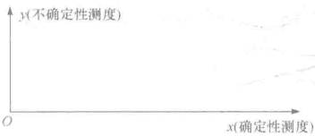

图 1.4.1 确定-不确定空间

### 2. D-U 空间中的联系数运算

联系数刻画出 D-U 空间中一个不确定量的大小和空间位置。二元联系数 \(u=A+Bi\) 在 D-U 空间确定的向量 \(\overrightarrow{OM}\)，称为联系数 \(u\) 在 D-U 空间的映射，见图 1.4.2。

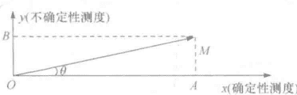

图 1.4.2 联系数 \(u\) 在 D-U 空间上的映射

用 \(r\) 表示联系数的向量 \(\overrightarrow{OM}\) 的长度，由图 1.4.2 易知：

\(r=\sqrt{A^2+B^2}\) (1.4.31)

称为联系数在 D-U 空间的模，用 \(|u|\) 表示。用 \(\theta\) 表示联系数的向量 \(\overrightarrow{OM}\) 与 \(x\) 轴正向的夹角，当 \(A \neq 0\) 时，有

\(\theta=\arctan \frac{B}{A}\) (1.4.32)

称为联系数 \(u\) 在 D-U 空间的幅角，记为 \(\arg U\)。进一步有

\(A=r\cos\theta\) (1.4.33)
\(B=r\sin\theta\) (1.4.34)

于是

\(u=r(\cos\theta+i\sin\theta)\) (1.4.35)

式(1.4.35)称为联系数 \(u\) 在 D-U 空间上的三角函数表达式。有时为了解决问题，可以定义联系数的复运算。

**定义 1.4.9** 设有联系数 \(u_1=A_1+B_1i, u_2=A_2+B_2i\)，其三角函数表达式分别为

\(u_1=r_1(\cos\theta_1+i\sin\theta_1)\) (1.4.36)
\(u_2=r_2(\cos\theta_2+i\sin\theta_2)\) (1.4.37)

则

\(u_1 u_2=r_1(\cos\theta_1+i\sin\theta_1) \cdot r_2(\cos\theta_2+i\sin\theta_2)\)
\(=r_1 r_2[\cos(\theta_1+\theta_2)+i\sin(\theta_1+\theta_2)]\) (1.4.38)

称为联系数的复运算。联系数的复运算满足

$$
|u_1||u_2| = |u_2||u_1|
$$
$$
\arg(u_1 u_2) = \arg u_1 + \arg u_2
$$

式(1.4.39)和式(1.4.40)说明两个用三角函数表示的联系数相乘，其结果仍然是 a+bi 型联系数，且乘积的模等于这两个联系数模的乘积，乘积的幅角等于这两个联系数幅角的和。

但要注意式(1.4.35)中的 i 与复数理论中的 i 含义不同，值域不同，这里的 \(i \in [-1, 1]\)。

上述工作表明:联系数在 D-U 空间中所刻画的量是一种复合量——一种需要用确定性测度与不确定性测度共同表示的量。

以上内容说明了联系数刻画的量既可以看做一种标量，也可以看做一种向量。刻画标量时，联系数是一种实数；刻画向量时，联系数是一种复变函数；面对一个多元联系数，是把其作为实数对待，还是作为多复变函数对待，既要看所刻画的量是标量还是向量，也要看问题研究的需要。

联系数的加法与减法是一对互逆运算，联系数的乘法与除法也是一对互逆运算，这两对互逆运算是联系数基本的两对互逆运算；从互逆角度看，由 n 元联系数导出 n+1 元联系数与 n+1 元联系数压缩成 n 元联系数，也是一对互逆运算；第 2 章中介绍的联系数的伴随函数与联系数之间也存在类似的互逆运算。联系数的这些互逆运算，客观上可以相互检验联系数运算的正确与否，也从一个侧面说明了成对原理在联系数运算中的存在。要注意的是，在集对分析意义下，互逆运算过程中可能存在或产生这种或那种不确定性，需要进行不确定性分析后，才能通过互逆运算检验运算过程的正确与否。

## 1.5 集对分析理论

### 1.5.1 不确定性系统理论

前面介绍的“集对”“联系数”“联系数的运算”，用数学的语言表述了一个基于集对分析的不确定性系统理论，其要点如下。

- (1) 事物处于普遍的联系之中。两个事物的联系是一种最基本的联系现象。把两个有一定联系的事物作为一个“集对”加以研究，便于客观地刻画所要研究的对象。
- (2) 对立统一是客观事物遵循的一个规律。具体事物是某种具体的对立统一体。如果用“集合”去描述对立中的任一方，则每个对立统一体都是一个“集合对”，“集对现象”因而普遍存在。
- (3) 对立统一体中的每一方都在一定条件下与对方存在物质、能量和信息的交换,随着条件的变化,交换的内容、方式和程度都存在这种或那种不确定性。这些不确定性与确定性又都以系统的形式构成一种特定的子集对,这种子集对有时也简称集对。
- (4) 系统是由两个或两个以上要素组成的有机体,基于此,“集对”是一个系统,是一个恰好由两个要素集组成的基元系统,简称为元系统或集对系统,由集对系统中的确定性关系与不确定性关系组成的系统是这个元系统的子系统(有时也简称为系统),二元联系数 A+Bi 是刻画这个子系统的数学工具,其中的 A 是对确定性关系的测度,Bi 是对不确定性关系的测度,A+Bi 也就是这个子系统的特征函数,从系统的意义上看,A+Bi 本身也是一个系统,一个既含有确定性关系测度 A 又含有不确定性关系测度 Bi 的系统。
- (5) 不确定性关系具有层次性,处在宏观层次上的不确定性关系可以在微观层次上得到分解和解析,这种分解和解析通过二元联系数解析成三元或更多元联系数直至无穷多元联系数得到如实的刻画。
- (6) 不确定性关系可以转化为确定性的关系,如果预先设立某种确定的关系为参考关系,则不确定性关系的转化结果有可能与参考关系同一,也可能转化成与参考关系相反的关系,从而成为相对于参考关系来说的“同异反系统”,同异反系统是集对这个元系统的子系统,同异反三元联系数 a+bi+cj 是这个子系统的特征函数。
- (7) 在确定-不确定系统中,由于不确定性的作用和影响,确定性关系可以部分甚至全部转化为不确定性关系,这可以从二元联系数 a+bi 中的 a+b=1 约束看出;但如果在此约束下,经过 m 次转化与解析,其确定性关系部分仍不为零,则称此关系为该系统的核关系,简称“核”,其对应的数量化表达就是无穷多元联系数中联系分量系数为 1 的项,也就是无穷多元联系数的首项;与此同时的无穷多元联系数的末项则称为反核关系,简称反关系。
- (8) 基于联系数的联系熵(见 2.1 节)同时度量不确定性系统相对不确定的关系,也同时度量不确定性系统中相对确定的关系。
- (9) 偏联系数、邻联系数等联系数的伴随函数,揭示出不确定性系统内部的各种关系在微观层同迁移图景和微观演化趋势。
- (10) 能用联系数统一地描述随机不确定性关系、模糊不确定性关系、中介不确定性关系和不确知关系,以及数据不完全或机制不明确所致的不确定关系。
- (11) 确定联系数中不确定性转换器 i 的值,既需要有面向联系数本身的“理论信息”,也需要有面向研究对象的“实际信息”;这两类信息的有机结合和相互印证构成 i 的变化规律。
- (12) 熵,既可用于系统不确定性的度量,也可用于系统确定性的度量,还可以用于系统确定性与不确定性相互混杂、相互影响、一定条件下相互转换的度量。利用集对分析联系数得到同熵、异熵、反熵，是一个熵系统，称为同异反联系熵；热力学熵、信息熵、负熵等熵概念是这个同异反联系熵中的某个局域熵，联系熵可以把种种熵概念统一起来，统一到联系熵中。

有关集对分析不确定性系统理论的详细内容，以及与联系数的一一对应性说明，请见文献[7]~[12]。

### 1.5.2 同异反系统理论

基于集对分析的同异反系统理论既是不确定系统理论的一种特例，又有自己的特定内涵，其要点有二[13-15]。

- 1) 存在不同性质的“反”

“反”，简指一个概念与某个给定概念相对立的状态，是关于“对立状态”的一个指称。集对分析最早给出五种类型的“反”，也就是五种对立状态，分别是；

- (1) “倒数型反”，其特征方程是 R×1/R=1，如物理摆中的频率 f 与周期 T 互为倒数，数学中除以一个不等于零的实数等于乘上这个数的倒数等；
- (2) “有无型反”，其特征方程是 R×0=0，如“存在这个数据”与“不存在这个数据”(数据缺失)等；
- (3) “正负型反”，其特征方程是 1×(-1)=-1，最后一个联系分量系数是-1 的联系数就是一种基于“正负型反”的联系数；
- (4) “虚实型反”，其特征方程是 1×√(-1)=√(-1)，如一物体的镜像与实像，复空间中的实轴与虚轴等；
- (5) “互补型反”，其特征方程是 f(x)+f(x)=1，如优劣互补，事件 A 发生的概率 f(A) 与事件 Ā 发生的概率 f(Ā) 互补。

有学者对以上分类作了进一步研究。根据实际情况提出一种“设定类型的反”，就是根据某种需要或约定去定义“反”，例如，当某个指标的值达到或超过一定的“阈值”，就进入到与某个参考状态相对立的状态。例如，有文献根据环境评价标准把环境无污染(一级)定义为“同”(与一级要求“同”)，轻度污染(二级要求)定义为“异”(相对于一级为“异”),重度污染(三级)定义为“反”(相对于一级为“反”); 又如，有学者在医院综合评价中,把指标完成得好定义为“同”,指标完成得一般定义为“异”,指标完成得差定义为“反”;在投票决策研究中,定义赞成为“同”,弃权为“异”,反对为“反”;诸如此类的设定,可归纳为“相邻为异、相隔为反”判定准则;虽然显得有些粗糙,但一些研究成果表明,在此基础上建立评价对象的联系数和作进一步的分析所得结论也确实符合客观实际,因此,这类“设定类型的反”也值得肯定。

显然，上述五种不同性质的“反”属于不同类型，每种不同类型的“反”对应着不同类型的联系数，其对应规律可以从联系数的最后一个联系分量系数看出；与“正负型反”对应的“正负型联系数”的最后一个联系分量系数取值必定是-1,与“有无型反”对应的“有无型联系数”的最后一个联系分量系数取值必定是 0,与“倒数型反”对应的“倒数型联系数”的最后一个联系分量系数取值必定是某个实数的倒数,与“虚实型反”对应的“虚实型联系数”的最后一个联系分量系数取值必定是一个虚单位,与“互补型反”对应的“互补型联系数”的最后一个联系分量系数取值必定是 1,由此可见,1.3 节介绍的“正负型联系数”仅是其中一个类型的联系数,也是应用得最多的一类联系数。

- 2) 同异反的展开

在一些实际问题中,不仅“同”“异”“反”具有程度上的不同,如“完全同”“基本同”“有些同”“有点同”“有点异”“有些异”“基本异”“完全异”“有点反”“有些反”“基本反”“很反”“完全反”等,而且还有结构上的不同,如“同中有异”“异中有同”“异中有反”“反中有异”,甚至“反中有同”等嵌套现象,更有同异反在一定条件下的“相互转化”现象,由此可以看出同异反的复杂性(图 1.5.1)。

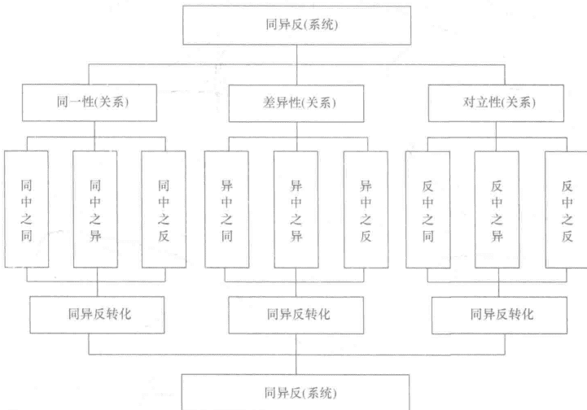

图 1.5.1 同异反系统中的同异反自嵌与同异反转化示意图

从联系数的角度看,每一个同异反的展开对应着一个多元联系数;每一个同异反的转化对应着一个多元联系数的形式转换,而每一种形式转换对应着相关运算,由此可见可以进一步窥见联系数及其算法的丰富内容。

由前述关于集对的定义可知,集对是一种元系统,就集对中两个集合关系展开的同异反分析因而是对这种元系统的分析，当一个系统由多个集合组成时，相应的同异反分析不仅可以是集对意义上的，也可以是在不同集对之间的，还可以是整个系统上的；也就是说，图 1.5.1 也适用于对系统作全局意义上的分析理解。

### 1.5.3 同异反空间

定义 1.5.1 集对中两个集合的同异反关系所在的空间称为同异反空间。由于无论是同异反的定义，还是同异反的度量和同异反在一个同异反系统中各自所占的比例刻画，都映射到一个具体的联系数上，而由 1.3 节与 1.4 节介绍的联系数知识和联系数性质可知，同异反联系数是一个含有不确定性结构的函数，由此可知同异反空间的一个显著特征是空间的边界确定性(对应着同异反联系数首项与末项的确定性)与边界内空间的不确定性(对应着同异反联系数首项与末项之间其他联系分量系数取值不确定性)。

### 1.5.4 联系场

定义 1.5.2 同异反空间中由同异反关系所界定的空间简称同异反联系场，简称联系场。一般情况下，有关联系数的运算和同异反都是在给定的联系场中进行，但有时也会涉及不同联系场的切换。

### 1.5.5 论域

定义 1.5.3 在一个特定问题背景下被讨论到的那些同异反关系，构成联系场中的一个区域，该区域称为论域。容易看出：论域与分析的广度与深度有关，因而是分析过程的函数。

### 1.5.6 同异反联系熵

1.5.1 节中把同异反联系熵作为集对分析的不确定性系统理论要点之一进行简单介绍，但同异反联系熵也是同异反系统理论的重要内容，由此可见同异反联系熵是集对分析理论中的一个重要概念，同异反联系熵最早由赵克勤在 1989 年提出集对分析时提出，赵克勤在文献[16]中论述了同异反联系熵与热力学熵、统计熵、负熵等其他熵概念的关系，之后，同异反联系熵在不同领域均有所应用[17-25]，可见同异反联系熵概念的重要性。事实上，爱因斯坦曾说过“熵是科学的第一法则”，为此，下面引用文献[26]中对同异反联系熵所作的介绍：熵的概念最早由德国物理学家克劳修斯于 1865 年提出，是热力学中表征物质状态的一个参量，通常用“S”表示。熵的微观意义是热力学系统中大量微观粒子无序度的量度，系统越无序、越混乱，熵就越大。设想由一个高温热源 T1 与低温热源 T2 组成的热力学系统，按热力学第二定律,热能 e 将不断地从高温热源 T1 传向低温热源 T2 (T1 > T2),直至这两个热源的的温度相等(T1 = T2),这时,热传递结束,该系统的熵达到最大。现设想该系统中某个瞬时 \(\Delta t_k\) 时的传热过程,这时有从 \(T_1\) 出来的高温微热能 \(\Delta e_1\) 变为属于 \(T_2\) 的低温微热能 \(\Delta e_2\),容易想到这个微观过程中必定有这样的一个片断,在这个片断上的微热能 \(\Delta e_0\),既是 \(\Delta e_1\) 又不是 \(\Delta e_1\),既是 \(\Delta e_2\) 又不是 \(\Delta e_2\),也就是说 \(\Delta e_0\) 具有不确定性,取 \(\Delta e_1\) 为参考热能,则 \(\Delta e_2\) 是与 \(\Delta e_1\) 对立的热能,而 \(\Delta e_0\) 是介于 \(\Delta e_1\) 与 \(\Delta e_2\) 之间的具有不确定性的热能,于是得微热能传递联系系数 \(\Delta \mu (\Delta t) = \Delta e_1 + \Delta e_0 i + \Delta e_2 j\),此微热能传递联系系数如实地刻画了该热力学系统在某个瞬时 \(\Delta t\) 时的微观传热过程;显然,从时间 \(t_1\) 到 \(t_2\) 有 \(n(n \to \infty)\) 个 \(\Delta t_k\),从而可以得到 \(n(n \to \infty)\) 个微热能传递联系数如下：

\(\Delta \mu_1 (\Delta t_1) = \Delta e_{11} + \Delta e_{01} i + \Delta e_{21} j\)

化简得

\(\mu_1 = a_1 + b_1 i + c_1 j\) (1.5.1)

\(\Delta \mu_{t2} (\Delta t_2) = \Delta e_{12} + \Delta e_{02} i + \Delta e_{22} j\)

化简得

\(\mu_2 = a_2 + b_2 i + c_2 j\) (1.5.2)

...

\(\Delta \mu_n (\Delta t_n) = \Delta e_{1n} + \Delta e_{0n} i + \Delta e_{2n} j\)

化简得

\(\mu_n = a_n + b_n i + c_n j\) (1.5.3)

于是得到联系熵：

\(S = S_n + S_i + S_p = \sum_{n=1}^{\infty} a_n \ln a_n + i \sum_{n=1}^{\infty} b_n \ln b_n + j \sum_{n=1}^{\infty} c_n \ln c_n\) (1.5.4)

同熵：

\(S_s = \sum_{n=1}^{\infty} a_n \ln a_n\) (1.5.5)

异熵：

\(S_i = i \sum_{n=1}^{\infty} b_n \ln b_n\) (1.5.6)

反熵：

\(S_p = j \sum_{n=1}^{\infty} c_n \ln c_n\) (1.5.7)

因此,联系熵也称“同异反联系熵”或简称同异反熵。所谓熵达到最大,在联系熵意义下就变成为联系熵达到最大,但从联系熵的表达式看出,使联系熵达到最大

的关键是带有不确定系数 i 的异熵这一项，也就是说：联系熵能否达到最大，最终取决于热能传递过程中的不确定性。

由此看出，一个热力学系统的“无序”程度，其实与不确定性有关，无序≠不确定性；不仅如此，还从联系熵的表达式中得出以下一些局域熵。

#### 同异熵
\( S_{sf} = \sum_{n=1}^{\infty} a_n \ln a_n + i \sum_{n=1}^{\infty} b_n \ln b_n \) (1.5.8)

#### 同反熵
\( S_{sp} = \sum_{n=1}^{\infty} a_n \ln a_n + j \sum_{n=1}^{\infty} c_n \ln c_n \) (1.5.9)

#### 异反熵
\( S_{fp} = i \sum_{n=1}^{\infty} b_n \ln b_n + j \sum_{n=1}^{\infty} c_n \ln c_n \) (1.5.10)

此外，根据 1.2 节与 1.3 节中关于多元联系数的知识可知，还有同异反扩展多元联系熵，因过于复杂，本书从略。下面给出同异反联系熵的特点，这些特点也可扩展到多元联系熵。

- (1) 同异反联系熵是一个熵系统，受其中的 a+b+c=1 条件约束，使其中的任一部分熵都受到其他两部分熵的影响。

- (2) 受同异反联系熵中不确定数 i 的影响，同异反联系熵是一个不确定熵，但其中的同熵和反熵具有相对确定性，异熵受 i 的影响具有相对不确定性。

- (3) 同异反联系熵中 i 的不确定性既可源自热力学系统自身，也可源自热力学系统所在的环境，前面的论述看上去仅涉及高温热源 T1 与低温热源 T2，但既然是两个热源，由这两个热源组成的热力学系统必然存在于某个环境之中，从而使得这个系统中由高温热源 T1 到低温热源 T2 的热能传递过程受到环境的影响，而一个具体的环境，通常就是多种不确定性的载体。

- (4) 同异反联系熵的同熵、异熵、反熵在一定条件下可以相互转化。

- (5) 同异反联系熵的值可正可负。同异反联系熵值的大小不仅取决于 a、b、c，也取决于同异反联系熵中的 i。当同异反联系熵是负值时，对应着热能从低温热源向高温热源传递，这需要向环境“借能”。

- (6) 同异反联系熵的一些特殊值如 s=1, s=0, s=-1 等，对应着热力学系统的不同的极端状态。

- (7) 同异反联系熵具有统一某些局域熵的功能，如利用联系熵把热力学熵、统计熵、信息熵、模糊熵、负熵等熵概念统一起来，它们都是同异反联系熵中的某个或某种局域熵。

- (8) 同异反联系熵守恒。原因是同异反联系熵中的 an+bn+cn=1，这样，同异反联系熵中的某一部分熵的增加或减少总同时伴随着其他熵的减少或增加，尽管有时不能确定是哪一部分熵增加或减少。

除上面的内容外，集对分析理论还包括“集对论与集合论关系”“集对分析理论与其他不确定性理论的关系”“联系数的算法与算子”等内容，由于内容太多，这里不再介绍，有兴趣的读者可以参见文献[12]～[15]等。

## 1.6 本章小结

本章介绍成对原理和系统不确定性原理，这是自然界和人类社会中客观存在的两个基本原理，是集对分析得以提出和不断发展所依据的原理，也是人工智能理论与技术遵循的两个基本原理；在这两个原理基础上介绍集对和联系数概念，有关联系数的基本运算和集对分析不确定性系统理论和同异反系统理论，其中的同异反联系熵概念需要重视，后续章节会进一步阐述集对分析的这些基本知识在人工智能中的具体应用。

## 参考文献

- [1] 赵克勤. 集对分析及其初步应用[M]. 杭州:浙江科学技术出版社,2000.
- [2] 蒋云良, 赵克勤, 刘以安, 等. 信息处理集对分析[M]. 北京:清华大学出版社,2015.
- [3] 赵克勤, 宣爱理. 集对论——一种新的不确定性理论方法与应用[J]. 系统工程, 1996, 14(1): 18-25.
- [4] 赵克勤, 赵森烽. 奇妙的联系数[M]. 北京:知识产权出版社, 2014.
- [5] 王霞. 基于复数理论的同异型联系数及其应用[J]. 数学的实践与认识, 2005, 35(8): 127-132.
- [6] 刘秀梅, 赵克勤. 基于联系数复运算的区间数多属性决策方法及应用[J]. 数学的实践与认识, 2008, 38(23):57-64.
- [7] 张传芳, 刘彦慧, 王冰. 一种基于区间型联系数的多指标决策方法[J]. 大学数学, 2011, 27(2):30-35.
- [8] 威切曼 E H. 量子物理学[M]. 复旦大学物理系, 译. 北京:科学出版社, 1979:273-290.
- [9] 赵克勤. 数学危机与集对分析[M]//赵克勤, 米红. 非传统安全与集对分析. 北京:知识产权出版社, 2010:213-219.
- [10] 赵克勤. 成对原理及其在集对分析（SPA）中的作用与意义[J]. 大自然探索, 1998, 17(4):90.
- [11] 赵克勤. 联系数及其应用[J]. 吉林师范学院学报, 1996, (8):50-56.
- [12] 赵克勤. 集对分析的不确定性系统理论在 AI 中的应用[J]. 智能系统学报, 2006, 1(2): 16-25.
- [13] 赵克勤. 基于集对分析的对立分类度量与应用[J]. 科学技术与辩证法, 1994, 11(2):26-30.
- [14] 赵克勤. SPA 的同异反系统理论在人工智能研究中的应用[J]. 智能系统学报, 2007, 2(5):20-35.
- [15] 赵森烽,赵克勤. 几何模型的联系概率与概率的补数定理[J]. 智能系统学报,2013,8(1):11-15.
- [16] 赵克勤. 集对分析与熵的研究[J]. 浙江大学学报(社会科学版),1992,38(2):68-72.
- [17] 宋其秀. 关于联系数的同异反态势熵及应用[J]. 绍兴文理学院学报,2000,20(6):87-89.
- [18] 王桢. 熵及其在水系统中的研究与应用[D]. 南京:河海大学博士学位论文,2001.
- [19] 程启月, 邱苑华. 群决策与个体决策的一致性分析[J]. 中国管理科学,2001,18(5):33-38.
- [20] 韦琦,金鸿章,郭健. 基于脆性联系熵的复杂系统崩溃致因研究[J]. 自动化技术与应用,2003,22(4):1-4.
- [21] 郑罗华, 蒋云良. 联系熵在教学测量与评价中的应用[J]. 湖州师范学院学报,2004,26(1):111-115.
- [22] 荣盛祥,金鸿章,韦琦,等. 基于脆性联系熵的复杂系统特性的研究[J]. 电机与控制学报,2005,46(2):111-115.
- [23] 王莉,田水承,王晓宁. 联系熵在煤矿安全预评价中的应用[J]. 中国安全科学学报,2006,19(9):129-133,147.
- [24] 黄溶冰,胡运权. 产业结构有序度的测算方法——基于熵的视角[J]. 中国管理科学,2006,23(1):122-128.
- [25] 常晓林,张美丽,杨海云,等. 基于联系熵的围岩稳定性评价研究[J]. 岩土力学,2010,32(1):99-101.
- [26] 赵克勤,赵森烽. 奇妙的联系数[M]. 北京:知识产权出版社,2014:108-112.

# 第 2 章 集对分析若干进展

集对分析把数与系统联系起来，把数学与系统科学联系起来，借此去研究客观事物的确定性与不确定性的联系与转化、同异反的联系与转化，客观上为建立联系科学奠定了基础，集对分析也因此不断发展。本章仅从人工智能角度介绍集对分析到联系科学的若干进展，主要内容有：联系数的伴随函数，包括态势函数与广义势函数、势函数定理偏联系数与反偏联系数、邻联系数与反邻联系数、相互作用联系数与反相互作用联系数、联系熵与反联系熵函数，以及赵森烽-克勒概率（联系概率），基于联系数的绿色智能计算等。

## 2.1 联系数的伴随函数

### 2.1.1 态势函数

联系数的态势函数是联系数的一种伴随函数，传递了联系数所刻画的那个事物的某种状态与趋势信息，简称态势[1,2]。具体是指联系数中各联系分量大小关系所确定的系统状态和趋势。由于不同的联系数中联系分量的大小关系不同，但又有一定规律，所以可以用联系数的态势函数来描述这种规律，联系数的态势函数通常用矩阵表示。

二元联系数 \(\mu=a+bi\) 的态势函数是一个只有 3 行元素的矩阵（表 2.1.1）。

表 2.1.1 二元联系数 \(\mu=a+bi\) 的态势函数

| 联系分量的大小关系 | 态势 | 势函数 shi(μ)=a/b |
|---|---|---|
| a>b | 同势 | >1 |
| a=b | 均势 | =1 |
| a<b | 异势 | <1 |

三元联系数 \(\mu=a+bi+cj\) 的态势函数是一个有 3×3×3=27 行元素的矩阵（表 2.1.2）。

表 2.1.2 三元联系数 \(\mu=a+bi+cj\) 的态势函数

| 联系分量的大小关系 | 态势及势级 | 势函数 \(shi(\mu)=a/c\) |
|---|---|---|
| \(a>c, a>b, b>c\) | 同势 1 级 | \(>1\) |
| \(b=c\) | 同势 2 级 | \(>1\) |
| \(b<c\) | 同势 3 级 | \(>1\) |
| \(a=b, b>c\) | 同势 4 级 | \(>1\) |
| \(b=c\) | 不存在 | |
| \(b<c\) | 不存在 | |
| \(a<b, b>c\) | 同势 5 级 | \(>1\) |
| \(b=c\) | 不存在 | |
| \(b<c\) | 不存在 | |
| \(a=c, a>b, b>c\) | 不存在 | |
| \(b=c\) | 不存在 | |
| \(b<c\) | 均势 1 级 | \(=1\) |
| \(a=b, b>c\) | 不存在 | |
| \(b=c\) | 均势 2 级 | \(=1\) |
| \(b<c\) | 不存在 | |
| \(a<b, b>c\) | 均势 3 级 | \(=1\) |
| \(b=c\) | 不存在 | |
| \(b<c\) | 不存在 | |
| \(a<c, a>b, b>c\) | 不存在 | |
| \(b=c\) | 不存在 | |
| \(b<c\) | 反势 1 级 | \(<1\) |
| \(a<c, a=b, b>c\) | 不存在 | |
| \(b=c\) | 不存在 | |
| \(b<c\) | 反势 2 级 | \(<1\) |
| \(a<b, b>c\) | 反势 3 级 | \(<1\) |
| \(b=c\) | 反势 4 级 | \(<1\) |
| \(b<c\) | 反势 5 级 | \(<1\) |

注：表中的 \(a,b,c\) 不能为零, \(a+b+c=1, a,b,c>0\)。

请注意表 2.1.2 中在形式上应当出现但逻辑上不存在的“大小关系”，这类“大小关系”共有 14 种，约占总关系数 27 的 1/2，已经在表 2.1.2 中注明“不存在”。为什么“不存在”还要一一列出，是因为这一事实从侧面说明按排列组合理由应当出现的“形式系统”并不能从形式上保证“逻辑自治”；换言之，就是一定范围内的形式系统与逻辑不完全同一，这是一个需要深入研究的问题，例如，什么样的形式系统与逻辑不完全同一，不完全同一时，又如何计算该形式系统与逻辑的同一度？表 2.1.2 中给出的形式系统与逻辑的同一度为 13/27=0.48，因为只有 13 种大小关系在形式上成立且同时合乎逻辑。当然，这个个例是否具有一般意义，也有待研究。

以上是关于联系分量满足归一化条件时的三元联系数的同异反系统态势及其排序，有关四元、五元和更多元联系数的系统态势函数，其矩阵规模更大，一一列出矩阵中的元素不难，但要一一检查其中的每一行元素是否合乎逻辑，则工作量不小，且随联系数联系分量个数增加而加大，所以在此略去，有兴趣的读者可以参考文献[3]或自行编写相应的联系数系统态势矩阵。

### 2.1.2 广义势函数

表 2.1.2 中给出的联系数 \(\mu\) 的势函数 \(shi(\mu)\) 按 \(shi(\mu)=a/c\) (2.1.1)

计算时,会遇到 \(c=0\) 的情况,由此产生所谓的无穷大势,难以利用势函数 \(shi(\mu)\) 对不同的联系数在整体上作势比较;如, \(\mu_1=0.6+0.3i+0.1j\), \(\mu_2=0.3+0.7i+0j\), 则有 \(shi(\mu_1)=0.6/0.1=6\), \(shi(\mu_2)=0.3/0=\infty\), 如作势函数 \(shi(\mu)\) 比较,则有 \(shi(\mu_2)>shi(\mu_1)\), 据此认为 \(\mu_2\) 的趋同趋势大于 \(\mu_1\) 显得不够合理。为此,张春英等[4] 给出了广义势函数的概念,定义 \(e^a/e^c\) 为联系数 \(\mu=a+bi+cj\) 的广义势 GP(generalized power), 即 \(GP(\mu)=e^a/e^c\) (2.1.2)

这样,无论 \(C\) 是否为零,联系数的广义势函数 \(GP(\mu)\) 都可计算。不仅如此,张春英等还进一步给出了联系数 \(\mu=a+bi+cj\) 的广义紧密势(generalized close together power, GCTP)和广义松散势(generalized loose power, GLP),计算公式分别是 \(GCTP(\mu)=e^{a+b}/e^c\) (2.1.3) \(GLP(\mu)=e^{a-b}/e^c\) (2.1.4)

从而方便地说明由联系数所表征的集对中两个集合的势状况。

### 2.1.3 势函数定理

定理 2.1.1 (1) 若联系数 \(\mu=a+bi+cj\) 的势函数 \(shi(\mu)>1\),则必有不等式 \(a>c\) 成立; (2) 若联系数 \(\mu=a+bi+cj\) 的势函数 \(shi(\mu)<1\),则必有不等式 \(a<c\) 成立; (3) 若联系数 \(\mu=a+bi+cj\) 的势函数 \(shi(\mu)=1\),则必有不等式 \(a=c\) 成立。根据联系数的势函数定义即可得证。

利用势函数定理，可以在已知一个联系数的势函数情况下求得原联系数，这一过程也称反势函数运算，联系数 \(\mu\) 的反势函数记为 \(\text{arcshi}(\mu)\)。利用这一记法，定理 2.1.1 中的 (1) 可以写成：若已知联系数 \(\mu = a+bi+cj\) 的势函数 \(\text{shi}(\mu)>1\)，则 \(\text{arcshi}(\mu)\) 必有 \(a>c\)。

### 2.1.4 偏联系数

联系数的联系分量中蕴含着对象系统潜在的系统趋势信息。联系数的偏联系数是刻画对象系统潜在系统趋势信息的数学工具，也是联系数的一种重要伴随函数。其来由是：假定联系数中当前在某个层次上的联系分量是从较低层次上发展而来的一个实数，通过偏联系数的计算和分析，展现出联系数所刻画的对象系统在微观层次上的一种潜在矛盾运动及其层间迁移趋势。联系数的偏联系数分为偏正联系数、偏负联系数、全偏联系数和不同阶次的偏联系数等不同类型，下面仅介绍二元联系数与三元联系数的偏联系数。

#### 1. 二元联系数的偏联系数

定义 2.1.1 设有二元联系数

\(u=A+Bi \quad (2.1.5)\)

则有偏同联系数：

\(\partial^+ u = \frac{A}{A+B} \quad (2.1.6)\)

偏异联系数：

\(\partial^- u = \frac{B}{A+B}i \quad (2.1.7)\)

全偏联系数：

\(\partial u = \partial^+ u + \partial^- u = \frac{A}{A+B} + \frac{B}{A+B}i \quad (2.1.8)\)

全偏联系数也省略性地简称偏联系数。其中 \(\partial^+ u = \frac{A}{A+B}\) 刻画了联系数 \(u = A+Bi\) 中确定性联系分量 \(A\) 由原先处在不确定性层次上的 \(B\) 正向发展而来的测度，也就是不确定性关系转换为确定性关系的程度，同时也说明了确定性关系数 \(A\) 在当前系统中所占的比重；\(\partial^- u = \frac{B}{A+B}i\) 刻画了联系数 \(u=A+Bi\) 中不确定分量 \(B\) 由原先处在 \(A\) 层次上负向发展而来的测度，也就是由确定性关系转换为不确定性关系的程度，同时也说明了不确定性关系数 \(B\) 在当前系统中所占的比重。

由式(2.1.8)可以看出，二元联系数的偏联系数仍然是一个二元联系数。这个二元联系数的两个联系分量客观上是对原联系数作了归一化处理的结果，即有

\(\frac{A}{A+B} + \frac{B}{A+B} = 1\) (2.1.9)

例如,某对象系统的联系数 \(u=3+5i\),则其偏联系数为 \(\partial u = \frac{3}{3+5} + \frac{5}{3+5}i = \frac{3}{8} + \frac{5}{8}i\),这是一个联系分量归一化的联系数,要注意的是:虽然这时有 \(\frac{3}{8} + \frac{5}{8} = 1\),但由于 \(i \in [-1,1]\),取值待定,所以 \(\partial u\) 的值是否为 1 仍不确定。

#### 2. 三元联系数的偏联系数

定义 2.1.2 设有三元联系数

\(u=A+Bi+Cj, \quad j=-1, \quad i \in [-1,1]\) (2.1.10)

则有偏正联系数为

\(\partial^+ u = \frac{A}{A+B} + \frac{B}{B+C}i\) (2.1.11)

偏正联系数是刻画联系数潜在的正向发展趋势联系数,它反映了联系数的一种正向变化趋势或朝正 1 层次提升迁移的测度。

偏负联系数为

\(\partial^- u = \frac{B}{A+B}i + \frac{C}{B+C}j\) (2.1.12)

偏负联系数是刻画联系数潜在的负向发展趋势的联系数,反映了联系数的一种负向变化趋势或朝负 1 层次下降迁移的测度。

全偏联系数为

\(\partial u = \partial^+ u + \partial^- u = \frac{A}{A+B} + \frac{B}{B+C}i + \frac{B}{A+B}i + \frac{C}{B+C}j = \frac{A+Bi}{A+B} + \frac{Bi+Cj}{B+C}\) (2.1.13)

- 当 \(\partial u > 0\) 时,为正向发展趋势(或提升趋势);
- 当 \(\partial u < 0\) 时,为负向发展趋势(或下降趋势);
- 当 \(\partial u = 0\) 时,为临界趋势。

式(2.1.13)称为三元联系数的一阶全偏联系数,还可以用类似思路计算该一阶全偏联系数的偏联系数,得到三元联系数的二阶全偏联系数,为节省篇幅,在此略去。

容易看出,联系数的偏联系数计算过程体现了联系数中确定性关系与不确定性关系在不同层次间的迁移甚至迁跃,这种迁移或迁跃在微观层次上进行,因而在宏观层次上表现出一种静止,因此称为潜在的微观运动;虽然这种潜在的微观运动

难以在宏观层次上观察到，但能够借助联系数的偏联系数计算和分析，对这种微观层次上的迁移或迁跃变化运动作出分析和判断，因而是一种宏观静态状态下的微观动态分析，不致误解时可以简称其为“静动分析”，或称为基于集对分析的“状态-趋势分析”或“微分析”。从 1.5.3 节给出的同异反空间解析角度看，三元联系数在同异反三维空间中仅为一个“点”，同异反联系数的偏联系数计算和分析为我们在某个瞬时对这个“点”展开动态分析提供了数学手段。

另外，从 1.5.4 节中介绍的“联系场”角度看，上述“静动分析”事实上是对“联系场”的一种“点”分析，把“联系场”中所有的“点”分析联系起来，构成基于集对分析的“联系场分析”，或简称“场分析”。

如果把人脑思维所在的空间称为思维场，则思维场可以看成是一种特定的联系场。

## 2.1.5 反偏联系数

在已知一个联系数的偏联系数情况下求原联系数，这一过程也称反偏联系数运算[5]，联系数 \(\mu=a+bi+cj\) 的反偏联系数记为 \(\text{arc}\partial(\mu)\)。利用这一记法，可以方便地进行反偏联系数计算。例如，已知某联系数 \(\mu=a+bi+cj\) 的全偏联系数 \(\partial\mu=\frac{3}{8}+\frac{5}{8}i\)，则 \(\text{arc}\partial(\mu)=3+5i+0j\)。

## 2.1.6 邻联系数

### 1. 二元联系数的邻联系数

#### 定义 2.1.3 设有二元联系数
\(u=A+Bi,\ i\in[-1,1]\) (2.1.14)

则称邻左联系数为
\(N^+u=\frac{A}{Bi}\) (2.1.15)

式(2.1.15)所示的邻左联系数，刻画了二元联系数位于左侧的确定性关系测度 \(A\) 对于二元联系数位于右侧的不确定性关系测度 \(B\) 所起的“提升作用”的程度，也简称“作用度”或“提升度”。

邻右联系数为
\(N^-u=\frac{B}{A}i\) (2.1.16)

式(2.1.16)所示的邻右联系数，刻画了二元联系数位于右侧的不确定性关系测度 \(B\) 对于二元联系数位于左侧的确定性关系测度 \(A\) 所起的“下降作用”的程度，也简称“作用度”或“下降度”。

全邻联系数为
$$Nu=N^+u+N^-u=\frac{A}{Bi}+\frac{Bi}{A}$$ (2.1.17)

式(2.1.17)所示的全邻联系数，刻画了二元联系数中确定性关系测度 A 与不确定性关系测度 B 互邻关系所构成的“矛盾运动”程度，也简称“邻矛盾度”或“邻联系度”。

“邻联系度”也是“联系场”中关于“点”的一种测度。

### 2. 三元联系数的邻联系数

#### 定义 2.1.4 设有三元联系数为
$$u=A+Bi+Cj$$ (2.1.18)

称
$$N^+u=\frac{A}{Bi}+\frac{Bi}{Cj}$$ (2.1.19)

为三元联系数的邻左联系数，刻画了三元联系数中自左至右两个联系分量 A 与 Bi 对右侧联系分量 Bi 与 Cj 所起的“提升作用”的程度，也简称“正向作用联系数”或“提升联系数”。

由于式(2.1.19)是一个二元联系数，所以，还可以仿照求二元联系数的邻左联系数算法对式(2.1.19)再做一次邻联系数计算，得
$$N^+u=\frac{A}{Bi}+\frac{Bi}{Cj}$$ (2.1.20)

参照前面关于二元联系数的邻右联系数的定义，称
$$N^-u=\frac{Bi}{A}+\frac{Cj}{Bi}$$ (2.1.21)

为三元联系数邻右联系数。式(2.1.21)所示的邻右联系数，刻画了三元联系数位于右侧的不确定性关系测度 B 对于三元联系数位于左侧的确定性关系测度 A 所起的“下降作用”的程度，也简称“作用度”或“下降度”。

称
$$Nu=N^+u+N^-u=\frac{A}{Bi}+\frac{Bi}{Cj}+\frac{Bi}{A}+\frac{Cj}{Bi}$$ (2.1.22)

为全邻联系数。

全邻联系数的意义是立足于当前，对联系数刻画对象“将来”状态的一种描述；构成全邻联系数的邻左联系数和邻右联系数则分别表示当前联系数中的联系分量对相邻联系数的“左侧拉动作用大小”和“右侧拉动作用大小”；全邻联系数反映了“左侧拉动作用”与“右侧拉动作用”的矛盾运动及其结果。

一个联系数的邻联系数与偏联系数的区别和联系在于：偏联系数刻画出当前这个联系数由各个联系分量的由来所刻画的潜在趋势(由过去说明现在),而邻联系数刻画出当前这个联系数由各个联系分量所刻画的显在的发展趋势(由现在估计将来)。

## 2.1.7 反邻联系数

类似于反势函数与反偏联系数,对于一个联系数 u 的邻联系数 Nu=N+ u+N- u,有反邻联系数,记为 arcNu,以及反邻左联系数 arcN+ u 与反邻右联系数 arcN- u。

## 2.1.8 相互作用联系数

#### 定义 2.1.5 称联系数 u 中由相邻两个联系分量乘积作为新联系分量的联系数为相对于原联系数 u 的相互作用联系数(interaction connection number)[6],记为 Iu。

对于二元联系数
$$u=A+Bi, \ i \in [-1,1]$$ (2.1.23)

其相互作用联系数为
$$I(u)=ABi, \ i \in [-1,1]$$ (2.1.24)

对于三元联系数
$$u=A+Bi+cj, \ i \in [-1,1], \ j=-1$$ (2.1.25)

其一阶相互作用联系数为
$$I(u)=ABi+Bicj, \ i \in [-1,1], \ j=-1$$ (2.1.26)

二阶相互作用联系数为
$$I^2(a)=ABiBiCj=ABCi^2 j, \ i \in [-1,1], \ j=-1$$ (2.1.27)

对于四元联系数
$$u=A+Bi+cj+dk, \ i \in [0,1], \ j \in [-1,0], \ k=-1$$ (2.1.28)

其一阶相互作用联系数为
$$I(u)=ABi+Bicj+CjDk, \ i \in [0,1], \ j \in [-1,0], \ k=-1$$ (2.1.29)

二阶相互作用联系数为
$$I^2(a)=ABiBiCj=BicjCjDk, \ i \in [-1,1], \ j \in [-1,0], \ k=-1$$ (2.1.30)

三阶相互作用联系数为
$$I^2(a)=ABiBiCjBiCjCjDk=AB^3 i^3 C^3 j^3 Dk, \ i \in [-1,1], \ j \in [-1,0], \ k=-1$$ (2.1.31)

如此等等。

通常,把一个联系数 u 与它的相互作用联系数 I(u) 组成一个联系数对展开分析和讨论。例如,一个归一化的二元联系数 \(\mu=0.8+0.2i\),其相互作用联系数 \(I(\mu)=0.16i\),把这个 \(0.16i\) 看成是 \(\mu\) 中 \(0.2i\) 对 \(0.8\) 的“不确定性作用”结果,则在此作用下,0.8 只剩下 0.64 是确定的,于是得到一个新的归一化联系数 \(\mu=0.64+0.8\times0.2i+0.2i\),或写成 \(\mu=0.64+0.36i\),或写成 \(\mu=0.64+0.16i_1+0.2i\),以示 \(0.16i\) 中的 \(i\) 与原先的 \(i\) 有所区别;此外,还可以有其他的解析结果。

当然,除定义 2.1.5 称联系数 u 中由相邻两个联系分量乘积作为新联系分量的联系数为相对于原联系数 u 的相互作用联系数外,还可以针对多元联系数定义相邻 \(n(n\ge3)\)个联系分量乘积作为新联系分量的联系数为相对于原联系数 u 的相互作用联系数;或相隔 \(n(n\ge2)\) 个联系分量乘积作为新联系分量的联系数为相对于原联系数 u 的相互作用联系数;等等。

## 2.1.9 反相互作用联系数

类似于反势函数与反偏联系数,对于一个联系数 u 的相互作用联系数 Iu,也有相应的反相互作用联系数函数,记为 arcIu,其计算过程与联系数 u 的相互作用联系数 Iu 计算过程互逆。

## 2.1.10 反联系熵函数

若已知一联系数的熵函数,反过来求这个联系数,即引出反熵函数的概念,联系数的反熵函数可以记为 arc\(\mu\),计算较为复杂。

## 2.2 赵森烽-克勒概率简介

### 2.2.1 赵森烽-克勒随机试验

- 1. 基于古典概型的赵森烽-克勒试验

设一盒子中只装有 \(n\) 个白球(\(n\ge1\)),令 A 为“任抽一个球是白球”,显然 A 是必然事件,事件 A 的概率为 1,即 \(P(A)=1\);现在向盒子中放入 \(m\) 个黑球(\(m\ge1\)),这时的事件 A 就从必然事件变为随机事件,相应的,\(P(A)=1\) 变为 \(P(A)<1\)。

分析以上摸球试验,得到以下结论。

- (1) (基于现象的结论) 事件 A 的随机性来自于盒子中加入了另一种颜色的球。

因为试验表明:当盒子中只有白球时,事件 A=“任抽一个球是白球”是必然事件;但当盒子中加入黑球后,事件 A 就成为随机事件,这说明事件 A 的随机性来自于黑球。

- (2) (对现象进行抽象后的结论)事件的随机性来自两个事物的联系。

因为试验表明：当盒子中只有一种颜色的球时，事件 A=“任抽一个球是白球”是必然事件；但当盒子中加入另一种颜色的球后，事件 A 就成为随机事件，这说明事件 A 的随机性源自于两个事物（白球和黑球）的联系。

上述随机试验的与经典的古典概型随机试验的实质意义相同，都说明只有当盒子有白球又有黑球时，事件 A=“任抽一个球是白球”才是随机事件；同理，事件 \(\overline{A}=\)“任抽一个球是黑球”也是随机事件。但两种试验的操作过程不同，赵森烽-克勒试验过程为：盒子中全是白球时任抽一个球，这时 A=“任抽一个球是白球”是必然事件；在向盒子中加入黑球后再任抽一个球，观察到这时 A=“任抽一个球是白球”是随机事件。由此可知这一试验过程是一个“二阶段过程”，而经典的古典概型随机试验没有这个操作过程，一开始就让试验者向同时放有白球和黑球的盒子中任抽一个球，观察这个球是白球还是黑球，是一个“一阶段过程”，因此不容易让人想到“只有当盒子有白球又有黑球时，事件 A=‘任抽一个球是白球’才是随机事件”。

#### 2. 基于频率概型的赵森烽-克勒随机试验

设一硬币的两面都是“正面”，令 A 为“任掷一次硬币结果是正面朝上”，显然 A 是必然事件，也就是事件 A 的概率为 1，即 P(A) = 1；现在把所掷的硬币换成是一个面是“正面”，另一个面是“反面”的硬币，这时的事件 A 就从必然事件变为随机事件，相应的，P(A) = 1 变为 P(A) < 1。

分析以上掷硬币试验，得到以下结论。

- (1) （基于现象的结论）事件 A 的随机性来自于硬币有两个不同的面（正面和反面）。

因为试验表明：当硬币的两面都是“正面”时，事件 A = 任掷一次硬币结果是“正面朝上”是必然事件；但当所掷的硬币一个面是“正面”而另一个面是“反面”时，事件 A 就成为随机事件，这说明事件 A 的随机性来自于硬币的“反面”。

- (2) （对现象进行抽象后的结论）事件的随机性来自两个事物的联系。

因为试验表明：当所掷的硬币两面都是“正面”（相当于只有一种面）时，事件 A=“任掷一次硬币结果是正面朝上”是必然事件；但当所掷的硬币一个面是“正面”而另一个面是“反面”时，事件 A 就成为随机事件，这说明事件 A 的随机性源自于两个事物（硬币“正面”和“反面”）的一种联系。

以上赵森烽-克勒试验的结论(2)也可表述为：事件 A 的随机性源自随机试验中两个互不相容事件 A 与 \(\bar{A}\) 的一种联系。由此得到的随机事件定义。

### 2.2.2 随机事件定义

#### 定义 2.2.1 具有随机性的事件称为随机事件。

经典概率论把随机事件定义为可能出现也可能不出现的事件[7,8]，或随机现象的某些样本点组成的集合[90]，但上述随机试验表明；随机试验是由两个不同事物同时存在(盒子中有两种不同颜色的球，硬币要同时具有两个不同的面)的随机试验。事实上，正是由于两个不同事物在随机试验中同时存在，由这两个事物引发的两个互不相容事件的相互关系才导致了这两个事件的随机性。

### 2.2.3 四个定理

根据上述赵森烽-克勒试验的分析和关于随机事件的定义，文献[7]～[9]进一步给出了有关随机事件的四个定理。

#### 定理 2.2.1(随机事件成对存在定理) 任一随机试验中的随机事件成对存在。

证明 设事件 A 是某一随机试验中的随机事件，根据定义 2.2.1 和试验显示的随机性产生原理可知：随机性是两个事件的一种关系，因此在随机试验中的随机事件 A 与随机事件 $\bar{A}$ 成对存在。

#### 定理 2.2.2(随机事件表现定理) 设随机事件 A 与 $\bar{A}$ 是互不相容的对立事件，则在一次随机试验中必出现其中之一，且只能出现其中之一。

证明 根据定理 2.2.1，随机事件 A 与随机事件 $\bar{A}$ 成对存在，又由于随机事件 A 与随机事件 $\bar{A}$ 是互不相容的对立事件，所以在关于随机事件 A 与 $\bar{A}$ 共存的随机试验中，随机事件 A 与 $\bar{A}$ 不可能同时出现，也不可能同时不出现，所以定理 2.2.2 成立。

#### 定理 2.2.3(概率补数定理) 设随机事件 A 与 $\bar{A}$ 是互不相容的对立事件，$P(A)$ 为随机事件 A 的大数概率，则 $P(A)$ 的补数 $P(\bar{A})=1-P(A)$ 是随机事件 A 的即或概率，也就是 A 不发生而发生 $\bar{A}$ 的概率。

#### 定理 2.2.4(随机事件转化定理) 在试验次数 n 足够大的一个频率型随机试验 E 中，如果在第 $K(K\gg1, K\in n)$ 次试验中第一次出现事件 A，则必然在 $K+m (m\geqslant 1, (K+m)\in n)$ 次试验中出现事件 $\bar{A}$。

定理 2.2.3 和定理 2.2.4 的证明从略。

### 2.2.4 主事件和伴随事件

由于随机事件成对存在，随机试验会有不同的结果，为研究方便起见，文献[8]～[10]给出以下定义。

#### 定义 2.2.2 在随机试验中，被首先关注的事件称为主事件（也称第一关注事件或正事件）；与主事件互不相容的另一事件称为该主事件的伴随事件（也称第二关注事件或负事件），简称伴随事件。

根据定义 2.2.2 知，在两个互为成对的随机事件 A 与 \(\bar{A}\) 中，主事件 A 是首先关注事件，伴随事件则与主事件有关。

也就是说：用 A 表示主事件时，\(\bar{A}\) 就是 A 的伴随事件；反之，用 \(\bar{A}\) 表示主事件时，A 就是 \(\bar{A}\) 的伴随事件。

### 2.2.5 赵森烽-克勒概率

由于随机事件 A 与 \(\bar{A}\) 成对存在，又因互不相容而在某次随机试验中随机出现其中之一，所以用 \(P(A, \bar{A})\) 表示 A 或 \(\bar{A}\) 出现的概率，并约定 \((A, \bar{A})\) 中的 A 为主事件，\(\bar{A}\) 表示 A 的伴随事件；由此导出赵森烽-克勒概率(联系概率)——一种基于主事件 A 发生的大数概率和主事件 A 不发生的即或概率的联系数表达式。

$$P_c(A) = P(A) + [1 - P(A)]i$$

式(2.2.1)中的 \(P_c(A)\) 表示联系数意义下事件 A 在某次随机事件中发生的可能性大小 \(P(A)\) (A 的大数概率) 与不发生的可能性大小 \(1 - P(A)\) (A 的即或概率) 的“联系和”，即赵森烽-克勒概率，也称联系概率，\(P_c(A)\) 中的下标“c”是“联系”(connected) 的意思。

有时，也把式(2.2.1)写成

$$P(A, \bar{A}) = P(A) + P(\bar{A})i$$

在式(2.2.1)和式(2.2.2)中，i 代表不确定性，定义 i 在 \([\frac{-1 - P(A)}{1 - P(A)}, 1]\) 根据不同情况取不同的值。因为就随机试验的结果看，\(P_c(A) = P(A) + P(\bar{A})i\) 有 -1 (伴随事件发生) 与 1 (主事件发生) 两个值，解方程 \(P_c(A) = P(A) + P(\bar{A})i = -1\) 得 \(i = \frac{-1 - P(A)}{1 - P(A)}\)；解方程 \(P_c(A) = P(A) + P(\bar{A})i = 1\) 得 \(i = 1\)，由此才能刻画出每一次随机试验的实际结果。

例如，袋子中有 2 个白球和 3 个黑球，设抽到白球为主事件 A，抽到黑球为事件 \(\bar{A}\)，在任抽一球是白球时，有赵森烽-克勒概率 \(P_c(A) = P(A) + P(\bar{A})i = \frac{2}{5} + \frac{3}{5}i = 1\)，解得这时的 \(i = 1\)。当实际抽到的球是黑球时，站在主事件 A 的角度，其相应的赵森烽-克勒概率 \(P_c(A) = P(A) + P(\bar{A})i = \frac{2}{5} + \frac{3}{5}i = -1\)，解得这时的 \(i = -\frac{7}{3}\)。如果以 \(\bar{A}\) 作为主事件，把 A 看成 \(\bar{A}\) 的伴随事件，则相应的赵森烽-克勒概率为 \(P_c(\bar{A}) = P(\bar{A}) + P(A)i = \frac{3}{5} + \frac{2}{5}i\)，这时如果任抽一球是黑球，则有 \(P_c(\bar{A}) = P(\bar{A}) + P(A)i = \frac{3}{5} + \frac{2}{5}i = 1\)，解得 \(i = 1\)；如果任抽一球是白球，则有 \(P_c(\bar{A}) = P(\bar{A}) + P(A)i = \frac{3}{5} + \frac{2}{5}i = -1\)，解得 \(i = -4\)。可见在同一问题中选择不同的事件作为主事件，把与之不相容的另一事件作为该主事件的伴随事件，它们的赵森烽-克勒概率表达式不同，\(i\) 的取值也随之不同，这是容易理解的。特别地，当随机试验中，设事件 \(A\) 为主事件（参考事件），而实际试验结果出现事件 \(\bar{A}, A \cap \bar{A} = \varnothing, A \cup \bar{A} = \Omega\)（全事件），则称出现随机事件 \(\bar{A}\) 的概率 \(P(\bar{A})\) 为相对于主事件 \(A\) 的负概率。

由此可见，所谓主事件 \(A\) 的负概率并非是 \(P(A)\) 的负值，也就是 \(P(\bar{A}) \neq -P(A)\)。

### 2.2.6 应用举例

#### 例 2.2.1 某地势较低的工地有一重要设备，据气象部门预报，下个月该地区出现小洪水的概率是 0.25，出现大洪水的概率是 0.01，为保护该设备有以下三种方案。

方案 1：迁走设备，需费用 3800 元。方案 2：建一挡水围墙，费用 2000 元，但围墙能挡小洪水，不能挡大洪水，大洪水侵入要损失 60000 元。方案 3：不作准备，当小洪水来临损失 10000 元，大洪水来临损失 60000 元。决策者属于保守型（要求损失最小），会选择哪种方案？

该例题取文献[11]，是一个风险决策问题，按经典概率论的解如下。

解 设该工地所受损失为 $X$，在三种不同方案下的期望损失为：方案 1 时 $X$ 为常数，$X=3800$，这时 $X$ 的期望 $E(X_1) = 3800$(元)。方案 2 时 $X$ 的分布列：

| X | 2000 | 62000 |
|---|---|---|
| p | 0.99 | 0.01 |

这时 $X$ 的期望 $E(X_2) = 2000 \times 0.99 + 62000 \times 0.01 = 2600$(元)。方案 3 时 $X$ 的分布列：

| X | 0 | 10000 | 60000 |
|---|---|---|---|
| p | 0.74 | 0.25 | 0.01 |

这时 $X$ 的期望 $E(X_3) = 0 \times 0.74 + 10000 \times 0.25 + 60000 \times 0.01 = 3100$(元)。比较以上三个方案的期望后看出，方案 2 的期望损失值最小。

以下对例 2.2.1 中的概率采用赵森烽-克勒概率表示，这时的三个方案期望损失值计算如下。

首先，把题目中给出的各个概率改写为赵森烽-克勒概率：$P_c$(小洪水) $= 0.25 + 0.75i, P_c$(大洪水) $= 0.01 + 0.99i, P_c$(无洪水) $= 0.74 + 0.26i$。

再计算赵森烽-克勒概率条件下的各个方案期望值：方案 1 时 $X$ 为常数，这时 $X$ 的期望 $E_c(X_1) = 3800$(元)，不变。


#### 方案 2 时 X 的分布列

| X | 2000 | 62000 |
|---|---|---|
| p | 0.99+0.01i | 0.01+0.99i |

这时 X 的期望 $E_c(X_2) = 2000 \times (0.99+0.01i) + 62000 \times (0.01+0.99i) = 2600+61500i$ (元)。

#### 方案 3 时 X 的分布列

| X | 0 | 10000 | 60000 |
|---|---|---|---|
| p | 0.74+0.26i | 0.25+0.75i | 0.01+0.99i |

这时 X 的期望 $E_c(X_3) = 0 \times (0.74+0.26i) + 10000 \times (0.25+0.75i) + 60000 \times (0.01+0.99i) = 3100+66900i$ (元)。

由于 $E_c(X_2), E_c(X_3)$ 中含有不确定取值的“bi”项，需要对其中的 i 作出取值分析，但仅根据题给条件难以确定 i 值，不过可以计算不等式：$2600+61500i \geqslant 3800$，解得 $i \geqslant 0.0195$。这表明当 $i > 0.0195$ 时，$E_c(X_2) > E_c(X_1)$；同理，解 $3100+66900i \geqslant 3800$，得 $i \geqslant 0.0105$，表明当 $i > 0.0105$ 时，就有 $E_c(X_3) > E_c(X_1)$。

综合以上计算结果，可以得出损失最小的保守型方案应当是方案 1，这一结论与直观相符，因为只要求了洪水，实际损失都要大幅度地超过方案 1 的损失。事实上，方案 2 与方案 3 都存在风险，但这种风险在仅仅采用概率计算期望时，并不在计算结果中显现，这时的计算结果仅仅是一个实数；但这种风险在把概率联系化后就显现在计算结果中不确定取值的“bi”项上，计算表明：当 $bi=0$ (也就是取 $i=0$) 时，赵森烽-克勤概率下的期望正好是经典概率意义下的期望，可见前者是后者的一种特例。

从这个例题看：同一个问题中经典概率意义下的数学期望与基于赵森烽-克勤概率的数学期望不一致，后者比前者含有更多的信息，这种信息源自赵森烽-克勤概率在刻画出事件 A 的可能性大小同时，也刻画出事件 $\bar{A}$ 的可能性大小。例如，$0.25+0.75i$ 这个刻画小洪水的赵森烽-克勤概率，在刻画出小洪水概率 0.25 的同时，也刻画出了“非小洪水”的概率，而在“非小洪水”这个事件中，既包含了“没有洪水”，也包含了“大洪水”等不同情况；由于出现“非小洪水”的概率 0.75 是小洪水概率 0.25 的 3 倍，所以考虑“非小洪水”事件是非常必要的。事实上，由于已知“大洪水”的概率是 0.01，当 $i \geqslant 0.0195$ 时意味着“大洪水”的出现，这时的方案 2 自然失效。用类似的思路可以分析和理解赵森烽-克勤概率意义下方案 3 的期望值。但由于不能确切地知道究竟是“小洪水”“大洪水”，还是“没有洪水”，所以题中仅给出 i 的不等式解。

从例 2.2.1 可以看出，赵森烽-克勤概率(联系概率)比经典概率含有更多的信息，有关赵森烽-克勤概率的更多内容请见文献[9]～[12]。

## 2.3 基于联系数的绿色智能计算

### 2.3.1 数的认识

集对分析认为：数(实数)是数符(如 0,1,2,3,4,5,6,7,8,9)与数位(个位、十位、百位……)组成的一个集对。如用集合 A 表示由 10 个数符组成的集，A 是一个有限集；与此同时，用 B 表示由无穷多个数位组成的集，B 是一个无穷集，于是，任意一个正整数就是集 A 与集 B 组成的一个集对。一般来说，任意一个实数是集 A 与集 B 组成的一种联系，这种联系至少有 2 层关系：一层关系是集 A 中的某个元素与集 B 中的某个元素——对应，也就是对号入座；另一层关系是有序性，也就是集 A 中的元素是有序地与集 B 中的元素对应，这种有序性其实是一种层次性，习惯上，也把这种层次性称为数量级。简言之，数是一个集对；具体的一个数同时也是这个“集对”的特征函数。

另外，由于系统是由两个或两个以上要素组成的有机体，若把集对看成恰好是由两个要素集组成的元系统，则任意一个实数同时也是一个元系统，实数与系统的一种天然合一现象，不仅从一个侧面说明了 1.1 节阐述的成对原理的普遍性，也说明了从系统的角度研究数的必要性。

### 2.3.2 自然数的联系数化

任意两个自然数之间存在宏观层次上的联系，如相邻的两个自然数，后一个自然数由前一个自然数加 1 得到；同时又存在微观上的联系，例如，相邻的两个自然数 2 与 3 之间有 2.1, 2.11, ..., 2.2, 2.22, ..., 2.9, 2.91, ... 这些有理数，还有 \(\sqrt{5}\), \(\sqrt{4.9}\), \(\sqrt{4.8}\), ... 这些无理数；3 可以看成是 2 加上 0.1, 0.11, 0.2, 0.21, ... 以及 \(\frac{\sqrt{2}}{2}\), \(\frac{\sqrt{2}}{3}\), \(\frac{\sqrt{2}}{4}\), ... 这些有理数和无理数所得，但如何用简洁的形式同时刻画出 2 与 3 之间的宏观联系和微观联系，则是一件困难的事情。

美国数学家鲁滨逊(Robinson Abraham, 1918—1974)创立非标准分析，指出在任意一个实数附近存在无穷小和无穷大，为解决这个问题提供了一种思路，见图 2.3.1。

现在，有了联系数 A + Bi，A 表示所讨论的那个自然数，用 B 表示所有在 A 附近(A 的左侧和右侧)的量，用 i 表示不确定(是无穷小和无穷大可测的量，还是无穷小和无穷大不可测的量，不确定)，就自然地解决了相邻两个自然数之间存在无穷小和无穷大，有理数和无理数的表示问题。其奥妙就在于 i 这个不确定数可以

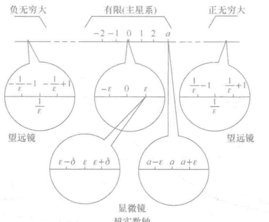

图 2.3.1 一个实数附近的无穷大与无穷小

装得下无穷小，也可以装得下无穷大；可以装下确定的量，也能装下不可测的量，这不仅为进一步的研究预留了空间，也为一些实际问题的计算和分析带来方便。

例如，在把 0 到 2 之间的自然数 1 写成 1+1i,2 写成 2+2i 后，人们平时在说的“3 个皮匠顶个诸葛亮”(“1+1+1>3”)与“3 个和尚没水喝”(“1+1+1<3”)就因为 0 到 3 之间的自然数 1 可以写成 1+2i 而得到。

“1+1+1”=(1+2i)+(1+2i)+(1+2i)=3+6i
当 i=1 时,3+6i=9(“3 个皮匠顶个诸葛亮”);
当 i=-1 时,3+6i=-3(“3 个和尚没水喝”);
当 i=0 时,3+6i=3=1+1+1(“3 个人就是 3 个人”).

又如，把 10 元钱去投资股票,结果为 10+10i(i∈[-1,∞]);
教室里有 5 个学生,走了 1 个还有 4 个,即 5-(1+4i), i=0;
矩形 4 只角,切去 1 只,还有 4-(1+3i)只,i=0,i=-2/3。

因为矩形有 4 只角,切去 1 只,有可能得 3 只角(切线与矩形的对角线重合,或超过对角线的位置,将矩形的超过一半切去),有可能得 5 只角(切线不到对角线的位置,仅切去矩形 1/2 不到)。

如此等等。

### 2.3.3 绿色智能计算

把自然数联系数化,相当于把一个自然数看成是一株株活着的树,每一株活着的树不仅有地面上的主杆和枝叶,还有地下的根系和根须;如果树与树紧挨着,那么,这一株树的根与相邻树的根还会交叉缠绕。据此又可以把 1,2,3,4,···这些自然数看成是生长在“数轴”上的一株株“树",这些树与树之间在地下的根系和根须就如同自然数与自然数之间的种种微观联系,例如,在 1 与 2 之间的 1.1,1.11, 1.111,...这些都是树与树之间的“根系和根须",见图 2.3.2。

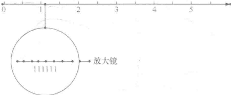

图 2.3.2 自然数(树)与自然数(树)之间的微观联系

在图 2.3.2 中,数轴相当于“地平线",数轴上的自然数就是这地平线上的“树",两个相邻自然数之间的无理数和有理数,是树与树之间的“根须",数轴因此是一维“森林",给这些“根”以某种“营养"(给定义、推理、运算规则等),地面上的“树”就会“开花”和“结果"(得到相应的推论或结论)。显然,可以把由此进行的一系列数学计算称为“绿色计算"或“树计算",它表明,计算是可以有“生命"的,对同一批数据进行不同的“计算",会获得不同的“结果",其中的机理就在于对不确定性的智能化处理。从这个意义上,数学成了一门新的“生命科学",当然,稍严格地说,应当说“联系数学"是一门新的“生命科学",对同一批数采用不同的联系,就会有“数字生命"的不同形态。

作物是人对自然界植物的有目的的筛选,培育和种植,目的是为人提供食物和其他物质;数是人对客观世界各种信息定量的描述和刻画,目的是为人们建立客观世界的模型提供方便,为人们提供“思维食物",联系数让我们看到数和作物的“相似性",从一个侧面揭示了人类智能的灵性。

本节内容主要取自文献[6],这里有删改。

数,同时也是系统,从另一方面为绿色智能计算提供了依据。这是因为,基于数同时也是系统这一事实,有关数的运算也同时涉及系统的运算;但习惯上,系统可以分析但不便于运算,解决这一矛盾的思路就是要把数的运算看成既有量的运算又有量的系统形态改变,后者也就是所谓的“质",绿色智能计算就是对量变与质变同时发生的一种计算。

有关绿色智能计算的一系列问题有待深入研究。

## 2.4 本章小结

本章先介绍集对分析在联系数伴随函数研究方面的进展,研究表明:一个联系数存在多个伴随函数，每一个伴随函数又有它的反函数，既说明联系数所含信息的丰富性，也说明联系数的复杂性和适用性；继而介绍集对分析用于经典概率论扩充研究方面的进展，所给出的基于赵森烽-克勤随机试验的赵森烽-克勤概率也是一个信息量丰富的数学概念；至于基于集对分析的自然数联系数化，数与系统的两义合一，进而引出的绿色智能计算，更是具有海量的信息，显而易见，每个方面都有大量的问题需要系统深入地研究。

## 参考文献

- [1] 赵克勤. 集对分析及其初步应用[M]. 杭州: 浙江科学技术出版社, 2007.
- [2] 赵克勤, 赵森烽. 奇妙的联系数[M]. 北京: 知识产权出版社, 2014: 30-36.
- [3] 沈定栋. 体育用联系数学[M]. 香港: 中国教育文化出版社, 2007.
- [4] 张春英, 郭景峰. 集对社会网络 α 关系社区及动态挖掘算法[J]. 计算机学报, 2013, 36(8): 1682-1692.
- [5] 赵克勤. 反偏联系数[M]//人工智能进展 2007. 北京: 北京邮电大学出版社, 2007: 66-67.
- [6] 赵克勤, 赵森烽. 奇妙的联系数[M]. 北京: 知识产权出版社, 2014: 65-80.
- [7] 赵克勤. 集对分析与熵的研究[J]. 浙江大学学报(社会科学版), 1992, 38(2): 66-72.
- [8] 赵森烽, 赵克勤. 概率联系数化的原理及其在概率推理中的应用[J]. 智能系统学报, 2012, 7(3): 200-205.
- [9] 赵森烽, 赵克勤. 几何概型的联系概率(复概率)与概率的补数定理[J]. 智能系统学报, 2013, 8(1): 1-15.
- [10] 赵森烽, 赵克勤. 频率型联系概率与随机事件转化定理[J]. 智能系统学报, 2014, 9(1): 53-59.
- [11] 赵森烽, 赵克勤. 联系概率的由来及其在风险决策中的应用[J]. 数学的实践与认识, 2013, 43(3): 165-171.
- [12] 赵森烽, 赵克勤. 基于赵森烽-克勤概率的新型风险决策[M]//中国系统工程学会决策科学专业委员会. 决策科学与系统分析: 中国系统工程会决策科学专业委员会第十届学术年会论文集. 北京: 知识产权出版社, 2013: 186-192.

# 第 3 章 人工智能基础和前沿集对分析

人工智能是一门技术性学科,但由于涉及智能定义、智能来源、信息处理、大脑思维、网络开发、大数据挖掘、智能转移升级这些高端前沿技术的深度开发与广泛应用,其原理和基础一直处于探讨和争议之中;本章根据集对分析理论,先给出系统智能定义与系统智能原理,继而给出新的人工智能定义和新的人工智能原理,再给出人工智能科学技术基础的集对分析,最后介绍集对分析提出的“智脑”与“集对人”两个前沿概念及模型。

## 3.1 系统智能原理

### 3.1.1 智能的定义

什么是智能(intelligence)？学术界有多种定义。代表性的定义有文献[1]和[2]中介绍的:“智能是一种应用知识处理环境的能力,或者是由目标准则衡量的抽象思考能力”;“人的智能是人类理解和学习事物的能力”;等等。

鉴于智能科学在近几十年中不断从生物的某些行为中受到启发而开发出种种智能算法,如“蚁群算法”“遗传算法”等,也从某种无机物的自然现象中受到启发而开发出诸如“模拟退火算法”等其他智能算法,特别是计算机和机器人这类无机物不仅已经有一定的智能而且还在日益增加智能。因此,从实际出发,需要从一个更为普遍、更为基础的角度定义什么是智能,在此根据集对分析的思想,给出一个基于集对分析的新智能定义:智能是系统(有机体或无机体)为了自身存在和发展,把两个或两个以上事物联系起来解决问题的一种能力。简言之,智能是系统存在和发展并与环境联系的一种能力。

根据“智能是系统存在和发展并与环境联系的一种能力”这个智能新定义可知,智能不仅是人的专利,人之外的生物,如动物和植物也具有智能,后者如何向日葵、含羞草等;智能也不仅存在于有机物和生物界中,无机物和无机界中也存在智能。例如,两物体相撞时的作用力与反作用力大小相等,方向相反,分别作用在这两个物体上,说明相撞的这两个物体有“以牙还牙”这种高级智能;又如撤销外力后恢复原始状态的弹簧,具有记忆的材料等无机物具有简单智能。至于地球围绕太阳公转的同时还有自转以保持这种运动能长期维持,说明我们人类居住的这个地球也是具有相当智能的星球……如此推而广之,可知自然界、乃至整个宇宙,都有这种或那种智能,原因在于自然界中的各种物质和物体都以系统的形态而存在,都为了自身的存在和发展而具有与环境联系的能力,因而都具有智能,可以把这种智能称为系统的自然智能,或简称为系统智能或自然智能。

事实上,从唯物意义上说,人所具有的智能完全由自然赋予。自然借助各种联系,特别是借助地球这个具有相当智能的星球创造了人,并缓慢地、有序地、持续不断地赋予人以智能,使人得以生存和不断发展进化;如今,人又把自然赋予的智能经过加工和制造,有目的地传递和赋予给人所创造的机器和其他有关系统,让机器和其他有关系统帮助人更好地认识自然、利用自然和开发自然。

不难认同,到目前为止,人与自然界和宇宙具有的智能相比,仅具有非常有限的一部分智能,人所不知道的远远超过人已经知道的。人是自然的产物,自然是人的母亲。人与自然应当和谐相处,知悉共存。人与宇宙相比,不过是沧海一粟,或许连沧海一粟也谈不上。人在懂得人之伟大的同时,也懂得人之渺小。

上面给出的智能新定义可以称为系统自然智能定义或超级智能定义,或简称为自然智能。这样的定义有助于消除人们对人工智能不断发展引起的恐惧,也加强人对自然的敬畏,不断探索自然的秘密,感悟和学习自然的智能,有利于人的智能不断成熟和人工智能的不断发展。

### 3.1.2 基本原理

为了清晰地说明我们在这里首次提出的系统智能原理,作以下约定。

首先,约定事物都在一定的时空中存在。时间和空间是事物得以存在的客观条件。时间和空间难以截然分割,不存在没有时间的空间,也不存在没有空间的时间,时间和空间的单独指称仅为了叙述上的方便,有时也为了研究上的方便,但这种方便也会给人们带来错觉,以为时间和空间可以独立存在,有意或无意地在时间和空间独立存在的条件下作出研究结论,从而脱离实际。而由 1.1.1 节给出的成对原理可知:时空是一个集对,而且是一个基础集对[3]。

其次,系统是由两个或两个以上要素组成的整体。事物以系统的形态存在。系统与系统所在的环境存在物质、能量与信息的交换,系统借助这种交换得以存在和演化。恰好由两个要素组成的系统是元系统,所有的系统都在元系统基础上发展而来;集对是一个元系统。

最后,事物是事与物组成的一个集对。为了阐明系统智能与人工智能的原理,约定:物,指物质或物体;事,指由人参与的物质或物体运动;人,指人类或一般人,有时也指个人。

有了以上约定,下面叙述系统自然智能的 10 个基本原理,其中前两个是基本原理(一级原理),后 8 个是引出原理(二级原理或三级原理),这 10 个原理是系统自然智能原理的基础原理。

#### 原理 1 联系原理

联系原理:客观事物总是处在相互联系之中。这是一个公认的科学原理,无需详述。

#### 原理 2 对立统一原理

对立统一原理:对立的双方共处于一个统一体中。这也是包括哲学在内的现代科学公认的一个科学原理,无需详述。

由于在各种各样的联系中,两个事物的联系是一种最基本的联系,再结合对立统一原理,可以引出以下的成对原理。

#### 原理 3 成对原理

成对原理:事物或概念都成对存在。成对原理是引出集对概念和集对分析理论的一个基本原理,已在第 1 章中详述。成对原理与著名物理学家玻尔给出的互补原理等价。

集对分析在一般性地分析和研究组成集对的两个集合的全部关系时发现:集对中两个集合的不确定性关系总是伴随这两个集合的确定性关系而存在,再结合对立统一原理,得到以下的系统不确定性原理。

#### 原理 4 系统不确定性原理

系统不确定原理:组成系统的要素存在确定性关系时,同时也存在不确定性关系。物理学中的测不准原理、数学中的哥德尔不完备性定理是系统不确定性原理的两个理论支撑。系统的不确定性原理也是集对分析理论与方法,特别是联系数的一个支撑性原理。详见 1.3 节。

#### 原理 5 相互作用原理

相互作用原理:联系者的两个或两个以上事物存在相互作用。相互作用原理也是哲学、物理学和其他学科公认的一个科学原理。

根据相互作用原理可知,在给定的时空中,物质和能量存在相互作用,从而使物质产生运动。在有人参与的物质运动中,人与物质运动构成事,因此事物处在运动之中,由此引出以下的运动原理。

#### 原理 6 运动原理

运动原理:客观上存在的事物总是处于运动之中。由于具体的事物运动总是在一定的时空中展开,根据相互作用原理和时间的单向性可知,事物的运动具有方向性,对这种方向性设定适当的起点后,也称事物运动具有发展性,简称事物的发展,所以运动原理也可以称为事物的发展原理。

#### 原理 7 关联原理

关联原理:联系者的两个或两个以上事物与他们在相互联系过程中因相互作用而产生的新事物存在关联。关联原理可以看成是相互作用原理的一个二级原理,也可以看成是联系原理的三级原理。根据这个原理,得到以下命题。

命题 1 信息是物质与能量相互作用的产物。


#### 命题 2 物质、能量、信息三者之间存在关联。

根据命题 1 和命题 2，得到以下推论。

- 推论 1 信息具有一定的物质与能量。
- 推论 2 信息具有不确定性。

##### 证明

根据相互作用原理和关联原理可知，信息是物质与能量的相互作用产物，既然是相互作用产物，则必然具有一定的物质与能量。又由于难以一般性地确定在一个具体的相互作用过程中有多少物质和多少能量参与相互作用而产生信息，所以信息具有不确定性。证毕。

显然，上面关于信息的两个命题和两个推论，从一个新的角度回答了“什么是信息”这个长期争论的问题。控制论创始人维纳曾说过“信息既不是物质，也不是能量”，曾长时期困扰着众多学者。我们猜想，当年的维纳有可能是在意识到“信息既是物质，又是能量”的基础上说“信息既不是物质，也不是能量”这句话。也就是说，当年的维纳是在意识到信息具有物质和能量双重特性的前提下才指出信息不可能单一地归纳为物质，或单一地归纳为能量。

#### 原理 8 最小作用量原理。

最小作用量原理：自然界中存在的各种系统总是通过消耗最小能量与其他系统发生联系，以有利于系统自身的存在和发展。

例如，光在没有阻挡物时，总是以直线方式到达目的地，因为两点间的距离以连接这两点的直线距离为最短，因而光能消耗最少。

相同面积的图形以圆的周长为最短，而圆的周长是这个圆与外界联系的唯一方式。

类似地，在体积相同的所有物体中，以球的表面积为最小，而表面积是物体与外界联系的唯一几何形体，如此等等；以至于爱因斯坦把“简单性原理”视为科学的基本原理。

最小作用量原理提示系统天然地具有价值意识，也就是以最小的成本获得最大收益。

#### 原理 9 能量转换与守恒原理。

能量转换与守恒原理：在自然界的各种变化中，能量既不会无中生有，也不会自行消灭，只会从一种形式转换为另一种形式，而转换时的总能量恒定。例如，力学中的动能与势能互相转换，电池里的电能与化学能互相转换，热力学系统中的热能与机械能相互转换，皆守恒。能量转换与守恒原理也是物理学中公认的一个科学原理。

信息作为物质与能量的一个相互作用产物，其所具有的能量，在本书中称为信息能，在不同信息形式的转换中也同样守恒，包括信息转换成智能后，仍然守恒。

#### 原理 10 功能原理。

功能原理是能量转换与守恒原理的一个派生原理，也是力学中的基本原理之一，在力学中的意义是物体系统的机械能增量等于外力非保守力对系统所做的总功和系统内耗散力所做功的代数和。其本质是能量在转化过程中会有能量消耗，但得到的新能量与消耗掉的能量总和不变。

## 3.1.3 系统智能原理与性质

基于以上 10 个科学原理，给出系统智能原理如下。

系统智能原理：系统为了自身的存在和发展，会用最小的能量消耗与系统所在环境进行物质与信息的交换，交换时间、交换内容、交换数量以及具体的交换方式和交换效果具有不确定性，交换过程中存在能量形式的转换和能量损耗，但总能量守恒。

由上述系统智能原理可以推知系统智能具有以下性质。

- (1) 目的性。系统智能的目的指向是系统自身的存在与发展。
- (2) 灵活性。系统智能使系统具有对环境的适应性，且能根据环境条件作质能转换、信息转换等。
- (3) 不确定性。系统智能使系统与环境关于物质、能量、信息的交换时间、交换内容、交换数量、交换机制以及具体的交换方式具有主动性和灵活性。
- (4) 价值性。系统智能使系统以最小的能量损耗达到交换目的，以有利于系统自身存在与发展。
- (5) 有序性。系统智能具有等级性、层次性、方位性、属性性、延伸性等。
- (6) 能量性。系统智能具有一定的能量，这种能量称为智能。智能在一定条件下可以与电能、化学能、机械能、热能、生物能和信息能相互转移，转换过程遵守能量守恒定律。
- (7) 成对性。系统智能与非智能，一方面的智能与另一方面的智能等，成对存在。
- (8) 效用性。系统智能对系统的存在与发展有实际效用，这些效用包括调节、控制、信息和能量的获取和报告、信息传送、分配、耗用等。
- (9) 成长性。系统智能随着系统存在与发展不断成长，包括正向成长、负向成长、横向成长、螺旋式成长、树式成长、网络式成长等。系统智能的成长性也包括了系统智能的自学习性、自组织性和系统智能的主动性、生态性等。
- 系统智能的成长性也称为系统智能的智性和动态性，成长方式具有不确定性。
- (10) 可转移性，一个系统的智能可以有条件地转移到另一个系统上。

以上性质的证明从略。

要说明的是，当从不同角度研究特定系统的系统智能时，会发现特定系统的智能还会有其他特定性质，例如，从人文角度研究人文系统智能时，会发现人文系统智能会有人文特性；当从社会系统角度研究社会系统智能时，会发现社会系统智能有社会特性；此外，随着人工智能的进一步发展，还会有新的系统智能特性，如网络智能特性、深空智能特性等；但基础性的系统智能性质和主要的性质如上所述。系统智能的可转移性为人工智能的实现提供了物理基础。

## 3.2 人工智能原理

### 3.2.1 人工智能定义

什么是人工智能？学术界也一直有不同的定义，有定义称“人工智能是计算机科学中涉及研究、设计和应用智能机器的一个分支”；有定义称“人工智能是一种使计算机能够思维，使机器具有智力的尝试”；也有定义称“人工智能是智能机器所执行的与人有关的行为、学习、感知、思考、理解、识别、判断、推理、通信、设计、规划、行动和问题求解”；等等。

根据 3.1.1 节中给出的“智能是系统存在和发展的一种能力”这个新定义，可以给出人工智能的新定义。人工智能是人通过人工技术赋予系统关于存在和发展并与系统所在环境开展联系并解决特定问题的一种能力。

上述人工智能新定义，突出了人的作用，也强调了系统的存在与发展，以及系统与系统所在环境的联系。显然，这里说的系统，是超越机器限制的系统，例如，人以外的其他低中等动物与植物，也都可以通过人工智能技术赋予必要的智能以解决特定的问题而达到某种目的。

特别地，当把人与系统构成一个“双系统”时，称其为一类高级智能系统或高级智能集对，因为按集对的定义，把人与系统构成一个集对也合法，本书把人与系统构成的高级智能系统称为“智脑系统”，简称“智脑”或“集对人”。

### 3.2.2 人工智能实质和目标

由于系统天然地具有了为自身存在和发展与环境联系的智能，所以人工智能的实质，就是把一系统的系统智能根据人的某种需要和某个目标赋予或转移到另一个系统中去。

根据以上认识和 3.2.1 节的叙述可知，人有两大目标。

一是希望把所有的系统自然智能学到手，以达到主宰世界、主宰自然、主宰时空、主宰宇宙，成为名副其实的“万物之灵”这一宏伟目标，显然，这是一个可以用无限或无穷作标签的目标。

二是希望把已学到手的系统自然智能，通过选择、重组、加权、优化等，去赋予某个系统，以提高、强化、完善被赋予系统的智能，以便帮助人达到某种目的，以有利于人的生存和发展。这是一个可以用有限或有穷作标签的目标。

可以看出，第一个目标不应当是人工智能追求的目标，至少在当前和相当长的时期中不能去追求的目标。第二个目标才是人工智能在当前和相当长的时期内追求的目标。

事实上，人工智能所能实现的所有大大小小的目标都受制于 3.1.2 节中所述的系统智能原理所依赖的那些基本科学原理。从理论上说，第一个目标是不能实现的目标，所有由第一个目标引出的问题也是不可能解决的问题，不妨称其为第一类问题。因此，人工智能所能解决的问题，都是求属于第二类目标的问题，不妨称为第二类问题。

但在实际工作中，第一类问题与第二类问题有可能相互纠缠甚至相互作用，从而带给人困扰，如历史上著名的永动机制造问题、当下的网络无限扩张延伸问题，以及由一些未知因素构成的问题，不知道问题是否有解的问题，机器智能是否会超越人的智能，机器是否会主宰世界等。当然，根据系统智能原理中的“对立统一原理”和“成对原理”可知，可解与不可解问题成对存在；根据“相互作用原理”可知：可解与不可解问题会相互作用，从而产生可解与不可解问题在一定条件的相互转化，但这种转化需要的条件在什么条件下能出现，条件的条件是否存在，又是一个问题。

## 3.3 人工智能基础

### 3.3.1 问题提出

一门学科，需要有自己的基础。人工智能作为一门技术类学科，其基础一直处在探讨和争议之中，这种探讨和争议从 20 世纪 50 年代美国学者麦卡锡(McCarthy)等首次提出人工智能这一天起就开始，但至今没有取得一致的认识，客观上形成了符号主义、联结主义、行为主义三大学派。符号主义认为数理逻辑是人工智能的基础，联结主义认为仿生学是人工智能的基础，行为主义认为控制论可以作为人工智能的基础。中国有学者认为，把以上三大主义综合可以作为人工智能的基础，并从不同的角度出发，主张把涉足人工智能的不同学派综合起来。

由于 3.1 节和 3.2 节中，给出了智能的新定义和系统智能原理以及新的人工智能原理，因此，有必要就人工智能基础提出我们的观点，具体如下。

### 3.3.2 人工智能的科学基础

从 3.1 节中给出的系统智能原理看出，系统智能原理所依赖的科学原理分别属于哲学(联系原理，对立统一原理)、物理学(相互作用原理，运动原理，能量转换与守恒原理、功能原理)、数学（系统不确定原理、最小作用量原理）以及集对分析（成对原理、关联原理），因此，哲学、物理学、数学以及集对分析是人工智能的科学基础。

有观点认为脑科学是人工智能的基础。但至今为止，脑科学研究所获得的知识还没有到能够为其他基础学科提供基础的程度，例如，对人脑的实质性研究还不能像物理实验那样批量地重复进行；但有关大脑工作机制方面的研究成果可以作为人工智能的某些技术基础。

有观点认为信息科学是人工智能的基础，但本书第一次明确地指出信息是物质与能量相互作用的产物，从这个意义上说，信息科学是物理学的二级学科，信息科学是以物理学和数学作为基础的学科。但有关信息处理方面的技术性成果可以作为人工智能的某些技术基础。

为什么可以将集对分析作为人工智能的基础？因为集对分析从成对原理出发，一直倡导把不同的两门学科联系起来，例如，把数学与物理学联系起来，作成一个特定意义的集对，不妨简称为“数理集对”；把物理与化学联系起来，作成一个特定意义的集对，不妨简称为“理化集对”……把天文学与地学联系起来，作成一个特定意义的集对，不妨简称为“天地集对”……把认知科学与脑科学联系起来，作成一个特定意义的集对，不妨简称为“知脑集对”……把科学与技术联系起来，作成一个特定意义的集对，不妨简称为“科技集对”；把理论与实践联系起来，作成一个特定意义的集对，不妨简称为“理论实践集对”；等等。推而广之，把自然科学与哲学社会科学联系起来，作成一个特定意义的集对，不妨简称为“自然哲社集对”；如此等等。不难看出，上述每一个集对，都涉及人的智能，在计算机日益广泛应用的今天和明天，上述每一个集对还都涉及人工智能，从这个意义上看，集对分析作为人工智能的基础乃是人工智能的题中之义。

### 3.3.3 人工智能的技术基础

信息技术、计算技术、工程技术、网络技术、分析技术、统计技术、综合技术、优化技术、组合技术、传感技术、医疗技术、脑科学技术等，都是人工智能的基础性技术。一句话，人工智能需要用到现有的各种技术，也需要各种新技术，而无论是哪一种技术，都离不开相关科学，都是“科学技术集对”中的一个集合；无论哪一种技术的应用，都需要满足人的期望，如果不能满足，人们就会去改进和发展所采用的技术，因此，技术的应用和应用的结果也是一个特定意义的集对，应用技术与改进和发展所采用技术的过程，本质上是在期望背景下的一种特定意义的集对分析。例如，应用结果满足预先给定的期望，称为基于期望的同；应用结果与预先给定期望有一定差距，称为与期望的异；应用结果与期望相去甚远，称为与期望的反；在“同”的情况下，所采用的技术会重复地大量应用；在“异”和“反”的情况下，所采用的技术会被设法改进，特别是对于“反”，所采用的技术会被淘汰或更新；如此等等。正是在这个意义上，集对分析是对人工智能技术基础的一个支撑。

以上简略地论述了人工智能的科学基础和技术基础，也简略地指出了集对分析可以作为人工智能科学基础和技术基础的支撑，重点是对人工智能科学基础与技术基础的论述，3.4 节对人工智能基础集对分析作进一步阐述。

## 3.4 人工智能基础集对分析

### 3.4.1 人工智能科学基础的集对分析

- 1. 数学与物理学的集对分析

从人工智能原理这个角度看，数学与物理学不仅单独为人工智能基础提供了科学原理，也通过两门学科的相互联系和相互交叉为人工智能提供原理性基础，如系统的确定性与不确定原理，就是由物理学中的“测不准原理”与数学中的“哥德尔不完备性定理”共同支撑，这是数学与物理学在人工智能基础方面的一个重要共同点。不同点之一是物理学中有能量转换与守恒这个原理，在数学中没有与之相对应的原理，但实际智能计算在计算机上实现时，存在机器发热和能耗问题，如何使机器在能耗最小条件下完成需要的智能计算，是一个需要研究的问题。不同点之二是对信息的认识，经典物理学中并没有专门对信息的研究，本书作者首次从物理学角度提出信息的实质是物质与能量相互作用的产物，从信息产生的这一来源可知信息具有能量，称为信息能，自然界中的风、雨、电闪、雷鸣、日照等，都是重要的自然信息，这些自然信息承载着物质与能量无疑；但人工智能中把数字看成是信息，难道数字也承载着物质与能量？这是一个需要深入研究的问题，当然，从理论上说，把数学与物理作为人工智能基础并无不妥。

- 2. 数学与哲学的集对分析

从人工智能原理这个角度看，哲学作为人工智能基础在逻辑与情理之中。因为从逻辑上说，哲学对诸多自然科学来说是一种鸟瞰式的指导性学科，对人工智能的哲学指导自在情理之中，特别是哲学给出的普通联系原理和对立统一原理，已经蕴含了“事物或概念都是成对存在”这个“成对原理”；而“成对原理”又是集对分析提出基本概念“集对”的依据；“集对”概念把两个有联系的集合作为一个基本的数学运算分析单位，是对集合论的一种提升，而集合论是数学的基础，数学是人工智能的基础，数学与哲学就这样携手为人工智能提供坚实的基础。

- 3. 哲学、数学、物理、集对分析联系科学的集对分析

从上面的论述中看到，哲学、数学、物理学、集对分析联系科学不仅共同为系统智能原理和人工智能原理提供基础性原理，而且还有侧重地起着基础原理的作用，例如，物理学提供的能量转换与守恒原理侧重说明系统智能对于系统中包括信息能与智能在内的各种能量保持着守恒，信息所具有的能量来源于物质在运动中对能量的提取。信息在传送过程中存在能量的损耗，这种能量的损耗表面上也可能表现为信息的丢失，实质是关于信息运动所需要的能量开销；类似地，计算机对于信息的处理也存在对能量的需求，处理过程也同样受到能量守恒的制约，例如，计算机各模块在长时期工作过程中产生的热量与冷却，说到底也受制于热力学定律；而当信息在系统中被转换成智能时，同样存在能量的损耗；目前已经知道，人脑在把信息转换成智能的过程中，需要大量的学习和思考，人在学习和深入思考过程中需要大量的能量补充，否则便无法进行长时间的艰苦学习和深入细致乃至严密的思考，更不可能利用早先储备的知识对信息进行加工处理转换成智能，并把这种智能转移给特定的目标系统。

### 3.4.2 人工智能技术基础的集对分析

容易认同：人工智能实现过程中的各种技术，如信息技术、计算技术、工程技术、网络技术、分析技术、统计技术、综合技术、优化技术、组合技术、传感技术、模式识别技术等，都具有可操作性，这是同点；各种技术又有各自的特点，这是异点；还可能在一组共同实施的技术中存在某些反点，如在智能化的远程医疗过程中，医疗技术的直接实施对象是有生命的个体，但同时启用的网络技术、信息技术、计算技术等直接面对的是没有生命的数据，这种反点在一组共同实施的技术中存在，客观上使所实施的人工智能技术带上伦理学意义和价值意义上的风险。通常情况下，人工智能应当在尽可能低的风险下组合现有的基础技术达到目的，同时形成新的高端智能技术。

### 3.4.3 人工智能三大研究学派的集对分析

由于人工智能学界一直没有明确认识到系统自然智能的重要性，没有主动地把人类已经认识和掌握的科学规律和科学原理作为人工智能的学科基础性原理，没有把相对成熟且行之有效的各领域技术作为人工智能技术的基础，长时期在实用价值的引导下对智能原理和人工智能基础多头摸索，客观上形成符号主义、联结主义、行为主义三大学派，各有特色也作出了各自的贡献。现在，当我们明确了系统自然智能原理和人工智能技术原理之后，就容易把符号主义、联结主义、行为主义三大学派统一在系统自然智能这个体系中。事实上，早在 1996 年，朱其秀[4]就把集对分析用于这三大学派联通的构想，其主要思想如下。

第一，集对分析支撑行为主义。行为主义认为，系统的智能活动是基于“感知和行动的”。从集对分析角度看，感知和行动是一个集合对。一般来说，一定的感知和一定的行动相对应。但是在不少情况下，一定的感知可以有不同的行动与之对应；反过来也是如此，即同一行动可以有多种不同的感知相对应。换言之，这中间既有一定的规则可以让系统或机器遵循，同时又存在不确定性可以使系统或机器灵活地加以选择执行。对于这样一种智能机制，可以用集对分析联系数进行描述并开展进一步的分析。

第二，集对分析支撑联结主义。联结主义认为，人脑思维的基元是神经元，神经元与神经元之间以不同的方式联结形成不同的结构，不同的结构具有用不同的方式进行信息处理和交换的功能，在此基础上形成人的智能活动，可以由此出发建构人工智能理论，联结主义也称结构-功能主义。从集对分析角度看，两个神经元的联结是一种基本的联结形式，这正好由“集对”这个概念来担当。而且，不管人脑的神经元结构有多么复杂，在结果处理上总不外乎同（与给定的目标价值一致）异（与给定的目标价值有差距）反（与给定的目标价值相矛盾），并可以在一定条件下对同异反程度展开度量；也就是还同时显示出某种数量上的简单性，类似于将集对分析联系数作了复杂的运算后，其结果仍然是一个看上去有同异反平凡结构的联系数。因此，集对分析同时是对联结主义（结构功能主义）的一种支撑。

第三，集对分析支撑符号主义。符号主义认为，思维的基元是符号，思维过程是有关符号的运算和逻辑推理，符号主义也称形式主义，计算机的全部运算和推理都是借助形式上的各种特定符号进行。集对分析强烈支撑符号主义是因为，首先有关联系度的运算就是一种符号运算，按照集对分析理论，运算结果的“同异反”是什么含义，要结合具体问题背景来加以理解。其次集对分析认为，从已知两个集合的“同”可以在一定条件下得出这两个集合的“异”和“反”。反之亦然，即从两个集合的“反”也可以得出这两个集合的“同”和“异”；“异”中则自然地蕴含着“同”和“反”。显然，在此对条件和背景的选择有着其独特的意义，一切随条件和背景的改变而改变，同样的符号在不同的条件和背景下完全可以有不同的含义。再次，集对通过自身的特征函数进行的集对运算，本身就是一种符号运算。

综上所述，尽管符号主义、联结主义、行为主义是人工智能领域在基本理念、研究方法、操作内容等方面长期存在严重分歧和激烈争论的三大学派，但它们都得到集对分析的理论支撑和实质性支撑，根本原因是集对分析联系科学是关于系统自然智能科学原理的基础性理论。


还需指出的是，由于人们对系统智能本质认识的阶段性限制，符号主义、联结主义、行为主义这三大学派的共同不足是没有认识到系统的智能是系统所具有的一种能量，进而没有关于智能来源过程中的有关的能量损耗，智能实施过程中与实施对象的能量转换与能量消耗始终受到系统能量守恒制约这一现实，因此最多只能从属于人工智能技术层面上作不同角度的人工智能技术基础探索。

## 3.5 智脑与集对人

### 3.5.1 问题提出

沿着 3.4 节的思路，特别是人工智能新定义，人们会提出这样的问题：是否能够通过某种人工智能技术，让一个系统把数学、物理学、生命科学、思维科学、社会科学、经济学、行为科学、管理科学、文学艺术等学科，以及信息技术、工程技术等联系起来，这样的系统将是一个什么样的系统？是现有的网络系统，是超级人工智能，还是其他超级系统？

### 3.5.2 智脑的概念

基于对上述问题的思考，赵克勤在 2014 年的集对分析潮州会议上提出了智脑的概念[5-7]。所谓智脑，最基本、最简单，也最常见的模型就是眼下比比皆是的“人脑+电脑”系统，稍大一点地看，是由人脑与网络组成的智能系统；实事求是说，是由亿万台计算机与亿万个人脑组成的超级脑系统，眼下的网络连同在线的亿万人脑，就是这样的一个超级脑系统。基于集对的定义和集对分析理论，这个超级脑系统是一个集对系统，只要把网络中的亿万台计算机作为一个集合，把在线的亿万个人脑作为另一个集合，这个超级脑系统就是一个实时计算和分析各种问题的在线集对，这个超级脑系统的各种实时计算和各种具体分析就是一类超级集对分析。但这个超级集对仍具有集对的一般性质，也就是集对中的两个集合具有同一性（网络中的计算机或多或少地具有部分人脑的功能，如对信息的感知和分类识别、记忆与理解、计算与分析等）、差异性（人脑与计算机存在诸多差异，如用于大规模并行计算的神经网络与人脑内部的神经网络的差距等）和对立性（人脑对复杂事物的即刻直觉决策与计算机软件的程序性决策对立等）以及这两个集合相互联系的种种不确定性，其同异反程度可以用同异反联系数表征，由此得到智脑的定义。

定义 3.5.1 智脑是由人脑与电脑组成的一种智能系统。

由于网络是一类将众多电脑联结而成的网络系统，因此可简称其为网络脑。这样，所谓智脑可以进一步解释为是由人脑+网络脑组成的一种脑集对，也可简称脑对、双脑、智脑系统，或直接简称智脑。

根据智脑定义和关于网络脑的约定，上面论及的各种智脑系统，包括简单的人脑+电脑系统，稍为复杂的人脑+网络脑系统，可以统一简称为智脑系统或智脑。顺便指出的是，上面说的电脑也包括智能手机。

从时空角度看，上述智脑系统的最大潜力在于智脑的进化。智脑智能在智脑的进化中得到不断扩充、强化，不断地向完善接近。

众所周知，人脑的进化已有数十万年历史，人脑的社会化合作也有几千年历史，总体上说是一种极为缓慢的进化；由于其进化历史不能在实验室重演，人脑思维也不能在实验室解剖条件下进行观察性的研究，以至于人们至今对人脑的认知，仍然是未知超过已知。但 20 世纪末出现的计算机网络（脑），在空间上不断快速延伸扩展的同时，也在技术、结构、功能、机制多个维度上发生着进化，质的变化隐含在缓慢的量变之中，我们猜想，当人脑沿时间维的进化与由计算机构成的网络脑沿空间维的进化有机结合，由此形成的智脑智能进化将会有前所未有的速度和规模，在这个过程中，我们或许会发现，网络脑在一定程度上就是人脑的一种映像，人脑的许多机制可以在网络脑中得到合理的诠释。

### 3.5.3 实例

例 3.5.1 先看图 3.5.1，这是从互联网上下载的图。

由图 3.5.1 可见，现有的实时互联网与人脑高度相似，严格地说是向高度相似的方向进化，并且终有一天会形成较为完善的类人神经元，类人神经网络，类人感觉神经系统、类人运动神经系统、类人中枢神经系统、类人神经反射弧等功能和机制。其中最重要的就是互联网的神经元网络结构，也就是社交网络与物联网结合后形成的 BIG SNS。要看到这个网络的每一个计算机，其实质是一个个智脑，因为每台计算机（包括智能手机）在工作时，都有人脑在同时工作。

需要指出另一个现象是，图 3.5.1 所示的网络还被另一个实体人所完全掌控，百度、谷歌、腾讯就是这样的实体人。

总之，人工智能中曾经强调的人机交互、大规模并行计算、多 Agent、神经网络、信息智能转换、智能系统工程、不确定性智能、数据库、知识库、决策中枢、行为与行动机构、智能工程、某些智能技术的实施（如文本检索和情报分析、远程故障诊断和远程机器人医学手术等），在人脑与网络脑所构成的智脑系统中都具体化为人脑与计算机（网络脑）的相互作用。

例 3.5.2 通过微型芯片实现了猴子利用意念控制机械手的实验。

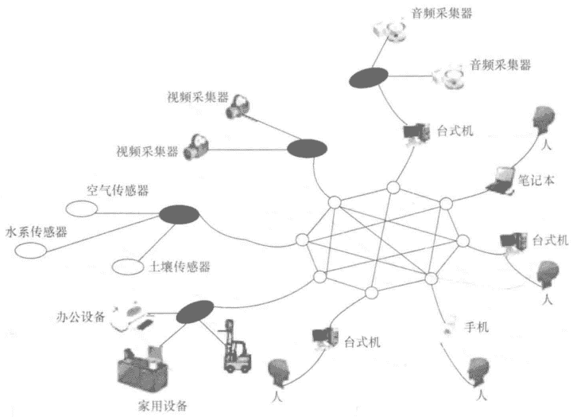

图 3.5.1 实时网络脑示意图

据介绍，为了完成猴子利用意念控制机械手实验，科研人员必须先在一只猴子大脑运动皮层，植入两块 4mm×4mm 芯片（96 个电极），这两块芯片与 200 多个神经元相连接，用来感受来自神经细胞的脉冲。而芯片的另一头连接着一台计算机，它实时记录着这只猴子一举一动发出的神经信号。

科研人员再运用计算机信息技术成功提取并破译猴子大脑关于抓、勾、握、捏四种手势的神经信号，使猴子的“意念”能直接控制外部机械手。

据了解，将芯片植入动物甚至人的大脑的这种实验，都必须经过相关部门的审核，因为涉及人或生物的伦理问题。

这个例子从另一个侧面说明，人脑与电脑结合而成的智脑，其智能的实施和实施的结果具有多样性、有效性和复杂性，其中的复杂性还涉及社会伦理学方面的有关问题等；当然，更为重要的是，人脑与电脑有机结合在不断发展，换言之，由人脑与电脑构成的脑集对是一个发展着的集对，是一个有机体，这使我们进一步有了“集对人”的概念。

### 3.5.4 集对人

基于人有两只眼睛，两只耳朵，两只手、两条腿，以及肝胆、心肺、腹背等成对现象，赵克勤在 2009 年浙江大学召开的纪念集对分析提出 20 周年学术会上指出，每个人都是“长”着诸多“集对”的人，不妨形象地称为“集对人”；但当时遇到一个概念上的困惑，就是每个人都只有一个脑袋；按照 1.1 节中的“成对原理”，“集对人”应当有“两个脑袋”，另一个脑袋在哪里？后来才悟到电脑是“集对人”的另一个脑袋，赵克勤为此在 2014 年的集对分析潮州会上提出智脑的概念（见 3.5.2 节），也就是把“人脑＋电脑”这种智能系统作为一种特定的“脑系统”来研究，简称为智脑，也因此解除了“集对人”在概念上的困惑；另外，我们看到，3.5.2 节中说的网络脑，其实也不是纯粹和完全的机器脑，网络中的众多实时电脑都有人脑的身影和人脑的思维在实时起作用，从这个意义上说，网络脑系统是一个“类人”（也有人称“虚拟社会”）或“类人系统”，这个“类人系统”与某些实体人（如网络的实时用户和操控网络者，如百度、腾讯、谷歌等），也构成一个“集对人”系统，为了研究和分析上的方便，也为了给出智脑的模型，这里给出集对人的定义如下。

**定义 3.5.2** 人与智脑构成的超级智能系统称为集对人。

根据上面对于智脑的定义和集对人概念的形成，可知集对人有两大类型：①机器-机器类集对人；②自然人-机器类集对人。

无论是哪一类型的集对人，都有两大特征：①在具有人脑有机思维同时还具有电脑的无机-有机混合思维；②在具有自然人行为的同时还具有机器（系统的）行为。

### 3.5.5 数学模型

根据以上论述和第 1、2 章介绍的集对分析和联系数知识，可以给出智脑（和集对人）的数学模型如下。

若用 IB 表示智脑(intelligence brain)、用 P(people) 表示人、用 C(computer) 表示计算机，则有

\( IB_{ut} = \sum_{k=1}^n P_k + i \sum_{t=1}^m C_k \tag{3.5.1} \)

式中，IB_ut 表示有 k (k>=1) 个人与 t (t>=1) 台电脑组成的智脑系统；i 表示不确定，按集对分析，i 在[-1, 1] 区间视不同情况取值。式(3.5.1)是智脑的基本模型。

前已指出，在实时网络系统中，几乎每台电脑都同时有人在操控，因此，智脑的一般模型应当如式(3.5.2)所示：

\( IB_{ut} = \sum_{k=1}^n P_k + i \sum_{t=1}^m C_k P_k \tag{3.5.2} \)

当式(3.5.2)中的 n 和 m 是有限实数时，式(3.5.2)表示的是“有限智脑”，真正符合前述基于互联网的智脑模型，即

\( IB = \sum_{k=1}^\infty P_k + i \sum_{t=1, k=1}^\infty C_i P_k \tag{3.5.3} \)

显然，式(3.5.3)是一个典型的二元联系数表达式。

在上述模型基础上，若再计及相对于智脑独立存在实施智能机器（或机构），并用 m(mechanism) 表示，则由式(3.5.3)得

\( SPP = \sum_{k=1}^{\infty} P_k + i \sum_{i=1, k=1}^{\infty} C_k P_k + j \sum_{q=1}^{\infty} m_q \quad (3.5.4) \)

式中，SPP 表示“集对人”（set pair people）；m_q 表示第 q 台实施智能机器（或机构）；j 有定性定量二层意思：①表示 \sum_{q=1}^{\infty} m_q 刻画对象的无机性与 \sum_{k=1}^{\infty} P_k 刻画对象的有机性是相反的；②需要时可以赋值。因此，称式(3.5.4)为“集对人”数学模型。

从另一个角度看智脑系统，智脑实施智能的功能应当在智脑系统内，因此，式(3.5.4)也可以看作是对式(3.5.3)中第 2 项的一种分解结果，请参见 1.3.2 节。

### 3.5.6 问题思考

#### 问题 1 集对人是人类学意义上人种的进化吗？

人类学告诉我们，人类的进化已有几十万年的历史。脚的直立行走和手的劳动这一分工把人与猴子区别开来。机器的出现和应用把人的脚和手的功能发挥到了极致，从而把现代人与古人进行了区别。计算机的出现及其日益智能化则被看作是人脑的延伸，但日益强大的计算机网络已经远远不能简单地看成是人脑的延伸，它在映射人脑有关功能的同时，又在不受人脑生理限制的条件下进化着，因而应当看成是与人脑的一个配对系统，从而形成具有两个大脑、两条腿、两只手、两只眼睛、两只耳朵，有肝胆、心肺、腹背等完整肢体和内脏，具有摄入食物（学习知识和获取信息）、吸收营养（处理信息，把信息和知识转换为智能）、排泄废物（去掉冗余信息、扬弃糟粕等）、创造文明（物质文明和精神文明）的新人种，这种新人种在人类进化的意义上将与传统人种显示出不同的人类学特征（其人类学特征的显性化或许是一个缓慢的历史进程，也可能不会太缓慢），因而是人类进化的一个新阶段，那么可以将人称为智能人吗？

#### 问题 2 集对人的主要历史任务是什么？

探索和开发出人类的第二个家园。

地球是人类的家园，但现今的地球，资源在枯竭、环境在恶化、人口在饱和、地震、火山、海啸不可阻挡，也难以预测，至于外来天体什么时候飞来袭击地球，后果更是不堪设想。在此忧患意识下，近期在太阳系中寻求第二个宜居星球已成为地球人的当务之急，已有的科技信息告诉我们，太阳系中有可能找到人类的第二个家园，但第二个家园究竟在哪里？由谁去开发？如何开发？恐怕要由集对人这个智能人种去担此重任。

#### 问题 3 集对人的现实任务是什么？

地球上的人类社会，在历史上曾有过两次世界大战，撇开种种历史和社会原因不说，缺少交流、沟通、协商的工具和机制是其原因之一，特别是在利益对立、思想矛盾、精神分裂、地域分割情况下，缺少交流、沟通、协商的工具，引发大规模冲突的概率会大大增加；显然，集网络智能和行为于一身的集对人具有交流、沟通、协商的综合功能，有助于缓解矛盾、和谐世界，避免现有地球人在地球上再起世界性冲突。退而言之，集对人有助于 21 世纪和以后各个世纪的全球性政治文明、经济结构调整优化、生态平衡、节能环保、民生安居。

总之，集对人这种人机有机结合的超级智能系统，抑或是新人种智能人，还有太多的问题需要系统深入地研究。

## 3.6 本章小结

人工智能从提出到现在已过去半个多世纪，激进的乐观主义者担心智能机器人终有一日会控制人类，从而给人类带来史无前例的威胁甚至灾难；保守的悲观主义者则认为人工智能的发展远没有达到人工智能提出时的预期目标；稳健的实用主义者则忙于从不同的角度建造和创新人工智能的技术大厦；在这样的背景下，本章提出系统自然智能的概念，把大自然看成是天然的智者，迄今为止人类的智能仅仅是向大自然习得的一小部分智能；人类至今认识到的那些自然规律和自然科学原理就是这一部分智能中的核心内容，人类还得向大自然虚心学习更多的智能。基于这样的思考，本书首次给出系统自然智能原理以及新的人工智能原理，指出信息是物质与能量相互作用的产物，信息中含有能量，称其为信息能，信息能与智能，是与电能、热能、机械能、化学能、原子能等能量同样性质的一种能量，因而可以与电能、热能、机械能、化学能、原子能等能量在一定条件下相互转换，并遵守能量守恒。计算机网络在能量的驱动下处理日益增多的数据和信息，网络脑与人脑一样具有智能，网络脑与人脑构成的智脑集对正以前所未有的速度和规模进化，正在形成一种新的类人系统——“集对人系统”（抑或是一个新的人种，不妨称为智能人），纯粹的实体人和类人系统共同决策、执掌、实施和推进现代文明社会发展和寻找人类新的宜居家园的时代已经到来，其中有许许多多新问题等待我们去系统和深入地研究；不过，从第 4 章开始，将介绍集对分析在已有人工智能研究和实际问题解决中的具体应用。

## 参考文献

- [1] 蔡自兴,徐光佑. 人工智能及其应用[M]. 北京:清华大学出版社,2010:114-116.
- [2] 钟义信.高等人工智能原理.观念.模型[M]. 北京:科学出版社,2014:1-440.
- [3] 赵克勤.集对分析及其初步应用[M].杭州:浙江科学技术出版社,2000.
- [4] 朱其秀.集对分析用于人工智能研究的思考[J].绍兴文理学院学报,1996,16(4):113-118.
- [5] 赵克勤.赵森烽.贝叶斯概率向赵森烽-克勒概率的转换与应用[J].智能系统学报,2015,10(1):51-61.
- [6] 蒋云良,赵克勤.刘以安.等.信息处理集对分析[M].北京:清华大学出版社,2015:1-38.
- [7] 赵克勤,赵森烽.奇妙的联系数[M].北京:知识产权出版社,2014:1-80.

# 第 4 章 基于集对分析的模式识别

模式识别是人脑的一项基本智能，也是人工智能的基础技术之一。人工智能中常用的模式识别分为基于有模板的识别（也称有监督的分类）和无模板的识别（也称无监督的分类）两类。模式识别的集对分析成果主要是创建基于集对分析的模式识别技术，分为同异反模式识别与不确定性模式识别两类，本章主要介绍基于集对分析的同异反模式识别与不确定性模式识别原理和方法，并给出应用实例。

## 4.1 原理介绍

### 4.1.1 模式识别的定义

模式识别也称模式分类，有已知模板在先的称为有监督的分类，没有模板在先的称为无监督分类；从模式识别方法看，分为统计法和结构法两种，统计法又有判别函数法、近邻分类法、非线性映射法、特征分析法、主因子分析法等；结构法又称句法法或语言学法，其基本思想是把一个模式描述为较简单的子模式的组合，子模式又可描述为更简单的子模式的组合，最终得到一个树形的结构描述，底层最简单的子模式称为模式基元，整个模式以一组基元和它们的组合关系来描述，称为模式描述语句，相当于在语言中，句子和短语由词组合，词由字符组合，句法法因此得名。

模式识别是人工智能的一项基础性技术，已广泛应用于文字识别、语音识别、指纹识别、人脸识别、案件侦破、疾病诊断、军事国防、水印技术、信息分类、基因组合、良种选优等。

### 4.1.2 基于集对分析的同异反模式识别原理

基于集对分析的同异反模式识别简称同异反模式识别[1]，分为基于定量的同异反模式识别和基于定量定性混合的同异反模式识别两类，它们都与联系数有关。

- 1) 基于联系数伴随函数的分类

例如，设 \(\mu(N,M)=a+bi+cj\) 是关于模式 \(N,M\) 的一个联系数，则当势函数 \(sh(\mu)=a/c>1\) 且 \(b<a\) 时，称 \(N,M\) 为同一类模式；当势函数 \(sh(\mu)=a/c<1\) 且 \(b<c\) 时，称 \(N,M\) 互为相反类模式；当 \(sh(\mu)=a/c=1\) 且 \(b<c\) 时，称 \(N,M\) 互为既不相同也不相反的中介过渡类模式，必要时或在有条件时，可以对中介过渡类模式深入一个层次或深入多个层次作细化的同异反分类。此外还有基于联系数势函数的模式分类、基于联系数偏联系数的模式分类、基于联系数邻联系数的模式分类、基于联系数相互作用联系数的模式分类等，可以参见 2.1 节。

- 2) 基于同异反距离的模式分类

白杨文等于 1996 年给出同异反距离模式识别的择优原则和择近原则[2,3]，择优原则是指预先有优化准则或有优化目标时，用最优化方法寻找出最优的模式；择近原则是一一计算待识别的 n 个模式与事先给定模式的距离，按距离由小到大的次序确定与事先给定模式的“同（最接近事先给定模式）异（与事先给定模式有一定距离）反”（与事先给定模式有较大距离）；当“同异反”是相对独立和有确定的属性且不计较“异”的不确定性时，同异反模式识别结果是唯一确定的结果；当计及同异反中“异”的不确定性时，同异反模式识别结果需要通过不确定性分析后才能给出结论。当没有事先给定的模式时，可以在给出的 n 个模式中先根据某种准则（如由最优指标集）找出最优模式作为标准模式，再根据择优原则和择近原则实现模式的同异反识别和聚类。

由于客观事物的多样性、不确定性和复杂性，完全精确和绝对确定的模式识别在应用上受到限制；以精确和相对确定为目标，但同时又带有在一定范围和一定不确定性（但可接受）的宽域式同异反模式识别在应用上受到欢迎，也能不断衍生出新的识别方法与识别技术，如基于集对分析的相似识别技术等。

由以上介绍可知，基于集对分析的同异反模式识别是借助同异反联系数的建模、计算与分析来进行的。

## 4.2 基于集对分析的指纹识别应用

成科扬在 2005 年即把集对分析用于指纹识别研究，取得了较好的效果，这里介绍成科扬的工作[4]。

### 4.2.1 指纹

指纹是人体的一种生物特征，具有唯一、终生不变以及与主体不可分离等独特性质，因此指纹识别技术被广泛应用于公安、银行、保险箱业务等许多领域中。指纹识别与匹配是一项十分重要但技术难度极大的工作，原因是：①指纹采集时的姿势有随机性，待识图像的模板图像在姿势上存在着旋转、平移；②指纹采集时存在不规则变形，这种变形又是随机的，且难以用传统的数学模型定量描述；③手指在干燥、潮湿、磨损严重等情况下，图形质量下降，加上特征提取算法本身的不完善性，普遍存在出现伪细节点、真正细节点的定位存在偏差的情况。这些因素的存

在，决定了指纹匹配只能是具有相对性的弹性匹配。目前国内外对于指纹识别与匹配有不少研究，但成效仍微。成科场[4]基于集对分析理论和方法建立了一套新型的指纹识别系统，为解决指纹识别与匹配的不确定性提供了新途径。

### 4.2.2 基于集对分析的指纹识别系统

基于集对分析的指纹识别系统基本思路：把模板指纹的所有特征组成一个集合，把待识别指纹的所有特征组成另一个集合，所谓的指纹识别与匹配就是上述两个集合所有关系的分析。

基于集对分析的指纹识别系统按以下步骤建立。

- 1) 确定各个特征的权系数

由于指纹特征点的类型、欧氏距离、相对角、至中心所穿线数等几个属性在判断两枚指纹对应特征点是否匹配的决定性作用不一，所以有必要对以上各属性确定其权系数，这里不妨用重要性排序法确定各特征的权系数。

为此请 \( m \) 个专家对指纹特征点的类型、欧氏距离、相对角、至中心所穿线数这 4 个属性进行排序，设 \( N_{ij} \) 表示第 \( j \) 个专家排序中排在第 \( i \) 个属性之后的个数，则有

\( f'_i = \sum_{j=1}^m N_{ij} \quad (4.2.1) \)

归一化后得

\( f_i = \frac{f'_i}{\sum_{j=1}^n f'_i} \quad (4.2.2) \)

- 2) 选取特征点

对于预处理过的指纹图像，可提取两类特征点：纹线的端点和分叉点。其他类型纹线特征均可以被分解成这两类加以提取[2]（纹线中的眼、桥、剪刀形交叉点均可以拆分成两个纹线分叉点），图像中的孤立点不予提取。

任取一特征点，以此为中心，辐射状向外搜索，直至该特征点达到某一定值 \( R \)。在此范围之内，记录下其所搜索到的其他特征点的类型、欧氏距离、相对角、至中心所穿线数等，如图 4.2.2 所示，并将此作为该中心特征点的属性。该法的优点是提取指纹图像特征点不受图像旋转、平移的影响，见图 4.2.1 和图 4.2.2。

- 3) 确定各对应特征点对的联系数

任取两个分别来自模板指纹和待识别指纹的特征点，设这两个中心特征点在 \( R \) 范围内分别有 \( N_1, N_2 \) 个卫星特征点。对于类型、相对角、欧氏距离、至中心所穿线数等属性分别求该中心特征点在其上的联系度：

\( \mu_{ijk} = a_{ijk} + b_{ijk}i + c_{ijk}j \)

式中，\(\mu_{ijk}\) 表示待识别指纹特征点 \(i\) 对模板指纹特征点 \(j\) 在属性 \(k\) 上的联系度。

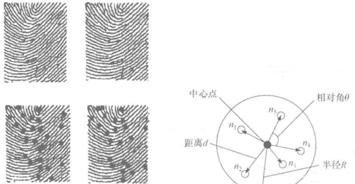

图 4.2.1 特征点提取

图 4.2.2

设两中心特征点的 \(N_1, N_2\) 个卫星特征点有 \(N_a\) 个特征点在属性 \(k\) 上可被认为是相同的（属性值一致性在某一正确界阈值之上），\(N_c\) 个特征点在属性 \(k\) 上可被认为是相异的（属性值一致性在某一正确界阈值之下），其余 \(N_b\) 个特征点在属性 \(k\) 上可被认为是相似的（属性值一致性在两确界阈值之间），则

\( a_{ijk}=N_a/N, \quad b_{ijk}=N_b/N, \quad c_{ijk}=N_c/N \)

式中，\(N=(N_1+N_2)/2\)。根据集对分析理论，此处 \(i\) 可采用相似比法取 \(i=(a_{ijk}-c_{ijk})/(a_{ijk}+b_{ijk}+c_{ijk}), j=-1\)。

- 4) 指纹图像匹配的确定

设待识别指纹特征点 \(i\) 对模板指纹特征点 \(j\) 的相关度为 \(R_{ij}\)，则

\( R_{ij}=| [f_1, f_2, \cdots, f_m]^T \times [\mu_{ij1}, \mu_{ij2}, \cdots, \mu_{ijm}] | \)

当 \(R_{ij}\) 大于某一阈值时，可认为待识别指纹特征点 \(i\) 和模板指纹特征点 \(j\) 相同。又当这种可认为相同的点对占两枚指纹图像特征点总量一定百分比时，系统判断这两枚指纹匹配成功。见图 4.2.3。

- 5) 匹配流程

匹配流程见图 4.2.4。

### 4.2.3 实验

测试以上算法的指纹数据库包含从 200 个不同手指采集到的 2000 幅指纹图像，每个手指采集 10 幅图像，图像大小为 \(640 \times 480\)，采集图像时没有限制手指的位置与方向。实验结果如表 4.2.1 所示。

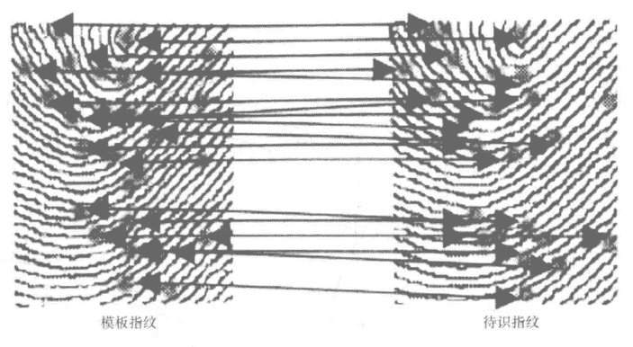

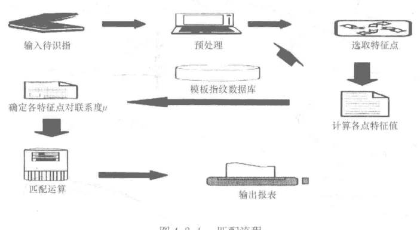

### 表 4.2.1 阈值设定与识别率

| 实验编号 | F1u | F1d | F2u | F2d | F3u | F3d | F4u | F4d | F5 | F6 | 识别次数 | 正确次数 | 错误次数 | 拒识次数 |
|---|---|---|---|---|---|---|---|---|---|---|---|---|---|---|
| 1 | 0.78 | 0.21 | 0.81 | 0.22 | 0.79 | 0.19 | 0.82 | 0.22 | 0.52 | 0.61 | 2000 | 1994 | 4 | 2 |
| 2 | 0.77 | 0.23 | 0.80 | 0.21 | 0.81 | 0.22 | 0.82 | 0.19 | 0.51 | 0.62 | 2000 | 1997 | 2 | 1 |
| 3 | 0.79 | 0.22 | 0.81 | 0.22 | 0.82 | 0.21 | 0.80 | 0.20 | 0.55 | 0.62 | 2000 | 1996 | 2 | 2 |

注:F1u,F1d 为类型属性值，上下确界阈值;F2u,F2d 为相对角属性值，上下确界阈值;F3u,F3d 为欧氏距离属性值，下界阈值;F4u,F4d 为至中心所穿纹线数属性值，上下确界阈值;F5 为特征点认同阈值;F6 为指纹匹配，相同特征点比例阈值。

阈值采取自适应取值，系统通过对识别成功案例的有监督学习，不断修正已有的各个阈值，使之不断优化。

由表 4.2.1 可以看出，成科场给出的基于集对分析的指纹识别算法在达到 99.78% 的正确识别率时的拒识率仅为 0.08%，表 4.2.2 给出了不同质量指纹下的系统识别率，实验还表明，基于集对分析的指纹识别系统对于指纹图像有部分缺损、拉伸仍具有很好的鲁棒性。

### 表 4.2.2 不同质量指纹下的识别结果

| 指纹种类 | 识别率/% | 指纹种类 | 识别率/% |
|---|---|---|---|
| 正常指纹 | 99.3 | 旋转 60° | 98.7 |
| 背景偏黑 | 98.3 | 轻度畸变 | 95.8 |
| 背景偏白 | 98.5 | 一般畸变 | 90.2 |
| 旋转 45° | 99.0 | 重度畸变 | 81.8 |

## 4.3 同异反模式识别在金属矿山地质灾害判断中的应用

社会经济不断发展和人们生活水平不断提高离不开矿产资源的开采利用，但矿产资源开采会引发山体崩塌与滑坡、泥石流、采空区塌陷等地质灾害。李德顺等[5]将基于集对分析的同异反模式识别用于金属矿山地质灾害模式判断，介绍如下。

### 4.3.1 基本思路

总体上从崩塌与滑坡、泥石流、采空区塌陷三方面探讨金属矿山地质灾害模式。运用层次分析法确定金属矿山地质灾害模式识别指标的权重，将金属矿山地质灾害评价指标集与地质灾害指标的标准集组成集对，利用专家对该金属矿山进行现场打分的数据建立集对的联系度，最后利用同异反最优模式识别模型从整体上判断金属矿山地质灾害模式。

### 4.3.2 模型构建

- 1) 建立评价指标集与标准集的联系度

假设在金属矿山地质灾害模式识别过程中，各评价指标标准均分为五级：危险 I [(0, 20])、较危险 II ([20, 40])、一般安全 III ([40, 60])、较安全 IV ([60, 80])、安全 V ([80, 100])。就某个待评价的金属矿山地质灾害评价指标而言，当其处于评价的级别内时，则认为是同一，取值为 1；当处于相邻的级别内时，认为是差异，在 -1~1 取值；当处于相隔的级别内时，则认为是对立，取值为 -1，即

\[
\mu_{1kl} = \begin{cases} 1, & x_{kl} \in [s_{0k}, s_{1k}] \\ 1 - \frac{2(s_{kl} - s_{1k})}{s_{2k} - s_{1k}}, & x_{kl} \in [s_{1k}, s_{2k}] \\ -1, & x_{kl} \in [s_{2k}, +\infty] \end{cases}
\]
\[
\mu_{2kl} = \begin{cases} 1 - \frac{2(s_{1k} - x_{kl})}{s_{1k} - x_{0k}}, & x_{kl} \in [s_{0k}, s_{1k}] \\ 1, & x_{kl} \in [s_{1k}, s_{2k}] \\ 1 - \frac{2(s_{kl} - x_{2k})}{s_{3k} - x_{2k}}, & x_{kl} \in [s_{2k}, s_{3k}] \\ -1, & x_{kl} \in [s_{3k}, +\infty] \end{cases}
\]
\[
\mu_{3kl} = \begin{cases} -1, & x_{kl} \in [s_{0k}, s_{1k}] \\ 1 - \frac{2(s_{2k} - x_{kl})}{s_{2k} - x_{1k}}, & x_{kl} \in [s_{1k}, s_{2k}] \\ 1, & x_{kl} \in [s_{2k}, s_{3k}] \\ 1 - \frac{2(s_{kl} - x_{3k})}{s_{4k} - x_{3k}}, & x_{kl} \in [s_{3k}, s_{4k}] \\ -1, & x_{kl} \in [s_{4k}, s_{5k}] \end{cases}
\]
\[
\mu_{4kl} = \begin{cases} -1, & x_{kl} \in [s_{0k}, s_{2k}] \\ 1 - \frac{2(s_{3k} - x_{kl})}{s_{3k} - x_{3k}}, & x_{kl} \in [s_{2k}, s_{3k}] \\ 1, & x_{kl} \in [s_{3k}, s_{4k}] \\ 1 - \frac{2(s_{kl} - x_{4k})}{s_{5k} - x_{4k}}, & x_{kl} \in [s_{4k}, s_{5k}] \end{cases}
\]
\[
\mu_{5kl} = \begin{cases} -1, & x_{kl} \in [s_{0k}, s_{3k}] \\ 1 - \frac{2(s_{4k} - x_{kl})}{s_{4k} - x_{3k}}, & x_{kl} \in [s_{3k}, s_{4k}] \\ 1, & x_{kl} \in [s_{4k}, +\infty] \end{cases}
\] (4.3.1)

式(4.3.1)中，$s_{1k}$、$s_{2k}$、$s_{3k}$ 为样本 $l$ 指标 $k$ 各危险性级别标准的限值，$k=1, 2, \cdots, m, l=1, 2, \cdots, n$。

如果指标权重为 $w_k$，则系统联系度为
\(\mu_{hl} = \sum_{k=1}^m w_k \mu_{hkl}\) (4.3.2)

最大联系测度判断准则: 对于样本 $l$ 的地质灾害级别联系测度向量 $L_{hl}$，如果
\(\mu_{hkl} = \max \{ \mu_{hl} | h = 1, 2, \cdots, c \}\) (4.3.3)

则样本 $l$ 的地质灾害级别为 $h$ 级。

- 2) 利用集对分析与最优化原理构建模型

考虑到待评价样本的数目未知，假设有 \( n \) 个待评价样本，每个样本有 \( m \) 个指标值，表示为矩阵

\( X=(x_{kl})_{m \times n} \) (4.3.4)

将这 \( m \) 个指标按地质灾害高低划分为 \( c \) 个级别，表示为矩阵

\( S=(s_{jk})_{c \times m} \) (4.3.5)

通过式(4.3.2)得到各样本对各地质灾害级别的总联系度 \( L_{hl} \)。\( L_{hl} \) 是衡量样本与各地质灾害级别的接近程度。如果将

\( dev_{hl} = \sum_{k=1}^{m} (1 - \mu_{kl}) \) (4.3.6)

定义为相离度，表示样本 \( l \) 与地质灾害级别 \( h \) 的相离程度：\( dev_{hl} \) 越小，样本 \( l \) 越接近 \( h \) 级；\( dev_{hl} \) 越大，样本 \( l \) 越远离 \( h \) 级。为了更加全面地反映样本 \( l \) 与各地质灾害级别标准之间的相离程度，称

\( DEV_{hl} = SUB_{hl} (1 - \sum_{k=1}^{m} w_{kl} \mu_{hkl}) \) (4.3.7)

为加权相离度。式(4.3.7)不仅考虑了指标本身的权重，也将样本 \( l \) 归属于地质灾害级别 \( h \) 的相对从属度 \( SUB_{hl} \) 作为权重，物理概念清晰，科学地描述了样本 \( l \) 与地质灾害级别 \( h \) 之间的相离程度。

为了求得最优的 \( SUB_{hl} \)，将全体样本对各地质灾害级别的加权相离度平方和最小作为目标函数，即

\( \min \{ F(SUB_{hl}) \} = \min \{ \sum_{l=1}^{n} \sum_{h=1}^{c} SUB_{hl}^2 (1 - \sum_{k=1}^{m} w_{kl} \mu_{hkl})^2 \} \) (4.3.8)

在条件

\(\begin{cases} \sum_{h=1}^{c} SUB_{hl} = 1 \\ SUB_{hl} \in [0, 1] \end{cases}\) (4.3.9)

约束下的最小值问题，其实是一个最优化的过程，构造拉格朗日函数：

\( L(SUB_{hl}, \lambda_l) = \sum_{h=1}^{c} SUB_{hl}^2 (1 - \sum_{k=1}^{m} w_{kl} \mu_{hkl})^2 - \lambda_l (\sum_{h=1}^{c} SUB_{hl} - 1) \) (4.3.10)

式中，\( \lambda_l \) 为拉格朗日乘数。

通过求解，得

\( SUB_{hl} = \begin{cases} \frac{1}{\sum_{p=1}^{c} \frac{(1 - \sum_{k=1}^{m} w_{kl} \mu_{hkl})^2}{(1 - \sum_{k=1}^{m} w_{kl} \mu_{pkl})^2}}, & dev_{hl} \neq 0 \\ 1, & dev_{hl} = 0 \end{cases} \) (4.3.11)

相对从属度 \(SUB_{hl}\) 只反映了样本 \(l\) 的全部指标对地质灾害级别 \(h\) 的相对从属情况，因此称

\( CI_\mu(l) = \sum_{h=1}^c h \cdot SUB_{hl} \) (4.3.12)

为样本 \(l\) 的同异反最优模式识别模型的综合指数。

从以上的推导过程可知，这里提出的综合指数参数，主要是描述样本对各地质灾害级别整体归属结构特性。如何来判断样本地质灾害级别，需要通过以下方法进行确定：如果待评价样本 \(l\) 指标均处于 1 级时，综合指数 \(CI_\mu(l)\) 就为 1；当待评价样本 \(l\) 指标均处于 c 级时，\(CI_\mu(l)\) 就为 c；其他情况时，\(1 < CI_\mu(l) < c\)。也就是说，综合指数的取值范围为 \(CI_\mu(l) \in [1, c]\)。

### 4.3.3 应用实例

利用表 4.3.1 中所示的金属矿山地质灾害模式识别指标体系，针对某金属矿山运用上面所提方法对其灾害模式进行识别。首先，应用 AHP 确定该金属矿山地质灾害模式识别指标权重，计算结果见表 4.3.1；其次，邀请专家对该金属矿山进行现场打分，见表 4.3.1；最后，使用提出的方法与现有的最大联系测度方法分别确定该金属矿山灾害模式识别结果，见表 4.3.2。

### 表 4.3.1 某金属矿山地质灾害模式识别过程

| 目标层 | 1 级指标 | 1 级指标权重 | 2 级指标 | 2 级指标权重 | 3 级指标 | 3 级指标权重 | 分值 |
|---|---|---|---|---|---|---|---|
| 金属矿山地质灾害模式识别指标体系 | 崩塌滑坡 | 0.3248 | 潜在工程地质灾害 | 0.3107 | 地质构造 | 0.1772 | 68.93 |
| | | | | | 岩石性质结构 | 0.1547 | 56.98 |
| | | | | | 地形地貌相对高差 | 0.1281 | 68.90 |
| | | | | | 山坡坡度 | 0.1263 | 80.56 |
| | | | | | 年降水量 | 0.0858 | 87.45 |
| | | | | | 森林覆盖率 | 0.1079 | 78.45 |
| | | | | | 矿山工程密度 | 0.1143 | 85.34 |
| | | | | | 植被破坏程度 | 0.1057 | 59.89 |
| | 历史工程地质灾害 | 0.6893 | 历史工程地质灾害 | | 规模 | 0.3032 | 88.56 |
| | | | | | 密度 | 0.3212 | 78.56 |
| | | | | | 频次 | 0.3756 | 78.56 |
| | 泥石流 | 0.4346 | 潜在工程地质灾害 | 0.3107 | 地质构造 | 0.1647 | 60.56 |
| | | | | | 松散堆积物数量 | 0.1443 | 67.89 |
| | | | | | 地貌类型 | 0.1367 | 56.67 |
| | | | | | 山坡坡度 | 0.1308 | 58.78 |
| | | | | | 年降水量 | 0.0998 | 69.45 |
| | | | | | 暴雨比例 | 0.0745 | 57.34 |
| | | | | | 森林覆盖率 | 0.0856 | 58.90 |
| | | | | | 植被破坏 | 0.0754 | 58.34 |
| | | | | | 坡沟破坏 | 0.0882 | 51.56 |
| 金属矿山地质灾害模式识别指标体系 | | | 历史工程地质灾害 | 0.6893 | 规模 | 0.3043 | 86.34 |
| | | | | | 密度 | 0.3145 | 79.45 |
| | | | | | 频次 | 0.3812 | 88.34 |
| | 采空坍塌 | 0.2406 | 潜在工程地质灾害 | 0.3107 | 岩溶发育程度 | 0.1538 | 80.45 |
| | | | | | 覆盖层厚度 | 0.1436 | 89.56 |
| | | | | | 断裂构造 | 0.1234 | 86.45 |
| | | | | | 新构造运动 | 0.1153 | 78.45 |
| | | | | | 地下水构造 | 0.0982 | 69.56 |
| | | | | | 地形地貌 | 0.1093 | 80.45 |
| | | | | | 年降水量 | 0.0799 | 82.57 |
| | | | | | 开采地下水 | 0.0892 | 84.67 |
| | | | | | 矿井排水 | 0.0873 | 78.79 |
| | | | 历史工程地质灾害 | 0.6893 | 规模 | 0.3327 | 79.67 |
| | | | | | 密度 | 0.3172 | 86.90 |
| | | | | | 频次 | 0.3501 | 69.45 |

### 表 4.3.2 某金属矿山地质灾害模式识别结果

| 评价方法 | 计算结果 | | | | |
|---|---|---|---|---|---|
| 最大联系测度准则 | I | II | III | IV | V |
| | -1.0000 | -1.0000 | -0.5663 | 0.9750 | 0.5663 |
| 最优模式识别模型 | | | CI(D) = 4.0023 | | |

表 4.3.1 与表 4.3.2 分别讨论了该金属矿山地质灾害模式识别过程与结果：

①根据最大联系测度判断准则可知，该金属矿山地质灾害等级为N级，即“较安全”等级。②根据同异反最优模式识别模型可知，该金属矿山地质灾害等级为IV级，即“较安全”级别。③同时应用现有的最大联系测度方法与同异反最优模式识别模型分别判断金属矿山地质灾害模式的优越性，最大联系测度方法主要是通过最大联系度准则判断该金属矿山样本所属地质灾害级别，忽略了金属矿山样本对其他地质灾害等级的联系程度，即未从整体上考虑金属矿山的地质灾害状况，尤其是当存在多个金属矿山样本需进行地质灾害程度比较时，就会显得无能为力；而同异反最优模式识别模型通过综合指数判断金属矿山样本的地质灾害模式级别，综合考虑金属矿山样本对各地质灾害级别的同、异、反全部信息，可有效地判断金属矿山地质灾害模式，因而是一种较好的模式识别方法，为此，李德顺等也将同异反最优模式识别模型用于石化企业火灾危险性模式识别，详见文献[6]。

## 4.4 基于同异反模式识别的聚类与应用

高洁等[7]提出一种基于集对分析同异反模式识别的聚类预测法。该方法融合集对分析中的同异反模式识别的“择近原则”和聚类分析的基本思想，对邮电业务总量预测有较好效果，介绍如下。

### 4.4.1 基本思路

- 1. 确定事物 \( N \) 的分类模式系统

设 \( N \) 的可能分类集合为 \( A=\{A_1,A_2,\cdots,A_n\} \)。

- 2. 建立描述事物 \( N \) 的分类模式系统与参照系统的同异反联系向量

\(\vec{\mu}_k=(a_k,b_k,c_k)\) 表示第 \( k \) 个分类模式系统 \( A_k \) 与参照系统组成集对后得到的同异反联系向量，可记成联系度 \( \mu_k=a_k+bi+cj(k=1,2,\cdots,n) \)。

若各分类模式系统 \( A_k \) 与 \( m \) 个因素有关，记第 \( k \) 个分类模式系统 \( A_k(k=1,2,\cdots,n) \) 与参照系统组成集对后关于第 \( t \) 个因素 \( (t=1,2,\cdots,m) \) 的同异反联系度为 \( \mu'_k \)，相应地有 \( m \) 个联系度 \( \mu_k^1,\mu_k^2,\cdots,\mu_k^m \)，则联系度 \( \mu_k=a_k+bi+cj \) 可从这 \( m \) 个联系度中得到。

若分类系统与参照系统的联系度对各个因素的依赖程度不同，或者说各个因素对分类的重要性有大小之分，则以权系数来表示各个因素的重要程度。权系数的大小对于联系度具有举足轻重的作用，不同的权系数会得出不同的结论，因此应尽量合理地确定权系数。

权系数记为 \(\alpha=[\alpha_1, \alpha_2, \cdots, \alpha_m]\)，其中：

\[
\sum_{k=1}^m \alpha_k = 1
\]

此时，联系度 \(\mu_k=a_k+b_ki+c_kj\)，可视为这 \(m\) 个联系度 \(\mu_k^1, \mu_k^2, \cdots, \mu_k^m\) 的加权平均联系度，其中，\(a_k, b_k, c_k\) 分别为 \(m\) 个同一度、差异度、对立度的加权平均值。

\[
\mu_k = \alpha_1\mu_k^1 + \alpha_2\mu_k^2 + \cdots + \alpha_m\mu_k^m = \sum_{i=1}^m \alpha_i\mu_k^i \tag{4.4.1}
\]

- 3. 建立描述事物 \( N \) 的待预测系统 \( B \) 与参照系统的同异反联系向量

\(\vec{\mu}=(a,b,c)\) 对待预测系统 \( B \) 与参照系统组成集对后得到的同异反联系向量，或记为联系度 \(\mu=a+bi+cj\)。

- 4. 计算同异反距离

设 \(\rho_k(k=1, 2, \cdots, n)\) 为同异反联系向量 \(\vec{\mu}_k\) 与 \(\vec{\mu}\) 的距离，称为同异反距离；

\[
\rho_k = \sqrt{(a_k-a)^2+(b_k-b)^2+(c_k-c)^2}, \quad k=1, 2, \cdots, n \tag{4.4.2}
\]

- 5. 确定待预测系统 \( B \) 所属的类别

比较各个同异反距离 \(\rho_k(k=1, 2, \cdots, n)\) 的大小，若 \(\rho_{k_0} = \min(\rho_1, \rho_2, \cdots, \rho_n)\)，则认为待预测系统 \( B \) 与分类模式系统 \(A_{k_0}\) 最接近，因而可以把 \( B \) 归入模式 \(A_{k_0}\)，即同异反模式识别的择近原则。

若记 \(x_k^0\) 为各个分类系统的中心，则 \( B \) 的预测值可以由式 (4.4.3) 计算：

\[
x = \frac{\sum_{k=1}^n \frac{x_k^0}{\rho_k}}{\sum_{k=1}^n \frac{1}{\rho_k}} \tag{4.4.3}
\]

### 4.4.2 预测模型与应用实例

- 1. 资料处理

邮电通信业务的发生、发展和周围的许多因素有关。由于邮电通信在国民经济中的作用，邮电业务发展与第一、二、三产业的国内生产总值有密切联系。考察我国某地区的第一、二、三产业的生产总值和邮电业务总量的历史数据 (表 4.4.1)，对第一、二、三产业的生产总值进行扣除通货膨胀处理 (历年通货膨胀率见表 4.4.2)，再得到第一、二、三产业的生产总值年增长率和邮电业务总量的年增长率(这里的年增长率定义为该年的值与上年的值之比)，见表 4.4.3。

#### 表 4.4.1 我国某地区第一、二、三产业的生产总值和邮电业务总量的历史数据（单位:亿元）

| 年份 | 1990 | 1991 | 1992 | 1993 | 1994 | 1995 | 1996 | 1997 | 1998 | 1999 | 2000 |
|---|---|---|---|---|---|---|---|---|---|---|---|
| 第一产业生产总值 | 355.17 | 345.14 | 393.82 | 490.59 | 671.94 | 848.35 | 965.29 | 1008.41 | 1016.27 | 1014.46 | 1028 |
| 第二产业生产总值 | 692.59 | 793.92 | 119.26 | 1598.05 | 2186.77 | 2715.26 | 3074.12 | 3411.86 | 3640.10 | 3906.40 | 4439.0 |
| 第三产业生产总值 | 368.74 | 462.32 | 622.94 | 909.52 | 1198.68 | 1591.64 | 1964.80 | 2260.07 | 2543.58 | 2779.70 | 3117.7 |
| 邮电业务总量 | 9.88 | 13.16 | 19.88 | 34.51 | 51.78 | 72.24 | 96.03 | 132.52 | 167.78 | 227.18 | 323 |

注:三个产业的国内生产总值按当年价格计算,邮电业务总量以 1990 年不变价格计算。

#### 表 4.4.2 历年通货膨胀率

| 年份 | 1991 | 1992 | 1993 | 1994 | 1995 | 1996 | 1997 | 1998 | 1999 | 2000 |
|---|---|---|---|---|---|---|---|---|---|---|
| 通货膨胀率 | 104.8 | 105.1 | 115.9 | 123.6 | 114.3 | 106.8 | 99.3 | 98.2 | 96.9 | 98.6 |

注:通货膨胀率以上年为 100。

#### 表 4.4.3 该地区第一、二、三产业生产总值的年增长率及邮电业务总量的年增长率（%）

| 年份 | 1991 | 1992 | 1993 | 1994 | 1995 | 1996 | 1997 | 1998 | 1999 | 2000 |
|---|---|---|---|---|---|---|---|---|---|---|
| 第一产业生产总值增长率 | 0.927 | 1.086 | 1.075 | 1.108 | 1.102 | 1.065 | 1.052 | 1.026 | 1.030 | 1.028 |
| 第二产业生产总值增长率 | 1.094 | 1.341 | 1.232 | 1.107 | 1.083 | 1.060 | 1.118 | 1.086 | 1.107 | 1.152 |
| 第三产业生产总值增长率 | 1.196 | 1.282 | 1.260 | 1.066 | 1.159 | 1.156 | 1.158 | 1.146 | 1.128 | 1.138 |
| 邮电业务总量年增长率 | 1.332 | 1.511 | 1.736 | 1.500 | 1.395 | 1.329 | 1.380 | 1.266 | 1.354 | 1.422 |

把上述 1991～1999 年的历史资料作为分类样本,由于该地区邮电业务总量的年增长率在 1.20‰~1.75‰,为此将样本按邮电业务总量的年增长率分为三类(即 n=3)。表 4.4.4 给出各类样本的邮电业务增长率范围和三个因子(即三个产业的增长率,m=3)的平均值($\bar{x_1},\bar{x_2}$ 和 $\bar{x_3}$)。

#### 表 4.4.4 邮电业务总量年增长率的各分类样本数据

| 类别 | 增长率取值范围 | 各类样本数 | x1 | x2 | x3 |
|---|---|---|---|---|---|
| A1 | [1.20, 1.35) | 3 | 1.006 | 1.080 | 1.116 |
| A2 | [1.20, 1.50) | 3 | 1.061 | 1.103 | 1.148 |
| A3 | [1.50, 1.75) | 3 | 1.090 | 1.227 | 1.203 |

- 2. 建立各类样本与参照系统的联系度

记第 \( k \) 个分类样本 \( A_k(k=1,2,3) \) 与参照系统(取三个产业的年增长率均为 1)

组成集对后关于第 \( t \) 个因素($t=1,2,3$)的同异反联系度为 \(\mu_k = a_k^t + c_k^t j\)，经过分析，同一度取为 \(a_k^t = \bar{x}_t / 2\)，对立度采用倒数型对立：\(c_k^t = a_2^t / \bar{x}_t\)。由此根据表 4.4.4 数据得如下联系度：

\(\mu_1^1=0.503+0.199j, \mu_1^2=0.540+0.185j, \mu_1^3=0.583+0.172j\)
\(\mu_2^1=0.531+0.189j, \mu_2^2=0.552+0.181j, \mu_2^3=0.574+0.174j\) (4.4.4)
\(\mu_3^1=0.545+0.183j, \mu_3^2=0.614+0.163j, \mu_3^3=0.602+0.166j\)

此处简化了联系度的表达式 \(\mu = a + cj\)，因为 \(b=1-a-c\), 就可把联系度还原成

\(\mu = a + bj + cj\)

根据式(4.4.2)，并对三个产业分配相同权重，计算可得分类样本 \(A_k (k=1,2,3)\) 与参照系统组成集对后的同异反联系度为

\(\mu_1=0.542+0.273i+0.185j\)
\(\mu_2=0.552+0.267i+0.181j\) (4.4.5)
\(\mu_3=0.587+0.242i+0.171j\)

- 3. 计算待测样本 \( B \) 与参照系统的联系度

为了分析集对分析聚类预测法的预测精度，以 2000 年的第一、二、三产业的国内生产总值年增长率(1.028, 1.152, 1.138)为待测样本 \( B \) 的观测值，预测该年的邮电业务总量年增长率，并与实际值比较。根据观测值(1.028, 1.152, 1.138)，确定待测样本 \( B \) 与参照系统组成集对后关于第 \( t \) 个因素($t=1,2,3$)的同异反联系度为

\(\mu_B^1=0.514+0.195j, \mu_B^2=0.576+0.174j, \mu_B^3=0.569+0.176j\) (4.4.6)

从而可得待测样本 \( B \) 与参照系统组成集对后的同异反联系度为 \(\mu_B=0.553+0.265i+0.182j\) (4.4.7)

- 4. 计算同异反距离

根据式(4.4.3)、式(4.4.6)、式(4.4.7)计算待测样本 \( B \) 与各类别样本的同异反距离，见表 4.4.5。根据同异反模式识别的“择近原则”，预测该地区未来的邮电业务总量年增长率为 \( A_2 \) 类。

#### 表 4.4.5 同异反距离及预测结果

| \(\rho_1\) | \(\rho_2\) | \(\rho_3\) | 判定类别 |
|---|---|---|---|
| 0.014 | 0.002 | 0.042 | \(A_2\) |

- 5. 结果分析

表 4.4.5 给出了该地区 2000 年的邮电业务总量年增长率的预测结果，属于 \(A_2\) 类，即年增长率在 1.35%～1.50%。根据表 4.4.5 及式(4.4.4)计算可得，该地区 2000 年的邮电业务总量年增长率为 1.415%，与当年实际增长率 1.422%比较，相对误差为 0.49%，预测精度较高。若以 1991～2000 年的第一、二、三产业的生产总值年增长率的平均值(1.050%，1.138%，1.169%)为待测样本 \( B \) 的观测值，预测该地区未来几年的邮电业务年增长率，可得 \(Q_1\)=0.022，\(Q_2\)=0.009，\(Q_3\)=0.034。由式(4.4.4)计算得到邮电业务年增长率为 1.419%，因而预测该地区 2001 年的邮电业务总量将达到 458 亿元(以 1990 年不变价格计算)。上述分析计算中，对各个环境因素(三个产业)的影响分配了相等的权重。若结合邮电行业的实际情况分配更合理的权重，并对分类样本进一步细分，可使预测的精度更高。

## 4.5 基于集对分析的相似识别应用

阎理等[8]给出了基于集对分析的相似识别方法和应用实例，介绍如下。

### 4.5.1 相似性

相似是一类常见的客观现象。无论是同属某一类的事物，如对应边长比例相同的三角形；或者通常认为性质不同的事物，如天体系统和粒子系统的结构和运动、生命系统与非生命系统(如激光)的竞争和自组织现象，都存在着相似性。

> 定义 4.5.1 若某一系统要素与另一系统要素存在着共同的属性和特征，但表征这些属性和特征的数值又存在着差异，则称这些属性和特征为相似要素。

一对相似要素构成一个相似元，一个相似元可以具有若干项特征。

传统的相似理论认为，相似元的对应特征的比例系数应服从某种约束关系，否则就不相似。例如，两个多边形相似的条件是：①对应边长比例系数相等；②对应角相等(即角度比例系数相等且等于 1)。不满足其中任何一条，多边形就不相似。符合传统相似理论的相似要素所构成的相似元可称为经典相似元。

传统相似理论这种非此即彼的处理方式，难以完全适应丰富多样的客观世界。例如，两个等边三角形是相似的，等边三角形和等腰直角三角形是不相似的，这是传统相似理论给出的结论。但是，一个等边三角形与另一个边长大得多的等边三角形相比，或者一个等边三角形与一个边长相差无几的直角等腰三角形相比，人们可能认为后者更相近，由此引出模糊相似元的概念，认为所有的系统要素都存在一定的相似性，其相似程度可用 [0,1] 中的某一数值来描述。数值越大，表示两要素相似程度越高；数值为零表示两要素完全不相似，称为“不同”或“相异”；数值最大为 1，表示两者相同。

实际上，系统要素之间的同、相异、不同这三种关系都会存在，也就是既有相异的要素，又有相同的要素，还有在一定程度上相似的要素。需要通过计算相似比后进行综合分析，得出相似与否的判定结论。

### 4.5.2 基本思路

- (1) 设集合 \( A \) 由 \( k \) 个要素组成，集合 \( B \) 由 \( l \) 个要素组成，其中有 \( n \) 个要素是相同的，即为集合 \( A \) 与 \( B \) 共有，\( n \leq \min(k, l) \)，则 \( n \) 个相同要素组成的集合是 \( A \) 与 \( B \) 的交集 \( A \cap B \)；\( A \) 与 \( B \) 所有要素组成并集 \( A \cup B \)。

以 \( z(X) \) 表示某一集合 \( X \) 中要素的个数，则有

\( Z(A) = k; \)
\( Z(B) = l; \)
\( Z(A\cap B) = n; \)
\( Z(A\cup B) = Z(A) + Z(B) - Z(A\cap B) = k + l - n \)。

由于 \( A, B \) 中要素总数和相同且要素个数已知，故 \( A, B \) 的相似程度可用 \( Q \) 值度量，即有

\[
Q = \frac{Z(A \cap B)}{Z(A \cup B)} = \frac{n}{k + l - n} \tag{4.5.1}
\]

显然：\( 0 \leq Q \leq 1 \)；当且仅当 \( A = B \) 时，\( k = l = n, Q = 1 \)；当 \( A, B \) 不相交时，\( n = 0, Q = 0 \)。

- (2) 设集合 \( A \) 与 \( B \) 分别由 \( k \) 和 \( l \) 个要素组成，其中有 \( f \) 个要素既不相同也不相异，\( f \leq \min(k, l) \)，这 \( f \) 个要素组合构成 \( p \) 个相似元，第 \( j \) 个相似元中两要素的相似程度记为 \( q_j (j = 1, 2, \cdots, p) \)。这种情况与式 (1.3.7) 中 \( i \in [0, 1] \) 时 \( b \) 相对应。此时 \( i \) 值可取为

\[
i = \frac{1}{p} \sum_{j=1}^{p} q_j \tag{4.5.2}
\]

从而，这 \( p \) 个相似元引起 \( A, B \) 的相似程度为

\[
Q = \frac{f}{k + l - f} \cdot \frac{1}{p} \sum_{j=1}^{p} q_j \tag{4.5.3}
\]

显然，当 \( q_j = 0 (j = 1, 2, \cdots, p) \) 时，\( Q = 0 \)；当 \( q_j = 1 \) 时，等同式 (4.5.2)。作为一种特例，若 \( A, B \) 要素个数相同，且 \( A \) 中每一要素分别与 \( B \) 中每一要素构成相似元，\( k = l = f \)，则

\[
Q = \frac{1}{p} \sum_{j=1}^{p} q_j \tag{4.5.4}
\]

### 4.5.3 相似元相似度计算

设某两个要素 \( a \) 与 \( b \) 构成一个相似元，记为 \( u \)，该相似元共有 \( m \) 项指标（特征），各对应指标的相似系数记为 \( r_1, r_2, \cdots, r_m \)。各项指标影响相似元相似程度的权重系数 \( d_1, d_2, \cdots, d_m \)，则相似元 \( u \) 的相似程度 \( q \) 为

\[
q = \sum_{k=1}^{m} d_k r_k \tag{4.5.5}
\]

式中，\( 0 \leqslant r_k \leqslant 1 \)；\( 0 \leqslant d_k \leqslant 1 \)；\( \sum_{k=1}^{m} d_k = 1 \)。

在等权条件下，\( d_k = 1/m (k=1, 2, \cdots, m) \)，则有

\[
q = \frac{1}{m} \sum_{k=1}^{m} r_k \tag{4.5.6}
\]

对应指标的相似系数 \( r_k (k=1, 2, \cdots, m) \) 为

\[
r_k = \frac{\min(v_k(a), v_k(b))}{\max(v_k(a), v_k(b))} \tag{4.5.7}
\]

式中，\( v_k(a) \) 和 \( v_k(b) \) 分别是要素 \( a, b \) 第 \( k \) 项指标的特征值。当 \( v_k(a) = v_k(b) \) 时，\( r_k = 1 \)；当 \( v_k(a) = 0 \) 或 \( v_k(b) = 0 \) 时，\( r_k = 0 \)；当 \( v_k(a) \neq v_k(b), v_k(a) \neq 0, v_k(b) \neq 0 \) 时，\( 0 < r_k < 1 \)。

实际上，这里的相似系数 \( r_k \) 即为对应指标特征值在集对分析中的同一度。

作为一个简例，对图 4.5.1 所示的直角边长分别为 1 和 2 的两个等腰直角三角形、一个边长为 1 的等边三角形作相似性分析。记 \( \triangle 1 \) 和 \( \triangle 2 \) 构成的相似元记为 \( u_1 \)，\( \triangle 1 \) 与 \( \triangle 3 \) 构成的相似元记为 \( u_2 \)，\( \triangle 2 \) 与 \( \triangle 3 \) 构成的相似元记为 \( u_3 \)。每个相似元有 6 个相似指标：由顶角开始，顺时针方向旋转 3 个内角依次为 1, 2, 3 项指标；由底边开始顺时针方向旋转的 3 条边依次为 4, 5, 6 项指标。各项指标等权。用式 (4.5.7) 和式 (4.5.6) 计算，结果见表 4.5.1。

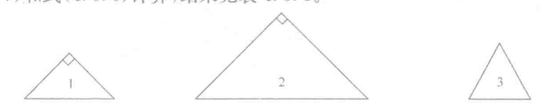

#### 表 4.5.1 三角形相似程度计算表

| j | uj | r1 | r2 | r3 | r4 | r5 | r6 | qj |
|---|---|---|---|---|---|---|---|---|
| 1 | u1 | 1 | 1 | 1 | 1/2 | 1/2 | 1/2 | q1=0.75 |
| 2 | u2 | 60/90 | 45/60 | 45/60 | 1/√2 | 1 | 1 | q2=0.81 |
| 3 | u3 | 60/90 | 45/60 | 45/60 | 1/(2√2) | 1/2 | 1/2 | q3=0.59 |


由计算结果可知，\(\triangle 1\) 与 \(\triangle 3\) 相似程度高，而 \(\triangle 2\) 与 \(\triangle 3\) 最不相似。

### 4.5.4 相似系统相似度计算

设系统 \( A \) 由 \( k \) 个要素组成，系统 \( B \) 由 \( l \) 个要素组成，其中有 \( n \) 个要素相同，另有 \( f \) 对要素相似，构成 \( p \) 个相似元，第 \( j \) 个相似元的相似度为 \( q_j (j=1, 2, \cdots, p)\)。综合式(4.5.1)~式(4.5.3)，可得到 \( A, B\) 相似度的计算表达式为

\( Q(A,B) = \frac{1}{k+l-n-f}(n + \frac{f}{p} \sum_{j=1}^p q_j) \quad (4.5.8) \)

当不存在相似要素，即 \( f=0, q_j=0 (j=1, 2, \cdots, p)\) 时，式(4.5.8) 即为式(4.5.1)。当 \( n=0\), 不存在相同要素时，式(4.5.8) 即为式(4.5.3)。

当 \( q_j=1(j=1, 2, \cdots, p)\)，即 \( A, B \) 中共有 \( n+f \) 个要素相同时，则式(4.5.8) 为

\( Q(A,B) = \frac{n+f}{k+l-n-f} \quad (4.5.9) \)

作为一种特例，设 \( A, B \) 中要素个数相同，依次将 \( A \) 中每一要素与 \( B \) 中每一要素组成相似元，则 \( n=0, k=l=f, p=f^2\)，从而得到

\( Q(A,B) = \frac{1}{p} \sum_{j=1}^p q_j = \frac{1}{f^2} \sum_{j=1}^{f^2} q_j \quad (4.5.10) \)

还有另外一种常见的情况：系统 \( A \) 的 \( k \) 个要素两两组合构成相似元，相似元的数量 \( p=C_k^2 = \frac{1}{2}k(k-1)\)，则 \( A \) 的“自相似度”为

\( Q(A) = \frac{1}{C_k^2} \sum_{j=1}^{C_k^2} q_j \quad (4.5.11) \)

如果系统 \( A \) 的 \( k \) 个要素中，第 \( j \) 个要素与第 \( s \) 个要素组成相似元，相似程度记为 \( q_{js}\)，形成矩阵 \( (q_{js})_{k \times k}\)。显然有：\( q_{js} = q_{sj}, q_{jj} = 1\)，这时 \( A \) 的“自相似度”也可以用式(4.5.11)计算：

\( Q(A) = \frac{1}{C_k^2} \sum_{j=1}^{k-1} \sum_{s=j+1}^k q_{js} \quad (4.5.12) \)

这时因去除矩阵 \( (q_{js})_{k \times k}\) 的主对角线元素和对称部分，故计算的参数共有 \(\frac{1}{2}(k^2-k)\) 个，即为 \( C_k^2\)。

### 4.5.5 应用实例

实例 1 10 名考生参加 5 门科目考试，成绩见表 4.5.2，试对其进行分类识别。

| 科目 | 1 | 2 | 3 | 4 | 5 | 6 | 7 | 8 | 9 | 10 |
|---|---|---|---|---|---|---|---|---|---|---|
| 1 | 90 | 73 | 76 | 62 | 95 | 85 | 88 | 84 | 56 | 76 |
| 2 | 88 | 90 | 82 | 65 | 82 | 78 | 92 | 88 | 62 | 80 |
| 3 | 75 | 92 | 78 | 55 | 78 | 84 | 90 | 82 | 71 | 85 |
| 4 | 95 | 86 | 80 | 70 | 86 | 75 | 85 | 74 | 65 | 78 |
| 5 | 92 | 88 | 85 | 62 | 84 | 88 | 92 | 75 | 68 | 84 |

以每门课成绩 100 分理想状态作为标准，每个考生实际成绩与理想状态构成相似元，经等权计算得到各相似元的相似度如表 4.5.3 所示。

| j | 1 | 2 | 3 | 4 | 5 | 6 | 7 | 8 | 9 | 10 |
|---|---|---|---|---|---|---|---|---|---|---|
| q_j | 0.88 | 0.86 | 0.80 | 0.63 | 0.85 | 0.82 | 0.89 | 0.81 | 0.64 | 0.81 |

以 $q_j$ 作为聚类指标，将考生按成绩分为 4 类：$(1, 7)$、$(2, 5)$、$(3, 6, 8, 10)$、$(4, 9)$。经检验，此时类间离差平方和与类内离差平方和之比最大，分类是合理的。

该方法计算过程简便，取类指标单纯，可将多指标的聚类化和单指标进行，有其方便之处。

**实例 2** 由 11 位专家组成专家组，对 3 项虚拟建设工程评审，指标共 7 项，每人按 1~9 标度给出评审意见，9 为最好，1 为最差；评审结果见表 4.5.4，设各指标与每位专家权重相同，试对专家意见的协调性作出分析和聚类。

把每 2 位专家意见构成一个相似元，每个相似元有 7 项指标，用式(4.5.7)计算各相似系数，用式(4.5.6)求出各相似元的相似度 $q_j, j=1,2,\cdots,11$，形成矩阵$(q_{jk})_{11\times11}$，再用式(4.5.12)计算出每一项目评审时专家组意见的“自相似度”，结果见表 4.5.5。

显然，Q 值的大小反映了专家意见的协调程度。

由表 4.5.5 看出，对项目 1 的评审意见一致性较高，对项目 3 的评审意见一致性是 3 个项目中最低的。与统计学中常用的协调性系数计算相比，这里的计算简便得多。

表 4.5.4 专家评审意见表

| 指标 | 专家 | | | | | | | | | | | |
| --- | --- | --- | --- | --- | --- | --- | --- | --- | --- | --- | --- | --- |
| | 1 | 2 | 3 | 4 | 5 | 6 | 7 | 8 | 9 | 10 | 11 | |
| 项目 1 | | | | | | | | | | | | |
| 1 | 7 | 7 | 9 | 7 | 9 | 7 | 9 | 8 | 7 | 8 | 9 | |
| 2 | 7 | 7 | 7 | 7 | 7 | 5 | 7 | 9 | 6 | 8 | 9 | |
| 3 | 3 | 1 | 7 | 5 | 7 | 5 | 7 | 7 | 3 | 6 | 7 | |
| 4 | 3 | 7 | 9 | 3 | 9 | 9 | 7 | 8 | 7 | 8 | 9 | |
| 5 | 3 | 7 | 7 | 7 | 9 | 7 | 9 | 9 | 3 | 8 | 9 | |
| 6 | 3 | 6 | 7 | 5 | 7 | 5 | 7 | 9 | 5 | 8 | 9 | |
| 7 | 7 | 7 | 9 | 7 | 9 | 9 | 9 | 9 | 7 | 8 | 9 | |
| 项目 2 | | | | | | | | | | | | |
| 1 | 5 | 5 | 7 | 3 | 7 | 5 | 5 | 6 | 3 | 5 | 5 | |
| 2 | 3 | 3 | 5 | 1 | 3 | 3 | 3 | 6 | 3 | 5 | 7 | |
| 3 | 1 | 1 | 3 | 1 | 5 | 3 | 1 | 6 | 3 | 5 | 5 | |
| 4 | 3 | 3 | 3 | 1 | 7 | 5 | 3 | 6 | 3 | 5 | 5 | |
| 5 | 3 | 3 | 3 | 3 | 7 | 3 | 3 | 6 | 3 | 5 | 3 | |
| 6 | 5 | 5 | 5 | 3 | 7 | 5 | 1 | 7 | 3 | 7 | 7 | |
| 7 | 5 | 5 | 5 | 1 | 7 | 5 | 3 | 7 | 4 | 5 | 3 | |
| 项目 3 | | | | | | | | | | | | |
| 1 | 5 | 6 | 7 | 5 | 7 | 3 | 7 | 7 | 3 | 8 | 7 | |
| 2 | 5 | 6 | 5 | 1 | 5 | 3 | 7 | 5 | 1 | 5 | 5 | |
| 3 | 5 | 3 | 5 | 1 | 7 | 5 | 9 | 7 | 7 | 8 | 7 | |
| 4 | 1 | 6 | 7 | 3 | 7 | 3 | 9 | 8 | 5 | 8 | 7 | |
| 5 | 1 | 5 | 5 | 1 | 5 | 3 | 9 | 8 | 3 | 8 | 7 | |
| 6 | 1 | 3 | 5 | 1 | 7 | 5 | 5 | 6 | 3 | 6 | 5 | |
| 7 | 5 | 3 | 7 | 3 | 7 | 3 | 9 | 7 | 5 | 7 | 7 | |

表 4.5.5 专家组意见自相似度计算结果

| 项目 | 1 | 2 | 3 |
| --- | --- | --- | --- |
| Q | 0.77 | 0.66 | 0.62 |

## 4.6 基于联系数的不确定空情意图识别

这里介绍刘秀梅、赵克勤的工作[9]。

现代空战中，对敌方作战意图的正确识别在作战指挥决策中具有极为重要的意义。但由于在战场环境下获得的空情信息具有不确定性特点，如何客观地表述和识别具有不确定性的空间信息成为空战指挥决策中的一个关键问题。由于区间数能比较客观地刻画观测测值的确定性与不确定性，所以用区间数表达不确定空间信息受到人们的重视，例如，张肃等[10]采用区间数表示敌方目标的特征值，将待识别目标的各种信息与已知参考目标的意图图相对照，按聚类思想判别待识别目标的作战意图。但由于区间数的取值具有不确定性，随意定义两个区间数的大小，仍然会因侧重于确定性而导致原始信息的丢失和失真，同时也会因省略不确定分析而使计算结论减少了可靠性和可信性。为此，刘秀梅等[9]给出了基于集对分析联系数的不确定空间意图识别方法和思路，不仅克服了原始信息丢失和失真的问题，也同时为区间数聚类提供了一种新途径。

### 4.6.1 问题提出

设在不确定的空间信息条件下有 \( p \) 个飞行目标 \(\overline{A}(x)\)，需要识别其意图，每个目标用 5 个特征来描述，分别是方位角 \(\beta\)、距离 \(d\)、水平速度 \(v\)、航向角 \(\theta\)、高度 \(H\)，每个特征值用区间数表示。与此同时，已知 \(m(m>p)\) 种作战意图的上述 5 个特征的基准特征值，历史数据是实数，需要要求对 \(p\) 个目标的意图作出聚类识别。

### 4.6.2 识别方法

- 1. 把区间数转换为联系数

设有区间数 \(x=[x^-, x^+], x^-, x^+ \in R, x^- \leqslant x^+\)，令
\[A=\frac{x^-+x^+}{2}, \quad B=x^+-\frac{x^-+x^+}{2}\] (4.6.1)

根据式(4.6.1)得联系数 \(u=A+Bi\) 或写成

\[u=\frac{x^-+x^+}{2} + \left(x^+-\frac{x^-+x^+}{2}\right)i, \quad i\in[-1, 1]\] (4.6.2)

称式(4.6.2)是区间数向联系数的转换公式。此联系数也称为“平均值+波动值”联系数。

- 2. 基于联系数的区间数的三角函数表达式

把区间数转换成式(4.6.2)所示的联系数后，再根据前面公式可得区间数的三角函数表达式如下：

\[u=r(\cos\theta+i\sin\theta)\] (4.6.3)

式中

\[r=\sqrt{\overline{x}^2+s_x^2}, \quad \overline{x}=\frac{x^-+x^+}{2}, \quad s_x=\frac{x^+-x^-}{2}, \quad \theta=\arctan\frac{s_x}{\overline{x}}\] (4.6.4)

### 4.6.3 识别步骤

**1. 识别流程**

基于联系数的不确定空意图图识别方法的流程图 4.6.1 所示。

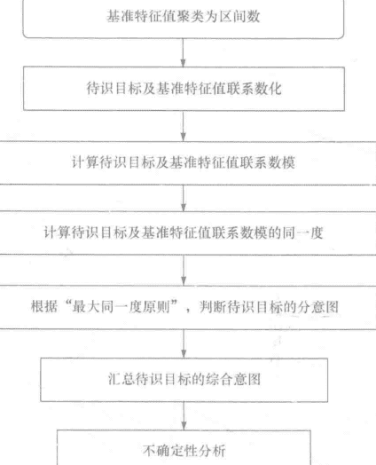

图 4.6.1 不确定空意图图识别方法

**2. 识别步骤**

- (1) 将已知的 m 种作战意图的各个基准特征值历史数据(点实数)用区间数表示。
- (2) 根据式(4.6.2),把作为基准特征值的历史数据区间数,以及待识别的 p 个目标各特征值区间数 x=[x-, x+] 改写成“平均值±波动值”联系数。
- (3) 根据式(4.6.4)把各个联系数改写成式(4.6.3)三角函数形式。
- (4) 分别计算待识别的第 \( q(q=1,2,\cdots,p)\)个目标在第 \( k \) 个(\(k=1,2,3,4,5\))特征上的“模”, \( r'_{qk} \) 与 m 种作战意图在第 \( k \) 个特征上的基准特征值的模 \( r_{tk} \) (\(t=1,2,3,\cdots,m\))的同一度,即

\( a_{qk}^{[t]} = \frac{\min(r'_{qk} * r_{tk})}{\max(r'_{qk} * r_{tk})}, \quad t=1, 2, 3, \cdots, m \quad (4.6.5) \)

- (5) 比较待识别的第 \( q \) 个目标在第 \( k \) 个特征上的 \( m \) 个同一度 \( a_{qk}^{[t]} (t=1, 2, 3, \cdots, m)\) 的大小,根据“最大同一度原则”判断与最大同一度对应的作战意图图为第 \( q \) 个目标在第 \( k \) 个特征上的作战意图图。
- (6) 当待识别目标在 5 个特征上分属不同的作战意图时,以相同作战意图最多者作为该待识别目标的首选作战意图,次多者作为该待识别目标的其次作战意图,依次类推。
- (7) 借助 \( i \) 在 \([-1, 1]\) 区间取不同的值展开意图识别的不确定分析,得到意图识别的最终结论。

### 4.6.4 应用实例

例 4.6.1 采用文献[10]中的实例,已知有 \( x_1, x_2, \cdots, x_{10}\) 共 10 批目标的作战意图,其在方位角 \(\beta\),距离 \(d\),水平速度 \(v\),航向角 \(\theta\),高度 \(H\) 上的历史观测值如表 4.6.1 所示,有 \(y_1, y_2, y_3\) 共 3 批目标有待识别其作战意图,各待识别目标在不确定空信息下各特征上的值如表 4.6.2 所示,试识别该 3 批目标的作战意图。

表 4.6.1 目标特征值及作战意图

| 目标 | \(\beta\)/mil | \(d\)/km | \(v\)/(m/s) | \(\theta\)/(°) | \(H\)/km | 作战意图 |
| :--- | :--- | :--- | :--- | :--- | :--- | :--- |
| \(x_1\) | 820 | 280 | 250 | 200 | 6.0 | 侦察 |
| \(x_2\) | 2300 | 210 | 300 | 320 | 4.0 | 攻击 |
| \(x_3\) | 828 | 281 | 245 | 201 | 6.5 | 侦察 |
| \(x_4\) | 2350 | 215 | 320 | 322 | 4.2 | 攻击 |
| \(x_5\) | 830 | 282 | 255 | 200 | 6.3 | 侦察 |
| \(x_6\) | 825 | 283 | 250 | 204 | 6.1 | 侦察 |
| \(x_7\) | 2200 | 150 | 300 | 156 | 5.0 | 攻击 |
| \(x_8\) | 4000 | 110 | 300 | 50 | 3.5 | 突防 |
| \(x_9\) | 2800 | 260 | 220 | 260 | 8.0 | 监视 |
| \(x_{10}\) | 4050 | 120 | 280 | 51 | 3.6 | 突防 |

注：1mil= \(2.5 \times 10^{-4}\) m.

表 4.6.2 待识目标特征值

| 待识目标 \(y_q\) | \(\beta\)/mil | \(d\)/km | \(v\)/(m/s) | \(\theta\)/(°) | \(H\)/km |
| :--- | :--- | :--- | :--- | :--- | :--- |
| \(y_1\) | [1000,1200] | [200,210] | [300,320] | [45,51] | [3,4] |
| \(y_2\) | [2500,2600] | [100,110] | [200,220] | [250,260] | [8,9] |
| \(y_3\) | [4000,4010] | [90,100] | [240,250] | [300,310] | [2,3] |

识别步骤如下。

步骤 1 根据表 4.6.1, 把 $S_1$ (侦察)、$S_2$ (监视)、$S_3$ (攻击) 和 $S_4$ (突防) 在 5 个特征上的基准值聚类改写为区间数的形式, 得表 4.6.3。

表 4.6.3 基准特征值区间数

| 作战意图 $S_i$ | 目标群体 | $\beta$/mil | $d$/km | $v$/(m/s) | $\theta/(^\circ)$ | $H$/km |
|---|---|---|---|---|---|---|
| $S_1$(侦察) | $x_1+x_3+x_5+x_6$ | [820,830] | [280,283] | [245,255] | [200,204] | [6.0,6.5] |
| $S_2$(监视) | $x_9$ | 2800 | 260 | 220 | 260 | 8.0 |
| $S_3$(攻击) | $x_2+x_4+x_7$ | [2200,2350] | [150,215] | [300,320] | [156,322] | [4.0,5.0] |
| $S_4$(突防) | $x_8+x_{10}$ | [4000,4050] | [110,120] | [280,300] | [50,51] | [3.5,3.6] |

步骤 2 把表 4.6.3 基准特征值区间数按式(4.6.2)算法改写成“平均值+波动值”联系数形式, 得表 4.6.4。表格内数值记为 $u_{tk}(t=1,2,3,4)$。

表 4.6.4 基准特征值联系数

| 作战意图 $S_i$ | 目标群体 | $\beta$/mil | $d$/km | $v$/(m/s) | $\theta/(^\circ)$ | $H$/km |
|---|---|---|---|---|---|---|
| $S_1$(侦察) | $x_1+x_3+x_5+x_6$ | 825+5i | 281.5+1.5i | 250+5i | 202+2i | 6.25+0.25i |
| $S_2$(监视) | $x_9$ | 2800+0i | 260+0i | 220+0i | 260+0i | 8.0+0i |
| $S_3$(攻击) | $x_2+x_4+x_7$ | 2275+75i | 182.5+32.5i | 310+10i | 239+83i | 4.5+0.5i |
| $S_4$(突防) | $x_8+x_{10}$ | 4025+25i | 115+5i | 290+10i | 50.5+0.5i | 3.55+0.5i |

步骤 3 把表 4.6.3 中各待识别的目标特征值区间数按式(4.6.2)改写成“平均值+波动值”联系数的形式, 得表 4.6.5。表格内的数值记为 $u'_{qk}$。

表 4.6.5 待识目标的区间数的联系数

| 待识目标 $y_q$ | $\beta$/mil | $d$/km | $v$/(m/s) | $\theta/(^\circ)$ | $H$/km |
|---|---|---|---|---|---|
| $y_1$ | 1100+100i | 205+5i | 310+10i | 48+3i | 3.5+0.5i |
| $y_2$ | 2550+50i | 105+5i | 210+10i | 255+5i | 8.5+0.5i |
| $y_3$ | 4005+5i | 95+5i | 245+5i | 305+5i | 2.5+0.5i |

步骤 4 把表 4.6.4 和表 4.6.5 中的联系数按式(4.6.4)计算各自的模, 得表 4.6.6、表 4.6.7。表 4.6.6 中数据记为 $r_k$, 表 4.6.7 中数据记为 $r'_{qk}$。

表 4.6.6 基准特征值联系数的模

| 作战意图 $S_i$ | $\beta$/mil | $d$/km | $v$/(m/s) | $\theta/(^\circ)$ | $H$/km |
|---|---|---|---|---|---|
| $S_1$(侦察) | 825.02 | 281.50 | 250.05 | 202.01 | 6.26 |
| $S_2$(监视) | 2800.00 | 260.00 | 220.00 | 260.00 | 8.00 |
| $S_3$(攻击) | 2276.24 | 185.37 | 310.16 | 253.00 | 4.53 |
| $S_4$(突防) | 4025.08 | 115.11 | 290.17 | 50.50 | 3.59 |


| 待识目标 \( y_q \) | \( \beta/mil \) | \( d/km \) | \( v/(m/s) \) | \( \theta/(^\circ) \) | \( H/km \) |
|---|---|---|---|---|---|
| \( y_1 \) | 1104.54 | 205.06 | 310.16 | 48.09 | 3.54 |
| \( y_2 \) | 2550.49 | 105.12 | 210.24 | 255.05 | 8.51 |
| \( y_3 \) | 4005.00 | 95.13 | 245.05 | 305.04 | 2.55 |

步骤 5 按式(4.6.2)，计算表 4.6.6 和表 4.6.7 在 5 个对应特征上的模的同一度，并把最大同一度对应的意图类别判定给待识别目标在该特征上的意图。

例如，\( y_1 \) 的方位角的联系数的模 \( r'_{11} = 1104.54 \)，其与作战意图的 4 个同一度分别是

\( a_{11}^{[1]} = \frac{825.02}{1104.54} \approx 0.7469, \quad a_{11}^{[2]} = \frac{1104.54}{2800} \approx 0.3945 \quad a_{11}^{[3]} = \frac{1104.54}{2276.24} \approx 0.4852, \quad a_{11}^{[4]} = \frac{1104.54}{4025.08} \approx 0.2744 \)

由于 \( a_{11} = \max_{t=1,2,3,4} a_{11}^{[t]} = 0.7469 \)，在 4 种作战意图中与侦察的同一度最大，所以，\( y_1 \) 在方位角上体现出的作战意图是“侦察”，如此得到表 4.6.8 中的数据为 \( a_{qk} \) 对应的作战意图。

| 待识目标 \( y_q \) | \( \beta \) | \( d \) | \( v \) | \( \theta \) | \( H \) | 综合意图 |
|---|---|---|---|---|---|---|
| \( y_1 \) | 侦察 | 攻击 | 攻击 | 突防 | 突防 | 攻击或突防 |
| \( y_2 \) | 监视 | 突防 | 监视 | 攻击 | 监视 | 监视 |
| \( y_3 \) | 突防 | 突防 | 侦察 | 监视 | 突防 | 突防 |

步骤 6 对各个待识别目标的作战意图进行综合，由表 4.6.8 可见，目标 \( y_3 \) 在 5 个特征值上，有 3 个是突防、1 个是侦察、1 个是监视，所以，综合意图为突防；目标 \( y_2 \) 在 5 个特征中有 3 个监视、1 个突防、1 个攻击，故综合意图为监视；目标 \( y_1 \) 在 5 个特征上有 2 个突防、2 个攻击、1 个侦察，所以综合意图为攻击或突防。各目标的综合意图列在表 4.6.8 最右侧。

步骤 7 不确定性分析。

(1) 在文献[10]的结论中，\( y_3 \) 是突防，\( y_2 \) 为监视，这与文献[9]的工作一致。但文献[10]对 \( y_1 \) 的意图识别结果是“侦察”，而文献[9]的工作显示，该目标只在一个特征上归属侦察，因此所得综合结论是攻击或突防，与文献[10]明显不同，究竟哪一个识别结论更符合实际呢？分析如下。

由于表 4.6.4，表 4.6.5 中给出的是“平均值+波动值”形式的联系数，所以从平均值的角度来分析。

首先，在距离 \( d \) 这个特征上，\( y_1 \) 的平均值是 205，而 4 种作战意图在该特征上的平均值分别是 \( d_{s_1}=281.5, d_{s_2}=260, d_{s_3}=182.5, d_{s_4}=115 \)，由于 \( \frac{182.5}{205} \approx 0.89 \)，\( \frac{205}{260} \approx 0.79, \frac{205}{281.5} \approx 0.73, \frac{115}{205} \approx 0.56 \)，205 与 182.5 (攻击) 的同一程度（接近程度）要比 205 与其他特征值的同一程度（接近程度）都大，所以，\( y_1 \) 在该特征上的意图首选为“攻击”，而不是侦察。

其次，在水平速度 \( v \) 这个特征上，目标 \( y_1 \) 在该特征上的平均值是 310，与表 4.6.4 中 \( S_3 \)(攻击) 作战意图在该特征上的基准值 310 完全相同，而与其他特征值明显不同，所以 \( y_1 \) 在水平速度这个特征上的作战意图明显是“攻击”，而不是侦察。

再次，在航向角 \( \theta \) 这个特征上，\( y_1 \) 的航向角在 \( 45 \sim 51 \)，平均值为 48，与表 4.6.4 对照后，十分明显地显示出作战意图是“突防”，而不是侦察。

最后，在高度 \( H \) 这个特征上，\( y_1 \) 的高度范围是 \( [3, 4] \)，平均值为 3.5，对照表 4.6.4，也十分显然，其作战意图是“突防”，而不是侦察。

综合以上分析，目标 \( y_1 \) 的综合作战意图，不是“侦察”，而是“攻击或突防”。

(2) \( i \) 的取值分析，由于上面已与文献[10]结果进行对照分析，对相同的结论进行了肯定，对不同的结论 \( \gamma_i \) 的作战意图进行了具体分析说明，所以，不再进行 \( i \) 的取值分析。

事实上，由于采用各联系数的“模”作为聚类识别依据，而根据模的计算公式(4.6.4)可见，“模”中不仅有“平均值”信息，也有“波动值”信息，因此，在一定程度上反映出原始数据为区间数时的相对确定性信息与相对不确定性信息以及这两类信息的相互作用信息，因而识别结论具有较好的客观合理性。

## 4.7 本章小结

本章介绍集对分析的同异反模式识别技术的原理和方法之后，分别说明其在指纹识别、金属矿山地质灾害判断、邮电业务总量预测、系统相似识别、空情意图识别中的具体应用，从一个侧面说明了基于集对分析的同异反模式识别技术应用的广泛性和有效性。这种广泛性和有效性一方面说明同异反模式识别技术原理、方法的合理性和全面性，也就是从“同、异、反”多个侧面去识别研究对象总比从单一侧面去识别研究对象要全面一些，必要时还可从“同、偏同、临界居中、偏反、反”这样更为细致的侧面去进行更为精细的识别，由于“同、异、反”或“同、偏同、临界居中、偏反、反”的分界位置可能会存在不确定性，所以必要时需要对识别结果进行不确定性分析后才下结论，或者引入复分析和偏联系数的分析等；另一方面，还说明同异反模式识别技术与其他方法的兼容性和耦合性；根据集对分析的“成对原理”可知，同时从两个或多个不同的角度，采用两个或多个不同的模型和算法去识别研究同一个（同一组）对象，总会比从一个角度和用一种模型和算法去识别研究同一个（同一组）对象要可靠。必要时对不同模型和算法所得的不同识别结果再一次（或更多次）应用集对分析的同异反模式识别；这从另一个角度说明在模式识别时应用集对分析存在较大的灵活性和优越性，为此需要研究者深入和系统地掌握基于集对分析的同异反模式识别技术的基本原理、基本理论和基本方法，去解决不同的模式识别问题，不断提高模式识别精度。

## 参考文献

- [1] 赵克勤. 集对分析及其初步应用[M]. 杭州: 浙江科学技术出版社, 2000:44-64.
- [2] 白杨文. 平面图像的同异反模式识别技术[C]//中国自动化学会智能自动化会议，呼和浩特, 1996:185-188.
- [3] 刘丽萍, 白杨文. 教育过程的同异反管理模式[C]//中国系统工程学会会议, 成都, 1997: 1228-1231.
- [4] 成科扬. 基于集对分析的指纹识别系统研究[M]//中国人工智能学会中国人工智能进展. 北京: 北京邮电大学出版社, 2005: 1475-1478.
- [5] 李德顺, 宫博, 许开立. 论金属矿山地质灾害模式识别模型[J]. 工业安全与环保, 2012, 38(3): 37-40.
- [6] 李德顺, 宫博, 许开立. 石化企业火灾危险性模式识别模型研究[J]. 中国安全生产科学技术, 2012, 8(4):122-126.
- [7] 高洁, 盛昭瀚. 集对分析聚类预测法及其应用[J]. 系统工程学报, 2002, 17(5):458-462.
- [8] 闻理, 阎滨. 相似系统集对分析[J]. 指挥技术学院学报, 2000, 11(3):9-13.
- [9] 刘秀梅, 赵克勤. 基于联系数的不确定空情意图识别[J]. 智能系统学报, 2012, 6(5): 450-456.
- [10] 张肃, 程启月, 解瑶, 等. 不确定空情信息条件下的意图识别方法[J]. 空军工程大学学报(自然科学版), 2008, 9(3):50-53.

# 第 5 章 基于集对分析的不确定性推理

人工智能中常用的不确定性推理有基于概率论的概率推理，基于模糊集的模糊推理，基于证据理论的推理等。根据集对分析理论，经典概率可以转换为联系概率（赵森烽-克勤概率），模糊隶属度可以通过增加一个乘上不确定系数 i 的补数后成为联系数；证据可以同异反系统化，基此扩展和创新已有的不确定性推理思路，形成基于集对分析的不确定性推理，其特点是对推理中的不确定性给予“客观承认、系统描述、定量刻画、具体分析”，使得推理结果更加符合实际情况，本章介绍其基本原理和一些具体算法的应用。

## 5.1 基本原理

### 5.1.1 不确定性推理

定义 5.1.1 带有不确定性的推理称为不确定性推理。

无论是确定性的推理，还是基于概率论的推理和基于模糊集理论与基于证据理论的推理，通常由推理证据、推理方法、推理过程、推理结果 4 个要素组成，只要在任意一个推理要素中存在不确定性，这样的推理就是不确定性推理。

不确定性推理是人工智能的核心。这是因为人工智能是对人脑智能的仿真，人脑智能的核心是人脑自动地进行各种推理，包括定性推理和定量推理，逻辑推理与非逻辑推理，形式化推理和形象化推理，类比推理与反类比推理，正常推理和反常推理等；人脑推理虽然伴有这种或那种不确定性，但推理结果合理或者近乎合理，这是人脑推理的最大特点，根据人脑推理的这一特点和集对分析理论，形成基于集对分析的不确定性推理[1-2]。

### 5.1.2 基于集对分析的不确定性推理原理

推理，不论是推理证据、推理方法、推理过程还是推理结果，只要存在不确定性，就给予“客观承认、系统描述、定量刻画、具体分析”，称此陈述为基于集对分析的不确定性推理原理[3]。

首先，对推理证据的不确定性给予“客观承认、系统描述、定量刻画、具体分析”，当推理证据是定量化表达时，把定量化表达联系数化，借助于联系数中联系分量系数 i 取值的不确定性映射证据的不确定性。

其次，对推理方法的不确定性给予“客观承认、系统描述、定量刻画、具体分析”，对同一问题的推理，会用到多方法、选择多途径，从多角度、多层次、多维度进行推理，并进行不同方法、不同途径、不同角度、不同层次、不同维度的同一性分析（取其共同结果）、差异性分析（分析结果的不同之处和造成不同的原因）、对立性分析（分析结果的相反之处和产生相反结果的原因，或作反向推演）；由于“2”是最少的“多”，因此，集对分析优先提倡对同一问题用 2 种方法、2 条途径、2 个角度、2 个层次、2 个维度进行推理，并作 2 种方法、2 条途径、2 个角度、2 个层次、2 个维度的同一性分析、差异性分析、对立性分析。

再次，对推理过程的不确定性给予“客观承认、系统描述、定量刻画、具体分析”，推理过程是各种推理算子交替使用、推理结构不断变化的过程，存在着“步移景换”的时空尺度效应和不同背景、不同视角、不同主体的观察效应，以及不同价值观念下的社会经济效应，需要进行不确定性分析。

最后，对推理结果的不确定性给予“客观承认、系统描述、定量刻画、具体分析”，给出推理结果的可接受条件、可接受范围与可接受信度。

事实上，任何一个推理都是在一定的时空中进行的，第 1 章已指出时空具有成对性、不确定性，由此知基于集对分析的不确定性推理原理的客观实在性。

基于集对分析的不确定性推理最早由赵克勤在 1992 年提出的[4]，之后不断探索、发展和应用于不同场景。

## 5.2 基于联系概率的推理

赵森烽、赵克勤在 2012 年提出一种不同于经典概率的新概率，并把其应用概率推理，本节主要介绍赵森烽、赵克勤在文献[5]中的工作。

### 5.2.1 联系概率

联系概率是把主事件(A)的概率与伴随事件(Ā)的概率联系在同一个数学表达式中的概率，联系概率也称赵森烽-克勤概率，详见 2.2 节。

### 5.2.2 基于联系概率的推理特点

形式上的特点是把推理证据和推理方法中的概率转换成联系概率(赵森烽-克勤概率)，依照联系概率(赵森烽-克勤概率)的运算规则进行推理，实质性的特点是对推理结果开展不确定性分析，以提高结果的客观合理性。

### 5.2.3 应用举例

例 5.2.1 文献[6]介绍了基于概率的不确定推理方法如下。

设有如下产生式规则：

```
IF E THEN H
```

则证据(或前提条件)E 不确定性的概率为 P(E)，所谓基于概率的不确定性推理的目的是: 求出在证据 E 下结论 H 发生的概率 P(H/E)。这时采用以下公式计算：

\[P(H/E)=\frac{P(E/H)P(H)}{P(E)} \quad (5.2.1)\]

式中，P(E)是 E 的概率；P(H)是 H 的先验概率；P(E/H)是 H 成立时 E 出现的条件概率。

若一个证据 E 支持多个假设 H1, H2, ..., Hn, 即

```
IF E THEN H_i, \quad i=1, 2, ..., n
```

则有贝叶斯公式：

\[\frac{P(H_i)P(E/H_i)}{\sum_{j=1}^n P(H_j)P(E/H_j)}, \quad i=1, 2, ..., n \quad (5.2.2)\]

若有多个证据 E1, E2, ..., Em 和多个结论 H1, H2, ..., Hn, 并且每个证据都以一定程度支持结论，则

\[P(H_i/E_1 E_2 ..., E_m) = \frac{P(E_1/H_i)P(E_2/H_i)...P(E_m/H_i)P(H_i)}{\sum_{j=1}^n P(E_1/H_j)P(E_2/H_j)...P(E_m/H_j)P(H_j)} \quad (5.2.3)\]

因此，只要已知 H_i 的先验概率 P(H_i) 及 H_i 成立时证据 E_1, E_2, ..., E_m 出现的条件概率 P(E_1/H_i), P(E_2/H_i), ..., P(E_m/H_i)，就可利用上述公式计算出在 E_1, E_2, ..., E_m 出现情况下的 H_i 条件概率 P(H_i/E_1 E_2 ... E_m)。

数值例子如下。

设 H_1, H_2, H_3 为三个结论，E 是支持这些结论的证据，且已知：

\[P(H_1)=0.3, \quad P(H_2)=0.4, \quad P(H_3)=0.5 \\
P(E/H_1)=0.5, \quad P(E/H_2)=0.3, \quad P(E/H_3)=0.4\]

求 P(H_1/E), P(H_2/E) 及 P(H_3/E) 的值。

根据式(5.2.2)得

\[P(H_1/E)=\frac{P(H_1)\times P(E/H_1)}{P(H_1)\times P(E/H_1)+P(H_2)\times P(E/H_2)+P(H_3)\times P(E/H_3)} \\
=\frac{0.15}{0.15+0.12+0.2}=\frac{0.15}{0.47}=0.32 \quad (5.2.4)\]

同理，根据式(5.2.2)得

\[P(H_2/E)=0.26\]

$P(H_3/E)=0.43$

计算结果表明，由于证据 \( E \) 的出现，\( H_1 \) 成立的可能性稍有增加，而 \( H_2 \)、\( H_3 \) 成立的可能性却有不同程度的下降。

以上是文献[6]中的内容。下面介绍文献[5]从概率联系数化(转换成联系概率)的角度进行的计算分析。

步骤 1 由于 \( P(H_k) \neq 1(k=1,2,3) \)，所以 \( H_k \) 是随机事件，根据随机事件的成对存在定理，可知存在随机事件 \( \bar{H}_k \)，且 \( H_k \) 与 \( \bar{H}_k \) 是互不相容事件，所以 \( P(\bar{H}_k) = 1 - P(H_k) \)；因此，以 \( H_k \) 作为主事件，\( \bar{H}_k \) 为伴随事件，则得以 \( H_k \) 作为主事件的联系概率 \( P(H_k, \bar{H}_k) = P(H_k) + [1 - P(\bar{H}_k)]i \)，也就是有 \( P_c(H_1) = 0.3 + 0.7i, P_c(H_2) = 0.4 + 0.6i, P_c(H_3) = 0.5 + 0.5i \)，由于 \( 0.7 > 0.3, 0.6 > 0.4, 0.5 = 0.5 \)，所以在计及 \( i \) 的取值后，\( P_c(H_k) \) 有可能比 \( P(H_k) \) 大，也有可能比 \( P(H_k) \) 小。这一情况包含了前面利用式(5.2.4)所得“由于证据 \( E \) 的出现，\( H_1 \) 成立的可能性稍有增加，而 \( H_2, H_3 \) 成立的可能性却有不同程度的下降”这个结果，但由于没有考虑证据 \( E \) 的作用，所以过于粗糙。为此进入第 2 步。

步骤 2 先把 \( P(E/H_k) \) 改写成联系概率 \( P_c(E/H_k) \) 的形式得 \( P_c(E/H_1) = 0.5 + 0.5i, P_c(E/H_2) = 0.3 + 0.7i, P_c(E/H_3) = 0.4 + 0.6i \)，再根据式(5.2.2)得

\[P(H_1/E) = \frac{P(H_1) \times P(E/H_1)}{P(H_1) \times P(E/H_1) + P(H_2) \times P(E/H_2) + P(H_3) \times P(E/H_3)}\]
\[= \frac{(0.3+0.7i)(0.5+0.5i)}{(0.3+0.7i)(0.5+0.5i) + (0.4+0.6i)(0.3+0.7i) + (0.5+0.5i)(0.4+0.6i)}\]
\[= \frac{0.15+0.5i+0.35i^2}{0.47+1.46i+1.07i^2} \quad (5.2.5)\]

根据集对分析，如果不计不确定性的层次性，可令 \( i=i^2 \)，于是上面的计算结果简化为

\[\frac{0.15+0.5i+0.35i^2}{0.47+1.46i+1.07i^2} = \frac{0.15+0.85i}{0.47+2.53i} \quad (5.2.6)\]

由于以上计算结果中的分母是由 3 个归一化的联系数相加所成，多出了因归一化而产生的 \( 2(=3-1) \) 个 \( i \)。例如，有 \( P(A)=0.2, P(B)=0.3, P(A)+P(B)=0.5 \)，但把 \( P(A) \) 联系数化为联系概率则得 \( P_c(A)=0.2+0.8i \)，同理有 \( P_c(B)=0.3+0.7i \)，按普通加法有 \( P_c(A)+P_c(B)=(0.2+0.8i)+(0.3+0.7i)=0.5+1.5i \)；由于把 \( P(A)+P(B)=0.5 \) 联系数化得 \( 0.5+0.5i \)，所以要从 \( 0.5+1.5i \) 中减去 \( 1(=2-1) \) 个 \( i \)。为此在 \( 0.47+2.53i \) 中减去 2 个 \( i \)，得计算结果为

\[\frac{0.15+0.85i}{0.47+0.53i} = 0.32+0.68i \quad (5.2.7)\]

把式(5.2.7)与式(5.2.4)对照看出，只要把式(5.2.4)中的结果 0.32 联系数化为 \( 0.32+0.68i \) 就是式(5.2.7)的结果。


同理有 P(H_2/E)=0.26+0.74i, P(H_3/E)=0.43+0.57i。
于是作如下分析。

- (1) 由于 0.68>0.32, 0.74>0.26, 0.57>0.43, 所以 H_1, H_2, H_3 成立的不确定性大于成立的可能性。

- (2) 计算过程显示，计及证据 E 后的结论 H_1, H_2, H_3 中含有 2 次不确定性，因为在计算结果中含有 i^2，这与直观相符，因为证据 E 本身具有不确定性，结论 H_1、H_2、H_3 在不计及证据 E 时已具有不确定性(1 次不确定性)，在证据 E 下的结论 H_1、H_2、H_3 当然就更具不确定性(2 次不确定性)。

- (3) 上述工作表明：基于概率的不确定性推理分析难点在于其中的证据不确定性和结论不确定性，这些不确定性在形式上并不显现；有了联系概率这个概念之后，这种不确定性分析就具体表现在对 i 的分析上。但如何结合一个具体的问题展开有关 i 的分析，包括 i 的物理意义，构成与分解，取值规律，层次特性，以及对推理结果的影响主要来自 1 次不确定性还是 2 次不确定性或更多次不确定性等，则要具体分析和深入研究，这个例子从一个侧面说明了基于集对分析理论中联系概率(赵森锋-克勤概率)的不确定性推理原理的运用。

## 5.3 基于集对分析的同异反推理

### 5.3.1 同异反系统理论

同异反推理是集对分析中的同异反系统理论的具体应用，同异反系统理论详见 1.5.2 节，从本质上说，同异反推理也属于不确定性推理，是不确定性趋向极限时的一种推理，因而有其特点，以区别于一般的不确定性推理。

### 5.3.2 同异反推理模式

同异反推理的一般模式如图 5.3.1 所示。

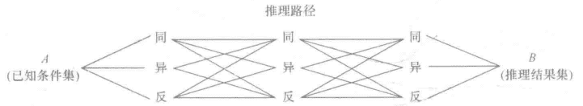

图 5.3.1 同异反推理示意

首先，根据 1.5.2 节可知，一个具有同异反特征的条件集，实质上是一个同异反子系统；同理可知具有同异反特征的推理结果集也是一个同异反子系统，这说明图 5.3.1 所示的同异反推理是一个输入输出皆是系统的系统推理过程。

其次，从证据理论的角度看，图 5.3.1 中的已知条件集就是所谓的证据集合，由此如同异反推理也可以看成是一种依据证据理论推理的特定推理模式，其主要特点是，证据以一个子系统形式存在，证据与证据之间存在同异反关系。

再次，给定证据的“同异反”与推理路径的“同异反”和推理结果的“同异反”，不完全是同一个“同异反”，不注意到这一点，难以在实际问题中应用同异反推理；例如，上面说到的证据与证据之间同异反关系，对于有 3 个证据组成的证据系统来说，其含义是指给定的证据 1 与证据 2 可能是协同的，但证据 2 与证据 3 可能是相异的，证据 1 与证据 3 可能是相反的。不妨结合教育系统的工作举个简单的例子：一般认为：普通高校招进的一批学生成绩具有同(优)异(中)反(差)特征，经过 3~4 年的同(优)异(中)反(差)教育，毕业的学生具有同(优)异(中)反(差)特征，但前后三个“同异反”的含义不一样；也不难认同：高校招进的一批学生成绩具有同(优)异(中)反(差)特征，经过 3~4 年的同(优)异(中)反(差)教育，毕业的学生具有同(优)异(中)反(差)特征，但前后三个“同异反”的含义不一样。

最后，由于“反”的类型不同，导致“同异反”本身的含义不同，所以有不同类型的“同异反推理”，由此可见同异反推理是抽象程度较高的一种“宽域式”推理模式，可以结合不同的具体问题导出不同的同异反推理子模式。

同异反推理最早由赵克勤提出，将云良把其用于学生成绩推理研究[7]。见以下实例。

### 5.3.3 同异反推理实例

已知某校计算机专业的 12 名学生的“数值分析”课程成绩如表 5.3.1 所示，试推算这些学生的“操作系统”课程与“编译技术”课程成绩。

解 由于成绩评定用 100 分制，学号为 1 的学生得 70 分，与 100 分的同一度为 0.7，改用联系数表示为 0.7+0.3j，“数值分析”与“操作系统”是计算机方面的专业知识，两者有交集，如图 5.3.2 所示。

由于从“数值分析”推知“操作系统”成绩，一般有以下 3 种情况：

- (1) “数值分析”与“操作系统”的成绩相同；

- (2) “数值分析”与“操作系统”的成绩相异(不同，但相差不是很大)；

- (3) “数值分析”与“操作系统”的成绩相反(两者相差很大)。

所以选定推理路径为“同异反乘算子路径”；也就是从“数值分析”成绩联系数 0.7+0.3j 出发，让 0.7+0.3j 与另一个因子相乘得出“操作系统”的成绩。

另外，我们还承认为“数值分析”出发去推知“操作系统”成绩，所得推理结果存在不确定性，综合以上两个方面，确定“乘算子路径”联系数为 0.7+0.3j，由此得算式 (0.7+0.3j)×(0.7+0.3i)=0.49+0.3i+0.21j，当该联系数中的 i=-1,j=0 时得

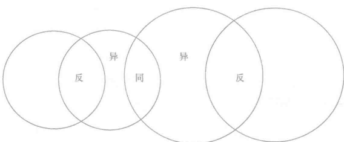

图 5.3.2 “数值分析”与“操作系统”的同异反关系示意

0.19，i=1,j=0 时得 0.79，由此推知学号为 1 学生的“操作系统”成绩在 19～79 分，该生“操作系统”实际成绩为 68，落在区间[19,79]中，推理结果符合实际。

同理推得该生“编译技术”成绩也应落在区间[19,79]中，而其实际成绩为 74，推理结果也符合实际。

其他 11 位学子的推理前提和推理结果见表 5.3.1。

从这个例子看出：推理路径的选定是同异反推理的一个关键环节。

同异反推理有不少需要深入研究的内容，例如，如何把“宽域式推理”精准化为“精确推理”，系统推理与数值推理如何相互转换，不同类型推理的相互转换等。

#### 表 5.3.1 学生成绩的同异反推理结果与实际成绩对照

| 学号 | 数值分析成绩 | 算式 | 推算结论 | 操作系统成绩 | 编译技术成绩 | 符合情况 |
|---|---|---|---|---|---|---|
| 1 | 70 | (0.7+0.3j)(0.7+0.3i)=0.49+0.3i+0.21j | 19～79 | 68 | 74 | 符合 |
| 2 | 80 | (0.8+0.2j)(0.8+0.2i)=0.64+0.2i+0.16j | 44～84 | 84 | 79 | 符合 |
| 3 | 90 | (0.9+0.1j)(0.9+0.1i)=0.81+0.1i+0.09j | 71～91 | 83 | 80 | 符合 |
| 4 | 65 | (0.65+0.35j)(0.65+0.35i)=0.4225+0.35i+0.2275j | 7～77 | 83 | 77 | 半符合 |
| 5 | 95 | (0.95+0.05j)(0.95+0.05i)=0.9025+0.05i+0.0475j | 85～95 | 67 | 62 | 不符合 |
| 6 | 90 | (0.9+0.1j)(0.9+0.1i)=0.81+0.1i+0.09j | 71～91 | 77 | 75 | 符合 |
| 7 | 72 | (0.72+0.28j)(0.72+0.28i)=0.5184+0.28i+0.2016j | 24～80 | 86 | 82 | 不符合 |
| 8 | 84 | (0.84+0.16j)(0.84+0.16i)=0.7056+0.16i+0.1344j | 54～86 | 74 | 78 | 符合 |
| 9 | 78 | (0.78+0.22j)(0.78+0.22i)=0.6084+0.22i+0.1716j | 39～83 | 86 | 60 | 半符合 |
| 10 | 90 | (0.9+0.1j)(0.9+0.1i)=0.81+0.1i+0.09j | 71～91 | 74 | 82 | 符合 |
| 11 | 62 | (0.62+0.38j)(0.62+0.38i)=0.3844+0.38i+0.2356j | 0～76 | 71 | 70 | 符合 |
| 12 | 76 | (0.76+0.24j)(0.76+0.24i)=0.5776+0.24i+0.1824j | 34～82 | 77 | 71 | 符合 |

## 5.4 基于集对分析上下文感知的不确定性推理

在上下文感知计算应用中，需要对传感器获取的原始上下文数据进行推理与融合以获取高层上下文信息。为此，马守明、王汝传、叶宁利用集对分析(set pair analysis, SPA)的思想，提出一种利用同异反向量夹角余弦来对不确定性上下文进行推理的方法(简称马-王-叶法)。通过对智能空间场景中不确定上下文状态推理的实例分析与比较，表明马-王-叶法概念清晰、计算简明，具有较强的实用价值和较高的可靠性，介绍如下。

### 5.4.1 上下文感知技术

普适计算(pervasive computing)由美国的 Mark Weiser 于 1991 年提出[8]，上下文感知计算是普适计算中的一项关键技术，内容是通过感知环境中的上下文信息，经自主推理、决策和计算，使系统能根据具体的动态情况采取合适的动作，为用户提供服务。

上下文感知计算中上层应用需要的是对多个传感器数据进行融合，推导得出的高层上下文信息，而受传感器的物理特性限制，通常底层传感器直接感知的上下文信息数量及质量都不能满足应用需求。许多上下文感知应用系统都采取了特定的解决机制，主要有多值逻辑、概率逻辑、模糊逻辑及贝叶斯网络等方法。这些方法在不确定性上下文信息的推理中都有其独特优势，适用于不同的情形，但也各有局限性。例如，基于概率的贝叶斯方法能处理概率信息，但不能处理模糊信息；因此，需要从一个新的角度对不确定性上下文的推理开展研究。

### 5.4.2 同异反向量的夹角余弦

由于集对分析中的数学工具主要是联系数，为此先把联系度(归一化的联系数)改写成以下向量的形式：

\(\mu(W) = (a, b, c)\)

称为同异反向量。

设有两个同异反向量，\(\mu_1 = (a_1, b_1, c_1)\) 和 \(\mu_2 = (a_2, b_2, c_2)\)，令

\(\cos\theta = \frac{[\mu_1\mu_2]}{\|\mu_1\| \|\mu_2\|}\)

则称 \(\cos\theta\) 为同异反向量 \(\mu_1\) 与向量 \(\mu_2\) 之间的夹角余弦，其中：\([\mu_1\mu_2] = a_1a_2 + b_1b_2 + c_1c_2\) 为向量 \(\mu_1\) 与向量 \(\mu_2\) 之内积，向量\([\mu_k]\)的范数为

\(\|\mu_k\| = \sqrt{a^k + b^k + c^k}\)

两个同异反向量之间的夹角余弦反映了两个同异反向量接近的程度。夹角余弦值越大，差异越小，相似性越大；反之，夹角余弦值越小，差异越大，相似性越小。该定义概念清晰，计算简明，利用其进行上下文感知计算中不确定性上下文信息的推理是一种实用、可行的方法。

### 5.4.3 推理步骤

- (1) 确定状态空间的属性集合。例如，“用户正在睡觉”状态空间可以由三类传感器来定义：灯光亮度、时间和房门状态。

- (2) 预定义不同的状态空间，通过多次重复观测以获取某些状态空间的典型属性值。例如，在“用户在做饭”状态空间中，烤箱的状态为“正在工作”。

- (3) 采集用户在某一时刻的特殊状态的上下文属性集。这是从不同上下文传感器对原始数据的监测和获取开始的，这些上下文传感器是计算设备与上下文世界的接口，它们既可以是物理上的，也可以是逻辑上的。

- (4) 利用集对分析的乘法运算法则，对用户多种上下文属性进行聚合，得到该状态空间的同异反向量。

- (5) 计算该时刻的同异反向量和预定义的状态空间向量的夹角余弦，通过向量间的相似程度判断用户所处的上下文状态空间。

### 5.4.4 推理实例

智能空间是普适计算思想最集中、最重要的体现，在智能空间应用场景中，由于传感器本身特性及其应用环境的限制，上下文感知系统并不能始终精确地识别当前的上下文信息，所以系统需要支持不确定性上下文处理。例如，推理引擎通过定义状态-空间差进行上下文状态的推理：

```
$$\text{diff}_{\text{state-space}} = \sum_{i=1}^N \frac{|a_s^i - \hat{a}_i|}{\hat{a}_i^R}$$ (5.4.4)
```

式中，$a_s^i$ 与 $a_i^i$ 分别表示上下文状态和状态空间间类相应的属性值；$\hat{a}_i$ 表示一个包含在 $a_i^i$ 集中的属性值；$\hat{a}_i^R$ 表示接受区域的绝对大小值。虽然该方法通过差异比较能够得到正确的推理结果，但该方法在空间布设的传感器种类较多时(如大于 3 类时)，直观性较差且计算烦琐。

为与文献[9]进行对比，同样定义以下三类传感器属性：灯光亮度、人员数量和噪声强度。如前所述，受多种因素影响，这些不同种类的传感器对某一时刻特定空间的上下文信息的采集结果可能并不完全相同。例如，有的噪声传感器的数据表明该空间此刻正在举行会议；而有的噪声传感器的数据表明白该空间此刻没有举行会议；还有的传感器的数据根本不能做出明确的判定。经过多次重复观测，得知该空间“正在举行会议”，典型状态下，灯光传感器的同异反向量 \(\mu_1^i = 0.9 + 0.05i + 0.05j\)，人员传感器的同异反向量 \(\mu_p^i = 0.8 + 0.1i + 0.1j\)，噪声传感器的同异反向量 \(\mu_n^i = 0.7 + 0.1i + 0.2j\)。根据集对分析的乘法法则，对多种上下文属性进行聚合可以得到以下联系度：

\(\mu_m^1 = \mu_l^1 \mu_p^1 \mu_n^1 = (0.9 + 0.05i + 0.05j)(0.8 + 0.1i + 0.1j)(0.7 + 0.1i + 0.2j)\)
\(= 0.504 + 0.230i + 0.266j\)

同理得，在该空间典型/正常办公状态下，灯光传感器的同异反向量 \(\mu_l^2 = 0.3 + 0.1i + 0.6j\)，人员传感器的同异反向量 \(\mu_p^2 = 0.5 + 0.1i + 0.4j\)，噪声传感器的同异反向量 \(\mu_n^2 = 0.2 + 0.1i + 0.7j\)，于是有 \(\mu_w^2 = \mu_l^2 \mu_p^2 \mu_n^2 = 0.030 + 0.271i + 0.699j\)。

在某一时刻 \(t\)，在该空间内监测到有灯光传感器的同异反向量 \(\mu_l^3 = 0.7 + 0.06i + 0.24j\)，人员传感器的同异反向量 \(\mu_p^3 = 0.7 + 0.1i + 0.2j\)，噪声传感器的同异反向量 \(\mu_n^3 = 0.8 + 0.1i + 0.1j\)，则有 \(\mu_m^3 = \mu_l^3 \mu_p^3 \mu_n^3 = 0.392 + 0.239i + 0.369j\)，则同异反向量 \(\mu_m\) 与 \(\mu_t\) 之间的夹角余弦为：\(\cos\theta(m, t) = \frac{[\mu_m \mu_t]}{\|\mu_m\| \|\mu_t\|} = \frac{0.351}{0.362} = 0.97\)，\(\cos\theta(w, t) = \frac{[\mu_w \mu_t]}{\|\mu_w\| \|\mu_t\|} = \frac{0.334}{0.442} = 0.76\)，由于 \(\cos\theta(m, t) > \cos\theta(w, t)\)，由此判断：在时刻 \(t\)，该空间正在举行会议，该结论与智能空间场景当时的实际情况相符。

文献[8]还指出：此方法还有一些问题值得深入研究，例如，在实际的智能空间场景中，各类传感器对不确定性上下文推理的影响程度不同，如果赋予权重系数对此加以考虑，采用某种主观赋权法或客观赋权法确定权系数，则推理结果将会更加符合不同场景的实际情况。此外，若能通过机器学习的方式获得智能空间场景的标准模式，把监测到的空间场景与之对照，也可以作出较好的判断。

## 5.5 基于集对分析的案例检索

案例检索是案例推理中的一项关键工作，如何快速和准确地在案例库中找到与问题案例最为相似的案例？阎红灿等[10]给出了基于集对分析的案例检索模型，思路是把目标案例与案例库中源案例建立集对，利用属性重要度和联系度构建本体案例检索模型，通过本体的间义扩展解决检索词的多词同义问题，有效地提高了不确定性案例的检索精度，且运算量少，查全率和查准率较海明距离法高，介绍如下。

### 5.5.1 检索模型

- 1) 案例的结构存储

目前的 CBR 系统大多采用静态框架描述案例，存在难以扩展、可重构性差和学习性差等不足。本体作为一种能在语义和知识层面描述概念的建模工具，概念化地表达了领域内相关概念和概念之间的关系，确定了共同认可的概念，具有可重用、可共享、语义可扩展等优点，为此，采用本体结构的方式存储案例。

- 2) 案例相似度计算

假设案例集对$(q, p)$有关的属性 $x_1, x_2, \cdots, x_n$ 的权重分别为 $w_1, w_2, \cdots, w_n$，则结合式(1.3.6)和式(1.3.7)，得到问题案例 $q$ 与目标案例 $p$ 间的案例相似度，记为：

```
$\mu(p,q) = \sum_{l=1}^n a_l w_l + i \sum_{l=1}^n b_l w_l + j \sum_{l=1}^n c_l w_l = A + Bi + Cj \quad \text{(5.5.1)}$
```

式中，$i \in [-1, 1], j = -1, l=1, 2, \cdots, n$。

给定合适的 $i$ 值以计算出问题案例 $q$ 与目标案例 $p$ 的相似度值，按照相似度值顺序存入目标案例库，相似度值大于预定阈值的案例即为要找的目标案例。在有些案例中，特别是医学案例中，由于古医案描述的模糊性，人为的理解差异大大影响了数据的确定性，因此需要考虑相似度的主观性认识。一般原则是：依据同一度 A 越大越好，对立度 C 和差异度 B 越小越好的原则，选取合适的案例。

### 5.5.2 模型的系统架构

图 5.5.1 展示了案例推理中检索词扩展，构造属性集对，属性联系度计算，案例相似度计算的处理过程，其所对应的检索步骤如下：

- 步骤 1 用户输入问题案例 $q$ 的描述信息，抽取问题背景的关键词；
- 步骤 2 通过本体知识库进行近义或同义词的扩展，得出问题案例有关的属性集合，从而构造案例集对的属性集对；
- 步骤 3 对案例库中的每一个案例 $p$ 应用式(1.3.7)计算案例集对$(q, p)$的相似度，如果相似度大于设定阈值，则将其存入目标案例库；
- 步骤 4 如果目标案例库为空，则可以减小阈值，重复步骤 3，当阈值小到一定程度仍没有目标案例，可以应用本体推理进一步扩展问题背景的属性集合，转步骤 2，否则转步骤 5；
- 步骤 5 按照相似度值由大到小重排目标案例库。

### 5.5.3 应用实例

本例从中医喘症医案中梳理 600 多条记录作为案例库，抽取出相关属性，应用 Protégé 4.1.0 编辑器建立的本体片段如图 5.5.2 所示。表 5.5.1 所示为从案例库中选取的 12 个比较有代表性的案例，其中 2 个作为问题案例，并附有中医专家推荐且结合本体结构的属性权重值。

为了验证提出的案例相似度计算方法的高效性，尤其是某些属性信息缺失或不确定情况下对案例的相似度计算影响，分别对问题案例 1 和问题案例 2 采用一般相似度(海明距离法)计算和基于集对分析的相似度计算，阈值设定为 $\lambda=0.8$。计算结果的对比如表 5.5.2 所示。


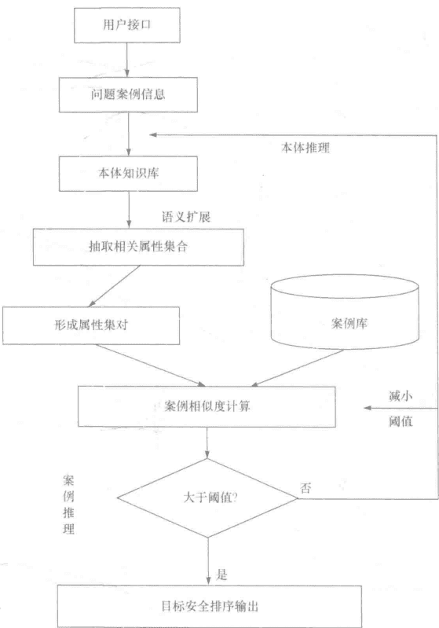

图 5.5.1 基于集对分析的案例检索原理

表 5.5.1 中医喘症案例及属性权重值

| 案例 | 喘症 | 痰象(颜色) | 寒热 | 舌体(色质) | 舌苔(颜色) | 舌苔(厚薄) | 脉象 |
|---|---|---|---|---|---|---|---|
| 1 | 喘促 | 痰黄 | 壮热 | | 苔黄 | | 滑数 |
| 2 | 喘 | | 微热 | 舌淡 | 苔白 | | 浮数 |
| 3 | 喘息 | 痰黄 | 微热 | | 苔红 | 略厚 | 弦滑 |
| 4 | 气喘 | 无 | 恶寒 | 舌淡 | | 厚 | 浮数 |
| 5 | 气短 | | | 舌红 | 苔白 | | 沉弱 |
| 6 | 喘嗽 | 痰黄 | 潮热 | 舌黄 | | 滑 | 浮紧 |
| 7 | 咳喘 | 痰黄 | | 舌淡 | 苔白 | | 细滑 |
| 8 | 喘促 | 痰白 | | 舌淡青 | 苔白 | 薄 | 细滑 |
| 9 | 微喘 | 痰白 | 恶寒 | 舌红 | 苔红 | | 沉实 |
| 10 | 喘 | 痰白 | 微热 | 舌淡 | 苔白 | 薄 | |
| 问题案例 1 | 咳喘 | 痰黄 | 壮热 | | 苔白 | 薄 | 滑 |
| 问题案例 2 | 气短 | 痰白 | 恶寒 | | 苔红 | 厚 | 浮 |
| 属性权重 | 0.4 | 0.15 | 0.05 | 0.1 | 0.05 | 0.1 | 0.15 |

表 5.5.2 实验结果

| 源案例序号 | 问题案例 1 | | 问题案例 2 | |
|---|---|---|---|---|
| | 集对分析 | 海明距离 | 集对分析 | 海明距离 |
| 1 | 0.88 | 0.85 | 0.25 | 0.34 |
| 2 | 0.63 | 0.59 | 0.62 | 0.78 |
| 3 | 0.66 | 0.64 | 0.7 | 0.82 |
| 4 | 0.52 | 0.48 | 0.69 | 0.72 |
| 5 | 0.62 | 0.41 | 0.46 | 0.74 |
| 6 | 0.86 | 0.84 | 0.68 | 0.58 |
| 7 | 0.84 | 0.76 | 0.6 | 0.70 |
| 8 | 0.82 | 0.81 | 0.5 | 0.52 |
| 9 | 0.51 | 0.52 | 0.46 | 0.58 |
| 10 | 0.63 | 0.65 | 0.42 | 0.44 |

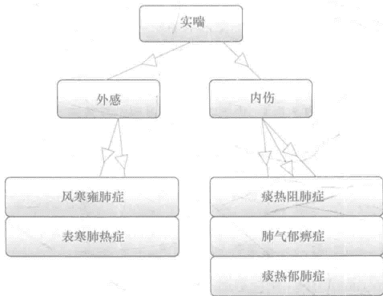

图 5.5.2 本体片段

从表 5.5.2 可以看出，基于集对分析的相似度计算方法具有很好的区分度。

对于问题案例 1，用集对分析方法计算出大于阈值 $\lambda=0.8$ 的案例有 4 个，用海明距离法有 3 个，通过观察表 5.5.2 的数据且结合医案的诊断结果，很明显案例 7 与问题案例 1 相接近，说明基于集对分析的计算方法更接近事实。且用集对分析计算目标案例与源案例 5 的相似度值比与源案例 9 的值大，但是用海明距离法结果却相反，原因可能是案例 5 属性缺失较多，而集对分析法能有效地处理这些不确定信息。

对于问题案例 2，用集对分析法计算出大于阈值的案例有 0 个而海明距离法有 1 个，通过观察表 5.5.2 的数据且结合医案的诊断结果，可以明显看出问题案例 2 与源案例属性不太接近；这时若用海明距离法检索出的案例作为参考，就有可能做出错误诊断。由此表明，基于集对分析的相似度计算结果比基于海明距离的计算结果更为客观合理。

## 5.6 本章小结

不确定性推理是人工智能的核心。由于客观世界中的不确定性呈现多样性和复杂性，舍弃不确定性提供的信息开展不确定性推理会使推理结果偏离现实；又由于人脑的不确定性，推理过程是在随带主观不确定性下进行的推理，所以，对于不同形式和不同内容的不确定性推理的不确定性采取“客观承认、系统描述、定量刻画、具体分析”是完全必要的；另外，推理总是在一定的时空中进行，时空的不确定性决定了推理难以完全回避不确定性的干扰；因而，不确定性推理自然存在着推理形式的多样性和计算与分析的复杂性。本章介绍基于集对分析的不确定性推理模型和案例，仅是多种不确定性推理形式中的几种而已，尚需结合具体问题探讨新的基于集对分析的不确定性推理模型和推理算法，特别要探索基于集对分析“人脑+电脑”双脑模型、“人脑+网络”多脑模型、“首脑+群脑”超级脑模型”的不确定性推理特点和推理算法。

## 参考文献

- [1] 赵克勤. 集对分析及其初步应用[M]. 杭州: 浙江科学技术出版社, 2000: 44-64.
- [2] 赵克勤. 集对分析的不确定性系统理论在 AI 中的应用[J]. 智能系统学报, 2006, 1(2): 16-25.
- [3] 赵克勤, 宣爱理. 集对论——一种新的不确定性理论方法与应用[J]. 系统工程, 1996, 14(1): 18-23.
- [4] 赵克勤. 试论集对分析在人工智能中的应用[M]//中国人工智能学会. 中国人工智能学会第七届学术会论文集. 西安: 西北工业大学出版社, 1992.
- [5] 赵森烽, 赵克勤. 概率联系数化的原理及其在概率推理中的应用[J]. 智能系统学报, 2012, 7(3): 200-205.
- [6] 蔡自兴,徐光佑. 人工智能及其应用[M]. 北京:清华大学出版社,2010:114-116.
- [7] 蒋云良. 基于 SPA 联系数的同异反定量推理路径选择[J]. 微电子学与计算机,2000(5):6-9.
- [8] 马宁明,王汝传,叶宁. 基于集对分析的上下文感知不确定性的推理方法[J]. 南京邮电大学学报,2009,29(1):64-67.
- [9] Padovitz A, Lokesw, Zaslavskya, et al. Towards a general approach for reasoning about context, situations and uncertainty in ubiquitous sensing: Putting geometrical intuitions to work[C] // 2nd International Symposium on Ubiquitous Computing Systems, Tokyo, 2004.11.
- [10] 阎红灿,王会芳,马会霞. 基于集对分析的本体案例检索模型[J]. 微型机与应用, 2014, 33(21):75-78.

# 第 6 章 基于集对分析的智能决策

智能决策是智能行为的前提，智能行为是智能决策的实施。人工智能中常用的决策有基于最优化理论的确定性决策，也有不确定性决策、后者包括风险决策和基于纯语言的决策，但纯语言决策在计算机处理时需要转换为一定形式的定量语言。集对分析已用于不同领域不同问题在不确定性环境下的决策建模与方案综合评价，因此在本质上是一类智能决策。本章介绍基于集对分析的智能决策特点与常用智能决策模型，基于集对分析的同异反决策、不确定性决策，基于赵森烽-克勒概率的风险决策等，最后介绍基于集对分析和云理论的智能群决策。

### 6.1 基于集对分析的智能决策特点

### 6.1.1 智能决策定义

定义 6.1.1 利用计算机模拟且接近人脑智慧的决策称为智能决策。

基于人脑智慧的决策有理想决策、完美决策、反常决策、随机应变的灵活决策、完全定性的决策、完全定量的决策、定性与定量相结合的决策、群决策等。从数学角度看，基于人脑智慧的决策可以分为确定性决策和不确定性决策。当需要利用计算机模拟人脑智慧进行决策时，无论是确定性决策还是不确定性决策都需要进行数学意义上的形式化处理，这时不仅需要用到确定的数，也需要用到包含不确定参数的不确定数；从实用的角度看，利用计算机模拟人脑智慧进行决策说到底是一种决策支持，因为决策者或机器人最终是以“是”或者“否”来确定实施一个方案或者行动；当把人与计算机看成是第 3 章所说的“智脑系统”时，智能决策就是“智脑系统”的一项具体工作。

### 6.1.2 基于集对分析的智能决策一体化集成特点

集对分析的基本思想有两个基本点。首先是把两个有一定联系的事物集联系成一个集对，继而在一定的问题背景下把集对中两个集合的确定性关系与不确定性关系作为一个不确定性子系统来处理。基于集对分析的智能决策也因此具有以下两个特点。

- (1) 集两类(或两种，或两个方面，或两个部分)决策于一体。例如，集个体决策与群体决策于一体，集定性决策与定量决策于一体，集当前决策与长远决策于一体，集战略决策与战术决策于一体，集硬决策与软决策于一体，集计算机决策与人的决策于一体，集宏观决策与微观决策于一体等。

- (2) 集确定性决策与不确定性决策于一体，这个特点也可以看成是第一个特点的派生特点，之所以单列为一个特点，是因为这一特点贯穿于所有集成为一体的决策之中。例如，从系统层次的角度上看，集宏观决策与微观决策于一的宏微智能决策，可以分为宏观上是确定的决策，但在微观上是不确定性的决策；或者在宏观上是不确定性决策，但在微观上是确定性的决策；或者在微观和宏观两个层次上都是确定性的决策，或者在微观和宏观两个层次上都是不确定性的决策，这样四种类型。如果注意到这里的微观也同时指时间片断，宏观也同时指时间上的某个阶段，那么，所谓的宏微一体智能决策也是一类动态决策。

从哲学和辩证法的角度看，基于集对分析的智能决策是一类辩证决策，不确定性分析是辩证决策的精髓。从决策实施的过程看，具有不确定性的阶段型动态决策是灵活的而不是固定不变的，是相互联系的而不是相互孤立的，但为了叙述上的方便和节约篇幅，本章仍然介绍一些基本的基于集对分析的智能决策模型，实际应用时需要根据不同的时空条件灵活地调用和集成不同的决策模型，以便获不同决策模型之长，减少甚至消除有关决策模型之短，实现高度优化的智能决策，从第 3 章介绍的信息能角度看，就是要在决策过程中，尽可能地减少信息能的损耗。

## 6.2 基于集对分析的同异反综合评价决策

### 6.2.1 同异反智能决策定义

基于集对分析的同异反智能决策也简称同异反智能决策或同异反决策，是基于集对分析同异反系统理论的一种智能决策。同异反决策把决策者可能面对的是正常环境作出的决策，面对异常环境作出的决策，面对反常环境作出的决策集为一体。这里的所谓“同异反”，定义为：出于人们的期望心理和思维习惯，把决策者可能面对的是正常环境设为决策用参考环境，于是，实际出现正常环境就是与参考环境的“同”，实际出现异常环境就是与参考环境的“异”，实际出现反常环境就是与参考环境的“反”。进一步，也把决策者面对正常环境作出的决策简称为“同决策”；把决策者面对异常环境作出的决策简称为“异决策”；把决策者面对反常环境作出的决策简称为“反决策”，同异反决策就是集“同决策”“异决策”“反决策”为一体的决策，其智能性表现在同异反决策同时体现了人脑智慧在决策时具有的现实性、灵活性和全面性等。同异反决策最早由赵克勤在 1989 年提出集对分析时给出[1,2]，之后陆续有研究和应用方面的文献报道[3-5]。

### 6.2.2 同异反综合评价

同异反综合评价又称同异系统综合评价,是同异反决策前的一项准备工作。这是因为,决策是人的一种主观思维,这种主观思维与客观存在的决策环境是否一致,或者是在多大程度上一致,需要通过系统性的综合评价才能说明;另外,由于决策环境的多样性、动态性和复杂性,决策者在决策时常常需要在多种可行方案中选择其一(同时选择备用方案,备用方案可以不止一个),这也需要在基于某种给定准则前提下,对给出的多个方案作出系统性的综合评价。目前在系统工程中有不同的系统综合评价方法,如模糊综合评价、灰色综合评价、基于投影寻踪的综合评价、基于集对分析的同异反综合评价等,其中集对分析的同异反综合评价既有与其他综合评价方法相同之处,也有相异之处,甚至有相反之处。这里仅介绍同异反综合评价自身,与其他综合评价方法的同异反比较从略,读者可以自行比较。

同异反综合评价内容如下。

- (1) 作正常情况下的综合评价(决策)。
- (2) 作异常情况下的综合评价(决策)。
- (3) 作反常情况下的综合评价(决策)。
- (4) 作正常情况兼有异常情况下的综合评价(决策)。
- (5) 作正常情况、异常情况、反常情况依次出现、交替出现、随机出现情况下的同异反综合评价(决策)。
- (6) 作同、异、反不同情况下综合评价结果的综合评价(决策)。
- (7) 作不确定性情况下的综合评价(决策)。
- 具体结合各种不确定性因素的分析和联系数中 i 的不同取值展开讨论,评价已有综合评价结果的稳定性和可信性,并加以分析和综合(决策)等。
- (8) 利用同异反数据作评价对象潜在发展趋势的判断(决策)。
- (9) 利用同异反数据作评价对象显在发展趋势的评价(决策)。
- (10) 利用同异反数据确定的联系数的其他伴随函数,作评价对象在其他物理意义上的评价(决策)。
- 等等。

### 6.2.3 应用举例

举一个简单的例子说明同异反智能决策的应用。

例 6.2.1 设有 A、B 两个工程方案需要作综合评价后择优实施其中之一,另一个则作为备用方案。在某轮评价中,这两个方案的评价结果联系数 $\mu(P)=a+bi+cj$ [其中 $a$ 为赞同度, $c$ 为反对度, $b$ 为不确定度(弃权、无信息反馈,或其他原因等)] 为 $\mu(A)=a_1+b_1 i_1+c_1 j_1 = 0.7+0.2i+0.1j$ (6.2.1)

显然, 式(6.2.1)与式(6.2.2)是两个同异反联系数,全面地刻画了 A,B 两个方案的评价结果,决策者 D 如何根据 $\mu(A)$ 和 $\mu(B)$ 这两个同异反联系数作同异反决策? 为简明起见,把上述问题的同异反决策过程用表 6.2.1 列注如下。

| 序号 | 决策步骤 | 决策内容 | 决策结果 |
|---|---|---|---|
| 1 | 基于正常情况的综合评价决策 | 比较两个方案的赞同程度 $a_1$ 和$a_2$ | 由于 $0.7>0.6$,所以选择方案 A |
| 2 | 基于异常不确定情况的综合评价决策 | 比较两个方案的不确定程度 $b_1$ 和$b_2$ | 由于 $0.2<0.3$,所以选择方案 A |
| 3 | 基于反常情况的综合评价决策 | 比较两个方案的被反对程度 $c_1$ 和$c_2$ | (1) 由于 $0.1 = 0.1$,所以可选择方案 A 也可以选择方案 B (2) 在特殊情况下选择方案 B |
| 4 | 基于正常情况兼有异常情况下的综合评价(决策) | 比较两个方案的 $a_1 + b_1 i_1$ 和 $a_2+b_2 i_2$ | 需要分析 $i_1$ 与 $i_2$ 的取值后才能作出决策 |
| 5 | 综合考虑正常情况、异常情况、反常情况后的决策 | 计算 $\mu(A)$与 $\mu(B)$的值 | 需要确定 $i_1$ 与 $i_2$ 的取值后才能计算 $\mu(A)$与 $\mu(B)$的值 |
| 6 | 作同、异、反、不同情况下综合评价结果的综合评价 | (1) 不计 $i_1$ 与 $i_2$ 的取值,则 $\mu(A)=0.6$,$\mu(B)=0.5$ (2) 计 $i_1$ 与 $i_2$ 的取值,但 $i_1$ 与 $i_2$ 取何值需要分析 | (1) 不计 $i_1$ 与 $i_2$ 的取值时选择方案 A (2) 由于 $i_1$ 与 $i_2$ 的取值不确定,所以难以作出选择 |
| 7 | 作不确定性情况下的综合评价决策 | (1) 考虑 $i_1$ 与 $i_2$ 同步取某值 (2) 考虑 $i_1$ 与 $i_2$ 不同步取某值 | (1) $i_1$ 与 $i_2$ 同步取某值时选择方案 A (2) $i_1$ 与 $i_2$ 不同步取某值时难以选择方案 |
| 8 | 两个方案潜在发展趋势的判断 | 分别计算 $\mu(A)$与 $\mu(B)$的偏联系数 $\partial\mu(A)$与$\partial\mu(B)$ | 选择 $\partial\mu(A)$ 与 $\partial\mu(B)$ 中值大的方案,但 $\partial\mu(A)$ 与 $\partial\mu(B)$ 的值与 $i_1$ 与 $i_2$ 取值有关 |
| 9 | 两个方案在发展趋势的评价 | 分别计算 $\mu(A)$与 $\mu(B)$的邻联系数 $N\mu(A)$ 与 $N\partial\mu(B)$ | 选择 $N\mu(A)$ 与 $N\partial\mu(B)$ 中值大的方案,但 $N\mu(A)$ 与 $N\partial\mu(B)$ 的值与 $i_1$ 与 $i_2$ 取值有关 |
| 10 | 基于同反比的决策 | 分别计算 $\mu(A)$与 $\mu(B)$的势函数 $ship_\mu(A) = a_1/c_1$ 与 $ship_\mu(B) = a_2 / c_2$ | 因为 $ship_\mu(A) = a_1/c_1 = 0.7/0.1 = 7$, $ship_\mu(A)=a_2/c_2 = 0.6/0.1 = 6$,所以选择方案 A |

说明 表 6.2.1 中有关偏联系数和邻联系数的具体计算,以及关于 $i$ 的具体取值,请参见 2.1 节。

## 6.3 基于联系数不确定性分析的智能决策

刘秀梅、赵克勤自 2008 年起合作研究区间数决策的集对分析，先后把近 20 个区间数决策问题转换成联系数决策模型，于 2014 年出版专著《区间数决策集对分析》[6]，这里介绍刘秀梅、赵克勤在文献[6]中的工作。

### 6.3.1 问题描述

设有 m 个方案 \(S_1, S_2, \cdots, S_m\) 组成方案集 \(S\)；每个方案各有 \(n\) 个属性 \(Q_1, Q_2, \cdots, Q_n\) 组成属性集 \(Q\)，其中，有越大越好的效益型属性，也有越小越好的成本型属性，\(n\) 个属性的权重向量 \(\vec{\omega_1}, \vec{\omega_2}, \cdots, \vec{\omega_n}\) 组成权重向量 \(\vec{W}\)，其中 \(\vec{\omega_i}=[\omega_i^-, \omega_i^+]\) 为区间数 \((i=1, 2, \cdots, n)\)，\(0 \leqslant \omega_i^- \leqslant \omega_i^+ \leqslant 1\)，且 \(\sum_{i=1}^n \omega_i^- \leqslant 1\)，\(\sum_{i=1}^n \omega_i^+ \geqslant 1\)；\(\vec{P}=(\widetilde{p}_{k\mu})_{m \times n}\) 表示区间数多属性决策矩阵，其中 \(\widetilde{p}_{k\mu}\) 表示第 \(k\) 个方案在 \(\iota\) 个属性上的评价值，\(\widetilde{p}_{k\mu}=[p_{k\mu}^-, p_{k\mu}^+]\)，且 \(p_{k\mu} \in [0, 1]\)，\(k=1, 2, \cdots, m\)，\(\iota=1, 2, \cdots, n\)。
要求在 \(m\) 个方案中确定出最优方案，并给出方案的优劣排序。

### 6.3.2 决策过程与决策模型

#### 1. 决策过程

#### 步骤 1 原始数据规范化处理

先求各属性的最优值。对于效益型属性，其最优值为 \(\max_k p_{k\mu}^+\)，其属性值与最优值的同一度区间数 \(\bar{a}_{p_{k\mu}}=[a_{p_{k\mu}}^-, a_{p_{k\mu}}^+]\)，按式(6.3.1)计算：

\(\bar{a}_{p_{k\mu}}=\left[\frac{p_{k\mu}^-}{\max_k p_{k\mu}^+}, \frac{p_{k\mu}^+}{\max_k p_{k\mu}^+}\right], \quad k=1, 2, \cdots, m \quad \text{(6.3.1)}\)

对于成本型属性，其最优值为 \(\min_k p_{k\mu}^-\)，其属性值与最优值的同一度区间数 \(\bar{a}_{p_{k\mu}}=[a_{p_{k\mu}}^-, a_{p_{k\mu}}^+]\) 按式(6.3.2)计算：

\(\bar{a}_{p_{k\mu}}=\left[\frac{\min_k p_{k\mu}^-}{p_{k\mu}^+}, \frac{\min_k p_{k\mu}^-}{p_{k\mu}^-}\right], \quad k=1, 2, \cdots, m \quad \text{(6.3.2)}\)

#### 步骤 2 把规范化处理后的数据转换为联系数

按照下列公式把规范化后的 \(\bar{a}_{p_{k\mu}}=[a_{p_{k\mu}}^-, a_{p_{k\mu}}^+]\) 改写为联系数 \(\mu_{p_{k\mu}}\)，有

\(\mu_{p_{k\mu}}=a_{k\mu}^- + (a_{k\mu}^+ - a_{k\mu}^-)i \quad \text{(6.3.3)}\)

式中，限定 \(i \in [0, 1]\)。


同理,把权重区间数也改写成联系数的形式:
\[
\mu_{w_i}=\omega_i^-+(\omega_i^+-\omega_i^-)i,\quad i\in[0,1]
\] (6.3.4)

#### 2. 决策模型

#### 1) 基本模型

记各方案 \( S_k(k=1,2,\cdots,m) \) 的综合评价结果为 \( M(S_k) \) , 有
\[ M(S_k) = \sum_{i=1}^n \widetilde{w}_i \widetilde{p}_{ki} \] (6.3.5)

称式(6.3.5)为智能决策基本模型。

#### 2) 联系数模型

把式(6.3.5)中的 \( \widetilde{w}_i \) 与 \( \widetilde{p}_{ki} \) 各自转换成相应的联系数, 得到智能决策联系数模型:
\[ M(S_k) = \sum_{i=1}^n \mu_{p_{ki}} \mu_{w_i} \] (6.3.6)

式中, \( M(S_k) \) 称为智能决策联系数模型的综合评价值, 综合评价值大的优先于综合评价值小的。但由式(6.3.6)计算得出的综合评价值 \( M(S_k) \) 是一个联系数, 不妨记为 \( M(S_k)=a_{s_k}+b_{s_k}i \) , 在其不确定部分 \( b_{s_k}i \) 中含有不确定数 \( i(i\in[0,1]) \) , 需要通过 \( i \) 的取值分析才能作出综合排序。为此, 可以先让 \( M(S_k) \) 中的 \( i \) 同步取 0, 0.5 或 1, 从而得到 \( m \) 个方案的一次排序, 方案 \( S_k \) 排序数记为 \( q_k \) 。

#### 3) 不确定性分析和最终排序

根据不确定性的特点, 对于 \( m \) 个方案的综合评价值 \( M(S_k)=a_{s_k}+b_{s_k}i \) 来说, 第 \( k(k=1,2,\cdots,m) \) 个 \( M(S_k) \) 中的 \( i \) 值不一定等同于其他 \( M(S_k) \) 中的 \( i \) 值, 为此可以分析第 \( k \) 个方案在 \( i=0, i=0.5, i=1 \) 的综合评价值 \( M(S_k) \) 与其他 \( m-1 \) 个方案在 \( i=0, i=0.5, i=1 \) 时的综合评价值 \( M(S_k) \) 的大小, 从而确定所有可能的排序数 \( q_k \) , 最优的记为 1, 次优的记为 2, 依次类推, 最差的记为 \( m \) ; 然后计算各方案在不同情况下不同排序数的总和, 记为 \( M_i(S_k) \) :
\[ M_i(S_k) = \sum_{i=0,0.5,1} \sum_{k=1}^m q_{ki} \] (6.3.7)

由于排序数 \( q_{ki} \) 以小为优, 所以最终是按 \( M_i(S_k) \) 小的方案优于 \( M_i(S_k) \) 大的方案这一准则排序。

### 6.3.3 应用举例

#### 例 6.3.1

考虑一个图书馆的空调系统选择问题, 在该决策问题中, 有 5 个备选方案 \( S_1, S_2, \cdots, S_5 \) , 评价属性有 8 个, 分别是固定成本(\( Q_1 \) )、运营成本(\( Q_2 \) )、性能(\( Q_3 \) )、噪声(\( Q_4 \) )、可维护性(\( Q_5 \) )、可靠性(\( Q_6 \) )、灵活性(\( Q_7 \) )、安全性(\( Q_8 \) ), 其中 \( Q_3 \) 、Q₅、Q₇、Q₈ 为打分值, 其范围为 1 分（最差）到 10 分（最优）, 且 Q₁、Q₂、Q₄ 为成本型属性, 其他 5 个为效益型属性。属性权重和决策矩阵见表 6.3.1。

表 6.3.1 属性权重和决策矩阵

| | \(\tilde{w}_i\) | S₁ | S₂ | S₃ | S₄ | S₅ |
|---|---|---|---|---|---|---|
| Q₁ | [0.0419, 0.0491] | [3.7, 4.4, 7] | [1.5, 2.5] | [3, 4] | [3.5, 4.5] | [2.5, 3.5] |
| Q₂ | [0.0840, 0.0982] | [5.9, 6.9] | [4.7, 5.7] | [4.2, 5.2] | [4.5, 5.5] | [5, 6] |
| Q₃ | [0.1211, 0.1373] | [8, 10] | [4, 6] | [4, 6] | [7, 9] | [6, 8] |
| Q₄ | [0.1211, 0.1373] | [30, 40] | [65, 75] | [60, 70] | [35, 45] | [50, 60] |
| Q₅ | [0.1680, 0.1818] | [3, 5] | [3, 5] | [7, 9] | [8, 10] | [5, 7] |
| Q₆ | [0.2138, 0.2294] | [90, 100] | [70, 80] | [80, 90] | [85, 95] | [85, 95] |
| Q₇ | [0.0395, 0.0457] | [3, 5] | [7, 9] | [7, 9] | [6, 8] | [4, 6] |
| Q₈ | [0.1588, 0.1706] | [6, 8] | [4, 6] | [5, 7] | [7, 9] | [8, 10] |

决策计算与集对分析的过程如下。

- 步骤 1 利用式(6.3.1)、式(6.3.2)对表 6.3.1 中的属性区间数进行规范化，得到以零次区间数表示的规范化决策矩阵，这一过程同时也消除了不同属性的量纲，并使各属性都成为越大越好的效益型属性，为按综合评价值“大者为优”排序打下了基础。因属性权重为零次区间数，只需对属性指标决策矩阵进行规范化，规范化后的决策矩阵数据及原属性权重数据如表 6.3.2 所示。

表 6.3.2 决策矩阵规范化后数据

| | \(\tilde{w}_i\) | S₁ | S₂ | S₃ | S₄ | S₅ |
|---|---|---|---|---|---|---|
| Q₁ | [0.0419, 0.0491] | [0.319, 0.405] | [0.600, 1.000] | [0.375, 0.500] | [0.333, 0.429] | [0.429, 0.600] |
| Q₂ | [0.0840, 0.0982] | [0.609, 0.712] | [0.737, 0.894] | [0.808, 1.000] | [0.764, 0.933] | [0.700, 0.840] |
| Q₃ | [0.1211, 0.1373] | [0.800, 1.000] | [0.400, 0.600] | [0.400, 0.600] | [0.700, 0.900] | [0.600, 0.800] |
| Q₄ | [0.1211, 0.1373] | [0.750, 1.000] | [0.400, 0.462] | [0.429, 0.500] | [0.667, 0.857] | [0.500, 0.600] |
| Q₅ | [0.1680, 0.1818] | [0.300, 0.500] | [0.300, 0.500] | [0.700, 0.900] | [0.800, 1.000] | [0.500, 0.700] |
| Q₆ | [0.2138, 0.2294] | [0.900, 1.000] | [0.700, 0.800] | [0.800, 0.900] | [0.850, 0.950] | [0.850, 0.950] |
| Q₇ | [0.0395, 0.0457] | [0.333, 0.556] | [0.778, 1.000] | [0.778, 1.000] | [0.667, 0.889] | [0.444, 0.667] |
| Q₈ | [0.1588, 0.1706] | [0.600, 0.800] | [0.400, 0.600] | [0.500, 0.700] | [0.700, 0.900] | [0.800, 1.000] |

- 步骤 2 将表 6.3.2 中的零次区间数改写成 a + bi 型联系数，见表 6.3.3。

表 6.3.3 用联系数 a + bi 表示的决策矩阵

| | \(\tilde{w}_i\) | S₁ | S₂ | S₃ | S₄ | S₅ |
|---|---|---|---|---|---|---|
| Q₁ | 0.0419 + 0.0072i | 0.319 + 0.086i | 0.600 + 0.400i | 0.375 + 0.125i | 0.333 + 0.096i | 0.429 + 0.171i |
| Q₂ | 0.0840 + 0.0142i | 0.609 + 0.103i | 0.737 + 0.157i | 0.808 + 0.192i | 0.764 + 0.169i | 0.700 + 0.140i |
| Q₃ | 0.1211 + 0.0162i | 0.800 + 0.200i | 0.400 + 0.200i | 0.400 + 0.200i | 0.700 + 0.200i | 0.600 + 0.200i |
| Q₄ | 0.1211 + 0.0162i | 0.750 + 0.250i | 0.400 + 0.062i | 0.429 + 0.071i | 0.667 + 0.190i | 0.500 + 0.100i |
| Q₅ | 0.1680 + 0.0138i | 0.300 + 0.200i | 0.300 + 0.200i | 0.700 + 0.200i | 0.800 + 0.200i | 0.500 + 0.200i |
| Q₆ | 0.2138 + 0.0156i | 0.900 + 0.100i | 0.700 + 0.100i | 0.800 + 0.100i | 0.850 + 0.100i | 0.850 + 0.100i |
| Q₇ | 0.0395 + 0.0062i | 0.333 + 0.223i | 0.778 + 0.222i | 0.778 + 0.222i | 0.667 + 0.222i | 0.444 + 0.223i |
| Q₈ | 0.1588 + 0.0118i | 0.600 + 0.200i | 0.400 + 0.200i | 0.500 + 0.200i | 0.700 + 0.200i | 0.800 + 0.200i |

- 步骤 3 按照联系数模型式(6.3.6)计算,得加权后的决策矩阵及综合评价值,见表 6.3.4。

表 6.3.4 加权后的决策矩阵及综合评价值

| | \(S_1\) | \(S_2\) | \(S_3\) | \(S_4\) | \(S_5\) |
|---|---|---|---|---|---|
| \(Q_1\) | 0.0134+0.0065i | 0.0251+0.0240i | 0.0157+0.0088i | 0.0140+0.0071i | 0.0180+0.0115i |
| \(Q_2\) | 0.0512+0.0188i | 0.0619+0.0259i | 0.0679+0.0303i | 0.0642+0.0274i | 0.0588+0.0237i |
| \(Q_3\) | 0.0969+0.0404i | 0.0484+0.0339i | 0.0484+0.0339i | 0.0848+0.0388i | 0.0727+0.0372i |
| \(Q_4\) | 0.0908+0.0465i | 0.0484+0.0150i | 0.0520+0.0167i | 0.0808+0.0369i | 0.0606+0.0218i |
| \(Q_5\) | 0.0504+0.0405i | 0.0504+0.0405i | 0.1176+0.0460i | 0.1344+0.0474i | 0.0840+0.0433i |
| \(Q_6\) | 0.1942+0.0370i | 0.1497+0.0339i | 0.1710+0.0354i | 0.1817+0.0362i | 0.1817+0.0362i |
| \(Q_7\) | 0.0132+0.0123i | 0.0307+0.0150i | 0.0307+0.0150i | 0.0263+0.0143i | 0.0175+0.0129i |
| \(Q_8\) | 0.0953+0.0412i | 0.0635+0.0388i | 0.0794+0.0400i | 0.1112+0.0424i | 0.1270+0.0436i |
| \(M(S_k)\) | 0.6054+0.2432i | 0.4781+0.2270i | 0.5827+0.2261i | 0.6974+0.2505i | 0.6203+0.2302i |

- 步骤 4 对表 6.3.4 中的 5 个综合评价值 \(M(S_k)\) 作不确定性分析。先对每个方案综合评价联系数 \(M(S_k)\) 中的 \(i\) 同时取 \(i=0, i=0.5, i=1\), 并按每一次的 \(i\) 取值结果按大小作一次排序, 得出方案的初排序, 3 种取值下的排序结果是一样的, 见表 6.3.5; 再分别对每个方案在其他方案中的 \(i\) 取不同值时的交叉取值排序分析, 从而得出 5 个方案在不同情况下可能出现的排序值 \(q_k (k=1, 2, \cdots, 5)\), 计算其排序数之和 \(M_i(S_k)\), 见表 6.3.6~表 6.3.10。

表 6.3.5 \(i=0, i=0.5, i=1\) 时的综合评价值

| | \(M(S_1)\) | \(M(S_2)\) | \(M(S_3)\) | \(M(S_4)\) | \(M(S_5)\) |
|---|---|---|---|---|---|
| \(M(S_k)\) | 0.6054+0.2432i | 0.4781+0.2270i | 0.5827+0.2261i | 0.6974+0.2505i | 0.6203+0.2302i |
| \(i=0\) | 0.6036 | 0.4781 | 0.5827 | 0.6974 | 0.6203 |
| \(i=0.5\) | 0.7270 | 0.5916 | 0.6958 | 0.8227 | 0.7354 |
| \(i=1\) | 0.8486 | 0.7051 | 0.8088 | 0.9479 | 0.8505 |
| \(q_k\) | 3 | 5 | 4 | 1 | 2 |

表 6.3.6 方案 \( S_1 \) 的可能排序

| 可能排序 \( q_{1i} \) | \( i=0 \) | \( i=0.5 \) | \( i=1 \) |
|---|---|---|---|
| \( S_1 \) | | | |
| \( i=0 \) | 3 | 4 | 5 |
| \( i=0.5 \) | 1 | 3 | 4 |
| \( i=1 \) | 1 | 1 | 3 |
| \( M_4(S_1) \) | | 25 | |

表 6.3.7 方案 \( S_2 \) 的可能排序

| 可能排序 \( q_{2i} \) | \( i=0 \) | \( i=0.5 \) | \( i=1 \) |
|---|---|---|---|
| \( S_2 \) | | | |
| \( i=0 \) | 5 | 5 | 5 |
| \( i=0.5 \) | 4 | 5 | 5 |
| \( i=1 \) | 1 | 4 | 5 |
| \( M_4(S_2) \) | | 39 | |

表 6.3.8 方案 \( S_3 \) 的可能排序

| 可能排序 \( q_{3i} \) | \( i=0 \) | \( i=0.5 \) | \( i=1 \) |
|---|---|---|---|
| \( S_3 \) | | | |
| \( i=0 \) | 4 | 5 | 5 |
| \( i=0.5 \) | 2 | 4 | 5 |
| \( i=1 \) | 1 | 2 | 4 |
| \( M_4(S_3) \) | | 32 | |

表 6.3.9 方案 \( S_4 \) 的可能排序

| 可能排序 \( q_{4i} \) | \( i=0 \) | \( i=0.5 \) | \( i=1 \) |
|---|---|---|---|
| \( S_4 \) | | | |
| \( i=0 \) | 1 | 3 | 5 |
| \( i=0.5 \) | 1 | 1 | 3 |
| \( i=1 \) | 1 | 1 | 1 |
| \( M_4(S_4) \) | | 17 | |

表 6.3.10 方案 \( S_5 \) 的可能排序分析

| 可能排序 \( q_{5i} \) | \( i=0 \) | \( i=0.5 \) | \( i=1 \) |
|---|---|---|---|
| | \( i=0 \) | \( i=0.5 \) | \( i=1 \) |
| \( S_5 \ i=0 \) | 2 | 4 | 5 |
| \( i=0.5 \) | 1 | 2 | 4 |
| \( i=1 \) | 1 | 1 | 2 |
| \( M_t(S_5) \) | | 22 | |

- 步骤 5 根据综合评价值 \(M_t(S_k)\) 的大小，作出各方案的最终排序。因为， \((M_t(S_4)=17)<(M_t(S_5)=22)<(M_t(S_1)=25)<(M_t(S_3)=32)<(M_t(S_2)=39)\) 所以，有 \(S_4>S_5>S_1>S_3>S_2\) (“>”表示“优于”)此排序结果与一次排序结果相同，所以这也是 5 个方案的最终综合排序。

- 步骤 6 与其他方法的比较与分析。

文献[7]和[8]分别用 TOPSIS 方法和相对隶属度法处理本例，得到的结果都是 \(S_4>S_5>S_3>S_1>S_2\)，与步骤 5 的结果 \(S_4>S_5>S_1>S_3>S_2\) 相当接近，仅仅是 \(S_3\) 与 \(S_1\) 的排序结果不一致，但文献[7]和[8]都是一次性排序，没有作不确定性分析；文献[9]综合应用 TOPSIS 方法和相对隶属度法处理本例，得到的排序结果是 \(S_4>S_1>S_5>S_3>S_2\)，除 \(S_4\) 与 \(S_2\) 的排序与步骤 5 相同，其他 3 个方案的排序与步骤 5 结果不相同，也与文献[7]的结果不相同，也是一次排序，也没有做不确定性分析。因此，相对来说，通过不确定性分析所得的排序结果更为可靠。

事实上，如果把联系数 \(\mu = a + bi \ (i \in [0,1])\) 看成是实数轴上的区间数\([a, a+b]\)时，则可以看出：当 \(i=0\) 时，相当于取区间数的左端点进行决策；当 \(i=1\) 时，相当于取区间数的右端点进行决策；当 \(i=0.5\) 时，相当于取区间数的中间值进行决策，虽然从区间数反映各属性在给定范围内取值具有随机性的角度出发，还可以取其他的值，从而得到其他的排序结果；但分别和交叉地取区间数的左右两个端点和中间值所得到的排序作为研究内容，仍然具有一定的代表性和说明力。

本例说明，基于联系数不确定性分析的智能决策特点，一是通过联系数中 \(i\) 的不同取值实现不确定性分析；二是检验方案排序的抗不确定性，保证基于集对分析智能决策得到的方案排序具有较好的稳定性；三是把得到的结果与其他方法所得结果比较，比较结果也不外乎是“同”（与其他方法的决策建议相同）“异”（与其他方法的决策建议有差异）“反”（与其他方法的决策建议之差异大到相反的程度），这也符合人脑决策时常常把自己要做的决策与他人商议、听取他人意见以提高决策科学性与有效性的习惯；如果这时决策者能进一步利用计算机对比较结果作进一步研究，根据再研究结果作出决策，显然会提高决策的科学性和实用性，参考第 3 章给出的智脑概念，可知这种根据“再研究结果”作出的决策是一种智脑决策。


## 6.4 基于联系数的区间数伴语言变量的混合多属性智能决策

在多属性智能决策中，属性值同时有区间数和语言变量的情况较为常见。如何把集对分析用于这一类情况的处理，刘秀梅、赵克勤在文献[10]中作了专题研究，介绍如下。

### 6.4.1 问题描述

设有 $S_1, S_2, \cdots, S_m$ 共 $m$ 个方案，每个方案各有 $n$ 种不相同的属性 $Q_1, Q_2, \cdots, Q_n$，其中 $R$ 个属性值用具有等级含义的语言变量表示，其余 $(n-R)$ 个属性值用区间数表示 $\bar{P}_{kt}=[p_{kt}^-, p_{kt}^+](k=1, 2, \cdots, m, t=1, 2, \cdots, n-R)$，为简单起见，假定 $\bar{P}_{kt}$ 已是通过规范化处理的越小越好型属性，且 $0 \leqslant p_{kt}^- \leqslant p_{kt}^+ \leqslant 1$，要求对 $m$ 个方案按照从优到劣作出排序顺序，确定最优方案。

### 6.4.2 决策步骤

**步骤 1** 对 $R$ 个属性的语言变量赋值，赋值规则是根据属性的重要程度用数字来刻画，考虑到属性值确定为越小越好型，因此对重要性强的属性赋小值，对重要性弱的属性赋大值，如重要的赋值 1，次重要的赋值 2，再次重要的赋值 3，依次类推，根据赋值约定将原始属性值中的全部语言变量替换成相应数字（值），并把这些数值由点实数的形式改写成区间数形式，如 $1=[1,1], 2=[2,2]$ 等。

**步骤 2** 对各属性值做规范化处理。对效益型属性值经规范化后的区间数为 $$ \bar{a}_{\bar{p}_{kt}} = \left[ \frac{\bar{p}_{kt}^-}{\max_k p_{kt}^+}, \frac{\bar{p}_{kt}^+}{\max_k p_{kt}^+} \right] = [a_{\bar{p}_{kt}}^-, a_{\bar{p}_{kt}}^+], k=1, 2, \cdots, m \quad (6.4.1) $$ 对于成本型属性值，经规范化后的区间数为 $$ \bar{a}_{\bar{p}_{kt}} = \left[ \frac{\min_k p_{kt}^-}{\bar{p}_{kt}^+}, \frac{\min_k p_{kt}^+}{\bar{p}_{kt}^-} \right] = [a_{\bar{p}_{kt}}^-, a_{\bar{p}_{kt}}^+], k=1, 2, \cdots, m, \quad p_{kt}^- \neq 0 \quad (6.4.2) $$ 如果各属性值区间数都在 $[0, 1]$ 区间且均为效益型或均为成本型，此过程可省略。

**步骤 3** 把经规范化处理后的各区间数转换成二元联系数，转换公式如下： $$ u_{\bar{p}_{kt}} = \frac{a_{\bar{p}_{kt}}^- + a_{\bar{p}_{kt}}^+}{2} + \frac{a_{\bar{p}_{kt}}^+ - a_{\bar{p}_{kt}}^-}{2} i = A_{ik} + i B_{ik} \quad (6.4.3) $$

**步骤 4** 应用并计算以下决策模型： $$ M(S_k) = \sum_{t=1}^n w_t u_{tk} = \sum_{t=1}^n w_t (A_{tk} + i B_{tk}) = \sum_{t=1}^n w_t A_{tk} + i \sum_{t=1}^n w_t B_{tk} = A'_k + i B'_k \quad (6.4.4) $$

式中， $w_t$ 表示第 $t$ 个属性的权重，用实数表示； $M(S_k)$ 表示方案的决策值。

**步骤 5** 根据 $A'_k$ 的值从大到小进行 $m$ 个方案的排序，以此为初排序，再对 $M(S_k)=A'_{k}+iB'_{k}$ 作取值分析，检验初排序的稳定性，若初排序有变化，则一一列明这种变化和说明不确定条件，据此作出终决策。

### 6.4.3 应用举例

#### 例 6.4.1 这里取文献[11]中给出的例子。

设在某防空作战中，敌方对我方采用编队式空袭某区域，我方地面各传感系统探测到敌方空袭威胁目标为 8 批，各威胁目标的各属性测量值如表 6.4.1 所示。

表 6.4.1 空袭目标各个威胁属性的测量值

| 目标 | 目标类型 S | 飞行速度 V/(m/s) | 飞临时间 T/s | 飞行高度 H/m | 航路捷径 P/km | 干扰能力 I |
|:---|:---|:---|:---|:---|:---|:---|
| 1 | 大型目标 | [400,800] | [200,210] | [7900,7960] | [13,14] | 强 |
| 2 | 小型目标 | [600,630] | [380,385] | [900,960] | [3,3.5] | 强 |
| 3 | 大型目标 | [320,360] | [180,190] | [8000,8100] | [10,12] | 弱 |
| 4 | 小型目标 | [510,520] | [320,328] | [600,640] | [11,11.8] | 强 |
| 5 | 武装直升机 | [70,80] | [660,670] | [1100,1200] | [3.8,4.2] | 中 |
| 6 | 小型目标 | [1020,1040] | [590,620] | [4600,4700] | [7,7.4] | 弱 |
| 7 | 武装直升机 | [80,90] | [500,565] | [980,1060] | [4,4.6] | 中 |
| 8 | 大型目标 | [300,330] | [460,480] | [5800,6900] | [4.6,4.8] | 中 |

需要对 8 个威胁目标作出威胁程度从大到小的排序，以便作出反空袭的指挥。

需要说明的是，在文献[8]中利用粗糙集理论对威胁评估指标体系中的 6 个指标进行约简，约简了飞行速度和飞行高度两个属性，重点考虑其余四个属性，并进而给出这四个属性的权重为 $w_S = 0.4168, w_T = 0.1472, w_P = 0.1741, w_I = 0.2620$，为简明起见，认同文献[8]所做的上述工作，仅就 8 个目标在 $S, T, P, I$ 所构成的威胁属性体系中威胁程度的计算并作威胁程度从大到小的排序。

显而易见，由于属性 $S$ 和 $I$ 是用语言变量表示各目标的威胁程度，而 $T$ 和 $P$ 的值为区间数，所以本问题是一个典型的区间数伴语言变量的混合型多属性决策问题，因此按以下步骤进行。

**步骤 1** 对各 $S$ 和 $I$ 值的语言变量赋值。

考虑到 $T$ 和 $P$ 是成本型指标，为与 $T$ 和 $P$ 属性性质协调一致，对 $S$ 和 $I$ 的值也奉行“威胁程度越大的语言变量赋值越小”的原则。为此，令 $S$ 中的小型目标 $= 1$，大型目标 $= 2$，武装直升机 $= 3$；令 $I$ 中的干扰能力强 $= 1$，干扰能力中 $= 2$，干扰能力弱 $= 3$，并将各赋值写成区间数形式，见表 6.4.2。

表 6.4.2 语言变量赋值后的各目标属性值

| 目标 | 目标类型 S | 飞临时间 T/s | 航路捷径 P/km | 干扰能力 I |
|---|---|---|---|---|
| 1 | [2,2] | [200,210] | [13,14] | [1,1] |
| 2 | [1,1] | [380,385] | [3,3.5] | [1,1] |
| 3 | [2,2] | [180,190] | [10,12] | [3,3] |
| 4 | [1,1] | [320,328] | [11,11.8] | [1,1] |
| 5 | [3,3] | [660,670] | [3.8,4.2] | [2,2] |
| 6 | [1,1] | [590,620] | [7,7.4] | [3,3] |
| 7 | [3,3] | [500,565] | [4,4.6] | [2,2] |
| 8 | [2,2] | [460,480] | [4.6,4.8] | [2,2] |

**步骤 2** 规范化各属性的属性值。

由于各属性都是越小越好的成本型属性，故按式(6.4.2)对表 6.4.2 数据作规范化处理，得表 6.4.3。

表 6.4.3 各目标属性值的规范化处理结果

| 目标 | 目标类型 S | 飞临时间 T/s | 航路捷径 P/km | 干扰能力 I |
|---|---|---|---|---|
| 1 | [0.5,0.5] | [0.8571,0.9000] | [0.2143,0.2308] | [1,1] |
| 2 | [1,1] | [0.4675,0.4737] | [0.8571,1.0000] | [1,1] |
| 3 | [0.5,0.5] | [0.9474,1.0000] | [0.2500,0.3000] | [0.333,0.333] |
| 4 | [1,1] | [0.5488,0.5625] | [0.2542,0.2727] | [1,1] |
| 5 | [0.333,0.333] | [0.2687,0.2727] | [0.7143,0.7895] | [0.5,0.5] |
| 6 | [1,1] | [0.2903,0.3051] | [0.4054,0.4286] | [0.333,0.333] |
| 7 | [0.333,0.333] | [0.3186,0.3600] | [0.6522,0.7500] | [0.5,0.5] |
| 8 | [0.5,0.5] | [0.3750,0.3913] | [0.6250,0.6522] | [0.5,0.5] |

**步骤 3** 对表 6.4.3 数据按式(6.4.3)联系数化，得表 6.4.4。

表 6.4.4 各目标属性值的联系数化及其同一度部分加权求和结果及排序

| 目标 | u(S) | u(T) | u(P) | u(I) | Σ | 初排序 |
|---|---|---|---|---|---|---|
| 1 | 0.5+0i | 0.8786+0.0215i | 0.2226+0.0083i | 1+0i | 0.6385+0.0046i | ③ |
| 2 | 1+0i | 0.4706+0.0031i | 0.9286+0.0715i | 1+0i | 0.9098+0.0129i | ① |
| 3 | 0.5+0i | 0.9737+0.0263i | 0.2750+0.0250i | 0.333+0i | 0.4868+0.0083i | ⑥ |
| 4 | 1+0i | 0.5557+0.0069i | 0.2635+0.0092i | 1+0i | 0.8065+0.0026i | ② |
| 5 | 0.333+0i | 0.2707+0.0020i | 0.7519+0.0376i | 0.5+0i | 0.4405+0.0068i | ⑧ |
| 6 | 1+0i | 0.2977+0.0074i | 0.4170+0.0116i | 0.333+0i | 0.6204+0.0031i | ④ |
| 7 | 0.333+0i | 0.3393+0.0207i | 0.7011+0.0489i | 0.5+0i | 0.4418+0.0115i | ⑦ |
| 8 | 0.5+0i | 0.3832+0.0082i | 0.6386+0.0136i | 0.5+0i | 0.5070+0.0036i | ⑤ |
| w | 0.4168 | 0.1472 | 0.1741 | 0.2620 | | |

**步骤 4** 按综合加权模型式(6.4.4)计算得各目标的综合联系数(表 6.4.4)。

**步骤 5** 按各综合联系数中的 $A'_i$ 从大到小得到威胁目标的初排序(表 6.4.4)，该排序结果与文献[11]完全一致。

**步骤 6** 不确定分析。

观察表 6.4.4 中各综合联系数中的 $B_i$ 部分发现，只有目标 2 与目标 7 的综合联系数的 $B_i$ 部分在百分位上数字是 1，其余各目标综合联系数不确定分量在百分位上都是 0，因此只需分析目标 2 与目标 4，目标 7 与目标 5，这两对目标在不确定性作用下的排序是否会排序“倒转”(目标 7 与另一个与之相邻的目标 6 因联系数中的 $A$ 部 0.4419 与 0.4869 已有较大差距，该差距在计及不确定数 $i$ 情况下不至于产生排序倒转)，为此，仅作以下计算。

对于目标 2 与目标 4，有
$$(0.9098+0.0129i)|_{i=-1}=0.8969$$
$$(0.8065+0.0026i)|_{i=1}=0.8091$$

因为 $0.8969 > 0.8091$，所以目标 2 比目标 4 威胁程度大的结论不变。

对于目标 7 与目标 5，有
$$(0.4418+0.0115i)|_{i=-1}=0.4303$$
$$(0.4405+0.0068i)|_{i=0}=0.4405$$
$$(0.4405+0.0068i)|_{i=1}=0.4473$$

由于 $0.4405 > 0.4303$， $0.4473 > 0.4303$，所以，在计及不确定性影响时，目标 7 与目标 5 的原有排序改变，需要互换排序。

本例说明，基于联系数的区间数伴语言变量的混合多属性智能决策问题，本质上也是一个基于联系数不确定性分析的智能决策问题，因而同样具有基于联系数不确定性分析的智能决策的 3 个特点：①通过联系数中 $i$ 的不同取值实现不确定性分析；②检验方案排序的抗不确定性，保证基于集对分析智能决策得到的方案排序具有较好的稳定性；③把得到的结果与其他方法所得结果比较。不同之处在决策时先把语言变量转换为区间数再转换为联系数。

## 6.5 基于赵森烽-克勒概率的智能风险决策

赵森烽、赵克勤于 2012 年提出一种不同于经典概率论的新概率——联系概率，并把其应用于风险决策，得到一种新的风险决策模型，比传统的风险决策模型有更丰富的信息[12]，这里介绍赵森烽、赵克勤在这方面中的工作。

### 6.5.1 赵森烽-克勒概率

赵森烽-克勒概率是基于集对分析联系数而提出的一种新型概率，其特点是同时刻画关注事件 $A$(也称主事件)发生的概率 $p(A)$(大数概率)与主事件不发生(主事件的伴随事件发生)的概率 $p(A)$(即或概率)，并写成联系数的形式 $p(A)+P(A)i$，其相关内容详见 2.2.5 节。基于赵森烽-克勒概率 $p(A)+P(A)i$ 的风险决策因而能较为客观地反映出风险决策的复杂性和可分析性，丰富和发展了决策科学的理论与方法，为节约篇幅，这里仅取 1 个应用实例说明这种新型风险决策的思路和步骤[9]。

### 6.5.2 应用实例

#### 例 6.5.1 公司开发某新产品，需要根据表 6.5.1 作出风险决策，试用赵森烽-克勒概率进行风险决策并分析。

表 6.5.1 损益表（单位：万元）

| 决策 | 销路好(0.5) | 销路一般(0.3) | 销路差(0.1) | 销路极差(0.1) |
|---|---|---|---|---|
| 现有厂房扩建 | 50 | 25 | -15 | -45 |
| 新建厂房 | 70 | 30 | -40 | -80 |
| 转包 | 30 | 15 | -5 | -10 |

解 其风险决策计算如表 6.5.2 所示。

表 6.5.2 基于数学期望的风险决策计算

| 决策 | 现有厂房扩建 | 新建厂房 | 转包 |
|---|---|---|---|
| 销路好 | 0.5×50=25 | 0.5×70=35 | 0.5×30=15 |
| 销路一般 | 0.3×25=7.5 | 0.3×30=9 | 0.3×15=4.5 |
| 销路差 | 0.1×(-25)=-2.5 | 0.1×(-40)=-4 | 0.1×(-5)=-0.5 |
| 销路极差 | 0.1×(-45)=-4.5 | 0.1×(-80)=-8 | 0.1×(-10)=-1 |
| 期望值 | 25.5 | 32 | 18 |

按表 6.5.2 得该公司应作出“新建厂房”的决策；以上是某文献的解题思路；以下的表 6.5.3 是采用赵森烽-克勒概率的决策计算过程。

表 6.5.3 基于赵森烽-克勒概率数学期望的风险决策计算

| 决策 | 现有厂房扩建 | 新建厂房 | 转包 |
|---|---|---|---|
| 销路好 | (0.5+0.5i)×50=25+25i | (0.5+0.5i)×70=35+35i | (0.5+0.5i)×30=15+15i |
| 销路一般 | (0.3+0.7i)×25=7.5+17.5i | (0.3+0.7i)×30=9+21i | (0.3+0.7i)×15=4.5+10.5i |
| 销路差 | (0.1+0.9i)×(-25)=-2.5-22.5i | (0.1+0.9i)×(-40)=-4-36i | (0.1+0.9i)×(-5)=-0.5-4.5i |
| 销路极差 | (0.1+0.9i)×(-45)=-4.5-40.5i | (0.1+0.9i)×(-80)=-8-72i | (0.1+0.9i)×(-10)=-1-9i |
| 期望值 | 25.5-20.5i | 32-52i | 18+12i |

基于赵森烽-克勒概率的数学期望是一个联系数，联系数中确定性分量部分与基于经典概率的数学期望相同，只是增加了一个表示不确定性的分量“$bi$”，于是问题转化为对于“$i$”的分析。

为此，作 $i$ 基于定义域取值的分析，见表 6.5.4。

表 6.5.4 基于赵森烽-克勒概率数学期望风险决策的不确定性分析

| 决策 | 基于联系概率的数学期望联系数 | i=0 | i=-1 | i=1 |
|:---|:---|:---|:---|:---|
| 现有厂房扩建 | 25.5-20.5i | 25.5 | 46 | 5 |
| 新建厂房 | 32-52i | 32 | 84 | -20 |
| 转包 | 18+12i | 18 | 6 | 30 |
| 决策 | | 新建厂房 | 新建厂房 | 转包 |

由表 6.5.4 看出，$84+(-20)=64$，而 $64/2=32$，这个计算说明，采用“新建厂房”这一决策，其实际收益区间为[-20, 84]，但“84”这个数值不合题意，因为表 6.5.1 中已经告诉我们，在“销路好”的情况下的最大收益是“70”，因此实际收益区间为[-20, 70]，这是符合客观实际的。从实际考虑，在“销路好”与“销路一般”之间，还有“销路较好”，“销路一般偏好”等；当然也有可能产生“超过预期好”这种情况，这时采用[-20, 84]也是有理由的；反之，“销路好”也可能是一阵子，接着而至的是“销路不太好”，“销路一般”直至“销路不好”，这时，也有可能产生“负收益”，最坏情况下的负收益值是-20，也就是亏损 20。

同理，表 6.5.4 对“现有厂房扩建”期望联系数 $25.5-20.5i$ 和“转包”期望联系数 $18+12i$ 进行不确定性分析，并与“新建厂房”联系数 $32-52i$ 作对照和比较，得到的结论是：在理想的情况下是“转包”，因为这时的期望值最大（30），但在一般情况下应选择“新建厂房”。

这个例子表明，基于赵森烽-克勒概率的风险决策比传统的风险决策具有更多的信息。这些信息在数学形式上由联系数中的 $i$ 承载，借助于对 $i$ 的分析，使得决策结果能更好地反映决策实施后可能面临的不同环境，从而使决策者对于决策实施结果可能遇到的不同情况估计更具柔性和更具操作性；因此，称其为是一种新的智能决策。

## 6.6 基于集对云的多属性智能群决策

云模型是中国工程院院士李德毅给出的一种定性定量转换模型[18]，吴爱燕等[14]把集对分析与云模型结合，给出基于集对云的多属性群决策方法和应用实例，介绍如下。

### 6.6.1 问题描述

现实世界中许多复杂现象难以量化，很多情况下随机性和模糊性并存，为此，


人们在评判某一现象或事物时更喜欢用“很好”“好”或“优”“良”“可”“差”等自然语言，基于自然语言的优化决策研究已成为复杂现象模糊多属性决策的重要研究内容，如何实现自然语言的量化成为这方面研究的核心问题，目前学者的工作有“三角模糊数型”“梯形语言变量”“灰色理想解法”“二元语义”等多属性优化决策方法，其核心思想都是基于模糊理论，主要解决人为主观认识的模糊性。而基于自然语言的优化决策不但存在着人为主观认识的模糊性，而且被考察现象本身存在客观随机性。此外，现有研究方法只给出一个决策参考值，没有给出不确定性因素的变化对备选方案发展趋势的影响。为此，把李德毅院士提出的云模型与集对分析结合，给出一种基于集对云的多属性群决策算法。

### 6.6.2 算法描述

- 1. 设置等级云

等级云包括等级描述云和等级评价云，等级评价云用于表达描述云等级确定度。首先，根据等级描述语言集 \( R \) 及具体研究问题，用云的 3 个数字特征 \( Ex, En, He \) 定义定性概念，等级描述云描述如式 (6.6.1) 所示；其次，根据确定等级语言集 \( D \) 以及具体的研究问题，用云的 3 个数字特征 \( Ex, En, He \) 定义定性概念，等级评价云描述如式 (6.6.2) 所示；然后，由等级描述云和等级评价云实现 \( u_i^k \) 和 \( w_{ij}^k \) 从定性评价转换为定量值，如式 (6.6.3) ～ 式 (6.6.5) 所示。

\[
C_i=(Ex_i, En_i, He_i), \quad 1 \leqslant i \leqslant x \quad \text{(6.6.1)}
\]

式中，\( x \) 为定性概念的数目。

\[
C'_i=(Ex'_i, En'_i, He'_i), \quad 1 \leqslant i \leqslant y \quad \text{(6.6.2)}
\]

式中，\( y \) 为定性概念的数目。

\[
E'^{k}_{j}=f(W^{k}_{ij}) \quad \text{(6.6.3)}
\]

式中，\( W^k_{ij} \) 为确定等级语言值；\( E'^{k}_{j} \) 为确定等级语言值对应的数值；\( f \) 为 \( W^k_{ij} \) 与等级评价云的映射关系。

\[
C_{i}=\bar{f}(U^{k}_{ij}) \quad \text{(6.6.4)}
\]

式中，\( U^k_{ij} \) 为等级描述语言值；\( C_i \) 为 \( U^k_{ij} \) 对应的定性概念云；\( \bar{f} \) 为等级描述值与定性概念云的对应关系。

\[
U'^{k}_{ij}=Ex_i-\sqrt{-\ln E'^{k}_{j} \times 2 \times En^{2}_{i}} \quad \text{(6.6.5)}
\]

式中，\( U'^{k}_{ij} \) 为等级描述语言值对应的数值；\( Ex_i \) 为 \( C_i \) 的期望；\( En_i \) 为 \( C_i \) 的熵。

- 2. 进行云归一化运算

针对同一属性进行云归一化运算，矩阵将矩阵 \( U^{k'} \) 各行的多个评价值归一为每行一个评价值，如式 (6.6.6) 所示。这些评价值在等级描述云的每个定性概念上都有一个等级描述值和相应的确定度，因此它的任意元素 \( U^{t'}_i \) 都有 \( x \) 个等级描述值和相应的确定度，其求取参见文献[11](正态云的定义公式)，取 \( x \) 个确定度中最大者为 \( U^{t'}_i \) 的最终确定度，该确定度对应的等级描述值为 \( U^{t'}_{ik} \) 的最终等级描述值。

\[
U^{t'}_{ik} = \frac{\sum_{i=0}^{m} U^{t'_{ij}}}{m} \quad \text{(6.6.6)}
\]

式中，\( U^{t'_{ij}} \) 为等级评价矩阵 \( U^k \) 中的元素；\( U^{t'}_{ik} \) 为归一化的值；\( m \) 为等级评价矩阵中每行评价值的数目。

\[
u^{t'_{ik}} = \max \{ u^{t'_{ij}} | j \in [1, x] \} \quad \text{(6.6.7)}
\]

式中，\( u^{t'_{ij}} \) 为 \( u^{t'_{ik}} \) 在每个定性概念上的确定度；\( u^{t'_{ik}} \) 为 \( U^{t'}_{ik} \) 最终的确定度。

\[
r^{t'_{ik}} = \bar{f}(U^{t'_{ik}}), \quad r^{t'_{ij}} \in \langle r^{t'_{ij}} | j \in [1, x] \rangle \quad \text{(6.6.8)}
\]

式中，\( r^{t'_{ij}} \) 为 \( U^{t'_{ik}} \) 在每个定性概念上的等级描述值；\( \bar{f} \) 为等级描述值与确定度的对应关系；\( r^{t'_{ik}} \) 为 \( U^{t'_{ik}} \) 最终的等级描述值。

- 3. 集对评估运算

将评价等级分为同一等级、对立等级和不确定等级。根据这三类评价等级构建方案可行性的确定性与不确定性，同一性与对立性的描述方程式；根据描述方程式(6.6.9)可分析获知可行性最佳的方案，以及各方案随着不确定因素变化而产生的变化。

\[
S^k = r_0 \lambda_0 + r_1 \lambda_1 + r_2 \lambda_2
\]

\[
r_1 = \begin{cases} 0, & \text{others} \\ u^{t'_{ik}}, & r_i \in R^k \land r_i = r^{t'_{ik}} \end{cases}
\]

\[
\lambda_1 = \begin{cases} 1, & \text{identic-rank} \\ 0, & \text{opposite-rank} \\ x, & \text{uncertain y} \land x \in [-1, 1] \end{cases} \quad \text{(6.6.9)}
\]

式中，\( S^k \) 为方案 \( k \) 的评估值；\( \lambda_i \) 为评价等级 \( i \) 的参数。

### 6.6.3 应用实例

#### 例 6.6.1

专家根据国家科技支撑计划课题，农村新能源开发利用规划的调研统计数据，给出了某县水能、太阳能、沼气等多种可再生能源的开发候选方案。由于当地年均风力不足，所以不考虑开发风能。在候选方案中，为满足研究任务的需要，专家根据经验主要考虑了 4 个评估属性，属性评估标准与等级评估标准均包括 5 个等级，由 3 位专家进行候选方案评估。属性评估值和等级评估值均表示为如下矩阵，其中 \( s_1, s_2, s_3 \) 分别表示水能开发方案、太阳能开发方案、沼气开发方案；\( a_1, a_2, a_3, a_4 \) 分别表示 4 个评估属性：待开发情况、需求情况、经济支持情况、政策支持情况，属性评估标准集 R=(VG 非常好),(G 好),(M 一般),(B 差),(VB 非常差),等级评估标准集 R=(VH 很高),(H 高),(M 一般),(L 低),(VL 很低),e₁、e₂、e₃ 分别表示 3 位专家。

U′¹ = [a₁ VG G G; a₂ G G M; a₃ G G M; a₄ G M M], W′¹ = [a₁ H L M; a₂ VH M H; a₃ M H VH; a₄ L H M]

U′² = [a₁ M G M; a₂ G M G; a₃ G G M; a₄ G M G], W′² = [a₁ H L M; a₂ VH M H; a₃ M H VH; a₄ L H M]

U′³ = [a₁ G VG M; a₂ G G G; a₃ G G M; a₄ G M G], W′³ = [a₁ VH H H; a₂ H H M; a₃ M H VH; a₄ L H M]

根据属性评估集的 5 个等级,设计等级描述云。如式(6.6.10)所示,等级描述云图如图 6.6.1 所示,由图 6.6.1 可见等级描述云的参数设置是合理的。

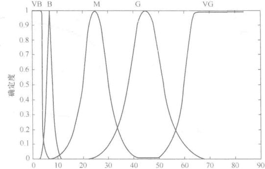

图 6.6.1 等级描述云图

\[
C_1 = \begin{cases} 1, & x \in [0, 0.4] \\ C(4, 2/3, 0.05), & \text{其他} \end{cases}
\]
\[
C_2 = C(7, 8/7, 0.05)
\]
\[
C_3 = C(25, 5, 0.05)
\]
\[
C_4 = C(45, 20/3, 0.05)
\]
\[
C_5 = \begin{cases} C(65, 6, 0.05), & \text{其他} \\ 1, & x \in [65, \infty] \end{cases} \quad \text{(6.6.10)}
\]

式中，\( C_1 \) 表示表达语言评估值“非甚差”；\( C_2 \) 表示表达语言评估值“差”；\( C_3 \) 表示表达语言评估值“一般”；\( C_4 \) 表示表达语言评估值“好”；\( C_5 \) 表示表达语言评估值“非常好”。根据等级评估集的 5 个等级，设等级评价云表示如式(6.6.11)所示，等级评价云图如图 6.6.2 所示，由图 6.6.2 可见等级描述云的参数设置是合理的。

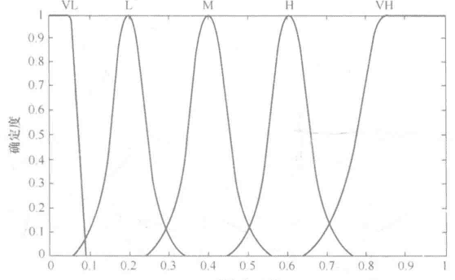

图 6.6.2 等级评价云图

\[
C'_1 = \begin{cases} 1, & x \in [0, 0.05] \\ C(0.05, 1/60, 0.002), & \text{其他} \end{cases}
\]
\[
C'_2 = C(0.2, 1/25, 0.002)
\]
\[
C'_3 = C(0.4, 6/125, 0.002)
\]
\[
C'_4 = C(0.6, 6/125, 0.002)
\]
\[
C'_5 = \begin{cases} C(0.85, 1/15, 0.002), & \text{其他} \\ 1, & x \in [0.85, 1] \end{cases} \quad \text{(6.6.11)}
\]

式中，\( C'_1 \) 表示表达语言评估值“很低”；\( C'_2 \) 表示表达语言评估值“低”；\( C'_3 \) 表示表达语言评估值“一般”；\( C'_4 \) 表示表达语言评估值“高”；\( C'_5 \) 表示表达语言评估值“很高”。云归一化操作结果如下。

设 VG、G 是同一等级，V、VB 是对立等级，M 是不确定等级，则
\[
S_2 = (0.9793+0.4415+0.9401+0.7733)x_1 \Rightarrow S_2=3.1342x_1, x_1 \in [-1,1]
\]
\[
S_3=2.5405x_0 \Rightarrow S_3=2.5405-
\]
\[
S_1 = (0.9992+0.3372)x_0+(0.1965+0.9382)x_1 \Rightarrow S_1=1.3364+1.1347x_1, x_1 \in [-1,1]
\]

由集对云评估运算可知，沼气开发不确定性因素影响可以忽略，开发相对稳定且可行性高，所以沼气开发方案是最优方案。由以上决策结果可知，当地可再生能源开发首先考虑投资开发沼气，其次考虑投资开发水能。

rank certainty-degree
\[
U'^*_{1} = \begin{bmatrix} 44.728 \\ 32.373 \\ 15.98 \\ 26.786 \end{bmatrix} \Rightarrow \begin{bmatrix} G & 0.9992 \\ G & 0.3372 \\ M & 0.1965 \\ M & 0.9382 \end{bmatrix}
\]

rank certainty-degree
\[
U'^*_{2} = \begin{bmatrix} 26.023 \\ 31.394 \\ 26.758 \\ 21.415 \end{bmatrix} \Rightarrow \begin{bmatrix} M & 0.9793 \\ M & 0.4415 \\ M & 0.9401 \\ M & 0.7733 \end{bmatrix}
\]

rank certainty-degree
\[
U'^*_{3} = \begin{bmatrix} 40.364 \\ 37.50 \\ 46.469 \\ 33.87 \end{bmatrix} \Rightarrow \begin{bmatrix} G & 0.7852 \\ G & 0.5311 \\ G & 0.9760 \\ G & 0.2482 \end{bmatrix}
\]

### 6.6.4 仿真实验

自 2000 年西班牙学者提出关于语言信息集结的二元语义分析法以来，该方法在多属性群决策中得到了广泛应用。从文献[15]中看到，计算群集结的 T-OWA 算子的权向量时模糊量化算子 Q 对应参数的设定依然是基于模糊论的。这里把 T-OWA 算子及其群集结运算用于本节能源多属性群决策中，其运算如下。

基于集对云优化决策法的等级描述云和等级评价云可得

\[
P^I = \begin{bmatrix} 59.9462 & 41.1992 & 35.9751 & 33.0392 \\ 19.9462 & 35.9751 & 35.9751 & 33.0392 \\ 41.1992 & 38.2615 & 35.9751 & 33.0392 \end{bmatrix}
\]

\[
P^2 = \begin{bmatrix} 38.2615 & 35.9751 & 38.2615 & 19.9462 \\ 35.9751 & 19.9462 & 38.2615 & 19.9462 \\ 59.9462 & 38.2615 & 38.2615 & 19.9462 \end{bmatrix}
\]

\[
P^3 = \begin{bmatrix} 35.9751 & 19.9462 & 22.1494 & 35.9751 \\ 22.1494 & 38.2615 & 22.1494 & 35.9751 \\ 19.9462 & 35.9751 & 22.1494 & 35.9751 \end{bmatrix}
\]

利用 T-OWA 算子将 P¹、P²、P³ 集结运算如下：

\[
b^1 = \begin{bmatrix} 59.9462 & 41.1992 & 38.2615 & 35.9751 \\ 35.9751 & 38.2615 & 38.2615 & 35.9751 \\ 59.9462 & 38.2615 & 38.2615 & 35.9751 \end{bmatrix}
\]

\[
b^2 = \begin{bmatrix} 38.2615 & 35.9751 & 35.9751 & 33.0392 \\ 22.1494 & 35.9751 & 35.9751 & 33.0392 \\ 41.1992 & 38.2615 & 35.9751 & 33.0392 \end{bmatrix}
\]

\[
b^3 = \begin{bmatrix} 35.9751 & 19.9462 & 22.1494 & 19.9462 \\ 19.9462 & 19.9462 & 22.1494 & 19.9462 \\ 19.9462 & 35.9751 & 22.1494 & 19.9462 \end{bmatrix}
\]

在模糊量化算子设置不同的情况下，T-OWA 算子集结运算结果如表 6.6.1 所示。

#### 表 6.6.1 T-OWA 算子集结运算结果表

| 模糊量化算子 (模糊量化原则) | 权向量 | S¹ | S² | S³ |
|---|---|---|---|---|
| ω: (0, 0.5) — 半以上原则 ω*: (0.3, 0.8) 多数原则 | ω = (2/3, 1/3, 0)^T ω* = (0, 0.4, 0.4, 0.2) 1^T | 38.03246 | 35.63463 | 37.55393 |
| ω: (0, 1, 0.5) — 一半以上原则 ω*: (0, 2, 0.8) 多数原则 | ω = (7/12, 5/12, 0)^T ω* = (1/12, 5/12, 5/12, 1/12)^T | 38.94328 | 35.6522 | 38.7282 |
| ω: 全部原则，侧重中等评价值 ω*: 平均原则 | ω = (1/4, 1/2, 1/4)^T ω* = (1/4, 1/4, 1/4, 1/4)^T | 34.99379 | 30.29618 | 35.4632 |

显然，在模糊量化算子参数设置以“一半以上原则”和“多数原则”时，开发水能的方案评估值大于沼气的方案评估值；依然在这两个原则下，缩小了 ω 参数设置差，扩大了 ω* 的区间范围后，水能的方案评估值接近于沼气的方案评估值；当把模糊量化原则设置为采用全部专家评估值、侧重中等评估值、同时各属性参数值平均化时，这也正是本节云归一化运算的原则，最终得到沼气方案评估值大于水能方案评估值，与集对云决策方法的运算结果相同。之所以随着模糊量化算子参数设置的变化而出现如此方案评估值的变化，主要是因为沼气的开发方案受不确定性因素的影响是最小的，其次是水能的开发方案，而受不确定性因素影响最大的是太阳能的开发方案。这一点在集对评估运算方案方程中显而易见，表 6.6. 1 中方案值的变化就说明了这一点。

由以上仿真实验及其分析可知，集对云决策法在模糊性与随机性并存问题的信息处理方面具有明显优势，优于普遍应用的模糊二元语义决策法；而且在决策中，属性个数往往是专家根据研究任务由经验确定的，显然，集对云决策法的不确定性信息处理能力决定它将不受属性个数的影响。因此是一种有效的智能多属性群决策方法。

## 6.7 本章小结

智能决策是人工智能的核心内容之一。由于人工智能面临问题的多样性和复杂性，智能决策技术在客观上也具有多样性和复杂性。本章介绍基于集对分析的不确定性决策、同异反决策、基于自然语言定量化的定性定量混合决策、基于赵森烽-克勒概率的风险决策、基于集对分析与云模型结合的群决策，一方面说明了集对分析在新的智能决策技术开发中有广阔的应用前景，另一方面也说明智能决策的复杂性；特别是人工智能在现实环境中更多地需要连续的、动态的、优化决策，更需要作进一步的深入研究；把集对分析与其他智能决策方法结合，应当是进一步研究开发新的智能决策技术的一个方向；把一项决策分成基于自有信息的初决策和与其他方法比较后再作研究得到的终决策，能提高和保证决策科学性，是值得提倡的一种集对智能决策；充分发挥人与计算机各自的作用，特别是计算机进行云计算和处理大数据的优势去作出决策，这样的智能决策也就是所谓的智脑决策，值得作进一步研究。

## 参考文献

- [1] 赵克勤. 集对分析及其初步应用[M]. 杭州: 浙江科学技术出版社, 2000.
- [2] 赵克勤. 集对分析与同异反决策[J]. 决策探索, 1992,8(2): 14-15.
- [3] 周飞飞, 王涛, 李海华. 同异反决策法确定应急军事物流中被保障点的优先顺序[J]. 价值工程, 2011,30(1): 25.
- [4] 韩双喜, 冯钟林, 蒋明. 基于同异反决策原理的打击目标优化[C]// 第 14 届中国系统仿真技术及其应用学术年会, 三亚, 2012: 8.
- [5] 赵克勤. SPA 的同异反系统理论在人工智能研究中的应用[J]. 智能系统学报, 2007,2(5): 20-35.


- [6] 刘秀梅,赵克勤. 区间数决策集对分析[M]. 北京:科学出版社,2014:86-92.
- [7] 尤天慧,樊治平. 区间数多指标决策的一种 TOPSIS 方法[J]. 东北大学学报(自然科学版), 2002,23(9):840-843.
- [8] 解瑶,毛晓楠,张蓓蓓. 属性权重信息不完全区间数多属性决策方法[J]. 空军工程大学学报(自然科学版),2007,8(3):87-90.
- [9] 刘华文,姚炳学. 区间数多指标决策的相对隶属度法[J]. 系统工程与电子技术,2004,26(7):903-905.
- [10] 刘秀梅,赵克勤. 区间数件语言变量的混合多属性决策[J]. 模糊系统与数学,2014,28(1):113-118.
- [11] 郭辉,徐浩军,周莉. 粗糙集和区间数空袭目标威胁评估[J]. 火力与指挥控制,2011,36(9):46-50.
- [12] 赵森烽,赵克勤. 基于赵森烽-克勒概率的新型风险决策[M]. 北京:知识产权出版社,2013:186-192.
- [13] 李德毅,杜鸽. 不确定性人工智能[M]. 北京:国防工业出版社,2005.
- [14] 吴爱燕,曾广平,涂序彦. 集对云多属性群决策方法及应用[J]. 计算机科学,2014,42(12):231-233.
- [15] 姜艳萍,樊治平. 基于二元语义符号运算的群决策方法[J]. 系统工程与电子技术,2003,25(11):1373-1375.

# 第 7 章 知识生态学集对分析

知识生态学是一门以知识为研究对象的新兴学科，也是人工智能的基础内容之一，在传统的人工智能中也称为知识工程，最早由美国斯坦福大学计算机科学家费根鲍姆(Feigenbaum)于 1977 年提出，内容包括知识表示、知识获取、知识验证、推论与知识解释等。本章内容有：知识与知识生态集对分析原理、默会知识与显性知识集对分析，知识的同异反创新、知识的不确定性描述与应用、知识产权评估的集对分析、基于集对分析和知识关联的检索结果聚类等。

## 7.1 基本原理

### 7.1.1 知识生态学

知识是人们认识客观世界的结晶。知识来自社会实践，又被社会实践反复证明其客观性、合理性、科学性。从认识论角度看，知识是对某个主题确信的认识和理解，并且这些认识和理解具有潜在的能力，能为特定目的而有效果地使用。这里的认识和理解包括经验或联想以及与之相关的技术和技巧等，它们被统称为知识。

知识工程是用工程的思路、方法和技术研究和处理知识从获取到加工到储存到应用全过程的一种工程技术，是人工智能的基础之一。

随着科学技术的不断发展创新和社会的不断进步，传统的知识不断被新的知识补充、扩展，甚至替代，不同领域的知识更新呈现出类似于作物群落新陈代谢的生态学现象，由此引出的知识生态学概念开始被人们接受；知识工程则被看成是知识生态学中的一门技术性学科；不同时空中的智脑群落的知识在新陈代谢，构成了不同的知识生态，既相互依赖、相互补充，又相互竞争、进化。

### 7.1.2 知识与知识生态学集对分析原理

首先,知识从发现到形成需要一个过程,这个过程有可能会长一些,也可能会短一些,但不可能没有过程。因此,如果把知识的发现作为一个集合,把知识的最终形成作为另一个集合,知识从发现到形成的过程就是把这两个集合联系起来的一个集对,这是知识与知识生态集对分析的第一原理,也称知识与知识生态的过程原理,根据这个原理,可以用特定的集对表示一种特定的知识[1]。

其次,知识从发现到形成的过程中要接受社会实践的反复证明,要历经从粗到精，从表到里，从浅入深，由零星到系统，由低级到高级的反复证实，在这个过程中，知识的一部分被沉淀和积聚，表现出确定性；另一部分则表现为不确定性，因此，就知识的系统性、完整性、有效性看，一种特定的知识是表现为确定的知识和表现为不确定知识的对立统一体，这是知识与知识生态集对分析的第二原理，称知识与知识生态的确定-不确定原理，简称不确定原理。至于那些已经完全地表示为确定的知识，可以视为其中的不确定性知识已经转化为确定的知识，或者看成是确定的知识和不确定知识对立统一体中的一个相对稳定的部分。

再次，知识总是被发现、被表达、被转移、被学习、被掌握、被使用、被发展、被完善、被创新等，这说明知识是被动的，人是主动的，人总是处于主动态。因此，如果把人与知识构成一个集对，则人与知识这个集对是一个有主次关系的集对，这是知识与知识生态集对分析的第三原理，简称知识与知识生态的主次原理。

最后，知识需要传承，从知识生态学角度看，知识的传承相当于知识的播种，一定的知识被播种在适当的土壤中，会在适当的时空中生长、开花、结果，又通过对果实的筛选，存优去劣，被再度播种，代代相传并不断进化；若把上下两代知识作为两个不同的集合，则代代之间的知识传承就可以作集对分析，这是知识与知识生态集对分析的第四原理，简称知识与知识生态的传承原理。

历史表明，人类的知识在不断增长，新的知识不断地替代旧的知识并快速地用于不同问题的求解，从而使不同领域的知识更新呈现出类似于作物群落新陈代谢的生态学现象；因此，如果把已有的旧知识作为一个集合，把新知识作为另一个集合，则得到由新旧知识组成的集对，新旧知识的相互联系、交互交叉、中介过渡，以及对立互补等分析，就是一个以新旧知识关系为研究内容的集对分析，这是知识与知识生态学集对分析的第五原理，也称知识与知识生态的新陈代谢原理，或简称为知识新陈代谢原理。

知识与知识生态学集对分析的上述五个原理决定了知识生态学集对分析有丰富的内容。

## 7.2 默会知识与显性知识的集对分析

虽然，显性知识构建了当代科学大厦，但存在于各种人脑中的知识更多的是默会知识。余国祥[2]于 2007 年把默会知识与显性知识看成一个集对，并作同异反集对分析，发现在默会知识与显性知识这两极之间存在中介知识这一宽阔的地带，中介知识是默会知识与显性知识的有机过渡和相互作用，典型的中介知识既有部分默会性又有部分显性性，一般的中介知识则具有个体差异性、不确定性和创新性等特点。中介知识的提出不仅为推进默会知识理论在现代教育探索中的应用提供了新的思路，也为人工智能知识工程增加了新内容，可以看成是知识与知识工程集对分析第三原理的具体表现。介绍如下。

### 7.2.1 默会知识及其悖论

默会知识(tacit knowledge)这个术语最早由匈牙利裔英国哲学家波兰尼于 1958 年在其代表作《个体知识》中提出[3]。什么是默会知识？简言之，默会知识是指那种知道但难以言传的知识。波兰尼认为“人类的知识有两种，通常被描述知识的，即以书面文字、图表和数学公式的，只是一种类型的知识；而未被表述的知识，像我们在做某事的行动中的所拥有的知识，是另一种知识”。这里指的另一种知识就是默会知识。波兰尼认为“我们知道的要比我们能言传的多”，在波兰尼看来，默会知识本质上是一种理解力，是一种领会，把握经验、重组经验，以期实现对它的理智控制能力。心灵的默会能力在认识的各个层次上都起着主导作用。默会程度相对于明确知识具有理论上的优先性。波兰尼认为“默会知识是自然的，而明确知识必须依靠于被默会地理解与运用。因此，所有的知识不是默会知识就是根植于默会知识，一种完全明确的知识是不可思议的”。波兰尼在以上认识的基础上，进一步讨论了默会知识的结构与特点。其主要内容及观点如下所示。

- (1) “两种意识”，即“集中意识”与“辅助意识”。例如，在用锤子敲钉子的活动中，对钉子的意识是集中意识，而对控制锤子的手掌，手中的感觉是一种辅助意识。在整个敲钉子的活动中，人对手掌中的辅助意识被融进了敲钉子的集中意识之中。

- (2) “三个要素”。辅助意识、集中意识以及产生这两种意识的主体是默会知识的三个要素。其中辅助意识是指对各种细节、线索的意念；集中意识则意味着存在主体的“对象”。因此，构成默会知识的三个要素，也可以简称为“对象”“细节”“人”。特别的，人是被寓于细节和对象共同构成的情景之中。这样，默会知识的特点就显示出：第一是个体知识；第二是默会的、不可言传的。但波兰尼关于默会知识的理论本身是可言传的，否则，既不会被国际学术界承认，也不会被更多人理解、接受，并应用于教育改革、企业知识创新等领域中。不仅如此，波兰尼本人事实上已深入到默会知识内部，窥视到了“默会知识”的“某些结构”。显然，上述有关默会知识的理论是一个悖论，让人们无法违从；要认识默会知识，但这是不能言传的；虽然不能言传，但默会知识的理论又需要掌握具体细节，关注要关注的对象，要亲临其境去体会，并把辅助意识融入集中意识之中等。但这一切是不能言传的，而以上的这些文字正好就是一种书面的言传，由此得到关于默会知识的悖论。

如何理解上述默会知识悖论，又如何避免上述悖论？需要引进集对分析及其同异反系统理论[4]，详见 1.5 节。

### 7.2.2 默会知识与显性知识的同异反分析

显而易见，把默会知识作为集合 A，显性知识作为集合 B，则默会知识与显性知识构成一个集对 \(H=(A,B)\)。而由 1.5 节的同异反系统理论可知，显性知识与默会知识存在同异反关系，表 7.2.1 列出了这些同异反关系。

表 7.2.1 默会知识与显性知识的同异反

| 编号 | 默会知识(A) | 显性知识(B) | 同异反 |
|---|---|---|---|
| 1 | 是知识的一部分 | 是知识的一部分 | 同 |
| 2 | 默会知识在一定的条件下转化为显性知识 | 显性知识在一定的条件下可沉淀为默会知识 | 异 |
| 3 | 以零星形态存在 | 以系统形态存在 | 反 |
| 4 | 个体性 | 公用性 | 反 |
| 5 | 非规范化 | 规范化 | 反 |
| 6 | 知识内容尚未得到科学证实，但得到有关实践证实 | 知识内容已得到科学证实和实践的反复验证 | 异 |
| 7 | 知识尚未形式化 | 知识已经形式化 | 反 |
| 8 | 需要背景，有一定范围限制 | 放之四海而皆准 | 异 |
| 9 | 知识使用者对所用的知识不甚明了 | 知识使用者完全明确所用的知识 | 异 |
| 10 | 无意识地产生认识 | 有意识地认知 | 异 |
| 11 | 有集中意识 | 有集中意识 | 同 |
| 12 | 有辅助意识 | 有辅助意识 | 同 |
| 13 | 只能极小范围传递分享，如师徒链 | 能大规模范围传递分享 | 异 |
| 14 | 不容易贮存 | 容易贮存 | 异 |
| 15 | 没有严密的逻辑 | 有严密逻辑性 | 异 |
| 16 | 不太容易作批判性反思 | 能批判性反思 | 异 |

由表 7.2.1 看出，显性知识与默会知识在 16 个论点中，有 3 个同、4 个反、9 个异。说明，显性知识与默会知识之间存在着相同、差异与对立的特性，而且相异性占 56%，也就是说，在对显性知识与默会知识的关系作一次同异反分析这个层面上，有相当部分知识是不能完全归为显性知识或者默会知识的。换句话说，这部分的知识，其实具有显性知识与默会知识的中介融合与过渡性质，与严格的显性知识与默会知识都有一定的差异，显然有重点研究的必要，并且应赋予一个能与默会知识和显性知识既有区别又有关联的名称，不妨称其为“中介知识”。

### 7.2.3 中介知识特点

上述对显性知识与默会知识作同异反集对分析时，论域范数 \(N=16\)，即就 16 个论点对默会知识与显性知识展开分析并作同异反判别。那么，论点数是否可以进一步增加？回答是肯定的，但是将进一步暴露出默会知识与显性知识的差异；另外，同异反系统理论表明，若对显性知识与默会知识关系作深一层次上的同异反分析，会进一步发现默会知识与显性知识的同中之异，异中之同反，反中之异同。鉴于此，提出介于默会知识与显性知识之间的中介知识是完全必要的，相对于默会知识与显性知识的来源，中介知识有以下特点：

- (1) 中介知识是相对于显性知识与默会知识之间的一类知识；
- (2) 中介知识是一种有待完整、有待规范化、有待形成系统的知识；
- (3) 知识内容已在适当的范围内和某个适当的条件下得到证实，但有待于在更大范围和一般的条件下得到证实或证伪；
- (4) 中介知识可以虚拟的形态存在；
- (5) 知识的产生介于主体的有意与无意之间；
- (6) 中介知识既有显性知识的某些特征，又有默会知识的某些特征；
- (7) 在主体作用下，中介知识把集中意识与辅助意识融为一体；
- (8) 中介知识可以通过某种中介进行传递和分享；
- (9) 知识可以储存在起中介作用的主体或客体上；
- (10) 中介知识既有些逻辑形式，又有些辩证逻辑，通常处在否定之否定之中；
- (11) 机器或者网络可以自主地产生和应用某些中介知识；
- (12) 社会是中介知识的实验室。
- 等等。

### 7.2.4 中介知识举例

为了便于说明和比较，这里把默会知识理论中的有关例子加以拓展，作为中介知识的例子。

#### 例 7.2.1 锤子敲钉。

经验显示，非专业装修工用锤子敲钉，容易使右手中的锤子敲到握钉子的左手上，哪怕是经验丰富的装修工也偶有出现这种情况。为此，已研制出一种自动压钉机，只要对准目标开动压钉机，就可以把钉子压入板内或者墙内。这种压钉活动显然不是一个经典默会过程，而是通过压钉机中介装置，将集中意识与辅助意识、钉子、锤子、握锤、准钉子、集中注意力等细节统一融合在一起。显然，这种中介装置是中介知识外显的例子。

再看锤子，其中有与锤子敲钉时与钉接触的部分——铁钳和锤柄，一端插入铁钳，另一端可以让手握住。可见，锤子本身也是连接铁钉与手的一种中介装置，表明在默会知识中嵌有中介知识。这里锤子是中介知识的又一个外显例子。

#### 例 7.2.2 数轴表示。

根据同异反系统理论，默会知识中偏显性知识部分，纯默会知识部分，介于偏显性知识部分与纯默会知识部分之间的中介知识，可以用数轴表示，如图 7.2.1 所示。

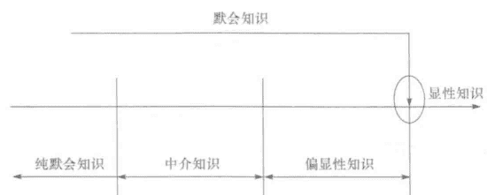

图 7.2.1 默会知识中的中介知识

同理,显性知识中的偏默会知识部分,完全显性知识部分,以及介于偏默会知识与完全显性知识之间的中介知识,也可以在数轴上表示,如图 7.2.2 所示。

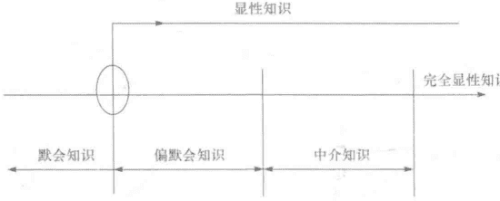

图 7.2.2 显性知识中的中介知识

同理,也可以把默会知识、显性知识与中介知识,一并在数轴上标注,如图 7.2.3 所示。

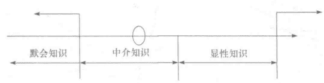

图 7.2.3 默会知识、显性知识、中介知识的数轴表示

### 7.2.5 启示

- 1. 对教育科学的启示

  (1) 明确了教师是生产中介知识的主体。长期以来,教师在教育工作中究竟扮演什么角色,一直有不同的意见。有人认为教师是一类生产者,产品是学生,但把学生看成产品显然不够准妥! 又有教育理论认为,学生是教育的主体,教师生产学生这个主体，这在逻辑上说不通。从教育的角度看，教师是传承显性知识的使者，本身并不创造显性知识。显性知识融进了教材，那么教师的任务究竟是什么？有了中介知识，就可以明确地说明教师是生产中介知识的专业知识分子。把融进教材中的显性知识，通过教师的中介知识，传递给学生。在这个教育过程中，学生所接受的知识不仅仅是教材中的显性知识，还同时有教师所创造的中介知识。

  （2）学生要通过中介知识才能学习和掌握显性知识。因为学生受教育的过程，不是一个空壳堪物的过程，而是有自己的潜意识、主观意识、想象意识，当然，这些意识一般呈现稀疏性，稀疏性最容易接受中介知识。通过中介知识，消化吸收显性知识并沉淀为自己的默会知识，或许这一过程就是默会知识理论中所说的默会过程。

- 2. 对人工智能的启示

  （1）明确了机器接受和应用的知识不仅有显性知识，还有中介知识，这个中介知识是人在赋予机器以显性知识时产生的，溶解在以系统形式体现的一系列程序中；至于机器是否因接受显性知识和中介知识的同时也接受并理解了人的默会知识，这是一个需进一步研究的问题；理论上说，一旦让机器完全接受人类的全部显性知识、全部中介知识和全部默会知识，人类的生存会受到来自机器的挑战；不过按知识的集对分析原理，不仅中介知识是具有不确定性的知识，默会知识更是以不确定性为主的知识，因此不必过分地担忧来自机器的威胁，但这方面的风险存在。

  （2）明确了网络的作用，网络以超级开放系统的形式接受各种各样的显性知识并提供给需要的用户，这一过程其实就是一个中介服务的过程，服务本身需要知识，显然，这是一类有特定意义的中介知识，这类中介知识在网络的知识接收、知识储存、知识服务过程中所起作用和社会效果的研究，尚待人们深入。

## 7.3 基于集对分析的知识创新规律

知识是什么，各种各样的知识以什么样的形态存在，知识创新有否规律可循，如何发现知识创新的规律，从而高效率地开展知识创新活动和把知识转化为生产力，对如此之类的每一个问题的回答都极有意义。徐兹琳[5]于 2002 年试用集对分析同异反系统理论研究上述问题，其主要工作如下。

### 7.3.1 知识是什么

为了回答“知识是什么”的问题。不妨把客观世界（objective world）作为集合 O，把主观世界（subjective world）作为集合 S，则“O-S”就是一个集对，记集对为 H，则：H={O,S}。所谓知识，是人们的主观世界对客观世界的一种正确认识。所谓正确，是指主观世界对客观世界的认识构架符合客观世界的实在。从集对分析同异反系统理论的角度看，就是主观世界集合 S 与客观世界集合 O 有着同一性。若记同一性为 same，把“同”简记为 s，此处的知识(knowledge)简记为 K，那么 Ks=Hs，其中 Hs 表示有关集对 H 中 2 个集合的同一性，Ks 表示有关集合 O、S 的同一性知识。由于人们对客观世界的认识受种种条件的限制，在许多情况下，人们主观世界中对客观世界的构架并不与客观世界的实在完全同一，而具有一定的差异性。这种情况下，只要差异不是太大，主观世界对客观世界的构架仍具有实用性，也就是说，仍具有相对的正确性。因此，这种与客观世界实在有着一定差异的主观世界的构架仍是有用的知识，换言之，这部分知识也应是知识 K 的一个组成部分，若记差异为 different，把差异简记为 d，那么此处的知识 K=Hd，其中 Hd 表示有关集对 H 中 2 个集合的差异性，Kd 表示有关集合 O、S 的差异性知识。

事实上，主客观世界是对立的统一。人们对客观世界的认识不仅具有差异性，而且具有对立性，这种对立性常常导致人们认识的失误，形成错误的认识。但人脑有从错误认识中产生正确认识的能力。所谓的“吃一堑，长一智”，所谓的“失败是成功之母”都是说人的主观世界有从错误认识中产生正确认识的能力。由此，又可以认为：主观世界集合 S 与客观世界集合 O 有着对立性，若记对立性为 contrary，简记为 c，那么此处的知识 Kc=Hc，其中 Hc 表示有关集对 H 中两个集合的对立性，Kc 表示有关集合 O、S 的对立性知识。显然应该认为，知识 Kc 对于我们来说，仍是有用的知识，换句话说，这部分知识也应是知识 K 的组成部分。

经过以上讨论，可以得到“知识是什么”这一问题的答案，那就是，知识是主观世界对客观世界同一性认识、差异性认识、对立性认识的总和，其公式为

K=Ks+Kd+Kc

式中，K 为知识；Ks 为同一性知识；Kd 为差异性知识；Kc 为对立性知识。

### 7.3.2 知识的形态

各种各样的知识以什么样的形态存在？

首先，可以回答，各种各样的知识是以各种各样形态存在的。人类所创造的各种物质形态，从本质上说，都是知识的形态。但按集对分析中的同异反系统理论，不妨回答，各种各样的知识是以系统的形态存在的。所有的知识本身构成一个同异反知识系统。作为一种特定内容的同异反系统，同异反知识系统可以按 7.3.1 节所示按层次展开。为方便起见，把同异反系统简记为 IDCKS(identical discrepancy contrary knowledge system)。


### 7.3.3 知识创新规律

以上述准备知识为基础,可以直接写出知识创新的三大规律。

- 规律一 知识按系统层次作同异反展开是知识创新第一规律。

注意,图 7.3.1 是可以作无穷层次展开的一张系统图,图中仅展出三个层次。在一般情况下,人们的知识总是暂停在某一层次上,稍作深入的研究,所遇到的知识会有别于已有层次上的情况。

图 7.3.1 所示的层次展开与一般层次展开的不同之处在于,层与层之间有交叉性联系。

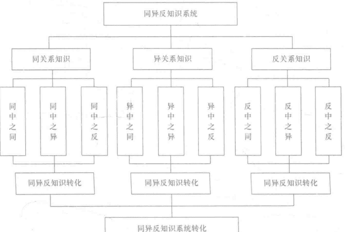

图 7.3.1 同异反知识系统展开示意

- 规律二 知识排列组合是知识创新第二规律。

该规律内容也极为丰富。

首先,累加排列是一种知识创新,它包括以下三种基本情况：

- (1) s,s,s—>s₁,s₁,s₁,s₁···
- (2) d,d,d—>d₁,d₁,d₁,d₁···
- (3) c,c,c—>c₁,c₁,c₁,c₁···

其次,组合与排列的混合也是一种知识创新。

sd,sc,sdc,sdd,sdc,sddcc,···
sc,sd,scd,scc,scd,scdd,...
sd,sd,sd,sdc,sdc,sddc,...

- 规律三 对已有知识的分析与综合是知识创新的第三规律。按该规律进行知识创新的思路如图 7.3.2 所示。

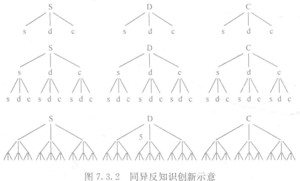

以上为基于知识分析创新示意图。知识综合创新时,可把上述分枝图倒过去用。容易看出,知识创新的第三规律其实是知识创新第一规律的细化。把它单独列出,原因是整个知识系统是一个庞大的、开放的复杂系统。就日常工作和科研实践看,人们更乐于按知识创新的第三规律开展知识创新。

要说明的是,按本书给出的知识由同一性知识 Ks、差异性知识 Kd、对立性知识 Kc 三部分组成之说,仍需明确它们之间的层次关系。按人们的认知习惯和到目前为止对知识概念的理解要求,通常把同一性知识处于知识的核心位置,差异性知识处于核心层外面,而对立性知识则在差异性知识的外层,是一个洋葱模型。知识创新就是一个由错误到准确、由表及里、由此及彼的过程。这从侧面说明了知识创新过程的风险性和艰巨性,从历史唯物主义的角度看,整个人类历史都可以看成是知识创新的过程。人类的社会实践是在经历了无数的失败、挫折、彷徨,甚至付出一代又一代的巨大牺牲之后,才正确地认识到了客观世界中极为有限的一部分知识。

## 7.4 知识的不确定描述与应用

在实际应用中,领域专家往往将领域知识以事实和规则的形式给出,并加以量化。为此,杜春彦等[6]基于集对分析给出了一种知识的不确定描述及其传播算法,并应用于不确定性推理，介绍如下。

### 7.4.1 知识的不确定描述

- 1) 事实描述的一般形式

\( A:\mu_A=a_A+b_Ai+c_Aj \)

式中，A 为某一个用谓词词表示的事实。\( a_A \) 表示 A 为真的必要支持程度，\( a_A=1 \) 表示 A 为绝对真；\( c_A \) 表示 A 为假的必要支持程度，\( c_A=1 \) 表示 A 绝对假；\( b_A \) 表示 A 为不知道的支持程度，\( b_A=1 \) 表示对 A 完全不了解；\( a_A+b_A \) 表示 A 为真的可能支持程度；\( b_A+c_A \) 表示 A 为假的可能支持程度。\( a_A>0.5 \) 表示认可 A；\( a_A \geqslant 0.5 \) 表示强认可 A。

如在方案评价中，\( a_A=0.5\) (5 人对 A 赞同)，\( c_A=0.3\) (3 人对 A 反对)，\( b_A=0.2\) (2 人对 A 不了解)，\( a_A+b_A=0.7\) (至多 7 人对 A 赞同)，\( b_A+c_A=0.5\) (至多 5 人对 A 反对)。

- 2) 规则描述的一般形式

\( R:A \to B \quad \mu_R=a_R+b_Ri+c_Rj \)

式中，A 为前提；B 为结论。\( a_R \) 表示 A 为真时对 B 为真的必要支持程度；\( c_R \) 表示 A 为假时对 B 的必要支持程度；\( b_R \) 表示对规则的不了解程度；\( a_R+b_R \) 表示 A 为真时对 B 的可能支持程度；\( c_R+b_R \) 表示 A 为假时，对 B 为真的可能支持程度。

从上面不确定知识表示可以看出：①一个不确定信息，其肯定与否定的不确定度量之和不一定等于 1；②bi 可用于表示不知道的信息，体现了证据理论的思想，又可以避免概率分布函数不易给出的困难；③对于概率信息可表示为 \( a+cj \)，对于模糊信息，可表示为 \( a+bi \)。

### 7.4.2 不确定值的传播算法

- 1) 前提证据的逻辑组合

设前提 A，B 的支持程度分别为 \( \mu_A=a_A+b_Ai+c_Aj\)，\( \mu_B=a_B+b_Bi+c_Bj\)，则

\( A \text{ and } B: \mu=a+bi+cj \)

式中，\( a=\min(a_A, a_B)\)，\( c=\max(c_A, c_B)\)，\( b=1-a-c \)。

\( A \text{ or } B: \mu=a+bi+cj \)

式中，\( a=\max(a_A, a_B)\)，\( c=\min(c_A, c_B)\)，\( b=1-a-c \)。

\( \overline{A}: \mu=a+bi+cj \)

式中，\( a=c_A\)，\( c=a_A\)，\( b=1-a-c \)。

- 2) 顺序传播算法

已知 \( R:A \to B; \mu_R=a_R+b_Ri+c_Rj\)，\( A: \mu_A=a_A+b_Ai+c_Aj\)，则

式中，$a=a_1a_2, b=a_1b_2+a_2b_1+b_1c_2+b_2c_1+b_2b_1, c=a_1c_2+a_2c_1+c_1c_2$。

上式也可以记为

\(\mu_B = \mu_A * \mu_R\)

我们把“*”称为 Bochvar 交算子，即该运算的结果与 Bochvar 三值逻辑的交运算一致。

- 3) 并行传播算法

已知：

\(A_1 \to B \mu_1 = a_1 + b_1 i + c_1 j\)
\(A_2 \to B \mu_2 = a + b_2 i + c_2 j\)
\((A_1 \cap A_2) \to B \mu = a + bi + cj\)

- (1) 当 \(a_1, a_2 \geqslant 0.5\) 时, 有
\(a = a_1 + a_2 - a_1a_2\)
\(b = b_1 + b_2 - a_1b_2 - a_2b_1 - b_1c_2 - b_2c_1 - b_2b_1\)
\(c = c_1 + c_2 - a_1c_2 - a_2c_1 - c_1c_2\)

- (2) 当 \(c_1, c_2 \geqslant 0.5\) 时, 有
\(a = a_1 + a_2 - a_1a_2 - a_1c_2 - a_2c_1\)
\(b = b_1 + b_2 - a_1b_2 - a_2b_1 - b_1c_2 - b_2c_1 - b_2b_1\)
\(c = c_1 + c_2 - c_1c_2\)

- (3) 当 \(a_1 \geqslant 0.5, c_2 \geqslant 0.5\) 时, 有
\(a = a_1 + a_2 - a_1a_2 - c_2a_1\)
\(b = b_1 + b_2 - b_2b_1 - c_1b_2 - b_1c_2 - a_2b_1 - b_2a_1\)
\(c = c_1 + c_2 - c_1c_2 - a_2c_1\)

### 7.4.3 算法性质

为讨论方便, 把 \(L=a+bi+cj\) 记为 \((a,b,c)\), 可以得到上述运算的性质。

- (1) 运算结果满足分布性, 即 \(a+b+c=1\)。

- (2) 前提逻辑组合满足约束:
\((a,b,c) \cap (1,0,0) = (a,b,c)\)
\((a,b,c) \cap (0,0,1) = (0,0,1)\)
\((a,b,c) \cup (1,0,0) = (1,0,0)\)
\((a,b,c) \cup (0,0,1) = (a,b,c)\)

(3) 顺序传播算法满足的约束如下。
记该运算为 &：
① (a,b,c) &(0,1,0)=(a,b,c)
该运算说明规则与前提无关时，即规则强度的参量取单位元(0,1,0)时，该规则无效。
② 由于顺序传播运算的对称性，有
(0,1,0) & (a,b,c)=(0,1,0)
即前提的不确定估计为单位元(0,1,0)时，该规则不起作用。

(4) 并行传播算法满足的约束如下。
记该运算为 #：
① (a,b,c) #(1,0,0)=(1,0,0)
该约束说明，如果一条证据能够证实一个假设，那么就不必考虑其他证据的支持作用了。
② (a,b,c) #(0,1,0)=(a,b,c)
该约束说明，如果从一条推理路径所得结论的不确定性估计为单位元(0,1,0)，那么这条推理路径无效。

### 7.4.4 应用示例

设在知识库中有如下事实和规则：
(1) bird(x)->fly(x)，L=(a,b,c)，a>c；
(2) bird(ostrich)，L=(1,0,0)；
由(1)、(2)利用顺序传播算法推得：
(3) fly(ostrich)，L=(a,b,c)，a>c；
当再加入：
(4) fly(ostrich)，L=(0,0,1)；
由(3)、(4)利用并行算法可得：
(5) fly(ostrich)，L=(0,0,1)。
即鸵鸟不会飞。

## 7.5 知识产权评估的集对分析

知识由主体产生，产生需要成本，为了保护主体产生知识的积极性，诸多国家和政府实行知识产权保护政策。为此，首先需要对知识产权作出评估，知识产权评估是一项系统工程，具有较强的政策性、技术性和时间性，涉及多学科、多行业，需要通过组织、协调、汇集、鉴别、初评、传递与反馈等多个环节，才能做好评估，充分发挥评估的作用。为此,张新华等[7-8]与周萍、阎理等分别把集对分析用于技术知识产权评估和武器装备知识产权评估,介绍如下。

### 7.5.1 技术知识产权评估

- 1) 评估模型

(1) 根据给出的 n 个目标集确定出一个理想子集 A0 ,并记该理想子集 A0 中第 k 个指标值为 f0pk 。

(2) 计算被评估子集中各指标值 fipk 与指标值 f0pk 的同一度,组成被评估指标与理想指标的指标联系矩阵 X,即

\[
X=\begin{Bmatrix} x_{11}, & x_{12}, & \cdots, & x_{1m} \\ x_{21}, & x_{22}, & \cdots, & x_{2m} \\ \vdots & \vdots & & \vdots \\ x_{n1}, & x_{n2}, & \cdots, & x_{nm} \end{Bmatrix}
\]

矩阵 X 中的各元素 xik (i=1,2,...,n, k=1,2,...,m) 称为为被评价指标 fipk 与理想子集 A0 中各对应指标 f0pk 的同一度。

无论理想子集 A0 与各指标值是大于还是小于被评价对象中各对应指标的值,xik 的计算一律是较小的指标值除以较大的指标值,即

- 当 fipk > f0pk 时,有 xik = f0pk / fipk ;

- 当 fipk < f0pk 时,有 xik = fipk / f0pk 。

(3) 结合指标的权重矩阵 W=[a1k, a2k, ..., a_nk] 计算各被评估子集 Ai 与理想子集 A0 的联系矩阵 R,即

\[
R=X * W^T
\]

R 中的元素 Ri (i=1,2,...,n) 即第 i 个被评估子集与理想子集 A0 的同一度。

\[
R_i = \sum_{k=1}^m a_{ik} w_k
\]

(4) 根据 R 中 n 个 Ri 值的大小次序确定出 n 个被评估对象的优劣次序:Ri 值大的为优。

- 2) 评估流程

图 7.5.1 为技术知识产权评估流程。

- 3) 应用举例

有 A1、A2、A3 三个技术知识产权需要评估,评估指标及其评估值列在表 7.5.1。

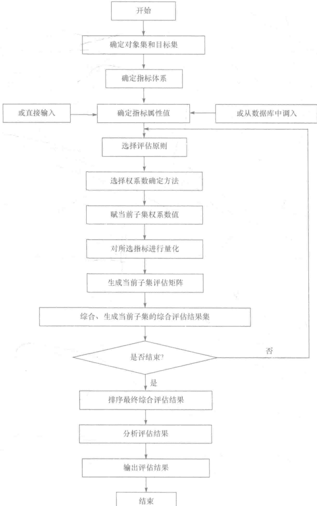

图 7.5.1 技术知识产权评估流程

| 指标 | 权重 | 单位 | A1 | A2 | A3 | A0(最优值) |
|---|---|---|---|---|---|---|
| 完成成本 | 0.3 | 万元 | 5 | 10 | 15 | 5(最小值) |
| 经济寿命周期 | 0.2 | 年 | 5 | 10 | 15 | 15(最大值) |
| 收益预测与计算 | 0.3 | 万元 | 30 | 40 | 60 | 60(最大值) |
| 风险损失 | 0.2 | % | 6 | 8 | 10 | 6(最小值) |

由表 7.5.1 得评价矩阵

\[
X = \begin{bmatrix} \frac{5}{5} & \frac{5}{15} & \frac{30}{60} & \frac{6}{6} \\ \frac{5}{10} & \frac{10}{15} & \frac{40}{60} & \frac{6}{8} \\ \frac{5}{15} & \frac{15}{15} & \frac{60}{60} & \frac{6}{10} \end{bmatrix}
\]

计入权重后得

\[
R = X * W^T = \begin{bmatrix} 0.717 \\ 0.513 \\ 0.72 \end{bmatrix}
\]

由此知,技术知识产权 \( A_3 \) 最优,其次为 \( A_1 \) ,最差是 \( A_2 \) 。

### 7.5.2 武器装备知识产权管理绩效评估

- 1) 评估指标体系

如图 7.5.2 所示为评估指标体系。

- 2) 评估方法

请 \( n \) 位专家就第三层次上的各指标实现状况作“满意”“一般”“不满意”表态，统计各指标上的“满意”“一般”“不满意”人数并除以 \( n \) 得到该指标实现的“满意度”并计为 \( a \)，“一般度”并计为 \( b \)，“不满意度”并计为 \( c \)，得到评价结果联系数：
\( \mu = a + bi + cj \)

计算该联系数的势值 \( \text{shi}\mu = a/c \)，根据势值大小作出判断，\( \text{shi}\mu > 1 \) 时为“满意势”，\( \text{shi}\mu < 1 \) 时为“不满意势”，\( \text{shi}\mu = 1 \) 时为“一般势”。

- 3) 评估举例

以某装备知识产权管理部门绩效考核为背景，由 10 名专家组成专家组，对该部门 2002 年、2003 年连续两年的装备知识产权管理绩效进行评审。就专利权、技术资料权和版权三个项目，按图 7.5.2 第三层 6 项指标分别给出评分，依照等级处理，计算得到两年的知识产权管理绩效评价各项目联系度数值，列在表 7.5.2。

| 项目 | 2002 年 a | 2002 年 b | 2002 年 c | 2003 年 a | 2003 年 b | 2003 年 c |
|---|---|---|---|---|---|---|
| 专利权 | 0.18337 | 0.66680 | 0.15003 | 0.51677 | 0.41675 | 0.08335 |
| 技术资料权 | 0.21671 | 0.56678 | 0.21671 | 0.46676 | 0.45009 | 0.10002 |
| 版权 | 0.26672 | 0.56678 | 0.16670 | 0.43342 | 0.51677 | 0.05001 |
| 知识产权管理情况 | 0.22224 | 0.60006 | 0.17780 | 0.47232 | 0.46120 | 0.07779 |

算得 \(\text{shi}\mu_{2002}=1.25>1,b>a>c\), \(\text{shi}\mu_{2003}=6.07>1,a>b>c\),说明该装备知识产权管理部门 2003 年绩效明显好于 2002 年。

## 7.6 基于集对分析和知识关联的检索结果聚类

阮光册[9]博士基于知识关联思想,把集对分析用于检索结果聚类研究,介绍如下。

### 7.6.1 基本思路

随着检索技术的迅猛发展，用户通过信息检索所获得的检索结果数量越来越大，甚至是海量信息，检索结果的信息处理因而成为情报学的研究热点之一。文本的聚类研究可以有效降低检索结果的数量，提高检索的质量，方便用户通过检索获取信息。文本聚类的基本思路是将相似的文本组成一类，通过计算距离函数等方法，将相似性大的文本组成一个集合，实现聚类效果。然而，这种聚类并未有效处理数据集合中潜在的知识关联问题。特别是，一般意义上说，信息检索属于文本分类的操作，文本聚类则是解决信息检索问题的一种手段，而如何确定文本的相似性是文本聚类的难点；对此，情报学领域对检索结果聚类进行了很多的研究，如利用主题的相似性进行文件结果的聚类，如采用降维的方式实现高维文本的聚类，也有运用 K-Means 算法结合关联推荐技术以实现数字图书馆电子资源检索结果的聚类等。阮光册认为，检索结果聚类一般是对检索结果的特征进行提取，并依据相似性算法获取聚类的依据，但这种方式除了相似性算法选择不同而造成聚类结果不同外，无论是引文耦合计算，还是基于主题的概率内容相似性算法均无法明确计算内容相似的程度值，也无法满足用户以知识关联性为原则对检索结果进行聚类的要求。为此将集对分析与文本向量分析模型相结合，以实现检索结果基于知识关联的聚类，为用户提供有价值的检索信息。

### 7.6.2 基于集对分析的文本聚类

- 1) 基于文本的向量空间模型

将文本空间看成是由一组词条向量所组成的向量空间，每个文本表示为其中一个范化特征向量，根据文本向量空间，将文本定义为

\[
V(d) = (t_1, W_1(d); t_2, W_2(d); \cdots; t_i, W_i(d); \cdots; t_n, W_n(d)), \quad i=1,2,\cdots,n
\]

式中，$t_i$ 为词条项；$W_i(d)$ 为该词条在 $d$ 文本中的权重。在文本向量空间模型中，最常用的词条权重确认方法是 TF-IDF（term frequency inverse document frequency），该方法对权重的确定由函数 $tf_i(d)$ 决定，该函数反映了 $t_i$ 在文本 $d$ 中出现的频率。TF-IDF 的计算公式如下所示：

\[
W(d) = tf_i(d) \cdot \log_2 \left( \frac{N}{n_i} \right)
\]

式中，$N$ 为文本的总数；$n_i$ 为含有词条 $t_i$ 的文本的数目。基于式（7.6.2），得到某个词语在某篇文献分布量化的计算公式为

\[
W_{*k} = tf_{*k} \cdot \log_2 \left( \frac{N}{n_k} + 0.01 \right)
\]

式中，$tf_{*k}$ 为词语 $T_k$ 在文档 $D_i$ 中出现的频率，$W_{*k}$ 为 $T_k$ 在文档 $D_i$ 中的权重，$k=1, 2, \cdots, m$ ($m$ 为词的个数)。


#### 2) 基于信息量的向量空间描述

式(7.6.3)虽然描述了词语在文献中的权重，然而这种权重的计算仍然只是依赖词频，而缺少词语信息量的考虑。因此，需要在增加能够描述词语 $T_k$ 信息量的 $IG_k$ 这样，式(7.6.3)改为

$$W_k = tf_k \cdot \log_2 \left( \frac{N}{n_k} + 0.01 \right) \cdot IG_k$$

其中

$$IG_k = H(D) - H(D|T_k)$$

式中，$H(D)$ 为文献 $D$ 的信息熵；$H(D|T_k)$ 为 $T_k$ 在文献 $D$ 中的条件，也就是条件熵。$T_k$ 信息量 $IG_k$ 的公式如式(7.6.6)所示：

$$IG_k = -\sum_{d_i \in D} (p(d_i) \cdot \log_2 p(d_i)) - \sum_{d_i \in D} (p(d_i|T_k) \cdot \log_2(d_i|T_k))$$

对于 $T_k$ 在文献 $D$ 中出现的频率 $p(d_i)$，用如下公式描述：

$$p = \frac{T_k(D_i)}{\sum_{D_i} wordfreq(D_i)}$$

式(7.6.7)表明了 $T_k$ 在文献的频率与文献 $D_i$ 中所有词汇频率的和的比。

#### 3) 基于集对的文本相似度计算

容易看出，向量空间中每一个向量都描述了 $t_i$ 区分文本特性的能力，即某一向量在文本特定区域内出现的频率越高，则其文本的区分能力越强。

设有 $N$ 篇文本组成一个集合 $\{d_1, d_2, \cdots, d_N\}$，则第 $m$ 篇文本的第 $k$ 个词条的权重为 $W_m, i \in (1, 2, \cdots, N)$，可以根据词条分布相似度对文本集合中 $d_i$ 和 $d_j$ 的相似性进行集对分析，其相似性可以定义为

$$sim(d_i, d_j) = p * q * l$$

式中，$p=c-a, q=b-a, l=c-b$，则 $sim(d_i, d_j)$ 反映了集合中文本 $d_i$ 和 $d_j$ 的对立程度、差异程度，其值越大，则表明其相似度越高，反之，其值越小，则差异性越大。根据式(7.6.4)，对于同一性的集合，式(7.6.8)又可简化为 $sim(d_i, d_j) = q$，同一性集合相似度将取决于 $b$ 和 $a$ 的差值。

由此可见，基于集对的文本相似度计算方法可以定量地计算两个集合相似度的值，这在一定程度上可以解决两篇文本之间相似程度的问题。对于检索结果而言，利用集对分析相似度的计算，将能够有效地解决内容相似的模糊性，根据 $b-a$ 的值，可以定量地分析相似的程度，这为有价值的结果聚类提供了依据。

### 7.6.3 实验与分析

#### 1) 实验描述

一般来说，对文本信息进行向量空间算法产生的维度会比较高，考虑到计算效果,本书对检索结果进行聚类时仅选择文本的标题、关键字、文摘、正文第一部分的内容进行向量空间分析,该方法可以有效降低文本维度,减少干扰,同时结合集对分析同异反系统对文本集合中文本相似度进行定量描述,提高了文本分类的能力,实现有意义的结果聚类。实验实施的基本流程如图 7.6.1 所示。

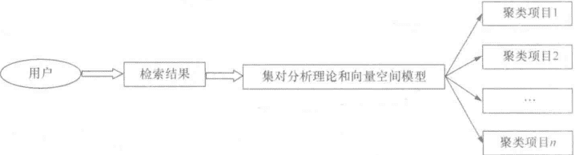

实验步骤如下。

- 步骤 1 通过前面的分析,将信息检索所获得的 N 篇文本数据组成一个集合,即{D1, D2, ..., DN},通过式(7.6.8)计算文献 Di 中 Tk(k=1,2,...,m)的权重 W*,以此计算出文献 Di 所有特征词的权重,作为文献 Di 的描述向量。

- 步骤 2 根据集对分析,通过计算文献 Di 和 Dj 同异反值,以确定 Di 和 Dj 的相似度。具体做法为将 Wk 相似的 Tk 作为参数 a(这里将 Wk 相差为 0.045 范围内的视为相似),其他的 Tk 作为 b,运用式(7.6.8)计算文献 Di 和 Dj 的相似度,得出文献的相似度(本书采用 0.76 作为相似判断阈值)。依据此法,不断地计算 Di 与 Di+1, Di+2 文献的相似度。

- 步骤 3 将与文献 Di 相似度较高的文献作为聚类结果 1 保存,然后对剩下的文献重复进行步骤 2 的操作。

- 步骤 4 将上面步骤获得的多个聚类结果中的 a 值进行归并处理,获得每一个聚类结果相似度最高的特征向量。

#### 2) 实验结果分析

首先,在中国知网中输入“危机管理”进行检索,并将前 100 条记录的全文取出,依据上面所论述的方法进行聚类。算法的步骤为:①将论文以题名、关键词、文摘、正文第一部分四个字段导入设计好的数据库中;②应用 TF-IDF 方法经过分词处理和特征提取得到文献的文本向量,并计算特征词的权重;③依据集对分析对向量维度进行同异反计算,得到若干组聚类结果;④通过归并聚类结果中的 a 值得到聚类相似的依据。

通过计算,共获得 7 个高频的 a 值,分别为政府、企业、高校、图书馆、灾害、社会危机、国际政治。图 7.6.2 显示了“危机管理”检索词的检索结果与这些高频词的知识关联。

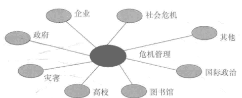

图 7.6.2 检索结果知识关联图

其次，使用人工对聚类正确率进行统计，结果如表 7.6.1 所示。

#### 表 7.6.1 检索结果聚类结果

| 聚类依据 | 应用集对分析的聚类结果 | 人工统计结果 | 正确率/% |
|---|---|---|---|
| 危机管理+高校 | 11 | 12 | 91.7 |
| 危机管理+灾害 | 4 | 4 | 100 |
| 危机管理+企业 | 19 | 21 | 90.4 |
| 危机管理+政府 | 23 | 25 | 92 |
| 危机管理+社会危机 | 4 | 5 | 80 |
| 危机管理+国际政治 | 4 | 4 | 100 |
| 危机管理+图书馆 | 5 | 7 | 85.7 |
| 平均正确率/% | 91.4 | 100 | |

表 7.6.1 表明,阮光册提出的方法可以实现基于知识关联的检索结果聚类,与人工统计相比较,其平均正确率为 91.4%。考虑到实验对文本特征向量词进行处理时并未引入语义分析,因此在一些特征向量词进行集对同异反处理时存在一定误差,如社会危机、恐怖主义等词汇,如果在分析过程中有较为完善的领域本体库或结合语义分析方法的运用,结果会更理想。

总之,检索结果的聚类是信息处理领域的热点问题,将检索结果按知识关联进行聚类,能够提高用户信息检索的准确性。把集对分析、向量空间模型、信息量计算等结合起来对信息检索结果进行聚类研究,是一种新的聚类方法。根据集对分析关于“差异性”可以作多层次深入展开的思想,上面介绍的方法还可以根据用户要求作出更细致的聚类分析。

## 7.7 本章小结

知识是智能的核心,也是人脑思维的产物。在相当长的一个时期内,人工智能学界从计算机处理知识的角度认识知识和研究知识,形成知识工程的概念,本章虽然从不同侧面介绍集对分析在知识发现、知识形成、知识提取、知识应用和知识评价等不同层面上的应用，例如，在参考文献中还列举陈丽君把集对分析用于电力客户知识管理体系的构建及能力评估[10]，王志芳把集对分析用于摩擦学系统状态辨识的知识获取方法研究[11]，王丽娟等[12]把集对分析用于基于限制容差关系系扩展粗集模型中的知识依赖研究等，但总体来说，都属于知识工程的范畴，还没有进化到知识生态学这个层面上充分地应用集对分析，本章虽名知识生态学集对分析，也未能有更多的介绍，期望有兴趣的学者作进一步的探讨和研究。

## 参考文献

- [1] 赵克勤. 集对分析及其初步应用[M]. 杭州:浙江科学技术出版社,2000:44-64.
- [2] 余国祥. 默会知识和显性知识的同异反集对分析[J]. 寒蝉学院学报,2008,29(5):84-88.
- [3] 邵振华. 波兰尼的默会知识[J]. 自然辩证法研究,2001,17(8):5-10.
- [4] 赵克勤. 集对分析的同异反系统理论在人工智能中的应用[J]. 智能系统学报,2007,2(5):20-35.
- [5] 徐忆琳. 用 SPA 的同异反系统理论研究知识创新规律[J]. 科学研究,2002,20(3):327-329.
- [6] 杜春彦, 柴春红. 基于 SPA 的不确定推理模型[J]. 数学的实践与认识,2004, 34 (9): 130-134.
- [7] 张新华. 技术知识产权评估模型及应用[J]. 科研管理,1999,20(6):47-51.
- [8] 周萍,阎理. 集对分析与武器装备知识产权管理绩效评估[J]. 军事经济研究,2005, (6): 51-52.
- [9] 阮光胁. 基于知识关联的检索结果聚类分析研究[J]. 情报科学,2015,33(2):63-66.
- [10] 陈丽君. 电力客户知识管理体系的构建及能力评估[D]. 太原:太原理工大学硕士学位论文,2013:77-86.
- [11] 王志芳. 摩擦学系统状态辨识的知识获取方法研究[D]. 武汉:武汉理工大学博士学位论文,2008:45-55.
- [12] 王丽娟,吴陈,严熙. 基于限制容差关系和集对分析方法的扩展粗集模型中的知识依赖[J]. 江苏科技大学学报(自然科学版),2007,21(2):49-53.

# 第 8 章 集对分析在自然语言和人类语言理解中的应用

客观世界中的事物处于普遍联系之中，语言是事物联系和交流的工具。基于这样的认识，自然语言应当理解为是自然界的语言，包括无机物的语言和有机物语言，生物及其种群之间的语言是典型的一种有机物的语言，人类的语言则是有机物语言的一个子类。从发展的角度看，人类语言是在漫长进化过程中相互之间进行信息与情感交流的产物，也是人类得以社会化生存和繁衍发展的必要条件之一；由于生存环境的地域性和多样化，人类语言也呈现出地域性和多样性，伴随产生人类语言的复杂性；但不同人类语言的可通约性与可理解性，同一人类语言在不同语境下的不同语意性，也可抽象地归化成自然语言的同(同义)异(异义)反(反义)及其不确定性，因而可以把集对分析用于自然语言和人类语言理解的研究。人类语言包括口语、肢体语(哑语)和文字语言，但本质上是自然语言的一个子集。本章中的自然语言指称与一般人工智能文献中的自然语言指称有所不同，后者一般性地把人类语言称为自然语言。本章重点介绍集对分析用于文字语言理解的最新研究。对于已有文献从不同角度把集对分析用于人类语言理解的研究，如决策用语言变量的联系数转换，科技知识交流传播过程中的语言研究，词语附衔同义词、近义词、反义词及其思想丰度的联系数刻画等，则仅作简介，有兴趣读者可进一步查阅相关文献。

## 8.1 基本原理

### 8.1.1 自然语言和人类语言

顾名思义，自然语言是自然的语言，这也是基于本书在第 3 章中提出的自然界本身具有智能的观点。自然语言首先应当从普适意义上理解为是自然界自己的语言，是自然界中物质和物质、物质与能量、能量与能量进行相互联系的一种工具和方式，这将有助于我们对自然语言的深入研究和向自然智能不断学习。基于这样的认识，自然界中的雷鸣电闪、风雨霜雪、阳光普照、潮涌潮落、月移星走等，都是一物给他物在诉说着的语言，懂得这些语言的物体于是有了热胀冷缩，以更好地保存自己；凝聚汇合，以便积蓄能量与另一类物质或物体抗衡；诞生消亡，以周期性地出现在自然界中；等等。我们把这类语言称为自然界中存在于无机物之间的无机语言；而对于存在于生物种群之间的花香鸟语、莺歌燕舞、人欢马叫、文本书信这类语言称为有机物之间的有机语言，无机语言和有机语言是构成自然语言的两个大类，若把它们各作成一个集合，则所谓的语言就是一个集对。

由于人是自然的产物，人类语言是自然语言中有机语言的一个子集。

人类语言包括文字性语言、口语和肢体语言，文字性语言又分为形式化语言和非形式化语言，形式化语言如数学语言、计算机语言；非形式化语言如各民族文字性语言；口语分为有声口语与无声口语(呕语)，音乐也可以看成是一种有声口语，呕语可以部分地看成是一种肢体语言，但肢体语言并不限于呕语，非形式化语言还有旗语、图语、舞蹈等。

从现状看，人类语言有三大作用：一是满足人与人之间信息与情感的交流，以维系和发展人类社会；二是把人类的语言赋给机器，让机器能明白人的意思和理解人的感情，代替人做某些工作；三是设法与地外星人展开交流，虽然目前还没有找到地外星人在哪里？是以何种生命形态而存在，更不知道他们用的是何种语言，但科学界对于地外生命的存在已确信无疑，找到地外星人仅仅是时间问题，而一旦找到，第一件事就需要和地外星人有信息交流，这种交流需要的语言显然应当是地球人和地外星人都能理解的自然语言，从这个意义上也可看出，不能把当今地球上的人类语言指称为是自然语言。

至此可以给出自然语言和人类语言的层次结构图，如图 8.1.1 所示。

为方便计，以下在不需要特别指明是自然语言还是人类语言的场合，把自然语言和人类语言统一地简称为语言，在需要专指某类语言时，则加以专指说明。

### 8.1.2 语言和人类语言理解的集对分析原理

#### 原理 1 语言和语意成对存在原理。

根据本书第 3 章所述可知，站在人的角度看，人的智能来源于人的实践和进化；站在自然的角度看，自然本身具有智能，人的智能是自然智能的一种不完全映射，也就是到目前为止，人的智能只是自然智能的极小一部分，人们至今还没有搞清生命的起源、宇宙的演化，时空的本质和物质在时空中的存在状况与发展趋势。而语言是智能的一种体现，换言之，自然语言在先，人的语言在后；站在人的角度看，人们一直信奉人的语言来源于人的社会实践和人在漫长历史中的进化，这是客观存在的历史现象，但毕竟是现象而不是本质，本质是人的语言来自自然语言在人脑的映射。简单地说：大自然创造了人，也创造了人的智能和人的语言，使人能够依靠自己的智能理解自然的智能，就好像孩子长大到一定阶段能部分地理解母亲一样，能读懂一部分自然语言，进而理解部分自然和利用已知的那部分自然改变和不断发展人类的生存环境和生存条件。但我们毕竟是人，而且是在与自然对话的智能人，需要我们在绝大多数情况下从人的角度出发去研究语言，包括研究自然的语言和人的语言，并且在这种研究中应用集对分析理论[1]，首先是应用集对分析中

```
语言(自然语言)
├─ 无机物的语言
│  ├─ 光
│  ├─ 电
│  ├─ 声
│  ├─ 磁
│  └─ 其他
└─ 有机物的语言
   └─ 人类的语言
      ├─ 非形式化语言
      │  ├─ 口语
      │  ├─ 肢体语言
      │  ├─ 哑语
      │  ├─ 图语
      │  └─ 旗语
      └─ 形式化语言
         ├─ 数学语言
         ├─ 文字语言
         ├─ 计算机语言
         └─ 与地外生命联络语言
```

#### 图 8.1.1 自然语言体系及其中的人类语言

的成对原理,把自然语言与人类语言看成是成对存在的两类语言,进而把对同一语言的理解也作成对的理解,换言之,就是对同一种语言,起码是从两个角度,或两个层次、两种意义上来理解,再把成对的这两种理解合并来做总的理解,或者把成对的两种理解再分解作再分析。这既是集对分析的成对原理在语言理解中的理论应用,也是语言在实际使用过程中由语言产生者与语言接收者在理解上的差异这种客观现实所决定的。

语言和语意成对存在原理是语言的基本原理,也称为语言集对分析第一原理；后面还会对这一原理的意义和具体表现作进一步的说明。

#### 原理 2 语言和语言理解的同异反原理。

首先，自然语言和人类语言无论是在语言产生、语言形式、语法规则、语用信息、语意理解、语言价值实现等方面存在同(同一性)、异(差异性)反(对立性)；其次，同一类语言的不同种语言也在语言产生、语言形式、语法规则、语用信息、语意理解、语言价值实现等方面存在同(同一性)、异(差异性)反(对立性)；再次，同一种语言的不同语言形式也在语言产生、语法规则、语用信息、语意理解、语言价值实现等方面存在同(同一性)、异(差异性)反(对立性)。

前面在阐述语言的成对原理时已指出语言产生者与语言接收者存在理解上的差异，而根据语言理解的同异反原理可知，对同一语言，语言产生者与语言接收者会有相同的理解，也会有不同的理解，也会同时存在相反的理解，正是语言理解上的同异反决定了人们在日常生活和工作中总是需要学习语言，以达到正确理解语言产生者蕴含在语言中的意图和目的。

语言产生者与语言理解者在理解上的同异反来源于语言在生成意愿、生成环境、表达形式、遵循规则、传送方式和传送过程、语用信息提取和语用价值实现等方面的同异反。从效用的角度看，这种同异反在本质上是由语言产生者与语言理解者处在不同时空(不同时空的不同环境)、不同文化观念和文化规范、不同理解机制和理解过程、不同价值观和不同实用价值所造成的。

有一种重要的同异反语言理解现象需要在这里指出，这就是同一个语言理解者对于表达形式和表达内容是完全相反的语言能够作出相同的理解，例如，在某一体育赛场中出现了“中国队大胜韩国队”的标语，把这一句子理解成是中国队打胜了球的同时韩国队输了球，显然符合该语句提出者要表达中国队打胜了球的同时韩国队输了球的意思；但“中国队大败韩国队”，同样可以理解成中国队打胜了球的同时韩国队输了球；这个例子表明，意义相反的字“胜”与“败”，在与其他字与词汇形成同样语句结构的条件下有相同意义的理解；反过来，同样的一句话也可以作完全相反意义的理解，如“这是你做的好事”，一般情况下，把其中的好事理解成好事是对的，但有时也可以理解成打上引号的“好事”。这两个例子说明人脑对语言的理解存在双重机制，在这种双重机制作用下，相反的词或句不仅能够表达同一个意思，而且理解者也能作同一个意思的理解，当然，这种理解与理解者对语意所处的环境感知和判断有关，说明人类语言的理解机制不仅遵循前述的成对原理，而且能针对复杂环境创造性地应用成对原理。

语言和语言理解的同异反原理是前述语言基本原理的一个派生原理，也称语言集对分析第二原理。

#### 原理 3 语言理解的不确定性原理。

这是一个基于前述两个原理的再次派生原理，也称语言集对分析第三原理，但突出了语言理解的不确定性。无论是人对人类语言的理解，还是人对自然语言的理解，人们总是在设法减少语言理解过程和理解结果的不确定性，但语言理解中的不确定性总是存在，前面提到的两个关于语言理解的同异反现象就给人以语言理解过程和理解结果具有不确定性的印象；事实上，即使是在完全形式化的形式语言如数学语言中，也不能完全避免不确定性，如数学集合论中的罗素悖论、说谎者悖论等；语言理解中存在的不确定性，说明语言理解也受确定性与不确定性对立统一规律支配，因而是不能完全消除的；从积极的角度看，人们在人类语言理解中的不确定性也是人类语言能够表达人们丰富的精神世界和复杂感情的原因所在。

语言和语言理解的上述三个原理表明，无论是语言的产生与语言的存在，还是对语言的理解，都具有极大的复杂性；如果把人们对于某些自然现象的预报看成是人们对于某些自然语言理解的一种预期，而这些预期至今还具有极大的不确定性（如地震预报），就足以让我们承认这种复杂性。

但本章后面的内容仍局限在关于人类语言理解的集对分析介绍。

## 8.2 人工智能对人类语言理解研究的集对分析

对语言的研究早已成为语言学这门学科，但人工智能把语言学研究推向一个新的水平，因为只有让计算机充分理解人的话语，才能让计算机具有人的智能。但人工智能一直都把人类语言指称为自然语言，所形成的关于自然语言理解的研究因此有一定的局限性，为此，本书对人工智能中关于人类语言理解的研究思路、研究方法、研究的技术线路等试作集对分析。

### 8.2.1 人类语言理解和处理概念的集对分析

由 8.1.2 节可知，人类语言理解主要用于三种场合：一是人与人之间的社会交往，包括直接交往与间接交往；二是让计算机理解人的话语；三是地球人与地外生命的信息交流。本节内容只涉及前两种场合。

首先，把人类语言理解和人类语言处理看成是两个不同的集合，根据集对理论可知，这两个集合可以组成一个集对，这个集对中两个集合的联系具有同异反联系特征，同点是人类语言在处理前需要理解，而理解本身也可以看成是一种处理，简言之，就是“理解=处理”。不同点有：在时间上，理解在先，处理在后；在空间上，理解一般在意识时空中进行，而处理在实时空中进行。以文字语言为例，在实时空中的操作有字与词的分类操作、字与词性标注、字与词义界定、字与词义标注、字与词的搭配关系确定与标注、语句结构分析和标注、语法分析、语义分析和语义判定、段落分析、上下文分析、章节分析、篇目分析、语意和篇意分析等。虽然在这些具体的操作中也或多或少地有理解在内，但以操作为主是十分明确的。 特别的，语言理解


所在的意识时空和语言处理所在的实时空，是有一定对立意义的两个时空，实际语言理解和处理在这种双时空中进行的现象符合语言与语言理解的成对原理。

上述关于人类语言理解和处理概念的集对分析表明：人类语言理解贯穿人类语言处理全过程，对于理解的研究优先于处理的研究，强调而言，没有对人类语言的理解就无法对人类语言处理。人类语言理解和人类语言处理在意识时空和实时空中既有分别又可以同时进行表明：人类语言理解和人类语言处理在一定意义上依赖于对这两个时空的认知与研究，但遗憾的是，人们对于这两个时空的知识有不少停留在假设的基础上。

### 8.2.2 人类语言研究方法的集对分析

在人工智能中，研究人类语言以及人类语言理解的方法，大致分为规则的方法和统计的方法两类，根据集对分析，这两类方法可以看成是一个集对，根据集对理论和语言及语言的基本原理，这两种研究方法具有同异反特征，见表 8.2.1。这两类方法的互补应用有助于人类语言理解和处理的广度加宽和深度加深，但不能从根本上消除人类语言理解和处理过程中的不确定性。

| 序号 | 论题 | 规则方法 | 统计方法 | 同异反 |
|:---|:---|:---|:---|:---|
| 1 | 基本信念 | 语言与语言理解有规律可遵循 | 语言与语言理解有规律可遵循 | 同 |
| 2 | 规则获取 | 主要从语言学研究中获取 | 利用统计方法从样本中获取 | 异 |
| 3 | 应用范围 | 范围无限 | 仅能应用统计样本所在的有限总体 | 异 |
| 4 | 方法的兼容性 | 由于规则也可以从统计中来，所以兼容统计的方法 | 样本处理中不排斥已有规则的应用，所以对规则方法有兼容性 | 同 |
| 5 | 不确定性 | 规则是确定的，规则的应用也是确定的，但存在不能有效地应用规则的情况 | 把由样本中获得的规则推广到总体，总是存在一定的风险 | 异 |
| 6 | 互补性 | 需要用到其他方法，与其他方法有相互补性 | 需要用到其他方法，与其他方法有相互补性 | 同 |
| 7 | 时空延伸性 | 现有规则方法有进一步的延伸时空 | 现有统计方法有进一步的延伸时空 | 同 |

对于表 8.2.1 中的第 7 个论题，我们认为所能延伸的时空应当是一个具有不确定性的时空，这对于以确定为特征的规则方法不言而喻；对于统计方法需要作一个说明，这是由于现有统计方法以经典概率论为基础，在统计处理思想和处理方法上仍然是经典数学；而按第 2 章中介绍的集对分析理论，经典概率需要联系数化，联系数化后的概率与经典概率的区别就在于前者中既含有经典概率，又含有与经典概率相互补的补概率，特别是这个补概率还有一个代表不确定性的 i，从而使得不确定性直接呈现在联系概率中，由此可知，现有统计方法的进一步延伸时空也是一个不确定性时空。

归纳之，现有人工智能中关于语言理解研究的规则方法与统计方法都需要在承认语言和语言理解不确定性原理的基础上，作进一步的延伸与发展。

除上面所述的规则方法与统计方法外，早期的人工智能研究也把人类语言研究的基本方法分为“理性主义”和“经验主义”两种；理性主义的基本理念是：人的很大一部分语言知识是天生的，由遗传决定，在技术上侧重规则的应用，因此可以归纳到规则方法这一类，但是，若对遗传作无穷追溯，最后会遇到最早的语言来自何方的问题，按前面的论述，我们可以给出最早的语言来自自然的回答，哪怕是进化，也可以看做是自然的作用。

经验主义的主要理念是假定人脑是具有一些微弱认知能力开始的，通过各种经验的不断积累来认知语言和理解语言，技术上自觉或不自觉地侧重于统计的应用，所以可以归纳为统计方法这一类；显然，把“理性主义”和“经验主义”作为一个集对是个好思路，可仔细地研究这个集对中两个集合的同异反，但本质上可以归纳为表 8.2.1。

### 8.2.3 基于信息的人类语言理解研究集对分析

把语言看成是一种特定符号(形式语言、文本语言)或物理现象(口语、肢体语言)所表示的信息，进而从信息论的角度展开人类语言理解研究，是经典人工智能中研究人类语言理解的一条重要途径[2-4]。但我们在第 3 章中已经指出：信息是物质与能量相互作用的产物，当把语言看成是一种信息时，就产生如何从物质与能量相互作用的角度理解人类语言的问题？

如何从物质与能量相互作用的角度理解人类语言？

要详细地回答这个问题并不容易，这里从语言信息发送—传输—接收的角度讨论这个问题。

首先，语言信息的发送需要物质和能量的相互作用，这一点无可置疑；然后，语言信息的传输需要物质和能量的相互作用，对此也无可置疑；最后，语言信息接收者在接收语言信息后会获得一定量的信息，由于信息是物质与能量的相互作用结果，所以语言信息接收者会对接收到的信息作物质与能量两个方面的分解，如图 8.2.1 所示。

显然，无论参与语言信息合成时的能量是正能量还是负能量或临界能量，对于信息接收者而言，他对于接收到的信息作物质和能量的分解后，其分解后得到能量可以是“正能量”，也可以是“负能量”或“非正非负的临界能量”。

上述模型与我们的常识相符，我们历来强调作为文字载体的图书、杂志、报纸等无声语言与广播、电视、影像、音乐、电影、舞蹈等有声语言要传递“正能量”，就是

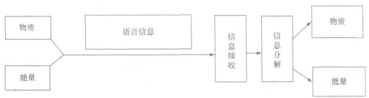

图 8.2.1 源信息与信息接收后的分解模型

考虑到对语言信息接收者所产生的作用是否会因此更多地获得“正能量”，因为语言信息在传递过程中，其中内在的能量（信息能）会因传递环境、传递环节、传递路程、噪声干扰等因素衰减，从而减弱接收信息中的“正能量”强度。

从信息是物质与能量相互作用角度研究语言和语言理解，特别是研究人类语言和人类语言理解，是作者在本书中提出的一个新课题，尚有许多工作要做，以上仅作抛砖引玉。

## 8.3 语言及语言理解集对分析原理的应用

已有的语言学知识和有关人类语言理解系统已为人类的日常工作和生活带来极大方便，包括不同语言的相互转换、文本理解、信息搜索与传递服务、机器推理与数据处理等，相应的语言自动转换机、文本处理系统、语言和语音识别系统已俯拾皆是。但根据 8.1 节所阐述的语言与语言理解三原理和实际情况可知，现实中依然存在不少语法规范、语句结构正确、用字恰当，但可以作双重意义或同异反多重意义理解的语言，这方面的例子虽然已在 8.1 节中举例，但还有更为常见和典型的例子，对这些实例的分析有助于加深 8.1 节中给出的人类语言及其理解三原理的认识，也有利于对现有语言智能处理系统的创新。

### 8.3.1 在中文语言理解中的应用

例 8.3.1 如下对话，引自科学网黄秀清博客 http://blog.sciencenet.cn/blog-480705-927985.html。

记者：曾咏春先生，欣闻您荣获世界科学大奖，我谨代表中国记者协会，向您表示衷心的祝贺！（1）

曾咏春：谢谢记者先生。（2）

记者：墙上挂的是您的全家福？（3）

曾咏春：是，眨眼三十年过去了。（4）

记者：曾先生，那位老先生是？（5）

曾咏春：我老头。（6）

记者：戴眼镜的帅哥呢？（7）

曾咏春：是我先生。（8）

记者：先生连先生的眼光绝对是一流！（9）

曾咏春：先生过奖了。（10）

记者：听说先生与共和国同岁？（11）

曾咏春：是。（12）

记者：我们是同龄人。（13）

曾咏春：这么巧？（14）

记者：您的出生时辰？（15）

曾咏春：辰时，您呢？（16）

记者：卯时，我先生！（17）

曾咏春：对，您是先生！（18）

请问：以上“先生”分别是什么意思？

分析如下：首先，以上对话中的各语句都是合法（符合语法）合情（合乎情理）且可以准确理解（对话双方都能准确理解，）的语句；其次，以上对话也能让第三方（局外人）确切理解和展开讨论；再次，为了讨论方便，我们给对话中的每个句子注了一个序号。

显然，第 1 句中的“先生”指曾咏春，用来形容曾咏春，因此是个形容词；第 2 句中的“先生”指记者，用来形容记者，因此也是个形容词；第 5 句中的“先生”仍指曾咏春，仍是个形容词；但“老先生”中的“先生”应当理解为一个名词，第 8 句中的“先生”也是一个名词，指的是曾咏春的丈夫；第 9 句中的第一个“先生”指的是曾咏春，后一个“先生”指的是曾咏春的丈夫，都是名词；第 10 句中的“先生”指记者，是名词；第 11 句中的“先生”指曾咏春，名词；但第 17 句中的“先生”则是一个词组，其中的“生”是动词，“先”是副词，用来修饰作为动词的“生”，意为“先出生”，第 18 句中的“先生”，主要意思是“长辈、老师”的意思，但也附带着“先出生”的意思。

由此可见，对话中的“先生”，有时作名词使用，有时作形容词使用，有时还可以作为动词词组使用，词义具有同（指同一人）异（指不同的人）反（对立性，谁先出生？）特性和不确定性（可以是一个词，也可以是一个词组；可以作名词，也可以作形容词）。

#### 例 8.3.2 bridgeneer 在看到例 8.3.1 中的对话后，在评论栏中写了更有意义的一段对话式评论如下。

阿呆给领导送红包时，两个人有一段颇有意思的对话。

领导：“你这是什么意思？”

阿呆：“没什么意思，意思意思。”

领导：“你这就不够意思了。”

阿呆：“小意思，小意思。”

领导：“你这人真有意思。”

阿呆：“其实也没有别的意思。”

领导：“那我就不好意思了。”

阿呆：“是我不好意思。”

博主回复(2015-10-26 09:27)：有意思！

读者可以仿照例 8.3.1 的分析，思考其中的“意思”和“有意思”各指的“意思”内容。容易看出：同一个“意思”有不同的“意思”，例如“你这是什么意思”中的“意思”，既指红包，也指送红包的目的，因此这一个“意思”有两层词义；第二句的“没什么意思，意思意思。”中的第一个“意思”指送红包的目的，“意思意思”既有某种感谢之意，也有指送上的红包的意思；第三句“你这就不够意思了”中的“意思”出自领导之口，既不指红包，也不是感激之情，而是指阿呆的行为违反了某种规定或纪律之类的意思；接下来的“小意思，小意思”，既指送上的红包不大(里面的钱不多)，也指是一种程度不大的感谢；“你这人真有意思”中的“意思”，则既不指红包，也不指感激之情，而是指“礼节”之类的东西；“其实也没有别的意思”中的“意思”其实就是“没什么意思，意思意思”中的“意思意思”中的意思(送红包的目的)；“那我就不好意思了”中的“意思”是接受红包的意思；“是我不好意思”中的“意思”是指送红包这种行为，也有可能蕴含着红包太小(里面的钱不多)的意思；综合以上分析，得出的结论是，“意思”这个词，在不同的语境中有不同的词义，甚至有相反的词义；即使在同一个语境中，也可能有不同的词义，特别是同一语境中的同一个“意思”有时有双重词义。

以上两个平常对话及其简要分析，说明了 8.1 节中给出的人类语言及其理解三原理的客观实在性。

### 8.3.2 在语言翻译中的应用

当把一种语言翻译成另一种语言时，8.1 节中给出的语言及语言理解三原理会更加显然。为简洁起见，下面利用百度翻译把上述例 8.3.2 中的 8 句话先翻译成英语，同时又利用百度翻译反过来查看译成汉语后的意思，通过对比说明人类语言及人类语言理解中的成对原理、同异反原理和不确定性原理在两种语言互译中的具体表现。详见表 8.3.1。

| | 中文 | 百度上的中译英 | 百度上的英译中 | 中文意思与英语意思的同异反 |
|:---|:---|:---|:---|:---|
| 领导 | 你这是什么意思？ | What do you mean? | 你是什么意思？ | 同(基本相同) |
| 阿呆 | 没什么意思，意思意思 | No fun, no fun. | 没有乐趣，没有乐趣。 | 异(明显差异) |
| 领导 | 你这就不够意思了 | You're not saying that. | 你不是说 | 异(差异较大，接近相反) |
| 阿呆 | 小意思，小意思 | Small mean, little thing. | 小意思，小东西。 | 同(相当接近) |
| 领导 | 你这人真有意思 | You this man is really interesting. | 你这个人真有趣。 | 同(基本相同) |
| 阿呆 | 其实也没别的意思 | There is no other meaning. | 没有其他意义。 | 同(相当接近) |
| 领导 | 那我就不好意思了 | I'm sorry. | 对不起 | 异(明显差异) |
| 阿呆 | 是我不好意思 | I'm sorry. | 对不起 | 异(明显差异) |

根据表 8.3.1 的最右一列，如果不计较“基本相同”的“同”与“相当接近”的“同”有多大不同，则得到一个同异型二元联系数：
$u=A+Bi=4+4i$ (8.3.1)

归一化后得
\(\mu=a+bi=0.5+0.5i\) (8.3.2)

如果精细一些，把“相当接近”计为 A，把“基本相同”计为 B，把“明显差异”记为 C，把“差异较大，接近相反”记为 D，则可以用第 1 章中的四元联系数 \(u=A+Bi+Cj+Dk(\mu=a+bi+cj+dk)\) 表示这段对话在中英文互译时时表现出来的关于语言理解意义上的成对性、同异反特性和不确定性，分别是
\(u=2+2i+3j+1k\) (8.3.3)

归一化后得
\(\mu=0.25+0.25i+0.375j+0.125k\) (8.3.4)

其中的成对性如式（8.3.1）与式（8.3.2）所示的粗线条同异成对，以及式（8.3.3）与式（8.3.4）所示的细线条同异成对；注意粗线条同异成对中“同”的可分性（分为“相当接近”与“基本相同”）与“异”的可分性（分为“明显差异”与“差异较大，接近相反”）；式（8.3.4）中的 \(i\) 在 \([0,1]\) 区间取值，\(j\) 在 \([0,-1]\) 区间取值，反映出“基本相同”与“明显差异”界定的不确定性，这种不确定性如何确定要视具体的辅助信息来决定，例如，领导说的“I’m sorry.”有可能接收红包的意思（与中文：“那我就不好意思了”作接收理解相同），也可能是不接收红包的意思，因而仅仅根据“I’m sorry.”无法作出判断。从字面上看，领导的“I’m sorry.”与阿呆的“I’m sorry.”完全相同，但这两个“I’m sorry.”对应的中文含义有可能完全不同，因此让0.375j 中的 j 在[0, -1]区间取值是客观合理的，j 取[0, -1]中的某个负值时刻画出领导不接收红包的程度，从心理学上说，作为一名领导在是否接受红包时会有一个矛盾的心理过程，这个矛盾的心理过程会使相应的语言表现出一种含糊的意思，由此分析可以明显地看出语言和语言理解的不确定性原理的实用意义；k=-1 则表示已把“差异较大，接近相反”判决为与“同”的“相反”，从而体现出同一对话在不同的语种中的理解存在同异反特性，也佐证了语言和语言理解的同异反原理。

## 8.4 集对分析在语言和语言理解其他方面的应用

已有学者从不同角度在有关语言处理中应用集对分析，本节作一简要介绍。

### 8.4.1 决策用语言变量的联系数转换与应用

决策是人们在日常生活和工作中为了达到一定的目标，从两个或两个以上的方案中选择其中之一的分析判断过程，由于各种原因，实际生活和工作中的不少决策是一种数量加语言的混合型决策，当需要借助计算机提供决策支持时，需要把参与决策建模的人类语言转换为数字型语言，由于人类语言受语言与语言理解不确定性原理的制约，在用语言表达某种确定的意思时会不同程度地带有某种不确定性，因此用适当的联系数表示某些决策用语言有其方便合理之处，6.4 节对此已有所提及，这里用表的形式汇总一些学者在有关决策问题研究中把决策用语言转换为联系的工作，见表 8.4.1。

#### 表 8.4.1 有关学者及其文献把决策用语言转换为联系数的工作

| 序号 | 学者 | 文献及所在期刊 | 决策用语言变量 | 转换为联系数的形式 | 备注 |
|:---|:---|:---|:---|:---|:---|
| 1 | 汪新凡 | 基于联系数的纯语言多属性群决策方法,重庆工商大学学报（自然科学版）2006 年第 6 期 | 极差、很差、差、一般、较好、很好、极好(7 等级) | 极差=0.03+0.03i 很差=0.13+0.07i 差=0.3+0.1i 一般=0.5+0.1i 较好=0.7+0.1i 很好=0.87+0.07i 极好=0.97+0.03i | 该文还同时给出语言变量是5个等级和9个等级时的二元联系的表达式 |
| 2 | 张洵 | 基于集对分析和直觉模糊集的语言型多属性群决策方法，科技创新导报,2008 年第 12 期 | none, very low, low, medium, high, very high, perfect | none=0.1+0.15i+0.75j very low=0.2+0.3i+0.5j low=0.4+0.6i medium=0.5+0.5i high=0.6+0.2i+0.2j very high=0.8+0.1i+0.1j perfect=0.9+0.05i+0.05j | 原文是先把语言变量转换为直觉模糊集，再转换为三元联系数 |
| 3 | 徐改丽 | 基于语言评估和集对分析的多属性决策方法,重庆工学院学报(自然科学),2009 年第 8 期 | 优、良、中、差、特差 | 优=0.8+0.2i<br>良=0.6+0.2i+0.2j<br>中=0.4+0.6i<br>差=0.2+0.4i+0.4j<br>特差=0+0.2i+0.8j | 该文还同时给出特优、很优、优、较优、良、中、较差、差、特差 9 个等级时的二元或三元联系数表达式 |
| 4 | 栗飞, 刘博, 徐海峰 | 基于集对分析的混合型多属性目标威胁评估,海军航空工程学院学报,2012 年第 2 期 | 特优=[0.9,1],<br>很优=[0.8,0.9],<br>优=[0.7,0.8],<br>较优=[0.6,0.7],<br>中=[0.4,0.6],<br>较差=[0.3,0.4],<br>差=[0.2,0.3],<br>很差=[0.1,0.2],<br>特差=[0,0.1] | 特优=0.9+0.1i<br>很优=0.8+0.1i+0.1j<br>优=0.7+0.1i+0.2j<br>较优=0.6+0.1i+0.3j<br>中=0.4+0.2i+0.4j<br>较差=0.3+0.1i+0.3j<br>差=0.2+0.1i+0.7j<br>很差=0.1+0.1i+0.8j<br>特差=0+0.1i+0.9j | 该文还同时给出语言变量是 5 个等级时的二元联系数表达式 |
| 5 | 王婷婷, 高长元 | 基于集对分析的定序语言决策方法研究,哈尔滨理工大学管理学硕士论文,2014 | 很差<br>差<br>一般<br>好<br>很好 | 很差=0.1+0.1i+0.8j<br>差=0.3+0.1i+0.6j<br>一般=0.5+0.1i+0.4j<br>好=0.7+0.1i+0.2j<br>很好=0.9+0.1i+0j | 该文还同时给出语言变量是 7 个和 9 个等级时的联系数表达式 |
| 6 | 刘秀梅, 赵克勤 | 区间数决策集对分析,科学出版社,2014:216-217 | 冷态<br>热态<br>温态<br>极热态 | 冷态=0.25+0.05i<br>热态=0.65+0.05i<br>温态=0.45+0.05i<br>极热态=0.85+0.05i | 电力系统黑启动时机组所处状态 |

从表 8.4.1 可见,同样是 5 个等级的决策用语言变量可以用不同的语言表述,如徐改丽用“优、良、中、差、特差”表示,王婷婷等用“很差、差、一般、好、很好”表示,从语言学的角度看都是被允许的正常表示,没有充分的理由可以认为一种表示比另一种表示更好;同理,同样的 5 等级决策用语言变量可以转换为不同的联系数,这也是对语言和语言理解不确定性原理的又一个注脚;但从系统的角度看,这种不确定性仍有一定的规律可循,例如,文献[5]中介绍了集对分析关于语言变量与联系数态势函数的一张对应表(表 8.4.2),需要时可以参考。


| 语言变量 | 程度用词 | 态势名 | a,b,c 大小关系 |
|---|---|---|---|
| 非常好 | 非常 | 准同势 | a>c,b=0 |
| 极好 | 极 | 强同势 | a>c,c>b |
| 很好 | 很 | 弱同势 | a>c,a>b>c |
| 有些好 | 有些 | 微同势 | a>c,b>a |
| 有点好 | 有点 | 微均势 | a=c,b>a |
| 稍有点好 | 稍有点 | 弱均势 | a=c,b=a |
| 稍微一点好 | 稍微一点 | 强均势 | a=c,b<a |
| 几乎不好 | 几乎不 | 准均势 | a=c,b=0 |
| 有点不好 | 有点不 | 微反势 | a<c,b>c |
| 有些不好 | 有些不 | 弱反势 | a<c,b>a,b<c |
| 很不好 | 很不 | 强反势 | a<c,a>b |
| 非常不好 | 非常不 | 准反势 | a<c,b=0 |
| 可能是好 | 可能是 | 不确定同一势 | c=0,a>b |
| 说不清楚是好还是不好 | 说不清楚 | 不确定势 | c=0,a<=b |

### 8.4.2 科技交流中语言及语言理解非对称的集对分析

专业术语存在名称与所指代对象并非完全一一对应的非对称二元性现象，从而给科技信息交流带来一定影响。为此，陈玥从集对分析的视角，探讨科技术语的同义性、多义性和同形异义性，以及词汇学和语言学中普遍蕴含的同异反，认为这种现象不仅体现出人类的语言智慧和丰富的生活情趣，也促使着人类语言不断发展。详见文献[2]的 208-213 页。

### 8.4.3 词语思想丰度的联系数刻画

词语是一种约定成俗的语言单位，其内涵与外延都极为丰富，表现在一个词语常常附衔着一串同义词、近义词、反义词；赵克勤等在文献[6]中提出了中文词语思想丰度的概念，其定义是一个词语所附衔的同义词、异义词、反义词的个数多少，个数多的思想丰度大，个数少的思想丰度小，并用同异反联系数刻画这个词语的思想丰度，表 8.4.3 给出了“成就”“艰辛”两个词的同义词、异义词、反义词及其思想丰度的联系数刻画。

| 词语 | 同义词 | 异义词 | 反义词 | 同义词、近义词、反义词的计数联系数 | 附衍词语数/个 |
| :--- | :--- | :--- | :--- | :--- | :--- |
| 成就 | 胜利，成功，功成 | 成绩，造诣，结果，效果，成效，成果，业绩，功劳，收获，成果，功效，收效 | 挫败，败绩，过失 | 1+3i+12j+3k | 18 |
| 艰辛 | 艰苦，困苦，坚苦，艰难 | 艰险，辛劳，辛勤，劳累，劳苦 | 安逸，缓慢，轻快，安适，安闲，悠闲，安逸，舒适 | 1+4i+5j+8k | 17 |

由表 8.4.3 可见“成就”与“艰辛”具有几乎接近的思想丰度。“成就”≈“艰辛”。研究一个词语的同义词、异义词、反义词及其思想丰度，不仅有助于加深对语言和人类语言理解三原理的认识，也有助于人类语言的理解的人类智力的开发，有助于提高机器的学习效率。

## 8.5 本章小结

本章中，我们首先基于客观事物普遍联系的观点，把自然语言定义为是自然界中事物相互联系的工具，进一步把自然语言分成无机物之间的语言和有机物之间的语言。人类的语言仅仅是有机物语言的一个子集，这不仅是对现有人工智能知识体系中关于自然语言理解的一种观念上的一种突破，也是当今地球上的人类正在积极探索地外生命，特别是地外星人，试图与地外星人展开交流的需要。因为这种探索和交流首先是地球人借助安装在空间飞行器上的智能机来实现；如果把对自然语言的指称和理解限定在人类语言这个子集上，无视地外星人的语言也是自然语言的一个子集，显然无助于这种智能机上的语言系统研发。本章的这部分内容是本书的一个创新点，也是本书与已有其他人工智能专著的一个区别，基于此认识给出了基于集对分析的语言和语言理解三原理，不确定性原理是其中的核心内容。其次，以中文语言为例，介绍了语言和语言理解三原理在人类语言理解智能化研究中的应用，包括概念集对分析中的应用和研究方法集对分析中的应用；之后给出的两个对话例子，从实用的角度说明了语言和语言理解三原理的实用意义和理论意义，核心思想是对人类语言和语言意义的理解不能仅限制在人类语言文字文本本身，而是要结合非文字文本来展开理解，如对话中对话双方的相互认知与了解、程度、表情、行动、语调、语音和对话双方所处的环境等，在更深入和更高层次上体现出语言和语言理解的成对性，同异反特性和不确定性，以便为研发出更高级的智能语言系统提供一种新思路，以满足人类科技发展以及人类与地外星人联系和交流的需要。

## 参考文献

- [1] 赵克勤, 集对分析及其初步应用[M]. 杭州: 浙江科学技术出版社, 2000: 1-198.
- [2] 蒋云良, 赵克勤, 刘以安, 等. 信息处理集对分析[M]. 北京: 清华大学出版社, 2015: 84-88.
- [3] 蔡自兴, 徐光祐. 人工智能及其应用[M]. 4 版. 北京: 清华大学出版社, 2010: 340-376.
- [4] 钟义信. 高等人工智能原理[M]. 北京: 科学出版社, 2014: 379-393.
- [5] 刘秀梅, 赵克勤. 区间数决策集对分析[M]. 北京: 科学出版社, 2014: 158-159.
- [6] 赵克勤, 赵森烽. 奇妙的联系数[M]. 北京: 知识产权出版社, 2014: 173.

# 第 9 章 集对分析在专家系统中的应用

专家系统(expert system)是在特定领域内，应用专家知识和推理方法求解复杂问题的一种智能化计算机程序，已在实际应用中产生巨大的经济效益和社会效益。本章主要介绍集对分析在专家系统中的若干应用，包括嵌入式应用与对于专家系统本身的集对分析两个方面。

## 9.1 基本原理

### 9.1.1 专家系统

专家系统是人工智能的一种实用系统，通常由人机交互界面、知识库、推理机、解释器、数据库、知识获取等六个部分组成，知识库中存放着求解问题所需的知识，推理机使用知识库中的知识去解决问题，当用户有问题需要解决时，用户向系统提供一些必要的数据，即可从系统处获得专家水平的结论，知识库和推理机是专家系统的核心部分。由于实际问题的广泛性和多样性，专家系统有多种类型。按知识表示划分，可以分为：①基于逻辑的专家系统；②基于规则的专家系统；③基于框架的专家系统；④基于语义网络的专家系统。按任务类型划分，可以分为：①诊断型专家系统，即根据对症状的观察分析，推导出产生症状的原因，如医疗诊断专家系统；②解释型专家系统，即根据表层信息解释深层结构或内部情况的一类系统，如地质结构分析系统、物质化学结构分析系统等；③预测型专家系统，即根据现状预测未来情况的一类系统，如气象预报、人口预测、水文预报、经济形势预测等；④设计型专家系统，即根据给定的产品要求设计产品的一类系统，如建筑设计、机械产品设计等；⑤决策型专家系统，即对可行方案进行综合评判并优选的一类专家系统；⑥规划型专家系统，即用于制定行动规划的一类专家系统，如自动程序设计、军事指挥决策等；⑦作为教学辅助手段的教学型专家系统；⑧用于自动求解某些数学物理问题的研究型专家系统；⑨监控型专家系统，即对社会交通、银行交易、机场安全、森林火情等社会和自然现象进行监测和在必要时候进行干预的一类专家系统；⑩地外星球和深空探索型专家系统；⑪博弈型专家系统；⑫服务型专家系统等。

### 9.1.2 专家系统应用集对分析的原理

#### 原理 1 成对原理

首先，人机成对存在。任何专家系统都由人设计研究而成，设计人员与已有的计算机知识的有机结合产生专家系统；专家系统的实际应用也由人与机器共同完成，人机交互界面就是人机成对存在相互作用的一个机构，不少情况下由系统给出的推理结论也需要人的认可。其次，专家系统的结构在功能上也成对配置，例如，知识库既存储预先给定的知识，也储存系统在应用过程中所获得的知识；知识库与推理机成对合作完成推理，推理机与解释器成对合作完成解释等。最后，推理机也在成对原理役使下工作，一般把基于确定性知识的推理与基于不确定性知识的推理相结合后输出推理结果。

由于专家系统的设计、组成、应用都受成对原理役使，所以可以在专家系统中应用集对分析，成对原理可以看成是专家系统应用集对分析的第一原理。

#### 原理 2 同异反原理

把专家系统中的任意两个部分结构联系起来展开分析，总会看到这两个结构为了实现系统解决同一个问题的需要，在结构功能上是相异甚至是相反的；不仅如此，知识库中储存的知识也具有同异反特性（见本书第 7 章），数据库中的数据从时间上可以分为历史数据、近期数据和推测数据；推理结果可能完全符合实际，也可有与实际相异（一定程度上与实际相符），甚至相反（或与实际相距太远）等，都说明专家系统的结构、功能和输出结果，都遵从集对分析的同异反系统原理，因此可以把同异反原理看成是专家系统应用集对分析的第二原理。

#### 原理 3 不确定性原理

专家系统依靠知识库中的知识开展工作，尽管这种知识是为解决特定类别的问题预先设置储备，但现实问题具有多样性和不确定性，这种不确定性包括对问题的描述不确切，需要推理的证据不充分，系统对于新知识的理解不准确，系统所在的工作环境不理想等。从严格意义上说，专家系统通常是在具有不确定性的环境下接受和处理各种不确定性问题，因此可以应用集对分析的不确定性系统理论来研究和处理专家系统面临的问题不确定性、系统不确定性、环境不确定性、信息和证据不确定性和推理不确定性等不确定性，此即专家系统应用集对分析的第三原理，也简称为不确定性原理。

上述三个原理表明集对分析可以应用专家系统的系统设计和系统运行与实际问题处理等多个方面[1]，但从已有文献看，多数应用还仅局限在专家系统某个或某几个组成部分的完善和改进上，总体上说还是一些初步应用，下面介绍的主要是这方面的工作。

## 9.2 集对分析在猪病诊断专家系统研究中的应用

徐峰、傅泽田依托国家 863 计划中的“网络化农业病虫害远程诊断平台与示范”和“数字畜牧业精细养殖平台技术研究与示范”课题，针对现有猪病诊断专家系统的不足，把集对分析用于新型猪病诊断专家系统的研制，解决了生猪养殖实践中猪病诊断这一难题[2]，介绍如下。

### 9.2.1 研究概述

首先通过领域知识的研究，分析生猪的生物学和行为学特性，在此基础上给出了猪病诊断的标准症状表现，同时，在领域专家的协助下，总结了专家的诊断推理思维；其次，根据已经获得的领域基础知识，进一步描述有关知识的获取、分类、标准化、症状分期、权重和基本概率分配的过程；最后，归总以上的研究成果，创造性地把证据理论和集对分析理论应用于同一个诊断推理中，构建了“症状—疾病—症状”正反双向推理模型。

由于对不同猪病诊断的侧重点不同，在猪病诊断推理的不同阶段，分别采用不同的诊断指标，在“诊断”阶段，主要运用证据理论的方法，对证据（症状）和假设（疾病）的基本概率进行分配，并在此基础上实现推理运算；在“验证”阶段，主要根据权重和指标求解所选症状集合与标准症状集合的同异反相似度。

研究结果表明，在“诊断”阶段采用证据理论有利于并发疾病的诊断，而在“验证”阶段采用集对分析则可优化集合对比分析的程度；两者相结合可有效解决目前猪病诊断专家系统存在的诊断模糊性问题，而症状分期能显著提高猪病诊断的精确度；该专家系统能诊断 54 种猪病及 127 组并发猪病集合，可基本满足各类用户的需要。

### 9.2.2 基于集对分析的诊断准确度计算

- 1) 猪病诊断中的集对与集对分析

在猪病诊断和猪病验证过程中，存在猪病症状集合与标准集合所组成的集对，不仅如此，还存在种种不确定性，而集对分析对不确定性系统中客观存在的种种不确定性给予客观承认，并把不确定性与确定性作为一个既确定又不确定的同异反子系统进行辩证分析和数学处理，并将不确定性分为模糊不确定性、随机不确定性、中介不确定性、由不知道引起的不确定性和由信息不完全所引起的不确定性，因而具备应用集对分析的客观条件。

- 2) 集对分析实例

根据基于 D-S 理论的诊断算法，可以诊断出一系列确诊的猪病集合和其他可疑猪病集合。而基于集对分析的验证算法则可以针对存疑的猪病集合进行验证。

现以图 9.2.1 为例，从图中选择隶属度大于 0 的症状，作为一个所选症状集合 \( A = \{m_1, m_3, m_5, m_6, m_8, m_9\} \)，而图中的全部症状作为标准症状集合 \( B = \{m_1, m_2, m_3, m_4, m_5, m_6, m_7, m_8, m_9\} \)。由此可以对这两个集合 \( A \) 和 \( B \) 进行集对分析。

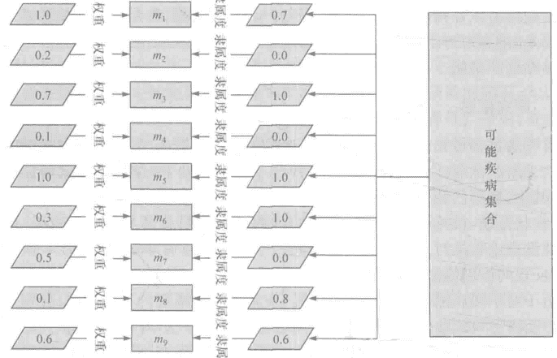

图 9.2.1 各指标隶属度与权重分配

由于图 9.2.1 中的各症状有不同权重，所以需要把集对分析中的联系数

\(\mu_{(A,B)} = \frac{S}{N} + \frac{F}{N}i + \frac{P}{N}j\quad (9.2.1)\)

作加权处理，得

\(\mu_{(A,B)} = \frac{\sum_{k=1}^{r} w_k}{m} + \frac{\sum_{k=r+1}^{s} w_k}{m}i + \frac{\sum_{k=s+1}^{m} w_k}{m}j\quad (9.2.2)\)

式中，\( m \) 表示标准症状集合 \( B \) 的长度；\( F(E_p^d) = \sum_{k=1}^{|E_p^d|} \frac{\min(f_j)}{\sum_{j=1}^{r} f_j} \times \frac{E_p^d}{|u/\text{ind}(d)|}\)，\( 1 \leqslant d \leqslant |E_p^d| \) 表示求属度为 1 的症状权重之和；\( \sum_{k=r+1}^{s} w_k \) 表示求属度在 \([0, 1]\) 的症状权重之和；\( \sum_{k=r+1}^{m} w_k \) 表示求属度为 0 的症状权重之和；\( i \) 表示两个集合相异的程度，一般取 \([-1, 1]\) 中的某个值。由于在猪病诊断过程中存在着模糊匹配关系，故用式(9.2.3)计算 \( i \)：

$$i = \frac{\sum_{k=1}^9 v_k}{9}\quad (9.2.3)$$

式中，$v_k$ 表示症状 $k$ 的隶属度。

式(9.2.2)中的 $j$ 表示相反的程度，一般取 $j=-1$。
对于图 9.2.1 中的数据，其计算过程如下：

$\mu_{(A,B)} = \frac{0.7+1.0+0.3}{9} + \frac{1.0+0.1+0.6}{9}i + \frac{0.2+0.1+0.5}{9}j = \frac{2}{9} + \frac{1.7}{9}i + \frac{0.8}{9}j$

利用式(9.2.3)得其中的 $i = \frac{0.7+1.0+1.0+1.0+0.8+0.6}{9} = \frac{5.1}{9}$，由此算得 $\mu_{(A,B)} = 0.2403$。又因为 $\max \mu_{(A,B)} = \frac{\sum_{k=1}^m w_k}{9} = \frac{4.5}{9} = 0.5$，所以集合 A 与集合 B 的匹配成功概率 $P_{(A,B)}$ 为

$p_{(A,B)} = \frac{\mu_{(A,B)}}{\max \mu_{(A,B)}} = \frac{0.2403}{0.5} = 0.4807$

也就是诊断的准确度为 0.4807；由于 $0.4807 < 0.5$，所以本次诊断性质属于“疑诊”。这是因为疾病的症状有消长、盛衰，机体有个体差异，患者症状不会全部同时出现，从而给诊断带来困难。兽医学把诊断的准确程度分为四级：确诊（确实或正确诊断）、初诊（初步诊断）、疑诊（怀疑诊断）和待诊（待除外诊断），由此表明对诊断结果的不确定程度。实际应用时，猪病诊断专家系统会针对诊断准确程度的不同，分别给出后续步骤。如果诊断结果为确诊，则单击病名后，系统会自动转向防治方法模块；如果诊断结果为初诊和疑诊，则单击病名后，系统会自动转向图片诊断模块；如果诊断结果为待诊，则转向实验室手段模块。有关各模块的实际应用操作内容在此略去。

### 9.2.3 简评

畜禽为人类提供营养丰富的食品，畜禽业与人们生活息息相关。人们至今还不完全理解各种畜禽的“自然语言”，更无法与畜禽进行“自然语言交流”，从而导致畜禽病“诊断难”和“治疗难”，畜禽病诊断专家系统的研究和开发因此受到各国高度重视。20 世纪 80 年代末，美国得克萨斯州利用 Porlgo 语言，建立了牛群生产性能的专家系统。1989 年，康奈尔大学 Timmos 等开发出家禽管理专家系统。到了 1990 年，美国私人兽医携带笔记本型电脑，深入基层开展畜禽疾病巡诊服务已成时尚。1993 年，丹麦在所获信息（包括病虫害发生率、当地气候条件、生产管理等）的基础上研制出一个包括猪在内的一般流行病害的模拟系统 EPI-DEMIC。Mckendrick 等基于贝叶斯置信网络（Bayesian belief network）开发了热带牛病诊断系统。我国从 20 世纪 80 年代开始研究病虫害专家系统。经过二十多年的发展，具有实际应用价值的畜禽疾病诊断多媒体专家系统已开始成熟。迄今为止，国内已有数十个专家系统应用于畜禽疾病的预防、诊断与治疗，应用领域多集中在猪、牛、鸡、羊等常见畜禽上；徐峰、傅泽田研制的猪病诊断专家系统把集对分析与证据理论结合，为提高猪病诊断准确率提供了新途径，但所做工作尚有可进一步推敲和补充之处，例如，式(9.2.2)所示联系数在实际应用时，可以在式(9.2.2)中 i 与 j 具体数值时展开一次系统分析，根据联系数 \(\mu_{(A, B)} = \frac{2}{9} + \frac{1.7}{9}i + \frac{0.8}{9}j\) 可知 \(\mu_{(A, B)} = 0.22/0.09 = 2.44 > 1\)，说明集合 A 与集合 B 的匹配成功势头较大，因为利用第 1 章中的同异反态势表可知，这里的 \(a = 0.22 > b = 0.19 > c = 0.09\)，属于同势一级，匹配成功的趋势为强势；之所以前面计算得到的匹配成功概率 \(P_{(A, B)} = 0.4807\)，是因为利用式(9.2.3)对 i 取了唯一的确定值，而根据集对分析理论和不确定性原理，对于联系数中的 i，需要在给定取值区间[-1, 1]取不同的值以对应于不同的实际情况，从而提高集合 A 与集合 B 的匹配成功概率，提高专家系统推理结果的可信性。

有关猪病诊断专家系统的更多内容请参考文献[2]。

## 9.3 集对分析在进出口食品安全监管专家系统研究中的应用

食品安全是关乎国计民生的重大问题。徐超[3]依托国家质量监督检验检疫总局科技计划项目(CAIQ—2010IK155)、湖南省科技重大专项“湖南省食品安全监控技术体系研究与示范”和宁波市重大科研项目(2011C11020)，把集对分析用于进出口食品安全监管专家系统中的风险评价研究，介绍如下。

### 9.3.1 研究概述

传统的进出口食品安全监管模式存在效率不高、缺乏监管决策依据等问题，为此把风险评价模型和专家系统两部分内容作为食品安全监管决策的依据，设计开发适用于进出口食品安全监管专家系统。主要内容包括建立适用于进出口食品安全监管的风险评价指标体系，采用层次分析法确定评价指标权重，建立风险评价模型，把集对分析理论用于食品安全监管风险评价，研究专家系统应用于产品、项目风险动态转换和产品、项目抽检等级的确定，分析系统中知识库和推理机的具体设计，实现食品监管系统；研究 J2EE 平台体系结构和 MVC 设计模式，在此基础上完成食品监管专家系统的设计、开发和实现。

### 9.3.2 基于集对分析的进出口食品安全监管风险评价

活鲈鱼是中国的一种出口水产品，其铅指标是一个重要的检测项目，二级指标


重金属指标(铅和汞)的定性指标有严重等级、社会关注度、国外技术要求三个,采用基于专家经验的概率统计学方法计算联系度。针对某批出口活鲈鱼,选取 10 位食品监管部门的相关专家,分别对这三个指标的风险等级进行评价,评价结果如表 9.3.1 所示。

| | L | M | H | HH | HHH |
|---|---|---|---|---|---|
| 严重等级 | 0 | 0 | 1 | 8 | 1 |
| 社会关注度 | 0 | 0 | 1 | 1 | 8 |
| 国外技术要求等级 | 0 | 8 | 2 | 0 | 0 |

由表 9.3.1 知“严重等级”的联系数为

\(\mu_1=0+0i_1+0.1i_2+0.8i_3+0.1j\) (9.3.1)

“社会关注度”的联系数为

\(\mu_2=0+0i_1+0.1i_2+0.1i_3+0.8j\) (9.3.2)

“国外技术要求等级”的联系数为

\(\mu_3=0+0.8i_1+0.2i_2+0i_3+0j\) (9.3.3)

根据检验检疫部门的实际要求,定量指标发生概率和检测不合格数据的标准等级如表 9.3.2 所示。

| 风险等级 | L | M | H | HH | HHH |
|---|---|---|---|---|---|
| 百分比/% | <1 | 1~10 | 10~20 | 20~30 | >30 |

活鲈鱼铅指标的发生概率是 0.28,检测不合格数据是 0.07,于是得发生概率的联系度为

\(\mu_4=0+0i_1+0.1i_2+0.5i_3+0.4j\) (9.3.4)

检测不合格数据的联系数为

\(\mu_5=0.17+0.5i_1+0.33i_2+0i_3+0j\) (9.3.5)

结合“严重等级”“发生概率”“检测不合格数据”“社会关注度”“国外技术要求等级”的权重(见表 9.3.3)。

| 一级指标 | 权重 | 二级指标 | 权重 | 三级指标 | 权重 | 四级指标 | 权重 |
|---|---|---|---|---|---|---|---|
| 食品特性 | 0.75 | 添加剂 | 1/9 | 大肠菌群 | 1/n | 严重等级 | 0.21 |
| | | 重金属 | 1/9 | 副溶血弧菌 | 1/n | 发生概率 | 0.16 |
| | | 微生物 | 1/9 | : | : | 检测不合格数据 | 0.45 |
| | | 生物毒素 | 1/9 | 霍乱弧菌 | 1/n | | 0.11 |
| | | 病虫害 | 1/9 | 沙门氏菌 | 1/n | | 0.07 |
| | | 禁用物质 | 1/9 | | | | |
| | | 品质指标 | 1/9 | | | | |
| | | 其他危害 | 1/9 | | | | |

活鲈鱼中的铅指标的联系度为
\(\mu_{铅} = 0.21\mu_1 + 0.16\mu_2 + 0.45\mu_3 + 0.11\mu_4 + 0.07\mu_5\)
\(= 0.0765 + 0.2810i_1 + 0.2105i_2 + 0.2590i_3 + 0.1730j \quad (9.3.6)\)

为了确定风险等级，引入置信度概念，置信度一般在区间\([0.5, 0.7]\)取值，考虑到监管的工作效率和评价结果的可靠性，取置信因子为0.55，由于在式(9.3.6)中有\(0.0765 + 0.281 + 0.2105 = 0.568 > 0.55\)，所以该批活鲈鱼中的铅指标的风险等级为H(高风险)。

区间一般在\([0.5, 0.7]\)取值，兼顾监管的工作效率和评价结果的可靠性，取置信因子为0.55，根据式(9.3.6)，因为\(0.0765 + 0.281 + 0.2105 = 0.568 > 0.55\)，所以活鲈鱼中的铅指标的风险等级为H(高风险)。

同理得到活鲈鱼中汞的指标的联系数为
\(\mu_{汞} = 0.54 + 0.33i_1 + 0.13i_2 + 0i_3 + 0j \quad (9.3.7)\)

由于活鲈鱼的重金属指标只包含铅和汞两个检测项目，为此设铅和汞的权重各为0.5，于是得活鲈鱼的重金属指标联系数为
\(\mu_{重金属} = 0.5\mu_{铅} + 0.5\mu_{汞} = 0.308 + 0.306i_1 + 0.170i_2 + 0.130i_3 + 0.086j \quad (9.3.8)\)

根据前述置信度原则，由于\(0.308 + 0.306 = 0.614 > 0.55\)，故得活鲈鱼重金属的风险等级为C(中风险)。

同理，得活鲈鱼的其他指标的联系度，进而评价全部二级指标的风险等级，评价结果如表9.3.4所示(计算过程略)。

| 食品特性子指标 | 农兽药残留 | 添加剂 | 重金属 | 微生物 | 生物毒素 | 病虫害 | 禁用物质 | 品质指标 | 其他危害 |
|---|---|---|---|---|---|---|---|---|---|
| 风险等级 | HHH | L | M | M | L | L | L | L | L |

由此得到活鲈鱼二级指标的综合联系度为

\(\mu_{活鲈鱼} = 0.432 + 0.370i_1 + 0.101i_2 + 0.005i_3 + 0.002j \quad (9.3.9)\)

由于 0.432 + 0.370 = 0.802 > 0.55，所以活鲈鱼的风险等级综合评定结果为 M(中风险)，这一结果与进出口食品监管部门的历史决策结果相符。

### 9.3.3 简评

综合评定进出口食品的风险在进出口食品安全监管专家系统中有重要意义。把集对分析中的多元联系数用于进出口食品的风险综合评价有其方便合理之处，但在把综合评价结果多元联系数计算成一个具体数值的同时也丢失了这个多元联系数的结构信息，因此在下结论的时候，至少需要顾及这方面的信息，例如，由表 9.3.4 可以看出，活鲈鱼中的农兽药残留、添加剂和生物毒素等指标处于超高风险或高风险等级，但由于这些指标的权重较小，在综合评价过程中被权重大的指标掩盖，所以综合结果为中等风险，换言之，综合评定结果 M(中风险) 中仍有可能包含着部分指标的“高风险(L, H, HH, HHH)”，这也是 9.1 节中所述成对原理(整体与部分成对存在)，同异反原理(同样是综合后评定为中等风险的指标，其不同的子指标会有低、中、高、超高不同的风险等级)和不确定性原理(不确定性有不同的表现和不同的处置原则，例如，文中采用置信度原则，其实还可以采用极值原则、效用原则等)的具体体现；显然，进出口食品监管部门不仅需要看到综合评定结果，也需要看到局部指标的高风险可能造成的危害，联系数的伴随函数如同异反态势函数，势函数等已为这方面分析提供了具体分析手段，专家系统中需要设置相应的模块处置这类情况，文献[3]中已提到上述思路。
有关进出口食品安全监管专家系统的更多内容请参考文献[3]。

## 9.4 集对分析在大豆病虫害诊断专家系统中的应用

大豆紫斑病是大豆病虫害疾病中一种常见的疾病，卞世晖[4]把集对分析的不确定性推理用于改进安徽省霍丘农垦农科所自行研发的大豆病虫害诊断专家系统，提高了诊断准确率，介绍如下。

### 9.4.1 研究概述

大豆紫斑病的主要症状如下所示。

- (1) 病种子的种皮会产生浅紫色至暗紫色病斑，在病情较轻时会在种脐周围出现放射形紫斑，病情严重时大部分甚至全部种皮都会变成紫色。
- (2) 病种子种皮一般无光泽、粗糙、有裂纹。
- (3) 在成荚期间豆荚上的病斑呈灰黑色，接近圆形或者不规则形状的斑点。
- (4) 发病期间，豆叶上病斑呈圆形紫红色的斑点，之后会扩大以致呈现出不规则形状的褐色斑点。叶子上并有灰黑色的霉层及黑色小点。

常见的大豆紫斑病的防治方法如下所示。

- (1) 首先,在播种前,应该选用抗病品种,并选用无病的种子进行播种,以减少大豆紫斑病的发病概率。
- (2) 其次,应该注重平时田间管理的工作,注意合理密植,及时开沟排水以减少生产期大豆紫斑病的发病概率。
- (3) 最后,可以采用相关化学药物对大豆生长期紫斑病进行防治工作。例如,可以在开花后用 50%多菌灵可湿性粉剂 1000 倍溶液、70%甲基托布津可湿性粉剂 1000 倍溶液、50%苯甲特可湿性粉剂 2000 倍溶液进行叶面喷雾防治。

一般来说,在进行大豆紫斑病诊断前,用户已经知道的信息有:种皮有浅紫色斑并且有裂纹;在生长期豆叶上曾出现过圆形的紫红色斑点,并且少许叶面上还呈现黑色小点。根据用户已知信息,可以判断该大豆已经患有某种病虫害。

因此,早期的大豆病虫害专家诊断系统采用的推理机构是最简单的基于可信度的不确定推理模型,并且该系统只支持用户所提供的信息与知识库中所储存的信息完全一致情况下的精确匹配模式,因而使得该系统在实际使用中经常误诊;为此,卞世晖等把集对分析的不确定性推理模型用于该专家系统推理机构的改进和完善,使得对用户给出的信息进行专家诊断的误诊率大大降低。

### 9.4.2 基于集对分析的不确定性推理

- (1) 利用集对分析理论对知识库中的证据和规则建立新的可信度表达式,从而使推理机使用新的可信度进行推理研究,达到使推理结果更加准确的目的。

令 E 表示某一知识,用联系度表示证据,记为

$E:\mu_E=a_E+b_Ei+c_Ej$

式中, $a_E$ 表示真的程度,$a_E=1$ 表示绝对真;$c_E$ 表示假的程度,$c_E=1$ 表示绝对假;$b_E$ 表示对证据的可信度还不能完全确定。

同理,利用集对分析理论将前面基于可信度的规则

$R:E \rightarrow H \text{ IF } E \text{ THEN } H (\text{CF}(H,E))$

重新表述为

$\mu_H=a_R+b_Ri+c_Rj$

式中, $a_R$ 表示在前提 E 为真的情况下,结论 H 为真的程度;$c_R$ 表示在前提 E 为假的情况下,结论 H 为真的程度;$b_R$ 表示当前提 E 出现时,还不能让规则完全了解的程度。不确定性因子 i 的取值范围设定为[-1,1],对立因子 j 的值设定为-1。

通过用联系度来表示证据和规则,可以看出集对分析处理不确定信息时的优势是可以较好地处理概率信息,即当规则的不确定性因子 i 取值 0 时,联系度表示的规则为概率信息;而当对立因子 j 取值 0 时,又可以把该信息看成是模糊信息,这时用联系度表示的规则就能处理模糊信息；实际问题中的信息可能既是随机的也是模糊的，或者既是模糊的也是随机的，为此，卞世晖等把 j 的取值放宽到[-1, 0]，从而获得一定的灵活性，以期提高推理精度和推理速率。

- (2) 根据用户提供的信息，把大豆病虫害的表征信息分别放入三种不同机制的专家系统中进行诊断。

首先，把用户提供的大豆病虫害信息放入基于可信度的不确定性推理机制的专家系统中。

从实验结果中，可以得出基于可信度的不确定性推理机制的专家系统针对用户给出的信息，推出的结果是大豆灰斑病和大豆紫斑病两种结果。针对推理结果，可以和 9.4.1 节中的大豆紫斑病相关背景知识进行比较，可以认定推理结果比较准确，并且也给出了相关的防治方法及该种病虫害的相关背景知识介绍。

其次，将用户提供的大豆病虫害信息放入基于集对分析的不确定性推理机制的专家系统中。

从实验结果中，可以得出基于集对分析的不确定性推理机制的专家系统针对用户给出的信息，推出了大豆紫斑病和大豆叶斑病两种可能结果。与 9.4.1 节中的大豆紫斑病相关背景知识进行比较，可以认定推出的结果比较准确，并且给出了相关的防治方法及该种病虫害的相关背景知识介绍。此外，和基于可信度的不确定性推理机制的专家系统推理出来的结果相比较，发现基于集对分析的不确定性推理机制的专家系统推理出来的结果更加准确，因为该推理机制的专家系统推出所患病虫害的第一可能性是大豆紫斑病。而且，与 9.4.1 节中的大豆紫斑病相关背景知识进行比较，该推理机制的专家系统给出的关于大豆紫斑病的防治方法更加合理有效，相关背景知识也更加全面。

最后，我们将用户提供的大豆病虫害信息放入改进的基于集对分析( j 在 [-1,0]区间取值)的不确定性推理机制的专家系统中。

从实验结果中，得出改进的基于集对分析的不确定性推理机制的专家系统针对用户给出的信息，也推出了大豆紫斑病和大豆叶斑病两种可能结果。与 9.4.1 节中的大豆紫斑病相关背景知识进行比较，我们仍可以认定推出的结果比较准确，并且也给出了相关的防治方法及该种病虫害的相关背景知识介绍。

改进后的基于集对分析的不确定性推理与改进前进行比较，针对相同的信息，推出合理的运算结果，两者所用时间如表 9.4.1 所示。

#### 表 9.4.1 三种不同推理机制所需的推理时间

| 名称 | 推理时间/ms |
| --- | --- |
| 基于可信度的不确定性推理 | 30074 |
| 基于集对分析的不确定性推理 | 30157 |
| 改进后的基于集对分析的不确定性推理 | 30069 |

从表 9.4.1 中看出，基于可信度的不确定性推理的速度优于基于集对分析的不确定性推理，而改进后的基于集对分析的不确定性推理机制的专家系统推理速度优于另外两种方法。

### 9.4.3 简评

专家系统能很好地处理科研和工作生活中不能用常规算法解决的复杂问题，但系统本身并非一成不变，而是需要不断改进和完善，本节例子虽然简易，但说明了把集对分析的不确定性推理模型用于已有的专家系统改进和完善大有潜力空间，特别是前几章对集对分析理论方法内容的介绍说明，集对分析的不确定性理论与联系数算法也在不断发展和完善，更使得集对分析在专家系统的应用中有广阔的应用前景。

有关大豆病虫害诊断专家系统的更多内容请参考文献[4]。

## 9.5 集对分析在故障诊断专家系统研究中的应用

董卫华等[5]把集对分析与粗集理论相结合解决专家系统中规则的抽取和过滤问题，提出了一种新的规则提取方法，并用于故障诊断专家系统中的推理设计，介绍如下。

### 9.5.1 研究概述

基于专家系统的诊断方法是故障诊断领域中最引人注目的智能技术之一，但数据库技术在专家系统领域的应用基本上停留在知识库管理者的水平上；为此，董卫华等结合开发装备故障智能诊断系统，探讨数据挖掘及其相关技术在实现知识自动获取和简化推理机设计方面应用的可能性，通过把集对分析与粗集理论相结合，从数据库中提取隐含的、未知的、对决策有潜在价值的知识规则，弥补故障诊断专家系统中知识获取和推理机方面存在的不足。

### 9.5.2 基于集对分析和粗集的规则提取与应用

首先使用粗集理论和集对分析理论来生成潜在的诊断规则，然后将这些诊断规则提取出来作为故障诊断依据，并存入诊断规则库。算法如下。

- (1) 设对象集为 U(i=1~m)，条件属性集为 C(j=1~n)，决策属性集为 D。
- (2) 确定每一条件属性的隶属函数和语言变量值。
- (3) for i=1 to m, for j=1 to n, 对象的条件属性值转化为如下形式：

```
\frac{f_{j1}^i}{R_{j1}} + \frac{f_{j2}^i}{R_{j2}} + ... + \frac{f_{jl}^i}{R_{jl}}
\quad (9.5.1)
```

式中，$R_{jk}$ 是条件属性 $A_j$ 的第 $k$ 个模糊区域；$f_{jk}$ 是对象 $u_i$ 在模糊区域中 $R_{jk}$ 的隶属函数值；$I=|A_j|$ 为条件属性 $A_j$ 的语言变量个数，将原始数据表转化为带有隶属函数值的决策表。

- (4) 由最大隶属度法,取  
$$f_{jk}=\max(f_{j1}^i, f_{j2}^i, \cdots, f_{jl}^i), l < k < L$$ (9.5.2)  
由此得到新表。

- (5) 用粗集联系度简化决策表的属性具有条件属性和决策属性的知识表达系统可称为决策表,记为 $T=(U, C, D, V_a)$, $U$ 为全集，$C$ 和 $D$ 分别为条件属性和决策属性, $V_a$ 表示属性值的集合。

显然,每一个决策表都存在一个同异型集合联系度:  
$$\mu_c(d)=POS_c(d)+BN_c(d)i$$ (9.5.3)

且可以唯一的分解为两个决策表为  
$$T_1=(u_1, c_1, d_1, v_{d1})$$ (9.5.4)  
$$T_2=(u_2, c_2, d_2, v_{d2})$$ (9.5.5)

式中, $u_1=POS_c(d), u_2=BN_c(d)$。  
这时粗集的数值联系度为  
$$\mu_c(d)=a+bi=\frac{k(POS_c(d))}{k(u)}+\frac{k(BN_c(d))}{k(u)}i$$ (9.5.6)

对于式(9.5.6),当 $a=1, b=0$ 时,决策表是相容的; 当 $b \neq 0$ 时,可分为相容决策表 $T_1$ 和不相容决策表 $T_2$。  
由此可得到确定规则表和不确定规则表。

- (6) 对相容决策表 $T_1$,约简决策规则,即进行属性值的约简。设属性子集:  
$$C_j^i=\{C_j|j=1,2,\cdots,n,C_j \in C\}$$ (9.5.7)

满足某一规则 $Fi$ 相对于结果属性集的联系度为  
$$\mu_{c_k}(d)=a+bi+cj=POS_c(x)+bn_c(x)i+neg_c(x)j$$ (9.5.8)  
由 $c_k$ 属性值组成的属性集对决策集联系度非空正域即可获得该规则的最小属性值简化。

- (7) 列出不相容决策表 $T_2$ 的条件属性等价类,并给出模糊等价类矩阵,根据模糊等价类矩阵,求出对应的模糊等价类 $C^c(d)$。

- (8) 令  
$$E_p=C^c(d) \cap (u/\text{ind}(d)), 1 \leqslant p \leqslant |C^c(d)|$$ (9.5.9)  
定义 $E_p^c$ 的选择函数为  
$$F(E_p^c)=\sum_{k=1}^{|E_p^d|}\frac{\min(f_j)}{\sum_{j=1}^n f_j} \times \frac{E_p^d}{|u/\text{ind}(d)|}, 1 \leqslant d \leqslant |E_p^c|$$ (9.5.10)

式中，$f_j$ 为 $C'(d)$ 对应模糊区间的值；$|U/\text{ind}(d)|$ 为 $E_p^c$ 所在的决策等价类的个数。

- (9) 比较 $C'(d)$ 中 $F(E_p^c)$ 的大小，选取最大者作为最后的决策，并得到其置信度。

- (10) 表 9.5.1 是经过上述算法分析所得到的规则的一个示例。

分别按照规则中 IF 条件内容的统一格式和 THEN 结论中内容的统一格式添加到诊断规则库中，作为知识库的一部分留存后用。对于诊断出结论，按照输入的各运行状态参数统一格式和对应的故障现象代码添加到故障案例数据库中，作为以后进行数据挖掘的案例数据。

需要说明的是，诊断规则的产生是由控制器控制出来的，其显示形式具有一定的标准格式，且在添加到诊断规则库和故障案例数据库中时都是按照统一标准格式录入的，这就避免了知识工程师和领域专家直接传授诊断规则时的复杂过程和不确定性因素，在一定程度上解决了知识获取时候的“瓶颈”问题。

#### 表 9.5.1 新的数据库规则描述

| 规则号 | 规则描述 | 置信度 |
| :--- | :--- | :--- |
| R(1) | IF S(1),S(3) THEN F(1) | 0.7 |
| R(2) | IF S(1) THEN F(2) | 0.5 |
| R(3) | IF S(2),S(3) THEN F(3) | 0.9 |
| R(4) | IF S(2),S(4) THEN F(4) | 0.8 |
| R(5) | IF S(2),S(5) THEN F(5) | 0.6 |
| R(6) | IF S(3) THEN F(6) | 0.5 |
| R(7) | IF S(4) THEN F(7) | 0.6 |
| R(8) | IF S(5) THEN F(8) | 0.8 |

### 9.5.3 简评

粗集是处理知识不确定性的一种理论，但没有相应的代数表达式，因而不能把不确定性从形式上加以表达，正是在这一点上与集对分析互补，利用集对分析中的同异反联系数，特别是联系数中的 $i$，把需要表达的不确定性形式化，从而得出一种新的规则提取方法；但该例在规则描述时，采用置信度的方法作为规则选用仍可以改进，也就是把置信度也联系数化，如把 0.7 联系数化为 $0.7 + 0.3i$，再根据新的信息或以往的经验考虑 $i$ 的取值，从而形成新的规则可信度，借此来进一步提高推理准确度。


## 9.6 本章小结

从 20 世纪 60 年代出现第一代专家系统到现在，已有成千上万种专家系统在各种领域服役，而不确定性推理是众多专家系统一直面临的挑战；集对分析对不确定性系统中的各种不确定性信息采取“客观承认，系统描述，定量刻画，具体分析”的处置方针，因而可以从不同角度把集对分析用于各种不同专家系统中的知识储备和信息处理，特别是用于专家系统中推理模型和推理机制的改进和完善，本章取了 4 个实例，有兴趣的读者可以参考更多相关文献，也可以结合各自的专业，试把集对分析用于相关专家系统的改进和创新。

不过，从第 3 章绘出的智脑系统角度看，传统人工智能中的专家系统，无论是概念还是实际应用，都面临升级换代和更新的挑战，因为网络和云计算已经使得任意一个专家系统都可以成为其上的一个终端，而大数据也使得原先专家系统的数据库需要不断有新的扩充，相应的数据计算方法和数据处理能力也需要补充和更新，因而都需要向智脑系统过渡，当成千上万种专家系统都更新改造成智脑系统并联网时，新一代人工智能专家在大力提倡的社会计算就成为一种现实的社会资源，智能社会就会快步走来。

## 参考文献

- [1] 赵克勤. 基于集对分析的不确定性系统理论在 AI 中应用[J]. 智能系统学报, 1996, 1(2): 16-25.  
- [2] 徐峰. 猪病诊断专家系统研究[D]. 北京：中国农业大学硕士学位论文, 2005.  
- [3] 徐超. 进出口食品安全监管中风险评价和专家系统的研究[D]. 杭州：浙江大学硕士学位论文, 2013.  
- [4] 卞世晖. 专家系统中不确定性推理的研究与应用[D]. 合肥：安徽大学硕士学位论文, 2010: 1-50.  
- [5] 董卫华, 张政保. 数据挖掘及数据库技术在故障诊断专家系统中的应用[J]. 河北省科学院学报, 2006, 23(4): 20-23.

# 第 10 章 集对分析与神经网络的融合与应用

神经网络也称人工神经网络（artificial neural network, ANN）是人们借助计算机模仿生物神经网络行为特征，进行网络式信息处理的数学模型。神经网络依靠系统的结构特性，通过反复调整网络系统内部大量节点之间相互连接的关系和算法，达到处理信息的目的；复杂的人工神经网络具有自学习和自适应的能力。已有的研究表明，把集对分析融合到人工神经网络的设计与应用中，能提高神经网络处理有关信息的能力和提高处理质量，介绍如下。

## 10.1 基本原理

### 10.1.1 神经元及其基本特性

神经元是人们观察生物脑神经网络后抽象得到的一个概念，是人工神经网络的基本单位，其结构与信息处理原理如图 10.1.1 所示[1]。

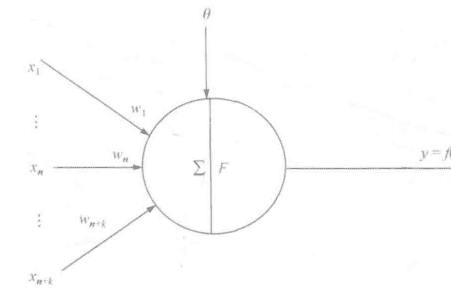

图 10.1.1 神经元模型

图 10.1.1 中的神经元计算公式如下：

$$y = f(\sum_{n+k}^{n+k} x_n + kw_{n+k} - \theta)$$ (10.1.1)

由图 10.1.1 可知，神经元由 \(x_1, x_2, \cdots, x_n, \cdots, x_{n+k}\) 多个输入信息和一个输出信息 \(Y\) 组成，在输入与输出之间需要经过 3 步计算，第 1 步是给每个输入信息作加权计算，第 2 步是把 \(n+k\) 个加权计算结果综合（注意：图 10.1.1 中的算术求和符号“ \(\sum\) ”表示“综合”,但算术求和计算仅是“综合”的一种方式),第 3 步是对综合结果再作某种数学处理,包括与给定的偏置值 \(\theta\) (阈值) 比较和有关分析。见式(10.1.1),但式(10.1.1)仅是对加权结果求代数和的一种表示,其中的各个输入信息权重之和为 1;由于神经元的上述计算需在计算机上实现,因此输出函数 \(y\) 一般采用 0 和 1 这种二值函数(式(10.1.2))或 S 形函数(式(10.1.3)):

$$f_X = \begin{cases} X \geqslant X \\ X < X \end{cases} \quad (10.1.2)$$

$$f(x) = \frac{1}{1+e^{-ax}}, \quad 0 < f(x) < 1 \quad (10.1.3)$$

### 10.1.2 人工神经网络及其基本特性

人工神经网络的原理是人脑中的神经网络,有人估计人脑神经网络由一千多亿个神经元组成,因而能够进行超高级智能活动,人工神经网络仅是模仿人脑神经网络的一种数学模型。从数学角度看,人工神经网络是具有下列特性的一个有向图。

- (1) 每个节点 P 存在一个状态变量 X;
- (2) 节点 P 到节点 Q 存在一个连接权重 W_{PQ};
- (3) 对于每个节点 P,存在一个阈值 \(\theta\);
- (4) 对于每个节点 P,定义了一个变换函数 \(f_p(x_q, w_{pq}, \theta_p), p \neq q\),对于一般情况可以取式(10.1.1)所示函数。

### 10.1.3 人工神经网络的算法学习

人工神经网络的基本结构有两类:有反馈的递归网络和无反馈的前向网络,但无论是哪一种网络都需要通过学习获得处理特定信息的技能,这就是所谓的算法训练,也称算法学习,现有的算法学习主要分为有师学习与无师学习。

- (1) 有师学习:指预先有指导老师给出网络系统的输出目标或输出目标的期望,网络系统就根据网络输出与给定输出目标的差来学习并掌握相关算法。
- (2) 无师学习:指没有老师预先给定网络系统的输出目标或输出目标期望,网络系统只需根据网络输入信息,自动地适应取权和调运算法,输出计算结果,无师学习也称网络系统的自组织学习。

此外,还有把有师学习与无师学习结合起来的混合强化学习,但混合强化学习本质上仍属于有师学习[2]。

### 10.1.4 人工神经网络集对分析基本原理

人工神经网络集对分析基本原理是集对分析中的成对原理、同异反原理和不确定性原理[3]。

一是人工神经网络与人脑神经网络是一个集对。到目前为止，人们普遍承认人的智能存在于人脑之中，但由于对人脑研究上的困难，至今对人脑的思维工作机制认识极为肤浅；从理论上说，人脑的思维既有物理的，也有化学的、数学的、哲学和非逻辑的、艺术的，甚至还有心理的和病态的等；人工神经网络充其量也只是部分地从数学物理意义上模仿人脑神经网络，两者的同一度至少到现在仍然相当低，因此难怪现有的人工神经网络有不少不尽人意之处，例如，难以体现人脑神经元的生理刺激反应，难以自生灵感信息，难以处理非数字信息等，借用集对分析的同异反语言，这种情况还进一步说明人工神经网络与人脑神经网络至少在网络的系统活性上是相反对立的，也就是前者无活性，而人脑神经网络是活的机体；尽管人们也在让计算机有情感、有活性，试图在这一点上模仿甚至无限地逼近人脑，这又说明人工神经网络与人脑神经网络的某些关系呈现不确定性，属于不确定性关系，例如，有情感的机器究竟能在多大程度上模仿和逼近人脑所具有的情感，至少在目前是一个难以确定的问题；总体来说，人工神经网络与人脑神经网络具有同异反不确定性关系。

二是计算与分析这个集对，人工神经网络以计算为主，但人脑以分析为主，一个以分析为主的人脑要增加计算能力需要通过特定的专业培训，要让人工神经网络增加分析的能力却难以通过简单学习获得，因为事实上，人工神经网络的所谓分析能力依然是一种计算能力，但可以融合集对分析（人机交互）来达到既有计算结果又有分析结果的目的。

三是结构与功能集对，人脑神经网络的结构不仅是物理和生理的，也有着化学结构，以及化学物理共同作用的结构，也就是说，人脑神经网络的结构比人工神经网络更为复杂，也因此有比人工神经网络更强大、更丰富的信息处理功能，由此推知，基于人脑神经网络的结构与功能集对的特征函数，也将比人工神经网络的结构与功能集对的特征函数更复杂。

基于以上分析，不难认为，在人工神经网络的改进和完善过程中可以借鉴和应用集对分析“确定性计算与不确定性分析相结合”的研究思路与计算方法；另外，社会网络化的人工神经网络可以看成是大脑神经网络的一种外化，因此是一个更为重要的研究方向。

## 10.2 基于 SPA-ANN 耦合的年径流预测

李佳等[4] 提出一种把集对分析（SPA）与人工神经网络（ANN）相耦合的模型（SPA-ANN 模型），应用此模型进行年径流预测，并与单独的人工神经网络模型和最近邻抽样回归模型预测效果进行比较分析，得到较好结果，介绍如下。

### 10.2.1 问题描述

年径流受气象因素、自然地理因素、流域特性因素等多因素的综合影响，变化极其复杂。目前国内外常用的年径流预测方法大致有成因分析法和统计法，如多元回归分析法、随机分析法、模糊集分析法、灰色理论、混沌理论、人工神经网络、小波分析法等，这些方法在一些具体的预测中都取得过较好的效果。

基于集对分析和人工神经网络的耦合模型（SPA-ANN 耦合模型），吸取人工神经网络非线性逼近的能力，同时发挥集对分析涵盖信息全面、物理意义明确、计算简便实用的优势，弥补了之前的人工神经网络模型参数物理意义不明、不能对计算结果进行解释的缺陷。经过检验，SPA-ANN 耦合模型预测精度较高，结论可靠。

### 10.2.2 模型原理

人工神经网络是由大量简单元件广泛连接而成的一种模拟人脑行为的复杂网络系统，已经发展出多种类型。预测中常用的是反向传播（back propagation，BP）神经网络。BP 神经网络的特点是：多神经元只接受前层的输入，并输出给下一层；多神经元有多种输入，但只有一种输出；输入层各节点只起输入作用。BP 神经网络算法的基本思路是：以网络学习时输出层的输出与期望输出的误差为原则，将这个误差沿输出层到隐层，再到输入层的反向传播，以修正各层的连接权和阈值，直到误差达到要求。

一个典型的三层 BP 神经网络的拓扑结构如图 10.2.1 所示，A 层为输入层，B 层为隐层，C 层为输出层。样本总数为 N 个，A 层输入节点数为 n 个，B 层的节点数为 p 个，C 层输出节点为 m 个。A 层与 B 层之间的连接权用 w_{ji} (i=1, 2, \cdots, n; j=1, 2, \cdots, p) 表示；B 层与 C 层之间的连接权用 v_{ji} (i=1, 2, \cdots, p; j=1, 2, \cdots, m) 表示。B 层的各节点阈值为 b_i (i=1, 2, \cdots, p)，C 层的各节点阈值为 c_i (i=1, 2, \cdots, m)。

在年径流预测问题中，一般是已知年径流序列 {X_t}_n，X_t 依赖于前 P 个相邻历史值 X_{t-1}, X_{t-2}, \cdots, X_{t-p}。定义 A_t = (X_{t-p}, X_{t-p+1}, \cdots, X_{t-1})，称 A_t 为一个径流集合，p 为 A_t 的维数，X_t 为 A_t 的后续值 (t=p+1, p+2, \cdots, n)。这样，年径流序列 {X_t}_n 就可以构成出 n-p+1 个径流集合。要预测后续值 X_{n+1}，可将第 n-p+1 个径流集合 B=(X_{n-p+1}, X_{n-p+2}, \cdots, X_n) 分别与其余 n-p 个径流集合 A_t 组成 n-p 个集对。按照一定标准对这 n-p 个集对进行同一性、差异性和对立性分析，并根据实际问题对 i, j 取适当的值，计算相应的同异反联系度 \(\mu(A_t \sim B)\) (t=1, 2, \cdots, n-p)。联系度的值越大，则相应径流集合对应的后续值 X_t 与当前预测值相同的可能性也越大。若几个集对的联系度相同，认为新信息对预测结果的影响较大，取离面临时段最近那个径流集合对应的后续值。

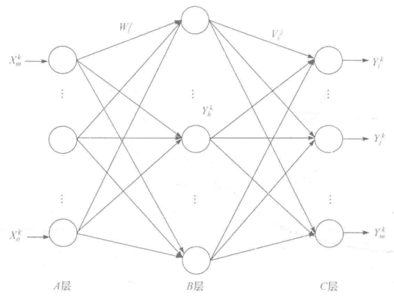

图 10.2.1 三层 BP 神经网络的拓扑结构示意图

由上述思想，可得到与当前预测值最接近的 K 个径流集合对应的后续值 \( X_t \)，称 K 为径流集合的个数，将这 K 个后续值作为人工神经网络的输入，输出即为当前要预测的值，采用人工神经网络的建模步骤建模，由此可以预测面临时段的年径流量。

### 10.2.3 建模步骤

- **步骤 1** 假定径流集合的维数为 \( p \)，根据建模径流资料长度为 \( n \)，构造 \( n - p + 1 \) 个径流集合。由当前径流集合 \( B = (QB, 1; QB, 2; \cdots; QB, p) \) 和其余径流集合 \( A_i = (QA, 1; QA, 2; \cdots; QA, p) (i = 1, 2, \cdots, n - p) \) 组成 \( n - p \) 个集对。
- **步骤 2** 逐一对这 \( n - p \) 个集对进行同一性、差异性、对立性分析，计算出 \( n - p \) 个联系度：\( QA, j \) 与 \( QB, j (j = 1, 2, \cdots, p) \) 相比，误差小于 \( QB, j \) 的 20%，认为 \( QA, j \) 与 \( QB, j \) 相同；设定低要求的容许误差为 \( x\% (x > 20) \)，\( QA, j \) 与 \( QB, j \) 相比，误差大于 \( QB, j \) 的 \( x\%\)，认为 \( QA, j \) 与 \( QB, j \) 相反；\( QA, j \) 的误差介于 \( QB, j \) 的 20% 与 \( x\%\) 之间，认为相异。
- **步骤 3** 将这 \( n - p \) 个集对的联系度值由大到小排序，联系度值越大说明与当前越接近。
- **步骤 4** 根据径流集合的个数 \( K \)，可以得到与当前径流集合最接近的 \( K \) 个径流集合的后续值，作为 BP 网络 \( A \) 层各节点的输入值。
- **步骤 5** BP 网络参数 \( w_{ji}, v_{ji}, b_i, c_i \) 在 \( (-1, 1) \) 取一个任意小的随机数。
- **步骤 6** 计算 \( B \) 层各节点的输出 \( B_i^k \) :

  $$B_i^k = f(\sum_{j=1}^n W_j X_j^k + b_i), \quad i = 1, 2, \cdots, p$$ (10. 2. 1)

  式中，\(X_j^k\) 为 A 层第 j 个节点的输入值；激励函数为 Sigmoid 函数。

- **步骤 7** 计算 C 层的输出 \(Y_j^k\)：

  $$Y_j^k = f(\sum_{i=1}^p V_i B_i^k), \quad i = 1, 2, \cdots, m$$ (10. 2. 2)

- **步骤 8** 计算 C 层的误差 \(E_j^k\)：

  $$E_j^k = \sum_{k=1}^N K_j^k$$ (10. 2. 3)

  式中，\(V_i^k\) 为 C 层第 k 个节点的期望输出；\(E_j^k\) 为第 k 个样本在 C 层第 j 节点的误差；\(E_j\) 为样本在 C 层第 j 节点的误差总和；\(N\) 为样本总长。

- **步骤 9** 调整 B 层每个处理单元与 \(E_j^k\) 有关的误差：

  $$\varphi_i^k = B_i^k (1 - B_i^k) \sum_{j=1}^m V_i E_j^k, \quad i = 1, 2, \cdots, p$$ (10. 2. 4)

- **步骤 10** 调整 B 层与 C 层的连接权：

  $$\Delta_k V_i^j = a B_i^k E_j^k, \quad i = 1, 2, \cdots, p, \quad j = 1, 2, \cdots, m$$
  $$\Delta V_i^j = \sum_{k=1}^N \Delta_k V_i^j$$ (10. 2. 5)
  $$V_i^j (t+1) = V_i^j (t) + \Delta V_i^j$$

  式中, \(t\) 表示迭代次数。

- **步骤 11** 调整 C 层各处理单元的阈值：

  $$\Delta_k c_j = a E_j^k, \quad j = 1, 2, \cdots, m$$
  $$\Delta c_j = \sum_{k=1}^N \Delta_k c_j$$ (10. 2. 6)
  $$c_j (t+1) = c_j (t) + \Delta c_j$$

- **步骤 12** 调整 A 层与 B 层之间的连接权：

  $$\Delta_k W_j^i = a X_i^k \varphi_i^k, \quad i = 1, 2, \cdots, n, \quad j = 1, 2, \cdots, p$$
  $$\Delta W_j^i = \sum_{k=1}^N \Delta_k W_j^i$$ (10. 2. 7)
  $$W_j^i (t+1) = W_j^i (t) + \Delta W_j^i$$

- **步骤 13** 调整 B 层的阈值：

  $$\Delta_k b_i = a \varphi_i^k, \quad i = 1, 2, \cdots, p$$
  $$\Delta b_i = \sum_{k=1}^N \Delta_k b_i$$ (10. 2. 8)
  $$b_i (t+1) = b_i (t) + \Delta b_i$$

- **步骤 14** 若误差 \(E < \varepsilon\), 停止训练, 否则转到步骤 6。

- 步骤 15 反复调整 p,x,k 值,直到精度满足预测要求。
- 步骤 16 应用经过优化的参数进行年径流预测。
- 步骤 17 把预测值与实测值对照,为进一步调整网络提供依据。

### 10.2.4 实例

例 10.2.1 以某水库 1937～1997 年共 61 年的年平均入库流量资料为基础数据,采用 1937～1990 年共 54 年的流量资料建模。通过试算优化,确定 SPA-ANN 耦合模型参数如下:低要求的容许误差 x% 为 25%,径流集合的维数 p 为 10,个数 K 为 5,隐层节点数为 10,输出层节点数为 1,学习系数为 0.3,动量系数为 0.9,训练次数为 2000。计算集对的联系度时,i 取 0.5,j 取 -1。

为验证 SPA-ANN 耦合模型预测的可靠性和精度,用同样的资料建立了人工神经网络模型和最近邻抽样回归模型进行预测。其中,人工神经网络模型采用 3 层 BP 网络结构,输入层节点数为 5,隐层节点数为 6,输出层节点数为 1,学习系数为 0.3,动量系数为 0.9,训练次数为 2000;最近邻抽样回归模型中,特征矢量的维数为 5,个数为 6。

根据水文预报方案评定标准,年径流量预测的许可误差取多年变幅的 20%。这里定义相对误差为预测值和实测值之差与多年变幅的百分比。一次预测的相对误差小于 20%时,认为该次预测合格,合格预测次数与预测总次数之比为检验合格率。检验采用 1991～1997 年共 7 年的流量资料,各模型检验及比较结果见表 10.2.1。

表 10.2.1 模型检验及模型预测结果比较表

| 年份 | 实测年径流/m³ | SPA-ANN耦合模型预测值/(m³/s) | 相对误差/% | 人工神经网络模型预测值/(m³/s) | 相对误差/% | 最近邻抽样回归模型预测值/(m³/s) | 相对误差/% |
|---|---|---|---|---|---|---|---|
| 1991 | 380 | 427 | 10.1 | 433 | 11.4 | 452 | 15.5 |
| 1992 | 538 | 450 | -18.9 | 377 | 34.5 | 425 | -24.2 |
| 1993 | 524 | 450 | -15.9 | 463 | -13.1 | 476 | -10.3 |
| 1994 | 442 | 435 | -1.5 | 448 | 1.3 | 493 | 10.9 |
| 1995 | 470 | 417 | -11.4 | 445 | -5.4 | 482 | 2.6 |
| 1996 | 381 | 384 | 0.6 | 395 | 3.0 | 477 | 20.6 |
| 1997 | 361 | 384 | 4.9 | 406 | 9.7 | 416 | 11.8 |
| 平均相对误差/% | | 9.0 | | 11.2 | | 13.7 | |
| 最大相对误差/% | | 18.9 | | 34.5 | | 24.2 | |
| 检验合格率/% | | 100.0 | | 85.7 | | 71.4 | |


由表 10.1.1 可知,SPA-ANN 耦合模型预测的合格率、平均相对误差与最大相对误差均优于人工神经网络模型与最近邻抽样回归模型,说明该耦合模型在预测精度上有明显的提高。不过,同大多数预报模型一样,SPA-ANN 耦合模型也有其不足,不足在于它是由一个水库已有历史上有限长度径流序列的规律来推求未来径流的规律,当未来的运动轨迹超出了模型由历史资料本身所能获得的规律时,该模型会失效;这时,如能根据成对原理,用 SPA-ANN 耦合模型同时融入与当地径流变化物理成因有关的其他因素分析,会有更好的预测效果,也可以根据同异反原理,对可能出现的反常情况和反常范围作出预计,以弥补单一应用神经网络带来的不足。

## 10.3 集对分析径向基函数神经网络预测模型

陈晶等[5]把集对分析与径向基函数神经网络结合,提出集对分析径向基函数神经网络预测模型,简记为 SPA-RBFNN 模型,思路是将研究对象 t-1 时和 t 时的影响因子集构造为集对并计算联系度,由联系度的同一度、差异度、对立度及研究对象 t-1 时的值为输入,研究对象 t 时的值为输出,构建径向基函数神经网络,以年径流预测作为应用举例,模型结构清晰,计算步骤明确,预测精度较高,介绍如下。

### 10.3.1 基本思路

SPA-RBFNN 建模的基本思路为:首先根据集对分析原理将研究对象 t-1 时和 t 时的影响因子集构造为集对,计算集对的联系度,然后以联系度中的同一度、差异度、对立度以及研究对象 t-1 时的实测值为输入,研究对象 t 时的值为输出,由此构建径向基函数神经网络模型 SPA-RBFNN,既利用了集对分析精细的相关关系剖析能力,又利用了径向基函数神经网络优良的函数逼近功能,因此具有较好的预测能力。

### 10.3.2 建模步骤

- 步骤 1 构造集对。
  将 t-1 时的影响因子看做集合, \( A_{t-1} = (x_{1,t-1}, x_{2,t-1}, \cdots, x_{m,t-1}) \), 将 t 时的影响因子看成集合 \( A_t = (x_{1,t}, x_{2,t}, \cdots, x_{m,t}) \), 按照一定分类标准对集合中的各个元素进行分级量化处理,如分成枯(小)、中、丰(大),分别用 I、II、III 表示;或特枯(特小)、枯(小)中、丰(大)、特丰(特大),分别用 I、II、III、IV、V 表示。根据集对分析原理 \( A_{t-1} \) 与 \( A_t \) 可构成集对 \( H(A_{t-1}, A_t) \)。

- 步骤 2 计算集对的联系度。
  对照 \( A_{t-1} \) 与 \( A_t \) 中对应的符号,定义同、异、反的概念,统计同、异、反的个数,分别记为 S,F,P,由 SPA 原理知集对 \( H(A_{t-1},A_t) \) 的联系度定义为

  \[ \mu(A_{t-1},A_t)=\frac{S}{N}+\frac{F}{N}i+\frac{P}{N}j, \quad S+F+P=N \quad (10.3.1) \]

  对式(10.3.1)归一化处理得

  \[ \mu(A_{t-1},A_t)=a+bi+cj, \quad a\in[0,1], \quad b\in[0,1], \quad c\in[0,1], \quad a+b+c=1 \quad (10.3.2) \]

- 步骤 3 构建 SPA-RBFNN 模型。
  将预测因子进行归一化处理,以集对 \( H(A_{t-1},A_t) \) 的联系度的同一度 \( a \),差异度 \( b \),对立度 \( c \),以及预测因子在 \( t-1 \) 时的归一化值 \( Y'_{t-1} \) 作为 RBFNN 模型的输入,即模型输入向量为

  \[ X_t=(a_t,b_t,c_t,Y'_{t-1}) \quad (10.3.3) \]

  输入节点数为 4,以预测因子 \( t \) 时的归一化值 \( Y'_t \) 作为 RBFNN 模型的输出,输出节点数为 1,隐层节点数设有 \( K \) 个,从而得到需要的模型。

- 步骤 4 模型参数的优化确定。
  SPA-RBFNN 模型的输出为

  \[ Y'_t=\sum_{i=1}^{I} w_i\Phi_i(X_t) \quad (10.3.4) \]

  式中, \( w_i(i=1,2,\cdots,I) \) 为从隐层第 \( i \) 节点到输出节点的权重; \( \Phi_i(X_t) \) 为高斯函数,即

  \[ \varphi_i(x_i)=\exp[-(\|x_i-c_i\|)^2/2\sigma_i^2] \quad (10.3.5) \]

  \( c_i=(c_{i1},c_{i2},c_{i3},\cdots,c_{id})(i=1,2,\cdots,I) \) 为高斯函数的中心; \( \|x_i-c_i\| \) 是向量 \( (x_i-c_i) \) 的范数,通常表示 \( X_i \) 与 \( C_i \) 之间的距离; \( \sigma_i \) 为高斯函数的均方差,表示高斯函数围绕中心点的宽度,可控制隐层对输出的响应范围。

  由此知 SPA-RBFNN 模型参数有隐层节点数 \( I \) 和 \( C_i, \sigma_i, w_i(i=1,2,\cdots,I) \),可通过优化算法对网络进行训练得到, \( C_i, \sigma_i, w_i \) 则根据最近邻聚类算法的思想确定,其实现过程为:首先选取第 1 个样本 \( X_1 \) 作为第 1 个高斯函数中心 \( C_1 \),然后加入第 2 个样本 \( X_2 \),若 \( \|X_2-C_1\| \leqslant r \), \( r \) 表示聚类中心的辐射宽度,与 \( \sigma_i \) 具有相同数量级(通常结合实例适当选取,以尽量降低误差),则 \( X_2 \) 属于第一个聚类,否则将样本 \( X_2 \) 作为一个新聚类的中心 \( C_2 \),再加入第 3 个样本 \( X_3 \),依次考察 \( \|X_3-C_1\| \), \( \|X_3-C_2\| \),确定是归入原有聚类还是成为新聚类的中心,依次类推,逐个加入样本,直至确定出每个样本所属的高斯函数中心,高斯函数中心的个数即为隐层节点数 \( I \),高斯函数的均方差 \( \sigma_i \) 为

  \[ \sigma_i=d_i/\sqrt{2I} \quad (10.3.6) \]

  式中

  \[ d_i=\max(\|X_i-C_1\|, \|X_i-C_2\|, \cdots, \|X_i-C_I\|) \quad (10.3.7) \]

  权重 \( w_i \) 采用粒子群优化算法确定,再由式(10.3.4)输出 \( Y' \),经归一化得到最终预测结果 \( Y_t \)。

### 10.3.3 应用实例

以伊犁河雅马渡站实测年径流为例进行预测研究。年径流 (\( y_t, m^3/s \)) 为预测因子，4 个影响因子分别为前一年 11 月至当年 3 月伊犁气象站的总降雨量 (\( X_{1,t} \)，mm)，前一年 8 月欧亚地区月平均纬向环流指数 (\( X_{2,t} \))，前一年 9 月欧亚地区月平均经向环流指数 (\( X_{3,t} \)) 和前一年 6 月 2800MHz 太阳射电流量 (\( X_{4,t}, 10^{-22} W/Hz\))，基本资料见表 10.3.1。

先将年径流按 \( Y'_t = (Y_t - Y_{min}) / (Y_{max} - Y_{min}) \) 作归一化处理，其中 \( Y_{max} \) 为序列最大值 (取 500)，\( Y_{min} \) 为序列最小值 (取 250)，由均值标准差法把各影响因子分成小 (I)、中 (II)、大 (III) 三类，分别对应区间 \([0, \bar{x} - 0.5s]\), \([\bar{x} - 0.5s, \bar{x} + 0.5s]\), \([\bar{x} + 0.5s, \infty)\)。\( \bar{x} \) 和 \( s \) 分别为各影响因子的均值和均方差，归一化和符号量化结果见表 10.3.2。

#### 表 10.3.1 基本资料

| 时序 t | 年份 | \( x_{1,t} \) | \( x_{2,t} \) | \( x_{3,t} \) | \( x_{4,t} \) | \( y_t \) | 时序 t | 年份 | \( x_{1,t} \) | \( x_{2,t} \) | \( x_{3,t} \) | \( x_{4,t} \) | \( y_t \) |
|---|---|---|---|---|---|---|---|---|---|---|---|---|---|
| 1 | 1953 | 114.6 | 1.1 | 0.71 | 85 | 346 | 13 | 1965 | 55.3 | 0.96 | 0.4 | 69 | 300 |
| 2 | 1954 | 132.4 | 0.97 | 0.54 | 73 | 410 | 14 | 1966 | 152.1 | 1.04 | 0.49 | 77 | 433 |
| 3 | 1955 | 103.5 | 0.96 | 0.66 | 67 | 385 | 15 | 1967 | 81 | 1.08 | 0.54 | 96 | 336 |
| 4 | 1956 | 179.3 | 0.88 | 0.59 | 89 | 446 | 16 | 1968 | 29.8 | 0.83 | 0.49 | 120 | 289 |
| 5 | 1957 | 92.7 | 1.15 | 0.44 | 154 | 330 | 17 | 1969 | 248.6 | 0.79 | 0.5 | 147 | 483 |
| 6 | 1958 | 115 | 0.74 | 0.65 | 252 | 453 | 18 | 1970 | 64.9 | 0.59 | 0.5 | 167 | 402 |
| 7 | 1959 | 163.6 | 0.85 | 0.58 | 220 | 495 | 19 | 1971 | 95.7 | 1.02 | 0.48 | 160 | 384 |
| 8 | 1960 | 139.5 | 0.7 | 0.59 | 217 | 478 | 20 | 1972 | 89.9 | 0.96 | 0.39 | 105 | 314 |
| 9 | 1961 | 76.7 | 0.95 | 0.51 | 162 | 341 | 21 | 1973 | 121.8 | 0.83 | 0.6 | 140 | 401 |
| 10 | 1962 | 42.1 | 1.08 | 0.47 | 110 | 326 | 22 | 1974 | 78.5 | 0.89 | 0.44 | 94 | 280 |
| 11 | 1963 | 77.8 | 1.19 | 0.57 | 91 | 364 | 23 | 1975 | 90 | 0.95 | 0.43 | 89 | 301 |
| 12 | 1964 | 100.6 | 0.82 | 0.59 | 83 | 456 | | | | | | | |

#### 表 10.3.2 年径流归一化结果，各影响因子分级量化结果及联系度计算结果

| 时序 t | \( x_{1,t} \) 分类 | \( x_{2,t} \) 分类 | \( x_{3,t} \) 分类 | \( x_{4,t} \) 分类 | \( y'_t \) 归一化处理 | \( H(A_{t-1}, A_t) \) 的联系度 \( a_t \) | \( b_t \) | \( c_t \) |
|---|---|---|---|---|---|---|---|---|
| 1 | II | III | III | I | 0.384 | | | |
| 2 | III | II | II | I | 0.64 | 0.25 | 0.75 | 0 |
| 3 | II | II | III | I | 0.54 | 0.5 | 0.5 | 0 |
| 4 | III | II | III | I | 0.784 | 0.75 | 0.25 | 0 |
| 5 | II | III | I | III | 0.2 | 0 | 0.5 | 0.5 |
| 6 | II | I | III | III | 0.812 | 0.5 | 0 | 0.5 |
| 7 | III | I | III | III | 0.98 | 0.75 | 0.25 | 0 |
| 8 | III | I | III | III | 0.912 | 1 | 0 | 0 |
| 9 | I | II | II | III | 0.364 | 0.25 | 0.5 | 0.25 |
| 10 | I | III | I | II | 0.304 | 0.25 | 0.75 | 0 |
| 11 | I | II | III | I | 0.456 | 0.25 | 0.5 | 0.25 |
| 12 | II | I | III | I | 0.824 | 0.5 | 0.5 | 0.25 |
| 13 | I | II | I | I | 0.2 | 0.25 | 0.5 | 0.25 |
| 14 | III | III | II | I | 0.732 | 0.25 | 0.5 | 0.25 |
| 15 | I | III | II | II | 0.344 | 0.5 | 0.25 | 0.25 |
| 16 | I | I | II | II | 0.156 | 0.75 | 0 | 0.25 |
| 17 | III | I | II | II | 0.932 | 0.75 | 0 | 0.25 |
| 18 | I | I | II | III | 0.608 | 0.5 | 0.25 | 0.25 |
| 19 | II | III | I | III | 0.536 | 0.25 | 0.5 | 0.25 |
| 20 | II | II | I | II | 0.256 | 0.5 | 0.5 | 0 |
| 21 | II | I | II | II | 0.604 | 0.5 | 0.5 | 0 |
| 22 | I | II | I | II | 0.12 | 0.25 | 0.75 | 0 |
| 23 | II | II | I | I | 0.204 | 0.5 | 0.5 | 0 |

定义符号相同的为同，相差一级的为异，如 I 与 II 和 II 与 III，相差二级的为反，如 I 与 III，计算集对 \( H(A_{t-1}, A_t) (t=2,3,\cdots,23) \) 的联系度，结果见表 10.3.2。

建立 SPA-RBFNN 模型。将前 18 组数据 \( (t=2,3,\cdots,19) \) 作为学习样本，对模型进行训练，通过优化算法确定模型参数，取 \( r=0.2 \)，根据最近邻聚类学习算法思想得到 \( I \) 和 \( C_i, \sigma_i \)，在粒子群算法中，优化目标函数取

\[ E = \min \left[ \frac{1}{18} \sum_{i=1}^{18} (Y'_i - y'_i)^2 \right] \quad (10.3.8) \]

式中，\( Y'_i \) 是归一化的实测值；\( y'_i \) 是归一化的预测值。搜索空间为 1 维，惯性权值 \( u=0.4 \)，加速系数 \( c_1=2, c_2=2 \)，最大迭代次数取 500，允许误差 \( E_{\min}=4.35 \times 10^{-3} \)，SPA-RBFNN 模型经 73 步迭代后，优化目标函数 \( E=4.3497 \times 10^{-3} < E_{\min} \)，达到训练要求，隐层单元数 \( I \) 确定为 12，高斯函数的均方差 \( \sigma_i \) 依次为 0.248, 0.170, 0.197, 0.253, 0.215, 0.191, 0.253, 0.192, 0.236, 0.144, 0.211, 0.205，权重 \( w_i \) 依次为 0.309, 0.395, 0.385, 0.149, 0.809, 0.569, 0.826, 0.220, 0.537, 0.174, 0.266, -0.048，聚类中心 \( C_i \) 是二维矩阵，参数优化完毕。

根据预测年份之前的已知数据资料，分别预测雅马渡站 1972~1975 年的年径流，预测结果见表 10.3.3。

#### 表 10.3.3 用 SPA-RBFNN 模型对雅马渡站年径流预测结果以及其他模型预测结果对比

| 年份 | 径流/(m³/s) | 本模型预测年径流/(m³/s) | RBFNN | 文献[6] | 文献[7] | 文献[8] | 本模型预测的相对误差/% | RBFNN | 文献[6] | 文献[7] | 文献[8] |
|:---|:---|:---|:---|:---|:---|:---|:---|:---|:---|:---|:---|
| 1972 | 314 | 304 | 434 | <385 | 337 | 348.1 | -3.32 | 38.3 | <22.61 | 7.32 | 10.85 |
| 1973 | 401 | 442 | 369 | ≥385 | 416 | 412.9 | 10.3 | -7.8 | ≥3.99 | 3.74 | 2.98 |
| 1974 | 280 | 327 | 331 | <385 | 321 | 332 | 16.9 | 18.1 | <37.5 | 14.64 | 18.57 |
| 1975 | 301 | 290 | 390 | <385 | 338 | 341.5 | -3.81 | 29.7 | <27.91 | 12.29 | 13.47 |

将 4 个影响因子 \( x_{1,t}, x_{2,t}, x_{3,t}, x_{4,t} (t=0,1,\cdots,22) \) 归一化处理后直接输入 RBFNN 模型，得到的预测结果见表 10.3.3，表 10.3.3 中同时还列出了基于 SPA 的回归模型，模糊模式识别模型，门限回归模型对 1972~1975 年年径流的预测结果。

SPA-RBFNN 模型预测雅马渡站 1972~1975 年年径流的相对误差均在 20% 以下，SPA-RBFNN 模型与 RBFNN 模型对比可以看出，SPA-RBFNN 模型预测精度高且较为稳定，优越性显著。

## 10.4 集对分析在改进 BP 神经网络凌汛开河日期预测评估中的应用

赵晓慎等[9]为客观和有效地定量评估 BP 神经网络凌汛开河日期预测模型，以黄河内蒙段三河河口站冰凌开河日期为例，采用粒子群算法、遗传算法及小波分析理论对 BP 神经网络进行改进，并用集对分析对改进预测模型的数据集合建立评估模型。评估结果表明，集对分析法与平均相对误差精度法相比能更合理地反映模型预测效果，介绍如下。

### 10.4.1 模型评估的实现

基本思路 根据集对分析理论，将凌汛开河日期实测值作为 \( B_0 \) 集，以某一种改进 BP 神经网络模型预测值作为 \( B_1 \) 集，\( B_0 \) 集与 \( B_1 \) 集组成集对 \( H=(B_0,B_1) \)，计算集对 \( H=(B_0,B_1) \) 的联系度，联系度值越大的，则认为模型预测效果越好，步骤


如下。

步骤 1 根据输入输出变量确定改进 BP 网络模型结构及相关参数，对数据处理并代入模型进行预测输出。

步骤 2 采用预测值与实际值构造集合和集对，根据实测值与预测值之间的相对误差进行集对内等级划分，使每个集对内部元素位于同一性、差异性、对立性三种特征各自指标的范围中。

步骤 3 按划分标准，统计集对中具有同一性、差异性、对立性的个数，利用式(1.3.7)获得集合联系度，比较各种预测模型的联系度大小，评估出最佳预测模型，其结构流程见图 10.4.1。

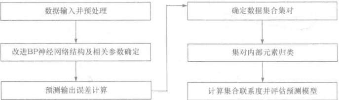

图 10.4.1 改进神经网络模型评估流程图

### 10.4.2 实例

例 10.4.1 根据有关资料，分析黄河内蒙段三湖河口站采集的水位、累计正气温、流量、封冻期最大冰厚及开河历时等 5 个因子数据。1968～1996 年的数据为样本数据，后续 5 年的数据为预测模型模拟数据。根据 Kolmogrov 定理确定 BP 神经网络结构的隐含层有 6 个神经元，三层 BP 神经网络结构为 4×6×1，取迭代次数 e_p =500，学习率 l_r = 0.05，目标函数误差差值 goal=0。

采用粒子群优化(particle swarm optimization, PSO)算法、遗传算法(genetic algorithm, GA)和小波分析算法改进 BP 神经网络，用 PSO 算法和 GA 优化 BP 神经网络隐含层的权值和阈值，用小波基本函数 Morlet 函数作为隐含层节点的传递函数。PSO 算法在优化过程中取种群规模 s_pop =200，最大迭代次数 g_max =50，惯性因子 λ=1，加速因子 κ_1 =2,κ_2 =1.8，粒子个体最大位置 X_max =3 及最大速度 V_max =5。GA 在运行过程中取种群 s_pop =200，最大迭代次数 g_max =50，交叉概率 p_c =0.2，变异概率 p_m =0.05，种群个体范围 b_bound =[-3,3]。

效果评估。以开河历时为预测模型输出变量，水位、累计正气温、流量及封冻期最大冰厚四个因子为输入变量，模型预测结果见表 10.4.1。

表 10.4.1 各模型预测结果

| 年份 | 实测数据 | PSO-BP 预测值 | PSO-BP 相差天数 | GA-BP 预测值 | GA-BP 相差天数 | 小波-BP 预测值 | 小波-BP 相差天数 | BP 预测值 | BP 相差天数 |
| :--- | :--- | :--- | :--- | :--- | :--- | :--- | :--- | :--- | :--- |
| 1996～1997 | 42 | 42 | 0 | 37 | 5 | 42 | 0 | 42 | 0 |
| 1997～1998 | 40 | 41 | 1 | 38 | 2 | 42 | 2 | 41 | 1 |
| 1998～1999 | 44 | 42 | 2 | 46 | 2 | 44 | 0 | 36 | 8 |
| 1999～2000 | 40 | 42 | 2 | 34 | 6 | 38 | 2 | 49 | 9 |
| 2000～2001 | 43 | 42 | 1 | 42 | 1 | 44 | 1 | 41 | 2 |

黄河内蒙段三湖河口站开河历时属于中长期预报，根据《水文情报预报规范》可知，三湖河口站的冰凌预报预见期为 16 天。表 10.4.1 中未经改进的 BP 预测模型预报合格率为 60%，属于丙等预报方案；改进模型的预报合格率为 100%，属于甲等预报方案。采用误差相对精度进行模型评估比较，误差相对精度为

```
\left\{\begin{array}{l} e(B_0(j) \cdot B_i(j)) = \frac{|B_0[j] : B_i[j]|}{B_0[j]} \times 100\\% \\ e^\wedge (B_0(j) \cdot B_i(j)) = 1 - \frac{1}{n} \sum_{j=1}^n e(B_0(j) \cdot B_i(j)) \\ i = 1, 2, 3, 4 \end{array}\right. \quad (10.4.1)
```

式中，e[B₀(j) : Bᵢ(j)]为集合 B₀ 与集合 Bᵢ 的相对误差；e^∧[B₀(j) : Bᵢ(j)]为集合 B₀ 与集合 Bᵢ 的平均相对误差精度。

采用式(10.4.2)分析表 10.4.1 实测数据和相差天数，可获得各个预测模型在每年的相对误差。以相对误差(0,4%]、(4%,8%)、[8%, +∞)为集对分析 3 个特征分类标准，其中处于(0,4%]范围的相对误差具有同一性，处于(4%,8%)范围的相对误差具有差异性，处于[8%, +∞)范围的相对误差具有对立性。采用式(10.4.1)计算实测数据集合 B₀ 与粒子群神经网络(PSO-BP)预测数据集合 B₁、遗传神经网络(GA-BP)预测数据集合 B₂、小波神经网络(小波-BP)预测数据集合 B₃ 及 BP 神经网络预测数据集合 B₄ 之间的联系度，具体见式(10.4.2)：

```
\left\{\begin{array}{l} \mu[B_0 \cdot B_1] = 0.6 + 0.4i + 0j \\ \mu[B_0 \cdot B_2] = 0.2 + 0.4i + 0.4j \\ \mu[B_0 \cdot B_3] = 0.6 + 0.4i + 0j \\ \mu[B_0 \cdot B_4] = 0.4 + 0.2i + 0.4j \end{array}\right. \quad (10.4.2)
```

当差异度系数 i=0.5，对立度系数 j=-1 时，得到模型预测数据与实测数据的联系度值，同时计算出模型预测数据的平均相对误差精度 e^∧，见表 10.4.2。

| 评价模型 | a | b | c | \(\mu\) | \(e^\wedge / \%\) |
| :--- | :--- | :--- | :--- | :--- | :--- |
| PSO-BP | 0.60 | 0.20 | 0.00 | 0.80 | 97.13 |
| GA-BP | 0.20 | 0.20 | 0.40 | 0.00 | 92.24 |
| 小波-BP | 0.60 | 0.20 | 0.00 | 0.80 | 97.53 |
| BP | 0.40 | 0.10 | 0.40 | 0.10 | 90.43 |

平均相对误差精度 \(e^\wedge\) 和集对分析 \(\mu\) 都是从总体上衡量预测数据和实测数据的综合指标，\(e^\wedge\) 越接近 1，模型预测效果越好，但该方法不能反映每个预测数据和实测数据的拟合程度。\(a\) 越大，表明预测模型模拟值与实测值越接近，预测模型整体效果越好；\(c\) 越小，模型预测值与实测值差异越小，拟合精度越高；\(b\) 对联系度的影响介于 \(a\) 与 \(c\) 值之间。

由表 10.4.2 可看出: ① 经 PSO 算法和小波分析改进的 BP 神经网络预测效果突出，预测数据与实测数据 \(\mu\) 均为 0.8，与 \(e^\wedge\) 评估结果一致，两者误差相对精度均在 97% 以上; ② GA 改进后比未改进时 \(e^\wedge\) 高 1.81%, \(\mu\) 低 0.1, 两种评估结果不一致，主要是未改进的 BP 神经网络 \(a\) 比 GA-BP 模型高两倍，而 \(b, c\) 对 \(\mu\) 影响较小。与文献[10]的模糊优化神经网络 \(\mu=0.1, e^\wedge=91.79\%\) 相比, PSO-BP、小波-BP 模型效果突出, GA-BP 的 \(e^\wedge\) 高 0.45%, \(\mu\) 低 0.1, BP 神经网络的 \(e^\wedge\) 低 1.36%, \(\mu\) 一致。表 10.4.2 中集对分析的 \(\mu\) 从 0 变化到 0.8, 与 \(e^\wedge\) 从 90.43% 到 97.53% 变幅相比, 集对分析评估方法在数值上变幅更大, 更能直观地反映预测模型的拟合程度。

例 10.4.1 表明: 把集对分析理论用于改进 BP 神经网络凌汛开河日期预测模型定量评估, 与采用平均相对误差精度评估模型预测相比, 效果更优。集对分析方法是将模型中每个拟合集对单元均考虑在内的动态评估技术。对于集对分析同异反三个特征分类标准的选择及差异度系数的取值等, 均有待进一步研究, 例如, 可以考虑把异分解成偏同、偏反, 形成同、偏同、偏反、反四个特性等级, 采用四元联系数; 或把异分解成偏同、临界、偏反, 形成同、偏同、临界、偏反、反五个特性等级, 采用五元联系数, 等等, 有可能进一步提高预测精度。

## 10.5 本章小结

人工神经网络是人工智能早期提出的一种模拟人脑神经网络的智能计算模型, 早在 1943 年, McCulloch 等就给出了神经元的数理模型, 之后, 人工神经网络一度得到快速发展和广泛应用, 至今仍然方兴未艾。本章介绍的三个实例主要是说明集对分析在人工神经网络应用中的应用, 包括对人工神经网络本身的修改与对人工神经网络应用效果的评价。随着计算机网络的兴起，人们已经注意到不断延伸的计算机网络可能更类似于人脑中的神经网络，从应用的角度看，人脑外部的这种计算机社会化电脑网络与人脑神经网络相互联系、相互映射，构成了一种特定意义的“脑集对”，第 3 章中已把这种“脑集对”定义为“智脑”，如何从应用的角度把集对分析用于由计算机社会化网络与人脑神经网络组成的脑集对研究，既是人工智能研究的一个重要新课题，也是进一步揭开人脑超高效处理各种复杂信息秘密的一条新途径，因为在一定意义上可以把计算机社会化网络看成是人脑神经网络的一种映射，有兴趣的读者可以在网上搜索到类似的观点和已经在这方面作出的探索。

## 参考文献

- [1] 蔡自兴,徐光佑. 人工智能及其应用[M]. 北京:清华大学出版社,2010:144-157.
- [2] 钟义信,高等人工智能原理,观念,模型[M]. 北京:科学出版社,2014:312-344.
- [3] 赵克勤.集对分析及其初步应用[M]. 杭州:浙江科学技术出版社,2000.
- [4] 李佳,王黎,马光文,等. 基于 SPA-ANN 耦合模型的年径流预测[J]. 水力发电学报,2009,28(1):41-44.
- [5] 陈晶,王文圣,李跃清.集对分析径向基函数神经网络预测模型[J]. 水文,2011,31(2):11-14.
- [6] 冯利华,张行才,龚建林.基于集对分析的水资源变化趋势[J]. 水文,2004,24(2):11-14.
- [7] 陈守煜.中长期水文预报综合分析理论模式与方法[J]. 水利学报,1997,28(8):15-24.
- [8] 金菊良,杨晓华,金保明,等. 门限回归模型在年径流预测中的应用[J]. 冰川冻土,2000,22(3):230-234.
- [9] 赵晓慎,吴海波,陈丹.集对分析在改进 BP 神经网络凌汛开河日期预测评估中的应用[J]. 水电能源科学,2011,29(12):101-104.
- [10] 陈守煜,冀鸿兰. 冰凌预报模糊优选神经网络 BP 方法[J]. 水利学报,2004,25(6):114-118.

# 第 11 章 集对分析在智能工程中的应用

智能工程包括智能技术、智能系统以及智能系统的设计、制作与运行管理等内容。其中智能技术是基础，智能系统不仅是单一或组合的智能技术应用，还能不断地充实知识库和开发知识库，具有自学习、自搜集与自理解环境信息和自身信息，在此基础上进行自分析判断和自规划、自决策能力。现有的各种智能系统在本质上是人机一体化系统；有关人机一体化系统的工程化设计、制作、运行与管理称为智能工程；智能电网、智能交通、智能制造、智能育种等，是一些具体的智能工程，本章简要地介绍集对分析在这些智能工程中应用的阶段性成果。

## 11.1 基本原理

### 11.1.1 智能工程

工程是社会领域中，根据人的某种特定价值需求，把科学和技术结合，用于自然界某些物质和能源的重组，创造出各种结构物和机器或系统及其运行与管理的过程。本书把人工智能的原理方法与技术用于各种工程创新得到的工程称为智能工程，具体如智能电网工程、智能交通工程、智能制造工程、智能育种工程等。显而易见，智能工程包括智能技术、智能结构物与智能系统及其设计、制作、建造与日常运行管理 3 个层次内容。

### 11.1.2 集对分析用于智能工程原理

由于人工智能的基本原理方法及智能技术都与不确定性有关，各种结构物和机器或系统的制造及其运行的过程也与各种不确定性有关，特别是实时环境中的各种工程及其运行都有耗能最少、产出最大，对环境负面影响最小，对各种信息处理敏捷正确以及宜人性等要求，因而可以把集对分析用于智能工程中各层次、各环节的不确定性处置和处理，以达到工程设计施工与工程运行效用最优化的目标。

## 11.2 基于联系数的多传感器数据融合(1)

Jiang 等[1] 针对多传感器数据融合过程中各传感器可信度估计困难和如何对不同类型传感器数据进行融合问题，提出一种基于集对分析联系数的多传感器数据融合方法。该方法首先利用同一度函数计算多个传感器的相互支持程度，然后计算观测值与传感器特性函数的同一度，最后利用最小最大法获得多传感器对目标属性的融合结果。该方法不需假定传感器特征函数服从 Gauss 分布。仿真实验表明该方法能客观地识别出目标，是多传感器数据融合的一种新方法，介绍如下。

### 11.2.1 问题描述

多传感器数据融合是被实践公认的一种运行成本低且能获得比单一传感器更为准确而结论可靠的数据融合方法，并因此成为传感器数据融合研究中的一个热点。但是在实际工作中，受客观条件限制，传感器的特征函数难以保证服从 Gauss 分布，这个问题在多传感器数据融合和选用低档次传感器时尤为严重[2-6]。要求被传感器跟踪的目标本身服从某种概率分布，这在不少实时环境下很难做到，也难以检验[6]。多传感器数据融合中，多个传感器跟踪同一目标，所获得的数据也并不能保证相互独立，在不少情况下存在相互关联。如何计算数据本身在不服从某种概率分布的前提下，不同传感器的相互支持程度，也是一个需要解决的问题。

进一步的问题还有，如果允许被融合的多传感器数据不服从某种概率分布，又如何表达传感器测量数据的不确定性？

针对以上一系列问题，本节提出一种基于集对同一度和联系数的多传感器数据融合新算法。

### 11.2.2 数据融合算法

步骤 1 — 计算各个传感器的相互支撑程度。

设多传感器进行测量时，第 \( j \) 个传感器和第 \( k \) 个传感器测得的数据列分别为 \( \{x_j\} \) 和 \( \{x_k\}, j \neq k \)，相应的平均值分别为 \( \overline{x_j}, \overline{x_k} \)，其中：

```
\(\overline{x_j} = \frac{1}{n} \sum x_j \quad (11.2.1)\)
\(\overline{x_k} = \frac{1}{m} \sum x_k \quad (11.2.2)\)
```

相应的样本标准差 \( \sigma_j, \sigma_k \) 分别为

```
\(\sigma_j = \sqrt{\frac{1}{n-1} \sum (x_j - \overline{x_j})^2} \quad (11.2.3)\)
\(\sigma_k = \sqrt{\frac{1}{m-1} \sum (x_k - \overline{x_k})^2} \quad (11.2.4)\)
```

则第 \( j, k \) 个传感器所获得的测量数据可分别用联系数表示为

$$U_j=\overline{x_j}+\sigma_j$$ (11.2.5) $$U_k=\overline{x_k}+\sigma_k$$ (11.2.6)

第 $j, k$ 个传感器的相互支持程度用 $U_j, U_k$ 的同一度 $a(U_j, U_k)$ 表示： $$a(U_j, U_k)=\frac{\min(U_j, U_k)}{\max(U_j, U_k)}$$ (11.2.7)

步骤 2 传感器的聚类。

根据两个传感器同一度值的大小，可把多个传感器按相互支持程度的强弱分为三类，其中当

$$a(U_j, U_k) \begin{cases} >0.5, \\ >0 \& \leqslant 0.5, \\ \leqslant 0, \end{cases}$$ 强相互支持(相融性好) 弱相互支持(相融性一般) 相互不支持(相融性差)

步骤 3 计算目标观测值 $Z$ 与测量特性联系数的同一度。

当用 $n$ 个传感器分别测量目标 $Z$ 的 $n$ 个指标，且与 $m$ 个待识别物比较时，需分别计算 $n$ 个指标 $Z_p (P=1, 2, \cdots, n)$ 与 $m$ 个待识别物特性联系数 $\overline{x}_{jp} + i\sigma_{jp} (j=1, 2, \cdots, m)$ 的同一度 $a(Z_p, \overline{x}_{jp} + i\sigma_{jp})$：

$$a(Z_p, \overline{x}_{jp} + i\sigma_{jp})=\frac{\min(Z_p, \overline{x}_{jp} + i\sigma_{jp})}{\max(Z_p, \overline{x}_{jp} + i\sigma_{jp})}$$ (11.2.8)

由此得到一个 $n \times m$ 的同一度矩阵 $H_{n \times m}$：

$$H_{n \times m} = \begin{bmatrix} a(Z_1, \overline{x}_{11} + i\sigma_{11}) & \cdots & a(Z_1, \overline{x}_{m1} + i\sigma_{m1}) \\ \vdots & & \vdots \\ a(Z_n, \overline{x}_{1n} + i\sigma_{1n}) & \cdots & a(Z_n, \overline{x}_{mn} + i\sigma_{mn}) \end{bmatrix}$$ (11.2.9)

步骤 4 目标识别决策。

原则上根据式(11.2.9)所示矩阵中属于强相互支持的传感器组所对应的同一度子矩阵 $R_{e \times f} (e \in n, f \in m)$ 作出目标识别决策。具体是，当第 $k$ 列中的最小同一度大于其余列最大同一度时，被观测的目标 $Z$ 为物体 $k$，其他情况属不确定。

### 11.2.3 数据融合实例

为便于对照，这里取文献[2]～[4]中的一个共用实例，共有 4 个传感器测量目标 $Z$，试判别目标 $Z$ 应当是物体 A 还是物体 B，或是其他不明物。具体数据见表 11.2.1。


表 11.2.1 测量参数及测量值

| 传感器 L | 物体 A \(\bar{x}_A\) | \(\sigma_A\) | 物体 B \(\bar{x}_B\) | \(\sigma_B\) | 测量值 Z |
|---|---|---|---|---|---|
| 1 | 243 | 35 | 270 | 60 | 257 |
| 2 | 0.5 | 0.1 | 0.4 | 0.1 | 0.55 |
| 3 | 30 | 4 | 40 | 9 | 28 |
| 4 | 27 | 1.2 | 21 | 3.6 | 29 |

步骤 1 将表 11.2.1 所示测量参数及测量值改写成联系数 \(A+Bi\) 的形式，得表 11.2.2。

表 11.2.2 测量参数及测量值的联系数表示

| 传感器 L | 物体 A | 物体 B | 测量值 Z |
|---|---|---|---|
| 1 | \(243+35i\) | \(270+60i\) | \(257+i\) |
| 2 | \(0.5+0.1i\) | \(0.4+0.1i\) | \(0.55+0i\) |
| 3 | \(30+4i\) | \(40+9i\) | \(28+0i\) |
| 4 | \(27+1.2i\) | \(21+3.6i\) | \(29+0i\) |

步骤 2 分别计算任两个传感器关于物体 \(A,B\) 的同一度，得表 11.2.3。

表 11.2.3 任意两个传感器的同一度

| 传感器组 | \(a_A\) | \(a_B\) |
|---|---|---|
| \(L_{12}\) | \((0.5+0.1i)/(243+35i)=0.0021+0.0001i\) | \((0.4+0.1i)/(270+60i)=0.0015+0i\) |
| \(L_{13}\) | \((30+4i)/(243+35i)=0.1235+0.0012i\) | \((40+9i)/(270+60i)=0.1481+0.0003i\) |
| \(L_{14}\) | \((27+1.2i)/(243+35i)=0.1111+0.0097i\) | \((21+3.6i)/(270+60i)=0.0778+0.0032i\) |
| \(L_{23}\) | \((0.5+0.1i)/(30+4i)=0.0167+0.0010i\) | \((0.4+0.1i)/(40+9i)=0.0100+0.0002i\) |
| \(L_{24}\) | \((0.5+0.1i)/(27+1.2i)=0.0185+0.0028i\) | \((0.4+0.1i)/(21+3.6i)=0.0190+0.0013i\) |
| \(L_{34}\) | \((27+1.2i)/(30+4i)=0.9+0.0706i\) | \((21+3.6i)/(40+9i)=0.5250+0.0230i\) |

步骤 3 判断 4 个传感器相互支持程度的强弱。

由表 11.2.3 可见，当 \(i\) 取 -1 时，只有 \(L_{34}\) 的 \(a_A\) 与 \(a_B\) 同时大于 0.5，其余传感器组的 \(a_A\) 与 \(a_B\) 都小于 0.5，但大于零，因此，确认传感器 \(L_3\) 与传感器 \(L_4\) 存在强相互支持。因此，选用传感器 \(L_3\) 与 \(L_4\) 作为目标识别决策用主传感器组。

步骤 4 计算各传感器上目标测量值 Z 与物体 \(A,B\) 测量参数的同一度，见表 11.2.4。

| 传感器组 \(L\) | \(a(Z, x_A)\) | \(a(Z, x_B)\) |
|---|---|---|
| 1 | \((243+35i)/(257+0i) = 0.9455+0.1362i\) | \((257+0i)/(270+60i) = 0.9519+0.1731i\) |
| 2 | \((0.5+0.1i)/(0.55+0i) = 0.9091+0.1818i\) | \((0.4+0.1i)/(0.55+0i) = 0.7237+0.1818i\) |
| 3 | \((28+0i)/(30+4i) = 0.9333+0.1098i\) | \((28+0i)/(40+9i) = 0.7000+0.1286i\) |
| 4 | \((27+1.2i)/(29+0i) = 0.9310+0.0414i\) | \((21+3.6i)/(29+0i) = 0.7241+0.1241i\) |

步骤 5 目标识别。

由表 11.2.4 得主决策矩阵 \(R_{e \times f}\)：

\[R_{e \times f} = \begin{bmatrix} 0.9333+0.1098i & 0.7000+0.1286i \\ 0.9310+0.0414i & 0.7241+0.1241i \end{bmatrix}\]

根据 \(R_{e \times f}\) 作如下假设：

- 假设 1 物体为 A。
则应让 \( a(Z, x_A) \) 中的 \( i \) 取下界 -1，而让 \( a(Z, x_B) \) 中的 \( i \) 取上界 1，得
\[R^A_{e \times f} = \begin{bmatrix} 0.8235 & 0.8286 \\ 0.8896 & 0.8482 \end{bmatrix}\]
由于 \(\min(0.8235, 0.8896) = 0.8235 < \max(0.8286, 0.8482) = 0.8482\)，所以物体为 A 的假设不成立。

- 假设 2 物体为 B。
则应让 \( a(Z, x_B) \) 中的 \( i \) 取下界 -1，而让 \( a(Z, x_A) \) 中的 \( i \) 取上界，得
\[R^B_{e \times f} = \begin{bmatrix} 1.0431 & 0.5714 \\ 0.9724 & 0.6000 \end{bmatrix}\]
由于 \(\min(0.5714, 0.6000) = 0.5714 < \max(1.0431, 0.9724) = 1.0431\)，所以物体为 B 的假设不成立。

- 假设 3 如果物体不是 A，也不是 B，则目标 Z 为不明物体。
显然，假设 3 成立。
这里的结论与文献[3]、[4]的结论完全一致，即最终判断目标是不明物。

### 11.2.4 讨论

- (1) 上述数据融合实例最早见文献[2]。文献[2]采用的是基于模糊理论的数据融合方法，根据对目标的支持程度从大到小依次为物体 A、不明物和物体 B；文献[3]利用统计理论处理该实例，综合结论是目标为不明物；文献[4]认为文献[3]在最终判断目标是不明物时还存在着较大的不确定性，给出了基于相关性函数和模糊综合函数的多传感器数据融合方法，所得的结论是目标为不明物。
我们注意到，文献[3]、[4]均对多传感器测量数据特性作了 Gauss 概率分布假设。事实上，由于传感器自身的性能、使用环境条件的限制，以及目标特性这些多因素的作用，传感器测量数据特性极难服从 Gauss 分布的要求，也难以在实际数据融合工作中检验是否服从 Gauss 分布。但同时又不得不考虑到多传感器数据融合中的不确定性。为此采用联系数这个新的数学工具，把测量数据特性参数中的平均值与围绕平均值的变化一并用联系数 A + Bi 表示（为便于与文献[2]～[4]对照，在表 12.2.1 中仍采用 \(\overline{x} + \sigma_x\) 表示），在需要作出最终结论时，通过 i 取上、下界值来计算不确定性的影响，所得的结果客观可信。

- (2) 从理论上说，在多传感器数据融合中，随着传感器数据量的增多，计算量也随之增加，因此，找出其中相互支持程度高的传感器组作为数据融合的主决策传感器组是一种较好且可行的方法。根据这一思想，把传感器数据融合状况一般性地分成“相融性好”“相融性一般”“相融性较差”三类。实际数据融合决策中，虽然应当以相融性好的传感器组作为主决策传感器组，但并不因此不再顾及相融性一般的传感器组所提供的数据信息。在本书的实例中，如果在 \(L_3\)、\(L_4\) 传感器组的基础上，融合 \(L_1\)、\(L_2\) 传感器提供的数据信息，结果不变，即被识别的目标仍为不明物体。根据集对分析理论，弱相互支持的传感器组与强相互支持的传感器组在一般情况下的相互关系也可分为同、异、反等多种可能。所谓同，就是两者的融合结果一致，如前述实例；所谓异，笼统地说就是不一致，细致地说是指较小不一致；较大不一致或严重不一致，归结为反；出现“异”和“反”情况时，需对原始数据作进一步验证，或增加观测值，等等。

- (3) 文献[2]～[4]在数据融合中都采用了“距离”的概念，本节则采用“同一度”的概念。从数据融合的纯粹意义上说，两个数据的同一度要比距离概念更简明但又是更本质地说明两个数据的关系。这在两个实数的同一度计算时十分清楚。当两个实数的同一度为 1 时，这两个实数无疑地可看成是同一个实数。同样的意义在两个同异型联系数的同一度计算时同样存在。这也是所给方法计算过程较为简明的一个内在原因。

- (4) 集对分析是在确定与不确定对立统一关系这个平台上建构的系统数学理论[7]，因此客观上能处理既有随机不确定性，又有模糊不确定性或其他不确定性共同作用的问题。把集对分析中的联系数用于多传感器数据融合，能较好地处理多传感器相互支持程度算法及数据融合算法中对不确定性的主观假设和数据本身不确定性问题，从而能用于不同类型的分布式多传感器数据融合，所得融合结果符合实际情况。至于如何与基于集对分析的其他数据融合方法相配套，则有待进一步研究；此外，根据集对分析，集对同一度是一元联系数，可以根据需要联系数化为同异型二元联系数或进一步细化为同异反三元联系数或多元联系数，基于多元联系数的分布式多传感器数据融合也有待进一步系统地研究。

## 11.3 基于联系数的多传感器数据融合(2)

王海颖等[8]针对先验知识未知的多传感器多次检测同一目标特征参数的情形，分析多传感器测量数据过程中产生不确定性的原因，设计了一种新的基于集对分析联系度的多传感器可靠性数据融合方法。通过利用集对分析特征函数的优势，挖掘量测数据间对立度、同一度和差异度调整数据间的联系程度，定义联系度矩阵，并利用扩维来度量不同时刻传感器测量值间的综合相近程度，然后参照在融合过程中已有的信噪比加权方法合理分配量测数据所占权重，实现传感器的加权融合。应用实例及仿真计算验证了该方法所得的有效性，融合结果具有更好的精确性、可靠性和稳健性，介绍如下。

### 11.3.1 数对及其联系度

根据集对分析文献[9]、[10]知，数对是指两个实数组成的一种集对。数对\([s,t]\)的 IDO 联系度(即三元联系数)u 为

$u=a+bi+cj=\frac{s}{t}+\frac{s}{t(t^2-1)}i+\frac{t^2-st-1}{t^2-1}j$ (11.3.1)

在式(11.3.1)中，满足 $s\in[0,\infty),t\in[0,\infty)$ 且 $1\leqslant s\leqslant t$。$i$ 为差异度的标记，需要时在 $i\in[j,1]$ 内取值，$j$ 为对立型关系数的标记，需根据不同的对立类型取值，当 IDO 关系是正负型对立关系时，取 $j=-1$，这时 $i\in[-1,1]$；当 IDO 关系是倒数型对立关系时，$j=\frac{1}{R}$，$R$ 为所讨论 \(n\) 组关系数对中的最小数，此时，$i\in[\frac{1}{R},1]\)。

### 11.3.2 联系度矩阵及其扩维

设由 \(n\) 个相互独立且不同位置的传感器组成多传感器系统，测量同一参数。观测噪声未知的情况下，对参数 \(x\) 检测，测量方程为

$z_i(k)=x+v_i(k)， i=1,2,\cdots，n$

式中，$z_i(k)\) 为 \(k\) 时刻第 \(i\) 个传感器的观测值；\(v_i(k)\) 为 \(k\) 时刻的观测噪声，且 \(E[v_i]\) 和 \(D[v_i]\) 等先验知识均未知。\(z_i(k)\) 和 \(z_j(k)\) 分别表示在 \(k\) 时刻传感器 \(i\) 与 \(j\) 的观测值，若两者的值相差较大，体现出两个传感器的相互支持度低，甚至相互不支持；若两者的值接近，说明传感器 \(i\) 与 \(j\) 相互支持度高，观测值的真实性就越高。

为量化各传感器同一时刻观测值的支持程度，引入集对分析联系度概念，并构造联系度矩阵。首先，利用式(11.3.1)三元联系数计算方法计算 \(k\) 时刻不同传感器观测值之间的联系度，获得 \(z_i(k), z_j(k)\)，作为 \(k\) 时刻下任意两个传感器的观测值，且 \(z_i(k)\leqslant z_j(k)\)，将其看做数对 \([z_i(k), z_j(k)]\)，运用集对的同异反特征函数即三元联系数，量化传感器观测值的联系程度，避免传统方法中非 1 即 0 的绝对性，由此可得 k 时刻传感器之间的联系度矩阵。

#### 定义 11.3.1 k 时刻任意两个传感器数据的联系度矩阵为

$$U_n(k) = \begin{bmatrix} 1 & u_{12}(k) & \cdots & u_{1n}(k) \\ u_{21}(k) & 1 & \cdots & u_{2n}(k) \\ \vdots & \vdots & & \vdots \\ u_{n1}(k) & u_{n2}(k) & \cdots & 1 \end{bmatrix}$$ (11.3.2)

在上述的矩阵中，第 i 行元素累加为 $\sum_{j=1}^n u_{ij}(k)$，若该行累加值较大，表明此时刻传感器的观测值与多数传感器较接近，一致性较好；相反，传感器的观测值与多数传感器的观测值相差较多，其观测值的可信度降低。

上述矩阵反映了某时刻不同传感器之间的联系度，为了提高前后时刻的融合数据的相关性，在计算下一时刻的观测联系度时将前面时刻的融合估计结果考虑在内，构造一个扩维联系度矩阵，即把前一时刻的融合估计结果作为一个假设的观测值加入到下一时刻的计算中。扩维后的联系度矩阵 $U_{n+1}(k)$ 为

$$U_{n+1}(k) = \begin{bmatrix} 1 & \cdots & u_{1n}(k) & u_{(n+1)(k)} \\ \vdots & 1 & \ddots & \vdots \\ u_{n1}(k) & \cdots & \ddots & u_{n(n+1)}(k) \\ u_{(n+1)1}(k) & \cdots & u_{(n+1)n}(k) & 1 \end{bmatrix}$$ (11.3.3)

经过以上扩充处理的联系度矩阵不仅利用了前面各次的观测数据，而且反映了观测值在整个观测区间的相互联系程度。定义 1 反映了在某个观测时刻，传感器 i 与 j 观测值的联系程度，却未考虑该时刻，传感器 i 与所有传感器（包括自身）观测值的联系度，这需要定义一致性测度来解决该问题。

#### 定义 11.3.2 k 时刻，传感器 i 的观测值与所有传感器观测值一致性测度为

$$r_i(k) = \begin{cases} \sum_{j=1}^n s_{ij}(k)/n, & k=1 \\ \sum_{j=1}^{n+1} s_{ij}(k)/(n+1), & k \geqslant 2 \end{cases}$$ (11.3.4)

### 11.3.3 一致可靠性测度

所有观测时刻的一致性度量能够很好地反映传感器的可靠性。考虑在整个观测区间的可靠性，采用统计理论中样本均值和方差。首先定义一致性均值与一致性方差。

#### 定义 11.3.3 k 时刻，传感器 i 的观测一致性均值表示为

\(\bar{r}_i(k) = \frac{1}{k} \sum_{i=1}^k r_i(t), \quad k \geqslant 2\) (11.3.5)

#### 定义 11.3.4 \(k\) 时刻, 第 \(i\) 个传感器观测一致性方差表示为 \(\sigma_i^2(k) = \frac{1}{k} \sum_{i=1}^k [r_i(t) - \bar{r}_i(t)]^2\) (11.3.6)

为减少计算量, 在计算一致可靠性测度时, 采用以下递推公式: \(\bar{r}_i(k) = \frac{k-1}{k} \bar{r}_i(k-1) + \frac{1}{k} r_i(k)\) \(\bar{r}_i(1) = r_i(1)\) (11.3.7) \(\sigma_i^2(k) = \frac{k-1}{k} \left\{ \sigma_i^2(k-1) + \frac{1}{k-1} [r_i(k) - \bar{r}_i(k)]^2 \right\}\) \(\sigma_i^2(1) = 0\) (11.3.8)

传感器的可靠性由其一致性均值与一致性方差共同决定, \(\bar{r}_i(k)\) 较大, \(\sigma_i^2(k)\) 较小, 表明该传感器的可靠性较高, 分配给该传感器量测数据的权权较大。可靠性测度由信噪比(均值与方差之比)来刻画。\(w_i(k)\) 为传感器 \(i\) 观测值的加权系数, 与一致性均值成正相关, 与一致性方差成负相关, 即

\(w_i(k) = \bar{r}_i(k) / \sigma_i^2(k)\) (11.3.9)

对其进行归一化处理, 得到 \(k\) 时刻各传感器量测数据的加权系数:

\(W_i(k) = w_i(k) / \sum_{j=1}^{n+1} w_j(k), \quad i = 1, 2, \cdots, n+1, \quad k \geqslant 2\) (11.3.10)

综上所述, 基于联系度的数据融合公式为

\(\hat{x} = \sum_{i=1}^{n+1} W_i(k) x_i(k) \begin{cases} \sum_{i=1}^n \frac{\bar{r}_i(k)}{\sum_{j=1}^n \bar{r}_j(k)} x_i(k), \quad k=1 \\ \sum_{i=1}^{n+1} \frac{\bar{r}_i(k) / \sigma_i^2(k)}{\sum_{j=1}^{n+1} \bar{r}_j(k) / \sigma_j^2(k)} x_i(k), \quad k \geqslant 2 \end{cases}\) (11.3.11)

式(11.3.1)~式(11.3.4) 和式(11.3.7)~式(11.3.11)给出了算法的全部过程,且可以归结为以下融合算法流程图(图 11.3.1)。具体步骤如下。

- 第 1 步 得到传感器的量测值后, 使用式(11.3.1) 得到联系度矩阵 \(U\), 扩维后得到 \(U'\);

- 第 2 步 计算一致性测度 \(r\), 使用式(11.3.4) 分情况计算不同时刻下的一致性测度;

- 第 3 步 使用式(11.3.7) 和式(11.3.8) 计算一致性均值与一致性方差, 求得

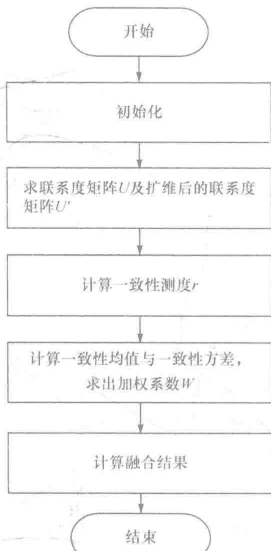

#### 图 11.3.1 融合算法流程

加权系数 W，使用式(11.3.10)对加权系数进行归一化处理；

第 4 步 代入式(11.3.11)计算融合结果。

从上面的分析可知，这里给出的算法在计算联系度矩阵时使用集对分析理论中的三元联系数，能够更加准确地量化各传感器同一时刻观测值的支持程度；同时在计算加权系数时综合考虑了量测值的一致性与传感器的可靠性。

### 11.3.4 算法仿真

采用文献[11]、[12]中提供的实验数据，应用上述方法进行融合处理。用三个热电偶对恒温箱进行温度检测，经过 6 次测量，得到观测值如表 11.3.1 所示。

#### 表 11.3.1 传感器观测值

| 观测次数 | 1 | 2 | 3 |
|---|---|---|---|
| 1 | 899.5 | 898.3 | 896.7 |
| 2 | 905.3 | 875.9 | 906.8 |
| 3 | 901.9 | 888.1 | 898.2 |
| 4 | 900.6 | 886.2 | 904.0 |
| 5 | 889.6 | 907.5 | 896.4 |
| 6 | 899.4 | 904.4 | 891.6 |

表 11.3.1 中目标真值为 900(单位：°C)。运用前述融合算法、平均融合法以及文献[13]、[14]所提出的算法获得不同的融合结果，并进行结果及绝对误差的比较。由表 11.3.2 看出，本算法在第 1、2、3、4 次的融合结果比平均值法更接近真实值，所产生的绝对误差较小；在第 1、4、5、6 次测量中的融合结果比文献[13]、[14]更接近真实值，所产生的绝对误差较小。说明运用集对分析中的三元联系数更加准确地量化多传感器观测值间的联系程度，反映了不同传感器对目标观测一致性程度，并且扩维后的联系度矩阵能综合所有观测时刻的信息，能自适应运用前面的观测值调整后面的融合权值。

#### 表 11.3.2 四种方法融合结果比较

| 观测次数 | 平均融合法 | 绝对误差 | 文献[13] | 绝对误差 | 文献[14] | 绝对误差 | 本节方法 | 绝对误差 |
|---|---|---|---|---|---|---|---|---|
| 1 | 898.1667 | 1.8333 | 898.1667 | 1.8333 | 898.1668 | 1.8332 | 898.1669 | 1.8331 |
| 2 | 896.0000 | 4.0000 | 902.2410 | 2.2410 | 901.7699 | 1.7669 | 902.1025 | 2.1025 |
| 3 | 896.0667 | 3.9333 | 899.9288 | 0.0712 | 900.0086 | 0.0086 | 901.2680 | 1.2680 |
| 4 | 896.9333 | 3.0667 | 900.6016 | 0.6016 | 900.5356 | 0.5356 | 900.3035 | 0.3035 |
| 5 | 897.9333 | 2.0667 | 896.2689 | 3.7311 | 896.7572 | 3.2428 | 897.8449 | 2.1551 |
| 6 | 898.4667 | 1.5333 | 896.1059 | 3.8941 | 896.3125 | 3.6875 | 898.4025 | 1.5975 |

表 11.3.3 为四种方法 6 次融合结果的总绝对误差，该表反映出上述融合算法的总绝对误差比平均融合法及文献[13]、[14]所提出方法的都小。

| 方法 | 本节方法 | 文献[13] | 文献[14] | 平均融合法 |
|---|---|---|---|---|
| 总绝对误差 | 9.25971 | 12.3724 | 11.0776 | 16.4333 |

当然，该算法中也有值得进一步探讨的问题。当 IDO 关系是倒数型对立关系 \( j=\frac{1}{R} \) 时，R 在本节中的取值为 n 组关系数对中的最小数，R 的取值可作进一步探讨，使得联系数的同一度与差异度更加可靠。

## 11.4 基于集对分析的工艺路线智能决策

李春磊等[15]把集对分析用于最终工艺路线智能决策，为智能制造中工艺路线制订提供了新思路，介绍如下。

### 11.4.1 概述

制造业中，工艺路线是决定产品质量、交货时间，实现经济效益的关键线。已有的工艺路线决策过程通常缺乏对零件的工艺设计经验总结及对企业当前实际生产情况的充分考虑，造成最终生成的工艺路线适用性和有效性较差，往往需要进行两次或多次修改调整。为了解决上述问题，提出一种综合考虑零件工艺设计经验和制造稳定性的工艺路线决策方法。首先建立工艺约束矩阵，并通过工艺约束矩阵的连续迭代相乘生成零件的初始工艺路线；然后将初始工艺路线与典型工艺路线进行匹配，建立基于工艺设计经验的工艺路线评价指标；再次对当前企业生产线网络的稳定性进行分析，建立基于制造稳定性的工艺路线评价指标；最后在综合考虑工艺设计经验评价指标和制造稳定性评价指标的基础上，应用集对分析实现对零件最终工艺路线的决策。实例验证结果表明，该方法有效。

### 11.4.2 初始工艺路线生成

在拿到零件设计图后，通过对加工特征识别，得到零件上需要进行加工制造的特征，记加工特征集合为 \( F \)，则

\( F=\{f_i \mid i=1,2,\cdots,m\} \) (11.4.1)

式中，\( f_i \) 表示零件上的第 \( i \) 个加工特征；\( m \) 表示零件所包含的加工特征个数。在加工特征都确定后，通过运用特征加工链决策方法可以得到与每个特征相对应的加工方法，而在零件的所有特征加工链都确定后，可以得到零件的加工工序集合 \( O_p \)：

\( O_p=\{o_{pl1},o_{pl2},\cdots,o_{pij},\cdots,o_{pm}\} \) (11.4.2)

式中，$o_{pij}$ 表示与特征 $f_i$ 相对应的特征加工链中的第 $j$ 道工序；$n$ 表示与特征 $f_i$ 相对应的特征加工链总共包含 $n$ 道工序。为了便于后续分析，这里以工序作为分析的基本内容，则 $O_p$ 可以简化为

$O_p = \{o_{p1}, o_{p2}, \cdots, o_{pk}\}$ (11.4.3)

式中，$k$ 表示 $m$ 个加工特征链所包含的工序总数。

显而易见，$O_p$ 内的工序排列是没有规律的，不能作为指导零件加工制造的工艺文件，需要添加工序间的前后约束关系。根据先粗后精、基准先行的原则建立工艺约束矩阵 $A$：

$A = (a_{ij})_{k \times k}$ (11.4.4)

式中，矩阵元素 $a_{ij}$ 表示 $O_p$ 中工序 $o_{pi}$ 和 $o_{pj}$ 之间的工艺约束关系。若 $o_{pi}$ 可以先于 $o_{pj}$ 加工，则 $a_{ij} = 1$；否则，$a_{ij} = 0$。

工艺约束矩阵确定后，通过矩阵的乘法迭代运算可以实现工序路径的逐步延伸。在不断迭代的过程中，通过工艺约束矩阵本身所定义的约束关系可以排除所有不合理的工艺路线，最终找出所有 $k$ 道工序全部参与的零件初始机加工艺路线。算法具体步骤如下。

- 步骤 1 定义矩阵 $A^{(0)} = A, t=1$。

- 步骤 2 执行 $A^{(t+1)} = A A^{(t)}$。

- 步骤 3 为了排除循环路径的干扰，将矩阵 $A^{(t+1)}$ 中的对角线元素 $a_{ii}^{(t+1)} (i=1, 2, \cdots, k)$ 清 0。

- 步骤 4 记录矩阵 $A^{(t+1)}$ 中所有非零元素所代表的工序路径。若 $a_{ij}^{(t+1)} = L$，说明存在以工序 $o_{pi}$ 为起点，工序 $o_{pj}$ 为终点，中间经过 $t$ 道工序的工艺路线总共有 $L$ 条。若 $a_{ij}^{(t+1)} = 0$，说明以工序 $o_{pi}$ 为起点，工序 $o_{pj}$ 为终点，中间经过 $t$ 道工序的工艺路线不存在。

- 步骤 5 执行 $t=t+1$。若 $t \leqslant k-2$，转步骤 2；否则，记录 $A^{(k-1)}$ 所代表的工序路径为零件的初始工艺路线，算法结束。

为了便于后续的分析计算，对于工序名称相同且可以使用相同加工设备的工序通过合并来缩减初始工艺路线的数量，而合并方法则是以具有合并关系的工序集合中最靠近工艺路线初始位置的工序位置为最终合并后的工序位置。

### 11.4.3 基于零件工艺设计经验的评价指标计算

典型工艺路线可以被认为是针对某一类具有相似功能、结构和特征的零件所提取出来的标准工艺路线，它蕴含着同类零件丰富的工艺设计经验。对零件进行工艺设计时，参考分析该零件所属类别的典型工艺路线，是制造企业借鉴已有的工艺设计成果、提高产品工艺设计的效率和质量、缩短产品研制周期的有效途径之一。因此，应用典型工艺路线所蕴含的工艺设计经验对零件的工艺路线决策具有指导意义。典型工艺路线中的工序前后关系在一定程度上代表了同类零件加工方案中工序间的优先级，可以以此为依据，将生成的零件初始工艺路线中的工序与典型工艺路线进行匹配，为初始工艺路线制订一个基于典型工艺路线所蕴含经验的评价指标，作为工艺路线决策的依据之一。基于工艺设计经验的评价指标值越大，表示该条初始工艺路线与典型工艺路线间的匹配程度就越高，其经验合理性也就越高。计算步骤如下。

- 步骤 1 建立工序优先级系数。

根据 11.4.2 节，在得到零件的初始工艺路线 \(O_l\) 后，从 \(O_l\) 的第一工序开始将各工序与典型工艺路线中的各个工序进行逐个比较，工序名称相同的，则按照典型工艺路线中该工序的位置来计算 \(O_l\) 中工序的优先级系数。假定典型工艺 \(O_D=\{d_1, d_2, \cdots, d_j, \cdots, d_s\}\)。其中，\(d_j\) 代表典型工艺路线 \(O_D\) 中的第 \(j\) 道工序；\(s\) 表示典型工艺路线 \(O_D\) 所包含的工序数。将 \(O_l\) 中的工序依次与 \(O_D\) 中的工序相匹配，若 \(l_i\) 和 \(d_j\) 的工序名称相同，则工序 \(l_i\) 的优先级系数为

\(p(l_i)=\frac{s-j+1}{s}\) (11.4.5)

若 \(l_i\) 在典型工艺路线中找不到匹配工序，则其优先级系数为零。

- 步骤 2 建立基于工艺设计经验的评价指标。

如果零件加工工序集合 \(O_p\) 中的序列可以随机排列，则理论上可以生产 \(k\) 条初始工艺路线。但实际上工序间存在合并关系且其优先关系受工艺约束影响，所以根据 11.4.2 节生成的初始工艺路线远小于 \(k\)。设初始工艺路线 \(O_l=\{l_1, l_2, \cdots, l_k\}\)，则基于典型工艺路线对 \(O_l\) 的合理性进行度量的指标可以被定义为

\(\delta(O_{l_i})=\sum_{l_i=o_p} p(l_i) \times (k-i)\) (11.4.6)

式中，\(p(l_i)\) 是 \(O_l\) 中第 \(i\) 道工序的优先级系数，可根据式(11.4.5)进行计算。由式(11.4.6)可知，当初始工艺路线 \(O_l\) 中各道工序的位置与典型工艺路线中各道工序的位置匹配程度越高，度量指标值 \(\delta\) 越大，与评价需求一致。

为了便于后续的分析和计算，在计算得到每条初始工艺路线的指标值 \(\delta\) 后，对其进行归一化处理，进而得到一个新的经验指标值：

\(r(O_{l_i})=\frac{\delta(O_{l_i})}{\max(\delta(O_{l_1}), \delta(O_{l_2}), \cdots, \delta(O_{l_r}))}\) (11.4.7)

式中，\(r\) 表示初始工艺路线的数量。

### 11.4.4 基于制造稳定性分析的评价指标计算

- 1. 企业生产线建模

定义企业当前所加工产品的工艺路线有向性所形成的拓扑结构为生产线网络 \(G(V,E,W)\)。其中，节点集合 \( V=\{V_i | i=1,2,\cdots,n\} \) 表示由企业制造单元所构成的集合，\( n \) 为企业所拥有的制造单元数；有向边集合 \( E=\{E_{ij} | i \neq j\} \) 表示某零件工艺路线中前后相邻的两道工序分别在 \( V_i \) 和 \( V_j \) 上完成；权重 \( W=\{W_{ij} | i \neq j\} \) 表示制造单元的重用次数。考虑到真实生产线中工件在不同的制造单元（工位）间流通，网络中的边也可以代表真实对象中的工件传送带或物料搬运系统。由这种建模规则产生的生产线网络可以真实地反映企业实际生产线的物理拓扑结构，并且可以随着企业生产设备的变更插入或删除节点，随着企业生产任务的变更重新叠加工艺路线，建模规则不依赖于企业实际生产情况的变化，可以在企业实际生产情况发生变化的情况下依据同样的规则快速实现建模，便于对企业实际生产情况进行动态描述。

- 2. 初始工艺路线插入机制

如果初始工艺路线 \( O_L \) 的某道工序 \( l_i \) 只能在一个制造单元上进行加工，则在进行零件加工任务排产时就将 \( l_i \) 分配到该制造单元上；如果工序 \( l_i \) 可以在多个制造单元上进行加工，则在进行零件加工任务排产时就应综合考虑这些制造单元当前的负载和加工成本。

- 1) 制造单元负载

由复杂网络的特性可知，生产线网络节点参数中的入强度 \( S_{in} \) 反映当前制造单元所承担的加工任务量。分别计算能够完成工序 \( l_i \) 加工任务的所有制造单元的节点入强度 \( S_{in} \)，则制造单元 \( v_i \) 负载 \( L_i \) 可以映射为节点入强度与生产线网络总入强度的比值，即 \( L_i = \frac{S_{in}^i}{\sum S_{in}} \)。

- 2) 加工成本

已知 \( T_i \) 为新零件加工任务排产前制造单元 \( V_i \) 加工的工序序列集合。若 \( l_i \in T_i \)，即制造单元 \( V_i \) 的原生产任务中本身就包含有对工序 \( l_i \) 的加工，此时加工成本很小，本节定义为 0.1；否则，对于制造单元 \( V_i \)，新加工任务插入前不加工工序 \( l_i \)，而插入后需对工序 \( l_i \) 进行加工，这会增加加工成本（由工人熟练程度和更换刀具、夹具等带来的成本）。加工成本为 \( T_C = c_1 Y_1 + c_2 Y_2 + c_3 Y_3 + 0.2 \) 式中，\( Y_1 = 0 \)，表示制造单元 \( V_i \) 的操作工人能够熟练加工工序 \( l_i \)，否则 \( Y_1 = 1 \)；\( Y_2 = 0 \) 表示安排制造单元 \( V_i \) 加工工序 \( l_i \) 时不需要更换新的刀具，否则 \( Y_2 = 1 \)；\( Y_3 = 0 \) 表示安排制造单元 \( V_i \) 加工工序 \( l_i \) 时不需要更换新的夹具，否则 \( Y_3 = 1 \)；\( c_1, c_2 \) 和 \( c_3 \) 为常数，满足 \( c_1 + c_2 + c_3 = 0.8 \)，调节 \( c_1, c_2 \) 和 \( c_3 \) 可以反映加工成本计算时的侧重。本节侧重更换刀具时所带来的成本，所以设定 \( c_1 = 0.2, c_2 = 0.4, c_3 = 0.2 \)。

- 3) 工序分配方案评价指标

在工序 \( l_i \) 可以被分配到多个制造单元的前提下，综合考虑制造单元当前的负载和加工成本，则将工序 \( l_i \) 分配到制造单元 \( V_i \) 上的评价指标为

\( F = \frac{1}{L_i} + \frac{1}{T_{Ci}} \) (11.4.8)

由式(11.4.8)可知，将工序 \( l_i \) 分配到制造单元 \( V_i \) 上时，由此带来的加工成本越小，插入前制造单元的负载率越低，则该工序分配方案的评价值也就越大。在综合考虑制造单元当前的负载和加工成本时，选择 F 值最大的工序分配方案。当 \( O_L \) 中的全部工序都完成分配后，则整个工艺路线也就实现了对当前生产线网络的插入。

- 3. 建立基于制造稳定性的评价指标

由复杂网络的特性可知，网络在不同的拓扑结构状态下的脆性风险大小不同，即系统稳定性不同。由企业生产线网络的形成机制可知，插入不同的初始工艺路线将形成不同拓扑结构的生产线网络，因此网络的脆性测度值可作为评判工艺路线制造稳定性的指标。这里定义混线生产网络脆性风险熵作为评判工艺路线制造稳定性的指标，将每一个制造单元 \( V_i \) 都当成一个子系统 \( G_i \)，则插入 \( O_L \) 后形成的生产线网络的脆性风险熵为

\[ \rho(O_L) = - \sum \left[ \frac{(\alpha \cdot L_i + \beta \cdot X_i) M(G_i)}{\sum (\alpha \cdot L_i + \beta \cdot X_i) M(G_i)} \right] \cdot \log(\alpha \cdot L_i + \beta \cdot X_i) \] (11.4.9)

式中，负载率 \( L_i = S_{in} / \sum S_{in} \)，即 \( L_i \) 为 \( G_i \) 的节点入强度 \( S_{in} \) 与总入强度的比值；\( X_i \) 为子系统 \( G_i \) 发生故障的概率，假设 \( G_i \) 的随机性故障 \( I \) 包含 \( t \) 个事件（设备故障、刀具磨损等），即 \( I = \{I_1, I_2, \cdots, I_t\} \)，事件 \( I_i \) 发生的概率为 \( P_i \)，则 \( X_i = 1 - \prod (1 - P_i) \)；\( M(G_i) \) 代表子系统 \( G_i \) 崩溃对整个生产线网络 \( G \) 的影响程度，可映射为聚类系数 \( C_i \) 与总聚类系数的比值，即 \( M(G_i) = C_i / \sum C_i \)；常数 \( \alpha, \beta \in [0, 1] \)，且满足 \( \alpha + \beta = 1 \)，反映子系统 \( G_i \) 在进行脆性计算时的侧重程度。

### 11.4.5 基于集对分析的工艺路线决策

- 1) 构造工艺路线决策矩阵

设总共有 \( r \) 条满足工艺约束关系的初始工艺路线，每条工艺路线都有基于工艺设计经验的评价指标值 \( \gamma \) 和基于制造稳定性的评价指标值 \( \rho \)。其中，经验指标 \( \gamma \) 为正指标，以取最大值为最优；制造稳定性指标 \( \rho \) 为负指标，以取最小值为最优。则基于集对分析同一度的工艺路线决策矩阵

\[ Q = \begin{bmatrix} \gamma(O_{i1}) & \rho(O_{i1}) \\ \gamma(O_{i2}) & \rho(O_{i2}) \\ \vdots & \vdots \\ \gamma(O_{ir}) & \rho(O_{ir}) \end{bmatrix} \] (11.4.10)

- 2) 构造理想方案和同一度矩阵

理想方案中各指标的取值应该是被评价的 \( r \) 条初始工艺路线中各类指标的最优值，即对于经验指标值 \( \gamma \) 取被评价的 \( r \) 条初始工艺路线中经验指标值的最大值，制造稳定性指标值 \( \rho \) 取被评价的 \( r \) 条初始工艺路线中制造稳定性指标值的最小值。因此，理想方案为

\[ O_1^+ = [\gamma^+, \rho^+] \] (11.4.11)

式中，\( \gamma^+ = \max(\gamma(O_{i1}), \gamma(O_{i2}), \cdots, \gamma(O_{ir})) \)；\( \rho^+ = \min(\rho(O_{i1}), \rho(O_{i2}), \cdots, \rho(O_{ir})) \)。比较决策矩阵 \( Q \) 中的指标值和理想方案中对应的指标值，计算二者间的同一度，可形成被评价初始工艺路线与理想加工方案间的同一矩阵 \( U \)：

\[ U = \begin{bmatrix} u_{11} & u_{12} \\ u_{21} & u_{22} \\ \vdots & \vdots \\ u_{r1} & u_{r2} \end{bmatrix} \] (11.4.12)

式中，\( u_{i1} = \gamma(O_{i1})/\gamma^+ \)，表示被评价工艺路线的经验指标值 \( \gamma(O_{i1}) \) 与理想方案中的对应指标值 \( \gamma^+ \) 的同一度；\( u_{i2} = \rho^+/\rho(O_{i2}) \)，表示被评价工艺路线的制造稳定性指标值 \( \rho(O_{i2}) \) 与理想方案中的对应指标值 \( \rho^+ \) 的同一度。

- 3) 确定指标权重

传统的指标权重确定方法一般采用加权统计法，即先对多位专家进行权重分配调查，然后进行统计计算。事实上，无论某项指标在专家眼里有多么重要，如果在有限个待决策评价方案中其值都相近，那么它对方案的决策就不起显著作用。显然，某项指标值在有限个方案中的差异性越大，其在决策过程中的作用也就越大，权重值也应该越大。因此，本节根据评价指标值在 \( r \) 个决策评价方案中的差异性，利用变异系数法来确定指标权重：

\[ \begin{cases} \omega_r = \frac{\theta_r}{\theta_r + \theta_p} \\ \omega_p = \frac{\theta_p}{\theta_r + \theta_p} \end{cases} \] (11.4.13)

式中，\( \omega_r \)、\( \omega_p \) 分别代表经验指标 \( \gamma \) 和制造稳定性指标 \( \rho \) 的权重；\( \theta_r \)、\( \theta_p \) 是变异系数，

等于计算指标值的标准差与均值的比率，反映了单位均值上的离散程度，\(\theta_y = \frac{\sigma_y}{Ex_y}, \theta_p = \frac{\sigma_p}{Ex_p}\)。在有限个待决策评价方案内，一个评价指标的变异系数越大，说明该指标值间的差异性就越大，对最终决策的影响程度就越大。\(Ex_y = \frac{1}{r} \sum_{i=1}^r \gamma(O_{Li})\)，表示经验指标值的均值；\(Ex_p = \frac{1}{r} \sum_{i=1}^r \rho(O_{Li})\)，表示制造稳定性指标值的均值；\(\sigma_y = \sqrt{\frac{\sum_{i=1}^r (\gamma(O_{Li}) - Ex_y)^2}{r}}\)，表示经验指标值的均方差；\(\sigma_p = \sqrt{\frac{\sum_{i=1}^r (\rho(O_{Li}) - Ex_p)^2}{r}}\)，表示制造稳定性指标值的均方差。

- 4) 计算加权同一度

得到权重向量 \(W=[\omega_y, \omega_p]\) 后，将其与同一度矩阵进行复合，可得到加权同一度向量 \(U' = U W^T\)。\(U'\) 中第 \(i\) 个元素 \(u_i\) 就是工艺路线 \(O_{Li}\) 与理想方案的同一度。根据加权同一度向量 \(U'\) 中 \(u_i\) 值的大小确定出工艺路线的优劣次序，\(u_i\) 值最大者为最佳加工方案。

### 11.4.6 实例验证

#### 1. 初始工艺路线生成

下面以某制造企业生产的机械传动轴零件为例，传动轴的零件如图 11.4.1 所示。工件材料为 45 号钢，生产批量为 20 件，调质处理为 220～350 的布氏硬度值。

根据企业的实际生产情况，选择出图 11.4.1 中零件各个加工特征对应的加工链，如表 11.4.1 所示。根据表 11.4.1 可得到传动轴零件的加工工序集合 \(O_p\)，其中工序总数 \(k=37\)。按照先粗后精、基准先行的原则对工序间的约束关系进行划分，可得到工艺约束矩阵 \(A\)。其中，一条特征加工链中的工序间应满足前后约束关系，如 \(a_{12}=a_{23}=a_{34}=1\)；在不同特征加工链间，若粗、精加工方法相同，则粗加工工序应该统一先于精加工工序，如 \(a_{16}=a_{52}=1, a_{10,15}=a_{14,11}=a_{3,35}=1\)；键槽和止动垫圈槽作为依附于外圆的次要加工表面，其加工过程应该在外圆的半精加工或精加工之后，应至少满足 \(a_{10,27}=a_{14,30}=a_{25,33}=1\)；加工工序间的先后约束关系还具有传递性，例如，\(O_{p1}\) 先于 \(O_{pj}\) 加工，而 \(O_{pj}\) 又先于 \(O_{pk}\) 加工，则应满足 \(a_{ij}=a_{jk}=a_{ik}=1\)。将矩阵 \(A\) 中满足以上关系的元素值设为 1，将与其存在对称关系的元素值设为 0，剩余元素值全部设为 0。得到零件的工艺约束矩阵 \(A\) 后，根据 11.4.2 节对 \(A\) 进行迭代相乘，记录 \(A(36)\) 所代表的工序路径为传动轴零件的初始工艺路线，结果如表 11.4.2 所示。其中，符号“\(\langle \rangle\)”表示其中工序满足合并关系。

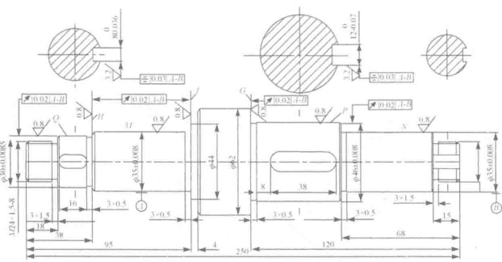

#### 图 11.4.1 传动轴设计图

#### 表 11.4.1 传动轴的特征加工链

| 加工特征 | 特征加工链 |
| :--- | :--- |
| \(\phi 35 \pm 0.008\) 外圆 \(M\) | 粗车-半精车-精车-磨削(\(O_{p1}-O_{p2}-O_{p3}-O_{p4}\)) |
| \(\phi 35 \pm 0.008\) 外圆 \(N\) | 粗车-半精车-精车-磨削(\(O_{p5}-O_{p6}-O_{p7}-O_{p8}\)) |
| \(\phi 30 \pm 0.0085\) 外圆 \(Q\) | 粗车-半精车-精车-磨(\(O_{p9}-O_{p10}-O_{p11}-O_{p12}\)) |
| \(\phi 46 \pm 0.008\) 外圆 \(P\) | 粗车-半精车-精车-磨(\(O_{p13}-O_{p14}-O_{p15}-O_{p16}\)) |
| \(\phi 14\) 外圆 | 粗车-半精车(\(O_{p17}-O_{p18}\)) |
| \(\phi 62\) 外圆 | 粗车-半精车(\(O_{p19}-O_{p20}\)) |
| \(M24 \times 1.5\) 螺纹(左) | 粗车-半精车螺纹-精车螺(\(O_{p21}-O_{p22}-O_{p23}\)) |
| \(M24 \times 1.5-8\) 螺纹(左) | 粗车-半精车螺纹-精车螺(\(O_{p24}-O_{p25}-O_{p26}\)) |
| 外圆 \(Q\) 上的键槽 | 粗铣-半精铣-精铣(\(O_{p27}-O_{p28}-O_{p29}\)) |
| 外圆 \(P\) 上的键槽 | 粗铣-半精铣-精铣(\(O_{p30}-O_{p31}-O_{p32}\)) |
| 止动垫圈槽 | 粗铣-半精铣(\(O_{p33}-O_{p34}\)) |
| 台肩 \(H\) | 靠磨(\(O_{p35}\)) |
| 台肩 \(I\) | 靠磨(\(O_{p36}\)) |
| 台肩 \(G\) | 靠磨(\(O_{p37}\)) |

#### 表 11.4.2 传动轴的初始工艺路线

| 工艺路线编号 | 工艺路线的工序组成 |
| :--- | :--- |
| \(O_{L1}\) | (\(O_{p1}, O_{p5}, O_{p9}, O_{p13}, O_{p17}, O_{p19}, O_{p21}, O_{p24}\)) \(\leftarrow\) (\(O_{p2}, O_{p6}, O_{p10}, O_{p14}, O_{p18}, O_{p20}, O_{p22}, O_{p25}\)) \(\leftarrow\) (\(O_{p27}, O_{p30}, O_{p33}\)) \(\leftarrow\) (\(O_{p3}, O_{p7}, O_{p11}, O_{p15}, O_{p23}, O_{p26}\)) \(\leftarrow\) (\(O_{p28}, O_{p31}, O_{p34}\)) \(\leftarrow\) (\(O_{p29}, O_{p32}\)) \(\leftarrow\) (\(O_{p4}, O_{p8}, O_{p12}, O_{p16}, O_{p35}, O_{p36}, O_{p37}\)) |
| \(O_{L2}\) | \(\langle O_{p1}, O_{p5}, O_{p8}, O_{p13}, O_{p17}, O_{p19}, O_{p21}, O_{p24} \rangle - \langle O_{p2}, O_{p6}, O_{p10}, O_{p14}, O_{p18}, O_{p20}, O_{p22}, O_{p25} \rangle - \langle O_{p27}, O_{p30}, O_{p33} \rangle - \langle O_{p28}, O_{p31}, O_{p34} \rangle - \langle O_{p3}, O_{p7}, O_{p11}, O_{p15}, O_{p23}, O_{p26} \rangle - \langle O_{p29}, O_{p32} \rangle - \langle O_{p4}, O_{p8}, O_{p12}, O_{p16}, O_{p35}, O_{p36}, O_{p37} \rangle\) |
| \(\vdots\) | \(\vdots\) |
| \(O_{L8}\) | \(\langle O_{p1}, O_{p5}, O_{p8}, O_{p13}, O_{p17}, O_{p19}, O_{p21}, O_{p24} \rangle - \langle O_{p2}, O_{p6}, O_{p10}, O_{p14}, O_{p18}, O_{p20}, O_{p22}, O_{p25} \rangle - \langle O_{p27}, O_{p30}, O_{p33} \rangle - \langle O_{p28}, O_{p31}, O_{p34} \rangle - \langle O_{p3}, O_{p7}, O_{p11}, O_{p15}, O_{p23}, O_{p26} \rangle - \langle O_{p29}, O_{p32} \rangle - \langle O_{p4}, O_{p8}, O_{p12}, O_{p16}, O_{p35}, O_{p36}, O_{p37} \rangle\) |
| \(\vdots\) | \(\vdots\) |
| \(O_{L10}\) | \(\langle O_{p1}, O_{p5}, O_{p8}, O_{p13}, O_{p17}, O_{p19}, O_{p21}, O_{p24} \rangle - \langle O_{p2}, O_{p6}, O_{p10}, O_{p14}, O_{p18}, O_{p20}, O_{p22}, O_{p25} \rangle - \langle O_{p3}, O_{p7}, O_{p11}, O_{p15}, O_{p23}, O_{p26} \rangle - \langle O_{p28}, O_{p31}, O_{p34} \rangle - \langle O_{p4}, O_{p8}, O_{p12}, O_{p16}, O_{p35}, O_{p36}, O_{p37} \rangle - \langle O_{p27}, O_{p30}, O_{p33} \rangle - \langle O_{p28}, O_{p31}, O_{p34} \rangle - \langle O_{p29}, O_{p32} \rangle\) |

#### 2. 零件工艺路线决策

(1) 基于工艺设计经验的评价指标值计算，并根据传动轴零件的基本信息，访问企业的典型工艺路线库，得到传动轴所属零件类别的典型工艺路线为“下料—粗车—调质—校直—半精车—精车—粗铣—磨削—精铣—钻削—钻工”。将传动轴零件加工工序集合 \(O_p\) 中的所有工序与典型工艺路线进行匹配，根据式 (11.4.5) 计算得到工序的优先级系数为：粗车(0.9091)、半精车(0.6364)、精车(0.5455)、磨削(0.3636)、半精车螺纹(0.6364)、精车螺纹(0.5455)、粗铣(0.4545)、半精铣(0)、精铣(0.2727)、靠磨(0.3636)。由此可见，满足工序合并关系的工序的优先级系数相同，根据式 (11.4.6)，以合并工序的位置计算表 11.4.2 所示各条工艺路线的经验指标值，结果如表 11.4.3 所示。

#### 表 11.4.3 基于工艺设计经验的评价指标值

| i | \(\gamma(O_{Li})\) | i | \(\gamma(O_{Li})\) |
|---|---|---|---|
| 1 | 0.9577 | 6 | 0.9930 |
| 2 | 0.9155 | 7 | 0.9648 |
| 3 | 0.8944 | 8 | 0.9648 |
| 4 | 1.0000 | 9 | 0.9225 |
| 5 | 0.9718 | 10 | 0.9930 |

(2) 基于制造稳定性的评价指标值计算。以该企业的一个生产车间为例，该车间总共加工生产 71 种零件，由这 71 种零件所构成的生产线网络包含 125 个节点,1221 条边,该网络由这 71 种零件的工艺路线叠加而成。生产线网络的主要指标节点有入度 \(K_{in}\)、出度 \(K_{out}\)、入强度 \(S_{in}\)、出强度 \(S_{out}\) 以及平均最短距离 \(L\) 边的集聚系数 \(C\) 等。根据企业生产线网络,其统计数据如表 11.4.4 所示,并得到节点的入度分布 \(P(K_{in})\)、出度分布 \(P(K_{out})\)、入强度分布 \(P(S_{in})\) 和出强度分布 \(P(S_{out})\) 规律如图 11.4.2 所示。表 11.4.4 中, \(\langle K_{in} \rangle, \langle K_{out} \rangle, \langle S_{in} \rangle, \langle S_{out} \rangle, \langle L \rangle, \langle C \rangle\) 分别表示网络中节点的平均入度,平均出度,平均入强度,平均出强度以及网络的平均最短路径,平均集聚系数。

#### 表 11.4.4 企业生产线网络的基本结构特征

| n | E | \(\langle K_{in} \rangle\) | \(\langle K_{out} \rangle\) | \(\langle S_{in} \rangle\) | \(\langle S_{out} \rangle\) | \(\langle L \rangle\) | \(\langle C \rangle\) |
|---|---|---|---|---|---|---|---|
| 125 | 1221 | 8.9514 | 6.7194 | 14.9801 | 16.2564 | 2.7826 | 0.2816 |

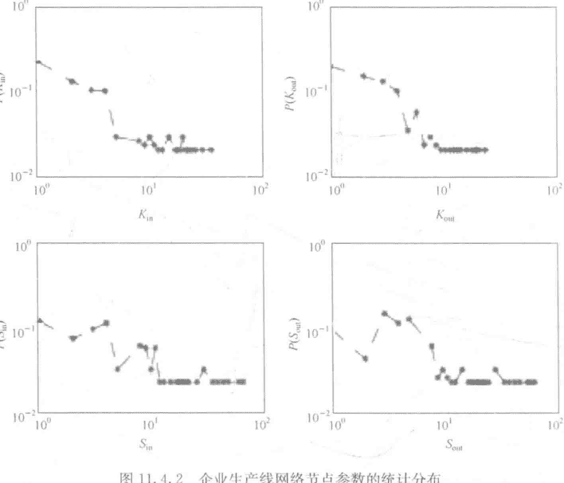

通过观察可知,生产线网络中的节点参数特性与其在制造企业生产过程中的作用有密切联系。一般而言,拥有较大入度的节点通常代表其拥有多种工序的加工能力,例如,数控加工中心拥有较大出度的节点,则可能负责零件的初级加工处理;粗加工,它是各类工件进行后续加工处理的基础;而节点强度值则与其在生产过程中的地位有着密切关系，在当前生产任务的安排下，一个制造单元被重用的次数越多，则它的强度值就越大。其中，入强度反映制造单元承担的任务量，出强度反映制造单元加工能力的影响程度，这些现象同时与该制造企业的实际生产过程相一致。将本节所建的生产线网络与具有相同节点数和节点平均度的 ER 随机网络模型进行比较，得到

\(\left\{\begin{array}{l} \langle C \rangle = 0.2816 \gg C_{ER} = \frac{\langle K \rangle}{n} = 0.0538 \\ \langle l \rangle = 2.7826 \approx l_{ER} = \frac{\ln n}{\ln \langle K \rangle} = 2.5345 \end{array}\right.\) (11.4.14)

由式(11.4.14)可知，企业生产线网络具有较大的集聚系数和较小的平均最短路径，因此该企业的生产线网络为小世界网络。

将表 11.4.2 所示的各条初始工艺路线按前述的插入机制分别插入到所建的生产线网络中，并计算所有工艺路线插入后的网络脆性风险熵，取脆性风险熵为工艺路线的制造稳定性评价指标，计算结果如表 11.4.5 所示。

#### 表 11.4.5 基于制造稳定性的评价指标值

| i | \(\rho(O_{Li})\) | i | \(\rho(O_{Li})\) |
|---|---|---|---|
| 1 | 0.8516 | 6 | 0.8622 |
| 2 | 0.8629 | 7 | 0.8931 |
| 3 | 0.8498 | 8 | 0.7430 |
| 4 | 0.8011 | 9 | 0.8629 |
| 5 | 0.8079 | 10 | 0.7560 |

(3) 工艺路线决策，由表 11.4.5 按照式(11.4.10)构造决策矩阵 Q，并按照式(11.4.11)得到传动轴零件的理想加工方案：

\(O_t^+ = [0.7430, 1.000]\)

得到决策矩阵 Q 和理想加工方案 \(O_t^+\) 后，可根据式(11.4.12)计算得到同一度矩阵为

\(U = \left[\begin{array}{cc} 0.9577 & 0.8725 \\ 0.9155 & 0.8610 \\ 0.8944 & 0.8743 \\ 1.0000 & 0.9275 \\ 0.9718 & 0.9197 \\ 0.9930 & 0.8617 \\ 0.9648 & 0.8319 \\ 0.9648 & 1.0000 \\ 0.9225 & 0.8610 \\ 0.9930 & 0.9828 \end{array}\right]\)

由决策矩阵 Q 按照式(11.4.13)计算得到决策指标的权重集为 W=[\(\omega_y, \omega_p\)]=[0.3745, 0.6255]

由此计算各条工艺路线的加权同一度为

| Value |
|---|
| 0.9044 |
| 0.8814 |
| 0.8818 |
| 0.9546 |
| 0.9392 |
| 0.9109 |
| 0.8817 |
| 0.9868 |
| 0.8841 |
| 0.9866 |

由式(11.4.15)可知，待评价的初始工艺路线 \(O_{L8}\) 的加权同一度值最大。所以在 10 个加工方案中，\(O_{L8}\) 为最佳，即传动轴零件的机加工工艺路线为：粗车<\(O_{p1}, O_{p5}, O_{p9}, O_{p13}, O_{p17}, O_{p19}, O_{p21}, O_{p24}\)>—半精车（螺纹）<\(O_{p2}, O_{p6}, O_{p10}, O_{p14}, O_{p18}, O_{p20}, O_{p22}, O_{p25}\)>—精车（螺纹）<\(O_{p3}, O_{p7}, O_{p11}, O_{p15}, O_{p23}, O_{p26}\)>—粗铣<\(O_{p27}, O_{p30}, O_{p33}\)>—半精铣<\(O_{p28}, O_{p31}, O_{p34}\)>—精铣<\(O_{p29}, O_{p32}\)>—磨削外圆（靠磨台肩）<\(O_{p4}, O_{p8}, O_{p12}, O_{p16}, O_{p35}, O_{p36}, O_{p37}\)>。考虑到零件材料为 45 号钢，要求进行调质处理，所以在 \(O_{L8}\) 的基础上插入热处理等辅助工序，得到最终的传动轴零件加工方案为：下料—粗车—调质—半精车—精车—粗铣—半精铣—精铣磨削—钻工。此外，在最终确定零件的工艺路线后，可以以计算该加工方案制造稳定性指标时插入形成的网络为企业新形成的生产线网络，这反映了新加工任务插入后对原生产情况的更新，体现了网络的动态性。

## 11.5 基于集对理论的砂轮主轴转动系统故障树分析

设备或系统零部件故障会导致设备或系统失效,刘英等[16]把集对分析用于砂轮主轴转动系统故障分析,介绍如下。

### 11.5.1 故障树的集对分析模型

#### 1. 故障树分析法

故障树分析(fault tree analysis, FTA)法是一种将系统故障形成原因逐级细化的树状图形演绎方法[17-18]。FTA 将系统最不希望出现的故障状态作为顶事件，

然后逐级追溯找出导致这一故障发生的所有中间事件与底事件，通过逻辑门将系统的故障与中间事件和底事件之间的逻辑关系联结起来，形成树形图，以表示系统故障与产生原因之间的关系；并利用概率论方法计算系统出现故障的概率，评价引发系统故障的各种因素的相关重要度。故障树中的逻辑门及事件符号如表 11.5.1 所示。

表 11.5.1 逻辑门及事件符号

| 符号 | 意义 |
| :--- | :--- |
| [或门符号] | 或门 |
| [与门符号] | 与门 |
| [非门符号] | 非门 |
| [方形符号] | 顶事件或中间事件 |
| [圆形符号] | 底事件 |

#### 2. 故障树逻辑门集对算子。

#### 1) 联系度的和积运算法则

设有联系度 \(\mu_1 = a_1 + b_1 i + c_1 j, \mu_2 = a_2 + b_2 i + c_2 j\), 则有
\(\mu_1 + \mu_2 = (a_1 + a_2) + (b_1 + b_2)i + (c_1 + c_2)j\) (11.5.1)
\(\mu_1 \mu_2 = (a_1 + b_1 i + c_1 j)(a_2 + b_2 i + c_2 j) = a + bi + cj\) (11.5.2)

式中, \(a = a_1 a_2 + c_1 c_2, b = 1 - a - c, c = a_1 c_2 + a_2 c_1\)。

#### 2) 逻辑门集对算子

根据集对分析联系度的运算法则,可以推导出故障树逻辑门集对算子如下。

#### (1) 或门集对算子。

假设 n 个故障树底事件进行逻辑或运算,每个底事件的故障状态都可以用一个联系度进行表征,则该底事件引起的故障事件的联系度可表示为

\(\mu(w) = \sum_{k=1}^n \mu(w_k) = \sum_{k=1}^n a_k + \sum_{k=1}^n b_k i + \sum_{k=1}^n c_k j\) (11.5.3)

此加法运算后显然不满足归一化条件,为了能够对故障树进行逐层计算,需要进行归一化处理,处理后的结果为

\(\mu(\varpi) = (\sum_{k=1}^n \mu(\varpi_k))/n = (\sum_{k=1}^n a_k + \sum_{k=1}^n b_k i + \sum_{k=1}^n c_k j)/n \quad (11.5.4)\)

#### (2) 与门集对算子。

\(n\) 个故障树底事件进行逻辑与运算，根据集对分析联系数积的运算法则，可以得到，由底事件引起的故障事件的联系度可表示为

\(\mu(\varpi) = \prod_{k=1}^n \mu(\varpi_k) = a + bi + cj \quad (11.5.5)\)

式中，\(a = \sum_{m \in 2N} \{ \sum_i [ \prod_{l \in I_{nn}} c_i ( \prod_{t=1, t \neq i}^n a_t ) ] \}\)，\(b = 1 - a - c\)，\(c = \sum_{m \in 2N+1} \{ \sum_i [ \prod_{l \in I_{nn}} c_i ( \prod_{t=1, t \neq i}^n a_t ) ] \}\)。

其中，\(2N\) 表示 \(n\) 个底事件中的偶数项；\(2N+1\) 表示奇数项；\(i\) 表示底事件的序号；\(I_{nn}\) 表示系数 \(c\) 的序列状态组合空间。

#### (3) 非门集对算子。

非门表示输出事件是输入事件的对立事件，设事件的联系度为 \(\mu(\varpi) = a + bi + cj\)，根据集对概念中联系度系数的含义，\(a\) 与 \(c\) 表示相互对立的特性，可知 \(\mu\) 的非门算子为

\(\bar{\mu}(\varpi) = c + bi + aj \quad (11.5.6)\)

### 11.5.2 故障树集对模型分析流程

假定故障树为 \(i(i=1, 2, \cdots, n)\) 层结构，每层有 \(k_i\) 个事件，每个事件都可以用问题域 \(\varpi_{i_k}\) 进行表示，其中 \(\varpi_0\) 表示顶事件，每个事件（顶事件、中间事件、底事件）的状态均可用一个联系度系数 \(\mu(\varpi)\) 表示；根据故障树中的事件关系和集对分析的逻辑门算法，可以求得顶事件与各层事件的关系表达式为

\(\mu(\varpi_0) = \Phi[\mu(\varpi_{i_k})] = \Phi[a_k + b_k i + c_k j] = a_0 + b_0 i + c_0 j \quad (11.5.7)\)

式中，\(\Phi\) 表示顶事件与各层事件间的内在逻辑关系函数；\(a_0\) 表示顶事件发生故障的基本可能性，\(b_0\) 表示故障状态或保持完好状态可能性的变化幅度；\(c_0\) 表示顶事件保持完好状态的基本可能性。通过 \(a_0, b_0\) 和 \(c_0\) 的加减法运算可以得到事件保持某一状态的可能性区间。集对故障树模型的分析过程如图 11.5.1 所示。

### 11.5.3 砂轮主轴转动系统的集对故障树分析

砂轮主轴转动系统是磨齿机上带动砂轮做高速旋转的关键部件，主要有传动部分及主轴轴承组成。良好的砂轮主轴转动系统要求振动小，发热低，旋转精度高且稳定，密封性能良好，轴承系统刚性好。刘英等前期对 78 台某型号的磨齿机主轴转动系统进行跟踪，综合考虑系统机械结构、工作方式、人为、环境等因素对其进

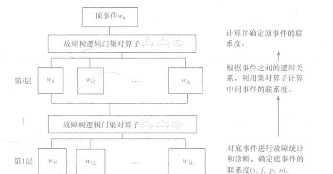

图 11.5.1 集对故障树分析模型流程图

行故障诊断与统计，得出主轴密封性能不好导致轴承失效，主轴轴承装配不当及主轴温升等为主轴转动系统失效的深层原因。图 11.5.2 和图 11.5.3 为砂轮主轴转动系统失效的故障树结构图。表 11.5.2 为各故障事件具体内容。根据砂轮主轴转动系统故障分析诊断结果和故障统计数据进行综合判断，利用式(11.5.1)可确定故障树各底事件的联系度，计算结果见表 11.5.3。根据集对故障树中各故障事件之间的逻辑关系，利用式(11.5.3)~式(11.5.9)按照“由下至上”的顺序逐层进行计算，得到各中间层事件的联系度(计算结果见表 11.5.4)，最终可确定顶事件 \( w_0 \) 的联系度为

```
\(\mu(\omega_0) = 0.303 + 0.261i + 0.436j \quad (11.5.8)\)
```

从式(11.5.8)可以看出该型号磨齿机主轴转动系统发生故障的基本可能性为 0.303，系统保持完好状态的可能性为 0.436，由于系统工作状态不确定性因素的存在，系统故障发生和保持完好状态的可能程度存在一定的变化区间，即当不确定状态部分全部转化为故障状态时(\( i=1 \))，系统发生故障的可能性为最大值 0.564，此时，保持完好状态的可能性达到最小值 0.436；当不确定状态部分转化为完好状态时(\( i=1 \))，系统发生故障的可能性为最小值 0.303，此时，保持完好状态的可能性达到最大值 0.697。由此可见，在砂轮主轴转动系统工作状态不确定性因素的影响下，系统发生故障的可能性在区间\([0.303, 0.564]\)变化。通过上述故障分析过程，针对砂轮主轴转动系统，通过加强主轴密封或改进密封结构，优化轴承装配工艺，控制轴承预紧量，加强零部件精度检测以及选择合适的冷却方式等改进措施，可以有效地减少故障发生的可能性，提高系统的可靠性。

图 11.5.2 砂轮主轴转动系统失效故障树

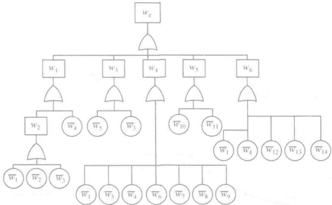

图 11.5.3 砂轮主轴转动系统结构简图

- 1-砂轮
- 2-砂轮卡盘
- 3-主轴套筒
- 4-砂轮主轴前端轴承
- 5-砂轮主轴
- 6-砂轮主轴后端轴承

表 11.5.2 砂轮主轴转动系统故障事项内容

| 事件 | 具体内容 | 事件 | 具体内容 | 事件 | 具体内容 |
|---|---|---|---|---|---|
| \( w_0 \) | 砂轮主轴转动失效 | \( w_1 \) | 主轴两端轴承失效 | \( w_8 \) | 结构过热使轴承预紧状态变化 |
| \( w_1 \) | 砂轮转动不平稳 | \( w_2 \) | 主轴轴承预紧力不合适 | \( w_9 \) | 砂轮主轴刚度不够 |
| \( w_2 \) | 轴承系统刚度不够 | \( w_3 \) | 主轴轴承装配不当 | \( w_{10} \) | 主轴电机负荷过大,功率过载 |
| \( w_3 \) | 砂轮前后系统密封不好 | \( w_4 \) | 砂轮动平衡调整不合适 | \( w_{11} \) | 主轴电机本身质量不合格 |
| \( w_4 \) | 砂轮主轴回转精度不高 | \( w_5 \) | 轴承密封结构设计不合理 | \( w_{12} \) | “磨削/修整”离合器空转异响 |
| \( w_5 \) | 主轴电机温升过高 | \( w_6 \) | 轴承之间隔套平行度不好 | \( w_{13} \) | 主轴与电机联轴器联结不可靠 |
| \( w_6 \) | 主轴转动时有异响,噪声大 | \( w_7 \) | 轴承本身精度超差 | \( w_{14} \) | 两端端盖过于紧贴轴承或垫圈 |

表 11.5.3 砂轮主轴转动系统失效基本事件联系度

| 底事件 | a | b | c | 底事件 | a | b | c |
|---|---|---|---|---|---|---|---|
| \(\bar{w}_1\) | 0.562 | 0.164 | 0.274 | \(\bar{w}_8\) | 0.603 | 0.270 | 0.127 |
| \(\bar{w}_2\) | 0.184 | 0.244 | 0.572 | \(\bar{w}_9\) | 0.207 | 0.232 | 0.561 |
| \(\bar{w}_3\) | 0.487 | 0.277 | 0.236 | \(\bar{w}_{10}\) | 0.193 | 0.315 | 0.482 |
| \(\bar{w}_4\) | 0.213 | 0.309 | 0.478 | \(\bar{w}_{11}\) | 0.207 | 0.222 | 0.571 |
| \(\bar{w}_5\) | 0.317 | 0.231 | 0.452 | \(\bar{w}_{12}\) | 0.236 | 0.372 | 0.392 |
| \(\bar{w}_6\) | 0.183 | 0.179 | 0.637 | \(\bar{w}_{13}\) | 0.263 | 0.261 | 0.476 |
| \(\bar{w}_7\) | 0.195 | 0.219 | 0.586 | \(\bar{w}_{14}\) | 0.218 | 0.289 | 0.493 |

表 11.5.4 砂轮主轴转动系统失效中间事件及顶事件联系度

| 事件 | a | b | c | 事件 | a | b | c |
|---|---|---|---|---|---|---|---|
| \(\bar{w}_1\) | 0.312 | 0.269 | 0.419 | \(\bar{w}_5\) | 0.200 | 0.269 | 0.531 |
| \(\bar{w}_2\) | 0.411 | 0.228 | 0.361 | \(\bar{w}_6\) | 0.249 | 0.279 | 0.472 |
| \(\bar{w}_3\) | 0.402 | 0.254 | 0.344 | \(\bar{w}_0\) | 0.303 | 0.261 | 0.436 |
| \(\bar{w}_4\) | 0.350 | 0.236 | 0.414 | | | | |

以上在砂轮主轴转动系统故障树分析的基础上，考虑系统工作状态的不确定性，引入集对分析理论，建立以联系度表征系统工作状态的集对故障树模型。通过逻辑门集对算子运算法则，得出砂轮主轴转动系统发生故障的可能性区间，并针对主要的故障原因，提出了改进措施，为砂轮主轴转动系统可靠性的提高提供了良好的实际经验和理论依据。分析结果表明：该方法合理地避免了故障树分析中底事件失效概率数据缺乏和实际情况复杂的不确定性缺陷，这在工程实际中是可行的。

## 11.6 本章小结

智能工程存在于不同的领域，内容极为丰富。本章仅介绍了集对分析在智能工程中的一些应用，事实上，还可以有更系统的应用。例如，从大的方面看，可以根据集对分析的同异反系统理论，把各种智能有机结合，建造起各副其实的智能大厦，各种智能在这座大厦中各有其所，需要者可以各取所需。从小的方面看，智能工程是智能与工程构成的一个集对，这个集对广泛存在于各种领域，一方面，各种智能可以渗入各种各样的工程中，以满足人们对各种工程建设的期望；另一方面，

各种工程同时也是智能运作的结晶；其间的平行智能工程、立体智能工程、多体智能工程、智能系统工程，乃至社会智能工程和太空智能工程等各种智能工程，在时空中相互补充，相得益彰；而无论是哪个方面，都在预示着智能社会和智能时代的到来。

## 参考文献

- [1] Jiang Y L, Yang Z X, Li G, et al. A multi-sensor data fusion method based on the set-pair identity degree and connection number[C]//2011 Workshop on Digital Media and Digital Content Management, Hangzhou,2011:298-301.
- [2] 王婷杰，施惠昌. 一种基于模糊理论的一致性数据融合方法[J]. 传感器技术, 1999, 18(6): 50-53.
- [3] 涂国平,邓群钊. 多传感器数据的统计融合方法[J]. 传感器技术, 2001, 20(3):28-29,32.
- [4] 刘建书,李人原,刘云龙,等. 基于相关性函数和模糊综合函数的多传感器数据融合[J]. 系统工程与电子技术, 2006, 28(7):1006-1009.
- [5] 刘敏华,萧德云. 基于相似度的多传感器数据融合[J]. 控制与决策, 2004, 19(5):534-537.
- [6] 刘以安,牛媛媛,刘同明. 集对分析在多雷达数据融合中的应用研究[J]. 华东船舶工业学院学报, 2005, 19(2):64-67.
- [7] 蒋云良,徐从富. 集对分析理论及应用研究进展[J]. 计算机科学, 2006, 33(1):205-209.
- [8] 王海颖,刘以安. 基于集对分析联系度的多传感器数据融合方法[J]. 智能系统学报, 2017, 12(2):1-8.
- [9] 赵克勤. 基于集对分析的对立分类度量与应用[J]. 科学技术与辩证法, 1994, (2):26-30.
- [10] 赵克勤. 集对分析及其初步应用[M]. 杭州:浙江科学技术出版社, 2000.
- [11] 孙勇,景博. 基于支持度的多传感器一致可靠性融合[J]. 传感技术学报, 2005, 18(3):537-539.
- [12] 刘建书. 基于相关性函数和模糊综合函数的多传感器数据融合[J]. 系统工程与电子技术, 2006, 28(7):1006-1009.
- [13] 杨佳,宫峥嵘. 基于贴近度的多传感器一致可靠性融合方法[J]. 传感技术学报, 2010, 23(7):894-898.
- [14] 蒋君杰,戴菲菲,彭力. 基于扩维贴近度的多传感器一致可靠性融合方法[J]. 传感技术学报, 2012, 25(9):1312-1315.
- [15] 李春磊,莫蓉,常智勇,等. 综合考虑零件工艺设计经验和制造稳定性的工艺路线决策[J]. 计算机辅助设计与图形学学报, 2015, 27(12):2385-2392.
- [16] 刘英,陈志恒,陈宇. 基于集对理论的砂轮主轴转动系统故障树分析[J]. 机械传动, 2014, 38(5):77-80.
- [17] 阿姆斯塔特. 可靠性数学[M]. 北京:科学出版社, 1978:318-337.
- [18] Chang C H, Mon D L, Fuzzy system reliability analysis by interval of confidence [J]. Fuzzy Sets and System,1993,56(1):29-35.

# 第 12 章 集对分析在智能社会中的应用

随着计算机网络和人工智能技术的不断进展和普及，智能社会正在向我们走来，可以说，眼下已经进入到智能社会的初级阶段，本章简要地介绍集对分析在智能社会中的若干应用。

## 12.1 引言

### 12.1.1 智能社会

智能社会还没有明确的定义。本书认为智能社会是指社会各个方面都实现智能化的一种社会形态，是现代科技发展到一定水平必然出现的一种社会形态。在智能社会中，人们将借助各种各样的智脑系统和互联网处理各种社会事务和个人事务，通过信息能的开发和利用，使社会物质财富极大化，同时又得到满意的个性化服务；从人类社会发展历史看，智能社会是信息时代发展到一定阶段的必然产物，但目前阶段的社会智能化程度还不高，充其量是智能社会的初级阶段。

### 12.1.2 集对分析用于智能社会的基本原理

人的欲望和本性使然，智能社会仍然存在物质财富社会分配不匀、信息能与其他能源相互转换效率不尽人意、地球人类需要寻找其他宜居星球以开辟新的人类家园等新的社会问题，因此各种各样的不确定性依然存在，同异反现象普遍存在，能量守恒、对立统一规律依然是各种事物和各种运动所遵循的规律；集对分析中的成对原理、不确定性原理和同异反原理依然有广阔的应用领域。称上述陈述为集对分析用于智能社会的基本原理。

## 12.2 基于集对分析的干道绿波协调控制方案优选

智能社会中的城市交通高度发达，但城市道路资源的有限性与人们希望以最快速度到达目的地构成的尖锐矛盾依然存在。如何让行驶的车辆最大限度地利用好道路交通资源是智能城市面临的一个普遍性问题。卢凯等[1]针对城市社会车辆实际行驶速度的区间变化特点，以双向绿波带宽最大为目的，利用集对分析方法，对不同信号协调控制方案在车速不确定性情况下的控制效果进行分析评价选优，

其主要工作如下。

### 12.2.1 交通干道绿波协调问题

交通信号中的绿波协调控制，对于保证现代城市道路畅通、降低能源损耗、减少交通污染、提高交通安全具有重要作用。但交通信号绿波协调控制方案的实际控制效果受到路段行驶车速、车队规模、沿线支路出入以及公交车辆、路段行人、过街车辆进出站台等诸多不确定性因素的影响。显然，只有在信号配时方案设计过程中充分考虑到各种不确定性因素的影响，才能使得配时方案满足交通控制的实际需要，具有更强的鲁棒性与适应性。

现有的干道绿波协调控制方案设计方法，主要分为图解法、数解法以及模型法等。图解法是通过几何作图的方式，利用反映车辆运动特性的时距图，对绿波带车速不断调整，从而确定干道交叉口的公共信号周期与相位差。数解法是通过数值计算的方式，在理想交叉口间距取值范围内，选取一组与实际交叉口位置最为匹配的理想交叉口位置，从而确定最佳公共信号周期、交叉口相位差以及信号相序组合。模型法则是以绿波带宽度作为性能指标，通过建立绿波协调控制模型，利用最优化方法实现信号配时参数的优化求解。

以上干道绿波协调控制方案设计方法均是以事先设定的绿波带车速作为设计车速或是最终设计得到一个最佳的固定绿波带车速。但事实上，车辆在路段上并不一定会严格遵照设计车速行驶，实际行驶车速会在一定范围内随机变化，这就使得按照固定绿波带车速设计得到的最佳配时方案很有可能达不到预期控制效果。归纳起来，现有干道绿波协调控制方案设计方法存在以下不足之处。

- (1) 现有设计方法均未考虑到车辆行驶车速变化的随机性，难以体现行驶速度的变化特点与分布规律对配时方案设计的影响。
- (2) 现有设计方法不能根据采集得到的行驶速度样本对绿波协调控制备选方案进行分析评价，不能保证所选方案对于实际不同行驶速度的适应性。
- (3) 现有设计方法未在绿波协调控制方案的分析评估中体现出行驶速度的不确定性特点，缺乏对于给定平均设计车速下具有相等绿波带宽的协调控制方案运行效果的对比分析，未能给出合理有效的评价指标及选择依据。

为此，本节介绍卢凯等把集对分析引入绿波带宽协调控制方案优选研究的工作，通过分析对比实现车速不确定性情况下的干道绿波协调控制方案评价及优化。

### 12.2.2 给定速度下的绿波协调模型

利用给定速度下的干道绿波协调控制模型，可以计算得到最佳协调控制方案集合，为此利用模型法生成干道绿波协调控制备选方案集合。下面以 Little 教授建立的 MAXBAND 模型为例，简单介绍干道绿波协调控制备选方案的获取方法。

对于干道上编号为 \( I_1, I_2, \cdots, I_n \) 的 \( n \) 个交叉口，假设以交叉口序号由小到大的方向作为出城方向，序号由大到小的方向作为入城方向，任意选取交叉口 \( I_h \) 与交叉口 \( I_i \)，进行双向绿波协调控制时距分析，见图 12.2.1。

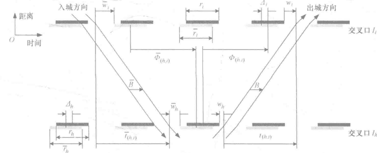

图 12.2.1 MAXBAND 模型

在此，忽略交叉口进口道绿灯启亮时清空排队车辆所需的绿灯时间，所有时间变量均以信号周期时长作为基本单位，定义各个时间变量的表述符号如下：\( B(\bar{B}) \) 为出城(入城)方向的绿波带宽比率；\( r_i(\bar{r}_i) \) 为交叉口 \( I_i \) 出城(入城)方向的红灯时间率；\( \omega_i(\bar{\omega}_i) \) 为出城(入城)方向绿波带左(右)侧边缘至交叉口 \( I_i \) 相近红灯右(左)侧边缘的时差率；\( t_{(h,i)} \) (\( t_{(h,i)} \)) 为出城(入城)方向车队从交叉口 \( I_h \) (交叉口 \( I_i \)) 到交叉口 \( I_i \) (交叉口 \( I_h \)) 的行驶时间率；\( \Phi_{(h,i)} \) (\( \bar{\Phi}_{(h,i)} \)) 为出城(入城)方向交叉口 \( I_h \) (交叉口 \( I_i \)) 红灯中心时刻点至交叉口 \( I_i \) (交叉口 \( I_h \)) 红灯中心时刻点的时差率；\( \Delta_i \) 为交叉口 \( I_i \) 入城方向红灯中点至其相近出城方向红灯中心点的时差率。

建立 MAXBAND 模型的一种表述形式，如式(12.2.1)所示：

```
P=Max\{B+\bar{B}\}
s. t. \quad \omega_i + B \leqslant 1 - r_i, \quad \bar{\omega}_i + \bar{B} \leqslant 1 - \bar{r}_i, \quad i=1, \cdots, n
(\omega_i + \bar{\omega}_i) - (\omega_{i+1} + \bar{\omega}_{i+1}) + t_{(i,i+1)} + \
t_{(i,i+1)} + \Delta_i - \Delta_{i+1} = -(1/2)(r_i + \bar{r}_i) + \
(1/2)(r_{i+1} + \bar{r}_{i+1}) + m_{(i,i+1)}, \quad i=1, \cdots, n-1
m_{(i,i+1)} \in \mathbb{Z}, \quad i=1, \cdots, n-1
B, \bar{B}, \omega_i, \bar{\omega}_i \geqslant 0, \quad i=1, \cdots, n
```

式中，\( P \) 为 MAXBAND 模型的目标函数；\( m_{(i,i+1)} \) 为交叉口 \( I_i \) 与交叉口 \( I_{i+1} \) 的相位差方程式系数，取值整数。

当需要在一定取值范围 \([C_{min}, C_{max}]\) 内对公共信号周期 \( C \) 进行优化时，MAXBAND 模型中的已知量，行驶时间率 \( t_{(h,i)} \) (\( t_{(h,i)} \)) 将随公共信号周期的不同取值相应变化。当需要在一定相位相序优化空间内对交叉口相位相序进行优化时，MAXBAND 模型中的已知量，协调相位红灯中点时差率 \(\Delta_i\) 将随交叉口相位相序的不同设置相应变化。事实上，任何一个交叉口协调相位之间的红灯中点时差率与其绿灯中点时差率大小相等，可以进行转换推导与计算。例如，当交叉口 \( I_i \) 的协调方向采用进口对称放行时，\(\Delta_i = 0\)；当交叉口 \( I_i \) 的协调方向均采用进口单独放行且出城方向相位紧接入城方向相位时，\(\Delta_i = \frac{1-r_i}{2} + \frac{1-r_i}{2} = 1 - \frac{r_i}{2} + \frac{r_i}{2}\); 其余各种信号相位相序设置情况下的 \(\Delta_i\) 计算公式，可以类似推导出来。

然而上述 MAXBAND 模型以及现有其他干道绿波协调控制方法，均以固定行驶速度或确定行驶时间作为绿波设计的依据，尚未考虑行驶速度与绿波带宽之间的动态关系，因此所得协调控制方案对速度波动的适用性难以保证。

### 12.2.3 行驶速度与绿波带宽联系度

#### 1. 建立集对

集对是指具有一定联系的两个集合所构成的对子。在干道绿波协调控制系统中，由于直行车辆的行驶速度与其绿波通行效果之间关系密切，各个车辆的实际行驶速度又具有很强的不确定性，因此在给定的干道绿波协调控制方案下，干道直行车辆的行驶速度集合与协调控制方案的绿波带宽度集合之间存在集对关系，这为将集对分析理论引入干道绿波协调控制方案评价及优化创造了先决条件。

在给定的干道绿波协调控制方案下，行驶速度与绿波带宽度之间既存在确定性(同一性与对立性)的联系，也存在不确定性(差异性)的联系。对于某一个行驶速度值而言，当绿波带宽度大于等于同一性特征阈值时，可以认为该行驶速度与绿波带宽度具有同一性；当绿波带宽度小于对立性特征阈值时，可以认为该行驶速度与绿波带宽度具有对立性；而当绿波带宽度大于等于对立性特征阈值且小于同一性特征阈值时，则可以认为该行驶速度与绿波带宽度具有差异性。

综合各个行驶速度有效取值，可以建立行驶速度与绿波带宽度之间的联系度，如式(12.2.2)所示：

\(\mu_k = a_k + b_k i + c_k j\) (12.2.2)

式中，\(\mu_k\) 为绿波协调控制方案 \(k\) 的联系度表达式；\(a_k\) 为控制方案 \(k\) 下的同一度；\(b_k\) 为控制方案 \(k\) 下的差异度；\(c_k\) 为控制方案 \(k\) 下的对立度；\(i\) 为差异度系数；\(j\) 为对立度系数。\(a_k, b_k, c_k\) 将满足如下归一化条件：

\(a_k + b_k + c_k = 1\) (12.2.3)

#### 2. 联系度分析

对于联系度表达式(12.2.2)，可以采用穷举法计算同一度 \(a_k\)、差异度 \(b_k\) 和对立度 \(c_k\)，即

$$\mu_k = \frac{S_k}{N_k} + \frac{F_k}{N_k}i + \frac{P_k}{N_k}j$$ (12.2.4)

式中，\(N_k\) 为集合特性总数；\(S_k\) 为共有特性个数；\(F_k\) 为差异特性个数；\(P_k\) 为对立特性个数。

针对绿波协调控制方案 \(k\)，选取干道车辆行驶速度有效样本数作为集合特性总数 \(N_k\)，统计绿波带宽度大于等于同一性特征阈值的速度样本数作为 \(S_k\)，统计绿波带宽度小于对立性特征阈值的速度样本数作为 \(P_k\)，其余绿波带宽度处于对立性特征阈值与同一性特征阈值之间的速度样本数作为 \(F_k\)。\(N_k, S_k, F_k, P_k\) 将满足 $$N_k = S_k + F_k + P_k$$ (12.2.5)

对于每一个行驶速度数值，每一套信号协调配时方案（信号周期、绿信比、相位差以及相位相序）将对应一对双向绿波带宽，根据绿波带宽大小可以判断其属性（同一性、差异性或对立性）；对于每一种行驶速度分布，每一套信号协调配时方案将对应一组双向绿波带宽，根据各个行驶速度样本属性可以计算其联系度大小 (\(\mu=a+bi+cj\))。当行驶速度服从某种分布时，不同的信号协调配时方案将对应不同的评价参数 (\(S_k, F_k, P_k, a_k, b_k, c_k\))，而当行驶速度分布特征发生变化时，信号协调配时方案与评价参数之间的对应关系将随之变化。

#### 3. 联系度运算

运用联系度加法运算法则，计算得到干道绿波协调控制备选方案的出、入城方向行驶车速与双向绿波带宽之间的平均联系度表达式，如式 (12.2.6) 所示：

$$\mu_k + \bar{\mu}_k = 2 \left( \frac{\mu_k + \bar{\mu}_k}{2} \right) = 2 \left( \frac{a_k + \bar{a}_k}{2} + \frac{b_k + \bar{b}_k}{2}i + \frac{c_k + \bar{c}_k}{2}j \right) = 2 (\tilde{a}_k + \tilde{b}_k i + \tilde{c}_k j)$$ (12.2.6)

式中，\(\mu_k (\bar{\mu}_k)\) 为绿波协调控制方案 \(k\) 的出城（入城）方向联系度表达式；\(\tilde{a}_k\) 为控制方案 \(k\) 的出、入城方向同一度平均值；\(\tilde{b}_k\) 为控制方案 \(k\) 的出、入城方向差异度平均值；\(\tilde{c}_k\) 为控制方案 \(k\) 的出、入城方向对立度平均值。

差异度系数 \(i\) 在集对分析理论中是一个未知数，其取值思路及取值方法具有多样性和灵活性，通常需要根据不同应用的要求，从系统和数学的角度来分析探讨。在此采用集对分析中的“顺势取值法”确定差异度系数 \(i\) 的取值，即

$$i = \frac{\bar{a}_k}{\bar{a}_k + \tilde{c}_k} + \frac{\tilde{c}_k}{\bar{a}_k + \tilde{c}_k}j$$ (12.2.7)

对立度系数 \(j\) 一般取值为 1，以表示与同一度的对立。

利用以上公式，可以算出各个绿波协调控制方案下行驶速度与绿波带宽度之间的联系度大小，从中选取联系度数值最大的备选方案，作为最佳干道绿波协调控制方案。

### 12.2.4 面向速度的绿波协调控制

如何在绿波协调控制方案设计过程中充分考虑速度变化所带来的影响，保证绿波协调控制方案的整体运行效果，需要根据实际采集到的有效速度样本，生成相应的协调控制备选方案集合，再通过分析评价从中优选出最佳的干道绿波协调控制方案。

#### 1. 协调方案集生成

- 步骤 1 采集干道路段上行驶车辆的速度样本，并去除不合理的检测样本。首先，选择在一段时间(如 15min)内对路段行驶车辆进行行驶速度样本采集，利用离群点检测方法筛除其中速度过快(如超速行驶)与速度过慢(如缓慢行驶)的检测样本。
- 步骤 2 根据保留下来的行驶速度有效样本，设定行驶速度的正常变化区间。根据留存速度样本的最小值 v_min 与最大值 v_max，可以设定行驶速度的正常变化范围为 [v_min, v_max]。
- 步骤 3 在行驶速度正常变化区间内，选取若干个速度值作为绿波协调控制方案设计车速。
- 步骤 4 针对各个所选设计车速值，利用绿波协调控制模型，生成协调控制备选方案集。通过将不同设计车速分别代入绿波协调控制模型进行计算求解，可以得到不同信号周期、不同相位差组合以及不同相位相序的备选方案集合。

#### 2. 协调方案的评价

各个绿波协调控制备选方案的评价方法及步骤如下。

- 步骤 1 针对每个绿波协调控制备选方案，分别计算各个行驶速度有效样本的绿波带宽度。
- 步骤 2 统计行驶车速与绿波带宽度之间的共有特性、差异特性及对立特性个数，计算行驶速度与绿波带宽度之间的联系度。
- 步骤 3 通过对比分析，选取联系度数值最大的备选方案作为最佳干道绿波协调控制方案。其中，可以根据绿波协调控制的交叉口数量，设定绿波带宽度或绿波带宽占比(绿波带宽度与瓶颈交叉口绿信比的比率)的同一性特征阈值 \( B_S \) 和对立性特征阈值 \( B_P \)。根据速度样本在备选方案 \( k \) 下所获得的绿波带宽占比 \( B_k \)，通过统计 \( B_k \geqslant B_S, B_P \leqslant B_k < B_S, B_k < B_P \) 的样本个数，即可得到行驶车速与绿波带宽度之间的共有特性个数 \( S_k \)、差异特性个数 \( F_k \)、对立特性个数 \( P_k \)，集合特性总数 \( N_k = S_k + F_k + P_k \)，为行驶速度样本总数。计算行驶速度与绿波带宽度之间的同一度 \( a_k = \frac{S_k}{N_k} \)，差异度 \( b_k = \frac{F_k}{N_k} \)，对立度 \( c_k = \frac{P_k}{N_k} \)，得到备选方案 \( k \) 下的联系度表达式 \( \mu_k = \frac{S_k}{N_k} + \frac{F_k}{N_k} i + \frac{P_k}{N_k} j \)。

由于干道绿波协调控制效果将随交叉口数量的增加而客观变化，因此需要设定与交叉口数量相匹配的评判阈值。根据实践经验，可以设定交叉口数量与评判阈值之间的对应关系，如表 12.2.1 所示。

表 12.2.1 评判阈值的设定

| 交叉口数 | 2 | 3 | 4 | 5 |
|---|---|---|---|---|
| \( B_S \) | 0.90 | 0.85 | 0.82 | 0.80 |
| \( B_P \) | 0.80 | 0.70 | 0.65 | 0.60 |

以表 12.2.1 中第 2 列数据为例，当协调交叉口数量为 2 时，待评方案所对应的绿波带宽占比大于等于 90% 表明该方案得到认可，小于 80% 表明该方案不被认可，在 \( [0.80, 0.90] \) 则表明对该方案评判不确定，即设定绿波带宽占比同一性特征阈值 \( B_S = 0.90 \)，对立性特征阈值 \( B_P = 0.80 \)。

将差异度系数 \( i \) 与对立度系数 \( j \) 的取值代入联系度表达式，得到各个绿波协调控制备选方案的联系度大小，选取联系度数值最大的备选方案作为所求控制方案。

### 12.2.5 应用案例

上述方法在广州市番禺区桥南路已有实际应用。桥南路是一条连接市桥南区与中心区域的重要道路，南北全长约为 1.4km，共连接 4 个信号交叉口，途经市桥大桥，该桥面仅为双向 2 车道，混合交通复杂，交通干扰严重，行驶车速具有一定的不确定性；具体工作如下。

#### 1. 备选方案生成

桥南路上各交叉口的位置分布，见图 12.2.2。交叉口 \( I_4 \)(清河中路—工业路) 的南进口直左车流量与东进口左转车流量相对较大，因此需要将其南进口与东进口放行相位选作协调相位。除此之外，所有交叉口均以南、北方向作为协调方向进行绿波协调设计。假设各信号灯相位的绿灯时间等于相位时间，且各交叉口的信号相序优化组合不受限制。已知各交叉口的单点信号配时参数如表 12.2.2 所示，由表 12.2.2 可知公共信号周期的取值范围为[145,150]。

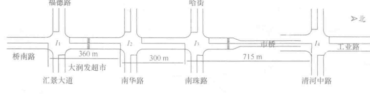

| 交叉口 | 信号周期范围/s | 第 1 相位绿信比 | 第 2 相位绿信比 | 第 3 相位绿信比 | 第 4 相位绿信比 |
|---|---|---|---|---|---|
| $I_1$ | [145,160] | 0.20(南直左) | 0.35(北直左) | 0.25(东西直左) | 0.20(西直左) |
| $I_2$ | [120,150] | 0.25(南直左) | 0.37(北直左) | 0.20(东西直左) | 0.18(行人) |
| $I_3$ | [130,150] | 0.30(南直左) | 0.45(北直左) | 0.25(东西直左) | |
| $I_4$ | [130,160] | 0.42(南直左) | 0.14(东西直左) | 0.24(东直左) | 0.2(西直左) |

以 0.5m/s 作为检测精度，假设某一时段采集到的速度样本如表 12.2.3 所示。

| 速度样本/(m/s) | 4 | 8 | 8.5 | 9 | 9.5 | 10 |
|---|---|---|---|---|---|---|
| 样本个数 | 1 | 1 | 2 | 4 | 8 | 16 |

| 速度样本/(m/s) | 10.5 | 11 | 11.5 | 12 | 18 |
|---|---|---|---|---|---|
| 样本个数 | 8 | 4 | 2 | 1 | 1 |

在采集到的行驶速度样本集合中，筛除速度过快的检测样本“18”(超速行驶)和速度过慢的检测样本“4”(缓慢行驶)，得到行驶速度的正常变化区间为[8, 12]。在行驶速度正常变化区间内，按检测精度等距选择速度值(8, 8.5, 9, 9.5, 10, 10.5, 11, 11.5, 12)作为设计车速，利用 MAXBAND 模型，计算得到绿波协调控制备选方案集合，如表 12.2.4 与表 12.2.5 所示。

在表 12.2.4 中，各数字序列表示对应交叉口在相应相序组合下的相序设置情况，例如，第 2 行第 3 列中的数字序列“2-1-3-4”表示交叉口 \( I_2 \) 在相序组合下的相序设置为“北直左相-南直左相-东西直左相-行人相”。


#### 表 12.2.4 最佳相序组合

| 相序组合 | I₁ | I₂ | I₃ | I₄ |
|---|---|---|---|---|
| 组合一 | 1-2-3-4 | 2-1-3-4 | 1-2-3 | 1-3-2-4 |
| 组合二 | 1-2-3-4 | 2-1-3-4 | 1-2-3 | 1-4-2-3 |
| 组合三 | 2-1-3-4 | 1-2-3-4 | 2-1-3 | 1-4-2-3 |
| 组合四 | 2-1-3-4 | 1-2-3-4 | 2-1-3 | 1-3-2-4 |

在表 12.2.5 中，每一种相序组合与公共信号周期取值都将对应相应的最佳绿波协调控制方案，其绿波带宽度均达到对应设计车速下的最大带宽。

#### 表 12.2.5 不同设计速度下的最佳信号配时方案

| 设计车速/(m/s) | 组合一 | 组合二 | 组合三 | 组合四 |
|---|---|---|---|---|
| 8 | — | — | — | 147 |
| 8.5 | — | — | 150 | — |
| 9 | [145,150] | — | [145,150] | — |
| 9.5 | [145,150] | — | 145 | — |
| 10 | [145,150] | — | — | — |
| 10.5 | [145,147] | — | — | — |
| 11 | — | 150 | — | — |
| 11.5 | — | 145 | — | — |
| 12 | — | 145 | — | — |

由表 12.2.4 与表 12.2.5 看到，不同行驶速度可能对应不同最佳信号配时方案，而实际交通控制系统在一段时间内要求运行同一套信号控制方案，因此需要选择一套相对固定的交叉口相序组合，使其对行驶速度变化具有良好的适应性。

#### 2. 备选方案评价

以公共信号周期的取值范围边界点 C=145 和 C=150 为例，分别计算各速度样本在上述四种备选相序组合方案下的绿波带宽度获取情况，如表 12.2.6 与表 12.2.7 所示。

#### 表 12.2.6 各速度样本的绿波带宽占比(C=145s)

| 设计车速/(m/s) | 组合一 | 组合二 | 组合三 | 组合四 |
|---|---|---|---|---|
| 8 | 40.4% | 51.7% | 65.4% | 86.2% |
| 8.5 | 74.8% | 36.0% | 95.6% | 68.5% |
| 9 | 100.0% | 25.8% | 100.0% | 46.5% |
| 9.5 | 100.0% | 41.8% | 100.0% | 30.9% |
| 10 | 100.0% | 57.5% | 92.5% | 15.2% |
| 10.5 | 100.0% | 73.2% | 76.8% | 14.1% |
| 11 | 87.3% | 88.9% | 61.1% | 23.5% |
| 11.5 | 68.5% | 97.0% | 43.5% | 32.9% |
| 12 | 56.0% | 94.0% | 31.0% | 39.2% |

#### 表 12.2.7 各速度样本的绿波带宽占比(C=150s)

| 设计车速/(m/s) | 组合一 | 组合二 | 组合三 | 组合四 |
|---|---|---|---|---|
| 8 | 58.3% | 42.4% | 83.3% | 80.3% |
| 8.5 | 91.7% | 27.3% | 100.0% | 56.1% |
| 9 | 100.0% | 37.9% | 100.0% | 34.8% |
| 9.5 | 100.0% | 53.0% | 97.0% | 19.7% |
| 10 | 100.0% | 68.2% | 81.8% | 9.1% |
| 10.5 | 92.4% | 83.3% | 66.7% | 21.2% |
| 11 | 74.3% | 98.5% | 49.3% | 30.3% |
| 11.5 | 56.1% | 93.9% | 31.1% | 39.4% |
| 12 | 43.9% | 90.9% | 18.9% | 45.5% |

根据表 12.2.6 与表 12.2.7 的计算数据，可以作出在四种备选相序组合方案下，绿波带宽占比随行驶速度变化的折线图，见图 12.2.3。
在此协调受控交叉口数量为 4，设定绿波带宽占比同一性特征阈值 Bs=0.82、对立性特征阈值 Bp=0.65。统计四种备选相序组合方案下行驶车速与绿波带宽度之间的共有特性、差异特性、对立特性个数，计算相应的同一度、差异度、对立度，如表 12.2.8 所示。

#### 图 12.2.3 绿波带宽占比折线图

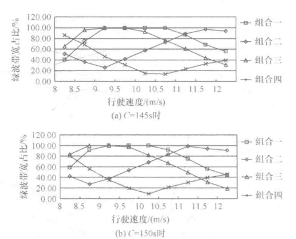

#### 表 12.2.8 联系度系数

| 配时方案 | 同一度个数 | 同一度系数 | 差异度个数 | 差异度系数 | 对立度个数 | 对立度系数 |
| :--- | :--- | :--- | :--- | :--- | :--- | :--- |
| 周期 145s 组合一 | 40 | 0.870 | 4 | 0.087 | 2 | 0.043 |
| 组合二 | 7 | 0.152 | 8 | 0.174 | 31 | 0.674 |
| 组合三 | 30 | 0.652 | 9 | 0.196 | 7 | 0.152 |
| 组合四 | 1 | 0.022 | 2 | 0.043 | 43 | 0.935 |
| 周期 150s 组合一 | 38 | 0.826 | 4 | 0.087 | 4 | 0.087 |
| 组合二 | 15 | 0.326 | 16 | 0.348 | 15 | 0.326 |
| 组合三 | 15 | 0.326 | 24 | 0.522 | 7 | 0.152 |
| 组合四 | 0 | 0.000 | 1 | 0.022 | 45 | 0.978 |

由表 12.2.8 可知，当公共信号周期取为 145s 时，相序组合一、二、三、四的联系度表达式分别为

```
\(\mu_1|_{145} = 0.870 + 0.087i + 0.043j\)
\(\mu_2|_{145} = 0.152 + 0.174i + 0.674j\)
\(\mu_3|_{145} = 0.652 + 0.196i + 0.152j\)
\(\mu_4|_{145} = 0.022 + 0.043i + 0.935j\)
```

当公共信号周期取为 150s 时，相序组合一、二、三、四的联系度表达式分别为

```
\(\mu_1|_{150} = 0.826 + 0.087i + 0.087j\)
\(\mu_2|_{150} = 0.326 + 0.348i + 0.326j\)
\(\mu_3|_{150}=0.326+0.522i+0.152j\)
\(\mu_4|_{150}=0.000+0.022i+0.978j\)
```

利用集对分析的“顺势取值法”，确定不同信号配时方案中差异度系数 \(i\) 的取值分别为

- \(i_1|_{145}=-0.952+0.048j\)
- \(i_2|_{145}=-0.184+0.816j\)
- \(i_3|_{145}=-0.811+0.189j\)
- \(i_4|_{145}=-0.023+0.977j\)
- \(i_1|_{150}=-0.905+0.095j\)
- \(i_2|_{150}=-0.500+0.500j\)
- \(i_3|_{150}=0.682+0.318j\)
- \(i_4|_{150}=0.000+1.000j\)

将不确定系数 \(i\) 的取值及 \(j=-1\) 代入联系度表达式，可以算得公共信号周期取 145s 时，\(\mu_1|_{145}=0.905\)，\(\mu_2|_{145}=-0.632\)，\(\mu_3|_{145}=0.622\)，\(\mu_4|_{145}=-0.955\)；公共信号周期取 150s 时，\(\mu_1|_{150}=0.810\)，\(\mu_2|_{150}=0\)，\(\mu_3|_{150}=0.364\)，\(\mu_4|_{150}=-1\)。综合对比发现 \(\mu_1>\mu_3>\mu_2>\mu_4\)，即相序组合——“1-2-3-4(交叉口 \(I_1\))、2-1-3-4(交叉口 \(I_2\))、1-2-3(交叉口 \(I_3\))、1-3-2-4(交叉口 \(I_4\))”的速度适应性最好，宜选为绿波协调控制实施方案。

#### 3. 运行效果分析

针对以上 8 种不同的信号周期与相序组合情况，根据各自的最佳绿波设计车速，生成相应的相位差设置方案，如表 12.2.9 所示。在此，选取交叉口 \(I_1\) 的绿灯起始时刻点作为相位差基准点，交叉口 \(I_2\)、\(I_3\)、\(I_4\) 的绝对相位差分别为其绿灯起始时刻点与基准点之间的时间差。

#### 表 12.2.9 信号配时方案

| 周期/s | 相序组合 | 速度/(m/s) | I2 | I3 | I4 |
| :--- | :--- | :--- | :--- | :--- | :--- |
| 145 | 组合一 | 10 | 33 | 57 | 123 |
| | 组合二 | 11.5 | 31 | 51 | 88 |
| | 组合三 | 9 | 32 | 72 | 137 |
| | 组合四 | 8 | 36 | 76 | 24 |
| 150 | 组合一 | 9.5 | 36 | 61 | 128 |
| | 组合二 | 11 | 34 | 54 | 93 |
| | 组合三 | 9 | 32 | 74 | 144 |
| | 组合四 | 8 | 35 | 75 | 23 |

根据上述采集得到的有效行驶速度样本及其样本个数，在仿真模型中设置期望速度分布曲线，见图 12.2.4。

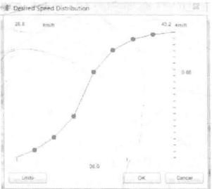

图 12.2.4 期望速度分布曲线

利用 VISSIM 微观交通仿真软件，以停车次数和延误时间作为评价指标，分别进行仿真分析评价。通过采集 3600s(24 个完整信号周期)的仿真实验数据，对比上述 8 套信号配时方案的停车次数与延误时间，见图 12.2.5。

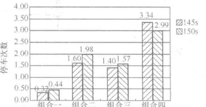

(a) 停车次数对比分析

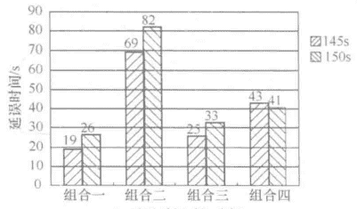

(b) 延误时间对比分析

图 12.2.5 仿真数据对比

从图 12.2.5 的仿真数据看出：①在停车次数方面，不同相序组合的协调效果优劣顺序依次为组合一、组合三、组合二、组合四，这与上述集对分析评价结果“\(\mu_1 > \mu_3 > \mu_2 > \mu_4\)”完全一致，从而也证明了绿波带宽与停车次数两者之间的良好一致性。②在延误时间方面，不同相序组合的协调效果优劣顺序依次为组合一、组合三、组合四、组合二，这与上述集对分析评价结果“\(\mu_1 > \mu_3 > \mu_2 > \mu_4\)”略有不同，究其原因是相序组合二的信号配时方案所对应的绿波设计车速约为 11m/s，如此将对绿波带宽之外的慢车不利，慢车可能需要等到下一个信号周期才能通过信号交叉口，延误时间将大大增加；而相序组合四的信号配时方案所对应的绿波设计车速为 8m/s，如此虽对绿波带宽之外的快车不利，但快车只需稍作等待便可随同后续协调车流通过信号交叉口，故延误时间不会太长。这一点也恰恰充分体现出了未饱和状态下绿波带宽与延误时间以及停车次数之间的异同。

卢凯等已把以上研究中获取的最佳信号协调控制方案应用于广州市番禺区桥南路的交通信号控制系统。实践应用情况表明，该方案可以较好地满足一定行驶速度区间内的双向绿波协调控制需求，能够基本使得车队首尾车辆均处于于连续绿波带宽之内，确保行驶车速在 32~40km/h 范围内波动的干道双向直行车辆均一路绿灯，从而为现代城市交通的干道绿波协调控制方案设计和实现智能化交通提供了一条新途径。

但对于同一性特征阈值和对立性特征阈值与协调交叉口数量之间的相关关系，以及差异度系数 \(i\) 的取值方法，尚可进行更深入的研究。

## 12.3 基于集对分析的隐私保护度量研究

隐私保护是智能社会中每个公民特别关心的问题，晏燕等[2]把集对分析用于隐私保护度量研究，介绍如下。

### 12.3.1 隐私保护及其度量研究

计算机通信技术、网络技术、无线移动技术、GPS 定位技术、车载导航和移动定位等智能化技术与装备为智能社会各类人群提供各种便利的信息服务，使得移动用户能随时随地进行所需信息的查询和访问，促进了基于位置服务（location-based service, LBS）的快速发展。在 LBS 类服务中，用户可以向位置服务供应商提出各种基于位置信息的服务请求，位置服务供应商根据用户提供的自身位置信息和查询请求，将商店、餐厅、交通路况、天气预报等各种基于位置的信息查询结果快速反馈给用户；与此同时，大量用户的位置信息在 LBS 服务器中留下痕迹，对这些信息的非法使用或者泄漏会导致移动用户个人隐私信息的暴露，为不法分子提供可乘之机；如何有效保护用户基于位置的隐私成为一个至关重要问题。

目前的隐私保护方法主要通过“高线”或“在线”保护用户 ID 信息或用户位置信息，这种方式在实现隐私保护的同时会导致服务质量的损失。一方面，移动用户需要及时得到自身隐私信息保护程度的反馈，另一方面，隐私保护系统也需要建立评价体系对隐私保护技术的优劣和隐私保护效果进行评估，由此引出隐私保护度量问题，已有研究者提出基于匿名集合、匿名集合熵、事件熵、形式化分析和概率论的隐私保护度量方法，但这些方法在实际应用中并不能完全达到隐私保护的效果。

例如，最早的 k 匿名数据隐私保护技术。k 匿名对数据库中的非敏感属性进行泛化，使得每条记录无法与其余 k-1 条记录区分，在一定程度上起到了隐私保护的效果；但是 k 匿名在进行泛化的过程中可能导致敏感数据相同，使得攻击者从泛化记录中推断相关的记录而导致信息的泄露。对此 Ashwin 等人改进了 k 匿名，对关系数据中的信息进行等价分类为 l 个不同的敏感值，建立 L-diversity 隐私保护，使每条记录无法与确定信息配对，从而达到隐私保护的作用。一般来说等价类区域的匿名名越大，则隐私程度越高。假设等价类 k (k 表示 l 个不同敏感值的第 k 个等价类) 的匿名名集合大小为 |lk|，A_k 表示第 k 个等价类范围内的不同敏感值数目，据概率统计知识，则 A_k 满足 Poisson 分布，即

```
Poisson\{(A_k) = n\} = \frac{(\rho A)^n}{n!} e^{-\rho A}
```

此时 l 个不同等价类匿名集的期望值为

```
E{|lk|} = E{A_l | A_l \geqslant 1} = \frac{E{A_l}}{1 - Poisson\{A_l = 0\}} = \frac{\rho A_l}{1 - e^{-\rho A_l}}
```

这种隐私度量由于等价划分的不同而不停地改变匿名名，导致匿名名集合的计算过程非常复杂，可行性较差。

在匿名隐私保护中，当不同匿名集中用户的概率不同时，匿名名集不能正确反映每个用户的真正匿名名。有学者提出通过发送者查询的概率计算信息熵来获取匿名名信息，但在 k 匿名中，经常通过连续位置服务的情况容易被追踪或攻击，因此，另有学者在进行连续模糊处理用户约束时，通过熵度量机制考虑模糊区域的数量和匿名概率分布，在邻近用户之间构造 mix-zone 方法降低用户的多个位置的连续。当用户在 mix-zone 中时，不进行请求和接收信息，当用户在 mix-zone 外时，使用不同的 ID。虽然这样能较好地保护用户的隐私，但损失了通信时隙，降低了通信质量。

通过 mix-zone 内的车辆数 N 及事件 l 相关联的位置隐私概率 P，建立了隐私保护度量的熵公式为

```
H(l) = - \sum_{i=1}^{N} P_i log(P_i)
```

H(l) 的值越大，说明位置隐私保护程度越高，隐私系统越有序；反之，H(l) 值越小，说明位置隐私保护程度越低，隐私系统越无序。攻击者对用户的攻击通常是采用熵值最大的对象进行。这种度量方法的特点是可跟踪性对出口车辆信息概率大的跟踪概率相对较高，但学术界对于熵概念一直存有争议。

例如，通过定义网络模型的方式，利用协议工具及推理进行隐私信息度量；这种方法采用 CMIX 协议对进入 mix-zone 内的车辆分配密钥并进行形式化分析，然后对 mix-zone 隐私模型加密；但移动用户使用的假名仍给攻击者留下可乘之隙。

### 12.3.2 隐私保护度量的集对分析

#### 1. 集对分析

集对分析主要通过建立两个集合的同（同一、肯定或支持）、异（不确定）、反（对立、否定或反对）联系数：
\(\mu_A(x)=a_A(x)+b_A(x)i+c_A(x)j\)
\(a_A(x):x \longrightarrow [0,1], b_A(x):x \longrightarrow [0,1], c_A(x):x \longrightarrow [0,1]\) (12.3.4)

且满足 \(a_A(x)+b_A(x)+c_A(x)=1\) 的归一化条件。其中 \(i \in [-1,1]\)，称为不确定度系数；\(j\) 为对立度系数，通常情况取 \(j=-1\)，来开展相关研究，详见第 2 章。

由于对用户各种信息的保护是隐私度量的前提和基础，只有搞清隐私保护机理才能合理建立隐私保护度量的科学方法和度量标准。下面分别从数据库隐私保护、位置隐私保护和轨迹隐私保护三个方面说明集对分析的应用。

#### 2. 隐私保护度量机制的集对分析方法

大量的信息是以数据形式记录在数据库中，通过建立关系数据库进行查询或获取有用的信息，但这些数据中包含大量的个人隐私信息（如姓名、性别、年龄、电话、住址及家庭成员等），在发布或查询时，必须保证数据隐私不能泄露。当前数据库发布中的数据隐私主要是以记录数据存储形式发布，例如，学生考试成绩数据、银行用户交易数据和医院病人病历数据等。实际上，数据库隐私保护就是对若干属性进行保护，在不泄露相关隐私信息下对保留数据库中数据的可用性的使用。

在数据库隐私保护中最常见的是 k 匿名隐私保护方法，k 匿名通过对数据的泛化和抑制处理，保持了数据的部分真实。由于 k 匿名随着 k 值的增大，信息的损失也增大，导致数据之间的关联性减弱而不易于数据的挖掘处理。另外在进行泛化时部分信息丢失，降低了数据分析的可靠性和准确性。利用集对分析将 k 匿名中数据信息建立一个集对同异反联系数信息表达式，计算该表达式中同、异、反势之间的优劣，分析隐私保护的泄露程度，决定是否需要采取进一步保护措施。这种思路方式实际上将隐私保护度量分为已泄露和未泄露两个聚类，将已泄露的隐私

进行防范处理，将未泄露的隐私信息进行保留或使用。

下面以医疗信息数据发布为例来分析数据库隐私保护度量的集对分析方法。给出某医院病人医疗信息原始数据，如表 12.3.1 所示。

表 12.3.1 某医院医疗信息原始数据

| 序号 | 姓名 | 性别 | 年龄 | 邮政编码 | 疾病 |
| --- | --- | --- | --- | --- | --- |
| 1 | A1 | M | 25 | 100186 | 胃病 |
| 2 | A2 | F | 27 | 100280 | 感冒 |
| 3 | A3 | M | 28 | 100180 | 胃病 |
| 4 | A4 | M | 26 | 100300 | 肺炎 |
| 5 | A5 | M | 25 | 100220 | 感冒 |
| 6 | A6 | M | 27 | 100210 | 感冒 |
| 7 | A7 | F | 28 | 100190 | 支气管炎 |
| 8 | A8 | F | 26 | 100180 | 消化不良 |

由于表 12.3.1 中数据存在不一致和很多噪声数据，在数据处理时，可以对表 12.3.1 中数据进行预处理。如性别 F 和 M 可以分别用 1 和 0 表示，年龄和邮政编码等属性值为防止起始值较大或较小的属性值相比较时对权值影响太大，取属性值中最小值 minAi、最大值 maxAi 和实际值 Ai 三个值构造出一个三元区间数。即：[Ai] = [minAi, Ai, maxAi]。从而将表 12.3.1 转化得到的三元数区间如表 12.3.2 所示。

表 12.3.2 处理后的三元数区间医疗数据信息表

| 序号 | 姓名 | 性别 | 年龄 | 邮政编码 | 疾病 |
| --- | --- | --- | --- | --- | --- |
| 1 | A1 | [0,0,1] | [25,25,28] | [100180,100186,100300] | 胃病 |
| 2 | A2 | [0,1,1] | [25,27,28] | [100180,100280,100300] | 感冒 |
| 3 | A3 | [0,0,1] | [25,28,28] | [100180,100180,100300] | 胃病 |
| 4 | A4 | [0,0,1] | [25,26,28] | [100180,100300,100300] | 肺炎 |
| 5 | A5 | [0,0,1] | [25,25,28] | [100180,100220,100300] | 感冒 |
| 6 | A6 | [0,0,1] | [25,27,28] | [100180,100210,100300] | 感冒 |
| 7 | A7 | [0,1,1] | [25,28,28] | [100180,100190,100300] | 支气管炎 |
| 8 | A8 | [0,1,1] | [25,26,28] | [100180,100180,100300] | 消化不良 |

三元数区间中 minAi 表示区间的下限（又称小元），maxAi 表示区间的上限（又称大元），Ai 是区间上最可能取该数的值，即信息的偏好值（又称特元）。但三元数区间的数据隐私保护具有很强的规律性，容易被攻击者识别，为了更好地建立数据隐私保护措施，进一步将三元数区间转化为集对分析联系数形式。

\(\mu(A_i)=a_{A_i}+b_{A_i}i+c_{A_i}j\) (12.3.5)

当 \(A_i \neq 0\) 时有
\(a_{A_i} = \frac{A_i}{\max A_i + \min A_i}\), \(b_{A_i} = \frac{(\max A_i - A_i)(A_i - \min A_i)}{(\max A_i + \min A_i)A_i}\), \(c_{A_i} = \frac{\max A_i \min A_i}{(\max A_i + \min A_i)A_i}\)
(12.3.6)

当 \(A_i = 0\) 时有
\(a_{A_i} = \frac{A_i}{\max A_i + \min A_i}\), \(b_{A_i} = \frac{\min A_i}{(\max A_i + \min A_i)}\), \(c_{A_i} = \frac{\max A_i}{(\max A_i + \min A_i)}\)
(12.3.7)

从而表 12.3.2 进一步转化为集对联系数信息表，如表 12.3.3 所示。

表 12.3.3 转化后的集对联系数医疗数据信息表

| 序号 | 姓名 | 性别 | 年龄 | 邮政编码 | 疾病 |
| :--- | :--- | :--- | :--- | :--- | :--- |
| 1 | A1 | 0+0i+1j | 0.4717+0i+0.5283j | 0.4997+0i+0.5003j | 胃病 |
| 2 | A2 | 1+0i+0j | 0.5094+0.0014i+0.4892j | 0.5002+0i+0.4998j | 感冒 |
| 3 | A3 | 0+0i+1j | 0.5283+0i+0.4717j | 0.4997+0i+0.5003j | 胃病 |
| 4 | A4 | 0+0i+1j | 0.4906+0.0015i+0.5079j | 0.5003+0i+0.4997j | 肺炎 |
| 5 | A5 | 0+0i+1j | 0.4717+0i+0.5283j | 0.4999+0i+0.5001j | 感冒 |
| 6 | A6 | 0+0i+1j | 0.5094+0.0014i+0.4892j | 0.4999+0i+0.5001j | 感冒 |
| 7 | A7 | 1+0i+0j | 0.5283+0i+0.4717j | 0.4998+0i+0.5002j | 支气管炎 |
| 8 | A8 | 1+0i+0j | 0.4906+0.0015i+0.5079j | 0.4997+0i+0.5003j | 消化不良 |

对表 12.3.3 中的性别、年龄和邮政编码等信息数据进行集结，常见的数据信息集结方法有两种：平均值法和集对逻辑联结方法。

平均值法是通过计算各个集对联系数中的同、异和反的平均值得到的平均联系数。

集对逻辑联结方法有合取和析取两种运算：对于合取运算，若
\(\mu(A_A)=a_A+b_Ai+c_Aj\), \(\mu(A_B)=a_B+b_Bi+c_Bj\)
则
\(\mu(A_A \wedge A_B)=a+bi+cj\)
式中，\(a=\min(a_A, a_B)\), \(c=\max(c_A, c_B)\), \(b=1-a-c\)。

对于析取运算，若
\(\mu(A_A)=a_A+b_Ai+c_Aj\), \(\mu(A_B)=a_B+b_Bi+c_Bj\)
则
\(\mu(A_A \vee A_B)=a+bi+cj\)
式中，\(a=\max(a_A, a_B)\), \(c=\min(c_A, c_B)\), \(b=1-a-c\)。

对于集结后的集对联系数如何进行有效的隐私度量，本节通过定义联系数势 shi(\(\mu\)) 和记分函数 S(\(\mu\)) 进行处理。

在联系数 \(\mu(A_A) = a_A + b_A i + c_A j\) 中称 shi(\(\mu\)) = \(a_A / c_A\) (当 \(c_A \to 0\) 时, shi(\(\mu \to \infty\))) 为联系数 \(\mu(A_A)\) 的势; 在联系数 \(\mu(A_A) = a_A + b_A i + c_A j\) 中称 S(\(\mu\)) = \(a - c\) 为联系数 \(\mu(A_A)\) 的记分函数。

集对联系数的势值根据大小可以分为同势、均势和反势, 从隐私度量发布的可行性而言, 同势为可行方案; 均势为一般方案; 反势为不可行方案。通过联系数的势值把隐私保护问题进行了“聚类”分析和处理, 联系数势和记分函数之间的关系, 如表 12.3.4 所示。

表 12.3.4 联系数势与记分函数关系

| 势 | a,b,c 关系 | 各势的含义 | 记分函数值 | 可行性 | a/c 的值(势值) | 隐私保护优劣级 |
|---|---|---|---|---|---|---|
| 同势 | a=1 | 全同势 | 大于0 | 可行 | 大于1 | 很高 |
| | a>b,b>c | 准同势 | | | | 高 |
| | a>b,b=c | 强同势 | | | | 一般 |
| | a>b,b<c | 亚强同势 | | | | 低 |
| | a=b,b<c | 弱同势 | | | | 较低 |
| | a<b,b<c | 微同势 | | | | 很低 |
| 均势 | a>b,b<c | 强均势 | 等于0 | 一般 | 等于1 | 高 |
| | a=b,b=c | 准均势 | | | | 一般 |
| | a<b,b>c | 弱均势 | | | | 低 |
| | b=1 | 全均势 | | | | 不确定 |
| 反势 | a>b,b<c | 微反势 | 小于0 | 不可行 | 小于1 | 低 |
| | a=b,b<c | 弱反势 | | | | 较低 |
| | a<b,b>c | 亚强反势 | | | | 很低 |
| | a<b,b=c | 强反势 | | | | 非常低 |
| | a<b,b<c | 准反势 | | | | 极低 |

联系数的势或记分函数反映了信息之间的联系趋势。势值越大, 联系越紧密, 势值越小, 联系越疏远, 当 shi(\(\mu\)) > 1 时, 信息的处理方案是可行的, 当 shi(\(\mu\)) = 1 时, 处理方案一般, 当 shi(\(\mu\)) < 1 时, 处理方案不可行。同样记分函数 S(\(\mu\)) 也反映了数据信息之间的联系变化趋势, 记分函数 S(\(\mu\)) 值越大, 联系越紧密, 记分函数 S(\(\mu\)) 值越小, 联系越疏远, 当 S(\(\mu\)) > 0 时, 数据信息处理方案是可行的, 当 S(\(\mu\)) = 0 时, 数据信息处理方案一般, 当 S(\(\mu\)) < 0 时, 数据信息处理方案不可行。

通过计算给出表 12.3.3 中医疗数据信息处理的平均联系数的势值和记分函数及分析结果, 计算结果如表 12.3.5 所示 (集对逻辑联结方法合取和析取运算同理处理)。

表 12.3.5 医疗数据信息处理平均联系数势值和记分函数及分析结果

| 序号 | 姓名 | 平均联系数 | shi(μ)值 | S(μ)值 | 隐私发布情况 | 疾病 |
|---|---|---|---|---|---|---|
| 1 | A1 | 0.3238+0i+0.6762j | 0.4789 | -0.3524 | 不发布 | 胃病 |
| 2 | A2 | 0.6699+0.0005i+0.3296j | 2.0325 | 0.3403 | 发布 | 感冒 |
| 3 | A3 | 0.3247+0i+0.6753j | 0.4808 | -0.3445 | 不发布 | 胃病 |
| 4 | A4 | 0.3303+0.0005i+0.6692j | 0.4936 | -0.3389 | 不发布 | 肺炎 |
| 5 | A5 | 0.3239+0i+0.6761j | 0.4791 | -0.3522 | 不发布 | 感冒 |
| 6 | A6 | 0.3364+0.0005i+0.6631j | 0.5073 | -0.3267 | 不发布 | 感冒 |
| 7 | A7 | 0.6760+0i+0.3240j | 2.0864 | 0.3520 | 发布 | 支气管炎 |
| 8 | A8 | 0.6634+0.0005i+0.3361j | 1.9738 | 0.3273 | 发布 | 消化不良 |

其实通过联系数势和记分函数把要解决的方案进行了一个简单的“聚类”，从表 12.3.5 信息度量实际得到 S(μ)>0 或 shi(μ)>1 是度量女性信息；S(μ)<0 或 shi(μ)<1 是度量男性信息的聚类。同一性别之间的信息用联系数势和记分函数进行区分度量。

下面是数据库隐私保护机制的集对分析方法度量信息结构图(如图 12.3.1 所示)。

#### 3. 位置隐私保护机制的集对分析方法

位置隐私保护是通过利用用户获取所在位置而进行服务，它在提供极大方便的同时，也给用户信息安全及隐私保护带来了很大的威胁和挑战。目前关于位置隐私保护主要通过如下几种方法进行：第一类方法是通过错误或发送随机的假位置信息进行隐私保护。例如，非 k 匿名位置的隐私保护，通过使用 SP(service provider)提供用户 LBS 业务请求，向一段时间内的多个同一用户发送随机位置坐标，最后通过 LSP(location service provider)返回真用户查询信息，舍弃随机伪信息结果。这种方法实现比较简单，但不能保证用户信息泄露，同时增加了处理器的服务请求任务和时空信息的多余开销。第二类方法是通过第三方代理匿名器实现位置的隐私保护。例如，通过对 k 匿名引入一个第三方代理匿名器，当用户服务器发送 LBS 请求时，先将信息发送给匿名器，匿名器将位置信息进行处理成一个具有 k 匿名性质的匿名区 ASR(anonymous spatial region)，而且在 ASR 上至少有 k 个用户，每个用户被识别的概率是均为 1/k。

位置隐私保护目前常用的方法主要有 spacetwist 方法、interval cloak 方法、Hilbert cloak 方法、Casper cloak 方法及 P2P 的 k 匿名方法等。这里以 K-anonymity 隐私保护为例介绍其集对分析方法隐私度量。

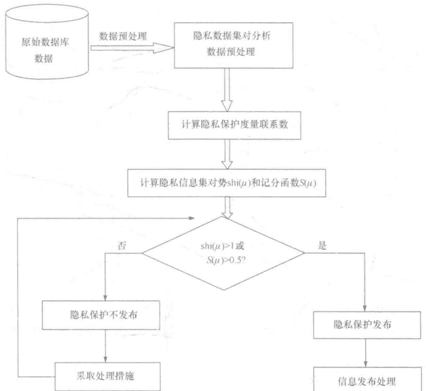

图 12.3.1 数据库隐私保护度量的集对分析结构图

在 K-anonymity 保护的 k 个用户中，假设第 n 个用户可能被识别的隐私个数为 \(a_n\)，不能确定被识别的隐私个数为 \(b_n\)，不能被识别的隐私个数为 \(c_n\)，此时用户 \(n\) 的隐私建立一个识别、不确定识别、不识别的集对联系数函数 \(\mu_n = \frac{a_n}{k} + \frac{b_n}{k}i + \frac{c_n}{k}j\)，其中 \(n=1,2,\cdots,k\)。计算集对势 \(\text{shi}(\mu_n)>1\) 或集对记分函数 \(S(\mu_n)>0.5\) 时，说明第 \(n\) 个用户的隐私保护是泄露的，此时重新对第 \(n\) 个用户进行隐私保护处理；否则第 \(n\) 个隐私保护信息没泄露。在 K-anonymity 保护中 \(k\) 个用户的位置隐私的识别是等概率的，均为 \(1/k\)。为了有效进行隐私度量，用信息熵概念进行信息概率的处理无疑是合适的选择。

对第 \(n\) 个用户的信息泄露集对熵为

\(H_{\text{shi}}(\mu_n) = -\text{shi}(\mu_n)\log\text{shi}(\mu_n)\) (12.3.8)

对第 \(n\) 个用户的信息泄露集对记分函数熵为

\(H_S(\mu_n) = -S(\mu_n)\log S(\mu_n)\) (12.3.9)

因此，\(k\) 个用户的信息泄露集对熵为

\( H_{shi}(\mu_k) = -\sum_{n=1}^k \text{shi}(\mu_n)\log\text{shi}(\mu_n) \)

k 个用户的信息泄露集对记分函数熵为

\( H_S(\mu_k) = -\sum_{n=1}^k S(\mu_n)\log S(\mu_n) \)

而 k 个用户的信息识别是等概率的，均为 1/k，因此其信息识别的最大熵为

\( H_{max}(\mu_k) = -\log(\frac{1}{k}) \)

从而采用相对信息泄露集对势熵或相对信息泄露集对记分函数熵来衡量 K-anonymity 隐私保护中的信息度量。

相对信息泄露集对势熵信息度量为

\( L_{shi}(\mu_k) = \frac{H_{shi}(\mu_k)}{H_{max}(\mu_k)} \)

相对信息泄露集对记分函数熵信息度量为

\( L_S(\mu_k) = \frac{H_S(\mu_k)}{H_{max}(\mu_k)} \)

因此，\( L_{shi}(\mu_k) \) 或 \( L_S(\mu_k) \) 反映了 K-anonymity 隐私保护中信息泄露的程度，其值越大，信息泄露越多。而 \( 1-L_{shi}(\mu_k) \) 或 \( 1-L_S(\mu_k) \) 反映了 K-anonymity 隐私保护中信息保护的程度。

下面是 K-anonymity 隐私保护信息度量机制的体系结构图，如图 12.3.2 所示。

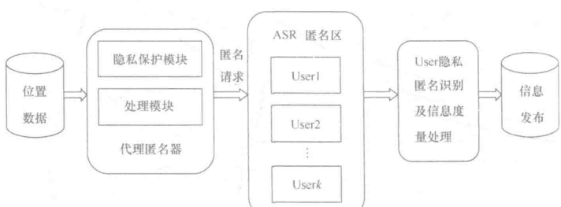

图 12.3.2 K-anonymity 隐私保护信息度量机制的体系结构图

#### 4. 轨迹隐私保护机制的集对分析方法

轨迹隐私保护是隐私保护研究的重点和难点，它是位置隐私保护的持续动态化过程。随着 GPS 技术、移动网络等技术的发展，轨迹隐私保护导致个人信息泄露问题逐年增多，甚至由于轨迹信息的泄露造成人身威胁，例如，美国福克斯公司报道的有人利用 GPS 数据跟踪前女友实施报复的案例。如何进行轨迹数据隐私保护及信息度量成为迫切要解决的问题。

目前轨迹隐私保护采用的技术手段主要有：假数据轨迹隐私保护，它是通过添加假数据进行干扰原始数据的一种隐私保护方法。这种保护方法易于实现，但不利于数据有效性和移植性的应用；轨迹泛化隐私保护方法是对轨迹上数据信息进行泛化匿名的隐私保护，该方法易于实现，有利于数据的移植和数据利用，但这种方法的隐私保护信息泄露风险较大；轨迹隐私保护抑制法是将轨迹中敏感数据、重要数据进行保留，不发布进行隐私保护，虽然这种隐私保护程度较高，但发布的数据信息利用价值不大，不利于数据信息分析和数据信息挖掘。轨迹隐私保护信息度量实际是位置隐私保护信息的持续动态化过程，下面以 k 匿名的轨迹隐私保护为例进行其集对信息度量分析，在位置匿名基础上加入轨迹动态的信息保护的集对同一系数 \(a_k/k\) 或信息泄露的集对对立系数 \(c_k/k\)。

信息熵和集对分析隐私保护都是建立在概率统计基础上的，信息熵是以不确定概率的 \(P(x_i)\log P(x_i)\) 来度量信息，其中 \(P(x_i)\) 是信息出现概率的大小。但集对分析是建立在同、异、反联系数上的一个确定不确定系统，它能更好地反映信息连续过渡变化状态，而信息熵是无法反映信息连续过渡变化状态。为了克服信息熵的不足，可以建立密度函数和信息变差，但必须要求该函数是绝对连续的，而集对分析则不需要这么多约束要求，具有更一般意义上的隐私信息不确定度量。因此，k 个用户的动态轨迹泄露信息集对势熵为

\(H_{\text{shD}}(\mu_k) = -\sum_{n=1}^k \frac{a_n}{k} \sum_{n=1}^k \text{shi}(\mu_n) \log \text{shi}(\mu_n)\) (12.3.15)

同样，k 个用户动态轨迹泄露信息集对记分函数熵为

\(H_{\text{SD}}(\mu_k) = -\sum_{n=1}^k \frac{a_n}{k} \sum_{n=1}^k S(\mu_n) \log S(\mu_n)\) (12.3.16)

相对动态轨迹隐私信息泄露集对势熵信息度量为

\(D_{\text{shi}}(\mu_k) = \frac{H_{\text{shD}}(\mu_k)}{H_{\max}(\mu_k)}\) (12.3.17)

相对动态轨迹隐私信息泄露集对记分函数熵信息度量为

\(D_S(\mu_k) = \frac{H_{\text{SD}}(\mu_k)}{H_{\max}(\mu_k)}\) (12.3.18)

\(D_{\text{shi}}(\mu_k)\) 或 \(D_S(\mu_k)\) 值越大，反映轨迹隐私信息泄露程度越大。相反，其值越小，说明轨迹隐私保护信息泄露程度越小。

集对分析隐私保护度量在很大程度上是对隐私数据信息之间联系关系的一种可能度量分析，根据度量值的大小，对隐私信息进行相关的处理和保护。隐私攻击者所能获取信息的优劣直接影响了集对分析度量隐私保护的好坏。


### 12.3.3 不同隐私保护度量方法比较

#### 1. 隐私保护度量标准及内容

不同的隐私保护由于方法各异，不能一概而论，要具体分析其各自的特性。在综合有关前人工作基础上，这里给出如下的隐私保护度量标准及内容（见表 12.3.6）。

#### 表 12.3.6 隐私保护度量标准及内容

| 隐私保护名称 | 保护标准 | 隐私保护内容及实现 |
| :--- | :--- | :--- |
| 隐私保护内容 | 数据保护 | 通过保护数据及属性方法实现隐私保护 |
| | 匿名保护 | 采用假名或匿名进行隐私保护 |
| | 身份保护 | 通过身份保护手段进行隐私保护 |
| | 位置保护 | 通过对位置保护进行隐私保护 |
| | 轨迹保护 | 采用对移动轨迹处理方法实现隐私保护 |
| 隐私保护度量形式 | 概率统计方法 | 利用概率方法描述隐私度量程度 |
| | 信息熵方法 | 通过贝叶斯决策进行隐私度量 |
| | 匿名集合方法 | 采用更换匿名集合频率进行隐私度量 |
| | 形式伪设分析法 | 利用形式分析与证明方式进行隐私度量 |
| | 集对分析法 | 通过同异反联系数据描述隐私度量不确定性与确定性 |
| 隐私保护机制 | 匿名机制 | 通过加入匿名干扰手段进行隐私保护 |
| | 移动轨迹机制 | 对移动轨迹及踪迹进行隐私处理达到保护目标 |
| 数据服务质量 | 可使用率 | 发布的数据可用程度大小 |
| | 丢失率 | 发布数据时，丢失或删除数据程度大小 |
| 隐私保护实现方法 | 假数据法 | 添加数据对原始数据进行干扰来实现隐私保护 |
| | 抑制法 | 对敏感数据或频繁使用位置不发布或进行保护 |
| | 泛化法 | 对采样数据泛化为匿名区域进行隐私保护 |

#### 2. 不同隐私保护度量方法比较

为了能有效地比较不同隐私度量方法的优劣，本节通过对不同隐私度量方法的实现机理、优缺点、隐私度量判断标准及隐私度量目标对象等进行了分析和比较，具体见表 12.3.7。

#### 表 12.3.7 不同隐私保护度量方法比较

| 度量方法 | 实现机理 | 优点 | 缺点 | 隐私保护判断标准 | 目标对象 |
|---|---|---|---|---|---|
| 匿名集合 | 更换匿名集合 | 原理简单 | 计算复杂 | 匿名集越大，匿名程度越高 | 匿名 |
| 信息熵 | Bayes 决策 | 易于实现 | 无法跟踪 | 概率越大，度量越大 | 不可跟踪 |
| 形式推理 | 协议分析证明 | 准确有效 | 运算复杂 | 验证协议判断度量程度大小 | 不可跟踪 |
| 模糊理论 | 模糊推导 | 可行有效 | 计算复杂 | 推导匿名集越大，度量越大 | 匿名 |
| 集对分析 | 同异反联系数 | 原理简单 | 无法跟踪 | 势值或记分函数越大，度量越高 | 匿名 |

### 12.3.4 结语

隐私保护是智能社会面临的一个挑战，也是计算机与智能技术研究的一个热点和难点，虽然国内外学者已提出不少隐私保护与度量的方法和理论，但仍然有很多问题有待于解决和研究，特别是大数据下的隐私保护度量和复杂语义环境下的隐私保护度量，都有相当的研究难度；聂燕等把集对分析用于用户隐私保护度量的研究，给出了数据库隐私保护、位置隐私保护和轨迹隐私保护三种不同模式下隐私保护机制的集对分析方法，为用户隐私保护度量提供了新途径和新思路，期待他们作出新的研究成果。

## 12.4 基于集对分析的电力系统黑启动决策

现代社会中的电力系统发生突发性的停电事故不仅会导致巨大的经济损失，还可能引发社会问题；系统和深入地研究突发性停电后的电力系统快速恢复，具有重大理论意义和现实意义，赵玉玲等[3]把集对分析用于电力系统黑启动群决策研究，介绍如下。

### 12.4.1 黑启动

黑启动是指电力系统在突发故障情况下大面积停电后处于全“黑”状态，不依赖别的网络帮助，仅通过系统中具有自启动能力的发电机组启动，带动无自启动能力的发电机组，逐渐扩大系统恢复范围，最终实现整个供电系统恢复的过程。黑启动的关键是电源点的启动，快速启动是其难点，一般情况下需要通过专家群决策快速优选出合理的黑启动方案，但由于突发故障时获得的信息以不确定性信息为主，因此决策用指标及指标权重易用带有不确定性的区间数与 Vague 集表示，于是问题转化为如何建立基于区间数或 Vague 集的电力系统黑启动群决策模型，再根据对模型的计算和分析作出决策。基于集对分析的 Vague 集黑启动群决策模型和区间数黑启动群决策模型，在本质上是同一类模型，其共同点是先把 Vague 集或区间数转换为联系数，继而建立基于联系数的黑启动群决策模型，最后通过对决策用联系数的不确定性分析作出决策。但赵玉玲等研究的基于 Vague 集群决策模型考虑了专家成员之间的相互关联，更有实际意义。

### 12.4.2 基于 Vague 集向联系数转换的黑启动群决策

#### 1. Vague 集的概念

设 \( x \) 是给定论域 \( U \) 上的元素，\( U \) 上的一个 Vague 集是指有元素 \( t_v(x), f_v(x), \pi_v(x) \)，其中 \( t_v(x): U \to [0, 1] \) 和 \( f_v(x): U \to [0, 1] \)，且满足 \( 0 \leqslant t_v(x) + f_v(x) \leqslant 1 \)，称 \( t_v(x) \) 为 Vague 集的真隶属函数，表示支持的证据的隶属度下界；\( f_v(x) \) 为 Vague 集的假隶属函数，表示反对的证据的隶属度下界；称不确定度 \( \pi_v(x) = 1 - t_v(x) - f_v(x) \)。

#### 2. Vague 集向联系数的转换

令

\( a = t_A(x) \) (12.4.1)

\( b = \pi_A(x) \) (12.4.2)

则得

\( V(t_v(x), \pi_v(x)) \to \mu(a_v, b_v) \) (12.4.3)

把式(12.4.3)改写成代数式 得

\( \mu = t_v(x) + \pi_v(x)i \) (12.4.4)

#### 3. 决策模型

#### 1) 基本模型

当黑启动方案评价指标数据 \( p(c_k)(k=1, 2, \cdots, n) \) 都是越大越好型数据，越重要数据，指标权重 \( W(c_k) \) 越大，越重要数据，专家权重 \( W(E_j)(j=1, 2, \cdots, p) \) 也越大时，则有黑启动决策基本模型：

\( M(S_v) = \sum_{k=1}^n p_v(c_k) W(c_k) \) (12.4.5)

式中

\( W(c_k) = \sum_{j=1}^p W(c_k)_{E_j} W(E_j) \) (12.4.6)

式中，\( S_v \) 为第 \( v \) 个方案 (\( v=1, 2, \cdots, m \))；\( M(S_v) \) 为第 \( v \) 个方案的综合评价值；\( p_v(c_k) \) 为第 \( v \) 个方案在指标上的 Vague 集；\( W(c_k) \) 为指标 \( c_k \) 的权重，\( \sum_{k=1}^n W(c_k) = 1 \)；\( W(E_j) \) 为专家权重，且 \( \sum_{j=1}^{p} W(E_j) = 1 \)。 m 个方案的优劣评价准则为：\( M(S_v) \) 值大的优于 \( M(S_v) \) 值小的。 式(12.4.5)与式(12.4.6)中的指标与指标权重以及专家权重可以均为 Vague 集，也可以是由 Vague 集转换而来的联系数。

#### 2) 关联模型

当需要计及指标与指标之间的关联性，或专家与专家之间的关联性时，式(12.4.5)变为

\( M(S_v) = \sum_{k=1}^{n} p_v(c_k) W(c_k, c_{k+q}, \cdots) \) (12.4.7)

式(12.4.6)变为

\( W(c_k) = \sum_{j=1}^{p} W(c_k, c_{k+q}, \cdots)_{E_j} W(E_j, E_{j+1}, \cdots) \) (12.4.8)

于是，关键的问题就转化为如何从 p 个专家给出的关于指标 \( c_k \) 的关联权重，计算出该指标的权重，以满足式(12.4.5)的计算。

#### 3) 专家关联权重与指标关系权重的计算

设有 \( p(p>0) \) 个相互有关联的专家对 n 个相互有关联的指标赋权，且专家的关联权重用 Vague 集表示，指标的关联权重也用 Vague 集表示。则计算步骤如下。

+ 步骤 1 利用式(12.4.1)~式(12.4.4)把各 Vague 集转换为 a+bi 形式的联系数。

+ 步骤 2 把每一个针对 p 个专家的关联权重 \( W(E_1, E_2, \cdots, E_Q) \) 平均分配给每个专家。

平均关联权重 \( \overline{W}(E_1, E_2, \cdots, E_Q) \) 的计算公式为

\( \overline{W}(E_1, E_2, \cdots, E_Q) = \frac{1}{Q} W(E_1, E_2, \cdots, E_Q) \) (12.4.9)

+ 步骤 3 计算每个专家共 \( 2^p / 2 \) 个平均关联权重的平均值 \( W(E_j) \)，即得第 j 个专家的（独立）权重，计算公式为

\( W(E_j) = \frac{2}{2^p} \sum_{G=1}^{2^p} \overline{W}_G(E_1, E_2, \cdots, E_Q), \quad G = 1, 2, \cdots, \frac{2^p}{2} \) (12.4.10)

+ 步骤 4 用类似于前三步的方法计算各指标的（独立）权重。

+ 步骤 5 利用式(12.4.5)算得各方案的综合评价联系数 \( M(S_v) \)；再令联系数中的 \( i = -1, -0.5, 0, 0.5, 1 \)，得到各方案的评价值在不同条件下的变动值；根据不同组合变动值的大小，决出最优方案，并给出被评诸方案的优劣排序。详细决策程序框图如图 12.4.1 所示。

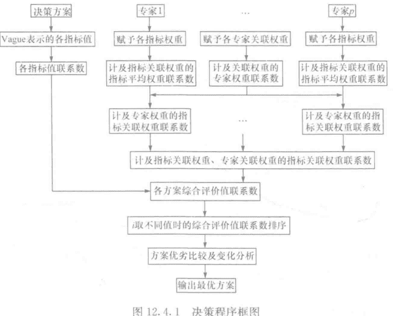

### 12.4.3 实例

例 12.4.1 设某地区电力系统事故后需要黑启动，共有 6 个待评价的方案，方案的评价指标数为 4 个，各方案在各指标上的 Vague 集数据已经规范化处理成越大越好型数据，见表 12.4.1。

#### 表 12.4.1 各个候选黑启动方案的 Vague 集指标值

| 方案 | 机组状态 c1 | 爬坡速率 c2 | 机组容量 c3 | 变电站个数 c4 |
|---|---|---|---|---|
| 1 | (0.30,0.50) | (0.96,0.04) | (1.00,0.00) | (0.20,0.80) |
| 2 | (0.60,0.17) | (0.53,0.47) | (0.67,0.33) | (0.25,0.75) |
| 3 | (0.45,0.33) | (1.00,0.00) | (0.42,0.58) | (0.33,0.67) |
| 4 | (0.30,0.50) | (0.50,0.50) | (0.42,0.58) | (0.33,0.67) |
| 5 | (0.60,0.17) | (0.27,0.73) | (0.42,0.58) | (1.00,0.00) |
| 6 | (0.90,0.00) | (0.91,0.09) | (0.67,0.33) | (0.25,0.75) |

参与黑启动决策专家共 3 人 \( E_j=(e_1,e_2,e_3) \)，权重 \( W_{E_j}=(\tau_t,\tau_f) \) 为 \( W(\{e_1\})=(0.30,0.60), W(\{e_2\})=(0.40,0.50), W(\{e_3\})=(0.40,0.30) \)，\( W(\{e_1,e_2\})=(0.60,0.20), W(\{e_1,e_3\})=(0.70,0.10), W(\{e_2,e_3\})=(0.70,0.20), W(\{e_1,e_2,e_3\})=(1.00,0.00) \)

专家 \( e_1 \) 给出的各指标关联权重如下：

\( W(\{c_1\})=(0.10,0.65), W(\{c_2\})=(0.25,0.55), W(\{c_3\})=(0.20,0.50), W(\{c_4\})=(0.20,0.70), W(\{c_1,c_2\})=(0.30,0.40), W(\{c_2,c_3\})=(0.50,0.25), W(\{c_2,c_4\})=(0.45,0.35), W(\{c_3,c_4\})=(0.40,0.30), W(\{c_1,c_3\})=(0.30,0.30), W(\{c_1,c_4\})=(0.30,0.40), W(\{c_2,c_3,c_4\})=(0.85,0.10), W(\{c_1,c_3,c_4\})=(0.70,0.20), W(\{c_1,c_2,c_4\})=(0.65,0.30), W(\{c_1,c_2,c_3\})=(0.75,0.20), W(\{c_1,c_2,c_3,c_4\})=(1.00,0.00) \)

专家 \( e_2 \) 给出的指标权重如下：

\( W(\{c_1\})=(0.15,0.7), W(\{c_2\})=(0.2,0.7), W(\{c_3\})=(0.15,0.7), W(\{c_4\})=(0.25,0.55), W(\{c_1,c_2\})=(0.3,0.5), W(\{c_2,c_3\})=(0.37,0.43), W(\{c_2,c_4\})=(0.5,0.3), W(\{c_3,c_4\})=(0.45,0.3), W(\{c_1,c_3\})=(0.35,0.45), W(\{c_1,c_4\})=(0.45,0.30), W(\{c_2,c_3,c_4\})=(0.75,0.10), W(\{c_1,c_3,c_4\})=(0.75,0.10), W(\{c_1,c_2,c_4\})=(0.68,0.15), W(\{c_1,c_2,c_3\})=(0.55,0.25), W(\{c_1,c_2,c_3,c_4\})=(1.00,0.00) \)

专家 \( e_3 \) 给出的指标权重如下：

\( W(\{c_1\})=(0.2,0.5), W(\{c_2\})=(0.1,0.65), W(\{c_3\})=(0.15,0.7), W(\{c_4\})=(0.15,0.7), W(\{c_1,c_2\})=(0.35,0.3), W(\{c_2,c_3\})=(0.3,0.4), W(\{c_2,c_4\})=(0.3,0.4), W(\{c_3,c_4\})=(0.35,0.4), W(\{c_1,c_3\})=(0.42,0.28), W(\{c_1,c_4\})=(0.42,0.28), W(\{c_2,c_3,c_4\})=(0.6,0.05), W(\{c_1,c_3,c_4\})=(0.65,0.05), W(\{c_1,c_2,c_4\})=(0.55,0.15), W(\{c_1,c_2,c_3\})=(0.6,0.05), W(\{c_1,c_2,c_3,c_4\})=(1.00,0.00) \)

根据上述题给数据，计算和决策过程如下。

步骤 1 根据题给条件和式(12.4.1)~式(12.4.4)计算 3 位专家的权重，结果见表 12.4.2。

| | \( W(e_1) \) | \( W(e_2) \) | \( W(e_3) \) |
|---|---|---|---|
| | \( 0.3+0.1i \) | \( 0.4+0.1i \) | \( 0.4+0.3i \) |
| | \( \frac{1}{2}(0.6+0.2i) \) | \( \frac{1}{2}(0.6+0.2i) \) | \( \frac{1}{2}(0.7+0.2i) \) |
| | \( \frac{1}{2}(0.7+0.2i) \) | \( \frac{1}{2}(0.7+0.1i) \) | \( \frac{1}{2}(0.7+0.1i) \) |
| | \( \frac{1}{3}(1+0i) \) | \( \frac{1}{3}(1+0i) \) | \( \frac{1}{3}(1+0i) \) |
| 平均 | \( 0.32075+0.075i \) | \( 0.34575+0.0625i \) | \( 0.35825+0.1125i \) |

步骤 2 根据题给条件和式(12.4.1)~式(12.4.4)计算专家 \( e_1 \) 给出的黑启动指标权重以及计及专家权重后的各指标权重，见表 12.4.3。

#### 表 12.4.3 专家 e1 给出的黑启动指标关联权重系数

| 指标 c1 | 指标 c2 | 指标 c3 | 指标 c4 |
|---|---|---|---|
| 0.1+0.25i | 0.25+0.20i | 0.2+0.3i | 0.2+0.1i |
| 1/2(0.3+0.3i) | 1/2(0.3+0.3i) | 1/2(0.5+0.25i) | 1/2(0.45+0.2i) |
| 1/2(0.3+0.4i) | 1/2(0.5+0.25i) | 1/2(0.4+0.3i) | 1/2(0.4+0.3i) |
| 1/2(0.3+0.3i) | 1/2(0.45+0.2i) | 1/2(0.3+0.4i) | 1/2(0.3+0.3i) |
| 1/3(0.70+0.10i) | 1/3(0.85+0.05i) | 1/3(0.85+0.05i) | 1/3(0.85+0.05i) |
| 1/3(0.65+0.05i) | 1/3(0.65+0.05i) | 1/3(0.70+0.10i) | 1/3(0.70+0.10i) |
| 1/3(0.75+0.05i) | 1/3(0.75+0.05i) | 1/3(0.75+0.05i) | 1/3(0.65+0.05i) |
| 1/4(1+0i) | 1/4(1+0i) | 1/4(1+0i) | 1/4(1+0i) |
| 平均 | | | |
| 0.1875+0.1021i | 0.2344+0.0783i | 0.227+0.1053i | 0.2291+0.0709i |
| x(0.32075+0.075i) | x(0.32075+0.075i) | x(0.32075+0.075i) | x(0.32075+0.075i) |
| 0.0601+0.0328i | 0.0752+0.0251i | 0.0728+0.0338i | 0.0735+0.0227i |
| +0.0141i | +0.0176i | +0.0170i | +0.0172i |
| +0.0077^2 | +0.0059^2 | +0.0079^2 | +0.0053^2 |
| 0.0601+0.0546i | 0.0752+0.0486i | 0.0728+0.0587i | 0.0735+0.0452i |

步骤 3 把表 12.4.3 的各 Vague 集数据改写成联系数，得表 12.4.4。

#### 表 12.4.4 用联系数表示的各个候选黑启动方案指标值

| 方案 | c1 | c2 | c3 | c4 |
|---|---|---|---|---|
| 1 | 0.30+0.20i | 0.96+0i | 1+0i | 0.2+0i |
| 2 | 0.60+0.23i | 0.53+0i | 0.67+0i | 0.25+0i |
| 3 | 0.45+0.22i | 1+0i | 0.42+0i | 0.33+0i |
| 4 | 0.30+0.20i | 0.50+0i | 0.42+0i | 0.33+0i |
| 5 | 0.60+0.23i | 0.27+0i | 0.42+0i | 1+0i |
| 6 | 0.90+0.10i | 0.91+0i | 0.67+0i | 0.25+0i |

步骤 4 利用表 12.4.4 数据，并结合步骤 3 算得的各指标权重，采用式(12.4.5)算得各方案的综合评价值联系数。各方案的综合评价值联系数为

M(s1) = 0.52362 + 0.514542i  
M(s2) = 0.434211 + 0.457318i  
M(s3) = 0.467593 + 0.475347i  
M(s4) = 0.331283 + 0.35277i

$M(s_5) = 0.49472 + 0.495011i$  
$M(s_6) = 0.575639 + 0.528601i$

**步骤 5** 对各方案的综合评价结果联系数作不确定性分析,得到表 12.4.5。

#### 表 12.4.5 在不确定条件下的各方案综合评价结果

| | $i=-1$ | $i=-0.5$ | $i=0$ | $i=0.5$ | $i=1$ |
|---|---|---|---|---|---|
| $M(s_1)$ | 0.0091① | 0.2663② | 0.5237② | 0.7809② | 1.0382② |
| $M(s_2)$ | -0.0231⑥ | 0.2056⑤ | 0.4342⑤ | 0.6629⑤ | 0.8915⑤ |
| $M(s_3)$ | -0.0078③ | 0.2299④ | 0.4676④ | 0.7053④ | 0.9429④ |
| $M(s_4)$ | -0.0215⑤ | 0.1549⑥ | 0.3313⑥ | 0.5077⑥ | 0.6840⑥ |
| $M(s_5)$ | -0.0002② | 0.2472③ | 0.4947③ | 0.7422③ | 0.9897③ |
| $M(s_6)$ | 0.0470① | 0.3113① | 0.5756① | 0.8299① | 1.1042① |

注:小圈圈内数字为从大到小的排序号。

由表 12.4.5 知,各方案的优劣排序为:方案 6>方案 1>方案 5>方案 3>方案 2>方案 4,方案 6 是最优方案,方案 1 是备用方案。

## 12.5 基于集对联系度的主题关注网络社区发现

网络的日益延伸和繁荣是智能社会的一大特点,对网络的研究是人工智能中的一个热点,以兴趣或主题分享等为目的的兴趣型社交网络引领着社交网络的发展,张春英等早在 2011 年将集对分析用于网络社区问题研究[4-6],陈晓等[7]则在张春英等工作的基础上,进一步把集对分析中的联系度用于主题关注网络社区发现研究,构建了一个新型社交网络模型——主题关注模型,给出了具体算法,并用实验验证了模型的合理性,与其他方法比较说明了算法的经济性,有着重要的价值,介绍如下。

### 12.5.1 主题关注网络社区

网络社区是指包括论坛、贴吧、群组讨论、公告、在线聊天、交友、个人空间、无线增值服务等形式在内的网上交流空间,同一主题的网络社区集中了具有共同兴趣的访问者,其内容和功能涉及金融经贸、大型会展、高档办公、企业管理、文体娱乐等综合信息服务等,从网络角度看,主题关注网络社区就是一个以某个或某些主题为关注内容的成熟社区局域网,其模型如图 12.5.1 所示。

如图 12.5.1 所示,主题关注网络中的顶点由个体和相关的主题构成,顶点之间的边表示网络中的个体之间的联系和个体对主题的感兴趣情况。由此可见,主题关注网络含有多种实体类型,多种实体间关系,使网络结构具有明显的语义特征,因此,无法直接将基于传统关系型社交网络的研究方法直接应用于该模型中,为此应用集对联系数(联系度):

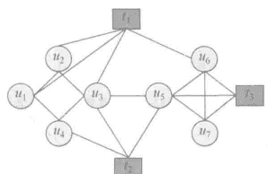

图 12.5.1 主题关注网络社区模型

$u=\frac{S}{N}+\frac{F}{N}i+\frac{P}{N}j$ (12.5.1)

以及归一化后的联系度

$\mu=a+bi+cj, \quad a+b+c=1$ (12.5.2)

刻画用户关注主题后的相似性，并提出基于该相似性的社区发现算法，并用实验验证模型的合理性与算法的经济性。

### 12.5.2 基本思路

- (1) 将用户与主题同时作为研究实体，构建主题关注网络，给出主题关注模型的形式化描述。
- (2) 给出基于主题关注的顶点间相似性度量方法。采用集对联系度，以用户对主题的关注为中心，描述用户实体间的同异反关系，该方法根据宏观异（不确定）关系和微观异（不确定）关系转化为同关系时对顶点间相似性的贡献，考虑顶点间连接密度影响，采用顶点的聚集系数作为微观异的取值方法；根据主题和用户对相似性的贡献的影响，为各关系进行加权，以体现网络拓扑结构特点，提高相似性指标的精确性。
- (3) 给出顶点优先凝聚和社区间均值凝聚相结合，并具有停止阈值的聚类型社区发现算法(compare and mean with stop threshold clustering, CMTC)。该算法可以避免凝聚型算法频繁更新操作，确保相似性大的顶点在同一社区中，相似性小的顶点在不同社区中。

### 12.5.3 模型

主题关注网络定义为一个二元组 G = (V, E)。V = {U, T} 表示顶点集，其中，U = {u1, u2, ..., un} 表示用户实体集，T = {t1, t2, ..., tm} 表示主题实体集；E = {EU, EUT} 表示边集，其中，EU = {(ui, uj) | ui, uj ∈ U} 表示用户之间的关系，EUT = {(ui, tj) | ui ∈ U, tj ∈ T} 表示用户与主题之间的关系。

主题关注网络的邻接矩阵为 A = {AU, AUT}，其中，用户邻接矩阵为

AU=(u_i, u_j)_{n\times n}=\begin{cases} 1, \quad (u_i, u_j) \in EU \\ 0, \quad (u_i, u_j) \notin EU \end{cases}

用户主题的邻接矩阵为

AUT=(u_i, t_k)_{n\times m}=\begin{cases} 1, \quad (u_i, t_k) \in EUT \\ 0, \quad (u_i, t_k) \notin EUT \end{cases}

例如，在图 12.5.1 所示的主题关注网络中，用户实体集为 \(U=\{u_1, u_2, u_3, u_4, u_5, u_6, u_7\}\)，主题实体集为 \(T=\{t_1, t_2, t_3\}\)；用户关系集为 \(EU=\{(u_1, u_2), (u_1, u_4), (u_2, u_3), (u_3, u_4), (u_3, u_5), (u_5, u_6), (u_5, u_7), (u_6, u_7)\}\)，用户主题关系集为 \(EUT=\{(u_1, t_1), (u_2, t_1), (u_3, t_1), (u_6, t_1), (u_3, t_2), (u_4, t_2), (u_5, t_2), (u_5, t_3), (u_6, t_3), (u_7, t_3)\}\)。用户关系矩阵 AU 如图 12.5.2(a)所示，用户主题关系矩阵 AUT 如图 12.5.2(b)所示。

| 0 | 1 | 0 | 1 | 0 | 0 | 0 |
|---|---|---|---|---|---|---|
| 1 | 0 | 1 | 0 | 0 | 0 | 0 |
| 0 | 1 | 0 | 1 | 1 | 0 | 0 |
| 1 | 0 | 1 | 0 | 0 | 0 | 0 |
| 0 | 0 | 1 | 0 | 0 | 1 | 1 |
| 0 | 0 | 0 | 0 | 1 | 0 | 1 |
| 0 | 0 | 0 | 0 | 1 | 1 | 0 |

| 1 | 0 | 0 |
|---|---|---|
| 1 | 0 | 0 |
| 1 | 1 | 0 |
| 0 | 1 | 0 |
| 0 | 1 | 1 |
| 1 | 0 | 1 |
| 0 | 0 | 1 |

#### 图 12.5.2 主题关注网络矩阵

主题关注网络中，没有考虑主题之间的关联关系，只考虑了用户对主题的关注关系和用户之间的关联关系；为此给出以下定义。

#### 定义 12.5.1 (1 级邻居集)

给定主题关注网络 \(G=(V, E)\)，\(\forall u_i, u_j \in U, t_k \in T\)，顶点 \(u_i\) 的 1 级邻居集记为 \(N(u_i)_1\)，如式(12.5.3)所示：

\(N(u_i)_1 = NU(u_i)_1 \cup NT(u_i)_1 \quad (12.5.3)\)

式中，\(NU(u_i)_1\) 表示为顶点 \(u_i\) 的 1 级用户邻居集，即与顶点 \(u_i\) 直接相连的顶点 \(u_j\) 的集合，记为 \(NU(u_i)_1 = \{u_j | (u_i, u_j) \in EU \text{ 且 } u_j \in U\}\)；\(NT(u_i)_1\) 表示为顶点 \(u_i\) 的 1 级主题邻居集，即与顶点 \(u_i\) 直接相连的主题顶点 \(t_k\) 的集合，记为 \(NT(u_i)_1 = \{t_k | (u_i, t_k) \in EUT \text{ 且 } t_k \in T\}\)。

#### 定义 12.5.2 (共同 1 级邻居集)

给定主题关注网络 \(G=(V, E)\)，\(\forall u_i, u_j \in U\)，顶点 \(u_i\) 和顶点 \(u_j\) 的共同 1 级邻居集记为 \(CN(u_i, u_j)_1\)，如式(12.5.4)所示：

\(CN(u_i, u_j)_1 = N(u_i)_1 \cap N(u_j)_1\)
\(= CNU(u_i, u_j)_1 \cup CNT(u_i, u_j)_1 \quad (12.5.4)\)

式中，\(CNU(u_i, u_j)_1\) 表示顶点 \(u_i\) 和顶点 \(u_j\) 的共同 1 级用户邻居集，记为 \(CNU(u_i, u_j)_1 = NU(u_i)_1 \cap NU(u_j)_1\)；\(CNT(u_i, u_j)_1\) 表示顶点 \(u_i\) 和顶点 \(u_j\) 的共同 1 级主题邻居集，记为 \(CNT(u_i, u_j)_1 = NT(u_i)_1 \cap NT(u_j)_1\)。

#### 定义 12.5.3 (2 级邻居集)

给定主题关注网络 \(G=(V, E)\)，\(\forall u_i, u_j, u_p \in U, t_k \in T\)，则顶点 \(u_i\) 的 2 级邻居集为 \(N(u_i)_2\)，如式(12.5.5)所示：

\(N(u_i)_2 = NU(u_i)_2 \cup NT(u_i)_2 \quad (12.5.5)\)

式中，\(NU(u_i)_2\) 表示顶点 \(u_i\) 的 2 级用户邻居集，记为 \(NU(u_i)_2 = \{u_p | (u_i, u_p) \in EU \text{ 且 } u_j \in N(u_i)_1, u_p \notin N(u_i)_1\}\)；\(NT(u_i)_2\) 表示顶点 \(u_i\) 的 2 级主题邻居集，记为 \(NT(u_i)_2 = \{t_k | (u_i, t_k) \in EUT \text{ 且 } u_j \in NU(u_i)_1, t_k \notin NT(u_i)_1\}\)。

#### 定义 12.5.4 (共同 2 级邻居集)

给定主题关注网络 \(G=(V, E)\)，\(\forall u_i, u_j \in U\)，顶点 \(u_i\) 和顶点 \(u_j\) 的共同 2 级主题邻居集记为 \(CN(u_i, u_j)_2\)，如式(12.5.6)所示：

\(CN(u_i, u_j)_2 = N(u_i)_2 \cap N(u_j)_2 = CNU(u_i, u_j)_2 \cup CNT(u_i, u_j)_2 \quad (12.5.6)\)

式中，\(CNU(u_i, u_j)_2\) 表示顶点 \(u_i\) 和顶点 \(u_j\) 的共同 2 级用户邻居集，记为 \(CNU(u_i, u_j)_2 = NU(u_i)_2 \cap NU(u_j)_2\)；\(CNT(u_i, u_j)_2\) 表示顶点 \(u_i\) 和顶点 \(u_j\) 的所有共同 2 级邻居集合，记为 \(CNT(u_i, u_j)_2 = NT(u_i)_2 \cap NT(u_j)_2\)。

#### 定义 12.5.5 (共同 1∩2 和 2∩1 级邻居集)

给定主题关注网络 \(G=(V, E)\)，\(\forall u_i, u_j \in U\)，顶点 \(u_i\) 和顶点 \(u_j\) 的所有共同 1∩2 级邻居的集合记为 \(CN(u_i, u_j)_{1∩2}\)，如式(12.5.7)所示：

\(CN(u_i, u_j)_{1∩2} = N(u_i)_1 \cap N(u_j)_2 = CNU(u_i, u_j)_{1∩2} \cup CNT(u_i, u_j)_{1∩2} \quad (12.5.7)\)

式中，\(CNU(u_i, u_j)_{1∩2}\) 表示顶点 \(u_i\) 和顶点 \(u_j\) 的共同 1∩2 级用户邻居，记为 \(CNU(u_i, u_j)_{1∩2} = NU(u_i)_1 \cap NU(u_j)_2\)；\(CNT(u_i, u_j)_{1∩2}\) 表示顶点 \(u_i\) 和顶点 \(u_j\) 的共同 1∩2 级主题邻居，记为 \(CNT(u_i, u_j)_{1∩2} = CNT(u_i)_1 \cap CNT(u_j)_2\)。

同理，顶点 \(u_i\) 和顶点 \(u_j\) 的所有共同 2∩1 级邻居集记为 \(CN(u_i, u_j)_{2∩1}\)。如式(12.5.8)所示：

\(CN(u_i, u_j)_{2∩1} = N(u_i)_2 \cap N(u_j)_1 = CNU(u_i, u_j)_{2∩1} \cup CNT(u_i, u_j)_{2∩1} \quad (12.5.8)\)

式中，\(CNU(u_i, u_j)_{2∩1}\) 表示顶点 \(u_i\) 和顶点 \(u_j\) 的共同 2∩1 级用户邻居集；\(CNT(u_i, u_j)_{2∩1}\) 表示顶点 \(u_i\) 和顶点 \(u_j\) 的共同 2∩1 级主题邻居集。

在以上定义基础上,基于两个顶点间共同邻居和短路径越多,两个顶点的相似性越强,不确定属性转化为确定性属性的概率也越高,据此刻画顶点间的同异反关系,为明确起见,再作以下定义。

#### 定义 12.5.6 (顶点间同异反关系)

给定主题关注网络 \(G=(V, E)\)，\(\forall u_i, u_j \in U\)，共同属性为顶点 \(u_i\) 和顶点 \(u_j\) 的共同 1 级邻居,即 \(S = S_1 + S_2 + S_3\),其中, \(S_1 = |CNT(u_i, u_j)_1|\), \(S_2 = |CNU(u_i, u_j)_1|\), \(S_3\) 表示顶点 \(u_i\) 和顶点 \(u_j\) 直接连接,表示同关系;不确定属性为顶点 \(u_i\) 和顶点 \(u_j\) 的共同 \(1∩2\)、\(2∩1\) 和 2 级主题邻居集,即 \(F = |CNT(u_i, u_j)_{1∩2}| + |CNT(u_i, u_j)_{2∩1}| + |CNT(u_i, u_j)_2|\),表示异关系;其余为顶点 \(u_i\) 和顶点 \(u_j\) 的对立属性,表示反关系,即 \(P = N - S - F\),其中, \(N = |V|\)。

例如,在如图 12.5.3 所示的主题关注网络中,以顶点 \(u_1\) 和 \(u_3\) 为研究对象,它们共同 1 级主题邻居为 \(t_1\),共同 1 级用户邻居为 \(u_2\),顶点 \(u_1\) 和 \(u_3\) 为直接连接关系；共同 \(1∩2\) 级主题邻居为 \(t_2\),共同 \(2∩1\) 级主题邻居为 \(t_3\)；共同 2 级主题邻居为 \(t_4\) 和 \(t_5\)。

#### 定义 12.5.7 (基于顶点间联系度)

给定主题关注网络 \(G=(V,E)\), \(\forall u_i, u_j \in U, t_k \in T\)，顶点间联系度 \(u(u_i, u_j)\)，如式(12.5.9)所示：

\(u(u_i, u_j) = \frac{S_1 \times w_1 + S_2 \times w_2 + S_3 \times w_3}{N} + \frac{(1)_{1 \times F}}{N} i(t_k)_{F \times 1} + \frac{P}{N} j \quad (12.5.9)\)

式中，\(N, S, F, P\) 的含义如定义 12.5.6 中所示；\((1)_{1 \times F}\) 表示不确定属性的行向量，向量值均为 1；\(w_1, w_2\) 和 \(w_3\) 分别为相同属性 \(S_1, S_2\) 和 \(S_3\) 对应的权重，考虑到网络结构和主题影响的重要性，令 \(w_1 > w_3 > w_2\) 且 \(w_1 + w_2 + w_3 = 1\)；\(j\) 作为对立属性 \(P\) 的标记，由于社区发现中，期望将相似性大的顶点划分到同一社区，因此，令 \(j=0\)。

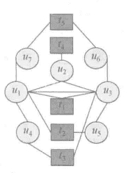

图 12.5.3 顶点间的同和异关系

\(i(t_k)\) 作为不确定属性顶点 \(t_k\) 对应的差异值——微观层次上的差异标记，如何取值对不确定属性向确定属性转换有着至关重要的影响。然而，现有基于灰度[10]的 \(i\) 的取值方法不能直接应用于网络中顶点间相似性的计算方法中，需要重新定义差异标记 \(i\) 的取值方法。在此采用聚集系数量化 \(i\) 值，由于不确定属性包括顶点对的共同 \(1∩2, 2∩1\) 和 2 级邻居，下面分别考虑上述三种情况转换共同 1 级邻居的可能性，来量化 \(i\) 值，其中 \(CC(u_p)\) 表示顶点 \(u_p\) 对应的聚集系数。

- (1) 当 \(t_k \in CNT(u_i, u_j)_{1∩2}\) 且 \(u_p \in CN(t_k, u_j)_1\) 时，\(i(t_k) = |CN(u_i, u_j)_1| \sum_{m=1} CC(u_p) / |CN(t_k, u_j)_1|\)。
- (2) 当 \(t_k \in CNT(u_i, u_j)_{2∩1}\) 且 \(u_q \in CN(u_i, t_k)_1\) 时，\(i(t_k) = \sum_{n=1}^{|CN(u_i, t_k)_1|} CC(u_q) / |CN(u_i, t_k)_1|\)。
- (3) 当 \(t_k \in CNT(u_i, u_j)_2\) 且 \(u_q \in CN(u_i, t_k)_1, u_p \in CN(t_k, u_j)_1\) 时，\(i(t_k) = \frac{\sum_{n=1}^{|CN(u_i, t_k)_1|} CC(u_q)}{|CN(u_i, t_k)_1|} \times \frac{\sum_{m=1}^{|CN(t_k, u_j)_1|} CC(u_p)}{|CN(t_k, u_j)_1|}\)。

### 12.5.4 算法

社区发现的主要目标是将网络划分为 \(K\) 个互不相交的子社区，并使得社区内顶点关系紧密，社区间顶点关系松散。基于主题关注模型的社区发现问题，可以转

化成为基于联系度的凝聚型聚类问题。为了叙述方便，先给出社区间联系度和网络联系度的定义。

定义 12.5.8 (社区间联系度) 设 \(C_K=(V_K, E_K)\) 和 \(C_S=(V_S, E_S)\) 为主题关注网络中的两个社区，则社区 \(C_K\) 和 \(C_S\) 间的联系度表示社区间顶点对联系度的均值，记为 \(u(C_K, C_S)\)，如式 (12.5.10) 所示：

\(\displaystyle u(C_K, C_S) = \frac{\sum_{k=1}^{|C_K|} \sum_{s=1}^{|C_S|} u(u_k, u_s)}{|C_K| \times |C_S|}\) (12.5.10)

定义 12.5.9 (网络联系度) 给定主题关注网络 \(G=(V, E)\)，整个网络的联系度记为 \(u(G)\)，如式 (12.5.11) 所示：

\(\displaystyle u(G) = \frac{\sum_{k=1}^{|V|} \sum_{s=1}^{|V|} u(u_k, u_s)}{|V| \times |V|} = \frac{\sum_{k=1}^{|V|} u(u_k)}{|V|}\) (12.5.11)

基于主题关注网络的社区发现算法如下。

#### 算法:CMTC

输入：网络邻居矩阵 AU 和 AUT  
输出：子社区 \(C_k (k=1, \cdots, K)\)  
Begin;

- 步骤 1 将每个顶点初始化为一个独立社区，记为 \(C_i=\{u_i\} (i=1, \cdots, n)\)。
- 步骤 2 计算顶点间的联系度 \(u(u_i, u_j)\)。
- 步骤 3 选取联系度最大值 \(Max\{u(u_i, u_j)\}\) 对应的两个顶点 \(u_i\) 和 \(u_j\)，判断其是否合并。
  - ① 任取顶点 \(u_k\)，如果 \(u(u_i, u_j)\) 均大于任意 \(u(u_i, u_k)\) 和 \(u(u_j, u_k)\)，则顶点 \(u_i\) 和 \(u_j\) 合并。
  - ② 如果某一社区内每个顶点 \(u_k\) 与顶点 \(u_i\) 的联系度值 \(u(u_i, u_k)\) 均大于 \(u(u_i, u_j)\)，则将顶点 \(u_i\) 合并到该社区中。
  - ③ 如果某一社区内每个顶点 \(u_k\) 与顶点 \(u_j\) 的联系度值 \(u(u_j, u_k)\) 均大于 \(u(u_i, u_j)\)，则将顶点 \(u_j\) 合并到该社区中；否则，顶点不合并。
- 步骤 4 重复执行步骤 3，直到所有顶点无法聚合。
- 步骤 5 判断是否存在独立顶点。如果存在，执行操作步骤 6；否则执行操作步骤 7。
- 步骤 6 依次处理顶点 \(C_i=\{u_i\}\)。找到顶点 \(u_i\) 的最大联系度值 \(Max\{u(u_i, u_j)\}\)，将 \(u_i\) 合并到 \(u_j\) 所在的社区。重复执行步骤 6，直到不存在独立社区。
- 步骤 7 计算社区间的联系度 \(u(C_K, C_S)\) 和网络联系度 \(u(G)\)。
- 步骤 8 选取社区联系度最大值 \(Max\{u(C_K, C_S)\}\) 对应的两个社区，判断其是否合并。如果 \(Max\{u(C_K, C_S)\} \geqslant u(G)\)，则将其合并，记为 \(C_{new}\)，并更新 \(C_{new}\) 与其他社区的联系度值。
- 步骤 9 重复执行步骤 8，直到所有社区间最大联系度值 \(Max\{u(C_K, C_S)\} < u(G)\) 停止。

End

由上可见，基于主题关注网络的社区发现算法 CMTC 的步骤是，首先将每个顶点视为一个独立社区，如步骤 1 所示；其次，计算顶点间的联系度，如步骤 2 所示；再次，对独立顶点进行聚合，形成初始社区，如步骤 3～步骤 6 所示；最后，对初始社区进行聚合，直到不满足合并阈值，如步骤 7～步骤 9 所示。

CMTC 算法的关键步骤是计算顶点间的联系度，由于采用集对联系度的思想计算路径的最大长度为 4，路径长度大于等于 5 时的顶点间联系度为 0。对于任意顶点 \(u_i\) 的 4 步内邻居的个数为 \(K\)；共同 1 级邻居的个数为 \(\text{CN}1\)，共同 1∩2 级邻居集个数为 \(\text{CNT}12\)，共同 2∪1 级邻居集个数为 \(\text{CNT}21\)，共同 2 级邻居集个数为 \(\text{CNT}2\)。根据以上分析，算法的时间复杂度为 \(O(NK(\text{CN}1 + \text{CNT}12 + \text{CNT}21 + \text{CNT}2))\)。选取 \(Max\{u(u_i, u_j)\}\) 的时间复杂度为 \(O(n \log n) + O(n)\)，判断独立社区与非独立社区关系的时间复杂度为 \(O(n^2)\)，合并社区的时间复杂度为 \(O(1)\)，更新社区间联系度的时间复杂度为 \(O(n)\)，故整个算法的时间复杂度为 \(O(n^2)\)。

### 12.5.5 实验

实验的硬件环境是 Intel(R) Core(TM) i7-4760HQ 四核的 CPU，内存 8GB；软件环境是 Windows 8 系统，Java JDK 1.7，Eclipse 4.3。

#### 1. Karate 网络实验结果与分析

Zachary’s Karate 网络描述了美国一所大学中空手道俱乐部成员间的人际关系。在 20 世纪 70 年代初，Zachary 用了两年时间观察并构造了基于这些成员在俱乐部内部及外部的社会关系网，该网络共有 34 个结点，78 条边。该俱乐部的教练与校长之间因是否抬高俱乐部收费问题产生了争执。结果，该俱乐部分裂成两个分别以教练和校长为核心的小俱乐部。图中的结点 34 和结点 1 分别代表了俱乐部校长和教练。实验首先在 Zachary’s Karate 网络中，通过设置有无主题、在指定位置添加主题、随机添加主题等方面，分析和验证主题对社区划分结果的影响。

#### 1) 无主题的社区划分结果

采用 CMTC 算法，在 Karate 网络中进行社区划分，得到 3 个社区，分别为社区 1(5,11,6,7,17)、社区 2(1,2,3,4,8,12,13,14,18,20,22)和社区 3(9,10,15,16,19,21,23,24,25,26,27,28,29,30,31,32,33,34)，如图 12.5.4 所示。与 Karate 网络的真实社区相比，社区 3 与原始社区划分结果相同，CMTC 算法将原始以顶点 1 为中心的真实社区拆分为社区 1 和社区 2。由图 12.5.4 可见，社区 1 与社区 2 中的顶点(除顶点 1 以外顶点)无更紧密的连接关系，所以社区间的联系度小于聚合阈值，未聚合成为一个整体。同时社区 1 是一个结构紧密的独立团体，因此，该社区划分结果也是较为合理的。

#### 图 12.5.4 无主题的 Karate 网络

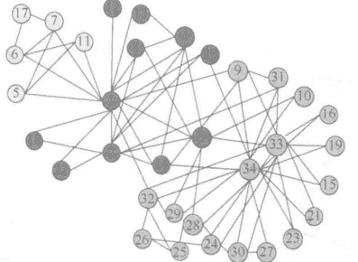

#### 2) 在社区间添加一个主题的社区划分结果

- (1) 为社区 1 和社区 2 的社区间顶点 1,5 和 11 赋予一个共同的主题 T，其他不变，采用 CMTC 算法进行社区划分，最终得到 2 个社区，如图 12.5.5(a) 所示。在无主题的情况下，\(u(u1, u5) = (u(u1, u5)S + u(u1, u5)F)/N = (0.75 + 0)/34 = 0.0221\)，\(u(u1, u11) = (u(u1, u11)S + u(u1, u11)F)/N = (0.75 + 0)/34 = 0.0221\)；在一个主题的情况下 \(u(u1, u5) = (u(u1, u5)S + u(u1, u5)F)/N = (1.45 + 0)/35 = 0.0414\)，\(u(u1, u11) = (u(u1, u11)S + u(u1, u11)F)/N = (1.45 + 0)/35 = 0.0414\)。由于顶点 1,5 和 11 关注了共同的主题，增加了顶点之间的联系度；同时，顶点 1,5 和 11 的直接邻居有可能关注主题 T，使得不确定关系(非 1 级邻居)转换为确定关系(1 级邻居)的概率增大，即 \(u(u1, u17)\)、\(u(u5, u8)\)、\(u(u5, u4)\) 等联系度的值增加。由图 12.5.5(a) 可见，在共同主题 T 的影响下，增强了顶点间和社区间的联系度，最终将图 12.5.4 中的社区 1 和社区 2 合并为一个社区，并得到与真实社区相同的社区划分结果，可见共同关注主题可以使社区结构更紧密。

- (2) 为社区 2 和社区 3 的社区间顶点 9,3,14 和 20 赋予一个共同的主题 T，其他结构不变，采用 CMTC 算法进行社区划分，最终得到 3 个社区，如图 12.5.5(b) 所示。由图 12.5.5(b) 可见，由于主题 T 的加入，使得社区 2 和社区 3 之间的顶点间的联系度增强，又由于社区 2 中有 3 个顶点关注了主题 T，社区 3 中仅有顶点 9 关注了主题 T，因此，社区 3 中的边缘点被聚合到社区 2 中。以顶点 3 和顶点 10 为例，在无主题的情况下，\(u(u3, u10) = 0.0129\)；在有主题的情况下，\(u(u3, u10) = (u(u3, u10)S + u(u3, u10)F)/N = (0.45 + 0.24)/35 = 0.0197\)，由于主题 T 的加入，顶点 3 与顶点 10 的 1∩2 级邻居增加，因此联系度 \(u(u3, u10)\) 增大。同理整体联系度值增大，因此，社区间顶点 9,3,10,28,29 被聚合到社区 2 中。

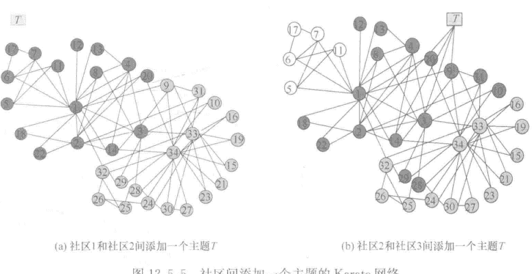

#### 3) 在 Karate 网络中添加两个主题

- (1) 在 Karate 网络中，为所有顶点添加两个主题，采用 CMTC 算法进行社区划分，得到 2 个社区，如图 12.5.6(a) 所示。由图 12.5.6(a)可见，社区划分结果为真实的社区划分结果；与无主题的划分结果相比，由于增加了共同关注的主题，顶点间和社区间的联系度值增加，社区 1 与社区 2 间的联系度也大于阈值，使得二者合并为一个社区，由此可见，主题使得社区结构更紧密。

- (2) 在 Karate 网络中，为社区 1 和社区 2 中顶点添加一个共同的主题 T1，为社区 3 中顶点添加一个共同的主题 T2，用 CMTC 算法对其进行社区划分，得到 2 个社区，如图 12.5.6(b) 所示。由图 12.5.6(b) 可知，主题 T1 将社区 1 和社区 2 之间的顶点和社区间联系度值增加，促使社区 1 和社区 2 聚合为一个社区；主题 2 增加了社区 3 中顶点间的联系度值，使得社区 3 的结构更加稳定。

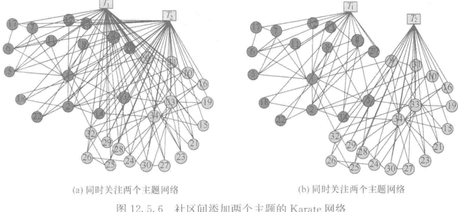

#### 4) 在 Karate 网络中随机添加主题的划分结果

- (1) 在 Karate 网络中，随机添加一个主题，选取其中差异性较大的两个主题网络，采用 CMTC 算法对其进行社区划分，社区划分如图 12.5.7 所示。与真实网络社区相比，社区结构发生了很大变化，社区结构会随着主题分布的不同，时而紧密，时而分散。

- (2) 在 Karate 网络中，随机添加两个主题，选取其中差异性较大的两个主题网络，采用 CMTC 算法对其进行社区划分，社区划分结果如图 12.5.8 所示。在图 12.5.8(a)中，由于大部分顶点都共同关注了主题 T1 和 T2，网络中形成了一个大社区和两个边缘小社区；在图 12.5.8(b)中，由于主题比较分散，社区结构也比较分散。

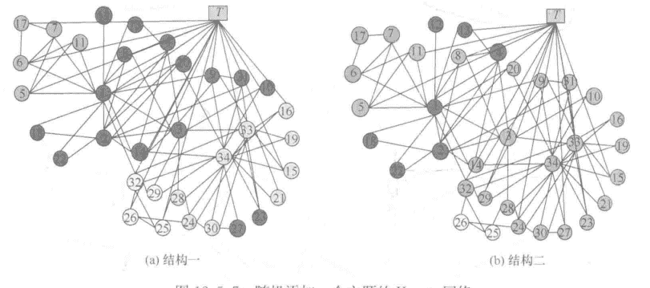


综上可见，主题 T 不仅增强了顶点间的联系度，而且主导了社区的划分结果。这与具有共同兴趣爱好的人更有可能成为朋友的启发式思想相一致。

#### 2. 豆瓣网数据集实验结果与分析

在豆瓣网上抓取了用户影评信息的数据集。数据集的基本结构信息如表 12.5.1 所示，该数据集包含 2253 个用户，36 类电影(共 290009 部)，用户观看电影的记录为 563173 条，用户评论电影的记录为 1197666 条。将电影视为主题，构造主题关注模型，共有 2253 个用户实体，36 个主题实体，27988 条用户实体间连边，34818 条用户对主题的关注连边。

#### 表 12.5.1 数据集基本信息

| 类型 | 数 | 总数 |
|---|---|---|
| 顶点：用户 | 2253 | 2289 |
| 主题 | 36 | |
| 边：用户间关系 | 27988 | 62806 |
| 用户主题关系 | 34818 | |

为了进一步验证主题对社区划分的影响，在该数据集上，针对有无主题两种状态进行社区划分，从社区数量、大小及分布情况等方面进行分析，并采用主题关注度指标进行评价。主题关注度如式(12.5.12)所示：

\( TAD(t_k) = \sum_{i=1}^{n} (u_i, t_k) / \sum_{k=1}^{m} \sum_{i=1}^{N} (u_i, t_k) \) (12.5.12)

主题关注度用来描述社区内的用户关注主题的百分比，记为 TAD(t_k)。其中，m 表示网络中的主题总数；n 表示某个社区内的用户数，\(\sum_{i=1}^{n} (u_i, t_k)\) 表示某个社区内成员对主题 \(t_k\) 的关注度之和；\(\sum_{k=1}^{m} \sum_{i=1}^{N} (u_i, t_k)\) 表示网络成员对所有主题的关注度之和。

在用户影评数据集上，考虑主题和不考虑主题两种情况下，均采用 CMTC 算法进行社区划分。为了对社区划分结果的分析更有意义，需要清洗掉少于 10 个顶点的零散小社区。最终的社区划分结果如表 12.5.2 所示。由表 12.5.2 可见，在不考虑主题的情况下，得到 23 个社区，最大社区规模为 1065，社区的平均大小为 31.79；在考虑主题的情况下，得到 13 个社区，最大社区规模为 1559，社区的平均大小为 34.42。由此可见，与传统网络相比，加入主题扩大了社区的规模，降低了社区的数量，使社区结构更加紧密和稳定。

#### 表 12.5.2 实验结果比较

| | 平均大小 | 社区数量 | 最大社区规模 |
|---|---|---|---|
| 非主题网络 | 31.79 | 23 | 1065 |
| 主题网络 | 34.42 | 13 | 1559 |

为了更多地从社会学意义上来分析实验得到的社区，分别从上述两种网络中取出规模最大的社区，分析用户对 36 个主题电影关注的分析，实验结果如图 12.5.9 所示。由图 12.5.9 可知，在考虑主题的情况下，社区内用户对主题的关注度比较集中，可以看出关注度最高的主题依次为主题 6，19，13，8 和 15；而在不考虑主题的情况下，主题集中度不高，主题关注较为平均。

#### 图 12.5.9 主题关注度比较


#### 图 12.5.10 CMTC 算法下的豆瓣网络社区结构


考虑主题情况下的社区划分结果如图 12.5.10 所示。由于颜色的局限性，所以仅将社区成员较多的 4 个社区分别用红色、深蓝色、浅蓝色、绿色和粉色等 5 种颜色标记显示，其余社区成员均为黑色。由图 12.5.10 可知，红色顶点结构上联系紧密，同时主题相似性高，故被划分到同一个社区；深蓝色、浅蓝色、绿色和粉色顶点结构上联系并不十分紧密，但是由于其在主题上的相似性较高，故被划分到同一个社区。因此，与传统网络相比，主题关注网络能更有效准确地发现网络中的社区结构。(注：本书采用黑白印刷，无法显示色彩，请读者谅解)

#### 3. 效果评估

陈晓等还把上文中给出的社区发现方法与文献[5]和文献[6]中社区发现算法进行实验对比。在主题关注模型中，一个好的社区划分，社区内部顶点间连接稠密且主题相似，因此，可以通过比较社区内外顶点间的主题相似度比值来评价社区划分效果，评价指标如式(12.5.13)所示：

\( F = \frac{1}{K} \sum_{k=1}^{K} \frac{W_{in}^C}{W_{in}^C + W_{out}^C} \quad (12.5.13) \)

式中，\(K\) 表示社区个数；\(W_{in}^C\) 表示社区内顶点间的主题相似性；\(W_{out}^C\) 表示社区内顶点与社区外顶点间的主题相似性。可见，\(F\) 值越大，社区内部顶点的链接越紧密，主题越相似。

实验结果如表 12.5.3 所示。由表 12.5.3 可见，与其他两种方法相比，陈晓等提出的方法具有最大的 \(F\) 值。

#### 表 12.5.3 社区发现结果比较

| | 社区数量 | F 值 |
|---|---|---|
| 文献[5]方法 | 19 | 0.2682 |
| 文献[6]方法 | 17 | 0.3986 |
| 本节方法 | 13 | 0.5965 |

### 12.5.6 结语

陈晓等在张春英等工作的基础上提出的基于集对分析联系度的主题关注网络，兼具“社交图谱”和“兴趣图谱”，内容丰富、思路清晰、计算简明，该模型通过刻画用户间、用户和主题间的同异关系，给出了一种新的顶点间相似性的度量方法，实现了基于主题模型的社区发现算法，具有创新性和实用性，实验结果表明，与未考虑主题的社区划分结果相比，用户对主题的关注度影响了社区结构，使社区结构更紧密，且社区内对主题的关注度比较集中，具有良好的社区结构，但如何表达主题转移时的动态社区划分，可以作为下一步研究的重点。

## 12.6 本章小结

从社会形态学发展历史看，智能社会是地球上人类社会的高级阶段；但目前的


人类社会还处在智能社会的起始阶段，因此，本章介绍的内容只是从社会学角度选取了几位有代表性的学者把集对分析用于社会有关领域智能化的探索；其实，无论是本书第 3 章介绍的智脑系统和集对人，还是后几章介绍的工作，都从不同角度和不同层次上涉及某个社会领域和社会工作的智能化；我们相信，这些碎片化的智能终究会随着互联网的不断发展成为一股时代的潮流，智能社会会将不以人的意志为转移而出现在我们的面前，可以说，智能社会已在向我们大步走来，人工智能集对分析会有更广阔的应用空间。

## 参考文献

- [1] 卢凯,荆彬彬,吴焕,等.基于集对分析的干道绿波协调控制方案评价方法[J].东南大学学报,2015,45(3):606-611.
- [2] 晏燕,郝晓弘,王万军.一种隐私保护度量的集对分析方法[J].武汉大学学报(工学版),2015,48(2):883-890.
- [3] 赵玉铃,张廉.集对分析联系数在黑启动 vague 集决策中的应用研究[J].智能系统学报,2014,9(5):634-640.
- [4] 赵克勤.集对分析及其初步应用[M].杭州:浙江科学技术出版社,2009:18-50.
- [5] 张春英,梁瑞涛,刘璐.集对社会网络图分析模型及其应用[J].河北理工大学学报(自然科学版),2011,33(3):99-103.
- [6] 张春英,郭景峰.集对社会网络 α 关系社区及动态挖掘算法[J].计算机学报,2013,36(8):1682-1692.
- [7] 陈晓,郭景峰,范超智.基于联系度的主题关注网络社区发现方法研究[J].计算机工程与应用,2017 年 2 月 16 日网络优先出版.

## 后记

大自然创造了人类，并赋予人类智能，使得远古时代的原始人会制作简陋的工具提取食物以生存繁衍；使得近代人通过把工具复杂化制造出机器，引发的工业革命极大地推动和发展了人类社会；使得当代科学人梦想着把智能不断地赋予机器，让机器不仅帮助人们高效率地创造物质财富和思想财富，还能帮助人类去寻找第二个、第三个和更多个宜居星球，以创造更加美好的未来。这个智能变迁的历史进程，无疑是确定性与不确定性相互联系、相互依存、相互纠缠、对立统一的过程。集对分析作为对不确定性“客观承认、系统描述、定量刻画、具体分析”的一种新的系统数学理论，无疑可以在人工智能中得到应用，也已经在人工智能中得到不少成功的应用。本书就是集对分析在人工智能阶段性应用的一个有力佐证。为此，我们由衷感谢把集对分析用于人工智能研究和探索取得成果的所有专家学者，是他们精心研究的丰硕成果为本书提供了生动的素材；由衷感谢人工智能前行者们的艰辛探索为本书提供的思想指导，他们中有著名的人工智能专家傅京孙、蔡自兴、涂序彦、钟义信、何华灿、李德毅和众多的年轻学者。

当今，人工智能方兴未艾，一座座人工智能大厦拔地而起，一款款人工智能产品走进普通百姓家，各种各样的机器人伴随着大数据、云计算和网络，正在形成一个机器人社会，与人类社会相辅相成，共同构筑着一个新的社会形态——智能社会。社会计算、网络计算、量子计算则为人们开辟着新的视野，也不断更新着人们的思考。限于作者的学术水平，也因此前已有《信息处理集对分析》一书出版，本书对此未能作更好的详细阐述，但集对人与智脑概念的提出，已为集对分析在人工智能中的进一步应用提供了新思路。

愿本书的出版能进一步促进集对分析在人工智能中的应用。

作者
2017 年 5 月 21 日

## 智能科学技术著作丛书

- 基于免疫理论的智能故障检测与诊断方法 田玉玲
- 语音处理及人机交互技术 张毅 等
- 先进多目标粒子群优化理论及其应用 张勇 等
- 智能粒子群优化计算 ——控制方法、协同策略及优化应用 介婧 等
- 生物地理学优化算法及应用 郑宇军 等
- 机器人大脑 肖南峰 等
- 基于组合式信号源的块结构模型辨识方法 贾立
- 基于信息融合的无线传感器网络部署 张聚伟
- 头脑风暴优化算法理论及应用 吴亚丽 等
- 人工智能集对分析 蒋云良 等

[General Information]
书名=a
SS号=14346268

