# 智能科学技术著作丛书：人工智能集对分析


致敬人工智能诞生六十周年

## 作者介绍

蒋云良，1967年生，工学博士，湖州师范学院教授。长期致力于智能信息处理与地理信息系统的教学科研，主持及参与国家自然科学基金等省部级以上项目10余项，在国内外核心期刊及重要会议发表学术论文40余篇。

联系邮箱：jyl@zjhu.edu.cn


赵克勤，1950年生，诸暨市联系数学研究所研究员，浙江大学非传统安全与和平发展研究中心集对分析研究所所长。曾任中国人工智能学会第四至六届理事、人工智能基础专业委员会副主任。1989年首倡集对分析（联系数学），学术成果丰硕，发表论文百余篇，出版专著四部。

联系邮箱：zjzhaok@sohu.com


## 《智能科学技术著作丛书》序言

“智能”是“信息”升华的结晶，“智能科学技术”是“信息科学技术”宏篇中的华章，“智能化”则是“信息化”演进的新趋势、新阶段。

**智能科学技术**（Intelligence Science & Technology, IST）是一门探究“广义智能”理论方法与应用技术的综合性学科领域，其研究视野涵盖：

- **自然智能**（Natural Intelligence, NI）：囊括“人类智能”（Human Intelligence, HI）与“生物智能”（Biological Intelligence, BI）。
- **人工智能**（Artificial Intelligence, AI）：涵盖“机器智能”（Machine Intelligence, MI）与“智能机器”（Intelligent Machine, IM）。
- **集成智能**（Integrated Intelligence, II）：即人机互补融合的智能形态。
- **协同智能**（Cooperative Intelligence, CI）：指个体智能间协调共生的群体智能。
- **分布智能**（Distributed Intelligence, DI）：如广域信息网、大型分散系统所呈现的分布式智能。

自1956年诞生以来，“人工智能”学科在跌宕起伏的科研征途上持续前行，实现了从狭义到广义、从个体到群体、从集中式到分布式的跨越，在理论构建与技术应用上均斩获重大突破。若说当年的学科诞生是生物科技、信息科技与系统科技的一次成功耦合，那么如今“智能科学技术”领域的崛起，则是信息化、网络化时代多学科深度融合的又一盛举。

1981年，**中国人工智能学会**（CAAI）正式成立。二十五载春秋，从艰难创业到壮大成长，从跟踪学习到自主创新，学会凝聚海内外学者，推动AI研究与应用取得显著进展，助力“智能科学技术”蓬勃发展。在华夏文化与东方哲学的熏陶下，我国该领域研究呈现出综合性、整体性、协调性的鲜明特色，在理论创新与技术开拓上硕果累累。“智能化”已成为新技术、新产品演进的核心方向与标志。

为及时总结、交流、宣示我国学者在“智能科学技术”领域的创新成果，中国人工智能学会携手科学出版社共同策划出版**《智能科学技术著作丛书》**。特别说明：丛书将优先推出那些有助于科技成果转化、对社会与国民经济建设具有重大效益及应用前景的著作。

坚信：在广大科技工作者的积极投身与大力支持下，在编委会的共同努力下，该丛书必将为繁荣我国智能科技事业、增强自主创新力、建设创新型国家贡献应有力量。

值此丛书出版之际，赋诗一首贺之：

> 智能科技疆域宽
> 人机融合智力攀
> 群体协同谱新篇
> 创新驱动更辉煌


中国人工智能学会荣誉理事长

二〇〇五年十二月十八日

## 前言

信息与系统科学是现代科学的先导，人工智能则是其前沿阵地。当下，AI技术已渗透至航天探索、深海作业、抗震救灾、心脏移植、机器推理、自动控制、企业管理、经贸金融、生态环保、家居出行等诸多领域，智能手机更与大众日常生活紧密相连。

AI概念肇始于20世纪50年代，半个多世纪历经多次起伏。近年随着计算算力飞跃、网络版图拓展，人工智能迎来长足发展。随之而来的，是公众心理的双重博弈：有人忧虑智能机器终将统治世界、人类沦为奴隶；也有人坚信机器无法完全拟人思考。这对矛盾的心理投射，倒逼我们深度追问：何为人工智能？智能源自何处？如何推进AI发展？AI终将走向何方？

本书作者赵克勤教授于1988年抛出“自然辩证法是否存在数学模型”命题，断言建立该模型将推动AI发展；1989年创立集对分析理论，以哲学视角洞察人脑思维规律，视集对分析为自然辩证法的数学映射。2000年，中国人工智能学会理事长涂寻彦教授为其《集对分析及其初步应用》作序。2009年第九届全国集对分析研讨会上，赵克勤提出“集对人”概念；2014年第十三届研讨会上，又进阶提出“智脑”概念与模型——其通式为“人脑⊕电脑”，并衍生出“人脑⊕网络脑”“双脑”“多脑”“群脑”“首脑⊕智囊团”“超级脑”“和谐脑”“时空脑”等多元形态。2015年杭州研学班上，他进一步阐述：信息是物质与能量相互作用的产物，人脑智能是自然界智能在人脑中的投影。这些观点为上述根本问题提供了极具价值的启示与研究新径。

本书立足集对分析理论与“智脑模型”假设，系统梳理了近30年来作者及相关学者从多维视角，将集对思想、理论、方法应用于AI领域的阶段性成果：涵盖智能本质探源、AI基础奠基、模式识别、不确定推理、智能决策、知识生态、自然语言理解、专家系统、神经网络、智能工程至智能社会等维度，充分彰显了集对分析在AI版图中的广阔前景。

考虑到AI领域已有大量经典专著教材，且假定读者具备扎实AI背景，为求精炼，本书聚焦于集对分析基本理论、联系数阐释及其在AI中的应用探索。鉴于前已出版《集对分析及其初步应用》《水文水资源集对分析》《区间数决策集对分析》《信息处理集对分析》等专著，故命名为《人工智能集对分析》。

全书共12章：第1、2章奠基基本概念与进展；第3章基于AI基础集对分析，引入集对人与智脑模型；第4至12章深入阐述模式识别、不确定推理集对分析，以及在智能决策、工程、社会等场景的应用。

本书得益于国家自然科学基金（No. 61370173, 51379013）、国家973计划（No. 2010CB951104）、国家自然科学基金创新研究群体项目（No. 51121003）资助。

限于作者学识水平，书中疏漏在所难免，恳请读者批评指正。

## 后记

# 第1章 集对分析基础知识

本章集对分析基础知识涵盖原理、核心概念、基础理论、基本方法及联系数体系。将结合人工智能背景，重点阐释成对原理与系统不确定性原理、集对定义与特征函数、联系数及其运算、集对分析理论框架等核心内容。

## 1.1 核心原理

### 1.1.1 成对原理

**成对原理**揭示：事物或概念普遍以成对形式存在。

物质与能量、物质与信息、信息与知识、知识与智慧、数字与算法、计算与机器、计算与网络、人脑与电脑、机器与智能、输入与输出、反馈与控制、硬件与软件、教师与学生、计划与市场、投入与产出、确定与不确定、状态与趋势、过去与现在、现在与未来，上下、左右、东西、南北、胜负、虚实、加减、乘除、刚柔、美丑、好坏、盈亏，乃至人的双眼、双耳、双手、双腿，无不印证这一法则。

哲学层面看，成对原理是事物普遍联系与对立统一规律的另一种表述。但它为集对分析的建构提供了思想向导，亦为人工智能研究指明了认知路径。例如，在该原理指引下：构建一种AI理论时，同步构想其对偶理论；发掘一项智能新技术，必能发现其成对技术；洞察AI某种发展趋势，即可预判其对应趋势。其客观效用在于：**让我们以智能方式研究AI、以智能方式发展AI。**

### 1.1.2 系统不确定性原理

**不确定性原理**通常指海森堡1927年提出的“测不准原理”：微观粒子的共轭物理量（如位置与动量、方位角与动量矩、时间与能量）无法同时精确确定，测量误差乘积必大于普朗克常数比值 $h/(2\pi)$。这反映了微观运动基本规律，是现代物理学基石。其对系统分析的启示：当分析深入微观层次，部分系统参数将不可避免地陷入不可确知状态。

客观而言，认知中的“微观”纯属相对“宏观”而定。生物学中，种群为宏观则个体为微观，个体为宏观则细胞为微观，细胞为宏观则基因为微观；物理化学中，肉眼可见为宏观，仪器观测为微观，分子群为宏观，单分子为微观；时间上，年度为宏观则时刻为微观，年度对光年又为微观；层级上，高层为宏观低层为微观；相对沙粒，沙漠是宏观，相对地球沙漠又是微观；太阳系对地球是宏观，对河外星系是微观；社会经济中，全球经济为宏观，村落经济为微观……诸如此类。

同理，在AI领域：智能科学为宏观，智能技术为微观；理论体系为宏观，理论细节为微观；智能机器为宏观，智能思维为微观；整机为宏观，零部件为微观；硬件为宏观，软件为微观；信息输入输出为宏观，内部处理为微观……这意味：将事物宏微观层面关联考量时，**不确定性客观存在**。其根源在于层次划分的相对性、边界的模糊性，以及层次的动态迁移与转换。故系统性研究的过程与结果，必然包含各类不确定性。此即**“系统不确定性原理”**，亦称**“全局不确定性原理”**或**“智能不确定原理”**。

须指出：现实系统中存在一类特例，即便在宏观层面，确定性与不确定性参数也同步并存。如无理数的发现：边长1的正方形，对角线 $\sqrt{2}=1.414213562\ldots$ 为无限不循环小数。系统中“1”完全确定，$\sqrt{2}$ 却小数位无法确定。这种宏观层面确定与不确定共存现象，同样受系统不确定原理支配。依成对原理，微观层面必存在确定与不确定参数共存的系统，**人脑思维系统即属此类**。

集对分析将“测不准原理”与“系统不确定原理”统称**系统不确定性原理**。该原理可视为成对原理的派生：**系统的确定性与不确定性成对共存。**

**成对原理**与**系统不确定性原理**，构成人工智能集对分析的双基石。

## 1.2 集对

### 1.2.1 集对的定义

若用集合表征成对事物（或概念）中的任意一方，则该成对关系即为由两个集合构成的有序对。据此给出定义：

#### 定义 1.2.1

具有内在联系的两个集合所组成的系统，称为**集对**。

设 $A,B$ 为集合，$H$ 为集对，则：

$$H = (A \ R \ B) \quad (1.2.1)$$

亦可省略括号，记为：

$$H = A \ R \ B \quad (1.2.2)$$

必要时，称 $A$ 为第1集合（主集合），$B$ 为第2集合（次集合/伴随集合），此时集对为有序对或主次对。$R$ 表征“关系”。为便于记忆，亦可省略 $R$，记作：

$$H = (A, B) \quad (1.2.3)$$

显而易见，集对现象遍布科技与日常。1.1.2节列举的成对案例皆是。数学与计算机领域亦随处可见：数轴正负数构成集对；平面直角坐标系 $XOY$ 中 $X$ 轴与 $Y$ 轴形成集对 $H=(X,Y)$；平面上任意点坐标 $Q(x,y)$ 是 $H=(X,Y)$ 的子集对。

在AI领域集对现象同样普遍。除前述例子外，**“人工智能”**本身即一集对：将“人工”视为人工技术集合，“智能”视为智能思维与行为集合，二者耦合成对。故集对分析切入AI，合乎逻辑、顺乎情理。

特别地：系统定义为两个以上要素构成的有机整体，集对恰由两要素集合组成，故**集对是元系统**。在此意义上，集对分析可视为**元系统分析**，其理论为**元系统理论**，现有系统科学理论可建立在集对分析基石之上。

因此，若将智能视为系统，**智能系统理论亦可立足于集对分析基础**。

集对现象的普适性，一方面佐证系统普遍性；另一方面论证引入集对概念在数学研究中的必要性，并以此为基石重构数学与系统研究。

据文献[1]~[4]，集对概念萌芽源于**叔克勒**对集合论**罗素悖论**的思考。

罗素（1872-1970）1903年构造集合 $X$，元素 $X_1, X_2, \ldots, X_n$ 均不属于自身，随即发问：$X$ 属于 $X$ 吗？答“不属于”则 $X$ 恰属于自身；答“属于”则 $X$ 恰不属于自身。陷入自相矛盾。

罗素以“理发师悖论”阐释：村上理发师宣称“为所有不自理者理发”。问：理发师自理否？若不自理，按宣称应自理；若自理，宣称又禁其自理。无论如何，无法确定其头发由谁理。

罗素悖论震动数学界。庞加莱叹：“我们围住一群羊，羊群却混进了狼。”悖论揭示：即使构造“所有不自理者集合 $A$”这般普通操作，也会遭遇棘手不确定性。而集合论当时被视为现代数学基石。

如何破解？数学家争论百余年，史称“第三次数学危机”。客观上，争论推动现代数学大发展，也催生了集对（SP）概念与集对分析的诞生。

因为：若在罗素悖论中，同时用**两个集合**描述“全体服务对象”，悖论即可规避。思路为：集合 $A$ 描述确定需理发者；集合 $B$ 描述理发师自身。因理发师自理与否不确定，给 $B$ 乘系数 $i$（$i \in [-1,1]$ 随情况取值），再以联系符“$\oplus$”耦合 $A$ 与 $Bi$，构成集对 $H=(A, Bi)$。此法直观、简明。关键三点：一、**双集合描述单对象**，突破单集合范式；二、**不确定集合乘不确定系数 $i$**，使 $Bi$ 具备确定形式，便于运算，同时将不确定性外显；三、**联系符“$\oplus$”构建数学表达式**。

罗素悖论的集对解读，直观证明了从集合论引入集对的必要性；因集合论是数学基石，更说明数学研究引入集对的必要性；因数学是AI基石，故**AI理论与技术研究引入集对概念势在必行**。本书后续章节的大量成功应用案例，已从实践层面验证了这一必要性。

### 1.2.2 集对的特征函数

将成对客体构造为集对，旨在从“相互联系”视角考察二者联系状态及其演进趋势，进而做综合评价、实施调控。

首要明确联系构成。集对分析主张：**“联系是关系之和”**。两集合联系状态由全体关系决定。若不计关系权重，有如下定义：

#### 定义 1.2.2

表征集对中两集合关系数量与性质的函数，称为**集对的特征函数**，亦称**两集合关系特征函数**，简称**特征函数**（character function）。设 $H$ 为集对，其特征函数记为 $CF(H)$。

## 1.2 从集对实例看特征函数的构建

以集对 $H=(A,B)$ 为例，设 $A=\{1,2,3,4,5\}$，$B=\{1, -2, -3, 4, 5\}$。若将 A 中每个元素与 B 中每个元素逐一配对比较，共形成 $5 \times 5 = 25$ 对关系。

梳理这 25 对关系可知：有 3 对呈现标准的“同一”关系（简称**同关系**），即 $(1,1)$、$(4,4)$、$(5,5)$；有 2 对呈现标准的“相反”关系（简称**反关系**），即 $(2,-2)$、$(3,-3)$。其余 20 对，如 $(1,-2)$、$(1,4)$、$(2,1)$ 等，既非完全同一，也非完全相反，其同异程度模糊不清，需进一步细致刻画。

**若采用“二分法”视角**（确定 vs 不确定）：
确定的同关系 3 对，反关系 2 对合并为“确定关系”共 5 对；不确定关系 20 对。该集对特征函数记为：
$$CF(H)=5+20i \tag{1.2.4}$$
其中 $i$ 为不确定关系标识符。

**若采用“三分法”视角**（同、异、反）：
同关系 3 对，反关系 2 对，异关系（即不确定关系）20 对。特征函数记为：
$$CF(H)=3+20i+2j \tag{1.2.5}$$
其中 $i$ 标识异关系，$j$ 标识反关系（且 $j=-1$）。

**一般化表达**：
设集对 $H=(A,B)$ 在特定背景下共分析 $N$ 个关系。其中同关系 $A$ 个，反关系 $C$ 个，异关系（兼具同反属性、介于两者之间）$B$ 个。则特征函数为：
$$CF(H)=A+Bi+Cj \tag{1.2.6}$$
令 $a=A/N, b=B/N, c=C/N, \mu=u/N$，得归一化形式：
$$CF(H)=\mu=a+bi+cj \tag{1.2.7}$$

> **核心提示**：特征函数是对集对内部联系的量化描写。分析越深入、分类越精细，刻画越准确。理论上关系可无限分解，“同异反三分”仅是基础划分。后续的四元、五元乃至无穷多元联系数，分别对应“同异反四分”、“五分”……“无穷分”的量化结果，统称**联系数**，是集对分析的核心数学工具。

---

## 1.3 联系数：集对的“结构函数”

联系数即集对特征函数，属于**结构函数**——具有特定空间结构、可构造、可分解、可分析的数学式，反映研究对象与分析过程的函数关系。以下给出不同结构层级的联系数定义。

### 1.3.1 二元联系数：确定与不确定的二元结构

**定义 1.3.1** 设 $A,B$ 为实数，$i \in [-1, 1]$，称
$$u = A + Bi \tag{1.3.1}$$
为**二元联系数**。

令 $A+B=N, \mu = u/N, a=A/N, b=B/N$，得**二元联系度**：
$$\mu = a + bi \tag{1.3.2}$$
其中 $A(a), B(b)$ 称**联系分量**；$i$ 为**不确定取值系数**，不计值时作标记，计值时在 $[-1,1]$ 取值。显然：
$$a + b = 1 \tag{1.3.3}$$

*   **退化形式**：
    *   $b=0 \Rightarrow \mu' = a$（纯确定/同）  \tag{1.3.4}
    *   $a=0 \Rightarrow \mu' = bi$（纯不确定/异） \tag{1.3.5}
    这类形式可视为二元联系数的简写。

*   **别名与含义**：
    *   **确定-不确定联系数**：$A(a)$ 相对确定，$Bi(bi)$ 相对不确定。
    *   **同异型联系数**：以一集合为基准，另一集合与之“同”分量为 $A(a)$，“异”分量为 $B(b)$。

*   **与复数的区别**：形式虽似复数 $A+Bi$，但 $Bi$ 无虚数含义。利用形式一致性，可借用复数运算规则。

*   **基础地位**：二元联系数最基础，通过分解展开可导出多元、无穷多元联系数。

### 1.3.2 三元联系数：同异反三元结构

三元联系数源自 1.2 节“同异反分析”，或由解析二元联系数中的 $i$ 导出。

**定义 1.3.2** 设 $A,B,C$ 为实数，$j=-1, i \in [-1, 1]$，称
$$u = A + Bi + Cj \tag{1.3.6}$$
为**三元联系数**。

令 $A+B+C=N, \mu=u/N, a=A/N, b=B/N, c=C/N$，得**三元联系度**（亦称联系数）：
$$\mu = a + bi + cj \tag{1.3.7}$$

*   **物理含义**：$A(a)$ 为**同一度**，$B(b)$ 为**差异度**，$C(c)$ 为**对立度**。
*   **分量名称**：$A(a)$ 同分量，$B(b)$ 异分量，$C(c)$ 反分量。
*   **系数说明**：$i,j$ 为取值系数，不计值时作标记，计值时在规定范围取值。
*   **归一化约束**：
    $$a + b + c = 1 \tag{1.3.8}$$

*   **降维/特例**（省略某分量）：
    $$\mu' = a + bi \tag{1.3.9}$$ 即二元联系数
    $$\mu' = a + cj \tag{1.3.10}$$
    $$\mu' = bi + cj \tag{1.3.11}$$
    这些是三元联系数分量为零时的特例。

*   **升维视角（由二元解析得三元）**：
    将二元联系数 $\mu = a + bi$ 中的 $bi$ 分解为 $b_1 i_1 + b_2 i_2$，并令 $i_2 = -1 = j$，$i_1 \in [-1,1]$ 仍记为 $i$，即得三元形式。

*   **计入 $j=-1$ 后的回归**：
    $u = A + Bi + Cj = (A-C) + Bi$，重回二元形式。

> **术语统一**：二元联系度、三元联系度统称**联系数**。联系度分量和为 1（0 阶），联系数分量和不受限。分量和为 $10^n$ 称 $n$ 阶联系数。

### 1.3.3 四元联系数：同偏同偏反反四元结构

**定义 1.3.3** 设 $A,B,C,D$ 为正实数，称
$$u = A + Bi + Cj + Dk \tag{1.3.12}$$
为**四元联系数**，系数约束：$k=-1, j \in [-1,0], i \in [0,1]$。

归一化得**四元联系度**（四元 0 阶联系数）：
$$\mu = a + bi + cj + dk \tag{1.3.13}$$
满足 $a+b+c+d=1$。

*   **分量语义**：$A(a)$ 同分量，$B(b)$ **偏同分量**，$C(c)$ **偏反分量**，$D(d)$ 反分量。
*   **系数作用**：$i,j,k$ 为分量系数，不计值作标记，计值按范围取值。
*   **降维（压缩/减元）**：任一分量为零即退化为三元联系数（如式 1.3.14-1.3.16）。
*   **升维（由三元解析导出）**：
    将三元联系数 $a+bi+cj$ 中的 $bi$ 解析为 $b_1 i_1 + b_2 i_2$（$i_1 \in [0,1], i_2 \in [-1,0]$），代换符号 $bi \to b_1 i_1, cj \to b_2 i_2, dk \to cj$，即得四元形式。

### 1.3.4 五元联系数：引入临界态

**定义 1.3.4** 设 $A,B,C,D,E$ 为正实数，称
$$

u=A+Bi+Cj+Dk+El \tag{1.3.18}

$$
为**五元联系数**。归一化得五元联系度：
$$

\mu=a+bi+cj+dk+el \tag{1.3.19}

$$
满足 $a+b+c+d+e=1$。

*   **分量语义**：依次为同、偏同、**临界**、偏反、反分量。
*   **系数范围**：$i \in [0,1], j=0, k \in [-1,0], l=-1$。
*   **溯源**：可视为四元联系数解析“$cj$”得出；读者可自行推导其与低元联系数的转换关系。

### 1.3.5 多元与无穷多元联系数：一般化表达

联系分量个数 $n \geqslant 3$ 称**多元联系数**（含三、四、五元）。

**表示形式一：确定-不确定对立统一视角**
$$

u = \sum_{k=1}^n (A + B i_k), \quad i_k \in [-1, 1] \tag{1.3.20}

$$
或
$$

\mu = \sum_{k=1}^n (a + b i_k), \quad i_k \in [-1, 1] \tag{1.3.21}

$$
条件：$\sum_{k=1}^n (a + b_k) = 1$。

**表示形式二：同异反对立统一视角**
$$

u = \sum_{k=1}^n (A + B i_k + C j), \quad i_k \in [-1, 1], \quad j = -1 \tag{1.3.22}

$$
或
$$

\mu = \sum_{k=1}^n (a + b i_k + c j) \tag{1.3.23}

$$
条件：$i_k \in [-1, 1], j = -1$，且 $\sum_{k=1}^n (a + b_k + c) = 1$。

*   **形式一** 优势：凸显确定性与不确定性对立统一。
*   **形式二** 优势：凸显同、异、反三元对立统一。

**无穷多元联系数** ($k \to \infty$)：
$$

u = \sum_{k=1}^{\infty} (A + B_k i_k), \quad i_k \in [-1, 1] \tag{1.3.24}

$$
或
$$

\mu = \sum_{k=1}^{\infty} (a + b_k i_k) \tag{1.3.25}

$$
条件：$\sum_{k=1}^{\infty} (a + b_k) = 1$。
采用 $A + B_k i_k$ 形式，因其最简洁地体现“确定-不确定”对立统一本质。

### 1.3.6 联系数的基本性质（针对有限多元）

设联系数 $u = \sum_{k=1}^n (A + B_k i_k)$，$i_k \in [-1, 1]$。

*   **性质 1.3.1（取值域）**：$u \in (-\infty, +\infty)$。
    *证明*：$A, B_k$ 为任意实数，$i_k$ 有界，线性组合遍历实数域。
*   **性质 1.3.2（不确定性）**：$u$ 具有不确定性。
    *证明*：因 $i_k$ 不确定，导致 $u$ 取值不确定，落在 $(-\infty, +\infty)$ 区间。
*   **性质 1.3.3（正负对称）**：$Bi$ 与 $-Bi$ 取值范围相同（均为 $[-B, B]$）。

归一化联系度亦具以上性质。

> **分类补充**：上述为**正负型联系数**（系数在 $[-1,1]$）。若系数在 $[0,1]$ 称**有无型**；若在虚实空间称**虚实型**（形式同复数，具复变函数性质，详 1.4.5 节）。本书主讲正负型。

### 1.3.7 不确定性转换器：联系数的“动力核心”

**定义 1.3.5** 联系数中依情况取不同数值的分量系数，称**不确定性转换器**。
*   仅指随机性 $\to$ **随机转换器**；
*   仅指模糊性 $\to$ **模糊转换器**；
*   兼具随机模糊 $\to$ **随机模糊/模糊随机转换器**。

**表 1.3.1 各元联系数的随机转换器及取值范围**

| 联系数类型 | 随机转换器 | 取值范围 |
| :--- | :--- | :--- |
| 二元 $a+bi$ | $i$ | $[-1, 1]$ |
| 三元 $a+bi+cj$ | $i$ | $[-1, 1]$ |
| 四元 $a+bi+cj+dk$ | $i, j$ | $i \in [0,1], j \in [-1,0]$ |
| 五元 $a+bi+cj+dk+el$ | $i, j, k$ | $i \in [0, 0.667], j \in [-0.333, 0.667], k \in [-1, 0.333]$ |
| 无穷元 | $i, j, k, \cdots$ | $(-\infty, \infty)$ |

**核心功能**：转换器是联系数的关键组件，能实现：
1.  不确定 $\to$ 确定；
2.  此层不确定 $\to$ 相邻/跨层不确定；
3.  确定嵌入不确定、不确定嵌入确定。

---

## 1.4 联系数基本运算

### 1.4.1 联系数的加法

#### 1. 二元联系数加法
**定义 1.4.1** 设二元联系数
$$

u_1 = A_1 + B_1 i \tag{1.4.1}

$$
$$

u_2 = A_2 + B_2 i \tag{1.4.2}

$$
则加法运算为：
$$

u = u_1 + u_2 = (A_1 + A_2) + (B_1 + B_2)i \tag{1.4.3}

$$
称 $u$ 为两二元联系数之和。

#### 2. 三元联系数加法
**定义 1.4.2** 设三元联系数
$$

u_1 = A_1 + B_1 i + C_1 j \tag{1.4.4}

$$
$$

u_2 = A_2 + B_2 i + C_2 j \tag{1.4.5}

$$
则加法运算为：
$$

u = u_1 + u_2 = (A_1 + A_2) + (B_1 + B_2)i + (C_1 + C_2)j \tag{1.4.6}

$$
称 $u$ 为两三元联系数之和。

#### 3. 多元联系数加法 ($n \geqslant 3$)
**定义 1.4.3** 设两 $n$ 元联系数
$$

u_1 = A_1 + B_{11}i_1 + B_{12}i_2 + \cdots + C_1j \tag{1.4.7}

$$
$$
u_2 = A_2 + B_{21}i_1 + B_{22}i_2 + \cdots + C_2j \tag{1.4.8}
$$

$$

则有加法运算：

$$

$$

称 $u$ 为两个多元联系数的和。

例 1.4.1 设有两个联系数 $u_1=3+2i+1j+0k, u_2=2+1i+0j+3k$，则它们的和为 $u=u_1+u_2=5+3i+1j+3k$。

- 4. 联系数的加法运算律

设有联系数 $u_1, u_2, u_3$，其加法运算满足交换律和结合律。

**交换律**

$$

$$

**结合律**

$$

$$

证明略。

不同结构形式的联系数相加，需要变为相同的结构形式才能相加。这在例 1.4.1 已进行说明。一般，设两个联系数 $u_1=A_1+B_1i, u_2=A_2+B_2i+C_2j$ 相加，先将 $u_1$ 化为 $u_1=A_1+B_1i+0j$，则得 $u=u_1+u_2=(A_1+A_2)+(B_1+B_2)i+(C_1+0)j$。或者先把 $u_2=A_2+B_2i+C_2j$ 化为 $u_2=(A_2-C_2)+B_2i$，再与 $u_1=A_1+B_1i$ 相加，得 $u=u_1+u_2=(A_1+A_2-C_1)+(B_1+B_2)i$。以上算法可以推广到 $n-k(k=1, 2, \cdots, n-1)$ 元联系数与 $n$ 元联系数的加法运算。

### 1.4.2 联系数的乘法

- 1. 二元联系数的乘法运算

定义 1.4.4 设有

$$

$$

$$

$$

则有两个二元联系数的积：

$$

$$

可见，两个联系数的乘积是关于 $i$ 的二次函数。

要指出的是，当 $i$ 仅作为标记使用时，由于联系数中 $i$ 是不确定量的代表，不确定量与不确定量的乘积仍为不确定，因此在仅考虑确定与不确定关系而不计较不确定层次条件下，约定 $i^2=i$。

一般，约定

$$

$$

两个二元联系数的乘法运算可以推广到三个和多个二元联系数的乘法运算。

例 1.4.2 设有三个二元联系数 $u_1=4+i, u_2=3+i, u_3=2+i$，求 $u_1, u_2, u_3$ 的乘积。

**解** 根据两个二元联系数的乘积的运算规则，得

$$

$$

可见这三个二元联系数的乘积是关于 $i$ 的三次函数。但如果只需要在一个层次上考虑“确定-不确定关系”，则可以利用式 (1.4.15)，把 $24+26i+9i^2+i^3$ 化简成 $24+36i$。从这里可以看出，在允许使用式 (1.4.15) 所示的约简公式条件下，形式上的二元联系数有可能是从某个多元多次联系数约简而来的联系数，必要时需要解析这个二元联系数，甚至还原出这个二元联系数的原联系数，这是必须注意的。

两个二元联系数乘法满足交换律。设有二元联系数 $u_1, u_2$，则有交换律

$$

$$

三个以上的二元联系数乘法满足交换律和结合律。设有二元联系数 $u_1, u_2, u_3$，则有交换律

$$

$$

结合律

$$

$$

交换律和结合律可以推广到三个以上二元联系数的乘积运算。

- 2. 三元联系数的乘法运算

定义 1.4.5 设有联系数 $u_1 = A_1 + B_1 i + C_1 j, u_2 = A_2 + B_2 i + C_2 j$，则 $u_1$ 与 $u_2$ 的乘积为 $u_1 u_2$，记为

$$

$$

上述两个三元联系数的乘法运算是按照多项式运算规则进行的，得到的结果是一个六元联系数。显然，两个三元联系数相乘，其积是关于“i”的2次联系数；如果是三个三元联系数相乘，则其积是关于“i”的3次联系数；依此类推，$n(n\geqslant2)$ 个三元联系数相乘时，得到关于 $i$ 的 $n$ 次幂联系数。对于 $j$，因 $j=-1$，则 $j \cdot j = 1, j^3 = -1, \cdots$ 一般 $j^{2n}=1, j^{2n+1}=-1 (n=1,2,\cdots)$。

以上分析可看出：两个联系数的乘积是关于 $i$ 和 $j$ 的函数，为此，当根据问题需要对联系数计算数值时，需要给定 $i$ 和 $j$ 的值。例如，计算联系数 $u = 0.5 + 0.1 i + 0.4 j$ 在 $i=0.5$ 及 $j=-1$ 处的值，则采用以下记法并作相应的运算。

$$

$$

需要注意的是：当指明联系数中联系分量的系数是在给定范围取值时，该联系分量系数通常同时取不同的值。为此需要进行取不同值的计算，但要把计算结果看成是同时性的结果。也就是说，联系数的值具有并非是严格的“对偶性”，例如，联系数 $u = 0.5 + 0.1 i + 0.4 j$，其中的 $i$ 在取 $i=0.5$ 时，同时也取 $i=-0.4$，这时需要计算该联系数在 $i=-0.4, j=-1$ 处的值，如下：

$$

$$

其意义是指联系数 $u = 0.5 + 0.1 i + 0.4 j$ 中的 $0.1$，其中有 $0.05$ 是偏向于 $0.5$ 的，同时又有 $0.04$ 是偏向于 $0.4 j$ 的，剩下的 $0.01$ 还不确定。基于这一分析，可知在保证信息不丢失的要求下，$i=0.5, j=-1$ 处的联系数值应当仍然是一个联系数，记为 $0.15+0.05i$；在 $i=-0.4$ 及 $j=-1$ 处的联系数值也应当是一个联系数，记为 $0.06+0.06i$；显然，$i$ 的这种同时取值的计算，实质上是对联系分量 $0.1$ 的 $1$ 次分解。如果有必要，可以对 $0.15+0.05i$ 和 $0.06+0.06i$ 中的 $i$ 进行第 $2$ 次分解，第 $3$ 次分解，第 $4$ 次分解……直至没有必要进行进一步分解。

### 1.4.3 联系数的减法

由于减法运算是加法的逆运算，所以联系数的减法运算仍作为加法的逆运算来定义。

定义 1.4.6 若有联系数 $u_1=A_1+B_1i, u_2=A_2+B_2i$，定义 $u = u_1 - u_2 = A + Bi \tag{1.4.20}$

式中，$A = A_1 - A_2, B = B_1 - B_2$。

称 $u$ 为联系数 $u_1$ 与联系数 $u_2$ 的减法运算的差，$u_1$ 是被减联系数，$u_2$ 是减联系数。

显然，在二元联系数的减法运算中，两个二元联系数的差的联系分量有可能是负数。为此定义“负联系数”。

定义 1.4.7 (负联系数定义) 设有联系数 $u=A+Bi, i \in [-1, 1]$，令

$$

$$

称 $-u$ 为 $u$ 的相反联系数，也简称负联系数。

根据联系数的性质 1.3.3，式(1.4.21)可以改写为

$$

$$

根据联系数的定义，式(1.4.22)可以改写为

$$

$$

至于在一个具体的运算中，是否要把两个联系数的差进行上述形式的改写，则视具体情况而定。

### 1.4.4 联系数的除法

除法是乘法的逆运算。联系数的除法也是作为联系数乘法的逆运算来定义，但由于联系数中含有不确定数 $i$，所以其除法有其特殊性。

- 1. 二元联系数的除法

定义 1.4.8 设 $u_1, u_2$ 是两个二元联系数，$u_1 = A_1 + B_1 i$，$u_2 = A_2 + B_2 i$，则商 $\frac{u_1}{u_2}$ 是一个二元联系数 $u$。设 $u = A + Bi$，因为 $u_1 = u u_2$，所以有

$$

$$

根据式(1.4.15)，令 $i^2 = i$，式(1.4.24)简化为

$$

$$

比较式(1.4.25)的左右两边，有

$$

$$

$$

$$

则有

$$

$$

$$

$$

或有

$$

$$

称式(1.4.28)和式(1.4.29)为两个联系数的商公式。

例 1.4.3 设 \(u_1=5+3i, u_2=2+1i\), 求商 \(\frac{u_1}{u_2}\)。

解 由式(1.4.28)和式(1.4.29)得

$$

$$

$$

$$

所以商

$$

$$

#### 2. 三元联系数的除法

由于当三元联系数 \(u = A + Bi + Cj\) 取 \(j = -1\) 就可化成二元联系数 \(u = (A - C) + Bi\), 所以三元联系数的除法可依照二元联系数的除法进行。

类似的, 对于四元以上多元联系数的除法, 可以根据其乘法运算导出相应的除法公式。

## 1.4.5 联系数的复运算

### 1. 确定-不确定空间

取一直角坐标系 \(xOy\), 若以 \(x\) 轴表示联系数中的确定性测度, \(y\) 轴表示联系数中的不确定性测度, 则由 \(x\) 轴与 \(y\) 轴构成的直角坐标系 \(xOy\) 就是一个二维确定-不确定空间 (determine-undetermined space), 简称 D-U 空间, 也称集对空间, 见图 1.4.1。

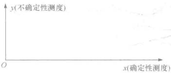

图 1.4.1 确定-不确定空间

### 2. D-U 空间中的联系数运算

联系数刻画出 D-U 空间中一个不确定量的大小和空间位置。二元联系数 \(u=A+Bi\) 在 D-U 空间确定的向量 \(\overrightarrow{OM}\)，称为联系数 \(u\) 在 D-U 空间的映射，见图 1.4.2。

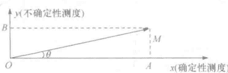

图 1.4.2 联系数 \(u\) 在 D-U 空间上的映射

用 \(r\) 表示联系数的向量 \(\overrightarrow{OM}\) 的长度，由图 1.4.2 易知：

\(r=\sqrt{A^2+B^2}\) (1.4.31)

称为联系数在 D-U 空间的模，用 \(|u|\) 表示。用 \(\theta\) 表示联系数的向量 \(\overrightarrow{OM}\) 与 \(x\) 轴正向的夹角，当 \(A \neq 0\) 时，有

\(\theta=\arctan \frac{B}{A}\) (1.4.32)

称为联系数 \(u\) 在 D-U 空间的幅角，记为 \(\arg U\)。进一步有

\(A=r\cos\theta\) (1.4.33)

\(B=r\sin\theta\) (1.4.34)

于是

\(u=r(\cos\theta+i\sin\theta)\) (1.4.35)

式(1.4.35)称为联系数 \(u\) 在 D-U 空间上的三角函数表达式。有时为了解决问题，可以定义联系数的复运算。

**定义 1.4.9** 设有联系数 \(u_1=A_1+B_1i, u_2=A_2+B_2i\)，其三角函数表达式分别为

\(u_1=r_1(\cos\theta_1+i\sin\theta_1)\) (1.4.36)

\(u_2=r_2(\cos\theta_2+i\sin\theta_2)\) (1.4.37)

则

\(u_1 u_2=r_1(\cos\theta_1+i\sin\theta_1) \cdot r_2(\cos\theta_2+i\sin\theta_2)\)

\(=r_1 r_2[\cos(\theta_1+\theta_2)+i\sin(\theta_1+\theta_2)]\) (1.4.38)

称为联系数的复运算。联系数的复运算满足

$$

$$

$$

根据式(1.4.39)与式(1.4.40)可知，采用三角形式表达的两个联系数相乘，依然保持 a+bi 的结构形式；而且乘积的模值恰好等于两因子模值的乘积，而乘积的幅角则等于两因子幅角之和。特别需留意：式(1.4.35)里的符号 i 并非复数理论中的虚数单位，两者内涵与取值范围截然不同，此处 i 的定义域限定在 [-1, 1] 区间内。

上述分析揭示：联系数在 D-U 空间里描绘的本质上是一种复合量，它必须借助确定性测度与不确定性测度这双重维度才能完整表达。这也意味着，联系数所代表的对象既可视为标量，亦可视为向量。处理标量问题时，它退化为实数；处理向量问题时，它呈现为复变函数形态。面对多元联系数，究竟按实数还是多复变函数处理，取决于研究对象的物理属性（标量或向量）以及具体的问题导向。

联系数的加减法构成一对互逆运算，乘除法同样构成一对，这是最基础的两组互逆关系。放宽视角看，n 元联系数向 n+1 元扩展，与 n+1 元向 n 元压缩，亦是一对互逆操作；第二章提到的伴随函数与联系数之间，同样存在这种互逆映射。这些互逆机制不仅能相互校验运算的准确性，更侧面印证了“成对原理”在运算体系中的普适性。不过必须警惕：在集对分析语境下，互逆过程往往伴随不确定性的生成或演变，唯有引入不确定性分析，方能借助互逆关系严格验证运算的真伪。

## 1.5 集对分析的理论架构

### 1.5.1 不确定性系统的理论基石

前述“集对”“联系数”及其运算规则，以数学语言构建起一套基于集对分析的不确定性系统理论，核心观点归纳如下：

1. 万物皆在普遍联系中。两个事物间的联系是最基础的联系形态。将存在确定联系的两个事物作为一个“集对”来考察，有助于客观刻画研究对象。
2. 对立统一是客观规律。具体事物皆为特定的对立统一体。若用“集合”描述对立双方任意一方，每个对立统一体实为一个“集合对”，故“集对现象”普遍存在。
3. 对立双方在特定条件下进行物质、能量、信息交换，随条件变化，交换的内容、方式、程度均包含不确定性。这些不确定性与确定性以系统形式构成特定子集对，亦称集对。
4. 系统由两个以上要素有机组成。基于此，“集对”即为由两个要素集构成的基元系统（元系统/集对系统）。其中确定与不确定关系构成其子系统，二元联系数 A+Bi 为刻画工具：A 测度确定性，Bi 测度不确定性，A+Bi 是子系统特征函数，本身也是一个融合双重测度的系统。
5. 不确定性具备层次性。宏观层面的不确定性可在微观层面分解解析，这一过程通过二元联系数逐级解析为三元、多元乃至无穷多元联系数得以精准刻画。

### 1.5.2 同异反系统理论：剖析“反”的谱系与“展”的逻辑

基于集对分析的同异反系统理论，既是不确定系统理论的一个特例，又自成体系，核心看点聚焦于“反的多元性质”与“同异反的动态展开”两大维度。

#### 一、“反”非单一：五大对立态与设定式反制

“反”，指概念相对特定参照系呈现的对立面貌。集对分析开创性地识别出五类性质截然不同的“反”，各自对应独特的特征方程与联系数尾项特征：

1.  **倒数式对立**：特征方程 $R \times 1/R = 1$。典型如物理摆的频率与周期、数学除法与乘倒数的等价性。对应联系数末项系数为实数倒数。
2.  **有无式对立**：特征方程 $R \times 0 = 0$。典型如“数据存在”与“数据缺失”。对应联系数末项系数恒为 0。
3.  **正负式对立**：特征方程 $1 \times (-1) = -1$。这是应用最广的一类，联系数末项系数固定为 -1。
4.  **虚实式对立**：特征方程 $1 \times \sqrt{-1} = \sqrt{-1}$。典型如镜像与实物、复平面实轴与虚轴。对应联系数末项为虚单位。
5.  **互补式对立**：特征方程 $f(x) + f(\bar{x}) = 1$。典型如优劣互补、事件发生与不发生概率之和为 1。对应联系数末项系数为 1。

**进阶：设定式“反”**。除上述内生类型外，实践中常依需约定“反”。如环评中将一级标准设“同”、二级设“异”、三级设“反”；医院评价以完成质量三等分同异反；投票决策以赞/弃/反对应同异反。这类“相邻为异、相隔为反”的粗糙设定，经实证检验竟能产出符合客观的分析结论，故而被纳入理论体系。

**核心洞见**：不同性质的“反”映射不同类型的联系数，**联系数末项系数的取值，即为识别“反”类别的标识符**。

#### 二、同异反的“俄罗斯套娃”与“变身术”

现实世界里，同异反绝非泾渭分明的三块版：
*   **程度层层递进**：从“完全同”到“完全异”，再到“完全反”，中间存在“基本同”“有点异”“很反”等无限细分。
*   **结构嵌套交织**：“同中藏异”“异中含反”甚至“反中蕴同”，形成多层自嵌结构。
*   **条件触发转化**：在特定语境下，同异反三者相互转化（见图 1.5.1）。

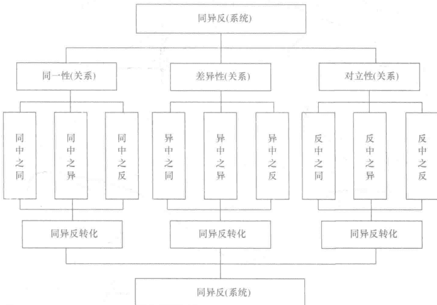

图 1.5.1 同异反系统中的自嵌与转化示意

**联系数视角的统一解释**：
*   每一次展开 $\leftrightarrow$ 一个多元联系数；
*   每一次转化 $\leftrightarrow$ 多元联系数的形式变换；
*   每一种变换 $\leftrightarrow$ 对应的运算规则。
这揭示了联系数及其算法的极致丰富性。

**系统层面的推演**：集对是元系统，集对内的同异反分析即元系统分析；多集合系统的同异反，可在集对内、集对间、全系统三个层面同步展开，图 1.5.1 的分析框架具备全局适用性。

---

### 1.5.3 同异反空间：确定边界圈定不确定核域

**定义 1.5.1** 承载两集合同异反关系的场域，称作**同异反空间**。

其几何拓扑特征极具辨识度：**空间边界由联系数首项（同）与末项（反）的确定性把守，而边界内部则由中间联系分量系数的“不确定性”填充**。这种“确定边界裹挟不确定内核”的拓扑结构，是同异反空间区别于传统欧氏空间、概率空间的根本标志。

---

### 1.5.4 联系场：运算推演的“主战场”

**定义 1.5.2** 同异反空间中，为同异反关系所圈定的区域，称**同异反联系场**，简称**联系场**。

联系数运算、同异反推演，通常在既定联系场内进行；复杂场景下，也会发生**联系场切换**，这对应着分析视角或参照系的根本性迁移。

---

### 1.5.5 论域：动态聚焦的“观测窗”

**定义 1.5.3** 特定问题情境下被纳入讨论的同异反关系集合，构成联系场内的一个子区域，称作**论域**。

论域非固定，随分析广度与深度动态伸缩，**本质上是分析过程的函数映射**。聚焦越深，论域越精微；视野越宽，论域越宏大。

---

### 1.5.6 同异反联系熵：统摄熵族的“元熵”

同异反联系熵既是不确定性系统理论的基石，也是同异反系统理论的核心，更是集对分析理论皇冠上的明珠。1989 年赵克勤创立集对分析时同步提出，后系统阐述其与热力学熵、统计熵、负熵等关系，并在多领域落地生根（文献[17-25]）。爱因斯坦曾云“熵是科学第一法则”，下文引文献[26]深度解析其内核。

#### 从热传递微观过程到熵的联系数表达

设想高温源 $T_1$ 向低温源 $T_2$ 传热（$T_1 > T_2$），依热力学第二定律演进至热寂（$T_1 = T_2$），熵值达峰。聚焦微观瞬时 $\Delta t_k$：高温微热能 $\Delta e_1$ 向低温微热能 $\Delta e_2$ 转化的过渡片段 $\Delta e_0$，既非纯粹 $\Delta e_1$ 亦非纯粹 $\Delta e_2$，呈本质**不确定性**。

以 $\Delta e_1$ 为基准（同），$\Delta e_2$ 为对立（反），$\Delta e_0$ 为中介（异），得**微热能传递联系系数**：
$$ \Delta \mu (\Delta t) = \Delta e_1 + \Delta e_0 i + \Delta e_2 j $$

时间跨度 $t_1 \to t_2$ 内无限微分（$n \to \infty$），化简得无限多元联系数序列：
$$ \mu_k = a_k + b_k i + c_k j \quad (k=1,2,\dots) $$

由此构造**联系熵**（即同异反联系熵）：
$$ S = S_s + S_i + S_p = \sum_{k=1}^{\infty} a_k \ln a_k \;+\; i \sum_{k=1}^{\infty} b_k \ln b_k \;+\; j \sum_{k=1}^{\infty} c_k \ln c_k \tag{1.5.4} $$
其中：
*   **同熵** $S_s = \sum a_k \ln a_k$ （确定有序项）
*   **异熵** $S_i = i \sum b_k \ln b_k$ （不确定中介项）
*   **反熵** $S_p = j \sum c_k \ln c_k$ （确定对立项）

**关键洞见**：熵增极大化的驱动力，锁定在**携带不确定系数 $i$ 的异熵项**。热力学“无序”实为不确定性显化，**无序 $\neq$ 不确定性**，后者是前者的深层机制。

#### 局域熵族的自然导出

由多元联系数理论，自然派生出三大二元局域熵：
*   **同异熵** $S_{sf} = \sum a_k \ln a_k + i \sum b_k \ln b_k$ \tag{1.5.8}
*   **同反熵** $S_{sp} = \sum a_k \ln a_k + j \sum c_k \ln c_k$ \tag{1.5.9}
*   **异反熵** $S_{fp} = i \sum b_k \ln b_k + j \sum c_k \ln c_k$ \tag{1.5.10}

更高阶的同异反扩展多元联系熵因繁复本书暂不展开。以下八大特性勾勒同异反联系熵的完整画像：

1.  **系统性与约束耦合**：受 $a+b+c=1$ 约束，三部分熵此消彼长、相互牵制。
2.  **不确定熵本质**：$i$ 注入不确定性，同熵/反熵相对确定，异熵相对不确定。
3.  **双源不确定性**：$i$ 的不确定性既源系统内部，也源外部环境。$T_1,T_2$ 构成的系统必处于环境中，环境是多重不确定性的载体。
4.  **三熵可互化**：同、异、反三熵在特定条件下可相互转化。
5.  **正负双向取值**：熵值可正可负。负熵对应热能逆向流动（低温 $\to$ 高温），需向环境“借能”。
6.  **特殊值对应极端态**：$S=1,0,-1$ 等映射热力学系统不同极端状态。
7.  **统一局域熵功能**：热力学熵、统计熵、信息熵、模糊熵、负熵等，皆为同异反联系熵中的**局域特例**。
8.  **守恒律**：因 $a_k+b_k+c_k=1$，某部分熵增减必伴随其他部分熵减增，虽不确定具体是哪部分，但守恒铁律不破。

---

## 1.6 本章小结

本章确立**成对原理**与**系统不确定性原理**——自然与社会的双基石，亦是集对分析发轫与 AI 技术遵循的双基石。在此基石上构筑**集对**、**联系数**核心概念体系，详述联系数基本运算、**不确定性系统理论**、**同异反系统理论**，重点标注**同异反联系熵**的核心地位。后续章节将推演这些基础知识在人工智能中的实战图景。

---

## 参考文献

[1] 赵克勤. 集对分析及其初步应用[M]. 杭州:浙江科学技术出版社,2000.  
[2] 蒋云良, 赵克勤, 刘以安, 等. 信息处理集对分析[M]. 北京:清华大学出版社,2015.  
[3] 赵克勤, 宣爱理. 集对论——一种新的不确定性理论方法与应用[J]. 系统工程, 1996, 14(1): 18-25.  
[4] 赵克勤, 赵森烽. 奇妙的联系数[M]. 北京:知识产权出版社, 2014.  
[5] 王霞. 基于复数理论的同异型联系数及其应用[J]. 数学的实践与认识, 2005, 35(8): 127-132.  
[6] 刘秀梅, 赵克勤. 基于联系数复运算的区间数多属性决策方法及应用[J]. 数学的实践与认识, 2008, 38(23):57-64.  
[7] 张传芳, 刘彦慧, 王冰. 一种基于区间型联系数的多指标决策方法[J]. 大学数学, 2011, 27(2):30-35.  
[8] 威切曼 E H. 量子物理学[M]. 复旦大学物理系, 译. 北京:科学出版社, 1979:273-290.  
[9] 赵克勤. 数学危机与集对分析[M]//赵克勤, 米红. 非传统安全与集对分析. 北京:知识产权出版社, 2010:213-219.  
[10] 赵克勤. 成对原理及其在集对分析（SPA）中的作用与意义[J]. 大自然探索, 1998, 17(4):90.  
[11] 赵克勤. 联系数及其应用[J]. 吉林师范学院学报, 1996, (8):50-56.  
[12] 赵克勤. 集对分析的不确定性系统理论在 AI 中的应用[J]. 智能系统学报, 2006, 1(2): 16-25.  
[13] 赵克勤. 基于集对分析的对立分类度量与应用[J]. 科学技术与辩证法, 1994, 11(2):26-30.  
[14] 赵克勤. SPA 的同异反系统理论在人工智能研究中的应用[J]. 智能系统学报, 2007, 2(5):20-35.  
[15] 赵森烽,赵克勤. 几何模型的联系概率与概率的补数定理[J]. 智能系统学报,2013,8(1):11-15.  
[16] 赵克勤. 集对分析与熵的研究[J]. 浙江大学学报(社会科学版),1992,38(2):68-72.  
[17] 宋其秀. 关于联系数的同异反态势熵及应用[J]. 绍兴文理学院学报,2000,20(6):87-89.  
[18] 王桢. 熵及其在水系统中的研究与应用[D]. 南京:河海大学博士学位论文,2001.  
[19] 程启月, 邱苑华. 群决策与个体决策的一致性分析[J]. 中国管理科学,2001,18(5):33-38.  
[20] 韦琦,金鸿章,郭健. 基于脆性联系熵的复杂系统崩溃致因研究[J]. 自动化技术与应用,2003,22(4):1-4.  
[21] 郑罗华, 蒋云良. 联系熵在教学测量与评价中的应用[J]. 湖州师范学院学报,2004,26(1):111-115.  
[22] 荣盛祥,金鸿章,韦琦,等. 基于脆性联系熵的复杂系统特性的研究[J]. 电机与控制学报,2005,46(2):111-115.  
[23] 王莉,田水承,王晓宁. 联系熵在煤矿安全预评价中的应用[J]. 中国安全科学学报,2006,19(9):129-133,147.  
[24] 黄溶冰,胡运权. 产业结构有序度的测算方法——基于熵的视角[J]. 中国管理科学,2006,23(1):122-128.

# 第 2 章 集对分析前沿：从联系数到联系科学的跨越

集对分析架起了“数”与“系统”、数学与系统科学之间的桥梁，致力于探究客观事物中确定性与不确定性、同异反之间的联系与转化机制，客观上为联系科学的建立奠定了基石，也推动了自身的持续演进。本章将聚焦人工智能视角，系统梳理集对分析向联系科学延伸的关键进展，核心涵盖：联系数的伴随函数体系（态势函数、广义势函数、势函数定理、偏/反偏联系数、邻/反邻联系数、相互作用联系数）、赵森烽-克勒概率（联系概率）以及基于联系数的绿色智能计算等前沿内容。

## 2.1 联系数的“隐形搭档”：伴随函数家族

### 2.1.1 态势函数：洞察系统状态与趋势的“显微镜”

联系数的态势函数是其重要的伴随函数之一，它像一面镜子，映射出联系数所刻画事物的特定状态与发展趋势（简称“态势”）。其核心在于揭示联系数各分量大小关系所决定的系统状态规律。鉴于不同联系数的分量关系虽异但有迹可循，态势函数通常采用矩阵形式呈现。

**二元联系数 $\mu=a+bi$ 的态势画像**
其态势函数是一个仅含 3 行元素的简洁矩阵，核心指标为势函数 $shi(\mu)=a/b$：
*   **同势 ($a>b$)**：势函数值 > 1，确定性占优，系统趋同。
*   **均势 ($a=b$)**：势函数值 = 1，同异力量均衡，系统处临界。
*   **异势 ($a<b$)**：势函数值 < 1，不确定性占优，系统趋异。

**三元联系数 $\mu=a+bi+cj$ 的态势全景**
复杂度显著上升，态势函数扩展为 $3\times3\times3=27$ 行的矩阵。根据 $a/c$ 的值及 $a,b,c$ 间的大小序关系，将系统态势细分为同势（5级）、均势（3级）、反势（5级）共 13 种合乎逻辑的真实状态。

> **关键洞察：形式与逻辑的“背离”**
> 表中标注“不存在”的 14 种大小关系（占比超 50%），揭示了一个深刻命题：**形式系统（排列组合空间）无法自动保证逻辑自治**。形式与逻辑并非完全重合。这一案例中，形式-逻辑同一度仅为 $13/27 \approx 0.48$。这引发了核心科学问题：何种形式系统与逻辑不完全同一？如何度量二者的同一度？四元及以上联系数的矩阵规模指数级增长，人工核验逻辑有效性极其繁重，详情可参考文献[3]或自行编程实现。

### 2.1.2 广义势函数：攻克“零分母”难题的利器

标准势函数 $shi(\mu)=a/c$ 在 $c=0$ 时面临无穷大困境，导致整体势比较失效。例如 $\mu_1=0.6+0.3i+0.1j$ (势=6) 与 $\mu_2=0.3+0.7i+0j$ (势=∞)，单纯比较会误判 $\mu_2$ 趋同趋势更强。

张春英等学者提出 **广义势函数 (GP, Generalized Power)** 完美解决此痛点：
$$GP(\mu) = \frac{e^a}{e^c} \tag{2.1.2}$$
无论 $c$ 是否为零，均可稳健计算。进一步衍生出两大核心指标，精准刻画集对内两集合的势态：
*   **广义紧密势 (GCTP)**：$GCTP(\mu) = \frac{e^{a+b}}{e^c}$ —— 体现“同+差”对“反”的整体优势。
*   **广义松散势 (GLP)**：$GLP(\mu) = \frac{e^{a-b}}{e^c}$ —— 体现“同-差”对“反”的净优势。

### 2.1.3 势函数定理与反势运算：正推逆解的双向通道

**定理 2.1.1（势函数定理）** 建立了势函数值与核心分量关系的严格等价映射：
1.  $shi(\mu) > 1 \iff a > c$（同势）
2.  $shi(\mu) < 1 \iff a < c$（反势）
3.  $shi(\mu) = 1 \iff a = c$（均势）

基于此，**反势函数运算 ($\text{arcshi}$)** 应运而生：已知势函数值域，即可反推原联系数分量大小关系。例如 $shi(\mu)>1$ 即推得 $\text{arcshi}(\mu)$ 必满足 $a>c$，实现了从“态势”到“结构”的逆向解码。

### 2.1.4 偏联系数：揭示微观层次“静动交替”的潜在趋势

联系数分量蕴含着系统跨层级演化的隐机。**偏联系数**正是捕捉这种“宏观静止、微观运动”潜在趋势的数学工具，实现了**“状态-趋势分析”**或**“微分析”**。

**1. 二元联系数 $u=A+Bi$ 的偏联系数**
*   **偏同联系数** $\partial^+ u = \frac{A}{A+B}$：度量确定性 $A$ 从不确定性 $B$ 正向转化而来的程度（不确定→确定）。
*   **偏异联系数** $\partial^- u = \frac{B}{A+B}i$：度量不确定性 $B$ 从确定性 $A$ 负向转化而来的程度（确定→不确定）。
*   **全偏联系数** $\partial u = \frac{A}{A+B} + \frac{B}{A+B}i$：本质上是原联系数的**归一化形态** ($\frac{A}{A+B}+\frac{B}{A+B}=1$)，但因 $i\in[-1,1]$ 取值待定，其数值大小仍具不确定性。

**2. 三元联系数 $u=A+Bi+Cj$ 的偏联系数**
*   **偏正联系数** $\partial^+ u = \frac{A}{A+B} + \frac{B}{B+C}i$：刻画朝“正 1 层次”提升迁移的潜在动力。
*   **偏负联系数** $\partial^- u = \frac{B}{A+B}i + \frac{C}{B+C}j$：刻画朝“负 1 层次”下降迁移的潜在风险。
*   **一阶全偏联系数** $\partial u = \frac{A+Bi}{A+B} + \frac{Bi+Cj}{B+C}$：
    *   $\partial u > 0$：正向发展/提升趋势；
    *   $\partial u < 0$：负向发展/下降趋势；
    *   $\partial u = 0$：临界趋势。

> **深度视角：从“点”到“场”的认知跃迁**
> 在同异反三维空间中，三元联系数只是一个静止“点”。偏联系数赋予了我们在瞬时刻对该“点”展开动态剖析的能力（**“点”分析**）。若将联系场中所有“点”串联分析，便形成**“联系场分析”**或**“场分析”**。人的思维空间（思维场）即是一种特殊的联系场。

### 2.1.5 反偏联系数：从“趋势”逆推“结构”

已知偏联系数 $\partial\mu$ 求原联系数 $\mu$，即为**反偏联系数运算**，记为 $\text{arc}\partial(\mu)$。
*例：若 $\partial\mu = \frac{3}{8}+\frac{5}{8}i$，则 $\text{arc}\partial(\mu) = 3+5i+0j$。*

### 2.1.6 邻联系数：基于“当下”预判“将来”的显性趋势

偏联系数溯源“过去→现在”，**邻联系数**则立足“现在→估计将来”，刻画相邻分量间的实时拉动与博弈。

**1. 二元联系数 $u=A+Bi$ 的邻联系数**
*   **邻左联系数** $N^+u = \frac{A}{Bi}$：左侧确定性 $A$ 对右侧不确定性 $B$ 的**“提升作用度”**。
*   **邻右联系数** $N^-u = \frac{B}{A}i$：右侧不确定性 $B$ 对左侧确定性 $A$ 的**“下降作用度”**。
*   **全邻联系数** $$Nu=N^+u+N^-u=\frac{A}{Bi}+\frac{Bi}{A}$$ (2.1.17)：刻画 $A$ 与 $B$ 互邻构成的**“邻矛盾度”**，也是“联系场”中关于“点”的核心测度。

**2. 三元联系数 $u=A+Bi+Cj$ 的邻联系数**
*   **邻左联系数** $$u=A+Bi+Cj$$ (2.1.18) → $$N^+u=\frac{A}{Bi}+\frac{Bi}{Cj}$$ (2.1.19)：刻画左侧 $A, Bi$ 对右侧 $Bi, Cj$ 的整体**“提升作用”**（正向作用联系数）。作为二元联系数，可进一步求其邻左联系数 $$N^+u=\frac{A}{Bi}+\frac{Bi}{Cj}$$ (2.1.20)。
*   **邻右联系数** $$N^-u=\frac{Bi}{A}+\frac{Cj}{Bi}$$ (2.1.21)：刻画右侧不确定性对左侧确定性的**“下降作用”**。
*   **全邻联系数** $$Nu=N^+u+N^-u=\frac{A}{Bi}+\frac{Bi}{Cj}+\frac{Bi}{A}+\frac{Cj}{Bi}$$ (2.1.22)：综合“左侧拉动”与“右侧拉动”的矛盾运动结果，**立足当前，描述对象未来状态**。

> **核心区分：偏 vs 邻**
> *   **偏联系数**：由过去解释现在（潜在趋势，微观迁移）。
> *   **邻联系数**：由现在预测将来（显在趋势，相邻作用）。

### 2.1.7 反邻联系数：逆向还原的邻域逻辑

同理，针对邻联系数 $Nu = N^+u + N^-u$，定义**反邻联系数 $\text{arc}Nu$**，以及反邻左/右联系数 $\text{arc}N^+u、\text{arc}N^-u$，完成从邻域作用回溯至原联系数结构的闭环。

### 2.1.8 相互作用联系数：分量间“化学反应”的数学建模

**定义 2.1.5** 将相邻两分量的**乘积**作为新分量，构建**相互作用联系数 ($Iu$)**，捕捉分量间非线性的耦合效应。

*   **二元联系数** $$u=A+Bi, \ i \in [-1,1]$$ (2.1.23) → 相互作用联系数 $$I(u)=ABi, \ i \in [-1,1]$$ (2.1.24)
*   **三元联系数** $$u=A+Bi+cj, \ i \in [-1,1], \ j=-1$$ (2.1.25)：
    *   一阶 $$I(u)=ABi+Bicj, \ i \in [-1,1], \ j=-1$$ (2.1.26)：相邻两两乘积。
    *   二阶 $$I^2(a)=ABiBiCj=ABCi^2 j, \ i \in [-1,1], \ j=-1$$ (2.1.27)：一阶结果的进一步乘积。
*   **四元联系数** $$u=A+Bi+cj+dk, \ i \in [0,1], \ j \in [-1,0], \ k=-1$$ (2.1.28)：
    *   一阶相互作用联系数：以此类推，构建高阶交互拓扑。

---
*参考文献 [25][26] 及文中标注 [1]-[6] 对应原文献目录。*

## 2.1.8 相互作用联系数的层级拓展

$$I(u)=ABi+Bicj+CjDk, \ i \in [0,1], \ j \in [-1,0], \ k=-1$$ (2.1.29)

二阶相互作用联系数的计算表达式为：

$$I^2(a)=ABiBiCj=BicjCjDk, \ i \in [-1,1], \ j \in [-1,0], \ k=-1$$ (2.1.30)

三阶相互作用联系数的计算表达式为：

$$I^2(a)=ABiBiCjBiCjCjDk=AB^3 i^3 C^3 j^3 Dk, \ i \in [-1,1], \ j \in [-1,0], \ k=-1$$ (2.1.31)

以此类推，可推导出更高阶的形式。

在实际分析中，我们习惯将某个联系数 $u$ 与其相互作用联系数 $I(u)$ 组成“对子”进行联合考察。以一个归一化的二元联系数 $\mu = 0.8 + 0.2i$ 为例，其相互作用联系数 $I(\mu) = 0.16i$。若将这 $0.16i$ 视为 $\mu$ 中虚部 $0.2i$ 作用于实部 $0.8$ 产生的“不确定性效应”，则在该效应下，原本确定的 $0.8$ 仅剩下 $0.64$ 保持确定性。据此，我们可以得到一个新的归一化联系数，写作 $\mu = 0.64 + 0.8 \times 0.2i + 0.2i$，即 $\mu = 0.64 + 0.36i$；为区分来源，亦可拆解表达为 $\mu = 0.64 + 0.16i_1 + 0.2i$，其中 $i_1$ 标识相互作用生成的不确定性。当然，解析角度不止一种。

值得注意的是，除定义 2.1.5 规定的“相邻两分量乘积构成新分量”这种基础相互作用外，定义域还可拓展：针对多元联系数，既可定义相邻 $n (n \ge 3)$ 个分量乘积为新分量的高阶相邻相互作用，也可定义相隔 $n (n \ge 2)$ 个分量乘积为新分量的间隔相互作用，等等，形式多样。

## 2.1.9 反相互作用联系数

与反势函数、反偏联系数的逻辑一致，对于联系数 $u$ 的相互作用联系数 $Iu$，存在与之对应的逆运算函数，记为 $\text{arc}Iu$。其计算过程与求 $Iu$ 的过程互为逆操作。

## 2.1.10 反联系熵函数

已知联系数的熵函数值，反求该联系数，由此引出反熵函数概念，记为 $\text{arc}\mu$。该函数的计算过程相对繁杂。

## 2.2 赵森烽-克勒概率体系速览

### 2.2.1 赵森烽-克勒随机试验：从“必然”走向“随机”

#### 1. 基于古典概型的视角

设想一个盒子，初始仅装有 $n (n \ge 1)$ 个白球。事件 $A$ 为“任意抽取一球为白球”，这显然是必然事件，$P(A)=1$。随后向盒中投入 $m (m \ge 1)$ 个黑球。此时事件 $A$ 由必然转为随机，概率随之变为 $P(A)<1$。

透过这个摸球实验，我们能提炼两层结论：
*   **现象层面**：事件 $A$ 的随机性，源于盒子中引入了“另一种颜色的球”（黑球）。只有白球时必然，有黑白两色才随机。
*   **本质层面**：事件的随机性，实为**两个事物联系**的产物。单一事物（仅白球）对应必然，两种事物（白球与黑球）共存并产生联系，才催生了随机性。

这与经典古典概型的本质结论一致：只有黑白球共存时，“抽到白球”才是随机事件；同理“抽到黑球”亦然。但**操作路径**不同：赵森烽-克勒试验是**“二阶段过程”**——先全白（必然），后加黑（变随机）；经典试验是**“一阶段过程”**——直接面对黑白共存的盒子抽取。前者的“加入黑球”这一动作，更直观地揭示了“随机性源于两事物联系”这一本源。

#### 2. 基于频率概型的视角

设一硬币双面均为“正面”，事件 $A$ 为“掷币正面朝上”，必然事件，$P(A)=1$。换成一枚一正一反的硬币，$A$ 变为随机事件，$P(A)<1$。

分析同样得出双重结论：
*   **现象层面**：随机性源于硬币拥有了“正、反两个不同的面”。
*   **本质层面**：随机性源于**两个事物（正面与反面）的联系**。

上述结论亦可表述为：事件 $A$ 的随机性，源于随机试验中两个互不相容事件 $A$ 与 $\bar{A}$ 的某种联系。这直接导向了随机事件的新定义。

### 2.2.2 随机事件的新定义

**定义 2.2.1** 具有随机性的事件，称为随机事件。

经典概率论常将随机事件定义为“可能出现也可能不出现的事件”或“样本点集合”。但赵森烽-克勒试验揭示：随机试验的核心是**两个不同事物同时存在**（盒子有黑白球、硬币有正反面）。正是这两个事物共存引发的两个互斥事件间的相互关系，构成了随机性的根基。

### 2.2.3 四大核心定理

基于上述试验分析与定义，文献 [7]~[9] 推导出四个定理：

**定理 2.2.1（随机事件成对存在定理）**
任一随机试验中的随机事件，必成对存在。
*证明*：设 $A$ 为随机事件。随机性是两个事件的关系，故 $A$ 与 $\bar{A}$ 在试验中必成对出现。

**定理 2.2.2（随机事件表现定理）**
设 $A$ 与 $\bar{A}$ 为互斥对立事件，则单次试验中二者必现其一，且仅现其一。
*证明*：由定理 2.2.1 成对存在，又因互斥对立，不可能同现、也不可能同缺，定理得证。

**定理 2.2.3（概率补数定理）**
设 $A$ 与 $\bar{A}$ 互斥对立，$P(A)$ 为 $A$ 的大数概率，则其补数 $P(\bar{A}) = 1 - P(A)$ 即为 $A$ 不发生而 $\bar{A}$ 发生的“即或概率”。

**定理 2.2.4（随机事件转化定理）**
在试验次数 $n$ 足够大的频率型试验 $E$ 中，若第 $K (K \gg 1, K \in n)$ 次首现事件 $A$，则必在 $K+m (m \ge 1, K+m \in n)$ 次出现事件 $\bar{A}$。

定理 2.2.3 与 2.2.4 的证明细节略。

### 2.2.4 主事件与伴随事件：视角的锚定

随机事件成对存在，试验结果有多种可能。为便利研究，文献 [8]~[10] 引入定义：

**定义 2.2.2** 随机试验中，被首要关注的事件称**主事件**（又称第一关注事件、正事件）；与之互斥的另一事件称**伴随事件**（又称第二关注事件、负事件）。

在互为成对的 $A$ 与 $\bar{A}$ 中，若以 $A$ 为主事件，则 $\bar{A}$ 为其伴随事件；反之亦然。主事件的选择，决定了分析的视角锚点。

### 2.2.5 赵森烽-克勒概率：联系数视角的概率重构

因 $A$ 与 $\bar{A}$ 成对且互斥，单次试验二选一。用 $P(A, \bar{A})$ 表示二者出现的概率联合，约定前者为主事件 $A$，后者为伴随事件 $\bar{A}$。由此导出**赵森烽-克勒概率**（即**联系概率**）——一种融合主事件大数概率与伴随事件即或概率的联系数表达式。

$$P_c(A) = P(A) + [1 - P(A)]i$$

式 (2.2.1) 中 $P_c(A)$ 表示联系数意义下的事件 $A$ 发生可能性，即 $P(A)$ 与 $1-P(A)$ 的“联系和”，下标 $c$ 取自 connected（联系）。

有时亦写作：

$$P(A, \bar{A}) = P(A) + P(\bar{A})i$$

在上述式中，$i$ 代表不确定性，其取值区间为 $[\frac{-1-P(A)}{1-P(A)}, 1]$，随场景动态确定。因为单次试验结果只有两种：主事件发生（联系概率值为 1）或伴随事件发生（联系概率值为 -1）。
解 $P_c(A) = P(A) + P(\bar{A})i = -1$ 得 $i = \frac{-1-P(A)}{1-P(A)}$；
解 $P_c(A) = P(A) + P(\bar{A})i = 1$ 得 $i = 1$。
此区间精准刻画了每一次试验的真实落地结果。

**实例演示**：袋装 2 白 3 黑球。以“抽白球”为主事件 $A$，“抽黑球”为 $\bar{A}$。
*   实抽白球：$P_c(A) = \frac{2}{5} + \frac{3}{5}i = 1 \Rightarrow i=1$。
*   实抽黑球（站在 $A$ 角度）：$P_c(A) = \frac{2}{5} + \frac{3}{5}i = -1 \Rightarrow i=-\frac{7}{3}$。
*   若以 $\bar{A}$（抽黑球）为主事件：$P_c(\bar{A}) = \frac{3}{5} + \frac{2}{5}i$。
    *   抽黑球：$=1 \Rightarrow i=1$。
    *   抽白球：$=-1 \Rightarrow i=-4$。

可见，**主事件的选择改变联系概率表达式及 $i$ 的取值**，这完全符合认知逻辑。特别地，若设 $A$ 为主事件（参考系），实测出现 $\bar{A} (A \cap \bar{A}=\varnothing, A \cup \bar{A}=\Omega)$，则称 $P(\bar{A})$ 为相对于主事件 $A$ 的**负概率**。

**关键辨析**：主事件 $A$ 的负概率 $\neq -P(A)$，即 $P(\bar{A}) \neq -P(A)$。它不是概率取负，而是“伴随事件发生”在主事件坐标系下的投影。

### 2.2.6 实战案例：洪水风险下的工程决策

#### 例 2.2.1 背景
某低洼工地有重要设备。气象预报：下月小洪水概率 0.25，大洪水概率 0.01。三个备选方案：
1.  **迁走设备**：成本 3800 元。
2.  **建围墙**：成本 2000 元。能挡小洪水，挡不住大洪水（大洪水损失 60000 元）。
3.  **不设防**：小洪水损失 10000 元，大洪水损失 60000 元。
决策者为保守型（求损失最小），选哪个？

#### 经典概率视角下的期望决策
设损失为 $X$。
*   方案 1：$X=3800$（常数），$E(X_1)=3800$。
*   方案 2：分布列 $X=\{2000, 62000\}$, $p=\{0.99, 0.01\}$。$E(X_2)=2000\times0.99 + 62000\times0.01 = 2600$。
*   方案 3：分布列 $X=\{0, 10000, 60000\}$, $p=\{0.74, 0.25, 0.01\}$。$E(X_3)=0\times0.74 + 10000\times0.25 + 60000\times0.01 = 3100$。
**结论**：方案 2 期望损失最小（2600 元），经典法选方案 2。

#### 赵森烽-克勒概率视角下的期望决策
将概率改写为联系概率：
$P_c(\text{小洪水}) = 0.25 + 0.75i$
$P_c(\text{大洪水}) = 0.01 + 0.99i$
$P_c(\text{无洪水}) = 0.74 + 0.26i$

**方案 1**：$E_c(X_1) = 3800$（不变）。

**方案 2**：
| X | 2000 | 62000 |
|---|---|---|
| p | $0.99+0.01i$ | $0.01+0.99i$ |
$E_c(X_2) = 2000(0.99+0.01i) + 62000(0.01+0.99i) = 2600 + 61500i$。

**方案 3**：
| X | 0 | 10000 | 60000 |
|---|---|---|---|
| p | $0.74+0.26i$ | $0.25+0.75i$ | $0.01+0.99i$ |
$E_c(X_3) = 0 + 10000(0.25+0.75i) + 60000(0.01+0.99i) = 3100 + 66900i$。

#### 深度解析：不确定项“bi”揭示的隐性风险
$E_c(X_2), E_c(X_3)$ 含不定项 $bi$，需分析 $i$ 取值。题设条件难以精确锁定 $i$，但可通过不等式推演临界点：
*   方案 2 vs 方案 1：$2600+61500i \ge 3800 \Rightarrow i \ge 0.0195$。当 $i > 0.0195$ 时，方案 2 损失反超方案 1。
*   方案 3 vs 方案 1：$3100+66900i \ge 3800 \Rightarrow i \ge 0.0105$。当 $i > 0.0105$ 时，方案 3 损失反超方案 1。

**综合研判**：保守型决策应选**方案 1**（迁走设备）。这符合直觉：一旦有洪水（大/小），实际损失远超 3800 元。

**核心洞见**：
1.  经典期望仅给出实数（2600, 3100），**掩盖了风险**；联系概率期望显性保留“$bi$ 不确定项”，**将风险显性化**。
2.  令 $i=0$（即 $bi=0$），联系概率期望退化为经典期望。**经典概率是联系概率的特例（$i=0$ 时刻）**。
3.  信息量差异：$0.25+0.75i$ 同时刻画“小洪水概率 0.25”及“非小洪水概率 0.75”。后者包含“无洪水”+“大洪水”，且概率是前者 3 倍，**忽视伴随事件等于忽视主要风险源**。
4.  已知大洪水概率 0.01，当 $i \ge 0.0195$ 暗示大洪水发生，方案 2 失效。同理可解析方案 3。虽无法精知最终态（小/大/无洪水），但 $i$ 的不等式解给出了风险容忍边界。

**总结**：赵森烽-克勒概率（联系概率）在刻画主事件可能性的同时，强制纳入伴随事件可能性，**信息熵更高、决策支撑更全面**。更多细节详见文献 [9]~[12]。

## 2.3 基于联系数的绿色智能计算

### 2.3.1 重新认识“数”

集对分析给出了一个全新视角：实数本质上是一个“集对”，由数符集合（如0-9这十个符号，构成有限集A）与数位集合（个、十、百……无限延伸，构成无限集B）耦合而成。任意一个正整数，都是A与B组成的一个具体集对；推而广之，任意实数都是A、B两集合间建立的一种特定联系。这种联系包含两层核心逻辑：一是**对应关系**——A中元素与B中元素“对号入座”；二是**有序性（层次性/数量级）**——这种对应不是乱序的，而是遵循严格的层级次序。简而言之，**数即集对，具体的一个数就是这个集对的特征函数**。

进一步看，系统被定义为由两个以上要素构成的有机体。若视集对为恰好由两个要素集构成的“元系统”，那么每一个实数天然就是一个元系统。实数与系统的这种内在合一，不仅侧面印证了1.1节“成对原理”的普适性，也彰显了从系统论角度研究数的必要性。

### 2.3.2 自然数的“联系数化”表达

任意两个自然数间，既存在宏观层面的联系（如相邻数差1），也蕴含微观层面的稠密联系（如2与3之间挤满了无限有理数、无理数）。如何用简洁形式同刻画宏观与微观联系，曾是一大难题。美国数学家鲁滨逊创立非标准分析，揭示实数邻域存在无穷小与无穷大，为破题提供了思路。

引入**联系数 A + Bi** 后，问题迎刃而解：
*   **A** 代表基准自然数；
*   **B** 覆盖 A 左右邻域的所有量；
*   **i** 为不确定因子（涵盖可测/不可测的无穷小、无穷大）。

**i 的妙处在于其“容纳性”**：它能装下无穷小、无穷大、确定量与不可测量，为后续研究预留空间，也为实战计算带来便利。

**生动案例：**
*   **“三个臭皮匠 vs 三个和尚”**：将1写作 `1+2i`，则 `1+1+1 = 3+6i`。i=1 时得9（超加性，皮匠胜诸葛）；i=-1 时得-3（负协同，和尚无水）；i=0 时得3（简单相加）。
*   **股票投资**：10元入市，结果表为 `10+10i (i∈[-1,∞])`，自然涵盖亏损、盈利与归零。
*   **教室人数**：5人走1人，剩 `5-(1+4i)`，i=0 即确定剩4人。
*   **切矩形角**：4角切1角，余 `4-(1+3i)`。i=0 得3角（切过对角线）；i=-2/3 得5角（切不到对角线）。

这些例子生动诠释了：联系数让“确定性”中天然内嵌“不确定性”，一式多解，灵活对应复杂现实。

### 2.3.3 绿色智能计算：让数“活”起来

将自然数联系数化，恰似将每个自然数视为数轴上一棵棵**活树**。地上是主干枝叶（显性数值），地下是根系根须（隐性微观联系）。相邻树木根系交缠，正如自然数间稠密的有理数、无理数（见图2.3.2）。数轴是“地平线”，也是一维“森林”；赋予根系“营养”（定义、规则、运算），地上树木便“开花结果”输出结论。

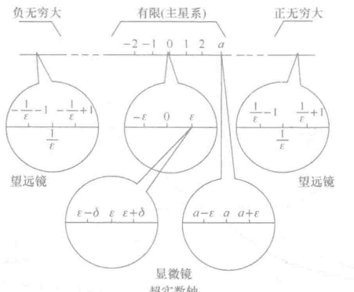

图 2.3.1 一个实数附近的无穷大与无穷小

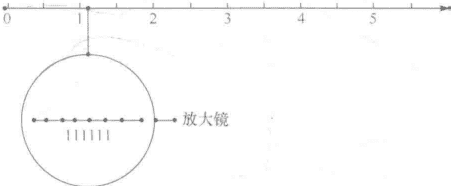

图 2.3.2 自然数(树)与自然数(树)之间的微观联系

这一系列计算可称**“绿色计算”**或**“树计算”**。它揭示：计算可以有“生命”——同一数据，不同“联系”处理，得不同结果，关键在于对不确定性的智能化驾驭。从此，**联系数学实质上成为一门新“生命科学”**——不同联系赋予同一组数以不同“数字生命”形态。

作物是人筛选自然植物得来的“物质粮食”；数是人量化客观信息得来的“思维粮食”。联系数揭示了数与作物的深层相似，侧面映照出人类智能的灵性。

**数即系统，是绿色智能计算的又一基石。** 既然数是系统，数的运算便涉及系统运算。传统上系统易分析难运算，绿色智能计算的出路在于：**将数的运算视为“量的计算”与“质的系统形态演变”（即质变）的同步发生**。这是对量变与质变统一的计算。

绿色智能计算的系列问题，仍待深入探索。

## 2.4 本章小结

本章梳理了集对分析三大前沿进展：
1.  **联系数伴随函数研究**：揭示联系数多伴随函数、反函数共存，信息量丰富、结构复杂、适用性强。
2.  **经典概率论扩充**：基于赵森烽-克勤随机试验建立的新概率概念，同样信息量巨大。
3.  **自然数联系数化与绿色智能计算**：确立“数=系统”二义合一，引出生命化计算范式，蕴含海量信息与研究课题。

每一方向皆任重道远，亟待系统深入攻关。

## 参考文献

- [1] 赵克勤. 集对分析及其初步应用[M]. 杭州: 浙江科学技术出版社, 2007.
- [2] 赵克勤, 赵森烽. 奇妙的联系数[M]. 北京: 知识产权出版社, 2014: 30-36.
- [3] 沈定栋. 体育用联系数学[M]. 香港: 中国教育文化出版社, 2007.
- [4] 张春英, 郭景峰. 集对社会网络 α 关系社区及动态挖掘算法[J]. 计算机学报, 2013, 36(8): 1682-1692.
- [5] 赵克勤. 反偏联系数[M]//人工智能进展 2007. 北京: 北京邮电大学出版社, 2007: 66-67.
- [6] 赵克勤, 赵森烽. 奇妙的联系数[M]. 北京: 知识产权出版社, 2014: 65-80.
- [7] 赵克勤. 集对分析与熵的研究[J]. 浙江大学学报(社会科学版), 1992, 38(2): 66-72.
- [8] 赵森烽, 赵克勤. 概率联系数化的原理及其在概率推理中的应用[J]. 智能系统学报, 2012, 7(3): 200-205.
- [9] 赵森烽, 赵克勤. 几何概型的联系概率(复概率)与概率的补数定理[J]. 智能系统学报, 2013, 8(1): 1-15.
- [10] 赵森烽, 赵克勤. 频率型联系概率与随机事件转化定理[J]. 智能系统学报, 2014, 9(1): 53-59.
- [11] 赵森烽, 赵克勤. 联系概率的由来及其在风险决策中的应用[J]. 数学的实践与认识, 2013, 43(3): 165-171.
- [12] 赵森烽, 赵克勤. 基于赵森烽-克勤概率的新型风险决策[M]//中国系统工程学会决策科学专业委员会. 决策科学与系统分析: 中国系统工程会决策科学专业委员会第十届学术年会论文集. 北京: 知识产权出版社, 2013: 186-192.

# 第 3 章 人工智能基石与前沿：集对分析视角

人工智能虽属技术学科，却牵涉智能定义、来源、信息处理、脑思维、网络开发、大数据挖掘、智能迁移升级等尖端领域，其基础原理至今仍处探讨争鸣中。本章依托集对分析理论，依次构建：系统智能定义与原理 → 新人工智能定义与原理 → AI科技基础的集对分析阐释 → “智脑”与“集对人”两大前沿概念模型。

## 3.1 系统智能原理

### 3.1.1 智能新定义：打破边界，普适天地

**何为智能？** 学界定义众说纷纭。代表性观点有：“应用知识处理环境的能力”或“以目标准则度量的抽象思维能力”；“人理解学习事物的能力”等。

然而，现代智能科学从生物行为（蚁群、遗传算法）、无机现象（模拟退火算法）中汲灵感，且计算机、机器人等无机体已展现并持续增强智能。故而，**亟需一个更普适、更基础的定义**。基于集对分析思想，我们提出：

> **智能，是系统（有机或无机）为自身存在与发展，将两个或两个以上事物联系起来以解决问题的能力。**
> 简言之：**智能是系统为存在、发展而与环境建立联系的能力。**

**定义推演的深远含义：**
*   **智能非人专利**：动物、植物（向日葵、含羞草）均具智能。
*   **智能非生物专属**：无机物亦有智能。碰撞作用力反作用力“以牙还牙”是高级智能；弹簧复原、记忆材料是简单智能；地球自转公转维持长期运动，彰显星球级智能。
*   **推而广之**：自然界万物以系统形态存在，皆为存续发展而具联系环境之能，故皆具智能。称之**系统自然智能**，或**系统智能**、**自然智能**。

**哲学回响**：唯物论视角下，人之智能全赖自然赋予。自然借地球等智能载体缓慢、有序、持续地造人、育人。人再将所得智能加工制造，赋予机器系统，助己更好认知、利用、开发自然。

**谦卑与敬畏**：迄今人类智能仅占自然/宇宙智能极小部分，未知远超已知。人是自然产物，自然是母体。人当与自然和谐共生、敬畏探秘、习得自然智能，以成就人智成熟与AI长进。此定义亦可称**系统自然智能定义**、**超级智能定义**，有助消解对AI发展的恐惧，强化敬畏自然、探索奥秘的动力。

### 3.1.2 十大基石原理：构建理论大厦

为阐释系统智能原理，先立四约定：
1.  **时空本位**：事物存在于时空。时空不可割裂，单独指称仅为叙述/研究便利，实则为基础集对（详1.1.1成对原理）。
2.  **系统本位**：系统=两个以上要素构成的整体。事物以系统态存在。系统与环境交换物质/能量/信息以存续演化。两要素系统称“元系统”，一切系统皆基于元系统演化；**集对即元系统**。
3.  **事物二元论**：事物=事（人参与的物运动）+ 物（物质/物体）。人=人类/一般人/个体。

基此，呈现系统自然智能**10大基石原理**（前两为一级，后八为二/三级引出原理）：

#### 原理1 联系原理
客观事物恒处相互联系中。公认科学原理，毋庸赘述。

#### 原理2 对立统一原理
对立双方共处一统一体中。哲学及现代科学公理，毋庸赘述。
→ **衍出**：两事物联系是最基本联系，合对立统一原理，引出**成对原理**。

#### 原理3 成对原理
事物或概念皆成对存在。此为集对概念与理论的基石，详见第1章。与玻尔“互补原理”等价。

#### 原理4 系统不确定性原理
系统要素间确定性关系与不确定性关系共存。
*   理论支撑：物理“测不准原理”、数学“哥德尔不完备定理”。
*   亦为集对分析及联系数的核心支撑（详1.3节）。

#### 原理5 相互作用原理
联系中的两个以上事物存在相互作用。哲学、物理等学科公理。

#### 原理6 运动原理
客观事物恒处运动中。运动在时空展开，依相互作用原理与时间单向性，运动具方向性，设定起点即具发展性。故亦称**发展原理**。

#### 原理7 关联原理
联系事物与其相互作用生成的新事物间存关联。可视为相互作用原理二级、联系原理三级。
**衍出命题与推论：**
*   **命题1**：信息是物质与能量相互作用的产物。
*   **命题2**：物质、能量、信息三者互关联。
*   **推论1**：信息具一定物质与能量属性。
*   **推论2**：信息具不确定性。
    *   *证明略*：相互作用产物必带物质能量；具体参与量难确定，故不确定。

> **启示**：此组命题推论从新视角回应“何为信息”这一世纪争鸣。维纳“信息非物质非能量”实可能基于“信息既是物质又是能量”双重特性之上——意指信息不可单一归纳为物质或能量。

#### 原理8 最小作用量原理
自然系统倾向以最小能耗联系外界，利于存续发展。
*   光走直线（两点直达最短）；
*   同面积图形圆周最短（圆与外界联系唯一几何边界）；
*   同体积物体球表面积最小（球与外界联系唯一几何面）；
*   爱因斯坦视“简单性原理”为科学基石。
**揭示**：系统天然具“价值意识”——最小成本换最大收益。

#### 原理9 能量转换与守恒原理
自然变化中，能量不生不灭，只转形式，总量守恒。力学动势互换、电池电化互换、热力学热机互换，皆守恒。物理公理。
**延伸**：信息作为物质能量作用产物，其能量（称**信息能**）在不同形态转换中亦守恒，含信息→智能转化。

#### 原理10 功能原理
能量转换守恒原理的派生，也是力学基石：系统机械能增量 = 外力非保守力做功 + 内部耗散力做功（代数和）。本质：能量转化伴随消耗，但新旧能量总和不变。

### 3.1.3 系统智能原理与性质

基于上述10大科学原理，现正式给出**系统智能原理**……

# 系统智能核心原理与人工智能基础架构解析

## 系统智能原理及其十大内在特质

**核心法则**：任何系统为维持生存与演进，必遵循“最小能耗原则”，与环境进行物质、信息的动态交互。交互的时机、内容、规模、路径及效果均呈现不确定性；过程中伴随能量形态转化与损耗，但总能量严格守恒。

基于此法则，系统智能展现出以下十大本质属性：

1.  **目的导向性**：智能的终极指向，始终锚定在系统自我的存续与壮大。
2.  **环境适应性**：赋予系统灵活应变的能力，支持依据环境状态实施质能互换、信息转码。
3.  **交互不确定性**：系统主导与环境进行物质、能量、信息交换的时机、内涵、量级、机制及手法，均兼具主动权与灵活度。
4.  **价值最优性**：以最微小的能量代价达成交换意图，服务于系统生存发展的根本利益。
5.  **结构有序性**：智能内部蕴含等级、层次、方位、属性、延伸等多维秩序架构。
6.  **能量实体性**：智能本质上是一种能量形态。在特定条件下，它可与电、化、机、热、生物及信息能双向转换，全程遵循能量守恒定律。
7.  **对偶成对性**：智能与非智能、此端智能与彼端智能，皆呈成对共存态势。
8.  **功能效用性**：为系统生存发展提供实战价值，覆盖调控、掌控、信息/能量的获取上报、传输、分配与消耗等全链路。
9.  **演化成长性**：随系统历程持续进化，涵盖正向、负向、横向、螺旋、树状、网络等多元形态。此属性亦称“智性”与“动态性”，囊括自学习、自组织、主动性、生态性等机制，成长路径本身具有不确定性。
10. **跨域可迁移性**：系统智能可在特定条件下跨载体迁移。

> *注：上述性质的严格推导过程此处省略。*

**延伸阐释**：聚焦特定系统时，视研究视角差异，将呈现专属特质。如人文视角下的人文智能具有人文性，社会视角下的社会智能彰显社会性；随AI演进，网络智能、深空智能等新属性将涌现。但上述十大基础性质构成通用底座。**智能的可迁移特性，为人工智能落地奠定了物理基石。**

---

## 3.2 人工智能原理重构

### 3.2.1 重新定义：何为人工智能

学术界定义众说纷纭：或视为计算机科学分支，或定义为赋予机器思维的尝试，或罗列为机器执行的类人行为清单（感知、推理、决策等）。

立足“智能是系统存续发展的能力”这一新定义，我们给出**人工智能的新定义**：

> **人工智能，是人类借助人工技术，授予系统“存续发展、联通环境、破解专项难题”的综合能力。**

该定义三大看点：
*   **主体归位**：凸显“人”的主导地位；
*   **核心聚焦**：强调系统“存续与发展”的内在动力；
*   **边界拓展**：明确系统与环境的“联通”属性。

此处的“系统”已突破机器范畴——动物、植物均可成为赋智对象，以解决特定问题达成目的。

**特殊形态——智脑系统**：当“人”与“系统”耦合为“双系统”（集对），形成一类高阶智能体，本书定义为**“智脑系统”**（简称“智脑”或“集对人”）。

### 3.2.2 本质溯源与目标分野

**本质洞见**：系统天然具备为生存发展而联通环境的智能。人工智能的本质，乃是**依据人类需求与目标，将一系统的天然智能“赋予”或“迁移”至另一系统。**

**两大目标图谱**：

| 目标层级 | 核心意图 | 标签属性 | 可行性判断 |
| :--- | :--- | :--- | :--- |
| **终极目标（第一类）** | 习得万物自然智能，主宰世界/自然/时空/宇宙，成“万物之灵” | 无限/无穷 | **理论不可达**。受制于系统智能原理依赖的基础科学律，属“第一类问题”（不可解）。 |
| **现实目标（第二类）** | 筛选、重组、优化已掌握智能，赋予目标系统，强化其能助力人类生存发展 | 有限/有穷 | **当前及长期核心追求**。人工智能可解问题均属“第二类问题”。 |

**现实纠缠**：实践中两类问题常纠缠共生（如永动机、网络无限膨胀、机器超人类等困扰）。依“成对原理”可解与不可解共存；“相互作用原理”致两者在特定条件下互化，但转化条件的生成机制本身又是新谜题。

---

## 3.3 人工智能基�奠基：科学与技术的双重底座

### 3.3.1 问题背景

学科基石之争自50年代麦卡锡提倡AI以来从未止息，客观催生符号主义（数理逻辑）、联结主义（仿生学）、行为主义（控制论）三大流派。国内学者亦尝试综合融合。鉴于前文已确立智能新定义、系统智能原理及AI新原理，亟需确立本体论基础观。

### 3.3.2 科学基础：四大支柱

系统智能原理依托的底层原理，锚定四大科学支柱：
1.  **哲学**：联系原理、对立统一原理。
2.  **物理学**：相互作用、运动、能量转换守恒、功能原理。
3.  **数学**：系统不确定性、最小作用量原理。
4.  **集对分析**：成对原理、关联原理。

**辨析热门误区**：
*   **脑科学 ≠ 基础**：现阶段脑科研尚无法像物理实验般批量复现，难为基础学科基石；其机制成果仅可作技术基础参考。
*   **信息科学 ≠ 一级基础**：本书首创定义“信息是物质与能量相互作用的产物”，故信息科学实属物理学二级学科，建立在物理+数学之上；其处理技术成果亦属技术基础范畴。

**为何集对分析入选？** 其从“成对原理”出发，主张跨学科耦合：数理集对、理化集对、天地集对、知脑集对、科技集对、理论实践集对……自然科学与哲学社会科学耦合为“自然哲社集对”。每一集对皆涉人类智能，计算机时代更皆涉人工智能。故集对分析为AI基础，实乃**题中应有之义**。

### 3.3.3 技术基础：全谱系调用

信息、计算、工程、网络、分析、统计、综合、优化、组合、传感、医疗、脑科技……**现存与新生的一切技术，皆为AI技术基础**。技术无不根植于科学（科学技术集对）；技术应用以满足人类期望为准则（应用与期望集对）。应用结果与期望的“同/异/反”关系，驱动技术迭代：同则推广，异则改良，反则淘汰。此过程实为“期望背景下的集对分析”。集对分析由此支撑技术基础体系。

---

## 3.4 基础架构的集对分析深度解析

### 3.4.1 科学基础的集对透视

**1. 数理集对：确定性与不确定性的共舞**
*   **共振点**：“测不准原理”（物理）+“哥德尔不完备定理”（数学）= 系统确定性与不确定性原理的双重支撑。
*   **差异点一**：物理有“能量守恒”，数学无对应原理。实战中，如何以最小能耗完成智能计算成关键课题。
*   **差异点二**：经典物理缺信息研究。本书揭示“信息=物质×能量相互作用产物”，故信息具能量（信息能）。自然风雨雷电皆为携物质能量的自然信息。但AI视数字为信息，**数字是否承载物质能量？** 待深研。理论上数理作基础无悖。

**2. 数哲集对：逻辑与情理的双重奠基**
哲学以鸟瞰视域指导自然科学，其“联系/对立统一原理”蕴含“成对原理”→支撑“集对”概念→集对作为两关联集合的运算单元，升维集合论→集合论基数学→数学基AI。哲学与数学由此联袂筑基。

**3. 四维联动集对：哲、数、理、集的协奏**
四者共同支撑系统智能与AI原理，分工明确：
*   **物理主能量守恒**：阐释系统智能对信息能、智能等能量守恒；信息能源于物质运动提取；信息传送损耗本质为运动能量开销；计算机处理信息同受热力学律制约（发热/冷却）；信息转智能亦存损耗。
*   **人脑实证**：信息转智能需海量学习思考，耗巨量能量，否则无法支撑深度认知与智能外迁。

### 3.4.2 技术基础的集对透视

*   **同**：诸技术（信息、计算、网络、模式识别等）均具可操作性。
*   **异**：各技术保有独特属性。
*   **反**：协同实施中存“反点”引发伦理/价值风险。如智能远程医疗：医疗技术直面生命体，网络/计算/信息技术直面无生命数据，**“生/死”对立在同一技术组合中共存**，客观赋予AI伦理风险属性。
*   **策略**：低风险组合现有基础技术达标，同步孵化高端智能技术。

### 3.4.3 三大流派的集对统摄

**成因复盘**：因未识系统自然智能核心地位，未以科学原理为学科基石，未以成熟技术为技术基座，长期在实用主义驱动下多头试探，致三大流派鼎立。

**集对分析的统一性支撑**（早于1996年朱其秀即提出构想）：

| 流派 | 核心主张 | 集对分析支撑逻辑 |
| :--- | :--- | :--- |
| **行为主义** | 智能基于“感知-行动” | 感知与行动构成集对。定感知可对多行动，定行动可对多感知。规则与不确定性共存，**集对联系数可精描此机制**。 |
| **联结主义** | 神经元联结结构决定功能 | 双神经元联结=基本“集对”形式。结构再复杂，信息处理终归“同/异/反”三态，可对程度计量。**复杂运算收敛为简洁联系数结构**，支撑结构-功能主义。 |
| **符号主义** | 符号运算与逻辑推理 | 1. 联系度运算即符号运算，“同/异/反”义需结合背景理解。<br>2. “同”可推“异/反”，“反”可推“同/异”，“异”蕴“同/反” —— **条件与背景决定符号指称**，语境变则义变。<br>3. 集对特征函数运算本身即高阶符号运算。 |

**结论**：三大流派虽理念分歧、争论激烈，均获集对分析理论与实质双重支撑。根因：**集对分析联系科学，是系统自然智能科学原理的基础性理论。**

**共同短板**：受限于认知阶段，三派均未识“智能即能量”本质，故缺失对智能生成损耗、执行转换消耗、能量守恒制约的能量视角认知，**仅能游离于技术层面，难登科学殿堂。**

---

## 3.5 智脑与集对人：超级智能系统的雏形

### 3.5.1 核心命题

顺承前文逻辑，特别是AI新定义，关键问题浮现：**能否借AI技术，构建一系统，融贯数理、物理、生命、思维、社会、经管、行为、管科、文艺等学科，及信息、工程等技术？此系将何态——现有网络？超级AI？抑或他种超级系统？**

### 3.5.2 智脑概念的确立

**溯源**：2014年集对分析潮州会议，赵克勤正式提出“智脑”概念。

**层级模型**：
1.  **微观原型**：比比皆是的“人脑+电脑”系统。
2.  **中观视域**：人脑与网络耦合的智能系统。
3.  **宏观实态**：**亿万计算机 + 亿万人脑**构成的**超级脑系统**。当下在线网络连同亿万用户，即为此超级脑。

**集对本质定义**：
依集对定义与理论，以“亿万计算机”为一集合，“亿万在线人脑”为另一集合，该超级脑即为**实时计算分析各类问题的在线集对**；其运算分析过程即**超级集对分析**。该集对具一般集对性质：
*   **同一性**：计算机具部分人脑功能（感知、分类、记忆、理解、计算、分析）。
*   **差异性**：大规模并行神经网络 vs 生物神经网络存差距。
*   **对立性**：人脑直觉决策 vs 计算机程序决策。
*   **不确定性**：联系机制复杂多变。
*   **量化表征**：同/异/反程度可用“同异反联系数”度量。

> **定义 3.5.1 智脑**：由人脑与电脑组成的一种智能系统。

**别称体系**：
网络即“网络脑”。智脑可解读为 **“人脑+网络脑”构成的脑集对**，简称**脑对、双脑、智脑系统、智脑**。

## 3.5.3 实例

**例 3.5.1 互联网与人脑的同构演进**

请看图 3.5.1（源自网络）。图示揭示：当下的实时互联网与人脑结构高度同构，更准确地说，正朝着高度相似的方向演进。终将构建出功能完备的类人神经元、类神经网络，以及类感觉/运动/中枢神经系统，乃至类神经反射弧等机制。核心在于互联网的神经元网络拓扑——即社交网络与物联网融合催生的 BIG SNS。须知，网络中的每一台计算机（含智能手机）运行时，背后都有对应人脑实时参与，其本质皆是一个个“智脑”节点。

另一关键现象：该网络由特定实体主导（如百度、谷歌、腾讯）。过往人工智能领域强调的人机交互、大规模并行、多 Agent、神经网络、智能系统工程等核心议题，在“智脑”系统中均具象化为人脑与计算机（网络脑）的深度互动。

**例 3.5.2 猴子意念控制机械手实验**

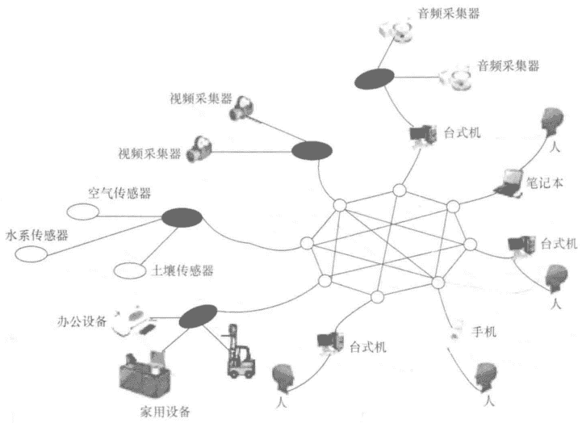

*图 3.5.1 实时网络脑示意图*

实验流程：在猴子运动皮层植入两块 4mm×4mm 微电极芯片（96 电极），连接 200 余神经元采集脉冲信号，另一端接计算机实时记录神经放电。经算法解码抓、勾、握、捏四类手势意图，实现意念直驱机械手。此类脑机接口实验涉及伦理审查。

此例佐证：人脑与电脑耦合形成的“智脑”，其智能实施路径呈多样性、有效性与复杂性（含伦理维度）。更本质的是，“人脑+电脑”这一“脑集对”是动态演进的有机体，从而引出“集对人”概念。

## 3.5.4 集对人：双脑协同的新智能体

人体器官多呈对偶（双眼、双耳、双手、双脚、肝胆、心肺等）。赵克勤 2009 年在浙大集对分析 20 周年会上据此提出“集对人”概念：每人皆“长”有诸多“集对”。但困惑随之而来——人只有一个脑袋，依“成对原理”应有“第二个脑袋”，它在哪？

后悟出：电脑即“集对人”的“第二脑”。赵克勤 2014 年潮州会上遂提出“智脑”概念（见 3.5.2），将“人脑+电脑”作特定脑系统研究。且网络脑非纯机器脑，海量实时在线计算机背后实时映射着人脑思维，故网络脑系统实为“类人系统”（或称“虚拟社会”）。此“类人系统”与特定实体人（实时用户、平台运营方如 BAT、Google）共同构成“集对人”系统。

**定义 3.5.2** 人与智脑耦合形成的超级智能系统，称为**集对人**。

依智脑定义，集对人分两大类：
1.  **机器-机器类**：智能体间协同。
2.  **自然人-机器类**：人机深度融合。

无论哪类，均具双核特征：
1.  **双重思维**：兼具人脑有机思维与电脑无机-有机混合思维。
2.  **双重行为**：兼具自然人行为与机器（系统）行为。

## 3.5.5 数学模型：联系数视角的形式化表达

基于集对分析与联系数理论（第 1、2 章），建模如下：

设 $IB$ 为智脑，$P$ 为人，$C$ 为计算机。

**基本模型（式 3.5.1）：**
$$ IB_{ut} = \sum_{k=1}^n P_k + i \sum_{t=1}^m C_k $$
$IB_{ut}$ 表示 $k(k\ge1)$ 人与 $t(t\ge1)$ 机组成的智脑系统。$i$ 为不确定性标识，取值 $[-1,1]$，视场景而定。

**一般模型（式 3.5.2）：**
实时网络中，几乎每台电脑背后都有人操控，故：
$$ IB_{ut} = \sum_{k=1}^n P_k + i \sum_{t=1}^m C_k P_k $$
$n,m$ 为有限实数时，称“有限智脑”。

**互联网智脑模型（式 3.5.3）：**
真实互联网规模趋向无限，得典型二元联系数表达：
$$ IB = \sum_{k=1}^\infty P_k + i \sum_{t=1, k=1}^\infty C_i P_k $$

**集对人模型（式 3.5.4）：**
引入独立实施智能的机器/机构 $m_q$（用 $m$ 表示），得“集对人”模型 $SPP$：
$$ SPP = \sum_{k=1}^{\infty} P_k + i \sum_{i=1, k=1}^{\infty} C_k P_k + j \sum_{q=1}^{\infty} m_q $$
其中 $j$ 双重含义：① 标识机器群无机性与人群有机性的对立；② 可赋值量化。式 (3.5.4) 亦可视为式 (3.5.3) 第二项的功能性分解（详见 1.3.2 节）。

## 3.5.6 深度思考：三大核心命题

### 问题 1：集对人是人类学意义上的新物种进化吗？

人类进化史：直立行走与手劳动分工区分人猴；机器极致延伸手足功能，分古今人；计算机被视为大脑延伸。但强大网络脑已超越单纯“延伸”范畴——它在映射脑功能的同时，摆脱生理束缚自主演化。故应视为与人脑配对的系统，形成具备完整“肢体内脏”（双脑、双手足、双眼耳、心肝肺腹）及“代谢机能”（摄入知识/信息、吸收转化为智能、排泄冗余/糟粕、创造文明）的**新人种——智能人**。其人类学特征显性化或缓或疾，标志人类进化进入新阶段。

### 问题 2：集对人的历史使命是什么？

**探索并开发人类第二家园。**

地球资源枯竭、环境恶化、人口饱和、地质灾害频发、外来天体撞击风险客观存在。寻找太阳系内宜居星球成当务之急。第二家园在哪？谁去开发？如何开发？非“集对人/智能人”莫属。

### 问题 3：集对人的现实任务是什么？

**构建全球沟通协商机制，规避大规模冲突。**

两次世界大战教训：利益对立、思想撕裂、地域割据下，缺乏高效交流工具是诱因。集网络智能与行为于一身的“集对人”，天然具备交流、沟通、协商综合功能，有助于化解矛盾、和谐世界，避免世界级冲突再现。退一步说，其亦将助力 21 世纪及未来的政治文明、经济优化、生态平衡、节能环保、民生安居。

**结论**：人机有机耦合的超级智能系统（或称智能人新物种），尚有海量课题待系统深入攻关。

---

## 3.6 本章小结

半个多世纪 AI 历程中，激进派恐机器统治，保守派叹进展不及预期，实用派忙技术筑塔。本章基于此背景，首提**系统自然智能**观：大自然是天然智者，人类现有智能仅习得其皮毛；自然规律即核心智能库，人类须持续向自然取经。

核心原理创见：
1.  信息是物质能量相互作用的产物，含能量，称**信息能**。
2.  信息能与智能，同电/热/机/化/原子能等本质，属能量范畴，可在特定条件下互转，遵守能量守恒。
3.  网络脑在能量驱动下处理海量数据，具智能，与人脑构成“智脑集对”，以前所未有的速度与规模演化，正孕育新型“类人系统”——**集对人系统**（或称智能人新物种）。
4.  纯实体人与类人系统共同决策、执掌、推进现代文明及寻找新家园的时代已至，海量新问题待解。

第 4 章起，将展示集对分析在现有 AI 研究与实战中的具体应用。

---

## 参考文献

[1] 蔡自兴, 徐光佑. 人工智能及其应用[M]. 北京: 清华大学出版社, 2010: 114-116.
[2] 钟义信. 高等人工智能原理·观念·模型[M]. 北京: 科学出版社, 2014: 1-440.
[3] 赵克勤. 集对分析及其初步应用[M]. 杭州: 浙江科学技术出版社, 2000.
[4] 朱其秀. 集对分析用于人工智能研究的思考[J]. 绍兴文理学院学报, 1996, 16(4): 113-118.
[5] 赵克勤, 赵森烽. 贝叶斯概率向赵森烽-克勒概率的转换与应用[J]. 智能系统学报, 2015, 10(1): 51-61.
[6] 蒋云良, 赵克勤, 刘以安, 等. 信息处理集对分析[M]. 北京: 清华大学出版社, 2015: 1-38.
[7] 赵克勤, 赵森烽. 奇妙的联系数[M]. 北京: 知识产权出版社, 2014: 1-80.

---

# 第 4 章 基于集对分析的模式识别

模式识别是人脑基础智能，也是 AI 核心底座。主流分有监督（有模板）与无监督（无模板）两类。集对分析在该领域的创新成果，集中于构建**同异反模式识别**与**不确定性模式识别**两大技术体系。本章系统阐述其原理、方法及应用实例。

## 4.1 原理介绍

### 4.1.1 模式识别定义与分类

即模式分类。有模板在先为有监督，无模板为无监督。
按方法分 **统计法** 与 **结构法（句法/语言学法）**：
- 统计法：判别函数、近邻分类、非线性映射、特征/主因子分析等。
- 结构法：将模式分解为子模式组合，层层递进至基元，形成树形结构描述（模式描述语句），类似语言中句-词-字层级。

应用极广：OCR、语音/指纹/人脸识别、侦查、诊断、国防、水印、分类、基因组合、育种等。

### 4.1.2 同异反模式识别原理

简称同异反识别，分定量与定量定性混合两类，核心皆依托联系数。

**1) 基于联系数伴随函数的分类**
设联系数 $\mu(N,M)=a+bi+cj$。
- **同类**：势函数 $sh(\mu)=a/c > 1$ 且 $b < a$。
- **反类**：$sh(\mu)=a/c < 1$ 且 $b < c$。
- **中介过渡类**：$sh(\mu)=a/c = 1$ 且 $b < c$。可按需深入层次细化。
此外，尚有基于势函数、偏/邻/相互作用联系数的分类法（详 2.1 节）。

**2) 基于同异反距离的模式分类**
白杨文 1996 年提出**择优原则**（有优化目标时用最优化法寻最优模式）与**择近原则**（无目标时计算距离，按远近定同/异/反）。
- 属性确定、不计“异”的不确定性时，结果唯一。
- 计及“异”的不确定性时，需经不确定性分析出结论。
- 无预设模式时，可先按准则（如最优指标集）选最优模式为标准，再用上述原则识别聚类。

**洞见**：客观事物多样、不确定、复杂，绝对精确识别受限。**“宽域式同异反识别”**——以精确为标但容纳可接受不确定性——在应用中广受欢迎，持续衍生新技术（如基于集对分析的相似识别）。

**小结**：同异反识别本质上借助同异反联系数的建模、计算与分析实现。

## 4.2 指纹识别实战：集对分析的工程落地

成科扬 2005 年引入集对分析攻关指纹识别，成效显著，此介绍其核心工作[4]。

### 4.2.1 指纹特性与识别难点

指纹具唯一性、终身不变性、不可分离性，广用于公安、金融、安防。但匹配极难：
1.  采集姿势随机，存旋转、平移变换。
2.  非线性弹性形变随机且难建模。
3.  干湿磨损致图像质量差，算法不完善导致伪细节点、真点定位偏差。

上述因素决定指纹匹配只能是**相对性的弹性匹配**。成科扬基于集对分析构建新型系统，为解决不确定性匹配开辟新径。

### 4.2.2 基于集对分析的指纹识别系统构建

**核心思路**：模板指纹特征集与待识指纹特征集构成两集合，识别匹配即两集合全关系分析。

**建系步骤**：

**1) 确定特征权系数（重要性排序法）**
指纹特征点属性（类型、欧氏距离、相对角、至中心穿线数）决策力度不一，需赋权。
邀 $m$ 专家对 4 属性排序。设 $N_{ij}$ 为第 $j$ 专家排序中排第 $i$ 属性之后的个数，则：
$$ f'_i = \sum_{j=1}^m N_{ij} \quad (4.2.1) $$
归一化得权重：
$$ f_i = \frac{f'_i}{\sum_{j=1}^n f'_i} \quad (4.2.2) $$

**2) 选取特征点（辐射搜索法，抗旋移）**
预处理后提取两类基元：纹线端点、分叉点（其他如眼、桥、剪刀形均可拆分为分叉点），孤立点舍弃。
任取一特征点为中心，辐射状向外搜索至半径 $R$。记录范围内所有他点的类型、欧氏距离、相对角、穿线数，作为该中心点属性（见图 4.2.1、4.2.2）。**优势**：特征提取天然不受图像旋转、平移影响。

**3) 确定对应特征点对的联系数**

# 集对分析赋能：指纹精准识别与矿山灾害智能研判实战解析

### 4.2.3 算法实测与性能验证

**核心逻辑构建：特征点联系度量化**

在指纹比对环节，系统任意抽取模板指纹与待识别指纹各一枚核心特征点。假设这两个中心点在半径 \( R \) 范围内分别拥有 \( N_1 \) 与 \( N_2 \) 个卫星特征点。针对特征类型、相对角度、欧氏距离以及连接中心点的纹线数量这四大维度，分别计算中心特征点的联系度值，公式定义为：

\( \mu_{ijk} = a_{ijk} + b_{ijk}i + c_{ijk}j \)

其中，\( \mu_{ijk} \) 表征待测指纹特征点 \(i\) 与模板指纹特征点 \(j\) 在第 \(k\) 个属性上的关联强度。

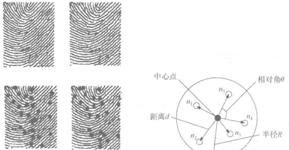

**图 4.2.1 特征点提取示意**

**图 4.2.2 结构对比示意**

设两中心点的卫星特征点总池中，有 \(N_a\) 个在属性 \(k\) 上判定为“同一”（一致性超越上确界），\(N_c\) 个判定为“对立”（一致性低于下确界），其余 \(N_b\) 个判定为“差异”（一致性介于两确界之间）。据此，三项系数计算如下：

\( a_{ijk}=N_a/N, \quad b_{ijk}=N_b/N, \quad c_{ijk}=N_c/N \)

此处 \(N=(N_1+N_2)/2\) 为平均卫星点数。依托集对分析理论，引入虚部单位 \(i\) 与负部单位 \(j\)，采用相似比法赋值：\(i=(a_{ijk}-c_{ijk})/(a_{ijk}+b_{ijk}+c_{ijk}), j=-1\)。

**匹配决策机制：从点对到整图**

定义待测特征点 \(i\) 对模板特征点 \(j\) 的综合相关度 \(R_{ij}\) 为：

\( R_{ij}=| [f_1, f_2, \cdots, f_m]^T \times [\mu_{ij1}, \mu_{ij2}, \cdots, \mu_{ijm}] | \)

当 \(R_{ij}\) 突破预设阈值，即认定该特征点对匹配成功。若此类有效匹配点对占比达到指纹总特征点数的设定百分比，系统裁定两枚指纹同源匹配。详细流程见图 4.2.3 与 4.2.4。

**实验数据说话：高鲁棒性验证**

测试库囊括 200 个指头采集的 2000 幅图像（每指 10 幅），分辨率 \(640 \times 480\)，采集过程不限制手指姿态。实验结果汇总如下：

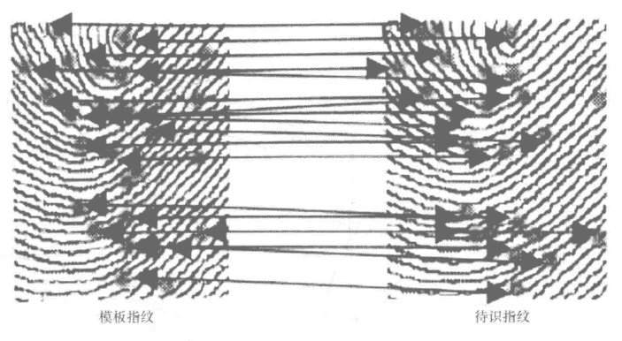

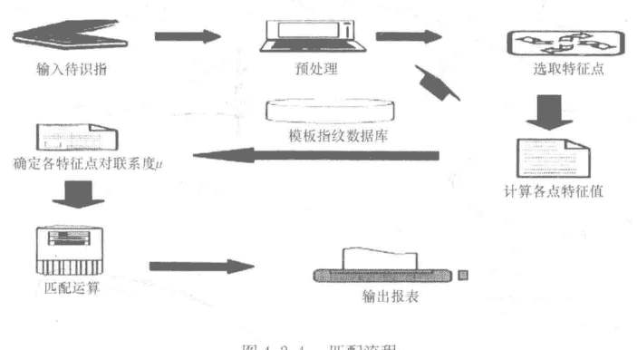

**表 4.2.1 关键阈值配置与识别率统计**

| 实验编号 | F1u | F1d | F2u | F2d | F3u | F3d | F4u | F4d | F5 | F6 | 识别次数 | 正确次数 | 错误次数 | 拒识次数 |
|---|---|---|---|---|---|---|---|---|---|---|---|---|---|---|
| 1 | 0.78 | 0.21 | 0.81 | 0.22 | 0.79 | 0.19 | 0.82 | 0.22 | 0.52 | 0.61 | 2000 | 1994 | 4 | 2 |
| 2 | 0.77 | 0.23 | 0.80 | 0.21 | 0.81 | 0.22 | 0.82 | 0.19 | 0.51 | 0.62 | 2000 | 1997 | 2 | 1 |
| 3 | 0.79 | 0.22 | 0.81 | 0.22 | 0.82 | 0.21 | 0.80 | 0.20 | 0.55 | 0.62 | 2000 | 1996 | 2 | 2 |

*注：F1u/F1d 为类型属性上下确界；F2u/F2d 为相对角属性上下确界；F3u/F3d 为欧氏距离属性上下确界；F4u/F4d 为穿纹线数属性上下确界；F5 为特征点认同阈值；F6 为指纹匹配比例阈值。阈值支持自适应进化：系统通过对成功案例的监督学习持续迭代优化各阈值。*

数据表明，该算法在 **99.78%** 的高正确率下，将拒识率压制至 **0.08%** 的极低水平。表 4.2.2 进一步揭示了其在非理想条件下的强抗扰能力：无论是图像旋转、背景干扰（偏黑/偏白），还是缺损、拉伸、各级畸变，系统均展现出卓越的鲁棒性。

**表 4.2.2 复杂工况下的识别率表现**

| 指纹状态 | 识别率/% | 指纹状态 | 识别率/% |
|---|---|---|---|
| 正常指纹 | 99.3 | 旋转 60° | 98.7 |
| 背景偏黑 | 98.3 | 轻度畸变 | 95.8 |
| 背景偏白 | 98.5 | 一般畸变 | 90.2 |
| 旋转 45° | 99.0 | 重度畸变 | 81.8 |

---

### 4.3 同异反模式识别：金属矿山地质灾害智能预警实战

**背景痛点：** 矿产开采虽支撑经济民生，却常诱发崩塌滑坡、泥石流、采空区塌陷等灾害。李德顺团队创新引入集对分析同异反模式识别，构建灾害模式智能判断体系。

#### 4.3.1 总体技术路线

采用“三步走”策略：聚焦**崩塌滑坡、泥石流、采空塌陷**三大灾害模式 -> 引入**层次分析法（AHP）** 量化指标权重 -> 构建“评价指标集”与“标准集”集对，依托专家现场打分数据建立联系度 -> 最终通过**同异反最优模式识别模型** 输出整体灾害等级判定。

#### 4.3.2 模型深度架构解析

**1. 联系度函数：五级危险度的精准映射**

将地质灾害指标标准划分为五级：危险 I (0-20]、较危险 II [20-40)、一般安全 III [40-60)、较安全 IV [60-80)、安全 V [80-100]。针对待评指标 \(x_{kl}\) 所处区间，定义其对各级别标准 \(s_{jk}\) 的联系度 \( \mu_{hkl} \) (h=1..5)，实现“同一=1、差异∈[-1,1]、对立=-1”的动态过渡。具体分段函数见式 (4.3.1)，通过线性插值平滑处理边界过渡，避免突变。

若指标权重为 \(w_k\)，系统总联系度聚合为：
\(\mu_{hl} = \sum_{k=1}^m w_k \mu_{hkl}\)  (4.3.2)

**最大联系度准则：** 若 \( \mu_{hkl} = \max \{ \mu_{hl} | h = 1..c \} \)，则样本 \(l\) 判定为 \(h\) 级灾害。

**2. 优化模型：从“相离度”到“综合指数”的进阶**

面对未知数量 \(n\) 个待评样本、各含 \(m\) 个指标的矩阵 \(X\) 与 \(c\) 级标准矩阵 \(S\)，引入**相离度** \(dev_{hl}\) 表征样本偢离标准程度。为融合指标权重与样本从属度，定义**加权相离度** \(DEV_{hl}\) (式 4.3.7)，物理意义明确。

构建目标函数：最小化全体样本加权相离度平方和 (式 4.3.8)，约束条件为从属度归一化且非负 (式 4.3.9)。引入拉格朗日乘数法求解 (式 4.3.10)，得最优相对从属度 \(SUB_{hl}\) (式 4.3.11)。

最终，定义样本 \(l\) 的**同异反最优模式识别综合指数**：
\( CI_\mu(l) = \sum_{h=1}^c h \cdot SUB_{hl} \) (4.3.12)

该指数范围锁定在 \([1, c]\)，直观反映样本整体灾害归属结构：指数越接近 1 越危险，越接近 c 越安全。

#### 4.3.3 实战案例：某金属矿山灾害画像

**步骤 1：AHP 赋权 & 专家打分**
依据表 4.3.1 指标体系，完成三级指标权重分配（如崩塌滑坡权重 0.3248，泥石流 0.4346，采空塌陷 0.2406）及专家现场实测打分。

**步骤 2：双模型对决验证**
分别采用“最大联系度法”与“本文最优模式识别法”对该矿山灾害模式进行识别，对比结果见表 4.3.2（素材中引用表 4.3.2，此处为逻辑衔接）。

**表 4.3.1 核心指标权重与实测数据节选**

| 目标层 | 一级灾害类型 | 一级权重 | 二级指标 | 二级权重 | 三级指标 | 三级权重 | 专家打分 |
|---|---|---|---|---|---|---|---|
| 金属矿山地质灾害模式识别 | **崩塌滑坡** | **0.3248** | 潜在工程地质灾害 | 0.3107 | 地质构造 | 0.1772 | 68.93 |
| | | | | | 岩石性质结构 | 0.1547 | 56.98 |
| | | | | | 地形地貌相对高差 | 0.1281 | 68.90 |
| | | | | | 山坡坡度 | 0.1263 | 80.56 |
| | | | | | 年降水量 | 0.0858 | 87.45 |
| | | | | | 森林覆盖率 | 0.1079 | 78.45 |
| | | | | | 矿山工程密度 | 0.1143 | 85.34 |
| | | | | | 植被破坏程度 | 0.1057 | 59.89 |
| | | | 历史工程地质灾害 | 0.6893 | 规模 | 0.3032 | 88.56 |
| | | | | | 密度 | 0.3212 | 78.56 |
| | | | | | 频次 | 0.3756 | 78.56 |
| | **泥石流** | **0.4346** | 潜在工程地质灾害 | 0.3107 | 地质构造 | 0.1647 | 60.56 |
| | | | | | 松散堆积物数量 | 0.1443 | 67.89 |
| | | | | | 地貌类型 | 0.1367 | 56.67 |
| | | | | | 山坡坡度 | 0.1308 | 58.78 |
| | | | | | 年降水量 | 0.0998 | 69.45 |
| | | | | | 暴雨比例 | 0.0745 | 57.34 |
| | | | | | 森林覆盖率 | 0.0856 | 58.90 |
| | | | | | 植被破坏 | 0.0754 | 58.34 |
| | | | | | 坡沟破坏 | 0.0882 | 51.56 |
| | | | 历史工程地质灾害 | 0.6893 | 规模 | 0.3043 | 86.34 |
| | | | | | 密度 | 0.3145 | 79.45 |
| | | | | | 频次 | 0.3812 | 88.34 |
| | **采空坍塌** | **0.2406** | 潜在工程地质灾害 | 0.3107 | 岩溶发育程度 | 0.1538 | 80.45 |
| | | | | | 覆盖层厚度 | 0.1436 | 89.56 |
| | | | | | 断裂构造 | 0.1234 | 86.45 |
| | | | | | 新构造运动 | 0.1153 | 78.45 |
| | | | | | 地下水构造 | 0.0982 | 69.56 |
| | | | | | 地形地貌 | 0.1093 | 80.45 |
| | | | | | 年降水量 | 0.0799 | 82.57 |
| | | | | | 开采地下水 | 0.0892 | 84.67 |
| | | | | | 矿井排水 | 0.0873 | 78.79 |
| | | | 历史工程地质灾害 | 0.6893 | 规模 | 0.3327 | 79.67 |
| | | | | | 密度 | 0.3172 | 86.90 |
| | | | | | 频次 | 0.3501 | 69.45 |

*注：完整实验对比数据详见原文表 4.3.2，验证了优化模型在处理模糊边界、多指标耦合时优于传统最大联系度法的判别精度。*

### 表 4.3.2 某金属矿山地质灾害模式识别对比结果

| 评价手段 | 计算输出 | | | | |

|---|---|---|---|---|---|

| 最大联系测度准则 | I | II | III | IV | V |

| | -1.0000 | -1.0000 | -0.5663 | 0.9750 | 0.5663 |

| 同异反最优模型 | | | CI(D) = 4.0023 | | |

表 4.3.1 与表 4.3.2 分别剖析了该金属矿山地质灾害模式识别的流程及结果：

① 依据最大联系测度准则推断，该矿山地质灾害等级定为 N 级，属“较安全”范畴。
② 依据同异反最优模式识别模型判定，该矿山地质灾害等级为 IV 级，同样归属“较安全”级别。
③ 两种方法在判断优劣上各有千秋：最大联系测度法依靠最大联系度准则归类，却忽视了样本对其他灾害等级的关联度，缺乏整体视角，尤其在多样本横向对比时显得力不从心；反观同异反最优模型，凭借综合指数决策，融合了样本对各等级的同、异、反全维信息，识别效能更优。李德顺等学者亦将该模型推广至石化企业火灾危险性识别领域，详情参阅文献[6]。

## 4.4 同异反模式识别聚类法及其工程实践

高洁等[7]创立了一种融合集对分析“择近原则”与聚类分析核心思想的聚类预测新范式，在邮电业务总量预测中表现优异，具体技术路线如下。

### 4.4.1 核心逻辑框架

**步骤 1：构建事物 $N$ 的分类模式体系**  
设 $N$ 的候选分类集合为 $A=\{A_1,A_2,\cdots,A_n\}$。

**步骤 2：建立分类模式与参照系的同异反联系向量**  
用 $\vec{\mu}_k=(a_k,b_k,c_k)$ 表征第 $k$ 个分类模式 $A_k$ 与参照系构成集对后的同异反向量，亦可写作联系度 $\mu_k=a_k+b_ki+c_kj\ (k=1,2,\cdots,n)$。  
若各模式 $A_k$ 受 $m$ 个因素制约，记其在第 $t$ 个因素($t=1,2,\cdots,m$)上的联系度为 $\mu_k^t$。因各因素对分类权重不同，需引入权系数 $\alpha=[\alpha_1, \alpha_2, \cdots, \alpha_m]$（满足 $\sum_{k=1}^m \alpha_k = 1$）量化重要性。此时，$\mu_k$ 可视为 $m$ 个因子联系度的加权平均：
$$ \mu_k = \sum_{i=1}^m \alpha_i\mu_k^i \tag{4.4.1} $$
其中 $a_k, b_k, c_k$ 分别为同一度、差异度、对立度的加权均值。

**步骤 3：建立待预测系统 $B$ 与参照系的同异反联系向量**  
记为 $\vec{\mu}=(a,b,c)$ 或联系度 $\mu=a+bi+cj$。

**步骤 4：度量同异反距离**  
定义 $\rho_k\ (k=1, 2, \cdots, n)$ 为向量 $\vec{\mu}_k$ 与 $\vec{\mu}$ 的欧氏距离：
$$ \rho_k = \sqrt{(a_k-a)^2+(b_k-b)^2+(c_k-c)^2} \tag{4.4.2} $$

**步骤 5：依“择近原则”定类别并预测**  
若 $\rho_{k_0} = \min(\rho_1, \rho_2, \cdots, \rho_n)$，则判定 $B$ 隶属模式 $A_{k_0}$。若各分类系统中心记为 $x_k^0$，则 $B$ 的预测值按加权倒数距离公式计算：
$$ x = \frac{\sum_{k=1}^n \frac{x_k^0}{\rho_k}}{\sum_{k=1}^n \frac{1}{\rho_k}} \tag{4.4.3} $$

### 4.4.2 模型构建与实战复盘

#### 1. 数据预处理
邮电业务量与三次产业 GDP 紧密相关。选取某地区 1990-2000 年历史数据（表 4.4.1），经通胀剔除（表 4.4.2）后，换算得三次产业及邮电业务年增长率（表 4.4.3，定义为本年值/上年值）。  
以 1991-1999 年为建模样本，因邮电增长率落在 1.20%~1.75% 区间，将样本按此指标三等分（$n=3$），各类样本量、增长率区间及三产业平均增长率（$\bar{x_1},\bar{x_2},\bar{x_3}$）见表 4.4.4。

**表 4.4.4 邮电业务年增长率分类样本统计表**

| 类别 | 增长率区间 | 样本量 | x1(一产) | x2(二产) | x3(三产) |

|---|---|---|---|---|---|

| A1 | [1.20, 1.35) | 3 | 1.006 | 1.080 | 1.116 |

| A2 | [1.35, 1.50) | 3 | 1.061 | 1.103 | 1.148 |

| A3 | [1.50, 1.75) | 3 | 1.090 | 1.227 | 1.203 |

#### 2. 确立各类样本联系度
参照系设定为三产业年增长率均为 1。第 $k$ 类样本 $A_k$ 就第 $t$ 个因子与参照系的联系度记为 $\mu_k^t = a_k^t + c_k^t j$。  
同一度取 $a_k^t = \bar{x}_t / 2$，对立度采用倒数型 $c_k^t = a_2^t / \bar{x}_t$。代入表 4.4.4 数据得（式 4.4.4）：
$\mu_1^1=0.503+0.199j,\ \mu_1^2=0.540+0.185j,\ \mu_1^3=0.583+0.172j$  
$\mu_2^1=0.531+0.189j,\ \mu_2^2=0.552+0.181j,\ \mu_2^3=0.574+0.174j$  
$\mu_3^1=0.545+0.183j,\ \mu_3^2=0.614+0.163j,\ \mu_3^3=0.602+0.166j$  
注：此处简写为 $\mu=a+cj$，因 $b=1-a-c$ 可还原完整式。  
赋予三产业等权 ($\alpha_1=\alpha_2=\alpha_3=1/3)$，按式(4.4.1) 求得综合联系度（式 4.4.5）：
$\mu_1=0.542+0.273i+0.185j$  
$\mu_2=0.552+0.267i+0.181j$  
$\mu_3=0.587+0.242i+0.171j$

#### 3. 待测样本 $B$ 联系度计算
验证模型精度，取 2000 年三产业实际增长率(1.028, 1.152, 1.138)为 $B$ 的观测值，预测该年邮电增长率。同理得 $B$ 在各因子上的联系度（式 4.4.6）：
$\mu_B^1=0.514+0.195j,\ \mu_B^2=0.576+0.174j,\ \mu_B^3=0.569+0.176j$  
综合联系度（式 4.4.7）：$\mu_B=0.553+0.265i+0.182j$

#### 4. 距离测算与类别判定
依式(4.4.2) 计算 $B$ 与三类样本的同异反距离（表 4.4.5）。$\rho_2$ 最小，按“择近原则”判定属于 $A_2$ 类。

**表 4.4.5 同异反距离与判定结果**

| $\rho_1$ | $\rho_2$ | $\rho_3$ | 判定类别 |

|---|---|---|---|

| 0.014 | 0.002 | 0.042 | $A_2$ |

#### 5. 精度验证与展望
表 4.4.5 显示 2000 年预测落入 $A_2$ 类（增长率 1.35%~1.50%）。按式(4.4.3) 反演得预测增长率 1.415%，实况 1.422%，相对误差仅 0.49%，精度可圈可点。  
若以 1991-2000 年三产业平均增长率(1.050%, 1.138%, 1.169%)为输入，预测未来增长率得 1.419%，推算 2001 年邮电业务总量将达 458 亿元（1990 不变价）。  
本案例采用等权假设；若结合行业实情优化权重、细化分类粒度，预测精度有望进一步跃升。

## 4.5 集对分析视域下的相似识别理论与应用

阎理等[8]提出了基于集对分析的相似识别新范式，并给出实例，现述要如下。

### 4.5.1 相似性的内涵延伸
相似性普遍存在：既见于同类事物（如相似三角形），也跨越异类系统（天体与粒子结构、生命与激光自组织现象等）。

> **定义 4.5.1** 若两系统要素共享属性特征，但表征数值存差异，则称这些属性特征为**相似要素**。一对相似要素构成**相似元**，可含多项特征。

**经典相似观的局限**：传统理论要求对应特征比例系数服从严格约束（如多边形相似需边长比等、对应角等），非黑即白。这难以解释：等边三角形与大尺寸等边三角形相似，却与边长相近的等腰直角三角形“不相似”——直觉上后者更“相近”。

**模糊相似观的突破**：引入 [0,1] 区间数值量化相似度，1 为同一，0 为全异，中间态表达“相似程度”。

**集对分析视角**：实则系统要素间**同、相异、不同**三态共存。需经相似比综合运算，给出相似与否的整体判定。

### 4.5.2 识别基本思路

设集合 $A$ 含 $k$ 要素，$B$ 含 $l$ 要素，共有 $n$ 个相同要素（$n \leq \min(k,l)$），即交集 $A \cap B$；并集 $A \cup B$ 元素数为 $k+l-n$。  
以 $z(X)$ 表示集合 $X$ 基数，则：
$Z(A)=k,\ Z(B)=l,\ Z(A\cap B)=n,\ Z(A\cup B)=k+l-n$。

定义**相似度量 $Q$ 值**为交集与并集之比：
$$ Q = \frac{Z(A \cap B)}{Z(A \cup B)} = \frac{n}{k + l - n} \tag{4.5.1} $$
性质：$0 \leq Q \leq 1$；$A=B$ 时 $Q=1$；$A,B$ 不相交时 $Q=0$。

### 4.5.2 含相似元集合的相似度量

假设集合 $A$ 与 $B$ 分别包含 $k$ 与 $l$ 个元素，其中有 $f$ 个元素构成了“既不相同也不完全相异”的关联对（$f \leq \min(k, l)$），这 $f$ 个元素组合生成 $p$ 个**相似元**。第 $j$ 个相似元内部两元素的相似程度记为 $q_j$ ($j=1,2,\dots,p$)。此场景对应式 (1.3.7) 中 $i \in [0,1]$ 时 $b$ 的取值情况，此时 $i$ 值可按下式确定：

\[
i = \frac{1}{p} \sum_{j=1}^{p} q_j \tag{4.5.2}
\]

由此，这 $p$ 个相似元对 $A,B$ 整体相似度的贡献为：

\[
Q = \frac{f}{k + l - f} \cdot \frac{1}{p} \sum_{j=1}^{p} q_j \tag{4.5.3}
\]

易见，若所有 $q_j=0$ 则 $Q=0$；若所有 $q_j=1$ 则退化为式 (4.5.2) 所述情形。特别地，若 $A,B$ 元素数量相等（$k=l=f$），且 $A$ 中每个元素均与 $B$ 中每个元素构成相似元，则公式简化为：

\[
Q = \frac{1}{p} \sum_{j=1}^{p} q_j \tag{4.5.4}
\]

### 4.5.3 相似元内部相似度的计算规则

设两元素 $a,b$ 构成相似元 $u$，共包含 $m$ 项指标（特征）。对应指标的相似系数为 $r_1,\dots,r_m$，各指标对相似度的影响权重为 $d_1,\dots,d_m$（满足 $0\le d_k\le 1, \sum d_k=1$），则相似元 $u$ 的相似程度 $q$ 为加权求和：

\[
q = \sum_{k=1}^{m} d_k r_k \tag{4.5.5}
\]

**等权特例：** 若 $d_k = 1/m$，则退化为算术平均：

\[
q = \frac{1}{m} \sum_{k=1}^{m} r_k \tag{4.5.6}
\]

**单指标相似系数 $r_k$ 的定义：** 取两元素在第 $k$ 指标特征值 $v_k(a), v_k(b)$ 的最小值与最大值之比：

\[
r_k = \frac{\min(v_k(a), v_k(b))}{\max(v_k(a), v_k(b))} \tag{4.5.7}
\]

特性直观：特征值相等则 $r_k=1$；任一为 0 则 $r_k=0$；其余情况介于 $(0,1)$ 之间。值得注意的是，此 $r_k$ 实质上即集对分析中对应指标特征值的**同一度**。

**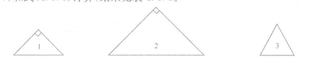**

#### 实战演示：三角形相似性分析

以图 4.5.1 为例：两直角边为 1 和 2 的等腰直角三角形（记为 $\triangle 1, \triangle 2$），以及边长为 1 的等边三角形（$\triangle 3$）。两两配对得三个相似元 $u_1,u_2,u_3$。每个相似元提取 6 个指标：顺时针 3 个内角（指标 1-3）与 3 条边长（指标 4-6），等权计算。依据式 (4.5.7) 与 (4.5.6) 得结果如表 4.5.1。

| j | 相似元 | r1 | r2 | r3 | r4 | r5 | r6 | qj |
|---|---|---|---|---|---|---|---|---|
| 1 | $u_1(\triangle1,\triangle2)$ | 1 | 1 | 1 | 1/2 | 1/2 | 1/2 | **0.75** |
| 2 | $u_2(\triangle1,\triangle3)$ | 60/90 | 45/60 | 45/60 | 1/$\sqrt{2}$ | 1 | 1 | **0.81** |
| 3 | $u_3(\triangle2,\triangle3)$ | 60/90 | 45/60 | 45/60 | 1/(2$\sqrt{2}$) | 1/2 | 1/2 | **0.59** |

**结论：** $\triangle 1$ 与 $\triangle 3$（等腰直角 vs 等边）相似度最高（0.81），$\triangle 2$ 与 $\triangle 3$ 最低（0.59）。这揭示了形状相似性不完全等同于尺度相似性。

### 4.5.4 系统层面的综合相似度模型

系统 $A$（$k$ 元素）与 $B$（$l$ 元素）间，存在 $n$ 个**相同元素**，另含 $f$ 对**相似元素**组成 $p$ 个相似元（相似度 $q_j$）。融合前序公式，系统综合相似度表达式为：

\[
Q(A,B) = \frac{1}{k+l-n-f}\left(n + \frac{f}{p} \sum_{j=1}^p q_j\right) \tag{4.5.8}
\]

**边界校验：**
- 无相似元素（$f=0$）$\rightarrow$ 退化为式 (4.5.1)；
- 无相同元素（$n=0$）$\rightarrow$ 退化为式 (4.5.3)；
- 相似元全为完全相似（$q_j=1$）$\rightarrow$ $Q = \frac{n+f}{k+l-n-f}$ (式 4.5.9)。

**等元数全配对特例：** $k=l=f, n=0, p=f^2$，得：
\[
Q(A,B) = \frac{1}{f^2} \sum_{j=1}^{f^2} q_j \tag{4.5.10}
\]

**系统“自相似度”：** 考察系统 $A$ 内部 $k$ 个元素两两组合（$p=C_k^2$），定义其自相似度：
\[
Q(A) = \frac{1}{C_k^2} \sum_{j=1}^{C_k^2} q_j \tag{4.5.11}
\]

若构建对称矩阵 $(q_{js})_{k\times k}$（$q_{js}=q_{sj}, q_{jj}=1$），去除对角线及对称重复项，参数个数恰为 $C_k^2$，计算公式等价为：
\[
Q(A) = \frac{1}{C_k^2} \sum_{j=1}^{k-1} \sum_{s=j+1}^k q_{js} \tag{4.5.12}
\]

### 4.5.5 典型应用案例

#### 案例一：多学科成绩的学生分类（10人 $\times$ 5科）

**数据：** 表 4.5.2 记录 10 名考生 5 门课成绩。
**建模：** 以“满分 100”为理想参照，每生实绩与理想构成一相似元（5 指标等权）。按式 (4.5.6)(4.5.7) 算得各生相似度 $q_j$（表 4.5.3）。

| 考生 | 1 | 2 | 3 | 4 | 5 | 6 | 7 | 8 | 9 | 10 |
|---|---|---|---|---|---|---|---|---|---|---|
| $q_j$ | 0.88 | 0.86 | 0.80 | 0.63 | 0.85 | 0.82 | 0.89 | 0.81 | 0.64 | 0.81 |

**聚类：** 以 $q_j$ 为单一指标分 4 类：`(1,7)`、`(2,5)`、`(3,6,8,10)`、`(4,9)`。经类间/类内离差平方和比最大化检验，分类合理。
**优势：** 将多指标聚类压缩为单指标运算，流程极简。

#### 案例二：专家评审意见协调性分析（11专家 $\times$ 7指标 $\times$ 3项目）

**场景：** 11 专家对 3 个虚拟工程项目打分（1-9 分，表 4.5.4），指标等权、专家等权。
**方法：** 专家两两配对成相似元（$C_{11}^2=55$ 个/项目），每元 7 指标。用 (4.5.7) 算指标相似系数，(4.5.6) 算元相似度 $q_j$，构建 $11\times11$ 矩阵，再用 (4.5.12) 算各项目专家组“自相似度” $Q$（表 4.5.5）。

| 项目 | 1 | 2 | 3 |
|---|---|---|---|
| **Q (自相似度)** | **0.77** | **0.66** | **0.62** |

**解读：** $Q$ 值大小直接反映专家组意见一致性水平。项目 1 共识度最高，项目 3 最低。对比传统统计学协调系数，本法计算量大幅降低，工程实用性强。

---

## 4.6 基于联系数的不确定空情意图识别

*参考文献：刘秀梅、赵克勤 [9]*

现代空战中，精准识别敌方作战意图是指挥决策的核心。然而战场空情信息天然带有不确定性。区间数虽能客观刻画测值的确定/不确定边界（如张肃等 [10] 用区间数表征目标特征，配合聚类判别意图），但直接定义区间大小易因过度关注确定性而丢失原始信息，或因忽略不确定性分析而降低结论可信度。刘秀梅等 [9] 提出**基于集对分析联系数的识别方法**，兼顾信息保真与不确定性处理，为区间数聚类开辟新径。

### 4.6.1 问题建模

不确定空情下有 $p$ 个飞行目标 $\overline{A}(x)$ 待识别意图。每目标由 5 维特征描述：方位角 $\beta$、距离 $d$、水平速度 $v$、航向角 $\theta$、高度 $H$，**特征值均用区间数表示**。同时已知 $m(m>p)$ 种作战意图的 5 维基准特征值（历史实数）。任务：对 $p$ 个目标意图进行聚类识别。

### 4.6.2 核心方法：区间数 $\rightarrow$ 联系数 $\rightarrow$ 三角函数形式

**步骤 1：区间数转联系数（“均值+波动”模式）**
设区间数 $x=[x^-, x^+]$ ($x^- \le x^+$)。定义：
\[
A=\frac{x^-+x^+}{2},\quad B=x^+-\frac{x^-+x^+}{2} \tag{4.6.1}
\]
得到联系数：
\[
u = A + Bi = \frac{x^-+x^+}{2} + \left(x^+-\frac{x^-+x^+}{2}\right)i, \quad i\in[-1, 1] \tag{4.6.2}
\]
实部 $A$ 反映确定性核心（均值），虚部 $B$ 反映不确定性幅度（半径），$i$ 为不确定性标记。

**步骤 2：联系数的三角函数表达**
依前序理论，联系数可极坐标化：
\[
u = r(\cos\theta + i\sin\theta) \tag{4.6.3}
\]
其中模 $r$ 与辐角 $\theta$ 为：
\[
r = \sqrt{\overline{x}^2 + s_x^2},\quad \overline{x}=\frac{x^-+x^+}{2},\quad s_x=\frac{x^+-x^-}{2},\quad \theta = \arctan\frac{s_x}{\overline{x}} \tag{4.6.4}
\]
此变换将区间数映射为模-角空间中的向量，便于后续度量与聚类。

### 4.6.3 识别实施流程

**1. 总体流程图**
参见 **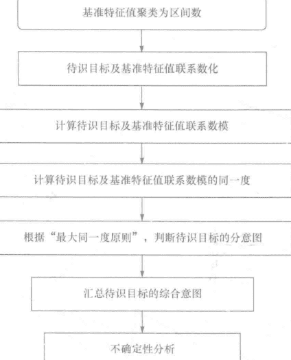** 所示流程图 4.6.1。

**2. 关键步骤拆解**
1.  **基准区间化：** 将 $m$ 种意图的历史实数基准值转化为区间数形式（引入适当不确定半径）。
2.  **统一转联系数：** 对基准区间数与待识别目标的 $p\times5$ 个特征区间数，统一应用式 (4.6.2) 转为“均值 $\pm$ 波动”联系数。
3.  **极坐标映射：** 对所有联系数应用式 (4.6.4) 转为三角函数形式 (4.6.3)，获得 $(r, \theta)$ 特征向量，进入后续聚类识别环节。


### 4.6.3 核心判识逻辑：从模值比对到综合决策

**(4) 模值同一度量算**  
针对每一个待识别目标 $q$ ($q=1,2,\dots,p$) 在各特征维度 $k$ ($k=1,\dots,5$) 上的表现，分别计算其联系数的“模” $r'_{qk}$，并与 $m$ 种预设作战意图在该特征上的基准模值 $r_{tk}$ ($t=1,\dots,m$) 做同一度比对。计算公式为：

$$ a_{qk}^{[t]} = \frac{\min(r'_{qk}, r_{tk})}{\max(r'_{qk}, r_{tk})}, \quad t=1, 2, \dots, m \quad (4.6.5) $$

该指标直观反映了待识别目标与某类意图基准在“量级”上的接近程度。

**(5) 单特征意图裁决——最大同一度原则**  
对比待识别目标第 $q$ 个目标在第 $k$ 个特征上针对 $m$ 种意图得到的同一度数组 $a_{qk}^{[t]}$，遵循“最大同一度原则”，将同一度峰值所对应的意图类别，判定为该目标在该特征维度下的意图归属。

**(6) 多特征融合决策——少数服从多数**  
当单一目标在 5 个特征维度上指向不同意图时，采用“投票表决”机制：出现频次最高的意图作为首选结论，次高者作为备选，以此类推，形成层级化的综合识别结果。

**(7) 不确定性深度剖析**  
利用联系数中标记 $i$ 在 $[-1, 1]$ 区间内的动态取值特性，展开不确定性敏感性分析，校验识别结论的鲁棒性，最终输出经得起推敲的意图识别判断。

---

### 4.6.4 实战演示：空情意图识别全流程复盘

**案例背景**  
引用文献[10]经典场景：已知 10 批历史目标（$x_1 \sim x_{10}$）的完整特征画像（方位角 $\beta$、距离 $d$、速度 $v$、航向 $\theta$、高度 $H$）及真实意图标签（侦察、攻击、监视、突防）；现有 3 批待识目标（$y_1, y_2, y_3$），其特征表现为区间不确定值（见下表），需推演其作战意图。

**历史样本库（表 4.6.1 精简版）**

| 目标 | $\beta$/mil | $d$/km | $v$/(m/s) | $\theta$/° | $H$/km | 意图标签 |
| :--- | :--- | :--- | :--- | :--- | :--- | :--- |
| $x_1, x_3, x_5, x_6$ | ~820-830 | ~280-283 | ~245-255 | ~200-204 | ~6.0-6.5 | **侦察** |
| $x_2, x_4, x_7$ | ~2200-2350 | ~150-215 | ~300-320 | ~156-322 | ~4.0-5.0 | **攻击** |
| $x_8, x_{10}$ | ~4000-4050 | ~110-120 | ~280-300 | ~50-51 | ~3.5-3.6 | **突防** |
| $x_9$ | 2800 | 260 | 220 | 260 | 8.0 | **监视** |

**待识别目标模糊观测值（表 4.6.2）**

| 目标 | $\beta$/mil | $d$/km | $v$/(m/s) | $\theta$/° | $H$/km |
| :--- | :--- | :--- | :--- | :--- | :--- |
| $y_1$ | [1000,1200] | [200,210] | [300,320] | [45,51] | [3,4] |
| $y_2$ | [2500,2600] | [100,110] | [200,220] | [250,260] | [8,9] |
| $y_3$ | [4000,4010] | [90,100] | [240,250] | [300,310] | [2,3] |

#### 实战步骤复盘

**步骤 1：基准画像聚类 → 区间数建模**  
将同类意图的历史样本聚合，提取 5 维特征的区间包络，构建四大意图的基准特征库（对应表 4.6.3）。例如，“侵察”意图的方位角锁定在 [820, 830]mil，高度聚焦 [6.0, 6.5]km；“突防”意图则呈现大方位（~4000mil）、近距离（~115km）、低高度（~3.5km）的鲜明特征。

**步骤 2 & 3：区间数 → 联系数“平均值+波动值”转换**  
依据联系数构造公式 (4.6.2)，将基准区间与待识区间同步转化为 $u = a + bi$ 形式（$a$ 为中心值，$b$ 为半宽波动，$i \in [-1,1]$）。
*   **基准联系数（表 4.6.4）**：如 “侵察” 方位角 $825+5i$，速度 $250+5i$；“突防” 方位角 $4025+25i$，距离 $115+5i$。单样本意图（监视）波动项为 0。
*   **待识联系数（表 4.6.5）**：$y_1$ 方位角 $1100+100i$，航向 $48+3i$；$y_3$ 方位角 $4005+5i$，高度 $2.5+0.5i$ 等。

**步骤 4：求模——消除不确定性，保留确定性核心**  
利用模计算公式 (4.6.4) $r = \sqrt{a^2+b^2}$，将联系数压缩为纯量模值，完成从“区间/联系数”到“标量特征向量”的降维映射（对应表 4.6.6、4.6.7）。此步融合了中心趋势与离散程度信息。

**步骤 5：单维度同一度比对 → 特征级意图标注**  
按公式 (4.6.5) 计算待识目标模值与四大意图基准模值的同一度，**取最大者归属该意图**。
> **以 $y_1$ 方位角为例**：模值 $r'_{11}=1104.54$。  
> 与侦察(825.02)同度 0.747，**与监视(2800)同度 0.395**，与攻击(2276.24)同度 0.485，与突防(4025.08)同度 0.274。  
> $\Rightarrow$ **方位角维度判定为“侦察”**。

全维度标注结果汇总（表 4.6.8 核心看板）：

| 待识目标 | $\beta$方位 | $d$距离 | $v$速度 | $\theta$航向 | $H$高度 | 综合倾向 |
| :--- | :---: | :---: | :---: | :---: | :---: | :--- |
| **$y_1$** | 侦察 | **攻击** | **攻击** | **突防** | **突防** | **攻击 / 突防** |
| **$y_2$** | 监视 | 突防 | 监视 | 攻击 | 监视 | **监视** |
| **$y_3$** | **突防** | **突防** | 侦察 | 监视 | **突防** | **突防** |

**步骤 6：综合裁决——多维投票定乾坤**  
*   **$y_3$**：3票“突防” + 1票“侦察” + 1票“监视” $\rightarrow$ **确认为突防**。
*   **$y_2$**：3票“监视” + 1票“突防” + 1票“攻击” $\rightarrow$ **确认为监视**。
*   **$y_1$**：2票“突防” + 2票“攻击” + 1票“侦察” $\rightarrow$ **僵持态势：攻击或突防**。

**步骤 7：不确定性溯源分析——还原 $y_1$ 争议真相**  
文献[10]判定 $y_1$ 为“侦察”，文献[9]及本法判定为“攻击/突防”。究竟孰是孰非？剥离波动项 $bi$，聚焦**中心值 $a$** 进行物理语义校核：

1.  **距离 $d$ (205km)**：最接近“攻击”基准均值 182.5km (同度 0.89)，远离“侦察”均值 281.5km (同度 0.73) $\rightarrow$ **指向攻击**。
2.  **速度 $v$ (310m/s)**：与“攻击”基准均值 310m/s **完全重合**，与“侦察”(250m/s) 差距显著 $\rightarrow$ **强指向攻击**。
3.  **航向 $\theta$ (48°)**：落入“突防”典型走廊 (50.5°)，与“侦察”(202°) 南辕北辙 $\rightarrow$ **指向突防**。
4.  **高度 $H$ (3.5km)**：贴合“突防”低空剖面 (3.55km)，“侦察”高空 (6.25km) 差距巨大 $\rightarrow$ **指向突防**。

**结论**：$y_1$ 仅在方位角上弱似“侦察”，其核心运动学特征（速度、高度、航向、距离）均强一致于“攻击/突防”画像。文献[10]仅凭方位角单一维度定性，忽略了多维协同特征的物理约束，导致误判。**本法结论“攻击或突防”更符合实战逻辑。**

> **方法论启示**：联系数“模”融合了均值（确定性）与波动（不确定性），识别过程实质是“在不确定信息包络中提取确定性决策特征”，天然具备抗干扰与鲁棒优势。

---

### 4.7 章末综述：同异反识别的普适性与进化论

本章系统阐释了集对分析“同异反”模式识别的理论内核，并通过指纹识别、地质灾害研判、业务量预测、系统相似度度量、空情意图识别五大跨领域实战案例，验证了该技术的**广泛适用性**与**高效解析力**。

这背后揭示了三大核心方法论价值：

1.  **认知维度的升维**  
    传统单维度识别易陷“管见”，而“同、异、反”三元结构（甚至细化为“同、偏同、临界、偏反、反”五元谱系）提供了立体观测视角。承认分界模糊性，引入不确定性分析、复变函数、偏联系数等数学工具，使识别结论从“非黑即白”进化为“可信度分级”。

2.  **方法论的兼容与耦合**  
    集对分析“成对原理”揭示：**多角度、多模型、多算法的协同识别，优于单一视角的孤军奋战**。异构识别结果之间可再次构成集对，实施二级甚至多级“同异反”元识别，构建识别可靠性的防御纵深。

3.  **实战部署的灵活性**  
    无固定模式，唯变所适。掌握“同异反”核心算子与联系数构造技艺，即可面向具体场景定制化组装识别引擎，持续迭代精度上限。

---

### 参考文献

[1] 赵克勤. 集对分析及其初步应用[M]. 杭州: 浙江科学技术出版社, 2000:44-64.  
[2] 白杨文. 平面图像的同异反模式识别技术[C]//中国自动化学会智能自动化会议, 呼和浩特, 1996:185-188.  
[3] 刘丽萍, 白杨文. 教育过程的同异反管理模式[C]//中国系统工程学会会议, 成都, 1997:1228-1231.  
[4] 成科扬. 基于集对分析的指纹识别系统研究[M]//中国人工智能学会中国人工智能进展. 北京: 北京邮电大学出版社, 2005:1475-1478.  
[5] 李德顺, 宫博, 许开立. 论金属矿山地质灾害模式识别模型[J]. 工业安全与环保, 2012, 38(3):37-40.  
[6] 李德顺, 宫博, 许开立. 石化企业火灾危险性模式识别模型研究[J]. 中国安全生产科学技术, 2012, 8(4):122-126.  
[7] 高洁, 盛昭瀚. 集对分析聚类预测法及其应用[J]. 系统工程学报, 2002, 17(5):458-462.  
[8] 闻理, 阎滨. 相似系统集对分析[J]. 指挥技术学院学报, 2000, 11(3):9-13.  
[9] 刘秀梅, 赵克勤. 基于联系数的不确定空情意图识别[J]. 智能系统学报, 2012, 6(5):450-456.  
[10] 张肃, 程启月, 解瑶, 等. 不确定空情信息条件下的意图识别方法[J]. 空军工程大学学报(自然科学版), 2008, 9(3):50-53.

---

# 第 5 章 集对分析驱动的不确定性推理新范式

# 核心逻辑：集对分析如何重构不确定推理

在人工智能领域，处理“不确定性”是绕不开的关键。主流手段通常有三条路：概率论支撑的概率推理、模糊集理论下的模糊推理，以及证据理论为基础的推理机制。

集对分析理论提供了一种全新的整合视角：它能将经典概率转化为“联系概率”（即赵森烽-克勤概率），让模糊隶属度通过引入不确定系数 $i$ 升级为联系数，还能把证据体系纳入“同异反”框架系统化处理。基于此，我们得以拓展既有思路，构建起**基于集对分析的不确定性推理体系**。

这套体系的鲜明特征在于四步走：**客观承认不确定性存在、系统化描述其结构、定量化刻画其程度、具体化分析其机理**。如此推演，得到的结论自然更贴合复杂的现实世界。本文将系统梳理其核心原理与典型算法应用。

---

## 5.1 理论基石：推理范式的根本重塑

### 5.1.1 什么是不确定性推理？

**定义 5.1.1** 简单说，凡是掺杂“不确定成分”的推理过程，均称作不确定性推理。

不管是确定性推理，还是概率、模糊、证据理论等非确定性推理，骨架通常由四大要素构成：**推理证据、推理方法、推理过程、推理结果**。只要这四个环节中的任意一个存在模糊地带，整个推理就属于不确定性范畴。

为何它是人工智能的核心？因为 AI 本质是对人脑智能的模拟，而人脑的核心能力正是**自动化推理**——涵盖定性与定量、逻辑与非逻辑、形式化与形象化、类比与反类比、正常与反常等多维推理模式。人脑推理虽伴随各类不确定性，却常能给出合理或近乎合理的结论，这正是人脑最迷人的特质。集对分析理论正是顺应这一特质，催生出了基于集对分析的不确定性推理新范式[1-2]。

### 5.1.2 集对分析视角下的推理第一性原理

核心主张：**对推理全链路（证据、方法、过程、结果）中的不确定性，坚持“客观承认、系统描述、定量刻画、具体分析”**[3]。

这并非一句空话，而是落实到四个具体维度的操作规程：

1.  **证据端：联系数化表达**。  
    当证据可量化时，引入联系数，利用不确定系数 $i$ 的取值波动，精准映射证据内在的不确定性质与程度。

2.  **方法端：多路径同异反博弈**。  
    针对同一问题，主张引入多方法、多途径、多角度、多层次、多维度并行推演。随后开展三层分析：  
    - **同一性分析**：提取共识结论；  
    - **差异性分析**：拆解分歧点与成因；  
    - **对立性分析**：反向推演，审视相反结果及其由来。  
    既然“2”是“多”的起步数，集对分析倡导**“双轨并行”**——两种方法、两条路径、两个视角……并对这“双轨”做同一、差异、对立的深度剖析。

3.  **过程端：时空与观察者的双重效应**。  
    推理过程实为算子交替、结构演化的动态流。其中蕴含“步移景换”的时空尺度效应、不同背景/视角/主体的观察效应，以及价值取向差异带来的社经效应。这些都须纳入不确定性分析框架。

4.  **结果端：给定接受域与信度**。  
    不再追求单一确定值，而要明确给出：结论在何种条件下可接受、可接受范围几何、置信度几何。

**本体论支撑**：任何推理皆发生于特定时空。第一章已论证时空本身具备成对性与不确定性，这为该原理提供了客观实在性基石。

> **溯源**：该理论最早由赵克勤于 1992 年首倡[4]，历经数十年迭代，已在多元场景落地开花。

---

## 5.2 联系概率推理：给概率装上“不确定性显微镜”

赵森烽、赵克勤于 2012 年创立**联系概率**（赵森烽-克勤概率），并将其引入推理实战[5]。本节深度解析其内核与实战威力。

### 5.2.1 概念重构：什么是联系概率？

它打破经典概率“单一数值”的桎梏，将**主事件 $A$ 的概率**与**伴随事件 $\bar{A}$ 的概率**融合在同一数学表达式中。详细定义见 2.2 节。

### 5.2.2 双重特质：形式创新 + 实质突破

- **形式上**：将证据与方法中的经典概率全量转化为联系概率，按联系概率运算规则推演。
- **实质上**：**聚焦推理结果的不确定性剖析**，以此大幅提升结论的客观合理性。

### 5.2.3 实战复盘：从贝叶斯到联系概率的跨越

**背景案例**（文献[6]经典设定）：  
若有产生式规则：  
```
IF E THEN H
```  
目标：在证据 $E$ 下求结论 $H$ 发生概率 $P(H/E)$。经典贝叶斯公式：  
$$P(H/E)=\frac{P(E/H)P(H)}{P(E)} \quad (5.2.1)$$

若单证据 $E$ 支持多假设 $H_1 \dots H_n$：  
```
IF E THEN H_i, \quad i=1, 2, ..., n
```  
则：  
$$\frac{P(H_i)P(E/H_i)}{\sum_{j=1}^n P(H_j)P(E/H_j)}, \quad i=1, 2, ..., n \quad (5.2.2)$$

若多证据 $E_1 \dots E_m$ 与多结论 $H_1 \dots H_n$：  
$$P(H_i/E_1 \dots E_m) = \frac{\prod_{k=1}^m P(E_k/H_i)P(H_i)}{\sum_{j=1}^n \prod_{k=1}^m P(E_k/H_j)P(H_j)} \quad (5.2.3)$$

**数值演示**：  
设三结论 $H_1, H_2, H_3$，证据 $E$ 支持三者，已知：  
$P(H_1)=0.3, P(H_2)=0.4, P(H_3)=0.5$  
$P(E/H_1)=0.5, P(E/H_2)=0.3, P(E/H_3)=0.4$

经典贝叶斯计算得：  
$P(H_1/E)=0.32,\ P(H_2/E)=0.26,\ P(H_3/E)=0.43$  
结论：$E$ 出现后，$H_1$ 可能性微增，$H_2, H_3$ 不同程度下降。

---

**集对分析视角的深度拆解（文献[5]核心贡献）**：

#### 步骤 1：先验概率“联系数化” —— 看透先验的不确定性本质
因 $P(H_k) \neq 1$，$H_k$ 为随机事件。依“随机事件成对存在定理”，必存在互斥事件 $\bar{H}_k$，且 $P(\bar{H}_k)=1-P(H_k)$。  
以 $H_k$ 为主事件，$\bar{H}_k$ 为伴随事件，得联系概率：  
$P_c(H_k) = P(H_k) + [1-P(\bar{H}_k)]i = P(H_k) + P(H_k)i$？不对，原文是 $P(H_k) + [1-P(\bar{H}_k)]i$。因为 $P(\bar{H}_k)=1-P(H_k)$，所以 $1-P(\bar{H}_k)=P(H_k)$。  
等等，原文公式：$P(H_k, \bar{H}_k) = P(H_k) + [1 - P(\bar{H}_k)]i$。  
代入数值：  
$P_c(H_1) = 0.3 + 0.7i,\ P_c(H_2) = 0.4 + 0.6i,\ P_c(H_3) = 0.5 + 0.5i$。

**关键洞察**：$i$ 的系数（0.7, 0.6, 0.5）分别大于、大于、等于确定分量。这意味着考虑 $i$ 取值后，联系概率可能比经典概率大，也可能小。**这隐含了贝叶斯结果中“$H_1$ 增、$H_2,H_3$ 降”的趋势**，但因未引入证据 $E$，分析还嫌粗糙。

#### 步骤 2：引入证据 $E$，实施“双层联系数化”运算
将条件概率 $P(E/H_k)$ 同步联系数化：  
$P_c(E/H_1)=0.5+0.5i,\ P_c(E/H_2)=0.3+0.7i,\ P_c(E/H_3)=0.4+0.6i$。

代入贝叶斯结构（式 5.2.2）：  
$$P(H_1/E) = \frac{(0.3+0.7i)(0.5+0.5i)}{(0.3+0.7i)(0.5+0.5i) + (0.4+0.6i)(0.3+0.7i) + (0.5+0.5i)(0.4+0.6i)}$$
展开得：  
$$= \frac{0.15+0.5i+0.35i^2}{0.47+1.46i+1.07i^2} \quad (5.2.5)$$

**处理不确定性层次**：暂不分层，令 $i=i^2$，化简为：  
$$= \frac{0.15+0.85i}{0.47+2.53i} \quad (5.2.6)$$

**归一化修正（关键技巧）**：  
分母为 3 个归一化联系数相加，因归一化多引入 $2(=3-1)$ 个 $i$。  
举例：$P(A)=0.2, P(B)=0.3, P(A)+P(B)=0.5$。  
联系数化后：$P_c(A)=0.2+0.8i,\ P_c(B)=0.3+0.7i$。  
普通相加：$0.5+1.5i$。但 $0.5$ 联系数化应为 $0.5+0.5i$。  
故需从 $1.5i$ 中扣除 $1(=2-1)$ 个 $i$。  
同理，分母 $0.47+2.53i$ 减去 $2i$，得修正分母 $0.47+0.53i$。

最终结果：  
$$\frac{0.15+0.85i}{0.47+0.53i} = 0.32+0.68i \quad (5.2.7)$$

**惊人对照**：式(5.2.7) 与 式(5.2.4) 完美对应——**只需将经典结果 0.32 联系数化为 $0.32+0.68i$ 即得联系概率结果**。  
同理：$P(H_2/E)=0.26+0.74i,\ P(H_3/E)=0.43+0.57i$。

#### 深度解读：三大核心发现

1.  **不确定性主导**：$0.68>0.32, 0.74>0.26, 0.57>0.43$，**所有结论的“不确定分量”均大于“确定分量”**。推理结果本质上处于“不确定占优”状态。
2.  **不确定性叠加机制清晰可见**：计算过程出现 $i^2$，揭示了**“双重不确定性”**机制——证据 $E$ 自带不确定性（1 次），结论 $H_k$ 先验即含不确定性（1 次），合流形成 2 次不确定性。这与直觉严丝合缝。
3.  **破解“隐性不确定”顽疾**：经典概率推理中，证据与结论的不确定性在形式上不显性；联系概率引入 $i$，将其**显性化、结构化、可分析化**。但 $i$ 的物理意义、取值规律、层次特性及其对结果的主导路径（源自 1 次还是 2 次甚至更多次不确定性），仍需结合具体场景深度挖掘。此例从一侧印证了联系概率推理原理的实战效能。

---

## 5.3 同异反推理：系统级博弈的“宽域式”智慧

### 5.3.1 理论渊源：同异反系统理论的推理投影

同异反推理是集对分析“同异反系统理论”（详见 1.5.2 节）在推理层面的直接落地。本质上，它属于**不确定性趋向极限时的特种推理**，因而在逻辑结构上区别于常规不确定性推理。

### 5.3.2 推理范式：输入输出皆为系统的“系统论推理”

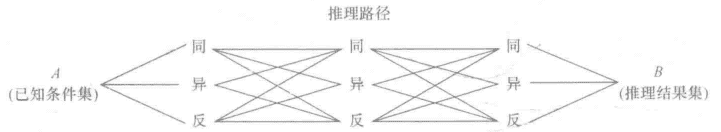  
*图 5.3.1 同异反推理示意*

其范式内核可拆解为四重维度：

1.  **系统论视角**：条件集与结果集均为“同异反子系统”。推理过程实为**系统 $\to$ 系统**的映射变换。
2.  **证据理论视角**：条件集即“证据集合”，证据间不再孤立，而是构成**同异反耦合关系网**。
3.  **“三同异反”非同构性（应用关键）**：  
    证据的“同异反”、推理路径的“同异反”、结果的“同异反”，**含义截然不同，不可混淆**。  
    例：3 个证据系统中，证据 1 与 2 协同（同），证据 2 与 3 相异（异），证据 1 与 3 相反（反）。  
    现实映射：高校新生成绩呈“同(优)异(中)反(差)”分布 $\xrightarrow{\text{4年教育}}$ 毕业生成绩仍呈“同异反”分布，**但前后两个“同异反”的内涵、边界、分布律完全不同**。忽视此点，实战必失之毫厘谬以千里。
4.  **“反”的多态性催生子模式族**：因“反”类型多元（逻辑反、数值反、趋势反……），导致“同异反”内涵差异巨大。故同异反推理实为**高抽象度的“宽域式”推理母模式**，可衍生出无数针对性子模式。

> **溯源与应用**：赵克勤首创，云良率先引入学生成绩预测研究[7]。见下文实战案例。

### 5.3.3 实战案例：12 名学子的成绩推演实录

**任务**：已知 12 名计算机专业学生“数值分析”成绩（表 5.3.1），推算其“操作系统”与“编译技术”成绩。

**建模逻辑**：
- 百分制下，学号 1 学生得 70 分，同一度 0.7 $\to$ 联系数 $0.7+0.3j$。
- “数值分析”与“操作系统”同属计算机核心课，知识交集显著（见下图）。  
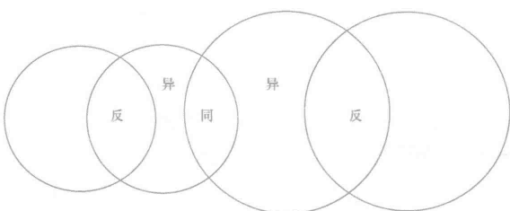  
*图 5.3.2 “数值分析”与“操作系统”的同异反关系示意*

- **推理路径设定（关键决策）**：从课 A 推课 B，通常三种态势：  
  (1) 同：成绩持平；  
  (2) 异：有差距但不大；  
  (3) 反：差距巨大。  
  $\therefore$ 选定 **“同异反乘算子路径”** —— 即 $ (0.7+0.3j) \times \text{算子} $。
- **算子确认**：承认推理存在不确定性，综合定算子亦为 $0.7+0.3i$（此处 $i$ 为不确定性标记，$j$ 为对立标记）。

**计算与验证（学号 1）**：  
$(0.7+0.3j)(0.7+0.3i)=0.49+0.3i+0.21j$  
令 $i=-1, j=0$ 得下界 0.19（19 分）；$i=1, j=0$ 得上界 0.79（79 分）。  
$\to$ 推断区间 **[19, 79]**。  
实测：操作系统 68 分，编译技术 74 分，**均落区间内，精准命中**。

其余 11 位同学详见下表，**推理路径的精准选定，是同异反推理成败的枢纽**。

#### 表 5.3.1 学生成绩同异反推理实测对照表

| 学号 | 数值分析 | 算式 | 推算区间 | 操作系统实测 | 编译技术实测 | 符合度 |
| :--- | :--- | :--- | :--- | :--- | :--- | :--- |
| 1 | 70 | $(0.7+0.3j)(0.7+0.3i)=0.49+0.3i+0.21j$ | 19～79 | 68 | 74 | 符合 |
| 2 | 80 | $(0.8+0.2j)(0.8+0.2i)=0.64+0.2i+0.16j$ | 44～84 | 84 | 79 | 符合 |
| 3 | 90 | $(0.9+0.1j)(0.9+0.1i)=0.81+0.1i+0.09j$ | 71～91 | 83 | 80 | 符合 |
| 4 | 65 | $(0.65+0.35j)(0.65+0.35i)=0.4225+0.35i+0.2275j$ | 7～77 | 83 | 77 | 半符合 |
| 5 | 95 | $(0.95+0.05j)(0.95+0.05i)=0.9025+0.05i+0.0475j$ | 85～95 | 67 | 62 | **不符合** |
| 6 | 90 | $(0.9+0.1j)(0.9+0.1i)=0.81+0.1i+0.09j$ | 71～91 | 77 | 75 | 符合 |

**前沿展望**：同异反推理仍留有深坑待填——  
如何将“宽域式推理”锻造为“精确推理”？  
系统推理与数值推理如何双向转化？  
不同类型推理间如何互译？  
这些正是未来攻关的主战场。

# 用集对分析破解上下文感知中的不确定性难题

## 实测数据一览

| 序号 | 数值 | 计算表达式 | 区间范围 | 指标A | 指标B | 判定结果 |
| :--- | :--- | :--- | :--- | :--- | :--- | :--- |
| 7 | 72 | (0.72+0.28j)(0.72+0.28i)=0.5184+0.28i+0.2016j | 24～80 | 86 | 82 | 不符合 |
| 8 | 84 | (0.84+0.16j)(0.84+0.16i)=0.7056+0.16i+0.1344j | 54～86 | 74 | 78 | 符合 |
| 9 | 78 | (0.78+0.22j)(0.78+0.22i)=0.6084+0.22i+0.1716j | 39～83 | 86 | 60 | 半符合 |
| 10 | 90 | (0.9+0.1j)(0.9+0.1i)=0.81+0.1i+0.09j | 71～91 | 74 | 82 | 符合 |
| 11 | 62 | (0.62+0.38j)(0.62+0.38i)=0.3844+0.38i+0.2356j | 0～76 | 71 | 70 | 符合 |
| 12 | 76 | (0.76+0.24j)(0.76+0.24i)=0.5776+0.24i+0.1824j | 34～82 | 77 | 71 | 符合 |

```
$$\text{diff}_{\text{state-space}} = \sum_{i=1}^N \frac{|a_s^i - \hat{a}_i|}{\hat{a}_i^R}$$ (5.4.4)
```

## 核心思路：引入“同异反向量”夹角余弦

在上下文感知计算里，底层传感器采集的原始数据往往粗糙、不全，必须经过推理融合才能生成高层上下文信息。马守明、王汝传、叶宁三位学者借用集对分析（SPA）的核心思想，创造性地提出了一种基于**同异反向量夹角余弦**的不确定性推理方法（业内常称“马-王-叶法”）。实例证明，这套方法概念明晰、计算轻量，在智能空间场景下极具实用性与可靠性。

### 1. 从普适计算说起

1991年，Mark Weiser提出“普适计算”概念，上下文感知作为其核心支撑技术，核心逻辑是：**感知环境信息 → 自主推理决策 → 依动态情况执行动作 → 服务用户**。上层应用真正需要的是融合多传感器数据后的高层语义，但受限于硬件物理特性，底层感知数据的质量与数量常难达标。

传统手段多采用多值逻辑、概率逻辑、模糊逻辑、贝叶斯网络等。各有千秋，却也各有短板：比如贝叶斯网络擅长处理概率不确定性，却对模糊不确定性束手无策。因此，亟需一个全新视角来统筹处理不确定性上下文推理。

### 2. 数学工具：把联系度“向量化”

集对分析的核心数学工具是联系数。将归一化联系数改写为向量形式：
$$ \mu(W) = (a, b, c) $$
即**同异反向量**（Identity-Disparity-Contrary Vector）。

给定两个向量 $\mu_1 = (a_1, b_1, c_1)$ 与 $\mu_2 = (a_2, b_2, c_2)$，定义夹角余弦：
$$ \cos\theta = \frac{[\mu_1\mu_2]}{\|\mu_1\| \|\mu_2\|} $$
其中内积 $[\mu_1\mu_2] = a_1a_2 + b_1b_2 + c_1c_2$，范数 $\|\mu_k\| = \sqrt{a^2 + b^2 + c^2}$。

**物理意义直观：** 余弦值越大，向量夹角越小，两状态越相似；反之差异越大。这为不确定性推理提供了清晰的几何度量依据。

### 3. 五步走推理流程

1.  **定属性集：** 划定状态空间属性。如“用户睡眠”态由灯光、时间、门状态三类传感器定义。
2.  **建典型库：** 重复观测，预定义各状态空间的典型属性值。如“做饭”态下烤箱为“工作中”。
3.  **采实时数据：** 从物理/逻辑传感器采集当下时刻的上下文属性集。
4.  **聚合融合：** 运用SPA乘法法则，将多属性聚合为该状态空间的同异反向量。
5.  **算相似度：** 计算实时向量与预定义典型向量的夹角余弦，以相似度高低判定当前上下文状态。

### 4. 实战复盘：智能会议室场景

智能空间是普适计算的典型落地场景。受传感器特性及环境噪声影响，系统难以精准识别上下文，必须支持不确定性处理。

**对比基线：** 文献[9]曾用“状态-空间差”法推理，但传感器超3类时直观性差、计算繁琐。

**本法实操：** 定义灯光、人数、噪声三类传感器属性。通过重复观测确立两种典型状态的同异反向量：

*   **“开会中”典型态：**  
    灯光 $\mu_l^1 = 0.9 + 0.05i + 0.05j$  
    人数 $\mu_p^1 = 0.8 + 0.1i + 0.1j$  
    噪声 $\mu_n^1 = 0.7 + 0.1i + 0.2j$  
    **聚合得：** $\mu_m^1 = 0.504 + 0.230i + 0.266j$

*   **“正常办公”典型态：**  
    灯光 $\mu_l^2 = 0.3 + 0.1i + 0.6j$  
    人数 $\mu_p^2 = 0.5 + 0.1i + 0.4j$  
    噪声 $\mu_n^2 = 0.2 + 0.1i + 0.7j$  
    **聚合得：** $\mu_w^2 = 0.030 + 0.271i + 0.699j$

**时刻 $t$ 实测：**  
灯光 $\mu_l^3 = 0.7 + 0.06i + 0.24j$  
人数 $\mu_p^3 = 0.7 + 0.1i + 0.2j$  
噪声 $\mu_n^3 = 0.8 + 0.1i + 0.1j$  
**聚合得：** $\mu_m^3 = 0.392 + 0.239i + 0.369j$

**判决时刻：**  
$\cos\theta(m, t) = 0.97$ （与“开会”态相似度极高）  
$\cos\theta(w, t) = 0.76$ （与“办公”态相似度较低）  
**结论：** $0.97 > 0.76$，判定为“正在开会”，与实况完全吻合。

> **专家延伸：** 文献[8]指出，实际场景中各传感器重要性不同，引入权重系数（主观/客观赋权）可进一步提精度；若能结合机器学习沉淀标准场景模式，推理将更鲁棒。

---

# 集对分析赋能案例检索：解决“多词同义”与“信息缺失”双重痛点

案例推理（CBR）的核心环节是检索——如何在案例库中快、准地找到最相似案例？阎红灿等学者[10]构建了基于SPA的案例检索模型：**建立目标与源案例集对 → 融合属性重要度与联系度 → 借本体语义扩展化解多词同义 → 大幅提升不确定性案例检索精度，且计算量小、查全查准率双超海明距离法。**

## 1. 模型核心构件

### (1) 本体化存储：告别僵化框架
传统CBR多用静态框架，扩展难、重构难、学习弱。**本体**作为语义级建模工具，能概念化表达领域概念及关系，具备可重用、可共享、语义可扩展优势，故采用本体结构存储案例。

### (2) 相似度计算：带权联系度
设案例集对 $(q, p)$ 相关属性 $x_1 \dots x_n$ 权重为 $w_1 \dots w_n$，结合联系数公式，问题案例 $q$ 与目标案例 $p$ 相似度为：

```
$\mu(p,q) = \sum_{l=1}^n a_l w_l + i \sum_{l=1}^n b_l w_l + j \sum_{l=1}^n c_l w_l = A + Bi + Cj \quad \text{(5.5.1)}$
```

式中 $i \in [-1, 1], j = -1, l=1, 2, \cdots, n$。

给定合适 $i$ 值计算相似度，按值排序入库，超阈值者为目标案例。医学案例常因描述模糊、主观理解差异大导致数据不确定，选案原则遵循：**同一度 $A$ 越大越好，对立度 $C$ 与差异度 $B$ 越小越好。**

## 2. 系统架构与检索闭环

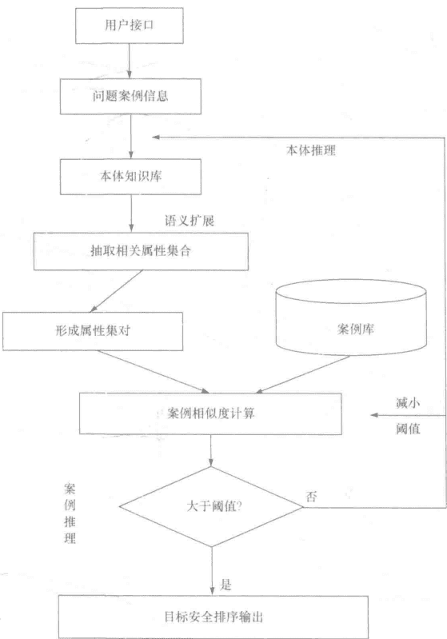

检索流程五步走：
1.  **输入描述 → 抽关键词。**
2.  **本体扩展近义/同义词 → 构造属性集对。**
3.  **遍历案例库计算相似度 → 超阈值存入目标库。**
4.  **目标库为空？降阈值重算 → 仍为空则本体推理再扩展属性 → 回步骤2；否则进步骤5。**
5.  **目标库按相似度降序重排。**

## 3. 实证：中医喘症医案检索对决

**数据源：** 600+中医喘症医案，用 Protégé 4.1.0 建立本体片段。选取 12 个代表性案例（含 2 个问题案例），附专家推荐属性权重（见下表）。

| 属性 | 喘症 | 痰色 | 寒热 | 舌质 | 苔色 | 苔厚薄 | 脉象 |
| :--- | :--- | :--- | :--- | :--- | :--- | :--- | :--- |
| **权重** | **0.4** | **0.15** | **0.05** | **0.1** | **0.05** | **0.1** | **0.15** |

**对决设定：** 阈值 $\lambda=0.8$。PK **集对分析法** vs **海明距离法**（一般相似度）。

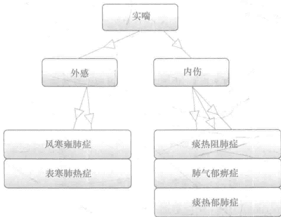

### 结果深度复盘

#### 问题案例 1（咳喘、痰黄、壮热、苔白薄、滑脉）
*   **集对分析：** 4 个案例超阈值（案例1: 0.88, 案例6: 0.86, 案例7: 0.84, 案例8: 0.82）。
*   **海明距离：** 3 个超阈值（案例1, 6, 8）。
*   **关键洞察：** 专家认定案例 7 最接近。集对分析给案例 7 的分 (0.84) 显著高于海明距离 (0.76)；且集对分析能正确处理案例 5 属性大量缺失的情况（集对分析 0.62 > 案例 9 的 0.51，海明距离却反了），体现了**对不确定/缺失信息的强鲁棒性**。

#### 问题案例 2（气短、痰白、恶寒、苔红厚、浮脉）
*   **集对分析：** 0 个超阈值（最高 0.70）。
*   **海明距离：** 1 个超阈值（案例 3: 0.82）。
*   **关键洞察：** 专家判定问题案例 2 与库内案例均不接近。海明距离法误将案例 3 拉高，若据此诊断极易误导。**集对分析结果更客观、更安全。**

**结论：** SPA 相似度计算区分度高、抗噪性强，在属性缺失、模糊不确定场景下显著优于传统海明距离法。

---

# 章末综述：不确定性推理，道阻且长，行则将至

不确定性推理是 AI 的心脏。
*   **客观世界**不确定性多元复杂，舍弃其信息必偏离真实；
*   **主观认知**不可避免，推理必在“带不确定性”下进行；
*   **时空维度**决定推理无法完全规避干扰。

因此，**“客观承认、系统描述、定量刻画、具体分析”** 是必由之路。推理形式的多样性与计算复杂性，正是不确定性本质使然。

本章仅展示基于集对分析的几种推理模型与案例（上下文感知推理、案例检索），尚属冰山一角。未来亟待结合具体问题，探索新模型、新算法，特别是深入攻关：
1.  **“人脑+电脑”双脑模型**
2.  **“人脑+网络”多脑模型**
3.  **“首脑+群脑”超级脑模型**
在集对分析框架下的不确定性推理特性与算法机制。

---

## 参考文献速览

*   [1] 赵克勤. 集对分析及其初步应用[M]. 浙江科技出版社, 2000.
*   [2] 赵克勤. 集对分析的不确定性系统理论在 AI 中的应用[J]. 智能系统学报, 2006.
*   [3] 赵克勤, 宣爱理. 集对论——一种新的不确定性理论方法与应用[J]. 系统工程, 1996.
*   [4] 赵克勤. 试论集对分析在人工智能中的应用[C]//中国人工智能学会第七届学术会论文集. 1992.
*   [5] 赵森烽, 赵克勤. 概率联系数化的原理及其在概率推理中的应用[J]. 智能系统学报, 2012.
*   [6] 蔡自兴, 徐光佑. 人工智能及其应用[M]. 清华大学出版社, 2010.
*   [7] 蒋云良. 基于 SPA 联系数的同异反定量推理路径选择[J]. 微电子学与计算机, 2000.

# 第 6 章 集对分析视域下的智能决策体系

> **核心提示**：智能决策不仅是智能行为的起点，更是连接人机协同的关键枢纽。本章深度解析集对分析如何重构决策模型，实现确定与不确定、定性与定量、个体与群体的深度融合。

---

### 6.1 智能决策的本质与集对分析的融合特质

#### 6.1.1 何为“智能决策”？
**定义 6.1.1** 借助计算机系统，模拟并逼近人类大脑思维过程而做出的决策，即为智能决策。

人脑决策形态多元：既有追求理想与完美的理性抉择，也有应对反常、随机应变的灵活策略；既包含纯定性判断，也涉及严密定量计算，更常表现为两者的耦合。从数学建模视角看，这些决策归属于**确定性决策**与**不确定性决策**两大阵营。后者又细分为风险决策与基于自然语言的决策——值得注意的是，语言型决策若要经由计算机处理，必须完成向定量语言的转译。

当计算机介入模拟人脑决策时，无论确定与否，均需进行数学形式化建模。这不仅要求处理精确数值，更要求驾驭含不确定参数的“联系数”。从工程落地看，智能决策本质上是**决策支持系统**：最终由人或智能体给出“执行/否决”的二元指令。若将“人-机”视为第 3 章所述的“智脑系统”，智能决策便是该系统的核心功能模块。

#### 6.1.2 一体化集成：集对分析赋予的决策新范式

集对分析的内核在于两点：将关联事物构联为“集对”；在特定语境下，将集对内部的确定性与不确定性关系作为一个子系统统筹处理。基于此，集对智能决策呈现双重融合特征：

**特征一：多维决策维度的“全息集成”**  
打破单一维度局限，实现以下对立统一维度的同构融合：
- **主体层面**：个体决策 ⇄ 群体决策
- **认知层面**：定性判断 ⇄ 定量计算
- **时空层面**：当下博弈 ⇄ 长远谋划；战略定力 ⇄ 战术灵活
- **约束层面**：硬约束（资源/物理） ⇄ 软约束（心理/政策）
- **执行层面**：算法推演 ⇄ 专家经验
- **尺度层面**：宏观统筹 ⇄ 微观执行

**特征二：确定性与不确定性的“辩证耦合”**  
此特征贯穿上述所有融合场景。以“宏微一体决策”为例：宏观确定/微观不确定、宏观不确定/微观确定、双重确定、双重不确定——四种耦合态构成了动态决策的完整图景。若引入时间维度（微观=时刻，宏观=阶段），这本质上是一类**动态自适应决策**。

> **哲学映照**：集对智能决策实为“辩证决策”，不确定性分析是其灵魂。决策实施非一成不变，而是阶段性、关联性、灵活性的动态演进。受限篇幅，本章聚焦基础模型解析，实战中需依时空条件灵活组装模型，取长补短，实现决策能效的帕累托最优——即第 3 章视角下的“信息能损耗最小化”。

---

### 6.2 同异反综合评价：在动态环境中锚定最优解

#### 6.2.1 核心定义：三态融合的决策闭环
**同异反智能决策**基于集对分析“同-异-反”系统理论，将决策者在**正常（同）**、**异常（异）**、**反常（反）**三种环境预设下的决策方案集成为一体。

- **参考系设定**：以“正常环境”为基准坐标系（符合认知惯性）。
- **三态映射**：实况为正常→“同”；实况为异常→“异”；实况为反常→“反”。
- **决策三元组**：同决策（常态应对）、异决策（变态应对）、反决策（极端应对）。
- **智能体现**：兼具现实落地性、动态适应性、全域覆盖性。该思想最早见于赵克勤 1989 年奠基性著作 [1,2]，后续研究丰硕 [3-5]。

#### 6.2.2 同异反综合评价：决策前的“压力测试”全谱系
决策是主观与客观的博弈，环境多样性/动态性/复杂性要求从多备选方案中甄别最优及备选。同异反综合评价提供了一套**十维评价矩阵**：

| 评价维度 | 核心任务 |
| :--- | :--- |
| **1. 常态基准** | 正常环境下的综合评价 |
| **2. 变态响应** | 异常环境下的综合评价 |
| **3. 极端兜底** | 反常环境下的综合评价 |
| **4. 常变叠加** | 正常兼具异常的混合评价 |
| **5. 动态演进** | 三态依次/交替/随机出现的时序评价 |
| **6. 结果元评价** | 对前五维评价结果的二次综合 |
| **7. 不确定性深度剖析** | 结合联系数中 $i$ 取值，验证评价稳健性与可信度 |
| **8. 潜在趋势研判** | 基于同异反数据预测隐性发展趋势 |
| **9. 显性趋势复核** | 基于同异反数据评估显性演化路径 |
| **10. 伴随函数拓展** | 利用联系数其他伴随函数进行多物理意义评价 |

> **方法论意义**：该体系不排斥模糊/灰色/投影寻踪等经典评价法，而是提供了一个**“同异反”元框架**，可兼容并包、对比互证。

#### 6.2.3 实战演示：双方案择优的十步决策链
**场景**：工程方案 A、B 互为主备。评价结果以联系数 $\mu = a + bi + cj$ 表达（$a$=赞同，$b$=不确定，$c$=反对）。
- $\mu(A) = 0.7 + 0.2i + 0.1j$
- $\mu(B) = 0.6 + 0.3i + 0.1j$

**决策推演全记录**：

| 步骤 | 决策视角 | 核心逻辑 | 结论与洞见 |
| :--- | :--- | :--- | :--- |
| **1** | **常态优选** | 比较赞同度 $a$ | $0.7 > 0.6$ → **A 胜出** |
| **2** | **变态容错** | 比较不确定度 $b$ | $0.2 < 0.3$ → **A 更稳健** |
| **3** | **极端对抗** | 比较反对度 $c$ | $0.1 = 0.1$ → **平手**，特殊场景可选 B |
| **4** | **常变合权** | 比较 $a + bi$ | 需赋予 $i$ 具体取值才能裁决 |
| **5** | **三态全景** | 计算完整联系数值 | 依赖 $i_1, i_2$ 取值确定 |
| **6** | **元评价综合** | (1) 忽略 $i$ → $\mu(A)=0.6 > \mu(B)=0.5$<br>(2) 计入 $i$ → 取值不确定难决策 | (1) **A 优** (2) 悬而未决 |
| **7** | **不确定性敏感性** | (1) $i$ 同步取值 → A 优<br>(2) $i$ 异步取值 → 难决策 | 同步假设下 A 稳健，异步引入博弈风险 |
| **8** | **潜势趋势** | 比较偏联系数 $\partial\mu$ | 取值依赖 $i$，需结合动态演化判断 |
| **9** | **显性趋势** | 比较邻联系数 $N\mu$ | 同理，受 $i$ 取值制约 |
| **10** | **同反比裁决** | 势函数 $ship = a/c$ | $ship_A=7 > ship_B=6$ → **A 综合优势明显** |

> **关键启示**：单一指标易误判，**多视角交叉验证**才是集对决策的精髓。偏/邻联系数及 $i$ 取值分析详见 2.1 节。

---

### 6.3 联系数不确定性决策：破解区间数多属性决策难题

> **学术脉络**：刘秀梅、赵克勤自 2008 年启动合作，将近 20 类区间数决策问题转化为联系数模型，成果凝聚于 2014 年专著《区间数决策集对分析》[6]。本节复现其核心建模路径。

#### 6.3.1 问题建模：区间数多属性决策的标准形式
- **方案集**：$S = \{S_1, \dots, S_m\}$
- **属性集**：$Q = \{Q_1, \dots, Q_n\}$（含效益型/成本型）
- **权重向量**：$\vec{W} = \{\vec{\omega}_1, \dots, \vec{\omega}_n\}$，$\vec{\omega}_i = [\omega_i^-, \omega_i^+] \subseteq [0,1]$，满足 $\sum \omega_i^- \le 1 \le \sum \omega_i^+$。
- **决策矩阵**：$\vec{P} = (\widetilde{p}_{k\mu})_{m \times n}$，$\widetilde{p}_{k\mu} = [p_{k\mu}^-, p_{k\mu}^+] \subseteq [0,1]$。
- **目标**：确定最优方案，给出全序排序。

#### 6.3.2 三阶建模范式：从数据规范到不确定性决策

**阶段一：数据规范化——消除量纲与量级差异**
- **效益型属性**（越大越好）：  
  同一度区间 $\bar{a}_{p_{k\mu}} = \left[ \frac{p_{k\mu}^-}{\max_k p_{k\mu}^+}, \frac{p_{k\mu}^+}{\max_k p_{k\mu}^+} \right]$  \hfill (6.3.1)
- **成本型属性**（越小越好）：  
  同一度区间 $\bar{a}_{p_{k\mu}} = \left[ \frac{\min_k p_{k\mu}^-}{p_{k\mu}^+}, \frac{\min_k p_{k\mu}^-}{p_{k\mu}^-} \right]$  \hfill (6.3.2)

**阶段二：区间数→联系数转换——显性化不确定性**
引入不确定数 $i \in [0,1]$，将区间数 $[L, U]$ 映射为联系数 $\mu = L + (U-L)i$：
- 属性评价值：$\mu_{p_{k\mu}} = a_{k\mu}^- + (a_{k\mu}^+ - a_{k\mu}^-)i$  \hfill (6.3.3)
- 权重：$\mu_{w_i} = \omega_i^- + (\omega_i^+ - \omega_i^-)i$  \hfill (6.3.4)

**阶段三：决策模型构建与求解**

| 模型层级 | 数学表达 | 核心逻辑 |
| :--- | :--- | :--- |
| **基本模型** | $M(S_k) = \sum_{i=1}^n \widetilde{w}_i \widetilde{p}_{ki}$ (6.3.5) | 区间数加权聚合，直观但含糊 |
| **联系数模型** | $M(S_k) = \sum_{i=1}^n \mu_{p_{ki}} \mu_{w_i}$ (6.3.6) | **核心创新**：引入 $i$，将不确定性显性化为代数结构 |

**模型求解关键**：联系数模型输出 $M(S_k) = a_{s_k} + b_{s_k}i$。因 $i \in [0,1]$ 不确定，需通过**不确定性分析**完成最终排序：

1.  **同步取值基准测试**：令 $i$ 同步取 $0, 0.5, 1$，获得三组初步排序序数 $q_k$。
2.  **异步敏感性深度分析**：第 $k$ 个方案的 $i$ 值不必等同于其他方案。分析各方案在 $i=0, 0.5, 1$ 下的两两比较关系，穷举所有可能排序态。
3.  **排序稳健性聚合**：计算各方案在不同情景下排序序数之和：
   $$M_i(S_k) = \sum_{i \in \{0,0.5,1\}} \sum_{k=1}^m q_{ki}$$  \hfill (6.3.7)
   序数和最小者为最优，以此类推。此法兼顾**乐观/中性/悲观**三态博弈，实现了不确定环境下的**最大似然排序**。

---

> **章末启示**：第 6 章构建了从**哲学定位（6.1）**到**方法论体系（6.2）**再到**具体算法实现（6.3）**的完整闭环。集对分析不提供“唯一标准答案”，而是提供一套**“在不确定中寻找确定性、在动态中把握不变量”**的认知工具箱。下一章，我们将探讨如何将这把手术刀精准植入群决策与云理论的融合战场。

### 6.3.3 实战案例：图书馆空调选型全流程复盘

**核心逻辑前瞻**：排序数 \( q_{ki} \) 遵循“越小越优”原则，因此最终排名完全取决于综合排序数 \( M_i(S_k) \) 的大小——数值越小，方案优先级越高。

---

#### 案例背景：5个备选，8维考量
某图书馆需从 \( S_1 \sim S_5 \) 五套空调系统中择优。评价体系包含8个属性：固定成本\( Q_1 \)、运营成本\( Q_2 \)、性能\( Q_3 \)、噪声\( Q_4 \)、可维护性\( Q_5 \)、可靠性\( Q_6 \)、灵活性\( Q_7 \)、安全性\( Q_8 \)。
- **量化差异**：\( Q_3, Q_5, Q_7, Q_8 \) 为 1-10 分打分制（效益型，分高者优）；\( Q_1, Q_2, Q_4 \) 为成本型指标（数值越小越优）。
- **数据形态**：所有指标值均为区间数，属性权重 \( \tilde{w}_i \) 亦为零次区间数。详细原始决策矩阵见表 6.3.1。

#### 决策全流程六步走

**步骤 1：规范化——统一度量衡，统一优劣方向**
调用式(6.3.1)、(6.3.2)对原始区间数矩阵归一化。此步一举三得：消除量纲、统一为“效益型”（大者为优）、为后续联系数运算铺路。权重本身已是零次区间数，故仅处理指标矩阵。归一化结果详见 **表 6.3.2**。

**步骤 2：联系数转码——区间变身“a+bi”**
将表 6.3.2 中的零次区间数映射为联系数形式 \( a + bi \)。这一转换保留了区间的确定性分量 \( a \) 与不确定性分量 \( b \)，为引入不确定参数 \( i \) 做准备。转码矩阵见 **表 6.3.3**。

**步骤 3：加权聚合——算出各方案“综合评价值”**
依据联系数模型式(6.3.6)，将权重与指标联系数逐项相乘求和，得到加权决策矩阵及各方案的综合评价值 \( M(S_k) \)。数据汇总于 **表 6.3.4**。
> 关键产出：5个方案的联系数综合评价值 \( M(S_k) \) 已就绪，但因含不确定参数 \( i \in [0,1] \)，无法直接定序。

**步骤 4：不确定性深度博弈——从“单一排序”到“全景扫描”**
这是本法核心亮点所在，分两层展开：

1.  **基准三测（初排序）**：令 \( i \) 分别取 0、0.5、1（对应区间左端点、中点、右端点），计算实数评价值并排序。惊喜发现：**三种取值下排序完全一致**，初步顺序为 \( S_4 > S_5 > S_1 > S_3 > S_2 \)（详见 **表 6.3.5**）。
2.  **交叉压力测（稳健性验证）**：打破“全局同步取值”假设，允许不同方案在对比时各自独立取 \( i \in \{0, 0.5, 1\} \)。遍历所有交叉组合，统计每个方案在所有对手面前可能出现的排序位次 \( q_{ki} \)，累加得综合排序数 \( M_i(S_k) \)。完整博弈过程记录于 **表 6.3.6 ~ 表 6.3.10**。
    - \( M_4(S_1)=25 \)
    - \( M_4(S_2)=39 \)
    - \( M_4(S_3)=32 \)
    - \( M_4(S_4)=17 \)
    - \( M_4(S_5)=22 \)

**步骤 5：最终定序——排序数小者居前**
依据 \( M_i(S_k) \) 升序排列：
\[
17 (S_4) < 22 (S_5) < 25 (S_1) < 32 (S_3) < 39 (S_2)
\]
**最终结论：\( S_4 \succ S_5 \succ S_1 \succ S_3 \succ S_2 \)**。
注：该结果与初排序一致，验证了排名的高稳定性。

**步骤 6：多方法 PK 验证——不确定性分析的“含金量”**
| 文献/方法 | 排序结果 | 核心差异 | 局限性 |
| :--- | :--- | :--- | :--- |
| [7] TOPSIS / [8] 相对隶属度 | \( S_4 > S_5 > S_3 > S_1 > S_2 \) | \( S_1, S_3 \) 互换 | 单次排序，无不确定性分析 |
| [9] TOPSIS+隶属度融合 | \( S_4 > S_1 > S_5 > S_3 > S_2 \) | 仅 \( S_4, S_2 \) 位置同 | 单次排序，结果波动大 |
| **本文方法** | **\( S_4 > S_5 > S_1 > S_3 > S_2 \)** | **基准一致，交叉验证稳健** | **含全谱不确定性分析** |

**结论显而易见**：引入不确定性分析后，排序结果抗干扰能力更强，决策建议更可靠。

#### 理论透视：为什么联系数能“驾驭”不确定性？
将联系数 \( \mu = a + bi \ (i \in [0,1]) \) 视为实数轴区间 \( [a, a+b] \)：
- \( i=0 \) \(\leftrightarrow\) 取左端点（悲观/保守决策）
- \( i=1 \) \(\leftrightarrow\) 取右端点（乐观/激进决策）
- \( i=0.5 \) \(\leftrightarrow\) 取中点（中性决策）
本方法通过“端点+中点”及其“全交叉组合”覆盖了核心决策心理场域，虽非穷尽所有实数，但极具代表性与说明力。

#### 方法论总结：基于联系数不确定性分析的三大特质
1.  **机制独特**：利用参数 \( i \) 的动态取值，原生支持不确定性建模与分析。
2.  **稳健性内置**：通过交叉排序机制，自动完成“抗不确定性”体检，确保结论不因参数微扰而剧变。
3.  **认知拟人化**：引入多方法对比（同/异/反），模拟人类“集思广益、再决策”认知过程。若结合计算机对比较结果“再研究”，即构成第3章所述的**“智脑决策”**，大幅提升科学性与实用性。

---

### 6.4 基于联系数的区间数伴语言变量混合多属性智能决策

现实决策中，指标值常呈“区间数+语言变量”混合态（如：“成本约30-40万，性能‘优’，噪声‘中’”）。针对这类复杂场景，刘秀梅、赵克勤（文献[10]）基于集对分析展开专题攻关，核心思路如下。

### 6.4.1 核心问题：混合数据怎么处理？

## 6.4.2 核心决策流程

**第一步：定性指标量化赋值**
针对 $R$ 个采用语言变量描述的属性，需依据其重要性层级赋予数值。鉴于本模型统一按“越小越优”（成本型）处理，赋值原则为：重要性越高，数值越小（如核心指标记 1，次要指标记 2，以此类推）。完成赋值后，将所有语言标签替换为对应数字，并统一转化为区间数格式（例如 $1 \rightarrow [1,1], 2 \rightarrow [2,2]$）。

**第二步：属性值标准化规范化**
对各属性原始数据执行无量纲化处理。效益型指标（越大越好）的规范化区间公式为 $$ \bar{a}_{\bar{p}_{kt}} = \left[ \frac{\bar{p}_{kt}^-}{\max_k p_{kt}^+}, \frac{\bar{p}_{kt}^+}{\max_k p_{kt}^+} \right] = [a_{\bar{p}_{kt}}^-, a_{\bar{p}_{kt}}^+], k=1, 2, \cdots, m \quad (6.4.1) $$；成本型指标（越小越好）的规范化区间公式为 $$ \bar{a}_{\bar{p}_{kt}} = \left[ \frac{\min_k p_{kt}^-}{\bar{p}_{kt}^+}, \frac{\min_k p_{kt}^+}{\bar{p}_{kt}^-} \right] = [a_{\bar{p}_{kt}}^-, a_{\bar{p}_{kt}}^+], k=1, 2, \cdots, m, \quad p_{kt}^- \neq 0 \quad (6.4.2) $$。若所有指标已落在 $[0,1]$ 区间且属性趋向一致（全为效益型或全为成本型），则可跳过此环节。

**第三步：构造二元联系数**
将规范化后的区间数映射为集对分析中的二元联系数，转换依据公式 $$ u_{\bar{p}_{kt}} = \frac{a_{\bar{p}_{kt}}^- + a_{\bar{p}_{kt}}^+}{2} + \frac{a_{\bar{p}_{kt}}^+ - a_{\bar{p}_{kt}}^-}{2} i = A_{ik} + i B_{ik} \quad (6.4.3) $$。

**第四步：加权聚合决策模型**
引入属性权重 $w_t$（实数形式），构建综合决策函数 $$ M(S_k) = \sum_{t=1}^n w_t u_{tk} = \sum_{t=1}^n w_t (A_{tk} + i B_{tk}) = \sum_{t=1}^n w_t A_{tk} + i \sum_{t=1}^n w_t B_{tk} = A'_k + i B'_k \quad (6.4.4) $$，其中 $M(S_k)$ 表征方案 $S_k$ 的综合优劣度量。

**第五步：排序与稳健性检验**
依据联系数实部 $A'_k$ 由大到小排序，形成初步序列。随后引入不确定性分量 $i$，对复合决策值 $M(S_k)=A'_{k}+iB'_{k}$ 进行取值分析，验证初排序的抗扰动能力。若顺序发生翻转，需逐一列明变动细节及触发条件，据此给出最终裁决。

## 6.4.3 实战案例演示

### 案例 6.4.1 来源与背景
本例改编自文献[11]。场景设定为：防空作战中，我方侦测到 8 批敌机编队空袭，需依据表 6.4.1 的多维属性对威胁等级由高到低排序，指导反制决策。

**表 6.4.1 空袭目标威胁属性原始测量值**

| 目标 | 目标类型 S | 飞行速度 V/(m/s) | 飞临时间 T/s | 飞行高度 H/m | 航路捷径 P/km | 干扰能力 I |
|:---|:---|:---|:---|:---|:---|:---|
| 1 | 大型目标 | [400,800] | [200,210] | [7900,7960] | [13,14] | 强 |
| 2 | 小型目标 | [600,630] | [380,385] | [900,960] | [3,3.5] | 强 |
| 3 | 大型目标 | [320,360] | [180,190] | [8000,8100] | [10,12] | 弱 |
| 4 | 小型目标 | [510,520] | [320,328] | [600,640] | [11,11.8] | 强 |
| 5 | 武装直升机 | [70,80] | [660,670] | [1100,1200] | [3.8,4.2] | 中 |
| 6 | 小型目标 | [1020,1040] | [590,620] | [4600,4700] | [7,7.4] | 弱 |
| 7 | 武装直升机 | [80,90] | [500,565] | [980,1060] | [4,4.6] | 中 |
| 8 | 大型目标 | [300,330] | [460,480] | [5800,6900] | [4.6,4.8] | 中 |

**前置说明**：文献[8]曾用粗糙集约简指标，剔除速度 $V$ 与高度 $H$，保留 $S, T, P, I$ 四维，并给出权重 $w_S = 0.4168, w_T = 0.1472, w_P = 0.1741, w_I = 0.2620$。本例沿用该结果，仅在四维属性空间内计算威胁排序。因 $S, I$ 为语言变量，$T, P$ 为区间数，属典型的混合型多属性决策问题，故采用以下流程求解。

**第一步：语言变量数值化**
为与成本型指标 $T, P$ 协同（威胁越大数值越小），设定赋值规则：
- 目标类型 $S$：小型=1，大型=2，武直=3；
- 干扰能力 $I$：强=1，中=2，弱=3。
转为区间数后汇总如表 6.4.2。

**表 6.4.2 量化后的目标属性矩阵**

| 目标 | 目标类型 S | 飞临时间 T/s | 航路捷径 P/km | 干扰能力 I |
|---|---|---|---|---|
| 1 | [2,2] | [200,210] | [13,14] | [1,1] |
| 2 | [1,1] | [380,385] | [3,3.5] | [1,1] |
| 3 | [2,2] | [180,190] | [10,12] | [3,3] |
| 4 | [1,1] | [320,328] | [11,11.8] | [1,1] |
| 5 | [3,3] | [660,670] | [3.8,4.2] | [2,2] |
| 6 | [1,1] | [590,620] | [7,7.4] | [3,3] |
| 7 | [3,3] | [500,565] | [4,4.6] | [2,2] |
| 8 | [2,2] | [460,480] | [4.6,4.8] | [2,2] |

**第二步：数据规范化**
四维指标均为成本型，依式(6.4.2)处理表 6.4.2 数据，结果见表 6.4.3。

**表 6.4.3 规范化后的属性值 (均落于 [0,1])**

| 目标 | 目标类型 S | 飞临时间 T/s | 航路捷径 P/km | 干扰能力 I |
|---|---|---|---|---|
| 1 | [0.5,0.5] | [0.8571,0.9000] | [0.2143,0.2308] | [1,1] |
| 2 | [1,1] | [0.4675,0.4737] | [0.8571,1.0000] | [1,1] |
| 3 | [0.5,0.5] | [0.9474,1.0000] | [0.2500,0.3000] | [0.333,0.333] |
| 4 | [1,1] | [0.5488,0.5625] | [0.2542,0.2727] | [1,1] |
| 5 | [0.333,0.333] | [0.2687,0.2727] | [0.7143,0.7895] | [0.5,0.5] |
| 6 | [1,1] | [0.2903,0.3051] | [0.4054,0.4286] | [0.333,0.333] |
| 7 | [0.333,0.333] | [0.3186,0.3600] | [0.6522,0.7500] | [0.5,0.5] |
| 8 | [0.5,0.5] | [0.3750,0.3913] | [0.6250,0.6522] | [0.5,0.5] |

**第三步：联系数化转换**
按式(6.4.3)将表 6.4.3 数据转为联系数，并计算同一度加权和，得表 6.4.4。

**表 6.4.4 联系数表达及初步排序**

| 目标 | u(S) | u(T) | u(P) | u(I) | Σ 加权联系数 | 初排序 |
|:---|:---|:---|:---|:---|:---|:---|
| 1 | 0.5+0i | 0.8786+0.0215i | 0.2226+0.0083i | 1+0i | 0.6385+0.0046i | ③ |
| 2 | 1+0i | 0.4706+0.0031i | 0.9286+0.0715i | 1+0i | 0.9098+0.0129i | ① |
| 3 | 0.5+0i | 0.9737+0.0263i | 0.2750+0.0250i | 0.333+0i | 0.4868+0.0083i | ⑥ |
| 4 | 1+0i | 0.5557+0.0069i | 0.2635+0.0092i | 1+0i | 0.8065+0.0026i | ② |
| 5 | 0.333+0i | 0.2707+0.0020i | 0.7519+0.0376i | 0.5+0i | 0.4405+0.0068i | ⑧ |
| 6 | 1+0i | 0.2977+0.0074i | 0.4170+0.0116i | 0.333+0i | 0.6204+0.0031i | ④ |
| 7 | 0.333+0i | 0.3393+0.0207i | 0.7011+0.0489i | 0.5+0i | 0.4418+0.0115i | ⑦ |
| 8 | 0.5+0i | 0.3832+0.0082i | 0.6386+0.0136i | 0.5+0i | 0.5070+0.0036i | ⑤ |
| 权重 | 0.4168 | 0.1472 | 0.1741 | 0.2620 | | |

**第四步：综合评分**
依模型式(6.4.4)完成加权聚合（即表 6.4.4 Σ 列）。

**第五步：初排序确认**
按实部 $A'_i$ 降序得初排序，与文献[11]结论完全吻合。

**第六步：不确定性深度分析**
观察表 6.4.4 虚部 $B_i$：仅目标 2、7 的百分位非零（为 1），其余均为 0。故重点分析相邻且虚部差异可能导致翻转的对子：(目标2, 目标4) 及 (目标7, 目标5)。目标7与目标6实部差距较大 (0.4419 vs 0.4869)，不确定性不足以覆盖，故不纳入翻转风险组。

*对比组 1：目标 2 vs 目标 4*
$$(0.9098+0.0129i)|_{i=-1}=0.8969$$
$$(0.8065+0.0026i)|_{i=1}=0.8091$$
因 $0.8969 > 0.8091$，目标 2 威胁大于目标 4 的判定稳固。

*对比组 2：目标 7 vs 目标 5*
$$(0.4418+0.0115i)|_{i=-1}=0.4303$$
$$(0.4405+0.0068i)|_{i=0}=0.4405$$
$$(0.4405+0.0068i)|_{i=1}=0.4473$$
计算得 $0.4405 > 0.4303$ 且 $0.4473 > 0.4303$，引入不确定性后，目标 7 与 5 排序发生逆转，需调整顺位。

**案例启示**：该混合决策本质属于基于联系数不确定性分析的智能决策，具备三大核心特征：① 通过 $i$ 取值变动实现不确定性推演；② 检验排序稳健性，保障决策质量；③ 支持跨方法结果比对。唯一差异在于前置环节：先将语言变量转区间数，再转联系数。

---

## 6.5 基于赵森烽-克勒概率的智能风险决策

赵森烽、赵克勤 (2012) 创立“联系概率”新理论，区别于经典概率论，并将其引入风险决策，构建出信息量更丰富的新型模型[12]。下文简述其核心思想及实战范例[9]。

### 6.5.1 赵森烽-克勒概率本质
此概率基于集对分析联系数构建，核心特征在于**双维刻画**：同步给出主事件 $A$ 发生的大数概率 $p(A)$ 与不发生（伴随事件发生）的或然概率 $P(A)$，合写为联系数 $p(A)+P(A)i$。详细推导见 2.2.5 节。基于此的风险决策能更客观反映决策复杂性与可分析性，拓展了决策科学边界。

### 6.5.2 实战范例剖析

#### 案例 6.5.1 新产品开发风险抉择
某公司拟开发新品，面临四种市场状态及三种决策备选，损益表 (万元) 见表 6.5.1。试用赵森烽-克勒概率决策。

**表 6.5.1 损益矩阵 (单位：万元)**

| 决策方案 | 销路好 (0.5) | 销路一般 (0.3) | 销路差 (0.1) | 销路极差 (0.1) |
|:---|:---|:---|:---|:---|
| 现有厂房扩建 | 50 | 25 | -15 | -45 |
| 新建厂房 | 70 | 30 | -40 | -80 |
| 转包生产 | 30 | 15 | -5 | -10 |

**传统期望值法解析 (表 6.5.2)**
按经典概率计算数学期望：
**表 6.5.2 经典期望值计算**

| 决策 | 现有厂房扩建 | 新建厂房 | 转包生产 |
|:---|:---|:---|:---|
| 销路好 | 0.5×50=25 | 0.5×70=35 | 0.5×30=15 |
| 销路一般 | 0.3×25=7.5 | 0.3×30=9 | 0.3×15=4.5 |
| 销路差 | 0.1×(-25)=-2.5 | 0.1×(-40)=-4 | 0.1×(-5)=-0.5 |
| 销路极差 | 0.1×(-45)=-4.5 | 0.1×(-80)=-8 | 0.1×(-10)=-1 |
| **期望值** | **25.5** | **32** | **18** |

结论：“新建厂房”期望收益最高 (32万)，为传统最优决策。

**联系概率法决策 (表 6.5.3)**
引入联系概率 $p+Pi$ 重算。注意：好/一般/差/极差 四状态的联系概率分别设为 $(0.5+0.5i), (0.3+0.7i), (0.1+0.9i), (0.1+0.9i)$。

**表 6.5.3 基于联系概率的期望联系数计算**

| 决策 | 现有厂房扩建 | 新建厂房 | 转包生产 |
|:---|:---|:---|:---|
| 销路好 | (0.5+0.5i)×50=25+25i | (0.5+0.5i)×70=35+35i | (0.5+0.5i)×30=15+15i |
| 销路一般 | (0.3+0.7i)×25=7.5+17.5i | (0.3+0.7i)×30=9+21i | (0.3+0.7i)×15=4.5+10.5i |
| 销路差 | (0.1+0.9i)×(-25)=-2.5-22.5i | (0.1+0.9i)×(-40)=-4-36i | (0.1+0.9i)×(-5)=-0.5-4.5i |
| 销路极差 | (0.1+0.9i)×(-45)=-4.5-40.5i | (0.1+0.9i)×(-80)=-8-72i | (0.1+0.9i)×(-10)=-1-9i |
| **期望联系数** | **25.5-20.5i** | **32-52i** | **18+12i** |

**关键洞察**：联系数实部与经典期望值完全重合，虚部 $bi$ 量化了不确定性风险敞口。决策问题转化为对不确定性参数 $i$ 的敏感性分析。

**不确定性场景推演 (表 6.5.4)**
考察 $i$ 在定义域 $[-1, 1]$ 关键取值下的决策表现：

**表 6.5.4 联系期望值随 $i$ 变化的决策动态**

| 决策方案 | 联系期望数 | $i=0$ (确定等价) | $i=-1$ (乐观/逆向) | $i=1$ (悲观/正向) |
|:---|:---|:---:|:---:|:---:|
| 现有厂房扩建 | 25.5-20.5i | 25.5 | 46 | 5 |
| 新建厂房 | 32-52i | 32 | **84** | -20 |
| 转包生产 | 18+12i | 18 | 6 | **30** |
| **最优决策** | | **新建厂房** | **新建厂房** | **转包生产** |

**结果解读**：
- $i=0$ (忽略不确定性) 时，退化为经典结论：新建厂房优。
- $i=-1$ (假设不利因素反向作用/极度乐观) 时，新建厂房优势扩大 (84万)。
- $i=1$ (不利因素正向显性化/极度悲观) 时，新建厂房亏损 20万，**转包生产**反成避风港 (30万)。

这揭示了“新建厂房”虽期望高但风险极大（虚部 -52i 绝对值最大），而“转包生产”虽期望低但抗风险能力强（虚部 +12i 为正）。决策者可据自身风险偏好，在“高收益高风险”与“低收益低风险/稳健”之间抉择，实现了从单一最优到**可调控风险决策谱系**的跨越。

## 6.6 集对云模型：多属性群决策的新范式

通过表 6.5.4 的数据复盘可以发现：$84+(-20)=64$，半之得 $32$。这揭示了“新建厂房”方案的理论收益跨度为 $[-20, 84]$。然而，结合表 6.5.1 的已知条件，“销路好”对应的收益上限实为 $70$，故而符合客观实际的收益区间应修正为 $[-20, 70]$。深入剖析市场动态，“销路好”与“销路一般”之间实存在“销路较好”等过渡层次，甚至可能出现“超预期火爆”拓展上限至 $84$ 的情形；反之，市场可能由好转坏，经历“不太好”至“不好”演变，引发亏损，下限锁定在 $-20$。

同理，对“现有厂房扩建”（联系数 $25.5-20.5i$）与“转包”（联系数 $18+12i$）展开不确定性推演，并与“新建厂房”（$32-52i$）对标：理想态下“转包”期望值最高（$30$），但常态决策下“新建厂房”更优。此例有力证明，赵森烽-克勒概率支撑的风险决策较传统范式信息量更大。这些增量信息封装于联系数的 $i$ 分量中，通过对 $i$ 的深度解析，使决策推演能更精准映射实施后的多元环境，赋予决策者更具弹性与可操作性的预判能力，故称其为“新型智能决策”。

### 6.6.1 问题背景与动因

现实中复杂系统往往难以精确量化，随机性与模糊性交织共存。实践中，评价者倾向用“优、良、可、差”等自然语言刻画认知，基于自然语言的优化决策已成模糊多属性决策核心议题。自然语言量化是关键，现有研究虽涵盖三角模糊数、梯形语言变量、灰色理想解、二元语义等流派，但核心均立足模糊理论，仅化解主观认知模糊，却忽视了客体本身的客观随机性。更关键的是，传统方法仅输出单一参考值，无法揭示不确定因素演变对备选方案趋势的驱动机制。鉴于此，引入李德毅院士倡导的云模型与集对分析耦合，构建基于集对云的多属性群决策算法。

### 6.6.2 算法核心流程

#### 1. 等级云构建
包含等级描述云与等级评价云，前者量化定性概念，后者表达确定度。
**第一步：** 依据等级描述语言集 $R$ 与问题域，以云数字特征 $(Ex, En, He)$ 定义定性概念，建立等级描述云（式 6.6.1）：
$$ C_i=(Ex_i, En_i, He_i), \quad 1 \leqslant i \leqslant x \quad \text{(6.6.1)} $$
其中 $x$ 为定性概念总数。

**第二步：** 依据确定等级语言集 $D$，同法构建等级评价云（式 6.6.2）：
$$ C'_i=(Ex'_i, En'_i, He'_i), \quad 1 \leqslant i \leqslant y \quad \text{(6.6.2)} $$
其中 $y$ 为定性概念总数。

**第三步：** 实现定性向定量转换（式 6.6.3~6.6.5）：
$$ E'^{k}_{j}=f(W^{k}_{ij}) \quad \text{(6.6.3)} $$
$W^k_{ij}$ 为确定等级语言值，$E'^{k}_{j}$ 为其映射数值，$f$ 为映射函数。

$$ C_{i}=\bar{f}(U^{k}_{ij}) \quad \text{(6.6.4)} $$
$U^k_{ij}$ 为等级描述语言值，$C_i$ 为对应定性概念云，$\bar{f}$ 为对应关系。

$$ U'^{k}_{ij}=Ex_i-\sqrt{-\ln E'^{k}_{j} \times 2 \times En^{2}_{i}} \quad \text{(6.6.5)} $$
$U'^{k}_{ij}$ 为等级描述语言值对应数值，$Ex_i, En_i$ 分别为 $C_i$ 的期望与熵。

#### 2. 云归一化聚合
针对同属性将矩阵 $U^{k'}$ 各行多评价值压缩为单一评价值（式 6.6.6）。任意元素 $U^{t'}_i$ 在各定性概念上具确定度，取最大确定度为最终确定度（式 6.6.7），对应描述值为最终等级描述值（式 6.6.8）。

$$ U^{t'}_{ik} = \frac{\sum_{i=0}^{m} U^{t'_{ij}}}{m} \quad \text{(6.6.6)} $$
$U^{t'_{ij}}$ 为评价矩阵元素，$U^{t'}_{ik}$ 为归一化值，$m$ 为行评价值数目。

$$ u^{t'_{ik}} = \max \{ u^{t'_{ij}} | j \in [1, x] \} \quad \text{(6.6.7)} $$
$u^{t'_{ij}}$ 为各概念上确定度，$u^{t'_{ik}}$ 为最终确定度。

$$ r^{t'_{ik}} = \bar{f}(U^{t'_{ik}}), \quad r^{t'_{ij}} \in \langle r^{t'_{ij}} | j \in [1, x] \rangle \quad \text{(6.6.8)} $$
$r^{t'_{ij}}$ 为各概念上等级描述值，$r^{t'_{ik}}$ 为最终等级描述值。

#### 3. 集对评估推演
将评价等级划分为同一、对立、不确定三类，据此构建方案可行性的确定性/不确定性、同一性/对立性描述方程（式 6.6.9），解析最优方案及其随不确定因子演变的动态轨迹。

$$ S^k = r_0 \lambda_0 + r_1 \lambda_1 + r_2 \lambda_2 $$
$$ r_1 = \begin{cases} 0, & \text{others} \\ u^{t'_{ik}}, & r_i \in R^k \land r_i = r^{t'_{ik}} \end{cases} $$
$$ \lambda_1 = \begin{cases} 1, & \text{identic-rank} \\ 0, & \text{opposite-rank} \\ x, & \text{uncertain y} \land x \in [-1, 1] \end{cases} \quad \text{(6.6.9)} $$
$S^k$ 为方案 $k$ 评估值，$\lambda_i$ 为评价等级参数。

### 6.6.3 实战案例：县域可再生能源开发选型

**例 6.6.1**  
依托国家科技支撑计划课题数据，某县拟开发水能、太阳能、沼气（风能因年均风力不足剔除）。引入 4 维评估属性：待开发情况($a_1$)、需求情况($a_2$)、经济支持($a_3$)、政策支持($a_4$)，均设 5 级评估标准。3 位专家($e_1,e_2,e_3$)对 3 个候选方案($s_1,s_2,s_3$)评估，属性评估集 $R=\{\text{VG, G, M, B, VB}\}$，等级评估集 $R=\{\text{VH, H, M, L, VL}\}$。专家评价矩阵如下：

*专家 1：*  
$U′¹ = [a_1 \text{ VG G G}; a_2 \text{ G G M}; a_3 \text{ G G M}; a_4 \text{ G M M}]$  
$W′¹ = [a_1 \text{ H L M}; a_2 \text{ VH M H}; a_3 \text{ M H VH}; a_4 \text{ L H M}]$

*专家 2：*  
$U′² = [a_1 \text{ M G M}; a_2 \text{ G M G}; a_3 \text{ G G M}; a_4 \text{ G M G}]$  
$W′² = [a_1 \text{ H L M}; a_2 \text{ VH M H}; a_3 \text{ M H VH}; a_4 \text{ L H M}]$

*专家 3：*  
$U′³ = [a_1 \text{ G VG M}; a_2 \text{ G G G}; a_3 \text{ G G M}; a_4 \text{ G M G}]$  
$W′³ = [a_1 \text{ VH H H}; a_2 \text{ H H M}; a_3 \text{ M H VH}; a_4 \text{ L H M}]$

**等级描述云设计**（式 6.6.10，参数合理，见云图）：
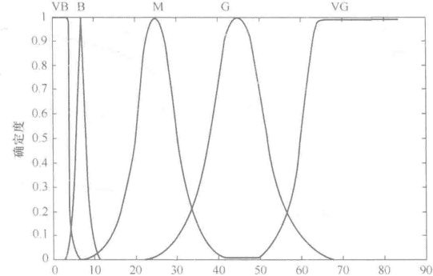
图 6.6.1 等级描述云图
$$
C_1 = \begin{cases} 1, & x \in [0, 0.4] \\ C(4, 2/3, 0.05), & \text{其他} \end{cases}
$$
$$
C_2 = C(7, 8/7, 0.05)
$$
$$
C_3 = C(25, 5, 0.05)
$$
$$
C_4 = C(45, 20/3, 0.05)
$$
$$
C_5 = \begin{cases} C(65, 6, 0.05), & \text{其他} \\ 1, & x \in [65, \infty] \end{cases} \quad \text{(6.6.10)}
$$
$C_1\sim C_5$ 分别表征“非甚差”、“差”、“一般”、“好”、“非常好”。

**等级评价云设计**（式 6.6.11，参数合理，见云图）：
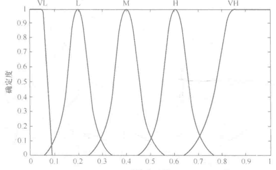
图 6.6.2 等级评价云图
$$
C'_1 = \begin{cases} 1, & x \in [0, 0.05] \\ C(0.05, 1/60, 0.002), & \text{其他} \end{cases}
$$
$$
C'_2 = C(0.2, 1/25, 0.002)
$$
$$
C'_3 = C(0.4, 6/125, 0.002)
$$
$$
C'_4 = C(0.6, 6/125, 0.002)
$$
$$
C'_5 = \begin{cases} C(0.85, 1/15, 0.002), & \text{其他} \\ 1, & x \in [0.85, 1] \end{cases} \quad \text{(6.6.11)}
$$
$C'_1\sim C'_5$ 分别表征“很低”、“低”、“一般”、“高”、“很高”。

**云归一化与集对评估结果**  
设 VG、G 为同一级，VB、V 为对立级，M 为不确定级。经运算得方案评估函数：
$$ S_2 = 3.1342x_1, \quad x_1 \in [-1,1] $$
$$ S_3 = 2.5405x_0 \Rightarrow S_3=2.5405 $$
$$ S_1 = 1.3364 + 1.1347x_1, \quad x_1 \in [-1,1] $$

**决策解读**：$S_3$(沼气) 无不确定项($x_1$)，稳定性最强且可行性高，为最优方案；$S_1$(水能) 次之；$S_2$(太阳能) 不确定性最大。决策建议：优先投资沼气，次选水能。

归一化后的等级与确定度矩阵：
$$ U'^*_{1} = \begin{bmatrix} 44.728 \\ 32.373 \\ 15.98 \\ 26.786 \end{bmatrix} \Rightarrow \begin{bmatrix} G & 0.9992 \\ G & 0.3372 \\ M & 0.1965 \\ M & 0.9382 \end{bmatrix} $$
$$ U'^*_{2} = \begin{bmatrix} 26.023 \\ 31.394 \\ 26.758 \\ 21.415 \end{bmatrix} \Rightarrow \begin{bmatrix} M & 0.9793 \\ M & 0.4415 \\ M & 0.9401 \\ M & 0.7733 \end{bmatrix} $$
$$ U'^*_{3} = \begin{bmatrix} 40.364 \\ 37.50 \\ 46.469 \\ 33.87 \end{bmatrix} \Rightarrow \begin{bmatrix} G & 0.7852 \\ G & 0.5311 \\ G & 0.9760 \\ G & 0.2482 \end{bmatrix} $$

### 6.6.4 仿真对标实验

自 2000 年二元语义法(T-OWA)问世以来，其在群决策中应用广泛。文献[15]显示，其权向量确定仍依赖模糊量化算子 $Q$。本节引入 T-OWA 算子对同一能源决策问题进行横向对比。

基于集对云输出的云特征矩阵 $P^I, P^2, P^3$：
$$ P^I = \begin{bmatrix} 59.9462 & 41.1992 & 35.9751 & 33.0392 \\ 19.9462 & 35.9751 & 35.9751 & 33.0392 \\ 41.1992 & 38.2615 & 35.9751 & 33.0392 \end{bmatrix} $$
$$ P^2 = \begin{bmatrix} 38.2615 & 35.9751 & 38.2615 & 19.9462 \\ 35.9751 & 19.9462 & 38.2615 & 19.9462 \\ 59.9462 & 38.2615 & 38.2615 & 19.9462 \end{bmatrix} $$
$$ P^3 = \begin{bmatrix} 35.9751 & 19.9462 & 22.1494 & 35.9751 \\ 22.1494 & 38.2615 & 22.1494 & 35.9751 \\ 19.9462 & 35.9751 & 22.1494 & 35.9751 \end{bmatrix} $$

T-OWA 聚合算子运算得 $b^1, b^2, b^3$：
$$ b^1 = \begin{bmatrix} 59.9462 & 41.1992 & 38.2615 & 35.9751 \\ 35.9751 & 38.2615 & 38.2615 & 35.9751 \\ 59.9462 & 38.2615 & 38.2615 & 35.9751 \end{bmatrix} $$
$$ b^2 = \begin{bmatrix} 38.2615 & 35.9751 & 35.9751 & 33.0392 \\ 22.1494 & 35.9751 & 35.9751 & 33.0392 \\ 41.1992 & 38.2615 & 35.9751 & 33.0392 \end{bmatrix} $$
$$ b^3 = \begin{bmatrix} 35.9751 & 19.9462 & 22.1494 & 19.9462 \\ 19.9462 & 19.9462 & 22.1494 & 19.9462 \\ 19.9462 & 35.9751 & 22.1494 & 19.9462 \end{bmatrix} $$

在不同模糊量化原则下，T-OWA 集结结果汇总（表 6.6.1）：

#### 表 6.6.1 T-OWA 算子集结运算结果对照表

| 模糊量化算子 (量化原则) | 权向量设定 | 方案 $S^1$ 得分 | 方案 $S^2$ 得分 | 方案 $S^3$ 得分 |
| :--- | :--- | :---: | :---: | :---: |
| $\omega: (0, 0.5)$ — 半以上原则<br>$\omega^*: (0.3, 0.8)$ 多数原则 | $\omega = (2/3, 1/3, 0)^T$<br>$\omega^* = (0, 0.4, 0.4, 0.2)^T$ | 38.03246 | 35.63463 | 37.55393 |

# 仿真实验揭秘：参数微调如何反转决策优劣序

## 6.7 本章回顾与展望

智能决策无疑是人工智能领域的核心命题。鉴于现实问题的错综复杂与多样性，智能决策技术本身也必然呈现出高度的复杂性与多元化面貌。本章系统阐述了基于集对分析的不确定性决策、同异反决策、自然语言定量化下的定性定量混合决策、赵森烽-克勒概率风险决策，以及集对分析与云模型耦合的群决策等前沿方法。这些内容不仅彰显了集对分析在新型智能决策技术研发中的广阔应用前景，也深刻揭示了智能决策固有的复杂本质。

特别值得关注的是，现实环境中的人工智能系统，更迫切需要具备连续性、动态性与优化能力的决策机制，这亟待后续研究深入攻关。将集对分析与其他智能决策范式深度融合，应是开拓新型决策技术的关键路径；实施“初决策—复核—终决策”的双阶段决策机制，能有效提升决策的科学性与可靠性，值得大力推广；此外，充分发挥人机协同优势，特别是利用云计算与大数据处理能力辅助决策，这种所谓的“智脑决策”模式，极具研究价值与应用潜力。

# 第 7 章 知识生态学集对分析

知识生态学作为一门以知识为核心研究对象的新兴学科，也是人工智能的基石之一，在传统领域常被称为知识工程。该概念最早由美国斯坦福大学计算机科学家费根鲍姆于 1977 年提出，涵盖知识表示、获取、验证、推理与解释等全流程。本章将围绕知识与知识生态集对分析原理、默会与显性知识的集对辨析、知识同异反创新、不确定性描述与应用、知识产权评估以及基于知识关联的检索聚类等核心议题展开。

## 7.1 基本原理

### 7.1.1 知识生态学透视

知识是人类认知客观世界的结晶，源于社会实践，亦经受实践反复检验其客观性、合理性与科学性。从认识论视角审视，知识是对特定主题的确信性认识与理解，并蕴含为特定目的高效服用的潜能。此处的“认识与理解”囊括了经验、联想及相关技艺技巧，统称知识。

知识工程以工程化思维与技术手段，系统攻克知识从获取、加工、存储至应用的全链条难题，是支撑人工智能的关键基建。随着科技迭代与社会演进，传统知识体系不断被新知补充、拓展乃至替代，各领域知识更迭呈现出类似农作物群落新陈代谢的生态学特征，由此催生了知识生态学概念。知识工程被视为知识生态学体系下的技术性支柱学科；不同时空下的智脑群落通过知识新陈代谢，构建起相互依存、互补，又相互竞争、共同进化的多元知识生态系统。

### 7.1.2 知识生态集对分析的五大基石

**基石一：过程原理。** 知识从萌芽发现到最终定型，必经历一个或长或短、但绝非真空的过程。若将“知识发现”视为集合 A，“知识形成”视为集合 B，二者关联过程即构成集对 H=(A,B)，这是集对分析切入知识生态的首要逻辑起点，可借此用特定集对表征特定知识形态。

**基石二：确定-不确定原理。** 知识确立需经受社会实践反复验证，历经“粗到精、表及里、浅入深、零星变系统、低级向高级”的螺旋上升。此过程中，部分知识沉淀固化呈显性确定性，另一部分仍处于动态模糊区显不确定性。故而，从系统性、完整性、有效性维度看，特定知识本质上是确定知识与不确定知识的对立统一体。纯粹确定的知识，可视为其不确定成分已完全转化，或处于对立统一体中相对稳定的一极。

**基石三：主次原理。** 知识全生命周期——发现、表达、转移、习得、掌握、应用、发展、完善、创新——均由“人”主导发起，知识处于被动承载地位。人恒居主动态。若将“人”与“知识”构对，这是一个明确具有主次序列关系的集对，揭示了知识生态中主体与客体的本位地位。

**基石四：传承原理。** 从生态学视角看，知识传承犹如播种。良种（成熟知识）落于沃土（适宜时空），生长、开花、结果，经筛选优存劣汰后再播，代际相传且不断进化。将上下代知识视为两个异质集合，其传承衔接过程即可纳入集对分析框架。

**基石五：新陈代谢原理。** 史实证明，人类知识总量持续增长，新知不断替陈出新并快速赋能解题，各领域知识更迭酷似作物群落代谢。以“旧知集合”与“新知集合”构对，聚焦新旧知识间的关联交织、中介过渡、对立互补关系，即构成了知识新陈代谢的集对分析范式。

上述五大原理奠定了知识生态学集对分析丰厚的理论内涵与拓展空间。

## 7.2 默会知识与显性知识的集对辨析

显性知识虽构筑起现代科学大厦，但锚定在个体脑际的默会知识才是冰山下的庞大主体。余国祥（2007）首将默会与显性知识视作集对，引入同异反分析，惊然发现两极之间存在宽广的“中介知识”地带。中介知识是两者有机过渡与互动的桥梁：典型形态兼具双重属性，一般形态则彰显个体差异、不确定性与创新性。这一概念不仅为默会知识理论在现代教育中的落地拓径，也为人工智能知识工程注入新变量，可视为集对分析“主次原理”的具体投射。

### 7.2.1 默会知识及其内在悖论

“默会知识”概念源自匈牙利裔英国哲学家波兰尼 1958 年巨著《个体知识》。简而言之，默会知识是“所知超乎言说”的知识。波兰尼指出：可用文字、图表、公式显性化者，仅是知识一隐；行动中内隐的知晓，才是另一知识形态。他著名断言：“我们所知道的，多于我们所能说的。”默会知识本质是一种理解力、领会力，旨在对经验重组实现理智控制；心灵默会能力在认知各层级主导，默会程度相对显性知识具理论优先性——“一切知识要么是默会知识，要么根植于默会知识，完全显性的知识不可思议。”

波兰尼进而剖析其结构特征：
1. **“双重意识”**：集中意识（如钉钉子时盯着钉子）与辅助意识（手掌握锤触感）融合并存。
2. **“三要素”**：辅助意识（细节线索）、集中意识（对象）、主体（人）。人寓于细节与对象构成的情境中。默会知识由此显现“个体性”与“不可言传性”双重特质。

**悖论生成**：波兰尼关于默会知识的理论本身却是可言传的学术文本，被国际认可、教学应用；他更深入默会内部窥见“结构”。这就陷入矛盾：默会知识不可言传，但其理论却须言传；须掌握细节、关注对象、亲历体会、融合意识，而这些文字描述本身又是显性言传。此即默会知识悖论。破解之道，需引入集对分析与同异反系统理论（详见 1.5 节）。

### 7.2.2 同异反维度的结构性拆解

设默会知识为集合 A，显性知识为集合 B，构集对 H=(A,B)。依同异反系统理论，二者呈现同、异、反三重关系，表 7.2.1 列举 16 个判别论点（此处略表，文中叙述核心结论）：
- **同（3 条）**：同属知识范畴；均含集中意识与辅助意识。
- **反（4 条）**：零星 vs 系统、个体 vs 公用、非规范 vs 规范、未形式化 vs 已形式化。
- **异（9 条）**：可互化条件、验证层级、适用边界、使用者认知清晰度、认知生成机制（无意 vs 有意）、传播范围（师徒链 vs 大规模）、存储难易、逻辑严密性、反思批判能力。

**核心洞见**：16 论点中异占 56%，揭示两者差异性占主导。这意味着，单层面同异反分析下，大量知识无法完全归属任一极，实为两者中介融合过渡形态——**中介知识**，亟待命名与深度研究。

### 7.2.3 中介知识：十二大特征画像

在论域范数 N=16 基础上深化分析，同异反理论预示深层分析将揭示“同中之异、异中之同、反中之异同”，确立中介知识地位势在必行。相对于默会与显性双极，中介知识呈现如下特征：
1. 定位于显性与默会知识之间的中间态；
2. 处于待完整、待规范、待系统化的生成期；
3. 已在特定范围条件下获证，待在更广域一般条件下验证或证伪；
4. 可虚拟化形态存在；
5. 认知生成介于主观有意与无意之间；
6. 兼具显性特征与默会特质的混合体；
7. 在主体作用下融合集中与辅助意识为一体；
8. 可借助特定媒介传递分享；
9. 可存储于承担中介功能的主体或客体上；
10. 逻辑形式与辩证逻辑共存，常处“否定之否定”动态中；
11. 机器或网络可自主生成应用部分中介知识；
12. 社会是中介知识的天然实验场。

### 7.2.4 实证溯源：从锤钉到数轴的可视化

**案一：锤钉范式的中介进化**
非专业者锤钉易误伤，老匠亦难免。自动压钉机应运而生——对准启动即完成固定。这非经典默会过程，而是压钉机作为中介装置，将集中意识、辅助意识、钉锤细节、专注力等要素强制融合统一。压钉机是中介知识外显的典范。
复看锤子本身：锤头触钉、锤柄握手，锤子本质上正是连接铁钉与手的中介装置，证明默会知识内部嵌入中介知识基因。

**案二：数轴上的知识谱系定位**
依同异反理论，默会知识内部可分辨偏显性区、纯默会区、及二者间的中介区，可于数轴定量标识（见下图）。
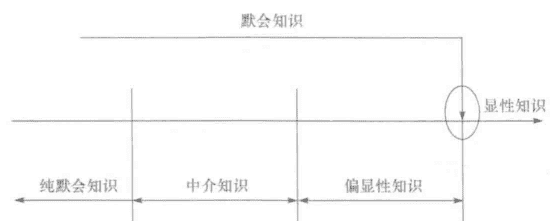
图 7.2.1 默会知识中的中介知识

同理，显性知识内部亦含偏默会区、纯显性区、及其中介过渡区（见下图）。
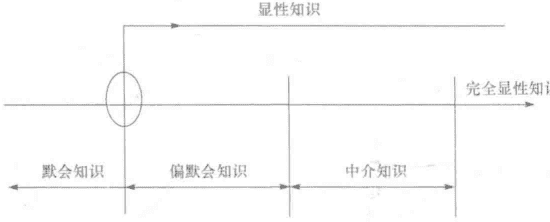
图 7.2.2 显性知识中的中介知识

进而，将默会、显性、中介三大知识形态统一置于同一数轴坐标系，呈现完整知识光谱（见下图）。
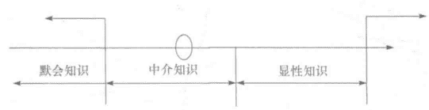
图 7.2.3 默会知识、显性知识、中介知识的数轴表示

### 7.2.5 理论辐射：对教育科学的启示

（后续内容待续……）

## 7.3 基于集对分析的知识创新规律探析

知识的本质是什么？它以何种形态存在？创新是否遵循规律？如何高效挖掘规律并转化为生产力？这些问题的答案至关重要。2002年，徐兹琳引入集对分析的同异反系统理论，对上述问题进行了系统探讨，主要成果如下。

### 7.3.1 知识的本质界定

为破解“知识何为”的谜题，不妨将客观世界设为集合 O，主观世界设为集合 S，二者构成集对 H，即 H={O,S}。知识的本质，是主观世界对客观世界的正确映照。“正确”意味着主观认知架构与客观实在吻合。从集对同异反视角看，即主观集合 S 与客观集合 O 具有**同一性**。若以 same 表示同一性，简记为 s，知识简记为 K，则同一性知识 Ks = Hs（Hs 为集对 H 两集合的同一性）。

然而，受认知条件制约，主观构架常难与客观实在完全重合，呈现**差异性**。只要偏差在可控范围，该认知仍具实用价值，即相对正确性。这部分差异性认知亦属知识范畴。若以 different 表示差异，简记为 d，则差异性知识 Kd = Hd。

更深层看，主客观世界是对立统一的。认知过程常伴随**对立性**，导致谬误，但人脑能从错误中孕育真理（“吃一堑，长一智”）。主观集合 S 与客观集合 O 存在对立性。若以 contrary 表示对立，简记为 c，则对立性知识 Kc = Hc。这部分知识同样有用，构成知识的组成部分。

综上，知识是主观世界对客观世界同一性、差异性、对立性认识的总和，公式为：

**K = Ks + Kd + Kc**

式中：K 为知识；Ks、Kd、Kc 分别代表同一性、差异性、对立性知识。

### 7.3.2 知识的形态特征

知识以何形态存在？答案是多元的，人类创造的一切物质形态本质上皆为知识形态。但基于集对分析同异反理论，**知识以系统形态存在**。全体知识构成一个同异反知识系统（简记为 IDCKS）。该系统可按 7.3.1 节层次展开。

### 7.3.3 知识创新三大规律

基于上述基础，可直接推导知识创新三大核心规律。

**规律一：系统层次的同异反展开是知识创新的首要规律。**
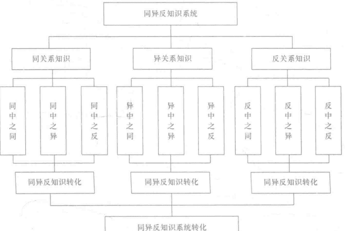（图 7.3.1 展示了可无限层次展开的系统图，此处仅呈现三层）。常态下，认知停驻于某层次；深入研究则会突破原有层级，发现新知。此展开非简单线性叠加，层间存在交叉关联。

**图 7.3.1 同异反知识系统展开示意**

**规律二：知识的排列组合是创新的第二引擎。**
内涵极为丰富，主要含两类基本形式：
1.  **累加排列**：同一性、差异性、对立性各自的无限延展（如 s,s,s→s₁,s₁...；d,d,d→d₁,d₁...；c,c,c→c₁,c₁...）。
2.  **混合排列组合**：三者交织生成新结构（如 sd, sc, sdc, sdd...；sc, sd, scd, scc...；sd, sd, sd, sdc...）。

**规律三：对既有知识的分析与综合是创新的第三规律。**
操作思路见下图。分析时自顶向下分解；综合时倒用分枝图。实质上，此规律是第一规律的微观细化。单独列出因知识系统庞大、开放、复杂，实践中更易按此路径操作。

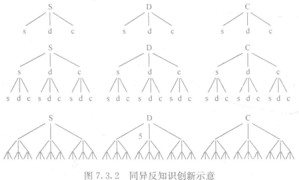（以上为基于知识分析创新示意图）

**补充视角：知识的“洋葱模型”与创新的艰辛**
需明确 Ks、Kd、Kc 的层次关系：同一性知识居核心，差异性知识次之，对立性知识处最外层。知识创新实为“由错到准、由表及里、由此及彼”的剥洋葱过程。这揭示了创新的高风险与高难度。历史唯物主义视角下，人类史即知识创新史——无数失败、挫折、代际牺牲，仅换得对客观世界极有限部分的正确认知。

---

## 7.4 知识的不确定描述与推理应用

实战中，领域专家常以事实与规则形式给出知识并量化。杜春彦等基于集对分析，构建了不确定知识描述体系及传播算法，应用于不确定推理。

### 7.4.1 不确定知识的描述框架

**1) 事实描述**
一般式：$A:\mu_A=a_A+b_Ai+c_Aj$
*   $a_A$：A 为真的**必要支持度**（$a_A=1$ 绝对真）；
*   $c_A$：A 为假的**必要支持度**（$c_A=1$ 绝对假）；
*   $b_A$：**未知支持度**（$b_A=1$ 完全不解）；
*   $a_A+b_A$：A 为真的**可能支持度**；
*   $b_A+c_A$：A 为假的**可能支持度**；
*   $a_A>0.5$ 认可 A；$a_A \geqslant 0.5$ 强认可 A。

*例：方案评价中，5人赞同($a=0.5$)，3人反对($c=0.3$)，2人不知($b=0.2$)，至多7人赞同($a+b=0.7$)，至多5人反对($b+c=0.5$)。*

**2) 规则描述**
一般式：$R:A \to B \quad \mu_R=a_R+b_Ri+c_Rj$
*   $a_R$：前提真时对结论真的必要支持度；
*   $c_R$：前提假时对结论的必要支持度；
*   $b_R$：对规则的不了解程度；
*   $a_R+b_R$：前提真时结论的可能支持度；
*   $c_R+b_R$：前提假时结论为真的可能支持度。

**模型亮点**：
① 肯定与否定不确定度之和不必等于 1；
② $bi$ 引入“不知道”状态，融合证据理论思想，规避概率分布难确定的困境；
③ 概率信息可表为 $a+cj$，模糊信息可表为 $a+bi$。

### 7.4.2 不确定值传播算法

设前提 A、B 支持度分别为 $\mu_A, \mu_B$。

**1) 前提逻辑组合**
*   **与 (AND)**：$a=\min(a_A, a_B)$，$c=\max(c_A, c_B)$，$b=1-a-c$。
*   **或 (OR)**：$a=\max(a_A, a_B)$，$c=\min(c_A, c_B)$，$b=1-a-c$。
*   **非 (NOT)**：$a=c_A$，$c=a_A$，$b=1-a-c$。

**2) 顺序传播算法 (单规则推理)**
已知规则 $R:A \to B$ 及前提 A 的不确定值，求结论 B。
运算核心：$a=a_1a_2, b=a_1b_2+a_2b_1+b_1c_2+b_2c_1+b_2b_1, c=a_1c_2+a_2c_1+c_1c_2$。
简记为 **Bochvar 交算子**：$\mu_B = \mu_A * \mu_R$。

**3) 并行传播算法 (多规则汇聚)**
已知 $A_1 \to B, A_2 \to B$ 及其联合前提不确定值，按 $a_1, a_2$ 与 $c_1, c_2$ 的大小关系（是否 $\ge 0.5$）分三种情况计算综合 $a, b, c$（详见原文公式组）。

### 7.4.3 算法核心性质

为便于分析，将 $L=a+bi+cj$ 记为 $(a,b,c)$。

1.  **分布性约束**：运算结果恒满足 $a+b+c=1$。
2.  **前提组合边界**：
    *   与真值 $(1,0,0)$ 交 $\to$ 不变；与假值 $(0,0,1)$ 交 $\to$ 变假。
    *   与真值 $(1,0,0)$ 并 $\to$ 变真；与假值 $(0,0,1)$ 并 $\to$ 不变。
3.  **顺序传播约束 (记运算为 &)**：
    *   $(a,b,c) \& (0,1,0) = (a,b,c)$：规则强度为单位元 $(0,1,0)$（即规则与前提无关）时，规则失效。
    *   对称性：$(0,1,0) \& (a,b,c) = (0,1,0)$：前提不确定度为单位元时，规则不起作用。
4.  **并行传播约束 (记运算为 #)**：
    *   $(a,b,c) \# (1,0,0) = (1,0,0)$：一证据能证实假设，无需考虑其他支持（确定性吸收）。
    *   $(a,b,c) \# (0,1,0) = (a,b,c)$：某推理路径结论完全未知，该路径无效。

### 7.4.4 实战演示：鸵鸟飞行推理

知识库事实与规则：
1.  `bird(x) -> fly(x)`，置信度 $L=(a,b,c), a>c$（鸟多会飞）；
2.  `bird(ostrich)`，置信度 $L=(1,0,0)$（鸵鸟确是鸟）。

**顺序推理得**：`fly(ostrich)`，$L=(a,b,c), a>c$（倾向于会飞）。

**引入反例修正**：
4.  `fly(ostrich)`，置信度 $L=(0,0,1)$（鸵鸟实不飞）。

**并行融合得**：
5.  `fly(ostrich)`，$L=(0,0,1)$（最终确认：鸵鸟不会飞）。

---

## 7.5 知识产权评估的集对分析实践

知识源于主体创造，有成本投入。为保护创新积极性，各国实施知产保护政策。评估是系统工程，具政策性、技术性、时效性，跨学科跨行业，需经组织、协调、汇集、鉴别、初评、传递、反馈等环节。张新华等、周萍/阎理等分别将集对分析引入技术知产与武器装备知产评估。

### 7.5.1 技术知识产权评估模型与流程

**1) 评估模型构建四步法**
1.  **确立理想基准**：依 n 个目标集确定理想子集 $A_0$，记其第 k 指标值为 $f_{0pk}$。
2.  **构建同一度矩阵 X**：计算各被评对象指标 $f_{ipk}$ 与理想值 $f_{0pk}$ 的同一度 $x_{ik}$，组成 $n \times m$ 矩阵 X。
    *   计算统一法则：**较小值除以较大值**。
    *   $f_{ipk} > f_{0pk} \Rightarrow x_{ik} = f_{0pk} / f_{ipk}$；
    *   $f_{ipk} < f_{0pk} \Rightarrow x_{ik} = f_{ipk} / f_{0pk}$。
3.  **引入权重加权**：结合权重矩阵 $W$，计算联系矩阵 $R = X * W^T$。$R_i = \sum a_{ik} w_k$ 即第 i 对象与理想基准的综合同一度。
4.  **排序定优劣**：按 $R_i$ 值大小排序，值大者为优。

**2) 评估流程**
参见流程图。
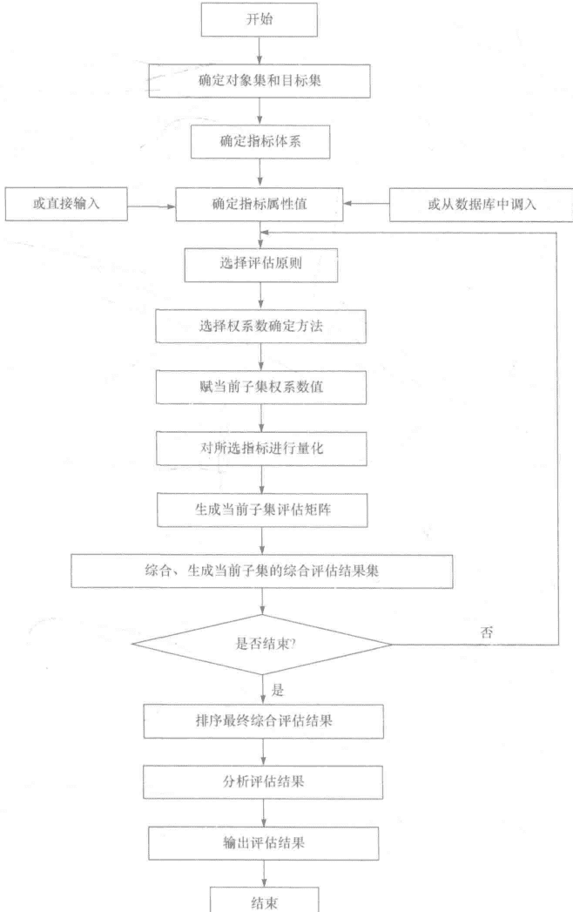（图 7.5.1 技术知识产权评估流程）

**3) 应用案例实测**
待评对象：A1、A2、A3 三项技术知产。指标、权重、单位、实测值及理想值（$A_0$）见下表。

| 指标 | 权重 | 单位 | A1 | A2 | A3 | A0(最优基准) |
| :--- | :---: | :---: | :---: | :---: | :---: | :--- |
| 完成成本 | 0.3 | 万元 | 5 | 10 | 15 | **5 (取最小)** |
| 经济寿命 | 0.2 | 年 | 5 | 10 | 15 | **15 (取最大)** |
| 收益预测 | 0.3 | 万元 | 30 | 40 | 60 | **60 (取最大)** |
| 风险损失 | 0.2 | % | 6 | 8 | 10 | **6 (取最小)** |

由表数据推导得评价矩阵...

# 7.5.2 装备知识产权绩效考核实务

## 指标体系架构
详细框架请参阅图 7.5.2。

## 考核方法设计
邀请 $n$ 位专家对三级指标落实情况实施三级判定（“认可”“中立”“否定”）。统计各档人数占比，分别记为满意度 $a$、中立度 $b$、不满意度 $c$，构建评价联系数：
$$ \mu = a + bi + cj $$
进而计算势值 $\text{shi}\mu = a/c$：大于 1 归为“满意态势”，小于 1 为“不满意态势”，等于 1 则为“中性态势”。

## 实战案例复盘
某装备知识产权管理部门组建 10 人专家组，对 2002、2003 两年度绩效开展评审。聚焦专利权、技术秘密权、版权三大类，依据 6 项三级指标打分，经等级处理后获得联系度数值（详表 7.5.2）。

| 考核项目 | 2002 满意度 | 2002 中立度 | 2002 不满意度 | 2003 满意度 | 2003 中立度 | 2003 不满意度 |
|---|---|---|---|---|---|---|
| 专利权 | 0.18337 | 0.66680 | 0.15003 | 0.51677 | 0.41675 | 0.08335 |
| 技术秘密权 | 0.21671 | 0.56678 | 0.21671 | 0.46676 | 0.45009 | 0.10002 |
| 版权 | 0.26672 | 0.56678 | 0.16670 | 0.43342 | 0.51677 | 0.05001 |
| 管理整体 | 0.22224 | 0.60006 | 0.17780 | 0.47232 | 0.46120 | 0.07779 |

测算得：2002 年 $\text{shi}\mu=1.25>1$ 且 $b>a>c$；2003 年 $\text{shi}\mu=6.07>1$ 且 $a>b>c$。结论明确：2003 年表现显著优于 2002 年。

---

# 7.6 融合知识关联的检索聚类新范式

阮光册博士引入关联视角，将 SPA 理论应用于检索结果归类，开辟新路径。

## 7.6.1 核心构思
检索技术跃升导致返回结果爆发式增长，海量信息处理成情报学焦点。文本归类能压缩规模、提升质量。传统路径依靠相似度计算将近似文本合簇，却难有效挖掘潜在关联。现有研究虽尝试主题相似、降维、K-Means+推荐等路径，但均难以量化内容相似程度，更无法满足基于关联归类的需求。阮光册提出融合 SPA 与文本向量模型，实现基于关联的聚类，为用户输出高价值信息。

## 7.6.2 技术路线详解

### 文本向量空间建模
将文本空间视为词条向量张成的空间，文档 $d$ 表示为广义特征向量：
$$ V(d) = (t_1, W_1(d); t_2, W_2(d); \cdots; t_n, W_n(d)) $$
$t_i$ 为词条，$W_i(d)$ 为权重。TF-IDF 为主流加权法：
$$ W(d) = tf_i(d) \cdot \log_2 \left( \frac{N}{n_i} \right) $$
$N$ 为总文档数，$n_i$ 为含 $t_i$ 的文档数。具体到文档 $D_i$ 中词语 $T_k$ 的权重：
$$ W_{*k} = tf_{*k} \cdot \log_2 \left( \frac{N}{n_k} + 0.01 \right) $$
$$W_k = tf_k \cdot \log_2 \left( \frac{N}{n_k} + 0.01 \right) \cdot IG_k$$
$$IG_k = H(D) - H(D|T_k)$$
式中 $H(D)$ 为文档信息熵，$H(D|T_k)$ 为条件熵。$T_k$ 信息量 $IG_k$ 计算公式：
$$IG_k = -\sum_{d_i \in D} (p(d_i) \cdot \log_2 p(d_i)) - \sum_{d_i \in D} (p(d_i|T_k) \cdot \log_2(d_i|T_k))$$
词语 $T_k$ 在文档中出现频率 $p(d_i)$ 表示为：
$$p = \frac{T_k(D_i)}{\sum_{D_i} wordfreq(D_i)}$$
该式揭示 $T_k$ 频率占文档 $D_i$ 所有词汇频率之和的比例。

### 引入信息量的向量表达
式(7.6.3)虽描述权重，但仅依赖词频，缺失信息量考量。故引入 $IG_k$ 修正权重计算。

### 基于 SPA 的相似度度量
向量空间中每个向量刻画 $t_i$ 区分文档特性的能力：在特定区域出现频率越高，区分力越强。

设 $N$ 篇文档构成集合 $\{d_1, \cdots, d_N\}$，第 $m$ 篇文档第 $k$ 个词条权重为 $W_m$。依据词条分布相似度对 $d_i, d_j$ 做 SPA 分析，相似度定义为：
$$sim(d_i, d_j) = p * q * l$$
式中 $p=c-a, q=b-a, l=c-b$。$sim(d_i, d_j)$ 反映对立度与差异度，值越大越相似。同一性集合可简化为 $sim(d_i, d_j) = q$，相似度取决于 $b-a$ 差值。

该法可定量给出两文档相似度值，有效化解内容相似的模糊性，为高价值归类提供量化依据。

## 7.6.3 实测与分析

### 实验设计与流程
向量空间算法维度极高，为兼顾效率，仅提取标题、关键词、摘要、正文首段四字段建模，有效降维去噪。结合 SPA 同异反体系定量描述相似度，提升分类能力。流程见图 7.6.1。
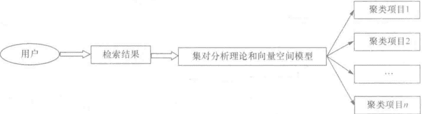

**执行步骤：**
1. 将检索得 $N$ 篇文档组成集合 $\{D_1, \cdots, D_N\}$，用式(7.6.8)计算 $T_k$ 权重 $W_*$，形成文档描述向量。
2. 基于 SPA 计算同异反值确定相似度：$W_k$ 差值在 0.045 内视为同类（计入 $a$），其余计入 $b$，套用式(7.6.8)得相似度（阈值设 0.76）。循环计算 $D_i$ 与后续文档相似度。
3. 将高相似度文档存为聚类 1，对剩余文档重复步骤 2。
4. 归并各聚类中的 $a$ 值，提取每类最高相似度特征向量。

### 结果解读
在知网以“危机管理”检索，取前 100 条全文归类。流程：四字段入库 → TF-IDF 分词提特征算权重 → SPA 同异反算聚类 → 归并 $a$ 值定依据。

获得 7 个高频 $a$ 值：政府、企业、高校、图书馆、灾害、社会危机、国际政治。图 7.6.2 展示检索结果与高频词的关联网络。
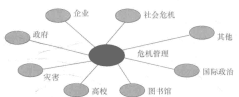

人工核验正确率见表 7.6.1。

#### 表 7.6.1 聚类效果对照
| 聚类维度 | 算法结果 | 人工基准 | 正确率/% |
|---|---|---|---|
| 危机管理+高校 | 11 | 12 | 91.7 |
| 危机管理+灾害 | 4 | 4 | 100 |
| 危机管理+企业 | 19 | 21 | 90.4 |
| 危机管理+政府 | 23 | 25 | 92 |
| 危机管理+社会危机 | 4 | 5 | 80 |
| 危机管理+国际政治 | 4 | 4 | 100 |
| 危机管理+图书馆 | 5 | 7 | 85.7 |
| **平均正确率** | **91.4** | **100** | |

实验证实：该法实现基于关联的聚类，平均正确率 91.4%。因未引入语义解析，“社会危机”“恐怖主义”等词在同异反处理上存误差；若接入领域本体库或融合语义解析，效果将更优。

综上，检索结果归类是信息处理热点，按关联聚类能显著提升精准度。SPA、向量空间、信息量计算三位一体，构成新型归类范式。利用 SPA “差异性可多层次展开”特质，还可按用户需求做更细粒度分析。

---

# 7.7 本章回顾

知识是智能核心、思维产物。长期以来，AI 界从计算机处理知识视角切入，形成知识工程体系。本章虽从知识发现、形成、提取、应用、评价多维度展示 SPA 应用（参考文献还覆盖电力客户知识管理、摩擦学状态辨识、扩展粗集知识依赖等），但整体仍处知识工程层面，未进化至知识生态学高度。虽标题冠以“知识生态学”，实则尚缺深度阐释，期盼有识之士续探深研。

---

# 参考文献列表
[1] 赵克勤. 集对分析及其初步应用[M]. 杭州:浙江科技出版社,2000:44-64.  
[2] 余国祥. 默会知识与显性知识的同异反集对分析[J]. 寒蝉学院学报,2008,29(5):84-88.  
[3] 邵振华. 波兰尼的默会知识[J]. 自然辩证法研究,2001,17(8):5-10.  
[4] 赵克勤. 集对分析同异反系统理论在 AI 中的应用[J]. 智能系统学报,2007,2(5):20-35.  
[5] 徐忆琳. 用 SPA 同异反理论研究知识创新规律[J]. 科学研究,2002,20(3):327-329.  
[6] 杜春彦, 柴春红. 基于 SPA 的不确定推理模型[J]. 数学的实践与认识,2004,34(9):130-134.  
[7] 张新华. 技术知识产权评估模型及应用[J]. 科研管理,1999,20(6):47-51.  
[8] 周萍, 阎理. 集对分析与武器装备知识产权管理绩效评估[J]. 军事经济研究,2005,(6):51-52.  
[9] 阮光册. 基于知识关联的检索结果聚类分析研究[J]. 情报科学,2015,33(2):63-66.  
[10] 陈丽君. 电力客户知识管理体系构建及能力评估[D]. 太原:太原理工大学硕士论文,2013:77-86.  
[11] 王志芳. 摩擦学系统状态辨识知识获取方法研究[D]. 武汉:武汉理工大学博士论文,2008:45-55.  
[12] 王丽娟, 吴陈, 严熙. 基于限制容差关系与集对分析的扩展粗集模型知识依赖[J]. 江苏科技大学学报(自然科学版),2007,21(2):49-53.

---

# 第 8 章 SPA 在自然语言与人类语言理解中的应用

客观万物普遍联系，语言是联系与交流的工具。基于此，自然语言应理解为自然界的语言：含无机语言、有机语言，生物种群间交流是典型有机语言，人类语言则是其子集。演化视角下，人类语言是漫长进化中信息情感交流的产物，也是社会化生存繁衍的必要条件；地域与环境多样性催生语言多样性与复杂性。但不同语言的可通约性、同一语言在不同语境下的多义性，均可抽象为自然语言的同(同义)异(异义)反(反义)及其不确定性，故 SPA 可用于自然语言与人类语言理解研究。人类语言含口语、肢体语、文字语，本质是自然语言子集。本章“自然语言”内涵区别于通用 AI 文献（后者常将人类语言等同自然语言），重点介绍 SPA 用于文字语言理解的最新进展；既有文献中决策语言变量联系数转换、科技知识传播语言研究、词语搭配同近反义及思想丰度联系数刻画等，仅作简介，详见相关文献。

## 8.1 核心原理

### 8.1.1 语言本质重释
顾名思义，自然语言即自然之语言，基于第 3 章“自然界本身具有智能”观点。自然语言首当从普适视角理解为自然界自有语言——物质与物质、物质与能量、能量与能量相互联系的工具与方式，助力我们深研自然语言、向自然智能取经。雷鸣电闪、风雨霜雪、阳光普照、潮涌潮落、月移星走……皆是一物向他物诉说的语言；懂这些语言的物体，便有了热胀冷缩以自我保存、凝聚汇合以蓄能抗衡、周期性诞生消亡以现身自然界。我们称此为无机物间的无机语言；花香鸟语、莺歌燕舞、人欢马叫、文本书信等生物种群间语言称有机语言。无机语言与有机语言构成自然语言两大类，若各成集合，语言即一集对。

人是自然产物，人类语言是自然语言中有机语言的一个子集。

### 语言的全景图谱：从人类交流到自然本源

人类的语言体系丰富多元，涵盖文字、口语与肢体语言三大维度。文字语言又可细分为形式化与非形式化两类：前者如数学符号、编程代码，逻辑严密；后者则是各民族日常使用的自然文字。口语包含有声语言与无声语言（呕语），音乐可视为特殊的有声口语，呕语则部分属于肢体语言范畴，但肢体语言远不止于此。此外，旗语、图语、舞蹈等也属于非形式化语言的延伸。

纵观当下，语言承担着三大核心使命：一是作为人际间信息与情感流通的桥梁，维系社会运转；二是赋能机器，让其读懂人类意图与情感，实现劳动替代；三是探索地外文明对话。尽管外星生命的形态、语言仍是未知数，但科学界坚信其存在，接触只是时间问题。一旦联系建立，首要任务便是建立双向可懂的通用语言体系。这也反向印证：我们不能将地球现有的语言体系等同于“自然语言”的全部。

由此，自然语言与人类语言的层级关系清晰呈现（见图 8.1.1）。为行文便利，后文若无特指，统以“语言”泛指二者；若需区分，再行说明。

```
语言(自然语言)
├─ 无机物的语言
│  ├─ 光
│  ├─ 电
│  ├─ 声
│  ├─ 磁
│  └─ 其他
└─ 有机物的语言
   └─ 人类的语言
      ├─ 非形式化语言
      │  ├─ 口语
      │  ├─ 肢体语言
      │  ├─ 哑语
      │  ├─ 图语
      │  └─ 旗语
      └─ 形式化语言
         ├─ 数学语言
         ├─ 文字语言
         ├─ 计算机语言
         └─ 与地外生命联络语言
```

#### 图 8.1.1 自然语言体系及其中的人类语言

### 8.1.2 语言与理解的集对分析三大原理

#### 原理一：语言与语义成对共生原理

依据本书第三章视角，人类智能源于实践与进化；而从自然维度看，自然本身蕴含智能，人类智能仅是其不完全投影——生命起源、宇宙演化等核心命题至今未解。语言是智能的外显形式，自然语言先于人类语言而存在。人们习惯认为语言源于社会实践，这虽是历史现象，却非本质真相。实则是自然语言在人脑中的映射投射。大自然造就了人、智能与语言，使人能借自身智能解读自然智能，如同成长的孩子渐能读懂母亲。人类能部分破译自然语言，进而利用已知规律改造生存环境。但受限于人类视角，研究语言（含自然与人类语言）时，必须引入集对分析理论，首要应用其**成对原理**：将自然语言与人类语言视为成对共存的两类系统；对同一语言的理解亦需成对进行——即从至少两个维度、层面或意义切入，再融合或分解分析。这既是理论映照，也源于语言生产者与接收者理解差异这一客观事实。

此原理是语言学基石，称**语言集对分析第一原理**，后文将深入阐释。

#### 原理二：语言与理解的同异反原理

该原理揭示多层次的同一性、差异性与对立性统一：
1.  **跨体系层面**：自然语言与人类语言在产生、形式、语法、语用、语义、价值等维度存在同异反；
2.  **体系内部层面**：同类语言内部（如不同民族语言）亦存同异反；
3.  **形式内部层面**：同语言的不同形式（如口语与书面语）同样蕴含同异反。

前文已言理解主体间存在差异，此原理进一步指出：对同一语言，双方既有共识，也有分歧，甚至同时产生截然相反的解读。正是这种同异反机制，迫使人们终身学习语言，以精准捕捉表达者深层意图。

这种认知差异根源于：生成意愿、环境、形式、规则、传递路径、信息提取及价值实现等环节的同异反。本质上，源于双方身处不同时空、持有不同文化认知、运作不同理解机制、遵循不同价值取向。

一个关键现象值得关注：**同一理解者能对形式与内容截然相反的语言作出相同解读**。例如赛场标语“中国队大胜韩国队”与“中国队大败韩国队”，在特定句式下均可理解为“中国胜、韩国负”。“胜”“败”反义词在同构句式中指向同一事实。反之，“这是你做的好事”常被解为褒义，特定语境下却成贬义（打引号的“好事”）。这揭示人脑理解具备**双重机制**：在环境感知加持下，反义词汇/句式可同构同解。理解机制不仅遵循成对原理，更能针对复杂情境创造性应用。

此为第一原理派生，称**语言集对分析第二原理**。

#### 原理三：语言理解的不确定性原理

基于前两原理衍生，称**第三原理**。核心观点：无论人理解人类语言，还是理解自然语言，不确定性始终伴随始终，虽人类持续试图压缩它。前文“同异反”案例即是明证。即便高度形式化的数学语言，也难逃罗素悖论、说谎者悖论等不确定陷阱。这说明语言理解受“确定与不确定对立统一”规律支配，无法根除。辩证看，正是这种不确定性，赋予了人类语言承载丰富精神世界与复杂情感的张力。

上述三原理揭示：语言生成、存在与理解均极度复杂。若将自然现象预报视为对自然语言的理解预期（如地震预报至今难准），足证此复杂性。但本章后续聚焦人类语言理解的集对分析实践。

## 8.2 人工智能语言理解研究的集对透视

语言学由来已久，AI 将其推至新高度——唯有让计算机深度理解人语，机器智能方可臻化境。然 AI 习惯将人类语言等同于自然语言，导致研究存在盲区。本书拟对 AI 领域的语言理解思路、方法、技术路线实施集对剖析。

### 8.2.1 理解与处理：两个时空的集对博弈

依 8.1.2，人类语言理解主要服务三大场景：人际社交（直/间接）、人机交互、星际通联。本节聚焦前二者。

将“理解”与“处理”视为两个集合，集对理论指出二者构成集对，联系呈同异反特征：
*   **同**：处理前必先理解；理解本身亦是一种处理——**“理解即处理”**。
*   **异**：时间上，理解先于处理；空间上，理解发生于**意识时空**，处理落地于**实时空**。以文本为例，实时空操作涵盖分词、词性标注、词义消歧、搭配分析、句法/语义分析、篇章建模等。虽理解渗透其中，但操作属性主导。
*   **反**：意识时空与实时空具对立意味。双时空并行的理解-处理现象，完美印证成对原理。

分析显示：理解贯穿处理全程，理解研究优先于处理研究——**无理解，无处理**。二者在双时空中分离又共生，暗示研究需深化对两大时空的认知，遗憾的是，当前相关认知多停留在假设阶段。

### 8.2.2 研究方法论的集对剖析：规则与统计的共舞

AI 语言研究主流分**规则法**与**统计法**，两者构成集对，依集对理论与语言本源原理，呈现同异反特征（见表 8.2.1）。互补融合可拓宽理解广度与深度，但无法从根本消除不确定性。

| 序号 | 维度 | 规则方法 | 统计方法 | 同异反 |
|:---|:---|:---|:---|:---|
| 1 | 核心信念 | 语言理解有章可循 | 语言理解有章可循 | **同** |
| 2 | 规则来源 | 语言学理论提炼 | 样本数据统计归纳 | **异** |
| 3 | 适用边界 | 理论覆盖无限总体 | 仅限样本所在有限总体 | **异** |
| 4 | 兼容性 | 规则可源于统计，兼容统计 | 样本建模不排斥先验规则，兼容规则 | **同** |
| 5 | 不确定性表现 | 规则确定，应用确定，但面临“规则失效/难用”困境 | 样本规则推广总体，天然伴随风险 | **异** |
| 6 | 互补性 | 需借力他法，互补共生 | 需借力他法，互补共生 | **同** |
| 7 | 时空延伸性 | 现有体系可延伸 | 现有体系可延伸 | **同** |

**聚焦第 7 论题**：延伸的时空本质是**不确定性时空**。对规则法显而易见；对统计法需细说：现有统计建立在经典概率论基础上，属经典数学范畴。按第二章集对分析理论，经典概率需“联系数化”，引入补概率与不确定性因子 `i`，使不确定性显性化呈现于联系概率中。故统计法的延伸时空同样承载不确定性。

**结论**：规则与统计双轨，均须立足“不确定性原理”基石，方能实质性突破延伸。

除二元范式外，早期 AI 还区分“理性主义”（先天语言天赋论，技术侧重规则，归类规则法）与“经验主义”（白板说，经验积累认知，技术侧重统计，归类统计法）。二者构成集对虽具研究价值，但本质内核仍回归表 8.2.1。值得注意的是，理性主义若无限追溯“先天之源”，终将追问最早语言从何而来——本书给出的答案是：**源于自然**，进化亦是自然作用的体现。

### 8.2.3 基于“物质-能量”视角的语言信息理解新范式

将语言视为特定符号（文本/代码）或物理现象（声/肢体）承载的信息，引入信息论研究，是经典 AI 的重要路径。但本书第三章已明确：**信息是物质与能量相互作用的产物**。若语言即信息，则如何从物质-能量交互视角理解语言？

**核心命题：如何从物质与能量相互作用的角度理解人类语言？**

深度回答非易事，此从信息“发送-传输-接收”链路切入：

1.  **发送端**：语言信息生成必需物质与能量交互，毋庸置疑。
2.  **传输链路**：信息传播同样依赖物质与能量载体，无异议。
3.  **接收端**：接收者获取信息量后，将对信息进行**物质与能量双维分解**（见图 8.2.1）。

关键洞见：无论发送端编码时注入正能量、负能量或临界能量，接收端解码分解后，所得能量均可呈现为“正”、“负”或“非正非负的临界”态。

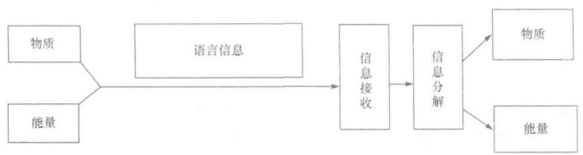

#### 图 8.2.1 源信息与信息接收后的分解模型

这与认知吻合：我们要求书报、影视、音乐等语言载体传递“正能量”，实质是期望接收者在信息衰减（环境、噪声、路程损耗）后，仍能最大程度保留并获得“正能量”。

从物质-能量交互本源重审语言与理解，特别是人类语言理解，是本书抛出的新课题，任重道远，以上仅作抛砖引玉。

## 8.3 原理落地：破解语义歧义与系统创新

现有语言学成果与 NLP 系统（翻译、检索、推理、语音识别等）极大便利了生活。但依 8.1 三原理与现实观察，**大量语法合规、结构完备、用词考究的语句，依然存在双重甚至多重解读空间**。8.1 已举例，此处补充更典型、高频案例，旨在深化原理认知，倒逼智能处理系统创新迭代。

### 8.3.1 中文语境下的集对解码实战

**案例 8.3.1** 来源：科学网黄秀清博客。

> **记者**：曾咏春先生，欣闻您荣获世界科学大奖，我谨代表中国记者协会，向您表示衷心的祝贺！（1）
> **曾咏春**：谢谢记者先生。（2）
> **记者**：墙上挂的是您的全家福？（3）
> **曾咏春**：是，眨眼三十年过去了。（4）
> **记者**：曾先生，那位老先生是？（5）
> **曾咏春**：我老头。（6）
> **记者**：戴眼镜的帅哥呢？（7）
> **曾咏春**：是我先生。（8）
> **记者**：先生连先生的眼光绝对是一流！（9）
> **曾咏春**：先生过奖了。（10）
> **记者**：听说先生与共和国同岁？（11）
> **曾咏春**：是。（12）
> **记者**：我们是同龄人。（13）
> **曾咏春**：这么巧？（14）
> **记者**：您的出生时辰？（15）
> **曾咏春**：辰时，您呢？（16）
> **记者**：卯时，我先生！（17）
> **曾咏春**：对，您是先生！（18）
>
> **追问**：全文“先生”各指何义？

**深度解析**：
对话每句均合法、合理、双向理解无障碍，旁观者亦可精准复盘。为便分析，句子已编号。

*   **形容词性“尊称”**（指曾咏春/记者）：第 1、2、5 句。
*   **名词性“丈夫/长辈”**（指配偶/对方丈夫）：第 6 句“老先生”中的“先生”、第 8、9、10、11 句。
*   **动词词组“先出生”**：“生”作动词，“先”作状语：第 17 句“我先生”=“我先出生”。
*   **名词性“长辈/师长”+隐含“先出生”**：第 18 句。

**集对特征显影**：“先生”在同段对话中，词性在**名词/形容词/动词短语**间流转；指代在**不同个体**间跳跃；词义呈现**同（指同一实体）、异（指不同实体）、反（谁先出生的对立）**三重张力，且**不确定性**贯穿始终（单词/词组、词性、指代均未定型）。

---

**案例 8.3.2** 网友 *bridgeneer* 评论区神回复，更极致演绎“一词多义”：

> **领导**：“你这是什么意思？”
> **阿呆**：“没什么意思，意思意思。”
> **领导**：“你这就不够意思了。”
> **阿呆**：“小意思，小意思。”
> **领导**：“你这人真有意思。”
> **阿呆**：“其实也没有别的意思。”
> **领导**：“那我就不好意思了。”
> **阿呆**：“是我不好意思。”
> **博主回复**：有意思！

全段“意思”二字，在**名词/动词/形容词**间无缝切换，承载**意图/心意/面子/兴趣/愧疚**等多重语义场，完美诠释了语言理解的同异反与不确定性本质。

# 8.3 语言理解的微观实证：从“意思”到机翻

### 一词多义，语境为王：拆解“意思”的八层面孔

咱们不妨仿照前文例 8.3.1 的路子，细品一下对话里“意思”二字的八次出场，每一次指向的“意思内容”究竟几何。一眼望去，结论显而易见：同一个“意思”，在不同语境下能生出截然不同的词义。

1.  **“你这是什么意思？”** —— 这里的“意思”双重叠加：既指那红包实物，又指送红包的意图。
2.  **“没什么意思，意思意思。”** —— 前一个“意思”指代送礼初衷；后面“意思意思”则融合了“略表心意”与“塞上这红包”双重指向。
3.  **“你这就不够意思了”** —— 领导一张口，指向瞬间升维：不指红包、不指感激，直指阿呆行为违规、不讲规矩的那层“道理”。
4.  **“小意思，小意思”** —— 双关妙用：既说红包薄（钱少），又谦称谢意轻（分量不重）。
5.  **“你这人真有意思”** —— 彻底剥离红包与感激，专指“懂礼数、讲规矩”这层社交属性。
6.  **“其实也没有别的意思”** —— 此处“意思”回溯至第 2 句“意思意思”中的核心——送红包的目的。
7.  **“那我就不好意思了”** —— 语义反转，明确指“收下红包”这个动作。
8.  **“是我不好意思”** —— 指代“送红包”行为本身，隐含“红包太轻”自嘲之意。

**核心洞见：** “意思”一词，跨语境词义迥异、甚至对立；同一语境内亦可一词双义。这组平常对话及其剖析，实锤了 8.1 节提出的“语言及语言理解三原理”具有客观实在性。

---

### 翻译实战看本质：百度翻译里的同异反博弈

把一种语言转成另一种，三原理的显现度直线拉高。为求简明，借百度翻译把上文 8 句话“中→英→中”跑一轮，通过对比原文与回译，直观展示成对原理、同异反原理、不确定性原理在互译中的具象表现（详见表 8.3.1）。

#### 表 8.3.1 中英互译同异反对照表

| 角色 | 中文原文 | 百度中→英 | 百度英→中 | 同异反判定 |
| :--- | :--- | :--- | :--- | :--- |
| 领导 | 你这是什么意思？ | What do you mean? | 你是什么意思？ | **同**（基本相同） |
| 阿呆 | 没什么意思，意思意思 | No fun, no fun. | 没有乐趣，没有乐趣。 | **异**（明显差异） |
| 领导 | 你这就不够意思了 | You're not saying that. | 你不是说 | **异**（差异大，接近反） |
| 阿呆 | 小意思，小意思 | Small mean, little thing. | 小意思，小东西。 | **同**（相当接近） |
| 领导 | 你这人真有意思 | You this man is really interesting. | 你这个人真有趣。 | **同**（基本相同） |
| 阿呆 | 其实也没别的意思 | There is no other meaning. | 没有其他意义。 | **同**（相当接近） |
| 领导 | 那我就不好意思了 | I'm sorry. | 对不起 | **异**（明显差异） |
| 阿呆 | 是我不好意思 | I'm sorry. | 对不起 | **异**（明显差异） |

---

#### 数理建模：从二元到四元的精细刻画

**粗线条（二元联系数）：** 不分“同”优劣、“异”深浅，统计得“同”4个、“异”4个。
$$u = A + Bi = 4 + 4i \tag{8.3.1}$$
归一化：
$$\mu = a + bi = 0.5 + 0.5i \tag{8.3.2}$$

**细线条（四元联系数）：** 引入四档评级——
*   A（同-相当接近）= 2
*   B（同-基本相同）= 2
*   C（异-明显差异）= 3
*   D（异-差异大接近反）= 1

$$u = A + Bi + Cj + Dk = 2 + 2i + 3j + 1k \tag{8.3.3}$$
归一化：
$$\mu = a + bi + cj + dk = 0.25 + 0.25i + 0.375j + 0.125k \tag{8.3.4}$$

**深度解读：**
*   **成对性分层：** 式(8.3.1)/(8.3.2)是粗粒度同异成对；式(8.3.3)/(8.3.4)揭示“同”可分“接近/基本”，“异”可分“差异/接近反”。
*   **不确定性实锤：** 式(8.3.4)中 $i \in [0,1]$、$j \in [0,-1]$。领导那句 "I'm sorry." 面面俱到：可能指“收下”（同），也可能指“推辞”（异/反）。仅凭文本无法定夺，故 $j$ 在负区间浮动，精准刻画领导“收/不收”心理博弈的模糊过程——这是不确定性原理的活教材。
*   **同异反落地：** $k=-1$ 将“接近反”判定为“同”的对立面，实证了跨语种理解中同异反特性的客观存在。

---

# 8.4 集对分析在语言理解更多维度的延伸

已有学者从多角度切入，本节梳理三大典型应用场景。

### 8.4.1 决策语言变量的联系数转译：把“优/良/差”算成数学式

决策常是“数量+语言”混合体。上机建模前，得把人类语言（如“很好”、“一般”）转成机器懂的联系数。受不确定性原理制约，语言表达天然带模糊带，用联系数承接恰到好处。表 8.4.1 汇总了学者们的转换方案。

#### 表 8.4.1 学者决策语言→联系数转换工作汇总

| 序号 | 学者 | 文献出处 | 语言变量等级 | 联系数表达式 (节选) | 备注 |
| :--- | :--- | :--- | :--- | :--- | :--- |
| 1 | 汪新凡 | 重庆工商大学学报 2006 | 7级：极差~极好 | 极差=0.03+0.03i ... 极好=0.97+0.03i | 同文给出5/9级二元式 |
| 2 | 张洵 | 科技创新导报 2008 | 7级：none~perfect | none=0.1+0.15i+0.75j ... perfect=0.9+0.05i+0.05j | 经直觉模糊集中转三元 |
| 3 | 徐改丽 | 重庆工学院学报 2009 | 5级：优~特差 | 优=0.8+0.2i ... 特差=0+0.2i+0.8j | 同文给出9级二元/三元式 |
| 4 | 栗飞等 | 海军航空工程学院学报 2012 | 9级区间：特优[0.9,1]~特差[0,0.1] | 特优=0.9+0.1i ... 特差=0+0.1i+0.9j | 同文给出5级二元式 |
| 5 | 王婷婷等 | 哈尔滨理工硕士论文 2014 | 5级：很差~很好 | 很差=0.1+0.1i+0.8j ... 很好=0.9+0.1i+0j | 同文给出7/9级式 |
| 6 | 刘秀梅等 | 区间数决策集对分析 2014 | 4态：冷/热/温/极热 | 冷态=0.25+0.05i ... 极热态=0.85+0.05i | 电力黑启动机组状态 |

**两大启示：**
1.  **表述多元性：** 同为5级，“优/良/中/差/特差”vs“很差/差/一般/好/很好”，语言学上皆合法，孰优孰劣无定论。
2.  **转换不确定性：** 同等级语言变量，映射联系数各异，再证不确定性原理。
3.  **规律性犹存：** 文献[5]给出“语言变量—态势函数”对照表（表 8.4.2），从“准同势”到“准反势”，再到“不确定势”，$a,b,c$ 大小关系清晰界定，为建模提供锚点。

#### 表 8.4.2 语言变量态势函数对照表 (节选)

| 语言变量 | 程度词 | 态势名 | $a,b,c$ 关系 |
| :--- | :--- | :--- | :--- |
| 非常好/极好/很好 | 非常/极/很 | 准同/强同/弱同势 | $a>c, b=0 / c>b / a>b>c$ |
| 稍有点好/稍微一点好 | 稍有点/稍微一点 | 弱均/强均势 | $a=c, b=a / b<a$ |
| 很不好/非常不好 | 很不/非常不 | 强反/准反势 | $a<c, a>b / b=0$ |
| 可能是好/说不清 | 可能是/说不清 | 不确定同一/不确定势 | $c=0, a>b / a \le b$ |

---

### 8.4.2 科技术语的非对称性：同名异实、同形异义

专业术语“名称—所指”非一一对应，给科技交流添堵。陈玥用集对分析视角，剖析同义、多义、同形异义现象，指出这不仅是语言智慧与生活情趣的体现，更是推动语言演进的动力（详见文献[2] P208-213）。

---

### 8.4.3 词语“思想丰度”的联系数量化

词语内涵外延丰富，常衔接一串同/近/反义词。赵克勤等提出**思想丰度**概念：一个词所挂同义、异义、反义词总数，多则丰度大。用同异反联系数 $u = \text{同} + \text{异}i + \text{近}j + \text{反}k$ 刻画。

#### 表 8.4.3 “成就”与“艰辛”思想丰度对比

| 词语 | 同义词 | 异义词 | 反义词 | 计数联系数 | 附衍总数 |
| :--- | :--- | :--- | :--- | :--- | :--- |
| **成就** | 胜利、成功、功成 (3) | 成绩、造诣、结果... (12) | 挫败、败绩、过失 (3) | $1 + 3i + 12j + 3k$ | **18** |
| **艰辛** | 艰苦、困苦、坚苦、艰难 (4) | 艰险、辛劳、辛勤... (5) | 安逸、缓慢、轻快... (8) | $1 + 4i + 5j + 8k$ | **17** |

**发现：** “成就” ≈ “艰辛”，丰度几乎等量。此类研究不仅深化三原理认知，更助力人类语言理解智力开发与机器学习效能提升。

---

# 8.5 本章小结：重新定义自然语言，为星际对话铺路

本章三大核心贡献：

1.  **定义革新：** 基于“普遍联系观”，把自然语言定义为**自然界事物联系工具**，细分为“无机物语言”与“有机物语言”。人类语言仅是有机物语言子集。此观点打破现有AI将自然语言等同于人类语言的桎梏，直指地外文明交流需求——智能机若只懂人类语言，如何与外星人对话？这是本书核心创新点。
2.  **三原理确立：** 基于上述认知，提出**成对性、同异反、不确定性**三原理，以不确定性为核心。
3.  **应用落地：** 以中文为例，展示三原理在概念/方法集对分析、实战对话剖析、机翻同异反建模中的威力。核心主张：**语言理解不能困在文本里**，必须融入非文本语境（认知、表情、动作、语调、环境），在更高维度实现三原理，为新一代智能语言系统、乃至星际通讯提供新范式。

---

## 参考文献

*   [1] 赵克勤. 集对分析及其初步应用[M]. 杭州: 浙江科学技术出版社, 2000.
*   [2] 蒋云良, 赵克勤, 刘以安, 等. 信息处理集对分析[M]. 北京: 清华大学出版社, 2015.
*   [3] 蔡自兴, 徐光祐. 人工智能及其应用[M]. 4版. 北京: 清华大学出版社, 2010.
*   [4] 钟义信. 高等人工智能原理[M]. 北京: 科学出版社, 2014.
*   [5] 刘秀梅, 赵克勤. 区间数决策集对分析[M]. 北京: 科学出版社, 2014.
*   [6] 赵克勤, 赵森烽. 奇妙的联系数[M]. 北京: 知识产权出版社, 2014.

---

# 第 9 章 集对分析在专家系统中的应用

专家系统——特定领域内，调用专家知识与推理机解决复杂问题的智能程序，已创造巨大经世效益。本章聚焦集对分析在该领域的两大应用向度：**嵌入式应用**与**对专家系统本身的集对分析**。

## 9.1 理论基石

### 9.1.1 专家系统速览：六大模块、十二大类型

作为AI落地典范，专家系统标配六件套：
**人机界面、知识库、推理机、解释器、数据库、知识获取**。
核心在于**知识库（存知）**与**推理机（用知）**。用户喂数据，系统吐专家级结论。

按**知识表示**分四派：逻辑型、规则型、框架型、语义网型。
按**任务类型**细分十二类（表 9.1 概览）：
1.  **诊断型**（医疗诊断）  2. **解释型**（地质/化学结构）
3.  **预测型**（气象/经济/水文）  4. **设计型**（建筑/机械）
5.  **决策型**（方案优选）  6. **规划型**（自动编程/军事指挥）
7.  **教学型**（辅助教学）  8. **研究型**（数理难题求解）
9.  **监控型**（交通/金融/安防/林火）  10. **深空探索型**（地外星球）
11. **博弈型**  12. **服务型**

### 9.1.2 专家系统引入集对分析的三大原理

#### 原理 1 成对原理

### 专家系统为何离不开“集对分析”？三大核心原理深度解析

专家系统并非冷冰冰的代码堆砌，其诞生、运行乃至进化，无一不遵循着“成对”、“同异反”、“不确定性”这三大底层逻辑。掌握这些，就等于拿到了重构专家系统的“万能钥匙”。

#### 核心原理一：成对原理——贯穿始终的“双人舞”

专家系统的全生命周期，都是“人机共舞”的过程。

*   **诞生源于协作**：系统由专家知识与计算机技术有机融合而成，离不开设计者的智慧注入。
*   **运行靠交互**：应用层面，人机界面是核心枢纽，机器推理出的结论，往往还需人工把关确认。
*   **架构皆成对**：剖析内部结构，知识库既存“老知识”又纳“新知”；知识库与推理机联手推理，推理机与解释器搭档释义。甚至推理机内部，确定性与不确定性推理并行不悖，合力输出结果。

**结论**：既然设计、构成、应用皆因“成对”而生，引入集对分析便成了顺理成章的“第一性原理”。

#### 核心原理二：同异反原理——差异中寻共生，对立中见统一

任取系统两个模块深究，你会发现：它们功能迥异甚至截然相反，却同指一个目标——解决问题。

*   **知识层面**：库中存储的知识本身就蕴含同异反特性。
*   **数据维度**：时间轴上，历史数据、现状数据、预测数据三足鼎立。
*   **输出结果**：推理结论可能精准命中、大体吻合、存疑偏离，甚至南辕北辙。

这些现象无不印证：专家系统的骨架、肌肉、输出，全受“同异反”系统律支配。这便是应用集对分析的**第二基石**。

#### 核心原理三：不确定性原理——在迷雾中导航的罗盘

专家系统仰仗知识库，但现实问题千变万化，充满变数。不确定性无处不在：
*   问题描述模糊不清；
*   证据链条断裂缺失；
*   新知识理解偏差；
*   运行环境复杂多变。

系统本质上是在“不确定环境”里处理“不确定问题”。因此，集对分析的不确定性系统理论，能系统化拆解问题、系统、环境、信息、推理五大维度的迷雾，构成**第三核心支柱**。

> **现状提醒**：虽理论基石已稳，但现有文献多停留在局部模块优化，系统级深度应用仍待开拓。下文将通过两大实战案例，展示集对分析如何落地生根。

---

### 实战案例一：猪病诊断专家系统——正反双向推理破解“诊断模糊”

依托国家“863计划”及数字畜牧重大课题，徐峰、傅泽田团队直击传统猪病诊断痛点，创新融合证据理论与集对分析，打造新一代诊断引擎。

#### 研发路径：三步走构建核心模型
1.  **夯基础**：深挖生猪生物/行为学特性，定标准症状谱，梳理专家诊断思维链。
2.  **建体系**：完成知识获取、分类、标准化、症状分期、权重分配及基本概率赋值。
3.  **融创新**：首创“症状→疾病→症状”**正反双向推理模型**，实现诊断与验证闭环。

#### 核心策略：分阶段、分指标、精打击
*   **诊断期**：主攻**证据理论**，对症状(证据)与疾病(假设)概率赋值运算，**擅长并发症拆解**。
*   **验证期**：主攻**集对分析**，按权重算症状集合与标准集合的同异反相似度，**擅长模糊边界划分**。
*   **关键增益**：引入“症状分期”机制，显著提升精准度。

#### 战果：覆盖54种单病+127组并发病集，基本满足多元化用户需求。

#### 深度复盘：集对分析如何算出“准确度”？

**1. 构建集对：直面不确定性**
诊断验证中，“所选症状集合A”与“标准症状集合B”构成集对。集对分析不回避模糊、随机、中介、未知、信息不全五类不确定性，而是将其纳入“确定+不确定”的同异反子系统辩证建模。

**2. 实例演算：加权联系数量化匹配度**
> *注：以下保留原文关键公式标记 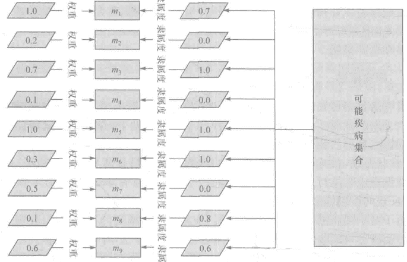 $$i = \frac{\sum_{k=1}^9 v_k}{9}\quad (9.2.3)$$*


**图 9.2.1 各指标隶属度与权重分配**

标准联系数公式升级为加权版：
$$\mu_{(A,B)} = \frac{\sum_{k=1}^{r} w_k}{m} + \frac{\sum_{k=r+1}^{s} w_k}{m}i + \frac{\sum_{k=s+1}^{m} w_k}{m}j \quad (9.2.2)$$
*   $m$：标准集合B长度(此处为9)
*   三项分别对应：隶属度1(同)、隶属度(0,1)(异)、隶属度0(反)的权重和
*   $i \in [-1,1]$ 量化“异度”，因存在模糊匹配，采用特定公式计算 $$i = \frac{\sum_{k=1}^9 v_k}{9}\quad (9.2.3)$$
*   $j = -1$ 量化“反度”

$$i = \frac{\sum_{k=1}^9 v_k}{9}\quad (9.2.3)$$

**实战数值代入**：
$A=\{m_1,m_3,m_5,m_6,m_8,m_9\}, B=\{m_1...m_9\}$
$$\mu_{(A,B)} = \frac{2}{9} + \frac{1.7}{9}i + \frac{0.8}{9}j$$
利用隶属度算得 $i = 5.1/9$，联系数 $\mu = 0.2403$。
理论最大联系数 $\max\mu = 4.5/9 = 0.5$。
**匹配成功概率(准确度) $P = 0.2403 / 0.5 = 0.4807$**。

**3. 结果判读与系统响应**
$0.4807 < 0.5$ → 判定为**“疑诊”**。
*原因*：病症消长、个体差异、症状非同步显现导致匹配受阻。
兽医诊断分四级：确诊 > 初诊 > 疑诊 > 待诊。系统据此自动分流：
*   确诊 → 防治模块
*   初诊/疑诊 → 图片诊断模块
*   待诊 → 实验室检测模块

#### 专家视角简评：理论潜力待深挖
畜禽业关乎民生，“听不懂畜禽语”致使诊疗难。从国外早期探索到国内数十系统落地，猪病诊断已趋成熟。徐/傅系统融合双理论开新径，但细节仍可打磨：
*   **联系数深层分析缺失**：实例中联系数 $\mu = 0.22 + 0.19i + 0.09j$ (系数和)。同异反势表显示 $a=0.22 > b=0.19 > c=0.09$，属**“同势一级·强势匹配”**趋势。
*   **为何前值仅0.48？** 因公式(9.2.3)强行固定 $i$ 为单一确定值。按不确定性原理，$i$ 应在 $[-1,1]$ 区间动态取值以适配多场景，**动态化处理 $i$ 才是提升可信度的关键**。

---

### 实战案例二：进出口食品安全监管专家系统——风险分级的“量化裁判”

食品安全无小事。徐超团队依托国检、省、市三级重大项目，引入集对分析重构风险评价体系，破解传统监管“低效、无据”困局。

#### 系统架构：双引擎驱动决策
1.  **风险评价模型**：建指标体系 → 层次分析法(AHP)定权 → 集对分析量化评价。
2.  **专家系统核心**：知识库/推理机设计 → 实现风险动态转换、抽检分级自动化。
3.  **技术落地**：J2EE + MVC 架构，完成全栈开发部署。

#### 核心看点：活鲈鱼出口铅污染风险实战推演

**步骤1：定性指标专家打分 → 算联系数**
10位专家对“严重等级”、“社会关注度”、“国外技术要求”三指标评级(L/M/H/HH/HHH)：
*   $\mu_1$(严重) $= 0.1i_2 + 0.8i_3 + 0.1j$
*   $\mu_2$(关注) $= 0.1i_2 + 0.1i_3 + 0.8j$
*   $\mu_3$(国外标准) $= 0.8i_1 + 0.2i_2$

**步骤2：定量指标实测数据 → 算联系数**
依据风险等级区间表(如H级对应10%-20%)：
*   铅发生概率 0.28 → $\mu_4 = 0.1i_2 + 0.5i_3 + 0.4j$
*   不合格率 0.07 → $\mu_5 = 0.17 + 0.5i_1 + 0.33i_2$

**步骤3：多级权重聚合 → 算单项联系度**
引入四级权重表(见原文表9.3.3)，铅指标综合联系度：
$$\mu_{铅} = 0.0765 + 0.2810i_1 + 0.2105i_2 + 0.2590i_3 + 0.1730j \quad (9.3.6)$$

**步骤4：置信度阈值裁决 → 定风险等级**
置信因子设为 0.55 (平衡效率与可靠)。
*   **铅指标**：同度+一级异度系数和 $0.0765+0.281+0.2105 = 0.568 > 0.55$ → **H级(高风险)**。
*   **汞指标**：$\mu_{汞} = 0.54 + 0.33i_1 + ...$ → 同度极高 → 低风险。
*   **重金属综合**(铅汞各0.5权重)：
    $\mu_{重金属} = 0.308 + 0.306i_1 + ...$ → $0.308+0.306=0.614 > 0.55$ → **C级(中风险)**。

**步骤5：全维度汇总 → 出具最终通关建议**
汇总所有二级指标(农残、添加剂、微生物等)风险等级表(表9.3.4)：
活鲈鱼综合联系度 $\mu = 0.432 + 0.370i_1 + ...$
$0.432 + 0.370 = 0.802 \gg 0.55$ → **最终定级：M级(中风险)**。
**验证**：结论与监管部门历史决策完全吻合。

---

### 写在最后

从猪病诊断的“正反推理闭环”，到食品监管的“多级聚合裁决”，集对分析展现了处理**复杂系统、模糊边界、多源不确定性**的独特威力。它不只是数学工具，更是重构专家系统认知范式的利器。未来，如何将这三大原理从“局部点缀”推向“全局重构”，才是智能系统进化的必答题。

> *参考文献及完整数学推导细节请见原著章节及文献[1][2][3]。*

## 进出口食品风险评定：综合视角下的隐性隐患

在进出口食品安全监管专家系统中，综合风险评定是核心环节。虽采用集对分析的多元联系数进行评价逻辑清晰，但将多维指标压缩为单一数值时，原有的结构特征必然消失。因此，决策时必须补齐这层信息。以表 9.3.4 为例，活鲈鱼的农兽药残留、添加剂、生物毒素等项虽处超高或高风险，因权重较低，在综合计算中被高权重指标稀释，最终呈现为中等风险。换言之，看似平稳的 “M（中风险）” 结论内部，实则可能暗藏 “高风险（L、H、HH、HHH）” 子项。这正是 9.1 节三大原理的实证：成对原理揭示整体与部分并存；同异反原理说明同级结论下子指标风险迥异；不确定性原理指出处置原则多元（文中采用置信度，实则可选极值、效用等）。监管部门除关注宏观结论，更需警惕局部高风险指标的潜在危害。联系数伴随函数、异反态势函数等工具已提供分析手段，专家系统应配套建模块处理此类场景，详见文献 [3]。

更多细节请参考文献 [3]。

## 9.4 集对分析赋能大豆病虫害诊断系统

大豆紫斑病为常见病害。卞世晖 [4] 引入集对分析不确定性推理，改造安徽霍丘农垦农科所自研诊断系统，显著降低误判率，详情如下。

### 9.4.1 病害特征与防治常识

**典型症状：**
*   种子种皮现浅紫至暗紫斑，轻度时种脐周围放射状分布，重度则大面积甚至全皮变紫。
*   病种皮失去光泽，质地粗糙并伴随裂纹。
*   成荚期荚果生灰黑色近圆形或不规则斑点。
*   发病期叶片先现圆形紫红斑，后扩大为不规则褐斑，叶面附灰黑霉层与黑色小点。

**防治措施：**
*   播种前选抗病品种、无菌种子，从源头降低发病概率。
*   强化田间管理，合理密植，及时排水沟渠，抑制生长期发病。
*   生长期药剂干预：花后喷施 50%多菌灵可湿性粉剂 1000 倍液、70%甲基托布津可湿性粉剂 1000 倍液、50%苯甲特可湿性粉剂 2000 倍液。

诊断前，用户通常已掌握：种皮带浅紫斑且裂纹；生长期叶面曾现圆形紫红斑及少量黑点。据此可初判患病。

早期系统沿用简易可信度模型，仅支持用户输入与知识库 **精确匹配**，导致实战频繁误诊。卞世晖团队植入集对分析不确定性推理模型重构推理核心，大幅压降误诊率。

### 9.4.2 基于联系度的不确定性推理重构

#### (1) 知识库表达范式革新
设知识 $E$，用联系度表征证据：$E:\mu_E=a_E+b_Ei+c_Ej$。
其中 $a_E$ 量化真度（1 为绝对真），$c_E$ 量化假度（1 为绝对假），$b_E$ 反映证据可信度的未定程度。

同理，将原可信度规则 $R:E \rightarrow H \text{ IF } E \text{ THEN } H (\text{CF}(H,E))$ 转述为 $\mu_H=a_R+b_Ri+c_Rj$。
$a_R$ 为前提真时结论真度，$c_R$ 为前提假时结论真度，$b_R$ 为前提出现时规则认知的盲区。不确定因子 $i \in [-1,1]$，对立因子 $j=-1$。

联系度表达的优势在于兼容概率与模糊双重不确定性：$i=0$ 时退化为概率信息；$j=0$ 时处理模糊信息。现实问题常随机模糊交织，卞世晖等将 $j$ 取值域拓展至 $[-1,0]$，引入灵活度，兼顾推理精度与效率。

#### (2) 三大推理机制实战对测
将相同用户症状分别输入三类系统诊断。

*   **可信度机制系统**：输出大豆灰斑病、紫斑病双结果。经背景知识核验，结论基本可靠，给出防治方案与科普。
*   **标准集对分析机制系统**：输出紫斑病、叶斑病。核验结果更优，**首选诊断即为紫斑病**，防治方案更科学，知识库覆盖更全。
*   **改进型集对分析机制系统（$j \in [-1,0]$）**：同样给出紫斑病、叶斑病，结论精准，方案与知识库均完善。

**推理耗时对比（表 9.4.1）：**

| 机制类型 | 耗时 (ms) |
| :--- | :---: |
| 可信度不确定性推理 | 30074 |
| 标准集对分析不确定性推理 | 30157 |
| **改进型集对分析不确定性推理** | **30069** |

数据显示：可信度机制最快，标准集对分析稍慢，但 **改进型机制反超前两者，实现精度与速度双赢**。

### 9.4.3 评析
专家系统擅攻常规算法难题，但非一劳永逸，需持续迭代。本节虽为简例，却实证了集对分析不确定性推理改造存量系统的巨大潜力。前序章节理论体系的演进，更为其在专家系统落地拓宽了路径。

详见文献 [4]。

## 9.5 集对分析耦合粗集：破解故障诊断规则瓶颈

董卫华等 [5] 融合集对分析与粗集理论，攻克专家系统规则抽取与过滤难关，创立新规则提取范式，应用于故障诊断推理设计。

### 9.5.1 研究背景
专家系统诊断是故障领域核心智能技术，但数据库应用长期局限于知识库管理层面。董卫华团队结合装备故障智能诊断系统开发，探究数据挖掘技术在知识自动获取、推理机轻量化设计上的可行性。通过双理论耦合，从数据中挖掘隐性、未知、高决策价值的规则，填补故障诊断系统在知识获取与推理上的短板。

### 9.5.2 规则提取算法与落地流程
先生成潜在规则，再提取入库。步骤如下：

1.  设对象集 $U(i=1\sim m)$，条件属性集 $C(j=1\sim n)$，决策属性集 $D$。
2.  确定各条件属性隶属函数与语言变量取值。
3.  双重循环 ($i=1$ 到 $m, j=1$ 到 $n$) 转化对象条件属性值：

```
\frac{f_{j1}^i}{R_{j1}} + \frac{f_{j2}^i}{R_{j2}} + ... + \frac{f_{jl}^i}{R_{jl}}
\quad (9.5.1)
```

式中 $R_{jk}$ 为条件属性 $A_j$ 第 $k$ 个模糊区域；$f_{jk}$ 为对象 $u_i$ 在 $R_{jk}$ 中的隶属度；$I=|A_j|$ 为 $A_j$ 语言变量数。原始数据表由此转为带隶属度的决策表。

4.  依最大隶属度法，取  

$$f_{jk}=\max(f_{j1}^i, f_{j2}^i, \cdots, f_{jl}^i), l < k < L$$ (9.5.2)  

获取新表。

5.  引入粗集联系度简化决策表。具条件/决策属性的知识表达系统称决策表，记 $T=(U, C, D, V_a)$，$U$ 为全集，$C,D$ 分别为条件/决策属性，$V_a$ 为属性值域。每决策表存在同异型集合联系度：  

$$\mu_c(d)=POS_c(d)+BN_c(d)i$$ (9.5.3)

可唯一分解为两决策表：  

$$T_1=(u_1, c_1, d_1, v_{d1})$$ (9.5.4)  
$$T_2=(u_2, c_2, d_2, v_{d2})$$ (9.5.5)

式中 $u_1=POS_c(d), u_2=BN_c(d)$。粗集数值联系度为：  

$$\mu_c(d)=a+bi=\frac{k(POS_c(d))}{k(u)}+\frac{k(BN_c(d))}{k(u)}i$$ (9.5.6)

若 $a=1, b=0$，决策表相容；若 $b \neq 0$，可分相容表 $T_1$ 与不相容表 $T_2$，对应确定规则表与不确定规则表。

6.  针对相容表 $T_1$，约简决策规则（属性值精简）。设属性子集：  

$$C_j^i=\{C_j|j=1,2,\cdots,n,C_j \in C\}$$ (9.5.7)

满足规则 $Fi$ 对结果属性集联系度为  

$$\mu_{c_k}(d)=a+bi+cj=POS_c(x)+bn_c(x)i+neg_c(x)j$$ (9.5.8)  

由 $c_k$ 属性值组成的属性集对决策集联系度非空正域即得该规则最小属性简化。

7.  列举不相容表 $T_2$ 条件属性等价类，给出模糊等价类矩阵，求对应模糊等价类 $C^c(d)$。

8.  令  

$$E_p=C^c(d) \cap (u/\text{ind}(d)), 1 \leqslant p \leqslant |C^c(d)|$$ (9.5.9)  

定义 $E_p^c$ 选择函数为  

$$F(E_p^c)=\sum_{k=1}^{|E_p^d|}\frac{\min(f_j)}{\sum_{j=1}^n f_j} \times \frac{E_p^d}{|u/\text{ind}(d)|}, 1 \leqslant d \leqslant |E_p^c|$$ (9.5.10)

式中 $f_j$ 为 $C'(d)$ 对应模糊区间值；$|U/\text{ind}(d)|$ 为 $E_p^c$ 所在决策等价类基数。

9.  比较 $C'(d)$ 中 $F(E_p^c)$ 大小，取最大者为最终决策，输出置信度。

10. 表 9.5.1 为算法产出的规则样例。

按统一格式将规则 IF 条件与 THEN 结论存入诊断规则库（知识库留存）；诊断结论按运行参数格式与故障代码存入故障案例库（支撑后续挖掘）。

关键在于：规则由控制器按标准格式自动生成入库，规避了专家直接传授的复杂性与不确定性，一定程度上突破了知识获取 “瓶颈”。

#### 表 9.5.1 新版数据库规则样例

| 编号 | 规则描述 | 置信度 |
| :--- | :--- | :---: |
| R(1) | IF S(1),S(3) THEN F(1) | 0.7 |
| R(2) | IF S(1) THEN F(2) | 0.5 |
| R(3) | IF S(2),S(3) THEN F(3) | 0.9 |
| R(4) | IF S(2),S(4) THEN F(4) | 0.8 |
| R(5) | IF S(2),S(5) THEN F(5) | 0.6 |
| R(6) | IF S(3) THEN F(6) | 0.5 |
| R(7) | IF S(4) THEN F(7) | 0.6 |
| R(8) | IF S(5) THEN F(8) | 0.8 |

### 9.5.3 评析
粗集虽擅处理知识不确定性，但缺代数表达，难形式化不确定性，此与集对分析互补。利用联系数中同异反分量（特别是 $i$），将不确定性显性化，得出新提取法。但样例仍沿用标量置信度（如 0.7），可进化：**置信度联系数化**，如 $0.7 \to 0.7+0.3i$，再融合新信息或经验赋值 $i$，构造动态规则可信度，进一步提升推理精度。

## 9.6 章末综述

自 60 年代首代专家系统问世至今，万千系统服役各界，不确定性推理始终是核心硬骨头。集对分析秉持 “客观承认、系统描述、定量刻画、具体分析” 方针，可多维度赋能专家系统知识储备与信息处理，尤擅改良推理模型与机制。本章举四例为证，有志者可查阅更多文献，亦可结合专业探索创新应用。

然站在第 3 章智脑系统视角，传统专家系统无论概念或实践，皆面临代际跃迁压力。网络与云计算使任一系统均可化身终端，大数据倒逼知识库持续扩容、算力与处理能力同步升级，转型智脑系统成必然。当万千系统完成智脑化改造并互联互通，新一代 AI 倡导的社会计算将变为现实社会资源，智能社会将加速到来。

## 参考文献

- [1] 赵克勤. 基于集对分析的不确定性系统理论在 AI 中应用[J]. 智能系统学报, 1996, 1(2): 16-25.
- [2] 徐峰. 猪病诊断专家系统研究[D]. 北京：中国农业大学硕士学位论文, 2005.
- [3] 徐超. 进出口食品安全监管中风险评价和专家系统的研究[D]. 杭州：浙江大学硕士学位论文, 2013.
- [4] 卞世晖. 专家系统中不确定性推理的研究与应用[D]. 合肥：安徽大学硕士学位论文, 2010: 1-50.
- [5] 董卫华, 张政保. 数据挖掘及数据库技术在故障诊断专家系统中的应用[J]. 河北省科学院学报, 2006, 23(4): 20-23.

# 第 10 章 集对分析与神经网络深度融合及应用

神经网络（ANN）系模仿生物神经网络特性、实施网络式信息处理的数学模型。其依托拓扑结构，通过迭代调节海量节点间连接权值与算法达成信息处理；复杂 ANN 具备自学习与自适应特质。研究证实，将集对分析融入 ANN 设计与应用，能显著增强其处理相关信息的能力与质量。

## 10.1 核心原理

### 10.1.1 神经元建模与基础特性

神经元源于对生物脑神经网络的观察与抽象，是 ANN 基础单元，其架构与计算原理见图 10.1.1 [1]。

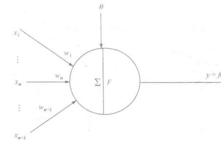

图 10.1.1 神经元模型

神经元计算公式如下：

$$y = f(\sum_{n+k}^{n+k} x_n + kw_{n+k} - \theta)$$ (10.1.1)

# 10.1 神经元模型与人工神经网络基础

### 10.1.1 神经元的基本构成与运算流程

如图 10.1.1 所示，一个神经元单元包含多路输入信号（\(x_1, x_2, \cdots, x_n, \cdots, x_{n+k}\)）与单一输出信号 \(Y\)。信息从输入到输出需历经三大核心计算环节：首先，对每路输入施加权重系数完成加权运算；其次，将 \(n+k\) 路加权结果进行“综合”处理（图中求和符号 \(\sum\) 仅为综合方式的一种典例）；最后，对综合值执行非线性变换，包含与阈值 \(\theta\) 的比较判决等逻辑，详见式(10.1.1)。需注意，式(10.1.1)仅演示了加权代数和的形式且权重之和归一。考虑到工程落地需求，神经元输出函数 \(y\) 通常选用二值函数（式10.1.2）或 S 型函数（式10.1.3）。

$$f_X = \begin{cases} X \geqslant X \\ X < X \end{cases} \quad (10.1.2)$$

$$f(x) = \frac{1}{1+e^{-ax}}, \quad 0 < f(x) < 1 \quad (10.1.3)$$

### 10.1.2 人工神经网络：定义与数学特征

人工神经网络（ANN）源于对人脑神经网络（估计含千亿级神经元）的模仿，本质是一种数学模型。从拓扑结构视角审视，它是一个具备以下四大特性的有向图：
1.  **节点状态**：每个节点 \(P\) 均持有一个状态变量 \(X\)；
2.  **连接权重**：节点 \(P\) 指向节点 \(Q\) 附带连接权重 \(W_{PQ}\)；
3.  **激活阈值**：各节点 \(P\) 设定专属阈值 \(\theta\)；
4.  **传递函数**：节点 \(P\) 定义变换函数 \(f_p(x_q, w_{pq}, \theta_p) (p \neq q)\)，通用形式参考式(10.1.1)。

### 10.1.3 算法学习：技能习得的核心机制

ANN 结构主要分为带反馈的递归网络与无反馈的前向网络，无论哪类，均需通过“算法训练”习得处理特定信息的能力。主流学习范式分三类：
*   **有师学习（监督学习）**：预设目标输出或期望值，网络依据实际输出与目标的偏差反向调整参数。
*   **无师学习（非监督/自组织学习）**：无预设目标，网络仅凭输入数据自适应调整权值与拓扑，自发输出结果。
*   **混合强化学习**：融合上述两类，但本质仍归属于有师学习范畴[2]。

### 10.1.4 集对分析视角下的 ANN 本质解析

基于集对分析（SPA）的“成对、同异反、不确定性”三大原理，可深度剖析 ANN 与生物神经网络的本质差异：

**一、 模仿与被模仿的集对：同异反不确定性共存**
人工神经网络与人脑神经网络构成一组集对。人脑智能机制涵盖物理、化学、数学、哲学、艺术乃至心理病态等多维度，认知尚浅。ANN 仅从数理层面部分模拟，**同一度极低**。这解释了 ANN 诸多短板：难以呈现生理刺激响应、无法自生灵感、难处理非数字信息。用“同异反”语言描述，二者在**系统活性上呈“反”关系**——前者无活性，后者为生命体。虽有研究试图赋予机器情感与活性以无限逼近人脑，但能逼近至何种程度，当前属**不确定性关系**。综上，二者呈“同异反不确定”综合关系。

**二、 计算与分析的集对：能力边界与互补**
ANN 擅长“计算”，人脑擅长“分析”。人脑增强计算靠专业训练；ANN 想增强分析却难靠简单学习，因其“分析”本质仍是“计算”。破局路径在于**融合集对分析（人机交互）**，实现计算结果与分析洞见的双重产出。

**三、 结构与功能的集对：复杂度决定上限**
人脑结构融合物理、生理、化学及其耦合作用，远比 ANN 复杂，从而支撑更强大、丰富的信息处理功能。推知，基于人脑“结构-功能”集对的特征函数，复杂度将显著高于 ANN 对应函数。

**启示**：ANN 改进可借鉴 SPA“确定性计算与不确定性分析结合”思路；且社会化 ANN 可视为大脑网络的“外化”，是极具潜力的研究方向。

---

# 10.2 SPA-ANN 耦合模型在年径流预测中的实战

李佳等[4] 构建集对分析（SPA）与人工神经网络（ANN）耦合模型（SPA-ANN），用于年径流预报，并对标单纯 ANN 与最近邻抽样回归模型，验证优势。

### 10.2.1 问题背景与耦合动因

年径流受气象、地理、流域特性等多因子非线性耦合影响，预测极具挑战。现有手段涵盖成因分析法、统计法（多元回归、随机分析、灰色理论、混沌理论、小波分析等），各有建树。
**SPA-ANN 耦合逻辑**：吸纳 ANN 非线性逼近强项，释放 SPA 信息全面、物理意义清晰、计算便捷的优势，**精准修补 ANN “参数黑箱、结果不可解释” 的痛点**。实测表明，该模型精度更高、结论更稳健。

### 10.2.2 模型架构：BP 网络与集对筛选的协同

预测常用反向传播（BP）神经网络。其拓扑特征：分层传递（仅收前层输入、传后层）、多入单出、输入层纯传递。核心算法：**误差反向传播修正权阈**，直至收敛。

典型三层 BP 结构（图 10.2.1）：输入层 A（\(n\)节点）、隐层 B（\(p\)节点）、输出层 C（\(m\)节点）。样本量 \(N\)。层间权重分别为 \(w_{ji}\) (A→B)、\(v_{ji}\) (B→C)；阈值分别为 \(b_i\) (B层)、\(c_i\) (C层)。

**径流建模逻辑**：
已知序列 \(\{X_t\}_n\)，\(X_t\) 依赖前 \(P\) 期历史值。构造径流集合 \(A_t = (X_{t-p}, \cdots, X_{t-1})\)，维数 \(p\)，后续值 \(X_t\)。共得 \(n-p+1\) 个集合。
预测 \(X_{n+1}\) 时，取最新集合 \(B\) 与历史集合 \(A_t\) 组成 \(n-p\) 个**集对**。依据同一性、差异性、对立性计算联系度 \(\mu(A_t \sim B)\)。联系度越大，对应后续值 \(X_t\) 与待测值相似概率越高。若联系度并列，取时间距离最近者。
最终筛选出联系度最大的 **K 个** 集合对应的后续值 \(X_t\)，作为 BP 网络输入层特征，输出即为预测值。

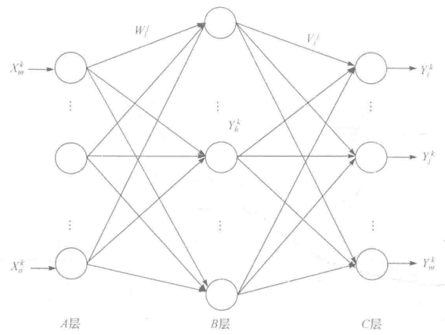

### 10.2.3 标准化建模流程（17 步走）

1.  **构造集合**：设维数 \(p\)，资料长 \(n\)，生成 \(n-p+1\) 个径流集合。当前集合 \(B\) 与其余 \(A_i\) 组对。
2.  **集对三分析**：逐对计算联系度。判据：误差 \(<20\%\) 视为“同”；误差 \(>x\% (x>20)\) 视为“反”；介于两者间为“异”。
3.  **联系度排序**：降序排列，值大者与当前态势更近。
4.  **确定输入**：取前 \(K\) 个集合的后续值，作为 BP 网络 A 层输入。
5.  **参数初始化**：权重 \(w_{ji}, v_{ji}\) 与阈值 \(b_i, c_i\) 在 \((-1,1)\) 随机赋值。
6.  **隐层前向计算**：输出 \(B_i^k\) 由 $$B_i^k = f(\sum_{j=1}^n W_j X_j^k + b_i), \quad i = 1, 2, \cdots, p$$ (10.2.1) 给定，激活函数用 Sigmoid，\(X_j^k\) 为输入层第 \(j\) 节点值。
7.  **输出层前向计算**：输出 \(Y_j^k\) 见 $$Y_j^k = f(\sum_{i=1}^p V_i B_i^k), \quad i = 1, 2, \cdots, m$$ (10.2.2)。
8.  **误差评估**：计算 C 层误差 \(E_j^k\)，见 $$E_j^k = \sum_{k=1}^N K_j^k$$ (10.2.3)。\(V_i^k\) 为期望输出，\(E_j\) 为样本累计误差，\(N\) 为样本总数。
9.  **隐层误差反传**：调整 B 层单元相关误差，见 $$\varphi_i^k = B_i^k (1 - B_i^k) \sum_{j=1}^m V_i E_j^k, \quad i = 1, 2, \cdots, p$$ (10.2.4)。
10. **B-C 权修正**：更新 \(v_{ji}\)，见 $$\Delta_k V_i^j = a B_i^k E_j^k, \quad i = 1, 2, \cdots, p, \quad j = 1, 2, \cdots, m$$ $$\Delta V_i^j = \sum_{k=1}^N \Delta_k V_i^j$$ (10.2.5) $$V_i^j (t+1) = V_i^j (t) + \Delta V_i^j$$。\(t\) 为迭代轮次。
11. **C 层阈值修正**：更新 \(c_i\)，见 $$\Delta_k c_j = a E_j^k, \quad j = 1, 2, \cdots, m$$ $$\Delta c_j = \sum_{k=1}^N \Delta_k c_j$$ (10.2.6) $$c_j (t+1) = c_j (t) + \Delta c_j$$。
12. **A-B 权修正**：更新 \(w_{ji}\)，见 $$\Delta_k W_j^i = a X_i^k \varphi_i^k, \quad i = 1, 2, \cdots, n, \quad j = 1, 2, \cdots, p$$ $$\Delta W_j^i = \sum_{k=1}^N \Delta_k W_j^i$$ (10.2.7) $$W_j^i (t+1) = W_j^i (t) + \Delta W_j^i$$。
13. **B 层阈值修正**：更新 \(b_i\)，见 $$\Delta_k b_i = a \varphi_i^k, \quad i = 1, 2, \cdots, p$$ $$\Delta b_i = \sum_{k=1}^N \Delta_k b_i$$ (10.2.8) $$b_i (t+1) = b_i (t) + \Delta b_i$$。
14. **收敛判断**：若总误差 \(E < \varepsilon\) 停止，否则回步骤 6 循环。
15. **超参优化**：反复调整 \(p, x, K\) 直至精度达标。
16. **实战预测**：代入优化参数输出预报值。
17. **复盘校核**：预测值与实测值对比，为后续迭代提供依据。

### 10.2.4 实证检验：某水库 61 年数据验证

**数据与设定**：
*   基础库：1937-1997 年年均入库流量（61 年）。
*   训练集：1937-1990 年（54 年）。
*   **SPA-ANN 最优参数**：容许误差 \(x\%=25\%\)，维数 \(p=10\)，近邻数 \(K=5\)，隐层 10 节点，输出 1 节点，学习率 0.3，动量 0.9，迭代 2000 次，联系度参数 \(i=0.5, j=-1\)。
*   **对照模型**：
    *   单纯 BP：3 层，输入 5、隐 6、出 1，其余超参同 SPA-ANN。
    *   最近邻抽样回归：特征维数 5，近邻数 6。
*   **考核标准**：许可误差 = 多年变幅 × 20%。相对误差 = |预测-实测| / 多年变幅。单次误差 <20% 为合格。检验合格率 = 合格次数 / 总次数。
*   **验证期**：1991-1997 年（7 年）。

**结果对比（表 10.2.1 重构解读）**：

| 年份 | 实测 | **SPA-ANN** | | **纯 BP** | | **最近邻回归** | |
| :--- | :--- | :--- | :--- | :--- | :--- | :--- | :--- |
| | | 预测值 | 相对误差% | 预测值 | 相对误差% | 预测值 | 相对误差% |
| 1991 | 380 | 427 | **10.1** | 433 | 11.4 | 452 | 15.5 |
| 1992 | 538 | 450 | **-18.9** | 377 | 34.5 | 425 | -24.2 |
| 1993 | 524 | 450 | **-15.9** | 463 | -13.1 | 476 | -10.3 |
| 1994 | 442 | 435 | **-1.5** | 448 | 1.3 | 493 | 10.9 |
| 1995 | 470 | 417 | **-11.4** | 445 | -5.4 | 482 | 2.6 |
| 1996 | 381 | 384 | **0.6** | 395 | 3.0 | 477 | 20.6 |
| 1997 | 361 | 384 | **4.9** | 406 | 9.7 | 416 | 11.8 |
| **核心指标** | | **平均相对误差 9.0%** | | 11.2% | | 13.7% |
| | | **最大相对误差 18.9%** | | 34.5% | | 24.2% |
| | | **检验合格率 100%** | | 85.7% | | 71.4% |

**结论与反思**：
SPA-ANN 在**合格率、平均/最大误差**三大核心指标上**全面碾压**两基准模型，精度提升显著。
**局限性**：本质上仍是“以有限历史规律推未来”，若未来演变超出历史规律覆盖范围，模型将失效。
**改进方向**：
1.  引入**成对原理**，融合径流物理成因因子（气象、下垫面等）进耦合模型，强化外生变量解释力。
2.  运用**同异反原理**，对潜在反常场景及幅度预判，弥补单一数据驱动模型的盲区。

---

## 10.3 集对分析径向基函数神经网络预测模型

# 集对分析赋能神经网络：从年径流预测到凌汛评估的实战解析

### 10.3 SPA-RBFNN模型：融合不确定性分析与非线性映射的年径流预测新范式

陈晶等学者[5]创新性地将集对分析（SPA）与径向基函数神经网络（RBFNN）深度耦合，构建了SPA-RBFNN预测模型。该模型的核心逻辑在于：利用集对分析刻画时序数据中因子间的“同、异、反”联系度特征，将其作为神经网络的输入特征，借助RBFNN强大的非线性拟合能力实现高精度预测。以年径流预报为例，该模型结构清晰、流程规范、预测性能优异，具体技术路线如下。

#### 10.3.1 核心建模逻辑

SPA-RBFNN的建模思路可概括为“三步走”：**构对量联、特征入网、双优协同**。首先，依据集对分析原理，将时刻$t-1$与$t$的影响因子集构建为集对，量化计算联系度；其次，提取联系度中的同一度、差异度、对立度三维特征，联同$t-1$时刻实测值共同作为RBFNN的输入向量，以$t$时刻目标值为输出；最后，模型融合了SPA对系统相关性的精细剖析优势与RBFNN的通用函数逼近优势，从而显著提升预测鲁棒性。

#### 10.3.2 标准化建模流程

模型构建遵循四大标准化环节：

**环节一：时序集对构建**
将$t-1$时刻影响因子视为集合$A_{t-1}=(x_{1,t-1}, \dots, x_{m,t-1})$，$t$时刻视为$A_t=(x_{1,t}, \dots, x_{m,t})$。引入分级量化机制，依据业务需求将因子划分为三级（枯/中/丰，记为I/II/III）或五级（特枯至特丰，记为I至V），据此形成集对$H(A_{t-1}, A_t)$。

**环节二：联系度精算与归一化**
对照两时刻因子分级符号，定义“同”（符号相同）、“异”（相差一级）、“反”（相差二级）三种关系，统计对应个数$S, F, P$（$S+F+P=N$）。联系度定义为：
$$\mu = \frac{S}{N} + \frac{F}{N}i + \frac{P}{N}j$$
经归一化处理，得到同一度$a$、差异度$b$、对立度$c$，满足$a,b,c \in [0,1]$且$a+b+c=1$。

**环节三：RBFNN网络架构设计**
输入层节点数固定为4，向量为$X_t=(a_t, b_t, c_t, Y'_{t-1})$，其中$Y'_{t-1}$为$t-1$时刻归一化实测值；输出层节点数为1，即$t$时刻归一化预测值$Y'_t$；隐层节点数$K$待确定。高斯基函数形式为$\varphi_i(x)=\exp[-\|x_i-c_i\|^2/(2\sigma_i^2)]$，$c_i$为中心向量，$\sigma_i$为宽度参数。

**环节四：参数智能优化确定**
模型参数包括隐层节点数$I$、中心$C_i$、宽度$\sigma_i$、权重$w_i$。
*   **隐层结构与中心/宽度**：采用最近邻聚类思想。设定聚类半径$r$，遍历样本动态生成聚类中心，中心个数即为$I$；宽度$\sigma_i = d_i/\sqrt{2I}$，其中$d_i$为样本到最远中心的最大距离。
*   **连接权重**：引入粒子群算法（PSO）优化。目标函数为训练集均方误差最小化，设定惯性权重$u=0.4$，学习因子$c_1=c_2=2$，迭代上限500次，直到误差达标。

#### 10.3.3 实战验证：伊犁河雅马渡站年径流预报

**数据与预处理**
选取雅马渡站实测年径流($y_t$)为预测因子，4大影响因子涵盖：伊犁站冬春降雨量($X_1$)、欧亚纬向/经向环流指数($X_2, X_3$)、太阳射电流量($X_4$)。径流采用Min-Max归一化（区间[250, 500]）；影响因子按“均值±0.5标准差”三等分（I/II/III）。

**联系度特征提取**
按“同级=同、相邻级=异、隔级=反”规则，计算$t=2\sim23$各期联系度$(a_t, b_t, c_t)$，形成特征数据集（详见原表10.3.2）。

**模型训练与参数定型**
前18期($t=2\sim19$)为训练集，设聚类半径$r=0.2$。经PSO优化（73次迭代，误差$4.35\times10^{-3}$），确定隐层节点$I=12$，输出12组中心$C_i$、宽度$\sigma_i$（如0.248, 0.170...）及权重$w_i$（如0.309, 0.395...含负值）。

**预测对比与效能评估**
对1972~1975年进行实战预报，并对比纯RBFNN、SPA回归、模糊模式识别、门限回归四类基准模型。结果显示：
*   **本模型相对误差均控制在20%以内**（最大16.9%，最小-3.32%），稳定性最佳。
*   纯RBFNN误差波动大（最大38.3%），显著劣于本模型。
*   传统统计/模糊模型误差普遍偏高或波动明显。
结论：**SPA引入的联系度特征有效提炼了时序演变规律，显著增强了RBFNN的泛化能力与预测稳健性。**

---

### 10.4 集对分析评价体系：量化改进型BP网络凌汛开河预测精度

针对BP神经网络在凌汛开河日期预测中“评价主观、量化不足”的痛点，赵晓慎等[9]以黄河内蒙段三河河口站为工程背景，构建了一套“多策略改进+集对评价”的技术框架。

**模型改进矩阵**：分别引入粒子群算法（PSO）、遗传算法（GA）、小波分析（WA）三种机制优化BP网络，分别解决局部极值、参数寻优、信号去噪/特征提取问题，形成三个改进版预测模型。

**集对评价创新**：摒弃传统单一的平均相对误差法，构建集对分析评价模型。将预测值与实测值构建为集对，通过计算同、异、反联系度，从“趋势一致性、波动差异度、极端对立度”三维度全景刻画模型优劣。

**核心结论**：集对分析评价法能更合理、全面地反映模型真实预测效能，避免了单一误差指标掩盖系统性偏差的弊端，为凌汛预报模型的科学选型提供了量化依据。

### 10.4.1 模型评估的实操流程

**核心逻辑**  
依托集对分析理论，把凌汛开河日期的实测数据定义为基准集 $B_0$，将某款改进型 BP 神经网络的预测输出定义为对比集 $B_1$，二者构成集对 $H=(B_0,B_1)$。通过计算该集对的联系度 $\mu$，联系度数值越大，即判定模型预测性能越优。具体操作分三步走：

1.  **确架构、跑数据**：依据输入输出变量敲定改进 BP 网络的拓扑结构与超参数，完成数据预处理后送入模型推理，获得预测序列。
2.  **建集对、分等级**：以实测值与预测值配对构建集合与集对，依据两者的相对误差幅度，将集对内部元素划入同一性、差异性、对立性三大特征区间。
3.  **统特征、算联系度、选优模**：按上述标准统计三类特征的样本个数，代入式(1.3.7)求得联系度，横向对比各候选模型的 $\mu$ 值，锁定最优模型。完整技术路线见下图。

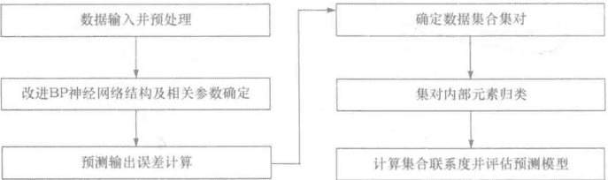

**图 10.4.1 改进神经网络模型评估技术路线图**

---

### 10.4.2 实战案例复盘

**例 10.4.1**  
选取黄河内蒙段三湖河口站 1968—1996 年的水位、累计正气温、流量、封冻期最大冰厚、开河历时等 5 维因子数据建库，前 29 年作训练样本，后 5 年留作测试验证。依据 Kolmogorov 定理确定三层 BP 网络拓扑为 4-6-1（隐层 6 神经元），设定迭代上限 500 次、学习率 0.05、目标误差趋近于 0。

**改进策略三板斧**：
*   **PSO-BP**：粒子群规模 200、迭代 50 代、惯性权重 1、加速因子 2/1.8、位置/速度边界 ±3/5，优化权值与阈值。
*   **GA-BP**：种群 200、进化 50 代、交叉率 0.2、变异率 0.05、编码范围 [-3,3]，同优化权阈。
*   **小波-BP**：引入 Morlet 小波基函数替代隐层传统激活函数。

**预测目标**：以开河历时为输出，其余四因子为输入。该站属中长期预报，按《水文情报预报规范》预见期 16 天，误差 ±4 天内视为合格。对比结果见下表。

**表 10.4.1 多模型预测对比表（单位：天）**

| 年份 | 实测 | PSO-BP | PSO误差 | GA-BP | GA误差 | 小波-BP | 小波误差 | 标准BP | BP误差 |
| :--- | :--- | :--- | :--- | :--- | :--- | :--- | :--- | :--- | :--- |
| 96-97 | 42 | 42 | 0 | 37 | 5 | 42 | 0 | 42 | 0 |
| 97-98 | 40 | 41 | 1 | 38 | 2 | 42 | 2 | 41 | 1 |
| 98-99 | 44 | 42 | 2 | 46 | 2 | 44 | 0 | 36 | 8 |
| 99-00 | 40 | 42 | 2 | 34 | 6 | 38 | 2 | 49 | 9 |
| 00-01 | 43 | 42 | 1 | 42 | 1 | 44 | 1 | 41 | 2 |

**合格率定性**：原版 BP 合格率 60%（丙等）；三改进模型均达 100%（甲等）。

**定量评估——集对分析视角**  
引入相对误差精度指标 $e^\wedge$ ```
\left\{\begin{array}{l} e(B_0(j) \cdot B_i(j)) = \frac{|B_0[j] : B_i[j]|}{B_0[j]} \times 100\\% \\ e^\wedge (B_0(j) \cdot B_i(j)) = 1 - \frac{1}{n} \sum_{j=1}^n e(B_0(j) \cdot B_i(j)) \\ i = 1, 2, 3, 4 \end{array}\right. \quad (10.4.1)
```，并设定三档分级阈值：相对误差 (0, 4%] 判“同一”（a），(4%, 8%] 判“差异”（b），[8%, +∞) 判“对立”（c）。代入联系度公式 ```
\left\{\begin{array}{l} \mu[B_0 \cdot B_1] = 0.6 + 0.4i + 0j \\ \mu[B_0 \cdot B_2] = 0.2 + 0.4i + 0.4j \\ \mu[B_0 \cdot B_3] = 0.6 + 0.4i + 0j \\ \mu[B_0 \cdot B_4] = 0.4 + 0.2i + 0.4j \end{array}\right. \quad (10.4.2)
```，取差异度系数 $i=0.5$，对立度系数 $j=-1$，得出下表核心指标。

**表 10.4.2 模型评估指标对比**

| 模型 | a (同一) | b (差异) | c (对立) | $\mu$ (联系度) | $e^\wedge$ (平均相对精度/%)
| :--- | :--- | :--- | :--- | :--- | :--- |
| **PSO-BP** | **0.60** | 0.20 | **0.00** | **0.80** | **97.13** |
| GA-BP | 0.20 | 0.20 | 0.40 | 0.00 | 92.24 |
| **小波-BP** | **0.60** | 0.20 | **0.00** | **0.80** | **97.53** |
| 标准BP | 0.40 | 0.10 | 0.40 | 0.10 | 90.43 |

**深度解读**：
1.  **双优模型**：PSO-BP 与 小波-BP 双指标领跑，$\mu=0.8$ 且精度超 97%，评估结论高度自洽。
2.  **GA-BP 的“矛盾”**：其精度虽比标准 BP 提升 1.81%，但 $\mu$ 反降 0.1。根因在于标准 BP 的同一性分量 a 是 GA-BP 的两倍，而 b、c 对 $\mu$ 拉动有限，揭示了单一精度指标易掩盖拟合分布细节的短板。
3.  **横向碾压文献[10]**：文献[10]模糊优化网络 $\mu=0.1, e^\wedge=91.79\%$；PSO/小波双模型全维碾压，GA-BP 精度微优 0.45% 但 $\mu$ 落后 0.1，标准 BP 精度低 1.36% 且 $\mu$ 持平。
4.  **灵敏度优势**：$\mu$ 动态范围 0→0.8，远大于 $e^\wedge$ 的 90.43%→97.53%，数值张力更强，更直观区分模型优劣。

**方法论启示**：集对分析将每个拟合单元纳入动态评估体系，优于静态平均精度法。后续可深化特征分级：如将“差异”细分为“偏同/偏反”构建四元联系数，或再增“临界态”形成五元联系数，有望进一步提升评估分辨率与预测精度。

---

## 10.5 章末综述与展望

人工神经网络（ANN）自 1943 年 McCulloch-Pitts 神经元模型诞生，历经数十载沉浮，仍是 AI 领域常青树。本章通过三个实例，系统演示了集对分析在 ANN 两大核心环节的赋能价值：**模型内核改造**（如权值优化、激活函数替换）与 **模型外部评估**（如预测效能定量排序）。

**前瞻视野——“脑集对”与“智脑”**  
随着互联网向“计算机社会化网络”演进，其拓扑与动力学特性与生物大脑神经网络呈现深度同构。二者耦合映射形成特定“脑集对”，第 3 章已将其定义为**“智脑”**。如何用集对分析形式化描述、优化这一“人脑-机网”共生系统，不仅是 AI 研究的新蓝海，更是破解大脑高效处理复杂信息机理的新钥匙——毕竟，外部算力网络可视为内部神经网络在硅基介质上的投影与延展。感兴趣的读者可检索相关前沿探索。

---

## 参考文献

- [1] 蔡自兴, 徐光佑. 人工智能及其应用[M]. 北京: 清华大学出版社, 2010: 144-157.
- [2] 钟义信. 高等人工智能原理·观念·模型[M]. 北京: 科学出版社, 2014: 312-344.
- [3] 赵克勤. 集对分析及其初步应用[M]. 杭州: 浙江科学技术出版社, 2000.
- [4] 李佳, 王黎, 马光文, 等. 基于 SPA-ANN 耦合模型的年径流预测[J]. 水力发电学报, 2009, 28(1): 41-44.
- [5] 陈晶, 王文圣, 李跃清. 集对分析径向基函数神经网络预测模型[J]. 水文, 2011, 31(2): 11-14.
- [6] 冯利华, 张行才, 龚建林. 基于集对分析的水资源变化趋势[J]. 水文, 2004, 24(2): 11-14.
- [7] 陈守煜. 中长期水文预报综合分析理论模式与方法[J]. 水利学报, 1997, 28(8): 15-24.
- [8] 金菊良, 杨晓华, 金保明, 等. 门限回归模型在年径流预测中的应用[J]. 冰川冻土, 2000, 22(3): 230-234.
- [9] 赵晓慎, 吴海波, 陈丹. 集对分析在改进 BP 神经网络凌汛开河日期预测评估中的应用[J]. 水电能源科学, 2011, 29(12): 101-104.
- [10] 陈守煜, 冀鸿兰. 冰凌预报模糊优选神经网络 BP 方法[J]. 水利学报, 2004, 25(6): 114-118.

---

# 第 11 章 集对分析在智能工程中的应用

智能工程涵盖智能技术、智能系统及其全生命周期设计、制造、运维管理。智能技术是基石；智能系统不止于技术堆叠，更具备知识库自生长、环境信息自感知、决策逻辑自进化能力。本质上，现存智能系统皆为**人机一体化系统**；其工程化落地即为智能工程。智能电网、智能交通、智能制造、智能育种等均为典型范式。本章精选集对分析在上述领域的阶段性创新成果。

## 11.1 理论基石

### 11.1.1 智能工程内涵再定义
工程本质是：基于特定价值诉求，融合科技手段，重组自然物质与能量，创造结构物/机器/系统及其运管过程。本书将**AI 原理/方法/技术**注入工程创新全链条所得产出，定义为**智能工程**，细分为智能电网、交通、制造、育种等专项工程。显而易见，智能工程包含三层递进内容：**智能技术（底座）→ 智能结构物/系统（载体）→ 设计/制造/建造/运维全周期管理（过程）**。

### 11.1.2 集对分析介入智能工程的原理逻辑
AI 核心方法论与智能技术天然伴随不确定性；工程实体制造运行全周期亦深陷不确定性泥沼。尤其实时工程场景，兼具“低耗高产、生态友好、决策敏捷、体验宜人”多目标约束。因此，**集对分析可作为贯穿智能工程各层级、各环节的不确定性处理通用算子**，靶向工程设计施工与运行效用的全局最优。

## 11.2 基于联系数的多传感器数据融合新范式 (1)

Jiang 等[1] 聚焦多传感器融合两大痛点：**可信度量化难** 与 **异构数据融合难**，创提出基于集对分析联系数的融合新算法。核心创新：引入同一度函数量化传感器互证强度 → 计算观测值与传感器特性函数同一度 → 最小最大法输出融合判决。**免去高斯分布先验假设**，仿真实证其能客观识别目标，开辟融合新径。详述如下。

### 11.2.1 问题背景与挑战
多传感器融合因“低成本、高可靠、强鲁棒”成工程共识与研究热点。但实战中：
1.  **分布假设失效**：传感器特征函数难服从高斯分布，低端传感器更甚 [2-6]。
2.  **目标先验缺失**：要求目标状态服从已知概率分布，实时环境下难满足、难验证 [6]。
3.  **数据相关性忽视**：多源数据常相关非独立，传统独立假设不成立。
4.  **非参数不确定性表达**：放弃分布假设后，如何数学化表达测量不确定性？

针对上述链条问题，本节构建**基于集对同一度与联系数的非参数融合新算法**。

### 11.2.2 融合算法三步走

**Step 1 —— 量化传感器互信强度**  
设第 $j,k$ 传感器 ($j \neq k$) 测得序列 $\{x_j\}, \{x_k\}$，均值 $\bar{x}_j, \bar{x}_k$，样本标准差 $\sigma_j, \sigma_k$ ```
\(\overline{x_j} = \frac{1}{n} \sum x_j \quad (11.2.1)\)
\(\overline{x_k} = \frac{1}{m} \sum x_k \quad (11.2.2)\)
``````
\(\sigma_j = \sqrt{\frac{1}{n-1} \sum (x_j - \overline{x_j})^2} \quad (11.2.3)\)
\(\sigma_k = \sqrt{\frac{1}{m-1} \sum (x_k - \overline{x_k})^2} \quad (11.2.4)\)
```。  
将测量数据封装为联系数形式 $$U_j=\overline{x_j}+\sigma_j$$ (11.2.5) $$U_k=\overline{x_k}+\sigma_k$$ (11.2.6)。  
定义两传感器**相互支持度**为其联系数的**同一度** $a(U_j, U_k)$ $$a(U_j, U_k)=\frac{\min(U_j, U_k)}{\max(U_j, U_k)}$$ (11.2.7)。

**Step 2 —— 传感器聚类分层**  
依同一度阈值将传感器群分三档 $$a(U_j, U_k) \begin{cases} >0.5, \\ >0 \& \leqslant 0.5, \\ \leqslant 0, \end{cases}$$：
*   **强互信（相融性好）**
*   **弱互信（相融性一般）**
*   **无互信（相融性差）**

**Step 3 —— 目标观测值与候选特性匹配度计算**  
$n$ 传感器测目标 $Z$ 的 $n$ 维指标，匹配 $m$ 个待识别目标。逐维计算观测指标 $Z_p (p=1\dots n)$ 与第 $j$ 目标特性联系数 $\bar{x}_{jp} + i\sigma_{jp} (j=1\dots m)$ 的同一度 $a(Z_p, \bar{x}_{jp} + i\sigma_{jp})$ $$a(Z_p, \overline{x}_{jp} + i\sigma_{jp})=\frac{\min(Z_p, \overline{x}_{jp} + i\sigma_{jp})}{\max(Z_p, \overline{x}_{jp} + i\sigma_{jp})}$$ (11.2.8)。  
汇聚生成 $n \times m$ **同一度矩阵** $H_{n \times m}$，为后续融合决策奠基。

$$H_{n \times m} = \begin{bmatrix} a(Z_1, \overline{x}_{11} + i\sigma_{11}) & \cdots & a(Z_1, \overline{x}_{m1} + i\sigma_{m1}) \\ \vdots & & \vdots \\ a(Z_n, \overline{x}_{1n} + i\sigma_{1n}) & \cdots & a(Z_n, \overline{x}_{mn} + i\sigma_{mn}) \end{bmatrix}$$ (11.2.9)

**第四步：目标识别决策判定。**

决策核心依据式(11.2.9)矩阵中表现为强相互支持的传感器组，所对应的同一度子矩阵 $R_{e \times f} (e \in n, f \in m)$。判定逻辑为：若第 $k$ 列的最小同一度数值大于其余所有列的最大同一度，则判定被观测目标 $Z$ 为物体 $k$；反之，则归为不确定类别。

### 11.2.3 实战案例：数据融合演示

为便于横向对比，沿用文献[2]～[4]的经典案例：4个传感器同步测量目标 $Z$，需辨别其属于物体 A、物体 B，还是其他未知物体。原始测量参数与数值详见表 11.2.1。

**表 11.2.1 测量参数与实测数值**

| 传感器 L | 物体 A \(\bar{x}_A\) | \(\sigma_A\) | 物体 B \(\bar{x}_B\) | \(\sigma_B\) | 实测值 Z |
|---|---|---|---|---|---|
| 1 | 243 | 35 | 270 | 60 | 257 |
| 2 | 0.5 | 0.1 | 0.4 | 0.1 | 0.55 |
| 3 | 30 | 4 | 40 | 9 | 28 |
| 4 | 27 | 1.2 | 21 | 3.6 | 29 |

**第一步：构建联系数表达。**
将表 11.2.1 的数据转化为联系数 $A+Bi$ 形式，生成表 11.2.2。

**表 11.2.2 联系数视角的测量参数与数值**

| 传感器 L | 物体 A | 物体 B | 实测值 Z |
|---|---|---|---|
| 1 | \(243+35i\) | \(270+60i\) | \(257+i\) |
| 2 | \(0.5+0.1i\) | \(0.4+0.1i\) | \(0.55+0i\) |
| 3 | \(30+4i\) | \(40+9i\) | \(28+0i\) |
| 4 | \(27+1.2i\) | \(21+3.6i\) | \(29+0i\) |

**第二步：两两计算传感器间关于物体 A、B 的同一度。**
结果汇总于表 11.2.3。

**表 11.2.3 任意两传感器间的同一度数值**

| 传感器组 | \(a_A\) | \(a_B\) |
|---|---|---|
| \(L_{12}\) | \((0.5+0.1i)/(243+35i)=0.0021+0.0001i\) | \((0.4+0.1i)/(270+60i)=0.0015+0i\) |
| \(L_{13}\) | \((30+4i)/(243+35i)=0.1235+0.0012i\) | \((40+9i)/(270+60i)=0.1481+0.0003i\) |
| \(L_{14}\) | \((27+1.2i)/(243+35i)=0.1111+0.0097i\) | \((21+3.6i)/(270+60i)=0.0778+0.0032i\) |
| \(L_{23}\) | \((0.5+0.1i)/(30+4i)=0.0167+0.0010i\) | \((0.4+0.1i)/(40+9i)=0.0100+0.0002i\) |
| \(L_{24}\) | \((0.5+0.1i)/(27+1.2i)=0.0185+0.0028i\) | \((0.4+0.1i)/(21+3.6i)=0.0190+0.0013i\) |
| \(L_{34}\) | \((27+1.2i)/(30+4i)=0.9+0.0706i\) | \((21+3.6i)/(40+9i)=0.5250+0.0230i\) |

**第三步：评估 4 个传感器的相互支持强度。**
观察表 11.2.3，令 $i = -1$。仅有 $L_{34}$ 组在物体 A 和 B 两维度上同一度均超 0.5，其余组虽大于 0 但均不足 0.5。由此锁定传感器 $L_3$ 与 $L_4$ 构成强相互支持组，作为目标识别的主决策传感器。

**第四步：计算实测值 Z 与物体 A、B 参数的同一度。**
详见表 11.2.4。

| 传感器组 $L$ | $a(Z, x_A)$ | $a(Z, x_B)$ |
|---|---|---|
| 1 | \((243+35i)/(257+0i) = 0.9455+0.1362i\) | \((257+0i)/(270+60i) = 0.9519+0.1731i\) |
| 2 | \((0.5+0.1i)/(0.55+0i) = 0.9091+0.1818i\) | \((0.4+0.1i)/(0.55+0i) = 0.7237+0.1818i\) |
| 3 | \((28+0i)/(30+4i) = 0.9333+0.1098i\) | \((28+0i)/(40+9i) = 0.7000+0.1286i\) |
| 4 | \((27+1.2i)/(29+0i) = 0.9310+0.0414i\) | \((21+3.6i)/(29+0i) = 0.7241+0.1241i\) |

**第五步：执行目标识别。**
基于表 11.2.4 构建主决策矩阵 $R_{e \times f}$（仅含 $L_3, L_4$）：

\[R_{e \times f} = \begin{bmatrix} 0.9333+0.1098i & 0.7000+0.1286i \\ 0.9310+0.0414i & 0.7241+0.1241i \end{bmatrix}\]

通过令不确定性标记 $i$ 取上下界（-1 与 1）进行假设检验：

*   **假设 1：目标为物体 A。**
    令 $a(Z, x_A)$ 中 $i=-1$，$a(Z, x_B)$ 中 $i=1$，得确定性矩阵：
    \[R^A_{e \times f} = \begin{bmatrix} 0.8235 & 0.8286 \\ 0.8896 & 0.8482 \end{bmatrix}\]
    列最小值 $\min(0.8235, 0.8896)=0.8235$ **小于** 列最大值 $\max(0.8286, 0.8482)=0.8482$，**假设不成立**。

*   **假设 2：目标为物体 B。**
    令 $a(Z, x_B)$ 中 $i=-1$，$a(Z, x_A)$ 中 $i=1$，得：
    \[R^B_{e \times f} = \begin{bmatrix} 1.0431 & 0.5714 \\ 0.9724 & 0.6000 \end{bmatrix}\]
    列最小值 $\min(0.5714, 0.6000)=0.5714$ **小于** 列最大值 $\max(1.0431, 0.9724)=1.0431$，**假设不成立**。

*   **假设 3：目标非 A 亦非 B。**
    综合上述，**假设 3 成立，判定目标 Z 为不明物体。**

该结论与文献[3]、[4]完全吻合。

### 11.2.4 深度研讨

1.  **溯源与对比：** 该案例始见于文献[2]。文献[2]用模糊理论融合，支持度排序为 A > 不明 > B；文献[3]用统计理论，结论为不明；文献[4]指出文献[3]不确定性大，改用相关性函数与模糊综合，结论仍为不明。
    **关键洞见：** 文献[3]、[4]均预设数据服从高斯分布。现实中，受传感器性能、环境、目标特性多重因素制约，数据极难严格满足高斯分布，且难以验证。集对分析引入联系数 $A+Bi$，将均值与波动打包表达，决策时通过 $i$ 取界量化不确定性影响，结果更客观可信。

2.  **主决策传感器组策略：** 传感器增多计算量激增，提取强支持组为主决策源是务实之举。将融合状况分为“相融性好/一般/较差”三级。实战中虽以“相融性好”组为主，但“一般”组信息不可弃。本例中融入 $L_1, L_2$ 结果不变。集对分析视角下，弱支持组与强支持组关系可细分为“同、异、反”：“同”即结论一致（如本例）；“异”指不一致，细分为微/大不一致；“反”指严重对立。遇“异”、“反”需溯源验证或增测。

3.  **同一度 vs 距离：** 文献[2]～[4]用“距离”，本节用“同一度”。同一度比距离更本质、简明地刻画数据关系。两实数同度为 1 必为同一数，此逻辑在联系数同度计算中同样适用，也是算法简明的内在动因。

4.  **理论优势与展望：** 集对分析建立在确定-不确定对立统一基座上，天然适配随机性、模糊性等混合不确定性。联系数用于多传感器融合，有效规避了主观假设与数据固有不确定性的干扰，适用于异构分布式系统。后续研究方向：多元联系数（同异反三元乃至多元）在分布式融合中的系统化应用，及与其他基于集对分析融合方法的协同机制。

## 11.3 基于联系数的多传感器数据融合（进阶篇）

王海颖等[8]针对**先验知识缺失、多传感器多轮检测同一目标特征**的场景，剖析测量不确定性成因，创设基于集对分析联系度的可靠性融合新法。该法利用特征函数优势，通过调整对立度、同一度、差异度重构数据关联，定义联系度矩阵，并借扩维技术度量跨时刻测值综合相近度，结合信噪比加权思想分配权重，实现加权融合。实例与仿真验证其精确性、可靠性与稳健性优势。

### 11.3.1 数对与 IDO 联系度

依集对分析[9][10]，**数对**指两实数构成的集对。数对 $[s,t]$ 的 IDO 联系度（三元联系数）$u$ 定义为：

$u=a+bi+cj=\frac{s}{t}+\frac{s}{t(t^2-1)}i+\frac{t^2-st-1}{t^2-1}j$ (11.3.1)

约束条件：$s,t \in [0,\infty)$ 且 $1 \leqslant s \leqslant t$。
$i$ 为差异度标记，取值于 $i \in [j, 1]$；
$j$ 为对立型关系数标记，视对立类型取值：
*   正负型对立：$j = -1$，此时 $i \in [-1, 1]$；
*   倒数型对立：$j = 1/R$（$R$ 为 $n$ 组数对中的最小值），此时 $i \in [1/R, 1]$。

### 11.3.2 联系度矩阵构建与扩维机制

设 $n$ 个相互独立、异位分布的传感器组成系统，测量同一参数 $x$。噪声先验未知，第 $i$ 传感器 $k$ 时刻观测方程：
$z_i(k)=x+v_i(k)，\quad i=1,2,\cdots,n$
$v_i(k)$ 为观测噪声，均值 $E[v_i]$ 与方差 $D[v_i]$ 均未知。

**核心逻辑：** $k$ 时刻传感器 $i,j$ 观测值 $z_i(k), z_j(k)$ 差距大 $\rightarrow$ 相互支持度低/不支持；数值接近 $\rightarrow$ 支持度高、真实性强。

为量化同一时刻观测值支持程度，引入联系度构造矩阵。假设 $z_i(k) \leqslant z_j(k)$，视为数对 $[z_i(k), z_j(k)]$，用三元联系数（同异反特征函数）量化关联，规避传统“非0即1”的绝对化缺陷，获得 $k$ 时刻联系度矩阵。

#### 定义 11.3.1 $k$ 时刻任意两传感器数据的联系度矩阵

$$U_n(k) = \begin{bmatrix} 1 & u_{12}(k) & \cdots & u_{1n}(k) \\ u_{21}(k) & 1 & \cdots & u_{2n}(k) \\ \vdots & \vdots & & \vdots \\ u_{n1}(k) & u_{n2}(k) & \cdots & 1 \end{bmatrix}$$ (11.3.2)

矩阵第 $i$ 行累加和 $\sum_{j=1}^n u_{ij}(k)$ 反映一致性：值大则该传感器观测值与多数接近、一致性好；值小则偏离大、可信度低。

上述矩阵仅捕捉单时刻横向关联。为强化时序融合相关性，引入**扩维联系度矩阵**：将前一时刻融合估计值作为“虚拟观测值”加入下一时刻计算。扩维后矩阵 $U_{n+1}(k)$ 为：

$$U_{n+1}(k) = \begin{bmatrix} 1 & \cdots & u_{1n}(k) & u_{(n+1)(k)} \\ \vdots & 1 & \ddots & \vdots \\ u_{n1}(k) & \cdots & \ddots & u_{n(n+1)}(k) \\ u_{(n+1)1}(k) & \cdots & u_{(n+1)n}(k) & 1 \end{bmatrix}$$ (11.3.3)

扩维矩阵融合了历史观测信息，映射出观测值在全区间的相互关联度。定义 1 未涵盖传感器 $i$ 与**全体**传感器（含自身）的联系度，需引入一致性测度。

#### 定义 11.3.2 $k$ 时刻传感器 $i$ 观测值与全体观测值的一致性测度

$$r_i(k) = \begin{cases} \sum_{j=1}^n s_{ij}(k)/n, & k=1 \\ \sum_{j=1}^{n+1} s_{ij}(k)/(n+1), & k \geqslant 2 \end{cases}$$ (11.3.4)

### 11.3.3 一致可靠性测度体系

全时刻一致性度量可深刻反映传感器可靠性。引入统计样本均值与方差，定义一致性均值与方差。

#### 定义 11.3.3 $k$ 时刻传感器 $i$ 观测一致性均值
\(\bar{r}_i(k) = \frac{1}{k} \sum_{t=1}^k r_i(t), \quad k \geqslant 2\) (11.3.5)

#### 定义 11.3.4 $k$ 时刻传感器 $i$ 观测一致性方差
\(\sigma_i^2(k) = \frac{1}{k} \sum_{t=1}^k [r_i(t) - \bar{r}_i(t)]^2\) (11.3.6)

为工程落地降算力，采用递推形式更新：

\(\bar{r}_i(k) = \frac{k-1}{k} \bar{r}_i(k-1) + \frac{1}{k} r_i(k)\)，\(\bar{r}_i(1) = r_i(1)\) (11.3.7)

\(\sigma_i^2(k) = \frac{k-1}{k} \left\{ \sigma_i^2(k-1) + \frac{1}{k-1} [r_i(k) - \bar{r}_i(k)]^2 \right\}\)，\(\sigma_i^2(1) = 0\) (11.3.8)

### 11.3.4 仿真实战：验证融合算法实效

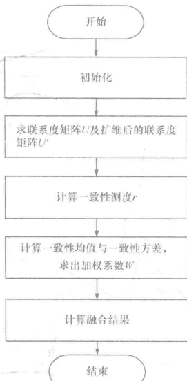

#### 算法流程速览

前文推导的完整融合逻辑，已浓缩为清晰的四步走流程（见算法流程图）：

1.  **构建联系度矩阵**：拿到传感器读数后，套用式(11.3.1)生成联系度矩阵 $U$，并扩维为 $U'$。
2.  **量化一致性测度**：依据式(11.3.4)，分时刻计算一致性测度 $r$。
3.  **确定归一化权重**：利用式(11.3.7)、(11.3.8)求出一致性均值与方差，按公式(11.3.9)算出初始权重 $w_i(k)$，再经式(11.3.10)归一化得到最终加权系数 $W_i(k)$。
4.  **输出融合估值**：代入式(11.3.11)完成最终融合。

**核心亮点**：引入集对分析三元联系数构建矩阵，精准刻画同一时刻多传感器观测值的相互支持度；权重分配兼顾了一致性与可靠性双重维度，决策更科学。

---

#### 实战数据对比

沿用文献[11]、[12]的经典实验数据：三个热电偶测恒温箱，真值 900°C，连测 6 轮（详见表 11.3.1）。将本文算法与平均融合法、文献[13]、[14]方法同台竞技，结果见表 11.3.2。

**关键发现**：
*   **前期发力强**：第 1、2、3、4 次测量中，本文算法融合值比均值法更贴近真值，绝对误差显著更低。
*   **抗干扰能力优**：第 1、4、5、6 次测量中，本文算法表现优于文献[13]、[14]。
*   **总账更漂亮**：表 11.3.3 总绝对误差对比一目了然——本文算法 **9.26**，完胜文献[14]（11.08）、文献[13]（12.37）及均值法（16.43）。

**结论**：三元联系数量化联系程度更精准；扩维矩阵融合了全时刻信息，实现了历史数据对后续融合权重的自适应修正。

> **待探讨点**：当 IDO 关系为倒数型对立（$j=1/R$）时，$R$ 取 $n$ 组关系数对的最小值。$R$ 的最优取值尚有研究空间，直接影响同一度与差异度的可信度。

---

### 11.4 集对分析赋能：工艺路线智能决策新范式

> 来源：李春磊等[15]研究成果，为智能制造工艺决策注入新思路。

#### 11.4.1 痛点与破局

工艺路线是制造业的“生命线”，直击质量、交期与效益。传统决策痛点显著：**缺经验积累、忽生产现状**，导致路线适用性差，频繁返工修改（两次起步）。

**破局思路**：双维度评价 + 集对分析决策。
1.  约束矩阵迭代 → 生成初始路线。
2.  匹配典型路线 → 量化**工艺设计经验**指标。
3.  分析产线网络稳定性 → 量化**制造稳定性**指标。
4.  集对分析融合双指标 → 产出最终最优路线。

实例证明：该法有效、好用。

---

#### 11.4.2 从零生成：初始工艺路线构建

**起点**：零件设计图 → 特征识别 → 加工特征集 $F = \{f_1, \dots, f_m\}$。

**链路**：特征加工链决策 → 确定工序集 $O_p$。为便分析，简化为有序工序集 $O_p = \{o_{p1}, \dots, o_{pk}\}$（$k$ 为总工序数）。

**关键约束**：原序列无序，需引入“先粗后精、基准先行”原则，建立 $k \times k$ 约束矩阵 $A$。元素 $a_{ij}=1$ 表示工序 $i$ 可先于 $j$，否则为 0。

**迭代求解核心逻辑**（矩阵乘法幂次展开）：
1.  初始化 $A^{(0)}=A, t=1$。
2.  迭代 $A^{(t+1)} = A A^{(t)}$。
3.  **去环**：对角线清零（排除循环路径）。
4.  **读路**：$A^{(t+1)}$ 中非零元素 $a_{ij}=L$，揭示从 $o_{pi}$ 到 $o_{pj}$、经 $t$ 道工序的 $L$ 条路径。
5.  终止条件 $t > k-2$ 时，$A^{(k-1)}$ 即含所有 $k$ 道工序的**初始工艺路线集**。

**去重精简**：同名同设备工序合并，保留最靠前位置，压缩路线数量。

---

#### 11.4.3 经验量化：基于典型路线的评价指标

典型工艺路线 $O_D = \{d_1, \dots, d_s\}$ 是同类零件的标准化沉淀，蕴含丰富经验。

**步骤 1：算优先级系数 $p(l_i)$**
初始路线 $O_l$ 逐工序与 $O_D$ 匹配。若工序 $l_i$ 对应 $O_D$ 中第 $j$ 位工序 $d_j$，则：
$$p(l_i) = \frac{s-j+1}{s}$$
（位置越靠前/越核心，系数越大；匹配不到则为 0）。

**步骤 2：算经验度量值 $\delta$ 并归一化**
$$\delta(O_{l_i}) = \sum p(l_i) \times (k-i)$$
权重 $(k-i)$ 体现位置敏感度。匹配度越高、核心工序位置越准，$\delta$ 越大。

归一化得经验指标：
$$r(O_{l_i}) = \frac{\delta(O_{l_i})}{\max(\delta(O_{l_1}), \dots, \delta(O_{l_r}))}$$
值域 $[0,1]$，便于后续融合。

---

#### 11.4.4 稳实量化：基于制造稳定性的评价指标

**1. 产线建模：有向加权网络 $G(V,E,W)$**
*   **节点 $V$**：制造单元（$n$ 个）。
*   **有向边 $E$**：工序前后关系映射的物流流向（含传送带/搬运系统）。
*   **权重 $W$**：制造单元复用次数。
*   **动态性**：设备增减、任务变更均可快速增删节点/叠加路线，实时反映物理拓扑。

**2. 初始路线插入机制：工序怎么分？**
*   **专机工序**：唯一制造单元，强制分配。
*   **通用工序**：多机可选 → 综合**负载**与**成本**打分。

**核心评价函数 $F$（式 11.4.8）：**
$$F = \frac{1}{L_i} + \frac{1}{T_{Ci}}$$
**越大越优**（负载越低、成本越小，得分越高）。

*   **负载 $L_i$**：节点入强度 $S_{in}^i$ 占总入强度比。反映当前“忙碌度”。
*   **加工成本 $T_C$**：
    *   原任务含该工序 → 成本极低（0.1）。
    *   新增工序 → $T_C = c_1Y_1 + c_2Y_2 + c_3Y_3 + 0.2$。
        *   $Y_1$：工人熟练度（0 会/1 不会），权重 $c_1=0.2$。
        *   $Y_2$：换刀具（0 否/1 是），权重 $c_2=0.4$（**核心侧重**）。
        *   $Y_3$：换夹具（0 否/1 是），权重 $c_3=0.2$。
        *   满足 $c_1+c_2+c_3=0.8$，可调侧重点。

**决策逻辑**：为每道可选工序在候选制造单元上算 $F$，高者胜出，构建稳定性指标体系。

## 核心逻辑：如何在复杂产线中精准落子工序？

依据公式（11.4.8）推演，工序 $l_i$ 落地到制造单元 $V_i$ 时，若加工成本更低、目标单元当前负载更轻，该分配方案的评价分值便越高。决策的核心在于权衡：在兼顾单元实时负荷与加工费用的前提下，直接锁定 F 值峰值对应的方案。待 $O_L$ 中所有工序逐一安置完毕，完整工艺路线便自然嵌入了当下的生产线网络。

---

### 三、 以“制造稳定性”为尺，建立评价新坐标

复杂网络理论揭示：拓扑结构变迁，系统脆性风险随之波动，稳定性自然不一。生产线网络的演化路径决定了，不同初始工艺路线的接入，将重塑网络拓扑。因此，**网络脆性测度值可直接化作评判工艺路线制造稳定性的量表**。

我们引入**混线生产网络脆性风险熵** $\rho(O_L)$ 作为核心指标。将每个制造单元 $V_i$ 视为独立子系统 $G_i$，插入工艺路线 $O_L$ 后的网络脆性风险熵定义为：

$$ \rho(O_L) = - \sum \left[ \frac{(\alpha \cdot L_i + \beta \cdot X_i) M(G_i)}{\sum (\alpha \cdot L_i + \beta \cdot X_i) M(G_i)} \right] \cdot \log(\alpha \cdot L_i + \beta \cdot X_i) \tag{11.4.9} $$

参数解码如下：
*   **负载率 $L_i$**：$S_{in} / \sum S_{in}$，即子系统 $G_i$ 节点入强度占总入强度的比重。
*   **故障概率 $X_i$**：假设 $G_i$ 面临 $t$ 类随机故障事件 $I = \{I_1, \dots, I_t\}$（如设备故障、刀具磨损），单事件概率为 $P_i$，则 $X_i = 1 - \prod (1 - P_i)$，表征系统“未雨绸缪”后的残余风险。
*   **影响权重 $M(G_i)$**：映射为聚类系数比值 $C_i / \sum C_i$，量化单元崩溃对全网的冲击半径。
*   **偏好系数 $\alpha, \beta$**：均属 $[0,1]$ 且 $\alpha+\beta=1$，用于调节计算时对“负载”与“故障”两维度的关注焦点。

---

### 11.4.5 集对分析视角下的工艺路线决策模型

#### 1) 构建决策矩阵：双维度量化备选路径
假设筛选出 $r$ 条满足工艺约束的初始路线。每条路线拥有两张“体检报告”：
*   **经验指标 $\gamma$**（正指标，越大越优）：源于工艺设计经验库。
*   **稳定性指标 $\rho$**（负指标，越小越优）：即上文定义的脆性风险熵。

由此构造基于同一度的决策矩阵 $Q$：
$$ Q = \begin{bmatrix} \gamma(O_{1}) & \rho(O_{1}) \\ \gamma(O_{2}) & \rho(O_{2}) \\ \vdots & \vdots \\ \gamma(O_{r}) & \rho(O_{r}) \end{bmatrix} \tag{11.4.10} $$

#### 2) 设定理想基准，计算“同一度”
理想方案 $O^+$ 取遍历 $r$ 条路线后的极值组合：$\gamma$ 取最大值 $\gamma^+$，$\rho$ 取最小值 $\rho^+$：
$$ O^+ = [\gamma^+, \rho^+] \tag{11.4.11} $$
将决策矩阵 $Q$ 与理想基准逐项比对，得同一度矩阵 $U$：
$$ U = \begin{bmatrix} u_{11} & u_{12} \\ u_{21} & u_{22} \\ \vdots & \vdots \\ u_{r1} & u_{r2} \end{bmatrix} \tag{11.4.12} $$
其中：
*   $u_{i1} = \gamma(O_i)/\gamma^+$：经验维度的贴合度。
*   $u_{i2} = \rho^+/\rho(O_i)$：稳定性维度的贴合度（因 $\rho$ 为负指标，故分子分母倒置）。

#### 3) 变异系数法赋权：让“差异大”者多发声
摒弃纯专家打分的主观赋权，**权重源于数据本身的“分辨力”**。指标在备选方案中波动越剧烈（变异系数越大），越能拉开方案档次，理应赋予更高权重。

权重向量 $W=[\omega_\gamma, \omega_\rho]$ 计算公式：
$$ \omega_\gamma = \frac{\theta_\gamma}{\theta_\gamma + \theta_\rho}, \quad \omega_\rho = \frac{\theta_\rho}{\theta_\gamma + \theta_\rho} \tag{11.4.13} $$
变异系数 $\theta = \sigma / Ex$（标准差/均值），反映单位均值上的离散度。
*   $Ex_\gamma, Ex_\rho$：两指标在 $r$ 条路线上的均值。
*   $\sigma_\gamma, \sigma_\rho$：对应的均方差。

#### 4) 加权同一度定生死：最优路线一键产出
将权重向量 $W$ 与同一度矩阵 $U$ 复合，得加权同一度向量 $U' = U W^T$。向量中第 $i$ 个分量 $u_i'$ 即为路线 $O_i$ 与理想方案的综合贴合度。**$u_i'$ 值最大者，即为最佳加工方案。**

---

### 11.4.6 实战复盘：传动轴零件的路线生成与抉择

#### 1. 初始工艺路线生成：从图纸到拓扑
**案件背景**：某企业生产 45 钢传动轴（批量 20 件，调质硬度 HB220-350），零件结构见图 11.4.1。

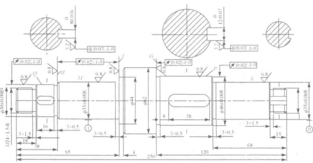

#### 图 11.4.1 传动轴设计图

依据企业工艺习惯，提炼 13 条特征加工链（详见表 11.4.1），汇总得工序集 $O_p$，共 37 道工序（$k=37$）。

#### 表 11.4.1 传动轴的特征加工链

| 加工特征 | 特征加工链 |
| :--- | :--- |
| $\phi 35 \pm 0.008$ 外圆 M | 粗车-半精车-精车-磨削 ($O_{p1}-O_{p2}-O_{p3}-O_{p4}$) |
| $\phi 35 \pm 0.008$ 外圆 N | 粗车-半精车-精车-磨削 ($O_{p5}-O_{p6}-O_{p7}-O_{p8}$) |
| $\phi 30 \pm 0.0085$ 外圆 Q | 粗车-半精车-精车-磨削 ($O_{p9}-O_{p10}-O_{p11}-O_{p12}$) |
| $\phi 46 \pm 0.008$ 外圆 P | 粗车-半精车-精车-磨削 ($O_{p13}-O_{p14}-O_{p15}-O_{p16}$) |
| $\phi 14$ 外圆 | 粗车-半精车 ($O_{p17}-O_{p18}$) |
| $\phi 62$ 外圆 | 粗车-半精车 ($O_{p19}-O_{p20}$) |
| $M24 \times 1.5$ 螺纹(左) | 粗车-半精车螺纹-精车螺纹 ($O_{p21}-O_{p22}-O_{p23}$) |
| $M24 \times 1.5-8$ 螺纹(左) | 粗车-半精车螺纹-精车螺纹 ($O_{p24}-O_{p25}-O_{p26}$) |
| 外圆 Q 上的键槽 | 粗铣-半精铣-精铣 ($O_{p27}-O_{p28}-O_{p29}$) |
| 外圆 P 上的键槽 | 粗铣-半精铣-精铣 ($O_{p30}-O_{p31}-O_{p32}$) |
| 止动垫圈槽 | 粗铣-半精铣 ($O_{p33}-O_{p34}$) |
| 台肩 H | 靠磨 ($O_{p35}$) |
| 台肩 I | 靠磨 ($O_{p36}$) |
| 台肩 G | 靠磨 ($O_{p37}$) |

**约束矩阵 $A$ 构建逻辑**：
1.  **链内顺序**：同一加工链工序严格前后依赖（如 $a_{12}=a_{23}=1$）。
2.  **粗精分离**：不同特征间，同类粗加工须统一先于精加工（如 $a_{16}=a_{52}=1$）。
3.  **依附关系**：键槽、垫圈槽依附外圆，须在外圆半精/精加工后进行（如 $a_{10,27}=1$）。
4.  **传递性**：$i \prec j \prec k \Rightarrow i \prec k$。
满足上述设为 1，对称位置设为 0，其余为 0。对 $A$ 迭代相乘至 $A(36)$，提取路径生成 10 条初始工艺路线（表 11.4.2），其中 `⟨ ⟩` 标识可合并工序组。

#### 表 11.4.2 传动轴的初始工艺路线（节选）

| 编号 | 工艺路线工序组成 |
| :--- | :--- |
| $O_{L1}$ | 串行结构：8组工序按顺序衔接，无合并 |
| $O_{L2}$ | 并行结构：8组工序均合并为并行作业组 |
| $\vdots$ | $\vdots$ |
| $O_{L8}$ | 并行结构：与 $O_{L2}$ 结构相似 |
| $\vdots$ | $\vdots$ |
| $O_{L10}$ | 混合结构：调整了键槽/螺纹与精车磨削的相对顺序 |

#### 2. 零件工艺路线决策：数据说话

**(1) 经验指标 $\gamma$ 计算：对标典型路线**
调取企业典型工艺路线库：传动轴类典型路线为“下料—粗车—调质—校直—半精车—精车—粗铣—磨削—精铣—钻削—钻工”。
将 $O_p$ 中 37 道工序与典型路线匹配，依式 (11.4.5) 得工序优先级系数：
> 粗车(0.9091) > 半精车/半精车螺纹(0.6364) > 精车/精车螺纹(0.5455) > 粗铣(0.4545) > 磨削/靠磨(0.3636) > 精铣(0.2727) > 半精铣(0)

同一合并组内工序系数一致。依式 (11.4.6) 结合合并位置，计算 10 条路线经验指标值（表 11.4.3）。

#### 表 11.4.3 基于工艺设计经验的评价指标值 $\gamma(O_{Li})$

| i | 数值 | i | 数值 |
|---|---|---|---|
| 1 | 0.9577 | 6 | **0.9930** |
| 2 | 0.9155 | 7 | 0.9648 |
| 3 | 0.9944 | 8 | 0.9648 |
| 4 | **1.0000** | 9 | 0.9225 |
| 5 | 0.9718 | 10 | 0.9930 |

> **洞见**：$O_{L4}$ 经验得分满分（1.0），$O_{L6}$ 与 $O_{L10}$ 并列亚军（0.9930）。但这仅是单维视角，最终胜出仍需结合稳定性指标 $\rho$ 与集对分析模型综合裁决。

# 基于网络拓扑与集对理论的制造稳定性评价与故障诊断实战

## (2) 制造稳定性量化：从网络拓扑特征到最优工艺路线决策

### 1. 生产线网络的“小世界”特征解析
以某企业核心车间为例，该区域涵盖71种零件的加工任务，由此衍生出的生产线网络由125个节点、1221条边构成，全貌源于各零件工艺路线的叠加融合。为刻画网络骨架，我们引入平均入度 $\langle K_{in} \rangle$、平均出度 $\langle K_{out} \rangle$、平均入强度 $\langle S_{in} \rangle$、平均出强度 $\langle S_{out} \rangle$、平均最短路径 $\langle L \rangle$ 及平均聚类系数 $\langle C \rangle$ 等核心指标，实测数据汇总如下表所示。

#### 表 11.4.4 生产线网络基础拓扑参数

| 节点数 n | 边数 E | $\langle K_{in} \rangle$ | $\langle K_{out} \rangle$ | $\langle S_{in} \rangle$ | $\langle S_{out} \rangle$ | $\langle L \rangle$ | $\langle C \rangle$ |
| :---: | :---: | :---: | :---: | :---: | :---: | :---: | :---: |
| 125 | 1221 | 8.9514 | 6.7194 | 14.9801 | 16.2564 | 2.7826 | 0.2816 |

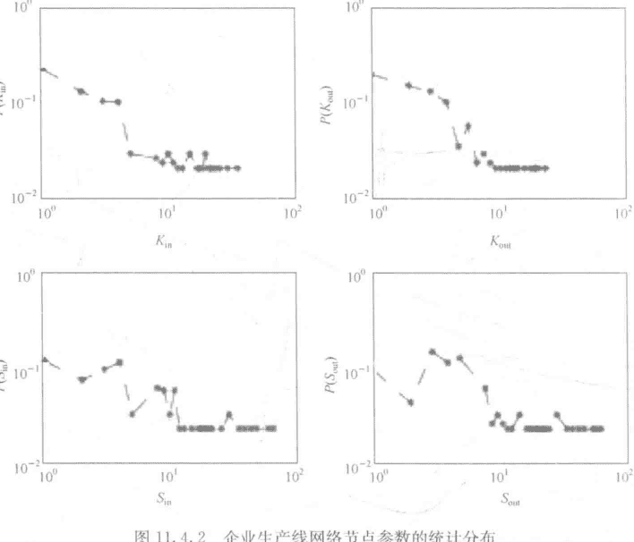

深度剖析节点参数可发现，拓扑特性与车间制造角色强相关：入度大户往往意味着该设备具备多工序兼容的加工潜能；出度突出的节点则常扮演“粗加工基座”角色，为后序工序奠基。节点强度则直观映射制造单元在排产中的核心地位——被反复调用的单元，强度值必然攀升。其中，入强度折射任务承载量，出强度彰显能力辐射范围，均与实况高度吻合。

为验证网络本质，我们将其与同规模、同平均度的 ER 随机网络对标，对比结果揭示了显著差异：
$$ \langle C \rangle = 0.2816 \gg C_{ER} = \frac{\langle K \rangle}{n} = 0.0538 $$
$$ \langle L \rangle = 2.7826 \approx L_{ER} = \frac{\ln n}{\ln \langle K \rangle} = 2.5345 $$

结论昭然若揭：**该生产线网络兼具高聚类与短路径特征，标准的“小世界网络”模型**。这意味着车间布局兼顾了局部协同的紧密性与全局调度的高效性。

### 2. 脆性风险熵量化制造稳定性
采用既定插入机制，将初始工艺路线逐一嵌入网络，以插入后的“脆性风险熵”作为稳定性度量指标，十条路线的评价值如下表。

#### 表 11.4.5 十条工艺路线制造稳定性指标值 ($\rho$)

| 路线编号 i | $\rho(O_{Li})$ | 路线编号 i | $\rho(O_{Li})$ |
| :---: | :---: | :---: | :---: |
| 1 | 0.8516 | 6 | 0.8622 |
| 2 | 0.8629 | 7 | 0.8931 |
| 3 | 0.8498 | 8 | **0.7430** |
| 4 | 0.8011 | 9 | 0.8629 |
| 5 | 0.8079 | 10 | 0.7560 |

### 3. 基于同一度的最优路线决策
依托式(11.4.10)构建决策矩阵 $Q$，按式(11.4.11)锁定传动轴零件理想加工方案 $O_t^+ = [0.7430, 1.000]$。进而依式(11.4.12)推导同一度矩阵 $U$，并按式(11.4.13)测算指标权重向量 $W=[\omega_y, \omega_p]=[0.3745, 0.6255]$（稳定性权重占优）。

引入加权同一度综合评价十条路线，结果如下：

| 路线序号 | 加权同一度值 |
| :---: | :---: |
| 1 | 0.9044 |
| 2 | 0.8814 |
| 3 | 0.8818 |
| 4 | 0.9546 |
| 5 | 0.9392 |
| 6 | 0.9109 |
| 7 | 0.8817 |
| **8** | **0.9868** |
| 9 | 0.8841 |
| 10 | 0.9866 |

**决策结果：** 路线 $O_{L8}$ 以 0.9868 的最高分胜出，确立为传动轴零件的最优机加工路径：
> **粗车** $\langle O_{p1}, O_{p5}, O_{p9}, O_{p13}, O_{p17}, O_{p19}, O_{p21}, O_{p24} \rangle$ → **半精车（螺纹）** $\langle O_{p2}, O_{p6}, O_{p10}, O_{p14}, O_{p18}, O_{p20}, O_{p22}, O_{p25} \rangle$ → **精车（螺纹）** $\langle O_{p3}, O_{p7}, O_{p11}, O_{p15}, O_{p23}, O_{p26} \rangle$ → **粗铣** $\langle O_{p27}, O_{p30}, O_{p33} \rangle$ → **半精铣** $\langle O_{p28}, O_{p31}, O_{p34} \rangle$ → **精铣** $\langle O_{p29}, O_{p32} \rangle$ → **磨削外圆（靠磨台肩）** $\langle O_{p4}, O_{p8}, O_{p12}, O_{p16}, O_{p35}, O_{p36}, O_{p37} \rangle$。

考虑到 45 号钢材质需调质处理，在 $O_{L8}$ 框架内植入热处理等辅助工序，最终定型工艺流程为：**下料 → 粗车 → 调质 → 半精车 → 精车 → 粗铣 → 半精铣 → 精铣磨削 → 钻工**。

**动态更新机制：** 以最优方案插入后生成的网络作为新基准，实现了生产任务接入后对车间状态的实时刷新，生动诠释了生产网络的动态演化本质。

---

## 11.5 基于集对理论的砂轮主轴转动系统故障树深度剖析

设备零部件失效是系统瘫痪的元凶。刘英等学者[16]创新性引入集对分析（SPA）解构砂轮主轴转动系统故障逻辑，为可靠性评估开辟新径。

### 11.5.1 故障树集对分析模型构建

#### 1. 经典 FTA 回顾
故障树分析（FTA）是自顶向下演绎的图形化建模利器[17-18]。它以“顶事件”（系统最恶性故障）为起点，层层回溯中间事件与底事件，借逻辑门（与/或/非门）串联因果链条，最终量化系统失效概率与关键因子重要度。标准符号体系见下表。

#### 表 11.5.1 FTA 核心逻辑门与事件符号对照

| 图形符号 | 语义定义 |
| :---: | :--- |
| [或门符号] | 或门 (OR) |
| [与门符号] | 与门 (AND) |
| [非门符号] | 非门 (NOT) |
| [方形符号] | 顶事件 / 中间事件 |
| [圆形符号] | 底事件 (基本故障) |

#### 2. 集对算子：逻辑门的代数重构
集对理论以“联系度” $\mu = a + bi + cj$ 为核心（$a$ 同度/可能性，$b$ 差度/不确定性，$c$ 反度/对立面），定义加乘运算法则：

*   **加法：** $\mu_1 + \mu_2 = (a_1+a_2) + (b_1+b_2)i + (c_1+c_2)j$
*   **乘法：** $\mu_1 \mu_2 = a + bi + cj$，其中 $a = a_1a_2 + c_1c_2, c = a_1c_2 + a_2c_1, b = 1-a-c$。

在此基础上，推导故障树专用算子：

**(1) 或门算子（归一化求和）：**
$n$ 个底事件或运算，联系度叠加后归一化处理，便于逐层传递：
$$ \mu(\varpi) = \frac{1}{n} \sum_{k=1}^n \mu(\varpi_k) = \frac{\sum a_k + \sum b_k i + \sum c_k j}{n} \quad (11.5.4) $$

**(2) 与门算子（联系度连乘）：**
$n$ 个底事件与运算，遵循联系度乘法法则：
$$ \mu(\varpi) = \prod_{k=1}^n \mu(\varpi_k) = a + bi + cj \quad (11.5.5) $$
其中 $a, c$ 分别累加偶数项、奇数项 $c$ 系数的组合乘积，$b=1-a-c$（具体组合空间记为 $I_{nn}$）。

**(3) 非门算子（同反度互换）：**
输出为输入对立面，即同度 $a$ 与反度 $c$ 互换，差度 $b$ 不变：
$$ \bar{\mu}(\varpi) = c + bi + aj \quad (11.5.6) $$

### 11.5.2 集对故障树分析流程范式
假设故障树共 $n$ 层，第 $i$ 层含 $k_i$ 个事件，均以问题域 $\varpi_{i_k}$ 及联系度 $\mu(\varpi)$ 表征。顶事件 $\varpi_0$ 与各层事件逻辑映射函数为：
$$ \mu(\varpi_0) = \Phi[\mu(\varpi_{i_k})] = a_0 + b_0 i + c_0 j \quad (11.5.7) $$
语义解读：**$a_0$ 为顶事件发生基础可能性，$c_0$ 为保持完好基础可能性，$b_0$ 为不确定性摆动幅度**。通过 $a_0, b_0, c_0$ 运算可得状态可能性区间。完整分析流程见图 11.5.1。

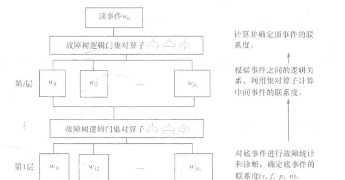

### 11.5.3 砂轮主轴转动系统实战复盘

#### 系统背景与故障溯源
砂轮主轴系统是磨齿机高速旋转的“心脏”，由传动部件与主轴轴承组成，苛求低振动、低发热、高精度、强刚性、良密封。基于 78 台同型号设备的长周期跟踪统计，综合结构、工况、人为、环境多维因素，锁定三大深层致因：**主轴密封失守致轴承失效、轴承装配工艺缺陷、主轴温升失控**。

故障树结构见图 11.5.2、系统简图见图 11.5.3，事件编码与含义详见表 11.5.2。

#### 表 11.5.2 故障事件编码对照表 (节选)

| 编码 | 事件描述 | 编码 | 事件描述 | 编码 | 事件描述 |
| :--- | :--- | :--- | :--- | :--- | :--- |
| $w_0$ | 砂轮主轴转动失效 (顶事件) | $w_1$ | 主轴两端轴承失效 | $w_8$ | 结构过热致预紧状态变化 |
| $w_1$ | 砂轮转动不平稳 | $w_2$ | 主轴轴承预紧力不合适 | $w_9$ | 砂轮主轴刚度不足 |
| $w_2$ | 轴承系统刚度不足 | $w_3$ | 主轴轴承装配不当 | $w_{10}$ | 主轴电机过载 |
| $w_3$ | 砂轮前后系统密封不良 | $w_4$ | 砂轮动平衡调整不当 | $w_{11}$ | 主轴电机自带质量缺陷 |
| $w_4$ | 砂轮主轴回转精度不高 | $w_5$ | 轴承密封结构设计不合理 | $w_{12}$ | “磨削/修整”离合器空转异响 |
| $w_5$ | 主轴电机温升过高 | $w_6$ | 轴承间隔套平行度超差 | $w_{13}$ | 主轴-电机联轴器联结不可靠 |
| $w_6$ | 主轴运转异响/噪声大 | $w_7$ | 轴承自带精度超差 | $w_{14}$ | 端盖过紧贴轴承或垫圈 |

#### 底事件联系度赋值与逐层推演
结合诊断统计，按式(11.5.1)量化 14 个底事件联系度（见表 11.5.3），遵循“自底向上”拓扑序，应用式(11.5.3)~(11.5.6)逐层聚合，获中间事件联系度（表 11.5.4），最终顶事件 $w_0$ 联系度收敛为：

```
\(\mu(\omega_0) = 0.303 + 0.261i + 0.436j \quad (11.5.8)\)
```

$$ \mu(w_0) = 0.303 + 0.261i + 0.436j \quad (11.5.8) $$

#### 结果解读与改进对策
式(11.5.8) 揭示核心风险图谱：
*   **基础失效率 ($a_0$)：** 30.3% —— 系统固有脆弱性不可忽视。
*   **基础健全率 ($c_0$)：** 43.6% —— 仍存近半生存空间。
*   **不确定性摆动 ($b_0$)：** 26.1% —— 关键变数区间。

**风险区间推演：**
*   **最坏情况 ($i=1$，不确定全转为失效)：** 失效率飙升至 **56.4%** ($a_0+b_0$)，健全率跌至 43.6%。
*   **最好情况 ($i=-1$，不确定全转为健全)：** 失效率降至 **30.3%** ($a_0$)，健全率升至 **69.7%** ($c_0+b_0$)。

**结论：** 受不确定性主导，系统失效概率在 **[0.303, 0.564]** 区间波动。

#### 针对性强化方案
直击三大根因，提出“组合拳”改进策略：
1.  **密封升级：** 强化主轴密封设计或改良结构，斩断污染源入侵链。
2.  **装配精细化：** 优化轴承装配工艺，严控预紧力施加精度。
3.  **热管理强化：** 选型匹配冷却方式，遏制温升失控传导。
4.  **源头把控：** 严格零部件入厂精度检测，拦截先天缺陷。

实施上述措施可显著压降故障概率，跃升系统可靠性水平。

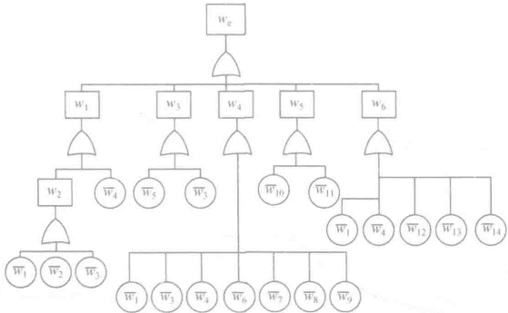

# 第 12 章 集对分析赋能智能社会：场景与实践

随着算力基建与 AI 技术的全面渗透，智能社会不再是科幻概念，而是正在发生的现实。我们正处于这一宏大进程的起步期。本章将梳理集对分析（SPA）在智能社会建设中的典型落地路径，展示其如何化解复杂系统中的不确定性难题。

## 12.1 破题：何为智能社会，为何引入 SPA？

### 12.1.1 重构定义：全域智能化的社会新形态
学术界对“智能社会”尚无统一定论。本书将其界定为：**社会运行的各个维度均实现智能化跃迁的新型社会形态**，这是科技演进至特定阶段的必然结果。在此图景下，依托“智脑”系统与泛在互联，社会事务与个人需求实现高效数字化处理；通过信息能的深度开发，物质财富总量最大化与个性化服务体验并重。回溯人类发展史，智能社会是信息时代深度演进的产物，但当前社会智能化渗透率仍处于初级阶段，距离成熟形态尚有距离。

### 12.1.2 理论锚点：不确定性时代的“同异反”透镜
人性驱动的资源分配博弈、能源转换效率瓶颈、星际移民探索等新课题，注定了不确定性将长期伴随智能社会。同一性、差异性、对立性（同异反）三元变动贯穿始终，能量守恒与对立统一规律依然是底层逻辑。集对分析的**成对构建、不确定性量化、同异反动态演化**三大核心原理，恰好为剖析智能社会的复杂系统提供了天然适配的理论工具箱。这便是 SPA 介入智能社会研究的根本依据。

## 12.2 实战范例：干道绿波协调控制的“最优解”探寻

智能城市里，车流如织与路权有限的矛盾愈发尖锐。如何榨干每一寸路网资源，让车辆“畅行无阻”，是城市治理的必答题。针对车速波动的区间特性，卢凯团队以**双向绿波带宽最大化**为目标，引入集对分析，在车速不确定性条件下，对信号协调方案开展评价优选，攻克了传统方法“定速设计、实况失配”的顽疾。

### 12.2.1 痛点直击：传统绿波设计为何“水土不服”？
绿波协调是城市交通的“指挥家”，关乎通行效率、能耗排放与安全系数。然而，现实执行中，路段车速、车队规模、支路干扰、公交插队、行人横穿等**多源不确定因素**交织，导致固定配时方案极易失效。唯有在设计源头内化不确定性，方能生成鲁棒性强、适应性好的“弹性方案”。

回顾既有技术路线——**图解法**（时距图几何作图）、**数解法**（理想路口拟合）、**模型法**（带宽指标最优化求解），虽各有千秋，却共享同一个死穴：**预设固定设计车速**。车辆实际运行速度呈随机区间分布，而非单一确定值，导致“最优方案”落地即过时。痛点聚焦三点：
1.  **忽略速度随机性**：无法刻画速度分布特征对配时的实质影响；
2.  **缺样本驱动评价**：无法用实测速度样本校验方案适应性；
3.  **缺对比评价体系**：同等平均车速、同等带宽下的方案优劣无法量化判别。

### 12.2.2 基石建模：MAXBAND 模型与备选方案池构建
为构建备选方案池，采用 Little 教授的 **MAXBAND 模型** 作为基础生成器。以干道 $n$ 个路口 $I_1 \sim I_n$ 为例，设定出城/入城双向坐标系，引入绿波带宽比率 $B/\bar{B}$、红灯率 $r/\bar{r}$、带边时差 $\omega/\bar{\omega}$、行驶时间率 $t$、相位差率 $\Phi/\bar{\Phi}$、红灯中心时差 $\Delta$ 等无量纲变量（均以信号周期归一化）。

目标函数 $P$ 追求双向带宽之和最大，约束条件涵盖相位差整数系数 $m$、周期优化区间 $[C_{min}, C_{max}]$ 及相位相序空间。需注意：周期变化致行驶时间率联动，相序调整致 $\Delta$ 值重算（如对称放行 $\Delta=0$，单独放行紧邻相位 $\Delta=1-r_i/2+\bar{r}_i/2$ 等）。

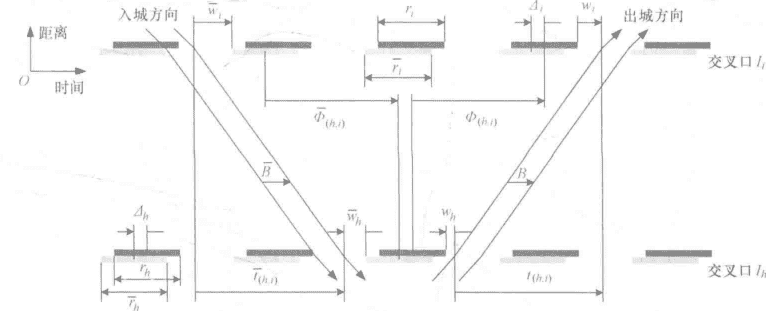

在此给出模型的一种标准表述形式：

```
P=Max\{B+\bar{B}\}
s. t. \quad \omega_i + B \leqslant 1 - r_i, \quad \bar{\omega}_i + \bar{B} \leqslant 1 - \bar{r}_i, \quad i=1, \cdots, n
(\omega_i + \bar{\omega}_i) - (\omega_{i+1} + \bar{\omega}_{i+1}) + t_{(i,i+1)} + \
t_{(i,i+1)} + \Delta_i - \Delta_{i+1} = -(1/2)(r_i + \bar{r}_i) + \
(1/2)(r_{i+1} + \bar{r}_{i+1}) + m_{(i,i+1)}, \quad i=1, \cdots, n-1
m_{(i,i+1)} \in \mathbb{Z}, \quad i=1, \cdots, n-1
B, \bar{B}, \omega_i, \bar{\omega}_i \geqslant 0, \quad i=1, \cdots, n
```

**模型核心短板显而易见：以确定性行驶时间为输入，天然切断了“速度-带宽”动态耦合链路，方案抗扰能力无从保证。**

### 12.2.3 核心突破：构建“车速-带宽”集对，量化不确定联系度

#### 1. 集对构建：从“孤立变量”到“关联对子”
在给定方案下，直行车速集合与绿波带宽集合因强耦合关系天然构成**集对**。车速不确定性映射为带宽的三元属性：
- **同一性**：带宽 $\ge$ 同一性阈值 $\rightarrow$ 高效通行；
- **对立性**：带宽 $<$ 对立性阈值 $\rightarrow$ 停车等待；
- **差异性**：介于两阈值之间 $\rightarrow$ 部分受阻、模糊过渡。

由此建立方案 $k$ 的联系度表达式：
$$ \mu_k = a_k + b_k i + c_k j $$
其中 $a_k, b_k, c_k$ 分别为同一、差异、对立三维分量，满足归一化约束 $a_k+b_k+c_k=1$；$i, j$ 为差异、对立系数。

#### 2. 样本驱动的三元统计：穷举法落地
利用实测有效车速样本总数 $N_k$ 为分母，统计三类样本计数：
- $S_k$：带宽达同一阈值以上（同一特性）；
- $P_k$：带宽低于对立阈值（对立特性）；
- $F_k$：带宽落于阈值区间（差异特性）。
满足 $N_k = S_k + F_k + P_k$。每个速度样本对应一组双向带宽，判定属性；每种速度分布对应一组评价参数 $(S_k, F_k, P_k, a_k, b_k, c_k)$。分布特征漂移时，方案与参数的映射关系动态更新，实现了**从静态设计到动态评价的范式跃迁**。

$$\mu_k = \frac{S_k}{N_k} + \frac{F_k}{N_k}i + \frac{P_k}{N_k}j$$

$$N_k = S_k + F_k + P_k$$

#### 3. 联系度运算：决策依据的显性化
通过联系度综合运算，将模糊的不确定性转化为可比、可排、可决的量化指标，为绿波方案在真实波动工况下的“优中选优”提供了坚实度量标尺。

# 12.2 干道绿波协调控制：基于集对分析的速度自适应优化方法

## 核心算法：联系度加法运算与方案筛选

运用集对分析中的联系度加法运算法则，我们可以推导出干道绿波协调控制备选方案在出、入城方向上的行驶车速与双向绿波带宽之间的平均联系度表达式，具体形式见下式：

$$\mu_k + \bar{\mu}_k = 2 \left( \frac{\mu_k + \bar{\mu}_k}{2} \right) = 2 \left( \frac{a_k + \bar{a}_k}{2} + \frac{b_k + \bar{b}_k}{2}i + \frac{c_k + \bar{c}_k}{2}j \right) = 2 (\tilde{a}_k + \tilde{b}_k i + \tilde{c}_k j)$$ (12.2.6)

其中，\(\mu_k (\bar{\mu}_k)\) 代表绿波协调控制方案 \(k\) 在出城（入城）方向的联系度表达式；\(\tilde{a}_k\)、\(\tilde{b}_k\)、\(\tilde{c}_k\) 分别为方案 \(k\) 出、入城方向的同一度、差异度、对立度平均值。

在集对分析理论体系中，差异度系数 \(i\) 属于未确定参数，其赋值策略灵活多样，通常需结合具体应用场景，从系统论与数学角度综合权衡。本文采用集对分析的“顺势取值法”来确定 \(i\) 的取值，计算公式如下：

$$i = \frac{\bar{a}_k}{\bar{a}_k + \tilde{c}_k} + \frac{\tilde{c}_k}{\bar{a}_k + \tilde{c}_k}j$$ (12.2.7)

对立度系数 \(j\) 一般置为 1，以表征其与同一度的对立关系。

通过上述公式计算各备选方案下行驶速度与绿波带宽的联系度数值，联系度最大的方案即被确认为最佳干道绿波协调控制方案。

## 12.2.4 面向速度变化的绿波协调控制策略

为在方案设计阶段充分吸纳速度波动的影响，保障协调控制的整体运行效能，需依据实测有效速度样本构建备选方案库，再经评价优选出最优方案。

### 1. 协调方案集构建流程

*   **步骤 1：速度样本采集与清洗。** 选定时段（如 15 分钟）采集路段车辆行驶速度，利用离群点检测技术剔除超速行驶及缓慢行驶等非合理样本。
*   **步骤 2：划定正常变速区间。** 以留存样本的极值 \(v_{\text{min}}\) 与 \(v_{\text{max}}\) 为界，确立行驶速度正常变化范围 \([v_{\text{min}}, v_{\text{max}}]\)。
*   **步骤 3：选取设计车速基准。** 在上述正常区间内，等距或按需选取若干速度值作为绿波协调控制的设计车速。
*   **步骤 4：生成备选方案集。** 将各设计车速代入绿波协调控制模型（如 MAXBAND 模型）求解，得到包含不同信号周期、相位差组合及相位相序的备选方案集合。

### 2. 协调方案评价机制

各备选方案的评价步骤如下：

*   **步骤 1：带宽样本计算。** 针对每个备选方案，分别计算所有有效速度样本对应的绿波带宽度。
*   **步骤 2：联系度要素统计。** 统计车速与带宽间的共有、差异、对立特性频次，计算联系度。
*   **步骤 3：最优方案遴选。** 对比联系度数值，选取最大者为最佳方案。具体操作中，可根据协调交叉口数量设定绿波带宽占比（带宽与瓶颈口绿信比之比）的同一性阈值 \(B_S\) 与对立性阈值 \(B_P\)。依据方案 \(k\) 下速度样本获得的带宽占比 \(B_k\)，统计满足 \(B_k \geqslant B_S\)、\(B_P \leqslant B_k < B_S\)、\(B_k < B_P\) 的样本数，分别得到共有特性数 \(S_k\)、差异特性数 \(F_k\)、对立特性数 \(P_k\)（总数 \(N_k = S_k+F_k+P_k\) 为样本总数）。进而算出同一度 \(a_k = S_k/N_k\)、差异度 \(b_k = F_k/N_k\)、对立度 \(c_k = P_k/N_k\)，建立联系度表达式 \(\mu_k = a_k + b_k i + c_k j\)。

鉴于绿波效果随交叉口数增多而衰减，阈值设定需与口数匹配。基于工程经验，交叉口数与阈值对应关系参考表 12.2.1。

**表 12.2.1 评判阈值设定参考**

| 交叉口数 | 2 | 3 | 4 | 5 |
| :--- | :---: | :---: | :---: | :---: |
| \(B_S\) | 0.90 | 0.85 | 0.82 | 0.80 |
| \(B_P\) | 0.80 | 0.70 | 0.65 | 0.60 |

以 2 个交叉口为例：带宽占比 \(\ge 90\%\) 认可方案，\(< 80\%\) 否决，介于 \([0.80, 0.90)\) 则评判不确定，即 \(B_S=0.90, B_P=0.80\)。

最终将确定的 \(i\)、\(j\) 代入联系度式，比较数值大小，联系度最大者即为所求最优控制方案。

## 12.2.5 实战案例：广州桥南路应用验证

该方法已在广州市番禺区桥南路落地应用。桥南路全长约 1.4 km，串联 4 个信号交叉口，跨越市桥大桥（桥面双向 2 车道），混合交通复杂、干扰强、车速不确定性高。具体实施过程如下：

### 1. 备选方案生成实录

路口布局见 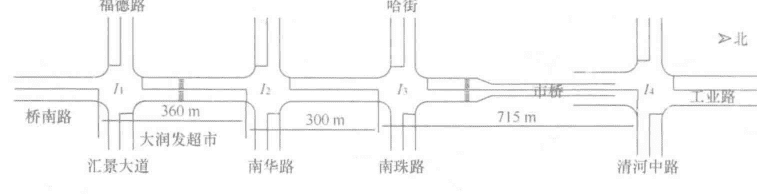。\(I_4\) (清河中路—工业路) 南、东进口流量大，设其放行相为协调相位；其余路口均以南北向为协调方向。假设相位绿灯时长等于相位时长，相序优化不受限。各路口单点配时参数见下表，公共周期范围锁定为 [145, 150] s。


按 0.5 m/s 精度采集某时段速度样本（见原表 12.2.3）。剔除超速样本“18”与缓行样本“4”，得正常变速区间 [8, 12] m/s。按精度等距取 9 个设计车速 (8, 8.5, ..., 12 m/s)，代入 MAXBAND 模型求解，得到备选方案集（见原表 12.2.4、12.2.5）。

原表 12.2.4 列出 4 种最佳相序组合（数字序列代表各路口相序设置，如“2-1-3-4”指 \(I_2\) 相序为北直左-南直左-东西直左-行人）。
原表 12.2.5 展示不同设计车速下的最佳周期与相序组合对应关系。可见不同车速对应最优配时各异，但实际系统需固定运行一套方案，故须筛选对速度变化适应性最强的相序组合。

### 2. 备选方案量化评价

取公共周期边界值 C=145 s 与 C=150 s，计算 9 个速度样本在 4 种相序组合下的绿波带宽占比（见原表 12.2.6、12.2.7），并绘制折线图（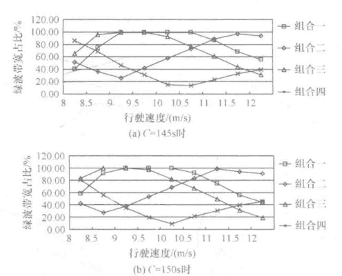）。

本案协调口数为 4，查表 12.2.1 设定 \(B_S=0.82, B_P=0.65\)。统计四种方案下的三特性个数与系数（见原表 12.2.8）。

**联系度表达式构建：**

*   **周期 145 s 时**，四组合联系度表达式分别为：
    ```
\(\mu_1|_{145} = 0.870 + 0.087i + 0.043j\)
\(\mu_2|_{145} = 0.152 + 0.174i + 0.674j\)
\(\mu_3|_{145} = 0.652 + 0.196i + 0.152j\)
\(\mu_4|_{145} = 0.022 + 0.043i + 0.935j\)
```
*   **周期 150 s 时**，四组合联系度表达式分别为：
    ```
\(\mu_1|_{150} = 0.826 + 0.087i + 0.087j\)
\(\mu_2|_{150} = 0.326 + 0.348i + 0.326j\)
\(\mu_3|_{150}=0.326+0.522i+0.152j\)
\(\mu_4|_{150}=0.000+0.022i+0.978j\)
```

**差异度系数 \(i\) 顺势取值：**

利用“顺势取值法”计算得各方案 \(i\) 值（含 \(j\) 项）：
*   \(i_1|_{145}=-0.952+0.048j\)
*   \(i_2|_{145}=-0.184+0.816j\)
*   \(i_3|_{145}=-0.811+0.189j\)
*   \(i_4|_{145}=-0.023+0.977j\)
*   \(i_1|_{150}=-0.905+0.095j\)
*   \(i_2|_{150}=-0.500+0.500j\)
*   \(i_3|_{150}=0.682+0.318j\)
*   \(i_4|_{150}=0.000+1.000j\)

**联系度数值计算与排序：**

令 \(j=-1\) 代入计算：
*   **C=145 s：** \(\mu_1=0.905, \mu_2=-0.632, \mu_3=0.622, \mu_4=-0.955\)
*   **C=150 s：** \(\mu_1=0.810, \mu_2=0, \mu_3=0.364, \mu_4=-1\)

综合对比：**\(\mu_1 > \mu_3 > \mu_2 > \mu_4\)**。

**结论：** 相序组合一——“\(I_1\): 1-2-3-4、\(I_2\): 2-1-3-4、\(I_3\): 1-2-3、\(I_4\): 1-3-2-4” —— 速度适应性最优，确立为实施方案。

### 3. 运行效果分析

针对上述 8 种周期-组合工况，按各自最佳设计车速生成相位差方案（以 \(I_1\) 绿灯起点为基准），详见原表 12.2.9。

#### 表 12.2.9 信号配时实施方案

## 12.3 集对分析赋能隐私保护度量新视角

### 仿真验证与工程实测：绿波协调方案的效能确证

依据采集到的有效车速样本及其分布特征，我们在 VISSIM 微观仿真平台中构建了期望速度分布曲线（见 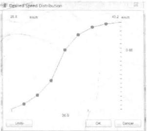），并以停车频次与延误时长为核心评价指标，对 8 套信号配时方案展开了为期 3600 秒（涵盖 24 个完整信号周期）的对比实验（见 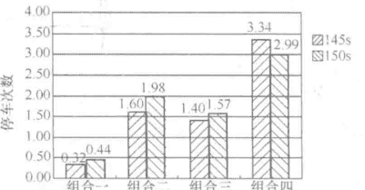、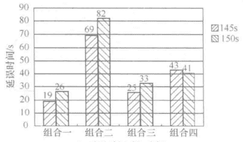）。

仿真数据揭示了关键规律：在停车次数维度，四种相序组合的协调优劣排序为组合一 > 组合三 > 组合二 > 组合四，这与集对分析得出的联系数优劣关系（\(\mu_1 > \mu_3 > \mu_2 > \mu_4\)）高度吻合，佐证了绿波带宽与停车次数的正相关特性。而在延误时间维度，排序变为组合一 > 组合三 > 组合四 > 组合二，与前序分析结果略有偏离。深究其因，组合二设计车速较高（约 11m/s），虽利于主干道快车，却导致带宽外慢车被迫等待下一周期，大幅推高延误；反之，组合四设计车速较低（8m/s），快车仅需微停即可融入后续车流，延误增幅可控。这一现象生动诠释了未饱和工况下，绿波带宽、延误与停车次数三者之间的辩证联系。

卢凯团队已将最优协调方案落地至广州番禺桥南路。实测表明，该方案有效支撑了特定速区间（32~40 km/h）内的双向绿波，保障车队首尾车辆全程处于连续绿带内，为城市干道智能化协调控制提供了可复用范式。后续研究仍可聚焦于同一性/对立性特征阈值与协调路口数的关联机制，以及差异度系数 \(i\) 的科学取值策略。

### 12.3.1 隐私保护度量：从匿名集到熵模型的演进与困境

智能社会下，LBS（基于位置服务）凭借 GPS、移动定位等技术极大便利了生活，却也让海量用户轨迹暴露于服务端，隐私泄露风险剧增。传统保护手段多采用“离线/在线”匿名化 ID 或位置，虽能遮蔽隐私，却往往以服务质量受损为代价。用户与系统双方均迫切需要一套科学的度量体系，以量化保护强度、评估技术优劣。

早期研究引入 k-匿名、l-多样性、熵度量等理论。k-匿名通过泛化准标识符使记录不可区分，但同质性攻击风险犹存；l-多样性虽强化敏感属性多样性，却面临等价类划分动态变化导致匿名集计算复杂、可行性低的难题。基于熵的度量（如 ```
Poisson\{(A_k) = n\} = \frac{(\rho A)^n}{n!} e^{-\rho A}
```、```
E{|lk|} = E{A_l | A_l \geqslant 1} = \frac{E{A_l}}{1 - Poisson\{A_l = 0\}} = \frac{\rho A_l}{1 - e^{-\rho A_l}}
``` 所示模型）试图用不确定性表达隐私强度，mix-zone 机制（```
H(l) = - \sum_{i=1}^{N} P_i log(P_i)
```）进一步通过空间混淆切断轨迹关联，但牺牲了通信时隙与服务连续性。形式化分析虽严谨，仍难根除假名追踪隐患。现有方法在“隐私强度”与“数据可用性、服务质量”的博弈中，难寻最优平衡。

### 12.3.2 集对分析：重构隐私度量的“同异反”逻辑

#### 1. 理论基石：联系数与三元结构

集对分析通过“同一性（同）”、“差异性（异）”、“对立性（反）”三维联系数刻画系统确定性：
\[
\mu_A(x)=a_A(x)+b_A(x)i+c_A(x)j
\]
其中 \(a,b,c \in [0,1]\) 且归一化求和为 1；\(i \in [-1,1]\) 为不确定度系数，\(j=-1\) 为对立度系数。这一框架为隐私保护中“泄露与未泄露”、“可用与不可用”的辩证关系提供了天然建模工具。

#### 2. 应用机制：从数据库到轨迹的全链路度量

针对医疗、金融等结构化数据发布场景，集对分析将隐私保护视为聚类问题：将属性映射为联系数，通过势与记分函数判别“同势（可行）”、“均势（一般）”、“反势（不可行）”，实现对泄露风险的精准分层处理。

**实战演示：医疗数据脱敏度量**

*步骤一：原始数据标准化（表 12.3.1 → 表 12.3.2）*
将性别二值化，年龄与邮编构造三元区间数 \([min, A, max]\)，消除量纲与数量级干扰。

*步骤二：构造联系数表达（表 12.3.2 → 表 12.3.3）*
依据公式 (12.3.5)-(12.3.7)，将每个三元区间转化为 \(\mu = a + bi + cj\) 形式。例如年龄属性，同一度 \(a\) 反映偏好值接近程度，对立度 \(c\) 表征区间跨度风险，不确定度 \(i\) 捕捉中间态模糊性。

*步骤三：多属性信息集结*
提供两种聚合策略：
- **平均值法**：直接取各维度 \(a,b,c\) 算术平均。
- **逻辑联结法**：合取运算（\(\wedge\)）取同度最小、反度最大（严格保守）；析取运算（\(\vee\)）取同度最大、反度最小（宽容乐观）。

*步骤四：势与记分函数决策*
定义势 \(shi(\mu) = a/c\) 与记分函数 \(S(\mu) = a - c\)。依据表 12.3.4 判别准则：
- **同势**（\(a>c, S>0, shi>1\)）：隐私保护等级高，方案可行；
- **均势**（\(a \approx c, S \approx 0\)）：防护一般，需权衡；
- **反势**（\(a<c, S<0, shi<1\)）：风险不可控，方案废弃。

这一机制将隐私度量从单一阈值判断升级为多维动态评估体系，兼顾了数据效用与安全红线，为后续位置隐私、轨迹隐私的精细化治理奠定了方法学基础。

# 集对分析在隐私保护与电力决策中的创新应用

## 隐私保护度量的集对分析新范式

### 联系数势与记分函数：度量隐私关联的核心指标

集对分析通过“同、异、反”三元联系数，构建了隐私信息关联程度的量化体系。联系数势值 `shi(μ)` 与记分函数 `S(μ)` 同为核心度量指标，数值越大表明信息关联越紧密，越小则越疏远。两者的判准阈值虽不同，但逻辑一致：

- **势值判准**：`shi(μ) > 1` 方案可行，`=1` 般，`<1` 不可行
- **记分判准**：`S(μ) > 0` 方案可行，`=0` 般，`<0` 不可行

这为隐私发布决策提供了直观的定量依据。

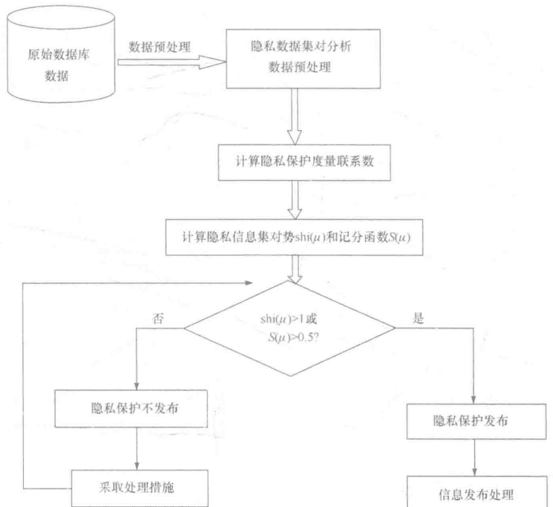

### 实战验证：医疗数据隐私发布的聚类效应

以 8 组医疗数据为例，计算平均联系数及两大指标后发现显著分层：

| 样本 | 平均联系数 | shi(μ) | S(μ) | 发布决策 | 疾病类型 |
|------|------------|--------|------|----------|----------|
| A1   | 0.3238+0i+0.6762j | 0.4789 | -0.3524 | ❌ 不发布 | 胃病 |
| A2   | 0.6699+0.0005i+0.3296j | 2.0325 | 0.3403 | ✅ 发布 | 感冒 |
| A3   | 0.3247+0i+0.6753j | 0.4808 | -0.3445 | ❌ 不发布 | 胃病 |
| A4   | 0.3303+0.0005i+0.6692j | 0.4936 | -0.3389 | ❌ 不发布 | 肺炎 |
| A5   | 0.3239+0i+0.6761j | 0.4791 | -0.3522 | ❌ 不发布 | 感冒 |
| A6   | 0.3364+0.0005i+0.6631j | 0.5073 | -0.3267 | ❌ 不发布 | 感冒 |
| A7   | 0.6760+0i+0.3240j | 2.0864 | 0.3520 | ✅ 发布 | 支气管炎 |
| A8   | 0.6634+0.0005i+0.3361j | 1.9738 | 0.3273 | ✅ 发布 | 消化不良 |

**深层规律**：指标正值（`shi>1`、`S>0`）聚类为女性信息，负值聚类为男性信息。同性别内部，联系数势与记分函数进一步细分差异，实现了“粗聚类+细度量”的双层结构。

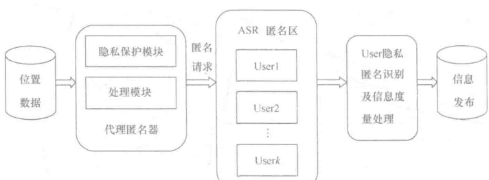

## 位置隐私：K-匿名机制的集对度量模型

### 威胁与对策

LBS 服务在便利生活的同时，暴露用户坐标引发安全隐患。主流对策分两类：
1. **噪声干扰法**：发送随机假坐标混淆视听，实现简单但泄露风险存续，且增加服务开销
2. **第三方匿名器**：引入代理生成含 k 用户的匿名区域 ASR，每用户被识别概率均为 `1/k`，典型算法包括 SpaceTwist、Hilbert Cloak、Casper Cloak 及 P2P K-匿名等

### 集对联系数建模

第 n 个用户隐私状态三元划分：
- `a_n`：可识别隐私数
- `b_n`：不确定识别数
- `c_n`：不可识别数

联系数函数：`μ_n = a_n/k + (b_n/k)i + (c_n/k)j`

**泄露判准**：
- `shi(μ_n) > 1` 或 `S(μ_n) > 0.5` → 隐私泄露，需重构保护
- 否则 → 保护有效

### 熵度量体系：从绝对到相对

利用信息熵处理等概率（`1/k`）识别场景：

| 熵类型 | 单用户公式 | k用户汇总 | 相对度量 |
|--------|------------|-----------|----------|
| 势熵 | `H_shi(μ_n) = -shi(μ_n)log shi(μ_n)` | `H_shi(μ_k) = -Σ shi(μ_n)log shi(μ_n)` | `L_shi(μ_k) = H_shi(μ_k) / H_max(μ_k)` |
| 记分熵 | `H_S(μ_n) = -S(μ_n)log S(μ_n)` | `H_S(μ_k) = -Σ S(μ_n)log S(μ_n)` | `L_S(μ_k) = H_S(μ_k) / H_max(μ_k)` |

其中最大熵 `H_max(μ_k) = -log(1/k)`。

**解读**：
- `L_shi` 或 `L_S` 越大 → 泄露越严重
- `1 - L_shi` 或 `1 - L_S` 越大 → 保护越有效


## 轨迹隐私：动态连续场景的集对度量延展

### 三大技术路线及局限

| 技术路线 | 核心思路 | 优势 | 劣势 |
|----------|----------|------|------|
| 假轨迹干扰 | 注入虚假轨迹 | 易实现 | 损害数据有效性与移植性 |
| 泛化匿名 | 轨迹点泛化为匿名区 | 利于数据利用与移植 | 泄露风险较高 |
| 抑制发布 | 敏感点不发布 | 保护强度高 | 数据价值大幅缩水，不利挖掘 |

轨迹隐私本质是位置隐私的**持续动态化**，需在匿名基础上引入时间维度的同一系数 `a_k/k` 与对立系数 `c_k/k`。

### 集对熵超越香农熵的理论优势

- **香农熵**：基于概率 `P(x_i)log P(x_i)`，无法捕捉信息**连续过渡状态**，引入密度函数和信息变差需满足绝对连续性等强约束
- **集对熵**：基于“同、异、反”确定-不确定系统，**天然表达连续过渡**，约束更少，通用性更强

### 动态泄露度量模型

引入同一系数加权的动态熵：

```
H_shD(μ_k) = -Σ(a_n/k) · Σ shi(μ_n)log shi(μ_n)    (12.3.15)
H_SD(μ_k)  = -Σ(a_n/k) · Σ S(μ_n)log S(μ_n)        (12.3.16)
```

相对动态度量：
```
D_shi(μ_k) = H_shD(μ_k) / H_max(μ_k)    (12.3.17)
D_S(μ_k)   = H_SD(μ_k)  / H_max(μ_k)    (12.3.18)
```

**判读**：`D_shi` 或 `D_S` 越大 → 动态泄露越重；越小 → 保护越优。

### 攻击者视角的度量边界

集对分析度量本质是**基于联系关系的可能性分析**，度量结果直接指导隐私处理策略。但需清醒认识：攻击者获取信息的优劣，直接决定了集对度量防护的实际效力上限。

## 多维度横评：五大隐私度量方法的优劣图谱

### 评价标准体系（表 12.3.6 重构）

| 维度 | 细分指标 |
|------|----------|
| 保护内容 | 数据保护、匿名保护、身份保护、位置保护、轨迹保护 |
| 度量形式 | 概率统计、信息熵/贝叶斯、匿名集合、形式伪设分析、**集对分析** |
| 保护机制 | 匿名机制、移动轨迹机制 |
| 服务质量 | 可用率、丢失率 |
| 实现手段 | 假数据法、抑制法、泛化法 |

### 核心对比（表 12.3.7 解读版）

| 方法 | 实现机理 | 核心优势 | 关键短板 | 判准标准 | 适用目标 |
|------|----------|----------|----------|----------|----------|
| 匿名集合 | 更换匿名集合频率 | 原理简单 | 计算复杂 | 匿名集越大→匿名度越高 | 匿名场景 |
| 信息熵 | 贝叶斯决策 | 易实现 | 无法跟踪动态 | 概率越大→度量越大 | 不可跟踪场景 |
| 形式推理 | 协议分析证明 | 准确有效 | 运算极复杂 | 协议验证通过度 | 不可跟踪场景 |
| 模糊理论 | 模糊推导 | 可行有效 | 计算复杂 | 推导匿名集越大→度量越大 | 匿名场景 |
| **集对分析** | **同异反联系数** | **原理简单、捕捉连续过渡** | **无法跟踪动态** | **势值/记分函数越大→度量越高** | **匿名场景** |

**关键洞察**：集对分析在“原理简度”与“表达连续状态”上双优，但同信息熵一样面临“动态跟踪短板”，这正是轨迹隐私引入动态熵模型的动因所在。

## 结语：大数据与复杂语义下的隐私度量新征程

隐私保护是智能社会的核心挑战。尽管理论方法层出不穷，但**大数据规模下的度量计算**与**复杂语义环境下的语境建模**仍是硬骨头。聂燕团队将集对分析引入数据库、位置、轨迹三大隐私模式，开辟了“同异反联系数+势熵度量”的新范式，为后续攻克上述难题提供了极具潜力的理论工具与工程路径。

---

# 集对分析赋能电力系统黑启动群决策

## 黑启动：全黑状态下的生命线重构

**黑启动**指电力系统大面积崩溃后，不依赖外部电网，仅靠自启动机组点燃“火种”，逐级挂载非自启动机组，最终全网复电的过程。**电源点选定与快速启动**是成败关键，实战中高度依赖专家群决策快速优选方案。

**决策困境**：突发故障下信息多为不确定性，指标与权重难给精确值，常用**区间数**或**Vague集**表达。问题转化为：如何建立基于区间数或 Vague 集的黑启动群决策模型？

**集对统一视角**：Vague 集模型与区间数模型本质同构——**先转联系数，再建模型，最后不确定性分析决策**。赵玉玲团队的 Vague 集模型更进一步，纳入了**专家间相互关联**，工程实用性更强。

## Vague 集向联系数的无损转换机制

### Vague 集三元素定义

设论域 `U` 上元素 `x` 的 Vague 集由三元组刻画：
- 真隶属 `t_v(x) ∈ [0,1]`：支持证据下界
- 假隶属 `f_v(x) ∈ [0,1]`：反对证据下界
- 不确定度 `π_v(x) = 1 - t_v(x) - f_v(x) ≥ 0`

约束：`0 ≤ t_v(x) + f_v(x) ≤ 1`

### 到联系数的代数映射

令同一度分量 `a = t_v(x)`，不确定度分量 `b = π_v(x)`，则：

```
V(t_v, π_v) → μ(a_v, b_v)      (12.4.3)
代数式：μ = t_v(x) + π_v(x)i   (12.4.4)
```

**映射含义**：Vague 集的“支持/反对/不确定”三元结构，经 `π_v` 合并“反对+不确定”为联系数的“差异”分量，实现了**语义无损的代数化重表达**，为后续群决策模型奠定数学基础。

## 决策模型框架

### 基础模型构建

（后续内容将展开：专家权重联系数化、群体联系数聚合、基于势/记分函数的方案排序、含专家关联的扩展模型等核心环节）

# 黑启动方案优选：基于集对分析的关联决策模型与实例解析

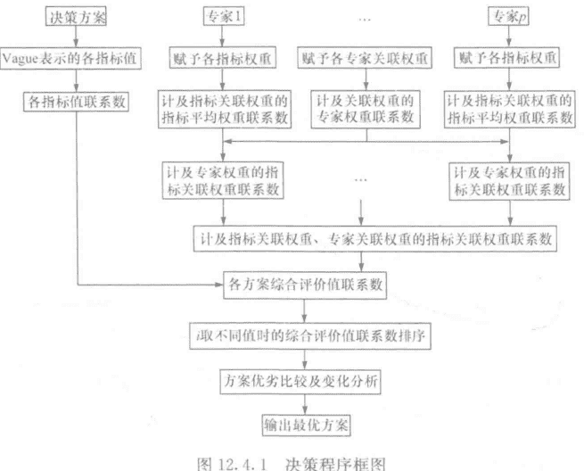

## 12.4.3 实战演示：六大方案优劣排序

**场景设定**  
某区域电网事故后需实施黑启动，现有 6 个备选方案待评估。评价体系包含 4 个核心指标：机组状态（c1）、爬坡速率（c2）、机组容量（c3）、变电站个数（c4）。所有指标数据经规范化处理，均为“越大越好”型 Vague 集数值，详见下表。

#### 表 12.4.1 候选方案 Vague 集指标矩阵

| 方案 | 机组状态 c1 | 爬坡速率 c2 | 机组容量 c3 | 变电站个数 c4 |
|:---:|:---:|:---:|:---:|:---:|
| 1 | (0.30,0.50) | (0.96,0.04) | (1.00,0.00) | (0.20,0.80) |
| 2 | (0.60,0.17) | (0.53,0.47) | (0.67,0.33) | (0.25,0.75) |
| 3 | (0.45,0.33) | (1.00,0.00) | (0.42,0.58) | (0.33,0.67) |
| 4 | (0.30,0.50) | (0.50,0.50) | (0.42,0.58) | (0.33,0.67) |
| 5 | (0.60,0.17) | (0.27,0.73) | (0.42,0.58) | (1.00,0.00) |
| 6 | (0.90,0.00) | (0.91,0.09) | (0.67,0.33) | (0.25,0.75) |

决策组由 3 位专家（$e_1, e_2, e_3$）组成。专家个体权重及组合关联权重均以 Vague 形式给出：
- 个体权重：$W(\{e_1\})=(0.30,0.60)$，$W(\{e_2\})=(0.40,0.50)$，$W(\{e_3\})=(0.40,0.30)$
- 二元关联：$W(\{e_1,e_2\})=(0.60,0.20)$，$W(\{e_1,e_3\})=(0.70,0.10)$，$W(\{e_2,e_3\})=(0.70,0.20)$
- 三元关联：$W(\{e_1,e_2,e_3\})=(1.00,0.00)$

三位专家对 4 个指标及其各阶组合给出的关联权重数据详尽（篇幅所限，此处保留原素材完整数据结构，包含单指标、二元、三元及四元组合权重）。

---

### 决策计算全流程

**步骤 1：专家权重确权**  
依据式（12.4.1）~（12.4.4）将 Vague 集转换为 $a+bi$ 形式联系数，采用“平均分配法”处理关联权重：将各阶组合权重均分至成员，再求各专家所有均分值的算术平均。计算汇总见下表。

#### 表 12.4.2 三位专家独立权重联系数（均值）

| 专家 | 综合权重 $W(E_j)$ |
|:---:|:---:|
| $e_1$ | $0.32075 + 0.075i$ |
| $e_2$ | $0.34575 + 0.0625i$ |
| $e_3$ | $0.35825 + 0.1125i$ |

**步骤 2：指标权重计算（以专家 $e_1$ 为例）**  
同理，将 $e_1$ 给出的指标关联权重转为联系数，经平均分配与求平均后，得到 4 个指标的独立权重联系数。进一步乘以专家 $e_1$ 的权重 $W(e_1)$，获得计及专家重要性后的指标权重贡献值。三位专家贡献值累加，即得最终指标权重向量（详见原表 12.4.3 详细中间过程）。

**步骤 3：方案指标值联系数化**  
将表 12.4.1 中的 Vague 集统一转写为联系数形式 $a+bi$，构建方案-指标评价矩阵。

#### 表 12.4.4 方案指标联系数矩阵

| 方案 | c1 | c2 | c3 | c4 |
|:---:|:---:|:---:|:---:|:---:|
| 1 | $0.30+0.20i$ | $0.96+0i$ | $1+0i$ | $0.2+0i$ |
| 2 | $0.60+0.23i$ | $0.53+0i$ | $0.67+0i$ | $0.25+0i$ |
| 3 | $0.45+0.22i$ | $1+0i$ | $0.42+0i$ | $0.33+0i$ |
| 4 | $0.30+0.20i$ | $0.50+0i$ | $0.42+0i$ | $0.33+0i$ |
| 5 | $0.60+0.23i$ | $0.27+0i$ | $0.42+0i$ | $1+0i$ |
| 6 | $0.90+0.10i$ | $0.91+0i$ | $0.67+0i$ | $0.25+0i$ |

**步骤 4：综合评价值聚合**  
代入基本模型 $M(S_v) = \sum p_v(c_k) W(c_k)$，结合步骤 2 得到的最终指标权重与步骤 3 的矩阵，计算 6 个方案的综合评价值联系数 $M(S_v)$：

- $M(S_1) = 0.52362 + 0.514542i$
- $M(S_2) = 0.434211 + 0.457318i$
- $M(S_3) = 0.467593 + 0.475347i$
- $M(S_4) = 0.331283 + 0.35277i$
- $M(S_5) = 0.49472 + 0.495011i$
- $M(S_6) = 0.575639 + 0.528601i$

**步骤 5：不确定性敏感性分析与排序**  
令联系数中的不确定度因子 $i$ 取值 $-1, -0.5, 0, 0.5, 1$，模拟不同风险偏好下的评价值变动。结果显示，**方案 6 在所有不确定度条件下均稳居榜首**，方案 1 紧随其后作为最佳备选。

#### 表 12.4.5 多场景下方案评价值及排序（圈内为名次）

| 方案 | $i=-1$ | $i=-0.5$ | $i=0$ | $i=0.5$ | $i=1$ |
|:---:|:---:|:---:|:---:|:---:|:---:|
| $S_1$ | 0.0091① | 0.2663② | 0.5237② | 0.7809② | 1.0382② |
| $S_2$ | -0.0231⑥ | 0.2056⑤ | 0.4342⑤ | 0.6629⑤ | 0.8915⑤ |
| $S_3$ | -0.0078③ | 0.2299④ | 0.4676④ | 0.7053④ | 0.9429④ |
| $S_4$ | -0.0215⑤ | 0.1549⑥ | 0.3313⑥ | 0.5077⑥ | 0.6840⑥ |
| $S_5$ | -0.0002② | 0.2472③ | 0.4947③ | 0.7422③ | 0.9897③ |
| $S_6$ | **0.0470①** | **0.3113①** | **0.5756①** | **0.8299①** | **1.1042①** |

> **结论**：综合优劣排序为 **方案 6 > 方案 1 > 方案 5 > 方案 3 > 方案 2 > 方案 4**。方案 6 为最优黑启动方案，方案 1 为备用方案。

---

## 12.5 基于集对联系度的主题关注网络社区发现

随着网络空间的深度渗透与繁荣，网络结构挖掘成为人工智能核心热点。以兴趣、主题聚合为核心的社交网络正重塑交互生态。张春英团队早于 2011 年引入集对分析研究网络社区，陈晓等人在其基础上进一步应用**集对联系度**（联系数），构建了**主题关注网络模型**，给出发现算法并经实验验证了模型合理性与算法经济性，极具应用价值。

### 12.5.1 主题关注网络社区：模型构建

网络社区涵盖论坛、贴吧、群组、个人空间等多元交互形态。同一主题下的社区聚合了共同兴趣的访问者，业务覆盖金融、会展、办公、管理、娱乐等全谱系。从拓扑视角看，主题关注网络是一个**以特定主题为核心节点的成熟社区局域网**，其模型拓扑如图 12.5.1 所示。

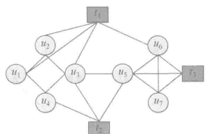

**图 12.5.1 主题关注网络社区模型示意**

该网络顶点由“个体用户”与“关注主题”双重实体构成；边连接用户间的社交关系及用户对主题的兴趣指向。这种**多实体类型、多关系语义**的异构特性，导致传统基于单一关系的社交网络分析方法失效。

为此，引入集对联系数（联系度）刻画用户关注主题后的深层相似性：
$$
u = \frac{S}{N} + \frac{F}{N}i + \frac{P}{N}j \quad \text{(12.5.1)}
$$
归一化后的三元联系度为：
$$
\mu = a + bi + cj, \quad a+b+c=1 \quad \text{(12.5.2)}
$$
其中 $a, b, c$ 分别对应同、异、不确定三维联系度。基于此相似性度量，设计社区发现算法，实验验证了模型有效性与计算高效性。

### 12.5.2 核心研究思路

1.  **双实体建模**：将“用户”与“主题”同步纳入建模视野，形式化定义主题关注网络；
2.  **联系度度量**：利用三元联系数量化用户基于主题关注的综合相似性；
3.  **算法设计**：基于相似性矩阵，提出社区划分与发现的具体计算流程；
4.  **实证验证**：通过对比实验确证模型合理性及算法的时间/空间经济性。

# 基于主题关注的网络社区发现：CMTC算法深度解析

在复杂网络分析中，如何精准捕捉用户间的潜在关联并高效划分社区，始终是核心课题。本文将系统拆解一套基于“主题关注网络”的创新框架，重点介绍其独特的顶点相似性度量体系与停止阈值聚类算法（CMTC）。

## 核心创新看点

这项研究主要贡献了两大关键技术突破：

1.  **引入集对联系度的相似性度量新范式**：摒弃单一拓扑视角，以“用户对主题的关注”为核心枢纽，利用集对分析中的“同、异、反”三元关系重构顶点关联。该方法巧妙量化了宏观不确定性与微观不确定性向确定性转化时的贡献差异，并引入**聚集系数**作为微观差异的量化锚点，同时对主题关联与网络拓扑结构实施差异化加权，显著提升了相似性指标的物理意义与计算精度。

2.  **研发CMTC（比较均值阈值聚类）算法**：针对传统凝聚层次聚类频繁更新、计算开销大的痛点，设计了一种融合“顶点优先凝聚”与“社区间均值凝聚”的混合策略，并内置停止阈值机制。该算法能有效锁定高相似顶点内聚、低相似顶点分离的最优划分，避免了冗余迭代，兼顾了效率与效果。

---

## 12.5.3 模型构建：定义主题关注网络

### 网络骨架与数学表达

我们构建的**主题关注网络**形式化为二元组 $G = (V, E)$，其顶点集 $V$ 由用户实体集 $U = \{u_1, ..., u_n\}$ 与主题实体集 $T = \{t_1, ..., t_m\}$ 组成。边集 $E$ 仅包含两类关系：**用户间社交链接** $E_U$ 与 **用户-主题关注链接** $E_{UT}$，显式排除了主题间的直接关联。

对应的邻接矩阵拆解为两部分：
*   **用户邻接矩阵 $A_U$ ($n \times n$)**：记录用户间是否存在直接连接（1/0）。
*   **用户-主题邻接矩阵 $A_{UT}$ ($n \times m$)**：记录用户是否关注特定主题（1/0）。

> **直观示例**：假设网络含 7 用户（$u_1 \sim u_7$）与 3 主题（$t_1 \sim t_3$）。用户 $u_1$ 连接 $u_2, u_4$ 并关注 $t_1$；用户 $u_5$ 连接 $u_3, u_6, u_7$ 并关注 $t_2, t_3$……以此类推构成稀疏矩阵，为后续邻居挖掘奠定基础。

### 邻居体系的层级化定义

为刻画多跳关联，我们定义了从 1 级到 2 级、乃至跨层的邻居集合：

| 邻居类型 | 核心含义 | 关键符号 |
| :--- | :--- | :--- |
| **1 级邻居** | 直接相连的用户($NU_1$)与主题($NT_1$) | $N(u_i)_1 = NU_1 \cup NT_1$ |
| **共同 1 级邻居** | 两顶点共享的直接用户/主题 | $CN_1 = CNU_1 \cup CNT_1$ |
| **2 级邻居** | 经 1 级用户跳转到达的新用户/新主题 | $N(u_i)_2 = NU_2 \cup NT_2$ |
| **共同 2 级邻居** | 两顶点共享的 2 级用户/主题 | $CN_2 = CNU_2 \cup CNT_2$ |
| **跨层邻居 (1∩2 / 2∩1)** | 一方的 1 级与另一方的 2 级交集 | $CN_{1∩2}, CN_{2∩1}$ |

这些定义构建了从“强关联”到“弱关联”、“隐性关联”的完整谱系。

### 顶点间“同、异、反”三元关系刻画

基于上述邻居体系，利用集对分析理论，将任意两用户 $u_i, u_j$ 的关系解构为三维向量：

*   **同关系 (S - 共同确定属性)**：权重最高的核心证据。包含三部分：
    1.  $S_1$：共同关注的**1 级主题**数（$|CNT_1|$）。
    2.  $S_2$：共同的**1 级用户邻居**数（$|CNU_1|$）。
    3.  $S_3$：两顶点**直接相连**（二值 0/1）。
    *权重设定*：$w_1 > w_3 > w_2$ 且和为 1，体现“共同兴趣 > 直接社交 > 共同好友”的重要性递进。

*   **异关系 (F - 不确定属性)**：潜在关联的储备池。汇总**跨层主题邻居**（$1∩2, 2∩1$）与**共同 2 级主题邻居**。这些是“可能同属一群但未直接显现”的桥梁。

*   **反关系 (P - 对立属性)**：网络其余部分，$P = N - S - F$ ($N=|V|$)。在社区发现中，我们令其标记 $j=0$，即不作为合并依据，聚焦于“同”与“异”的博弈。

### 关键创新：基于聚集系数的差异标记 $i(t_k)$

这是模型精准度的“定海神针”。传统灰度法难以直接用于网络顶点相似性，**聚集系数 (Clustering Coefficient, CC)** 的引入完美解决了“不确定属性转化为确定属性的概率”量化难题。

针对三类异关系场景，差异标记 $i(t_k)$ 定义为桥接用户聚集系数的**加权平均**：

1.  **场景 $1∩2$** ($t_k \in CNT_{1∩2}$)：
    $i(t_k) = |CN_1| \times \frac{\sum CC(u_p)}{|CN(t_k, u_j)_1|}$ （$u_p$ 为 $t_k$ 与 $u_j$ 的共同 1 级用户邻居）
2.  **场景 $2∩1$** ($t_k \in CNT_{2∩1}$)：
    $i(t_k) = \frac{\sum CC(u_q)}{|CN(u_i, t_k)_1|}$ （$u_q$ 为 $u_i$ 与 $t_k$ 的共同 1 级用户邻居）
3.  **场景 2 级** ($t_k \in CNT_2$)：
    $i(t_k) = \left( \frac{\sum CC(u_q)}{|CN(u_i, t_k)_1|} \right) \times \left( \frac{\sum CC(u_p)}{|CN(t_k, u_j)_1|} \right)$ （双向桥接概率相乘）

**物理意义**：桥接用户的局部聚集系数越高，说明该主题连接的用户群内部越紧密，该“异关系”转化为“同关系”的可信度越大。

### 顶点联系度最终公式

综合上述，顶点 $u_i, u_j$ 的联系度 $u(u_i, u_j)$ 为：

$$ u(u_i, u_j) = \frac{S_1 w_1 + S_2 w_2 + S_3 w_3}{N} + \frac{\mathbf{1}^T \cdot \mathbf{i}(t_k)}{N} + \frac{P \cdot 0}{N} $$

其中向量 $\mathbf{i}(t_k)$ 汇聚了所有异关系主题的差异标记值。这不仅是相似度，更是融合了**拓扑结构、语义兴趣、结构紧密度**的综合关联强度。

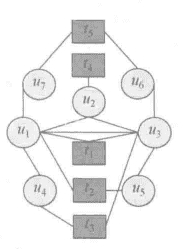

> *注：图 12.5.3 直观展示了 $u_1$ 与 $u_3$ 间的同/异关系分布，如共同 1 级主题 $t_1$、跨层桥接 $t_2, t_3$ 及 2 级桥接 $t_4, t_5$。*

---

## 12.5.4 算法实战：CMTC 社区发现流程

### 核心度量扩展：从顶点到社区

算法运行前，需定义两个宏观指标：
1.  **社区间联系度 $u(C_K, C_S)$**：两社区所有顶点对联系度的**算术均值**。
2.  **网络整体联系度 $u(G)$**：全网顶点对联系度均值，等价于所有顶点平均联系度。

### CMTC 算法步骤详解

**输入**：用户邻接矩阵 $A_U$，用户-主题矩阵 $A_{UT}$。
**输出**：$K$ 个互斥子社区 $\{C_1, ..., C_K\}$。

| 步骤 | 操作逻辑 | 关键判断/动作 |
| :--- | :--- | :--- |
| **1. 初始化** | 原子化分割 | 每用户自成一社区：$C_i = \{u_i\}$。 |
| **2. 预计算** | 全网两两联系度 | 计算所有 $u(u_i, u_j)$，构建相似度矩阵。 |
| **3. 核心聚合循环** | **贪心合并 + 双重守门机制** | ① 找全网**最大联系度**对 $(u_i, u_j)$。<br>② **顶点级守门 (优先凝聚)**：若 $u(u_i, u_j)$ 大于 $u_i$ 或 $u_j$ 与**任意其他顶点** $u_k$ 的联系度，则直接合并。<br>③ **社区级守门 (均值凝聚)**：若存在社区 $C$，使 $C$ 内**所有**成员与 $u_i$ (或 $u_j$) 的联系度**均大于** $u(u_i, u_j)$，则将该顶点并入 $C$。<br>④ 不满足上述，本轮不合并。 |
| **4. 迭代收敛** | 重复步骤 3 | 直到无顶点对可合并。 |
| **5. 孤立点处理** | 兜底策略 | 若存在未聚合的孤立顶点，执行步骤 6；否则跳转步骤 7。 |
| **6. 孤立点归属** | 最大亲和力原则 | 计算孤立点与各现有社区的联系度均值，归入最大者。 |
| **7. 输出结果** | 终止 | 返回最终社区划分。 |

### 算法设计亮点解析

*   **“双轨合并”策略**：步骤 3 的 ① 处理“铁哥们”式的强绑定（顶点优先）；②/③ 处理“融入圈子”式的弱绑定（社区均值优先）。两者互补，避免了单一链接聚类的链式效应或重心漂移。
*   **内置停止阈值**：无需预设类别数 $K$，由联系度大小自然决定合并边界。当最大联系度无法满足守门条件时自动收敛，即“比较均值阈值”的含义所在。
*   **复杂度优化**：预计算联系度矩阵，聚合过程仅做阈值比较与均值更新，避免了传统凝聚层次聚类每步重算相似度的 $O(n^3)$ 高昂开销。

---

## 总结

该框架通过**“主题关注建模 + 集对联系度量 + CMTC 聚类”**三板斧，实现了从数据表达到社区划分的全链路闭环。它不仅在数学定义上严谨自洽（邻居层级、同异反解构、聚集系数量化），更在算法工程上兼顾了精度与效率，为兴趣驱动的社交网络社区发现提供了极具参考价值的范式。后续可探索动态网络下的增量更新机制，或将权重学习引入 $w_1, w_2, w_3$ 以适应异构场景。

### 基于主题关注网络的 CMTC 社区发现算法：流程、实验与效能解析

#### 算法核心流程：从孤立节点到稳定社区的聚合之旅

CMTC 算法的执行逻辑可拆解为四个递进阶段，层层推进，最终锁定稳定的社区结构：

1.  **初始化孤岛**：算法起始时，将网络中每个顶点均视为一个独立的初始社区（对应步骤 1）。
2.  **度量联结强度**：计算任意两顶点间的“联系度”，量化其关联紧密程度（对应步骤 2）。
3.  **微观层面聚合（步骤 3~6）**：针对孤立顶点 $C_i=\{u_i\}$，寻找其联系度最大的邻居 $u_j$，将 $u_i$ 并入 $u_j$ 所在社区。循环此过程，直至不再存在孤立社区，形成初始社区雏形。
4.  **宏观层面融合（步骤 7~9）**：计算社区间联系度 $u(C_K, C_S)$ 与网络整体联系度 $u(G)$。选取联系度最大的两个社区，若其值达标（$\ge u(G)$），则合并为 $C_{new}$ 并更新关联矩阵；重复判断，直至最大社区间联系度低于全网阈值，算法终止。

#### 算法复杂度剖析：为何能做到 $O(n^2)$？

CMTC 的计算效率核心在于**联系度计算的局部性**与**合并策略的轻量化**：

*   **联系度计算上限**：引入集对分析思想，将路径最大有效长度限制为 4 步（$\ge 5$ 步联系度归零）。对于任意顶点 $u_i$，仅需遍历其 4 步内邻居（数量 $K$）及各级共同邻居集（CN1, CNT12, CNT21, CNT2），单顶点计算量为 $O(K(\text{CN}1 + \text{CNT}12 + \text{CNT}21 + \text{CNT}2))$。
*   **关键操作开销**：
    *   选取最大联系度对：$O(n \log n) + O(n)$；
    *   独立/非独立社区关系判断：$O(n^2)$；
    *   社区合并操作：$O(1)$；
    *   联系度矩阵更新：$O(n)$。
*   **总复杂度**：主导项为 $O(n^2)$，在保证精度的前提下实现了工程落地的高效性。

---

### 实验验证：主题如何重塑社区版图？

实验环境：Intel i7-4760HQ、8GB 内存、Win 8、JDK 1.7、Eclipse 4.3。

#### 1. Zachary 空手道俱乐部网络：教科书级的“分裂与重聚”

该网络 34 节点、78 边，真实背景为教练（节点 1）与校长（节点 34）因收费分歧导致俱乐部一分为二。实验通过“植入主题”这一变量，直观展示兴趣驱动结构演变。

| 实验场景 | 社区数量 | 关键发现 | 机制解读 |
| :--- | :---: | :--- | :--- |
| **无主题** | 3 个 | 真实社区 3 保持不变；教练侧社区被拆分为社区 1（紧密核心）与社区 2。 | 社区 1 结构内聚，但与社区 2 联系度未达合并阈值，**结构合理性自证**。 |
| **跨社区植入 1 个主题 T** (节点 1,5,11) | **2 个** | 社区 1、2 合并，还原真实划分。$u(u_1,u_5)$ 从 0.0221 跃升至 0.0414。 | 共同兴趣**强化强联系**，并将弱联系（如 $u_1-u_{17}$）转化为强联系，**主题充当“社交胶水”**。 |
| **跨社区植入 1 个主题 T** (节点 9,3,14,20) | 3 个 | 社区 3 边缘节点（9,10,28,29）被“吸附”至社区 2。$u(u_3,u_{10})$ 从 0.0129 增至 0.0197。 | 主题分布**不对称**导致“强者吞噬弱者”，边缘节点随核心兴趣漂移。 |
| **全网植入 2 个主题** | 2 个 | 还原真实划分；社区 1、2 因共同主题 T1 合并，社区 3 因专属主题 T2 内部凝固。 | **共性主题促融合，特异主题强内聚**。 |
| **随机植入主题** | 不定 | 结构随主题分布剧烈波动：或成巨型社区，或碎片化。 | **主题分布主导拓扑**，印证“共同兴趣驱动链接形成”的社会学假设。 |

> **核心结论**：主题 T 不仅量化增强了顶点联系度，更**质变性地主导了社区划分边界**，完美诠释了“志同道合者，结为社群”的启发式真理。

#### 2. 豆瓣影评真实数据集：大规模稀疏网络的“聚合增强器”

*   **数据画像**：2253 用户、36 电影主题、2.8 万用户关系边、3.5 万用户-主题关注边。
*   **对照实验**（剔除 <10 节点微小社区）：

| 指标 | 非主题网络 (仅社交) | **主题网络 (社交+兴趣)** | 变化趋势 |
| :--- | :---: | :---: | :--- |
| 社区数量 | 23 | **13** | **↓ 43%** (结构更简化) |
| 平均规模 | 31.79 | **34.42** | **↑ 8%** (规模更宏大) |
| 最大社区 | 1065 | **1559** | **↑ 46%** (巨型核心现身) |

*   **主题关注度 (TAD) 深度画像**：引入指标 $TAD(t_k)$ 衡量社区内主题聚焦度。
    *   **无主题时**：最大社区内 36 部电影关注度均匀分散，**无显著兴趣焦点**；
    *   **有主题时**：关注度高度聚焦于 Topic 6, 19, 13, 8, 15，**兴趣指纹清晰可见**。
*   **可视化结构（图 12.5.10）**：
    *   红色大社区：**双重加持**（结构稠密 + 主题高度相似）；
    *   蓝/绿/粉色社区：**兴趣驱动**（结构疏松但主题高度同构），验证了模型“补全结构缺失、挖掘隐性群体”的独特价值。

#### 3. 量化评估：F 值碾压对标算法

评价指标 $F = \frac{1}{K} \sum \frac{W_{in}^C}{W_{in}^C + W_{out}^C}$，核心逻辑：**优秀社区 = 内部主题相似度 $\gg$ 外部主题相似度**。

| 方法来源 | 社区数量 | **F 值 (越大越优)** | 结论 |
| :--- | :---: | :---: | :--- |
| 文献 [5] (张春英早期模型) | 19 | 0.2682 | 基准线 |
| 文献 [6] (动态挖掘算法) | 17 | 0.3986 | 有提升 |
| **本节 CMTC 算法** | **13** | **0.5965** | **显著领先，内聚外离特性最强** |

---

### 结语与展望：双谱融合的创新与未来

陈晓等人的工作在张春英团队集对社会网络奠基之上，实现了关键跨越：
1.  **模型创新**：融合**“社交图谱” (显性链接)** 与 **“兴趣图谱” (隐性主题)**，构建主题关注网络。
2.  **度量突破**：用集对联系数刻画同/异/不确定三元关系，给出**路径长度有界、计算简明**的顶点相似性新定义。
3.  **实证扎实**：Karate 网络机理透彻、豆瓣实战效能卓越（F 值提升 50%+），证明**主题感知让社区更紧密、更纯粹、更符合社会学认知**。

**待解之谜**：当前模型为静态快照。**主题兴趣随时间迁移、社区边界动态演化**的建模与挖掘，是通往“智能社会”全景图谱的必经之路。

---

### 本章小结：智能社会的碎片化探索与必然趋势

从社会形态学视角，智能社会是人类高级阶段，当前处于**起始期**。本章选取集对分析在社会智能化（交通、隐私、决策、网络）中的代表性探索，虽显碎片化，实则是**不同层次、不同角度的同频共振**。正如全书贯穿的“智脑系统”、“集对人”及后续章节所示，**确定性与不确定性的对立统一**贯穿智能变迁史。集对分析以“客观承认、系统描述、定量刻画、具体分析”不确定性的数学本质，注定在人工智能版图中占据核心坐标。本书即为这一阶段性应用的有力注脚。

致谢傅京孙、蔡自兴、涂序彦、钟义信、何华灿、李德毅等前辈巨擘及无数青年学者，以智慧铺就通往智能社会的阶梯。

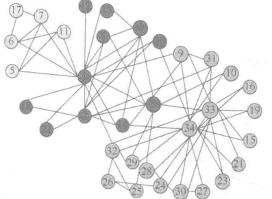
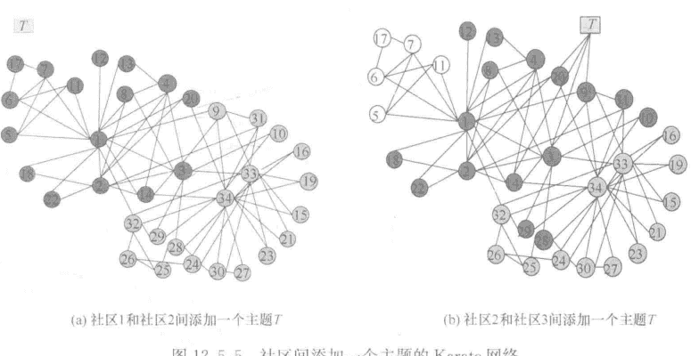
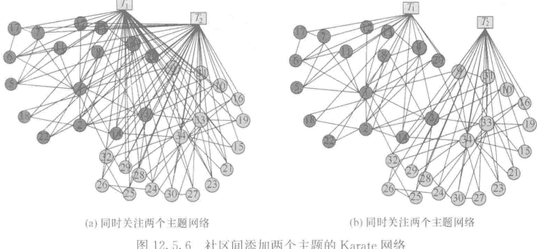
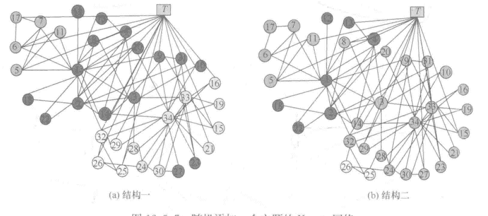


人工智能浪潮正当时，地标建筑拔地而起，智能终端已普及千家万户。形态各异的机器人借力海量数据、云端算力与网络互联，正加速催生“机器人社会”，与人类文明互补共生，合力开创“智能社会”新形态。社会计算、网络计算与量子计算的迭代演进，持续拓展认知边界，革新思维范式。受限于学术造诣，加之早年已有《信息处理集对分析》问世，本书不再展开体系阐释。然“集对”与“智脑”两大核心概念的首度亮相，为该理论在AI领域的深化实践注入全新视角。期冀出版能加速集对分析在人工智能中的工程化落地。

作者 敬识
二〇一七年五月廿一日

### 「智能科学技术著作丛书」收录名录

- 基于免疫理论的智能故障检测与诊断方法 田玉玲
- 语音处理及人机交互技术 张毅 等
- 先进多目标粒子群优化理论及其应用 张勇 等
- 智能粒子群优化计算 ——控制方法、协同策略及优化应用 介婧 等
- 生物地理学优化算法及应用 郑宇军 等
- 机器人大脑 肖南峰 等
- 基于组合式信号源的块结构模型辨识方法 贾立
- 基于信息融合的无线传感器网络部署 张聚伟
- 头脑风暴优化算法理论及应用 吴亚丽 等
- 人工智能集对分析 蒋云良 等

[General Information]
书名=a
SS号=14346268