# 智能博弈对抗：从理论到军事实践的进阶指南

## 丛书序：定义智能科学新边界

“智能”是信息深度结晶的精华，“智能科学技术”则是信息科技发展的辉煌篇章，而“智能化”更标志着信息化进程迈入了全新阶段。

所谓“智能科学技术”（IST），聚焦于“广义智能”的理论算法与应用技术，其研究版图涵盖五大维度：一是“自然智能”，包含人类智能与生物智能；二是“人工智能”，即机器智能与智能机器；三是“集成智能”，指人机互补融合的混合智能；四是“协同智能”，指个体间协调共生的群体智能；五是“分布智能”，如广域网络与大型分散系统中的分布式智能。

自1956年人工智能学科诞生以来，历经跌宕起伏，已从狭义走向广义，从个体迈向群体，从集中式跨越至分布式，在理论与应用层面均斩获重大突破。如果说AI诞生于生物、信息与系统科学的首次融合，那么IST的崛起，则是信息化、网络化时代的又一次多学科深度交融。

1981年中国人工智能学会（CAAI）成立，历经二十余载，从跟随学习转为自主创新，凝聚国内学者之力，推动智能科技显著进步。受华夏文化与东方哲学熏陶，我国研究呈现综合性、整体性、协调性特色，成果极具创新性与开拓性，“智能化”已成新技术、新产品的核心标识。

为总结交流我国学者在IST领域的硕果，学会联手科学出版社推出“智能科学技术著作丛书”。重点在于：优先出版那些能将科技转化为生产力、对国民经济与社会建设具重大应用前景的著作。我们坚信，在广大工作者与编委共同努力下，该丛书必将为繁荣我国智能事业、增强自主创新、建设创新型国家贡献核心力量。

> **贺词**
> 智能科技领域广
> 人机集成智能强
> 群体智能协同好
> 智能创新更辉煌
>
> —— 徐子淳 / 中国人工智能学会荣誉理事长 / 2005年12月18日

---

## 前言：为何对抗是AI进化的最佳试炼场

在经济、政治、金融乃至日常生活中，对抗、竞争与合作交织共存。对抗，始终是推动人类文明跃迁的最强引擎。个体与群体间复杂的动态博弈演化，不断倒逼人类智能迭代升级。无论是人与自然、人与人，还是人与机器，对抗都是社会发展的主旋律，更是人类思维活动与智能本质的集中体现。

AI技术已历经计算智能、感知智能两个阶段，当前在云计算、大数据、互联网加持下，正加速向“认知智能”第三阶段跨越。近年以AlphaGo（围棋）、Pluribus（德州扑克）、AlphaStar（《星际争霸》）、Suphx（麻将）为代表的AI，在人机对决中接连击败人类顶尖高手。这类“智能博弈对抗技术”，为AI从计算、感知迈向认知智能提供了全新范式。

展望军事未来：高复杂环境、不完全信息、强对抗博弈、高动态响应、自主无人化、多域跨域……一系列硬核课题摆在面前。智能化作战体系将具备自适应、自学习、自对抗、自修复、自演进“五自”能力，认知对抗辅助决策将引领无人集群自主对抗力质变。各国军方加速智能化建设，急需前沿理论落地军事对抗，这极大催化了AI技术爆发。将智能博弈技术植入指控系统，通过持续进化超越人类决策水平，正成为验证AI军事应用潜力的关键突破口。

**本书共10章，架构清晰：**

*   **第1章（绪论）**：奠基核心概念，梳理内涵与意义，从即时策略、序贯策略、军事仿真三大视角全景扫描研究应用版图。
*   **第2-4章（理论基石）**：
    *   第2章：立足博弈论，构建多智能体学习方法体系。
    *   第3章：由马尔可夫决策过程引入，深度解析强化学习、深度强化学习、分层强化学习及三大分布式框架。
    *   第4章：聚焦对手建模（显式/隐式）、即时策略对抗规划、序贯策略对手剥削，直指难点与前沿。
*   **第5-8章（实战范式）**：三大平台实证：
    *   第5章：《星际争霸》即时策略对抗——问题抽象、挑战拆解、关键技术、AI演进史、环境搭建、多智能体挑战平台实测。
    *   第6章：德州扑克非完全信息博弈——规则复杂度、关键技术、AI发展史、系统架构、单人/多人无限注实测。
    *   第7章：斗地主与桥牌不完全信息合作对抗——规则建模、复杂度分析、智能体谱系、平台实测。
    *   第8章：兵棋推演军事仿真对抗——基础复杂度、关键技术、AI演进、系统构成、桌面推演开发全流程复盘。
*   **第9-10章（前沿哨所）**：
    *   第9章：元宇宙、元博弈、元认知、元学习等元理论前沿透视。
    *   第10章：微分博弈、攻防博弈、平均场博弈三大模型，落子视觉欺骗检测、复杂网络攻防、无人机集群对抗三大典型场景。

各章相对独立，读者可按需阅读，参考文献直通前沿。编撰过程中参考海量文献，图表多源自优秀论文，致谢所有铺路者。感谢陆丽娜、魏婷婷、李阳阳、陈诗凯、詹俊、姚箴、王尧等协助，及国家自然科学基金(61806212)、湖南省研究生创新项目(CX20210011)资助。水平有限，疏漏在所难免，恳请各界批评指正。

---

## 本书架构速览

*   **第1章 绪论**
*   **第2章 多智能体学习方法**
*   **第3章 强化学习体系与分布式框架**
*   **第4章 对手建模、对抗规划与剥削策略**
*   **第5章 即时策略对抗实战：《星际争霸》**
*   **第6章 非完全信息博弈实战：德州扑克**
*   **第7章 合作对抗实战：斗地主与桥牌**
*   **第8章 军事仿真对抗实战：兵棋推演**
*   **第9章 前沿元理论：元宇宙、元博弈与元学习**
*   **第10章 典型应用场景：视觉欺骗、网络攻防、无人机集群**

---

## 第1章 绪论：智能博弈对抗的核心逻辑与研究范式

### 1.1 破题：对抗如何重塑认知智能

民用领域里，对抗无处不在，它是文明进化的最强推手。个体与群体间的动态博弈，持续驱动智能跃迁。军事领域更是对抗的主战场：高复杂、不完全信息、强对抗、高动态、自主无人、多域跨域……智能认知决策面临前所未有的挑战。全球军方竞相布局智能化，渴望前沿技术落地实战，这股需求反哺AI飞速进化。具备“五自”能力的智能化作战体系，在认知对抗引导下，将让无人集群自主对抗力大幅跃升。将博弈技术嵌入指控系统，通过持续进化超越人类决策，是检验AI军事潜力的“试金石”。

AI发展轨迹清晰：计算智能→感知智能→**认知智能**（进行中）。云算力、大数据、互联网是底座。近年认知决策技术突围，核心在于**非完全信息动态博弈**与**多智能体深度强化学习**。AlphaGo、Pluribus、AlphaStar等接连“屠榜”，标志着智能博弈对抗已成为通往认知智能、乃至强人工智能的**新范式**。认知智能聚焦理解、推理、思考、决策，表现为自主态势感知与深度理性决策，这是通往强AI的必经之路，应用前景极其广阔。

本书以智能博弈对抗理论为基石，深入强对抗环境下的不完全信息动态博弈难题与求解之道，为各类AI开发设计提供实战指南。

### 1.2 核心内涵：什么是“智能博弈对抗”？

#### 1.2.1 定义与演进逻辑

广义智能包含人工、机器、混合、群体智能。本书语境下，“智能”特指**认知智能层面的机器自主决策能力**——即机器智能。表现为：机器模拟人类行为思维，通过传感器感知外界，经存储数据比对识别，实现判断、推理、决策。智能分级：从简单应激反射、基础控制模式，到复杂神经网络与深度学习。

博弈对抗是人类演化的核心交互，广泛存在于个体、群体间。**智能博弈对抗**聚焦“如何用新AI范式设计先进智能体”，通过人机、机机、人机协同对抗，攻克计算机博弈难题。其本质：**用博弈学习法复盘人类认知决策形成机理，揭示AI进化超越人类的内在生成路径，为类人智能、强AI铺路。**

研究三要素：**环境、人、AI程序**。
*   **环境**：博弈空间，具巨复杂、高动态、不确定、强对抗特性。
*   **人**：智能载体，以人机对抗衡量AI水平，在训练中扮演“引导者”。
*   **AI程序**：机器智能载体。三阶段进化：
    1.  **初级**：人机交互，模仿学习，击败单人。
    2.  **中级**：种群进化，鲁棒性增强，击败群体，达高段位。
    3.  **终极**：获类人智能，登强AI堂，走向人机协同、融合、共生，反哺人类决策。

总结：智能博弈对抗以**智能体对抗为途径，多智能体动态博弈学习为核心**，实现AI程序高速进化与认知决策跃迁，是强AI的关键支撑。得益于云计算、大数据、多智能体学习，该范式更具通用性。

#### 1.2.2 概念辨析：三大领域的边界与联系

智能博弈对抗与计算机博弈、人机对抗有交叉，更有本质区别。以下对比凸显本书研究特性。

**1. 计算机博弈：AI的“果蝇”与试验田**
相对真实世界，游戏世界易形式化，是测试AI的完美平台。早期仅含棋牌，后纳入视频、即时策略游戏。它是AI重要分支，被誉为“果蝇”，是机器智能、兵棋推演、智能决策的科研基石。通过AI博弈理解智能本质，是认知对抗决策的前沿高地。

**发展里程碑**：
*   **萌芽期**：跳棋（1950s）→ 国际象棋（1967年胜人类）→ 围棋AI雏形。
*   **探索期**：日本“第五代计算机”（1982）引发全球竞赛→ 90年代转向基础研究。
*   **突破期**：
    *   1997：IBM“深蓝”胜国际象棋冠军（博弈树搜索+超算）。
    *   2016：AlphaGo胜李世石（深度学习+MCTS）。
    *   2017：AlphaGo Zero零样本自博弈超越；DeepStack/Libratus征服单人无限注德州扑克（攻克非完全信息）。
    *   2019：Pluribus破解多人德州扑克（Science刊文）；Suphx麻将超人类；AlphaStar拿下《星际争霸2》。
*   **意义**：从完全信息到非完全信息，从回合制到即时制，从单智能体到多智能体，每一步都在逼近真实世界的复杂度。

**2. 人机对抗：AI的“炼金石”与试金石**
定义：强对抗环境下，研究AI程序战胜人类的方法。从图灵测试始，见证AI跨越式进化。

**关键节点回溯**：
*   **1997 “深蓝”（国家队级）**：单机2亿步/秒搜索，博弈树极致优化，胜象棋冠军。
*   **2015 施达利（Atari游戏）**：像素输入直接决策，多游戏超人类，深度强化学习雏形。
*   **2016 AlphaGo/Master**：深度强化学习+MCTS，击败李世石、柯洁，Master版在线连胜顶尖高手。
*   **2017 群星闪耀**：
    *   DeepStack/Libratus：深度神经网络/博弈论+自博弈，均胜/完胜职业扑克手。
    *   “先知”兵棋AI：7:1横扫人类大师。
    *   AlphaZero：零知识通用架构，横扫围棋、国际象棋、将棋。
*   **2018-2019 多智能体与复杂环境**：
    *   “神谕之棋”：多功能一体化、种群博弈。
    *   Pluribus：多人德州扑克顶尖水平。
    *   OpenAI Five (Dota2 2.0)：强化学习+自博弈，夺世界冠军。
    *   AlphaStar：《星际争霸2》多人竞技对抗达人类顶级水平。

**3. 智能博弈对抗：本书核心——超越胜负的认知跃迁**
区别于前二者单纯追求“赢”，智能博弈对抗强调**“认知决策智能的形成与进化机制”**。它不满足于特定游戏的超人表现，而是以对抗为熔炉，提炼通用的认知决策算法，最终服务于人机共生与强人工智能的实现。这是从“专用智能”向“通用智能”、从“工具属性”向“伙伴属性”的质变。

---

**[内容节选自《智能博弈对抗方法与实践》前言及第1章，后续章节将深入展开理论方法与平台实战细节]**

### 核心里程碑：棋牌与电竞AI的突破历程

#### 2020年：多元化突破的奠基之年

**Supx 棋类智能体**
- 率先攻克人类职业高手防线的开创性程序
- 摒弃人类棋谱，纯自博弈强化学习进化

**绝悟 Suphx（麻将）**
- 天凤平台史上首个冲击“十段”神坛的AI
- 实力跻身人类顶尖段位行列

**超级 SL 王者荣耀 AI**
- 创新人机交互范式，原生支持多人混战
- 算法架构突破实现多人对抗协同

**绝悟（王者荣耀版）**
- 深耕电竞竞技垂直领域
- 构建海量标注数据集，夯实训练基石

#### 2021年：向复杂不完全信息博弈挺进

**DanZero 斗地主 AI**
- 迈入专家级竞技水准
- 零人类对战数据依赖，纯自博弈探索卡牌组合与出牌策略

**Gamebreaker (DARPA军事推演项目)**
- 将AI引入军事世界模拟推演核心环节
- 打破传统推演“仅模拟不设计”的固有局限

**AlphaFold 蛋白质结构预测 AI**
- 企业级全天候自动化运行的结构预测引擎
- 覆盖5.01至5.10任意序列可折叠蛋白质解析

---

### 核心命题：对抗驱动智能进化

以人机博弈为试金石，历来是衡量AI认知智能高度的标尺。其本质在于通过人机对抗这种特定范式，深度剖析机器战胜人类智能的内在生成机理与技术支撑原理，这注定将成为认知智能研究的“北极星”。恰如自然界中人与环境的协同演化，AI与人类的持续博弈将倒逼算法智能不断跃迁。不过，人机对抗仅是智能博弈的初级形态。当前领域已全面突破单一人机模式，**机机自博弈**、**人机协同对抗**等新范式正成为推动AI智能阶跃的核心引擎。

#### 3. 智能博弈对抗：通往强AI的新范式

本书聚焦的“智能博弈对抗”是计算机博弈领域的延伸与深化，涵盖人机对抗、机机对抗、人机协同等多元形态（见图 1.3），旨在为认知决策智能通往强人工智能铺设新航道。该领域起步于利用博弈学习技术建模智能体与环境的交互、沉淀知识，并借助种群自博弈实现进化迭代，最终目标是在特定领域超越人类顶尖选手（或顶级人机混合团队），在受控于人类的前提下，落地人机协同、融合乃至共生场景。这一新型研究范式将以计算机博弈问题为牵引，充分释放多智能体学习新范式的潜能，将AI技能从策略空间底部的“蜗牛状态”推向顶峰。

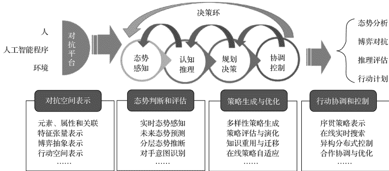

图 1.3 智能博弈过程建模与关键技术架构[3]

#### 1.2.3 研究价值：理论重塑与应用赋能双轮驱动

智能博弈对抗是AI版图中极具分量的分支，理论工具箱覆盖博弈论、强化学习、机器学习等，研究力量渗透至国土安防、网络安全、机器人等前沿阵地。其理论基石植根于多智能体学习，核心囊括**非完全信息动态博弈**（擅长建模序贯交互式多方博弈）与**多智能体马尔可夫博弈**（适配同时行动的多智能体协同对抗）。

**理论层面的颠覆性突破：** 在围棋、德州扑克、《星际争霸》等硬骨头问题上取得里程碑式进展，打破了传统博弈论对“均衡概念”的过度迷恋。AI技术的爆发为博弈论装上强力引擎，海量曾被视为不可解的复杂博弈难题正被层出不穷的新方法攻克。强化学习、元学习、集成学习、迁移学习等新范式的引入，叠加高效搜索、安全剪枝、并行优化、子博弈求解、自博弈等工程技术的成熟，为超大规模、不完全不确定环境下的智能决策筑牢根基。

**应用层面的全域渗透：** 技术红利已溢出实验室。
- **民用版图：** 自动驾驶博弈、芯片布局设计、电商推荐/广告竞价、金融风控、机器人控制；
- **军用前沿：** 智能态势感知、战术辅助决策、训练分析系统；
- **经社会治：** 社会治安防控、数字金融风控、拍卖机制设计；
- **军事作战：** 战争推演/预测/学习的核心方法论，支撑指挥智能化、无人集群跨域协同、多域防空、海上舰队对抗等硬核场景。

### 1.3 智能博弈对抗：研究应用全景扫描

第三次AI浪潮至，智能博弈对抗俨然成为全球顶尖学府、研究机构的“必争高地”。海外阿尔伯塔大学、卡内基梅隆大学、DARPA、DeepMind、OpenAI等巨头深耕不辍；国内清北、中科院自动化所、国防科大、哈工大及阿里、腾讯等产业巨头也从多维度布局。典型应用呈现**即时策略对抗**、**序贯策略对抗**、**军事仿真对抗**三大阵营。

#### 1.3.1 即时策略类对抗：微操与宏观的极限博弈

**1. 《星际争霸》：不确定性下的宏微融合**
这款暴雪出品的RTS经典（图 1.4），凭借三大种族差异化设定、海量单位建筑、生产/部署/微操三层决策架构，构建了极具挑战性的博弈环境：巨大观测/动作空间、局部可观、长时延决策、多人混战。单纯自博弈易陷入“循环压制”陷阱（策略A<B<C<A），导致泛化性失效。
2018年，DeepMind推出 **AlphaStar**[4]（《Nature》刊载），以神族身份两度5:0横扫职业选手。其展现的不仅是超人类的多线程微操（多地图同时作战），更是成熟职业级的宏观战略布局。

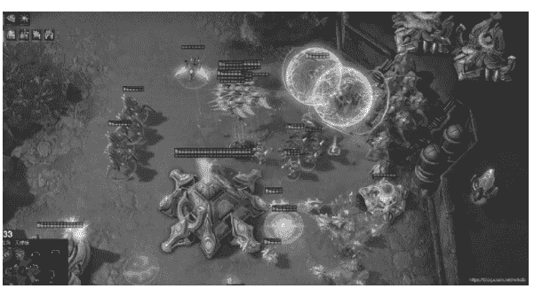

图 1.4 《星际争霸》游戏画面

**2. 《刀塔 2》：长时程下的团队协同博弈**
5V5非对称地图、远古遗迹守卫、英雄技能体系、小兵经济线、装备成长树（图 1.5），构建了极度复杂的协同竞技场。2019年，OpenAI基于大规模自博弈强化学习打造 **OpenAI Five**[5]，日训练量折合人类180年经验。其从零自学成才，于三局两胜制中2:0击败世界冠军OG战队，创造AI首夺电竞世界冠军里程碑。

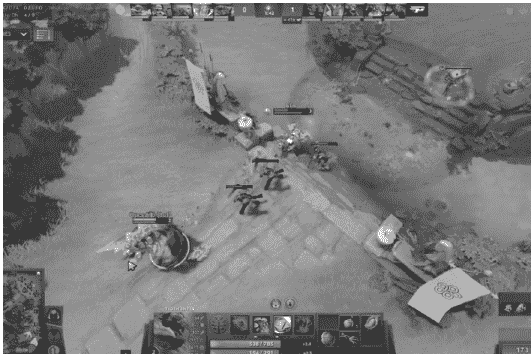

图 1.5 《刀塔 2》及 OpenAI Five 架构

**3. 《雷神之锤 3》：三维视觉下的战术协同**
首人称视角、夺旗模式、复活机制、五分钟速决（图 1.6）。DeepMind 2019年推出的AI在约45万局磨砺后压制人类高手，关键在于习得了**跨智能体协作智慧**：跟随队友、敌方基地埋伏、防守己方基地等拟人战术，甚至萌发出独立的战术理解与意图。

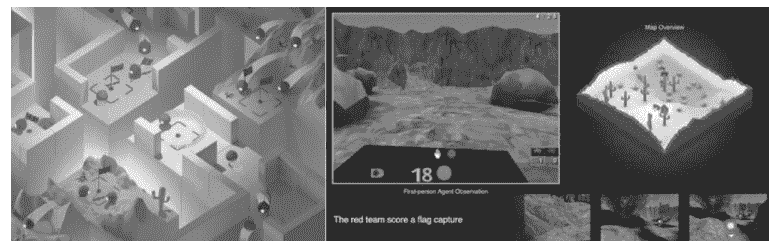

图 1.6 《雷神之锤 3》游戏界面

**4. 《王者荣耀》：国民级MOBA的全英雄掌控**
腾讯天美出品的国民手游（图 1.7），5V5推塔核心玩法。
- **2019年底，“绝悟”问世**：深度强化学习训练，轻松碾压顶尖职业。掌握“蹲草”、“越塔”、“技能躲避/连招”等个人极限操作，更具备“支援辅助”、“控龙反野”等团队级战术意识。
- **2020年11月，升级版突破英雄池封锁**：英雄池从40扩至100，覆盖高达 $10^{15}$ 种阵容组合，实现全英雄全技能掌控。
- **2020年12月，技术迁移跨域制胜**：“绝悟”WeKick版本勇夺首届谷歌足球AI大赛冠军，验证了算法的强泛化能力。

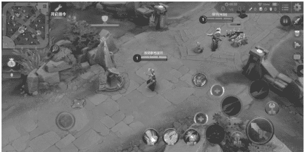

图 1.7 《王者荣耀》游戏界面

#### 1.3.2 序贯策略类对抗：不完全信息与概率推理的深水区

**1. 围棋：完全信息下的极致搜索与直觉**
19×19棋盘虽小，策略空间却达 $250^{150}$ 级复杂度（图 1.8），暴力搜索毫无胜算。早期依赖专家系统缩减空间，受限算力效果平平。算力跃迁催生突破：2016年，**AlphaGo**[8]融合深度强化学习与MCTS，开启新纪元。

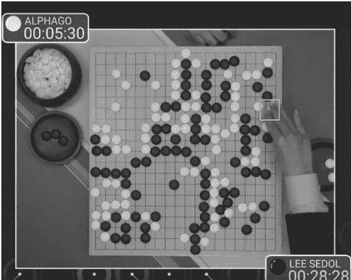

图 1.8 AlphaGo 对战李世石

**Alpha 系列进化谱系**（图 1.9）：
- **AlphaGo Zero**[9]：彻底**去人类知识化**，零数据冷启动，单一神经网络融合策略与价值，自博弈自进化。Master账号连斩中日韩名手60连胜，乌镇峰会3:0完胜柯洁。
- **AlphaZero**：将Zero范式泛化至国际象棋、日本将棋等完全信息棋类。
- **MuZero**[10]：**规则无知也能超神**。无环境模型、无规则先验，仅建模决策关键环节（状态转移、奖励、策略），用学习型网络替代完美规则集。这一特性为机器人控制、工业系统等规则未知的混乱现实环境提供关键技术支撑。

AlphaGo系列是深度强化学习落地的巅峰样本，但其仅解决**双人零和完全信息**最优决策。双人非零和、多方博弈（零和/非零和、完全/不完全信息）等更广阔疆域仍待攻坚。

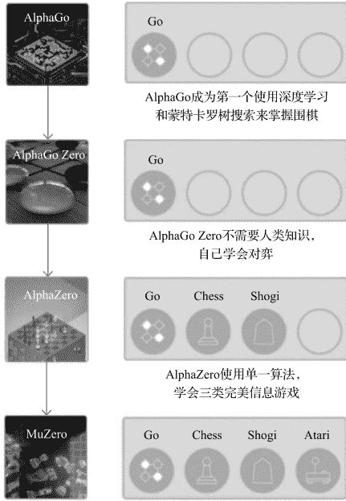

图 1.9 AlphaGo 系列围棋 AI 对比[10]

**2. 德州扑克：不完全信息博弈的求解圣地**
私有牌隐匿构核心难点（图 1.10），策略空间爆炸。阿尔伯塔大学与卡内基梅隆大学长期深耕。
- **2015 “仙王座” Cepheus**[11]：破解双人限注德扑，长期统计学必胜。
- **2017 DeepStack**[12] / **Libratus “冷扑大师”**：双双攻克双人无限注德扑，击败人类顶尖职业。
- **2019 Pluribus**[13]（《Science》刊载）：**首破多人无限注德扑**（六人桌），自博弈无先验，战胜人类职业团队。虽实战强悍，但多人博弈理论支撑仍显薄弱，区别于前两者的理论完备性。

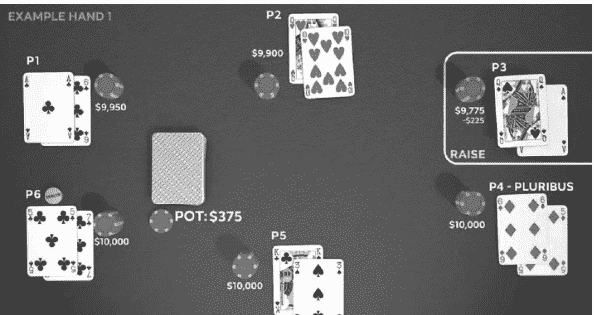

图 1.10 德州扑克 AI 对战游戏界面

**3. 麻将：国牌里的隐匿信息与模糊决策**
136张牌、13张手牌、公开弃牌（图 1.11），海量隐藏信息与随机性交织，纯算力失效，需强直觉、推理、模糊决策。其复杂度最贴近现实生活，攻克麻将即通向现实复杂决策通途。
**2019年8月，微软亚研院“雀神” Suphx**[14]问世：深度强化学习炼就，首个登顶天凤平台“十段”的AI，实力超越公开房顶尖人类平均水平。

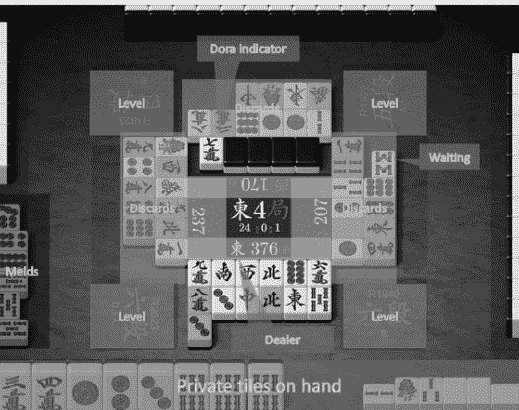

图 1.11 麻将 AI 对战游戏界面

**4. 桥牌：叫牌与打牌的合作博弈双重奏**
叫牌定约、打牌推演（图 1.12），核心难在**敌友信息双盲**下的“信息传递”与“行为分析”，极具社会属性，是竞争与合作交织的混合博弈。
- 早期：Bridge Baron、GIB（第12名）、Jack、WBridge5轮番称霸计算机桥牌赛（蒙特卡罗方法主导）。
- **2015 东大“爆打”**问世。
- **2019 田渊栋团队AI**[18]：双明手评估下，千局大战显著超越WBridge5等前沿算法。

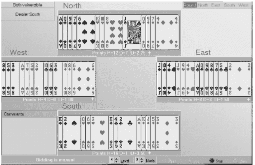

图 1.12 桥牌 AI 对战游戏界面

#### 1.3.3 军事仿真类对抗

## 美军智能化军事布局：十大关键计划深度解析

模拟仿真技术早期仅用于方法论验证，现已实现向现实场景的迁移落地，特别是在具有鲜明对抗属性的军事仿真推演领域。以美国为首的军事强国敏锐捕捉到人工智能在国防领域的变革潜力，抢先部署了“深绿”、“洞察”、XDATA可视化分析、深度学习、DEFT文本挖掘、PPAML概率编程、“心灵之眼”、CVS指挥官虚拟参谋、“阿尔法”、“狗斗”、“雅典娜”、“指南针”等一系列前瞻性研究计划，意图在智能化军事竞争中确立代差优势。

### 1. “深绿”计划：指挥控制智能化的首次大胆试水

2007年，美陆军启动旅级指挥控制研究项目“深绿”（灵感源自IBM“深蓝”）。该计划旨在利用仿真推演预判态势演变的多元可能，辅助指挥官超前思考、动态调整预案，并自动生成备选方案。其核心架构包含三大模块：“指挥官助手”支持手绘草图与语音融合的快速制案；“闪电战”引擎实现作战计划与战场态势的高速仿真推演，输出多元未来结局；“水晶球”负责方案收集、态势更新及推演调控。胡晓峰等学者曾以此为案例剖析作战决策辅助中的AI难点与破局路径。虽因多重因素于2011年终止，但“深绿”仍被视为美军探索指控智能化的关键里程碑。

### 2. CVS虚拟参谋：继往开来的智能决策助手

作为“深绿”终止后的重要接力项目，美陆军CVS（指挥官虚拟参谋）借鉴Siri、Watson等成熟理念，定位为智能参谋/助手角色。该系统融合认知计算、AI算法与自动化技术，直面海量数据源与复杂战场环境，致力于提供主动建议、高阶分析及个性化自然交互，全流程覆盖规划、准备、执行至复盘各环节，为指挥决策注入智能化动力。

### 3. “阿尔法”与“狗斗”：从模拟空战到真机验证的跨越

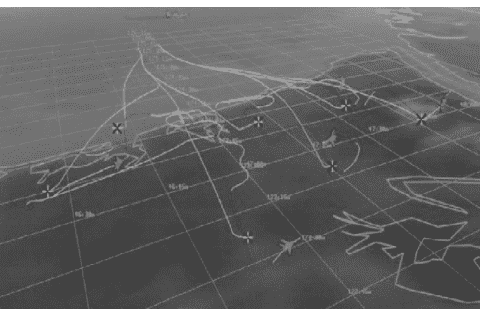

2015年，辛辛那提大学联合空军实验室推出空战AI“阿尔法”，在仿真环境中击败退役飞行员。模拟四机编队对抗双机编队（蓝方具预警机与导弹优势）的非对称较量中，“阿尔法”凭借类人模糊逻辑与超越人类250倍的反应速度，实现航路规划、导弹攻击、武器选择等战术策略的自主生成，以巧妙协同反败为胜。虽定位于相对简单的战术编队指控，但其突破了实时性与复杂度的双重瓶颈，为指控智能化提供了可行技术范式。

2019年，DARPA启动ACE（空战演进）项目，聚焦“狗斗”人机协同，研发可信、可扩展的AI空战自主能力。2020年“阿尔法狗斗试验”汇聚8支队伍驾驶模拟F-16进行1v1格斗，冠军AI在模拟器中以5:0完胜资深飞行员。2021年3月，项目取得关键进展：完成视距内外多机场景虚拟格斗、人机共生飞行信任度测评，并着手改装全尺寸教练机，为第三阶段AI“飞行员”实机上天扫清障碍。

### 4. “雅典娜”平台：破解军事AI“数据荒”的博弈沙盒

现有作战训练数据难以支撑机器学习训练需求。美海军陆战队研制的“雅典娜”推演平台，专门面向未来军事AI应用的训练测试与数据生成。通过内置系列战争游戏采集玩家决策数据，优化AI模型；数据积累至阈值后，平台可自主模拟现代军事行动并创新战术。该实践证明，博弈实验平台是攻克军事AI数据瓶颈、训练测试算法的有效途径，上述一系列美军举措实质上均在为指控智能化铺路搭桥。

### 5. “指南针”计划：灰色地带下的意图识别与博弈制胜

2018年，DARPA战略技术办发布“指南针”（COMPASS）项目。传统OODA循环在信息稀缺、对手故意欺诈的“灰色地带”失效。该项目引入博弈论视角，分两步走：先通过数据语义分析与对手行动建模推断意图与执行细节（地点、时机、执行主体）；再在重复博弈中引入AI技术，基于对手真实意图筛选最优应对选项，实现灰色对抗中的认知突围。

### 6. OFFSET集群战术：城市峡谷中的蜂群作战新范式

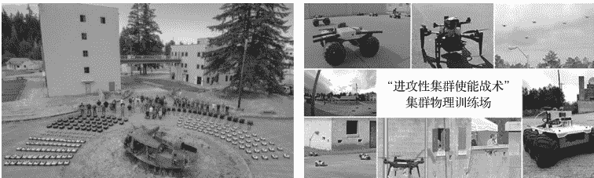

针对高楼林立、视野受限的“城市峡谷”环境，DARPA推进OFFSET（进攻性集群使能战术）项目。利用250+架次跨域无人机/无人车集群，在8个街区自主执行6小时区域隔绝任务。项目内置战术游戏模块开发集群战术，充分发挥无人体系在城市侦察与建筑清剿中的非对称优势，重塑城市作战能力生成模式。

### 7. “打破游戏规则”：借力商业游戏寻找非对称优势

2020年，DARPA启动Gamebreaker（打破游戏规则）项目，遴选芭鹭系统、洛马等9支团队。项目不重复造轮子，而是移植商业开放世界游戏中的AI成果，量化评估博弈均衡，识别关键均衡参数，探索破坏均衡的新机制、战术与规则修改。商业游戏追求平衡以求生存，军事冲突则追求制造失衡以获优势。各团队提出双游戏测试方案：在首个游戏中训练“破规则”AI，再迁移至第二游戏验证泛化能力，以低成本探索非对称作战优势。

## 本书架构全景：理论、实战与前沿的三维导航

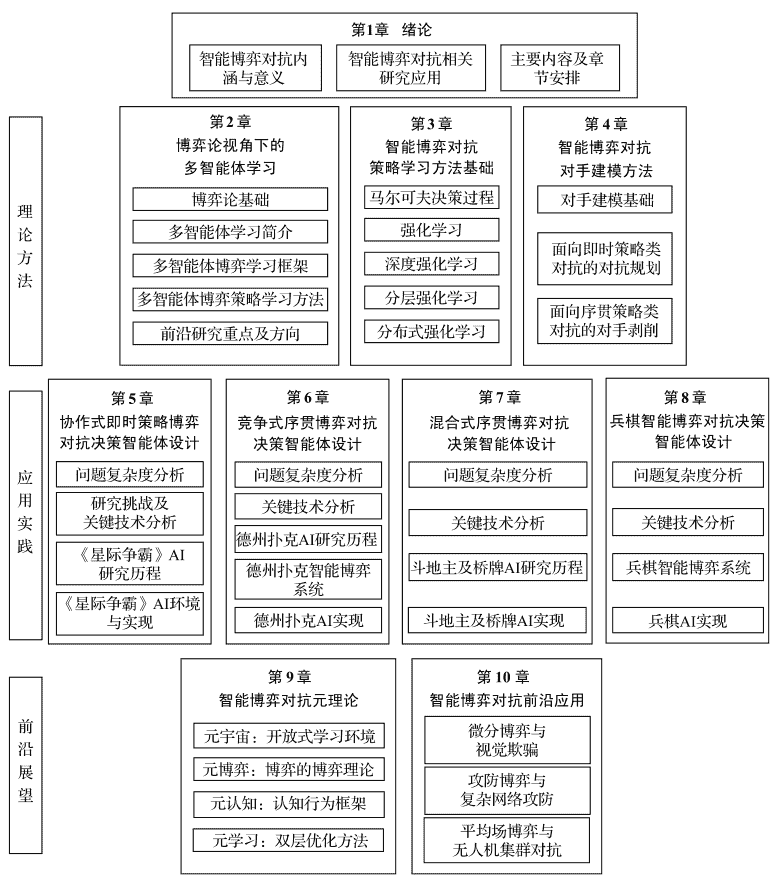

本书旨在助力智能博弈对抗领域初学者快速入门、夯实基础，提供全景视野、核心理论与实践方法论。遵循“是什么—为什么—怎么办”纵向逻辑编排：聚焦理论基石、阐述研究必要性、深耕方法实践。章节独立性强，支持按需阅读。

*   **第1章**：奠基概念篇，剖析智能博弈对抗内涵与价值，梳理即时策略、序贯策略、军事仿真三大应用版图。
*   **第2-4章**：理论方法篇。第2章立足博弈论阐释多智能体学习；第3章沿MDP主线串联强化学习、深度强化学习、分层强化学习及分布式框架；第4章深度解析对手建模（显/隐式分类）、即时策略对抗规划与序贯策略对手剥削的前沿挑战。
*   **第5-8章**：应用实践篇。第5章以《星际争霸》为例解构即时策略对抗全流程开发；第6章聚焦德州扑克剖析不完全信息博弈攻关；第7章对标斗地主与桥牌验证多智能体协作博弈；第8章基于墨子兵棋系统演示军事推演AI全周期构建。
*   **第9-10章**：前沿展望篇。第9章前瞻元宇宙、元博弈、元认知、元学习等元理论新境；第10章依托微分博弈、攻防博弈、平均场博弈三大模型，切入视觉欺骗检测、复杂网络攻防、无人机集群对抗三大典型场景。

### 参考文献

[1] 中国人工智能学会. 中国人工智能系列白皮书——机器博弈[M/OL]. http://dl.caai.cn/storage/file/20210621/0649c1fd2107d5ba18ab14a394a234fc.pdf.[2022-05-01].
[2] Omids hafei S, Tuyls K, Czarnecki W M, et al. Navigating the landscape of multiplayer games[J]. Nature Communications, 2020, 11(1): 5603.
[3] 黄凯奇，兴军亮，张俊榜，等. 人机对抗智能技术[J]. 中国科学: 信息科学, 2020, 50(4): 540-550.
[4] Vinyals O, Babuschkin I, Czarnecki W M, et al. Grandmaster level in StarCraft II using multi-agent reinforcement learning[J]. Nature, 2019, 575 (7782): 350-354.
[5] Berner C, Brockman G, Chan B, et al. Dota 2 with large scale deep reinforcement learning [EB/OL]. http://arxiv.org/abs/1912.06680.[2021-08-01].
[6] Jaderberg M, Czarnecki W M, Dunning I, et al. Human-level performance in 3D multiplayer games with population-based reinforcement learning[J]. Science, 2019, 364 (6443): 859-865.
[7] Ye D H, Liu Z, Sun M F, et al. Mastering complex control in MOBA games with deep reinforcement learning[C]. Proceedings of the AAAI Conference on Artificial Intelligence, New York, 2020: 6672-6679.
[8] Silver D, Huang A, Maddison C J, et al. Mastering the game of Go with deep neural networks and tree search[J]. Nature, 2016, 529 (7587): 484-489.
[9] Silver D, Schrittwieser J, Simonyan K, et al. Mastering the game of Go without human knowledge[J]. Nature, 2017, 550 (7676): 354-359.
[10] Schrittwieser J, Antonoglou I, Hubert T, et al. Mastering Atari, Go, Chess and Shogi by planning with a learned model[J]. Nature, 2020, 588 (7839): 604-609.
[11] Bowling M, Burch N, Johanson M, et al. Heads-up limit hold’em poker is solved[J]. Science, 2015, 347 (6218) : 145-149.
[12] Moravčík M, Schmid M, Burch N, et al. DeepStack: Expert-level artificial intelligence in heads-up no-limit poker[J]. Science, 2017, 356 (6337) : 508-513.
[13] Brown N, Sandholm T. Superhuman AI for multiplayer poker[J]. Science, 2019, 365 (6456) : 885-890.
[14] Li J, Koyamada S, Ye Q, et al. Suphx: Mastering mahjong with deep reinforcement learning [EB/OL]. http://arxiv.org/abs/2003.13590.[2021-08-01].
[15] Amit A, Markovitch S. Learning to bid in bridge[J]. Machine Learning, 2006, 63 (3) : 287-327.
[16] Ando T, Kobayashi N, Uehara T. Cooperation and competition of agents in the auction of computer bridge[J]. Electronics and Communications in Japan, 2003, 86 (12) : 76-86.
[17] Ando T, Uehara T. Reasoning by agents in computer bridge bidding[C]. International Conference on Computers and Games, Hamamatsu, 2000: 346-364.
[18] Tian Y, Gong Q, Jiang Y. Joint policy search for multi-agent collaboration with imperfect information[J]. Proceedings of the 34th International Conference on Neural Information Processing Systems, Vancouver, 2020: 19931-19942.
[19] 胡晓峰, 荣明. 作战决策辅助向何处去——“深绿”计划的启示与思考[J]. 指挥与控制学报, 2016, 2 (1) : 22-25.
[20] Lisa H. Mission Command[M/OL]. https://fortbenningausa.org/wp-content/uploads/2016/04/Mission-Command-RDECOM-CERDEC.pdf.[2021-08-01].
[21] Ernest N D. Genetic fuzzy trees for intelligent control of unmanned combat aerial vehicles[D]. Cincinnati: University of Cincinnati, 2015.

[22] Benjamin J S C, Whyte C. Wargaming with Athena: Leveraging AI for Smarter, Faster, and More Efficient Militaries[M/OL]. https://css.ethz.ch/en/services/digital-library/articles/article.html/f8940eb3-6066-409c-ae8c-e11e838e0c92.[2021-08-01].

[23] Roff H M. COMPASS: The Pentagon's New AI-Powered Situational Awareness Tool?[EB/OL]. https://thebulletin.org/2018/05/compass-a-new-ai-driven-situational-awareness-tool-for-the-pentagon/.[2021-08-01].

[24] Timothy H. Chung. OFFSET: Offensive Swarm-Enabled Tactics[M/OL]. https://www.darpa.mil/work-with-us/offensive-swarm-enabled-tactics.

[25] Defense Brief Editorial. DARPA Aims to "Break" Video Games to Level Up Pentagon War Games[M/OL]. https://defbrief.com/2020/05/14/darpa-will-try-ruining-video-games-to-improve-pentagons-war-games/.[2021-08-01].

## 第 2 章 博弈论视角下的多智能体学习

### 2.1 开篇：为何引入博弈论视角？

深度学习与深度强化学习的浪潮，为智能体实现了从感知输入到决策输出的“端到端”闭环。多智能体学习作为智能博弈对抗的前沿阵地，却面临着对抗环境博弈、非平稳对手博弈、不完全信息博弈以及行动不确定性等多重硬核挑战。本章将以博弈论为切入点，系统拆解这一领域：2.2 节奠定博弈论基石；2.3 节解剖多智能体学习系统架构、全景概览与方法谱系；2.4 节聚焦博弈学习框架，深度剖析基础模型、元博弈、均衡解概念、动力学演化及核心难题；2.5 节全景式梳理策略学习方法，涵盖离线学习（随机/扩展式/元博弈）与在线学习（无悔/元学习/事后理性/对手感知/匹配协作）；最后，2.6 节展望前沿研究风向标。

### 2.2 博弈论基石：决策交互的底层逻辑

博弈论源自英文 *Game Theory*，直译“游戏理论”。它是一门研究理性“参与者”在效用驱动下如何进行策略交互的科学。交互过程中，信息不对称、利益冲突与行为耦合并存，理性个体倾向于最大化自身收益。

非合作博弈聚焦个体理性与个人最优，但缺乏约束性协议，易陷入低效甚至“损人不利己”的困境；合作博弈则强调集体主义、团体理性与公平分配。20 世纪博弈论群星璀璨：50 年代 Nash 创立纳什均衡，揭示“无人能单方面获利、策略互为最佳响应”的一致性本质；Shapley 贡献核仁与沙普利值，Issac 推出微分博弈，Aumann 定义强纳什均衡。60 年代 Selten 引入动态视角提出“颤抖手完美均衡”，Harsanyi 引入不完全信息并证明其可转化为完全不完美信息博弈。70 年代 Smith 奠基演化博弈论，Aumann 构建知识模型。80 年代 Kreps 与 Wilson 推出“序贯均衡”，90 年代 Tirole 等完善完美贝叶斯均衡。进入“后纳什时代”，研究重心转向动态博弈与不完全信息博弈的假设拓展——这也是本书的核心关注点。

#### 2.2.1 博弈的五大核心要素

博弈描述的是：主体在特定环境与约束下，依据掌握信息，同步或轮流、单次或重复地从策略集中抉择，最终获取收益的全过程。其追求的是“稳定的最大利益”。

**1. 参与者 —— 决策的主体**
即“局中人”，可以是个人、组织、国家或联盟。决策具有外部性，会波及他人。引入“自然”作为虚拟主体，模拟随机事件。核心假设为“理性”，但理性≠自私，涵盖利己与利他，完全理性与有限理性，个体理性与集体理性。参与者数量直接决定复杂度：双人最简，三人以上博弈结果难测。

**2. 行动 —— 决策的原子单位**
指特定决策节点上的选择变量。**行动顺序重塑博弈结构**：同步选择为静态博弈，先后选择为动态博弈（如斯塔克尔伯格模型）。

**3. 信息 —— 决策的认知基座**
包含环境、对手理性度、行动历史、策略空间、支付函数及“自然”移动等知识。核心概念“共同知识”构建无限嵌套的“知知”结构。
*   **完美 vs 不完美信息**：是否全知历史行动轨迹。
*   **完全 vs 不完全信息**：是否知悉所有参与者的类型、策略与支付。

**4. 策略 —— 行动的完整规则书**
规定在各信息集下的行动计划，是行动的函数映射。单个参与者的策略全体构成策略集。

**5. 收益 —— 博弈的度量标尺**
策略组合确定的最终回报，量化参与者追求的目标。可用效用函数量化，亦可用偏好序表达荣誉、安全等定性指标。

#### 2.2.2 博弈论的多维分类地图

**1. 合作属性：非合作 vs 合作**
*   非合作：个体利益最大化，细分为完全/不完全信息 × 静态/动态四象限。
*   合作：追求集体与个体利益统一，分为可转移支付、不可转移支付、策略型等。

**2. 信息结构：完全/完美 vs 不完全/不完美**
*   完全信息：全员知晓所有支付；否则为不完全信息。
*   完美信息（动态博弈专用）：全员知晓自身行动前的完整历史；否则为不完美信息。

**3. 时间序列：静态 vs 动态**
*   静态：全员仅一次行动机会，且信息意义上同步。
*   动态：存在多轮行动或可预测他人行动。衍生出四类典型范式。

**4. 收益结构：零和、常和、变和**
*   零和：严格对立，收益和为零。
*   常和：收益和为定值，本质等价零和。
*   变和：收益和随策略波动，蕴含合作潜力。

**5. 其他维度**
按人数分二/三/多人；按策略集基数分有限/无限；按重复次数分单次/重复；另有演化、微分、网络、算法、有限理性、行为博弈等前沿分支。

#### 2.2.3 核心解概念与决策视角

**1. 均衡解概念谱系**
*   **非合作阵营**：纳什均衡、颤抖手完美均衡、序贯均衡、贝叶斯纳什均衡、完美贝叶斯均衡、子博弈完美均衡……层层递进，精炼预测力。
*   **合作阵营**：核心、内核、核仁、沙普利值、稳定集、谈判集、班扎夫/舒比克指数、欧文值……关注分配的公平与稳定。

**2. 有限理性与欺骗：现实主义的修正**
标准理性假设过强，有限理性模型应运而生：随机最佳响应（QRE）、前景理论、Level-K/认知层次模型、心智理论模型。同时，欺博研究聚焦网络空间：多目标优化下的有限欺骗、基于轨迹分析的多模态欺骗策略。

**3. 博弈即“冲突型决策”**
运筹学视角下，最优化解决“单人决策”，博弈论解决“多人交互决策”。决策理论四支柱中，博弈论归属“冲突型决策”，可调用最优化、不确定性、风险决策（厌恶/中性/偏好）工具箱求解。

### 2.3 多智能体学习：群体智能的进化论

多智能体系统由多个自主实体组成，共享环境、独立控制、深度交互。Shoham 定义其核心特征为：信息异质、利益异质或兼而有之。Müller 团队梳理了 152 个落地案例，印证其作为分布式 AI 核心分支的地位。研究聚焦通信、协调、冲突消解，强调群体协作而非个体独行。智能体间存对抗、竞争、合作多元关系，通过信息交互实现友方协同联合对抗。自主学习赋予系统**涌现性**能力。

应用版图极广：机器博弈（AI“果蝇”、图灵测试范式）、拍卖交易、资源调度、机器人足球、无线网络、多方谈判、灾难救援、自动驾驶、无人集群对抗等。高效的多智能体学习是破解分布式决策优化的关键——如何通过博弈策略学习跃升自主推理决策力，是 AI 与博弈论共同的前沿高地。深度感知与强化决策的深度融合，近年在机器博弈领域取得突破性进展。

#### 2.3.1 系统架构：四大核心模块

多智能体建模面临实体多、状态大、决策复杂的“三高”难题，手工规则迁移性差；认知行为建模让智能体从交互经验中习得有效行为、学会协调、推演对手意图。

系统模型由四大模块构成（见 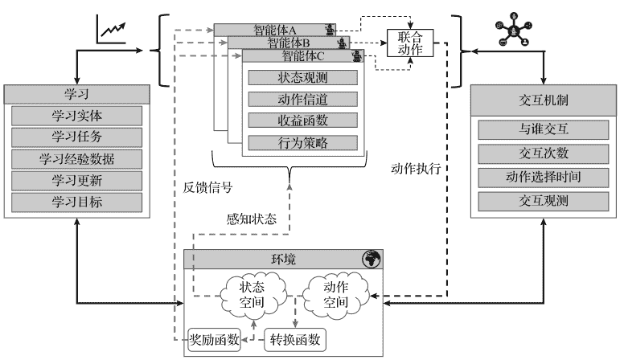 图示）：


*   **环境模块**：状态空间、动作空间、转移函数（环境动力学）、奖励函数。定义“世界如何运转”及“反馈何在”。
*   **智能体模块**：环境通信接口（观测/动作）、智能体间通信协议、效用函数（偏好与策略选择）。
*   **学习模块**：学习主体（单/多智能体级）、学习目标（评价函数）、经验数据源、更新规则。
*   **交互机制模块**：交互时长、对象、观测范围、频率/数量、动作选择时序（同步/异步）。

#### 2.3.2 学习图景：从辩论到统一框架

多智能体学习研究什么？Stone (2000) 从机器学习视角切入，关注同质/异质、通信可行性。早期通过公开辩论提炼出四大核心命题：问题描述、分布式 AI、博弈均衡、智能体建模。Shoham 等反问：“若 MAL 是答案，问题是什么？”并指明未来四大主题：计算性、描述性、规范性、规定性（再细分为分布式、均衡、建模）。Stone 回应称 MAL 必含博弈论，技术落地仍是开放问题。Tošić (2010) 提出强化学习/协同学习/元学习统一框架。Tuyls 等 (2017) 概括五大路径：个体收益 RL、社会福利 RL、协同演化、群体智能、自适应机制设计。后续 (2018) 主张纳入群体智能、协同演化、迁移学习、非平稳性、智能体建模。

主流方法论三足鼎立：**强化学习、演化学习、元学习**（见 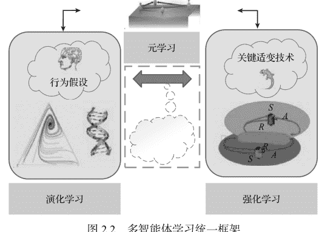 图示，S/A/R 对应状态/动作/奖励）。


#### 2.3.3 多智能体学习研究方法分类

# 2.4 多智能体博弈学习新范式

博弈理论为多主体间策略博弈建模奠定了基石，近年融合博弈论的学习范式深度渗透至多智能体研究领域，催生出“多智能体博弈学习”这一新兴研究范式。Matignon 等[23]梳理了面向合作马尔可夫博弈的独立强化学习路径。Nowé 等[24]依据无状态博弈、合作马尔可夫博弈与一般马尔可夫博弈三类场景，对独立学习与联合学习算法做了系统归类。Lu 等[25]站在强化学习与博弈论的融合视角，对多主体博弈的解概念、虚拟自对弈（FSP）流派及反事实后悔值（CFR）流派方法展开全景式综述。Yang 等[26]则聚焦同等利益博弈、零和博弈、一般和博弈及平均场博弈四大典型博弈类型中的学习算法进行分类溯源。Bloembergen 等[27]引入演化博弈视角，剖析各类多智能体强化学习算法的博弈动态演化，揭示演化博弈论与多智能体强化学习之间的深层内在联结。此外，Wong 等[28]立足多智能体深度强化学习面临的四大核心挑战，指明未来需深挖深度学习等类人学习机制。

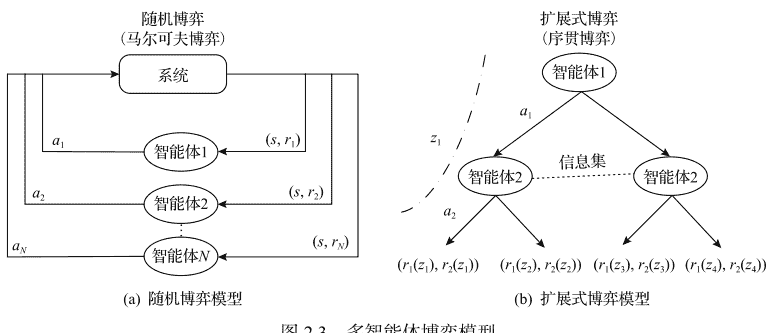

#### 2.4.1 多智能体博弈基础模型与元博弈

- **1. 多智能体博弈基础模型**

马尔可夫决策过程（MDP）是单智能体决策建模的标准工具。决策论视角下的多主体建模主要涵盖分散式马尔可夫决策过程（Dec-MDP）与多智能体马尔可夫决策过程（MMDP）[23]。Dec-MDP 中，各智能体持有独立的世界状态观测，仅凭局部观测信息选取动作；MMDP 则不再区分私有信息与全局状态，由系统统一生成中心化策略再下发执行。分散式部分可观马尔可夫决策过程（Dec-POMDP）聚焦动作与观测均存在不确定性时的多主体协同难题，其决策完全分散，智能体仅凭自身局部观测独立决策。Doshi 等[29]引入递归建模机制，对其他智能体行为显式建模，提出了交互式部分可观马尔可夫决策过程（I-POMDP），该模型实现了博弈论与决策论的深度融合。早在 20 世纪 50 年代，Shapley 提出的随机博弈（SG）[30]（亦称马尔可夫博弈 MG[31]）即被广泛用于刻画多智能体学习问题。当前研究趋向将决策论与博弈论模型统合，视两者均为部分可观随机博弈（POSG）[32]的特例。

博弈论视角下的多主体模型大致分为随机博弈与扩展式博弈（EFG）两大阵营。最新工作将扩展式博弈重构为因子可观随机博弈[31]，两大模型家族本质上均可归入随机博弈框架。

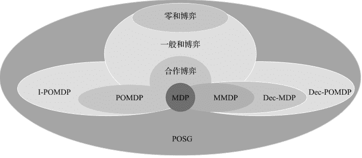

随机博弈可细分为面向合作的团队博弈（team game）、面向纯对抗的零和博弈、以及面向合竞共存的一般和博弈。团队博弈广泛服务于即时战略游戏、无人集群对抗、联网车辆调度等对抗环境下的多主体协同建模；零和与一般和博弈则常用于多方博弈交互建模。扩展式博弈具备两种表达范式：正则式（normal-form）适配同步决策场景，序贯式（sequence-form）[33]适配多阶段策略交互场景。回合制博弈（TBG）[34]专门服务于轮流决策场景，即博弈参与者轮流行动。

```
TransitiveGame ⊕ CycleGame = im(grad) ⊕ ker(div)
grad(f)(v, w) := f(v) - f(w)
div(φ)(v, w) := ∫_w φ(v, w)dw
curl(φ)(u, v, w) := φ(u, v) + φ(v, w) - φ(u, w)
φ = grad·div(φ) + (φ - grad·div(φ))
```

- **2. 元博弈模型**

元博弈，即“博弈的博弈”[35]，是实证博弈理论分析（EGTA）[36]的基石模型，已广泛落地于供应链优化、广告竞价、能源市场、网络路由协议设计、公共资源治理、对抗策略筛选、博弈策略动态演化等可仿真模拟的现实场景。表 2.1 梳理了博弈论、元博弈与强化学习核心要素的对应关系。

表 2.1 博弈论、元博弈与强化学习要素对照

| 博弈论 | 元博弈 | 强化学习 |
| :--- | :--- | :--- |
| 博弈 | 博弈 | 环境 |
| 参与方 | 种群 | 智能体 |
| 行动 | 类型 | 动作 |
| 策略 | 分布 | 策略 |
| 收益 | 适应度 | 奖励 |

近年有学者开始探究博弈策略空间的几何拓扑特征。Jiang 等[37]首借组合霍奇理论实施亥姆霍兹分解。Candogan 等[38]挖掘策略博弈的“流”表达，指出其由势分量、调和分量与非策略分量构成。Hwang 等[39]从策略等价视角切入，研究正则式博弈的分解路径。Balduzzi 等[40]证明任意泛函式博弈（FFG）皆可直和分解为传递压制博弈与循环压制博弈，并借梯度、散度、旋度刻画策略空间几何形态。函数 φ(v, w) 表征从 v 到 w 的流场，依霍奇分解，传递压制博弈旋度为零，循环压制博弈散度为零，博弈向量空间满足正交分解性质。

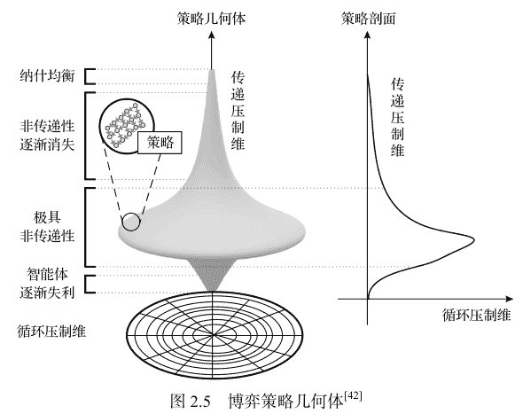

Omidshafiei 等[41]利用智能体对抗数据，依收益矩阵绘制“响应图”、直方图，进而得到谱响应图、聚合响应图与收缩响应图，引入图论工具对传递/循环博弈实施拓扑剖析，绘制智能体策略特征谱，揭示两类博弈特征距离显著分离。Czarnecki 等[42]基于真实博弈策略空间分析，提出“博弈策略空间陀螺几何体模型猜想”。如图 2.5 所示，纵轴为传递压制维，几何体顶点对应纳什均衡，刻画策略间压制层级；横轴为循环压制维，刻画策略间可能存在的首尾嵌套非传递压制结构。

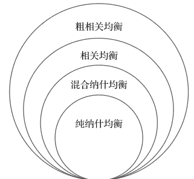

#### 2.4.2 均衡解概念与博弈动力学

- **1. 均衡解概念**

博弈论审视多智能体学习，须细致甄别其中的均衡解谱系。如图 2.6 所示，诸多博弈虽缺纯策略纳什均衡，但混合纳什均衡必然存在；相对而言，相关均衡（CE）计算较易，粗相关均衡（CCE）计算最简[43]。

鉴于学习场景与目标的异质性，一批新型均衡概念被引入：面向攻防博弈的斯塔克尔伯格均衡、面向有限理性的量化响应均衡、面向演化博弈的演化稳定策略、面向策略空间博弈的元博弈均衡、抗扰动的鲁棒均衡（即颤抖手均衡）、处理非完备信息的贝叶斯均衡、在线决策场景的无悔/最小后悔值、以及帕累托最优（在不损害他方前提下改善己方）。近年团队极大极小均衡[44,45]被用于刻画零和博弈中组队智能体对抗单一智能体，实为对抗合作博弈模型，可破解网络阻断、多人扑克、桥牌等难题。同样，基于“相关均衡”[46]的新模型层出，覆盖元博弈、扩展式博弈、一般和博弈、零和同步随机博弈等。鉴于均衡求解复杂度高企，近似均衡概念获广泛采纳，如最佳响应[47]与预言机[48]等。

- **2. 博弈动力学**

博弈本质即个体间的动态交互演化。对于一般势博弈，最佳响应动力学从任意初始局势出发，均能收敛至纯策略纳什均衡。其机制直观：只要当前局势 s 非纯纳什均衡，任选一智能体 i 及其有利偏移策略 s'_i，更新局势为 (s'_i, s_{-i})。

最佳响应动力学仅收敛于纯纳什均衡且强依赖势博弈结构；而在任意有限博弈中，无悔学习动力学可保证收敛至粗相关均衡。设任意时刻 t = 1, 2, ..., T，智能体 i 获得收益向量 c'_i，给定他方混合策略 σ'_{-i} = ∏_{j≠i} p'_j，各智能体 j 独立运用无悔学习选取混合策略 p'_j，则智能体选纯策略 s_i 的期望收益：π_i^t(s_i) = E_{s_{-i}^t ∼ σ_{-i}^t}[π_i(s_i, s_{-i}^t)]。

无悔学习定义：若对任意 ε > 0，均存在充分大时域 T = T(ε)，使在线决策算法 M 面对任意对手时，决策者后悔值 ≤ ε，则称 M 为无悔学习算法。

无交换后悔动力学可保证收敛至相关均衡[36]。相关均衡与无交换后悔的联结，恰似粗相关均衡与无悔动力学的联结。

无交换后悔学习定义：若对任意 ε > 0，均存在充分大时域 T = T(ε)，使在线决策算法 M 面对任意对手时，决策者期望交换后悔值 ≤ ε，则称 M 为无交换后悔学习算法。

多主体动态交互常借种群演化博弈论中的复制者动态方程[27]或偏微分方程[49]刻画。Leonardos 等[50]运用突变理论，证得软 Q 学习在异质智能体加权势博弈中必收敛至量化响应均衡。

#### 2.4.3 多智能体博弈学习的核心挑战

- **1. 复杂博弈环境评估困境**

复杂博弈环境的验证评估困局主要集中三个维度：
① **信息不全**。环境中的信息缺失显著抬升决策难度。以战争迷雾导致的信息缺失为例，对手偏好、类型、数量等任一关键要素的缺位，均会直接扭曲智能体对环境全貌的认知，间接炸裂态势关键点评估的复杂度。更棘手者，信息不全催生“欺骗”行为（隐真、示假等），进一步拓展问题维度。
② **不确定性**。随机性注入体系风险，前期积累的任何“领先优势”均可能因环境负面因子而化为泡影。如何综合评估局势实施“风险决策”以换取最大预期回报，成为又一研究硬骨头。策略测评与迭代过程中，如何剔除不确定因素干扰，精准判别策略优劣、锁定改进方向，同样棘手。
③ **博弈空间海量化**。复杂博弈中状态与动作域呈指数级爆炸，表 2.2 列举的典型场景中，全空间穷举搜索在时空双重约束下均不可行。模型简虽能压缩规模，但缺乏理论兜底，往往以牺牲精度为代价；即便退而求亚最优策略，部分优化算法仍难直接迁移至抽象模型。蒙特卡罗采样虽能提速，但在复杂环境下如何与他法融合、抑制搜索方差，仍是待攻克难点。

表 2.2 典型大规模对抗空间博弈场景

| 博弈场景 | 状态空间量级 | 博弈场景 | 状态空间量级 |
| :--- | :--- | :--- | :--- |
| 桥牌 | 10^67 | 《王者荣耀》 | 10^600 |
| 斗地主 | 10^83 | 战术兵棋 | ~10^793 |
| 德州扑克 | 10^160 | 《星际争霸》 | ~10^1685 |
| 围棋 | 10^170 | | |

- **2. 训练目标多维博弈**

训练目标主导多智能体学习全流程，为算法评估立标尺。Powers 等[51]早于 2004 年即将目标归类为理性、收敛指标、安全指标、一致性指标、兼容性、目标最优等。Busoniu 等[12]将其聚合为稳健指标（含收敛指标、均衡习得、可预测性、与对手无关性）与适应指标（含理性假设、无遗憾、目标最优、安全指标、感知对手）二维。Diovanni 等[52]则纳入帕累托效率。表 2.3 细述：稳健指标表征习得平稳策略的能力——收敛至某均衡、可学近似模型用于预测推理、所学平稳策略与对手无关；适应指标表征智能体感知环境与对手、理性建模、输出最佳响应、在线博弈中学得不劣于平稳策略的无遗憾响应；目标最优、兼容性、帕累托效率、安全指标则表征面对静态策略或自我博弈训练的对手，己方仍能自适应达成目标最优。

表 2.3 多智能体学习目标二维图谱

| 稳健指标 | 适应指标 |
| :--- | :--- |
| 均衡习得 [53] | 最佳响应 [53] |
| 收敛指标 [54] | 理性假设 [54] |
| 可预测性 [55] | 无遗憾 [56] |
| 与对手无关 [57] | 感知对手 [58] |
| | 目标最优、兼容性、帕累托效率、安全指标 [49-52] |

- **3. 环境（对手）非平稳性

# 多智能体学习：非平稳性与均衡求解的双重困境

在多智能体系统中，环境状态的演变与奖励信号的产生，皆由全体智能体的联合动作共同决定；各个体依据反馈同步优化策略，却又仅能掌控自身的决策逻辑。这三大内在特质交织在一起，催生了**非平稳性**——这一阻碍最优联合策略涌现的核心拦路虎。

并发学习引发的非平稳性，主要剖析为两个维度：**策略层面的非平稳**与**个体学习环境的非平稳**。试想，智能体 A 为达成更佳协作而依据他人策略调整自我，然而智能体 B、C 也在同步为适应 A 的变化而修正策略。当 A 的新策略落地时，其决策依据早已“过期”，协调随即失效。从优化视角审视，对手策略的动态漂移致使优化目标成为移动的靶子，导致各智能体间的相互适应陷入滞后博弈。

针对这一最大挑战，学界目前主流的应对路径可归纳为五大派系（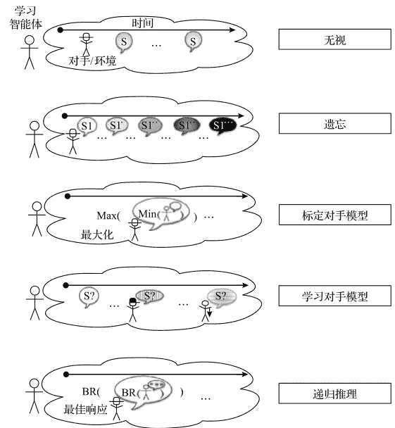）：

1.  **无视派**：预设环境与对手均为静态平稳。
2.  **遗忘派**：采用无模型范式，抛弃历史经验，仅锚定最新观测。
3.  **预设建模派**：针对预定义的对手画像优化己方策略。
4.  **在线建模派**：引入基于模型的学习机制，实时推演对手行为模式。
5.  **心智理论派**：借助认知层级理论，对对手及自我策略展开递归推理。

面对有限理性乃至欺诈型对手，**对手建模（智能体建模）**已成博弈对抗中的必修课。它与集中式训练分散式执行（CTDE）、元学习、多智能体通信建模并肩，共同构筑了破解非平稳难题的技术基石。

---

#### 均衡难觅：计算壁垒与选择悖论

随着智能体数量激增、状态空间膨胀，多智能体学习的计算复杂度呈指数级攀升。复杂度理论勾勒出一幅严峻图景：两人零和博弈的纳什均衡属 P 类问题，尚可多项式求解；两人一般和博弹升为 PPAD 难题；判定纳什均衡存在性更是 NP 难题；随机博弈纯策略纳什均衡的存在性判定则直抵 PSPACE 难度。多人博弈更面临“均衡存在性存疑、计算成本高昂、均衡选择无解”的三重夹击。

更隐蔽的风险在于**去中心化求解的失配性**。即便每个智能体独立算得局部纳什均衡，其组合也不一定构成全局均衡，个体仍有动机单边偏离。经典的“柠檬水站位博弈”便是佐证（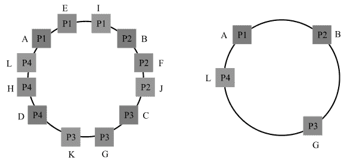）：智能体需在环形区域选位以最大化两两距离之和。理论上，均匀分布即为纳什均衡，且存在无限种等价实现（图 a），引发严峻的“均衡选择问题”。然而若各自为政独立计算，最终极大概率陷入无序拥挤（图 b），全局均衡荡然无存。

正是多维目标冲突、环境非平稳、状态动作空间爆炸、不完全信息与不确定性等因素叠加，使得高度复杂的多智能体学习问题愈发棘手。

---

### 2.5 多智能体博弈策略学习方法谱系

依据博弈对抗场景的离线与在线属性，策略学习方法大致分为离线博弈策略学习与在线博弈策略学习两大支系。

#### 2.5.1 离线博弈策略学习：从值函数到策略梯度的演进

**1. 随机博弈策略学习：均衡导向的值函数家族**

直接面向博弈均衡的学习范式，多以值函数逼近为核心。按博弈性质（合作、零和、一般和）划分，主流算法谱系如下：

*   **合作博弈阵营**：
    *   **Team-Q**：直击联合策略值函数。
    *   **Distributed-Q**：乐观单调更新本地策略，保证收敛至最优联合策略。
    *   **JAL (联合动作学习)**：融合强化学习与均衡计算，同步学习自他动作值函数。
    *   **OAL (最优自适应学习)**：构建弱非循环博弈结构，剔除次优联合动作，理论收敛最优。
    *   **Decentralized-Q**：OAL 的去中心化变体，渐近收敛最优联合策略。
*   **零和博弈阵营**：
    *   **Minimax-Q**：经典极小极大值函数迭代，专攻两人零和随机博弈。
*   **一般和博弈阵营**（百花齐放）：
    *   **Nash Q**：将 Minimax-Q 推广至多人一般和博弈。
    *   **CE-Q**：锚定相关均衡的 Q 学习变体。
    *   **Asymmetric-Q**：聚焦斯塔克尔伯格均衡的非对称博弈建模。
    *   **FFQ (敌-友 Q)**：将他者二分为“友”（协同增益）与“敌”（对抗抑制）。
    *   **WoLF (取胜或快速学习)**：双学习率机制，顺境细打磨、逆境大步跨。
    *   **IGA / GIGA / AWESOME**：无穷小梯度上升及其推广，兼顾平稳对手下的最佳响应与自适应。

**2. 多智能体强化学习（MARL）：训练-执行架构的四重奏**

当前 MARL 核心诉求为学习博弈最佳响应。依据训练与执行的中心化程度，可分四大范式：

*   **完全分散式**：无中心协调，仅靠局部交互。
    *   代表作：**Independent-Q (IQ)** 及其改进谱系。**Distributed-Q** 引入乐观映射；**Hysteretic-Q** 以双学习率区分“奖赏/惩罚”，抗噪抗多最优；**FMQ** 利用最大奖励频率启发探索；**Lenient MARL** 容忍低回报宽容学习；**Distributed Lenient Q** 进一步分布式组织宽容机制。
*   **完全集中式**：全局观测、全局决策、参数共享。
    *   **CommNet**：通信神经网络，平均分配奖励，输入维度爆炸是隐患。
    *   **BiCNet**：双向 RNN 结构的 Actor-Critic，无监督涌现高阶协同协议。
*   **集中式训练分散式执行 (CTDE)**：训练期“上帝视角”Critic 指导，执行期仅凭局部 Actor 行动。**当前最通用、最主流的框架。**
    *   **COMA**：反事实基线解决合作任务信用分配难题，边缘化单个体动作估算贡献。
    *   **MADDPG**：DDPG 多智能体延展，各自独立 Actor-Critic + 独立奖励，Critic 训练期可见全局动作，兼容合作/竞争/混合场景。
    *   **值函数分解流派 (VDN, QMIX, MAVEN, QTRAN)**：按贡献分解全局 Q 值，破解信用分配。
        *   **VDN**：线性加和分解，DRQN 中心化训练，解耦关系、治愈伪奖励与懒惰智能体，但表达力受限于线性假设。
        *   **QMIX**：引入超网络，非线性映射单智能体 Q 至团队 Q，融入全局状态，性能跃升。
        *   **MAVEN**：互信息变分探索，隐空间驱动层次化探索，融合值基与策略基学习。
        *   **QTRAN**：更泛化的分解变换，覆盖所有可分解任务，但非分解协作任务仍为盲区。
*   **联网分散式训练**：智能体处于时变通信拓扑节点，基于邻域信息决策，优化网络平均奖励。
    *   **MAAC**：去中心化 Actor-Critic，邻域通信换取全局最优均值回报，具收敛性保证。
    *   **SAC (Scalable AC)**：复杂度仅随局部状态动作空间增长，规避维度灾难。
    *   **NeurComm**：可分解通信协议自适应共享状态动作信息，抑制信息损失与非平稳性。
    *   **AMAFQI**：批强化学习框架下的近似拟合 Q 迭代，贪婪策略迭代搜索。

**3. 扩展式博弈策略学习：后悔极小化的统治力**

完美信息扩展式博弈可由组合优化（如线性规划）精确求解。非完美信息领域，**后悔值最小化 (RM)** 成绝对主角。针对不同均衡概念（NE, CE, CCE, EFCE）及博弈类型，求解器矩阵如下（详见表 2.6）：

*   **两人零和博弈**：
    *   *优化系*：线性规划 (NE/CE/CCE)、过大间隙技术 (NE)、镜像梯度 (NE)、投影次梯度下降 (NE)、可利用度下降 (NE)。
    *   *后悔系*：后悔匹配 (NE/CCE)、**CFR (反事实后悔最小化)** 及变体 (NE)、Hedge (NE)、乘性权重更新 MWU (CE)、Hart 后悔匹配 (CE)。
*   **两人一般和博弈**：
    *   *优化系*：Lemke-Howson (NE)、支撑集枚举 MILP、混合方法、列生成、线性规划。
    *   *后悔系*：缩放延拓后悔最小化器。
*   **多人一般和博弈**：
    *   *优化系*：反希望椭球法、列生成。
    *   *后悔系*：后悔测试、采样式 CFR (CFR-S)、联合策略重构 CFR (CFR-Jr)。

CFR 及其采样、并行加速变体，已成大规模非完美信息博弈（如德州扑克）求解的工业标准，展现了后悔驱动学习在复杂序贯决策中的统治级地位。

# 多智能体博弈求解全景：从均衡计算到前沿自主学习范式

在博弈论与多智能体强化学习交叉的前沿阵地，求解算法正经历着从“单一收敛”向“泛化自主”的深刻演变。本文系统梳理均衡求解器、元博弈学习框架、在线适应机制及未来核心突破方向，为构建高水平博弈智能体提供技术全景图。

## 均衡求解器：从表格枚举到深度融合

针对不同规模与结构的博弈问题，学术界已构建起层次分明的求解工具箱。对于两人零和扩展博弈，主流技术路线主要汇聚为三大支柱：

*   **精确求解派**：依托混合整数线性规划（MILP）[99]、支撑集枚举等手段，配合列生成技术在相关均衡（CCE）[101]、粗相关均衡（EFCE）[100]求解中发挥骨干作用；缩放延拓后悔值最小化（EFCE）[102]则为大规模实例提供了近似途径。
*   **反事实后悔极小化（CFR）族群**：作为非完全信息博弈的“标准配置”，CFR 通过累积后悔值驱动策略迭代，衍生出 CFR+、DCFR 等高效变体，支撑起 Pluribus、DeepStack 等超人类级德州扑克 AI 的诞生。
*   **深度强化学习（DRL）新贵**：利用神经网络拟合信息集值函数，直接逼近纳什均衡，展现出强大的泛化潜力。

**理论融合的里程碑**：最新研究揭示了三大技术路线深层的数学同构性。Farina 等 [107] 严格证明：经典后悔匹配（RM）及其改进版 RM+，分别等价于在线凸优化中的跟随正则化领先者（FTRL）与在线镜像下降（OMD），理论收敛速率可达 $O(T)$。更进一步，后悔值被证实与强化学习中的优势函数本质等价 [108,109]。这一发现催生出“后悔驱动强化学习”新范式——将后悔匹配机制嵌入策略梯度更新，显著提升收敛速度与泛化能力。尽管在线凸优化技术（如加速一阶法）理论上能将后悔值收敛从 $O(T^{-1/2})$ 推进至 $O(T^{-3/4})$，但在工程落地中，CFR 及其深度变体凭借工程友好性仍占主导。

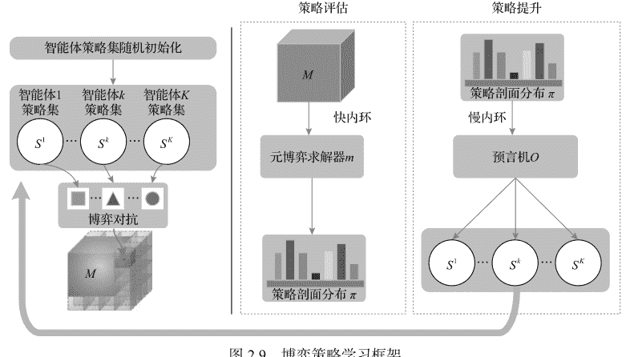

## 多人一般和博弈：团队对抗与相关均衡的新解概念

当博弈扩展至多人一般和场景，**团队最大最小均衡（TME）** 成为建模“同效用团队 vs 单一对手”对抗的核心解概念。针对团队内部通信条件的差异，研究衍生出细分谱系：
*   **相关 TME (CTME)**：允许赛前相关设备协调；
*   **带协同设备 TME (TMECor)**：引入外部协同信号；
*   **带通信设备 TME (TMECom)**：支持赛中实时通信。

求解端，**增量策略生成** [112] 揭示了双预言机的本质，Zhang [60] 结合网络阻断场景开发出专用求解器。此外，**合作对手博弈** [113] 为多对一不对称对抗建模提供了新视角。针对大规模场景，反希望椭球法 [103]、列生成 [104] 与后悔值测试 [105]、基于采样/联合策略重构的 CFR 变体 [106] 构成了相对完备的算法矩阵。

## 元博弈驱动的“双环”策略学习范式

面对多智能体策略空间的指数级爆炸，**Policy Space Response Oracle (PSRO)** [114] 确立了当前最主流的**“内环快速生成 + 外环缓慢迭代”双层优化范式**：

*   **内环学习器**：强化学习高速生成基础策略池；
*   **外环学习器**：演化博弈/元博弈求解器在策略池上计算元策略分布（收益张量 $M$），指导预言机生成最佳响应（BR）扩充策略池。

该框架将经典双预言机 (DO) 扩展为种群级学习，核心循环为“挑战对手 → 响应对手”。Müller 等 [115] 引入 $\alpha$-Rank 适配一般和博弈；Sun 等 [116] 提出分布式联赛框架 TLeague；Zhou 等 [117] 基于群集 MARL 构建 MALib 并行框架，实现了策略评估、对手采样（末轮/最强 $k$ /均匀采样）与最佳响应生成的工程化闭环。

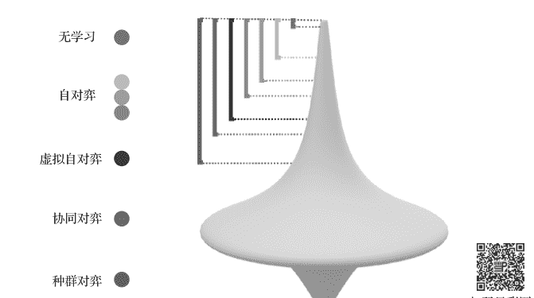

### 策略评估：从绝对指标到相对排位的多维度量

策略池模型参差不齐，如何为外环筛选高质量候选是关键机制设计问题。评估体系呈现“绝对→相对、传递→非传递”演进：

| 评估维度 | 核心指标体系 | 适用场景 |
| :--- | :--- | :--- |
| **绝对能力** | 可利用性 [118]、方差 [119] | 基础诊断，计算成本高 |
| **相对能力·传递压制** | Elo [120]、Glicko [121]、TrueSkill [122] | 围棋、象棋等强传递性游戏 |
| **相对能力·非传递压制** | mElo2k、纳什平均 [123]、$\alpha$-Rank [124]、$\alpha^\phi$-Rank [125]、RG-UCB [126]、InfoGain $\alpha$-Rank [127]、OptEval [128] | 石头剪刀布类循环博弈、复杂 MARL |

前沿探索已延伸至智能体-任务适配度、游戏难度量化、大规模在线评估及团队聚合技能建模 [158]。

### 策略提升：四大范式的适用边界与相变机制

外环策略迭代并非单一路径，**自对弈、虚拟自对弈、协同对弈、种群对弈** 四大范式各有疆域 [42]：

1.  **自对弈**：朴素 [129]、$\delta$ 均匀 [130]、非对称 [131]、双预言机 [113]、极小极大后悔鲁棒 [132]。依赖历史版本对抗，样本质量敏感，适用面最窄。**关键洞见**：仅当策略“传递压制维”跨越临界点，自对弈才有效，否则陷入循环压制轮替。
2.  **虚拟自对弈**：虚拟对弈 (FP) [133]、扩展 FP (XFP) [134]、平滑/随机/团队/神经 (NFSP) [138]、蒙特卡罗 NFSP [139]、多样性/优先级变体 [140,141]。引入信念/采样/神经拟合扩展样本空间，适配扩展式与合作博弈。
3.  **协同对弈**：协同演化 [142]、协同学习 [7]。多策略共舞驱动下一代进化。
4.  **种群对弈（主流）**：种群训练 [143]、DO-实证博弈分析 [144]、混合预言机 [145]、PSRO 全家族（联合 [146]、行列式点过程 [140]、管线 [147]、在线 [113]、自主 [148]、任意时间最优 [149]）。**核心瓶颈**：如何提升探索样本效率，打通“快内环生成 → 慢外环优化”的数据流动。

### 自主学习：元学习赋能的“探索-利用”智能平衡

打破手工设计框架，**元学习**正融合评估与提升，驱动智能体自主进化：
*   **多样性驱动探索**：Wu 等 [151] 用元学习生成“难被剥削+高多样性”对手池；**质量多样性 (QD)** [152] 作为帕累托框架，兼顾覆盖广度与回报质量。
*   **三维多样性度量体系** [153-157]：

| 多样性类型 | 核心度量手段 | 导向作用 |
| :--- | :--- | :--- |
| **行为多样性** | 期望基数 [140]、QD [152]、期望行为变化 [153]、占据测度 [154] | 鼓励动作层面差异化 |
| **策略多样性** | 响应/有效多样性 [154]、最大平均差异 (MMD) [156]、交互图 [157]、凸壳扩张 [154] | 扩大策略空间覆盖，提升探索效率 |
| **环境多样性** | 泛化界 [153] | 增强跨场景适应鲁棒性 |

*   **自主课程学习**：Leibo 等 [158] 证实内生/外生挑战可自主生成课程；Yang 等 [159] 强调其对现实系统的关键性；Feng 等 [148] 基于元博弈+元学习实现了“多样性感知自主课程”，自主挖掘课程攻克难被利用策略。

## 在线博弈策略学习：蓝图之外的实时自适应

离线训练得到的“蓝图策略”难以直面非平稳、欺骗性对手。在线学习本质是**对手意图识别 + 对抗策略选择**的耦合问题：

### 1. 在线无悔学习：动态环境下的理论基石
建模工具涵盖在线 MDP [162]、对抗 MDP [163] 等。核心追求：交互时长 $T \to \infty$ 时平均后悔值趋零。代表性进展：
*   **算法融合**：Kash 等 [166] 结合 Q 函数设计新后悔匹配；Hedge [95]、MWU [96] 为经典基石。
*   **动态后悔界**：Dinh 等 [113] 给出支撑集约束下的在线动态后悔界。
*   **末次迭代收敛**：Lin [167]、Lee [168] 突破平均策略收敛，研究最后一步策略收敛性。
*   **一般和博弈近似最优**：Daskalakis 等 [169] 建立后悔界新边界。
*   **事后理性** [170]：作为后悔值等价替代，指导在线学习最佳关联策略。

### 2. 对手建模与利用：显式与隐式的双轨并行
*   **显式建模**：融合领域知识，结构化预测对手动作；
*   **隐式建模**：端到端学习对手策略嵌入；
*   **在线利用难点**：小样本、非平稳、不可预测环境。前沿方向包括：元学习生成“难剥削/多样性”对手池指引学习 [151]、元策略优化 [171]、对手感知学习 (LOLA) [58]、在线自对弈课程构建 [172]。

### 3. 智能体匹配与协作：零样本协调与人机融合
*   **多角色协调**：Wang 等 [173] 设计面向多类角色的 MARL；Gong 等 [174] 用协同/压制关系图嵌入解决在线匹配规划。
*   **零样本协调 (ZSC)** [175]：**它对弈 (OP)** [176] 为无预先沟通协调提供核心支撑。
*   **人机组队**：基于《星际争霸》平台研究 [177]、自然语言指令驱动学习 [178]、组队方法系统性评估 [179]。

## 前沿研究重点：四大范式转型的攻坚方向

### 1. 拥抱新解概念：超越纳什的动态视角
纳什均衡作为静态不动点，难以刻画循环集、周期轨道、极限环等动态特性。**寻找具备更优动态稳定性、计算可行性的新多人解概念**，是博弈论赋能多智能体学习的理论突破口。

### 2. 提升可解释性：可信决策的“白盒化”诉求
深度强化学习“只知其然不知所以然”。在空战等高风险对抗中，**可解释性、可信度、安全性优于纯效能**。需在性能与解释性间寻找帕累托最优，推动“可解释强化学习”从选题走向工程标配。

### 3. 融合新范式：对手建模与剥削的博弈论重构
纳什均衡假设对手完全理性，实则过度保守。**显式建模 + 均衡近似**平衡“利用性”与“被剥削风险”，实现多目标优化。面对认知嵌套、欺骗、对手学习意识等复杂认知对抗，**最大熵 MARL** 成均衡选择新趋势。同步演进的**反对手建模**（安全利用、自我保全）构成攻防双刃剑。

### 4. 迈向通用 AI：跨任务泛化的元学习架构
元学习“学会学习”，通过建模任务集共性实现大跨度迁移。已延伸至元强化学习、元模仿、元迁移、在线/无监督元学习。**核心命题**：如何融合博弈理论收敛保障与强化学习泛化能力，构建**高效、可解释、收敛有保障**的通用元学习框架。

## 前沿研究方向：工程落地与认知深化的双轮驱动

### 1. 分布式博弈策略学习框架：算法-系统协同设计
双层优化（元学习、自主课程 [157]、元演化 [181]）指导程序设计；**Ray [182]、MAVA [183]、MALib [117]** 等分布式并行框架为种群演化提供底层算力调度支撑。**软硬协同、算系融合**是规模化落地关键。

### 2. 智能体认知行为建模与协同：通往通用 AI 的认知路径
引入认知架构 [184] 作为知识获取接口。对抗侧聚焦**对抗推理与反制规划** [185]，支撑思维建模、决策演化、欺骗反欺骗；合作侧赋能**人机交互、机器推理、协同规划、人类感知智能系统** [186]。认知建模将“黑箱策略”升维为“可理解智能体”。

### 3. 通用博弈策略学习方法

# 突围大规模智能协作：从场论近似到终身进化的多维路径

当参与主体数量激增，决策与环境维度将呈爆发式膨胀，严重拖累群体智能算法的规模化能力。一旦参与方超过两方，寻找纳什平衡点便陷入算力泥沟。针对该瓶颈，场论近似引入了破局思路：Yang 团队借助平均场机制，构建了平均场 Q 网络与平均场 Actor-Critic 架构，为海量节点协作提供了可行范式。

从方法脉络看，传统群体强化训练与对抗理论构成了泛化对抗决策的底座。面向元层对抗的群体迭代诉求，Muller 团队融入去中心化算力框架，催生了 Alpha-Rank 与 PSRO 等前沿路径。同期，适配并行化架构的进化算法，为黑盒优化类决策开辟新径；针对连续策略空间的决策改进，则依托梯度驱动机制给出核心解法。

此外，环境的时变特性强制个体必须持续跟踪动态演变，这令“终身适应能力”成为个体存续进化的硬性指标。

# 多智能体强化学习经典文献全景扫描：从博弈奠基到大规模协作

回顾多智能体强化学习（MARL）的发展历程，无异于见证一场从“单兵作战”走向“团队协作”，再到“大规模网络化智能”的演进史诗。梳理这四十余篇里程碑式文献，我们可以清晰地勾勒出该领域的技术脉络与范式迭代。

## 一、 奠基基石：独立学习与早期Q学习的探索

早期的研究聚焦于如何将单智能体RL扩展至多智能体场景。Littman（[57]）率先在马尔可夫博弈中引入价值函数方法，为后续算法奠定了理论基石。Claus与Boutilier（[62]）深入剖析了合作系统中强化学习的动力学特性，而Tan（[72]）则通过对比独立与协作智能体，揭示了非平稳性带来的核心挑战。

针对学习率固定导致的震荡问题，Bowling与Veloso（[54]）提出变学习率机制；Bowling博士论文（[53]）进一步系统研究了面对有限理性智能体的学习策略。Kapetanakis与Kudenko（[55]）在异构协作场景中验证了协调学习的有效性，Lauer与Riedmiller（[61]）则设计了分布式强化学习算法。Wang与Sandholm（[63]）致力于在团队马尔可夫博弈中学习最优纳什均衡。

为缓解“相对过度泛化”困境，Littman（[68]）提出Friend-or-Foe Q学习；Hu与Wellman（[65]）推出Nash Q学习处理一般和博弈；Greenwald等（[66]）引入Correlated-Q利用相关均衡优化协调；Conitzer与Sandholm（[71]）设计的AWESOME算法兼顾自我博弈收敛与对固定对手的最佳响应。Kononen（[67]）关注非对称学习，Zinkevich（[70]）引入在线凸规划视角，Powers与Shoham（[51]）则提出新收敛判据。后续Matignon等人（[73], [74]）开发了滞后Q学习与FMQ启发式算法，Bloembergen等（[75]）引入宽容频率调整机制，显著提升了分散式协作的稳定性。Sandholm等（[89]）利用混合整数规划求解纳什均衡，Zhang（[60]）研究零和多人博弈的团队极大极小均衡，Palmer（[76]）则在团队博弈中克服了独立学习的病理现象。

## 二、 博弈论深度融合：求解器、演化动力学与对手感知

随着理论深化，博弈论工具成为核心驱动力。Bosansky等（[48]）设计精确双神谕算法求解不完全信息零和广义博弈；Leonardos与Piliouras（[50]）以灾变理论视角解析探索-利用困境；Hu等（[49]）分析种群博弈中独立学习者的演化动力学；Singh等（[69]）研究迭代一般和博弈中梯度动态的纳什收敛性。

极具影响力的是“对手感知学习”范式：Foerster等（[58]）提出LOLA算法，让智能体预判对手学习步骤并塑造其行为；Hernandez-Leal等（[59]）撰写综述系统梳理非平稳性应对策略；Digiovanni与Zell（[52]）则全面复盘自我博弈在强化学习中的演进脉络。

## 三、 价值分解范式：CTDE架构下的协作突破

深度学习浪潮催生了“中心化训练、分布式执行”（CTDE）范式。Sunehag等（[81]）首创价值分解网络（VDN），以加性分解实现团队奖励分配；Rashid等（[82]）提出QMIX，引入单调性约束实现更灵活的非线性分解；Son等（[84]）设计QTRAN通过变换函数修正分解偏差；Mahajan等（[83]])推出MAVEN，利用变分推理解决探索不足难题。这一系列工作彻底改写了合作式MARL的SOTA版图。

## 四、 策略梯度与通信机制：应对混合动机与协作涌现

在Actor-Critic框架下，Lowe等（[80]])提出MADDPG，通过集中式Critic缓解非平稳性，适配混合合作竞争环境。Foerster等（[79]])引入反事实多智能体策略梯度（COMA），精准归因个体贡献。通信层面，Sukhbaatar等（[77]])利用反向传播实现可微通信学习；Peng等（[78]])设计双向协调网络，在星际争霸战斗中涌现出人类级协作智能。

## 五、 大规模去中心化：网络化系统的可扩展性攻关

面对大规模网络拓扑，去中心化成为刚需。Arslan与Yüksel（[64]])研究随机团队中的分布式Q学习；Zhang等（[85]])提出面向网络智能体的完全去中心化算法；Qu等（[86]])设计可扩展算法优化平均奖励；Chu等（[87]])聚焦网络化系统控制应用；Lesage-Landry与Callaway（[88]])发展近似多智能体拟合Q迭代，为大规模部署提供工程可行路径。

## 六、 新兴视角：递归推理、自我博弈与贝叶斯优化

前沿探索持续拓宽边界：Dai等（[56]])融合递归推理与贝叶斯优化，实现博弈中的无懊悔学习；上述Digiovanni与Zell（[52]])的自我博弈综述亦为该分支提供了系统性指引。

---

**结语**

从早期Q学习变体的修补，到博弈论求解器的严谨引入，再到深度价值分解与策略梯度的范式确立，以及大规模去中心化的工程落地，这四十余篇文献串联起MARL三十年的技术主线。未来，随着大模型先验知识的注入、因果推理的融合以及具身智能场景的拓展，多智能体系统必将在更复杂的开放世界中展现出真正的集体智能涌现。

## 核心参考文献速览：从凸优化到多智能体博弈与评测

本文汇集了构建现代博弈论、在线学习及多智能体强化学习理论基石的关键文献。为便于检索与阅读，已按研究脉络分类整理，涵盖一阶优化算法、均衡计算理论、序列博弈扩展、多智能体训练框架以及策略评测体系六大板块。

### 一、 非光滑凸优化与一阶算法奠基之作
此类工作确立了镜像下降、额外梯度法及近端方法在处理大规模非光滑问题中的核心地位。
*   **Nesterov (2005)** 提出“过度间隙技术”，在 *SIAM J. Optim.* 上为非光滑凸极小化提供了新的效率估计。
*   **Nemirovski (2004)** 在 *SIAM J. Optim.* 确立了针对变分不等式与鞍点问题的 Prox-method，实现了 $O(1/t)$ 的收敛速率。
*   **Beck & Teboulle (2003)** 于 *Oper. Res. Lett.* 系统阐释了镜像下降与非线性投影次梯度法在凸优化中的应用。

### 二、 均衡计算与自适应学习的经典范式
从关联均衡的自演化机制到纳什均衡的计算复杂度，勾勒了博弈论计算侧的早期版图。
*   **Hart & Mas-Colell (2000, 2001)** 分别在 *Econometrica* 与 *J. Econ. Theory* 提出基于遗憾匹配的自适应程序，证明其能收敛至关联均衡，并构建了通用自适应策略类。
*   **Freund & Schapire (1999)** 在 *Games Econ. Behav.* 引入乘法权重更新法，开启了自适应博弈学习的先河。
*   **Cesa-Bianchi & Lugosi (2006)** 专著 *Prediction, Learning, and Games* (CUP) 系统总结了预测、学习与博弈的交叉理论。
*   **Lemke & Howson (1964)** 早期在 *J. SIAM* 确立了双矩阵博弈纳什均衡的路径跟踪算法。
*   **Papadimitriou & Roughgarden (2008)**、 **Jiang & Leyton-Brown (2015)** 分别在 *J. ACM* 与 *Games Econ. Behav.* 推进了多玩家关联均衡及紧致博弈中精确均衡的多项式时间计算。
*   **Porter, Nudelman & Shoham (2008)**、 **Ceppi et al. (2010)**、 **Foster & Young (2006)** 从简单搜索、局部搜索到遗憾测试，探索了纳什/关联均衡的多元求解路径。

### 三、 扩展式博弈与序列决策中的均衡拓展
聚焦于不完全信息动态博弈，攻克序列结构下的计算与学习难题。
*   **von Stengel & Forges (2008)** 在 *Math. Oper. Res.* 定义了扩展式关联均衡并分析其复杂度。
*   **Farina, Ling, Fang 等 (2019, NeurIPS)** 设计高效遗憾最小化算法求解扩展式关联均衡。
*   **Celli, Coniglio & Gatti (2019, AAMAS)** 研究两人序列博弈中最优事前关联均衡的计算。
*   **Celli, Marchesi, Bianchi 等 (2019, NeurIPS)** 推广至多玩家一般和序列博弈的关联学习。
*   **Hendon, Jacobsen & Sloth (1996)**、 **Heinrich, Lanctot & Silver (2015, ICML)** 分别奠定并深化了扩展式虚拟博弈/自我博弈框架。

### 四、 预测性方法与深度多智能体强化学习前沿
连接经典逼近理论与现代深度学习，解决大规模不完全信息博弈求解与协作对抗建模。
*   **Farina, Kroer & Sandholm (2021, AAAI)** 通过预测性 Blackwell 逼近性，统一遗憾匹配与镜像下降，大幅加速求解。
*   **Lanctot 等 (2017, NeurIPS)**、 **Muller 等 (2020, ICLR)** 分别提出统一博弈论视角的多智能体强化学习框架与泛化训练范式。
*   **Srinivasan 等 (2018, NeurIPS)**、 **Gruslys 等 (2020, arXiv)** 推进部分可观测环境下的 Actor-Critic 与优势遗憾匹配算法。
*   **Celli, Ciccone, Bongo 等 (2019, arXiv)**、 **Sonzogni (2019, PhD Thesis)**、 **Zhang & An (2020, ICML)** 聚焦深度强化学习在对抗团队博弈、深度受限搜索及团队极大极小均衡中的应用。
*   **Dinh 等 (2021, arXiv)** 提出在线双重预言机机制。

### 五、 大规模分布式训练工程化平台
支撑亿级自我博弈与种群训练的基础设施建设。
*   **Sun 等 (2020, arXiv)** 构建 TLeague 竞争性自我博弈分布式框架。
*   **Zhou 等 (2021, arXiv)** 开发 MALib 面向种群训练的并行框架。

### 六、 扑克基准与方差分析工具
*   **Lisy & Bowling (2016, arXiv)** 评估无限注扑克机器人均衡近似质量。
*   **Cloud & Laber (2020, arXiv)** 提供扩展式博弈的方差分解分析工具。

### 七、 技能评分与多智能体评测体系演进
从 Elo、Glicko 到 TrueSkill，再到 $\alpha$-Rank 及其可扩展变体，重塑多智能体能力评价标准。
*   **Elo (1978)**、 **Glickman (1995)**、 **Herbrich, Minka & Graepel (2006, NeurIPS)** 奠定贝叶斯技能评分三部曲。
*   **Balduzzi 等 (2018, NeurIPS)** 反思评测本质； **Omidshafiei 等 (2019, Sci. Rep.)** 开创 $\alpha$-Rank 演化评价法。
*   **Yang 等 (2020, AAMAS)**、 **Rowland 等 (2019, NeurIPS)**、 **Rashid 等 (2021, AAAI)**、 **Du 等 (2021, ICML)** 通过随机优化、不完整信息建模、信息增益最大化及低秩矩阵补全，实现 $\alpha$-Rank 的大规模落地与鲁棒估计。

### 八、 自我博弈课程学习与策略探索新范式
*   **Samuel (1959)** 以跳棋开启机器学习博弈先河。
*   **Bansal 等 (2017, arXiv)**、 **Sukhbaatar 等 (2017, arXiv)** 揭示多智能体竞争涌现复杂性与非对称自我博弈驱动的内在课程。
*   **Wang, Ma & Wellman (2021, arXiv)** 从经验博弈论视角审视策略探索评估。

---
*注：以上文献按主题聚类重排，原始编号 [90]-[134] 对应文末完整书目信息。*

# 多智能体强化学习核心文献速览：从自我对弈到群体进化

在多智能体强化学习（MARL）的研究版图中，如何达成纳什均衡、构建高效自课程、处理非平稳环境以及实现零样本协作，始终是核心挑战。以下梳理了该领域具有里程碑意义的关键文献（编号 [135]-[176]），按研究脉络分类呈现，助你快速把握前沿脉搏。

## 一、 虚构自我对弈与策略优化基石
该类工作奠定了通过自我博弈逼近均衡的理论基础。Liu 等人 **[135]** 证明了虚构自我对弈在零和马尔可夫博弈中能收敛至纳什均衡；Hofbauer 与 Sandholm **[136]** 则从随机虚构博弈的全局收敛性给出了经典论证。针对不完全信息扩展式博弈，Farina 等人 **[137]** 探讨了事前协调与串通机制，Heinrich **[138]** 系统总结了自我对弈强化学习的实践路径。Zhang 等人 **[139]** 引入蒙特卡洛神经网络近似动态博弈均衡，为大规模不完全信息场景提供了可行方案。

## 二、 群体训练、自课程与行为多样性
打破单一最优策略的局限，群体化训练成为主流。Vinyals 等人 **[141]** 在《星际争霸II》中验证了多智能体强化学习达到大师水平；Jaderberg 等人 **[143]** 则在 3D 多人游戏中实现人类级表现。Park 等人 **[142]** 从共进化视角建模捕食者-猎物生态。为解决循环支配与过拟合，Wright 等人 **[144]** 提出历史感知训练增强稳定性，Smith 等人 **[145]** 基于单策略最佳响应迭代求解经验博弈。PSRO（策略空间响应预言机）系列工作持续迭代：Marris 等人 **[146]** 引入相关均衡元求解器拓展至非零和博弈，McAleer 等人 **[147]** 设计流水线 PSRO 提升大型博弈扩展性，后续又推出随时可停的 Anytime PSRO **[149]**。

自课程机制方面，Feng 等人 **[148]** 提出神经自课程，Yang 等人 **[150]** 强调多样化自课程对真实系统部署的关键作用，da Silva 等人 **[172]** 则通过与专家博弈在线构建课程。行为多样性度量与诱导成为热点：Nieves 等人 **[140]** 建模行为多样性应对开放环境，Wu 等人 **[151]** 研究学习利用对手策略，Mouret **[152]** 从微观到宏观演化视角审视机器行为。McKee 等人 **[153]** 量化环境与种群多样性影响，Liu 等人 **[154]** 统一行为与响应多样性。Parker-Holder 等人 **[155]** 聚焦有效多样性，Masood 与 Doshi-Velez **[156]** 用最大均值差异梯度诱导策略集，Garnelo 等人 **[157]** 以交互图为群体目标，Leibo 等人 **[158]** 更从社会互动视角发布多智能体智能研究宣言。

## 三、 零样本协作与对手建模
“Other-Play” 范式 **[175]** 由 Hu 等人提出，旨在实现零样本协调；Treutlein 等人 **[176]** 进一步形式化该问题并揭示开放议题。Albrecht 与 Stone **[160]** 则对自主智能体建模他人的方法进行了全面综述。

## 四、 在线学习、遗憾最小化与非平稳环境
面对未知动态环境，在线学习理论提供刚性保障。Fei 等人 **[159]** 分析非平稳环境下策略优化的动态遗憾，Jaksch 等人 **[162]** 给出强化学习近似最优遗憾界。He 等人 **[163]** 针对对抗性线性混合 MDP 设计近似最优算法，Mehdi 等人 **[164]** 聚焦未知部分可观测 MDP 的在线学习。Tian 等人 **[165]** 推进未知马尔可夫博弈的在线学习，Kash 等人 **[166]** 融合无遗憾学习与 Q-learning。收敛速度与质量上，Lin 等人 **[167]** 实现博弈中有限时间最后迭代收敛，Lee 等人 **[168]** 拓展至扩展式博弈，Daskalakis 等人 **[169]** 推导通用博弈近似最优无遗憾学习，Morrill 等人 **[170]** 提出高效偏离类型与事后理性学习。

## 五、 元学习、角色涌现与匹配机制
Kim 等人 **[171]** 设计多智能体元策略梯度算法实现“学会学习”。Wang 等人 **[173]** 通过 ROMA 框架实现角色涌现，Gong 等人 **[174]** 则建模竞技场高阶交互优化匹配机制。Wright 与 Vorobeychik **[161]** 早期从机制设计角度切入团队组建问题。

---
*注：以上文献涵盖 2010-2021 年核心会议（NeurIPS, ICML, ICLR, AAAI, AAMAS 等）及期刊（Nature, Science, Econometrica, JAIR 等）成果，编号对应原始文献列表 [135]-[176]。*

## 核心参考文献

本章理论框架的构建与论证，主要立足于以下前沿学术成果：

[177] Lucero C 等. 人机协同与可解释 AI 在即时战略游戏中的应用研究[C]. 国际人机交互会议, 布达佩斯, 2020: 161-171.  
[178] Waytowich N 等. 将自然语言指令映射至星际争霸 II 游戏状态：面向叙事引导的强化学习[EB/OL]. http://arxiv.org/abs/1906.02671.  
[179] Siu H C 等. 基于学习型与规则型智能体的人机协作团队评估——以花火游戏为例[EB/OL]. http://arxiv.org/abs/2107.07630.  
[180] Ji K. 面向机器学习的双层优化：算法设计与收敛性分析[EB/OL]. http://arxiv.org/abs/2108.00330.  
[181] Bossens D M, Tarapore D. 质量多样性元进化：为元目标定制行为空间[EB/OL]. http://arxiv.org/abs/2109.03918v1.  
[182] Moritz P 等. Ray：面向新兴 AI 应用的分布式框架[C]. 第 12 届 USENIX 操作系统设计与实现会议, 卡尔斯巴德, 2018: 561-577.  
[183] Pretorius A 等. MAVA：分布式多智能体强化学习研究框架[EB/OL]. http://arxiv.org/abs/2107.01460.  
[184] Kotseruba I, Tsotos J K. 认知架构四十年：核心认知能力与工程应用[J]. 人工智能评论, 2020, 53(1): 17-94.  
[185] Kott A, McEneaney W M. 对抗推理：读懂对手意图的计算方法[M]. 博卡拉顿: Chapman & Hall, 2006.  
[186] Kulkarni A. 面向人感知 AI 系统的可解释与混淆行为合成[D]. 坦佩: 亚利桑那州立大学, 2021.  
[187] Yang Y D 等. 均场多智能体强化学习[C]. 第 35 届国际机器学习会议, 斯德哥尔摩, 2018: 5571-5580.  
[188] Majid A Y 等. 深度强化学习与进化策略：对比综述[EB/OL]. http://arxiv.org/abs/2110.01411.

---

## 第 3 章 智能博弈对抗策略学习的核心基石

### 3.1 开篇概览

本章将系统梳理智能博弈对抗领域策略学习的基础方法体系。内容编排遵循“由模型到算法，由单体到分布”的逻辑主线：3.2 节奠基马尔可夫决策过程（MDP）的数学建模；3.3 节勾勒强化学习基本范式；3.4 节深度解析主流深度强化学习算法；3.5 节横向对比分层强化学习进路；3.6 节落地三大分布式训练框架的工程实践。

### 3.2 马尔可夫决策过程：序列决策的数学基座

#### 3.2.1 核心模型构建

在人工智能领域，面对不确定环境的决策建模，马尔可夫决策过程（MDP）是公认的标准范式。它为处理随机性环境下的序列决策问题奠定了坚实的数学底座，提供了统一的理论抽象框架。简言之，MDP 模型由四大核心要素构成：环境状态集合、智能体动作集合、状态转移函数与奖励函数。

**定义 3.1（马尔可夫决策过程）**  
MDP 可形式化为一个四元组 \((S, A, P, R)\)。其中 \(S\) 代表有限环境状态集，\(A\) 为智能体动作全集。状态转移函数 \(P(s'|s, a) \rightarrow [0, 1]\) 量化了在状态 \(s\) 执行动作 \(a\) 后跃迁至 \(s'\) 的概率；奖励函数 \(R(s'|s, a) \in \mathbb{R}\) 则定义了该跃迁对应的即时收益。

设有限状态空间与动作空间规模分别为 \(|S| = K\)、\(|A| = N\)，可记为 \(\{s^1, \dots, s^K\}\) 与 \(\{a^1, \dots, a^N\}\)。本章重点聚焦离散状态与动作空间下的 MDP 问题（连续空间推广逻辑同构）。

MDP 的核心特质在于**马尔可夫性**：状态转移仅依赖当前状态与动作，与历史轨迹无关，即
\[
P(s'|s_t, a_t, s_{t-1}, a_{t-1}, \dots) = P(s'|s_t, a_t) \qquad (3.1)
\]
这正是 MDP 区别于更广义随机过程的关键分水岭。奖励函数则直接编码了学习目标——最大化累积回报，是 MDP 求解的核心驱动力。

**策略** 本质是从状态空间到动作概率分布的映射。广义策略为随机策略 \(\pi(a|s)\)，给出状态 \(s\) 下选取动作 \(a\) 的概率，映射为 \(\pi : S \times A \rightarrow [0,1]\)；确定性策略则退化为确函映射 \(\pi : S \rightarrow A\)。

智能体与环境交互生成轨迹 \(s_0, a_0, r_0, s_1, a_1, r_1, \dots\)。在无限时域下，策略 \(\pi\) 从状态 \(s\) 出发的期望折扣累积回报定义为**状态值函数**：
\[
V^\pi(s) = E_\pi \left[ \sum_{k=0}^\infty \gamma^t r_{t+k} \mid s_t = s \right] \qquad (3.2)
\]

针对确定性策略，值函数满足**贝尔曼方程**：
\[
V^\pi(s) = \sum_{s'} P(s'|s, \pi(s)) \left[ R(s'|s, \pi(s)) + \gamma V^\pi(s') \right] \qquad (3.3)
\]

同理，**动作值函数** \(Q^\pi(s, a)\) 表示执行 \(a\) 后遵循 \(\pi\) 的期望回报，其贝尔曼方程为：
\[
Q^\pi(s, a) = \sum_{s' \in S} P(s'|s, a) \left[ R(s, a) + \gamma V^\pi(s') \right] \qquad (3.4)
\]
其中 \(V^\pi(s') = Q^\pi(s', \pi(s'))\) 形成递归结构。

MDP 求解的本质是寻找**最优策略** \(\pi^*\)，而值函数是评判最优性的金标准。设最优值函数为 \(V^*\)、\(Q^*\)，依据贝尔曼最优方程：
\[
V^*(s) = \max_{a \in A} Q^*(s, a) \qquad (3.5)
\]
展开即：
\[
V^*(s) = \max_{a \in A} \left\{ \sum_{s' \in S} P(s'|s, a) \left[ R(s, a) + \gamma V^*(s') \right] \right\} \qquad (3.6)
\]

已知 \(V^*\) 时，最优动作遵循贪婪法则：
$$

\pi^*(s) = \arg \max_{a \in A} V^*(s)

$$ 
(3.7)

已知 \(Q^*\) 时，最优动作选择规则为：
$$

\pi^*(s) = \arg \max_{a \in A} Q^*(s, a)

$$ 
(3.8)

此即**贪婪策略**。理论上精确求解 (3.7) 或 (3.8) 可得最优解，但受限于状态空间爆炸，精确计算在工程中往往不可行，这也倒逼出近似求解算法的�荣发展。

#### 3.2.2 经典求解路径

针对离散 MDP，求解最优策略等价于寻找最优决策路径。主流精确算法主要包含**策略迭代**、**值迭代**与**蒙特卡罗树搜索（MCTS）**三大支柱。

**1. 策略迭代：评估与改进的双重奏**  
策略迭代通过“策略评估”计算当前策略值函数，再经“策略改进”贪婪最大化值函数，交替推进直至收敛。

- **策略评估**：固定策略 \(\pi\)，求解线性方程组得到 \(V^\pi\)。对任意 \(s \in S\)：
$$

V^\pi(s) = \sum_{s' \in S} P(s, \pi(s), s') [R(s, \pi(s), s') + \gamma V^\pi(s')]

$$ 
(3.9)

- **值函数更新**：单步向前展开，将 \(V^{\pi_k}\) 更新至 \(V^{\pi_{k+1}}\)：
$$

V^{\pi_{k+1}}(s) = \sum_{s' \in S} P(s, \pi(s), s') [R(s, \pi(s), s') + \gamma V^{\pi_k}(s')]

$$ 
(3.10)

- **策略改进**：基于 \(V^\pi\) 贪婪构造新策略 \(\pi'\)：
$$

\pi'(s) = \arg \max_a Q^\pi(s, a) = \arg \max_a \sum_{s'} P(s, a, s') [R(s, a, s') + \gamma V^\pi(s')]

$$ 
(3.11)
其中 \(Q^\pi\) 为动作值函数。保证 \(V^{\pi'}(s) \geqslant V^\pi(s), \forall s \in S\)。

整体流程：任意初始策略 \(\pi_0\) 出发，交替执行评估（\(\xrightarrow{\text{PE}}\)）与改进（\(\xrightarrow{\text{PI}}\)）。若 \(\pi_{k+1}(s) = \pi_k(s), \forall s\)，策略稳定，即得最优策略：
$$ \pi_0 \xrightarrow{\text{PE}} V^{\pi_0} \xrightarrow{\text{PI}} \pi_1 \xrightarrow{\text{PE}} V^{\pi_1} \xrightarrow{\text{PI}} \pi_2 \rightarrow \cdots \rightarrow \pi_* \xrightarrow{\text{PE}} V^* $$ (3.12)

有限 MDP 策略空间有限（\(|S|^{|A|}\)），算法保证有限步收敛。工程实现中，输入模型与收敛阈值 \(\varepsilon\)，迭代输出最优策略。

**2. 值迭代：单循环的加速范式**  
策略迭代将评估与改进解耦，评估阶段需待值函数完全收敛，耗时较长。值迭代将策略改进**内嵌**至值函数更新，仅对每个状态执行一次备份操作，显著提速。

其本质是将贝尔曼最优方程转化为迭代更新规则：
$$ V_{t+1}(s) = \max_{a \in A} \left\{ R(s,a) + \gamma \sum_{s' \in S} P(s'|s,a) V_t(s') \right\} = \max_{a \in A} Q_{t+1}(s,a) $$ (3.13)
其中 \(V_t\) 为第 \(t\) 轮迭代值函数。

从初始 \(V_0\) 出发，生成收敛序列：
$$ V_0 \rightarrow V_1 \rightarrow V_2 \rightarrow V_3 \rightarrow V_4 \rightarrow V_5 \rightarrow V_6 \rightarrow V_7 \rightarrow \cdots \rightarrow V^* $$ (3.14)

计算中隐含中间 \(Q\) 值序列：
$$ V_0 \rightarrow Q_1 \rightarrow V_1 \rightarrow Q_2 \rightarrow V_2 \rightarrow Q_3 \rightarrow V_3 \rightarrow Q_4 \rightarrow V_4 \rightarrow \cdots \rightarrow V^* $$ (3.15)

可证明：任意初始 \(V_0\)，若 \(V^*\) 存在，值迭代必然收敛至满足贝尔曼最优方程的 \(V^*\)。

**异步动态规划** 是值迭代的轻量化变体：无需遍历全状态集，支持任意顺序原地更新（如优先更新未收敛区域），仅需保证每个状态无限被访问即可正确收敛。

**3. 蒙特卡罗树搜索：在线规划的里程碑**  
MCTS 融合蒙特卡罗模拟与最优优先搜索，在不依赖完整模型的前提下解决在线最优决策。其核心逻辑：通过累积模拟价值评估树节点，优先扩展高潜力分支，兼具树搜索精度与随机采样普适性。

基本流程：在计算预算（迭代次/时间）内构建非对称搜索树，根节点输出最优动作。树中节点对应状态，有向边对应动作。单次迭代包含四阶段：

- **选择**：从根节点递归按树策略（如 UCB）下行，至首个可扩展节点（非终止且有未访问子节点）。
- **扩展**：按可用动作新增子节点。
- **仿真**：从新节点按默认策略（最简为随机策略）推演至终局，获取回报。
- **回溯**：沿路径反向传播统计量（访问次数、累积价值），服务后续决策。

MCTS 维护双策略体系：**树策略**平衡探索与利用引导选择；**默认策略**驱动快速模拟估值。这一机制使其在围棋、即时战略等复杂博弈中大放异彩，成为大规模 MDP 在线求解的首选利器。

#### 3.2.3 半马尔可夫决策过程：打破单步假设的时序建模

蒙特卡洛树搜索（MCTS）的性能很大程度上仰赖于树策略的设计。树策略负责从现有搜索树的节点中挑选或生成叶子节点，涵盖节点选择与扩展两个环节；而默认策略则从非终止状态出发，通过预演模拟产出价值估计。上置信区间树（UCT）作为 MCTS 的经典实现之一，引入 UCB1 机制作为树策略，旨在协调探索与利用的矛盾。在 UCT 框架下，每个子节点的抉择被视为多臂老虎机（MAB）问题，子节点价值源于蒙特卡洛模拟的近似期望回报，属于分布未知的随机变量。后续动作依据 UCB 准则在当前节点下选取，其数学形式如下：

$$ UCT(n,a) = Q(n,a) + c \sqrt{\frac{\ln N(n)}{N(n,a)}} $$ (3.16)

式中，$ Q(n,a) $ 代表节点 $ n $ 执行动作 $ a $ 的平均累积收益；$ N(n,a) $ 为该动作被选中的计数；$ N(n) = \sum_{a \in A} N(n,a) $ 表示节点 $ n $ 的总访问量；$ c > 0 $ 为调节探索与利用权重的常数。

精确求解马尔可夫决策过程（MDP）受限于计算复杂度与求解器能力，难以胜任状态空间巨大、动作维度高、任务周期长且环境动态演化的场景。引入分层架构则为攻克此类难题提供了更符合直觉的范式。

半马尔可夫决策过程（SMDP）作为 MDP 的推广形式，为分层学习与规划奠定了理论基石。MDP 仅关注动作施行的序列关系，预设每个动作可在单个决策周期内瞬时完成，忽略了时间消耗。SMDP 打破了这一限制，允许不同动作耗费时长不一，甚至服从特定概率分布。

设随机变量 $\tau$ 表征状态 $s$ 下施行动作 $a$ 所需的历时。SMDP 的状态转移函数 $P(s',\tau|s,a)$ 给出了从状态 $s$ 起始，执行 $a$ 经过 $\tau$ 时间后抵达 $s'$ 的联合概率：

$$ P(s',\tau|s,a) = \text{Pr}\{s_{t+\tau} = s' | s_t = s, a_t = a\} $$ (3.17)

同理，期望奖励函数 $R(s',\tau|s,a)$ 刻画了在相同时间跨度内，由状态 $s$ 经动作 $a$ 终至 $s'$ 所积累的期望折扣回报之和：

$$ R(s,a,s',\tau) = E \left[ \sum_{n=0}^{\tau-1} \gamma^n r_{t+n} | s_t = s, a_t = a, s_{t+\tau} = s' \right] $$ (3.18)

MDP 体系中的价值函数与贝尔曼方程可平滑迁移至 SMDP。若策略 $\pi(s)$ 在状态 $s$ 下需耗时 $\tau$ 步方能完成，价值函数即可拆解为这 $\tau$ 步的即时累积回报与后续剩余时段累积回报之和：

$$ V^\pi(s) = E_\pi \left[ (r_t + \gamma r_{t+1} + \dots + \gamma^{\tau-1} r_{t+\tau-1}) + (\gamma^\tau r_{t+\tau} + \dots) | s_t = s \right] $$ (3.19)

融合联合转移概率与期望奖励，确定性策略 $\pi$ 下的 SMDP 贝尔曼方程呈现为：

$$ V^\pi(s) = \sum_{s', \tau} P(s', \tau | s, \pi(s)) [R(s', \tau | s, \pi(s)) + \gamma^\tau V^\pi(s')] $$ (3.20)

对比标准 MDP 方程，此处显性引入了动作执行时长 $\tau$ 对价值评估的修正项。进而，SMDP 的最优状态价值函数 $V^*(s)$ 与最优动作价值函数 $Q^*(s)$ 分别定义为：

$$ V^*(s) = \max_a \sum_{s', \tau} P(s', \tau | s, a) [R(s', \tau | s, a) + \gamma^\tau V^*(s')] $$ (3.21)

$$ Q^*(s) = \sum_{s', \tau} P(s', \tau | s, a) [R(s', \tau | s, a) + \gamma^\tau V^*(s')] $$ (3.22)

其中 $V^*(s') = \max_{a'} Q^*(s', a')$。

SMDP 框架下的分层策略，为大时间尺度规划提供了极具人类认知特征的建模视角：人们制定长远蓝图时，不会纠结于每一秒的微操，而是划定若干宏观阶段（即子任务），各阶段周期各异，内部策略相对自主，如图 3.1 所示。

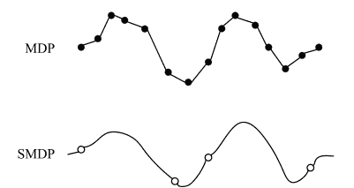

**图 3.1 MDP 与 SMDP 状态轨迹对比**

分层学习借助分解技术，将庞大的原始 MDP 拆解为一系列可独立求解的子目标，再将局部最优解组装为全局最优，有效缓解了大规模不确定环境中的“维数灾难”。当前主流构建分层结构的三大范式为：基于固定或预学习策略定义子任务的 **Option**；依托终止谓词与局部奖励函数的 **MAXQ**；以及基于不确定有限状态机的 **HAM**。以下逐一展开。

##### 1. Option：时序抽象的宏动作单元

Option，即时序扩展动作，亦称宏动作或技能。它将一连串原子动作封装为单一决策单元，实现了时间维度的抽象。

**定义 3.2 (Option)** 形式化为三元组 $\langle I, \pi, \beta \rangle$：
- **初始集 $I$**：Option 可被激活的状态集合，$I \subseteq S$。
- **内部策略 $\pi : S \times A \rightarrow [0,1]$**：Option 运行期间的行为准则。
- **终止条件 $\beta : S^+ \rightarrow [0,1]$**：Option 在特定状态下结束的概率分布。

Option 仅在当前状态 $s \in I$ 时生效。初始集与终止条件共同界定了其适用边界。若内部策略与终止条件仅依赖当前状态，则称之为马尔可夫 Option。

给定一组 Option，其初始集隐式定义了状态 $s$ 下的可用 Option 集 $\mathcal{O}_S$。这与原子动作集 $A_S$ 同构：单步动作可视为 $I=\{s\}, \pi(s,a)=1, \beta(s)=1$ 的特例 Option。由此，智能体每一步的决策均在统一的 Option 集合中进行——既包含单步的原子动作，也包含多步的时序扩展动作。多步 Option 内部策略可继续调用其他 Option，从而构建任意深度的分层动作体系。

##### 2. MAXQ：值函数分解的层次化架构

Dietterich 提出的 MAXQ 方法，核心在于将宏大 MDP $M = (S, A, P, R)$ 分解为一系列子任务 $\{M_0, M_1, \dots, M_n\}$，每个子任务本质是一个 SMDP。$M_0$ 为根任务，全体子任务构成单根有向无环图（DAG），结构如图 3.2。MAXQ 具备时间抽象、状态抽象与子任务共享三大特性，且支持多子任务策略并行学习。

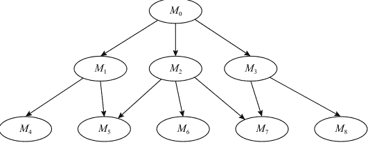

**图 3.2 MAXQ 分层任务结构示意**

**定义 3.3 (MAXQ)** 无参子任务 $M_i$ 由三元组 $\langle T_i, A_i, \tilde{R}_i \rangle$ 刻画：
- **终止条件 $T_i$**：将状态空间划分为活动集 $S_i$ 与终止集 $G_i$。仅当 $s \in S_i$ 时 $M_i$ 可运行；$s \in G_i$ 则宣告结束。
- **动作集 $A_i$**：涵盖原子动作与子任务调用。
- **伪奖励 $\tilde{R}_i$**：从活动状态转移至终止集的内部奖励信号。

子任务目标是驱动环境进入满足 $T_i$ 的终止状态。给定分层结构，分层策略 $\pi = \{\pi_0, \dots, \pi_n\}$ 从根任务 $M_0$ 递归展开至原子动作。若每层 $\pi_i$ 均为最优，则整体策略具备递归最优性。

定义值函数 $V^\pi(i, s)$ 为在 $s$ 下遵循分层策略 $\pi$ 直至 $M_i$ 结束的期望折扣累积回报；动作值函数 $Q^\pi(i, s, j)$ 为在 $s$ 下先施行 $M_j$ 再遵循 $\pi$ 直至 $M_i$ 结束的期望回报（$M_j$ 可为原子动作或子任务）。二者的贝尔曼方程递归表达为：

$$ V^\pi(i, s) = V^\pi(\pi_i(s), s) + \sum_{s', k} P_i^\pi(s', k|s, \pi_i(s)) \gamma^k V^\pi(i, s') $$

$$ Q^\pi(i, s, j) = V^\pi(j, s) + \sum_{s', k} P_i^\pi(s', k|s, j) \gamma^k V^\pi(i, s') $$

其中 $P_i^\pi(s', k|s, j)$ 为在 $s$ 调用 $M_j$ 策略 $\pi$ 后，$k$ 步原子动作终止于 $s'$ 的概率；$V^\pi(j, s)$ 为宏动作 $M_j$ 的值函数（原子动作时即 $R(j,s)$)。

方程 (3.24) 最右项描述了 $M_j$ 运行完毕后、$M_i$ 终止前继续遵循策略获得的期望回报，即**完成函数** $C^\pi(i, s, j)$：

$$ C^\pi(i, s, j) = \sum_{s', k} P(s', k|s, j) \gamma^k V^\pi(i, s') $$

引入完成函数后，动作值函数与状态值函数可重述为：

$$ Q^\pi(i, s, j) = V^\pi(j, s) + C^\pi(i, s, j) $$

$$ V^\pi(i, s) = \begin{cases} \max_j Q^\pi(i, s, j), & M_i \text{ 是宏动作} \\ \sum_{s'} P(s'|s, i)R(s'|s, i), & M_i \text{ 是原子动作} \end{cases} \quad (3.27) $$

方程 (3.25)–(3.27) 构成了确定性分层策略下的 MAXQ 分层分解体系，将根任务值函数递归拆解为子任务值函数与完成函数的组合。

若分层策略达到递归最优，最优动作值函数、最优状态值函数及子任务 $M_i$ 的递归最优策略分别表示为：

$$ Q^*(i, s, j) = V^*(j, s) + C^*(i, s, j) \quad (3.28) $$

$$ V^\pi(i, s) = \begin{cases} \max_j Q^\pi(i, s, j), & M_i \text{ 是宏动作} \\ \sum_{s'} P(s'|s, i)R(s'|s, i), & M_i \text{ 是原子动作} \end{cases} \quad (3.29) $$

$$ \pi_i^*(s) = \arg \max_j Q^*(i, s, j) \quad (3.30) $$

##### 3. HAM：有限状态机约束下的策略编码

层次抽象机（Hierarchies of Abstract Machines, HAM）另辟蹊径：将部分策略编码为含未指定选择状态的分层有限状态机，结合机器状态与环境状态联合决策。

在有限 MDP $M$ 中，设 $S, A$ 为状态/动作集。$H = \{H_0, H_1, \dots\}$ 为有限状态机集，每个 $H_i = \langle \mu_i, I_i, \delta_i \rangle$：
- $\mu_i$：有限机器状态集。
- $I_i: S \rightarrow S_i$：环境状态到机器初始状态的随机映射。
- $\delta_i$：环境状态与机器状态联合决定的下一机器状态转移概率。

机器状态分四类：**动作状态**指定执行动作；**调用状态**启动子状态机；**选择状态**非确定性地选择下一状态（即抽象动作决策点）；**停止状态**终止当前机器并回溯。

分层状态机与 MDP 并行交互，生成离散时间的高层 SMDP。选择状态是抽象动作的发起点；动作状态与选择状态串联产生基于抽象动作的策略序列。若在当前机器终止前遇到新选择状态，即相当于在层级中创建更深一层。精心设计的 HAM 能大幅压缩决策点关联的状态空间。

在强化学习中，HAM 优势显著：它约束探索范围，大幅缩短智能体适应新环境的“盲搜索”期。HAMQ 作为改进型 Q-learning，可直接在简化状态空间学习，无需模型转换。HAMQ 维护变量包括：环境状态 $t$、机器状态 $n$、上一选择点环境状态 $s_c$ 与机器状态 $m_c$、所选动作 $a$、累积奖励 $r_c$ 与折扣因子 $\beta_c$。其扩展 Q 表 $Q([s,m], a)$ 以“环境状态/机器状态对”及选择点动作为索引。

观测到累积奖励 $r_c$、折扣 $\beta_c$ 及环境状态 $s_c \rightarrow t$ 转移时，HAMQ 更新规则为：$r_c \leftarrow r_c + \beta_c r$，$\beta_c \leftarrow \beta \beta_c$。每步状态转移执行如下更新：

```
Q([s_c, m_c], a) \leftarrow Q([s_c, m_c], a) + \alpha [r_c + \beta_c V([t, n]) - Q([s_c, m_c], a)] \quad (3.31)
```

# 三大分层架构：殊途同归的MDP分解术

Option、HAM 与 MAXQ，这三种分层强化学习框架虽在任务拆解与子任务建模上各有千秋，但核心逻辑殊途同归——皆是将庞大的原始 MDP 问题拆解为若干子 MDP，实现跨层级的协同学习。

具体来看，**Option** 框架预设了底层内部策略，学习重心全落在高层宏观策略的优化上；**HAM** 则采取“半自动”模式，部分策略人工指定，其余随机初始化，目标是在约束条件下求解全局最优策略；**MAXQ** 最大胆，子任务策略全未知，依靠同步策略迭代自底向上涌现。

在收敛性上，Option 与 HAM 锚定**“分层最优”**——宏观策略在原始任务下收益最高，但子策略需感知上下文环境；MAXQ 追求**“递归最优”**——给定宏观策略下，每个子任务局部最优，策略可复用、无需顾及调用环境。三者共同的“阿喀琉斯之踵”在于：分层结构设计高度依赖专家先验，缺乏领域知识时，搭建骨架便成难题。

---

### 3.3 强化学习：从行为主义到智能决策的范式革命

传统 AI 三大流派——符号主义（逻辑推演）、连接主义（神经仿生）、行为主义（感知-动作控制）——各执一词。符号主义虽严谨但难处理不确定性；连接主义是深度学习鼻祖，却面临可解释性与泛化难题；行为主义虽成果斐然，却因缺乏统一理论，难登大雅之堂。强化学习，正是行为主义思想在数学框架下的集大成与升华。

#### 3.3.1 核心范式：MDP + 贝尔曼方程 = 极致试错

区别于符号主义钻研逻辑语义，RL 以 **马尔可夫决策过程（MDP）** 为骨架，**贝尔曼最优方程** 为求解器，核心目标单一而纯粹：**在拉近估值与真值的同时，最大化累积回报**。智能体在部分可观环境中不断打磨“状态-动作”映射，这便是 RL 的决策闭环。

这股灵感源自心理学行为主义：环境给糖（奖励）或巴掌（惩罚），智能体通过试错积累正向反馈，逐渐内化为最优策略。作为监督/无监督学习之外的第三支柱，RL 模拟的是生物最原始的学习范式——**交互**。婴儿无师自通挥手、观察，通过因果链接理解世界；驾驶、社交皆是如此。交互，是智能的源头活水（参见图 3.3）。

溯源而言，1898 年 Thorndike 提出“效果律”，奠定雏形；50 年代“最优控制”术语现世，Bellman 以动态规划、贝尔曼方程攻克离散随机 MDP；1992 年 Watkins 融合时序差分（TD）与 Q-learning，确立经典范式。标准 RL 问题需满足三要素：动作奖励差异化、奖励延迟性、环境依赖性。退化到仅满足首条，即为**多臂老虎机（MAB）** 问题，衍生出随机、对抗、马尔可夫、线性/非线性等变体。

传统 Q-learning 靠查表维护 Q 值，状态动作空间一大便崩溃（“维度灾难”）。深度学习感知强决策弱，RL 决策强感知弱。**DeepMind 2015 年推出 DQN，用深度神经网络替代表格拟合值函数，实现优势互补，开启深度强化学习（DRL）新纪元**（架构见图 3.4：观测→状态编码→动作映射→价值评估）。

#### 3.3.2 值函数方法：从蒙特卡罗到贝尔曼递归的数学跃迁

值函数派是 RL 基石，早期受限于离散空间曾让位于策略梯度，但其核心——**量化“状态/动作价值”**——从未过时。目标是优化长期回报 $G_t$，直接求和必发散，引入折扣因子 $\gamma$ 强制收敛（公式 3.33）。然轨迹未知，无法直接求和，故引入**数学期望**定义价值函数（公式 3.34）。

价值函数分两体系：
*   **状态值函数 $v_\pi(s)$**：在状态 $s$ 下遵循策略 $\pi$ 的长期期望回报。
*   **动作值函数 $q_\pi(s,a)$**：在 $s$ 执行 $a$ 后遵循 $\pi$ 的长期期望回报。

二者互为表里。直接按定义遍历所有轨迹求期望（公式 3.35-3.36）计算量爆炸。利用 MDP 无记忆性换元，推导出**贝尔曼期望方程**（公式 3.38）：
$$v_\pi(s) = \mathbb{E}_{a\sim\pi, s'\sim P}[r + \gamma v_\pi(s')]$$
同理得动作值递归形式（公式 3.39）。这一递归结构，将“无限未来”压缩为“即时奖励 + 下一状态价值”，成为值迭代、策略迭代及所有时序差分学习的基石。

#### 3.3.3 策略梯度：端到端的策略优化范式

值函数派“评估再改进”两步走，策略梯度派**直指目标函数 $J(\theta)$**——参数化策略 $\pi_\theta$ 的期望回报。优化三步走：交互采样轨迹 $\tau = (s_0,a_0,r_0,...)$ $\rightarrow$ 计算梯度 $\nabla_\theta J(\theta)$ $\rightarrow$ 梯度上升更新 $\theta$。

利用对数导数技巧将梯度转为期望形式（见推导占位符），再以蒙特卡罗采样近似期望，得 **REINFORCE** 核心更新规则：

```
J(\theta) = E_{\tau \sim \pi_\theta(\tau)}[r(\tau)] = \int_{\tau \sim \pi_\theta(\tau)} \pi_\theta(\tau) r(\tau) d\tau \tag{3.40}
```
```
\nabla_\theta J(\theta) = \int_{\tau \sim \pi_\theta(\tau)} \nabla_\theta \pi_\theta(\tau) r(\tau) d\tau \tag{3.41}
```
```
\nabla_\theta J(\theta) = \int_{\tau \sim \pi_\theta(\tau)} \pi_\theta(\tau) \nabla_\theta \log \pi_\theta(\tau) r(\tau) d\tau = E_{\tau \sim \pi_\theta(\tau)}[\nabla_\theta \log \pi_\theta(\tau) r(\tau)] \tag{3.42}
```
```
\pi(\tau) = \pi(s_0, a_0, \cdots, s_T, a_T) = p(s_0) \prod_{t=0}^T \pi_\theta(a_t | s_t) p(s_{t+1} | s_t, a_t) \tag{3.43}
```
```
\nabla_\theta \log \pi(\tau) = \nabla_\theta \log \left[ p(s_0) \prod_{t=0}^T \pi_\theta(a_t | s_t) p(s_{t+1} | s_t, a_t) \right] \\
= \nabla_\theta \left[ \log p(s_0) + \sum_{t=0}^T \log \pi_\theta(a_t | s_t) + \sum_{t=0}^T \log p(s_{t+1} | s_t, a_t) \right] \tag{3.44} \\
= \sum_{t=0}^T \nabla_\theta \log \pi_\theta(a_t | s_t)
```
```
\(\nabla_\theta J(\theta) = E_{\tau \sim \pi_\theta(\tau)} \left[ \sum_{t=0}^T \nabla_\theta \log \pi_\theta(a_{i,t} | s_{i,t}) \sum_{t=0}^T r(s_{i,t}, a_{i,t}) \right]\)
\(= \frac{1}{N} \sum_{i=1}^N \left[ \sum_{t=0}^T \nabla_\theta \log \pi_\theta(a_{i,t} | s_{i,t}) \sum_{t=0}^T r(s_{i,t}, a_{i,t}) \right]\)
```

此法直接优化策略，天然适配连续动作与随机策略，虽方差大、收敛慢，却是 Actor-Critic 等先进算法的基石。

---

### 3.4 深度强化学习：分类学与无模型流派的崛起

DRL 分类沿袭 RL 传统：按**模型依赖**分 Model-free 与 Model-based；按**优化对象**分 Value-based 与 Policy-based，二者可任意组合（OpenAI 分类谱系见图 3.5）。早期学界聚焦确定性、全观测、离散空间，**Model-free 因实现简、资源富、渐近性能强而成绝对主流**；AlphaGo 横空出世后，Model-based 因样本效率高重获关注。

#### 3.4.1 无模型深度强化学习：DQN 与值函数近似的范式确立

**深度 Q 网络（DQN）** 是 Model-free Value-based 的集大成者。它用 CNN 处理高维视觉输入（如 Atari 原始像素），输出离散动作 Q 值，并引入两大创新稳定训练：
1.  **经验回放**：打破样本相关性，提升数据复用率。
2.  **目标网络（隐含于“同步学习/训练过程”描述中）**：冻结目标值网络，缓解非线性函数逼近的震荡发散。

DQN 在 49 个 Atari 游戏中单一架构、超参通吃，展现惊人泛化性，彻底点燃 DRL 爆发期。它证明：**深度感知 + 价值迭代，足以攻克高维感知决策难题。**

### 价值函数流派的迭代与融合：从 DQN 到 Rainbow 再到 Ape-X

自 DQN 问世并取得突破性成功后，后续改进算法层出不穷。受限于早期网络架构（如 CNN、LSTM 或自编码器）的瓶颈，原始 DQN 仍存在长期记忆缺失等短板。Hausknecht 等人 [15] 尝试用循环 LSTM 替换首个卷积后的全连接层，探究递归机制引入 DQN 的效果。Wang 等人 [16] 基于决斗网络架构，通过解耦状态价值与动作优势，增强了跨动作的泛化能力。A3C [17] 引入多步返回目标平衡偏差与方差；Noisy DQN [18] 利用参数噪声驱动探索；Distributional Q [19] 则转向学习奖励的全分布而非单一均值。鉴于这些改进共享同一骨架，Rainbow [20] 将其集大成，实验证实其在 Atari 2600 基准上达到了当时的数据效率与性能巅峰。深入剖析发现，优先经验回放是提升智能体表现的关键因素。Ape-X [21] 进一步利用大规模分布式架构，以百余 Actor 并行采集数据并构建多优先级回放池，训练时效较 Rainbow 提升近乎一倍。

---

### 策略梯度：绕开值函数的另辟蹊径

REINFORCE 是策略梯度派的鼻祖。相较于值函数路线，策略直接建模法规避了值函数误差导致的策略退化，且天然适配连续动作空间。值函数类算法（如 Q-Learning、SARSA）需在动作空间搜索最大值，在高维或连续域中极难施展；且其学习的是隐式确定性策略，难以处理需随机决策的任务。策略梯度则直接优化参数化随机策略。但其通病显著：样本利用率低、方差大、收敛难。

---

### Actor-Critic 架构：双线并行的平衡术

Actor-Critic (AC) 融合双方优势，同步学习策略与状态价值函数。Critic 充当基线引导 Actor 更新，有效压低方差、加速收敛。然而，设计一个既简洁又稳健、兼容离散连续动作的 AC 算法，长期是 RL 领域的硬骨头。

DDPG 延伸 DQG 与确定性策略梯度 (DPG)，在统一超参与架构下攻克低维连续控制。TD3 作为其改进版，显著提升了稳定性。但 DDPG 确定性策略的本质使其在噪声干扰下表现脆弱，往往需人为加噪探索。另一痛点在于：TRPO、PPO、A3C 等主流无模型算法，每步梯度更新都需海量新样本，样本效率低下且随任务复杂度恶化。

SAC (Soft Actor-Critic) 给出了破局答案：离策略更新 + 稳定随机 AC 公式 + 最大熵框架。最大熵 RL 强化了标准目标，带来三大红利：
1. **技能迁移初始化**：高熵策略覆盖多样行为，可作为复杂任务的预训练基座；
2. **强探索力**：熵正则天然鼓励多模态下发掘更优模式；
3. **高鲁棒与泛化**：被迫探索多样最优路径，面对扰动更易调整。

---

### 信任区域与近端优化：约束更新的艺术

策略梯度配合神经网络拟合，易因数据分布漂移导致更新不稳。TRPO 引入信任区域机制，在各实验中大放异彩。其核心在于用 KL 散度约束策略更新步长，将保守策略迭代推广至通用随机策略。缺点是交互成本高、计算复杂、工程落地难。

PPO 采用一阶优化 + 裁剪目标函数，实现“悲观估计”，工程极简但可能牺牲样本效率。分布式 PPO 借鉴 A3C 架构，将采样与计算下放多 Actor，兼得扩展性与稳健性。Path Consistency Learning (PCL) 则融合同/离策略优势，借熵正则化下的时序一致性强化探索。

---

## 3.4.2 基于模型的强化学习：掌握世界模型的规划者

知晓转移动力学 $p(s_{t+1}|s_t, a_t)$ 即掌握“世界模型”，规划自然水到渠成。MBRL 致力于学习环境动力学，再借最优控制 (MPC、LQR、LQG) 选动作。源于最优控制理论，MBRL 以高数据效率著称，免去无尽环境交互，但易受模型偏差拖累，导致规划失真。本节按建模范式分三类剖析优劣。

#### 1. 全局建模 vs 局部建模

首个抉择：拟合全局动力学还是局部动力学？全局模型推理快，但在随机域数值稳定性差，常用 MPC 迭代采样并反向传播至策略。GPS (Guided Policy Search) 引入轨迹优化指导策略，规避局部最优陷阱，在 MuJoCo 任务上展现高样本效率，加速无模型预训练。

高维空间里，“学好模型比学好策略更难”，尤其环境难建模时。于是局部模型成主流：需识别当前生效的控制器、保证全局一致性。典型代表有：
*   **iLQR**：GPS 扩展，支持通用策略表示，无需已知模型或演示即可学动态技能。
*   **Dyna-Q**：经典融合架构，用模拟经验更新 Q 值。
*   **I2A (Imagination-Augmented Agents)**：学习环境编码器辅助无模型决策，较 MCTS 缓解模型不完美问题，兼顾效率与鲁棒性。

#### 2. 不确定性感知模型：正视“不知道”

纯模型法虽训练极快（分钟级 vs 无模型天级），但最终性能常差数量级，罪魁祸首是过拟合。不确定性量化成破局关键。按性质分：偶然不确定性 (系统内在随机) 与 认知不确定性 (数据不足导致的主观无知)。应对路径二：显式估计模型不确定性、或用输出熵构建感知模型。

PILCO 学习概率动力学模型，将不确定性传播至长程规划，极少数据即达成任务。Blundell 等引入变分贝叶斯神经网络 (BNN) 量化权重不确定性。实证表明，BNN 不仅抑制过拟合，还能校准训练数据上的不确定性估计。

#### 3. 面向复杂观测的模型：从像素到潜在状态

MBRL 在部分可观测、高维观测 (如图像) 下举步维艰——智能体只能基于观测而非真实状态决策。VAE 虽能压缩图像至潜空间，但重构目标不保证保留控制相关信息，不适直用于 MBRL。E2C (Embed to Control) 将 VAE 与 iLQR 结合，在潜空间求解局部最优控制，将高维非线性问题降维打击。

另一路径：深度视频预测模型 + MPC。首个在观测空间直接学习的机器人操作案例，仅用未标注数据训练，能规划将指定物体移至目标位置，泛化至未见物体。引入时间跳跃连接的视频预测模型，配合自监督学习，在技能广度与深度上均取得突破。

---

## 3.5 分层强化学习：化整为零的分治智慧

HRL 利用时序抽象分解 MDP：将大问题拆解为可复用的子任务，再组合近似最优解，有效缓解“维度灾难”。按层次形式化方式，经典分为 Option、MAXQ、HAM 三大流派。近年深度学习加持下，神经网络与 HRL 融合成新热点。

### 1. Option 框架：时序扩展动作的灵活基石

Sutton 等 [4] 引入 Option 将 HRL 建模为 SMDP。每个 Option 为三元组 $<I, \pi, \beta>$：启动集 $I$、内部策略 $\pi$、终止函数 $\beta$。Option 实现时序抽象，调用后按内部策略连续执行，无需逐步决策，极具迁移性。

手工设计 Option 在高维空间不可行，研究转向 **Option 发现 (自动学习层级)**。技术路线百花齐放：
*   信息理论视角：描述长度权衡价值 [22]、信息瓶颈交换值 [26]；
*   结构挖掘：识别瓶颈/标志状态 [29]、公共轨迹/区域策略 [30]；
*   示例驱动：从演示推断 [24]、专家技能链构技能树 [35]；
*   优化视角：终止函数作隐变量 EM 优化 [40]、开环宏动作 [41]、修复状态表征缺陷 [42]。

早期工作奠基：Digney 宏动作 [31]、Mcgovern 基于访问频率创建 Option [32]、Hengst 的 HEXQ 利用状态变量因子化发现 Option [33]、Konidaris 的概率 Option 抽象智能体空间 [34]。近年深度融合：Bacon 将策略梯度引入 Option 端到端学习 [38]；Vezhnevets 的 STRAW 隐式学习宏动作与策略，仅靠环境奖励在 Atari 难关超越 SOTA [41]；Manager-Worker 双网协作，Manager 定子目标、Worker 执行动作，分梯度优化 [46]；Florensa 最大化互信息预训练技能攻克连续控制 [47]；Léon 在 POMDP 下提出 BONN 学习 Option [48]；Kulkarni 双层网络学子目标，但依赖人工给定与内在动机设计，通用性受限 [49]。

### 2. MAXQ 分解：价值函数的层级拆解

Dietterich [5] 提出 MAXQ 将值函数层级分解，原 MDP 拆为子任务序列 $\{M_0, M_1, ..., M_n\}$，各自为子 SMDP。Li 等 [43] 推出情境敏感 RL (CSRL) 框架改进；Ponce 等 [44] 落地非玩家角色游戏，提沉浸感。

### 3. HAM 方法：有限状态机约束策略空间

Parr 等 [6] 引入有限状态机 (FSM) 表达区域策略，将任务分解转化为在策略空间构造 FSM。HAM 与 Option 同归 SMDP 理论体系。Bai 等 [45] 提出 HAMQ-INT 自动发现内部迁移，递归加速 Q 值计算。

### 4. 神经网络赋能的新一代 HRL

*   **Option-Critic** [38]：模糊发现与学习界限，端到端联合训练，游戏表现超越无分层 DQN。
*   **STRAW** [41]：循环网络隐式学时序抽象宏动作，无伪奖励/手工子目标，擅长需长程规划的 Atari 关卡，兼具序列预测迁移力。
*   **Manager-Worker** [46]：双网解耦目标生成与动作执行，分梯度优化，实验成果显著。
*   **DIAYN / 技能预训练** [47]：随机网络最大化互信息预训练技能，零奖励下解锁连续控制难题。
*   **BONN** [48]：POMDP 设定下引入预算约束 Option 网络。
*   **H-DRLN** [49]：双层网络决策子目标+执行行为，但依赖人工子目标与不清晰的内在动机，复杂任务落地难。

---

## 3.6 分布式强化学习：算力释放与工程落地

深度 RL 迈向复杂交互，可靠、可复用的分布式框架成科研与生产共同基建。聚焦三大典型代表：研发导向的 **Dopamine**、端到端产品级 **Horizon**、分布式原生的 **Ray RLlib**。

### 1. Dopamine：极简科研利器

Dopamine 系 TensorFlow 原生，核心哲学三条：
1.  **独立紧凑**：核心逻辑浓缩于极少文件，新手友好。Runner 类统管智能体-环境全交互流程；Checkpoint 组件定期持久化保障复现与容灾。
2.  **灵活扩展**：模块化设计便于插拔组件，快速验证新想法。
3.  **可复现性**：严格固定随机种子、版本锁定，消除“玄学”差异。

## Horizon：面向生产级落地的端到端 RL 平台

与先前探讨的 Dopamine 侧重研究不同，Horizon 定位为业界首个面向生产环境的端到端强化学习平台，致力于解决自动化系统构建中的实际落地难题。它能处理包含海量观测值的数据集，专为模拟器无法介入、反馈循环漫长且必须保障线上系统稳定与用户体验的场景设计。该框架的核心能力矩阵涵盖以下维度：

- **数据预处理管道**。传统 DRL 依赖模拟器即时生成的 MDP 转移元组（状态、动作、次态、奖励）填充经验池。但生产环境中奖励信号往往滞后数小时甚至数天，所有交互日志需先行落地。为此，Horizon 基于 Apache Spark 构建了“时间轴管道”，自动解析生产日志，重组为智能体可训练的标准化转移数据。
- **特征归一化机制**。生产侧特征普遍呈现稀疏、噪声大、分布任意等特性。鉴于神经网络在高斯分布特征上收敛更优，Horizon 引入标准化工作流：离线分析训练集推导各特征归一化函数，并将其嵌入 PyTorch 模型前向传播路径，实现样本级在线标准化，避免全量数据重写开销。
- **数据理解与环境诊断工具**。盲目在劣质环境上应用 DRL 易导致指标退化、优化方向偏离。Horizon 主张从历史日志学习环境模型，结合启发式规则校验问题建模合理性，识别环境构建中的关键特征与潜在陷阱。
- **多元化智能体算法库**。针对超大离散/连续动作空间，Horizon 集成了价值基础与策略基础两大族群算法：中小规模离散动作支持经典 DQN 及 Rainbow 变体；海量离散动作引入参数化动作 DQN (Parametric DQN)，通过特征过滤无效动作；连续控制则提供 DDPG 与 SAC 两大主流实现。
- **生产级训练范式：离线预热 + 在线精调**。利用 PyTorch GPU 加速实现大规模分布式训练。考虑到随机初始策略上线风险（用户体验受损或安全隐患），Horizon 强制采用“离线学习启动”策略：先基于现有非 RL 策略的历史日志训练初始模型，再谨慎过渡至在线迭代。
- **反事实策略评估 (CPE) 体系**。生产环境无法直接试错，Horizon 引入 CPE 离线评估新策略质量。训练周期内支持逐步直接法 (DM)、逐步重要性采样 (IS)、逐步双稳健 (DR)、序列双稳健、序列加权双稳健及 MAGIC 等多种估计器。核心思想均为学习奖励模型预测反事实收益，具体技术细节可查阅专业文献。
- **高性能模型服务与闭环迭代**。面向千节点级集群部署，Horizon 通过 PyTorch 与 ONNX 导出标准化模型包，保障推理高效稳健。线上策略产出的新交互数据自动回流“时间轴管道”，驱动下一轮训练迭代，形成数据-模型-服务飞轮。

## Ray RLlib：解耦并行计算的分布式强化学习库

DRL 工作流本质包含“经验采集”与“策略优化”两阶段。理论上可为各阶段配专用分布式系统再拼接，但实践中组件强耦合、通信开销大，难以落地。现有库多将智能体封装为单一重耦合进程，对整体并行而非模块并行，导致扩展、复用极难。研究发现，尽管算法形态各异，但策略评估、梯度优化等核心模块高度共性化，**急需一套支持高效抽象与组件组合的并行框架**。

关键挑战在于处理 DRL 流程中高度不规则的计算模式：
1.  **时延跨度巨大**：从毫秒级动作决策到小时/天级环境反馈；
2.  **硬件异构需求**：采样常跑多 CPU，训练依赖 GPU；
3.  **状态与无状态混杂**：模拟/预处理无状态，经验池维护与参数同步有状态。

RLlib 基于 Ray（Python 分布式任务框架）构建，采用**逻辑集中、分层控制**的分布式模型，区别于传统数据并行或模型并行范式。其架构三大基石：

- **策略图**：底层抽象，封装神经网络拓扑、参数访问接口与损失函数计算，框架无关（现支持 TensorFlow/PyTorch）。
- **策略评估器**：通用交互组件，包装策略图与环境，提供采样接口。可实例化为 Ray Remote Actor，跨多 Worker 并行部署，实现经验采集水平扩展。
- **策略优化器**：算法无关的性能核心，统筹经验采样、参数更新、回放缓冲管理。优化器启动远程评估器采集数据，按资源情况本地或下发计算梯度，聚合后更新策略图本地副本并广播同步至所有评估器。

该设计实现了采集与训练解耦、异构硬件调度灵活、有状态组件显式管理，极大提升了分布式 DRL 的工程落地效率。

### 参考文献

- [1] Coulom R. Efficient selectivity and backup operators in Monte-Carlo tree search[C]. International Conference on Computers and Games, Berlin, 2006: 72-83.
- [2] Črepiňšek M, Liu S H, Mernik M. Exploration and exploitation in evolutionary algorithms: A survey[J]. ACM Computing Surveys, 2013, 45 (3): 1-33.
- [3] Kocsis L, Szepesvári C. Bandit based Monte-Carlo planning[C]. European Conference on Machine Learning, Berlin, 2006: 282-293.
- [4] Sutton R S, Precup D, Singh S. Between MDPs and semi-MDPs: Learning, planning, and representing knowledge at multiple temporal scales[J]. Artificial Intelligence, 1999, 112 (1): 181-211.
- [5] Dietterich T G. Hierarchical reinforcement learning with the MAXQ value function decomposition[J]. Journal of Artificial Intelligence Research, 2000, 13: 227-303.
- [6] Parr R, Russell S. Reinforcement learning with hierarchies of machines[C]. Proceedings of the 10th International Conference on Neural Information Processing System, Cambridge, 1998: 1043-1049.
- [7] Hauskrecht M, Meuleau N, Kaelbling L P, et al. Hierarchical solution of Markov decision processes using macro-actions[EB/OL]. http://arxiv.org/abs/1301.7381.[2021-08-01].
- [8] da Silva B C, Konidaris G, Barto A. Learning parameterized skills[C]. Proceedings of the 29th International Conference on Machine Learning, Edinburgh, 2012: 1679-1686.
- [9] Parr R E. Hierarchical control and learning for Markov decision processes[D]. Berkeley: University of California, 1998.
- [10] Thorndike E L. Review of animal intelligence: An experimental study of the associative processes in animals[J]. Psychological Review, 1898, 5(5): 551-553.
- [11] Bellman R, Kalaba R. On the role of dynamic programming in statistical communication theory[J]. IRE Transactions on Information Theory, 1957, 3(3): 197-203.
- [12] Bellman R. A Markovian decision process[J]. Journal of Mathematics and Mechanics, 1957, 6(5): 679-684.
- [13] Watkins C J C H, Dayan P. Q-learning[J]. Machine Learning, 1992, 8(3-4): 279-292.
- [14] Mnih V, Kavukcuoglu K, Silver D, et al. Human-level control through deep reinforcement learning[J]. Nature, 2015, 518(7540): 529-533.
- [15] Hausknecht M, Stone P. Deep recurrent Q-learning for partially observable MDPs[EB/OL]. http://arxiv.org/abs/1507.06527.[2021-08-01].
- [16] Wang Z Y, Schaul T, Hessel M, et al. Dueling network architectures for deep reinforcement learning[C]. Proceedings of the 33rd International Conference on Machine Learning, Anaheim, 2016: 1995-2003.
- [17] Mnih V, Badia A P, Mirza M, et al. Asynchronous methods for deep reinforcement learning[C]. Proceedings of the 33rd International Conference on Machine Learning, Anaheim, 2016: 1928-1937.
- [18] Fortunato M, Azar M G, Piot B, et al. Noisy networks for exploration[EB/OL]. http://arxiv.org/abs/1706.10295.[2021-08-01].
- [19] Bellemare M G, Srinivasan S, Ostrovski G, et al. Unifying count-based exploration and intrinsic motivation[C]. Proceedings of the 30th Neural Information Processing Systems, New York, 2016: 1471-1479.
- [20] Hessel M, Modayil J, van Hasselt H, et al. Rainbow: Combining improvements in deep reinforcement learning[EB/OL]. http://arxiv.org/abs/1710.02298.[2021-08-01].
- [21] Horgan D, Quan J, Budden D, et al. Distributed prioritized experience replay[EB/OL]. http://arxiv.org/abs/1803.00933.[2021-08-01].
- [22] Thrun S, Schwartz A. Finding structure in reinforcement learning[C]. Proceedings of the 34th International Conference on Neural Information Processing Systems, 1994: 385-392.
- [23] Srinivas A, Krishnamurthy R, Kumar P, et al. Option discovery in hierarchical reinforcement learning using spatio-temporal clustering[EB/OL]. http://arxiv.org/abs/1605.05359.[2021-08-01].
- [24] Krishnan S, Garg A, Liaw R, et al. SWIRL: A sequential windowed inverse reinforcement learning algorithm for robot tasks with delayed rewards[J]. The International Journal of Robotics Research, 2019, 38 (2/3): 126-145.
- [25] Konidaris G, Kuindersma S, Grupen R, et al. Robot learning from demonstration by constructing skill trees[J]. The International Journal of Robotics Research, 2012, 31 (3): 360-375.
- [26] Jonsson A, Gómez V. Hierarchical linearly-solvable Markov decision problems[C]. Proceedings of the 26th International Conference on Automated Planning and Scheduling, London, 2016: 193-201.
- [27] Goetschalckx R, Hamidi M, Tadepalli P, et al. Active imitation learning of hierarchical policies[C]. International Joint Conference on Artificial Intelligence, Milan, 2015: 3554-3560.
- [28] McGovern A, Barto A G. Automatic discovery of subgoals in reinforcement learning using diverse density[C]. Proceedings of the 18th International Conference on Machine Learning, Williamstown, 2001: 361-368.
- [29] Menache I, Mannor S, Shimkin N. Q-cut-dynamic discovery of sub-goals in reinforcement learning[C]. European Conference on Machine Learning, Berlin, 2002: 295-306.

## 第 4 章 智能博弈：对手建模核心方法解析

### 4.1 引言

多智能体博弈对抗是典型的“竞合”（竞争与合作共存）场景。从博弈论视角切入，精准预判对手动向、稳健利用对手短板，能为己方决策提供强有力支撑。破解非完全信息博弈难题，最直接的路径是引入信息补全机制，将其近似转化为完全信息模型。对此，**对手建模** 应运而生——它旨在利用交互数据构建对手行为模进而推演动作、挖掘弱点并实施利用。本章聚焦对手建模核心技术体系：4.2 节梳理建模难点、显式与隐式两大技术路线；4.3 节针对即时策略（RTS）类对抗的在线规划，从战术、策略、混合三个维度展开，并指明未来方向；4.4 节聚焦序贯策略博弈中的对手剥削，涵盖自适应调整、感知式学习、生成式搜索三大范式，同步勾勒研究前沿。

### 4.2 对手建模基石

#### 4.2.1 核心内涵与挑战全景

**1. 认知本质与建模流程**
狭义上，对手建模属于认知行为建模范畴，核心在于对除自我外的他体行为进行建模、预测。广义视角下，建模对象涵盖合作队友（合作博弈）、敌对实体（对抗博弈）乃至自我孪生体（元博弈）。放眼当下，得益于大数据与算力飞跃，行为预测研究已形成**专家知识驱动、数据驱动、混合驱动**三大范式。

博弈论奠定了竞争合作中人类行为模式的基石，纳什均衡为最优解，可利用性量化策略偏离均衡的程度。即便掌握均衡策略，精准的对手模型仍能助智能体适应环境、撬动弱点、超越均衡收益。建模流程如下图：以可观测历史数据为输入，输出智能体属性预测。


**图 4.1 对手建模流程示意**

**2. 四大核心挑战与非平稳困境**
多智能体对抗面临信息不全、动作不确定、空间大规模、多方求解难等硬骨头。关键痛点在于**非平稳性**：各体策略随时演进，导致转移概率与奖励函数持续漂移。

既有研究常将他体视为环境一部分，假设平稳性简化求解。此法仅适用于对手策略固定场景；一旦对手具备学习能力（缓慢演化或动态切换），必须显式建模以预测行为、评估能力。非平稳建模主要借力在线学习、强化学习、博弈论。

**3. 方法谱系的五维分类视角**
结合环境可观测性（局部奖励 → 对手动作 → 动作奖励全知 → 完善先验）与对手行为变化剧烈度（固定 → 缓变 → 剧变），主流应对策略划分为五类：
① **忽略论**：假装环境平稳；
② **遗忘论**：无模型方法，弃旧存新；
③ **定向最佳响应**：针对预设对手优化；
④ **显式学习**：基于模型学习对手策略；
⑤ **心智理论递归**：智能体间陷入高阶推理博弈。

复杂博弈空间如下图，揭示了可观测性、非平稳性、应对策略三者耦合产生的指数级复杂度。

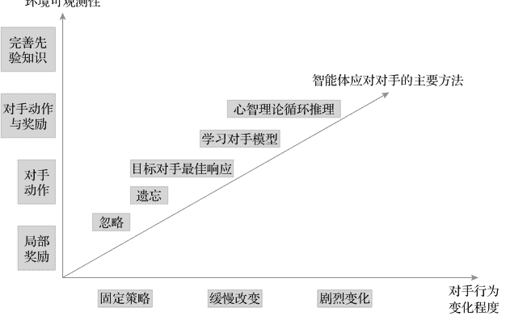

**图 4.2 博弈对抗空间复杂性示意**

**4. 显式与隐式：两大技术范式的分野**
主流研究将建模方法二分为**显式**与**隐式**，对比如下图：

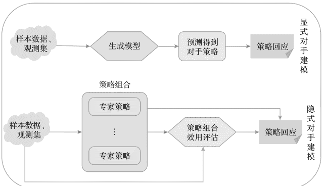

**图 4.3 显式与隐式对手建模对比**

- **显式建模**：直击观测数据，拟合对手策略，推演意图，补全信息缺失，兼容性强。痛点在于无先验时需海量样本，不完美信息下难落地。
- **隐式建模**：将对手信息内化为己方模型组件，通过最大化期望回报隐式引入对手决策。虽避免在线建模的算力与延迟压力，却面临“探索-利用”两难：预置策略库易备，但实战中如何低成本定位最优策略、平衡探索停止时机，是核心难题。本质上，隐式建模是一类**策略表征学习**方法。

#### 4.2.2 显式建模：四大技术支柱

主流显式路径涵盖意图识别、行为分类、策略重构、概率推理四大板块。

**1. 计划行动意图识别（PAIR）**
典型符号主义 AI 路线，借助层级计划库或范畴理论，推演对手意图与潜在计划，计划库丰富度直接决定识别上限。按竞合关系细分：
- 无关识别：非对抗非合作场景；
- 有意识识别：合作方主动隐式通报意图；
- 对抗识别：敌方施展欺骗干扰识别。

**2. 行为分类与类型推理**
- **行为分类**：融合多源信息，机器学习拟合模型参数，依多维属性输出风格标签（如攻击/中立/防守、松凶/紧弱等）。
- **类型推理**：假设对手隶属已知类型集（含“黑盒”类型），实时用新观测更新信念分布。

**3. 策略重构**
假设模型结构固定，据观测行为预测动作概率，学习任意满足条件的模型结构。涵盖：
- 条件行为概率模型；
- 案例推理；
- 紧致模型表示；
- 效用重构。

**4. 概率推理**
- **图模型贝叶斯推理**：用图模型建模决策偏好，图化表达提效，但难延伸至序贯决策。
- **对抗推理**：认知级推理手段，支撑意图识别与欺骗博弈。

#### 4.2.3 隐式建模：策略表征学习的实战逻辑

显式建模“离线观测→建模→在线决策”，隐式建模则**“离线预备策略组合 → 在线评估选优”**，规避实时建模算力与延迟痛点，但必须破解探索-利用困境：何时探索、何时停探、如何锁定最优，是隐式建模的命门。

**1. 深度强化学习路线**
- **深度值网络 + 对手网络**：双模块架构，策略学习预测状态值，对手学习推断对手策略，历史观测隐式编码对手属性，辅以混合专家网络修正值估计。
- **深度策略推理 / 循环策略推理**：引入 RNN，设计辅助任务学习策略特征，从原始观测端到端建模他体行为。

**2. 元学习赋能**

# 基于元学习的隐式对手建模及即时策略博弈对抗规划综述

## 元学习驱动的隐式建模新范式

利用元学习机制实现隐式对手建模，核心在于通过有限的交互博弈生成训练用的对手样本池，进而习得针对不同风格对手的利用策略。Wu 团队[22]构建的“学会割削”框架引入多样性正则化机制，能自动涌现出难以被利用且风格迥异的对手策略，显著增强了算法的鲁棒性与泛化性能。针对连续自适应对手场景，AI-Shedival 等[23]提出了模型无关的元学习框架；而在多智能体协同博弈中，Kim 等[24]则设计了基于策略梯度的元学习优化路径。

### 在线学习机制应对动态博弈

实战对抗初期往往难以精准建模，且对手策略可能随机切换，导致单一模型不确定性极高。当前在线隐式建模主流路径分为两派：一是**多臂老虎机融合在线凸优化**，利用已有模型先验动态修正建模结果[25]；二是**在线无悔学习范式**，将序贯决策建模为在线/对抗马尔可夫决策过程[26]，通过采样生成策略集合，再借助多臂老虎机机制动态控制累积后悔值[27]。

## 即时策略博弈中的对抗规划核心逻辑

规划本质是为达成目标而推演的动作序列生成过程。按目标性质可分为对抗、中立、友好三类。即时策略（RTS）领域的对抗规划面临“巨大状态/动作空间”、“非平稳对手”、“实时性约束”与“隐蔽信息”四重挑战。传统规划多聚焦单智能体中立任务，忽略对抗博弈中双方目标冲突、对手主动阻断的特性。对抗规划实质上包含**对抗推理**（推演对手状态、意图、行为）与**反制规划**（制定应对方案）两个耦合子过程。当前研究主要聚焦战术、策略及混合三大规划层级。

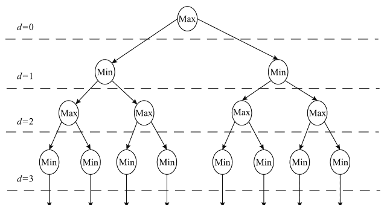

### 战术层对抗规划：微操与局部博弈的极致

#### 1. 极大极小树搜索的工程化演进
该算法以树结构枚举双方博弈走向，通过终局评估回溯最优动作。受限于组合爆炸，工程落地多采用**深度受限搜索+估值函数**的剪枝策略。理性假设下，Max方追求估值最大化，Min方反之，本质是在有限深度内寻找最优策略路径。Churchill 等人[29][30]针对 RTS 同步执行、动作持续性特点，改进出**带时长考量的 Alpha-Beta (ABCD)** 与 **UCT 变体**，有效解决了实时博弈中的时间建模难题。

#### 2. 蒙特卡罗树搜索 (MCTS) 的多维改良
MCTS 融合最佳优先搜索与蒙特卡罗估值，通过随机采样构建非对称搜索树，在算力预算内输出最优决策。其性能瓶颈在于树策略设计。针对 RTS 场景，学界探索了多条增强路径：
- **框架迁移**：Chung[31]在 ORTS 中验证 MCTS 战术规划框架；Churchill[32]下沉至单单位微操控制；Balla[33]、Soemers[34]、Uriarte[35]分别在 Wargus、星际争霸中落地战术攻击与军演任务。
- **分支因子治理**：Ontañón[36]提出朴素 MCTS 将组合动作奖励分解为原子动作奖励之和，小场景表现优异；Uriarte[37]引入状态抽象压缩分支，但难超越脚本 AI；Shleyfman[38]设计两阶段采样，平衡候选生成与深度评估的算力分配；Ontañón[39]引入 CNB 与 AIM 先验模型，其中 AIM 通过建模动作依赖关系效果更佳，代价是需海量对抗数据预训练；Sironi[40]则通过自适应参数调优提升智能体实战表现。

#### 3. 组合多臂老虎机 (CMAB) 重塑选择策略
UCT 将节点选择建模为单臂老虎机问题（UCB1），面对 RTS 庞大组合动作空间时性能骤降。Ontañón[42]将选择阶段重构为 **CMAB 问题**，智能体每轮激活一组组合臂以最大化期望收益，更契合 RTS 的组合决策本质。尽管如此，受限于算力与搜索深度，纯战术规划仍困于小规模场景，缺乏全局战略视野，亟需上层策略引导。

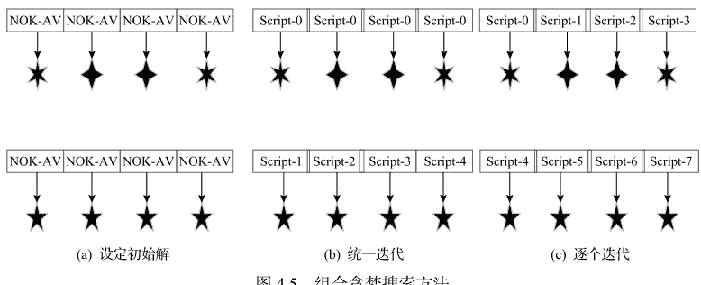

### 策略层对抗规划：抽象与搜索的博弈

核心思路是引入**动作/状态抽象**（如脚本化动作）压缩搜索空间。Justesen[44] 的 Script-UCT 即以脚本替代原子动作，大幅降低分支因子。

#### 1. 组合贪婪搜索 (PGS) 与嵌套改进 (NGS)
Churchill[30] 提出 PGS：不再优化单体动作，而是为单位分配最优控制脚本。迭代采用坐标下降思想——固定一方优化另一方，通过 Playout 评估收敛至局部最优（见流程图）。Morares[45] 指出 PGS 依赖固定脚本建模对手存在盲区，提出 **NGS**：贪婪搜索对手对各单位/动作组的最佳反制，再据此谋划己方最优应对，显著提升对手建模的动态适应性。

#### 2. 组合在线演化 (POE)
Che[46] 引入演化计算机制：初始化基因组（脚本分配方案），经变异、交叉、Playout 筛选迭代，实验证实其收敛速度与解质量均优于 PGS（见流程图）。

#### 3. 分层策略选择 (SSS/SSS+)
Lelis[47] 基于类型系统聚类单位（同类共享策略），属性维度涵盖血量、射程、伤害等。类型粒度决定策略精细度。SSS+ 引入自适应类型系统与元推理，动态平衡搜索粒度与效率（见流程图）。

#### 4. 非对称抽象采样 (A1N/A2N) 与投票式策略创建 (SCV)
Moraes[48] 设计双层采样：A1N 从脚本集采样，A2N 从双脚本集采样，提升朴素 MCTS 扩展性。但硬编码脚本限制行为上限，且动态适应性不足。Silva[49] 提出 **SCV**：投票机制融合脚本生成新策略，配合逻辑回归在线识别对手策略并自适应调整。Mariño[50] 进一步用演化算法搜索最优脚本诱导抽象，配合 PGS/SSS 评估，拓展策略库广度。

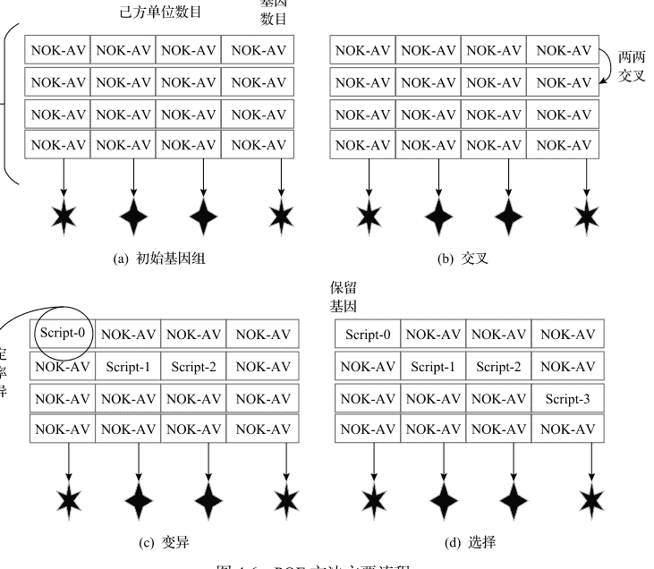
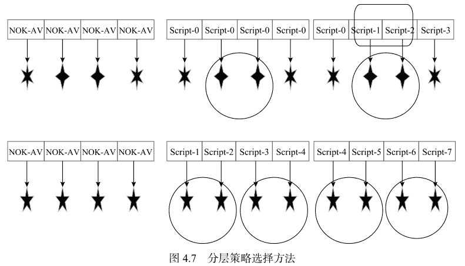

### 混合对抗规划：战略统帅与战术执行的耦合

单纯战术规划短视，纯策略规划脱离执行细节。混合规划模拟人类“谋定而后动”的两层决策模式，成为高性能智能体的主流架构。

#### 1. 规划知识引导：HTN 与搜索的深度融合
**AHTN** (Ontanón[51]) 为双方各构建分层任务网络（HTN），在极大极小框架下交替展开网络并执行原子任务，支持持续/同步动作，性能超越 μRTS 内置 AI（见算法图）。后续改进聚焦两大痛点：
- **任务修复**：Sun[52] 在 AHTN-R 中引入失败检测与替代任务重规划机制。
- **对手感知**：Sun[53] 用对手策略模拟生成 Min 节点；Neufeld[54] 融合 **HTN(战略) + MCTS(战术)**，HTN 基元任务携带评估函数引导 MCTS 采样，权重人工调优，实验显著优于单一方法。

#### 2. 行动语法识别：借鉴 NLP 解析对手意图
引入 **组合范畴语法 (CCG)** 识别对手计划。Geib[55] 验证其计划识别有效性；Kantharaju[56][57] 提出 Lex_Learn/Lex_Greedy 学习抽象动作词典，并引入 MCTS 解决大规模场景下 BFS 识别效率瓶颈。针对 RTS 对抗，Kantharaju[58] 设计 **ACCG 算法**：从对战回放中用 CCG 识别对手计划，再借鉴 AHTN 极大极小框架生成己方反制计划（见架构图）。

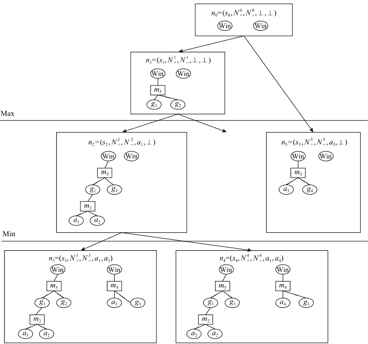

#### 3. 木偶采样搜索与非对称抽象融合
Barriga[59] 提出 **木偶搜索**：在预定义非确定性脚本中植入选择点，搜索仅发生于暴露的选择点集，大幅压缩分支因子。后续 **ST 算法** 融合 CNN 预测木偶输出生成策略，配合朴素 MCTS 打磨战术。Moraes[60] 的 **A3N** 实现双层非对称搜索：战术层非受限搜索，策略层受限抽象搜索。Yang[61] 提出 **GNS** 引导采样机制。

#### 4. 学习引导搜索：数据驱动的先验注入
- **集成学习引导**：Yang[61] 训练决策树集成模型（Bagging/随机森林）预测单位合法动作分布，引导 MCTS 采样，机制类 AlphaGo，有效应对高分支因子。
- **抽象强化学习**：Tavares[62] 在抽象空间施策。
- **分层任务结构约束**：Lu[63] 引入 **MAXQ** 分解层级任务，指导 MCTS 搜索方向，显著降低计算开销，使有限时间内实现更深层搜索与更优策略。

## 未来研究聚焦：建模、协同与数据驱动三大引擎

当前进展虽丰，但对抗推理与反制规划的闭环仍待强化，三大方向极具潜力：

### 1. 对手与玩家建模的双向深化
- **对手建模**：离线利用数据集训练、在线实时适应双轨并行，构建高质量对手池支撑高阶智能体训练。**在线建模的实时性**与**有限理性建模的心理真实性**是核心难点。
- **玩家建模**：拓展至风格画像、行为模式、性格特质、技能水平等多维建模，实现个性化博弈体验与针对性策略生成。

### 2. 人机协同在线临机规划
引入“人在回路”机制，融合人类战略直觉与机器战术算力，应对极端不确定性与非预设场景，实现专家知识的在线注入与规划修正。

### 3. 数据驱动学习范式全流程赋能
利用大规模对抗数据，通过表征学习、模仿学习、强化学习等范式，为对抗推理提供先验分布，为反制规划提供价值函数先验与动作先验，打破传统符号规划的知识获取瓶颈，实现从“手工设计”向“数据涌现”的范式跃迁。

# 人机协作：破解博弈规划瓶颈的关键钥匙

人工智能的落地应用离不开人机协同，而AI技术的进步也为这种协作注入了强劲动力。回顾传统规划体系，按介入时机可分为赛前预案、临战部署与实战应变三类。其中，实战应变直面瞬息万变的对抗局势，其成败直接左右战局走向，常规手段难以支撑高层决策，已成为亟待攻克的难点。引入人机协同模式，能显著增强智能体的规划效能，打通人机知识互通的闭环。近期研究已拓展至单智能体协作与多智能体组队对抗，探索自然语言指令引导博弈的路径，有望催生更懂人类意图的智能对抗体。

## 3. 基于学习的规划新范式

规划与学习是AI的两大核心支柱：前者擅长为达成目标设计动作序列，后者侧重交互迭代优化。虽两者在博弈领域均有建树，但短板明显——规划强依赖精准环境模型与任务描述，复杂场景下获取困难；学习缺乏引导时易陷入次优探索，效率低下。幸二者互补性强，融合成为破局之道。针对即时策略博弈战术层的高实时性要求，以及大规模单位下抽象机制仅能覆盖有限动作空间导致最优性不足的问题，可借鉴MuZero思路，将习得模型嵌入在线搜索，以学习引导搜索。展望未来，将分层、分布式、并行技术与机器学习融入MCTS，用深度学习评估态势、学习表示，用监督/强化学习习得战术策略，用多样性建模与强化学习生成全局决策。

## 4.4 序贯策略对抗中的对手剥削实战

在线博弈中，己方策略生成分两派：悲观派奉行“博弈最优（GTO）”，依赖离线蓝图；乐观派主张“剥削式对策”，实时挖掘对手漏洞以最大化收益。对手剥削是棋牌博弈的硬骨头。纳什均衡下偏离策略必损收益，而非完全理性对手与均衡策略的“距离”，便构成了可利用空间。可利用度衡量策略相对最坏情况的损失，是评价策略质量的核心指标。大规模非完美信息博弈中，均衡策略求解难、假设对手绝对理性、缺乏动态调整、面对次优对手无法扩大战果、多智能体环境下理论保障缺失。反观剥削方法，不执着于全局“最优不动点”，而是将问题分解至子博弈空间，在对手可利用度>0的前提下，以动态调整换取直接、轻量、高效的实战效果。剥削核心包含“博弈推理”与“反制生成”两环，当前研究主线三条：建模式适变、感知式学习、生成式搜索。以下以德州扑克为例展开。

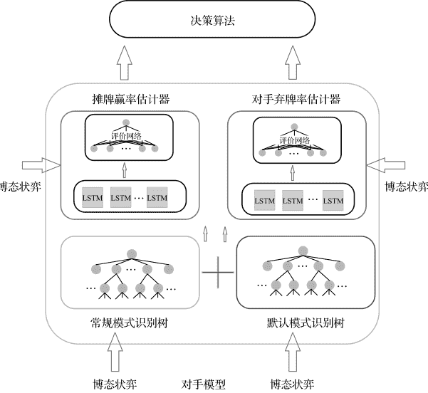

### 4.4.1 对手建模式适变：显隐模型驱动动态反制

此类方法依托对手显性/隐性模型，输出适应性反制策略。

**1. 状态推演与行动预判**  
核心在于补全不完全观测信息：推理隐状态、预测动作分布、估算牌力胜率。技术路径涵盖聚类识别风格、频率统计偏好、神经网络预测行动及价值评估。Li等[65]构建双层架构（见）：底层模式识别树在线识别行为模式并归档；顶层摊牌胜率与弃牌率估计器量化己方优势与对手弃牌概率，最终经决策算法输出反制策略。

**2. 弱点捕猎与欺诈博弈**  
聚焦“可乘之机”：识别对手策略漏洞实施极致剥削；劣势时“诈唬”逼退强手，优势时“慢打”诱导加注。Ganzfried[66]从安全性切入重复零和博弈剥削，给出安全策略全特征（见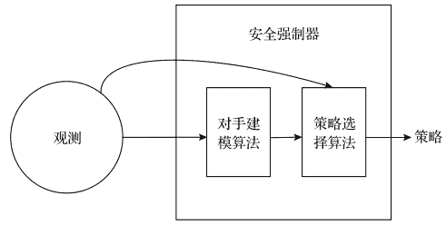）：在线利用模型预测状态动作，发掘可安全剥削机会，将反制生成转化为安全策略选择问题。


**3. 策略空间智能搜索**  
在策略空间探索剥削最优解。Ganzfried等[67]引入贝叶斯优化修正对手模型后验辅助决策；另有路径利用先验模拟对抗、分离策略传递/循环压制关系、预置候选策略库，再经后验采样或在线凸优化生成反制。Tian[68]基于狄利克雷过程与中国餐馆过程（见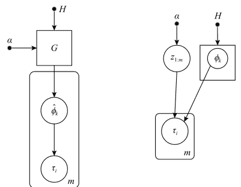），在现有策略空间生成安全剥削策略。


### 4.4.2 对手感知式学习：双向博弈中的共进化

此类假设对手亦在建模己方，核心在于“互为镜像的协同学习”。

**1. 认知层级的递归推演**  
引入心智理论，从认知行为学建模对手。递归推理[71]建模嵌套信念（“我信你信我信……”），模拟对手推理链预测行动；层次推理结合无悔学习[70]，为在线对抗提供稳健支撑。

**2. 二阶学习感知下的策略塑造**  
超越传统建模，引入包含对手价值函数的高阶项。Foerster等[72]提出LOLA算法，假定对手具学习力，在交互中同步习得对手模型；Letcher等[73]融合前瞻搜索，推出微分博弈中的稳定对手塑造法。

**3. 协同演化与专家集成**  
协同演化利用演化算法生成对抗策略池[74]；集成学习聚合多异构专家策略[75]，提升未知对手预测精度与模型泛化性，支撑通用对手模型快速构建。

### 4.4.3 对手生成式搜索：无模型条件下的实时重解

此类不依赖精确对手模型，但将对手行动纳入搜索生成过程。

**1. 受限空间下的最佳响应**  
分析对手动作倾向与禁区，在近似均衡基础上生成约束反制策略。手段包括：融合动作频率与均衡信息构建模型实时更新最佳响应[76]；统计挖掘倾向策略、专家知识剪枝生成受限纳什响应；局部最佳响应、统计偏差响应[77]、有限理性定量响应、安全最佳响应[78]等。Ponsen等[79]结合MCTS与受限纳什响应（见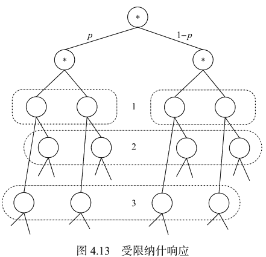），参数p量化模型信任度，生成鲁棒反制策略。


**2. 在线蒙特卡罗持续重解**  
将双方状态解耦，构造领域无关小博弈，以蒙特卡罗采样实时求解。Šustr等[80]基于在线结果采样与信息集采样提出重解法；Brown等[81]主张安全与可利用性平衡，基于安全嵌套有限深度搜索生成安全剥削策略。

**3. 值函数驱动的有限深度搜索**  
用神经网络拟合最优值函数辅助搜索。Brown等[82]开创深度强化学习值函数法；Kovařík等[83]梳理三大博弈模型值函数（可达/反事实/全局最优）；Milec等[84]基于值函数施行有限深度最佳响应与限定纳什响应。DeepStack[85]即采用反事实值函数在线重解（见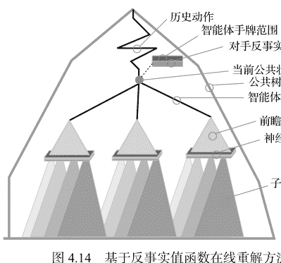）。


### 4.4.4 未来攻关三大高地

**1. 有限理性与欺骗建模：打破绝对理性迷思**  
现实博弈中，人类受认知边界制约，行为偏离均衡；高手更会通过“设陷阱”、暂时放弃短期最优诱导对手失误，实施“诈唬”混淆认知。欺骗与反欺骗是核心对抗形态。如何有效实施/识别欺骗、模拟欺骗交互训练、解析欺骗性智能体机制，均待深入攻关。

**2. 多维策略学习矩阵：应对异构与未知**  
- **异构集成对抗**：对手模型来源多元（参数不一），用集成学习组织训练；  
- **同构神经演化**：模型同源（架构一致），用神经演化推进博弈训练；  
- **种群课程进化**：复杂任务需多技能，分阶段或自主课程学习，经种群演化筛选技能；  
- **面向未知的元学习**：对手未知时，利用历史交互在线生成难被利用/多样化对手模型指导训练；  
- **模型ベース在线无悔学习**：应对风格多变对手，分析动态后悔值指导对抗。

**3. 递变无悔反制生成：安全兜底下的多风格应对**  
应对多风格对手是持久难题。研究重心从多目标建模转向策略“无悔性”，在安全保底理念驱动下，寻找兼顾鲁棒与剥削的反制新范式。

---

### 参考文献

- [1] Hernandez-Leal P, Kaisers M, Baarslag T, et al. A survey of learning in multiagent environments: Dealing with non-stationarity[EB/OL]. http://arxiv.org/abs/1707.09183.[2021-05-06].
- [2] Bakkes S C J, Spronck P H M, van den Herik H J. Opponent modelling for case-based adaptive game AI[J]. Entertainment Computing, 2009, 1(1)：27-37.
- [3] Hernandez-Leal P, Munoz de Cote E, Sucar L E. A framework for learning and planning against switching strategies in repeated games[J]. Connection Science, 2014, 26(2)：103-122.
- [4] Hernandez-Leal P, Zhan Y S, Taylor M E, et al. An exploration strategy for non-stationary opponents[J]. Autonomous Agents and Multi-agent Systems, 2017, 31 (5) : 971-1002.
- [5] Papoudakis G, Christianos F, Rahman A, et al. Dealing with non-stationarity in multi-agent deep reinforcement learning[EB/OL]. http://arxiv.org/abs/1906.04737.[2021-05-06].
- [6] Albrecht S V, Stone P. Autonomous agents modelling other agents: A comprehensive survey and open problems[J]. Artificial Intelligence, 2018, 258: 66-95.
- [7] Mirsky R, Keren S, Geib C. Introduction to Symbolic Plan and Goal Recognition[M]. San Francisco: Morgan & Claypool Publishers, 2021.
- [8] Avrahami-Zilberbrand D, Kaminka G A. Incorporating observer biases in keyhole plan recognition (efficiently!)[C]. The Association for the Advance of Artificial Intelligence, Vancouver, 2007: 944-949.
- [9] Geib C W, Goldman R P. Plan recognition in intrusion detection systems[C]. Proceedings DARPA Information Survivability Conference and Exposition II, Anaheim, 2001: 46-55.
- [10] Mirsky R, Stern R, Gal K, et al. Sequential plan recognition: An iterative approach to disambiguating between hypotheses[J]. Artificial Intelligence, 2018, 260: 51-73.
- [11] Ahmad M A, Elidrisi M. Opponent classification in poker[C]. Proceedings of the 3rd International Conference on Social Computing, Behavioral Modeling, and Prediction, Bethesda, 2010: 398-405.
- [12] Albrecht S V, Crandall J W, Ramamoorthy S. An empirical study on the practical impact of prior beliefs over policy types[C]. The 29th AAAI Conference on Artificial Intelligence, Austin, 2015: 1988-1994.
- [13] Zhang Y, Radulescu R, Mannion P. Opponent modelling using policy reconstruction for multi-objective normal form games[C]. Proceedings of the Adaptive and Learning Agents Workshop (ALA-20) at AAMAS, Auckland, 2020: 2080-2082.

### 核心文献速览：智能博弈与实时策略游戏AI研究脉络

[14] 早至 2014 年，Kolodner 便在 Morgan Kaufmann 出版的专著《案例推理》中，为基于过往经验解决新问题的范式奠定了理论基石。

[15] Carmel 与 Markovitch 于 1996 年在 AAAI 会议上提出，通过构建智能体模型来实现对抗环境下的自适应学习。

[16] Baarslag 等人（2016）在《自主代理与多智能体系统》期刊刊发综述，全景式梳理了自动化双边谈判中对手建模的技术演进。

[17] Doshi 团队（2009）引入图模型至交互式 POMDP，为多智能体交互下的决策表示与求解提供了新视角。

[18] Kott 编著的《对抗推理》（2006）深度剖析了“读懂对手意图”的计算化路径。

[19] Bard 等（2013，AAMAS）探索了大规模人类对弈场景下的隐式智能体建模机制。

[20] He 等人（2016，ICML）将深度强化学习引入对手建模，显著提升了复杂环境下的策略适应性。

[21] Hong 等（2018，AAMAS）设计深度策略推理 Q 网络，有效破解多智能体系统的协同决策难题。

[22] Wu 等（2021，ArXiv）提出 L2E 框架，专注于挖掘并利用对手策略中的可利用漏洞。

[23] Al-Shedival 等（2017，ArXiv）借助元学习实现非平稳竞争环境下的持续自适应。

[24] Kim 等（2020，ArXiv）研发面向多智能体强化学习的“学会学习”策略梯度算法。

[25] Bard（2016，博士论文）系统研究了人类规模问题域中的在线智能体建模技术。

[26] Farina 等（2019，AAAI）将在线凸优化扩展至序列决策过程与广义博弈，拓宽了实时决策边界。

[27] Mealing（2015，博士论文）聚焦双人博弈动态对手建模的实时更新机制。

[28] Oueissai 等（2019）综述了微型即时战略游戏（μRTS）中在线对抗规划的前沿进展。

[29] Churchill 等（2012，AIIDE）研发快速启发式搜索算法，专攻 RTS 游戏战斗场景的实时指挥。

[30] Churchill 与 Buro（2013，CIG）创新组合贪婪搜索与模拟技术，破解《星际争霸》大规模战役指挥难题。

[31] Chung 等（2005）早期引入蒙特卡洛规划应对 RTS 游戏的高分支因子挑战。

[32] Churchill（2016，博士论文）深度总结启发式搜索在即时战略游戏中的工程化应用。

[33] Balla 与 Fern（2009，IJCAI）将 UCT 算法改良用于 RTS 战术突击规划。

[34] Soemers（2014，硕士论文）探索 MCTS 在《星际争霸》战术层面的落地实践。

[35] Uriarte 与 Ontañón（2014，AIIDE）提出基于高层游戏状态的博弈树搜索抽象方法。

[36] Ontañón（2013，AIIDE）将组合多臂老虎机模型引入 RTS 游戏决策优化。

[37] Uriarte（2017，博士论文）融合对抗搜索与空间推理，提升 RTS AI 的战术几何理解力。

[38] Shleyfman 等（2014）研究带线性侧信息的组合动作与 CMAB 理论边界。

[39] Ontañón（2016，CIG）融合领域知识引导蒙特卡洛树搜索，显著加速 RTS 收敛效率。

[40] Sironi 等（2018）设计自适应 MCTS 框架，通用性覆盖广泛视频游戏品类。

[41] Auer 等（2002）奠定多臂老虎机问题有限时间内的理论性能分析基石。

[42] Ontañón（2017，JAIR）系统阐述组合多臂老虎机在即时战略游戏中的深度应用范式。

[43] Barriga（2017，博士论文）三位一体探讨 RTS 游戏中的搜索抽象与学习机制。

[44] Justesen 等（2014，CIG）结合脚本与聚类引导 UCT，优化《星际争霸》决策质量。

[45] Moraes 等（2018，AIIDE）提出嵌套贪婪搜索，应对实时对抗游戏的极端时限压力。

[46] Wang 等（2016，AIIDE）引入组合在线进化机制，动态进化《星际争霸》作战策略库。

[47] Leis 等（2017，IJCAI）设计分层策略选择机制，精细化 RTS 单位微操控制。

[48] Moraes 等（2018，AIIDE）通过动作抽象降维，使组合多臂老虎机树搜索落地可行。

[49] Silva 等（2019，IEEE ToG）利用投票机制融合多单位策略生成，实现协同作战决策。

[50] Mariño 等（2019，AAAI）进化动作抽象以适配广义博弈的实时规划需求。

[51] Ontañón 与 Buro（2015，IJCAI）开创对抗式分层任务网络（HTN）规划，攻克复杂实时游戏决策。

[52] Sun 等（2017，Applied Sciences）改进对抗 HTN 规划，增强 RTS 环境下的鲁棒性。

[53] Sun 等（2020，ICMA）以 HTN 引导对抗规划，实现战略意图向战术执行的高效分解。

[54] Neufeld 等（2019）融合 HTN 规划与 MCTS 执行，构建混合式规划-行动闭环。

[55] Geib 与 Kantharaju（2018，AAAI）学习组合范畴语法（CCG）用于计划识别建模。

[56] Kantharaju 等（2019）从 RTS 游戏数据中提取 CCG，赋能计划识别的语义理解。

[57] Kantharaju 等（2019，CoG）引入蒙特卡洛树搜索扩展 CCG 计划识别的规模上限。

[58] Kantharaju（2020，博士论文）系统研究面向分层规划与识别的分解模型学习方法。

[59] Barriga N A, Stanescu M, Buro M. Puppet search: Enhancing scripted behavior by look-ahead search with applications to real-time strategy games[C]. Proceedings of the 11th AAAI Conference on Artificial Intelligence and Interactive Digital Entertainment, Santa Cruz, 2015: 9-15.

[60] Moraes R O, Lelis L H S. Asymmetric action abstractions for multi-unit control in adversarial real-time games[C]. Proceedings of the AAAI Conference on Artificial Intelligence, New Orleans, 2018: 876-883.

[61] Yang Z Z, Ontañón S. Guiding Monte Carlo tree search by scripts in real-time strategy games[C]. Proceedings of the 15th AAAI Conference on Artificial Intelligence and Interactive Digital Entertainment, Atlanta, 2019: 100-106.

[62] Tavares A R, Chaimowicz L. Tabular reinforcement learning in real-time strategy games via options[C]. IEEE Conference on Computational Intelligence and Games, Maastricht, 2018: 1-8.

[63] Lu L N, Zhang W P, Gu X Q, et al. HMCTS-OP: Hierarchical MCTS based online planning in the asymmetric adversarial environment[J]. Symmetry, 2020, 12 (5) : 719.

[64] Schrittwieser J, Antonoglou I, Hubert T, et al. Mastering Atari, Go, Chess and Shogi by planning with a learned model[J]. Nature, 2020, 588 (7839) : 604-609.

[65] Li X, Miikkulainen R. Opponent modeling and exploitation in poker using evolved recurrent neural networks[C]. Proceedings of the Genetic and Evolutionary Computation Conference, Kyoto, 2018: 189-196.

[66] Ganzfried S. Computing strong game-theoretic strategies and exploiting suboptimal opponents in large games[D]. Pittsburgh: Carnegie Mellon University, 2015.

[67] Ganzfried S, Sun Q Y. Bayesian opponent exploitation in imperfect-information games[C]. IEEE Conference on Computational Intelligence and Games, Maastricht, 2018: 1-8.

[68] Tian Z. Opponent modelling in multi-agent systems[D]. London: University College London, 2021.

[69] Rusch T, Steixner-Kumar S, Doshi P, et al. Theory of mind and decision science: Towards a typology of tasks and computational models[J]. Neuropsychologia, 2020, 146: 107488.

[70] Doshi P, Qu X, Goodie A S, et al. Modeling human recursive reasoning using empirically informed interactive partially observable Markov decision processes[J]. IEEE Transactions on Systems, Man, and Cybernetics-Part A: Systems and Humans, 2012, 42 (6) : 1529-1542.

[71] Doshi P, Gmytrasiewicz P, Durfee E. Recursively modeling other agents for decision making: A research perspective[J]. Artificial Intelligence, 2020, 279: 103202.

[72] Foerster J N, Chen R Y, Al-Shedivat M, et al. Learning with opponent-learning awareness[C]. Proceedings of the 17th International Conference on Autonomous Agents and Multi-agent Systems, Stockholm, 2018: 122-130.

[73] Letcher A, Foerster J, Balduzzi D, et al. Stable opponent shaping in differentiable games[EB/OL]. http://arxiv.org/abs/1811.08469.[2021-05-06].

[74] Schreven C V. Deepbot-poker[EB/OL]. https://github.com/tamlhp/deepbot-poker.[2021-05-06].

[75] Ekmekci O, Sirin V. Learning strategies for opponent modeling in poker[C]. Workshops at the 27th AAAI Conference on Artificial Intelligence, Washington, 2013: 1-7.

[76] Ganzfried S, Sandholm T. Game theory-based opponent modeling in large imperfect-information games[C]. The 10th International Conference on Autonomous Agents and Multi-agent Systems, Taipei, 2011: 533-540.

[77] Johanson M, Bowling M H. Data biased robust counter strategies[C]. Artificial Intelligence and Statistics, Clearwater Beach, 2009: 264-271.

[78] Ganzfried S, Sandholm T. Safe opponent exploitation[J]. ACM Transactions on Economics and Computation, 2015, 3 (2): 1-28.

[79] Ponsen M J V, de Jong S, Lanctot M. Computing approximate Nash equilibria and robust best-responses using sampling[J]. The Journal of Artificial Intelligence Research, 2011, 42: 575-605.

[80] Šustr M, Kovařík V, Lisý V. Monte Carlo continual resolving for online strategy computation in imperfect information games[C]. Proceedings of the 18th International Conference on Autonomous Agents and Multi-agent Systems, Montreal, 2019: 224-232.

[81] Brown N, Sandholm T. Safe and nested endgame solving for imperfect-information games[C]. Workshops at the 31st AAAI Conference on Artificial Intelligence, San Francisco, 2017: 1-14.

[82] Brown N, Bakhtin A, Lerer A, et al. Combining deep reinforcement learning and search for imperfect-information games[C]. Proceedings of the 34th Conference on Neural Information Processing Systems, Vancouver, 2022: 17057-17069.

[83] Kovařík V, Seitz D, Lisý V, et al. Value functions for depth-limited solving in zero-sum imperfect-information games[EB/OL]. http://arxiv.org/abs/1906.06412.[2021-05-06].

[84] Milec D, Lisý V. Continual depth-limited responses for computing counter-strategies in extensive-form games[EB/OL]. http://arxiv.org/abs/2112.12594.[2021-05-06].

[85] Moravčík M, Schmid M, Burch N, et al. DeepStack: Expert-level artificial intelligence in heads-up no-limit poker[J]. Science, 2017, 356 (6337) : 508-513.

## 第 5 章 协同即时策略博弈中的智能体决策架构设计

### 5.1 引言

在复杂环境中，智能体若能在多人即时策略（Real-Time Strategy, RTS）博弈中掌控大局、洞察战术并实现团队协同，堪称人工智能研究领域的一座高峰。与轮流行动的序贯博弈截然不同，协作式即时策略博弈全程实时推进，极度依赖多智能体间的紧密配合，要求智能体通过持续的探索学习与经验积累不断进化。该研究领域与大量现实系统紧密耦合，为破解未来世界协同对抗难题提供了关键路径。典型应用场景涵盖即时战略游戏、机器人足球、多机器人灾难救援、自动驾驶协同及无人集群对抗等。近些年，得益于深度学习与强化学习的深度融合，协作式即时策略博弈决策技术实现跨越式突破：面向《星际争霸》《王者荣耀》《刀塔2》等验证平台研发的各类 AI 系统，在赛事中屡获佳绩，甚至在人机对抗中击败人类顶尖高手。本章以《星际争霸》为核心切入点：5.2 节概述游戏基础，将其抽象为协作式即时策略对抗模型，剖析状态空间复杂度并归纳核心挑战及应对关键技术；5.3 节详述《星际争霸》AI 的构建全貌，涵盖发展历程、运行环境与工程实现，并基于 SMAC 平台给出算法实验范例。

### 5.2 面向《星际争霸》的即时策略博弈决策建模

#### 5.2.1 《星际争霸》游戏机制解析

《星际争霸》是一款经典的即时战略游戏（如图 5.1 所示）。虽同属零和博弈范畴，但与围棋相比，它呈现出**不完全信息**、**输入输出状态空间极大**、**海量先验知识**、**前向预测困难**等显著特征。《星际争霸 2》① 的核心构成要素可拆解为经济体系、生产体系、作战部队、科技树、侦察体系与地图地形。玩家可操控人族、虫族、神族三大差异化种族，每个种族均包含多样化的生命单位、战斗装备与功能建筑。

① 《星际争霸》常用版本之一，详情将在 5.3.2 节展开。

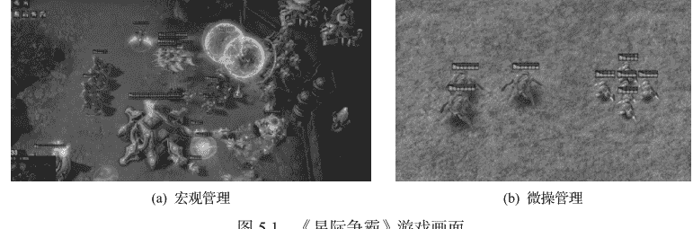

《星际争霸》的对抗过程可划分为**战略层**、**战术层**与**微操层**三个决策维度。

- **战略层（宏观管理）**：聚焦资源采集、单位生产与实力积累等核心要素。涵盖基地建设、科技树推进（建造顺序优化）、资源调度等经济相关任务。高层战略决策还包括军队编成规划与进攻时机把控。宏观管理优势直接转化为更强的军事力量与更稳固的防御体系。

- **战术层（中观协调）**：核心在于不同规模部队群的协同作战。需在考量地形地貌的前提下，统筹大部队定位与小分队行动，处理分队间的协同配合。区别于战略层的长周期规划，战术层决策时效性更强。侦察任务贯通战略与战术两层，旨在获取对手基地布局、兵种构成及单位动向。受限于战争迷雾机制，地图上未被己方单位或建筑临近的区域均处于不可见状态，这导致信息不完全，使得主动侦察成为规避偷袭、支撑战略决策与战术机动的关键环节。

- **微操层（微观控制）**：是《星际争霸》技术上限极高、需专项训练的硬核技能。常规对局中，玩家需采集资源、建造建筑、编制部队，通过吞并领土、摧毁基地击败对手。实战中，精妙的微操能实现以最小代价换取最大伤害输出，包含一系列高难度操作：如“集中火力”指令多单位协同秒杀目标；“放风筝”利用射程与机动性优势，在规避伤害的同时持续输出；还包括依据装甲类型调整站位、多方向包抄进攻、利用地形掩体博弈等高阶技巧。

##### 《星际争霸》核心特性画像

- **典型多智能体系统**：多方势力围绕领土与资源展开博弈。
- **大规模协作需求**：单人需操控数百单位协同达成共同目标。
- **不完全信息博弈**：视野受限于本地摄像头与战争迷雾，玩家需主动移动视角、主动探索未知区域以拼凑全局信息。
- **组合爆炸级动作空间**：通过鼠标交互，在约 $10^8$ 种动作组合中抉择，且合法动作集随游戏进程动态变化。
- **超长时延奖励与归因难题**：单局动辄数万帧，早期决策的后果极度滞后，导致信用分配面临巨大挑战，蕴含丰富的探索空间。

#### 5.2.2 问题复杂度量化分析

以标准 $128 \times 128$ 像素地图为例，任意时刻地图上存在 50~400 个单元，每个单元拥有复杂内在状态（能量值、血量、待执行指令等），由此催生出天文数字级的状态空间。即便仅考虑单元位置排布，400 个单元在 $16384$ 个格子上的组合数即达 $(128 \times 128)^{400} = 16384^{400} \approx 10^{1685}$ 量级。

采用分支因子 $b$ 与博弈深度 $d$ 刻画复杂度（$b^d$）：国际象棋 $b \approx 35, d \approx 80$；围棋 $b = 30 \sim 300, d = 150 \sim 200$。而在《星际争霸》中，假设玩家操控 50~200 个单元，分支因子 $b$ 落区间 $[u^{50}, u^{200}]$（$u$ 为单位平均可用动作数）。为估算 $u$，引入简化假设：① 单位射程内最多锁定 16 个敌人；② 移动动作离散为 8 个基本方向；③ 建造动作仅在工人当前位置触发（移动与建造拆解为两步）；④ 仅考虑人族单位。综合测算，单位可执行动作数 1~43 个，典型值 20~30。考虑动作冷却时间，并非每帧全动作可用，保守估计每帧每单位约 10 个有效动作（暂忽略建筑动作）。由此推导，分支因子 $b \in [10^{50}, 10^{200}]$。典型对局时长 25 分钟，按 24 帧/秒计算，博弈深度 $d \approx 36,000$。这解释为何传统搜索算法在此寸步难行。

#### 5.2.3 核心研究挑战

相较于序贯博弈，协作式即时策略博弈的难度呈指数级跃升，主要体现在：

- **并发博弈与异构协同**：序贯博弈轮流落子，而 RTS 中多玩家同步推进剧情，动作并发生效。战场单元种类繁多、功能迥异（异构），如何最大化发挥各单元功效、实现异构协同是核心难点。
- **（隐含延续上节特性带来的挑战）：** 大规模部队的协作控制、战争迷雾下的部分可观测建模、组合动作空间的高效搜索、超长序列下的信用分配与探索平衡，均构成亟待攻克的硬骨头。

#### 5.2.4 核心技术拆解：多智能体决策怎么破？

即时战略（RTS）游戏之所以成为 AI 难啃的“硬骨头”，源于其独特的三大结构性挑战：

**实时博弈与动作持续性：毫秒级的生存压力**
不同于棋类游戏动辄分钟级的思考窗口，RTS 环境以 24 帧/秒的高频推进。折算下来，玩家平均每秒需完成 3 次有效操作（APM 约 180）。更关键的是，指令不是一次性“点射”，而是具备**持续性**——部队移动、建筑建造、技能引导都需要在一段时间内连贯执行，这对决策的连贯性与微操节奏提出了双重考验。

**非完美信息与强不确定性：迷雾中的博弈**
“战争迷雾”机制让视野受限于己方单位周边，全局地图信息不可见。这属于典型的**部分可观测马尔可夫决策过程（POMDP）**。棋类游戏是全信息静态博弈，而 RTS 中每个决策节点都伴随概率性结果，玩家必须在信息缺口中构建概率模型，对抗“未知”与“运气”的双重干扰。

**天文数字级搜索空间与多任务并行：复杂度的指数级爆炸**
以状态空间为例：国际象棋约 $10^{50}$，德州扑克 $10^{160}$，围棋 $10^{170}$。而《星际争霸》单张典型地图的状态空间高达 **$10^{1685}$**——这个数字远超前者总和。加上资源采集、科技攀爬、多线作战等并行子任务，动作序列的组合爆炸让传统搜索算法彻底失效。

---

在正式剖析算法前，先看底层的**“三件套”设计**：

*   **状态与观测表示（局部视角 + 全局视神）：** 智能体输入包含视野内单位属性（坐标、血量、护盾、类型）、地形可通行性/高度、友军上一帧动作。训练阶段引入**全局状态**（全图单位坐标、能量、冷却），采用**集中式训练、分布式执行（CTDE）**范式，仅训练时可见全局，实战时仅凭局部观测决策。
*   **动作空间设计（离散化与规则约束）：** 基础动作集含移动（四向）、攻击、治疗、停止等 ≥7 项，上限随敌方单位数扩展至 70。强制约束：仅能攻击射程内敌人、治疗范围内友军；禁用游戏自带“被攻击自动反击”机制，保证策略纯粹由模型输出。
*   **奖励函数工程（稀疏与稠密的平衡）：** 采用**共享团队奖励**，智能体需自主完成信用分配。平台支持配置：从极端稀疏的胜负奖励（+1/-1），到稠密的即时反馈（造成/承受伤害、击杀/阵亡、护盾能量变化），按需组合引导学习。

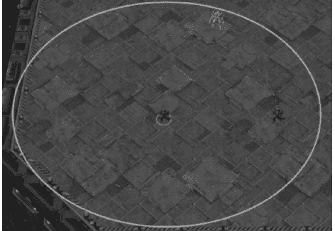

---

针对上述难题，主流强化学习路线聚焦于**价值分解**与**策略梯度**两大流派，代表作包括 COMA、VDN、QMIX 与 QTRAN。下面逐个拆解核心机制与工程权衡。

##### 1. COMA：用“反事实”思维破解信用分配

**痛点：** 协作任务中只有团队总奖励，单个智能体难知自身贡献（“信用分配问题”）。
**架构：** 经典 **CTDE**。中心化 Critic（联合动作值网络 $Q(s, \mathbf{u})$，参数共享）指导去中心化 Actor（策略网络 $\pi^a(\tau^a)$，参数共享）。

**核心创新——反事实基线：**
而非直接用 $Q$ 值更新 Actor，COMA 构建反事实优势函数 $A^a(s, \mathbf{u})$：
> “若智能体 $a$ 换个动作 $u^a$，而其他智能体 $\mathbf{u}^{-a}$ **保持原样**，团队收益会变多少？”

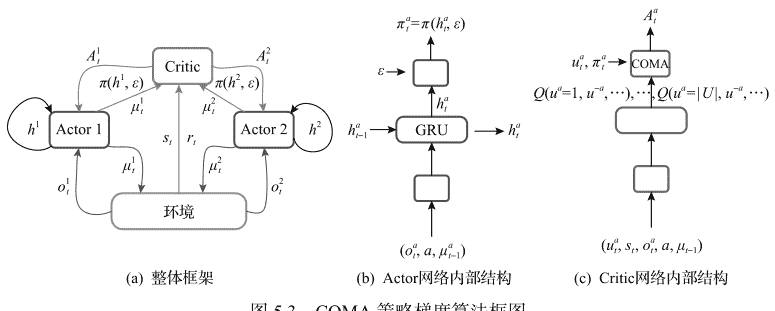
```
A^a(s,u) = Q(s,u) - \sum_{u'^a} \pi^a(u'^a|\tau^a)Q(s,(u^{-a},u'^a))
```

这一项通过遍历单智能体动作空间、边缘化其他智能体动作计算得出，实现了**单次前向传播即可高效估算所有智能体的优势**。结合 TD($\lambda$) 与目标网络周期更新，完成端到端优化。

```
g_k = E_{\pi} \left[ \sum_a \nabla_{\theta_k} \log \pi^a(u^a|\tau^a)A^a(s,u) \right]
```
```
初始化参数 \(\theta_1^c\)、\(\hat{\theta}_1^c\)、\(\theta^\pi\)
For 每个训练片段 \(e\) do
    初始化样本池
    For \(e_c=1\) 到 BatchSize / n do
        对每个智能体，\(s_1\) 为初始状态，\(t=0\)，\(h_0^a = 0\)
        While \(s_t\) 不是终止状态 and \(t < T\) do
            \(t = t + 1\)
            For 每个智能体 \(a\) do
                \(h_t^a\) = Actor(\(o_t^a, h_{t-1}^a, u_{t-1}^a, a, u; \theta_t\))
                从 \(\pi(h_t^a, \epsilon)\) 采样 \(u_t^a\)
                获取奖励 \(r_t\) 和下一个状态 \(s_{t+1}\)
            End for
        End while
        向样本池添加样本
    End for
    从样本池采集样本
    For \(t=1\) 递增至 \(T\) do
        使用状态、动作和奖励批量展开 RNN
        使用 \(\theta_t^c\) 计算 TD(\(\lambda\)) 目标 \(y_t^a\)
    End for
    For \(t=T\) 递减到 1 do
        \(\Delta Q_t^a = y_t^a - Q(s_t^a, u)\)
        计算 Critic 梯度 \(\Delta \theta^c = \nabla_{\theta^c} (\Delta Q_t^a)^2\)
        更新 Critic 权重 \(\theta_{t+1}^c = \theta_t^c - \alpha \Delta \theta^c\)
        每 \(c\) 步重置 \(\hat{\theta}_t^c = \theta_t^c\)
    End for
    For \(t=T\) 递减到 1 do
        计算 COMA 值 \(A^a(s_t^a, u) = Q(s_t^a, u) - \sum_u Q(s_t^a, u, u^{-a}) \pi(u|h_t^a)\)
        累加 Actor 梯度 \(\Delta \theta^\pi = \Delta \theta^\pi + \nabla_{\theta^\pi} \log \pi(u|h_t^a) A^a(s_t^a, u)\)
        更新 Actor 权重 \(\theta_{t+1}^\pi = \theta^\pi + \alpha \Delta \theta^\pi\)
    End for
End for
```

**局限性：** 中心化 Critic 输入维度随智能体数线性增长，且未显式建模智能体交互结构，导致大规模场景下**收敛极难、泛化乏力**，工程落地多受限于中小规模任务。

##### 2. VDN：线性拆解团队价值，轻量级协作新思路

**动机：** 结合“中心化 $Q$ 难训练”与“独立 $Q$ 学不准”两极，提出**值函数分解**中间路线。

**核心假设——可加性分解：**
团队总 $Q_{\text{tot}}$ 约等于各智能体效用函数 $Q_i$ 的**线性求和**：

$$ Q_{\text{tot}}(\tau, \mathbf{u}) \approx \sum_{i=1}^d Q_i(\tau^i, u^i) \tag{5.3} $$

每个 $Q_i$ 仅依赖局部历史 $\tau^i$ 与动作 $u^i$，天然支持分布式执行：$u^i = \arg\max Q_i$。

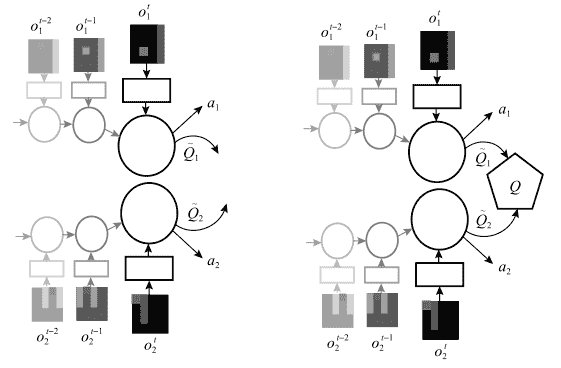

**工程妙招：**
1.  **参数共享 + 智能体不变性：** 同质智能体共用网络，输入拼接 ID 区分身份，极大压缩参数量，规避“懒惰智能体”（一个拼命、一个躺平）。
2.  **消除伪奖励：** 独立学习中队友未观测动作带来的噪声奖励，在 VDN 的团队视角下被过滤。

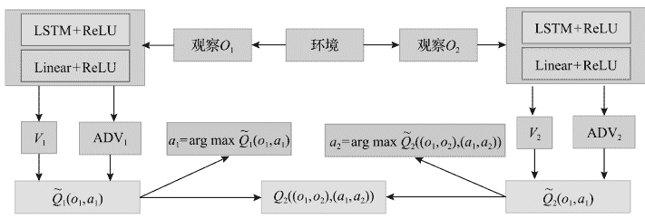

**短板：** 线性加和假设过强，**表达能力受限**。无法捕捉“1+1>2”的非线性协同（如护盾单位护住输出单位的组合价值），复杂大规模任务性能上限低。

##### 3. QMIX：非线性混合网络，让“局部最优”服务“全局最优”

**突破口：** 放弃线性求和，引入**单调性约束**的非线性混合网络。

**单调性原则：**
$$\frac{\partial Q_{\text{tot}}}{\partial Q_i} > 0, \quad \forall i \tag{5.5}$$

即：全局 $Q_{\text{tot}}$ 对每个局部 $Q_i$ 单调递增。推论——**使全局 $Q_{\text{tot}}$ 最大化的联合动作，其每个分量必使对应局部 $Q_i$ 最大化**。从而保证**中心化训练出的最优联合策略，可直接分解为分布式执行的最优局部策略**，实现训练-执行一致性。

**架构设计——混合网络 + 超网络：**
*   **混合网络：** 输入 $\{Q_i\}$，输出 $Q_{\text{tot}}$。权重与偏置**非负**（保证单调性），由**超网络**根据全局状态 $s$ 动态生成。
*   **超网络：** 以全局状态为条件，输出混合网络的权重/偏置。引入全局信息调节分解方式，极大增强表达能力。

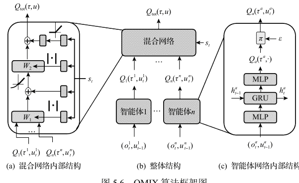

**适用边界：** 仅适用于满足“可分解 + 单调”的任务。若最优协同需“牺牲局部成全局”（非单调），QMIX 失效。

##### 4. QTRAN：变换与分解，挑战非单调场景

# QTRAN 算法：打破结构约束的多智能体价值分解新范式

VDN 与 QMIX 虽同属“集中训练、分散执行”（CTDE）范式，且均通过将联合动作值函数拆解为个体值函数来实现去中心化部署，但二者在分解时强加的结构性先验——VDN 的加性假设与 QMIX 的单调性约束——严重限制了其适用任务的广度，仅能覆盖极小部分可分解的多智能体强化学习（MARL）场景。

针对这一痛点，本节引入 **QTRAN 算法**。其核心创新在于**彻底摒弃了上述硬性结构约束**，转而采用一种“等价转换”机制：将原始的联合动作值函数 $Q_{jt}$ 映射为一个易于分解的替代目标函数，二者虽形式迥异，却共享完全一致的最优动作策略。这使得 QTRAN 成为比 VDN、QMIX 通用性显著更强的分解框架，能覆盖更广谱的 MARL 任务。实验证据表明，在强惩罚非合作行为等特殊博弈场景下，QTRAN 展现出更大的应用潜力。

---

### 理论基石：可分解的充分条件

记智能体 $i$ 的最优局部动作为 $\bar{u}_i = \arg \max_{u_i} Q_i(\tau_i, u_i)$，联合最优局部动作 $\bar{u} = [\bar{u}_i]_{i=1}^N$，联合值函数向量 $Q = [Q_i]_{i=1}^N \in \mathbb{R}^N$。QTRAN 给出的可分解充分条件如下：

**定理 5.1** 若满足
$$
\sum_{i=1}^N Q_i(\tau_i, u_i) - Q_{jt}(\tau, u) + V_{jt}(\tau) = 
\begin{cases}
0, & u = \bar{u} \\
> 0, & u \neq \bar{u}
\end{cases}
$$
则联合动作值函数 $Q_{jt}(\tau, u)$ 可由个体值函数 $[Q_i(\tau_i, u_i)]$ 分解得到。其中 $\tau$ 为联合动作观察历史，$V_{jt}(\tau) = \max_u Q_{jt}(\tau, u) - \sum_{i=1}^N Q_i(\tau_i, \bar{u}_i)$ 充当修正项，确保最优联合动作处的零误差与次优动作的正间隙。

---

### 算法实现：双轨并行的训练流程

QTRAN 提供两种实例化算法：**QTRAN-base（基础版）** 与 **QTRAN-alt（改进版）**，统一框架见算法 5.2。

```
初始化样本池 \( D \)
用随机参数 \(\theta\) 初始化 \([Q]\)、\(Q_{jt}\) 和 \(V_{jt}\)
初始化目标网络参数 \(\theta^- = \theta\)
For episode = 1 to \( M \) do
    对每个智能体 \(i\)，初始化状态张量 \(s^0\) 和观察张量 \(o^0 = [O(s^0, i)]_{i=1}^N\)
    For \(t = 1\) to \( T \) do
        对每个智能体 \(i\)，依概率 \(\epsilon\) 选择随机动作 \(u_i'\)，否则 \(u_i' = \arg \max_{u_i'} Q_i(\tau_i', u_i')\)
        执行动作 \(u_i'\)，返回观察量和奖励值 \((o^{t+1}, r^t)\)
        将 \((\tau', u', \tau'', r^{t+1})\) 存储到 \(D\)
        从 \(D\) 中随机小批量采样
        令 \(y^{\text{dqn}}(r, \tau'; \theta^-) = r + \gamma Q_{jt}(\tau', \bar{u}'; \theta^-), \bar{u}' = [\arg \max_{u_i} Q_i(\tau_i, u_i; \theta^-)]_{i=1}^N\)
    如果是 QTRAN-base 算法，最小化损失更新参数 \(\theta\):
    \(L(\tau, u, r, \tau'; \theta) = L_{\text{td}} + \lambda_{\text{opt}} L_{\text{opt}} + \lambda_{\text{nopt}} L_{\text{nopt}}\)
    \(L_{\text{td}}(\tau, u, r, \tau'; \theta) = [Q_{jt}(\tau, u) - y^{\text{dqn}}(r, \tau'; \theta^-)]^2\)
    \(L_{\text{opt}}(\tau, u, r, \tau'; \theta) = \left[ Q'_{jt}(\tau, \bar{u}) - \hat{Q}_{jt}(\tau, \bar{u}) + V_{jt}(\tau) \right]^2\)
    \(L_{\text{nopt}}(\tau, u, r, \tau'; \theta) = \left( \min \left[ Q'_{jt}(\tau, u) - \hat{Q}_{jt}(\tau, \bar{u}) + V_{jt}(\tau), 0 \right] \right)^2\)
```

**QTRAN-alt 关键差异**：引入备选损失函数，通过最小化该损失来更新参数 $\theta$。

```
$L(\tau, u, r, \tau'; \theta) = L_{td} + \lambda_{opt} L_{opt} + \lambda_{nopt-min} L_{nopt-min}$
$L_{td}(\tau, u, r, \tau'; \theta) = \left[ Q_{jt}(\tau, u) - y^{dqn}(r, \tau'; \theta^-) \right]^2$
$L_{opt}(\tau, u, r, \tau'; \theta) = \left[ Q'_{jt}(\tau, \bar{u}) - \hat{Q}_{jt}(\tau, \bar{u}) + V_{jt}(\tau) \right]^2$
$L_{nopt-min}(\tau, u, r, \tau'; \theta) = \frac{1}{N} \sum_{i=1}^N \min_{u_i \in U} \left[ Q'_{jt}(\tau, u_i, u_{-i}) - \hat{Q}_{jt}(\tau, u_i, u_{-i}) + V_{jt}(\tau) \right]^2$
```

按频率 $I$ 同步目标网络 $\theta^- \leftarrow \theta$

End for

End for

---

### 框架总览

QTRAN 通过将联合 $Q$ 函数巧妙转化为个体 $Q$ 函数，实现了“集中式训练、完全分散执行”，其任务覆盖面超越同类方法。整体架构如图 5.7 所示。

- 联合动作值函数的损失值 $\hat{Q}_{jt}$
- $\hat{Q}_{tot}$ 与个体 $Q$ 之和的损失值
- 隐藏特征层的输入输出
- 个体动作值函数 $\hat{Q}_i$
- Q 网络输入输出
- 网络
- Q 网络
- 隐层特征网络

扫码见彩图

图 5.7 QTRAN-base 与 QTRAN-alt 算法框架图

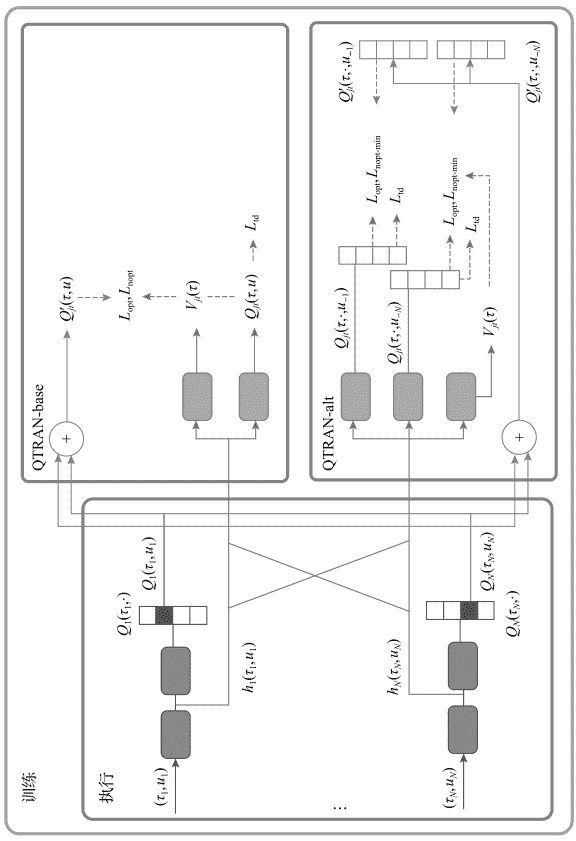

---

# 《星际争霸》智能博弈 AI 构建

## 5.3.1 研究历程：从微观管理到全局博弈

《星际争霸》作为实时战略游戏的皇冠，要求智能体在瞬息万变的战场上完成资源采集、基地建设、部队生产、多线作战等复杂决策，面临**多智能体协作、时空推理、对手建模与规划**等多重挑战。

### 早期聚焦：微观管理

微操作为基础技能率先吸引研究目光：
- **Usunier 等**[5] 引入情景零阶优化的贪婪 MDP，超越 DQN 与策略梯度基线。
- **BiCNet**[6] 基于 Actor-Critic 与双向 RNN 实现隐式通信协作，泛化性强。
- **Foerster 等**[7] 转向分散控制，用指纹技术与重要性采样稳定经验回放，缓解非平稳性。
- **Shao 等**[8] 提出参数共享 MARL SARSA($\lambda$) 并融合课程迁移学习，大幅提升样本效率，大规模场景超越 BiCNet。
- **Kong 等**[9] 设计主从架构 MS-MARL，融合组合动作表示、独立推理与可学习通信，微操性能登顶。
- **Tang 等**[10] 用 NNFQ 与 CNNQF 在简易地图探索建造序列。
- **Zambaldi 等**[11] 引入关系型深度 RL，自注意力机制推理实体关系，显著增强采样效率、泛化与可解释性。

### 进阶：全局游戏与人机对抗里程碑

- **Sun 等**[12] 训练 TStarBot，平面动作结构横扫 1~10 级内置 AI。
- **Lee 等**[13] 模块化架构分治宏微观任务，自博弈训练击败高难度内置 AI。
- **Pang 等**[14] 两级分层 RL 统筹战略与战术。

### 标志性人机大战时间轴

| 时间 | 事件 | 关键看点 |
|------|------|----------|
| 2011.03 | DeepMind 创始人 Hassabis 立 Flag 挑战 SC2 | 确立长期目标 |
| 2018.11 | Facebook CherryPi 获全球挑战赛亚军 | 纯 RL 仍不敌规则型三星 SAIDA |
| 2019.01 | **AlphaStar 首胜职业选手**（10:1） | 三款风格迥异 Agent；一周自博弈 ≈ 人类 200 年练习量；延迟 300ms 仍凭“兵感”“距离感”“三线拉扯”碾压 MaNa |
| 2020 | 启元世界“星际指挥官” 1% 算力 2:0 完胜中国冠军 | 工程+算法双重极致优化 |
| 2022.01 | 中科院自动化所 CPAC 斩获 AAAI SC:BW 第 4、CherryPi 第 6 | 国产军团持续突围 |

> **AlphaStar 启示**：即便反应慢、仍有误伤失误，但其**宏观判断（兵感、走位、距离感）已超越人类顶尖水平**，印证了“决策质量 > 操作速度”在高阶博弈中的核心地位。

---

## 5.3.2 主流仿真平台横评

因版本迭代频繁，学术界锚定两大基准：**SC:BW 1.16.1** 与 **SC2**。为便于算法开发，衍生出三大主流接口：

| 维度 | PySC2 | SMAC | μRTS |
|------|-------|------|------|
| 任务性质 | 竞争（完整游戏） | 合作（微操基准） | 合作（微操基准） |
| 控制粒度 | 玩家级（宏观+微观） | 单位级（微观） | 单位级（微观） |
| 观测空间 | RGB 像素 | 特征向量 | 特征向量 |
| 可复现性 | 是 | 否 | 否 |
| 核心定位 | 通用全局 AI | 协作 MARL 基准 | 轻量级微操实验 |

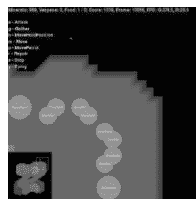  
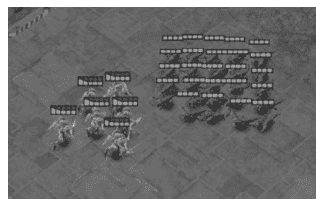  
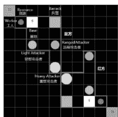

**图 5.8 《星际争霸》AI 环境对比**

- **PySC2**：DeepMind 基于 SC2LE 封装的 Python 接口，附带 7 个迷你游戏（寻路、采矿、小规模战斗等）降低入门门槛。
- **SMAC**：构建在 PySC2/SC2 API 之上，**专注单位级微操**，每单位一智能体、局部观测、对抗脚本 AI，内置 22 个渐进难度战斗场景，是当前**协作 MARL 算法的标准测试床**。
- **μRTS**：极简 RTS 内核，地图 2×2 ~ 256×256，六类单位（工人、轻/重/远程攻击、兵营、基地），资源共享，适合快速原型验证。

**本章实验选用 SMAC**，聚焦微操层面的协作多智能体强化学习验证。

---

## 5.3.3 落地实验：QTRAN 在 SMAC 上的实证

### 1. 实验配置

| 超参数 | 取值 | 备注 |
|--------|------|------|
| 训练步数 | 2,000,000 | steps |
| 折扣因子 $\gamma$ | 0.99 | |
| 优化器 | RMSprop | |
| 评估周期 | 5,000 步 | evaluate_cycle |
| 评估回合 | 32 | evaluate_epoch |
| 学习率 | $5 \times 10^{-4}$ | |
| 批大小 | 32 | batch_size |
| 经验池 | $5 \times 10^3$ | buffer_size |
| 目标网络更新 | 200 步 | target_update_cycle |
| 噪声维度 | 16 | noise_dim |
| 熵系数 | 0.001 | entropy_coefficient |

- **硬件**：i7 CPU + 16GB RAM 笔记本
- **框架**：PyTorch
- **平台**：SMAC（分散微操场景）

### 2. 地图选取：3m（3 枪兵 vs 3 枪兵，人族地面同构智能体）

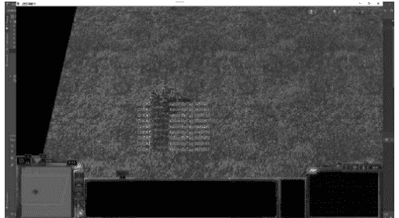

**图 5.9 3v3 场景 (3m 地图) 位置随机初始化**

| 地图 | 同盟单元 | 敌方单元 | 种族 | 智能体类型 |
|------|----------|----------|------|------------|
| 3m   | 3 枪兵   | 3 枪兵   | 人族地面 | 同构 |

### 3. 对比基线

- **CommNet**[15]：显式通信通道传递隐藏状态
- **G2ANet**[16]：软注意力 + 图神经网络建模交互贡献
- **QMIX / VDN / COMA**：详见 5.2.4 节

### 4. 结果复盘

训练 200 万步后，**QTRAN-base 收敛曲线**如图 5.10 所示。

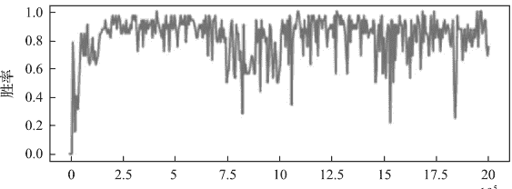

> **关键观察**：QTRAN 系列算法在同构微操任务上展现出稳健的学习曲线与最终胜率，验证了其“免结构约束分解”的工程落地可行性，为后续在更复杂异构、混合合作-竞争场景中的迁移奠定基础。

---

*下一节将深入剖析 QTRAN-alt 的损失函数设计细节与消融实验，敬请期待。*

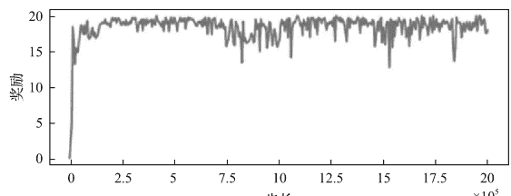

**图 5.10 QTRAN-base 算法收敛曲线**

针对 3m 场景的训练结果（见图 5.11），VDN、QMIX 与 QTRAN-base 三大算法均展现出优异表现，测试胜率均成功突破 90% 大关。前期探索性实验还表明，QTRAN-base 在性能上限与运行稳健性上，均优于 QTRAN-alt 变体。


**图 5.11 3m 场景胜率对比（对手难度系数=7）**

受限于篇幅，本章仅呈现单一场景下的实证数据。有兴趣的研究者可自行复现更多地图环境，进一步深度剖析各算法的适用边界与优劣差异。

### 参考文献

[1] Foerster J, Farquhar G, Afouras T, et al. Counterfactual multi-agent policy gradients[C]. Proceedings of the AAAI Conference on Artificial Intelligence, New Orleans, 2018, 32 (1): 2974-2982.

[2] Sunehag P, Lever G, Gruslys A, et al. Value-decomposition networks for cooperative multi-agent learning[EB/OL]. https://arxiv.org/abs/1706.05296.[2021-10-01].

[3] Rashid T, Samvelyan M, de Witt C S, et al. QMIX: Monotonic value function factorisation for deep multi-agent reinforcement learning[C]. International Conference on Machine Learning, Stockholm, 2018: 4295-4304.

[4] Son K, Kim D, Kang W J, et al. QTRAN: Learning to factorize with transformation for cooperative multi-agent reinforcement learning[C]. International Conference on Machine Learning, Long Beach, 2019: 5887-5896.

[5] Usunier N, Synnaeve G, Lin Z, et al. Episodic exploration for deep deterministic policies: An application to StarCraft micromanagement tasks[EB/OL]. https://arxiv.org/abs/1609.02993. [2021-10-01].

[6] Peng P, Wen Y, Yang Y D, et al. Multiagent bidirectionally-coordinated nets: Emergence of human-level coordination in learning to play StarCraft combat games[EB/OL]. https://arxiv.org/abs/1703.10069.[2021-10-01].

[7] Foerster J, Nardelli N, Farquhar G, et al. Stabilising experience replay for deep multi-agent reinforcement learning[C]. International Conference on Machine Learning, Sydney, 2017: 1146-1155.

[8] Shao K, Zhu Y H, Zhao D B. StarCraft micromanagement with reinforcement learning and curriculum transfer learning[J]. IEEE Transactions on Emerging Topics in Computational Intelligence, 2019, 3 (1): 73-84.

[9] Kong X Y, Xin B, Liu F C, et al. Revisiting the master-slave architecture in multi-agent deep reinforcement learning[EB/OL]. https://arxiv.org/abs/1712.07305.[2021-10-01].

[10] Tang Z T, Zhao D B, Zhu Y H, et al. Reinforcement learning for build-order production in StarCraft II[C]. 2018 Eighth International Conference on Information Science and Technology, Cordoba, 2018: 153-158.

[11] Zambaldi V, Raposo D, Santoro A, et al. Relational deep reinforcement learning[EB/OL]. https://arxiv.org/abs/1806.01830.[2021-10-01].

[12] Sun P, Sun X H, Han L, et al. TStarBots: Defeating the cheating level built-in AI in StarCraft II in the full game[EB/OL]. https://arxiv.org/abs/1809.07193.[2021-10-01].

[13] Lee D, Tang H R, Zhang J O, et al. Modular architecture for StarCraft II with deep reinforcement learning[C]. The 14th Artificial Intelligence and Interactive Digital Entertainment Conference, Edmonton, 2018: 187-193.

[14] Pang Z J, Liu R Z, Meng Z Y, et al. On reinforcement learning for full-length game of StarCraft [C]. Proceedings of the AAAI Conference on Artificial Intelligence, Honolulu, 2019, 33 (1): 4691-4698.

[15] Sukhbaatar S, Szlam A, Fergus R. Learning multiagent communication with backpropagation[J]. Advances in Neural Information Processing Systems, 2016, 29: 1-9.

[16] Liu Y, Wang W X, Hu Y J, et al. Multi-agent game abstraction via graph attention neural network[C]. Proceedings of the AAAI Conference on Artificial Intelligence, New York, 2020: 7211-7218.

## 第 6 章 竞争式序贯博弈对抗决策智能体设计

### 6.1 引言

博弈论作为剖析军事、政治、经济、社会等领域竞合关系的基石理论，其影响力早已渗透至各个维度。伴随人工智能技术的爆发式增长，博弈论更是“如虎添翼”——曾被视为难以破解的复杂博弈难题，正在被层出不穷的前沿算法逐一攻克。高效搜索策略、安全剪枝机制、并行计算优化、子博弈求解框架以及自博弈训练范式的成熟，为在复杂环境、超大状态空间、不完全不确定信息条件下的智能决策提供了坚实支撑。

德州扑克作为当前竞争式序贯博弈对抗中的“皇冠上的明珠”，也是大规模不完全信息动态博弈算法的核心基准测试床之一，其地位仅次于围棋，位列人工智能领域最受瞩目的挑战榜单前列。2018 年，美国陆军斥资千万美元专项资助德州扑克求解技术研究，足见其战略价值。本章将以德州扑克为切入点：第 6.2 节夯实规则基础、剖析复杂度与关键技术；第 6.3 节回顾 AI 发展脉络、构建智能博弈系统，并从双人无限注与多人无限注两个维度开展实证验证。

### 6.2 面向德州扑克的序贯博弈对抗决策

#### 6.2.1 无限注德州扑克规则详解

为适配计算机博弈研究，以下分别阐述双人与多人无限注德州扑克的规则体系（注：为便于算法开发测试，计算机博弈规则与实体娱乐规则存在细微差异）。

**1. 双人无限注德州扑克规则**

对局伊始，双方玩家筹码均设定为 20,000。依据座位分配角色：小盲注位（P1）与大盲注位（P2）。P1 强制投入 50 筹码，P2 强制投入 100 筹码。单局终局后，筹码重置为 20,000（保证局间独立性，利于算法评测），双方座位互换（抵消位置优势）。标准 52 张牌（除大小王）构成牌库，对局历经翻牌前、翻牌、转牌、河牌四个回合（见图 6.1）。

*   **翻牌前：** 各发两张底牌，仅持有者可见，属私有信息。
*   **后三轮：** 共发 5 张公共牌（翻牌 3 张、转牌 1 张、河牌 1 张），双方均可见。


**(a) 翻牌前下注**


**(b) 翻牌下注**


**(c) 转牌下注**


**(d) 河牌下注**

**图 6.1 德州扑克四阶段演示**

胜负判定依据：玩家从 2 张底牌与 5 张公共牌中选 5 张组成最强牌型，牌型大者胜出。牌型强弱序为：皇家同花顺 > 同花顺 > 四条 > 葫芦 > 同花 > 顺子 > 三条 > 两对 > 对子 > 高牌（详见图 6.2）。

行动顺序：翻牌轮由小盲注位（P1）率先行动；其余三轮均由大盲注位（P2）先行。可选动作涵盖：Call（跟注）、Check（过牌）、Raise（加注）、Fold（弃牌）。

*   **Call：** 将总下注额补齐至与上家一致。若为本轮首个动作或上家未加注，则称作 Check（无需投入筹码）。
*   **Raise：** 在跟注基础上追加投入。单轮双方合计 Raise 次数上限 4 次。每次追加额最低 100（即一个大盲注），且不得低于本轮最大追加额。下注总额不得超剩余筹码；若等于剩余筹码，即为 All-in（全压）。
*   **Fold：** 放弃争夺，即时判负，已投筹码归入底池。

轮次结束条件：双方均 Call，或一方 Raise 另一方 Call 后。若一方 Fold，对局即时终结。若一方 All-in 另一方 Call，直接发完剩余公共牌进入摊牌。

四轮结束后进行摊牌比大，赢家通吃底池，平局平分。同牌型下，先比参与牌型的牌面数值，大者胜；若仍同则比踢脚牌。花色不分大小。摊牌时需亮底牌；弃牌者无需亮牌。

| 牌型代号 | 英文名称 | 中文名称 | 牌型构成简述 |
| :--- | :--- | :--- | :--- |
| [Card Image] | Royal Flush | 皇家同花顺 | 同花色最大顺子 (10-J-Q-K-A) |
| [Card Image] | Straight Flush | 同花顺 | 同花色连续五张 |
| [Card Image] | Four of a Kind | 四条(金刚) | 四张同点数 + 单张 |
| [Card Image] | Full House | 葫芦 | 三条 + 一对 |
| [Card Image] | Flush | 同花 | 同花色非连续五张 |
| [Card Image] | Straight | 顺子 | 不同花色连续五张 |
| [Card Image] | Three of a Kind | 三条 | 三张同点数 + 两单张 |
| [Card Image] | Two Pair | 两对 | 两个对子 + 单张 |
| [Card Image] | One Pair | 对子 | 一个对子 + 三单张 |
| [Card Image] | High Card | 高牌 | 无以上组合，比单张大小 |

**图 6.2 德州扑克 5 张牌组合强弱对照**

**2. 多人无限注德州扑克规则（以六人制为例）**

核心机制与双人制一致，差异主要体现在座位编号、首动权轮转与轮次结束判定上。

六玩家记为 A1~A6，顺时针落座。A1 为小盲，A2 为大盲。
*   **首动权：** 翻牌前由 A3 先行；其余轮次由 A2 先行（若 A2 已弃牌，则顺时针寻找首个未弃牌玩家）。
*   **轮次终结：** 所有未弃牌玩家均已行动，且总下注额一致。
*   **按钮轮转：** 局末位置顺延，A2→A1，A3→A2，以此类推。

#### 6.2.2 问题复杂度深度剖析

德州扑克之所以成为继围棋后 AI 领域的“硬骨头”，是大规模不完全信息动态博弈算法的标杆测试床。本节将从状态空间规模、信息集数量、信息集动作维度三个维度量化其复杂度，为后续算法设计提供理论基石。

**1. 状态空间维度**

在双人无限注设定下，翻牌前私有牌组合数为 $C_{52}^2 C_{50}^2$，翻牌圈扩展为 $C_{52}^2 C_{50}^2 C_{48}^3$，后续轮次以此类推。表 6.1 对比了双视角、单视角及引入同构抽象（利用花色对称性进行无损压缩）后的状态量级。

**表 6.1 双人无限注德州扑克各阶段状态量级对比**

| 阶段 | 双视角状态数 | 单视角状态数 | 同构压缩后状态数 |
| :--- | :--- | :--- | :--- |
| 翻牌前 | 1,624,350 | 1,326 | 169 |
| 翻牌圈 | 28,094,757,600 | 25,989,600 | 1,286,792 |
| 转牌圈 | 1,264,264,092,000 | 1,221,511,200 | 55,190,538 |
| 河牌圈 | 556,276,200,480,000 | 56,189,515,200 | 2,428,287,420 |

注：各阶段下注动作（Fold/Call/Raise）与牌面状态正交，Raise 的离散化粒度决定了博弈树的“宽度”，进而影响下一轮状态爆发。因玩家动作空间与手牌无关，状态空间总量约可估算为 $3.162 \times 10^{17}$ 量级。

**2. 信息集数量估算**

假设单轮加注上限 4 次，枚举可推进至下一阶段的动作序列（前提：玩家未弃牌）。用符号 `-`（首决策点）、`r`（Raise）、`c`（Call）、`f`（Fold）标记。

*   **翻牌前：** 决策点 8 个 (`-`, `c`, `cr`, `crr`, `crrr`, `r`, `rr`, `rrr`)，可延续序列 7 个 (`cc`, `crc`, `crrc`, `crrrc`, `rc`, `rrc`, `rrrc`)，终止序列 7 个 (`f`, `rf`, `rrf`, `rrrf`, `crf`, `crrf`, `crrrf`)。
*   后续轮次同理推演，汇总见表 6.2。

**表 6.2 双人无限注德州扑克各阶段动作序列统计**

| 阶段 | 决策点数量 | 可延续序列数 | 终止序列数 |
| :--- | :---: | :---: | :---: |
| 翻牌前 | 8 | 7 | 7 |
| 翻牌圈 | 10 | 9 | 8 |
| 转牌圈 | 10 | 9 | 17 |
| 河牌圈 | 10 | 9 | 17 |

整个博弈树上的信息集总量达到了惊人的数量级：

```
|I| = C_{52}^2 \times 8 + C_{52}^2 C_{50}^3 \times 7 \times 10 + C_{52}^2 C_{50}^3 C_{47}^1 \times 7 \times 9 \times 10
+ C_{52}^2 C_{50}^3 C_{47}^1 C_{46}^1 \times 7 \times 9 \times 10 \approx 3.19 \times 10^{13}
```

**3. 信息集动作空间维度**

# 6.2 核心技术深度解析

根据 Ganzfried 的测算，单个信息集下的动作组合高达 $3.598 \times 10^{13}$ 量级。即便采用当前主流的 CFR 算法，配合双精度浮点数存储策略，单就行为策略一项，动辄需要 500TB 级别的随机存取内存（RAM）。面对两人无限注德州扑克动辄天文数字的状态空间、信息集与动作规模，本节将重点剖析基于抽象技术的 CFR 算法，展示如何通过压缩博弈规模来逼近纳什均衡解。

#### 6.2.3 关键技术拆解

##### 1. 博弈抽象：化繁为简的核心手段

区别于完全信息博弈可独立拆解子博弈，非完美信息博弈的子博弈最优策略往往牵一发而动全身，依赖于其他子博弈的策略输出，无法简单切分。德州扑克的状态空间大到无法穷举，业界通行的做法是**“抽象—求解—映射”**三步走（如图 6.3 所示）[2]：

1.  **构建微缩模型**：在保留原始策略骨架的前提下，将其抽象为规模更小的博弈模型。
2.  **小模型求均衡**：运用均衡算法攻克简化模型，获得近似纳什均衡。
3.  **回映原空间**：将求得的策略映射回原始博弈空间投入实战。

实践证明，从自身视角出发定制抽象策略，往往能收获更优性能。


图 6.3 大规模博弈抽象简化均衡求解流程

抽象算法的本质是生成一个“策略神似”甚至“形神兼备”的微型博弈。主流技术路线主要分两大类[3]：

- **动作抽象：离散化连续决策空间**
  面对大规模甚至无限动作空间（如 100BB 深度下 2000~2999 元下注的微小差异），将相近动作归并为同一离散动作，大幅降维搜索复杂度。但这引出“越界动作”问题——玩家可能出招超出抽象模型定义。解决之道是定义**动作映射函数**，将实战动作强行对齐到抽象动作上（常用随机/确定性几何映射、伪谐波映射等），离线决策阶段影响可控。

- **信息抽象：合并同类项压缩状态树**
  核心是将相似信息集打包入同一“桶”。分为**无损**与**有损**两派：
  - *无损抽象*：如 GameShrink 算法[4]，自底向上合并有序同构节点。但存在抽象粒度不可控、计算量大等痛点，Gilpin 等[5]曾做优化。
  - *有损抽象*：将“兄弟节点的子节点”也纳入同构判定范围，进一步压缩规模。Brown 等[6]在 2014 年 ACPC 赛事中，联合分层抽象与 MCCFR 算法，在两人无限注德扑中斩获佳绩，验证了此路径可行性。

**非完美信息博弈的子博弈求解困境**：完全信息博弈可独立求解子博弈，但非完美信息下，子博弈最优解依赖外部未知策略，传统分解法失效。因此必须在经典子博弈技术基础上“打补丁”、做改良。

##### 2. 基础 CFR 算法：后悔驱动的均衡逼近

CFR 及其变体族是攻克大型非完美信息博弈的“金标准”。它是一种迭代算法，保证在两人零和博弈中收敛至近似纳什均衡。

**理论渊源——后悔值最小化**：
2000 年 Hart 等[8]引入在线学习概念“后悔值”至博弈领域。核心逻辑：复盘过去 T 轮对抗，若当前策略与“事后诸葛亮”的最优固定策略收益差（平均整体后悔值 $R_i^T$）趋近于 0，则该策略即为后悔最小化策略。

> **定义 6.1（平均整体后悔值）**：玩家 $i$ 第 $t$ 轮策略为 $\sigma_i^t$，则 $T$ 轮平均后悔值 $R_i^T = \frac{1}{T} \max_{\sigma_i^*} \sum_{t=1}^T [u_i(\sigma_i^*, \sigma_{-i}^t) - u_i(\sigma^t)]$。若 $T \to \infty$ 时 $R_i^{T,+}/T \to 0$，策略达标。

> **定义 6.2（平均策略）**：$\overline{\sigma_i}^T(I)(a) = \frac{\sum_{t=1}^T \pi_i^{\sigma^t}(I) \sigma^t(I)(a)}{\sum_{t=1}^T \pi_i^{\sigma^t}(I)}$。两人零和博弈中，双方平均后悔值均 $< \varepsilon$ 时，平均策略构成 $2\varepsilon$ 均衡。

**后悔匹配**：按正后悔值比例随机选动作。第 $T+1$ 轮策略更新：
$$\sigma_i^{T+1}(a) = \frac{R_i^{T,+}(a)}{\sum_{b \in A_i} R_i^{T,+}(b)} \tag{6.3}$$
直观上，动作 $a$ 积攒的“后悔”越多，下轮被选概率越大。为防被对手利用概率偏向，CFR 采用**自我博弈训练**机制，反复迭代直至后悔值最小化。

**从正则博弈到扩展式博弈的跨越**：
直接把扩展式博弈转正则博弈会导致规模指数爆炸（两人限注德扑状态达 $10^{17}$ 级），且序贯决策特性导致整体后悔值无法即时指导下一步。CFR 的破局之道：**将整体后悔值拆解为各信息集上可独立最小化的“反事实后悔值”**。

> **定义 6.3（反事实效益值）**：假设除玩家 $i$ 外全按策略 $\sigma$ 行动，$i$ 为到达信息集 $I$ 而调整策略，至终局 $Z$ 的期望收益。公式见 (6.4)。
> **即时反事实后悔值**：动作 $a$ 的反事实效益值与信息集 $I$ 整体反事实效益值之差，加权玩家 $i$ 试图到达 $I$ 的反事实概率。见 $$ R_{i,imm}^T(I) = \frac{1}{T} \max_{a \in A(I)} \sum_{t=1}^T \pi_{-i}^{\sigma^t}(I) \left[ u_i(\sigma^t|_{I \to a}, I) - u_i(\sigma^t, I) \right] \quad (6.5) $$。

**迭代更新机制**：
关键在于仅控制 $\sigma_i(I)$ 即可最小化即时反事实后悔值。累积后悔值更新见 $$ R_i^T(I, a) = \frac{1}{T} \sum_{t=1}^T \pi_{-i}^{\sigma^t}(I) \left[ u_i(\sigma^t|_{I \to a}, I) - u_i(\sigma^t, I) \right] \quad (6.6) $$，下一轮策略分布见 $$ \sigma_i^{T+1}(a) = \begin{cases} \frac{R_i^{T,+}(I, a)}{\sum_{a \in A(I)} R_i^{T,+}(I, a)}, & \sum_{a \in A(I)} R_i^{T,+}(I, a) > 0 \\ \frac{1}{|A(I)|}, & \text{其他} \end{cases} \quad (6.7) $$。
公式 (6.7) 揭示：动作选中概率 $\propto$ 累积正后悔值；若无正后悔值则均匀分布。

**原始 CFR 的性能天花板**：
理论上界显示，平均整体后悔值上界与信息集数量线性相关，迭代次数最坏呈博弈状态规模**平方级**增长（见 $$ R_{i,imm}^T(I) \leqslant \Delta_{i,u} \sqrt{|A_i|} / \sqrt{T} \quad (6.8) $$, $$ R_i^T(I) \leqslant \Delta_{i,u} |L_i| \sqrt{|A_i|} / \sqrt{T} \quad (6.9) $$），这成为原始 CFR 难以逾越的瓶颈。

##### 3. CFR 变体谱系：三大流派百花齐放

第 2 章已宏观综述，本节细分为**表格式、采样类、网络类**三大支系，梳理演进脉络。

- **典型代表：CFR+ 与“仙王座”（Cepheus）的里程碑**
  CFR+ 攻克两人限注德扑，具备低算力、高并行特性。核心改良：**后悔值强制非负化**（$Q$ 值替代 $R$ 值），配合交替更新策略（见式 6.10~6.12）。“差”动作一旦被证有用即刻回归，无需等待后悔值翻正。长期博弈下实现统计学显著盈利，标志着非完美信息博弈求解的里程碑。

- **权重衰减 CFR：给时间加权**
  针对累积后悔值计算引入 $\alpha, \beta, \gamma$ 三因子（见 ```
R_{i, dis}^T(I, a) = \begin{cases} \sum_{t=1}^T \left( \frac{t^\alpha}{t^\alpha + 1} r_i^t(I, a) \right), & r_i^t(I, a) > 0 \\ \sum_{t=1}^T \left( \frac{t^\beta}{t^\beta + 1} r_i^t(I, a) \right), & r_i^t(I, a) < 0 \end{cases}
```, ```
\bar{\sigma}_{i, dis}^T(I, a) = \frac{\sum_{t=1}^T \left[ \left( \frac{t}{t+1} \right)^\gamma \pi_i^{\sigma'} (I) \sigma_i^t(I, a) \right]}{\sum_{t=1}^T \left[ \left( \frac{t}{t+1} \right)^\gamma \pi_i^{\sigma'} (I) \right]}
```）。正/负后悔值分别加不同时间衰减权重，平均策略亦引入衰减。参数全为 1 时退化为线性 CFR。

- **采样类变体大家族（以 MCCFR 为祖）**：
  基于 MCCFR，衍生出 OS-MCCFR（结果采样）、ES-MCCFR（外部采样）两大主流遍历范式（遍历意图见图 6.4），进而演化出 MCCFR+、Mini-batch MCCFR+、VR-MCCFR、Target CFR 等算法族。此类算法均在两大采样基座上做文章。


图 6.4 采样类 CFR 变体博弈树遍历策略示意

##### 4. 子博弈求解：实战中的动态修正

抽象模型求解出蓝图策略后，实战中进入子博弈需实时修正，主要有三种范式：

1.  **非安全子博弈求解**：最朴素但理论最弱。假设子博弈前历程固定，切断历史依赖。简单场景可用，复杂对抗效果差，实用性受限。
2.  **子博弈重新求解**：重构对手动作范围及收益向量，仅针对剩余博弈树重建策略。优势是扩展了主干边界与子博弈资源；劣势是若主博弈策略固定，子博弈局部最优 $\neq$ 全局最优，且对手动作收益重合易致策略退化。
3.  **最大边际求解**：[后续内容待续...]

# 基于子博弈重求解的最大边际技术及其在德州扑克AI中的演进

采用最大边际求解技术对子博弈进行重新求解，能有效优化子博弈策略。该技术为每个信息集定义子博弈边际，一旦进入子博弈树便会产生惩罚值；通过最大化最小边际，强化子博弈得以逼近纳什均衡。求解过程中常用的迭代手段包括过间隙技术（EGT）与反事实后悔最小化（CFR）等。最大边际求解虽稳健，但其输出解容易过拟合于假设模型，实际效果与直接进行子博弈重求解相差无几。

### 6.3 德州扑克智能博弈 AI 构建

#### 6.3.1 德州扑克 AI 研究历程回顾

推动计算机扑克 AI 不断突破的核心力量中，阿尔伯塔大学与卡内基梅隆大学贡献卓著。

**1. 阿尔伯塔大学：奠基者的里程碑**

加拿大阿尔伯塔大学计算机扑克研究组（CPRG）是该领域的“黄埔军校”，输出了海量学术与应用成果，其德州扑克研究脉络见表 6.3。早期，研究组采用基于规则的专家系统，据博弈状态输出动作，已能击败弱手。随后，对手建模与神经网络建模相继引入，棋力大幅跃升。

- **2003 年**，Billings 团队针对双人有限注德州扑克提出最优策略理论，虽未纳入对手建模，但智能体已展现高水平博弈力。
- **2006 年**，Sturtevant 等人融合对手建模与博弈树搜索，在可接受时限内实现深度优先搜索。
- **2007 年**，基于纳什均衡的 **Polaris** 横空出世：它不仅在人机大赛中击败人类冠军，更夺得 ACPC 年度桂冠。此前，线性规划虽是求解扩展式博弈的主流，却难敌状态空间指数爆炸。
- **2007 年同期**，Zinkevich 等人提出 **CFR 算法**——一种将整体最小后悔值分解至各信息集局部计算的迭代算法，成功攻克 10^12 量级状态博弈，且在大规模双人零和博弈中收敛纳什均衡具理论保障。Risk 团队将其移植扑克智能体，斩获 ACPC 三人有限注冠军。
- **2015 年**，Bowling 团队改良 CFR 推出 **CFR+**，配合程序 **Cepheus** 首度“破解”双人有限注德州扑克。Cepheus 单局仍有胜负，但长期博弈可获统计学显著优势。为解决基础 CFR 面临的内存与算力双重瓶颈，Cepheus 引入定点计算、压缩存储、剪枝及省略平均策略计算等工程技巧，并以当前策略作初始解加速收敛。
- **2017 年**，阿尔伯塔大学联合查理大学、捷克技术大学推出 **DeepStack**，攻克双人无限注德州扑克并击败 33 位职业选手。DeepStack 融合递归推理处理非对称信息、持续求解聚焦关键决策、深度神经网络拟合后悔值，形成一套适用于非完美信息扩展博弈的通用框架。其深度反事实价值网络以公开状态、范围、底池等为输入，经 7 层全连接隐层输出并归一化满足零和约束，映射为双方反事实后悔值。赛前通过随机场景预训练，理论上有零和博弈收敛性证明支撑，实践中可利用性显著优于前人。
- **2019 年 5 月**，DeepMind 与阿尔伯塔大学联手提出**可利用性下降新算法**，通过针对最坏情况对手的直接策略优化，使策略可利用性渐近收敛至零，双方同用则联合策略收敛纳什均衡。区别于虚拟自对弈与 CFR 依赖平均策略，该收敛性直接作用于优化策略本身。

纵观 CPRG 历程，其从最早布局、持续输出顶尖成果（Cepheus、DeepStack 等），不断刷新人机对抗纪录，拉开了新一轮人机大战帷幕。

**表 6.3 阿尔伯塔大学德州扑克 AI 关键成果**

| 年份 | 程序名称 | 场景 | 智能水平 | 硬件配置 |
|---|---|---|---|---|
| 1997 | Loki | M-L | IRC 服务器前 10% | — |
| 1999 | Poki | M-L | IRC 服务器前 10% | — |
| 2002 | PsOpti | 2-L | 击败 Poki | — |
| 2003 | Vexbot | 2-L | 击败 Poki 和 PsOpti | — |
| 2006 | Hyperboreen | 2-L | ACPC-2006 第一名 | 4 核 CPU 并行，近 14 天 |
| 2007 | Polaris | 2-L | ACPC-2007 第一名 | 4 核 CPU 并行，>14 天 |
| 2008 | Hyperborean No-Limit | 2-NL | ACPC-2008 第一名 | — |
| 2009 | Hyperborean | 3-L | ACPC-2009 第一名 | — |
| 2015 | Cepheus | 2-L | — | 200 节点集群, 32GB RAM, 1TB 内存, 68.5 天 |
| 2017 | DeepStack | 2-NL | 击败 33 位职业选手 | 转牌网络：6144CPU，>175 核年；翻牌网络：20GPUs, 0.5 GPU 核年 |

注：M-L=多人有限注；2-L=双人有限注；2-NL=双人无限注；3-L=三人有限注。

##### 2. 卡内基梅隆大学：后来居上的挑战者

紧随其后，卡内基梅隆大学（CMU）在“新型图灵测试”般的无限注德州扑克攻坚战中成果斐然。

- **2017 年**，Sandholm 教授团队针对非完美信息特性，提出理论与实践双优的**子博弈求解技术**，研发 **Libratus** 击败人类顶级职业选手，震动学界。Libratus 三大核心模块：
  1. **蓝图策略构建**：对巨大博弈树做动作与手牌抽象压缩，采用 CFR 变体 MCCFR 计算蓝图；引入基于遗憾值修剪的采样，砍掉“失败分支”加速收敛。
  2. **嵌套安全子博弈求解**：实时按更细粒度抽象求解子博弈以改进蓝图。非完美信息下，子博弈最优策略依赖博弈其余部分，单靠子博弈信息无法求解。传统方案假设对手遵循蓝图，极易被策略切换利用（“不安全”求解）。Libratus 采用**安全子博弈求解**，保证子博弈策略符合原始抽象蓝图，从而无论对手何策略，可利用性均不高于蓝图。
  3. **自我改进模块**：利用对手策略漏洞持续修正蓝图，逼近纳什均衡。
- **2018 年**，Brown 等人提出**有限深度优先搜索新法**，允许对手在有限深度选多策略，仅用普通笔记本（4 核 CPU、16GB 内存）训练出大师级 **Modicum**，击败两代顶级 AI。
- **2019 年 2 月**，Brown 团队推出 **DCFR**（Deep CFR），用神经网络拟合累计后悔值与平均策略，打破表格式 CFR 局限，为大规模非完美信息动态博弈开辟新径。
- **2019 年 7 月**，Brown 在 *Science* 刊发 **Pluribus**，攻克**六人无限注德州扑克**并战胜职业选手，被誉为多人扑克 AI 里程碑。Pluribus 基于 Libratus 改进，核心差异三点：
  1. **目标导向不同**：不追求具体博弈论解概念，而是从实验层面解决多人扑克；虽缺强理论保证，但精心设计的自博弈搜索在复杂非完美信息环境中仍能产出超人类策略。
  2. **在线搜索算法**：实战中采用深度限制搜索，通过搜索前几步评估下一步策略——这在完美信息博弈（象棋、围棋等）中早是超人表现必备，Pluribus 将其引入非完美信息领域，自博弈与搜索结合再显威力。
  3. **更高效的自博弈**：改进 MCCFR 离线生成粗粒度蓝图，实时搜索细化关键决策点。六人德州扑克后期常退化为两人零和博弈（“强牌入池”原理），为双人算法扩展提供支撑；工程上仅增加输入特征与博弈树规模，MCCFR 类算法仍可行。实践效果优异，但纯扩展法理论保证仍弱。

Pluribus 核心策略源于**纯自博弈**：AI 与自我副本对弈，零数据冷启动，从随机动作出发，通过击败早期版本逐步进化。改进 MCCFR 生成全局蓝图，决策点少时实时搜索细化策略。

**表 6.4 卡内基梅隆大学德州扑克 AI 关键成果**

| 年份 | 程序名称 | 场景 | 智能水平 | 运行配置 |
|---|---|---|---|---|
| 2007 | Tartanian | 2-NL | ACPC-2007 第二名 | — |
| 2014 | Tartanian7 | 2-NL | ACPC-2014 第一名 | 1153200 核时，128GB RAM |
| 2015 | Claudico | 2-NL | ACPC-2014 第一名 | 200万~300万核时，128GB RAM |
| 2016 | Baby Tartanian8 | 2-NL | ACPC-2016 第一名 | 200万核时，128GB RAM |
| 2017 | Libratus | 2-NL | 击败顶级职业选手 | 2500万核时 |
| 2019 | Pluribus | 6-NL | 击败顶级职业选手 | 2500万核时，128GB RAM |

##### 3. 其他机构：百花齐放的探索者

机器学习、最优化、决策论等方法持续注入非完美信息博弈。
- Passos 引入强化学习结合特定对手模型，效果不错。
- 浙江大学融合蒙特卡罗树搜索（MCTS）与神经虚拟自对弈（NFSP），提出**异步神经虚拟自对弈**，让 AI 在多仿真环境“自我博弈”生成最优策略，在德州扑克与多人射击游戏均表现优异。
- 国内哈尔滨工业大学起步较早：2013 年用手牌评估+对手建模获 ACPC 双人有限注第四；2014 年用神经网络+风险占优策略获三人库恩扑克第三；2016 年用 CFR 系统获双人无限注第八。国内起步虽晚，但发展迅猛，持续推动智能博弈前沿。

#### 6.3.2 德州扑克智能博弈系统架构

同主流智能博弈系统一样，基础框架由**服务端（引擎）、客户端（扑克 AI）、通信协议**三件套组成。为支撑“数据加载、资源管理、人机对战”等扩展需求，框架演进为图 6.5 所示形态，新增人机交互界面、扑克算法库、数据库（用户、样本、CFR 值）、协议转换等模块；并可部署分布式训练框架，支持基于种群的强化学习等大规模训练。


图 6.5 扩展的德州扑克智能博弈系统框架

**服务端**：核心职责为建房控局、调度引擎、消息传输、管理本地 AI 玩家。引擎层面可按需定制传输内容与格式；主流引擎有 ACPC Server、RLCard 等。传输层分“监听”与“接收”：监听走 Socket 完成前端玩家与 AI 消息收发；接收走消息总线与智能体通信。详细通信逻辑见图 6.6。

**客户端**：算法部署与测试端。AI 收到预备消息入房，对抗中持续接收状态信息，生成决策动作按约定格式回传。


图 6.6 ACPC 协议的状态消息结构

**通信协议**：各系统协议各异，但核心诉求一致——消息简短且信息完整，以压缩延迟、提效交互。按类型可分预备、状态、结束三类消息。以 ACPC 状态消息为例（图 6.6），完整状态消息通常含：消息类型头、玩家位置编码（如小盲位=0）、局数（有限局数设定下影响策略）、历史动作序列（含各阶段动作，助手牌建模与诈唬识别）、私有牌与公共牌（核心决策信息）。结构与数据类型按需定制。实战中对手私有牌不可见（如玩家 0 收到的消息中玩家 1 手牌为空）；但对手建模需手牌标注时，可设为可见。

**数据传递流程**（图 6.7）：对抗前，各玩家发连接消息，满员即运行。每局中，服务端持续推送状态消息；若需行动，玩家回传动作消息。循环至终局，服务端广播终局状态。次局前，各玩家发预备消息，均就绪则开局。达设定局数、有连接断开、或收到退出预备消息，终止对抗并断开所有连接。


图 6.7 消息收发时序图

#### 6.3.3 双人无限注德州扑克 AI 工程实现

##### 1. 实验设置

本节落地实现双人无限注德州扑克 AI。设定：开局有效筹码 10，小盲注 1，raise 上限 2 次。采用**权重衰减 CFR** 求解，沿用 Johanson 等人博弈树构建法，加速最佳响应计算，运行环境为 i7 CPU、16GB 内存笔记本。为压缩问题规模，限定双方手牌范围（见图 6.8、6.9）。

动作空间做**对称抽象**（表 6.5）：翻牌轮我方下注抽象为底池 50% 与 100%；转牌轮……

### 核心参数与范围设定

在构建单挑无限注德州扑克模型时，我们首先明确了双方的起手牌矩阵与动作抽象粒度。

**图 6.8** 与 **图 6.9** 分别展示了对手与我方的手牌范围分布。数据以 1.000 与 0.000 标记入选与弃除：对手范围偏向高张与同花连张（如 AA-A8s、AKo-AJo、KQs、QJs 等均为 1.000），中小对子及弱同花牌多被舍弃；我方范围则更为紧凑，除顶级强牌（AA、KK、AKs/AKo、AQs/AQo 等）外，仅保留了 99、88、77、66、55 等中大对子及极少数同花连张（如 98o、T9o），整体呈现“强牌主导、投机极少”的特征。

**表 6.5** 详细列出了各街次的动作抽象参数。翻牌圈与转牌圈，双方均开放 50% 与 100% 彩池下注，我方加注设为 40%，对手为 50%；河牌圈引入全压尺度（驴尺度），对手阈值逐街提升（转牌 55%、河牌 70%），即对手下注超 55% 彩池即视为全压处理。这种分街差异化设计，旨在平衡计算复度与策略精度。


### 实战决策复盘：翻牌圈关键局面

**场景还原**：翻牌圈彩池 2 单位，公共牌 **K♦ J♦ 8♠**，对手发起 100% 彩池下注。我方策略输出如 **表 6.6** 所示。

**决策逻辑拆解**：

1.  **坚定跟注阵营（跟注率 100%）**：
    涵盖 AA、AK、KK、QQ、JJ、TT、88、AQ、AJ、AT、A8、KQ、KJo、QJo。这些手牌已成三条（K、J、8）、四条听牌、顶两对、顺子听牌（双头/腹中）或坚果同花听牌，结构极强，面对满池下注毫无弃牌空间。

2.  **果断弃牌阵营（弃牌率 100%）**：
    包含 Ac9x、Ah9x、As9x 等单张方块 9、A7o/A6o/A5o 及 77/66 无方块组合。前者仅能击中弱顶对或听单张顺/花，后者属中等对子，面对激进下注极易遭遇顶对/两对/三条压制，止损为上。

3.  **混合策略阵营（依赖方块阻断与隐含赔率）**：
    *   **Ad9x（Ad9c/Ad9h/Ad9d）**：持有方块 A 阻断坚果同花，兼具顶对弱踢脚与同花听牌，跟注率 **55.7%**。
    *   **As9s**：双花听牌但无方块 A，易被更大同花主导，跟注率骤降至 **11.2%**。
    *   **99 组合**：三条 9 极强，但不同花色组合面对转河发牌风险略有差异——**9d9x（含方块）跟注 99.7%**，**9c9s/9s9h 仅 26.6%**，**9c9h 为 52.2%**。方块阻断作用显著提升继续游戏意愿。
    *   **77/66 含方块（7d7x/6d6x）**：兼具三条听牌与同花听牌，跟注率高达 **98.2%**；无方块同级别组合则全弃。

结论清晰：**方块阻断牌**与**多重听牌红利**是翻牌圈面对超池下注时，边缘作用牌能否跟注的核心判据。

### 算法收敛性对比

采用 **加权衰减 CFR** 与 **CFR+** 实时求解子博弈，**图 6.10** 直观呈现收敛曲线。结果表明：引入权重衰减机制后，CFR 变体在早期迭代即大幅甩开 CFR+，收敛速度显著提升，验证了该改进对大规模不完全信息博弈求解的实用价值。


---

### 六人无限注德扑 AI：MuCFVnet 实战验证

#### 实验架构与对手画像

*   **基础设定**：6-max，有效筹码 20,000，小盲 50。
*   **核心算法**：基于 Yuan 等 [31] 提出的 **MuCFVnet** 框架，利用价值网络加速最佳响应计算。
*   **算力平台**：80 核 CPU + 4×TITAN RTX GPU + 128GB 内存。
*   **五大对手画像**：
    1.  **RB-LA（松凶规则型）**：范围极宽，高频加注/诈唬，翻前翻后均激进。
    2.  **RB-TA（紧凶规则型）**：范围窄、胜率高，攻守平衡，极具压制力。
    3.  **MCCFR-OM**：融合蒙特卡洛 CFR 与对手建模的自适应型。
    4.  **MCCFR-OM-RB**：在上述基础上叠加规则修正，鲁棒性更强。
    5.  **EV（集成投票型）**：融合 MCCFR、对手建模、近端策略优化（PPO）三模型投票决策。

#### 千局对决：谁才是真正赢家？

**图 6.11（总筹码统计）与 图 6.12（胜率统计）** 揭示三大关键发现：

1.  **MuCFVnet 全维度碾压**：总盈利与胜率双料第一，显著优于所有 MCCFR 变体，证明「价值网络加速搜索 + 多人博弈建模」路线在实战中具备统治级性能。
2.  **集成投票（EV）翻车**：表现甚至不及基础规则型对手。模型融合若缺乏有效加权机制，极易陷入“民主决策失灵”陷阱，反而拖累性能。
3.  **规则型对手的启示**：RB-LA 总筹码居首，但 RB-TA 胜率更高、波动更小。这印证了扑克铁律：**“紧凶是长期盈利基石，松凶虽偶有爆发但难持久”**——AI 训练亦复如是。

---

### 参考文献精选

1.  Ganzfried S. 首届人机无限注德扑大赛复盘[J]. ACM SIGecom Exchanges, 2016.
2.  Wright J R. 策略博弈中人类行为建模[D]. 英属哥伦比亚大学, 2016.
3.  Plonsky O 等. 行为理论与机器学习预测人类决策[EB/OL]. arXiv:1904.06866.
4.  Gilpin A, Sandholm T. 不完全信息博弈的无损抽象[J]. JACM, 2007.
5.  Gilpin A, Sandholm T. 面向德扑的自动化抽象改进技术[C]. AAMAS 2007.

- [6] Brown N, Ganzfried S, Sandholm T. Hierarchical abstraction, distributed equilibrium computation, and post-processing, with application to a champion no-limit Texas Hold'em agent[C]//Proceedings of the 2015 International Conference on Autonomous Agents and Multiagent Systems. Istanbul, 2015: 7-15.
- [7] Brown N, Sandholm T. Safe and nested subgame solving for imperfect-information games[C]//Proceedings of the 31st International Conference on Neural Information Processing Systems. Los Angeles, 2017: 689-699.
- [8] Hart S, Mas-Colell A. A simple adaptive procedure leading to correlated equilibrium[J]. Econometrica, 2000, 68(5): 1127-1150.
- [9] Li H, Hu K L, Ge Z B, et al. Double neural counterfactual regret minimization[EB/OL]. https://arxiv.org/abs/1812.10607, 2021-10-01.
- [10] Schmid M, Burch N, Lanctot M, et al. Variance reduction in Monte Carlo counterfactual regret minimization (VR-MCCFR) for extensive form games using baselines[C]//Proceedings of the AAAI Conference on Artificial Intelligence. Hawaii, 2019: 2157-2164.
- [11] Jackson E G. Targeted CFR[C]//Workshops at the 31st AAAI Conference on Artificial Intelligence. San Francisco, 2017: 1-3.
- [12] Nesterov Y. Excessive gap technique in nonsmooth convex minimization[J]. SIAM Journal of Optimization, 2005, 16(1): 235-249.
- [13] Billings D, Burch N, Davidson A, et al. Approximating game-theoretic optimal strategies for full-scale poker[C]//Proceedings of the 8th International Joint Conference on Artificial Intelligence. Acapulco, 2003: 661-668.
- [14] Sturtevant N R, Bowling M H. Robust game play against unknown opponents[C]//Proceedings of the 5th International Joint Conference on Autonomous Agents and Multiagent Systems. Hakodate, 2006: 713-719.
- [15] Johanson M B. Robust strategies and counter-strategies: Building a champion level computer poker player[D]. Edmonton: University of Alberta, 2007.
- [16] Zinkevich M A, Johanson M, Bowling M H, et al. Regret minimization in games with incomplete information[J]. Advances in Neural Information Processing Systems, 2007, 20: 1-8.
- [17] Risk N A, Szafron D. Using counterfactual regret minimization to create competitive multiplayer poker agents[C]//Proceedings of the 9th International Conference on Autonomous Agents and Multi-agent Systems. Toronto, 2010: 159-166.
- [18] Bowling M, Burch N, Johanson M, et al. Heads-up limit hold'em poker is solved[J]. Science, 2015, 347(6218): 145-149.
- [19] Lockhart E, Lanctot M, Pérolat J, et al. Computing approximate equilibria in sequential adversarial games by exploitability descent[EB/OL]. https://arxiv.org/abs/1903.05614, 2021-10-01.
- [20] Li J J, Koyamada S, Ye Q W, et al. Suphx: Mastering mahjong with deep reinforcement learning[EB/OL]. https://arxiv.org/abs/2003.13590, 2021-10-01.
- [21] Brown N, Sandholm T. Superhuman AI for heads-up no-limit poker: Libratus beats top professionals[J]. Science, 2018, 359(6374): 418-424.
- [22] Brown N, Sandholm T, Amos B. Depth-limited solving for imperfect-information games[C]//Advances in Neural Information Processing Systems. Montreal, 2018: 7663-7674.
- [23] Brown N, Lerer A, Gross S, et al. Deep counterfactual regret minimization[C]//International Conference on Machine Learning. Long Beach, 2019: 793-802.
- [24] Blair A, Saffidine A. AI surpasses humans at six-player poker[J]. Science, 2019, 365(6456): 864-865.
- [25] Passos N M D S. Poker learner: Reinforcement learning applied to Texas Hold'em poker[D]. Porto: University of Porto, 2011.
- [26] Zhang L, Wang W, Li S J, et al. Monte Carlo neural fictitious self-play: Approach to approximate Nash equilibrium of imperfect-information games[EB/OL]. https://arxiv.org/abs/1903.09569, 2021-10-01.
- [27] Zhang J J, Wang X, Yao L, et al. Using risk dominance strategy in poker[J]. Journal of Information Hiding and Multimedia Signal Processing, 2014, 5(3): 546-554.
- [28] 滕雯娟. 基于虚拟遗憾最小化算法的德州扑克机器博弈研究[D]. 哈尔滨: 哈尔滨工业大学, 2015.
- [29] 代佳宇. 基于虚拟遗憾最小化算法的非完备信息机器博弈研究[D]. 哈尔滨: 哈尔滨工业大学, 2017.
- [30] Johanson M, Waugh K, Bowling M H, et al. Accelerating best response calculation in large extensive games[C]//The 22nd International Joint Conference on Artificial Intelligence. Macao, 2011: 258-269.
- [31] Yuan W L, Hu Z Z, Luo J, et al. Imperfect information game in multiplayer no-limit Texas Hold'em based on mean approximation and deep CFVnet[C]//China Automation Congress. Beijing, 2022: 2459-2466.

## 第 7 章 混合博弈智能体架构：竞争与协作的统一建模

### 7.1 引言：跨越纯对抗的边界

第 6 章已深度剖析了以德州扑克为范式的不完全信息序贯博弈中的纯竞争型决策范式。然而，现实博弈图景远比单向对抗更为立体。桥牌、斗地主等经典场景构成了典型的“混合式序贯博弈”图谱：多智能体间既交织着零和博弈的刀光剑影，又暗含非零和协作的默契配合。此类环境下，智能体不仅须精进个体决策技艺，更需通过协同策略释放团队合力。决策瞬间，既要推演对手意图，又要揣摩队友心思。如何在合作约束下，高效破解信息状态集规模爆炸的不完全信息博弈难题，已成为人工智能领域亟待攻克的核心高地。纵观技术演进脉络，短期内 AI 欲在竞技层面与人类顶尖高手过招，仍非易事。本章将以斗地主、桥牌为双核切入点层层推进：7.2 节解构斗地主规则与计算硬骨头；7.3 节复盘斗地主 AI 进化脉络；7.4 节拆解桥牌规则与复杂度内核；7.5 节聚焦桥牌 AI 现状及叫牌系统落地。

### 7.2 面向斗地主的序贯博弈决策建模

#### 7.2.1 规则机制：三人非对称阵营博弈

斗地主作为国民级三人扑克竞技（见下图），其核心机制在于“单挑双”的非对称阵营结构。三名玩家分属地主与农民两大阵营，两农民需在全程禁语、不透牌的“迷雾”中默契配合、联合压制地主。一局博弈跨越发牌、叫牌、出牌三大阶段。


图 7.1 斗地主界面①

- **发牌环节**：标准 54 张牌（含双王）随机抽 3 张作底牌，余下 51 张均分三家。地主身份确立前，底牌对全体不可见。
- **叫牌环节**：随机指定首叫者，单轮逆时针轮流竞叫（可弃权）。叫分需严格递增，叫至 3 分直接锁定地主；若无人达 3 分，最高分者得地主；全弃则重新洗牌发牌。
- **出牌环节**：底牌归地主并公开亮出。地主享有首出权，三家逆时针轮流行动。可选择“过”，若出牌则牌力必须压制上家。牌型体系极其丰富，涵盖单张（大王>小王>2>A...>3）、对子、三条、三带一/一对、单张/对子/三条顺子、飞机带翼、炸弹、火箭及四带二等，构成庞大离散动作空间。

#### 7.2.2 复杂度剖析：为何斗地主是“硬骨头”？

本节聚焦打牌阶段（以地主视角为例）的计算难点。

**状态空间呈天文级爆炸**：信息集数量高达 $10^{83}$ 量级，平均信息集规模达 $10^{23}$，且极难实施有效抽象。根源在于**每一张牌的边际价值均不可忽视**。以历史动作中的“2”为例（忽略花色），其剩余张数直接决定玩家手牌是否会被压制。状态的微小扰动往往引发结果的剧烈偏移，迫使智能体必须精准区分海量相似状态，策略学习难度指数级上升。

**动作空间同样“深不见底”**：共计 **27,472** 种合法出牌组合（详见下表），远超麻将与德州扑克，且抗抽象。以“三带一”为例，带错单张可能直接拆散潜在顺子，酿成大错。这种动作间的强耦合特性，让动作空间压缩举步维艰，直面巨大离散空间成为核心拦路虎。

| 动作类型   | 动作数量 |
|------------|----------|
| 单牌       | 15       |
| 对子       | 13       |
| 三条       | 13       |
| 三带一     | 182      |
| 三带一对   | 156      |
| 单牌顺子   | 36       |
| 对子顺子   | 52       |
| 三条顺子   | 45       |
| 飞机带单牌 | 21822    |
| 飞机带一对 | 2939     |
| 四带一     | 1326     |
| 四带一对   | 858      |
| 炸弹       | 13       |
| 火箭       | 1        |
| 过牌       | 1        |
| **总计**   | **27472** |

#### 7.2.3 核心算法架构：FPMCTS 与贝叶斯推断的双重奏

作为首个触达人类专家水平的斗地主 AI，**DeltaDou** 的破局之道在于两大技术支柱：**自博弈蒙特卡罗树搜索（FPMCTS）** 与 **贝叶斯推理**。

##### 1. FPMCTS：双层树搜索与动作编码解耦

FPMCTS 在动作选择阶段采用如下策略：

$$\pi_{tree}(u^i) = \arg \max_{a \in A(u^i)} \left[ Q(u^i, a) + \pi^i(u^i, a) \sqrt{\frac{\ln N(u^i)}{1 + N(u^i, a)}} \right] \tag{7.1}$$

其中，$A(u^i)$ 为当前节点可用动作集；$Q$ 为策略价值估计；$N(u^i)$ 与 $N(u^i, a)$ 分别为节点访问总数与动作执行计数。节点价值由评估函数 $v^j$ 给出。

**创新点在于“双层扩展”机制**（区别于标准 MCTS 单层展开）。如图 7.2 所示，每个节点代表一个信息集，存储价值与访问统计。空心节点边代表农民 D 的决策分支，箭头指向其最优选择。搜索流程为：先评估农民 D 的决策概率分布，继而模拟对局至终局记录胜负，最后回溯更新树结构。以某实战局面为例：农民 D 手持 JJ555443（8张），农民 E 仅剩 3 张。初期模拟倾向于出单张 3，但随着模拟次数逼近 200 次，D 精准推断 E 手握一对 A，果断修正策略为出对 4，逼迫 E 出牌从而锁定胜局。


图 7.2 DeltaDou 搜索算法流程

面对动辄上万的动作空间，策略网络直接输出具体执行动作极不现实。DeltaDou 采用**“牌力+牌型”双编码压缩策略**：网络输出抽象指导（如“三带一”意图），再结合启发式规则映射为具体执行动作（如 333-4 或 333-5）。每个席位单独训练一网络，损失函数融合均方差与交叉熵，并引入 L2 正则抑制过拟合。整体迭代流程与 AlphaZero 异曲同工。

##### 2. 贝叶斯推理：精准定位隐牌分布

为规避非局部性难题，搜索启动前需在根节点选定确定性场景。随机采样虽简但失准。DeltaDou 引入贝叶斯框架，**融合公开历史动作推演对手/队友手牌分布**，精准筛选确定节点扩展，大幅提升搜索效率。

给定状态 $s \in S$，先验概率 $p(s)$，历史动作序列 $H(s) = a_1, a_2, ..., a_k$。状态集 $\{s_1, ..., s_k\}$ 的后验概率按贝叶斯法则计算：

$$p(s|H) = \frac{p(s)p(s|H)}{\sum_{s'\in S} p(s')p(H|Hs')} \tag{7.2}$$

动作序列在给定状态下的似然概率，假设对概率超阈值 $x$ 的状态 $s^j$ 条件独立：

$$p(a_1, a_2, \cdots, a_k|s) = \prod_{s^j, p(s^j)_s > x} Pr(a_j|s_j) \tag{7.3}$$

然而，随之而来的挑战在于庞大的动作空间使得条件概率 $p(s|H)$ 难以精确计算，尤其在面对非理性对手时，推理结果往往失真。针对上述困境，文献[1]提出了一套两阶段推理机制。首阶段通过随机采样产生海量确定性节点，再依据评分筛选保留少量优质节点；评分模型采用一款经自博弈磨练的 6 层一维卷积神经网络。次阶段则结合贝叶斯推演与策略价值网络，对初阶样本的后验概率进行近似估算。

###### 3) 自我博弈训练流程

训练流程拆解为两步走：伊始，借助人工编写的启发式策略引导模型预热，历经 20 万局自对弈，以终局结果为监督信号反向更新策略价值网络，从而获得自博弈的初始策略。继而进入正式自博弈环节，一旦任一玩家手牌低于 15 张，即引入贝叶斯推断推演对家残牌。

##### 2. 基于自博弈的强化学习范式

MCTS 的核心逻辑是蒙特卡洛随机模拟，通过大量重复试演来逼近真实价值。但在强化学习场景下，MCTS 短板明显：一是难以处理残缺的状态序列，二是采样方差大、效率低下。不过，将其置于斗地主这类多智能体协作序贯博弈中，却展现出独特优势：

- **天然完整的对局轨迹**：斗地主易生成完整牌局，天然保障状态序列的完备性。
- **动作编码的泛化红利**：动作间关联紧密（如“三带一”泛化至同类牌型），神经网络对相似输入输出相近，极大缓解巨大动作空间带来的泛化难题，未见动作也能估值。
- **免疫过度估计偏差**：规避了 DQN 典型的过度估计问题（大动作空间下尤甚），MCTS 直接估值更稳健。
- **稀疏奖励下的收敛优势**：面对仅终局定输赢的稀疏反馈，MCTS 直接预测终局回报，避免了 DQN 靠回溯传播导致的收敛缓慢。
- **价值网络的直接拟合目标**：DouZero 旨在训练价值网络：输入状态-动作对，输出期望收益（如胜率），逐步择优出牌。

MCTS 通过循环迭代三步完成价值网络优化：
1.  策略网络自博弈生成完整牌局。
2.  记录全程状态、动作与终局收益。
3.  以状态-动作为输入、收益为标签，梯度下降更新网络。

DouZero 系统架构精简，核心由动作状态编码、神经网络模型、并行训练框架三大模块构成。

###### 1) 动作与状态编码方案

参考图 7.3，DouZero 将各类牌型统一映射为 15×4 的 0-1 矩阵：列对应牌面，行对应张数，该编码覆盖全牌型。


图 7.4 展示了网络编码细节：状态侧融合多矩阵（如己方手牌、对家手牌合集等），辅以 0-1 向量标记对家剩牌数与炸弹计数；动作编码沿用同构矩阵。

###### 2) 神经网络架构

见图 7.5，针对地主、上下家三个座位分别部署独立价值网络。模型输入状态动作对，输出价值估计。历史出牌序列经 LSTM 编码后，连同其它特征共同喂入 6 层全连接层，最终回归价值。


图 7.4 DouZero 网络编码示意


图 7.5 DouZero 网络架构图

###### 3) 并行训练架构

训练瓶颈集中于数据生成（每步决策需一次前向传播）。DouZero 采用多 Actor 并行：单机 45 个 Actor 同步采样，汇聚至中心 Learner 更新。资源需求极低，仅需普通 4 卡 GPU 服务器训练数天即可收敛，大幅降低复现门槛。核心算法详见算法 7.1 与 7.2。

##### 算法 7.1 DouZero 动作生成流程

输入：三角色共享缓冲池 $B_L, B_U, B_D$，探索率 $\varepsilon$，折扣因子 $\gamma$

初始化三角色局部 Q 网络 $Q_L, Q_U, Q_D$ 与本地经验池 $D_L, D_U, D_D$

For $i=1,2,\cdots$ 直到收敛 do

按学习算法同步全局参数至局部网络

For $t=1,2,\cdots$ do // 单局博弈循环

按出牌轮序激活对应角色 Q 网络

$a_t \leftarrow \begin{cases} \arg\max_a Q(s_t, a), & \text{概率 } 1-\varepsilon \\ \text{随机动作}, & \text{概率 } \varepsilon \end{cases}$

执行交互，获取新状态 $s_{t+1}$ 与即时奖励 $r_t$

经验回存至对应角色本地池

End for

For $t=T-1, T-2, \cdots, 1$ do // 逆序回溯计算累积回报

$r_t \leftarrow r_t + \gamma r_{t+1}$，更新本地池中各步折扣回报

End for

For $p \in \{L, U, D\}$ do // 多线程并行入池

若本地池 $D_p$ 超阈值 $L$：

申请全局共享池 $B_p$ 实体槽位

批量迁移经验至全局缓冲

End if

End for

End for

##### 算法 7.2 DouZero 参数学习流程

输入：三角色全局缓冲池（容量 $S$）、批次大小 $M$、学习率 $\phi$

初始化三角色全局价值网络 $Q_L^g, Q_U^g, Q_D^g$

For $i=1,2,\cdots$ 直到收敛 do

For $p \in \{L, U, D\}$ do // 三角色并行更新

若全局池 $B_p$ 样本足够一个批次：

采样 $M \times S$ 批次数据并释放槽位

MSE 损失梯度下降更新全局网络 $Q_p^g$

End if

End for

End for

### 7.3 斗地主智能博弈 AI 构建实录

#### 7.3.1 斗地主 AI 技术演进脉络

虽深度强化学习在围棋等完全信息博弈中已臻近似最优，但拓展至不完全信息博弈时仍显稚嫩。斗地主规则复杂、多方博弈合作并存，导致严重信息不对称，极大提升了强化学习落地难度，也让这成为极具挑战性的研究靶标。高水平斗地主 AI 问世较晚，核心技术多融合 MCTS 与自博弈。

**MCTS 演进**：沿袭 AlphaGo 成功范式，MCTS 成首选。其通过随机采样建树决策，变体覆盖多智能体、不完美信息等场景。完全信息下 PIMC 是经典，但困于策略混淆、非局部性。不完全信息下难建单一扩展树。2012 年 ISMCTS[2] 在信息集上建统一树，仍存信息泄露隐患。

**自博弈演进**：AlphaGo Zero 验证了无监督自博弈的强迁移性，广泛适用于多智能体、序贯/即时策略、不完美信息等复杂博弈。2015 年 SPMCTS[3] 分信息集建树，但收敛困难。Smooth-UCT 以平滑动作选择改善收敛。文献[4][5] 引入深度 RL，NFSP 框架通过针对假设对手求最佳响应再迭代更新策略。

文献[6] 指出 ISMCTS 难解斗地主。2019 年 DeltaDou[1] 融合 SPMCTS 与 NFSP 创 FPMCTS，用神经网络拟合策略、FPMCTS 求最佳响应，击败人类专家。2021 年 DouZero[7] 更进一步，击败冠军选手，且轻量化部署、训练周期大幅压缩，性能超越既有强基线。

#### 7.3.2 斗地主 AI 工程落地

##### 1. 实验配置详情

三人斗地主属典型混合合作竞争博弈：双农民联手抗地主。主流 RL 库（如 Gym）多为单智能体，RLCard 专攻纸牌游戏，提供 8 种环境含斗地主，接口友好。实验基于 RLCard 环境，省去叫地主，固定座位与出牌序（上家农民→地主→下家农民），发牌 17/20/17，底牌公开。Linux 下部署快手 DouZero-ADP①，4 线程并行，超参详见表 7.2。

表 7.2 训练超参配置

| 参数 | 设定 | 备注 |
|---|---|---|
| iterations | $10^{11}$ | 迭代总轮次 |
| exp_$\epsilon$ | 0.01 | 探索概率 |
| train_batch | 32 | 批训练规模 |
| learning_rate | $10^{-4}$ | 学习率 |
| num_buffers | 50 | 共享池容量 |
| max_grad_norm | 40.0 | 梯度裁剪阈值 |
| $\epsilon$ | $10^{-5}$ | RMSProp 学习率 |
| $\alpha$ | 0.99 | RMSProp 平滑系数 |

模型性能对比采用双指标：
- **胜率 (WP)**：胜场占比，$\text{WP} = \frac{\text{Num}_{win}}{\text{Num}_{total}}$ (7.4)
- **平均分差 (ADP)**：双方得分差均值，基础分 1 分，炸弹翻倍计，$\text{ADP} = \text{Average}(\text{Score}(A) - \text{Score}(B))$ (7.5)

##### 2. 结果复盘

迭代 2000 万步后，三角色平均回报与损失曲线见图 7.6、7.7。


以 ADP 为目标训练的地主策略，对战双随机农民 1000 局，见表 7.3。

表 7.3 地主 vs 随机农民对战表现

| 评价指标 | WP | ADP |
|---|---|---|
| 地主 (DouZero-ADP) | 0.9837 | 3.2388 |
| 随机农民 (AI) | 0.0163 | -3.2388 |

同目标训练的农民策略，挑战 RLCard 内置地主 1000 局，见表 7.4。

表 7.4 农民 vs RLCard地主对战表现

| 评价指标 | WP | ADP |
|---|---|---|
| RLCard 地主 (AI) | 0.1298 | -2.454 |
| 农民 (DouZero-ADP) | 0.8702 | 2.454 |

两轮实测均证 DouZero-ADP 碾压随机与规则基线。

### 7.4 桥牌序贯博弈对抗决策

#### 7.4.1 桥牌规则速览

桥牌用去大小王的 52 张牌（梅/方/红/黑桃各 13 张），四人参战，东西/南北结盟，各分 13 张。


图 7.8 桥牌对战界面

流程分叫牌、打牌两期。发牌者先叫，可放弃，轮流竞叫，四人皆弃则重发。竞叫须升花色或升阶：花色序 C<D<H<S<NT，阶 1-7，记作 dC/dNT 等。最后三过前的叫品定定约。定约方争取承诺墩数，防守方图败约。分有将（指定花色为将，大于侧牌）与无将（无将牌，首出花色定大小，无该花色只能垫牌）。角色称呼：定约方为庄家，搭档为同伴，左为下家，右为上家。

定约成，庄家下家首攻。随后明手（同伴牌公开），庄家代管双手牌。按墩出牌：跟花色，无则出将或垫。最大将牌或最大同花色赢墩，赢家领打下墩，直至 13 墩打完。

#### 7.4.2 问题复杂度剖析

图 7.9 显示：桥牌信息集总数不算多，但平均规模远超德扑与围棋。本节聚焦定约桥牌（仅打牌期）复杂度。


图 7.9 复杂度对比图

以防守方为例按轮推算信息集规模：首轮仅见己方 13 张，组合数 $C_{52}^{13} \approx 6.35 \times 10^{11}$。次轮己方剩 12 张，已知首轮 4 张出牌，组合数为 $C_{52}^{13}C_{13}^{1}A_{49}^{3}$ (7.6)。第三轮信息集数目为

#### 7.4.3 核心技术深度解析

在零和博弈版图中，桥牌仍是人工智能尚未全面超越人类顶尖高手的堡垒之一。其核心难点锁定在叫牌环节：参赛者必须在信息不全的前提下完成合作决策。叫牌通过一轮轮竞价敲定定约——一方提出级别合约，另一方认可后前者成为定约方，目标是完成合约获取高分；后者则誓要阻拦。强势牌力通过叫牌博弈冲击高阶定约以获厚利，弱势牌力则利用规则干扰对手节奏。

**1. Q学习范式的突围**

构建叫牌AI的首要拦路虎在于“延迟反馈”：叫牌阶段终局前，单个叫品（动作）的优劣无法即时评判。即便引入双明牌推演，在叫牌尘埃落定前，最终得分依然是未知数。这导致首叫与终叫之间存在巨大的评估真空。破局思路是**回溯赋分**——以最终叫品达成的最优分数，反向为中间环节的叫品定价。基于此，文献[8]打造了一套“无领域知识依赖”的深度强化学习叫牌系统，直接从原始手牌数据中自主习得叫牌逻辑。其强化学习架构（见图 7.10）可自动化生成复杂叫牌规则。


整体框架由 $I$ 个独立Q网络串联（$I$ 为叫牌总长度）。首个Q网络接收首叫方（发牌后首位行动者，随后顺时针轮流）的52维原始手牌，经One-hot编码后流经三层全连接层（每层128节点），输出36维向量表征各叫品的成本估值。

后续Q网络在首个网络基础上，额外注入36维叫牌历史向量，记录双方过往动作（参与者位置标1，其余0）。网络损失函数基于非线性Q函数构建。

探索与利用的博弈是强化学习收敛的关键。此处将桥牌叫牌映射为**上下文多臂赌博机**问题：每个合法叫品视作一台老虎机，上下文为手牌与历史叫品。单步奖励借助**贯穿贝尔曼方程** 计算：
$$Q^{(i)*}(s, a)=Q^{(i+t)*}(s^{*(t)}, a^{*(t)}|s, a)$$
其中 $s^{*(t)}, a^{*(t)}$ 为给定前一状态动作下的最优轨迹。实战中叫品轮数通常不超6轮，该方程相对原始变量极具计算优势，动作价值估计更精准。

针对低频叫品的价值估计不确定性，引入UCB1变体平衡探索利用（式 7.9）：
$$a^{(t)} = \max_{a(t)} \left[ Q(s^{(t)}, a^{(t)}; \theta) + \alpha \sqrt{\frac{2 \ln T}{T_a}} \right]$$
$T$ 为总训练样本量，$T_a$ 为动作 $a$ 被选次数。完整算法流程详见算法 7.3。

```
输入: Data = \(\{(x_{1i}, x_{2i}, c_i)\}, i=1,2,\cdots,l\)
确定动作 \(a\) 代价 (方法参考文献[8]算法 P)
确定探索和利用策略 (方法参考文献[8]算法 E)
输出: 基于学习参数 \(\theta_i\) 的叫品策略 \(G\)
初始化动作值函数 \(Q_i\) 和随机权重
For \(j=1,2,\cdots,l\) do
Repeat
    随机选择数据 \((x_{i1}, x_{2i}, c_i)\)
    For 阶段 \(t=1\) to \(l\) do
        初始化代价数组 \(c(a^{(t)})\)
        For 所有可能动作 \(a^{(t)}\) do
            根据算法 P 确定动作代价 \(a^{(t)}\)，存入 \(c(a^{(t)})\)
        End for
        保存 \((s^{(t)}, c(a^{(t)}))\) 到数据缓存 \(D\) 中
        按照最高估计奖励值和算法 E 的探索策略挑选动作 \(a^{(t)}\)
        If \(a^{(t)} == \text{PASS}\) then
            Break
        End if
        根据动作 \(a^{(t)}\) 更新 \(b^{(t+1)}\)
        设置 \(s^{(t+1)} = (x^{(t+1)}, b^{(t+1)})\)
    End for
    For 阶段 \(t=1\) to \(l\) do
        从数据缓存 \(D\) 中随机采样小批次数据 \((s^{(t)}, c(a^{(t)}))\)
        在 \(\left[(1-c(a^{(t)})) - Q(s^{(t)}, a^{(t)};\theta)\right]^2\) 执行梯度下降
    End for
Until 足够迭代次数收敛
End for
```

**2. 自博弈强化学习的轻量化实践**

自博弈是当前顶尖游戏AI（AlphaGo系列、AlphaStar）的标配，但巨额算力门槛令人望而却步。如何在轻量平台练出强AI成为焦点。2019年，Facebook研究[10]将自博弈引入桥牌大规模团队对抗，仅用单GPU、极短周期便训练出击败前冠军WBridge5的模型。

其核心基建是改进版**ELF框架**（Excellent Learning Framework，见图 7.11）配合**A3C算法**。ELF以工程技巧压缩算力需求，高效统一MCTS、自我对弈等复杂交互，支持重要性采样修正的离线策略训练，大幅提速。全流程仅需4~5 GPU核时即可收敛。


ELF网络架构（见图 7.12）以一个初始全连接层起步，叠加4个残差块（全连接层构成）。训练中**刻意弃用队友信念信息**作为监督信号，实验证实引入该信息反而无增益。


状态编码为267维向量（表 7.5）：前52维标记持牌；随后175维编码叫牌历史（5段×35维，对应35种定约叫品，分别记录自己、队友、左/右对手、翻倍记录，叫牌非递减特天然隐含顺序）；2维标记东西/南北漏洞；末尾38维标识当前合法动作集。**全流程零领域知识植入。**

表 7.5 输入特征编码

| 自己手牌 | 叫牌历史 | | | | | 漏洞 | 合法动作 |
|---|---|---|---|---|---|---|---|
| | 自己 | 队友 | 左对手 | 右对手 | 翻倍指示 | | |
| 52 | 35 | 35 | 35 | 35 | 35 | 2 | 38 |

训练采用A3C算法。A3C通过**多并行环境异步更新**打破数据相关性（区别于DQN经验池），多智能体并行探索、异步梯度推送主网络，利用更新的非平稳性抑制相关性，保障收敛。自博弈A3C流程见算法 7.4。

```
输入：Data = {(x_{1i}, x_{2i}, c_i)}, i = 1, 2, \cdots, n
确定动作 a 的代价 (方法参考文献[8]算法 P)
确定探索和利用的策略 (方法参考文献[8]算法 E)
输出：基于学习好的参数 \theta_i 的一个叫牌策略 G
初始化行为值函数 Q_j 和随机权重
For j=1, 2, \cdots, l do
    随机挑选数据 (x_{1i}, x_{2i}, c_i)
    For 阶段 t = 1 to l do
        初始化代价元组 c(a^{(i)})
        For 所有可能动作 a^{(i)} do
            根据算法 P 确定动作 a 的代价 a^{(i)}
            记录动作的代价 c(a^{(i)})
        End for
        保存\((s^{(t)}, c(a^{(t)}))\) 到样本池 \(D\)
        按最高估计奖励，用算法 E 确定的策略挑选动作 \(a^{(t)}\)
        If \(a^{(t)} == \text{PASS}\) then
            Break
        End if
        用动作 \(a^{(t)}\) 更新 \(b^{(t+1)}\)
        设置 \(s^{(t+1)} = (a^{(t+1)}, b^{(t+1)})\)
    End for
    For 阶段 \(t = 1\) to \(l\) do
        从 \(D\) 中随机采样一个训练批 \((s^{(t)}, c(a^{(t)}))\)
        在 \(\left[ (1 - c(a^{(t)})) - Q(s^{(t)}, a^{(t)}; \theta) \right]^2\) 上执行一步梯度下降
    End for
End for
```

### 7.5 桥牌叫牌AI构建实战

#### 7.5.1 发展脉络回溯

桥牌作为典型的“多智能体合作序贯不完全信息博弈”，融合团队协作、对抗博弈、巨大隐藏状态空间，是非完美信息博弈算法的试金石——至今无“AlphaGo级”统治级AI问世。叫牌阶段对胜负杠杆率极高且居首环，自然成研究主战场。

*   **1991年**：Gamback与Rayner构建**Pragma系统**[11]，试图从机器通信视角破解非完美信息，融合规则、随机模拟与神经网络模拟搭档对话。受限于数据匮乏与决策延迟，难落地。
*   **2006年**：Amit等[12]针对**无争叫牌**（强牌方博弈，弱方仅Pass）引入蒙特卡罗采样预测动作收益，辅以归纳学习合作框架双向迭代策略，水平显著跃升。但蒙特卡罗将确定性问题随机化，实战时限下模拟精度难稳，导致AI表现波动。
*   **2007年**：Deloozé针对无将定约设计**自组织无监督神经网络**[13]，利用海量人类数据拟合模糊不确定性，双网络协作寻优。因过度垂直，泛化受限。
*   **2015年**：Ho等[14]提出**无规则无争叫牌学习算法**，以学习树建模流程，UCB驱动探索。
*   **2018年**：Yeh等[8]推出**深度Q学习模型**，深度网络提特征，端到端从原始手牌/序列学习并强化。
*   **2017年8月**：国产“新睿桥牌”[15]斩获第21届世计桥赛亚军。它与冠军WBridge5同宗同源：蒙特卡罗采样对抗非完美信息，常规局面查专家经验表，复杂局面重采样+专家评估。
*   **2019年**：Gong等[16]实现**纯自博弈零人类先验**训练，性能超越WBridge5，里程碑意义。

#### 7.5.2 叫牌AI落地演示

**1. 实验环境与数据**

**OpenSpiel®** 提供全品类游戏环境与算法库，覆盖零和/合作/一般和博弈、单/多智能体、完美/不完美信息、同步/异步动作等，内置分析评估工具，原生支持桥牌出牌与**无竞争叫牌**环境。

本节采用**监督学习预热策略**，构建基线AI，亦可作为强化学习策略迭代的起点。训练数据源自强AI **WBridge5** 生成或 OpenSpiel 官方数据集（见图 7.13），共计 **1,158,441** 条完整出牌轨迹。


```
6 16 35 2 10 9 40 36 33 0 11 3 26 32 17 8 30 20 48 29 1 51 45 22 41 27 44 7 24 23 14
15 12 18 4 49 13 21 19 31 43 46 28 25 42 38 5 39 34 50 47 37 52 55 52 58 52 59 52 52
62 63 53 52 67 52 52 53 52 52 52 50 14 22 6 21 5 37 41 12 20 40 8 48 36 24 0 44 2 10
16 42 46 4 3 27 11 31 43 1 9 45 49 25 33 18 17 32 28 7 13 38 19 15 26 23 35 39 34 30
51 47 29。
```

网络超参配置见表 7.6：百万级迭代，万步一评，Adam优化，4层1024宽ReLU隐层 + 38维LogSoftmax输出。

表 7.6 监督训练网络参数

| 参数名称 | 取值 | 说明 |
|---|---|---|
| iterations | 1000000 | 迭代次数 |
| eval_every | 10000 | 评估频率 |
| train_batch | 128 | 训练批大小 |
| eval_batch | 10000 | 评估批大小 |
| rng_seed | 42 | 随机种子 |
| network | 1024 (relu) × 4+38 (log_softmax) | 网络结构 |
| optimiser | Adam (自适应矩估计) | 优化器 |

**2. 效果复盘**

百万迭代后，测试集准确率收敛至 **93% 左右**，收敛曲线见图 7.14。


典型监督叫牌策略案例展示于表 7.7。

## 第 8 章 兵棋智能博弈：对抗决策智能体设计指南

### 主要参考文献

[1] Jiang Q Q 等. DeltaDou: 专家级斗地主 AI 自博弈实现[C]. IJCAI, Macao, 2019.
[2] Cowling P I 等. 信息集蒙特卡洛树搜索[J]. IEEE Trans. Comput. Intell. AI Games, 2012.
[3] Heinrich J, Silver D. 计算机扑克中的平滑 UCT 搜索[C]. IJCAI, Buenos Aires, 2015.
[4] Heinrich J 等. 广义博弈中的虚拟自博弈[C]. ICML, Lille, 2015.
[5] Heinrich J, Silver D. 不完全信息博弈的深度自博弈强化学习[EB/OL]. arXiv:1603.01121.
[6] Powley E J 等. 斗地主蒙特卡洛树搜索的确定化处理[C]. IEEE CIG, Seoul, 2011.
[7] Zha D 等. DouZero: 深度自博弈精通斗地主[EB/OL]. arXiv:2106.06135.
[8] Yeh C K 等. 基于深度强化学习的自动桥牌叫牌[J]. IEEE Trans. Games, 2018.
[9] Auer P 等. 多臂老虎机问题的有限时间分析[J]. Machine Learning, 2002.
[10] Tian Y 等. 不完全信息下多智能体协作的联合策略搜索[C]. NeurIPS, Vancouver, 2020.
[11] Ack B O G 等. 桥牌中的实用推理[EB/OL]. ResearchGate, 2021.
[12] Amit A, Markovitch S. 桥牌叫牌学习[J]. Machine Learning, 2006.
[13] Deloozé L L, Downey J. 不完全信息下的桥牌叫牌[C]. IEEE CIG, Honolulu, 2007.
[14] Ho C Y, Lin H T. 通过学习实现合同桥牌叫牌[C]. AAAI, Austin, 2015.
[15] Ventos V 等. 提升桥牌人工智能[C]. IEEE ICTAI, Boston, 2017.
[16] Gong Q C 等. 无需人类知识的端到端桥牌叫牌智能体训练[EB/OL]. OpenReview, 2021.

### 8.1 引言

在围棋、德州扑克、桥牌、《星际争霸》等规则固定、边界清晰的对抗领域，人工智能屡获突破，为多智能体博弈难题带来曙光。然而，兵棋推演实为战争过程的数字化预演，区别于常规即时战略游戏，其流程充满不确定性与未知变量，多兵种协同与环境深度耦合，战争系统更呈强非线性、高动态等复杂特质，无论解析求解还是随机逼近最优策略，均面临严峻挑战。本章聚焦智能兵棋博弈对抗决策：8.2 节奠定推演基础，量化剖析复杂度与核心技术；8.3 节梳理 AI 演进脉络与系统架构，并以墨子联合作战兵棋推演系统为例，演示完整开发流程。

### 8.2 面向智能兵棋的多智能体对抗决策体系

#### 8.2.1 兵棋推演溯源与现状

第三次 AI 浪潮推动智能化战争进程，未来战争形态与 AI 决策边界不容臆测。当前主流辅助筹划工具非兵棋莫属。兵棋推演是利用兵棋开展战争预演练的平台，亦是研判、应对、设计、实践未来智能化战争的有效途径，备受军事强国重视。指挥官在嵌入规则的智能系统中，依托想定设定对手并模拟推演，从而孵化作战概念、打磨作战样式、评估作战方案、强化指挥训练能力[1]。

兵棋系统随信息技术迭代演进。1811 年人工兵棋雏形现世，依靠指挥官经验与规律推演，是早期简易工具。继而衍生出初代系统，核心为棋盘、棋子与规则，地域固定、以陆海空动作为主，双方通过“回合制”博弈，借规则表与骰子裁定走向结果；


(a) 人工兵棋


(b) 计算机兵棋


(c) 智能兵棋推演系统

图 8.1 兵棋系统演进脉络

二战后计算机诞生，次代计算机兵棋登场，以“数学模型+程序计算”[2]为内核，借算力与基础数据基本实现作战全要素、全过程模拟；历经数十载，计算机兵棋与实战演练深度融合，催生面向现代战争的智能推演系统，大幅推动实时战争模拟，为决策、训练、教育提供强力支撑。智能兵棋融入仿真技术，吸纳装备仿真前沿理论，融合现代作战模拟与通信手段，实体、行动、效果仿真愈发逼真，功能更完善、计算更精准智能，支持基于数据的在线推演、多专业联合推演、AI 智能推演、多级指挥联合推演等多元模式。

当前智能兵棋系统具备功能完备、计算精准、仿真逼真、支持多种推演模式等特性。以墨子联合作战兵棋推演系统为例，其集想定管理编辑、指挥控制、态势显示、统计分析、数据采集、效能评估、基础数据管理、AI 开发接口于一体，体系臻完善。该系统支撑联合作战背景下，航空装备参与制空、反水面、对地打击、反潜、两栖投送登陆等多样作战样式的想定设定与仿真推演。

操控计算机兵棋对战与即时策略游戏（如《星际争霸》）本质无异，均为真实场景简化，以作战单元为执行器落地指令。核心目标一致：限时内通过歼灭敌单元、保全我单元实现高分。


图 8.2 作战单元及属性示意（以阿利伯克级导弹驱逐舰为例）

#### 8.2.2 问题复杂度量化剖析

为便于量化分析，本节以铁甲突击群兵棋推演系统中的“城镇居民地想定”为例[3]，剖析连级兵棋复杂度，场景如图 8.3 所示。地图采用六角格，规模 66×51。红蓝双方各配 2 坦克、2 战车、2 人员算子。算子属性涵盖当前坐标、班组数、机动力、射击/压制/掩蔽/行军状态等。完整想定含 5 回合，每回合 4 阶段。

**状态空间维度**：综合地图规模（66×51）、机动力（6）、班组数（3）、射击/压制/隐蔽/行军（均为双态）、夺控要素（设双夺控点，状态 9 种：00/01/02/10/20/11/22/12/21），12 个算子组合估算：
$$ (66\times51\times6\times3\times2^4)^{12} \times 9 \approx 6.2\times10^{72} $$

**博弈树规模**：简化仅考量机动动作。单决策节点，单棋子单格 6 向，最多 6 可动棋子，最少 1 个，平均候选动作按 $(6\times6+6)/2 = 21$ 估算。决策节点总数按 $(6+6+3)\times2\times20 = 600$ 计（6/6/3 为坦克/战车/人员最大机动力，2 为各类数量，20 为可机动阶段数）。连级兵棋博弈树复杂度约：
$$ 21^{600} \approx 10^{793} $$

**信息集特征**：粗略视兵棋问题的信息集数量等同于博弈树复杂度空间。信息集平均大小侧重位置、机动力等确定因素，剔除随机项，敌方不可见算子最多 6 个：
$$ (66\times51\times6\times3\times2^4)^6 \approx 8\times10^{35} $$

#### 8.2.3 核心技术路线解析

计算机博弈早期，规则驱动路线往往是首选。兵棋 AI 亦不例外。通过消化兵棋设计者与指挥官的经验智慧，将作战规则、条令等非结构化知识结构化入库，AI 按确定性规则或概率分布推理决策，可实现初级自主决策。知识库愈发完备，自主决策能力随之增强。在决策规则表达与专家样本生成就绪前提下，构建于规则、案例、模糊、集成等推理机制之上的指挥模型，应用于以局部战斗为主的小型推演场景，基本能满足作战仿真对抗的决策需求。但规则驱动法短板明显：抛开知识提取的艰辛与高昂成本不谈，单靠僵化教条式的规则，难以提炼指挥决策的复杂思维脉络，亦无力应对规则覆盖之外的突发情形；此外，规则驱动推理型 AI 的性能天花板受限于指挥官（领域专家）的个体经验，难以超越人类智力上限，且易被对手识破并利用。故而，规则驱动型兵棋 AI 常沦为 AI 水平测试的基准对手。

随机器学习与大数据技术演进，兵棋研究重心随之从“重知识、重推理”转向“重学习”。机器学习模拟指挥官的成长路径，借算法算力从海量数据习得知识。数据驱动型 AI 不仅适应性更强，更能在持续迭代中发掘新战法，彰显智能特质。

数据驱动型兵棋 AI 依托海量数据与环境交互，经深度学习、强化学习反复打磨，最终得出决策模型。故而，数据的生成、采集与存储环节至关重要。遵循可复用、可扩展、高性能、完备、易获取、安全等仿真数据采集准则，依托上下游、主被动、同异步等多元采集模式，须构建合理机制，在大型系统中兼顾数据量与性能开销[4]。获取高质量数据后，融合多模态、挖掘隐含规律、基于多源分层态势认知，驱动对抗决策与行动规划。借助无监督、有监督、半监督等范式处理数据，支撑数据智能“感-知”环节。敌意图识别详见第 6 章，此处不再展开。

借鉴作战指挥体系固有的层级特质，针对兵棋推演中超长时域下的复杂决策与多智能体分工协作，将对抗决策拆解为战略层动作（多任务协同）与战术层动作（战术机动决策）两层。战略层动作结合预设硬编码逻辑（行为树），有效规避学习算法陷入战术细节泥沼，同时精简动作空间，使高层博弈策略生成成为可能。图 8.4 展示的分层学习架构源自分级指挥、分域控制原则，为深度强化学习优化博弈策略提供范式。


图 8.4 基于兵棋推演系统的战略层动作分层学习架构

战术层动作聚焦兵棋战术机动，核心在于目标选择与路径规划。路径求解依赖成熟的 A* 寻路算法[5,6]。目标确定主要源自知识规划与数据挖掘两大思路：知识规划针对特定想定预设机动坐标；数据挖掘则统计特定地图位置转移概率，如文献[7]结合历史位置分布用多指标综合评估优选终点。战术机动策略学习全流程见图 8.5，涵盖数据清洗、标签制作、特征工程、模型输入/训练/测试。


图 8.5 战术机动策略学习全流程

多智能体系统作为群智的典型范式，契合兵棋智能需求，易适应复杂决策环境，研究侧重协同框架、协作建模、个体决策建模。

本节重点阐释异步优势 Actor-Critic（A3C）、分布式近端策略优化（DPPO）、基于 MAXQ 分层强化学习的行为树多节点优化等多智能体算法。

##### 1. A3C 算法

A3C 支持并行创建多个子线程，每个线程维护独立的 Actor-Critic 学习器与环境交互，互不干扰。子线程网络结构与主线程一致，计算梯度回传更新主网，再同步参数下发。此异步机制降低更新相关性，提升收敛性能。A3C 异步训练框架见图 8.6，$s$ 为状态，$\pi(s)$ 为策略，$v(s)$ 为值函数。


图 8.6 A3C 算法异步训练框架

A3C 算法流程详见算法 8.1。

```
算法 8.1 A3C 算法

初始化线程迭代 step = 1

Repeat

重置梯度 dθ ← 0, dθv ← 0

异步线程明确参数 t ← t+1, T ← T+1
t_start = t
获取状态 s_t
Repeat
根据策略 π(a_i | s_i; θ') 执行动作 a_i
获取奖励 r_t 和状态 s_{t+1}
t ← t+1, T ← T+1
Until 到达终止状态 s_T 或者 t - t_start == t_max
R = \begin{cases} 0, & s_i \in s_T \\ V(s_i, \theta'_v), & s_i \notin s_T \end{cases}
For i \in \{t-1, \cdots, t_start\} do
R ← r_i + γ R
dθ ← dθ + ∇_θ log π(a_i | s_i; θ')(R - V(s_i, θ'_v))
dθ_v ← dθ_v + δ(R - V(s_i, θ'_v))^2 / ∂ θ'_v
End for
根据 dθ 步更新 θ 和 θ_v
Until T > T_max
```

##### 2. 分布式近端策略优化算法（DPPO）

分布式近端策略优化算法（DPPO）属于同步并行框架下的 PPO 变体。在深入 DPPO 之前，先回顾一下基础的 PPO 算法。PPO 是一种策略梯度方法，它吸收了置信域策略优化（TRPO）的核心思想，采用一阶优化手段，在样本利用率、算法性能表现以及工程实现与调试的复杂度三者之间找到了一个新的平衡点。PPO 的核心机制在于：每轮迭代尝试生成新策略以最小化损失函数，同时强行约束新旧策略之间的“差异距离”，防止更新步长过大导致性能崩塌。其架构包含三个网络——一个价值评价网络与两个策略网络。参数更新虽沿用策略梯度范式，但不同之处在于：评价网络与策略网络会对同一批次采样数据执行多轮学习。策略网络的目标函数采用截断机制，公式如下（式 8.1）：

\( L^{\text{CLIP}}(\theta) = \hat{E}_t \left[ \min \left( r_i(\theta) \hat{A}_t, \text{clip}(r_i(\theta), 1-\varepsilon\epsilon, 1+\varepsilon\epsilon) \right) \right] \) (8.1)

式中，\( \hat{E}_t \) 表示期望算子；\( r_i(\theta) \) 为重要性采样比率；\( \hat{A}_t \) 为优势函数估计；\( \text{clip}(\cdot) \) 为截断操作；\( \varepsilon, \epsilon \) 为超参数。

DPPO 通过多线程并行化实现参数更新，流程示意见图 8.7。框架设定单一主线程与多个工作子线程。子线程间并行运行，达成分布式计算目的。全局仅维护一份共享梯度缓冲区与共享 PPO 模型；每个子线程则持有私有的局部 PPO 模型副本与独立环境实例。DPPO 将网络参数集中存放于参数服务器，并在每个梯度步长结束后同步下发更新至各子线程，将标准 PPO 组装协同，共同完成强化学习任务。


图 8.7 DPPO 算法更新流程示意

唯一的共享 PPO 模型被广播至主线程与所有子线程。该模型职责单一：根据聚合梯度调用优化器更新全局参数。每个子线程内部的局部 PPO 模型负责依据 PPO 策略与局部环境交互采集经验，并在本地更新时计算梯度。共享梯度区的功能是汇总所有子线程上传的梯度求和并取平均，随后写入共享 PPO 模型。

具体执行流程为：局部 PPO 先与环境交互，采用 K 步回报法估算收益；继而计算优势函数；最后将经验缓存本地。进入更新阶段，利用 PPO 的两种约束手段（KL 散度惩罚或截断目标）构建策略目标函数，反向传播得到策略梯度并累加至共享梯度区，随后阻塞等待主线程信号。主线程监测到达到阈值数量的子线程梯度就绪后，将平均梯度施加于共享 PPO 完成参数更新，随即广播通知各子线程从共享模型拉取最新参数覆盖局部副本。局部 PPO 随即开启下一轮环境交互。关键符号定义：W 为子线程总数；D 为触发全局同步更新所需的最小梯度就绪子线程数（即梯度可用数量达标即同步更新，全局参数为各子线程梯度均值）；M 为单个回合内策略网络更新频次；B 为单个回合内价值网络更新频次；T 为单子线程每次更新前需采集的数据批次总量；K 为 K 步回报的步长。详细伪代码逻辑参见算法 8.2。

##### 算法 8.2 分布式近端策略优化算法（主线程视角）

```
For i in {1,...,N} do
For j in {1,...,M} do
等待，直到关于 θ 的梯度值至少有 W - D 个
计算平均梯度并更新全局参数 θ
End for
For j in {1,...,B} do
等待，直到关于 φ 的梯度值至少有 W - D 个
计算平均梯度并更新全局参数 φ
End for
End for
```

##### 3. 基于 MAXQ 分层强化学习的行为树多节点优化算法

###### 1) 行为树简析

在任务规划领域，有限状态机（FSM）虽为经典范式，但强制要求显式定义状态转移连线，导致模块化程度低、复用困难。行为树作为 FSM 的替代方案，凭借极强的复用性与适应性，彻底解决了 FSM 难以复用、开发维护繁琐的痛点，现已成为机器人软件工程的主流架构。行为树本质是一棵分层决策树，用于驱动智能体决策；树的叶子节点（动作节点）直接映射为智能体的具体执行指令；连接叶子的分支节点（控制流/组合节点）则决定了从根节点到具体动作节点的遍历逻辑与执行流程。

###### 2) 基于 Q 学习的行为树选择节点优化

行为树中的选择节点，本质上编码了一组针对特定子任务的决策规则：按子节点从左到右的优先级顺序尝试执行。其隐含的专家先验是——在大多数状态下，优先级越高的动作往往效用越大。引入学习机制后，需细化对不确定战场环境的建模，刻画环境态势与可选动作间的决策映射，且决策需着眼长远累积收益。这天然构成一个马尔可夫决策过程（MDP）。

在 MDP 设定下，智能体目标是寻找最优策略 \(\pi\)，使任意初始状态 \(s\) 下按 \(\pi\) 行动获得的期望折扣累积奖励最大化：

\(V^\pi(s) = E_\pi \left\{ \sum_{t=0}^\infty \gamma^t R(s_{t+1} | s_t, \pi(s_t) | s_0 = s) \right\}\) (8.2)

其中，\(\pi: S \times A \to [0,1]\) 为策略分布；\(E_\pi\) 为策略 \(\pi\) 下的期望算子；\(\gamma \in (0,1]\) 为折扣因子，衡量未来奖励对当前决策的重要性；\(s_t\) 为时刻 \(t\) 的系统状态。

固定策略 \(\pi\) 下，值函数满足贝尔曼方程：

\(V^\pi(s) = \sum_{s'} P(s'|s, \pi(s)) \left[R(s'|s, \pi(s)) + \gamma V^\pi(s')\right]\) (8.3)

最优策略 \(\pi^*\) 对应的值函数则为：

\(V^*(s) = \max_a \sum_{s'} P(s'|s, a) \left[R(s'|s, a) + \gamma V^*(s')\right]\) (8.4)

若显式维护状态-动作对的期望累积奖励（即 Q 值），式 (8.4) 等价转化为：

\(Q^*(s, a) = \sum_{s'} P(s'|s, a) \left[R(s'|s, a) + \gamma \max_{a'} Q^*(s', a')\right]\) (8.5)

模型自由强化学习中最经典的 Q 学习，采用时序差分（TD）规则迭代逼近最优 Q 值：

\(Q_{t+1}(s, a) = (1 - \alpha_t) Q_t(s, a) + \alpha_t \left[R(s'|s, a) + \gamma \max_{a'} Q^*(s', a')\right]\) (8.6)

\(\alpha_t\) 为第 \(t\) 步学习率。

显而易见，将行为树选择节点优化建模为强化学习任务，即可引入 Q 学习求解。建模步骤：以 MDP 形式化子任务，状态空间融合与决策相关的 CGF 实体状态、感知战场环境等变量（通常离散化处理）；动作空间即选择节点下的子节点集合；奖励函数依据子任务目标设定稀疏奖励。运行时，当选择节点被激活，依据当前环境状态，按探索策略（如 \(\varepsilon\)-贪婪）选取子节点执行，获得即时奖励，采集样本 \(\langle s, a, s', r \rangle\)。海量交互后，按公式 (8.6) 递推更新 Q 表，最终收敛至最优策略指导动作选择。

###### 3) 基于 MAXQ 分层强化学习的行为树多节点协同优化

实战中，分层行为树映射了任务计划的层级分解，领域专家通过抽象完成了对超大规模问题空间的切分。行为树策略优化中，往往存在多个耦合交互的选择节点需同时优化。若将每个选择节点视为独立 RL 任务并行学习，会引发两大难题：一、层级/时序依赖的多任务同步学习，各自随机探索导致环境非平稳，收敛极难；二、复杂战场下为每个节点单独设计子目标奖励极其困难，加之延迟奖励干扰，必须从全局决策策略出发寻求最优解。

标准 MDP 假设动作单步完成，实则动作常跨越可变多步，需扩展为半马尔可夫决策过程（SMDP）。引入 \(\tau\) 表示状态 \(s\) 执行动作 \(a\) 耗费的可变步数。状态转移概率扩展为 \(\tau\) 步后到达 \(s'\) 的联合分布 \(P(s', \tau | s, a)\)，奖励函数同步扩展为 \(R(s', \tau | s, a)\)。此时最优值函数与 Q 函数重写为：

\(V^*(s) = \max_a \sum_{s',\tau} P(s', \tau | s, a)[R(s', \tau | s, a) + \gamma^\tau V^*(s')] \quad (8.7)\)

\(Q^*(s, a) = \sum_{s',\tau} P(s', \tau | s, a)[R(s', \tau | s, a) + \gamma^\tau \max_{a'} Q^*(s', a')] \quad (8.8)\)

基于 SMDP，主流分层 RL 方法有 Options、MAXQ、HAM 等。MAXQ 因其将复杂任务分解为层级子问题图，支持子问题并行学习，且通过递归调用子问题解求解父问题，直至原子动作层，应用最广。以经典“出租车接送客”任务为例：顶层任务 \(M\) 分解为接客/送客；接客又分解为上车/导航；导航再细分为四向移动原子动作。整体任务 \(M_0\) 对应层级分解集合 \(\{M_0, M_1, \cdots, M_n\}\)（宽度优先序），每个 \(M_i\) 有对应层级与策略 \(\pi_i\)。引入完成函数 \(C\) 与值函数 \(V\) 刻画层级效用：

\( V^\pi(i, s) = \begin{cases} \sum_{s'} P(s'|s,a)R(s'|s, i), & M_i \in \text{Primitive} \\ Q^\pi(i, s, \pi_i(s)), & M_i \in \text{Composite} \end{cases} \quad (8.9) \)

原子任务 \(M_i\) 时，\(V^\pi(i, s)\) 即执行该动作的期望即时奖励；复合任务时，为按策略 \(\pi_i\) 执行子任务 \(M_{\pi_i(s)}\) 直至 \(M_i\) 终止的期望累积奖励。

值函数分解机制将复合任务的 Q 值拆解为“子任务执行值”+“完成后续值”：

\( Q^\pi(i, s, \pi_i(s)) = V^\pi(\pi_i(s), s) + C^\pi(i, s, \pi_i(s)) \quad (8.10) \)

装饰节点作为特殊控制流节点，支持按预设目标自定义规则与子节点返回值处理：

\( C^\pi(i, s, \pi_i(s)) = \sum_{s', \tau} P_i^\pi(s', \tau|s, \pi_i(s)) \gamma^\tau V^\pi(i, s') \quad (8.11) \)

\(P_i\) 为任务 \(M_i\) 在策略 \(\pi\) 下的转移函数。依据式 (8.9)–(8.11) 可递归计算各层级值函数。任务 \(M_i\) 的最优策略即贪婪选取最大 Q 值对应动作：

\( M_i : \pi_i^*(s) = \arg \max_a Q(i, s, a) \quad (8.12) \)

###### 4) 行为树与 MAXQ 任务图的映射与转换（MAXQ-BT 方法)

依据 MAXQ 原理，本节提出 MAXQ-BT 方法，融合行为树与分层 RL，实现多节点联合优化。首先明确二者映射关系：**一个行为树可视为具有固定层级策略的 MAXQ 任务图**。优化行为树策略，本质是打破选择节点“从左至右”的固定优先级，改用 RL 学得的 MDP 状态-动作映射决策。核心在于求解各状态-动作对的效用评估值，实现贪婪选优。

为适配行为树的可定制约束特性，对 MAXQ 学习规则做改进。学习目标聚焦于**改进选择节点决策**。对需学习的选择节点，替换原有优先级规则，改用探索策略（如 \(\varepsilon\)-贪婪）采样学习；若设计者指定不学习，则保留原始传播规则；序列节点等其他节点传播逻辑不变。

针对需学习的选择节点，其值函数 \(V\) 与完成函数 \(C\) 更新规则为：

\( V(i,s) = \max_{c_j} Q(i,s,c_j) \quad (8.13) \)

\( C(i,s,c_j) = [1 - \alpha(i)]C(i,s,c_j) + \alpha(i)\gamma^r V(i,s') \quad (8.14) \)

对**无需学习的选择节点或序列节点**，默认按从左向右顺序执行。无论子节点返回成功/失败，任务均在最后一个子节点执行完毕后结束：

\( V^\pi(i,s) = Q(i,s,c_1) \quad (8.15) \)

最后一个子节点完成函数恒为 0，其余子节点完成函数按顺序策略递推：

\( C(i,s,c_j) = [1 - \alpha(i)]C(i,s,c_j) + \alpha(i)\gamma^r V(i,s',c_{j+1}) \quad (8.16) \)

**并发节点**假设子任务执行与奖励评估相互独立，故每个子任务完成函数值为 0，状态 \(s\) 处总评估值为子任务值函数之和：

\( V(i,s) = \sum_{j=1}^m V(c_j,s) \quad (8.17) \)

**动作节点**视为原子任务，无子节点。执行即终止，完成函数为 0，值函数按累积折扣奖励更新：

\( V = [1 - \alpha(i)]V(i,s) + \alpha(i)R(s',\tau|s,c_j) \quad (8.18) \)

\(R\) 为 \(\tau\) 时长内执行该动作累积的折扣奖励。

###### 5) 行为树拓扑结构的知识沉淀与重组

学习过程将沉淀两类核心知识资产：反映各层级动作选择效用的 Q 表与 V 表。对每个非叶子节点，其 Q 表记录各环境状态下执行特定子节点的决策效用；V 表记录各环境状态下该节点的综合评估效用。这些表结构为后续的行为树拓扑重组、策略蒸馏与知识迁移提供了数据基座。

Q 表沉淀了学习型选择节点在各状态下的最优决策依据，以此为蓝本可对原始行为树实施重组。对于具体的学习选择节点，其 Q 表记录了全体状态-动作对的期望收益值。

遍历 Q 表中的各状态条目，提取 Q 值峰值对应的子节点，生成最优状态序列。每个序列将转化为相应动作子节点的前置条件判断。随后，依据各条件节点所包含的状态数量多寡，由多至少重新排定选择节点的优先级层级。自此，学习选择节点将遵循重组后的优先级次序执行子节点。

若学习任务的评估函数保持不变，且行为子树内部结构固定，则该子树代表的子任务评估结果恒定且可复用。因此，在基于既有子树组合构建新行为树时，能实现知识的快速迁移复用。

### 8.3 墨子兵棋智能体系搭建

#### 8.3.1 兵棋 AI 发展脉络

国际社会长期聚焦计算机兵棋演练及其系统化应用，建设路径呈现多元化态势，在推演方法论与架构设计层面持续探索。2020 年，美国兰德公司发布《思维机器时代的威慑》报告[8]，剖析 AI 与自主技术随事态演进对局势升级及威慑模式的影响。同年，美 DARPA 战略技术办推出“兵棋突破者”计划[9]，旨在研发 AI 嵌入现有即时战略兵棋，破解复杂模型导致的失衡难题。欧洲防务局开展年度研究，引入 AI 与大数据赋能训练模拟，专攻数据挖掘与兵棋演练解析混合战等复杂设定，适配军事情报需求的快速演进。同年，美空军大举办“未来能力推演”，采用多专业联演模式，汇聚国防部、政府机构、盟军及智库精英。2021 年，美英澳等国协同布局智能化兵棋生态，发起“自主性战略挑战赛”与“联盟战争计划”，致力构建高保真推演环境，为智能认知决策技术提供试验田。美陆军战争学院、海军陆战队战争学院等高级院校亦将基于游戏的教学纳入课程，涵盖教育性兵棋。

国内兵棋起步虽晚，却发展迅猛，以赛代练，融汇国外成果与我军实情。2017 年首届全国大赛举办，中科院自动化所“CASIA-先知 1.0”人机对抗 7:1 胜出[10]。后续推出分队级“Alphawar V1.0”、群队级“紫冬智剑 V1.0”[11]，深耕复杂场景下不完全信息博弈应用。2019 年指挥控制学会联合华戎防务推出“智戎-未来指挥官”[12]（墨子民用版），连任第三、四届大赛指定平台。2020 年“庙算·智胜”平台上线[13]，为 AI 研究注入优质环境。同年举办联合作战智能博弈挑战赛，采用陆海空一体化战役级系统。赛事显著推动了智能对抗技术在演练中的落地。

#### 8.3.2 兵棋智能博弈平台架构

墨子联合作战兵棋推演系统（下称“墨子平台”）①构建了高质量的演练实验环境。平台包含服务端、AI 开发包、通信控制接口及配套软件，双语言支持 Python 与 Lua。Python 适配主流 AI 框架；Lua 基于子系统二开，适配决策树、行为决策树等规则型 AI。平台支撑深度神经网络学习、机器学习、对抗博弈、多智能体、行为树等多模态研究，冲刺战法研究、效能评估、智能蓝军、规则学习与策略更新等领域突破。

核心架构由服务端、Python AI 客户端、服务器智能体三大模块组成，经墨子 Python API 与 gRPC/WebSocket 接口交互。拓扑见图 8.8。


图 8.8 平台组件调用关系

- **服务端**：即墨子单机版。配置重启后开放端口，进入 AI 伺服模式，待客户端连接控制。
- **Python AI 客户端**：部署 Python 环境的终端。调用 API 建立控制链路，驱动服务端完成推演全流程（创建编辑、单元任务增删改、指令下发与态势反馈），服务军事 AI 训练应用。
- **服务器智能体**：自启动后台服务，管控单机多服务端的生命周期，实现负载均衡、并行训练与运行监控。每 OS 可跑一实例，每实例管 1~N 服务端。
- **墨子 Python API**：脚本开发包，三大功能：①对象类与方法封装；②转发调用 Lua 扩展函数；③基于 gRPC 通信控制。
- **通信接口**：客户端-服务端用基于 HTTP/2 的 gRPC，跨语言跨平台、轻量易扩展；客户端-智能体用 TCP 基 WebSocket 全双工，节省资源带宽。

#### 8.3.3 兵棋 AI 落地实践

##### 1. 场景建模

实验选取墨子推演“峡风暴”想定，兵力对比见表 8.1。

| 兵力 | 红方 | 蓝方 |
|---|---|---|
| 福特舰级航母 | 1 | 1 |
| 伯克级驱逐舰 | 1 | 1 |
| F-35C 舰载机（8 反舰 + 8 空战） | 16 | 16 |

红蓝初始部署见图 8.9。任务型：水面防空、空舰突击、制空争夺。区域划分见图 8.10。


图 8.9 初始态势图


图 8.10 作战区域划分

特征工程：类型采用 One-hot 编码，数量经标准化归一后取对数变换。状态编码详表 8.2。

| 序号 | 类型 | 编码 | 维度 |
|---|---|---|---|
| 1 | 推演进度 | — | 60 |
| 2 | 空闲单元 | 001001 | (6+4+2)×4=48 |
| 3 | 损失单元 | 001010 | (6+4+2)×4=48 |
| 4 | 任务单元 | 001100 | (6+4+2)×4=48 |
| 5 | 区域 1~4 及可视区单元 | 0011000001 等 | (11+4+2)×4×5=340 |
| 6 | 消耗武器 | 01001 | (5+4+2)×4=44 |
| 7 | 任务单元剩余武器类型 | 01010 | (5+4+2)×4=44 |
| 8 | 探测到的敌方单元类型 | 100 | (3+3+2)×4=32 |
| 9 | 区域 1~4 敌方单元 | 1000001 等 | (7+3+2)×4×4=192 |

基础动作原语含五要素（表 8.3）。例：动作 1 为 9 号空战机于 10min 后赴区域 1 巡逻，静默雷达、开启干扰。共 70 类动作 + 1 NOOP（空操作）。

| 要素 | 说明 |
|---|---|
| 任务类型 | 巡逻或反舰 |
| 目标位置 | 巡逻区域或反舰目标舰位 |
| 任务单元 | 执行单元（空战/反舰机） |
| 任务时间 | 启动时刻 |
| 执行参数 | 修改任务参数、条令、电磁管控、武器使用规则等 |

动作预测前需合规性检查，非法动作（如无反舰机发起反舰）强制约束拦截。

##### 2. 实验配置

红方采用 DPPO 算法，学习器网络为 MLP，超参数见表 8.4。蓝方用预置规则 AI。

| 参数 | 数值 | 说明 |
|---|---|---|
| batch_size | 32 | 批次大小 |
| game_steps_per_episode | 43200 | 单局步长 |
| clip_range | 0.1 | 裁剪范围 |
| discount_gamma | 0.998 | 折扣因子 |
| lambda_return | 0.95 | 奖励衰减 |
| learner_queue_size | 1024 | 学习器队列 |
| learning_rate | 10⁻⁵ | 学习率 |
| unroll_length | 128 | 回滚步长 |
| vf_coef | 0.5 | 价值函数系数 |

##### 3. 结果复盘

红方执行 DPPO 策略与蓝方随机策略交锋，过程见图 8.11，经内部评分机制裁决。


图 8.11 对抗过程图

评分依据装备消耗（表 8.5），制导兵器统计见表 8.6、8.7。

| 序号 | 损耗装备 | 红方 | 蓝方 |
|---|---|---|---|
| 1 | F-35C 战机 | 4 | 11 |
| 2 | AGM-154C 联合防区外武器 | 14 | 4 |
| 3 | AIM-120D 中程空空导弹 | 40 | 17 |
| 4 | AN/ALE-70 光纤拖曳诱饵 | 2 | 3 |
| 5 | RIM-162A “海麻雀”舰空导弹 | 6 | 21 |
| 6 | 通用消耗 | 8 | 27 |

| 装备 | 消耗 | 命中率 | 故障率 | 脱靶/自毁率 | 被拦截率 | 被抛弃率 | 在空率 |
|---|---|---|---|---|---|---|---|
| **红方** |
| AGM-154C | 14 | 0% | 0% | 0% | 64.29% | 0% | 35.71% |
| AIM-120D | 40 | 27.5% | 0% | 72.5% | 0% | 0% | 0% |
| RIM-162A | 6 | 66.67% | 0% | 33.33% | 0% | 0% | 0% |
| **蓝方** |
| AGM-154C | 4 | 0% | 0% | 0% | 100% | 0% | 0% |
| AIM-120D | 17 | 23.53% | 0% | 76.47% | 0% | 0% | 0% |
| RIM-162A | 21 | 57.14% | 0% | 42.86% | 0% | 0% | 0% |

墨子判分体系判定红方 2677 分，获判“完胜”。

### 参考文献

- [1] 胡晓峰, 齐大伟. 智能化兵棋系统: 下一代需要改变的是什么[J]. 系统仿真学报, 2021, 33(9): 1997-2009.
- [2] 李丽娟. 兵棋推演人机博弈决策技术研究[D]. 北京: 中国科学院自动化研究所, 2020.
- [3] 崔文华, 李东, 唐宇波, 等. 基于深度强化学习的兵棋推演决策方法框架[J]. 国防科技, 2020, 41(2): 113-121.
- [4] 张俊恒. 计算机兵棋中兵力机动路径规划研究[D]. 长沙: 国防科技大学, 2010.
- [5] 胡伟. 计算机兵棋中兵力机动路径优化研究[D]. 长沙: 国防科技大学, 2010.
- [6] 刘满, 张宏军, 郝文宁, 等. 战术级兵棋实体作战行动智能决策方法[J]. 控制与决策, 2020, 35(12): 2977-2985.
- [7] Lauren M K, Stephen R T. Map-aware non-uniform automata (MANA) — A new zealand approach to scenario modelling[J]. Journal of Battlefield Technology, 2002, 5: 27-31.
- [8] Wong Y H, Yurchak J, Button R, et al. Deterrence in the age of thinking machines[R]. Los Angeles: RAND Corporation Santa Monica, 2020.
- [9] Atherton K. DARPA wants wargame AI to never fight fair[EB/OL]. https://breakingdefense.com/2020/08/darpa-wants-wargame-ai-to-never-fight-fair/.[2021-10-01].
- [10] 黄凯奇, 兴军亮, 张俊格, 等. 人机对抗智能技术[J]. 中国科学: 信息科学, 2020, 50(4): 540-550.
- [11] 程恺, 陈刚, 余晓晗, 等. 知识牵引与数据驱动的兵棋 AI 设计及关键技术[J]. 系统工程与电子技术, 2021, 43(10): 2911-2917.
- [12] 中国指挥与控制学会. 号外! 由 CICC 与华成防务联合打造的国防科普兵棋推演系统来了！[EB/OL]. https://www.sohu.com/a/319369465_358040.[2021-10-01].
- [13] 中国指挥与控制学会. 庙算·智胜 战术兵棋即时策略人机对抗平台[EB/OL]. https://www.sohu.com/a/429019674_358040.[2021-11-25].

## 第 9 章 智能博弈对抗元理论

### 9.1 概述

本章立足元宇宙、元博弈、元认知、元学习四大视角，概析智能博弈对抗策略学习的元理论体系。9.2 节阐释 DeepMind 游戏元宇宙进展；9.3 节综述元博弈理论；9.4 节论述元认知理论；9.5 节梳理元学习方法。

### 9.2 元宇宙：开放式学习环境

“元宇宙”概念肇始于 1992 年尼尔·斯蒂芬森科幻名作《雪崩》中的 metaverse，meta（超越/元）与 verse（宇宙）合成，意在构筑高保真数字孪生世界。《头号玩家》《失控玩家》等影视均打上元宇宙标签。Meta、微软、英伟达等巨头纷纷入局，字节、腾讯等国内头部亦聚焦赛道。

AI 博弈领域，DeepMind 团队构建宏大游戏环境 XLand[1]——面向 AI 的“元宇宙”，宣称经 RL 算法训练的智能体可泛化全宇宙游戏。该环境旨在让智能体于持续拓展的开放式世界中进化，新任务（训练样本）基于历史任务持续生成。如图 9.1，XLand 囊括数十亿级任务，跨游戏、世界、玩家。任务从简入繁，智能体在学习中持续打磨。初级如“靠近紫色立方体”，进阶如“靠近紫色立方体或将黄球置于红板上”。智能体甚至可协同博弈（捉迷藏、夺旗）。每个微游戏似星辰微粒，拼织成庞大物理仿真世界。

### 任务构成三要素与XLand元宇宙的诞生

世界的任务本质上由三大基石支撑：**游戏规则、环境世界、参与玩家**。这三者的互动模式直接决定了任务的复杂程度。为此，研究者确立了四大核心维度——**竞争性、平衡性、可选择性、探索困难性**，以此为坐标系构建出一个任务空间层面的超大规模“元宇宙”**XLand**。我们熟知的“几何地球”，不过是这个宏大元宇宙中四维坐标上的一个微小投影点。

XLand 的出现有效破解了 AI 训练的数据瓶颈。研究发现，**目标注意网络（GOAT）** 能在此环境下习得更具通用性的策略。得益于动态任务生成机制，智能体面临的训练分布持续演变，每个生成任务的难度都被精准控制在“最近发展区”内——既不至于过难导致挫败，也不至于过易失去学习价值。随后，研究团队引入**基于种群的训练（PBT）** 方法，动态调整任务生成参数，全面提升智能体的综合素养。

如图 9.2 所示，通过将多轮训练串联、让后代智能体指导前代，实验数据极为亮眼：仅需对新复杂任务进行 **30 分钟** 的集中微调，智能体即可实现快速适应。历经 5 代迭代，智能体在 XLand 的 4000 个独立世界中游历约 70 万局游戏，累计完成 340 万个独立任务，最终每个智能体积累了 **2000 亿次** 训练步数。


**XLand宇宙全景**

星系中点点的二维坐标映射游戏嵌入距离，大小折射游戏平衡度，色彩区分竞争强度（蓝=纯竞争，粉=纯合作）

- **任务示例：匹配球体与立方体**
- **规则逻辑：** 蓝方智能体目标多变——或令球体靠近立方体，或令其远离，或再次靠近。
- **四维属性：** 竞争性、平衡性、可持续性、困难性


- **任务示例：捕获立方体**
- **规则逻辑：** 蓝方指挥绿方将红方推上红色立方体顶端。
- **四维属性：** 竞争性、平衡性、可持续性、困难性

- **任务示例：捉迷藏**
- **规则逻辑：** 蓝方隐匿，红方搜寻。
- **四维属性：** 竞争性、平衡性、可持续性、困难性

**图 9.1 DeepMind XLand 环境示意**


每个智能体拥有专属任务分布，随训练表现动态演化


**PBT 适应度机制**：基于标准化百分位数，量化智能体间的帕累托优势关系


**图 9.2 DeepMind XLand 智能体训练流程** PBT: Population Based Training (基于种群训练)

---

### 9.3 元博弈：博弈的博弈理论

#### 9.3.1 理论基石与演进

依据决策者偏好刻画，博弈论分流为两大流派：
1.  **定量博弈（基数偏好）**：涵盖正则式、扩展式、合作博弈等；
2.  **非定量博弈（序数偏好）**：包含**元博弈**（偏/亚对策）、超博弈、软博弈等。

**元博弈即“博弈的博弈”**。1993 年 Pell 即将其引入对称棋类 AI 设计。它是实证博弈理论分析的利器，围绕其构建的“策略评估-策略提升”迭代框架，为多智能体对抗学习提供了通用范式。应用场景覆盖策略选择、动态分析、在线对手剥削等。

理论突破层出不穷：Tuyls 等证元博弈纳什均衡即原始博弈的 2ε 纳什均衡，并给出样本复杂度界；Viqueria 等结合 Hoeffding 界与 Rademacher 复杂性，确立仿真学习均衡的高概率近似保证；Balduzzi 等揭示泛函式博弈可直和分解为**传递压制**与**循环压制**两分量（见图 2.5）。通过 40 智能体种群的策略空间剖析（图 9.3），舒尔分解前两维投影清晰显示：传递型策略对角线分明、投影近似直线；循环型策略彼此牵制、投影呈椭圆。


**图 9.3 博弈收益矩阵及舒尔分解投影视图**[9]

衡量非传递性方面，Czarnecki 等提出邻接矩阵对角元迹及纳什聚类法；Sanjaya 等则用实战国际象棋数据量化人类策略非传递性。

#### 9.3.2 开放式学习框架架构

基于元博弈，Lanctot 等首创 **PSRO（策略空间响应预言机）** 统一框架；Tuyls 等融合 α-Rank 与 PSRO 面向多人常和博弈。早期框架多为同步迭代更新，为适配分布式强化学习，**并行化框架**应运而生：Stephen 等推行并行化 PSRO 加速策略分层（图 9.4）；Zhou 等构建 **MALib** 并行学习框架并优化 PSRO 实现。


**图 9.4 并行化策略迭代学习范式**

---

### 9.4 元认知：认知行为双系统框架

#### 9.4.1 “快”与“慢”的双系统协作

Kahneman 揭示人类决策由双系统驱动：
- **系统 1（快思考）**：直觉、高速、无意识、启发式主导，擅长常规问题但易受偏见误导；其构建的世界模型能通过因果推理补全认知缺口。
- **系统 2（慢思考）**：逻辑、理性、耗能、有意识，介入复杂演算与多准则优化。**元认知** 是触发系统 2 的关键开关——识别认知超载、调度算力资源。

二者并非割裂：系统 2 攻克的新难题，其过程知识经积累可下沉为系统 1 的自动化技能（图 9.5）。

**图 9.5 基于快慢系统的对偶学习框架**

#### 9.4.2 多智能体元认知架构

进化赋予人类归纳、因果、抽象、常识、伦理等高阶认知。Ganapini 等依托“快慢理论”构建 **多智能体 AI 元认知框架**（图 9.6）：
- **系统 1 智能体**：基于经验直觉响应；
- **系统 2 智能体**：面对超预期难题，主动推理搜索最优解；
- **双共享模块**：世界模型（环境知识）+ 自我模型（历史行为与技能库）；
- **元认知智能体（核心仲裁者）**：执行自省与仲裁，依据资源约束、求解器能力、过往经验及预期收益，裁决是否调用系统 2。其运作分两阶段：首阶段快速粗筛，次阶段（若需）精细深究。

该架构兼容序贯决策：元认知可逐决策介入（灵活切换求解器），或全序列仅介入一次（利用领域知识深度规划）。


**图 9.6 多智能体 AI 元认知框架**[18]

#### 9.4.3 认知行为建模谱系

认知建模是通用智能体基石，推动 AI 从计算/感知智能跃迁至认知智能。Kotseruba 等 2020 年调研显示公开认知框架近 **195 种**，按研究靶向三分天下：人脑建模、智能体行为建模、人类行为建模。

代表作两极领航（图 9.7）：
- **ACT-R 7（卡内基梅隆 Anderson 等）**：模块化映射大脑功能区（意图/目标/程序/视觉/动作等），缓冲区与模块交互精细对应皮层结构。
- **Soar 9（密歇根 Laird 等）**：长时记忆三分（情节/语义/程序），配合分块学习、强化学习驱动决策循环，工作记忆承载符号关系图结构，支撑问题求解、规划、NLP 等任务。

**图 9.7 ACT 与 Soar 认知架构示意对比**

---

### 9.5 元学习：双层优化的“学会学习”路径

**元学习**，即 **Learning to Learn**，1987 年由 Schmidhuber 提出。核心主张：智能体与环境互动驱动自我完善，实现动态环境下的快速精准适应。其模拟人类学习机制，早期灵感源自认知科学实验。主流技术路线三足鼎立：**度量学习、分层优化、贝叶斯方法**。

#### 9.5.1 度量学习：以相似度为锚

核心逻辑类近邻聚类——通过相似度度量，关联新任务与已知经验模型（图 9.8）。


**图 9.8 基于度量的元学习框架**

- **SNAIL（简单神经注意力学习）**：注意力块从记忆库检索最相关项，软注意力提取关键特征分类；注意力嵌入网络识别历史状态计算当前态；双组件架构——特征提取网络 + 深度度量网络；元参数驻留特征提取端，监督深度度量学习优化度量参数。
- **RN（关系网络）**：双元参数设计——特征提取端与距离度量端；联合调优特征提取模型与距离函数，编码任务间相似度。
- **原型网络**：嵌入函数将输入映射为特征向量，度量向量与类别质心距离；以全类样本特征均值作为原型特征表征。

#### 9.5.2 分层优化：基学习器与元学习器的协同进化

架构解耦为**基础学习器**（任务适配）与**元学习器**（跨任务泛化）双层（图 9.9）。基础学习器持有任务特定参数与元参数，前者适配单任务，后者由元学习器跨任务挖掘共享特征、最小化验证损失以压降泛化误差并反向更新。


**图 9.9 分层优化元学习框架**

- **MAML（模型无关元学习）**：梯度基元学习典范。元参数即任务特定参数初始化；元学习器最小化验证损失更新元参数，基础学习器最小化训练损失更新任务参数。双层 SGD 引入二阶导数，计算开销大。
- **Meta-LSTM**：以 LSTM 为元学习器，兼容任意 SGD 基学习器。记忆细胞、自连接循环神经元、门控机制抑制梯度消失/爆炸，建模长程依赖与任意复杂任务相似性，元训练中自我完善。
- **R2-D2 / LR-D2**：引入岭回归、逻辑回归等轻量基学习器，配合高表征力神经网络元学习器。“低复杂度快速适配 + 高复杂度慢速挖掘共享特征”成高效分层建模范式。

#### 9.5.3 贝叶斯方法：概率视角的不确定性量化

引入贝叶斯推理框架，有效估计少样本预测不确定性，拓宽适用边界。

- **NS（神经统计学家）**：变分自编码器近似任务后验分布；最大后验估计给出预测标签，后验分布进一步提供未知标签置信区间。
- **LLAMA（轻量拉普拉斯近似元适配）**：将 MAML 重构为分层贝叶斯模型。对数似然高斯假设下施行一/二阶拉普拉斯近似；但多模态、高偏态、长尾分布下近似失效。
- **BMAML（贝叶斯模型无关元学习）**：以 **Stein 变分梯度下降（SVGD）** 替代 MAML 中的 SGD。SVGD 融合 MCMC 与变分推理优势，配合贝叶斯快速自适应更新任务特定参数。

---

### 参考文献

- [1] Open Ended Learning Team, Stooke A, Mahajan A, et al. Open-ended learning leads to generally capable agents[EB/OL]. https://arxiv.org/abs/2107.12808.[2021-10-10].
- [2] Pell B D. Strategy generation and evaluation for meta-game playing[D]. Cambridge: University of Cambridge, 1993.
- [3] Wellman M P. Methods for empirical game-theoretic analysis[C]. Proceedings of the 21st National Conference on Artificial Intelligence, Stanford, 2006: 1552-1555.
- [4] Muller P, Omidshafiei S, Rowland M, et al. A generalized training approach for multiagent learning[C]. International Conference on Learning Representations, Addis Ababa, 2020: 1-14.

- [5] Tavares A, Azpurua H, Santos A, et al. Rock, Paper, StarCraft: Strategy selection in real-time strategy games[C]. The 12th AAAI Conference on Artificial Intelligence and Interactive Digital Entertainment, Burlingame, 2016: 93-99.

- [6] Tuyls K, Perolat J, Lanctot M, et al. Bounds and dynamics for empirical game theoretic analysis[J]. Autonomous Agents and Multi-Agent Systems, 2020, 34(1): 1-30.

- [7] Ganzfried S, Sandholm T. Safe opponent exploitation[J]. ACM Transactions on Economics and Computation, 2015, 3(2): 587-604.

- [8] Viqueira E A, Greenwald A R, Cousins C, et al. Learning simulation-based games from data[C]. Proceedings of the 18th International Conference on Autonomous Agents and Multi-agent Systems, Montreal, 2019: 1778-1780.

- [9] Balduzzi D, Garnelo M, Bachrach Y, et al. Open-ended learning in symmetric zero-sum games[C]. International Conference on Machine Learning, Vancouver, 2019: 434-443.

- [10] Czarnecki W M, Gidel G, Tracey B, et al. Real world games look like spinning tops[J]. Advances in Neural Information Processing Systems, 2020, 33: 17443-17454.

- [11] Sanjaya R, Wang J, Yang Y. Measuring the non-transitivity in Chess[EB/OL]. http://arxiv.org/abs/2110.11737.[2021-08-01].

- [12] Lanctot M, Zambaldi V, Gruslys A, et al. A unified game-theoretic approach to multiagent reinforcement learning[J]. Advances in Neural Information Processing Systems, 2017, 30: 4190-4203.

- [13] Tuyls K, Perolat J, Lanctot M, et al. A generalised method for empirical game theoretic analysis[C]. Proceedings of the 17th International Conference on Autonomous Agents and Multi-agent Systems, Richland, 2018: 77-85.

- [14] Stephen M, John L, Roy F, et al. Pipeline PSRO: A scalable approach for finding approximate Nash equilibria in large games[EB/OL]. https://arxiv.org/abs/2006.08555.[2021-10-10].

- [15] Zhou M, Wan Z Y, Wang H J, et al. MALib: A parallel framework for population-based multi-agent reinforcement learning[EB/OL]. https://arxiv.org/abs/2106.07551.[2021-10-10].

- [16] Zhou M, Chen J X, Wen Y, et al. Efficient policy space response oracles[EB/OL]. https://arxiv.org/abs/2202.00633.[2021-10-10].

- [17] Kahneman D. Thinking, Fast and Slow[M]. New York: Farrar, Straus and Giroux, 2011.

- [18] Ganapini M B, Campbell M, Fabiano F, et al. Thinking fast and slow in AI: The role of metacognition[EB/OL]. https://arxiv.org/abs/2110.01834.[2021-10-10].

- [19] Kotseruba I, Tsotsos J K. 40 years of cognitive architectures: Core cognitive abilities and practical applications[J]. Artificial Intelligence Review, 2020, 53: 17-94.

- [20] Anderson J R, Bower G H. Human Associative Memory[M]. Washington D.C.: VH Winston and Sons, 1973.

- [21] Laird J E. The Soar Cognitive Architecture[M]. Cambridge: MIT Press, 2019.

- [22] Schmidhuber J. Evolutionary principles in self-referential learning[D]. München: Technische Universität München, 1987.

- [23] Li A X, Huang W R, Lan X, et al. Boosting few-shot learning with adaptive margin loss[C]. Proceedings of the IEEE/CVF Conference on Computer Vision and Pattern Recognition, Seattle, 2020: 12576-12584.

- [24] Sung F, Yang Y X, Zhang L, et al. Learning to compare: Relation network for few-shot learning[C]. Proceedings of the IEEE/CVF Conference on Computer Vision and Pattern Recognition, Salt Lake City, 2018: 1199-1208.

- [25] Snell J, Swersky K, Zemel R S. Prototypical networks for few-shot learning[C]. Proceedings of the 31st International Conference on Neural Information Processing Systems, Los Angeles, 2017: 4080-4090.

- [26] Finn C, Abbeel P, Levine S. Model-agnostic meta-learning for fast adaptation of deep networks[C]. International Conference on Machine Learning, Sydney, 2017: 1126-1135.

- [27] Ravi S, Larochelle H. Optimization as a model for few-shot learning[C]. International Conference on Learning Representations, Toulon, 2017: 1-11.

- [28] Bertinetto L, Henriques J, Torr P H, et al. Meta-learning with differentiable closed-form solvers[C]. International Conference on Learning Representations, New Orleans, 2019: 1-12.

- [29] Edwards H, Storkey A. Towards a neural statistician[C]. International Conference on Learning Representations, Toulon, 2017: 1-12.

- [30] Grant E, Finn C, Levine S, et al. Recasting gradient-based meta-learning as hierarchical Bayes[C]. International Conference on Learning Representations, Vancouver, 2018: 1-12.

- [31] Kim T, Yoon J, Dia O, et al. Bayesian model-agnostic meta-learning[J]. Advances in Neural Information Processing Systems, 2018: 7343-7353.

## 第 10 章 智能博弈对抗：前沿应用全景

### 10.1 概述

智能博弈对抗技术的迭代升级，为人工智能特别是认知智能领域注入了全新动力。有别于传统机器学习单纯依赖优化算法拟合模型、追求损失函数极小化最优解的路径，当前在博弈论指导下，深度强化学习与蒙特卡罗树搜索的深度融合，已成求解博弈均衡的关键钥匙[1]。本章将依托微分博弈、攻防博弈、平均场博弈三大核心模型展开：10.2 节聚焦微分博弈在视觉欺骗中的作用；10.3 节剖析攻防博弈在复杂网络对抗中的应用；10.4 节探讨平均场博弈如何赋能无人机集群对抗。

### 10.2 微分博弈视域下的视觉欺博机理

#### 10.2.1 微分博弈核心机制

**1. 多人微分博弈的动力学解构**
微分博弈理论融合了最优控制与经典博弈论，专门用于剖析连续对抗系统的演变逻辑。针对多人场景，可引入哈密顿力学剖析其动力学方程。依据亥姆霍兹分解，其二阶导构成的雅可比矩阵可拆解为对称矩阵（映射势博弈分量）与反对称矩阵（映射哈密顿博弈分量）之和[2]，即 $J(w)=S(w)+A(w)$，满足 $S=S^\top$ 与 $A+A^\top\equiv0$。Balduzzi 等[3]提出，辛梯度调节（Symplectic Gradient Adjustment, SGA）能有效锁定博弈的稳定不动点，该技术在生成对抗网络（GAN）训练中表现优异。

**2. 生成对抗网络（GAN）的博弈本质**
Goodfellow 等[4]于 2014 年基于二人零和博弈思想，开创了机器学习界的生成对抗网络。该架构由生成器与判别器双模块构成，属全新非监督范式。训练本质是双模块持续博弈：判别器致力精准甄别真伪（真样本输出→1，假样本输出→0）；生成器竭力提升造假能力，力求让判别器失效。

**3. 可信机器学习中的对抗攻防**
可信机器学习涵盖可解释、鲁棒、安全、对抗等多元范式[5]。对抗机器学习聚焦对抗样本的生成与检测。当前，对抗补丁因占媒介面积极小，极易导致多类分类器失效，甚至被用于军事欺骗（如飞机隐身补丁、舰船舷号伪装），诱导对手误判。因此，针对对抗补丁的高效检测技术研发刻不容缓。

#### 10.2.2 视觉欺骗的理论演进与形态解析

**1. 欺骗基础理论演进**
人工智能历经计算智能、感知智能至认知智能三阶跨越[6]，对抗贯穿始终。马金生在《军事欺骗》中指出[7]，军事对抗中各方为达成目的，常施展蒙蔽、迷惑、诱导等手段，手法涵盖隐式、示形、诈骗。视觉欺骗作为典型的“视觉图灵测试”[8,9]，是感知层面认知对抗的前沿范式。现实中，自动驾驶误识别标志、大熊猫被判为长臂猿、Deepfake 操纵公众认知等对抗攻击案例频发。顶级 AI 会议已设专题探讨 AI 欺骗，随着智能体可能自主习得欺骗技能，防御体系构建迫在眉睫[10]。

国际上，DARPA 等机构持续布局数据欺骗对抗研究。美军自 2017 年成立跨职能小组[11]加速关键技术应用，2018 年海军启动“恶意样本欺骗视觉分类器”项目[12]探究机理。DARPA 先后推出“媒体取证”[13]、“语义取证”[14]及“保障 AI 鲁棒性”[15]项目，2021 年更从构建通用攻击框架、多源传感器防御系统、扩展评估体系三维度推进。美军 2020 年发布首份《数据战略》[16]确立数据可信目标，因数据失信会导致决策滞后或错判，造成巨大损失。2021 年美军研发的 DefakeHop[17] 及 Geo-DefakeHop[18] 技术，在深度伪造检测与地理空间目标鉴伪上实现领跑。

技术演进下，深度伪造已从单模态操纵进化为视频、音频、文本、微表情合成的多模态欺骗矩阵；军用迷彩伪装亦随科技升级。对抗环境下，海量真假掺杂、多模态交织的目标数据，给分析人员研判带来严峻挑战。

**2. 欺骗基本形态解析**
《孙子兵法》云“兵者，诡道也”，其“诡道十二法”（如能而示不能、用而示不用、近而示远）揭示了军事斗争中以诡诈干扰敌方认知、诱导误决、扭转战局的普遍规律。《现代汉语词典》定义欺骗为“以虚掩实致人上当”。Bell[19]视其为“错误认知”，Barton[20]将其概括为“为获利而故意扭曲目标感知”，本质皆为“隐真”与“示假”的组合。

军事对抗既是欺骗的温床也是舞台。“明修栈道，暗度陈仓”、冷战“星球大战”计划等典故皆印证了诡道逻辑的普适性。天基、空基、地面目标信息分析中，针对人眼、传感器乃至 AI 程序的欺骗目标识别极具挑战，典型检测流程与效果见下图。

欺骗策略渗透军事、经济、网安等多域，可划分为信息对抗与策略对抗两层面。前者如电磁信号欺骗、雷达对抗、空地博弈；后者如网络主动蜜罐防御，效能远超被动侦测。Heckman 等[21]按欺骗对象（事实与谎言）将网络欺骗分为误导性数据与混淆性数据两大类，详见下表。


##### 图 10.1 典型欺骗目标检测过程及效果

SAR: synthetic aperture radar，合成孔径雷达

##### 表 10.1 网络空间数据性方法

| 欺骗对象 | 误导性数据欺骗 | 混淆性数据欺骗 |

|---|---|---|

### 视觉欺骗的核心逻辑：示假与隐真的博弈

在对抗环境中，信息的真伪与显隐构成了博弈的基础矩阵。我们可以将其归纳为四个象限：**真实信息的曝光与隐藏**、**虚假信息的曝光与隐藏**。前者关乎友军信息的必要性管理，后者则涉及欺骗手段的必要因素把控。

视觉欺骗因其直击观测感知、极易让人“眼见为实”，自古以来便是军事较量中的关键利器。其核心手段无外乎两大维度：**“示假”**——编织虚假假象迷惑对手；**“隐真”**——遮蔽真实面目规避发现。

**表 10.2  欺骗手段的典型分类**

| 示假：编织假象 | 隐真：遮蔽真相 |
| :--- | :--- |
| **伪造**：凭空制造不存在的虚假目标 | **伪装**：让目标融入背景，混淆视听 |
| **模仿**：仿真真实目标特征以假乱真 | **掩盖**：物理阻隔使真目标不可见 |
| **虚构**：用替身道具冒充真实目标 | **换装**：将真目标伪装成其他物体 |
| **诱饵**：部署吸引火力的虚假靶标 | **混淆**：制造干扰噪音掩盖真实信号 |

上述示假与隐真的多种战术形态，在视觉对抗中呈现出丰富的组合拳打法。


#### 视觉欺骗对抗：眼见未必为实

视觉欺骗之所以威力巨大，在于它利用了人类“所见即真”的认知惯性。在针对性对抗中，欺骗方会刻意改变目标外观、行为模式并暴露给对方，诱导其形成错误判断。因此，在对抗博弈中，**眼见绝不等于得真**。

当前视觉欺骗主要包含三大技术流派：针对人眼的**伪造（示假）与伪装（隐真）**，以及针对AI视觉检测系统的**对抗补丁**攻击。如图 10.3 所示，在文本、音频、图像、视频等关键情报领域，欺骗与反欺骗的较量无处不在。若能识破伪装、甄别真伪，便能支撑精准决策；一旦陷入欺骗陷阱，认知便会被扭曲，导致决策失误。


在这场“矛与盾”的演化中，真实数据是生成欺骗素材的基石，伪造技术由此衍生出海量虚假样本；而伪装效果的评估又倒逼迷彩材料与设计的迭代升级。海量欺骗样本反过来又成为训练检测模型的“养料”，推动识别能力跃升。**欺骗生成与检测识别，构成了对抗演化的双螺旋核心驱动力。**

然而，视觉欺骗数据的泛滥带来严峻后果：它拖垮了分析人员的处置时效与质量，更易导致分析研判偏差，进而干扰决策层认知，酿成战略误判。

---

### 10.3 攻防博弈与复杂网络攻防

#### 10.3.1 攻防博弈：策略交互的数学建模

对抗决策的本质，是博弈双方在动态环境下的策略博弈。攻防建模是军事安全领域的长期核心课题，博弈论因其能精准刻画双向策略交互，已成为复杂对抗建模的标准范式。依据参与方属性与环境设定的差异，主流模型可分为三大类：

*   **马尔可夫/随机博弈**：双方同步行动，状态转移具备随机性。
*   **贝叶斯博弈**：防御方面对类型未知的多元攻击者，需在不完全信息下决策。
*   **施塔克尔贝格博弈**：强弱序列博弈。防御方作为**领导者**先行部署策略（并常公开承诺），攻击方作为**追随者**观察后给出最优响应。

针对具体对抗场景，衍生出多种经典博弈范式：
*   **阻断博弈**：阻断方 vs 逃避方（切断路径/流动）。
*   **追逃博弈**：追捕方 vs 逃避方（动态空间博弈）。
*   **搜索博弈**：搜索方 vs 隐藏方（信息获取与隐蔽）。
*   **埋伏/渗透博弈**：警戒方 vs 逃避方（区域准入控制）。
*   **巡逻博弈**：攻击方 vs 巡逻/防御方（时空资源分配）。

**安全博弈**作为施塔克尔贝格模型的广泛应用分支，直击现代社会痛点：如何用有限警力保护机场、港口、博物馆等高价值软目标？防御方公开部署策略，攻击方伺机而动。该技术已在缉毒、反走私、野生动物保护、导弹防御、网络安全等领域落地生根，成为多智能体协同对抗的求解利器。

#### 10.3.2 复杂网络攻防：拓扑层面的生死较量

复杂网络上的攻防呈现多元形态，**信息流阻断、网络瓦解、网络防御**构成当前研究三大前沿高地。

**1. 网络信息流阻断：切断对手的“经络”**
阻断本质是遏制依托系统运行的对手活动。当系统可建模为网络、且存在预期用户与干扰者的竞争时，阻断模型最为适用。核心基础模型为**“K段最重要弧”问题**。依据流模型差异，划分为最大流阻断、监控阻断、最短路阻断三大流派。应用极广，覆盖军事、反恐、执法、网络安全、商业决策、疫控等全域。

前沿演进方向：结合**“计划识别与意图推演”**，通过**“行为识别与动态阻断”**模块，打通OODA循环中的“观察-判断-决策”链路，实现基于实时意图识别的动态最短路径阻断。

**2. 复杂网络瓦解：寻找系统的“阿喀琉斯之踵”**
核心在于以最小代价移除关键节点集，使网络功能瘫痪。此为典型NP-Hard问题，大规模网络下求解极难。同质网络研究主流路径五大类：
*   **节点中心性法**：按度中心性等指标排序，优先移除高价值节点（如高度自适应法）。
*   **最优破环法**：以最少节点打破所有环，将网络碎片化（如三阶Min-Sum算法）。
*   **图分割法**：最小切割点将图均分，递归分解至原子化（如Hagen“比率割”法）。
*   **元启发式法**：视为组合优化问题，引入禁忌搜索等智能算法求解。
*   **网络重构法**：先用链路预测补全缺失拓扑，再实施瓦解策略（如链接预测辅助建模）。

**3. 复杂网络防御：为关键基建穿上“防弹衣”**
面对频发的意外与蓄意攻击，提升网络鲁棒性刻不容缓，四大防御流派各显神通：
*   **博弈驱动防御**：用博弈框架解决“防御方如何针对多样攻击策略最优部署”，如基于施塔克尔贝格博弈的非对称信息主动欺骗动态模型。
*   **网络修复重建**：资源投入受损节点恢复功能，如从结构功能角度出发的修复机制。
*   **拓扑优化鲁棒性**：通过增链、重布线优化结构增强抗打击能力，如增加链接的防御策略。
*   **隐藏欺骗防御**：利用攻击者信息不完全的弱点，以“隐真”反制“搜索”，扭转攻防不对称劣势。如基于观测伪装的攻击迁移与主动欺骗网络生成技术，成为创新制高点。

---

### 10.4 平均场博弈与无人机集群对抗

#### 10.4.1 平均场博弈：大规模智能体的“统计物理”建模

平均场博弈（MFG）引入**海量非合作理性智能体**概念，用宏观统计规律替代微观个体追踪，破解了多智能体强化学习（MARL）在无限智能体规模下的“维度灾难”与不可扩展难题。

核心思想：**将个体间复杂的N体交互，简化为“单个智能体 vs 邻域平均场效应”的双边交互**。虽博弈动态方程常难求解析解，但结合马尔可夫博弈建模，配合离线Q学习与在线Actor-Critic架构，可落地出**平均场Q学习**与**平均场Actor-Critic**算法，支撑大规模集群对抗仿真推演。

#### 10.4.2 无人机集群对抗：未来战场的“蜂群革命”

**1. 无人机集群作战：从单兵突击到群体智能跃迁**

电子、通信、AI、制造多学科深度融合，催生了突破人类生理极限的智能无人系统（潜航、水面、地面、空中）。无人平台正接管“脏累险”任务，开启“第二次机器时代”，重塑装备体系与战争形态。

**民用端**：农业植保、智慧交通、应急救灾、资源监测遍地开花。
**军用端**：通信中继、协同察打、干扰压制、巡逻搜救成建制编组。


图 10.4 无人机集群典型应用场景

集群较单架优势显著：**容错率高、鲁棒性强、载荷感知执行力成倍跃升、成本指数级下降（高价值单平台拆解为低成本多平台）**。近年局部冲突中频频亮相、战果震惊，避免伤亡、快速建制、低耗高效，成军事强国必争高地。美军布局尤深，典型项目见图 10.5 与表 10.3。


**表 10.3  美军核心无人机集群项目速览**

| 项目代号 | 核心突破点 | 牵头单位 | 启动节点 | 关键里程碑 |
| :--- | :--- | :--- | :--- | :--- |
| **“山鹊”** | 高速投放、微型自主编群 | SCO | 2014 | F/A-18F 0.6马赫投放103架，验证群体智能自主决策 |
| **低成本集群技术 (LOCUST)** | 快速连发、自组网协同、异构载荷 | ONR | 2015 | 验证协同机动，部分诱饵吸引火力掩护主力 |
| **“小精灵”** | 空中发射回收、“空中母舰”模式 | DARPA | 2015 | X-61成功回收运输机，里程碑式突破 |
| **“进攻性蜂群战术”** | 空地异构协同、城市复杂环境适配 | DARPA | 2016 | 城市突袭实验中实现多目标侦察定位 |

**项目深度解析：**

*   **“山鹊”**：商用组件堆叠、软硬解耦、战机高速投放降落伞展翼。去中心化Ad-hoc组网，共享分布式“大脑”，群体智能驱动集体决策、自适应编队、自主纠偏。小体积规避常规火力，数量动态变化不影响体系运转。集侦察识别（AI/人脸）、制导打击、诱饵佯攻、步兵掩护于一体。
*   **LOCUST**：主打“数量压倒质量”，快速连发形成集群，异构平台多载荷。部分配置诱饵功能牵制火力，主力穿透完成核心任务，保障人员零伤亡。
*   **“小精灵”**：聚焦**空中发射回收**闭环，研发专用装置实现廉价可复用集群快速部署。已验证自主编队与飞行安全技术，运输机回收验证“空中母舰”可行性。
*   **“进攻性蜂群战术”**：攻坚**空地协同**与**城市作战**。设计异构空地无人系统，海量单元互联共享，协同完成任务。实战化实验中，蜂群在建筑设施中精准搜索定位多目标。

**2. 集群对抗关键技术：破解“强对抗、高动态、多威胁”难题**

实战中，异构集群面临双重挑战：
*   **环境侧**：平台故障/损伤、链路时延抖动/中断。
*   **体系侧**：异构协同、多源传感融合、多任务同步、拓扑路由管理。

核心卡脖子点聚焦于：**建模与计算复杂度爆炸、信息不确定/不一致、平台任务组合爆炸、决策时间窗极窄、效能评估滞后、多任务协调与重分配时效性。**

未来制胜手段：**低成本自主集群饱和突防** 与 **入侵集群空中拦截**。关键技术攻关方向锁定五大支柱：
1.  集群探测识别（看清）
2.  对抗态势感知评估（看懂）
3.  协同决策与自主对抗博弈（想赢）
4.  智能控制与编队飞控（飞稳）
5.  集群通信网络（联通）

**3. 对抗流程拆解：协同搜索 → 饱和攻击**

集群对抗可解构为两大连贯阶段：
*   **第一阶段·协同搜索**：各单元分布式覆盖未知区域，完成敌机发现、定位、持续跟监，为打击链条铺路。
*   **第二阶段·饱和攻击**：目标锁定后，通过最优作战单元分配算法，实现对高价值目标的精确饱和打击，压垮防御体系。

## 集群无人机协同侦察与搜索策略

任务启动初期，机群首要实施陌生区域侦察并锁定敌方目标。当前主流协同搜索范式多依赖全域拓扑，采取集中式或自组网方式统筹全员航迹，同步兼顾即时避障与防撞需求。针对未知环境，可引入实时定位建图技术构建立体动态模型，进而推算出我方可执行的搜索航线。

## 集群无人机饱和打击任务分派

目标锁定后，编队随即转入火力覆盖筹备阶段，关键在于任务分派。在特定限制条件下，将多元打击指令合理分配至各作战单元，便能形成高效精准的打击效能。

### 参考文献

文献来源涵盖大数据智能、博弈对抗、生成式对抗网络、可信AI、军事欺骗、视觉图灵测试、美军Maven项目、对抗样本攻击、媒体取证、语义取证、AI鲁棒性、数据战略、深度伪造检测、欺骗理论、网络拒止与欺骗、斯塔克尔伯格安全博弈、网络阻断、追捕逃逸博弈、搜索博弈、伏击博弈、渗透博弈、巡逻博弈、安全博弈综述、马尔可夫网络阻断、计划阻断、目标识别、网络瓦解、谱聚类、复杂网络攻击策略、链路预测、贝叶斯欺骗博弈、动态网络恢复、度基攻防、网络重构等领域四十余篇核心文献，详细条目见原著。

### 智能科学技术著作丛书精选

该丛书收录水下机器人导航、粒计算推理、多智能体对抗、自然人机交互、网联车辆感知决策、智能车辆定位、面部表情识别、流量识别、AI电力系统、智能博弈对抗等十部专著。