# 智联出行新图景

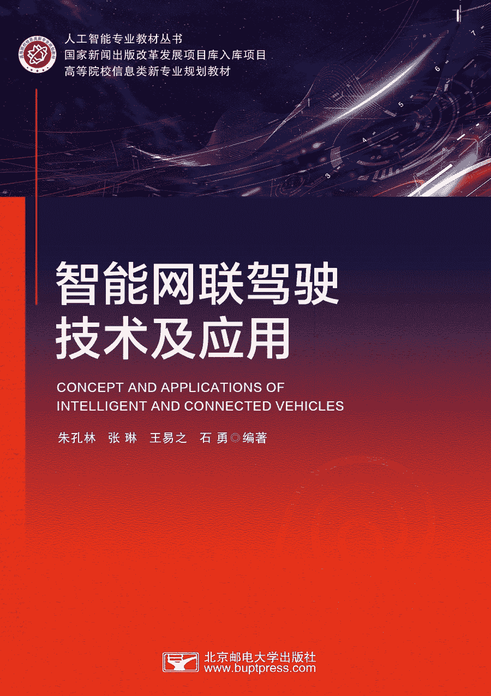

## 前言

智能化与联<|message|>相得益彰，能把高阶无人驾驶推向更安全、更高效率的区间，也可部分填补单车闭环在感知、决策、执行上的短板。把车路协同纳入自动驾驶框架，已成为学术圈与产业圈共同聚焦的方向。目前市场上能系统梳理智联驾驶、做分析并配工程实操的教材并不多。本书顺应技术走向，从核心理念、演进脉络到感知、通信与消息交互等关键环节切入，以碰撞预警、交叉口预警、盲区预警等典型场景为主线，梳理论述方案与算法，并以实验帮助读者建立直觉。

全书共七章，每章都兼顾理论阐释与动手实践。第一章总览技术的概念、分级与演进，并附带认知台架实验。第二章聚焦感知，介绍环境感知任务、传感器配置、感知方法及路侧感知实验。第三章讲无线通信，覆盖专用短程通信与蜂窝车联网、设备与台架验证。第四章讲交互消息，对典型场景的基础消息定义与格式进行说明并配套实验。第五章聚焦碰撞预警类应用，以前向碰撞预警为例展开定义、场景、原理与算法并实践。第六章针对信号灯路口，围绕绿波引导、闯红灯预警等路口应用展开原理与实验。第七章面向交通事件，以限速提示、应急车辆提醒等为例介绍定义、场景、原理与算法并配套实验。因篇幅所限，内容不求面面俱到，读者可通过延伸资料继续深入。

本书由北京邮电大学与北京星云互联科技有限公司联合完成。编写期间得到北京邮电大学及北京星云互联科技有限公司多位专家的支持，包括张广岐、谷健、吴煊佴、王奇、任家旺、巨旭华、祁相龙、庄思远、张颖、汪佳兴等，特此致谢。

编撰过程中参考了大量文献，获益甚多，谨向原作者致谢。

时间与水平有限，书中难免有疏漏，敬请同行与读者指正。

作者

# 第 1 章 智能网联驾驶技术概述

## 智能网联驾驶技术概述

到2022年底，全国机动车保有量已达4.17亿辆，持证驾驶员超5亿人。保有量与驾驶人群持续扩张，能源紧张、环境恶化、道路拥堵愈发突出，其中城区拥堵已成亟待破解的难题。

智联驾驶是把车联网与智能汽车深度融合，在车辆上搭载探测单元、控制器与执行单元，并融合现代通信与网络技术，实现人、车、路、平台之间信息互通共享，进而达成安全、舒适、节能、高效的行驶，最终替代人工操控的新型汽车技术。该路线是应对交通安全、拥堵、能耗与污染等社会问题的关键抓手，也代表了汽车产业的未来走向。近年来相关理论与标准不断完善，本章将介绍智联驾驶的核心概念、技术分级、发展趋势以及认知台架实验。

## 1.1 智能网联驾驶的基本概念

智联驾驶是在车辆单体智能基础上借助无线网络实现更深协同的驾驶范式，目标是获得更安全、更高效的无人驾驶。从演进看，先是车辆单体智能与网联驾驶并行，随后逐步融合形成智联形态，如图1.1所示。下面从车辆单体智能、车联网与智联驾驶三方面展开。

### 1.1.1 单车智能驾驶

## 单车智能驾驶

车辆单体智能依托先进的感知、决策与执行系统，综合信息通信、互联网、大数据、云计算、人工智能等新技术，实现部分或完全自动驾驶，推动交通工具向智能移动空间演进，如图1.2所示。其本质是车辆凭借自身探测装置获取外部信息，经算法处理后自主操控。主要包含三方面：①环境认知，解决定位与周边物体识别问题；②预测与规划，解决交通参与者行为预测与行驶路线规划；③车辆控制，实现规划路线的跟踪与执行。

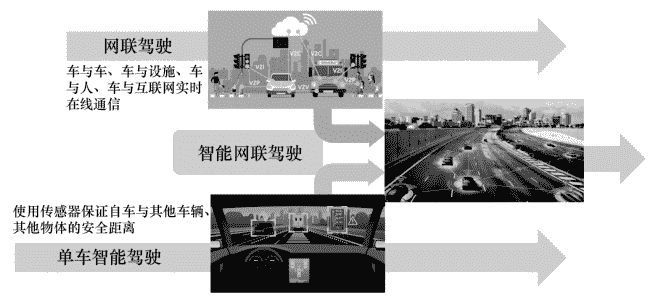

图 1.1　智能网联驾驶的发展方向

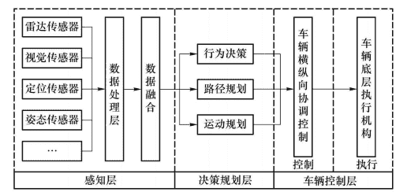

图 1.2　智能汽车的层次架构

感知层负责环境认知与通信，即感知车身与外部环境并告知系统自身位置。当前主要依赖传感器，相当于自动驾驶的“眼睛”与“耳朵”，包含激光雷达、毫米波雷达、摄像头、超声波探测器、高精度定位与高精度地图等。感知系统通过海量传感器数据实现自身运动状态感知、路面信息如车道线提取、障碍物如行人车辆检测等。常用装置有摄像头、毫米波雷达、激光雷达、超声波雷达与红外夜视等，各技术各有优劣，需融合以形成可靠数据供决策与控制使用。

决策规划层在获取感知数据后进行分析、决策与预测，解决系统如何应对环境与未来可能变化的问题。规划时需融合道路拓扑、实时交通、其他参与者与本车状态等信息，据此向执行层下达指令，完成规划任务。

车辆控制层通过执行机构完成制动、转向、驱动等操作。执行系统相当于人的手脚，由制动与加速踏板、电子稳定系统、电动助力转向、自动变速器等构成，需通过总线与决策系统连接，按指令精准控制加速、制动、转向与灯光，实现自主行驶。

自动驾驶执行核心技术包括纵向控制与横向控制。纵向控制即通过油门与制动配合实现期望车速的精确调节，响应迅速、避撞有效，可提升道路通行率并降低拥堵污染。横向控制即垂直于行驶方向的侧向控制，通过方向盘角度与轮胎力控制实现路径跟踪，保持期望行驶路线并兼顾舒适性与稳定性。

车辆单体智能依赖车载硬件与软件协同，对环境认知要求较高。为提升安全性需加装大量硬件以消除认知盲区，但即便配置摄像头、超声波雷达、毫米波雷达等，仍存在盲区与未识别障碍物的风险。探测装置对安装位置、视场角、数据吞吐、标定精度、时间同步要求严苛，在复杂路口、恶劣天气、小目标识别、信号灯识别、逆光等场景下难以完全保证准确识别。感知范围有限也导致高速会车时难以及时预判与控制。

成本是制约发展的因素之一。硬件本身昂贵，还需计算单元处理数据，进一步推高成本。车端软件部署、维护与更新也增加运营负担。高精度地图采集复杂且费用高，需专业采集车与人员以十厘米级精度反复采集，制作普通道路高精度地图每公里费用达数千元。道路改建后需及时更新，长期投入采集、制图、数据管理与云服务成本极高。地图数据量大、更新频率高，云端日处理数据可达数百GB至TB级，且主要为静态信息，不含实时动态参与者信息，商用化后更新压力更大。

## 车联网

车联网基于无线通信互联技术，建立车辆与车辆、车辆与道路、车辆与智能交通系统服务中心甚至住宅、办公与公共设施之间的连接，实现车内网与车外网的信息交互，解决人-车-环境信息交互问题。它是一个由位置、速度、路线等信息构成的庞大互动网络。

车用无线通信技术即V2X，将车辆与各类交互对象连接。V代表车辆，X代表交互对象，包含车与车V2V、车与路侧基础设施如红绿灯、摄像头、智能路牌V2I、车与人V2P、车与网络V2N。V2X目前主要技术为专用短程通信DSRC与基于蜂窝的车联网通信C-V2X。V2X将人、车、路、云有机联通，可为车辆提供超越单车认知的能力，促进自动驾驶创新，推动智慧交通体系建设，有助于提升效率、节约资源、减少污染、降低事故与缓解拥堵。

从组成看，车联网包括车载子系统、出行者子系统、路侧子系统与中心子系统，如图1.3所示。

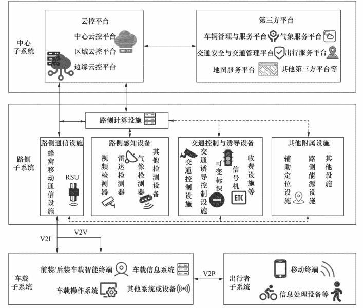

图 1.3　车联网层次架构

### 车载子系统

车载系统包括操作系统与信息系统，由多种智能探测装置与车载通信单元组成，负责采集车辆信息。车辆可实时感知自身及他车的位置、朝向、行驶距离、速度与加速度，并通过探测装置感知外部道路参与者与障碍物信息，便于驾驶员及时反应。车载信息系统提供车内、车车间与车网的泛在通信能力，使自车能够与他车、路侧设施与云平台互联。

### 出行者子系统

出行者子系统是车路协同的重要组成，面向行人提供个性化出行体验与智能交通服务。它与车辆、道路基础设施与交通管理中心协同，为出行者提供智能化服务，提升效率与安全性，并通过数据采集与分析为交通管理部门提供统计与决策支持。可监测出行者状态，结合车辆探测装置与驾驶辅助系统提供行为评估与安全提示，警示事故高发区域与超速风险。

### 路侧子系统

路侧系统包含路侧通信单元RSU、路侧计算设施与路侧探测设备。RSU部署于路侧作为通信网关，汇聚探测设备、智能交通基础设施与周边车辆信息，通过有线或无线方式上传至V2X平台并下发交通信息。路侧计算设施接入雷达、相机等多源探测设备，分析输出交通参与者与事件结果，支撑车路协同应用。路侧探测设备利用激光雷达、毫米波雷达、相机等，结合计算设施实现路段瞬时感知，拓展车辆认知范围，并通过RSU完成信息交互。

### 中心子系统

中心子系统是连接车端与路端的枢纽，将车辆信息、路侧交通信息、管理信息与高精地图在云端整合，向车、路、行人提供服务与预警决策，具备存储、运维、大数据分析、云计算与信息安全等基础能力，支撑智能网联汽车实际应用。可部署协同感知、决策与控制、智能交通管控、公共出行服务、测试等行业应用，并进行资源配置与生态扩展管理。

## 智能网联驾驶

智能网联驾驶是智能交通发展新阶段的主流趋势，是车路协同系统的核心。技术依托先进探测装置、通信与控制算法，关键在于环境认知、车辆控制与车路协同互联。

在单车智能基础上，通过车联网将人-车-路-云-网-图有机联系。“智慧的路”借助路侧探测获取全面交通态势，路侧计算单元分析后通过可靠网络分发给“聪明的车”与“实时的云”，同时更新“精确的图”，提供车路协同安全预警，为车辆认知与决策提供支撑，实现车-路-云-网-图的协同。

环境认知需多种探测装置如激光雷达、摄像头、毫米波雷达、GPS、惯性测量单元等，将原始数据转化为几何结构与特征信息。协同通信基于V2X，V2V实现车辆间路况、车速、转向等信息传递；V2I通过基础设施获取交通信号与路况；V2N使车辆与云平台交互获取超视距信息，辅助全程路径规划。

应用场景广泛，公共交通可实现无人驾驶巴士提升效率与安全；物流配送可实现无人货车自主送达；出租车可实现一键呼叫、自动寻客、接送与支付的完全自主服务。落地层面，智能网联驾驶通过高精度传感与先进控制提升安全性，结合协同通信实现车辆无缝连接与自主协调，提高通行效率并降低人力与运营成本。

## 智能网联驾驶的技术等级

智能网联驾驶的技术等级取决于智能化等级与网联化等级。下面从两方面介绍国内外划分方法。深度融合后的统一分级尚未形成，读者可通过交叉理解把握其内涵。

### 自动驾驶分级

目前自动驾驶分级尚无全球统一标准，不同国家与机构依据发展路径与核心要素划分，关键区分点是自动驾驶对人的解放程度。

#### 美国工程汽车协会对汽车自动驾驶的分级

美国汽车工程师协会SAE在美国国家公路安全交通管理局NHTSA标准基础上发布SAE J3016，将自动驾驶分为L0至L5共六个等级，如表1.1所示。

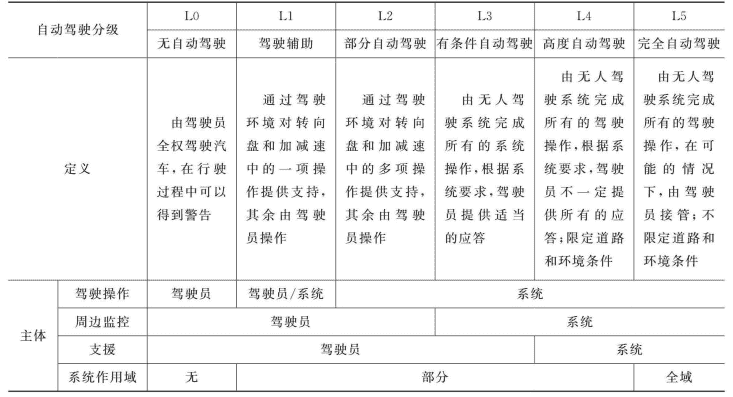

自动驾驶怎么分级：SAE 与中国标准对照

表 1.1　SAE 汽车自动驾驶分级速览

① L0 级 零自动化。整段行驶全靠人完成，油门、刹车、转向和动力传递都由驾驶员手控，风险判断也由人承担。

② L1 级 驾驶支援。相比 L0 的纯人工，L1 提供单一功能的辅助。以早期沃尔沃重卡、奔驰车型上的自适应巡航为例，雷达测距后能够自动调节车速保持安全跟距。如今这类功能在国内商用车上已很常见。

③ L2 级 部分自动化。特斯拉的车道保持便是代表，系统在同时控制纵向速度和横向方向，驾驶员可把主控权暂时交出，但仍需时刻留意路况并准备接管。

④ L3 级 有条件自动化。在特定交通环境下，车辆能自主完成全部操作，并可在环境变化时向人发出接管请求。若系统判断失准则必须人工介入，且仅在设定范围内生效。

⑤ L4 级 高度自动化。输入出发地和目的地后即可把车辆交给系统。GoFun 的自动取还、自动编队巡航和自动避障等共享出行场景属于此级，相关方案已在多款车型上落地。

⑥ L5 级 完全自动化。动态驾驶任务被移除，驾驶员无须关注。车上甚至可没有方向盘或踏板，能够脱离电子围栏到达人类驾驶员可达的任何地点。目前仅在部分地区测试，尚未向公众公开量产。

中国汽车工程学会对汽车自动驾驶的分级
学会按系统承担动态驾驶任务的程度与运行条件限制，将自动化划分为六个层级，如表 1.2 所示。

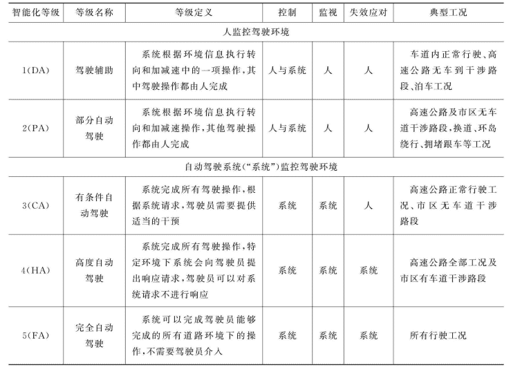
表 1.2　中国汽车工程学会自动驾驶分级

① 1 级驾驶自动化 应急辅助。系统不能持续控制车辆横向或纵向运动，但能持续对部分目标和事件进行探测与响应。

② 2 级驾驶自动化 部分驾驶辅助。在设计运行条件内，系统可持续执行车辆横向或纵向其中一项运动的控制，并具备匹配的部分探测响应能力。

③ 3 级驾驶自动化 组合驾驶辅助。在设计运行条件内，系统可持续同时执行横向和纵向运动控制，并具备匹配的部分探测响应能力。

④ 4 级驾驶自动化 有条件自动驾驶。在设计运行条件内，系统可持续执行全部动态驾驶任务。

⑤ 5 级驾驶自动化 高度自动驾驶。在设计运行条件内，系统可持续执行全部动态驾驶任务并完成接管。

⑥ 6 级驾驶自动化 完全自动驾驶。系统可在任何可行驶条件下持续执行全部动态驾驶任务并完成接管。

### 网联驾驶等级
国家智能网联汽车创新中心在《基于 C-V2X 的智能化网联化融合发展路线图》中，按信息内容把网联驾驶划为四层：状态共享、融合感知、融合决策、融合控制。

#### 网联驾驶等级 0 状态共享
借助车-车、车-路、车-云、车-移动终端通信，发送方上报自身感知信息与状态供接收方参考。信息不一定进入接收方的智驾系统，也不要求接收方具备使用能力。可按场景广播或单播发送。

#### 网联驾驶等级 1 融合感知
在通信基础上，发送方除感知信息外还上报自身体态与意图即未来状态。接收方可按需请求意图共享。感知信息进入智驾系统，但不强制按共享意图执行。消息可广播、组播、单播。

#### 网联驾驶等级 2 融合决策
车-路-云多方交互产生决策信息。决策信息进入接收方智驾系统，但是否执行由接收方决定，融合后的决策由智驾系统落地。消息可广播、组播、单播。

#### 网联驾驶等级 3 融合控制
特定参与方按特定操作方指令完成驾驶任务，包含控制指令或调度信息。控制信息单播进入自动驾驶系统，由自动驾驶或云控平台执行。

表 1.3 从典型信息、信息融合主体两维度进一步细化各等级，原则上高级别对低级别具有包容性。

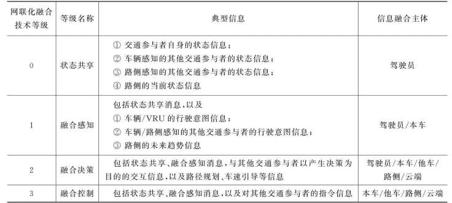
鉴于全球尚未形成成熟的融合路线，按网联信息对自动驾驶的支撑作用，融合发展可分为三阶段：信息提醒与精确预警阶段、车路云一体化的辅助驾驶 C-ADAS 阶段、车路云一体化的自动驾驶 CAD 阶段。

信息提醒与精确预警阶段，网联信息经与单车感知多传感器融合后，以提示、预警形式在人机交互界面呈现。随着车道级定位和高精地图普及，预警内容不断丰富。

C-ADAS 阶段，满足信息安全、功能安全要求的网联信息进入智驾域，支撑车辆辅助驾驶。

CAD 阶段，满足相应安全要求的网联信息支撑车辆自动驾驶。随着道路基础设施和车载通信普及度提升，车路云一体化的自动驾驶逐步推广。

为厘清等级与阶段关系，形成 4×3 矩阵。横向看，同一等级消息指标相同，但随阶段要求不同应用场景由左至右增强或新增；纵向看，随等级提升应用场景由上至下增强或新增。

状态共享仅能用于信息提醒与精确预警阶段，因其未进入智驾域。

融合感知消息可用于信息提醒与精确预警、C-ADAS、CAD 三阶段。不同阶段对功能安全、预期功能安全、信息安全的要求不同，对车载通信、路侧、云平台的安全要求也递增。

融合决策消息可用于 C-ADAS、CAD 两个阶段，因其已超出车内提醒预警范畴。

融合控制消息仅用于 CAD 阶段，因不依赖人类协同参与，不适用于 C-ADAS。

### 表 1.4 网联化融合技术等级与发展阶段关系

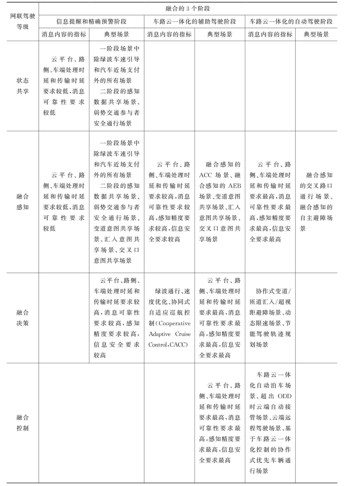
## 1.3 智能网联驾驶的发展趋势
新一轮科技革命下，车联网与自动驾驶的融合重塑汽车生态，智能化、互联化已成共识。智能网联驾驶被视作解决交通安全、拥堵、能耗、污染的关键路径，成为全球争夺的战略高地。

### 1.3.1 国外智能网联驾驶的发展趋势
各国依托本地优势通过立法、示范、创新、基建等方式推进。

美国强调技术中立，监管持续弱化。至 2022 年先后发布《自动驾驶汽车》系列政策、《智能交通系统战略规划 2020-2025》《自动驾驶汽车综合计划》《自动驾驶乘员保护安全最终规则》等，明确 ADS 愿景目标，提出三类自动驾驶公共平台建设，支持 CARMA 平台，划定低速无人货车、低级别乘用车、高级别乘用车、高速公路自动驾驶货车、低速接驳车五大优先领域，并完善全自动汽车碰撞测试标准。同时加强车路协同，密歇根州建成首条长 40 英里 1 英里=1.60 千米 专供网联和自动驾驶车辆的试验道路，用于研究物理、数字、协同及运营基础设施。

欧盟侧重商业布局，率先研究自动驾驶保险、责任与伦理。先后发布《通往自动化出行之路：欧盟未来出行战略》《网联式自动驾驶技术路线图》《自动驾驶汽车豁免程序指南》等，提出国家临时安全评估协调机制，聚焦网联车辆个人数据处理。提出 ISAD 基础设施分级，目标到 2030 年大规模部署自动驾驶出行服务并普及完全自动驾驶。德国 Ko-HAF、欧盟 C-ITS、大陆 e-Horizon 等项目推动 V2X 发展。德国出台《自动驾驶法》支持特定场景 L4 应用；英法德等修法支持 ALKS 商业化，德国已为奔驰颁发 L3 型式认证。

日本将智能交通与智慧城市融合开展实路操作测试 FOT。2018-2022 年发布《自动驾驶汽车安全技术指南》《道路交通法修正案》《官民 ITS 构想·路线图》《实现自动驾驶行动方针》等，制定 L3 安全要求与路线图，探讨 L4 基础设施协同机制。SIP-adus 2.0 目标到 2025 年私家车、卡车在高速实现 L4，在全国实现无人出行。2020 年 11 月本田 Legend 获全球首个 L3 系统安全认证并上共享市场。

韩国发布《韩国自动驾驶战略规划》，目标 2027 年成为全球首个自动驾驶国家。2021 年制定 L3 安全标准，计划 2021 年推出 L3 汽车，2024 年部分商用 L4，2027 年全面商用 L4。为此 2021 年 1 月产业通商资源部、科学技术信息通信部、国土交通部、警察厅联合启动“自动驾驶技术开发创新项目”，2027 年前投资 1.1 万亿韩元约 9.99 亿美元。

经验表明智能网联汽车是跨技术跨产业的系统工程，需政产学研协同，立足本地基础探索特色路径。

### 1.3.2 国内智能网联驾驶的发展趋势
中国智能网联发展成效显著，形成开放融合、创新引领的产业生态，关键技术、标准测试、基础设施、应用服务、安全保障均取得系统进展。

其一确立以 C-V2X 为底座的车路云一体化中国方案，传统车企与互联网企业跨界合作，产业体系居全球领先；其二在环境感知、决策规划、云平台、车载计算芯片等领域取得突破，专利数国际领先，自主化比例提升。深度参与 3GPP 标准制定，推动 C-V2X 网络层协议纳入国际规范，并在 ITU-T、ISO、ETSI 等组织贡献标准，中国方案影响国际标准制定。

从国家到地方全面探索产业发展，核心是车路云一体化。各地以云控平台为抓手开展实践。各部委及行业组织发布系列政策文件，表 1.5 汇总近三年部分文件。

### 表 1.5 部分国内相关政策文件
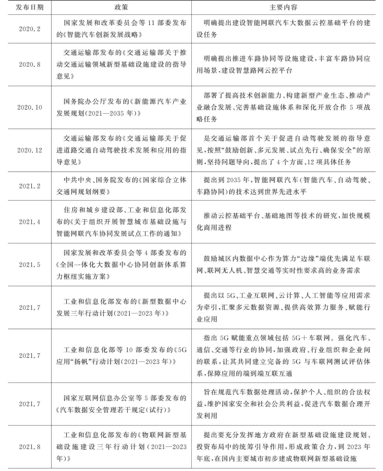
续表
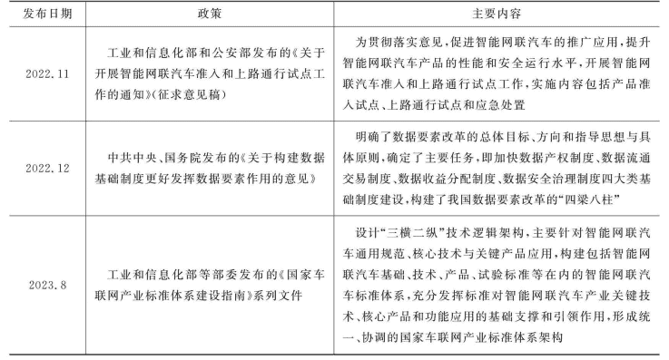
政策体系覆盖技术研发、测试示范、产品管理、网络安全、地理信息安全、标准建设、跨界融合。工信部、科技部加大基础前沿与共性关键技术支持，形成研发、测试、示范、规模部署、商业化、安全保障全链条支撑体系。各地建设国家级测试示范区、交通强国试点、车联网先导区、双智试点、自动驾驶先导应用试点。

产品落地与应用提速。2022 年 1-11 月具备 L2 智能驾驶辅助功能的乘用车销量超 800 万辆，渗透率升至 33.6%。L4 示范加速，全国开放测试道路超 7000 千米，实际道路测试里程超 4000 万千米。一汽红旗、上汽、广汽、吉利、长城、蔚来、长安福特等发布搭载 5G-V2X 量产车型。至 2022 年 6 月路侧基础通信设施已部署超 6200 台，加快交通设备数字化改造与车路协同试点。

预计到 2028 年，车端实现 C-V2X 终端新车装配基本普及、DA、PA 级汽车大规模应用 C-ADAS、具备 CAD 功能车辆商业化应用。路端一二线重点城市交叉口信号灯联网覆盖率达 100%，路侧感知与计算能力可支撑交叉口 C-ADAS 与 CAD 功能；高速公路分合流区及隧道路侧感知覆盖率达 50%，可支撑部分高速场景。具备 AVP 功能停车场数量超 2000。远期车路云一体化自动驾驶将全面实现，通信网络、路侧基础设施、云控平台构成新一代基础设施体系，新型产业生态满足出行与运输需求增长。

## 1.4 智能网联驾驶系统认知台架实验

智能网联驾驶
我们研发了“车路协同教学系统”这一智能网联驾驶认知台架实验平台，可开展系列系统实验，因其与本章内容高度关联并入书中供参考。本章介绍教学平台首个实验——智能网联驾驶系统认知台架实验。

### 1.4.1 实验目的

车路协同教学平台速览

本单元以台架整体架构与部件说明为线索，结合实景演示，帮助读者快速建立对智能网联驾驶体系的认知，弄清教学台架的构成、功能划分以及日常操作流程。

### 1.4.2 实验内容

#### （1）步骤一
通电后，系统首屏弹出“车路协同教学系统”的主目录，并实时反馈车载通信单元 OBU 与路侧通信单元 RSU 的连接状态。目录内共收录八个实验项目，如图 1.4 所示。

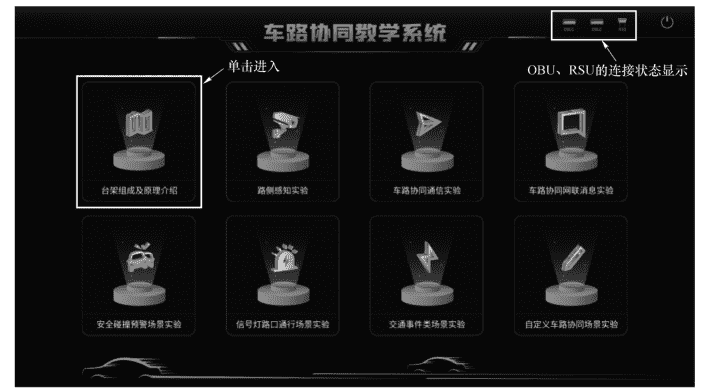

图 1.4 车路协同教学系统主界面

#### （2）步骤二
在主目录中点选“台架组成及原理介绍”进入本次实验。教学平台由 A 通信计算中心、B 车载显示器共两台、C 摄像头、D 毫米波雷达、E 场景显示器构成，操作界面下方提供 A、B、C、D、E 五个切换键，可跳转至各模块的专项介绍。

①A 通信计算中心：按下“A”进入该模块的讲解。该中心由一台教学版路侧通信计算模块 RSU、两台教学版车载通信计算模块 OBU 以及一台台架计算平台组成，右侧区域呈现各组成部分的详细说明，如图 1.5 所示。

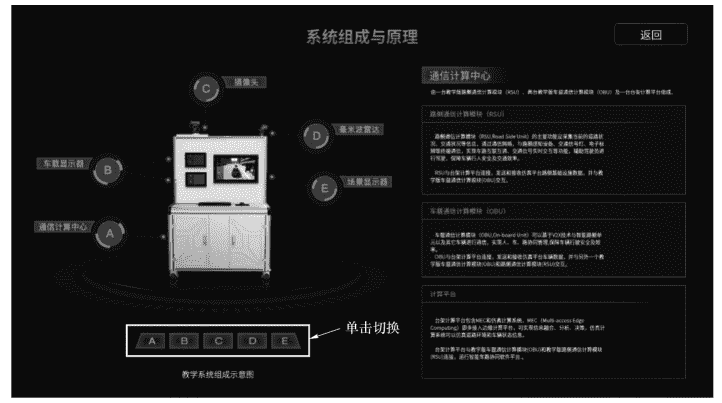

图 1.5 系统组成与原理——通信计算中心

②B 车载显示器：按下“B”可查看车载显示器的说明。两台车载显示器与实验操作界面分离，如图 1.6 所示，主要用于以车端视角呈现教学版车载通信计算模块发出的预警提示、车辆状态与位置等信息，右侧给出显示器的简要介绍及使用示例，如图 1.7 所示。

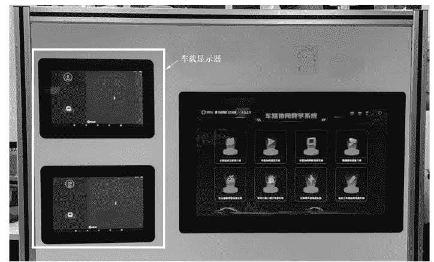

图 1.6 车载显示器·

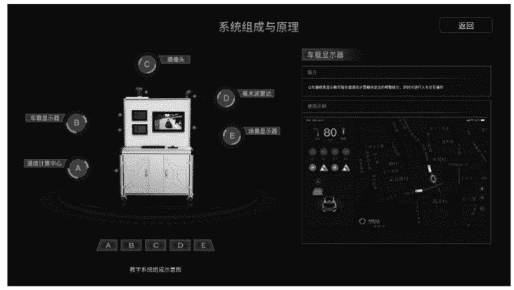

图 1.7 系统组成与原理——车载显示器

③C 摄像头：点选“C”进入摄像头说明，右侧展示其工作原理、与其他感知器件的性能对比，以及优缺点的分析，如图 1.8 所示。

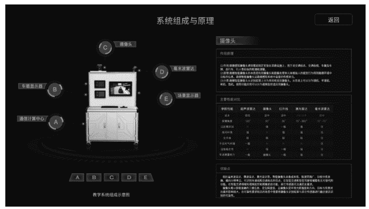

图 1.8 系统组成与原理——摄像头

④D 毫米波雷达：按下“D”可查看毫米波雷达的介绍，右侧呈现其作用机理、与其他感知器件的性能对比及典型应用场景说明，如图 1.9 所示。

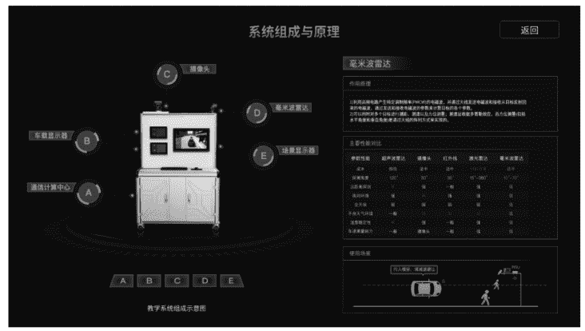

图 1.9 系统组成与原理——毫米波雷达

⑤E 场景显示器：点选“E”进入场景显示器的讲解。该显示器承担人机交互操作与车路协同主要场景的展示，右侧提供其简介与使用示例，如图 1.10 所示。

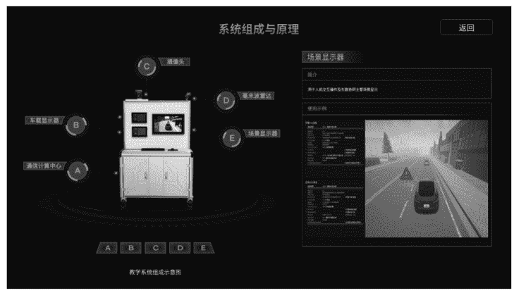

图 1.10 系统组成与原理——场景显示器

#### （3）步骤三
熟悉各组成部分后，点击右上角的“返回”即可回到主画面，如图 1.11 所示。

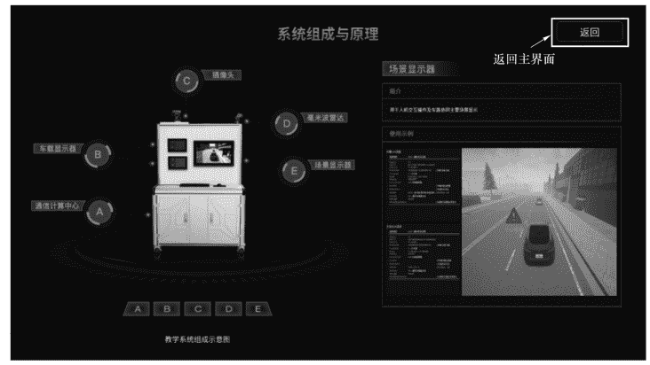

图 1.11 返回主界面

### 思考题

1. 无人驾驶至今未能真正融入日常生活的阻碍有哪些？你认为未来无人驾驶的发展方向会怎样？
2. 简要概括智能网联驾驶的核心优势与主要特征。
3. 从自动驾驶分级来看，我国与美国在哪些方面相同、哪些方面不同？请结合智能网联驾驶的分级原则与依据综合分析。

# 第 2 章 智能网联驾驶感知技术

智能网联驾驶感知技术

智能网联驾驶由环境感知与车辆控制两大支柱构成，其中环境感知是智能网联汽车行驶的基础。本章聚焦感知技术，车辆通过各类硬件传感器如相机、雷达等采集信息，经汇总与融合处理后实现对周边环境的认知。

## 2.1 环境感知的任务

在智能网联汽车快速演进的背景下，环境感知是核心技术之一，为整车其他技术提供数据基础，为智能决策与控制执行提供依据，也是实现自动驾驶的首要环节。智能网联汽车借助视觉传感器、超声波雷达也称超声波传感器、毫米波雷达、激光雷达等获取道路、车辆位置及障碍物的信息，各类传感器如同汽车的感官与大脑，汇集行驶过程及环境中所有可测数据，再进行分类、处理与分析后输出，以满足驾驶智能化、自动化的感知需求。

环境感知的任务大致可分为四个模块：动态物体检测 Dynamic Object Detection，DOD、通行空间 Free Space，FS、车道线检测 Lane Detection，LD、静态物体检测 Static Object Detection \[10\]。

### 1. 动态物体检测

## 动态物体检测

动态物体检测主要识别轿车、卡车、电动车、自行车以及行人等运动目标。难点在于检测类别繁多、追踪目标众多、对测距精度要求高；外界环境复杂，遮挡频繁，目标朝向各异；行人与车辆类型丰富，难以全面覆盖，易产生误检；同时还需应对目标追踪、行人身份切换等挑战。

## 通行空间

通行空间旨在划定车辆行驶的安全边界即可通行区域，主要针对车辆、普通路缘、路肩边缘、无明显障碍物的边界以及未知边界进行划分。

难点在于复杂场景下边界形态多样，泛化难度较大。与对车辆、行人、交通灯等单一目标的检测不同，通行空间需要准确划分安全行驶区并界定影响前行的障碍物边缘。此外，加减速、路面颠簸或上下坡会导致相机俯仰角变化，原有标定失效，投影到世界坐标系后测距误差增大，通行空间边界可能出现收缩或扩张等异常。

## 车道线检测

车道线检测针对单侧、双侧、实线、虚线、双线等各类车道线进行识别，还包括线型颜色白色、黄色、蓝色以及特殊车道线汇流线、减速线等，目前在辅助驾驶领域应用较为成熟。

难点较多，如线型种类多、不规则路面难检测。例如积水路面、标识失效、修补路面、阴影等情况下车道线易被误检或漏检，弯曲车道线、远端车道线、环岛车道线等拟合难度大，检测结果易模糊不清。

## 静态物体检测

静态物体检测是对交通红绿灯、交通标志等静止物体的识别。该类物体是自动驾驶行驶中高频遇到的目标之一。

难点主要有两点：其一是红绿灯、交通标识属于小目标检测，在图像中像素占比少，尤其远距离路口检测难度更大；其二是强光照下人眼也难以辨识，而停在斑马线前的车辆需正确识别红绿灯才能做下一步判断。此外，交通标识种类众多，采集数据易不均衡，导致模型训练不完善。

## 感知方案

业界在传感器使用策略上主要分为两大思路：纯视觉感知方案与多传感器融合感知方案。

### 纯视觉感知方案

纯视觉方案仅依靠摄像头采集环境信息，再将图像送入计算芯片分析，流程类似人类驾驶：先用眼睛捕捉周边，再由大脑决策。纯视觉加AI的视角往往比人眼更广，通过海量图像让车内计算系统形成以车辆为中心的全局视野。优势在于成本相对低，更贴近人驾模式，高分辨率、高帧率成像带来丰富信息；劣势是摄像头易受光照干扰，且对图像处理的依赖性强，训练不足时容易出现感知盲区。目前采用该路线的代表企业包括特斯拉、百度、极氪等。

### 多传感器融合感知方案

多传感器融合方案则通过摄像头、毫米波雷达、激光雷达等设备共同采集车辆周边信息。由于激光雷达自发光不受环境光影响，因而能获取更深度的空间信息，对物体位置、距离、尺寸的感知更准确，不过该方案也有局限，如激光雷达易受雨雪雾天气影响。激光雷达单体价格高昂，多传感器融合对计算芯片算力要求也更高，因此在成本上不具优势。目前采用多传感器融合方案的代表企业主要有小鹏、蔚来、极狐等。

## 环境感知传感器

智能驾驶感知离不开各类传感器技术的支撑。各感知传感器服务于智能网联汽车，对道路、车辆、行人、障碍物等进行检测与识别，并将信息传输给控制中心，为决策提供依据，保障驾乘安全，确保车辆准确抵达目的地。传感器类型一般包括超声波雷达、毫米波雷达、视觉传感器和激光雷达等\[11\]。不同传感器各有优势与特性，大多数自动驾驶需配备多种传感器，才能在复杂世界中实现对外部物体的较全覆盖感知。

### 超声波雷达

超声波雷达利用超声波发生器产生超声波发射出去，通过接收探头捕捉障碍物反射回来的超声波，并依据反射与接收的时间差计算与障碍物的距离，从而实现探测。

#### 超声波雷达的定义

频率高于人类听觉上限约 20kHz 的声波称为超声波。超声波雷达是利用超声波特性研制成的传感器，可在超声频率范围内将交变电信号转为声信号，或将外界声场声信号转为电信号的能量转换器件。

按工作时水平与垂直方向探测角度范围的不同，可分为等方向性传感器和异方向性传感器。等方向性传感器水平与垂直探测范围相同，如均探测 120°；异方向性传感器两者范围不同，如水平 120°、垂直 60°。等方向性因垂直探测范围大易探测到地面而难测远距，故车辆多采用异方向性传感器。

#### 超声波雷达的优缺点

##### 超声波雷达的优点

①超声波传播速度仅为光波的百万分之一且指向性强、能量衰减慢，可直接测量近距离目标，一般测距小于 10m。
②超声波对色彩、光照度不敏感，可用于识别透明、半透明及漫反射差的物体。
③超声波对外界光线和电磁场不敏感，可在黑暗、有灰尘或烟雾、电磁干扰强、有毒等恶劣环境下工作。
④结构简单、体积小、成本低、信息处理可靠易集成，可实时控制。

##### 超声波雷达的缺点

①探测距离短。因散射角较大、波长较长、频率较低，探测距离较近，一般约 3m。
②易受天气环境影响。在雨雾、炎热、高速场景下表现不佳，故多用作倒车及泊车雷达。

#### 超声波雷达的结构与工作原理

超声波雷达如图 2.1 所示。结构包括超声波发生器、接收器和控制器，发生器为核心部件。图 2.2 为测距原理示意图，由发生器发射信号，遇障碍物反射后由接收器捕捉并送入控制器处理，芯片记录声波往返时间，计算车辆与障碍物距离。

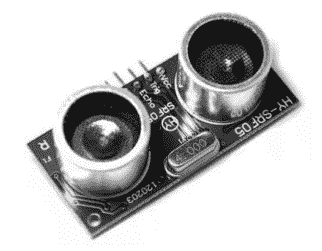

图 2.1　超声波雷达

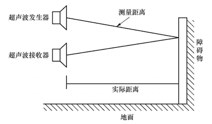

图 2.2　超声波雷达的测距原理

#### 超声波雷达的应用

超声波雷达多用于自动泊车、倒车辅助、障碍物预警等系统，通常安装于前、后保险杠及车侧。图 2.3 为典型布置方式，前、后保险杠各布置 4 个，左、右侧面前后端各布置 1 个。在自动泊车中用于探测空位，倒车时实时探测障碍物并以声音或图像提示，弥补驾驶员视线不足。部分配备盲点监测或并线辅助的车型行车时也会开启超声波雷达，用于近距障碍物实时探测与预警，并联动其它系统提高行车安全。

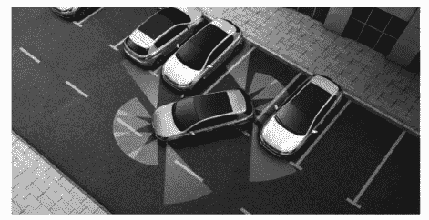

图 2.3　超声波雷达的应用

### 毫米波雷达

毫米波雷达通过发射与接收高频电磁波探测目标，经信号处理模块对回波进行处理，计算目标距离、速度、角度等信息。常见类型有 24GHz 与 77GHz 毫米波雷达。

#### 毫米波雷达的定义

毫米波是指波长 1～10mm 的电磁波，频带高于射频、低于可见光和红外线，频率约 30～300GHz。毫米波雷达通过发射、接收毫米波段电磁波测量车辆间距离、角度及相对速度。毫米波位于微波与远红外重叠区，兼具两者优点并具独特性质，主要用于先进驾驶辅助系统中的自动制动辅助、盲区监测预警等。

#### 毫米波雷达的优缺点

##### 毫米波雷达的优点

①探测性能好，不受颜色与温度影响。
②响应速度快，传播速度近光速且调制简单，配合高速信号处理可快速测得角度、距离、速度。
③环境适应性强，穿透能力强，雨雪大雾等恶劣天气仍可工作，天线在雨中或轻微结霜时仍可正常运行。
④抗干扰能力强，工作在高频段，周围噪声与干扰多为中低频，基本不影响正常运行。

##### 毫米波雷达的缺点

①空气中氧气和水蒸气会产生选择性吸收与散射，导致大气传播衰减，需选取衰减极小值频率。
②对目标反射率敏感。不同材料反射率不均，金属会放大信号利于车辆检测，却会使废弃罐等小物表观尺寸增大，而木材等在雷达下近乎透明，易造成误报或漏检。
③分辨率与准确性有限。距离与速度测量很精确，水平分辨率取决于发射波束特性。数字波束形成原始角度分辨率约 2°到 5°，经处理可提升至 0.1°到 1°。在此分辨率下，30m 处难以将行人与邻近汽车区分，100m 处难以分辨相邻车道车辆，甚至难以判断是否同车道或检测到桥上车辆。

#### 毫米波雷达的结构与工作原理

毫米波雷达如图 2.4 所示，系统结构包括背板、毫米波基础电路、主体压铸板、收/发天线阵列和雷达整流罩。天线以高频印刷电路板方式集成于基板。收发芯片常用硅锗 SiGe 双极晶体管、互补金属氧化物半导体 CMOS 等。

双极晶体管早期应用广泛但占用空间大、成本高。随着半导体进步，CMOS 在数字电路中应用普及，成本更低，可在低电压工作降低功耗，目前在毫米波雷达领域应用更为广泛。

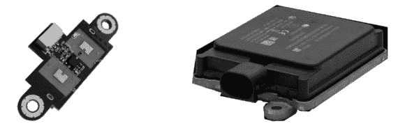

图 2.4　毫米波雷达

车载毫米波雷达发射毫米波信号并接收回波，测定车辆周围物理环境信息如相对距离、相对速度、角度、运动状态等，结合物体信息进行目标追踪与分类，再融合车身动态信息完成决策，降低事故率。

大多数现代车载雷达基于调频连续波 Frequency Modulated Continuous Wave，FMCW 技术并使用数字波束形成控制发射方向。FMCW 发射稳定频率信号并被另一变化频率连续信号调制常用三角波、锯齿波、编码调制或噪频。当遇到障碍物反射产生频率差回波后，接收天线接收并解调，处理芯片对模拟信号采样并滤波，如图 2.5 所示。进一步经快速傅里叶变换转频域，寻找信号强度、频率变化等特征，获取目标位置与速度等测量信息并编号跟踪。

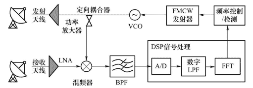

图 2.5　毫米波雷达的工作过程

#### 毫米波雷达的应用

毫米波雷达体积小且不受恶劣天气影响，被广泛应用于智能网联汽车先进驾驶辅助系统或无人驾驶。

各国对车载毫米波雷达频段分配不同，主要有 24GHz、60GHz、77GHz、79GHz 四个频段。现阶段多以 24GHz 近距雷达与 77GHz 远距雷达组合使用，24GHz 主要负责近距探测，用于盲点监测、后碰撞预警等；77GHz 主要负责中长距探测，用于自适应巡航、自动紧急制动、前碰撞预警等。

### 激光雷达

#### 激光雷达的定义

# 激光雷达与视觉感知：原理分类与应用要点

激光雷达以激光为探测载体，工作在光波段，通过光学手段获取目标的距离、速度、反射率等特征。其基本思路是向被测物发射光学探测波，再将回波与发射波对照分析，从而推算出目标的空间位置即距离方位高度，以及运动状态如速度姿态，完成探测、跟踪与识别等任务。系统能够刻画物体在空间中的位置、尺寸及外观形态，采集结果以带有精确角度与距离信息的离散点形式呈现，业内称之为点云，本质上是目标表面特征的密集点集。激光束触及物体表面后，反射光会携带方位与距离的线索；按预定轨迹扫描时，设备边扫边记录反射点，扫描精度越高累积点数越多，最终即可拼接出完整的点云。

市面上主流方案大致可分为机械式、固态式和混合固态式三类。目前机械式装机量最大，固态式被视为后续重点发展方向，而混合固态则兼顾两者长处，已成为现阶段量产车型的常见选择。

##### 机械式激光雷达
机械旋转方案在工程上已相对成熟，是业界广泛采用的路线。发射与接收单元依靠物理转动持续旋转，单点激光被拉伸成线，竖直方向叠加多束发射器形成面，最终实现三维扫描。内部构成较为复杂，涵盖激光源、扫描机构、光电探测器以及定位导航器件等。高速精准的机械转动需要精密结构支撑，导致硬件造价偏高且长期稳定性受限，行业典型使用寿命约2万至3万小时，折合2到3年使用期，故大量厂商转向固态路线展开研究。

##### 固态式激光雷达
全固态路线里较为成熟的是泛光面阵即闪光式技术，原理近似相机。系统可在极短时间内一次性照亮整个探测视场，凭借高灵敏接收器件快速绘制周边环境，能一次性捕捉完整场景，避免扫描期间雷达或目标位移带来的误差。代价是每次发射的光能在全视场扩散，能量投向任一特定点的比例很小，远距离探测能力因此受限。

##### 混合式激光雷达
MEMS型属于混合式方案，核心是微振镜引导光束指向不同角度，可根据需要动态调整扫描策略，对关注目标进行聚焦，从而获取远距离或微小物体的细节用于识别。微振镜将系统体积压缩、成本下降，且惯性力矩低响应迅速，在中远距测量上具备较大潜力，稳定性仍需进一步验证。

#### 激光雷达的优缺点

##### 激光雷达的优点
① 全天候可用，不受昼夜光照变化影响。
② 分辨率优异，激光方向性强发散角小能量集中，灵敏度与探测精度俱佳。
③ 信息维度丰富，可提取幅度、频率、相位等多类参数，多普勒频移大，覆盖低速至高速目标。
④ 抗干扰且隐蔽性好，对无线电波不敏感，可穿透等离子鞘套，低仰角时不易受地面多径干扰。
⑤ 具备三维建模能力，可对周围360°范围进行覆盖探测。

##### 激光雷达的缺点
① 造价较高，机械旋转式可实现360°无死角扫描精度最高但成本也最高，目前多用于无人车，难以车规量产；固态式靠电子部件调控出射角度，成本与体积相对更小但稳定性不足尚未规模量产；混合式为折中路线成本更低，例如华为发布的混合产品售价已接近200美元。
② 垂直分辨率偏低，低成本机型层数通常小于16层，层间角距可达2°，在100米处对应约1.7米垂直间隔，高端机型可压缩至0.2°~0.4°但价格大幅提升。
③ 点云密度不足，Velodyne HDL64角分辨约0.11°垂直分辨0.42°，50米时0.3°层间距相当于0.26米高度盲区，200米时相邻光束间距约1.4米，超出该距离仅能发现高于1.4米的障碍。
④ 对深色与镜面目标敏感度差，黑色车辆可能在雷达下不可见，因其表面吸收大部分辐射且反射不服从朗伯特性。
⑤ 天气敏感，近红外光束易受雨雾散射，有效探测距离下降，并在云层前产生虚假回波。

#### 激光雷达的结构与工作原理
LiDAR 由发射系统、接收系统、信号采集处理系统、控制系统等构成，其工作流程如图2.6、图2.7所示。

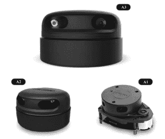

图 2.6　激光雷达

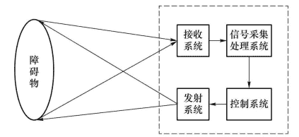

图 2.7　激光雷达系统的工作原理

多数系统采用光飞行时间法TOF，通过发射并接收激光束，计算光束碰到障碍物后往返所需时间，进而得出目标相对距离并勾勒轮廓，经过处理可生成厘米级精度的三维环境地图。

## 激光雷达系统工作原理
发射单元负责向障碍物投射激光脉冲；接收单元捕获物体反射回来的光并聚焦至光电探测器，精确测定脉冲从发出到返回的传播时长；信号采集处理单元对回波进行运算，使其满足后续环节要求，是决定测量精度的关键；控制单元提供同步信号并对回波数据处理，结合激光高度、扫描角度、位置及出射方向，可准确算出每个光斑的坐标X、Y、Z。持续脉冲扫描可获得全部点数据，经图像处理后形成精确的三维立体影像。以Velodyne 32线为例，32个激光发射器垂直堆叠，在旋转电机的带动下整个单元每秒旋转多次。旋转使激光点扩展为线，垂直排列的多束发射器形成扫描面，从而完成三维信息采集。

## 4）激光雷达的应用

### ① 点云物体检测
深度学习兴起前，点云物体检测多采用聚类方法，动静分离困难。要实现安全自动驾驶，必须识别周围运动物体并准确获知其相对车体的距离。随着深度学习发展，点云物体检测普遍转向学习型方案，室内机器人领域甚至开展了基于点云的实例分割研究。

### ② 即时定位与地图构建（Simultaneous Localization and Mapping，`SLAM`）
`SLAM`与物体检测是自动驾驶中激光雷达的两大核心应用。`SLAM`主要承担建图与定位，自动驾驶难以脱离高精度地图，建图涉及点云拼接、动态补偿等工作，构建稀疏图、稠密图或多层次地图各有利弊；定位则包括特征匹配等步骤。`SLAM`可分为视觉`SLAM`与激光`SLAM`，建图过程有时会融合视觉与点云特征。

### 2.2.4 视觉传感器
视觉传感器分为前视摄像头与环视摄像头。前视摄像头包含单目、双目和三目，主要用于中远距离场景，能识别车道线、交通标志、障碍物、行人等，需要复杂算法支撑，对处理器要求较高；环视摄像头用于近距离场景，识别障碍物，技术成熟且价格低廉。整体上对光照与天气条件敏感。

### 1）视觉传感器的定义
视觉传感器是利用光学元件与成像装置获取外部环境图像信息的设备。车载视觉传感器即摄像头，模拟人眼，通过处理采集的图像或视频获取场景三维信息，用以完成物体识别、外形方位确认、运动轨迹判断等，进而感知外部环境并控制车辆运动。通常用图像分辨率描述性能，精度不仅取决于分辨率，还与检测距离相关，距离越远绝对位置精度越差。

车载视觉传感器按镜头数目分为单目、双目、三目和环视摄像头。

#### （1）单目摄像头
如图 2.8 所示，单目摄像头只能获取二维图像，用于探测前方环境，识别道路、车辆、行人等。因成像为透视关系，远处物体成像更小，相同大小物体在近处需大量像素描述，远处仅需少量像素，故测距精度随距离增加而下降。单目无法判断像素数相同物体的大小远近关系，通常需多目配合。单目难以识别轮廓不明显的障碍物，工作准确率受外部光线影响，且受限于数据库，缺乏自学习能力。

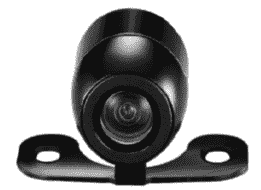

图 2.8　单目摄像头

#### （2）双目摄像头
如图 2.9 所示，双目摄像头通过两幅图像的视差计算直接测量前方景物的距离，无需先判断障碍物类型。两个平行布置的摄像头产生视差，可定位同一物体的特征点，借助三角测距原理计算摄像头与障碍物的距离，提升识别精度与探测远度。使用该方案对两摄像头的同步率与采样率要求很高，技术难点在于双目标定与双目定位。相比单目，双目不受识别率限制，可直接测距，精度更高，无需维护样本库。但因原理差异，与单目、毫米波雷达、激光雷达相比，双目在距离计算上的算力需求明显提升。

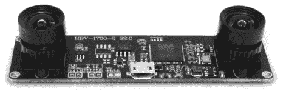

图 2.9　双目摄像头

#### （3）三目摄像头
相较单目，三目摄像头额外增加一个长焦摄像头负责远距离探测和一个鱼眼摄像头提升近距离覆盖范围，视野更广。图 2.10 为特斯拉配备的三目方案，不同焦距对应不同感知范围，分别为前视窄视野摄像头最远感知约250m、前视主视野摄像头最远约150m、前视宽视野摄像头最远约60m。

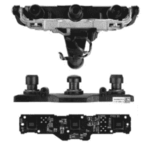

图 2.10　三目摄像头

#### （4）环视摄像头
环视摄像头如图 2.11 所示，采用鱼眼镜头并朝向地面安装。鱼眼图像畸变较大，早期主要用于辅助，随着传感器融合发展也可用于定位。为扩大视野，环视系统通常至少包含4个摄像头，分别安装于车前、车后、车左、车右，实现360°环境感知。

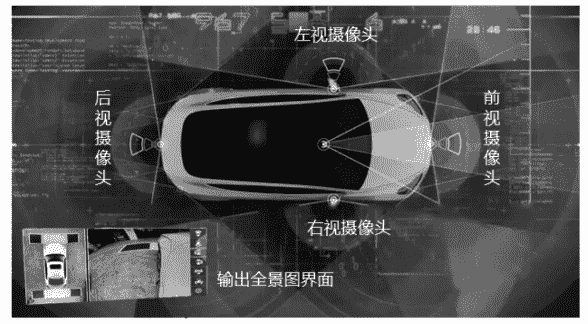

图 2.11　环视摄像头

### 2）视觉传感器的特点

#### （1）视觉传感器的优点
① 像素需求不高。为降低计算负担，摄像头像素无需很高，目前30万~120万像素即可满足要求。
② 防磁抗振。汽车启动时会产生强电磁干扰，车载摄像头需具备极高的防磁抗震可靠性。
③ 成本低廉。摄像头能以较低成本提供形状、尺寸、距离等空间信息及运动动态信息。

#### （2）视觉传感器的缺点
① 感知依赖模型训练。摄像头需强大的感知能力支撑，需大量复杂场景训练，但模型仍有局限，长尾问题难以避免。
② 受光照与天气制约。白天、夜间、室内、黄昏等场景下，黑点、阴影、眩光、反射等会干扰可见光算法的可靠性。扩展光谱可缓解部分问题。远红外相机波长900~1400nm可在黑暗及穿越灰尘烟雾时有效检测行人与动物；近红外750~900nm增强可见光谱，在高动态范围场景下对比度更好，夜间可视性提升。
③ 动态范围不足。高动态范围场景中同一帧同时包含暗区与强光区，如进出隧道。常见视觉传感器的单次动态范围为60~75dB，极端曝光不足或过曝时会丢失信息。

### 3）视觉传感器的结构与工作原理
广义视觉传感器主要由光源、镜头、图像传感器、模/数A/D转换器、图像处理器、图像存储器等组成，如图 2.12 所示，主要功能是为机器视觉系统提供原始图像。

车载视觉系统赋予汽车视觉感知能力，利用视觉传感器获取周边图像，通过视觉处理器分析理解并转化为定义符号，使汽车能够识别物体位置与状态。被摄物体经镜头聚焦到视觉传感器上，传感器由多个X-Y排列的像素点构成，每个像素包含光电二极管及相关电路。光电二极管将光线转为电荷，在电路控制下逐点输出，经放大与A/D转换后形成数字视频信号输出，最终经显示屏还原成图像。

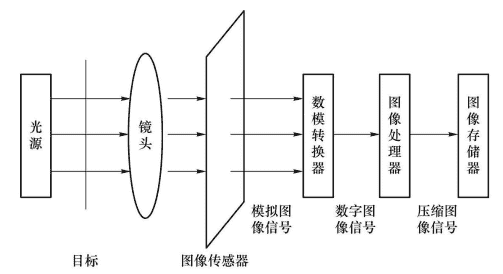

图 2.12　视觉传感器的结构

### 4）视觉传感器的应用
视觉传感器在智能网联汽车上以摄像头形式落地。车载摄像头是众多预警与识别类高级驾驶辅助功能的基础。车道偏离预警、前向碰撞预警、交通标志识别、车道保持辅助、行人碰撞预警、盲区监测、全景泊车、泊车辅助、驾驶员疲劳预警等功能均可借助摄像头实现，部分功能只能由摄像头完成。

### 2.2.5 环境感知传感器性能的比较
超声波雷达、毫米波雷达、激光雷达与视觉传感器是主要的感知单元，选择时需综合性能特点与性价比，它们之间的差异见表 2.1。

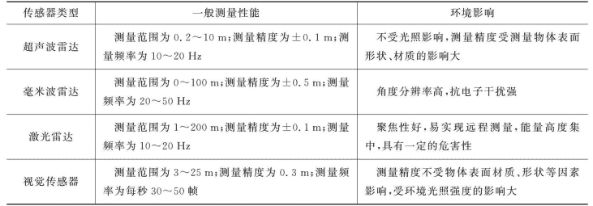

## 2.3 典型的环境感知方法
以基于视觉的环境感知为例，智能网联驾驶的感知流程如图 2.13 所示，一般包括图像采集、图像预处理、图像特征提取、图像模式识别、结果输出等，具体对象与方法不同流程会有细微差异。

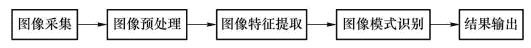

图 2.13　基于视觉的环境感知流程

### 1.图像采集
图像采集主要通过摄像头完成，若为模拟信号需先转为数字信号并按一定格式存储。依据研究对象与应用场景选择性价比合适的摄像头。摄像头包括电荷耦合器件CCD与互补金属氧化物半导体CMOS两种。图 2.14 为某处路侧摄像头采集的图像。

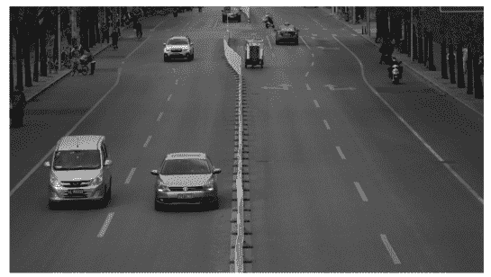

图 2.14　某处路侧摄像头采集的图像

### 2.图像预处理
图像预处理的目的是剔除无关信息、恢复有用真实信息、增强可检测性并最大限度简化数据，从而提升特征提取、分割、匹配与识别的可靠性。常见步骤为图像灰度化、几何变换、图像增强。

#### 1）图像灰度化
视觉传感器采集的原始图像为彩色，由R、G、B三通道构成，直接处理需对每个像素的三个分量分别运算，数据量大。灰度图像是R=G=B的特殊彩色图像，其值即灰度值。灰度图像每个像素仅用一个变量表示，范围0~255，处理量大幅下降，同时仍能完整反映图像的亮度与色彩分布。常用灰度化方法有加权法、最大值法、平均值法等。图 2.15 为灰度化处理后的图像。

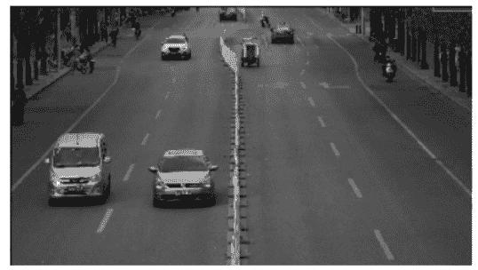

图 2.15　经过灰度化处理后的图像

#### 2）图像几何变换
图像几何变换也称空间变换，通过平移、转置、镜像、旋转、缩放等操作对采集图像进行校正，用以减少采集系统的系统误差与仪器位置随机误差，如成像角度、透视关系、镜头本身误差等。变换过程中常需采用灰度插值算法，因为输出像素可能映射到输入图像的非整数坐标。图 2.16 为经镜像、旋转处理后的图像。

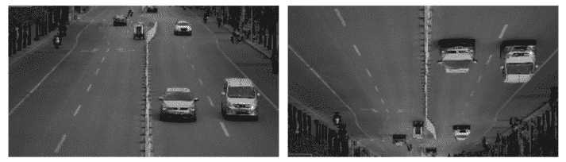

图 2.16　经过镜像、旋转处理后的图像

#### 3）图像增强
图像增强旨在提升图像中有用信息的视觉效果，可视为一种有控制的失真过程。其目的是针对特定应用强调整体或局部特征，让模糊图像变清晰或突出感兴趣目标，扩大不同物体特征差异、抑制无关特征，从而改善图像质量、丰富信息、增强判读与识别效果。图 2.17 为增强处理后的图像。

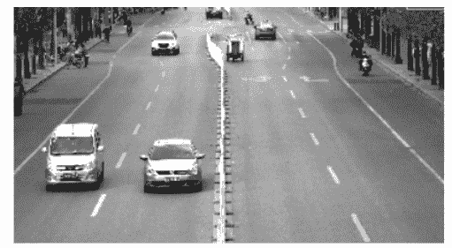

图 2.17　经过图像增强处理后的图像

### 3.图像特征提取

图像特征与感知：从细节到决策

特征可以理解为让同类样本彼此区分的本质属性集合，或是能从原始数据里通过测量、计算得到的可量化信息。放到图像上，每张图都有独属于自己的辨识印记。有的直观可见，比如明暗、边界、纹理肌理和色彩分布；有的则要靠变换或运算才显现，比如矩量统计、直方图描述和主成分表示等。

挑选特征时，完整刻画只是基础，更重要的是拉开类间距离。理想的判别属性在同一类别内部波动很小、聚合紧密，而在不同类别之间差距明显、分离度高，这类最具区分力的属性被称作最具判别能力的特征。目前主流的视觉特征抽取手段包括尺度不变特征变换 `SIFT`、方向梯度直方图 `HOG`、快速方向描述符 `ORB`、哈尔 `HAAR` 模板，以及以深度学习为代表的方法等。

`SIFT` 在多尺度空间中定位极值点，得到对位置、尺度、旋转都不敏感的描述子。实际用途覆盖物体识别、机器人建图导航、图像拼接、三维建模、手势识别、视频跟踪和动作对比等场景。

`HOG` 的核心逻辑是：即使边缘的精确位置不确定，其方向分布仍能有效刻画目标轮廓。实现上通常经历色彩归一化、梯度求取、方向直方图累积、重叠块归一化等步骤，最终形成表征局部梯度方向与强度的分布描述子。

`ORB` 是一种兼顾速度的点检测与描述方案，分检测和描述两阶段。它把 `FAST` 点检测与 `BRIEF` 描述子结合，并在原有基础上做了改进优化。

`HAAR` 特征可分为边缘型、线型、中心型和对角线型，由矩形模板组合而成。模板内有白色与黑色两类矩形，特征值定义为白区像素总和减去黑区像素总和，用以反映灰度变化规律。例如人脸中眼睛区域比颊部更暗，鼻梁两侧比鼻梁本身更暗，嘴唇比周围皮肤更暗等。矩形模板对边缘、线段等简单结构敏感，只能刻画水平、垂直或对角等特定走向。

深度学习做特征抽取依赖深度神经网络 `DNN`。按层级可分为输入层、隐藏层和输出层，第一层为输入，最后为输出，中间为隐藏。输出层之前的所有层都可视作特征提取过程，且越靠后的隐藏层提取的语义越抽象。经过多层变换后得到的高层表征可送入末层完成分类或回归等任务。图 2.18 为在深度神经网络不同层的特征图。

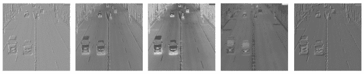

图 2.18　图像在深度神经网络不同层的特征图

### 4.图像模式识别
图像识别的思路很多。从抽取对象看，可分为基于形状、基于色彩、基于纹理三类技术。从选择与决策策略看，可分为统计决策模式识别、句法结构模式识别、模糊模式识别和神经网络模式识别。

#### 1）统计（决策理论）模式识别方法
统计模式识别主要借助贝叶斯决策准则求解最优分类问题。其思路是在不同类别中划定决策边界，用判别函数把待测样本归入相应类别。模型包含训练与分类两步。训练阶段利用已有样本划分边界并通过学习机制保证划分最优；分类阶段依据样本表征与训练得到的判别函数完成归属。

#### 2）句法（结构）模式识别方法
句法模式识别把复杂模式拆解为若干简单子模式，子模式再由基元构成，通过识别基元进而识别子模式，最终完成复杂模式识别，适用于统计方法难以处理的属性维度巨大的场景。用基元及其组合描述结构的语言称为模式描述语言，约束基元组合的规则称为文法。基元识别完成后，通过句法分析判断是否符合特定文法，从而判定类别。

#### 3）模糊模式识别方法
模糊模式识别以模糊数学为基础，模拟人类识别事物的思维逻辑，把计算机中的二值逻辑转向连续逻辑，使系统更简洁实用。成熟的理论包括最大隶属原则、基于模糊等价关系的分类、基于模糊相似关系的分类和模糊聚类，其中模糊聚类应用最广。图像识别的关键在于确定各类别的隶属函数，类别统计指标由样本像元灰度值与隶属度共同决定，隶属度体现样本属于某类的程度。

#### 4）神经网络模式识别方法
神经网络模式识别源于对动物神经系统的研究，通过硬件或软件构建大量处理单元互联的拓扑网络。该网络具备分布式存储、信息并行处理、自组织与自学习等特性，能够模仿人脑结构与功能。

### 5.结果输出
经过上述处理，图像最终输出为识别分类结果图，如图 2.19 所示。以 `YOLOv5` 单阶段目标检测算法实现的探测结果包含类别信息和置信度信息。

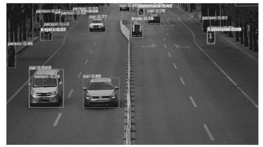

图 2.19　识别分类结果图

## 2.4 智能网联协同环境感知方法
保障自动驾驶安全，核心在于高效准确觉察复杂交通环境。智能网联协同环境感知可分为两大方向：一是融合多种感测数据的融合感知，二是多个交通参与者共享探测信息的联合感知。

### 2.4.1 融合感知的定义和分类
自动驾驶需要多类感测装置协同构成探测系统。不同装置的原理与功能各异，在不同场景各有利弊。若孤立处理各装置数据，会增加处理负担并割断信息间的内在联系，导致环境特征丢失甚至决策失误。

多装置融合优势主要体现在四点。
①提升探测准确度。多种装置互补可避免单一装置的局限，发挥各自优势。
②扩展探测维度，增强可靠性和鲁棒性。融合带来信息冗余，即使某装置失效，系统仍可在一定范围内正常工作。
③增强环境适应能力。融合信息互补性强，空时覆盖更广，弥补了单一装置在空间分辨率和语义不确定性上的不足。
④有效降低成本。用多个廉价装置替代昂贵设备，在保证性能下控制预算。

在智能网联驾驶中，多类装置融合属于多模态信息融合，主要包括三类。

### 1. 激光雷达与视觉传感器融合
如图 2.20 所示，这是经典组合。视觉装置成本低但受光照影响大，可靠性相对不足；激光雷达探测距离远、运动判断精准、可靠性高但价格昂贵。视觉可实现车道线探测、障碍物探测和交通标志识别；激光雷达可实现路沿探测、动态静态物体识别、定位与地图创建。对动态目标，视觉可判断相邻帧是否为同一目标，激光雷达可计算帧间速度与位移。

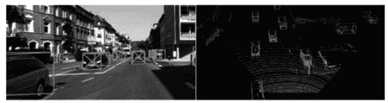

图 2.20　激光雷达和视觉传感器融合

### 2. 激光雷达与毫米波雷达融合
如图 2.21 所示，毫米波雷达已成为 ADAS 核心感测单元，体积小、重量轻、空间分辨率高，且穿透雾烟灰尘能力强，弥补了激光雷达的弱点。但受波长限制，其探测距离有限，难以觉察行人且难以对障碍物进行精细建模，而这正是激光雷达的强项。两者互补还能降低成本，为无人驾驶开发提供新选择。

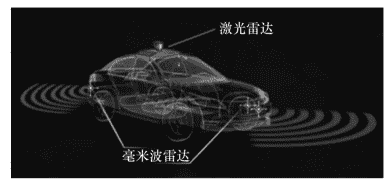

图 2.21　激光雷达和毫米波雷达融合

### 3. 视觉传感器与毫米波雷达融合
如图 2.22 所示，视觉与毫米波雷达协同构成探测系统，可取长补短，使 ADAS 功能更稳定可靠。融合后信息互补，可信度与识别能力均得到提升。

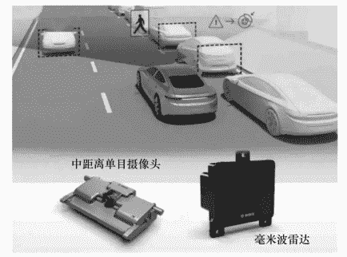

图 2.22　视觉传感器和毫米波雷达融合

### 2.4.2 联合感知的定义和分类
深度学习提升了单车探测在语义分割和目标检测上的性能，但单车视角受限，视野距离有限，易受遮挡且远距离结果稀疏。随着通信基础设施和 V2X 技术发展，研究人员提出联合感知，通过一定范围内智能网联汽车与路侧基础设施共享探测信息，实现多视角环境探测，结果更完整准确。

按共享信息类型与阶段，联合感知分为早期联合、后期联合和中期联合。

### 1. 早期联合
又称数据级联合，在车路之间共享原始探测数据于输入空间，先形成整体视角再处理，如图 2.23 所示。数据信息丰富，联合后精度高，但数据量庞大、实时性差，易造成通信拥塞，难以大规模落地。

### 2. 后期联合
又称决策级联合，在车路之间共享探测结果于输出空间，如图 2.24 所示。数据量小、资源开销低、带宽经济，但丢失细节、可处理性不足，且对车辆定位误差敏感，估计误差较大。

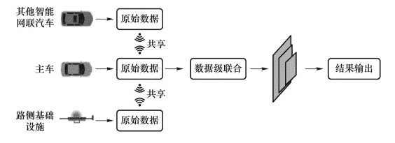

图 2.23　早期联合流程图

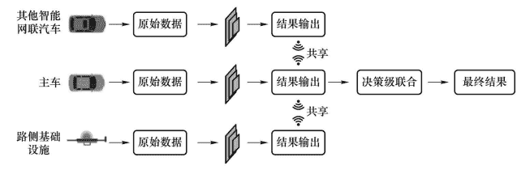

图 2.24　后期联合流程图

### 3. 中期联合
又称特征级联合，在车路之间共享由各自预测模型生成的中间特征于特征空间协同处理，如图 2.25 所示。相比早期联合通信更经济，相比后期联合探测能力更强，兼具两者优点。目前研究尚不充分，主要挑战是如何从原始测量中挑选最有利特征传输，以及如何高效融合来自他方的特征以增强自身探测。

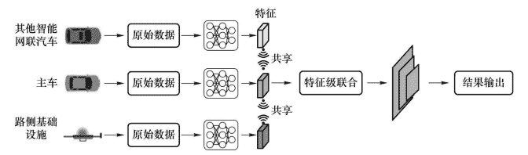

图 2.25　中期联合流程图

### 2.4.3 协同感知的挑战

### 1. 通信
智能网联协同环境感知依赖车路间可靠通信。实际中存在带宽随车辆增多而受限、通信延迟导致信息非实时、丢包或中断、V2X 可能受攻击等问题。尽管技术在进步，多数现有工作仍假设信息可实时无损共享，设计对通信约束鲁棒的系统仍具重要意义。

### 2. 多模态和数据异构
当前研究多聚焦于激光雷达点云，图像和毫米波雷达等数据同样重要，多模态合作更有效。此外，因感测装置型号、安装位置角度不同，车车与车路间信息质量差异导致数据异构，异构多模态协同感知仍是挑战。

### 3. 大规模数据集
单车探测提升离不开大规模数据与深度学习。协同感知领域数据集规模小或不公开，且多基于仿真，缺乏真实大规模开源数据制约了实际应用。

## 2.5 智能网联驾驶路侧感知实验

### 2.5.1 实验目的

智能网联驾驶路侧感知实验

①通过路侧感知实验掌握毫米波雷达、视觉感测装置的探测原理与数据格式。
②通过对交通场景目标的识别，了解探测单元性能。

### 2.5.2 实验原理
路侧毫米波雷达与网联摄像机协同探测可提高识别准确度与精度，并配合 RSU 将探测数据如交通参与者、道路物体等通过路侧安全消息 RSM、路侧信息 RSI 广播至 V2X 网络，为车辆提供路口通行与安全提示。

针对视觉采集的视频或图像，本实验基于 `YOLOv5` 进行识别分类，探测结果包含目标框、目标类别和置信度三项，如图 2.26 所示。

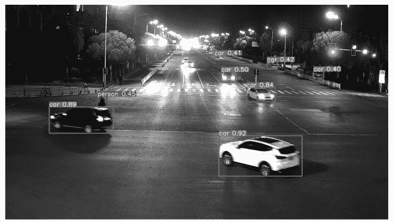

图 2.26　`YOLOv5`感知结果示意图

毫米波雷达数据结构虽因型号略有差异，但整体类似。以本实验设备为例，结构为“RADAR 时间戳 跟踪 ID 目标类型 经度 纬度 Vx Vy 雷达坐标系 x 雷达坐标系 y 航向角”，图 2.27 所示为某一时刻部分数据，以“；”分隔不同目标，第一目标解析为“雷达 radar，时间戳 1610358828.8133698，跟踪 id 9，目标类型 3，经度 117.28576670246768，纬度 31.73349388178001，Vx -9.75，Vy -0.5，x 6.909999847412109，y 1.1799999475479126，航向角 267.0643310546875”。

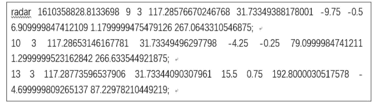

图 2.27　毫米波雷达感知的原始数据

### 2.5.3 实验内容

#### 1）步骤一
如图 2.28 所示，在主菜单点击“路侧感知实验”进入实验，可切换探测装置分别了解视觉感测装置的介绍与示意图如图 2.29 所示、毫米波雷达的介绍与示意图如图 2.30 所示，点击“查看示例”可查看对应装置的示例。

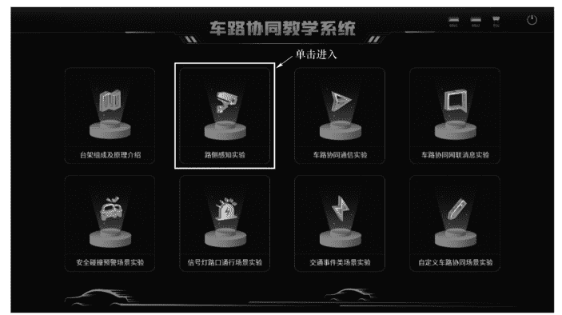

图 2.28　路侧感知实验

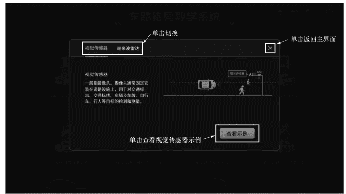

图 2.29　视觉传感器的介绍和示意图

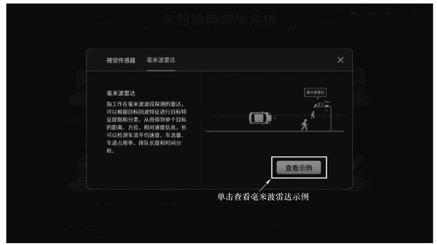

图 2.30　毫米波雷达的介绍和示意图

#### 2）步骤二
选择不同装置查看示例。
（1）视觉传感器
①进入视觉传感器示例后点击“点击进入”查看详细实例，如图 2.31 所示。

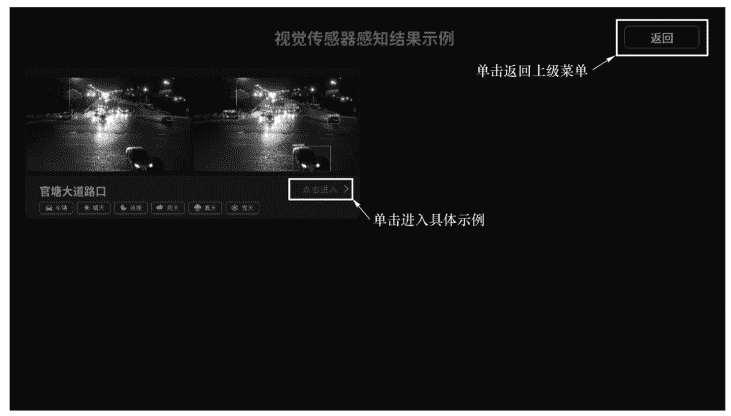

图 2.31　视觉传感器感知结果示例选择

②进入示例详情后可切换不同天气条件，勾选不同探测类型并播放观察，界面左侧为原始素材，右侧为识别结果，识别结果包括目标框、目标分类和置信度，结束时点击右上角“×”返回上级菜单，如图 2.32 所示。

图 2.32　视觉传感器感知结果

（2）毫米波雷达
①进入示例后点击“点击进入”查看详细实例，如图 2.33 所示。

图 2.33　毫米波雷达感知结果示例选择

② 打开案例详情，实验界面呈现为横向的三段式布局。左侧展示毫米波雷达捕捉到的原始回波数据，中间列出解析后得到的感知目标要素，最右侧则以二维图形实时呈现目标的运动变化。完成一次实验后，点击右上角的 × 即可回到上一级菜单，示意图见图 2.34。

图 2.34　毫米波雷达的感知结果

#### 3）步骤三
想要进一步理解，可以在实验选择页切换不同案例继续操作；实验结束后点按右上角的 × 就能回到主界面。

### 思考题
1.智能网联驾驶感知的目的都有哪些？能为自动驾驶提供哪些帮助？
2.智能网联驾驶感知的传感器类型有哪些？不同感知传感器的特点以及各自的优缺点分别有哪些？
3.感知融合有哪些类型？各自的区别及优缺点分别是什么？

# 第 3 章 网联驾驶无线通信技术要点

在当今交通体系里，单辆智能网联汽车已不再是封闭的个体。车与车、车与路侧设施、车与行人、车与云端之间持续交换信息，以保障行车安全并提升通行效率。所谓的“网联”，核心是通过通信实现车内、车车、车路、车云的信息互通。本章聚焦智能网联驾驶的无线通信技术。从发展脉络看，主流经历了基于 IEEE802.11 的专用短程通信 DSRC，以及基于蜂窝网络的车联网通信 C-V2X 两条路线，下面重点展开介绍。

## 3.1 智能网联驾驶无线通信技术概述
车路协同中，最关键的支撑就是无线通信，它决定了车际网络与车载移动互联网能否实现大范围、大容量的实时共享，是国内外研究的热点方向。

### 3.1.1 无线通信技术介绍
若车辆缺乏对外通信能力，本质上仍是一个信息孤岛。当前在智能网联驾驶中得到广泛应用的主要是 DSRC 与 C-V2X 两个体系。中国主推的是 C-V2X 路线，包含 LTE-V2X 即基于 4G 蜂窝的车联网通信，以及 5G-V2X 即 NR-V2X 基于 5G 蜂窝的车联网通信。

#### 1. DSRC 技术
DSRC 体系由车载单元、路侧单元和短程通信协议构成，采用 IEEE802.11p 标准，是一种面向 V2X 的高效短距无线方案，有效覆盖约 3～30 米，主要负责把车辆和道路有机联通，并在车路、车车之间建立双向信息通道，实时传输语音、图像等数字内容。其优点在于传输快、抗干扰能力强、安全性好，已在小范围车辆识别、驾驶员识别、出入管理、ETC 等场景落地，大幅提升出行效率。不足是覆盖距离短，需要大规模路侧改造，投入成本高。

##### 1）演进发展
DSRC 是智能交通系统 ITS 的基石之一。20 世纪 90 年代起开始取得突破。1992 年，美国材料试验学会 ASTM 针对 ETC 提出 DSRC 概念，采用 915MHz 开展标准化。1995 年欧洲标准化委员会 CEN 完成欧洲 DSRC 标准，1997 年日本 TC204 委员会制定日本标准。2003 年 ASTM 通过 E2213-03 作为 DSRC 标准，同年 IEEE 成立 WAVE 工作组接手 ASTM 工作，推动 WAVE 体系。2003 年 12 月马德里 ITS 世界大会上，USDOT 公布在 5.9GHz 分配 75MHz 频谱用于 DSRC 研究，并提出 VII 项目，目标在小范围验证 V2V、V2I。2006 年 12 月 USDOT 与五大车企联合测试 V2V、V2I 在防碰撞系统中的作用，确立以通信为基础的安全设施，包括路边网络与车载设备。只有当道路上足够多的车辆支持 V2V 通信，V2V 的作用才能充分体现。2010 年 WAVE 工作组正式发布 IEEE802.11p 车联网通信标准，成为 DSRC 下的底层协议。2014 年 8 月 NHTSA 与 USDOT 提出 FMVSS No.150 法案，要求新生产的轻型汽车必须支持 V2V 通信；2015 年 6 月 25 日美国众议院就此举行听证，相关方再次为 V2X 辩护。

DSRC 顶层协议栈基于 IEEE1609，V2V 交互使用轻量 WSMP 即 WAVE 短消息协议，而非 WIFI 用的 TCP/IP，TCP/IP 仅用于 V2I、V2N。底层物理层与无线链路控制采用 IEEE802.11p。选用 IEEE802.11 系列初衷是借用 WIFI 生态，但 WIFI 原设计面向固定终端，IEEE802.11p 才针对移动终端。

通用、丰田、雷诺、恩智浦、AutoTalks、Kapsch TrafficCom 等均支持该标准。通用量产凯迪拉克 CTS 已搭载 DSRC 系统，系统由 Aptiv 负责、模块由 AutoTalks 供应、芯片来自恩智浦；丰田自 2016 年起销售搭载 DSRC 的皇冠和普锐斯，系统由电装打造、芯片由瑞萨供货。

# 频谱调整与 DSRC 应用
2020 年 11 月，美国联邦通信委员会 FCC 宣布对 5.850～5.925GHz 频段进行重新划分：低 45MHz 即 5.850～5.895GHz 分配给 Wi-Fi 免授权设备，高 30MHz 即 5.895～5.925GHz 分配给 C-V2X。曾独享 75MHz 频谱 20 年的 DSRC 被逐步边缘化。

## DSRC 支持的业务
在 ETC 系统中，DSRC 具备传输速率约 1Mbit/s、干扰小因使用专用 5.8GHz 频段、安全性好因采用伪随机加密等特点，可灵活把路侧与车辆连接，实现双向实时传输。

依托这些特性，DSRC 在 ITS 多个子系统得到应用，如先进公共运输系统 APTS、商用车辆营运系统 CVOS、先进旅行者信息系统 ATIS、先进交通管理系统 ATMS 等。

目前主要作用包括：电子收费，利用微波或红外读写实现 ETC 车道车辆自动识别与不停车收费，减少等待提升通行能力；道路交通信息服务，利用双向交互把各处交通信息汇聚到中心，经处理后实时推送给驾驶员；车辆监管与防盗，对车主、车型、牌照等信息登记，路口或收费站部署路侧设备后可实时发现被盗车辆；公共交通管理，采用 Device Identifier 编码实现运营车辆定位，把位置数据回传调度中心，依据运营状态优化调度，同时向乘客提供线路、票价、发车时间等信息，向驾驶员提供拥堵、停车空间等实时信息，提升舒适性与通畅性；安全行驶，路侧设备探测前后左右车辆并经中心处理后提供车速、方向等信息给驾驶员，预防事故；特种车辆管理与应急救援，通过属性识别动态管理警车、救护车、消防车等，紧急时采集处理交通与路况信息保障救援车辆快速到达；城市与道路规划，路段部署路侧单元后可不停车对各类车辆进行定点通行记录与交通量统计，为规划提供数据。

## 2. C-V2X 技术
C-V2X 即基于蜂窝网络的 V2X 技术，在 DSRC 之后出现，也支持车辆间直接无线通信，包含 LTE-V2X 与正在演进的 5G-V2X，提供蜂窝通信与直连通信两种工作模式，分别对应 Uu 接口与 PC5 接口。LTE-V2X 主要承载基础交通安全业务，5G-V2X 主要面向自动驾驶类业务。蜂窝通信借助现有 LTE 网络，覆盖广、带宽需求大；两节点间直连即 D2D 模式。整体看，C-V2X 在覆盖范围、容量、抗干扰等方面全面优于 DSRC。

### 1）演进发展
2015 年初 3GPP 启动 C-V2X 需求与标准化研究，需求工作组于 2016 年 3 月完成，架构工作组于 2016 年底完成标准化。

国际标准演进分为 LTE-V2X 与 5G-V2X NR-V2X 两阶段，如图 3.1 所示。

图 3.1　C-V2X 技术标准的演进

LTE-V2X 由 3GPP 的 Rel-14 与 Rel-15 定义。Rel-14 在蜂窝通信引入支持 V2X 短距离直通的 PC5 接口，面向基础道路安全，于 2017 年 3 月完成，标志着基于终端直通 D2D 模式的 V2V 标准化完成，并引入优化的物理层解调参考信号、资源调度、干扰协调等技术。Rel-15 于 2018 年 6 月完成，对直通链路增强，引入多载波操作、高阶调制 64QAM、发送分集与时延缩减等。

5G-V2X 研究基于 5G 新空口的直通通信 PC5 接口与蜂窝通信 Uu 接口增强，面向车辆编队、远程驾驶、传感器扩展等高级 V2X 业务。3GPP 于 2019 年 3 月完成 Rel-16 NR-V2X 研究，2020 年 6 月完成 Rel-16 NR-V2X 标准化，后续 Rel-17 研究弱势道路参与者场景。

目前 5G eMBB Uu 已规模商用，LTE-V2X 已具备商用条件。NR-V2X 关键技术仍在试验，但 LTE-V2X 已能满足有人驾驶辅助安全与中低速自动驾驶需求。高速高级自动驾驶需 NR-V2X 支持，基本标准 2020 年 6 月完成，频谱规划尚未统一。2022 年 6 月 Rel-17 冻结，带来资源分配优化、节电与全新频段支持等直连通信增强特性。

### 2）支持的业务
C-V2X 实现车与车、车与路侧基础设施的实时通信，提供超视距、低时延、高可靠的道路安全感知，从而实现十字路口碰撞预警、紧急刹车预警等应用。

以十字路口为例，美加统计显示近 50% 事故与路口相关。碰撞预警中车辆广播基本安全消息，携带身份、定位、运行状态、轨迹等信息，其他方向来车接收后进行决策。山区高速弯道、上匝道因线型与山体遮挡易失盲区，路侧感知设备可探测交通参与者与路面异常，经 RSU 广播补充盲区感知，辅助驾驶者规划路径避免事故。

联网改造后的信号灯与电子标志可通过 RSU 把交通管理指示信息告知车辆，实现诱导通行与车速引导。以诱导通行为例，信号机通过 RSU 实时下发灯色状态与配时，供车辆决策是否通过及通行速度，降低闯红灯风险。车辆也可与基础设施互动，信号灯可动态优先路权车辆，如救护、消防、公安及满载公交等。

随着智能网联协同发展，单一单车智能难以支撑自动驾驶，尤其在极端 Corner Case 与成本上。C-V2X 提供通信与连接能力，实现网联化并协同单车控制，支撑信息实时共享、协同感知与协同控制。基于 C-V2X 的车车、车路协同除辅助驾驶功能外，在自动驾驶阶段可产生直接影响。

远程遥控驾驶借助通信与远程监控获取车辆状态与周边环境，实时下发指令控制远在数十米至数百千米外的车辆完成启动、加减速、转向等操作，避免极端事故并实现事故后远程接管。

编队行驶区别于协同自适应巡航，利用 C-V2X 低时延高可靠能力，编队车辆通过直连实时交互，快速接收头车驾驶策略与状态，实现同步加速刹车，保持构型稳定，减少空气阻力降低油耗。

更多智能网联汽车与基础设施互联将衍生出实时交通诱导、事故工程提醒、路段天气播报如高速团雾、出行即服务 MaaS 等服务类应用，有助于商业模式创新与生态可持续，推动汽车与交通行业转型，提供低碳产品、降低事故概率、提升交通效率，支撑碳达峰、碳中和目标。

### 3.1.2 通信技术的指标和测试方法
智能网联驾驶无线通信主要指标包括通信距离、丢包率 Loss Tolerance 或 Packet Loss Rate、通信时延、接收信号强度、信噪比、通信速率等。通信距离指两节点不经中继的最大有效距离，影响可靠性和覆盖。步点测试是常用评估手段，主要步骤如下。

环境准备：选合适测试场地，覆盖不同道路类型与工况，确保无干扰源或其他无线设备干扰。
设备设置：把待测 OBU 安装于测试车辆，RSU 置于路侧合适位置。
方案测试：制定路线、车速、通信模式等参数，通常测试 10m、50m、100m 等不同距离。
数据采集：按方案行驶，记录通信距离、信号强度、通信成功率等关键数据。
数据分析：对采集数据进行统计，评估通信距离稳定性、质量与覆盖，生成报告。

测试时需确保环境贴合实际应用，考虑道路类型、干扰、障碍物影响；保持测试条件一致，如天气、车速、通信模式，便于比较；使用信号强度计、数据采集设备等保证数据准确可靠；多次测试以提高结果可信度并验证稳定性。

通过步点测试可评估 V2X 设备通信距离性能，为部署优化提供依据，也为系统设计改进提供参考，提升车路协同通信可靠性与覆盖范围。

丢包率指丢失数据包数占发送数据组的比例，与数据包长度及发送频率相关。具体测试方法见 3.5 节。

通信时延在工程上通常指应用层之间完成一次数据传递所耗费的时长，实践中多按测量方式划分为单向时延和回环时延，具体操作可参考 3.5 节的说明。

接收信号强度是指测试设备从 OBU、RSU 广播的 V2X 消息中解调得到的电平大小，能间接体现待测设备在其有效覆盖范围内发射能力的强弱。业界常用的测量手段大致有三种。

· 使用专业无线信号强度表。这类仪器可以精确给出功率的 dBm 读数，把表放在 V2X 设备附近即可采集数值。
· 使用可编程测试平台，比如软件无线电 SDR 或专用 V2X 测试仪。先令平台以已知功率发出 V2X 信号，再在被测接收端读取电平，测试过程更可控、更精细。
· 现场实测。在真实环境中架设 V2X 设备，改变测量点的位置与距离采集电平。可选用已部署的路侧 V2X 设备或移动式 V2X 信号源作为发射端，并记录各测点坐标与对应电平。

开展该项测试时，建议选用尽量干净的无线环境以排除外部干扰；测点应覆盖不同距离、不同位置以获得全面样本；重复多次取平均或区间值来平滑环境波动与测量误差；同时把测试位置、发射功率、设备型号等参数一并记录，便于后续归纳对比。

做完接收信号强度评估后，可以判断设备在不同距离和位置下的接收能力，为系统方案设计、部署规划和性能调优提供依据，有助于提升 V2X 通信的可靠性和稳定性，改善车车、车路侧之间的通信质量。

信噪比是评价通信质量的基础指标，直接关系到 V2X 消息能否被正确解析。主流的测试思路有两种。

· 借助专业分析仪器，如信号分析仪或频谱分析仪。把 V2X 设备接入仪器置于接收状态，在测试环境中发射已知功率信号，读取接收电平与噪声水平后求得比值。
· 现场实测。在真实场地安装 V2X 设备，改变位置与距离进行采集。发射功率已知的 V2X 信号，记录接收电平与噪声水平后计算信噪比。

信噪比测试同样要规避无线干扰以保证数据准确；应覆盖多种距离与位置以形成完整画像；多点重复取平均或区间以降低误差；记录测试位置、发射功率、设备型号等信息以便后续分析。

通过信噪比测试可以评估设备在不同场景下的信号质量与抗噪水平，为系统设计与优化提供参考，确保 V2X 通信的可靠稳定，提升车际和车路通信质量。

通信速率描述的是设备间单位时间内可完成的数据传输能力，常用 Mbit/s 表示。

常见做法是：

· 基准测试。用专业设备和工具在可控环境下使 V2X 设备正常通信，通过发送不同大小的数据包并计时推算速率，多数工具自带速率测量功能可直接输出。
· 实际场景测试。在真实道路环境部署设备并模拟通信场景，发送不同大小数据包并记录传输时间计算速率，测试时需考虑车辆移动对结果的影响。

速率测试应保证环境无其他无线干扰；建议多次测试取平均速率；测试应兼顾不同数据包大小和不同通信距离；记录数据包大小、传输时间、测试位置等参数以便后续分析。

通过通信速率测试可评估 V2X 设备间的数据传输性能，为系统设计优化提供依据，确保通信的实时性和可靠性，提升车际与车路通信效率。

## 3.2 LTE-V2X 技术

### 3.2.1 LTE-V2X 技术的定义及架构

#### 1. LTE-V2X 技术的定义及标准体系
LTE-V2X 是在 LTE 移动通信技术基础上演进而来的车联网无线通信技术，属于融合 LTE 网络的车路协同解决方案，工作于授权频段。LTE-V2X 包含蜂窝链路 Uu 与直连链路 PC5 两种工作模式[19]。鉴于车联网的跨行业特性，汽车、电子、信息通信、交通运输等行业联合发布了《国家车联网产业标准体系建设指南》，重点部署 LTE-V2X 全协议栈标准和基础设施建设标准，形成覆盖总体要求、接入层、网络层、消息层、应用功能等层面的技术规范，支撑跨行业协同研发与产业化，具体标准见表 3.1。

表 3.1　我国车联网 LTE-V2X 全协议栈标准

#### 2. LTE-V2X 技术的架构说明
LTE-V2X 的网络架构[20-21]如图 3.2 所示，架构接口说明见表 3.2[22]。主要功能实体如下。

图 3.2　`LTE-V2X`的网络架构[20]

V2X 应用服务器：位于蜂窝网之外，统一管理全局 V2X 通信策略与参数，并负责 V2X 终端的签约信息与鉴权信息管理。
归属签约用户服务器 HSS：中央数据库，存储与用户及订阅相关的信息，实现移动性管理、会话建立、用户认证与访问授权。
移动性管理实体 MME：负责移动性管理与控制，完成鉴权、寻呼、位置更新、切换等。
服务网关 SGW：负责上下文会话管理及数据包路由转发，相当于数据中转。
数据网关 PGW：连接外部网络，负责会话管理与承载控制。
V2X 控制功能 VCF：为 UE 配置 PC5/Uu 的 V2X 传输参数。
LTE 无线接入网：负责用户接入，为接入业务提供承载能力。
UE：根据获取的策略与参数配置，在 PC5 或 Uu 接口上进行 V2X 通信。

表 3.2　LTE-V2X 的网络架构接口说明[22]

### 3.2.2 LTE-V2X 的关键技术
陈山枝博士及大唐研究团队于 2013 年 5 月 17 日国际电信日首次提出 LTE-V2X 概念与关键技术，确立了 C-V2X 的系统架构、技术原理与路线。作为蜂窝技术支撑车联网的第一阶段，LTE-V2X 将蜂窝通信与直通通信有机结合，以 LTE 系统为蓝本进行针对性优化与增强，物理层信道结构、资源分配、同步机制等成为满足低时延高可靠车联网需求的基础。

## 1. 通信模式
LTE-V2X 融合蜂窝与直通技术，提供两种通信模式。

### 1）蜂窝网络模式（LTE-V-cell）
又称集中式，需要基站作为控制中心。终端与基站通过 Uu 接口交互，基站完成集中式无线资源调度、拥塞控制与干扰协调，如图 3.3 所示。

该模式使用传统移动宽带授权频段，适用于长距离业务，如大于 1 千米的前方事故信息分发。

图 3.3　蜂窝网络模式

### 2）直通通信模式（LTE-V-direct）
又称分布式，无需基站支撑。车、路、人之间通过 PC5 接口实现近距离直连，用于解决车联网终端间低时延高可靠传输问题，如图 3.4 所示。

该模式使用 ITS 频段如 ITS5.9GHz，可独立于蜂窝网络运行，适用于小于 1 千米的短程业务，如位置、速度消息分发。

图 3.4　直连通信模式

两种模式互补，协同支持车联网多样化需求。Uu 接口基于 4G/5G 频段承载时延不敏感业务如地图下载、信息娱乐；PC5 接口基于 ITS 专用频段承载低时延高可靠业务如 V2V、V2I、V2P 等道路安全业务。

此外，LTE-V2X 通过在 V2X 应用层与接入层间增加适配层，实现通信模式智能选择，支持业务分流、无线传输控制、业务质量管理、连接控制管理等。

## 2. 物理层关键技术
LTE-V2X 物理层面临 V2X 业务低时延高可靠的严苛要求、节点度高业务量大对资源利用率的挑战、车辆高速移动导致的多普勒频移、较高载频带来的频偏对信道估计的冲击，以及半双工限制对可靠性和容量的影响。蜂窝系统中终端与基站一对一通信，而 V2X 系统需支持多对多节点通信，接收功率变化范围可达 80dB，远近效应与邻频泄漏会带来较大干扰[23]。

为兼顾进度与需求，LTE-Uu 口尽量复用 LTE 4G 设计，仅作必要增强；PC5 直通链路则在支持直通的 LTE 4G 技术基础上针对性优化，以满足 PC5 直通需求。

PC5 物理层沿用 LTE 4G 直通技术框架，主要体现在传输波形、时频资源定义、传输信道处理流程等方面。针对 V2X 特点的优化集中在解调参考信号 DMRS 设计、控制信道与数据信道复用方式、自动增益控制 AGC 设计上。

## 3. 资源分配方法
LTE-V2X PC5 系统中分布式节点可能共享资源池内的无线资源，如何合理分配与管理有限资源是重点，以便提升应用性能、降低干扰、提升容量。资源分配需考虑：

业务需求：面向基础道路安全，低时延高可靠是硬性要求。
多对多广播通信：与点对点不同，单点对多点、多点对多点广播受车辆快速移动、拓扑变化、半双工限制、远近效应、邻频泄漏、资源碰撞等影响。
集中与分布式分配：覆盖内需支持集中式分配，覆盖外需支持分布式分配；集中式还需考虑信令开销与时延。
地理位置信息：V2X 终端周期交互状态消息含位置信息，利用位置可减少干扰、提升利用率。
手持终端节电需求：行人、自行车等使用的 P-UE 需考虑节电，与车载终端保持兼容。

基于 PC5 资源分配与基站关系，可分为：

模式 4：UE 自主资源选择，即分布式资源分配。无需基站调度，避免信令开销，UE 与基站松耦合，保证业务在覆盖内外均连续可靠。覆盖内可通过系统信息或 RRC 信令配置收发资源池，覆盖外使用预配置资源池，UE 在池中自主选择时频资源发送。
模式 3：基站资源调度分配，即集中式资源分配。eNB 集中调度可避免冲突，结合 UE 地理位置实现基于位置的分配，eNB 感知范围更广，可缓解隐藏节点问题，提升可靠性和效率，是 LTE-V2X 重要组成部分。

## 4. 同步机制
直通链路以 LTE 上行链路为基础，保留 LTE 同步思路。系统内各 UE 需保持一致的时间频率基准以实现频分复用，资源池配置也依赖统一基准。LTE-V2X 直通链路有四类同步源：GNSS、基站、发送侧链路同步信号 SLSS 的终端、终端内部时钟。蜂窝系统中基站为唯一同步源，而 LTE-V2X 中 UE 或 RSU 配备 GNSS 模块，可直接获得高精度定时频率作为参考，为邻近节点提供同步信息。

通常 GNSS 与基站为最高同步级别，系统按是否直接获取形成优先级层级[20]：

Level1：系统预配置的 GNSS 或基站。
Level2：与 Level1 直接同步的参考终端。
Level3：与 Level2 直接同步的参考终端，即间接同步于 Level1。
Level4：其他参考终端。

## 5. 服务质量管理
PC5 接口的 QoS 机制可为不同业务提供差异化传输，采用 ProSe Per-Packet Priority PPPP 机制，按分组粒度定义发送优先级。UE 将上层 V2X 数据分组优先级映射为接入层发送优先级 PPPP，取值 1~8，1 为最高，8 为最低。

模式 4 下，UE 内部按 PPPP 优先级先高后低排队发送；不同 PPPP 可映射不同分组时延预算 PDB，优先级越高时延预算越小。模式 3 下，发送 UE 将 PPPP 通知基站，基站依据 PPPP 与 UE 聚合最大速率进行内部与 UE 间调度决策。

## 6. 拥塞控制
车联网环境下道路拥堵时，车辆持续广播 V2X 消息易导致空口拥塞。拥塞控制使车辆感知信道拥塞状态并自适应降低发送需求，包括发送频率、资源、功率等；信道空闲时逐步恢复。核心是保证资源占用公平性并优先保障高优先级分组。拥塞控制可提升资源利用率，降低干扰，提高消息接收可靠性。

LTE-V2X 标准未规定具体算法，仅定义框架，包括信道拥塞衡量标准与拥塞状态到发送参数的映射关系。衡量标准为接收 UE 视角、资源池粒度的信道忙比例 CBR。

## 7. LTE-V2X 对 Uu 接口的增强技术
LTE Uu 接口也可承载 V2X 业务，针对 V2X 特点对 Uu 接口进行增强设计以支持 V2X 传输。

车联网技术演进图谱：LTE-V2X 与 5G-V2X 全解析

① 服务质量分级指引。车联网业务对时延、可靠性等指标要求严苛，标准中必须给出明确的质量等级。3GPP 用服务质量分类标识 `QCI` 来刻画该特性，`QCI` 本质上是等级编号，用以说明系统应为某类业务提供的 QoS 属性\[25\]。该标识主要作用于基站对 `Uu` 接口的调度逻辑，并不直接影响 `UE` 终端。

② 上行半持续调度强化。V2X 消息具有强周期性，上行采用半持续调度可明显减少基站信令开销。传统 `UL SPS` 仅提供单一进程，为应对多种周期业务并发，`LTE-V2X` 引入上行多进程 `SPS` 设计，基站最多可配置 8 组参数各异的 `SPS`，且全部配置能够同时被激活。

③ 下行广播范围收敛。`Uu` 接口可承载 V2X 业务，广播模式能提升分发效率。V2X 消息的实际作用半径往往只有数百米，为减小广播域、提高效率，可由 V2X 应用服务器按地理位置信息指定合适目标标识，从而限定广播发送区域。

### 3.2.3 LTE-V2X 与 DSRC 的对比
`LTE-V2X` 基于长期演进空口，将蜂窝与直通通信融合，是由 3GPP 主导的车联网方案，华为、大唐、LG 等厂商参与。`DSRC` 建立在 `IEEE802.11p` 与 `IEEE1609` 系列标准之上，是专用于 V2V、V2I 的通信技术，主要由美国、日本推动。

`LTE-V2X` 为车辆定义两种工作形态：蜂窝形态 `LTE-V-Cell` 与直通形态 `LTE-V-Direct`。`LTE-V-Cell` 借助 `Uu` 接口承载传统车联网远程信息处理类业务，`LTE-V-Direct` 通过 `PC5` 接口实现车、人、路之间的短距离直连，以保证低时延、高可靠，助力安全驾驶。

在 `DSRC` 体系中，路侧单元是核心组件，并经有线光纤接入互联网。汽车可开展安全类业务与远程信息处理，车与车的信息交互依赖路侧单元与车载设备的协同，远程信息处理则经 `IEEE802.11p` 加路侧回传实现。

两者均需要路侧单元，但承载能力存在差异。两种路侧单元都能向车辆推送道路相关信息，如红绿灯、限速等，并在 V2I 模式下下发。

`LTE-V2X` 与 `DSRC` 的性能对比见表 3.3。

## 3.3 5G-V2X 技术

### 3.3.1 5G-V2X 技术的定义与架构

#### 1. 5G-V2X 技术的定义
5G 是 4G 的延续，整合 3G、4G、Wi-Fi 等现有无线接入技术并引入补充接入方案，实质是一个融合型网络，以统一标准实现人与人、人与物、物与物之间的高速、安全、自由连接。除超高速传输外，还需满足超大带宽、超高容量、超高可靠、随时接入等要求。

`5G-V2X` 又称 `NR-V2X`，在传统 `C-V2X` 基础上叠加 5G 网络与移动边缘计算 Mobile Edge Computing，充分发挥 5G 的高带宽、高可靠、低时延特性，并挖掘边缘计算潜力，推动智能网联驾驶。

#### 2. 5G-V2X 技术的架构
`5G-V2X` 网络架构\[20，26\]如图 3.5 所示，接口说明见表 3.4。架构中主要功能实体如下。

图 3.5　`5G-V2X` 的网络架构\[20\]

① V2X 应用服务器：部署在蜂窝网之外，负责全局 V2X 通信的策略参数管理，以及终端签约信息与鉴权信息管理。
② 5G 核心网：与应用服务器相连，为蜂窝覆盖内终端提供通信策略参数配置及签约鉴权管理。5G 核心网采用服务化架构，各网元可独立演进，相关功能如下。
·统一数据存储库 `UDR` 扩展，用作存放全部 V2X 参数配置的数据库，可按应用服务器数据更新。
·策略控制功能 `PCF` 扩展，用于终端鉴权信息管理及 `PC5`、`Uu` 通信策略参数管理，参数更新经 `UDR` 完成。
·网络存储库功能 `NRF` 扩展，依据终端能力上报信息选择并发现对应 `PCF` 配置。
·统一数据管理 `UDM` 扩展，用于终端 `PC5` 接口通信的签约信息管理。
·接入和移动性管理功能 `AMF` 扩展，一方面据 `PCF` 提供的配置为终端下发 `PC5` 口策略参数，另一方面依据 `PCF` 与 `UDM` 信息维护终端 `PC5` 口签约授权上下文。
③ 4G 核心网：与应用服务器相连，通过 `VCF` 为蜂窝覆盖内终端提供策略参数配置及签约鉴权管理。
④ 5G 接入网/4G 接入网：主要负责用户接入与承载，不处理核心业务。
⑤ `UE`：依据获取的策略参数，在 `PC5` 或 `Uu` 接口上进行 V2X 通信。

表 3.4　`5G-V2X` 的网络架构接口说明

当前车路协同 `5G-V2X` 研究重点集中在安全如碰撞预警、辅助停车、逆行检测等、效率如缓解交通拥堵，以及服务信息类，核心是解决自动驾驶问题，支撑车辆编队、高级驾驶、传感器扩展与远程驾驶等应用。

① 车辆编队。依托 `NR-V2X` 的低时延、大带宽特性，支持多车编队行驶，编队车辆可从头车获取信息并共享传感器数据，保持超短车距。
② 高级驾驶。借助低时延大带宽，相邻车辆可共享感知数据与驾驶意图，实现策略协调与同步。
③ 传感器扩展。要求交通参与者扩展感知范围，在 `V2V`、`V2N`、`V2I` 之间实现车载传感器交互，获取更全面的道路信息，弥补单车智能短视距与非视距感知不足。
④ 远程驾驶。针对无法驾驶的乘客或处险境车辆，通过 5G 通信、车路协同、云计算与自动控制，实现远端驾驶员对车辆的远程监控与操控。

### 3.3.2 5G-V2X 的关键技术
为满足自动驾驶等低时延、大带宽需求，`5G-V2X` 在车联网中发挥关键作用。`Uu` 接口依托 5G 蜂窝网络的带宽、低时延与高可靠，支撑车辆、路侧设施、人与云平台的信息快速传递并提供广域覆盖；`NR PC5` 提供车车、车路等近距离直连能力。此外 `5G-V2X` 允许 `Uu` 调度 `PC5` 资源，以在拥塞时保障 `NR PC5` 直连通信的可靠性。`Uu` 与 `NR PC5` 协同，可实现无缝覆盖，满足车路云高速交互。

作为 `C-V2X` 第二阶段，`5G-V2X` 主要通过通信模式管理、服务质量管理及直通链路 `HARQ` 反馈机制、同步机制等满足增强应用需求。

#### 1）5G-V2X 通信模式管理技术
`5G-V2X` 支持直通链路单播、广播、多播。模式管理主要由 V2X 应用层完成，策略配置包含业务标识与广播/多播/单播模式的映射关系，以及业务标识与层二目标标识的映射关系及配置策略。

# 5G-V2X 直通链路与网联通信技术

## V2X 应用层 PC5 链路信息管理
V2X 应用层以层二源标识、层二目标标识和通信模式三个要素管理 `PC5` 链路。层二源标识为 24bit 字符串，表示链路层地址，由设备自行分配；层二目标标识为链路层标识，对应应用业务标识，由运营商分配。该三项信息会同步通知接入层，便于接入层管理 `PC5` 链路。一个终端可拥有多个源标识和多个目标标识，以支持并发的 V2X 连接，适用于不同业务与通信模式。

## 5G-V2X 业务服务质量管理机制
`LTE-V2X` 按直通链路每个数据分组的优先级 `PPPP` 提供逐分组差异化服务。`5G-V2X` 需要更灵活、差异更大的传输服务。在直通链路 QoS 管理中，每个 V2X 应用配置一套默认 QoS 参数，每套参数以 QoS 流标识表征。相同 QoS 流标识的数据分组采用统一的调度策略、队列管理策略及 `SLRB` 配置参数。

用户发起 V2X 应用通信后，按业务与直通链路 QoS 参数的映射关系确定对应的 QoS 流标识，再据此确定调度策略、调度队列与 `SLRB` 参数。接入层据此建立直通链路无线承载。`SDAP` 层管理 QoS 流与无线承载的映射。对给定 `PC5` 链路，可能存在多个无线承载，服务于不同 QoS 流。若现有无线承载可满足新业务 QoS 要求，接入层也可将多个 QoS 流映射到同一无线承载。

`5G-V2X` 新增通信距离参数，表示直通链路 QoS 参数适用的通信范围，即接收 `UE` 位于规定距离内时需满足相应 QoS 要求。该参数仅适用于无连接多播。

## 5G-V2X 直通链路的 HARQ 反馈机制
较 `LTE-V2X`，`5G-V2X` 要求更高可靠性和更低时延，直通链路支持盲重传与基于 `HARQ` 反馈的自适应重传。

### 盲重传方式
终端依据业务需求或配置预先确定重传次数与资源，适用于广播、单播、多播。该方式不依赖 `HARQ` 反馈时延，可降低传输时延。但重传次数固定，接收成功的数据仍会重传造成资源浪费，未成功的数据可靠性受限。

### 基于 HARQ 反馈的自适应重传方式
依据 `ACK/NACK` 反馈决定是否重传，适用于单播与多播。可提供更高可靠，并在接收成功后释放后续重传资源，降低资源占用。但会引入 `HARQ` 反馈时延。`5G-V2X` 对增强业务的可靠性要求在 99.000%～99.999% 之间，支持可变重传次数，标准最终以资源池配置参数形式定义，上限为 32 次。盲重传与自适应重传均需携带层二源标识、层二目标标识、`HARQ` 进程标识、冗余版本指示 `RV` 与新数据指示 `NDI`，以识别数据分组是否属于重传。

## 5G-V2X 直通链路的资源分配方法
`5G-V2X` 面向增强应用，对灵活性、可靠性和时延的要求高于 `LTE-V2X` 的基础道路安全业务。资源分配需兼顾周期性与非周期业务共存及 `HARQ` 重传影响。

考虑部署场景，`5G-V2X` 引入两种类似 `LTE-V2X` 的资源分配模式：模式 1 为基站控制的资源分配，类似 `LTE-V2X` 模式 3，适用于终端位于蜂窝覆盖内，基站调度直通链路传输资源，终端无需感知资源；模式 2 为基于感知的终端自主资源选择，类似 `LTE-V2X` 模式 4，适用于终端位于覆盖外，或位于覆盖内但在预配置或网络配置的模式 2 资源池中自主选择资源。

## 5G-V2X 直通链路的同步机制
`5G-V2X` 与 `LTE-V2X` 均为同步系统，各 `UE` 需保持相同的时频基准。终端依据时间基准确定帧、子帧、时隙定时。与 `LTE-V2X` 一致，`5G-V2X` 在直通链路上引入完整同步机制，支持覆盖内、覆盖外、有/无 GNSS 等场景。通过能可靠获取蜂窝同步或 GNSS 同步的终端在直通链路上发送 `S-SSB` 信号，辅助覆盖外或无法可靠接收 GNSS 的终端实现同步。

## 5G-V2X 直通链路的功率控制技术
功率控制旨在降低干扰。直通链路发送功率需保证正确接收，同时避免对其他链路干扰。需考虑覆盖内外场景，主要包含两种开环机制。

### 基于下行路径损耗的开环功率控制
可用于广播、多播、单播，发送终端必须位于蜂窝覆盖内，上行传输与直通链路共享同一载波。

### 基于直通链路路径损耗的开环功率控制
仅用于直通链路单播，可用于覆盖内外场景。

结合上述两种方式，V2X 终端可配置为三种功率控制模式：仅支持下行路径损耗开环、仅支持直通链路路径损耗开环、同时支持两种开环。第三种模式下，直通链路发送功率取两种计算结果的最小值。

## 5G-V2X 拥塞控制机制
拥塞控制目的在于提升资源池利用率，系统拥塞时合理调整不同优先级业务的发送参数与资源占比，减少拥塞影响，保证高优先级业务可靠发送，并通过调整发送参数与资源占用降低干扰，将拥塞控制在可工作范围内。

`LTE-V2X` 定义了接入层控制的拥塞控制机制，`5G-V2X` 重用其基本原理，更关注非周期业务导致拥塞快速变化的应对。

## 5G-V2X 跨无线接入技术调度机制
演进过程中，部分地区部署 5G，部分仅部署 LTE4G；直通链路也可能同时存在 `LTE-V2X` 与 `5G-V2X`。除 `LTE Uu` 控制 `LTE` 直通链路、`NR Uu` 控制 `NR` 直通链路外，`5G-V2X` 还研究了 `LTE Uu` 控制 `NR` 直通链路，以及 `NR Uu` 控制 `LTE` 直通链路的技术。

## 5G-V2X 与 LTE-V2X 设备内共存
`LTE-V2X` 作为先导支持基础安全业务，`5G-V2X` 支持更高级业务。具备 `5G-V2X` 能力的设备为实现互联互通，需在设备内同时支持 `LTE-V2X` 与 `5G-V2X` 直通链路。

共存依赖两种直通链路的频段与带宽。当部署在频域间隔足够远的两个载波时，各自使用独立射频链路，互不影响，可独立工作。当部署在频域间隔较近的载波时，通常共享同一套射频链路，存在如下约束。
- 半双工约束：用户在一个直通链路载波上发送时，不能在另一直通链路载波上接收。
- 最大发送功率受限：用户同时在两个直通链路上发送时，因共享功率放大器，每个链路均无法以最大功率发送，影响覆盖范围与传输可靠性。

同频段直连共存策略

当5G-V2X与LTE-V2X的直连业务被安排在同一频段使用，例如5.9GHz范围时，为摆脱半双工制约及最大发射功率受限的影响，两类直连采用时分方式共存，业内主要分两种做法。

- 半静态时分复用，也称长期时分复用。LTE-V2X与5G-V2X被配置为时域上互不重叠的资源池。部署简便，两类直连间无需信息交互与协调，但难以按不同业务特性灵活利用频谱资源。
- 动态时分复用，也称短期时分复用。当出现发送/发送或发送/接收冲突时，若能提前获知两类直连传输的业务优先级，则可丢弃优先级较低的传输。该方式要求两类直连之间具备信息交互能力。当出现接收/接收冲突时，通常终端可同时接收同一频带内的两类直连信号，若终端不支持同时接收，则具体处理取决于设备实现，标准中未做明确规定。

## 5G-V2X 与 LTE-V2X 对比概览

不同于LTE-V2X接入层仅支持广播，5G-V2X接入层可支持侧行链路SL的广播、单播和组播传输，可用于基站覆盖内、覆盖外以及部分覆盖场景的V2X通信。某个数据包最终采用单播、组播还是广播，由高层决定。

5G-V2X引入直连链路单播、组播以及相应反馈机制，主要为提升物理层传输可靠性，相较广播也在一定程度上提升资源利用率。相较LTE-V，5G-V2X在传输可靠性、传输速率等方面均有较大提升，具体可见表 3.5。

表 3.5 `5G-V2X`与`LTE-V2X`的对比

从应用场景来看，中国汽车工程学会于 2017 年提出了《合作式智能运输系统车用通信系统应用层及应用数据交互标准》，将安全、效率、信息服务三大类的 17 个典型应用作为一期应用。

另外，如图 3.6 所示，`3GPP`定义了 27 个车路协同应用场景，其可以分为`V2X`的安全性服务和非安全性服务。安全服务类应用场景主要用于减少和避免交通事故的发生以及保护生命和财产的安全；非安全类应用场景作为补充服务，主要用于提高交通效率和环境性能。

图 3.6 `3GPP`定义的典型车路协同应用场景

`LTE-V2X`与`5G-V2X`能满足不同的业务场景需求。`LTE-V2X`位于`5G-V2X`前一个阶段，目前已经能够解决上述定义场景中的大部分基础安全预警和效率提升类应用需求，主要用于辅助驾驶。`5G-V2X`则主要是为了满足未来高等级自动驾驶应用场景的需求，目前主要围绕车辆编队、远程驾驶、高级驾驶、感知共享等场景，`5G-V2X`是`LTE-V2X`技术的增强和补充，两者将在未来长期协同共存，共同支撑车联网不同类型的应用服务。

从基建设施投入角度来看，两者关系与移动通信基建设施投入类似，例如，`4G`网络虽然已普遍应用，但过去的`2G`、`3G`手机仍可使用，其通话、发短信等基础业务并不受影响。对于`C-V2X`技术也一样，其具备`LTE-V2X`和`5G-V2X`多模态通信方式，现在装载了`LTE-V2X`设备的车辆收发的信号，在未来装载了`5G-V2X`设备的车辆上仍可照常接收。

而在基础设施投资问题上，从全国范围来看，`LTE-V2X`基础设施建设主要包括城市区域建设、高速公路建设两大部分。在城市区域方面，`LTE-V2X`基础设施建设投资主要包括交通路口路侧单元、部分特殊路段路侧单元部署；在高速公路方面，`LTE-V2X`基础设施建设投资主要为沿高速公路部署`RSU`，并补充建设部分数据传输线路。由此可以看出，投资主要分为路侧单元设备成本和工程建设费用，而路侧单元设备成本大约占据总投资的 40％，工程建设费用大约占总投资的 60％，待到未来`LTE-V2X`与`5G-V2X`共存时，`LTE-V2X`网络设施可以继续使用，工程建设大部分也可有效复用，仅需新增`5G-V2X`网络设施，因此现有投资不会浪费。

## 网联终端设备类型

车路协同系统由车端、路端、云端等不同要素组成，要保证系统间的正常通信，以及应用场景的落地，就需要有不同的网联终端来做支持，本节则重点对基于`C-V2X`无线通信技术的网联终端进行介绍。

### 车载终端 OBU 解析
车载通信单元（`On Board Unit`，`OBU`）是一种车载终端设备，用于车路协同（`V2X`）通信系统中，使车辆能够与周围的交通基础设施、其他车辆和行人进行实时的双向通信和数据交换。

`OBU`内部集成了`V2X`通信模块、处理器、无线电天线、传感器等关键组件。它能够接收来自`RSU`和其他车辆的信息，并将车辆的状态、位置、行驶意图等数据传输回云平台，以及与其他车辆共享这些信息。同时，`OBU`也能够接收来自云平台和其他车辆的指令和警示信息，并向驾驶员提供相关的提示和警告，这样可以提高驾驶安全性和交通效率。

一般`OBU`需满足以下技术需求。

①运行基于`C-V2X`协议栈的应用，提供高级辅助驾驶、车路协同服务。

②支持多星座高精度卫星定位——支持`BeiDou/GPS/GLONASS`等；支持厘米级高精度定位——支持`RTK`、双频或三频。

③支持`LTE-V2X` `3GPP R14`或更高标准（`LTE-V2X`工作频段为`5905～5925MHz`，工作宽带为`10/20MHz`）。

④内置`HSM`模块，支持国密算法加密、验签、签名。

⑤支持链接车内`CAN`总线。

⑥支持`2G/3G/4G/5G`，以及后续各代移动通信服务，可实现`Uu`通信。

⑦支持`Wi-Fi`，通过`Wi-Fi`实现与车机、移动终端等设备的交互。

⑧具有网口、USB 等数字通信接口。

基于`OBU`的技术特点，一般`OBU`产品的架构如图 3.7 所示。

图 3.7 `OBU`产品的架构

目前`V2X`芯片的解决方案商国内有辰芯、华为，国外有高通、Autotalks。此外`OBU`设备中的高精定位模组也是核心功能之一，`V2X`很多场景需要厘米级的精度实现车道级定位。目前支持`RTK`（`Real Time Kinematic`，实时动态测量）高精定位的导航模组国外主要为`Ublox`，国内也有几家芯片供应商实现了`RTK`高精定位解决方案，如梦芯、华测、和芯等。

### 路侧单元 RSU 解析
路侧通信单元（`Road Side Unit`，`RSU`）是实现智能网联的路侧单元，可通过`LTE-V2X`技术与附近的`OBU`设备通信。`RSU`的主要功能为采集、发布当前道路的状况、交通状况等信息，`RSU`可以通过接收到的周边`OBU`设备信息实时统计、分析周边交通信息，也可以与路侧感知设备、交通信号灯、电子牌等交通信息终端通信，获取更丰富的周边交通信息，还可以通过云接收控制中心推送的信息。`RSU`通过与`OBU`及其他多种交通信息设备的互联互通，实现了交通信号的实时交互、辅助驾驶、引导通行、异常预警等，提高了交通效率和安全保障水平。

一般`RSU`需满足以下技术需求。

①支持`LTE-V2X` `3GPP R14`或更高标准，工作频段为`5905～5925MHz`，工作宽带：`10/20MHz`。

②支持高精度卫星定位——支持`BeiDou/GPS/GLONASS`等；支持无`GNSS`场景下的`V2X`通信。

③内置`HSM`模块，支持国密算法加密、验签、签名。

④支持`2G/3G/4G/5G`，以及后续各代移动通信服务，可实现`Uu`通信。

⑤支持与感知设备、交通信号灯其他交通设备的互联互通。

⑥支持`POE`（`Power On Ethernet`）供电及网口通信。

⑦支持`IP65`或以上防护等级。

⑧具备防雷能力。

基于`RSU`的技术特点，一般`RSU`产品的架构如图 3.8 所示。

图 3.8 `RSU`产品的架构

`RSU`作为车路协同通信系统的重要组成部分，通过与车辆和交通管理中心的通信，实现了车辆和道路基础设施之间的实时信息交换和协同。它在提高交通安全性、减少交通拥堵、优化交通信号等方面发挥着重要作用，并为未来智能交通系统的发展提供了基础。

## 智能网联驾驶无线通信台架实验

### 实验目的

智能网联驾驶无线通信台架实验

通过本实验，理解车路协同中的通信过程，掌握车路协同通信模块的测试方法，并对车联网通信的基本性能有所了解。

### 实验原理
为了达到对驾驶员的辅助预警效果，保障车辆间数据共享的实时性和准确性，需要对设备的通信性能进行测试。测试指标及计算方法如下。

1. 丢包率

丢包率指通信过程中丢失的数据包数量占发送数据包总量的比率，如图 3.9 所示。

图 3.9 通信过程中丢包示意图

假设发射端（车 A）发送了`N`个包，接收端（车 B）收到`M`个包，则对于一收一发链路，`PLR`的计算方法为

2. 端到端时延（`End-to-end Delay`）

端到端时延指一个报文或分组从一个网络的一端传送到另一个端所需要的时间。

`AB`间平均传输时延计算的具体步骤如图 3.10 所示。

设备间平均传输时延的计算公式为

①查询并记录 B 的收包日志中来自 A 的数据包 n 的发送时间`T1`与接收时间`T2`。

②查询并记录 A 的收包日志中来自 B 的数据包 m 的发送时间`T3`与接收时间`T4`。其中，`T3`必须大于`T2`（通常`T3`为大于`T2`的第一个值）。

图 3.10 `AB`间平均传输时延示意

根据公式`t1＝（（T4－T1）－（T3－T2））/2`计算 AB 间的平均传输时延。

注：如果在`T1`到`T4`的时间段内，两个设备的系统时间发生跳变，会影响时延计算的准确性。

实验分为“一发一收”和“两发两收”两部分。“一发一收”场景中，两个`OBU`分别仅作为发送方或接收方，发送方广播`V2X`消息后，接收方接收`V2X`消息，并对相关通信指标数据进行收集、计算，实验流程原理如图 3.11 所示；“两发两收”场景中，两个`OBU`同时作为发送方和接收方，双方广播`V2X`消息并接收对方发送的`V2X`消息，对相关通信指标数据进行收集、计算，实验流程原理如图 3.12 所示。

图 3.11　“一发一收”的数据流程图

图 3.12　“两发两收”的数据流程图

### 3.5.3　实验内容

### 1）步骤一
如图 3.13 所示，在主菜单下单击“车路协同通信实验”进入本次实验，可以看到`C-V2X`车路协同通信实验的相关原理介绍，如图 3.14 所示，包括直连通信原理、`C-V2X`通信网络结构以及通信性能评价，充分了解相关原理后，可以通过单击右上角的“`通信测试`”进入实验选择界面。

图 3.13　车路协同通信实验

图 3.14　`C-V2X`车路协同通信实验原理

### 2）步骤二
选择“一发一收”或“两发两收”进入实验，如图 3.15 所示。

#### （1）“一发一收”实验（如图 3.16 所示）
①在左侧进行参数配置：一是通信参数，包括发包大小、发包频率和发包数目；二是环境参数，包括通信距离和环境参数。
②配置好相关参数后，单击“`测试`”开始实验，并显示实验进度，若发现问题，可单击“`取消`”停止实验。
③实验完成后，右侧显示相关通信性能指标，包括丢包率、通信时延和吞吐率。
④通过配置不同参数进行多次实验，观察、记录、比较实验结果，得出实验结论，实验结束后可以单击界面右上角的“`×`”返回上级菜单。

图 3.15　选择“一发一收”或“两发两收”

图 3.16　“一发一收”实验

#### （2）“两发两收”实验（如图 3.17 所示）
①在左侧进行参数配置：一是通信参数，包括发包大小、发包频率和发包数目；二是环境参数，包括通信距离和环境参数。
②配置好相关参数后，单击“`测试`”开始实验，并显示实验进度，若发现问题，可单击“`取消`”停止实验。
③实验完成后，右侧分别显示两台设备的相关通信性能指标，包括丢包率、通信时延和吞吐率。
④通过配置不同参数进行多次实验，观察、记录、比较实验结果，得出实验结论，实验结束后可以单击界面右上角的“`×`”返回上级菜单。

图 3.17　“两发两收”实验

### 3）步骤三
完成所有实验后可以单击界面右上角的“`×`”或“`返回`”回到主界面，或进行多次实验以加深理解。

思考题
1.智能网联驾驶无线通信技术有哪些？为什么我国采用`C-V2X`技术作为智能网联驾驶无线通信技术？
2.比较`DSRC`和`LTE-V2X`在技术和应用层面的区别。
3.`LTE-V2X`和`5G-V2X`的区别和联系有哪些？两者各自包含哪些关键技术？
4.比较车载通信设备和路侧通信设备的共同之处和不同之处，试着阐述其不同的原因是什么。

# 第 4 章　智能网联驾驶交互消息

智能网联驾驶交互消息

2017 年 9 月，《合作式智能运输系统车用通信系统应用层及应用数据交互标准（第一阶段）》`（T/CSAE53-2017）`\[32\]被发布，首次对于智能网联应用做出了标准定义，包含 17 个典型应用场景、支撑这些场景的应用层交互数据集，以及`API`（Application Programming Interface，应用程序编程接口）、`SPI`（Serial Peripheral Interface，串行外设接口）。该标准的发布在一定程度上打破了底层技术与通信频段的困局限制了车企们对于`V2X`上层应用的探索这一现状，让我国的`V2X`智慧道路和车辆真正拥有了统一而自主的“语言和文字”。

为了增强应用落地的可实现性，《基于`LTE`的车联网无线通信技术消息层技术要求》\[33\]应运而生，该标准中规定了包括消息层数据集的架构以及具体的数据定义和编码方式在内的消息层技术要求，降低了应用落地的准入门槛。

随着标准应用的深入和自动驾驶技术的发展，行业开始关注如何通过信息协同持续提升车辆的在途安全系数和效率以及为高等级的自动驾驶服务，在此基础上《合作式智能运输系统车用通信系统应用层及应用数据交互标准（第二阶段）》`（T/CSAE157-2020）`\[34\]和《基于车路协同的高等级自动驾驶数据交互内容》`（T/CSAE158-2020）`\[35\]两标准的发布对此给予了回应。`T/CSAE157-2020`定义了第二阶段的应用场景，并对应用层交互数据集进行了兼容性的扩展与补充，`T/CSAE158-2020`则规定了基于车路协同的`L4`、`L5`级别下的典型应用和数据交互内容。

至此行业里形成了较为完善的网联消息标准体系，且在实际落地应用中行业各家也都在持续地对网联消息的相关标准进行了完善与补充。

## 4.1　智能网联应用场景
本节根据《合作式智能运输系统车用通信系统应用层及应用数据交互标准（第一阶段）》和《合作式智能运输系统车用通信系统应用层及应用数据交互标准（第二阶段）》对智能网联应用场景分两个阶段进行介绍。

### 4.1.1　第一阶段应用场景
“鉴于我国有独特的交通环境和产业需求，我们需要制定自己的应用层标准”，2016 年年初正是基于这样的业界呼声在中国汽车工程学会的指导下，星云互联、长安汽车、通用汽车和清华大学共同牵头，成立了标准编制组，其涉及汽车、交通和通信三大行业，凝聚了来自车企、高校以及通信、智能交通、测试检验、终端制造等多个领域机构的智慧，该标准编制组于 2017 年 9 月发布《合作式智能运输系统车用通信系统应用层及应用数据交互标准（第一阶段）》且于 2020 年发布其修订版`（T/CSAE53-2020）`。

在《合作式智能运输系统车用通信系统应用层及应用数据交互标准（第一阶段）》中，该标准编制组依据技术的成熟度、应用价值以及可实现性准则选取并定义了 17 个`V2X`典型应用场景（这些场景分属于安全、效率、信息服务三大类），并对支撑这些场景的应用层交互数据集做了说明，如表 4.1 所示，这些场景及消息集的定义为`V2X`应用场景实现和落地提供了指导。

表 4.1　合作式智能运输系统第一阶段应用汇总表

### 4.1.2 车路协同第二阶段场景全景
为让 V2X 技术在安全保障、运营经济性与整体通行效率上发挥更深层次作用，并回应车载通信演进以及车路协同的新诉求，标准编制组发布了《合作式智能运输系统车用通信系统应用层及应用数据交互标准（第二阶段）》。

该文件梳理出 12 个二期应用场景，分别为每类场景给出概述、交互流程与需求分析。在首期消息集之上补充新报文并做兼容性扩展，使一套体系可同时支撑一二期需求，具体汇总见表 4.2。

二期应用整体更偏向车路协同，智能化水平高于首期。通过对车路协同场景的系统化挖掘，预计能够满足未来较长时间内智能网联车路协同的需求。

表 4.2 合作式智能运输系统第二阶段应用汇总表

### 4.1.3 V2X 驱动的 L4/L5 高等级自动驾驶交互规范
《基于车路协同的高等级自动驾驶数据交互内容》出台的背景，是 V2X 与自动驾驶技术日益成熟并加速融合。行业希望依托路侧感知、边缘算力与车路通信，实现 L4、L5 级别的高度自动驾驶，从而增强感知、决策与控制能力，提升通行效率、安全性和环境适应性。

如表 4.3 所示，该标准共定义 8 个标准场景，明确了在车路协同前提下 L4、L5 自动驾驶所需的数据交互内容，核心落在消息层数据集。以 YD/T 3709-2020、T/CSAE53-2020 为基础，对原有消息内容进行扩展或新增报文。

表 4.3 基于车路协同的高等级自动驾驶应用

目前首期场景已基本落地并形成较多工程案例，经多次实地验证，后续研讨多以首期应用为重点。

## 4.2 智能网联底层报文的定义与结构
各阶段智能网联应用能够落地，根本在于对基础报文进行规范化定义与解析，从而满足 V2X 互联需求。

### 4.2.1 数据集的分层与编码方式
消息层数据集采用 ASN.1 抽象语法记法进行形式化描述，遵循 消息帧-消息体-数据帧-数据元素 的层级嵌套方式。编解码遵循非对齐压缩编码规则 UPER。消息帧是对单个应用层报文的统一封装，也是编解码的唯一操作对象。帧由不同类别的体构成并可扩展；体是最基础的五类报文；数据帧由若干数据单元或数据类型组合而成，具有特定实际意义，是体的组成部分；数据元素是体或数据单元的构成部分，由基础数据类型派生，具有物理意义。

整体构成如图 4.1 所示，由 1 个帧、5 个基础体及相应的数据帧和数据元素组成。

图 4.1 消息层数据集的构成

### 4.2.2 五类核心报文解析

#### 1.基本安全消息
##### 1）定义
基本安全消息 BSM 是应用层使用最广泛的报文，用于车辆间交换安全状态数据。车辆通过广播自身实时状态向周边告知自身情况，以支撑各类协同安全业务。相关情境见图 4.2。

图 4.2 BSM 应用典型情境

##### 2）主体结构说明
BSM 作为网联汽车发送与广播的报文，需携带报文序号、车辆标识及发出时刻以实现区分与识别。

同时需承载车辆静态属性。出厂时固定的尺寸与车型信息需包含其中，车型可按车身类别划分，也可按动力能源类型划分。行驶中的动态信息同样重要，可用空间坐标、车速、航向概括，并延伸至控制域，涵盖挡位、转向盘转角、四向加速度、制动系统状态等。

空间坐标由经度、纬度与海拔构成；挡位涵盖空挡、驻车挡、前进挡、倒挡；四向加速度包含前后、左右、上下加速度及横摆角速度；制动状态涵盖踏板动作、车轮制动、牵引力控制、ABS、车身稳定、制动助力及手刹共 7 项。这些信息与车速、航向密切相关，故需纳入基础安全报文。

除必要自车信息外，部分精度信息有助于提升智能性与风险预判，包括发出时刻精度、实时坐标精度、定位精度以及由车速精度、航向精度、转角精度构成的运行状态精度。该类精度决定了智慧交通中基于报文与算法得到的交通参与者实时信息的准确性，对交通组织管理意义重大。

BSM 还包含车辆安全辅助信息集合与紧急车辆辅助信息集合。前者由特殊事件状态、历史轨迹、路径预测、灯光状态等组成；后者用于告知周边本车处于特殊作业状态，如警车、消防车、救护车等，需获得优先或避让，包含特殊行驶状态、警笛与指示灯使用等。

图 4.3 给出 BSM 核心构成，实线为必选，虚线为可选。

图 4.3 BSM 主体结构

##### 3）应用
实际使用中 BSM 更像广播者，持续将自车状态推送给周边以交换安全状态并支撑业务。例如前向碰撞预警、路口碰撞预警、紧急制动预警等，两车互收互解 BSM 中的时间、坐标、车速、航向、车身尺寸等基础信息即可完成预警计算，结合转向灯判断可实现盲区变道预警。

BSM 除基础信息外还含安全辅助信息及紧急车辆附加信息，涉及特殊状态位、灯光信息及紧急车辆状态，灵活应用可实现异常车辆预警、失控预警、紧急车辆提醒等。BSM 支持兼容性扩展，如 T/CSAE158-2020 在 TD/T3709-2020 定义基础上丰富了自动驾驶车辆特有信息，提供更精确的车辆与行驶信息，支撑路侧协同的车道级通行等。

##### 4）BSM ASN.1 参考实现
为便于实现，书中给出 BSM 的 ASN.1 描述。开发中可将 ASN.1 转为其他编程语言，形成结构体或对象供应用调用。

#### 2.地图消息
##### 1）定义
MAP 由路侧单元广播，向车辆推送局部区域地图信息，包括路口、路段、车道信息及道路间连接关系。单个 MAP 可包含若干路口或区域数据。相关情境见图 4.4。

图 4.4 MAP 应用典型情境

##### 2）主体结构说明
与 BSM 类似，MAP 需具备报文序号与发出时刻以区分不同广播。序号配合时间戳可防重放攻击，时间戳通常取自 GPS 后写入。地图中路段、车道、路口均由节点构成，故 MAP 包含地图节点列表，节点是地图最基本单元，可为路口或路段起点终点。

为区分节点，引入节点 ID 与节点名。节点位置是构成地图的关键，为减小数据量，采用以地图中心节点为基准，其他节点用中心坐标叠加偏移量表示。相邻两节点可确定一条有向路段，起点记为上游节点，终点记为下游节点。定义路段时以下游节点为参照，记录其上游路段列表。

路段通常包含路段名与车道信息。映射到报文格式时，上游路段首先包含上游节点 ID 与路段名以确认起点与名称。路段常含多条车道，需定义宽度、限速、允许转向行为、车道属性、上游车道与下游车道的连接关系等。

图 4.5 给出 MAP 核心构成，为层层嵌套形式，实线为必选，虚线为可选。

图 4.5 MAP 主体结构

##### 3）应用
MAP 用于描述道路信息，在智能网联应用中扮演服务者角色，为业务落地与预警触发提供位置基准。例如路侧设施可下发 MAP 给周边车辆，提升环境感知与定位精度，便于规划行驶路线。

MAP 还可与 SPAT 结合为车辆提供前方信号灯实时相位。在闯红灯预警情境中，若前方大车遮挡或恶劣天气影响视线，应用会检测车辆位置与车速，预测车头通过停止线时信号灯状态并预警。该过程用到 MAP 中的路口起止位置与 SPAT 中的相位状态。

##### 4）MAP ASN.1 参考实现
MAP 的 ASN.1 描述如下：

#### 3.路侧信息报文 RSI
##### 1）定义
RSI 即 Road Side Information，指路侧单元向车载单元发布的交通事件信息与交通标志信息。相关情境如图 4.6 所示。

其中交通事件信息当前遵循 GB/T29100-2012；交通标志信息当前遵循 GB5768.2-2009。RSI 可打包若干事件信息或标志信息，同时包含发送路侧单元编号与参考位置坐标。

车载单元依据自身定位与行驶方向，以及报文提供的时效信息与关联区域路段范围，判定事件或标志的生效区域。

图 4.6 RSI 应用典型情境

##### 2）主体结构说明
路侧信息由 RSU 提供，报文包含序号与发出时刻，同时包含 RSU ID 以区分发送方。为便于描述作用范围，提供作用范围内的参考三维坐标，报文内所有位置偏移均基于该参考坐标计算，真实坐标为偏移叠加参考坐标。

道路交通中的事件信息与标志信息由路侧信息承载。交通事件 RTE 可能包含若干，其描述涉及信息源、发生区域、时效、优先级、置信度及影响区域，除事件 ID 外还可用文本进一步定义。区域大小定义为以中心点为圆心的半径范围。

交通标志信息 RTS 同样具备 ID 与文字描述字段，可定义标志的位置、类型、起止时间、置信度、优先级等。

事件信息与标志信息均可通过关联路径及关联路段与 MAP 配合，帮助车载单元判定影响区域。

图 4.7 给出 RSI 核心构成，实线为必选，虚线为可选。

##### 3）应用
RSI 主要用于事件下发，向周边车载单元发布交通事件与交通标志信息。车载单元依据定位、行驶方向及报文提供的区域范围判定生效区域后向驾驶员推送。RSI 传递的是道路相关的预警或提示信息，不用于求救等安全类应用。

结合自车 BSM 与 RSI 中的位置与事件集合可进行道路危险状况提示，使行经车辆及时避让。RSI 中的标志集合结合 BSM 自身信息与 MAP 的路段车道信息，可应用于车内标牌提示。应用据此计算自车在路网中的位置并判断前方是否存在交通标识，若存在则在有效区域与时间段内点亮提示。也可对道路拥堵状况提示，帮助重新规划路线、缓解压力。

##### 4）RSI ASN.1 参考实现
RSI 的 ASN.1 描述如下：

图 4.7 RSI 主体结构

#### 4.路侧安全报文 RSM
##### 1）定义
RSM 即 Road Safety Message。路侧单元通过自身感知识别手段，获取周边交通参与者包括路侧单元本身、车辆、非机动车、行人等的实时状态，并按本消息体格式整理后广播给周边车辆，支撑相关应用。

RSM 使车辆对周边环境的感知不再完全依赖 BSM。路侧传感器帮助车辆探测环境并通过 RSM 传递实时信息。

RSM 应用情境如图 4.8 所示。

图 4.8 RSM 应用典型情境

##### 2）主体结构说明
RSM 包含报文 ID 与发送 RSU ID。位置信息字段提供作用范围内的参考三维坐标，报文内所有偏移均基于该参考坐标计算，真实坐标为偏移叠加参考坐标。

RSU 获取路侧感知单元检测的周边交通参与者信息并组成参与者列表。该部分信息相当于 OBU 广播的自车信息，内容组成与 BSM 类似，只是信息由 RSU 感知获取后发送，部分只能由车辆自身提供的信息如制动状态无法体现在 RSM 中。

当参与者信息来源于 RSU 接收的 BSM 时，车辆 ID 需与 BSM 中一致。当报文包含非机动车、行人等时，可省略机动车部分字段。

图 4.9 给出 RSM 核心构成，实线为必选，虚线为可选。

图 4.9 RSM 主体结构

##### 3）应用
RSM 主要对接路侧感知与边缘计算，用于道路事件识别，如事故、异常、异物闯入等。通过路侧感知识别技术获取周边交通参与者实时状态并整理为本消息体格式。RSM 使车辆感知不再仅依赖 BSM，可获得超视距感知。

在应用情境中，RSM 中的行人感知信息可用于弱势交通参与者碰撞预警，分前车遮挡盲区内行人碰撞与倒车视野盲区行人碰撞，可通过 RSM 提前提醒。

##### 4）RSM ASN.1 参考实现
RSM 的 ASN.1 描述如下：

#### 5.信号灯相位与时序报文 SPAT
##### 1）定义
SPAT 即 Signal Phase Timing Message，包含若干路口信号灯的当前状态信息。结合 MAP 可为车辆提供前方信号灯实时相位信息。相关情境如图 4.10 所示。

图 4.10 SPAT 消息应用情境

##### 2）主体结构说明
SPAT 包含报文 ID、发出时间戳、字符串描述。主体为信号灯状态集合，信号灯设于路口，主要指示颜色及持续时间。因此需定义路口 ID、信号灯相位状态。相位状态即灯色、剩余时间，可能还包括下一个相位状态。

`SPAT`内部还携带着灯态的编码信息，不同数值对应不同的信号状态，同时它会记录报文的生成时刻与归档时刻，必要时还能补充时间可信度字段。

图 4.11 呈现了 `SPAT` 的整体框架，实线框标示为必备内容，虚线框则代表可选内容。

图 4.11　`SPAT`的主体结构

### 3. `SPAT`应用
灯态数据的采集与推送一般由部署在路侧的 `RSU` 承担，它可直接对接信号机或通过采集终端接入，一条 `SPAT` 报文能够承载一个或多个交叉口的灯态。

工程实践里 `SPAT` 常与 `MAP` 联合工作，向车端推送实时相位并给出驾驶指引。典型用途有两类：一是提前预警闯红灯，二是提供绿波车速引导。车辆接近路口前即可收到灯态，结合自身位置与速度播报提醒，帮助平顺通过或规避违章。

### 4. `SPAT`的`ASN.1`代码
下面给出 `SPAT` 的 `ASN.1` 编码定义：

## 4.3 智能网联消息台架实验

智能网联消息

### 4.3.1 实验目的
① 掌握基于 `LTE` 的车联网在消息层面的规范要求，熟悉数据集架构与字段定义。
② 通过演示案例体会 `BSM`、`MAP`、`SPAT`、`RSI`、`RSM` 在不同场景下对智能网联驾驶的支撑作用。

### 4.3.2 实验原理
本实验围绕五类网联消息的格式和典型场景展开，每种消息对应一个演示：`BSM` 用来演示前向碰撞预警、`MAP` 消息用来演示限速预警、`SPAT` 用来演示绿波车速引导、`RSI` 用来演示车内电子告示、`RSM` 用来演示对弱势道路用户的碰撞预警。

### 4.3.3 实验内容

#### 1）步骤一
参考图 4.12，在主界面点击“车路协同网联消息实验”即可启动本次测试。

图 4.12　车路协同网联消息实验

#### 2）步骤二
进入后可以切换查看五类消息的概览与字段构成，分别为 `BSM` 如图 4.13、`MAP` 如图 4.14、`SPAT` 如图 4.15、`RSI` 如图 4.16 以及 `RSM` 如图 4.17，蓝色字段为必选，黄色为可选。

图 4.13　`BSM`介绍和组成字段

图 4.14　`MAP`介绍和组成字段

图 4.15　`SPAT`介绍和组成字段

图 4.16　`RSI`介绍和组成字段

#### 3）步骤三
选择不同网联消息查看场景示例。

##### (1) `BSM`
进入 `BSM` 场景示范，以前向碰撞预警为案例，两车之间互发 `BSM`。如图 4.18，左侧面板实时展示两车的 `BSM` 内容并持续更新，按空格或鼠标左键即可暂停，有助于加深对 `BSM` 含义的理解。

图 4.17　`RSM`介绍和组成字段

图 4.18　`BSM`场景演示图

##### (2) `MAP`
进入 `MAP` 场景示范，以限速预警为案例，`RSU` 向 `OBU` 下发局部地图。如图 4.19，界面左上方实时显示下发的 `MAP` 数据并不断更新，可暂停观察，有助于理解 `MAP` 的内容。

图 4.19　`MAP`场景演示图

##### (3) `SPAT`
进入 `SPAT` 场景示范，以绿波车速引导为案例，`RSU` 广播路口信号灯实时状态。如图 4.20，左侧面板展示广播的 `SPAT` 内容并持续刷新，可暂停，有助于理解 `SPAT` 的内涵。

图 4.20　`SPAT`场景演示图

##### (4) `RSI`
进入 `RSI` 场景示范，以道路施工预警为案例，`RSU` 广播施工相关信息。如图 4.21，左侧上方显示广播的 `RSI` 内容并不断刷新，可暂停观察。

图 4.21　`RSI`场景演示图

##### (5) `RSM`
进入 `RSM` 场景示范，以弱势交通参与者碰撞预警为案例，`RSU` 广播弱势参与者信息。如图 4.22，左侧上方显示 `RSU` 广播的 `RSM` 内容并持续刷新，可暂停，有助于理解其物理意义。

图 4.22　`RSM`场景演示图

#### 4）步骤四
对比各类消息的功能与作用及适用场景，形成实验结论，结束后点“×”返回主界面。

思考题
1. 对比第一阶段应用、第二阶段应用以及高等级自动驾驶应用，分析三者的关联与差异。
2. 说明智能网联基础消息的类型，每类消息的组成及功能。
3. 结合实际智能网联驾驶场景，讨论各类基础消息适用的场景。
4. 借助编程工具把不同消息的 `ASN.1` 描述转换为程序语言。

# 第 5 章 智能网联驾驶碰撞预警应用

智能网联驾驶碰撞预警应用

碰撞类事故在所有交通事故中占比显著，且撞击会造成较大车损，后果往往比较严重，对乘员的伤害也更突出。持续降低此类事故的发生概率并减轻伤害，是交通行业亟待解决的问题。

从事故成因看，碰撞多由驾驶员、车辆、环境三者交互导致。例如驾驶员因接打电话、疲劳或环境干扰分心，或跟车距离过近前车急刹未能及时反应，易引发追尾、剐蹭；视线被车身或障碍物遮挡形成盲区，在变道或复杂路口容易看不到盲区内的车辆或行人而碰撞；雾天、雨天等恶劣条件缩短视距并影响制动，也容易导致碰撞。

因此，对潜在的碰撞风险进行提前预警十分必要，通过提醒驾驶员注意被忽略的风险，避免事故或减轻伤害。

在 `V2X` 场景下，搭载智能车载终端的车辆可相互通信，共享状态与意图，有效降低车车碰撞风险，如追尾、盲区剐蹭、路口相撞，并通过车载 `HMI` 提示驾驶员。

此外，`V2X` 在实际部署中具备传统 `ADAS` 难以比拟的优势。其预测主要依赖高精度全球导航卫星系统 `GNSS` 的采样率与精度以及算法精度，对通信频率与时延要求并不极端，只要与 `GNSS` 采样基本匹配即可，从而降低时间同步压力并减少设备算力消耗。

## 5.1 碰撞预警场景介绍

## 5.2 前向碰撞预警技术

### 5.2.1 前向碰撞预警的定义
前向碰撞预警 `Forward Collision Warning，FCW` 指本车 `HV` 在车道行驶时，与前方同车道远车 `RV` 存在追尾风险时对驾驶员发出提醒。适用于普通道路或高速公路等存在追尾风险的场景，帮助避免或减轻前向碰撞危害，提升行驶安全。

### 5.2.2 前向碰撞预警的主要场景
根据功能定义，当本车与同车道远车的相对距离小于阈值时触发 `FCW`。主要包括四种场景。

场景一：本车 `HV` 正常行驶，远车 `RV` 停在同一车道正前方，如图 5.1 所示。接近碰撞前 `FCW` 会提醒驾驶员正前方存在风险，预警应留出足够反应时间。本过程中 `HV` 与 `RV` 需具备短程无线通信如 `LTE-V2X` 能力。

图 5.1　`HV`行驶，`RV`在同一车道的正前方停止

场景二：本车 `HV` 正常行驶，远车 `RV` 停在相邻车道前方，如图 5.2 所示。此时不会发生碰撞，驾驶员不会收到 `FCW` 提示。本过程中双方需具备短程无线通信能力。

场景三：本车 `HV` 正常行驶，远车 `RV` 在同一车道前方低速或减速行驶，如图 5.3 所示。即将碰撞时 `FCW` 发出提醒，需保证足够反应时间避免追尾。本过程中双方需具备短程无线通信能力。

图 5.2　`H V`行驶，`RV`在相邻车道的前方停止

图 5.3　`H V`行驶，`RV`在同一车道的正前方慢速或减速行驶

场景四：本车 `H V` 跟随 `RV-2` 行驶，`RV-1` 在同一车道上停在 `RV-2` 正前方，本车视线被 `RV-2` 遮挡，如图 5.4 所示。`RV-2` 为避让 `RV-1` 变道时，本车即将与 `RV-1` 碰撞，`FCW` 会发出预警。本过程中 `H V` 与 `RV-1` 需具备短程无线通信能力，`RV-2` 是否具备通信能力不影响场景有效性。

图 5.4　`H V`跟随`RV-2`正常行驶，`RV-1`在同一车道上`RV-2`的正前方停止

### 5.2.3 前向碰撞预警的基本原理与算法实现

## 5.2 前向碰撞预警技术

若本车 `HV` 行驶中与同一车道前方远车 `RV` 存在碰撞危险，`FCW` 即会发出预警。触发时的位置关系如图 5.5 所示，二者同车道且远车在前。

`FCW` 的基本工作流程如下。
① 本车通信单元接收远车发送的 `BSM`，解析后筛选出位于本车前方同车道区域内的远车，并进一步筛选出距离在设定范围内的车辆作为潜在威胁。
② 对每个潜在威胁计算碰撞时间 `Time-to-Collision，TTC` 或防撞距离，筛选出存在碰撞风险的目标。
③ 若存在多个威胁，则挑选最紧急的那个。
④ 系统通过 `HMI` 向驾驶员发出碰撞预警。

图 5.5　触发`FCW`功能的`HV`和`RV`的位置关系

本节 `FCW` 算法的实现思路如下。
① 定义函数 `doFCW`，输入参数为 `hvInfo`、`rvInfo` 与 `fcwTTC`，分别表示本车信息、远车信息及预警时间阈值。
② 先初始化 `warning_flag` 与 `adviser`。`warning_flag` 用来表示预警等级，0 为无需预警，1 为建议减速预警，2 为建议紧急停车预警。`adviser` 用来表示建议类型，`keep` 为维持现状，`slow_down` 为减速行驶，`emergency_stop` 为紧急停车。
③ 从 `hvInfo` 与 `rvInfo` 中提取横纵坐标、行驶速度、航向角、车身尺寸及车辆类型等信息。
④ 判断本车是否处于静止状态，速度小于 0.1 时直接返回 `warning_flag` 与 `adviser`，即无需预警。
⑤ 调用自定义函数 `my_gps2xyz_ver2`、`my_calc_distance`、`determineTCType`，分别计算两车间的纵向、横向、直线距离及相对位置关系。
⑥ 判断远车是否位于本车正前方，若是则进入前向碰撞预警判断流程。
⑦ 计算碰撞时间，若小于 `fcwTTC` 则将 `warning_flag` 设为 1 并将 `adviser` 设为 `slow_down`，随后计算去除车辆长度后剩余的有效距离 `d`，若 `d` 小于 10 则将 `warning_flag` 设为 2 并将 `adviser` 设为 `emergency_stop`。
⑧ 最终返回 `warning_flag` 与 `adviser` 作为输出。

以下为基于 Python 的 `FCW` 算法示例，供学习参考。

前向碰撞预警算法代码

## 5.3 交叉路口碰撞预警技术

### 5.3.1 交叉路口碰撞预警的定义
交叉路口碰撞预警 `Intersection Collision Warning，ICW` 指本车 `HV` 驶向交叉口时，与侧向行驶的远车 `RV` 存在碰撞风险时对驾驶员发出提醒。适用于城市及郊区道路、公路交叉口、环道入口、高速入口等场景。`ICW` 帮助驾驶员避免或减轻侧向碰撞危害，提升路口通行安全。

### 5.3.2 交叉路口碰撞预警的主要场景
`ICW` 主要包括以下场景。
场景一：本车 `HV` 在路口停车，远车 `RV-1` 从左侧或右侧驶向路口，本车视线可能被路口出现的 `RV-2` 遮挡，如图 5.6 所示。启动准备进入路口时，`ICW` 对驾驶员发出预警，提示与侧向来车 `RV-1` 存在碰撞风险。预警时机需保证足够反应时间避免碰撞。本过程中 `HV` 与 `RV-1` 需具备短程无线通信能力，`RV-2` 是否具备通信能力不影响场景有效性。

图 5.6　`HV`在路口起步

场景二：本车 `HV` 驶向路口，同时远车 `RV-1` 从左侧或右侧驶向路口，本车视线可能被路口出现的 `RV-2` 遮挡，如图 5.7 所示。接近路口时 `ICW` 对驾驶员发出预警，提示与侧向来车 `RV-1` 存在碰撞风险；预警时机需保证足够反应时间避免碰撞。本过程中 `HV` 与 `RV-1` 需具备短程无线通信能力，`RV-2` 是否具备通信能力不影响场景有效性。

图 5.7　`HV`与`RV`同向驶近路口

### 5.3.3 交叉口碰撞预警机制与实现

当 `HV` 行驶至交叉口附近，若与另一辆同样驶向该口的 `RV` 构成碰撞风险，交叉路口碰撞预警 `ICW` 会向 `HV` 驾驶员发出提示。触发条件下的位置关系见图 5.8，交会角度并不限于 90°，可在一定范围内变化。

图 5.8　`ICW` 触发时 `HV` 与 `RV` 的位置示意

`ICW` 的基本运行逻辑可归纳为：

① `HV` 侧的 `OBU` 解析来自周边 `RV` 的 `BSM`，挑出落在路口左侧交叉区 `Intersecting Left` 或右侧交叉区 `Intersecting Right` 的目标。消息来源既可以是 `RV` 直接广播，也可经路侧单元转发。

② 在此基础上按距离门槛剔除超出范围的车辆，保留潜在威胁。

③ 对每个候选计算抵达路口的预计时间 `TTI` 与剩余路程 `DTI`，筛选出与 `HV` 真正存在碰撞危险的对象。

④ 若多辆同时构成威胁，则挑选最紧急的一辆。

⑤ 通过 `HMI` 向驾驶员推送预警。

本书给出的 `ICW` 实现思路如下：

① 定义函数 `doICW`，入参为 `hvInfo`、`rvInfo` 与阈值 `IcwTTC`，分别表征本车、他车信息及预警时间阈值。

② 初始化状态变量 `warning_flag` 与 `adviser`。`warning_flag` 0 表示无需预警，1 表示建议减速，2 表示建议紧急制停；`adviser` 取值 `keep` 维持现状、`slow_down` 减速、`emergency_stop` 紧急停车。

③ 从两份信息中取出 x、y 坐标、车速、航向角、尺寸与车型。

④ 调用 `my_calc_distance` 求得本车与他车的纵向、横向、直线距离及相对位置，同时评估两者与路口的相对关系。

⑤ 先估算碰撞时刻，若小于 `IcwTTC` 则令 `warning_flag = 1`、`adviser = slow_down`；再算有效间距，若小于 10 则升级为 `warning_flag = 2`、`adviser = emergency_stop`。

⑥ 返回 `warning_flag` 与 `adviser`。

下面以 Python 为例给出参考实现。

交叉路口碰撞预警算法代码

## 5.4 紧急制动预警技术

### 5.4.1 紧急刹车预警定义

紧急刹车预警 `Emergency Brake Warning`，`EBW` 描述的是 `HV` 在行驶过程中与前方 `RV` 保持间距，当前方 `RV` 执行紧急制动时通过短程无线广播该状态。`HV` 接收后若判定与自身相关则向驾驶员示警，主要用于城区、郊区及高速的追尾风险防范。

### 5.4.2 紧急刹车预警典型场景

场景一：`HV` 与紧邻前方的 `RV` 同车道行驶，后者突发急刹，如图 5.9 所示。`EBW` 及时提示前方急刹的追尾风险，预警时机需留出足够的反应距离。双方需具备短程无线通信能力。

图 5.9　同车道 `HV` 紧跟 `RV` 急刹

场景二：`HV` 前方有非紧邻的 `RV-1` 急刹，中间的 `RV-2` 遮挡视线，如图 5.10 所示。依靠 V2X 信息，`EBW` 仍可提醒前方急刹，避免连环追尾。此时 `HV`、`RV-1`、`RV-2` 均需支持 V2X。

图 5.10　同车道 `HV` 前方隔车急刹

### 5.4.3 紧急刹车预警原理与实现

同车道或相邻车道上 `RV` 发生急刹并广播，`HV` 综合行驶方向、间距、位置、速度判断危险性，满足条件即触发预警。触发位置关系见图 5.11。

核心流程：

① `RV` 进入紧急制动后对外广播；`HV` 接收消息后先判断是否携带紧急制动标识。

② 将触发急刹的 `RV` 分为前方同车道与前方相邻车道两类。

③ 结合车速、位置等参数评估关联性，存在碰撞隐患时向驾驶员发出提醒。

图 5.11　`EBW` 触发时 `HV` 与 `RV` 的位置关系

实现思路：

① 定义 `doEBW`，接收 `hvInfo` 与 `rvInfo`。

② 初始化 `warning_flag` 与 `adviser`。`warning_flag` 0 为无预警，2 为需紧急停车；`adviser` `keep` 维持行驶，`emergency_stop` 紧急停车。

③ 提取两车的 x、y 坐标、速度、航向角、尺寸、车型及刹车状态。

④ 通过 `my_calc_distance` 计算纵向、横向、直线距离及相对位置。

⑤ 若纵向距离 >0 即 `RV` 在前方、横向距离 < 道路宽度一半即同/相邻车道、`HV` 速度 >0.1 且无法在碰撞前停下，则置 `warning_flag = 2`、`adviser = emergency_stop`。

⑥ 返回两者。

下面给出 Python 参考代码。

紧急刹车预警算法代码

## 5.5 盲区预警与变道预警技术

### 5.5.1 盲区预警/变道预警定义

盲区预警/变道预警 `Blind Spot Warning/Lane Change Warning`，`BSW/LCW` 包含两类情形：`HV` 相邻车道同向 `RV` 出现在盲区则触发 `BSW`；`HV` 准备变道如打开转向灯时，若相邻车道有同向 `RV` 位于或将进入盲区，则触发 `LCW`。适用于普通道路与高速的侧向碰撞防范。

### 5.5.2 盲区预警/变道预警典型场景

场景一：`HV` 保持车道行驶，相邻车道 `RV` 同向且已进入盲区，如图 5.12 所示。`BSW` 提醒盲区有车；若此时检测到变道意图如转向灯开启，则 `LCW` 发出警告。时机需保证足够反应。

图 5.12　`RV` 位于 `HV` 盲区

场景二：`HV` 车道内行驶，相邻车道 `RV` 正接近盲区，如图 5.13 所示。`BSW` 提示将有车辆进入盲区；若 `HV` 有变道意图，则 `LCW` 报警。

图 5.13　`RV` 即将进入 `HV` 盲区

### 5.5.3 盲区预警/变道预警原理与实现

当 `HV` 存在换道意图时，若相邻车道同向 `RV` 处于或即将进入盲区，`BSW/LCW` 会向驾驶员示警，适用于直道与弯道。

图 5.14　`BSW/LCW` 触发时 `HV` 与 `RV` 的位置关系

工作流程：

① 从接收到的 `RV` 消息中筛选出 `HV` 左后与右后相邻车道的车辆作为候选。

② 判断候选是否已在或即将进入盲区。

③ 若满足，先推送 `BSW` 提醒。

④ 若满足且 `HV` 此时有变道操作，则发出 `LCW` 警报。

⑤ 通过 `HMI` 完成提示。

`BSW` 实现思路：

① 定义 `doBSW`，入参 `hvInfo`、`rvInfo`。

② 初始化 `warning_flag` 与 `adviser`。`warning_flag` 0 无预警，1 需变道预警；`adviser` `keep` 维持现状，`changelane` 变道。

③ 提取 x、y 坐标、速度、航向角、尺寸、车型、刹车状态、灯光状态与 `abs` 状态。

④ 调用 `my_calc_distance` 计算纵向、横向、直线距离及相对位置。

⑤ 若纵向距离绝对值 <15、两车位于相邻车道、且 `HV` 速度减去 `RV` 速度 ≤4，则令 `warning_flag = 1`、`adviser = keep`。

⑥ 返回结果。

下面给出 Python 参考实现，可据此扩展 `LCW`。

盲区预警/变道预警算法代码

## 5.6 碰撞预警应用台架实验

碰撞预警应用台架实验

### 5.6.1 实验目的

① 掌握安全碰撞预警类应用的原理与流程。

② 了解预警算法支持的参数配置。

③ 掌握算法代码实现并进行修改与设计。

### 5.6.2 实验原理

本实验涵盖前向碰撞预警、交叉路口碰撞预警及盲区预警/变道预警，紧急刹车预警与前向碰撞相似此处省略。

### （1）前向碰撞预警

场景说明：主车与远车均通过 `C-V2X` 交互位置与运行状态，自车计算运动轨迹，若存在碰撞可能则弹出预警提示避让前方车辆。

算法原理见图 5.15。

图 5.15　算法原理

数据流程见图 5.16。

图 5.16　前向碰撞预警算法数据流程图

### （2）交叉路口碰撞预警

场景说明：主车与远车均支持 `C-V2X` 交互，两车垂直通过无信号灯路口。`OBU` 计算运动轨迹，若存在碰撞可能则提示避让垂直方向来车。

算法原理同图 5.15，数据流程见图 5.17。

### （3）盲区预警/变道预警

场景说明：主车与远车通过 `C-V2X` 交互位置与状态。`OBU` 计算轨迹，若变道时存在碰撞可能则提示避让相邻车道车辆。

图 5.17　交叉路口碰撞预警算法数据流程图

算法原理同图 5.15，数据流程见图 5.18。

### 5.6.3 实验内容

1）步骤一

如图 5.19 所示，在主菜单点击“安全碰撞预警场景实验”进入。

2）步骤二

进入后可切换场景，分别查看前向碰撞预警、交叉路口碰撞预警、盲区预警的介绍及流程图，如图 5.20、5.21、5.22 所示，点击“场景示例”可查看对应演示。

3）步骤三

选择场景查看示例。

#### （1）前向碰撞预警

① 进入示例后系统按默认参数仿真，界面主体为仿真场景，左侧显示消息，触发预警时弹出提示，如图 5.23 所示。

图 5.18　盲区预警/变道预警算法数据流程图

图 5.19　安全碰撞预警场景实验

图 5.20　前向碰撞预警介绍及流程图

图 5.21　交叉路口碰撞预警介绍及流程图

② 点击“参数配置”弹出编辑窗口，如图 5.24 所示，输入新参数后确认，系统重新仿真并加载界面。

③ 多次配置参数进行对比实验，记录结果得出结论，结束后点右上角“返回”回到上级菜单。

图 5.22 盲区预警介绍及算法流程图

图 5.23 前向碰撞预警场景示意图

#### （2）交叉路口碰撞预警
① 启动交叉路口碰撞预警演示时，系统先以出厂默认参数运行仿真。界面中央为仿真画面，左侧信息栏实时滚动提示，触发预警条件即弹出警告框，详见图 5.25。

图 5.24 前向碰撞预警参数编辑

图 5.25 交叉路口碰撞预警场景示意图
② 点击“参数配置”调出编辑窗口，如图 5.26 所示，修改数值后确认，平台会依据新取值重跑仿真并刷新画面。
③ 更换不同参数做多次对比实验，记录数据并横向比较，从中提炼结论；完成后点右上角返回回到上一级菜单。

图 5.26 交叉路口碰撞预警参数编辑

#### （3）盲区预警
① 进入盲区预警演示后，仿真先以默认设置运行。主视图展示场景，左侧同步显示状态信息，满足预警条件时出现弹窗提示，如图 5.27 所示。

图 5.27 盲区预警场景示意图
② 打开“参数配置”弹出编辑面板，如图 5.28 所示，填入新值并确认，系统按新配置重新计算并更新仿真画面。

图 5.28 盲区预警参数编辑
③ 多次调整参数做对比实验，观察记录结果归纳规律；结束实验点右上角返回回到上级菜单。

### 4）步骤四
实验列表页可反复进入不同案例以加深理解，全部结束后点击“×”即可回到主界面。

## 思考题
1. 梳理碰撞预警类应用的判定逻辑主线。
2. 基于前向碰撞预警的工作机理与实现要点，说明该类场景可用的前提。
3. 除文中已提及的场景外，另举1至2种碰撞预警场景并简述其原理。

# 第 6 章 智能网联信号灯路口实践

智能网联驾驶信号灯路口场景应用

## 6.1 信号灯路口场景介绍
红绿灯的设立本意是管控车流、疏导通行、降低事故。随着城镇化加速，路口数量激增且形态复杂，传统灯控的短板也逐渐显现。实际过路口时，驾驶员易受前车遮挡或主观判断失误影响，出现闯红灯或车速起伏，既增加油耗也易引发拥堵甚至碰撞。

城市中常见“一路红灯”现象，车辆频繁启停影响出行效率并加剧排放。部分灯态缺乏明确指引，绿灯余时不足或黄灯亮起时，走停选择全凭经验。距离较远多选择刹停，距离较近多选择通过。经验不足时，黄灯剩余时间已不足以安全通过，误判就可能导致闯红灯，进而引发事故。

因此，在有信号灯的路口如何减少无效等待、遏制闯红灯、提升整体效率，成为交通参与方关注的重点。

绿波车速引导可为驾驶员提供推荐行驶速度，使车辆能顺畅通过连续路口，减少停车次数。按推荐速度行驶可实现多路口连续放行，提升通行连贯性并缓解拥堵。

闯红灯预警则通过提前推送路口灯态，让驾驶员不受视线受阻或恶劣天气影响而超视距获知路口状态，提前减速或刹停；当检测到存在违反信号灯行驶的风险时及时预警，帮助避免路口碰撞。

## 6.2 绿波车速引导技术
### 6.2.1 绿波车速引导的定义
绿波车速引导 Green Light Optimal Speed Advisory，`GLOSA` 是指，`OBU` 搭载的 `HV` 驶向信号灯路口并接收 `RSU` 发送的道路信息及灯态实时数据时，`GLOSA` 应用会给出建议车速区间，使车辆经济、舒适且无需停车等待地通过路口。该应用适用于城市及郊区普通道路的信号灯路口。

`GLOSA` 可配合辅助驾驶，提升车辆通过交叉口的经济性与舒适性，并提高交通系统效率。

### 6.2.2 绿波车速引导的主要场景
`GLOSA` 的典型场景如图 6.1 所示，具体如下。
① `HV` 由远处接近信号灯控制路口。
② 路侧通信单元发布局部道路数据，并从信号机获取灯态数据及实时状态。
基于上述信息，`GLOSA` 可呈现前方路口实时灯态，结合 `HV` 的定位与行驶状态，计算出建议通过路口的车速区间。

图 6.1 绿波车速引导场景

### 6.2.3 绿波车速引导的基本工作原理与算法实现
`GLOSA` 的基本流程如下。
① `HV` 根据接收的道路数据及自身定位与运行数据，确定在路网中的位置与行驶方向。
② 判断前方路口是否设信号灯，提取对应相位的实时状态，有则直接展示给驾驶员。
③ 依据车辆位置与信号灯相位实时状态，计算本次或下次绿灯期间不停车通过路口所需的最高与最低车速并提示。

本书对 `GLOSA` 算法的实现思路如下。
① 定义函数 `doGLOSA()`，接受三个输入：`hvInfo`、`spatInfo`、`mapInfo`，分别对应主车信息、信号灯信息、地图消息。
② 函数内部先初始化三个变量：`warningFlag`、`adviser`、`max_spd`。`warningFlag` 用于标识预警等级，0 表示无需预警，1 表示一般预警，2 表示紧急预警；`adviser` 用于标识建议类型，`keep` 表示维持现状，`slow_down` 表示减速，`speed_up` 表示加速，`avoid_redlight` 表示注意红灯；`max_spd` 表示主车所需最大速度。
③ 从 `hvInfo` 中读取主车坐标、速度、航向、尺寸及车型并赋值。
④ 从 `mapInfo` 中读取车道限速，从 `spatInfo` 中读取信号灯当前状态、剩余时间及红绿黄灯各阶段时长并赋值。
⑤ 判断主车是否静止，速度小于 0.1 时直接返回预警等级与建议，即无需预警。
⑥ 调用自定义函数 `my_calc_distance()` 分别计算主车与路口的纵向、横向、直线距离。
⑦ 计算当前速度下抵达路口所需时间 `time_2_end`，以及绿灯与黄灯持续时间内可行驶距离 `pass_time_dist`。
⑧ 若车辆尚未通过路口且距离不大于 `pass_time_dist` 且非静止，则将 `warningFlag` 置为 1 并继续判断。
⑨ 若当前为绿灯或黄灯，先判断能否以当前速度通过，能则建议保持；不能则计算期望速度 `expectSpeed`，不超过限速则建议加速并将 `max_spd` 设为该值，若超过限速则建议减速。再判断距离是否小于 10m，满足则将 `warningFlag` 置为 2 并建议注意红灯。
⑩ 若当前为红灯，且红灯剩余时间内以当前速度无法到达路口，则建议保持；否则建议减速，`max_spd` 保持当前速度。再判断距离是否小于 10m，满足则预警等级提升至 2 并建议注意红灯。
⑪ 最终返回 `warningFlag`、`adviser`、`max_spd`。
下面给出基于 Python 的 `GLOSA` 算法示例代码供参考。

绿波车速引导算法代码

## 6.3 闯红灯预警技术
### 6.3.1 闯红灯预警的定义
闯红灯预警 Red Light Violation Warning，`RLVW` 是指，主车 `HV` 通过有信号控制的交叉口时，若存在违反信号灯规定的行驶风险，`RLVW` 应用会对驾驶员进行预警。该应用适用于城市、郊区道路及公路的交叉口、环道出入口、可控车道、高速入口和隧道等灯控路段，闯红灯过程如图 6.2 所示。

`RLVW` 可辅助驾驶员安全通过灯控路口，提升路口通行安全。

图 6.2 闯红灯过程

### 6.3.2 闯红灯预警的主要场景
当前方有大车遮挡视线如图 6.3 所示，或恶劣天气影响视线，或其他原因导致 `HV` 无法准确判断当前或即将到来的红灯时，`RLVW` 会检测车辆位置与速度，预测车头通过停止线时的灯态并向驾驶员发出预警。

图 6.3 被大车遮挡信号灯

### 6.3.3 闯红灯预警的基本原理与算法实现
当 `HV` 驶向灯控交叉路口，遇信号灯将变红或正处于红灯却未能在停止线内停下而继续前行时，`RLVW` 会对驾驶员预警。触发条件的车辆与路口设施位置关系如图 6.4 所示。

图 6.4 触发`RLVW`功能的`HV`与路口设施的位置关系

`RLVW` 的基本工作流程如下。
① 具备短程与远程通信能力的 `RSU` 定期广播路口地理位置与信号灯实时状态。
② `HV` 依据自身 `GNSS` 定位确定受控信号相位，并计算与停止线的距离。
③ 依据当前速度及其他交通参数估算到达路口时间。
④ 将上述信息与接收到的红灯切换时刻及红灯保持时长对比，决定是否预警。
⑤ 当灯为红时，若 `Trest·Vcur＜distend` 则触发预警，其中 `Trest` 为剩余时间，`Vcur` 为当前车速，`distend` 为距停车线的距离。距离很近时进行停车预警。

本书实现 `RLVW` 算法的思路如下。
① 定义函数 `doRLVW()`，接受两个参数：`hvInfo` 与 `spatInfo`，分别代表主车信息与信号灯信息。
② 内部先初始化 `warning_flag` 与 `adviser`。`warning_flag` 为预警等级，0 无需预警，1 一般预警，2 紧急预警；`adviser` 为建议类型，`keep` 表示保持现状，`slow_down` 表示减速，`emergency_stop` 表示紧急停车。
③ 从 `hvInfo` 中提取主车坐标、速度、航向、尺寸及车型并赋值。
④ 判断主车是否静止，速度小于 0.1 时直接返回预警等级与建议。
⑤ 从 `spatInfo` 中读取信号灯当前状态及其剩余时间，以及红绿黄灯持续时间。
⑥ 调用 `my_calc_distance()` 计算主车与路口的纵向、横向、直线距离。
⑦ 计算当前速度下在剩余灯时间内可行驶的距离。
⑧ 若当前为红灯且剩余时间内仍能到达路口，则预警等级设为 1 并建议减速；若红灯时距离路口小于 5m，则预警等级设为 2 并建议紧急停车。
⑨ 最终返回 `warning_flag` 与 `adviser`。
下面给出基于 Python 的 `RLVW` 算法示例代码供参考。

## 闯红灯预警算法代码

## 6.4 信号灯路口场景应用台架实验
### 6.4.1 实验目的

信号灯路口场景应用台架实验
① 了解路口信号灯结合 RSU 的预警应用，熟悉不同灯控场景的关键指标参数。
② 掌握绿波通行引导、闯红灯预警等场景的算法配置方法。
③ 尝试对场景算法进行修改与设计。

### 6.4.2 实验原理
信号灯路口场景分为绿波通信引导与闯红灯预警两类，算法与配置多有共通，且闯红灯预警相对简单，本实验以绿波通行引导为例说明。

场景说明：部署在路口的 RSU 可广播信号灯信息，提示即将进入路口的车辆减速等待红灯，或提供建议车速以便安全通过。
主车支持 C-V2X 通信，可获取路侧设备共享的信号灯信息。接近路口时，车载单元结合自身位置与信号灯变化时间计算合适的驾驶速度区间，辅助驾驶员经济、舒适且无需停车通过路口。该算法流程如图 6.5 所示。

图 6.5 交叉路口绿波通行引导算法的流程图

数据流程如图 6.6 所示。

图 6.6 交叉路口绿波通行引导算法的数据流程图

### 6.4.3 实验内容
1）步骤一
如图 6.7 所示，在主菜单点击“信号灯路口通行场景实验”进入本次实验。

图 6.7 信号灯路口通行场景实验

2）步骤二
进入实验后可切换不同实验场景，分别查看绿波车速引导的介绍及算法流程如图 6.8 所示和闯红灯预警的介绍及算法流程如图 6.9 所示，点击“场景示例”可查看对应场景的演示。

图 6.8 绿波车速引导的介绍及算法流程图

图 6.9 闯红灯预警的介绍及算法流程图

3）步骤三

实操场景一览

（1）绿波车速引导
① 启动绿波车速引导演示后，平台会先以默认设置进行一次仿真。主视图展示模拟路口，左侧信息栏会综合自车所在位置、当前车速和信号灯倒计时，推送能否顺利通过的指引。图 6.10 对应保持现有车速即可通行，图 6.11 对应需要略微提速后才可通过。

图 6.10 绿波车速引导场景示意图——保持车速

图 6.11 绿波车速引导场景示意图——适当加速
② 点击 参数配置 会弹出如图 6.12 的编辑面板，填入新的数值后按下确定，系统将按新设定重算并刷新仿真画面。

图 6.12 绿波车速引导参数编辑
③ 更换不同参数重复试跑，记录并对比结果以提炼结论。实验结束后点按右上角 返回 即可回到上一级菜单。

（2）闯红灯预警
① 进入闯红灯预警示例，同样先以初始参数跑一次仿真。主体为仿真界面，左侧提示区动态更新。当预计抵达路口时信号为红且距离在阈值内，系统会建议先减速，如图 6.13；车辆实际到达路口仍遇红灯时触发闯红灯预警，如图 6.14。

图 6.13 闯红灯预警场景示意图——适当减速

图 6.14 闯红灯预警场景示意图——小心红灯
② 点选 参数配置 弹出编辑窗口，见图 6.15。设置完毕后确认，平台依据新值重新运行仿真并更新画面。

图 6.15 闯红灯预警参数编辑
③ 多次调参实验，观察记录各项结果进行比较总结。完成后点右上角 返回 回到上级菜单。

4）步骤四
可在实验选择界面反复进入不同案例以加深理解，或结束时点击 × 返回主界面。

思考题
1. 归纳信号灯路口类应用在判定时的核心流程。
2. 对比碰撞预警，信号灯路口属于车路协同的典型范式，结合前期基础消息类型，说明该类场景需依赖哪些基础消息。
3. 除本书已列举的信号灯路口场景外，再提出 1-2 种其他场景并简述其原理。
4. 思考信号灯路口场景落地后，对现有交通会带来哪些积极影响。

# 第 7 章 智能网联驾驶交通事件场景应用

智能网联驾驶交通事件场景应用

当下多数车辆仍以单车运行为主，驾驶员的决策主要依赖肉眼可及的交通环境，很难与周边参与者联动，也难以提前获知远端道路态势，因而难以做出最优驾驶选择。

在气象相关安全方面，驾驶员很难感知前方较远的天气、积水或湿滑状况，无法提前识别潜在风险，常在坑洼积水处才急打方向猛刹，易引发碰撞。若前方拥堵未能及时获知，则路线调整滞后，影响出行效率。

在应急管理方面，因难以关注后方路况，遇到特种车辆须优先通行或警方需借道时，往往难以及时避让换道，既耽误特种作业，也易造成拥堵甚至事故。

因此实现车辆超视距、提前感知前方路况至关重要。通过主动下发事件信息，提前引导驾驶员调整行程、提前变道避让或协调通行，能够显著提升驾驶体验与道路通行效率。

在智能网联能力层面，限速提示可告知当前道路限值，减少违章超速；危险路段提前推送与前方拥堵提示帮助驾驶员从容决策；紧急车辆提示可协调周边参与者为特种车辆让行，满足快速通行需求并降低对整体交通的干扰。

## 7.1 交通事件场景介绍

## 7.2 限速预警技术

### 7.2.1 限速预警的定义
限速预警 Speed Limit Warning，SLW 指自车 HV 行驶中超出路段限速时，系统向驾驶员发出预警并提示减速。适用于设有速度限制的普通道路与高速公路，能辅助避免超速，降低隐患与事故。

### 7.2.2 限速预警的主要场景
HV 与 RSU 需支持短程无线通信。行驶过程中 RSU 会定时下发特定路段的限速信息。当 HV 判断自身位于 RSU 指示路段且速度高于限值时，SLW 会向驾驶员发出预警提示减速，如图 7.1 所示。

图 7.1 车速超过限速时进行预警

### 7.2.3 限速预警的基本工作原理与算法实现
SLW 的运行流程如下。
① HV 解析收到的 RSU 消息，提取限速路段信息与具体限值。
② 依据自身定位与行驶方向，将位置映射到目标路段。
③ 若 HV 处于限速路段内，则校验车速是否合规；不合规时触发超速报警，系统通过 HMI 发出限速预警提示减速。

本书对 SLW 算法的实现思路如下。
① 设计 doSLW() 函数，输入为 hvInfo 与 spdLmt。hvInfo 代表自车信息，spdLmt 代表所在道路限速。
② 内部先初始化 warningFlag 与 adviser。warningFlag 用于预警分级，0 表示无需预警，1 表示需减速预警；adviser 用于建议类型，keep 表示维持现状，slow_down 表示减速行驶。
③ 从 hvInfo 中读取自车的 x、y 坐标、速度、航向角、尺寸与车型，赋给对应变量。
④ 判定自车速度是否大于道路限速 spdLmt，若是则把 warningFlag 置为 1，并将 adviser 置为 slow_down。
⑤ 最后返回 warningFlag 与 adviser。

下面给出基于 Python 的 SLW 算法示例代码，供学习参考。

限速预警算法代码

## 7.3 紧急车辆提醒技术

### 7.3.1 紧急车辆提醒的定义
紧急车辆提醒 Emergency Vehicle Warning，EVW 指自车 HV 行驶中接收到紧急车辆提醒，为消防车、救护车、警车或其他呼叫车辆提供让行。EVW 使 HV 实现对紧急车辆的让行。

### 7.3.2 紧急车辆提醒的主要场景
当紧急车辆 RV 靠近 HV 时，提示让行的典型场景如图 7.2 所示，具体如下。
① HV 行驶中，紧急车辆 RV 接近。
② HV 与紧急车辆 RV 均需支持短程无线通信。
③ HV 收到紧急车辆提醒后执行让行。

图 7.2 当紧急车辆 RV 接近 HV 时，提示 HV 让行

### 7.3.3 紧急车辆提醒的基本工作原理与算法实现
EVW 的运行流程如下。
① 解析收到的紧急车辆 RV 消息，筛选出落在 HV 影响范围内的车辆。
② 将一定距离内的紧急车辆作为优先让行对象。
③ 计算优先让行紧急车辆 RV 的到达时间和距离。

本书对 EVW 算法的实现思路如下。
① 设计 doEVW() 函数，输入为 hvInfo 与 rvInfo，分别代表自车与远车信息。
② 内部先初始化 warning_flag 与 adviser。warning_flag 用于预警分级，0 表示无需预警，2 表示需变道预警；adviser 用于建议类型，keep 表示保持现状，lane_change 表示变道。
③ 从 hvInfo 与 rvInfo 中读取自车和远车的 x、y 坐标、速度、航向角、尺寸与车型，以及远车的刹车、灯光与 abs 状态并赋值。
④ 调用自定义函数 my_calc_distance() 计算主远车间的纵向、横向与直线距离及相对位置关系。
⑤ 若远车为紧急车辆且自车速度大于 0.1 且远车距自车后方小于 80m，则令 warning_flag 为 1 并继续判断。
⑥ 若两车同车道且远车位于自车后方 20m 范围内，则令 warning_flag 为 2，并把 adviser 置为 lane_change。
⑦ 最后返回 warning_flag 与 adviser。

下面给出基于 Python 的 EVW 算法示例代码，供学习参考。

紧急车辆提醒算法代码

## 7.4 道路危险状况提示技术

### 7.4.1 道路危险状况提示的定义
道路危险状况提示 Hazardous Location Warning，HLW 指自车 HV 行驶至存在潜在危险如桥下深积水、路面大坑、湿滑路面、前方急弯等路段时，对驾驶员进行预警。适用于城市道路、郊区道路、高速公路等易发危险路段及临时危险路段。

HLW 可及时向周边车辆推送危险信息，便于驾驶员提前处置，提升对危险路况的感知能力，降低进入危险区域的事故风险。

### 7.4.2 道路危险状况提示的主要场景
道路存在危险状况时，附近 RSU 或临时路侧设备对外广播道路危险提示信息，包含位置、危险类型、危险描述等。行经该路段的 HV 依据信息及时避让，避免事故，如图 7.3 所示。

图 7.3 道路危险的主要场景

### 7.4.3 道路危险状况提示的基本工作原理与算法实现
HLW 的运行流程如下。
① 具备短程无线通信的 RSU 周期性广播道路危险提示信息。
② HV 依据自身位置与危险提示信息，计算与危险区域的距离。
③ 依据当前速度估算到达危险区域的时间。
④ 系统通过 HMI 及时向驾驶员发出预警。

本书对 HLW 算法的实现思路如下。
① 设计 doHLW() 函数，输入为 hvInfo 与 rteInfo。hvInfo 为自车信息，rteInfo 为 RSI。
② 内部先初始化 warning_flag。warning_flag 用于预警分级，0 表示无需预警，1 表示需道路危险提示预警。
③ hvInfo 包含自车的 x、y 坐标、速度、航向角、尺寸与车型，rteInfo 包含危险路况或施工范围，分别赋值。
④ 调用 distance() 函数计算自车与危险路段的距离。
⑤ 若距离小于安全阈值，则令 warning_flag 为 1。
⑥ 最后返回 warning_flag。

下面给出基于 Python 的 HLW 算法示例代码，供学习参考。

道路危险状况提示算法代码

## 7.5 前方拥堵提醒技术

### 7.5.1 前方拥堵提醒的定义
前方拥堵提醒 Traffic Jam Warning，TJW 指自车 HV 前方发生拥堵时，RSU 将拥堵路段信息发送给 HV，TJW 对驾驶员进行提醒。适用于城市、郊区普通道路及高速公路拥堵路段预警。

TJW 可提醒驾驶员前方路段拥堵，有助于合理规划行车路线，提升通行效率。

### 7.5.2 前方拥堵提醒的主要场景
TJW 的主要场景为：HV 接近 RSU，RSU 周期性广播局部道路拥堵数据；TJW 应用结合车辆定位与行驶状态，计算车辆在路网中的位置并判断前方是否拥堵，若有则提示驾驶员。

### 7.5.3 前方拥堵提醒的基本工作原理与算法实现
TJW 的运行流程如下。
① HV 根据收到的道路数据及自身定位运行数据，判定在路网中的位置与行驶方向。
② 判断前方道路是否拥堵，若存在则直接提醒驾驶员。

本书对 TJW 算法的实现思路如下。
前方拥堵提醒算法描述
① 设计 doTJW() 函数，输入为 hvInfo 与 rteInfo。hvInfo 为自车信息，rteInfo 为 RSI。
② 内部先初始化 warning_flag。warning_flag 用于预警分级，0 表示无需预警，1 表示前方拥堵提醒。
③ hvInfo 包含自车的 x、y 坐标、速度、航向角、尺寸、车型与所在车道，rteInfo 包含道路拥堵状况与拥堵范围，分别赋值。
④ 调用 distance() 函数计算自车与拥堵路段的距离及相对位置关系。
⑤ 若距离小于设定阈值且自车位于拥堵路段所在车道，则令 warning_flag 为 1。
⑥ 最后返回 warning_flag。

下面给出基于 Python 的 TJW 算法示例代码，供学习参考。

### 前方拥堵提醒算法代码

## 7.6 交通事件场景应用台架实验

### 7.6.1 实验目的

交通事件场景应用台架实验
① 通过对交通事件场景进行实验操作，熟悉不同交通事件场景的关键指标参数。
② 了解交通事件场景的算法配置方法。
③ 掌握交通事件场景算法的代码实现，尝试修改与设计场景算法。

### 7.6.2 实验原理
本实验以道路施工预警、限速预警和紧急车辆预警为例说明交通事件场景应用，前方拥堵提醒与道路施工预警较为相似，此处不再展开。

#### (1) 道路施工预警
场景介绍：自车支持 C-V2X 通信，可获取路侧设备共享的信息。临近施工区域时，自车接收 RSU 广播的道路施工 RSI，获知 RSU 与施工区域位置，判断是否触发道路施工预警。若存在事故风险则向驾驶员预警，自车通过施工区域后预警信息取消。

道路施工预警算法的原理如图 7.4 所示。

图 7.4 道路施工预警算法的原理

道路施工预警的工作机理如上图所示，对应的数据传输路径在图 7.5 中呈现。

图 7.5 道路施工预警算法的数据流程图

#### (2) 限速预警

使用背景：本车具备 C-V2X 车路协同能力，能够接收路侧设备分发的信息。通过 RSU 广播的 MAP 可获取路段几何信息与限速值；当自车定位落在该路段范围内时，系统会将实时车速与限速阈值对比，超限时向驾驶员发出提示，车速回落至限值以内提示自动撤回。

限速预警的工作机理示意图为图 7.6。数据流向参考图 7.7。

图 7.6 限速预警算法的原理

图 7.7 限速预警算法的数据流程图

#### (3) 紧急车辆预警

使用背景：自车与他车均支持 C-V2X 交互，可交换位置与运行状态。若判定他车为应急或特种车辆，系统会检查其是否位于本车同一车道后方且距离小于设定阈值，一旦可能阻碍其通行即弹出让行提示，提醒驾驶员为紧急车辆避让。

紧急车辆预警的工作机理示意图为图 7.8，数据流转见图 7.9。

图 7.8 紧急车辆预警算法的原理

图 7.9 道路施工预警算法的数据流程图·

### 7.6.3 实验内容

1）步骤一

入口位于主菜单，点击“交通事件类场景实验”即可进入本次试验，示意见图 7.10。

图 7.10 交通事件类场景实验

2）步骤二

进入后可切换不同主题浏览。道路施工预警、限速预警、紧急车辆预警各自的说明与流程示意分别对应图 7.11、图 7.12、图 7.13，点击“场景示例”按钮即可打开对应的演示案例。

图 7.11 道路施工预警的介绍及算法流程图

图 7.12 限速预警的介绍及算法流程图

图 7.13 紧急车辆预警的介绍及算法流程图

3）步骤三

按需选择场景查看示例。

(1) 道路施工预警
① 进入示例后，仿真以初始参数自动运行。主视区为仿真画面，左侧滚动消息日志，预警触发时会弹出提示框，参考图 7.14。

图 7.14 道路施工预警场景示意图
② 调出“参数配置”面板，见图 7.15，可修改相关变量，确认后系统按新设置重新运行仿真并刷新画面。

图 7.15 道路施工预警参数编辑
③ 多次调整参数进行对比试验，记录现象并提炼结论。完成后点右上角“返回”回到上一级菜单。

(2) 限速预警
① 进入示例后，仿真以默认参数启动。主视区展示仿真场景，左侧实时显示消息，触发预警时弹出提示，参考图 7.16。

图 7.16 限速预警场景示意图
② 打开“参数配置”编辑窗，见图 7.17，输入新值后确认，系统将依据新参数重跑仿真并更新界面。

图 7.17 限速预警参数编辑
③ 在不同参数组合下反复试验，记录对比结果形成结论；结束后点右上角“返回”返回上一级。

(3) 紧急车辆预警
① 进入示例后，系统以默认参数开始仿真。主视区为仿真画面，左侧显示相关消息，预警触发时弹出警报，见图 7.18。

图 7.18 紧急车辆预警场景示意图
② 呼出“参数配置”面板，见图 7.19，可编辑相关变量，确认后系统按新配置重新仿真并加载画面。

图 7.19 紧急车辆预警参数编辑
③ 调整参数多次试验，观察记录并对比，得出实验结论；结束后点右上角“返回”回到上一级。

4）步骤四

在实验选择页可反复进入不同主题以加深理解，或结束时点击“×”返回主界面。

### 思考题

1.提炼交通事件类应用中的核心判断逻辑。
2.结合前文的基础消息类型，分析交通事件场景运行所依赖的消息类型。
3.在已有场景之外，再举 1~2 个交通事件场景并简述其原理。
4.从工作原理与算法实现角度，比较交通事件场景与碰撞预警、信号灯路口场景的相同与不同。

## 参考文献

\[1\]2022 年我国机动车保有量达 4.17 亿辆\[EB/OL\].http：//www.gov.cn/xinwen/2023-01/11/content\_5736176.htm.

\[2\]陈山枝.蜂窝车联网（C-V2X）及其赋能智能网联汽车发展的辩思与建议\[J\].电信科学，2022，38（7）：17.

\[3\]Levinson J，Askeland J，Becker J，et al.Towards fully autonomous driving:systems and algorithms\[C\]//2011IEEE Intelligent Vehicles Symposium(IV).IEEE，2011:163-168.

\[4\]Nastjuk I，Herrenkind B，Marrone M，et al.What drives the acceptance of autonomous driving?An investigation of acceptance factors from an end-user's perspective\[J\].Technological Forecasting and Social Change，2020，161:120319.

\[5\]杨放春，王尚广，李静林，等.车联网综述（英文）\[J\].中国通信，2014，11（10）：1-15.

\[6\]Kenney J B.Dedicated short-range communications(DSRC)standards in the United States\[J\].Proceedings of the IEEE，2011，99(7):1162-1182.

\[7\]Chen S，Hu J，Shi Y，et al.A vision of C-V2X:technologies，field testing，and challenges with chinese development\[J\].IEEE Internet of Things Journal，2020，7(5):3872-3881.

\[8\]Shadrin S S，Ivanova A A.Analytical review of standard Sae J3016“taxonomy and definitions for terms related to driving automation systems for on-road motor vehicles”with latest updates\[J\].Avtomobil'.Doroga.Infrastruktura.，2019，3(21):10.

\[9\]国家智能网联创新中心.车路云一体化系统白皮书\[R/OL\].https：//www.iotku.com/News/785932613352161280.html.

\[10\]技术分享|无人驾驶的眼睛\[EB/OL\]https：//zhuanlan.zhihu.com/p/586343440.

\[11\]崔胜民.智能网联汽车新技术\[M\].北京：化学工业出版社，2016.

\[12\]Taraba M，Adamec J，Danko M，et al.Utilization of modern sensors in autonomous vehicles\[C\]//2018ELEKTRO.IEEE，2018:1-5.

\[13\]Khan S，Rahmani H，Shah S A A，et al.A guide to convolutional neural networks for computer vision\[J\].Synthesis Lectures on Computer Vision，2018，8(1):1-207.

\[14\]Zou Q，Sun Q，Chen L，et al.A comparative analysis of LiDAR SLAM-based indoor navigation for autonomous vehicles\[J\].IEEE Transactions on Intelligent Transportation Systems，2021.

\[15\]Bishop C M，Nasrabadi N M.Pattern recognition and machine learning\[M\].New York:Springer，2006.

\[16\]Guo Y，Wang H，Hu Q，et al.Deep learning for3d point clouds:a survey\[J\].IEEE Transactions on Pattern Analysis and Machine Intelligence，2020，43(12):4338-4364.

\[17\]Garcia M H C，Molina-Galan A，Boban M，et al.A tutorial on5G NR V2X communications\[J\].IEEE Communications Surveys&Tutorials，2021，23(3):1972-2026.

\[18\]崔胜民.智能网联汽车新技术\[M\].北京：化学工业出版社，2016.

\[19\]Chen S，Hu J，Shi Y，et al.Vehicle-to-everything(V2X)services supported by LTE-based systems and5G\[J\].IEEE Communications Standards Magazine，2017，1(2):70-76.

\[20\]陈山枝，胡金玲，等.蜂窝车联网（C-V2X）\[M\].北京：人民邮电出版社，2021.

\[21\]3GPP S2-153355.New SID on architecture enhancements for LTE support of V2X services\[Z\].2015.

\[22\]3GPP TS23.285，v14.9.0.Architecture enhancements for V2X services\[S\].2015.

\[23\]陈山枝，时岩，胡金玲.蜂窝车联网（C-V2X）综述\[J\].中国科学基金，2020，34（2）：179-185.

\[24\]陈山枝，胡金玲，时岩，等.LTE-V2X 车联网技术、标准与应用\[J\].电信科学，2018，34（4）：7-17.

\[25\]3GPP TS36.321，v14.7.0.E-UTRA;Medium access control(MAC)protocol specification\[S\].2018.

\[26\]3GPP TS23.287，v16.2.0.Architecture enhancements for5G system(5GS)to support vehicle-to-everything(V2X)services\[S\].2020.

\[27\]3GPP R1-1905012.Physical layer procedures for sidelink\[Z\].2019.

\[28\]3GPP TS38.213，v16.1.0.Physical layer procedures for control\[S\].2020.

\[29\]3GPP TS38.215，v16.1.0.Physical layer measurements\[S\].2020.

\[30\]Duan W，Gu J，Wen M，et al.Emerging technologies for5G-IoV networks:applications，trends and opportunities\[J\].IEEE Network，2020，34(5):283-289.

\[31\]中国汽车工程学会.合作式智能运输系统车用通信系统应用层及应用数据交互标准\[S\].2017.

\[32\]中国汽车工程学会.合作式智能运输系统车用通信系统应用层及应用数据交互标准（第一阶段）：T/CSAE53-2020\[S\].2020.

\[33\]中国通信标准化协会.基于 LTE 的车联网无线通信技术消息层技术要求：YD/T 3709-2020\[S\].2020.

\[34\]中国汽车工程学会.合作式智能运输系统车用通信系统应用层及应用数据交互标准（第二阶段）：T/CSAE157-2020\[S\].2020.

\[35\]中国汽车工程学会.基于车路协同的高等级自动驾驶数据交互内容：T/CSAE158-2020\[S\].2020.

## 缩略语

3GPP　第三代合作伙伴计划（The3rd Generation Partnership Project）

ADAS　先进驾驶辅助系统（Advanced Driver Assistance System）

ADS　自动驾驶系统（Automated Driving System）

ALKS　自动车道保持系统（Automated Lane Keeping System）

CCSA　中国通信标准化协会（China Communications Standards Association）

C-ITS　中国智能交通产业联盟（China ITS Industry Alliance）

# 缩略语表

`CSAE` 中国汽车工程学会（中国汽车工程学会）

`C-V2X` 蜂窝车联网通信（蜂窝车联网通信）

`DSRC` 专用短程通信（专用短程通信）

`eMBB` 增强移动宽带（增强型移动宽带）

`eNB` 演进型基站（演进型节点 B）

`FOT` 现场操作测试（现场操作测试）

`ISAD` 自动驾驶的基础设施支持级别（自动驾驶的基础设施支持等级）

`ISO` 国际标准化组织（国际标准化组织）

`ITS` 智能交通系统（智能交通系统）

`ITU-T` 国际电信联盟电信标准部（国际电信联盟电信标准化部门）

`MEC` 边缘计算（移动边缘计算）

`OBU` 车载单元（车载单元）

`RSU` 路侧单元（路侧单元）

`URLLC` 低时延高可靠通信（超可靠低时延通信）

`V2I` 车与路之间的交互（车与基础设施通信）

`V2N` 车与网络之间的交互（车与网络通信）

`V2P` 车与行人的交互（车与行人通信）

`V2V` 车与车之间的交互（车与车通信）

`V2X` 车联万物（车与万物通信）

`VRU` 弱势道路使用者（弱势道路使用者）

`ODD` 运行设计域（运行设计域）

`LNA` 低噪声放大器（低噪声放大器）

`VCO` 压控振荡器（电压控制振荡器）

`BPF` 带通滤波器（带通滤波器）

`LPF` 低通滤波器（低通滤波器）

`FFT` 快速傅里叶变换（快速傅里叶变换）

`SSM` 感知共享消息（传感器共享消息）

`VIR` 车辆意图和请求（车辆意图和请求）

`RSC` 路侧协调消息（路侧协调）

`RTCM` 差分信号格式（海事无线电技术委员会）

`PAM` 停车场地图消息（停车区域地图）

`BSM` 基本安全消息（基本安全消息）

`PSM` 个体安全消息（个人安全消息）

`CLPMM` 编队管理消息（无连接编队管理消息）

`VPM` 车辆支付消息（车辆支付消息）

`CIM` 协同交互消息（协作交互消息）

`RSCV` 路侧控制车辆（路侧控制车辆）

`RAM` 路辆辅助自动驾驶消息（路侧自动驾驶消息）