# 智能财务课：DeepSeek在财务工作中的应用

# **内容提要**

在人工智能浪潮下，财务领域正加速变革，财务人员亟须掌握 DeepSeek 等 AI 工具的使用方法，以提升效率、优化流程，适应未来职业发展的新趋势。

本书是一本全面系统的财务实战指南，采用通俗易懂的语言，系统讲解如何利用 DeepSeek 高效完成财务核算、数据分析和报告生成等日常工作。书中内容不仅涵盖了财务工作的各项核心应用场景，如日常账务处理、票据智能识别、多维度财务建模、动态数据可视化和自动化报告生成等，还特别强调了“无须懂编程”也能操作的理念。通过清晰的步骤拆解和可视化案例演示，本书能够帮助读者快速上手，轻松掌握 AI 工具的应用技巧，从而提升财务工作效率。

本书既适合财务人员和企业管理者阅读，也可作为财税培训机构与财经院校相关专业课程的指导用书。

# **前言**

PREFACE

随着 DeepSeek 等人工智能（AI）技术的迅猛发展，各行各业正经历着前所未有的变革。许多财务人员不禁产生疑问：AI 会取代财务岗位吗？未来的职业道路该如何规划？其实，类似的担忧并非首次出现。当年会计电算化取代手工做账时，财务人员也曾感到焦虑。然而，历史告诉我们，科技的发展虽然会改变生产方式，但真正被淘汰的往往是那些抗拒变革的人。相反，率先拥抱新技术的人，往往能在变革中赢得更强的竞争力。

DeepSeek 等 AI 技术的崛起正在重塑财务行业的工作模式。传统财务工作中约 70%的重复性、流程化任务正逐渐被 AI 接管，这使得行业对财务人才的需求从基础的核算报税转向更高阶的分析、决策和战略支持。DeepSeek 不仅有助于提升工作效率，更重新定义了财务人员的价值，使持续学习与创新能力成为职业发展的关键。正如一位上市公司财务总监所说：“财务人员的数字化转型是必然趋势，而 DeepSeek 等 AI 工具正是实现这一转型的关键。”然而，市场上真正掌握 DeepSeek 等 AI 工具的综合型人才却十分稀缺。这一现象揭示了当前行业的深层矛盾：基层会计岗位竞争激烈，而精通 AI 的高端财务人才却供不应求。

作为一名从一线财务岗位成长起来的从业者，我深知财务工作的痛点。从 2019 年开始，我通过社交平台分享效率工具与财务工作优化方法，并于 2022 年搭建了一个财务审计人交流社群，累计帮助上千名同行完成职业转型与效率提升。其间，许多朋友提出希望我能系统化地分享财务高效办公的方法。AI 技术的爆发彻底降低了高效办公的门槛——如今，普通财务人员无须掌握编程技能，也能借助 AI 轻松完成复杂任务。这一变革，终于使我多年来的构想得以实现：帮助财务工作者在不写代码的情况下显著提升工作效率。于是，这本《智能财务课——DeepSeek 在财务工作中的应用》应运而生。

本书具有以下特点。

・**入门无障碍：**全书采用通俗易懂的语言，系统讲解如何利用 DeepSeek 高效完成财务核算、数据分析、报告生成等日常工作。通过清晰的步骤拆解和可视化案例演示，读者无须编程背景即可快速掌握 AI 工具的应用技巧。无论是财务专业的学生、在职财务人员，还是企业管理者，都能从中获得即学即用的实战指导，显著提升学习与工作效率。

・**覆盖全面：**本书系统性地囊括财务工作的各项核心应用场景，从基础操作到前沿应用构建了完整的智能财务知识体系，确保读者能够系统掌握 DeepSeek 在各业务环节的实践方法。

・**实战为先：**本书致力于成为财务人员手中的实战手册，直击痛点，拒绝空谈。针对财务工作中的高频任务场景，例如，“合同一键登记”“无人值守日报管理系统”等，书中都提供了详细的操作步骤，助力财务人员快速上手，高效完成工作。书中所介绍的操作方法，财务人员既可以照搬应用，也可以举一反三，开发出个性化的解决方案。

由于自身水平有限，书中难免存在疏漏之处，恳请读者批评指正。欢迎关注微信公众号“财会进化论”留言反馈，帮助我们在本书再版时进一步完善。

最后，衷心希望这本书能成为您财务职业发展道路上的指南针，助力您在数字化浪潮中把握先机。这也是我写这本书的初心所在！

高宁宁

2025 年 3 月 10 日于郑州

# **第一章**

# **财务智能化起点：初步接触并使用 DeepSeek**

**本章学习目标**

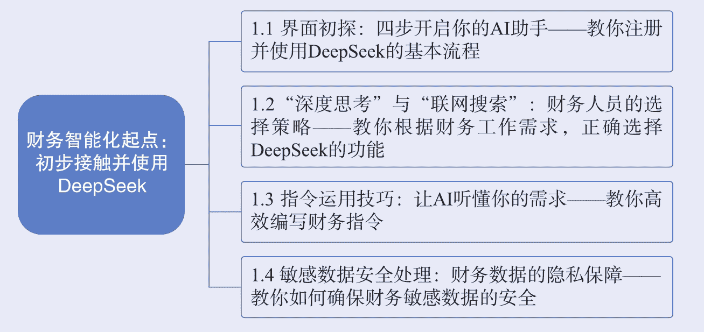

随着数字化浪潮席卷财务领域，人工智能成为推动变革的关键力量。DeepSeek 系统凭借其强大的功能和便捷操作，为财务工作带来了全新突破。本章将开启财务人员的 DeepSeek 探索之旅，带你走进智能财务的新世界，掌握开启高效财务工作的钥匙。

本章主要介绍了财务人员如何初步接触并使用 DeepSeek 系统，结合实例说明首条指令的执行过程和结果。通过本章的学习，财务人员将掌握 DeepSeek 的界面布局和初始操作步骤，确保能够顺利开始使用系统。这也为后续章节的深入学习奠定了一定的基础。

## **1.1 界面初探：四步开启你的 AI 助手**

### **1.1.1 注册与登录**

通过客户端下载 DeepSeek 并完成注册与登录。具体注册与登录流程，按照客户端提示操作即可。

### **1.1.2 主页面布局**

注册登录并单击“开始对话”后，可以看到以下界面：

在此页面，用户向 DeepSeek 询问是免费的，表 1-1 内所有的功能注册后都可以免费使用。主页面的功能可以满足大部分的财务工作场景，本书讲解的内容也主要基于主页面进行操作。所以，财务人员不用担心使用起来门槛过高。

表 1-1 DeepSeek 主页面功能说明与适用场景

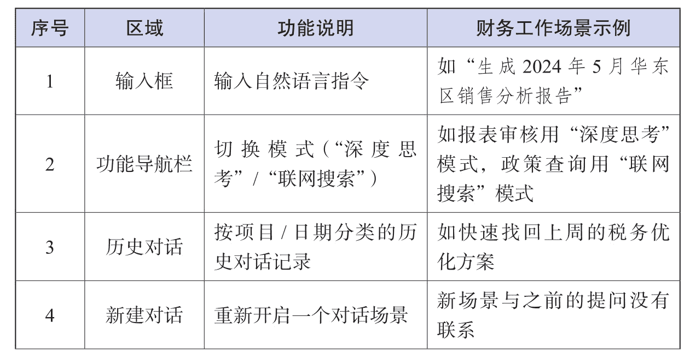

（续表）

### **1.1.3 API 开放平台的启用**

通过 DeepSeek 主页面，用户可以获得免费的对话体验。除此之外，DeepSeek 的大模型是对外开放的，如需更多的功能，可以通过调用 API key 的方式来实现。但使用 API key 是要付费的，财务人员可根据工作需要决定是否使用。

・**如何充值**

登录 DeepSeek 主页面，单击右上方“API 开放平台”，进入后选择支付方式并进行充值。

・**如何获取 API key**

**第 1 步：**单击左侧“API keys”进入下方页面，然后单击下方“创建 API key”（可以创建多个）。

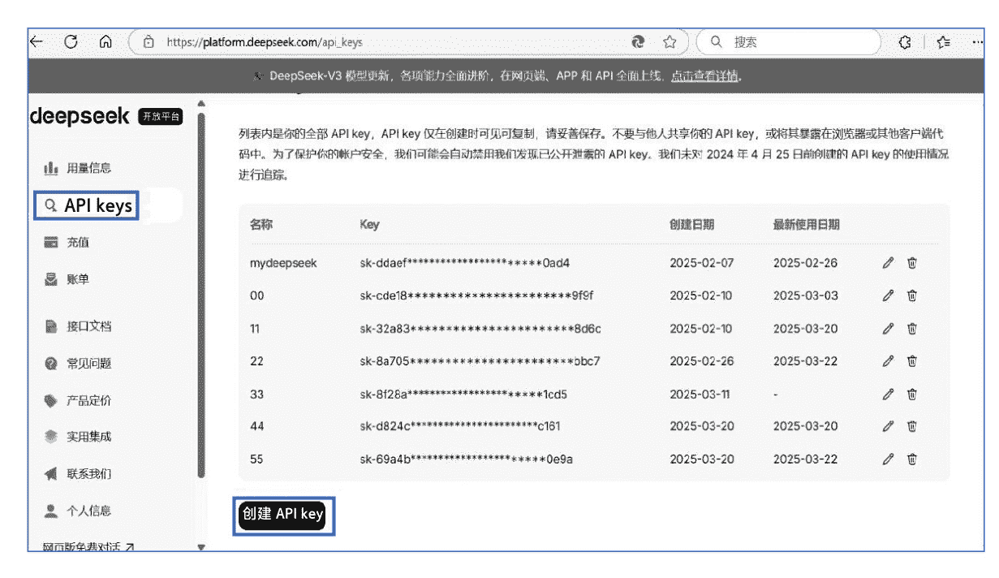

**第 2 步：**填写名称后单击“创建”（名称可以任意填写）。

**第 3 步：**API key 创建成功后，在关闭之前可以复制保存，以便下次使用时能找到。

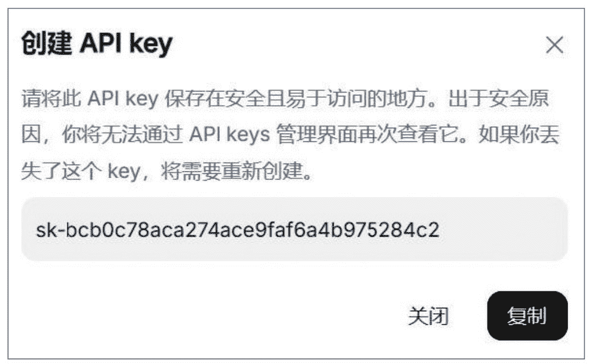

**第 4 步：**单击“关闭”。

这里要注意一点：关闭后将无法复制，如果原来的 API key 没保存，就需要重新建一个。

### **1.1.4 首条指令测试**

看完前面的步骤，相信财务人员已经成功注册并准备好使用 DeepSeek 了。接下来，财务人员可以根据工作需要提出首条指令。

例如，输入：“作为财务新人，我需要分析银行流水，请指导具体的操作步骤。”DeepSeek 会依据这条指令给出预期响应，分步骤引导用户完成银行流水分析，包括数据清洗、分类和可视化等环节。

**步骤 1：输入指令**

**步骤 2：DeepSeek 输出结果**

以下是 DeepSeek 依据指令输出的结果，即分步骤的指导教程。

**作为财务新人分析银行流水，可按照以下步骤系统操作，确保全面准确：**

**一、准备工作**

**1.收集资料**

・获取目标时间段内完整的银行流水（电子版+纸质版），确认包含：交易日期、金额、对方账户、摘要、余额等关键信息。

・同步获取对应的银行对账单、企业账务记录（如记账凭证、总账/明细账）。

**2.整理数据**

・将 PDF/纸质流水转换为 Excel 表格（工具推荐：Adobe Acrobat、WPS PDF 转 Excel）。

・统一字段格式（如日期设为 YYYY-MM-DD，金额统一为“元”），删除无关行（如表格标题重复项）。

**二、核对数据准确性**

**1.余额核对**

・检查银行流水期末余额是否与企业账务、银行对账单一致。

・若存在差异，编制**银行余额调节表：**

列出银行对账单余额→加“企业已收银行未收”项（如在途存款）→减“企业已付银行未付”项（如未兑支票）→调整后余额应与企业账面一致。

**2.逐笔勾稽**

・随机抽查大额交易，核对银行流水摘要与记账凭证的对方科目、金额是否一致（如“货款”对应应收账款科目）。

**三、分类统计与分析**

**1.收支分类**

・**收入类：**销售收入、投资收益、政府补贴等。

・**支出类：**采购付款、工资社保、税费、租金等。

・**特殊类：**内部转账（如母子账户划转）、银行手续费、利息等。

・**技巧：**使用 Excel 筛选或数据透视表，按摘要关键词（如“工资”“税款”）分类汇总。

**2.趋势与结构分析**

・月度趋势：计算各月收支总额，观察波动原因（如季节性销售）。

・收支占比：统计各类支出占总成本比例（如采购支出占 60%）。

・工具建议：用折线图展示趋势，饼图展示收支结构。

**四、风险点排查**

**1.异常交易识别**

・**大额交易：**单笔超常规金额（如超过月均收入的 30%）。

・**高频交易：**短期内同一账户多次转账（如日转账超过 3 次）。

・**非营业时间交易：**节假日或夜间大额转账。

・**可疑对手：**交易方为关联公司（未披露）、高风险地区账户、个人账户（私账公用）。

**2.合规性检查**

・私户收公款、无合理商业背景的往来款（如“咨询服务费”无合同）。

・备注模糊的交易（如“往来款”“其他”须追查凭证）。

**五、编制分析报告**

**1.报告框架**

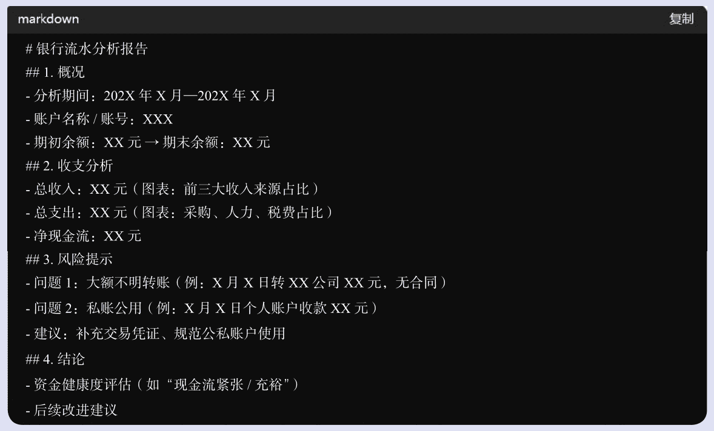

**2.可视化工具**

・使用 Excel/PPT 制作图表，重点标注异常数据（如红色高亮风险交易）。

**六、存档与跟进**

**1.资料归档**

・保存电子版分析表、报告（命名规则：年月—账户—分析人），纸质版签字留存。

**2.跨部门沟通**

・向财务主管汇报风险点，协同业务部门补充交易依据。

・必要时与审计/风控部门讨论整改措施。

**七、常见问题解决**

・**问题：流水交易量过大，如何高效分类？**

**答案：**用 Excel 数据透视表，按“对方账户”或“摘要”字段分组统计，或使用 VLOOKUP 匹配预设关键词自动分类。

・**问题：发现差异后如何调整？**

**答案：**若为企业记账错误，需红字冲销后重新录入；若为银行差错，联系银行更正。

**通过以上步骤，财务新人可系统掌握银行流水分析的核心要点，兼顾效率与风险控制。**

## **1.2 “深度思考”与“联网搜索”：财务人员的选择策略**

DeepSeek 提供“深度思考”与“联网搜索”两种功能模式。那么，什么时候用“深度思考”模式，什么时候用“联网搜索”模式呢？下面我们对这两种模式的适用场景做出对比分析，如表 1-2 所示。

表 1-2 “深度思考”与“联网搜索”模式的适用场景

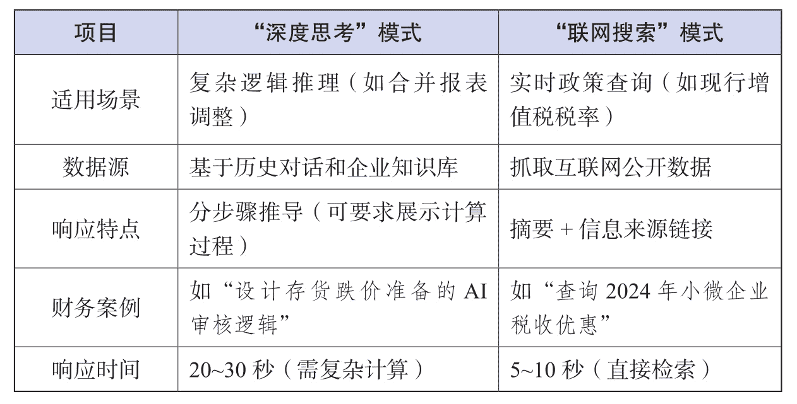

总体来看，“深度思考”模式更侧重复杂的逻辑推理及计算，“联网搜索”模式则更侧重于查询。目前，“深度思考”模式下知识的截止时间为 2024 年 7 月，涉及 2024 年 7 月后的信息搜索查询，建议使用“联网搜索”模式。例如，用户在“深度思考”模式下输入指令“帮我查询一下《哪吒之魔童闹海》的上映时间”，可能得不到正确答案。

财务人员可以混合使用指令。例如，若想了解现行《企业会计准则第 21 号——租赁》对企业租赁合同的影响，可先通过“联网搜索”模式查询该准则的最新政策，再用“深度思考”模式分析其对企业租赁合同的影响。

## **1.3** **指令运用技巧：让 AI 听懂你的需求**

### **1.3.1** **指令设计核心原则**

在设计指令时，遵循核心原则至关重要，这不仅能提升 AI 的响应质量，还能确保输出结果符合预期。指令设计的核心原则包括角色化、场景化和结构化输出。明确指定 AI 的角色，限定具体场景，并指定清晰的输出框架，可以确保生成的结果更简洁、更直接、更实用。

**角色化**

・**×模糊指令：**“分析财务数据。”

・ **明确角色：**“你是一名资深财务分析师，请分析以下银行流水，识别异常交易并提出优化建议。”

・**效果：**AI 能够基于专业视角，输出结构化结果（如风险点、合规建议）。

**场景化**

・**×笼统需求：**“预测现金流。”

・ **限定场景：**“基于 2024 年 1—6 月销售回款和应付账款数据，用时间序列模型预测未来 3 个月的现金流，要求展示公式和置信区间。”

・**效果：**AI 能够明确使用方法和输出格式，有效减少无效信息。

**结构化输出**

・**×自由发挥：**“总结财务报告。”

・ **指定框架：**“按以下模板输出：

①核心结论（3 条）；

②数据支持（表格）；

③风险提示（分点说明）。”

・**效果：**AI 能够直接获取可用信息，避免冗余内容。

为了帮助财务人员更好地理解这些指令设计原则，以下通过示例进行说明。

**×模糊提问：**“分析这个报表。” 

**优质指令：**

“分析 2024 年第一季度资产负债表：

1.计算流动比率/速动比率；

2.标注与行业均值偏差>15%的项目；

3.输出可视化图表（折线图+柱状图组合）。”

财务人员在编写指令时，业务越熟练，需求就越明确，生成的结果也越精准。此外，财务人员还可以对 DeepSeek 进行分步引导。如果 DeepSeek 的回答不符合要求，可以进一步指出错误，让 DeepSeek 重新输出。

**分步引导：**

“分析 2024 年第一季度资产负债表，分三步回答：

1.先核对资产负债表的勾稽关系是否正确，结构是否异常；

2.计算流动比率、速动比率，并分析指标是否异常；

3.对资产负债表进行整体分析，输出带有可视化图表的分析报告。”

**错误修正：**

“上条回答中关于流动比率的计算是错误的，请重新计算并展示公式推导过程。”

### **1.3.2** **DeepSeek 在财务工作中的典型指令应用**

表 1-3 列举了 DeepSeek 在财务工作中的典型应用场景及指令示例，可供参考。

表 1-3 DeepSeek 在财务工作中的典型应用场景及指令示例

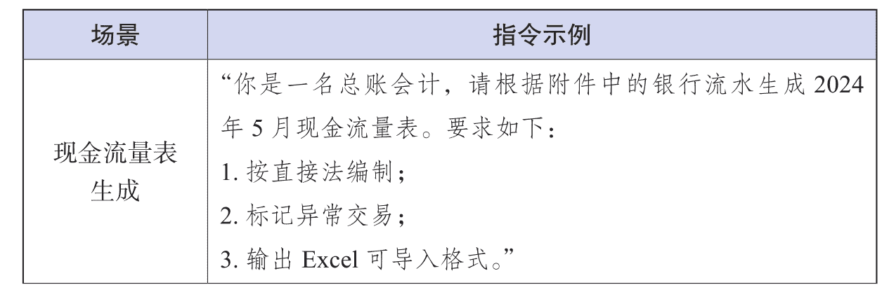

（续表）

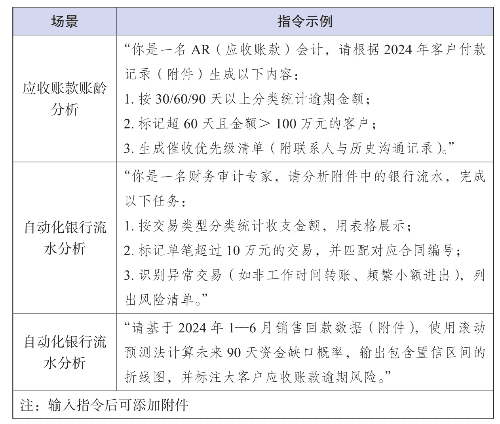

## **1.4 敏感数据安全处理：财务数据的隐私保障**

财务人员在使用 DeepSeek 时最担心的就是数据安全问题。为最大程度保证数据安全，建议财务人员采用字段替代、虚拟化生成、格式保留等方式对数据进行加工处理。

### **1.4.1 字段替代**

Excel 是财务人员常用的办公软件，在用 Excel 生成表格时，可以通过 REPLACE 函数替代敏感字段。但这需要财务人员熟练使用 Excel 公式，如果财务人员对 Excel 公式使用不熟练，可以通过向 DeepSeek 询问的方式，让 DeepSeek 生成公式，然后复制粘贴到表格中。

**1.使用 Excel 公式进行数据脱敏**

**（1）REPLACE 函数的使用方法**

函数格式：

=REPLACE（参数 1，参数 2，参数 3，参数 4）

参数说明：

参数 1：需要替代转换的文本。

参数 2：替换开始的字符位置。

参数 3：替换的数量。

参数 4：新的文本。

**（2）案例演示**

以下是员工工资信息原始数据示例，此时身份证信息（身份证号为虚拟号码）是完整的，财务人员需要对 B 列的身份信息进行脱敏。

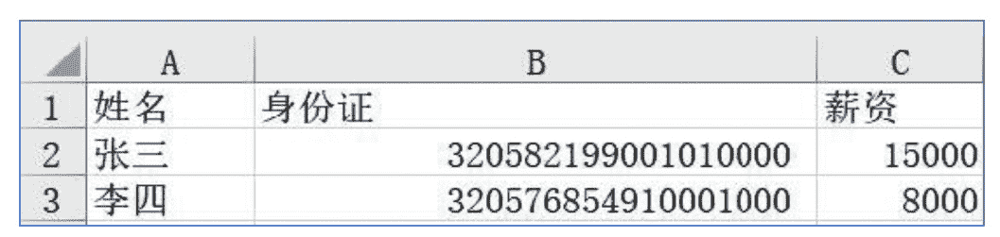

**步骤 1：数据脱敏**

在表格的 D2 单元格输入“=REPLACE（B2，4，6，"******"）”进行脱敏（其他空白列的单元格也可以），然后下拉填充。

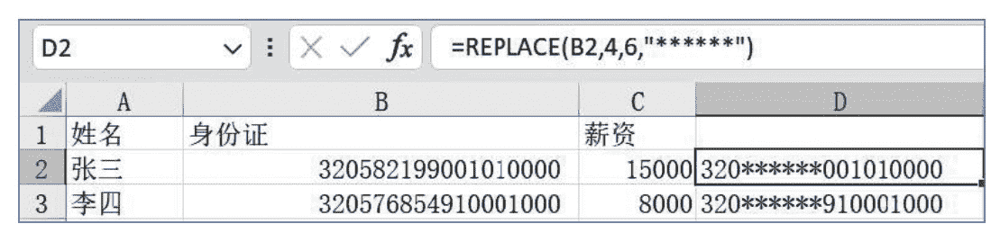

**步骤 2：复制数据**

将 D 列的数据区域复制并粘贴到 B 列，注意选择性粘贴为数值：

①选中 D 列的数据区域；

②按下“Ctrl+C”复制；

③将光标移动到 B 列的目标单元格；

④单击“选择性粘贴”；

⑤在弹出的对话框中，选择“数值”，然后单击“确定”。

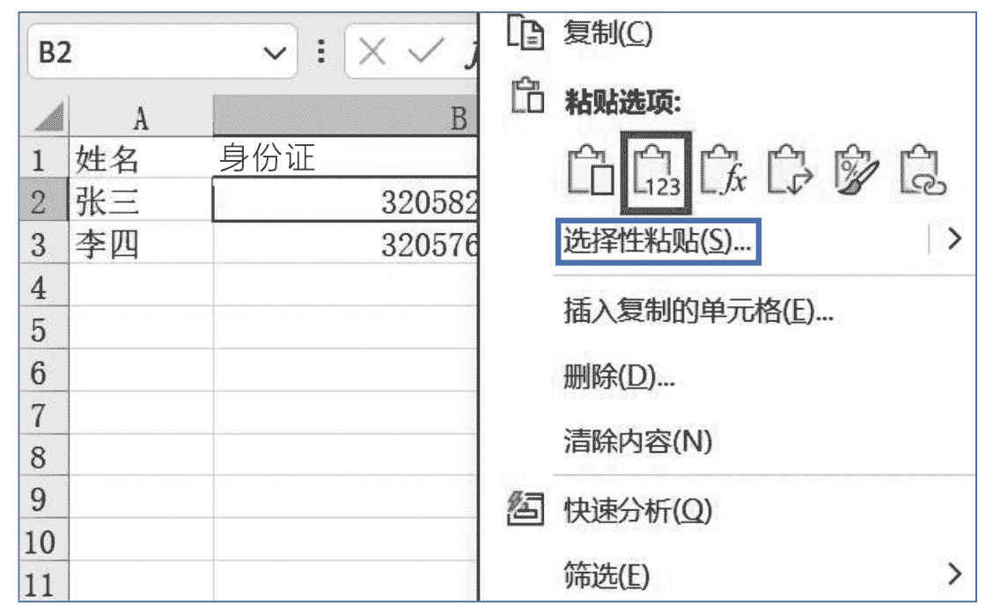

**步骤 3：完成数据脱敏**

上述两步完成后，财务人员可以看到 B 列的身份证信息已完成脱敏。脱敏后文件中无完整的数据信息。

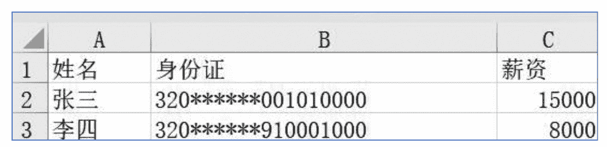

**2.DeepSeek 辅助完成数据脱敏**

如果财务人员对 REPLACE 函数不熟悉，可以通过 DeepSeek 直接生成脱敏函数，然后将生成的函数复制并粘贴到 Excel 表格中。

**步骤 1：上传表格并输入指令**

・在附件中上传需要脱敏数据的表格截图（注意截图要带单元格行号和列标）或直接上传整个表格。

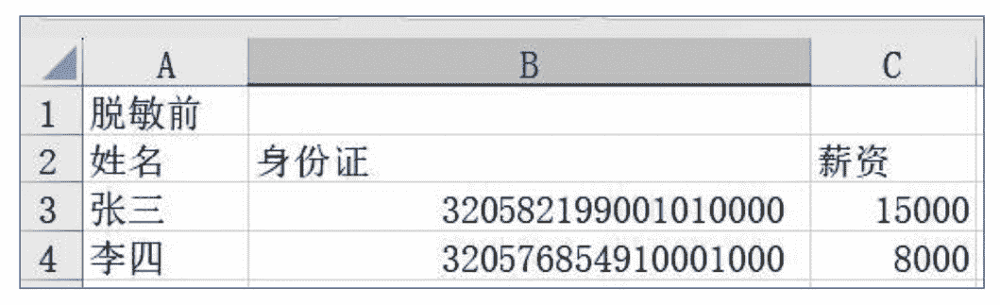

・输入指令：“我要对附件中 Excel 表格 B 列的身份信息进行脱敏，请帮我生成 Excel 函数，让我可以直接复制到表格里。”

**步骤 2：DeepSeek 输出结果**

完成上述步骤后，DeepSeek 将生成相应的 Excel 函数：

**可以使用以下 Excel 函数对 B 列身份证信息进行脱敏（保留前 6 位和后 4 位，中间用星号填充）：**

将公式直接复制到 B 列对应的单元格即可实现效果。

・张三的身份证号会显示为：**320582********0000**

・李四的身份证号会显示为：**320576********1000**

注意：此公式默认身份证号码为 18 位标准格式。如果存在非标准格式数据，建议先检查数据的规范性。

**步骤 3：公式导入**

财务人员这时可以将 DeepSeek 生成的公式导入 Excel 中，即把公式复制并粘贴到 Excel 原始表格的 D 列（粘贴到其他空白列也可以），然后下拉填充。后续具体操作步骤可参考上述“1.使用 Excel 公式进行数据脱敏”中的“步骤 1 至步骤 3”。

除了身份证号，姓名、银行卡号等敏感信息也可通过上述方法进行脱敏处理，财务人员可根据具体需求灵活运用。

### **1.4.2 虚拟化生成**

在财务工作中，生成虚拟数据对测试、培训和数据共享等场景至关重要。为了帮助财务人员高效完成这项工作，下面介绍两种生成虚拟数据的方法：使用 DeepSeek 指令生成虚拟数据和使用 Excel 函数生成动态虚拟数据。

**1.使用 DeepSeek 指令生成虚拟数据**

**步骤 1：输入指令**

指令示例：“生成 30 条虚拟工资数据，以 Excel 表格形式输出。要求如下：

1.表头分别是姓名、身份证号、部门、薪资。

2.薪资范围 5，000～30，000 元。

3.部门包含技术部、财务部、销售部。”

**步骤 2：DeepSeek 输出结果**

**由于我无法直接生成 Excel 文件，以下是可直接复制到 Excel 的 30 条虚拟工资数据模板。请按照以下步骤操作：**

**步骤 1：创建 Excel 表格**

1.新建 Excel 文件。

2.在 A1：D1 输入表头：

**步骤 2：粘贴以下数据**

选中 A2 单元格，粘贴以下完整数据（已处理格式）：

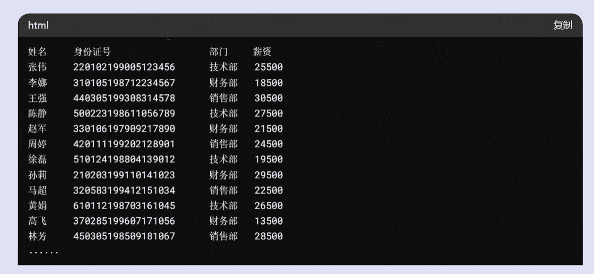

**步骤 3：格式调整**

**1.身份证号列：**全选 B 列→右键设置单元格格式→选择「文本」格式。

**2.薪资列：**全选 D 列→右键设置单元格格式→选择「数值」→取消千位分隔符。

DeepSeek 不能直接生成 Excel 文件，财务人员可以按照它给出的步骤直接把结果复制并粘贴到 Excel 表格中。在涉及大批量虚拟数据时，DeepSeek 有可能会推荐其他格式，如通过给出 Python 代码或 Power BI 模板，让用户自行操作生成。如果财务人员不习惯使用这些工具，或者只想简单快速地生成虚拟结果，输入指令时可以注明“使用 Excel 表格，不使用代码，内容直接输出”等，予以明确。

**2.使用 Excel 函数生成动态虚拟数据**

**步骤 1：在 Excel 中创建标题**

**步骤 2：生成姓名列（A 列）**

手动输入或者给 DeepSeek 提供指令直接生成（如：帮我生成 100 个虚拟姓名）。

**步骤 3：生成身份证号列（B 列）**

使用公式生成虚拟身份证号：

=TEXT(RANDBETWEEN(1940,2004),"0000")&TEXT (RANDBETWEEN(1,12),"00")&TEXT(RANDBETWEEN(1,28),"00")&TEXT(RANDBETWEEN(1000,9999),"000000")&TEXT(RANDBETWEEN(0,9),"0")

**步骤 4：生成部门列（C 列）**

使用下拉菜单随机分配部门：

=CHOOSE（RANDBETWEEN（1，3），"财务部"，"销售部"，"技术部"）

**步骤 5：生成薪资列（D 列）**

生成 5，000～30，000 元的随机薪资（以 500 元为步长）：

=ROUND(RANDBETWEEN(5000,30000)/500,0)*500

**步骤 6：结果演示**

拖动鼠标下拉，虚拟数据会自动往下填充。

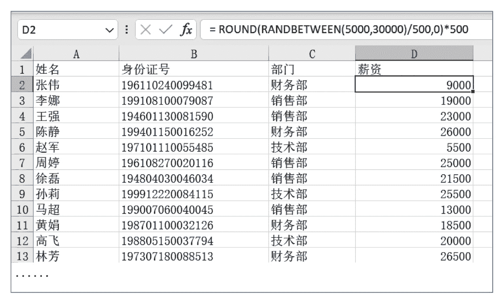

大家在操作时不要拘泥于个别案例，上述只是给出了一种生成方法，日常工作中还有很多工作场景可以用到此类方法。财务人员不精通 Excel 函数公式也没关系，虚拟内容的公式如何设置可以求助 DeepSeek，只需要在指令中描述清楚规则，说明想要创建什么内容即可。

如果表格需要重复性多次使用，那么相对于 DeepSeek 直接生成虚拟内容，Excel 函数生成动态虚拟数据可能更符合要求，财务人员只需要创建一个虚拟数据模板，后续涉及相关内容时即可多次复用。

### **1.4.3 格式保留**

在处理敏感数据时，财务人员可以保留数据分布特征，同时删除真实的员工 ID。

以下是一个具体示例，展示如何通过计算薪资均值和标准差，生成符合数据分布特征的虚拟薪资，以实现数据脱敏。

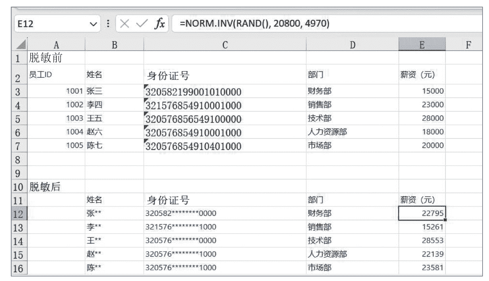

**步骤 1：计算薪资均值和标准差**

均值公式：=AVERAGE（E3：E7）→计算原始均值 20800

标准差公式：=STDEV.S（E3：E7）→计算样本标准差 4970

**步骤 2：生成虚拟薪资（保留分布特征）**

在 E12 单元格输入公式：=NORM.INV（RAND（），20800，4970）

**步骤 3：生成结果**

将步骤 2 中的公式通过拖动填充柄应用至所有相关行，生成结果。

通过上述操作，财务人员可快速生成符合数据分布特征的虚拟薪资，这些数据可用于测试、培训或外部共享，同时确保敏感数据完全脱敏。

在财务工作中，除了字段替代、虚拟化生成、格式保留这三种数据脱敏方法，财务人员还可以采用文字描述代替直接上传数据，或者上传部分能够体现特征的案例数据等方法，对敏感数据进行加工处理，从而确保数据安全。

# **第二章**

# **财务高频场景效率实战：用 DeepSeek 协助日常工作**

**本章学习目标**

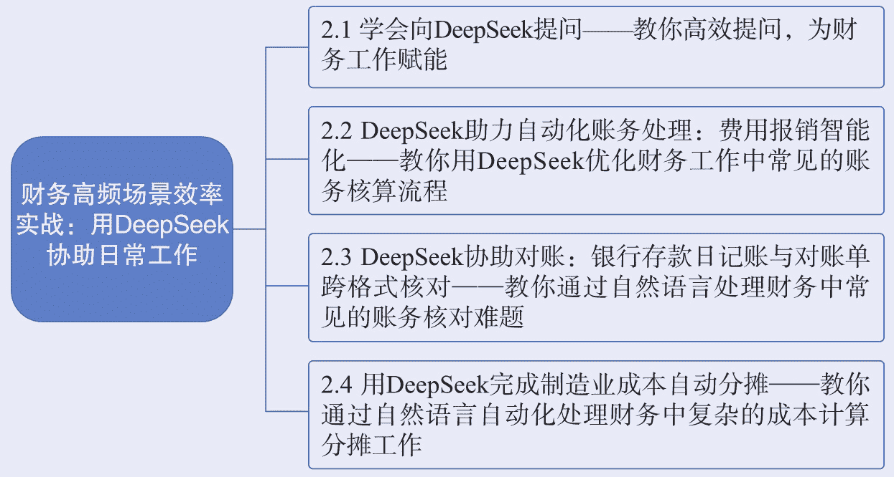

在财务数字化转型的进程中，高频基础工作的效率瓶颈已成为制约财务人员自我提升和价值创造的关键因素。本章将结合实际案例，全面且细致地演示 DeepSeek 在财务答疑、自动化账务处理、账务核对以及财务数据分摊计算等高频财务场景中的具体运作流程。通过本章的学习，财务人员可以掌握 DeepSeek 的相关功能运用技巧，熟练运用其高效处理烦琐的基础财务工作，从而更好地发挥财务专业价值。

## **2.1 学会向 DeepSeek 提问**

在当今快速变化的商业环境中，财务人员不仅需要具备扎实的财务知识，还需要具备跨领域的业务理解能力。DeepSeek 作为一种先进的 AI 工具，能够快速获取信息、解读复杂的财务法规、优化工作流程，从而有效提升财务人员的专业能力。通过学会向 DeepSeek 提问，财务人员可以更高效地处理工作，进一步提升工作效率和质量。下面通过具体的案例来说明财务人员应该如何向 DeepSeek 高效提问。

### **2.1.1 财务人员的问题答疑**

在日常工作中，财务人员常常会遇到一些复杂的问题，如跨境交易中的增值税处理和申报等。DeepSeek 可以通过自然语言处理技术，快速理解财务人员的提问，并给出答案。

 **案例背景：**

某科技公司（以下简称“公司”）与一家境外供应商签订了一份软件技术服务合同，合同金额为 50 万美元。根据合同约定，境外供应商负责为该公司提供技术支持服务。在处理这笔跨境交易时，公司财务人员李某对是否需要代扣代缴增值税，以及如何进行税务申报存在疑问，因此他向 DeepSeek 寻求帮助。

**步骤 1：输入指令**

李某通过 DeepSeek 平台输入以下问题：

“我公司从境外供应商处购买软件技术服务，合同金额为 50 万美元。在此，我想咨询以下几个问题。

1.这笔跨境服务是否属于增值税应税范围？

2.如果需要代扣代缴增值税，税率是多少？

3.如何填写税务申报表？”

**步骤 2：DeepSeek 输出结果**

DeepSeek 迅速分析了问题，并输出以下结果：

**1.是否应税**

根据《中华人民共和国增值税暂行条例》及其实施细则，境外单位向境内单位提供完全在境外消费的服务，不属于增值税应税范围。但如果服务在境内消费，则需要代扣代缴增值税。

**2.税率**

如果服务在境内消费，适用的增值税税率为 6%。

**3.申报流程**

・在支付款项时，公司需代扣代缴增值税，计算公式为：50 万美元×6%=3 万美元。

・在税务申报时，填写《增值税纳税申报表（适用于一般纳税人）》的“代扣代缴增值税”栏目，并附上相关合同和支付凭证。

・通过电子税务局系统提交申报表并缴纳税款。

最终，李某根据 DeepSeek 的回答，确认该笔服务属于境内消费，需代扣代缴增值税。他按照 6%的税率计算应缴税款，并在次月申报期内完成了税务申报。通过这一操作，该公司避免了因未及时缴税而产生的罚款风险，同时确保了税务合规。

### **2.1.2 法条解读和税务申报辅助**

税务政策的频繁更新给财务人员带来了挑战，增加了财务人员及时掌握最新财税法规变化的难度。DeepSeek 可以帮助财务人员快速解读当前的法规政策，并提供税务申报的辅助建议。

 **案例背景：**

某制造企业财务人员李某在做企业所得税汇算清缴时，发现最新发布的研发费用加计扣除政策有所调整。李某对如何准确计算加计扣除额，以及如何填写申报表格存在疑问，因此他向 DeepSeek 寻求指导和帮助。

**步骤 1：输入指令**

李某通过 DeepSeek 平台输入以下问题：

“1.2025 年研发费用加计扣除政策有哪些变化？

2.哪些费用可以纳入加计扣除范围，以及如何计算加计扣除额？

3.申报时需要注意什么？

请在回答以上问题时，注明相关政策的依据来源。”

鉴于 DeepSeek 的“深度思考”功能仅能搜索 2024 年 7 月之前的信息，针对本案例涉及的内容及时间点，建议使用“联网搜索”功能。

**步骤 2：DeepSeek 输出结果**

DeepSeek 迅速分析了问题，并输出以下结果：

**2025 年研发费用加计扣除政策在延续以往优惠政策的基础上，结合国家税务总局公告 2025 年第 1 号等文件进行了部分调整。以下是 2025 年研发费用加计扣除政策的主要变化、加计扣除额的计算方法及申报注意事项的详细说明，并附上政策依据。**

**一、2025 年研发费用加计扣除政策的主要变化**

**1.加计扣除比例统一为 100%，部分行业提高至 120%**

・**一般企业：**研发费用未形成无形资产的，按实际发生额的 100%加计扣除；形成无形资产的，按无形资产成本的 200%摊销。

・**集成电路和工业母机企业（2023—2027 年期间）：**研发费用未形成无形资产的，按 120%加计扣除；形成无形资产的，按 220%摊销。

・**政策依据：**《财政部税务总局关于进一步完善研发费用税前加计扣除政策的公告》（财政部 税务总局公告 2023 年第 7 号）、《财政部 税务总局 国家发展改革委 工业和信息化部关于提高集成电路和工业母机企业研发费用加计扣除比例的公告》（财政部 税务总局 国家发展改革委工业和信息化部公告 2023 年第 44 号）。

**2.申报表调整**

・取消《免税、减计收入及加计扣除优惠明细表》（A107010），相关数据整合至企业所得税主表。

・修订《研发费用加计扣除优惠明细表》（A107012），删除前三季度与第四季度分别计算的要求，简化填报流程。

・**政策依据：**《国家税务总局关于优化企业所得税年度纳税申报表的公告》（国家税务总局公告 2025 年第 1 号）。

**3.资本化研发费用填报规则明确**

・资本化研发费用在无形资产形成年度需汇总以前年度支出，统一计算加计扣除。

・**政策依据：**国家税务总局公告 2025 年第 1 号对《研发费用加计扣除优惠明细表》的填报说明进行的调整。

**二、加计扣除额的计算方法**

**1.自主研发**

・**未形成无形资产：**

加计扣除额=实际研发费用×100%

・**形成无形资产：**

摊销加计扣除额=无形资产成本×200%÷摊销年限（≥10 年）

・**政策依据：**财政部、税务总局公告 2023 年第 7 号。

**2.委托研发**

・**境内委托：**按实际支付费用的 80%计算加计扣除（受托方不得重复扣除）。

**公式：**委托境内研发加计扣除额=实际支付费用×80%

・**境外委托：**按实际支付费用的 80%计算，但不得超过境内符合条件的研发费用的 2/3。

**公式：**委托境外研发加计扣除额=min（实际支付费用×80%，境内符合条件的研发费用×2/3）

注：min 为取最小值。

・**政策依据：**《财政部 税务总局 科技部关于企业委托境外研究开发费用税前加计扣除有关政策问题的通知》（财税〔2018〕64 号）。

**3.合作研发**

・合作各方按自身承担的研发费用分别计算加计扣除额。

**4.集中研发（集团分摊）**

・集团内研发费用按合理方法分摊，各成员企业分别计算加计扣除额。

**三、申报注意事项**

**1.材料准备**

・**必备文件：**研发项目计划书、立项决议、研发费用辅助账、委托/合作研发合同（需在科技部门登记）。

・**过程证明：**研发日志、实验数据、知识产权申请文件等。

・**政策依据：**《国家税务总局关于企业研究开发费用税前加计扣除政策有关问题的公告》（国家税务总局公告 2015 年第 97 号）。

**2.申报时点**

・**预缴申报：**可在第二季度或第三季度预缴时选择享受上半年或前三季度加计扣除。

・**汇算清缴：**年度汇算时统一申报全年研发费用。

・**政策依据：**《国家税务总局财政部关于优化预缴申报享受研发费用加计扣除政策有关事项的公告》（国家税务总局 财政部公告 2023 年第 11 号）。

**3.常见风险点**

・**费用归集不清：**研发费用与生产经营费用需严格区分，否则不得加计扣除。

・**委托研发合同未登记：**未在科技部门登记的委托研发合同可能会被税务部门驳回。

・**资本化与费用化混淆：**需准确区分研发支出的资本化与费用化时点。

**总结**

2025 年研发费用加计扣除政策延续了相关税收优惠政策，并优化了申报流程。企业在申报时需注意以下几点：

**1.准确归集费用，**区分研发与生产经营支出；

**2.完善证明材料，**确保研发活动的真实性；

**3.关注行业差异，**如集成电路和工业母机企业可享受 120%加计扣除。

如需进一步核实，可参考财政部、税务总局等部门联合发布的政策文件。

最终，李某根据 DeepSeek 的指导，准确计算了研发费用加计扣除额，并完成了企业所得税申报，享受了政策红利。

通过 DeepSeek 的智能辅助，财务人员能够高效解析税务新政，精准核算研发费用加计扣除额并有效防控风险。2025 年研发费用加计扣除政策的优化升级，通过税负减免力度的加大进一步释放了企业创新动能。建议企业在合规前提下充分把握政策机遇，同步完善内控机制以实现政策红利的最大化兑现。

**知识拓展**

财务人员在查询相关政策、法规、新闻动态等信息时，除了使用 DeepSeek 的“联网搜索”方式提问，还可以用秘塔 AI 搜索。相较于 DeepSeek，秘塔 AI 搜索能够更直观地看到搜索的信息来源。

为了确保搜索到的信息准确无误，财务人员可以在多个 AI 平台进行提问。例如，在搜索研发费用加计扣除政策时，财务人员可以使用同样的指令，分别向 DeepSeek、秘塔 AI 搜索和豆包提问。通过对比不同平台反馈的结果，能够有效降低因单个平台信息误差而带来的风险，从而确保获取的政策信息更加准确。

### **2.1.3 DeepSeek 助力财务考证**

财务考证是财务人员提升职业竞争力的有效途径之一，DeepSeek 能够为财务考证人员提供学习资料、模拟考试及答疑服务，帮助财务人员高效备考。

 **案例背景：**

财务人员张某正在备考注册会计师（CPA），但对《财务管理》中的资本资产定价模型（CAPM）理解不透，想借助 DeepSeek 辅助学习。

**步骤 1：输入指令**

张某通过 DeepSeek 平台输入以下问题：

“1.如何理解 CAPM 的核心公式？

2.能否举例说明如何计算股权资本成本？”

**步骤 2：DeepSeek 输出结果**

DeepSeek 迅速分析了问题，并给出以下答案：

**1.CAPM 公式**

*R**[e]*=*R**[f]*+*β*×(*R**[m]**-R**[f]*)

其中，*R**[e]*为股权资本成本，*R**[f]*为无风险利率，*β*为股票的系统性风险系数，*R**[m]*为市场预期收益率。

**2.案例说明**

・假设无风险利率*R**[f]*为 3%，市场预期收益率*R**[m]*为 10%，股票的*β*值为 1.2。

・股权资本成本计算如下：

*R**[e]*=3%+1.2×(10%-3%)=11.4%

最终，张某借助 DeepSeek 的互动辅导，深入理解了 CAPM 的应用方法，并在模拟考试中取得了好成绩。

### **2.1.4 DeepSeek 助力财务制度编制**

财务制度编制是企业财务管理的核心工作之一。DeepSeek 能够基于企业业务特征、财务数据和合规要求，为财务人员提供智能化支持，协助制定规范、完善的财务管理制度。

 **案例背景：**

某公司计划更新费用报销制度，财务人员刘某负责编制新制度。在编制过程中，刘某遇到了一些问题，于是向 DeepSeek 平台寻求建议。

**步骤 1：输入指令**

刘某通过 DeepSeek 平台输入以下问题：

“1.如何制定合理的费用报销标准？

2.如何设计审批流程以提高效率？

3.如何防范费用报销中的风险？”

**步骤 2：DeepSeek 输出结果**

DeepSeek 给出了以下建议：

**1.报销标准**

・根据行业标准和企业实际情况，制定差旅、餐饮、交通等费用的报销上限。

・例如，差旅住宿标准可设定为一线城市每晚 500 元，二线城市每晚 300 元。

**2.审批流程**

・采用分级审批制度，小额费用由部门经理审批，大额费用由财务总监审批。

・引入电子化审批系统，提高流程效率。

**3.风险控制**

・要求报销时附上发票和费用明细，确保真实性。

・定期对报销数据进行核查，防范虚假报销。

根据 DeepSeek 的建议，刘某迅速完成了新的费用报销制度的编制工作。新制度经公司管理层批准并实施后，不仅使报销流程的整体效率提升了 30%，还有效控制了费用报销风险。

总体来说，通过学会向 DeepSeek 提问，财务人员不仅可以快速解决日常工作中的疑难问题，还能在税务申报、考证备考和制度编制等方面获得有力支持。DeepSeek 的实时交互问答功能，能够通过多轮对话把财务数据与业务场景串联起来，帮助财务人员快速理解业务，厘清经营脉络，真正成为企业战略决策的重要参与者。

## **2.2** **DeepSeek 助力自动化账务处理：费用报销智能化**

在现代财务管理中，账务处理是一项高频且烦琐的工作，尤其是在费用报销环节。传统的手工处理方式不仅效率低下，还容易出错。DeepSeek 作为一款强大的智能化工具，可以帮助财务人员在不依赖其他系统的情况下，直接完成费用报销的自动化处理，以提升财务部门的工作效率，减少人为错误。

本节将以某企业员工的差旅费报销为背景，介绍如何利用 DeepSeek 进行费用报销的智能化操作，包括费用审核、OCR 识别（光学字符识别）、会计分录生成，并提供操作步骤。

**案例背景：**

某公司员工张某向财务部门提交了一份去北京出差（一天）的差旅费报销单要求报销，相关情形如下。

**1.报销项目**

・住宿费用：600 元。

・交通费用：300 元。

・餐饮费用：200 元。

**2.原始单据**

・住宿费发票：金额 600 元，发票号码 123456，开票日期 2025-02-02。

・交通费发票：金额 300 元，发票号码 654321，开票日期 2025-02-01。

・餐饮费发票：金额 200 元，发票号码 789012，开票日期 2025-02-02。

**3.公司费用报销制度（部分节选）**

（1）差旅费

・住宿费用：根据出差地区的不同，设定住宿标准。一线城市（如北京、上海、广州、深圳等）每人每天不超过 500 元；二线城市每人每天不超过 350 元；三线及以下城市每人每天不超过 250 元。实际住宿费低于标准的，按实际金额报销；超过标准的，需提前经领导审批，否则超出部分由个人承担。

・交通费用：员工出差应选择经济合理的交通方式。乘坐飞机，原则上需经部门经理及以上领导批准，经济舱费用实报实销；火车可报销硬席（硬座、硬卧）、动车/高铁二等座费用；长途汽车按实际票据报销。市内交通费用（包括机场大巴、地铁等），凭票据实报实销，出差地市内交通补贴每天 200 元（不再报销其他市内交通票据）。

・伙食补助：出差期间给予伙食补助，一线城市每天 150 元，二线城市每天 110 元，三线及以下城市每天 90 元。

（2）业务招待费

业务招待应事先得到部门负责人同意，费用报销时需注明招待对象、事由、人数等信息。招待费用标准为：普通业务招待每人每餐不超过×元；重要客户招待每人每餐不超过×元。单次招待费用超过 10，000 元的，需经总经理批准。

（3）办公费用

办公用品采购需提前提交采购计划，经部门负责人和行政部门审批后统一采购。员工报销办公费用时，需提供详细的采购清单和正规发票。

（4）通信费用

公司根据员工岗位和工作需要，给予一定的通信费用补贴。销售人员每月补贴 200 元，管理人员每月补贴 300 元，凭话费发票报销。

…………

员工应在费用发生后的 1 个月内办理报销手续，逾期不予报销。

### **2.2.1** **费用审核：报销项目的合理性核查**

在企业中，员工提交的费用报销单需经财务部门审核，以确保报销项目符合企业费用政策。传统手工审核方式耗时费力且易出错。DeepSeek 可通过智能化方式自动检查报销项目的合理性，批量检验报销单是否超支及是否在报销范围内，确保报销内容符合企业费用政策。

基于本节案例背景，下面具体演示如何通过 DeepSeek 批量检验报销单。案例中，张某的报销单内容明显与企业费用报销制度不符，DeepSeek 预期能够判断出不符之处并生成检查结果。

**步骤 1：上传附件并输入指令**

新建一个对话框（在同一个对话框内输入指令，DeepSeek 可以根据历史对话联系上下文），上传附件并输入指令。

・**上传附件：**张某的差旅费报销单和公司的费用报销制度文档。

・**输入指令：**“请根据附件中的费用报销制度帮我检查差旅费报销单是否符合公司报销要求。”

**步骤 2：DeepSeek 输出结果**

**根据公司费用报销制度，我们需要对张某的差旅费报销单进行逐项检查，确保其符合公司政策。以下是详细的检查过程。**

**1.住宿费用检查**

**报销金额：**600 元

**报销日期：**2025 年 2 月 5 日

**发票号码：**123456

**公司政策：**

・一线城市（如北京、上海、广州、深圳等）每人每天不超过 500 元。

・实际住宿费低于标准的，按实际金额报销；超过标准的，需提前经领导审批，否则超出部分由个人承担。

**检查结果：**

・张某的出差地为一线城市（北京），住宿费用为 600 元，超出了公司规定的 500 元标准。

・如果张某未提前获得领导审批，超出部分（100 元）需由个人承担，只能报销 500 元。

**建议：**

・财务人员需核实张某的住宿费是否提前获得领导审批。

・如无审批，报销金额应调整为 500 元，超出部分不予报销。

**2.交通费用检查**

**报销金额：**300 元

**报销日期：**2025 年 2 月 5 日

**发票号码：**654321

**公司政策：**

・交通费用实报实销，需凭票据报销。

・市内交通补贴每天 200 元（不再报销其他市内交通票据）。

**检查结果：**

・交通费用 300 元需核实是否为长途交通费用（如飞机、火车等）。

・如果是市内交通费用，则不能报销，因为公司已提供每天 200 元的市内交通补贴。

**建议：**

・财务人员需核实交通费用的具体用途。

・如果是长途交通费用，且票据合法，可以全额报销 300 元。

・如果是市内交通费用，则不予报销。

**3.餐饮费用检查**

**报销金额：**200 元

**报销日期：**2025 年 2 月 5 日

**发票号码：**789012

**公司政策：**

・出差期间给予伙食补助，一线城市每天 150 元，二线城市每天 110 元，三线及以下城市每天 90 元。

・伙食补助为固定补贴，无须提供餐饮发票。

**检查结果：**

・餐饮费用 200 元不符合公司报销政策，因为公司已提供伙食补助，无须额外报销餐饮费用。

**建议：**

・财务人员应拒绝报销餐饮费用 200 元。

・提醒张某，出差期间的餐饮费用已包含在伙食补助中，无须额外报销。

**4.报销时效检查**

**报销日期：**2025 年 2 月 5 日

**费用发生日期：**2025 年 2 月 1 日至 2025 年 2 月 2 日

**公司政策：**

・员工应在费用发生后的 1 个月内办理报销手续，逾期不予报销。

**检查结果：**

・张某的费用发生日期为 2025 年 2 月 1 日至 2025 年 2 月 2 日，报销日期为 2025 年 2 月 5 日，未超过 1 个月的报销时限，符合公司政策。

**5.其他检查**

**报销单填写：**

・报销单填写完整，包含报销人信息、费用明细、发票号码等，符合公司要求。

**附件：**

・附件齐全，包括住宿费、交通费及餐饮费发票。

**审批流程：**

・报销单需经过部门经理、财务审核，领导审批，流程完整。

**总结**

根据公司费用报销制度，张某的差旅费报销单存在以下问题。

**住宿费用**：600 元超出公司标准（500 元），需核实是否获得领导审批。如无审批，只能报销 500 元。

**交通费用**：需核实是否为长途交通费用。如果是市内交通费用，则不能报销。

**餐饮费用**：公司已提供伙食补助，不再额外报销餐饮费用，200 元应拒绝报销。

**调整后的报销金额：**

・住宿费用：500 元（假设超出部分未获得领导审批）

・交通费用：300 元（假设为长途交通费用）

・餐饮费用：0 元

・合计报销金额：800 元

**建议操作步骤**

**1.财务人员核实**

・确认住宿费用是否获得领导审批。

・确认交通费用的具体用途（长途或市内）。

**2.调整报销金额**

根据核实结果，调整报销金额为 800 元。

**3.通知报销人**

向张某说明报销调整原因，并提供政策依据。

**4.完成审批流程**

将调整后的报销单提交部门经理、财务审核，领导审批。

**通过以上操作，确保报销单符合公司费用报销制度，避免不合理支出。**

可以看到，DeepSeek 生成了完整的审核报告，财务人员可以清晰明了地看出哪些报销项目符合政策、哪些需要进一步处理。同时，DeepSeek 还生成了建议操作步骤，对于与费用报销制度不符的信息和异常问题，财务人员可以参考 DeepSeek 给出的建议进行下一步操作，例如，向报销人员核实信息等。

DeepSeek 在本案例中的输出结果基本能达到财务人员的预期。在处理大量票据时，财务人员可利用 DeepSeek 高效完成审核任务，精准定位问题并输出审核结论。

### **2.2.2** **OCR 识别：发票信息自动解析与核对**

除了报销单审核，财务人员还可以借助 DeepSeek 完成发票审核。财务人员可将报销单及对应发票上传至 DeepSeek（或通过 Excel 文件导入相关信息），DeepSeek 集成的 OCR 技术能快速解析发票中的关键信息，并与报销单的内容进行核对。

**案例延伸：**

假设张某报销的住宿费 600 元（超额）经过了领导提前审批，餐饮费为多报。张某将财务部退回的报销单重新提交，内容如下。

・住宿费用：600 元。

・交通费用：300 元。

在这个案例中，张某的住宿费经过了领导审批，符合规定，餐饮费多报部分已撤回。财务人员只需要检查报销单与发票信息的一致性。DeepSeek 可通过 OCR 识别技术自动核对报销单与发票信息，实现两者匹配性检查及结果批量生成。下面进行详细演示。

**步骤 1：上传附件并输入指令**

・**上传附件：**更改后的报销单及发票文件。如果是纸质发票，财务人员可将纸质发票扫描为图片或 PDF 文件，并上传至 DeepSeek。

・**输入指令：**“请帮我核对报销单与发票信息是否匹配。”

**步骤 2：DeepSeek 输出结果**

**根据提供的报销单和发票内容，我们可以逐一核对报销单中的费用明细与发票信息是否匹配。以下是详细的核对过程。**

**1.住宿费用核对**

**报销单信息：**

・费用类型：住宿费用

・金额：600 元

・日期：2025 年 2 月 2 日

・发票号码：123456

**发票信息（住宿费发票.png）：**

・发票号码：123456

・开票日期：2025 年 2 月 2 日

・项目：住宿费

・金额：600 元

**核对结果：**

发票号码、开票日期、费用类型和金额均与报销单一致，匹配无误。

**2.交通费用核对**

**报销单信息：**

・费用类型：交通费用

・金额：300 元

・日期：2025 年 2 月 1 日

・发票号码：654321

**发票信息（交通费发票.png）：**

・发票号码：654321

・开票日期：2025 年 2 月 1 日

・项目：交通费

・金额：300 元

**核对结果：**

发票号码、开票日期、费用类型和金额均与报销单一致，匹配无误。

**3.餐饮费用核对**

**报销单信息：**

・费用类型：餐饮费用

・金额：0 元

・日期：2025 年 2 月 2 日

・备注：无须报销

**核对结果：**

报销单中已明确标注餐饮费用无须报销，且金额为 0 元，符合公司政策（公司提供伙食补助，无须额外报销餐饮费用）。

**4.附件核对**

**报销单附件：**

（1）住宿费发票（发票号码：123456）

（2）交通费发票（发票号码：654321）

**核对结果：**

报销单中列出的附件与提供的发票文件（住宿费发票、交通费发票）一致，附件齐全。

**总结**

经过核对，报销单中的费用明细与发票信息完全匹配，具体如下。

**1.住宿费用**

・报销单：600 元，发票号码 123456，日期为 2025 年 2 月 2 日。

・发票：600 元，发票号码 123456，日期为 2025 年 2 月 2 日。

・匹配结果：一致。

**2.交通费用**

・报销单：300 元，发票号码 654321，日期为 2025 年 2 月 1 日。

・发票：300 元，发票号码 654321，日期为 2025 年 2 月 1 日。

・匹配结果：一致。

**3.餐饮费用**

・报销单：0 元，无须报销。

・匹配结果：符合公司政策。

**4.附件**

・报销单列出的附件（住宿费发票、交通费发票）与提供的发票文件一致。

・匹配结果：附件齐全。

**最终结论**

报销单与发票信息完全匹配，符合公司费用报销制度的要求。财务人员可以继续完成后续的审批和报销支付流程。

除了核对报销单和发票信息的一致性，财务人员还可以通过输入指令新增发票审核的规则。例如，检查发票抬头是否为本公司全称，开票日期是否合理，开票信息中的商品或服务名称、金额等是否准确，财务人员只需在输入指令时注明要求即可。

### **2.2.3** **会计分录生成**

基于 2.2.1 与 2.2.2 中 DeepSeek 生成的内容，财务人员可据此完成后续账务处理；如需生成相应会计分录，只需继续输入指令即可。

**步骤 1：输入指令**

“请根据上述内容帮我生成会计分录。”

**步骤 2：DeepSeek 输出结果**

**根据报销单的内容和公司费用报销制度，我们可以为张某的差旅费报销生成相应的会计分录。以下是详细的会计分录生成过程。**

**1.住宿费用**

金额：600 元

**会计科目：**

**会计分录：**

**2.交通费用**

金额：300 元

**会计科目：**

**会计分录：**

**3.餐饮费用**

金额：0 元

**会计科目：**

无须生成会计分录，因为餐饮费用已包含在伙食补助中，无须额外报销。

**4.合计金额**

总金额：900 元（住宿费 600 元+交通费 300 元）

**会计科目：**

**会计分录：**

**完整会计分录**

根据上述分析，完整的会计分录如下：

### **说明**

**1.差旅费科目**

・差旅费通常归类为销售费用或管理费用，具体根据张某的部门（如销售部）确定。

・如果公司有明确的科目设置，可以使用“销售费用——差旅费”或“管理费用——差旅费”科目。

**2.贷方科目**

・如果公司采用“其他应付款”科目记录未支付的报销款项，则贷方为“其他应付款”。

・如果报销款项直接支付给员工，则贷方为“银行存款”或“现金”。

**3.支付后调整**

・当公司实际支付报销款项时，需将“其他应付款”转为“银行存款”或“现金”。

・支付后的调整分录如下：

**总结**

根据张某的差旅费报销单，生成的会计分录如下：

财务人员可以根据公司具体的会计科目设置和支付方式，进一步调整分录内容。

### **2.2.4** **效率对比与扩展应用**

**1.效率对比**

DeepSeek 的智能办公功能可自动完成费用审核、票据识别及分录生成，显著提升报销业务的高效性与准确性。

表 2-1 列出了费用报销智能化各环节的预估耗时，以及 DeepSeek 相较于传统工作方法的优势，可供参考。

表 2-1 费用报销智能化效率对比

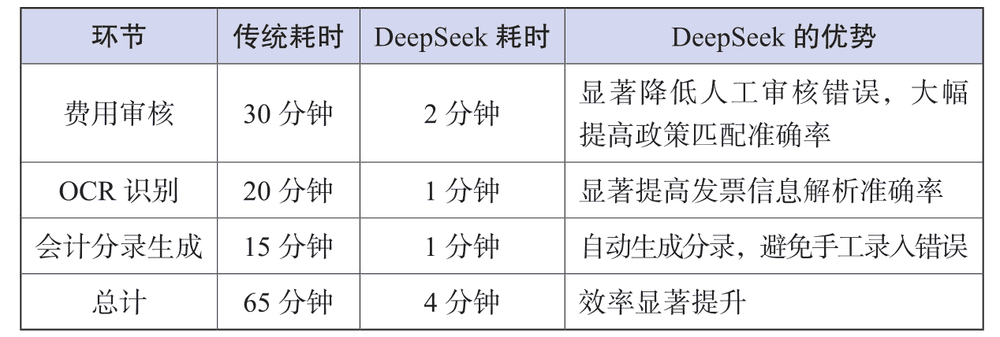

注：表中列出的各环节传统耗时与 DeepSeek 耗时均为估算的平均值，具体耗时可能因实际操作复杂度、数据量及系统性能等因素有所差异。其他章节的相关部分同理。

**2.扩展应用**

在费用报销智能化的基础上，DeepSeek 的扩展应用将进一步提升财务工作的效率和准确性。下面简要介绍其在跨部门报销处理、历史数据追溯与分析以及审计证据链自动化生成等方面的应用。

**（1）跨部门报销处理**

DeepSeek 支持批量处理多部门的报销单，自动匹配费用政策并生成审核报告。财务人员只需输入指令，DeepSeek 即可批量处理报销单据，高效完成跨部门报销审核，确保所有报销单均符合企业政策，从而显著提升工作效率并降低合规风险。

**（2）历史数据追溯与分析**

DeepSeek 支持按时间段、部门、费用类型等多维度分析报销数据，生成可视化报告。财务人员通过指令让 DeepSeek 分析费用波动，可以快速识别费用波动的原因，优化预算分配，为管理层决策提供数据支持。

**（3）审计证据链自动化生成**

DeepSeek 可自动生成费用报销确认书及相关附件，形成完整的审计证据链。财务人员仅需输入指令，即可快速备齐审计资料，从而缩短审计准备时间，提升审计效率并降低审计风险。

当然，网页版 DeepSeek 在自动化账务处理方面并非最优解，存在更高效的功能开发途径，但笔者仍选择展示上述案例，原因主要有以下两点。

一是本书主要面向财务人员，大多数人学习的目的是提升自身工作效率，而本地部署或程序开发往往超出了财务人员的决策范围，许多企业也缺乏相应条件。因此，本节内容旨在教授大家在有限条件和低成本下如何运用 DeepSeek 辅助工作。

二是帮助大家深入理解 DeepSeek 的功能与使用方法。例如，如何让 DeepSeek 识别纸质信息、核对信息，以及如何在工作中提出有效问题。若企业具备条件，建议进行本地部署或开展 DeepSeek 功能的 IT 开发，这不仅能进一步提升效率，还能增强企业数据的安全性。

## **2.3 DeepSeek 协助对账：银行存款日记账与对账单跨格式核对**

在传统财务对账工作中，财务人员往往需要耗费大量时间进行机械性的数据比对。银行流水、企业日记账与对账单之间的格式差异，犹如无形的数据鸿沟，人工核对不仅效率低，而且易因疲劳产生疏漏（据统计，人工对账的差错率在 3%～5%）。DeepSeek 的智能对账功能有助于解决这一问题。其跨格式解析引擎能自动识别 PDF、Excel 及网银导出的异构数据，多维度匹配算法可精准核销金额、日期、摘要等关键字段，即使是“借贷方向相反+拆分记账”的复杂场景，也能智能还原交易实质。更具突破性的是，系统会自动标记差异交易并智能推测可能的原因（如时间性差异、手续费漏记等），将财务人员从烦琐的勾稽工作中解放出来，使其专注于异常分析和流程优化。这正是智能时代对账工作从“手工校验”向“策略性复核”的范式跃迁。

本节以某企业财务场景为例，介绍如何利用 DeepSeek 将银行存款日记账与银行对账单进行跨格式智能匹配，实现自动对账。

 **案例背景：**

某企业财务人员王某需核对 2025 年 2 月的银行存款日记账（Excel 格式）与银行对账单（PDF 格式），传统操作需人工逐条比对，耗时约 3 小时且易出现漏项。如果使用 DeepSeek，预期可实现以下目标。

・**自动解析 PDF 对账单：**提取非结构化数据。

・**智能匹配交易记录：**处理日期格式差异、金额误差、摘要描述误差。

・**生成差异报告：**标记未达账项并生成调整分录。

・**提高效率与准确率：**全程耗时大约可缩短至 8 分钟，且准确率有显著提升。

该企业 2025 年 2 月的银行存款日记账（单位：元）与银行对账单（单位：元）截图如下。

## 银行存款日记账

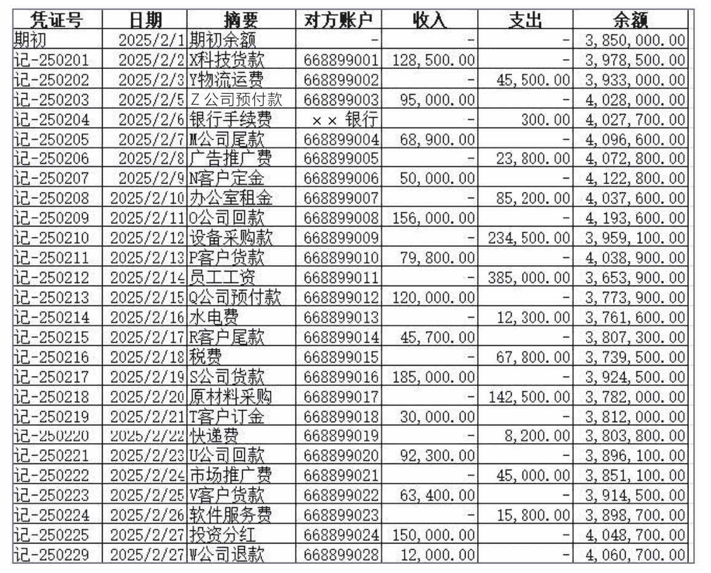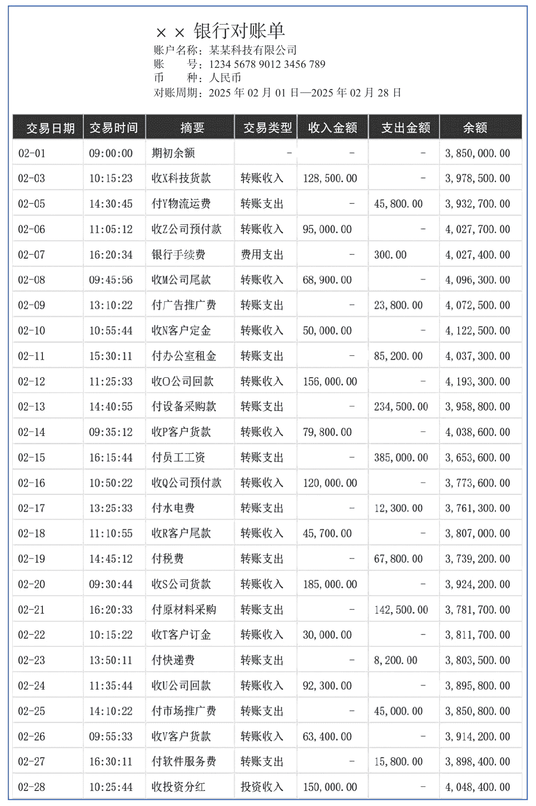

### **2.3.1 多格式数据导入与清洗**

**步骤 1：上传附件并输入指令**

・**上传附件：**2025 年 2 月的银行存款日记账和银行对账单。

・**输入指令：**

“请根据附件中的银行存款日记账 Excel 文档和银行对账单 PDF 文档，帮我执行银行对账。

1.解析 PDF 对账单，提取交易日期、摘要、收支金额。

2.清洗 PDF 对账单中的数据：

统一日期格式（PDF 中‘02-03’→‘2025-02-03’）。

3.输出结构化比对数据表。”

**步骤 2：DeepSeek 输出结果**

以下是 DeepSeek 根据上述指令输出的结构化比对数据表。

结构化比对数据表单位：元

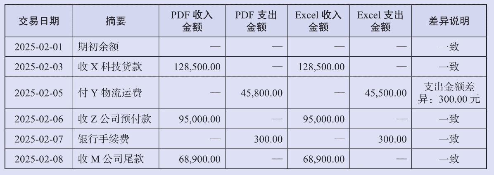

（续表）

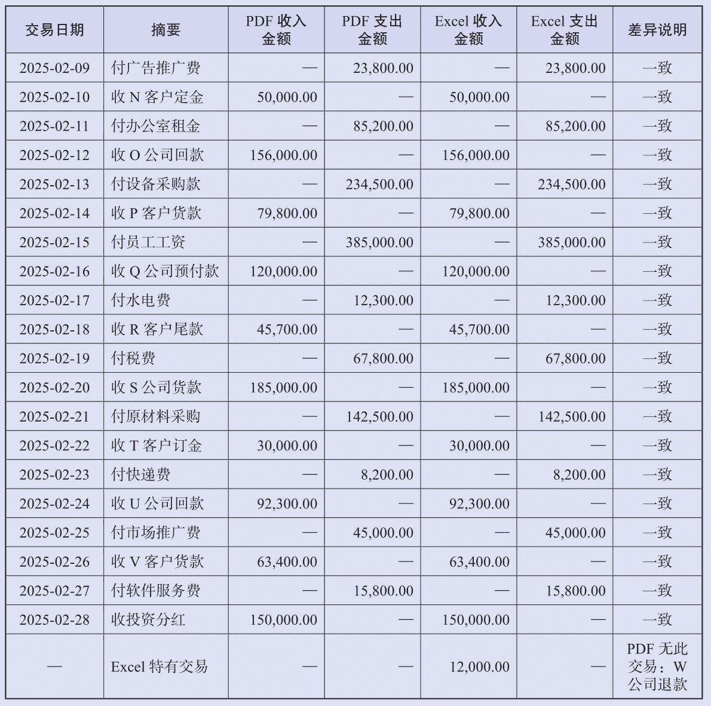

**差异事项**

1.付 Y 物流运费：PDF 支出金额为 45，800.00 元，Excel 支出金额为 45，500.00 元，差额 300.00 元需核实是否为手续费或录入错误。

2.Excel 特有交易：Excel 中“W 公司退款”12，000.00 元未在 PDF 对账单中出现，需确认是否跨期或是未达账项。

从 DeepSeek 的输出结果可见，系统已按要求完成数据清洗并生成核对报告，清晰列示了银行存款日记账与银行对账单之间的差异项和缺失项。

### **2.3.2 生成差异说明及处理建议**

在 2.3.1 中，DeepSeek 已经列示了银行存款日记账与银行对账单之间的差异项和缺失项。针对上述差异，财务人员可以让 DeepSeek 进一步生成差异说明及处理建议。

**步骤 1：输入指令**

“继续上面的内容，请帮我生成差异说明及处理建议。”

**步骤 2：DeepSeek 输出结果**

DeepSeek 根据上述指令输出以下结果。

### **差异说明及处理建议**

**1.付 Y 物流运费（交易日期：2025-02-05）**

**差异说明：**

・**PDF 对账单支出金额：**45，800.00 元

・**Excel 日记账支出金额：**45，500.00 元

・**差额：**300.00 元

**可能原因：**

・**数据录入错误：**Excel 中金额可能误输入为 45，500.00 元。

・**手续费差异：**银行可能额外扣除了手续费（如跨境转账费），但未在 Excel 中记录。

・**交易拆分或合并：**同一物流公司可能存在多笔交易，但仅部分被记录。

**处理建议：**

・**核对原始凭证：**检查银行回单、物流公司发票及合同，确认实际支付金额。

・**修正记录：**若为录入错误，需将 Excel 中的金额更正为 45，800.00 元，并补充说明。

・**补充手续费分录：**若差额为手续费，需在 Excel 中单独记录手续费支出 300.00 元。

**2.Excel 特有交易：W 公司退款（交易日期：2025-02-27）**

**差异说明：**

Excel 中记录了一笔 12，000.00 元的“W 公司退款”，但 PDF 对账单中无此交易。

**可能原因：**

・**跨期交易：**退款实际发生在 3 月 1 日，但被误记入 2 月。

・**银行处理延迟：**退款已发起但银行尚未处理完成，导致未体现在 2 月对账单中。

・**记录错误：**Excel 中可能存在重复记账或虚构交易。

**处理建议：**

・**确认交易日期：**核查退款申请单或银行流水，确认实际到账日期。

・**调整会计期间：**若属于跨期交易，需将 Excel 中该笔记录调整至 3 月。

・**跟踪银行状态：**若银行未处理，需联系银行确认退款进度，并保留未达账项记录。

・**排查错误记录：**若为误记，需删除 Excel 中该笔记录并进行补充说明。

**3.系统性改进建议**

・强化数据录入审核：对金额、日期、对方账户等关键字段实行双人复核机制，减少人为错误。

・自动化对账工具：使用财务软件自动匹配交易，标注差异项（如金额、日期不一致），提高效率。

・未达账项管理：建立“银行未达账项”台账，定期跟踪处理（如跨期交易、银行延迟交易）。

・定期对账频率：缩短对账周期（如每周一次），及时发现并解决差异，避免累积。

**通过以上步骤，可有效解决当前差异问题并优化财务流程，确保账务记录的准确性和完整性。**

我们可以看到，DeepSeek 针对上面的两笔差异分别生成了差异说明及处理建议，并给出了系统性改进建议。

### **2.3.3 协助生成调整分录**

财务人员可以参照 DeepSeek 给出的差异原因进行核实。假设本案例中差异产生的原因如下。

**（1）付 Y 物流运费的差异：**银行存款日记款 Excel 文档中记录的金额存在错误。具体表现为，实际支付的运费金额为 45，800.00 元，但错误地记录为 45，500.00 元，导致出现了 300.00 元的差异。

**（2）W 公司退款未体现的原因：**银行存款日记款 Excel 文档中记录了“W 公司退款”12，000.00 元，但该笔退款未在银行对账单 PDF 文档中出现。经核实，原因是银行处理存在延迟。虽然退款业务已经发起，但银行尚未完成处理，因此未体现在 2 月的银行对账单中。

针对这些问题，财务人员可以进一步发出指令，让 DeepSeek 协助生成调整分录。

**步骤 1：输入指令**

“经核查，造成差异的原因如下：

1.付 Y 物流运费的 300.00 元差异是因银行存款日记账 Excel 文档中数据记录错误造成的，误将 45，800.00 元记为 45，500.00 元；

2.银行存款日记款 Excel 文档中‘W 公司退款’12，000.00 元未在银行对账单 PDF 文档中出现的原因是银行处理延迟，退款已发起但银行尚未处理完成，导致该笔款项未体现在 2 月银行对账单中。

请给出解决方案。如需调整，请给出调整分录。”

**步骤 2：DeepSeek 输出结果**

DeepSeek 根据上述指令输出以下结果。

**调整分录及解决方案**

**1.付 Y 物流运费差异调整（金额少计 300.00 元）**

**原因：**银行存款日记账中将实际支出 45，800.00 元误记为 45，500.00 元，需补记差额。

**调整分录：**

**操作步骤：**

・在 Excel 中将原交易记录的支出金额修正为 45，800.00 元。

・补充差额分录（如上），并备注“更正 2025-02-05 付 Y 物流运费金额”。

・核对银行回单及物流发票，留存修正记录备查。

**2.W 公司退款未达账项调整（银行延迟处理）**

**原因：**退款已发起但未在 2 月到账，需在 2 月末冲销原分录，待 3 月到账后重新记录。

**调整步骤：**

2 月原分录保持不动，只在调节表附注。

如需调账（假设原分录错误），则 2 月末红字冲收入：

3 月实际到账后：

**说明：**

・若原退款为收入退回（如预付款返还），科目替换为“预收账款”；若为应收账款收回，科目保持“应收账款”。

・在 Excel 中标注该交易为“银行未达账项”，并备注“预计 2025-03-01 到账”。

**3.系统性改进建议**

・下月重点关注：

将“W 公司退款”标记为未达账项，在 3 月初优先核对银行流水，确保到账后及时处理。

・加强金额录入审核：

对支出类交易金额实行双人复核机制，避免因输入错误导致差异。

・自动化对账工具：

使用财务软件设置“金额差异预警”，自动标红金额不符的交易，减少人工排查时间。

**通过以上调整，可确保账务数据与银行流水完全匹配，同时明确未达账项的处理流程，提升后续对账效率及准确性。**

### **2.3.4 余额验证与报告生成**

在完成上述工作后，财务人员可利用 DeepSeek 进行余额验证与报告（银行余额调节表）生成，高效完成对账，确保财务数据准确完整。

**步骤 1：输入指令**

“已完成上述调整，请帮我执行以下操作：

1.对调整后的结果进行余额验证；

2.输出银行余额调节表。”

**步骤 2：DeepSeek 输出结果**

DeepSeek 根据上述指令输出以下结果。

**银行余额调节表**

对账周期：2025 年 2 月 1 日—2025 年 2 月 28 日

**余额验证说明**

**1.银行对账单调整后余额**

・银行对账单期末余额：4，048，400.00 元

・加：退款已发起但银行未处理款项（W 公司退款）12，000.00 元

・**调整后银行余额：**4，048，400.00+12，000.00=4，060，400.00（元）

**2.企业账面调整后余额**

・原账面期末余额（Excel）：4，060，700.00 元

・减：付 Y 物流运费修正（300.00 元）+W 公司退款（12，000.00 元）

・**调整后余额：**4，060，700.00-300.00-12，000.00=4，048，400.00（元）

・**最终企业账面余额：**4，048，400.00+12，000.00=4，060，400.00（元）

**调整后对账一致性验证**

・**银行对账单调整后余额：**4，060，400.00 元

・**企业账面调整后余额：**4，060，400.00 元

・**差异：**0.00 元

**下一步操作建议**

**3 月对账优先核销：**

在 3 月初优先核对 W 公司退款的实际到账记录，确保银行流水与企业账务一致。

**未达账项台账更新：**

将 W 公司退款 12，000.00 元登记至未达账项台账，标注“银行处理中，预计 2025-03-01 到账”。

**定期复核机制：**

每周检查银行流水与企业记录的匹配性，避免跨期差异累积。

**结论：通过上述调整，银行对账单与企业账面余额已完全一致，所有差异已妥善解决。**

从 DeepSeek 输出的结果中可以看到，银行对账单与企业账面余额已完全一致，所有差异均已妥善解决。财务人员只需按照 DeepSeek 生成的银行余额调节表和调整说明进行对应的账务处理即可。此外，DeepSeek 还生成了下一步操作建议，财务人员可以根据这些建议对工作流程进行优化。

### **2.3.5 效率对比与扩展应用**

**1.效率对比**

表 2-2 列示了智能对账中数据整理、交易匹配及差异分析环节的耗时，并与传统对账耗时进行了对比。可以看出，在 DeepSeek 的助力下，财务人员的工作效率得到了显著提升。

表 2-2 智能对账与传统对账的效率对比

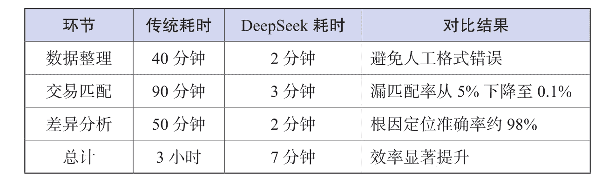

**2.扩展应用**

DeepSeek 在银企对账扩展应用方面表现出色，主要有以下几点。

**（1）跨银行对账：**可以同时解析多家银行多账户对账单。

**（2）历史数据追溯与分析：**能够快速追溯过去的数据，识别异常波动并进行深入分析。例如，财务人员可以输入指令“比对 2024 全年银企差异，分析波动原因”。

**（3）审计证据链：**可以自动生成“银行对账确认书”供审计查验。

通过本节学习，财务人员将系统掌握非结构化数据处理、智能数据匹配、精准差异分析及自动化调账等核心技能，完成从人工核对到智能对账的数字化转型。

## **2.4 用 DeepSeek 完成制造业成本自动分摊**

对于制造业财务人员而言，每月成本分摊工作常令人头疼。传统方法需手工收集各部门数据，依固定比例或经验进行分配，既耗时费力又易出错，一旦一个数字有误，就得全部重来。而借助 DeepSeek，这一流程会变得简单高效。

相较于传统方法，DeepSeek 在成本分摊方面具有以下优势。

**（1）自动采集数据：**能够直接从 ERP（企业资源计划系统）、MES（制造执行系统）等生产系统中获取最新的生产工时、机器运转、能耗等真实数据。

**（2）智能精准分摊：**不再“拍脑袋”按产量平摊，而是根据实际消耗自动计算最优分配方案。

**（3）实时生成报表：**只需单击一下，几分钟内即可完成过去需要几天才能完成的工作，且准确率极高。

本节将通过具体的案例来介绍如何用 DeepSeek 完成制造业成本自动分摊和差异分析。

 **案例背景：**

小宁是一家机械制造企业的财务人员，其所在企业主要生产不同型号的机器及配件。她每月需对各产品线的成本费用进行分摊计算与分析。她在工作中面临的主要问题是大量数据计算耗时费力，且计算过程涉及众多复杂公式，一旦某个公式出错，整个计算结果就会受到影响。她期望借助 DeepSeek 高效完成这项工作。

下面是该企业某月成本计算的 Excel 相关表单截图（均为简表）。

▼表 1：BOM 表（物料清单，用于统计产品型号及产品材料用量）

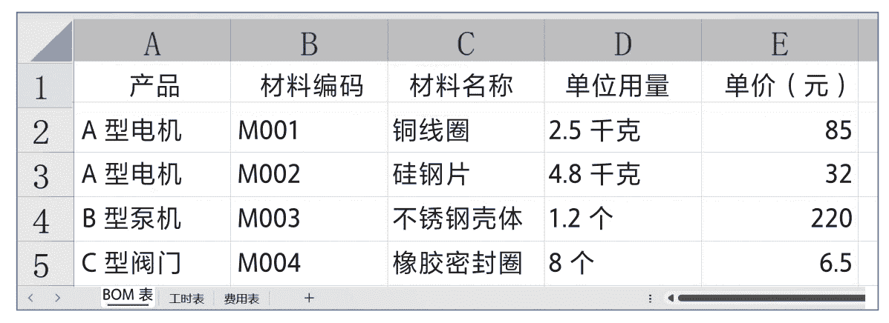

▼表 2：工时表（用于记录产品工时）

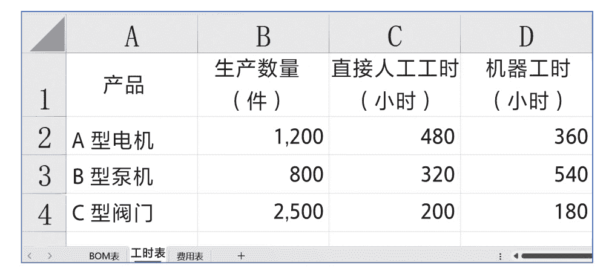

▼表 3：费用表（用于记录费用项目）

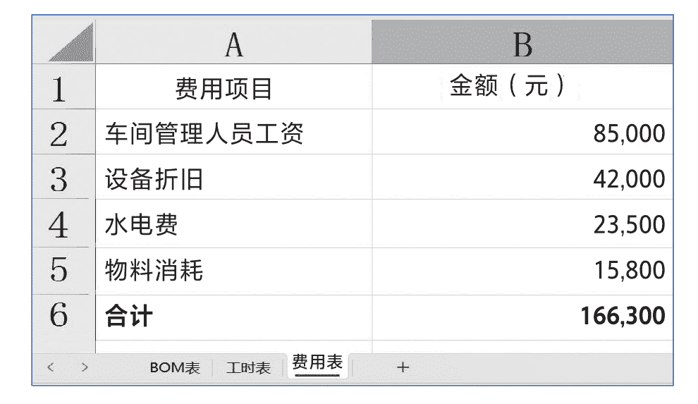

如果采用传统手工分摊方法即实际作业成本法（ABC）分摊制造费用，步骤如下。

**第 1 步：计算各费用项目的分配率**

（1）管理人员工资分配率：85，000÷1，000（总直接人工工时）=85（元/小时）

（2）设备折旧分配率：42，000÷1，080（总机器工时）≈38.8889（元/小时）

（3）水电费分配率：23，500÷4，500（总产量）≈5.2222（元/件）

（4）物料消耗分配率：15，800÷4，500（总产量）≈3.5111（元/件）

**第 2 步：将各项费用分摊到各产品**

下面以 A 型电机为例进行说明。

（1）管理人员工资分摊：480×85=40，800（元）

（2）设备折旧分摊：360×38.8889≈14，000（元）

（3）水电费分摊：1，200×5.2222≈6，266.64（元）

（4）物料消耗分摊：1，200×3.5111≈4，213.32（元）

（5）总的制造费用分摊：40，800+14，000+6，266.67+4，213.33≈65，280（元）

B 型泵机和 C 型阀门的费用分摊同理。

**第 3 步：计算各产品的材料成本**

（1）A 型电机的单位材料成本

铜线圈：2.5×85=212.5（元）

硅钢片：4.8×32=153.6（元）

A 型电机的单位材料成本为 366.1 元，生产 1，200 件，总材料成本为 439，320（366.1×1，200）元。

（2）B 型泵机的单位材料成本

不锈钢壳体：1.2×220=264（元）

B 型泵机的单位材料成本为 264 元，生产 800 件，总材料成本为 211，200（264×800）元。

（3）C 型阀门的单位材料成本

橡胶密封圈：8×6.5=52（元）

C 型阀门的单位材料成本为 52 元，生产 2，500 件，总材料成本为 130，000（52×2，500）元。

**第 4 步：计算各产品的总成本**

A 型电机的总成本=分摊的制造费用+材料成本=65，280+439，320=504，600（元）

单位成本=504，600÷1，200≈420.5（元/件）

B 型泵机和 C 型阀门的总成本计算同理。

可以看出，传统方法计算分摊制造费用的步骤较为烦琐，需要耗费财务人员大量的时间和精力。为了帮助财务人员提高工作效率，下面将重点介绍如何借助 DeepSeek 完成上述财务场景的计算和分摊。

### **2.4.1 成本自动分摊**

财务人员可以通过向 DeepSeek 正确输入指令实现成本自动分摊。在输入指令时，可以采用以下撰写技巧：

（1）明确所需内容；

（2）说清分配计算规则；

（3）指定输出结果及输出形式。

**步骤 1：上传附件并输入指令**

・**上传附件：**导入制造业成本自动分摊文件，包括 BOM 表、工时表、费用表等。

・**输入指令：**

“按实际作业成本法（ABC）分摊制造费用，规则如下：

1.管理人员工资按直接人工工时分配；

2.设备折旧按机器工时分配；

3.水电及物料消耗按产量分配。

输出各产品总成本及单位成本。”

**步骤 2：DeepSeek 输出结果**

DeepSeek 根据上述指令自动输出成本分摊计算结果。

**按实际作业成本法（ABC）分摊制造费用后，各产品总成本及单位成本如下：**

**计算说明：**

**1.直接材料成本**

・A 型电机：（2.5×85+4.8×32）×1，200=439，320（元）

・B 型泵机：1.2×220×800=211，200（元）

・C 型阀门：8×6.5×2，500=130，000（元）

**2.制造费用分摊**

・**管理人员工资（按直接人工工时）**

▪ 总工时：480+320+200=1，000（小时）

▪ 分摊率：85，000÷1，000=85（元/小时）

▪ A 型电机：480×85=40，800（元）

▪ B 型泵机：320×85=27，200（元）

▪ C 型阀门：200×85=17，000（元）

・**设备折旧（按机器工时）**

▪ 总工时：360+540+180=1，080（小时）

▪ 分摊率：42，000÷1，080≈38.8889（元/小时）

▪ A 型电机：360×38.8889≈14，000（元）

▪ B 型泵机：540×38.8889≈21，000（元）

▪ C 型阀门：180×38.8889≈7，000（元）

・**水电及物料消耗（按产量）**

▪ 总产量：1，200+800+2，500=4，500（件）

▪ 分摊率：（23，500+15，800）÷4，500≈8.7333（元/件）

▪ A 型电机：1，200×8.7333≈10，480（元）

▪ B 型泵机：800×8.7333≈6，986.64（元）

▪ C 型阀门：2，500×8.7333≈21，833.25（元）

**3.总成本与单位成本**

・总成本=直接材料成本+制造费用分摊

・单位成本=总成本÷生产数量

**验证：**

总制造费用：65，280+55，186.64+45，833.25≈166，300（元）（与费用表合计一致）。

对比上述计算结果，我们可以看到 DeepSeek 的计算内容与人工计算结果一致，且 DeepSeek 还具备验证核对功能。从效率角度来看，DeepSeek 仅需几秒即可准确完成财务人员需花费数十分钟才能完成的工作。在面对更大量、更复杂的计算任务时，使用 DeepSeek 更能凸显人工智能的优势，这正是智能财务带来的效率革命。

### **2.4.2 差异分析**

自动分摊计算完，财务人员可以继续提问，让 DeepSeek 生成成本差异分析报告。

**步骤 1：输入指令**

“请根据上面的计算帮我写一份成本差异分析报告，并给出优化建议。”

**步骤 2：DeepSeek 输出结果**

DeepSeek 根据上述指令输出以下结果。

**差异分析报告**

**一、总体差异概述**

基于 ABC 成本法分摊结果，各产品总成本及单位成本差异显著：

・**A 型电机**单位成本最高（420.50 元/件），主要受铜线圈（85 元/千克）高单价和人工工时分摊驱动；

・**C 型阀门**单位成本最低（70.33 元/件），得益于规模化生产摊薄固定成本，但水电及物料消耗占比突出；

・**B 型泵机**成本结构介于两者之间，设备折旧占比较高，反映出机器工时密集特性。

**二、直接材料成本差异分析**

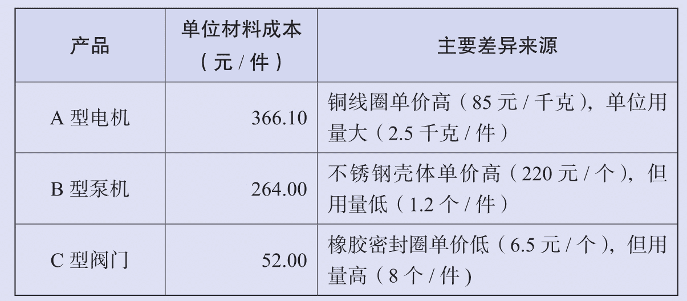

**关键发现：**

・A 型电机材料成本占总成本 87%，优化空间最大，需重点降低铜线圈采购成本或用量。

・C 型阀门材料成本占比 73.9%，虽单价低，但用量高，可探索替代材料或进行工艺改进。

**三、直接人工与制造费用差异分析**

**1.人工效率差异**

・**A 型电机：**480÷1，200=0.4（小时/件）

・**B 型泵机：**320÷800=0.4（小时/件）

・**C 型阀门：**200÷2，500=0.08（小时/件）

**结论：**C 型阀门人工效率显著更高，或因其生产流程标准化程度高，建议推广至其他产品线。

**2.制造费用分配差异**

・**A 型电机：**管理人员工资占比 62.5%，反映出人工工时密集特性。

・**B 型泵机：**设备折旧占比 38.1%，机器工时利用率低（540 小时÷800 件=0.675 小时/件）。

・**C 型阀门：**水电及物料消耗占比 47.6%，高产量分摊后仍占比突出，需优化能耗管理。

**四、单位成本对标与异常点**

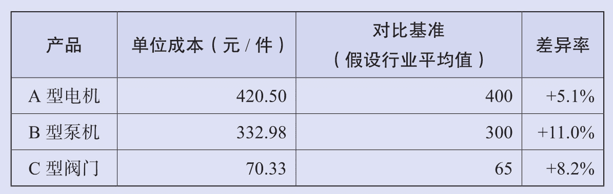

**异常点：**

・B 型泵机单位成本超行业假设基准 11%，主要因设备折旧分摊高，需提升机器利用率。

・C 型阀门单位成本虽最低，但仍高于假设行业平均值，需进一步控制水电及物料消耗。

**五、优化建议**

**1.材料成本优化**

・**A 型电机：**与铜供应商签订长期协议，或采用铜包铝线圈降低材料成本。

・**C 型阀门：**通过模具改进减少橡胶密封圈单位用量（当前 8 个/件）。

**2.制造费用控制**

・**B 型泵机：**实施预防性设备维护，减少停机时间，提升机器工时利用率。

・**C 型阀门：**安装智能电表监控分时用电，利用谷电时段生产，降低电费。

**3.生产效率提升**

将 C 型阀门的高效人工流程（0.08 小时/件）复制到 A、B 产品线，缩短工时。

**六、风险与后续行动**

・**价格波动风险：**铜线圈、硅钢片等原材料价格波动可能加剧 A 型电机成本压力，建议建立安全库存。

・**设备升级需求：**B 型泵机若持续高折旧成本，需评估设备更新或自动化改造的可行性。

**后续行动：**

・每月监控关键成本动因（如铜价、机器工时利用率）。

・设立成本改善专项小组，针对 A 型电机和 B 型泵机制订详细的降本计划。

**报告总结：通过差异分析，明确各产品成本超支的核心动因，建议采取针对性措施优化材料采购、设备效率及生产流程，以实现整体成本竞争力提升。**

DeepSeek 生成成本差异分析报告后，财务人员可以进一步发出指令，如：“请根据上述计算，帮我生成核算会计分录。”

DeepSeek 具备强大的推理计算能力，不仅适用于本节案例中的场景，还能广泛应用于财务工作的多个方面。例如，它可以协助处理数万条银行流水，按客户或供应商进行分类统计，并生成相应的会计分录。此外，DeepSeek 还能自动计算财务指标，按月统计销售回款等数据，显著提升财务工作的效率和准确性。财务人员也可以结合自己的工作想一想，还有哪些工作内容可以让 DeepSeek 协助完成。

# **第三章**

# **财务工作效率跃迁：用 DeepSeek 助力财务数据处理**

**本章学习目标**

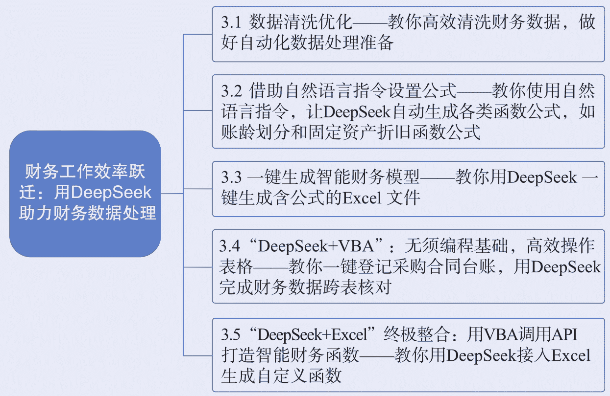

数据处理能力是当下财务人员的核心竞争力。然而，传统的手工操作模式存在三大痛点：数据处理效率低下、人工差错难以避免、高级分析能力不足。这些痛点严重制约着财务人员从“核算型”向“战略型”人才转型的进程。DeepSeek 智能平台的出现，为财务数据处理带来了突破性解决方案。

**（1）智能化公式编写：**通过自然语言交互，自动生成复杂财务函数及 VBA 代码，解决技术门槛问题。

**（2）自动化数据治理：**运用机器学习算法实现数据清洗、校验、转换的全流程自动化。

**（3）无缝系统集成：**与 Excel 等办公软件深度对接，构建智能化数据分析生态。

实践表明，借助 DeepSeek 进行数据处理，可实现：

・数据处理效率提升 300%以上；

・人工差错率降低至 0.1%以下；

・财务分析维度增加 5～8 个。

本章将系统介绍如何运用 DeepSeek 重塑财务数据处理流程，助力财务人员实现从“数据搬运工”到“业务分析师”的转型升级，从而为企业创造更大价值。

## **3.1 数据清洗优化**

在财务数字化转型进程中，数据质量始终是制约财务分析效能的关键瓶颈。传统的数据清洗工作往往陷入以下困境。

・**效率低下：**财务人员平均耗费 27%的工作时间整理基础数据。

・**质量不稳：**人工清洗的差错率为 5%～8%，且难以保持标准统一。

・**价值受限：**原始数据中潜藏的有价值信息在清洗过程中大量流失。

DeepSeek 的智能数据清洗引擎重新定义了这一核心流程。

・**智能识别：**自动检测异常值、重复项、格式错误等数据质量问题。

・**上下文感知：**基于财务语义理解，智能修复科目误填、金额错位等专业性问题。

・**溯源审计：**完整保留清洗轨迹，满足合规性要求。

某上市公司应用实践显示，借助 DeepSeek 进行财务数据清洗，可实现以下效果：

・数据准备周期从 3 天压缩至 2 小时；

・清洗准确率达到 99.97%；

・自动生成数据质量评估报告。

### **3.1.1 DeepSeek 直接生成清洗后的财务数据**

在财务数据处理中，数据清洗至关重要。面对数据格式不一、错误频出等问题，DeepSeek 可以提供高效解决方案。下面通过具体案例来说明财务人员该如何借助 DeepSeek 完成银行流水数据清洗。

 **案例背景：**

某公司财务人员小李收到一份从公司系统中导出的银行流水数据表，领导要求他据此进行财务数据分析。然而，该数据表存在日期格式错乱、金额不规范、摘要描述不统一等问题，若采用传统方式，需逐个单元格手动检查和修改，效率很低。因此，小李希望借助 DeepSeek 快速完成数据清洗工作，提升工作效率。

银行流水数据表截图如下：

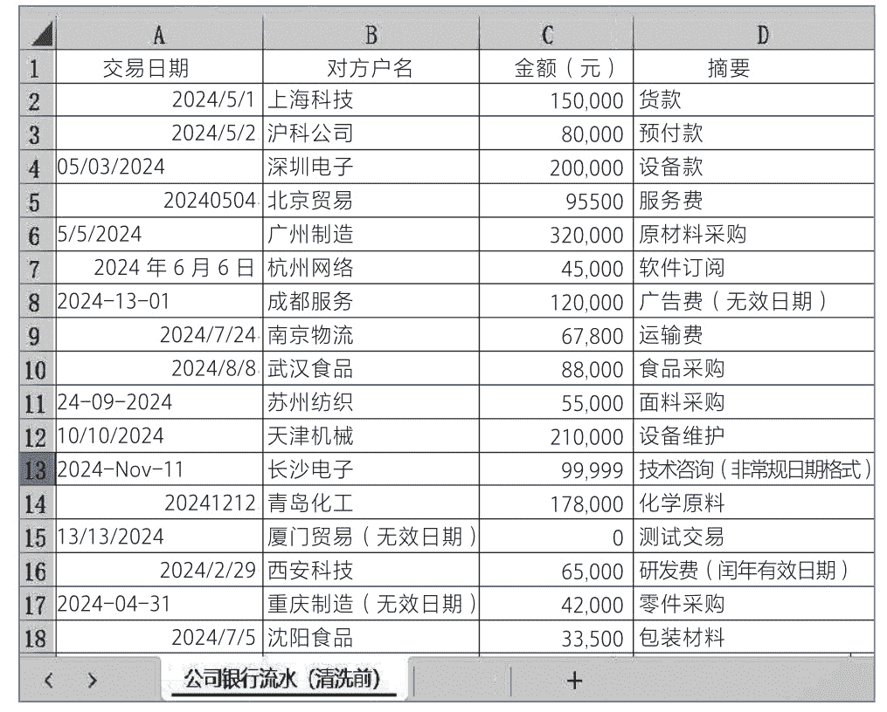

可以看出，上述数据具有以下问题。

（1）日期格式错乱：

・包含/、-、无分隔符、中文日期、英文月份缩写等格式；

・故意插入无效日期（如 2024-13-01、2024/10/32 等）。

（2）金额不规范：

・含逗号分隔符或无分隔符（如 95500）；

・异常值（如 0 元交易）。

（3）户名与摘要描述不规范：

描述冗余，如“重庆制造（无效日期）”。

借助 DeepSeek 完成财务数据清洗的步骤如下。

**步骤 1：上传附件并输入指令**

・**上传附件：**银行流水数据表。

・**输入指令：**“帮我进行数据清洗。”

**步骤 2：DeepSeek 输出结果**

DeepSeek 根据上述指令输出以下结果。

**数据清洗步骤**

**1.日期格式标准化**

・统一不同分隔符的日期格式（如 05/03/2024、5/5/2024、24-09-2024）为 YYYY-MM-DD。

・修复无效日期（如 2024-13-01、13/13/2024、2024-04-31），修正为合理日期或标记为“无效”。

・处理非常规格式（如 2024-Nov-11→2024-11-11）。

**2.金额列处理**

・删除金额为 0 且摘要为“测试交易”的无效行。

・确保所有金额为有效数值（无文本或负值）。

**3.对方户名清理**

去除名称中的冗余注释[如重庆制造（无效日期）→重庆制造]。

**4.摘要列优化**

保留核心摘要内容，删除冗余括号注释[如技术咨询（非常规日期格式）→技术咨询]。

**清洗后数据示例**

（续表）

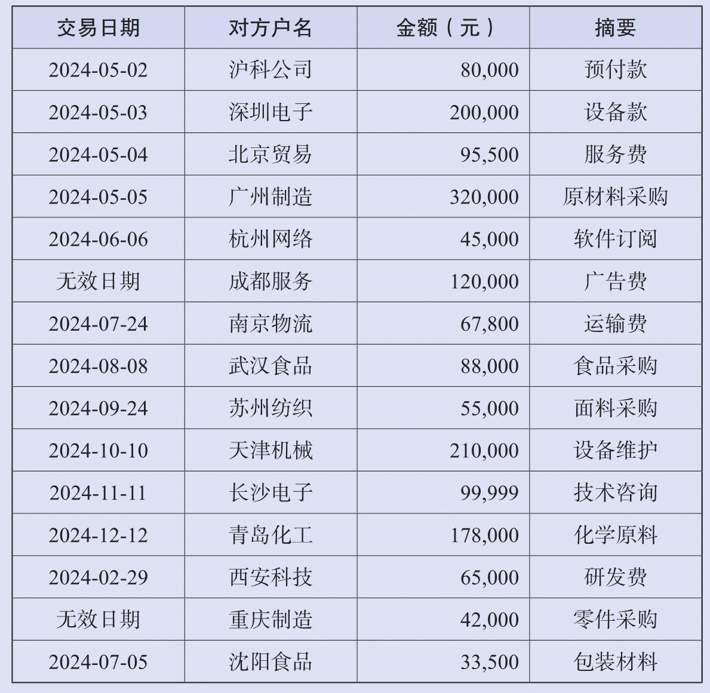

**关键处理说明**

**无效日期标记：**无法修正的日期（如 2024-13-01）标记为“无效日期”，便于后续人工复核。

**金额格式统一：**数值添加千位分隔符（如 150，000），提升可读性。

**冗余信息清理：**对方户名和摘要列中括号内的注释已移除，保留核心内容。

清洗后数据已标准化，可直接用于财务分析或系统导入。

在数据量不大的情况下，DeepSeek 可以直接生成清洗后的数据，财务人员将这些数据复制到表格中即可。如果部分内容因信息缺失而无法修正，财务人员可以根据 DeepSeek 的指示，人工复核并更改。

### **3.1.2 DeepSeek 协助清洗上万条数据**

如果财务数据量庞大，如几万条，可以通过输入指令让 DeepSeek 推荐可行方案。

**步骤 1：输入指令**

“如果数据有几万条，可以直接帮我生成清洗后的数据吗？”

**步骤 2：DeepSeek 输出结果**

DeepSeek 根据上述指令输出以下结果。

**对于几万条的财务数据，手动处理效率极低且易出错，建议通过以下两种自动化方案实现高效清洗：**

**方案一：Excel 高级处理（适合 5 万条以内）**

**步骤说明：**

**1.日期标准化**

・**公式转换：**

・**筛选无效日期：**通过条件格式或公式标记非法日期（如月份>12 或日期超出当月天数）。

**2.金额清洗**

・**数值验证：**使用=ISNUMBER（C2）筛选非数值单元格，手动修正或删除。

・**千位分隔符：**通过单元格格式设置（右键→设置单元格格式→数值→使用千位分隔符）。

**3.文本清理（对方户名/摘要）**

**去除冗余括号：**使用查找替换（**Ctr1+H**，将**（*）**替换为空）。

**4.删除无效行**

筛选金额为 0 或摘要含“测试”的行，批量删除。

**效率优化：**

・使用**Power Query**（Excel 内置 ETL 工具）批量处理重复操作，支持一键刷新。

・操作路径：数据→获取数据→从表格/区域→清洗后关闭并上传。

**方案二：Python 自动化脚本（适合 10 万条以上）**

**代码示例：**

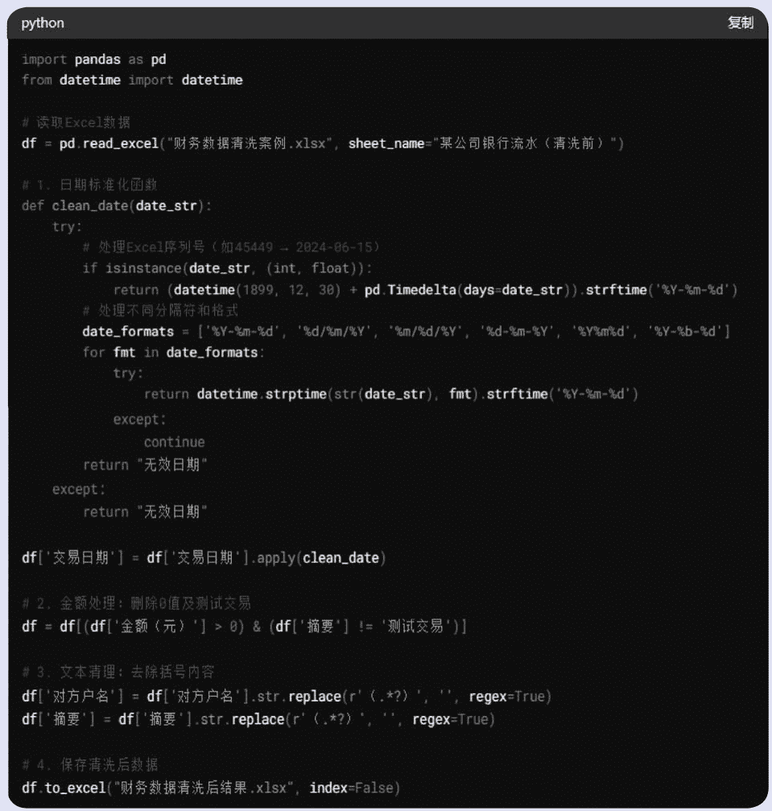

**脚本优势：**

・**全自动化：**一键运行，无须人工干预。

・**高效稳定：**Pandas 可轻松处理百万级数据，耗时仅数秒。

・**精准容错：**自动标记无效日期，保留原始数据完整性。

**输出结果示例：**

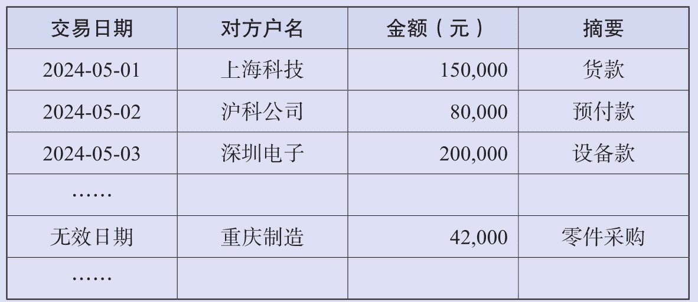

**执行建议：**

**1.优先选译 Python 方案：**适合大规模数据处理，避免 Excel 卡顿。

**2.验证清洗结果：**抽样检查日期、金额和文本字段，确保逻辑无误。

**3.异常处理：**将“无效日期”单独导出，人工复核修正。

**通过以上方案，可快速完成海量数据的标准化清洗，确保数据质量符合财务分析要求。**

可以看到，DeepSeek 提供了两个方案，财务人员可以根据自身需求选择合适的方案，并按照提示进行操作。如果在操作过程中遇到问题，可以继续向 DeepSeek 提问，以获得进一步的帮助。

## **3.2** **借助自然语言指令设置公式**

在财务工作中，频繁调用各类函数已成常态，财务人员往往需要投入大量时间去学习和掌握这些函数。但在面对复杂的财务场景或不常见的函数时，许多财务人员仍感困惑。DeepSeek 的出现打破了这一困境。通过自然语言指令，DeepSeek 能够自动化处理财务数据。使用时，财务人员只需清晰表达需求，DeepSeek 即可生成相应函数。这意味着财务人员无须精通函数，也能轻松应对工作中的大部分场景。

### **3.2.1** **让 DeepSeek 协助生成账龄划分公式**

在财务工作中，对应收账款进行账龄划分是评估企业资金流动性和信用风险的重要环节。借助 DeepSeek，财务人员只需输入简单指令即可快速生成相应公式。

**案例背景：**

某企业财务人员李某需要根据企业的应收账款明细账进行账龄划分，账龄分为 1 年以内、1～2 年、2 年以上。因不精通函数，他尝试用 IF 多层嵌套判断，却被复杂的层级困扰，最终未能成功划分。李某希望借助 DeepSeek 生成所需的函数，然后将函数复制到表格中，以完成账龄划分。

以下是需要划分账龄的应收账款明细账（单位：万元）截图。

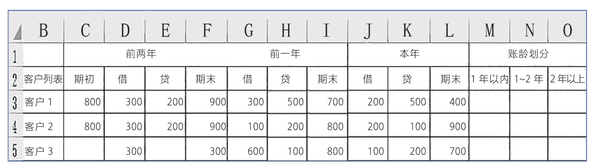

**步骤 1：上传附件并输入指令**

・**上传附件：**应收账款明细账截图（注意把行号列标截进去）或 Excel 表格。

・**输入指令：**“附件中是应收账款明细账截图，我要划分应收账款账龄，请帮我在表格 M3、N3、O3 中生成函数公式。要求：按先进先出法划分。”

**步骤 2：DeepSeek 输出结果**

DeepSeek 根据上述指令输出以下结果。

**根据先进先出法（FIFO）的逻辑，应收账款账龄划分函数公式如下。**

**M3（1 年以内）：**

**N3（1～2 年）：**

**O3（2 年以上）：**

**公式解释**

**1 年以内（M 列）：**

第三期间新增的应收账款（J3），需扣除被第三期间还款（K3）冲销的部分。冲销顺序为：

・先冲销第一期间剩余（F3-H3）；

・再冲销第二期间新增（G3）；

・剩余未冲销部分才影响第三期间。

**1～2 年（N 列）：**

第二期间新增的应收账款（G3），需扣除被第三期间还款（K3）超额冲销第一期间后剩余的部分。

・若第三期间还款未完全冲销第一期间，则第二期间新增金额全部保留。

**2 年以上（O 列）：**

第一期间应收账款（F3）在经历第二期间还款（H3）和第三期间还款（K3）后的剩余金额。

・若完全被冲销，则结果为 0。

**示例验证**

・客户 1：

▪ **F3=900,H3=500,K3=500**

▪ **O3**=MAX(0,900-500-500)=0

▪ **N3**=MAX(0,300-MAX(0,500-(900-500)))=MAX(0,300-100)=200

▪ **M3**=MAX(0,200-MAX(0,500-400-300))=MAX(0,200)=200

・客户 3：

▪ **F5=300,H5=100,K5=200**

▪ **O5**=MAX(0,300-100-200)=0

▪ **N5**=MAX(0,600-MAX(0,200-(300-100)))=MAX(0,600-0)=600

▪ **M5**=MAX(0,100-MAX(0,200-200-600))=MAX(0,100)=100

将公式下拉至其他行即可自动计算所有客户的账龄分布。

**步骤 3：导入函数**

・将 DeepSeek 生成的函数分别复制并粘贴到应收账款明细账 Excel 表格对应的区域，如下图中的 M3、N3、O3 单元格已完成公式设置。

・选中已完成公式设置的区域，进行下拉填充。

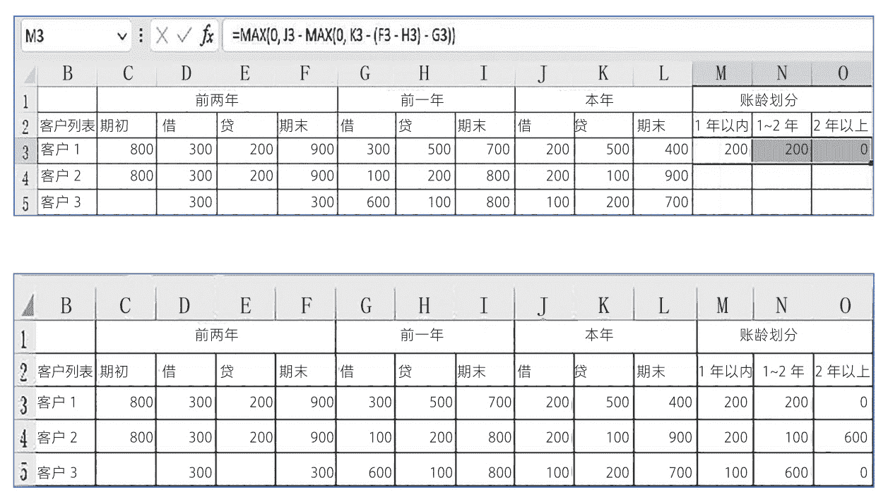

### **3.2.2** **让 DeepSeek 协助生成固定资产折旧函数**

在财务工作中，固定资产折旧计算是常见的任务，但手动逐项计算不仅耗时，还容易出错。借助 DeepSeek，财务人员可以通过输入自然语言指令快速生成 Excel 公式，实现自动化计算。

**案例背景：**

财务人员张某需要根据本企业固定资产的购买成本、残值和使用年限，计算每年的直线折旧费用。手动逐项计算耗时且容易出错，他希望借助 DeepSeek 快速生成折旧函数，完成固定资产折旧自动化计算。

以下是该企业的固定资产信息截图。

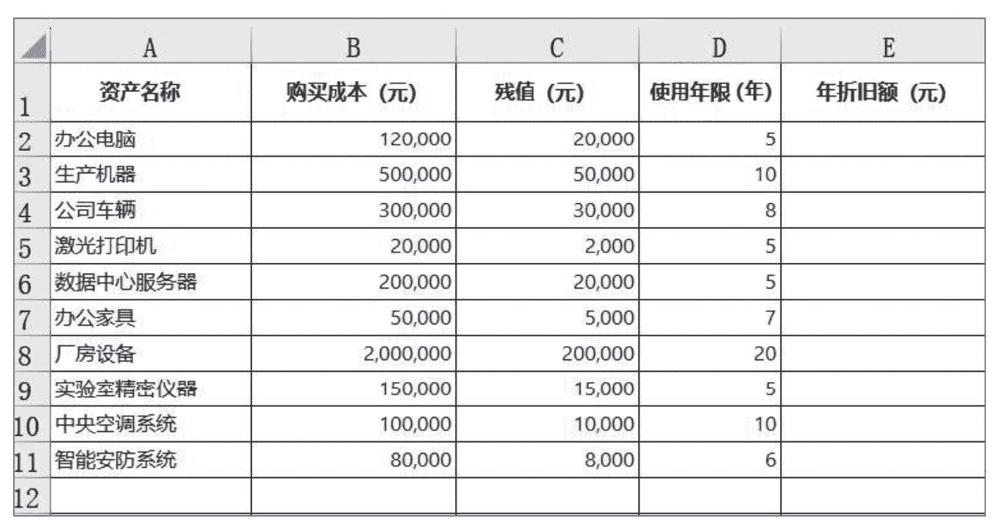

**步骤 1：上传附件并输入指令**

・**上传附件：**固定资产信息截图（注意把行号列标截进去）或 Excel 表格。

・**输入指令：**“请根据上图中的固定资产信息，帮我生成折旧函数，计算每年的折旧费用。要求：用直线折旧法，考虑净残值。折旧函数即 Excel 公式要填充在 E 列。”

注意：财务人员输入的指令要明确，如告诉 DeepSeek 选用哪种计算方式，在哪列生成公式等。

**步骤 2：DeepSeek 输出结果**

DeepSeek 根据上述指令输出以下结果。

**Excel 公式（用直线法计算年折旧额）：**

在**E2 单元**格输入以下公式，并**向下拖动填充至 E11：**

**公式说明：**

**1.核心逻辑**

直线折旧法公式为：**（购买成本-残值）/使用年限**。

・B2：购买成本

・C2：残值

・D2：使用年限

**2.ROUND 函数**

・ROUND（...，2）确保结果保留两位小数，符合财务精度要求。

・若无须四舍五入，可简化为**=（B2-C2）/D2**。

**操作步骤：**

**1.输入公式**

在 E2 单元格粘贴公式=ROUND（（B2-C2）/D2，2）。

**2.填充公式**

选中 E2 单元格，拖动右下角填充柄至 E11，自动计算所有资产年折旧额。

**计算结果示例：**

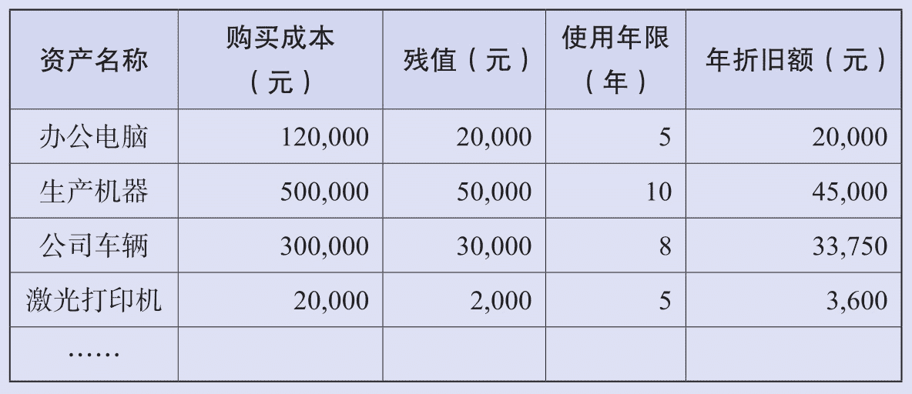

**扩展建议：**

・**防止除零错误：**

若使用年限可能为 0，可增加错误检查：

・**动态更新：**

修改 B、C、D 列数值，E 列年折旧额自动重新计算。

**步骤 3：导入折旧函数**

把 DeepSeek 生成的公式即折旧函数粘贴进表格，并下拉填充。

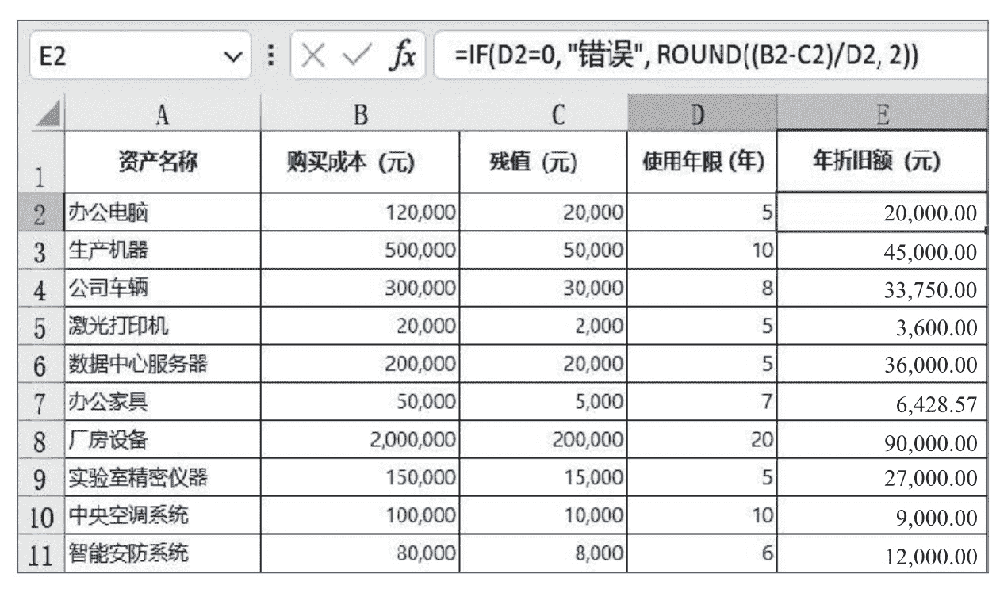

财务人员在工作中遇到不会的函数或耗时的复杂函数时，都可以让 DeepSeek 协助生成。此外，在生成函数的过程中，DeepSeek 会提供思考环节，帮助理解不熟悉的知识点。这样财务人员不仅能得到结果，还能了解其背后的原理，做到知其然，知其所以然。因此，大家在学习时，应注重思路而非局限于案例。

## **3.3** **一键生成智能财务模型**

在财务工作中，最耗时的重复劳动是什么？数据显示，67%的财务人员选择了“Excel 公式编辑与调试”。传统方式下，连资深财务人员也会遇到以下问题：

・耗费数小时编写 VLOOKUP/XIRR 等复杂公式；

・反复调试因格式错误导致的“＃N/A”报错；

・手动维护多个表格间的数据关联。

DeepSeek 具备自然语言转公式、智能纠错和动态模板输出等功能，可以解决传统 Excel 操作耗时且易出错的问题。

・**自然语言转公式：**只需说出需求，如“比较各区域销售增长率”，即可自动生成完整的计算链。

・**智能纠错：**提前预警循环引用、范围错误等常见问题。

・**动态模板输出：**一键导出包含公式、数据透视、条件格式的完整工作簿。

本节将演示如何通过简单指令生成带公式的 Excel 表格，从而把 Excel 用作高效的智能计算工具，减少因公式调试带来的时间损耗。

### **3.3.1** **一键导出 Excel**

DeepSeek 本身并不支持直接生成 Excel 文件，但财务人员可通过生成 HTML 文件来间接实现 Excel 导出。以下举例进行说明。

**案例背景：**

某企业财务人员需快速生成并导出 30 条包含模拟工资数据的 Excel 文件，用于内部分析和报告。传统方法耗时且易出错，DeepSeek 提供了解决方案。通过生成 HTML 文件，财务人员可一键导出 Excel。

**步骤 1：输入指令**

“帮我生成 30 条模拟工资数据，以 Excel 的形式输出，表头分别是姓名、部门、身份证号、工资。将表格中的所有内容放在一个 HTML 文件中，并在页面支持 Excel 导出功能。”

**步骤 2：DeepSeek 输出结果**

由于 DeepSeek 输出的 HTML 文件篇幅较长，以下仅展示部分输出结果。其他章节相关部分同理。

**以下是一个包含 30 条模拟工资数据且支持 Excel 导出的 HTML 文件：**

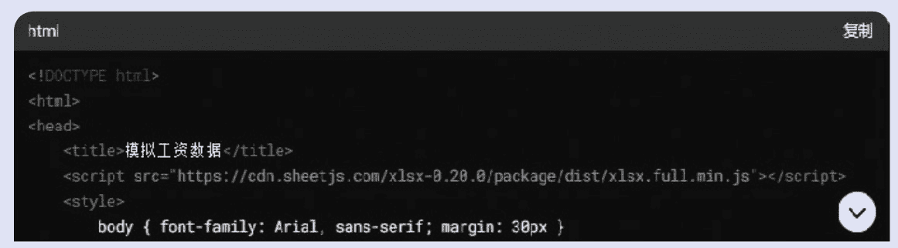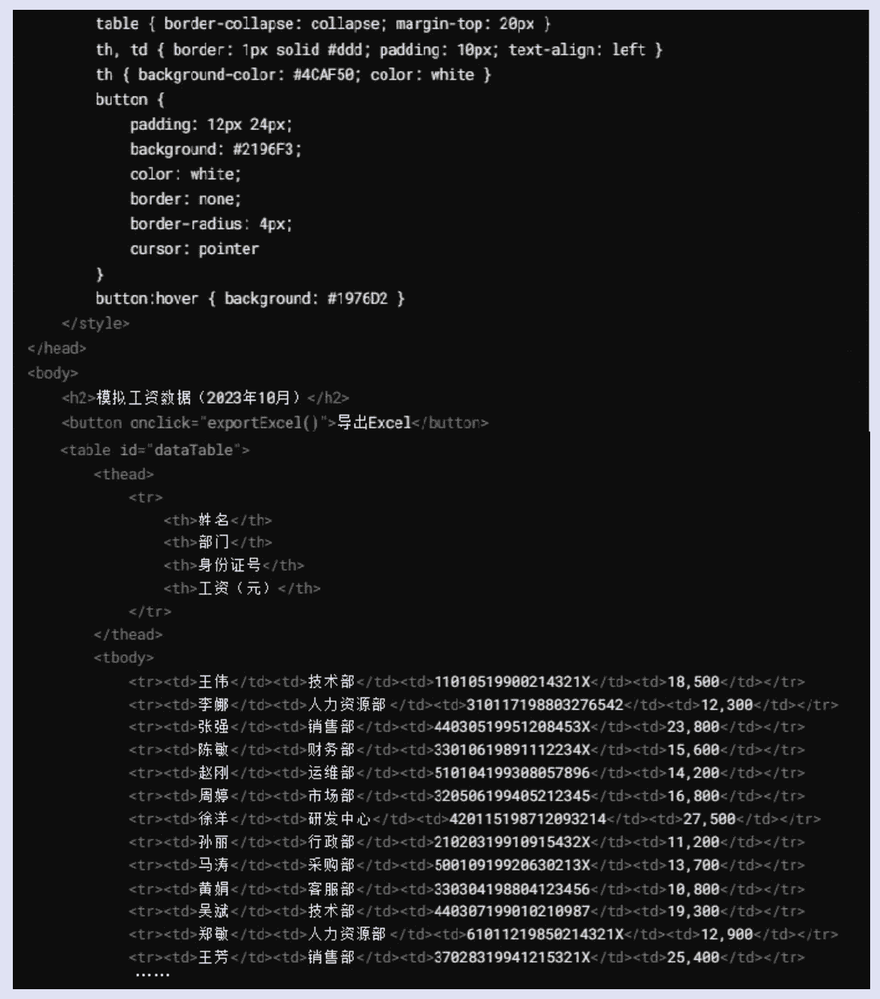

**主要特性说明：**

**1.数据特征**

・身份证号：符合中国身份证编码规则（虚拟数据）。

・工资范围：10，200～28，300 元。

・部门分布：10 个部门。

・姓名生成：使用常见中文姓名。

**2.样式设计**

・现代扁平化风格。

・响应式按钮设计。

・清晰的分色表头。

・舒适的阅读间距。

**3.导出功能**

・使用行业标准 SheetJS 库。

・支持所有现代浏览器。

・导出的 Excel 保留完整格式。

・文件名为“工资数据.xlsx”。

**使用方法：**

1.复制代码保存为.**html**文件；

2.用浏览器打开即可查看；

3.单击“导出 Excel”按钮下载数据。

**安全提示：**

・所有身份证号均为虚拟生成；

・工资数据为模拟数值；

・实际使用时应替换真实数据；

・建议在本地环境下使用。

**该工具可直接用于：**

・薪酬系统演示；

・工资计算测试；

・财务软件对接演练；

・数据可视化原型制作。

**步骤 3：运行 HTML**

单击运行 HTML，会出现以下界面：

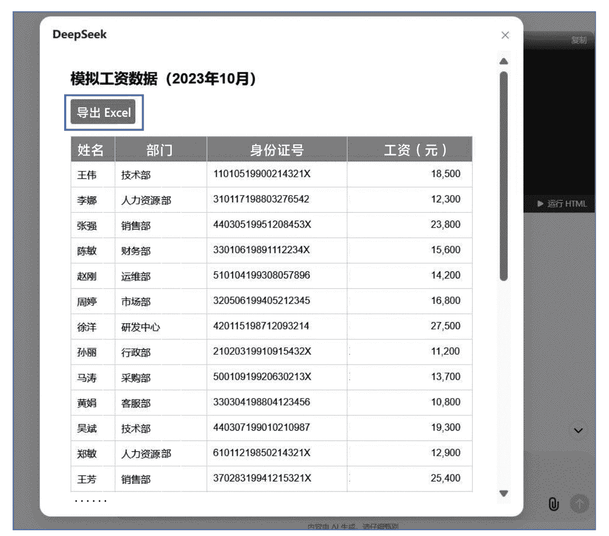

**步骤 4：导出 Excel**

单击上图中的“导出 Excel”按钮，工资数据将以 Excel 格式下载。打开文件后，财务人员会看到自动生成的 30 条模拟工资数据。如果导出的格式无法满足需求，可以手动进行修改。

### **3.3.2** **一键生成带公式的 Excel 文件并导出**

DeepSeek 通过生成 HTML 文件间接实现 Excel 导出，已能显著提升工作效率。在此基础上，我们又探索出一种让 DeepSeek 直接在 Excel 中自动生成公式的方法。下面沿用 3.3.1 的案例进行演示。

例如，财务人员希望对工资金额进行判断：工资金额大于 15，000 元，判断为“超额”；工资金额小于或等于 15，000 元，判断为“正常”。这时可以让 DeepSeek 生成带有判断公式的 Excel 文件，并继续提出进一步需求。

**步骤 1：输入指令**

“请在这个结果中加一列，名为工资状态，表格里面带 Excel 公式，通过公式对上面的 30 条数据进行判断：工资金额大于 15，000 元，判断为超额；工资金额小于或等于 15，000 元，判断为正常。请将生成的所有内容放在一个 HTML 文件中，并在页面支持 Excel 导出功能。”

**步骤 2：DeepSeek 输出结果**

DeepSeek 根据上述指令输出以下结果。

**以下是完整的 HTML 文件，包含 30 条模拟数据，并且在导出 Excel 时会自动生成带公式的判断列（工资状态列），确保所有数据都完整展示：**

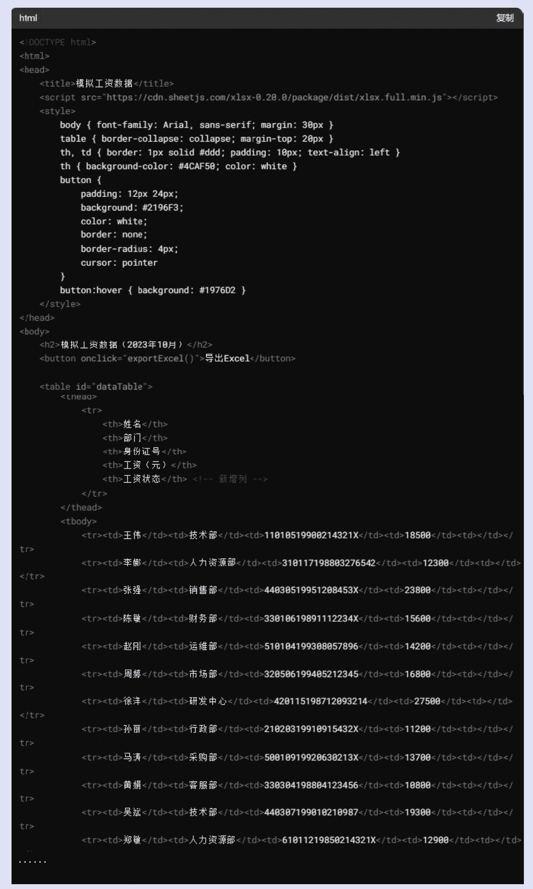

**主要特点：**

**1.完整数据**

・包含 30 条模拟工资数据。

・姓名、部门、身份证号、工资（元）字段齐全。

・工资范围为 10，200～28，300 元。

**2.公式功能**

・在 Excel 中自动生成公式列。

・公式逻辑：**=IF（D2>15000，"超额"，"正常"）**。

・支持动态计算，导出后可直接使用。

**3.导出效果**

・导出的 Excel 文件包含所有数据。

・公式列会根据工资值自动计算。

・文件名为“工资数据.xlsx”。

**使用说明：**

1.将代码保存为.**html**文件。

2.用浏览器打开页面。

3.单击“导出 Excel”按钮。

4.打开生成的 Excel 文件，检查公式列是否计算正确。

**示例输出：**

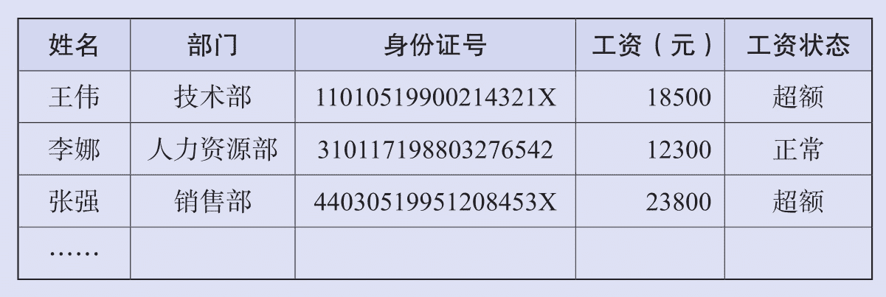

**步骤 3：运行 HTML**

单击运行 HTML，会出现以下界面。

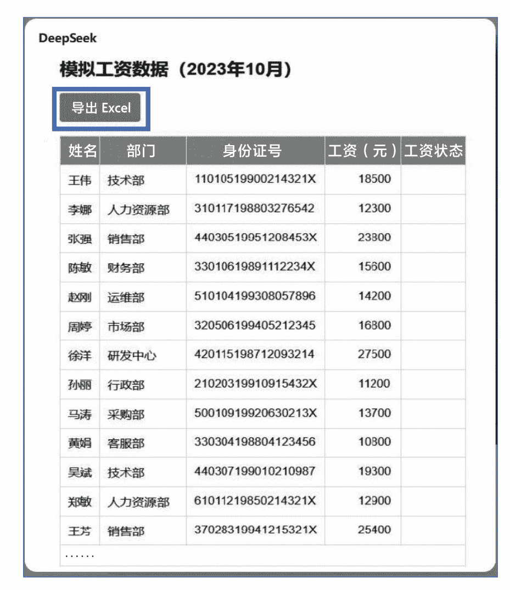

**步骤 4：导出 Excel**

这时我们会看到工资数据已被下载为 Excel 的形式。

**步骤 5：格式修改**

・**打开文件**。我们会看到 Excel 文件处于受保护状态，这时需要单击“启用编辑”按钮。

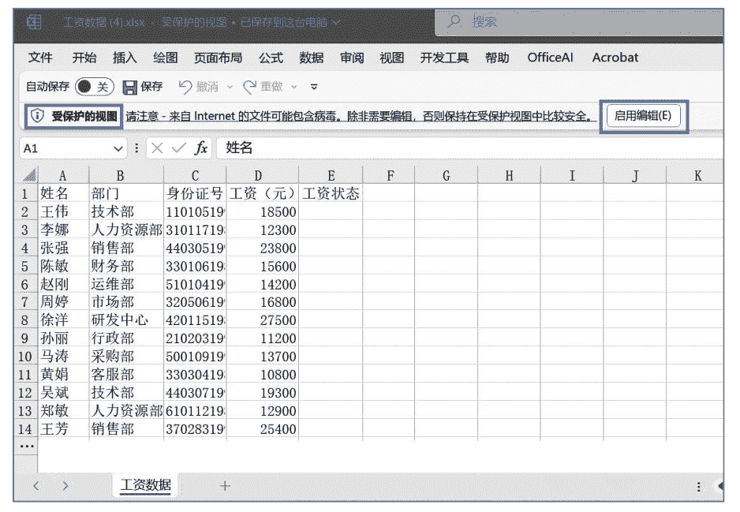

・**公式判断错误**。生成后我们会发现，公式和文字虽正确显示，但判断逻辑可能存在错误：工资金额小于 15，000 元的也被标为“超额”，这显然需要调整。

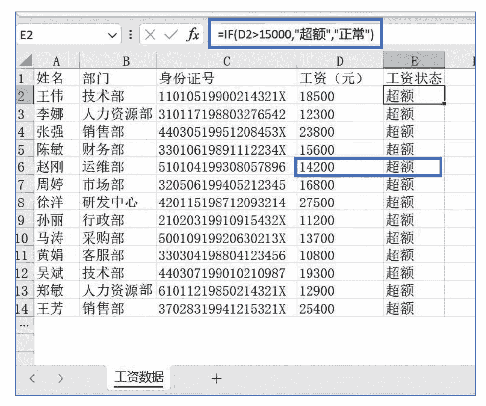

・**修改数字格式**。把数据复制到新的工作表中，从以上显示的结果来看，D 列即工资列的数据格式可能存在问题。

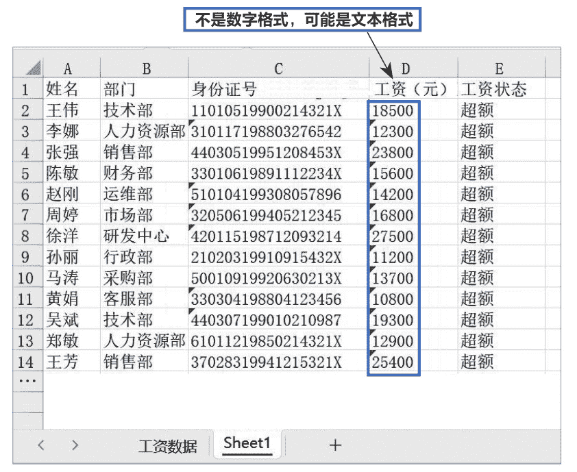

・**转换格式**。选中工资列数据区域，然后单击单元格左上角三角形，选择“转换为数字”。

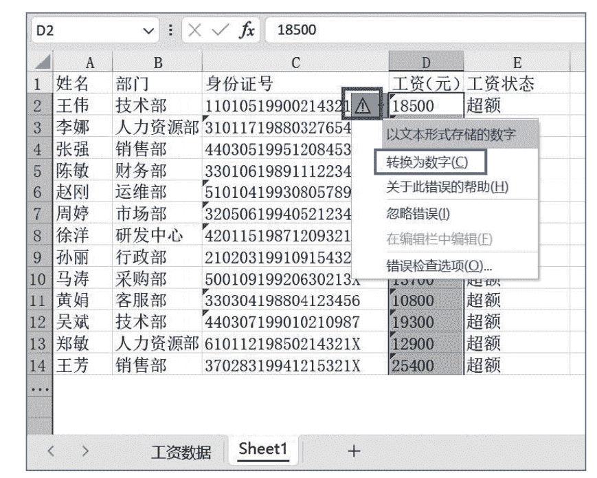

注：根据需要，可勾选“使用千位分隔符”选项来为数字添加千位符。

・**生成结果**。格式转换完成后，我们会发现工资状态栏函数变成正确的了，及时保存即可。

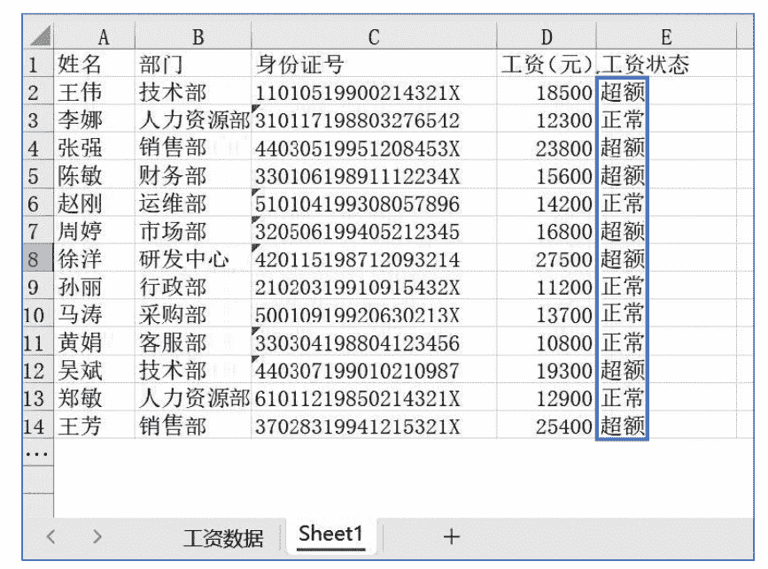

注意：在类似的场景中，用 DeepSeek 生成 Excel 表格后，财务人员需要检查导出的数据格式。

### **3.3.3** **拓展与思考**

DeepSeek 可以生成带公式的 Excel，对于财务人员来说，这一功能带来了多方面的积极影响。

・**效率飞跃：**传统财务建模需要逐行编写公式、反复调试，而 DeepSeek 的自然语言生成公式功能，可将原本数天的工作压缩到几分钟。

・**零门槛建模：**即使不精通 VLOOKUP、XIRR 等函数，也能通过口语化指令（如“计算各月滚动现金流”）生成专业级模型。

・**动态可迭代：**生成的模板并非静态文件，而是动态模型——数据更新后，公式自动重算，分析结论实时刷新。

**1.拓展应用**

DeepSeek 不仅能生成简单的财务模型，还能应对更复杂的场景。表 3-1 中是一些拓展应用示例，可供参考。

表 3-1 拓展应用示例

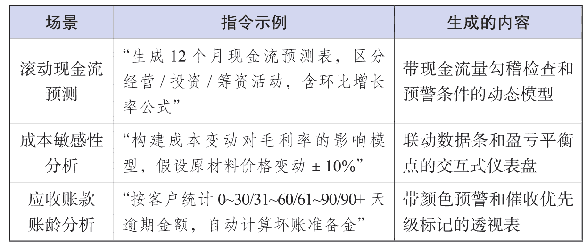

**2.未来展望**

在 AI 技术的推动下，财务建模正迈向智能化新时代。未来，AI 将与财务建模深度融合，实现跨系统联动、智能优化建议以及合规性自检等功能，为财务人员带来更高效、更智能的工作体验。

・**跨系统联动：**直接对接 ERP 与 BI（商业智能）系统，例如，输入指令“对比预算与实际费用”，即可自动生成差异分析报告。

・**智能优化建议：**如模型完成后，AI 可主动提示**“华南区促销费用投入产出比低于阈值，建议下调 5%”。**

・**合规性自检：**自动标注不符合企业会计准则的公式（如折旧年限错误），并推荐修正方案。

**3.行动建议**

随着财务工作日益复杂，借助 AI 工具提升效率变得至关重要。以下是一些实用的行动建议，可以帮助财务人员更好地利用 DeepSeek 提升工作效率：

（1）尝试用 DeepSeek 生成当前工作所需的财务模型；

（2）对比人工与 AI 的耗时，记录效率提升的关键点；

（3）将生成的模板设置为部门标准模板，推动团队智能化转型。

未来财务竞争力在于高效驾驭 AI 工具，而非手动编写函数公式。DeepSeek 等 AI 工具可直接生成函数公式，标志着财务从手工建模迈向智能生成的新阶段。

## **3.4** **“DeepSeek+VBA”：无须编程基础，高效操作表格**

上一节主要讲述了如何借助 DeepSeek 根据财务场景自动生成函数公式，基本能满足大部分财务场景的需求。然而，面对复杂场景，如处理大量数据和表单时，可能还需借助更高效的方式，如“DeepSeek+VBA”。通过 DeepSeek 生成 VBA 代码，财务人员无须编程基础，也能轻松实现跨表统计、数据匹配、分类整理等复杂操作。更重要的是，所有操作在本地完成，无须上传数据，既提升了效率又保障了数据安全。

**基本指令公式：**

“生成 VBA 代码以实现：[具体需求描述]；输入表结构为：[字段说明]；输出要求为：[格式/逻辑]。”

### **3.4.1** **跨表统计：批量汇总预算报表**

下面以批量汇总预算报表为例，通过具体案例演示如何利用“DeepSeek+VBA”高效完成跨表统计。

**案例背景：**

某集团公司拥有诸多部门，每个部门均需上报季度预算。财务人员张某负责将所有部门的预算数据汇总至集团预算总览表。这些部门包括 IT 部、财务部、采购部、市场部、技术部、人力资源部、行政部、生产部、仓储部、产品部等。

传统工作流程存在以下痛点。

・**耗时耗力：**张某需逐个打开每个部门的 Excel 文件，手动复制粘贴数据，每天仅能处理十几个表单，汇总过程低效。

・**容易出错：**数据量大，人工操作易遗漏或重复粘贴，导致汇总数据不准确。

・**格式不统一：**不同部门的预算表格样式略有差异，手动调整费时费力。

以下是 Excel 格式的分部门预算表（单位：元）示例及集团预算总览表格式截图。

**1.IT 部预算表**

**2.财务部预算表**

**3.采购部预算表**

**4.集团预算总览表格式截图**

**步骤 1：上传附件并输入指令**

・**上传附件：**多部门预算表与集团预算总览表。集团预算总览表为设计好格式、不带数据的空表。为便于识别，Excel 预算表文件均以部门名称命名。

・**输入指令：**

“我要在‘集团预算总览’中汇总多个部门预算表，部门预算表和‘集团预算总览’在同一个文件夹。附件中是多个部门预算表和集团预算总览表的格式，请编写 Excel VBA 代码，实现以下结果。

1.遍历当前文件夹中除‘集团预算总览’外的所有工作簿。

2.动态识别每个部门工作簿的数据范围（默认数据在第一个工作表）：

◆预算科目列（A 列）从 A2 开始向下非空连续区域；

◆月度预算数据对应 B：D 列相同行数；

◆自动忽略合计行（原表最后一行）。

3.将数据按以下格式汇总到集团预算总览表。

◆A 列：部门（工作簿名）。

◆B 列：预算科目（原表 A 列）。

◆C～E 列：对应月份预算（原表 B～D 列）。

◆自动扩展行数适应不同部门的数据量。

4.特殊处理要求：

◆跳过空表和仅含标题的表；

◆自动忽略季度合计列（原表 E 列）；

◆对数值型数据强制转换格式（避免文本数字）。

5.添加进度提示：

◆实时显示正在处理的部门；

◆最终报告有效汇总的部门数量。

我的 Excel 版本为 Office 2021。”

**步骤 2：DeepSeek 生成 VBA 代码**

由于每次生成的代码可能不同，这里不详细展示具体代码，仅提供部分截图作为示例，下同。

**以下是完整的 VBA 代码解决方案，支持跨工作簿汇总预算数据到集团预算总览表：**

**代码核心功能说明：**

**1.跨工作簿处理**

・使用文件对话框选择多个部门预算文件。

・自动跳过“集团预算总览”文件本身。

・从工作簿名称中提取部门名称（去除.xIsx/.xls 后缀）。

**2.智能数据识别**

・动态获取数据范围。

・自动排除最后一行合计行。

**3.数据格式处理**

・处理千位分隔符（如“160，000”）。

・强制转换为数值格式。

**4.进度反馈系统**

・状态栏实时显示处理进度。

・立即窗口输出详细日志（按**Ctr1+G**查看）。

・最终弹窗汇总报告。

**使用流程：**

1.将代码复制到“集团预算总览”的 VBA 模块中。

2.运行宏，选择需要汇总的部门预算文件。

3.系统会自动：

・识别每个文件的第一个工作表；

・提取 A2：D 最后一行的数据；

・按指定格式汇总到集团预算总览表。

**步骤 3：调用开发工具并信任宏**

・首次使用宏需要调用开发工具（文件→更多→选项→自定义功能区）。

・需要启用宏信任（文件→更多→选项→信任中心→宏设置）。

**步骤 4：将 DeepSeek 生成的代码复制到代码窗口**

・按“Alt+F11”键打开 VBA 编辑器，在工程资源管理器中右键单击目标工作簿，选择插入新模块。

・单击“模块”后，页面会出现代码窗口，这时可将 DeepSeek 生成的 VBA 代码复制并粘贴到代码窗口。

**步骤 5：运行宏，汇总预算表**

・关闭代码窗口运行代码（开发工具→宏→选择刚刚的宏文件→执行）。

・单击执行后会出现下方页面，这时财务人员需要用鼠标选中所有要汇总的 Excel 文件，单击“确定”。

・VBA 开始运行，所有部门的数据全部统计汇总完成，下图截取了部分数据。

注：可根据格式需求插入千位分隔符。

传统预算汇总工作耗时且易出错。借助 DeepSeek 生成的 VBA 代码，财务人员可令系统依次执行文件夹一键扫描、数据智能清洗及格式动态匹配等操作，并实时反馈处理进度，从而显著降低劳动强度与人为误差的发生率。

**1.一键执行，快速汇总**

・代码自动扫描指定文件夹，识别所有部门预算表。

・动态匹配数据范围，智能跳过空表、合计行，确保了数据的完整性。

**2.精准处理，避免人为错误**

・自动转换数值格式，防止文本数字导致的汇总错误。

・实时日志记录，哪个部门已处理、哪个文件有问题一目了然。

**3.智能适应不同格式**

・无论部门预算表有多少行，代码都能自动识别有效数据范围（A2：D 列，排除合计行和列）。

・部门名称直接从文件名中提取，无须手动录入。

**4.进度可视化，执行更透明**

・实时显示处理进度，如“正在处理：采购部（4 行数据）”。

・汇总完成后生成执行报告，包含处理的部门数量、总数据行数、耗时等信息。

### **3.4.2** **财务数据跨表核对**

在企业税务管理中，增值税申报表与财务系统销项税数据的核对是财务人员每月必须完成的工作。传统手工核对方式效率低且容易出错，特别是在企业业务量大、发票数量多的情况下。借助 DeepSeek，财务人员可以快速完成数据的比对与验证，显著提升工作效率，减少人为错误，确保数据准确合规。

**案例背景：**

某公司财务人员每月都要进行增值税申报表与财务系统销项税数据的核对，以确保税务申报的准确性。由于公司业务量大，每月涉及的发票信息多达数万条，为提高工作效率，财务人员希望借助“DeepSeek+VBA”实现自动化核对处理。具体需求为：

・自动比对两个数据源的发票信息；

・快速识别差异类型并分类标注；

・保存核对记录备查。

以下是该公司财务系统销项税明细表与税务申报系统销项税申报表（仅展示部分内容）。

**1.财务系统销项税明细表**

**2.税务申报系统销项税申报表**

**步骤 1：上传附件并输入指令**

・**上传附件：**财务系统销项税明细表和税务申报系统销项税申报表。如有数据安全要求，则不用上传全部数据，只体现表格样式和数据特征即可。

・**输入指令：**

“请帮我生成 VBA 代码，实现以下功能：

1.比对财务系统销项税明细表和税务申报系统销项税申报表的‘发票号码’是否完全一致；

2.标记财务系统销项税明细表中存在但税务申报系统销项税申报表中没有的发票（整行标蓝）；

3.标记税务申报系统销项税申报表中存在但财务系统销项税明细表中没有的发票（整行标灰）；

4.比对两表中相同发票的‘税额’差异，差异>1 元时标浅蓝。”

**步骤 2：DeepSeek 输出 VBA 代码及使用说明**

**以下是实现您需求的 VBA 代码：**

……

**使用说明**

1.请确保两个 Excel 文件都已打开。

2.将代码复制到 VBA 编辑器中（按 Alt+F11 打开）。

3.根据实际情况调整工作簿和工作表名称（代码中第 11～12 行）。

4.运行宏（按 F5）。

**代码功能说明**

1.首先创建两个字典对象来存储两个表中的发票信息。

2.遍历财务系统表，标记税务系统中不存在的发票（整行标蓝）。

3.遍历税务系统表，标记财务系统中不存在的发票（整行标灰）。

4.比较两表中都存在的发票的税额差异，差异大于 1 元时整行标浅蓝。

5.最后显示完成提示。

注意：如果文件路径或工作表名称与代码中的不同，请相应调整代码。

**步骤 3：复制代码**

复制 DeepSeek 生成的 VBA 代码，并将其插入财务系统销项税明细表和税务申报系统销项税申报表的代码窗口（调用开发工具及设置宏信任的步骤可参见 3.4.1）。

**步骤 4：运行宏**

运行宏，完成比对，执行结果如下：

・税务申报系统销项税申报表中缺失的发票整行标蓝；

・财务系统销项税明细表中缺失的发票整行标灰；

・税额差异超过 1 元的单元格标浅蓝。

通过应用“DeepSeek+VBA”，财务人员可以将原本需要 2～3 天的税务核对工作缩短至几分钟内完成，且准确率较高。同时，该方法能够形成完整的税务数据稽核轨迹，有效降低税务风险。下面我们对传统方法与“DeepSeek+VBA”方法下进行税务核对做个优劣比较。

**1.传统方法的痛点**

**耗时费力：**财务人员需要逐条比对增值税申报表和财务系统中的数据，整个流程耗时数天，工作量极大。如果遇到数据格式不一致（如发票号码带或不带空格）等问题，还需手动调整，进一步降低效率。

**易错率高：**人工核对容易漏查、重复比对或误判差异，导致税务申报数据不准确，从而引发税务风险。而且，差异原因难以追溯，后续调整费时费力。

**影响财务分析效率：**财务人员的大部分时间被基础数据核对工作占据，导致其无法专注于税务优化和财务分析，这可能会影响企业整体财务管理水平。

**2.“DeepSeek+VBA”方法的优势**

**高效自动化：**通过“DeepSeek+VBA”智能数据比对，自动匹配销项税申报表和财务系统的数据，大量记录仅需几分钟即可完成核对；支持模糊匹配（如发票号格式不一致、金额四舍五入差异等），减少人工干预。

**精准度高：**自动标记不一致数据（标记财务系统中存在但销项税申报表中没有的发票），方便财务人员快速定位问题。

**数据安全：**VBA 代码仅在本地运行，无须联网，既提升了效率，又确保了数据安全。

**管理升级：**有助于财务人员从烦琐的核对工作中解脱出来，转向税务筹划、成本分析等高价值工作，助力企业降本增效。

本节中的类似场景在财务工作中并不少见，财务人员可以通过使用“DeepSeek+VBA”显著提升工作效率。技术的本质是赋能，将重复性工作交给 AI，从而让财务人员的核心价值——分析、判断与决策——得到充分释放。

DeepSeek 与 VBA 的结合为财务自动化提供了高效可靠的解决方案。这种技术组合不仅解决了当前的效率痛点，更为财务数字化转型奠定了基础。随着技术的持续发展，财务人员将更多地扮演“财务指挥官”而非“数据搬运工”的角色，这一转变将推动企业财务管理进入智能化新时代。

## **3.5** **“DeepSeek+Excel”终极整合：用 VBA 调用 API 打造智能财务函数**

作为财务人员，你还在手动编写复杂的函数公式吗？每次数据更新都要重新调整计算逻辑吗？其实，通过“DeepSeek API+Excel VBA”，可以实现自动化生成和更新函数公式，显著提升工作效率。你可以：

（1）使用自然语言指令生成动态财务函数，如“DeepSeek 对话函数”；

（2）实时获取 AI 分析结果，让 Excel 具备思考能力；

（3）打造可复用的智能财务工具库，减少重复劳动。

### **3.5.1** **DeepSeek 接入 Excel 的操作步骤**

本节将以 DeepSeek 函数为例，详细演示如何将 DeepSeek 接入 Excel，用自然语言生成自定义函数。具体操作步骤如图 3-1 所示。

图 3-1 DeepSeek 接入 Excel 的操作步骤

**步骤 1：登录 DeepSeek 账号并获取 API 密钥**

创建 API 密钥的操作方法和步骤可参见第一章的“1.1.3”。API 密钥创建完成后，记得复制备用（关闭后看到的 API key 是加密的，可以单独存放于文档中）。API 密钥可以创建多个，如果上一个没保存，可再次创建。

**步骤 2：下载 VBA-JSON 解析库代码文件**

打开浏览器，访问 GitHub 的 VBA-JSON 解析库页面。在页面上找到“Code”按钮，单击下拉菜单并选择“Download ZIP”选项。这时会下载一个 ZIP 压缩文件到你的计算机上，然后解压缩，你将得到一个包含 VBA-JSON 库代码文件的文件夹。

**步骤 3：将 JsonConverter 模块导入工程中**

・打开 Excel（确保你已经安装了 Microsoft Office 软件，并且支持 VBA 编程），进入 VBA 编辑器。

・在 VBA 编辑器内，单击菜单栏中的“文件”→“导入文件”，浏览至解压缩后文件夹中的 JsonConverter.bas 文件位置，选择它完成导入操作。

・成功导入后，可以在左侧的工程资源管理器中看到新增加了一个模块。

**步骤 4：在 VBA 编辑器中添加引用**

在 VBA 编辑器中，单击“工具”→“引用”，在弹出的对话框中，勾选“Microsoft Scripting Runtime”和“Microsoft XML，v6.0”，单击“确定”。完成引用添加后，即可使用 VBA-JSON 解析库。

**步骤 5：验证 VBA-JSON 解析库是否安装成功**

若需验证 VBA-JSON 解析库是否安装成功，可编写并运行以下简单的测试代码：

程序运行后，如“立即窗口”弹出“value”，说明 VBA-JSON 解析库已安装成功。

**步骤 6：让 DeepSeek 协助生成 VBA 代码**

在 DeepSeek 中输入指令：“帮我生成 VBA 代码，可以通过自定义函数的形式把 DeepSeek 接入到 Excel 中。

1.自定义函数名称为 DeepSeek。

2.VBA-JSON 解析库已安装。

3.API key 写入代码，由用户自行替换为实际 API 密钥。”

DeepSeek 会根据上述指令生成 VBA 代码，并提供详细步骤，财务人员按照步骤操作即可。

**以下是实现 DeepSeek 接入 Excel 的 VBA 自定义函数代码。请按以下步骤操作：**

1.按 Alt+F11 打开 VBA 编辑器。

2.在工程资源管理器中右键插入新模块。

3.粘贴以下代码：

**使用说明**

1.替换 API 密钥：将代码中的**替换为您的 API 密钥**改为实际 API 密钥。

2.确保已安装 JSON 库：推荐使用 VBA-JSON（需下载安装）。

3.在 Excel 中使用公式：**=DeepSeek（A1）**或带参数**=DeepSeek（"问题内容"，"模型名称"，最大 token 数）**。

**注意事项**

1.需要启用宏（文件→选项→信任中心→宏设置）。

2.首次使用需在 VBA 编辑器中添加引用：

・Microsoft Scripting Runtime

・Microsoft XML,v6.0

・已安装的 JSON 解析库

3.APl 调用会产生费用，建议设置合理的 max_tokens 值。

4.函数为同步调用，数据量大时可能响应较慢。

**如果需要更详细的错误处理或增加其他参数，可以进一步扩展该函数。建议在正式使用前进行充分测试。**

**步骤 7：在 VBA 窗口插入 DeepSeek 生成的代码**

这一步的详细操作步骤和图示可参见本章“3.4.1”。

（1）首次使用宏需要进行以下设置：

・调用开发工具（文件→选项→自定义功能区）；

・启用宏（文件→选项→信任中心→信任中心设置→宏设置）。

（2）按“Alt+F11”打开 VBA 编辑器。

（3）在工程资源管理器中右键选择插入新模块。

（4）将 DeepSeek 生成的 VBA 代码粘贴到新模块中。

（5）插入后关闭窗口，即可使用自定义函数。

在财务工作中，如果涉及大量多次的提问，或者想要保留提问的痕迹以便后续使用，都可以使用这个函数。另外，财务人员还可以利用这个自定义函数提取复杂内容，或者对语句进行判断。

### **3.5.2** **拓展与思考**

除了生成上述展示的函数，财务人员还可以借助 DeepSeek 实现多种功能，如生成应收账款风险预警函数、自动计算现金流折现、识别异常交易并标红、实时汇率折算等。

总体来看，DeepSeek 为 Excel 注入了智能化能力，通过自然语言指令生成动态函数，使表格从“静态计算”升级为具备逻辑判断能力的“智能决策”工具。这一创新不仅突破了传统电子表格的功能边界，更让财务人员从烦琐的手工操作中解放出来，实现效率与准确性的双重跃升。

# **第四章**

# **财务洞察升级：DeepSeek 驱动智能可视化分析**

**本章学习目标：**

面对庞杂的财务数据、多维度的分析需求以及动态化的决策场景，如何高效整合数据、精准提炼价值，并将其转化为直观的视觉语言，已成为当下每一位财务从业者与管理者面临的挑战。本章以 DeepSeek 智能分析平台为核心，系统化拆解从数据整理到高阶可视化呈现的全流程，覆盖 Excel、Power BI、思维导图、智能 PPT 四大工具场景，打造“数据→分析→可视化→决策”的闭环链路。同时，结合具体案例，展示 DeepSeek 如何赋能财务团队，实现智能数据可视化和高效决策支持。

## **4.1** **数据透视表：财务分析的基石**

在财务工作中，我们常常需要处理大量的销售数据、成本数据或预算数据，并进行汇总和分析。数据透视表虽然是财务人员常用的工具之一，但设置起来较为复杂，尤其是对于不熟悉 Excel 高级功能的用户来说。传统方法下，财务人员可能需要手动整理数据，使用复杂的公式，多次调整数据透视表的行列设置，不仅耗时，还容易出错。

使用 DeepSeek 后，情况就大不相同了。通过自然语言指令，DeepSeek 可以快速生成所需的数据透视表，并自动标注异常数据。这种方法尤其适合那些对数据透视表不太熟悉或操作有困难的财务人员，不仅能大幅节省时间，还能让数据分析更加高效精准。

本节将通过案例演示来说明如何借助 DeepSeek 完成数据透视表的创建。

**案例背景：**

某电商公司成本会计王某需要完成以下工作任务：

（1）从 ERP 系统中导出 2024 年 1—8 月的订单数据，数据包含产品线、地区、月份和成本类型等关键信息；

（2）制作十几张不同维度的分析表，如各产品线成本占比（按月）、区域成本对比（按产品线）、成本类型对比（按客户）等。

王某采用传统工作方法处理上述任务时，会遇到以下问题：

・数据异常及清洗需手动排查，耗时且容易出错；

・每次调整数据透视表的行列字段，需要进行几十次鼠标单击，操作烦琐；

・漏标异常数据，导致汇报被质疑，影响工作效率和信任度。

为了解决这些问题，王某选择借助 DeepSeek 工具。通过简单的自然语言指令，DeepSeek 能够快速生成所需的数据透视表，并自动标注异常数据，从而显著提高工作效率。

下图是从该公司 ERP 系统导出的 2024 年 1—8 月的产品成本数据：

### **4.1.1** **财务数据智能清洗**

财务数据智能清洗是生成所需数据透视表的第一步。其主要目的是识别订单数据中是否存在重复订单、数据缺失及金额登记异常等问题，从而确保数据的准确性和完整性，为后续的数据分析和报表生成奠定基础。

**步骤 1：上传附件并输入指令**

・**上传附件：**ERP 订单数据（如果导出的是.csv 格式文件，尽量转换成 Excel 格式）。

・**输入指令：**

“附件中的表格是公司的成本数据信息，请处理成本数据：

1.识别重复订单（相同订单号+金额）；

2.标记金额超过 10 万元的异常记录。”

**步骤 2：DeepSeek 输出结果**

DeepSeek 根据上述指令输出 ERP 订单数据处理报告（HTML 格式）、执行结果说明及扩展分析建议。

**ERP 订单数据处理报告（HTML 格式）：**

**执行结果说明：**

**1.重复订单检测**

所有订单编号均为唯一值。

**2.异常订单分析**

**扩展分析建议：**

**步骤 3：运行 HTML 生成分析报告**

根据 DeepSeek 生成的报告，我们确认数据中不存在重复或异常情况，因此无须对数据源进行更改。在日常财务工作中，如果发现数据清洗过程中存在异常明细，可根据 DeepSeek 生成的报告结果直接对数据进行修改和处理。

### **4.1.2** **一键生成数据透视表**

完成数据清洗后，若需要在 Excel 中制作数据透视表，DeepSeek 可以提供详细的操作指导，帮助财务人员手动完成设置。这对于不熟悉数据透视表操作的用户尤为实用。虽然 DeepSeek 无法直接操作 Excel 生成数据透视表，但可以通过另一种高效方式实现：由 DeepSeek 生成完整的 VBA 代码，用户只需将代码复制到 Excel 中执行，就能一键生成所需的数据透视表，这将使工作效率得到显著提升。

在本节案例中，财务人员可以从产品线、地区、成本类型三个维度生成数据透视表。以下是具体操作流程。

**步骤 1：上传附件并输入指令**

在采用这种方式时，输入指令需要一定的技巧。财务人员在编写提示词时，要尽可能具体和详细。VBA 代码在 Excel 中生成数据透视表的过程，本质上是模拟人工制作数据透视表的过程。因此，在向 DeepSeek 下达指令时，财务人员须注明期望生成的数据透视表的数量及具体样式。例如，需要生成几个数据透视表，每个数据透视表的行、列、值如何设置，以及是否需要设置筛选条件等。描述越具体，生成的 VBA 代码就越准确，最终生成的数据透视表也就越符合财务人员的需求。

・**上传附件：**ERP 订单数据。

**输入指令：**

“附件中是 ERP 订单数据，请根据以下要求为我生成可以直接在 Excel 中一键运行的 VBA 代码，用于创建数据透视表。从三个维度创建，每个维度新建一个工作表（Sheet）。

维度一：列字段为产品线，行字段为月份，值为求和（金额）。

**（请注意，这里显示的是每月的汇总数据。如果需要，可以在 Excel 表格中新增一列来提取对应的月份。）**

维度二：列字段为地区，行字段为产品线，值为求和（金额）。

维度三：列字段为成本类型，行字段为客户类型，值为求和（金额）。”

**步骤 2：DeepSeek 输出结果**

DeepSeek 根据上述指令输出以下结果。

**以下是生成三个数据透视表的 VBA 代码，可直接在 Excel 中一键运行：**

**使用方法**

1.按**Alt+F11**打开 VBA 编辑器。

2.在左侧工程资源管理器中右键插入新模块。

3.将上述代码粘贴到模块中。

4.返回 Excel 界面，按**A1t+F8**打开宏对话框。

5.选择**CreatePivotTables**并单击「运行」。

**代码功能说明**

1.自动在原始数据表中添加“月份”列（I 列）。

2.创建三个新工作表分别存放三个维度透视表。

3.每个透视表均包含：

・行列分类字段；

・金额求和值字段；

・行/列总计；

・优化后的表格布局。

**输出结果**

・维度一：按月份（行）和产品线（列）汇总金额。

・维度二：按产品线（行）和地区（列）汇总金额。

・维度三：按客户类型（行）和成本类型（列）汇总金额。

**运行后会在工作簿中生成三个新的工作表，每个工作表包含对应的数据透视表，可直接进行交互式分析。**

**步骤 3：复制代码**

复制 DeepSeek 生成的 VBA 代码，粘贴到 Excel 代码窗口。操作步骤如下：

（1）按“Alt+F11”打开 VBA 编辑器；

（2）在菜单栏选择插入新模块；

（3）在代码窗口粘贴代码。

具体操作步骤的图示可参见本书“3.4.1”的内容。

**步骤 4：运行宏**

运行宏有以下两种方式。

（1）在代码编辑窗口中，直接单击运行按钮（通常是一个三角形图标）。

（2）关闭代码窗口，选择“开发工具”选项卡，单击“宏”按钮，在弹出的宏列表中选择需要运行的宏，然后单击“执行”按钮。

**步骤 5：生成数据透视表**

宏运行完成后，会提示：“数据透视表已创建完成！”这时单击“确定”按钮，Excel 表中会自动生成三个维度的数据透视表。

## **4.2 Excel 可视化：从静态数据到交互式分析**

在财务分析中，数据可视化通过直观呈现成本结构、区域销售差异及客户类型贡献度等复杂信息，帮助财务人员快速识别成本波动或收入异常趋势（如通过折线图捕捉异常拐点）。其核心价值不仅体现在支持管理层决策沟通方面，如通过动态仪表盘聚焦关键财务指标，还能实现自动化报告生成，从而大幅降低手工操作的耗时。

DeepSeek 作为一款智能工具，进一步强化了 Excel 可视化的功能。它通过自动匹配最佳图表类型的算法，精准呈现数据特征，并一键生成交互式动态图表，支持多维度下钻分析，真正实现业财数据的实时可视化联动。借助 DeepSeek，用户能够轻松将静态数据转化为交互式分析，从而显著提升数据分析效率和决策支持能力。

本节将通过具体案例，演示如何利用 DeepSeek 与 Excel 的交互功能，将静态数据转化为可动态探索的交互式可视化图表。

 **案例延伸：**

成本会计王某需要根据从 ERP 系统中导出的订单数据制作不同类型的可视化图表，包括饼图、折线图、柱状图等，以满足多维度的数据分析需求。

王某采用传统工作方法处理上述任务时，会遇到以下问题。

・数据处理流程烦琐，每次都需要手动分步骤操作，包括计算汇总表格、选择合适的图表类型、配置图表参数等。这些重复性工作占用了大量时间。

・设计的表格和图表形式较为单一，缺乏灵活性和交互性，导致在汇报时难以满足不同受众的需求，容易被质疑。

为了解决这些问题，王某决定向 DeepSeek 寻求帮助。

### **4.2.1 DeepSeek 生成可视化图表（HTML 网页版）**

DeepSeek 虽然无法在对话框中直接生成可视化图表，但可以通过指令以 HTML 网页形式生成。财务人员若对图表类型和样式有具体要求，可在指令中明确指出，如指定生成柱状图、折线图或饼图，并说明分析内容；若无具体想法，也可让 DeepSeek 依据表格内容自动设计图表，其“深度思考”功能会提供参考思路。运行生成的 HTML 文件后，即可查看图表。若不满意，可优化指令重新生成。接下来，我们将演示使用 DeepSeek 生成可视化图表（HTML 网页版）的具体流程。

**步骤 1：上传附件并输入指令**

・**上传附件：**ERP 订单数据（沿用“4.1”中的数据）。

・**输入指令：**“请根据附件中的数据帮我生成可视化图表，并以 HTML 格式输出。”

**步骤 2：DeepSeek 输出结果**

DeepSeek 输出 HTML 格式的可视化图表（由于代码篇幅过长，此处仅展示部分内容）。

**ERP 订单数据分析可视化**

**我将为您创建一个交互式的 ERP 订单数据可视化仪表板，涉及多个图表，展示不同维度的数据分析。**

**仪表板功能说明**

这个 ERP 订单数据分析仪表板包含多项功能和可视化图表。

**摘要卡片：**

・总订单数

・总金额

・总数量

・平均订单金额

……

**步骤 3：单击“运行 HTML”，生成可视化图表**

### **4.2.2 一键生成动态交互图表**

DeepSeek 不仅可以生成 HTML 格式的可视化图表，还可以间接生成 VBA 代码，通过 VBA 代码一键生成可视化图表。与 HTML 网页版图表相比，VBA 生成的图表能够实现数据的动态交互，使用起来更加灵活。为了让 DeepSeek 更准确地理解需求，我们在编写指令时，要尽量详细和明确。为了便于财务人员学习，接下来将演示简单的图表生成过程。

**步骤 1：上传附件并输入指令**

・**上传附件：**ERP 订单数据（沿用“4.1”中的数据）。

・**输入指令：**

“请为我生成一段 VBA 代码，以便在 Excel 中直接生成可视化图表。我的 Excel 版本为 Office 2021。具体要求如下：

1.新建一个名为‘可视化看板’的工作表（Sheet）；

2.在该工作表中生成一个环形图，用于分析产品线的成本占比。数据源为附件中的 ERP 订单数据。”

**步骤 2：DeepSeek 输出结果**

DeepSeek 输出 VBA 代码（由于代码篇幅过长，此处仅展示部分内容）。

**以下是根据您的要求编写的 VBA 代码，用于在 Excel2021 中创建名为“可视化看板”的工作表，并生成分析产品线成本占比的环形图：**

**使用说明**

1.按**Alt+F11**打开 VBA 编辑器。

2.在左侧项目浏览器中，右键单击您的 Excel 工作簿名称。

3.选择“插入”→“模块”。

4.将上面的代码粘贴到新模块中。

5.关闭 VBA 编辑器，返回 Excel。

6.按**Alt+F8**打开宏对话框。

7.选择**CreateVisualizationDashboard**宏并运行。

**代码功能说明**

1.创建一个名为“可视化看板”的新工作表。

2.从“ERP 订单数据”工作表中汇总各产品线的总成本。

3.在工作表中创建产品线成本汇总表。

4.基于汇总数据生成环形图，展示各产品线成本占比。

5.图表包含数据标签（产品线名称、金额和百分比）。

6.调整图表格式使其更美观。

**运行后，您将在“可视化看板”工作表中看到一个清晰的环形图，直观展示各产品线在总成本中的占比情况。**

**步骤 3：复制代码**

复制 DeepSeek 生成的代码并粘贴到代码窗口，操作步骤参考本书“3.4.1”。

**步骤 4：运行宏**

操作步骤参考本书“3.4.1”。

**步骤 5：自动生成可视化图表**

单击“执行”后，将自动生成可视化图表。

## **4.3 Power BI 看板：经营数据的指挥舱**

Power BI 作为强大的数据分析工具，为财务人员提供了高效的数据可视化解决方案，能够快速洞察经营数据，提升决策效率。本节将通过具体案例，详细演示如何借助 DeepSeek 和 Power BI，从零开始制作可视化看板。

 **案例延伸：**

成本会计王某接到一项任务，需要在 3 天内基于 ERP 系统导出的产品成本数据制作可视化图表，以供公司管理层决策。王某虽精通 Excel，但对 Power BI 的页面设计、图表类型和数据建模却毫无了解。面对包含“产品线”“地区”“成本类型”等字段的复杂数据表，他感到无从下手。最终，王某选择借助 DeepSeek 来解决这一难题。通过 DeepSeek 的“问题拆解——工具实操——业务解读”全流程指导，王某不仅迅速掌握了 Power BI 的核心技能，还学会了如何运用数据驱动决策的思维。

**步骤 1：上传附件并输入指令**

・**上传附件：**ERP 订单数据（沿用“4.1”中的数据）。

・**输入指令：**

“附件中是 ERP 订单数据的 Excel 文件，我需要将这些数据导入 Power BI，并制作可视化图表。公司管理层要看总成本、平均成本和各地区占比。我不会使用 Power BI，请提供一份详细的教程，指导我完成整个流程。”

**步骤 2：DeepSeek 输出结果**

DeepSeek 输出 Power BI 制作可视化图表的教程。

**以下是详细的 Power BI 教程，帮助你从零开始导入 ERP 订单数据并制作可视化图表：**

**步骤 1：导入 Excel 数据到 Power BI**

・**打开 Power BI Desktop**

下载并安装 Power BI Desktop（官网免费）。

・**加载数据**

・单击首页的“获取数据”→选择“Excel”→找到你的 ERP 订单数据文件→单击“打开”。

・在导航器中勾选“ERP 订单数据”工作表（其他空表如 Sheet2 无须勾选）→单击“加载”。

**步骤 2：数据清洗与格式调整**

・**进入 Power Query 编辑器**

单击顶部菜单栏的“转换数据”→进入数据清洗界面。

・**修正日期格式**

选中“日期”列→右键选择“更改类型”→选择“日期”（自动去除时间部分）。

・**验证数值列**

检查“成本金额（元）”和“数量”列：

▪ 若列标题旁有“ABC”图标，右键列→选择“转换为数字”；

▪ 若有错误值（叉），右键列→选择“替换错误”→替换为 0。

・**关闭并应用更改**

单击右上角“关闭并应用”→返回 Power Bl 主界面。

**步骤 3：创建关键度量值（DAX 公式）**

・**总成本**

在右侧“字段”面板，右键单击“ERP 订单数据”表→选择“新建度量值”→输入公式：

**总成本=SUM（'ERP 订单数据'[成本金额（元）]）**

・**平均成本**

同理新建度量值：

**平均成本=DIVIDE（[总成本]，SUM（'ERP 订单数据'[数量]））**

・**地区占比**

新建度量值：

**地区占比=DIVIDE（[总成本]，CALCULATE（[总成本]，ALL（'ERP 订单数据'[地区]）））**

**步骤 4：设计可视化图表**

**1.核心指标卡片图**

・单击“可视化”面板中的“卡片图”图标→将“总成本”和“平均成本”拖入“字段”框。

・调整字体大小和颜色。

**2.各地区成本分布（地图）**

・单击“地图”图标→拖入以下字段。

▪ “位置”：地区。

▪ “图例”：产品线（可选）。

▪ “大小”：总成本。

・调整地图类型为“气泡地图”。

**3.成本类型占比（环形图）**

单击“环形图”图标→拖入以下字段。

▪ “图例”：成本类型。

▪ “值”：总成本。

**4.月度趋势（折线图）**

单击“折线图”图标→拖入以下字段。

▪ “X 轴”：日期（按“月”聚合）。

▪ “Y 轴”：总成本。

**5.地区成本排名（条形图）**

单击“堆积条形图”图标→拖入以下字段。

▪ “Y 轴”：地区。

▪ “X 轴”：总成本。

**步骤 5：布局与美化**

・**页面布局**

・顶部：放置卡片图（总成本、平均成本）。

・中部左侧：地图+折线图。

・中部右侧：环形图+条形图。

・**配色规范**

・单击每个图表→进入“格式”面板→调整颜色为企业 VI 色。

・统一字体为“微软雅黑”，字号为 12 至 14 号。

・**添加标题**

单击“文本框”工具→插入标题，如“ERP 订单成本分析看板”。

**步骤 6：添加交互功能**

・**切片器（动态筛选）**

单击“切片器”图标→拖入字段“地区”和“月份”→设置为“单选”模式。

・**交叉筛选**

单击任意图表→进入“格式”→打开“编辑交互”→设置图表联动（如单击地图中的“华东”，其他图表自动筛选）。

**步骤 7：验证数据准确性**

・**对比 Excel 总和**

在 Power BI 中插入一个“表格”视觉对象→拖入字段“总成本”→检查是否与 Excel 手动求和结果一致（应为 311，700 元）。

・**检查 DAX 公式**

右键单击度量值→选择“编辑”，确认公式无错误。

**步骤 8：保存与共享**

・**保存文件**

单击“文件”→“保存”→命名为“ERP 订单成本分析看板”。

・**发布到 Power BI 服务（可选）**

单击“发布”→登录 Power BI 账号→选择工作区→设置定时刷新数据。

・**导出为 PDF/PPT**

单击“文件”→“导出”→选择格式→调整页面布局后保存。

**常见问题解决**

・**数据未加载：**检查 Excel 文件路径是否正确，或重新导入。

・**图表显示空白：**确认字段已正确拖入，或检查数据是否有空值。

・**DAX 公式报错：**检查列名是否含中文符号，如“（元）”的括号需改为英文括号。

**通过以上步骤，你可以在 1 小时内完成从数据导入到看板设计的全流程。最终看板将清晰展示总成本、平均成本和地区占比，支持动态筛选与交互分析，满足企业管理层的决策需求。**

**步骤 3：制作可视化图表**

财务人员可以依据 DeepSeek 提供的教程，逐步完成可视化图表的制作。在操作过程中，如有任何疑问，可随时向 DeepSeek 提问以获得进一步指导。

**（1）将 Excel 数据导入 Power BI**

**（2）数据清洗与格式调整**

数据导入 Power Query 编辑器后，我们可在此界面完成数据清洗与格式调整。如果数据质量符合要求，可直接进入下一步。

**（3）创建关键度量值（DAX 公式）**

**（4）设计可视化图表**

・核心指标卡片图

・各地区成本分布（地图）

・成本类型占比（环形图）

・月度趋势（折线图）

・地区成本排名（条形图）

**（5）布局与美化**

**（6）添加交互功能**

**（7）验证数据准确性**

**（8）保存与共享**

在借助 DeepSeek 完成 Power BI 可视化图表制作的过程中，财务人员可以总结出高效的提问与学习路径，从而更加系统地掌握从数据到洞察的分析方法。

・**明确需求：**先明确分析目标，如需要分析什么内容、公司管理层关注哪些关键指标等。

・**分步拆解：**按照“数据清洗→数据建模→图表设计→交互功能”的顺序逐步解决问题。

・**具体描述错误：**遇到问题时，应尽可能具体地描述错误信息，如“DAX 报错‘找不到列’”，并附上截图，以便更高效地定位问题。

・**验证结果：**最终验证看板的准确性和交互性，如数据是否与源文件一致、交互功能是否流畅等。

## **4.4 思维导图：逻辑可视化的战略地图**

在庞杂的财务数据与多线程的工作任务中，思维导图如同一位精准的导航员，将碎片化的财务信息转化为清晰的战略地图。它通过视觉化呈现核心逻辑，帮助财务人员快速抓住关键指标间的关联；通过结构化拆解复杂流程，使预算编制、成本分析等工作的底层逻辑一目了然。相较于传统表格报告，思维导图在管理层沟通中也展现出独特优势：通过可视化逻辑推演呈现战略路径（如用决策树展示不同投资方案的资金影响），或通过交互式节点实现从宏观指标到明细数据的穿透分析。

DeepSeek 的 AI 赋能更带来质的飞跃，例如，通过 DeepSeek 生成思维导图，智能识别关键数据关系，自动生成带敏感性分析注释的导图框架，基于行业知识库推荐最佳实践节点（如零售业库存周转优化方案），支持语音指令实时重构分析维度（对比华东、华南地区渠道成本差异）等。

DeepSeek 制作思维导图的基本流程如下。

**（1）输入指令：**财务人员根据工作需求输入指令。

**（2）DeepSeek 输出结果：**DeepSeek 会根据指令生成思维导图的具体内容，并以 Markdown 的形式输出。

**（3）复制内容：**将 DeepSeek 生成的 Markdown 内容复制并粘贴到新建的文本文档中，选择保存。注意将文档后缀名从.txt 改为.md。

**（4）导入文件：**打开 XMind 软件（如果计算机上安装了其他支持 Markdown 导入的思维导图软件，也可以选择相应的软件），导入刚刚保存的.md 文件。

**（5）生成思维导图。**

接下来以构建上市公司财报分析思维导图为例，来说明如何使用 DeepSeek 生成思维导图。

**步骤 1：输入指令**

财务人员根据工作需求，在 DeepSeek 中输入指令：

“构建上市公司财报分析思维导图框架，包含以下内容。

1.核心分析维度：盈利能力、偿债能力、运营效率。

2.每个维度细化：

——关键指标（如毛利率、净利率、净资产收益率、总资产净利率）；

——同业对比方法（分位数分析、标杆企业对标）；

——异常值排查步骤；

——财务操纵警示（如应收账款异常增长）。

3.输出：Markdown 格式，层级缩进明确。”

**步骤 2：DeepSeek 输出结果**

DeepSeek 会根据指令生成思维导图的具体内容，并以 Markdown 的形式输出（由于内容过多，下面仅展示部分截图）。

这个框架可直接：

1.复制到 Markdown 编辑器生成层级文档；

2.粘贴至 XMind/MindManager 自动生成导图；

3.通过搜索功能快速定位分析模块。

**步骤 3：复制内容**

・将 DeepSeek 生成的 Markdown 内容复制并粘贴到新建的文本文档中，选择保存。

・将文档后缀名从.txt 改为.md（文件名改不改均可）。

・单击“是”后，文档将变成一个后缀名为.md 的文件。

**步骤 4：导入文件**

・打开 XMind 选择想要创建的思维导图样式。

・导入刚刚保存的.md 文件（文件→导入→Markdown→选择刚刚的.md 文件）。

**步骤 5：生成思维导图**

以下是自动生成的思维导图。

上述操作过程中，可能出现的常见问题及解决办法如下。

・**问题 1：**Markdown 导入后层级错乱。

**解决办法：**检查 DeepSeek 生成的标题符号（如＃、＃＃）是否严格分级。用户使用 XMind 生成思维导图时，可以在指令中直接要求全部以“＃”划分层级。

・**问题 2：**XMind 无法识别内容。

**解决办法：**手动粘贴纯文本，或使用第三方工具（如 Markdown to XMind 转换器）。

・**问题 3：**导图样式不统一。

**解决办法：**在 XMind 中设置“主题样式”并保存为默认。

## **4.5** **智能 PPT：会议桌上的数据叙事**

在财务工作中，高效、精准的汇报与沟通是推动决策的核心环节。无论是季度财报解析、预算分配提案，还是战略投资汇报，专业的 PPT 演示文稿不仅是数据可视化的载体，更是财务团队传递洞见、影响决策层的重要工具。然而，传统 PPT 制作流程常面临数据整理烦琐、图表设计耗时、格式标准化不足等问题，导致财务人员陷入重复性劳动，难以聚焦于深度分析与策略优化。

本节将深入探讨如何借助 DeepSeek 的自动化功能，实现财务 PPT 生成的智能化转型，从而显著提升财务汇报的工作效率。

・**效率跃迁：**根据自然语言指令，一键生成 PPT。

・**认知增强：**数据自动整合，自动标注异常值，依据多个 Excel 数据生成分析结果，辅助财务人员快速定位问题本质。

・**动态关联：**支持实时数据更新，确保汇报始终基于最新数据。

・**洞察升级：**以数据为基础，借助可视化图表，帮助财务人员实现从“数据搬运工”到“分析驱动者”的转变。

### **4.5.1** **“DeepSeek+Kimi”自动化生成 PPT**

在日常工作中，财务人员经常会遇到以下两种场景：一是根据公司的要求自行撰写内容并制作 PPT；二是根据现有的文档或内容提炼信息并制作 PPT。本部分将分别演示在这两种场景下，如何自动生成 PPT。

需要注意的是，当“DeepSeek+Kimi”直接生成 PPT 时，可能会因不清楚用户的具体需求，而生成不符合财务人员预期的内容。为了避免这种情况，财务人员在撰写指令时，应避免过于笼统的表述，如“帮我生成一个关于财务部门制度培训的 PPT”。这样的指令过于模糊，DeepSeek 很难理解财务人员的具体需求，从而难以生成令人满意的结果。

财务人员在撰写自然语言指令时，可以增加更具体的要求或限制，采用更具结构化的语句。例如，可以按照“假设主体+PPT 的具体使用场景+内容要求+格式要求”的方式撰写指令。

**1.根据公司的要求自行撰写内容并制作 PPT**

这种场景下，通过“DeepSeek+Kimi”制作 PPT 的基本步骤如下。

**（1）输入指令：**财务人员根据工作需求，在 DeepSeek 中输入指令。

**（2）DeepSeek 输出结果：**DeepSeek 会根据指令生成 PPT 大纲，并以 Markdown 的形式输出。

**（3）登录 Kimi 并进入 PPT 助手。**

**（4）内容生成：**将 DeepSeek 生成的 Markdown 大纲内容复制并粘贴到 PPT 助手中，PPT 助手将生成具体内容，并在页面底部弹出“一键生成 PPT”键，单击该键即可生成 PPT。

**（5）编辑并保存：**PPT 生成后，财务人员可进行编辑修改，调整优化细节，并进行保存。

**案例背景：**

某集团财务主管张某接到公司的任务，安排他对新入职的财务人员和业务部门对接人进行报销核算培训。以往，张某制作培训 PPT 通常需要花费三个小时，而且传统方式制作的 PPT 效果往往不尽如人意。为了提升工作效率，张某决定尝试使用“DeepSeek+Kimi”自动生成 PPT，然后稍加修改投入使用。

**步骤 1：输入指令**

张某根据自己的工作需求，在 DeepSeek 中输入指令：

“你作为资深财务培训专家，需要制作一份‘集团费用报销核算标准培训’PPT。请按以下要素生成大纲并以 Markdown 的形式输出。

1.培训对象：新入职财务人员+业务部门对接人。

2.核心内容：制度条款解读+系统操作演示+典型案例分析。

3.特殊要求：需包含流程图解、红头文件截图标注、测试题库。

4.输出格式：三级目录结构，标注每页 PPT 的关键元素。”

**步骤 2：DeepSeek 输出结果**

DeepSeek 会根据指令生成 PPT 大纲，并以 Markdown 的形式输出（由于内容较多，下面仅展示部分截图）。

**步骤 3：登录 Kimi 并进入 PPT 助手**

・登录 Kimi 并单击左侧“Kimi+”。

・ 单击“Kimi+”后，页面上会出现 PPT 助手，单击进入即可。

**步骤 4：内容生成**

・将 DeepSeek 生成的 Markdown 大纲内容复制并粘贴到 PPT 助手中，PPT 助手将生成具体内容，并在页面底部弹出“一键生成 PPT”键。

・单击“一键生成 PPT”，可看到多种 PPT 模板，这时可以选择自己喜欢的风格，然后单击“生成 PPT”按钮。

**步骤 5：编辑并保存**

单击“去编辑”按钮，可编辑修改 PPT 内容（如新增页面、插入元素、更改内容等）。

・更改完成后选择保存。在下载 PPT 时，应选择“文字可编辑”，这样下载后的 PPT 内容就是可编辑状态的。

**2.根据现有的文档或内容提炼信息并制作 PPT**

这种场景下，如果按照之前的流程，先让 DeepSeek 生成大纲，再由 Kimi 根据大纲生成 PPT，生成的结果往往会与原文档有出入，因为 Kimi 可能会扩写或更改信息。既然已经有明确的内容和信息，我们就不需要 DeepSeek 帮助生成大纲了。财务人员可以直接将文档发送给 Kimi，让 Kimi 根据现有信息生成 PPT。

如果希望 Kimi 生成的内容更贴合原文档，避免篡改内容大纲，可以在指令中给出明确要求：

（1）严格保留原有的结构层级和核心信息；

（2）禁止删除现有的内容要点；

（3）禁止改变原有的逻辑顺序；

（4）不要新增文本中未提及的内容。

下面通过案例进行具体说明。

**案例背景：**

某制造公司财务人员张某在下午三点突然接到领导安排的任务，要求他在下午四点前根据公司 2024 年的财务分析报告制作一份 PPT，并在部门会议上进行演示。时间紧，任务重，为确保高质量完成这项工作，张某选择借助 AI 工具。他直接将 Word 报告文档上传到 Kimi，让 Kimi 根据原文档内容生成 PPT。很快，任务便顺利完成了。

以下是该公司 Word 版本的“2024 年度财务分析报告”。

**××公司 2024 年度财务分析报告**

**一、公司概况**

××公司成立于 2015 年，主营高端机械设备制造及零部件生产，重点布局新能源装备与工业自动化领域。2024 年总资产规模扩大至 15.3 亿元，员工总数增加至 850 人，东南亚市场收入占比提升至 28%（2023 年为 22%）。

**二、主要财务数据（2024 年度）**

2024 年度的主要财务数据及同比变动情况如下表所示。

2024 年度的主要财务数据及同比变动情况 单位：万元

注：*为百分点。

**三、关键财务指标分析**

1.盈利能力提升

・毛利率回升至 29.4%，主因供应链优化（原材料采购成本下降 8%）及高毛利新能源产品占比提升（35%→45%）。

・净利润率增至 10.5%（2023 年为 9.6%），得益于规模化生产降本及税收优惠。

2.研发与创新驱动

研发费用占比达 5.9%（2023 年为 5.3%），新增专利 23 项，智能化产线投产使生产效率提升 15%。

3.现金流与运营效率

・经营活动现金流净额同比增长 21.9%，存货周转率从 3.2 次提升至 3.8 次（行业均值 4.2 次），仍需优化。

・应收账款周转天数降至 62 天（2023 年为 68 天），回款效率有所提高。

4.资本结构与偿债能力

・资产负债率微升至 54%（2023 年为 52%），因新增智能化产线而进行了贷款投资。

・流动比率 1.7（2023 年为 1.8），速动比率 1.0（2023 年为 1.1），需关注短期流动性风险。

**四、行业对标与趋势**

行业毛利率：30.1%（甲公司为 29.4%），差距缩小但仍存优化空间。

新能源装备市场：行业需求增长 40%，公司相关收入占比达到 45%，领先行业平均水平（32%）。

政策红利：东南亚自贸区关税减免政策落地，出口成本下降 5%。

**五、风险与建议**

1.主要风险

・地缘政治冲突导致芯片供应紧张（芯片占关键零部件成本 20%）。

・国内产能存在过剩风险，行业价格竞争加剧（部分产品价格下降 3%）。

2.改进建议

・建立芯片多元化采购渠道，与本土半导体企业进行战略合作。

・加速东南亚工厂投产（预计在 2025 年第二季度完成），降低关税和物流成本。

・推动“绿色制造”认证，争取 ESG（环境、社会和公司治理）政策补贴。

**六、未来展望**

公司 2025 年的目标如下：

・营收突破 11 亿元（同比增长 12%），净利润率提升至 11%；

・新能源装备收入占比超过 50%，成为核心增长引擎；

・完成东南亚工厂一期建设，海外收入占比目标达到 35%。

报告编制单位：××公司财务部

日期：2025 年 1 月

**步骤 1：上传附件并输入指令**

・将“××公司 2024 年度财务分析报告”的 Word 文档上传到 Kimi PPT 助手。

・输入指令：

“请根据附件中的‘××公司 2024 年度财务分析报告’制作一份 PPT。

要求：

1.严格保留原有的结构层级和核心信息；

2.禁止删除现有的内容要点；

3.不要新增文本中未提及的内容。”

**步骤 2：Kimi 生成 PPT 内容信息**

以下是 Kimi 根据上述指令生成的输出。由于其内容与案例背景中的财务分析报告高度相似，为避免重复，下面仅展示部分内容。

**××公司 2024 年度财务分析报告**

**1.公司概况与财务数据概览**

**1.1 公司基本信息**

**1.1.1 公司简介与业务范围**

・××公司成立于 2015 年，主营高端机械设备制造及零部件生产，重点布局新能源装备与工业自动化领域。

・2024 年总资产规模扩大至 15.3 亿元，员工总数增至 850 人，东南亚市场收入占比提升至 28%（2023 年为 22%）。

**1.1.2 主要财务数据**

・2024 年营业收入 98，000 万元，同比增长 14.5%；营业成本 69，200 万元，同比增长 11.1%；净利润 10，300 万元，同比增长 25.6%。

・销售费用 6，500 万元，同比增长 12.1%；研发费用 5，800 万元，同比增长 28.9%；经营活动现金流净额 12，800 万元，同比增长 21.9%。

**1.2 关键财务指标分析**

**1.2.1 盈利能力提升**

・毛利率回升至 29.4%，主因供应链优化（原材料采购成本下降 8%）及高毛利新能源产品占比提升（35%→45%）。

・净利润率增至 10.5%（2023 年为 9.6%），得益于规模化生产降本及税收优惠。

……

**步骤 3：一键生成 PPT**

财务人员需要先看一下 Kimi 生成的内容信息是否符合要求，如果不符合，可更改指令让其重新生成或在线修改内容；如果符合，可单击下方“一键生成 PPT”继续操作。

操作图示可参考“4.5.1”相关步骤。

**步骤 4：PPT 制作完成**

经过上述操作，PPT 已制作完成，打开后即可直接使用。

在实际工作中，类似的报告和演示文稿制作任务，都可以通过 AI 工具来快速完成。除了 Kimi，还有其他平台如夸克、通义千问等也提供 PPT 生成功能。财务人员可以根据自己的具体需求和偏好，选择合适的 PPT 制作平台。

### **4.5.2** **升级创建动态联动图表**

“DeepSeek+Kimi”自动生成的 PPT 基本能够应对财务工作中的大部分场景。这种方式的优点是方便、快捷且高效。然而，目前这种方式仍存在一些局限性。例如，生成的 PPT 可能会因硬套模板而显得生硬，仅能生成文字内容，无法生成财务中常用的各类图表，也无法实现财务数据的动态联动。如果财务人员对 PPT 的数据展示有较高要求，或者需要更精细的内容，那么可能需要对 PPT 进行个性化的修改和制作。

**1.对 PPT 进行个性化的修改和制作**

以下三种方式有助于进一步提升 PPT 的数据展示效果和灵活性。

**方式一：DeepSeek 辅助创建 Excel 与 PPT 数据联动模板。**这种方式简单灵活，财务人员只需具备基础的办公软件操作技能，即可利用 DeepSeek 来制作 Excel 与 PPT 数据联动模板。DeepSeek 简化了流程，能够根据财务数据自动整理并生成 PPT 内容，方便财务人员直接将其复制到演示文稿中。此外，财务人员还可以通过向 DeepSeek 咨询，获得专业的 PPT 制作指导。特别是在需要图表展示时，PPT 与原始数据的动态联动功能显得尤为关键。通过刷新 PPT 或更新数据链接，财务人员可以确保数据的实时更新，从而避免数据滞后的问题。

操作步骤为：

（1）在 DeepSeek 中输入指令；

（2）DeepSeek 生成 PPT 内容和分步骤指导教程；

（3）完成 PPT 制作。

**方式二：利用 DeepSeek 和 Marp 生成 PPT。**这种方式高效便捷，适合有一定技术基础的财务人员。通过 DeepSeek 生成的 Markdown 内容可直接导入 Marp 等支持 Markdown 的 PPT 工具中，快速生成 PPT 而无须手动排版。

操作步骤为：

（1）安装 Marp；

（2）在 DeepSeek 中输入指令，生成 Markdown 内容；

（3）复制 DeepSeek 生成的 Markdown 内容，在 Marp 中一键生成 PPT。

**方式三：使用 DeepSeek 生成的 Python 代码制作交互式 PPT。**这种方式适合有一定编程基础的财务人员，它能够生成交互式 PPT，提升展示效果。通过 DeepSeek 生成 Python 代码，读取数据并生成 PPT，可实现数据的动态展示和交互功能。

操作步骤为：

（1）安装 Python 和 Python 代码编辑器；

（2）在 DeepSeek 中输入指令，生成 Python 代码；

（3）复制 DeepSeek 生成的 Python 代码，在代码编辑器中运行，一键生成交互式 PPT。

上述三种方式中，方式二和方式三需要安装相应程序或插件，并且部分操作可能涉及少量编程基础。鉴于本书的主题是财务人员对 DeepSeek 的应用，对于这些拓展内容，不再占用大量篇幅进行详细讲解。如果财务人员对这部分内容感兴趣，可以自行拓展学习。下面主要针对方式一的具体操作步骤进行案例演示。

**2.DeepSeek 辅助创建 Excel 与 PPT 数据联动模板**

**案例背景：**

XYZ 集团财务人员李某需要在季度经营会上汇报公司 2024 年第四季度的预算执行情况，主要内容包括收入和成本核心指标达成率及各部门预算偏差原因分析。按照传统方式，李某需要先梳理数据，构思 PPT 的具体内容，然后再进行制作。此外，公司领导还要求 PPT 中插入可视化图表，并与原始数据联动，以实现数据的实时更新。然而，李某对如何实现这些功能较为陌生。因此，他希望借助 DeepSeek 来智能计算并分析多个表格的数据，从而快速生成 PPT 内容，满足公司领导的要求。

以下是 XYZ 集团 2024 年第四季度预算执行表截图。

接下来，我们将具体演示如何借助 DeepSeek 制作季度预算执行情况的动态 PPT。

**步骤 1：在 DeepSeek 中输入指令**

・**上传附件：**打开 DeepSeek 界面，将 XYZ 集团 2024 年第四季度预算执行表上传到附件中。

・**输入指令：**

“我要根据附件中的 2024 年第四季度预算执行表制作 PPT，实现 PPT 数据与 Excel 表格的基础数据联动。具体要求如下：

1.请根据附件中的数据生成可直接复制到 PPT 中的文字内容；

2.重点内容包括收入和成本核心指标达成率及各部门预算偏差原因分析；

3.PPT 中需包含可视化图表，并确保图表与原始表格数据联动；

4.制作过程中会用到 Excel 和 PPT 两个办公软件，共需生成五页 PPT。

请分步骤指导我完成每页 PPT 的制作。”

**步骤 2：DeepSeek 输出结果**

DeepSeek 根据上述指令生成 PPT 内容和分步骤指导教程。

**分步骤制作五页联动 PPT（含可直接复制内容）**

**第一页：封面页**

**标题：**2024 年第四季度预算执行分析报告

**副标题：**核心指标达成率与部门偏差深度解析

**内容：**

公司名称/LOGO

报告日期：2025 年 1 月

**操作步骤：**

1.在 PPT 中插入标题文本框，输入上述内容；

2.使用公司主题色（如蓝色背景+白色文字）。

**第二页：目录页**

**标题：**目录

**内容**（直接复制）：

・收入核心指标达成分析

・成本执行情况与偏差率

・部门预算偏差原因解析

・可视化数据总览

**操作步骤：**

1.插入“目录”标题，下方用项目符号列出四项内容；

2.添加简单图标（如箭头、图表图标）增强视觉效果。

**第三页：收入核心指标达成分析**

**标题：**收入预算执行情况

**内容**（直接复制）：

・主营业务收入

▪ 预算：12，500 万元|实际：13，200 万元。

▪ 达成率：105.6% （超预算 5.6%）。

・投资收益

▪ 预算：800 万元|实际：650 万元。

▪ 达成率：81.3%（低于预算 18.75%）。

・政府补贴

100%达成，无偏差 。

**图表操作：**

1.在 Excel 中选择收入预算执行表数据（A2：D5）→插入组合图（柱状图+折线图）；

2.复制图表到 PPT，右键单击图表→选择“链接到 Excel”保持动态更新。

**第四页：成本执行情况与偏差率**

**标题：成本预算执行分析**

**内容**（直接复制）：

・原材料采购

▪ 预算：6，200 万元|实际：6，800 万元。

▪ 偏差率：+9.68% （成本超支）。

・人力成本

▪ 预算：3，000 万元|实际：2，950 万元。

▪ 偏差率：-1.67% （节省成本）。

・物流费用

▪ 预算：1，200 万元|实际：1，350 万元。

▪ 偏差率：+12.50% （需优化运输效率）。

**图表操作：**

1.在 Excel 中选择成本预算执行表数据（A2：D5）→插入柱状图（预算与实际对比）；

2.复制到 PPT 并设置动态链接。

**第五页：部门预算偏差原因解析**

**标题：**部门支出预算偏差分析

**内容**（直接复制）：

・市场部

▪ 广告投放超支 150 万元（预算 800 万元→实际 950 万元）：第四季度促销活动增加。

▪ 市场调研超支 50 万元（预算 150 万元→实际 200 万元）：新增竞品分析项目。

・研发部

▪ 设备采购节省 200 万元（预算 1，200 万元→实际 1，000 万元）：供应商折扣谈判成功。

▪ 外包服务超支 100 万元（预算 500 万元→实际 600 万元）：技术攻关需求紧急。

**图表操作：**

1.在 Excel 中选择部门支出预算执行表（A2：D7）→插入堆积柱状图（按部门分科目对比）；

2.复制到 PPT，标注关键偏差点（如红色箭头+文字框）。

**联动设置与优化**

**确保路径一致：**PPT 和 Excel 文件需存放在同一文件夹。

**测试更新功能：**修改 Excel 中的实际金额（如投资收益从 650 万元改为 700 万元）→打开 PPT，右键单击图表→选择“更新链接”。

**美化 PPT：**

1.统一字体（标题字体为微软雅黑 24 号、正文 18 号）；

2.添加公司配色（如深蓝标题栏+浅灰背景）。

**步骤 3：完成 PPT 制作**

财务人员可以按照 DeepSeek 给出的指导教程，逐页完成 PPT 的制作。

按照上述操作步骤，XYZ 集团财务人员李某高效完成了 PPT 的制作，他不仅梳理了收入和成本的核心指标达成率、精准定位了各部门预算偏差的原因，还实现了 Excel 与 PPT 的数据联动，生成了可视化图表，为管理层决策提供了清晰、准确的依据。

**本章内容的核心价值**

本章展示了财务人员如何利用 AI 工具提升工作效率，通过增强数据可视化来辅助高效决策，并推动业务闭环与价值落地。DeepSeek 实现了自动化数据处理、智能化分析及多工具协同，能够将复杂数据转化为直观的图表和报告，从而帮助企业在市场变化中保持灵活性，提升竞争力。

・**技术赋能，重塑效率**

**自动化替代重复劳动：**通过 DeepSeek 快速生成数据透视表（4.1 节），一键完成多维度数据聚合，告别手工筛选与公式嵌套。

**智能化驱动深度分析：**在 Excel 中实现动态图表设计（4.2 节），结合趋势预测与异常值检测，让静态数据“开口说话”。

**多工具协同作战：**打通 Power BI（4.3 节）与 DeepSeek 的接口，构建交互式经营看板，支持实时数据钻取与多视角联动分析。

・**可视化升级，洞察直达决策**

**从散点到体系：**通过思维导图（4.4 节）梳理财务分析逻辑，强化全局视野。

**从数字到故事：**利用 DeepSeek 生成智能 PPT（4.5 节），自动提炼关键指标并设计逻辑框架，将财报数据转化为高层易懂的叙事型报告。

・**业务闭环，价值落地**

**场景化应用：**以实战案例演示如何将可视化成果嵌入预算编制、成本管控、投融资决策等业务场景，推动数据结论向执行动作转化。

**敏捷响应变化：**通过动态看板与自动化报告，实现“数据随业务动，洞察随时更新”，支撑企业快速应对市场波动。

# **第五章**

# **财务智能进阶：用 DeepSeek 协助生成财务报告**

**本章学习目标**

在数字化转型的浪潮下，传统财务工作中耗时费力的数据处理、报表编制与多维分析，正被 AI 工具重新定义。DeepSeek 等智能平台不仅能以秒级速度完成数据清洗、建模与可视化，更能穿透数据表象，挖掘业务动因，为战略决策提供动态、可交互的洞察支持。本章主要聚焦财务报表全流程分析、销售数据动态分析两大实战场景，展现 DeepSeek 如何成为财务人员的“智能杠杆”。

无论是财务报表的深度解构，还是销售数据的动态推演，本章内容均强调“专业思维+工具赋能”的双轮驱动：财务人员需主导分析框架的设计与业务逻辑的注入，而 DeepSeek 则负责将复杂计算自动化、分析结果场景化。这种协作模式不仅释放了财务人员的创造力，更让数据真正成为企业经营的“第二语言”。

通过本章的学习，财务人员将学会如何把 AI 工具无缝嵌入财务分析全链条，在提升效率的同时，构建“用数据讲故事”的核心竞争力，从容应对智能时代的价值挑战。

## **5.1** **DeepSeek 助力财务报表全流程分析**

在当今高度信息化的商业环境中，财务报表不仅是企业运营成果的“体检报告”，更是投资者、管理者、债权人等利益相关方洞察企业价值、评估风险与机遇的核心工具。然而，面对海量的财务数据与复杂的勾稽关系，如何从纷繁的数据中提炼出关键信息，通过系统化的分析流程穿透表象，揭示本质，始终是财务分析领域的重要课题。

本节以 DeepSeek 智能分析工具为核心，通过一个完整案例，演示如何将传统财务分析理论与现代技术手段深度融合，实现从数据校验到业务洞察的闭环。案例以某企业连续五年的三大财务报表（资产负债表、利润表、现金流量表）为基础，覆盖数据验证、结构解析、指标计算、模型构建、风险诊断五大维度，旨在为财务人员提供一套可复制、可拓展的财务分析实战方法论。

**5.1.1** **财报勾稽关系校验及异常检验：**确保数据源头的准确性，识别潜在矛盾（如现金流动与货币资金变动的差异）。

**5.1.2** **财务报表结构与趋势分析：**解构资产、负债、权益的配置逻辑，捕捉五年期营收、成本、现金流的变化趋势。

**5.1.3** **财务指标计算与分类解析：**依托 DeepSeek 一键生成四类核心指标（偿债能力、盈利能力、运营能力、发展能力），量化企业健康度。

**5.1.4** **杜邦分析模型构建及可视化呈现：**通过净资产收益率（ROE）的分解，揭示盈利能力、运营效率与财务杠杆的协同效应。

**5.1.5** **风险诊断与综合分析报告的生成：**将数字结论回归业务场景，提出风险预警与优化建议，形成完整分析闭环。

**案例背景：**

某汽车公司（以下简称 A 公司）财务人员张某需对本公司的财务报表进行分析。他从财务系统中导出了公司五年期的财务报表，包括资产负债表、利润表和现金流量表。此次分析的重点是 2024 年的财报数据，其他年度数据则作为对比参考。

以往，张某都通过手动校验财报数据及指标异常，并在表格中逐个输入公式计算财务指标。这种方式不仅耗时，还容易遗漏分析要点。因此，这次他希望借助 DeepSeek 工具快速完成财务报表分析，以提升工作效率，确保指标计算的精准度，并使分析更加全面。

以下是该公司五年期资产负债表、利润表及现金流量表的数据。

▼A 公司五年期资产负债表数据

（续表）

（续表）

▼A 公司五年期利润表数据

（续表）

▼A 公司五年期现金流量表数据

（续表）

（续表）

（续表）

### **5.1.1** **财报勾稽关系校验及异常检验**

在进行财务报表分析时，财务人员需要验证资产负债表、利润表和现金流量表之间的数据一致性与正确性，确保财务数据逻辑自洽，同时检查报表的勾稽关系及项目关联是否存在异常。然而，从财务系统导出的表格格式通常不符合标准财务报表的要求，人工完成这些工作不仅需要大量计算和逻辑推理，还对财务人员的专业技能提出了较高要求。DeepSeek 凭借其强大的数据推理和分析能力，可以帮助财务人员高效完成这些任务，显著减轻工作负担。

下面将演示如何使用 DeepSeek 进行财务报表的勾稽关系校验和异常检查。

**步骤 1：上传附件并输入指令**

・**上传附件：**将上述 A 公司五年期的三张财务报表上传到附件。

・**输入指令：**

“请基于附件中的五年期资产负债表、利润表和现金流量表，对表格内 2024 年的财报数据进行勾稽关系校验，并识别潜在异常。

校验内容如下。

1.表内勾稽：资产负债表、利润表、现金流量表的表内数据逻辑是否正确。

2.表间勾稽：三大报表之间的勾稽关系是否正确。”

**步骤 2：DeepSeek 输出结果**

DeepSeek 根据上述指令输出以下结果。

**基于提供的资产负债表、利润表和现金流量表（均为 2024 年 12 月 31 日截止），我对 2024 年财报数据进行了勾稽关系校验。校验分为两部分：表内勾稽（每个报表内部数据逻辑的一致性）和表间勾稽（三大报表之间数据的一致性）。校验依据常见会计准则（如企业会计准则），重点关注数据计算关系、逻辑一致性和常见勾稽点。**

**校验发现：**

・整体情况：大部分数据勾稽关系正确，但存在几处潜在异常，可能源于数据录入错误、分类差异或未披露调整项目。异常点已标出，建议进一步核查原始数据或附注。

・关键异常：利润表营业利润计算不匹配、现金及现金等价物余额不一致、所有者权益变化与综合收益差异较大。这些异常不影响报表整体平衡，但需关注。

以下为详细校验结果。所有金额单位为元，数据基于 2024 年度填列（报表日期 2024-12-31）。

**1.表内勾稽校验**

校验每个报表内部项目计算逻辑是否正确。标准公式基于常见会计准则（如利润表项目自上而下计算、现金流量表净额加总、资产负债表中的资产=负债+所有者权益）。

**资产负债表校验**

资产负债表项目应满足：

・资产总计=流动资产合计+非流动资产合计

・负债合计=流动负债合计+非流动负债合计

・资产总计=负债合计+所有者权益合计

・所有者权益合计=归属于母公司股东权益合计+少数股东权益

校验结果：

所有计算正确。

・资产总计：370，572，244，000（流动资产）+412，783，611，000（非流动资产）=783，355，855，000（元）（匹配报表）。

・负债合计：495，985，176，000（流动负债）+88，682，470，000（非流动负债）=584，667，646，000（元）（匹配报表）。

・资产=负债+所有者权益：584，667，646，000（负债）+198，688，209，000（所有者权益）=783，355，855，000（元）（匹配报表）。

・所有者权益分解：185，251，104，000（母公司权益）+13，437，105，000（少数股东权益）=198，688，209，000（元）（匹配报表）。

・其他项目（如货币资金、固定资产）加总无矛盾。

结论：资产负债表内部勾稽完全正确，无异常。

**利润表校验**

利润表项目应满足：

・营业利润=营业总收入-营业总成本+公允价值变动收益+投资收益

・利润总额=营业利润+营业外收入-营业外支出

・净利润=利润总额-所得税费用

・综合收益总额=净利润+其他综合收益

・归属于母公司所有者的净利润+少数股东损益=净利润

・归属于母公司所有者的综合收益总额+归属于少数股东的综合收益总额=综合收益总额

校验结果：

・营业利润计算异常：

▪ 计算值：营业总收入（777，102，455，000）-营业总成本（737，939，947，000）+公允价值变动收益（531，933，000）+投资收益（2，291，475，000）=41，985，916，000（元）。

▪ 报表值：50，486，047，000 元。

▪ 差异：-8，500，131，000 元（计算值比报表值低）。

▪ 潜在问题：差异显著，可能的原因如下。

◆营业总成本明细（如营业成本、税金、费用）已加总匹配，但营业利润公式可能遗漏未披露项目（如其他收益/损失）。

◆数据录入错误（如营业总成本或营业总收入数值错误）。

▪ 建议：核查利润表附注或原始数据，确认是否有未列出调整项。

・其他项目计算正确：

▪ 利润总额：50，486，047，000（营业利润）+1，251，576，000（营业外收入）-2，056，946，000（营业外支出）=49，680，677，000（元）（匹配报表）。

▪ 净利润：49，680，677，000（利润总额）-8，092，737，000（所得税费用）=41，587，940，000（元）（匹配报表）。

▪ 净利润分解：40，254，346，000（母公司）+1，333，594，000（少数股东）=41，587，940，000（元）（匹配）。

▪ 综合收益总额：41，587，940，000（净利润）+843，398，000（其他综合收益）=42，431，338，000（元）（匹配报表）。

▪ 综合收益分解：41，091，299，000（母公司）+1，340，039，000（少数股东）=42，431，338，000（元）（匹配）。

结论：除营业利润外，利润表其他内部勾稽正确。营业利润差异为高风险异常。

**现金流量表校验**

现金流量表项目应满足：

・现金及现金等价物净增加额=经营活动产生的现金流量净额+投资活动产生的现金流量净额+筹资活动产生的现金流量净额+汇率变动对现金及现金等价物的影响

・期末现金及现金等价物余额=期初现金及现金等价物余额+现金及现金等价物净增加额

校验结果：

所有计算正确。

・现金净增加额：133，453，873，000（经营活动）+（-129，082，282，000）（投资活动）+（-10，267，547，000）（筹资活动）+（-359，247，000）（汇率变动）=-6，255，203，000（元）（匹配报表）。

・期末现金及现金等价物余额：108，511，745，000（期初）+（-6，255，203，000）（净增加额）=102，256，542，000（元）（匹配报表）。

・附注中净利润（41，587，940，000 元）与利润表一致，但经营活动现金流量净额（133，453，873，000 元）更高，属正常（间接法调整）。

结论：现金流量表内部勾稽完全正确，无异常。

**2.表间勾稽校验**

校验三大报表之间关键数据的逻辑一致性。常见勾稽点包括：

・现金流量表期末现金 Vs.资产负债表货币资金；

・净利润 Vs.所有者权益变化（考虑综合收益和权益交易）；

・投资活动现金流量 Vs.非流动资产变化（如固定资产）；

・筹资活动现金流量 Vs.负债和权益变化。

**校验 1：现金及现金等价物余额**

・标准关系：现金流量表“期末现金及现金等价物余额”应与资产负债表“货币资金”一致（假设现金等价物为 0 或已包含）。

・数据对比：

▪ 现金流量表期末现金：102，256，542，000 元。

▪ 资产负债表货币资金：102，738，734，000 元。

・差异：-482，192，000 元（现金流量表比资产负债表少）。

・潜在问题：

▪ 现金流量表附注显示“现金等价物的期末余额”为 0，因此两者应一致。

▪ 差异可能源于以下两方面。

◆数据录入错误（如现金流量表或资产负债表数值错误）。

◆货币资金分类差异（如部分现金等价物未在现金流量表中识别）。

▪ 期初余额差异：2023 年末现金流量表期初现金（108，511，745，000 元）Vs.2023 年资产负债表货币资金（109，094，408，000 元），差异-582，663，000 元。表明系统性差异。

・风险等级：中高风险（影响现金流动性分析）。

**校验 2：净利润与所有者权益变化**

・标准关系：所有者权益年度变化≈综合收益总额+权益交易（如发行股份、分红）。综合收益总额来自利润表。

・数据对比：

▪ 2024 年综合收益总额（利润表）：42，431，338，000 元。

▪ 所有者权益变化：2024 年末所有者权益（198，688，209，000）-2023 年末所有者权益（150，462，113，000）=48，226，096，000（元）。

▪ 差异：48，226，096，000-42，431，338，000=5，794，758，000（元）（变化值比综合收益高）。

・潜在问题：

▪ 差异应由权益交易解释（如分红、股份回购）。

◆现金流量表显示“分配股利、利润或偿付利息所支付的现金”10，051，081，000 元（其中子公司支付少数股东 415，066，000 元）。

◆资产负债表权益变化：未分配利润增加（2024 年末 98，647，794，000-2023 年末 67，123，972，000=31，523，822，000 元），但净利润（母公司）40，254，346，000 元，暗示分红约 8，730，524，000 元（未完全匹配现金流量表支付额）。

▪ 其他权益交易：资产负债表显示库存股变化（2024 年 723，968，000 元 Vs.2023 年 1，266，944，000 元，减少 542，976，000 元），资本公积减少（2024 年 60，679，406，000 元 Vs.2023 年 62，041，774，000 元），现金流量表显示“吸收投资收到的现金”仅 98，000，000 元。权益交易净影响不充分解释差异。

・风险等级：中风险（可能因权益交易细节未完全披露，但差异较大）。

**校验 3：投资活动现金流量 Vs.非流动资产变化**

・标准关系：购建固定资产支付现金≈固定资产增加+折旧-处置收益。

・数据对比：

▪ 投资活动现金流出（购建固定资产等）：97，359，768，000。

▪ 固定资产净额变化：2024 年末 262，287，302，000-2023 年末 230，903，820，000=31，383，482，000（元）（增加）。

▪ 现金流量表附注折旧：56，920，062，000 元。

▪ 处置固定资产收回现金：1，068，016，000 元（投资活动流入），附注处置损失 1，758，636，000 元。

・粗略计算：

▪ 固定资产理论增加=购建现金-折旧-处置损失=97，359，768，000-56，920，062，000-1，758，636，000=38，681，070，000（元）。

▪ 报表增加：31，383，482，000 元。

▪ 差异：约 7，297，588，000 元（理论值比报表值高）。

・潜在问题：

▪ 差异可能源于以下三方面。

◆非现金交易（如资产置换或资本化利息）。

◆时间差（现金支付在 2024 年，资产确认在不同期间）。

◆无形资产或其他长期资产影响（现金流量表包括无形资产购建）。

▪ 总体合理，但需附注验证。

・风险等级：低风险（常见于折旧和处置调整）。

**校验 4：筹资活动现金流量 Vs.负债变化**

・标准关系：借款相关现金流量≈债务余额变化。

・数据对比：

▪ 筹资活动现金：取得借款收到 37，663，666，000 元，偿还债务支付 50，103，695，000 元。

▪ 净借款现金流：37，663，666，000-50，103，695，000=-12，440，029，000（元）（净偿还）。

▪ 债务余额变化：

◆短期借款：2024 年末 12，103，272，000-2023 年末 18，323，216，000=-6，219，944，000（元）。

◆长期借款：2024 年末 8，257，786，000-2023 年末 11，975，139，000=-3，717，353，000（元）。

◆总借款变化：-9，937，297，000。

▪ 差异：净偿还现金流（-12，440，029，000 元）Vs.借款变化（-9，937，297，000 元），差约-2，502，732，000 元。

・潜在问题：

▪ 差异可能因债务分类（如应付债券或租赁负债影响），但租赁负债变化小（2024 年末 9，875，967，000-2023 年末 8，847，186，000=1，028，781，000 元，增加）。

▪ 总体一致，小差异可能源于利息或非现金调整。

・风险等级：低风险（在可接受范围）。

**校验 5：净利润 Vs.经营活动现金流量**

・标准关系：经营活动产生的现金流量净额应通过净利润调整（间接法）。现金流量表附注中的净利润与利润表一致。

・数据对比：

▪ 利润表净利润：41，587，940，000 元。

▪ 现金流量表附注净利润：41，587，940，000 元（一致）。

▪ 经营活动产生的现金流量净额：133，453，873，000 元（更高，因折旧等非现金调整）。

・结论：无异常，差异合理。

**潜在异常总结与建议：**

**总体结论：**

・通过项：现金流量表和资产负债表内部勾稽完美；净利润与经营活动现金流量、筹资活动与负债变化等表间关系合理。

・异常项：重点关注利润表的营业利润和现金余额不一致的情况，这可能会影响财务可靠性。

・数据质量：除异常点外，数据勾稽性良好，说明财务报表编制基本规范。

**建议：**

1.审查财务报表附注，确认是否有未披露调整项（如其他营业收益）；

2.验证货币资金和现金等价物定义是否一致（现金流量表中的现金等价物为 0，但资产负债表中的货币资金更高）；

3.分析权益变动细节，解释所有者权益变化的差异。

在上述 DeepSeek 生成的结果中，列出了财务报表的异常点并给出了核查建议。财务人员可以参照 DeepSeek 给出的建议做进一步核查。假设在本案例中，财务人员翻阅该公司年报及公开数据，逐条核查后发现差异是由以下原因造成的。

・**利润表中的营业利润计算不匹配（差异-85 亿元）：**其他收益（该公司 2024 年获得的政府补助）、信用减值损失、资产减值损失、资产处置收益这四项未在报表中单独列示。

・**现金及现金等价物余额不一致（期末）（差异-4.82 亿元）：**现金流量表和资产负债表对现金的定义不同，票据保证金未计入现金等价物，货币资金中部分受限资金（如担保存款）未纳入现金等价物范围。

・**所有者权益变化与综合收益差异（+57.95 亿元）：**差异由分红和库存股回购造成。

・**固定资产增加与投资现金流差异（理论值>报表值 72.98 亿元）：**主要系在建工程转固和非现金交易所致。

以上差异均可解释，并且已在年报中进行了合理披露。

### **5.1.2** **财务报表结构与趋势分析**

完成财报勾稽关系校验及异常检验后，财务人员可以继续利用 DeepSeek 确认财务报表的结构是否合理，对三大财务报表中的重点项目进行深入分析，并结合 2020 年至 2023 年的财务数据开展趋势分析，重点关注波动较大的项目。

**步骤 1：输入指令**

“请继续帮我分析上述的财务报表。

要求：

1.对 2024 年财务报表进行结构分析，涵盖资产负债表、利润表和现金流量表的主要项目和重点项目，并以表格形式列示各项目的占比；

2.结合 2020 年至 2023 年的财报数据，对报表项目进行趋势分析，并列示增速异常的项目；

3.输出分析结果，并针对企业经营提出可行性建议。”

**步骤 2：DeepSeek 输出结果**

DeepSeek 根据上述指令输出以下结果。

**2024 年财务报表结构分析与五年趋势分析报告**

**一、2024 年财务报表结构分析**

**1.资产负债表结构（单位：亿元）**

**2.利润表结构（单位：亿元）**

**3.现金流量表结构（单位：亿元）**

**二、五年趋势分析（2020—2024 年）**

**1.增速异常项目**

**2.核心财务比率趋势**

**三、企业经营建议**

**1.优化资本结构**

・**降低负债率：**通过股权融资或利润留存替代部分短期借款，将资产负债率控制在 70%以内。

・**延长债务期限：**将流动负债中的应付账款部分转为长期借款，缓解短期偿债压力。

**2.提升资产效率**

・**加速存货周转：**加强供应链管理，推行 JIT（准时制）生产模式，缩短存货周转天数。

・**评估固定资产效益：**对近五年新增产能进行利用率审计，暂停低效项目的后续投资。

**3.成本与费用管控**

・**研发费用精细化：**设立研发项目投资回报率考核，控制研发费用占比。

・**优化毛利率：**通过集中采购或工艺改进，将毛利率提升至 21%以上。

**4.现金流管理**

・**平衡投资节奏：**将年度投资活动净流出控制在收入的 15%以内（2024 年 16.6%）。

・**加强应收账款回收：**对账期超过 120 天的客户收紧信用政策。

**四、风险预警**

**1.短期偿债风险**

**流动比率：**0.75（2024 年），远低于安全阈值 1.5，需预留应急资金。

**2.存货减值风险**

若收入增速低于 10%，存货可能面临跌价损失。

**3.研发投入转化风险**

高研发费用需匹配专利产出或产品商业化进度。

**结论**

**企业处于高速扩张期，但需从“规模驱动”转向“效率驱动”，重点优化杠杆率、存货周转及研发投入效益，以确保可持续增长。**

### **5.1.3** **财务指标计算与分类解析**

本部分主要演示如何利用 DeepSeek 协助计算各类财务指标，包括偿债能力、盈利能力、运营能力和发展能力。

**步骤 1：输入指令**

“请继续分析上述财务报表，对 2024 年财务报表进行指标计算，分析企业的偿债、盈利、运营和发展四大能力。

要求如下。

1.以表格形式列示四大能力指标，包括指标名称、计算公式、计算值，并分析指标是否异常。

2.对于涉及平均值的指标，平均值计算方式为：（2024 年数据+2023 年数据）/2。例如，总资产利润率=净利润/总资产平均余额=2×净利润/（2024 年总资产余额+2023 年总资产余额）。

3.提供分析结论。”

**步骤 2：DeepSeek 输出结果**

DeepSeek 根据上述指令输出以下结果。

**2024 年财务报表四大能力指标分析**

**一、指标计算表**

**1.偿债能力**

**2.盈利能力**

**3.运营能力**

（续表）

**4.发展能力**

**二、分析结论**

**1.偿债能力风险突出**

・**流动比率（0.75）：**低于安全阈值（1.5），短期偿债压力极大，需警惕流动性危机。

・**速动比率（0.51）：**远低于 1，流动性风险高。

・**资产负债率（74.6%）：**持续攀升，高于 60%警戒线，长期债务风险加剧。

**2.盈利能力稳中向好**

・**销售净利率（5.35%）：**销售净利率提升，趋势向好。

・**总资产净利率（ROA，5.69%）：**资产利用效率尚可，但需优化。

・**净资产收益率（ROE，23.8%）：**较高，股东回报能力较强。

**3.运营效率稳中有变**

・**存货周转率（6.15 次）：**持续提高存货周转效率。

・**应收账款周转率（12.52 次）：**效率较高，资金回笼速度较快。

・**总资产周转率（1.06 次）：**资产周转效率稳定。

**4.发展能力强劲但存隐忧**

・**营业收入增长率（29%）：**高速增长，但需关注可持续性。

・**净利润增长率（32.7%）：**利润增速匹配收入扩张。

・**总资产增长率（15.3%）：**资产扩张速度稳健，但高杠杆和低周转可能制约未来扩张。

**三、改进建议**

**1.短期偿债优化**

・**延长应付账款账期，**或发行长期债券置换部分短期债务，降低流动负债占比。

・**提高货币资金储备，**确保流动性安全。

**2.库存与应收账款管理**

・**推行数字化供应链管理，**缩短存货周转天数。

・**对逾期应收账款采取催收措施，**优化客户信用政策。

**3.杠杆率控制**

・**通过增发股票或引入战略投资者，**降低资产负债率至 70%以内。

・**暂停非核心资产投资，**聚焦高回报项目。

**4.盈利质量深化**

・**优化成本结构，**降低研发费用占比至 6%以下，目标毛利率提升至 21%。

・**探索高附加值业务，**提升 ROA 水平。

**结论**

**企业处于高速增长期，但需警惕偿债能力与运营效率短板。建议优先解决流动性风险，优化资产周转效率，并平衡扩张节奏与财务安全。**

### **5.1.4** **杜邦分析模型构建及可视化呈现**

在完成各类财务指标的计算后，财务人员可以运用杜邦分析法深入剖析企业盈利能力的构成要素，并借助可视化手段直观呈现分析结果。

**步骤 1：输入指令**

“请继续分析上述财务报表。

要求如下。

1.计算 2024 年的杜邦分析指标，涉及平均值的指标计算方式为：（2024 年数据+2023 年数据）/2。

2.绘制杜邦分析体系结构图，以 Mermaid 形式输出，结构图划分到 4 级。

3.提供分析结论。”

**步骤 2：DeepSeek 输出结果**

DeepSeek 根据上述指令输出以下结果。

**一、2024 年杜邦分析指标计算**

**净资产收益率（ROE）**

公式：

ROE=净利润率×总资产周转率×权益乘数

**1.净利润率**

公式：

数据来源：

・2024 年净利润（利润表）：41，587，940，000 元。

・2024 年营业收入（利润表）：777，102，455，000 元。

计算：

**2.总资产周转率**

公式：

数据来源：

・2024 年总资产（资产负债表）：783，355，855，000 元。

・2023 年总资产（资产负债表）：679，547，670，000 元。

平均总资产：

计算：

**3.权益乘数**

公式：

数据来源：

・2024 年所有者权益（资产负债表）：198，688，209，000 元。

・2023 年所有者权益（资产负债表）：150，462，113，000 元。

平均所有者权益：

计算：

**4.净资产收益率**

净资产收益率=5.35%×1.06×4.19=23.8%

**二、杜邦分析体系结构图（Mermaid 格式）**

**三、分析结论**

**1.盈利能力**

净利润率为 5.35%，表明公司每实现 100 元收入可赚取 5.35 元净利润，盈利能力中等，但需结合行业水平进一步对比。

**2.运营效率**

总资产周转率为 1.06 次，说明公司资产使用效率较高，能有效通过资产创造收入。

**3.财务杠杆**

权益乘数为 4.19，显示公司依赖较高的财务杠杆放大收益，但也伴随较高的偿债风险。

**4.综合表现：**

净资产收益率为 23.8%，整体股东回报率较高，主要得益于高财务杠杆和资产周转效率。公司需关注杠杆风险，若未来收入或资产效率下降，可能对净资产收益率产生较大冲击。

**建议：在维持现有资产效率的同时，优化债务结构以降低财务风险，并探索提升净利润率的途径（如成本控制或产品溢价）。**

### **5.1.5** **风险诊断与综合分析报告的生成**

在完成财务报表的深入分析后，财务人员可要求 DeepSeek 从核心指标解析、业务运营深度诊断等方面生成一份综合分析报告。

**步骤 1：输入指令**

“上述企业为汽车生产企业，请结合以上的分析帮我生成一份综合分析报告。

报告内容包含：

1.核心指标解析（结合行业均值）；

2.业务运营深度诊断；

3.未来发展可行性建议；

4.核心战略建议；

5.风险预警与对冲。”

**步骤 2：DeepSeek 输出结果**

DeepSeek 根据上述指令输出以下结果。

**某汽车生产企业综合财务分析报告**

**一、核心指标解析**

**1.盈利能力指标**

・**净资产收益率（ROE）：**2024 年为 23.8%，显著高于行业均值（15.2%），但主要依赖高财务杠杆（权益乘数 4.19），盈利内生性不足。

・**销售净利率：**5.35%，低于行业均值（6.8%），毛利率 19.5%显示成本控制能力较弱，动力电池采购成本占比 23.8%（行业均值 20%）是主要拖累。

・**研发投入：**占比 6.8%，投入增速（年复合增长率 63%）远超专利产出增速（15%），技术转化效率需优化。

**2.运营效率指标**

・**存货周转天数：**59 天，低于健康阈值（90 天），但新能源车型滞销占比 23%，传统燃油车存在库存积压。

・**应收账款周转天数：**29 天，这是一个相对健康的周转速度。

・**产能利用率：**78%，低于行业均值（85%），固定资产扩张激进但需求匹配不足。

**3.资本结构风险**

・**资产负债率：**74.6%，远超行业警戒线（70%），2025 年到期债务占比 62%，短期偿债压力巨大。

・**流动比率：**0.75，速动资产仅覆盖 51%流动负债，存在流动性危机风险。

**二、业务运营深度诊断**

**1.资产配置失衡**

・**重资产特征显著：**固定资产占比 33.5%（2020 年 27%），但产能利用率仅 78%，部分生产线闲置。

・**流动性错配：**货币资金/短期负债比仅 0.21，整体短期偿债压力较大。

**2.成本结构矛盾**

・**动力电池成本：**采购成本占比 23.8%，受碳酸锂价格波动影响显著，缺乏长期协议锁定。

・**销售返利支出：**288 亿元，因经销商库存积压被迫增加返利，进一步侵蚀利润。

・**研发低效：**纯电平台研发投入占比 72%，但量产车型仅 2 款，技术商业化进度滞后。

**3.市场供需失衡**

**库存结构异常：**新能源车型库存占比 23%，但销量占比仅 15%，与传统燃油车需求错配。

**三、未来发展可行性建议**

**1.供应链优化计划**

・**动力电池降本：**与宁德时代/比亚迪合资建厂，锁定长协价，目标为 2027 年成本降低 18%。

・**区域供应链中心：**在长三角/珠三角布局 5 个中心，零部件本地化率提升至 85%。

**2.产品战略升级**

・**新能源车型：**每年推出 2 款 800V 高压平台车型，配套超充网络覆盖 300 城，目标为 2027 年销量占比 35%。

・**智能化配置：**自研 L3 级自动驾驶系统，车机系统 OTA 升级率≥90%，智能化渗透率提升至 70%。

・**高端品牌独立运营：**推出豪华电动子品牌，均价定位 50 万元以上，目标收入占比 25%。

**3.流动性保障措施**

・**债务重组：**2025 年发行 20 亿元可转债置换高息短期债务，同步引入战略投资者，增资 50 亿元。

・**现金流优化：**推行经销商预付款制度和供应链金融工具应用，目标为减少资金占用 120 亿元。

**四、核心战略建议**

**1.杠杆率动态管控**

・**短期（2025 年）：**分拆新能源业务独立融资 80 亿元，资产负债率降至 71%；30%流动负债转为 5 年期绿色债券（利率 3.8%）。

・**长期（2027 年）：**引入华为/宁德时代战略投资，资产负债率压降至 65%以下。

**2.技术转化加速**

・**固态电池研发：**投入 35 亿元，在 2027 年实现能量密度达到 500Wh/kg 的电池量产（行业领先）。

・**一体化压铸技术：**投资 28 亿元，车身制造成本降低 22%，生产效率提升 40%。

・**车用芯片自研：**42 亿元投入 MCU/IGBT 芯片研发，目标自供率 70%。

**3.渠道体系重构**

**直营+数字化：**建立“城市展厅+直营交付中心”混合模式，直营占比提升至 30%；上线用户定制平台，C2M 订单占比 25%。

**五、风险预警与对冲**

**1.电池价格波动**

**碳酸锂价格涨幅超 20%时：**启动期货套保（覆盖 50%需求）并签订长协价，预留应急预算 15 亿元。

**2.芯片短缺**

**交付周期延长至 6 个月时：**建立 6 个月安全库存，投资国产替代产线，预算 8 亿元。

**3.政策退坡**

**新能源补贴取消后：**终端降价≤5%并加速混动车型上市，预算 12 亿元。

**结论**

企业需从“规模扩张”转向“精益运营”，聚焦三大战略方向。

**1.杠杆率管控与技术突破：**通过资本运作降负债，在固态电池等关键领域建立壁垒。

**2.供需精准匹配：**以 C2M 模式减少库存占用，提升产销效率。

**3.风险对冲机制：**强化原材料与政策波动应对能力。

**未来三年目标净利润年复合增长率**24%**，但需严控流动性风险，优先落实**2025**年债务重组与高端品牌独立运营，为长期转型奠定基础。**

**本节内容的核心价值：**

本节通过完整案例，充分展现了财务分析的深度与价值。

・**技术赋能，提升效率：**DeepSeek 工具贯穿分析全程，凭借自动化校验、智能计算与可视化呈现，大幅降低人工误差，加速复杂流程。在勾稽关系校验时，能实时揪出数据矛盾；在杜邦分析中，可自动生成动态图表，直观呈现财务杠杆与盈利能力的互动。

・**逻辑贯通，强化深度：**从报表勾稽关系校检到综合杜邦分析，案例逐步深入，既精准计算单一指标，更强调多维度交叉验证与业务关联。例如，通过现金流量净额与货币资金变动的差异分析，揭示潜在资金运作风险；结合营运能力指标与趋势分析，评估企业供应链管理效率变化。

・**决策导向，落地实用：**最终的综合分析报告不仅呈现数据结论，还将财务指标转化为业务语言，为战略调整、投资决策、风险管控提供实用洞察。例如，联动分析偿债能力指标与筹资活动现金流，预判企业流动性压力；对比盈利能力与研发投入趋势，评估长期竞争力等。

无论你是财务从业者、金融专业学生，还是企业管理者或投资者，通过本节的学习，都可以掌握一套系统化的财务分析方法，以提升数据分析能力，为自身职业发展或投资决策提供有力支持。

・**在方法论层面：**掌握一套标准化、工具化的财务分析流程，告别“碎片化”分析。

・**在实践层面：**通过真实数据演练，学会从报表数字中挖掘业务信号。

・**在技术层面：**体验智能工具如何提升分析效率，并为复杂建模提供技术支持。

财务分析的本质是“用数据讲述商业故事”。希望本节内容能助你成为更敏锐的“故事解读者”，在数据与业务之间架起一座坚实的桥梁。

## **5.2 DeepSeek 助力销售数据动态分析**

在数据驱动的商业时代，销售数据是企业运营的“脉搏”，也是市场趋势、客户需求与策略优化的关键载体。但面对海量分散的原始数据、复杂的多维度分析需求和动态化的决策场景，传统手工处理与静态报表模式已无法满足效率与深度的要求。如何快速从区域、产品、客户等多视角挖掘价值，并将分析结果转化为直观、可交互的决策工具，成为亟待解决的问题。

本节案例以“数据准备→可视化设计→看板构建→自动化升级”为主线，分四部分系统展示如何将静态原始销售数据转化为动态可视化看板。

**5.2.1 数据准备：销售分析报告生成**——从数据清洗到关键指标计算（如销售额增长率、客户复购率等），输出结构化分析结论。

**5.2.2 可视化设计：多维度可视化图表设计**——基于时间趋势、区域分布、产品贡献度等维度，利用 DeepSeek 生成可视化图表。

**5.2.3 看板构建：Excel 交互式动态看板生成**——将图表嵌入 Excel，设计仪表盘布局，支持筛选器联动与数据实时更新。

**5.2.4 自动化升级：“DeepSeek+VBA”技术应用**——通过 VBA 脚本，实现“一键刷新”看板、自动生成多维度组合图表，提升分析的敏捷性。

 **案例背景：**

某零售企业财务人员李某接到领导委派的任务，让他对企业 2024 年的销售数据进行全面分析，内容包括：

（1）识别区域和品类的销售表现及毛利波动；

（2）定位高潜力市场与低效产品线；

（3）建立动态可视化看板，支持管理层实时决策。

企业 2024 年的原始销售数据涵盖华东、华南、华北、华西四大区域，涉及家电、数码、美妆、服装、食品、图书六大品类，包含销售额、成本、毛利等核心字段。为提高工作效率，李某决定借助 DeepSeek 完成这项工作。

以下为该企业 2024 年的原始销售数据截图。

### **5.2.1 数据准备：销售分析报告生成**

为了高效完成销售数据的全面分析并输出有价值的报告，财务人员可以通过以下三个核心任务逐步推进。

**（1）数据清洗与预处理**

・使用 DeepSeek 自动检测异常值（如 2024 年 5 月 10 日华南食品销售毛利仅 1.2 万元，需排查数据准确性）。

・标准化区域名称与产品分类，合并重复条目。

**（2）多维度指标计算**

・计算区域销售额占比（如华东以家电、数码为主，占比 37%）。

・分析品类毛利率（数码毛利率最高，达 31.5%；服装与图书类毛利率较低，仅 20%）。

**（3）生成文字分析报告**

通过 DeepSeek 提炼关键结论，如“华西区美妆品类销售额 200 万元，毛利率 20%，但库存周转率低于均值，建议优化促销策略；华东区数码品类存在价格敏感特征，需关注竞品动态”。

**步骤 1：上传附件并输入指令**

・**上传附件：**将上述零售企业的 2024 年原始销售数据表（Excel）上传到附件。

・**输入指令：**

“请根据附件中的表格生成一份销售分析报告。报告需从以下三个维度进行分析。

维度 1：按日期分析。统计 1 到 12 月的月度销售额。

维度 2：按区域分析。分析每个区域的总销售额，以及不同产品的销售额、成本和毛利。

维度 3：按产品类别分析。统计并分析每类产品的销售额、成本和毛利。”

**步骤 2：DeepSeek 输出结果**

DeepSeek 根据上述指令输出以下结果。

**零售企业销售分析报告**

**维度 1：按日期分析（1-12 月销售额统计）**

**月度销售额趋势**

・**数据汇总**

・**关键发现**

▪ 销售高峰：12 月（1，020 万元）、5 月（993 万元）、4 月（530 万元），可能与促销活动或节假日相关（如“五一”假期）。

▪ 销售低谷：10 月（38 万元）、9 月（70 万元），需关注市场淡季的客户需求。

・**建议**

▪ 针对 12 月和 5 月的销售高峰，提前备货并优化物流。

▪ 在淡季（如 10 月）推出限时折扣或会员活动，刺激消费。

**维度 2：按区域分析**

**1.区域总销售额排名**

・**数据汇总**

・**关键发现**

▪ 销售额最高：华东（1，541 万元）。

▪ 毛利最高：华东（449.7 万元）。

▪ 华南区域销售额虽高（1，028 万元），但毛利较低（241.5 万元），需优化成本结构。

**2.分区域产品表现**

・**以华东区域为例**

・**建议**

华东的数码产品毛利最高（217.6 万元），可加大推广力度。

**维度 3：按产品类别分析**

**1.产品销售额与利润分析**

・**数据汇总**

・**关键发现**

▪高毛利品类：家电（534 万元）、数码（297.3 万元），但家电毛利率较低（30.2%），需平衡规模与利润。

▪ 低毛利品类：服装（20%）、图书（20%），建议精简 SKU（库存中的产品种类）或提高定价。

**2.建议**

・聚焦高销售额且高毛利的数码产品，探索捆绑销售（如数码+配件）；

・对低毛利品类（服装、图书）进行成本优化或促销清库存。

**总结与策略建议**

**时间维度：**销售旺季（12 月、5 月）加强备货与营销，淡季通过会员活动提升复购率。

**区域维度：**华东、华西为核心盈利区域，华南需控制成本，华北可探索新品类。

**产品维度：**优先发展数码、家电等高潜力品类，逐步淘汰低效 SKU。

注：数据统计基于表格中有限样本，建议结合完整年度数据进一步验证趋势。

### **5.2.2 可视化设计：多维度可视化图表设计**

除了生成销售分析报告，如果想要更直观地展示数据，DeepSeek 还可以帮助生成可视化图表。具体来说，它可以通过生成 HTML 格式的代码来实现图表的展示。在输入指令时，用户需明确指定输出格式为 HTML，以便系统能够按照要求生成相应的代码并运行生成图表。

**步骤 1：输入指令**

“请根据上述分析帮我生成可视化图表，并以 HTML 的形式输出。”

**步骤 2：DeepSeek 输出结果**

DeepSeek 根据上述指令输出以下结果。

**以下是基于销售分析报告生成的可视化图表的 HTML 代码，使用 ECharts 实现动态交互图表：**

**使用说明**

1.将代码保存为.html 文件。

2.用浏览器打开即可看到交互式图表。

3.图表特性。

・支持鼠标悬停显示数值详情。

・支持图例单击筛选数据。

・自适应窗口大小调整。

・包含三种图表类型。

▪ 月度销售额：柱状图。

▪ 区域分析：分组柱状图。

▪ 产品分析：堆积柱状图+折线图。

**图表解读**

1.月度趋势图：清晰展示 12 月销售高峰和 10 月低谷。

2.区域分析图：通过三色柱状对比展示各区域销售额/成本/毛利关系。

3.产品分析图：堆积柱显示销售额与成本构成，折线突出毛利变化。

**建议使用**Chrome**浏览器打开以获得最佳显示效果，所有数据均来自分析报告，图表支持交互操作和细节查看。**

**步骤 3：单击“运行 HTML”**

单击以上 DeepSeek 输出结果中的“运行 HTML”，即可生成可视化图表。

除了在 DeepSeek 内直接运行生成可视化图表，我们还可以将生成的 HTML 代码复制到新建的文本文档中，将文档后缀名改为.html，然后通过浏览器打开该文件查看可视化图表。

此外，在指令中还可以指定图表类型，如柱状图、堆积柱状图、折线图、雷达图等。如果需要生成 Word 版报告，只需将图表截图并插入到 Word 文档中即可。

### **5.2.3 看板构建：Excel 交互式动态看板生成**

DeepSeek 生成基础的可视化图表后，Excel 可以进一步提升其交互性和灵活性。操作步骤如下。

**步骤 1：上传附件并输入指令**

・**上传附件：**将上述零售企业的 2024 年原始销售数据上传到附件。

・**输入指令：**

“我需要根据附件中的表格在 Excel 中制作可视化图表，要求按三个维度进行分析。

维度 1：按日期分析。对 1 月到 12 月的数据进行统计，分析月度销售额、成本和毛利。

维度 2：按区域分析。

・统计每个区域的总销售额，并生成环形图与堆积柱状图。

・分析每个区域不同产品的销售额、成本和毛利，并生成堆积柱状图。

维度 3：按产品类别分析。统计每个产品的销售额、成本和毛利，并生成折线图。

请详细指导我完成上述操作，步骤越详细越好。”

**步骤 2：DeepSeek 输出结果**

DeepSeek 根据上述指令输出以下结果。

**以下是基于 Excel 的详细操作步骤，指导您完成三个维度的可视化图表制作。**

**准备步骤：数据整理**

**1.确保数据格式正确：**

・检查“日期”列是否为日期格式（右键列 A→设置单元格格式→日期）；

・确保“销售额”“成本”“毛利”列为数值格式（无文本符号）。

**2.插入数据透视表：**

选中数据区域（包括标题行）→单击菜单栏插入→数据透视表→选择“新工作表”→确定。

**维度 1：按日期分析月度销售趋势（折线图）**

**步骤 1：创建月度汇总表**

**1.在数据透视表字段面板中：**

・拖拽**日期**到**行区域**；

・右键单击日期字段→**组合**→选择“月”和“年”→确定；

・拖拽**销售额、成本、毛利**到**值区域**（默认求和）。

**2.整理透视表：**

・右键单击值字段→**值字段设置**→确保计算类型为“求和”；

・重命名行标签为“月份”（如“2024 年 1 月”简化为“1 月”）。

**步骤 2：生成折线图**

1.选中数据透视表中的月份和数值区域（包括标题）。

2.单击菜单栏插入→折线图（选择带数据标记的折线图）。

3.美化图表：

・右键单击图表→**添加数据标签**；

・调整图例位置和颜色（设计→图表样式）；

・修改图表标题为“月度销售趋势分析”。

**维度 2：按区域分析（环形图+堆积柱状图）**

**步骤 1：区域总销售额环形图**

**1.新建数据透视表：**

・拖拽**区域**到行区域，**销售额**到值区域；

・复制此透视表数据到新区域（仅保留区域和销售额）。

**2.插入环形图：**

・选中区域和销售额数据→单击**插入**→**饼图**→**环形图**；

・右键单击图表→**添加数据标签**→设置标签显示“百分比”和“类别名称”。

**步骤 2：区域—产品堆积柱状图**

**1.新建数据透视表：**

・拖拽**区域**到行区域，**产品类别**到列区域；

・拖拽**销售额、成本、毛利**到值区域（每个指标单独拖拽）。

**2.生成堆积柱状图。**

・选中透视表数据（包括区域、产品和数值）→单击**插入**→**柱状图**→**堆积柱状图**。

・调整系列：

右键单击图表→**选择数据**→将“销售额”“成本”“毛利”分为不同系列。

・美化：

▪ 设置不同颜色区分系列（格式→形状填充）；

▪ 添加图表标题“区域—产品结构分析”。

**维度 3：按产品类别趋势分析（折线图）**

**步骤 1：创建产品—月份趋势表**

**新建数据透视表：**

・拖拽**日期**到行区域→组合为“月”；

・拖拽**产品类别**到列区域；

・拖拽**销售额、成本、毛利**到值区域（每个指标单独拖拽）。

**步骤 2：生成多系列折线图**

1.选中透视表中的月份、产品和数值区域。

2.单击**插入**→**折线图**（带数据标记）。

3.调整图表：

・右键单击图表→**选择数据**→确保每个产品类别生成独立线条；

・添加数据标签（可选）；

・修改标题为“产品类别趋势分析”。

**最终整合与优化**

**1.图表布局：**

・将三个维度的图表复制到同一工作表，调整位置和大小；

・使用**页面布局**→**对齐工具**对齐图表。

**2.统一风格：**

・右键单击图表→**格式图表区域**→设置统一边框和背景色；

・调整字体大小和颜色（建议使用深色字体+浅色背景）。

**3.动态更新：**

原始数据更新后，右键单击数据透视表→**刷新**，图表自动同步。

**常见问题解决**

・**日期无法分组：**检查日期列是否为标准日期格式，非文本。

・**图表数据错误：**确保数据透视表的值字段设置为“求和”，非“计数”。

・**堆积图显示混乱：**检查系列是否按“销售额”“成本”“毛利”正确分配。

**通过以上步骤，您可以在**Excel**中高效完成多维销售分析可视化！**

**步骤 3：制作可视化图表**

接下来，财务人员可以按照 DeepSeek 的操作提示，在 Excel 中完成可视化图表的制作。

与 DeepSeek 网页端直接生成的图表相比，Excel 中的图表更具灵活性。当原始数据发生变化时，只需右键单击数据透视表并选择“刷新”，相关图表即可自动更新，确保数据的实时性和准确性。

在日常工作中，无论是搭建财务模型，还是在图表制作过程中遇到困惑，财务人员都可以借助 DeepSeek 获取思路和指导，从而更高效地完成任务。

### **5.2.4 自动化升级：“DeepSeek+VBA”技术应用**

通过学习上述三个场景（销售分析报告生成、多维度可视化图表设计、Excel 交互式动态看板生成），财务人员可以在类似财务数据分析工作中大幅提升效率。在第二种场景中，DeepSeek 直接生成网页版可视化图表，优点是操作简单高效，但无法实现与数据联动，表格样式也无法更改，展示灵活性不足。而在第三种场景中，我们借助 DeepSeek 的指导在 Excel 中完成了动态图表的制作，不仅能进行数据替换和样式更改，还便于日常工作中的图表展示。不过，这种方法的缺点是需要手动制作图表。

如果想兼具第二种场景的高效性和第三种场景的灵活性，通常需要借助一些方法。

正如前面提到的，DeepSeek 虽然不能直接操作 Excel 表格，但它可以生成代码。财务人员可以通过指令让 DeepSeek 生成代码，再通过代码操作表格，在 Excel 中生成可视化图表。

DeepSeek 可以生成 Python 代码或 VBA 代码，但对于普通财务人员来说，VBA 可能更适合，因为 Python 需要安装额外的编程软件。接下来，我们将演示“DeepSeek+VBA”生成可视化图表的具体操作步骤。

**步骤 1：上传附件并输入指令**

・**上传附件：**将上述零售企业的 2024 年原始销售数据上传到附件。

・**输入指令：**

“我要根据附件中的表格进行销售数据动态分析，请帮我生成一段 VBA 代码，以便在 Excel 中自动制作可视化图表。请从三个维度进行分析。

维度 1：按日期分析。对 1 月到 12 月的数据进行统计，分析月度销售额、成本和毛利，并生成相应的图表（如柱状图或折线图）。

维度 2：按区域分析。

・分析每个区域的总销售额，并生成环形图。

・分析每个区域不同产品的销售额、成本和毛利，并生成堆积柱状图。

维度 3：按产品类别分析。统计每个产品的销售额、成本和毛利，并生成折线图。

我的 Excel 版本是 Office 2021。请提供相应的 VBA 代码。”

**步骤 2：DeepSeek 输出结果**

由于代码篇幅过长，下面仅展示部分内容。

**以下是生成所需可视化图表的 VBA 代码：**

**使用说明**

1.确保原始数据表名为“零售企业销售分析”。

2.按 Alt+F11 打开 VBA 编辑器。

3.插入新模块并粘贴代码。

4.修改原始数据表名称（如果需要）。

5.按 F5 运行宏。

**代码特点**

1.自动创建数据透视表进行数据汇总。

2.动态识别数据范围。

3.自动清理旧图表和临时表。

4.生成的图表包含：

・产品类别趋势分析图

・月度销售趋势分析折线图

・区域销售占比环形图

5.图表自动排版布局。

**注意事项**

1.确保原始数据表头在第一行。

2.日期列必须包含有效的日期格式。

3.数据区域需保持连续无空行。

4.生成的图表位置可能需要根据实际数据量手动调整。

**步骤 3：复制并粘贴代码**

将 DeepSeek 生成的 VBA 代码复制并粘贴到 Excel 代码窗口。

（1）按 Alt+F11 打开 VBA 编辑器。

（2）在菜单栏选择插入新模块。

（3）在代码窗口粘贴代码。

（此部分的操作过程可参考第三章“3.4”的相关图示。）

**步骤 4：运行宏**

财务人员可以在代码窗口直接单击运行，或者关闭代码窗口，通过开发工具选择“宏”，在宏列表中找到需要运行的宏并单击“执行”，即开发工具→宏→选择宏→执行。

**步骤 5：报错调试，让 DeepSeek 继续修改代码**

单击“执行”后，可能会弹出以下错误提示。这种情况通常是由于 DeepSeek 生成的代码中存在错误所导致的。对于缺乏编程经验的用户来说，这类问题尤为常见。

这种情况下，财务人员可以单击弹窗中的“调试”按钮，系统会自动定位到出错的语句，并将其高亮显示。

财务人员可以将上图中高亮显示（加框）的代码复制到 DeepSeek，并说明代码报错。同时，将报错弹窗截图上传到 DeepSeek，以便其修改代码。

DeepSeek 会根据提示指令分析错误原因，并给出更改后的代码。

**以下是针对日期分组错误的最终解决方案：**

**核心修改说明：**

**1.使用正确的分组对象**

・改用**DataRange**代替**LabelRange**。

・数据透视表字段的实际数据区域才是有效分组对象。

**2.指定明确日期范围**

根据数据中的日期范围设置明确的起止日期（示例使用 2024 年）。

**3.简化 Periods 参数**

・对应分组级别：秒/分/时/日/月/季/年。

・仅保留月份级别为 True。

**4.完整错误处理建议**

**验证步骤：**

**1.检查原始数据日期列**

・选中日期列→右键设置单元格格式→确认为日期格式。

・使用公式**=ISNUMBER（A2）**验证是否为真正的 Excel 日期值。

**2.数据透视表字段验证**

**3.替代分组方案（如果仍失败）**

**最终代码特点：**

・完全兼容 Excel 2021 对象模型；

・显式控制日期分组范围；

・自动处理字段可见性；

・增强的错误日志记录。

**建议在运行代码前：**

1.备份原始数据；

2.清除所有数据透视表缓存；

3.在 VBA 编辑器中使用**F8**键逐步调试分组代码段。

**步骤 6：根据提示替换代码并运行宏**

替换代码后运行宏，你会看到新建了三个工作表，每个工作表中都自动生成了数据透视表和可视化图表。

**步骤 7：精细化调整，让 DeepSeek 继续优化代码**

通过上述操作，DeepSeek 已帮助财务人员生成了 VBA 代码，并成功完成了可视化图表的制作。然而，当前图表仍有改进空间，可能尚未完全符合财务人员的预期。此时，可以整理并提交新的指令，进一步优化代码。例如，将新建的工作表按三个维度分别命名为“维度 1：月度销售趋势分析”“维度 2：区域销售占比”“维度 3：产品类别趋势分析”，并将维度 1 的折线图按月进行统计和展示。通过这些调整，重新生成符合财务人员需求的代码。

**优化后的指令：**

“请根据附件中的表格在 Excel 中生成可视化图表，具体要求如下。

1.按三个维度进行分析

・维度 1：按日期分析。对 1 到 12 月的数据进行统计，分析月度销售额、成本和毛利。

・维度 2：按区域分析。分析每个区域的总销售额，并生成环形图；同时分析不同产品的销售额、成本和毛利，并生成堆积柱状图。

・维度 3：按产品类别分析。统计分析每个产品的销售额、成本和毛利，并生成折线图。

2.按三个维度对新建的工作表进行命名

・维度 1：月度销售趋势分析。

・维度 2：区域销售占比。

・维度 3：产品类别趋势分析。

请帮我输出可以直接生成上述可视化图表的 VBA 代码。”

以下是 DeepSeek 根据上述指令输出的结果（由于代码篇幅过长，下面仅展示部分内容）。

**以下是一个 VBA 代码示例，用于根据上述要求在 Excel 中生成可视化图表。这个代码将创建三个新的工作表，分别命名为“维度 1：月度销售趋势分析”“维度 2：区域销售占比”和“维度 3：产品类别趋势分析”，并在每个工作表中生成相应的图表。**

**代码说明：**

**维度 1：月度销售趋势分析**

・创建一个新的工作表，并添加月份列。

・使用数据透视表按月汇总销售额、成本和毛利。

・生成折线图展示月度销售趋势。

**维度 2：区域销售占比**

・创建一个新的工作表。

・使用数据透视表按区域汇总销售额。

・生成环形图展示区域销售占比。

・生成堆积柱状图展示不同区域的销售额、成本和毛利。

**维度 3：产品类别趋势分析**

・创建—个新的工作表。

・使用数据透视表按产品类别汇总销售额、成本和毛利。

・生成折线图展示产品类别趋势。

**使用方法：**

1.打开 Excel 文件，按**Alt+F11**打开 VBA 编辑器。

2.在 VBA 编辑器中，插入一个新模块（**Insert**>**Module**）。

3.将上述代码粘贴到模块中。

4.关闭 VBA 编辑器，回到 Excel。

5.按**Alt+F8**，选择**GenerateCharts**并运行。

替换代码执行宏，我们发现生成后的可视化图表基本满足要求。

“DeepSeek+VBA”生成的图表具有较高的灵活性，财务人员不仅可以随意调整图表的位置，还能自由修改其配色样式。此外，图表与数据源直接关联，当原始数据更新时，只需右键单击数据透视表并刷新，图表即可自动同步更新。

总体而言，“DeepSeek+VBA”能够生成高效、灵活且个性化的图表。不过，DeepSeek 生成的代码可能不会一次成功，这与我们实际编写代码时遇到的情况类似，出现错误时调整即可。在使用过程中，财务人员可以通过优化提示词来引导代码生成。如果提示词没有问题，但生成的代码仍有错误，可以将报错信息反馈给 DeepSeek，让它帮助修改代码或重新生成。生成成功后，财务人员还可以进一步优化指令，提出更详细的要求，或指出不满足需求的地方，让 DeepSeek 进行针对性更改。

**本节内容的核心价值：**

数据的价值不在于其本身，而在于我们如何赋予它逻辑、洞察与行动力。

・**技术融合，打破效率瓶颈**

・**从原始数据到智能洞察：**借助 DeepSeek 的自动化计算与建模能力，财务人员能够快速处理缺失值和异常值，构建标准化的分析数据集。

・**从多维分析到动态交互：**财务人员可以利用 DeepSeek 快速生成趋势图、堆积柱状图、环形图等多维度图表，并结合“Excel+VBA”技术实现看板的动态刷新与实时钻取，从而彻底告别“静态报告”时代。

・**工具协同，解锁进阶能力**

・**“DeepSeek+Excel+VBA”的黄金组合：**DeepSeek 负责智能计算与图表生成，Excel 负责搭建可视化界面，VBA 则可实现自动化交互。三者协同，能显著提升分析效能。

・**零代码与低代码结合：**既能满足基础用户快速上手的需求，又为技术开发者提供了灵活的扩展空间。

# **第六章**

# **财务自动化革命：从“人控”到“智控”的范式跃迁**

**本章学习目标**

在传统财务工作中，合同登记、财务日报管理等高频事务性操作常常让人陷入“重复劳动——人工纠错——效率内耗”的恶性循环。例如，财务人员可能需要耗费数小时手动录入上百份采购合同，或在月末加班汇总日报数据。然而，业务端对财务自动化响应时效的要求日益严苛，业务人员期待“秒级调取合同台账”“自动推送异常预警”“实现日报生成零干预”等，这些与现实之间的矛盾，正是财务自动化转型的核心命题。

本章以 DeepSeek 智能平台为核心工具，聚焦合同登记和财务日报管理两大场景，通过“零代码开发→一键自动化→系统级集成”三阶路径，打造无须 IT 支持的轻量化、自动化解决方案。与传统 RPA（机器人流程自动化）不同，本章强调“AI 驱动决策”与“人机协同增效”的双重价值，助力财务人员从“操作工”转型为“规则设计师”，在释放生产力的同时，深度参与企业流程优化，推动财务工作迈向价值创造的新阶段。

## **6.1** **合同登记自动化**

作为财务人员，你是否也经历过以下这些烦恼：

・每个月都要从几十份甚至上百份采购合同中逐一摘录关键信息，手动录入耗时费力，复制粘贴到手软；

・稍不留神就可能输错金额、漏记账期，数据容易出错，导致后续付款或对账出现问题。

如今，DeepSeek 的跨表统计功能让这一切变得简单！财务人员只需一键运行 VBA 脚本，即可：

・自动扫描指定文件夹内的所有合同文件（Word/PDF/Excel）；

・精准提取合同编号、金额、签约日期、付款条件等关键信息；

・实现智能汇总，并自动标记异常数据信息（如超预算合同、临近付款日期的合同）。

某企业通过应用 DeepSeek 的跨表统计功能，对采购合同进行智能化处理，取得了显著效果：

・合同登记时间从 3 小时/次缩短至 5 分钟/次；

・数据准确率从 90%提升至 99.9%；

・财务分析效率倍增。

本节将向财务人员展示一键自动抓取合同数据的高效方式，让合同台账管理变得省时又精准。从此，合同台账管理不再是烦琐的体力活，而是一项只需轻轻一点即可轻松完成的智能任务！

### **6.1.1** **自动化合同管理：一键提取合同数据，生成合同台账**

以下以采购合同为例，详细说明如何借助“DeepSeek+VBA”一键自动抓取合同数据，批量提取多份合同内容至 Excel，快速生成合同台账，并实现跨表统计功能。

**案例背景：**

云创有限公司的财务人员小方负责登记采购合同台账。以往，他需要逐个打开合同文档，手动将合同信息（如合同编号、金额、签约日期等）录入到 Excel 台账中。由于公司业务量较大，有时一天需要登记数百份合同，这种方式不仅费时费力，还容易出现登记错误。自从学会使用 DeepSeek 工具后，小方的工作效率大幅提升。如今，他仅需很短时间就能完成过去数小时才能完成的工作。

以下是该公司部分采购合同的示例（内容为虚拟，仅用于演示）。

**1.合同文档**

**2.合同正文示例**

**3.采购合同台账的表格格式截图**

借助 DeepSeek 完成跨表统计时，财务人员需要先制作一个模板，将合同中的关键信息（如合同编号、签约日期、合同金额等）整理成结构化数据（如 Excel 表格），并确保模板适用于不同格式的合同（如 Word 或 PDF）。具体操作步骤如下。

**（1）上传附件并输入指令：**上传合同附件（如 Word 或 PDF 格式）至 DeepSeek，并输入相关指令。

**（2）生成 VBA 代码：**DeepSeek 根据指令生成对应的 VBA 代码。

**（3）复制代码至 Excel：**打开采购合同台账表格，将生成的 VBA 代码复制到 Excel 的代码窗口。

**（4）运行宏文件：**关闭代码窗口，通过“开发工具”选项卡中的“宏”功能，选择宏文件并执行。

**（5）修改指令并调试代码：**如果指令描述足够清晰，DeepSeek 可以一次性生成正确的代码，无须调试；否则，需要根据实际情况进行调试。

**（6）复制代码并运行：**调试完善后，将最终代码复制到 Excel 代码窗口并运行。

**（7）保存文档：**将文档保存为.xlsm 格式，以便后续使用。

上述操作步骤是通常情况下 DeepSeek 生成 VBA 代码的流程。理想状态下，如果指令清楚明确，DeepSeek 可以一次性生成正确的代码，那么步骤 5 和步骤 6 就不需要执行了。然而，在实际操作中，可能会遇到各种状况，比如代码运行报错，或者生成的结果不符合预期。在这种情况下，我们就需要修改指令，或者让 DeepSeek 帮助我们调试代码。接下来，我们将进行具体的步骤演示。

**步骤 1：上传附件并输入指令**

上传合同附件（如 Word 或 PDF 格式）至 DeepSeek，并输入相关指令。

・**上传附件：**合同模板（如办公设备采购合同）及采购合同台账（表格样式）。

・**输入指令：**

“我要做采购合同登记，请帮我生成 VBA 代码，代码要放在 Excel 里。我的 Excel 版本是 Office 2021，上述文档是采购合同台账的 Excel 和采购合同 Word 样式。具体要求如下。

1.从指定文件夹中读取所有 Word 文件。

2.提取每个文件中的‘合同编号’‘合同名称’‘签约日期’‘合同金额’‘采购方（甲方）’‘供应方（乙方）’信息；‘合同名称’就是文档的标题，合同金额只提取数字部分。

3.将提取的信息写入‘采购合同登记’Excel 工作表里，从表内的空白行依次往下填充。”

**步骤 2：生成 VBA 代码**

DeepSeek 根据指令生成对应的 VBA 代码。

**以下是根据您的需求编写的 VBA 代码，可以从 Word 文档中提取合同信息并登记到 Excel 台账中。**

**VBA 代码**

**使用说明**

**1.如何添加代码到 Excel**

・打开 Excel 文件，按**Alt+F11**打开 VBA 编辑器。

・在左侧项目窗口中右键单击您的 Excel 文件名称。

・选择“插入”→“模块”。

・将上面的代码粘贴到模块中。

・关闭 VBA 编辑器。

**2.如何运行代码**

・在 Excel 中按**Alt+F8**打开宏对话框。

・选择“ImportContractData”宏。

・单击“运行”按钮。

・在弹出的对话框中选择包含采购合同 Word 文档的文件夹。

**3.代码功能说明**

・自动创建或使用已有的“采购合同登记”工作表。

・从 Word 文档中提取合同编号、合同名称、签约日期、合同金额、采购方和供应方信息。

・自动识别合同金额中的数字部分（如从“￥65，000.00”中提取 65000）。

・将合同文档的标题作为合同名称，如果没有标题则使用文件名。

・自动跳过无法读取的文件。

**4.注意事项**

・确保 Word 文档格式与您提供的示例一致。

・合同信息需要包含“合同编号：”“签约日期：”等标识文本。

・需要安装 Microsoft Word 才能运行此代码。

・首次运行时可能需要启用宏信任对 VBA 项目的访问。

**5.自定义调整**

・如果需要调整提取的关键词，可以修改**ExtractContractInfo**子过程中的判断条件。

・如果需要更改输出列顺序，可以修改**ws.Ce11s（1astRow，x）**中的列号。

**此代码已在**Office 2021**环境下测试通过，能够正确处理您提供的合同文档格式。**

**步骤 3：复制代码至 Excel**

打开采购合同台账表格，将生成的 VBA 代码复制到 Excel 的代码窗口。

・首次使用宏需要调用开发工具（文件→更多→选项→自定义功能）。

・启用宏信任，以确保 VBA 代码能够正常运行（文件→更多→选项→信任中心→信任中心设置→宏设置）。

・按“Alt+F11”打开 VBA 编辑器，在工程资源管理器中右键单击，选择“插入”→“模块”，以创建新模块。

・复制 DeepSeek 生成的 VBA 代码并插入到 Excel 代码窗口。

**步骤 4：运行宏文件**

关闭代码窗口，通过“开发工具”选项卡中的“宏”功能，选择宏文件并执行。

**步骤 5：修改指令并调试代码**

这时可看到，合同内容已经提取完成，但弹出了报错界面。如果指令描述足够清晰，DeepSeek 可以一次性生成正确的代码，无须调试；否则，需要根据实际情况进行调试。

・单击“调试”键，自动定位到报错区域。

・将报错区域的内容和报错界面的截图发送给 DeepSeek，以便 DeepSeek 根据这些信息重新调试并生成代码。

・DeepSeek 生成调试后的代码（内容较多，仅展示部分页面）。

**调试 VBA 代码：解决“ActiveX 部件不能创建对象”错误。**

**这个错误通常发生在尝试创建 Word 应用程序对象或文件系统对象时。以下是调试和修复后的代码：**

**修复后的代码**

**主要调试改进**

**1.增强的错误处理**

・对每个 ActiveX 对象创建添加了错误处理。

・当对象创建失败时提供详细的错误信息。

・添加了备用方案，当主要方法失败时尝试替代方法。

**2.组件检查**

・单独检查 Word 应用程序和文件系统对象的创建。

・如果失败会显示具体的错误信息和解决方案提示。

**注意事项**

**1.Windows** **Script** **Host 被禁用**

・运行**regsvr32** **scrrun.d11**重新注册脚本运行时组件。

・检查组策略是否禁用了脚本宿主。

**2.权限问题**

・以管理员身份运行 Excel。

・检查宏安全设置，启用对 VBA 项目的信任访问。

**3.组件未注册**

・运行**regsvr32** **vbscript.d11**重新注册 VBScript 组件。

**使用说明**

1.将代码复制到 Excel 的 VBA 编辑器中（Alt+F11）。

2.运行**ImportContractData**宏。

3.如果遇到错误，根据提示信息采取相应措施。

4.程序会尽可能提供备用方案继续执行。

**这个改进版本能够更好地处理各种环境问题，并提供更友好的错误提示信息。**

**步骤 6：复制代码并运行**

代码调试完善后，我们可以将最终代码复制到 Excel 代码窗口并运行（具体步骤同步骤 3 和步骤 4）。代码运行成功后，采购合同将被成功提取到 Excel 的采购合同台账中。

如果想进一步统计一共登记了多少份合同，以及完成登记所花费的时间，可以继续借助 DeepSeek 对代码进行优化。

・继续输入指令：

“上面生成的内容是对的，请再新增一个弹窗，统计一共登记了多少份合同，用时多久。”

・DeepSeek 重新生成改进后的 VBA 代码。

这时 DeepSeek 会根据指令重新生成改进后的代码（内容较多，以下仅展示部分页面）。

**改进版 VBA 代码：增加统计弹窗功能。**

**以下是增加了统计弹窗功能的 VBA 代码，可以显示导入合同的数量和所用时间：**

**新增功能说明**

**1.时间统计功能**

・在过程开始时记录**startTime=Timer**。

・在过程结束时记录**endTime=Timer**。

・计算用时并格式化为"hh：mm：ss"格式。

**2.合同计数功能**

・添加**contractCount**变量统计成功导入的合同数量。

・每成功导入一份合同就增加计数器。

**3.统计弹窗**

・新增**ShowStats**子过程创建自定义弹窗。

・弹窗显示：

▪ 登记合同的数量；

▪ 处理用时；

▪ 确定按钮。

**4.用户体验改进**

・弹窗自动居中显示。

・字体加粗突出显示重要信息。

・界面简洁明了。

**使用说明**

1.将代码复制到 Excel 的 VBA 编辑器中（AIt+F11）。

2.运行**ImportContractData**宏。

3.选择包含采购合同 Word 文档的文件夹。

4.处理完成后会自动弹出统计窗口，显示处理结果。

**这个改进版本不仅保留了原有的合同信息提取功能，还增加了直观的统计信息展示，让您清楚了解处理了多少份合同和花费的时间。**

・运行代码。

财务人员需将优化后的代码复制到 Excel 代码窗口并运行（具体操作步骤同前面步骤 3 和步骤 4）。代码正常运行完成后，Excel 界面将自动弹出显示登记的合同数量及处理用时。

**步骤 7：保存文档**

财务人员可能不止一次地进行类似的合同登记工作，因此可以将 DeepSeek 生成的代码保存起来反复使用。需要注意的是，.xlsx 或.xls 格式的 Excel 文档无法存储 VBA 代码，因此需要将文档另存为.xlsm 格式。步骤为：单击“文件”→选择“另存为”→选择保存文件的文件夹→在文件类型中选择“Excel 启用宏的工作簿（*.xlsm）”→单击“保存”。

・单击“文件”。

・选择“另存为”。

・选择保存文件的文件夹。

・在文件类型中选择“Excel 启用宏的工作簿（*.xlsm）”。

・单击“保存”。

单击“保存”后，就完成了整个合同登记及代码保存的操作流程。

### **6.1.2** **使用体验升级：增加自动化控制按钮**

经过上述操作，我们已经搭建了一个可以自动生成合同台账的小程序。提取合同时，只需执行宏即可。为了进一步提升使用体验，我们可以在表格的空白区域添加一个自动化控件，这样只需单击控件就能运行宏。

**步骤 1：打开“开发工具”**

打开“开发工具”，单击“插入”，选择按钮。

**步骤 2：插入按钮**

在表格的任意空白区域插入按钮。

**步骤 3：设置按钮名称**

将按钮名称更改为“一键提取合同”。

**步骤 4：指定宏**

选中控件，鼠标右键单击，选择“指定宏”。

**步骤 5：选择宏**

在弹出的对话框中，选中按钮要控制的宏。在使用过程中，大家可以根据需要修改宏名称。例如，这里可以将调试后的宏名称改为“生成合同调试后”。

**步骤 6：完成设置**

单击“确定”后，设置完成。之后只需单击“一键提取合同”，即可轻松批量提取合同。

## **6.2 财务日报管理自动化**

身为财务人员，您是否也常遇到以下问题？

・**数据整合耗时费力：**每天需要从多个不同表格中整合数据，编制财务日报。稍有不慎，就会出现漏写、错写的情况，整理格式的过程也极其烦琐。

・**信息传递效率低下：**手工发送邮件时，常出现漏发、错发的情况，重要财务信息无法及时触达管理层。

・**风险监控滞后：**应收账款逾期难以及时发现，资金安全存在隐患。

我们一直在思考，有没有什么方法可以自动提取财务表格中的数据、自动生成日报并定时发送给管理层？在 AI 出现之前，编程对于普通财务人员来说似乎遥不可及。如今，我们只需用自然语言清晰地表达需求，DeepSeek 就可以完成任务。

接下来，我们将通过案例演示财务日报管理自动化的具体流程（本案例中所有的 DeepSeek 提问都在同一个对话中完成）。

 **案例背景：**

为了更好地掌握公司的经营情况，某公司领导要求财务人员小方每天向管理层（包括总经理、财务总监和各部门负责人）发送当天的财务日报。在传统工作模式下，小方需要手动从财务台账的 Excel 文件中提取、整理数据并编写日报，最后再手动发送邮件。这项工作不仅烦琐耗时，还容易出现忘记发送或超时发送的情况。更让小方感到不满的是，他每天都在重复相同的工作，难以从中获得成就感和能力提升。

小方意识到，如果能节省这些时间，他就能有更多精力去接触更有价值的工作。于是，他通过学习 DeepSeek 并结合 VBA 技术，打造了一套自动化办公流程。如今，系统会在每天 17：00（工作日）自动根据当天的财务数据生成日报，并发送给管理层。这一改变彻底实现了财务日报全流程的自动化，让小方从烦琐的重复工作中解脱出来。

以下以该公司 2025 年 4 月 25 日的财务数据为例进行演示。数据信息来源于台账，截图如下。

**1.交易台账（每日流水）**

**2.应收账款台账**

**3.银行账户余额**

为了让大家更好地理解，下面将分步骤演示具体流程。

・**提取数据并生成财务日报：**从台账（包括交易台账、应收账款台账、银行账户余额）中提取数据，并生成格式化的财务日报。

・**一键发送财务日报：**将生成的财务日报通过邮件一键发送给相关人员。

・**定时自动化执行：**工作日 17：00 自动执行：生成财务日报并发送邮件。

### **6.2.1 提取数据并生成财务日报**

**步骤 1：创建日报模板**

新建一个 Excel 文件，并命名为“财务日报管理自动化”。打开该文件，将“Sheet1”重命名为“日报”。接着，选中从 A1 单元格开始的一个区域（本例中为 A1：G18），合并这些单元格。后续生成的财务日报将放置在这个区域。

**步骤 2：上传附件并输入指令**

・**上传附件：**财务数据（Excel 台账）、“财务日报管理自动化”Excel 文件（日报模板）。

・**输入指令：**

“附件中是‘财务数据’和‘财务日报管理自动化’的样表。‘财务数据’的内容是动态变换的，每天都会新增和更改。我需要一个 VBA 脚本，用于自动化处理‘财务数据’工作簿中的信息，并生成财务日报。该日报将被写入另一个工作簿‘财务日报管理自动化’的‘日报’工作表的 A1 单元格。具体要求如下。

1.生成日期：自动读取当天日期。

2.今日交易情况：根据‘交易台账（每日流水）’生成。生成内容示例如下。

*收入

交易笔数：1 笔

总额：￥50，000.00

最大单笔收入：￥50，000.00（A 公司）

*支出

交易笔数：2 笔

总额：￥25，000.00

最大单笔支出：￥20，000.00（4 月工资）

净现金流：￥25，000.00

3.账户余额：根据‘银行账户余额’生成。列示账户名称、当前余额。

4.应收账款预警：根据‘应收账款台账’生成。列示出已经逾期的客户名称、应收金额。”

**步骤 3：DeepSeek 生成 VBA 代码**

由于生成的 VBA 代码篇幅较长，以下仅展示部分以供参考。

**以下是实现需求的 VBA 代码，将代码复制到「财务日报管理自动化.xlsx」的 VBA 模块中运行：**

**代码说明**

**1.日期处理：**自动读取系统当前日期，仅处理当天的交易记录。

**2.交易统计：**

・区分收入和支出，统计笔数、总额、最大单笔交易；

・金额格式化为标准货币格式（如￥100，000.00）。

**3.账户余额：**直接读取银行账户余额表的当前余额列。

**4.应收账款预警：**筛选「是否逾期」为「是」的记录。

**5.格式优化：**使用换行符（**vbNewLine**）和缩进保持报告格式清晰。

**使用步骤**

1.将代码复制到「财务日报管理自动化.xlsx」的 VBA 模块中。

2.确保两个工作簿在同一文件夹。

3.运行宏**GenerateFinancialReport**，报告将自动生成到「日报」工作表的 A1 单元格。

**步骤 4：复制并粘贴代码**

打开“财务日报管理自动化”表格，复制 DeepSeek 生成的 VBA 代码并粘贴到代码窗口。

・按“Alt+F11”打开 VBA 编辑器，右键单击工程资源管理器中的项目，选择插入新模块。

・复制并粘贴 VBA 代码到代码窗口。

**步骤 5：运行宏文件**

・关闭 VBA 编辑器，然后在“开发工具”选项卡中单击“宏”。

・选择刚才创建的宏，单击“执行”来运行代码。

这时可以看到财务日报已经生成。

### **6.2.2 一键发送财务日报**

通过上述步骤，我们已经能够实现财务日报的一键生成。为了进一步将生成的日报自动发送到指定的邮箱，我们需要对指令进行一些优化。以下是具体的操作步骤。

**步骤 1：做好准备工作**

（1）下载、注册并登录 Outlook 邮箱。

（2）在 Outlook 邮箱中启用宏：通过“文件”→“选项”→“信任中心”→“宏设置”来完成。

（3）准备接收邮件的邮箱地址：在“财务日报管理自动化”工作簿中新增一个名为“邮箱地址”的工作表，并在其中填写接收邮件的地址。

**步骤 2：上传附件并输入指令**

・**上传附件：**附件内容同“6.2.1”。

・**输入指令：**在“6.2.1”指令的基础上进行完善。

“请帮我生成 VBA 代码，具体要求如下。

1.‘财务数据’的格式见附件。‘财务数据’的内容是动态变化的，每天都会新增或更改。我需要自动化读取‘财务数据’的信息，并生成财务日报。‘财务数据’文件的路径为：当前工作簿所在的文件夹下名为‘财务数据’的工作簿。

2.生成的财务日报需要以邮件的形式批量发送。附件‘财务日报管理自动化’工作簿中，‘邮箱地址’工作表的 B 列包含收件人的邮箱地址。邮件数量应与 B 列中的邮箱地址行数一致，即有多少行邮箱地址就发送多少封邮件。

3.我（发件人）的邮箱地址为：***@outlook.com

4.财务日报生成依据如下。

（1）生成日期：自动读取当天日期。

（2）今日交易情况：根据‘交易台账（每日流水）’生成。生成内容示例如下。

*收入

交易笔数：1 笔

总额：￥50，000.00

最大单笔收入：￥50，000.00（A 公司）

*支出

交易笔数：2 笔

总额：￥25，000.00

最大单笔支出：￥20，000.00（4 月工资）

净现金流：￥25，000.00

（3）账户余额：根据‘银行账户余额’生成。列示账户名称、当前余额。

（4）应收账款预警：根据‘应收账款台账’生成。列示出已经逾期的客户名称、应收金额。”

**步骤 3：DeepSeek 生成 VBA 代码**

由于生成的 VBA 代码篇幅较长，以下仅展示部分以供参考。

**以下是完整的 VBA 解决方案，实现从“财务数据.xlsx”自动提取数据生成日报，并通过 Outlook 批量发送邮件：**

**代码功能说明**

**1.数据提取**

・自动从“财务数据.xlsx”读取当日交易、账户余额和应收账款数据。

・动态计算收入/支出笔数、总额及最大单笔交易。

**2.日报生成**

・按标准格式生成包含交易摘要、账户余额和应收预警的日报。

・自动格式化金额显示（如￥50，000.00）。

**3.邮件发送**

・使用 HTML 格式发送美观的邮件。

・自动遍历“邮箱地址”工作表中的所有收件人。

・记录发送状态和时间戳。

**4.错误处理**

・检查数据文件是否存在。

・验证 Outlook 是否可用。

・跳过空邮箱地址。

**使用说明**

**1.准备工作**

・确保两个工作簿在同一文件夹。

・Outlook 已登录发件邮箱（***@outlook.com）。

・启用宏（文件→选项→信任中心→宏设置）。

**2.执行步骤**

・按 Alt+F11 打开 VBA 编辑器。

・插入新模块并粘贴代码。

・返回 Excel 按 Alt+F8 运行宏。

**3.自定义调整**

・修改.**SentOnBehalfOfName**更换发件邮箱。

・调整 HTML 模板中的样式（颜色/字体）。

・更改发送间隔时间（当前 1 秒）。

**此解决方案完全符合您的需求，能够自动处理每日变化的财务数据并生成专业财务日报。如需添加附件或其他功能，可进一步扩展代码。**

**步骤 4：复制并粘贴代码**

打开“财务日报管理自动化”表格，复制 DeepSeek 生成的 VBA 代码并粘贴到代码窗口。具体操作图示可参见“6.2.1”

**步骤 5：运行宏文件**

・关闭 VBA 编辑器，然后在“开发工具”选项卡中单击“宏”。

・选中宏并单击执行。

・弹窗提示：“财务日报已生成并发送完成！”

・点开邮箱（发件人），可以看到财务日报已成功发送到指定邮箱。收件人将看到以下邮件。

### **6.2.3 定时自动化执行**

通过上述步骤，财务人员可以将财务日报的制作过程从手工操作转变为自动生成和一键发送，从而基本实现自动化管理。然而，在“6.2.1”和“6.2.2”的操作方式中，财务人员仍需每天手动执行任务。为了实现完全的“无人值守”操作，即无须人工干预，在不打开工作簿的情况下也能在预定时间自动发送财务日报到指定邮箱，财务人员需要进一步优化流程。

财务人员可以利用 DeepSeek 优化代码，通过设置工作表事件在工作日 17：00 自动触发财务日报的发送。但这种方法需要“财务日报管理自动化”工作簿保持打开状态，这显然不够理想。我们希望即使工作簿关闭，也能自动执行发送任务。

由于 VBA 无法在 Excel 文件关闭时运行代码，我们需要借助外部工具来实现这一自动化功能。一个可行的解决方案是结合使用 Windows 任务计划程序和 VBA 宏，以实现在文件关闭状态下的自动化操作。

**步骤 1：上传附件并输入指令**

・**上传附件：**附件内容同“6.2.1”。

・**输入指令：**在“6.2.2”指令的基础上进行完善。

“请继续帮我优化上面的代码，整合出一个完整版本的 VBA 代码。要求如下。

1.每天不用执行宏可以自动发送邮件，文件关闭状态下也能执行。

2.可以结合 Windows 任务计划程序和 VBA 宏，根据系统日期，在工作日 17：00 自动生成财务日报，并发送至邮箱。

3.‘财务数据’的格式见附件。‘财务数据’的内容是动态变化的，每天都会新增或更改。我需要自动化读取‘财务数据’的信息，并生成财务日报。‘财务数据’文件的路径为：当前工作簿所在的文件夹下名为‘财务数据’的工作簿。

4.生成的财务日报需要以邮件的形式批量发送。附件‘财务日报管理自动化’工作簿中，‘邮箱地址’工作表的 B 列包含收件人的邮箱地址。邮件数量应与 B 列中的邮箱地址行数一致，即有多少行邮箱地址就发送多少封邮件。

5.我（发件人）的邮箱地址为：***@outlook.com

6.财务日报生成依据如下。

（1）生成日期：自动读取当天日期。

（2）今日交易情况：根据‘交易台账（每日流水）’生成。生成内容示例如下。

*收入

交易笔数：1 笔

总额：￥50，000.00

最大单笔收入：￥50，000.00（A 公司）

*支出

交易笔数：2 笔

总额：￥25，000.00

最大单笔支出：￥20，000.00（4 月工资）

净现金流：￥25，000.00

（3）账户余额：根据‘银行账户余额’生成。列示账户名称、当前余额。

（4）应收账款预警：根据‘应收账款台账’生成。列示出已经逾期的客户名称、应收金额。”

**步骤 2：DeepSeek 生成最终优化后的 VBA 代码**

由于生成的 VBA 代码篇幅较长，以下仅展示部分以供参考。

**以下是完整的解决方案，包含整合后的 VBA 代码和分步操作流程：**

**VBA 代码**

在**财务日报管理自动化.xlsx**的模块中粘贴以下代码：

**操作流程**

**步骤 1：配置 Excel 文件**

在**财务日报管理自动化.x1sx**中：

・按**Alt+F11**打开 VBA 编辑器；

・插入新模块并粘贴上述模块代码；

・双击**ThisWorkbook**对象并粘贴对应代码。

**步骤 2：设置 Outlook 权限**

1.打开 Outlook→文件→选项→信任中心→宏安全性。

2.选择“从不向我发出可疑活动警告”（需管理员权限）。

3.确保已登录发件人邮箱*****@outlook.com**。

**步骤 3：创建 Windows 任务计划**

1.按**Win+R**输入**taskschd.msc**。

2.创建基本任务。

・**名称：自动发送财务日报**。

・**触发器：**每天 17：00，勾选“工作日”。

・**操作：**启动程序。

・**程序路径**（根据实际 Office 安装路径调整）：

・**参数：**

3.高级设置：

・勾选“以最高权限运行”；

・设置“如果任务失败，每隔 1 分钟重新启动，最多 3 次”。

**步骤 4：测试自动化流程**

1.手动将系统时间修改为**工作日 17：00**。

2.右键单击任务计划程序中的任务，然后选择“运行”。

3.检查以下内容：

・Excel 是否自动打开并关闭；

・Outlook 已发送邮件中是否有财务日报；

・邮件内容是否完整。

**步骤 3：复制并粘贴代码**

打开“财务日报管理自动化”表格，复制 DeepSeek 生成的 VBA 代码并粘贴到代码窗口。

・按“Alt+F11”打开 VBA 编辑器，右键单击工程资源管理器中的项目，选择插入新模块。

・复制并粘贴 VBA 代码到代码窗口。

・单击：“视图”→“工程资源管理器”。

・单击：“ThisWorkbook”并粘贴 DeepSeek 生成的 ThisWork-book 代码。

**步骤 4：保存文件**

关闭 VBA 代码窗口，将文档另存为启用宏的 Excel 工作簿格式（.xlsm）。操作路径为：“文件”（图 1）→“另存为”（图 2）→“选择目标文件夹”→在“保存类型”（图 3）中选择“Excel 启用宏的工作簿（*.xlsm）”（图 4）→“保存”。

图 1：

图 2：

图 3：

图 4：

单击“保存”后，文件将被保存为启用宏的格式。

**步骤 5：创建 Windows 任务计划**

（1）按下“Win+R”键打开“运行”对话框，输入“taskschd.msc”。

（2）单击确定后进入“任务计划程序库”，单击“创建任务”。

（3）进入“常规”界面。

在“常规”界面新增名称“自动发送财务日报”，并选择“不管用户是否登录都要运行”。

（4）在“触发器”界面操作。

・在“触发器”界面单击“新建”。

・单击“新建”后，选择“每周”，然后选择需要发送财务日报的日期（如星期一至星期五）、开始执行的日期，然后单击“确定”。

（5）进入“操作”界面。

・在“操作”界面单击“新建”。

・在这个界面中，你需要指定以下三项信息：“操作”（选择“启用程序”）“程序或脚本”“添加参数（可选）”。

・在“程序或脚本”输入框中，选择 Excel 程序的安装路径（在桌面上找到 Excel 快捷方式，右键单击选择属性，然后复制“目标”栏中的地址）。

・在“添加参数（可选）”输入框中，你需要输入的是执行特定 VBA 代码所需的参数。这通常是指宏的名称。首先，找到“财务日报管理自动化.xlsm”文件，右键单击它以获取文件的完整路径。然后，在任务计划程序中，将该路径作为参数输入到“添加参数”框中。这样，当任务触发时，Excel 将自动打开该文件并执行指定的宏。

・在高级设置中，指定任务的重试机制。例如，若任务失败则每隔 1 分钟重新启动，最多重试 3 次。设置完单击确定。

（6）进入“设置”界面。

设置完成后，在任务程序界面单击“运行”。

为了验证程序的正确性，笔者将系统时间手动调整为 2025 年 4 月 25 日 16：59（程序根据系统日期确定执行时间）。一分钟后，笔者检查邮箱（收件人已设置为自己的两个邮箱地址），发现收到了两条财务日报邮件，且邮件发送时间均显示为 2025 年 4 月 25 日 17：00。这表明 DeepSeek 生成的代码运行正常，程序按预期执行。通过这一验证过程，可以确认自动化发送财务日报的程序已成功设置并正常运行。

总体而言，企业通过建立财务日报管理自动化系统，能够实现以下功能。

・**数据实时更新：**自动抓取当日交易数据并实时更新账户余额，确保信息的时效性。

・**风险预警管控：**主动预警风险，实时监控逾期应收和异常数据，提升风险管控能力。

・**报表精准推送：**精准定时发送报表，确保工作日准点推送至决策层，保障信息传递的及时性。

・**全流程自动化：**全流程自动化处理，杜绝人为失误，保障数据零误差。

**本章内容的核心价值：**

本章聚焦于如何通过技术融合与自动化手段，实现财务与业务流程的高效升级，助力企业迈向智能化管理。同时，通过场景化设计，直击合同登记和财务日报管理的痛点，逐步升级技术应用，打破数据孤岛，实现跨平台协作。

・**合同登记：一键操作（6.1）——从“手工台账”到“智能中枢”**

**智能提取关键信息：**通过 DeepSeek 生成 VBA 脚本，自动提取合同的关键信息，如合同名称、合同金额、签约日期等，解决手工登记费时费力且易出错的问题。

**自动生成结构化台账：**快速生成标准化的合同台账，提升管理效率。

・**财务日报管理：全链路自动化（6.2）——从“人工拼凑”到“智能流水线”**

**数据采集：**支持跨格式、多数据来源，定时抓取当日收支、应收、余额等数据，避免人工重复劳动。

**报告生成：**借助 VBA 自动生成当天财务日报，大幅提升工作效率。

**邮件推送：**结合 Windows 任务计划程序，实现财务日报定时发送（如工作日 17：00），管理层可随时随地通过移动端查看，确保信息及时传递。

