# DeepSeek 财务实战通关手册

# 内容提要

在生成式人工智能驱动下，财务职能正经历结构性演进。把 DeepSeek 这类智能助手嵌入日常，能够明显提速并优化作业流程。

本书以一线实操为导向，用通俗语言阐释如何借助 DeepSeek 完成核算、分析、报表产出等常见事务。覆盖账务处理、票据智能识别、多维度建模、动态可视化、自动化报告等核心场景，并始终围绕无需编程即可上手的主线展开。配合步骤拆解与可视化举例，帮助读者迅速掌握工具使用方法。

适合财务从业者、企业管理者阅读，也可作为财税培训机构和财经院校相关课程的参考。

# 前言

PREFACE

伴随 DeepSeek 等生成式 AI 的快速普及，行业运行逻辑被重新改写。许多财务从业者会产生疑问：AI 是否会挤占岗位？个人发展方向该如何调整？这类焦虑并非首次出现。会计电算化取代手工记账时，也曾引发不安。历史的经验表明，技术改变的是作业方式，被淘汰的多是抵触变化的人，率先拥抱工具的人反而获得更强的竞争力。

DeepSeek 等技术的落地正在重塑财务工作形态。传统财务中约七成的重复流程性事务正被智能化承接，人才需求正从基础核算与报税转向分析、决策与战略支持。DeepSeek 既能提升执行效率，也在重新定义财务人员的价值，让持续学习与创新成为核心竞争力。一位上市企业财务负责人曾表示：“财务的数字化转型已成必然，DeepSeek 类工具是实现转型的抓手。”然而，能将该类工具与财务业务深度融合的高端人才仍属稀缺，形成了基层岗位竞争激烈、高端复合人才供给不足的结构性矛盾。

我是一名从基层财务成长起来的实务者，对效率优化保持持续关注。自 2019 年起在社群分享效率方法与财务优化思路，2022 年搭建财务审计交流社群，帮助上千名同行完成转型。许多人希望我能系统化输出高效办公方法。AI 的普及大幅降低了门槛，如今财务人员无需编程也能完成复杂任务。这让我的设想得以实现：帮助财务人在不写代码的前提下明显提升效率。于是《智能财务课——DeepSeek 在财务工作中的应用》应运而生。

本书有以下特点。

・**零门槛上手：**语言平实，系统说明如何用 DeepSeek 完成核算、数据分析、报告生成等日常任务。结合清晰步骤与可视化示例，无需编程基础即可快速掌握，学生、在职人员和管理者均可即学即用。

・**覆盖广泛：**从基础操作到前沿应用，构建完整的智能财务知识框架，确保在各业务环节掌握实践方法。

・**以实战为主：**直击痛点，拒绝空谈。针对合同一键登记、无人值守日报系统等高频场景，均给出详细操作步骤，可直接套用也可举一反三形成个性化方案。

限于水平，书中难免有疏漏，欢迎批评指正。可关注微信公众号“财会进化论”留言反馈，便于再版完善。

衷心希望本书能成为数字化浪潮中的职业指南，助力抢占先机。这也是写作初衷。

高宁宁

2025 年 3 月 10 日于郑州

# 第一章

# 财务智能化起点：初识并上手 DeepSeek

**本章学习目标**

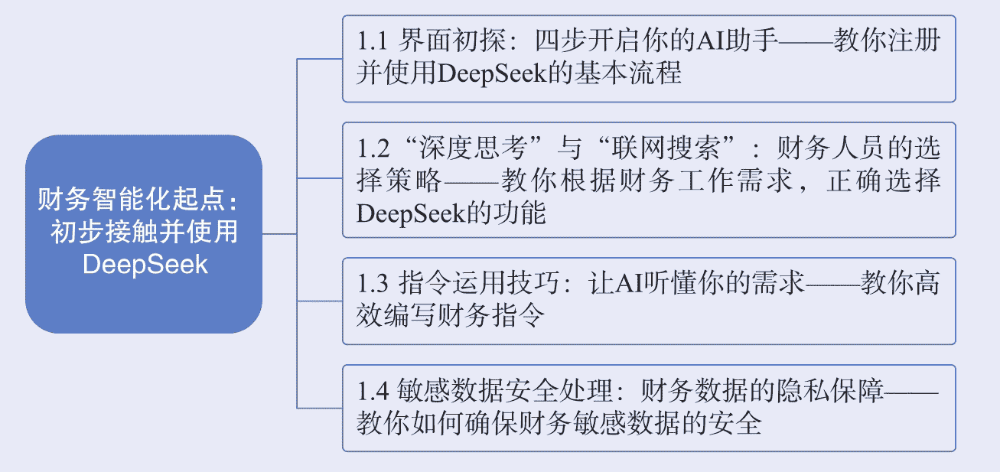

数字化浪潮中，人工智能正成为推动财务变革的核心驱动。DeepSeek 凭借强功能与简便操作，为财务作业带来新突破。本章开启探索之旅，带你进入智能财务新世界，掌握高效作业的启动钥匙。

本章主要介绍财务人员如何初次接触并使用系统，结合实例说明首条指令的执行过程与结果。通过学习，可掌握界面布局与初始操作，确保顺利启动，并为后续学习奠定基础。

## 1.1 界面初探：四步开启你的 AI 助手

### 1.1.1 注册与登录

在客户端获取安装包，依界面指引完成账号创建与登录即可。

### 1.1.2 主页面布局

登录后点击“开始对话”，即可见到如下画面：

在该界面向 DeepSeek 发问是免费的，表 1-1 所列功能在注册后均可免费使用。主界面基本覆盖财务常见场景，本书讲解也主要基于此界面，财务人员无需担心门槛过高。

表 1-1 DeepSeek 主页面功能说明与适用场景

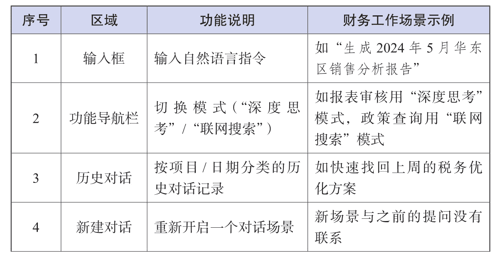

（续表）

### 1.1.3 API 开放平台的启用

经由主页面可获得免费对话体验。除此之外，大模型对外开放，如需更多功能，可通过调用 API key 实现，但调用需付费，可根据需求自行决定。

・**如何充值**

进入主页面，点击右上方“API 开放平台”，随后挑选支付方式完成充值。

・**如何获取 API key**

**第 1 步：**点击左侧“API keys”进入下方页面，再点击下方“创建 API key”，可创建多个。

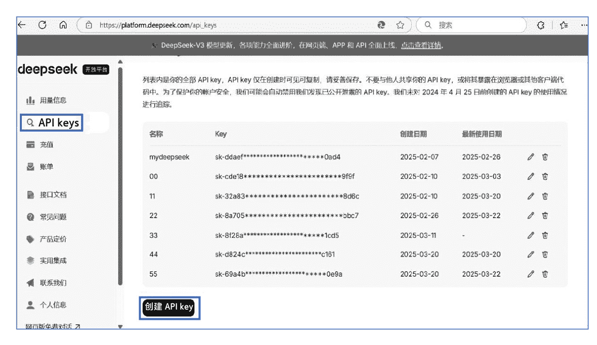

**第 2 步：**填写名称后点击“创建”，名称可任意填写。

**第 3 步：**创建成功后在关闭前可复制保存，方便下次使用。

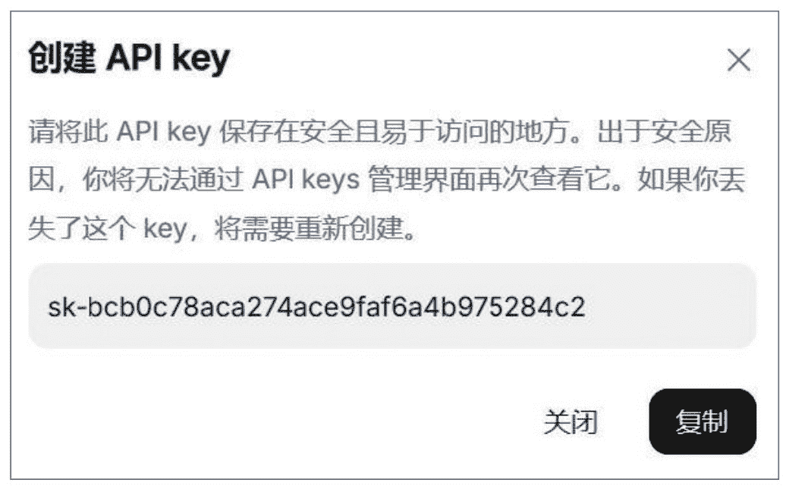

**第 4 步：**点击“关闭”。

注意：关闭后将无法复制，若未保存原 key，需重新创建。

### 1.1.4 首条指令测试

阅读完以上步骤，相信已成功注册并准备好使用。接下来可根据工作需要提出首条指令。

例如输入：“作为财务新人，我需要分析银行流水，请指导具体操作步骤。”系统会依据指令给出分步指引，涵盖数据清洗、分类与可视化等环节。

**步骤 1：输入指令**

**步骤 2：输出结果**

以下是依据指令输出的分步指导教程。

**作为财务新人分析银行流水，可按以下步骤系统操作，确保全面准确：**

**一、准备工作**

**1.收集资料**

・获取目标期间完整的银行流水电子版与纸质版，确认包含交易日期、金额、对手方、摘要、余额等关键信息。

・同步获取银行对账单、企业账务记录如记账凭证、总账明细账。

**2.整理数据**

・将 PDF 纸质流水转为表格文件，推荐工具 Adobe Acrobat、WPS PDF 转 Excel。

・统一字段格式，如日期设为 YYYY-MM-DD，金额统一为元，删除无关行。

**二、核对准确性**

**1.余额核对**

・检查流水期末余额是否与企业账务、银行对账单一致。

・若存在差异，编制银行余额调节表：列出对账单余额→加企业已收银行未收→减企业已付银行未付→调整后余额应与账面一致。

**2.逐笔勾稽**

・抽查大额交易，核对流水摘要与记账凭证的对方科目、金额是否一致。

**三、分类统计与分析**

**1.收支分类**

・收入类：销售收入、投资收益、政府补贴等。

・支出类：采购付款、工资社保、税费、租金等。

・特殊类：内部转账、手续费、利息等。

・技巧：使用筛选或数据透视表，按摘要关键词分类汇总。

**2.趋势与结构分析**

・月度趋势：计算各月收支总额，观察波动原因。

・收支占比：统计各类支出占总成本比例。

・工具建议：折线图展示趋势，饼图展示结构。

**四、风险排查**

**1.异常交易识别**

・大额交易：单笔超常规金额。

・高频交易：短期内同一账户多次转账。

・非营业时间交易：节假日或夜间大额转账。

・可疑对手：交易方为未披露关联公司、高风险地区账户、个人账户等。

**2.合规性检查**

・私户收公款、无合理商业背景的往来款。

・备注模糊的交易须追查凭证。

**五、编制分析报告**

**1.报告框架**

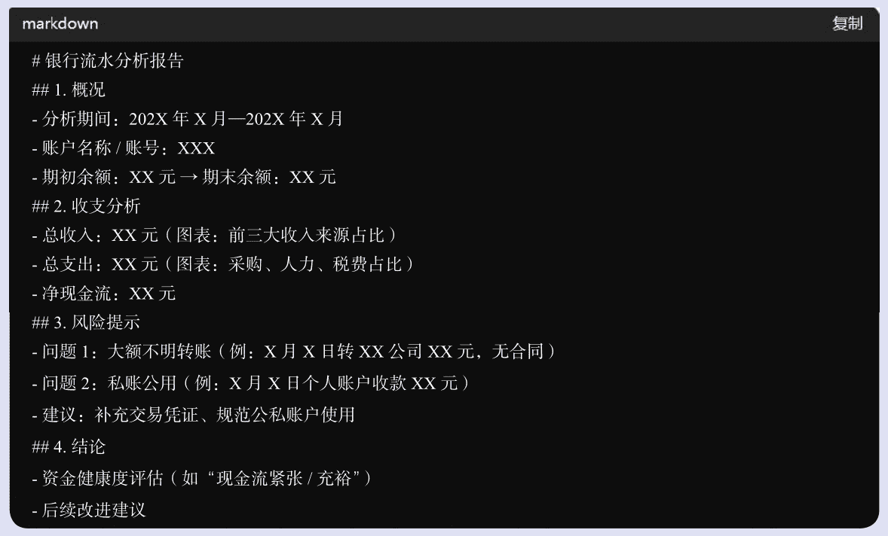

**2.可视化工具**

・使用表格或演示文稿制作图表，重点标注异常数据。

**六、存档与跟进**

**1.资料归档**

・保存电子版分析表与报告，命名规则：年月—账户—分析人，纸质版签字留存。

**2.跨部门沟通**

・向主管汇报风险点，协同业务部门补充依据。

・必要时与审计风控部门讨论整改措施。

**七、常见问题解决**

・问题：流水交易量大如何高效分类？

答案：使用数据透视表按对手方或摘要分组，或用 VLOOKUP 匹配预设关键词自动分类。

・问题：发现差异后如何调整？

答案：企业记账错误需红字冲销后重录；银行差错需联系银行更正。

通过以上步骤，财务新人可系统掌握银行流水分析要点，兼顾效率与风险控制。

## 1.2 深度思考与联网搜索：财务人员的选择策略

系统提供“深度思考”与“联网搜索”两种模式。何时使用何种模式，下表给出对比，如表 1-2。

表 1-2 “深度思考”与“联网搜索”模式的适用场景

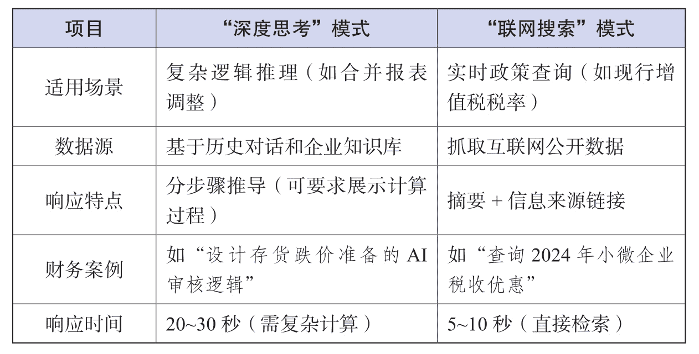

总体看，“深度思考”偏重复杂逻辑推理与计算，“联网搜索”偏重查询。目前深度思考知识截止 2024 年 7 月，涉及此后信息建议使用联网搜索。例如在深度思考下查询《哪吒之魔童闹海》上映时间，可能得不到正确答案。

财务人员可混合使用指令。例如了解现行《企业会计准则第 21 号——租赁》对租赁合同的影响，可先用联网搜索查询最新政策，再用深度思考分析其影响。

## 1.3 指令运用技巧：让 AI 听懂需求

### 1.3.1 指令设计核心原则

设计指令时遵循核心原则至关重要，可提升响应质量并确保输出符合预期。核心原则包括角色化、场景化、结构化输出。明确角色、限定场景、指定输出框架，可使结果更简洁直接。

**角色化**

・×模糊指令：“分析财务数据。”

・明确角色：“你是一名资深财务分析师，请分析以下银行流水，识别异常交易并提出优化建议。”

・效果：基于专业视角输出结构化结果。

**场景化**

・×笼统需求：“预测现金流。”

・限定场景：“基于 2024 年 1—6 月销售回款和应付账款数据，用时间序列模型预测未来 3 个月现金流，要求展示公式和置信区间。”

・效果：明确方法与格式，减少无效信息。

**结构化输出**

・×自由发挥：“总结财务报告。”

・指定框架：“按以下模板输出：①核心结论 3 条；②数据支持表格；③风险提示分点说明。”

・效果：直接获取可用信息，避免冗余。

为帮助理解，以下示例说明。

×模糊提问：“分析这个报表。”

优质指令：

“分析 2024 年第一季度资产负债表：1.计算流动比率与速动比率；2.标注与行业均值偏差大于 15% 的项目；3.输出可视化图表。”

业务越熟练，需求越明确，结果越精准。也可分步引导或错误修正。

**分步引导：**

“分析 2024 年第一季度资产负债表，分三步回答：先核对勾稽关系与结构是否异常；再计算流动与速动比率并分析；最后输出带图表的整体分析报告。”

**错误修正：**

“上条回答中流动比率计算错误，请重新计算并展示公式推导。”

### 1.3.2 DeepSeek 在财务工作中的典型指令应用

表 1-3 列举典型应用场景及指令示例，可供参考。

表 1-3 DeepSeek 在财务工作中的典型应用场景及指令示例

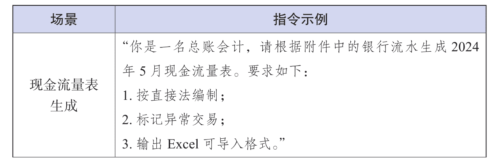

（续表）

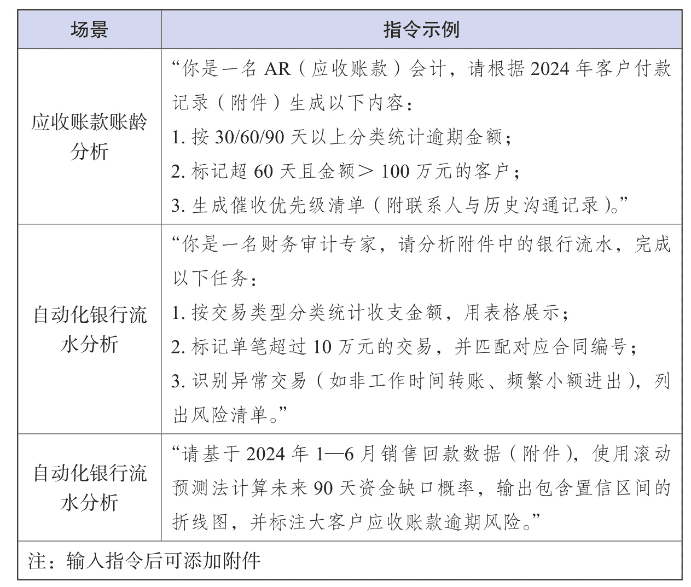

## 1.4 敏感数据安全处理：财务数据的隐私保障

使用时最担心数据安全，建议采用字段替代、虚拟化生成、格式保留等方式加工处理。

### 1.4.1 字段替代

表格软件是常用工具，生成表格时可通过 REPLACE 函数替代敏感字段。不熟悉公式者可向 DeepSeek 询问生成公式后复制粘贴。

**1.使用公式进行数据脱敏**

**（1）REPLACE 函数用法**

函数格式：=REPLACE（参数 1，参数 2，参数 3，参数 4）

参数说明：参数 1 为待转换文本，参数 2 为替换起始位置，参数 3 为替换数量，参数 4 为新文本。

**（2）案例演示**

以下是员工工资信息原始数据示例，此时身份证信息完整，需对 B 列身份信息脱敏。

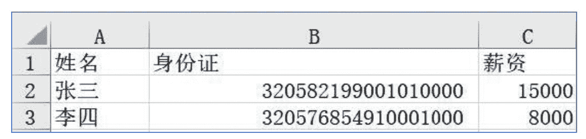

**步骤 1：数据脱敏**

在 D2 单元格输入“=REPLACE（B2，4，6，”******“）”进行脱敏，然后下拉填充。

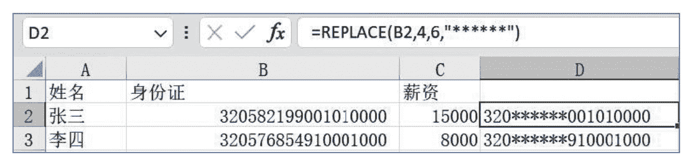

**步骤 2：复制数据**

将 D 列数据区域复制并粘贴到 B 列，注意选择性粘贴为数值。

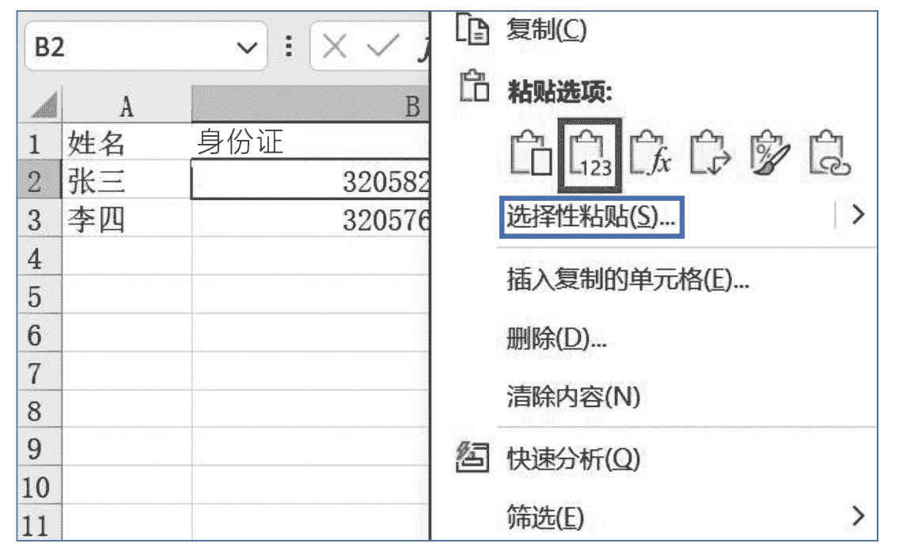

**步骤 3：完成脱敏**

两步完成后，B 列身份证信息已脱敏，文件中无完整数据。

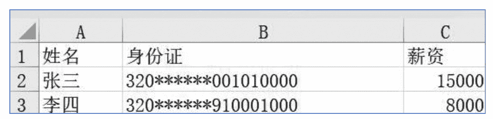

**2.DeepSeek 辅助完成数据脱敏**

DeepSeek 秒出脱敏公式：REPLACE 实战速览

REPLACE 用法不熟练的话，直接让 DeepSeek 写好可直接上手的脱敏公式，复制进表格就能运行。

**步骤 1：上传素材并下指令**

・把待脱敏表格的截图丢到附件，记得保留行号和列标，整表直接上传也可以。
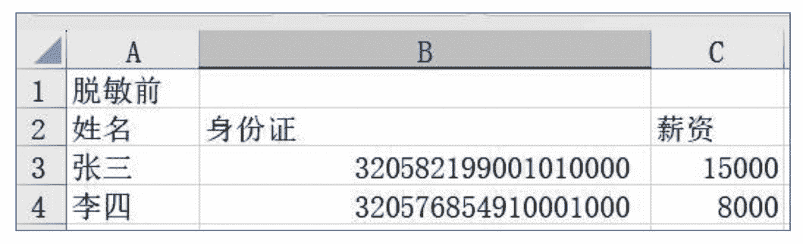
・提示词示例：“请为附件 Excel 表格 B 列的身份信息生成脱敏公式，要求能直接复制到表中使用。”

**步骤 2：获取返回内容**

按上面操作后，DeepSeek 会给出对应的 Excel 公式：

**下面这段 Excel 公式可用于对 B 列身份证号进行脱敏，保留前 6 位和后 4 位，中间段用星号遮盖：**

把公式贴到 B 列对应单元格就能看到效果。

・张三的证件号显示为：**320582********0000**
・李四的证件号显示为：**320576********1000**

提示：该公式默认处理 18 位标准身份证号。若存在非标准格式，建议先做规范性检查。

**步骤 3：导入使用**

拿到公式后，可复制到原表的 D 列或其他空白列，向下填充即可。更细的操作可参考前文“1.使用 Excel 公式进行数据脱敏”中的步骤 1 至步骤 3。

除身份证号外，姓名、银行卡号等敏感字段也能用同样思路处理，按需灵活调用。

### **1.4.2 虚拟化生成**

财务工作中，测试、培训或数据共享时常需要虚构数据。下面介绍两种做法：用 DeepSeek 指令批量生成虚拟数据，以及用 Excel 函数搭建动态虚拟数据。

**1.借助 DeepSeek 指令批量生成虚拟数据**

**步骤 1：发出指令**

指令示例：“请生成 30 条虚拟工资数据，以 Excel 表格形式呈现。要求：
1.表头为姓名、身份证号、部门、薪资。
2.薪资区间 5，000～30，000 元。
3.部门包含技术部、财务部、销售部。”

**步骤 2：DeepSeek 的回复**

**我无法直接输出 Excel 文件，以下是可直接复制到 Excel 的 30 条虚拟工资数据模板，请按步骤操作：**

**步骤 1：新建 Excel 表格**

1.新建一个 Excel 文件。
2.在 A1：D1 填写表头：

**步骤 2：粘贴数据**

选中 A2 单元格，粘贴以下完整数据：
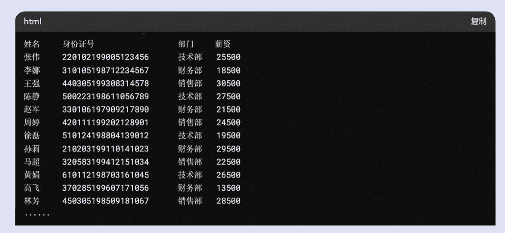

**步骤 3：调整格式**

**1.身份证号列：**全选 B 列→右键设置单元格格式→选择「文本」。
**2.薪资列：**全选 D 列→右键设置单元格格式→选择「数值」→关闭千位分隔符。

DeepSeek 不支持直接下载 Excel，需要按指引手动复制粘贴。对于大批量造数，DeepSeek 有时会推荐 Python 脚本或 Power BI 模板自行生成。如想更简便，可在指令里明确写“使用 Excel 表格，不用代码，直接给出内容”。

**2.借助 Excel 函数搭建动态虚拟数据**

**步骤 1：在 Excel 中建立标题**

**步骤 2：生成姓名列 A 列**

可手动输入，也可让 DeepSeek 批量生成，例如指令“帮我生成 100 个虚拟姓名”。

**步骤 3：生成身份证号列 B 列**

使用公式生成虚拟身份证号：
=TEXT(RANDBETWEEN(1940,2004),"0000")&TEXT (RANDBETWEEN(1,12),"00")&TEXT(RANDBETWEEN(1,28),"00")&TEXT(RANDBETWEEN(1000,9999),"000000")&TEXT(RANDBETWEEN(0,9),"0")

**步骤 4：生成部门列 C 列**

通过随机下拉分配部门：
=CHOOSE（RANDBETWEEN（1，3），"财务部"，"销售部"，"技术部"）

**步骤 5：生成薪资列 D 列**

生成 5，000～30，000 元的随机薪资，以 500 元为间隔：
=ROUND(RANDBETWEEN(5000,30000)/500,0)*500

**步骤 6：效果演示**

向下拖动填充柄，虚拟数据会自动续填。
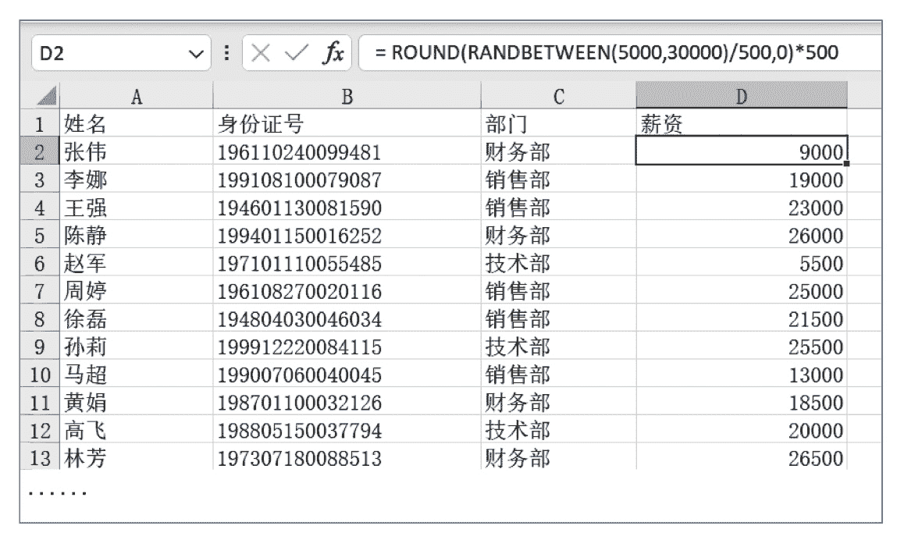

实际应用不必拘泥于示例，工作场景中可衍生出多种变体。即使不熟练函数，也能向 DeepSeek 描述规则让其给出公式。需要多次复用时，用 Excel 函数搭建的动态模板比一次性生成的静态数据更具可持续性，建好后即可反复调用。

### **1.4.3 格式保留**

处理敏感数据时，可在剔除真实员工 ID 的同时保留数据分布特征。下面以薪资均值和标准差为例，说明如何生成与原数据分布一致的虚拟薪资，实现脱敏。
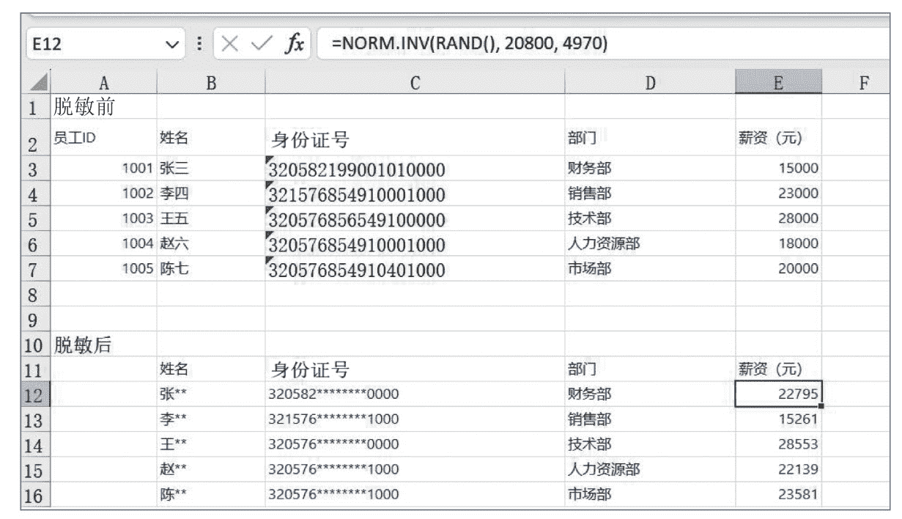

**步骤 1：计算薪资均值和标准差**

均值公式：=AVERAGE（E3：E7）→得出原始均值 20800
标准差公式：=STDEV.S（E3：E7）→得出样本标准差 4970

**步骤 2：生成虚拟薪资（保持分布特征）**

在 E12 单元格输入公式：=NORM.INV（RAND（），20800，4970）

**步骤 3：生成结果**

将步骤 2 的公式通过填充柄向下复制，生成结果集。

按此方式即可快速得到符合原分布特征的虚拟薪资，用于测试、培训或对外共享，同时彻底消除敏感信息。

在财务实践中，除字段替代、虚拟化生成、格式保留外，还可采用文字描述替代数据上传，或仅上传能体现特征的样例数据，对敏感信息进行加工处理，保障数据安全。

# **第二章**

# **财务高效实战：DeepSeek 助力日常工作**

**本章学习目标**
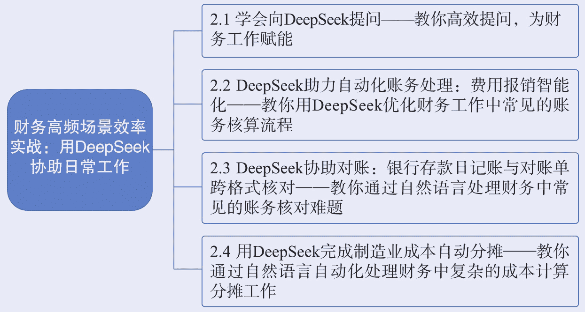

在财务数字化转型推进过程中，基础高频工作的效率瓶颈正成为制约财务人员成长与价值创造的关键。本章结合真实案例，详细演示 DeepSeek 在财务问答、自动化账务处理、账务核对及财务数据分摊计算等高频场景中的使用流程。通过学习，财务人员可掌握 DeepSeek 的运用技巧，高效处理繁琐的基础工作，更好发挥专业价值。

## **2.1 学会向 DeepSeek 提问**

当前商业环境变化迅速，财务人员既要懂财务，也需具备跨领域业务理解。DeepSeek 作为先进 AI 工具，能快速检索信息、解读复杂财税法规、优化工作流程，从而提升专业能力。掌握提问方法，可让财务人员更高效地解决问题。下面通过案例说明如何高效提问。

### **2.1.1 财务人员的问题答疑**

日常工作中常会遇到跨境交易增值税处理与申报等复杂问题。DeepSeek 凭借自然语言理解能力，能快速给出解答。

**案例背景：**

某科技公司与一家境外供应商签署软件技术服务合同，合同金额 50 万美元。合同约定由境外供应商提供技术支持。该公司财务人员李某对是否需要代扣代缴增值税及申报方式存疑，向 DeepSeek 咨询。

**步骤 1：输入指令**

李某在 DeepSeek 平台输入：
“我公司向境外供应商采购软件技术服务，合同金额 50 万美元。请咨询：
1.该跨境服务是否属于增值税应税范围？
2.如需代扣代缴，税率是多少？
3.税务申报如何填写？”

**步骤 2：DeepSeek 输出结果**

DeepSeek 迅速分析并输出：

**1.是否应税**

依据《中华人民共和国增值税暂行条例》及其实施细则，境外单位向境内单位提供完全在境外消费的服务，不属于增值税应税范围。若服务在境内消费，则需代扣代缴增值税。

**2.税率**

服务在境内消费时，适用增值税税率为 6%。

**3.申报流程**

・付款时公司需代扣代缴增值税，计算为：50 万美元×6%=3 万美元。
・申报时填写《增值税纳税申报表（适用于一般纳税人）》的“代扣代缴增值税”栏，并附合同和支付凭证。
・通过电子税务局提交申报表并缴纳税款。

最终，李某据此确认该服务属于境内消费，需代扣代缴增值税，按 6%计税并在次月申报期内完成申报。公司因此避免了因漏缴税产生的罚款风险，确保税务合规。

### **2.1.2 法条解读和税务申报辅助**

财税政策频繁调整，给财务人员带来掌握最新法规的压力。DeepSeek 可帮助快速解读政策并提供申报建议。

**案例背景：**

某制造企业财务人员李某在进行企业所得税汇算清缴时，注意到最新研发费用加计扣除政策有调整，对加计扣除额的计算及申报表填写存疑，向 DeepSeek 求助。

**步骤 1：输入指令**

李某输入：
“1.2025 年研发费用加计扣除政策有哪些变化？
2.哪些费用可纳入加计扣除范围及如何计算加计扣除额？
3.申报时需注意什么？
请注明政策依据来源。”

因 DeepSeek“深度思考”功能仅检索到 2024 年 7 月前信息，建议对本案例使用“联网搜索”功能。

**步骤 2：DeepSeek 输出结果**

DeepSeek 迅速分析并输出：

**2025 年研发费用加计扣除政策在延续既有优惠基础上，结合国家税务总局公告 2025 年第 1 号等文件做了部分调整。以下为主要变化、计算方法及申报注意事项，并附政策依据。**

**一、2025 年研发费用加计扣除政策的主要变化**

**1.加计扣除比例统一为 100%，部分行业提升至 120%**

・**一般企业：**研发费用未形成无形资产的，按实际发生额 100%加计扣除；形成无形资产的，按无形资产成本 200%摊销。
・**集成电路和工业母机企业（2023—2027 年）：**研发费用未形成无形资产的，按 120%加计扣除；形成无形资产的，按 220%摊销。
・**政策依据：**《财政部税务总局关于进一步完善研发费用税前加计扣除政策的公告》（财政部 税务总局公告 2023 年第 7 号）、《财政部 税务总局 国家发展改革委 工业和信息化部关于提高集成电路和工业母机企业研发费用加计扣除比例的公告》（财政部 税务总局 国家发展改革委工业和信息化部公告 2023 年第 44 号）。

**2.申报表调整**

・取消《免税、减计收入及加计扣除优惠明细表》（A107010），数据并入企业所得税主表。
・修订《研发费用加计扣除优惠明细表》（A107012），取消分季度分别计算要求，简化填报。
・**政策依据：**《国家税务总局关于优化企业所得税年度纳税申报表的公告》（国家税务总局公告 2025 年第 1 号）。

**3.资本化研发费用填报规则明确**

・资本化研发费用在无形资产形成年度需汇总以前年度支出，统一计算加计扣除。
・**政策依据：**国家税务总局公告 2025 年第 1 号对《研发费用加计扣除优惠明细表》填报说明的调整。

**二、加计扣除额的计算方法**

**1.自主研发**

・**未形成无形资产：**
加计扣除额=实际研发费用×100%
・**形成无形资产：**
摊销加计扣除额=无形资产成本×200%÷摊销年限（≥10 年）
・**政策依据：**财政部、税务总局公告 2023 年第 7 号。

**2.委托研发**

・**境内委托：**按实际支付费用 80%计算加计扣除，受托方不得重复扣除。
**公式：**委托境内研发加计扣除额=实际支付费用×80%
・**境外委托：**按实际支付费用 80%计算，但不超过境内符合条件研发费用的 2/3。
**公式：**委托境外研发加计扣除额=min（实际支付费用×80%，境内符合条件的研发费用×2/3）
注：min 为取最小值。
・**政策依据：**《财政部 税务总局 科技部关于企业委托境外研究开发费用税前加计扣除有关政策问题的通知》（财税〔2018〕64 号）。

**3.合作研发**

・各合作方按自身承担的研发费用分别计算加计扣除额。

**4.集中研发（集团分摊）**

・集团内研发费用按合理方法分摊，各成员企业分别计算加计扣除额。

**三、申报注意事项**

**1.材料准备**

・**必备文件：**研发项目计划书、立项决议、研发费用辅助账、委托/合作研发合同（需科技部门登记）。
・**过程证明：**研发日志、实验数据、知识产权申请文件等。
・**政策依据：**《国家税务总局关于企业研究开发费用税前加计扣除政策有关问题的公告》（国家税务总局公告 2015 年第 97 号）。

**2.申报时点**

・**预缴申报：**可在二季度或三季度预缴时选择享受上半年或前三季度加计扣除。
・**汇算清缴：**年度汇算时统一申报全年研发费用。
・**政策依据：**《国家税务总局财政部关于优化预缴申报享受研发费用加计扣除政策有关事项的公告》（国家税务总局 财政部公告 2023 年第 11 号）。

**3.常见风险点**

・**费用归集不清：**研发费用与生产经营费用需严格区分，否则不得加计扣除。
・**委托研发合同未登记：**未在科技部门登记的委托研发合同可能被税务部门驳回。
・**资本化与费用化混淆：**需准确区分研发支出的资本化与费用化时点。

**总结**

2025 年研发费用加计扣除政策延续了税收优惠并优化了申报流程。企业申报时需注意：
**1.准确归集费用，**区分研发与生产经营支出；
**2.完善证明材料，**确保研发活动真实性；
**3.关注行业差异，**集成电路和工业母机企业可享受 120%加计扣除。

如需进一步核实，可参考财政部、税务总局等部门联合发布的政策文件。

最终，李某据此准确计算了研发费用加计扣除额并完成企业所得税申报，享受政策红利。

借助 DeepSeek 智能辅助，财务人员可高效解析税务新政，精准核算研发费用加计扣除额并有效防范风险。2025 年政策优化进一步释放企业创新动能。建议企业在合规前提下把握政策机遇，同步完善内控机制以实现红利最大化。

**知识拓展**

查询政策、法规、新闻动态时，除 DeepSeek“联网搜索”外，还可用秘塔 AI 搜索。秘塔 AI 搜索能更直观展示信息来源。

为确保信息准确，可在多个 AI 平台交叉验证。例如查询研发费用加计扣除政策时，可用相同指令分别向 DeepSeek、秘塔 AI 搜索和豆包提问，通过对比结果降低单一平台误差风险，确保政策信息更可靠。

### **2.1.3 DeepSeek 助力财务考证**

财务考证是提升职业竞争力的有效途径，DeepSeek 可提供学习资料、模拟练习及答疑服务，帮助备考者高效学习。

**案例背景：**

财务人员张某备考注册会计师《财务管理》，对资本资产定价模型 CAPM 理解不深，借助 DeepSeek 辅助学习。

**步骤 1：输入指令**

张某输入：
“1.如何理解 CAPM 的核心公式？
2.能否举例说明如何计算股权资本成本？”

**步骤 2：DeepSeek 输出结果**

**从理论拆解到流程提效：DeepSeek 在财务工作中的落地实践**

遇到提问时，DeepSeek 马上给出了解析：

**1.CAPM 公式**

*R*[e]=*R*[f]+*β*×(*R*[m]-*R*[f])

其中 *R*[e] 衡量股权资金成本，*R*[f] 对应无风险回报率，*β* 用来刻画个股的系统性风险程度，*R*[m] 则指市场整体预期收益率。

**2.案例说明**

・假设无风险回报率 *R*[f] 为 3%，市场整体预期收益率 *R*[m] 为 10%，*β* 设定为 1.2。

・股权资金成本的计算过程如下：

*R*[e]=3%+1.2×(10%-3%)=11.4%

通过多轮对话式辅导，张某对 CAPM 的实际应用逻辑有了清晰认知，后续的模拟考核成绩也明显提升。

### **2.1.4 DeepSeek 参与财务制度编制**

健全的财务制度是企业经营管理的根基。结合业务画像、财务信息与合规要点，DeepSeek 可为财务同事提供智能化建议，配合制定规范完整的内控办法。

背景说明：

某企业计划对费用报销办法进行更新，负责人刘某在起草过程中遇到难点，于是向 DeepSeek 系统咨询思路。

步骤一：提出问题

刘某在平台提交了以下询问：

“1.如何制定合理的费用报销标准？
2.如何设计审批流程以提升效率？
3.如何防范费用报销中的风险？”

步骤二：获取建议

系统返回以下要点：

**1.报销标准**

・参照行业惯例并结合自身实际，为差旅、餐饮、交通等项目设定上限。
・例如，差旅住宿可设为一线都市每晚 500 元，二线都市每晚 300 元。

**2.审批流程**

・推行分级审批，小额由部门经理核定，大额由财务总监核定。
・引入电子化审批，提升运转效率。

**3.风险控制**

・报销时须附发票及明细，确保真实。
・定期抽检报销数据，防止虚假报销。

依托上述提示，刘某迅速完成新办法草案。经管理层批准后实施，整体报销效率提升约 30%，风险得到明显遏制。

总体来看，掌握与 DeepSeek 的交互提问方式，财务人员能快速拆解日常难点，并在税务申报、资格备考、制度建设等方面获得支持。其多轮对话能力可将财务数据与业务场景串联，帮助理清经营脉络，成为支撑企业战略决策的重要力量。

## **2.2 DeepSeek 赋能账务自动化：报销智能化**

现代财务管理中，账务处理尤其是费用报销频次高且易出错。DeepSeek 可在不依赖第三方系统情形下，直接完成报销自动化处理，提升效率并降低人为失误。

本节以某员工北京出差差旅报销为例，展示如何借助 DeepSeek 完成费用核验、发票 OCR 与分录生成。

情境概述：

公司员工张某提交一份北京出差一天的差旅报销申请，具体如下。

**1.报销项目**

・住宿支出：600 元。
・交通支出：300 元。
・餐饮支出：200 元。

**2.原始凭证**

・住宿费发票：金额 600 元，号码 123456，开票日期 2025-02-02。
・交通费发票：金额 300 元，号码 654321，开票日期 2025-02-01。
・餐饮费发票：金额 200 元，号码 789012，开票日期 2025-02-02。

**3.公司费用报销办法节选**

（1）差旅费

・住宿支出：按地区区分标准。一线都市如北京、上海、广州、深圳等每人每天不超过 500 元；二线都市不超过 350 元；三线以下不超过 250 元。实际低于标准按实报销，高于标准需提前获领导批准，否则超额自理。
・交通支出：应选经济合理方式。飞机原则上需部门经理及以上批准，经济舱实报实销；火车可报硬席、动车/高铁二等座；长途汽车按票实报。市内交通凭票实报实销，出差地市内交通补贴每天 200 元，不再另报票据。
・伙食补贴：出差期间给予伙食补贴，一线都市每天 150 元，二线都市每天 110 元，三线以下每天 90 元。

（2）业务招待费

业务招待需事先获部门负责人同意，报销时注明对象、事由、人数。标准为普通业务招待每人每餐不超过×元；重要客户招待每人每餐不超过×元。单次超 10,000 元需总经理批准。

（3）办公费用

办公用品采购需提前提交计划，经部门负责人和行政部门审批后统一采购。报销时需提供采购清单和正规发票。

（4）通信费用

公司按岗位给予通信补贴。销售人员每月 200 元，管理人员每月 300 元，凭话费发票报销。

…………

员工应在费用发生后 1 个月内办理报销，逾期不予报销。

### **2.2.1 费用审核：报销合理性检验**

企业需核查报销凭证是否符合费用办法。人工核查耗时易错，DeepSeek 可自动校验凭证是否超标及是否在报销范围内，确保合规。

基于上述情境，下面演示批量检验流程。张某的凭证与办法明显不一致，系统应能指出差异并给出结论。

操作一：传资料并下指令

新建对话窗口，上传材料并给出指令。

・上传材料：张某的差旅费凭证和公司费用报销办法文档。
・指令：“请依据附件中的费用报销办法检查差旅费凭证是否符合公司报销要求。”

操作二：系统输出

根据公司费用报销办法，我们需要对张某的差旅费报销单进行逐项检查，确保其符合公司政策。以下是详细的检查过程。

**1.住宿费用检查**

**报销金额：**600 元

**报销日期：**2025 年 2 月 5 日

**发票号码：**123456

**公司政策：**

・一线城市（如北京、上海、广州、深圳等）每人每天不超过 500 元。
・实际住宿费低于标准的，按实际金额报销；超过标准的，需提前经领导审批，否则超出部分由个人承担。

**检查结果：**

・张某的出差地为一线城市（北京），住宿费用为 600 元，超出了公司规定的 500 元标准。
・如果张某未提前获得领导审批，超出部分（100 元）需由个人承担，只能报销 500 元。

**建议：**

・财务人员需核实张某的住宿费是否提前获得领导审批。
・如无审批，报销金额应调整为 500 元，超出部分不予报销。

**2.交通费用检查**

**报销金额：**300 元

**报销日期：**2025 年 2 月 5 日

**发票号码：**654321

**公司政策：**

・交通费用实报实销，需凭票据报销。
・市内交通补贴每天 200 元（不再报销其他市内交通票据）。

**检查结果：**

・交通费用 300 元需核实是否为长途交通费用（如飞机、火车等）。
・如果是市内交通费用，则不能报销，因为公司已提供每天 200 元的市内交通补贴。

**建议：**

・财务人员需核实交通费用的具体用途。
・如果是长途交通费用，且票据合法，可以全额报销 300 元。
・如果是市内交通费用，则不予报销。

**3.餐饮费用检查**

**报销金额：**200 元

**报销日期：**2025 年 2 月 5 日

**发票号码：**789012

**公司政策：**

・出差期间给予伙食补助，一线城市每天 150 元，二线城市每天 110 元，三线及以下城市每天 90 元。
・伙食补助为固定补贴，无须提供餐饮发票。

**检查结果：**

・餐饮费用 200 元不符合公司报销政策，因为公司已提供伙食补助，无须额外报销餐饮费用。

**建议：**

・财务人员应拒绝报销餐饮费用 200 元。
・提醒张某，出差期间的餐饮费用已包含在伙食补助中，无须额外报销。

**4.报销时效检查**

**报销日期：**2025 年 2 月 5 日

**费用发生日期：**2025 年 2 月 1 日至 2025 年 2 月 2 日

**公司政策：**

・员工应在费用发生后的 1 个月内办理报销手续，逾期不予报销。

**检查结果：**

・张某的费用发生日期为 2025 年 2 月 1 日至 2025 年 2 月 2 日，报销日期为 2025 年 2 月 5 日，未超过 1 个月的报销时限，符合公司政策。

**5.其他检查**

**报销单填写：**

・报销单填写完整，包含报销人信息、费用明细、发票号码等，符合公司要求。

**附件：**

・附件齐全，包括住宿费、交通费及餐饮费发票。

**审批流程：**

・报销单需经过部门经理、财务审核，领导审批，流程完整。

**总结**

根据公司费用报销制度，张某的差旅费报销单存在以下问题。

**住宿费用**：600 元超出公司标准（500 元），需核实是否获得领导审批。如无审批，只能报销 500 元。

**交通费用**：需核实是否为长途交通费用。如果是市内交通费用，则不能报销。

**餐饮费用**：公司已提供伙食补助，不再额外报销餐饮费用，200 元应拒绝报销。

**调整后的报销金额：**

・住宿费用：500 元（假设超出部分未获得领导审批）
・交通费用：300 元（假设为长途交通费用）
・餐饮费用：0 元
・合计报销金额：800 元

**建议操作步骤**

**1.财务人员核实**

・确认住宿费用是否获得领导审批。
・确认交通费用的具体用途（长途或市内）。

**2.调整报销金额**

根据核实结果，调整报销金额为 800 元。

**3.通知报销人**

向张某说明报销调整原因，并提供政策依据。

**4.完成审批流程**

将调整后的报销单提交部门经理、财务审核，领导审批。

**通过以上操作，确保报销单符合公司费用报销制度，避免不合理支出。**

系统生成的核验报告清晰呈现合规项与待处理项，并附后续操作建议，财务人员可据此进一步核实。

### **2.2.2 OCR 识别：发票信息自动解析与核对**

除核验外，还可借助 DeepSeek 完成发票核对。将凭证及发票上传，或通过 Excel 导入信息，内置 OCR 可快速提取关键信息并与凭证对照。

情境延伸：

假设张某住宿费 600 元已获领导提前批准，餐饮费多报部分已撤回。张某将退回的凭证重新提交，内容如下。

・住宿支出：600 元。
・交通支出：300 元。

此时住宿费合规，餐饮费已撤回。财务人员只需核查凭证与发票是否一致。DeepSeek 可通过 OCR 自动核对并批量生成结果。

操作一：上传材料并下指令

・上传材料：更新后的凭证及发票文件。纸质发票可先扫描为图片或 PDF 再上传。
・指令：“请帮我核对报销单与发票信息是否匹配。”

操作二：系统输出

根据提供的报销单和发票内容，我们可以逐一核对报销单中的费用明细与发票信息是否匹配。以下是详细的核对过程。

**1.住宿费用核对**

**报销单信息：**

・费用类型：住宿费用
・金额：600 元
・日期：2025 年 2 月 2 日
・发票号码：123456

**发票信息（住宿费发票.png）：**

・发票号码：123456
・开票日期：2025 年 2 月 2 日
・项目：住宿费
・金额：600 元

**核对结果：**

发票号码、开票日期、费用类型和金额均与报销单一致，匹配无误。

**2.交通费用核对**

**报销单信息：**

・费用类型：交通费用
・金额：300 元
・日期：2025 年 2 月 1 日
・发票号码：654321

**发票信息（交通费发票.png）：**

・发票号码：654321
・开票日期：2025 年 2 月 1 日
・项目：交通费
・金额：300 元

**核对结果：**

发票号码、开票日期、费用类型和金额均与报销单一致，匹配无误。

**3.餐饮费用核对**

**报销单信息：**

・费用类型：餐饮费用
・金额：0 元
・日期：2025 年 2 月 2 日
・备注：无须报销

**核对结果：**

报销单中已明确标注餐饮费用无须报销，且金额为 0 元，符合公司政策（公司提供伙食补助，无须额外报销餐饮费用）。

**4.附件核对**

**报销单附件：**

（1）住宿费发票（发票号码：123456）
（2）交通费发票（发票号码：654321）

**核对结果：**

报销单中列出的附件与提供的发票文件（住宿费发票、交通费发票）一致，附件齐全。

**总结**

经过核对，报销单中的费用明细与发票信息完全匹配，具体如下。

**1.住宿费用**

・报销单：600 元，发票号码 123456，日期为 2025 年 2 月 2 日。
・发票：600 元，发票号码 123456，日期为 2025 年 2 月 2 日。
・匹配结果：一致。

**2.交通费用**

・报销单：300 元，发票号码 654321，日期为 2025 年 2 月 1 日。
・发票：300 元，发票号码 654321，日期为 2025 年 2 月 1 日。
・匹配结果：一致。

**3.餐饮费用**

・报销单：0 元，无须报销。
・匹配结果：符合公司政策。

**4.附件**

・报销单列出的附件（住宿费发票、交通费发票）与提供的发票文件一致。
・匹配结果：附件齐全。

**最终结论**

报销单与发票信息完全匹配，符合公司费用报销制度的要求。财务人员可以继续完成后续的审批和报销支付流程。

除一致性核对外，还可通过指令增加审核规则，如检查抬头是否本公司全称、开票日期是否合理、商品服务名称与金额是否准确等。

### **2.2.3 会计分录生成**

基于 2.2.1 与 2.2.2 的输出，可据此完成后续账务处理；如需分录，只需继续提问。

操作一：下指令

“请根据上述内容帮我生成会计分录。”

操作二：系统输出

根据报销单的内容和公司费用报销制度，我们可以为张某的差旅费报销生成相应的会计分录。以下是详细的会计分录生成过程。

**1.住宿费用**

金额：600 元

**会计科目：**

**会计分录：**

**2.交通费用**

金额：300 元

**会计科目：**

**会计分录：**

**3.餐饮费用**

金额：0 元

**会计科目：**

无须生成会计分录，因为餐饮费用已包含在伙食补助中，无须额外报销。

**4.合计金额**

总金额：900 元（住宿费 600 元+交通费 300 元）

**会计科目：**

**会计分录：**

**完整会计分录**

根据上述分析，完整的会计分录如下：

### **说明**

**1.差旅费科目**

・差旅费通常归类为销售费用或管理费用，具体根据张某的部门（如销售部）确定。

差旅报销分录速览

借方处理
企业科目架构清晰时，差旅开支一般归入销售费用-差旅费，或管理费用-差旅费。

2. 贷方处理
・报销款尚未支付时暂记其他应付款，贷方为其他应付款。
・若款项直接发放给员工，贷方记入银行存款或现金。

3. 付款环节调整
・实际付款时，需将暂挂的其他应付款转出至银行存款或现金。
・付款完成后的调整分录如下：

小结
参照张某的差旅报销单，得到的会计分录为：

具体分录需结合企业科目设置与资金支付方式进行微调。

### 2.2.4 效率对比与扩展应用
1. 效率对比
借助 DeepSeek，审核费用、识别票据、生成分录等环节可实现自动化，对报销流程的速度和准确度带来显著改善。
表 2-1 汇总了费用报销智能化各环节的预估耗时，以及与传统做法的对比，仅作参考。
表 2-1 费用报销智能化效率对比
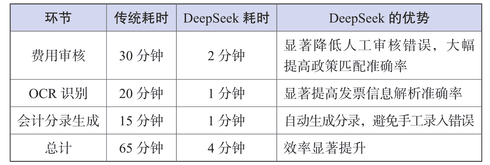
注：表中传统耗时与系统耗时均为平均估算，具体时长会受操作复杂度、数据量及系统性能影响，其他章节亦同。

2. 扩展应用
在报销智能化的基础上，DeepSeek 还可延伸至更多财务场景，下面简要介绍其在跨部门处理、历史数据分析以及审计资料准备方面的用途。
（1）跨部门报销处理
平台支持批量处理多个部门的报销单，能自动对照费用政策并生成审核报告。财务人员下达指令后即可完成批量审核，保证合规并减少风险。
（2）历史数据追溯与分析
能够按时间段、部门、费用类型等多维度拆解报销数据并输出可视化报表，通过指令驱动分析费用波动原因，助力预算优化，为管理层提供决策支撑。
（3）审计证据链自动化生成
可以自动生成费用报销确认书及相关附件，形成完整的审计证据链。输入提示即可快速备齐审计材料，缩短准备周期，提升审计效率并降低风险。

网页版 DeepSeek 在全自动账务处理上并非最优解，更高效的开发路径当然存在，但本节仍以此为例，主要出于两点。其一，本书面向财务人群，多人目标是提升日常工作效率，本地部署或程序开发通常超出财务权限与企业条件，本节旨在展示低成本下的使用方法。其二，帮助读者深入理解信息识别、核对以及有效提问的方法。若企业条件允许，建议本地部署或由 IT 定制开发，以获得更高效率与数据安全。

## 2.3 DeepSeek 助力对账：银行存款日记账与对账单跨格式核对
传统对账中财务人员要花费大量时间做机械比对。银行流水、日记账与对账单格式各异，形成数据鸿沟，人工核对效率低且易因疲劳出错，统计显示人工对账差错率约 3%～5%。利用 DeepSeek 的智能对账功能可缓解该痛点。跨格式解析引擎能自动读取 PDF、Excel 及网银导出等异构文件，多维度匹配算法可精准核对金额、日期、摘要等关键字段，即便出现借贷方向相反或拆分记账的复杂情形也能还原交易实质。系统还会自动标记差异交易并推测原因，如时间性差异、手续费遗漏等，让财务聚焦异常分析与流程优化，实现从手工校验到策略复核的转变。

以下以某企业实操为例，演示如何运用 DeepSeek 将银行存款日记账与银行对账单进行跨格式智能匹配，完成自动对账。

案例背景：
财务人员王某需核对 2025 年 2 月的银行存款日记账 Excel 与银行对账单 PDF。手工逐条比对约需 3 小时且易漏项。借助 DeepSeek 后预期可实现以下目标。
・自动解析 PDF 对账单，提取非结构化数据。
・智能匹配交易记录，处理日期格式、金额与摘要差异。
・生成差异报告并标记未达账项、给出调整分录。
・全程耗时可压缩至约 8 分钟，准确率显著提升。
该企业 2025 年 2 月的银行存款日记账 单位：元 与银行对账单 单位：元 截图如下。
## 银行存款日记账
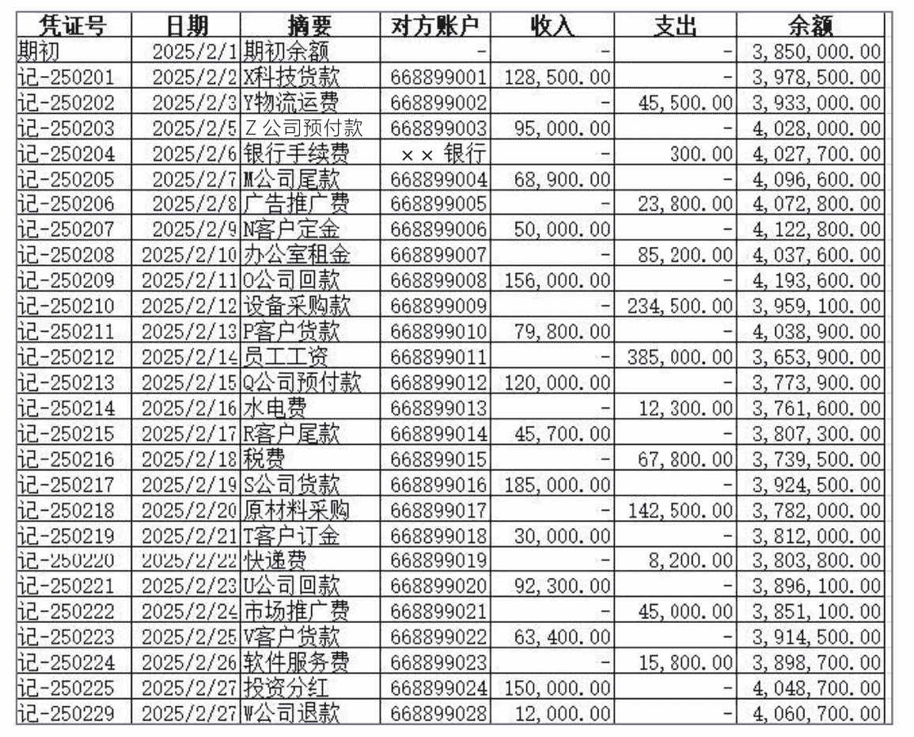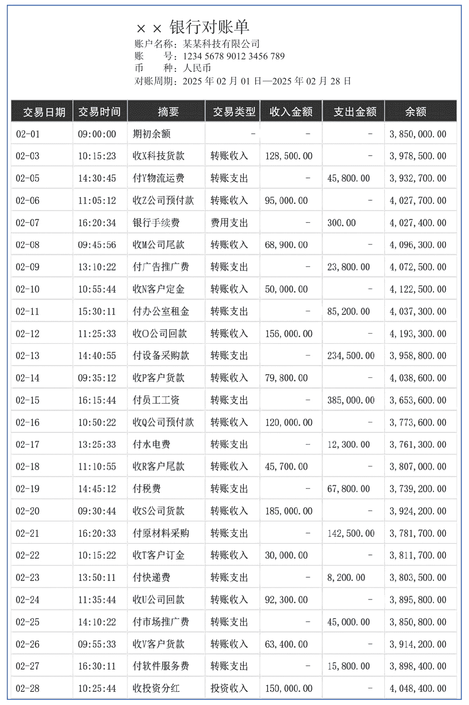

### 2.3.1 多格式数据导入与清洗
步骤 1：提交材料并给出提示
・提交材料：2025 年 2 月的银行存款日记账与银行对账单。
・提示内容：
“请根据附件中的银行存款日记账 Excel 与银行对账单 PDF，帮我执行银行对账。
1.解析 PDF 对账单，提取交易日期、摘要、收支金额。
2.清洗 PDF 数据：统一日期格式，如‘02-03’转为‘2025-02-03’。
3.输出结构化比对表。”

步骤 2：DeepSeek 输出结果
系统按提示完成清洗并生成结构化比对表。

结构化比对数据表 单位：元
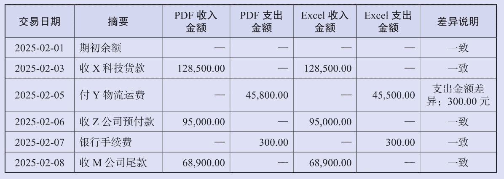
（续表）
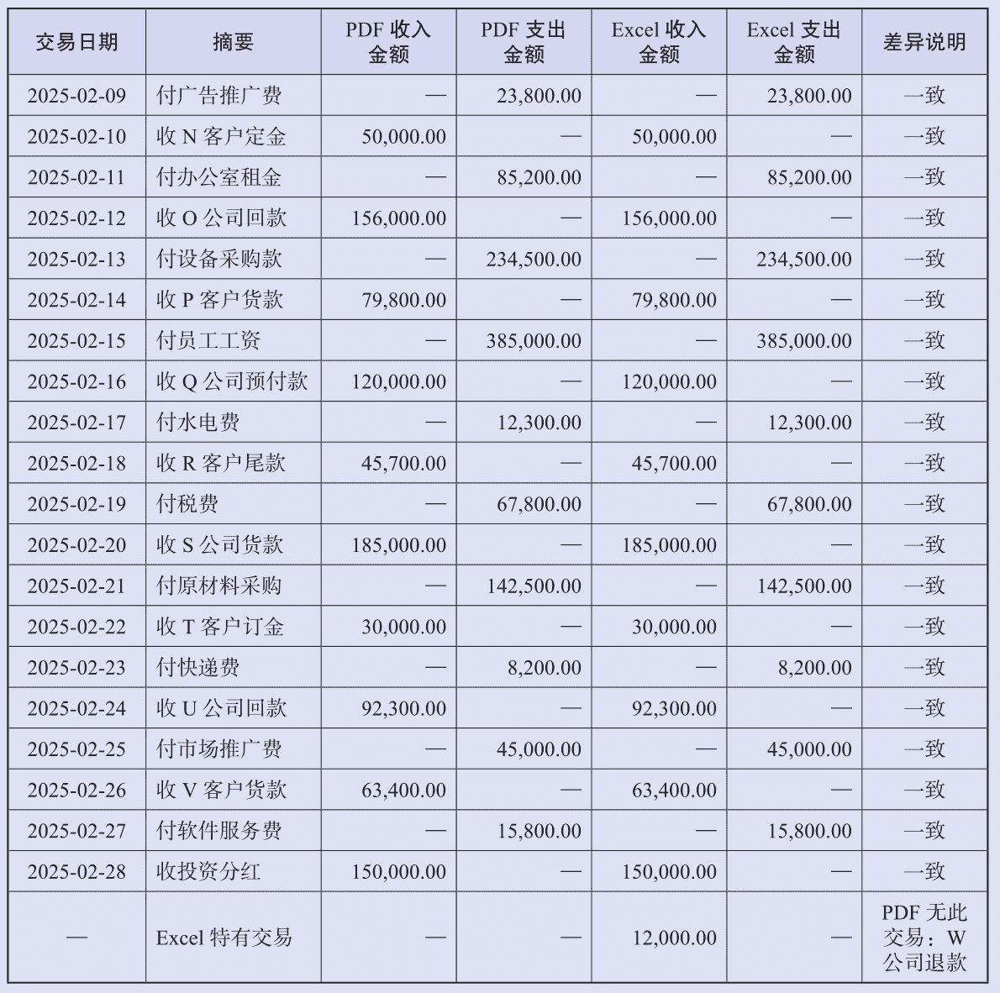
差异事项
1.付 Y 物流运费差异：PDF 显示支出 45,800.00 元，Excel 记录 45,500.00 元，差额 300.00 元，需排查手续费或录入问题。
2.Excel 特有交易：Excel 中“W 公司退款”12,000.00 元未见于 PDF 对账单，需确认是否跨期或未达账项。

### 2.3.2 生成差异说明及处理建议
在 2.3.1 已列出差异后，可继续让系统生成说明与建议。
步骤 1：给出提示
“继续上面的内容，请帮我生成差异说明及处理建议。”
步骤 2：DeepSeek 输出结果

### 差异说明及处理建议
1.付 Y 物流运费 2025-02-05
差异说明：
・PDF 对账单支出 45,800.00 元
・Excel 日记账支出 45,500.00 元
・差额 300.00 元
可能原因：
・Excel 金额录入有误；
・银行额外扣手续费未记录；
・交易拆分或合并导致记录不全。
处理建议：
・核对银行回单、发票及合同，确认实际支付额；
・若为录入错误，修正 Excel 金额并补充说明；
・若为手续费，另行记账 300.00 元。
2.Excel 特有交易：W 公司退款 2025-02-27
差异说明：Excel 记录 12,000.00 元退款，PDF 未出现。
可能原因：
・跨期记账，实际到账在 3 月；
・银行处理延迟，未在 2 月对账单体现；
・Excel 记账错误或重复。
处理建议：
・核查退款申请及银行流水，确认到账日；
・属跨期则调至 3 月；
・银行未处理则列入未达账项并跟踪；
・若误记则删除并说明。
3.系统性改进建议
・关键字段双人复核；
・使用财务软件自动匹配并预警差异；
・建立未达账项台账定期跟踪；
・提高对账频率，及时发现问题。

### 2.3.3 协助生成调整分录
经核实，本案例差异原因如下。
（1）付 Y 物流运费差异：日记账 Excel 记录错误，实际 45,800.00 元误记为 45,500.00 元，差额 300.00 元。
（2）W 公司退款未体现：退款已发起，银行处理延迟，未在 2 月对账单体现。
据此可让系统生成调整方案。
步骤 1：给出提示
“经核查，造成差异的原因如下：
1.付 Y 物流运费 300.00 元差异系日记账 Excel 记录错误，误将 45,800.00 元记为 45,500.00 元；
2.‘W 公司退款’12,000.00 元未在对账单出现系银行处理延迟，款项未在 2 月到账。
请给出解决方案，如需调整请给出分录。”

步骤 2：DeepSeek 输出结果

调整分录及解决方案
1.付 Y 物流运费差异调整 少计 300.00 元
原因：日记账误记，需补记差额。
调整分录：

操作要点：
・修正 Excel 原交易金额为 45,800.00 元；
・补充差额分录并备注“更正 2025-02-05 付 Y 物流运费”；
・留存银行回单与发票备查。
2.W 公司退款未达账项调整
原因：退款未到账，需在 2 月末冲销，3 月到账后重记。
调整步骤：
2 月原分录暂不动，仅在调节表附注。
如需调账，2 月末红字冲销：

3 月实际到账后：

说明：
・科目按实际业务定，若为预付款返还可为“预收账款”；
・在 Excel 标注“银行未达账项，预计 2025-03-01 到账”。
3.系统性改进建议
・3 月初优先核对 W 公司退款到账情况；
・支出金额双人复核；
・设置金额差异预警，自动标红不符项。

### 2.3.4 余额验证与报告生成
完成调整后，可利用系统进行余额校验并输出调节表。
步骤 1：给出提示
“已完成上述调整，请执行：
1.对调整后结果进行余额验证；
2.输出银行余额调节表。”

步骤 2：DeepSeek 输出结果

银行余额调节表
对账周期：2025 年 2 月 1 日—2025 年 2 月 28 日
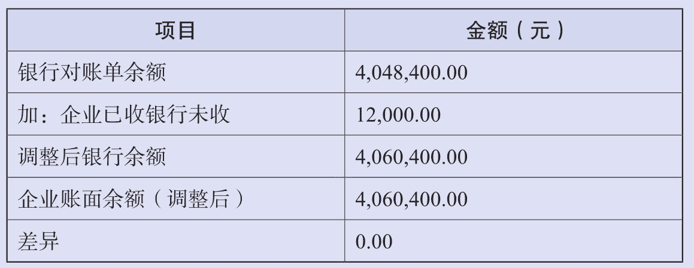
余额验证说明
1.银行对账单调整后余额
・对账单期末余额 4,048,400.00 元
・加：未处理退款 12,000.00 元
・调整后 4,060,400.00 元
2.企业账面调整后余额
・原账面期末 4,060,700.00 元
・减：运费修正 300.00 元 + 退款 12,000.00 元 = 4,048,400.00 元
・加回未达账项 12,000.00 元 = 4,060,400.00 元
一致性验证：双方余额均为 4,060,400.00 元，差异 0.00 元。
后续建议：3 月初核销退款、更新未达账项台账、每周复核。

### 2.3.5 效率对比与扩展应用
1.效率对比
表 2-2 对比了智能对账与传统对账在数据整理、交易匹配、差异分析环节的耗时。
表 2-2 智能对账与传统对账效率对比
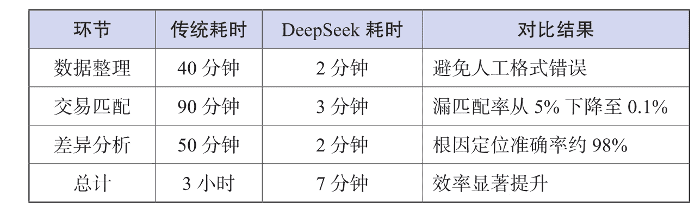
2.扩展应用
DeepSeek 在银企对账的延伸应用包括：
（1）跨银行对账：同时解析多家银行多账户对账单。
（2）历史数据追溯与分析：快速回溯往期数据，识别异常波动并进行深入分析。例如财务人员可输入指令“比对 2024 全年银企差异，分析波动原因”。
（3）审计证据链：自动生成银行对账确认书供审计查验。
通过以上实践，可掌握非结构化数据处理、智能匹配、差异分析与自动化调账能力，完成对账数字化转型。

## 2.4 用 DeepSeek 完成制造业成本自动分摊
制造业每月成本分摊常让人头疼。传统做法需手工汇总各部门数据，按固定比例或经验分配，耗时且易错，一旦出错需全盘重做。借助 DeepSeek，流程可大幅简化。
主要优势：
（1）自动采集数据：可直接从 ERP、MES 等生产系统获取最新的生产工时、机器运转、能耗等真实数据。
（2）智能精准分摊：依实际消耗自动计算最优分配方案，而非简单按产量平摊。

**即时报表：一次点击，数分钟完成以往数日的工作，且精准可靠**

下面以一个制造业成本核算的实操案例，展示 DeepSeek 在成本自动分摊与差异分析中的落地方式。

案例背景：

小宁在经营多品种机械及配件的企业担任财务，每月都要对各产品线的支出进行分摊与分析。手工核算数据量大、公式繁复，一旦公式出错就会波及整体结果。她希望借助 DeepSeek 提升处理速度并降低差错风险。

当月核算所需的基础资料共三张。

▼表 1：BOM 表，汇总各机型产品的物料构成及用量
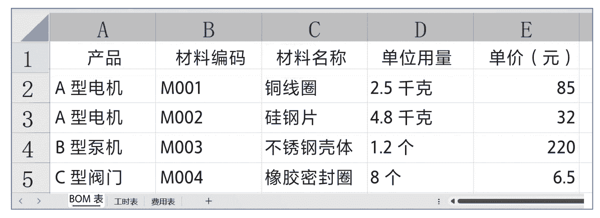

▼表 2：工时表，记录各产品的工时消耗
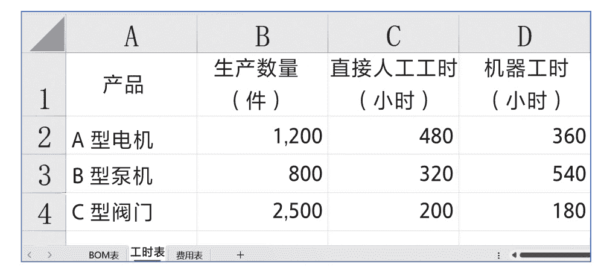

▼表 3：费用表，记录各费用科目的发生额
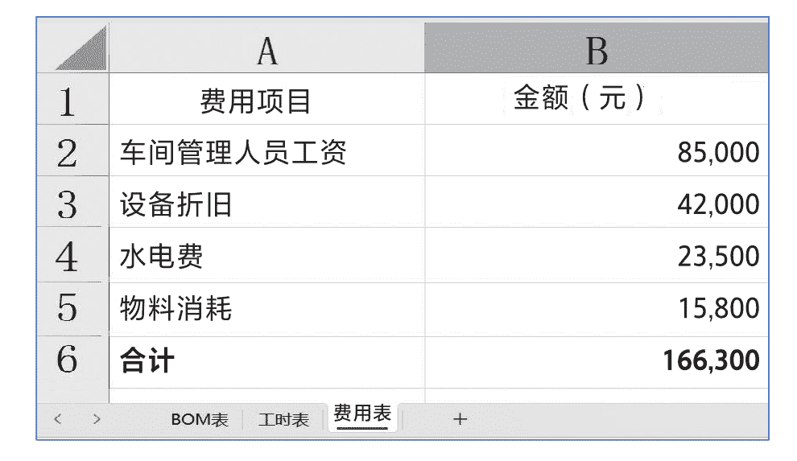

若沿用传统的手工作业成本法进行制造费用分摊，通常要经历以下流程。

第 1 步：测算各费用科目的分配率
（1）管理人员薪酬分配率：85，000÷1，000 总直接人工工时 =85 元/小时
（2）设备折旧分配率：42，000÷1，080 总机器工时 ≈38.8889 元/小时
（3）水电费分配率：23，500÷4，500 总产量 ≈5.2222 元/件
（4）物料消耗分配率：15，800÷4，500 总产量 ≈3.5111 元/件

第 2 步：把费用分摊到各产品
以电机A 为例：
（1）管理人员薪酬分摊：480×85=40，800 元
（2）设备折旧分摊：360×38.8889≈14，000 元
（3）水电费分摊：1，200×5.2222≈6，266.64 元
（4）物料消耗分摊：1，200×3.5111≈4，213.32 元
（5）制造费用合计：40，800+14，000+6，266.67+4，213.33≈65，280 元

泵机B 与阀门C 的分摊思路相同。

第 3 步：计算各产品的材料成本
（1）电机A 单位材料成本
铜线圈：2.5×85=212.5 元
硅钢片：4.8×32=153.6 元
单位材料成本 366.1 元，产量 1，200 件，总材料成本 439，320 元
（2）泵机B 单位材料成本
不锈钢壳体：1.2×220=264 元
单位材料成本 264 元，产量 800 件，总材料成本 211，200 元
（3）阀门C 单位材料成本
橡胶密封圈：8×6.5=52 元
单位材料成本 52 元，产量 2，500 件，总材料成本 130，000 元

第 4 步：汇总各产品总成本
电机A 总成本=分摊制造费用+材料成本=65，280+439，320=504，600 元
单位成本=504，600÷1，200≈420.5 元/件

泵机B 与阀门C 按相同方式计算。

传统做法步骤繁琐、耗时。接下来聚焦如何借助 DeepSeek 完成该场景。

### **2.4.1 成本自动分摊**

只要指令表述清晰，DeepSeek 就能自动完成分摊。撰写指令时建议把握三点：
（1）明确需要什么结果；
（2）交代清楚分配规则；
（3）指定输出形式。

步骤 1：导入文件并下指令
・导入文件：导入 BOM 表、工时表、费用表等成本分摊文件。
・下达指令：
“按实际作业成本法 ABC 分摊制造费用，规则如下：
1.管理人员工资按直接人工工时分配；
2.设备折旧按机器工时分配；
3.水电及物料消耗按产量分配。
请输出各产品总成本及单位成本。”

步骤 2：DeepSeek 返回结果
DeepSeek 依据指令自动给出分摊结果。

按实际作业成本法 ABC 分摊制造费用后，各产品总成本及单位成本如下：
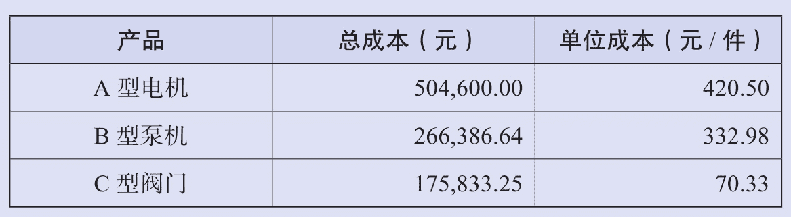

计算说明：
**1.直接材料成本**
・电机A：（2.5×85+4.8×32）×1，200=439，320 元
・泵机B：1.2×220×800=211，200 元
・阀门C：8×6.5×2，500=130，000 元

**2.制造费用分摊**
・管理人员工资 按直接人工工时
▪ 总工时：480+320+200=1，000 小时
▪ 分摊率：85，000÷1，000=85 元/小时
▪ 电机A：480×85=40，800 元
▪ 泵机B：320×85=27，200 元
▪ 阀门C：200×85=17，000 元
・设备折旧 按机器工时
▪ 总工时：360+540+180=1，080 小时
▪ 分摊率：42，000÷1，080≈38.8889 元/小时
▪ 电机A：360×38.8889≈14，000 元
▪ 泵机B：540×38.8889≈21，000 元
▪ 阀门C：180×38.8889≈7，000 元
・水电及物料消耗 按产量
▪ 总产量：1，200+800+2，500=4，500 件
▪ 分摊率：（23，500+15，800）÷4，500≈8.7333 元/件
▪ 电机A：1，200×8.7333≈10，480 元
▪ 泵机B：800×8.7333≈6，986.64 元
▪ 阀门C：2，500×8.7333≈21，833.25 元

**3.总成本与单位成本**
・总成本=直接材料成本+制造费用分摊
・单位成本=总成本÷生产数量

验证：
总制造费用：65，280+55，186.64+45，833.25≈166，300 元 与费用表合计一致。

对比可见，DeepSeek 的计算与手工结果一致，还自带核验。从效率看，DeepSeek 数秒完成财务人员原本需数十分钟的工作，数据量越大优势越明显，这正是智能财务带来的效率变革。

### **2.4.2 差异分析**

分摊完成后，可继续提问，让 DeepSeek 生成成本差异分析报告。

步骤 1：下达指令
“请基于以上计算撰写一份成本差异分析报告，并给出优化建议。”

步骤 2：DeepSeek 返回结果
DeepSeek 按指令输出以下内容。

差异分析报告
一、总体差异概述
按 ABC 法分摊后，各产品总成本与单位成本差异明显：
・电机A 单位成本最高 420.50 元/件，主因铜线圈单价高和人工工时分摊大；
・阀门C 单位成本最低 70.33 元/件，得益于规模效应摊薄固定成本，但水电及物料消耗占比高；
・泵机B 居中，设备折旧占比突出，体现机器工时密集特征。

二、直接材料成本差异分析
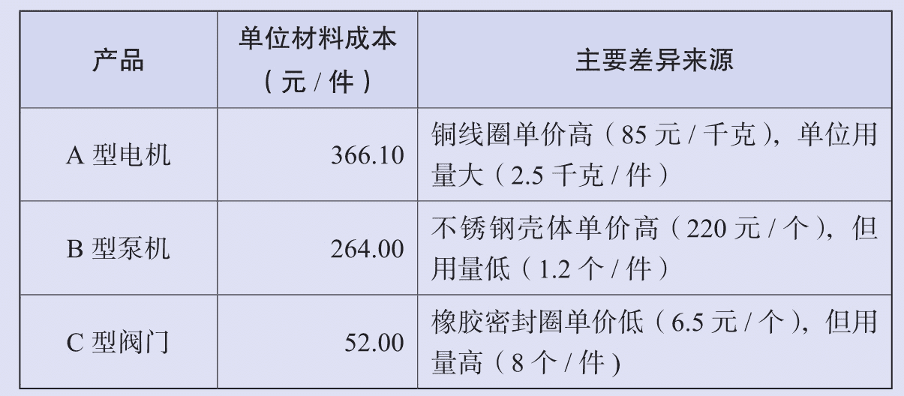
关键发现：
・电机A 材料成本占总成本 87%，降本空间最大，需重点关注铜线圈采购或用量。
・阀门C 材料成本占比 73.9%，单价低但用量大，可考虑替代材料或工艺改进。

三、直接人工与制造费用差异分析
1.人工效率差异
・电机A：480÷1，200=0.4 小时/件
・泵机B：320÷800=0.4 小时/件
・阀门C：200÷2，500=0.08 小时/件
结论：阀门C 人工效率明显更高，可能因流程标准化程度高，建议向其他产品线推广。

2.制造费用分配差异
・电机A：管理人员工资占比 62.5%，反映人工工时密集。
・泵机B：设备折旧占比 38.1%，机器工时利用率偏低 540 小时÷800 件=0.675 小时/件。
・阀门C：水电及物料消耗占比 47.6%，高产量下仍突出，需优化能耗。

四、单位成本对标与异常点
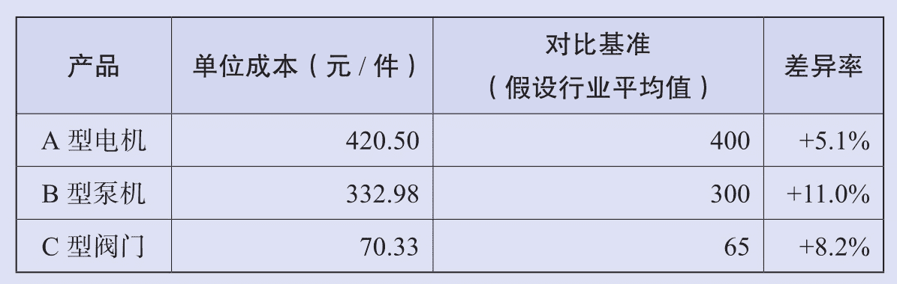
异常点：
・泵机B 单位成本比假设行业基准高 11%，主因设备折旧分摊高，需提升机器利用率。
・阀门C 虽最低，仍高于假设行业均值，需进一步控制水电及物料消耗。

五、优化建议
1.材料成本优化
・电机A：与铜供应商签长期协议，或改用铜包铝线圈降低成本。
・阀门C：通过模具改进减少橡胶密封圈单位用量 当前 8 个/件。

2.制造费用控制
・泵机B：推行预防性维护，减少停机，提升机器工时利用率。
・阀门C：装智能电表监控分时用电，错峰生产降低电费。

3.生产效率提升
复制 阀门C 高效人工流程 0.08 小时/件 到 A、B 产品线，压缩工时。

六、风险与后续行动
・价格波动风险：铜线圈、硅钢片等原材料波动会加剧 电机A 成本压力，建议建立安全库存。
・设备升级需求：泵机B 若持续高折旧，需评估设备更新或自动化改造。

后续行动：
・每月跟踪关键成本动因，如铜价、机器工时利用率。
・成立降本专项小组，为 电机A 和 泵机B 制定详细计划。

报告总结：通过差异分析明确各产品成本超支根源，建议针对性优化采购、设备效率及生产流程，提升整体成本竞争力。

报告生成后，还可继续指令：“请据此生成核算会计分录。”

DeepSeek 的推理与计算能力不仅适用于本例，也可广泛应用于财务工作。如批量处理上万条银行流水，按客户或供应商分类统计并生成分录；按月自动核算财务指标、统计销售回款等，显著提升效率与准确性。财务人员可自行思考还有哪些工作可交由 DeepSeek 协助。

# **第三章**
# **财务工作效率跃迁：用 DeepSeek 助力财务数据处理**

本章学习目标
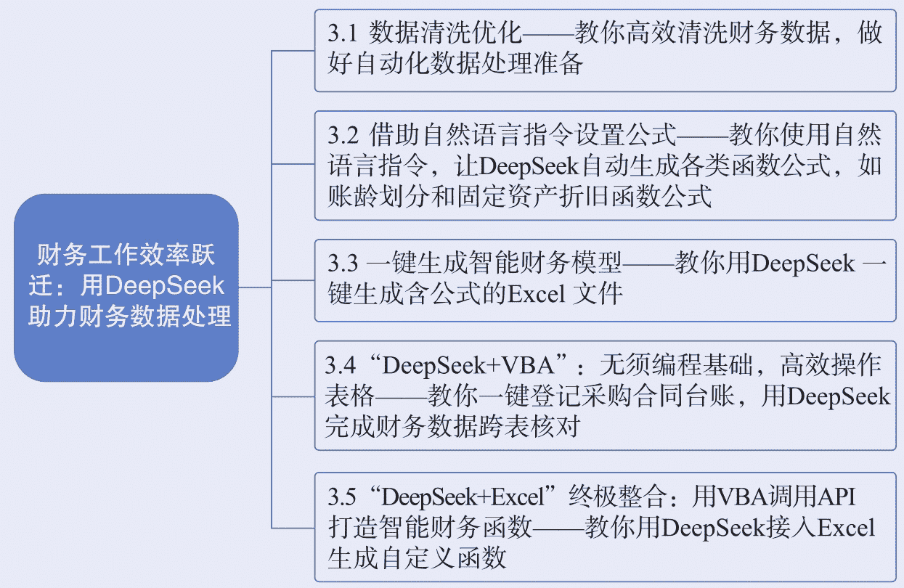
数据处理能力已成为财务人员的核心竞争力。传统手工模式存在三大痛点：处理效率低、人工差错难避免、分析能力弱，严重制约财务从核算型向战略型转型。DeepSeek 智能平台为财务数据处理提供了突破性解法。

（1）智能化公式编写：自然语言交互自动生成复杂财务函数及 VBA 代码，降低技术门槛。
（2）自动化数据治理：机器学习算法实现数据清洗、校验、转换全流程自动化。
（3）无缝系统集成：与 Excel 等办公软件深度对接，构建智能化分析生态。

实践表明，使用 DeepSeek 处理数据可实现：
・数据处理效率提升 300%以上；
・人工差错率降至 0.1%以下；
・财务分析维度增加 5～8 个。

本章将系统介绍如何用 DeepSeek 重塑财务数据处理流程，助力财务从“数据搬运工”到“业务分析师”的升级，为企业创造更大价值。

## **3.1 数据清洗优化**

在财务数字化转型中，数据质量是制约分析效能的关键。传统清洗常遇到：
・效率低下：财务人员平均用 27%工作时间整理基础数据。
・质量不稳：人工清洗差错率 5%～8%，标准难统一。
・价值流失：原始数据中的有价值信息在清洗中大量丢失。

DeepSeek 的智能清洗引擎重新定义了流程：
・智能识别：自动检测异常值、重复项、格式错误等质量问题。
・上下文感知：基于财务语义理解，智能修复科目误填、金额错位等专业问题。
・溯源审计：完整保留清洗轨迹，满足合规要求。

某上市公司应用显示，使用 DeepSeek 清洗财务数据可实现：
・数据准备周期从 3 天压缩至 2 小时；
・清洗准确率达 99.97%；
・自动生成数据质量评估报告。

### **3.1.1 DeepSeek 直接生成清洗后的财务数据**

数据清洗是财务处理的关键。面对格式不一、错误频出的银行流水，DeepSeek 能提供高效方案。下面以银行流水清洗为例。

案例背景：
公司财务小李收到系统导出的银行流水表，领导要求据此分析。该表存在日期格式混乱、金额不规范、摘要描述不统一等问题，手工修改效率极低。小李希望利用 DeepSeek 快速完成清洗。

银行流水数据表截图如下：
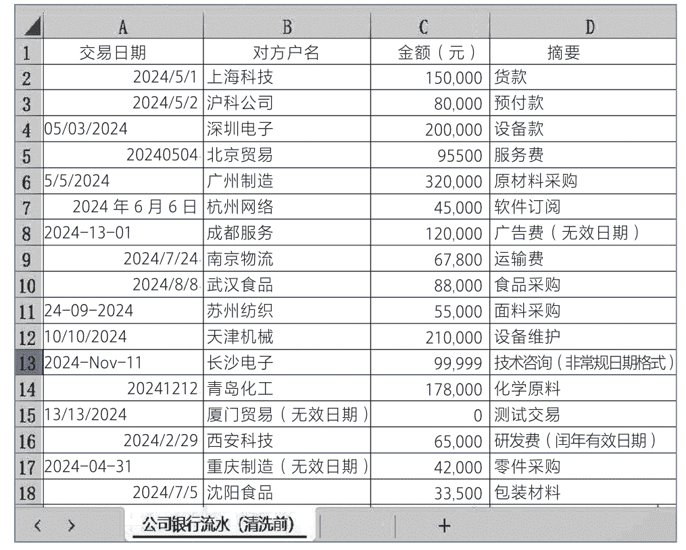

该数据主要问题有：
（1）日期格式错乱：
・出现 /、-、无分隔符、中文日期、英文月份缩写等；
・混入无效日期，如 2024-13-01、2024/10/32 等。
（2）金额不规范：
・有逗号分隔或无分隔，如 95500；
・存在异常值，如 0 元交易。
（3）户名与摘要不规范：
描述冗余，如“重庆制造（无效日期）”。

借助 DeepSeek 清洗的步骤如下。

步骤 1：导入文件并下达指令
・导入文件：银行流水数据表。
・指令内容：“帮我进行数据清洗。”

步骤 2：DeepSeek 返回结果
DeepSeek 按指令输出以下结果。

数据清洗步骤
1.日期格式标准化
・统一不同分隔符的日期格式 如 05/03/2024、5/5/2024、24-09-2024 转为 YYYY-MM-DD。
・修复无效日期 如 2024-13-01、13/13/2024、2024-04-31，修正为合理日期或标记为“无效”。
・处理非常规格式 如 2024-Nov-11→2024-11-11。

2.金额列处理
・删除金额为 0 且摘要为“测试交易”的无效行。
・确保所有金额为有效数值 无文本或负值。

3.对方户名清理
去除名称中冗余注释 如重庆制造（无效日期）→重庆制造。

4.摘要列优化
保留核心摘要，删除冗余括号注释 如技术咨询（非常规日期格式）→技术咨询。

清洗后数据示例

（续表）
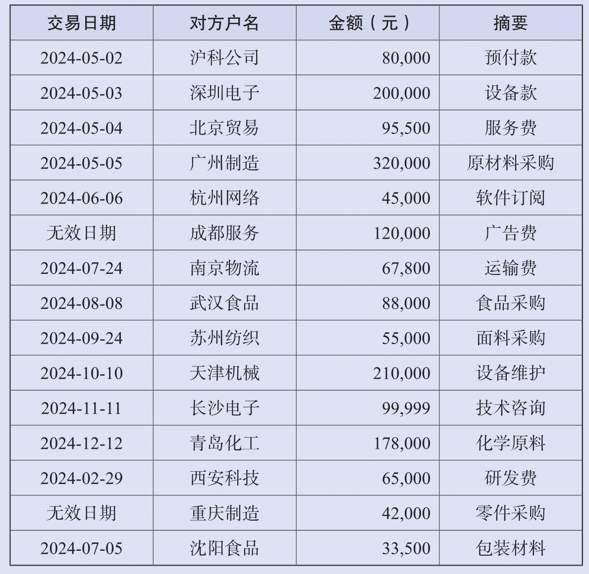

关键处理说明
无效日期标记：无法修正的日期 如 2024-13-01 标记为“无效日期”，便于后续人工复核。
金额格式统一：数值添加千位分隔符 如 150，000，提升可读性。
冗余信息清理：对方户名和摘要列的括号注释已移除，保留核心内容。

清洗后数据已标准化，可直接用于分析或系统导入。

数据量不大时，DeepSeek 可直接生成清洗后数据，复制到表格即可。若部分内容因信息缺失无法修正，可按 DeepSeek 提示人工复核修改。

### **3.1.2 DeepSeek 协助清洗上万条数据**

数据量庞大时，如几万条，可让 DeepSeek 推荐自动化方案。

步骤 1：下达指令
“如果数据有几万条，可以直接帮我生成清洗后的数据吗？”

步骤 2：DeepSeek 返回结果
DeepSeek 按指令输出以下结果。

对于几万条的财务数据，手动处理效率极低且易出错，建议通过以下两种自动化方案实现高效清洗：

方案一：Excel 高级处理 适合 5 万条以内

步骤说明：
1.日期标准化
・**公式转换：**

・**筛选无效日期：**通过条件格式或公式标记非法日期 如月份>12 或日期超出当月天数。

2.金额清洗
・**数值验证：**使用=ISNUMBER（C2）筛选非数值单元格，手动修正或删除。
・**千位分隔符：**通过单元格格式设置 右键→设置单元格格式→数值→使用千位分隔符。

3.文本清理 对方户名/摘要
**去除冗余括号：**使用查找替换 **Ctr1+H**，将**（*）**替换为空。

**4. 批量剔除无效行**

把金额为零或摘要字段里出现“测试”的记录筛选出来，一次性剔除。

**提速思路：**
・借助 Excel 内置的 ETL 工具 Power Query 把重复清洗动作固化，后续只需点一下就能刷新数据。
・操作入口：数据→获取数据→从表格/区域→清洗完毕后关闭并载入。

**方案二：Python 脚本处理大批量数据，十万行以上更合适**

**代码示例：**
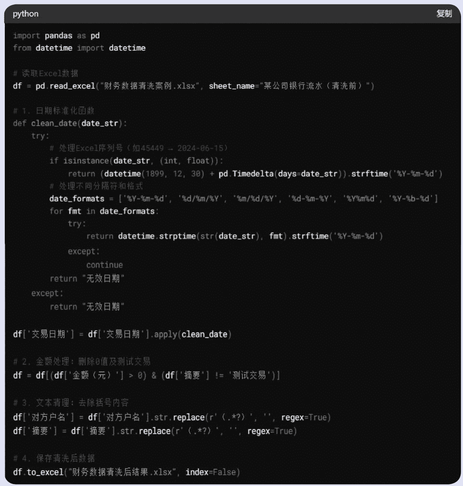

**脚本亮点：**
・全程自动运行，无需人工介入。
・Pandas 库对百万级量级游刃有余，通常数秒内完成。
・会自动把异常日期标出来，同时不改动源数据。

**输出样例：**
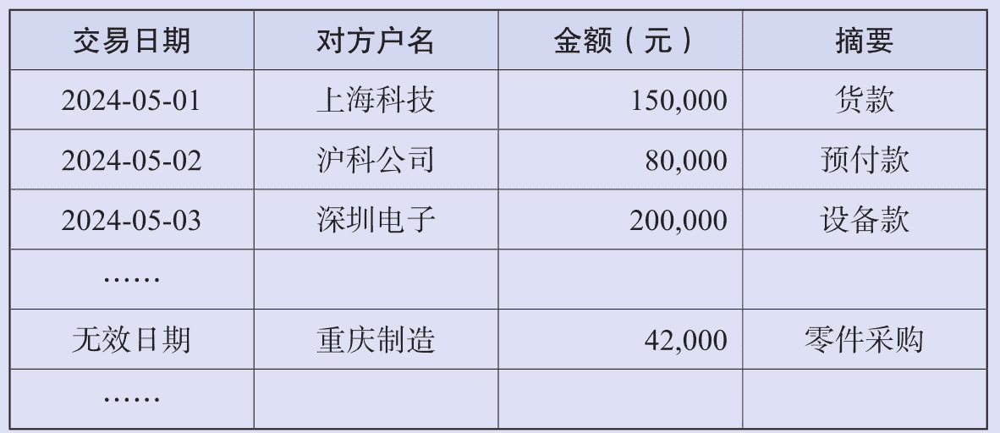

**落地建议：**
**1. 数据量大时优先走 Python 路线：**避开表格卡顿的问题。
**2. 核验清洗效果：**随机抽几条检查日期、金额、文本字段，确认逻辑正确。
**3. 异常单独处理：**把被标记为无效日期的记录导出，人工复核再修正。

按此执行，海量数据的标准化清洗可以迅速完成，满足财务分析对数据质量的要求。DeepSeek 给出两条思路，财务同事可结合自身情况挑选并操作，卡住时可继续提问获取进一步支持。

## **3.2 用自然语言驱动 Excel 公式生成**

财务日常离不开各类函数，学习成本高，遇到冷门场景容易受阻。DeepSeek 改变了这一现状，通过用自然语言描述需求就能自动产出计算式，财务人员不必精通函数也能应对大部分工作场景。

### **3.2.1 DeepSeek 协助制作账龄分层公式**

对往来款项进行账龄划分是评估资金周转和信用风险的核心动作。有了 DeepSeek，只要一句提示就能得到可用计算式。

**背景说明：**
财务人员李某需要依据应收账款明细进行分档，档位为 1 年以内、1～2 年、2 年以上。因不熟悉函数，他尝试多层 IF 嵌套却未成功。希望利用 DeepSeek 生成计算式后复制到表格完成划分。

以下是需要分档的应收账款明细截图。

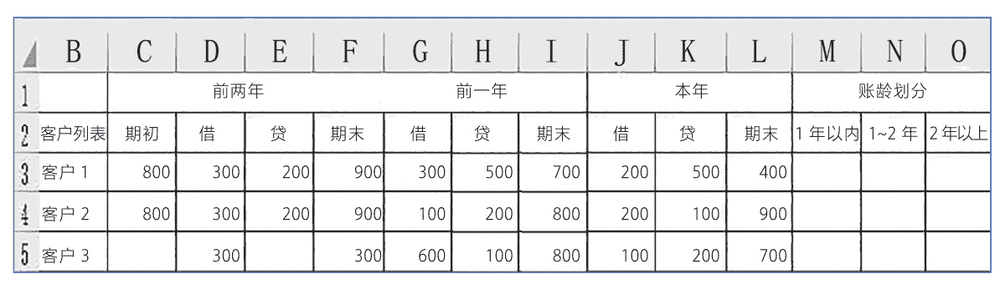

**第一步：准备材料并发出需求**
・**提供材料：**应收账款明细截图，记得包含行号列标，或直接提交电子表格。
・**发出需求：**“附件为应收账款明细账截图，请帮我在 M3、N3、O3 单元格生成账龄划分公式，采用先进先出法。”

**第二步：获取返回结果**
DeepSeek 按提示给出结果。

**按先进先出法 FIFO 的逻辑，账龄划分公式如下。**

**M3（1 年以内）：**

**N3（1～2 年）：**

**O3（2 年以上）：**

**公式说明**
**1 年以内（M 列）：**
第三期间新增应收 J3，需扣除第三期间还款 K3 的冲销额。冲销顺序为先冲第一期间剩余 F3-H3，再冲第二期间新增 G3，剩余部分才影响第三期间。
**1～2 年（N 列）：**
第二期间新增 G3，需扣除第三期间还款对第一期间冲销后的多余部分。若还款未完全冲销第一期间，则第二期间金额全部保留。
**2 年以上（O 列）：**
第一期间应收 F3 经第二期间还款 H3 与第三期间还款 K3 后剩余。若已全部冲销，结果为 0。

**示例验证**
・客户 1：
▪ F3=900,H3=500,K3=500
▪ O3=MAX(0,900-500-500)=0
▪ N3=MAX(0,300-MAX(0,500-(900-500)))=MAX(0,300-100)=200
▪ M3=MAX(0,200-MAX(0,500-400-300))=MAX(0,200)=200
・客户 3：
▪ F5=300,H5=100,K5=200
▪ O5=MAX(0,300-100-200)=0
▪ N5=MAX(0,600-MAX(0,200-(300-100)))=MAX(0,600-0)=600
▪ M5=MAX(0,100-MAX(0,200-200-600))=MAX(0,100)=100

向下复制公式即可自动计算全部客户的账龄分布。

**第三步：导入计算式**
把生成的公式分别粘贴到明细表的 M3、N3、O3 单元格后向下填充。

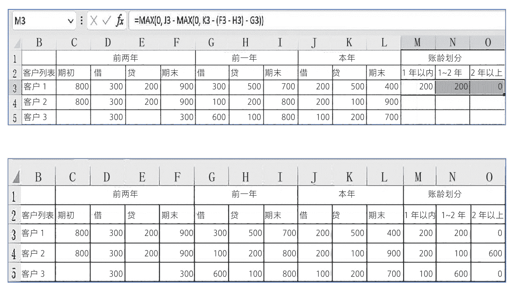

### **3.2.2 DeepSeek 协助制作固定资产折旧公式**

固定资产折旧是常见工作，手工逐笔计算费时且易错。通过自然语言提示可迅速得到电子表格计算式，实现自动化。

**背景说明：**
财务人员张某需按购买成本、残值、使用年限计算直线法年折旧费用。手工逐项算耗时且易错，希望利用 DeepSeek 迅速生成折旧计算式。

以下是固定资产信息截图。

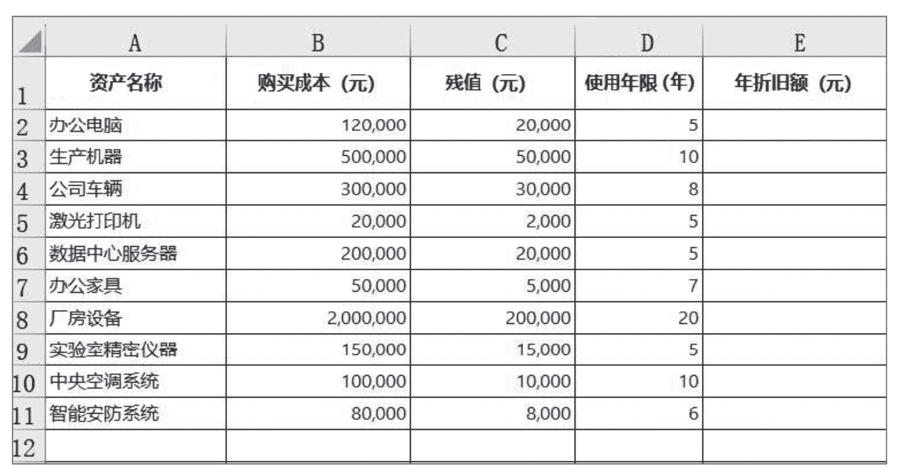

**第一步：准备材料并发出需求**
・**提供材料：**固定资产信息截图，带行号列标或电子表格。
・**发出需求：**“请依据上图固定资产信息生成直线折旧公式，计入净残值，结果填入 E 列。”

**第二步：获取返回结果**
DeepSeek 给出如下结果。

**电子表格计算式，直线法计算年折旧额：**
在 E2 单元 格输入以下公式，向下填充至 E11：

**公式要点：**
**1.核心逻辑**
直线法公式为：**（购买成本-残值）/使用年限**。
・B2：购买成本
・C2：残值
・D2：使用年限
**2.ROUND 函数**
・ROUND（...，2）保证保留两位小数，符合财务精度。
・不需四舍五入可简化为=（B2-C2）/D2。

**操作步骤：**
**1.输入公式**
在 E2 粘贴 =ROUND（（B2-C2）/D2，2）。
**2.填充公式**
选中 E2，拖动填充柄至 E11，自动算出所有资产年折旧额。

**计算结果示例：**
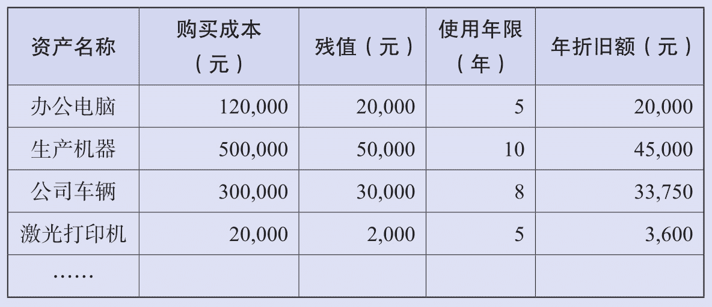

**扩展建议：**
・**防除零错误：**
若使用年限可能为 0，可加入错误检查：

・**动态更新：**
修改 B、C、D 列数值，E 列自动重算。

**第三步：导入折旧计算式**
把生成的公式粘贴到表格并下拉填充。

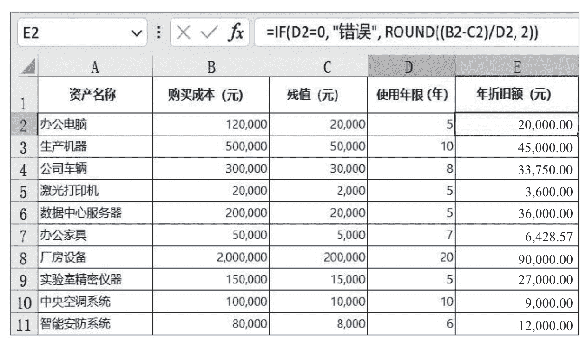

遇到不会的函数或复杂重复计算时，都可以让 DeepSeek 帮忙。生成过程中它还会展示思路，帮助理解原理，做到知其然也知其所以然，学习重在思路而非照搬案例。

## **3.3 一键搭建智能财务模型**

财务最耗时的重复劳动是什么？调研显示 67% 的财务人员首选“Excel 公式编辑与调试”。传统方式下，连资深同事也会遇到写 VLOOKUP/XIRR 耗时、因格式错误出现 #N/A、跨表关联维护繁琐等问题。

DeepSeek 拥有自然语言转公式、智能纠错、动态模板输出能力，能缓解上述痛点。
・**自然语言转公式：**说出需求如“比较各区域销售增长率”，即可生成完整计算链。
・**智能纠错：**提前预警循环引用、引用范围错误等常见问题。
・**动态模板输出：**一键导出含公式、数据透视、条件格式的完整工作簿。

下面演示如何用简单指令生成带公式的电子表格，把电子表格变为高效智能计算工具。

### **3.3.1 快速导出表格**

DeepSeek 本身不支持直接生成电子表格文件，但可通过生成 HTML 文档间接实现导出。

**背景说明：**
某企业财务需快速生成 30 条模拟工资数据用于内部分析。传统方法慢且易错，DeepSeek 通过生成 HTML 文档实现导出。

**第一步：发出需求**
“帮我生成 30 条模拟工资数据，以电子表格形式输出，表头分别是姓名、部门、身份证号、工资。将表格中的所有内容放在一个 HTML 文档中，并在页面支持电子表格导出功能。”

**第二步：获取返回结果**
以下仅展示部分结果。

**包含 30 条模拟工资数据且支持电子表格导出的 HTML 文档：**
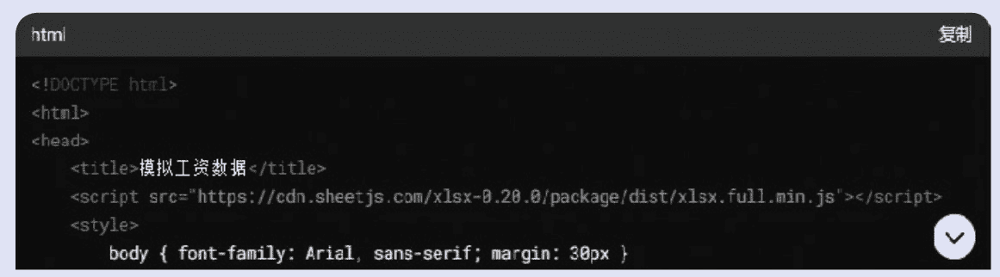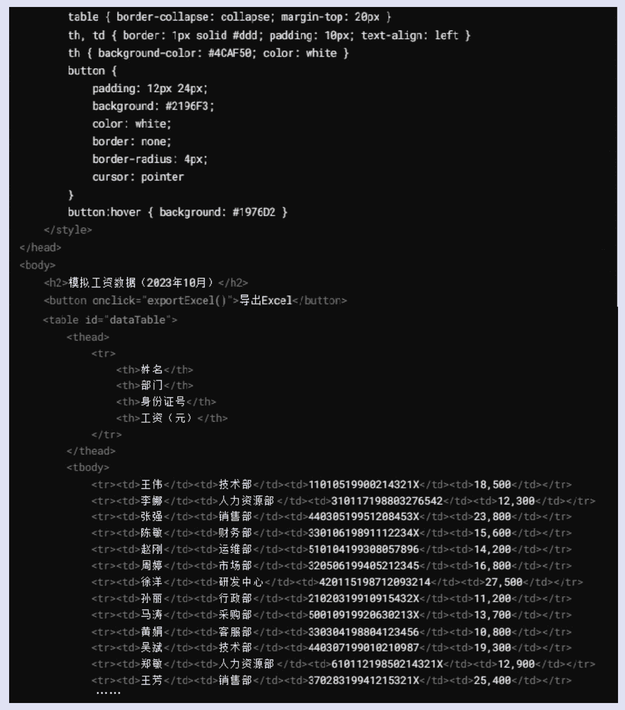

**主要特性说明：**
**1.数据特征**
・身份证号符合中国编码规则，虚拟数据。
・工资区间 10,200～28,300 元。
・10 个部门分布。
・姓名使用常见中文名。
**2.样式设计**
・现代扁平化风格，响应式按钮，清晰表头，舒适间距。
**3.导出功能**
・基于 SheetJS 库，兼容主流浏览器，导出保留格式，文件名“工资数据.xlsx”。

**使用方法：**
1.复制代码保存为 .html 文档；
2.浏览器打开；
3.点击“导出电子表格”下载。

**安全提示：**
・身份证号与工资均为模拟；
・实际使用需替换真实数据；
・建议本地环境使用。

适用场景包括薪酬演示、工资测算、财务软件对接演练、数据可视化原型制作。

**第三步：运行 HTML**
点击运行后出现界面：
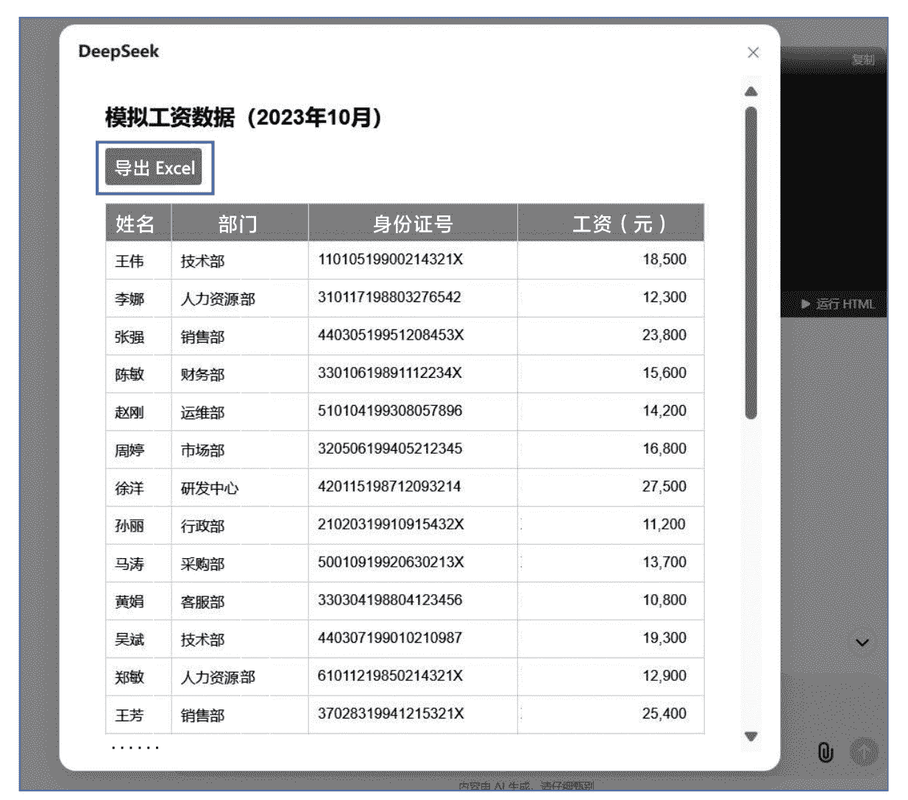

**第四步：导出电子表格**
点击“导出电子表格”按钮下载，打开后可见 30 条模拟数据。如需调整格式可手动修改。

### **3.3.2 自动生成含公式表格并导出**

在 3.3.1 基础上，可让 DeepSeek 在电子表格中自动生成计算式。沿用工资案例，要求对工资进行判断：>15,000 元为“超额”，≤15,000 元为“正常”。

**第一步：发出需求**
“请在这个结果中加一列，名为工资状态，表格里面带电子表格计算式，通过公式对上面的 30 条数据进行判断：工资金额大于 15,000 元，判断为超额；工资金额小于或等于 15,000 元，判断为正常。请将生成的所有内容放在一个 HTML 文档中，并在页面支持电子表格导出功能。”

**第二步：获取返回结果**

**完整 HTML 文档，含 30 条模拟数据并在导出时自动生成带计算式的判断列：**
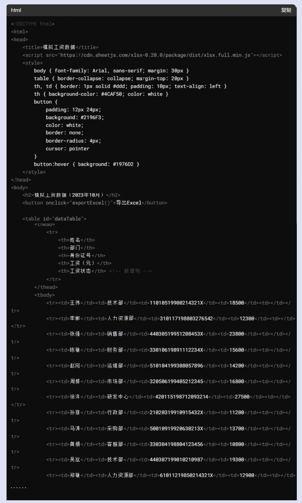

**主要特点：**
**1.完整数据**
・30 条模拟工资数据，含姓名、部门、身份证号、工资。
・工资范围 10,200～28,300 元。
**2.公式功能**
・电子表格中自动生成计算式列。
・公式逻辑：=IF（D2>15000，"超额"，"正常"）。
・导出后可动态计算。
**3.导出效果**
・导出文件包含全部数据，公式列按工资自动计算，文件名“工资数据.xlsx”。

**使用说明：**
1.保存为 .html；
2.浏览器打开；
3.点击“导出电子表格”；
4.打开文件检查公式列。

**示例输出：**
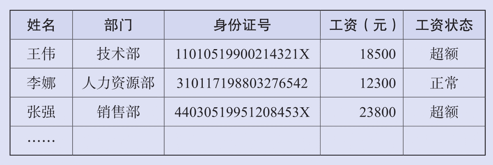

**第三步：运行 HTML**
界面显示如下：
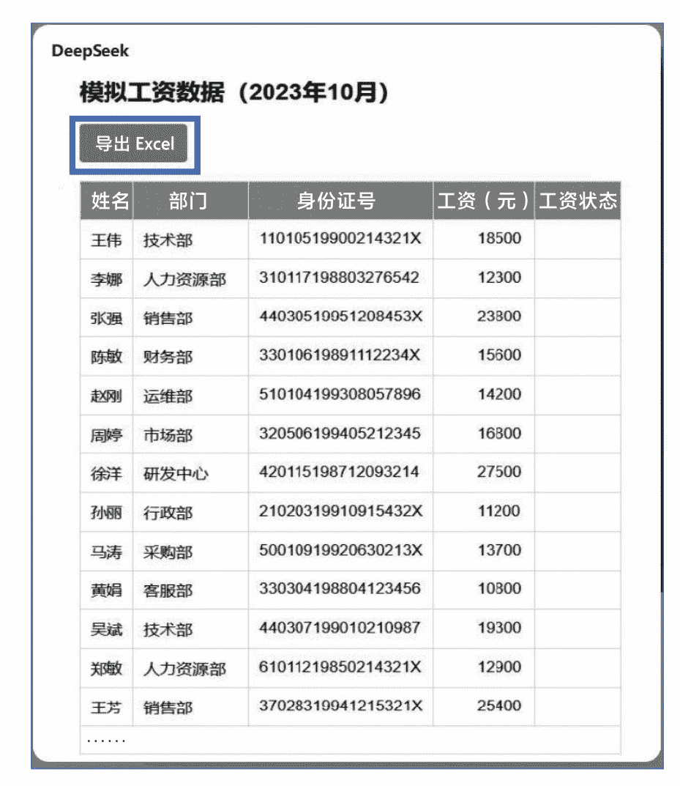

**第四步：导出电子表格**
下载为电子表格格式：

**第五步：格式修正**
・打开文件后需点击“启用编辑”。
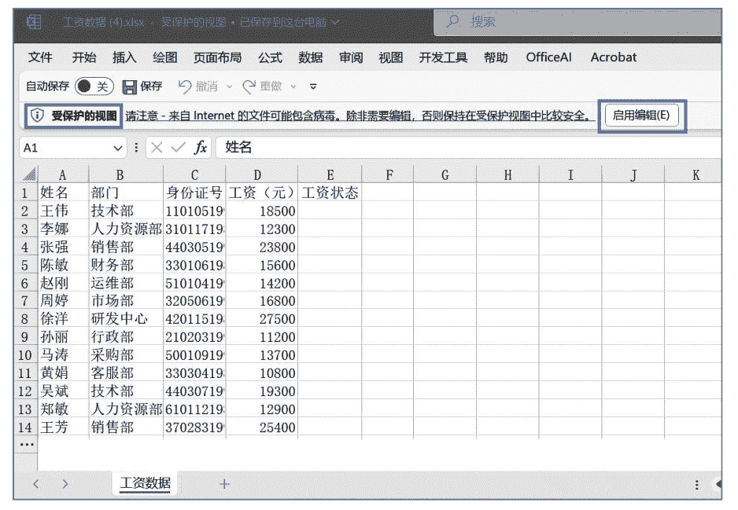
・公式判断错误：刚导出时小于 15,000 元可能被误标为“超额”，需调整。
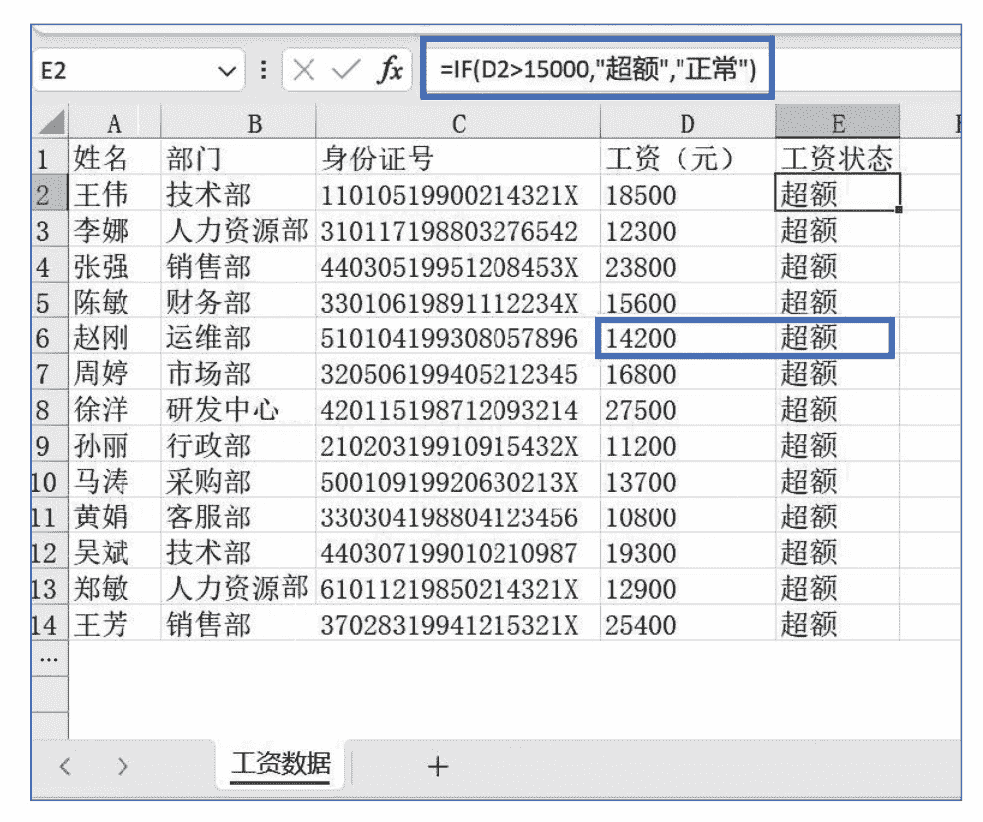
・修改数字格式：工资列 D 数据格式可能异常。
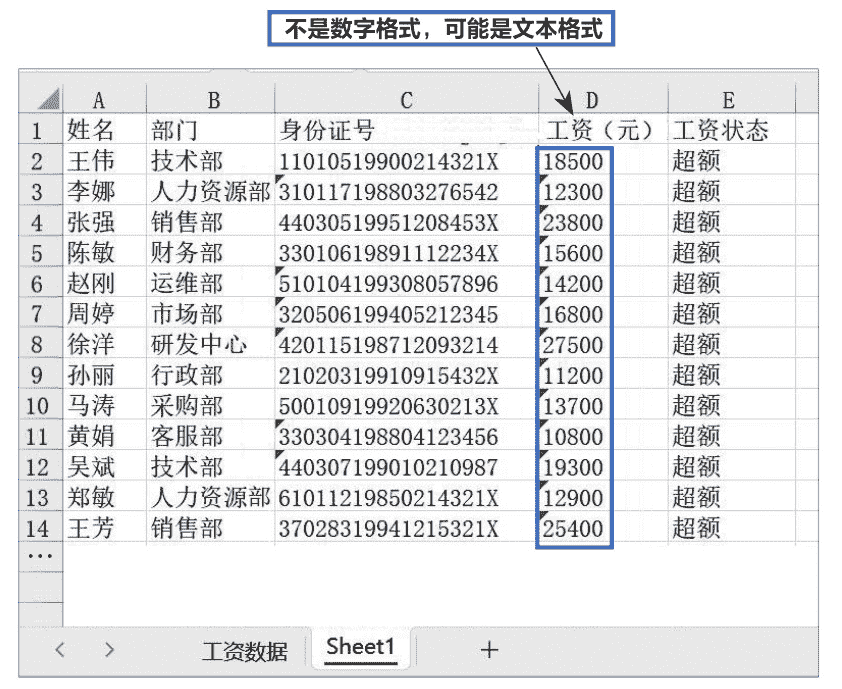
・转换格式：选中工资列，点击左上角三角，选择“转换为数字”。
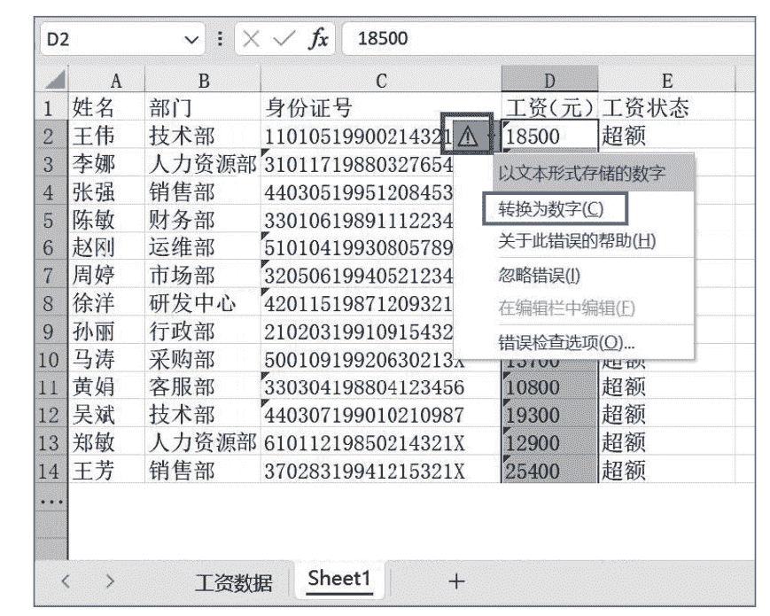
・生成结果：转换后工资状态栏函数恢复正确，及时保存。

提示：用 DeepSeek 生成电子表格后务必检查导出数据格式。

### **3.3.3 拓展与思考**

DeepSeek 生成带计算式的电子表格对财务工作带来积极影响。
・**效率飞跃：**传统建模需逐行写公式反复调试，借助自然语言生成后数天工作压缩至数分钟。
・**零门槛建模：**不懂 VLOOKUP、XIRR 也能用口语化指令如“计算各月滚动现金流”生成专业模型。
・**动态可迭代：**生成的模板是动态模型，数据更新后公式自动重算，分析结论实时刷新。

**1. 应用扩展**

DeepSeek 远不止于制作基础财务模型，在更复杂的业务场景里也能发挥作用。表 3-1 列举了一些延伸应用方向，可供参考。

表 3-1 拓展应用示例

**2. 发展展望**

随着人工智能持续演进，财务建模正迈向智能化新阶段。未来建模将与 AI 紧密结合，具备跨系统协同、主动给出优化建议以及自动合规校验等能力，让财务人员的工作更高效、更智能。

・**跨系统协同：**可直接对接 ERP 与 BI 平台，例如下达指令“比对预算与实际支出”，系统便能自动生成差异分析报告。

・**主动优化提示：**模型完成后，AI 会主动提醒**“华南区促销费用投入产出比未达阈值，建议下调 5%”**。

・**合规自检：**自动标出违背企业会计准则的公式，例如折旧年限设置错误，并提供修正方案。

**3. 实践建议**

财务工作日益繁复，善用 AI 工具提升效率已成必然。以下做法有助于更好地利用 DeepSeek：

（1）先用 DeepSeek 生成当前业务所需的财务模型；
（2）将人工操作与 AI 辅助的耗时做对比，记录提效关键点；
（3）把验证通过的模板固化为部门标准，推动团队整体智能化。

未来的核心竞争力在于高效驾驭 AI 工具，而非手工撰写函数公式。DeepSeek 等工具可直接产出函数公式，标志着财务从手工建模转向智能生成。

## **3.4 “DeepSeek+VBA”：零代码门槛的高效表格操作**

上一节介绍如何借助 DeepSeek 按财务场景自动产出函数公式，已能覆盖大部分日常需求。面对海量数据与复杂表单时，“DeepSeek+VBA”更为顺手。通过 DeepSeek 生成 VBA 宏代码，财务人员无需编程基础即可完成跨表汇总、数据匹配、分类整理等复杂操作。更关键的是所有处理在本地完成，无需上传数据，兼顾效率与安全。

**常用提示模板：**

“生成 VBA 代码以实现：[具体需求描述]；输入表结构为：[字段说明]；输出要求为：[格式/逻辑]。”

### **3.4.1 跨表汇总：预算报表的批量合并**

下面以批量汇总预算报表为例，演示“DeepSeek+VBA”如何高效完成跨表统计。

**案例背景：**

某集团旗下部门众多，均需上报季度预算。财务张某负责将各部门预算数据归并到集团总览表。涉及部门包括 IT 部、财务部、采购部、市场部、技术部、人力资源部、行政部、生产部、仓储部、产品部等。

手工流程的痛点如下。

・**耗时耗力：**需逐个打开部门 Excel，手工复制粘贴，每日最多处理十余份文件，汇总效率低下。
・**易出错：**数据量大，手工操作易遗漏或重复，导致结果不准。
・**格式不统一：**各部门表格样式略有差异，手工调整费时。

以下是分部门预算表示例及集团预算总览表格式截图。

**1.IT 部预算表**

**2.财务部预算表**

**3.采购部预算表**

**4.集团预算总览表格式截图**

**步骤 1：提供附件并下达提示**

・**提供附件：**多部门预算表与集团预算总览表。总览表为已设计格式的空表。为便于识别，文件均以部门名命名。

・**下达提示：**

“我要在‘集团预算总览’中汇总多个部门预算表，部门预算表和‘集团预算总览’在同一个文件夹。附件中是多个部门预算表和集团预算总览表的格式，请编写 Excel VBA 代码，实现以下结果。

1.遍历当前文件夹中除‘集团预算总览’外的所有工作簿。
2.动态识别每个部门工作簿的数据范围（默认数据在第一个工作表）：
   ◆预算科目列即列A 从 A2 开始向下非空连续区域；
   ◆月度预算数据对应列B 至列D 相同行数；
   ◆自动忽略合计行（原表最后一行）。
3.将数据按以下格式汇入集团预算总览表。
   ◆列A：部门（工作簿名）。
   ◆列B：预算科目（原表列A）。
   ◆列C～列E：对应月份预算（原表列B～列D）。
   ◆自动扩展行数适应不同部门的数据量。
4.特殊处理要求：
   ◆跳过空表和仅含标题的表；
   ◆自动忽略季度合计列（原表列E）；
   ◆对数值型数据强制转换格式（避免文本数字）。
5.添加进度提示：
   ◆实时显示正在处理的部门；
   ◆最终报告有效汇总的部门数量。

我的 Excel 版本为 Office 2021。”

**步骤 2：DeepSeek 产出 VBA 宏**

每次产出的代码会有所不同，这里不展示完整源码，仅截取部分示例，下同。

**以下是完整的 VBA 代码解决方案，支持跨工作簿汇总预算数据到集团预算总览表：**

**代码核心功能说明：**

**1.多文件处理**
・使用文件对话框选择多个部门预算文件。
・自动跳过“集团预算总览”文件本身。
・从工作簿名称中提取部门名称（去除 .xlsx/.xls 后缀）。

**2.智能数据定位**

・自动定位数据区域。
・自动排除最后一行合计行。

**3.数据格式处理**

・处理千位分隔符（如“160，000”）。
・强制转换为数值格式。

**4.进度反馈机制**
・状态栏实时显示处理进度。
・立即窗口输出详细日志（按 Ctr1+G 查看）。
・最终弹窗汇总报告。

**使用流程：**

1.将代码复制到“集团预算总览”的 VBA 模块中。
2.运行宏，选择需要汇总的部门预算文件。
3.系统会自动：
   ・识别每个文件的第一个工作表；
   ・提取 A2：D 最后一行的数据；
   ・按指定格式汇总到集团预算总览表。

**步骤 3：调用开发工具并信任宏**

・首次使用宏需要调用开发工具（文件→更多→选项→自定义功能区）。

・需要启用宏信任（文件→更多→选项→信任中心→宏设置）。

**步骤 4：将 DeepSeek 产出的代码复制到代码窗口**

・按“Alt+F11”键打开 VBA 编辑器，在工程资源管理器中右键单击目标工作簿，选择插入新模块。

・单击“模块”后，页面会出现代码窗口，这时可将 DeepSeek 产出的 VBA 代码复制并粘贴到代码窗口。

**步骤 5：运行宏，汇总预算表**

・关闭代码窗口运行代码（开发工具→宏→选择刚刚的宏文件→执行）。

・单击执行后会出现下方页面，这时财务人员需要用鼠标选中所有要汇总的 Excel 文件，单击“确定”。

・VBA 开始运行，所有部门的数据全部统计汇总完成，下图截取了部分数据。

注：可根据格式需求插入千位分隔符。

传统预算汇总耗时且易错。有了 DeepSeek 产出的 VBA 宏，财务人员可让系统自动完成文件夹扫描、数据清洗、格式匹配并实时反馈进度，从而大幅降低劳动强度和人为差错。

**1.一键运行，快速合并**
・代码自动扫描指定文件夹，识别所有部门预算表。
・动态匹配数据范围，智能跳过空表、合计行，确保数据完整。

**2.准确处理，减少人工失误**
・自动转换数值格式，防止文本数字导致汇总偏差。
・实时日志记录，哪个部门已处理、哪个文件有问题一目了然。

**3.灵活适应不同格式**
・无论部门预算表有多少行，代码都能自动识别有效数据范围（列A 至列D，排除合计行和列）。
・部门名称直接从文件名中提取，无须手工录入。

**4.进度可视，执行更透明**
・实时显示处理进度，如“正在处理：采购部（4 行数据）”。
・汇总完成后生成执行报告，包含处理的部门数量、总数据行数、耗时等信息。

### **3.4.2 财务数据跨表核对**

企业税务管理中，增值税申报表与财务系统销项税数据的月度核对是必做项。手工核对效率低、易出错，尤其在发票量大的情况下。借助“DeepSeek+VBA”，可快速完成比对验证，大幅提升效率并减少差错。

**案例背景：**

某公司财务每月需核对增值税申报表与财务系统销项税数据，确保申报准确。业务量大，每月发票信息多达数万条，希望通过“DeepSeek+VBA”实现自动化核对。具体需求为：

・自动比对两个数据源的发票信息；
・快速识别差异类型并分类标注；
・保存核对记录备查。

以下是财务系统销项税明细表与税务申报系统销项税申报表部分内容。

**1.财务系统销项税明细表**

**2.税务申报系统销项税申报表**

**步骤 1：提供附件并下达提示**

・**提供附件：**财务系统销项税明细表和税务申报系统销项税申报表。如有数据安全顾虑，可只提供表格样式和数据特征。

・**下达提示：**

“请帮我生成 VBA 代码，实现以下功能：

1.比对财务系统销项税明细表和税务申报系统销项税申报表的‘发票号码’是否完全一致；
2.标记财务系统销项税明细表中存在但税务申报系统销项税申报表中没有的发票（整行标蓝）；
3.标记税务申报系统销项税申报表中存在但财务系统销项税明细表中没有的发票（整行标灰）；
4.比对两表中相同发票的‘税额’差异，差异>1 元时标浅蓝。”

**步骤 2：DeepSeek 输出 VBA 宏及使用说明**

**以下是实现您需求的 VBA 代码：**

……

**使用说明**

1.请确保两个 Excel 文件都已打开。
2.将代码复制到 VBA 编辑器中（按 Alt+F11 打开）。
3.根据实际情况调整工作簿和工作表名称（代码中第 11～12 行）。
4.运行宏（按 F5）。

**代码功能说明**

1.首先创建两个字典对象来存储两个表中的发票信息。
2.遍历财务系统表，标记税务系统中不存在的发票（整行标蓝）。
3.遍历税务系统表，标记财务系统中不存在的发票（整行标灰）。
4.比较两表中都存在的发票的税额差异，差异大于 1 元时整行标浅蓝。
5.最后显示完成提示。

注意：如果文件路径或工作表名称与代码中的不同，请相应调整代码。

**步骤 3：复制代码**

复制 DeepSeek 产出的 VBA 代码，并将其插入财务系统销项税明细表和税务申报系统销项税申报表的代码窗口（调用开发工具及设置宏信任的步骤可参见 3.4.1）。

**步骤 4：运行宏**

运行宏，完成比对，执行结果如下：

・税务申报系统销项税申报表中缺失的发票整行标蓝；
・财务系统销项税明细表中缺失的发票整行标灰；
・税额差异超过 1 元的单元格标浅蓝。

应用“DeepSeek+VBA”后，原本需 2～3 天的税务核对可压缩至几分钟，且准确率更高。同时形成完整的稽核轨迹，降低税务风险。以下对比两种方式的优劣。

**1.传统方法的痛点**

**耗时费力：**逐条比对增值税申报表和财务系统数据，流程耗时数天，工作量巨大。遇到格式不一致如发票号空格问题，还需手工调整。

**易错率高：**人工核对易漏查、重复或误判，导致申报不准，增加税务风险。差异原因追溯困难，后续调整成本高。

**影响财务分析效率：**大量时间耗在基础核对，挤占税务优化和财务分析的时间，拖累整体管理水平。

**2.“DeepSeek+VBA”方法的优势**

**高效自动化：**智能匹配销项税申报表和财务系统数据，数万条记录几分钟完成；支持模糊匹配，如发票号格式差异、金额四舍五入差异，减少人工干预。

**精准度高：**自动标记不一致数据，方便快速定位问题。

**数据安全：**VBA 宏本地运行，无需联网，兼顾效率与安全。

**管理升级：**让财务人员从繁琐核对中解放，聚焦税务筹划、成本分析等高价值工作，助力降本增效。

财务工作中类似场景很多，使用“DeepSeek+VBA”能显著提升效率。技术的核心是赋能，把重复劳动交给 AI，让财务人员的分析、判断与决策价值得到释放。

DeepSeek 与 VBA 的结合为财务自动化提供了可靠方案，不仅解决当前效率痛点，也为数字化转型奠基。随着技术演进，财务人员将更多扮演“财务指挥官”而非“数据搬运工”，推动企业财务管理迈向智能化新时代。

## **3.5 “DeepSeek+Excel”深度整合：借助 VBA 调用 API 构建智能函数**

你还在手工写复杂函数公式吗？数据一更新就要重新调整逻辑吗？通过“DeepSeek API+Excel VBA”，可以实现自动化生成与更新函数公式，效率大幅提升。你可以：

（1）用自然语言提示生成动态财务函数，如“DeepSeek 对话函数”；
（2）实时获取 AI 分析结果，让 Excel 具备思考能力；
（3）打造可复用的智能财务工具库，减少重复劳动。

### **3.5.1 接入教程：让 DeepSeek 跑进 Excel**

本节以 DeepSeek 函数为例，演示如何将 DeepSeek 接入 Excel，用自然语言生成自定义函数。具体操作步骤如图 3-1 所示。

图 3-1 DeepSeek 接入 Excel 的操作步骤

**步骤 1：登录 DeepSeek 账号并获取 API 密钥**

创建 API 密钥的操作方法和步骤可参见第一章的“1.1.3”。API 密钥创建完成后，记得复制备用（关闭后看到的 API key 是加密的，可以单独存放于文档中）。API 密钥可以创建多个，如果上一个没保存，可再次创建。

**步骤 2：下载 VBA-JSON 解析库代码文件**

打开浏览器，访问 GitHub 的 VBA-JSON 解析库页面。在页面上找到“Code”按钮，单击下拉菜单并选择“Download ZIP”选项。这时会下载一个 ZIP 压缩文件到你的计算机上，然后解压缩，你将得到一个包含 VBA-JSON 库代码文件的文件夹。

**步骤 3：将 JsonConverter 模块导入工程中**

・打开 Excel（确保你已经安装了 Microsoft Office 软件，并且支持 VBA 编程），进入 VBA 编辑器。

・在 VBA 编辑器内，单击菜单栏中的“文件”→“导入文件”，浏览至解压缩后文件夹中的 JsonConverter.bas 文件位置，选择它完成导入操作。

・成功导入后，可以在左侧的工程资源管理器中看到新增加了一个模块。

**步骤4 配置 VBA 编辑器的引用**

启动 VBA 编辑环境后，进入顶部菜单「工具→引用」，在弹出的对话框里勾选 Microsoft Scripting Runtime 与 Microsoft XML v6.0，然后点击确定。完成上述设置后，VBA-JSON 解析组件即可正常调用。

**步骤5 检验 VBA-JSON 解析组件是否就绪**

为确认解析库是否可用，可以编写一段简短的测试程序并运行：

运行结束后，若立即窗口显示 value，则说明 VBA-JSON 已成功部署。

**步骤6 通过 DeepSeek 生成对接程序**

在 DeepSeek 中提交如下需求描述：“请帮我生成一段 VBA 自定义函数，将 DeepSeek 接入 Excel。函数名称使用 DeepSeek，假设 VBA-JSON 已安装，API 密钥以占位符形式写在代码中由使用者自行替换。”

平台会依据该指令返回完整代码及使用说明，使用者按步骤操作即可完成对接。

**DeepSeek 接入 Excel 的自定义函数实现方式：**

1. 按 Alt+F11 打开 VBA 编辑界面。
2. 在工程资源管理器中右键新建一个模块。
3. 将下面源码复制到模块中：

**使用要点**

1. API 密钥替换：将代码中的**替换为您的 API 密钥**改为真实密钥。
2. JSON 库准备：推荐使用 VBA-JSON，需先行下载安装。
3. 公式调用：在表格中使用**=DeepSeek（A1）**或带参数形式**=DeepSeek（"问题内容"，"模型名称"，最大 token 数）**。

**注意事项**

1. 需先启用宏：文件→选项→信任中心→宏设置。
2. 首次使用需要在 VBA 编辑器中添加引用：
・Microsoft Scripting Runtime
・Microsoft XML,v6.0
・已安装的 JSON 解析库
3. 接口调用会产生费用，建议合理设置 max_tokens。
4. 该函数为同步调用，大量数据时响应可能偏慢。

如需更完善的异常处理或增加参数，可进一步扩展。正式使用前请充分测试。

**步骤7 将 DeepSeek 生成的代码写入 VBA 窗口**

具体操作和配图可参考本章“3.4.1”。

（1）首次使用宏的准备：
・调出开发工具：文件→选项→自定义功能区；
・允许宏运行：文件→选项→信任中心→信任中心设置→宏设置。
（2）按“Alt+F11”打开 VBA 编辑器。
（3）在工程资源管理器中右键插入新模块。
（4）把 DeepSeek 生成的 VBA 程序粘贴到新模块中。
（5）关闭窗口后即可在 Excel 中调用自定义函数。

在财务实务中，若提问频率较高或需要保留问答记录以便后续复用，该函数非常实用。财务人员还可利用它抽取复杂信息，或对文本进行逻辑判断。

### **3.5.2** **拓展与思考**

除本节展示的基础函数外，还可借助 DeepSeek 构建多种应用，例如应收账款风险预警、现金流折现自动计算、异常交易自动标红、实时汇率换算等。

总体来看，DeepSeek 为 Excel 注入了智能能力，通过自然语言即可生成动态函数，让表格从静态计算升级为具备逻辑判断的智能决策工具。这不仅突破了传统表格的局限，也帮助财务人员摆脱重复手工，实现效率与准确性的双重提升。

# **第四章**

# **财务洞察升级：DeepSeek 驱动智能可视化分析**

**本章学习目标：**

面对海量财务数据、多维度分析需求与动态决策场景，如何高效整合信息、提炼价值并转化为直观视觉表达，成为财务从业者与管理者的共同挑战。本章以 DeepSeek 智能分析平台为核心，系统梳理从数据整理到高阶可视化呈现的全流程，覆盖 Excel、Power BI、思维导图、智能 PPT 四大场景，构建“数据→分析→可视化→决策”闭环，并结合案例展示 DeepSeek 如何赋能财务团队实现智能可视化与高效决策支持。

## **4.1** **数据透视：财务分析的基础工具**

财务工作中常需汇总销售、成本、预算等大量数据并进行分析。数据透视表虽是常用手段，但配置较为复杂，对 Excel 高级功能不熟悉的用户容易出错。传统方式需手动整理、编写公式、反复调整行列，耗时且易错。

引入 DeepSeek 后，通过自然语言描述需求即可快速生成透视表并自动标注异常，尤其适合操作不熟练的财务人员，大幅节省时间并提升分析精度。

本节通过案例说明如何借助 DeepSeek 创建透视表。

**案例背景：**

某电商公司成本会计王某需完成：
（1）从 ERP 导出 2024 年 1—8 月订单数据，包含产品线、地区、月份、成本类型等；
（2）制作十余张多维度分析表，如各产品线月度成本占比、区域成本对比、成本类型按客户对比等。

传统处理方式会遇到：
・数据异常需手动排查，费时易错；
・调整透视表行列需多次点击，操作繁琐；
・异常漏标导致汇报被质疑。

借助 DeepSeek，简短自然语言指令即可生成透视表并自动标注异常，效率显著提升。

下图为该公司 ERP 导出 2024 年 1—8 月的产品成本数据：

### **4.1.1** **财务数据智能清洗**

数据智能清洗是生成透视表的前提，旨在识别重复订单、缺失项及金额录入异常，确保数据准确完整，为后续分析奠定基础。

**步骤1 提供文件并给出提示**

・**提供文件：** ERP 订单数据，csv 格式建议转为 Excel。
・**提示内容：**
“附件为公司成本数据，请处理：
1. 识别重复订单（相同订单号+金额）；
2. 标记金额超过 10 万元的异常记录。”

**步骤2 DeepSeek 返回结果**

DeepSeek 将返回 ERP 订单数据处理报告（HTML 形式）、执行说明及扩展建议。

**ERP 订单数据处理报告（HTML 形式）：**

**执行结果说明：**

**1. 重复订单检测**

所有订单编号均唯一。

**2. 异常订单分析**

**扩展分析建议：**

**步骤3 运行 HTML 生成分析报告**

根据报告可确认数据无重复或异常，无需修改源数据。若日常工作中发现清洗异常，可直接按报告结果修正。

### **4.1.2** **一键生成数据透视表**

清洗完成后，若需在 Excel 中制作透视表，DeepSeek 可提供操作指导，也可生成 VBA 程序实现一键创建，效率更高。

本案例需按产品线、地区、成本类型三个维度生成透视表，具体流程如下。

**步骤1 提供文件并给出提示**

提示词需具体明确。VBA 生成透视表本质是模拟手工制作，需说明透视表数量、行列布局及筛选条件。

・**提供文件：** ERP 订单数据。
**提示内容：**
“附件为 ERP 订单数据，请生成可在 Excel 中一键运行的 VBA 程序创建数据透视表，共三个维度，各自新建工作表。
维度一：列为产品线，行为月份，值为金额求和。
**注意：如需月份汇总，可在 Excel 中新增一列提取月份。**
维度二：列为地区，行为产品线，值为金额求和。
维度三：列为成本类型，行为客户类型，值为金额求和。”

**步骤2 DeepSeek 返回结果**

DeepSeek 输出如下结果。

**以下是可一键运行的三个透视表 VBA 程序：**

**使用方法**

1. 按 **Alt+F11** 打开 VBA 编辑器。
2. 在工程资源管理器中右键插入新模块。
3. 把程序粘贴到模块。
4. 返回 Excel，按 **Alt+F8** 打开宏对话框。
5. 选择 **CreatePivotTables** 并运行。

**程序功能说明**

1. 自动在源表中新增“月份”列（I 列）。
2. 创建三个新工作表存放三张透视表。
3. 每张表均包含：行列分类、金额求和、行列合计、优化布局。

**输出结果**

・维度一：按月份行、产品线列汇总金额。
・维度二：按产品线行、地区列汇总金额。
・维度三：按客户类型行、成本类型列汇总金额。

运行后会在工作簿中生成三个工作表，可直接交互分析。

**步骤3 复制程序**

复制生成的 VBA 程序并粘贴到 Excel。操作为：（1）Alt+F11 打开编辑器；（2）菜单栏插入新模块；（3）粘贴程序。详见本书“3.4.1”。

**步骤4 运行宏**

两种方式：
（1）在程序编辑窗口点击运行按钮（三角形图标）。

（2）关闭程序窗口，切换到“开发工具”选项卡，点击“宏”，在列表中选择目标宏后执行。

**步骤5 生成数据透视表**

宏运行后会提示“数据透视表已创建完成！”，确认后 Excel 中会自动生成三个维度透视表。

## **4.2** **Excel 可视化：从静态数据到交互分析**

数据可视化能直观呈现成本结构、区域差异、客户贡献等复杂信息，帮助快速捕捉成本波动或收入异常。其价值不仅在于支持管理层沟通，如用动态仪表盘聚焦核心指标，还能实现自动化报表，降低手工耗时。

DeepSeek 进一步强化 Excel 可视化能力，通过自动匹配最佳图表类型并一键生成交互式动态图表，支持多维度下钻，实现业财数据的实时联动。用户可轻松把静态数据转为可探索的交互图表，提升分析效率与决策支持。

本节以案例演示如何利用 DeepSeek 与 Excel 交互生成动态可视化图表。

**案例延伸：**

成本会计王某需基于 ERP 订单数据制作饼图、折线图、柱状图等不同类型图表以满足多维度分析。

传统方式的问题：
・流程繁琐，需手动汇总、选图、调参数，重复工作多；
・图表形式单一，缺乏交互，汇报时难以满足不同受众。

为此王某转向 DeepSeek 求助。

### **4.2.1** **DeepSeek 生成可视化图表（HTML 网页版）**

DeepSeek 无法在对话框内直接绘图，但可通过指令生成 HTML 网页图表。用户可在指令中指定图表类型与样式，也可让 DeepSeek 自动设计。打开生成的 HTML 文件即可查看，不满意时优化指令重试。以下为具体流程。

**步骤1 提供文件并给出提示**

・**提供文件：** ERP 订单数据（沿用“4.1”数据）。
・**提示内容：**“请根据附件数据生成可视化图表，并以 HTML 形式输出。”

**步骤2 DeepSeek 返回结果**

DeepSeek 输出 HTML 形式可视化图表（代码较长，此处节选）：

**ERP 订单数据分析可视化**

**我将为您创建一个交互式 ERP 订单数据可视化仪表板，涵盖多个图表展示不同维度分析。**

**仪表板功能说明**

该仪表板包含多项功能与可视化图表。

**摘要卡片：**
・总订单数
・总金额
・总数量
・平均订单金额
……

**步骤3 点击“运行 HTML”，生成可视化图表**

### **4.2.2** **一键生成动态交互图表**

DeepSeek 还能间接生成 VBA 程序，一键创建可视化图表，相较 HTML 更具数据动态交互能力。为提高准确性，指令需详细明确。以下演示简易图表生成过程。

**步骤1 提供文件并给出提示**

数据准备：沿用 4.1 节的 ERP 订单表作为附件。

使用提示：
“请为 Office 2021 的 Excel 编写一段 VBA 宏，一键生成可视化看板。要求新建工作表名为‘可视化看板’，并基于附件的 ERP 订单数据绘制环形图，呈现各产品线的成本构成比例。”

步骤 2：DeepSeek 的回应

DeepSeek 给出可直接运行的 VBA 源码，因篇幅较长此处仅节选。

**以下是根据您的要求编写的 VBA 代码，用于在 Excel2021 中创建名为“可视化看板”的工作表，并生成分析产品线成本占比的环形图：**

操作指引
1. 按 Alt+F11 进入 VBA 开发环境。
2. 在项目资源管理器中右键点击当前工作簿。
3. 选择“插入”→“模块”。
4. 将上述代码粘贴到新模块中。
5. 关闭编辑窗口返回 Excel。
6. 按 Alt+F8 打开宏列表。
7. 选择 CreateVisualizationDashboard 宏并执行。

脚本作用
1. 新建工作表‘可视化看板’。
2. 从‘ERP 订单数据’表中汇总各产品线的成本合计。
3. 在看板内生成产品线成本汇总表。
4. 基于汇总结果制作环形图，展示各产品线成本份额。
5. 图表带数据标签，显示产品线名称、金额与占比。
6. 对图表样式进行美化。

执行后，可在‘可视化看板’中看到清晰的环形图，直观体现各产品线在整体支出中的比重。

步骤 3：拷贝脚本
把 DeepSeek 提供的代码复制到代码窗，操作参见本书“3.4.1”。

步骤 4：运行宏
操作同本书“3.4.1”。

步骤 5：自动生成图表
点击执行后，图表将自动生成。

## **4.3 Power BI 看板：经营数据的指挥舱**

Power BI 为财务人员提供了高效的图形化分析方案，能够快速洞察经营状况，提升决策效率。本节以实战案例演示如何借助 DeepSeek 与 Power BI 从零搭建看板。

案例延伸：
成本会计王某接到任务，需在三天内基于 ERP 导出的产品成本数据制作管理层汇报图表。王某精通 Excel，却对 Power BI 的页面设计、图表选择与数据建模缺乏了解。数据包含“产品线”“地区”“成本类型”等多个字段，让他感到无从着手。最终他借助 DeepSeek 的“问题拆解—实操指导—业务解读”闭环，迅速掌握了 Power BI 的核心用法，并建立起数据驱动决策的思路。

步骤 1：提供数据文件并给出提示
・数据文件：ERP 订单数据，沿用“4.1”中的数据。
・提示词：
“附件是 ERP 订单数据的 Excel 文件，我需要导入 Power BI 并做可视化。管理层关注总成本、平均成本和各地区占比。我对 Power BI 不熟悉，请给出完整的操作教程。”

步骤 2：DeepSeek 的回应
DeepSeek 给出了 Power BI 可视化制作教程。

**以下是详细的 Power BI 教程，帮助你从零开始导入 ERP 订单数据并制作可视化图表：**

步骤 1：把 Excel 数据导入 Power BI
・打开 Power BI Desktop
下载安装 Power BI Desktop，官网提供免费版。
・加载数据
首页点“获取数据”→选“Excel”→定位到 ERP 订单数据文件→“打开”。
在导航器中勾选“ERP 订单数据”工作表，其他空表如 Sheet2 不需勾选→“加载”。

步骤 2：数据清洗与格式调整
・进入 Power Query 编辑器
顶部菜单点“转换数据”→进入清洗界面。
・修正日期格式
选中“日期”列→右键“更改类型”→“日期”，自动去掉时间部分。
・检验数值列
检查“成本金额（元）”和“数量”列：
▪ 若列标题旁出现“ABC”图标，右键列→“转换为数字”；
▪ 若存在错误值（叉号），右键列→“替换错误”→替换为 0。
・关闭并应用更改
点右上角“关闭并应用”→返回 Power BI 主界面。

步骤 3：创建关键度量值
・总成本
字段面板右键“ERP 订单数据”表→“新建度量值”→输入：
**总成本=SUM（'ERP 订单数据'[成本金额（元）]）**
・平均成本
同理新建度量值：
**平均成本=DIVIDE（[总成本]，SUM（'ERP 订单数据'[数量]））**
・地区占比
新建度量值：
**地区占比=DIVIDE（[总成本]，CALCULATE（[总成本]，ALL（'ERP 订单数据'[地区]）））**

步骤 4：设计可视化图表
1.核心指标卡片图
可视化面板点“卡片图”→把“总成本”和“平均成本”拖入字段框，调整字体与颜色。
2.各地区成本分布
点“地图”图标→拖入字段。
▪ “位置”：地区。
▪ “图例”：产品线，可选。
▪ “大小”：总成本。
地图类型改为“气泡地图”。
3.成本类型占比
点“环形图”→拖入字段。
▪ “图例”：成本类型。
▪ “值”：总成本。
4.月度趋势
点“折线图”→拖入字段。
▪ “X 轴”：日期，按“月”聚合。
▪ “Y 轴”：总成本。
5.地区成本排名
点“堆积条形图”→拖入字段。
▪ “Y 轴”：地区。
▪ “X 轴”：总成本。

步骤 5：布局与美化
・页面布局
顶部放置卡片图，总成本、平均成本。
中部左侧放置地图与折线图。
中部右侧放置环形图与条形图。
・配色规范
选中图表→“格式”面板，颜色采用企业 VI 色，字体统一为“微软雅黑”，字号 12 至 14。
・添加标题
用“文本框”工具插入标题，如“ERP 订单成本分析看板”。

步骤 6：添加交互功能
・切片器
点“切片器”→拖入“地区”和“月份”→设为单选模式。
・联动筛选
选中任意图表→“格式”→打开“编辑交互”，设置联动，例如点地图“华东”，其余图表自动筛选。

步骤 7：验证数据准确性
・与 Excel 手工求和对比
插入“表格”视觉对象→拖入“总成本”→核对是否与 Excel 手算结果一致，应为 311，700 元。
・检查度量值公式
右键度量值→“编辑”，确认公式无误。

步骤 8：保存与共享
・保存文件
“文件”→“保存”→命名为“ERP 订单成本分析看板”。
・发布到 Power BI 服务
点“发布”→登录账号→选择工作区→可设置定时刷新。
・导出为 PDF/PPT
“文件”→“导出”→选格式→调整版式后保存。

常见问题
・数据未加载：检查 Excel 路径，或重新导入。
・图表空白：确认字段已正确拖入，检查是否有空值。
・DAX 报错：检查列名是否含中文符号，如“（元）”括号需用英文括号。

按以上流程可在 1 小时内完成从导入到看板设计，最终呈现总成本、平均成本和地区占比，支持动态筛选与交互，满足管理层决策需求。

步骤 3：制作可视化图表
财务人员按 DeepSeek 教程逐步操作，遇到疑问可随时追问。

（1）把 Excel 数据导入 Power BI

（2）数据清洗与格式调整
数据进入 Power Query 编辑器后在此完成清洗与格式调整，质量达标后进入下一步。

（3）创建关键度量值

（4）设计可视化图表
・核心指标卡片图

・各地区成本分布

・成本类型占比

・月度趋势

・地区成本排名

（5）布局与美化

（6）添加交互功能

（7）验证数据准确性

（8）保存与共享

在借助 DeepSeek 完成 Power BI 看板的过程中，可提炼出高效的学习路径。
・明确目标：先确定分析重点和管理层关注的关键指标。
・分步推进：按“数据清洗→数据建模→图表设计→交互功能”顺序推进。
・具体提问：遇到问题时给出具体报错信息如“DAX 报错‘找不到列’”并附截图。
・结果核对：核对看板准确性和交互流畅度，数据需与源文件一致。

## **4.4 思维导图：把复杂财务逻辑画出来**

面对海量财务数据和多线任务，思维导图像导航仪一样，把碎片信息转化为清晰战略图。它用视觉呈现指标关联，用结构化拆解预算编制、成本分析等流程底层逻辑，在管理层沟通中更具穿透力。

DeepSeek 的加持带来质变，能智能识别关键数据关系、自动生成带敏感性分析注释的导图框架、基于行业知识库推荐最佳实践节点、支持语音指令实时重构分析维度。

DeepSeek 制作思维导图的基本流程如下。
（1）输入指令：按工作需求向 DeepSeek 下指令。
（2）DeepSeek 输出结果：以 Markdown 形式输出导图内容。
（3）复制内容：复制 Markdown 粘贴到新建文本文档保存，并把后缀从 .txt 改为 .md。
（4）导入文件：打开 XMind 或其他支持 Markdown 导入的软件，导入 .md 文件。
（5）生成思维导图。

以构建上市公司财报分析思维导图为例。

步骤 1：输入指令
“构建上市公司财报分析思维导图框架，包含：
1.核心分析维度：盈利能力、偿债能力、运营效率。
2.每个维度细化：
——关键指标，如毛利率、净利率、净资产收益率、总资产净利率；
——同业对比方法，分位数分析、标杆企业对标；
——异常值排查步骤；
——财务操纵警示，如应收账款异常增长。
3.输出 Markdown 格式，层级缩进明确。”

步骤 2：DeepSeek 的回应
DeepSeek 生成 Markdown 源码，仅展示部分截图。

该框架可直接复制到 Markdown 编辑器生成层级文档，也可粘贴至 XMind/MindManager 自动生成导图，并通过搜索快速定位分析模块。

步骤 3：复制内容
・复制 Markdown 源码粘贴到新建文本文档并保存。

・把文档后缀从 .txt 改为 .md。

・确认后文档变为 .md 文件。

步骤 4：导入文件
・打开 XMind 选择样式。

・导入刚保存的 .md 文件，文件→导入→Markdown→选择文件。

步骤 5：生成思维导图
自动生成的思维导图如下。

常见问题及解决：
・问题 1：Markdown 导入后层级错乱。解决：检查标题符号 #、## 是否严格分级，可在指令中要求全部用 # 划分层级。
・问题 2：XMind 出现识别问题。解决：手动粘贴纯文本或使用第三方转换工具。
・问题 3：导图样式不统一。解决：在 XMind 设置主题样式并保存为默认。

## **4.5 智能 PPT：让数据在会议上发声**

财务汇报的核心是高效精准的沟通。季度财报解析、预算提案、战略投资汇报都需要专业 PPT 传递洞见。传统制作常受制于数据整理繁琐、图表设计耗时、格式不统一，导致财务人员陷入重复劳动。

本节探讨如何借助 DeepSeek 实现 PPT 智能化生成，提升汇报效率。
・效率跃迁：自然语言指令一键生成 PPT。
・认知增强：自动整合数据、标注异常、基于多表分析，助力快速定位问题本质。
・动态关联：支持实时数据更新，确保汇报始终基于最新信息。
・洞察升级：以可视化图表为基础，推动从“数据搬运工”到“分析驱动者”的转变。

### **4.5.1 “DeepSeek+Kimi”自动化生成 PPT**

财务日常常见两类场景：一是按公司要求自行撰写内容并制作 PPT；二是基于已有文档提炼信息制作 PPT。本部分分别演示两种场景下的自动化流程。

需注意，直接用 DeepSeek+Kimi 生成 PPT 时，若需求描述不清，易得到不符合预期的结果。应避免过于笼统的指令，如“帮我生成一个财务部门制度培训 PPT”。建议采用“假设主体+使用场景+内容要求+格式要求”的结构化表述，使指令更具体。

**1.根据公司的要求自行撰写内容并制作 PPT**
该场景下借助 DeepSeek+Kimi 的基本步骤如下。

**财务演示提效手册：DeepSeek × Kimi 协同打法**

**基础协作五步法**

第一步 把需求转成提示词。财务同事根据业务场景，把要点的要求整理成自然语言指令提交给 DeepSeek。
第二步 等待结构化大纲返回。DeepSeek 按要求给出演示框架，并以 Markdown 格式呈现。
第三步 进入 Kimi 的 PPT 区。登录 Kimi 后点左侧 Kimi+，再进入 PPT 生成区。
第四步 粘贴提纲自动扩写。将 DeepSeek 的 Markdown 复制到 PPT 工作区，系统会自动补全页面文案并在底部露出生成按钮，点击即可得到初稿。
第五步 复核保存归档。成稿后可自行增删页面、润色文案与版式，确认无误后保存。下载时建议勾选“文字可编辑”，保留后续修改空间。

**案例拆解：费用报销核算培训 PPT 的自动化产出**

集团财务负责人张某被安排为新入职财务人员及业务对接人开展费用报销核算培训。过往手工制作一份培训材料通常要耗费三小时，且成品质量不稳定。此次他尝试先用 DeepSeek + Kimi 自动化生成初稿，再做少量润色。

**步骤 1：下达指令**
张某在 DeepSeek 中提出如下需求：
“你作为资深财务培训专家，需要制作一份‘集团费用报销核算标准培训’PPT。请按以下要素生成大纲并以 Markdown 形式输出。
1.培训对象：新入职财务人员+业务部门对接人。
2.核心内容：制度条款解读+系统操作演示+典型案例分析。
3.特殊要求：需包含流程图解、红头文件截图标注、测试题库。
4.输出格式：三级目录结构，标注每页 PPT 的关键元素。”

**步骤 2：获取大纲**
DeepSeek 按要求产出 PPT 框架并以 Markdown 返回，因篇幅仅展示部分截图。

**步骤 3：进入 Kimi PPT 工作区**
・登录 Kimi 后点左侧“Kimi+”。

・进入“Kimi+”后即可看到 PPT 工作区，点击进入。

**步骤 4：自动成稿**
・把 DeepSeek 的 Markdown 框架粘贴到 PPT 工作区，系统自动填充正文，并在底部弹出“一键生成 PPT”按钮。

・点“一键生成 PPT”后会出现多套模板，可挑选喜欢的风格再点“生成 PPT”。

**步骤 5：修改与保存**
点“去编辑”即可对内容进行调整，如新增页、插入素材、改写文字等。

・修改完成后保存。下载时建议选择“文字可编辑”，保证下载后的文件可继续编辑。

**基于已有文档直接成片，避免信息漂移**

先让 DeepSeek 出大纲再交 Kimi 扩写，容易出现信息被改写或增补的情况。已有明确源文件时，可直接把文档丢给 Kimi，让其严格按原文生成。

为提升贴合度，提示中可明确限制：
（1）完整保留原有层级与核心要点；
（2）不得删减原文要点；
（3）不得打乱原有逻辑顺序；
（4）禁止添加原文未提及的内容。

下面用实操案例说明。

**案例背景：**

制造企业财务同事张某下午三点接到领导通知，要求四点前依据公司 2024 年财务分析报告做出 PPT 并在部门会汇报。时间紧迫，他直接把 Word 报告上传 Kimi，让其按原稿生成演示文稿，很快完成。

以下是该公司 Word 版的“2024 年度财务分析报告”。

**××公司 2024 年度财务分析报告**

**一、公司概况**

××公司成立于 2015 年，主营高端机械设备制造及零部件生产，重点布局新能源装备与工业自动化领域。2024 年总资产规模扩大至 15.3 亿元，员工总数增加至 850 人，东南亚市场收入占比提升至 28%（2023 年为 22%）。

**二、主要财务数据（2024 年度）**

2024 年度的主要财务数据及同比变动情况如下表所示。

2024 年度的主要财务数据及同比变动情况 单位：万元

注：*为百分点。

**三、关键财务指标分析**

1.盈利能力提升

・毛利率回升至 29.4%，主因供应链优化（原材料采购成本下降 8%）及高毛利新能源产品占比提升（35%→45%）。

・净利润率增至 10.5%（2023 年为 9.6%），得益于规模化生产降本及税收优惠。

2.研发与创新驱动

研发费用占比达 5.9%（2023 年为 5.3%），新增专利 23 项，智能化产线投产使生产效率提升 15%。

3.现金流与运营效率

・经营活动现金流净额同比增长 21.9%，存货周转率从 3.2 次提升至 3.8 次（行业均值 4.2 次），仍需优化。

・应收账款周转天数降至 62 天（2023 年为 68 天），回款效率有所提高。

4.资本结构与偿债能力

・资产负债率微升至 54%（2023 年为 52%），因新增智能化产线而进行了贷款投资。

・流动比率 1.7（2023 年为 1.8），速动比率 1.0（2023 年为 1.1），需关注短期流动性风险。

**四、行业对标与趋势**

行业毛利率：30.1%（甲公司为 29.4%），差距缩小但仍存优化空间。

新能源装备市场：行业需求增长 40%，公司相关收入占比达到 45%，领先行业平均水平（32%）。

政策红利：东南亚自贸区关税减免政策落地，出口成本下降 5%。

**五、风险与建议**

1.主要风险

・地缘政治冲突导致芯片供应紧张（芯片占关键零部件成本 20%）。

・国内产能存在过剩风险，行业价格竞争加剧（部分产品价格下降 3%）。

2.改进建议

・建立芯片多元化采购渠道，与本土半导体企业进行战略合作。

・加速东南亚工厂投产（预计在 2025 年第二季度完成），降低关税和物流成本。

・推动“绿色制造”认证，争取 ESG（环境、社会和公司治理）政策补贴。

**六、未来展望**

公司 2025 年的目标如下：

・营收突破 11 亿元（同比增长 12%），净利润率提升至 11%；

・新能源装备收入占比超过 50%，成为核心增长引擎；

・完成东南亚工厂一期建设，海外收入占比目标达到 35%。

报告编制单位：××公司财务部

日期：2025 年 1 月

**步骤 1：上传附件并下达提示**
・把“××公司 2024 年度财务分析报告” Word 文件上传至 Kimi PPT 工作区。
・输入提示：
“请根据附件中的‘××公司 2024 年度财务分析报告’制作一份 PPT。
要求：
1.严格保留原有的结构层级和核心信息；
2.禁止删除现有的内容要点；
3.不要新增文本中未提及的内容。”

**步骤 2：Kimi 生成内容预览**
Kimi 按提示输出的内容与原报告高度一致，为避免冗余仅展示片段。

**××公司 2024 年度财务分析报告**

**1.公司概况与财务数据概览**

**1.1 公司基本信息**

**1.1.1 公司简介与业务范围**

・××公司成立于 2015 年，主营高端机械设备制造及零部件生产，重点布局新能源装备与工业自动化领域。

・2024 年总资产规模扩大至 15.3 亿元，员工总数增至 850 人，东南亚市场收入占比提升至 28%（2023 年为 22%）。

**1.1.2 主要财务数据**

・2024 年营业收入 98，000 万元，同比增长 14.5%；营业成本 69，200 万元，同比增长 11.1%；净利润 10，300 万元，同比增长 25.6%。

・销售费用 6，500 万元，同比增长 12.1%；研发费用 5，800 万元，同比增长 28.9%；经营活动现金流净额 12，800 万元，同比增长 21.9%。

**1.2 关键财务指标分析**

**1.2.1 盈利能力提升**

・毛利率回升至 29.4%，主因供应链优化（原材料采购成本下降 8%）及高毛利新能源产品占比提升（35%→45%）。

・净利润率增至 10.5%（2023 年为 9.6%），得益于规模化生产降本及税收优惠。

……

**步骤 3：一键出片**
先核对 Kimi 生成的内容是否符合预期，不符可调提示重生成或在线改写；符合则点底部“一键生成 PPT”继续。

操作参考“4.5.1”相关说明。

**步骤 4：成片完成**
按上述流程操作后 PPT 已生成，可直接打开使用。

实践中各类报告转演示都可借助 AI 快速完成。除 Kimi 外，夸克、通义千问等平台也提供 PPT 生成能力，财务人可按偏好选择。

### **4.5.2** **升级创建动态联动图表**

“DeepSeek+Kimi”组合能覆盖大部分财务场景，优点是快而省力。但局限也明显：模板化生硬、仅出文字、无财务常用图表、数据无法联动。需求更高时需做个性化增强。

**1.做个性化增强的思路**

三种做法可提升数据呈现与灵活性。

**方式一：DeepSeek 辅助搭建 Excel 与 PPT 数据联动模板。**仅需基础办公技能，就能让 DeepSeek 按财务数据整理内容并给出可直接复制的文案，同时提供专业排版建议。图表与源数据联动后，刷新或更新链接即可实现实时同步，避免数据滞后。

操作要点：
（1）在 DeepSeek 中输入提示；
（2）获取 PPT 文案与分步教程；
（3）完成制作。

**方式二：DeepSeek + Marp 生成 PPT。**适合有一定技术基础的同事。用 DeepSeek 生成 Markdown，直接导入 Marp 等支持 Markdown 的工具，一键出片，无需手工排版。

操作要点：
（1）安装 Marp；
（2）让 DeepSeek 生成 Markdown；
（3）复制到 Marp 一键生成。

**方式三：用 DeepSeek 生成 Python 代码制作交互式 PPT。**适合有编程基础的财务人，可产出交互式演示。通过 DeepSeek 生成读取数据并生成 PPT 的 Python 脚本，实现动态展示与交互。

操作要点：
（1）安装 Python 与编辑器；
（2）让 DeepSeek 生成 Python 代码；
（3）在编辑器运行，一键生成交互式 PPT。

方式二、三需安装插件，部分操作涉及编程。本书聚焦财务人对 DeepSeek 的应用，拓展部分不再详述，有兴趣可自行学习。下面重点演示方式一。

**2.DeepSeek 辅助创建 Excel 与 PPT 数据联动模板**

**案例背景：**

XYZ 集团财务同事李某需在季度经营会汇报 2024 年第四季度预算执行情况，核心是收入成本达成率及各部门偏差原因。传统做法要先梳理数据、构思框架再制作。领导还要求插入可视化图表并与原始数据联动，实现实时更新。李某不熟悉操作，便借助 DeepSeek 智能分析多表数据，快速生成可复用的 PPT 内容。

以下是 XYZ 集团 2024 年第四季度预算执行表截图。

下面演示如何借助 DeepSeek 制作该季度动态 PPT。

**步骤 1：在 DeepSeek 中下达提示**
・打开 DeepSeek 界面，将 XYZ 集团 2024 年第四季度预算执行表上传。
・输入提示：
“我要根据附件中的 2024 年第四季度预算执行表制作 PPT，实现 PPT 数据与 Excel 表格的基础数据联动。具体要求如下：
1.请根据附件中的数据生成可直接复制到 PPT 中的文字内容；
2.重点内容包括收入和成本核心指标达成率及各部门预算偏差原因分析；
3.PPT 中需包含可视化图表，并确保图表与原始表格数据联动；
4.制作过程中会用到 Excel 和 PPT 两个办公软件，共需生成五页 PPT。
请分步骤指导我完成每页 PPT 的制作。”

**步骤 2：DeepSeek 输出结果**
DeepSeek 按提示给出内容与分步教程。

**分步骤制作五页联动 PPT（含可直接复制内容）**

**第一页：封面页**

**标题：**2024 年第四季度预算执行分析报告

**副标题：**核心指标达成率与部门偏差深度解析

**内容：**

公司名称/LOGO

报告日期：2025 年 1 月

**操作步骤：**

1.在 PPT 中插入标题文本框，输入上述内容；
2.使用公司主题色（如蓝色背景+白色文字）。

**第二页：目录页**

**标题：**目录

**内容**（直接复制）：

・收入核心指标达成分析
・成本执行情况与偏差率
・部门预算偏差原因解析
・可视化数据总览

**操作步骤：**

1.插入“目录”标题，下方用项目符号列出四项内容；
2.添加简单图标（如箭头、图表图标）增强视觉效果。

**第三页：收入核心指标达成分析**

**标题：**收入预算执行情况

**内容**（直接复制）：

・主营业务收入

▪ 预算：12，500 万元|实际：13，200 万元。

▪ 达成率：105.6% （超预算 5.6%）。

・投资收益

▪ 预算：800 万元|实际：650 万元。

▪ 达成率：81.3%（低于预算 18.75%）。

・政府补贴

100%达成，无偏差 。

**图表操作：**

1.在 Excel 中选择收入预算执行表数据（A2：D5）→插入组合图（柱状图+折线图）；
2.复制图表到 PPT，右键单击图表→选择“链接到 Excel”保持动态更新。

**第四页：成本执行情况与偏差率**

**标题：成本预算执行分析**

**内容**（直接复制）：

・原材料采购

▪ 预算：6，200 万元|实际：6，800 万元。

▪ 偏差率：+9.68% （成本超支）。

・人力成本

▪ 预算：3，000 万元|实际：2，950 万元。

▪ 偏差率：-1.67% （节省成本）。

・物流费用

▪ 预算：1，200 万元|实际：1，350 万元。

运输费用执行偏离，偏离幅度为 +12.50% （运输环节效率亟需优化）。

图表制作要点：

1. 打开 Excel 成本预算执行表，定位 A2 至 D5 区域后新建柱状图，用以对比预算与实际；
2. 将图表拷入 PPT 并建立动态链接。

第五页：部门预算偏差原因解析

页内主标题：部门支出预算偏离剖析

要点梳理：

・市场部
▪ 广告投放超出 150 万元，预算 800 万元、实际 950 万元，主要由于第四季度促销活动增多。
▪ 市场调研超出 50 万元，预算 150 万元、实际 200 万元，由新增竞品分析项目导致。

・研发部
▪ 设备采购节约 200 万元，预算 1，200 万元、实际 1，000 万元，得益于与供应商谈判获得折扣。
▪ 外包服务超出 100 万元，预算 500 万元、实际 600 万元，因技术攻关需求较为紧急。

图表制作要点：

1. 在 Excel 中打开部门支出预算执行表，选中 A2 至 D7 区域，插入堆积柱状图，按部门拆分科目进行对比；
2. 复制到 PPT 后，用红色箭头配合文字框标注关键偏离点。

联动配置与美化

路径统一：PPT 与 Excel 文件须置于同一文件夹。

功能校验：修改 Excel 中的实际金额，例如把投资收益由 650 万元改为 700 万元，打开 PPT 后右键点击图表选择“更新链接”，检验同步效果。

PPT 美化：
1. 字体统一，标题采用微软雅黑 24 号，正文 18 号；
2. 采用企业配色，标题栏深蓝，背景浅灰。

制作阶段 3：完成 PPT 汇编

依据 DeepSeek 提供的指导教程，财务人员可逐页完成制作。

按上述步骤操作，XYZ 集团财务人员李某高效完成了汇报材料的制作，他梳理了收入与成本的核心指标完成度，精准定位了各部门预算偏离的原因，并实现了 Excel 与 PPT 的数据联动，生成了可视化图表，为管理层决策提供了清晰准确的依据。

本章核心价值

本章呈现了财务人员如何借助 AI 工具提升工作效率，通过强化数据可视化来支撑高效决策，推动业务闭环与价值落地。DeepSeek 实现了自动化数据处理、智能化分析及多工具协同，能把复杂数据转化为直观的图表与报告，帮助企业在市场变化中保持灵活性，提升竞争力。

・技术赋能，重塑效率
自动化替代重复劳动：借助 DeepSeek 快速搭建数据透视表，4.1 节实现多维度数据聚合，一次操作完成，避免手工筛选与公式嵌套。
智能化驱动深度分析：在 Excel 中完成动态图表设计，4.2 节结合趋势预测与异常值检测，让静态数据“开口说话”。
多工具协同作战：打通 Power BI 与 DeepSeek 接口，4.3 节构建交互式经营看板，支持实时数据钻取与多视角联动分析。

・可视化升级，洞察直达决策
从散点到体系：4.4 节通过思维导图梳理财务分析逻辑，强化全局视野。
从数字到故事：4.5 节利用 DeepSeek 生成智能 PPT，自动提炼关键指标并设计逻辑框架，把财报数据转化为高层易懂的叙事型报告。

・业务闭环，价值落地
场景化应用：以实战案例演示如何把可视化成果嵌入预算编制、成本管控、投融资决策等业务场景，推动数据结论向执行动作转化。
敏捷响应变化：依托动态看板与自动化报告，实现数据随业务变动、洞察即时更新，支撑企业快速应对市场波动。

# **第五章**

# **财务智能进阶：用 DeepSeek 协助生成财务报告**

本章学习目标

在数字化转型的浪潮下，传统财务工作中耗时的手工数据处理、报表编制与多维分析，正被 AI 工具重新定义。DeepSeek 等智能平台不仅能以秒级速度完成数据清洗、建模与可视化，更能穿透数据表象，挖掘业务动因，为战略决策提供动态、可交互的洞察支持。本章主要聚焦财务报表全流程分析、销售数据动态分析两大实战场景，展现 DeepSeek 如何成为财务人员的智能杠杆。

无论是财务报表的深度解构，还是销售数据的动态推演，本章内容均强调专业思维与工具赋能的双轮驱动：财务人员需主导分析框架的设计与业务逻辑的注入，而 DeepSeek 则负责把复杂计算自动化、分析结果场景化。这种协作模式不仅释放了财务人员的创造力，更让数据真正成为企业经营的第二语言。

通过本章的学习，财务人员将学会如何把 AI 工具无缝嵌入财务分析全链条，在提升效率的同时，构建用数据讲故事的核心竞争力，从容应对智能时代的价值挑战。

## **5.1** **DeepSeek 助力财务报表全流程分析**

在高度信息化的商业环境中，财务报表既是企业经营成果的体检报告，也是投资者、管理者、债权人等利益相关方洞察价值、评估风险与机遇的核心工具。面对海量的财务数据与复杂的勾稽关系，如何从纷繁数据中提炼关键信息，通过系统化流程穿透表象揭示本质，始终是财务分析的重要课题。

本节以 DeepSeek 智能分析工具为核心，通过完整案例演示传统财务分析理论与现代技术手段的融合，实现从数据校验到业务洞察的闭环。案例以某企业连续五年的三大财务报表为基础，覆盖数据验证、结构解析、指标计算、模型构建、风险诊断五大维度，为财务人员提供可复制、可拓展的实战方法论。

**5.1.1** **财报勾稽关系校验及异常检验：**确保数据源头准确，识别潜在矛盾，如现金流动与货币资金变动的差异。
**5.1.2** **财务报表结构与趋势分析：**解构资产、负债、权益的配置逻辑，捕捉五年期营收、成本、现金流的变化趋势。
**5.1.3** **财务指标计算与分类解析：**依托 DeepSeek 一键生成四类核心指标，量化企业健康度。
**5.1.4** **杜邦分析模型构建及可视化呈现：**通过净资产收益率分解，揭示盈利能力、运营效率与财务杠杆的协同效应。
**5.1.5** **风险诊断与综合分析报告的生成：**把数字结论回归业务场景，提出风险预警与优化建议，形成完整分析闭环。

案例背景：

某汽车公司财务人员张某需对本公司财务报表进行分析。他从财务系统导出公司五年期的资产负债表、利润表和现金流量表。此次分析重点为 2024 年财报，其他年度作为对比参考。

以往张某通过手工校验数据及指标异常，并在表格中逐个输入公式计算指标，耗时且易遗漏要点。此次他希望借助 DeepSeek 工具快速完成分析，提升效率、确保精准并使分析更全面。

▼ A 公司五年期资产负债表数据

（续表）

（续表）

▼ A 公司五年期利润表数据

（续表）

▼ A 公司五年期现金流量表数据

（续表）

（续表）

（续表）

### **5.1.1** **财报勾稽关系校验及异常检验**

财务报表分析前需要验证资产负债表、利润表和现金流量表之间的数据一致性与正确性，确保逻辑自洽并检查勾稽关系异常。手工完成工作量大且对专业要求高。DeepSeek 凭借数据推理与分析能力，可高效完成校验，减轻负担。

操作演示如下。

步骤 1：上传附件并输入指令

・上传附件：将 A 公司五年期三张财务报表上传。
・输入指令：
“请基于附件中的五年期资产负债表、利润表和现金流量表，对 2024 年财报数据进行勾稽关系校验，并识别潜在异常。校验内容：1.表内勾稽：资产负债表、利润表、现金流量表内部数据逻辑是否正确。2.表间勾稽：三大报表之间勾稽关系是否正确。”

步骤 2：DeepSeek 输出结果

基于提供的资产负债表、利润表和现金流量表，截止 2024 年 12 月 31 日，已对 2024 年财报数据完成勾稽校验。校验分为表内勾稽与表间勾稽，依据常见会计准则，重点关注计算关系、逻辑一致性及常见勾稽点。

校验结论：
整体上大部分勾稽关系正确，但存在数处潜在异常，可能源于录入错误、分类差异或未披露调整。异常点已标注，建议进一步核查原始数据或附注。
关键异常包括利润表营业利润计算不匹配、现金及现金等价物余额不一致、所有者权益变动与综合收益差异较大。这些异常不影响报表整体平衡，但需关注。

详细校验结果，金额单位为元，数据基于 2024 年度填列。

1.表内勾稽校验

资产负债表校验
应满足：资产总计=流动资产合计+非流动资产合计；负债合计=流动负债合计+非流动负债合计；资产总计=负债合计+所有者权益合计；所有者权益合计=归属于母公司股东权益合计+少数股东权益。
校验结果全部正确。
资产总计：370，572，244，000+412，783，611，000=783，355，855，000 元，与报表匹配。
负债合计：495，985，176，000+88，682，470，000=584，667，646，000 元，与报表匹配。
资产=负债+所有者权益：584，667，646，000+198，688，209，000=783，355，855，000 元，与报表匹配。
所有者权益分解：185，251，104，000+13，437，105，000=198，688，209，000 元，与报表匹配。
结论：资产负债表内部勾稽完全正确，无异常。

利润表校验
应满足：营业利润=营业总收入-营业总成本+公允价值变动收益+投资收益；利润总额=营业利润+营业外收入-营业外支出；净利润=利润总额-所得税费用；综合收益总额=净利润+其他综合收益；归属于母公司净利润+少数股东损益=净利润；归属于母公司综合收益总额+归属于少数股东综合收益总额=综合收益总额。
校验结果：
营业利润计算异常：
计算值：777，102，455，000-737，939，947，000+531，933，000+2，291，475，000=41，985，916，000 元。
报表值：50，486，047，000 元。
差异 -8，500，131，000 元，计算值低于报表值。
可能原因：营业总成本明细已加总匹配，但营业利润公式可能遗漏未披露项目如其他收益/损失，或数据录入错误。建议核查附注或原始数据。
其他项目计算正确：
利润总额：50，486，047，000+1，251，576，000-2，056，946，000=49，680，677，000 元，与报表匹配。
净利润：49，680，677，000-8，092，737，000=41，587，940，000 元，与报表匹配。
净利润分解：40，254，346，000+1，333，594，000=41，587，940，000 元，匹配。
综合收益总额：41，587，940，000+843，398，000=42，431，338，000 元，与报表匹配。
综合收益分解：41，091，299，000+1，340，039，000=42，431，338，000 元，匹配。
结论：除营业利润外，利润表内部勾稽正确。营业利润差异为高风险异常。

现金流量表校验
应满足：现金及现金等价物净增加额=经营活动现金流量净额+投资活动现金流量净额+筹资活动现金流量净额+汇率变动影响；期末现金及现金等价物余额=期初余额+净增加额。
校验结果全部正确。
现金净增加额：133，453，873，000-129，082，282，000-10，267，547，000-359，247，000=-6，255，203，000 元，与报表匹配。
期末余额：108，511，745，000-6，255，203，000=102，256，542，000 元，与报表匹配。
附注净利润 41，587，940，000 元与利润表一致，经营活动现金流量净额 133，453，873，000 元更高，属间接法调整正常。
结论：现金流量表内部勾稽完全正确，无异常。

2.表间勾稽校验

校验 1：现金及现金等价物余额
标准关系：现金流量表期末现金及现金等价物余额应与资产负债表货币资金一致。
数据对比：现金流量表期末现金 102，256，542，000 元；资产负债表货币资金 102，738，734，000 元；差异 -482，192，000 元。
潜在问题：现金流量表附注显示现金等价物期末余额为 0，应一致。差异可能源于录入错误或货币资金分类差异。期初亦存在系统性差异：2023 年末现金流量表期初现金 108，511，745，000 元 vs 资产负债表货币资金 109，094，408，000 元，差异 -582，663，000 元。
风险等级：中高风险。

校验 2：净利润与所有者权益变化
标准关系：所有者权益年度变化≈综合收益总额+权益交易。
数据对比：2024 年综合收益总额 42，431，338，000 元；所有者权益变动 198，688，209，000-150，462，113，000=48，226，096，000 元；差异 5，794，758，000 元。
潜在问题：差异应由权益交易解释。现金流量表显示分配股利、利润或偿付利息支付现金 10，051，081，000 元，其中子公司支付少数股东 415，066，000 元。未分配利润增加 98，647，794，000-67，123，972，000=31，523，822，000 元，净利润母公司 40，254，346，000 元，暗示分红约 8，730，524，000 元，未完全匹配现金流量表支付额。另库存股减少 542，976，000 元，资本公积减少等，权益交易净影响不足以完全解释差异。
风险等级：中风险。

校验 3：投资活动现金流量与非流动资产变化
标准关系：购建固定资产支付现金≈固定资产增加+折旧-处置收益。

财务三表勾稽速检：现金、资产、利润的自洽性

固定资产类现金流与账面净值变动的对比
本年用于购建固定资产的现金流出为 97,359,768,000 元。固定资产账面净值由上年末的 230,903,820,000 元上升到本年末的 262,287,302,000 元，增幅 31,383,482,000 元。本期计提折旧 56,920,062,000 元。处置固定资产回笼现金 1,068,016,000 元，附注披露处置亏损 1,758,636,000 元。

粗算：
按会计关系推导，固定资按现金口径应增加额 = 购建现金流出 - 当期折旧 - 处置亏损 = 97,359,768,000 - 56,920,062,000 - 1,758,636,000 = 38,681,070,000 元。
报表体现的实际增量为 31,383,482,000 元。
两者存在约 7,297,588,000 元的差额，现金口径的理论值高于账面值。

差异成因可能在：
非现金变动，例如资产置换或利息资本化。
支付与确认为资产的期间错位，2024 已付，资产在以后期间入账。
投资活动现金流大类里包含了无形资产等其他长期支出。

总体仍在可解释区间，需以附注复核为准。风险等级偏低，属于折旧与处置调节的常见情形。

融资类现金流与负债余额的对应校验
与借款相关的现金流应当与负债余额的变动基本一致。
现金面：取得借款流入 37,663,666,000 元，偿还债务流出 50,103,695,000 元。
净借款现金流 37,663,666,000 - 50,103,695,000 = -12,440,029,000 元，呈现净偿还状态。

负债余额面：
短期借款由上年末 18,323,216,000 元降至本年末 12,103,272,000 元，变动 -6,219,944,000 元。
长期借款由上年末 11,975,139,000 元降至本年末 8,257,786,000 元，变动 -3,717,353,000 元。
两项合计变动 -9,937,297,000 元。
净偿还现金 -12,440,029,000 元与借款余额变动 -9,937,297,000 元相差约 -2,502,732,000 元。

可能原因：
负债口径划分差异，如应付债券或租赁负债影响。租赁负债由上年末 8,847,186,000 元增至本年末 9,875,967,000 元，增幅 1,028,781,000 元。
整体基本吻合，小幅差异多源于利息或非现金调整。风险等级偏低，在可接受范围内。

经营净现金与净利润的匹配校验
经营现金净额一般由净利润经间接法调节，现金流量附注中的净利润与利润表口径一致。
利润表税后利润 41,587,940,000 元。
现金流量附注税后利润 41,587,940,000 元，完全一致。
经营活动产生的现金流量净额 133,453,873,000 元，明显高于净利润，主要来自折旧等非现金项目的调节。
结论无异常，差异合理可解释。

异常汇总与核查提示

总体结论：
通过项：现金流量与资产负债表内部勾稽良好；净利润与经营现金、融资现金与负债变动等表间关系合理。
异常项：需重点关注利润表营业利润与现金余额口径不一致的情形，可能影响报表可信度。
数据质量：除上述关注点外，整体勾稽性良好，编制规范度较高。

建议：
1. 细读附注，核实是否存在未单列披露的调节项目，如其他营业收益等。
2. 核验货币资金与现金等价物的定义是否统一，现金流量表中现金等价物为零而资产负债表货币资金更高。
3. 拆解权益变动，解释所有者权益变动与综合收益之间的差异。

复核说明
经年报及公开资料复核，差异均可说明且已披露：
利润表营业利润测算不匹配，差异约 -85 亿元，主因其他收益即 2024 年政府补助、信用减值损失、资产减值损失、资产处置收益四项未单列。
现金及现金等价物余额不一致，期末差异约 -4.82 亿元，主因两表对现金定义不同，票据保证金未纳入现金等价物，且货币资金中部分受限资金如存保存款未计入现金等价物范围。
所有者权益变化与综合收益差异 +57.95 亿元，由分红和库存股回购导致。
固定资产增加与投资现金流差异，理论值高于报表值 72.98 亿元，主要系在建工程转固及非现金交易导致。
以上均已在年报中合理披露。

### 5.1.2 财务报表结构与趋势分析
完成勾稽校验后，可继续利用工具对结构与趋势进行研判，重点关注 2020 至 2023 年波动较大的项目。

步骤 1：输入指令
“请继续帮我分析上述的财务报表。
要求：
1.对 2024 年财务报表进行结构分析，涵盖资产负债表、利润表和现金流量表的主要项目和重点项目，并以表格形式列示各项目的占比；
2.结合 2020 年至 2023 年的财报数据，对报表项目进行趋势分析，并列示增速异常的项目；
3.输出分析结果，并针对企业经营提出可行性建议。”

步骤 2：模型产出结果
模型按上述指令给出如下结果。

2024 年财务报表结构分析与五年趋势分析报告
一、2024 年财务报表结构分析
1.资产负债表结构（单位：亿元）

2.利润表结构（单位：亿元）

3.现金流量表结构（单位：亿元）

二、五年趋势分析（2020—2024 年）
1.增速异常项目

2.核心财务比率趋势

三、企业经营建议
1.优化资本结构
降低负债率：通过股权融资或利润留存替代部分短期借款，将资产负债率控制在 70%以内。
延长债务期限：将流动负债中的应付账款部分转为长期借款，缓解短期偿债压力。
2.提升资产效率
加速存货周转：加强供应链管理，推行准时制生产模式，缩短存货周转天数。
评估固定资产效益：对近五年新增产能进行利用率审计，暂停低效项目的后续投资。
3.成本与费用管控
研发费用精细化：设立研发项目投资回报率考核，控制研发费用占比。
优化毛利率：通过集中采购或工艺改进，将毛利率提升至 21%以上。
4.现金流管理
平衡投资节奏：将年度投资活动净流出控制在收入的 15%以内（2024 年 16.6%）。
加强应收账款回收：对账期超过 120 天的客户收紧信用政策。
四、风险预警
1.短期偿债风险
流动比率：0.75（2024 年），远低于安全阈值 1.5，需预留应急资金。
2.存货减值风险
若收入增速低于 10%，存货可能面临跌价损失。
3.研发投入转化风险
高研发费用需匹配专利产出或产品商业化进度。
结论
企业处于高速扩张期，但需从规模驱动转向效率驱动，重点优化杠杆率、存货周转及研发投入效益，以确保可持续增长。

### 5.1.3 财务指标计算与分类解析
本部分演示如何借助工具计算偿债、盈利、运营与发展四大类指标。

步骤 1：输入指令
“请继续分析上述财务报表，对 2024 年财务报表进行指标计算，分析企业的偿债、盈利、运营和发展四大能力。
要求如下。
1.以表格形式列示四大能力指标，包括指标名称、计算公式、计算值，并分析指标是否异常。
2.对于涉及平均值的指标，平均值计算方式为：（2024 年数据+2023 年数据）/2。例如，总资产利润率=净利润/总资产平均余额=2×净利润/（2024 年总资产余额+2023 年总资产余额）。
3.提供分析结论。”

步骤 2：模型产出结果
模型按指令输出以下结果。

2024 年财务报表四大能力指标分析
一、指标计算表
1.偿债能力

2.盈利能力

3.运营能力

（续表）

4.发展能力

二、分析结论
1.偿债能力风险突出
流动比率 0.75 低于安全阈值 1.5，短期偿债压力极大，需警惕流动性危机。
速动比率 0.51 远低于 1，流动性风险高。
资产负债率 74.6% 持续攀升，高于 60%警戒线，长期债务风险加剧。
2.盈利能力稳中向好
销售净利率 5.35% 提升，趋势向好。
总资产净利率 ROA 5.69% 资产利用效率尚可，但需优化。
净资产收益率 ROE 23.8% 较高，股东回报能力较强。
3.运营效率稳中有变
存货周转率 6.15 次 持续提高存货周转效率。
应收账款周转率 12.52 次 效率较高，资金回笼速度较快。
总资产周转率 1.06 次 资产周转效率稳定。
4.发展能力强劲但存隐忧
营业收入增长率 29% 高速增长，但需关注可持续性。
净利润增长率 32.7% 利润增速匹配收入扩张。
总资产增长率 15.3% 资产扩张速度稳健，但高杠杆和低周转可能制约未来扩张。
三、改进建议
1.短期偿债优化
延长应付账款账期，或发行长期债券置换部分短期债务，降低流动负债占比。
提高货币资金储备，确保流动性安全。
2.库存与应收账款管理
推行数字化供应链管理，缩短存货周转天数。
对逾期应收账款采取催收措施，优化客户信用政策。
3.杠杆率控制
通过增发股票或引入战略投资者，降低资产负债率至 70%以内。
暂停非核心资产投资，聚焦高回报项目。
4.盈利质量深化
优化成本结构，降低研发费用占比至 6%以下，目标毛利率提升至 21%。
探索高附加值业务，提升 ROA 水平。
结论
企业处于高速增长期，但需警惕偿债能力与运营效率短板。建议优先解决流动性风险，优化资产周转效率，并平衡扩张节奏与财务安全。

### 5.1.4 杜邦分析模型构建及可视化呈现
完成指标计算后，可运用杜邦分析法剖析盈利能力构成，并以可视化呈现。

步骤 1：输入指令
“请继续分析上述财务报表。
要求如下。
1.计算 2024 年的杜邦分析指标，涉及平均值的指标计算方式为：（2024 年数据+2023 年数据）/2。
2.绘制杜邦分析体系结构图，以 Mermaid 形式输出，结构图划分到 4 级。
3.提供分析结论。”

步骤 2：模型产出结果
模型按指令输出以下结果。

一、2024 年杜邦分析指标计算
净资产收益率 ROE
公式：
ROE=净利润率×总资产周转率×权益乘数
1.净利润率
公式：

数据来源：
・2024 年净利润（利润表）：41，587，940，000 元。
・2024 年营业收入（利润表）：777，102，455，000 元。
计算：

2.总资产周转率
公式：

数据来源：
・2024 年总资产（资产负债表）：783，355，855，000 元。
・2023 年总资产（资产负债表）：679，547，670，000 元。
平均总资产：

计算：

3.权益乘数
公式：

数据来源：
・2024 年所有者权益（资产负债表）：198，688，209，000 元。
・2023 年所有者权益（资产负债表）：150，462，113，000 元。
平均所有者权益：

计算：

4.净资产收益率
净资产收益率=5.35%×1.06×4.19=23.8%
二、杜邦分析体系结构图（Mermaid 格式）

三、分析结论
1.盈利能力
净利润率为 5.35%，表明公司每实现 100 元收入可赚取 5.35 元净利润，盈利能力中等，但需结合行业水平进一步对比。
2.运营效率
总资产周转率为 1.06 次，说明公司资产使用效率较高，能有效通过资产创造收入。
3.财务杠杆
权益乘数为 4.19，显示公司依赖较高的财务杠杆放大收益，但也伴随较高的偿债风险。
4.综合表现：
净资产收益率为 23.8%，整体股东回报率较高，主要得益于高财务杠杆和资产周转效率。公司需关注杠杆风险，若未来收入或资产效率下降，可能对净资产收益率产生较大冲击。
建议：在维持现有资产效率的同时，优化债务结构以降低财务风险，并探索提升净利润率的途径（如成本控制或产品溢价）。

### 5.1.5 风险诊断与综合分析报告的生成
完成深入分析后，可要求生成综合分析报告。

步骤 1：输入指令
“上述企业为汽车生产企业，请结合以上的分析帮我生成一份综合分析报告。
报告内容包含：
1.核心指标解析（结合行业均值）；
2.业务运营深度诊断；
3.未来发展可行性建议；
4.核心战略建议；
5.风险预警与对冲。”

步骤 2：模型产出结果
模型按指令输出以下结果。

某汽车生产企业综合财务分析报告
一、核心指标解析
1.盈利能力指标
・**净资产收益率（ROE）：**2024 年为 23.8%，显著高于行业均值（15.2%），但主要依赖高财务杠杆（权益乘数 4.19），盈利内生性不足。
・**销售净利率：**5.35%，低于行业均值（6.8%），毛利率 19.5%显示成本控制能力较弱，动力电池采购成本占比 23.8%（行业均值 20%）是主要拖累。
・**研发投入：**占比 6.8%，投入增速（年复合增长率 63%）远超专利产出增速（15%），技术转化效率需优化。
2.运营效率指标
・**存货周转天数：**59 天，低于健康阈值（90 天），但新能源车型滞销占比 23%，传统燃油车存在库存积压。
・**应收账款周转天数：**29 天，这是一个相对健康的周转速度。
・**产能利用率：**78%，低于行业均值（85%），固定资产扩张激进但需求匹配不足。
3.资本结构风险
・**资产负债率：**74.6%，远超行业警戒线（70%），2025 年到期债务占比 62%，短期偿债压力巨大。
・**流动比率：**0.75，速动资产仅覆盖 51%流动负债，存在流动性危机风险。
二、业务运营深度诊断
1.资产配置失衡
・**重资产特征显著：**固定资产占比 33.5%（2020 年 27%），但产能利用率仅 78%，部分生产线闲置。
・**流动性错配：**货币资金/短期负债比仅 0.21，整体短期偿债压力较大。
2.成本结构矛盾
・**动力电池成本：**采购成本占比 23.8%，受碳酸锂价格波动影响显著，缺乏长期协议锁定。
・**销售返利支出：**288 亿元，因经销商库存积压被迫增加返利，进一步侵蚀利润。

**新能源车企经营体检与精益化转型思路**

・**研发投入产出失配：**纯电平台研发费用约占整体研发七成，但最终落地量产的车款只有两款，技术从实验室到市场的转化节奏明显拖慢。

**3.市场供需错位**

**库存结构失衡：**新能源车型在库占比约23%，实际销售贡献仅15%，与传统燃油车的需求侧出现明显背离。

**三、未来发展可行性建议**

**1.供应链优化方案**

・**动力电池降本：**与宁德时代、比亚迪合作合资建厂并锁定长期协议价，力争2027年前电池综合成本下行18%。
・**区域供应网络：**在长三角、珠三角设立5个区域中心，推动零部件本地采购比例提升至85%。

**2.产品战略升级**

・**新能源车型：**每年投放2款800V高压平台新车，配套超充网络覆盖300个城市，目标是2027年新能源销量占比达到35%。
・**智能化配置：**自主研发L3级自动驾驶方案，车机OTA升级渗透率不低于90%，智能化装配率提升至70%。
・**高端品牌独立运营：**孵化豪华电动子品牌，平均售价定位在50万元以上，目标营收占比25%。

**3.流动性保障举措**

・**债务重组：**2025年发行20亿元可转债置换高息短期借款，同时引入战略投资者增资50亿元。
・**现金流改善：**推行经销商预付款机制并应用供应链金融工具，目标盘活资金占用约120亿元。

**四、核心战略建议**

**1.杠杆率动态管控**

・**短期（2025年）：**拆分新能源业务独立融资80亿元，资产负债率降至71%；将30%的流动负债转为5年期绿色债券，票面利率3.8%。
・**长期（2027年）：**引入华为、宁德时代战略资本，资产负债率压降至65%以下。

**2.技术转化加速**

・**固态电池研发：**投入35亿元，力争2027年实现能量密度500Wh/kg的固态电池量产，达到行业领先水平。
・**一体化压铸技术：**投资28亿元，目标车身制造制造成本下降22%，生产效率提升40%。
・**车用芯片自研：**投入42亿元研发MCU/IGBT器件，目标自供率达到70%。

**3.渠道体系重构**

**直营加数字化：**打造“城市展厅+直营交付中心”混合形态，直营渠道占比提升至30%；上线用户定制平台，直接定制订单占比25%。

**五、风险预警与对冲**

**1.电池价格波动**

**碳酸锂价格上涨超20%时：**启动期货套保覆盖50%需求并签订长协，预留应急资金15亿元。

**2.芯片短缺**

**交付周期拉长至6个月时：**建立6个月安全库存，投资国产替代产线，预算8亿元。

**3.政策退坡**

**新能源补贴取消后：**终端价格下调不超过5%并加快混动车型上市，预算12亿元。

**结论**

企业需要从规模扩张转向精益运营，聚焦三大方向。

**1.杠杆管控与技术突破：**通过资本运作降低负债，在固态电池等关键赛道建立壁垒。
**2.供需精准匹配：**借助用户直连定制模式减少库存占用，提升产销效率。
**3.风险对冲机制：**强化原物料与政策波动的应对能力。

未来三年净利润年复合增长率目标24%，但须严控流动性风险，优先落地2025年债务重组与高端品牌独立运营，为长期转型奠定基础。

**本节内容的核心价值：**

本节以完整案例呈现财务分析的深度与实用价值。

・**技术赋能提效：**DeepSeek贯穿分析全程，依托自动化校验、智能测算与可视化呈现，大幅降低人工差错并加速复杂流程。勾稽校验时可实时揪出数据矛盾，杜邦分析中可自动生成动态图表，直观呈现财务杠杆与盈利能力的互动。
・**逻辑贯通加深洞察：**从报表勾稽校检到综合杜邦分析，案例逐步深入，既精准测算单一指标，又强调多维度交叉验证与业务关联。例如，通过经营现金净额与货币资金变动差异揭示潜在资金运作风险；结合营运能力指标与趋势研判供应链管理效率变化。
・**决策导向落地：**最终综合报告不仅给出数据结论，还将财务指标转化为业务语言，为战略调整、投资决策、风险管控提供可执行洞察。例如，联动偿债能力指标与筹资现金流预判流动性压力；对比盈利能力与研发投入趋势评估长期竞争力。

无论是财务从业者、金融专业学生、企业管理者或投资者，学习本节均可掌握一套系统化财务分析方法，提升数据分析能力，为职业发展或投资决策提供支撑。
・**方法论层面：**掌握标准化、工具化的财务分析流程，摆脱碎片化。
・**实践层面：**通过真实数据演练，学会从报表数字中挖掘业务信号。
・**技术层面：**体验智能工具如何提升分析效率并支撑复杂建模。

财务分析的本质是用数据讲述商业故事。希望本节能助你成为更敏锐的故事解读者，在数据与业务间搭建坚实桥梁。

## **5.2 销售数据可视化实战：DeepSeek驱动的动态看板构建**

在以数据为驱动的商业环境中，销售数据是企业运营的脉搏，也是洞察市场趋势、客户需求与策略优化的关键载体。面对海量分散的原始资料、复杂的多维度分析需求和动态决策场景，传统手工处理与静态报表已难以满足效率与深度要求。如何从区域、产品、客户等多视角快速挖掘价值，并将结果转化为直观可交互的决策工具，是亟待解决的问题。

本节案例以“数据准备→可视化设计→看板构建→自动化升级”为主线，分四部分系统展示如何把静态原始销售数据转化为动态可视化看板。

**5.2.1 数据准备：销售分析报告生成**——从数据清洗到关键指标计算，如销售额增长率、客户复购率等，输出结构化分析结论。
**5.2.2 可视化设计：多维度可视化图表设计**——基于时间趋势、区域分布、产品贡献度等维度，利用DeepSeek生成可视化图表。
**5.2.3 看板构建：Excel交互式动态看板生成**——将图表嵌入Excel，设计仪表盘布局，支持筛选器联动与数据实时更新。
**5.2.4 自动化升级：“DeepSeek+VBA”技术应用**——通过VBA脚本实现“一键刷新”看板、自动生成多维度组合图表，提升分析敏捷性。

**案例背景：**

某零售企业财务人员李某接到领导委派任务，需对企业2024年销售数据进行全面分析，包括：

（1）识别区域和品类的销售表现及毛利波动；
（2）定位高潜力市场与低效产品线；
（3）建立动态可视化看板，支持管理层实时决策。

企业2024年原始销售数据涵盖华东、华南、华北、华西四大区域，涉及家电、数码、美妆、服装、食品、图书六大品类，包含销售额、成本、毛利等核心字段。为提高效率，李某决定借助DeepSeek完成工作。

以下为该企业2024年原始销售数据截图。

### **5.2.1 数据准备：销售分析报告生成**

为高效完成销售数据全面分析并输出有价值报告，财务人员可按以下三个核心任务推进。

**（1）数据清洗与预处理**

・借助DeepSeek自动检测异常值，如2024年5月10日华南食品销售毛利仅1.2万元，需核查数据准确性。
・统一区域名称与产品分类，合并重复条目。

**（2）多维度指标计算**

・计算区域销售额占比，如华东以家电、数码为主，占比37%。
・分析品类毛利率，数码毛利率最高达31.5%；服装与图书毛利率较低，仅20%。

**（3）生成文字分析报告**

通过DeepSeek提炼关键结论，如“华西区美妆品类销售额200万元，毛利率20%，但库存周转率低于均值，建议优化促销策略；华东区数码品类存在价格敏感特征，需关注竞品动态”。

**步骤1：上传附件并输入指令**

・**上传附件：**将零售企业2024年原始销售数据表Excel上传至附件。
・**输入指令：**

“请根据附件表格生成一份销售分析报告。报告需从以下三个维度分析。

维度1：按日期分析。统计1至12月月度销售额。
维度2：按区域分析。分析各区域总销售额，以及不同产品的销售额、成本和毛利。
维度3：按产品类别分析。统计并分析各类产品的销售额、成本和毛利。”

**步骤2：DeepSeek返回内容**

DeepSeek按指令输出以下结果。

**零售企业销售分析报告**

**维度1：按日期分析（1-12月销售额统计）**

**月度销售额趋势**

・**数据汇总**

・**关键发现**

▪ 销售高峰：12月1,020万元、5月993万元、4月530万元，可能与促销活动或节假日相关，如“五一”假期。
▪ 销售低谷：10月38万元、9月70万元，需关注淡季客户需求。

・**建议**

▪ 针对12月和5月销售高峰，提前备货并优化物流。
▪ 淡季如10月推出限时折扣或会员活动，刺激消费。

**维度2：按区域分析**

**1.区域总销售额排名**

・**数据汇总**

・**关键发现**

▪ 销售额最高：华东1,541万元。
▪ 毛利最高：华东449.7万元。
▪ 华南区域销售额虽高1,028万元，但毛利较低241.5万元，需优化成本结构。

**2.分区域产品表现**

・**以华东区域为例**

・**建议**

华东数码产品毛利最高217.6万元，可加大推广力度。

**维度3：按产品类别分析**

**1.产品销售额与利润分析**

・**数据汇总**

・**关键发现**

▪ 高毛利品类：家电534万元、数码297.3万元，但家电毛利率较低30.2%，需平衡规模与利润。
▪ 低毛利品类：服装20%、图书20%，建议精简SKU或提高定价。

**2.建议**

・聚焦高销售额且高毛利的数码产品，探索捆绑销售如数码+配件；
・对低毛利品类服装、图书进行成本优化或促销清库存。

**总结与策略建议**

**时间维度：**旺季12月、5月加强备货与营销，淡季通过会员活动提升复购率。
**区域维度：**华东、华西为核心盈利区域，华南需控制成本，华北可探索新品类。
**产品维度：**优先发展数码、家电等高潜力品类，逐步淘汰低效SKU。

注：数据统计基于表格有限样本，建议结合完整年度数据进一步验证趋势。

### **5.2.2 可视化设计：多维度可视化图表设计**

除生成销售分析报告外，若需更直观展示数据，DeepSeek还可生成可视化图表。具体可通过生成HTML格式代码实现图表展示。输入指令时需明确指定输出格式为HTML，以便系统按要求生成代码并运行。

**步骤1：输入指令**

“请根据上述分析帮我生成可视化图表，并以HTML形式输出。”

**步骤2：DeepSeek返回内容**

DeepSeek按指令输出以下结果。

**以下是基于销售分析报告生成的可视化图表HTML代码，使用ECharts实现动态交互图表：**

**使用说明**

1.将代码保存为.html文档。
2.用浏览器打开即可看到交互式图表。
3.图表特性。
・支持鼠标悬停显示数值详情。
・支持图例单击筛选数据。
・自适应窗口大小调整。
・包含三种图表类型。
▪ 月度销售额：柱状图。
▪ 区域分析：分组柱状图。
▪ 产品分析：堆积柱状图+折线图。

**图表解读**

1.月度趋势图：清晰展示12月销售高峰和10月低谷。
2.区域分析图：通过三色柱状对比展示各区域销售额/成本/毛利关系。
3.产品分析图：堆积柱显示销售额与成本构成，折线突出毛利变化。

**建议使用Chrome浏览器打开以获得最佳显示效果，所有数据均来自分析报告，图表支持交互操作和细节查看。**

**步骤3：单击“运行HTML”**

单击以上DeepSeek输出结果中的“运行HTML”，即可生成可视化图表。

除在DeepSeek内直接运行生成可视化图表外，还可将生成的HTML代码复制到新建文本文档，将文档后缀名改为.html，然后通过浏览器打开文件查看可视化图表。

此外，指令中可指定图表类型，如柱状图、堆积柱状图、折线图、雷达图等。若需生成Word版报告，只需将图表截图并插入Word文档即可。

### **5.2.3 看板构建：Excel交互式动态看板生成**

DeepSeek生成基础可视化图表后，Excel可进一步提升其交互性和灵活性。操作步骤如下。

**步骤1：上传附件并输入指令**

・**上传附件：**将零售企业2024年原始销售数据上传至附件。
・**输入指令：**

“我需要根据附件表格在Excel中制作可视化图表，要求按三个维度分析。

维度1：按日期分析。对1月至12月数据进行统计，分析月度销售额、成本和毛利。
维度2：按区域分析。
・统计各区域总销售额，并生成环形图与堆积柱状图。
・分析各区域不同产品的销售额、成本和毛利，并生成堆积柱状图。
维度3：按产品类别分析。统计各产品的销售额、成本和毛利，并生成折线图。

请详细指导完成上述操作，步骤越详细越好。”

**步骤2：DeepSeek返回内容**

DeepSeek按指令输出以下结果。

**以下是基于Excel的详细操作步骤，指导完成三个维度的可视化图表制作。**

**准备步骤：数据整理**

**1.确保数据格式正确：**

・检查“日期”列是否为日期格式，右键列A→设置单元格格式→日期；
・确保“销售额”“成本”“毛利”列为数值格式，无文本符号。

**2.插入数据透视表：**

选中数据区域含标题行→菜单栏插入→数据透视表→选择“新工作表”→确定。

**维度1：按日期分析月度销售趋势（折线图）**

**步骤1：创建月度汇总表**

**1.在数据透视表字段面板中：**

・拖拽**日期**到**行区域**；
・右键单击日期字段→**组合**→选择“月”和“年”→确定；
・拖拽**销售额、成本、毛利**到**值区域**，默认求和。

**2.整理透视表：**

・右键单击值字段→**值字段设置**→确保计算类型为“求和”；
・重命名行标签为“月份”，如“2024年1月”简化为“1月”。

**步骤2：生成折线图**

1.选中数据透视表中月份和数值区域，含标题。
2.菜单栏插入→折线图，选择带数据标记的折线图。
3.美化图表：
・右键图表→**添加数据标签**；
・调整图例位置和颜色，设计→图表样式；
・修改图表标题为“月度销售趋势分析”。

**维度2：按区域分析（环形图+堆积柱状图）**

**步骤1：区域总销售额环形图**

**1.新建数据透视表：**

・拖拽**区域**到行区域，**销售额**到值区域；
・复制透视表数据到新区域，仅保留区域和销售额。

**2.插入环形图：**

・选中区域和销售额数据→插入→饼图→环形图；
・右键图表→**添加数据标签**→设置标签显示“百分比”和“类别名称”。

**步骤2：区域—产品堆积柱状图**

**1.新建数据透视表：**

・拖拽**区域**到行区域，**产品类别**到列区域；
・拖拽**销售额、成本、毛利**到值区域，每个指标单独拖拽。

**2.生成堆积柱状图。**

・选中透视表数据含区域、产品和数值→插入→柱状图→堆积柱状图。
・调整系列：
右键图表→**选择数据**→将“销售额”“成本”“毛利”分为不同系列。
・美化：
▪ 设置不同颜色区分系列，格式→形状填充；
▪ 添加图表标题“区域—产品结构分析”。

**维度3：按产品类别趋势分析（折线图）**

**步骤1：创建产品—月份趋势表**

**新建数据透视表：**

・拖拽**日期**到行区域→组合为“月”；
・拖拽**产品类别**到列区域；
・拖拽**销售额、成本、毛利**到值区域，每个指标单独拖拽。

**步骤2：生成多系列折线图**

1.选中透视表中的月份、产品和数值区域。
2.插入→折线图，带数据标记。
3.调整图表：
・右键图表→**选择数据**→确保每个产品类别生成独立线条；
・添加数据标签，可选；
・修改标题为“产品类别趋势分析”。

**最终整合与优化**

**1.图表布局：**

・将三个维度图表复制到同一工作表，调整位置和大小；
・使用页面布局→对齐工具对齐图表。

**2.统一风格：**

・右键图表→**格式图表区域**→设置统一边框和背景色；
・调整字体大小和颜色，建议深色字体+浅色背景。

**3.动态更新：**

原始数据更新后，右键数据透视表→**刷新**，图表自动同步。

**常见问题解决**

・**日期无法分组：**检查日期列是否为标准日期格式，非文本。

**Excel 多维销售视图的快速校验**
- 汇总方式确认：透视表数值区域建议使用求和运算，切勿选用计数。
- 系列顺序核对：堆积图中各数据系列须严格对应销售额、成本、毛利，防止显示错位。

完成以上核验，即可在 Excel 中高效搭建多维销售分析的可视化。

**步骤 3：制作可视化图表**
财务人员可参照 DeepSeek 给出的指引，在 Excel 内完成图表制作。

与网页端直接生成的图形相比，Excel 自带的图表可定制空间更大。原始数据更新后，右键刷新关联的透视表，图表会自动同步，保持实时准确。

在日常工作中，无论是财务模型构建，还是图表制作遇到卡点，都能借助 DeepSeek 获取思路，提升执行效率。

### **5.2.4 自动化升级：“DeepSeek+VBA”技术应用**

掌握前述三种场景——销售分析报告自动生成、多维度图表设计、Excel 交互式动态看板制作——后，财务在同类任务中的效率会显著提升。第二种方式 DeepSeek 直接输出网页图表，上手快但无法联动底表，也不能调整版式，灵活性不足。第三种方式在 DeepSeek 指导下于 Excel 中制作动态图表，支持换数据、改样式，更贴合日常展示，缺点是仍需手工操作。

若想兼顾便捷与灵活，通常需要另寻方案。

如前所述，DeepSeek 本身无法直接操作 Excel，却能生成程序。用户只需给出提示词让其产出代码，再由代码驱动表格即可实现自动化制图。

DeepSeek 既能生成 Python 也能生成 VBA。对财务人员而言 VBA 更友好，因 Python 还需额外安装环境。下面演示“DeepSeek+VBA”自动制图的完整流程。

**步骤 1：上传附件并输入指令**

・**上传附件：**将零售企业 2024 年原始销售数据上传至附件区。
・**输入指令：**
“我要根据附件表格进行销售数据动态分析，请帮我生成一段 VBA 代码，以便在 Excel 中自动制作可视化图表。请从三个维度进行分析。
维度 1：按日期分析。对 1 月到 12 月数据进行统计，分析月度销售额、成本和毛利，并生成相应图表（如柱状图或折线图）。
维度 2：按区域分析。
・分析各区域总销售额，并生成环形图。
・分析各区域不同产品的销售额、成本和毛利，并生成堆积柱状图。
维度 3：按产品类别分析。统计各产品的销售额、成本和毛利，并生成折线图。
我的 Excel 版本是 Office 2021。请提供相应 VBA 代码。”

**步骤 2：DeepSeek 输出结果**
由于程序篇幅较长，下面仅展示部分内容。

**以下是生成所需可视化图表的 VBA 代码：**

**使用说明**
1.确认原始数据表名为“零售企业销售分析”。
2.按 Alt+F11 打开 VBA 编辑器。
3.插入新模块并粘贴程序。
4.如需修改原始数据表名称。
5.按 F5 运行宏。

**程序特点**
1.自动创建数据透视表汇总数据。
2.动态识别数据范围。
3.自动清理旧图表与临时表。
4.生成的图表包含：
・产品类别趋势分析图
・月度销售趋势分析折线图
・区域销售占比环形图
5.图表自动排版布局。

**注意事项**
1.原始数据表头应位于第一行。
2.日期列需为有效日期格式。
3.数据区域需连续无空行。
4.图表位置可能需根据数据量手动调整。

**步骤 3：复制并粘贴程序**
将 DeepSeek 产出的 VBA 脚本复制到 Excel 代码窗口。
（1）按 Alt+F11 打开 VBA 编辑器。
（2）菜单栏选择插入新模块。
（3）在代码窗口粘贴程序。
（此操作可参考第三章“3.4”相关图示。）

**步骤 4：运行宏**
可在代码窗口直接运行，或关闭编辑器后通过开发工具→宏→选择宏→执行。

**步骤 5：报错调试，让 DeepSeek 继续修改程序**
执行后可能弹出错误提示，通常源于 DeepSeek 生成程序存在问题，对编程经验不足的用户尤为常见。

出现错误时，可点“调试”，系统会自动定位到出错语句并高亮。

将高亮代码复制给 DeepSeek 并说明报错，同时上传错误弹窗截图，以便其修正。

DeepSeek 会依据提示分析原因并给出修改后程序。

**以下是针对日期分组错误的最终解决方案：**

**核心修改说明：**

**1.使用正确的分组对象**

・改用 **DataRange** 替代 **LabelRange**。
・透视表字段的实际数据区域才是有效分组对象。

**2.指定明确日期范围**

依据数据中日期范围设定明确起止日期，示例使用 2024 年。

**3.简化 Periods 参数**

・对应分组级别：秒/分/时/日/月/季/年。
・仅保留月份级别为 True。

**4.完整错误处理建议**

**验证步骤：**

**1.检查原始数据日期列**
・选中日期列→右键设置单元格格式→确认为日期格式。
・使用公式 **=ISNUMBER（A2）** 验证是否为真正的 Excel 日期值。

**2.数据透视表字段验证**

**3.替代分组方案（若仍失败）**

**最终程序特点：**
・完全兼容 Excel 2021 对象模型；
・明确控制日期分组范围；
・自动处理字段可见性；
・增强错误日志记录。

**运行前建议：**
1.备份原始数据；
2.清除所有数据透视表缓存；
3.在 VBA 编辑器中使用 **F8** 逐步调试分组代码段。

**步骤 6：根据提示替换程序并运行宏**
替换后运行宏，会新建三个工作表，各表中自动生成数据透视表与可视化图表。

**步骤 7：精细化调整，让 DeepSeek 继续优化程序**
上述操作已帮助生成 VBA 脚本并完成图表制作，但图表仍有改进空间。此时可整理新指令进一步优化，例如将新建工作表按三个维度分别命名为“维度 1：月度销售趋势分析”“维度 2：区域销售占比”“维度 3：产品类别趋势分析”，并让维度 1 折线图按月统计展示。由此重新生成符合需求的程序。

**优化后的指令：**
“请根据附件表格在 Excel 中生成可视化图表，具体要求如下。
1.按三个维度分析
・维度 1：按日期分析。对 1 到 12 月数据统计，分析月度销售额、成本和毛利。
・维度 2：按区域分析。分析各区域总销售额并生成环形图；同时分析不同产品的销售额、成本和毛利并生成堆积柱状图。
・维度 3：按产品类别分析。统计各产品销售额、成本和毛利并生成折线图。
2.按三个维度对新建工作表命名
・维度 1：月度销售趋势分析。
・维度 2：区域销售占比。
・维度 3：产品类别趋势分析。
请输出可直接生成上述可视化图表的 VBA 代码。”

以下是 DeepSeek 依据指令输出结果（篇幅较长，仅展示部分）。

**以下是一个 VBA 程序示例，用于按上述要求在 Excel 中生成可视化图表。该程序将创建三个新工作表，分别命名为“维度 1：月度销售趋势分析”“维度 2：区域销售占比”和“维度 3：产品类别趋势分析”，并在各表中生成相应图表。**

**程序说明：**

**维度 1：月度销售趋势分析**
・新建工作表并添加月份列。
・使用数据透视表按月汇总销售额、成本和毛利。
・生成折线图展示月度销售趋势。

**维度 2：区域销售占比**
・新建工作表。
・使用数据透视表按区域汇总销售额。
・生成环形图展示区域销售占比。
・生成堆积柱状图展示各区域销售额、成本和毛利。

**维度 3：产品类别趋势分析**
・新建工作表。
・使用数据透视表按产品类别汇总销售额、成本和毛利。
・生成折线图展示产品类别趋势。

**使用方法：**
1.打开 Excel 文件，按 **Alt+F11** 打开 VBA 编辑器。
2.在编辑器中插入新模块（**Insert**>**Module**）。
3.将上述程序粘贴到模块中。
4.关闭编辑器，返回 Excel。
5.按 **Alt+F8**，选择 **GenerateCharts** 并运行。

执行宏后，生成的可视化图表基本满足要求。

“DeepSeek+VBA”生成的图表灵活性高，财务人员可自由调整位置与配色，且图表与数据源直连，原始数据更新后右键刷新透视表即可同步。

总体看，“DeepSeek+VBA”能产出高效、灵活、个性化的图表。不过 DeepSeek 生成的代码不一定一次成功，出现错误时可调整。与手工编程类似，提示词优化可引导生成质量。若提示无误但代码仍错，可将报错信息反馈给 DeepSeek 让其修改或重生成。生成成功后，还可进一步优化指令提出更详细要求，让 DeepSeek 针对性修改。

**本节核心价值：**
数据的价值不在于本身，而在于赋予其逻辑、洞察与行动力。
・**技术融合，打破效率瓶颈**
・**从原始数据到智能洞察：**借助 DeepSeek 的自动化计算与建模能力，可快速处理缺失值和异常值，构建标准化分析数据集。
・**从多维分析到动态交互：**可利用 DeepSeek 快速生成趋势图、堆积柱状图、环形图等多维度图表，结合“Excel+VBA”实现看板动态刷新与实时钻取，告别静态报告。
・**工具协同，解锁进阶能力**
・**“DeepSeek+Excel+VBA”黄金组合：**DeepSeek 负责智能计算与图表生成，Excel 负责可视化界面搭建，VBA 实现自动化交互，三者协同显著提升分析效能。
・**零代码与低代码结合：**既满足基础用户快速上手，也为技术开发者提供灵活扩展空间。

# **第六章**

# **财务自动化革命：从“人控”到“智控”的范式跃迁**

**本章学习目标**

传统财务工作中，合同登记、财务日报管理等高频事务性操作常陷入“重复劳动——人工纠错——效率内耗”的循环。例如，需耗费数小时手工录入上百份采购合同，或月末加班汇总日报。业务端对财务自动化响应时效要求日益严苛，期待“秒级调取合同台账”“自动推送异常预警”“日报生成零干预”等，现实与期望的矛盾正是财务自动化转型的核心命题。

本章以 DeepSeek 智能平台为核心，聚焦合同登记和财务日报管理两大场景，通过“零代码开发→一键自动化→系统级集成”三阶路径，打造无需 IT 支持的轻量化自动化方案。与传统 RPA 不同，本章强调“AI 驱动决策”与“人机协同增效”，助力财务从“操作工”转型为“规则设计师”，在释放生产力的同时深度参与流程优化，推动财务迈向价值创造新阶段。

## **6.1** **合同登记自动化**

作为财务人员，你是否也遇到以下困扰：
・每月需从几十甚至上百份采购合同中逐一摘录关键信息，手工录入耗时费力；
・稍有不慎就可能输错金额、漏记账期，导致后续付款或对账出错。

如今，DeepSeek 的跨表统计功能让这一切变简单！财务只需一键运行 VBA 脚本，即可：
・自动扫描指定文件夹内所有合同文件（Word/PDF/Excel）；
・精准提取合同编号、金额、签约日期、付款条件等关键信息；
・智能汇总并自动标记异常数据（如超预算合同、临近付款日期的合同）。

某企业应用 DeepSeek 跨表统计功能对采购合同进行智能化处理，取得显著效果：
・合同登记时间从 3 小时/次缩短至 5 分钟/次；
・数据准确率从 90% 提升至 99.9%；
・财务分析效率倍增。

本节将展示一键自动抓取合同数据的高效方式，让合同台账管理省时精准。从此，合同台账管理不再是繁琐体力活，而是一键完成的智能任务！

### **6.1.1** **自动化合同管理：一键提取合同数据，生成合同台账**

以下以采购合同为例，说明如何借助“DeepSeek+VBA”一键自动抓取合同数据，批量提取多份合同内容至 Excel，快速生成合同台账并实现跨表统计。

**案例背景：**
云创有限公司财务人员小方负责登记采购合同台账。过去需逐个打开合同文档，手动把合同信息（如合同编号、金额、签约日期等）录入 Excel 台账。公司业务量大，有时一天需登记数百份合同，方式费时费力且易出错。自从学会使用 DeepSeek 工具后，小方效率大幅提升，如今很短时间就能完成过去数小时的工作。

以下是该公司部分采购合同示例（内容虚拟，仅用于演示）。

**1.合同文档**

**2.合同正文示例**

**3.采购合同台账表格格式截图**

借助 DeepSeek 完成跨表统计时，需先制作模板，将合同关键信息（如合同编号、签约日期、合同金额等）整理为结构化数据（如 Excel 表格），并确保模板适配不同格式合同（Word 或 PDF）。具体步骤如下。

**（1）上传附件并输入指令：**将合同附件（Word 或 PDF）上传至 DeepSeek 并输入相关指令。
**（2）生成 VBA 程序：**DeepSeek 根据指令生成对应 VBA 脚本。
**（3）复制程序至 Excel：**打开采购合同台账表格，将生成的 VBA 脚本复制到 Excel 代码窗口。
**（4）运行宏文件：**关闭代码窗口，通过“开发工具”选项卡的“宏”功能选择宏并执行。
**（5）修改指令并调试程序：**指令清晰时 DeepSeek 可一次性生成正确代码，否则需根据实际情况调试。
**（6）复制程序并运行：**调试完善后，将最终程序复制到 Excel 代码窗口并运行。
**（7）保存文档：**将文档保存为 .xlsm 格式以便后续使用。

DeepSeek 生成 VBA 的常规路径大致就是上面看到的那一套。理想情况下，提示写得足够清晰明了，模型一次就能产出可用的代码，后面的调试和重写环节就可以省掉。但实操中经常遇到运行时报错、提取结果不符预期这类状况，这时就需要调整提示词，或者让 DeepSeek 帮忙排查修复。下面以采购合同登记为例，把完整流程走一遍。

**步骤1：上传资料并下达指令**

把需要处理的合同文件传给 DeepSeek，并给出明确的任务描述。

・**上传附件：** 采购合同模板，比如办公设备采购合同 Word 示例，以及对应的采购合同台账 Excel 表格样式。
・**输入指令：** 说明希望在 Excel 中生成一段 VBA 程序，环境为 Office 2021。台账 Excel 和合同 Word 样式已提供，功能需求概括为：从用户指定的文件夹里抓取全部 Word 文档，逐份读取合同编号、合同名称、签约日期、合同金额、采购方甲方、供应方乙方这六项信息，其中合同名称取自文档标题，金额只保留数字部分，最后把结果写入“采购合同登记”工作表，从第一条空白行开始顺序向下填充。

**步骤2：生成 VBA 代码**

模型根据上述要求产出一套可直接使用的 VBA 程序。

**使用说明**

**1.如何把代码放到 Excel**
・打开目标 Excel，按 Alt+F11 进入 VBA 编辑器。
・在项目窗口中右键选中当前工作簿，插入→模块。
・把生成的代码粘贴进模块，关闭编辑器。

**2.如何执行宏**
・在 Excel 中按 Alt+F8 打开宏列表。
・选择名为 ImportContractData 的宏，点击运行。
・弹出文件夹选择框后指定存放采购合同 Word 文件的目录。

**3.代码要点**
・自动创建或复用“采购合同登记”工作表。
・从 Word 中抓取合同编号、合同名称、签约日期、合同金额、采购方、供应方。
・能从“￥65，000.00”这类格式中只提取数字 65000。
・以文档标题作为合同名称，若无标题则回退到文件名。
・读取失败的文件会自动跳过。

**4.使用注意**
・Word 文档的排版需与示例保持一致，关键信息旁要有“合同编号：”“签约日期：”等标识。
・运行环境需安装 Microsoft Word。
・首次使用可能需要开启宏信任并允许对 VBA 项目的访问。

**5.可自行调整的地方**
・提取关键词的判断逻辑可在 ExtractContractInfo 过程里修改。
・输出列顺序可通过 ws.Cells(lastRow, x) 的列号调整。

该版本已在 Office 2021 下验证，能稳定处理提供的合同格式。

**步骤3：把代码复制到 Excel**

打开采购合同台账，把 DeepSeek 生成的代码植入到编辑器中。

・初次使用宏需先激活开发工具：文件→更多→选项→自定义功能区，勾选开发工具。

・打开信任中心设置，允许宏运行并信任对 VBA 项目的访问：文件→更多→选项→信任中心→信任中心设置→宏设置。

・按 Alt+F11 打开 VBA 编辑器，在工程资源管理器里右键插入→模块新建模块。

・把 DeepSeek 输出的代码完整复制到代码窗口。

**步骤4：运行宏文件**

关闭编辑器后，通过开发工具选项卡的宏命令启动程序，选中对应宏并执行。

**步骤5：调整提示并调试代码**

此时合同信息基本已提取，但弹出运行时错误提示。若提示写得足够精准，DeepSeek 能一次成功；否则需要根据报错信息进行修正。

・点“调试”，定位到出错行。

・把出错代码段和报错截图一起发给 DeepSeek，让其据此修复。

・模型返回修复后的代码片段，仅展示部分内容。

**VBA 调试案例：修复“ActiveX 部件不能创建对象”错误**

该错误常见于创建 Word 应用程序对象或文件系统对象失败。修复后的代码如下：

**主要改进点**

**1.更强的错误捕获**
・为每个 ActiveX 创建增加异常处理。
・创建失败时给出明确提示。
・提供备选方案，主路径失效时尝试次要方式。

**2.组件可用性检查**
・分别校验 Word 应用程序和文件系统对象的创建结果。
・失败时弹出具体原因和解决建议。

**注意事项**

**1.Windows Script Host 被禁用**
・执行 regsvr32 scrrun.dll 重新注册脚本运行时组件。
・检查组策略是否关闭了脚本宿主。

**2.权限问题**
・建议以管理员身份运行 Excel。
・核对宏安全等级，开启 VBA 项目信任访问。

**3.组件未注册**
・执行 regsvr32 vbscript.dll 重新注册 VBScript 组件。

**使用说明**
1.代码复制到 Excel VBA 编辑器中 Alt+F11。
2.运行 ImportContractData 宏。
3.遇到错误按提示处理。
4.程序会尝试备用路径继续执行。

此改进版对环境兼容性更友好，错误提示也更直观。

**步骤6：复制最终代码并运行**

调试完毕后，把最终版代码再次复制到 Excel 并执行，操作同步骤3、步骤4。运行成功后，合同数据会被完整导入到采购合同台账。

若还想知道本次登记了多少份合同、耗时多久，可继续让 DeepSeek 优化：

“刚才的代码是正确的，请再加一个弹窗，显示登记合同数量和用时。”

模型据此新增统计功能，代码较长，以下展示关键片段。

**改进版 VBA：增加统计弹窗**

代码在原有提取功能上加入处理计数和计时，弹窗展示结果：

**新增功能说明**

**1.时间统计**
・过程开始记录 startTime=Timer，结束记录 endTime=Timer，计算并格式化为 hh:mm:ss。

**2.合同计数**
・用 contractCount 变量累加成功导入的合同数。

**3.统计弹窗**
・新增 ShowStats 子过程，显示登记数量、处理时长、确认按钮。

**4.体验优化**
・弹窗居中显示，关键信息加粗，界面简洁。

**使用说明**
1.把代码粘贴到 VBA 编辑器 Alt+F11。
2.运行 ImportContractData 宏，选择合同文件夹。
3.处理完成后自动弹出统计窗口。

该版本在保留提取功能的同时，直观呈现处理量和耗时。

**步骤7：保存文档**

合同登记工作完成后，为便于复用，需要把文件保存为宏启用格式。xlsx 和 xls 无法存储 VBA，必须另存为 xlsm。

・点击“文件”。

・选择“另存为”。

・指定保存文件夹。

・在文件类型中选择“Excel 启用宏的工作簿（*.xlsm）”。

・点击“保存”。

保存后即可反复使用该自动化表格。

### 6.1.2 操作体验升级：添加一键运行按钮

到这里，一个可自动生成合同台账的小工具已经搭建完成，运行宏即可提取。为了更方便使用，可在表格空白处放置一个控件按钮，一键触发。

**步骤1：打开开发工具**
打开开发工具选项卡，点击“插入”，选择按钮控件。

**步骤2：放置按钮**
在工作表任意空白区域绘制按钮。

**步骤3：命名按钮**
把按钮文字改为“一键提取合同”。

**步骤4：指定宏**
右键点击按钮，选择“指定宏”。

**步骤5：选择宏**
在对话框中选中要绑定的宏，可按需修改宏名，例如改为“生成合同调试后”。

**步骤6：完成设置**
点击确定后设置生效，后续只需点“一键提取合同”即可批量完成提取。

## 6.2 财务日报管理自动化

身为财务人员，是否常碰到这些痛点：

・**数据整合耗时：** 每日需从多个表格手动汇总，极易漏填错填，格式整理也很繁琐。
・**信息传递滞后：** 手工发邮件容易漏发错发，重要数据无法及时送达管理层。
・**风险监控慢：** 应收账款逾期难以及时发现，资金安全受影响。

过去编程门槛高，如今用自然语言描述需求，DeepSeek 即可配合 VBA 完成自动化。下面以案例演示财务日报全流程自动化。

**案例背景：**

某公司要求财务小方每日向总经理、财务总监及各部门负责人发送财务日报。传统方式需手动从台账提取整理再发邮件，容易超时遗漏且重复性强。小方借助 DeepSeek 和 VBA 建立自动化流程，工作日 17:00 系统自动生成日报并邮件发送，实现全流程无人值守。

演示数据取自 2025 年 4 月 25 日。

**1.交易台账（每日流水）**

**2.应收账款台账**

**3.银行账户余额**

具体流程分为：从台账提取数据并生成财务日报、一键发送日报、定时自动化执行。

### 6.2.1 提取数据并生成财务日报

**步骤1：创建日报模板**

新建 Excel 文件命名为“财务日报管理自动化”，把 Sheet1 重命名为“日报”。选中 A1:G18 合并单元格，作为日报输出区。

**步骤2：上传附件并输入指令**

・**上传附件：** 财务数据 Excel 台账、“财务日报管理自动化”模板文件。
・**输入指令：** 财务数据会每日更新，需要一段 VBA 脚本自动处理财务数据工作簿中的信息，并把日报写入“财务日报管理自动化”工作簿的“日报”工作表 A1 单元格起。要求如下：
1.生成日期自动读取当天日期。
2.今日交易情况基于“交易台账（每日流水）”生成，包含收入笔数、总额、最大单笔收入及对应客户；支出笔数、总额、最大单笔支出及说明；净现金流。
3.账户余额基于“银行账户余额”表列出账户名称及当前余额。
4.应收账款预警基于“应收账款台账”列出逾期客户名称及应收金额。

**步骤3：DeepSeek 生成 VBA 代码**

代码篇幅较长，以下展示核心部分。

**以下是实现需求的 VBA 代码，将代码复制到「财务日报管理自动化.xlsx」的 VBA 模块中运行：**

**代码说明**

**1.日期处理：** 自动读取系统日期，仅统计当天流水。
**2.交易统计：** 区分收支，统计笔数、总额、最大单笔，金额按货币格式输出。
**3.账户余额：** 直接读取银行余额表的当前余额列。
**4.应收预警：** 筛选“是否逾期”为“是”的记录。
**5.格式优化：** 使用 vbNewLine 和缩进保持报告可读性。

**使用步骤**

将获取到的宏内容导入《财务日报管理自动化.xlsx》的 VBA 模块。
确认《财务数据》与《财务日报管理自动化》两个文件存放在同一个目录下。
最后执行 GenerateFinancialReport 宏，报表会自动写入「日报」工作表的 A1 单元格。

第四步：搬运与植入
打开《财务日报管理自动化》表格，将 DeepSeek 输出的宏文本粘贴到编辑窗口。
• 使用 Alt+F11 调出 VBA 编辑器，在工程资源管理器中右键新建一个标准模块。

• 将整段宏代码复制进代码区。

第五步：启动宏程序
• 退出编辑器后，切换至「开发工具」选项卡，点开「宏」命令。

• 选定新建的宏后，按下「运行」启动。

此时财务日报已完成生成。

### 6.2.2 日报一键推送到收件箱
单次生成已验证可行，下一步让报表自动投递。只需在原有指令上追加邮件发送的逻辑，具体做法如下。

步骤 1：前置准备
（1）下载安装 Outlook，完成注册并登录。
（2）为 Outlook 开启宏权限：文件 → 选项 → 信任中心 → 宏设置。
（3）在《财务日报管理自动化》工作簿中新建工作表「邮箱地址」，并填入收件人地址。

步骤 2：上传附件并给出指令
• 附件与「6.2.1」保持一致。
• 指令在「6.2.1」的基础上做扩展。

“请帮我产出 VBA 程序，具体要求如下。
1.‘财务数据’的格式参考附件，内容每天都在变动，需要自动读取该文件的信息并生成日报。‘财务数据’文件位置为当前工作簿所在目录下的‘财务数据’工作簿。
2.日报要以邮件形式批量发出。《财务日报管理自动化》工作簿的‘邮箱地址’表 B 列存放收件地址，邮件条数与 B 列地址行数一致。
3.发件邮箱为：***@outlook.com
4.日报生成依据如下。
（1）生成日期：自动读取当天日期。
（2）今日交易情况：基于‘交易台账（每日流水）’汇总。示例格式如下。
*收入
交易笔数：1 笔
总额：￥50，000.00
最大单笔收入：￥50，000.00（A 公司）
*支出
交易笔数：2 笔
总额：￥25，000.00
最大单笔支出：￥20，000.00（4 月工资）
净现金流：￥25，000.00
（3）账户余额：依据‘银行账户余额’列出账户名称及当前余额。
（4）应收账款预警：依据‘应收账款台账’列出已逾期的客户名称及应收金额。”

步骤 3：DeepSeek 输出宏程序
因代码量较大，下面仅截取片段供参考。

以下是完整 VBA 方案，可从“财务数据.xlsx”自动抽取数据生成日报并通过 Outlook 批量发送邮件：

功能说明

1.数据抽取
• 自动读取“财务数据.xlsx”中的当日交易、账户余额和应收账款。
• 动态计算收入/支出笔数、合计及最大单笔。

2.日报制作
• 按规范格式输出交易摘要、余额和预警内容。
• 金额自动格式化为￥50，000.00。

3.邮件发出
• 使用 HTML 排版发送美观邮件。
• 遍历“邮箱地址”表中的全部收件人。
• 记录发送状态和时间戳。

4.异常处理
• 校验数据文件是否存在。
• 校验 Outlook 是否可用。
• 跳过空邮箱地址。

使用指南

1.前置准备
• 两本工作簿保持同一文件夹。
• Outlook 已登录发件邮箱（***@outlook.com）。
• 开启宏权限：文件→选项→信任中心→宏设置。

2.执行流程
• 按 Alt+F11 打开宏编辑环境。
• 插入新模块并粘贴脚本。
• 返回 Excel 按 Alt+F8 运行宏。

3.个性化调整
• 修改 .SentOnBehalfOfName 更换发件邮箱。
• 调整 HTML 模板中的样式如颜色/字体。
• 更改发送间隔，当前为 1 秒。

该方案完全满足需求，可自动处理每日变化的财务数据并生成专业日报。如需加附件等功能可进一步扩展。

步骤 4：搬运与植入
打开“财务日报管理自动化”表格，将 DeepSeek 产出的宏程序贴入代码区。具体图示参考“6.2.1”。

步骤 5：启动宏程序
• 关闭编辑环境后，在「开发工具」选项卡点击「宏」。

• 选中宏后点击执行。

• 弹出提示：“财务日报已生成并发送完成！”

• 打开发件邮箱，可看到财务日报已成功发出。收件人会收到如下邮件。

### 6.2.3 离线自动推送定时方案
前两个章节已实现自动生成与单次发送，但仍需要人工每天点一下。要做到真正无人值守，即使工作簿关闭也能在预定时间自动发出，就需要再做一次升级。

用工作表事件在工作日 17:00 触发发送是可行方案，但要求文件一直保持打开，体验不理想。VBA 本身无法在 Excel 关闭时运行，需要借助外部调度工具。常用做法是把 Windows 计划任务和 VBA 宏结合起来，实现文件关闭状态下的自动执行。

步骤 1：上传附件并给出指令
• 附件同“6.2.1”。
• 指令在“6.2.2”基础上完善。

“请继续帮我完善上述程序，整合成完整版 VBA。要求：
1. 每天无需手动运行宏即可自动发送邮件，文件关闭状态下也能执行。
2. 结合 Windows 计划任务和 VBA 宏，按系统日期在工作日 17:00 自动生成日报并发送至邮箱。
3. ‘财务数据’格式见附件，内容每日变化，需自动读取信息生成日报，文件路径为当前工作簿同文件夹下的‘财务数据’工作簿。
4. 日报以邮件批量发送。《财务日报管理自动化》工作簿中‘邮箱地址’表的 B 列包含收件人地址，邮件数量与 B 列行数一致。
5. 发件邮箱为：***@outlook.com
6. 日报生成依据同前：生成日期自动读取；今日交易情况基于‘交易台账（每日流水）’生成，含收入、支出、净现金流示例；账户余额依据‘银行账户余额’；应收账款预警依据‘应收账款台账’列出逾期客户及金额。”

步骤 2：DeepSeek 输出最终优化后的程序
因代码较长，以下仅展示部分。

以下是完整解决方案，包含整合后的 VBA 源码和操作流程：

VBA 源码

在财务日报管理自动化.xlsx 的模块中粘贴以下代码：

操作流程

步骤 1：配置 Excel 文件

在财务日报管理自动化.x1sx 中：
• 按 Alt+F11 打开宏编辑环境；
• 插入新模块并粘贴上述模块代码；
• 双击 ThisWorkbook 对象并粘贴对应代码。

步骤 2：设置 Outlook 权限

1.打开 Outlook→文件→选项→信任中心→宏安全性。
2.选择“从不向我发出可疑活动警告”（需管理员权限）。
3.确保已登录发件邮箱*****@outlook.com**。

步骤 3：创建 Windows 任务计划

1.按 Win+R 输入 taskschd.msc。
2.创建基本任务。
• 名称：自动发送财务日报。
• 触发器：每天 17:00，勾选“工作日”。
• 操作：启动程序。
• 程序路径（按实际 Office 安装路径调整）：

• 参数：

3.高级设置：
• 勾选“以最高权限运行”；
• 设置“如果任务失败，每隔 60 秒重新启动，最多 3 次”。

步骤 4：测试自动化流程

1.手动把系统时间改为工作日 17:00。
2.右键任务计划中的任务选择“运行”。
3.检查：
• Excel 是否自动打开并关闭；
• Outlook 已发送邮件中是否有财务日报；
• 邮件内容是否完整。

步骤 3：搬运与植入
打开“财务日报管理自动化”表格，将 DeepSeek 产出的宏程序贴入代码区。
• 按 Alt+F11 打开宏编辑环境，右键工程资源管理器中的项目选择插入新模块。

• 将宏程序复制到代码区。

• 点击“视图”→“工程资源管理器”。

• 点击“ ThisWorkbook”并粘贴 DeepSeek 产出的 ThisWorkbook 代码。

步骤 4：保存文件
关闭代码窗口，将文档另存为启用宏的 Excel 格式（.xlsm）。路径为：“文件”→“另存为”→“选择目标文件夹”→“保存类型”中选“Excel 启用宏的工作簿（*.xlsm）”→“保存”。

图 1：

图 2：

图 3：

图 4：

保存后文件即为启用宏格式。

步骤 5：创建 Windows 任务计划

（1）按 Win+R 打开运行对话框，输入 taskschd.msc。

（2）进入任务计划程序库，点击“创建任务”。

（3）进入“常规”界面。

在常规界面新增名称“自动发送财务日报”，并勾选“不管用户是否登录都要运行”。

（4）在“触发器”界面操作。

• 在触发器界面点击“新建”。

• 新建后选择“每周”，勾选需发送日报的日期（如周一至周五）、开始日期后点击“确定”。

（5）进入“操作”界面。

• 在操作界面点击“新建”。

• 需指定三项：“操作”（选“启动程序”）“程序或脚本”“添加参数（可选）”。

• 在“程序或脚本”输入框填入 Excel 安装路径（在桌面找到 Excel 快捷方式，右键属性复制“目标”栏地址）。

• 在“添加参数（可选）”输入框填入执行特定 VBA 代码所需参数，通常是宏名称。先获取“财务日报管理自动化.xlsm”完整路径，任务计划中将该路径作为参数输入，触发时 Excel 自动打开文件并运行指定宏。

• 在高级设置中指定重试机制，如失败后每隔 60 秒重启，最多 3 次。设置完点击确定。

（6）进入“设置”界面。

设置完成后在任务程序界面点击“运行”。

为验证正确性，笔者将系统时间手动调至 2025 年 4 月 25 日 16:59（程序按系统日期判定执行）。60秒后检查邮箱，收件人设为两个自有邮箱，均收到财务日报，发送时间显示为 2025 年 4 月 25 日 17:00，证明代码运行正常，自动化发送已成功部署。

总体而言，企业搭建财务日报管理自动化系统可实现：

• 数据实时更新：自动抓取当日交易并实时更新余额，保证时效。
• 风险预警管控：主动预警逾期应收和异常数据，提升风控能力。
• 报表精准推送：工作日准点推送至决策层，保证信息及时。
• 全流程自动化：全程自动处理，减少人为失误，确保数据零误差。

本章核心价值：

聚焦技术融合与自动化升级，助力企业迈向智能化管理。通过场景化设计，直击合同登记和财务日报管理的痛点，逐步升级技术应用，打破数据孤岛，实现跨平台协作。

• 合同登记：单点操作（6.1）——从“手工台账”到“智能中枢”
智能提取关键信息：通过 DeepSeek 生成 VBA 脚本自动提取合同名称、金额、签约日期等，解决手工登记耗时易错问题。
自动生成结构化台账：快速生成标准合同台账，提升管理效率。

• 财务日报管理：全链路自动化（6.2）——从“人工拼凑”到“智能流水线”
数据采集：支持跨格式多来源，定时抓取收支、应收、余额等，避免人工重复。
报告生成：借助 VBA 自动生成当日财务日报，大幅提升效率。
邮件推送：结合 Windows 任务计划程序，实现工作日 17:00 定时发送，管理层移动端随时查看，确保信息及时传递。

