# 有趣的人工智能：少年AI启蒙课
# 作者简介

**韩冬兵**，北京师范大学附属实验中学信息技术教研组长，北京市西城区教育系统信息技术学科教学带头人，NOI金牌教师，北京科学中心信息学名师工作室人工智能方向主持人。

**郭培培**，北京师范大学附属实验中学信息技术教师，信息学竞赛教练，北京市西城区教育系统信息技术学科骨干教师，NOI优秀教师，北京市青少年信息学杰出教师。在高中开设人工智能模块课程6年。

**张康**，清华大学计算机科学与技术博士，北京师范大学附属实验中学信息技术教师，信息学竞赛教练。曾就职于头部互联网公司人工智能研究院和算法部门，擅长算法研究、数据与模型分析。

**徐帅婧**，北京师范大学人工智能学院博士，北京师范大学附属实验中学信息技术教师，人工智能校队主管教师，信息学竞赛教练。

**王雨荷**，北京师范大学附属实验中学信息技术教师，人工智能校队主管教师，信息学竞赛教练。

**胡伟栋**，北京师范大学附属实验中学信息学总教练，NOI钻石教师，连续2届IOI金牌获得者，IOI2015命题人，指导多名学生获得过IOI金牌和NOI金牌。2008—2014年任信息学中国国家队教练，参与起草和修订NOI大纲。

# 内容简介

本书是一本专为青少年打造的人工智能实践启蒙书。全书以“感官系统”“超级大脑”“智能伙伴”等生动比喻解析AI核心技术，通过猫狗识别实验、语音助手互动、改作文等场景，直观展现机器学习、计算机视觉与大语言模型的工作原理，同时引导读者用图形化编程实现语音魔法故事工坊、智能感应小夜灯、校园安全小卫士等趣味项目。本书还设置了技术漏洞测试（如人脸识别误差、AI语言幻觉）和AI使用守则的相关内容，以培养读者的批判性思维与技术责任感。

全书深度融入游戏化学习理念，“成就打卡”“成就贴纸”系统将抽象的科技知识转化为具象可感、可参与的实践挑战。此外，书中所选取的案例兼顾经典技术（围棋对弈、图像识别）与学科创新（单词记忆游戏、数学解题推演、AI艺术创作），有助于10～16岁的青少年提升科技素养。本书也是教师设计STEM课程、家长开展亲子科技活动的实用指南，助力学习者在创造中掌握适应未来社会的关键能力。

# 前言

当你对着智能音箱说出想听的歌曲，看着手机相册自动筛选出猫咪的照片，或是让AI工具帮忙梳理作文思路时，是否曾好奇——这些“善解人意”的功能背后，藏着怎样的逻辑？解决这一问题正是我们编写《有趣的人工智能：少年AI启蒙课》的初心：不想让“人工智能”成为课本里遥远的术语，也不愿它变成只有专家才能看懂的复杂理论，而是希望它能像拼图、积木一样，成为你触手可及的“玩伴”，在动手实践中，悄悄点亮你对科技的好奇与热爱。

我们深知，对10～16岁的青少年而言，抽象的技术原理往往难以理解。因此，本书的核心内容始终围绕“让AI看得见、摸得着、用得上”这一宗旨展开。我们用“感官系统”比喻计算机视觉技术，通过猫狗识别实验，带你直观感受AI如何“看见”世界；用“超级大脑”解读机器学习，从围棋对弈到数学解题思路推演，展现AI如何“学习”规律；用“智能伙伴”介绍大语言模型，结合语音助手互动、作文修改等场景，让你明白AI如何“听懂”并“表达”语言。这些内容不只是知识的传递，更是希望帮你建立“AI源于生活，也服务于生活”的认知。

而这本书最特别的地方在于我们跳出了“单向阅读”的传统模式，打造了三大核心特色：其一，独创“动手实验”学习模式——你不用死记硬背，而是可以用图形化编程工具自己动手操作语音魔法故事工坊、智能感应小夜灯、校园智能安全小卫士等趣味项目，在“做实验”中掌握技术逻辑；其二，重视批判性思维培养——我们专门设置了技术漏洞测试内容，比如分析人脸识别的误差、拆解AI语言幻觉的成因，还编写了“AI使用守则”，就是想告诉你，AI并非完美，学会理性看待技术、承担使用责任，比掌握技术本身更重要；其三，贯穿游戏化学习设计——书中的“闯关测验”“成就打卡”“成就贴纸”系统，会把每一个知识点、每一次实践任务都变成可挑战的“关卡”，让你在收获成就感的同时，轻松消化抽象知识。

在编写方法上，我们始终坚持“有趣优先、实用为辅”：不用复杂的公式和专业术语，而是用比喻、场景和案例搭建桥梁；不局限于经典技术，而是兼顾学科创新——既有围棋对弈、图像识别等AI领域的经典案例，也有单词记忆游戏、AI艺术创作等与语文、数学、美术等课程结合的实践内容，让有不同兴趣的你都能找到喜欢的切入点。我们希望这本书不是“读完就忘”的读物，而是你可以反复翻阅、动手操作的“科技工具箱”。

最后想说明的是，这本书的读者远不止青少年，而是覆盖了多个群体：如果你是10～16岁的小读者，无论你之前是否接触过AI，都能从这里开启轻松的启蒙之旅；如果你是教师，书中的案例和项目可以直接作为STEM课程的教学素材，帮你打造生动的科技课堂；如果你是家长，这里的亲子科技活动设计，能让你和孩子一起在动手实践中感受科技的乐趣。我们期待，当你合上这本书时，带走的不只是对AI的认知，更是敢于探索、善于思考、勇于创造的勇气。未来的科技世界，需要你用理性和热爱去塑造，而这本书，就是我们送给你的一把“钥匙”。

# 第1章 初识AI：无处不在的智能伙伴

## 1.1 什么是人工智能

人工智能（Artificial Intelligence，AI）是计算机科学的一个非常重要的分支。它的出现就像给机器施了魔法，让普通的计算机能够模拟、延伸和扩展人类的智能，从而完成原本只有人类才能处理的复杂任务。简单来说，AI就是用神奇的技术让冰冷的机器拥有感知、思考和行动的能力，让机器“看得见、听得懂、想得通、做得到”，让它成为我们得力的智能小伙伴。

### 1.1.1 AI的“感官系统”

AI让机器具有感知世界的“眼睛”和“耳朵”。想象一下，当你走进一间陌生的房间时会做什么？你会用眼睛扫视四周，用耳朵捕捉声音，用手指触摸墙壁，这就是我们人类感知世界的方式。AI也有自己独特的“感官系统”，只不过它的“眼睛”是摄像头和激光雷达，“耳朵”是麦克风和各种传感器。

比如，你家的扫地机器人在工作时，它头顶上不停旋转的小圆盘（激光雷达，见图1-1）会像蝙蝠发射声波一样，不断扫描房间的轮廓，帮助它避开障碍物；自动驾驶汽车的“眼睛”（见图1-2）则比最细心的司机还要厉害，能同时观察前后左右，实时捕捉路面的每一个细节，无论是行人、车辆还是交通标志，它都能看得清清楚楚。这些“智能感官”将图像、声音、温度等信息转化成一串串数字，就像把真实世界翻译为计算机能读懂的“密码”语言，AI就是通过这些“密码”来理解我们的世界的。

图1-1

图1-2

### 1.1.2 AI的“超级大脑”

AI拥有一个“超级大脑”，能够像我们一样思考，甚至在某些方面比我们想得还要快、还要全面！AI的“大脑”由复杂的算法构成，如神经网络（见图1-3），它会模仿我们大脑中的神经元，通过互相连接传递信息，从海量数据中寻找规律，解决问题。

比如，当你用导航软件输入目的地时，AI就“开动脑筋”了。它会瞬间分析成千上万条路线（见图1-4），同时考虑哪里在堵车、哪里在修路，甚至天气状况，然后选出最优的路线推送给你。再比如，当你刷短视频时，AI也在偷偷“思考”：“如果你喜欢看猫咪视频，那下一条就推送小猫打哈欠的超‘萌’瞬间给你！”

这就是AI的“思考”过程，用特别设计的计算机程序分析信息，找出最符合你需求的答案。

图1-3

图1-4

### 1.1.3 AI的“超能行动”

思考完毕，AI就要“行动”了。对我们而言，行动可能是举手回答问题或者抬脚绕过水坑，AI的行动则要靠它的“钢铁手脚”——扬声器、屏幕、机械臂等来完成。比如，当你对智能音箱说：“播放李白的《静夜思》”（见图1-5），它会超快地完成整套动作：“感知”（识别语音）→“思考”（匹配诗歌库）→“行动”（播放诗歌）。

更厉害的AI简直就是“钢铁侠”本人（见图1-6），能完成超高难度的任务。比如，工业机器人能精准焊接汽车零件，误差比一根头发丝还要小；医院里的AI手术机器人更是了不起（见图1-7），它能精准缝合血管，动作比人类最有经验的医生还要稳、还要准。

图1-5

图1-6

图1-7

### 1.1.4 AI就在你身边

AI就是这样一个神奇的存在，它用“感知—思考—行动”这个核心超能力，把普通机器变成了能理解你、帮助你，甚至让你惊喜的“智能小伙伴”。它就在你的手机里、家里的电器里、街上的汽车里……AI正在悄悄地改变着我们的生活，让一切变得更加便捷、高效和有趣！是不是很酷？

## 1. 小明AI助手的一天

### 6:30晨光小管家

小明的智能音箱播放着轻柔的音乐，将他从睡梦中唤醒。小明揉了揉眼睛，迷迷糊糊地问：“今天天气怎么样？”智能音箱迅速通过网络获取天气信息，并变身“天气播报员”：“今天气温12℃，比昨天低5℃。建议穿加绒外套，记得带把折叠伞，下午有30%的降雨概率哦！”与此同时，音箱屏幕同步弹出了天气预报和穿搭建议。

### 7:00晨间资讯台

小明坐在餐桌前，享用着妈妈精心准备的营养早餐。他轻声对智能音箱说：“播放今天的新闻。”AI助手立刻响应，开始播报经过筛选的校园趣闻和科技前沿动态，还插播了一条趣味冷知识：“你知道吗？蜂蜜是自然界中少有的能长期保存的食物，在密封条件下可存放千年不变质，这得益于其高渗透压、酸性环境和天然抗菌成分。”小明一边吃早餐，一边听得津津有味，开启了元气满满的一天。

### 7:30通勤追踪员

小明来到公交站。AI实时公交系统显示：“12路公交车距离本站还有2站，预计5分钟到达，当前车内拥挤度30%”。小明刷学生卡上车的同时，AI系统自动识别了他的学生卡信息，并将乘车信息推送到了父母的手机上：“小明已乘坐12路公交车，预计7点50分到达学校。”

### 7:50校园守护者

小明踏入校门，校园的智能门禁系统通过他的学生卡迅速完成了身份核验。与此同时，AI考勤系统精准记录了他的到校时间，并将温馨通知发送到了父母的手机和班主任的教学平板上：“小明已安全到校。”

### 12:00午餐营养师

在学校食堂，小明用学生卡刷卡购买了午餐。食堂的AI营养师立刻“上线”：“今天你摄入的蛋白质很充足，但蔬菜摄入量有点少，晚餐可以多吃一些绿叶蔬菜哦！”这些数据也同步到了家庭健康管理平台，小明的父母可以随时了解小明的营养摄入情况。

### 17:00放学放松拍档

下午放学，小明坐上回家的公交车。他轻声对智能手表说：“播放适合放松的音乐。”AI助手立刻响应，根据他的听歌习惯，推荐了一首治愈系纯音乐。与此同时，小明的父母收到提醒：“小明已离校，预计17点30分到家，可以准备一些水果。”

### 17:30清洁小帮手

小明到家时，看到智能扫地机器人正在客厅忙碌，它灵活地避开桌椅，精准地吸走地面的灰尘和碎屑。原来，爸爸早就通过手机上的智能家居App设定好了清扫时间。看着干净整洁的房间，小明心里想：“多亏了这个小帮手，家里每天都干干净净的！”

### 19:30学习好搭档

小明开始写作业。智能台灯自动将光线调节到最适合阅读的亮度，为他创造了一个舒适的学习环境。当小明遇到一道阅读理解难题时，他拿起手机，用AI助手的扫描功能对题目进行拍照。AI助手立刻启动，以对话形式引导他逐步进行分析：“你觉得这句话的关键词是什么？试着联系上下文猜猜意思？”在AI的耐心引导下，小明逐渐找到了解题的思路。同时，AI助手还将小明的学习进度和薄弱知识点实时发送给父母：“小明在英语阅读和数学几何方面需要加强，已推荐3个学习视频。”

### 21:30睡眠守护者

小明上床睡觉。智能手环开始实时监测他的心率和睡眠状态。不久，妈妈的手机收到了一条提醒：“小明今天学习时间较长，建议明早推迟10分钟叫醒，以保证充足睡眠。”妈妈看到提醒后，按照建议调整小明的AI助手时间。在AI助手的守护下，小明很快进入了甜美的梦乡，迎接他的将是充满活力的新一天。

从清晨的温柔唤醒，到夜晚的安心守护；从学习时的耐心辅导，到生活中的细心照料，AI助手就像一个超级贴心的隐形小伙伴，用科技的力量让小明的每一天都变得更加丰富多彩。

## 2. AI设备大搜查

### 互动小任务1

像侦探一样找出身边的“AI小伙伴”吧，将其填入表1-1中，并思考它们是如何工作的。

表1-1

| 类型 | 名称 | 用途 |
|---|---|---|
| 智能音箱 | 小爱同学 | 播放音乐、回答问题、设置闹钟等 |
| 智能穿戴设备 | 华为智能手表 | 计步数、监测心率、睡眠等 |
| | | |
| | | |
| | | |

### 互动小任务2

你能以表1-1中一个设备为例，描述它“感知—思考—行动”的工作过程吗？请将其填入表1-2中。例如，当我们向智能音箱提问天气情况时，它的工作过程如表1-2所示。

表1-2

| AI 伙伴 | 感知 | 思考 | 行动 |
| :--- | :--- | :--- | :--- |
| 智能音箱 | 通过“耳朵”——麦克风阵列听到你的问题，比如：“今天天气怎么样？”将语音转为文字 | 理解文本的意图，提取关键信息，并定位你的城市，从网络获取天气数据 | 语音播报今天的天气情况，并在屏幕上显示相关信息 |
| | | | |

## 成就打卡

### 我学会了 ✅

- □ 能说出AI的核心能力。
- □ 能说出“小明AI助手的一天”中，AI帮助小明解决了哪些问题。
- □ 找到身边3个以上的AI设备或应用。
- □ 会说出一种AI设备的“感知—思考—行动”流程。

## 1.2 AI是如何“学习”的

回忆一下，你是怎么认识猫的呢？当你第一次看到小猫时，你的大脑就像一个好奇的小侦探，开始“搜集证据”了！你会注意到小猫毛茸茸的外表、尖尖的耳朵、大大的眼睛，还有长长的胡须。这些细节就像一个个线索，被你的大脑悄悄记录下来。

随着你一次又一次地见到猫，无论是在公园、邻居家还是电视上，你的大脑会逐渐发现它们的共同特征：四条腿、长尾巴、尖耳朵、圆眼睛和长胡须。就像一个聪明的侦探，你的大脑把这些线索归纳起来，找到规律，形成对“猫”的基本认识。

下次当你看到一个新的小动物时，你的大脑就会迅速运用之前学到的知识来判断：“这个小动物有四条腿、长尾巴、尖耳朵、圆眼睛和长胡须，那么它很可能是一只猫！”这个过程就是在应用规律。

我们就是这样通过积累经验、归纳规律，并应用这些规律来识别新事物、解决新问题的。

### 1.2.1 AI的“数据寻宝大冒险”

那么，AI是如何学习的呢？它的核心“成长秘籍”叫作机器学习，机器学习就像一场“数据寻宝大冒险”。首先，AI要收集海量的“数据宝藏”，这些数据可能是文字、图片、声音，甚至是视频，这一步就像你反复观察各种各样的猫来积累经验。接下来，AI通过各种算法在数据里“挖宝”，并总结出一套专属规律（在AI世界里叫“模型”），就像你发现猫的共同特征。最后，AI将这些规律转化为“超能力”，应用到全新场景，它不仅能认出从未见过的猫，甚至还能判断猫是不是困了或者想玩耍了。

AI就是这样通过从数据中挖掘规律，不断解锁新技能，变得越来越厉害的。就像你从认识第一只猫到成为“猫咪专家”一样，AI也在数据的海洋里茁壮成长。人类学习与AI学习的规律对比如图1-8所示。

图1-8

### 1.2.2 AI学习的“第一招”：监督学习

监督学习就像有老师指导我们学习一样，计算机也有自己的“老师”——工程师。工程师会给计算机准备一些标注好答案（在AI世界里叫“标签”）的数据，如大量标着cat（猫）、dog（狗）标签的动物图片，计算机通过分析这些图片里的颜色、形状、纹理等特征，努力找出图片特征和答案之间的联系和规律，从而学会怎么区分不同的动物。之后，再给它一张新的图片，它就能根据之前学到的知识，判断这张图里是哪种动物，如图1-9所示。

图1-9

比如，教计算机认识手写数字0～9，你可以给计算机很多张手写的数字图片，每张图片上都清楚地标好了是1、2还是5，就像给计算机准备了带答案的练习册。计算机会盯着这些图片瞧，分析每个数字笔画弯曲的形状、点和线的位置这些特征，慢慢摸清“写得歪歪扭扭的7”和“一笔到底的1”有什么不同，从而找到手写数字和答案之间的联系。等练习够了，给它一张新的手写数字图片，不管写得多潦草，它都能根据之前学到的规律，判断这是数字几，如图1-10所示。

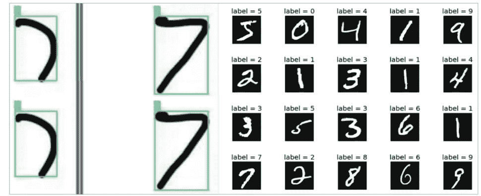

图1-10

所以，监督学习就是计算机在“老师”的指导下，通过分析带有正确答案的数据来找出规律，然后应用这些规律来解决新问题。就像我们在课上学会解题方法后，遇到新的题目也能举一反三、迎刃而解一样！

### 1.2.3 AI学习的“第二招”：无监督学习

在无监督学习里，计算机就像一个勇敢的探险家，没有地图、没有向导，它要自己在一堆杂乱无章、没有标注的“数据丛林”里，寻找数据之间隐藏的关系。

比如，学校收集了同学们在绘画、音乐、编程、体育等兴趣活动中的参与数据。计算机通过无监督学习观察每位同学，把兴趣相似的同学分到同一组中，这就是聚类，如图1-11所示。

| 学生编号 | 绘画 | 音乐 | 编程 | 体育 |
| :--- | :--- | :--- | :--- | :--- |
| 1 | 8 | 9 | 2 | 1 |
| 2 | 7 | 8 | 3 | 2 |
| 3 | 9 | 7 | 1 | 2 |
| 4 | 1 | 2 | 8 | 9 |
| 5 | 2 | 1 | 9 | 8 |
| 6 | 1 | 3 | 7 | 7 |
| 7 | 3 | 1 | 2 | 8 |
| 8 | 2 | 2 | 1 | 9 |
| 9 | 1 | 2 | 3 | 7 |
| 10 | 8 | 8 | 2 | 1 |

| 类别名称 | 包含学生 | 绘画均值 | 音乐均值 | 编程均值 | 体育均值 |
| :--- | :--- | :--- | :--- | :--- | :--- |
| 艺术创想组 | 1、2、3、10 | 8.0 | 8.0 | 2.0 | 1.5 |
| 科技探索组 | 4、5、6 | 1.33 | 2.0 | 8.0 | 8.0 |
| 活力运动组 | 7、8、9 | 2.0 | 1.33 | 2.0 | 8.0 |

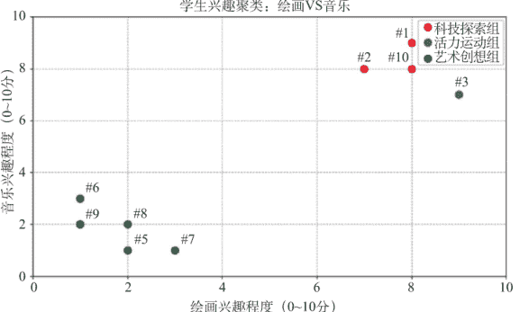

图1-11

更神奇的是，当数据太复杂、信息太多时，计算机还能变身“数据瘦身师”，把高难度的“多维数据”压缩成简单的“低维信息”，便于我们分析处理，这就是数据降维。数据降维就像把一张非常复杂的地图进行简化：去掉错综复杂的小巷子，只保留最重要的主干道和地标建筑，这样，原本密密麻麻的地图瞬间变得清晰易懂。

无监督学习就是计算机发挥“无师自通”的探索精神，在没有标准答案的情况下，自己发现数据中隐藏的规律和秘密。这种学习方式在探索数据内在规律、发现新知识方面特别有用。

### 1.2.4 AI学习的“第三招”：强化学习

想象一下，你正在玩一个全新的电子游戏，没有引导，没有攻略。一开始，你不知道哪个按钮能让角色跳起来，或者哪个方向是安全的，你只能通过尝试和犯错来学习。每当你找到一个有用的技巧，游戏就会给你一些分数作为奖励；如果你做错了，可能会失去一些分数或者导致游戏结束。在这样的试错冒险中，你慢慢摸透了游戏的套路，这就是强化学习的基本思想。

在强化学习中，计算机就像游戏里的玩家，它在不断尝试和犯错中成长。计算机在叫作“环境”的大游戏场中扮演“智能体”的角色，就像游戏角色一样，它在和周围环境互动的过程中，每做一个决策，环境都会给它一个反馈。如果它做得好，就会得到奖励；如果做得不好，就会受到惩罚。

最经典的例子就是大名鼎鼎的AlphaGo。围棋棋盘上的变化就像一个充满谜题的迷宫，AlphaGo这样的围棋AI就是通过强化学习，在一次次对弈中，从奖励里学习到更好的落子策略。它不断地尝试新的走法，每当它赢得比赛，就会得到奖励，这些奖励鼓励它继续探索和改进策略。随着时间的推移，它变得越来越厉害，最终能够战胜人类棋手中的世界冠军，如图1-12所示。

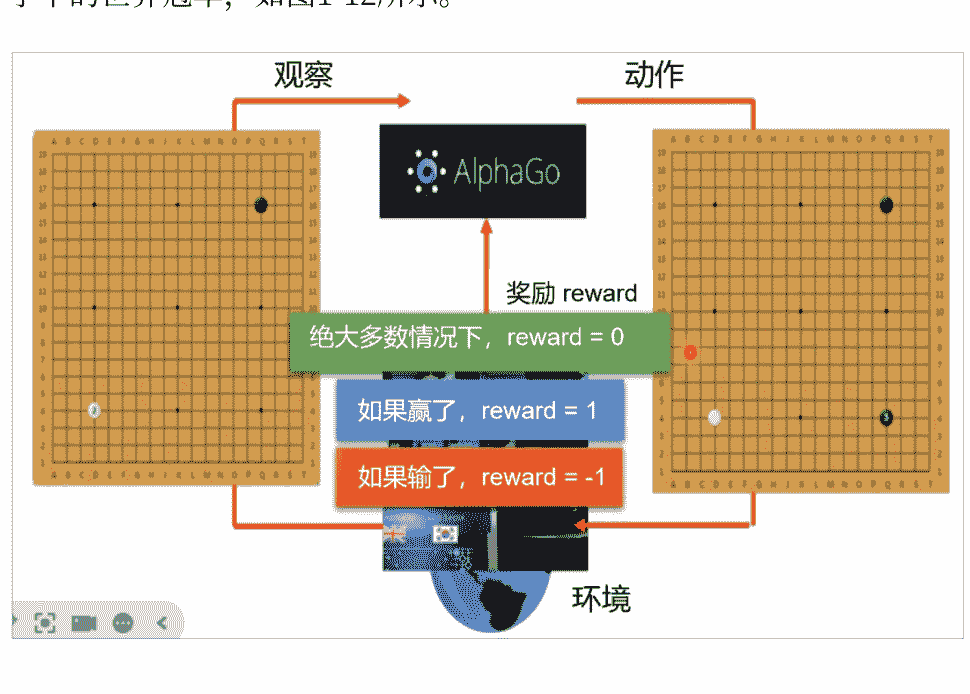

图1-12

此外，还有半监督学习等其他学习类型。在现实世界中，收集大量标注好的数据往往既费时间又花精力，这时，半监督学习就派上用场了。它会先利用少量已经标注好“标准答案”的数据搭建一个初步模型，再借助没有标注的数据，通过聚类等方法“脑补”剩下的答案，不断完善模型。

这些超酷的机器学习方法在我们的生活里有着各种各样的应用。比如，你用手机拍张猫的照片，AI能快速识别：“这是橘猫！”背后其实就是监督学习方法在“看图识物”；在医院里，它还能化身“医疗小助手”，帮医生从X光片里揪出病症；无监督学习可以在海量病人数据里寻找隐藏线索，发现疾病的神秘规律；如果你用智能学习软件刷题，它会自动分析你的错题和答题速度，把有相似学习困难的同学“聚类”分组，悄悄给你定制专属练习题；还有最擅长自我提升的强化学习，在医疗领域中像个勤奋的实习生，可以反复训练智能仪器，调整治疗方案；在日常生活中，它能通过与我们的每一次互动，发现你喜欢什么音乐、习惯什么时间锻炼，变成最懂你的贴心伙伴。

## 成就打卡

### 我学会了 ✅

- □ 说出AI学习的含义和基本要素。
- □ 说说监督学习与无监督学习的区别。
- □ 列举一种强化学习的应用。

## 1.3 动手实验

### 1.3.1 机器学习训练猫狗识别

#### 1. 实验准备

(1) 电脑一台。

(2) 浦育平台 (https://www.openinnolab.org.cn/)。

#### 2. 步骤

(1) 访问浦育平台。登录浦育平台，在平台主页上找到并单击 “AI体验” 标签，如图1-13所示，进入AI体验页面。


图1-13

(2) 选择体验项目。在AI体验页面中，选择 “图像分类” 项目，如图1-14所示，然后单击 “开始体验” 按钮。


图1-14

(3) 设置分类名称。在图像分类界面（见图1-15），单击蓝框中的“✏️”按钮，将“分类1”重命名为cat。同样地，将“分类2”重命名为dog。

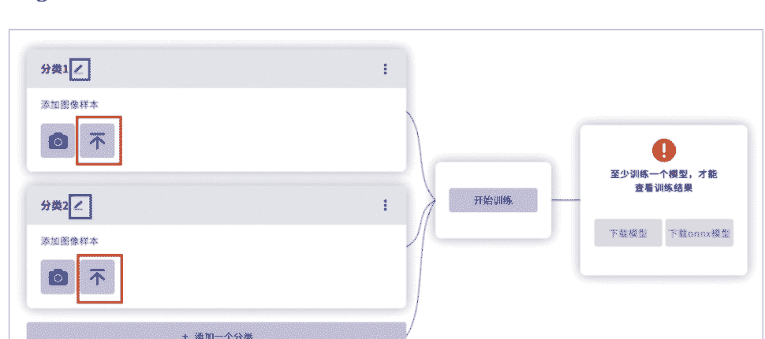

图1-15

(4) 上传训练数据。单击cat分类下的 ⬆ 按钮（见图1-15中的红框），上传素材库 “猫狗识别数据集\traing_set\cat” 目录下的图片，如图1-16所示。同样，在dog分类下上传图像样本。


图1-16

(5) 开始模型训练。确认所有图片都正确上传后，单击 “开始训练” 按钮，如图1-17所示。这时，AI就开始训练模型，学习如何区分猫和狗啦。训练过程需要一些时间，要耐心等待。

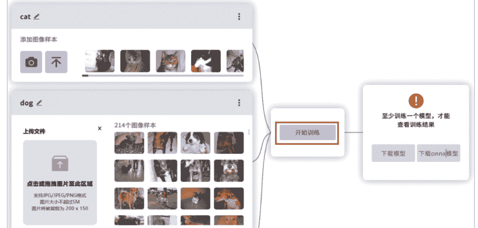

图1-17

(6) 测试模型并查看结果。训练完成后，单击“输出”文本框，使用摄像头拍摄新的照片或从素材库的“猫狗识别数据集\test_set”中选择图片，如图1-18所示，测试模型识别效果。如图1-19所示，上传的小猫图片被AI正确识别啦。

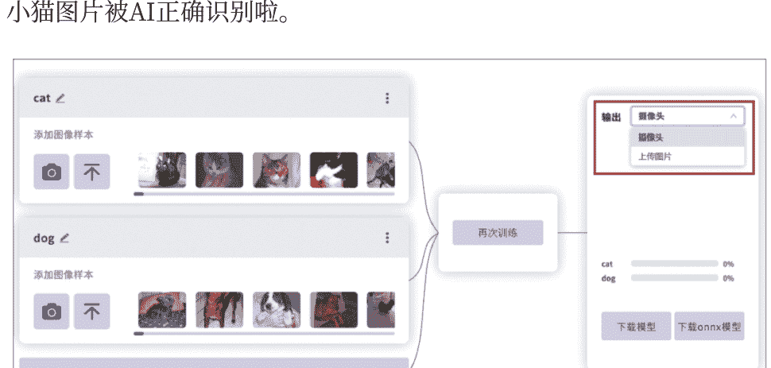

图1-18

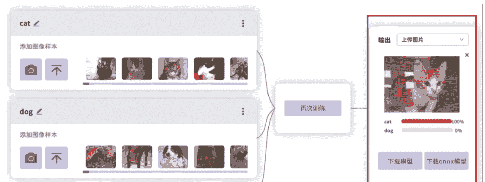

图1-19

#### 3. 思考任务

(1) 在步骤6中，假如你上传一张兔子的照片，AI会如何识别呢？为什么会这样？

(2) 如果让你设计一个新的机器学习任务，你会选择什么主题？这可以是任何你感兴趣的东西，比如识别不同类型的植物、乐器或者运动装备，甚至是预测天气变化。

#### 4. AI学习的真相大揭秘

你刚刚完成了一场“AI视力特训”，通过这个实验，你教会了AI如何区分猫和狗。下面我们一起来回顾AI学习的过程吧。

整个实验可以分为三大关键部分：首先是数据准备（步骤4），就像老师为学生挑选教科书一样，我们上传的标注图片相当于AI的“专属课本”，每一张都标注着“知识点”；其次是模型训练（步骤5），AI像一位专注的“找不同”高手，仔细分析每张图片的像素数据，从中挖掘规律，通过耳朵形状、鼻子比例等多个特征来区分猫和狗，建立起自己的判断标准，构建用于分类猫狗的机器学习模型；最后是验证环节（步骤6），我们用新的图片测试AI的学习成果，看看它是否真正掌握了区分猫狗的本领。

这个实验还藏着许多好玩的思考“彩蛋”：如果你上传一张兔子的照片，AI会把它归类为猫还是狗呢？它的知识库里根本没有“兔子”这个选项！更有意思的是，如果训练集中只有白猫和黑狗，AI很可能会误以为颜色才是区分猫狗的关键特征，导致它把黑猫错误地判定为狗。这些“翻车现场”都说明，AI的学习效果高度依赖于我们提供的训练数据，数据的质量直接决定了AI的“智商”。同学们可以自己做更多的尝试。

通过这次实践，我们发现了AI学习的终极秘密：它本质上就是一个从海量数据中发现规律、提取特征，并最终实现智能分类的过程。就像人类通过观察学习一样，AI也需要经过大量的“练习”才能掌握新技能。在接下来的奇妙旅程中，我们还会深入探讨更多关于AI学习的奥秘。

### 1.3.2 和语音助手玩知识问答

#### 1. 实验准备

(1) 一部安装了语音助手（Siri、华为小艺等）的手机、一个智能音箱（小爱同学、天猫精灵等）。

(2) 实验开始前，你需要先熟悉语音助手的唤醒方式，然后依次向语音助手提问表1-3中的6个问题，并记录它们的答案。

表1-3

| 问题 | 语音助手 A | 语音助手 B | 结果对比 |
| --- | --- | --- | --- |
| 珠穆朗玛峰有多高？ | | | |
| 鲸鱼是鱼吗？ | | | |
| 1+2+3+…+100 等于多少？ | | | |
| 请帮我定好每周一早上 7:00 的闹钟？ | | | |
| 谁是世界上最漂亮／帅的人？ | | | |
| （用熟悉的方言或中英文混杂提问）今天的天气怎么样？ | | | |

#### 2. 实验拓展

设计自己的问题，测试一下语音助手如何回答？提问的问题可以分为标准题、模糊题以及升级挑战题。对于有固定答案的标准题，记录回答的速度和准确性；对于模糊问题，如“谁是世界上最漂亮／帅的人？”“谁是最厉害的人？”“怎么成为学霸？”等，观察语音助手如何应对；还可以用方言或中英文混杂提问（如“侬晓得外滩伐？”“Who is Jay Chou？”）等升级挑战题。记录一次语音助手的“神回复”或“翻车现场”：____________________________________。

#### 3. 思考任务

如果语音助手答错了，你能猜到原因是“数据不足”还是“算法漏洞”吗？

### 1.3.3 设计一个校园AI助手

作业本总忘记带？食堂排队太长了？值日偷懒，垃圾没清理干净被老师批评了？校园生活里总是藏着不少让人头疼的小烦恼，现在是时候让AI助手大显身手了！请你开动脑筋，发挥你的想象，打造一个超级校园AI助手，把这些烦恼统统“拿下”，让AI助手成为你校园生活的得力小伙伴吧！说不定，你的设计在未来真的能走进校园呢！

请为你的“AI小伙伴”起一个酷炫的名字，比如“作业救星007”“食堂雷达侠”；描述AI小伙伴能帮你解决哪些校园里的烦恼；画出AI的造型，并在图中列出它的核心技能；最后为你的AI小伙伴设计一个响亮的专属口号。将你的成果填入表1-4中。

表1-4

| AI 小伙伴名字 | |
| --- | --- |
| 解决的烦恼 | |
| 造型与功能 | |
| 专属口号 | |

## 成就打卡

### 我学会了 ✅

- □ 设计自己的问题，并记录与语音助手的一次互动。
- □ 设计解决校园烦恼的AI小助手。

## 闯关测验

1. （单选）AI的英文全称是什么？（）

- A. Artificial Intelligence
- B. Automatic Information
- C. Artificial Information
- D. Automatic Intelligence

2. （单选）什么是人工智能？（）

- A. 一种计算机程序
- B. 赋予机器感知、思考和行动能力的学问
- C. 一种算法
- D. 计算机硬件设备

3. （单选）智能音箱能根据语音指令播放音乐，在这个过程中，AI的“思考”环节是指（）。

- A. 麦克风接收语音
- B. 从音乐库中匹配歌曲
- C. 音箱播放音乐
- D. 调整音量大小

4. （单选）下面哪种机器学习方法需要使用标记好的数据进行训练？（）

- A. 监督学习
- B. 无监督学习
- C. 强化学习
- D. 半监督学习

5. （多选）以下属于AI“感知”能力的实现方式有？（）。

- A. 摄像头采集图像
- B. 麦克风收录声音
- C. 激光雷达扫描环境
- D. 机械臂抓取物品

6. （多选）小明用手机AI识图软件识别石竹时，软件误判为康乃馨，这可能是因为（）。

- A. AI没有视觉
- B. 训练数据中缺少石竹样本
- C. AI的识图模型需要优化
- D. 手机的拍摄条件影响了识别效果

7. （填空题）机器学习通过让计算机对大量_______进行分析，利用特定_______挖掘其中的_______，从而使计算机具备识别、预测等能力。

8. （排序题）我们要教AI认识猫和狗。下面是任务的步骤，你能把它们按正确的顺序排列好吗？（）

- A. 选一个厉害的“学习方法”：算法、训练模型
- B. 收集大量猫和狗的照片
- C. 用新的照片考AI：拿它没看过的图问“这是猫还是狗？”
- D. 当“标签小能手”：在每张照片上写“猫”或“狗”，告诉AI这是“谁”
- E. 帮AI “补课”：如果它认错了，就调整一下它的“学习方法”

9. （排序题）请你将AI “识别宠物狗” 任务的步骤按正确的顺序排列。（）

- A. 通过算法分析图片中狗的特征
- B. 摄像头拍摄宠物狗的照片
- C. 与已学习的“狗”的特征模型对比
- D. 得出“这是狗”的判断结论

## 成就贴纸

看看你获得了几张贴纸。

| 阅读全章内容 | 成就打卡 | 完成闯关测验 |
| :--- | :--- | :--- |
| | | |

# 第2章 AI进化史：从古至今的智能革命


## 2.1 AI的“祖先”与里程碑

在探索人工智能的奇妙世界之前，让我们先打开历史的画卷，看看AI是如何从简单的计算工具成长为今天的智能伙伴的。在古老的神话与传说里，人类便开始幻想创造拥有自主意识的造物，比如古希腊的机械侍女和中国古代的木牛流马，为AI的发展埋下了最初的种子。

随着科学技术的进步，人类对智能创造物的探索逐渐从神话和传说走向现实。1950年，英国数学家艾伦·图灵提出了灵魂之问：“机器会思考吗？”他设计的“图灵测试”（见图2-1）给智能下了一个精妙的定义：如果隔着幕布进行五分钟对话，有三成以上的测试者都把人工智能错判成人类，那么就代表这台机器拥有了智能。

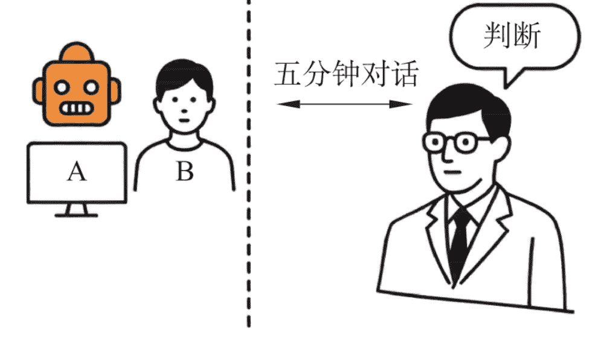

图2-1

1956年的达特茅斯会议，就像智能世界的“独立宣言”。达特茅斯学院的约翰·麦卡锡、哈佛大学的马文·明斯基等一群杰出的科学家聚在一起，正式将这门新学科命名为人工智能。

整整两个月，科学家热烈讨论着如何让计算机学会思考、解决问题，使其成为会下棋的电脑、能对话的机器人、可以学习的机器……就像我们人类一样。这次会议就像点燃了一束永不熄灭的火炬，照亮了后来所有AI科学家前进的道路。

有趣的是，当时他们乐观地预测“二十年内机器就能完成人类所有智力工作”，虽然这个预言没有完全实现，但正是这群梦想家的积极探索，开启了人工智能研究的黄金时代。

### 2.1.1 机械时代→数字时代

#### 1. 远古计算智慧：从算盘到机械计算机

让我们穿越回三千多年前的商朝集市，看看商人使用的一种神奇的计算工具——算盘（见图2-2），听听光滑的木珠在细长的木杆上灵活滑动，发出清脆的“哒哒”声。上珠每颗代表数字5，下珠每颗代表数字1，拨动珠子就像我们在键盘上输入数字，能完成复杂的加减乘除运算。直到今天，在江南古镇的一些老店铺里，经验丰富的店主仍然能用这个既不用电、也不会死机的“木头计算器”算得比电子计算器还快。

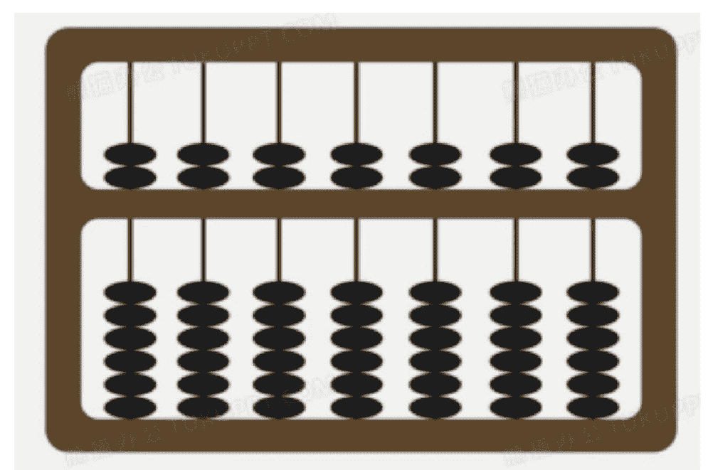

图2-2

时光流转到17世纪的法国，18岁的天才少年帕斯卡为了让担任税务官的父亲的工作更轻松，发明了世界上第一台机械计算器（见图2-3）。该计算器通过手动旋转轮盘进行数字的输入和计算，就像给机器装上了“算术手指”，当齿轮旋转一周，10个齿中最长的齿会和更高位的齿轮啮合，从而实现进位，同理，反过来旋转就是减法计算。不过，即使是计算“6+8”这样简单的算式，也需要转动14次齿轮，这可比我们现在按计算器慢多了。

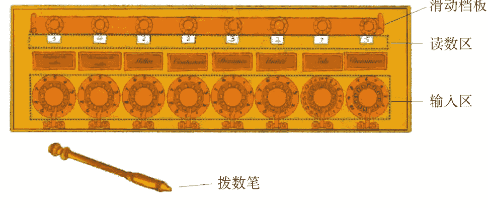

#### 2. 理论奠基：图灵机与计算机的诞生

1936年，英国数学家艾伦·图灵在纸上描绘了一个改变世界的构想——图灵机。这个存在于理论中的机器由三部分组成：一条无限长的纸带、一个可以左右移动的读写头，一个存储一系列规则的控制器，如图2-4所示。

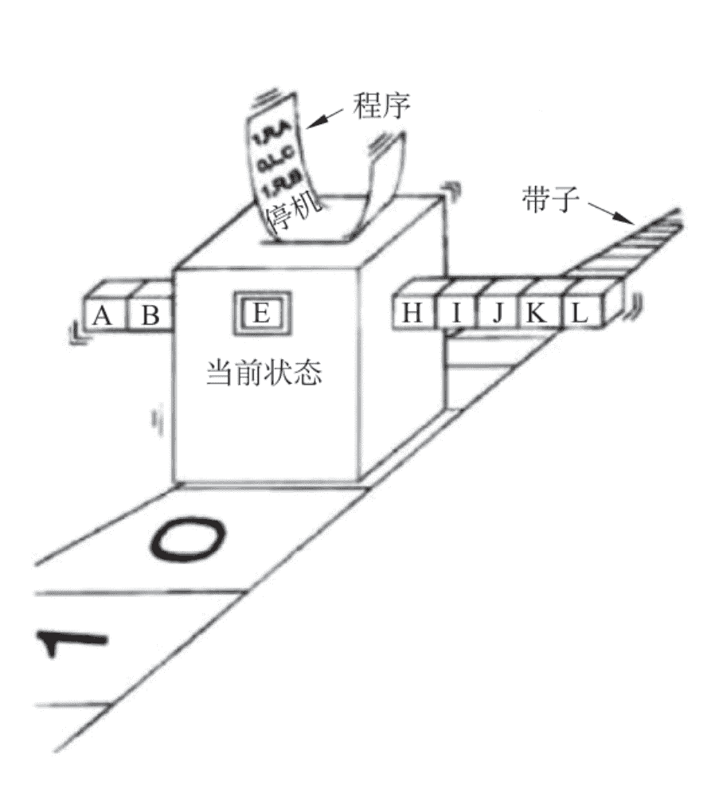

图2-4

虽然图灵机只是一个抽象概念，但它的设计理念直接影响到现代计算机的发明。现代计算机的“运算器、控制器、存储器”结构，本质上是图灵机的物理实现。现在的编程语言，无论是Python还是C++，程序的本质都是“告诉计算机如何按照规则处理数据”，类似图灵机的控制器规则。

1946年，世界上第一台通用电子计算机ENIAC在美国宾夕法尼亚大学诞生了（见图2-5）。这个“电子巨人”可真是个大家伙，重达27吨，足足有5头大象那么重，占用的空间比三个教室加起来还要大。


图2-5

ENIAC的设计初衷是计算火炮弹道，每秒能完成5000次加法运算。虽然现在随便一个小计算器都比它厉害得多，但在那个年代，它可是让全世界都惊叹的“超级大脑”呢！正是它开启了今天的数字时代，成为所有智能手机、游戏机和人工智能的“老祖宗”。

就像算盘的木珠变成了计算机的二进制代码0和1，机械齿轮进化成了电子晶体管，计算的本质始终未变，只是形式在不断革新。从算盘到ENIAC，人类完成了从“用手计算”到“用机器思考”的惊人飞跃，而这一切，都始于那些敢于想象“机器能否思考”的勇敢心灵。

#### 3. 计算革命：从电子计算机到AI加速器

随着技术的发展，计算机变得越来越小巧。20世纪50年代，晶体管的发明让计算机摆脱了笨重的真空管，体积缩小了上百倍。

1971年，英特尔公司推出了一颗只有指甲盖大小的芯片——4004微处理器，这个小小的方形硅片上集成了2250个晶体管，运算能力却堪比当年占据整个房间的大型计算机。就像把一头大象神奇地装进了火柴盒，微处理器的出现让计算机开始“瘦身”，从实验室的庞然大物摇身一变，成了可以放在办公桌上的个人电脑，正式开启了个人计算机时代。

时间来到1999年，NVIDIA公司推出了GeForce 256显卡，首次正式提出“图形处理器（graphics processing unit, GPU）”这一概念。谁能想到，这个原本只是为了让游戏画面更加炫酷的小家伙，后来竟然华丽转身，成了人工智能的超级加速器。

传统CPU像一位学识渊博的博士，一次只能深入思考一个问题。而GPU则完全不同，它更像一个由上千个聪明小学生组成的“超级班级”，虽然每个小学生的个人能力都比不上博士，但他们可以齐心协力，同时解决成千上万个简单的问题，如图2-6所示。正是这种“人多力量大”的超能力，让AI模型的训练速度提升了上百倍。

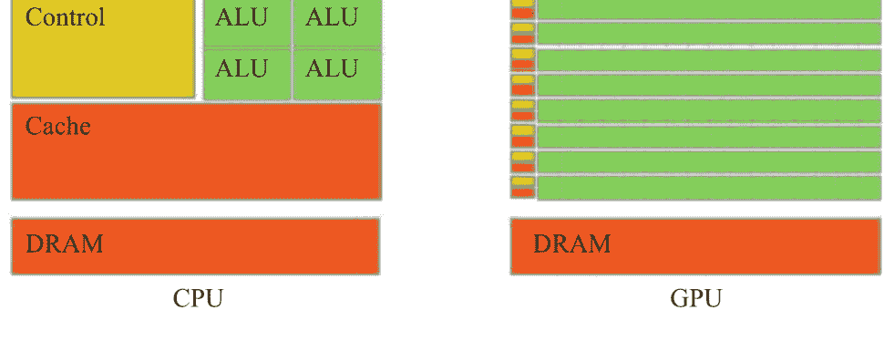

AlphaGo能在短短几个月内完成人类棋手一生的对局量，正是由于这些GPU在背后疯狂工作，每秒进行上亿次运算，才让它拥有了战胜人类冠军的“最强大脑”。

此后，张量处理单元（tensor processing unit, TPU）、神经网络处理器（neural network processor, NNP）等专业的AI芯片不断涌现，让计算机拥有了全新的“思考方式”。让我们来进行一个炫酷对比：现代GPU在1秒内的计算量，ENIAC需要数百年甚至上万年才能完成。未来，量子计算机可能会成为下一代计算工具，它的运算能力将再次颠覆我们的想象。不同年代计算工具每秒计算次数对比如表2-1所示。

表2-1

| 年代 | 计算工具 | 每秒计算次数 |
| :--- | :--- | :--- |
| 1642 | 机械计算器 | 0～1次加法运算 |
| 1946 | ENIAC | 5000次加法运算 |
| 2025 | 智能手机 | 数万亿次浮点运算 |

计算工具的进化史，体现了人类智慧的传承与超越。从算盘的“算术思维”启蒙，到机械计算器的“自动计算”突破；从图灵机的“通用计算”构想，到电子计算机的“闪电运算”实现；再到如今GPU赋予AI“超级大脑”——每一次跨越都站在前人的肩膀上，又为未来开辟新的可能。这不仅是计算能力的跃迁，更是人类探索智能边界的永恒征程。

### 2.1.2 人工智能的风雨60年

人工智能的发展历程如同一部波澜壮阔的史诗，从第一个会“思考”的程序诞生，到如今陪你聊天、写作业的AI伙伴，短短的几十年中出现了多次技术浪潮与低谷。我们可以将其发展历程划分为三个关键阶段，每个阶段都标志着AI能力的跃升与应用场景的拓展。

#### 1. 第一阶段：蹒跚学步期（1956—1980年）——人工智能的诞生与早期探索

就像我们第一次学写字会歪歪扭扭一样，最早期的AI程序也很简单笨拙。1956年诞生的逻辑理论家（Logic Theorist），被公认为第一个真正意义上的人工智能程序。这个“小天才”最拿手的就是证明数学定理，它不仅通过模仿人类解决问题的思维方式，证明了《数学原理》中的数十条定理，更令人惊叹的是，其中某些证明甚至比原书中的更加简洁、优美。

逻辑理论家的问世具有里程碑意义，首次向世界证明通过符号运算实现机器智能是完全可行的。就像我们小时候用积木搭房子一样，它用数学符号“搭建”出了智能的雏形。

1966年问世的ELIZA心理医生机器人（见图2-7），展现了最原始的共情能力。这个聊天程序虽然本质上只是通过关键词匹配和固定模板来机械地回复问题，却意外地创造了令人惊讶的“治疗”效果。比如当来访者说“我最近很焦虑”时，ELIZA可能会回复“你能多说说为什么感到焦虑吗？”这种看似简单的对话机制，却让许多测试者深信自己正在与一位真正的心理医生交谈。

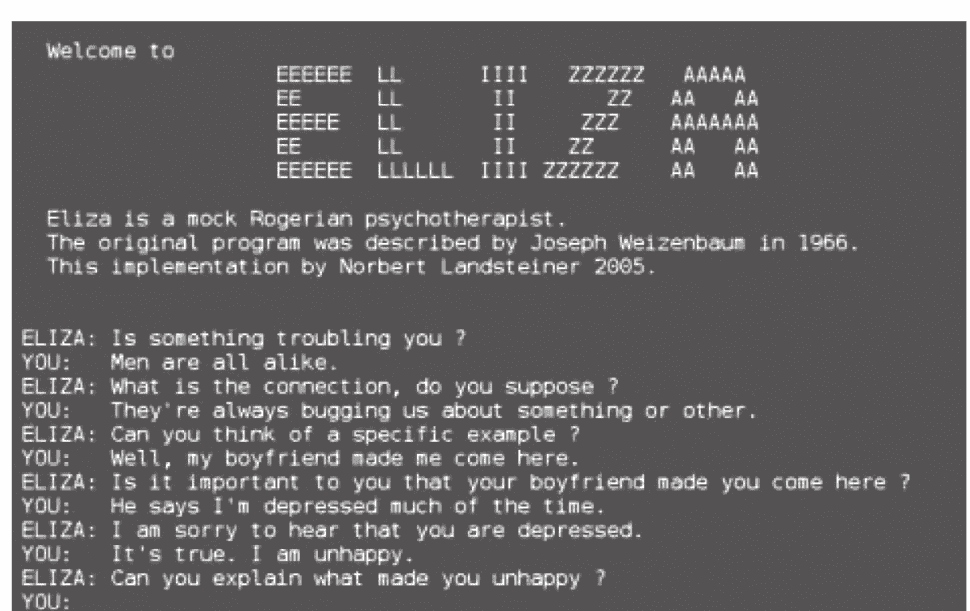

图2-7

下面介绍两大学派的诞生。

在人工智能研究的奇妙世界里，科学家逐渐形成了两个风格迥异的研究范式——符号主义AI和连接主义AI。就像魔法世界中的不同学派，它们各自探索着人工智能的本质。

当你做数学题时，记住“三角形内角和等于180°”就能解很多题。符号主义AI也是这样，科学家把人类的知识变成“如果……那么……”的规则输入计算机，就像一个严格参照教材的好学生。

还记得1.2节AI学认猫的过程吗？那就是连接主义AI，它模仿人脑860亿个神经元的连接方式，通过看大量例子自己总结规律，像天才儿童通过观察来认识世界。

在AI发展的第一阶段，符号主义占主导地位，连接主义则像个被忽视的“小透明”。然而，这些早期AI都有局限性——就像小学生遇到超纲题会不知所措，当时的AI面对规则之外的情况也完全无能为力。

值得注意的是，这一时期还出现了行为主义的萌芽，主张通过“感知—行动”的交互模式来发展智能，其典型应用是机器人控制。虽然影响力较小，但为后来的强化学习等研究方向埋下了种子。

到了20世纪70年代，AI研究遇到了大麻烦。就像你想玩最新款的游戏，却发现家里的旧电脑根本带不动一样，当时的计算机运行得实在太慢了，科学家的很多酷想法都实现不了，AI研究遭遇了第一个寒冬。但正是这些早期的探索，为后来AI的复兴奠定了重要基础。

#### 2. 第二阶段：单项冠军期（1980—2010年）——AI找到自己的特长

进入20世纪80年代，AI开始在各个专业领域大显身手，成为名副其实的“单项冠军”，在各个领域都展现了令人惊艳的专业能力。

在医院的化验室里，斯坦福大学研发的MYCIN系统就像一个“机器人医生”，专门帮医生诊断病人的血液感染情况，准确率达69%。更神奇的是，它还能根据病人的具体情况推荐个性化的抗生素治疗方案，其专业水平堪比资深医师。

工业界也迎来了AI的春天，DEC公司的XCON专家系统每年处理上万台计算机的配置订单，准确率保持在95%以上，极大提升了企业的运营效率。

就连荒郊野外的地质勘探队也用上了AI助手，PROSPECTOR系统就像个“矿石侦探”，成功预测了华盛顿州地下埋藏的稀有金属——钼矿的储藏量，帮矿业公司省下了数百万美元的勘探费用。

这一时期涌现的AI系统堪称各领域的“单项冠军”，如表2-2所示。

表2-2

| 系统名称 | 专业领域 | 核心能力 |
| :--- | :--- | :--- |
| MYCIN | 医疗诊断 | 血液感染诊断与用药建议 |
| XCON | 电脑配置 | 计算机系统自动配置 |
| PROSPECTOR | 地质勘探 | 矿产资源预测与评估 |
| DENDRAL | 化学分析 | 分子结构识别与解析 |

20世纪80年代也是AI技术多元化发展的关键时期。日本启动了“第五代计算机计划”，想要造出像人一样会思考的计算机。虽然最后没有完全实现这个梦想，但这个计划催生了很多重要的技术，比如能让多台电脑一起工作的“并行计算”技术。

1986年，杰弗里·辛顿在《自然》杂志发表论文，文中的发现就像找到了打开神经网络宝箱的钥匙。他提出的“反向传播算法”让神经网络终于可以有效地学习了，这一突破解决了神经网络训练的关键难题，使沉寂多年的神经网络研究重新焕发生机。

同一时期，AI还掌握了另外两个厉害的本领。

- 1. 统计学习：让AI系统开始具备从数据中自主获取知识的能力。
- 2. 强化学习：1989年发明的Q-learning算法，让AI不需要老师教，自己就能摸索着学习。1992年，IBM的双陆棋程序TD-Gammon完全靠自己跟自己下棋，最后竟然达到了世界顶尖水平，展示了强化学习的强大能力。

1997年，IBM的“深蓝”计算机战胜国际象棋世界冠军卡斯帕罗夫（见图2-8），成为AI发展史上的里程碑事件。这个每秒能计算两亿步棋的“思考机器”，展示了暴力计算在特定领域的惊人威力。

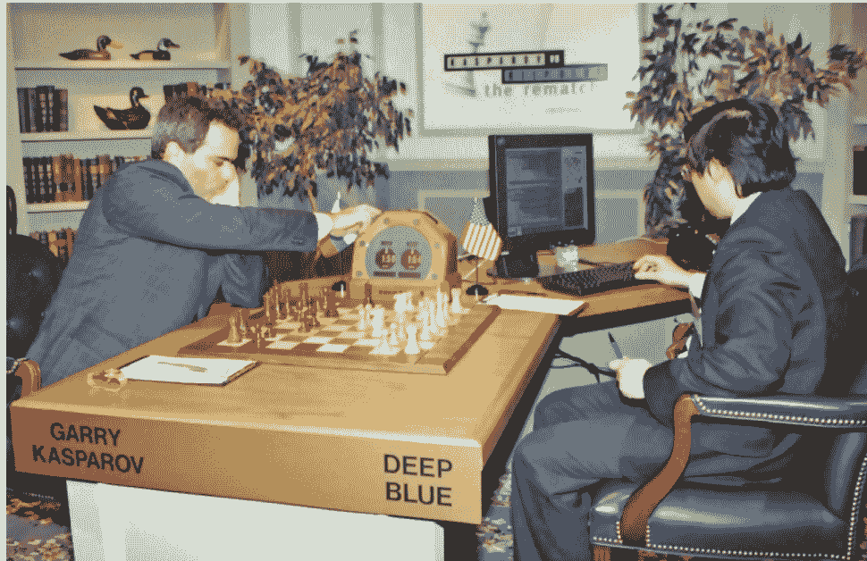

图2-8

不过有趣的是，深蓝其实是个“死记硬背”的符号主义学霸。它的大脑中存储了超过两百万局人类大师的棋谱，完全按照程序设定的规则来下棋。这就像你背下了整本书中数学题的答案，却不知道解题原理一样。深蓝证明了在规则明确的领域，靠蛮力计算也能达到超高水平，但想要真正像人类那样“理解”棋局，还需要更聪明的AI。

2006年，AI界迎来了一场“学习方法大革命”，杰弗里·辛顿教授和他的团队发现了一个超级棒的学习秘诀——深度信念网络（deep belief network, DBN），就像找到了教AI学习的“黄金法则”。

以前的神经网络就像个健忘的学生，学着后面的知识，就把前面的忘光了。辛顿教授想出了聪明的解决办法：先让AI像搭积木一样，一层一层慢慢学扎实，最后再把所有知识串起来。这种“分层学习法”就像给AI装上了“记忆增强器”，让它终于能在图像识别、语音理解这些复杂任务上大显身手。我们现在用的手机人脸解锁、语音助手这些酷炫功能，都源自这项基础研究的突破。

这一阶段的AI虽然还存在明显局限——系统专用性强、扩展性差、依赖人工知识输入，但它们已经在很多领域大展拳脚了，如医院的AI助手能帮医生分析病情；电子邮箱会自动过滤垃圾邮件；导航软件能规划最优路线；手写识别技术被广泛应用于掌上电脑等移动设备（见图2-9）。

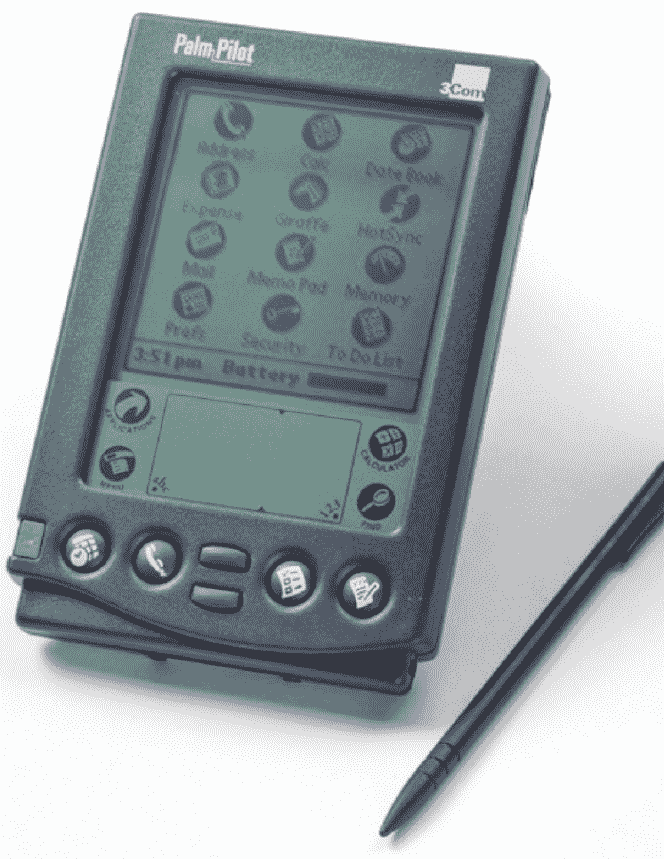

图2-9

AI不再是实验室里的玩具，而成为解决实际问题的有力工具。这些“单项冠军”的出色表现，为AI技术的全面爆发做好了准备。

#### 3. 第三阶段：全能学霸期（2010年至今）——AI的爆发式成长

进入21世纪，人工智能迎来了前所未有的爆发式发展，从一个“偏科生”变成了“全能学霸”，在各个领域都展现了惊人的能力，向着通用化、智能化方向飞速迈进。在AI历史上，以下几个里程碑事件特别酷炫（见图2-10）。

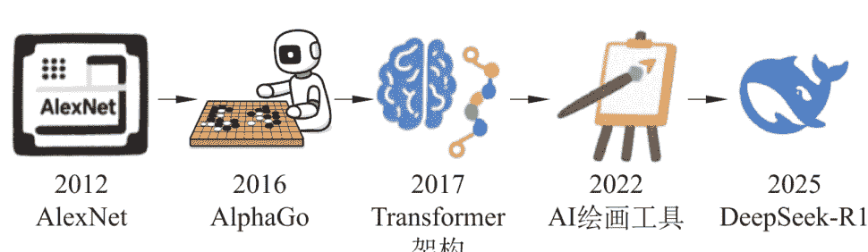

图2-10

- 1. 2012年，AlexNet在ImageNet图像识别比赛中一战成名，就像突然炼成了孙悟空的“火眼金睛”，识别图片的错误率从传统方法的26.2%降至15.3%，开启了深度学习的新纪元。
- 2. 2016年，AlphaGo以4：1击败围棋世界冠军李世石，下出了令职业棋手惊叹的“神之一手”。更厉害的是，2017年它的升级版AlphaZero仅用34小时自我训练就超越所有版本，向世界展示了“无师自通”的强化学习威力。
- 3. 2017年，谷歌研究团队发明了Transformer架构，这就像给AI装上了“超级大脑”，现在最厉害的聊天机器人、智能助手，都是用这个架构打造的，彻底改变了人工智能的发展轨迹。
- 4. 2020年，DeepMind的AlphaFold2在蛋白质结构预测竞赛中取得突破性进展，预测精度达到实验水平，为生物医药研究带来革命性变革。
- 5. 2022年，ChatGPT惊艳全球，它不仅能流畅对话、创作诗歌，还能编写代码和调试程序，让普通大众第一次亲身体验生成式人工智能的魅力。
- 6. 2022年，AI绘画工具Midjourney和Stable Diffusion掀起创作革命，普通人只需输入文字描述就能生成媲美专业画师的精美图像。
- 7. 2025年，DeepSeek-R1实现AI领域的现象级突破，以极低成本和超强性能推动了推理模型的发展，让高性能AI模型更易获取。

这些突破性进展不断刷新人类对AI能力的认知边界，从最初只能完成单一任务的“专才”，到展现通用智能的曙光，AI的进步速度简直像坐上了时光机。

AI发展的历程，就像一场超级精彩的闯关游戏，科学家就像勇敢的玩家，一路披荆斩棘，不断突破技术难关（见图2-11）。

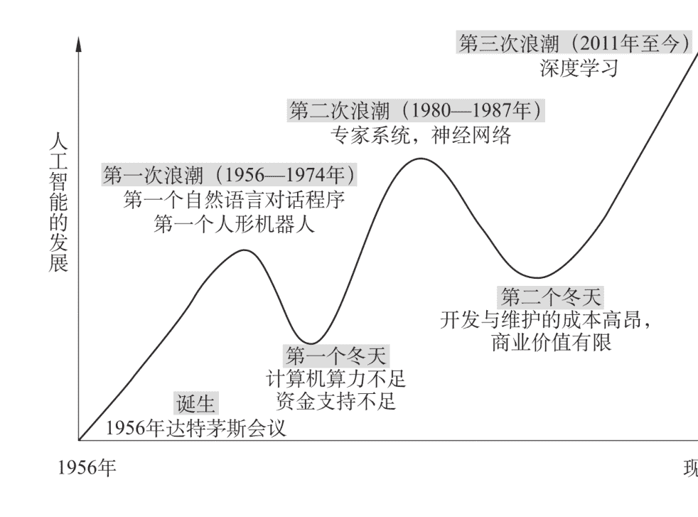

图2-11

最初，科学家想用数学公式和规则教会AI思考，就像给机器人一本厚厚的说明书。但很快发现，现实世界太复杂了，光靠规则根本不够用。这就像你了解足球比赛的所有规则，却还是踢不好比赛一样。

后来，AI改走“专家路线”，在专门领域发光发热，成为医疗、下棋等领域的高手，但又遇到了知识获取的瓶颈。

直到科学家找到了深度学习这个“秘密武器”，AI才真正开始爆发式成长，每一次失败都不是终点，而是通往新突破的阶梯。

AI的进步离不开三大“神器”的加持：互联网时代的海量数据是“经验值”，GPU提供的强大算力是“武器”，优秀的深度学习算法是“技能树”，这三者缺一不可。

现在的我们正站在“游戏”的新章节：AI已经学会解题、编程、下棋、画画、写诗、拍片，但距离真正的通用智能还有很长的路要走。未来的挑战可能更难，但每一次突破带来的成就感也更大。这就提醒我们：在科技探索的路上，保持好奇心和韧性，比一时的胜负更重要。毕竟，最精彩的游戏永远在下一关。

### 2.1.3 中国AI发展的关键时刻

中国在人工智能领域的发展，就像一场精彩的“科技马拉松”。从最初的追赶者，到现在的领跑者，中国科学家和工程师创造了许多令人惊叹的成就。

#### 1. 萌芽期（20世纪八九十年代）：实验室里的“AI幼苗”

- （1）1989年，第一届全国信号处理－神经网络学术会议在广州开幕。这是中国AI发展史上的一个重要里程碑，它标志着我国的神经网络研究从“各自探索”走向了“有组织的团队协作”。
- （2）20世纪90年代初，中国在汉字识别等人工智能基础技术方面取得了初步进展，让计算机“看懂”了方方正正的中国字。

#### 2. 觉醒期（2010—2014年）：互联网时代的“弯道超车”

- （1）2010年，百度成立NLP（natural language processing，自然语言处理）团队，开始教AI理解“的、地、得”的奥妙，就像给AI报了中文补习班。
- （2）2014年，香港中文大学汤晓鸥团队将计算机人脸识别准确率提升至99.15%，首次超越人类肉眼的辨识能力。这一成果标志着中国在计算机视觉领域跻身世界前沿。
- （3）2014年，科大讯飞语音识别技术突破方言壁垒，AI终于能听懂四川话“巴适得板”啦。

#### 3. 爆发期（2016—2017年）：AI“大圣归来”

- （1）2016年，百度的语音识别系统准确率高达96%。
- （2）2017年，中国发布《新一代人工智能发展规划》，将AI上升为国家战略。阿里巴巴“城市大脑”在杭州落地，优化交通信号灯调度，降低拥堵15%。中国科学院研发出首款AI芯片寒武纪（见图2-12），打破了国外技术垄断，像给中国AI造了一颗“中国心”。


图2-12

#### 4. 领跑期（2018—2023年）：“银河战舰”启航

- （1）2018年，华为昇腾芯片问世，算力相当于1万台ENIAC，体积却只有手机大小。
- （2）2020年，AI医疗影像系统在新型冠状病毒感染期间能快速诊断CT影像，阅片速度比人类快30倍。北斗导航系统用AI规划路线，误差精度为3～5米。
- （3）2023年，文心一言、通义千问等大模型发布，中文AI进入“对话时代”。AI会写七律诗、画水墨画。

#### 5. 突破期（2025年）：DeepSeek开启新纪元

2025年，中国自主研发的DeepSeek大模型，以其创新的架构和出色性能震撼全球，DeepSeek代表的“高性能+强开源+低成本”路径，改变了全球AI发展格局，证明了中国AI具备底层创新与全球竞争力，国产算力可支撑世界级模型训练，开源生态正在加速中国技术全球化渗透。

#### 6. 未来彩蛋

- （1）正在研发的“脑机接口”AI，或许很快能让我们用“意念”下围棋。
- （2）量子AI计算机“九章”（见图2-13），1分钟可以算完超级计算机1亿年的任务。

从实验室到生产线，从代码到实际应用场景，一幅人机协同、智慧普惠的美好画卷正在中国大地上加速展开。中国的AI发展历程，是一部充满拼搏与创新的奋斗史，相信在未来，中国AI将继续在世界舞台上大放异彩，为人类的进步和发展做出更大的贡献。


图2-13

### 2.1.4 AI的超级应用：下围棋

#### 1. 围棋的难度与段位体系

围棋，这项起源于四千多年前中国的智力游戏（见图2-14），如今已成为全球范围内备受瞩目的竞技项目。围棋的棋盘由19×19的网格构成，黑白双方轮流落子，以围地和吃子为目标，展开一场智慧与谋略的较量。有趣的是，这个看似简单的游戏，蕴含的变化可能比银河系所有的星星加起来还要多——围棋可能的棋局状态数高达2.08×10^170个！


图2-14

围棋高手也有自己的“段位江湖”。

- 新手村：设置25个业余级位，初学者从25级开始修炼，慢慢升到1级。
- 业余高手：1级以上的棋手可通过参加业余段位赛晋升至业余1段，最高可达业余7段。
- 职业宗师：职业初段到职业九段，需经专业培训，在高水平比赛中取得优异成绩才能晋升。特别是职业九段的高手，是围棋界的“超级英雄”，全中国只有不到60位，比航天员还要少。

#### 2. 人类棋手的修炼之路

让我们跟随一位围棋少年的成长脚步，看看从入门到职业九段的艰辛历程。

##### 1) 入门阶段（业余1～3段）

小棋手首先要像背诵乘法表一样牢记“金角银边草肚皮”的基本口诀。这个阶段的训练重点是掌握基本规则和简单战术，就像小学生学习加减乘除一样，需要反复练习吃子、做眼等基础技巧。

##### 2) 进阶阶段（业余4～5段）

要达到业余5段水平，棋手需要研习3000～5000局经典棋谱，这相当于啃完一整个图书馆的围棋秘籍。此时的棋手已经能在公园里轻松战胜下棋的老爷爷们了，对常见的棋型和战术都了然于胸。这个阶段的训练包括每天打谱、解题和实战对弈，需要像中学生备战高考一样刻苦。

##### 3) 职业门槛（业余6段～职业初段）

要冲击职业段位，训练强度堪比专业运动员。每天至少要花8小时训练，内容包括：研究最新职业棋谱、复盘自己的对局、与高手切磋较量等。职业棋手的大脑就像一台超级计算机，能存储上万种棋局变化并在实战中快速调用。

##### 4) 巅峰之路（职业初段～职业九段）

像柯洁、李世石这样的顶尖九段棋手，他们的棋艺已经逼近人类大脑的极限。在对弈时，他们能预见未来几十步的变化，准确判断全局形势，洞悉对手的战术意图。这种超凡的计算力和直觉，是数万小时刻苦训练的结晶。

然而，就算是最强的九段棋手，现在也经常输给AI围棋程序，因为AI可以不吃不睡，每天自我对弈上百万盘棋，精准计算所有可能变化。这场人机对决，正在重新定义围棋的极限。

#### 3. AI棋手的“疯狂特训营”

而在另一个世界，AI是如何开启它的围棋人生呢？这个“数字棋童”的学习方式可大不相同——它没有人类棋手那样漫长的童年启蒙阶段，从诞生的那一刻起，就一头扎进了数据的海洋。

##### 1）第一阶段：蹒跚学步的模仿者（1997—2015年）

AI的围棋启蒙之路始于对海量人类棋谱的系统性学习，研究人员为AI构建了一个庞大的“围棋知识库”，让AI模仿人类棋手的走法，这就好比让新手棋手反复研究经典棋局来积累经验。然而，研究人员很快发现，由于围棋的复杂性远超其他棋类，这种“填鸭式”教育虽然让AI快速掌握了基础技能，但也限制了AI的创造力，它需要更先进的学习方式来提升水平。

##### 2）第二阶段：突飞猛进的觉醒者（2016—2017年）

2016年，围棋界迎来历史性转折，DeepMind团队研发的AlphaGo以4：1的成绩击败了世界冠军李世石（见图2-15）。最让人目瞪口呆的是，它在比赛中下出了一步令所有专业棋手惊呼“不可能”的妙手——这就是著名的“神之一手”。

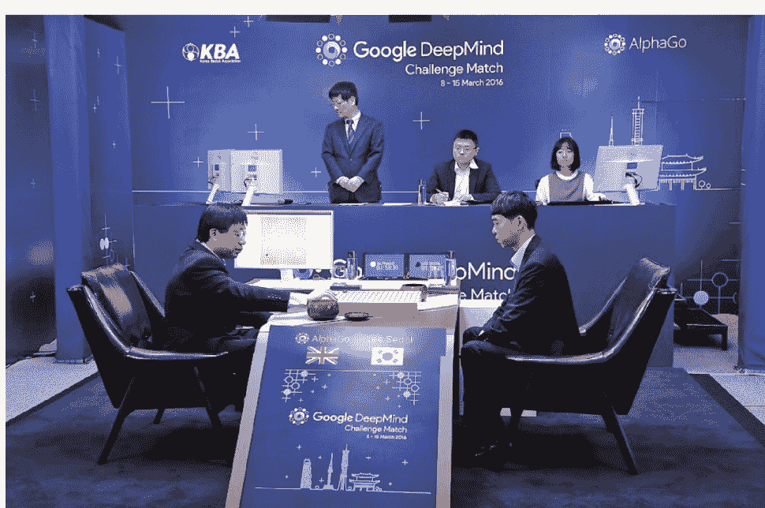

图2-15

AlphaGo的秘密武器是它独特的“双网系统”：一个“大脑”专门研究下一步该怎么走，就像棋手在思考最佳落点；另一个“大脑”则负责判断当前局势谁占优，就像裁判在计算比分。

升级版的AlphaGo Zero更是实现了质的飞跃，它完全摆脱对人类棋谱的依赖，仅通过490万局自我对弈，在21天内超越了所有人类棋手。这种前所未有的学习效率与颠覆传统的棋风，彻底重构了延续数千年的围棋理论体系，标志着人工智能在复杂决策领域取得了里程碑式的突破。

##### 3）第三阶段：开宗立派的创道者（2018年至今）

在围棋这个考验人类智慧的终极游戏中，AI已经完成了惊人的蜕变。它从一个需要人类教导的“学徒”，成长为能够指点人类高手的“大宗师”。

以绝艺、KataGo为代表的第三代围棋AI，就像来自未来的围棋先知，它们的强大表现为以下几点。

- (1) 它们能让人类顶尖棋手2～3个棋子，胜率还能高达99.8%。
- (2) 能感知每一步微小的胜率变化，精确到0.1%。
- (3) 不管是让子还是不让子，都能找到最佳策略。

职业九段棋手开始系统性地研究AI棋谱，就像发现了一本来自未来的“围棋天书”，传统围棋理论正在被全面重构。

这场革命的意义远超围棋本身。AI棋手展现的自我进化能力、创造性思维和战略洞察力，正在为医疗诊断、金融决策、科研探索等领域的AI应用指明方向。在这个黑白交错的方寸世界里，我们见证了机器智能从“模仿人类”到“启迪人类”的历史性跨越，如表2-3所示。

表2-3

| 学习阶段 | 人类棋手 | AlphaGo（监督学习 + 强化学习） | AlphaGo Zero（强化学习） |
| :--- | :--- | :--- | :--- |
| 启蒙阶段 | 1～3个月掌握基础规则和定式 | 1小时输入规则和初始棋谱特征 | 5分钟接收棋盘规则（无任何先验知识） |
| 能力突破 | 5～10年达到业余高段（每日训练4～6小时） | 3周训练（3000万局人类棋谱） | 24小时达到业余6段（约50万局） |
| 职业水平 | 15～20年成为职业九段（训练量约3万局） | 40天达到超职业九段水平 | 21天自我对弈490万局，超越所有人类棋手（胜率99.8%） |
| 计算效率 | 单局平均计算量约200步深度推演 | 单步计算：3毫秒（48个TPU） | 单步计算：0.1毫秒（4个TPU） |
| 创新性 | 依赖传统定式，渐进改良 | 结合人类经验与AI优化 | 自创新定式 |

#### 4. AI棋手训练的“秘密武器”

##### 1）算力资源：强大的硬件支持

AI的训练离不开强大的算力资源。以AlphaGo Zero为例，其使用4个TPU（单个算力420 TFLOPS）组成的阵列，对局速度达到每秒140局。通过490万局自我对弈，在21天内达到超人类水平。这种并行计算能力相当于压缩了人类数千年的对局经验。

##### 2）数据集：海量棋谱的积累

AI的学习依赖大量的棋谱数据。AI训练数据经历了三个阶段跃迁：初始阶段的AlphaGo依赖3000万局人类职业棋谱；过渡阶段的AlphaGo Master使用的是人类棋谱与自我对弈的混合数据；成熟阶段的AlphaGo Zero使用的是纯自我对弈生成的490万局数据。

##### 3）算法优化：不断提升的模型结构

科学家不断优化AI的算法和模型结构，使其能够更高效地学习和决策。从最初的监督学习到2014年的深度学习，再到2016年将深度学习与强化学习两者结合，2017年纯强化学习训练，每一步技术进步都极大地提升了AI的围棋水平。这一演进过程体现了AI从“模仿人类”到“自主创造”的范式转变。

综上所述，AI下围棋的训练过程就像一场漫长的马拉松，需要大量的练习和资源投入。从新手到顶尖高手，AI经历了从模仿到自我学习再到深度优化的过程，最终在围棋领域达到了超越人类的水平。

## 成就打卡

### 我学会了 ✅

- ☐ 能说出计算工具的演进。
- ☐ 能说出人工智能发展的三个关键阶段和每个阶段的标志性事件。
- ☐ 能说出AI训练的三个“秘密武器”。
- ☐ 能举例说明中国AI发展关键节点事件。

## 2.2 AI家族分类指南

人工智能就像一个庞大的家族，不同的AI成员有着截然不同的“超能力”。接下来我们将从两个超有趣的视角来认识这个家族。

工具型AI和思考型AI：想象你在和两个“电子朋友”玩游戏，工具型AI像一个只会玩“石头剪刀布”的伙伴，每次出拳都按固定顺序，思考型AI则像会观察你习惯的玩伴，慢慢能猜到你下一步要出什么。它们虽然都属于人工智能，但功能和特点截然不同。

弱AI、强AI、超AI：想象你在和三个“电子朋友”比赛解数学题。弱AI像一个只会背乘法口诀的计算器，你问“12×12等于多少”，它能秒答；但问“8个人如何平分3个披萨”，它会生硬地计算3÷8=0.375；强AI则像你的学霸同桌，不仅能解题，还会用不同的方法给你讲解，甚至发现题目中的陷阱；超AI就像一个来自未来的数学教授，它不仅能瞬间解答所有题目，还会创造全新的数学理论。

### 2.2.1 工具型AI和思考型AI

#### 1. 工具型AI

工具型AI就像我们生活中的“隐形帮手”，它们虽然不像科幻电影里的机器人那么聪明绝顶，但在特定任务上可是超级靠谱的。这类AI不会思考，只会按照预设的程序执行工作。

例如，Google Translate等智能翻译工具通过大量的双语语料库进行训练，能够快速将一种语言翻译成另一种语言，提供较为准确的翻译结果，但它们不会主动学习新的语言或文化知识。

这种局限性在实际应用中常常会带来一些令人啼笑皆非的效果。比如，某翻译AI曾将中文菜单上的“夫妻肺片”直译为“husband and wife lung slice”（丈夫和妻子的肺片），完全丢失了这道川菜的文化内涵。这说明工具型AI虽然执行效率很高，但本质上只是机械地匹配数据，缺乏真正的语义理解能力。

#### 2. 思考型AI

思考型AI就像你身边那个最聪明的朋友，它不像普通AI只会死记硬背，而是像福尔摩斯探案一样，能根据情况灵活变通。思考型AI具备自主学习的能力，能够根据新的数据和经验不断优化自己的行为。

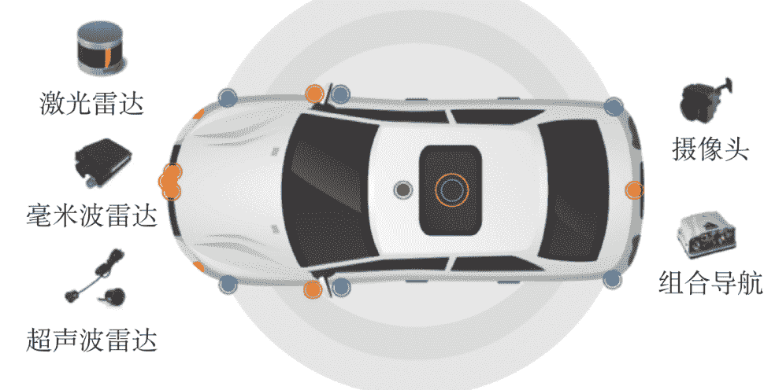

图2-16

例如，自动驾驶AI（见图2-16）就像个经验丰富的老司机，不仅能记住所有交通规则，还能在0.1秒内做出判断，比人类眨眼还快。智能客服能听懂你的言外之意，甚至通过你的语气判断心情好坏。它还会偷偷做笔记，记住你上次咨询过的问题，下次就能提供个性化建议。

最厉害的是，这类AI永远在“充电”学习。就像你打游戏会越玩越厉害一样，它每处理一个新问题，就会变得更聪明一点。不过别担心，它们现在还是我们的好帮手，离电影里那些要统治世界的机器人还远着呢。工具型AI和思考型AI的对比如表2-4所示。

表2-4

| 特性 | 工具型 AI | 思考型 AI |
| :--- | :--- | :--- |
| 任务复杂度 | 处理单一任务 | 处理复杂的多任务 |
| 自主性 | 需要明确的指令 | 自主思考和做出决策 |
| 学习能力 | 不具备自主学习能力 | 通过数据不断优化自己的行为 |
| 适合场景 | 标准化任务 | 复杂决策 |

### 2.2.2 弱AI、强AI、超AI

#### 1. 弱AI (Artificial Narrow Intelligence, ANI)

你有没有发现，现在的AI其实都是“偏科生”，它们就像学校里那些单科超强的学霸——数学天才可能写不好作文，游泳冠军不一定擅长跑步。这类AI我们叫它弱AI，是指用于解决特定任务的AI系统，不具备自主意识、跨领域推理能力或真正的理解力。

弱AI有三个特点：第一，只精通一件事，比如人脸识别AI认人超准，但让它下围棋就完全不会了；第二，不会举一反三，就像背会了数学公式，但遇到没见过的题型就蒙了；第三，严格按照规则办事，像个认真的小助手，但缺乏真正的“理解力”。

手机里的Siri能回答问题，但不会主动学习新知识；AlphaGo下围棋无敌，但连最简单的井字棋都不会；翻译软件能转换语言，但抓不住语言背后的幽默、情感和文化内涵（见图2-17）。它们没有自我意识，所有的“智能”都来自程序员的代码和大数据的训练。


图2-17

#### 2. 强AI (Artificial General Intelligence, AGI)

有一个AI，它既能像科学家一样解方程，又能像诗人一样写诗，还能像朋友一样理解你的心情——这就是科学家正在研究的强AI。

强AI就像一个全能学霸，与现在的“偏科AI”不同，它能轻松切换不同领域的知识，就像你既擅长数学又会写作文一样。它还是会思考的AI，不仅能完成任务，还能理解“为什么要这么做”。比如，在照顾老人时，它知道不仅要按时送药，还要陪老人聊天，提供情绪价值。而且，它像人类一样通过经验学习，今天学会做饭，明天可能就自学了修电脑。

但要注意的是，目前这种AI只存在于实验室的设想中，就像我们幻想“反重力背包”一样。最大的挑战是让AI真正理解世界，而不只是处理数据。科学家估计，要实现这样的AI可能还要几十年。

#### 3. 超AI (Artificial Super Intelligence, ASI)

想象一下，如果有一个AI，它比全人类加起来还要聪明——这就是科学家讨论的超AI。它就像一个来自未来的“超级天才”，在科学、艺术、发明等所有领域都能轻松超越人类。

超AI拥有全知全能，解数学题比数学家快，写小说比作家精彩，甚至能发现人类从未想到的科学定律。它能够自我进化，像游戏里无限升级的角色，它的智能可以一直提升，没有上限。它可能改变世界，帮助人类治愈所有疾病，也可能带来我们无法预知的风险。

科学家把AI超越人类智慧的时刻称为“奇点”，有人预测这可能在2045年左右发生，目前这还只是理论构想，就像我们想象“时间旅行”一样，最大的挑战是如何确保这样的超级AI和人类友好相处。

请将以下案例分别归类到弱AI、强AI和超AI三个类别中，在表2-5中的相应位置打√。

表2-5

| 卡片编号 | 案例描述 | 弱 AI | 强 AI | 超 AI |
| :--- | :--- | :--- | :--- | :--- |
| 1 | 手机上的拍照识花 App，能快速分辨不同花卉品种 | | | |
| 2 | 可以独立编写完整小说，并根据读者反馈调整剧情的 AI | | | |
| 3 | 轻松解开人类尚未证明的数学猜想的 AI | | | |
| 4 | 能同时辅导语文、数学、英语，还能陪你做科学实验的 AI 学习机 | | | |
| 5 | 自动驾驶汽车在复杂路况下安全行驶 | | | |
| 6 | 设计全新能源利用方式，解决全球能源危机的 AI | | | |
| 7 | 学校的人脸考勤系统 | | | |
| 8 | 几分钟内研发出治疗罕见疾病特效药的 AI | | | |
| 9 | 会根据路况调整的红绿灯 | | | |
| 10 | 发现人类从未观测到的宇宙星系运行规律的 AI | | | |
| 11 | 能理解你的情绪，给你讲笑话逗你开心，还会讲睡前故事的 AI 伙伴 | | | |
| 12 | 创造全新艺术流派，引领全球艺术潮流的 AI | | | |
| 13 | 自动批改作业，并给出详细解题思路的 AI 老师 | | | |
| 14 | 提出一套彻底改变人类社会结构，实现乌托邦理想的 AI 方案 | | | |
| 15 | 《三体》中的智子：锁死地球科技，操控人类文明进程 | | | |

注：①弱AI（ANI）：专精单一任务，无自主意识（如Siri、人脸识别）。

②强AI（AGI）：像人类一样全能思考（目前仅存于科幻／理论）。

③超AI（ASI）：智慧全面超越人类（纯科幻或未来设想）。

### 2.2.3 明星AI档案

在神奇的AI家族里，有三位超级明星：一位是守护健康的医疗机器人，一位是打破语言障碍的AI翻译官，最后一位是道路上的智能领航员。它们的出现让我们的生活发生了巨大的改变，接下来，就让我们一起走进它们的奇妙世界吧！

#### 1. 医疗机器人

##### 1) 手术机器人：精准的“显微外科医生”

**超能力揭秘：**

- 手臂超级稳定：机械臂操作精度达到0.1毫米，比人类医生稳定10倍。
- 立体视觉：提供放大10～15倍的高清3D手术视野。
- 微创专家：只需几个5毫米左右的小切口就能完成复杂手术。

2000年7月，达·芬奇机器人手术系统获得美国食品药品监督管理局（Food and Drug Administration，FDA）批准，成为世界上第一个可以正式在手术室中常规使用的机器人手术系统。达·芬奇机器人手术系统（见图2-18）是目前全球最先进的微创手术机器人系统之一，广泛应用于泌尿外科、胸外科、妇科、普外科等多个领域。它通过高精度机械臂和3D高清成像系统，使外科医生能够进行更精准、更微创的手术操作。

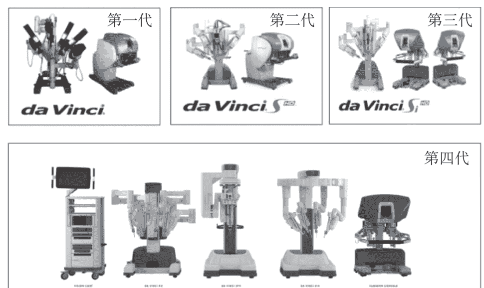

图2-18

##### 2) 康复机器人：耐心的“复健教练”

**超能力揭秘：**

- 力量辅助：帮助中风患者重新学习走路和日常动作。
- 智能评估：实时记录和分析患者的康复进度。
- 永不疲倦：可以重复训练动作上千次，保持同样耐心。

华盛顿大学研究团队开发的康复机器人专门帮助脑卒中患者恢复肢体功能。你知道吗？脑卒中会让患者的肢体变得不听使唤，而这个康复机器人就像一个耐心的老师，它通过深度学习技术，会仔细观察患者的运动模式，然后根据每个患者的具体情况，动态地调整训练强度和治疗计划。康复机器人就像会魔法一样，让那些失去部分身体功能的患者重新找回生活的信心和勇气。

##### 3）护理机器人：贴心的“白衣助手”

**超能力揭秘：**

- 24小时守护：不间断监测患者的生命体征。
- 精准服务：按时、按量分发药品，零差错。
- 暖心陪伴：能和患者聊天、玩游戏。

全球65岁以上人口占比预计2050年达16%（联合国数据），随着全球老龄化加剧和人工智能技术的快速发展，护理机器人领域正迎来重大变革。这些护理机器人不仅能安全转移卧床和行动不便的患者，还能提供用药提醒和健康监测，帮助阿尔茨海默病患者保持认知能力，通过互动游戏唤醒他们的记忆，通过情感交互缓解他们的焦虑等。

护理机器人正在开创一个人机协作的新时代，让科技不再是冰冷的机器，而是充满温度的健康守护者。

#### 2. AI翻译官：语言巴别塔的终结者

**超能力揭秘：**

- 神经网络支持31种语言互译，部分文学翻译质量接近人类专业译者。
- 独创“语境理解”技术，能分辨bank指银行还是河岸。
- 欧盟议会指定系统之一，常见语种的法律文本翻译最高准确率达92%左右。

2023年，联合国气候大会采用微软的AI实时翻译技术，成功处理了包括联合国官方语言及小语种含毛利语在内的多种语言。不过，它对语言的理解局限基于大量数据训练的模式匹配，对于一些具有文化背景、隐喻含义的语句，翻译可能不准确，也无法深入解释不同文化背景下语言的细微差别，不能像人类翻译官那样进行全方位、深度的跨文化交流。

#### 3. 自动驾驶系统：道路上的智能领航员

**超能力揭秘：**

- 多传感器融合感知：激光雷达+摄像头+毫米波雷达360°无死角监测，探测距离达250米。
- 高精地图定位：厘米级定位精度，实时匹配云端路网数据。
- 决策规划系统：每0.1秒生成一次驾驶策略，可预判周围车辆未来5秒轨迹。

2024年实测数据（Waymo报告）：在完全无人驾驶模式下，平均每百万英里受伤事故率较人类司机低约91%；路口碰撞事故率较人类司机低96%（截至2025年1月）。在加州，2024年Waymo车辆平均每千英里人工接管次数低于0.02次，日常运营中已基本实现“零人工接管”目标。全年累计安全载客次数突破1 000万次，周均机器人出租车出行超25万次。

## 成就打卡

### 我学会了 ✅

- ☐ 能区分工具型AI与思考型AI。
- ☐ 理解弱AI、强AI与超AI的区别。
- ☐ 能举出3个弱AI、强AI和超AI的例子。
- ☐ 能举例说出明星AI的应用。

## 闯关测验

1. （单选）世界上第一个被公认的“人工智能”程序是（）。
   A. IBM深蓝
   B. 图灵测试程序
   C. 逻辑理论家（Logic Theorist）
   D. ELIZA聊天机器人

2. （单选）达特茅斯会议（1956年）被认为是AI诞生的标志，它的组织者是（）。
   A. 艾伦·图灵
   B. 约翰·麦卡锡
   C. 杰弗里·辛顿
   D. 杨立昆（Yann LeCun）

3. （单选）当前最接近“强人工智能（AGI）”的AI研究方向是（ ）。
   A. 计算机视觉
   B. 大语言模型
   C. 机器人控制
   D. 语音识别

4. （单选）2016年击败围棋世界冠军李世石的AI是（ ）。
   A. AlphaGo
   B. AlphaZero
   C. Deep Blue
   D. Libratus

5. （多选）以下哪些是AI发展史上的重要里程碑？（ ）
   A. 1956年达特茅斯会议
   B. 1997年深蓝击败卡斯帕罗夫
   C. 2011年Watson赢得《危险边缘》
   D. 2016年AlphaGo击败李世石

6. （多选）以下哪些属于AI发展的主要阶段？（ ）
   A. 符号主义AI

## 成就贴纸

看看你获得了几张贴纸。

| 阅读全章内容 | 成就打卡 | 完成闯关 |
| :--- | :--- | :--- |
| | | |

# 第3章 AI超能力揭秘：决策、视觉与语言

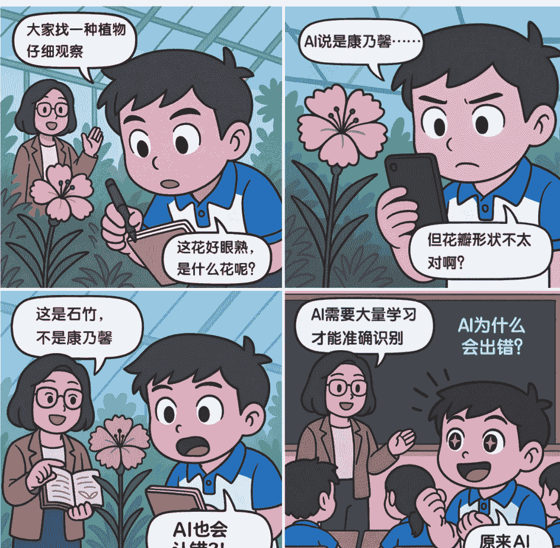

## 3.1 机器学习：AI的“大脑”

想一想，就像你刚开始学认水果时，需要反复看苹果、香蕉的图片（见图3-1）才能记住它们的特征——这就是“学习”。而机器学习就是让人工智能像小朋友一样学会“学习”。想象一下，AI就像个小脑袋瓜，而机器学习就是教这个小脑袋瓜怎么变聪明的办法。不过呀，这个小脑袋瓜要变聪明，得靠三样东西帮忙：一是好多的“学习资料”（数据）；二是像小马达一样的计算能力（算力）；三是老师教的“学习口诀”（算法）。


图3-1

### 3.1.1 AI认数字的秘密：如何看穿数字形状

给AI一张手写数字图片，AI能够看出数字形状从而对数字进行识别。这项任务早在20世纪80年代后期就被杨立昆（Yann LeCun）训练的AI“大脑”——LeNet实现了，如图3-2所示。就像老师教小朋友认数字一样，AI宝宝一开始也不认识1和7。这时候，我们就要当AI的“小老师”，给它看大量数字图片，告诉它哪个是1、哪个是7：“你看，1是直直的一根小棍子，7像小镰刀弯弯的”。每次它认错了，我们就帮它调整一下“小脑袋瓜”里的想法，慢慢地，它就能自己分清这些数字啦。

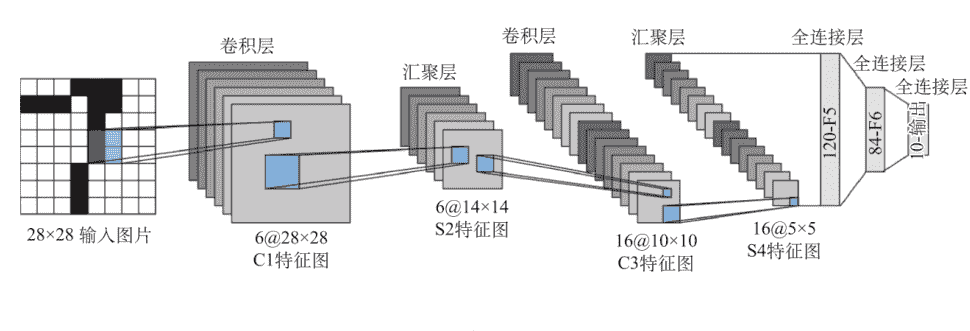

图3-2

下面让我们一起来具体看看AI“大脑”是怎么变聪明的吧！

#### 1. 收集数字小卡片：给AI找学习资料

教AI认识数字得先收集很多手写数字的图片。同学们用不同姿势写数字，有的写得歪歪扭扭，有的像画画——这些图片就是AI的“学习资料”。然后小明给每张图片贴上标签，告诉AI这是1、那是2，让AI知道谁是谁。请你在下面的表3-1中手写数字，帮助小明准备更多的学习资料吧！

想一想：以数字2举例，需要手写多少个2作为学习材料合适呢？是多一点好，还是少一点好呢？所有的2是越像越好，还是各有不同好呢？为什么？

表3-1

| 手写数字 | 标签 |
| :--- | :--- |
| | 0 |
| | 1 |
| | 2 |
| | 3 |
| | 4 |
| | 5 |
| | 6 |
| | 7 |
| | 8 |
| | 9 |

小明来解答：关于“数量”的问题，在不考虑冗余的情况下，当然是越多越好啦！如果只给AI一张手写2的图片，它可没有那么聪明，没法准确地抓取特征哟。

关于“质量”的问题，当然是各有不同最好啦！就像你学认字要先看很多汉字卡片一样，AI也需要大量“数字卡片”来熟悉各种各样的写法，这样它才可以将不同手写体的2准确识别出来。

#### 2. 搭建“大脑”结构：让AI能看懂图片

那么AI的“小脑袋瓜”到底长什么样子呢？其实，AI的大脑就像咱们数学作业本上的“解题公式”，只不过这个公式更复杂。

先讲个简单的“数学魔法”。比如老师让你算“买糖多少钱”：1颗糖2元钱，买3颗就是2×3=6元，如图3-3所示。这里有个公式：总价=单价×数量，如果用字母表示就是y=k×x（k是单价，x是数量，y是总价）。你看，只要知道k这个单价，对于每一个x都能算出对应的y。在这个例子里，就是数学模型。

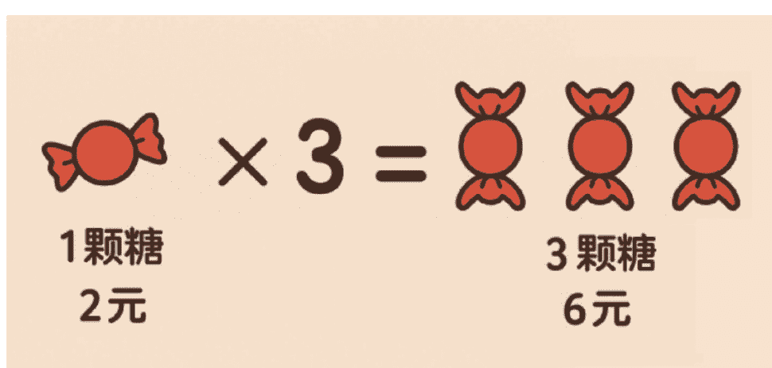

图3-3

假设我们想让AI分清手写数字1和8，输入x就是数字图片，比如一张写着1的画；输出y是AI的判断，比如“这是1”。

但如果只用刚才的y=k×x这个公式，会发生什么呢？这个公式对于手写数字识别任务来讲太简单了，只能处理直线关系，而数字有很多弯弯绕绕的细节特征，需要更厉害的“画画工具”。就像你有一支笔只能画直线，却想画出0的圆圈、8的两个圈，这是不可能的。

事实上，AI最常用的模型结构是神经网络（见图3-4）。你可以把它看作一个复杂的函数，也可以把它的结构想象成搭积木。前几层先找数字的“零件”，比如有没有直线、有没有圆圈。中间几层把零件拼起来，比如直线加小弯可能是7，圆圈加竖线可能是9。最后几层再检查整体，比如9的圆圈在上，竖线在下，而6的圆圈在下。这样一层一层处理，就像小朋友拼拼图，先找边角，再拼中间，最后看整体是不是对的。

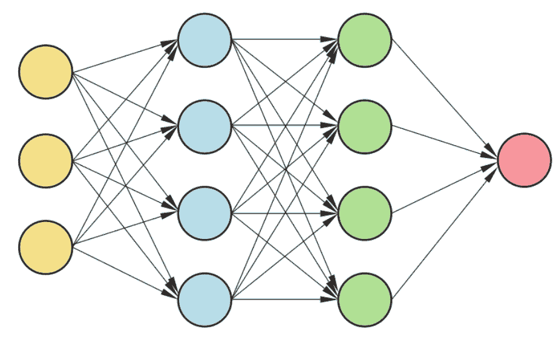

输入层 隐藏层1 隐藏层2 输出层

图3-4

想一想：如果使用一个过于简单的数学模型来作为手写数字识别任务的AI大脑，会带来什么后果？

小明来解答：如果用太简单的模型认数字，比如只看有没有直线，AI会把1、7、4都当成“直线家族”，根本分不清谁是谁，这种现象叫作“欠拟合”。还有一种现象与之相反，叫作“过拟合”。比如某个同学写的2尾巴特别长，遇到另一个人写的2尾巴短一点，AI就会认为“这不是2！”这就是“过拟合”，像小朋友只会背老师讲过的例题，换个数就不会算了。

以上这两种状态都不好，我们期待的状态是“拟合”。“拟合”就是刚好学会的“聪明宝宝”，既能记住2像小鸭子，又能认出胖瘦不同的小鸭子都是2。

#### 3. 训练“大脑”参数：像老师改作业一样

还记得之前那个简单的公式y=k×x吗？用不同的魔法棒（k）点一下数字图片（x），会变出不同的答案（y）。但AI的“大脑公式”比这个复杂得多，里面藏着好多好多“小零件”（参数）。问题来了：这些“小零件”怎么调，才能让AI准确认出数字呢？这就像要把乐高积木拼成正确形状，零件位置错了可不行。

工程师会先给AI的“大脑”随便塞一些“零件位置”（随机参数），就像你第一次玩拼图，先随便放几块试试。接着，给AI看大量手写数字图片，让它猜猜这是“几”。一开始，AI可能猜得乱七八糟，比如把5认成3，把8认成0。别担心，这是很正常的，就好比你从来没有见过豹子和猎豹，就要让你区分这两种动物，那可太难啦！

还记得我们准备的学习资料中特意准备了“标签”吗？标签就像老师批改作业时准备的正确答案一样，它就像老师批改作业时的红勾答案，比如图片上写着1，标签就会说：“这是1！”AI猜完后，我们就把它的答案和标签对比。如果AI猜错了，比如把1说成7，这个“错误”就像小警报一样，传回AI的“大脑”。

AI的“大脑”收到“错误警报”后，会悄悄调整里面的“小零件”（修正参数），就像你发现拼图放错了，赶紧换个位置。调整完，AI再重新猜一次，再和标签对比，如果还不对，就继续调整……这个过程就像打游戏闯关，失败了就重来，每次都变得更厉害！经过好多轮“猜猜改改”，AI会慢慢发现：原来这样调整“小零件”猜得最准！这时候，AI猜出的答案和标签几乎一模一样啦，如图3-5所示。我们把这个“错误”叫作“损失”，就像游戏里掉的血条；而让AI不断调整的神奇方法叫“后向传播算法”，它就像游戏里的提示线索，在它的指引下一点点减少“损失”，直到AI变成超厉害的数字侦探！


图3-5

想一想：如果用于训练的学习资料不够，比如每种数字只准备了一张图片用于学习，会产生什么现象？

小明来解答：会产生“过拟合”现象，即能够正确区分用于训练的图片，但是对于其他的手写数字图片无法进行准确识别。这是因为学习资料过少导致AI没有抓住不同数字的准确特征。但是，训练图片的输出结果接近正确标签，类似机器对学习资料的“死记硬背”。这种现象的典型特点是：在训练集上的准确率高，一旦使用训练图片之外的数据来检测就露馅啦！

想一想：如果训练时不用标签可以吗？

小明来解答：训练时不用标签的机器学习方式是“无监督”学习，而使用标签的是监督学习，也是现在的主流机器学习算法。无监督学习就像你自己整理玩具，没有标签告诉你“这是积木”，但你能按形状把相似的玩具分成几堆，都是自己摸索着找规律。两种学习方式各有利弊，监督学习的学习效果当然更高，但由于需要“老师”的“正确答案”，成本可比无监督学习高哦！

#### 4. 考考AI会不会：看看学习成果如何

当训练到损失收敛，也就是损失变很小或者已经几乎不再随着迭代次数发生变化时，就意味着本次训练可以结束了。此时此刻，把所有的训练图片输入AI大脑进行数字识别，大概率它会有一个非常好的表现。

但是，先不要高兴得太早。别忘了，机器的记忆力可是很好的。它可能只是背会了所有的原题，而不是理解了数据的规律，如果你用原题去考它，它一样会给你个满意的答卷。比如，我们所有的考试都是考原题，那么大家只需要记住答案，不需要理解，一样可以考满分。但是如果不理解问题和答案的话，其实并不能说明你掌握了该知识或者技能，也就不可能合理应用知识。

因此，前期准备的数据还不能全部用于训练，应该分出来一部分用来考考AI。如果它真的掌握了数据的特征，那么是不会被没有见过的“题”考倒的。这两部分数据分别被称为“训练集”和“测试集”，比例通常为8：2或者9：1。有时候还有一个“验证集”，如果你感兴趣，可以查阅资料，想一想它和“测试集”的区别。

想一想：“训练集”和“测试集”之间可不可以有交叉，为什么？

小明来解答：不可以有交叉，如果测试集中有训练集中的数据，就类似“作弊”一样，即使考了较好的成绩，也不能说明AI真的拥有了识别能力。

### 3.1.2 AI预测天气VS气象专家

在预测天气这件事上，AI和气象专家各有一套方法，就像两位不同风格的“解题高手”。接下来，我们通过一些实际案例，深入探讨AI预测天气和气象专家用传统方式预测天气的优劣。

#### 1. 预测速度：AI一骑绝尘

传统方式下，气象专家依靠数值天气预报（numerical weather prediction, NWP）模式。他们先收集大气观测数据，如当前气温、风速等，再将这些数据代入复杂方程，计算未来天气状况。以预测一场即将到来的暴雨为例，从收集数据到得出初步预测结果，可能需要数小时，这期间超级计算机要全力运转，处理海量数据。因为大气运动的方程极为复杂，涉及多个变量和物理过程，计算量巨大。

而AI在这方面展现出巨大优势。例如，华为云的盘古气象模型，它使用39年的全球再分析天气数据进行训练。在预测时，相同空间分辨率下，其速度比传统的欧洲中期天气预报中心的综合预报系统（integrated forecasting system, IFS）快10 000倍以上。只需短短几分钟，就能给出未来7～10天的预报结果，且预测精度与IFS相当。这就好比考试，AI能在极短的时间内完成答卷且成绩优秀，大大提高了预测的时效性，能让人们更快得知未来天气变化，提前做好应对准备，如图3-6所示。


图3-6

#### 2. 数据处理与模式识别：AI独具慧眼

气象专家在传统预测中虽有丰富的经验，但面对海量气象数据，难免力不从心。比如，气象专家在分析卫星云图时，要人工识别云的形状、移动方向等特征，不仅耗时，还可能因主观因素出现偏差。如在判断一些复杂云系是否会发展成强降雨云团时，不同专家可能有不同看法。

AI则擅长处理大规模数据并识别隐藏模式。谷歌DeepMind的GraphCast模型，能在全球0.25°分辨率下，一分钟内预测未来十天的数百个天气变量。它通过对大量历史气象数据的学习，能精准捕捉细微的气象变化模式。比如，在预测飓风路径时，它能综合分析多种数据，如海洋温度、大气环流等，快速准确地预测飓风走向，比传统方法更能提前察觉一些微妙变化，为防范飓风灾害争取更多时间，如图3-7所示。


图3-7

#### 3. 预测精度与可靠性：两者各有千秋

传统数值预报模式经过多年发展，在很多常规天气预测上表现可靠。比如，黑龙江省气象台通过不断完善观测网络，结合专家经验对数值预报结果进行精细化调整，其3天以内晴雨预报准确率超过90%，7天以内准确率在80%以上。专家会根据本地地理特征、长期积累的气象规律知识，对计算机生成的数值结果进行修正，使预报更贴合实际情况。

AI预测在某些方面也能达到甚至超越传统方法的精度。如一些研究表明，在预测某些天气变量及极端或危险事件（如热带气旋）方面，AI模型已经超越了物理模型。谷歌DeepMind团队的研究展示了AI模型在气旋预测方面的显著优势。不过，AI模型也存在局限性。其预测依赖大量历史数据，如果数据存在偏差或不完整，可能导致预测失误。而且对于一些罕见的极端天气事件，由于历史数据中此类样本较少，AI模型可能难以准确预测，而经验丰富的气象专家凭借对大气物理过程的理解，有时能根据有限信息做出更合理的推测，如图3-8所示。

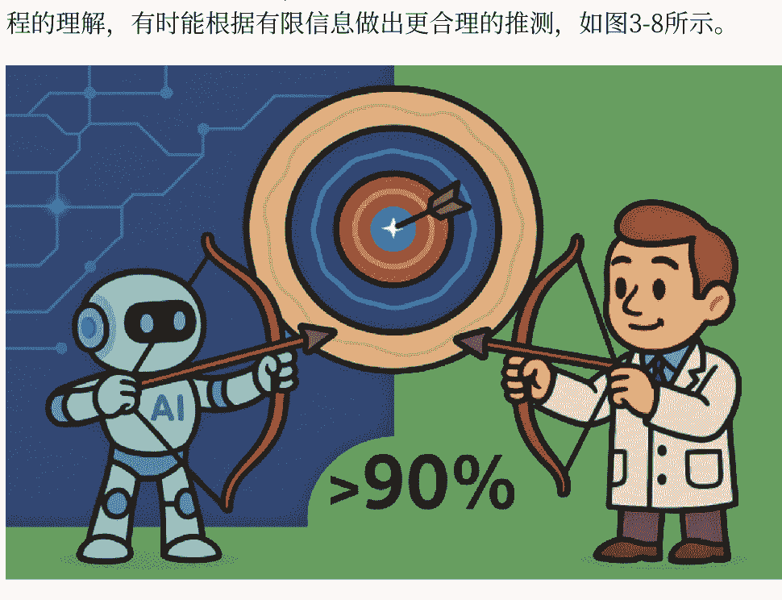

图3-8

#### 4. 极端天气预测：双方各有挑战

传统方式预测极端天气面临诸多挑战。像预测龙卷风这种突发性强、尺度小的极端天气，由于其形成机制复杂，现有观测手段难以全面捕捉其形成初期的细微变化，数值模型在模拟时也存在一定困难。气象专家主要依靠经验和有限的数据进行判断，预测提前量和准确率都有待提高。

AI在极端天气预测方面虽有进展，但也并非完美。虽然AI能处理大量数据，在一些极端天气的趋势预测上有优势，比如提前预测可能出现极端降雨的区域。但极端天气发生概率低，历史数据相对匮乏，AI模型的训练数据可能存在局限性，从而导致其对某些极端天气的具体强度、发生时间和精确位置的预测不够精准。例如，在预测一场罕见的超强台风强度变化时，AI模型可能因缺乏足够相似案例的学习，给出不够准确的预测结果，如图3-9所示。

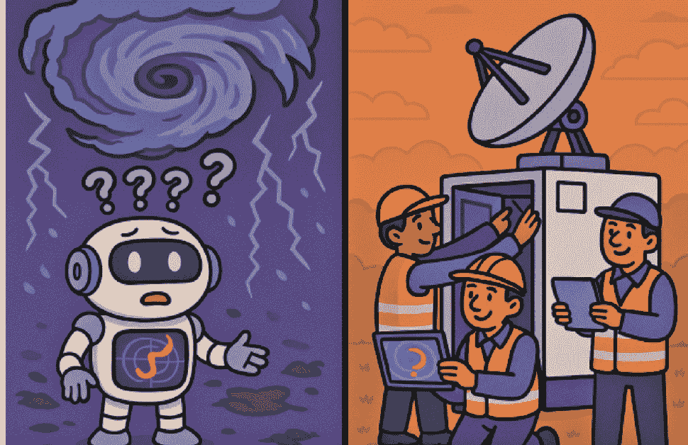

图3-9

#### 5. 成本与资源需求：AI崭露头角

传统数值预报模式需要强大的计算资源支持。运行复杂的数值模型，需要超级计算机持续运算，这不仅成本高昂，而且对硬件设施要求极高。建设和维护这样的超级计算中心，需要大量资金投入，并且能耗巨大。

AI预测在成本和资源需求上具有潜力。AI的训练会消耗一定的成本，但一旦AI模型训练完成，运行时所需计算资源相对较少。一些AI模型甚至可以在个人计算机上运行，大大降低了预测成本。例如，某些基于AI的气象小软件，普通用户在手机或计算机上就能轻松使用，以获取天气预测信息，这为更多小型气象机构或个人提供了参与天气预测的可能，改变了传统天气预测产业对大规模计算资源高度依赖的格局，如图3-10所示。


图3-10

总的来说，AI预测天气和气象专家传统预测方式各有优劣。AI在速度、数据处理和部分精度上优势明显，但在可靠性和极端天气预测的某些方面还有待完善；气象专家凭借深厚的专业知识和经验，在复杂天气形势判断和修正数值结果上发挥着不可替代的作用。未来，将AI技术与气象专家的经验相结合，或许能为我们带来更精准、可靠的天气预报。

## 成就打卡

### 我学会了 ✅

- 能说出AI认识数字的几个关键原因。
- 能理解AI训练过程中的“过拟合”及其负面作用。
- 能说出训练集和测试集的区别。
- 会辩证地看待AI。
- 会说出采集训练数据的1～2个注意点。

## 3.2 计算机视觉：AI的“眼睛”

人类对外界的感知主要来源于眼睛，所以要想拥有比肩人类的智能，AI要像人一样具有视觉理解能力。现在AI的眼睛越来越厉害啦，它能认出街道上的红绿灯，可以识别各种物品，甚至在医院帮医生看X光片。不同的是，人类用眼睛看到图像后，自动将它传输到大脑进行理解；而AI通过摄像头接收图片或视频后，需要将其传输到已训练好的AI“大脑”进行理解，如图3-11所示。


图3-11

### 3.2.1 识别植物种类

同学们在公园、校园或者小区内散步时，有没有好奇过：“这朵花叫什么名字？”“那棵树是什么树？会不会结果？”以前，我们需要拍下照片去请教老师，而现在，我们可以借助AI的力量马上找到答案。打开手机百度App，点击搜索框右侧的“相机”图标，会自动跳转到“识万物”界面，可直接拍照或从相册导入图片。若想更精准识别，可点击“热门推荐”下的“识植物”，识别结果会直接跳转显示，还可查看视频、图文等相关内容。或者，也可以使用“形色识花”小程序来完成植物识别，更加方便快捷。

AI是如何识别花朵的呢？让我们一起动手实验，来帮助AI训练出“火眼金睛”吧！

#### 【动手实验】：AI识别花朵。

#### 1. 实验准备

- (1) 手机1部，电脑1台。
- (2) 浦育平台。
- (3) 小区或校园植物。

#### 2. 步骤

(1) 收集学习资料。拿出手机对着校园或者小区中的两种植物各拍10张照片，并分别放在两个文件夹中，对两种植物打标签，如“月季花”和“康乃馨”（见图3-12）。注意：现在我们的身份不是使用AI的用户，而是AI大脑的训练人员，所以我们需要知道这些植物的正确标签。


图3-12

(2) 训练模型。按照图示步骤对模型进行训练。本书示例使用的是免费的浦育平台，训练好后可选择使用模型或者保存模型到本地。如果保存模型到本地，使用时需要将其上传。在“工具”标签页中选择“创意积木工坊”（见图3-13），在扩展区域中选择“AI训练（图像分类）”（见图3-14），选择“打开AI训练工具”选项（见图3-15），将分类名称分别改为两种花的名称，再分别上传文件夹中的图片，单击“开始训练”（见图3-16）。


图3-13

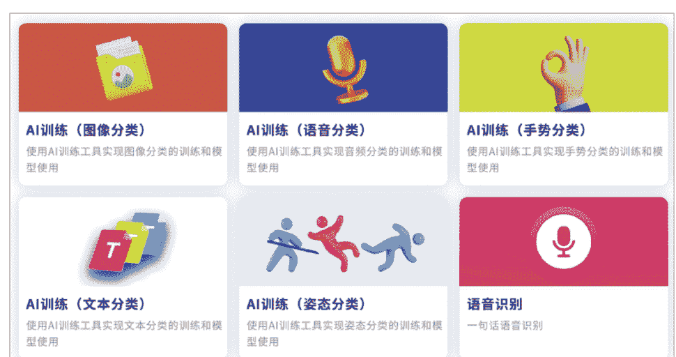

## 图3-14


## 图3-15

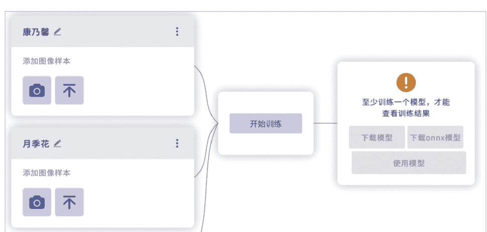

## 图3-16

（3）植物识别。训练好模型后，上传一张月季花或者康乃馨的照片，训练好的模型就会输出分类结果（见图3-17）。你试试可以正确分类吗？


## 图3-17

让我们悄悄上传一张“欧时竹”为难一下AI，猜猜它会认成什么？想一想这是为什么呢？（见图3-18）

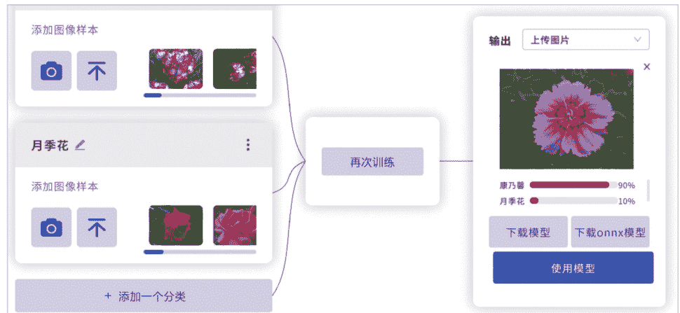

## 图3-18

小明来解答：在这里我们就给了AI两种花的图片用于训练，即月季花和康乃馨。当让它识别其他图片时，由于它的“认知”有限，只能在这两种花中选一个更为相似的。所以，“看走眼”的真正原因，是因为训练人员让AI见识的数据种类不够，而不是AI太“笨”哦。

还有什么情况可能会导致AI识别不准确呢？其实会有很多可能性。比如，训练数据上传的是粉色康乃馨和红色月季花，训练好模型后，你让AI识别一张粉色月季花，AI很有可能会错认为康乃馨。想一想这是为什么呢？

所以，数据是影响AI模型效果的重要因素，它可是人工智能的三大核心要素之一呢！

### 3.2.2 识别人脸：AI侦探

在实际生活中，AI因为具有一双“火眼金睛”，所以能够完全胜任侦探这份工作。你瞧，AI在下面这些场景中扮演的角色可是功不可没呢！

【案例1】在火车站里，人来人往，十分热闹。突然，警报声响起！原来是警方正在追捕一名逃跑的坏人，而坏人正混在人群中准备乘车逃跑。AI侦探立刻开启“追捕模式”，它通过火车站的摄像头，像鹰眼一样扫视着每个人的脸。它精准地锁定眼睛、鼻子、嘴巴等关键部位，快速计算每个人脸的特征。终于，在茫茫人海中，AI侦探发现了一个可疑的身影——那个人的脸和警方提供的坏人照片高度匹配（见图3-19）。AI侦探马上“拉响警报”，通知警察叔叔，成功将坏人抓捕归案，火车站又恢复了平静与安全。

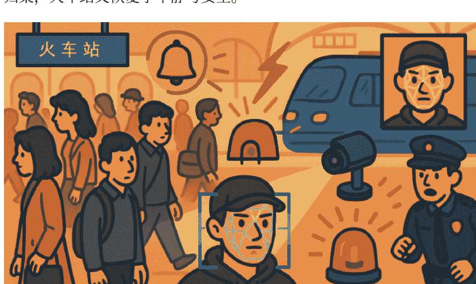

## 图3-19

【案例2】如图3-20所示，周末，小红和妈妈在商场购物，结账时，小红妈妈想用刷脸支付。这时，AI侦探再次登场，它把小红妈妈的脸当成“案件线索”，仔细分析每一个细节。它注意到小红妈妈脸上的那颗小痣，还有其他人脸关键点。仅仅用了不到一秒钟，AI侦探就确定了小红妈妈的身份，顺利完成支付。小红惊叹道：“哇！AI侦探太厉害了，就像在侦破‘这是谁’的小案件一样！”


## 图3-20

【案例3】如图3-21所示，周一早上，同学们排着队走进学校。学校门口的人脸识别考勤机就是AI侦探的新“岗位”。它认真地观察着每一个同学的脸，确认大家有没有按时到校。突然，它发现一个同学戴着大大的口罩，只露出一双眼睛。这可难不倒AI侦探，它仔细观察那双眼睛的形状、间距，结合以往记录的其他面部特征，成功认出了这位同学。原来，这位同学是因为感冒才戴上了口罩。AI侦探准确的判断，让学校的考勤工作变得又快又准。

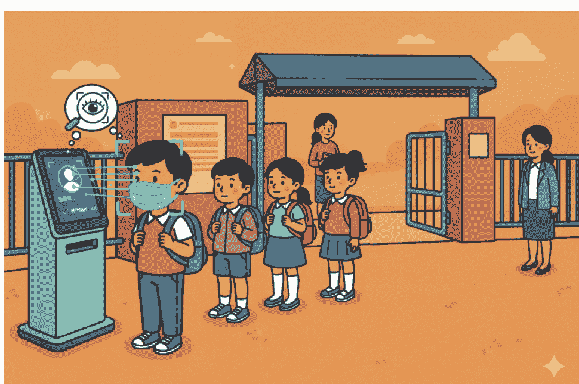

## 图3-21

在生活的各个角落，AI侦探都在利用人脸识别技术，像真正的侦探一样，解决各种各样的“难题”，给我们的生活带来了便利和安全。那么，AI是如何实现人脸识别的呢？这依赖于AI强大的特征提取技术和“记忆力”。

#### 1. AI侦探的“线索提取机”——卷积神经网络

AI侦探有一台厉害的“线索提取机”，它的名字叫卷积神经网络，前面提到的LeNet5模型，就是一个经典的卷积神经网络。当AI侦探遇到一张新的人脸照片时，这台“线索提取机”就会开始工作。第一层卷积核会提取一些简单的线条和颜色，比如发现这里有一条弯弯的线（可能是眉毛），那里有一块黑色区域（可能是眼睛）。这就好比侦探在现场先注意到一些明显的痕迹。

随着神经网络层数的增加，AI侦探进行深入挖掘，寻找更复杂的线索，比如眼睛的形状是圆圆的还是长长的，鼻梁高不高，嘴巴是什么形状等。最后，它会找到一些最关键的特征，比如两眼之间的距离、鼻尖的弧度，这些特征就像案件的关键证据。通过这样一层一层的分析，卷积神经网络把人脸的重要特征都提取出来，形成一串独特的“数字密码”。

那么，为什么卷积神经网络这么厉害呢？前面提到的“卷积核”又是什么神奇的东西呢？卷积是一种算术运算，只不过比加减乘除稍微复杂一些。卷积运算就是对应位置相乘之后再相加，比如把图3-22的卷积核扣在输入图的蓝色区域上，实现卷积运算：0×0+1×1+3×2+4×3=19。挪动这个核，再继续进行卷积运算。设置不同的卷积核，会有不同的效果，如边缘检测、锐化、高斯模糊等。在卷积神经网络中，卷积核的参数是由机器自己学习来的。

想一想：图3-22中的25是怎样得到的？

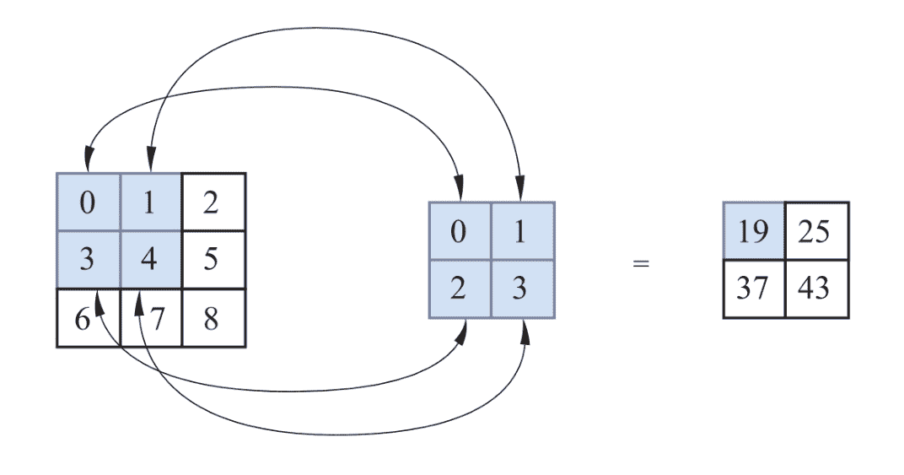

## 图3-22

#### 2. AI侦探的“人脸档案库”——人脸数据库

在AI侦探的“大脑”里，还有一座巨大的“人脸档案库”，也就是人脸数据库。这里面整齐地存放着成千上万张人脸的“数字密码”，每一份“数字密码”都对应一个人的身份信息，就像侦探的档案库里存放着各种案件资料和嫌疑人信息一样。

科学家提前把很多人的照片输入AI侦探的系统里，通过卷积神经网络提取这些人脸的“数字密码”，然后把它们存进“人脸档案库”。这样，AI侦探就有了很多参考的“样本”。

#### 3. AI侦探的超绝“记忆力”——对比与确认

当“线索提取机”从新的人脸照片中提取“数字密码”后，AI侦探就会跑到“人脸档案库”里去寻找匹配对象。它会把新的“数字密码”和档案库里的每一份“密码”进行对比，计算它们之间的相似度。这个过程就像把现场线索和档案库里的嫌疑人信息进行比对一样。如果找到了相似度非常高的“数字密码”，它就会根据档案库里对应的身份信息确认这个人的身份。比如在手机解锁时，AI侦探发现这张脸的“数字密码”和预先存储的“密码”匹配，就会解锁手机。在火车站抓坏人时，一旦发现某个人脸的“数字密码”和坏人档案里的“密码”相符，就会立刻发出警报。

现在，小朋友们知道AI侦探是怎么通过人脸识别来“破案”了吧！下次再看到人脸识别技术的应用，就可以想象AI侦探正在用它的“线索提取机”和“人脸档案库”忙碌地工作呢！

想一想：人工智能的三大核心是算法、算力和数据。AI侦探的“线索提取机”和“人脸档案库”分别对应的是以上哪一个关键因素呢？

## 成就打卡

我学会了 ✅

- □ 能结合人工智能的三大核心，说出AI实现图片识别的原理。
- □ 能说出生活中AI实现人脸识别的案例。
- □ 能说出AI利用人脸信息可以做的其他事情。
- □ 能说出AI除了“识别”功能外，在计算机视觉领域还可以做什么。

## 3.3 大语言模型：AI的“嘴”

小朋友们，AI不仅有“火眼金睛”，可以做侦探，还有着非常渊博的知识。请你试着考考豆包、DeepSeek等大语言模型，问它们一些问题，看看它们能不能很快回答出来。比如，母亲节快到了，你想学着给妈妈做道麻婆豆腐，不妨向大语言模型要个菜谱，相信它一定能帮助你。悄悄告诉你，大语言模型不仅能解答你的问题，还能讲故事、写作文以及创作歌曲呢！如此万能的大模型，简直像拥有了魔法。现在，就来看看这个神奇“嘴巴”是怎么工作的吧！在这个过程中，大语言模型经历了接收问题、理解意图和生成答案这三个主要阶段。其中，理解意图主要依赖自然语言处理技术，生成答案主要利用生成式人工智能算法。

### 3.3.1 大语言模型的法宝

#### 1. 大语言模型：渊博的知识仓库

大语言模型有着渊博的知识仓库，这个仓库里有着超级多的“宝贝”——它们是从海量的书本、文章、网页里收集的文字。这些文字就像五颜六色的积木块，有描述风景的词语、讲故事的句子，还有回答数学问题的公式。

比如，仓库里存着“春天的花朵像小朋友的笑脸一样灿烂”这样优美的句子，也有“1+1=2”这样的数学知识，还有完成汉诺塔问题的程序。AI会把这些文字都“吃”进肚子里，像小海绵一样吸收知识，记住它们的排列和组合方式。看到这里，也许你会觉得大模型就是从它庞大的知识库中进行简单搬运，这个理解是偏颇的。知识仓库是基础，就比如你怎样才能写出一篇好的文章呢？你一定是阅读过大量的文字或文章，有着渊博的知识和写作基本功，这就相当于大语言模型的知识库。

#### 2. 自然语言理解：理解问题的“密码翻译官”

在AI用“嘴巴”回答问题或生成作品之前，它得先搞明白你在要求它做什么。这时，它会运用人工智能算法来理解你的文字想要表达的意思，这个过程叫作自然语言理解。

当你问AI：“恐龙是怎么灭绝的？”“密码翻译官”会先把这句话拆成一个个小零件：“恐龙”“怎么”“灭绝”，然后在“魔法词语仓库”里查找这些词的意思和关联。它知道“恐龙”是很久很久以前的巨大动物，“灭绝”就是从世界上消失，再把这些信息组合起来，弄清楚你到底想问什么。

有时句子比较复杂，比如“除了火山爆发，还有哪些原因可能导致恐龙灭绝呢？”“密码翻译官”会像侦探找线索一样，抓住“除了”“还有哪些”这些关键词，明白你想知道多种恐龙灭绝的原因。这样，AI就能准确“听懂”你的问题啦！

#### 3. 生成式AI：词语积木的“搭建大师”

在“密码翻译官”弄清楚问题后，生成式AI（generative artificial intelligence，GAI）这位“搭建大师”就闪亮登场啦！当它收到“恐龙是怎么灭绝的？”这个任务时，就会像搭建积木一样，从“魔法词语仓库”里挑选合适的词语和句子。

它先思考回答的开头应该用什么词语，比如“科学家推测”；接着，根据这个开头，再从仓库里找出相关的句子，比如“可能是因为小行星撞击地球”；然后继续挑选，把各种合理的原因组合起来，直到组成一段完整的回答。

在挑选词语和句子的时候，生成式AI会参考之前“吃”进去的海量文字，看看科学家是怎么分析恐龙灭绝原因的。它会模仿这些专业的表达方式，但又不是简单地重复，而是像一个聪明的小科学家一样，创造出清晰又有趣的答案。

#### 4. 大语言模型的“思考”过程：预测下一个词语

大语言模型工作时，还有一个超有趣的小秘密——它是通过预测下一个词语来生成内容的。

当生成式AI开始回答问题时，它会先预测第一个最有可能出现的词语，比如回答恐龙灭绝问题时，它可能预测“目前”；接着，根据“目前”这个词，再预测下一个词，比如“主流”；就这样一个词一个词地预测，不断调整和选择，直到组成一段流畅又准确的话：“目前主流观点认为，小行星撞击地球引发的环境剧变，是导致恐龙灭绝的重要原因”。

虽然听起来很复杂，但AI的速度超级快，眨眼间就能预测出好多词语，像变魔术一样，从“魔法词语仓库”里挑选积木，给我们搭建出有趣又有用的答案。

现在，小朋友们是不是明白了AI的“嘴巴”是怎么说话的？下次和AI聊天时不妨想象一下，AI的“密码翻译官”“搭建大师”正在忙碌地工作，努力给你最棒的回答呢！

事实上，为了让大语言模型与人类沟通得更加顺畅，可以将用文字沟通换成用语音沟通，即结合智能语音技术，也就是在用户表达需求时使用语音输入，采用语音识别技术得到对应的文字，大语言模型进行处理并生成对应的文字内容。如有必要，也可以用语音输出答案，即将对应的文字通过语音合成技术转换为语音输出。除了生成并输出文字，还可以生成与输出图片、视频以及音乐等。当然，这些就需要结合图片生成技术、视频生成技术以及音乐生成技术了。

### 3.3.2 大语言模型的幻觉

大语言模型就像一个超级厉害的神奇小助手，能快速地帮我们画画、写故事，只要几秒钟就能变出一幅漂亮的画、一篇有趣的作文。它肚子里装着超级多知识，不管是数学题、历史故事，还是科学小知识，问它都能快速回答，简直就是个“知识小百科”。

不过这个小助手也有一些缺点哦！

首先，它想出来的点子都是从以前的东西里学来的，没有我们小朋友自己想出来的那么天马行空，充满创意。所以，大家用AIGC做出来的东西都有点像，这样我们独特的想法和创意就被藏起来了。每个人的作品都该像彩虹一样，有不同的颜色和样子，可不能被AIGC“偷走”属于我们自己的光芒呀！

有时候，AIGC生成的画作还会令人啼笑皆非，比如图3-23中的孔雀手。同学们，你们试一试如何进一步修改描述问题，让豆包对图片进行修改，从而生成真正的孔雀手吧。

请帮我生成一张孔雀舞中孔雀手的图片

接下来我将生成一张孔雀舞中孔雀手的图片。画面风格是写实风。正面视角，主体是一只呈现孔雀舞姿态的手，手指弯曲呈孔雀头和羽毛的形状，皮肤光滑细腻，光影自然，色彩还原真实。

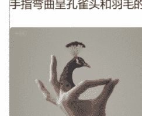

## 图3-23

有时候，你要小心大语言模型胡说八道哦！它虽然能说会道，但偶尔也会“想象”出一些不存在的事情或者张冠李戴，这就是“幻觉挑战”。

比如，你问它：“第一个登上月球的人是谁呀？”它可能会说：“是查尔斯·林德伯格在1951年登月的！”但实际上，真正第一个登月的人是尼尔·阿姆斯特朗。就像你在考试时，如果没学过某个知识点可能会乱写答案，大语言模型也会因为没“学”到正确的信息，就自己“编”一个看起来合理的答案。

为什么会这样呢？因为大语言模型是通过海量数据“学习”的，但有些数据可能是错的，或者它“记混”了。比如，如果训练它的资料里说“水在气压低的地方80℃就会沸腾”，但它可能断章取义后“瞎说”：“水80℃就会沸腾”。

那怎么办呢？科学家会让大语言模型“查字典”（比如连接知识数据库），或者让多个模型互相检查答案，就像你做完作业后和同学对答案一样。科学家会不断改进大语言模型的表现，所以，可能今天AI回答了错误答案，而几天后进行了更新，AI的回答就变正确了。不过，小朋友要记住：即使大模型说得头头是道，也不能完全相信它，就像老师说的——遇到不确定的事情，一定要自己查证哦！

所以，大家要学会合理使用AIGC，它只是我们的小助手，可不是我们走路的拐杖。如果总是依赖AIGC这个神奇小助手，就像一直拄着拐杖走路，慢慢地就会忘记怎么自己奔跑啦！而且这根偶尔不靠谱的拐杖有可能会把你带沟里去哦！

## 成就打卡

我学会了 ✅

- □ 能结合人工智能技术，说出AI大语言模型如何根据要求写作文。
- □ 能利用大语言模型工具体验AIGC功能。
- □ 能辩证地看待AIGC的优缺点。

## 3.4 AI的“成长烦恼”——技术背后的挑战

### 3.4.1 漏洞测试：AI也会“以貌取人”？

AI虽然能快速认出人脸，但有时候也会“看走眼”。就像我们在人群中找朋友，偶尔也会把背影相似的人认错一样。下面让我们一起来看看AI失误的瞬间吧！

（1）双胞胎的“身份大冒险”。闪电新闻曾报道，小晶在2017年12月1日购买了一部iPhone X，并设置了自己的Face ID用于刷脸解锁。小晶有个同卵双胞胎妹妹，两个人相似度高达90%。当晚，妹妹竟通过刷脸解锁了小晶的手机，而之后小晶再刷脸解锁时，手机却识别失败，仿佛“认不出”主人了。重新设置后，姐妹俩都能解锁手机，原来iPhone X把妹妹也当成了主人。苹果官方客服称，对于同卵双胞胎、相似度极高的兄弟姐妹等面部特征区分不明显的人，Face ID失误率较大。这一事件引发大家对AI识别双胞胎准确性的讨论，科学家也在研究，比如通过观察耳朵形状、瞳孔细微纹路等，帮助AI更精准地区分相似面孔。

（2）英国知名美妆博主Katie Price也有过这样的经历。Mirror Online报道，Katie在接受了隆鼻、脸颊填充和唇部提拉等一系列整容手术后，发现她的iPhone手机不能再通过人脸识别解锁。她在自己的播客节目中吐槽，手机的人脸识别功能好像“失灵”了，自己不得不每次手动输入密码，明明觉得鼻子变化不大，可AI却认不出她了。这表明AI识别人脸时，对于外貌的显著变化，尤其像整容手术带来的改变，还难以适应。

（3）《华盛顿邮报》报道，2020年，美国底特律的Robert Williams被警方错误逮捕。当时警方依靠人脸识别软件，在调查一家商店的盗窃案时，将监控录像中的嫌疑人面部与数据库比对，误将Williams认成了小偷。实际上，案发时Williams正在下班回家的路上。他被警方审讯并拘留了30小时，最终检察官因证据不足撤销了指控。警方后来也承认是“调查工作失误”。这一事件引发公众对警方过度依赖人脸识别技术的质疑，也促使科学家给AI增加了更多“检查步骤”，以提升识别的准确性。

### 3.4.2 攻防游戏：欺骗AI的“眼睛”

2019年，德国研究者为了验证AI的可靠性，开展了一个有趣的实验。在交通场景里，常规“禁止停车”交通标志牌本是规范道路秩序的明确标识，人类凭借视觉常识和交通规则认知，能精准识别含义。研究者在标志牌特定位置粘贴了一张贴纸，想要看看AI对交通标志的判断会不会受到影响。令人啼笑皆非的是，AI驾驶系统误将“禁止停车”识别为“限速30公里”，出现了关键信息误判，小小的贴纸成为干扰AI认知的“视觉陷阱”。

日本科学家针对AI图像识别也进行了一场趣味实验。为自家宠物猫配备特制3D打印眼镜，当AI摄像头采集猫咪图像，算法对特征进行提取时，被眼镜图案干扰，错误匹配数据库中乌龟的壳状轮廓、企鹅的形态特征，出现了把猫认成乌龟、企鹅等荒诞结果，验证了利用AI训练盲区，简单道具即可制造识别混乱。

那么AI为什么会受到干扰呢？本质上还是因为这些小小道具的增加影响了AI对特征的提取。AI图像识别依靠提取图像特征（如形状、颜色、边缘等）与预设标签匹配。贴纸改变交通标识局部特征，使AI误匹配到错误标签，但人类的判断是基于整体认知和交通规则知识的，不会受到局部小干扰的影响。至于猫咪的案例，AI识别动物依据训练好的特征库（毛发、体型、轮廓等）。特制眼镜图案破坏猫的典型特征，干扰AI特征提取与匹配，让其错误关联乌龟、企鹅等特征。而人类靠综合视觉信息（即便眼镜干扰，仍能识别猫的整体形态）和生活经验判断，不易被误导。

所以，如何让AI避免受到干扰呢？让AI和人类一样拥有综合视觉信息，具有识别猫整体形态的功能就行了。如果AI提取的特征能够更精准一点，就一定不会被“欺骗”。如何提取更准确的特征？这就需要人工智能工程师来想办法了！但是我相信，在工程师的努力下，AI一定会通过考验，不再上人类的当啦！

想一想，以上例子给了我们什么启示？大家可以从技术改进、使用安全以及人机协作的角度进行思考。

- (1) 技术改进：AI图像识别需提升鲁棒性，可通过增加多样化干扰样本训练（模拟贴纸、图案等干扰场景），优化特征提取算法（综合全局与局部特征，减少单一特征依赖），增强对实际复杂、干扰环境的适应力；同时，可融合多模态信息（如结合交通场景语义、时序信息）辅助识别，降低误判。

（2）使用安全：在AI自动驾驶、安防等关键场景中，需警惕这类视觉干扰攻击，可从硬件（如采用抗干扰图像采集设备）、软件（实时监测识别异常，建立人工复核机制）层面设防；也可推动AI安全标准建立，规范应用场景中对干扰的防护要求。

（3）人机协作：人类视觉认知的灵活性、经验知识优势，可与AI互补。在关键决策场景（如交通、安防）设计人机协同流程，AI初步识别后，由人类基于综合判断进行复核，降低单一AI误判风险，发挥人机各自所长。

### 3.4.3 透明化挑战：AI的“黑箱”日记

2018年，*STAT News*报道了一个令人揪心的案例。IBM开发的Watson for Oncology是一款用于癌症治疗建议的AI系统，被寄予能帮助医生制定治疗方案的厚望。然而在实际应用中，它却多次给出不符合医学指南的治疗建议。例如，对于一位乳腺癌患者，AI推荐的治疗方案中包含了不适合该病情阶段的药物，甚至可能对患者造成伤害。当医生追问AI为什么给出这样的建议时，系统无法清晰地解释推理过程。这就好比一个医生给病人开了药，却无法说明用药原因，这让人怎么能放心呢？

2016年，美国威斯康星州的一个案件引起了广泛关注。法院使用了一款名为COMPAS的AI算法来评估罪犯的再犯风险，以此辅助量刑。但在实际应用中，这个算法被发现存在严重的不公平性。研究显示，它对黑人罪犯的再犯风险评估普遍偏高，导致黑人罪犯可能面临更严厉的判决。更糟糕的是，当人们要求算法解释为什么得出这样的评估结果时，开发团队也无法给出清晰、合理的说明。这就像老师给学生打了低分，却不告诉学生错在哪里一样，让人感到既困惑又不公平。

英国的一些学校引入了AI系统来评估学生的学习表现和潜力。有的学生发现，自己在一次考试中成绩不错，但AI系统给出的学习潜力评分却很低。学生和家长想要了解评分的依据，学校和开发团队却难以详细说明AI是如何综合分析学生的作业、考试成绩、课堂表现等数据得出结论的。AI就像一个神秘的评分机器，只给出结果，却不透露打分的“小秘密”，这让大家无法有针对性地改进学习。

AI出现“黑箱”问题，主要是因为它的工作原理太复杂。以深度学习模型为例，它包含成百上千层的神经网络，在处理数据时，会对输入的大量信息进行层层计算和变换，最终得出结论。这个过程就像一个庞大的工厂流水线，每个环节都在对数据进行加工，但由于环节太多、太复杂，连开发它的科学家也很难完全追踪和解释每一步的计算逻辑。

这给我们带来了几个重要启示：第一，在使用AI时，不能盲目相信它的结果，就像我们写作业不能只知道答案，还要知道解题思路一样，需要了解AI做出判断的依据；第二，科学家需要不断研究新的技术，让AI变得更加“透明”，比如开发能够解释AI决策过程的算法；第三，我们每个人都要保持思考和质疑的习惯，当发现AI的结果不合理时，要大胆追问为什么，这样才能帮助AI更好地成长，让它真正成为我们生活和学习的好帮手。

## 成就打卡

### 我学会了 ✅

- □ 能辩证地看待AI。
- □ 能理解AI“不够聪明”的原因。

## 闯关测验

1. （单选）首次将神经网络用于手写数字识别任务的是（ ）。
    - A. 小明
    - B. 杨立昆
    - C. 豆包
    - D. 未知科学家

2. （单选）以下关于训练手写数字识别AI的说法正确的是（ ）。
    - A. 学习资料中每种数字只需一张图片
    - B. 学习资料里的数字越相似越好
    - C. 训练集和测试集不可以有交叉
    - D. 训练数据越多，识别越准确

3. （单选）华为云的盘古气象模型预测天气相比传统的欧洲中期天气预报中心的综合预报系统IFS，其优势在于（ ）。
    - A. 预测速度快10 000倍以上
    - B. 预测精度高很多
    - C. 不需要收集数据
    - D. 能处理更复杂的气象场景

4. （单选）大语言模型理解问题依靠的技术是（ ）。
    - A. 自然语言处理技术
    - B. 图片生成技术
    - C. 视频生成技术
    - D. 知识图谱技术

5. （单选）让人工智能像人一样学会学习从而产生智能的一系列算法是（ ）。
    - A. 飞行算法
    - B. 机器学习算法
    - C. 绘画算法
    - D. 强化学习算法

6. （单选）手写数字识别任务中，最适合的AI “大脑”结构是（ ）。
    - A. 一元一次线性函数
    - B. 前馈神经网络
    - C. 卷积神经网络
    - D. 多层感知机

7. （单选）AIGC的中文全称是（ ）。
    - A. 自动智能创造内容
    - B. 人工智能生成内容
    - C. 高级智能创作内容
    - D. 自主智能生成内容

8. （单选）如果长期过度依赖AIGC完成美术课上的绘画作业，会出现什么情况？（ ）
    - A. 绘画技巧越来越高超，创意源源不断
    - B. 失去独立思考和创作的能力，作品千篇一律
    - C. 能够快速学会各种绘画风格，超越其他同学
    - D. 对基础绘画技法的掌握逐渐弱化

9. （多选）下列哪项是过度依赖AIGC的坏处？（ ）
    - A. 提升思考能力
    - B. 考试成绩受影响
    - C. 创意被隐藏
    - D. 降低自主学习动力

10. （多选）以下哪种情况会让AI人脸识别出现失误？（ ）
    - A. 双胞胎面部特征相似
    - B. 人穿着不同颜色的衣服
    - C. 人站在不同高度的地方
    - D. 人佩戴墨镜遮挡眼部

11. （多选）AI图像识别不准确的可能原因是（ ）。
    - A. AI太笨了
    - B. AI没有对特征进行准确提取
    - C. AI看不清楚
    - D. 训练数据存在偏差

12. （多选）为解决AI“黑箱”问题，我们不应该（ ）。
    - A. 盲目相信AI结果
    - B. 研究新技术让AI更“透明”
    - C. 对不合理的AI结果提出疑问
    - D. 拒绝了解AI的决策逻辑

13. （填空题）AI在识别人脸时，主要利用________神经网络提取人脸特征。

14. （填空题）当AI模型出现只能准确识别训练图片，而对其他未训练的图片无法准确识别的情况时，这是出现了________现象。

## 成就贴纸

看看你获得了几张贴纸。

| 阅读全章内容 | 成就打卡 | 完成闯关测验 |
| :--- | :--- | :--- |
| | | |

# 第4章 AI学习助手：学科能力提升利器

## 4.1 语言学习的AI伴侣

在第三章中，我们见识了AI的“火眼金睛”——计算机视觉，还有它的“伶牙俐齿”——大语言模型。有了这些本领，AI不仅能看懂图片里的世界，还能听懂人类说的话。可别以为这些“超能力”只能用来“看热闹”，摇身一变，AI就能成为你学习语言的得力助手！想象一下，AI就像一位随身带着魔法口袋的老师，不管是记单词、练发音，还是改作文，它都能帮上忙，让原本枯燥的语言学习变得像玩游戏一样有趣又轻松。

AI能成为语言学习的好伙伴，靠的是一套“魔法三部曲”——感知、分析、反馈。这三个能力层层递进，就像搭积木，缺了哪一块都不行。

首先是感知层，这是AI收集学习信号的第一步。它既能用“眼睛”，也能用“耳朵”。当你举起画着红苹果的单词卡片，AI就像一台精准的扫描仪，凭借图像识别技术，瞬间就能说出：“这是apple，苹果！”而当你对着手机说：“Hello”，AI又会通过麦克风“听”到你的声音，把它转化成数字信号。这就好比给声音拍了一张X光片，你发音时的每一个细节，比如l的尾音有没有发出来，都逃不过AI的“耳朵”。

收集信息后，AI就进入了分析层，化身为大脑里的“语言侦探”。要是你说：“I have five apple”，AI马上就能发现句子中的apple少了s。它的“大脑”里储存着海量的语法知识，清楚地知道five后面要接可数名词复数，还会俏皮地提醒你：“五个苹果呀，apple要穿‘复数外套’哦！”写英语作文时也一样，当你不小心写出“Yesterday I go to school”，AI会立刻用红色波浪线标出go，并耐心地告诉你：“昨天发生的事，动词要穿‘过去式外衣’，用went哦！”这都是因为AI学习了数百万篇标准作文，才练就了这双“火眼金睛”。

最后到了反馈层，AI又变成了会说话的“学习游戏向导”。练习th发音时，它会先示范think的正确口型，然后鼓励你模仿。要是你发成了s音，AI就会给出贴心提示：“不对哦，把舌头放在上下齿中间试试！”还会生成一个小动画，直观地展示口型，帮你顺利“闯关”。写作文时，如果你输入“我爱妈妈”，AI会像给作文加上“魔法滤镜”一样建议你：“试试加上‘每天早上妈妈都会为我准备热乎乎的早餐’，句子会更温暖哦！”让原本平淡的句子变得闪闪发光。

在实际的语言学习中，AI的帮助体现在方方面面。背单词时，打开一些常用的AI背单词App，你会看到apple的图片旁有个麦克风按钮，单击跟读，AI不仅会给你的发音打分，比如：“90分！发音很标准，但可以把a的音拖长一点”，还会生成“apple-tree（苹果树）”这样的联想记忆图，让你的单词记得又快又牢。练习口语时，AI能扮演各种角色和你对话。当它化身“超市收银员”时问你：“Can I help you?” 你回答“I want some apples.” 它还会接着问：“How many kilos?” 就像你真的在超市购物一样，让口语练习充满真实感。写作文就更不用说了，当你在AI对话框中输入“我喜欢看书”时，AI会给出三个超棒的升级版本：“我像小鱼爱上大海一样喜欢看书”“每当翻开书本，我就像走进了奇妙的故事王国”“书架上的每一本书，都是我最好的朋友”，轻松帮你提升表达能力。

### 4.1.1 AI词汇记忆——像玩游戏一样背单词

小明以前背单词总像狗熊掰玉米，手里永远只抓着最新的那一个，前面记的全都忘光光。直到他发现了豆包App里的“背单词”智能体（见图4-1），现在每天只要花10分钟和它聊聊天，轻轻松松就能记住10个新单词。原来这个智能体就像随身带着的私人教练，能一眼看穿你哪里记不住，还会悄悄调整学习节奏，专治各种“记了就忘”的小毛病！

想让AI帮你背单词？超简单，以下三步就能激活你的智能单词管家。

首先打开豆包App，找到“智能体”菜单，要是找不到也别慌，直接在搜索框输入“背单词”。一见面，AI就会笑眯眯地问你：“你现在是小学高年级、初一，还是初二的学生呀？”这可不是随便问问哦！当你回答“初一”时，它立刻从“单词百宝箱”里掏出适合初一难度的单词，还会变着花样布置小任务，比如用新单词造句，或者考考你单复数变化。这背后的秘密，其实是AI用自然语言处理技术“听懂”了你的回答，再从超大词汇库里精准挑出合适的内容。

接下来就是超好玩的“沉浸式记忆大闯关”！你可以对AI说：“给我看看elephant长什么样？”它会马上画出憨态可掬的大象，用图片帮你加深印象。点击语音按钮，就能听到AI把单词念得字正腔圆。AI还会“任性”地要求你“每个单词念5遍”，念完单词，AI会像个严格的小老师，给你的发音打分。最后是挑战单词拼写，要是漏了一个字母，AI还能眼疾手快帮你纠正。

这一套“看、听、说、写”的组合拳，其实是AI偷偷调用了各种神奇技能：用计算机视觉画图、语音合成技术读单词、语音识别功能挑发音毛病，再靠自然语言处理纠正拼写错误，简直比哆啦A梦的口袋还厉害呢！

最贴心的是，AI还能帮你制订专属学习计划。只要跟它说“帮我安排复习”，它就会记住你每天学了什么，根据你的表现生成新的单词列表。就像有个超细心的小伙伴，每天提醒你该复习哪些内容，比你自己还清楚什么内容容易忘！

说到这儿，你一定好奇这个神奇的智能体是怎么来的吧。其实它就像将一块普通石头打磨成的魔法宝石。一开始只是个懂很多知识的大语言模型，就像一本超级厚的百科全书，但不会主动帮忙解决问题。工程师给它装上了三个“秘密武器”：能听懂你需求的“耳朵”（任务理解模块），会调用工具的“手”（工具调用模块），还有根据你的表现调整计划的“大脑”（反馈优化模块）。最后再喂给它超多学习数据，比如百万条学生发音记录，让它熟悉各种常见错误。这样一来，大语言模型就从“只会聊天的书呆子”，摇身变成能帮你背单词的“超级小助手”了。

现在轮到你当“AI训练师”啦！快打开豆包背单词智能体，输入你总记错的单词，让AI生成你专属的“记忆急救包”，试试它教的记忆小妙招；或者和AI比赛谁更懂遗忘规律——故意不用它的复习计划，自己安排时间，看看最后谁记得更牢。说不定体验完你会发现，原来背单词真的可以像玩游戏一样有趣！

### 4.1.2 AI改作文：用提示词模板让文字“升级”

写作文时，你有没有过这样的烦恼？明明有很多话想说，可写出来的内容却干巴巴的，像一杯没味道的白开水，读起来一点也不吸引人。别着急！AI改作文工具就像一位神奇的“魔法编辑”，能帮你把平淡的文字变得生动，让混乱的结构变得清晰。不过，想要让这位“魔法编辑”听懂你的要求，你得学会一项超厉害的技能——写好提示词，也就是给AI下达指令。掌握了这项技能，就能轻松“指挥”AI，让作文从“普通款”变身“豪华升级版”。

什么是提示词？

提示词就是你告诉AI要做什么的指令。如果只是简单地对AI说：“帮我改作文”，它可能会像第一次进厨房的新手一样茫然，不知道该从语法下手还是调整结构，但要是换成“帮我修改这篇作文的语法错误，再把‘好’‘开心’这类简单的词换成更生动的表达”，AI就能立刻理清头绪，像经验丰富的裁缝一样精准“开工”。这就好比遥控扫地机器人你得说：“请打扫客厅靠窗的区域”，要是只喊“干活去”，机器人大概率会在原地打转——清晰的指令才是让AI发挥作用的“启动键”。

#### 1. 提示词模板

当你掌握了提示词的奥秘，就像拿到了开启AI改作文宝库的金钥匙。这些精心设计的提示词模板就像藏在笔袋里的“改作文神器”，针对初中作文中语法生硬、结构松散、描写平淡等常见小问题，每个模板都配备了从基础到进阶的“解题方案”。无论是想让干瘪的句子变得生动，还是帮混乱的段落梳理逻辑，这些模板都能像变魔术一样，让你的作文在AI的辅助下焕发新生。快来看看这些能让文字“升级”的神奇模板怎么用吧！

##### 1）模板1：语法与用词优化

当你的作文里有明显语法错误，或者总用“好”“开心”这类简单的词时，就用这个模板！

基础版提示词：“请帮我检查语法错误，把‘好’‘开心’换成更生动的词。”

原句：“今天我很开心，因为去了公园。”

AI修改：“今天我简直乐开了花，因为和爸爸、妈妈去了风景如画的公园。”

升级版提示词：“请找出3处语法错误，用比喻／拟人句替换2处平淡描写，再推荐3个高级词汇。”

原句：“风吹过树叶，发出声音。”

AI修改：“风像调皮的精灵，踮着脚掠过树叶，树叶沙沙地唱起了歌。”（比喻+拟人）

推荐词汇：簌簌、摇曳、呢喃。

##### 2) 模板2：结构梳理与逻辑优化

要是你的作文段落乱成一团，故事讲得颠三倒四，就试试这个模板！

基础版提示词：“请划分段落，加上‘开头引入’‘中间故事’‘结尾感悟’的小标题。”

原段落：“早上我去图书馆，看了很多书。中午在图书馆吃饭，下午回家写作业。”

AI划分：

- 开头引入：“周末的清晨，阳光像黄金一样洒在校园里，我走进了图书馆。”
- 中间故事：“在文学区我发现了世界文学名著《假如给我三天光明》，作家海伦的故事让我入了迷……”
- 结尾感悟：“这次图书馆之旅，让我明白了书籍是照亮世界的灯塔。”

升级版提示词：“请用时间线梳理结构，添加环境和心理描写各1处，设计首尾呼应的结尾。”

原开头：“昨天我参加了演讲比赛。”

AI优化：

- 开头：“礼堂聚光灯亮起时，我手心全是汗，能听到心跳声——这是我第一次参赛。”
- 结尾：“在掌声中走下舞台时，我回头望了一眼聚光灯，突然明白了，战胜恐惧的最好办法，就是勇敢站出来。”（首尾都提到“聚光灯”）

##### 3）模板3：创意拓展与主题升华

如果你的作文内容太单薄，或者主题不够深刻，就用这个模板“加料”！

基础版提示词：“请添加2处细节描写，比如人物动作或环境。”

原句：“妈妈给我做饭。”

AI添加：“妈妈系着蓝白格子围裙在厨房忙碌。铁锅铲碰锅底‘叮叮’响，厨房飘出鸡蛋和葱花的香味。”

升级版提示词：“请围绕‘友谊’主题，设计‘误会—和解’情节，用象征物（如围巾）贯穿全文。”

AI设计：

- 误会：“我送小雨的蓝围巾，竟围在他同桌脖子上。”
- 和解：“放学后小雨追上我：‘我同桌今天感冒了，怕她着凉才借给她……’夕阳下，围巾在风里飞扬，像温暖的手拂去误会。”

#### 2. 使用AI改作文的“黄金法则”

（1）拒绝照搬，保留“个人特色”。

❌直接复制AI段落。

✔参考思路后用自己的话改写。比如AI写“风像精灵”，你可以说“风像小淘气，把树叶吹得直打转”。

(2) 先自己写，再让AI“锦上添花”。就像先自己拼积木，拼不出再看说明书——先完成作文初稿，再用AI优化细节，才能真正学会思考。

(3) 分清“修改”和“创作”的界限。写“妈妈的爱”“朋友的陪伴”等情感内容时，尽量自己构思感受，AI可以帮忙美化语言，但代替不了你的真情实感。

#### 3. 动手实战：用提示词“指挥”AI改作文

##### 1) 任务材料

> “上周，我和朋友去爬山。我们带了零食和水，爬了很久才到山顶。山顶的风景很美，我们拍了很多张照片。”

##### 2) 任务步骤

(1) 用基础版“语法与用词优化”提示词让AI修改，对比前后变化。

(2) 升级挑战：用“结构梳理+创意拓展”组合提示词，让AI添加“爬山时的困难”和“山顶感悟”，并以“坚持就是胜利”为主题句。

##### 3) 思考讨论

AI修改后的作文哪里比你写得好？哪里你更想保留自己的风格？为什么？快去试试吧！

## 成就打卡

### 我学会了 ✅

- 能说出AI学习语言的三个核心步骤。
- 用豆包背单词智能体完成“视觉+听觉+发音+拼写”四合一训练。

## 4.2 数理学科的AI助手

在数理世界探险时，复杂的公式和实验数据是不是像拦路虎一样难对付？别担心！AI带着“图像识别”和“智能推理”的超能力来帮忙啦！它就像你口袋里的“数理小魔法师”，不管是小学数学的鸡兔同笼问题，还是初中物理的简单电路实验，都能用好玩又好懂的方式，让学习变得像做游戏一样有趣！

你还记得第一章里AI助手帮小明规划生活的故事吗？AI在数理学科里的魔法也离不开“感知—思考—行动”三步法，不过它的“工具包”更适合学习哦！比如用手机一拍，AI就能变成“图像识别小能手”，轻松看懂数学课本上的竖式计算和几何图形，就连物理实验里的电路图也能认出来。有一次小明扫描了一道带三角形的数学题，AI不仅读出了数字，还画出了三角形的高呢！

遇到难理解的数学或物理问题时，AI会化身“解题小老师”，像同桌一样俯身讲解思路。学一元一次方程时，它会用“计算饭卡余额”的场景解释“等式两边同时加减”的原理：“刷卡买了12元午餐后，卡里还剩24元，可以写成x-12=24，在等式两边都加12，就知道原来卡里有24元。”学物理浮力知识时，AI不仅写出“$F_{浮}=G-F_{拉}$”的称重法公式，还会用文字动态演示实验过程：“想象弹簧测力计吊着石块慢慢浸入水中，随着水面上升，测力计的指针从‘5 N’一点点跳到‘3 N’——这说明浮力正在‘托’起石块，让拉力变小啦！”

AI就像会变魔术的学习伙伴：做数学题时，它像“会说话的错题本”，能一眼识破思路陷阱，发现你解鸡兔同笼时漏算了兔子的脚，会举“三轮车和小轿车”的相似例子对你进行引导；做物理实验时，它又化身为“智能记录员”，自动整理小车下滑的时间和路程数据，生成清晰的速度表格，还能用彩色标注“每增加20cm路程，速度提升约3cm/s”的隐藏规律。这些看得见的分步解析，让抽象的公式和数据瞬间变成了能摸得着的学习线索。

### 4.2.1 AI解数学题

你有没有对着数学题发呆的经历？明明每个字都认识，可组合在一起就像外星文！别着急，AI就像一位藏着无数解题魔法的小伙伴，它能把复杂题目拆成一个个小关卡，带着你轻松闯关。今天我们就跟着AI一起破解两道经典题，看看它是怎么用“拆题魔法”帮你理清思路的。

#### 1. 鸡兔同笼问题里的“假设魔法”

“笼子里有8只鸡和兔，它们的脚一共有26只，鸡和兔各有几只？”当你用手机拍下这道题，AI会立刻化身小侦探：“这是典型的鸡兔同笼题，让我用‘假设法’变个魔术吧！”它先带你想象：“如果8只全是鸡，每只鸡有2只脚，总共只有16只脚，但题目里有26只脚，差了10只怎么办呢？”AI眨眨眼说：“每把1只鸡换成1只兔，脚就会多2只，所以需要换5次——看！5只兔和3只鸡，对不对？”

要是你想试试方程法，AI会像同桌一样引导你：“设兔有x只，那鸡就是8-x只，因为兔有4只脚，鸡有2只脚，所以4x+2×(8-x)=26。”它一边说一边把方程拆开：“展开后是4x+16-2x=26，合并后2x=10，x=5，是不是很简单？”做完题AI还会给你提出个新挑战：“停车场有7辆三轮车和小轿车，25个轮子，你能用同样的方法算吗？”原来三轮车对应鸡的2只脚，小轿车对应兔的4只脚，解法一模一样呢！

#### 2. 植树问题中的“方程密码”

遇到初二的植树问题：“甲班每天比乙班多植树10棵，甲班植树100棵和乙班植树80棵用的天数相同，两班每天各植树多少棵？”AI会先画出一张关系图：“你看，这里的关键是‘工作时间相等’，就像两个人跑步，用了同样时间，速度快的人肯定跑得更远。建议设乙班每天植x棵，甲班就是x+10棵，这样甲班植100棵的时间是100/(x+10)，乙班植80棵的时间是80/x，两个时间相等，方程就列出来啦！”

解方程时AI特别提醒：“分式方程要验根哦，就像出门必须检查钥匙在不在口袋里。”它一步步演示：“两边相乘，去掉分母，得到100x=80×(x+10)，展开后20x=800，x=40。这时候要把x=40代入原方程，看看分母是不是0，确认没问题才算成功！”很多同学容易忘记这一步，AI就像个细心的小老师，用红色波浪线标出关键步骤，生怕你出错。

#### 3. AI解题的三个“聪明魔法”

AI解题时就像在玩拼图，它有三个超厉害的魔法：第一个魔法是“会当小老师”，它从不直接给出答案，而是指着题目说：“你看，这里要先假设全是鸡……”每个步骤都写出来，哪里不懂还能追问；第二个魔法是“装着解题百宝箱”，它练过超百万道题，看到“甲比乙多10棵”就立刻拿出“方程法”秘籍，就像游戏里自动装备最强武器；第三个魔法是“会总结套路”，做完题后会弹出“通关卡片”：“鸡兔同笼三步法——假设、算差、替换！”下次遇到类似题目，直接套用口诀就行，再也不怕题目“换马甲”啦！

#### 4. 动手实战：AI带你解糖果题

“小明和小红共有20颗糖，小明的糖是小红的3倍，两个人各有几颗糖？”AI一看到题目就说：“这是‘和倍问题’，用份数法更简单呢！把小红的糖看成1份，小明就是3份，总共4份对应20颗，1份就是5颗——小红5颗，小明15颗！”你也可以试试方程法：设小红有x颗，小明有3x颗，x+3x=20，解得x=5。想想看，为什么AI说三年级适合份数法，五年级适合方程法？原来方程需要更抽象的思维，就像成长路上解锁新技能一样，不同阶段有不同的好办法。

快拿出练习本，找一道难题试试AI的解题魔法吧！用手机扫一扫，看看它会用什么有趣的比喻带你闯关，说不定你会发现，数学题再也不是拦路虎，而是充满惊喜的闯关游戏呢！

### 4.2.2 物理实验分析

在物理实验课上，你是否曾对着记录数据的白纸发愁？那些歪歪扭扭的数字和曲线，怎么看都找不到规律。别担心！AI能像“显微镜”一样，帮你从数据中发现隐藏的物理秘密。下面以初二的“测量小车下滑速度”实验为例，看看AI如何用拍照功能助力实验。

#### 1. 传统实验方法

实验场景：测量小车沿斜面下滑的速度。

实验目的：观察小车下滑时速度的变化规律。

传统操作：
1. 用刻度尺测量斜面长度，用秒表记录小车下滑时间。
2. 手动计算平均速度，绘制“路程－时间”表格。

痛点：不但手动记录数据容易出错，而且数据点少，看不出速度变化趋势。

#### 2. AI实验助手：拍照秒变“数据分析师”

(1) 操作：用手机拍摄记录数据的白纸（见图4-2），打开豆包网页版，在附件中上传该图片，在对话框中输入提示词：“截图是我正在做的物理实验‘测量小车沿斜面下滑的速度’所记录的实验数据，请帮我提取截图中的数据并生成速度计算表。”

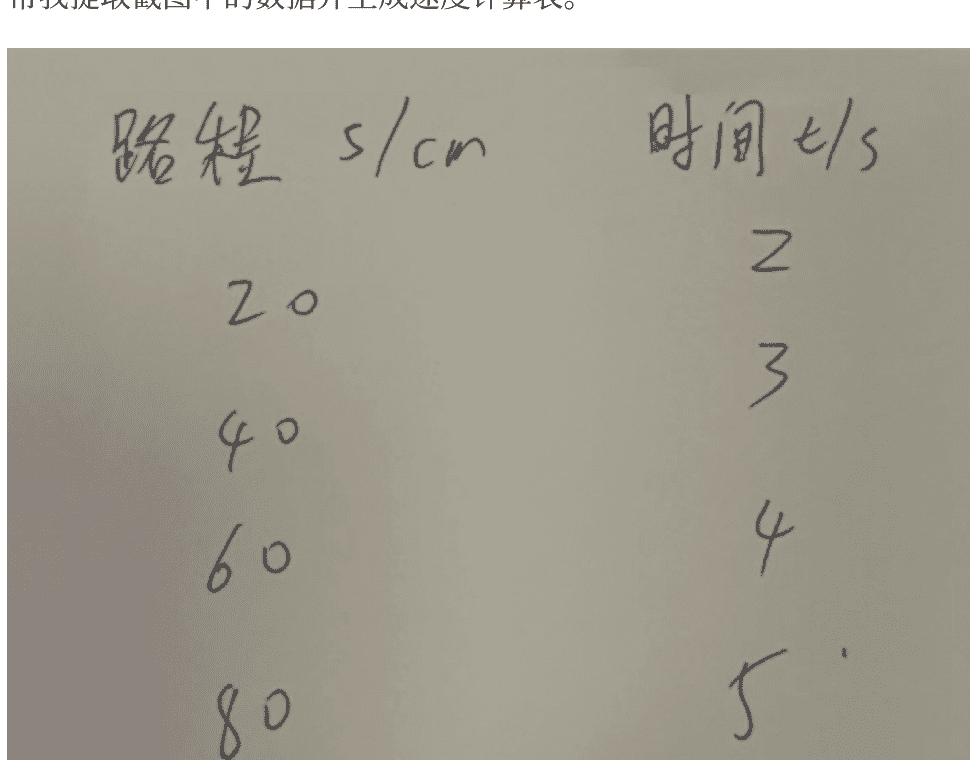

图4-2

(2) AI技能：使用光学字符识别（optical character recognition, OCR）技术自动提取表格中的路程（s/cm）和时间（t/s）数据。

#### 3. AI自动分析数据规律

(1) 生成速度计算表，如表4-1所示。

表4-1

| 路程 (s/cm) | 时间 (t/s) | 平均速度 [v/(cm/s)] |
| :--- | :--- | :--- |
| 20 | 2 | 10 |
| 40 | 3 | 13.3 |
| 60 | 4 | 15 |
| 80 | 5 | 16 |

AI讲解：“速度（v）=路程（s）÷时间（t），你看，小车每秒的速度都在变快哦！”

(2) 绘制“速度—时间”曲线图：继续在豆包对话框中输入提示词：“使用python编程绘制速度—时间变化的折线图”，AI会生成对应的python代码（见图4-3）。看不懂python代码？没关系，直接单击右上角的“运行”按钮得到折线图（见图4-4）。观察折线图，速度从10cm/s增加到16cm/s，说明小车在做加速运动。

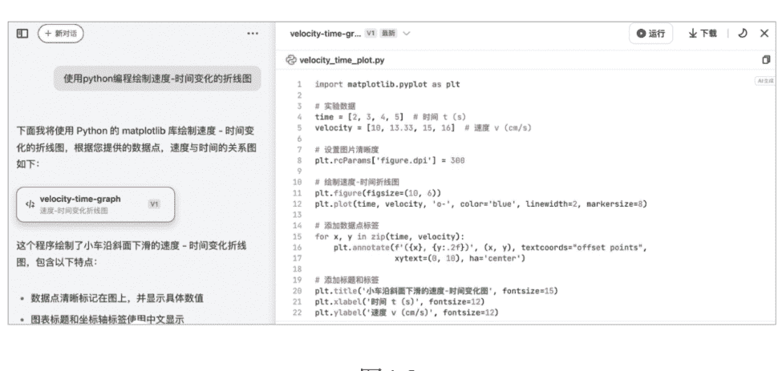

图4-3

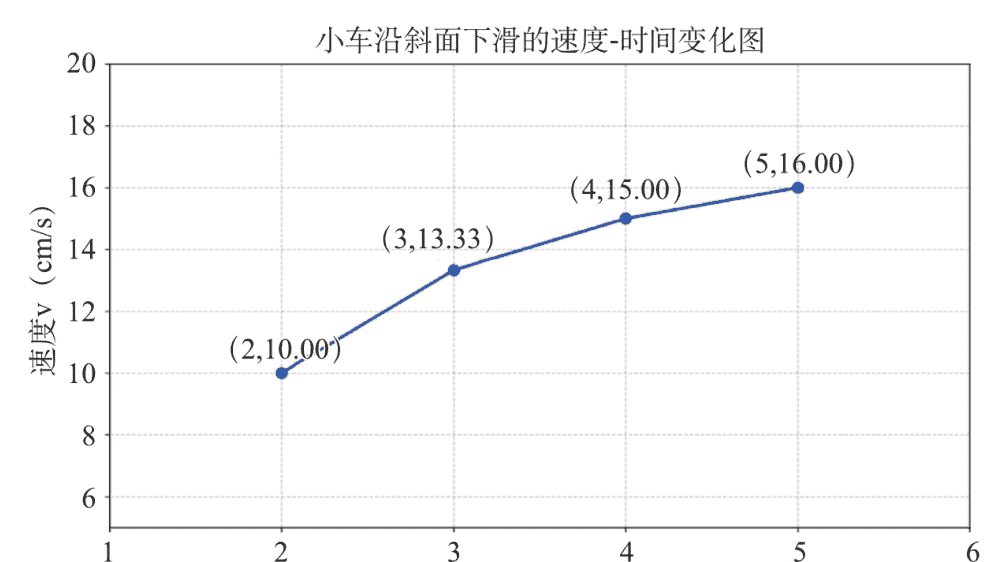

图4-4

#### 4. 揭秘隐藏的物理原理

(1) 继续向豆包AI提问：“为什么小车速度会变快？”（给AI一些提示：想想斜面的坡度和重力的作用）

(2) 让AI绘制受力分析图提示词：请用python画出小车下滑过程中的受力分析图，标注“重力沿斜面向下的分力”“如何让小车加速”。

#### 5. AI实验助手的“超能力解析”

(1) 数据纠错小能手。当检测到异常数据（如“路程60cm，时间1s，速度60cm/s”），AI会用黄色高亮提醒：“这个速度太快啦，可能是秒表按慢了哦！”

(2) 规律总结大师。自动生成实验结论：“小车沿斜面下滑时，速度随时间的增加而增大，说明小车做加速直线运动。”对比课本结论：“和初二物理课本P28‘变速运动’规律一致！”

(3) 拓展实验设计。AI推荐：“如果改变斜面坡度，速度变化会更明显吗？试试拍摄新实验数据吧！”

#### 6. 动手实战：用AI分析“单摆摆动周期”数据

##### 1) 任务材料

用手机拍摄“单摆摆动10次时间记录”表格（见表4-2）。

表4-2

| 摆长 /cm | 摆动 10 次时间 /s | 单次周期 /s |
| :--- | :--- | :--- |
| 20 | 15 | 1.5 |
| 30 | 17 | 1.7 |
| 40 | 19 | 1.9 |

##### 2) 任务步骤

(1) 用AI识别数据：上传照片，让AI自动计算“单次周期”（周期=总时间÷次数）。

(2) 观察规律：AI生成“摆长-周期”关系图，向AI提问：“摆长增加，周期怎么变化？”（答案：摆长增加，周期变大）

(3) 原理联想：AI提示：“这和初二物理‘单摆周期与摆长有关’的知识一致哦！”

## 成就打卡

### 我学会了 ✅

- 能理解AI解数学题的“三步拆题法”：识别题型→拆分步骤→总结策略。
- 看懂AI生成的曲线图。
- 掌握AI处理数据的优势。

### 我的实验记录

- 已拍摄“单摆周期”数据让AI分析，AI告诉我“摆长增加，摆动越慢”，和课本说的一样！

## 4.3 创意学习与表达的“AI灵感画笔”

你有没有对着空白的思维导图本子发呆过？或者看着PPT页面不知道怎么下手？现在AI带着“图文魔法”来帮忙啦！只要敲入文字，它就能把你的想法变成彩色的思维导图、会动的PPT，甚至画出漂亮的插画、创作出动听的音乐——这些像魔法一样的技能，现在动动手指就能做到哦！

### 1. AI如何让文字“变”出图画

想象你写了一段关于“四季”的作文，AI能立刻生成一幅会“变化”的思维导图：春天的分支上长出桃花、细雨和风筝，夏天的分支开出荷花、冰棍和蝉鸣……这种神奇的“文字变图形”靠的是AI的两个超能力：它先是当“语言侦探”，把文字里的关键词找出来，比如输入“秋天：枫叶、果实、凉风”，它会分清哪些是植物、哪些是天气；然后化身“小画家”，把这些词变成树枝一样的思维导图分支，或者搭配枫叶红、果实黄的漂亮图片，让文字一下子“活”过来！

这就像做蛋糕：你给AI“食材”（文字），它就能帮你做成“草莓蛋糕”（思维导图）——不用自己揉面、裱花，只要说“我想要春天主题的蛋糕”，AI就会把桃花奶油、细雨糖霜都搭配好，是不是很神奇！

### 2. 藏在AI里的两大“魔法引擎”

第一个引擎是“自然语言处理”，相当于AI的“大脑耳朵”，能听懂你说的话。当你输入“夏日海滩”，它会像剥洋葱一样，把“夏天”“海边”“沙滩伞”这些信息都拆出来，知道你想表达什么场景。第二个引擎是“计算机视觉”，是AI的“画画小手”，它看过超级多的图片，知道“太阳”要画成圆形、“快乐”可以用黄色表达，所以能把文字变成你想象中的画面。比如“金色麦田”会画出波浪状的黄色田野，“风中摇摆”就加上几笔飘动的线条。

### 3. 试试你的创意魔法

要是制作“动物分类”思维导图，你可以告诉AI：“按哺乳动物、鸟类、鱼类分，每个动物配卡通图片，要彩色的！”AI就会生成树状图，左边是毛茸茸的熊猫（哺乳动物），中间是展翅的鸽子（鸟类），右边是吐泡泡的金鱼（鱼类），每个分支还会“长”出小图标呢！

如果想画“我的梦想家园”，你可以输入提示词：“会飞的蓝色房子，飘在彩虹云上，房子周围有发光的紫色花朵，门口蹲着会摇尾巴的机器人小狗。”猜猜看，AI会画出怎样的画面？说不定房子的翅膀是蝴蝶形状，花朵的光像星星一样一闪一闪呢！

快拿起笔写下你的创意关键词，让AI把它们变成看得见的精彩作品吧。记住，你输入的提示词越具体（比如“会发光的花朵”比“好看的花”更清楚），AI画出来的魔法就越神奇哦！

### 4.3.1 AI做思维导图和PPT：让文字秒变“视觉大片”

你是否想过，只要输入几句话，AI就能帮你画出漂亮的思维导图，甚至生成会“动”的PPT？今天就用豆包AI (https://www.doubao.com/chat/) 教你把语文、科学作业变成超酷的视觉作品！

#### 1. 案例1：用AI做“动物分类”思维导图

适用场景：科学课“哺乳动物vs鸟类”作业。

操作步骤：打开豆包App或者网页版，在聊天对话框中输入“帮我做一个动物分类的思维导图，分为哺乳动物和鸟类。”

AI生成初版思维导图如下。

##### 动物分类思维导图：哺乳动物与鸟类

###### **一、哺乳动物**

**定义**：全身被毛、胎生、哺乳的脊椎动物。

####### (一) 主要特征

- **繁殖方式**：胎生（少数卵生，如鸭嘴兽），幼体由母体乳腺分泌乳汁喂养。
- **体表特征**：被毛（保温、保护），部分物种毛发特化（如刺猬的棘、鲸的稀疏刚毛）。
- **生理特点**：
  - 心脏分四腔，恒温动物。
  - 具有高度发达的神经系统和感官（如灵长类的立体视觉）。
  - 牙齿分化为门齿、犬齿、臼齿（适应不同食性）。

####### (二) 常见类别及示例

| 类别 | 特征 | 示例 |
| --- | --- | --- |
| 灵长目 | 拇指对生，大脑发达 | 人类、猴子、猩猩 |
| 食肉目 | 犬齿锋利，以肉类为食 | 老虎、狼、熊 |
| 偶蹄目 | 蹄为偶数，多反刍 | 牛、羊、鹿 |
| 奇蹄目 | 蹄为奇数，单胃 | 马、犀牛、斑马 |
| 翼手目 | 前肢特化为翼，能飞行 | 蝙蝠 |
| 鲸目 | 水生，流线型身体，无四肢 | 蓝鲸、海豚 |

####### (三) 生态习性

- 栖息环境：陆地、水生（如鲸）、空中（如蝙蝠）。
- 食性：肉食、草食、杂食。

###### **二、鸟类**

**定义**：体表被羽、有翼、卵生的恒温脊椎动物。

####### (一) 主要特征

- **繁殖方式**：卵生，卵外有坚硬外壳，亲鸟孵化。
- **体表特征**：全身被羽毛（正羽用于飞行，绒羽用于保温），前肢特化为翼。
- **生理特点**：
  - 骨骼中空（减轻体重），胸骨具龙骨突（附着飞行肌肉）。
  - 无牙齿，有喙（适应不同食性），消化系统特化（如嗉囊储存食物）。
  - 心脏四腔，恒温，呼吸系统具气囊（辅助呼吸）。

####### (二) 常见类别及示例

| 类别 | 特征 | 示例 |
| --- | --- | --- |
| 雀形目 | 鸣管发达，善鸣叫 | 麻雀、喜鹊、画眉 |
| 隼形目 | 猛禽，喙爪锋利，肉食性 | 鹰、隼、秃鹫 |
| 雁形目 | 趾间有蹼，善游泳 | 鸭、鹅、天鹅 |
| 鸽形目 | 喙短而钝，嗉囊能分泌鸽乳 | 鸽子、斑鸠 |
| 鹤形目 | 腿长颈长，适应湿地生活 | 丹顶鹤、白鹭 |
| 企鹅目 | 翼特化为鳍状，不会飞但善游泳 | 企鹅 |

####### (三) 生态习性

- 栖息环境：陆地、湿地、空中（多数会飞行，少数如鸵鸟不会飞）。
- 食性：食虫、食草、食肉、杂食。

###### **三、哺乳动物与鸟类的对比**

| 特征 | 哺乳动物 | 鸟类 |
| --- | --- | --- |
| **繁殖方式** | 胎生（多数），哺乳 | 卵生，孵化 |
| **体表** | 被毛 | 被羽 |
| **运动方式** | 行走、奔跑、游泳、飞行（如蝙蝠） | 飞行（多数），行走、游泳 |
| **恒温性** | 是 | 是 |
| **牙齿/喙** | 有牙齿，分化 | 无牙齿，有喙 |

**延伸思考**：除哺乳动物和鸟类外，动物界还包括爬行动物（如蛇）、两栖动物（如青蛙）、鱼类、无脊椎动物等，可根据需求进一步扩展分类体系。

注意：豆包AI并不能直接生成图形化的思维导图，但已经按照思维导图的内容来组织文字，生成的内容为markdown格式，将该格式内容复制到XMind、ProcessOn等思维导图工具中，就能快速生成图形化的思维导图了（见图4-5）。

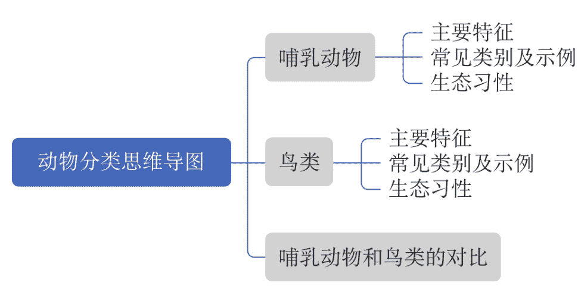

图4-5

小提示：“能否增加更多动物呢？试试看！”

##### 小贴士

给分支加“※”“⚠”等符号，重点知识一眼就看到！

#### 2. 案例2：用AI生成“古诗《咏柳》”PPT

适用场景：语文课古诗赏析作业。

(1) 打开豆包网页版，在首页展示的技能图标中单击“AI PPT”（见图4-6）。


图4-6

在豆包对话框里输入：“主题：古诗《咏柳》PPT。要求：①封面：标题+柳树图片。②作者页：贺知章简介。③诗句页：每句诗配插图。④风格：清新卡通。”

(2) AI生成初版PPT大纲。AI会生成初版的PPT大纲（见图4-7），看看AI生成的大纲是否符合要求，不满意的地方可以再手动调整。

我们先为你生成了可以自由编辑的大纲，确认无误后，可以点击下方「选择模板」按钮，进入到选择 PPT 模板并开始生成的环节。

标题：跟着古诗赏柳树之美——《咏柳》解读

封面

- 走进《咏柳》，感受春日柳韵
1. 在封面上，以清新干练风格的柳树图片作为背景，图片中柳树的枝条随风轻轻飘动，嫩绿的柳叶仿佛在向我们招手，展现出春天的生机勃勃。在图片上方，用艺术字体醒目地呈现PPT标题“跟着古诗赏柳树之美——《咏柳》解读”，字体颜色可选用柔和的绿色，与柳树的主题相呼应，给人一种清新自然的感觉。

贺知章：《咏柳》背后的诗人

- 贺知章生平速览
1. 贺知章生于公元659年，卒于744年，字季真，越州永兴（今浙江省杭州市萧山区）人，年少时便迁居山阴（今浙江绍兴）。他自幼聪慧，诗文才华在年少时就已崭露头角，闻名当地。

- 科举之路与官场生涯
1. 唐武后证圣元年（695），贺知章考中进士，初授国子四门博士，后迁太常博士。他的仕途，他的官场生涯丰富多样，曾参与重要书籍的撰修，如在开元十年（722），由丽正殿修书使张说推荐，他进入该殿书院，参与撰修《六典》《文纂》等书，虽最终未能完成，但这段经历

AI PPT 请输入 PPT 主题内容

图4-7

(3) 选择模板：生成PPT。单击图4-7中的“选择模板”按钮，进入模板选择界面（见图4-8）。

### 4.3.1 AI做思维导图和PPT的“黄金法则”

（4）在“教育培训”场景中选择“国风”风格，然后单击“开始生成PPT”按钮，就可以得到如图4-9所示的初版PPT了。

PPT中还有一些文字内容需要完善，如图4-9中的主讲人和时间。如果有一些页面你还想调整，可以通过单击上方的“前往Ai PPT编辑”来实现。

#### 3. AI做思维导图和PPT的“黄金法则”

- （1）关键词越具体，生成越精准。
  - ❌ 模糊指令：“做个思维导图”
  - ✓ 精准指令：“做三年级科学的植物分类思维导图，要包含根、茎、叶，每个部分配图片”
- （2）像搭积木一样改作品。先让AI生成基础框架，再自己“添砖加瓦”，如换个颜色、加张自拍、写句感悟，作品就有了你的“独家印记”。
- （3）用“提问式”优化。不知道怎么改时，问AI：“这个PPT怎么让它更适合演讲？”AI会给出“加页码”“放大标题”等建议。

#### 4. 动手实战：制作“我的梦想假期”PPT

（1）任务要求：对豆包说：“帮我做一个梦想假期的PPT，有海滩、游乐园、美食，风格要可爱。”

（2）优化步骤：①给海滩页换一张你喜欢的海浪图片；②在美食页添加文本框，写下“我最想吃的冰淇淋是草莓味的”。

### 4.3.2 AI创作“艺术作品”

你知道吗？现在用一个豆包APP就能同时完成AI画画和作曲。快来解锁两个超有趣的跨学科项目——用豆包画语文故事插画，再为古诗谱一首专属音乐，让艺术课变成充满魔法的创意实验室。

#### 1. 案例1：豆包AI画画+语文——画出《神笔马良》的故事

案例主题：根据语文课文创作“马良为穷人画粮仓”的插画。

（1）使用豆包的“图像生成”魔法。以下为具体操作指南。

①打开豆包网页版，单击对话框下方技能栏中的“图像生成”，进入“图像生成”页面。

②在输入框中输入：“画一个穿蓝衣服的小男孩（马良），手里拿着发光的神笔，正在田野里画一个金色的大粮仓，旁边有农民伯伯笑着鼓掌，背景是绿色的稻田。”

③单击“发送”按钮，等几秒钟就能看到AI画的图啦！（见图4-10）

（2）AI的创意亮点如下：

- ①马良的神笔闪着星星光，粮仓上还画了窗户。
- ②农民伯伯戴着斗笠，都在拍手称赞，笑得眼睛都弯了。
- ③豆包自动选择了“卡通”风格，颜色生动而又形象。

（3）语文+美术的跨学科优化：让画面会讲故事。

- ①加文字注释。再次和豆包对话，在对话框中输入：“在画的角落写：‘马良用神笔画出粮仓，穷人再也不饿肚子啦！’”，看看豆包会做什么？
- ②改细节剧情。对豆包说：“让粮仓旁边多一条小河，河面上有倒影。”（输入指令后单击“发送”按钮）
- ③写故事续篇。根据插画写一段话：“马良的神笔一挥，粮仓里的麦子像星星一样发光，连小河里的鱼都跳出水面欢呼！”

#### 2. 案例2：豆包AI作曲+音乐——给《春晓》谱一首儿歌

案例主题：为古诗《春晓》创作一首轻快的伴奏音乐。

（1）启动豆包的“音乐生成”功能。

超简单指令：

- ①返回豆包网页版，单击对话框下方技能栏的“更多”按钮，找到“音乐生成”图标单击（图标是小音符）。
- ②豆包会自动给出生成音乐的指令模板（见图4-11）。

##### 歌词曲风自由选，人声演绎即刻呈现

音乐生成 我想创作一首歌曲，用 AI 帮我写歌词 [描述歌词要表达的主题]。这首歌是 流行 音乐风格，传达 快乐 的情绪，使用 女声 音色。

③将“为古诗《春晓》创作一首轻快的伴奏音乐”填入“[描述歌词要表达的主题]”，将音乐风格换为“国风”，将情绪改为“鼓舞”，单击“发送”按钮生成音乐（见图4-12）。

（2）豆包生成的音乐小片段。

AI的音乐魔法：

- ①前奏：古筝拨弦如“冷冷淙淙”，似晨露滴落青石板，搭配编钟轻鸣勾勒春日晨曦的空灵意境。
- ②主歌：二胡揉弦模拟黄鹂啼啭“恰恰莺莺”，节奏贴合“春日清晨谁在轻声呢喃”的诗词韵律，琵琶轮指铺陈春花绽放的灵动质感。
- ③副歌：竹笛吹奏主旋律如“呖呖莺声”，与女声吟唱形成复调，古筝扫弦似阳光穿透云层的豁然开朗，传递鼓舞力量。
- ④间奏：加入“啾啾”群鸟和鸣与“潺潺”溪流声，配合古琴泛音营造山林间的生机盎然，弦乐群渐强如希望升腾。
- ⑤豆包自动选用G宫调，因其五声音阶自带东方韵味，明亮音色契合“生命的旋律为你而灿烂”的积极基调。

（3）音乐+语文的跨学科创作，让古诗唱起歌来：

- ①编歌词节奏：把诗句拆分成短句，比如“春眠／不觉晓”对应音乐里的两个小节；
- ②加自然音效：对豆包说“再多加一段风声”（输入指令后单击“调整”按钮）。
- ③创作和声：用豆包的“人声伴奏”功能，生成“啦啦啦”的伴唱，像同学们一起合唱。

#### 3. AI艺术创作的“三句口诀”

（1）指令越具体，魔法越精准。

- ❌ 普通：“画只猫”
- ✔ 精准：“画一只戴蝴蝶结的白色猫咪，坐在粉色蘑菇上，尾巴卷着棒棒糖，背景是彩虹雨”

（2）像搭积木一样修改作品。

- ①先让豆包生成基础图、音乐，再自己“加零件”。
- ②画画时加个自己的签名。
- ③作曲时哼一段自己的旋律让豆包“学习”（用语音输入：“我想加这段调子……”）。

（3）跨学科提问更有趣。对豆包说：“能不能把这幅画变成数学绘本的封面？”或者“这段音乐能改成科学课的《植物生长歌》吗？”

#### 4. 动手实战：用豆包完成“四季童话”跨学科项目

任务清单：

- （1）AI画画：输入提示词“春天的森林，有会飞的花朵和戴帽子的小兔子”，选择“卡通风格”。
- （2）AI作曲：输入提示词“夏天的海边音乐，有浪花声和海鸥叫，用吉他和长笛”。
- （3）跨学科拓展：
  - ①语文：给画写一个小故事，给音乐填歌词。
  - ②美术：用彩笔给AI画的图添加自己设计的魔法元素。

##### 我的创意记录

我让豆包把秋天的树叶画成了“会说话的小精灵”，还生成了用“落叶声”做伴奏的音乐，冬天的雪地里还有戴着围巾的小松鼠在跳舞呢！

## 成就打卡

### 我学会了 ✅

- □ 用豆包AI给《神笔马良》画插画并添加小故事。
- □ 给AI生成的图画想出一句创作语。
- □ 用豆包AI生成了一首古诗的配乐和歌词。
- □ 知道了让AI画出更符合我的想法的图的秘诀。

##### 我的创意成果记录

上传生成图：《会飞的粉色大象》（大象戴着我设计的彩虹蝴蝶结，在云朵里吃着棉花糖云朵）

创作灵感一句话：“如果大象会飞，那它一定是带着小朋友的梦想在天上旅行～”

## 4.4 聪明学习者的AI使用守则：做AI的主人而非仆人

当AI频繁出现在我们的学习日常中，你是否思考过，该以怎样的方式与这位“智能伙伴”相处，才能让学习真正有所收获？看看小明和小红的经历，或许你能从中找到答案。

小明在面对鸡兔同笼的数学题时，图省事直接让AI给出完整解题步骤，抄完作业便万事大吉。可到了考试，当相似题目出现时，看着“35个头，94只脚”的条件，他却大脑一片空白，完全不知从何下手。AI给出的答案虽然像“魔法快递”般迅速送达，他却没学会“假设法”的逻辑内核。同样，小红想用AI完成作文《我的妈妈》，生成的文章中满是“母亲的爱如春日细雨”这样华丽却空洞的比喻，字里行间没有一点妈妈为她早起做早餐、雨天送伞的真实细节。老师的批注一针见血：“这些话很美，但哪一句是你想对妈妈说的真心话？”

AI就像一把万能的“学习瑞士军刀”，能帮我们快速“削开”难题的外壳，“拧开”知识的瓶盖，甚至“打磨”表达的细节。但如果我们“写作业”完全依赖AI，就像总用军刀开罐头，久而久之，会失去自己动手“剥蛋壳”的能力。要知道，真正的学习乐趣和收获，恰恰藏在我们亲自探索、思考的过程中。试想，如果有一天，AI能帮你写完所有作业，你的大脑会变成什么样？是像经常锻炼的肌肉一样强壮，还是像久不走路的腿一样软弱无力？聪明的学习者，懂得给AI制定“使用说明书”。这就好比园丁照料温室里的幼苗，既要让它享受阳光的温暖，又不能让暴雨将其摧毁。

在与AI相处的过程中，有些同学陷入了误区，把AI当成“代写保姆”，什么作业都一股脑交给AI完成。这就像学骑自行车时，始终让人扶着后座，看似走得快，可一旦松手，就会摔倒。曾经有位同学让AI代写英语日记，结果日记里复杂的从句使用远超他的真实水平，被老师一眼识破。这就像穿着“魔法跑鞋”参加跑步考试，冲过终点才发现，自己的双脚从未真正奔跑过。

而正确使用AI的方式，是把它当作“思路拐杖”。比如在解物理题时，先自己尝试画受力分析图，梳理解题思路，遇到卡壳的地方，再向AI请教：“这个摩擦力的方向该怎么判断？”这时，AI会给出“看物体运动趋势”这样的提示，引导我们思考，而不是直接告知答案。这就像登山时，虽然我们会用地图确认方向，但每一步山路都要自己脚踏实地地走，鞋底沾染的泥土，才是我们真正攀登过的证明。

想要和AI成为真正优秀的学习搭档，需要掌握三把“金钥匙”。

第一把是“信用钥匙”。我们要牢牢记住“AI辅助≠代劳”，就像玩游戏不能开“无敌外挂”，在学习中保持诚信和独立思考的品质，不让AI取代我们的思维过程。

第二把是“鉴伪钥匙”。学会识破AI偶尔的“小谎言”。AI并非全知全能，有时也会给出错误答案，比如“鲸鱼是鱼”这样的常识性错误，这时我们就要立刻拿出课本这个“照妖镜”，辨别对错。

第三把是“未来钥匙”。努力锻造“人机协作”的新能力，充分发挥AI“计算快手”的优势，处理数据、快速检索知识，而我们则专注做“创意大脑”，主导学习方向，深入思考、创新表达。

接下来，就让我们一起深入了解这些使用守则，让AI真正成为我们学习路上的“助力器”，而不是阻碍成长的“能力退化器”。毕竟，在未来，优秀的学习者不是比AI懂得更多，而是更懂得如何与AI默契配合，让我们用好这把“智能瑞士军刀”，在知识的世界里披荆斩棘，收获属于自己的成长与进步。

### 4.4.1 AI辅助≠AI代劳：建立学习“信用红线”

你有没有想过，让AI代劳写作业就像踩在香蕉皮上走路？小宇曾为了快速完成数学作业，直接让AI生成植树问题的完整解题过程，第二天老师提问时，他只能盯着答案发呆：“我……我忘了怎么算的。”这就像抄近路却踩了香蕉皮，看似走得快，其实摔得惨。当AI代劳写作业时，你的大脑正在“睡大觉”，根本没锻炼到“从已知推未知”的逻辑肌肉。大脑就像运动员的肌肉，不用就会“萎缩”。如果让AI直接生成作文，你就失去了把想法组织成文字的练习机会，下次自己写时只会觉得“脑子空空”。

聪明的同学会让AI当“小助教”，自己当“主考官”：解数学题时先自己画思路草图，问AI“这个辅助线加得对吗”，而不是直接抄答案；背英语单词时用AI的“发音评分”功能纠正发音，再自己默写；写作文时让AI优化比喻句，比如把“月亮很圆”变生动，自己来构思故事主干。这就像你学骑自行车时让家长扶着车尾，家长只在你要摔倒时扶一把，骑车的平衡感必须自己练。有的同学用AI分析物理实验数据时，先自己画折线图再让AI检查，结果比直接看报告多发现了两个隐藏规律呢！

不妨像玩游戏闯关一样建立“AI使用信用分”：让AI代劳写作业会扣10分，下次它只给“提示碎片”；自己先思考5分钟再问AI能加5分，获得更精准的思路引导；讲出解题原理能加10分，解锁“拓展题推荐”功能；发现并纠正AI错误能加15分，得到“个性化知识漏洞图”。现在就给自己打分吧：昨天数学作业，你让AI帮你“查公式”还是“算答案”？今天英语作文，你用AI“改语法”还是“写全文”？

小红的故事或许能给你启发，她制定了“AI使用公约”：数学题先自己画思维导图再问思路，英语作文用AI优化3个句子后自己写段落，科学实验让AI验算数据但结论自己推导。一个月后她发现，问“思路”时大脑更活跃，自己写的作文虽不华丽却有真情实感，考试遇到新题型也不慌了，因为她练的是“怎么想”而非“怎么抄”。记住哦，AI能给你鱼（答案），但只有自己思考才能学会钓鱼（方法），当你对AI说“帮我想”而不是“帮我做”时，才真正启动了学习的“涡轮增压”模式！

### 4.4.2 识别AI的“一本正经胡说八道”

你有没有被AI的回答逗笑过？比如问它“9.11和9.8哪个大”，它可能会一本正经地回答“9.11比9.8大哦”——这就是AI的“胡说八道”时刻！AI犯错有两个常见原因：一是“数据偏见”，就像老师只看部分同学的答案，AI训练时如果资料偏差，可能把紫蝶花认成薰衣草；二是“逻辑局限”，它擅长记忆却缺乏生活常识，问“1+1为什么等于2”，它可能用复杂公式回答，却讲不清最基础的道理。

好在我们有“双重鉴伪神器”，人类鉴伪有三招：第一招，当AI说“鲸鱼是鱼”时，马上查课本或问老师，这是“交叉验证法”；第二招，让AI解释“为什么推荐这个单词”，如果回答含糊，说明不靠谱，这是“追根问底法”；第三招，用生活经验判断，比如AI说“冰在100℃不融化”，立刻就能发现错误，这是“常识检验法”。除了人类智慧，AI也能帮我们鉴伪。打开“睿鉴AI”小程序，粘贴AI生成的作文，10秒内就能看到结果：绿色√表示原创度高，红色×提示可能是AI生成。小明曾把AI写的《我的梦想》放进去，小程序标出“段落3～5重复常用句式，原创度仅32%”，提醒他加入真实想法。

想试试抓AI的“小辫子”吗？做个实验吧：问AI“石头和棉花从10楼同时落下哪个先落地”，再用“睿鉴AI”小程序检测回答的原创度；再让AI和自己各写一篇作文《我的家乡》。对比检测报告你会发现，AI的回答可能很流畅，但缺乏真实情感和细节。这就像给答案装“防盗门”，既要自己检查，也要借助工具，双重保护才安全。

最厉害的鉴伪武器其实是你的好奇心！当AI给出答案后，追问“还有其他解法吗”，如果它反复说相似的话，可能在“编答案”。记住哦，AI是学习助手，但永远代替不了你充满好奇的大脑，就像孙悟空有火眼金睛，你也要用知识和工具炼出自己的“鉴伪之眼”。

### 4.4.3 AI时代的学习者画像

在AI能秒解鸡兔同笼、瞬间生成作文的今天，什么样的学习者才能真正驾驭这股智能浪潮？答案藏在三个关键能力里，这三个能力就像未来学习的“魔法三件套”，帮你和AI成为最佳搭档，在知识海洋里乘风破浪。

第一个能力是“问题定义大师”。以前小宇总对AI喊“帮我写作业”，结果考试时遇到相似题目，只能对着“35个头、94只脚”的条件发呆，就像捧着鱼却没学会钓鱼。现在他学会像航海家精准定位坐标那样提问：“在这道物理受力分析题里，物体在斜面上滑动时，摩擦力方向该怎么判断？”这样的提问就像给AI下达清晰的导航指令，既借助了AI的“计算引擎”，又让自己始终掌舵思考的方向。所以，会把“我不会”转化为“我需要什么帮助”的人，才能让AI从“答案仓库”变成“解题军师”。

第二个能力是“创意魔法师”。小红的作文实验就像给AI成果施了“灵魂魔法”：她先用AI生成《我的妈妈》初稿，里面满是“母亲的爱如春风”这样华丽却空洞（缺少细节和真情实感）的比喻。当她加入妈妈凌晨五点在厨房揉面做手擀面、暴雨天背着她蹚过齐膝积水的细节后，文字突然有了温度——AI提供的是画布和颜料，而你注入的独家记忆和情感才是让作品呼吸的生命力。这就像用AI画出城堡草图后，只有你能决定城堡里住着会讲睡前故事的猫头鹰，还是藏着发光的魔法书，让创意真正成为区别于AI的“人类签名”。

第三个能力是“跨学科探险家”。小明的发现就像在知识森林里找到了隐秘通道：他用AI分析数学抛物线函数时，突然想起物理课上小球抛出的轨迹。借助AI生成的对比图，他惊喜地发现数学公式与现实运动轨迹竟像镜子里的双胞胎——这就是跨学科思维的魔力。单一学科知识像散落的星星，而跨学科思维是连接它们的星座图，AI能快速点亮星星，而你负责绘制属于自己的“知识星图”。比如用AI计算抛物线方程时，你能联想到篮球投篮的弧度，让抽象公式变成看得见的生活智慧。

把这些能力组合起来，就能解锁“人机协作黄金公式”：人类的创意、情感和价值观，加上AI的数据处理、快速计算和超强记忆，就像创意大脑与乐高积木的碰撞。比如，做历史项目时，AI能在10秒内整理出从夏朝到清朝的时间轴，但分析“为什么商鞅变法能改变秦国命运”的深度思考，必须由你点燃思维火花；艺术创作中，AI能生成流畅的音乐旋律框架，但代表“放学路上看到彩虹”的快乐音符，只有你的大脑能谱写。AI是高效的“知识快递员”，而你是决定快递如何变成宝藏的“首席设计师”。

想知道自己是不是未来学习者吗？来对照这份成长清单：当数学题卡壳时，你会先在草稿纸上演算5分钟，再向AI要“思路碎片”吗？看到AI生成的英语作文，你会用“睿鉴AI”小程序检测原创度，再追问“能不能把‘开心’换成更具体的动作描写”吗？学习地理的季风气候时，你会联想到物理课的热力环流，让AI画出两者的关联图吗？用AI生成科学实验报告后，你会删掉模板化结论，写上自己观察的“烧杯壁出现小水珠”的细节吗？

AI就像一艘配备超级引擎的学习飞船，能带你瞬间飞跃知识平原，但决定是探索沙漠中的古城遗址，还是攀登雪山寻找珍稀植物的，永远是你的好奇心。当你学会让AI做“计算加速器”，自己做“创意核反应堆”，就能在知识的星系中，驾驶着自己的飞船，留下比AI更闪耀的探索轨迹——因为真正的学习，从来不是比AI知道更多，而是比AI更懂如何让知识生长出属于人类的温度与想象。

## 成就打卡

### 我学会了 ✅

- □ 能说出AI辅助学习的“信用红线”。
- □ 掌握了识别AI错误的方法。
- □ 完成了一次人机协作创作。

### 我的实践记录

在写《我的家乡》作文时，先用AI列出素材清单，再补充了奶奶做桂花糕的温馨回忆，最后用“睿鉴AI”小程序检测原创度。老师夸我的作文“既有创意又有真情实感”！

## 闯关测验

1. （单选题）小宇用AI解数学题时，AI不仅给出答案，还拆解出“假设→求差→调整”的步骤，这属于AI的什么能力？（）
   - A. 拍照搜题
   - B. 逻辑推理
   - C. 语音交互
   - D. 图像识别

2. （单选题）在“探究小车下滑速度”实验中，AI生成的“速度-时间”曲线能帮助我们发现什么？（）
   - A. 小车的颜色
   - B. 速度变化趋势
   - C. 实验员的名字
   - D. 教室的温度

3. （单选题）用豆包AI生成“动物分类”思维导图时，哪种指令能让AI更精准生成？（）
   - A. “做个思维导图”
   - B. “分为哺乳动物和鸟类，加图片”
   - C. “快点生成”
   - D. “随便分一分”

4. （单选题）小明让AI写作文，结果被老师发现“内容华丽但没有真实情感”，这违反了AI使用的哪条守则？（）
   - A. 信用体系：AI辅助≠代劳

## B. 鉴伪训练：识别错误

## C. 未来准备：跨学科能力

## D. 没有违反

5. （单选题）下列哪个工具能检测作文是否由AI生成？（）

- A. “睿鉴AI”小程序
- B. 计算器
- C. 手电筒
- D. 体重秤

6. （多选题）AI解数学题时，可能用到哪些技术？（）

- A. OCR识别题目文字
- B. 大语言模型推理步骤
- C. 拍照搜题题库匹配
- D. 打电话问老师

7. （多选题）用AI做物理实验分析时，能实现哪些功能？（）

- A. 自动计算速度
- B. 绘制数据曲线
- C. 预测实验结果
- D. 清洗实验器材

8. （多选题）在“AI +艺术”创作中，豆包AI能完成哪些操作？（）

- A. 生成古诗插画
- B. 谱写儿歌旋律
- C. 代替学生画画
- D. 添加个人签名

9. （填空题）AI解数学题的三步拆题法是：______→拆分步骤→______。

10. （填空题）用AI生成PPT时，输入的指令越______，生成的内容越精准。

11. （填空题）AI使用守则中的“鉴伪训练”包括：交叉验证、______和常识检验。

12. （排序题）请将“用AI分析物理实验数据”的步骤按顺序排列：（）。

- A. 用手机拍摄数据表格
- B. 用AI生成速度计算表和曲线图
- C. 上传数据到AI工具
- D. 分析曲线发现运动规律

13. （简答题）你认为AI在学习中最有用的功能是什么？请举例说明，并说说如何正确使用这个功能。

## 成就贴纸

看看你获得了几张贴纸。

| 阅读全章内容 | 成就打卡 | 完成闯关测验 |
| :--- | :--- | :--- |
|  |  |  |

# 第5章 动手实验室：打造你的AI项目


## 5.1 图形化编程入门

### 5.1.1 什么是图形化编程

图形化编程是一种通过“拖曳”和“拼接”图形化的编程块来进行编程的方式。它用直观的方式组合成程序，就像拼拼图一样简单。想象你在玩拼图游戏，每块拼图代表一个小的程序模块（见图5-1），你只需要把它们放到一起，就能让计算机立即执行你的指令，如图5-2和图5-3所示。

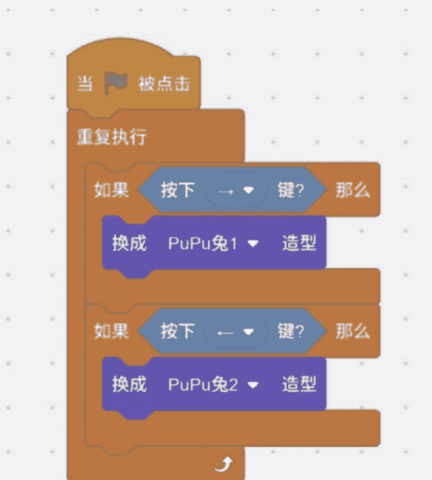

图5-1


图5-2


图5-3

### 5.1.2 为什么要用图形化编程实现AI

AI已经开始改变我们的生活，它可以做很多事情。打开手机，它帮你快速人脸解锁；刷短视频时，总能看到喜欢的内容；玩游戏时，电脑队友也像真人一样灵活。想知道AI是怎么做到这些的吗？图形化编程可以简化编程步骤，带你一探究竟。只要拖动图形模块，就能让AI学会新本领，比如识别图片里的动物，或者预测摄像头里的手势。它就像一把钥匙，能打开通往未来科技的大门。

### 5.1.3 图形化编程的工作原理

想象你是小厨师，图形化编程就是带图菜谱，用彩色积木块代替复杂代码，轻松指挥电脑。图形化编程实现AI的核心思想是通过训练AI模型，让它从数据中学到有用的知识。在图形化编程中，你需要用图形化的代码块来代表不同的操作，比如上传图片、训练模型、测试模型等。你只需拖动这些代码块并将它们连接起来，AI就开始学习了。

## 成就打卡

我学会了 ✅

- □ 图像化编程的工作原理。

## 5.2 热身练习

### 5.2.1 语音魔法故事工坊

当你对着计算机喊：“森林里的小兔子”，屏幕里就会蹦出跳着走的小兔子！它还冒出气泡说：“你好呀”——这就是用语音积木拼出的会讲故事的魔法程序。

想象有盒神奇积木：“耳朵积木”听你说“小兔子”，“动作积木”让它蹦跳着跑进场，“说话积木”飘出气泡说“快来森林玩”。把积木像搭火车一样连起来，喊声指令，故事就像放动画片一样动起来！

这就像教鹦鹉学说话，你越多喊关键词，机器记得就越牢。语音识别（让机器听懂人话的技术）功能会“记住”你的指令，图形化积木则像拼图说明书，让电脑按你的想法拼出会动的故事场景。

#### 1. 实验准备

- (1) 电脑一台（带有摄像头）。
- (2) 图形化编程平台（浦育：https://www.openinnolab.org.cn/pjedu/home）。

#### 2. 步骤

(1) 打开浦育主页，单击“注册”按钮，选择手机号或邮箱方式注册浦育平台账号（见图5-4），注册完成后单击“登录”按钮（见图5-5）。


图5-4


图5-5

(2) ①展开“工具”菜单选择“在线工具”；②选择“创意积木工坊”；③单击“创建积木”按钮，进入图形化编程界面，如图5-6所示。


图5-6

(3) 单击“添加扩展”，添加“语音识别”模块（见图5-7）。


图5-7

语音识别模块就像给电脑装了“耳朵+翻译官”：麦克风先收集你的声音，把声波转成电子信号后，从中提取音调、语速等特征，再和内置的“声音字典”比对（靠声学模型记发音、靠语言模型猜语法），最后把匹配的语音转成文字输出，比如听到“huà xīng xīng”就显示“画星星”，不过遇到口音或噪声时可能会“听错”，多训练模型或限定词库能让它更“聪明”。

那么“语音识别”模块都能做哪些事情呢？它能做的事情如表5-1所示。

表5-1

| 程序指令 | 能做的事情 |
| :--- | :--- |
|  | “耳朵积木”：启动程序后，程序像秒表一样“嘀嗒”计时 5 秒（可以自己修改秒数哦），同时打开麦克风“收声”—— 就像用手机录 5 秒语音，录完就自动识别声音啦 |
|  | “结果记录本”：专门记录耳朵听到并翻译后的语音 |
|  | 当识别结果包含特定词汇（如“芝麻开门”“小兔子”“前进”），就启动后续指令 |

(4) 用程序模块动手实现故事场景。

实现效果：当你说：“森林中的小兔子”，小兔子就会从屏幕中走出来，并且冒出气泡说：“你好呀”。

我们先用流程图的方式梳理实现过程。

- ①启动程序，隐藏小兔子，录音并识别语音，如图5-8所示。
- ②当识别到森林时，显示小兔子，小兔子说话，如果碰到舞台边缘，就反弹并将旋转方式设为不可旋转，否则移动十步，如图5-9所示。

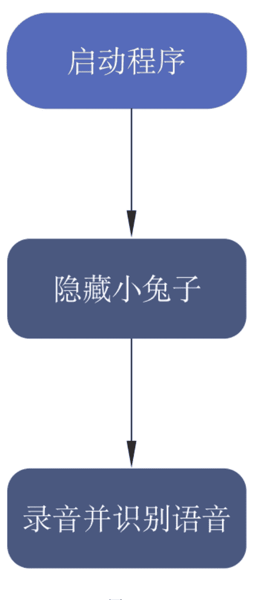

图5-8

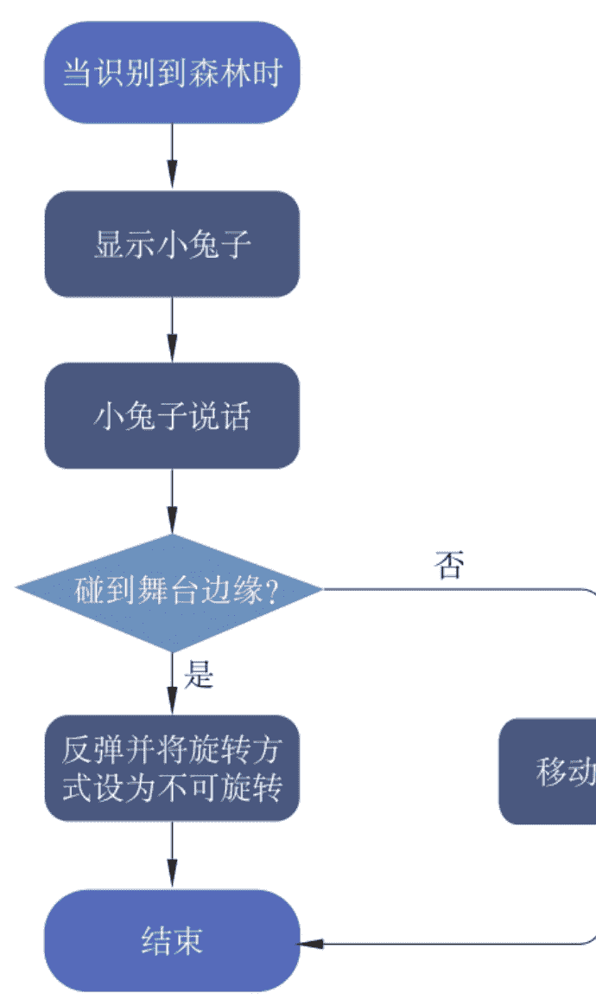

图5-9

##### 3. 编写图形化程序

(1) 我们选择默认的PuPu兔造型，如图5-10所示，接下来都是在PuPu兔角色下编写程序。


图5-10

(2) 设置一个启动程序的方式，在事件模块中可以找到对应的模块。本次案例以单击绿色旗子开启程序为例，如表5-2所示。

表5-2

| 程序指令 | 能做的事情 |
| :--- | :--- |
|  | 当绿色旗子被单击的时候，启动下方程序 |

（3）开始的时候，小兔子不需要显示出来，因此需要在外观模块中选择隐藏指令；选择开启录音并识别指令，设置5秒时长，语言选择中文，如表5-3所示。

表5-3

| 程序指令 | 能做的事情 |
| :--- | :--- |
|   | 显示 / 隐藏当前角色造型 |
|  | 让角色弹出对话框，说对应的文字内容 |

完整程序如图5-11所示。


图5-11

(4) 当识别到“森林中的小兔子”时，让小兔子显示出来，并让小兔子说“你好，我是森林中的小兔子”，如图5-12所示。


图5-12

(5) 我们还需要考虑：如果碰到边缘部分，小兔子不能离开我们的视线。因此，这里需要运用程序中的分支结构。同时，也需要让小兔子在屏幕中走动，并且能一直做判断，这里要用到循环结构，如表5-4所示。

表5-4

| 程序指令 | 能做的事情 |
| :--- | :--- |
|  | 重复执行里面的程序，让电脑不知疲倦地重复做同一件事 |
|  | 如果满足某个条件，就执行条件里面的语句；如果不满足，就不执行 |

完整程序如图5-13所示。

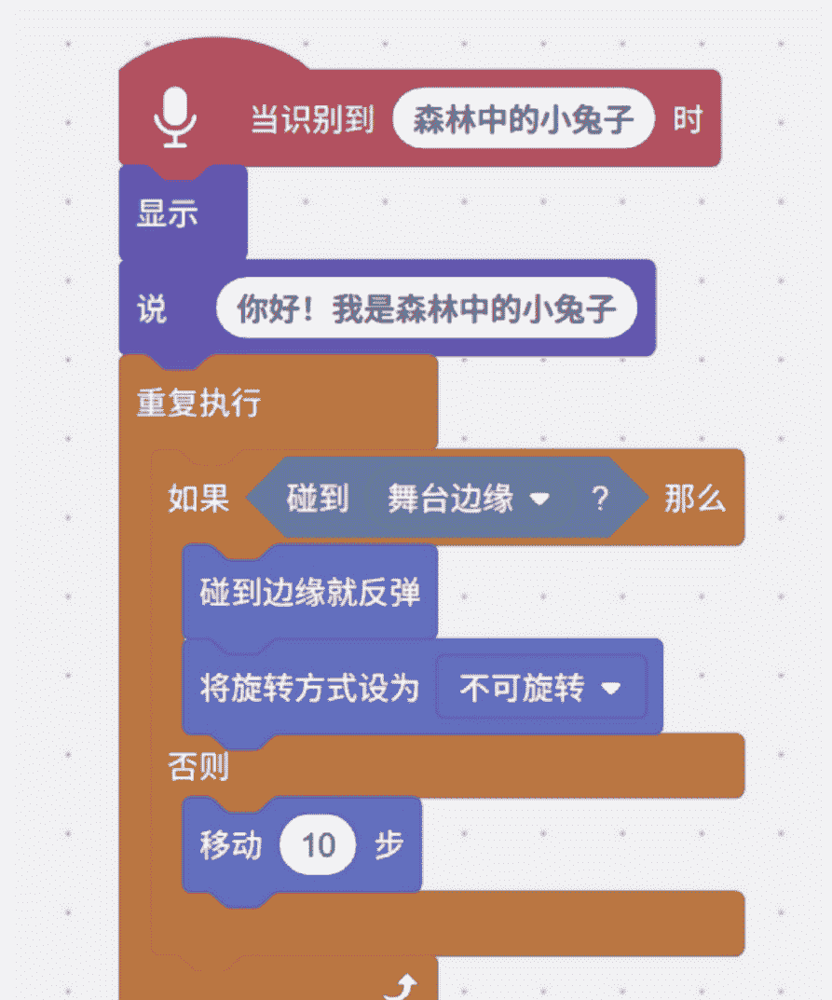

图5-13

### 5.2.2 用浦育平台训练AI模型

#### 项目背景：AI如何像人类一样认水果？

想象一下：你手里拿着苹果和香蕉，一看就知道是什么，但电脑怎么能“看懂”呢？今天我们就用图形化编程，教AI变成“水果小侦探”。

训练AI认水果就像教宠物小狗认玩具：①给它看很多苹果玩具、香蕉玩具（数据集积木）；②告诉它“红红的、圆圆的是苹果”（特征学习积木）；③让它自己找出新玩具（模型推理积木）。

同学们开始学习汉字时不懂拼音，但通过不断重复和记忆练习，逐渐能够认出更多的字。同样，AI模型在训练的过程中，像同学们一样，通过处理大量的图片和数据，逐渐学会识别特定的模式或物体。那么如何处理数据呢？

数据分堆像玩游戏：闯关三步走。

- （1）训练集：练习关卡。就像在游戏的练习营学技能。通过反复练习，记住连招套路（模型学习规则）。通常，我们会把70%的数据放进训练集，让模型疯狂“刷题”，掌握各种特征和规律。
- （2）验证集：模拟排位赛。当你在练习营练得差不多了，就会进入模拟排位赛和人机对战，测试自己的战术管不管用。如果发现连招总被打断，就立刻调整战术（调整模型数据）。在AI模型训练中，验证集就像这个模拟赛场，它一般占20%的数据量。我们用它来检测模型有没有学“偏”，及时调整模型数据，避免它在实际应用中“翻车”。
- （3）测试集：真实排位赛。终于来到真实排位赛，和真人玩家PK决胜负，这才是真正检验你实力的考场。在AI领域，测试集占剩下10%的数据，它完全没被“剧透”过，就像你从没见过的对手。只有在测试集上表现优秀，这个AI模型才算真正“出师”，可以投入实际的AI应用中。

#### 1. 实验准备

- (1) 电脑一台（带有摄像头）。
- (2) 图形化编程平台（https://www.openinnolab.org.cn/pjedu/home）。
- (3) 配套资源中的水果数据集。

#### 2. 步骤

- (1) 登录浦育平台，进入在线工具，新建项目（具体步骤参考5.2.1节语音魔法故事工坊）。
- (2) 单击“添加扩展”（见图5-14），选择“AI训练（图像分类）”模块（见图5-15）。

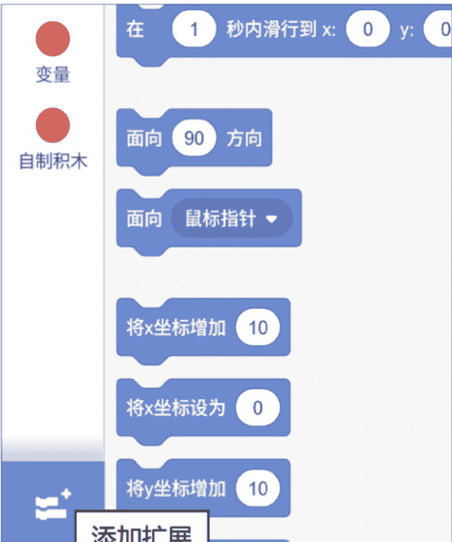

图5-14


图5-15

(3) 单击“打开AI训练工具”，如图5-16所示。

###### AI训练 (图像分类)

打开AI训练工具

从本地上传模型

```
加载模型
```

```
模型是否加载
```

```
对 [当前帧] 进行预测
```

```
预测结果中第 [0] 个的标签
```

```
预测结果中第 [0] 个的置信度
```

```
打开训练器, 标签1 [ ], 标签2 [ ]
```

```
打开训练器, 标签1 [ ], 标签2 [ ]
```

图5-16

（4）训练模型。上传用于训练模型的照片有两种方式，一种是直接开启摄像头拍照，另一种是直接上传已经准备好的照片素材。本案例已为同学们准备好水果数据集（包含樱桃、草莓、芒果的训练集、验证集、测试集）。

①分类1、分类2和分类3要修改为对应的水果名称，分别在文件夹中找到训练集的数据图片（樱桃、芒果、草莓），将图片上传到对应的位置，如图5-17所示。


图5-17

②单击“开始训练”按钮（见图5-18），平台开始根据你上传的图片来训练AI模型。这就像游戏新手进训练营，平台拿训练集数据教模型记住水果特征，学分类“招式”。

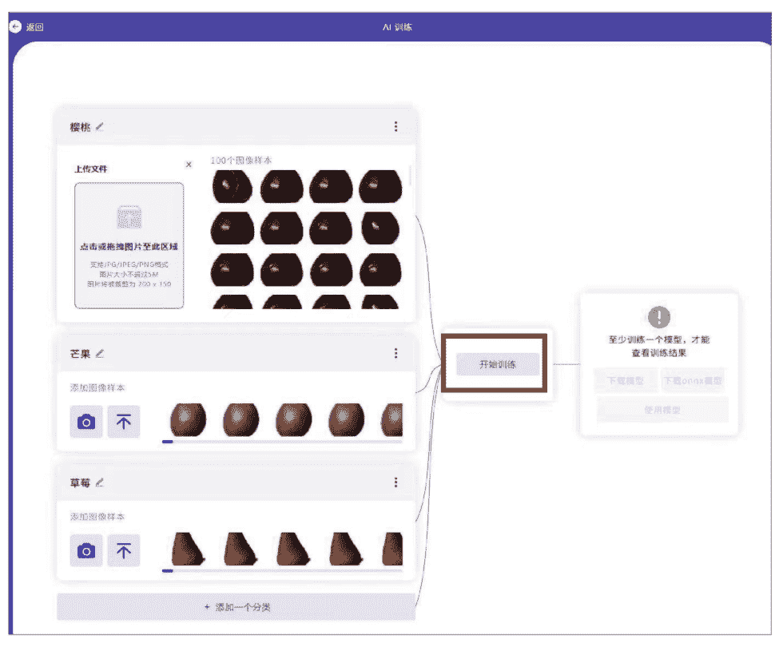

图5-18

③训练完成后，使用验证集对模型进行测试。选择输出方式为“上传图片”，在文件夹中找到验证集的数据图片（樱桃、芒果、草莓）。这相当于进行一次模拟的“排位赛”，如果模型表现不佳（比如准确度不高），可以及时调整训练数据（比如更改图片数量、调整图片质量）。图5-19中上传了樱桃的验证集图片，模型对樱桃的识别准确率达到100%。因此，可以单击“下载模型”按钮将模型下载到本地，以后你拍的樱桃照片或者在网上找到的樱桃图片，这个模型都能快速帮你分类，轻松判断出是不是樱桃。

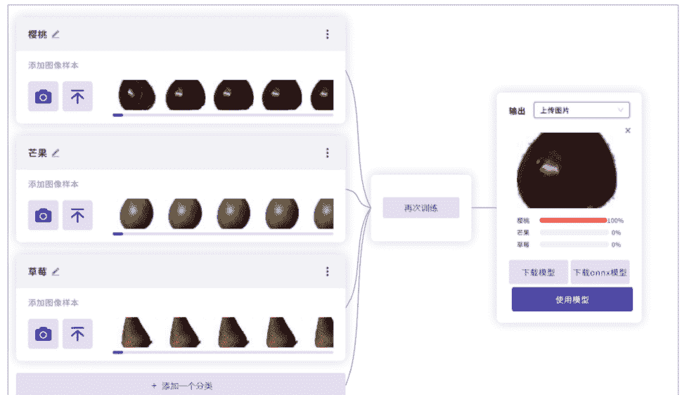

图5-19

（5）单击“使用模型”按钮，返回到程序界面。该模型会根据程序运行后摄像头画面中出现的水果进行识别与预测。

##### 小贴士

1. 最终准确率记录

经过____轮测试，AI识别准确率达____%（其中芒果识别率____%，草莓识别率____%，樱桃识别率____%）。

2. 改进策略（1个）

策略：________________________________________________________________

做法：________________________________________________________________

预期效果：准确率预计提升____%

##### 3. 编写图形化程序

（1）选择一个造型（见图5-20），在“植物”（见图5-21）分类下依次选中樱桃、芒果、草莓（见图5-22），让它们成为程序中的“主角”。

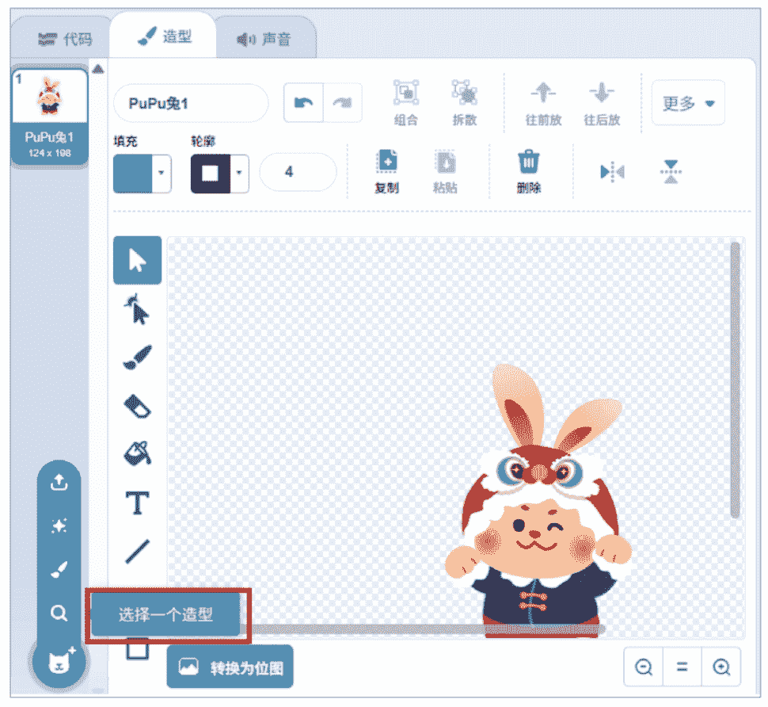

图5-20

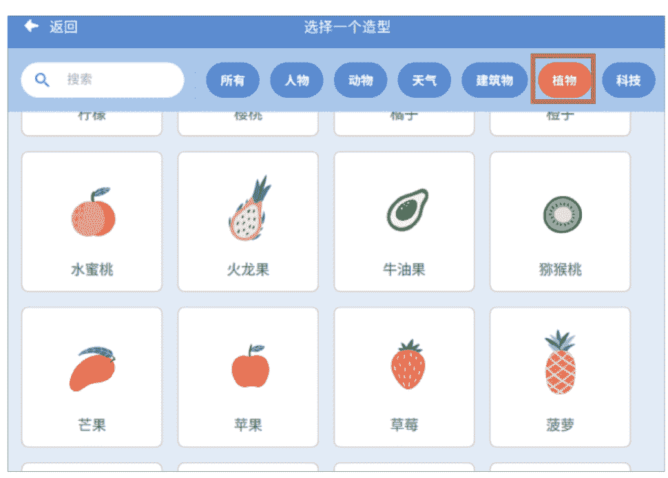

图5-21

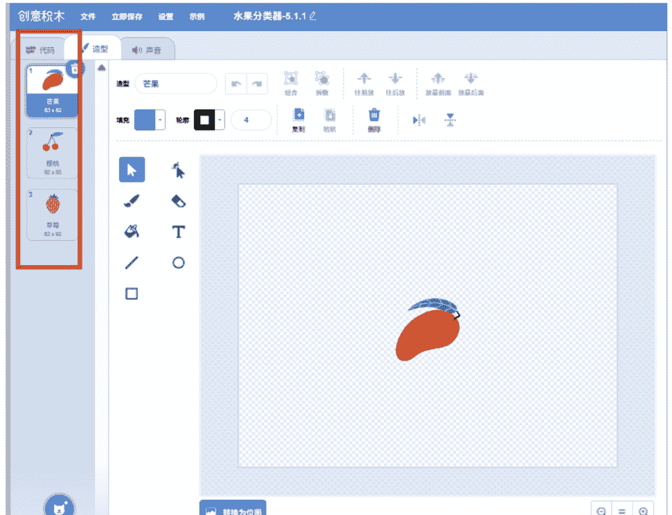

图5-22

（2）回到代码界面，选中角色后开始编写程序。先进行程序识别前的准备工作，如图5-23所示。


图5-23

（3）为了实现摄像头在拍摄水果时实时显示对应造型，要让程序像勤劳的小蜜蜂一样，不知疲倦地反复检测和识别。因此，需要把关键语句放进循环语句里，让它持续检查摄像头画面，一旦捕捉到水果，立刻进行分析识别，并马上切换成对应的造型展示出来。

我们先来学习一些程序指令，如表5-5所示。

表5-5

| 程序指令 | 能做的事情 |
| :--- | :--- |
|  | 对摄像头实时捕捉的每一幅画面，用模型分析判断，就像侦探查找线索一样 |
|  | 把预测结果里排名第一的水果标签设为当前“水果”，这是程序认定的结果 |
|  | 在外观模块中，这个指令可以切换水果造型哦 |

同学们想想看，在实现水果造型实时切换时，每次都去拿模型的识别结果做比较，就像每次找东西都要翻遍整个屋子，这样既烦琐又耗时。这时，我们就需要一位“贴心小管家”，即变量来帮忙。它能稳稳“接住”模型给出的识别结果，将其存放在专属“小仓库”里，后续程序要判断展示什么造型，直接找它调取信息即可，省去反复查找的麻烦，让程序运行更高效。

（4）选择“变量”模块，建立一个变量，修改新变量名为“水果”，如图5-24所示。


图5-24

循环下的程序如图5-25所示。

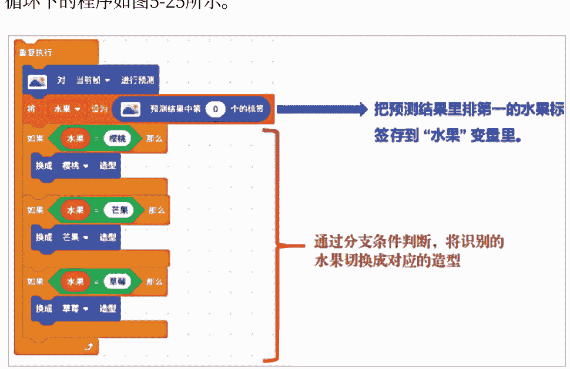

图5-25

完整程序如图5-26所示。

```
当 🟢 被点击
加载模型
开启 📷 摄像头
设置摄像头画面 弹窗显示
重复执行
    对 当前帧 进行预测
    将 水果 设为 预测结果中第 0 个的标签
    如果 <(水果) = [樱桃]> 那么
        换成 樱桃 造型
    如果 <(水果) = [芒果]> 那么
        换成 芒果 造型
    如果 <(水果) = [草莓]> 那么
        换成 草莓 造型
```

图5-26

（5）运行程序后，在摄像头前放家中已有的水果，看看舞台区的造型是否变成对应的水果哦，如图5-27所示。


图5-27

### 5.2.3 AI猜拳对战赛

#### 项目背景：AI如何学会猜拳？

石头、剪刀、布！这个简单的游戏里藏着大学问。人类靠观察对手习惯赢，AI靠什么呢？接下来的图形化编程，训练一个能和你对战的AI猜拳高手，它会像真正的对手一样思考哦！

本次项目要用到“手势分类”，它就像“猜哑谜”：AI要从你的手部动作里解读出含义（比如OK手势、点赞手势）。训练手势分类模型就像教小孩认手势，先指给他看“剪刀是这样的”，然后让他反复练习，最后他就能自己认出来啦！

训练手势分类模型的步骤如下：

（1）收集数据（给AI看例子）。拍不同人、不同角度的手势照片，给每个照片标上“剪刀/石头/布”标签。
（2）提取特征（找手势关键特点）。浦育平台的AI手势分类工具会定位手指关键点，计算手指弯曲角度、手掌朝向等数据。
（3）训练模型（让AI学规律）。我们把不同手势的关键信息（比如手指怎么弯、手的形状）整理成“学习资料”，输送给AI的“特别学习工具”（就像有很多层的聪明大脑），模型学习“怎样的特征对应哪个手势”。AI像背单词一样，它就慢慢记住“什么样的手形对应什么手势”，下次见到新手势也能认出来啦！
（4）用模型识别（AI上岗工作）。接入摄像头，实时分析手势，识别“石头”就触发对应程序。AI像个小翻译，实时把你的手势翻译成指令。

#### 1. 实验准备

（1）电脑一台（带有摄像头）。
（2）图形化编程平台 (https://www.openinnolab.org.cn/pjedu/home)。

#### 2. 步骤

（1）登录浦育平台，进入在线工具，新建项目（具体步骤参考5.2.1节语音魔法故事工坊）。
（2）单击“添加扩展”（见图5-28），选择“AI训练（手势分类）”模块（见图5-29）。

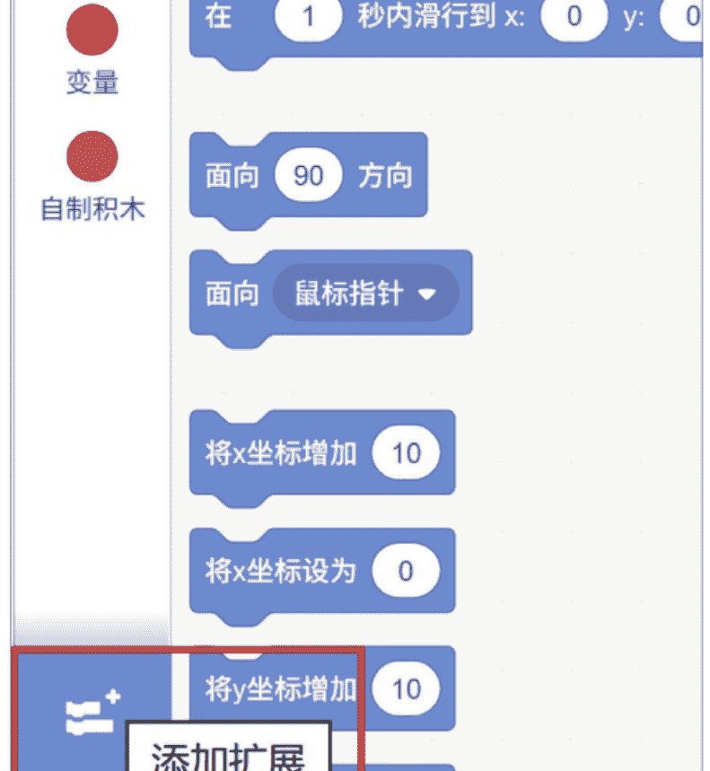

图5-28


图5-29

（3）选择AI训练（手势分类），单击“打开AI训练工具”，如图5-30所示。

###### AI训练 (手势分类)

打开AI训练工具

从本地上传模型

加载模型

模型是否加载

对 当前帧 进行预测

预测结果中第 0 个的标签

预测结果中第 0 个的置信度

打开训练器, 标签1 , 标签2

打开训练器, 标签1 , 标签2

###### 摄像头

设置摄像头画面 舞台显示

图5-30

（4）开始拍照收集数据训练模型（见图5-31）。

- 手要占满画面，背景简洁（比如白墙）。
- 从不同角度拍摄（上、下、左、右倾斜）。

检查手势质量：

- ① 手势清晰（比如剪刀要露出两根手指），如图5-32所示。
- ② 没有混淆手势（石头文件夹里不能有布或剪刀），如图5-33所示。
- ③ 数量平衡（三种手势的照片数量相近，每种至少50张样本照片）。

布的手势样本，如图5-34所示。

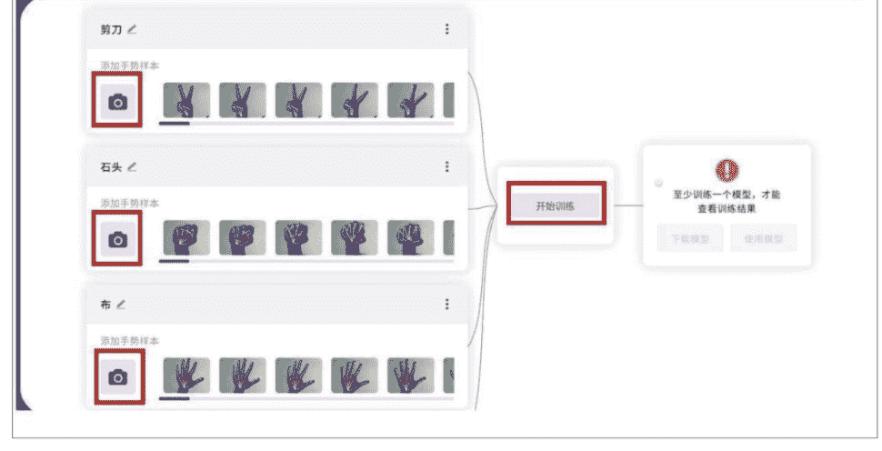

图5-31


图5-32


图5-33


图5-34

（5）耐心等待训练进度条达到100%后，自己分别摆出剪刀、石头、布的造型来测试模型的准确率，如图5-35所示。


图5-35

##### 小贴士

##### 1. 最终准确率记录

经过____轮测试，AI识别准确率达____%（其中石头识别率____%，剪刀识别率____%，布识别率____%）。

##### 2. 改进策略（1个）

策略：________________________________________________________________

做法：________________________________________________________________

预期效果：准确率预计提升____%

在理想情况下，经过充分训练的模型准确率能达到80%以上。不过实际准确率会受如下因素影响：

- ①数据质量：训练集里手势图片越清晰、角度越多，准确率越高（比如包含正手、反手、不同光线的手势）。
- ②环境干扰：摄像头画质、光线强弱、背景复杂程度都会影响识别率（比如强光下手势阴影可能被误判）。
- ③手势标准度：用户出拳时手势是否规范（比如剪刀手有没有并拢手指），越接近训练数据的样子，越容易认对。

如果模型测试后准确率没有问题，可以将其下载到电脑存好，以后做项目要是用到猜拳数据，直接调本地模型就能接着用啦。

（6）单击“使用模型”回到编程界面，现在就动手拖动程序块做AI猜拳对战赛的小游戏吧！

想实现的功能：舞台上有两个角色，一个是自己出拳实时显示的角色，另一个是电脑随机出拳显示的角色。运行程序后，摄像头开启，镜头里你的手势实时变成舞台上的出拳造型，摆好剪刀、石头、布的手势后，电脑会随机亮出它的出拳造型，两个角色一对比，瞬间就能知道谁赢谁输，就像在擂台上，你和电脑面对面“比划”，一决高下。

##### 3. 编写图形化程序

程序的流程图如图5-36所示，程序指令如表5-6所示。


图5-36

表5-6

| 程序指令 | 能做的事情 |
| :--- | :--- |
|  | 给 AI 装上“大脑”：导入训练好的手势识别模型，让它知道怎么认手势（比如剪刀、石头、布） |
|  | 给手势“拍快照分析”：分析摄像头实时画面中的手势 |
|  | 取出模型预测的手势类别。模型会给每个手势分类，比如，1 = 石头，2 = 剪刀，3 = 布，“第几个标签”就是模型认为这是第几个手势 |
|  | 置信度是 0% ～ 100% 的数值，比如置信度 90%，表示“AI 有 90% 把握猜对”，数值越高，模型越确定自己的判断 |
|  | 就像老师在教室里喊一声“消息 1 来啦”，所有“监听消息 1”的角色都会听见 |
|  | 当某个角色用“当接收到消息 1”积木，相当于给它装了个“耳朵”，专门听有没有人喊“消息 1” |

（1）创建两个角色。一个是电脑的手势，一个是自己的手势。

①创建自己的手势角色：选择“造型”→“上传造型”。选择素材包中的剪刀、石头、布的照片。返回代码区域，修改角色名称为“自己”，如图5-37所示。


图5-37

②创建电脑的手势角色：选择“上传角色”，找到素材库中的图片，选中剪刀、石头、布其中的一个角色，单击造型界面上上传角色。参考第一个上传角色方式，再加入另外两个手势造型，并且修改角色名称为“电脑”，如图5-38所示。


图5-38

（2）在不同的角色下面用代码让它们动起来。

①角色：自己，参考程序如表5-7所示。

###### 表5-7

| 步骤 | 参考程序 |
| :--- | :--- |
| 启动：单击绿色旗子后，换成 PuPu 兔 1 造型，该角色表示的是自己<br>准备 AI “眼睛”：加载训练好的模型，弹出摄像头窗口看实时画面，给 AI 戴上眼镜看你出拳<br>记住你出了啥：分析当前画面猜手势，新建“自己出拳”变量，用于存结果，设置等待延时 3 秒，等一小会儿让 AI 反应 |  |
| 换造型：亮出你的手势。如果自己出拳是石头，则切换成石头造型；如果自己出拳是剪刀，则切换成剪刀造型；如果自己出拳是布，则切换成布造型<br>通知电脑：广播消息。发“消息 1”告诉电脑该出招了，等待延时 1 秒，让电脑准备 |  |

②角色：电脑，参考程序如表5-8所示。

表5-8

| 步骤 | 参考程序 |
| :--- | :--- |
| 收到消息：当接收到消息 1 时，将 1 ～ 3 的随机数存储在“电脑”变量中。初始化“电脑出拳”变量为 0 |  |
| 按随机数决定出什么：如果“电脑”变量为 1，将“电脑出拳”设为布，换成布的造型，并说“我出布”作为提示，等待 1 秒。如果“电脑”变量为 2，则将“电脑出拳”设为剪刀，换成剪刀造型，说“我出剪刀”作为提示，等待 1 秒。如果“电脑”变量为 3，则将“电脑出拳”设为石头，换成石头造型，说“我出石头”，等待 1 秒<br>通知裁判：广播“判断”消息 |  |
| 当接收到判断消息，如果自己出拳和电脑出拳相同，则说明平局，说“再来一局”。如果自己出拳为石头，电脑出拳为剪刀，则说“你赢了”。如果你出拳为剪刀，电脑出拳为石头，则说“你输了”。以此类推后面四种可能性 |  |

（3）完整程序参考。

①角色（自己）的完整程序如图5-39所示。

```
当 🟢 被点击
换成 PuPu兔1 造型
加载模型
开启 摄像头
设置摄像头画面 弹窗显示
对 当前帧 进行预测
将 自己出拳 设为 预测结果中第 0 个的标签
等待 3 秒
如果 自己出拳 = 石头 那么
    换成 石头 造型
如果 自己出拳 = 剪刀 那么
    换成 剪刀 造型
如果 自己出拳 = 布 那么
    换成 布 造型
广播 消息1
等待 1 秒
```

图5-39

②角色（电脑）的完整程序如图5-40所示。


图5-40

#### 挑战项目：

想一想，如果想单击绿旗子启动程序后让猜拳游戏累计积分，应该怎么修改程序呢？（参考程序见配套资源中的代码）

#### ·拓展思考·

（1）如果训练数据里只有左手手势，遇到右手出拳会怎样？
（2）除了猜拳，手势分类还能帮残疾人做什么？

##### 小贴士

训练时间：训练时不要急于求成，AI模型需要一定时间来处理数据。

数据多样性：确保你的训练数据有足够的种类和角度，这样AI模型可以更好地理解并识别不同的情况。

多次测试：不断测试不同的图片，根据模型的表现，进行调整和优化。

## 成就打卡

##### 我学会了

- □ 自己动手制作猜拳手势的图片数据集，用图形化编程训练AI识别猜拳手势。
- □ 用图形化编程实现水果分类器，轻松让程序学会区分不同水果。

## 5.3 进阶实践

清晨，智能手表轻轻震动，“心跳小侦探”监测你的脉搏，AI化身“健康分析师”，喊你起床活动。

走进厨房，智能冰箱变身“食材管家”，用图像识别“看清”库存，AI结合营养搭配，语音推荐菜谱：“青椒炒肉丝安排！”

智能家居超贴心：光线传感器让窗帘自动开合，语音喊一声，AI秒懂指令；智能喂食器的重量传感器监测余粮，AI算好食量和时间，按时投喂萌宠，主人出门超安心。

这些藏在生活里的AI应用，都是科技与生活的甜蜜碰撞。接下来，我们就动手拆解这些“智能伙伴”，揭开AI感知世界的神秘面纱。

### 5.3.1 智能感应小夜灯

项目背景：

当你半夜想喝水，脚刚沾地，小夜灯“啪——”地亮起，像提前知道你要行动。其实，它有双“热感眼睛”——人体红外传感器，能“看见”人体发出的热信号。要是不想下床，喊一声：“开灯！”它也能立刻响应，因为它还有对“顺风耳”——语音识别模块。你的声音被AI的“耳朵”捕捉，传给AI“大脑”分析。AI听懂指令后，马上让小夜灯亮起来，像魔法一样。白天光线充足时，光线传感器当“小哨兵”，小夜灯就安静“睡觉”。到了晚上，它才开启“工作模式”，时刻待命。这盏小夜灯，靠着红外感应“看”、语音识别“听”，加上AI“聪明脑”指挥，既是守护你的“夜精灵”，又是随叫随到的“灯光小助手”。

#### 1. 实验准备

（1）电脑一台。
（2）行空板K10 ×1（见图5-41）。
（3）Type-C接口USB线×1。
（4）Mind+软件（https://mindplus.cc/download.html）（保证版本是Mind+ V1.8.1 RC1.0以上）。

##### 小贴士

本次项目硬件器材为行空板K10，它就像一个超厉害的“科技百宝箱”，不管是控制各种传感器，还是实现好玩的人工智能应用，它都能轻松搞定，图5-41就是行空板K10的“个人写真”，快先来和这位新朋友打个招呼，认识一下它的模样吧！


图5-41

#### 2. 步骤

（1）先启动行空板K10，拿出USB线，一头插K10的Type-C口，一头直连电脑USB口（见图5-42）。等屏幕跳出logo画面，就代表开机成功。

要注意哦！USB线必须直接连电脑，别用延长线、扩展坞，不然会“掉链子”。而且，要用能传数据的USB线，就像选对钥匙才能开锁，这样K10才能顺利“苏醒”！


图5-42

（2）启动Mind+软件，切换到“上传模式”，如图5-43所示。


图5-43

（3）单击扩展，选择主控板，选择“行空板K10”，单击“返回”，完成加载，如图5-44所示。


图5-44

（4）单击“连接设备”，找到对应的K10设备并单击，完成设备连接，如图5-45所示。（温馨提示：要确定连接上K10，并且保证K10开机后才能找到连接的设备）


图5-45

（5）图形化编程实现智能小夜灯，如表5-9所示。

表5-9

| 智能小夜灯功能 | 传感器及显示器 |
| :--- | :--- |
| 当光线传感器检测到亮度低于 100 时，行空板 K10 背后的 RGB 小灯自动亮起 | 板载上的光线传感器（像眼睛一样感知周围亮不亮的零件）<br> |
| 对着行空板说：“开灯”，RGB 小灯立刻亮起。当说：“关灯”时，RGB 小灯熄灭 | 板载上的 RGB LED 小灯（能够变换各种颜色的发光零件）<br> |

温馨提示：本项目案例中采用板载上的RGB小灯模拟小夜灯的效果，如果想让小夜灯更炫酷，同学们可以选择让行空板K10通过拓展接口外接灯环、灯带等方式来体验五彩斑斓的灯光效果哦！

语音识别模块程序指令如表5-10所示。

表5-10

| 程序指令 | 能做的事情 |
| :--- | :--- |
|  | (1) “唤醒时间”决定让机器听你说话多久，单位是毫秒（ms），1000 毫秒 = 1 秒<br>(2) “连续”识别是让机器一直听你说话，而“单次”识别指的是说完一句等待你下一次唤醒<br>(3) 唤醒词（中文模式）：对着行空板说：“你好小行”或“你好小新”。行空板自带“中文听力大脑”（语音识别模型） |
|  | (1) 每个命令词要配一个 ID 号（0～199），就像班级里每个同学有唯一的学号，机器靠 ID 认指令<br>(2) 中文命令词：用拼音拼“密码”。必须用拼音写，音节之间用空格分开。字数要求：2～5 个音节（如“打开小夜灯”是 5 个音节，单音节如“喂”，机器会报错，就像考试只写姓不写名）<br>正确：kai deng（开灯）、ni hao（你好）<br>错误：kaideng（没空格）、deng（单音节） |
|  | 这个指令像一面小镜子，能看清语音识别现在的状态：是已经被唤醒了，还是在“睡觉”<br>注意：千万别把这个指令和“检测到命令词 ID”一起用！这就像一边问“你吃饭了吗”，一边塞苹果给别人，会把机器搞糊涂 |
|  | 这个功能像雷达，专门扫描有没有听到带特定 ID 的命令词。<br>注意：先唤醒，再对暗号<br>(1) 先喊“你好小行”唤醒机器<br>(2) 机器醒着时，雷达开始扫描命令词 ID<br>(3) 听到 ID=10 的“开灯”，就执行开灯动作<br>（就像你和朋友约好暗号“菠萝菠萝蜜”，听到就拍手） |

语音合成模块程序指令如表5-11所示。

##### 表5-11

| 程序指令 | 能做的事情 |
| :--- | :--- |
|  | 这个功能能让行空板把文字变成声音说出来！如果想让机器说话像人一样停顿，可以加逗号哦！比如：“你好，我是小行，很高兴认识你” |
|  | 这个功能可以调节机器说话的语速。语速值越大，语速越快。最小语速为0，最大语速为5。若不设置，则默认为2 |

屏幕显示模块指令如表5-12所示。

##### 表5-12

| 程序指令 | 能做的事情 |
| :--- | :--- |
|  | 这个指令会指定文字从第几行最左侧开始快速显示，还能选择文字颜色<br>注意：<br>(1) K10 在竖屏时，一共支持 13 行文字显示<br>(2) 此指令会强制执行自动清除操作 |
|  | 当你用指令画文字、图形、图片时，必须用“显示更新”积木“盖印章”，画面才会出现。(注意：当屏幕显示摄像头画面时，你画的文字图形会自动跟着摄像头动，不用点更新！)<br>缓存内容：先在草稿纸上画好图案<br>显示更新：把草稿纸贴到黑板上 |

掌握了核心模块指令后，现在就开始动手实践吧，具体步骤如表5-13所示。

##### 表5-13

### 5.3.1 智能小夜灯

| 步骤 | 参考程序 |
| --- | --- |
| 当行空板 K10 主程序开始时，设置语音识别连续唤醒时间为 6000 毫秒（等于 6 秒），添加语音识别命令词 ID 0 “kai deng”，命令词 ID 1，“guan deng”，并且设置语音合成语速为 2 |  |
| 为了程序运行开始之后实现智能小夜灯连续识别与判断，接下来的代码需要放到循环执行指令中。新建“光线”变量，将获取的环境光强度的值存在“光线”变量中，将光线值显示在行空板第 3 行的屏幕中，将缓存内容显示。如果获取的光线值小于 100，则说明光线过暗，让小夜灯亮起，并在行空板 K10 屏幕第 5 行显示文字提示“已开灯”，将缓存内容显示。否则说明光亮足够，关闭全部 RGB 灯，并在屏幕第 5 行显示文字提示“已关灯”，将缓存内容显示 |  |
| 如果判断语音识别当前状态已唤醒，则在屏幕第 8 行显示“小新已唤醒，请说命令词启动吧！”否则，在屏幕第 8 行显示“你好，小新，请唤醒我”作为提示。如果检测到命令词 ID 0（“kai deng”），则让灯全部亮起，并且语音合成说“已开灯”。如果检测到命令词 ID 1（“guan deng”），则关闭所有灯光，并且语音合成说“已关灯” |  |

(6) 完整程序参考如图5-46所示。

```
行空板K10主程序开始
设置语音识别 连续 唤醒时间 6000 语言 中文
添加语音识别命令词ID 0 命令 "kai deng"
添加语音识别命令词ID 1 命令 "guan deng"
设置语音合成语速为 2
循环执行
    设置 光线 的值为 读取环境光强度
    缓存显示文字 合并 "光线值：" 变量 光线 在第 3 行 颜色
    将缓存内容显示/显示更新
    如果 变量 光线 < 100 那么执行
        灯号 全部(-1) 显示颜色 白色
        缓存显示文字 "已开灯" 在第 5 行 颜色
        将缓存内容显示/显示更新
    否则
        关闭 全部 RGB灯
        缓存显示文字 "已关灯" 在第 5 行 颜色
        将缓存内容显示/显示更新
    如果 语音识别当前状态为唤醒? 那么执行
        缓存显示文字 "小新已唤醒，请说命令词启动吧！" 在第 8 行 颜色
        将缓存内容显示/显示更新
    否则
        缓存显示文字 "你好，小新，请唤醒我" 在第 8 行 颜色
        将缓存内容显示/显示更新
    如果 检测到命令词ID 0 ? 那么执行
        灯号 全部(-1) 显示颜色 白色
        语音合成 "已开灯"
    如果 检测到命令词ID 1 ? 那么执行
        关闭 全部 RGB灯
        语音合成 "已关灯"
```

图5-46

（7）程序写好后，再次确认电脑已连接K10，单击“上传到设备”，将程序加载到K10中，然后可运行程序，如图5-47所示。


图5-47

·拓展思考·

- (1) 人体红外传感器：可以丰富智能小夜灯的功能，比如添加人体红外传感器，当人靠近时，小夜灯马上就亮起。
- (2) 智能家居联动：如果想把小夜灯接入智能家居系统，通过手机APP远程控制开关，需要用到哪些额外的硬件和技术呢？

### 5.3.2 校园智能安全小卫士

项目背景：

走进校园，你身边藏着许多神奇的“安全小卫士”。

校门口的AI识别门禁就是第一个守护者，它的摄像头像眼睛，后台的AI模型像大脑，通过人脸识别你是不是本校学生。要是陌生人想混进来，语音合成技术会立刻提醒：“抱歉，没有预约，不能进学校哦！”

教室里的温湿度传感器，是默默工作的“环境侦察兵”。这个小小的设备还能“跨界”，成为火灾预警的好帮手，发现温度突然超过了正常的高温范围（比如40℃）及湿度突然降到30%以下，会亮灯警示提醒。

这些智能设备就像隐身的超级英雄，24小时守护校园安全，让我们的校园生活既安心又有趣。

#### 1. 实验准备

- (1) 电脑一台。
- (2) 行空板K10 ×1。
- (3) Type-C接口USB线×1。
- (4) Mind+软件 (https://mindplus.cc/download.html) (保证版本是Mind+ V1.8.1 RC1.0以上)。
- (5) 互联网连接。

#### 2. 核心模块学习

(1) 人脸识别模块，程序指令如表5-14所示。

表5-14

| 程序指令 | 能做的事情 |
| :--- | :--- |
|  | 可以将摄像头画面实时显示在 K10 屏幕上，或将摄像头画面隐藏 |
|  | “视觉魔法切换器”：你可以用它切换四种神奇的机器视觉算法模式，就像给设备换上不同功能的“眼睛”<br>这四种模式分别是：人脸检测（专门“抓住”屏幕里的人脸）、猫狗检测（能快速找出小猫小狗）、移动检测（只要有东西在动，它马上提醒你）和二维码识别（瞬间读取二维码里的小秘密）<br>当你选择人脸检测和猫狗检测模式时，设备会在屏幕上叠加一个神奇的识别框，这样你一眼就能知道它找到了谁<br>不过要注意，使用这些检测功能时，必须把设备竖直拿好，要是你横着拿设备，它的“眼睛”就会“看”不清楚，可能什么都检测不到 |
|  | 用来判断是否检测到人脸。就像在人群里找朋友，有结果了马上通知你 |
|  | 用于采集并学习识别的人脸。当你让它采集人脸时，它就像拥有超强记忆力的小伙伴，能牢牢记住看到的每张脸<br>只要学习成功，它就会给这张脸发一个专属“身份证号”（ID 号），从 1 号开始依次分配。<br>不过要注意，这位“记忆大师”最多只能记住 48 张不同的脸 |
|  | 用于识别已经学习过的人脸。一旦找到匹配的，就像认出了老朋友一样，马上告诉你这是谁 |
|  | 判断识别工作是否完成 |
|  | 当它成功认出学过的人脸时，这个“提取员”就会马上“抽出”对应的 ID 编号<br>不过它有个特别的工作习惯：每次只“提取”一次 ID 编号，就像只发一次身份证。取完之后，它会立刻“复位”，把 ID 编号变回 -1，准备下次再帮你找新的“身份证” |
|  | 忘记全部已学过的人脸 ID。设备重新“归零”，准备认识新的面孔 |

(2) 函数模块。当程序涉及的步骤较多时，程序会看起来乱糟糟的。其实，我们可以把识别人脸的“关键步骤”打包成一个小模块，即把人脸检测的核心操作封装成一个能直接调用的函数，主程序需要识别人脸时，喊一声这个函数，它就像个“小助手”，立马完成任务，让主程序既简洁又好用。这就好比把炒菜的步骤写成菜谱，要用的时候照着菜谱操作就行，如图5-48所示。


图5-48

#### 3. 步骤

(1) 启动行空板K10，并连接电脑。启动Mind+软件，切换到上传模式。（相关步骤参考5.3.1节“智能小夜灯”项目）

(2) 动手拖拽图形化模块实现项目效果吧！具体步骤如表5-15所示。

表5-15

| 步骤 | 参考程序 |
| --- | --- |
| 当主程序开始时，显示摄像头画面，并切换为人脸检测模式。新建“学习人脸”变量，初始化值（清空盒子）为0 |  |
| 为了程序运行开始之后实现温湿度传感器和人脸的连续判断，接下来的代码需要放到循环执行指令中。新建“温度”变量，将获取的温度值存在“温度”变量中，将温度值显示在行空板第1行的屏幕中，缓存内容显示。如果获取的温度值大于40摄氏度，则说明温度过高可能火灾预警，亮起红灯起到警示作用，否则关闭灯光。如果“学习人脸”变量为1，则需要开启学习人脸。如果检测到人脸并且“学习人脸”为0，则开始识别人脸 |  |

续表

| 步骤 | 参考程序 |
| :--- | :--- |
| 定义识别人脸函数（参考上面学习模块部分）。识别人脸，等待直到识别完成。新建 ID 变量，将获取的人脸 ID 存入 ID 变量中，方便后续做人脸判断。在屏幕第 2 行显示人脸 ID 号。如果变量 ID 为 -1，说明人脸并未录入，判定为陌生人，语音提示“抱歉，没有预约，不能进学校哦”，并且亮红灯提示。否则如果变量 ID 为 1，则亮绿灯，并且提示“小智同学你好，欢迎回到学校”。如果变量 ID 为 2，则亮绿灯，并且提示“小明同学你好，欢迎回到学校”。如果变量 ID 为 3，则亮绿灯，并且提示“小兰同学你好，欢迎回到学校”。等待 2 秒后，关闭全部 RGB 灯 |  |
| 按下 A 键，设置灯号全部颜色为黄色，设置“学习人脸”变量的值为 1。等待 3 秒。当语音合成提示“已完成人脸学习”，再将“学习人脸”的值改为 0 |  |

续表

| 步骤 | 参考程序 |
| :--- | :--- |
| (可以开始识别检测)，关闭全部 RGB 灯<br>按下 B 键，设置灯号全部颜色为蓝色，忘记全部人脸 ID，等待 1 秒后，关闭全部 RGB 灯 |  |

温馨提示：同学们，当你重新运行程序时，一定要记得先按下B键！这就像给设备的人脸记忆来一次“大扫除”，能把之前记住的所有ID编号都清空。完成清理后，再去录入新的人脸，开启识别，这样系统才能准确认出大家！不然带着旧的ID信息，可能会闹“认错人”的小乌龙哦。

完整程序参考如图5-49所示。


图5-49

```
定义 识别人脸
识别人脸
等待直到 是否识别完成？
设置 ID 的值为 获取识别到的人脸ID
缓存显示文字 合并 "人脸ID：" 变量 ID 在第 2 行 颜色
将缓存内容显示/显示更新
如果 变量 ID = -1 那么执行
    语音合成 "抱歉，没有预约，不能进学校哦"
    灯号 全部 (-1) 显示颜色 红色
否则
    如果 变量 ID = 1 那么执行
        灯号 全部 (-1) 显示颜色 绿色
        语音合成 "小智同学你好，欢迎回到学校"
    如果 变量 ID = 2 那么执行
        灯号 全部 (-1) 显示颜色 绿色
        语音合成 "小明同学你好，欢迎回到学校"
    如果 变量 ID = 3 那么执行
        灯号 全部 (-1) 显示颜色 绿色
        语音合成 "小兰同学你好，欢迎回到学校"
等待 2 秒
关闭 全部 RGB灯
```

图5-49（续）

```
当按键 A 按下
灯号 全部 (-1) 显示颜色 🟢
设置 学习人脸 的值为 1
等待 3 秒
语音合成 "已完成人脸学习"
设置 学习人脸 的值为 0
关闭 全部 RGB灯
```

```
当按键 B 按下
灯号 全部 (-1) 显示颜色 🔵
忘记全部人脸ID
等待 1 秒
关闭 全部 RGB灯
```

图5-49（续）

## 成就打卡

我学会了 ✅

- □ 绘制小夜灯流程图。
- □ 完成小夜灯制作。
- □ 设计并实现校园智能安全小卫士。

## 闯关测验

1. （单选题）以下哪项属于语音合成技术的应用？（ ）
    - A. 语音转文字记录会议内容
    - B. 智能音箱朗读新闻
    - C. 手机语音助手识别指令
    - D. 自动生成字幕

2. （单选题）在校园安全小卫士系统中，温湿度传感器数值异常时应采取的措施是（ ）。
    - A. 增加人脸识别频率
    - B. 启动通风设备
    - C. 关闭所有门禁
    - D. 调整语音合成音量

3. （单选题）水果分类AI模型训练时，不需要考虑的因素是（ ）。
    - A. 水果颜色
    - B. 水果形状
    - C. 水果生长周期
    - D. 表面纹理

4. （单选题）智能小夜灯项目中，光线传感器的主要作用是（ ）。
    - A. 控制灯光亮度
    - B. 感知环境光线
    - C. 实现语音控制
    - D. 延长使用寿命

5. （单选题）AI猜拳程序判断用户手势时，最核心的技术是（ ）。
    - A. 图像识别
    - B. 语音识别
    - C. 温度传感
    - D. 数据加密

6. （多选题）校园安全小卫士系统的人脸识别门禁功能，需要包含以下哪些模块？（ ）
    - A. 摄像头
    - B. 温湿度传感器
    - C. 语音合成器
    - D. 显示屏

7. （多选题）语音识别技术可以应用于以下哪些场景？（ ）
    - A. 智能门锁解锁
    - B. 智能家居控制
    - C. 医疗记录录入
    - D. 自动驾驶导航

8. （多选题）设计水果分类系统时，可以采用的传感器有：（ ）。
    - A. 颜色传感器
    - B. 重量传感器
    - C. 超声波传感器
    - D. 气味传感器

9. （判断题）校园安全小卫士系统中，人脸识别和温湿度检测必须顺序执行。

10. （判断题）小夜灯项目可以通过添加人体红外传感器实现智能感应。

11. （判断题）AI猜拳程序只需识别石头、剪刀、布三种手势即可。

12. （判断题）语音合成技术只能将文字转换为固定语调的声音。

13. （判断题）水果分类系统的准确率完全取决于硬件设备，与算法无关。

14. （简答题）若要实现AI猜拳游戏的高准确率识别，需要在硬件和软件层面分别采取哪些措施？请详细阐述。

15. （简答题）校园安全小卫士系统中，当温湿度传感器数据异常且人脸识别到陌生人员时，如何设计一套完整的应急响应流程？

16. （简答题）设计一个基于语音识别和合成技术的智能水果分类助手，描述其功能实现方案和主要模块。

## 成就贴纸

看看你获得了几张贴纸。

| 阅读全章内容 | 成就打卡 | 完成闯关测验 |
| :--- | :--- | :--- |
| | | |

(1)行空板K10官方说明文档
https://www.unihiker.com.cn/wiki/k10/get-started