# 少年AI启蒙：玩转智能未来

# 作者简介

**韩冬兵**，北京师范大学附属实验中学信息技术教研组组长，西城区教育系统信息技术学科教学带头人，NOI金牌教师，北京科学中心信息学名师工作室人工智能方向负责人。

**郭培培**，北京师范大学附属实验中学信息技术教师，信息学竞赛教练，西城区信息技术学科骨干教师，NOI优秀教师，北京市青少年信息学优秀教师。已在高中开设人工智能选修课程六年。

**张康**，清华大学计算机科学与技术博士，北京师范大学附属实验中学信息技术教师，信息学竞赛教练。曾任职于头部互联网公司人工智能研究院与算法部门，擅长算法研究与数据模型分析。

**徐帅婧**，北京师范大学人工智能学院博士，北京师范大学附属实验中学信息技术教师，人工智能校队主管教师，信息学竞赛教练。

**王雨荷**，北京师范大学附属实验中学信息技术教师，人工智能校队主管教师，信息学竞赛教练。

**胡伟栋**，北京师范大学附属实验中学信息学总教练，NOI钻石教师，连续两届IOI金牌选手培养者，IOI2015命题人，多名学生获IOI与NOI金牌。2008—2014年担任信息学国家队教练，参与编订与修订NOI大纲。

# 内容简介

本书为青少年量身打造的AI实践入门读物。整本书以“感官系统”“超级大脑”“智能伙伴”等生活化比喻拆解AI核心原理，通过猫狗识别、语音助手互动、作文润色等真实场景，直观呈现机器学习、计算机视觉与大语言模型的工作方式，并引导读者用图形化编程实现语音魔法故事工坊、感应小夜灯、校园安全小卫士等趣味项目。

书中特别加入技术缺陷检验，如人脸识别偏差、AI语言幻觉现象，以及AI使用规范，帮助读者建立批判性思维与技术责任感。

全书采用游戏化学习设计，“成就打卡”“成就贴纸”将抽象知识转化为可感知的实践挑战。案例兼顾围棋对弈、图像识别等经典题材，也涵盖单词记忆游戏、数学推演、AI艺术创作等跨学科创新，适配10～16岁青少年的科技素养培养。同时可作为教师设计STEM课程、家长开展亲子科技活动的参考，助力学习者在动手创造中掌握未来关键能力。

# 前言

当你对着音箱点歌、看着手机相册自动挑出猫咪照片、让工具帮忙梳理作文思路时，有没有想过这些贴心功能背后是怎样的逻辑？编写《有趣的人工智能：少年AI启蒙课》的初衷，就是让人工智能不再是教材里的生僻名词，也不是只有专家才懂的深奥理论，而是像积木拼图一样触手可及的玩伴，在实践中点亮对科技的好奇与热爱。

我们知道10～16岁的孩子难以消化纯理论，所以全书围绕“让AI看得见、摸得着、用得上”展开。用“感官系统”来讲解计算机视觉，通过猫狗识别实验体会机器如何“看见”；用“超级大脑”解释机器学习，从围棋对弈到数学解题推演展示机器如何“学习”规律；用“智能伙伴”介绍大语言模型，结合语音互动与作文修改说明机器如何“听懂”与“表达”。这些不仅是知识传递，更是建立AI源于生活也服务于生活的认知。

本书跳出单向阅读，构建三大特色：其一，动手实验学习模式，读者可用图形化工具自己搭建语音魔法故事工坊、智能感应小夜灯、校园智能安全小卫士等项目，在做中学原理；其二，强化批判思维，专门设置技术漏洞测试，剖析人脸识别误差与语言幻觉成因，并编写AI使用守则，强调理性看待技术并承担使用责任；其三，游戏化设计贯穿始终，“闯关测验”“成就打卡”“成就贴纸”把知识点变成可挑战的关卡，在成就感中消化抽象内容。

编写坚持“有趣第一、实用第二”，不堆砌公式与专业术语，而以比喻、场景、案例搭建桥梁；既保留围棋、图像识别等经典，也纳入单词记忆、AI艺术创作等跨学科实践，让不同兴趣的读者都能找到入口。本书不是一次性读完的资料，而是一本可反复翻阅、随时动手的科技工具箱。

读者不止青少年。10～16岁的小读者能从这里开启轻松启蒙；教师可直接把案例与项目用作STEM教学素材；家长也能借此开展亲子科技活动。我们期待合上书时带走的不仅是对AI的认识，更是探索、思考、创造的勇气。未来的科技世界需要理性与热爱来塑造，而这本书就是送给你的钥匙。

# 第1章 初识智能：它已融入日常

## 1.1 人工智能究竟是什么

人工智能是计算机科学的重要分支，像给机器施法，让普通计算机模拟、延伸和扩展人类智能，完成原本需人处理的复杂任务。简言之，AI就是赋予机器感知、思考与行动的能力，让它“看得见、听得懂、想得通、做得到”，成为得力的智能伙伴。

### 1.1.1 机器的感知系统

AI让机器拥有感知世界的“眼睛”与“耳朵”。人走进陌生房间会用眼扫视、用耳捕捉声音、手指触摸；机器的感知则靠摄像头、激光雷达、麦克风与各类传感器。

例如，扫地机器人的顶盘激光雷达会像蝙蝠回声般不断扫描房间轮廓以避障；自动驾驶汽车的“眼睛”比细心司机更强，能同时观察四周，实时捕捉行人、车辆、交通标志等细节。这些装置把图像、声音、温度等转化为数字序列，像把真实世界翻译成计算机可读的密码，智能正是通过这些密码理解世界。

图1-1

图1-2

### 1.1.2 机器的超脑

AI拥有能像人一样思考、甚至更快更全面的“超脑”。大脑由神经网络等复杂算法构成，模仿人脑神经元互联传递信息，从海量数据中找规律、解问题。

输入目的地时，导航智能会瞬间分析上万条路线，同时考量拥堵、施工、天气等，推送最优方案。刷短视频时，智能也在默默判断：“喜欢猫咪视频的，下一条推小猫打哈欠的萌瞬间”。这就是用专用程序分析信息、给出最贴合需求答案的过程。

图1-3

图1-4

### 1.1.3 机器的超能执行

思考之后就要执行，靠扬声器、屏幕、机械臂等“钢铁手脚”完成。比如对智能音箱说“播放李白的《静夜思》”，它会完成感知识别语音、思考匹配诗歌库、执行播放诗歌的全套流程。

更强的智能堪比“钢铁侠”，能完成高难度任务。工业机器人可精准焊接汽车零件，误差小于头发丝；医院智能手术机器人能稳准缝合血管，动作比资深医生更稳。

图1-5

图1-6

图1-7

### 1.1.4 智能无处不在

智能以感知-思考-行动为核心能力，把普通机器变成能理解、帮助、惊喜你的搭档。它在手机、家电、街头汽车中无处不在，悄然改变生活，让一切更便捷高效有趣。

## 1. 小明智能助手的一天

### 6:30 晨光小管家
智能音箱播放轻音乐唤醒小明。他迷糊问“今天天气怎么样”。音箱联网播报气温12℃、比昨日低5℃，建议穿加绒外套并带折叠伞，下午降雨概率30%，屏幕同步显示预报与穿搭建议。

### 7:00 晨间资讯台
餐桌上小明轻声说“播放今天新闻”。智能助手筛选校园趣闻与科技动态，并插播冷知识“蜂蜜在密封条件下可存放千年”。小明边吃早餐边听，元气满满。

### 7:30 通勤追踪员
站台上智能公交显示“12路还有2站，约5分钟到，车内拥挤度30%”。刷卡上车后，乘车信息自动推送父母手机“小明已乘12路，预计7:50到校”。

### 7:50 校园守护者
入校门禁用学生卡核验身份，智能考勤记录到校时间并向父母和班主任发送“小明已安全到校”。

### 12:00 午餐营养师
食堂刷卡后智能提示“蛋白质充足，蔬菜偏少，晚餐可多吃绿叶菜”。数据同步家庭健康平台，父母可随时查看营养摄入。

### 17:00 放学放松拍档
公交上小明对智能手表说“播放放松音乐”。智能按听歌习惯推荐治愈系纯音乐，父母收到提醒“小明已离校，预计17:30到家，可准备水果”。

### 17:30 清洁小帮手
到家时智能扫地机器人正避开桌椅清扫，爸爸已通过App设定时间。小明感叹家里每天都干净。

### 19:30 学习好搭档
写作业时智能台灯自动调至合适亮度。遇到阅读理解难题，小明拍照给智能助手，助手以对话引导“关键词是什么？联系上下文猜猜意思？”，帮助找到思路。学习进度与薄弱点实时发送给父母，并推荐3个学习视频。

### 21:30 睡眠守护者
睡前手环监测心率与睡眠，妈妈收到提醒“学习时间较长，建议明早推迟10分钟叫醒”。调整后，小明在智能守护下进入甜美梦乡。

从清晨唤醒到夜晚守护，从学习辅导到生活照料，智能像隐形贴心伙伴，用科技让每一天更丰富多彩。

## 2. 智能设备大搜查

### 互动小任务1
像侦探一样找出身边的智能伙伴，填入表1-1并思考其工作方式。

表1-1

| 类型 | 名称 | 用途 |
|---|---|---|
| 智能音箱 | 小爱同学 | 播放音乐、回答问题、设置闹钟等 |
| 智能穿戴设备 | 华为智能手表 | 计步数、监测心率、睡眠等 |
| | | |
| | | |
| | | |

### 互动小任务2
以表1-1中任一设备为例，描述其感知-思考-行动流程，填入表1-2。例如智能音箱询问天气。

表1-2

| 智能伙伴 | 感知 | 思考 | 行动 |
| :--- | :--- | :--- | :--- |
| 智能音箱 | 通过麦克风阵列听到问题“今天天气怎么样”，将语音转文字 | 理解意图、提取关键信息并定位城市，联网获取天气数据 | 语音播报天气并在屏幕显示相关信息 |
| | | | |

## 成就打卡

### 我学会了 ✅
- □ 能说出智能的核心能力
- □ 能说出“小明智能助手的一天”中智能解决了哪些问题
- □ 找到身边3个以上智能设备或应用
- □ 能说出一种智能设备的感知-思考-行动流程

## 1.2 智能是如何“学习”的

你是如何认识猫的？第一次见小猫时，大脑像侦探搜集证据：毛茸茸的外表、尖耳朵、大眼睛、长胡须。反复见到后，大脑归纳出共同特征：四条腿、长尾巴、尖耳朵、圆眼睛、长胡须。下次看到新动物时迅速判断“很可能是一只猫”。这就是积累经验、归纳规律并应用规律的过程。

### 1.2.1 数据寻宝大冒险

智能学习的核心叫机器学习，像一场数据寻宝。首先收集海量数据宝藏：文字、图片、声音、视频等，如你反复观察各种猫积累经验。接着用算法在数据中挖宝，总结出专属规律即模型，如你发现猫的共同特征。最后把规律转化为超能力，应用到全新场景，不仅能认出未见过的猫，还能判断它是否想玩耍。智能正是靠从数据中挖掘规律不断解锁新技能。人类学习与智能学习对比见图1-8。

图1-8

### 1.2.2 学习的第一招：监督学习

监督学习像有老师指导，工程师为计算机准备带标签的数据，如大量标有cat、dog的动物图片。计算机分析颜色、形状、纹理等特征，找出特征与答案的联系，学会区分动物，再用以判断新图片，如图1-9。

例如教计算机认手写数字0-9，给它很多带答案的练习册。计算机分析笔画弯曲、点线位置等特征，慢慢分辨出潦草的7和一笔的1，找到规律后即可识别新图片中的数字，如图1-10所示。

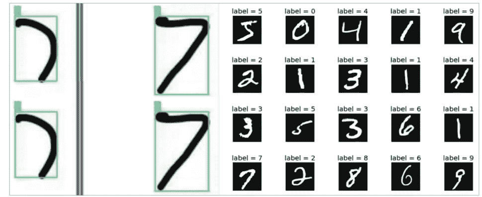

图1-10

因此监督学习是在老师指导下，通过带正确答案的数据找规律，再用于解决新问题，就像掌握解题方法后举一反三。

### 1.2.3 学习的第二招：无监督学习

无监督学习中，计算机像无地图的探险家，在无标注的数据丛林中自行寻找隐藏关系。

例如学校收集学生在绘画、音乐、编程、体育的参与数据。计算机通过无监督学习把兴趣相似的学生分到一组，即聚类，如图1-11所示。

| 学生编号 | 绘画 | 音乐 | 编程 | 体育 |
| :--- | :--- | :--- | :--- | :--- |
| 1 | 8 | 9 | 2 | 1 |
| 2 | 7 | 8 | 3 | 2 |
| 3 | 9 | 7 | 1 | 2 |
| 4 | 1 | 2 | 8 | 9 |
| 5 | 2 | 1 | 9 | 8 |
| 6 | 1 | 3 | 7 | 7 |
| 7 | 3 | 1 | 2 | 8 |
| 8 | 2 | 2 | 1 | 9 |
| 9 | 1 | 2 | 3 | 7 |
| 10 | 8 | 8 | 2 | 1 |

| 类别名称 | 包含学生 | 绘画均值 | 音乐均值 | 编程均值 | 体育均值 |
| :--- | :--- | :--- | :--- | :--- | :--- |
| 艺术创想组 | 1、2、3、10 | 8.0 | 8.0 | 2.0 | 1.5 |
| 科技探索组 | 4、5、6 | 1.33 | 2.0 | 8.0 | 8.0 |
| 活力运动组 | 7、8、9 | 2.0 | 1.33 | 2.0 | 8.0 |

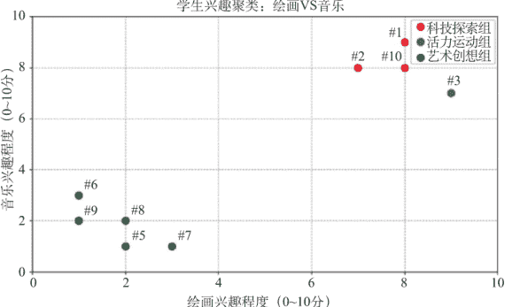

图1-11

当数据复杂信息过多时，计算机还能把高维数据压缩为低维信息，便于分析，这就是数据降维。好比把复杂地图简化，只保留主干道与地标，原本密密麻麻的地图瞬间清晰易懂。

无监督学习更像赋予系统自主探险的能力，没有标准答案可对照，仍能从海量信息中自行摸索出潜在的关联与模式。这种自下而上的发掘方式，对厘清数据内在结构、产出全新认知特别有价值。

### 1.2.4 AI学习的“第三招”：强化学习
设想你拿到一台从未接触过的游戏机，没有教程也没有攻略。起初根本不晓得哪个键能起跳、哪个方向更安全，只能靠反复试来积累经验。每一次操作奏效，系统就会给积分作奖励；操作失误则会被扣分甚至直接结束游戏。在这种不断试错的循环里，玩家慢慢摸透了游戏套路，这正是强化学习的核心理念。

在强化学习里，计算机扮演游戏玩家，通过反复试错实现成长。它置身于一个叫做“环境”的互动空间，以“智能体”的身份与外界持续交互：每做一次行动，环境便返回反馈，表现好就得到正向激励，表现差就承受负向惩罚。

最典型的例子是AlphaGo。围棋盘面变化无穷，像一座巨大的迷宫，这款围棋AI正是借助强化学习在成千上万次对弈中提炼出更优的落子策略。它不断探索新招，每赢一局就获得奖励反馈，从而激励自己继续尝试与优化。随着对局积累，实力持续提升，最终击败人类世界冠军，如图1-12所示。

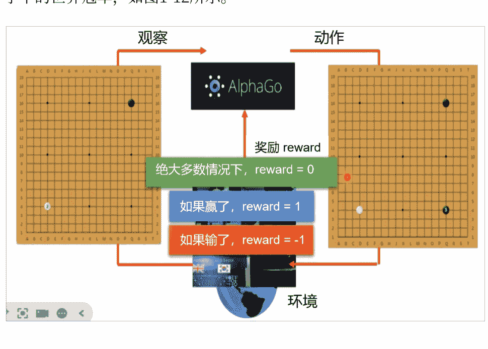
图1-12

除此之外，半监督学习也是常见补充。现实里，人工标注海量数据成本高、耗时长，半监督学习就能发挥作用。它先用少量已标注样本搭建起初步模型，再借助大量未标注数据，通过聚类等手段推断缺失标签，逐步完善模型。

这些技术在生活里无处不在。手机拍猫，AI能立刻判断是橘猫，背后是监督学习在图像识别中的应用；医院里它可化身医疗助手，从X光片中揪出异常病灶；无监督学习能在海量病历里挖掘隐匿线索，揭示疾病的潜在规律；智能刷题软件会根据错题和答题节奏，把学习困难相似的学生聚类，给到定制练习；擅长自我进化的强化学习在医疗场景里可反复训练智能仪器、优化治疗方案；日常互动中，它还能捕捉你的音乐偏好、运动习惯，变成贴心的个人伙伴。

## 成就打卡

### 我学会了 ✅
- □ 能说明AI学习的基本含义与核心要素。
- □ 能区分监督学习与无监督学习的不同之处。
- □ 能举出强化学习的一个实际应用案例。

## 1.3 动手实验

### 1.3.1 机器学习训练猫狗识别

#### 1. 实验准备
(1) 电脑一台。
(2) 浦育平台 (https://www.openinnolab.org.cn/)。

#### 2. 步骤
(1) 进入浦育平台。登录后在首页找到并点开“AI体验”标签，如图1-13所示，进入体验页面。


图1-13

(2) 选择体验项目。在AI体验页面中挑选“图像分类”项目，如图1-14所示，然后点击“开始体验”。


图1-14

(3) 设置分类名称。在图像分类界面见图1-15，点击蓝色框内的“✏️”按钮，将“分类1”改名为cat，再将“分类2”改名为dog。

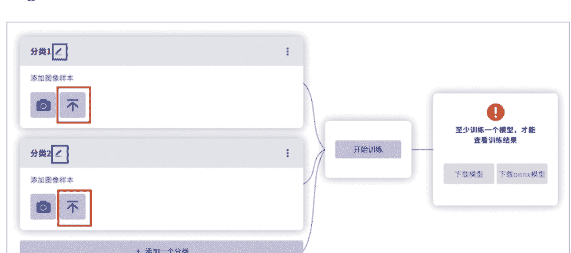
图1-15

(4) 上传训练数据。点击cat分类下的 ⬆ 按钮（图1-15红框），从素材库 “猫狗识别数据集\traing_set\cat” 目录导入图片，如图1-16所示。dog分类同理上传对应样本。


图1-16

(5) 开始模型训练。确认图片全部上传后，点击“开始训练”按钮，如图1-17所示。此时AI开始学习区分猫狗，训练需要一定时间，请耐心等待。

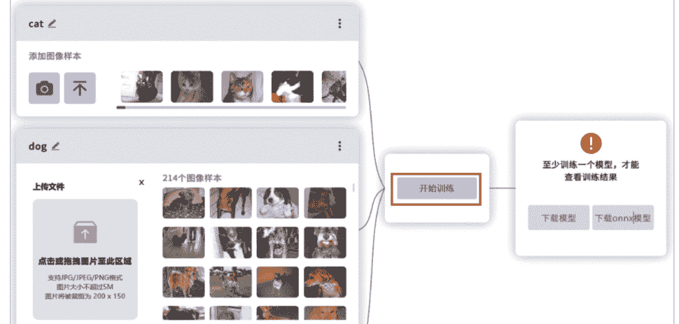
图1-17

(6) 测试模型并查看结果。训练结束后，点击“输出”文本框，可用摄像头拍摄新照片或从素材库“猫狗识别数据集\test_set”中选取图片，如图1-18所示进行测试。图1-19显示上传的小猫被正确识别。

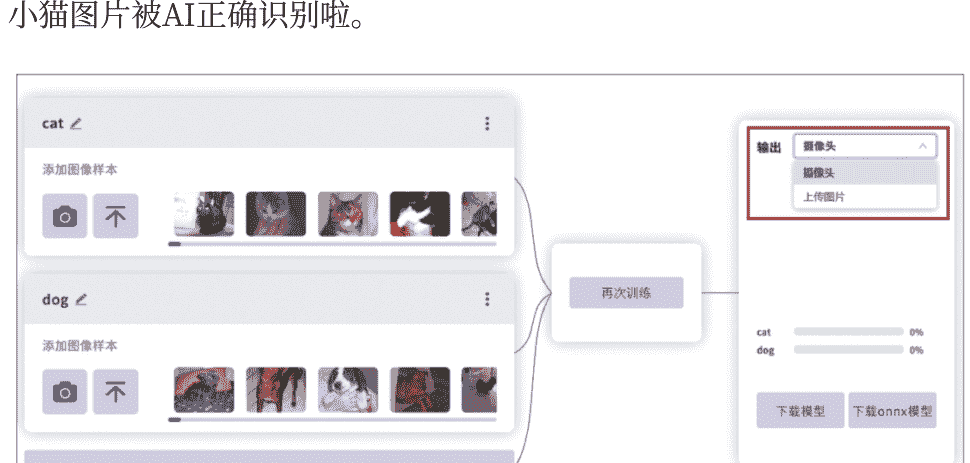
图1-18

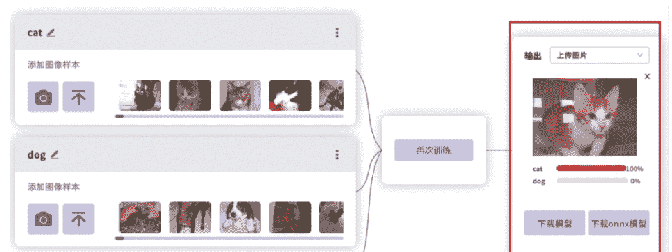
图1-19

#### 3. 思考任务
(1) 若在第6步上传一张兔子照片，模型会给出怎样的判断？原因是什么？
(2) 如果由你来设计一个新的机器学习任务，你会选择什么主题？可以是植物分类、乐器识别、运动装备辨识，甚至天气预测等你感兴趣的方向。

#### 4. AI学习的真相大揭秘
你刚完成了一次“AI视觉训练营”，教会它分辨猫狗。下面一起复盘学习流程。

实验可分为三大环节：其一数据准备即步骤4，相当于为学生挑选教材，带标签的图片就是AI的专属课本，每张都对应知识点；其二模型训练即步骤5，AI像“找不同”专家，细致解析像素信息，从耳形、鼻部比例等多维度提炼规律，形成判别标准并构建猫狗分类模型；其三验证即步骤6，用新图检验AI是否真正掌握区分能力。

实验中还有不少思考彩蛋：上传兔子照会归到猫还是狗？模型库里根本没有兔子类别。更有趣的是，若训练集只有白猫和黑狗，AI很可能把颜色当成区分依据，从而把黑猫误判为狗。这些“翻车”案例说明，AI表现高度依赖训练数据，数据质量直接决定模型“智商”。不妨多做尝试。

本次实践揭示了AI学习的本质：从海量数据中挖掘规律、提取特征并实现智能分类。就像人类靠观察学习，AI也需要大量“练习”才能掌握新技能。后续旅程将继续深挖AI学习的更多奥秘。

### 1.3.2 和语音助手玩知识问答

#### 1. 实验准备
(1) 一部安装了语音助手（Siri、华为小艺等）的手机、一个智能音箱（小爱同学、天猫精灵等）。
(2) 实验开始前，先熟悉语音助手的唤醒方式，然后依次向语音助手提问表1-3中的6个问题，并记录它们的答案。

表1-3

| 问题 | 语音助手 A | 语音助手 B | 结果对比 |
| --- | --- | --- | --- |
| 珠穆朗玛峰有多高？ | | | |
| 鲸鱼是鱼吗？ | | | |
| 1+2+3+…+100 等于多少？ | | | |
| 请帮我定好每周一早上 7:00 的闹钟？ | | | |
| 谁是世界上最漂亮／帅的人？ | | | |
| （用熟悉的方言或中英文混杂提问）今天的天气怎么样？ | | | |

#### 2. 实验拓展
设计自己的问题，测试一下语音助手如何回答？提问的问题可以分为标准题、模糊题以及升级挑战题。对于有固定答案的标准题，记录回答的速度和准确性；对于模糊问题，如“谁是世界上最漂亮／帅的人？”“谁是最厉害的人？”“怎么成为学霸？”等，观察语音助手如何应对；还可以用方言或中英文混杂提问（如“侬晓得外滩伐？”“Who is Jay Chou？”）等升级挑战题。记录一次语音助手的“神回复”或“翻车现场”：____________________________________。

#### 3. 思考任务
如果语音助手答错了，你能猜到原因是“数据不足”还是“算法漏洞”吗？

### 1.3.3 设计一个校园AI助手
作业本总忘记带？食堂排队太长了？值日偷懒，垃圾没清理干净被老师批评了？校园生活里总是藏着不少让人头疼的小烦恼，现在是时候让AI助手大显身手了！请你开动脑筋，发挥你的想象，打造一个超级校园AI助手，把这些烦恼统统“拿下”，让AI助手成为你校园生活的得力小伙伴吧！说不定，你的设计在未来真的能走进校园呢！

请为你的“AI小伙伴”起一个酷炫的名字，比如“作业救星007”“食堂雷达侠”；描述AI小伙伴能帮你解决哪些校园里的烦恼；画出AI的造型，并在图中列出它的核心技能；最后为你的AI小伙伴设计一个响亮的专属口号。将你的成果填入表1-4中。

表1-4

| AI 小伙伴名字 | |
| --- | --- |
| 解决的烦恼 | |
| 造型与功能 | |
| 专属口号 | |

## 成就打卡

### 我学会了 ✅
- □ 设计自己的问题，并记录与语音助手的一次互动。
- □ 设计解决校园烦恼的AI小助手。

## 闯关测验

1. （单选）AI的英文全称是什么？（）
- A. Artificial Intelligence
- B. Automatic Information
- C. Artificial Information
- D. Automatic Intelligence

2. （单选）什么是人工智能？（）
- A. 一种计算机程序
- B. 赋予机器感知、思考和行动能力的学问
- C. 一种算法
- D. 计算机硬件设备

3. （单选）智能音箱能根据语音指令播放音乐，在这个过程中，AI的“思考”环节是指（）。
- A. 麦克风接收语音
- B. 从音乐库中匹配歌曲
- C. 音箱播放音乐
- D. 调整音量大小

4. （单选）下面哪种机器学习方法需要使用标记好的数据进行训练？（）
- A. 监督学习
- B. 无监督学习
- C. 强化学习
- D. 半监督学习

5. （多选）以下属于AI“感知”能力的实现方式有？（）。
- A. 摄像头采集图像
- B. 麦克风收录声音
- C. 激光雷达扫描环境
- D. 机械臂抓取物品

6. （多选）小明用手机AI识图软件识别石竹时，软件误判为康乃馨，这可能是因为（）。
- A. AI没有视觉
- B. 训练数据中缺少石竹样本
- C. AI的识图模型需要优化
- D. 手机的拍摄条件影响了识别效果

7. （填空题）机器学习通过让计算机对大量_______进行分析，利用特定_______挖掘其中的_______，从而使计算机具备识别、预测等能力。

8. （排序题）我们要教AI认识猫和狗。下面是任务的步骤，你能把它们按正确的顺序排列好吗？（）
- A. 选一个厉害的“学习方法”：算法、训练模型
- B. 收集大量猫和狗的照片
- C. 用新的照片考AI：拿它没看过的图问“这是猫还是狗？”
- D. 当“标签小能手”：在每张照片上写“猫”或“狗”，告诉AI这是“谁”
- E. 帮AI “补课”：如果它认错了，就调整一下它的“学习方法”

9. （排序题）请你将AI “识别宠物狗” 任务的步骤按正确的顺序排列。（）
- A. 通过算法分析图片中狗的特征
- B. 摄像头拍摄宠物狗的照片
- C. 与已学习的“狗”的特征模型对比
- D. 得出“这是狗”的判断结论

## 成就贴纸

看看你获得了几张贴纸。

| 阅读全章内容 | 成就打卡 | 完成闯关测验 |
| :--- | :--- | :--- |
| | | |

# 第2章 AI进化史：从古至今的智能革命


## 2.1 AI的“祖先”与里程碑
在探索人工智能的奇妙世界之前，让我们先打开历史的画卷，看看AI是如何从简单的计算工具成长为今天的智能伙伴的。在古老的神话与传说里，人类便开始幻想创造拥有自主意识的造物，比如古希腊的机械侍女和中国古代的木牛流马，为AI的发展埋下了最初的种子。

随着科学技术的进步，人类对智能创造物的探索逐渐从神话和传说走向现实。1950年，英国数学家艾伦·图灵提出了灵魂之问：“机器会思考吗？”他设计的“图灵测试”（见图2-1）给智能下了一个精妙的定义：如果隔着幕布进行五分钟对话，有三成以上的测试者都把人工智能错判成人类，那么就代表这台机器拥有了智能。

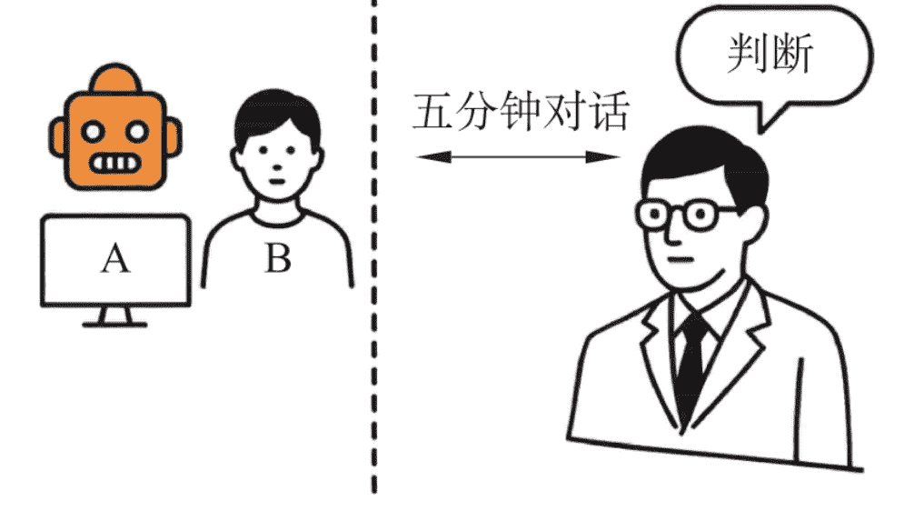
图2-1

1956年的达特茅斯会议，就像智能世界的“独立宣言”。达特茅斯学院的约翰·麦卡锡、哈佛大学的马文·明斯基等一群杰出的科学家聚在一起，正式将这门新学科命名为人工智能。

整整两个月，科学家热烈讨论着如何让计算机学会思考、解决问题，使其成为会下棋的电脑、能对话的机器人、可以学习的机器……就像我们人类一样。这次会议就像点燃了一束永不熄灭的火炬，照亮了后来所有AI科学家前进的道路。

有趣的是，当时他们乐观地预测“二十年内机器就能完成人类所有智力工作”，虽然这个预言没有完全实现，但正是这群梦想家的积极探索，开启了人工智能研究的黄金时代。

### 2.1.1 机械时代→数字时代

#### 1. 远古计算智慧：从算盘到机械计算机
让我们穿越回三千多年前的商朝集市，看看商人使用的一种神奇的计算工具——算盘（见图2-2），听听光滑的木珠在细长的木杆上灵活滑动，发出清脆的“哒哒”声。上珠每颗代表数字5，下珠每颗代表数字1，拨动珠子就像我们在键盘上输入数字，能完成复杂的加减乘除运算。直到今天，在江南古镇的一些老店铺里，经验丰富的店主仍然能用这个既不用电、也不会死机的“木头计算器”算得比电子计算器还快。

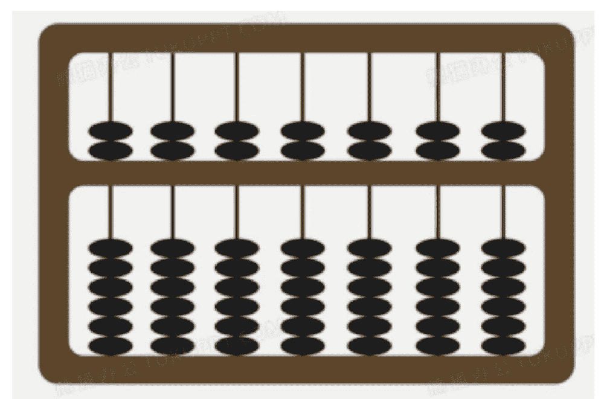
图2-2

时光流转到17世纪的法国，18岁的天才少年帕斯卡为了让担任税务官的父亲的工作更轻松，发明了世界上第一台机械计算器（见图2-3）。该计算器通过手动旋转轮盘进行数字的输入和计算，就像给机器装上了“算术手指”，当齿轮旋转一周，10个齿中最长的齿会和更高位的齿轮啮合，从而实现进位，同理，反过来旋转就是减法计算。不过，即使是计算“6+8”这样简单的算式，也需要转动14次齿轮，这可比我们现在按计算器慢多了。

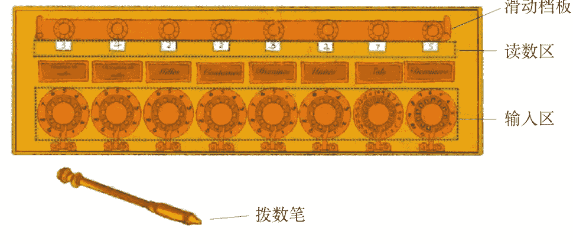

#### 2. 理论奠基：图灵机与计算机的诞生
1936年，英国数学家艾伦·图灵在纸上描绘了一个改变世界的构想——图灵机。这个存在于理论中的机器由三部分组成：一条无限长的纸带、一个可以左右移动的读写头，一个存储一系列规则的控制器，如图2-4所示。

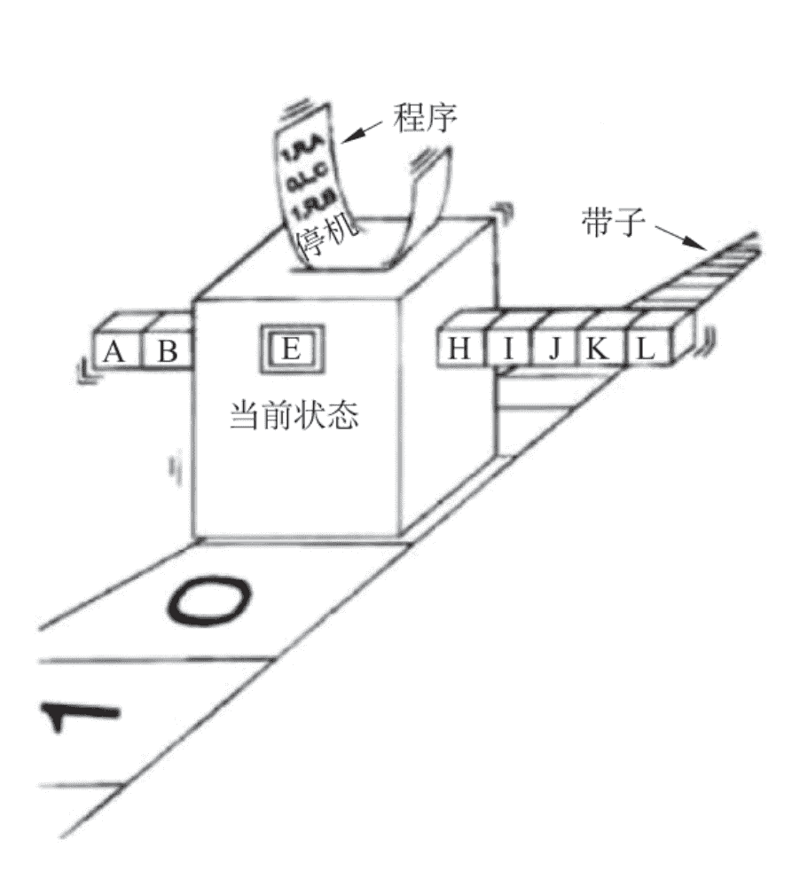
图2-4

虽然图灵机只是一个抽象概念，但它的设计理念直接影响到现代计算机的发明。现代计算机的“运算器、控制器、存储器”结构，本质上是图灵机的物理实现。现在的编程语言，无论是Python还是C++，程序的本质都是“告诉计算机如何按照规则处理数据”，类似图灵机的控制器规则。

1946年，世界上第一台通用电子计算机ENIAC在美国宾夕法尼亚大学诞生了（见图2-5）。这个“电子巨人”可真是个大家伙，重达27吨，足足有5头大象那么重，占用的空间比三个教室加起来还要大。

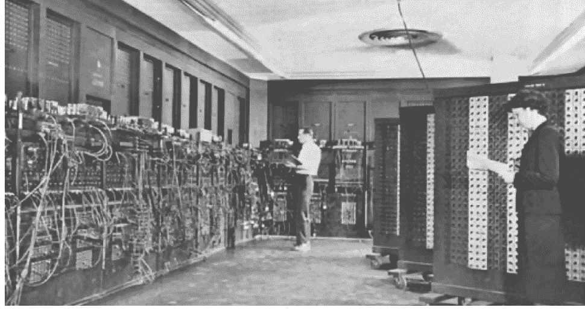
图2-5

ENIAC的设计初衷是计算火炮弹道，每秒能完成5000次加法运算。虽然现在随便一个小计算器都比它厉害得多，但在那个年代，它可是让全世界都惊叹的“超级大脑”呢！正是它开启了今天的数字时代，成为所有智能手机、游戏机和人工智能的“老祖宗”。

就像算盘的木珠变成了计算机的二进制代码0和1，机械齿轮进化成了电子晶体管，计算的本质始终未变，只是形式在不断革新。从算盘到ENIAC，人类完成了从“用手计算”到“用机器思考”的惊人飞跃，而这一切，都始于那些敢于想象“机器能否思考”的勇敢心灵。

#### 3. 计算革命：从电子计算机到AI加速器
随着技术的发展，计算机变得越来越小巧。20世纪50年代，晶体管的发明让计算机摆脱了笨重的真空管，体积缩小了上百倍。

1971年，英特尔公司推出了一颗只有指甲盖大小的芯片——4004微处理器，这个小小的方形硅片上集成了2250个晶体管，运算能力却堪比当年占据整个房间的大型计算机。就像把一头大象神奇地装进了火柴盒，微处理器的出现让计算机开始“瘦身”，从实验室的庞然大物摇身一变，成了可以放在办公桌上的个人电脑，正式开启了个人计算机时代。

时间来到1999年，NVIDIA公司推出了GeForce 256显卡，首次正式提出“图形处理器（graphics processing unit, GPU）”这一概念。谁能想到，这个原本只是为了让游戏画面更加炫酷的小家伙，后来竟然华丽转身，成了人工智能的超级加速器。

传统CPU像一位学识渊博的博士，一次只能深入思考一个问题。而GPU则完全不同，它更像一个由上千个聪明小学生组成的“超级班级”，虽然每个小学生的个人能力都比不上博士，但他们可以齐心协力，同时解决成千上万个简单的问题，如图2-6所示。正是这种“人多力量大”的超能力，让AI模型的训练速度提升了上百倍。

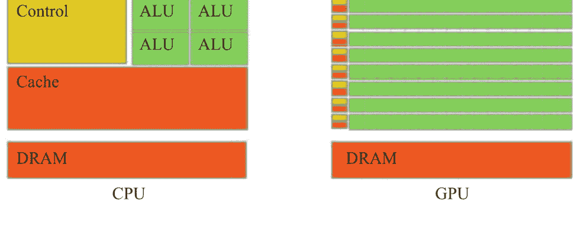
AlphaGo能在短短几个月内完成人类棋手一生的对局量，正是由于这些GPU在背后疯狂工作，每秒进行上亿次运算，才让它拥有了战胜人类冠军的“最强大脑”。

此后，张量处理单元（tensor processing unit, TPU）、神经网络处理器（neural network processor, NNP）等专业的AI芯片不断涌现，让计算机拥有了全新的“思考方式”。让我们来进行一个炫酷对比：现代GPU在1秒内的计算量，ENIAC需要数百年甚至上万年才能完成。未来，量子计算机可能会成为下一代计算工具，它的运算能力将再次颠覆我们的想象。不同年代计算工具每秒计算次数对比如表2-1所示。

表2-1

| 年代 | 计算工具 | 每秒计算次数 |

| :--- | :--- | :--- |

| 1642 | 机械计算器 | 0～1次加法运算 |

| 1946 | ENIAC | 5000次加法运算 |

| 2025 | 智能手机 | 数万亿次浮点运算 |

从算盘到掌上终端，算力完成了多次数量级的跨越。算盘塑造了人类的算术直觉，机械装置让加减摆脱了手工；图灵的通用计算设想在电子管时代落地，运算从迟缓转为迅捷；如今图形处理器为大模型提供接近神经系统的算力底座。每一轮跃进都承接前人经验，也为后续探索开辟路径，这既是硬件性能的指数攀升，也是对智能边界的持续叩问。

### 2.1.2 六十年人工智能的起伏

从首个自称会“思考”的程序面世，到当今可以闲聊做作业的伙伴，人工智能经历了多次高潮与回落。整体可以归为三段，每段都带来能力提升与应用拓展。

#### 1. 萌芽试探期（1956—1980年）——诞生与摸索

那个年代的程序像初学书写的孩童，笨拙却好奇。1956年问世的逻辑理论家被视作首个真正意义上的智能程序，它擅长数学定理证明，能模仿人类推理方式推导出《数学原理》中的数十条命题，其中几条证明甚至比原著更简洁优美。

该事件具有里程碑意义，首次证实符号运算能够支撑机器智能。就像用积木搭建模型，它用数学符号搭起了智能的雏形。

1966年推出的ELIZA对话系统，呈现了最原始的共情雏形。系统只是关键词匹配加固定模板回复，却意外产生“咨询”效果。比如用户说“我最近很焦虑”，ELIZA会回“能多说说焦虑的原因吗”。这种简易交互让不少测试者误以为面对真人医生。

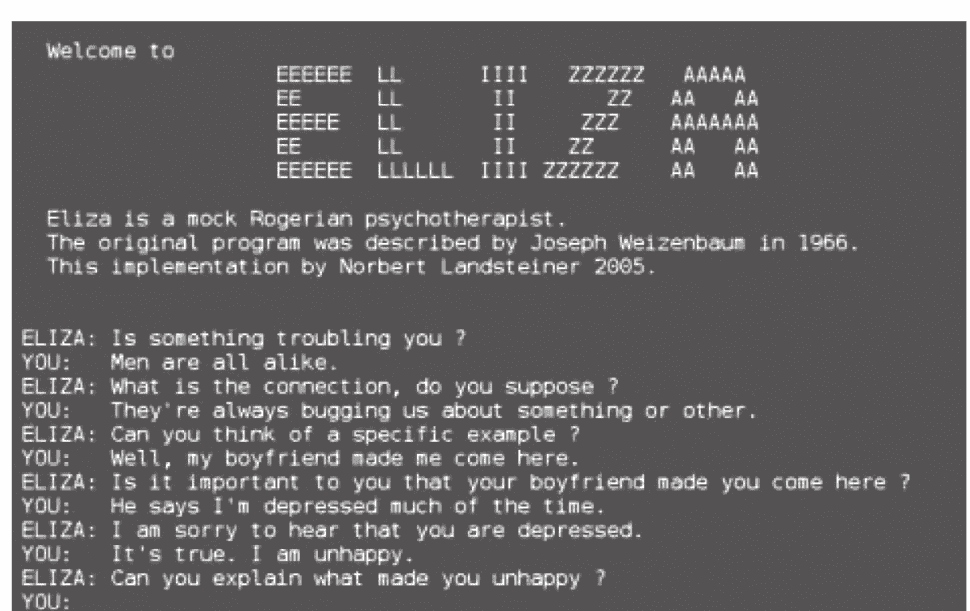

图2-7

随后研究出现了两条分化路径。

研究中逐渐形成两大范式：符号派和联结派，前者像教材派，后者像学徒派。

解题时记住“三角形内角和为180°”就能解决一类问题，符号派正是如此，把知识写成“若…则…”规则输入机器，像个只按教案执行的学生。

1.2节里AI学认猫的过程代表联结派，它模仿人脑约860亿神经元的连接方式，通过海量样本自行归纳规律，像孩子靠观察形成认知。

首个阶段符号派占上风，联结派则边缘化。早期系统很吃规则，遇到超纲情境便无能为力，如同小学生遇难题一片空白。

同时行为主义萌芽，主张通过“感知—行动”交互培育智能，在机器人控制上初现端倪，影响虽小却为后来的强化学习埋下伏笔。

70年代硬件跟不上构想，运算太慢导致许多设想无法落地，迎来第一次寒冬。但这些尝试为复兴积累了经验。

#### 2. 专项突破期（1980—2010年）——在细分赛道称王

80年代起，人工智能开始在专业领域发力，成为名副其实的单项冠军。

斯坦福的MYCIN系统在医院检验科充当“机器人医生”，专治血液感染，准确率约69%，还能依据个体情况给出抗生素建议，水平接近资深医师。

工业界也有亮点，DEC的XCON专家系统每年处理上万台电脑配置订单，准确率超95%，显著提升运营效率。

甚至野外勘探也用上智能助手，PROSPECTOR系统像“矿藏侦探”，成功预判华盛顿州地下钼矿储量，为企业节省数百万美元勘探成本。

这一时期涌现的代表系统见下表。

表2-2

| 系统名称 | 专业领域 | 核心能力 |

| :--- | :--- | :--- |

| MYCIN | 医疗诊断 | 血液感染判别及药物建议 |

| XCON | 电脑配置 | 计算机系统自动配置 |

| PROSPECTOR | 地质勘探 | 矿产资源预测与评估 |

| DENDRAL | 化学分析 | 分子结构识别与解析 |

80年代也是技术多元化的窗口期。日本启动“第五代计算机计划”，目标打造类人思考机，虽未完全实现，却催生出并行计算等关键技术。

1986年，杰弗里·辛顿在《自然》发表论文，提出的反向传播算法像是打开神经网络的钥匙，让网络可以有效训练，沉寂多年的研究重新活跃。

同时智能系统掌握两项新本领。

- 统计学习：系统从数据中自主提取知识。
- 强化学习：1989年诞生的Q-learning让系统无需教师自学。1992年IBM的双陆棋程序TD-Gammon靠自我对弈达到世界顶尖水平，展示了强化学习的威力。

1997年，IBM深蓝击败国际象棋世界冠军卡斯帕罗夫，见图2-8，成为标志性事件。机器每秒可演算两亿步棋，彰显暴力计算在规则明确领域的威力。

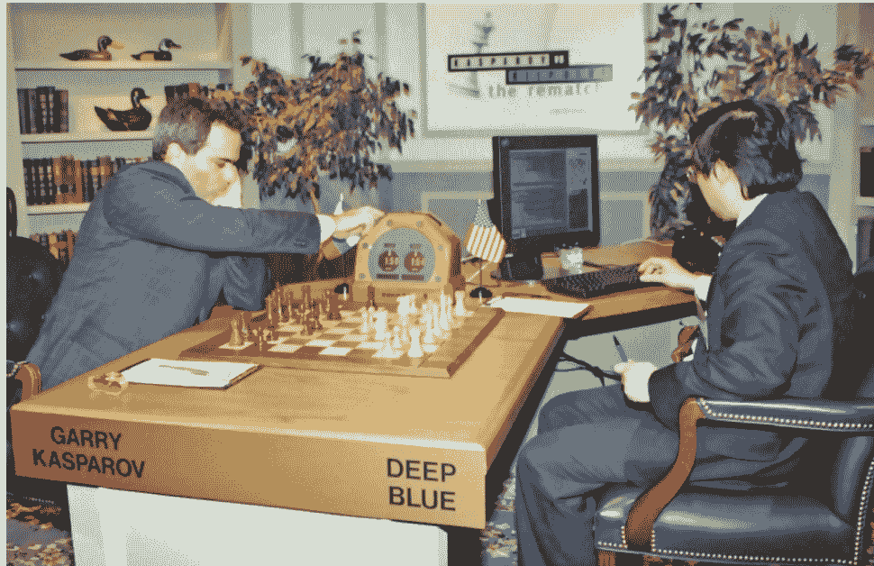

图2-8

有趣的是，深蓝本质是符号派的应试高手。系统内置超两百万局大师棋谱，按既定规则落子，如同背下整本习题答案却不懂原理。它证明在封闭规则内算力可达顶尖，但要真正“理解”棋局仍需更聪明的方法。

2006年迎来学习范式革新，辛顿团队提出深度信念网络，像为系统定制黄金学习法。过去网络像健忘的学生，后续学习覆盖前期记忆。辛顿提出分层渐进训练，先夯实单层再串联整体，犹如装上记忆增强器，使其在图像识别、语音理解等复杂任务上崭露头角。如今手机人脸解锁、语音助手等功能都源于此。

该阶段智能仍有局限：系统专用性强、扩展性差、依赖人工知识注入。但已落地多场景：医疗助手辅助病情分析；邮箱自动过滤垃圾邮件；导航规划最优路线；手写识别广泛用于掌上设备，见图2-9。

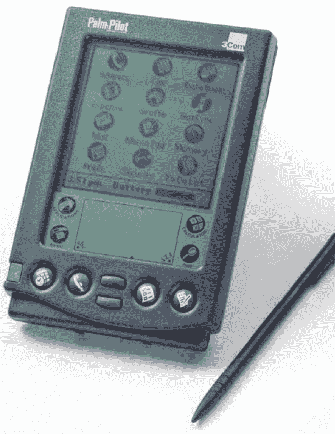

图2-9

智能不再是实验室玩具，成为解决实际问题的工具。这些单项冠军的表现为全面爆发奠基。

#### 3. 通用跃升期（2010年至今）——从偏科到全能

21世纪以来，人工智能从偏科生变为全能选手，向通用化高速迈进。以下里程碑尤其醒目，见图2-10。

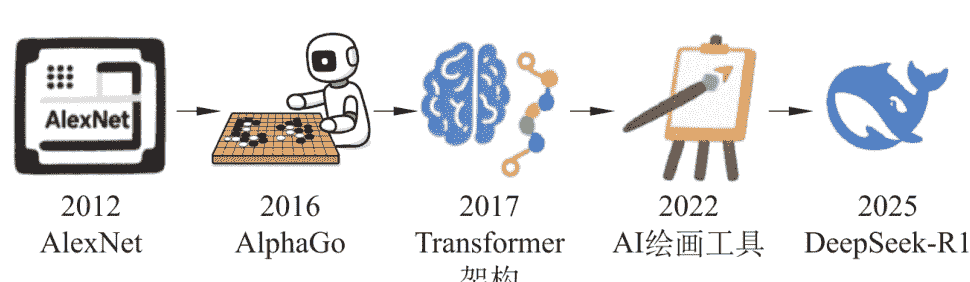

图2-10

- 2012年，AlexNet在ImageNet视觉竞赛中脱颖而出，图像识别错误率从传统方法的26.2%降至15.3%，开启深度学习新纪元。
- 2016年，AlphaGo以4比1战胜围棋世界冠军李世石，下出职业棋手惊叹的“神之一手”。2017年AlphaZero仅用34小时自我训练便超越所有版本，展现无师自通的强化学习能力。
- 2017年，谷歌团队提出Transformer结构，像为系统装上超级大脑，当前主流聊天机器人与智能助手多基于此，彻底改变发展轨迹。
- 2020年，DeepMind的AlphaFold2在蛋白质结构预测竞赛中达到实验精度，为生物医药带来革命。
- 2022年，ChatGPT震撼全球，能流畅对话、创作诗歌、编写调试代码，让大众首次深度体验生成式智能魅力。
- 2022年，Midjourney与Stable Diffusion掀起创作浪潮，普通人输入文字即可生成媲美专业画师的图像。
- 2025年，DeepSeek-R1实现现象级突破，以低成本高性能推动推理模型发展，让高性能模型更易获取。

这些进展不断刷新认知边界，从单一任务专才到通用智能曙光，进步速度堪比时光机。

人工智能发展像闯关游戏，科学家不断突破，见图2-11。

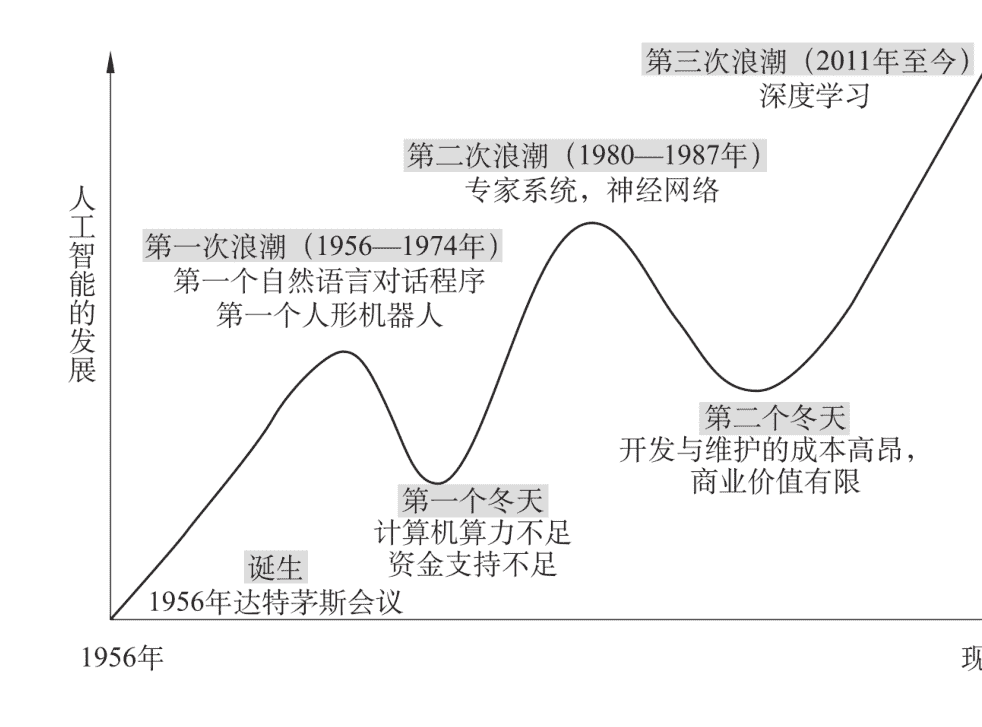

图2-11

起初，人们试图用公式和规则教系统思考，如同给机器人一本厚说明书。很快发现现实世界过于复杂，规则不足，懂规则却踢不好球。

随后智能走专家路线，在医疗、下棋等领域发光，却受制于知识获取瓶颈。

直到深度学习成为秘密武器，系统才进入爆发期，每一次失败都是通向新突破的阶梯。

进步离不开三大支柱：海量数据是经验值，GPU算力是武器，深度学习算法是技能树，三者缺一不可。

我们正站在新章节：系统已能解题、编程、下棋、绘画、写诗、拍片，但距离真正通用智能仍有很长的路。未来挑战更大，突破带来的成就感也更强。这提醒我们，保持好奇与韧性，比一时胜负更关键。毕竟，最精彩的关卡永远在下一局。

### 2.1.3 中国人工智能的关键里程碑

中国智能发展像一场科技马拉松，从追赶到领跑，创造多项瞩目成果。

#### 1. 萌芽起步期（20世纪八九十年代）：实验室里的雏形

- 1989年，第一届全国信号处理—神经网络学术会议在广州召开，标志神经网络研究从分散探索走向组织化协作。
- 90年代初，我国在汉字识别等基础技术取得初步进展，让计算机读懂汉字。

#### 2. 觉醒追赶期（2010—2014年）：互联网时代的弯道

- 2010年，百度成立NLP团队，开始让系统理解“的、地、得”的细微差别，如同给智能报中文补习班。
- 2014年，香港中文大学汤晓鸥团队将人脸识别准确率提升至99.15%，首次超越人眼辨识，跻身世界前沿。
- 2014年，科大讯飞语音识别突破方言壁垒，系统能听懂四川话“巴适得板”。

#### 3. 爆发回暖期（2016—2017年）：大圣归来

- 2016年，百度语音识别系统准确率达96%。
- 2017年，《新一代人工智能发展规划》发布，智能被列为国家战略。阿里巴巴“城市大脑”落地杭州，优化信号灯调度，降低拥堵15%。中科院研发首款智能芯片寒武纪，打破技术垄断，为中国智能造“中国心”，见图2-12。


图2-12

#### 4. 领跑扩张期（2018—2023年）：银河战舰启航

- 2018年，华为昇腾芯片问世，算力相当于1万台ENIAC，体积仅手机大小。
- 2020年，智能医疗影像系统在新冠疫情期间快速诊断CT，阅片速度比人工快30倍。北斗导航借助智能规划路线，误差3～5米。
- 2023年，文心一言、通义千问等大模型发布，中文智能进入对话时代，能写七律诗、画水墨画。

#### 5. 突破重塑期（2025年）：DeepSeek开启新纪元

2025年，自主研发的DeepSeek大型模型以创新架构和出色性能震撼全球。其“高性能+强开源+低成本”路径重塑全球格局，证明中国智能具备底层创新与全球竞争力，国产算力可支撑世界级模型训练，开源生态加速技术全球化渗透。

#### 6. 未来彩蛋

- 正在研发的脑机接口智能，或许很快能实现意念下围棋。
- 量子智能计算机“九章”，1分钟可完成超级计算机1亿年的任务，见图2-13。

从实验室到生产线，从代码到应用场景，人机协同、智慧普惠的图景在中国加速展开。中国智能发展史是一部拼搏创新的奋斗史，相信未来将在世界舞台持续发光，为人类进步贡献更大力量。


图2-13

### 2.1.4 智能的超级应用：下围棋

#### 1. 围棋的难度与段位体系

围棋源于四千多年前中国，如今是全球瞩目的智力竞技，见图2-14。19×19棋盘上黑白轮流落子，以围地吃子为目标。变化之大远超想象，可能局势数高达2.08×10^170个。

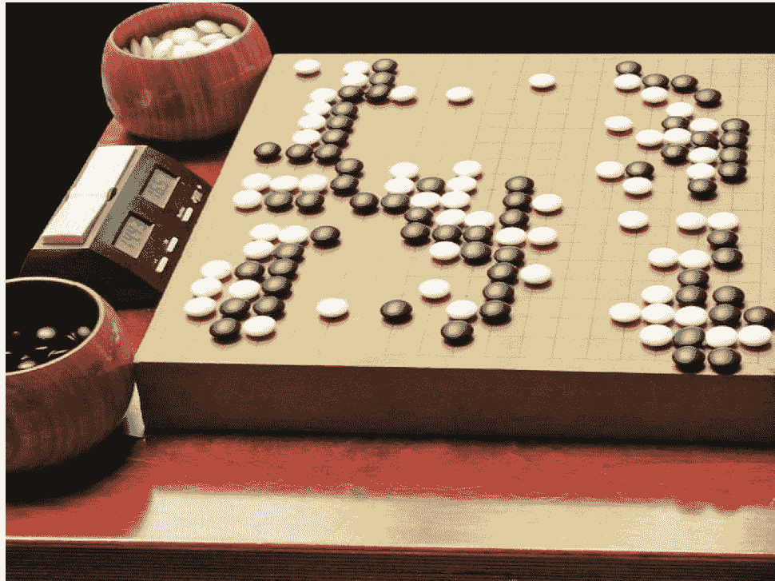

图2-14

围棋高手也有段位江湖。

- 新手村：业余25级起步，逐步升至1级，共25个业余级位。
- 业余高手：1级以上可参加业余段位赛，最高业余7段。
- 职业宗师：职业初段至九段，需专业训练并在高水平赛事中胜出。职业九段极其稀少，全国不足60人，比航天员还少。

#### 2. 人类棋手的修炼之路

跟随一位围棋少年的成长，可见从入门到九段的艰辛。

##### 1) 入门阶段（业余1～3段）

需牢记“金角银边草肚皮”等基本口诀，重点掌握规则与简单战术，如吃子、做眼，相当于小学生练加减乘除。

##### 2) 进阶阶段（业余4～5段）

要研读3000～5000局经典棋谱，相当于啃完一个图书馆。此阶段棋手可在公园轻松战胜老年棋友，对常见棋型烂熟于心。训练包括打谱、解题、实战，强度如高考备战。

##### 3) 职业门槛（业余6段～职业初段）

训练强度堪比专业运动员，日均8小时，研究最新职业棋谱、复盘对局、与高手切磋。职业棋手大脑如超级计算机，能存储上万种变化并快速调用。

##### 4) 巅峰之路（职业初段～职业九段）

如柯洁、李世石等顶尖九段，棋艺逼近大脑极限。对弈时可预见数十步变化，判断全局并洞察对手意图。这种超凡计算力与直觉，是数万小时训练的结晶。

然而即便最强九段，如今也常输给智能围棋程序，因系统可不眠不休每日自我对弈上百万盘，精准计算所有可能变化。人机对决重新定义围棋极限。

#### 3. 智能棋手的疯狂特训营

智能的围棋之路与人类迥异，它没有漫长童年启蒙，直接扎入数据海洋。

##### 1）第一阶段：模仿的学步者（1997—2015年）

智能围棋启蒙始于海量人类棋谱学习，研究者构建庞大知识库让系统模仿人类走法，如同让新手反复研究经典局积累经验。但围棋复杂度极高，填鸭式教育虽快速掌握基础，却限制创造力，需更先进学习方式。

##### 2）第二阶段：觉醒的跃进者（2016—2017年）

2016年，DeepMind的AlphaGo以4比1击败世界冠军李世石，见图2-15。比赛中下出职业棋手惊呼“不可能”的妙手，即“神之一手”。

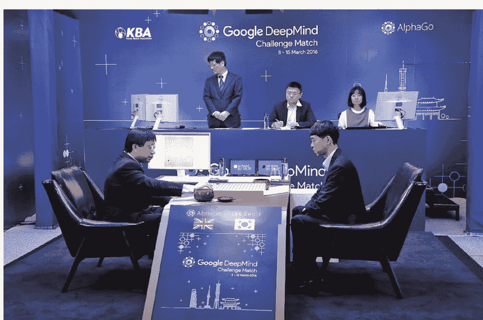

图2-15

AlphaGo的秘密是双网系统：一个网络负责下一步选择，如同思考最佳落点；另一个网络负责评估局势优劣，如同裁判计分。

围棋智能的质变节点

升级版 AlphaGo Zero 让围棋智能进入全新的层级。系统完全抛弃人类棋谱，单靠 490 万盘自对弈，21 天就把全部人类棋手甩在身后。惊人的自学速度配合颠覆性招法，直接改写了传承数千年的围棋体系，也为人工智能在复杂决策上的突破立下里程碑。

##### 3）第三阶段：开宗立派的创道者（2018年至今）

围棋向来被视作检验智力的终极场域，AI 在此完成了惊人的蜕变。过去还需要人类手把手教的学徒，现在已能指点职业高手。

以绝艺、KataGo 为代表的第三代围棋 AI，宛如来自未来的先知，优势主要体现在：

- (1) 即便让顶尖人类棋手 2 到 3 子，胜率依然能稳定在 99.8% 左右。
- (2) 能捕捉每一步胜率的细微波动，感知精度细到 0.1%。
- (3) 不论让子与否，都能迅速寻到最优策略。

如今职业九段都在系统研读 AI 对局，把这些棋谱当成未来天书，传统围棋理论正被全面重塑。

这场革新的意义远不止棋盘。AI 棋手展现的自我进化、创造性思维和战略洞察，正在为医疗诊断、金融决策、科研探索等领域指明方向。在黑白交错的方寸间，机器智能完成了从模仿人类到启迪人类的历史性跨越，如表2-3所示。

表2-3

| 学习阶段 | 人类棋手 | AlphaGo（监督学习 + 强化学习） | AlphaGo Zero（强化学习） |

| :--- | :--- | :--- | :--- |

| 启蒙阶段 | 1～3个月掌握基础规则和定式 | 1小时输入规则和初始棋谱特征 | 5分钟接收棋盘规则（无任何先验知识） |

| 能力突破 | 5～10年达到业余高段（每日训练4～6小时） | 3周训练（3000万局人类棋谱） | 24小时达到业余6段（约50万局） |

| 职业水平 | 15～20年成为职业九段（训练量约3万局） | 40天达到超职业九段水平 | 21天自我对弈490万局，超越所有人类棋手（胜率99.8%） |

| 计算效率 | 单局平均计算量约200步深度推演 | 单步计算：3毫秒（48个TPU） | 单步计算：0.1毫秒（4个TPU） |

| 创新性 | 依赖传统定式，渐进改良 | 结合人类经验与AI优化 | 自创新定式 |

#### 4. AI棋手训练的“秘密武器”

##### 1）算力资源：强大的硬件支持

AI 进化离不开硬核算力。AlphaGo Zero 采用 4 个 TPU 组成的阵列，单颗算力 420 TFLOPS，对局速度达到每秒 140 局。借助 490 万局自我对弈，21 天内冲到超人类水准。这种并行计算能力某种程度上压缩了人类数千年的对局积累。

##### 2）数据集：海量棋谱的积累

AI 学习离不开大量棋谱。训练数据经历了三步跃迁：起步期的 AlphaGo 依赖 3000 万局人类职业棋谱；过渡期的 AlphaGo Master 使用人类棋谱与自我对弈的混合数据；成熟期的 AlphaGo Zero 则只用纯自我对弈生成的 490 万局数据。

##### 3）算法优化：不断提升的模型结构

科研人员持续打磨算法与模型结构，让学习与决策更高效。从最初的监督学习到 2014 年的深度学习，再到 2016 年把深度学习与强化学习结合，2017 年实现纯强化学习训练，每一步技术进步都极大提升了围棋水平。这一演进体现了 AI 从模仿到自主创造的范式转变。

总体上看，AI 学围棋像一场马拉松，需要大量练习与资源投入。从模仿到自学再到深度优化，最终在围棋领域实现了超越人类。

## 成就打卡

### 我学会了 ✅

- ☐ 能说出计算工具的演进。
- ☐ 能说出人工智能发展的三个关键阶段和每个阶段的标志性事件。
- ☐ 能说出AI训练的三个“秘密武器”。
- ☐ 能举例说明中国AI发展关键节点事件。

## 2.2 AI家族分类指南

人工智能宛如一个庞大家族，成员的能力千差万别。下面从两个有趣的角度来认识这个家族。

工具型AI和思考型AI：想象你和两个电子伙伴玩石头剪刀布，工具型AI像按固定顺序出招的对手，思考型AI则会观察你的习惯并试图预测下一步。两者都属于人工智能，但工作方式截然不同。

弱AI、强AI、超AI：想象一起解数学题。弱AI像只会背乘法表的计算器，能答 12×12，却会把“8人分3个披萨”硬算成 0.375；强AI像学霸同桌，能用多种思路讲解并找出陷阱；超AI则像来自未来的数学教授，不仅解题，还能创造全新理论。

### 2.2.1 工具型AI和思考型AI

#### 1. 工具型AI

工具型AI像生活中的隐形帮手，在特定任务上非常可靠，却没有思考能力，只按预设程序执行。

例如 Google Translate 等智能翻译工具，通过海量双语语料训练，能快速给出较为准确的译文，但不会主动学习新语言或文化知识。

这种局限有时会闹出笑话，某款翻译曾把“夫妻肺片”直译为“husband and wife lung slice”，完全丢失川菜文化内涵。这说明工具型AI效率高但本质是数据匹配，缺乏真正的语义理解。

#### 2. 思考型AI

思考型AI更像聪明的朋友，能像福尔摩斯一样灵活应对。它具备自主学习能力，会根据新数据不断优化行为。

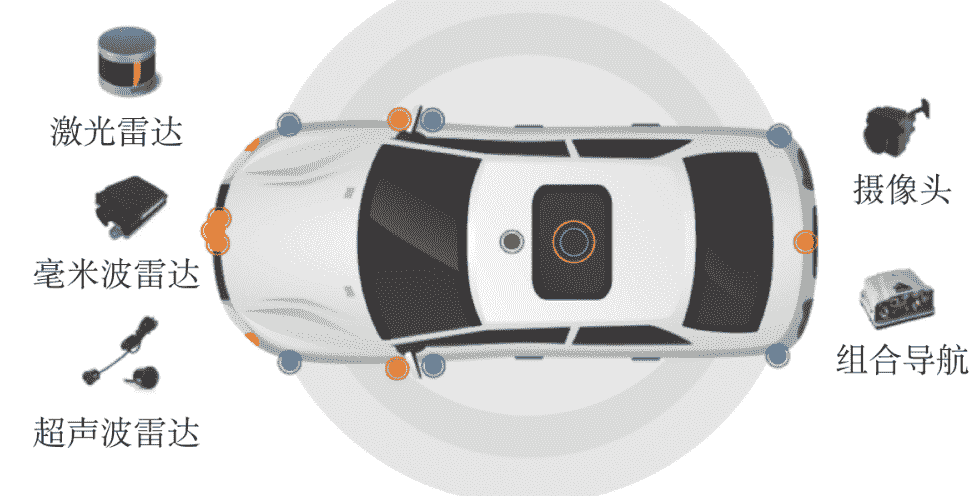

图2-16

例如自动驾驶AI 见图2-16，像经验老到的司机，不仅熟记交通规则，还能在 0.1 秒内做出判断，比人类眨眼还快。智能客服能捕捉言外之意，通过语气判断情绪，还会“做笔记”，记住上次咨询内容以便个性化推荐。

这类AI处于持续充电状态，处理的问题越多越聪明。目前它们仍是可靠助手，离科幻里统治世界的机器人还很远。工具型AI与思考型AI的对比见表2-4。

表2-4

| 特性 | 工具型 AI | 思考型 AI |

| :--- | :--- | :--- |

| 任务复杂度 | 处理单一任务 | 处理复杂的多任务 |

| 自主性 | 需要明确的指令 | 自主思考和做出决策 |

| 学习能力 | 不具备自主学习能力 | 通过数据不断优化自己的行为 |

| 适合场景 | 标准化任务 | 复杂决策 |

### 2.2.2 弱AI、强AI、超AI

#### 1. 弱AI (Artificial Narrow Intelligence, ANI)

当下的AI多是偏科生，在单一领域很强，却缺乏自主意识与跨域推理能力，这就是弱AI。

弱AI有三点特征：只精通一件事，如人脸识别很准却不会下棋；不会举一反三，背会公式却解不了新题型；严格按规则执行，缺少真正理解。

手机Siri能答问题但不会主动学习新知识；AlphaGo围棋无敌却连井字棋都不会；翻译软件能转换语言却把握不住幽默与情感见图2-17。它们的智能来自程序与大数据训练，而非自我意识。


图2-17

#### 2. 强AI (Artificial General Intelligence, AGI)

强AI能够像人类一样全能思考，既能解方程又能写诗，还能理解情绪。它能跨领域切换知识，理解任务背后的为什么，并像人一样通过经验学习。

例如在照护老人时，它不仅按时送药，还会陪聊提供情绪价值。目前强AI仍停留在实验室设想，真正理解世界而非处理数据的挑战仍需数十年攻关。

#### 3. 超AI (Artificial Super Intelligence, ASI)

超AI指智慧全面超越人类的智能，如同来自未来的超级天才。它能在科学、艺术等所有领域轻松碾压人类，自我进化无上限。

它可能帮助人类治愈疾病，也可能带来不可预知风险。学界把智能超越人类的时间点称为奇点，有观点预测在2045年左右出现，目前仍属理论设想，核心难题是如何确保其与人类友好共存。

请将以下案例分别归类到弱AI、强AI和超AI三个类别中，在表2-5中的相应位置打√。

表2-5

| 卡片编号 | 案例描述 | 弱 AI | 强 AI | 超 AI |

| :--- | :--- | :--- | :--- | :--- |

| 1 | 手机上的拍照识花 App，能快速分辨不同花卉品种 | | | |

| 2 | 可以独立编写完整小说，并根据读者反馈调整剧情的 AI | | | |

| 3 | 轻松解开人类尚未证明的数学猜想的 AI | | | |

| 4 | 能同时辅导语文、数学、英语，还能陪你做科学实验的 AI 学习机 | | | |

| 5 | 自动驾驶汽车在复杂路况下安全行驶 | | | |

| 6 | 设计全新能源利用方式，解决全球能源危机的 AI | | | |

| 7 | 学校的人脸考勤系统 | | | |

| 8 | 几分钟内研发出治疗罕见疾病特效药的 AI | | | |

| 9 | 会根据路况调整的红绿灯 | | | |

| 10 | 发现人类从未观测到的宇宙星系运行规律的 AI | | | |

| 11 | 能理解你的情绪，给你讲笑话逗你开心，还会讲睡前故事的 AI 伙伴 | | | |

| 12 | 创造全新艺术流派，引领全球艺术潮流的 AI | | | |

| 13 | 自动批改作业，并给出详细解题思路的 AI 老师 | | | |

| 14 | 提出一套彻底改变人类社会结构，实现乌托邦理想的 AI 方案 | | | |

| 15 | 《三体》中的智子：锁死地球科技，操控人类文明进程 | | | |

注：①弱AI（ANI）：专精单一任务，无自主意识（如Siri、人脸识别）。
②强AI（AGI）：像人类一样全能思考（目前仅存于科幻／理论）。
③超AI（ASI）：智慧全面超越人类（纯科幻或未来设想）。

### 2.2.3 明星AI档案

AI家族里有三位明星：守护健康的医疗机器人、消除语言障碍的AI翻译官、道路上的智能领航员。它们正重塑生活。

#### 1. 医疗机器人

##### 1) 手术机器人：精准的“显微外科医生”

**超能力揭秘：**

- 手臂极稳：机械臂精度达0.1毫米，稳定性超人类医生10倍。
- 立体视觉：提供放大10～15倍的高清3D视野。
- 微创专家：仅需几个约5毫米的小切口完成复杂手术。

2000年7月，达·芬奇机器人手术系统获美国FDA批准，成为首个可在手术室常规使用的机器人手术系统。达·芬奇系统见图2-18，是全球领先的微创手术平台，广泛用于泌尿、胸部、妇科、普外科等，通过高精度机械臂和3D成像让医生操作更精准。

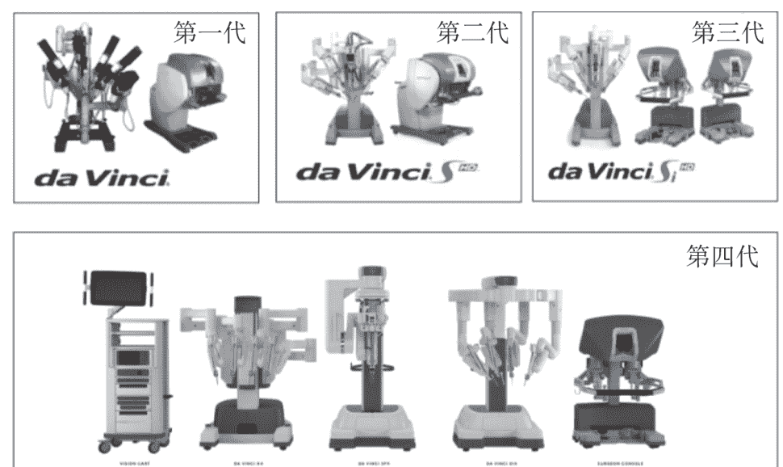

图2-18

##### 2) 康复机器人：耐心的“复健教练”

**超能力揭秘：**

- 力量辅助：帮助中风患者练习行走与日常动作。
- 智能评估：实时记录并分析康复进度。
- 永不疲倦：可重复训练上千次，保持一致耐心。

华盛顿大学团队研发的康复机器人借助深度学习观察患者运动模式，并动态调整训练强度，像耐心的老师帮助脑卒中患者重拾生活信心。

##### 3）护理机器人：贴心的“白衣助手”

**超能力揭秘：**

- 24小时守护：不间断监测生命体征。
- 精准服务：按时按量发放药品，零差错。
- 暖心陪伴：可聊天、玩游戏。

联合国数据显示2050年全球65岁以上人口占比将达16%，老龄化推动护理机器人发展。它们能安全转移卧床患者、提供用药提醒与健康监测，协助阿尔茨海默病患者认知训练与情绪安抚，开启人机协作新时代。

#### 2. AI翻译官：语言巴别塔的终结者

**超能力揭秘：**

- 神经网络支持31种语言互译，部分文学质量接近专业译者。
- 独创语境理解，能区分bank是银行还是河岸。
- 被欧盟议会指定，法律文本翻译准确率可达约92%。

2023年联合国气候大会采用微软AI实时翻译，覆盖官方语言及毛利语等小语种。但其理解仍基于模式匹配，对文化隐喻类语句翻译易失准，难以达到人类翻译官的深度跨文化交流水平。

#### 3. 自动驾驶系统：道路上的智能领航员

**超能力揭秘：**

- 多传感器融合：激光雷达+摄像头+毫米波雷达实现360°监测，探测距离250米。
- 高精地图定位：厘米级精度，实时匹配云端路网。
- 决策规划：每0.1秒生成一次策略，可预判周边车辆未来5秒轨迹。

2024年实测数据Waymo报告显示：完全无人模式下，每百万英里受伤事故率比人类司机低约91%；路口碰撞事故率低96%。在加州，2024年Waymo车辆每千英里人工接管次数低于0.02次，全年安全载客超1000万次，周均出行超25万次。

## 成就打卡

### 我学会了 ✅

- ☐ 能区分工具型AI与思考型AI。
- ☐ 理解弱AI、强AI与超AI的差异。
- ☐ 能举出3个弱AI、强AI和超AI的例子。
- ☐ 能举例说明明星AI的应用场景。

## 闯关测验

1. （单选）世界上第一个被公认的“人工智能”程序是（）。
   A. IBM深蓝
   B. 图灵测试程序
   C. 逻辑理论家（Logic Theorist）
   D. ELIZA聊天机器人

2. （单选）达特茅斯会议（1956年）被认为是AI诞生的标志，它的组织者是（）。
   A. 艾伦·图灵
   B. 约翰·麦卡锡
   C. 杰弗里·辛顿
   D. 杨立昆（Yann LeCun）

3. （单选）当前最接近“强人工智能（AGI）”的AI研究方向是（ ）。
   A. 计算机视觉
   B. 大语言模型
   C. 机器人控制
   D. 语音识别

4. （单选）2016年击败围棋世界冠军李世石的AI是（ ）。
   A. AlphaGo
   B. AlphaZero
   C. Deep Blue
   D. Libratus

5. （多选）以下哪些是AI发展史上的重要里程碑？（ ）
   A. 1956年达特茅斯会议
   B. 1997年深蓝击败卡斯帕罗夫
   C. 2011年Watson赢得《危险边缘》
   D. 2016年AlphaGo击败李世石

6. （多选）以下哪些属于AI发展的主要阶段？（ ）
   A. 符号主义AI

## 成就贴纸

看看你获得了几张贴纸。

| 阅读全章内容 | 成就打卡 | 完成闯关 |

| :--- | :--- | :--- |

| | | |

# 第3章 AI超能力揭秘：决策、视觉与语言

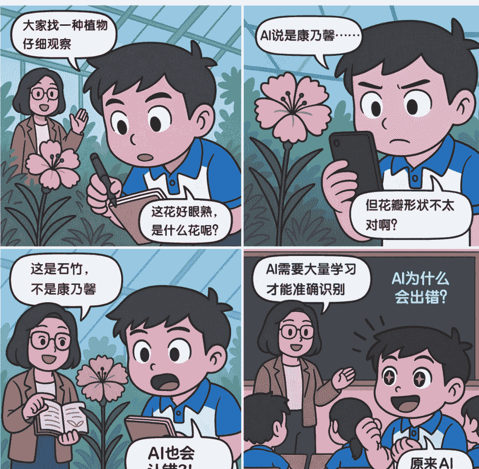

## 3.1 机器学习：AI的“大脑”

想象学认水果时，需要反复看苹果、香蕉的图片见图3-1才能记住特征，这就是学习。机器学习就是教AI像小朋友一样学会学习。AI就像个小脑袋，机器学习是让它变聪明的办法，需要三样支撑：海量学习资料数据、像小马达的算力、老师教的学习口诀算法。


图3-1

### 3.1.1 AI认数字的秘密：如何看穿数字形状

识数与预报：模型成长全记录

把一张手写数字的照片交给模型，它能辨认笔画并给出判断。这项能力最早在上世纪80年代末由杨立昆主导的LeNet实现，参考图3-2。与老师教孩子认字相似，刚诞生的系统同样分不清1和7。需要有人扮演“小老师”，喂给大量带标注的数字图像，明确告知：“这张是1，那张是7，1像一根直棍，7似一把弯镰”。每次判断失误，就微调内部参数，慢慢就能自主区分。

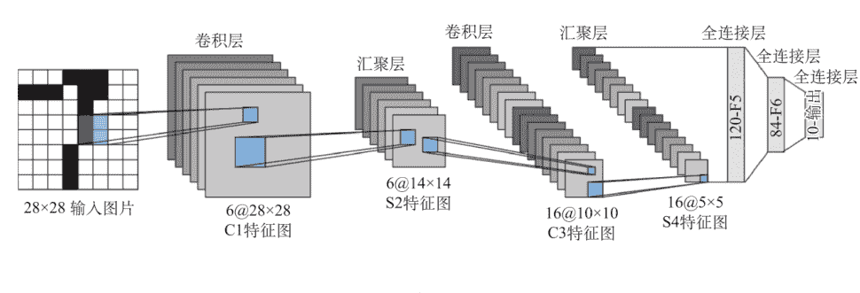

图3-2

下面拆解系统变聪明的过程。

#### 1. 收集数字小卡片：给AI找学习资料

让系统认数字，首先要备足样本。不同人的笔迹差异很大，有的歪斜有的潦草，这些照片就构成模型的训练素材。小明会为每张图像贴标签，标明这是几，建立图像与数值的对应。请在表3-1补充手写数字，帮助扩充素材库。

思考提示：以数字2为例，准备多少张样本合适？多一点更好还是少一点更好？这些2需要高度雷同还是风格多样？原因何在？

表3-1

| 手写数字 | 标签 |

| :--- | :--- |

| | 0 |

| | 1 |

| | 2 |

| | 3 |

| | 4 |

| | 5 |

| | 6 |

| | 7 |

| | 8 |

| | 9 |

小明点评：数量方面，忽略冗余时当然越多越好。若仅提供一张2的样例，模型难以学到稳定特征，识别效果会很差。质量方面，多样性更关键。如同人学汉字要看大量字卡，系统也需要接触各种笔迹的数字卡片，才能稳稳识别不同手写体的2。

#### 2. 搭建“大脑”结构：让AI能看懂图片

系统的内部到底是什么模样？可以理解为一本更复杂的解题公式。

先说个简单的数学例子。买糖的例子：1颗2元，买3颗就是2×3=6元。公式总价=单价×数量，可写成y=k×x，k是单价，x是数量，y是总价。只要k固定，任给一个x就能算出y，这就是一个数学模型。

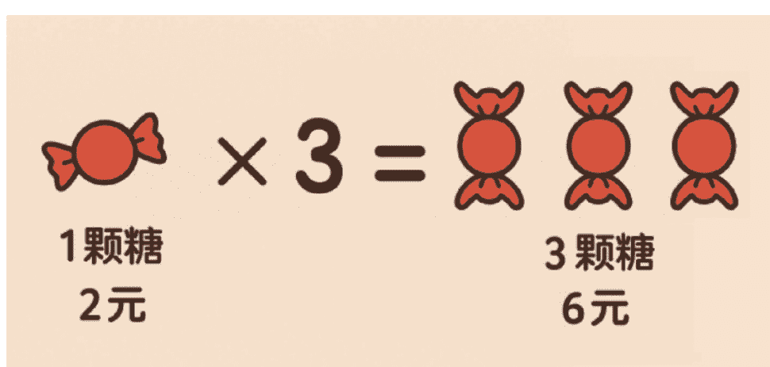

图3-3

假设要让系统分辨手写1和8，输入x是图片，输出y是判断结果，比如“这是1”。

如果只用y=k×x这种线性公式，会怎样？对数字识别来说太简陋了，只能处理直线关系，而数字细节包含大量弯曲。就像你只有画直线的笔，想画出0的圆圈、8的双圈就不行。

实际常用的结构是神经网络，如图3-4。它可看作一个复杂函数，也像搭积木。前面几层先提取局部零件，比如有没有直线、有没有圆圈；中间几层把零件组合，比如直线加小弯可能是7，圆圈加竖线可能是9；最后几层做整体校验，比如9的圆圈在上竖线在下，6则相反。层层处理，就像拼图先找边角再拼中间最后定整体。

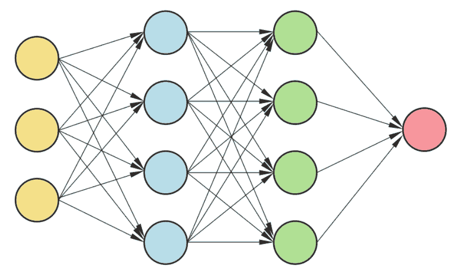

输入层 隐藏层1 隐藏层2 输出层

图3-4

思考题：用一个过于简化的数学模型做手写数字识别的内核，会带来什么后果？

小明点评：模型太简单会欠拟合。比如只看有没有直线，1、7、4都会被归到“直线家族”，无法区分。相反的极端是过拟合。比如某个同学写的2尾巴特别长，模型就只认长尾巴的2，换个短尾巴的就不认了，像学生只会背例题，换个数就不会了。理想状态是恰到好处的拟合，既能记住“2像小鸭子”，也能认出胖瘦不同的小鸭子都是2。

#### 3. 训练“大脑”参数：像老师改作业一样

回想y=k×x，换一个k就能得到不同答案。系统的公式更复杂，里面藏着大量可调的小零件。这些零件怎么调才能准确认数呢？就像拼乐高，位置不对就拼不成。

工程师会先给内核随机一个初始参数，就像第一次拼图先随意摆几块。然后让系统看大量带标签的手写图片并猜测。起初猜得乱七八糟，比如把5认成3，把8认成0，这很正常，相当于从未见过豹子和猎豹就要区分。

标签相当于老师的红勾答案：图片写着1，标签就说“这是1”。系统猜完后与标签对比，错了就产生一个“错误警报”，传回内核。内核据此悄悄修正内部零件，就像拼图放错赶紧换位。调整后再猜，再对比，不对就继续调。这个猜改循环类似打游戏闯关，每次失败就重来，能力不断提升。经过多轮迭代，系统的预测会越来越接近标签，如图3-5所示。我们把这个误差叫做损失，驱动调整的方法叫反向传播算法，它像游戏提示，不断减小损失，直到系统成为合格的数字侦探。


图3-5

思考题：如果训练样本太少，比如每种数字只给一张图，会出现什么现象？

小明点评：会出现过拟合。模型能记住训练图，但在新图片上会失效。因为样本不足导致它抓不住数字的本质特征，训练结果更像是死记硬背。训练集上准确率高，一到新数据就露馅。

思考题：训练时不用标签可以吗？

小明点评：不用标签的是无监督学习，用标签的是监督学习，也是主流。无监督像自己整理玩具，按相似度归类；监督像有老师批改作业。监督效果通常更好，但需要正确答案，成本更高。

#### 4. 考考AI会不会：看看学习成果如何

当损失收敛，也就是损失很小且不再随迭代变化时，这轮训练可以结束。把所有训练图再输入，表现通常很好。

但别高兴太早。模型可能只是背会了原题，而不是学会了规律。用原题考当然满分，但不代表真掌握。因此数据不能全用来训练，要留一部分来考试。两部分分别叫训练集和测试集，通常按8:2或9:1划分。偶尔还会用到验证集。

思考题：训练集和测试集可以重叠吗，为什么？

小明点评：不可以重叠。如果测试集里有训练数据，就像作弊，成绩再好也不能说明模型真的具备识别能力。

### 3.1.2 AI预测天气VS气象专家

模型和气象专家预测天气的方式各有风格。接下来用案例比较两者优劣。

#### 1. 预测速度：模型大幅领先

传统数值天气预报要先收集气温、风速等观测数据，再代入复杂方程用超级计算机计算。以暴雨为例，从采数到出初报可能要数小时，计算量巨大。

模型速度优势明显。华为云盘古气象模型用39年全球再分析数据训练，相同分辨率下比欧洲中期预报中心的IFS快上万倍以上。几分钟就能给出7到10天的预报，精度与IFS相当。就像考试，系统能在极短时间内交卷且成绩优秀，大幅提升时效，让公众更快准备应对，如图3-6所示。


图3-6

#### 2. 数据处理与模式识别：模型独具优势

专家面对海量卫星云图，人工识别云形、移动方向耗时且易受主观影响，对复杂云系是否发展成强降雨，判断常有分歧。

模型擅长海量数据挖掘。谷歌DeepMind的GraphCast能在全球0.25°分辨率下，一分钟内预测未来十天数百个变量。它从历史数据中捕捉细微模式，比如综合海温、大气环流预测飓风路径，能更早察觉微妙变化，为防灾争取时间，如图3-7所示。


图3-7

#### 3. 预测精度与可靠性：各有千秋

传统数值模式经过多年发展，常规天气可靠。比如黑龙江省气象台结合观测网络和专家经验对数值结果精细化，3天内晴雨准确率超90%，7天内在80%以上。专家会根据本地地形和长期规律修正结果。

模型在部分场景可达甚至超越传统方法。研究显示模型在热带气旋等极端事件预测上已优于物理模型。但模型依赖历史数据，数据偏差会带来失误。对罕见极端天气，因样本稀少，模型难以准确预测，而经验丰富的专家能凭借大气物理理解做更合理推测，如图3-8所示。

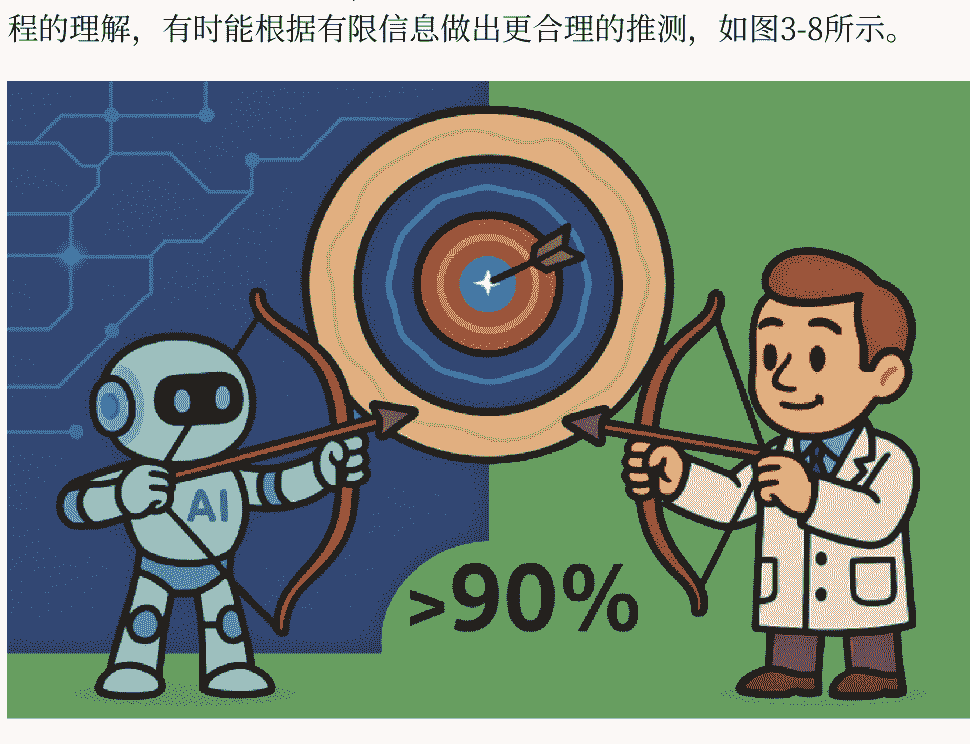

图3-8

#### 4. 极端天气预测：双方各有挑战

传统方式预测龙卷风等突发小尺度天气困难，观测手段难以捕捉形成初期变化，数值模拟也受限，专家只能靠经验和有限数据判断。

模型虽有进展，但不完美。它能在趋势上提供线索，比如提前指示可能出现极端降雨的区域。但极端事件概率低、样本少，模型对强度、时间、位置的精细预测仍不足。例如预测罕见超强台风强度变化时，因缺乏相似案例，预测可能不够准，如图3-9所示。

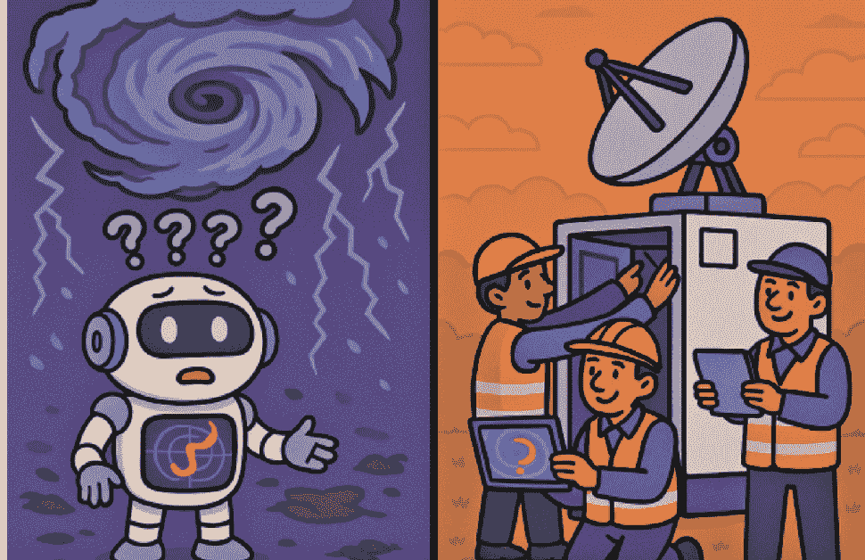

图3-9

#### 5. 成本与资源需求：模型崭露头角

传统数值预报依赖超级计算机，建设维护成本高、能耗大。

模型训练需一定成本，但训练完成后推理资源需求低。部分模型甚至可在个人电脑运行，大幅降低成本。一些基于模型的气象小软件，用户在手机就能使用，让中小机构和个人也能参与天气预测，打破了传统对大规模计算资源的高度依赖，如图3-10所示。


图3-10

总体看，模型在速度、数据处理和部分精度上占优，可靠性和极端天气的某些细节仍需完善；专家凭专业知识和经验对复杂形势判断和结果修正不可替代。未来二者结合有望带来更精准可靠的预报。

## 成就打卡

### 我学会了 ✅

- 能说出系统学会认数字的关键因素。

- 能理解训练中的“过拟合”及其负面影响。

- 能区分训练集和测试集的用途。

- 能辩证看待模型的利弊。

- 能列出采集训练数据的1到2个要点。

## 3.2 计算机视觉：AI的“眼睛”

人类感知主要靠眼睛，系统若要接近人类智能，也需要视觉理解能力。现在系统能认红绿灯、识别物品，甚至在医院辅助读片。与人不同，人类看图后自动在大脑理解；系统则通过摄像头获取图像后，送入已训练好的模型进行解读，如图3-11所示。


图3-11

### 3.2.1 识别植物种类

散步时常会好奇：“这是什么花？那是什么树？”以前要拍照请教老师，现在可用系统快速解答。打开手机百度App，点击搜索框右侧相机进入“识万物”，可拍照或导入相册。点开“热门推荐”下的“识植物”，结果会直接展示相关图文，也可用“形色识花”小程序完成识别。

系统如何识别花朵？一起动手训练一个“火眼金睛”吧！

#### 【动手实验】：AI识别花朵。

#### 1. 实验准备

- (1) 手机1部，电脑1台。
- (2) 浦育平台。
- (3) 小区或校园植物。

#### 2. 步骤

(1) 收集学习资料。用手机对校园或小区中两种植物各拍10张照片，分文件夹存放并打标签，如“月季花”和“康乃馨”，见图3-12。此时我们是训练者，必须知道正确标签。


图3-12

(2) 训练模型。按图示流程操作。本书示例用免费浦育平台，训练后可使用或保存本地。若保存本地，使用时需上传。在“工具”标签页选“创意积木工坊”，见图3-13，在扩展区选“AI训练（图像分类）”，见图3-14，选择“打开AI训练工具”，见图3-15，将分类名改成两种花名，分别上传对应文件夹图片，点击“开始训练”，见图3-16。


图3-13

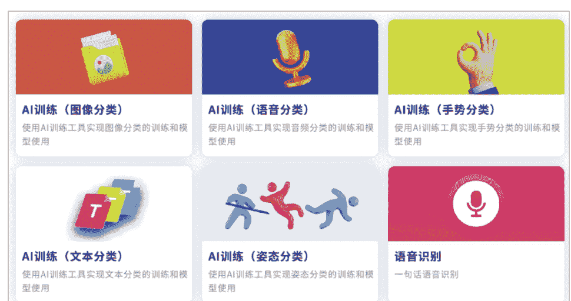

## 图3-14


## 图3-15

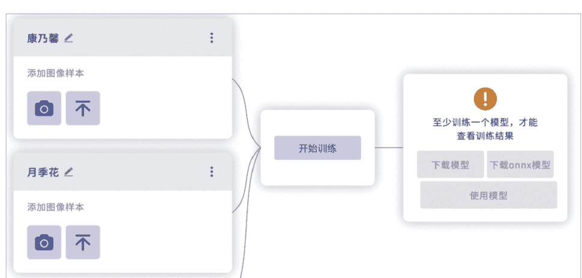

## 图3-16

（3）植物识别。训练完成后上传一张月季或康乃馨照片，模型会输出分类结果，见图3-17。你试试是否准确？


## 图3-17

偷偷上传一张“欧时竹”考验系统，猜猜它会被分到哪一类？为什么会这样？见图3-18。

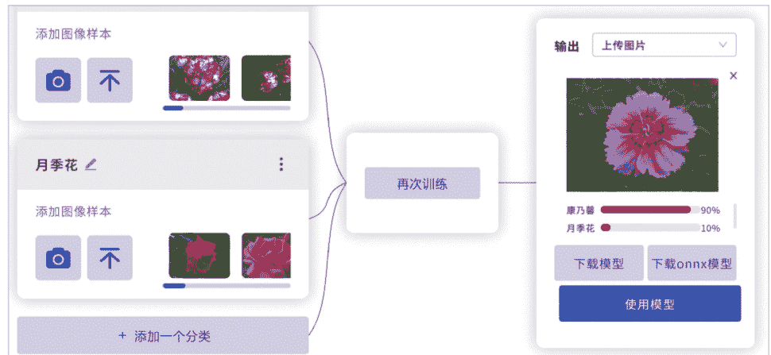

## 图3-18

小明点评：这里只给了月季和康乃馨两类样本，系统认知有限，只能在这两者中找最相似的。所以“看走眼”的根源是训练样本种类不足，而非系统太笨。

还有哪些情况会导致识别不准？比如训练时用了粉色康乃馨和红色月季，之后让它识别粉色月季，很可能误判为康乃馨。这说明数据质量和多样性直接影响模型效果，数据是人工智能三大核心要素之一。

### 3.2.2 识别人脸：AI侦探

智能视觉：面部信息如何助力破案

在现实生活中，智能系统凭借出色的视觉能力，干起探案工作来得心应手。看看下面几个常见场景，就能感受到它的作用。

【案例1】车站人潮涌动，忽然警报响起。警方正在追捕一名在逃嫌犯，对方正混在人群里准备搭车离开。智能探案助手立刻切换到追捕状态，借助站内的监控镜头逐一点扫过每一个面孔。它重点抓取眼、鼻、口等关键区域，迅速算出每个人面部特征的数值。终于在人海中锁定一个可疑者——那张面孔与警方提供的通缉照相似度极高（见图3-19）。系统当即发出通知给民警，嫌犯被顺利抓获，车站重新恢复安宁。

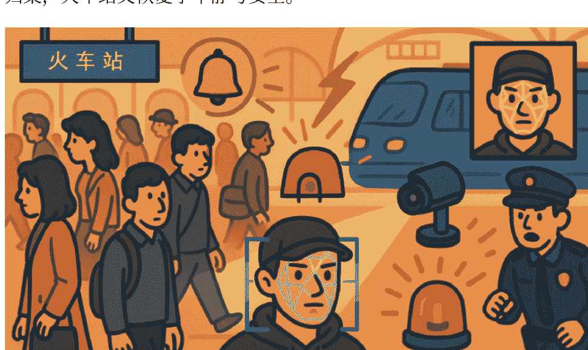

## 图3-19

【案例2】如图3-20所示，周末小红和妈妈在商场购物，结账时妈妈想用刷脸支付。智能探案助手再次登场，把妈妈的面部当作线索逐项拆解。它注意到脸上的一颗小痣以及其他关键点，不到一秒就完成了身份核验，支付顺利通过。小红惊叹：“哇，太厉害了，就像在破‘这是谁’的小案件一样！”


## 图3-20

【案例3】如图3-21所示，周一清晨同学们排队进校，门口的面部考勤机就是智能探案助手的新岗位。它逐一观察同学面孔，核对是否按时到校。忽然发现一位同学戴着厚口罩只露出一双眼睛。这并不难住系统，它细致分析眼睛的形态、间距，再结合过往记录的其他面部信息，仍准确认出了该同学。原来同学是感冒才戴口罩。系统的判断让考勤既快又准。

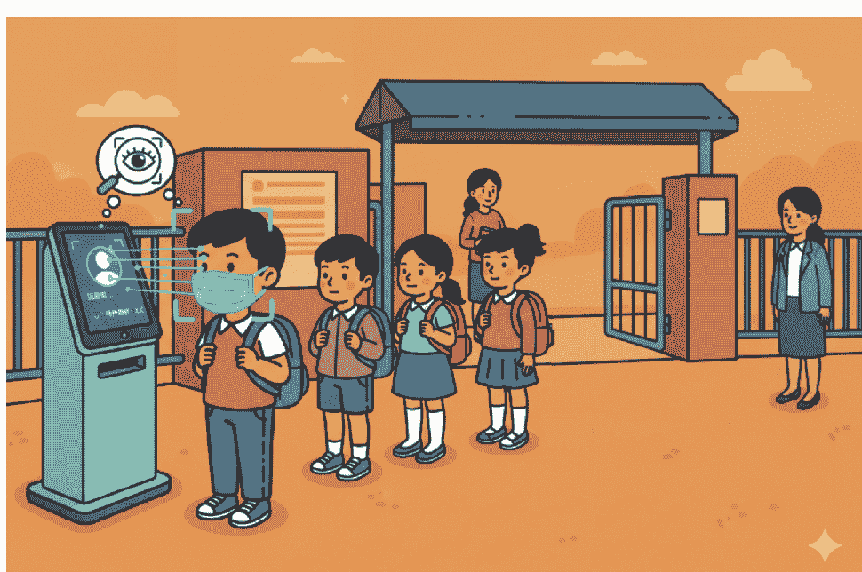

## 图3-21

从车站到商场再到校园，系统都靠面部辨识像真侦探一样化解难题，为生活带来安全与便利。那么它到底如何实现面部辨识？核心在于强大的特征提取能力和记忆能力。

#### 1. 智能探案助手的核心提取器——卷积神经网络

系统配备了一台叫做卷积神经网络的特征提取器，其中LeNet5就是一个经典代表。面对新的面部照片，这台设备立刻启动。第一层卷积核会先抓取最基础的线条和色块，比如眉毛的弯曲线条、眼睛处的深色区域，就像侦探先留意现场的明显痕迹。

网络层数加深后，系统会挖掘更复杂的线索，例如眼睛是圆还是细长、鼻梁是否挺直、嘴唇的形状等。最终它会提炼出最具判别力的特征，比如两眼间距、鼻尖弧度，这些相当于案件的关键物证。通过逐层分析，卷积神经网络把面部压缩成一串独一无二的数字密码。

卷积神经网络为何如此有效？卷积是一种比加减乘除稍复杂的算术运算。简单说就是对应位置相乘再相加，例如把图3-22的卷积核放在输入图的蓝色区域上运算：0×0+1×1+3×2+4×3=19。移动核继续运算，不同的核会产生边缘检测、锐化、高斯模糊等不同效果。卷积神经网络中的核参数并非手工设定，而是由机器自行学习得到。

想一想：图3-22中的25是怎样算出来的？

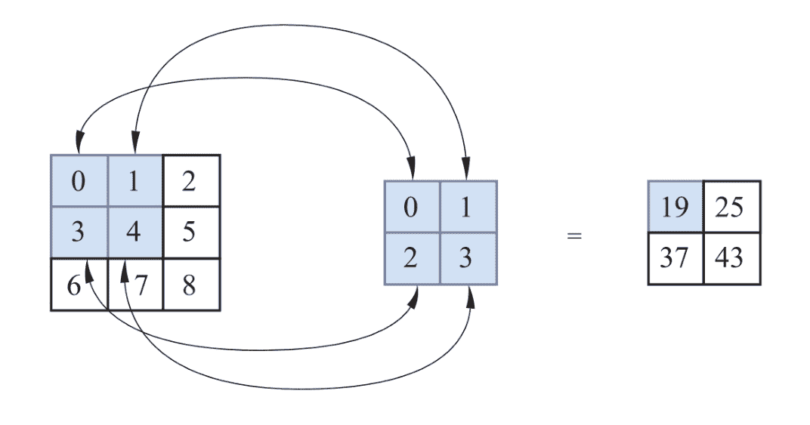

## 图3-22

#### 2. 智能探案助手的面部档案库——面部数据库

系统的大脑里藏着一座庞大的面部档案库，也就是面部数据库。里面存放着成千上万张面部的数字密码，每一份密码都绑定着对应的身份信息，类似侦探的案卷库。

科研人员会提前把大量照片喂给系统，通过卷积神经网络提取出数字密码存入档案库。这样系统就拥有了可供比对的样本库。

#### 3. 智能探案助手的记忆机制——比对与确认

特征提取器从新照片里拿到数字密码后，系统便前往档案库寻找对应对象。它会把新密码与库中每一份密码逐一比对，计算相似度，就像把现场线索与嫌疑人档案对照。若相似度极高，就依据档案中的身份信息确认来者。例如手机解锁时，密码匹配即解锁；在车站追捕时，密码与通缉档案一致就立刻报警。

小朋友们明白系统是如何“破案”了吧。下次看到面部辨识，就能想象系统正用特征提取器和档案库忙碌工作。

想一想：人工智能三大核心是算法、算力和数据。智能探案助手的“特征提取器”和“档案库”分别对应其中哪一个关键因素呢？

## 成就打卡

我学会了 ✅

- □ 能结合算法、算力、数据三要素说明图像识别的工作原理。
- □ 能举例说明日常生活中面部辨识的应用场景。
- □ 能说出系统利用面部信息还能完成的其他任务。
- □ 能说出计算机视觉领域除辨识外的其他能力。

## 3.3 大语言模型：语言表达的秘密

系统不仅视觉出色，知识面也相当宽广。你可以试着提问豆包、DeepSeek等大语言模型，比如母亲节快到了，想学做麻婆豆腐，直接要个菜谱，它通常能迅速给出。悄悄说，大语言模型还能讲故事、写作文、创作歌曲，像自带魔法。来看这个语言能力的运作方式。整体流程大致分为接收问题、理解意图、生成答案三步。其中理解意图主要靠自然语言处理技术，生成答案主要靠生成式人工智能算法。

### 3.3.1 大语言模型的法宝

#### 1. 大语言模型：渊博的知识仓库

大语言模型背靠一个庞大的知识仓库，里面装满了从书籍、文章、网页抓取的文字。这些文字如同五彩积木，有写景的词句、有讲故事的段落、也有数学公式。

仓库里可能有“春天的花朵像孩子笑脸一样灿烂”这样的句子，也有“1+1=2”这样的常识，还有汉诺塔程序。系统把这些文字“吃”进去，像海绵吸水一样记住排列组合。有人会以为大模型只是搬运知识，这理解偏了。知识仓库是基础，正如写好文章需要大量阅读和基本功，大模型也需要这个底座。

#### 2. 自然语言理解：理解问题的密码翻译官

在开口作答前，系统要先读懂你的意思，这一步叫自然语言理解。

当你问“恐龙是怎么灭绝的？”密码翻译官会把句子拆成“恐龙”“怎么”“灭绝”，再在词库里查含义和关联。它知道恐龙是远古巨兽，灭绝是消失，于是拼凑出你的真实意图。

句子复杂时，比如“除了火山爆发，还有哪些原因可能导致恐龙灭绝呢？”翻译官会抓住“除了”“还有哪些”这两个关键词，明白你要的是多种灭绝原因的列举。这样系统才能准确“听懂”。

#### 3. 生成式AI：词语积木的搭建大师

意图标明后，生成式AI这位搭建大师就上场了。面对“恐龙是怎么灭绝的？”它会从魔法词语仓库里挑选合适的词句，先确定开头比如“科学家推测”，再配上“可能是小行星撞击地球”这类相关表述，逐步拼接成完整回答。

挑选时它会参考此前学习的大量文本，模仿科学分析的表达方式，但并非照抄，而是像小科学家那样组织出清晰有趣的答案。

#### 4. 大语言模型的思考过程：预测下一个词语

大模型生成内容的秘密是逐词预测。它先猜第一个词，比如“目前”；再根据“目前”预测下一个词“主流”，如此一步步选择，直到形成流畅句子：“目前主流观点认为，小行星撞击引发的环境剧变是导致恐龙灭绝的重要原因。”

速度极快，眨眼间就能搭出答案。现在应该能想象语言能力的运作了，下次聊天时不妨脑补密码翻译官和搭建大师在背后忙碌。

事实上，为了沟通更顺畅，可以加入智能语音技术。用户用语音提问，经语音识别转成文字供大模型处理，生成文字后再经语音合成输出。除了文字，还可结合图像、视频、音乐生成技术输出多媒体内容。

### 3.3.2 大语言模型的幻觉

大语言模型像个超级小助手，几秒就能画画写故事，肚子里装满数学、历史、科学知识，问啥基本都会答。

但它也有短板。首先，灵感多来自已有内容，自创性不如孩子那样天马行空，AIGC作品容易趋同，遮蔽了个人独特的创意光芒。

有时候生成结果还会让人哭笑不得，比如图3-23的孔雀手。同学们可以尝试优化描述，让模型修正并生成真正的孔雀舞手。

请帮我生成一张孔雀舞中孔雀手的图片

接下来我将生成一张孔雀舞中孔雀手的图片。画面风格是写实风。正面视角，主体是一只呈现孔雀舞姿态的手，手指弯曲呈孔雀头和羽毛的形状，皮肤光滑细腻，光影自然，色彩还原真实。

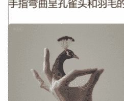

## 图3-23

更需警惕的是幻觉。模型偶尔会“胡说”，编造不存在的事或张冠李戴。

例如问“第一个登上月球的人是谁？”它可能答“查尔斯·林德伯格1951年登月”，实际上是尼尔·阿姆斯特朗。就像没学过知识的学生会乱答，模型因训练数据错误或混淆也会编造看似合理的内容。

为什么会这样？因为模型基于海量数据学习，数据可能有误或断章取义，比如把“低气压下水80℃沸腾”记成“水80℃就沸腾”。

怎么办？科学家会让模型接入知识库“查字典”，或让多个模型互相校验，就像同学对答案。模型也在不断迭代，今天错的明天可能就对了。但要记住，即使头头是道也不能全信，遇到不确定一定要自行查证。

合理使用AIGC，它是助手不是拐杖。过度依赖会削弱自主能力，偶尔不靠谱的拐杖还可能把人带向沟里。

## 成就打卡

我学会了 ✅

- □ 能结合人工智能技术，说出大语言模型如何根据要求写作文。
- □ 能利用大语言模型工具体验AIGC功能。
- □ 能辩证地看待AIGC的优缺点。

## 3.4 智能技术的困境——工程中的挑战

### 3.4.1 漏洞测试：也会看走眼吗？

系统识别很快，有时也会看走眼，就像人在人群中找朋友会认错背影一样。

（1）双胞胎的身份大冒险。闪电新闻报道，2017年12月1日小晶买了iPhone X并设置Face ID。她有同卵双胞胎妹妹，相似度达90%。当晚妹妹竟解锁了小晶的手机，而小晶自己反而解锁失败。重设后姐妹都能解锁。苹果客服称，对同卵双胞胎等面部差异极小的人群，Face ID失误率较高。此事引发对系统区分相似面孔能力的讨论，研究者尝试通过耳朵形状、瞳孔细纹等细节提升精度。

（2）英国美妆博主Katie Price也遇到类似情况。Mirror Online报道，她在做完隆鼻、脸颊填充、唇部提拉后，iPhone面部解锁失效。她在播客中吐槽手机“失灵”，明明鼻子变化不大，系统却认不出，说明外貌显著改变会影响识别。

（3）《华盛顿邮报》报道，2020年美国底特律Robert Williams被警方错抓。警方用面部识别把监控嫌疑人比对到数据库，误将Williams认成小偷。他当时正下班回家，被审讯拘留30小时，最终检察官因证据不足撤销指控。警方承认是调查失误。事件质疑警方过度依赖面部识别，也促使研究者增加检查步骤提升准确性。

### 3.4.2 攻防游戏：欺骗视觉的眼睛

2019年德国研究者做了一个实验。禁止停车标志本应明确，人类一眼就能辨认。研究者在标志特定位置贴一张小贴纸，结果自动驾驶系统竟误把禁止停车识别成限速30公里，小贴纸成了视觉陷阱。

日本科学家也做了趣味实验。为宠物猫戴上特制3D打印眼镜，系统摄像头采集图像时被眼镜图案干扰，错误匹配数据库中乌龟壳、企鹅形态，把猫认成乌龟企鹅。

为何会被干扰？本质是道具改变了系统提取的特征。图像识别靠形状、颜色、边缘等特征与标签匹配，贴纸改变了局部特征导致误匹配；人类则依赖整体认知和交通规则，不易受局部干扰。猫的案例同理，眼镜破坏了猫的典型特征，干扰提取与匹配，而人类靠整体形态和生活经验仍能识别。

如何避免被骗？让系统拥有更全面的视觉信息，像人类一样把握整体形态，提升特征提取精度。这需要工程师持续优化算法。相信在努力下，系统会通过考验不再上当。

想一想，以上例子给了我们什么启示？可以从技术改进、使用安全、人机协作三角度思考。

- (1) 技术改进：图像识别需提升鲁棒性，可通过增加多样化干扰样本训练，优化特征提取算法，综合全局与局部特征，减少单一特征依赖；同时可融合多模态信息辅助识别，降低误判。
- (2) 使用安全：在自动驾驶、安防等关键场景，需警惕视觉干扰攻击，可从硬件抗干扰采集、软件实时异常监测与人工复核等方面设防，推动安全标准建立。
- (3) 人机协作：人类视觉灵活性和经验知识可与系统互补，关键决策场景设计人机协同流程，系统初筛后由人类复核，降低单一系统误判风险。

### 3.4.3 透明化挑战：系统的黑箱日记

2018年*STAT News*报道了触目案例。IBM的Watson for Oncology用于癌症治疗建议，却多次给出不符合医学指南的方案。例如对一位乳腺癌患者推荐了不适合病情阶段的药物，可能造成伤害。医生追问推理依据时，系统无法清晰解释。这就像医生开药却说不清原因，让人难以信任。

AI黑箱：给了结果，却说不清为什么

2016年，美国威斯康星州的一桩审判引起了广泛讨论。当地法院在使用COMPAS这一评估程序来预估被告的再次犯罪概率，以辅助量刑。后续的独立研究指出，该程序对黑人被告的风险分值普遍偏高，实际上增加了他们被判重刑的可能性。更棘手的是，当外界要求说明评分依据时，研发团队也无法提供令人信服的解释链。好比一名老师只在试卷上写“不及格”却不标出错题，让人既困惑又觉得不公。

教育场景里也在上演类似的难题。英国的部分中小学引入了智能评测平台，用来综合判断学生的学业表现与学习潜能。有学生单次考试发挥不错，系统给出的潜能等级却偏低。家长向学校和供应商追问评分逻辑，得到的答复只是系统把作业、考试、课堂参与等信息汇总后自动产出，却无法说明各部分权重如何分配、推理路径是怎样的。平台像一台只吐分数的机器，过程完全不透明，师生无从据此改进。

这种难以解释的状态，根源在于模型本身的复杂性。以深度学习为例，网络往往由上百甚至上千层神经单元构成。输入信号在层间被反复抽取、转换、融合，最终形成输出。计算链条庞大且非线性，即便是设计者也很难完整追踪每一步数值的变化。

从以上案例可以提炼出三点提醒。第一，使用AI时不能全盘接受结论，要像解数学题那样既看答案也追问思路，弄清楚判断的依据是什么。第二，科研层面需要持续投入可解释性研究，让模型决策过程更透明、可回溯。第三，每个人都要保持质疑的习惯，遇到不合理的智能结果时敢于发问，这样才能推动技术负责任发展，真正成为助力。

## 成就打卡

### 我学会了 ✅

- □ 能辩证看待AI。
- □ 能理解AI“不够聪明”的原因。

## 闯关测验

1. （单选）最先把神经网络用到手写数字识别任务的是（ ）。
    - A. 小明
    - B. 杨立昆
    - C. 豆包
    - D. 未知科学家

2. （单选）下列关于训练手写数字识别AI的说法，正确的是（ ）。
    - A. 学习资料中每种数字只需一张图片
    - B. 学习资料里的数字越相似越好
    - C. 训练集和测试集不可以有交叉
    - D. 训练数据越多，识别越准确

3. （单选）华为云盘古气象模型相较于欧洲中期天气预报中心的综合预报系统IFS，其主要优势是（ ）。
    - A. 预测速度快10 000倍以上
    - B. 预测精度高很多
    - C. 不需要收集数据
    - D. 能处理更复杂的气象场景

4. （单选）大语言模型理解问题的底层技术是（ ）。
    - A. 自然语言处理技术
    - B. 图片生成技术
    - C. 视频生成技术
    - D. 知识图谱技术

5. （单选）让人工智能像人一样学会学习而产生智能的一系列算法是（ ）。
    - A. 飞行算法
    - B. 机器学习算法
    - C. 绘画算法
    - D. 强化学习算法

6. （单选）手写数字识别任务中最合适的AI“大脑”结构是（ ）。
    - A. 一元一次线性函数
    - B. 前馈神经网络
    - C. 卷积神经网络
    - D. 多层感知机

7. （单选）AIGC的中文全称是（ ）。
    - A. 自动智能创造内容
    - B. 人工智能生成内容
    - C. 高级智能创作内容
    - D. 自主智能生成内容

8. （单选）若长期过度依赖AIGC完成美术课绘画作业，会出现什么情况？（ ）
    - A. 绘画技巧越来越高超，创意源源不断
    - B. 失去独立思考和创作的能力，作品千篇一律
    - C. 能够快速学会各种绘画风格，超越其他同学
    - D. 对基础绘画技法的掌握逐渐弱化

9. （多选）下列属于过度依赖AIGC的弊端的是（ ）。
    - A. 提升思考能力
    - B. 考试成绩受影响
    - C. 创意被隐藏
    - D. 降低自主学习动力

10. （多选）哪种情况会让AI人脸识别出错？（ ）。
    - A. 双胞胎面部特征相似
    - B. 人穿着不同颜色的衣服
    - C. 人站在不同高度的地方
    - D. 人佩戴墨镜遮挡眼部

11. （多选）AI图像识别不准确的可能原因有哪些？（ ）
    - A. AI太笨了
    - B. AI没有对特征进行准确提取
    - C. AI看不清楚
    - D. 训练数据存在偏差

12. （多选）为解决AI“黑箱”问题，我们不应该做的是（ ）。
    - A. 盲目相信AI结果
    - B. 研究新技术让AI更“透明”
    - C. 对不合理的AI结果提出疑问
    - D. 拒绝了解AI的决策逻辑

13. （填空题）AI在识别人脸时，主要利用________神经网络提取人脸特征。

14. （填空题）当AI模型只能准确识别训练图片，对未训练图片无法准确识别时，出现了________现象。

## 成就贴纸

看看你获得了几张贴纸。

| 阅读全章内容 | 成就打卡 | 完成闯关测验 |
| :--- | :--- | :--- |
| | | |

# 第4章 AI助学搭档：学科能力加速器

## 4.1 语言学习的智能伙伴

上一章我们看到了计算机视觉的“火眼金睛”和大语言模型的“伶牙俐齿”。两者结合后，人工智能就能成为贴身的语言学习伙伴。记单词、练发音、改作文这些环节，都能变得更像游戏。

支撑这种帮助的是收集、解析、反馈的闭环。

收集是起点。系统既能看也能听。你举起画着红苹果的单词卡，借助图像识别立刻认出apple，苹果。你对着手机说Hello，麦克风把声音转成数字信号，系统捕捉发音细节，比如l音是否收尾，像给声音做X光。

解析是核心。系统像语言侦探。你说I have five apple，它马上指出apple缺少s，并提示可数名词复数规则。作文写成Yesterday I go to school时，系统会标记go并提示过去时要用went。这些判断来自它学习大量标准语料形成的语法知识库。

反馈是出口。系统变成游戏向导。练习th音时，它先示范think的口型，再让你模仿，发成s音时提示舌位要放在上下齿间，还能配动画。改作文时输入我爱妈妈，它会建议加入具体细节，比如每天早上妈妈准备热早餐，让句子更温暖。

在真实使用中，这种帮助很普遍。背单词App里点开apple，旁边有麦克风跟读，系统给出分数并建议把a音拉长，还生成联想图apple-tree。口语练习时系统可扮演超市收银员，和你对话Can I help you？How many kilos？沉浸感很强。作文方面，输入我喜欢看书，系统能给出多个升级表达，提升表达力。

### 4.1.1 AI助力记词：把背单词玩起来

小明过去背单词像掰玉米，记新忘旧。后来他用豆包App的背单词智能体，每天十分钟聊天就能记住十个新词。智能体像私人教练，能发现薄弱点并调整节奏。

激活智能单词管家分三步。

先打开豆包App进入智能体，或直接搜索背单词。系统会先问年级，比如初一。回答后它会从词库挑选相应难度，并布置造句或单复数练习。背后是自然语言处理识别需求并匹配内容。

然后进入沉浸式闯关。你可以问它elephant长什么样，它会画图加深印象，点击语音听标准发音。系统会要求你多念几遍并打分，拼写训练时漏字母也能即时纠正。这套看听说写的流程综合了计算机视觉、语音合成、语音识别和自然语言处理能力。

最贴心的是自动规划。说帮我安排复习，它会记录你学过的内容，按遗忘规律生成复习清单，像一位细心的搭档。

这个智能体本质是大语言模型加上三个模块：理解需求的耳朵、调用工具的手、根据表现调整计划的大脑，再配合百万条学生发音数据喂养，才从聊天书呆子变成了实用的单词助手。你也可以自己当训练师，输入常错的词让系统生成记忆急救包，或故意不按计划复习，验证遗忘规律。

### 4.1.2 AI改写作文：用提示词让表达升级

写作文常有话却写不出味的困扰。AI改作文工具像一位魔法编辑，能让文字更生动、结构更清晰。关键是会写提示词，也就是把指令说清楚。只说帮我改作文，系统会无从下手；改成帮我检查语法错误并把好、开心换成更生动的词，它才能精准操作。就像遥控器，得说清扫哪块区域才有效。

#### 1. 提示词模板

掌握提示词就等于拿到改作文的钥匙。下面模板针对语法、结构、创意的常见问题。

##### 1）模板1：语法与用词优化

当作文有语法错误或用词平淡时使用。

基础版提示词：请检查语法错误，把好、开心换成更生动的词。
原句：今天我很开心，因为去了公园。
AI修改：今天我简直乐开了花，因为和爸爸妈妈去了风景如画的公园。

升级版提示词：找出3处语法错误，用比喻或拟人替换2处平淡描写，再推荐3个高级词汇。
原句：风吹过树叶，发出声音。
AI修改：风像调皮的精灵，踮着脚掠过树叶，树叶沙沙地唱起了歌。推荐词汇：簌簌、摇曳、呢喃。

##### 2) 模板2：结构梳理与逻辑优化

段落混乱、叙事跳跃时使用。

基础版提示词：划分段落，加上开头引入、中间故事、结尾感悟的小标题。
原段落：早上我去图书馆，看了很多书。中午在图书馆吃饭，下午回家写作业。
AI划分：
- 开头引入：周末清晨，阳光像黄金洒在校园，我走进图书馆。
- 中间故事：在文学区发现《假如给我三天光明》，海伦的故事让我入迷…
- 结尾感悟：这次旅程让我明白书籍是照亮世界的灯塔。

升级版提示词：用时间线梳理结构，添加环境和心理描写各一处，设计首尾呼应结尾。
原开头：昨天我参加了演讲比赛。
AI优化：
- 开头：礼堂聚光灯亮起，我手心全是汗，能听到心跳，这是第一次参赛。
- 结尾：在掌声中走下舞台，我回头看聚光灯，明白战胜恐惧的方法就是勇敢站出来。

##### 3）创意拓展与主题升华

内容单薄、主题不深时使用。

基础版提示词：添加2处细节描写，比如人物动作或环境。
原句：妈妈给我做饭。
AI添加：妈妈系着蓝白格子围裙在厨房忙碌。铁锅铲碰锅底叮叮响，厨房飘出鸡蛋和葱花的香味。

升级版提示词：围绕友谊主题，设计误会—和解情节，用象征物围巾贯穿全文。
AI设计：
- 误会：我送小雨的蓝围巾竟围在他同桌脖子上。
- 和解：放学后小雨追上我说同桌感冒了怕着凉才借给她，夕阳下围巾在风中飞扬，像温暖的手拂去误会。

#### 2. 使用AI改作文的黄金法则

拒绝照搬，保留个人特色。AI写风像精灵，你可以改写成风像小淘气，把树叶吹得直打转。

先自己写，再让AI锦上添花。先完成初稿再优化，才能真正锻炼思考。

分清修改和创作的界限。情感类内容如妈妈的爱、朋友的陪伴，感受要自己写，AI只负责润色语言。

#### 3. 动手实战：用提示词指挥AI改作文

任务材料：上周，我和朋友去爬山。我们带了零食和水，爬了很久才到山顶。山顶的风景很美，我们拍了很多张照片。

任务步骤：先用基础版语法与用词优化提示词修改，对比变化。再用结构梳理加创意拓展组合提示词，让AI补充爬山困难和山顶感悟，以坚持就是胜利为主题句。

思考讨论：AI修改后哪里更好，哪里你更想保留自己的风格，为什么？

## 成就打卡

### 我学会了 ✅

- 能说出AI学习语言的三个核心步骤。
- 用豆包背单词智能体完成视觉+听觉+发音+拼写四合一训练。

## 4.2 数理学习的AI助手

数理学习中的公式和数据常让人望而却步。AI凭借图像识别和智能推理的能力，能化身口袋里的数理小魔法师，让小学鸡兔同笼到初中电路实验都变得好玩易懂。

数理学科同样遵循感知-思考-行动的路径。手机一拍，AI就能识别课本上的竖式计算、几何图形和电路图。上次小明扫描一道含三角形的题目，AI不仅读出数字，还标出了三角形的高。

遇到难题时AI会化身解题小老师。学一元一次方程，它用计算饭卡余额的场景解释等式两边同时加减：刷卡买12元午餐后剩24元，写成x-12=24，两边加12就求出原余额。学物理浮力时，它写出F浮=G-F拉的称重法公式，并用文字动态演示：弹簧测力计吊着石块慢慢浸入水中，指针从5N降到3N，说明浮力在托起石块，拉力变小。

把智能助手想成一位擅长变幻的学伴很贴切。做数学习题时它像一本会回应的错题集，能迅速抓住思路里的盲区，比如在鸡与兔共笼的情境里点出遗漏了兔子的足数，还会搬出三轮与轿车的类比帮助建立联想。进入物理实验时，它又化作自带记录本的帮手，把滑块沿斜面下滑的距离与耗时整理成清晰的速度表，并用色块标出“每延长20厘米距离，速度大约快3厘米每秒”这类不易察觉的规律。层层拆解让抽象公式与数字变得可追踪、可触摸。

### 4.2.1 数学解题的智能陪伴
一道题卡住时，每个字都懂，组合起来却像密码。借助助手，难题会被拆成若干小关卡，循序渐进地推进。下面两例展示拆解思路。

#### 1. 鸡兔共笼中的假设推理
“笼中鸡、兔共8只，足数合计26只，各自多少？”拍照后助手立刻判断题型：“这是共笼类问题，试试假设推理。”它先引导设想“8只全为鸡，足数仅16，与实际相差10”。随后提示“每把一只鸡换成兔，足数会多2”，于是需要替换5次，得出兔5只、鸡3只。

若想列式，助手会像同桌搭话：“设兔为 x，则鸡为 8-x，写出 4x+2×(8-x)=26。”接着展开：“4x+16-2x=26，化简得2x=10，x=5，过程很顺畅。”完成后它还会抛新情境：“停车场有7辆三轮与轿车，共25个轮子，能否套用同样思路？”三轮对应鸡的双足，轿车对应兔的四足，解法完全对应。

#### 2. 植树情境里的方程思路
初二题目：“甲班每天比乙班多植10棵，甲班植100棵与乙班植80棵所用天数相同，每天各植多少？”助手先画关系图，指出“工作天数相等”为关键，如同两人用时相同，速度快者路程更远。设乙班每天 x 棵，甲班 x+10 棵，则 100/(x+10)=80/x。

解分式方程时它特别叮嘱：“别忘了验根，就像出门要确认钥匙。”演示：“两边同乘，100x=80(x+10)，化简 20x=800，x=40。”随后把 x=40 代回原式检查分母不为零。不少同学会漏这一步，助手用红色波浪线标出检验环节，防止踩坑。

#### 3. 辅助解题的三大特点
使用过程中呈现三项亮点。其一是“当小老师”，从不直接给答案，而是说“先假设全是鸡…”，把每一步写清，不懂可追问。其二是“自带题库”，训练过上百万道题，看到“甲比乙多10棵”立刻调出方程方法，如同游戏自动装备强力武器。其三是“会归纳套路”，完成后弹出通关卡：“共笼三步——假设、算差、替换”，下次遇到换皮题目也能快速套用。

#### 4. 实践：用助手破解糖果分配
“小明和小红共20颗糖，小明的糖是小红的3倍，各有几颗？”助手指出这是和倍问题：“把小红看成1份，小明是3份，共4份对应20颗，1份5颗，小红5颗小明15颗。”同样可用列式：设小红 x 颗，则 x+3x=20，得 x=5。为什么三年级更适合份数法，五年级更适合列式？因为列式需要更抽象的思维，就像游戏中逐步解锁新技能，不同阶段用不同工具更顺手。

拿张练习纸挑一道难题，用手机扫一扫，看看助手会用什么比喻领你闯关，数学题会从拦路虎变成有惊喜的关卡游戏。

### 4.2.2 物理实验数据洞察
实验课上面对歪歪扭扭的记录纸发愁吗？助手能像放大镜一样，从数字里挖出物理规律。下面以初二“测滑块沿斜面下滑速度”为例。

#### 1. 传统实验做法
场景：测滑块沿斜面下滑速度。目的：看速度如何变化。
常规操作：用刻度尺量斜面长度，用秒表记时间，手工算平均速度并填“路程-时间”表。
痛点：手工抄写易错，数据点少，看不出趋势。

#### 2. 拍照即分析的数据助手
操作：用手机拍下记录白纸，打开豆包网页版上传图片，输入提示：“这是我做的‘测量滑块沿斜面下滑速度’实验数据，请提取路程s/cm和时间t/s并生成速度表。”

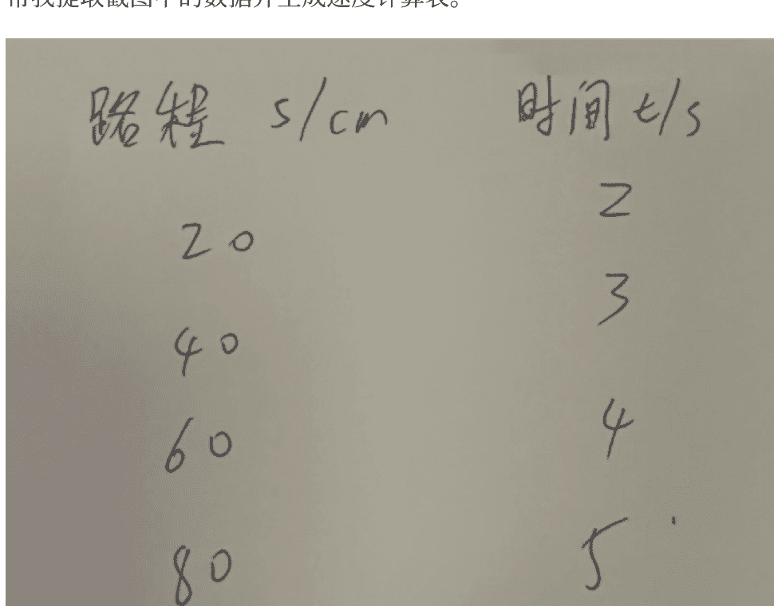

图4-2
工具能力：借助光学字符识别自动读取表格中的路程与时间。

#### 3. 自动找规律
生成速度计算表，如表4-1。

表4-1

| 路程 (s/cm) | 时间 (t/s) | 平均速度 [v/(cm/s)] |
| :--- | :--- | :--- |
| 20 | 2 | 10 |
| 40 | 3 | 13.3 |
| 60 | 4 | 15 |
| 80 | 5 | 16 |

助手解释：“v=s÷t，你看速度在逐秒变快。”接着提示用python画“速度-时间”折线图，生成代码，单击运行即得折线图，速度从10cm/s升到16cm/s，说明滑块加速运动。

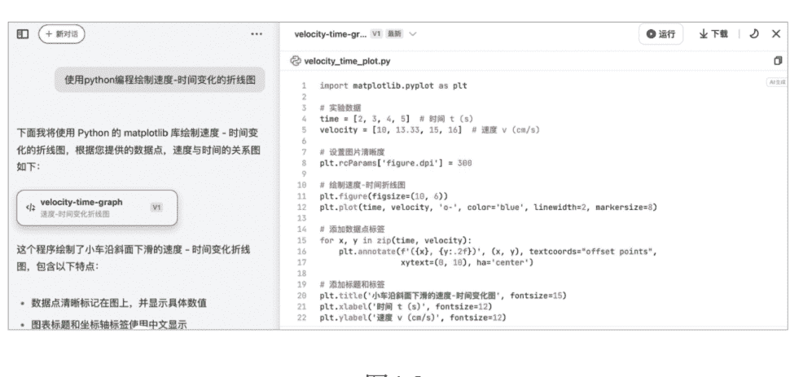

图4-3

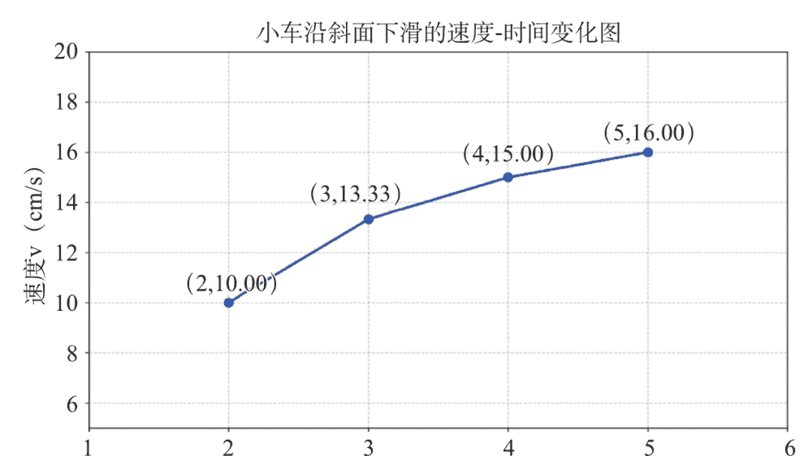

图4-4

#### 4. 揭开隐藏的原理
继续提问：“为何速度会变快？”提示联想斜面坡度和重力作用。让助手用python绘制受力分析图，标注“重力沿斜面向下的分力”并说明其加速作用。

#### 5. 助手的超能力解析
数据纠错小能手：若出现“路程60cm，时间1s，速度60cm/s”这类异常，助手会黄色高亮提醒：“速度太快了，可能秒表按慢了。”
规律总结大师：自动得出结论“滑块沿斜面下滑速度随时间增大而增大，做加速直线运动”，并对照课本P28变速运动规律。
拓展设计：建议“改变斜面坡度，速度变化会更明显吗？试拍新数据吧！”

#### 6. 实践：分析单摆周期数据
##### 1) 任务材料
拍摄“单摆摆动10次时间记录”表，如表4-2。

表4-2

| 摆长 /cm | 摆动 10 次时间 /s | 单次周期 /s |
| :--- | :--- | :--- |
| 20 | 15 | 1.5 |
| 30 | 17 | 1.7 |
| 40 | 19 | 1.9 |

##### 2) 任务步骤
上传照片让助手自动计算单次周期=总时间÷次数。助手生成“摆长-周期”关系图，问“摆长增加周期如何变？”答案是变大。助手提示这与初二“单摆周期与摆长有关”的知识一致。

## 成就打卡

### 我学会了 ✅
- 能把握解数学题的拆题思路：辨认题型→拆分步骤→提炼策略。
- 会阅读助手生成的曲线图。
- 理解助手处理实验数据的优势。

### 我的实验记录
- 已让助手分析“单摆周期”数据，得出“摆长越大摆动越慢”，与课本一致！

## 4.3 创意学习与表达的AI创意画笔
面对空白思维导图或PPT页面发呆？助手带来图文魔法，输入文字就能生成彩色思维导图、动态PPT、插画甚至音乐，动动手指即可实现。

### 1. 文字如何变成图画
写完一篇“四季”作文，助手能立刻生成会变化的思维导图：春天分支长出桃花、细雨、风筝，夏天分支开出荷花、冰棍、蝉鸣。背后是两项能力：先当“语言侦探”提取关键词，如“秋天：枫叶、果实、凉风”，分清植物与天气；再化身“小画家”把关键词转为树状分支并配上枫叶红、果实黄的图片，让文字活起来。就像做蛋糕，你提供食材，助手负责揉面裱花。

### 2. 藏在助手里的两大引擎
自然语言处理相当于助手的“耳朵”，能听懂“夏日海滩”并拆出“夏天”“海边”“沙滩伞”等信息。计算机视觉是助手的“画手”，见过海量图片，知道太阳画成圆、快乐用黄色表达，从而把“金色麦田”画成波浪黄田，“风中摇摆”加上飘动线条。

### 3. 试试你的创意魔法
做“动物分类”思维导图，可指令：“按哺乳动物、鸟类、鱼类分，每个配卡通图，要彩色。”助手会生成树状图，左侧毛茸熊猫，中间展翅鸽子，右侧吐泡金鱼。想画“我的梦想家园”，输入：“会飞的蓝色房子飘在彩虹云上，周围有发光紫色花朵，门口蹲着会摇尾巴的机器人小狗。”提示词越具体，成图越神奇。

### 4.3.1 AI做思维导图和PPT：文字秒变视觉大片
只要几句话，助手就能帮你画思维导图或生成动态PPT。下面用豆包AI演示作业变作品。

#### 1. 案例1：用AI做“动物分类”思维导图
适用场景：科学课哺乳动物vs鸟类作业。
操作：在豆包对话框输入“帮我做动物分类思维导图，分哺乳动物和鸟类。”
助手生成初版文字版思维导图，可复制到XMind、ProcessOn生成图形化导图。

##### 动物分类思维导图：哺乳动物与鸟类
###### 一、哺乳动物
定义：全身被毛、胎生、哺乳的脊椎动物。
（一）主要特征...
（二）常见类别及示例...
（三）生态习性...
###### 二、鸟类...
###### 三、对比...

注意：豆包不能直接生成图形图，但会按思维导图结构输出markdown，复制到绘图工具即可成图（见图4-5）。

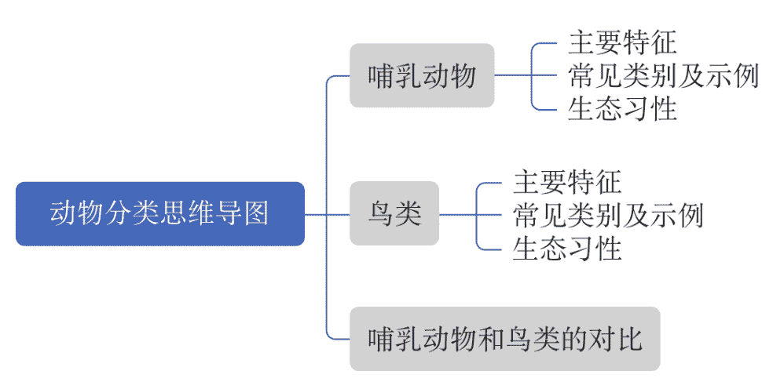

图4-5
小贴士：给分支加“※”“⚠”等符号，重点更醒目。

#### 2. 案例2：用AI生成“古诗《咏柳》”PPT
适用场景：语文古诗赏析作业。
在豆包网页版点“AI PPT”，输入：“主题古诗《咏柳》PPT，要求封面标题+柳树图，作者页贺知章简介，诗句页每句配插图，风格清新卡通。”
助手生成初版大纲（见图4-7），可手动调整后再选“国风”模板生成PPT。


图4-6

图4-7

选择模板后生成初版PPT，可在Ai PPT编辑中完善主讲人、时间等信息。

#### 3. AI做思维导图和PPT的黄金法则
关键词越具体越精准。模糊指令“做个思维导图”不如“做三年级科学植物分类导图，含根茎叶并配图”。
像搭积木，先让助手搭框架再自行添砖加瓦换色加自拍。
用提问式优化：问“如何让PPT更适合演讲？”助手会建议加页码、放大标题等。

#### 4. 动手实战：制作“我的梦想假期”PPT

梦想假期PPT小练习
先让豆包帮忙做一份以梦想假期为主题的演示文稿，里面要有海滩、游乐园、美食等页面，整体走可爱路线。
再做两处细化：把海滩页的配图换成自己更喜欢的海浪照片；美食页新增一个文本框，写上“我最想吃的冰淇淋是草莓味的”。

### 4.3.2 豆包里的AI艺术工坊
现在的豆包能同时玩转AI绘画和AI作曲。下面两组跨学科玩法，可以让艺术课变得像魔法实验室：用豆包为语文故事配插画，再为古诗写一段专属配乐。

#### 1. 案例1：豆包绘画加语文——《神笔马良》故事可视化
案例主题：依据语文课文，绘制“马良为穷人画粮仓”的插图。

（1）用豆包的图像绘制功能，具体操作如下。
①打开豆包网页版，点击对话框下方技能栏里的图像绘制，进入绘制页。
②在输入框填写：“画一个穿蓝衣的小男孩马良，手里握着发光的神笔，在田野里画一座金色大粮仓，旁边有农民伯伯拍手称赞，背景是青绿的稻田。”
③点发送，几秒后就能看到豆包画好的图。

（2）产出亮点
- 马良的神笔画出星光，粮仓上还添了窗户。
- 农民伯伯戴着斗笠，鼓掌笑得眼弯。
- 豆包自动选了卡通风格，色彩鲜活。

（3）语文美术联动，让画面会讲故事
- 加文字旁注。再次对话豆包，输入：“在画角落写‘马良用神笔画出粮仓，穷人再也不挨饿啦！’”，看效果。
- 改细节剧情。对豆包说：“让粮仓边多一条小河，河面带倒影。”发送后画面更新。
- 写续篇。依托插画写一段文字：“马良一挥笔，粮仓里的麦子像星星发光，连河里的鱼都跃出水面欢呼。”

#### 2. 案例2：豆包作曲加音乐——为《春晓》配儿歌
案例主题：为古诗《春晓》创作一段轻快的伴奏。

（1）启动豆包的音乐创作功能。
操作很简单：
- ①回到豆包网页版，点击对话框下方技能栏的更多，找到音乐创作图标点开。
- ②豆包会自动给出音乐创作的指令模板。
音乐创作 我想创作一首歌曲，用 AI 帮我写歌词 [描述歌词要表达的主题]。这首歌是 流行 音乐风格，传达 快乐 的情绪，使用 女声 音色。
- ③把“为古诗《春晓》创作一首轻快的伴奏音乐”填入[描述歌词要表达的主题]，风格改成国风，情绪改成鼓舞，点发送产出音乐。

（2）豆包产出的音乐片段
- 前奏：古筝拨弦清冷，像晨露落在青石板，编钟轻鸣勾勒出春晨的空灵。
- 主歌：二胡揉弦模拟黄莺啼鸣，节奏贴合“春日清晨谁在低语”的韵律，琵琶轮指表现出春花绽放的灵动。
- 副歌：竹笛演奏主旋律，与女声吟唱形成复调，古筝扫弦像阳光穿透云层，带来振奋感。
- 间奏：加入群鸟啁啾和潺潺溪流声，配合古琴泛音营造山林生机，弦乐渐强像希望在升腾。
- 豆包自动选用G宫调，五声音阶自带东方韵味，明亮音色很符合积极向上的基调。

（3）音乐语文联动
- 节奏化填词。把诗句拆成短句，如“春眠／不觉晓”对应音乐里两小节。
- 加自然音效。对豆包说“再加一段风声”，点调整即可。
- 做和声。用人声伴奏功能产出“啦啦啦”的伴唱，像同学一起合唱。

#### 3. AI艺术创作的三句口诀
（1）指令越具体，效果越准。
- ❌ 模糊：“画只猫”
- ✔ 精准：“画一只戴蝴蝶结的白猫，坐在粉色蘑菇上，尾巴卷着棒棒糖，背景是彩虹雨”

（2）像搭积木一样迭代作品。
- 先让豆包出基础图或音乐，再自己加零件。
- 画画时加上自己的签名。
- 作曲时哼一段旋律让豆包学习，可语音输入：“我想加这段调子……”

（3）跨学科提问更有意思。对豆包说：“这幅画能变成数学绘本的封面吗？”或“这段音乐能改成科学课的植物生长歌吗？”

#### 4. 动手实战：用豆包完成四季童话跨学科项目
任务清单：
- （1）AI绘画：输入提示词“春天的森林，有会飞的花朵和戴帽子的小兔子”，选卡通风格。
- （2）AI作曲：输入提示词“夏天的海边音乐，有浪花声和海鸥叫，用吉他和长笛”。
- （3）跨学科延伸：
  - ①语文：给画写个小故事，给音乐填歌词。
  - ②美术：用彩笔在AI画作上添自己设计的魔法元素。

我的创意记录
我让豆包把秋天的树叶画成会说话的小精灵，还产出了以落叶声为伴奏的音乐，冬天雪地里戴围巾的小松鼠跳舞的画面也很可爱。

## 成就打卡
### 我学会了 ✅
- □ 用豆包给《神笔马良》画插画并配上小故事。
- □ 为AI产出的图画想一句创作语。
- □ 用豆包产出古诗的配乐和歌词。
- □ 知道了让AI画作更贴近想法的小技巧。

##### 我的创意成果记录
上传生成图：《会飞的粉色大象》 大象戴着我设计的彩虹蝴蝶结，在云朵里吃棉花糖云朵
创作灵感一句话：“如果大象会飞，那它一定是带着小朋友的梦想在天上旅行～”

## 4.4 聪明学习者的AI使用守则：做AI的主人而非仆人
AI越来越常出现在学习里，该怎么相处才能真正受益？看小明和小红的故事或许有启发。

小明做鸡兔同笼时直接让AI给完整步骤，抄完就算。考试遇到35个头、94只脚时，他大脑空白，不会用假设法。AI的答案像魔法快递很快，但他没学到逻辑内核。小红让AI写作文我的妈妈，文章里全是母亲的爱如春日细雨这类华丽却空洞的比喻，没有妈妈早起做早餐、雨天送伞的真实细节。老师批注：这些话很美，但哪一句是你想对妈妈说的真心话？

AI像一把万能的学习瑞士军刀，能帮你削开难题外壳、拧开知识瓶盖、打磨表达细节。但如果写作业完全依赖AI，就像只用军刀开罐头，久而久之会失去自己剥蛋壳的能力。真正的收获在亲自探索思考的过程中。如果AI能帮你写完所有作业，你的大脑会像常锻炼的肌肉一样强壮，还是像久不走路的腿一样无力？聪明的学习者会给AI写使用说明书，就像园丁照料幼苗，既要阳光温暖，又要防暴雨摧毁。

有些同学把AI当代写保姆，所有作业都塞给它。这像学骑自行车总让人扶着后座，看似走得快，一松手就摔。有人让AI代写英语日记，结果从句复杂度远超真实水平，被老师识破。就像穿魔法跑鞋考试，冲过终点才发现双脚从未奔跑。

正确用法是把AI当思路拐杖。比如做物理题，先自己尝试画受力分析图，卡住时再问AI：这个摩擦力的方向该怎么判断？AI会提示看物体运动趋势，引导思考而不是直接给答案。就像登山用地图确认方向，每一步路仍要自己走，鞋底沾的泥土才是攀登证明。

想和AI成为优秀搭档，需要三把金钥匙。
第一把是信用钥匙。记住AI辅助≠代劳，像游戏不能开无敌外挂，保持诚信与独立思考。
第二把是鉴伪钥匙。AI会出错，比如把鲸鱼是鱼当常识，这时要用课本当照妖镜辨别对错。
第三把是未来钥匙。锻造人机协作能力，让AI做计算快手，处理数据、检索知识，自己做创意大脑，主导方向、深入思考、创新表达。

接下来深入了解这些守则，让AI成为助力器而非能力退化器。未来优秀的学习者不是比AI懂更多，而是更懂如何默契配合，让智能瑞士军刀在知识世界里披荆斩棘。

### 4.4.1 AI辅助≠AI代劳：建立学习信用红线
你有没有想过，让AI代劳写作业就像踩香蕉皮？小宇为赶数学作业，直接让AI产出植树问题的完整解法，第二天老师提问他只能发呆：我……忘了怎么算。看似抄近路，实则摔得惨。让AI代写时，大脑在睡大觉，逻辑肌肉得不到锻炼。大脑像运动员肌肉，不用会萎缩。让AI直接产出作文，就失去了组织文字的练习，下次自己写会觉得脑子空空。

聪明的同学让AI当小助教，自己当主考官：做数学题先自己画思路草图，问AI这个辅助线加得对吗，而不是抄答案；背英语单词用AI发音评分纠正，再自己默写；写作文让AI优化比喻句，自己构思主干。这像学骑车家长扶车尾，只在快摔时扶一把，平衡感必须自己练。有人用AI分析物理实验数据，先自己画折线图再让AI检查，反而多发现两个隐藏规律。

可以像游戏闯关建立AI使用信用分：让AI代劳扣10分，下次只给提示碎片；自己先思考5分钟再问AI加5分，思路更精准；能讲出解题原理加10分，解锁拓展题推荐；发现并纠正AI错误加15分，获得个性化知识漏洞图。

小红制定了AI使用公约：数学题先画思维导图再问思路，英语作文用AI优化3个句子后自己写段落，科学实验让AI验算数据但结论自己推导。一个月后她发现，问思路时大脑更活跃，自己写的作文虽不华丽却有真情，考试遇到新题型也不慌，因为她练的是怎么想而非怎么抄。记住，AI能给你鱼，但学会钓鱼靠自己思考。当你对AI说帮我想而不是帮我做时，学习的涡轮增压才真正启动。

### 4.4.2 识别AI的一本正经胡说八道
你被AI逗笑过吗？比如问9.11和9.8哪个大，它可能认真回答9.11比9.8大哦。AI犯错常见原因：一是数据偏见，像只看部分同学答案，训练资料偏差可能把紫蝶花认成薰衣草；二是逻辑局限，擅长记忆却缺生活常识，问1+1为什么等于2可能用复杂公式，却讲不清基础道理。

我们有双重鉴伪神器。人类鉴伪三招：第一招交叉验证法，AI说鲸鱼是鱼时马上查课本或问老师；第二招追根问底法，让AI解释为什么推荐这个单词，回答含糊就不靠谱；第三招常识检验法，AI说冰在100℃不融化，生活经验就能识破。

AI也能助鉴伪。打开睿鉴AI小程序，粘贴AI产出的作文，10秒出结果：绿色√表示原创度高，红色×提示可能是AI产出。小明把AI写的我的梦想放进去，小程序标出段落3～5重复常用句式，原创度仅32%，提醒他加入真实想法。

想抓AI小辫子？做个实验：问AI石头和棉花从10楼同时落下哪个先落地，再用睿鉴AI检测回答的原创度；再让AI和自己各写一篇我的家乡。对比报告会发现，AI回答流畅但缺真实情感细节。给答案装防盗门，既要自己检查，也要借助工具。

最厉害的鉴伪武器是好奇心。AI给答案后追问还有其他解法吗，反复说相似话可能在编答案。AI是助手，代替不了你充满好奇的大脑，就像孙悟空有火眼金睛，你也要用知识和工具炼出自己的鉴伪之眼。

### 4.4.3 AI时代的学习者画像
在AI能秒解鸡兔同笼、瞬间产出作文的今天，什么样的学习者才能驾驭智能浪潮？答案在三个关键能力，这像未来学习的魔法三件套。

第一个能力是问题定义大师。以前小宇总喊帮我写作业，考试遇到相似题只能发呆，像捧着鱼却不会钓鱼。现在他学会像航海家定位坐标那样提问：这道物理受力分析题里，物体在斜面滑动时摩擦力方向怎么判断？清晰的导航指令让AI成为解题军师，自己始终掌舵思考。

第二个能力是创意魔法师。小红的作文实验像给AI成果施灵魂魔法：她先让AI产出我的妈妈初稿，满是母亲的爱如春风这类华丽空洞的比喻。加入妈妈凌晨五点揉面做手擀面、暴雨天背她蹚水等细节后，文字有了温度。AI提供画布和颜料，你注入独家记忆和情感才是生命力。就像AI画出城堡草图后，只有你能决定城堡里住会讲故事的猫头鹰还是藏着发光魔法书，让创意成为人类签名。

第三个能力是跨学科探险家。小明用AI分析数学抛物线函数时，联想到物理课小球抛物轨迹。借助AI对比图，他发现数学公式与现实运动轨迹像镜中双胞胎。这就是跨学科魔力。单一学科知识像散落星星，跨学科思维是连接它们的星座图，AI点亮星星，你负责绘制知识星图。比如用AI计算抛物线方程时，联想到篮球投篮弧度，让抽象公式变成生活智慧。

人机协作黄金公式：人类创意情感价值观 + AI数据处理快速计算超强记忆 = 创意大脑与乐高积木碰撞。做历史项目时，AI能在10秒内整理出夏到清时间轴，但分析商鞅变法为何改变秦国命运的深度思考必须你点燃；艺术创作中，AI能产出流畅旋律框架，但代表放学看到彩虹的快乐音符只有你能谱写。AI是高效知识快递员，你是决定快递变宝藏的首席设计师。

自测清单：数学题卡壳时，你会先草稿演算5分钟再向AI要思路碎片吗？看到AI英文作文，你会用睿鉴AI检测原创度，再追问能不能把开心换成具体动作描写吗？学地理季风气候时，你会联想到物理热力环流，让AI画关联图吗？用AI产出科学实验报告后，你会删掉模板结论，写上烧杯壁出现小水珠的观察细节吗？

AI像配备超级引擎的学习飞船，能瞬间飞跃知识平原，但探索沙漠古城还是攀登雪山，决定权在你的好奇心。当你让AI做计算加速器，自己做创意核反应堆，就能在知识星系驾驶飞船，留下比AI更闪耀的轨迹。因为真正的学习不是比AI知道更多，而是更懂如何让知识生长出人类温度与想象。

## 成就打卡
### 我学会了 ✅
- □ 能说出AI辅助学习的信用红线。
- □ 掌握了识别AI错误的方法。
- □ 完成了一次人机协作创作。

我的实践记录
写我的家乡作文时，先用AI列素材清单，再补充奶奶做桂花糕的温馨回忆，最后用睿鉴AI小程序检测原创度。老师夸作文既有创意又有真情实感！

## 闯关测验
1. （单选题）小宇让AI处理数学题时，AI不仅给出答案，还拆解出“假设→求差→调整”的步骤，这属于AI的什么能力？（）
- A. 拍照搜题
- B. 逻辑推理
- C. 语音交互
- D. 图像识别
2. （单选题）在“探究小车下滑速度”实验中，AI产出的“速度-时间”曲线能帮助我们发现什么？（）
- A. 小车的颜色
- B. 速度变化趋势
- C. 实验员的名字
- D. 教室的温度
3. （单选题）用豆包AI产出“动物分类”思维导图时，哪种指令能让AI更精准产出？（）
- A. “做个思维导图”
- B. “分为哺乳动物和鸟类，加图片”
- C. “快点产出”
- D. “随便分一分”
4. （单选题）小明让AI写作文，结果被老师发现“内容华丽但没有真实情感”，这违反了AI使用的哪条守则？（）
- A. 信用体系：AI辅助≠代劳
- B. 鉴伪训练：识别错误
- C. 未来准备：跨学科能力
- D. 没有违反
5. （单选题）下列哪个工具能检测作文是否由AI产出？（）
- A. “睿鉴AI”小程序
- B. 计算器
- C. 手电筒
- D. 体重秤
6. （多选题）AI解数学题时，可能用到哪些技术？（）
- A. OCR识别题目文字
- B. 大语言模型推理步骤
- C. 拍照搜题题库匹配
- D. 打电话问老师
7. （多选题）用AI做物理实验分析时，能实现哪些功能？（）
- A. 自动计算速度
- B. 绘制数据曲线
- C. 预测实验结果
- D. 清洗实验器材
8. （多选题）在“AI +艺术”创作中，豆包AI能完成哪些操作？（）
- A. 产出古诗插画
- B. 谱写儿歌旋律
- C. 代替学生画画
- D. 添加个人签名
9. （填空题）AI解数学题的三步拆题法是：______→拆分步骤→______。
10. （填空题）用AI产出PPT时，输入的指令越______，产出的内容越精准。
11. （填空题）AI使用守则中的“鉴伪训练”包括：交叉验证、______和常识检验。
12. （排序题）请将“用AI分析物理实验数据”的步骤按顺序排列：（）。
- A. 用手机拍摄数据表格
- B. 用AI产出速度计算表和曲线图

- C. 上传数据到AI工具
- D. 分析曲线发现运动规律
13. （简答题）你认为AI在学习中最有用的功能是什么？请举例说明，并说说如何正确使用这个功能。

## 成就贴纸

看看你获得了几张贴纸。

| 阅读全章内容 | 成就打卡 | 完成闯关测验 |
| :--- | :--- | :--- |
|  |  |  |

# 第5章 动手实验室：开启AI创作


## 5.1 图形化编程入门

### 5.1.1 什么是图形化编程

图形化编程不用输入文字代码，而是把带有图案的模块拖动并拼接起来。整体思路很直观，组合起来和拼拼图一样容易。每个模块对应一个微小的功能单元（见图5-1），拼合之后机器就能按照你的意图执行，如图5-2和图5-3所示。

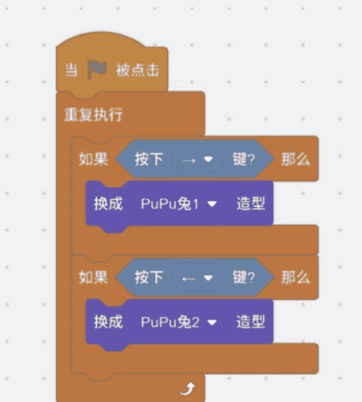

图5-1


图5-2


图5-3

### 5.1.2 为什么要用图形化编程实现AI

当下AI已渗入生活各个角落，手机秒完成人脸解锁，短视频总推送你偏好的内容，游戏里队友操作也十分拟人。好奇背后的原理吗？图形化编程把门槛降到很低，让你亲手拆解机制。仅靠拖拽就能让模型学会新能力，比如辨认照片里的动物，或判断摄像头捕捉到的手势。它就像一把通往未来科技的钥匙。

### 5.1.3 图形化编程的工作原理

可以把图形化编程比作带图示的菜谱，用彩色积木替代繁琐代码，便于指挥电脑。实现AI的关键在于训练模型，让它从大量样本里提炼可用知识。在图形化环境中，每类操作都有对应的视觉块，比如导入图片、训练模型、测试模型等。把这些块拖拽连接起来，学习过程便启动了。

## 成就打卡

我学会了 ✅

- □ 图像化编程的工作原理。

## 5.2 热身实操

### 5.2.1 语音魔法故事工坊

对着设备喊“森林里的小兔子”，屏幕上立刻蹦出一只在跳的兔子，还冒气泡说“你好呀”——这就是用语音积木拼出来的会讲故事的小程序。

想象一个神奇积木盒：“耳朵积木”负责捕捉你说的“小兔子”，“动作积木”让它跑进画面，“说话积木”让气泡飘出。把积木像搭火车一样串起来，一声指令，故事就像动画片一样播放。

这有点像训练鹦鹉，反复说关键词，机器记住得更牢。语音识别负责把人声转成文字，积木则像说明书，引导电脑按你的思路拼出动态场景。

#### 1. 实验准备

- (1) 一台带摄像头的电脑。
- (2) 图形化编程平台（浦育：https://www.openinnolab.org.cn/pjedu/home）。

#### 2. 步骤

(1) 打开浦育首页，点击“注册”，用手机号或邮箱创建账号（见图5-4），注册成功后点“登录”（见图5-5）。


图5-4


图5-5

(2) ①展开“工具”菜单选择“在线工具”；②选择“创意积木工坊”；③点击“创建积木”进入编程界面，如图5-6所示。


图5-6

(3) 点击“添加扩展”，装上“语音识别”模块（见图5-7）。


图5-7

语音识别模块相当于给电脑装了“耳朵+翻译官”。麦克风先采集声波转为电信号，提取音调、语速等特征，再与内置“声音词典”比对，依靠声学模型辨音、语言模型猜语法，最后把语音转成文字输出，比如听到“huà xīng xīng”就显示“画星星”。遇到口音或噪声容易听错，多训练或限定词库能提升准确度。

它能实现的功能见表5-1。

表5-1

| 程序指令 | 能做的事情 |
| :--- | :--- |
|  | “耳朵积木”：启动后像秒表一样计时5秒，可自行修改时长，同时打开麦克风收声——类似录5秒语音，录完自动识别 |
|  | “结果记录本”：专门保存耳朵听到的并翻译后的语音 |
|  | 当识别结果包含特定词汇（如“芝麻开门”“小兔子”“前进”），就触发后续指令 |

(4) 用模块搭建故事场景。

效果：说出“森林中的小兔子”，小兔从屏幕走出并冒泡说“你好呀”。

先用流程图梳理：

- ①启动程序，隐藏小兔，录音并识别语音，如图5-8所示。
- ②识别到“森林”时显示小兔并让它说话，若碰到舞台边缘则反弹且关闭旋转，否则前移十步，如图5-9所示。

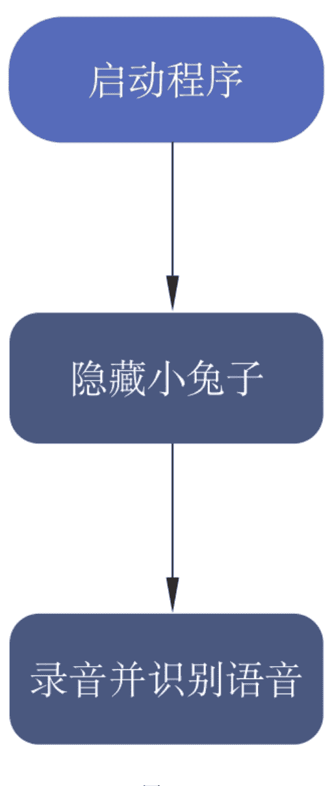

图5-8

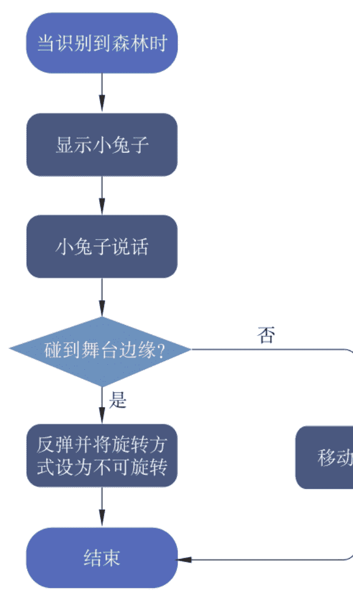

图5-9

##### 3. 编写图形化程序

(1) 选择默认的PuPu兔造型，如图5-10所示，后续代码在该角色下编写。


图5-10

(2) 设置启动方式，事件模块里可找到对应块。本例以点击绿旗开始，如表5-2所示。

表5-2

| 程序指令 | 能做的事情 |
| :--- | :--- |
|  | 当绿色旗子被单击时，启动下方程序 |

（3）启动时小兔先隐藏，需在外观模块选择隐藏指令；再开启录音识别，时长5秒，语言选中文，如表5-3所示。

表5-3

| 程序指令 | 能做的事情 |
| :--- | :--- |
|   | 显示/隐藏当前角色造型 |
|  | 让角色弹出对话框显示指定文字 |

完整程序见图5-11。


图5-11

(4) 识别到“森林中的小兔子”时，让小兔出现并说“你好，我是森林中的小兔子”，如图5-12所示。


图5-12

(5) 为避免小兔跑出视线，需加入分支；同时让它持续移动，需循环，如表5-4所示。

表5-4

| 程序指令 | 能做的事情 |
| :--- | :--- |
|  | 重复执行内部程序，让电脑无间断重复动作 |
|  | 满足条件时执行内部语句，否则跳过 |

完整程序见图5-13。

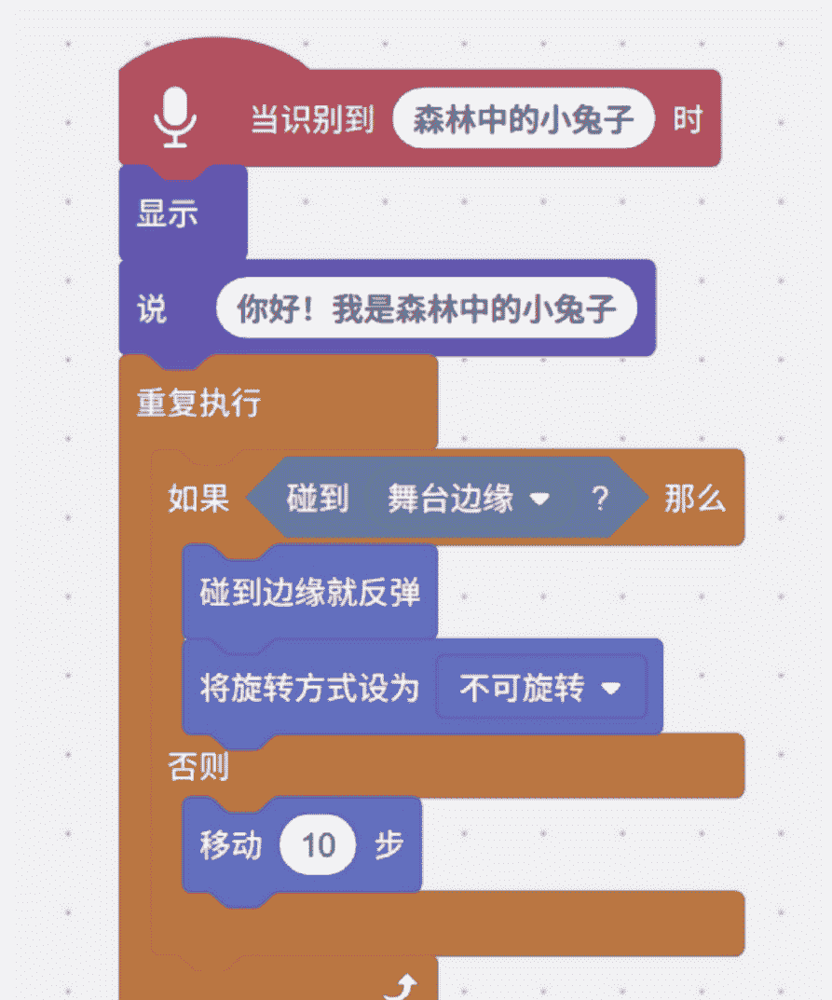

图5-13

### 5.2.2 用浦育平台训练AI模型

#### 项目背景：AI如何像人一样认水果？

你能一眼分辨苹果和香蕉，电脑怎样学会“看懂”？本节用积木编程训练智能成为“水果侦探”。

训练过程类似教小狗认玩具：①展示大量苹果、香蕉样本（数据集积木）；②告知它“红红圆圆的是苹果”（特征学习积木）；③让它自行判断新玩具（推理积木）。

学汉字靠反复记忆，智能也靠处理海量图片逐步掌握规律。数据怎么处理？

数据分堆像闯三关：

- （1）训练集：练习关。像游戏练习营学技能，反复练习记住套路。通常占70%，让学习器大量“刷题”，掌握特征与规律。
- （2）验证集：模拟排位。练熟后进行人机对战测试战术是否有效。约占20%，用来检查学习器是否学偏，及时调参，避免实战翻车。
- （3）测试集：真实排位。占10%，从未曝光的数据，像面对真人玩家。只有在此表现优异，学习器才算真正出师，可投入实际应用。

#### 1. 实验准备

- (1) 一台带摄像头的电脑。
- (2) 图形化编程平台（https://www.openinnolab.org.cn/pjedu/home）。
- (3) 配套资源中的水果数据集。

#### 2. 步骤

- (1) 登录浦育平台，进入在线工具新建项目，具体操作见5.2.1节。
- (2) 点击“添加扩展”（见图5-14），选择“AI训练（图像分类）”模块（见图5-15）。

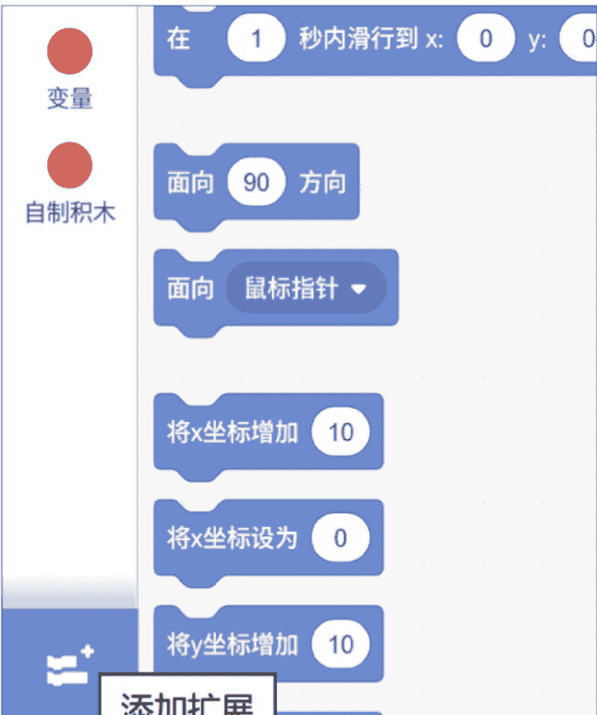

图5-14


图5-15

(3) 点击“打开AI训练工具”，如图5-16所示。

###### AI训练 (图像分类)

打开AI训练工具

从本地上传模型

```
加载模型
```

```
模型是否加载
```

```
对 [当前帧] 进行预测
```

```
预测结果中第 [0] 个的标签
```

```
预测结果中第 [0] 个的置信度
```

```
打开训练器, 标签1 [ ], 标签2 [ ]
```

```
打开训练器, 标签1 [ ], 标签2 [ ]
```

图5-16

（4）训练模型。上传照片有两种方式：开启摄像头实时拍摄，或上传已准备好的素材。本案例提供樱桃、草莓、芒果的训练集、验证集、测试集。

①将分类1、2、3改为对应水果名称，于文件夹中找到训练集图片（樱桃、芒果、草莓），上传至对应位置，如图5-17所示。


图5-17

②点“开始训练”按钮（见图5-18），平台用训练集教学习器记住水果特征，学习分类技巧。

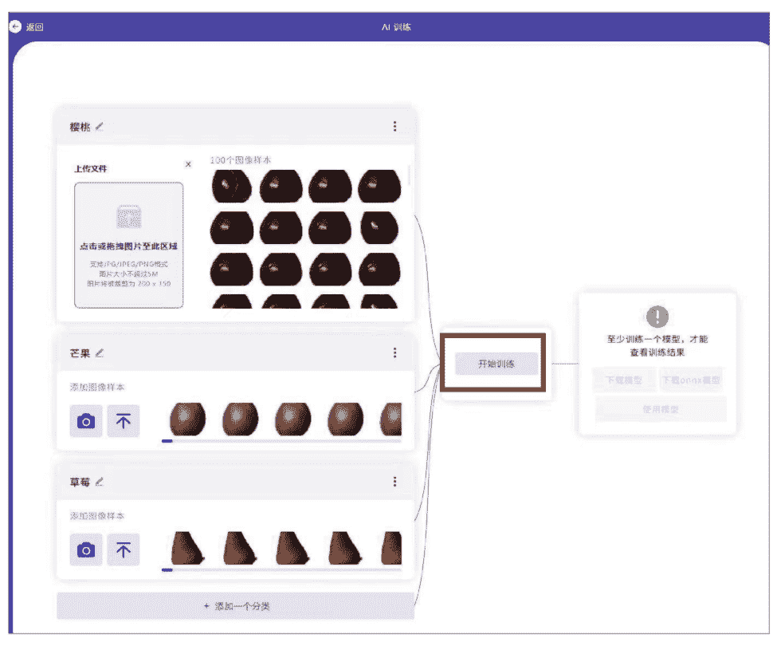

图5-18

③训练完成后，用验证集测试。输出方式选“上传图片”，上传验证集图片（樱桃、芒果、草莓）。这相当于模拟排位，若准确率不理想，可调整数据量或图片质量。图5-19中樱桃验证集辨识准确率达100%，即可点“下载模型”保存本地，后续拍摄的樱桃照片都能快速分类。

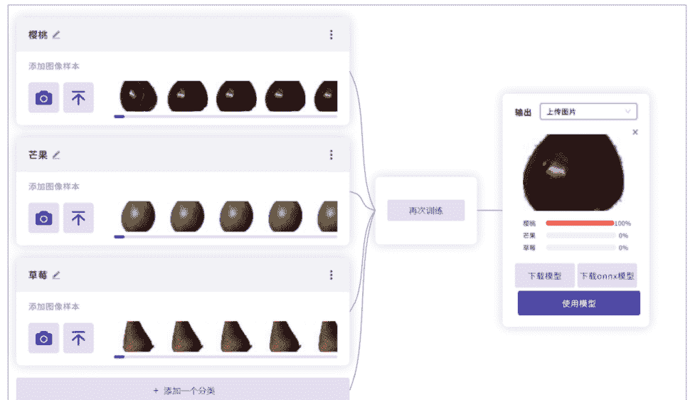

图5-19

（5）点击“使用模型”返回程序界面，模型会根据摄像头画面实时辨识出现的水果并预测。

##### 小贴士

1. 最终准确率记录

经过____轮测试，AI识别准确率达____%（其中芒果识别率____%，草莓识别率____%，樱桃识别率____%）。

2. 改进策略（1个）

策略：________________________________________________________________

做法：________________________________________________________________

预期效果：准确率预计提升____%

##### 3. 编写图形化程序

（1）选择一个造型（见图5-20），在“植物”（见图5-21）分类下依次选中樱桃、芒果、草莓（见图5-22），作为程序主角。

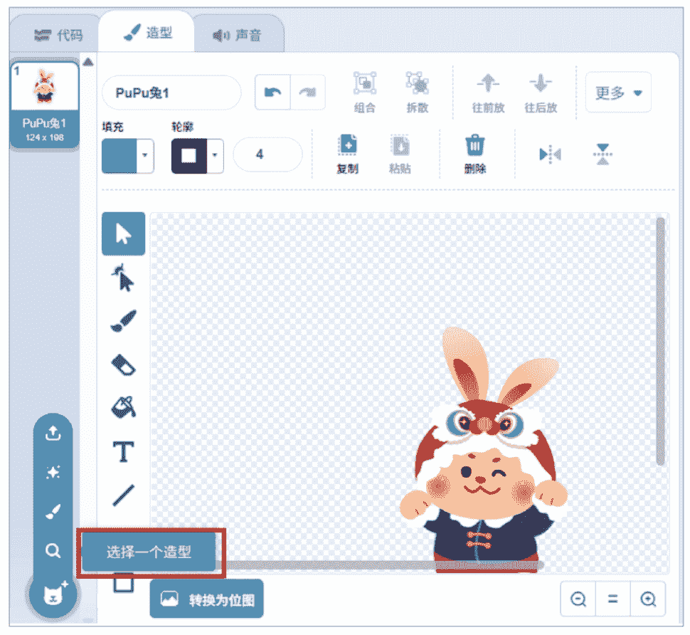

图5-20

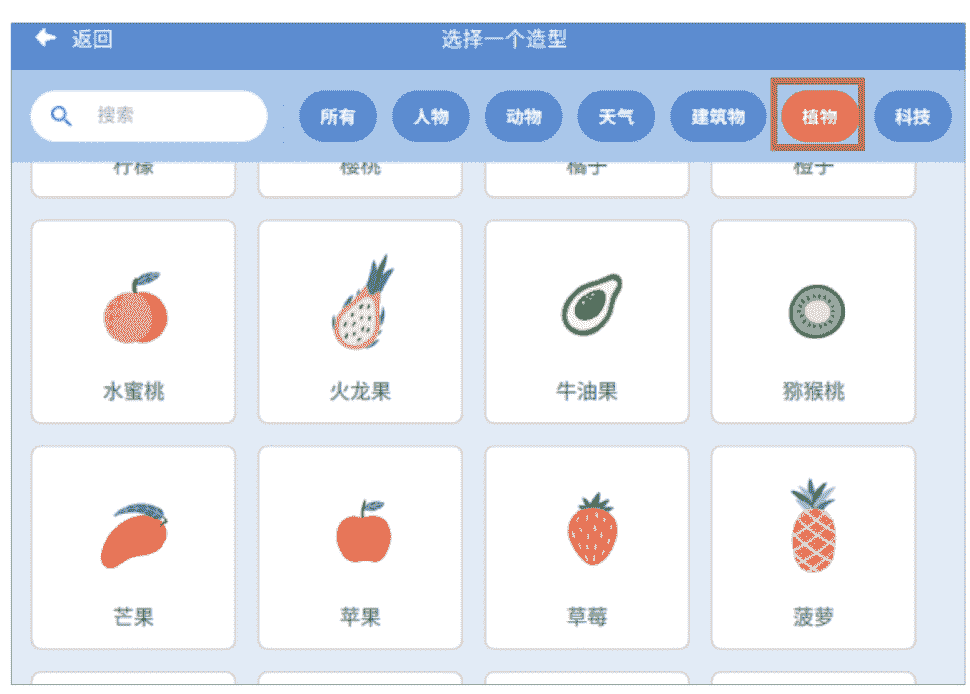

图5-21

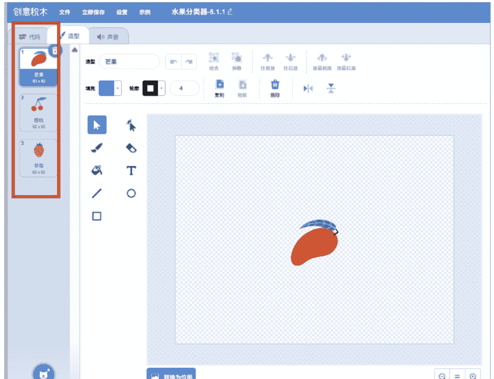

图5-22

（2）回到代码区选定角色，进行辨识前的准备，如图5-23所示。


图5-23

（3）要实现摄像头拍摄水果时实时切换造型，需让程序像勤劳蜜蜂般持续检测。把关键语句放入循环，让它不断检查画面，捕捉到水果后立即分析并切换造型。

相关指令见表5-5。

表5-5

| 程序指令 | 能做的事情 |
| :--- | :--- |
|  | 对摄像头实时画面逐帧分析，像侦探找线索一样判断 |
|  | 将预测结果的第一名水果标签设为当前“水果”，即程序的最终判定 |
|  | 在外观模块中切换水果造型 |

每次都直接读取模型结果做比较，像每次找东西都要翻遍屋子，效率低。这时可用变量作“小管家”，把模型输出存入专属仓库，后续判断直接调用，提高效率。

（4）新建变量，命名为“水果”，如图5-24所示。


图5-24

循环内程序如图5-25所示。

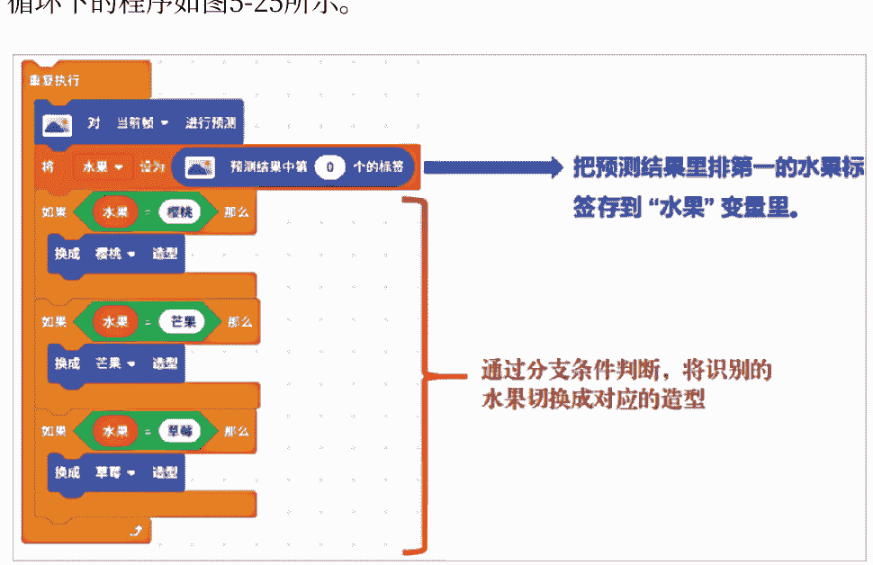

图5-25

完整程序如图5-26所示。

```
当 🟢 被点击
加载模型
开启 📷 摄像头
设置摄像头画面 弹窗显示
重复执行
    对 当前帧 进行预测
    将 水果 设为 预测结果中第 0 个的标签
    如果 <(水果) = [樱桃]> 那么
        换成 樱桃 造型
    如果 <(水果) = [芒果]> 那么
        换成 芒果 造型
    如果 <(水果) = [草莓]> 那么
        换成 草莓 造型
```

图5-26

（5）运行后把家中水果放在摄像头前，看舞台区造型是否随之变为对应水果，如图5-27所示。


图5-27

### 5.2.3 AI猜拳对战赛

#### 项目背景：AI如何学会猜拳？

石头剪刀布看似简单却暗藏学问。人靠观察习惯取胜，智能靠什么呢？本项目用积木编程训练一个能与你对战的智能猜拳高手。

用到“手势分类”，相当于“猜哑谜”：智能从手部动作解读含义，如OK手势、点赞手势。训练过程像教小孩认手势，先示范“剪刀是这样”，再反复练习，最终能自主辨识。

训练手势分类模型的步骤：

（1）收集数据（给智能看例子）。拍摄不同人、不同角度的手势照片，为每张标注“剪刀/石头/布”标签。
（2）提取特征（找关键点）。浦育平台的手势分类工具会定位手指关键点，计算弯曲角度、手掌朝向等数据。
（3）训练模型（学规律）。把各手势的关键信息整理成学习资料，输入智能的“多层大脑”进行学习，让模型掌握“哪些特征对应哪个手势”，见到新样本也能辨识。
（4）用模型辨识（上岗）。接入摄像头实时分析手势，识别到“石头”就触发对应程序，智能像小翻译把手势转为指令。

#### 1. 实验准备

（1）一台带摄像头的电脑。
（2）图形化编程平台 (https://www.openinnolab.org.cn/pjedu/home)。

#### 2. 步骤

（1）登录浦育平台，进入在线工具新建项目，具体操作见5.2.1节语音魔法故事工坊。
（2）点击“添加扩展”（见图5-28），选择“AI训练（手势分类）”模块（见图5-29）。


图5-28


图5-29

（3）进入手势判别模块，点按“开启训练工具”，示意见图5-30。

###### 手势判别训练

开启训练工具

从本地导入模型

载入模型

是否已载入

对当前帧执行预测

预测结果第0项标签

预测结果第0项置信度

打开训练器, 标签1 , 标签2

打开训练器, 标签1 , 标签2

###### 摄像头

摄像头画面设置 舞台显示

图5-30

（4）启动拍照采集并训练，见图5-31。

- 手掌要充满画面，背景尽量简洁，例如纯白墙面。
- 多角度拍摄，包含上仰、下压、左倾、右倾等。
检验样本质量：
- ① 动作清晰可辨，如剪刀需露出两根指头，见图5-32。
- ② 避免混杂，石头类素材内不应混入布或剪刀，见图5-33。
- ③ 数量均衡，三类手势照片数量相近，每类至少50张。

布类手势示例见图5-34。


图5-31


图5-32


图5-33


图5-34

（5）待进度条达到100%后，依次摆出剪刀、石头、布进行效果检验，如图5-35。


图5-35

##### 小贴士

##### 1. 识别率记录

历经____次测试，整体识别率达____%（石头____%，剪刀____%，布____%）。

##### 2. 优化思路（任选1项）

思路：________________________________________________________________

做法：________________________________________________________________

预期提升：识别率预计提高____%

理想状态下，训练充分的模型识别率可达80%以上。实际会受以下因素影响：

- ① 样本质量：训练集图片越清晰、视角越丰富，效果越好，如包含正手、反手、不同光照的样本。
- ② 环境干扰：摄像头成像、光线强弱、背景复杂度都会影响，如强光下阴影易被误判。
- ③ 动作规范度：出拳时动作是否标准，如剪刀手指是否并拢，越接近训练样本越容易被判对。

若测试达标，可将模型导出保存到电脑，后续项目直接调用本地模型即可。

（6）点按“使用模型”返回编辑区，开始搭建智能猜拳对战小游戏。

需求：舞台上布置两个角色，一方实时呈现玩家动作，一方随机呈现电脑动作。运行后摄像头开启，玩家动作实时映射到舞台角色，摆好剪刀石头布后电脑随机亮出手势，比对后即刻判定胜负，带来面对面竞技的感受。

##### 3. 图形化编程

流程图见图5-36，指令说明见表5-6。


图5-36

表5-6

| 程序指令 | 功能说明 |

| :--- | :--- |

|  | 为模型装载大脑：导入已训练好的动作识别模型，使其学会分辨剪刀石头布 |

|  | 对画面做快照解析：读取摄像头实时画面中的动作信息 |

|  | 提取模型预测的类别。模型为每类动作编号，如1=石头、2=剪刀、3=布，“第几个标签”即为判定序号 |

|  | 置信度为0%～100%的数值，如90%表示模型有90%把握，数值越高越确定 |

|  | 类似课堂上老师喊“消息1”，所有监听该消息的角色会响应 |

|  | 当角色使用“当接收到消息1”积木，相当于为其装上耳朵，专门收听“消息1”的广播 |

（1）新建两个角色，分别为电脑动作和玩家动作。

① 新建玩家角色：进入“造型”-“上传造型”，选用素材包中的剪刀石头布图片，返回代码区把角色名改为“自己”，如图5-37。


图5-37

② 新建电脑角色：使用“上传角色”，在素材库中选取剪刀石头布其一作为角色，补充另外两种动作造型，并把角色名改为“电脑”，如图5-38。


图5-38

（2）在各自角色下编写动作。

① 角色：自己，参考表5-7。

###### 表5-7

| 步骤 | 参考程序 |

| :--- | :--- |

| 启动：点绿旗后切换为PuPu兔1造型，表示玩家<br>准备视觉：载入已训练模型，弹出摄像头实时画面，让模型观察出拳<br>记录出拳：分析当前画面判定动作，新建“自己出拳”变量保存结果，等待3秒让模型反应 |  |

| 换造型：展示玩家动作。若“自己出拳”为石头则切石头造型，若为剪刀则切剪刀造型，若为布则切布造型<br>通知电脑：广播消息。发送“消息1”告知电脑出招，等待1秒让电脑准备 |  |

② 角色：电脑，参考表5-8。

表5-8

| 步骤 | 参考程序 |

| :--- | :--- |

| 接收消息：收到消息1时，将1～3的随机数存入“电脑”变量，并把“电脑出拳”变量初始化为0 |  |

| 按随机数决定出拳：若“电脑”变量为1，则“电脑出拳”设为布，切布造型并说“我出布”，等待1秒。若为2，则设为剪刀，切剪刀造型并说“我出剪刀”，等待1秒。若为3，则设为石头，切石头造型并说“我出石头”，等待1秒<br>通知判定：广播“判断”消息 |  |

| 收到判断消息时，若玩家出拳与电脑出拳相同则平局，说“再来一局”。若玩家出石头电脑出剪刀则说“你赢了”。若玩家出剪刀电脑出石头则说“你输了”。其余四种情况依次类推 |  |

（3）完整程序参考。

① 角色“自己”完整程序如图5-39。

```
当 🟢 被点击
换成 PuPu兔1 造型
加载模型
开启 摄像头
设置摄像头画面 弹窗显示
对 当前帧 进行预测
将 自己出拳 设为 预测结果中第 0 个的标签
等待 3 秒
如果 自己出拳 = 石头 那么
    换成 石头 造型
如果 自己出拳 = 剪刀 那么
    换成 剪刀 造型
如果 自己出拳 = 布 那么
    换成 布 造型
广播 消息1
等待 1 秒
```

图5-39

② 角色“电脑”完整程序如图5-40。


图5-40

#### 挑战项目：

思考如何让游戏在点绿旗启动后累计积分？可参考配套资源代码。

#### ·拓展思考·

（1）若训练数据仅为左手，右手出拳会怎样？
（2）除猜拳外，动作判别还能为残障人士提供哪些帮助？

##### 小贴士

训练耗时：模型处理数据需要时间，请耐心等待。
样本多样：训练样本需在种类和角度上足够丰富，模型才能更好理解。
反复验证：多次测试不同图片，根据表现调整优化。

## 成就打卡

##### 我学会了

- □ 自行制作猜拳手势图片集，并用图形化编程训练模型识别。
- □ 用图形化编程实现水果分类器，让程序学会区分水果。

## 5.3 进阶实践

清晨，智能手表轻振，“心跳侦探”在监测脉搏，AI充当健康顾问提醒起床活动。

走进厨房，智能冰箱化身食材管家，通过图像识别查看库存，结合营养搭配语音推荐菜谱：“青椒炒肉丝安排！”

智能家居很贴心：光线传感器控制窗帘自动开合，语音即可操控；智能喂食器的重量传感器监测余粮，AI计算食量与投喂时间，定时喂宠，主人出行更安心。

这些融入生活的智能应用，都是科技与生活的融合。接下来拆解这些智能伙伴，了解感知原理。

### 5.3.1 智能感应小夜灯

项目背景：

半夜起身喝水，脚一落地小夜灯便“啪”地亮起，仿佛预知动作。秘密在于“热感眼睛”——人体红外传感器，能捕捉人体热信号。若不想下床，喊一声“开灯”也能即时响应，语音识别模块如“顺风耳”，把声音传给AI核心分析，指令被理解后立即点亮，如同魔法。白天光线充足时，光线传感器充当“小哨兵”，小夜灯休眠。夜晚则进入工作模式，随时待命。该灯通过红外感应观看、语音识别聆听，并由AI指挥，实现守护与便捷。

#### 1. 实验准备

（1）电脑一台。
（2）行空板K10 ×1（见图5-41）。
（3）Type-C接口USB线×1。
（4）Mind+软件（https://mindplus.cc/download.html），需V1.8.1 RC1.0及以上。

##### 小贴士

本次硬件为行空板K10，像多功能科技宝箱，既能控制各类传感器，也能实现有趣的AI用例，图5-41为其外观，先来认识。


图5-41

#### 2. 步骤

（1）先开机行空板K10，用USB线一头接K10的Type-C口，一头直连电脑USB口（见图5-42）。屏幕出现logo即表示开机成功。

注意！USB线需直连电脑，不要使用延长线或扩展坞，否则易断连。并且须使用支持数据传输的USB线，选对“钥匙”才能正常唤醒。


图5-42

（2）打开Mind+软件，切换到“上传模式”，如图5-43。


图5-43

（3）点击扩展，选择主控板，选中“行空板K10”，点击“返回”完成加载，如图5-44。


图5-44

（4）点击“连接设备”，找到对应K10设备并点击，完成连接，如图5-45。提示：确保K10已开机并连接，才能搜索到设备。


图5-45

（5）用图形化编程实现智能小夜灯，见表5-9。

表5-9

| 智能小夜灯功能 | 传感器及显示器 |

| :--- | :--- |

| 当光线传感器检测到亮度低于100时，行空板K10背面的RGB小灯自动点亮 | 板载光线传感器，感知环境明暗  |

| 对着行空板说“开灯”，RGB小灯立即点亮；说“关灯”时RGB小灯熄灭 | 板载RGB LED小灯，可变换多种颜色  |

提示：本案例使用板载RGB小灯模拟小夜灯效果，如需更炫酷，可通过拓展接口外接灯环、灯带等。

语音识别模块指令说明见表5-10。

表5-10

| 程序指令 | 功能说明 |

| :--- | :--- |

|  | （1）“唤醒时间”决定机器倾听时长，单位毫秒，1000毫秒=1秒<br>（2）“连续”识别为持续监听，“单次”识别为说完一句后等待下次唤醒<br>（3）唤醒词中文模式：对行空板说“你好小行”或“你好小新”。行空板自带中文语音识别模型 |

|  | （1）每个命令词需配一个ID号0~199，如同班级学号，便于机器识别<br>（2）中文命令词用拼音书写，音节间用空格间隔，长度2~5个音节。如“打开小夜灯”为5个音节，单音节如“喂”会报错<br>正确：kai deng、ni hao<br>错误：kaideng、deng |

|  | 该指令可查看语音识别当前状态，是已唤醒还是休眠<br>注意：不可与“检测到命令词ID”同时使用，否则会让机器混乱 |

|  | 该功能像雷达，扫描是否听到指定ID的命令词<br>注意：先唤醒再识别<br>（1）先喊“你好小行”唤醒<br>（2）唤醒后雷达开始扫描命令词ID<br>（3）听到ID=10的“开灯”即执行开灯动作，如同约定暗号 |

语音合成模块指令说明见表5-11。

##### 表5-11

| 程序指令 | 功能说明 |

| :--- | :--- |

|  | 可让行空板把文字转为语音播报。如需停顿，可加入逗号，例如：“你好，我是小行，很高兴认识你” |

|  | 可调节播报语速，数值越大越快，最小0最大5，未设置时默认2 |

屏幕显示模块指令见表5-12。

##### 表5-12

| 程序指令 | 功能说明 |

| :--- | :--- |

|  | 指定文字从第几行最左侧开始快速显示，并可选择文字颜色<br>注意：<br>（1）K10竖屏时支持13行文字<br>（2）该指令会强制执行自动清除 |

|  | 使用该指令绘制文字、图形、图片后，需用“显示更新”积木“盖章”，画面才会呈现。注意：屏幕显示摄像头画面时，绘制内容会随画面移动，无需更新<br>缓存内容：先在草稿区绘制<br>显示更新：将草稿贴到屏幕 |

掌握核心模块指令后，开始实践，具体步骤见表5-13。

##### 表5-13

### 5.3.1 智能小夜灯

| 步骤 | 参考程序 |

| --- | --- |

| 程序启动时，设置语音识别连续唤醒时间为6000毫秒，即6秒，添加命令词ID0“kai deng”、ID1“guan deng”，并将语音合成语速设为2 |  |

| 为实现持续识别与判断，将以下代码放入循环执行。新建“光线”变量，保存环境光强度值，将该值显示在行空板第3行屏幕，并显示缓存。若光线值小于100说明过暗，点亮小夜灯，并在屏幕第5行提示“已开灯”，显示缓存。否则光线充足，关闭全部RGB灯，并在屏幕第5行提示“已关灯”，显示缓存 |  |

| 判断语音识别当前是否已唤醒，若已唤醒则在屏幕第8行显示“小新已唤醒，请说命令词启动吧！”否则显示“你好，小新，请唤醒我”。若检测到命令词ID0“kai deng”，则点亮全部灯光并语音播报“已开灯”。若检测到命令词ID1“guan deng”，则关闭所有灯光并语音播报“已关灯” |  |

(6) 完整程序参考如图5-46所示。

```
行空板K10主程序开始
设置语音识别 连续 唤醒时间 6000 语言 中文
添加语音识别命令词ID 0 命令 "kai deng"
添加语音识别命令词ID 1 命令 "guan deng"
设置语音合成语速为 2
循环执行
    设置 光线 的值为 读取环境光强度
    缓存显示文字 合并 "光线值：" 变量 光线 在第 3 行 颜色
    将缓存内容显示/显示更新
    如果 变量 光线 < 100 那么执行
        灯号 全部(-1) 显示颜色 白色
        缓存显示文字 "已开灯" 在第 5 行 颜色
        将缓存内容显示/显示更新
    否则
        关闭 全部 RGB灯
        缓存显示文字 "已关灯" 在第 5 行 颜色
        将缓存内容显示/显示更新
    如果 语音识别当前状态为唤醒? 那么执行
        缓存显示文字 "小新已唤醒，请说命令词启动吧！" 在第 8 行 颜色
        将缓存内容显示/显示更新
    否则
        缓存显示文字 "你好，小新，请唤醒我" 在第 8 行 颜色
        将缓存内容显示/显示更新
    如果 检测到命令词ID 0 ? 那么执行
        灯号 全部(-1) 显示颜色 白色
        语音合成 "已开灯"
    如果 检测到命令词ID 1 ? 那么执行
        关闭 全部 RGB灯
        语音合成 "已关灯"
```

图5-46

（7）程序编写结束后，请先检查主机与K10的连接状态，执行“上传到设备”操作把代码写入K10，写入完成后即可启动，运行情形见图5-47。


图5-47

·拓展思考·

- (1) 人体红外感应：可为智能小夜灯增加互动体验，例如外接红外人体感应单元，人体靠近时灯光即刻亮起。
- (2) 智能家居联动：若希望将小夜灯接入智能家居体系，通过手机APP远程控制开关，需要额外哪些硬件与技术支撑？

### 5.3.2 校园智能安全卫士

项目背景：

走进校园，四处可见默默守护安全的智能节点。校门口的人脸识别门禁是第一道防线，摄像头充当“眼睛”，后台模型扮演“大脑”，借助面部验证判断来访者是否为本校师生；一旦识别到未预约人员，语音合成会立刻播报：“抱歉，没有预约，不能进学校哦！” 教室里的温湿度采集器则是环境监测的“哨兵”，兼具火灾预警功能，当温度骤升至40℃以上且湿度骤降至30%以下时，会亮灯报警。 这些设备如同隐形的超级英雄，24小时守护校园，让学习生活既安心又有趣。

#### 1. 实验准备

- (1) 主机一台
- (2) 行空板K10 一块
- (3) Type-C数据线一条
- (4) Mind+软件 https://mindplus.cc/download.html 需V1.8.1 RC1.0及以上版本
- (5) 网络环境

#### 2. 核心模块学习

(1) 人脸识别模块，指令汇总见表5-14

表5-14

| 程序指令 | 功能说明 |
| :--- | :--- |
|  | 可将摄像头画面实时投放到K10屏上，也可选择隐藏画面 |
|  | “视觉魔法切换器”：可切换四种机器视觉算法模式，相当于为设备更换不同“眼睛”。四种模式为：人脸检测、猫狗检测、移动检测、二维码识别。选人脸检测或猫狗检测时，屏幕会叠加识别框，直观反馈结果。注意使用时请保持设备竖直，横放会导致“看不清”，检测效果下降 |
|  | 判断当前是否捕捉到人脸，类似在人群中找熟人，有结果即通知 |
|  | 采集并学习待识别人脸。启动采集后设备会像记忆力超强的小伙伴一样保存特征，学习成功后会分配专属ID，从1号起顺延。注意该“记忆大师”最多保存48张不同面孔 |
|  | 比对已学人脸库，一旦匹配成功立即告知，就像认出老朋友 |
|  | 判断识别流程是否结束 |
|  | 成功认出已学人脸时，会即时提取对应ID。注意为单次提取，取用后ID自动复位为-1，准备下次使用 |
|  | 清除所有已学人脸ID，设备归零，准备重建库 |

(2) 函数模块。当步骤较多时，程序会显得杂乱。可将人脸识别的关键流程打包成一个可直接调用的函数，主程序需要时调用它，就像呼叫小助手一样完成任务，让主程序更简洁易读。这相当于把炒菜步骤写成菜谱，使用时照谱操作，如图5-48所示。


图5-48

#### 3. 操作步骤

(1) 开启K10并与主机相连，启动Mind+并切换至上传模式。相关操作可参考5.3.1节“智能小夜灯”项目。

(2) 用图形化积木搭建逻辑，具体流程见表5-15。

表5-15

| 步骤 | 参考程序 |
| --- | --- |
| 主程序启动时打开摄像头画面并切换为面部检测模式，新建“学习人脸”变量，初始值设为0 |  |
| 为实现温湿度监测与面部判断的持续运行，后续代码需置于循环中。新建“温度”变量，将读取温度存入并显示于K10屏幕第1行，持续显示。若温度高于40摄氏度，则判定高温预警，点亮红灯警示，否则关闭灯光。若“学习人脸”变量为1，则进入学习流程。若检测到面部且“学习人脸”为0，则启动人脸识别 |  |

续表

| 步骤 | 参考程序 |
| :--- | :--- |
| 定义人脸识别函数。调用识别并等待完成，新建ID变量保存结果，便于后续判断。在屏幕第2行显示人脸ID。若ID为-1，说明该面部未录入，判定为陌生人，语音提示“抱歉，没有预约，不能进学校哦”，并点亮红灯。若ID为1，则点亮绿灯并提示“小智同学你好，欢迎回到学校”。若ID为2，则点亮绿灯并提示“小明同学你好，欢迎回到学校”。若ID为3，则点亮绿灯并提示“小兰同学你好，欢迎回到学校”。等待2秒后关闭全部RGB灯 |  |
| 按下A键，将全部灯光设为黄色，并把“学习人脸”变量置为1。等待3秒。语音合成提示“已完成人脸学习”后，将“学习人脸”值改回0 |  |

续表

| 步骤 | 参考程序 |
| :--- | :--- |
| 学习完成后可开始识别检测，先关闭全部RGB灯。按下B键，将灯光设为蓝色并清除全部已学人脸ID，等待1秒后关闭灯光 |  |

温馨提示：同学们，重新运行程序前请务必先按B键！这相当于给设备的人脸记忆做一次“大扫除”，清空旧ID后再录入新面部，系统才能准确识别。否则残留旧信息容易出现“认错人”的乌龙。

完整程序参考如图5-49所示。


图5-49

```
定义 识别人脸
识别人脸
等待直到 是否识别完成？
设置 ID 的值为 获取识别到的人脸ID
缓存显示文字 合并 "人脸ID：" 变量 ID 在第 2 行 颜色
将缓存内容显示/显示更新
如果 变量 ID = -1 那么执行
    语音合成 "抱歉，没有预约，不能进学校哦"
    灯号 全部 (-1) 显示颜色 红色
否则
    如果 变量 ID = 1 那么执行
        灯号 全部 (-1) 显示颜色 绿色
        语音合成 "小智同学你好，欢迎回到学校"
    如果 变量 ID = 2 那么执行
        灯号 全部 (-1) 显示颜色 绿色
        语音合成 "小明同学你好，欢迎回到学校"
    如果 变量 ID = 3 那么执行
        灯号 全部 (-1) 显示颜色 绿色
        语音合成 "小兰同学你好，欢迎回到学校"
等待 2 秒
关闭 全部 RGB灯
```

图5-49（续）

```
当按键 A 按下
灯号 全部 (-1) 显示颜色 🟢
设置 学习人脸 的值为 1
等待 3 秒
语音合成 "已完成人脸学习"
设置 学习人脸 的值为 0
关闭 全部 RGB灯
```

```
当按键 B 按下
灯号 全部 (-1) 显示颜色 🔵
忘记全部人脸ID
等待 1 秒
关闭 全部 RGB灯
```

图5-49（续）

## 成就打卡

我学会了 ✅

- □ 绘制小夜灯流程图。
- □ 完成小夜灯制作。
- □ 设计并实现校园智能安全小卫士。

## 闯关测验

1. （单选题）以下哪项属于语音合成技术的应用？（ ）
    - A. 语音转文字记录会议内容
    - B. 智能音箱朗读新闻
    - C. 手机语音助手识别指令
    - D. 自动生成字幕

2. （单选题）在校园安全小卫士系统中，温湿度传感器数值异常时应采取的措施是（ ）。
    - A. 增加人脸识别频率
    - B. 启动通风设备
    - C. 关闭所有门禁
    - D. 调整语音合成音量

3. （单选题）水果分类AI模型训练时，不需要考虑的因素是（ ）。
    - A. 水果颜色
    - B. 水果形状
    - C. 水果生长周期
    - D. 表面纹理

4. （单选题）智能小夜灯项目中，光线传感器的主要作用是（ ）。
    - A. 控制灯光亮度
    - B. 感知环境光线
    - C. 实现语音控制
    - D. 延长使用寿命

5. （单选题）AI猜拳程序判断用户手势时，最核心的技术是（ ）。
    - A. 图像识别
    - B. 语音识别
    - C. 温度传感
    - D. 数据加密

6. （多选题）校园安全小卫士系统的人脸识别门禁功能，需要包含以下哪些模块？（ ）
    - A. 摄像头
    - B. 温湿度传感器
    - C. 语音合成器
    - D. 显示屏

7. （多选题）语音识别技术可以应用于以下哪些场景？（ ）
    - A. 智能门锁解锁
    - B. 智能家居控制
    - C. 医疗记录录入
    - D. 自动驾驶导航

8. （多选题）设计水果分类系统时，可以采用的传感器有：（ ）。
    - A. 颜色传感器
    - B. 重量传感器
    - C. 超声波传感器
    - D. 气味传感器

9. （判断题）校园安全小卫士系统中，人脸识别和温湿度检测必须顺序执行。

10. （判断题）小夜灯项目可以通过添加人体红外传感器实现智能感应。

11. （判断题）AI猜拳程序只需识别石头、剪刀、布三种手势即可。

12. （判断题）语音合成技术只能将文字转换为固定语调的声音。

13. （判断题）水果分类系统的准确率完全取决于硬件设备，与算法无关。

14. （简答题）若要实现AI猜拳游戏的高准确率识别，需要在硬件和软件层面分别采取哪些措施？请详细阐述。

15. （简答题）校园安全小卫士系统中，当温湿度传感器数据异常且人脸识别到陌生人员时，如何设计一套完整的应急响应流程？

16. （简答题）设计一个基于语音识别和合成技术的智能水果分类助手，描述其功能实现方案和主要模块。

## 成就贴纸

看看你获得了几张贴纸。

| 阅读全章内容 | 成就打卡 | 完成闯关测验 |
| :--- | :--- | :--- |
|  |  |  |

(1)行空板K10官方说明文档

https://www.unihiker.com.cn/wiki/k10/get-started