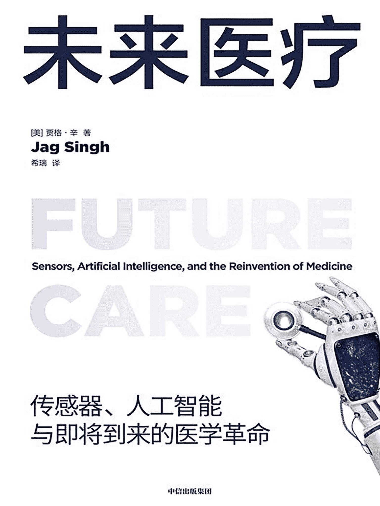

# 重塑医疗未来：传感器、AI 与即将到来的诊疗革命

# 献词

致医疗体系的脊梁力量

致守护生命的白衣守护者

# 推荐序

《重塑医疗未来》必将成为未来数年医疗健康演进的蓝图。我与贾格·辛相识逾二十载。我们同在印度开启求医之路，后皆赴牛津深造获博士学位（虽前后脚不同）。在麻省总医院、哈佛医学院受训时，我们的时空轨迹曾有过交汇。贾格堪称医者典范：既是卓越的临床专家，又是敏锐的思想者、未来学家与科学家。他深耕医疗器械技术与心脏电除颤领域，誓以创新优化医疗服务。作为全美最大心脏病治疗机构的前任临床主管，他对医疗系统的顽疾与挑战洞若观火。本书汇聚了数字健康多维度的突破进展，讲述了数字化平台如何协同交互、推动医疗可持续发展的完整叙事。

医疗健康正站在转型十字路口。传感器与人工智能驱动的数字化浪潮，将重塑医疗服务的供给与接受模式。《重塑医疗未来》直击公众对这场变革的核心关切。书中核心议题聚焦：如何借助及时干预，实现疾病的预防与规避。贾格以独特视角，用浅显清晰的笔触传递这一理念，融入自抗病魔的亲历与患者的真实叙事。书中临床场景鲜活，故事人物丰满。维多利亚的经历令我动容——家族 7 名成员罹癌，她独自探寻照护之道；38 岁的玛雅与胰腺癌抗争，努力接受生命有限的现实。这些故事深刻揭示了 AI 辅助癌症早筛早治、挽救生命的关键价值。劳拉因心衰遭受重创，其经历则证明：远程监测传感器数据能有效缓解患者焦虑。

医学数字化变革蓬勃兴起，为全球推广个性化照护创造契机。本书重点剖析新型照护模式，勾勒未来医院愿景。关键在于，这些并非空中楼阁。贾格全景式描绘了模块化医疗、疾病管理模式及第三方服务商的必要性，并推演学术医疗中心的演进路径。数字化转型已部分落地，仅待深度嵌入临床实践。我们拥有独特窗口期，去认知并拥抱传感器与 AI 开启的新世界，将其融入生活肌理。

《重塑医疗未来》将深远影响医学进程。它将成为患者、医护人员及关注医疗健康人群的最佳向导，为未来指明方向。

—— 悉达多·穆克吉

# 序言

晨光透过宽大无遮挡的窗棂洒入，将我从梦境中唤醒。睁眼，是那个已无比熟悉的病房：灰白木柜、方正电视、侧对床铺的旧沙发、左侧的落地窗。床头两侧立着钢制输液架：一架挂着平板电脑，方便与护士联络；另一架悬挂药液。侧头可见监护仪跳动的心率、血氧、血压数值。这里，已成我所谓的“家”。时值 2020 年 3 月初，疫情伊始，众人茫然无措——无获批药物、无明确指南、过往经验失效，满盘皆是猜测。

我作为新冠感染者被送入急诊。血氧骤降，影像学表现不佳，医生即刻决定转入 ICU。医护人员已备好呼吸机。随血氧回升，我被转至新冠隔离病区。医生告知我将失去嗅觉。这不准确：非闻不到，而是被腐烂刺鼻气味淹没，时刻侵扰。我时刻被提醒：病毒已安营扎寨鼻咽，开始掌控躯体。

住院期间，高烧不退，剧痛缠身。镜中人面目全非：消瘦近 7 公斤，衣物空荡荡挂在骨架上。咳嗽持续，血氧游离在需吸氧边缘。指夹式血氧仪常显 90 左右，偶跌至 80，我便拼命深呼吸、挣扎坐起扩胸。我不愿让护士见低值，恐再被推回 ICU。

凭医学背景，我能相对清醒评估病情：双肺均受侵袭。血氧下降意味病毒占优。面对 55 岁的自己，我已为恶果做好心理建设。法、意疫情惨报频传：上机患者难脱机，多人过早离世。庆幸我 ICU 停留短、未插管，但深知凶险。

这令我极度沮丧。除糖尿病（可经饮食运动控制）外，我向来硬朗，行医 30 余载从未住院、未请假。感染在意料中：医生职业风险，病毒不因年龄、性别、种族或既往健康而区别对待。真正震撼我的是，身体极速崩塌至须住院地步——我原以为以我体质足以扛过。病房禁探视，情绪低谷时，家人视频陪伴与技术桥梁成救命稻草。每日鼓励、表达爱意。我向不多愁善感，却觉脆弱、渴望支撑。视频中常只能简单回应或摇头，不敢言语，怕声线暴露无助。常在泪奔边缘挂断。但见到面庞、听到呼唤，终是好的，助我聚力康复。

我能走的最远距离，是至盥洗室的六步。每趟往返，呼吸困难前所未有：如全速奔跑时仅能透一根吸管呼吸。微量运动致窒息感，令人不安。持续咳嗽、体温波动耗尽储备，体重骤降、肌肉重度流失。震惊发现：双手能轻松环抱大腿。卧床最舒服。恐惧挥之不去：随时可能被推回 ICU、插管、上机、血流动力学监测——同意书已签。虽身心俱疲，仍遵医嘱用诱发性肺量计训练。仪器置床头，本想深呼气，常因咳嗽中断。

病区常被他室咳嗽声扰。透过咳声、走廊忙碌声，我能判断病友病情恶化。鼓起勇气询问，常得答：已转 ICU、插管、上机。

我陷入深度孤独：与家人隔离、与病友分隔。测体温的医护戴口罩、穿防护服，面目模糊，甚至无法分辨是否同一护士。觉得康复出院也认不出任何一人。即便如此，那段特殊时期，我珍视每一次接触。医生护士探视是唯一面对面联系，虽短暂、隔口罩。但探视逐渐缩短、稀少，终转为视频。床头 iPad 响起，即是远程查房。初感不适，细想明白：视频避免医护不必要接触与感染风险。实际上团队能做的有限，多为对症缓解。大家都在等：看病毒赢，还是人赢。

前 7 天数据不佳。第 8 天 iPad 响起，医生对着镜头笑了：血液指标好转，最担心的指标下降。她已通过病房外显示器远程查看我心率、血压、体温、血氧。认为我可回家。并提及医院收治激增、床位告急。

或许察觉我对病情骤变困惑，医生安慰：生命体征与病程均可远程评估。得益于远程医疗进步，我可在家获有效快速治疗。她介绍居家监测工具与传感器：卧室即可测体温、血压、心率、血氧。眩晕感袭来。虽病超 3 周，疫情暴发尚早。但令我惊讶的是，短暂住院间，远程医疗设施与依赖度飞速增长。彼时已显现：虽因需求催生，却将持续成为医疗新常态。

# 引言

未来医疗服务将是虚拟化的，根基在于传感器技术，驱动力来自预测分析。这将使医疗决策高度个性化，为患者提供最贴心的照护。无论身处何地，患者需求响应随时随地。未来十年，这是医学实践的演进航向。转型或阵痛，但我们皆需适应，终将使事物向好。

医疗健康是多维、高度复杂的产业。日常运营中，前沿科学飞速迭代、市场动荡、昙花一现的潮流、夸张营销、不可预测的人性行为交织碰撞。正负效应叠加，导致冲突、矛盾、混乱常态化。数字化转型最大拦路虎：患者与提供者习惯绕道现状，这种惰性与不适应性近乎天生。新冠大流行强迫所有人走出舒适区，进入戴口罩、保持社交距离的世界。自我防护与日常照护刚需，倒逼虚拟技术普及。如今，可植入体内或嵌入可穿戴设备的传感器遍地开花：手表、耳机、项链、戒指、手镯、连体衣、腰带、袜子、鞋、尿不湿……首代心率监测传感器已普及。这为传感器技术创造契机：远程提供疾病状态与器官功能的客观数据，使虚拟视频问诊能适度替代面诊。

事实上，如同现代社会普遍数字化特征，人体器官亦在被数字化。传感器高速助力我们主动捕获预测、预防疾病所需信息。至今医疗多为周期性、交易性服务，未来将成持续过程。结合医学界对健康管理与预防的重视升级，这场数字革命将有效攻克医疗系统软肋——慢性病难题。这种大规模迁移，不仅重塑医患关系，更将深度重构医院运营与医疗商业模式。但要最大化红利，我们不仅要调整医患相处模式，更需在财务与组织流程层面同步整合。目标：让医疗更合理、更可负担、更高效。

这是一个传感器无处不在的新世界。创业公司竞相寻觅并优化能与电子健康档案互联的最佳传感器阵列。医院系统不仅建指挥中心监控流程效率，更采用传感器驱动方案，实时管理治疗患者。意味拥有电子健康档案的每个个体将持续被监测。数据匿名化持续传输，将使我们预测、预防突发状况，甚至预防疾病本身。反应式医疗成过去，主动健康管理新纪元开启。本书将借真实案例，深度探讨：在 AI 加持下，虚拟医疗与传感器技术如何让数字技术广泛应用重塑医疗体验。

作为心脏电生理学家，过去 20 年我专注治疗突发心搏骤停患者、合并恶性心律失常（房颤、早搏）的心衰患者、因遗传或环境面临猝死风险人群。为数千患者植入起搏器、除颤器，消融心脏关键电路。期间参与基础科学、流行病学、临床试验、医学创新研究，核心致力于以患者为中心改进疗效、防猝死、缓解心律失常不适。10 余年前，我与团队开发首个传感器衍生风险评分系统，利用植入胸腔心脏的除颤器、起搏器采集数据，为心衰患者分层、预测不良结局与死亡率。^(¹) 仅测身体活动、夜间心率、自主神经活动，即可识别出未来一年死亡风险是常人 5 倍的高危人群。

我也引入深度神经网络与机器学习预测疾病，推动传统住院模式向家庭治疗转型。^(²)

本书分四部。第一部阐述传感器技术演进，探讨现有类型，以真实患者故事展示应用，预测即将实现的功能。第二部深入远程医疗及其对医疗获取与供给的影响，剖析数字化革命对患者体验的冲击、社会鸿沟加深等迫切议题。第三部聚焦人工智能：从认知 AI 是什么入手，深入数据洪流及其影响与临床应用，探讨伦理与偏见难题。第四部融合前三部内容与当下医疗环境，探讨维持医疗系统运转的关键原则、新冠疫情的长远影响、支付报销机制变革，强调患者主动参与的重要性。书末设想未来医院形态：务实落地、富有现实意义，非夸张悲观之想象。

本书核心旨在让读者认清迫近的未来，并在进程中发挥作用。我们实事求是直面挑战，推动监管与支付方认清趋势、相应调适。患者体验、成本、临床结局的正向效应将破除阻碍，让医疗超越地域国界。

变革不可逆。传感器、虚拟医疗、AI 算法三位一体，将驱动未来数年变革。更多传感器意味更多数据，需更多资源存储、分析、生成算法；更多算法与数据可能意味隐私让渡，道路注定不平。医疗模式、流程、职责、医院经济、隐私、整体医疗健康，在地缘政治博弈下皆难预测。^(³)

同时，学术医疗中心转型求变，众临床医生离开传统医院创业，聚焦个性化基层医疗与疾病管理，区别于传统模式的深层变革正悄然落地。^(⁴)

盼读者通过深度理解促进身心健康、治疗慢病、改善癌症、糖尿病、心脏病、肺部疾病等常见重症的长短期策略，持续增信、深悟。我坚信：随社会适应医疗变革，更好理解新开发医疗路径及其复杂性将愈发重要。技术已就位，当下我们必须理解、适应、接纳它。

# 巨无霸、臃肿、乏力的医疗系统：变革迫在眉睫

变革非生活必需品，变革即生活本身。

—— 阿尔文·托夫勒

我们倾向认为美国是最强国、拥最优医疗体系，事实远非如此。美医疗体系困扰数百万无保险者：常规护理费用不可解、患者满意度低、预期寿命痛心地垫底发达国家。从成本效益与医疗质量双维度看，现行体系均难以为继。

叠加不可预测的服务获取、城乡差异、不同社经地位与种族间的照护鸿沟，美国面临的问题复杂沉重。财政巨压使现行服务形式对社区服务、资源、创新形成破坏性冲击。公众有责从整体思考破局——非孤立单一努力，而通过协作，确保应得医疗服务。

医疗系统如此臃肿乏力，成因繁杂。概括而言，很大一部分源于药企、保险公司、医疗行政高层、医院系统的非理性逐利。另一部分源于管理低效：重复劳动、陈旧流程、医疗服务前后端缺乏统一精简流程。超 1/4 医疗成本源于中层管理与院内外非标准化程序，并不意外。电子病历推行略有成效，但实践中变数惊人：排程、回访、预授权、病案编码、理赔提交等。浪费触目惊心。

谈逐利，有时难判定发生地。知药企为利润抬高新药价、利用弱势患者机构、给特定医院优惠却抬高他处药价，回扣骗局仍常见。对比他国，美大部分药物、器械、手术费用高数倍。医院有责：知名医院收费远高于非知名机构。复杂手术治疗或可部分接受，但心电图、胸片等常规检查显然不妥。美医院中，单次 X 线检查费用可从 41 美元跨度至近 300 美元。^(⁵)

## 变幻的市场竞争格局

2008 年与 2020 年美最大公司榜单变化惊人。2008 年科技巨头仅微软入围前五——排名第三。^(⁶)

我们可能悲观认为这些合作非利他，意在切入千亿市场、造福股东。但必须承认：若附带红利是让医疗更高效、更有效益，便值得冒险。其他重组联姻：CVS Health 收购 Aetna，Cigna 收购 Express Scripts，Humana 收购 Kindred Healthcare，沃尔玛并购 Humana。所有重组致力于颠覆传统模式。近期，远程医疗巨头 Teladoc 收购慢病照护平台 Livongo（糖尿病监测与远程监测），意图昭然。虚拟照护需求指数级增长，两大虚拟医疗巨头合并将缔造 370 亿美元医疗科技巨兽。沃尔格林近开设 500~1000 家医生办公室，提供全天候服务，线上线下并行，药师医生协作。与 VillageMD 联盟将配备 3000 余名初级保健医生。^(⁷)

医疗如何推动市场，或市场如何重塑医疗？这场颠覆由技术与采用方式决定。高科技巨头押注算力提升与大规模数据集可用，融合二者改写内外科面貌。无疑将改变医患互动、提升医疗标准，AI 正并将改写现状。疫情前预测：2026 年 AI 助医疗经济节省 1500 亿美元。疫情平息后预测节省额或更高。高盛估算：数字化医疗设施或节省超 3000 亿美元，超 2/3 惠及慢病管理，因这些疾病照护很大程度可借传感器远程实现。^(⁸)

## 医院成本与医疗照护

不得不提的是，医疗健康产业持续狂飙突进，增速竟是其他领域的两倍之多，这才是最大的诱因。在美国，医疗支出占据了 GDP 的五分之一强，年规模逼近 4 万亿刀，这数字甚至超越了好几个欧洲发达国家的经济总量。疫情暴发前，该行业复合年增长率预估在 5%~7% 区间，增量高达 6700 亿美元。新冠肺炎冲散了部分乐观预期，医院成本飙升，主因在于人力与医疗物资开支激增 ^(⁹)。

医疗体系顽疾深重。除却高昂的实际成本，医疗服务——特别是影像检查与高端技术——的过度使用，也是巨额账单的推手。以逐利和高报酬疗法为导向，而非疾病预防优先，导致了系统性弊端。与此紧密相关的是，医院与保险公司各自为政，唯利是图，漠视人的完整生命周期。当下的护理模式呈交易性、碎片化，按年度预算切割，保单也多为一年期，但疾病带来的支出却是终身的。体系内部缺乏问责机制，也无激励引导聚焦健康与防病。美国医疗系统不透明、低效、无能且不公，病入膏肓，亟待重塑。

是时候揭开面纱，直面幕后真相并公之于众。梳理导致现代医疗“功能失调”的诸多因素，借助数字技术分类拆解，方能逐个击破。数字战略早已渗透生活方方面面——网购、打车、订房、点餐、理财，唯独医疗保健游离其外。关乎生死的高风险，以及背后错综复杂的利益博弈，拖慢了数字技术在医疗领域的落地步伐。

新冠病毒在此扮演了关键角色。讽刺的是，病毒以一种意想不到的能量“感染”了系统，倒逼其自我修复，至少给了我们契机。真正荒诞的是，我们竟需一场大流行或重大灾难，才能打破僵局。疫情虽重创全球，却也有意外之“喜”：推动远程医疗与虚拟护理走入寻常百姓家，重塑了患者预期，监管层亦在加速将行之有效的变革写入法典。

## 变革箭在弦上

转型已启幕，变势不可逆，我们需从零始建，重塑透明与问责。重新定义价值主张，重构医疗机构，是唯一出路。围绕数据、健康、可穿戴、传感器与 AI 的讨论，已成核心议题。在一切发生前，市场趋势早已吹来变革之风，倒逼医疗机构审视实践，向灵活、以患者为中心、降本增效转型。2020 年，约 80% 的医疗费用流向了治疗端 ^(¹⁰)。

谋划变革时，不可忽视未来几年专科医师短缺与患者人口结构剧变的现实。当前美有 5000 万 65 岁以上老人，预计 2060 年将翻倍至 1 亿，占比达 25%，银发海啸将给体系带来巨大冲击 ^(¹¹)。

技术接受度上，老少代际差异显著。高风险老年群体与主力护理的年轻一代，在技术适应性上存在鸿沟。婴儿潮一代可能排斥高科技问诊，而千禧一代医者更乐拥抱“少实体、多虚拟”模式。甚至资深医师对学习新型医患互动也缺乏热情。未来护理路径将针对不同人口统计特征、文化素养与偏好持续演进。妥协与磨合将逐步消除对远程护理与传感器方案的认知壁垒。转型正当时。我深信，传感器与 AI 驱动的虚拟护理策略，融合自我健康管理，将催生我们追求的可持续颠覆性创新，并构建合理的报酬体系 ^(¹²)。

# 第一部分

# 传感器：数字医疗的触角

## 第 1 章

## 解码传感器的核心价值

**伊曼努尔·康德**

**吾等一切知识，皆肇始于感性。**

1988 年 5 月底的一个夜晚，我在普纳大卫·萨松综合医院 ICU 值夜班时遇见了安尼尔。年仅 20 出头的他，因呼吸衰竭急需插管上机，被紧急转入。他是工科备考生，十天前曾感腹部不适后短暂缓解，但近四天四肢渐麻痹无力，甚至抬手剧痛，入院前 24 小时病情骤变，已陷呼吸困难。

那晚停电，烙印记忆深处。电网故障常态化，备用发电机仅能支撑 4 台简易呼吸机。偏偏发电机也趴窝，我们轮流手捏复苏囊，为 3 名重症患者维持正压通气。人手不足，我独自守护安尼尔，每 5-6 秒挤压一次，坚持了 4 小时直达黎明。大半夜我困惑不解：为何四肢与呼吸肌麻痹来势汹汹？每次挤压，都在祈祷奇迹逆转。

天色破晓，神经学权威瓦迪亚医生带领住院医师团走入病房。他与安尼尔母亲低语病情，行详细神经查体，寥寥数分钟确诊：吉兰-巴雷综合征。病历上留下潦草医嘱：静注类固醇，安抚家属，而后离去。

GBS 系急进性疾病，免疫系统误伤周围神经，致肌肉运动、触温痛觉失控，可波及脑神经与中枢，导致呼吸肌麻痹、眼动受限、吞咽困难，重者全身神经感官受累。时光流转，安尼尔病情转机，麻痹退缩，神经修复，成功拔管脱机。一周后撤机，肢体力感渐复，两周出院，随之开启漫长康复路。

医学院受训早期，我便痴迷神经系统临床查体。通过详尽病史采集，配合繁杂操作清单，我们能粗略窥见大脑皮层的复杂性，及其与全身器官神经通路的无缝衔接。清单涵盖注意力、记忆、认知测试，小脑与神经传导功能验证，运动感觉系统全景评估。通过四肢对抗性运动检查，可判各肌群力量。我目睹瓦迪亚医生以橡胶锤叩击安尼尔肘膝踝关节，引发腱反射，窥探肌肉神经支配完整性。

然最令我着迷的，是感觉测试。它让我铭记人体神经分布之精微，与我们视若理所当然的简单感觉。用手或棉球轻触、冷热试管、针尖或随手笔尾，测触觉、温觉、痛觉；以光、嗅盐、振动音叉查脑神经，测嗅、味、视、听、本体感觉等高级感知，让我不断惊觉：肉眼不可见之处，大有乾坤。感知与高级智能交织，皆是电信号跨突触连接的综合体，彰显人类伟大。我们以刺激测感知，对大脑内部回路复杂性的认知或无知，皆令人惭愧。评估这些高度专业化神经功能的能力，至今仍显笨拙、不完美、原始。但若我们至少能更精准、持续地测量这些神经连接，将是何等图景？

人体宛如精密传感器网络。全身为感觉神经贯穿，穿梭于大脑与每个器官、组织、细胞之间。传感系统如细胞受体延伸的网状结构，化身信息高速公路，电信号在其中穿梭于复杂的感觉神经元、胶质细胞与神经通路 ^(¹³)。

高度特化的细胞群或分子受体，充当外部世界的探针，传导感官刺激，成就视听触嗅味及平衡感。刺激经感觉神经网络抵达指挥中枢——大脑，经解码让我们知晓周遭。此系统非人类独有，普遍存在于生命体，仅感官发育侧重因物种进化而异，助其适应环境、延续生存。

野生动物多拥有超敏嗅觉视觉，以应对食物与威胁。部分动物感知维度超越人类认知边界。如感知电磁场能力。磁感应——与地磁场对齐的能力，被认为助鸟类迁徙，蜜蜂、牛体内亦观测到类似机制。无指南针，人类难及此。鸭嘴兽喙部传感器可监测猎物电信号实现电感应定位。蝙蝠借回声定位，在黑暗中导航觅食。

### 重新认识人体感知网络

简言之，人类拥五大基础感官：听、视、嗅、触、味 ^(¹⁴)。

物理刺激激活对应感受器，启动感知体验。感受器遍布全身，分工明确。机械感受器捕捉触压痛；化学感受器响应化学刺激，如血氧、电解质、pH、乳酸变化；温度感受器应答温变；视网膜光感受器感光。核心过程：刺激转化为动作电位，经电轴传至大脑皮层处理、解释、响应。

触觉与温度感知助我们规避极端环境、规避伤害。2021 年，戴维·朱利叶斯与阿登·帕塔普蒂安因发现温度与机械力分子感受器，斩获诺贝尔生理学或医学奖 ^(¹⁵)。

嗅觉味觉源于化学感受器受化学触发。气味分子（咖啡、玫瑰、香水）与鼻腔嗅觉神经元结合，触发大脑识别回路。视觉复杂度惊人，尽显自然精密巅峰。视觉即感知可见光、在视网膜光感受器成像、生成不同图案色调色彩亮度的电脉冲。试图用化学反应解释这个近乎每秒完美运作的系统，似乎总显苍白。视觉传感器主含三型感受器：视杆、视锥、神经节细胞。视杆敏光强，视锥应色彩，神经节位于视网膜参与中枢自主反射。视杆助我们暗视，视杆视锥比例关乎动物昼夜行性。百万视网膜神经节中，极少部分非视觉相关但具光敏性，或参与晨醒睁眼时心率血压飙升反应。有趣的是，人类晨间心梗猝死高发，归因于睁眼瞬间的交感神经反射。

听觉即感知声音，由内耳毛细胞（似吉他弦）受振动刺激产生。声振经鼓膜机械传导，生成电神经冲动，经听神经达听觉皮层。味觉由舌味蕾感受器生成。温度感受器分冷热两型应答。嗅觉感受器感知气味。伤害感受器应答痛觉或强压热冷，经大脑速处理引发即时适应性反射（如缩手）。痛觉主旨：警示危险、助规避。此外，本体感觉（体感）、平衡感，及饥渴等内部刺激。性刺激则涉多感交互，关联化学触发与激素。

外围感受器将信号投射至大脑感觉皮层。各感官中枢指挥区独立，含躯体感觉、视觉、听觉、嗅觉、味觉皮层。各区在脑内独立表征，负责处理传入信号、发送传出指令以适配反应。所有信息在联合皮层整合，完成高阶神经处理。有趣的是，我们自带的感觉系统，竟为未来护理服务绘制了路线图。

未来医院指挥中心酷似联合皮层，大脑各感觉区及其表征，映射医院内不同服务区。每服务区接收感觉输入，处理后上传指挥中心，在那里信息被解构重组，实现个性化综合护理交付（详见第四部分第 18 章）。

### 模数转换：连接两个世界的桥梁

传感器无处不在。简单说，传感器能监测信号并促成响应的设备。信号可为物理、化学、生物：温度、压力、光、触、重、液位、磁场、电场等。私家车、列车、巴士、住宅、商场、写字楼、医院、工厂，皆布满传感器，且嵌入度日益加深。

孤立的传感器用处不大。须融入更大系统始能发力。传感器在人体或设备中的位置，可外置可内置。处于入口，接收外部信号反馈环境信息；或作为内部电路一环。如汽车传感器监测车况与发动机状态（胎压、油位、刹车）。传感器感知变化、采集数据，作为系统组件实现反馈闭环。

人体，亦可数字化 ^(¹⁶)。

我们仍处模拟主导世界。人类世界的信号需与数字世界通信。传感器正是模拟信号（如物理刺激）与下游电子电路的接口，通过产生电荷实现对话。传感器是任何数字信号处理设备的组件，处理器接收电信号并传输或生成响应。微处理器内嵌于所有智能化设备：汽车、飞机、恒温器、微波炉、咖啡机。信息经电子流传输。传感器扮演翻译官，建立模拟刺激与接口设备的共同语言。医学领域，传感器现可监测生命体征与病理状态。技术进阶下，智能传感器兼具感知、数据处理与智能响应能力。

### 运作机制深度解析

体外视角看，传感器以硅基芯片替代人眼耳鼻 ^(¹⁷)。

传感器虽复杂，可集成协同。现代汽车感知系统可测眼动、头倾、方向盘握力预警疲劳，联动紧急制动，保安全或劝规避。显然，无执行系统部署响应，传感器徒有其表。

医学语境下，执行系统可以是患者、提供者或独立单元。传感器接收信号经处理驱动行动。患者端，血糖、血压数据点提醒自理；提供者端，接警干预。最高阶为闭环系统：传感器自主触发响应，如葡萄糖传感器驱动胰岛素泵释放。此外，家庭运动跌倒监测传感器，作为环境感知节点，经手机或无线调制解调器持续上传远程服务器，若易跌人群步态稳定性变化，即时通知照护者。

### 前置干预：从治病到防病

我始终认为，手术干预折射出我们无法通过微创手段治愈、或缺乏分子层面调控认知从而阻碍无创药理学应用的无力。总在事发或将发时才修补。未来应溯源病因，任何侵入性、破皮手段终将过时 ^(¹⁸)。

可穿戴设备开辟脱离手术之路，利用唾液、泪液、汗液等易获取体液，实现不间断化学监测，宛如具备自动诊断功能的复杂“机油检查” ^(¹⁹)。

打造高效数字传感器是复杂系统工程，需临床医生、传感器工程师、数据科学家、临床研究者通力协作，定临床需、解难题。传感器开发是迭代过程，需持续验证优化，涉及生物力学、电路架构、反馈机制与算法。

### 借鉴汽车维保：开启持续健康管理

医疗费用指数级攀升。如今 3/4 预算流向慢病管理。与此同时，以患者为中心的护理需求激增。医疗数字化与电子病历常态化，逼迫我们跳出传统临床模式。行业大力推动低复杂度住院转门诊、简单门诊转居家，愿景依赖可穿戴与植入设备普及及其数据流 ^(²⁰)。

临床实践亟待文化变革：从偶发性、一次性模式，向持续性医疗跨越。虽按间隔随访，但病情不遵诊疗节奏——患者不会按 3/6/12 个月生病。借数字技术进步，在对的时间、地点、给对的护理，正成现实。

如前所述，人体可比汽车：遍布传感器，基于海量数字数据生成、分析、决策。决策可以是秒级的发动机微调，也可以是长周期的定期保养。同理，每个器官系统均可由传感器监测，持续数据流。作为心脏电生理学家，我数十年为患者植入电子设备。无论除颤器或起搏器，内置多简易传感器，采集心率、呼吸、心音、活动度、阻抗（胸腔积液致阻抗异常）^(²¹)。

### 可穿戴设备：重塑医疗版图的关键棋子

可穿戴与传感器领域新设备新应用层出不穷。全球健康 App 超 50 万，可穿戴设备数百类。活动监测器、手环、智能手表仅占移动医疗监测设备一隅。虽多数 App 最初聚焦健康管理，但监测病理状态的应用正增。这些设备提供传感器方案，助监测心率、血压、体温、活动、水合、睡眠阶段、压力甚至血糖。虽创造广泛可能，也带来挑战：测量重复性、临床工作流整合。且从传感器激活到生成临床可操作数据，中间隔着重重步骤。

利用传感器数据，在显性症状前捕捉微妙变化，赋能患者自我管理病情，是值得追逐的目标 ^(²²)。

## 第 2 章

## 掌上医者：智能手机重塑诊疗新范式

**蒂姆·库克**

**万物皆可变，因智能手机革命仍处早期。**

若让你想象一位 103 岁老太太，贝弗利绝非你脑海中刻板印象。仅论生活状态，你永难将她与“最高龄患者”联系。她仍自驾车，周两探望年幼曾孙。身量娇小，不足 1.6 米，体重约 36 公斤，却掩不住机敏与随时准备愉快交谈的精神。贝弗利就诊十年。虽是健康典范多维度，但因 20 年前脑卒中，长期服抗凝药，她始终心惊胆战：万一跌倒，出血不止会要了命。

# 掌中乾坤：智能手机如何重塑医疗版图

回溯这十载光阴，我不仅见证了贝弗利病情的变迁，更成了她家族故事的忠实听众。每次诊间相见，“晒家谱”都是保留节目。别误以为她会笨手笨脚地从编织袋里掏相册——这位老人家早已驾轻就熟地玩转科技。只见她利索地掏出一部裹着亮粉色花纹手机壳的 iPhone（重孙女艾丽卡的孝心之作），指尖在屏幕上飞舞，四代亲眷的冷暖悲喜尽在掌握。从初诊那日起，这部由家人定期“刷新”系统的智能机，就是她对抗孤独、连接血脉的生命线。

同款“数字依赖”也发生在我的岳母帕德玛身上。九旬高龄，定居德里，睁眼第一件事便是摸手机。设备不离身，对她而言是“命根子”：三个女儿的视频连线、钟爱的老歌金曲、最新鲜的宝莱坞八卦，全靠它输送。疫情封控期间，这块屏幕更化身诊室，让她足不出户完成复诊。虽说她也因此成了“网络药典”忠实读者，常因查阅副作用而“中招”疑似症状（心理暗示作祟），但看着这位昔日“科技盲”如今熟练驾驭掌上超算，我依旧惊叹不已。

放眼全球，智能手机渗透率呈指数级跃升，年龄与贫富的数字鸿沟正加速消弭。它早已超越了通讯工具的定义，集相机、闹钟、计算器、计步器、导航仪、移动银行于一身。资讯、天气、社交动态……日常琐碎无不与这方寸屏幕紧密相连。

顺势而为，智能手机成为医疗版图关键一环。新冠疫情催化了远程问诊常态化，视频通话技术随之迭代升级。但这仅是序章。得益于机身内置的传感器矩阵，手机正进化为能“监测、预测、预防”疾病的**“掌上医生”**。数据经云端聚合、算法实时解析，个性化干预方案应运而生。无论急慢病、轻重症，诊疗范式即将被根本重写。

## 智能手机传感器：解码身体密语

想看懂这场医疗革命，先得读懂传感器语言。核心三件套——加速度计、陀螺仪、磁力计，分别捕捉运动、旋转、磁场变化。单看似平平无奇，融合后却能勾勒出心率、体态、能耗、睡眠全景图。^[²³]

当下的落地应用已令咋舌。以**光学体积描记术（PPG）**为例，几乎成手机标配。利用光吸收反射原理，指尖、耳垂、面部一贴，心率心律数据即刻入怀。^[²⁴]

玩法远不止于此：
*   **麦克风**化身肺功能仪，捕捉呼吸音、声纹变化，筛查心衰、呼吸窘迫；
*   **前后摄像头**协同 PPG，无接触测算呼吸频率；
*   **外挂传感器**（如动态血糖仪 CGM）填补监测盲区，数据直汇手机中枢；
*   **智能手表**等穿戴设备以 PPG 等传感器补齐手机持续监测短板。

这些微型装置，算力惊人，正重塑健康管理入口。

## 追踪与治疗：从“ episodic care”到“精准医疗”

数据有了，怎么用？答案指向**精准医疗**——高度个性化、主动出击的护理模式。

传统医疗节奏迟缓：挂号、检查、诊断、调药，动辄数周月。而传感器提供的**连续数据流**，将“发现异常→干预”窗口压缩至天、小时、甚至分钟级。AI 算法加速决策，患者自我管理外，植入设备更能构成“闭环治疗”自动给药。^[²⁶]

别急，想象力还能更大：**预测猝死、肺病、精神危机。**
*   **心脏**：手机采集体表心电，识别貌似健康者的恶性心律失常，抢在猝死前介入。^[²⁷]
*   **肺部**：空气污染致病隐匿，肺功能波动结合行为模式，传感器能捕捉早期信号。^[²⁸]
*   **心理**：污名化让无数人不敢求医。手机端虚拟诊疗打破羞耻壁垒，偏远地区老兵用平板视频治疗，自杀率与急诊量双降。更关键的是，手机提供**客观生理指标**辅助诊断。^[²⁹]

精神科同行有句名言：**“手机不撒谎。”** 它记录的生理心理真实写照，虽解读尚在探索，但“以己为基线”纵向对比，已成共识。^[³⁰]

## 可穿戴设备：噱刚需，还在“退一步”看全局

提到穿戴，我总想起露易丝。63 岁，医疗助理，Fitbit 狂热信徒。日均 300 位患者跑腿，她步数常甩我 4000 步。可悲的是，高步数没挡住癌症夺命。

**警示：单一指标误人子弟。** 步数只能区分“动/静”，健康是多变量博弈。需退一步，看全局：
*   **空间维度**：步幅、步宽、速度、加速度 → 关节健康、跌倒风险；
*   **时间维度**：静止/站立时长、步频 → 帕金森典型步态（小快步→拖沓迟缓）分期分层。^[³¹]
*   **疾病筛查**：高血压、糖尿病特征信号已可识别。^[³²]

行业仍处**早期**。主力军是健身圈、健康焦虑群体。终局是：普及化 + 手机/植入数据融合 → 电子病历实时写入 → AI 重构行医模式。

## 穿戴美学：藏进衣橱的“隐形医生”

形态已无边界：头、颈、躯干、四肢、贴肤、夹衣……主攻**日常饰品化**：
*   **耳饰/耳塞**：体温、血氧、心率、呼吸、核心体温、血压（耳道毛细血管富集区）；
*   **护齿器**：唾液酶数据（运动/睡眠场景）；
*   **智能帽**：全生理参数 + 脑电 → 优化表现、预警微睡眠；
*   **智能眼镜**：玳瑁框外观下藏加速度计、麦克风、色度传感器（读取体液指标），语音交互。^[³³]

**智能纺织品**是下一个风口。^[³⁴] 擅长处理汗、泪、尿等“麻烦体液”，诊断慢病利器：
*   **汗液**：糖尿病、电解质、自主神经疾病；
*   **囊性纤维化**：汗液 pH 值健康 4.5-6.5，患者高达 9.0，贴身织物即时预警。^[³⁵]
*   **电子纹身**：贴肤柔性传感，高精度监测生物物理化信号。^[³⁶]

胜出法则：舒适、可洗、可充、可复用、可规模化、有时尚度、契合诊疗流。

## 明日的穿戴江湖：乱象丛生待破局

图景美好，现实骨感：
1.  **塔罗牌乱象**：厂商各套标准，数据难融合，接入电子病历路漫漫。
2.  **身份模糊**：健康 App vs 医疗器械界限模糊，自我监测未纳入常规诊疗路径。
3.  **数据信任危机**：依从性差、环境干扰 → 读数失真 → 患者擅自停药/乱动 → 反伤身。
4.  **标准化拷问**：个体校准黄金标准何在？伪伪影如何剔除？信号可靠性、方法可重复性待解。
5.  **工程落地**：贵不贵？舒不舒服？App 好不好用？隐私谁守护？互通谁买单？

挑战如山，但回望 1938：若告诉 20 岁的贝弗利，“你将握有掌上超算群，知晓你一切，成你私医、管你生活”，她定笑你癫狂。

既往不谌，来者可追。**以掌上超算为矛，人类智慧为盾，个体化医疗新纪元，已在招手。**

---

## 第 3 章

## 衰竭之心、垂危之命与植入传感器

### 诺曼·霍尔特

> **采矿工程师不会凭一块岩石，断定整座山的矿藏。**

劳拉陷入气促深渊。微动即喘，平卧难眠，只能堆枕头、坐躺椅、前倾身，勉强维持肺部扩张。整个午后如此渡过，她恐惧：这夜，能躺下吗？

42 岁，心衰病史六年，始于病毒性心肌炎致收缩力衰退。医者语焉不详：为何发病？为何持续恶化？只道“巨细胞性心肌炎”凶险，弱心者多难逃一死。四年前植入 ICD（植入式除颤器），胸壁那块金属守护神，自动纠偏恶性心律。医嘱残酷：若无好转，死于恶性心律或终末期心衰，或两者兼亡。

她曾庆幸存活，此刻却陷自责抑郁。遵医嘱、按时服药、上周刚复诊调药，为何骤变？她能自理走动，不想麻烦邻居，更不觉该叫救护车。便硬扛，盼如重感冒般自愈。

**24 小时后，地狱降临。**
呼吸浅急、碎语喘词、咳粉红泡沫痰（肺水肿标志）。急救上门秒判“急性左心衰竭”。高流氧、静推利尿、极速转运。汗如雨下、血氧跌至 78%、意识剥离。
ICU 抢救：插管、呼吸机、镇静、多腔管路……死神擦肩而过，仅差分钟。这中间，无数“本可早发现、早干预”的节点被错失。虽可避免，却日日上演千万次。

### 困局：心衰，医经双重重压

*   **流行病学**：超 650 万美人受困，是 65 岁以上住院首因。^[³⁷]
*   **经济账单**：年耗资超 400 亿刀，2030 年预破 700 亿。^[³⁸]
*   **监测困境**：门诊远程监测非新概念，但“监什么、怎么用防住院”纠结十年。劳拉典型：症状体征显现时，损害已成、难逆。
*   **医学悖论**：30 年技术跃迁，治稳衰竭心仍是难题。心衰是多数心脏病终局。任意时刻 ≥10% 住院患者带心衰诊断。躲过癌症，老来大概率遇心衰。轻重跨度大（气促至插管），医学界非不闻问，苦于**无通用高效管理平台**。虚拟医疗 + 传感器客观评估，曙光初现。

### 传感器破局：把“主观触诊”变“客观数字”

心衰诊断痛点：典型体征（心率、呼吸、血压、水肿、颈静脉怒张、杂音）**主观性强、规范难执、漏诊误诊**。常规查体虽重，却短板明显——**间歇性、低频次、依赖医生经验**。

植入/穿戴传感器，正是填补此坑的关键钥匙……

# 传感器技术：重塑心衰管理的新希望

传统的客观评估手段，诸如超声心动图直观呈现心脏收缩状态，或血液检测脑利钠肽（BNP）等生物标志物，虽能提供瞬时功能快照，却难以捕捉病情的动态演变。大量临床证据反复印证：血液指标仅反映采血那一刻的风险切面；超声心动图同样局限于单一时点的功能切片，无法构建连续风险模型，更难指导易感人群应对不可预测的病程波动。

## 破局之道在哪里？

倘若在心脏或体内植入微型传感器，能否让我们提前洞悉患者的生死关头？若传感器能在心衰发作前一个月发出预警，这是天方夜谭？设想我们能主动阻断因心功能恶化导致的住院，这难道不合时宜？

科技已给出肯定答案。临床界深谙此道：植入心脏的装置必须承担持续监测重任，这正是主流起搏器与除颤器的内核所在。这些设备内嵌传感器，可实时采集心率、活动量、呼吸频率及胸腔阻抗等数据。心率的逐搏波动——即心率变异性，便是其中关键指标。

心衰患者病情失控的常见诱因，多源于依从性差、认知不足及随访缺位。令人深思的是，医院管理层长期聚焦于招聘人手、设立过渡门诊，却鲜少触及技术层面的根本变革。

## 远程监测：让数据跑起来

植入装置的心衰患者，可通过远程监测实现主动管理。临床医生与监测中心可随时调阅设备上传的数据流。以劳拉为例，若其传感器数据得到主动监测，那场急性恶化本可避免。心率呼吸加快、活动量骤降、心音变弱、胸腔阻抗下降提示肺积水——这些信号在危机爆发前数天甚至数周已悄然显现。若能据此提前调整用药，悲剧不会上演。

绝大多数医者与机构竭力维系患者健康，既为医德所系，亦为规避再入院惩罚。机构们依据种族、年龄、性别、合并症等构建人群风险评分，然此类基于群体的算法在个体层面屡屡失准。当基因组、环境、文化、心理等维度交织作用于个体内环境，每个人都是独一无二的孤岛。连续监测多维临床变量，让患者成为自己的对照——这正是“N-of-1试验”的精髓：不与群体均值较劲，而与“健康时的自己”对标。这才是前行的唯一正道。

任何单一或多项生理指标（心率、体温、呼吸、血压、血氧）偏离个体基线，皆是病情变化的早期信号。植入式设备可单独或综合输出这些预警。近年Amazon Halo、Apple Watch等可穿戴设备亦能追踪多维指标，虽精度与连续性尚不及植入式设备，却在虚拟诊疗场景展现出辅助评估的潜力——这便是医学演进的方向。

数据触目惊心：近年心衰出院率增四倍，然50%患者再入院，且出院时健康状况更差，每次住院都在蚕食生存曲线。其中大半住院本可预防，劳拉正是这冰冷统计里的一个。

显而易见，若护理流程引入传感器监测，配合远程及时干预调药，插管呼吸机的悲剧本可改写。劳拉体内已植带传感器的设备，本可提前预警临床医生或患者干预。如今她却躺在ICU依赖呼吸机，若数日前调整利尿剂，苦楚本可避免。

## 植入式传感器：终极答案？

作为深耕植入式传感器二十余年的心脏电生理学家，我的兴趣萌芽于十八年前麻省理工的一场会议。当时提议在士兵皮下植入循环记录器，追踪其深入敌境时的生命体征与位置，判断被俘人员是否需营救。若传感器能监测千里外战士的健康，为何不能守护咫尺间的患者？植入式传感器为多病种临床参数的持续监测打开了大门。

然若可穿戴设备能获同等信息，为何仍植入皮下？依从性是核心痛点。患者往往开局狂热、继而冷却——或因遗忘，或因缺乏即时反馈的动力。部分传感器需贴身佩戴，部分可非接触被动采集（如环境传感器捕捉步态、步数），更有基于AI的面部图像分析技术，仅凭肤色血流变化即可被动辅助诊断，无需佩戴任何装备。

植入式设备内的传感器—执行器闭环，能监测离散参数变化并触发响应：向医患预警、自动调整药物剂量（如血糖传感器联动胰岛素泵），甚至如第三部分“AI”所述，设备自主处理信号、释放药物或实施替代疗法。

在众多植入部位中，肺动脉直植压力传感器可捕捉左心衰早期信号——肺动脉压升高先于肺积水。但这仍滞后于心功能初始衰退。有无更上游、更灵敏的传感策略？数年前我主持研究，将压力传感器直植左心房，监测微小压力波动——这是心功能下降的最早信号。当时工艺复杂：经右侧锁骨下静脉与股静脉建立通路，在超声引导下经房间隔穿刺，将传感器夹片固定于左心房间隔壁，实现左心房压直测。

## 假警报的教训

传统起搏/除颤器搭载基础传感器，测心率、呼吸、心音、活动量、经胸阻抗。经胸阻抗反映胸壁电阻，可监测肺积水，曾被视为心衰监测突破。然两大短板显现：一、滞后于左心房/肺动脉压变化；二、易生假阳性。这至关重要——虚假警报不仅加剧患者焦虑，更推高医疗成本。DOT-HF试验便是前车之鉴。

该试验旨在验证患者参与传感器预警能否减少就医。结果却显示：收到警报患者的门诊与住院显著增加。缘由何在？警报敏感而不特异，频繁“哔哔”声误导患者。无症状者亦自觉大难临头，焦虑驱动就医，最终导致不必要住院。医护对传感器预警的陌生，更加剧了资源过度消耗。

## 多传感器融合：破解假阳性

DOT-HF后，研究界迅速达成共识：唯有多传感器协同，测量不同但相关的变量，呈现一致趋势，方能剔除单一传感器假阳性。融合策略可降假报、增医信。我有幸参与多传感器算法的验证与构建，将其集成植入式设备以识别预防心衰发作。

临床诊断心衰，除症状外，体征串联：心率加快、颈静脉怒张（前向衰竭致回流）、心音变化、呼吸急促（肺积水）、活动量下降。若单一设备集成传感器同步捕捉这些变化，或能精准预测预防心衰风险。事实果真如此。

专有算法将心音强度、呼吸频率、活动量、心率趋势、横向胸壁阻抗五维传感器融合为“综合指数”。指数超阈值，即预示高住院风险。假阳性率大幅降低，预测近乎精准。值得注意的是，心衰多为渐进式恶化（数日至数周），而非暴发，劳拉式急性危象虽有发生，却非常态。

## 从“救治”走向“预防”

像劳拉这类入ICU的患者，被关注时往往已重症：静脉利尿、强心、优化方案、右心导管测压、频繁抽血、有创抢救，住院周余。若这一切可预防？若能在住院前数周捕捉渐进恶化？

综合指数可预测心衰发作前一个月，更能识别风险升十倍的关键窗口期。血液生物标志物如NT-proBNP（心房压力升高释放的激素）虽为分层基准，却仅是静态切片。

无创/可穿戴式综合信号策略，能提供“真实”临床状态的动态度量。智能手表每日自动评估，呈现个体基线趋势，实现优雅的个性化分层。临床研究正探索其物流与增值，而非延续传统随访。医学中有些事理当如此，无须等待大样本RCT。我已开始用智能手表数据管理伴随症状的心衰患者，虽属个性化探索，却屡建奇功。

迈克尔，48岁，剑桥软件独角兽CEO。十年前确诊核纤层蛋白A/C心肌病，高危心衰猝死。他从未向命运低头，坚持经营45人团队、陪伴两女、日骑行40分钟。近期他察觉耐力未减却觉呼吸受限，静息心率从常年50-55升至70-75——虽仍在“正常范围”，却偏离其个人基线。年龄增长通常伴随心率下降，此升反常。超声确认心功能显著下调。仅凭智能手表基线心率的客观分流，我们及时强化药物，遏制恶化。迈克尔现状良好，每次门诊都激励着身边人。

## 闭环进化：从“人在回路”到“机在回路”

当前多数传感器策略依赖医者“合环”——解读数据、决策干预。瓶颈显见：感知至干预的时延、医者解读的资源消耗。另一路径是直达患者，患者为主体执行者；然患者能力、文化、依从性参差不齐，仍需简易决策算法与个性化处方支持。

植入式设备的终极潜能，或在于“传感—执行”一体化。这消除人为依赖，实现真闭环。且单元可迭代：传感器监测干预反应，按疾病动态再调整。如MEMS技术（微机电系统）通过植入装置精控药物输送，正逐步从概念走向现实。

## 拥抱全生命周期：吉姆的奇迹

2003年11月，同事请我为72岁吉姆会诊。缅因州汉子，近年移居波士顿就医。肾衰竭七载，近期肾感染暴发致双肾衰竭——“心肾双击”，医者判定无望。左室射血分数仅11%（正常>50%），靠透析维生，反复失代偿入院，最快三天一返。肾衰致水潴留加重心衰，透析脱水过度又致低血压。心功能太差不宜肾移植，任何有创操作恐命丧手术台。初见他：1.8米，仅60公斤，行走于无尽下坡路。

我发现其心脏电传导异常，致收缩不同步。三导联植入（右房、双室起搏）可重同步。二十年前心脏再同步化疗法（CRT）尚处萌芽，适应症未明。豁出去了——预期寿命仅3-6月，有何不可？力排众议实施手术，六小时精准植入三导联。术后数月心脏适应新收缩模式颇动荡。正是此时，我萌生为植入器械心衰患者建多学科诊所念头：电生理、心衰、影像一站式协作，免患者奔波。

更坚信：协调护理路径，即基于连续数据采集的疾病管理平台，覆盖住院门诊全周期，将引发变革。器械公司率先开放就诊前数周存储数据，让我们洞悉患者真实轨迹。多学科诊所与远程监测的超前布局，让个性化照护落地。

结局如何？吉姆创造奇迹。数月后心功能回升，年底射血分数达64%——完全正常。73岁获资格肾移植，23岁邻居捐肾。半年后彻底摆脱心肾双病。他成老年中心舞蹈教练，邂逅58岁唐娜成婚，共度十四年。移居佛州重操古董生意，近庆90大寿，身心硬朗。虽有皮肤癌、耳聋、视力衰退等老化烦恼，却不碍享受生活。吉姆从未忘记：十八年前，医生说他只剩三个月。

# 第4章

## 智能手表时代

**果尔达·梅厄**

> 我要做时间的主人，而非奴隶。

数月前，应尼德主治医师急约，我初见这位39岁软件工程师。他在本地创业成功，却被反复发作的15秒快速心跳困扰，伴短暂头晕。六年前的一场脑卒中，让他对复发心存芥蒂。过往无病史，家族仅父有轻度高血压与糖尿病前期，兄姐健康无恙。

回溯六年前周末清晨：妻睡懒觉，他为3岁与5岁儿女做早餐，顺便陪看动画片。伸手拿麦片瞬间，左侧肢体骤然无力，麦片盒坠地，他重重摔倒。妻闻声奔来，见他凝视固定方向、口齿不清、左侧瘫软。急救车飞驰医院，不足一小时语言肢体功能全复。

后续检查：脑MRI示轻微脑卒中，心电图监测与超声心动图均正常。心脏科为慎重要求经食管超声（TEE）——经喉入食道贴近心脏，较经胸超声更清晰显示左心房、左心耳、房间隔结构。

# 一场诊断迷局：当“卵圆孔”掩盖了真凶房颤

超声心动图检查中，医生注入造影剂试图寻找心脏漏洞，结果意外发现尼德患有未闭合的卵圆孔（PFO）。这原本是胎儿期左右心房间让血液分流的天然通道，本应在出生后封闭，却在约两成人群中遗留成“缝隙”。隐患在于，静脉血栓可能借此绕过肺部过滤，直抵脑部引发卒中，尼德便是如此。但顶尖专家会诊后认为，PFO未必是他中风的罪魁祸首，意见未达成一致。最终，尼德接受了介入封堵术，在房间隔植入双伞装置截断血栓上行路径。事情真的尘埃落定了吗？

复诊当天，尼德主诉心慌。细问病史，他从十几岁起就饱受心悸、心律不齐困扰，术前术后皆有发作，封堵术后更出现持续性心慌，经确诊为房颤，需电复律并服用抗凝药防卒中。追溯童年，他曾因心悸被母亲误以为焦虑送去看心理医生，从未有人提示他：这竟是藏在心底、随时可能致残的心律失常。

**会不会，PFO只是个烟雾弹，真正的元凶其实是房颤？** 房颤作为常见心律失常，同样能致卒中。医学诊断往往如雾里看花。若能借助传感器，将卒中与心律失常直接“链接”取证，而非靠推演；若能将一生心跳数字化、全程留痕，主动捕捉房颤等异常，悲剧或可规避。技术已就绪，关键在于用得更好。

### 智能手表：房颤筛查的“新兵器”

市面智能手表琳琅满目，美区主流有 Apple Watch、Garmin、Suunto 7 与 Fitbit，虽各有差异，但核心指向一致——捕捉同一组生理信号。^[⁴⁹]

苹果赞助的“苹果心脏研究”^[⁵⁰] 掀起波澜。精准监测房颤至关重要，因其患病率高、发病率升。预测显示，随人口老龄化，2050 年美房颤患者将增至 1200 万。哪怕假阳性率极低，绝对数字也足以让临床医生不堪重负。但我坚信，随时间推移，监测精度与阳性预测值双提升是大势所趋。Cardiologs 等 AI 企业正攻坚云端算法，推动流程自动化、可靠化、规模化部署。^[⁵¹]

### 争议与困境：并非“万能钥匙”

并非业界都为智能手表叫好。^[⁵²] 当下它缺乏即时临床落地性，更多仍处概念阶段。房颤谜题未解，导致诊疗路径复杂：我们不知手表初筛阳性人群的死/卒中/心血管风险几何；抗凝能否在筛查阳性时真惠及患者；误报引发健康焦虑如何规避。在大规模推广前，我们须深度解读 PPG 光学心电信号的临床意涵。

苹果高管过于乐观，首席运营官杰夫·威廉姆斯甚至称其为“用户健康的终极守护者”。^[⁵³] 而美国心脏病学会网站主编金·伊格尔泼冷水：“准确性仍不及传统技术，这只是未来预告片，前路漫漫。”^[⁵⁴]

房颤发病率攀升，风险同增——卒中概率增 5 倍，且多无症状潜伏。我门诊近 1/4 房颤患者无自觉，常在体检或心衰呼吸困难时偶然发现。长期未监测的房颤致心率过速，进而心肌缺血、心衰；值得注意的是，1/5 房颤相关卒中，竟是房颤的首发表现。^[⁵⁵]

人群筛查策略有其逻辑：4/5 人口有智能手机，近 15% 佩戴手表。虽技术成熟度存疑，但在已确诊房颤的预筛选人群中，手表可监测复发指导治疗；心衰患者监测亦有价值，因合并房颤预后剧变。对于低风险年轻人（短暂无症状房颤），临床意义尚存争议。权威观点分歧：有人主张无高危因素（糖尿病、高血压、65 岁以上、血管病）可不忧；但 65 岁以上人群 3% 隐匿房颤，公卫影响巨大。我倾向认为，亚临床房颤如“糖尿病前期”，多半会进展，若早干预生活方式，房颤或可像 2 型糖尿病一样被预防。

手表魅力不止于此，它正重塑常规与急救认知。让人想起《波士顿环球报》关于丹·普福的深度报道。^[⁵⁶]

### 重塑临床研究：从招募到大数据

苹果心脏研究与 Fitbit 心脏研究，彻底改写临床试验范式。两者全程远程——招募、知情同意、随访、管理。虽因结果或假阳性被诟病，但视角不同，结论迥异。规模宏大、野心勃勃，证明了手表监测房颤可行，亦指明了改进方向。

App 招募入组落地大规模人群，让我们振奋。这将极大推进科研，催生海量数据集，重塑研究版图。未来如何将大数据与电子病历（EHR）深度融合，才是检验临床价值的试金石。可穿戴设备赋能行为改容，进而正向干预疾病结局。^[⁵⁷]

### 疫情下的启示：可穿戴设备的公共卫生价值

新冠疫情凸显了数字基建与远程监测的刚需。^[⁵⁸]

心率、心率变异性、呼吸频率、活动量、睡眠、血氧等手表指标，现可监测心病/心衰患者，亦能早发现染、全程追踪病情。^[⁵⁹]

妙处在于“易用”与“双层级生效”。群体层面：识别高危社区、监测传播、量化干预效果；配合机器学习，可靠评估人群健康，防疫情爆发。个体层面：手表已占据新冠实时监测一席。^[⁶⁰]

近 2 成人群佩戴手表，云端匿名数据按邮编定位，能为公卫部门、科研者锁定感染高发区，提供决策情报。^[⁶¹]

## 第 5 章 持续护理与新型传感器：守护健康的关键

> 直到疾病来临，人们才懂健康可贵。——托马斯·富勒

2019 年 1 月 29 日，家庭医生曹医生的电话让我心头一紧：糖化血红蛋白 10.5%。多年行医，我知其较空腹血糖更能反映 6 周累积血糖负荷，正常应 <6.0%，超标意味代谢失控，需即刻干预饮食运动。

震惊之余自省：虽自诩健康，但近期搬家（耗能堪比分娩）、停运、临床行政事务缠身、午餐靠饼干自动贩卖机度日。不到一年前指标还在 6.2。我紧急寻求内分泌专家建议：调饮食、动起来、减重、服二甲双胍。

扎指监测血糖成了日常，虽痛、易淤青、且妨碍手术操作，更无法揭示具体食物如何影响血糖以便调整行为。直到遇见雅培瞬感（FreeStyle Libre）——手臂内侧植入微创传感器，手机扫码即时读数、自动存储。自此，每天都是代谢课：咖啡、运动、美酒、进食，血糖波动一目了然。惊觉传统“养生食”燕麦片竟让我血糖飙升。虽因人而异，但反馈极佳，助我 4 个月达标。一年后最低剂量二甲双胍下 HbA1c 降至 5.9%，两年后彻底停药。

### 多元化传感器：让监测无处不在

美国超 3000 万糖尿病患者渴望摆脱扎指之苦。^[⁶²] 传感器百花齐放：皮下植入（雅培瞬感、德康 G6）、隐形眼镜测泪液糖（谷歌/真地生命）、微电击取组织液手表、智能马桶测尿糖自动上传。未来可期：疾病特异性传感器对接植入式给药仓——糖尿病输胰岛素、艾滋病控病毒载量、高血压降压药。Welldoc 移动医疗方案已获 FDA 批准用于 1 型糖尿病。^[⁶³]

可穿戴设备多用于健身，但睡眠占寿命 1/3，睡心互为因果，厘清因果决定治疗策略。多款传感器可监测睡眠节律、血氧，捕捉睡眠呼吸暂停（呼吸暂停后代偿性过度换气）。^[⁶⁴]

其他持续监测形态：Vega GPS 追踪器守护阿尔茨海默患者；Empatica 腕带实时监测癫痫生理信号预警发作；疟疾区儿童腕表监体温汗液模式预警；可穿戴紫外线传感器（手环/臂带）防晒损、抗光老化、防皮癌。^[⁶⁵]

### 远程诊疗实录：跨越万里的心跳守护

几年前患者道格，美联邦特工，常年驻东欧，每年回美复诊。34 岁因心动过速致呼吸急促偶然确诊房颤。约 1/4 房颤患者无感，常等到心衰或卒中瘫痪才惊觉：心脏高速运转数周导致衰竭，或左房血栓脱落堵脑血管。

我为他电复律恢复窦性心律，处方氟卡尼维持。但药效非百发百中，一年维持率约 60%。道格深陷焦虑：身在万里之外，无感知房颤何来何去，恐复发未察致心衰复发，他是年轻人啊。于是我们引入 AliveCor Kardia——手机连接传感器，拇指搭电极即出心电图，生成 PDF 传医生或授权门户访问。书成时虽无统一标准接入电子病历，但指日可待。

传感器策略大捷。道格在罗马尼亚数次复发，我们电话指导加药控制。最终他接受射频消融治愈。术中影像显示：过往数年隐匿发作导致心房增大、重塑、瘢痕。消融极成功，数年无复发。他从东欧搬到东南亚，仍定期发数据报平安。最近马尔代夫蜜月发来一份心电图 PDF，我想，那份“确信无房颤”的安心，便是最好的礼物。

### 数据洪流下的双刃剑

案例虽美，落地隐忧不容忽视。设想成千上万患者随时随地涌送数据，哪怕只是微恙。这是不可逆的未来。患者视症状为重，诉求即时响应；边缘症状、好奇心驱动（“累了，测个心率”）亦将涌入。稳定读数能安心、减少无效就诊，但过度求医亦是实患。医护必须教育患者：规范用仪、读懂数据、个性化设定预警阈值。

### 2030 愿景：传感器无处不在

2030 年，传感器将渗透“身上、身边、身外”。技术进步催生多元生理信号监测。前文所述功能已嵌入智能手机，覆盖 50 亿+ 用户；无线网络下沉乡村低收入区，点亮“全民健康”微光。普及的网络、可穿戴/植入设备、传感器迭代，让偏远地区监护成为可能，以低成本惠及弱势与老龄群体，重塑医疗服务供给。

我们须正视并拥抱：目标是随时随地护佑患者。简而言之，IT 与医疗深度融合，覆盖诊、防、治、随全链路。这标志着第四次工业革命——科技融合、超级智能、超级连接。物联网、云计算、大数据、移动医疗（mHealth）、虚拟护理协同，共筑智慧医疗。^[⁶⁶]

智能手机、可穿戴、植入式、环境传感器，共织物联网。^[⁶⁷]

### 前沿探索：生物、可吞服与触觉传感

生物传感器多为无创、被动式，依疾病状态与监测深度自动反馈。除指血，泪液、唾液、汗液、尿液、呼气皆可为媒。^[⁶⁸]

汗液传感器可实时追钠、钾、微量元素、乳酸、葡萄糖等电解质代谢物，直证病情、评估药物风险、辅助健管。嵌入式物联网汗液系统直连手机，可接入电子病历/云端。微纳柔性电子与生物传感技术破局使然。

依从性差是顽疾：患者不遵医嘱致疗效折损，慢病管理中尤甚，仅美每年因之增支 1000-3000 亿美元。^[⁶⁹]

可吞服监测系统（如 ID-Cap）应运而生，追踪药物胃肠吸收。^[⁷⁰]

展望传感器融入日常，触觉常被忽视。触觉极复杂，指尖皮肤位移解码方向感。机器人假肢若想拟真，需高灵巧度。开发同向感知的可变形人工触觉传感器虽可行，仍赖 AI 加持。^[⁷¹]

### 精准打击：疾病专用传感器

瑞士 Sensimed 智能隐形眼镜 Triggerfish 获许上市，内嵌微传感器持续追踪青光眼病情进展。^[⁷²]

# 第二部分
# 虚拟医疗

## 第 6 章

#### 远程医疗：昙花一现还是大势所趋？

**维利·盖斯特**

**我相信，一旦电子邮件的潮流过去，人们很可能会重新开始写信。**

晨 8:55，笔记本提示音清脆响起——乔安已进入虚拟候诊室。轻点绿色图标，双方的“家”即时连通。同乔安一样，我拒用虚拟背景，无论身处居家书房还是医院诊室，皆保真实环境以拉近心理距离。屏幕那端，87 岁的乔安坐在自家客厅，笑容满面。她老当益壮，半生漂泊异国。新冠疫情突袭，将她禁锢公寓三月未出门。合并慢阻肺且具新冠高危因子，她足不出户。仅能视频相见，便令她欣喜异常。

寒暄后，她直呼我名“贾格”道：“虽知远程难查体，但我备齐读数。半小时前：心率 73，血压 130/70，无热，血氧 93%。”补说因疫情与肺病自购血氧仪。我调侃问有无自听心肺音。

接下来十五分钟围绕房颤、心病病情展开。封控致其停散步，久坐不动难评劳耗耐力。药方维持原样，我安抚收尾欲接下一位。乔安却不愿挂断，渴望闲聊。拿相框介绍孙辈——7 岁马丁、13 岁埃拉，不能相拥令她落寞。我陪聊片刻，知这非单纯问诊，是她寻常生活的慰藉。隔屏听语观呼吸，感其状态平稳，生命体征印证。

疫前她环游结识挚友，疫情倒逼她习电脑联络、自测体征备诊。她知晓去医院风险太大。

疫情催化了必然：居家、口罩、社交距离，十年酝酿的虚拟医疗一夜落地。Zoom、FaceTime、Skype 成标配。舆论初期高涨，远程医疗成数字基建支柱，配合简易监测设备开创全新就医体验——远程监护伊始，医患关系重塑，就医期望重构。

### 上升趋势

远程医疗爆发式增长。2019 前数字策略萌芽，疫情如高能燃料引爆。微软、Zoom、Teladoc、Amwell 狂欢，股价飙升。疫情不足一年，美单国超 4 亿次远程问诊，2026 年市场规模望触 2 万亿。^(⁸³)

疫前不足 1 成患者有意愿，医患偏好面诊，保险拒付因恐过度医疗。全球大流行强行打开新局。^(⁸⁴)

2020 年底，超 10 亿人享远程服务。波士顿论坛调查 50 位医院 CEO：超 85% 料疫后患者少出门，100% 认定远程医疗将大增。患者端近 6 成愿持续用，超 1/3 甚至愿为远程门诊换提供方。^(⁸⁵)

### 爱恨随意，常态已成

远程医疗遵循“三分法则”：三分一患者厌、爱、冷漠；三分一医生不论年龄本能抗拒，恋旧面诊社交价值与舒适区，甚至代代相传。^(⁸⁶)

千禧、X、Z 世代领衔拥护，银发族不甘示弱——乔安这般耄耋老人已熟练掌握视频工具。患者厌倦拥挤候诊、恐吸陌生人呼出气。这种规避或成习惯，成多病弱势群体常态。医疗基建如何演进？无标准答案，本书终章“让医疗可持续”深度剖析。

数字健康融资态势向好。^(⁸⁶)

数字化渗透生活（网购、打车、订房、银行），医疗却相对封闭。因涉面诊、影像、检验、手术等复杂触点，数字化滞后。远程医疗以虚拟交互框架，为数字健康扩展注入人文温度。^(⁸⁷)

医疗须满足“随时随地”就医。疫情加速采纳远程医疗证明：主动拥抱变革利大于弊。哈佛商学院教授 Boris Groysberg 指出：动荡期当守核心优势，转向新机遇。^(⁸⁸)

### 易被忽视的关键信息

近期就医者多体验过远程门诊。免去驾车、停车、排队、穿梭科室，省时显著。但须清醒：远程非万能钥匙，只是入口，通往多维诊疗大楼，按需定制体验。^(⁸⁹)

身为心内科医生，我力挺远程医疗，但须承认：医疗复杂，多病需面诊查体验化验，否则漏诊。远程较面诊遗漏多，偶酿遗憾。例：一患者视颊面稳，次日因重度心衰入院。下肢水肿、颈静脉怒张（心衰征）视频难辨。此类不罕。虚拟医疗多为辅助，难替代实地。多数临床医生需额外培训，深化问诊、改良查体法，防漏诊。^(⁹⁰)

同事患者重度下肢缺血合并右足早期坏疽。频繁视颊未及早期发现供血减弱——摄像头难清晰呈肢体细节。患者因恐感染淡化症状拒就医，延误致右足截肢。

肝肾病患者须靠化验与查体判断病情稳进，纯虚拟问诊不足。然将远程预约与就近即时检测（POCT）结合...^(⁸⁹)

面诊非语言线索常被忽。视颊盯脸易漏手部紧张、抑制抽搐；摄像头角度甚至阻眼神交流。隔屏共情安抚难，一记握手胜千言。但院外建立的连接独具价值。

怀旧“上门诊疗”时代？现在以“21 世纪方式”重现。除提升可及性、效率、体验，远程门诊让我们窥见彼此生活。我个人感悟：这强化医患纽带——昔日唯诊室相见，今见祖母、孩子、宠物。得以高效指导家庭环境下自我照护，优于门诊泛泛建议。

远程门诊非普适，非全病种适用。医患共同决策明确远程与面诊边界。每波疫情高峰，远程就诊激增——患者避险居家驱动。^(⁹⁰)

长期走向由患者期待定。新传感技术将器官数字化，远程输出更多量化可操作数据，替代传统查体，远程医疗将再进阶。^(⁹¹)

## 替代传统的临床检查

### 触诊时代的谢幕与虚拟诊疗的崛起

自医学诊断诞生之日起，面对面问诊与临床体检便构成了医患沟通的基石。医生的专业声望，很大程度上建立在其识别体征、精准定性的能力之上。昔日，绝大数疾病靠“摸”就能断——把脉绝非仅测心率，脉律、脉势、起伏的细微差异，皆能为心脏乃至全身疾病提供线索。体检流程繇观察头面五官、触摸肿物肿胀，延伸至颈部血管搏动与静脉波形，再系统性巡查胸腹四肢。除视触叩听，医者曾需以耳贴胸背聆听心肺音，听诊器问世后，更成医者标志性图腾。有序的视触叩听，能窥见体内病机，配合针对性问诊溯源病因。对双方而言，这是一场调动触觉、听觉、视觉、嗅觉的全感官体验。患者偏爱“手把手”检查，源于情感慰藉而非精度考量。触摸，向来是医患共情、温情与人性的核心表达。

如今，听诊器渐沦陈设，恐将速朽为古董。主流正致力于将人体拆解为器官模块，经传感器捕捉功能数据，实现时空连续传输。虚拟问诊由此登场，其果或更客观、少偏见，却因缺失人际触达而受制。若虚拟诊断能匹敌甚至超越实体问诊，或可接受。远程门诊需简易入口，整合信息、传感、应用与 AI 等数字工具箱，配备如瑞士军刀般多功能的诊断插件——远程超声、数字听诊、测温心率血压血氧的可穿戴设备一应俱全。未来数年，先进算力、3D 全息与触觉科技或将爆发，完全复刻甚至超越实体就医体验，契合当下“无接触”生活常态。届时，患者或因恐惧感染而排斥医生戴套触诊。

#### 无接触常态下的医疗重塑

口罩与社交距离加速了“无接触”文化的固化。缓慢的群体免疫、变异株迭代及对传染病的忧惧，重塑了行为模式，巩固了疫情催生的诸多范式。麦肯锡估算，六成职位超三成核心环节将自动化，波及全球 5 亿岗位 ^(⁹²)。医院亦不例外：拥抱、击掌、握手锐减。疫情前，过度依赖影像检查已让体格检查边缘化；远程门诊不仅免去实体查体，其理念更渗透至住院部——晨间查房转线上，医护聚会议室远程巡视，床边问诊成往事，变局已开启。

住院场景下，传统查体未必高价值。我曾亲历新冠住院：主治医随住院医入室，却未细查。彼时面对面也获取有限，核心指标——体温、心率、血压、血氧——监护仪与指夹即可读数，无需临床医冒险近距离接触。查房甚至退至紧闭门外，以视频探视代之。这能完全替代短暂实体交流？我看不能。远程评估易让患者质疑医者是否真心关怀。那段日子让我懂得每一次面对面对话的珍重，誓言未来坚守床边。但“无接触”范式已至，期待值随之迁移，数年后新生代将视其为常态。我们或怀念旧好，但高效、个性化且不失温度的新系统将接管记忆。未来或现“语气重于触摸”，以 AI 解读言语与非言语线索。务必守住人性化底色，在技能库里永远保留“触摸”。

远程医疗重构了医疗实践与社交体验的感官维度。实体问诊是多感官融合的个性化体验；远程门诊则仰赖数字听诊器、体温秤、高清摄像头等外设，接入终端或健康亭 ^(⁹³)。虚拟触达能否等同实体，尚无定论。随技术迭代，数字感官反馈能否媲美现场？数据客观性能否超越定性判断？疑案待解。但复杂病例需多学科会诊决策时，虚拟医疗已成救命稻草。

临床实践转向“以患者为中心”构建照护路径，而非由患者自定策略。多学科协作（MDT）重要性日益凸显，远程医疗如何适配成关键。癌症患者需奔波肿瘤、放疗、外科、影像等多科，协调排期极难，专家抽身更不易。MDT 要求团队协作、沟通透明以制定个性化方案，家属在场诊室更显拥挤。远程医疗优势尽显：视频会议打破时空，共享影像化验单，患家属共同参与决策，集体敲定方案。我们已为植入设备的心衰患者常态化开展远程随访 ^(⁹⁴)。克利夫兰诊所首席医学官拉斯穆森神外医生发帖称，复杂神外病例仅靠远程“聊病史、看影像”即可搞定 ^(⁹⁵)。

#### 守旧派与虚拟派的和解

行医数十载，我算守旧派。我偏爱实体问诊，享受握手拥抱、一对一深谈，珍视与患者建立的长程关系。除教科书知识，我倚重直观体检强化临床判断。但我也爱虚拟体验——它让我化身客人走进患者家中/办公室，换得全新视角。氛围截然不同，若能让患者少些医院白墙的压抑与焦虑，虚拟诊疗未尝不可。然多数时候，无法把脉、听心、握手，缺失客观体征与语言线索，漏诊风险（如早期坏疽）常让我疑己。

尽管如此，我愿随时随地赴约，无论诊室或云端。守旧派须悟：预约属于患者，非医生。当依病情选最便捷舒适的就诊制。无实体临床功底的“虚拟派”必成不了事；死守传统则是拒绝进化。我们当融合关怀、同情与便利，满足患者期待。未来模式必是混合制，实体与虚拟比例视专科而定——心内、呼吸、全科、骨科各有占比。这不再是阵营对立，而是懂患者、懂病情，在对的地点用对的方式诊治。经验将告知：哪些病种宜虚、哪些宜实、频次几何。业界担忧远程大门洞开诱发过度医疗推高费用，故仍有悬题：何为最优混合模？方向是否正确？能否负担？可否持续？下章将展开探讨。

#### 下一站：医疗元宇宙

远程医疗将超越视频，进军元宇宙——平行数字世界。其融合虚实，构建共享三维空间，让全球用户沉浸式交互 ^(⁹⁶)。虽存障碍，创业者已入局，心理健康领域临床试验先行。元宇宙或成治疗情境性恐惧症（飞行、高空、幽闭）、PTSD、焦虑、幻觉的理想场域 ^(⁹⁷)。

---

### 第 7 章：医疗经济的生死算账

#### 多萝西·德雷珀的警示

> 凡事过犹不及，必生乱麻。

这是我今日第 4 场视频门诊，进度丝滑。未离工位已结 3 例，且同步完成病历——这简直是医生梦寐以求的效率。我爱看病，却像大多数同行一样，恨写病历总结。管理员常催促病历不全无法计费，雪上加霜。

常态下，30 分钟门诊后需再耗半小时写详尽病历：涵盖谈话广度深度、问题清单、分项计划。全面性至关重要，否则复诊时你根本不记得上次嘱咐。面对数百患者、记忆力衰退、打字慢如蜗牛（我全占了），写病历简直酷刑。

远程门诊改写了剧本：对着摄像头，边打字边保持“眼神接触”；免去奔波候诊室、诊室的路程；患者从虚拟候诊室入室即刻开诊。但技术故障总爱捣乱。今日像往常一样，又栽了。

我等贝丝进虚拟诊室。63 岁，房产中介，老患十余载。Zoom 预约，我等了近 10 分钟，后台显示她已登录却卡在最后关口。她懂电脑，定是她端故障。再等 5 分钟，已失约 15 分钟。一年未见，我想多聊会儿。再拖 30 分钟就是灾难，后续预约全乱。只好翻电子病历拨她座机，占线；改拨手机，接通时听见她在和医院技术支持吵架，语气挫败，反复念“蓝色图标”“双击”“弹窗拦截”。今日不顺。我让她挂了支持电话，决定转电话问诊。FaceTime 视频虽可行，但非加密渠道，恐违 HIPAA 法案。随后 20 分钟电话沟通，约定一年后实体复诊。下午同款故障再现，另一患者同样崩溃。真是劫后余生的一天。

#### 投入驱动变革

远程医疗非灵丹妙药。技术故障、缺失客观评估，监管报销政策的不确定性，皆为悬顶利剑。虽强远程体系是未来必需，却难全效。因不确定性与疫情退潮，实体问诊壁垒降低，我们或将回归旧制。首波疫情平复时，医学界已察觉远程医疗急剧回落迹象 ^(⁹⁸)。

首当其冲是资源投入：机构须买技术、训医护、教患者，尤其是教老人视频就诊，极具挑战。视频诊疗需重塑工作流、排期、文档传输协议。大型机构凭资源优势上安全平台，小诊所举步维艰。远程协调检验检查亦难。惯性与阻力下，机构易退守旧制。仅提供服务不够，还得提升体验、建信任、给支持。一次烂数字体验，就能成患者拒绝远程的导火索。

疫期医疗跨州界国界，无需前置医患关系，首诊可虚拟。宽松平台与豁免（含电话诊疗）赋予灵活性，然昙花一现。2021 年紧急授权撤销，跨州执业叫停，各州实体/远程报销标准不一。政策逆转致接受度骤降。机构无法确知报酬标准与支付方式，各州各保险差异加剧犹豫。大保险公司重提先决条件。资金流向与金额，决定变革深度与形态。

#### 触手可及的医疗 = 更优服务？

获取医疗更易，患者会消费更多、花费更高吗？昔日免费电话咨询，今成可报销“电话就诊”。多次无效远程门诊，不如一次实体查体高值。未来传感器技术或能客观评估临床状况，纠正偏差。随传感器普及，临床指标缺失的负面影响将减弱。目前因缺客观评估，各专科对远程接受度不一。

皮肤科远程化进展神速 ^(⁹⁹)。疫情暴露脆弱性，针对焦虑、家暴、抑郁的远程需求激增，多为疫情冲击社会结构的直接映射。此领域远程医疗是福音：便捷、隐私、低压迫感，促深度对话。医护与一线工作者亦受益。

高度依赖体检的风湿免疫科亦转向 ^(¹⁰⁰)。另一数字化形态是算法驱动远程病管平台。麻总百瀚波士顿项目让药师在专家支持下管控大量患者，个性化达标胆固醇与血压 ^(¹⁰¹)。

#### 渗透无处不在的关怀

疫前远程服务碎片化、不集中。多限单一领域——远程神经/卒中/重症/咨询，或少数医院特定场景用。远程神经为缺乏介入能力的社区医院卒中患者提供急救 ^(¹⁰²)。

另一“边界渗透”：全球普及与跨界执业将重塑就医路径。前瞻机构剑指全球化布局，数年后将拥多元服务组合增强可持续性。虽美国内监管与州际壁垒暂存，但技术演进与资源互联，远程医疗成必然趋势。

竞争早已超越本地 CVS 或沃尔玛药店，延伸至全美乃至全球。看皮肤科，可约他乡名医，甚至德英顶尖研究所专家。未来咨询将实时、经监管认证。5G 提速，6G 将引爆医疗增长 ^(¹⁰³)。

#### 过度医疗或致破产

探讨经济账，须分疫情前后。疫早期数周，诊所停诊，现金流断裂。除感染相关，常规医疗瘫痪。无远程医疗，诊所收入归零。含麻省总院在内多数机构，专科与初级保健 80%+ 就诊在数周内极速转虚拟，甚至近 100%。美政府快速出台同酬政策，挽救患者与机构。

长期看两大财政红利：一、远程门诊成本低于实体 ^(¹⁰⁴)。二、成熟远程专科项目（如卒中）为欠发达地区输血专科力量。卒中罕见、复杂、高危，需时效性与专业度，美半数急诊室不具备。三甲医院远程卒中介入，快速再灌注，显著改善预后、减少致残。山间医疗集团称其远程项目降低了新生儿 ^(¹⁰⁵)……

远程医疗最优报销比例未定，多因素博弈。收费模式将如何演变？按服务付费（FFS）还是总额预付（Capitation），赋予医生自主权决定就诊频次以达标？（第 17、18 章详论）。业界担忧：便捷易得诱发利用率飙升推高支出；缺客观评估导致误决、次优方案，损害预后拖累系统。现有证据显示远程医疗能减少急诊/急救需求。费用节省下，慢性病恶化时，多次远程随访优于一次急诊。期盼及时远程干预阻断病情恶化避免住院。不能让医疗成本失控，医患皆需明确角色，共谋可持续。

#### 慢病管理 = 成本洼地

# 第 8 章

## 裂痕愈深

弗兰切拉·奥奇洛

在数字化时代，数字权益即公民权益。

生活里总有几件事，让你久久无法释怀，反复拷问自己：能不能做得更好？祖母在养老院离世，便是我心头永远的痛。约莫 18 年前，凌晨 3 点，养老院来电：祖母从床上跌落，正紧急转送至社区医院。我唤她“Biji”，她是我见过最坚韧的女性之一，家族的“族长”与顶梁柱，生命最后几年陪在我身边。

祖母患有慢阻肺和轻度糖尿病，除此之外硬朗得很。85 岁高龄，她独自生活，几乎无需照料。一周前呼吸状况转差，主治医生将她转至波士顿郊区医院，抗生素配合类固醇短程治疗。4 天后好转，又转回养老院继续抗生素与物理治疗。入住首晚我曾探望。她住半开放式房间，帘子那头躺着一位卧床两月的“邻居”。相比之下，祖母精神矍铄。计划是在此休养几天待体力恢复再接回家。凌晨 2 点 15 分，护理员听见巨响。报告称祖母起夜上厕所，不慎滑倒，头部重重撞上水泥地，当场离世。

接到电话 15 分钟我赶到医院，她已被宣布死亡。这本不该发生的悲剧，背后漏洞重重：无远程视频监控、下床未被察觉、环境不适老、人员监管缺位。然而，这绝非孤例，不止这一家养老院，全美每天都在上演。18 年前不该发生，今日更不可容忍。借助可穿戴设备、床位/墙面/家具嵌入式传感器，配合视频辅助监控，此类意外本可预判、可避免。人手短缺、专业护理不足是现实，这正是技术介入预测与预防的切入点。

### 衰老，仿佛一种病

人口结构倒挂、老龄患者激增，医疗系统压力倍增。遗憾的是，生命终章的医疗公平难以兑现，贫困与被剥夺者将一无所有。随年龄增长，慢性病负担加重；体弱多病、认知受损、虚弱综合征雪上加霜，诸多问题被贴上“社会问题”标签而被忽视。变老，着实不易。我常觉得，衰老或许不只是生理机能的退化，更像是一场“疾病”。更棘手的是，尽管高龄意味着医疗需求激增，却层层设阻，让老人难以触达服务。

远程医疗技术的引入，让公平触手可及，也能及时干预、化解急症、减少住院。它能助老人居家养老、延缓入院。正在研发的远程监测平台，可实时采集独居老人的生命体征与活动数据。^(¹⁰⁸)

除非实现自动化，这些策略虽可扩展，落地却未必实用。^(¹⁰⁹)

**极简是核心原则**：一套简易、不累赘、即插即用、可集成的远程监测系统，支持传感器在多种慢病场景复用。关键在于无线传输患者活动与生理指标至远程医疗团队或平台，实现数据实时监测与记录。单一平台即可统筹医疗护理与社会护理。运动活动数据能揭示跌倒、病情复发致夜间活动增多、尿路感染导致如厕频繁等异常。**习惯数据的价值不可低估**——微小的习惯改变，往往是健康隐患或病情恶化的预警信号。部分数据量化与建模仍存难度，但随被动传感器普及，这将成远程监测常态。平台融合多传感器数据，经算法按紧急度分级预警。

**警报可靠性与低误报率至关重要**。如前文传感器章节所述，多传感器融合指标、经充分验证的算法、多参数决策规则，是平台精准监测特定人群的基石。开发跨环境、跨家庭、跨临床场景的稳健算法，决定成败。此类服务最契合晚期疾病老人——他们高风险、高干预收益。随数据采集分析能力提升、传感器技术迭代，远程医疗与监护未来或将全面铺开养老院。^(¹¹⁰)

### 岁月之外的鸿沟

艾什莉，43 岁，心脏病患者，家住波士顿高档社区布鲁克兰。过去半年，她与所有医生（含我）均通过视频问诊。疫情期间足不出户，却获取了全部病情管控资源。

再看西尔维娅，37 岁，两孩母亲，同样患心脏病。她住在切尔西，距医院距离与布鲁克兰相仿，人口画像却截然不同。西尔维娅无缘视频问诊的便捷与安心。网络信号不稳，只能靠电话沟通，医疗信息大打折扣。即便担心疫情，她仍被迫奔赴医院线下就诊。

疫情倒逼虚拟医疗普及。患者本可借此降低感染风险、持续就医，但机会并非均等。西尔维娅们被迫两难：去医院管慢病，还是居家避疫？

残酷现实是，约半数美国人面临同款困境。近半数国民网速慢或不稳；农业州更甚，蒙大拿州超 1/4 居民从未联网，联网者网速全美垫底。我从事心内科临床，超半数患者无法视频问诊，只能退而求其次打电话或跑医院。研究显示，这类患者多为少数族裔，无保险或依赖公共医保概率更高。^(¹¹¹)

### 技术不平等即健康不平等

疫情对非裔、拉裔、原住民社区造成的不成比例重创，撕开了美医疗系统长期结构性种族主义的伤口。法律、政策、行为准则构建的社会体系，系统性地损害少数族裔生存。生活水平、教育、社会包容的结构性差异，固化了医疗不公，让弱势患者更脆弱。^(¹¹²)

这些社区惊人的住院率与死亡率，暴露出医疗系统在改善弱势群体就医机会与质量上的近乎作为。延迟确诊、次优治疗、缺乏预防保健由来已久。叠加医疗资源匮乏、高密度居住、收入低于中位数，有色人种成了病毒“理想宿主”。高血压、糖尿病、心脏病等基础病高发，进一步推高易感性。^(¹¹³)

最绝望的是，体系总在解释，从未真解。一次次将行为、心理、文化问题甩锅为少数群体健康劣势的主因。令人痛心的是，主流社会依然对这些被忽视社区的真实生存一无所知。而今，数字鸿沟不过是放大了根深蒂固的不平等。^(¹¹⁴)

### 弥合裂痕

道阻且长，但必须起步。**普及可靠网络服务，是破局第一步**。不可靠网络是数字时代社交孤立的推手，扼杀教育机会、个人发展与财富积累，将弱势群体推入恶性循环——这不仅存在于乡村，也潜伏于资源匮乏的城市。^(¹¹⁵)

**量化危机程度、以数据驱动变革，是解题前提**。我认为变革已在启动。但硬骨头是：缺乏高速宽带。康卡斯特、威瑞森、AT&T 等巨头垄断线路，逐利性与企业文化决定了市场失灵。解决接入问题，需联邦与州政府联合监管，推动技术服务标准化。**上网如同食水电，是基本权利**。^(¹¹⁶)

仅能联网不够，**必须够快**。连接性不应再成拦路虎。近期 FCC 启动两项远程医疗支持计划，其中“医疗协同基金”旨在将远程医疗与优质网络延伸至乡村以外的医疗机构。^(¹¹⁷)

基层医院与三级中心须展现真领导力。纠正不平等不能停留在口号与宣传册上。**激励变革需成使命，配足资源，配套结构化支付模式，自上而下坚决推行**。与其在高端商保区建昂贵门诊，不如优先在弱势社区、学校、图书馆设立可接入数字设备的医疗站点，在乡村与城市内部铺设免费 Wi-Fi 热点，打通就医、教育、向上流动的“最后一公里”。临床医生个人层面，持续监测测算不平等、保持敏感度、对个体化护理负责，同政策变革同样关键。

**智能手机，是当之无愧的最佳手持计算终端**。近半数美国人偏好用手机联系医生——合情合理：交互友好、随时在线。超 85% 国民有手机，值得注意的是，黑人与西裔智能手机持有率与白人持平。**正是这台设备，能搭建跨越鸿沟的桥梁。**

我们休戚与共。疫情证明：个体健康无法与群体割裂。想健康，必先改善全社会健康。须直击根因与风险，以此化解健康相关社会因素与系统性不平等。**无数字公平，无健康公平**。疫情倒逼我们在人口层面重塑医疗、连接弱势群体。我们需停下脚步、后退一步，审视远程医疗与数字进步如何落地每个社区、每个家庭。早期干预案例：免费发放（可退还）iPad，配合数字服务协调员计划，填平数字素养鸿沟。^(¹¹⁸)

### 全球虚拟健康公平

我前 30 年在印度度过，曾在乡村医院工作。**“全球资源匮乏地区”亟需颠覆性路径来守护健康公平**。低中收入国家面临人力短缺、资源有限、质量参差、服务不足的多重挑战。许多欠发达地区，临床医学仍停留在“诊断学”阶段，无可行治疗策略。早年在浦那沙逊医院受训，以“诊断精准”为专业标杆；一到治疗层面，只能靠推测推理，缺实质依据与可行方案。虽有改善，远未普及。正因如此，**智能手机与远程医疗，提供了独特的变革窗口**。科技进步与通信发展，大幅提升连接力与算力，为改善全球健康创造新机遇。

技术落地首看人口统计、文化背景、生活方式、疾病易感性与生物易感性。远程医疗是第一步，传感器策略是进阶，AI 驱动的预测分析叠加纷繁世局，又增一层复杂性。**以全球健康公平为目标设定激励，主动预判并缓解利益相关方潜在负面影响，是让崇高愿景落地的关键**。

审视全球医疗变革前景，迫切性与日俱增。若有时机与意愿，便是现在。疫情不仅暴露地域不平等，更揭示特权国家与欠发达国家的巨大鸿沟。^(¹¹⁹)

道阻且长，愈显目标值得全力以赴。许多低中收入国家缺基础设施规范监控临床质量，缺技术更增监管难度。但若能将技术融入生活方式与日常（如智能手机），**我们就赢了**。患者隐私、伦理、文化素养、责任归属、数据安全，挑战依存且因社区而异。跨国跨境医疗服务兴起，亟需制定临床服务规范。^(¹²⁰)

为何惯性难破？如何推进？**领导力、政策、紧迫感、全球战略优先级**，缺一不可。我深信：人类休戚相关，新病毒轻易跨国传播；反之，生活方式病与高发心脏病，是高收入国家对世界的“回馈”。我们是命运共同体。商业、智力、疾病层面，皆是互惠互利。**基于传感器与 AI 的方案将深化互联，让我们像一个更大的全球社区般相互照料，而非各自为政**。虚拟医疗已向美灾区与战乱国家延伸。

最新报告显示，**全球 51 亿人口已接入 3G 或更快移动网络**。广泛覆盖延伸至低收入家庭与乡村，让智能手机在资源受限区实现远程医疗。交通不便或出行成本高的地区，患者无需奔波即得诊疗建议——这不仅解决就医难，更降低交通成本。植入式与可穿戴设备实用性随之跃升。跨国居住/旅居常态化下，全民医保制将成生活方式。药械研发成本高企，手机端传感器与应用低成本采集临床间歇期数据，是极佳对策。

利益相关方繁多：患者、提供方、医院系统、多层级监管机构。**关键在于：对的应用与传感器，匹配对的患者与医生**。各院所需各异，须适配本地需求。连通性让本地医生与全球专家协同诊疗。地方政府、医疗产业、学术医学中心及聘用合同将持续重塑。挑战重重，但主动应对，必能铺就全球医疗公平之路。

# 第 9 章

## 数据隐私——悖论还是谎言？

克雷格·文特尔

**医疗数据隐私，本质是个伪命题。**

若人人数据公开，便成集体资产。

我与贝齐相识 15 年。她 63 岁，因一次晕厥（意识丧失）转诊寻求二诊。发作突发无先兆，彼时她正准备登车。跌倒还是潜在病因？未可知。我为其做全套排查心律与结构问题，以除外复发风险。心电图、超声心动图、MRI、压力测试、倾斜试验，全阴性。夸张称“百万美元检查”。虽无严重心脏问题、从未再晕厥，她仍年年复诊。往往寒暄几句“嗨，最近咋样”，却一见如故。至今仍是我的患者。

贝齐深受体重困扰，膝盖受损，近期确诊 2 型糖尿病。减肥动力十足，迷上 MyFitnessPal。饮食运动极度自律，减重成“内啡肽上瘾”时刻。每次来诊都掏出手机给我演示 APP 有多神。她反复强调：这软件改变了她的人生。减掉 15 公斤，成功维持，自我感受空前好。凡吃错东西，即刻算卡路里、换算运动量、马上执行。一套自律闭环跑得顺风顺水。

**直到数据泄露发生。** ^(¹²¹)

美国《健康保险流通与责任法案》（HIPAA）管不了数字设备，导致患者隐私保护标准在此失效。企业可肆意收集、贩卖用户电子数据。已有寿险/健康险公司用数字化健康方案“降保费、送礼品卡、送智能手表、送监测工具”激励健康生活。业界担忧：未来保险拒保“习惯不良者”，因数字设备能揭露潜在病灶，侵犯个人权利；更恐出现“反向拒保”——未达生活方式管理指标即被惩罚。

## 数字语言与短信

**无客观临床评估策略，虚拟医疗等同“半生不熟”的临床医学**。你能实践，却无法确判临床判断准否。远程医疗时代，体检近乎消失。为补短板，涌现一批辅助 APP：汇聚传感器数据、生成多维图表、辅助虚拟就诊“客观化”。尚不清晰：汇编何种数据、何种量级，因医因科而异。如前所述，Eko 数字听诊器可采集传输心肺音。AI 辅助策略已介入分析音频、协助诊断。数据可单传，亦可融合嵌入家电、安防、院内设备的海量传感器数据，细致刻画患者临床状态、日常活动力、跌倒/受伤风险。这较短信进化巨大，助力医生实时交付以患者为中心的护理。

但**短信无处不在、门槛极低**。我 83 岁母亲与众多 80 后患者玩转短信。皮尤研究中心数据：超 80% 成年人常用短信，90% 短信 5 分钟内被打开。^(¹²²)

值得注意的是，短信与数字通信在多元临床场景极具实用价值。“戒烟行动”即基于短信的戒烟计划，成功改变沃尔玛员工生活方式。^(¹²³)

## 应用程序乱象

现存数十万健康 APP，指数级增殖。**多为商业逐利，医疗监管近乎缺位**。数据隐私与有效性被边缘化，核心驱动力是拉新与变现。海量健康 APP 的测量手段，准确性与可重复性存疑。它们以“健康工具”名义上架，规避医疗级审批，却知悉大量患者正用这些可穿戴设备指导生活——**这可能酿成伤害，甚至致命**。

加州政府曾于 2016 年因 Fitbit 设备问题将其告上法庭，发起集体诉讼，此事便是典型佐证。^(¹²⁴)

面对软件开发飞速迭代的浪潮，美国食品药品管理局（FDA）正全力追赶。2017 年，该局推出“软件预认证试点计划”，旨在监管软件技术的安全性与有效性，在筑牢监管底线的前提下，让患者更快触达创新成果。^(¹²⁵)

众多应用程序已被证实存在应用程序接口（API）安全漏洞，极易遭受网络攻击，导致患者就诊记录、化验单、影像资料、处方详情、社安号、家庭住址等极度敏感的隐私数据在未授权情况下泄露。^(¹²⁶)

# 第三部分

# 人工智能

## 第 10 章

#### 重新认识人工智能

斯皮克·琼斯

人工智能真的不及人类智慧吗？

那是一个晚上 9 点 43 分，赫克托正聚精会神观看棒球季后赛主场争夺，红袜队陷入苦战。作为资深球迷，他早已习惯赛场瞬息万变与球队起伏不定，可此刻内心的悸动依然难以按捺。就在他因一次挥棒落空而心跳骤加、天旋地转、意识模糊之际，胸口突如其来的一记重击，硬生生将他从死神手中夺回。

赫克托，42 岁，退休消防员，三年前曾遭遇突发心梗。我是在事后初次接诊他，彼时心脏功能重创，仅存正常水平一半，左室射血分数跌至 25%（正常值 >50%）。心肌因梗死严重瘢痕化，药物治疗收效甚微，病情极大概率难以逆转，自然病程预示着未来几年将持续恶化。鉴于猝死风险，我为他评估了植入式除颤器（ICD）方案。

心肌瘢痕极易诱发室性心动过速、室颤等恶性室性心律失常，进而导致心搏骤停，往往毫无征兆。这类患者植入 ICD 获益显著。设备植于锁骨下胸前左侧皮下，经静脉置入一根导线连接心脏。它能实时采集心内电信号：心动过缓时起搏，检测到恶性心律失常时即刻电复律。赫克托的经历便是教科书级案例——他在急诊室，我用探头无创读取设备数据，记录显示他突发室颤。设备在 9 秒内完成“感知—分析—判断—电击”全链路闭环，终止室颤，挽回生命。这植入体内的“狭义人工智能”，通过预设算法解码电信号、制定治疗策略，早已超越概念阶段，在救命一线实战多年。^(¹²⁷)

### 何为人工智能

半个世纪以来，“AI 十年接管生活”的预言此起彼伏，似乎永远在“下一个十年”。不妨回溯源头：20 世纪 50 年代，艾伦·图灵首抛“机器能否思考”这一根本命题。^(¹²⁸)

AI 之父马文·明斯基曾下定义：“让机器完成若由人类操作需需智力的任务。”通俗说，计算机若能承接原本专属人类的脑力劳动，即为 AI。近年，亚马逊云科技（AWS）将其界定为：计算机科学分支，致力攻克学习、解难、模式识别等认知难题，旨在辅助而非取代人类决策。^(¹²⁹)

生活中 AI 无处不在：Siri、Alexa 等虚拟助手；相册自动归类、垃圾邮件拦截算法；自动驾驶、空管调度、高频交易、反欺诈系统……凡涉海量数据、重复性强、要求极速且一致的场景，AI 皆能给出最优解。

临床医学呢？数字化浪潮下，“价值诉求”与“数据洪流”碰撞出“即时个性化诊疗”刚需。唯有机器能极速消化全维数据、输出决策建议供医生秒级调用。如今患者数据早已溢出电子病历（EMR）框架——EMR 仅占生活影响因子冰山一角。移动端、植入/穿戴设备、环境监测、社交媒体、影像组学、基因组学等多模态数据源源不断，人类认知带宽却未同步拓展，信息过载反噬决策质量。AI 作为强力软件工程手段，能驾驭非结构化巨量数据，让临床实践既高效又精准贴合个体。

### 拆解人工智能

AI 边界虽模糊，但首要任务是透析本质、按需适配。反对者常借科幻叙事渲染乌托邦；有人称“增强/辅助智能”更贴切，意指 AI 延展人类能力、协作共生。多年来定义更迭，AI 已成统称，囊括机器学习、深度学习、自然语言处理、机器人学等工具箱。^(¹³⁰)

**机器学习（ML）**：指机器在无预置代码下自习技能。医学场景下，喂入海量“已知结局”病例，算法迭代逼近预测目标。典型如“影像识别”——经百万级图片训练，算法可精准分类皮肤病、放射科/眼科/肿瘤/心血管疾病，成像与信号处理自动化已落地。ML 潜力几乎渗透医学全科。其特质在于“无预判、无假设”审视数据，使预测分类更准、泛化更强（前提是训练集来源真实、代表性足）。

ML 分**监督/非监督**学习，核心差异在于是否需“带标签训练集”。监督学习常将结局二元化（生/死、住院/出院、有效/无效），虽便于建模因果、训练算法（回归、决策树、SVM 等），却丢失医学固有的连续性与灰度。非监督学习则无需标签，自主挖掘数据内在关联，适配新药相互作用挖掘、按预后/疗效风险分层分群等探索性任务。

**深度学习（DL）**：ML 子集，通过分层线性/非线性变换提取特征。基石是“人工神经元”，层层映射输入至输出。特点是极度依赖大规模标注数据，经多层抽象、权重反向传播自修正直至收敛。案例：以几十万视网膜像训练模型，不仅能诊断糖尿病视网膜病变，还能从眼底反推性别、年龄、心梗风险。

**神经网络**仿生大脑架构：思维过程即图形生成（人/物/景）。进化终局是“AI 造 AI”——算法自我变异、持续进化解决新问题。

**自然语言处理（NLP）**：若不懂语言，AI 永难类人。NLP 剖析语音/文本并反馈，虚拟助手即日常触点。医疗端，NLP 解放双手——声控调取病历/影像/检验，像调用 API 一样高效。核心价值在于将非结构化文本映射入 EMR 结构化字段，实现医学信息结构化处理；更能将机器语言转为可交互自然语言，触达决策前沿。NLP 以速度广度增强人类决策，化解认知瓶颈。^(¹³¹)

简言之，AI 融入日常医学，或将推动范式跃迁：告别传统循证医学（EBM），迈向**算法驱动的精准医学**。

### AI 与临床诊断

诊断是复杂链条：详细问诊取证 → 全面体查（渐成失传技艺） → 列出鉴别诊断 → 影像/实验室检查辅助确证。看似可拆解为二元变量建模，实则医学无纯粹二元，生命是连续流动的过程，唯死时止。

确诊需层层排除鉴别诊断，且同病不同医，终诊常异，差异源于技术、经验、直觉、记忆提取力的综合博弈。

面对爆炸性数据与排列组合，人脑极易超载。AI 擅长无限模拟、聚焦关键变量。近年受关注的**因果推理 AI / 反事实 AI**，或能打破相关性陷阱，触及因果核心。^(¹³²)

智能解非机器独舞，**集体智慧**不可或缺。维基百科汇聚全球智识（生成式 AI 雏形），Google 索引万亿网页（集体智慧检索），搜索框一敲，百家争鸣。医学亦然：人机协作，方臻临床洞见新高。

### 福祸相依？

大众对 AI 狂热，视其为无限潜能的“魔法棒”。斯坦福埃里克·布林约尔松直指本质：AI/ML 将成电力、内燃机级**通用目的技术（GPT）**。^(¹³³)

医学是真变革还是空泡沫？同其他行业一样，面临提效、降本、优效三重压力，AI 是破局利器。医疗生态极其复杂，多层级交互，数据源涵盖设备、传感器、检验、影像、手术、基因、社媒……

首要认清：**数据异质性与易变性**。构建适配数据架构是管用前提。数据越丰富、标注越精细，训练集越强。无数据分析不 ML，无 ML 不 AI，无基建不分析。无魔法，唯良策、苦干、广纳详标。医疗业须重塑商业模式适配 AI 战略，自内而外、跨区域/国别统一部署，保策略一致性有效性。AI 不仅重塑经济版图，更将释放百亿级工时，驱动人力重构与最优配置，提升个体与组织价值。文化变革，何以启动？

## 第 11 章

### 铸就 AI 文化

查尔斯·林德伯格

身在画中，只能远眺描摹。

2019 年秋，初见维多利亚，亦是诀别。73 岁，黑人女性，气场强大，一眼便知家中主心骨。孙女艾丽丝（24 岁）陪同。肿瘤科会诊：呼吸急促、双下肢水肿，疑早期心衰，实则深水难测。

她身着淡黄长袖，印着七张笑脸。问起缘由，她细数：三兄两姐两女，七至亲皆因癌或心病辞世。笑脸是随身护身符，赋予信念、提醒珍重。她不惧归途，信至亲在彼岸相候。孙女艾丽丝 7 岁患白血病，幸存，现立志从护。

如今乳腺癌复发。25 年前初诊，历经化疗、两次手术（含左乳切除重建）。心衰极可能为化疗晚毒性。“三重打击”：癌、癌、心衰。右乳多灶、肺转移、胸腔/心包积液，活在借来的时间里。她直球提问：带病化疗会否加速死亡、增添痛苦？谢绝化疗、拒绝有创抢救。三月后离世。

谜团重重：为何迟发复发？可预测？早期干预能否阻断转移？谁会化疗致心衰？有无基线预测指标？孙女未来面临未知风险？家族聚集悲剧背后，种族、基因、癌症隐藏何种关联？

AI 能否破局？能否窥见冰山下的证据全貌？我们该如何认知、接纳、驾驭 AI？下文拆解。

### AI 文化

用 AI 解“非传统智力题”，常得怪力乱神之解，滋生不信任。金融/画像/安防领域的 AI 翻车成本可控，**医学算法关乎生死**。不懂推理逻辑，医生与患者需跨越巨大“信任鸿沟”。然时机已至，拥抱新技、保持好奇。启程前必答三问：问题适配 AI？数据适配问题？数据可靠、洁净、无偏？（固化偏见→结果偏；数据不足/缺/坏→算法废。）

落地 AI = **深度文化重塑**。须重构商业模式与组织文化。机构需全流程追踪溯源 AI 决策、纠偏、合规闭环。慢病管理将从“3-6 月一次事务性随访”转向“持续监测、异常触发干预”（详见第 17 章“例外医疗模式”）。前提：对数据量/速/真有极高信心，并无缝融入 EMR 与工作流。

AI 已填补多处空白：视网膜像筛糖网^(¹³⁴)；入院分层，精准预测预后与住院天数^(¹³⁵)。

### 直觉、情感与 AI

AI 角色迭代，**人性光辉仍是高墙**（暂时）。AI 给广谱鉴别，却难复刻医生“经验+感知”凝练的**临床直觉**。直觉植根于感官输入、记忆库、经验网，极难编码、更难算法化。**“无法将情感算法化”是 AI 致命短板**：无情感、不懂决策温情面、不谙患者社交生态复杂性。

然 AI 可捕捉语言/非语言线索洞察情绪。主/被动传感器采集面部微表情、语调、姿态，量化情感、预测社交互动指日可待。案例：可穿戴设备监测孤独症儿童心率/自主神经突变，窥见心理风暴。^(¹³⁶)

Affectiva 等初创企业，以光学传感/摄像头解码面部表情。^(¹³⁷)

**声纹**亦是情绪镜像，NLP 可解析节奏、音调、音色微变，量化恐惧/犹豫/愤怒/压力/愉悦。近未来，穿戴/手机端 AI 或能辅助筛查抑郁/焦虑/躁狂。^(¹³⁸)

### AI 助你寻良医

AI 能否指引“最适配医生”？^(¹³⁹)

EMR + AI，可预测哪位护理者能为特定疾病患者提供最优服务。^(¹⁴⁰)

### 放射科医生的转型与新生

AI 会让影像学消亡？此问困扰放射科群体多年，因 AI 早期突破多在影像。AI 读片**高效、可复制、可扩展**，已屡获实证。但**替代专家？道阻且长**。现有 AI 多为“单点突破”（One-trick pony），遇未训练异常极易误诊。

边界已在消解：免费工具 Chester AI 能读片解 X 光。^(¹⁴¹)

然领域极速演进，算法获批入临床呈周级加速。FDA 近期批准多款肺结节筛查算法，如 Infervision 深度学习工具读肺部 CT。^(¹⁴²)

### AI再强，也坐不进MDT会诊室

不管底层模型多么强大，人工智能终究无法走进多学科会诊（MDT）的会议室，与患者和医生面对面推敲影像细节、权衡临床意图。在此前提下，AI注定将长期扮演“超级助手”与“教学样本库”的角色——帮助资历浅的放射科医生和规培生捕捉易被忽视的微小病灶。对于拒绝拥抱新工具的医生而言，失去竞争力只是时间问题。

### AI如何重塑癌症诊疗全流程

一位乳腺癌幸存者雪莉的经历，让我直观感受到AI已深度渗透癌症诊疗的每一个环节：她的钼靶影像由机器学习算法初筛，活检病理经AI辅助判读，化疗方案的药物筛选同样有算法参与。结果很好，但她最感激的，是全程未曾缺席的“人人互动”。数学模型提供概率支撑，最终拍板的仍是肿瘤科专家——她享受到了“双重保障”。

必须清醒的是，算法给出的建议基于概率分布，是在现有数据与选项下计算最优解概率。现实中往往存在多条路径通向相近结局，且AI难以量化社会文化变量对预后的影响。临床决策归根结底是非此即彼的“单选题”，医生不可替代。但这真的是终局吗？

癌症治疗的复杂度远超想象，涉及器官系统差异、分期分型、基因组学、分子光谱及新疗法迭代，导致全美各地诊疗模式与预后差异巨大。引入AI辅助肿瘤科常规实践刻不容缓。目前已有预测分析工具融合基因组分层与临床决策，用于不良事件预警、化疗药物筛选及高价值护理规划，但其适用边界受限于数据来源与完整度。美国临床肿瘤学会（ASCO）正联手CancerLinQ推进此项工作。 ^(¹⁴³)

粗略浏览各医疗机构会发现，化疗方案与药物排列组合动辄上千种，每位医生在剂量、序贯、辅助用药上都有独家“秘籍”。AI作为临床决策分析工具，能压缩主观偏差，推动循证个体化治疗，让医疗行为更一致地遵循科学证据。虽未知最终成效，但追求高质量照护的方向是确定的。这正是IBM携手斯隆-凯特林癌症中心，于2015年推出“沃森肿瘤学”的初衷。 ^(¹⁴⁴)

### 沃森为何在肿瘤学“翻车”？

医学复杂，肿瘤学更甚。要让AI在肿瘤科落地，需从海量多学科数据库、指南中深度学习，再经计算推理落地到唯一无二的个体病例。超级计算机“沃森”旨在存储文献、方案、患者数据并建立索引，通过测试病例持续学习、专家监督微调，最终辅助医生决策。

它能在《危险边缘》节目大杀四方，却在肿瘤学栽了大跟头，核心原因有三：

**癌症数据太“脏”、太杂** ^(¹⁴⁵)

无论技术多先进，像雪莉这样的患者在生死关头，最需要的是医生的温情与陪伴，冰冷的代码无法替代。对癌症患者而言，提升决策效率、缩小实践差异不是第一位的；他们最在意的是：这方案是不是当下的最优解？医生真懂我的痛与需求吗？

### AI在药物研发与用药安全上的突围

今年初，同事经历一例惊心动魄的“近失事件”：一名73岁男性接受房颤射频消融术（经股静脉穿刺置入导管、跨房间隔、热消融肺静脉回路），术程4小时，全程抗凝预防血栓。术毕需用鱼精蛋白逆转肝素，不料患者突发严重过敏性休克——血压骤降、心率飙至180次/分。赖有呼吸机维持氧合，经抢救数小时才转危为安。

这属于可预防的意外。若术前知晓风险，有多种预案可选。AI本可介入：整合临床协变量、基因组数据及未知的“黑箱交互”，提前识别这类罕见致死风险。美国鱼精蛋白反应数据库结合机器学习，已能术前分层，将千分之一的风险进一步压降。AI在预测、预防药物不良反应与相互作用上大有可为。 ^(¹⁴⁶)

药物研发烧钱、周期长、失败率高。许多毒性反应在昂贵的临床末期才暴露，导致前功尽弃。 ^(¹⁴⁶) AI在制药领域的切入点远不止于此。 ^(¹⁴⁷)

### 为什么AI在临床落地这么难？

**数据质量是硬伤。** 临床医生忙碌，录入电子病历（EMR）常走捷径。门诊高峰期，谁有闲工夫把用药细节、生活习惯、新增过敏史一一结构化录入？连我自己在亚专科里，常把“阵发性房颤”误标为“持续性房颤”（分类标准取决于发作持续时间及自限性），虽不影响当下决策，却污染了算法训练集。

指望雇专人清洗全院数据？不现实，成本太高。我们需要智能化数据采集手段。临床实践中数据缺失是常态：急诊记录、异地就医、电话随访调整方案，极少同步进EMR。数据验证与真实性同样关键——垃圾进，垃圾出。此外，边缘人群在数据收集中被系统性排除导致的算法偏见，值得专章探讨（详见下章）。

**模型泛化能力受限。** 孟买塔塔纪念中心基于本地人群训练的口腔癌模型，搬到波士顿丹娜-法伯癌症中心恐失效。病因谱、临床特征、治疗习惯、种族药物代谢差异，样样不同。单次风险评估更捕捉不了动态演变的个体风险。

预测模型需要海量数据集，并在全病程中持续客观验证。 ^(¹⁴⁸)

**数据孤岛是最大拦路虎。** 数据被企业、学术机构以“竞争护城河”为由囤积，锁在不兼容的系统里。虽有打破壁垒之势，但进程缓慢、信任缺失。沃森兑现不了个性化承诺、谷歌流感趋势预测翻车，皆成阴影。 ^(¹⁴⁹)

## 第 12 章

## 数据：新时代的“石油”，还是“废矿”？

> **克莱夫·汉比：** “数据是新的石油。”

我在弗雷明翰心脏研究中心的两年里，高级统计学家马蒂·拉森常追问：“还有未识别的混杂因素吗？能确保没漏掉任何影响结果的临床变量？”这是做关联与因果分析的铁律——必须调整所有相关自变量。这项始于1948年、跨越三代人、后整合全基因组数据的前瞻性队列研究，奠定了心血管风险因素认知的基石。 ^(¹⁵⁰)

我常犯错：假设成立，但预测“最强预测变量”总偏，因为变量间存在复杂非线性交互。为此我引入统计算法对变量排序、筛选风险因子。研究自主神经功能（以心率变异性HRV为代谢指标）时，发现大脑-心脏互作随呼吸、情绪、运动动态变化，HRV能预测死亡风险，且与糖尿病、年龄、用药强相关。

更震撼的是1998年（该中心建院50周年）引入基因组数据后发现：HRV的关键变异成分，家庭环境与遗传因素解释度竟与疾病、年龄、性别相当。这意味着：今日看似显著的相关，明日纳入新数据（环境、社交媒体、手机使用、睡眠、情感等非传统维度）后可能归因倒置。理清这张大网，正是AI的用武之地。

### 医学决策：从“经验主义”走向“数据智能”

医学研究很大部分仍是主观定性的，虽受科学驱动，本质是门“手艺”。诊断决策从非易事：需整合全身各系统信息，在生理病理变幻中做最优选择。每个决策背后是海量信息的消化与概率推演，知识迭代让决策愈发复杂。医生间的不一致性与可变性，被术语“医生自行决定”概括——同区域、同团队，患者预后差异显著。AI如何切入？技术壁垒如何破局？

IBM曾试图为每个亚专科开发AI方案。 ^(¹⁵¹)

当下最前沿的科学，生长在分子生物学、基因组学、蛋白质组学、传感器技术、社会数据与高性能计算的交叉口——这正是“大数据”概念的内核。 ^(¹⁵²)

数据过载源头众多：EMR、检查、影像、监测……当机器开始指挥医生，医生常感到被冒犯，甚至口出狂言。EMR操作中频繁点击调取CDS建议，更让医生怨声载道。曾在心衰专家会上提问：“数据过载 vs 容量过载，哪个更让你头大？”满屋专家异口同声：“容量过载。”

心衰专家长期管理泵功能衰竭患者：肾灌注减少→水钠潴留→容量过载，需调生活、改方案，患者常服十余味药，极其考验功力。但问能否对每位患者实施高度个体化管理？答案是否定的——因为现在容量过载叠加了数据过载。追踪数百名随时可能急性失代偿住院的患者，数据虽有用却无法消化。

出路在于：AI审计数据，仅在指标越界时预警分流，锁定需紧急干预的高危人群，按需定制方案。这能减轻医生负担，提升照护质量。**数据多无坏处，前提是经“智能加工”后——准确、完整、相关、可解释、可落地。**

## 如何用数据消除“低价值医疗”？

你我耳熟能详，或许亲历：美国医疗碎片化、复杂、昂贵，全球多地亦然。能否让医疗服务统一化、高价值化？

我们会给患者分层找靶点、找新疗法；能否给医护人员分层，找出缩小实践差异的抓手？医护数据好获取：社交网络、商保理赔、联邦医保索赔数据…… ^(¹⁵³)

审视无处不在的EMR，它本质是静态仓库。无论患者预约就诊还是急诊入院，记录都在增厚。即便无实时流数据，存量已惊人：人口学、社俗、病史、体检、过敏、诊断、治疗、用药、化验、生命体征、症状、住院/门诊记录……尚未计入生活方式、基因组、社交媒体、可穿戴设备数据——这些才是疾病预测与风险洞察的金矿。随人口老龄化，数据呈指数增长。正如程序员丹尼尔·凯斯·莫兰所言：“有数据不等于有信息，无数据必无信息。关键在于识别什么重要、什么噪音。而我们不知道‘未知的未知’，这正是寄望AI的原因。” ^(¹⁵⁴)

以75岁以上老人常规结肠镜筛查为例。 ^(¹⁵⁴)

OptumLabs作为开放研究创新平台，用算法挖掘索赔数据识别低价值检查：术前常规胸片、腰痛常规MRI。临床稳定、无心肺疾病的患者术前照胸片，多是习惯性防御医疗——防术后漏诊肺部问题，临床获益未证，成本却高企。AI可介入价值分析，推动精准个体化建议。此外，不同医生用药、随访时长差异巨大；有机构日间手术出院，有机构留观数日。AI擅长从海量数据中挖掘模式与趋势，辨别高价值实践与冗余浪费。

## 挖掘电子病历“暗数据”的金矿

我们需要机器学习自动化流程，对疾病全程实现分层、预测、预警、防范大小波动。不同病程阶段对数据需求各异：或用于长期监测稳定性，或预防痛风、痴呆、神经变性、癌症复发、心衰、慢性伤口进展。多可远程完成，但前提是数据“种类对、量级足、流转顺”。需求爆发式增长，管理策略却缺位。

**EMR中超80%数据藏在医生的非结构化自由文本里，个体化照护的密钥就在这里。**

非结构化分析与结构化截然不同，深度学习与NLP（自然语言处理）由此登场——从临床叙事中抽取实体、关系，转为结构化格式。 ^(¹⁵⁵)

医疗实践极速进化。技术赋能下，远程监测中心可同时管控数千患者，标记临床意义趋势。未来，模式识别将由AI算法驱动、医生监督。CDS工具融合传感器数据，加速个体化决策落地：房颤患者何时抗凝、心衰患者何时利尿、哮喘急性发作何时用激素。随患者老龄化、合并症增多，疾病间相互影响，决策逻辑愈发错综复杂，AI介入的必要性与紧迫性也随之水涨船高。

## 破解医疗数据孤岛：从碎片化指标到连续智能的跨越

面对癌症、肾衰竭、帕金森或多发性硬化等疑难杂症，利用传感器数据预判再入院风险或病情突变，始终是一场硬仗。误报会消解医患信任，冗余干预则推高医疗成本，这倒逼我们必须借助前沿智能技术，打通多源传感器数据的“任督二脉”。理想图景是形成闭环：传感器捕获信号，系统自主响应，无需人工值守。眼下虽设备满天飞、数据流淌，却多为孤立指标，能否真正融入临床日常，关键看能否嵌入工作流。整合多源异构数据无捷径，尤其在数据源迭代加速的当下。新一代健康数据平台的使命，正是汇聚电子病历、对接合规医疗设备，并接纳环境、社会、基因、生物传感、可穿戴等持续演进的数据流，在数据喂给机器学习前，完成存储、标注、整理与聚合的“备课”工作。

个体化诊疗不放过任何一个数据点——基因、生活方式、环境、社交，乃至病历里的传统临床变量。机器学习擅长拆解健康与基因密码，发掘科研人员从未察觉的隐匿模式。它不止于评估基线风险，更能实时输出患病概率。若掌握个体连续基线，便能在实时扰动初现时迅速捕捉、解读、干预，将“治未病”落到实处。这般海量、流动的数据融合分析，超越人脑极限，却是计算机的拿手好戏。

## 依赖AI，医生会“退化”吗？

昔日医学教育重记忆：啃厚重教材、背海量病症、练随时调取的“心库”。回望求学路，焦虑感仍历历在目——宿舍里踱步死记硬背，哪怕那些细节临床上未必用得上。那时深信“心不知，眼不见”，知识储备是区分名医与庸医的分水岭。

时代变了。如今查房病房，医学生日住院医师个个手握智能机。临床问题一抛出，指尖飞舞比谁搜得快。效率是高了，未必更聪明。从手机调取答案成了新标准，抑或是新式“偷懒”？信息技术与虚拟诊疗的普及，将如何重塑未来医者的特质，尚待时间检验。

人类天生依赖技术，智能机即活例证。一旦认定技术比己更智，思考便易偷懒，决策责任也爱推给“权威背书”。陌生情境下我们爱随大流，这叫“社会认同”。AI发展至今，依赖渐变为盲信——算法建议成金标准，持续无缝联网的AI更被视为超越人类共识的“终极真理”。实验显示，大众多信AI，甚者视其为绝对真理。过度倚重恐钝化独立解题能力，养成依赖症。^(¹⁵⁶)

常言道技术进步省人力、增闲暇，实则未必。重复性劳动减少，精力转向高阶脑力劳动，情感耗损反而更重，利弊参半。流程效率提升，单位时间承载病例激增，医患互动被挤压，沟通质量与共同决策空间双双缩水。打着“提效降本、个体化”旗号，AI若不慎沦为累赘，同理心与悲悯等医学内核恐首当其冲。AI或让我们生依赖、失敏锐、减判力，但“让医生变懒”恐非其终局。

## 连续智能：从概念到临床现实

智能本就连续——思考、分析、行动从不停歇，敲键、做饭、心脏泵血、器官协作，皆是持续智能的注脚。既然生理机能每秒运转，为何不以实时更新的“数字仪表盘”监测全身状态，异常即预警、指导干预？这不仅合理，更极具实用价值。

AI最具颠覆力的一面，或在于将连续智能嵌入日常决策。物联网数据流与云端弹性算力，为连续智能筑好地基。^(¹⁵⁷)

单一指标如血糖、血压，经可穿戴设备上传即能及时预警。若连续智能设备训练有素，能结合历史数据自动输出干预策略。面对癌症、神经、肺部、心血管等复杂病，多穿戴设备联动实时分析，可实现病情连续智能监测。边缘计算将网管下沉本地，不仅让系统更丝滑智能，更大幅压缩响应延迟。网管下沉配合Wi-Fi互联，连接亿级用户设备；6G演进下，传感器、医疗器械、穿戴设备、手机端AI协同进化，预测、预防、治疗精度跃升。

医疗运营层面，连续智能能提效、增收、强韧性，尤在外部环境剧变、系统需自适应时。信任AI先懂其底层逻辑。大众接纳度终取决于：技术有多可解释，我们能读懂多少。^(¹⁵⁸)

## AI能否破解医疗偏见困局？

同一诊室，我可能面对75岁白人、30岁澳洲人、47岁亚裔、55岁黑人高血压患者，却开具同质化方案。基础血压若似，临床多从相同剂量利尿剂或扩管药起步。听起来荒谬？主流临床试验以白人为主，虽知不同人种代谢药动学存差，却无实证指导有色人种用药，建议全凭推测。这还未计入社区间显著异异的临床协变量、环境与社会因子。

医学AI在数据多样性上存硬伤，须直面。性别维度亦然——女性入组稀少，被迫默认生理同构。大数据训练的算法，因数据缺乏多样性与全面性，生成模型难具代表性。^(¹⁵⁹)

海德堡团队针对黑色素瘤打磨诊断算法，用深度学习解析超10万张预标注良恶性皮损照片，反向重构算法。^(¹⁶⁰)

垃圾进垃圾出。数据劣质或篡改，输出必废；采集有偏，产品带偏，泛化性打折。偏见渗透全链路——采集、分类、技术选型无一幸免。^(¹⁶¹)

关键在于，偏见多为内生非故意。故而，立项之初明确意图与采集边界至关键。算法或针对特定区域人群定制，推广前须严格评估适用边界。当下世界抗击系统性偏见与种族主义，我们需要缩合健康鸿沟的技术，而非拓宽裂痕。^(¹⁶²)

## 偏见的代价：信任崩塌与现实伤害

有偏模型酿祸——伤人、致死、加重病情，拖垮实验室与产业运营，耗时损财。算法多为“黑箱”，发现不一致、溯源偏见往往滞后。大众对AI存疑，一次翻车即动摇信任根基。目前无系统去偏法，靠科研者诚实与严谨。数据科学家须承认偏见存、识别缺口、践行最佳实践、敬畏伦理。^(¹⁶³)

抢首发成风，快节奏下往往缺乏全景深度审视。^(¹⁶⁴)

## 破解黑箱：从认知偏见到系统性修正

偏见生偏见。数据集有偏，开发者有偏，设计团队缺乏多样性亦是祸根。合并大型注册库与临床试验数据显示：女性与少数群体长期代表性不足或隐身。迈入可穿戴数据时代，纠正失衡刻不容缓。数据量增，偏见随增。游戏开发者佐伊·奎恩一语道破：“算法虽基于数学，输出未必客观公正。”

治理算法偏见是硬骨头。调低预期比重构算法容易得多。急于求成时，难深究ML决策逻辑。钻进“黑箱”探究内生偏差非一日之功。算法解读数据的方式可能误导——如识别飞机汽车的模型，实则靠背景（天空vs道路）分类。解读穿戴信号同理。数据缺失与过度依赖皆生偏。临床级AI算法审核标准应对标新药与干预，每次迭代升级皆须同等严谨。AI诊疗手段井喷，亟需系统性、可扩展、可部署的治理框架。

视角差生偏见——内向外看还是外向内看。采集者是谁、如何查、谁来查，皆染指偏见。医疗多方博弈，利益相关者观点各异。限制偏见，跨学科协作（临床、科研、数据、流调、药学）不可或缺。产业界亦在行动：微软、IBM研发自动纠偏算法；谷歌开源“What-If Tool”评估模型公平性。^(¹⁶⁵)

## 第 13 章

## 破解猝死困局：预测与预防的新范式

### 杰克·韦尔奇的警世名言

**外部变速超内部进化，终局将至。**

玛雅，38岁，博士后，供职于探索前沿免疫疗法的初创公司。嫁予挚友，育有一对7岁龙凤胎。她活力满溢、热爱生活、深爱孩子、事业攀升极快，是我见过极少数“从容驾驭一切”的人。2018年6月，其夫来电求助联系癌症专家，声线颤抖：玛雅确诊胰腺癌。

几日前，她突感剧烈腹痛放射至背部，疼不欲生冲进急诊。初诊胆结石，超声不确，MRI却见胰头巨大肿瘤，肝脏、脊椎多发转移，疼痛谜底揭开。这位美丽、活力、无不良病史、无家族史、无可识别风险因子的年轻母亲，瞬间被判“死刑”——半年内95%死亡率。玛雅是乐观派，誓要拼进那5%的生存奇迹。

妻子是肿瘤科医师，借力人脉迅速安排多学科会诊（MDT）。随即化疗启动。因肿瘤不可切，寄望缩瘤创造手术窗口。然4个月后，玛雅离世。

我们无法预判、阻断身边每时每刻上演的悲剧，暴露出“所知所见之外，尽是未知”。我们需要机器增强智慧，关键在于能否兑现。电子病历（EMR）能否给答案？遗憾，当下对策多为权宜之计，非长远之策。医院视EMR为碎片化计费工具，缺全景视野预判未知。我们亟需机制，在官僚体系中开发、测试、推广技术与预测模型，尤在细分专科需求下。

无论制定心血管综合防控、推进再生医学、研发免疫/纳米药物递送抗癌控感治代谢、开发新成像模式捕捉微妙预警信号，跨界协作是必由之路。难题林立，完善的AI路径恰逢其时。

研究证据过期加速。新冠疫情为证：日更颠覆周前主流疗法。羟氯喹初期力荐，旋即证不良反应甚至增死率。我自身感染时亦接受争议联合疗法，两月后全美医院弃用。高压下极速跟进动态数据决策，或在动态情境计算概率，疏漏在所难免。AI衍生逻辑与算法，或成破解信息过载的钥匙。

## 疾病重构：AI驱动的诊疗范式迁移

AI持续揭示冰山下的证据，倒逼我们重审疾病定义、分层与治疗。一旦AI重塑分类，人工分类驱动的疗法将迭代。这将迫使我们反思那些自以为“吃透”的常见病症。

以心衰为例，资源吞噬大户，其复杂疗法具普适参考值。心衰恶化可致多器官衰竭，患者最大惧怕恶性心律失常与猝死。经受考验的风险分层金标准，是左室射血分数（LVEF）。^(¹⁶⁶)

植入式除颤器（ICD）植入量达数十万，每20台仅1台救命。医者初衷善，却过度植入；更痛心的是，未植入者中相当比例死于恶性心律失常。尝试叠加年龄、性别、肾功能、病情严重度等变量优化模型，以精准锁定获益人群。^(¹⁶⁷)

不完美背景下，AI介入分层。瑞典研究用ML筛查4万余心衰患者，划分为4大亚型。^(¹⁶⁸)

院算力增强，ML风险预测将进阶，调用蛋白组、基因组、环境生活方式等宏大数据库。中央服务器EMR经云计算孵化算法，经API部署至临床现场。算法、深度学习、神经网络喧嚣中，真挑战是辨别理想与现实。我们渴望在既定半径内，早捕捉、早处置像玛雅般的个案，在分子层面显现前捕获信号，实现预防，纵使无法根治。^(¹⁶⁹)

## 从“事后诸葛”到“未雨绸缪”：心血管事件的全周期防控

22年前周末午后，急诊初遇埃里克斯，42岁，我还是心内科实习生。他因重度心梗入室，述胸口如大象踩踏、紧缩喘憋，拨打急救。救护车到时，他扭曲冰冷、汗湿欲晕。车上心电图示前壁急性损伤，即刻送导管室，见左前降支（LAD）全闭塞——著名的“寡妇制造者”，一步之差便是永别。

溶栓、球囊扩张、植入支架，血流重建，胸痛消失，CCU观察一夜，三天出院。时即肌肉，及时干预保全心肌。20余载，埃里克斯状佳，仍是我患者。虽不认命，却活在复发阴影，不知下一次能否挺过。

埃里克斯无常见心病风险因子。^(¹⁷⁰)

心血管病虽为心梗主因，现代诊疗相对标准化。我们仍靠高血压、胆固醇、年龄、吸烟、糖尿病等传统因子预测风险，认知边界止步于此。基因认知虽进，仍处萌芽。^(¹⁷¹)

超半数心脑卒中发生在传统评分永难覆盖的人群中。我们习惯认定风险因子与疾病线性正相关，风险越高发病概率越大。部分正确，非全貌。疾病与风险特征关系微妙复杂。ML挖掘大数据，揭示习惯、社会、环境、临床因子交互网络，填平预测与观测鸿沟。虽难完全解码关联，却揭示超越现有生理认知的可能。我们惯用手中信息——拿西方风险评分套东方人群，早证不灵。除已知因子，更多未测协变量具人群特异性。东南亚研究证实：针对性ML算法预测心梗死率，显著优于西方传统评分。^(¹⁷²)

心血管防控（泛指疾病防控）可分三重防线：原始防护——阻绝风险因子萌芽；一级预防——针对高危人群避免发病；二级预防——阻断确诊患者病情推进。无论哪层，引入传感器与AI做风险预测防控，核心原则一脉相承。

## 风险预测：靶心在移动，箭怎么射？

## 心电图的“预知”能力：AI 让不可能变可能

谁能料到，一张心电图不仅能描摹心脏的当下，竟还能预判未来的走向？那些贴在皮肤表面捕获的综合电信号，按常理推断，很难窥见心脏的结构细节与功能状态。^(¹⁷³)

然而，深度学习的介入打破了这一认知壁垒，让普通心电图也能洞察这些深层信息。^(¹⁷⁴)

除了风险预测，当下经过训练的深度学习模型，已能精准分类动态心电图数据。^(¹⁷⁵)

AI 的触角不止于此，超声心动图的评估与解读同样引入了人工智能。^(¹⁷⁶)

技术的进化不再局限于计算层面，而是直抵疾病内核。如今，AI 已能确诊心脏淀粉样变性与肥厚型心肌病（心肌异常增厚）。构建这些算法，需借助数千张超声心动图训练与验证。近期，设备端已从笨重的传统超声机转向基于智能手机的手持式多普勒设备，实现床旁即时评估。机器学习一旦接管，不仅能压缩操作层面的差异，更能让全球范围内的患者触达专家级诊疗资源。^(¹⁷⁷)

无论是心内科 ICU 还是外科 ICU，人工智能都是重症护理的未来图景。重症病房局势瞬息万变，甚至资深专家也难免疏漏。研究者正利用远程监测与血流动力学数据，提前锁定可能急剧恶化的患者。随着基础数据集规模扩大、维度加深，预测模型将愈发稳健。目前，部分辅助心衰治疗或重症支持的血流动力学设备（如介入式人工心脏 Impella），已接入云端远程监测平台。这些系统能预判未来 6 分钟的动脉压模式、预警休克风险，为临床决策争取黄金窗口。此外，AI 系统还能对 ICU 乃至全院住院患者开展败血症全覆盖筛查，推动精准快速干预。

## 革命性变革：重塑医疗护理的未来面貌

医疗护理的未来正酝酿一场惊心动魄的变革。科学家们长期痴迷于人脑与机器的融合，曾只存在于科幻想象中的脑机接口（BCI）如今已落地成真。虽处早期阶段，却为瘫痪等重度脊神经疾病带来了治愈曙光。^(¹⁷⁸)

远程医疗已显著优化脑卒中救治，远端神经科专家可指导社区或偏远医院施治。难点在于如何极速完成影像检查与解读以抢夺时间窗。近期，FDA 批准神经成像技术用于卒中诊疗，标志着期盼已久的关键突破。^(¹⁷⁹)

如前所述，1 型糖尿病患者因胰岛素分泌缺失，需每日多次注射。剂量需动态微调，现实中患者常等待数周才能见到内分泌专家调整方案。因此，我们亟需 AI 算法助力患者按天甚至按小时实现自我管理。科学家近期开发出一种算法，结合传感器辅助葡萄糖监测，可为糖尿病患者持续动态调整胰岛素剂量。^(¹⁸⁰)

眼科领域，AI 诊断糖尿病视网膜病变等视网膜疾病已相对成熟，在防盲治盲上更展现振奋人心的前景。^(¹⁸¹)

玛雅的病例如何解释？事实是，癌症成因仍有大量未解之谜。发病往往是多因子交织的结果：不明的内在易感性、遗传倾向、环境致癌因子、免疫缺陷、自发基因突变，以及我们未曾设想或无法量化的变量。玛雅离世后，我不确定肿瘤专家是否能更聪明地预测或规避此类悲剧。深度学习若能汲取未来胰腺癌患者的海量扫描数据，或能强化我们的预测洞察。结合大规模临床数据集，引入过往未测量的环境与社会因素进行机器学习，或许能提供新线索。基于传感器策略的持续监测系统，宛如器官功能的“仪表盘”，能捕捉胰腺早期异常信号。这能否足够及时地预测、预防胰腺癌，至少提高治愈率？答案唯有时间知晓。但显而易见，前路漫漫，任重道远。

## 第 14 章

## 破局、挫折与展望

**马丁·路德·金**

**我们必须接受有限的失望，但永远不要放弃无限的希望。**

人工智能能否成为终极答案？它能否一举解决医疗难题，在提升诊断精度、风险预测、治疗成效的同时，减轻医者负担、优化患者体验？

当前临床实践中，AI 可分层渐进引入。分期维度取决于干预深度与领域，即对临床医生自主权及实践流程的影响程度。虽然后端引入 AI 管理就诊流程干预度较低，但效率增益显著：处理海量信息调度数万患者流转，依据急诊严重程度与床位资源精准分流，或协助院外场景下的护理管理。对大多数临床医生而言，这一角色切换相对平滑。^(¹⁸²)

### 攻克床位周转难题

现代医疗最大痛点之一便是床位短缺。医院满床时接收转诊患者的困境难以言说，类似场景日复一日上演：因无床可用，急诊被迫外转患者；患者滞留急诊数小时甚至超 24 小时，护理质量与体验跌至谷底；计划入院与手术因床位不足被迫取消。这是美国三级医疗中心多年的顽疾。

医院设专职管理层，早晚召开床位会议；护医组成专班分流协助各楼层出院决策，从 ICU 腾挪患者至普通病房以留空位给急诊转诊。这听似不可思议，实则是资源与智力的巨大浪费。引入 AI 管控床位流向与患者安置堪称不二之选。患者入院瞬间，机器学习算法即筛选当前及计划占用数据，综合研判病情严重度、感染状态、器官损伤等海量临床特征，并与基于数月数千病例构建的优化模型比对。^(¹⁸³)

AI 借助过往成功失败案例，将患者匹配至预定义分群，助力医院精准配床，大幅压缩分流耗时，提升安置精准度，从而优化疗效。此处必须重审偏见风险，因其可能扭曲治疗路径。且部分针对特定医院训练的模型，难以跨机构通用。

### 重塑门诊服务流与前置效能

AI 正并将持续重塑门诊服务。它在诊室后端系统深度赋能，系统化主动填补预约空档，患者临时爽约时极速自动补位。虚拟助手更能在就诊前提供信息支撑。我们皆有“搜索引擎问诊”经历，确认症状非危及生命或非慢性病表现。许多患者因网搜相似心悸、胸痛症状陷入恐慌，焦虑致电担心猝死。

医嘱安抚往往无效，患者仍奔赴急诊，因单通电话无法消解恐惧。就诊前，患者常已通过互联网完成初步“自诊”。在线症状核查工具被证实辅助诊断、答疑有效，通常需录入症状并回答追问。^(¹⁸⁴)

虚拟门诊或在线互动中，机器学习算法协助识别临床问题、确立诊断、甚至给出治疗建议。患者先与智能软件交互答题，软件整合信息呈予临床医生缩短门诊时长，建议经医护人员批准后，AI 系统下发远程诊断处方。此类虚拟交互 75% 以上可由 AI 完成。皮肤病诊疗、伤口监测、高血压管理等领域，AI 已进入一线会诊。虽未必适配所有患者，却精准击中寻求快速解决方案的 Z 世代需求。何为“快”？智能问诊平台 Bright.md 将单次就诊从 15 分钟压缩至 2 分钟，日接诊量从 30 人跃升至 150 人。^(¹⁸⁵)

急诊室层面，分析型 AI 软件已能持续监控患者流动态势。^(¹⁸⁶)

实践中，AI 效能呈现多面性，取决于认知视角。任何能削减冗余、重复点击与无效文书工作的举措，皆为增值。医院与保险方正开发算法自动评估入院、检查、手术资格，规避现代医疗中繁琐的预授权反复提交修改。若 AI 能后台智能排程、加速预约，效能将更显著。成败关键在于可扩展性，及与医疗系统、电子病历的深度集成。

### 机遇与困境并存

AI 与大数据处理能力可在多维创造价值。从风险分层与预防视角看，极具潜力。但需警惕：不同患者、疾病的风险评估是动态演变的；医学预防手段亦多元。

初级预防聚焦健康人群疾病风险评估（如溃疡性结肠炎、结节病、肾衰竭、癫痫、卒中、癌症、肝硬化）。借助电子病历或基因组数据，AI 团队可预测预防，即为初级预防。面临病情加重风险的患者，二级预防介入防复发、防恶化、防住院。慢病患者的 AI 引导策略可领航健康路径。三级预防针对特定疾病并发症或功能障碍。大规模应用典例：被动传感器结合 AI 预防老年体弱者跌倒，无论其是否合并其他疾病。考虑到人口老龄化趋势，全人群部署此类策略价值显性。

“问题越大，机会越大”。机构间数据孤岛导致年耗资超万亿美元。缺乏互操作性与标准化是核心症结。另一被忽视的事实：临床试验数据未必真实映照实诊患者画像。这种现实世界差异（源于特定人群筛选的研究对象）倒逼我们反思现有医疗流程。若能借真实世界大样本算法，以个体化方式评估疗效，现行指南是否仍必要？指南多针对“平均患者”，反映均值策略，与精准医疗背道而驰。我们是否该重塑疾病分类，摆脱随机对照试验（RCT）桎梏，真正落地个体化照护？大概率可行，但我们能否信任 AI 辅助决策？尤其是当 AI 给出的建议超越人类认知边界、合理性难以解释时，“黑箱”效应迫使我们重审既有认知。

如何破解“黑箱”？^(¹⁸⁷)

解构黑箱同样需创新。学界致力于提升医生理解 AI 分析结果可信度的能力。^(¹⁸⁸)

通过随机对照试验评估算法临床表现，将是持久复杂的工程。算法非完美，须容其持续学习。但何时锁定学习成果用于临床试验？训练数据集中的疗法是否经优化标准化？数据多样性是否达标？计算机科学家与临床试验专家正共同探索：如何验证医疗软件算法有效性安全性，并与传统器械药物对标。

能否通过创新解决高昂医疗成本、实现财务可持续，是万亿级命题。AI 在药物研发、疗法革新、提升疗效、重症护理上大有可为。关键在于能否打破壁垒、共享数据、重塑流程，并让患者成为明智消费者参与智慧决策。众多企业布局 AI 全链条：患者数据风险分析、医学影像诊断、生活方式管理监测、营养建议、可穿戴设备、住院医院管理、急诊管理等。预测显示，至 2026 年，应用 AI 算法在机器人辅助护理、虚拟护理、行政流程、欺诈检测、用药错误、临床试验、自动影像诊断、网络安全等领域将节省超 1500 亿美元。^(¹⁸⁹)

### 手术自动化：幻想与现实的边界

过往我曾施行立体定向磁导航手术。我坐在控制室，距患者数米远，以操纵杆在心腔内操控导管。设备提升导管操作精度，定向致 arrhythmia 区，且减少医生射线暴露。下一步即 AI 自主导航至病灶，经确认测试后射频消融终止 arrhythmia。我们已启用全息增强现实技术（`SentiAR`），实时交互式三维呈现心脏解剖。自动导航的全息导管影像虽似科幻，临床应用已迫在眉睫。

AI 与介入外科的交叉引发伦理深思，核心聚焦偏见与责任。随全 AI 操作模式逼近，伦理挑战愈发凸显，尤其针对 AI 主发反应或自主干预。训练数据集初始偏见将导致下游干预在不同患者亚群产生差异化后果，即同策略致不同结局。

以整形外科为例。AI 分析面部特征预测年龄，进而建议通过调整面部特征“返老还童”。韩国整形盛行，医生用运动传感器器械实时采集数据指导微调优化术果。但算法固有偏见。2013 年“韩国小姐选美”引发轩然大波，因整容选手面部特征高度雷同。^(¹⁹⁰)

手术室与实验室中，风险更迫在眉睫。AI 训练机器人若因技术故障冻结，或在解剖、缝合、夹持时失控，后果灾难性。伦理责任重度与 AI 参与度成正比。训练机器人时，关键在于用不同地点、多操作员、多条件下的数千例手术数据训练。规避伤害是底线。若意外发生，责任归属何方？开发商？主刀医生？医院？还是数据贡献者？

AI 无法复刻外科医生基于直觉的决策。这种源于难以量化的临床经验的直觉反应，极难被完全捕获替代。且完整手术包含成千上万复杂步骤：切割、解剖、切除、吻合、电凝、冷却、夹闭、结扎、缝合。可预见未来，机器人仅能为助手。随其基础功能精进，复杂度随之递增，但每一步都须审慎。

### 备战当下与未来的大流行

落笔时，新冠病毒仍在全球肆虐，对健康、心理、经济构成三重威胁。大流行激发创新动力，尤其是阻断传播，更为未来数年可能再爆发储备备战。我们历经变异株反复掀起的疫情波峰。疫情警示：需调动强算力研判全球海量数据，洞察传播模式、指引下一步行动。AI 大显身手，不仅预测传播，更加速研发与治疗进程。后疫情时代，支撑远程护理与传感器辅助自我管理的 AI 策略，将在降本、资源再分配、应对未来威胁生命的自然灾害与灾难性事件中扮演关键角色。^(¹⁹¹)

抗疫中，AI 实现多维可扩展自适应对策。机器学习融合患者信息、社经数据、邮编区划，为指导治疗、提升广域临床疗效提供真知灼见。应对新冠，机器学习驱动聊天机器人上线，辅导患者就医。AI 机器人不仅优化体验，更助力症状筛查、分诊与科普教育，全程零接触。`Alexa` 等虚拟助手获取实时信息，应答海量症状与就医路径问题，甚至呼叫中心亦可 AI 辅助应答。自然语言处理（NLP）赋能情感分析，通过声纹量化来电者焦虑与年龄等变量，确定回复优先级。^(¹⁹²)

溯源新冠传播路径仍存挑战，AI 或能破局。加拿大 `BlueDot` 机器学习系统处理全球新闻、航班动态、临床实践与医院系统海量数据，为医院及公卫决策者提供传播情报，预测新热点，直接指导资源投放遏制扩散。这对判断感染涌入量、规划床位、评估急诊承载力、决定缓解措施持续时长至关重要。

AI 初创公司 `ClosedLoop` 通过脆弱性指数^(¹⁹³)

实时监测社交论坛层面，AI 技术助力评估公卫紧急事件严重度与传播范围。或通过追踪社媒特定词汇、关注出行消费模式变化、或关联病例死亡讨论捕捉舆论动向。追踪 `Reddit` 对话显示，新冠袭击美洲一个月后，洗手与戴口罩成高频热议。社媒与认知行为结合，助力疾病追踪与管控。宾大医学院数字健康中心研究者即应用机器学习与 NLP 研究 `Reddit` 论坛。^(¹⁹⁴)

美及多国病例频繁波动，很大程度上源于缺乏数据驱动决策。因缺预测性应用或未充分利用，疫情冲击加剧。如今机器学习模型能精准估算病毒传播率。融合病史、症状、检验、影像，AI 模型可即时辅助诊断，甚至早于 `PCR` 结果出具。

应对未来大流行，结合临床信息的 AI 策略优于单纯依赖试剂。AI 不仅助力预测追踪传播，更为下一次大流行备战。海量医学影像数据训练出的算法可读片（X 线、CT），预测临床病程，按重症程度精准分流。^(¹⁹⁵)

药物研发甚至疫苗开发引入 AI 的努力从未停歇。新冠大流行期间，我们见证了这种融合如何极大压缩疫苗研发周期。^(¹⁹⁶)

# 第四部分

# 让医疗系统行稳致远

## 第 15 章

## 重塑价值主张，驱动变革动力

珍妮·罗斯博士

数字化转型绝非单纯技术迁徙。其核心在于重新定义组织价值主张，最终实现组织的整体重构与重生。

## 第 16 章

## 选择正确的道路

**克莱顿·克里斯坦森**

> 答案不止一条，路径不唯一，但定义问题的姿势只有一种。

## 变革的趋势

落笔之际，医疗版图正剧烈重塑。科技巨头（亚马逊、谷歌、苹果、三星）携云生态杀入，凭灵活策略、极致用研、以消费者为先，甩开传统医疗数条街。老牌巨头（飞利浦、GE医疗）虽陷苦战，也疯狂收购初创自救。核心坐标系变了：**以患者为心**。怎么治、在哪治、何时治——患者说了算。千人千面，病种各异。“患者服从权威体系”彻底过时——主客体易位。终极拷问：极致就医体验是啥感觉？铁律：好体验 → 依从性↑ → 疗效↑ → 成本↓。
数字产业嗅缺口、补缺口。苹果早看穿：穿戴设备是健康数据金矿 → Apple Watch 落地。活动量、心率、心律，直通临床试验。传感器、App、关怀路径迭代不停，既讨消费者欢心，又经临床考验。无数初创与巨头联手，重写医患连接剧本。起步：虚拟、周期性（远程诊断、定期体检）。进化：持续、无感。数据流（健康态）永不断。护理逻辑：不等发病，**代码预测、提前预防**。

## 重新定义价值：从“量”到“价”的破局之路

### 价值的呼唤

过去十余年，医学界高呼“从体量转向价值”已成常态。^(¹⁹⁶)

这倒逼我们跳出固有思维。无论门诊、急诊、康复、住院还是取药，都得重铸流程、斩冗余（保险、转诊等中间环节）、提速增效。新工作流的可持续性靠变革，变革靠数据驱动。数据在现代医疗里是基石：提质量、管合同、改流程样样靠它。砸钱搭数据底座、跑机器学习，是解锁个性化护理未来价值的钥匙。这能让优质医疗普惠、消除健康不平等、守护整个社区乃至庞大人群的健康，而非只盯着个体。

“不言而喻，现有运作模式与飙涨成本难以为继。美国医疗系统在质量、效率、资源利用上短板显见。按服务收费（`FFS`）模式导致过度使用、实践差异大、扼杀创新，还把自家利益置于集体愿景之上。按人头、按次数拿激励的医生天然倾向多开单，哪怕不必要。用指南规范实践、聚焦质量，才能托起服务整体价值。”

专科服务、高报酬复杂手术在新支付方案里被贴上“高成本”标签。^(¹⁹⁷)

我们得认清：医疗价值标尺是动态变化的。^(¹⁹⁸)

算账付酬劳时，不能光看量，得把质量、成控纳入方程。多年前落地的“捆绑支付”就是好方向。按疾病或手术类型预付定额。比如髋膝置换，医保付死价。机构若高效、优质、预后好，差价归己；若并发症多、住院久、系统烂，自亏腰包。这用创新报销压缩差异、增透明、强问责。终局是结果导向，减差异不等于减个性化。脓毒症、尿路感染、搭桥、心梗、心衰等也在推行。捆绑支付落地虽难，但若把门诊、住院、康复、居家全周期数字化串联，事半功倍。这能生成不可篡改的护理链条，把整个团队紧紧扣在一起。

### 线上造价值

跟德里同行一聊，印度数字化之超前令我咋舌。她给母亲约诊、付费、办事，全程指尖跑，零人工、零语音菜单。美国这边，小诊所为抗衡大医院纷纷上线约诊；可大机构仍守着老黄历。无论如何，现代医疗核心价值主张就三条：提效、增达、优体验。机构得琢磨怎么用线上工具把服务做透，锁住满意度与忠诚度。

在线问诊正成主流，或能破解人力短缺、资源不均。设想：无前台诊所，约诊、咨询、复查全数字化，告别守机等人。虽诱人（或让人不适），但这重塑医患互动的文化巨变，赛枪已响。美众多小诊所、改革医院已将线上约诊常态化；一流学术巨头却磨蹭多年，试水屡碰壁。更棘手的是，老一代医生习惯掌控排班，把“权柄”交给患者视为不可。同行直言：这是对建立在信任与尊重基础上传统医患关系的冒犯。技术重塑互动，权力倒逼医生失控、患者掌权，焦虑感油然而生。

线上价值不止惠患者，医生同获。医生可线上解答简单临床问题，免得患者等专家等到花儿谢。电子会诊火速普及，尤适同一系统内协作团队。他们用电子手段精准咨询患者具体问题。麻省总医院实践证明：^(¹⁹⁹) 这能高效拦截简单问题占用专家时间，因为这些问题能被直接、快速解决。

相较线下，`Zoom` 召集专家开多学科会诊（MDT）简单太多。这给患者送去“一站式”个性化服务。最近，我团队就为心衰患者这么干。^(²⁰⁰)

诊所痛点人尽皆知：爽约、迟到、电话轰炸、续方、邮件堆积。按时间折算，单医生周均损失约 5000 美元。远程医疗能显著降爽约率，患者自主在线约诊同理。名为“`open-table`”的应用正渗透临床。患者能看主治或专科医生排班，自选黄金时段。更激进的诊所直接开放全科室医生档期，患者可按时间换医生。谁敢想这会成真？便利性击败连续性！虽利弊参半，但有人辩：电子病历（`EHR`）全装着，任何医生都能基于特定病情给对症方案，哪怕素未谋面。

数字化交互远非约诊这么浅，复杂度超乎想象，且非人人适用。最新研究用机器学习剖析 2008-2018 年 150 万医患对话，^(²⁰¹) 解码患者特征与交互关键因子，预测参与度。结论毋庸置疑：决定服务质量的从来不是单一因子。

### 重塑激励：让利益指向健康

只有病人不健康，医院系统与服务方财务才“健康”。人人健康则医疗服务归零。逐利驱动下，医生倾向更多、更贵的干预。更多影像、更多手术 = 更多收入。创收多的医生受宠、拿奖金。^(²⁰²)

举个栗子。62 岁律师，劳累后胸痛。自觉身体棒，爬三层楼气喘胸闷，跑 5 公里也喘，半年渐进，非突发，生活未受限。面对这局，我选项满天飞：可深度问诊、梳理风险（高血压、糖尿病）、调药控心率、观察疗效，用预防策略降风险、改症状、防梗死；也可调药加运动心电图；或上无创冠脉 CTA、有创冠脉造影。策略多如牛毛。常说“医学是门艺术”，选啥似乎都对。通常凭临床怀疑程度定夺。但这选择潜意识里藏个变量——相对价值单位（`RVU`）。不同策略产出的 RVU、收入、医疗费用相差数千美元。

某些地区，医生、医院决策实为潜在 RVU 与收益驱动。循证医学视角下，不少患者只需改生活、降风险，无需复杂干预。可这简单疗法给医生、医院创收寥寥，手术、检查、影像才是摇钱树。当下支付模式鼓励逐利，这才是必须改的地方。不改，系统必崩。需要新政策：奖励高质量医疗，激励聚焦患者结局而非逐利决策。如此，体系才会转向预防，避免在非必要昂贵项目上无谓烧钱。

### 激励行为改变：预防胜于治疗

医疗虽有器官移植、细胞疗法、微创手术等星光熠熠的进展，但最好别让病发展到非吃贵药、动刀子修补不可。虚拟医疗与传感器能持续追踪病情，让我们按需及时干预，而非等重症开刀。持续采集数据助力预测、预防、寻愈。若能管控所有风险因子（至少是已知的），就能阻断病程进展，甚至逆转病情严重度，终极目标是治愈。以新诊断 2 型糖尿病为例：可选贵药，也可劝生活方式逆病。这或许惊人，但早期甚至部分较重糖尿病，**真有机会治愈**。

激励成败系于新模型，这要求彻底解构旧体系、按新优先级重组。雇主通过付保费激励员工自重健康。医生端，“实时数字登记”辅助的报销模型将显性化疗效，推动报销超越 RVU。标准化与透明化将成双引擎，清除现行“按病种收费”制度顽疾。

### 相对价值单位（RVU）：隐形操纵手

读懂系统激励机制，找准推动医生改变的杠杆。医疗服务按 RVU 结算，这是绝大多数医生工作的内核。 ^(²⁰³)

RVU 残成执念。医生虽时刻核算，却厌恶自我价值被等同于这无意义指标。联邦医保用收费表，对手术、非手术 7500+ 服务定价，均基于 RVU，经分类排序成行业标准。 ^(²⁰⁴)

RVU 评估服务价值，综合时间、技术技能努力、服务压力、脑力劳动判断。显见，这些“客观标准”主观成分重。结果还受审议委影响，分配策略也会扭曲数值。技术迭代、新手段涌现，RVU 随之波动。手术技能努力增，RVU 水涨船高。开胸手术 RVU 远超导管介入/支架，即使结局同理。药物 vs 介入同理：药物疗效相当甚至更优，费用与 RVU 却更低。这正是医学界越发偏向手术/侵入策略的根源。

医学、医疗经济、华尔街很大程度上被“新、贵疗法”驱动，而非长期预防（哪怕宏观更划算）。踏入可持续监测患者的数字医疗新纪元，技术赋予我们远程早期干预、预防恶化的能力。因此，必须重审 RVU 评估体系。重估医疗服务真实价值。搞清何者更值：纵贯健康病程的持续管理以预防疾病，还是昂贵复杂的下游干预以缓解治愈。选一不代表弃另。亘古真理：人须保持健康。为保障此，激励方案得变，商业模式得变。

### 数字价值单位（DVU）会是未来概念吗？

新冠催化，美远程医疗暴涨 50 倍。不止视频问诊，数字平台互动、提醒消息也翻倍。基层医生反馈：回消息压力指数级上升。好友兼同事大卫透露：一名初级保健医生月均患者门户新电子信息 350-400 条。这些是“新”互动，不含后续往来。大卫续言：大部分回复在晚间（挤占私人时间），临床任务收尾后。所有维系患者联系的活儿，**零认可、零评价、零报酬**。这是免费劳动。如前所述，系统只认 RVU 与医疗单位，**没有机制处理对日常实践至关重要、能带来更好结局的数字化互动**。

这是烂题。如何把多次数字互动折算成医疗服务单位？每次互动向患者或保险收费？想象为这套系统，机构面临多复杂密集的管理任务？逐笔计费需精细跟踪，运营极其繁杂，耗费巨大人力。这威胁公平：经济弱势患者可能付不起高频费用，或无途径高频数字互动。构建 DVU，这套关于服务、单位规模、价值调整的复杂系统，将成医患噩梦。随数字医疗/远程医疗兴起，服务供给方式与时长皆变。难为简短数字咨询与长时面诊定出公平价，支付模式失效。报销难题逼医生回归传统面诊。技术到位，付费方却无解，于是要么回归旧道，要么在新道上累趴下。有人言：数字策略可行性取决于医疗商业模式。更准确说：**医疗行业生存与可持续，取决于为数字化医疗开发出的正确商业模式。**

现状会变。按服务收费试图为每次数字触达明码标价、精准评估，既不现实也不高效。包干制、基于价值的模式似乎是唯一正解。我们站在必须创新试错的十字路口。拥有健康计划的学术医疗中心或能助破局，关键在于：**精准定义价值主张、激励变革、落地成真。**

# 医疗新范式：从“重资产医院”走向“轻量化网络”

**核心洞察**：传统医院模式因管理成本高昂、模式不兼容而陷入困境，未来属于“去中心化、数字化、患者自主”的轻量化医疗网络。

---

## 打破“重资产”魔咒：成本重构的必由之路

克莱顿·克里斯坦森教授曾直指痛点：传统医院近 90% 的总成本被管理费用吞噬，根源在于“一刀切”的运营模式——同一屋檐下强行融合多种互不兼容的商业逻辑。为了填补报销缩水的窟窿，医院不得不通过挤压创新预算、堆砌服务量来维持运转，却始终不敢松懈质量与体验的底线。

但变革已悄然发生：心梗住院从 3 周压缩至 2-3 天，搭桥手术出院从 14 天提速至 4 天，绝大多数骨科、泌尿科手术实现“日间完成”。**住院缩短不是终点，而是“院外护理”爆发的起点**。未来，相当一部分医疗将发生在医院围墙之外——通过生活方式干预、穿戴设备监测、动态调整用药方案，**“个人责任”将正式纳入医疗经济核算体系**。

---

## 资金流向大转移：虚拟化重塑经济账

### 付费逻辑的解构与重组
当前保险模式本质是“健康者补贴病重者”的风险池。但文化正在突变：**从“治病”转向“保健”**。虚拟就诊的规模化将剥离物理空间与人力成本，彻底重写临床支出结构——视频问诊减少了附加检查概率，基建开销大幅收缩。

**省下来的钱归谁？** 这取决于支付方、监管层、国会博弈，以及医院、药企、器械商、科技巨头的利益角力。但确定的是：整体医疗成本将下探，资源再分配有望推动公平。

### “轻资产医院”释放的结构性红利
门诊外移催生新经济模型，倒逼人员、空间重组。住院向门诊转移的经典案例——**抗心律失常药物启动监测**：
- 旧模式：因 1%-2% 恶性心律失常风险，强制住院监测心电图；
- 新模式：Apple Watch、AliveCor 等穿戴设备 + 云端 AI 算法（如 Cardiologs）实现居家等效监测；
- 实测：羟氯喹-阿奇霉素联合用药期间，81 例患者通过智能手表完成全程 QT 间期监测，零住院。

**连锁反应不可逆**：部分住院护理将永久性迁移至非住院场景，医院营收虽受冲击，但社会总医疗成本显著下降。

---

## 患者期望的“消费级”升级

想象一下：重度心衰患者，更倾向选择 **7×24 小时数字化监护团队**，而非业务繁杂的传统医院。理由简单——**专精单一病种、全天候传感器追踪、数据异常即时干预**，这才是“擅长”的样子。

技术已就绪：传感器可在心衰临床发作 **数天前** 预警。协调角色也在易位——从“主治医师”向 **“健康领航员”（非医师）** 或 **“数字化赋能的患者本人”** 迁移。

---

## 未来图景：医疗的“Uber 时刻”

| 维度 | 传统范式 | 新范式 |
|------|----------|--------|
| **时空** | 固定地点、工时制 | 随需随到、全天候、跨国界 |
| **主体** | 综合医院、团体保险 | 疾病专项数字平台、大厂/独角兽直签患者 |
| **支付** | 打包报销 | 慢病“退保”→省保费→买专项数字疗法包 |
| **体验** | 碎片化、被动等待 | 端到端一体化、主动介入、像打车一样顺滑 |

**先行者动作**：头部医疗系统拒绝等待报销政策落地，主动重构“以消费者为中心”的数字诊疗路径。低官僚、高执行力的组织正成为亚马逊、谷歌、微软的首选合作伙伴——科技巨头不想做“医院的 IT 外包”，他们要**重新设计全流程**。

---

## 轻资产文化：从“书店怀旧”到“医院瘦身”

Barnes & Noble 的怀旧感挡不住效率低下的现实；Uber、Airbnb 以“零库存”碾压重资产对手。**医院必走此路**：
- **核心定位**：聚焦三四级疑难重症；
- **基层下沉**：初级/二级诊疗、慢病管理 → 患者家中、社区非住院点；
- **技术底座**：传感器 + 虚拟诊疗 + 自动化后端（预约、术前准备、检测流转）→ **无纸化、一站式、可预测**；
- **终极形态**：AI + 远程医疗 → **“无医师介入” 的自主诊疗体验**（拉美心衰远程网络已在探索）。

**全球化轻资产网络**：汇聚全球持证医生 7×24 小时响应，配备翻译、本地检查转诊、多学科即时会诊（家属、社工、营养师同席）。这不仅是商业模式，更是应对全球性危机（如疫情）的统一指挥系统——**障碍虽多，但方向已定**。

---

## 数字化平衡：整合是唯一护城河

### 传感器升级虚拟就诊“含金量”
没有客观数据，视频问诊就是“隔空把脉”。心率、血压、血氧、体温等基础指标已成标配；**多器官功能数字化（心、呼吸、神经、胃肠、肝脏）** 正构建 **“数字化平衡”** 画像——远程评估生理系统动态平衡，而非孤立指标。

### 数据孤岛：行业最大痛点
- **供给端**：数千家医院 EHR 标准不一，数万款可穿戴设备数据格式碎片化（手表、戒指、纹身、衣夹……）；
- **需求端**：无统一入口，无法建立个体基线、触发智能预警、实现持续监控；
- **后果**：误报淹没医生，漏报葬送患者信任，**“仅一次糟糕体验，即可摧毁前沿理念”**。

### 生态重构：唯有深度整合破局
**初创+巨头+医疗机构** 三方共生，打造 **“传感器驱动 + 预测分析 + EHR 无缝嵌入”** 的临床新环境。脱离 EHR 谈临床影响力是空中楼阁——这关乎每一家数字医疗公司的生死。

---

## MYOD：患者掌舵，医疗“去专业化”赋能

**“管理自己的疾病”（Manage Your Own Disease, MYOD）** 正从理念走入实战：
- **植入式传感器** 监测左心房压 → 手机算法指导患者 **自主调整处方剂量**；
- **智能降压** 效果媲美常规门诊，若推广至百万高血压人群，释放的医疗资源将是天文数字；
- **2 型糖尿病**：120 万美患者通过 FreeStyle Libre/Dexcom 实时血糖反馈 + 生活方式干预，有望 **逆转病理、脱离药物**，年省数十亿美元。

**报销模式必须跟上**：
- 数字疗法公司直签患者，**不与保险冲突**，填补“医生无暇精细化管理”的真空；
- 激励机制从“减重/打卡”升级为 **“病程控制/指标达标”**；
- **自我管理 ≠ 放纵，而是最高级的自我保护**。

---

# 第 17 章：系统性与网络性——重塑医疗连接的底层逻辑

> **威廉·詹姆斯·梅奥**：“医学的目的是预防疾病并延长生命，医学的理想是消除对医生的需求。”

### 布兰妮的困境：碎片化体系下的个体崩塌
39 岁，1 型糖尿病 28 年，三器官衰竭，待三器官移植。
- **4 个地点**、**6 位核心专科**、**20+ 位协作医生**；
- 每周多次往返波士顿（单程 2 小时），透析在当地，内分泌/肾病/心内/普外分属不同系统；
- **协调成本全由患者承担**：奔波、等待、预约冲突、信息割裂、不确定性焦虑。

**这不是个案，是系统性结构缺陷。**

---

## 系统性：通往连通性的必经之路

**定义**：跨地域、跨层级（专科/社区/诊所/非住院），将 **模式、流程、技术、数据、人员** 编织为 **单一实体** 协同运作。

**目标**：
1. 患者体验最优（如布兰妮无需自行协调）；
2. 就医可及性跃升；
3. 临床结果与质量双提升。

**阵痛真实存在**：利益博弈、文化冲突、决策权让渡——医生担忧“失去自主权”，管理层焦虑“整合成本失控”。**但无系统性，不网络性；不网络性，无未来医疗。**

---

## 网络性：超越围墙的终极形态

系统性是**内部整合**，网络性是**外部连接**——打通院际、跨域、甚至跨国的数据与服务血管。唯有在此，**“消除对医生的需求”** 才可能从口号变为算法与流程的常态：**预防替代治疗，自主替代依赖，网络替代孤岛。**

---

**结语**：医疗的“Uber 时刻”已至。**轻资产、数字化、患者主权** 三位一体，正在重写千万亿级产业的底层代码。不变革者，将成为下一个“书店怀旧”的注脚。

### 重塑医疗：从僵化系统到开放网络

部分变革推进起来相对顺利，争议也较小。比如优化后台运营、精简冗余环节、提升供应链效能，这些系统层面的调整旨在压降成本、提升质量，让患者就医更高效。但当系统试图通过标准化临床路径、压缩医生间的诊疗差异来保障质量时，医生的职业自主权便遭遇挑战。医生历经岁月打磨出的独家诊疗风格，是其职业身份的核心标识，强行统一难免引发抵触。数字技术的介入，打通了数据壁垒，重塑了流程连贯性，让共享仪表盘成为多方协作的纽带。

系统化演进永无止境。医疗体系是有机生命体，持续适应环境变迁，为“互联互通”这一终极愿景铺路。系统性奠定基座，网络性拓展边界——目标是让患者无论身处系统内外、国内外，都能无缝获得照护。

### 网络性：打破边界的连接革命

数字化转型本质是社会价值观的重构，互联互通的渴望是核心驱动力。区别于系统的刚性层级，网络开放、渗透、无固定边界。它赋予患者绕过中间环节、自主寻医的自由。现代人习惯即时获取信息，未来必将要求即时获得医疗，传统医院架构难以满足。网络渗透系统内部，更延伸至外部，倒逼组织模式重构，要求在透明、可信的轨道上整合平行结构。

这种连接催生了“数字化患者”群体——受过教育、掌握主动权、高参与度。患者入网，商业模式随之重塑。网络能否被保险覆盖而非自费，取决于其在成本与疗效上的价值证明。网络必将跨越地理政治版图，在灵活治理框架下扩张，释放远程诊疗潜力，推动全球卫生公平。

### 远程医疗平台：从电话随访到居家重症监护

远程医疗非新事物，早期以电话随访为主，针对行动不便或依从性差患者，但间隔长、干预滞后，效果有限。近二十年，我们聚焦心衰患者的植入式设备远程监测，实现数据单向流向临床端，医生据此调药或出诊。随传感器与数字疗法爆发，远程管理多病种潜力巨大，关乎医疗可持续性。

道阻且长。这要求颠覆医疗文化、重塑医生心智、让医学艺术在网络中流转。行业保守、官僚壁垒、恐变心理，让系统陷入“避免前进”的瘫痪。但敏捷的医疗科技公司已入局，联手软件巨头构建远程照护平台，APP井喷式增长，核心在于转移照护责任、激活患者自我管理——覆盖围手术期、居家康复等全场景。

头部器械厂商（美敦力、雅培等）与数字原生企业（VitalConnect、Cadence等）竞相布局疾病管理平台，强化医患连接，实现高危人群主动干预、延续照护。核心聚焦“医院到家”过渡期的监护缺口：患者在家时间远超医院，居家数字化照护是防再入院的关键。医院亦在探索建立大型远程监测中心，重新定义临床岗位，整合院内技术与患端设备，兼容多源数据，迈向模块化医疗，最终实现“聚焦异常、按需服务”的持续远程照护。

### 慢性病与延续照护：在发病前介入

“有病长寿，无病短命”道出慢病管理真谛：知病、管病者反而更长寿。配合远程照护，我们须迎接“传感器引导的延续照护时代”。智能穿戴设备实时流式数据，让健康偏离无处遁形，从“等发病”转向“预防性干预”。预计2030年美多病共存患者将达8300万，刚性需求不言而喻。

文化转型需多方激励对齐：保险、机构、患者利益绑定，市场机制推动规模化落地。

### 权力倒置：患者登台掌舵

医患关系正在重构，核心是赋能患者深度参与。自我管理纳入报销体系，被证能减少急诊、改善远期预后。保险巨头已以降保费激励健身等行为；传感器技术接入报销，将进一步降低自我照护门槛，每年可节省千亿级支出。

新生态下，患者输入客观生理数据，经算法辅助判断就医必要性，适用于血压、血糖、过敏等慢病管控。这种共同决策模式高速演进，依赖信号可靠性与互操作性。患者主导的延续照护将重塑疾病分类、个性化治疗窗口及服务模式。但权力平衡脆弱，新平台上线前须经全人群严格验证；医院、医生、管理者需主动拥抱测试，探索可持续创新支付模式。

### 基于异常的医疗：告别“定期巡检”，拥抱“触发响应”

“按需服务”符合常理，现行“按服务付费”模式却背离疾病连续性本质。疫情重塑实践时，我们亟需兼顾持续照护与系统负担的新经济模型。植入式心脏设备远程监测提供了范本：从季度面诊转为年度一诊+异常触发就诊，这就是“基于异常的医疗”——持续追踪、仅在数据报警时干预。若技术、数据、解读足够强健，此模式可推广至穿戴设备，成慢病治疗主流。

海量年轻消费者追求“按需即得”：尿路感染、感冒发烧等常见症，不执着固定家庭医生，只求半夜也能秒连医生，并上传基础生命体征数据。便利性压倒连续性。

### 疾病管理模型：垂直深耕与共享储蓄

全病种大而全平台难建，创业转向垂直赛道——心衰、COPD、哮喘、术后再入院、社区肺炎等高罚款风险领域。联邦以再入院率挂钩惩罚，倒逼机构引入专业管理平台，改善病程、控制成本。但报销策略整合受阻于医院流程差异巨大。

头部学术中心（如麻省总院）虽有内部完善体系（出院教育、两周复诊、快速响应），难复制推广。真正的出路在于源头治理：赋能患者主动健康、激励行为改变、个性化数据驱动依从性（如按病情推送药物到家）。医疗流程将像Uber、Netflix般自动化、云原生、预测分析驱动。

支付端，“共享储蓄”最具可行性：数字公司助医院省钱、分利润。变革浪潮加速奔涌，唯有前瞻布局者能跟上节奏。

## 向模块化医疗进化：借鉴银行业的“开放银行”时刻

跨印、英、美三国行医经历，让我洞见体系积弊。三甲/学术中心须自我革新，数字化不止于后台提效，而应重塑核心运营模式——创新且稳健，摆脱传统路径依赖。双赢：盈利与疗效同升，驱动规模扩张。

银行业是活教材：实体银行服务全，但Venmo、Robinhood等垂直平台在转账、理财等单品上更快、更省、更懂用户。大银行转身建设开放模块化接口，引入专业伙伴，虽让渡控制权，却以极致体验锁客。医疗复杂度远超金融，但模块化逻辑同构：核心平台+专业模块，按需组装。

## 学术医疗中心：向“全球专科、本土基层”转型

老牌学术中心正在变身。临床医生厌倦体制惯性，出走创业，做个性化基层照护与慢病管理。新势力借AI重构工作流，打破专科壁垒。未来学术中心将成“全球疑难重症枢纽”，跨国服务罕见复杂病；常见病下沉合作本土第三方供应商。

Firefly Health等初创实践此路。联邦共享储蓄计划（MSSP）验证了模式：医生团队按合同分享节余。第三方基层服务商加速上云，与商保或联邦医保签约（98point6、Galileo、Heyday、Patina等）。

重心前移：从“治已病”转向“防未病”。技术带宽与经济可行性，驱动模块化落地。垂直供应商（糖尿病、哮喘、心衰、特定癌症）深度介入，甚至共担风险。将其纳入大风控池，方能实现真以患者为中心。随着付费制从按项目转向按人头，曾被视为“高频低价值”的健康管理，将跃升为核心高价值服务。

Nudj、Omada等聚焦高血压、肥胖、行为健康，组建多学科团队（医、护、导航、行为专家），线上线下融合。大型三甲难复制此模式，非缺政策人才，实因启动维持成本高企。

## 便利性为王：药房变身“家门口医疗站”

便利性是制胜关键。药房+便利店起步于“一站式购物”，今演变为“社区医疗入口”。CVS、Walgreens全力拥抱远程医疗：CVS并购Teladoc上线虚拟护理，解决感冒、耳痛、皮疹等标准化小病；Walgreens、Rite Aid铺设远程诊疗亭，咨询、检测、取药一气呵成。年轻群体更倾向药房就医，而非传统机构。

新生代消费者无暇繁复社交，只需开张处方——痤疮、过敏、反流、脱发、ED……即时获得、零等待、零负担。

# 医院进化论：可持续性与分层博弈

医院体系的长远命运，系于其可持续发展能力，而这与增长动力、盈利水平紧密咬合。医院将如何蜕变，取决于其对外部演进环境的适应程度。并非存在放之四海而皆准的模式，服务人群的画像、亚专科资源的分布差异，注定了策略的多元化。医院在转型十字路口面临抉择：是聚焦服务少数高净值人群，还是致力于普惠大众的医疗质量跃升？若将医疗服务解构为三个层级，图景将更清晰：基础层对应健康管理模块，中间层承载慢病与疾病管理，顶端层则是高度专业化的诊疗（如特定手术、疑难杂症攻关）。学术型医学中心与大型医疗集团虽具备覆盖三层的实力，却必须正视中基础层领域中，更敏捷、模块化竞争对手的冲击。是孤军奋战，还是拥抱模块化平台构建共生共赢的生态，关乎千亿级的战略抉择——这需要超前的战略眼光、果敢的领导魄力，以及直面痛苦的决断力。

## 打破边界：全球视野下的生命共同体

纵使地缘政治与意识形态裂痕日益加深，我们仍须跳出局部与区域的狭隘视野，尤其在谋划提升医疗质量、长远造福人类的宏大叙事中。目光须投向全球维度的阻碍：不仅是传染病的跨国流窜，更有癌症、心脏病等非传染性疾病构成的共同威胁。我们将直面前所未有的艰难险阻。后疫情时代暴露了诸多巨型机构在关键时刻领导力的缺位；联邦与州政府的应对割裂、反复无常、失信于民。是人类精神的韧性、顽强的生存意志与对生命的炽热挚爱，支撑我们走出至暗时刻，并将继续赋予我们前行的力量。但世界已不复往昔。疫情冲击与内耗博弈引发的经济衰退阴霾难散，全球经济与医疗体系的复苏将是漫漫长途。

危急关头，医院汇聚了此前从未协作的各方医疗力量，令我们惊觉：集体潜能远超以往认知。未来数年，医疗图景将如何重塑？地球一端的病菌，能瞬间波及另一端的健康与经济。这种全球性的相互依存与脆弱性，绝不止于传染病，更延伸至癌症、心血管疾病等生活方式相关病种。深受西方生活模式影响的这些慢病，实证了无论身处何地，我们皆与远方他人紧密相连。

妄想通过隔绝自我来求解，恰是饮鸩止渴。世界经济秩序与医疗工业的生存，仰赖跨国界的持续联通与要素流动。前述关于报销壁垒、监管藩篱、跨州及跨国执业障碍的消解，终将成真——因为患者需求会倒逼这一进程。当下正是战略重构的窗口期：我们须甄别刚需与非刚需、高值与低值服务，并就此展开深度博弈与破题。在新全球格局下，凡无经济效益、算不清账的模式，终将遭质疑、被抛弃。

显而易见，国内外卫生议题已跃居核心议程，尤其是其对全球经济造成的深远冲击令人震醒。疫情期间早有洞见：人口健康水平若不佳，经济健康便无从谈起。更触目惊心的是，临床医疗服务仅贡献 15% 的健康增量，剩余 85% 由社会决定因素主导。^(²²⁹)

## 第 18 章

## 未来医院：技术织就的连续照护网

**大卫·鲁思文**

**技术，必须成为贯穿连续性医疗服务的核心纽带。**

索菲亚，42 岁，三孩母亲，正筹备结肠癌手术。月余前，剧烈腹痛与便秘驱使她就医。借助手机完成色差检测，腹部扫描随即揭示：结肠被巨大肿瘤覆盖，阻滞肠道蠕动。确诊为晚期结肠癌，对她无异晴天霹雳——家族无癌史，素身体健、无高危因子，癌症似乎遥不可及；常规筛查年龄亦未至。

回溯半年，她隐约觉腹部胀满、体重骤减 10 斤，却未在意，甚至窃喜减重。如今恶性肿瘤已成型，虽未转移，但体积过大无法微创切除。病情加剧、体能衰竭、持续恶心，自理与育儿双重压力下，她急需探查性开腹手术，广泛切除病灶及周边组织。

试想数年后，医疗照护将重塑何种模样？这种对住院路径的推演，适用于脊柱、疝气、胆囊、心脏、脑部、前列腺等任何择期手术。

术前两周，医疗领航员阿尼塔通过实时视频接洽。她不仅充当全程联络人，还将推送视频化术前教育、指引与答疑渠道，并邀索菲亚加入“数字患者社区”──由经历同病同治的前辈患者组成，他们甘当“久病成医”的互助者，化身照护团队延伸，解答个性化疑虑。

入院前 3 天，居家健康监测系统启动。一套邮寄到家的传感器套装，持续追踪心率、血压、体温、血氧、肺功能（声纹与肺功能仪双模）、血糖及心脏相关指标，免去了繁琐的术前检查动态心电同步监控，辅助评估电解质、预测心律失常与围术期风险。术前一日，高级执业者视频通话预演住院全流程；同步送达“数字通行证”，内含欢迎短片、院区导航、病房实景、管床医护档案、实时导航路径及个性化日程表。

索菲亚内心平静，因知晓未来而无惧未知。抵院时，静谧氛围、人性化病房设计更添定心丸。家具床位内置传感器，生命体征与关键数据不间断自动入册（EMR）。床头巨幕支持多方视频会诊、病历调阅、教学视频播放；全屋语音交互（含床边虚拟助理），一语直达护士站、行政、膳食或专家，无需记号、无需等待呼叫铃。诊断、手术、住院时长、用药方案等所有疑问，即问即答。

入院即配发数字腕带，内嵌全量私密信息。检查手术前，被动扫描即可核验身份。腕带集成传感器，追踪活动量、血氧及生命体征，数据实时回传病房网络与病历，做到记录与照护同频共振。AI 引擎实时解析数据流，阈值越界瞬间预警护理团队；患者亦可自主查阅。

她惊见机器人穿梭病区配送药物物资；推送便携 CT 完成扫描，高清影像经 3D 打印生成腹部器官与结肠实体模型，助力术前规划──多视角观测缩短手耗、降本增效，亦化身患教工具，让她足不出户读懂手术全貌。

术后短暂复苏，转回已具备 ICU 级监护能力的病房。常规记录医嘱全程语音捕捉自动入册。主治团队到床，天花板摄像头识别工牌 RFID，巨幕即时投影姓名照片，免去繁琐介绍。医师语音调取术中影像，免敲键盘；讨论内容经 AI 自动转录归档。出院去向（居家/康复/护理）由住院期个体化数据与预测模型共同裁决。索菲亚选择居家。术后次晨，她在自家床醒来。转诊衔接丝滑流畅。居家康复期，专属护理团队托底；设备配置与医院同源：远程医疗、传感器网、风险分层预警、语音助理、视频巨幕，核心未变，主体仅切换为“居家医院团队”。康复交互融合线上线下，物理治疗由实体渐进至数字化远程。

相较于当下碎片化、不可控、笨拙低效的就医体验，差异何止天壤。现状是：反复排队办入院、漏接留言与骚扰电话、怨气冲天的医护与秘书、院区迷路频频问路、冗长住院、频繁查房扰睡、错过用餐、多专科会诊重复检查、信息孤岛难觅真相、出院指导冷冰冰混乱无章。最核心痛点：身处陌生环境，恐惧未知。

### 变革迫在眉睫：重塑核心业务模型

医院宛若有机生命体──有血有肉、脉动流动、多细胞协同。生存依赖于内部器官的联动与外部环境的交换。未来医院须打通当前割裂的孤岛，不仅限于院内物理空间，更延伸至院外网络。依托患者身上、体内、环侧传感器的实时数据流，实现质控优化、精准干预、资源智配，织就全院神经末梢。未来医院将与今判若两人。新建筑的规划设计者，必须为一个尚未完全显影的未来预留接口。但正是当下，重塑医院形态与运营范式的最佳窗口。

成本倒逼、质量拷问、立法重塑，医疗变革周周上演。然当前多为应激式反应，导致系统脆弱、风险累积。是时候对健康系统的核心商业模式，进行颠覆性的全盘审视与重构。微迭代已无力回天：要么 All-in，要么出局。实则，变革在疫情中已悄然发轫，为未来奠基。我们甚至有契机着手修正全球医疗不公。关键在于：掌控局势、重塑认知、落地执行。古训恒真：不主动创变，便被动被变。

### 重新定义医院：从实体建筑到数字生态系统

现代医院似陷失败宿命。财务前景堪忧，运营低效，难以兼顾多元背景患者的全周期关怀。顽疾不仅内在于院，更卡在院内外交互接口。因此，现行体系难以为继，崩塌风险迫在眉睫。展望未来，须知其形态永动，悲观预测往往失之偏颇。为确保探讨落地可行，设定 5-10 年观察窗口；同时保持开放心态，拥抱技术迭代带来的不确定性。近年来，我与无数医院掌舵人、集团 CEO 深度对话。视角虽异，共识一致：数字技术深度重塑服务供给范式。最核心洞见：未来医院将是文化、价值观与期许的具象化投射——揭示我们视何为至上，愿为患者献上何种医疗。

医院将进化为连续性照护枢纽。改革核心是数字中枢，赋能多学科（MDT）决策，算法介入与否视场景而定。幕后，虚拟诊疗、传感器网络、AI 技术按需编排，辅以智能环境系统，重塑工作流范式。医院架构拟中枢神经系统：指挥中心（高级皮质中枢）通过树突（数字触角）连接全院节点，贯穿患者入院、住院、出院及院后全周期。

医院不再是钢筋水泥浇筑的病房、手术室、办公室的物理拼装。随形态演进，医院须守初心（患者承诺），融前沿（设施技术），保高效（运营服务）。全域空间营造以患者为中心的疗愈场域。每寸空间彰显协作精神，MDT 核心直指体验升级与疗效跃升。采纳促健康设计：无毒材质、光环境布局，赋予舒适安宁；激发科研教学，增强社群与团队凝聚力。

成为数字化组织，意味着将数字基因嵌入战略、运营、流程肌理。灵活性与可扩展性是落地基石，关乎长期竞争胜局。设计服身心灵健康，助力康复。宽阔探视厅、疗愈花园、可调色温柔光、静谧声环境、变色疗愈墙面，皆成患者体验拼图。

### 重塑照护文化：跳出吞吐率陷阱

往昔，经济杠杆主导文化导向。记忆中，管理层聚焦周转率、压降平均住院日 (ALOS) 与总住院日──讨好财务分析师，因周转与流程被视为经济健康晴雨表。双重压力夹击：既要普惠可负担，又要自负盈亏。二者看似矛盾：压成本利平价蚀利润，逐利润推高价伤普惠。却须在矛盾中寻得平衡点。过去十年，“价值医疗”高呼不止，实践却步履维艰；数字医疗潜力巨大，投资采纳却迟缓。在微利生存环境下，投入新技术必挤占传统资源。医院盼政策激励推一把，CMS 等机构却乐守现状。双方陷“囚徒困境”式对峙：都知须行动，却伪装冷漠、博弈僵持。直到新冠袭来，变革成了生存刚需。

未来医院将由临床医学进化重塑。诸多变革已在院墙外发生，我们须张开双臂拥抱、引入。医院不再是单一建筑设施，而是一个生机勃勃的生态系统。 ^(²³⁰)

### 医疗指挥中心：借鉴航空业的“大脑”中枢

近未来，仿效航空业，每个医院体系皆将拥有指挥中枢。 ^(²³¹)

构建系统与基建，不应唯财务收益与吞吐量论。它须孵化科研发现，营造数据驱动的基础与临床科学土壤，催生新疗策。科研基建须扩容升级，打通学科壁垒，汇聚跨域专家推进转化医学。指挥中心汇聚全域数字资产，实现疾病早期乃至亚临床期的群体风险分层，支撑管理、追踪、入组临床试验、优化预后。我们有责任建设与疾病管理平台互联的医院基建，追踪患者全生命周期门诊轨迹。这不仅强化连续性照护，更让我们在疗效监测、依从性管理、不良反应捕捉、术后远期并发症研判上，因技术而更智慧。

“报警疲劳”是绕不开的痛点。 ^(²³²)

### 灵活进化的未来形态：模块化与精准化

传统模式高成本低效率；院外服务缺位常致患者反复入院。个体生命周期中，这两大板块的深度互依，将重塑临床医学与未来医院进化方向。技术赋能灵活性，致力缓解连续照护压力，同频提质增效降本。

医院架构需具备与医学进化同频共振的弹性，由数字化模块搭建而成。技术是贯穿今昔的服务纽带。支撑结构拟人体神经系统：反映大脑功能的指挥中心，无缝链接院内外患者与传感器；嵌入式数据监控中枢持续反馈，激励自我学习；AI 算法强化自我管理。未来医院三大核心支柱：一、精准医疗──传感器与 AI 定制个体化方案；二、极致体验──无缝数字旅程嵌入关键人性触点，防范服务异化、去个性化；三、渐进自动化──机器人、供应链、区块链、AI 后端赋能，刷新运营效能。 ^(²³³)

随着智能终端普及与数据常态化流动，不全拥抱数字框架，远程医疗与传感器潜力难充分释放。患者期望跃升、权力觉醒，倒逼未来医院建立于弹性平台之上，重塑系统敏捷度。前述数字框架将跨越传统围墙，弥合社会经济导致的数字鸿沟，让弱势边缘群体共享数字红利。

技术创新以惊人速度迭代，数字框架成关键基建。异常实验值（结合 EMR 数据）触发 AI 自动发出虚拟/实体预约邀约；数字平台重构医患通信，Chatbot 辅助成常态。一部智能手机，串联移动应用矩阵与智慧医院。平台具备热插拔式升级能力，持续接入新型传感器，终向精准医疗聚拢：助患者更健康、深度参与自管、减少住院甚至门诊依赖。未来医院演进，受人口结构变迁、老龄化浪潮、医疗经济效益追求三重合力驱动，核心命题：如何服务激增银发群体，如何在经济框架内交付高价值医疗。

### 破解床位悖论：从“拼床位”到“管流程”

业界常言“一切关乎床位”。床位量与资源的动态平衡，决定盈亏与偿付力。可这“恰好数字”几何？认知因地域、国别而异。疫情前，MedPAC 指出美院床位供给过剩，佐证是连年关院潮。但这与学术三级中心“床位告急”的实况严重背离。

每日，医护管团队为腾床接收转诊急症殚精竭虑。症结在于：缺乏实时信息支撑决策，短缺先进系统与分析工具优化床位运营。疫情已显性推动门诊向家庭转移；可预见，部分住院照护亦将“以家为中心”。随时间演进，医院主攻方向将聚焦重症危急：预计出院率下降、平均住院日拉长。未来医院或沦为高成本低效率场域。为存续价值，医院必须贯穿“家-院-家”全疗程，持续服务、持续创新。

# AI重塑医疗版图：从医院走向生活的未来图景

人工智能与机器学习正赋予医疗系统“预见未来”的能力。它们能精准预判各区域、各层级的医疗需求——无论是急诊住院，还是线上线下的诊疗交互。这种预测不再是周期性的静态报表，而是动态流动的实时洞察，赋予卫生系统极致的战略灵活性：资源可随需求的时空变化即时调配，甚至通过门急诊区域的弹性设计，在危机时刻快速扩容床位。

## 住院体验的颠覆性重构

医院外观或许依旧，但内核已然焕新。住院流程将深度融合远程医疗、环境感知与自然语言处理等AI技术，实现全程丝滑流转。疫情期间引入病房的视频交互，配合传感器采集的客观生理指标，让“隔空诊疗”变得可量化、有温度。环境智能虚拟助手能自动生成病历录入电子系统，释放医者双手。

病房将进化为“以患者为中心”的智能单元：告别纠缠的管线，生命体征经嵌入墙面、床铺、屏幕的传感器无感采集；通风口监测空气质量；大屏支持多学科专家（肿瘤、外科、放疗、药师等）与患者家属同屏会诊，当场达成共识。伴随门诊下沉家庭，部分住院治疗转为“居家精细监护”，付费模式从“按项目付费”转向“按价值付费”，倒逼多学科团队协作提质增效。

AI还将充当医院的“运营大脑”，识别手术室利用率等效率瓶颈；移动端让医生灵活调度排班、互换时段。设备小型化、便携化推动影像检查、床边操作下沉至患者身侧，医疗服务真正实现“移动化”、上门化。未来的医院系统，将构建在物联网的神经网络之上。 ^(²³⁵)

## 家，成为最好的病房

78岁的吉姆因心脏瓣膜感染需长程抗生素，得知要住院6周几近崩溃——独自照料爱犬无望，这是无数家庭的共同困境。居家抗生素、伤口护理、临终关怀虽非新事，但吉姆合并肾衰竭、心衰等复杂病情，让居家监护充满挑战。数据显示，超1/3的70岁以上老人、超半数80岁以上老人出院时身体机能反而下降；临终患者更在奔波医院中耗尽宝贵时光。

绝大多数人偏爱家的温馨，厌恶医院的气味、餐食、焦虑感及医源性风险（院内感染、医疗差错致死居第三位）。若能在家复刻医院级诊疗——临床评估、生命体征监测、静脉给药、营养支持、康复治疗一应俱全，将是医疗的终极理想。已有医院借数字技术启动“居家住院”项目。 ^(²³⁶)

以肺炎为例，住院成本是居家的10-20倍，大量低风险患者却仍被收治，白白承担并发症风险。威廉·吉布森所言：“未来已来，只是分布不均。”部分地区已先行先试。 ^(²³⁷)

医院固定资产瘦身，患者卧室化身监护室：生物传感器实时回传生命体征，辅助诊断APP强化体检价值；智能家居监测行动力、跌倒风险，缩短住院及疗养院停留；智能药盒、RFID保障用药依从。 ^(²³⁸)

未来医院不再以床位数论英雄，核心将是高科技**远程监测中心**。通过“模块化医疗”，常规及专科护理延伸至家庭或社区站点，构建覆盖全程的高效病种管理平台。社区医院床位虽减，但三四级中心仍留重症“兜底”，甚至因病情更重而延长留观。西奈山医院CEO Kenneth Davis医生曾回应床位削减质疑：灾难应对有预案，平日效率不可牺牲。 ^(²³⁹)

## 人力生态的进化论

高级临床提供者（PA/NP）将领衔远程监测中心，深度学习算法强力赋能。医生职责重塑：全科/专科医生均提供7×24小时远程咨询，配合居家护理与专家支持，由患者需求驱动。

预测分析审核数据、优化排班、算法建议干预，助力智能人力调度，让PA/NP将任务下放至注册护士与**健康护航员**——新时代关键角色，填补个性化照护空白：初步评估、健康教育、答疑解惑、算法导向管理。

远程医疗引入后，排班依临床医生意愿与状况定制，防疲劳、防短缺。资深医生因可远程执业而推迟退休。AI剖析供需模式，精准匹配人力。监测中心虽物理位置分离，却在数字框架下统一；医院版图跨越州界国境，以此破解健康公平难题。但尖端癌症治疗、高难神外/心外手术、多学科创新、急危重症基建，仍是实体医院的核心护城河。

## 门诊：混合制与一站式

疫情验证了远程门诊的高效性。未来常态为“线上线下混合制”：常规随访转线上，数字框架延伸入户；实体门诊下沉社区，配备智能诊室、远程监测设施。传感器与AI提供持续监控，两次面诊间隙无盲区。虚拟多学科会诊（MDT）让门诊变身“一站式服务”。

以索菲亚为例：传感器将实验室搬进客厅，生命体征自动上传，虚拟问诊直击核心问题——零等待、零通勤、零候诊厅焦虑。患者自我管理成核心支柱：定制仪表盘呈现日/月/年指标（血压、糖化血红蛋白等），医患共担结果责任。高科技+高触达=高质量。偏离临床路径者，凭借医疗/人口/基因大数据精准溯源。未来门诊以实时响应的智能计算为特征，传感器被动采集（家、办公、车载、穿戴），物联网一体化生成个性化算法模型。

**面诊永是医疗基石**。无传感器客观数据，远程诊疗易失真。门诊点将更小、更暖、更松弛，剥离次级手术等服务至外围。支付体系同步改革，按紧迫度分流患者至最适场域。临终关怀归专业中心或家中，兼顾成本、尊严与体验。

面诊体验极致丝滑：全程线上预约，数字通行证（验证码/人脸/指纹）替代现场登记，技术源自体育场/机场成熟应用。血液检测手机适配器居家完成，或采血实验室机器人协作。

## 患者旅程：无缝、智能、全周期

就医首站将是症状诊断聊天机器人。后端AI自动化处理预约、保险、授权等繁琐环节，告别电话推诿、机器人死循环。数字入口贯穿全生命周期：门诊→急诊→住院→康复→复诊，一条链无断点。

医疗借鉴零售金融“以客为本、敏捷响应、多元选择”基因，服务融入生活而非对立。满意度与疗效成报销核心驱动力。病房虚拟助手已能秒答出院时间、探视政策、支付保险、康复指引等高频问。

老龄化浪潮下（65岁+占住院近半，2030年占美总人口1/5），住院群体更老、更复杂，服务必须跨越院墙延伸至家庭，覆盖入院前至长程照护。目标：打造家庭/照护者协作共沟的生态圈。医院联动出行、外卖、社区服务；跨州跨国就医成常态，患者按价值、绩效、口碑“投票”。

机构将用消费者画像，针对不同病种/人群定制沟通策略。拥抱AI虽存忧虑，更开启探索之门。传感器与AI终将如WiFi般无处不在，普及虽需海量时力金，在资源受限期投入看似反直觉，却是长远竞争力与回报的必答题。

## 元宇宙、机器人与共创未来

元宇宙构建三维虚拟诊疗空间，释放**数字孪生**潜能：真人与数字分身双重存在，不只预测预防疾病，更可在副本上推演疗法、复盘医疗事故、测试干预改写结局。元宇宙将物理医院推向“虚拟医院”愿景。 ^(²⁴¹)

机器人早已从科幻落地。手术机器人迭代多年；射波刀亚毫米精度攻克复杂部位肿瘤；Veebot机械臂精准采血；移位机器人助患者床椅互换、卧位起身；配药机器人释放药师投身临床。 ^(²⁴²⁻²⁴⁵)

护士直面患者时间极少，大量精力耗于行政、物资、非临床杂务。重复性、低认知负荷任务，正是机器人擅长领域。医院作为复杂运营体，日均物流流转数百里：餐食、药品、器械、床单、标本穿梭病房、药房、手术室、洗衣房。下一代医院将部署物流机器人矩阵，释放护士回归临床。这需前瞻规划：地下隧道、专用通道、电梯优先权，构建机器人自主作业生态。机器人接力待命，自主装载、乘梯、送达。 ^(²⁴⁶)

2025年，近半美医护拟离职。Alan Kay名言：“预测未来最好方式是创造未来。”医院未来=远程医疗+传感器+AI深度融合。我们须主动拥抱，成技术真伙伴，共推创新。**前提是：技术永不失控，人永掌舵；数字浪潮中，守住人与人真挚情感连接。**“技术是好仆人，却是危险主人。”

---

# 后记

新冠三年，百万亡魂，亿万感染，我亦在列，幸存且康复。前线抗疫，目睹人间悲欢。疫情留下深刻教训，然见事物回归原点，惯性思维拉回舒适区，利益固化阻滞变革。体系仍在演进：临床科研创新是引擎，患者期待是舵。

保持乐观，拥抱新技，不为炫技迷眼。技术放缓或是护佑，防人被吞噬。医学核心价值恒久不变，**首位者：人**。善用数字红利，勿让医疗沦为无温度的算法流程。顶级AI也无法替代人性共情、同理与关怀。医学围绕人性展开，映照内心深处真实，不可纯数字化。将关怀外包机器，非医学明智之举。传感器辅助的虚拟护理已成真，定位应为**临床医生与患者之间的补充，而非替代**。

临床实践变革虽不如疫情初期猛烈，但终将重塑。技术迭代不止，患者永居核心。诊疗触达患者所在，而非患者寻医——这才是未来医疗的真北。

---

# 致谢

三十年只写学术论文，著书是踏入未知荒野。高低起伏，奇妙充实。无诸君支撑，独力难成。

### 序章：一场被疫情改写的写作马拉松

动笔时距离疫情爆发还有一年。新冠来袭，世界按下暂停键，我的生活也随之乱序。亲历病毒感染后，这本书的分量骤变——它不再只是职业思考，而成了个人使命。疫情像催化剂，把“数字健康”从未来时变成了进行时。我们迫切需要一场医疗重构：建立一套个性化、可持续、惠及全民的体系。这就是全书的内核。

首先致敬我的患者。是你们逼我跳出教条，寻找更优解。书中案例皆为实录，唯为护隐私做了细节置换。

感恩父母的人生底色。母亲反复叮嘱的“谦逊”，成了我为人处世乃至落笔的基调；父亲生生不息的折腾劲儿，教会我人生不设赛道，一次次推我走出学术象牙塔。二老的影子，深深印在字里行间。

孩子们是这书诞生的隐形推手。儿子阿珊、女儿阿哈娜陪我经历了从选题、封控到卡文的全程。他们或许觉得老爸“发疯”般钻进死胡同，却从未停止过加油、纠偏。是他们逼我开博客、改文风，阿哈娜更亲自操刀重写早期草稿，帮我练出现在的语感。要是读着别扭，锅得她背。

好友哈里什、丹尼尔读了初稿虽未“劝退”，也是难得托底。嫂子鲁帕一针见血：“想圈住大众读者，必须推翻重来。”这记警钟，我记下了。

斯图尔特·霍维茨助我打磨企划书；代理人斯泰西·格里克慧眼识珠，给足底气，更帮我把提案磨得既有激情、前瞻，又接地气。

资深编辑丹妮拉·拉普是全程守护神。她既把控宏观架构，又抠微观细节；逼我扔掉医学黑话、补上人性故事。无她，不成书。

最后，献给挚爱诺普尔。她包容了写作期的喜怒无常——或许只是偷乐终于清静了？玩笑归玩笑，离了她我寸步难行。我拼命写，只盼有朝一日让她骄傲。即便如此，满书墨迹也难尽万一分感激。

***

### 核心参考文献速览

本书论证体系建立在大量临床实证、工程前沿与卫生经济学研究之上。主要引用脉络梳理如下：

**植入式与可穿戴设备临床证据：** 覆盖心脏再同步治疗（CRT）长期结局（Singh et al., 2009）、MultiSENSE研究中HeartLogic多传感器算法对心衰事件的预警价值（Boehmer et al., 2017; Gardner et al., 2018）、左心房压直测长期性能（Troughton et al., 2011）及跨学科管理模式（Altman et al., 2012）。

**消费级穿戴设备验证与应用：** 重点收录Apple Heart Study大规模筛房颤数据（Perez et al., 2019; Kowey, 2019; ACC, 2019）、QT-Logs研究中智能手表心电图配合AI评估疫期用药安全（Maille et al., 2021）、Apple Watch 6/Polar/Fitbit多品牌心率能量测量对比（Hajj-Boutros et al., 2022）、可拉伸汗液pH监测（Dang et al., 2018）、石墨烯电子纹身（Kabiri Ameri et al., 2017）及光电容积描记（PPG）信号分析综述（Moraes et al., 2018; Castaneda et al., 2018）。

**智能手机与移动医疗生态：** 涵盖床旁心血管监测系统（Sohn et al., 2017, 2019）、心理健康数字疗法现状与隐忧（Bauer et al., 2020; Wilhelm et al., 2020）、帕金森家庭管理（Zhang et al., 2021）、纳米带生物传感器葡萄糖检测（Liu et al., 2018）、智能手机比色法多分析物检测（Hong & Chang, 2014）及智能纺织品前景。

**传感器原理与工程基础：** 参考经典教材《现代传感器手册》（Fraden, 2014）、MEMS给药系统综述（Tsai & Sue, 2007）、人体感觉系统生物学机制（Walsh, 2017; Vosshall & Carandini, 2009; Ledford & Callaway, 2021诺奖解读）及自动化类比视角。

**卫生经济与体系变革：** 引用高盛测算数字化节省3000亿美元、德勤预测2040年医疗重构、Walgreens投资VillageMD推行价值型初级照护、AHA报告疫期单患者成本激增20%、Modern Healthcare“打破成本曲线”专题、PRB美国老龄化事实清单等宏观数据。

**远程监测与后疫情时代范式：** 系统梳理传感器辅助持续护理与自我管理新框架（Zhao, Wasfy & Singh, 2020 Lancet Digital Health）、心衰远程监测解读、物联网云端实时心电架构等。

完整的57条标准格式文献列表（含DOI/URL），请见实体书末尾“参考文献”章节。

# 核心参考文献速览：可穿戴技术、远程医疗与数字健康的证据图谱

在构建本书的论证体系时，我们梳理了百余篇关键文献，涵盖可穿戴设备的临床突破、远程医疗的爆发式演变、数字鸿沟的深层隐忧，以及前沿传感技术的落地实录。以下为您呈现这份“证据地图”的精华导读。

## 一、 可穿戴设备：从健身追踪到疾病“哨兵”的跨越

**新冠疫情意外催化了可穿戴设备的医疗化进程。**  
早期研究发现，智能手表捕捉的心率变异性、皮肤温度及睡眠模式细微变化，竟能在使用者出现自觉症状前数天，甚至无症状阶段，就预警新冠感染风险（文献 58, 59）。密歇根大学团队进一步证实，这类设备不仅能追踪新冠病程，还可延伸至流感等其他呼吸道疾病的监测（文献 60）。值得注意的是，皮尤研究中心数据显示，截至 2020 年，美国已有约五分之一成年人佩戴此类设备，为大规模数字表型研究奠定了人口学基础（文献 61）。

## 二、 传感前沿：让“隐形”生理指标变得可触可及

材料科学与微纳加工的突破，正将监测边界从腕部推向全身各处：
- **无创代谢监测**：BlueStar 应用整合 CGM（持续血糖监测）获批用于 1 型糖尿病管理（文献 63），标志着数字疗法介入核心代谢通路。
- **依从性量化**：DentiTrac 微型记录仪首次实现对口腔矫治器佩戴依从性的客观记录（文献 64）；ID-Cap 系统则通过吞服传感器验证服药事件（文献 70），直击慢病管理“最后一公里”痛点。
- **环境与生理双监测**：基于杂化水凝胶的腕带可实时量化紫外暴露，护肤健康进入可视化时代（文献 65）。
- **特种场景突围**：从青光眼患者的 24 小时眼球尺度变化隐形眼镜（文献 72），到心衰患者的柔性纳米膜眼睑痉挛监测（文献 75），再到青少年哮喘的自动化监测设备（文献 73），传感器正深入临床细分场景。
- **神经生理窗口**：Empatica E4 验证了皮肤电活动与心率变异性在社交互动研究中的效度（文献 74），为数字生物标记物拓展了心理维度。

## 三、 远程医疗：疫情下的“强制进化”与新常态重构

**COVID-19 是远程医疗从“边缘选项”跃升为“核心基建”的分水岭。**
- **市场爆发**：全球远程医疗市场规模预计 2026 年突破 1750 亿美元（文献 83, 87），2021 年数字健康融资更发生“地震级”结构性转移（文献 86）。
- **政策破冰**：监管障碍在疫情前后被快速清除（文献 90），医保支付政策松绑释放了巨大供给侧活力。
- **临床验证**：新生儿远程会诊单一项目即为机构节省 120 万美元（文献 105）；虚拟团体就诊显著提升慢病管理效能（文献 106）；心衰患者虚拟多学科协作（MDT）模式在疫情期跑通闭环（文献 94）。
- **技术底座**：FHIR（快速医疗保健互操作性资源）标准基于现代 Web 技术，打通了数据孤岛，成为互操作基石（文献 80 注）。
- **争鸣与反思**：*纽约客* 犀利指出“远程医疗是工具，非触诊替代品”（文献 93）；专科学会相继发布立场声明规范边界（文献 99, 100）；咨询机构更敏锐捕捉到 2022 年初“远程医疗热潮降温”信号（文献 98），提示行业进入去伪存真期。

## 四、 数字鸿沟：技术红利背后的结构性不平等

**技术不平等即健康不平等，甚至关乎生死。**
Singh 等人连续发文警示：数字鸿沟具有致命性，弥合刻不容缓（文献 81, 112）。实证研究层层剥离：
- 联邦合格健康中心（FQHC）患者中，可穿戴设备使用率极低，数字设备反而可能加剧健康差距（文献 91, 110）。
- 心血管门诊远程就医利用率受社会决定因素显著制约（文献 111）。
- 纽约市疫情期数字健康获取不平等显著扩大（文献 115）；女性沟通不平等与生活质量关联揭示性别维度鸿沟（文献 114）。
- 人权视角下的数字健康技术伦理框架呼之欲出（文献 116）。
- **破局路径**：哈佛商业评论提出让远程医疗适配老年患者的四大策略（文献 109）；医疗保健连接基金计划等政策工具试图补齐基础设施短板（文献 117）。

## 五、 关键概念辨析：译者视角的三个注脚

1.  **“新玩具现象”**（文献 78 注）：警惕技术早期的过度炒作周期。任何新技术（如元宇宙医疗、生成式 AI）落地临床，必经“兴奋—理性—规范”三阶段，核心考验在于可靠性、隐私与工作流重塑。
2.  **FHIR 标准**（文献 80 注）：它是数字健康互操作的“通用语言”，基于 RESTful API 等现代网络范式，让跨系统数据流动像调用网页一样简单。
3.  **即时检测（POCT）**（文献 89 注）：将实验室搬到床边、家中，缩短“样本进—结果出”窗口期，是分级诊疗与居家慢管的关键硬件支撑。

## 六、 跨学科延伸：AI、元宇宙与下一代连接

- **AI 赋能卒中救治**：人工智能在远程卒中分诊、影像解读中展现专家级表现（文献 102）。
- **元宇宙探索**：教育与心理健康领域率先试水沉浸式虚拟现实，但可能性与局限并存（文献 96, 97）。
- **6G 远景**：太赫兹通信、一体化空天地网络将为全息远程医疗、脑机接口提供极致带宽与超低时延（文献 103）。
- **领导力范式**：Groysberg 提出“COVID 两步法”——先保护核心业务，再转型数字化运营（文献 88），这同样适用于医疗机构的数字化转型战略。

---

**结语**  
这份参考文献库不仅是学术引用的集合，更勾勒出一条清晰的演进主线：**传感器下沉捕捉数据 -> 互操作标准打通流转 -> AI/算法提炼洞见 -> 远程医疗/数字疗法触达患者 -> 公平性审视修正偏差**。未来十年，数字健康的竞争不再是单点技术比拼，而是谁能构建“可信、可及、可持续”的全链路生态系统。

# 数字医疗与AI前沿：63篇核心参考文献分类导读

整理了一份涵盖数字健康战略、医疗AI理论、临床落地案例、算法治理及心血管前沿应用的高质量文献库，共计63条核心参考，按主题分类便于检索与深度研读。

---

## 一、 数字健康基建、政策与早期探索
*聚焦机构战略部署、全球卫生组织定义、疫情下的远程医疗实践、健康数据隐私及监管框架演进。*

1.  **Mass General Brigham. (2023).** *Mass General Brigham Launches New Digital Health Initiatives.* 官网新闻稿。[[链接]](https://www.massgeneralbrigham.org/newsroom/press-releases/mass-general-brigham-launches-new-digital-health-initiatives)
2.  **World Health Organization. (2022).** *Digital Health.* 卫生专题页面。[[链接]](https://www.who.int/health-topics/digital-health)
3.  **GlobalData Thematic Research. (2022).** *Telemedicine Community Unites to Support Patients in Ukraine.* Pharmaceutical Technology. [[链接]](https://www.pharmaceutical-technology.com/comment/telemedicine-community-support-ukraine/)
4.  **Stockley, M. (2018).** *150 Million MyFitnessPal Accounts Compromised — Here’s What to Do.* Naked Security (Sophos). [[链接]](https://nakedsecurity.sophos.com/2018/03/30/150-million-myfitnesspal-accounts-compromised-heres-what-to-do/)
5.  **Pew Research Center. (2022).** *Texting.* 互联网与技术专题。[[链接]](https://www.pewresearch.org/topic/internet-technology/platforms-services/mobile/texting/)
6.  **Kick Butts Program. (2020).** *Become a Non-Smoker Again.* 官网。[[链接]](https://kickbuttsprogram.com/)
7.  **Eadicicco, L. (2016).** *4 Things to Know About the Fitbit Accuracy Lawsuit.* Time.
8.  **US FDA. (2022).** *Digital Health Software Precertification (Pre-Cert) Program.* 数字健康卓越中心。[[链接]](https://www.fda.gov/medical-devices/digital-health-center-excellence/digital-health-software-precertification-pre-cert-program) *(注：原素材含两条重复条目，此处合并)*

---

## 二、 人工智能医疗：理论奠基、综述与方法论
*从图灵经典到现代深度学习，涵盖心脏病学视角、医生角色重塑、可解释性方法（反事实/对比）及数字经济宏观视野。*

9.  **Singh, J.P. (2019).** *It Is Time for Us to Become Artificially Intelligent!* JACC: Clinical Electrophysiology, 5, 263–265.
10. **Turing, A.M. (1950).** *Computing Machinery and Intelligence.* Mind, 59, 433–460.
11. **Amazon Web Services. (2022).** *What is Artificial Intelligence?* 机器学习指南。[[链接]](https://aws.amazon.com/machine-learning/what-is-ai/)
12. **Johnson, K.W. et al. (2018).** *Artificial Intelligence in Cardiology.* J Am Coll Cardiol, 71, 2668–2679.
13. **Ahuja, A.S. (2019).** *The Impact of Artificial Intelligence in Medicine on the Future Role of the Physician.* PeerJ, 7, e7702.
14. **Sadhamanus. (2020).** *Counterfactual vs. Contrastive Explanations in Artificial Intelligence.* Towards Data Science. [[链接]](https://towardsdatascience.com/counterfactual-vs-contrastive-explanations-in-artificial-intelligence-e67a9cfc7e4e)
15. **Global X Research Team. (2021).** *Q&A with Erik Brynjolfsson on Disruptive Technology and the Digital Economy.* Global X ETFs. [[链接]](https://www.globalxetfs.com/qa-with-erik-brynjolfsson-on-disruptive-technology-and-the-digital-economy/)

---

## 三、 AI临床落地：影像诊断、病理筛查与决策支持
*覆盖糖尿病视网膜病变自主诊断、急诊住院预测、儿童自闭症筛查、情绪计算、语音生物标志物、医患匹配及肺结节/胸部影像FDA获批产品。*

16. **Abràmoff, M.D. et al. (2018).** *Pivotal Trial of an Autonomous AI-Based Diagnostic System for Detection of Diabetic Retinopathy in Primary Care Offices.* npj Digital Medicine, 1, 1–8.
17. **Lee, J.T. et al. (2021).** *Predicting Inpatient Admission of Emergency Department Patients Using Artificial Intelligence.* Scientific Reports, 11, 19472.
18. **Kennedy, S. (2022).** *AI Device May Help Diagnose Children’s Autism in Primary Care Settings.* Health IT Analytics. [[链接]](https://healthitanalytics.com/news/ai-device-may-help-diagnose-childrens-autism-in-primary-care-settings)
19. **Korosec, K. (2021).** *Emotion Detection Software Startup Affectiva Acquired for $73.5M.* TechCrunch. [[链接]](https://techcrunch.com/2021/05/25/emotion-detection-software-startup-affectiva-acquired-for-73-5m/)
20. **Williams, I.K. (2022).** *Can AI-Driven Voice Analysis Help Identify Mental Disorders?* The New York Times. [[链接]](https://www.nytimes.com/2022/04/05/technology/ai-voice-analysis-mental-health.html)
21. **Wooldridge, S. (2021).** *Need to Pick a Doctor? Trust the AI, Study Says.* BenefitsPRO. [[链接]](https://www.benefitspro.com/2021/01/06/need-to-pick-a-doctor-trust-the-ai-study-says/)
22. **Tang, A.H. (2020).** *Combining AI and Electronic Health Records as a New Way to Pair Patients and Caregivers.* AIMed. [[链接]](https://ai-med.io/ai-in-medicine/combining-ai-and-electronic-health-records-as-a-new-way-to-pair-patients-and-caregivers/)
23. **Machine Learning & Medicine Lab. (2019).** *Chester AI Radiology Assistant (V3).* 工具演示。[[链接]](https://mlmed.org/tools/xray/)
24. **Legacy MedSearch. (2020).** *FDA Green Lights Infervision’s Deep Learning Tool for Segmenting Lung CT Scans.* [[链接]](https://legacymedsearch.com/fda-green-lights-infervisions-deep-learning-tool-for-segmenting-lung-ct-scans/)

---

## 四、 真实世界证据、药物研发与大数据挑战
*Watson Health得失复盘、AI药物发现潜力、FDA药物安全预测、脓毒症死亡率建模、Google Flu Trends失败教训、持续医疗愿景及临床实践差异研究。*

25. **ASCO. (2022).** *CancerLinQ.* 官网。[[链接]](https://www.cancerlinq.org/)
26. **Jie, Z., Zhiying, Z., & Li, L. (2021).** *Meta-Analysis of Watson Oncology in Clinical Application.* Scientific Reports, 11, 5792.
27. **Konam, S. (2022).** *Where Did IBM Go Wrong with Watson Health?* Quartz. [[链接]](https://qz.com/2129025/where-did-ibm-go-wrong-with-watson-health/)
28. **Savage, N. (2021).** *Harnessing AI’s Drug Discovery Potential.* Biopharma Dealmakers. doi:10.1038/d43747-021-00045-7.
29. **Reed, J. (2020).** *FDA Uses AI/ML for Drug Safety Predictions.* Linguamatics Blog. [[链接]](https://www.linguamatics.com/blog/fda-uses-aiml-drug-safety-predictions)
30. **Walborn, A. et al. (2020).** *Development of an Algorithm to Predict Mortality in Sepsis and Coagulopathy Patients.* Clinical and Applied Thrombosis/Hemostasis, 26, 1–10.
31. **Lazer, D. & Kennedy, R. (2015).** *What We Can Learn from the Epic Failure of Google Flu Trends.* WIRED. [[链接]](https://www.wired.com/2015/10/can-learn-epic-failure-google-flu-trends/)
32. **Framingham Heart Study.** 官网。[[链接]](https://www.framinghamheartstudy.org/)
33. **Thomas, R. & O’Reilly, F.T. (2019).** *The AI Ladder: Demystifying AI Challenges.* O’Reilly Media.
34. **Ghose, S. (2015).** *Continuous Healthcare: Big Data and the Future of Medicine.* VentureBeat. [[链接]](https://venturebeat.com/2015/06/21/continuous-healthcare-big-data-and-the-future-of-medicine/)
35. **Song, Z. et al. (2022).** *Variation in Physician Practice Patterns in Common Clinical Scenarios Across Five Large US Metropolitan Areas.* JAMA Health Forum, 3, e214698.
36. **Fraiman, J. et al. (2022).** *Estimated Rates of Overuse of Screening Colonoscopy in the US: A Systematic Review.* J Gen Intern Med, 37, 1754–1762.
37. **Savova, G.K. et al. (2019).** *Using Natural Language Processing to Extract Clinical Cancer Phenotypes from Electronic Health Records.* Cancer Research, 79, 5463–5470.

---

## 五、 算法偏见、可解释性与伦理治理
*深度剖析AI“愚蠢”本质、数据集偏见范围综述、性别/肤色偏见实证、偏见检测移除实操指南（IBM/Google What-If Tool）、心血管器械试验偏见修正。*

38. **Bishop, J.M. (2021).** *Artificial Intelligence is Stupid and Causal Reasoning Won’t Fix It.* Frontiers in Psychology, 11, 513474.
39. **Kumar, S., Tiwari, P. & Zymbler, M. (2019).** *Internet of Things is a Revolutionary Approach for Future Technology Enhanced Technology: A Review.* Journal of Big Data, 6, 111.
40. **Kahn, J. (2022).** *What’s Wrong with ‘Explainable AI’.* Fortune. [[链接]](https://fortune.com/2022/03/22/ai-explainable-radiology-medicine-crisis-eye-on-ai/)
41. **Daneshjou, R. et al. (2021).** *Lack of Transparency and Potential Bias in AI Datasets and Algorithms: A Scoping Review.* JAMA Dermatology, 157, 1362–1369.
42. **Haenssle, H.A. et al. (2018).** *Man Against Machine: Diagnostic Performance of a Deep Learning CNN for Dermoscopic Melanoma Recognition vs. 58 Dermatologists.* Annals of Oncology, 29, 1836–1842.
43. **Parikh, R.B., Teeple, S. & Navathe, A.S. (2019).** *Addressing Bias in Artificial Intelligence in Health Care.* JAMA, 322, 2377–2378.
44. **Kumar, S., Setia, N. & Mahmood, A. (2021).** *Identify and Remove Bias from AI Models.* IBM Developer. [[链接]](https://developer.ibm.com/patterns/identify-and-remove-bias-from-ai-models/)
45. **Hardesty, L. (2018).** *Study Finds Gender and Skin-Type Bias in Commercial AI Systems.* MIT News. [[链接]](https://news.mit.edu/2018/study-finds-gender-skin-type-bias-artificial-intelligence-systems-0212)
46. **Walch, K. (2021).** *How to Detect Bias in Existing AI Algorithms.* SearchEnterpriseAI (TechTarget). [[链接]](https://www.techtarget.com/searchenterpriseai/feature/How-to-detect-bias-in-existing-AI-algorithms)
47. **Google Cloud. (n.d.).** *Using the What-If Tool.* AI Platform 文档。[[链接]](https://cloud.google.com/ai-platform/prediction/docs/using-what-if-tool)
48. **Goldenberg, I. et al. (2008).** *Risk Stratification for ICD Implantation in Ischemic LV Dysfunction.* J Am Coll Cardiol, 51, 288–296.
49. **Singh, J.P. et al. (2005).** *Determinants of Appropriate ICD Therapy for VT/VF: MADIT II Findings.* J Am Coll Cardiol, 46, 1712–1720.

---

## 六、 心血管领域AI深度应用：风险分层、心电图、超声与器械融合
*从弗雷明汉经典模型到多基因评分、AI心电图全景综述、心衰表型识别、胰腺癌早筛、超声心动图AI、Impella数据流集成及结肠镜过度使用估算（共病视角）。*

50. **Ahmad, T. et al. (2018).** *Machine Learning Improves Prognosis, Identifies Distinct Phenotypes & Detects Heterogeneity in Treatment Response in Heart Failure.* J Am Heart Assoc, 7, e008081.
51. **Cedars-Sinai Medical Center. (2022).** *AI May Detect Earliest Signs of Pancreatic Cancer.* ScienceDaily. [[链接]](https://www.sciencedaily.com/releases/2022/04/220426153718.htm)
52. **Wilson, P.W.F. et al. (1998).** *Prediction of Coronary Heart Disease Using Risk Factor Categories.* Circulation, 97, 1837–1847.
53. **Elliott, J. et al. (2020).** *Polygenic Risk Scores Improve Prediction of Coronary Artery Disease vs. Clinical Risk Scores.* JAMA, 323, 636–645.
54. **Findlay, S.G. et al. (2020).** *Comparison of Cardiovascular Risk Scores in Indigenous and Migrant South Asian Populations.* SSM Population Health, 11, 100594.
55. **Attia, Z.I. et al. (2021).** *Artificial Intelligence in the Electrocardiogram.* European Heart Journal, 42, 4717–4730.
56. **Harmon, D.M., Attia, Z. & Friedman, P.A. (2022).** *Current and Future Impact of the AI-ECG: Healthcare Transformation & Research Opportunities.* Cardiovascular Research, 118, e23–e25.
57. **Sevakula, R.K. et al. (2020).** *State-of-the-Art ML Techniques for Improving Cardiovascular Patient Outcomes.* J Am Heart Assoc, 9, e013924.
58. **Alsharqi, M. et al. (2018).** *Artificial Intelligence and Echocardiography.* Echo Research and Practice, 5, R115–R125.
59. **Diagnostic and Interventional Cardiology. (2020).** *FDA Clears Data Streaming from Impella Console to Allow AI Algorithms.* [[链接]](http://www.dicardiology.com/content/fda-clears-data-streaming-impella-console-allow-use-artificial-intelligence-algorithms)
60. **Saha, S. et al. (2021).** *Brain-Computer Interface Advancements: Challenges and Opportunities.* Frontiers in Systems Neuroscience, 15, 1–20.

---

## 七、 新交互与前沿探索：卒中急救、糖尿病闭环与脑机接口
*RapidAI卒中软件获批、1型糖尿病青少年自动化胰岛素决策支持、BCI技术前景。*

61. **Hale, C. (2020).** *FDA Clears RapidAI’s Occlusion-Spotting Stroke Software for CT Scans.* Fierce Biotech. [[链接]](https://www.fiercebiotech.com/medtech/fda-clears-rapidai-s-occlusion-spotting-stroke-software-ct-scans)
62. **Nimri, R. et al. (2020).** *Optimized Insulin Dosing Using Automated AI-Based Decision Support in Youth with T1D.* Nature Medicine, 26, 1380–1384.
63. *注：第178条(BCI综述)已归入第六类心血管器械融合板块，此处不再重复列举。*

---

> **使用提示**：本清单保留原始文献编号（118-180）以便溯源，所有链接均为原素材提供。建议结合具体研究场景，优先阅读**第三、四、六类**中的高影响因子期刊论文（如*npj Digital Medicine, Nature Medicine, JAMA, Circulation, European Heart Journal*），以及**第五类**的治理类综述以构建合规视野。

# 核心参考文献库：AI与数字健康前沿研究精选

这份清单梳理了医疗人工智能、远程诊疗、价值导向支付、智慧医院建设等核心领域的关键学术支撑与行业洞察，为深度研究与实践落地提供权威溯源。

## 一、 AI赋能临床诊断与影像分析
*   **眼科突破**：国家眼科研究所（2022）证实AI在治愈致盲性眼病中的应用潜力（SciTechDaily）。
*   **急诊分诊先锋**：Weisberg等（2020）探讨AI在急诊室首秀——聚焦分诊而非确诊（《急诊放射学》）；Aidoc（2020）同步推出AI急诊分诊方案。
*   **影像黑箱破解**：Savage（2022，《自然》）与Baselli等（2020，《欧洲放射学实验》）聚焦放射学机器学习模型的可解释性与“黑箱”开启路径。
*   **新冠影像辅助**：Borkowski等（2020）验证AI辅助胸部X光诊断COVID-19的可行性（《联邦从业者》）。
*   **症状检查工具**：Isabel Healthcare（2022）提供临床医生信赖的专业症状核查系统。

## 二、 蛋白科学与药物研发新范式
*   **深度学习解码蛋白**：Wang等（2022，《科学》）利用深度学习搭建蛋白质功能位点，推动结构生物学进展。

## 三、 价值导向医疗与支付改革
*   **理论基石**：Christensen（2011）《创新者的窘境》为医疗商业模式变革提供理论框架；NEJM Catalyst（2017）解析“何为价值导向医疗”。
*   **电生理学转型**：Singh与Wilber（2015, 2017）连续探讨电生理学如何适应支付改革、拓展价值主张（《JACC临床电生理学》）。
*   **RVU机制深度解析**：Wenzel（2019，《新英格兰医学杂志》）批判RVU模式下的医生孤独感；AAPC（2022）权威释义相对价值单位（RVU）核算逻辑。
*   **生产力度量新思**：Butala等（2019）探讨合并团体执业时代的个体医生临床生产力衡量。
*   **共享节约计划**：Kapoor（2020）详解共享节约计划运作机制（Advisory Board）。
*   **CVS-Aetna整合案例**：Dafny（2018，《新英格兰医学杂志》）分析垂直整合对医疗生态的冲击。

## 四、 远程医疗、慢病管理与居家医院
*   **虚拟护理平台**：Bright.md（2022）定义面向当下与未来的异步虚拟护理模式。
*   **心力衰竭远程监测**：
    *   Chatterjee与Singh（2017，《欧洲心脏杂志》）综述远程监测研究证据。
    *   Gardner等（2018，《循环：心力衰竭》）验证HeartLogic多传感器算法预警心衰事件（MultiSENSE研究）。
    *   Troughton等（2011）长期追踪重度心衰患者左心房压力直测传感器性能。
    *   Zhao等（2021）记录疫情期CRT植入患者的虚拟多学科协作模式（《国际心脏病学杂志：心脏与血管》）。
*   **居家医院运动**：
    *   Klein（Commonwealth Fund）与Terry（2020，Medscape）及Mullaney（2018）三方印证“医院在家”模式改善预后、降本增效，但面临支付方与提供方双重阻力；CMS正式启动相关计划释放床位资源。
    *   Sainz（2018）与Deloitte（2022，Thomas）勾勒未来数字医院与居家护理融合蓝图。
*   **可穿戴设备临床级应用**：Maille等（2021，《国际心脏病学杂志》）利用智能手表ECG+AI评估疫情期药物心律安全性（QT-logs研究）；Muller盘点常见远程患者监测设备（Health Recovery Solutions）。
*   **慢病经济负担与激励**：Waters与Graf（2018，STAT）量化慢病对医经体系的拖累；Blondon等（2014）与Kim Farina（2013）探访患者激励/财务激励改善糖尿病自我管理的效能；Norris（2022）追踪ACA计划健康激励覆盖趋势。

## 五、 数字健康生态与系统性重构
*   **系统性思维**：Singh（2021，Medscape）提出“系统性：医学的应许之地”；Willis（2019，Advisory Board）剖析多数系统难达成系统性的根因。
*   **在线医疗服务数据挖掘**：Jiang等（2020，《JMIR医学信息学》）挖掘大规模在线咨询数据洞察医生经济回报机制。
*   **患者社群力量**：PatientsLikeMe（2022，Wikipedia）作为患者驱动研究典范。
*   **公共卫生智能应对**：
    *   Allam（2020）分析疫情期机器智能崛起对卫生政策的影响。
    *   DeCaprio等（2020）构建COVID-19脆弱性指数（《J智能医学》）。
    *   Stokes等（2020，《普通内科学杂志》）纵向主题建模捕捉在线论坛公众关注焦点演变。
    *   Genç（2019）演示开源工具实时社交媒体情感分析流程（Medium）。
*   **医院指挥中心与环境智能**：
    *   GW医学院（Urgent Matters）推广医院指挥中心应对急危重症。
    *   Fernandes等（2019，《医学互联网研究杂志》）开发AI算法缓解感官过载导致的警报疲劳。
    *   Mills（2022，Forbes）综述机器学习在医院场景的落地图谱。
    *   Wigmore（SearchEnterpriseAI）与Kumar等（2019，《大数据杂志》）界定环境智能与物联网在医疗增强中的革命性角色。
*   **颠覆性与持续性创新路线图**：Gharib等（2021，《NEJM Catalyst》）为远程医疗下一阶段提供战略路线图；Kvedar（2022）规划远程医疗未来情景。
*   **保险创新合作**：Stein（2019，BCBS MA）案例解析创新合作助力Firefly腾飞。

## 六、 机器人技术与药房自动化
*   **临床机器人矩阵**：CWRU（2017）盘点医疗保健中产生差异的5大医疗机器人。
*   **采血机器人原型**：Perry（2013，《IEEE频谱》）专访Veebot研发历程。
*   **智能药房**：Kent（2021，《制药技术》）追踪机器人配药与数字化药房演进。

## 七、 元宇宙与前沿展望
*   **医疗元宇宙**：Singh（2022，Medscape）发问“元医学：我们准备好迎接医疗元宇宙了吗？”。

---

> **说明**：本库涵盖文献编号181-245，严格对应原始资料序号，确保溯源准确。涉及重复著录（如Singh 2015、Klein、Isabel Healthcare）均予以保留以维护原始索引完整性。

### 智能机器人入驻病房，护士工作负担大幅减轻

最新行业报告显示，医疗服务机器人正成为缓解护理团队压力的关键力量。据 Becker's Health IT 2022 年报道，戴亚兹指出，各类自动化设备在临床场景的深度应用，有效帮助一线护理人员夺回了宝贵的体力与工时。这些智能终端接管了物资配送、样本传输等高频重复性劳动，让专业护理力量得以聚焦于核心诊疗与人文关怀，显著提升了科室整体运转效率。

↩