# 机器之心 ： 法律文本的主题学习


# Preface

The title of this book triggers boundless imagination for readers. As a well-known US TV drama, **Machine Heart** depicts a blueprint for the harmonious development of humans and machines in the future, while also triggering in-depth thinking and widespread discussion on the entangled relationship between humans and machines. Using "Machine Heart" as a metaphor, it expresses the relationship between machine learning and humans. As one of the hottest research fields in future artificial intelligence, legal AI research will play an important role. Applying machine learning methods and topic models to legal text natural language processing is a direction worthy of deep cultivation in the interdisciplinary research field of law and artificial intelligence in the future.

Machine learning can think about problems like humans, training programs from big data, with the purpose of enabling programs to interpret hidden patterns in data, thereby achieving autonomous learning. Topic learning applies machine learning technology and statistical methods to natural language, especially text data. Topic models define semantically related words as a topic through semantic analysis technology. A topic is also an abstract concept that exists or is implied behind words after understanding the context. Legal texts differ from general text data, possessing professionalism and authority. Therefore, topic modeling based on legal terminology has certain adaptability and necessity.

The book consists of 8 chapters. Chapter 1 Introduction summarizes the methodology of legal AI research. Chapter 2 Empowering Machine Learning describes the roadmap for each stage of machine learning. Chapter 3 Understanding Legal Texts analyzes the grammar and syntax of legal texts. Chapter 4 Topic Modeling of Legal Texts studies semantic topic modeling of legal texts. Chapter 5 Legal Text Preprocessing discusses feature engineering methods for legal texts. Chapter 6 Feature Selection and Dimensionality Reduction explores hybrid feature selection methods based on legal terminology. Chapter 7 Unsupervised Topic Learning of Legal Texts studies the `LDA` unsupervised topic learning model based on legal terminology. Chapter 8 Supervised Topic Learning of Legal Texts studies the `SLDA` supervised topic learning model based on legal terminology.

The development of machine learning in the field of legal AI application is very promising and has become a branch of natural language processing. With the continuous emergence of new models and methods, technological iteration will become the norm. The author's knowledge is limited, and it is difficult to achieve a deep and essential understanding of all aspects of machine learning and legal text natural language processing; errors and omissions in the book are inevitable, and I hope readers will criticize and correct them, for which I will be deeply grateful.

This book is a research result funded by the China University of Political Science and Law Research Innovation Project (`19ZFQ52001`), and also supported by the Fundamental Research Funds for the Central Universities (supported by "the Fundamental Research Funds for the Central Universities").

Zhang Yangwu  
January 2021


# Chapter 1 Introduction

Computer scientists and data engineers have been conducting research in related fields such as Natural Language Processing (`NLP`) and Machine Learning (`ML`) for over twenty years. Today, NLP and ML tools are ubiquitous in applications, for example: search engines that help users better understand their own needs, customer service robots that can accurately locate user problems, and navigation voice assistants that enable safe driving. When a user enters a question in the search box of an intelligent search engine, this question is parsed by NLP tools, transforming it from a human-understandable sentence into a machine-understandable query, so that the search engine can interpret and respond to it. Machine learning of language is no different from humans learning language in childhood: first learning simple sentences and phrases, then complex sentences and paragraphs. Data engineers continuously feed data into the system, and based on the evaluation of results, conduct repeated experiments and attempts. A typical application in the iPhone is `Siri`, which is programmed to correctly understand user inquiries and respond accordingly, requiring learning from a large amount of daily speech material. Machine learning tools can think about problems like humans, training programs from big data, with the purpose of enabling programs to interpret hidden patterns in data, thereby achieving autonomous learning.


## 1.1 Legal AI

### 1.1.1 Introduction to Legal AI

To understand, generate, and process legal texts, Legal AI technology researches and develops various applications and tools for legal texts through Natural Language Processing (NLP) and Machine Learning methods. These include sentence and paragraph segmentation, part-of-speech tagging and text annotation, Named Entity Recognition (NER), and legal domain classification. Research into the details of legal texts is the most basic requirement for Legal AI software. For example, in legal texts, figures involving amounts are usually written in uppercase Chinese characters; through machine learning methods and rules, Legal AI software can display "壹亿贰仟叁佰肆拾伍万陆仟柒佰捌拾玖" (one hundred twenty-three million four hundred fifty-six thousand seven hundred eighty-nine) as "123456789". The application of NLP technology and machine learning methods on general texts can be said to be very successful; however, the successful patterns on general texts cannot necessarily be directly applied to legal texts, because legal texts differ from general texts such as newspapers and news reports in many aspects.

Today, the daily activities of legal practice departments and lawyers are all related to Legal AI. For example, except for juvenile delinquency cases and cases involving personal privacy, all other judgments are published online for user queries; this query technology may involve Legal AI technologies. Third-party deposited electronic contracts and communication records may involve relevant machine learning technologies when assisting judicial organs in advancing judicial procedures. During industry investigations and decision-making research, the solicitation of opinions on the promulgation of laws and regulations may use machine statistical analysis technologies. In the allocation of government public utility resources, Big Data technology can be used to analyze regional resource provision and distribution. For example, in vaccine distribution in public healthcare, based on regional epidemiological investigations, higher allocations of specific vaccines can be made to high-incidence areas to save medical resources. Therefore, Legal AI can also utilize computer-related technologies to solve all problems in the legal practice field, help legal professionals improve work efficiency, optimize all aspects of legal services, and provide services for rapid storage, retrieval, and recommendation of legal data.

### 1.1.2 Applications of Legal AI

After decades of development, AI technology—encompassing interdisciplinary research in mathematics, biology, and computer science—has become one of the current driving forces of innovation, supported by Big Data and supercomputing power. Law requires not only substantive justice but also procedural justice; sometimes efficiency is an inevitable requirement of procedural justice. If the adjudication of a case is long delayed, the interests of the parties will be greatly damaged, especially in intellectual property disputes. The objects and content of daily work for judicial organs, law firms, and legal staff are more complex than those of practitioners in other industries, containing many repetitive and administrative tasks. These include studying laws and regulations, retrieving vast amounts of historical judgments, and analyzing relevant cases to find grounds supporting the current adjudication from massive data, and making judgments through logical reasoning and rigorous argumentation. The workload is undoubtedly huge; in an era where human resources are extremely precious, relying on manpower to complete all judicial work is unrealistic. Criminal trial work, from evidence collection to writing judgment documents, consumes a great deal of judges' energy, which to some extent also affects the fairness of case judgments. Therefore, Legal AI can not only improve judicial work efficiency but also safeguard legal justice. Differences in culture, education, economy, and traditional customs exist across regions; these factors may have a certain impact on the judiciary. Some judges may abuse power and apply the law in ways that violate fairness. Therefore, for similar case facts and causes of action, judges in regions with different development levels may render completely different judgments; for different parties in previous and subsequent cases with similar facts and causes, the same judge's discretionary space may also show large fluctuations. The healthy operation of the legal system requires people to maintain trust in the law at all times and to avoid all unfair phenomena as much as possible. Legal AI can view cases more objectively, reduce subjective human interference in cases, correct deviations appearing in the legal system, supervise judicial workers' perversion of the law, and audit the internal logical consistency of historical judgment data, keeping judges highly cautious and reverent, thereby striving to achieve "similar cases, similar judgments" and promoting the fairness and objectivity of the legal system.

Legal AI needs to think, understand, and solve problems with legal thinking like a human, becoming software and methods in legal practice. Traditional methods understand the structure and elements of legal texts based on legal norms. For example, a civil loan contract needs to include elements such as the borrower, lender, loan date, interest, repayment date, and loan reason; by analyzing the loan text, corresponding legal acts, legal facts, and legal consequences are established. Legal AI understands legal texts through Named Entity Recognition methods, thereby establishing legal reasoning methods; if different legal sources exist, it seeks clear legal grounds on the basis of disambiguation. In terms of problem-solving, by imitating human thought processes and reverse thinking engineering, Legal AI possesses internal logic and methods consistent with humans. Legal AI utilizes the large-capacity storage and high-speed computing capabilities of computers, possessing greater advantages in processing speed and memory capacity. China Judgments Online has put over a million cases online; retrieving cases with similar elements from massive historical precedents might take half a year with traditional manual methods, while Legal AI only needs a few seconds. Not only that, based on the cause of action and facts, Legal AI can more accurately query applicable laws, exclude the mental stereotypes and subjective emotions of experienced judges, prevent interference from social public opinion spread online, reduce misjudgments and biases, enable the judicial system to play an independent role, and make the law fairer and more just than sunlight.

Legal AI must ensure that computer technology operates and is used within the legal framework; the law must escort computer technology innovation, and computer technology must provide efficient social governance for the law. A few years ago, the US-developed Legal AI software COMPAS assessed the probability of recidivism by parole applicants based on machine learning model algorithms; this risk assessment can assist judges in decision-making. For example, when the assessed probability of recidivism reaches a certain set value, the judge can decide to deny parole. Bank credit departments can analyze the credit of credit card applicants based on risk assessment models; when it falls below a set value, the bank can decide to refuse the credit card. Although both are assessments predicting future behavior, the application of the results is 截然不同 (starkly different). Bank risk control is a commercial act; whether to approve a credit card is purely a commercial act between civil subjects, not involving the judiciary or public power. Court sentencing risk assessments affect the openness and transparency of the law; if the decision-making process remains a "black box" and cannot be reasonably explained to the public, it will lead to doubts about the legitimacy and necessity of Legal AI in judicial practice, thereby hindering the future development of Legal AI. Big Data continuously optimizes Legal AI, and Machine Learning brings new brilliance to Legal AI. However, under the requirements of legal principles and legitimacy, the perfect assumptions of machine learning models lack scientific explanation, making it difficult to achieve 100% satisfaction. You cannot guarantee that a person who has lied a hundred times will definitely lie the next time; similarly, you cannot guarantee that a person who never lies will definitely not lie next time. The reality is that people need Legal AI to gain efficiency and justice; meanwhile, improper use of Legal AI may run counter to original intentions. Legal AI developers also face such dilemmas: on one hand, they need to maintain their monopoly on data and algorithms to sustain profitability; on the other hand, they need to explain the algorithmic decision-making process to the public for regulatory review. Resolving such dilemmas requires the superb wisdom and objective conscience of judicial workers. A reference approach is the evidence rules in civil and criminal proceedings. The evidence principle in civil litigation is "preponderance of the evidence": one party presents evidence, and if the other party cannot provide contrary evidence, the presenting party is recognized as having the preponderance of evidence and wins court support. The evidence principle in criminal litigation is "beyond a reasonable doubt": one side in criminal litigation is an ordinary person, the other is the prosecution; ordinary people cannot endure the deprivation of personal rights brought by evidentiary flaws, while in civil litigation both subjects are ordinary people, the evidence-presenting party cannot provide all evidence, and limited evidence is sufficient; even losses caused to the other party by evidentiary flaws are remediable. Therefore, in the civil judicial field, some courts adopt Legal AI methods to assist in case handling, and some lawyers use Legal AI tools to retrieve historical precedents, display query results to clients, and predict judgment outcomes. Referencing Legal AI for decision-making is also controversial in academia; part of the reason may be that the universality of Legal AI lowers the industry entry threshold for lawyers and judges; another part may be that Legal AI methods remain to be verified in terms of legitimacy and accuracy. Regarding doubts about the legitimacy and accuracy of Legal AI systems, some countries consider management from professional ethics and regulatory norms. Technical ethics require Legal AI system developers to comply with procedural development specifications and professional ethics, forming explicable documentation at all stages of development. Regulatory norms require Legal AI development organizations and institutions to explain decision results and ensure traceability when necessary during software public testing, online deployment, and court hearings, and to stipulate the use of Legal AI decision results.

### 1.1.3 Significance of Legal AI

Today, people are gradually realizing the importance of Legal AI. Driven by informatization and the "Internet+" application model, AI's way of thinking has brought great changes to the traditional legal field, attracting widespread social attention in areas such as legal information retrieval, legal text generation, online dispute resolution, legal text consistency review, and case prediction and sentencing. In the Common Law system, judges need to cite previous precedents when making judgments to conduct legal reasoning and form grounds to support the judgment. Even under the Civil Law system, judges need to learn legal thinking and legal reasoning rules from classic precedents, or make judgments based on guiding cases.

## 1.2 Machine Learning

### 1.2.1 Understanding Machine Learning

Simply put, Machine Learning is the process by which computers autonomously discover and learn the intrinsic laws hidden in data from the data itself. There was once a prevailing view that the most brilliant pearl on the crown of Artificial Intelligence is Machine Learning. From the history of AI development over the past few decades, Machine Learning and Big Data have led the future direction of AI, and it can be said to empower economic and social development to a certain extent.

High-speed mobile internet has provided great convenience for people to produce, transmit, and store data, accumulating massive user data in all aspects of learning, work, and life. For example, educational institutions conduct online courses and training via the network, moving traditional teaching content and methods online; online education platforms collect teaching courseware, course recordings, teaching interactions, and virtual experiment operations. Practitioners in various industries integrate business models through network information technology, enabling them to understand customer needs in a timely manner and provide customized professional services. Everyone can share their joy, post their topics, and comment on others' views through social software. In fact, in the new economic era, data has become a form of wealth and core competitiveness, and the migration of data from offline to online is an inevitable trend of the times. Traditional shopping user groups and needs are fragmented and difficult to grasp; as a new shopping model, online shopping can provide complete solutions and understand consumers better. For example, e-commerce websites can complete everything from product display, order generation, payment, to product delivery within minutes; it is not only very convenient and efficient but also cheaper. By facing consumers directly, producers can truly understand market demand and adjust their production activities according to market conditions. By reducing intermediate circulation links, merchants can provide large quantities of goods at relatively low prices. Through consumer feedback, manufacturing enterprises and merchants can improve production and services, and strive to improve user experience from all aspects.

Understanding users' real needs, recommending satisfactory products and services to consumers, and helping users discover potential needs—all of this requires data, and more specifically, the support of Big Data. Users are not only data consumers but also data producers. Various mobile applications collect user data extensively at all times to analyze and mine valuable data. Machine Learning is the most effective tool for data analysis and mining; in various computer application fields, Machine Learning will play a significant role. Today, a lot of users' personal information is stored in the cloud in diverse formats, including voice, photos, and videos. Machine Learning can help storage institutions identify sensitive information from multimedia data, providing support for storage compliance. In the image field, Machine Learning can achieve facial recognition; in mobile payment applications, it can help users pay automatically by scanning their faces. In the computer vision field, it can achieve human gait recognition, thereby helping law enforcement agencies identify suspects from unclear videos. In the Natural Language Processing field, Machine Learning can automatically generate summaries of legal judgment documents, helping practitioners read literature quickly.

### 1.2.2 Machine Learning and Disciplinary Development

Machine Learning provides solid support and problem-solving paths for the development of other disciplines. In the field of chemistry, through the sensory experience of compounds and the structural characteristics of functional groups, Machine Learning can identify smells from molecular structures. In the field of bioinformatics, by converting genes into images and using image recognition models, Machine Learning can find gene differences, thereby studying the laws of biological life. In the field of Traditional Chinese Medicine (TCM) diagnosis and treatment, by establishing multimodal data, Machine Learning can assist doctors in diagnosis and treatment through hidden structure analysis and syndrome differentiation. In the field of physics, Machine Learning is used to search for supersymmetric particle signals; by identifying jets caused by new physics, it improves the sensitivity of supersymmetric models. In the field of materials engineering, by discovering fatigue and defects in new materials through Machine Learning, material performance can be improved. In the field of social relations, by calculating social perception and identity through Machine Learning, it provides a decision-making basis for improving the social service grid system.

With the widespread mention of Data Science based on data and Machine Learning, people have begun to pay attention to scientific research ideas, methods, and means. The traditional scientific research route starts with proposing a scientific hypothesis theory and uses experiments to verify the hypothesis. Materials for preparing empirical evidence are increasing; analyzing data and discovering laws from data have become necessary tools for the development of various disciplines. In the grand blueprint of the Human Genome Project, from data collection, data analysis to experimental modeling, scientists from various countries carried out comprehensive cooperation, in which Machine Learning played a major supporting role, having far-reaching significance for human health and even the development of scientific civilization.

### 1.2.3 Wide Application of Machine Learning

Today, Machine Learning not only plays a pivotal role in disciplinary development but is also closely related to people's daily lives. Current weather forecasts are more accurate than at any time in the past; massive meteorological data is obtained through observation, and Machine Learning trains learning models from historical data to predict future weather, facilitating people's travel arrangements. Content such as literature, news, and entertainment is diverse; noisy information makes it difficult for reading users to choose. Machine Learning models screen specific themes and push them to users through user characteristics and data analysis, which not only saves users' time but also improves the matching degree between theme content and user needs, building a bridge for good interaction between readers and authors.

Traffic management detection utilizes Machine Learning technology to convert video images collected by road monitoring equipment into road traffic congestion indices, controlling traffic lights to improve traffic conditions. Tourism management departments can effectively use Machine Learning models to statistically analyze data on weather, ticket and hotel bookings, public events, and holiday arrangements, reasonably predicting popular tourist destinations. Public health management departments assess the use of public health resources using Machine Learning technology based on regional epidemic history and trends, combined with population statistics and genetic characteristics, reasonably distributing vaccines and other public health products, thereby saving public medical resources. Legal-related departments organize, store, and manage massive legal documents; through Machine Learning technology, they achieve timeline consistency in legislation, "similar cases, similar judgments" in judiciary, and same-source regulations in administration.

### 1.2.4 Machine Learning Application Scenarios

A typical application of Machine Learning occurs during the search process of a web search engine. The user enters keywords in the search box, then clicks the mouse, and the search engine returns results. There must be a certain connection between the user's input and the search engine's output; judging from the user's input query and the type of results returned by the search engine, this connection is inevitably not simple. For example, the user's input query can be a keyword, a piece of audio, or an image. The search engine's returned results can be a text web page, a photo, or a video. If the user inputs a keyword, such as "China University of Political Science and Law", the search engine returns a campus landscape photo of the university. From text input to image output, it is necessary to establish a relationship between the semantics of the text and the theme of the image, which inevitably requires using Machine Learning technology to model a large number of images themed "China University of Political Science and Law", and prepare a large number of text keyword inputs related to "China University of Political Science and Law" and image theme result outputs as samples for model training and learning. If no user has ever used a similar query, and no user has ever published image files related to the university on the network—such as file names, image titles, publisher names, publisher IP addresses, or publisher access history—Machine Learning models will be unable to learn, and thus unable to analyze the meaning of the user's input keyword and understand its meaning.

An innovative application of Machine Learning is in autonomous vehicles. Machine Learning can continuously sense surrounding road conditions and the environment, make precise predictions about possible changes, and thus make correct driving operations. The Internet of Vehicles, map applications, and vehicle sensors have accumulated a large amount of data available for analysis for autonomous driving; various Machine Learning algorithms provide data analysis capabilities; the control unit autonomously drives the vehicle based on predictions given by Machine Learning. Autonomous driving technology embodies the comprehensive practical application of intelligent agents in cognition, thinking, and action. For example, fusing data from different external and internal sensors such as radar, cameras, or IoT; translating and understanding the driving user's voice and behavior; correctly locating, detecting, and identifying objects; timely classifying different objects and obstacles; predicting the motion trajectories of moving objects in advance. If the driving user feels unwell, by assessing the user's condition and classifying the driving scenario, autonomous driving will guide the car to a nearby medical institution. Autonomous driving has a minimum probability of error or confidence level; the attribution of legal liability in this situation remains unclear. Although autonomous driving is currently in the exploration stage, with the accumulation of data and experience, market-oriented autonomous vehicles driving on ordinary roads can be expected in the future.

An example of the generalized application of Machine Learning is helping Obama win the 2012 US presidential election. His campaign team used Machine Learning technology to analyze messages left by US voters on social networks. To increase supporters and decrease opponents, they found reasons why potential defectors might switch sides, carried out targeted publicity campaigns, tried their best to keep wavering voters in their camp, and used the same method to make unstable groups in the opponent's camp waver and switch sides. The campaign team adjusted publicity and campaign strategies based on the election situation and Machine Learning output results, such as reducing investment in safe-win or safe-loss states, and spending large amounts of campaign funds on swing states, achieving very good results. After winning, Obama established the "Artificial Intelligence and Machine Learning Committee" to research the development and utilization of Machine Learning.

The continuous and rapid development of Machine Learning will affect international relations. Competition between nations is not only reflected in traditional hard power and soft power; new technologies represented by Machine Learning will also drive transformation in important fields for various countries. As a top-tier technology, Machine Learning is considered by governments when formulating policies, thereby affecting all aspects of society. On one hand, countries must attach importance to data security, elevating it to the level of national security, and try to avoid international cooperation and acquisitions. On the other hand, Machine Learning relies on Big Data, requiring shortened communication time between models and data, which needs strengthened international cooperation and enterprise globalization. Starting from Machine Learning technology itself, providing global public product services is the internal driving force of technological progress. Machine Translation strengthens ties between countries, reduces communication costs, and increases willingness to communicate. The Human Genome concerns the life and health process of the community of human destiny; Machine Learning technology will undoubtedly greatly accelerate this process. Commercial applications of Machine Learning will create many new jobs, but also destroy old business models, reducing more jobs. Production factors flow globally; investment-intensive countries reap the most economically; knowledge-poor countries will miss development opportunities.

### 1.2.5 Questions on Machine Learning

The development of Machine Learning has not been smooth sailing; even today, skeptical voices are not lacking. The core of past Machine Learning was symbolic learning concepts; after the 1990s, statistical Machine Learning replaced the status of symbolic Machine Learning, and in the future, it will also gradually exit the historical stage like symbolic learning. There is also a view that statistical Machine Learning benefits from Big Data, while algorithms for Big Data benefit from the improvement of computing power; one day in the future, the pendulum of Machine Learning will swing back to the field of symbolic cognitive science, even if it may take a very long time. Centrists believe that statistical Machine Learning will combine the knowledge of symbolic learning in the future and develop in a spiral upward form.

Statistical Machine Learning learns laws from data: first, a statistical hypothesis is proposed, then data is used to match the hypothesis; the hypothesis model that best fits the data is the learning result. All statistical Machine Learning hypotheses are based on the premise of Independent and Identically Distributed (IID) data; this may be far-fetched, because nature may not have so many IID scenarios. Machine Learning should consider solutions under conditions without IID; although this is a difficult problem, it is by no means an insurmountable chasm.

In recent years, Deep Learning has caused an unprecedented storm in the field of AI. Frankly speaking, in terms of theoretical innovation, Deep Learning has not shown outstanding performance; it is just that past models with high complexity were limited by computing performance and small data, unable to obtain more precise results. This statement may have a slight "sour grapes" mentality, but it indeed puts great pressure on experts in other aspects of AI. In any case, it is undeniable that Deep Learning has unprecedented driving force and significant meaning for the practical application of AI in various fields.


## 1.3 Natural Language Processing

Machine learning should broaden its horizons to all branches of mathematics, not just probability statistical methods. For example, classical calculus is number-centered and does not adequately express essential characteristics. Differential geometry applies calculus to Euclidean space and manifolds extended from curves and surfaces; it is a method for solving manifold learning problems. The tangent space of local linear approximation between two spaces is a type of inductive learning, which can be performed by solving differential equations. Object knowledge that is difficult to learn directly in high-dimensional space can undergo Singular Value Decomposition (SVD) through matrix theory to discover hidden knowledge associations. To seek the greatest variance in data, eigenvalue theory is used to project the object of study onto the principal component directions. Solving differential equations, matrix theory, and eigenvalue theory can all be attributed to algebraic methods. In machine learning applications, algebraic methods play a supporting role to probability statistical methods, always "accompanying the prince in his studies" (playing second fiddle).

Machine learning relies on big data to some extent. There is currently no consensus on whether big data provides the driving force for machine learning, or machine learning provides a stage for big data. The collection, management, analysis, and use of data have always been problems for computer database technology to solve. With the increasing importance of data analysis and utilization, data mining was born. It can be said that database technology provides data collection, storage, and management functions for data mining, while machine learning technology provides analysis and prediction functions for data mining. Regarding the same application of statistical methods, what is different about the statistical methods used in machine learning compared to those in previous data warehouses? Various phenomena indicate that the statistical methods used in machine learning are the same as traditional statistical methods, and the statistical methods used for big data are the same as those used for small data in the past. This difference may lie in the support of big data and powerful computing hardware performance for complex machine learning models, while traditional methods could only construct simple models with small data and weaker computing hardware performance. Therefore, some experts believe machine learning is an engineering application, not a theoretical science. From a rigorous scientific perspective, whether it is big data or small data, as long as patterns can be discovered and theoretical models established, they can be applied regardless of the scope. Discarding such sectarian prejudice and starting from the perspective of solving problems, machine learning has proven its value.

The practical application of machine learning has proven that only valuable methods can be widely recognized and disseminated. Although the process of achieving machine learning goals requires the accumulation of data and algorithms, as long as we believe that the idea of continuous human learning is the source of value creation, the development of machine learning in various fields, departments, and directions will be unshakable.

### 1.3.1 Introduction to Natural Language Processing

With the application of Artificial Intelligence in areas such as machine translation, intelligent Q&A, and intelligent customer service programs, Natural Language Processing (`Natural Language Processing`, `NLP`) has become one of the hottest branches in the field of AI. Natural language is the object of `NLP` technology research. People communicate information through various languages such as Chinese, English, and German, and can also write down their understanding and feelings about surrounding things. People convey spoken content to listeners through sound, and transmit written content to readers through text. The carriers of listening, speaking, reading, and writing all belong to the category of natural language, such as books, newspapers, recordings, images, and movies.

The purpose of Natural Language Processing is to build a computer system capable of automatically understanding, recognizing, and generating relevant natural language forms. Now, many smartphone voice assistants can convert users' voice input into text output, and vice versa, convert text input into voice output. Many search engines provide automatic translation functions that can translate English to Chinese, and Chinese to English. Court Optical Character Recognition (`Optical Character Recognition`, `OCR`) systems can automatically process paper case files into electronic text case files. Enterprise intelligent customer service systems convert users' voice inquiries into text content, recognize the semantic meaning therein, retrieve relevant answers to questions from knowledge existing in text form, and automatically return voice-form answers. News agency automatic text summarization systems can extract the most important sentences from news text to summarize key points, automatically creating summaries containing the main content of the text.

Natural Language Processing is an interdisciplinary field of computer science and computational linguistics, which can be simply understood as methods for automatic processing of human natural language. NLP is a mature branch of AI, involving basic mathematics, statistics, linguistics, machine learning, programming skills, and some tools. In basic mathematics, knowledge of matrices, algebra, and calculus is required. In statistics, knowledge of probability models, regression, and various statistical values is required. In linguistics, knowledge of morphology, lexical analysis, syntactic analysis, and semantic analysis is required. In machine learning, knowledge of supervised learning, semi-supervised learning, and unsupervised learning is required. In programming skills, knowledge of data structures, `Linux` operating systems, and `Python` is required. In terms of tools, familiarity with standard libraries and third-party extension packages for `Python` NLP and machine learning is required. Therefore, NLP includes a series of well-known rule-based and machine-learning-based techniques and some tools, designed to segment sentences, tag text, recognize named entities, and classify text, etc.

### 1.3.2 Natural Language Processing Process

NLP technology enables interaction between humans and computers. The process of constructing an NLP system includes problem description and representation, corpus and data collection, analysis of corpus or dataset quantity and quality, corpus or dataset preprocessing, feature engineering and feature selection, selection of machine learning algorithms, evaluation and parameter tuning of machine learning models, and model output.

The primary task in solving an NLP problem is to clarify the problem itself—how to state and understand it. For example, using NLP technology to automatically generate a summary for legal judgment text to facilitate judges and lawyers quickly referencing relevant cases. From the perspective of law and lawyers, what key information is matched in relevant case retrieval? The automatic summarization technology must extract key points from the text. Search engines can traverse entire websites, extract important information as website summaries in search results, then match user-input query keywords in the summaries, returning the most precise results.

After determining the problem description, investigate and collect corpora or datasets relevant to the problem description. Corpus sources can be business data from relevant departments or web crawling, but attention must be paid to ethical and legal issues. For example, business data from medical institutions and e-commerce platforms belongs to intangible assets and is rarely provided to the public for open use; intellectual property issues of corpus data sources are resolved through cooperative research or commercial behavior. There are also many open corpora provided for users to learn and use. For example, the Reuters Corpus includes a large number of news reports published by Reuters since 1986; it is a simple and widely used text classification dataset and corpus. The Wikipedia Corpus is raw, unannotated encyclopedia text with links and irrelevant content removed. The Stanford Natural Language Inference Corpus is a manually annotated dataset of English text sentences, each labeled as entailment, contradiction, or neutral, usable for natural language inference and classification tasks. The People's Daily Annotated Corpus collects text reports published by People's Daily since 1998, with Chinese word segmentation and part-of-speech tagging, usable for Chinese NLP learning. There are also websites providing large amounts of corpus text for public access, requiring crawler programs to scrape, but data quality issues exist, data formats are incomplete, and usage and licensing may be irregular. For example, China Judgments Online provides many legal judgment documents; the Federal Court of Australia provides years of cases on its website; social media provides reviews on food and movies; the Corpus of Contemporary American English (COCA) website provides five balanced categories of contemporary American English: fiction, spoken, magazines, newspapers, and academic journals.

Corpus analysis refers to researching and analyzing patterns and regularities in the corpus based on real context. From a linguistic perspective, word segmentation and part-of-speech tagging can be performed on the corpus, and word frequency counted. Typos in the corpus or unclear speech need to be removed as noise. From a discourse sociology perspective, the questioner in a Q&A or dialogue system generally uses less language, while the answerer uses more. From a pragmatic perspective, special vocabulary is used to express implicit indirect meanings; dialogues with large status differences contain euphemistic ways to refuse requests. The results of corpus analysis need to meet balance requirements. This balance is not measured directly by text volume size, but requires comprehensive consideration of the influence of discourse sociology and pragmatics. If the corpus or dataset sample size is small, more data needs to be supplemented; if sample quality is not high, corpus sources may need to be reselected.

Then, preprocess the corpus or dataset. Raw text is generally presented in paragraphs; obtaining a sentence-level structure seems easy, but there are some difficult-to-identify situations. For example, in English, the period is a sentence terminator, but periods in some abbreviations are not delimiters. Some sentences do not start with a capital letter but with a lowercase letter due to spelling errors; these issues bring difficulties to sentence segmentation. Preprocessing operations also include converting English uppercase to lowercase, extracting word stems with similar meanings but different forms, lemmatizing raw words, and removing stop words with little significance.

After corpus preprocessing, the output results are individual lexical items (terms), excluding some stop words, different word forms of the same stem, and punctuation marks. Only by assigning computer-understandable numerical values to terms can further processing be done. Feature engineering is the process of representing words in preprocessed corpus text as features or attributes required by machine learning; it is a crucial link in NLP. The quality of feature engineering directly affects NLP results. With different feature selections, the design and performance of machine learning algorithms will differ. Feature engineering can represent words as vector representations recognizable by machine learning algorithms through the Bag-of-Words model or Word Embedding models. After feature selection or feature abstraction via feature engineering, the feature set is divided into a training set and a test set.

Then, select a suitable machine learning algorithm to train features. Input the feature values or attribute values of training samples into the machine learning model for training. Use the test set corpus to evaluate the application effect of the trained machine learning model. Adjust model parameters, retrain the model, and evaluate performance until satisfactory results are obtained. If the final performance and effect are still unsatisfactory, it may be that corpus selection and analysis were not appropriate; then return to the corpus quantity and quality analysis step and re-iterate the above process.

### 1.3.3 Natural Language Processing Applications

NLP applications are very extensive, including Optical Character Recognition, Speech Recognition Systems, Q&A Systems, Machine Translation, Text Summarization, Sentiment Analysis, Text Classification, and Topic Segmentation.

Optical Character Recognition `OCR` analyzes and recognizes text in images, which can be divided into text detection for specific scenarios and text detection for general scenarios. License plate recognition belongs to specialized `OCR`, while converting photocopied textbook images into electronic book text manuscripts belongs to general `OCR`. Text detection in natural scenes is affected by factors such as contrast, brightness, and occlusion. Recognizing text from images relies not only on text shape features but also on semantic features to recognize incomplete text. For example, two characters on a billboard in a scene are missing their lower halves; the upper half shapes match both "考虑" (consider) and "老虎" (tiger). If followed by a "牌" (brand) character, combining semantic information and context, it is easy to judge the detected text as "老虎牌" (Tiger Brand). According to NLP technology, multi-modal scene text recognition models can be trained, significantly improving `OCR` recognition accuracy.

Speech recognition systems divide speech into different speech frames, with displacement and partial overlap between frames. Each frame corresponds to multiple acoustic features. Several frames constitute a sound state, corresponding to a phoneme; multiple phonemes form a word. The combination space of sound states is huge, but human speech is only a very small subset of this state space. Therefore, commonly used speech and sentences are pre-set into a path network. Relying on accumulated probability, the framed speech states can be quickly matched to paths in the state network. Part of the accumulated probability is derived from the acoustic model of signal processing, and the other part comes from the language model of NLP. Without the language probability and regularity model of NLP, the accuracy of text recognition would be greatly reduced.

A Q&A system is an information retrieval method that gives accurate and concise answers to questions posed by users in natural language. Analyze the question, perform feature abstraction on the question, and obtain the question topic words, central verbs, and focus. Based on the question analysis results, use Named Entity Recognition methods to determine candidate answers and rank them. Then, input the vector representation of the question-answer pairs into a machine learning classification model for training; question-answer pairs where the question entails the answer are labeled as positive class, otherwise negative class.

Machine translation can realize language conversion functions on parallel corpora of two different languages. Statistical and rule-based methods select the most appropriate translation words to fill appropriate positions in the sentence according to the target language's grammar rules and sentence structure components, based on part-of-speech tagging and syntactic parse trees. Narrowing the translation word range to phrases can reduce the complex situations to be considered in long sentence translation, showing better performance in disambiguation. Language models describe the probability of a sequence of words appearing. Combining neural networks with language models enables smooth translation with consistent grammar, context, and pragmatics between two different languages.

Automatic text summarization technology provides effective solutions for capturing key information in large amounts of information text, providing automatic headline generation for news reports, result previews for web search, etc. A summary consists of a few important sentences selected from multiple paragraphs of text. Automatic summarization requires the NLP system to understand text content, score each sentence in the text, and appropriately select and splice text content based on scores. If the summary is generated directly using original sentences from the source text, it is called extractive summarization. If the original sentences to be included in the summary are rewritten and condensed to a certain extent, it is called abstractive summarization. Extractive summarization is more efficient than abstractive summarization, but abstractive summarization is more accurate and concise.

Sentiment analysis is used for sentiment tendency analysis of subjective short texts, determining the positive or negative attitude expressed in the text. Consumer product reviews, public comments on public opinion events, and student discussions on teaching are all application scenarios for sentiment analysis. Relevant decision-making departments formulate improvement plans and programs based on sentiment analysis results to improve service and application levels. Sentiment analysis systems use NLP technology to automatically judge text sentiment, reducing the huge cost of manual analysis. One sentiment analysis method relies on a sentiment dictionary to score a sentence or paragraph; the cumulative score is comprehensively determined by various positive sentiment words, negative sentiment words, and corresponding degree adverbs. Another sentiment analysis method relies on machine learning models for sentiment classification, using feature engineering methods to extract sentiment words as features or attributes, labeling positive sentiment texts as positive class and negative sentiment texts as negative class, then inputting samples into the machine learning model for training.

Text classification divides a text into one of two or multiple categories; sentiment analysis is also one of the application scenarios of text classification. Spam classification systems can judge advertising emails as spam, thereby preventing user harassment. News topic classification categorizes articles into one of politics, finance, sports, entertainment, and society. In network content recommendation, thematic content can be pushed to users with certain preferences. Enterprise compliance review uses classification systems to mark contracts consistent with superior laws and regulations as positive class, and vice versa as negative class, training the classification system to determine whether enterprise operations are within compliance. Network public opinion detection systems use classification systems to mark websites violating laws and policies as negative class, and normal websites as positive class. After feature extraction, they are input into the classification system to detect whether certain websites are violating regulations by training on a large number of samples.

Topic segmentation divides a lengthy text into multiple different thematic paragraphs. The constituent sentences of each thematic paragraph express content relevant to that paragraph's theme, and the descriptive content of different thematic paragraphs is completely different in theme. At large conference venues, some participants' speeches involve multiple topics. If speech materials are organized chronologically, non-attendees cannot obtain issues they care about by simply browsing meeting records, because these issues may be scattered across various paragraphs of the records. Topic segmentation can navigate and browse relevant thematic content. In Q&A systems, some questioners spend a lot of time telling a story before formally asking a question. Some story content is relevant to the question, but much is irrelevant. This question-relevant thematic content exists in various parts of the lengthy statement, causing great interference to answering the question. Topic segmentation methods can eliminate interference and accurately obtain the question itself to be answered. Topic segmentation helps people quickly locate content of interest in lengthy texts, playing an important role in information retrieval, text summarization, and navigation browsing.

## 1.4 Using Python Language

### 1.4.1 Python Introduction

`Python` is the most popular programming language in the field of data science. As a general-purpose interpreted language, `Python`'s design philosophy places great emphasis on code readability and syntax simplicity. Whether small programs or large application software, developers strive to express clear program structures with less code. `Python` not only fully supports object-oriented design but also supports procedural, functional, and imperative programming designs. Like other dynamically typed programming languages, `Python` features inheritance, overloading, and dynamic memory management. Although initially many people called `Python` a scripting language, today people prefer to call it a high-end dynamic programming language. The `C` compiler compiles source code into binary target program code executable by the computer, also called an executable program, which is related to the specific computer hardware architecture. The executable program's runtime environment is the specific hardware system at compile time and cannot run cross-platform. The `Python` interpreter interprets the source program code to be run into instructions executable by the computer. The `Python` interpreter and computer hardware architecture form a virtual runtime environment, while the source program is the runnable program, capable of cross-platform operation. `Python` source program files have the extension `py`. `CPython`, initiated and driven by the developer community, is the official `Python` interpreter written in `C`, currently licensed and managed by the `Python` Software Foundation. `CPython` translates `Python` source code into bytecode program files with extensions `pyc` or `pyo`.

As an extensible programming language, `Python` provides a large number of application extension `API`s (`Application Programming Interface`), allowing developers to flexibly use `C` or `C++` to quickly write extension modules. In many other environments requiring script interpretation, the `Python` interpreter can be integrated into the new environment for invocation. `Python` itself has a huge and extensive standard library. Since its birth in 1991, the huge developer and open-source community has provided many useful custom add-on libraries for `Python`. In many software development projects internally, `C` or `C++` is used to write functional modules with high performance requirements or hardware operations, and then `Python` is used to call the corresponding functional modules.

`Python`'s syntax is very simple, using simple words or symbols as much as possible. As a dynamically typed language, `Python` does not require declaration statements to be written in advance before variable use. To make code easy to read and query, `Python` strongly requires developers to develop habits of valuing program writing. If programmers cannot align and indent program blocks well, they will not pass `Python` compilation or interpretation. Increasing indentation conveys the meaning of the start of a functional statement block, while decreasing indentation conveys the meaning of the end of a functional statement block; such program structures look very clear. `Python` uses a single underscore `_` or double underscore `__` at the beginning or end to indicate non-imported modules, packages, members, or private members, avoiding conflicts with important keyword commands. Functional statement blocks are represented by statements and control keywords, including conditional statement blocks, loop statement blocks, and iteration statement blocks. `Python` expressions have arithmetic and logical operators, including arithmetic addition, subtraction, multiplication, division, and logical AND, OR, NOT. `Python` functions support variable arguments, default arguments, and recursive calls. Actual arguments during function calls match formal arguments by position. Default argument values are assigned initialization values at definition time. Although `Python` supports dynamic typing, it does not allow operations without explicit meaning. At compile time, `Python` does not check whether data types possess the called attributes or methods. At runtime, if the data type does not have the specified method or parameter, the function may throw an exception to the system.

As an interpreted language, in compute-intensive tasks, `Python`'s performance is not as good as other low-level programming languages. However, in the underlying implementation of fast vectorized operations on multi-dimensional arrays, extension libraries written in `C` are used, including some standard libraries for mathematical calculations.

### 1.4.2 Python Standard Library

The core part of the `Python` programming language only contains basic data types, statement control flow, expressions, and built-in functions, etc. Basic data types include `String`, `Number`, `Dictionary`, `Tuple`, `List`, `Set`, etc. `Python` statement control includes branching selection structures and loop structures. Branching selection structures have `if` statements and `else` statements. Loop structures have `for` statements and `while` statements. Expressions have arithmetic operators, comparison operators, and logical operators. Arithmetic operators include `+` (addition), `-` (subtraction), `*` (multiplication), `/` (division), `//` (floor division), `**` (exponentiation), `~` (bitwise NOT/inversion), `%` (modulo), etc. Comparison operators include `==` (equal to), `!=` (not equal to), `>` (greater than), `<` (less than), `<=` (less than or equal to), `>=` (greater than or equal to), etc. Logical operators include `&` (logical AND), `|` (logical OR), `^` (logical XOR/NOT) etc.

Besides basic arithmetic operations, comparison operations, and logical judgments, the programming language development environment writes functionally determined statement blocks as functions for developers to call, which not only achieves code reuse but also makes program structures clear. Putting some commonly used functions into external files is called a standard library. During program development, accumulated code becomes increasingly difficult to manage. To maintain code and related work, functions are grouped into different files; a `py` file is a module.


## Python Standard Library and Third-Party Extension Libraries

### Standard Library Overview

The standard library is a collection of functions or modules that perform the most basic functionalities, including basic input/output processing, string processing, storage management, CPU management, file operations, numerical computation, database management, network transmission, and graphical user interfaces, among others. Providing a vast and powerful standard library is a distinctive feature of the `Python` language and one of the reasons for its current popularity. The powerful `Python` Standard Library provides functionalities such as file handling, text processing, operating system support, network transmission and secure communication management, as well as mathematical and functional programming support.

### Standard Library Categories

#### File Handling

`Python` standard libraries for file handling include modules such as `os`, `file`, `glob`, `pathlib`, `tempfile`, `linecache`, `csv`, `configparser`, `pickle`, `sqlite3`, and `shutil`. These cover file read/write operations, temporary file creation, file path handling, file compression and configuration, `csv` file processing, data persistence, file read optimization caching, filename regex querying, database management support, and file status viewing, among other related functions.

#### Text Processing

Standard libraries for text processing include modules such as `re`, `string`, `textwrap`, `difflib`, `base64`, and `codecs`. These provide tools and functions for string processing, formatted text output, regex fuzzy matching, text sequence difference calculation, data encoding and decoding, binary data conversion, and `Unicode` encoding support.

#### Operating System Interaction Management

Standard libraries for OS interaction management include modules such as `os`, `time`, `io`, `logging`, `getpass`, `threading`, `multiprocessing`, `subprocess`, `queue`, `concurrent`, `platform`, `sys`, `builtins`, `inspect`, and `contextlib`. These cover multi-threading and multi-processing concurrent execution support, memory read/write `IO` and reuse, date/time and timing support, log generation and processing, synchronization queue support, inter-process communication and invocation support, runtime services, system environment interaction, object introspection, and context management functions.

#### Network Transmission and Communication Management

Standard libraries for network transmission and communication management include modules such as `json`, `base64`, `webbrowser`, `wsgiref`, `uuid`, `ftplib`, `poplib`, `imaplib`, `smtplib`, `requests`, `scrapy`, `http`, `beautifulsoup`, `ssl`, `hashlib`, `secrets`, `paramiko`, and `pycrypto`. These cover browser management and manipulation, Universally Unique Identifiers (UUID), `HTTP` requests, connection pool support, `cookies` session support, `HTTP` proxy, File Transfer Protocol, `POP` protocol, Simple Mail Transfer Protocol, `HTML` parsing, network socket support, `W3C` format support, secure network communication, `SSH` client management, hash digest support, and encryption/decryption processing functions.

#### Mathematics and Functional Programming

Standard libraries for mathematics and functional programming include modules such as `random`, `math`, `fractions`, `statistics`, `itertools`, `functools`, and `operator`. These provide functions for random number generation, mathematical functions, fraction functions, statistical function processing, iterator tool management, function tools, and basic operators.

### Commonly Used Standard Libraries

Commonly used standard libraries include the `os` module for interacting with the operating system, the `sys` module for interacting with the `Python` interpreter and runtime environment, the `codecs` module related to file management operations, the `re` module for fuzzy regex matching, the `requests` module related to network transmission and application requests, and the `math` module for mathematical functions and formulas, among others.

### Third-Party Extension Libraries

The `Python` community provides users with hundreds of thousands of third-party extension libraries. Different extension libraries can reference each other, and their usage methods are the same as the standard library. `Python` third-party extension libraries are extremely powerful, covering fields such as scientific computing, data visualization, data analysis, text processing, image processing, `Web` development, database management, `GUI` graphical interfaces, web crawling, virtual reality, cryptography, network application development, machine learning, and natural language processing. The `Python` community's project `PyPI` (`Python Package Index`) is the main site maintaining the global `Python` ecosystem; its URL is `https://pypi.org`. You can use `pip` to download and install `Python` libraries and modules. Third-party extension libraries can be written in `Python` or `C`. If written in `C`, the `Python` extension tools `SIP` and `SWIG` are commonly used to convert `C` program modules into `Python` program modules. The `Python` extension tool `Boost.Python` supports mutual invocation between `Python` programs and `C++` programs. Therefore, `Python`'s support for third-party extension libraries is very friendly, allowing flexible conversion between various interface libraries.

## Python Scientific Computing and Machine Learning

### Scientific Computing Libraries

Common `Python` third-party extension libraries for scientific computing and data analysis include `Numpy`, `Scipy`, and `Pandas`.

- **Numpy**: Provides the most basic numerical computing functionalities, including multi-dimensional arrays, matrix operations, vector calculations, broadcasting functions, Fourier transforms, random number generation, and linear algebra, among others. The `numpy` library implemented in `C` computes fast with excellent performance, providing support for other libraries such as `Scipy`, `Pandas`, and `Sklearn`.
- **Scipy**: Provides a large number of engineering numerical computations and mathematical algorithms. It is a relatively high-end scientific computing package, including sparse matrix operations, linear algebra calculations, algorithm optimization, Fast Fourier Transforms, signal processing, ordinary differential equation solving, image processing, sparse graph compression, calculus, numerical fitting, interpolation processing, mathematical and physical constants, and special functions. The `Scipy` library adds many commonly used functions in engineering mathematics on top of `Numpy` and depends on the `Numpy` library.
- **Pandas**: Also a data analysis tool based on `Numpy`, it establishes data types and index relationships, converting operations on indices into operations on data, providing convenience for fast manipulation of large datasets.
- **Matplotlib**: Provides 2D visualization view operations for data analysis. It is `Python`'s primary data visualization library, with hundreds of visualization display effects, bearing a strong resemblance to the commercial programming language `Matlab`.

### Machine Learning Libraries

`Python` machine learning libraries include `scikit_learn`, `tensorflow`, and `pytorch`, among others.

- **scikit_learn** (also known as `sklearn`): Currently the most popular in machine learning tasks, it is the most basic `Python` third-party extension library. It widely adopts `Numpy`, `Scipy`, and `Pandas` for high-performance array processing, matrix operations, linear algebra, and calculus operations. It provides common machine learning models such as classification, logistic regression, clustering, Principal Component Analysis, Support Vector Machines, neural networks, and reinforcement learning. `scikit_learn` can be easily integrated with other `Python` libraries for application, for example, using `Numpy` for array vectorization operations, `Scipy` for sparse matrix processing, `Pandas` for multi-dimensional index access of DataFrames, and `Matplotlib` for data visualization operations.
- **Tensorflow**: An open-source machine learning solution framework based on `Python` launched by the Google Brain team. It is an application method of machine learning based on data graphs, using graph nodes to represent computations and edges to represent tensors.
- **PyTorch**: An open-source machine learning library launched by `Facebook` AI Research. It has powerful tensor computing capabilities and provides automatic differentiation for deep neural networks. It can be regarded as a `Numpy` with `GPU` (`Graphics Processing Unit`) acceleration, applicable to Natural Language Processing and other applications.

## Python Natural Language Processing

### Major NLP Libraries

The most famous `Python` Natural Language Processing library is `NLTK` (`Natural Language Toolkit`), which provides a large number of simple and easy-to-use natural language text processing functions, including corpus acquisition, string processing, Chinese word segmentation, Part-of-Speech tagging, semantic parsing, text classification, collocation discovery, probability estimation, sentiment analysis, text similarity calculation, evaluation metrics, `WordNet` application, and statistical machine learning, among others.

`Python` NLP libraries also include `Jieba`, `Pattern`, `TextBlob`, `Polyglot`, `Spacy`, `Gensim`, `Snownlp`, etc.

- **Jieba**: A `Python` library oriented towards Chinese language processing, capable of Chinese word segmentation, Traditional Chinese segmentation, custom dictionaries, keyword extraction, and word frequency statistics, supporting precise mode, search engine mode, and full mode.
- **Pattern**: A web data analysis and mining tool supporting Part-of-Speech tagging, `N`-gram search, text classification, sentiment analysis, visualization presentation, and `WordNet`. It also supports Vector Space Models, Support Vector Machines, Latent Semantic Analysis, clustering, and topic models for machine learning.
- **TextBlob**: A `Python` library for Natural Language Processing and text data analysis, mainly including Part-of-Speech tagging, noun phrase extraction, social sentiment analysis, text classification, and text translation functions.
- **Polyglot**: Supports Part-of-Speech tagging, named entity recognition, language embeddings, sentiment analysis, morphological analysis, and language translation in multilingual environments.
- **Spacy**: The fastest NLP software in the commercial open-source domain, providing text tokenization, Part-of-Speech tagging, Named Entity Recognition, and noun phrase extraction functions.
- **Gensim**: An NLP tool capable of topic modeling on corpora larger than memory, providing file indexing, similarity retrieval, and semantic modeling functions. It can be said to be the most robust `Python` library for unsupervised topic modeling on plain text.
- **Snownlp**: Similar to `Jieba`, it is also a `Python` extension library for Chinese NLP. It supports `unicode` encoded Chinese text segmentation, sentence splitting, Part-of-Speech tagging, sentiment judgment, Pinyin, Traditional to Simplified conversion, keyword extraction, article summarization, information measurement, and text similarity calculation.

## Installing Python Machine Learning and NLP Libraries

### Python Installation

Currently, the three major mainstream operating systems—`Windows`, `macOS`, `Linux`—all support `Python` installation. Installation programs and related documentation can be downloaded from the official website (`https://www.python.org`). It is recommended to use the latest `Python` version, currently `Python 3.x.y`. Although most `Python` code is compatible with `Python 2.x.y`, differences still exist between `Python 2` and `Python 3`. These differences can be viewed at `https://wiki.python.org/moin/python2orpython3`.

#### Windows Installation

To install `Python` on `Windows`, you need to configure and manage software and application services via `Windows Installer`. First, ensure the `Windows Installer` service is enabled. Then download the installation package from `Python Releases for Windows` on the official site. The `Python 2` package is `Windows XXX MSI Installer`; the `Python 3` package is `Windows XXX Executable Installer`. `XXX` as `x86` indicates a 32-bit system; `x86-64` indicates a 64-bit system. Select the appropriate package based on your system, follow the prompts for default installation. After successful installation, open the command prompt, type `python`; if it returns `Python` version info, the installation was successful.

#### Linux Installation

The currently popular `Linux` OS is `ubuntu`. There are three methods to install `Python` on `ubuntu`:

**Method 1**: Use the official installation tool package provided by `ubuntu`. To install `Python 2` or `Python 3`, execute in the terminal:

```
sudo apt-get install python2
sudo apt-get install python3
```

The `2` and `3` in `Python 2` and `Python 3` are major version numbers. Different major versions indicate extensive rewrites with no backward compatibility. `x` is the minor version number; same major but different minor versions indicate partial modifications but full backward compatibility. After installation, confirm in the terminal:

```
python2 --version
python3 --version
```

`y` is the patch version number. Same major and minor but different patch versions indicate the same source code but recompiled for different processors or platforms. Installation requires major and minor version numbers; patch version is optional.

**Method 2**: Use `PPA` (`Personal Package Archive`) to install. First, set the application source, then install using Method 1. However, limited by the source, updated packages are often unavailable.

**Method 3**: Compile and install from source. First, download the source code for the desired version from the official site and decompress. Then set compilation and linking options, and finally execute compilation. After correct installation, verify by entering the `python` command in the terminal.

### Package Management Tools

#### Pip

`Python` third-party extension libraries are generally managed via `Pip` (`Python Install Package`). `Pip` is a widely used `Python` package management tool providing search, download, installation, configuration, and uninstallation functions for third-party libraries. `Pip` can be installed by entering in the terminal:

```
python -m ensurepip --upgrade
```

`Python 3.3` and later versions automatically include `Pip` as a standard library. `Pip` makes installing and managing third-party libraries very convenient. Usage is as follows:

```
pip install numpy scipy pandas
pip install scikit-learn
pip install nltk jieba
pip install matplotlib
```

The above commands install packages for numerical computation and engineering data processing, machine learning, NLP, and data visualization respectively. To verify successful installation, enter `python` in the terminal to enter the `Python` environment and check if the package can be imported.

```
python -c "import numpy; print(numpy.__version__)"
```

Installed third-party libraries can be listed, and specific package installation details can be viewed. You can check for upgradable packages and perform updates, or delete unneeded packages. After new versions are released, you can update via `Pip`. To update a `Python` package:

```
pip list
pip show numpy
pip list --outdated
pip install --upgrade numpy
pip uninstall numpy
```

#### Conda/Anaconda

In many `Python` application environments, especially where package versions iterate rapidly, package and environment management becomes very difficult. As an environment and package manager for data analysis, `Anaconda` is highly recommended. `Anaconda` is an open-source, free `Python` distribution focused on scientific computing. It bundles all data science, math, and engineering `Python` packages together, providing the `Python` standard library, hundreds of data science packages, and their dependencies. `Anaconda` uses `Conda` to manage package installation, uninstallation, and updates, and can create an environment for each third-party package version, deploying applications to relevant environments. Thus, `Conda` easily allows different versions of `Python` packages to coexist, creating separate runtime environments for different applications. `Anaconda` installation packages or installers can be found at `http://continuum.io/downloads`. For usage, the quickstart guide is at `https://conda.io/docs/test-drive.html`. After successfully installing `Anaconda`, you can install any third-party library in the terminal:

```
conda install numpy scipy pandas scikit-learn nltk jieba matplotlib
```

`Conda`'s package management functions and operations are similar to `Pip`. You can view installed packages, update them, or remove them.

```
conda list
conda update numpy
conda remove numpy
```

### Detailed Polyglot Installation

`Polyglot` is an NLP `Python` third-party library supporting `Pipeline` functionality, enabling sentence splitting, tokenization, Part-of-Speech tagging, Named Entity Recognition, sentiment analysis, word embeddings, and translation. Before installing `Polyglot`, you need to install its dependencies: `libicu-dev`, `pycld2`, `morfessor`, `morph2.en`, etc. Using `Pip` often encounters issues with mirror sources failing to download. The solution is to specify a download mirror source. The "`-i`" option specifies the mirror address; several domestic mirrors can be tried.

```
pip install -i https://pypi.tuna.tsinghua.edu.cn/simple polyglot
pip install -i https://pypi.tuna.tsinghua.edu.cn/simple pycld2 morfessor
```

After the above installation, you might still fail to import the `Polyglot` library. The reason is usually that a dynamic link library related to `libicui18n` cannot be found. At this point, you need to set the system environment variable `LD_LIBRARY_PATH`. When a program runs, it may call shared dynamic libraries provided by the system or third parties. Usually, it searches in default system paths; if not found, it searches paths specified in `LD_LIBRARY_PATH`. You can add the path to the system environment variable directly in the terminal `Shell` and update the settings. Locate the dynamic library, navigate to the directory, and modify file access permissions.

```
export LD_LIBRARY_PATH=$LD_LIBRARY_PATH:~/anaconda3/lib
source ~/.bashrc
```

This is a temporary modification; restarting the system or opening a new terminal reverts to the previous state. To permanently modify `LD_LIBRARY_PATH`, edit the environment config file `~/.bashrc`. Open the config file with a text editor, append "`: ~/anaconda3/lib`" to the `LD_LIBRARY_PATH` section, save and exit, then use `source` in the terminal `Shell` to update.

```
echo 'export LD_LIBRARY_PATH=$LD_LIBRARY_PATH:~/anaconda3/lib' >> ~/.bashrc
source ~/.bashrc
```

## Crawling for Corpora

### Web Crawler Introduction

With the rapid development of computer networks, especially the Internet, daily data growth has evolved from `TB` (approx. one trillion bytes) to `ZB` (approx. one sextillion bytes). Much of this is text data, mostly embedded in web page structures, requiring processing before use. The process of acquiring data from web pages and analyzing it is called web crawling, an effective way to obtain datasets for machine learning and NLP.

The legality of web crawlers is still controversial, with questions regarding intellectual property, personal privacy, anti-trust, and unfair competition. Currently, which crawler behaviors are legal is still exploratory. In many countries, using crawler technology for scientific research and education is permitted. If crawled data is used for commercial profit, the data source and type will decisively influence the legality judgment. For example, crawling public contact lists from company/organization websites may be allowed, as these lists are objectively real; the crawler acts essentially as a highly efficient manual visitor. However, crawling content with clear IP markings for redistribution is illegal. For shallow-level data, the "public efficient access" rule may apply, but for deep links, cross-analysis may infringe trade secrets or privacy. Regardless of purpose, crawler usage must be legal and compliant, and data used reasonably.

### Web Crawling Process

The result of a user visiting a website is a web page. Automatically downloading required web pages via program code is called crawling. In `Python`, the third-party extension `urllib` library supports functions for network requests and access operations. Define a web page download function:

```
import urllib.request

def download_page(url):
    response = urllib.request.urlopen(url)
    return response.read().decode('utf-8')
```


### 1.5.2 Web Crawling Basics

`url` stands for Uniform Resource Locator, i.e., a hyperlink. When parameters are passed to the `download_webpage()` function, it requests the web page pointed to by the link and returns the `HTML` markup language result. If the web page has been deleted or the hyperlink points to an incorrect address, an error message will be returned. After the crawler program downloads a web page content via the `download_webpage()` function, it needs to pass the next `url` to the `download_webpage()` function to continue downloading other web pages. If the website has a sitemap (navigation map), tags can be extracted using regular expressions to obtain links to other web pages of the site from that page.

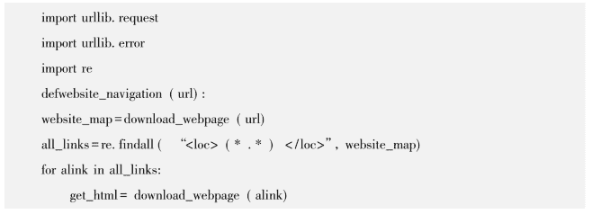

Some websites have data updates originating from databases; the hyperlinks `url` of these different web pages differ only in the suffix part. The website application server uses the suffix as an `ID` to match backend database records. Using an iterator to automatically update the `ID`, web pages conforming to this structure can be traversed and accessed.

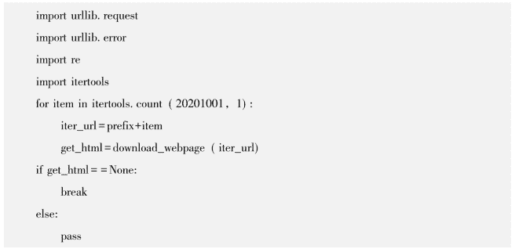

Following user habits and methods of accessing websites, browsing generally starts from the home page to select content of interest or relevance. If hyperlinks appear on a web page, only a portion of them are tracked and visited by users; other hyperlinks are often ignored due to irrelevance. The crawler program needs to use regular expressions and `url` tracking to visit hyperlinked web pages with specified content. The function `get_urls()` uses regular expressions to match qualified `url`s in the web page; the function `trace_pages()` retrieves hyperlinks from the queue, calls `download_webpage()` to download web page content, extracts hyperlinks from the web page by calling `get_urls()`, and places them into the queue.

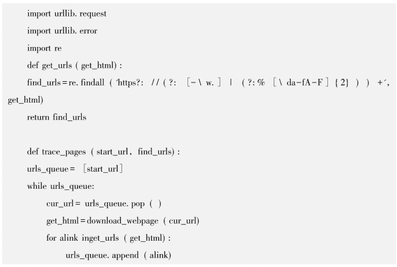

### 1.5.3 Web Data Scraping

After tracking web pages and downloading them, the structure of the web page needs to be analyzed. In most clients or browsers, the web page source code can be displayed. For example, cases from the Federal Court of Australia are publicly accessible for free online. Enter `http://www.austlii.edu.au/au/cases/cth/FCA/2006/1.html` in the browser, then right-click and select "View Source". Part of the `HTML` code:

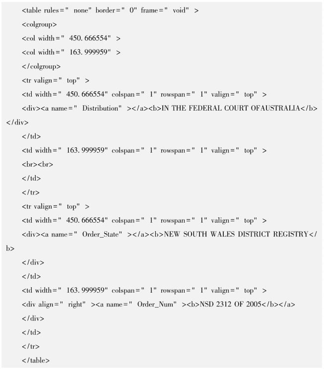

When scraping judgment state data, it can be found in the `<a name="Order_State">` element. If you need to search for the judgment number, it can be matched in the `<a name="Order_Num">` element. The `<a>` element is a child of `<td>`, the `<td>` element is a child of `<tr>`, and the `<tr>` element is a child of `<table>`. Regular expressions, `BeautifulSoup`, and the `Lxml` Python third-party extension library modules can be used for data scraping.

`BeautifulSoup` is a Python module capable of parsing web page structures. `Lxml` is a Python wrapper module for parsing `XML` formats; written in `C`, its parsing performance is more efficient than `BeautifulSoup`. To install the `BeautifulSoup` and `Lxml` modules, use:

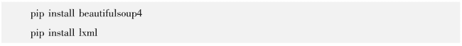

Enter `python` in the terminal to enter the scripting environment. In regular expressions, `.` matches any character except a newline, `*` matches the preceding element zero or more times, `?` matches the preceding element zero or one time, and parentheses `()` indicate the data to be captured between them.

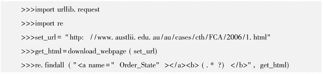

`BeautifulSoup` provides functional interfaces for locating web page content. The first operation is to parse the downloaded content, i.e., the `HTML` web page, into a `soup` document. Then, the `find()` and `find_all()` functions are used to match the required objects and content. Since some `HTML` format web pages have issues like unclosed tags and missing quotes, for example:


`BeautifulSoup` needs to check for these formatting issues and begins parsing the `HTML` web page after the format is complete. In fact, an `HTML` web page consists of many markup languages represented by angle brackets. Markup languages control the output format of content, and these markup language tags generally appear in pairs to clearly define the content controlled by the tags. The relationship between `HTML` tags is like the relationship between files in a file system; overall, it resembles an inverted tree structure, where a higher-level tag can contain lower-level tags. Each tag has a tag name and attributes, represented by `<tag>` for start and `</tag>` for end. `<tag>.attrs` represents tag attributes, which are dictionary-type data composed of key-value pairs. `<tag>.string` represents the non-attribute string output controlled by the tag, i.e., the content between `<tag>` and `</tag>`. For example, the `<a>` tag functions as a hyperlink or anchor. In `<a name="Order_State">`, `name` is the attribute name, and `"Order_State"` is the key value of the `name` attribute. `BeautifulSoup` traverses and parses the tag tree structure, allowing upward traversal to parent tags, downward traversal to child tags, and lateral traversal to sibling tags. `BeautifulSoup` can correctly close tags and parse attribute values missing quotes. For web pages missing `<html>` and `<body>` tags, it automatically adds these two tags to make them a complete `HTML` tag tree. `bs4` is the abbreviation for `BeautifulSoup4`. The `prettify()` function method can add line breaks to `HTML` web page text.

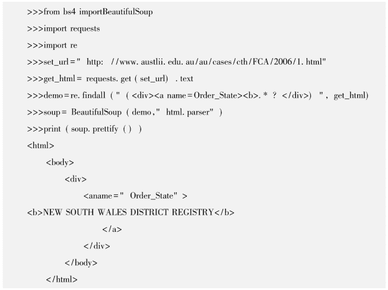

For malformed `HTML` web pages, using the `lxml` parsing module also involves supplementing missing parts first, then traversing and parsing. Similarly, `lxml` can establish a tag tree based on `xml` traversal methods, add missing quotes for attribute key values, complete missing tags to ensure tag closure, and output the tree structure after successful parsing.

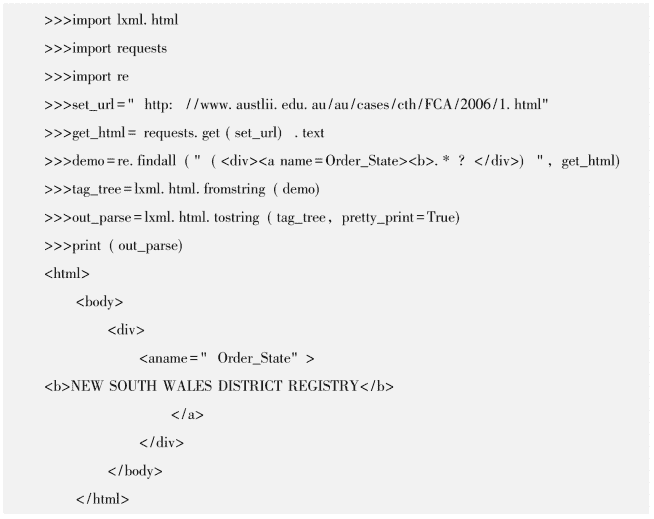

# Chapter 2 Empowering Machine Learning

With the advent of the big data era, machine learning, which excavates the meaning of data, has become the brightest rising star in the computer science discipline. Through self-learning algorithms, data can be transformed into knowledge. The human process of learning knowledge indicates that past experience remains valid for the future; otherwise, civilization would not have emerged. Usually, when people pick fruit, they make judgments based on experience, tending to choose products that are plump in shape, vibrant in color, and crisp in sound. Initially, people did not know the relationship between delicious fruit and their external appearance. As experience accumulated, they gradually realized that delicious fruit possesses certain typical external characteristics. Discovering the characteristics of delicious fruit from all features can be said to be learning knowledge or models from experience. The establishment of models relies on learning methods and experience. The learning method is observing fruit shape and taste; experience is the way to obtain fruit shape and taste, requiring people to continuously taste fruit. Human experience is stored in the brain in the form of memory. The learning process can be described as searching for knowledge in memory in the brain, applying logical methods to reason about new cognition, thereby acquiring new knowledge.

Computers can mimic the human learning process, storing experience in the form of data in computer systems. Learning algorithms generate models from data, provide experience data to models for training, and when faced with new situations, the models give judgments and decisions. If computer science is, in a sense, the science of algorithms, then machine learning is the science of algorithms about algorithms—the study of how to learn from data. Machine learning models include linear models, decision trees, neural networks, support vector machines, Bayesian statistics, ensemble learning, reinforcement learning, and topic modeling, among others. After years of development, machine learning algorithm and model developers have released many efficient open-source libraries, enabling programmers to utilize powerful algorithms to mine patterns and knowledge in data and make predictions about the future.

## 2.1 Development History

Machine learning is one of the three major application fields of artificial intelligence and a hallmark of a high level of AI development. Early AI research focused on reasoning capabilities. In the mid-20th century, people believed intelligent systems should possess logical calculation and reasoning abilities. In mathematical theorem proving, programs like the General Problem Solver and the Logic Theorist achieved very good results, even outperforming mathematicians. With the development of computer hardware and software technology, mathematical theorem proving could far from satisfy expectations for AI development. Intelligent systems should not only possess logical systems but also the capability to possess knowledge. Starting in the 1970s, expert systems—representing the knowledge-based stage of AI products—emerged in large numbers, solving many practical rule-based problems. However, expert systems faced the limitations of knowledge engineering; experts' energy is limited, and they cannot generalize all knowledge in an industry and input it into computer systems. At this point, the autonomous learning of knowledge by computer systems became an urgent need. In fact, as early as the Turing Test in the mid-20th century, the initial ideas of machine learning had appeared. In the 1960s and 1970s, the Perceptron representing connectionism, structural learning systems representing symbolism, learning machines for reinforcement learning, and Bayesian theory for statistical learning were born successively. These laid a solid foundation for the birth of machine learning.

In the 1980s, R.S. Michalski et al. published the first machine learning monograph *Machine Learning: An Artificial Intelligence Approach*, defining machine learning as learning from samples, summarizing learning results from training samples, belonging to an inductive method. Decision trees use information entropy reduction as a judgment condition to find a tree structure for solving problems. In 1986, neural networks achieved results in solving `NP`-hard problems, producing the `BP` (Backpropagation) algorithm. The learning process consists of two processes: forward propagation of signals and backward propagation of errors. The learning of samples is implied in the process of parameter adjustment, especially involving a large number of parameters, often relying on manual parameter tuning. A slight deviation in parameters could amplify learning result differences by thousands or tens of thousands of times.

In the early 1990s, people believed machine learning was a glorious transformation of statistical learning. Consequently, the Support Vector Machine (`SVM`) in statistical learning methods attracted widespread attention. `SVM` seeks a hyperplane with the maximum margin in the sample space for classification or decision-making. When some support vectors are not on the classification boundary, the loss function can quantify classification loss. Complex classifiers tend to generate structural risks, and model parameters can be determined by minimizing a linear combination of structural risk and empirical risk. In the sample space, some linearly inseparable problems may be nonlinearly separable. The `Kernel Method` can map low-dimensional linearly inseparable problems to high-dimensional linearly separable ones. The mapping function is called a kernel function, including polynomial kernels, radial basis function (RBF) kernels, Gaussian kernels, etc. Constructing a kernel function is applied in many aspects of machine learning. In fact, statistical learning is not a statistical model. A statistical model builds a model for data to infer relationships between data; its main purpose is not to predict the future. Statistical learning methods abandon interpretability to gain higher predictive performance; their main purpose is to better predict the future. The most obvious difference lies in the example of linear regression: a linear regression statistical model seeks a straight line that can contain more data, while a linear regression learning model trains a linear regressor on a subset to test the regressor's performance on another subset, hoping to achieve better predictive effects.

Well-known statistical learning methods apply probabilistic models to the field of machine learning. The Naive Bayes model calculates the joint probability distribution of features and categories based on the conditional independence assumption. The loss function is the log-likelihood function. Model parameters are solved through iterative methods of Maximum Likelihood Estimation (MLE) and Maximum A Posteriori (MAP) estimation, belonging to generative models. The `EM` (Expectation-Maximization) algorithm is a method for solving probabilistic models with latent variables. The likelihood function has the form of a log-sum, making it difficult to solve directly. An approximate distribution is constructed, using an iterative method to find and maximize the lower bound of the likelihood function containing parameters until the algorithm converges, obtaining model parameters. Topic models are probabilistic models with latent variables, where documents generate topics, and topics generate words. Topics are latent variables. The partial derivatives of the likelihood function contain the log-sum of independent variables, making it impossible to use MLE and Bayesian estimation. Therefore, topic models need to use the `EM` algorithm to estimate parameters.

In the early 21st century, with the development of computing performance and big data, deep learning became a hot topic in machine learning, especially widely applied in the field of computer vision. In fact, deep learning is a multi-layer neural network, from the input layer to hidden layers, and from hidden layers to the output layer. The more hidden layers, the more parameters representing the weights of connections between two layers. Therefore, deep learning model parameters reach tens of thousands or more. Complex models make parameter tuning very important. Although deep learning lacks theoretical interpretability, it shines in engineering applications, mainly due to big data and strong computing power. The popularity of internet applications has produced unprecedented big data samples. If the number of parameters is huge but samples are few, overfitting easily occurs: the model has zero loss on training samples but produces large deviations on test samples. For complex models with a large number of parameters, big data is needed for training, and repeated iterative training consumes massive computing resources. Without strong computing power, the time cost would be relatively high.

## 2.2 Basic Concepts and Terminology

Data is the prerequisite for machine learning. There exists such data (`Plaintiff=Zhang San, Defendant=Li Si, Court=Beijing Chaoyang District People's Court, Cause=Loan Dispute, Date=Jan 8, 2020`) (`Plaintiff=Zhao Moujia, Defendant=Qian Mouyi, Court=Shanghai Songjiang District People's Court, Cause=Privacy Rights Dispute, Date=Mar 5, 2019`) (`Plaintiff=Zhang Moubing, Defendant=Wang Mouding, Court=Tianjin Nankai District People's Court, Cause=Land Contract Management Rights Dispute, Date=Aug 5, 2018`) (`Plaintiff=Liu Mouwu, Defendant=Sun Mouji, Court=Chongqing Yuzhong District People's Court, Cause=Intellectual Property Dispute, Date=Aug 25, 2016`) (`Plaintiff=Huang Moumou, Defendant=Yang Moumou, Court=Guangzhou Tianhe District People's Court, Cause=House Purchase Contract Dispute, Date=Nov 20, 2015`) (`Plaintiff=Chen Mouwu, Defendant=Lin Mouliu, Court=Hangzhou Xihu District People's Court, Cause=Deposit Contract Dispute, Date=Jan 8, 2020`).

The data within a pair of parentheses above is a record describing a case. Multiple records form a collection, called a `Dataset`. A text dataset is also called a corpus. Generally, a record in a dataset describes a `Sample` or an `Instance`. A sample is described by several items, e.g., plaintiff, defendant, court, cause, and date. These are called features or attributes. A specific sample is the value of a `Feature` or `Attribute` under current circumstances, called a `Feature Value` or `Attribute Value`. Mapping features to spatial coordinates, one feature maps to one dimensional coordinate. All features (plaintiff, defendant, court, cause, date) constitute a five-dimensional space. A case is a point in this five-dimensional space. A point in space can be described by a coordinate `Vector`. Therefore, a sample is sometimes called a feature vector.

A dataset is represented by curly braces: `D={d1, d2, ..., dm, ..., dM}`. Capital `M` represents the total number of samples. Lowercase subscript `dm` represents the `m`-th sample. Each sample contains `N` attributes or features, represented as `dm={dm1, dm2, ..., dmn, ..., dMN}`. `dm` is a vector in the `N`-dimensional sample space. `dmn` represents the value of the `n`-th attribute or feature of the `m`-th sample. For example, `d32` indicates the defendant of the 3rd case is Wang Mouding. `d24` indicates the cause of the 2nd case is a privacy rights dispute. `d13` indicates the court of the 1st case is Beijing Chaoyang District People's Court. `d41` indicates the plaintiff of the 4th case is Liu Mouwu. `d55` indicates the judgment date of the 5th case is Nov 20, 2015.

Learning algorithms obtain models by learning from data. During the training or learning process, some data needs to be used. Each record is called a training sample. All `Training Samples` constitute the training set. A portion of the dataset is divided into the `Training Set`, and the remaining data is called the `Testing Set`. The learning algorithm needs to make an assumption about the data conforming to a certain law. For example, one can assume all judgment dates conform to a Gaussian normal distribution. The Gaussian normal distribution model has two parameters: mean and variance. The learning algorithm learns the model from training data and obtains model parameters. Learning models on different training sets will yield different model parameters. The learning process expects the obtained parameterized model to explain the phenomena generated by the data, not only fitting the data generation law well on the training set but also conforming to the data distribution on the test set. Therefore, a model can be viewed as the instantiation of the learning algorithm's parameters and hypothetical theory on specific data. Thus, the quality of a machine learning algorithm is closely related to the data type. For example, deep learning is suitable for image processing, and topic models are suitable for text processing.

The case data samples mentioned above contain values for 5 attributes or features: plaintiff, defendant, court, cause, and time. If case prediction is needed, users may be more concerned with the judgment result. For example, ((`Plaintiff=Zhang San, Defendant=Li Si, Court=Beijing Chaoyang District People's Court, Cause=Loan Dispute, Date=Jan 8, 2020`), Win)((`Plaintiff=Zhao Moujia, Defendant=Qian Mouyi, Court=Shanghai Songjiang District People's Court, Cause=Privacy Rights Dispute, Date=Mar 5, 2019`), Lose). Such records contain the judgment result. Win or Lose is called a `Label`. Usually, a labeled sample is represented as (`dm`, `ym`), where `ym` is the label of sample `dm`. The set of all possible label values constitutes the set `Y`, called the output space. The model input is an unlabeled `dm`, and the output result is `f(dm)`. Here `f` refers to a function or mapping. The learning model can be understood as a generalized function. The purpose of the learning algorithm is to make `f(dm)` approximate `ym`. If the predicted result `f(dm)` or label `ym` can only take one of two discrete values, Win or Lose, the learning model with discrete output values is called a `Classification` task. If the predicted result is the compensation amount, which can take continuous values from a range, the learning model with continuous output values is called a `Regression` task. If a classification task contains only two categories, Win or Lose, it is called a `Binary Classification` task. One is called the `Positive Class`, the other the `Negative Class`. If a classification task contains more than two categories, it is called a `Multi-class Classification` task.

The labeled sample space is divided into a training set and a test set. The training set is represented as {(`d1`, `y1`), (`d2`, `y2`), ..., (`dtr`, `ytr`), ..., (`dTR`, `yTR`)}. Capital `TR` represents the number of training set samples. Lowercase `tr` represents an arbitrary sample in the training set. The test set is represented as {(`d1`, `y1`), (`d2`, `y2`), ..., (`dte`, `yte`), ..., (`dTE`, `yTE`)}. Capital `TE` represents the number of test set samples. Lowercase `te` represents an arbitrary sample in the test set. `TR + TE` equals the total number of samples in the sample space `M`. The learning model expects to establish a mapping `f: D → Y` from the input space {`d1`, `d2`, ..., `dtr`, ..., `dTR`} to the output space {`y1`, `y2`, ..., `ytr`, ..., `yTR`} by learning from the training set {(`d1`, `y1`), (`d2`, `y2`), ..., (`dtr`, `ytr`), ..., (`dTR`, `yTR`)}. For binary classification tasks, `Y={1, 0}` or `{+1, -1}`. For regression tasks, `Y` is generally real numbers. After model learning, model parameters are obtained, establishing the mapping `f` from input to output. Prediction (`Predict As`) is performed on test samples (`Testing Sample`) in the test set. The prediction result is `yte = f(dte)`. The true value `yte` is compared with the predicted value `ˉyte` to evaluate model performance.

An unlabeled sample space can perform `Clustering` tasks, dividing cases in the dataset into several groups. Each group is called a cluster. These clusters may correspond to some latent topics or concepts. For example, by jurisdiction, the aforementioned dataset can be clustered into North China cases, East China cases, South China cases, Southwest cases, Southeast cases, Northeast cases, and Northwest cases. By date, they can be divided into cases within 1 year, 3 years, and 5 years. By cause, clustering results such as personality rights disputes, property rights disputes, contract disputes, and intellectual property disputes can be formed. In clustering learning tasks, clusters like "East China cases" are unknown at the beginning. Through learning, it is discovered that the courts in these samples are geographically closer to Shanghai and to each other, but farther from Beijing, Guangzhou, Chongqing, etc. Clusters like "personality rights disputes" are also unknown initially. Through learning, it is discovered that these case samples have higher frequencies of words like personality, body, reputation, name, and portrait, with high word co-occurrence among them, but less co-occurrence with words in property rights disputes, contract disputes, intellectual property disputes, etc. Clustering learning can discover the intrinsic laws of data, helping users analyze data, and usually does not require label information.


## 2.1 Supervised Learning and Unsupervised Learning

Learning tasks can be divided into supervised learning and unsupervised learning, as shown in Figure 2.1. Supervised learning samples contain label information; the learning algorithm can adjust model parameters based on the difference between model output and actual output, performing feedback learning, and the learned model can predict outputs for new samples without labels. Unsupervised learning samples have no label information; therefore, the learning process has no feedback information to the model, and the learning objective is the hidden structure in the data.


Figure 2.1 Supervised Learning and Unsupervised Learning

## 2.2 Main Objectives of Supervised Learning

The main objective of supervised learning is to learn a model from labeled training data in order to make predictions on future data, as shown in Figure 2.2. Supervision refers to the expected output signal input to the model for a sample, i.e., the label. For example, in legal text domain classification, using supervised machine learning algorithms to learn a model on training data with labeled domains, the trained model can predict whether a new legal text belongs to a specific domain. Category labels in supervised learning are discrete; this classification task is a type of supervised learning method. Another supervised learning task is regression learning, where the output signal of the regression model is a continuous numerical value.

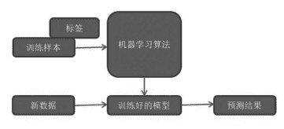

Figure 2.2 Supervised Learning Process

## 2.3 Classification and Clustering

In binary classification tasks of supervised learning, predictions are made on new cases or new samples through observation and learning from historical cases. For example, a new sample (Plaintiff=Han Mouxu, Defendant=Fang Mouxu, Court=Nanjing Xuanwu District People's Court, Cause=Unjust Enrichment, Date=June 7, 2020), the learning model predicts the output result of the new sample, i.e., the judgment result, win or lose. Machine learning predictions are based on hypothetical premises and historical data, assuming the judgment result is related to features such as plaintiff, defendant, court, cause of action, and time. The more features in the data space, the more perfect the hypothesis tends to be. Conversely, the fewer the features, the more the hypothesis lacks rationality. Therefore, from the perspective of the rationality of the judgment result, adding assumptions about case facts and evidence descriptions to case features makes the hypothesis more perfect.

To simplify the model, court and time are extracted as features from the cases, with the horizontal axis `feature_1` as time and the vertical axis `feature_2` as court, as shown in the figure below. Each point represents a sample, containing two values corresponding to the values of the horizontal axis `feature_1` and vertical axis `feature_2` respectively. Circles represent positive class samples, squares represent negative class samples, and the diagonal line is the model or classifier learned from the samples in the figure. The hypothesis of the learning algorithm in Figure 2.3 is a linear classifier; the learning strategy is to find that specific classification diagonal line which maximizes the sum of squares of distances from all samples in the training set to the classifier. If the output of the learning model is no longer win or lose, but one of multiple categories. For example, the model output is legal domain, and the category label could be one of civil, criminal, administrative, or state compensation. In multi-class classification tasks, if the training set lacks administrative law sample data, the model cannot learn the features of samples belonging to administrative law. For a new sample to be predicted in the future, the learning model can only predict it as one of civil, criminal, or state compensation, while the manual label might be administrative law. In other words, the learning model learns latent patterns from training data and predicts future data by observing training data; therefore, features determining future data results must be represented in the training data. The ability of a learning algorithm or model to predict unknown data or future samples is called the model's generalization ability. Evaluating model performance requires considering generalization ability and sample space adaptability; sample space capacity is related to the number of features, generally showing an exponential relationship. When the number of features is large, the sample space becomes extremely huge. In practice, the collected dataset is a sampling of the sample space; a learning model with strong generalization ability requires the dataset to represent the sample space well: not only must the training set reflect the distribution of samples in the space, but the test set must also follow the same distribution; only then will the learning model have good adaptability.

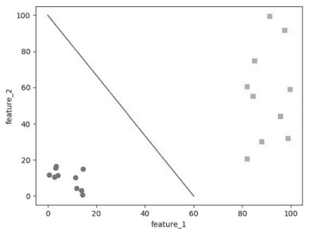

Figure 2.3 Binary Classification Supervised Learning Task

In regression analysis tasks in supervised learning, the model input, i.e., sample features, are called explanatory variables (`Explanatory Variable`), and the learning model output is called the response variable (`Response Variable`). Regression learning tasks assume there exists a parameter-constrained relationship between the response variable and explanatory variables; through training set learning, the response variable is made to conform to the output of that relationship. The output target of regression learning is continuous values; for example, the learning model's prediction result is the litigation amount involved in the case, as shown in Figure 2.4. The horizontal axis `feature_1` is the judgment date, the vertical axis `y` is the litigation amount; the learning model hypothesizes a linear relationship between litigation amount and judgment date; the learning strategy is to find that specific regression line which minimizes the mean square sum of the outputs of all samples in the training set on the regression line and the true outputs. From Figure 2.4, it can be seen that the training set data distribution seems to conform quite well to a linear relationship. In reality, the training set data distribution might exhibit other situations, such as Gaussian distribution or polynomial distribution, etc. Linear, polynomial, and Gaussian distributions have different parameters. Under the linear distribution assumption, the model's learned parameters conform to the linear assumption. Under the polynomial distribution assumption, the model's learned parameters conform to the polynomial distribution assumption. Under the Gaussian distribution assumption, the model's learned parameters conform to the Gaussian distribution assumption. Therefore, machine learning algorithms are models learned on data; each algorithm has its advantages and limitations; there is no universal learning algorithm applicable to all datasets. If the training set data is not representative in the sample space, with data concentrated in a corner of the sample space, it is called data skew. In this case, data cleaning is needed, or re-collecting training data, or increasing the training set size.

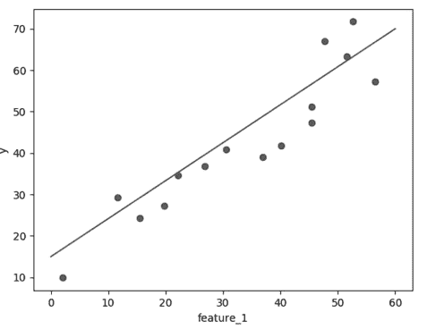

Figure 2.4 Regression Supervised Learning Task

After learning a model on the training set, extending the model to be applicable to the entire sample space is called fitting. Models with weak generalization ability are prone to under-fitting (`Under-fitting`) or over-fitting (`Over-fitting`). When model parameters are too few, complexity too low, or features too few, under-fitting occurs, as shown in Figure 2.5. As can be seen from the figure, the dataset has only feature `feature_1`, target output is `y`; if the regression algorithm is a linear model, the relationship between response variable `y` and explanatory variable `feature_1` can be described as `y=a*feature_1+b`. Where `a` and `b` are model parameters. Overall, the sum of deviations of points in Figure 2.5 to the fitted line is large, and the model's generalization ability is poor. For under-fitting, if the model is adjusted to a polynomial regression relationship, all samples can be fitted to the curve; the polynomial model is more complex than the linear model and has more parameters. Without changing the model, increasing the number of features can also improve under-fitting. For example, adding court information as feature `feature_2` to the case dataset transitions the sample space from 2D to 3D; scattered points that cannot be fitted into a line in 2D space can be mapped onto the same plane in 3D space.

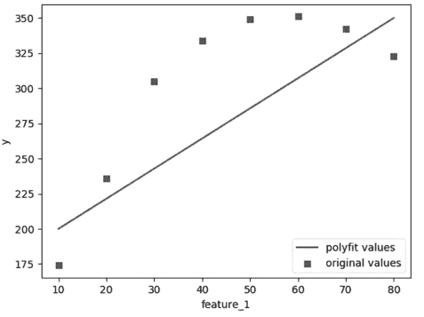

Figure 2.5 Under-fitting Phenomenon

When model parameters are too many, complexity too high, or training data too few, over-fitting occurs, as shown in Figure 2.6. As seen in Figure 2.6, if the regression algorithm is a cubic polynomial model, the relationship between response variable `y` and explanatory variable `feature_1` can be described as `y=a*(feature_1)3+b*(feature_1)2+c*feature_1+d`. Where `a`, `b`, `c`, and `d` are model parameters. Overall, the points in the figure are almost all on the fitted curve, total deviation is close to zero, model generalization ability is also poor, because some points might be noise or errors. For over-fitting, model complexity needs to be reduced, parameters reduced; the cubic polynomial can be adjusted to a quadratic polynomial, i.e., `y=b*(feature_1)2+c*feature_1+d`. Increasing more training data so that the training dataset size exceeds model complexity; these methods can all improve model over-fitting.

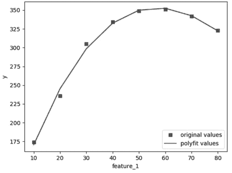

Figure 2.6 Over-fitting Phenomenon

Supervised learning training data has labels, while unsupervised learning samples have no labels. In many cases, data has no labels, because labels are determinations made by humans on events according to their nature. In Figure 2.7, court information in the sample space is used as feature `feature_1`, with the corresponding horizontal coordinate value being the distance of that court from Beijing. Compensation is used as feature `feature_2`, with the corresponding vertical coordinate value being the compensation amount. Obviously, there are two clusters, one located in the upper left of the figure, one in the lower right. Sample features can be understood as an observation; for example, observing a case heard at Beijing Chaoyang District People's Court means the sample point appears on the left of the figure, and the left points are near the top of the figure. Observing another case heard at Chongqing Yuzhong District People's Court means the sample point appears on the right of the figure, and the right points are near the bottom of the figure. Left points relate to the top, right points relate to the bottom; the reasons behind this may be deep; one can speculate that the level of economic development causes the sample points to exhibit a two-cluster distribution. Therefore, in the absence of response variables or target outputs, using unsupervised clustering learning algorithms can discover some internal associations in the data, thereby extracting useful information. In the absence of domain knowledge and expert experience, clustering algorithms are a very important data analysis method, helping people better understand data. For those familiar with Chinese economic geography, it is easy to know Beijing is a developed region, while Chongqing is relatively underdeveloped. However, for those unfamiliar with Chinese economic geography, they might not know the useful information reflected by this data. Through clustering learning, people can be helped to discover intrinsic structures from clusters, and learn that there are differences in economic development levels between Beijing and Chongqing.

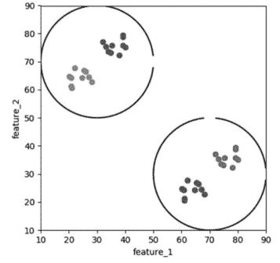

Figure 2.7 Clustering Task

In clusters produced by clustering algorithms, each cluster represents a group of sample points that are relatively similar or close on certain features, while sample points from different clusters have relatively large differences on these features. In Figure 2.7, the cluster in the upper left has smaller values on feature `feature_1` and larger values on feature `feature_2`. The cluster in the lower right has larger values on feature `feature_1` and smaller values on feature `feature_2`. From the clustering process, it can be found that the larger the values of feature `feature_1` and `feature_2`, i.e., the cluster appears in the upper right of the figure, the higher the proportion of economic factors in the case motives. The smaller the values of feature `feature_1` and `feature_2`, i.e., the cluster appears in the lower left of the figure, the lower the proportion of economic factors in the case motives.

## 2.4 Reinforcement Learning

In supervised learning, sample outputs are classification or regression results. However, some learning strategies do not have obvious classification or regression results, e.g., chess playing behavior. Both players select the next action based on the board state, causing the board to transition to the next state. If the next state reduces opponent pieces by one or puts the opponent's queen in danger, the action driving the state change receives a reward. The process of game playing is reinforcement learning, as shown in Figure 2.8. The Agent can interact with the Environment, causing the Environment State to transition; the environment transition feeds back a Reward to the Agent. The goal of reinforcement learning is to train a machine or agent to gradually improve system performance through effective learning strategies in interaction with the environment. It is generally considered that reinforcement learning is a supervised learning method, but different from real classification labels or response variables. The supervision information in machine learning is a reward strategy, guiding the agent to develop positively through rewards.

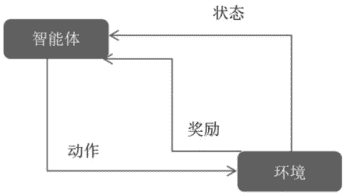

Figure 2.8 Reinforcement Learning

Usually, a reward function evaluates the reward value obtained by an action; the larger the positive value, the stronger the positive incentive; the larger the negative value, the stronger the negative inhibition. After reinforcement learning, the agent makes the environment state continuously transition through exploratory trial and error, thereby maximizing the obtained reward. Each step action produces positive or negative rewards; positive rewards are considered closer to the final goal, while negative rewards are considered further from the goal.

In the case sample space, if a sample is treated as an environment state, before the case judgment, the case state is in continuous transition; the agent is the abstract entity that can drive case state changes. For the plaintiff's agent, the reinforcement learning goal is to apply a series of actions beneficial to the plaintiff on the case state; the maximum reward produced by these actions is the plaintiff winning the suit. For the defendant's agent, the reinforcement learning goal is to apply a series of actions beneficial to the defendant on the case state; the maximum reward produced by these actions is the plaintiff losing the suit. For example, the current environment state is a case sample (Plaintiff=Liu Mouwu, Defendant=Sun Mouji, Court=Chongqing Yuzhong District People's Court, Cause=IP Dispute, Date=Aug 25, 2016); assuming the plaintiff company is registered in Beijing, the defendant in Chongqing, the plaintiff agent's action causes a case state transition, the next state involves a Beijing court hearing the case; according to the plaintiff agent's reward function, the feedback received is a positive reward.

In the reinforcement learning decision process, the agent knows every state `s` of the environment; the state space is `S`. In the current state, the action `a` executed by the agent causes the environment `E` to transition to the next state; the transition function `P` calculates the probability of transition from the current state to the next state; the action space is `A`. Simultaneously with the state transition, the reward function `R` feeds back a reward to the agent. Therefore, reinforcement learning is a quadruple `E:＜S，A，P，R＞`. Assuming a "familiarity" feature is added to the case sample space, the agent decides daily between going to court and not going to court. Going to court may increase the judge's familiarity with the agent and cause favor, or may increase familiarity and cause disfavor. Not going to court may decrease the judge's familiarity with the agent and cause favor, or may decrease familiarity and cause disfavor, as shown in Figure 2.9.

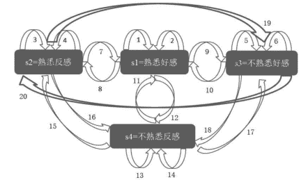

Figure 2.9 Decision Process of Going to Court

In the decision process of going to court, there are four states: Familiar-Favor, Familiar-Disfavor, Unfamiliar-Favor, Unfamiliar-Disfavor. There are two actions: Go to Court and Not Go to Court. After each state transition, if the judge becomes familiar with the agent, the agent receives a reward of 10. If the judge feels unfamiliar with the agent, the agent receives a reward of -5. If the judge's favor towards the agent increases, the agent receives a reward of 20. If the judge feels disfavor towards the agent, the agent receives a reward of -30. In Figure 2.9, State Transition 1 can be described as: `a=Go to Court, p=0.7, r=10`; State Transition 2: `a=Not Go to Court, p=0.3, r=10`. State Transition 3: `a=Go to Court, p=0.6, r=5`; State Transition 4: `a=Not Go to Court, p=0.4, r=5`. State Transition 5: `a=Go to Court, p=0.5, r=5`; State Transition 6: `a=Not Go to Court, p=0.5, r=5`. State Transition 7: `a=Go to Court, p=0.8, r=20`; State Transition 8: `a=Not Go to Court, p=0.2, r=-20`. State Transition 9: `a=Not Go to Court, p=0.5, r=-10`; State Transition 10: `a=Go to Court, p=0.5, r=10`. State Transition 11: `a=Go to Court, p=0.8, r=30`; State Transition 12: `a=Not Go to Court, p=0.2, r=-30`. State Transition 13: `a=Go to Court, p=0.7, r=-15`; State Transition 14: `a=Not Go to Court, p=0.3, r=-15`. State Transition 15: `a=Go to Court, p=0.3, r=5`; State Transition 16: `a=Not Go to Court, p=0.7, r=-5`. State Transition 17: `a=Go to Court, p=0.4, r=20`; State Transition 18: `a=Not Go to Court, p=0.6, r=-20`. State Transition 19: `a=Not Go to Court, p=0.7, r=15`; State Transition 20: `a=Go to Court, p=0.3, r=-15`.

The supervision information in reinforcement learning is the reward the agent obtains from the environment; environment state transitions and feedback rewards are not entirely controlled by the agent; the agent perceives and understands the environment by executing actions and observing state transitions after action execution, thereby influencing the environment in action selection. The supervision mechanism of reinforcement learning differs from classification and regression tasks; the machine or training set does not directly instruct the agent on which operation to execute next, but rather continuously tries various possible actions to maximize the total reward value. The total reward value is the sum of rewards produced by each action; the agent cannot prospectively predict the total reward value, but can only consider the current environment state and select the action or operation expected to maximize the reward value. In fact, the reward value produced by a single-step action is not a deterministic value but follows a certain probability distribution; a few attempts cannot help the agent determine the expected action. Therefore, reinforcement learning is a supervised learning method of continuous interaction and trial-and-error with the environment.

## 2.5 Hypothesis Space

Machine learning learns from samples; each sample is a concrete instance. In the case dataset, a sample contains values on features such as plaintiff, defendant, court, cause, and date; it is also a concrete instance and description of the abstract concept "case". In logic, induction and deduction are the most basic logical methods. The inductive method summarizes general laws from specific phenomena, e.g., observing winter and summer temperatures.

Starting observation from July 1, observing continuously for 9 days, the highest temperatures are 35.5, 36.0, 35.0, 37.5, 36.5, 35.0, 38.0, 37.5, and 38.0 (all in Celsius), sample labels are all Summer. Starting observation from Dec 1, observing continuously for 9 days, the highest temperatures are 11.5, 12.0, 9.0, 8.5, 9.5, 11.0, 10.0, 10.5, and 10.0 (all in Celsius), sample labels are all Winter. Using the above temperature observations as training dataset for learning, the classifier proposes some hypotheses: if highest temperature exceeds a threshold `a`, it is Summer; if highest temperature is below a threshold `b`, it is Winter. The hypothesis about summer's highest temperature might be a set `a={36.0, 35.5, 35.0, 34.5, 34.0, 33.5, 33.0, 32.5, 32, 31.5, 31.0, 30.5, 30.0, ...}`. The hypothesis about winter's highest temperature might be a set `b={11.0, 11.5, 12.0, 12.5, 13.0, 13.5, 14.0, 14.5, 15.0, 15.5, 16.0, 16.5, 17.0, ...}`. These hypotheses constitute a hypothesis space; the classifier searches from these hypothesis spaces to find those hypotheses that match or fit the training set data.

Obviously, in hypothesis space `a`, highest temperatures of 36.0 and 35.5 Celsius cannot match the 9-day continuous observation data; after excluding hypotheses not matching the training set, the hypothesis space becomes `{35.0, 34.5, 34.0, 33.5, 33.0, 32.5, 32, 31.5, 31.0, 30.5, 30.0, ...}`. In hypothesis space `b`, highest temperatures of 11.0 and 11.5 Celsius cannot match the 9-day continuous observation data; after excluding hypotheses not matching the training set, the hypothesis space becomes `{12.0, 12.5, 13.0, 13.5, 14.0, 14.5, 15.0, 15.5, 16.0, 16.5, 17.0, ...}`. The larger the training set data scale, the more hypotheses are excluded, and the more accurate the model learned by the classifier.

In regression learning tasks, the input feature is `feature_1`, output is response variable `y`, as shown in Figure 2.10. For example, the learning goal is to find the relationship between compensation amount in economic compensation cases and regional development level; feature `feature_1` is the quantified value of the region, output `y` is the compensation amount. For the learning model's hypothesis, a linear relationship hypothesis can be proposed, or a univariate quadratic relationship hypothesis. The two points in the figure represent two training samples; assuming the output-input relationship conforms to a linear relationship `y=a*feature_1+b`, `a` and `b` are parameters; solving an equation with two parameters requires two sample points. Therefore, the linear relationship hypothesis can perfectly fit the two sample points. Assuming the output-input relationship conforms to a univariate quadratic relationship `y=a*(feature_1)2+b*feature_1+c`, parameters include `a`, `b`, and `c`; using two sample points to solve an equation with three parameters will produce two constrained variables and one free variable. Therefore, many univariate quadratic polynomial hypotheses can also perfectly fit these two sample points.

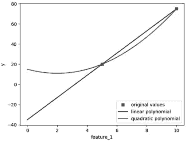

Figure 2.10 Perfect Fit of Linear and Quadratic Regression Hypotheses


## 2.5 Hypothesis Space and Inductive Bias

As the number of training samples increases, under the requirement of complete model fitting, some hypotheses can be excluded. For example, adding one more sample so that three samples are not on a straight line, as shown in Figure 2.11. The linear relationship hypothesis can only fit two sample points; the third sample point has a deviation. However, a quadratic (univariate quadratic) relationship hypothesis can completely fit the three sample points on the line. In fact, for the two hypotheses of linear and quadratic relationships, it is difficult to evaluate which hypothesis is more reasonable. In terms of compliance with training data, the quadratic hypothesis has an advantage over the linear hypothesis, achieving zero bias, while the linear hypothesis has a bias on the third sample point. If the training set data reliability is high, reducing training bias is the correct learning method. However, if the training samples themselves contain noise errors, reducing training bias is not an appropriate approach. For example, if the added third sample point is erroneous data, the linear hypothesis might be more reasonable. In the case where the dataset follows an independent and identically distributed (i.i.d.) distribution, when the sample size scale is smaller than the hypothesis model complexity, the hypothesis model can completely fit the data; when the sample size scale exceeds the hypothesis model complexity, the hypothesis model cannot completely fit the data. In fact, the data source is neither completely accurate and reliable nor completely i.i.d. To guard against structural risk and fitting erroneous data, the phenomenon of fitting all data should be avoided.

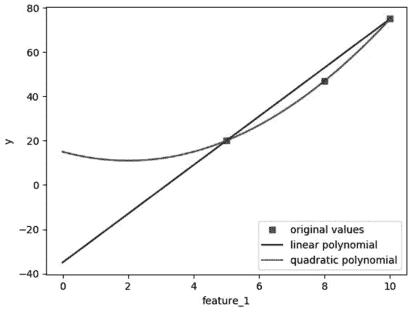

Figure 2.11　Bias of Linear Hypothesis

Learning from samples whether a case is a win, assuming the win/loss outcome can be determined by three factors: litigation claims, cause of action, and evidence materials. After the above three features or attributes of the case are determined, a learning model trained on a large number of samples can give a judgment on the case outcome. Inductive learning gains experience from historical data, forming concepts of "what a winning case looks like" or "what a losing case looks like", as shown in Table 2.1.

Table 2.1　Dataset Learned from Samples

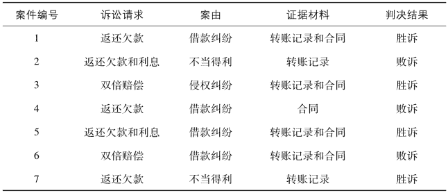

From the table records, it can be seen that a winning case is a concept where, based on the evidence materials at hand, a lawsuit is filed with a certain cause of action and achieves a certain litigation claim. Describing a winning case with a logical expression: `(Evidence=ToBeDetermined)∧(Cause=ToBeDetermined)∧(Claim=ToBeDetermined)`, where `∧` denotes a logical AND relationship; the two conditions connected by `∧` must be satisfied simultaneously for the overall logical expression to hold. The process of learning from the training sample set is the process of determining the "ToBeDetermined" parts. From the sample with Case ID 1, `(Evidence=TransferRecordsAndContract)∧(Cause=LoanDispute)∧(Claim=RepayDebt)` is a winning case. Besides Sample ID 1, Samples 3, 5, and 7 are also winning cases; these are all observed judgment results. For samples not appearing in the training set, the learning model needs to predict unknown data, which is called the model's generalization. Inductive learning analyzes and summarizes the feature patterns of training samples, e.g., on which features all winning case samples have the same or similar values. At the same time, it compares cases of different categories to see on which attributes or features the values differ.

When knowing nothing about a case, the predicted probability of winning is one-half. As training data is added, more features and details of the case can be observed, and the predicted probability of winning will increase significantly. Assuming certain values in the feature space determine the win/loss of a case, all hypotheses constitute the space: `(Evidence=ToBeDetermined)∧(Cause=ToBeDetermined)∧(Claim=ToBeDetermined)`. The scale of the hypothesis space is derived by multiplying the number of values for each feature. The learning process searches for hypotheses that match the training set in Table 2.1 from the case judgment hypothesis space, excluding hypotheses that do not match the training set. For example, the hypothesis: `Win=(Evidence=Any)∧(Cause=Any)∧(Claim=Any)` does not match the sample with Case ID 2.

Evidence material is denoted as `a`, with values from the set `evidence:{TransferRecordsAndContract, TransferRecords, Contract, *}`, where `*` denotes any. Cause of action is denoted as `b`, with values from the set `cause:{LoanDispute, UnjustEnrichment, TortDispute, *}`. Litigation claim is denoted as `c`, with values from the set `claim:{RepayDebt, RepayDebtAndInterest, DoubleCompensation, *}`. Each feature can take 4 values; therefore, there are 64 hypotheses in total in the hypothesis space, as shown in Figure 2.12.

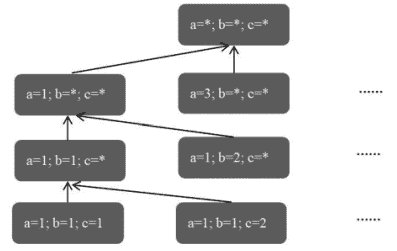

Figure 2.12　Hypothesis Space for Case Learning

In the figure, `a=*` indicates the evidence material value is any, `b=*` indicates the cause of action value is any, `c=*` indicates the litigation claim value is any. `a=1` indicates the evidence material value is "TransferRecordsAndContract", `b=1` indicates the cause of action value is "LoanDispute". `c=1` indicates the litigation claim value is "RepayDebt", `c=2` indicates "RepayDebtAndInterest", `c=3` indicates "DoubleCompensation". The structure of Figure 2.12 is similar to the directory hierarchy of a file system, like an inverted tree; the topmost is the root node, and the bottommost are leaf nodes. The leftmost leaf node `(a=1;b=1;c=1)` represents hypothesis `h1`: The judgment result is a win for cases sued for loan disputes based on transfer records and contracts, claiming repayment of debt. Hypothesis `h1` matches or is consistent with the sample with Case ID 1 in the training set, but cannot generalize to predict other samples. The rightmost leaf node `(a=1;b=1;c=2)` represents hypothesis `h2`: The judgment result is a win for cases sued for loan disputes based on transfer records and contracts, claiming repayment of debt and interest. Hypothesis `h2` matches the sample with Case ID 5 in the training set, but likewise cannot generalize to predict other samples. If the parent node of these two leaf nodes `(a=1;b=1;c=*)` is used as hypothesis `h3`: The judgment result is a win for cases sued for loan disputes based on transfer records and contracts. Hypothesis `h3` can generalize child nodes under `(a=1;b=1;c=*)` that did not appear in the training set; predictions on unlabeled data may be incorrect, meaning the model has a certain accuracy. Searching for hypotheses matching the training set from the hypothesis space can use a top-down deductive method or a bottom-up inductive method, storing hypotheses consistent with all positive samples in the training set, and deleting hypotheses consistent with all negative samples in the training set.

Selecting Case IDs 1, 2, 5, 7 from Table 2.1 to form a training set, as shown in Table 2.2. There are 3 hypotheses in the hypothesis space that can match the training set. Hypothesis 1: If `(Evidence=TransferRecordsAndContract)∧(Cause=LoanDispute)∧(Claim=Any)` exists, then the judgment result is a win; Hypothesis 2: If `(Evidence=TransferRecordsAndContract)∧(Cause=Any)∧(Claim=Any)` exists, then the judgment result is a win; Hypothesis 3: If `(Evidence=Any)∧(Cause=LoanDispute)∧(Claim=Any)` exists, then the judgment result is a win. As shown in Figure 2.13.

Table 2.2　Training Set Learned from Cases

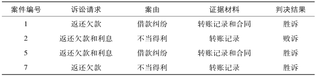
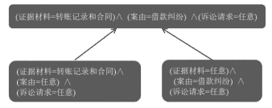

Figure 2.13　Hypothesis Space on a Training Set

Which hypothesis the learning model selects depends on the inductive bias—whether it prefers a more generalized choice or a more specific explanation. Hypothesis 1 learns the result from two features: evidence and cause; Hypothesis 2 learns from the evidence feature; Hypothesis 3 learns from the cause feature. Hypothesis 1 is more specific than Hypotheses 2 and 3. Which hypothesis is better is measured by the model's generalization performance, i.e., the matching situation of that hypothesis on the test set.

Selecting Case IDs 3, 4, 6 from Table 2.1 to form a test set, as shown in Table 2.3. It can be seen that Cases 3, 4, 6 do not match Hypothesis 1; Cases 4, 6 do not match Hypothesis 2; Cases 3, 4, 6 do not match Hypothesis 3. Therefore, considering the number of matches on test samples, Hypothesis 1 scores 0, Hypothesis 2 scores 1, Hypothesis 3 scores 0. This indicates that in the current problem, the learning model prefers to select a more generalized hypothesis. A speculated partial reason is that the winning result is related to fewer features, e.g., evidence material. Hypothesis 1's conditions are too specific, containing values for two features; one feature might not be strongly related to winning, but the model learned too many details from the training set, introducing features with little relation to the judgment result into the model.

Table 2.3　Test Set Learned from Cases

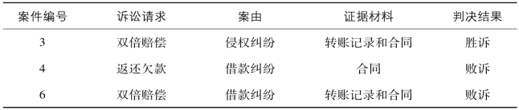

Machine learning algorithms discover intrinsic laws from historical data. Assuming intrinsic laws exist, different data have different intrinsic laws. There is no universal machine learning algorithm that is a "cure-all". A machine learning algorithm that performs well on some data may perform exactly the opposite on other data. Therefore, evaluating the quality of a machine learning algorithm requires targeted analysis combined with specific problems and data.

## 2.6 Data Preprocessing

In the roadmap of building a machine learning system, the initial stage is data preprocessing. The specifications and dimensions of raw data are not conducive to improving the performance of the machine learning system; therefore, many machine learning applications regard data preprocessing as one of the important operational steps. For example, in face recognition, the raw data is a series of images; the machine learning system hopes to extract useful features from the images, including eyes, nose, mouth, ears, etc. In plant flower recognition, features extracted from images include petal color, sepal length, sepal width, petal length, and petal width, etc. In case prediction, features recognized from text include court, date, cause of action, plaintiff, defendant, legal provisions, and evidence, etc. The quality of data preprocessing can directly affect the generalization performance and effect of the learning model.

In reality, collected data is often incomplete, with missing values on certain features. For example, missing values in income features or marital attributes due to personal privacy during data entry; the spouse in a legal relationship is a missing value for unmarried people; some missing values are caused by human negligence; some are due to high acquisition costs. Not only missing values but also noise and outlier data are unfavorable for model training and evaluation. Many machine learning algorithms require feature selection so that feature values are in a standard, continuous space, e.g., mapping feature values to the `[0,1]` interval or making them follow a normal distribution with a mean of 0 and variance of 1.

During data collection, feature or attribute assignments have various missing values. Depending on the distribution characteristics of feature values and their importance to prediction, feature deletion methods or feature value imputation methods can be used. If many samples have missing values on a feature, reaching a high proportion, and it is not particularly important during model training, such features can be deleted. For example, home landline numbers in personal basic information; many people no longer use landlines; when 90% of samples lack landline numbers, the landline feature can be deleted. If feature values follow a uniform distribution and few samples are missing, the mean of that feature or attribute can be used to impute the missing values. For example, missing values of monthly salary in personal basic information can be replaced by the social average wage. For missing values with skewed data, the median is used for imputation. For example, Beijing has many high incomes, making the average wage appear high, possibly exceeding the income of most working-class people; at this time, the median income is more representative. If the missing value is not continuous data but discrete data, the dummy variable method can be used. For example, missing gender values in personal basic information are categorized as other or unknown.

Outliers are data points far from the normal data distribution range, divided into true outliers and pseudo-outliers. Pseudo-outliers are caused by errors in the data collection process and do not objectively reflect reality. For example, in personal basic information, entering age 60 but accidentally adding an extra 0, making it 600. True outliers are generated by the data source itself and are true reflections of objective phenomena. For example, in personal basic information, normal age distribution is around a mean of 70 and variance of 5, but there may be a few individual outliers of 110.

For simple numerical values, a Boxplot can be used to determine if outliers exist. For example, sort the data, calculate the first quartile `Q1`, median `Q2`, third quartile `Q3`, upper and lower limits; values greater than the upper limit are outliers, values smaller than the lower limit are also outliers. If the data follows a normal distribution, the Standard Deviation method can identify data deviating from the mean by more than 3 standard deviations as outliers:

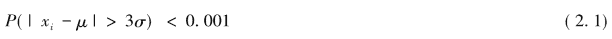

The Standard Deviation (`SD`) method is not a robust outlier detection method because the appearance of outliers in turn affects the mean and standard deviation. The Median Absolute Deviation (`MAD`) method first calculates the sample median, then finds the absolute deviation of each sample from the median, then calculates the median of these absolute deviations, and finally divides each sample's absolute deviation by the median of absolute deviations. The MAD method amplifies the influence of outliers and is a relatively reliable outlier calculation method. Distance-based outlier detection methods judge whether outliers are outside the neighborhood by defining proximity between data points. Density-based methods define outliers as points where the surrounding data density is significantly lower than the neighborhood density of most normal data points, suitable for datasets with uneven outlier distribution. Clustering-based methods use clustering algorithms to treat small clusters far from normal central clusters as outliers.

Outliers have a certain impact on both model training and evaluation. Different processing methods are adopted based on the number of outliers, their impact, and the learning model. If the number of outliers is small, consider deleting them, though this may lose some information. If there are many outliers and they cannot be deleted, a logarithmic transformation can be used to scale them down to one order of magnitude; this method does not lose information but has certain requirements for the learning model. If the order of magnitude difference between outliers and normal data is not large, outliers can be replaced by the data mean or median, with less information loss.

Noise is the error generated between the sample observed value and the true value during data collection and acquisition. Common processing methods include binning and regression. Binning includes equal-width and equal-frequency methods. Equal-width divides the range from minimum to maximum into several equal parts, while equal-frequency ensures each bin contains the same number of samples. Based on equal-width or equal-frequency, the mean, median, or boundary values of each bin are used to replace the samples in the bin. Regression builds a regression model based on the relationship between feature variables and output, and uses the output to reverse-solve approximate values of feature variables.

Data integration generally refers to merging data from multiple sources into a consistent dataset, needing to resolve feature identification, data redundancy, and conflict issues. Feature identification means identifying attributes or fields with the same meaning from two different data sources. For example, court, procuratorate, and public security data integration may involve common features; in suspect descriptions, the court may use feature name `suspect_description`, public security may use `suspect_miaoshu`, and the procuratorate may use `suspect_desc`. Data redundancy means a feature in one source can be derived from a feature in another source. For example, court data has a date of birth attribute, procuratorate data has an age attribute, and age can be derived from date of birth. Data conflict refers to inconsistent values of features with the same meaning from two different sources. For example, a suspect's height is 1.75m in court data but 1.85m in procuratorate data. Such data conflicts can be handled using missing value methods or resolved based on the method closer to the data production source.

Data reduction simplifies the dataset while preserving the integrity of the original data and achieving the same model training effect, quickly improving learning efficiency, including dimensionality reduction and dimensionality transformation. In classification tasks, there may be thousands of features, most unrelated to the classification result. By selecting feature subsets to delete unnecessary irrelevant features, the data volume is reduced as much as possible while ensuring minimal information loss. The goal of feature subset selection is to find the smallest subset with a probability distribution closest to the original feature space. Sequential Forward Selection (SFS) starts from an empty set and iteratively adds the best features from the original feature space. Sequential Backward Selection (SBS) starts from the full original feature set and iteratively removes the worst features. The best features of the original feature space can be determined by univariate and target variable statistical analysis methods; common methods include Chi-square test and regression coefficients. The Chi-square test calculates the correlation between feature values and target output based on the deviation between observed values and theoretical hypotheses, then deletes features with lower correlation from the feature space based on correlation ranking.

Some different features have high correlation and a certain degree of data redundancy. Dimensionality reduction methods can compress data from a high-dimensional redundant space to a low-dimensional subspace. Dimensionality reduction saves storage capacity and improves learning algorithm training speed. More importantly, on datasets with large amounts of noise, dimensionality reduction can improve model prediction performance. Dimensionality transformation maps high-dimensional sparse space to a lower-dimensional space while ensuring minimal original data information loss. Common methods include Principal Component Analysis (PCA), Singular Value Decomposition (SVD), and clustering. PCA projects data onto the principal component space through spatial mapping, maximizing data variance in the principal component directions. SVD maps data to spaces on different dimensions through orthogonal matrix transformation; it has high computational complexity and is suitable for sparse matrices. Clustering divides samples into clusters, using clusters to represent individual feature variables; the number of clusters is the new number of features.

Different feature values of training data have different dimensions (units/scales), which affect model training, especially for distance-related learning algorithms. For example, a fruit quality identification system screens out unqualified fruits. Input features to the learning model include fruit weight, growth period, length, width, height, etc. These quantified features are not in the same dimension range: weight 0–10000g, growth period 0–100 days, length 0–1000mm, etc. A single sample's feature values differ greatly; scaling operations are needed to map them to a specific range. Common methods include Min-Max Normalization, `Z-score Standardization`, and Logarithmic Transformation. Min-Max Normalization uses (max - min) as the denominator and the distance from the data to the minimum as the numerator. `Z-score Standardization` subtracts the mean and divides by the standard deviation (variance in text, usually std dev); the transformed data distribution changes. For some time-series data, the x-axis is time, the y-axis is GDP value, which has shown exponential growth over the past 20 years, making it impossible to show the growth relationship in a plot. Logarithmic transformation uses the `log` function to transform data in series where orders of magnitude differ greatly, allowing data of different dimensions to appear in a coordinate system with the same proportion.

Depending on the learning algorithm characteristics, some models require input data types to be discrete, e.g., `Decision Tree` and `Naive Bayes` algorithms. Learning algorithms with continuous input data have huge overhead in time and space; discretized data not only saves overhead but also improves feature interpretability and noise resistance. For example, a suspect's height value is continuous; if discretized into tall, medium, short, it better conforms to the general understanding of height and can categorize noise exceeding normal values into a discrete value, tolerating data entry errors to a certain extent, overcoming structural defects in the data, making model training and evaluation more stable and reliable. Discretization operations bin/segment continuous data based on breakpoints. Common methods include equal-frequency, equal-width, and clustering. Equal-frequency makes the sample count in each bin equal. For example, sample values include 1 to 10 (interval 1), 10 to 100 (interval 10), 100 to 1000 (interval 100), with 10 samples in each bin. Equal-width makes the width (boundary length) of each bin equal. For example, class size within 100 can be divided into `[0,25]`, `[25,50]`, `[50,75]`, `[75,100]` four equal-width bins. Clustering uses clustering learning results, treating samples in a cluster as a discrete value.

In multi-class features, using multiple discrete values to describe a feature is not conducive to fast model iteration. For example, suspect occupation is a multi-class feature: worker, farmer, teacher, civil servant, student, other. Usually, discretization results in 1, 2, 3, 4, 5. From the occupation itself, there is no size ordering difference; inputting these assigned values into the learning model is obviously unreasonable. Therefore, dummy variables need to be introduced to split the multi-class feature into multiple binary features, called sparsification. For example, the original occupation feature name is `employment`; introduce five dummy variables `is_worker`, `is_farmer`, `is_teacher`, `is_civilservant`, `is_student`. When the occupation is worker, `is_worker` takes value 1, other dummy variables are 0.

## 2.7 Model Evaluation

In a binary classifier, all samples are output as positive or negative classes according to the classification criterion. The classifier's predicted output does not completely match the actual sample output; there is a certain error. Total sample count is `m`, number of misclassified samples is `e`, error rate is `e/m`. Error rate is proportional to the number of misclassified samples and inversely proportional to the total sample count. Corresponding to the error rate is the learning accuracy, defined as `1 - error rate`. Errors occurring on the training set are defined as empirical error or training error; errors occurring on the test set are defined as generalization error. Generally, a classifier can achieve a low classification error rate on the training set, but the error rate on the test set is very high. For example, the total sample space is 1000 samples, divided into a training set of 800 samples and a test set of 200 samples. The classifier has 8 samples inconsistent with sample labels on the training set, and 40 samples inconsistent on the test set. In this case, the classifier is not a good classifier; although the training accuracy reaches 99%, the generalization accuracy drops to 80%.


# Machine Learning Model Evaluation and Selection

## 1. Generalization Error and Model Selection

If a classifier fits the training set data very well, the classification error rate or empirical error can reach or approach zero, and the model's hypothesis covers very specific features in the training samples. In other words, the learning model has learned all information from the training samples, possessing relatively strong learning capability. Obviously, the samples in the test set are different from those in the training set; they are identical or have small differences in certain features, while different or having large differences in others. Therefore, a learner with good training error does not necessarily have good generalization error, and training error cannot be used to evaluate the merits of a learning algorithm. Different learning algorithms have different learning effects on the same dataset; even the same learning algorithm with different parameter settings can produce drastically different learning effects. The goal of practical tasks is to minimize generalization error through model evaluation and model selection. Model selection refers to choosing one learning algorithm from many, and one parameter configuration from many parameter configurations.

The classifier learns a classification hypothesis or model from the training set. Evaluation of the model requires judging its generalization ability on the test set, measuring the model's applicability by calculating classification accuracy on the test set. Training set samples follow an independent and identically distributed (i.i.d.) sample space; test set samples must be new samples different from the training set, and test set samples must also follow an i.i.d. sample space. For example, assuming student scores follow a normal distribution, the score samples of the training set class need to be sampled from a normal distribution with a specific mean and variance, and the score samples of the test set class must also be sampled from a normal distribution with the same mean and variance. The training process can only use training set data; test samples cannot be used in the training process. For instance, the samples in the test set of case learning in Table 2.2 must not appear in the training set of case learning in Table 2.1. Otherwise, test samples used in training will lower the test error, causing the model's generalization ability to be overestimated.

## 2. Dataset Partitioning Methods

### 2.1 Hold-out Method

Generally, the training set and test set are not obtained by two separate samplings, but are partitioned from a single sampled dataset. From a sample space, a dataset `D={(d1，y1)，(d2，y2)，…，(dm，ym)，…，(dM，yM)}` containing `M` samples is collected, from which a portion is selected as the training set `P`, and the remainder as the test set `T`.

If the training set `P` and test set `T` are mutually exclusive sets and together constitute the entire dataset `D`, this partitioning is called the hold-out method. In the aforementioned sample space `|D|=1000`, `|D|` denotes the number of elements in the set; training set size `|P|=800`, test set size `|T|=200`. By definition, `P∪T=D`, `P∩T=Ø`, `|P|+|T|=|D|`. The model is trained using `P`, then tested on `T`, discovering 40 misclassified samples, including actual positive samples judged as negative, and actual negative samples output as positive. According to the error rate calculation, the classification error rate is `(40/200)×100%=20%`, and classification accuracy is `((200-40)/200)×100%=80%`.

### 2.2 Stratified Sampling

The data distribution in the test set must be consistent with that in the training set; otherwise, data skew will lead to more test error. An extreme example is that the training set contains no positive samples; even the best classifier cannot learn what features correspond to positive output from such a training set, and the classifier will not produce positive output on the test set. Even if not extreme, if the proportions of each category in the training set and test set are imbalanced, it will also cause significant bias in results. For example, dataset `D` has 500 positive samples and 500 negative samples; training set `P` has 490 positive and 310 negative; test set `T` has 10 positive and 190 negative. The ratio of positive to negative in `D` is 1:1; in `P` it is 49:31; in `T` it is 1:19. The classifier learns more positive features from `P`, and the classification function or hypothesis tends toward positive; samples on `T` have a higher probability of being classified as positive, yet `T` actually has only 1 positive output (relative to the ratio context, likely meaning very few). This distribution difference will inevitably cause large test error. The reasonable approach is stratified sampling: during dataset partitioning into training and test sets, preserve the category proportions unchanged. According to stratified sampling, the category ratio in `D` is 1:1; `P` has 400 positive and 400 negative; `T` has 100 positive and 100 negative. Even with stratified sampling, there are many ways to partition the dataset. For example, sorting positive samples by `feature_1`, putting the first 400 into set `P`, the last 100 into set `T`. Or vice versa, first 100 into `T`, last 400 into `P`. One can also sort by `feature_2`, `feature_3`, and `feature_n`; such sorting combinations can number in the thousands.

### 2.3 Repeated Random Sub-sampling

Different partitions of the dataset have a large impact on the model's generalization error, often producing large fluctuations. Therefore, the usual practice is to perform many random partitions, then train and test on each pair of training and test sets to obtain evaluation results, and finally take their average as the model's approximate generalization ability. For example, randomly shuffle all positive samples in dataset `D`; the first partition takes samples at positions 1–400 as positive samples in the training set, the remainder as positive samples in the test set; selection of negative samples is the same as for positive. The second partition differs from the first only in the positions taken: samples 2–401 as positive in training, remainder as positive in test. And so on, the 100th partition takes samples 100–500 as positive in training, remainder as positive in test. Each partition slides the previous partition's positions back by a step; if step is 1, 100 partitions are obtained. Compared to a single partition evaluation, using the average of 100 results evaluates the model more stably and reliably.

### 2.4 Cross-Validation

In fact, the expected model should use as much of dataset `D` as possible for training, so it can learn from more data. However, the hold-out method reserves a portion as test set; too small a training set `P` makes the trained model deviate from the expected model. Too large a `P` makes test set `T` too small, making evaluation unreliable. For example, a test set with only two samples yielding one classification error gives 50% accuracy, but a test set with 100 samples yielding one error gives 99% accuracy. Therefore, there is no perfect solution for the training/test split ratio; the usual practice is to rely on experience.

#### 2.4.1 k-Fold Cross-Validation

To improve the stability and authenticity of model evaluation, 5-fold cross-validation is often used to partition the dataset. First, through stratified sampling, dataset `D` is evenly partitioned into 5 subsets, i.e., `D=D1∪D2∪D3∪D4∪D5`, `|D1|=|D2|=|D3|=|D4|=|D5|`, as shown in Figure 2.14. Any two subsets are mutually exclusive, i.e., `D1∩D2=Ø`, `D2∩D3=Ø`, `D3∩D4=Ø`, `D4∩D5=Ø`, `D1∩D3=Ø`, etc.

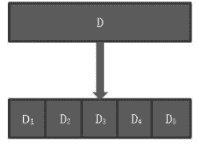

Figure 2.14 Partitioned into 5 mutually exclusive subsets

Then, each time one subset is selected as the test set, the rest as the training set. The first experiment selects `D5` as test, `D1`–`D4` as training. The second selects `D4` as test, `D1`–`D3` and `D5` as training. And so on until the fifth selects `D1` as test, `D2`–`D5` as training, as shown in Figure 2.15:

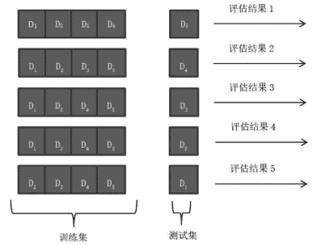

Figure 2.15 5-Fold Cross-Validation

The average of the 5 evaluation results is returned as the model's performance evaluation; this return value depends on the 5-subset partitioning method. The positive sample set `DP` in `D` is randomly partitioned into 5 equal parts, `DP=DP1∪DP2∪DP3∪DP4∪DP5`, `|DP1|=|DP2|=|DP3|=|DP4|=|DP5|`. The negative sample set `DN` is similarly partitioned into 5 equal parts, `DN=DN1∪DN2∪DN3∪DN4∪DN5`, `|DN1|=|DN2|=|DN3|=|DN4|=|DN5|`. From `DP`, a random `DPi` is selected and removed from `DP`. Then from `DN`, a random `DNj` is selected and removed from `DN`. Finally, `DPi` and `DNj` together form subset `Dt` for 5-fold cross-validation. The above process is called one partition; to reduce bias from partitioning differences, multiple partitions are repeated, each using 5-fold cross-validation, as shown in Figure 2.16:

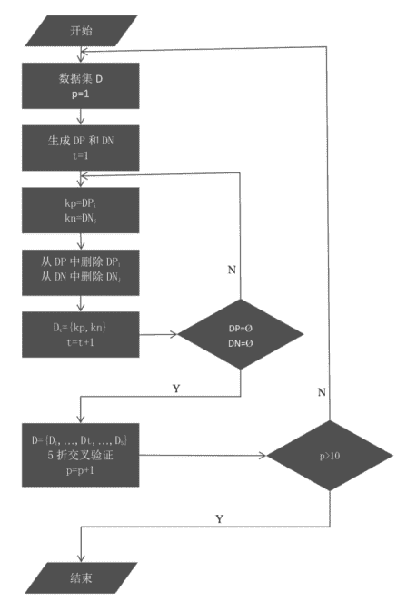

Figure 2.16 10 Times 5-Fold Cross-Validation

The flowchart shows 10 times 5-fold cross-validation; the average of 10 results has certain stability, thus avoiding bias introduced by different data partitions to some extent. 5-fold cross-validation can be extended to 10-fold cross-validation; the more general cross-validation is called k-fold cross-validation. The larger `k`, the closer the training set is to the dataset, and the closer the trained model is to the expected model; simultaneously, the number of subset partitioning methods increases, and runtime overhead becomes relatively larger.

## 3. Model Selection and Parameter Tuning

### 3.1 Learning Algorithms and Hyperparameters

Machine learning tasks involve two aspects: selecting a learning algorithm and tuning the algorithm's parameters. Common learning algorithms include `Linear Models`, `Support Vector Machines`, `Decision Trees`, `Neural Networks`, `Naive Bayes Classifiers`, `Principal Component Analysis`, and `Topic Models`, etc. Each learning algorithm has corresponding parameter settings and adjustments, called parameter tuning or hyperparameter tuning. The combination space of parameter configurations is very large; the goal of tuning is to find the parameters that train the best-performing model. Although one could try training a model for every parameter configuration, the time cost is too high. Even if parameter values are discrete, as the number of parameters increases, training all configuration models becomes impossible, let alone many parameters being continuous. In fact, the empirical approach is to set a range and step size for parameters. For example, the `LDA` topic model has a prior hyperparameter `alpha` related to the number of topics, defaulting to 1, and a prior hyperparameter `beta` related to vocabulary size, defaulting to 0.01. For `alpha`, set range `[0, 10]`, step 1, candidate values `{1, 2, 3, 4, 5, 6, 7, 8, 9, 10}` (10 values). For `beta`, set range `[0, 0.1]`, step 0.01, candidate values `{0.01, 0.02, 0.03, 0.04, 0.05, 0.06, 0.07, 0.08, 0.09, 0.1}` (10 values). Without considering learning rate, just tuning `alpha` and `beta` in small ranges requires evaluating 10×10=100 models. `Support Vector Machines` tune penalty coefficient and kernel function coefficient; the number of hyperparameters exceeds 3; each configuration corresponds to a model, requiring training and evaluation on training and test sets, making the tuning and learning workload very large. Additionally, if the tuning step is too large, the model may miss the optimal performance parameters.

### 3.2 Validation Set and Tuning Process

Parameter tuning requires a portion of data to verify the performance of each parameter configuration model. Therefore, dataset `D` must be partitioned into three parts: training set `P` (Practicing), validation set `V` (Validating), and test set `T` (Testing). For example, the parameter `n_components` (number of principal components) in `Principal Component Analysis` has candidate values `|N_comps|={1, 2, 3, 4, 5, 6, 7, 8, 9, 10, 15, 20, 25, 30, 35, 40, 45, 50, 60, 70, 80, 90, 100, …}`. Each parameter setting `n_components_i` corresponds to a model `model_i`, where `n_components_i` is the `i`-th element of set `N_comps`, `i` ranges from 1 to `|N_comps|`, `|N_comps|` being the number of elements in `N_comps`. Model `model_i` learns on training set `P`, then evaluates its performance `performance_i` on validation set `V`. Compare performance of `|N_comps|` models, return the maximum `performance_MAX=max(performance_i)`. Based on the returned element index `MAX`, the best parameter configuration is `n_components_MAX`, corresponding model `model_MAX`. A new training set `P'` is composed of training set `P` and validation set `V`; model `model_MAX` is retrained on `P', expecting to train on a dataset with maximum sample size to approach the true model. To tune parameters, a portion of the original training set is used to evaluate the selected parameters, called the validation set. Thus, the training set trains the model, the validation set performance tunes parameters, and the original test set evaluates the model's generalization ability in a way approximating and simulating the actual user environment.

## 4. Regression Task Performance Metrics

The applicability of a learning algorithm in application and the performance metrics of a learner are both related to the learning model's generalization ability. How to evaluate a learner's performance requires not only certain measurement methods but also corresponding objective evaluation criteria. Different evaluation criteria often yield vastly different results; therefore, it is difficult to simply judge the superiority of different models' generalization ability by a single metric. In regression tasks, Mean Squared Error, Root Mean Squared Error, and Mean Absolute Error are commonly used to measure learner performance. Sample `xi`'s predicted output is `h(xi)`, actual true value is `yi`, validation set has `m` samples.

### 4.1 Mean Squared Error (MSE)

Mean Squared Error, called `MSE` (Mean Squared Error), is a criterion measuring the deviation between a learning model's predicted values and actual true values. It first sums the squared differences between predicted and true values for each sample, then takes the average:

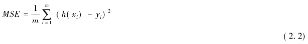

The MSE on the validation set has the same form as the loss function in regression learning tasks. On the training set, the loss function is minimized via stochastic gradient descent to learn the model's hypothesis function or mapping function `h(xi)`. Since MSE is a squared relationship of model output, it is not convenient for intuitively describing model effects, especially for horizontal comparison of model output data magnitudes. For example, last year a region's household disposable annual income was 100,000 yuan; a regression model predicts next year's income. If evaluating with MSE, the error value could reach tens of millions, obviously not matching intuitive understanding.

### 4.2 Root Mean Squared Error (RMSE)

To make the model evaluation magnitude consistent with actual observation values, Root Mean Squared Error can be used. RMSE (Root Mean Squared Error) first sums the squared differences between predicted and true values for each sample, then takes the square root of the average:

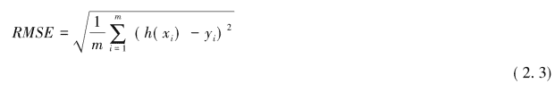

RMSE is smaller than MSE, but outliers in the dataset will have a larger impact on RMSE. In the above example, if the household disposable income dataset contains outliers far from the mean, the `RMSE` value could reach hundreds of thousands or even millions.

### 4.3 Mean Absolute Error (MAE)

To further lower the evaluation value to be on the same level as actual observations, Mean Absolute Error can be used. MAE (Mean Absolute Error) first sums the absolute differences between predicted and true values for each sample, then takes the average:

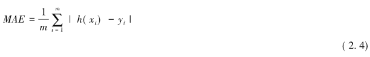

The metric unit for predicting a region's household disposable annual income is yuan, model output averages around 100,000; the metric unit for predicting developing country adolescent height is centimeters, model output averages around 150. Therefore, when comparing the merits of two models with different data metric units, one cannot directly compare using MSE, RMSE, or MAE. Whether MAE, MSE, or RMSE, model evaluation is an absolute value under a scale unit; closer to 0 is better.

### 4.4 Coefficient of Determination (R²)

The coefficient of determination is a relative coefficient measuring learning model performance, called `R2` (R-square), related to Residual Sum of Squares and Total Sum of Squares. Residual Sum of Squares, called `RSS` (Residual Sum of Squares), is the sum of squared differences between predicted and true values for each sample. Total Sum of Squares, called `TSS` (Total Sum of Squares), is the sum of squared differences between true values and the mean for each sample. `R2` is calculated by subtracting the ratio of `RSS` to `TSS` from 1:

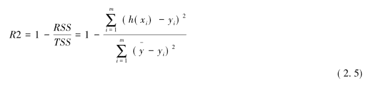

`R2` values typically range in `[0, 1]`. When the learning model fits the data very well, `RSS` tends to 0, `R2` gradually approaches 1. When the learning model explains the data very poorly, using a value close to the mean instead of predicted values, `RSS/TSS` tends to 1, `R2` gradually approaches 0.

## 5. Classification Task Performance Metrics

### 5.1 Limitations of Accuracy and Error Rate

In binary classification or multi-class classification, although error rate or accuracy can depict learning model performance, they are too broad. After all, error rate refers to the proportion of all misclassified samples, including actual positive predicted as negative, and actual negative predicted as positive. Accuracy refers to the proportion of all correctly classified samples, including actual positive predicted as positive, and actual negative predicted as negative. For example, among cases predicted as winning, what proportion are actually won; or among actually won cases, what proportion are predicted as won. If only error rate or accuracy describes predictive performance, it clearly cannot satisfy application needs. Assume 1000 case samples contain 500 wins and 500 losses. Model A predicts 400 of 500 wins as wins, and 0 of 500 losses as wins. Model B predicts 450 of 500 wins as wins, and 100 of 500 losses as wins. Model A has 400 true positives and 500 true negatives, accuracy 90%, error rate 10%. Model B has 450 true positives and 400 true negatives, accuracy 85%, error rate 15%. If considering error rate or accuracy, Model A seems more favored. In fact, it is not so; if the user focuses on *all* won cases, Model B has an advantage. Under the criminal justice ideal of "better to let a guilty person go free than to convict an innocent one," Model B achieves fairness in legal performance with fewer won cases misclassified.

### 5.2 Precision and Recall

In book literature retrieval and information retrieval, retrieval by keywords returns results containing relevant information the user cares about and irrelevant information they don't. Precision describes how many of the returned results are relevant information the user cares about; Recall describes how much of all the relevant information the user cares about was hit or retrieved.

### 5.3 Confusion Matrix

Generally, a confusion matrix describes the correspondence between a learning model's predicted categories and actual categories. `TP` (True Positive): number of samples predicted as positive that are actually positive, or actually positive predicted as positive. `TN` (True Negative): number of samples predicted as negative that are actually negative, or actually negative predicted as negative. `FP` (False Positive): number of samples predicted as positive that are actually negative, or actually negative predicted as positive. `FN` (False Negative): number of samples predicted as negative that are actually positive, or actually positive predicted as negative. Total samples equals TP + TN + FP + FN. The confusion matrix for binary classification results is shown in Table 2.4.

Table 2.4 Binary Classification Confusion Matrix

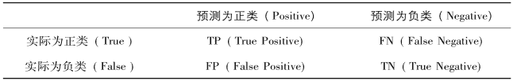

### 5.4 Precision and Recall Calculation

When retrieving information, the information the user cares about is marked as positive. Precision is defined as the accuracy of the positive class (`Precision`), i.e., the percentage of samples predicted as positive that are actually positive, indicating the probability that a sample judged as positive is actually positive. Recall is defined as the recall rate of the positive class (`Recall`), i.e., the proportion of correctly identified positive samples to the total actual positive samples, indicating the probability that a positive sample can be correctly identified:

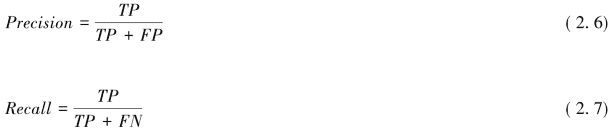


## 2.7 Evaluation Metrics

Generally speaking, `Precision` and `Recall` are mutually exclusive. Improving `Precision` means lowering `Recall`, and improving `Recall` means lowering `Precision`. For example, using a learning model to predict whether a case will be won, to avoid missing cases that are actually won, one can predict all cases as won. Although this improves `Recall`, it lowers `Precision`. On the other hand, if one hopes to increase the proportion of actually won cases among those predicted as won, one only needs to predict the most confident cases as won, and classify less confident cases as lost. This improves `Precision`, but misses some cases that the learner is not confident about but are actually won, leading to a decrease in `Recall`. From the tables and formulas, it can be seen that to improve `Precision`, one needs to increase `TP` and decrease `FP`. Classifying less confident cases as lost: if these cases are actually won, `FN` increases; if these cases are actually lost, `FP` decreases while `FN` increases. The increase in `FN` lowers `Recall`. To improve `Recall`, one needs to increase `TP` and decrease `FN`. Classifying all less confident cases as won: if these cases are actually won, `TP` increases; if these cases are actually lost, `TN` decreases while `FP` increases. The increase in `FP` lowers `Precision`.

The learning model outputs the probability of predicting the positive class as the result. According to the magnitude of the predicted probability, the classification results of the validation set samples are sorted. Samples ranked at the front are considered by the learning model to be highly confident; samples ranked at the back are considered to be less confident, as shown in Table 2.5.

**Table 2.5 Confusion Matrix**

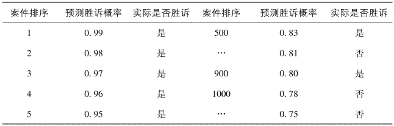

**Continued Table**

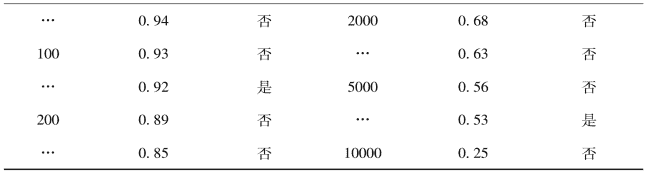

Each time a position is selected, cases before the position are deemed won, i.e., `TP+FP`. Cases after the position are deemed lost, i.e., `FN+TN`. Based on the actual win/loss situation, a current `Precision` and `Recall` can be calculated at the current position. Selecting positions sequentially from front to back yields a set of binary tuples (`Recall`, `Precision`). For example, at the starting position, `TP+FP=1`, `FN+TN=9999`, `TP=1`, `FP=0`, `TN=99`, `FN=9900`. The starting position's `Recall` `R1=0.01`, `Precision` `P1=1`. At the final position, `TP+FP=10000`, `FN+TN=0`, `TP=100`, `FP=9900`, `TN=0`, `FN=0`. The final position's `Recall` `R10000=1`, `Precision` `P10000=0.01`. At position 100, `TP+FP=100`, `FN+TN=9900`, `TP=50`, `FP=50`, `TN=9836`, `FN=64`. At position 100, `Recall` `R100=0.5`, `Precision` `P100=0.8`. With `Recall` as the x-axis and `Precision` as the y-axis, as shown in Figure 2.17:

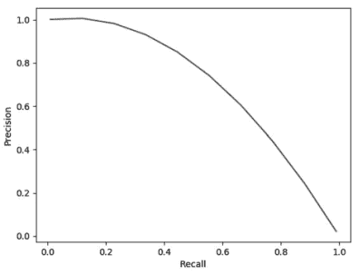

**Figure 2.17 P-R Curve**

Different users have different preferences for `Precision` and `Recall`. Health-conscious users search for medical information via the Internet, hoping there are no erroneous medical information in the returned results; in this case `Precision` is more important than `Recall`. Evidence-gathering users hope to obtain all case materials; to avoid missing evidence, they try to expand the search scope as much as possible; in this case `Recall` is more important than `Precision`.

To balance the mutually exclusive relationship between `Precision` and `Recall`, a balanced metric is used to comprehensively consider the effects of both. When `Precision` and `Recall` are equal, the balanced metric equals `Precision` or `Recall`. When they are not equal, the balanced metric lies between the two. The `F1` score is a harmonic mean of Precision and Recall, giving them equal weight:

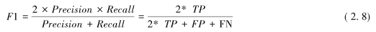

In information retrieval, Recall and Precision involve two categories: relevant and irrelevant information. Recall and Precision refer to the coverage and accuracy of hitting the target regarding relevant information. Machine learning classification tasks include binary and multi-class tasks. When validating learning model performance and effect, one must not only examine the Recall and Precision of the positive class or the first class, but comprehensively examine the Recall and Precision of all classes. The confusion matrix for multi-class tasks is shown in Table 2.6:

**Table 2.6 Multi-class Confusion Matrix**

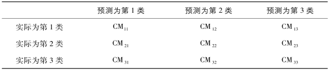

Assuming there are `C` categories, the `Precision` of category `Labelc` is the proportion of actual category `Labelc` samples among those predicted as `Labelc`. The `Recall` of category `Labelc` is the proportion of samples predicted as `Labelc` among the actual `Labelc` samples:

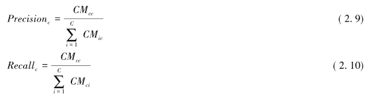

Based on the definitions of `Precision` and `Recall`, the `Precision` and `Recall` of each category are calculated in turn, yielding (`Precision1`, `Recall1`), (`Precision2`, `Recall2`), …, (`Precisionc`, `Recallc`), …, (`PrecisionC`, `RecallC`). The average of the `Precision` values is the `Macro-Precision`, the average of the `Recall` values is the `Macro-Recall`, and the harmonic mean of `Macro-Precision` and `Macro-Recall` is the `Macro-F1`:

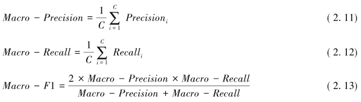

The model evaluation method that averages the `Precision`, `Recall`, and `F1` score of each category is called the `Macro-averaging` method. The model evaluation method that averages the corresponding values of predicted outputs and actual truths in the confusion matrix is called the `Micro-averaging` method. Summing and averaging the values on the diagonal of the confusion matrix, i.e., the average of correct predictions for each category, `Micro-Precision` equals the proportion of correctly predicted samples out of all predicted samples. `Micro-Recall` equals the proportion of correctly predicted samples out of all actual samples. `Micro-Precision` is numerically equal to `Micro-Recall`:

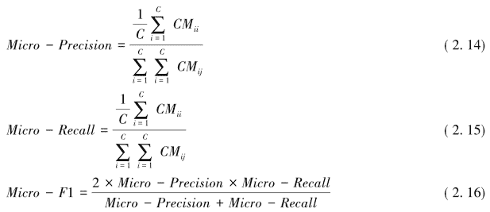

In the P-R graph, the classifier's prediction for a sample is a probability. Setting a threshold, when the sample's predicted probability is greater than this threshold, the sample is predicted as the positive class; when less than this threshold, predicted as the negative class. Neural networks and logistic regression output real numbers greater than 0 and less than 1. Samples greater than or equal to 0.5 are classified as positive; samples less than 0.5 are classified as negative. If predicted samples are sorted in descending order of probability, test samples closer to the front are more likely to be positive, and those closer to the back are more likely to be negative. The classifier needs to select a cutoff point; samples before the cutoff are output as positive, and samples after as negative. The further forward the classifier's chosen cutoff, the higher the probability that samples judged as positive are actually positive, so `Precision` is higher, but the number of samples judged as positive is relatively small, potentially missing actual positive samples not judged as positive, resulting in lower `Recall`. The further back the cutoff, the lower the probability that samples judged as positive are actually positive, so `Precision` is lower, but the number of samples judged as positive is relatively larger, resulting in higher `Recall`. Therefore, the ranking of test samples' predicted probabilities reflects the `Precision` and `Recall` at various cutoffs overall.

`ROC` (Receiver Operating Characteristic) is a detection analysis technique. The machine learning field introduced this name to represent the overall generalization performance of probability prediction results. Samples are sorted by predicted probability from large to small. Following the same order, cutoffs are selected. Each time a cutoff is selected, the two values calculated in the P-R graph are `Precision` and `Recall`, while in the ROC graph, the two values are `True Positive Rate` (`TPR`) and `False Positive Rate` (`FPR`).

`True Positive Rate` represents the proportion of positive classes successfully predicted by the classifier (predicted as positive, actually positive) among all actual positive classes. `False Positive Rate` represents the proportion of positive classes incorrectly predicted by the classifier (predicted as positive, but actually negative) among all actual negative classes:

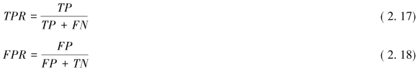

In fact, `True Positive Rate` `TPR` is the `Recall` of the positive class. The larger the `TPR`, the more actual positive classes are predicted as positive. The larger the `FPR`, the more actual negative classes are predicted as positive. If a classifier's result for judging a sample as positive is a probability value, by setting a threshold, samples with probability greater than the threshold are positive, and those less than the threshold are negative. Accordingly, an (`FPR`, `TPR`) value can be calculated. Taking `FPR` as the x-axis and `TPR` as the y-axis, this corresponds to a point on the plane. When the threshold is 1, all test samples are classified as negative; no positive samples are judged as positive, and no negative samples are classified as positive. Therefore, both `TPR` and `FPR` equal 0. As the threshold decreases for the first time, some samples are classified as positive. These samples have very high predicted probabilities, a high probability of being actually positive, and a low probability of being actually negative. `TPR` grows rapidly, while `FPR` grows slowly. As the threshold further decreases to around 0.5, more and more samples are classified as positive. These samples have predicted probabilities exceeding 0.5. The number of actual positive samples further increases, but the rate of increase slows. The number of actual negative samples further increases, and the rate of increase rises. `TPR` growth slows, while `FPR` growth accelerates. When the threshold decreases near 0, all test samples are classified as positive. All positive samples are judged as positive, and all negative samples are also judged as positive. Both `TPR` and `FPR` equal 1. As `FPR` increases, `TPR` also increases. Therefore, the ROC curve is a monotonically increasing curve of (`FPR`, `TPR`) on the interval [0, 1]. `AUC` (Area Under Curve) is the area enclosed under the ROC curve. When `FPR` takes smaller values, the threshold is higher, and the classifier with a larger corresponding `TPR` value performs better. The larger the `AUC` value, the better the classifier performance.

## 2.8 Roadmap

The previous sections discussed the basic concepts and methods of machine learning. Machine learning has a typical workflow with fixed activities including data preprocessing, model training, model evaluation, and prediction on new data. Data preprocessing involves data cleaning, sample labeling, feature selection, and splitting training and test sets. Model training involves selecting model algorithms and tuning parameters. Model evaluation involves selecting performance metrics and cross-validation. Predicting new data generalizes the trained model to actual application scenarios, predicting new input samples to obtain new outputs, as shown in Figure 2.18:

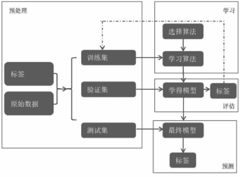

**Figure 2.18 Work Roadmap**

The data preprocessing stage consumes a significant amount of time. Data sources are historical data, requiring data integration operations. For missing values, filling operations are performed. For anomalous outliers, deletion or replacement operations are performed. For multi-class features, sparsification processing is needed. The most important operation is dimensionality reduction of the feature space, transforming the high-dimensional original feature space into a low-dimensional new feature space, including feature selection and feature extraction. Feature selection is a subset of the original feature space, deleting some features deemed irrelevant by certain methods from the original feature space, resulting in greater information loss. Feature extraction is a mapping of the original space, projecting or transforming the original feature space into a new space, resulting in less information loss. Appropriate data preprocessing removes noise from the data collection process and streamlines the space, significantly improving model performance and training learning efficiency.

As seen in practical applications, for different user problems and task requirements, different applications and software are developed. The *No Free Lunch Theorems* propose that without considering specific practical problems and requirements, there is no learning algorithm better than another, not even better than guessing by rolling dice. The proverb says, if your only tool is a hammer, it is tempting to treat everything as a nail. There is no universally applicable classifier, nor an optimal learning algorithm independent of specific applications. Every classifier has its inherent bias. Without making assumptions about tasks related to the problem domain, no classification model possesses superiority; that is, the classifier must be relevant to the problem domain. Therefore, in practice, to train and select the best-performing model, at least several different learning algorithms must be compared to consider which algorithm is suitable for a specific problem, specific data, and specific distribution. Whether it can solve other problems need not be considered. Therefore, comparing different learning models on a specific problem has practical significance.

Before comparing different algorithms and models, the metrics or standards for measuring performance must be clarified, such as classification accuracy. A common problem is how to determine the datasets for model training, model selection, and model evaluation. Generally, the training set is used to train the model, while the test set is used for model evaluation. If the test set is not used for model selection but reserved for final model evaluation, it will be difficult to determine which model performs better on the final test data or in the real world. One solution is to further split the training set into a training subset and a validation subset. A model is trained on the training subset, and its performance is tested on the validation subset. Then another model is trained and tested on the training and validation subsets. Based on the added validation set, cross-validation can perform model selection. The default parameters of different learning algorithms provided by various algorithm packages are not optimal for the user's specific task training and evaluation. Therefore, parameters often need to be tuned to improve model performance until user requirements are met. Intuitively, hyperparameters can be viewed not as parameters learned from data, but as knobs for model tuning. Through these knobs, model performance is improved, just like the knob on an electric fan controlling wind speed.

After comparing several different models on the training and validation sets, a model that fits the training data well and achieves good performance on the validation set is selected. Then the test set is used to estimate the model's future performance on data generated in real environments, thereby estimating the model's generalization performance. If the model performance meets user requirements, the model can be used to predict future new data. Additionally, the hyperparameters mentioned earlier, such as feature extraction and data scaling, are obtained from the training set. Subsequently, the same parameters are used to transform test set data or new samples. Otherwise, the performance measured on the validation or test set may be incorrect. For example, using Principal Component Analysis to solve for a new space in the training set, the coordinate system of the new space is the vector of the original space. The projection of the training set on this vector has maximum variance, or the dot product of the training set with this vector has maximum variance. The vector is the so-called parameter mentioned earlier. In the validation or test dataset, the same parameter, i.e., the vector, must be used to transform the validation or test samples.

In the work roadmap, raw data needs to undergo missing value filling, denoising, and outlier processing. Supervision information is the labeled tags. Cleaned raw data and labels form the dataset. The dataset is split into training, validation, and test sets. Based on data type and distribution characteristics, some candidate learning algorithms are selected. A learning algorithm is selected from the candidates in turn. Training set data is input into the selected learning algorithm for model training and learning. After the model is learned, validation set samples are input into the trained model to test model performance and evaluate. The dashed line in the figure pointing to the training set means switching to another learning algorithm for retraining, repeating the above steps until all candidate learning algorithms are exhausted. Then, the performance and effects of each learning model are compared, and the best-performing model is selected as the final model. Finally, test set samples are input into the final model to evaluate the model's generalization ability.

# Chapter 3 Understanding Legal Text

News report texts have characteristics such as timeliness, publicity, and topicality. The recorded words can be widely disseminated. The text is concise and to the point, introducing topics with facts and attracting audiences with comments. Social texts highlight interactivity, brevity, and entertainment, creating many Internet buzzwords, extensively using slang, micro-expressions, and abbreviations, containing much subjective and emotional content. Legal texts differ from general narrative texts such as news reports, and also from colloquial short texts such as social media. Legal texts are professional texts generated to express specific concepts, meanings, and phenomena and applied in legal practice and related fields.

## 3.1 Linguistic Features of Legal Text

### 3.1.1 Sources of Legal Text

The linguistic features of legal texts are influenced by legal sources. Therefore, determining the source of legal texts is crucial. The legal sources of Common Law and Civil Law (Statute Law) are distinctly different. In some Common Law countries, formal legal sources include Case Law and Statute Law. Case Law refers to previous precedents serving as the basis for later judgments. Statute Law refers to normative and systematic legal documents enacted by the state that embody the state's will. Case Law plays a leading role, while Statute Law plays a supplementary role, interpreting or restating precedents. Informal legal sources of Common Law include traditional customs, public order and good morals, and government public policies.

In some Civil Law countries, laws are enacted by legislative bodies, and administrative departments enact some administrative regulations. China's legal sources include laws enacted and promulgated by the National People's Congress (NPC), appearing and presented under names such as "General Principles" or "Law"; administrative regulations enacted and promulgated by the State Council, appearing and presented under names such as "Regulations"; departmental rules enacted and promulgated by departments under the State Council, appearing and presented under names such as "Rules"; local regulations enacted and promulgated by local people's congresses, appearing and presented under names such as "Provisions". For example, the *Civil Aviation Law of the People's Republic of China* is a law enacted by the NPC Standing Committee; the *Regulations on Civil Aviation Security of the People's Republic of China* is an administrative regulation enacted by the State Council; the *Civil Aviation Security Inspection Rules of China* enacted by the Civil Aviation Administration of China (CAAC) is a departmental rule; while the *Regulations on Public Safety Management of Unmanned Aerial Vehicles in Zhejiang Province* enacted by the Zhejiang Provincial People's Congress is a local regulation.

From the perspective of word composition in legal texts, a sentence in a legal text may contain words from general linguistics, or may contain legal terms in specific contexts. For example, "wife" in legal texts belongs to general vocabulary, while "minor" belongs to a specialized legal term, specifically referring to the group under 18 years of age. In English, "Writ" refers to a writ or a written legal command, a legal vocabulary in the form of a right. "Real estate" is a legal term, referring to the property concept of immovable property attached to land, while "house" is a general word, referring to a building in the form of a house. Legal terms are the smallest fixed units in legal texts with special meanings and specialized definitions. For example, "legal person" cannot be split into smaller linguistic units. "Real estate" cannot be split into "real" and "estate". Classified by different internal composition methods, legal terms can be divided into types such as Verb-Object structure, Modifier-Head structure, Subject-Predicate structure, Coordinate structure, and Complement structure.

### 3.1.2 Morphological Analysis of Legal Text

`Morphology` is a branch of linguistics, mainly studying how words are formed and generated. A `Word` is the smallest unit in a sentence structure that can be used independently. A `Morpheme` is the smallest linguistic unit of `Morphology`, a component in `Morphology` one level lower than a `Word`.

In Chinese, most `Morphemes` come from single-syllable Chinese characters, with a few disyllabic compound `Morphemes`. For example, "笔" (pen) is a writing tool, which can form general words like "笔筒" (pen holder), "笔迹" (handwriting), "毛笔" (writing brush). The disyllabic `Morpheme` "豆腐" (tofu) can form "豆腐汤" (tofu soup), "豆腐乳" (fermented tofu), "豆腐干" (dried tofu), "豆腐皮" (tofu skin), "老豆腐" (old tofu), "毛豆腐" (hairy tofu), "冻豆腐" (frozen tofu), "豆腐脑" (tofu pudding), "酱豆腐" (soy sauce tofu), "臭豆腐" (stinky tofu), "豆腐渣" (tofu dregs), etc. "诉讼" (litigation) can form legal terms like "诉讼参加人" (litigation participant), "诉讼当事人" (litigant), "诉讼代理人" (litigation agent), etc.

In English, `Morphemes` are generally parts of words. For example, the general word "house" contains one `Morpheme`, while "houses" contains two `Morphemes`: "house" and "-s". The legal term "writ" contains one `Morpheme`, while "writs" contains two `Morphemes`: "writ" and "-s". A `Stem` is also part of a word, but unlike a `Morpheme`, a `Stem` allows another `Morpheme` or `Affix` to be attached to it. For example, "pack" is a root; adding an `Affix` "un" forms "unpack", which is called a `Stem`.

The analysis task at the grammatical level is `Morphological Analysis`, used to analyze which `Morphemes` a word consists of, and which `Morphemes` are the smallest semantic constituent units. A `Morpheme` is an indivisible part of a linguistic sign, having a certain form and meaning. "Unmoralized" is an English word containing 4 `Morphemes`: `un`, `moral`, `ize`, `d`. To understand this word, one needs to know the forms and meanings of these 4 `Morphemes`. `Morphemes` are also called `Affixes`, which can be divided into three types: `Prefix`, `Suffix`, and `Infix`. Those appearing before the `Stem` are `Prefixes`. For example, in English "untidy", the `Prefix` "un" means negation. Those appearing after the `Stem` are `Suffixes`. For example, in English "acceptable", the `Suffix` "able" means capability. Those appearing inside the `Stem` are `Infixes`. `Infixes` inserted into the middle of the `Stem` are uncommon, mainly used in chemical compound naming. For example, in English "pipecoline", the `Infix` "pe" means fully hydrogenated. `Morphemes` and `Morphological Analysis` are shown in Figure 3.1.

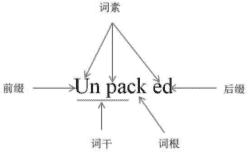

**Figure 3.1 Morphemes and Morphology**


In Figure 3.1, understanding the general word "Unpacked" from the perspective of morphemes, "pack" means packaging, constituting the core meaning of the word, occupying the most important position in the morpheme, and is called the root. "Un" is at the front of the word, indicating a reverse action, and is called a prefix. "Unpack" occupies the main position of the word, called the stem, meaning to unpack/open; the main meaning of the word is determined by the stem. "ed" is at the end of the word, indicating the past state of the word, and is called a suffix. Comprehensive analysis shows that the meaning of "Unpacked" is the state of being packed first and then unpacked; the direct meaning is opened.

Understanding the legal vocabulary "Undefended" from the perspective of morphemes, "defend" means defense. In law, it refers to the activity where the defense party presents reasons and relevant evidence favorable to the defendant for the purpose of mitigating the crime or achieving acquittal. Specific behaviors include rebutting and pleading against the prosecution's accusations. The prefix "Un" indicates giving up a certain action, exempting a certain action, or not performing a certain action. The stem "Undefend" means giving up defense or not defending. The suffix "ed" indicates the past tense that has already occurred, a result state. Comprehensive analysis shows that "Undefended" means adjectivally undefended/uncontested; the reasons for not contesting may be various. For example, the defendant is absent from trial, the defendant does not make a plea statement, the defendant does not submit a defense statement, etc. Related legal terms include "Undefended case" (undefended case), "Undefended divorce" (undefended divorce), "Undefended lawsuit" (undefended lawsuit).

A word is the smallest formal unit and semantic unit that can be extracted in a sentence structure. Words and morphemes are easily confused; although they are highly related, the differences are also distinct. A word can appear independently; some morphemes can appear independently, while others cannot. For example, the singular form of "case" can appear independently, and the plural form "cases" can also appear independently. The morpheme "case" in "cases" can appear independently, but "s" cannot. However, when a morpheme can appear independently, it must possess independent meaning, i.e., it is a root. For example, "case" has an independent meaning (case/instance); "case" can appear as a word and also serve as a root to derive other words. Morphemes that cannot appear independently have a modifying function and have no specific meaning themselves. For example, "s" indicates plural or third-person singular, having no actual descriptive content itself.

From the relationship between words and morphemes, morphemes can appear independently or derive new words in other forms. Morphemes that do not need to attach to other morphemes and can form words independently are called free morphemes, sometimes also called independent morphemes or unbound morphemes. For example, "air" is a free morpheme, "line" is also a free morpheme; these two free morphemes can form a compound word "airline", but the compound word "airline" and the separately occurring phrase "air line" have different meanings. "Airline" specifically refers to an airline company, while "air line" also has the meanings of straight line and air pipeline. Bound morphemes are parts formed by roots plus some affixes, including inflectional morphemes and derivational morphemes.

Inflectional morphemes refer to suffixes added after the root; from a grammatical perspective, they attach grammatical features such as number, part of speech, and tense to the word. English includes 8 inflectional morphemes: "'s" indicates the possessive case of nouns; "s" indicates the plural form of nouns, and can also indicate the third-person singular of verbs; "ing" indicates the present participle of verbs; "ed" indicates the past tense of verbs; "en" indicates the past participle of verbs; "er" indicates the comparative degree of adjectives or adverbs; "est" indicates the superlative degree of adjectives or adverbs. For example, "defendants" refers to multiple defendants; "s" changes "defendant" to plural. "Defended" is the past tense of the verb defend or the adjective defended; "ed" changes the verb "defend" to past tense or adjective.

Derivational morphemes are affixes that combine with roots to form new meanings; the meaning of the new word varies with different affixes. For example, in the word "undefendable", "defend" is the root, meaning the verb defend; the suffix "able" converts the verb defend into the adjective defensible; the prefix "un" converts the adjective defensible into the antonym indefensible. In the word "biweekly", "week" is the root, meaning the noun week; the suffix "ly" converts the noun week into the adjective weekly; the prefix "bi" converts the adjective weekly into biweekly (fortnightly). The above examples illustrate that derivational morphemes "un" and "bi" change the meaning of the root: "un" adopts the opposite meaning of the root, "bi" adopts twice the quantity of the root.

The relationship between stem and root can be seen from the morphology of the word "unpacked": the part remaining after removing the suffix "ed" is the stem; then removing the affix "un" from the stem yields "pack", which, if it cannot be further divided, is the root. Correspondingly, for the word "packed", removing the suffix yields the stem "pack", which is also the root. Therefore, the stem corresponding to a free morpheme is the root, while the stem corresponding to a derivational morpheme is not the root.

### 3.1.3 NLTK and Polyglot Morphemes and Stems

According to search engine and information retrieval terminology, a stem is the main part remaining after removing the redundant parts of a word. Search engines use stemming methods to retrieve web pages queried by users. For example, if the user's input query is "defendant", the stemming method obtains the stem "defend" from the query term; web pages linked based on the stem include both pages containing "defendant" and pages containing "defendable".

The `PorterStemmer` module of the Natural Language Toolkit `NLTK` has two methods for stem identification. The first method is to build a very large dictionary mapping every word to its stem; the disadvantage is the high cost of maintaining the dictionary. The second method uses certain rules to define how to obtain stems from words; the disadvantage is that it cannot handle all situations, and the rule definition is incomplete, but stem identification for most words is correct, and a few errors are acceptable. Therefore, rule-based methods have gradually become widely used. The usage of `NLTK`'s `PorterStemmer` is as follows:

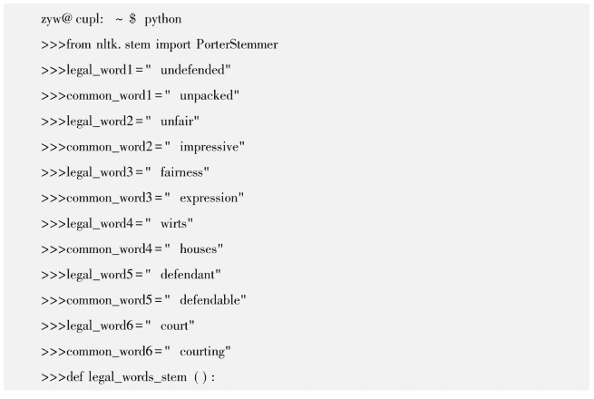

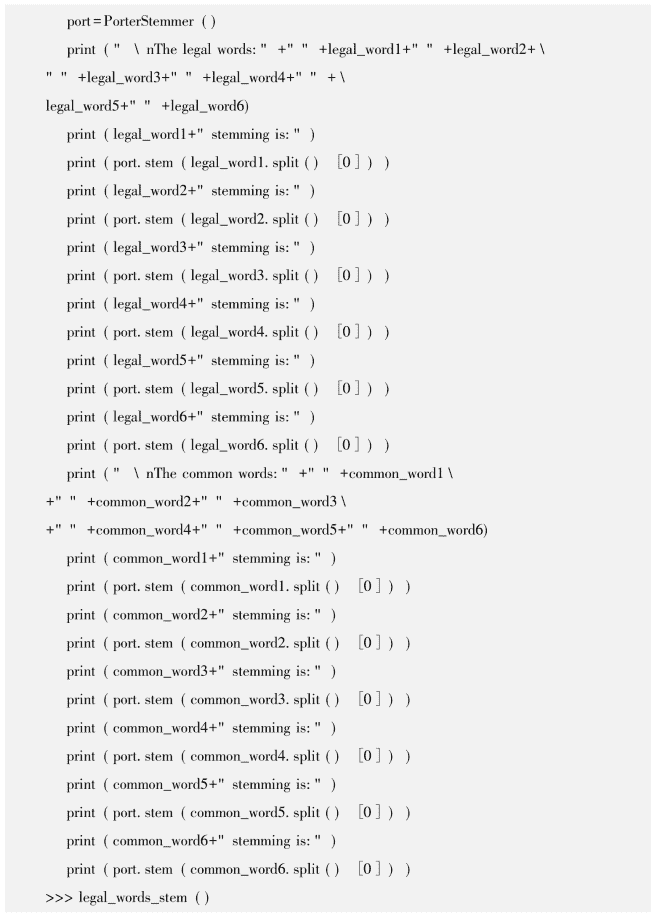

The running results are shown in Figure 3.2. It can be seen that the stem "hous" of "houses" is not a canonical form that can appear independently in a sentence. In other words, the purpose of stemming is not to map a word to its canonical form, but to group different forms of a word together for more reasonable natural language processing.

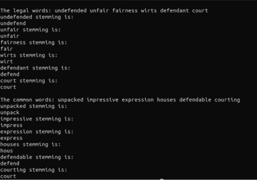

Figure 3.2　NLTK Stemming

To enable morpheme generation from words, the `Polyglot` library provides users with a trained `morfessor` model. This model uses unsupervised machine learning methods to study and discover the laws of word formation in natural language. `Polyglot` uses a multilingual vocabulary dictionary, selecting 50,000 common words per language for `morfessor` model training. `Polyglot`'s `morphemes()` method is used to generate morphemes, the smallest independently meaningful elements in language discourse. As the primitive units of grammar, morphemes play an important role in automatic language generation and recognition, especially when words may have many different inflectional forms. The usage of `Polyglot`'s `morphemes()` method is as follows:

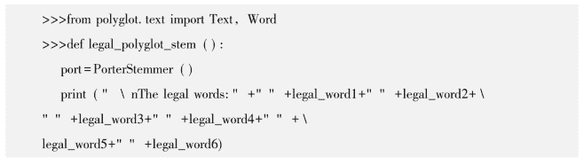

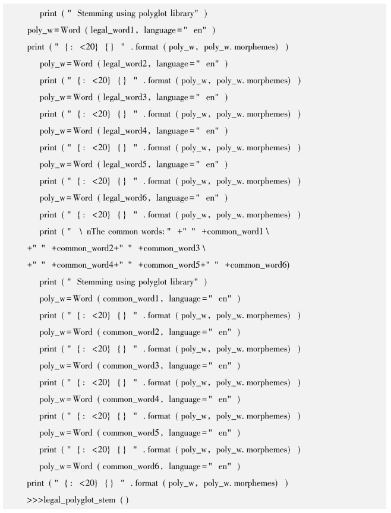

The running results are shown in Figure 3.3. It can be seen that the legal vocabulary `defendant` contains two morphemes `defend` and `ant`, while the general vocabulary `defendable` contains two morphemes `defend` and `able`. These two semantically similar words share a common morpheme `defend`, but have different suffix morphemes. This indicates that the words share the same origin but differ in part of speech, number, tense, and other aspects.

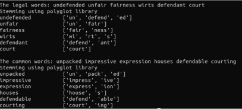

Figure 3.3　Polyglot Morpheme Analysis

## 3.2 Lexical Analysis of Legal Texts

### 3.2.1 Lexical Analysis

Accurate understanding of natural language text is based on lexical analysis. Lexical analysis is the process or step of segmenting a piece of text into words, phrases, and some meaningful units. For example, an English text: "A process is used to select jurors by a judge or counsel". The result of English word segmentation is generally words. However, English has words with multiple parts of speech; grasping the meaning of a word requires combining its position and function in the sentence's grammatical structure. There are delimiters between different words in English, making segmentation relatively easy. In contrast, a Chinese text is continuous, with no delimiters between words. For example, a Chinese text: "该案法官和律师按照程序挑选了一些陪审员" (The judge and lawyers in this case selected some jurors according to procedure). Chinese word segmentation differs from English; it needs to define boundaries between words, using the symbol "/" to segment words. The segmentation result might be "该案/法官/和/律师/按照/程序/挑选了/一些/陪审员".

A text may contain nouns or phrases with special meanings. For example, in the English text "License is required for sale of nursery stock by Act 189 of 1931", splitting "Act 189 of 1931" into four words "Act/189/of/1931" is obviously inappropriate. "Act 189 of 1931" is a semantically indivisible whole, indicating an act numbered 189 enacted in 1931. Such special nouns are called Named Entities. In natural language, their status and function are significantly higher than other sentence components; named entities often contain key information or the answers sought in information retrieval. Similarly, "nursery stock" is a semantic whole; if split into "nursery/stock", the meaning will deviate significantly.

A Chinese text: "依据《中华人民共和国刑法修正案 (九)》的相关规定，检察院以涉嫌盗窃罪对犯罪嫌疑人钱某作出批准逮捕决定" (According to relevant provisions of the "Criminal Law Amendment (IX) of the PRC", the Procuratorate approved the arrest of suspect Qian on suspicion of theft). The Chinese word segmentation result might be "依据/《中华人民共和国刑法修正案 (九)》/的/相关规定/，/检察院/以/涉嫌盗窃罪/对/犯罪嫌疑人/钱某/作出/批准/逮捕/决定". "刑法修正案 (九)" (Criminal Law Amendment (IX)) cannot be split into "刑法/修正/案/(九)". Here, "《中华人民共和国刑法修正案 (九)》" is a named entity, a legal source in legal texts, and also key information for legal domain classification, QA systems, automatic text summarization, and information retrieval in legal NLP.

Lexical analysis outputs a piece of text as a sequence of words or phrases with complete meanings. By basic positioning of linguistic word elements, it obtains flexible segmentation granularity, ensuring both coarse-grained semantic completeness and fine-grained word granularity. For Chinese legal texts, referring to legal terminology and vocabulary, the continuous legal text is segmented into word sequences that are complete and reasonable in legal meaning. For English legal texts, special named entities need to be output as a whole into the sequence.

### 3.2.2 Part-of-Speech Tagging

Words in a sentence undertake different roles and positions. In the sentence's grammatical structure, words in the same position generally have the same Part of Speech (POS). A category of words or lexical items possessing the same grammatical properties is called a part of speech; words of the same part of speech have similar properties, activities, or behaviors in a sentence. For example, in the Chinese sentence "原判根据相关的证人证言认定被告具有非法占有的主观故意" (The original judgment determined based on relevant witness testimony that the defendant had the subjective intent of illegal possession), "原判/证人证言/被告/主观故意" (original judgment/witness testimony/defendant/subjective intent) are all nouns; "认定/具有" (determined/possess) are verbs; "相关的/非法占有的" (relevant/illegal possession) are determiners/modifiers; "根据" (based on) is a preposition. In the Chinese sentence "王某以欺骗的方式非法占有他人巨额财物" (Wang illegally possessed another's huge property by deceptive means), "王某/方式/财物" (Wang/means/property) are nouns; "占有" (possess) is a verb; "他人" (others) is a determiner; "欺骗的/巨额" (deceptive/huge) are adjectives; "非法" (illegal) is an adverb; "以" (by) is a preposition. In the Chinese sentence "张某通过编造的谎言欺骗物业公司管理人员" (Zhang deceived property company managers through fabricated lies), "张某/谎言/物业公司/管理人员" (Zhang/lies/property company/managers) are nouns; "欺骗" (deceive) is a verb; "编造的" (fabricated) is an adjective; "通过" (through) is a preposition. In the above examples, the same word "占有" (possess) has different parts of speech due to different positions and functions: one is a determiner/modifier, the other a verb. "欺骗" (deceive/deceptive) has one part of speech as an adjective, another as a verb.

English parts of speech include Noun (`noun`), Verb (`verb`), Adjective (`adjective`), Adverb (`adverb`), Article (`article`), Numeral (`numeral`), Preposition (`preposition`), Pronoun (`pronoun`), Determiner (`determiner`). In the English sentence "the jury has easily reached a consistent verdict on this issues submitted to the court for determination", "jury/verdict/issues/court/determination" are nouns; "has/reached/submitted" are verbs; "consistent" is an adjective; "the" is an article; "a" is a numeral (article); "on/to/for" are prepositions; "this" is a pronoun; "easily" is an adverb. In the English sentence "I am the public defender appointed to your case", "I" is a pronoun; "am/appointed" are verbs; "the" is an article; "public" is an adjective; "defender/case" are nouns; "to" is a preposition; "your" is a determiner. Besides these, there are Conjunctions (`conjunction`) and Interjections (`interjection`).

### 3.2.3 Outputting Tokens

In the process of building a text, the input is a stream of characters or character sequences. From the perspective of human natural language, words as basic linguistic units use strings of indefinite length. To recognize words from the character stream in a text, it is necessary to pre-define the subsequences corresponding to words; a word is a string with independent meaning. A Token (`token`) is the equivalent of a word in a dictionary. Tokenization (`tokenization`) refers to the process of splitting the character stream sequence in the entire text into subsequences; the subsequences are called tokens, and the position of each subsequence in the dictionary is called a term. During tokenization, some punctuation and special symbols may be removed.

Words, tokens, and terms are consistent in meaning in most cases; if strictly distinguished, there are differences. A word is a category in linguistics, referring to a linguistic unit formed in the process of human language use. A token is the index corresponding to a word in information retrieval, referring to an instance of a string sequence appearing in the text that is consistent with the word. A term is a class of tokens in the dictionary where the token corresponds to the same string sequence but different meanings, referring to a collection of tokens with the same form but different meanings. For example, the input sequence for building an English legal text is "According to legal documents，a judge will serve with a summons or writ to show an administrator’s right to control of assets". According to the dictionary, the tokenization process splits the complete text input sequence into subsequences, outputting "According/to/legal/documents/，/a　/judge/will/serve/with/a/summons/or/writ/to/show/an/administrator/’s/right/to/control/of/assets". The number of tokens (subsequences) is 24, including 1 punctuation mark, 3 "to"s, 2 "a"s. Removing punctuation and merging identical tokens, the word count is 20. If "to" and "a" are removed as high-frequency words, the remaining 18 words are terms.

For building a Chinese legal text, the input sequence is "在协议签订后，委托双方认可的有资质的资产评估机构对甲方投入的资产进行评估" (After the agreement is signed, a qualified asset appraisal agency recognized by both parties appraises the assets invested by Party A). According to the Chinese dictionary, the tokenization output is "在/协议/签订/后/，/委托/双方/认可/的/有/资质/的/资产/评估/机构/对/甲方/投入/的/资产/进行/评估". The number of Chinese tokens (subsequences) is 22, including 1 punctuation mark, 3 "的" (de), 2 "资产" (assets). Removing punctuation and merging identical tokens, the word count is 18. If "的" is removed as a high-frequency word, the remaining 17 words are terms.

Outputting tokens from text first requires sentence splitting, determining sentence boundaries through sentence-delimiting punctuation in the sentence structure. Then, word segmentation is performed on sentences, requiring determination of word boundaries. Chinese word segmentation is slightly more complex; determining word boundaries requires combining more content. English word segmentation is relatively easy; the delimiter between words is generally a space. However, there are different situations regarding whether some symbols act as delimiters or as part of a word. Hyphens in English can form new words, e.g., Wi-Fi (wireless LAN), output as one token. Hyphens can connect the front and back parts of a word at line breaks; they should be output as one token. Hyphens can also combine multiple words, e.g., "long-distance" (meaning a synthesis of two words); they should be output as two tokens. English single quotes, when used as noun possessives, should be output as two tokens with the preceding noun; when used as contraction markers, they should be output as one token.

High-frequency words have low relevance to the theme and content of the text in information retrieval and can be automatically filtered out as Stop Words (`Stop Words`) to reduce NLP time and save storage resources. Stop words can be pre-defined or a stop word list can be set; generally, function words and high-frequency words in the dataset are used as stop words. Large stop word lists have hundreds of stop words; small ones have a dozen or so.

Normalization operations can streamline tokens and focus on word meaning. The result of normalization operations on tokens is terms. Not only do multiple original tokens with the same form need to be merged to obtain terms, but tokens with different affixes also need normalization. Normalization operations on tokens include stemming and lemmatization. Stemming generally only targets some words with the same meaning, without considering part of speech and context, simply grouping tokens with the same meaning into a token class (term). Lemmatization removes prefixes or suffixes from tokens but also needs to consider context and part of speech, restoring comparative or superlative degrees of adjectives.

### 3.2.4 Polyglot and NLTK Sentence Splitting and Tokenization

In NLP tasks, the scope of processing objects from large to small are: discourse/document, paragraph, sentence, word, and character. In a dataset, a file generally corresponds to a discourse/document. In a discourse, the delimiter between paragraphs is generally a carriage return line feed, i.e., `\r\n`. In a paragraph, delimiters between sentences include periods and spaces, i.e., "." and pure spaces.

At English sentence boundaries, the previous sentence ends with a symbol ".", and there must be a space before the first letter of the next sentence. Otherwise, sentence splitting errors will occur. Sentence splitting uses the `sentences` method of the `polyglot.text` module, relying on spaces and periods to split sentences; spaces also include tabs `\t`. For example, define an English text where periods "." are followed by spaces:


The running results are shown in Figure 3.4. This text `legal_content` has three sentences in total, with three English periods ".", and two combinations of period and space. Actually, `polyglot.text` splits sentences based on period-space. If the space between the second and third sentences is deleted, i.e., the space before "The man", the sentence splitting result will be as shown in Figure 3.5. It can be seen that `polyglot.text` treats the original first and second sentences as one sentence, and parses the last word "up" of the original first sentence, the symbol ".", and the first word "The" of the second sentence as a new abbreviation "up.The".


Figure 3.4　Polyglot Correct Sentence Splitting


Figure 3.5　Polyglot Incorrect Sentence Splitting

Sentence splitting is relatively easy, while tokenization is more complex. As mentioned above, English periods need to be correctly identified: neither treating the sentence delimiter "." as a dot in an abbreviation, nor treating the dot "." in an abbreviation as a sentence delimiter. The `polyglot.text` module uses the `words` method to achieve splitting of punctuation, words, and sentence boundaries through delimiters such as spaces, tabs, carriage returns, commas, and periods. For example, the words and symbols after the paragraph text `legal_content` is split:


运行的结果如图 3.6 所示。可以看出，总共输出的词条有 51 个，其中词语有 45 个，标点符号有 5 个，特殊符号 1 个。在自然语言处理的实际任务中，需要考虑消除一些重复出现的词和没有实际意义的词的影响，例如，3 个“a”，4 个“the”，等等。


图 3.6 Polyglot 输出的词条

需要注意的是句子中的`10-2`，这是一个投票结果。对于数字的字符分割，`polyglot`遇到非数字符号时开始切分，可以将连续数字识别出来。对于所有格`man’s`，`polyglot`不认为是两个词条，换言之，符号`’`不是词语的分割符号。在这些细节处理方面，`nltk`与`polyglot`是不同的，使用`nltk.tokenize`模块的`word_tokenize()`方法对文本段落`legal_content`进行词条输出。


运行的结果如图 3.7 所示。可以看出，`nltk`将名词所有格`man’s`识别为两个词条`man`和`’s`，将投票结果`10-2`识别为一个词条。`nltk`对于词条的边界的认定包括空格、制表符、逗号、句号、引号等，不包括连字符`-`。`nltk`输出的词条有 50 个，除去标点符号，还有 45 个。如果需要简化 45 个词条，把相同含义的词条识别出来就非常重要。例如，系动词“be”的不同形态有“am”“is”“are”“was”“were”等几种形式，形容词“good”也有比较级“better”和最高级“best”。`nltk`使用`nltk.stem.wordnet`模块的`WordNetLemmatizer()`方法进行词形还原。


运行的结果如图 3.8 所示。可以看出，对于词形差异较大的系动词，进行词形还原后，都具有统一形式“be”。但是对于同样词形的“running”，却有不同的词形还原结果。作为动词的“running”，词形还原是将进行时态的“ing”去掉，而作为名词的“running”，如果没有单复数的词缀，进行词形还原后还是原来的词。与此类似的是那些使用动名词形式作为名词的，例如，“meeting”有动词词性的“遇见”含义，也有名词词性的“会议”含义。


图 3.8 nltk 的词形还原

## 3.3 法律文本句法分析

### 3.3.1 句法分析的常用方法

在词法分析输出词条之后，自然语言处理的下一个任务就是句法分析，其目的是对句子或者句子局部片段做逻辑意义上的分析。换言之，用一些句子形成规则来定义句子逻辑意义以及衡量句子在逻辑上的正确性。句法分析需要确定句子不同位置之间的依存关系和语法结构，语法是将词语连接成句子的规则和方法，也是概念和符号的表现形式总结。完全句法分析是指对完整的句子进行语法分析，局部分析是指对部分句子片段的语法进行分析。

一般来说，语法分析具体做法包括两方面工作，一方面用非常形式化的描述表示语法规则，另一方面对规则进行解析生成语法树。语法规则包括句子语法结构形式化表示和词条同类信息描述，在前述的词法分析部分中，可以将多次出现的含义相同的词条根据在词典中定义合并成词条项。换言之，句法分析的知识库是形式化规则、词典和词条项。

### 3.3.2 句法分析树

在不同的语言中，语法规则是不同的。例如，英语中的句子从整体上来看，语法结构为主谓结构。简单的主语一般是名词性短语，复杂的主语一般是在名词短语前有修饰性的定语。简单的谓语一般是动词性短语，包括动宾结构，一个动词后面接名词。复杂的谓语结构一般是在动词短语前有修饰性的状语。英语存在时态、主谓一致、虚拟语气、倒装结构、非限制性定语从句，伴随状语、动词不定式等语法结构和现象，但是在汉语中，这些现象可能并不存在。因此，在进行句法分析之前，需要检测输入的文本或字符串，能够判断属于哪种语言，句法分析工具可以支持这种语法的解析。

在语法树中，用`S`表示一个句子，`dp`表示限定性短语，`d`表示限定词，`np`表示名词短语，`vp`表示动词短语，`v`表示动词。对于句子`the policeman arrested the thief`，使用`nltk.tree`模块定义语法规则：


运行的结果如图 3.9 和图 3.10 所示。可以看出，`Tree()`方法生成一颗包含一个父节点和几个子节点的树，子节点可以是另外一个子树来替换，既可以从顶向下生成树，也可以自底向上生成树，还可以是将两者结合起来的生成方法。


图 3.9 nltk 的句法分析结果


图 3.10 nltk 的语法树

自顶向下生成树方法根据定义的规则，生成树从树根向下生长，最后直到组成句子的叶结点的生成。首先使用规则 1 建立树根`s`和中间节点`dp1`、`vp`，然后根据规则推导，使用规则 2 和规则 3 来替换中间节点，最后使用规则 4 替换由规则 3 产生的中间节点`dp2`，直到对应词语的全部叶子生成。

自底向上的生成树方法与自顶向下刚好相反。从句子中的词条开始，首先找到能够匹配`the policeman`的规则 2，用规则 2 的左侧`dp1`规约规则 2。然后，找到匹配`arrested`的规则 3，但是规则 3 中有待规约的节点`dp2`，将其暂时保存起来。接下来，找到匹配`the thief`的规则 4，用`dp2`规约规则 4。然后，在前述的待规约的规则中，用`vp`规约规则 3。最后，使用规则 1 获得树根`s`。自底向上分析方法重复执行规则的规约过程，直至获得树根节点。

`nltk`的`CFG`模块通过`fromstring()`方法构造语法规则，每一行字符串是一个语法规则。符号`->`表示可以替换，`PP`表示介词短语，`P`表示介词，`N`表示名词，`Det`表示限定词，符号`|`表示可选项。对于句子`the defendant robbed a car`，使用`nltk.CFG`模块定义语法规则：


运行的结果如图 3.11 所示。可以看出，`nltk.CFG`使用一系列字符串定义文法规则，构建一个语法分析器。然后将句子传递给语法分析器，返回结果为语法生成树。与`nltk.tree`相比较而言，定义语法规则较为灵活，形式上更加简洁。


图 3.11 nltk CFG 的句法分析结果

## 3.4 法律文本语义分析和消歧

### 3.4.1 语义分析

词法分析任务研究的是文本字符串中的词的表示，输出的是词条。每个词都可能有不同的含义，将每个词组合起来形成更大的组块，以提供对句子或段落的语义理解。语义分析概念范围非常广泛，任何对自然语言的理解都与语义有关，对法律文本理解包括对词的含义、句子结构含义和上下文语境含义的理解。从粒度上看，语义分析分为词级别语义、句子级语义和篇章级语义。

词级别语义分析内容有词语表示、上下位关系、同义词、多义词和词语消歧等。词语表示包括词、词素、词缀、复合词以及短语。语言的多样性使得出现了多个词语具有相同含义和一个词拥有多个含义的现象，例如，“house、building、real estate”都有表示房屋的含义，“bank”有银行和河岸等多个意思。法律文本存在一个特殊现象，上位法概念和下位法概念就属于上下位关系，下位法要遵从上位法，有下位法可以循例的，就要适用下位法。“cars、stocks、deposits、real estate”是财产的具体形式，属于下位概念，而“property”是上位概念。因此，在涉及房屋交易纠纷时，作为普通财产而言，合同法可能比较适用。如果作为特殊财产的不动产，物权法可能比较适用。上下位关系描述一个泛化的对象和具体的对象之间的关系，较少细节的抽象概念称为上位词，而较多细节的实例概念称为下位词。

句子级别语义分析以句法分析为前提，获得词序列的结构性解释。如果存在不同的结构性解释，句子的意义将是不明确的。例如，英文句子`the police controlled the defendant with a gun`，在语法结构上，介词短语`with a gun`既可以修饰名词`defendant`，也可以修饰动词`controlled`。这种歧义是由于语法结构多样性产生的，句子级别的语义分析可以通过机器学习方法确定适用哪种语法结构。句子级别的语义分析任务还包括文本蕴含，当一个句子表述为真，能否推导另一个句子也为真，这种关系推导需要建立在句子的语义理解上。语义角色标注借助语义分析方法，标注句子中的语义角色，例如，动作的施加者、接受者、事情发生的事件和地点等。语义角色标注是一种浅层的语义关系，可用于问答系统和信息抽取等方面。

篇章级语义分析为了解决在多个句子、段落等篇章的上下文环境中发生的词语多重含义而考察分析前后多个句子的语义，这种情况较多出现在有多个多重含义的词语以及指称代词的上下文中。例如，英文句子`the head controlled the man with arms`，此处的`head`既可以指称“头、思想”，也可以指称“首领”，而`arms`也具有“胳膊”和“武器”两种不同意思。因此，对这样句子的理解，需要结合上下文环境来综合考虑。以下这些词“plaintiff、appellant、accuser”都有“告”的含义，但是具体含义也是有区别的，有时候通过反义词来理解。“plaintiff”的反义词为“defendant”，为民事或刑事案件初审中的被告之义；“appellant”的反义词为“respondent”，为上诉案件中的被上诉人之义；“accuser”的反义词为“the accused”，为刑事案件中的被指控者之义。自然语言传达的意义很多时候与表达者所处的情境有关，文本中的词的含义需要由先前文本来确定。语言表达为了避免重复，大量使用代词。在代词的理解上，前文出现的位置相近和词性相同的情况将会使代词的指称产生歧义。例如，英语句子`The plaintiff borrowed the car and navigation from the defendants，and he returned it to one of them later`，此处`it`是指`car`还是表示`navigation`，出现指代不明确问题。

### 3.4.2 消歧方法

词语的歧义的消解可以通过定义一个包括各个词义项的词典来实现。例如，`WordNet`是由计算机工程师和语言学家设计并完成的基于认知语言的英语词典，`HowNet`是一个基于情感的中文词典，标注了词的不同词义项在实际文本中的使用情况。基于词典的消歧方法的原理是计算两者之间的覆盖度，一个是待消解词和前后上下文环境词，另一个是在词典中该词的各个词义项和其上下文。然后，选择覆盖度或者匹配度最大的词义项作为待消解词在此语义环境下的合适含义。如果词典的词义项的定义比较简洁，计算的覆盖度可能都比较低，这种情况下的消歧效果不是很好。

有监督的词语消歧方法通过词义标注语料库训练词义消解模型，对词语的语料进行特征表示，包括词语特征、句法特征和语义特征等方面。词语特征是指消解词上下文环境中出现的所有词及其词性，例如，取消解词前面 3 个词，后面 2 个词，这种取词的范围称为窗口。句法特征是指消解词所在句子的语法特征，例如，消解词构成的语法组块是动宾关系，或是介词短语，还是主语中心词，等等。语义特征是指名词类的语义角色，例如，命名实体标注的地点、机构或者人物名等。监督的消解方法虽然可以获得良好的性能，但是需要很多人工标记的语料。

半监督消歧方法通过少量标记的语料来获得大规模语料和语法结构和语义强度，根据词的不同词义与语法的固定搭配有关这一特点，计算语义强度和选择关联，从而进行词义的消解。随着深度学习方法的广泛应用，可以对大规模语料库自动提取高层词的抽象特征，蕴含了对语料学习的深层次的语义信息。例如，深度学习模型对大规模语料进行训练的过程形成的词嵌入`word2vec`，本身就包含了细节丰富的上下文语义信息，自动实现词义消解。

# 第 4 章 法律文本的主题建模

## 4.1 法律文本术语

### 4.1.1 法律文本中的术语

法律文本中的词语可以分为日常用语、临时具有法律涵义的词语和法律术语。日常用语指的是一般性词语，比如劳动、计算机和汽车等，这类词语来自于一般的社会领域，即人们日常工作生活学习所接触到的事物或现象。临时具有法律涵义的词语也就是临时法律术语，指的是词语本来是日常用语，当被用于法律规范中，具有了法律上的特殊涵义。比如，“应当”和“可以”就具有非常明确的法律涵义，法律条款中出现“应当”是要求相对人必须要做“应当”后面的事项，而“可以”就没有强制性，保留了一定范围的弹性，可以根据实际情形自由裁定。因此，在对法律文本进行预处理时，对法律文本的表示采用向量空间模型，但是考虑到法律文本中的词语具有不同的法律涵义，在分词时需要将法律文本的词汇划分为日常用语、临时法律术语和法律术语三类词语，对不同类型的词语建立不同的向量空间模型，为了简化模型，在本文后面实验中将法律文本划分为一般性词语和法律术语。

### 4.1.2 法律词语内在结构

法律术语中的合成词包括派生词和复合词，派生词是由一个只表示概念的词素，和一个兼表概念和语法的词素结合而成。法律术语中的派生词一般由一个表示词性后缀的词素附加在已有的法律术语之上，例如审判员、代理人、继承人等。表示权利的派生法律术语有名誉权、商标权、财产权、辩护权、修改权、署名权等；表示人员的派生法律术语有控告人、辩护人、代理人、监护人、抚养人、赡养人、自诉人、公诉人、审判员、陪审员、仲裁员、书记员等；表示文书的派生法律术语有起诉书、判决书、决定书、执行书和仲裁申请书等。复合词由两个及以上词素并列组成的法律术语，从两个词素的关系来分，包括联合式、偏正式、动宾式、述补式、主谓式、连动式等。联合式指的是两个意义相似或相反的词素并列而成，例如询问、收养、抚养、征收、管制、冻结、判决、质询、审讯、逮捕、检举、鉴定、过错、过失、证据、股份、瑕疵等。偏正式指的是前面的词素修饰后面的词素，前面的词素作为定语的是定中式，前面的词素作为状语的是状中式。定中式包括主犯、从犯、主刑、书证、物证、定金等；状中式包括假释、代理、签订等。动宾式指的是前面的词素表示动作，后面的词素表示动作涉及的对象，动宾式有抗诉、立案、上诉、举证、立法、减刑、投标、招标、要约、量刑、违约、听证等。述补式指的是后面的词素补充说明前面的词素，例如侦破、驳回等。主谓式指的是前一个词素是一个对象，后面的词素是对该对象的描述，例如自首、民主等。连动式指的是前面的词素表示前一个动作，后面的词素表示接下来的动作，例如收养、扭送、送达、拘留、提存等。

### 4.1.3 法律术语词典

按照法律调整关系，可分为诉讼法、民法、刑法、行政法、国际法、经济法、军事法、商法和环境法九个部门法。为了简化研究问题，选取与人们生活工作非常密切的三大法律作为法律术语词典内容。

诉讼法是关于诉讼活动的法律，调整对象是诉讼活动中的所有社会关系，包括民事诉讼法和刑事诉讼法。与诉讼程序有关的法律术语有案件、受理、案由、原告、被告、立案、传票、开庭、出庭、证据、听证、询问、调查、法官、陪审团、辩护、律师、要点、意见、辩护词、答辩状、裁定、裁决、决定、采信、出具、司法鉴定、代理人、第三人、调解、法庭、公诉、自诉、法律顾问、公证人、检察官、逮捕、批捕、责任、缓刑、保释、起诉、反诉状、公诉、作证、目击证人、控告、诉讼、案件、申诉、审判、审理、传唤、传讯、辩护、证词、誓词、宣判、判决、缺席、驳回、上诉、再审、引渡、当事人陈述、调查取证、调查笔录、会见当事人、举证责任、抗诉书、利害关系人、卷宗、民事诉讼、旁证、认定事实、申请人、申诉、适用法律、受害人、书证、司法建议书、送达、撤诉等。详细诉讼法术语见附录 A。

民法是调整民事主体之间的人身关系和财产关系的法律规范和体系总称。与民事有关的法律术语有法律渊源、制定法、成文法、普通法、判例法、公序良俗、公平、自愿、平等、诚实信用、等价有偿、自然人、公民、外国人、无国籍人、法人、行为、作为、不作为、民事权利能力、相对权、优先权、救济权、物权、请求权、形成权、撤销权、解除权、代位权、人身权利、名称权、名誉权、荣誉权、肖像权、隐私权、人格权、健康权、不可抗力、意思表示、完全行为能力、住所、居所、经常居住地、户籍、监护、合伙、法人、私营企业、关联企业、社团法人、财团法人、民事法律行为、无效行为、可撤销民事行为、重大误解、显失公平、误传、代理人、委托人、受托人、法定代理人、表见代理、居间、时效、信托、时效中止、期间、法律规避、违约责任等。详细民法术语见附录 A。

刑法是规定犯罪和刑罚的法律规范。与刑法有关的法律术语有犯罪、刑事、侦察、罪刑法定、罪刑相适应、罪责自负、惩罚、从旧、从新、追诉时效、刑事责任、刑事责任年龄、刑事责任能力、故意犯罪、犯罪构成、犯罪主体、犯罪客体、主观方面、客观方面、犯罪对象、犯罪故意、直接故意、间接故意、过失、疏忽、大意、过于自信、不能预见、不能避免、动机、目的、防卫过当、正当防卫、紧急避险、既遂、未遂、犯罪形态、犯罪预备、犯罪中止、犯罪中断、行为犯、结果犯、滥用职权、劳役、管制、拘役、累犯、冒充、没收、免除、减刑、谋杀、重伤、虐待、殴打、判处、赔偿、强迫、破坏、强奸、抢夺、抢劫、敲诈勒索、侵害、情节、轻微、社会影响、取保候审等。详细刑法术语见附录 A。


After segmenting legal texts and removing words belonging to legal terms, the texts are represented according to the Vector Space Model, followed by feature selection. The retained words constitute a general vocabulary dictionary or a common words dictionary. The general vocabulary dictionary together with the legal terms dictionary constitutes the text representation dictionary.

## 4.2 Legal Text Topics

### 4.2.1 Characteristics of Legal Text Topics

With the rapid development of the Internet, the volume of online information has shown explosive growth, and a large amount of information belongs to textual data, making legal texts increasingly important. Legal terms may belong to different branches of law depending on the social relations they regulate. Legal terms with the same standard belong to the same branch of law. Classified by branch of law, legal terms include: constitutional terms, criminal law terms, civil law terms, procedural law terms, administrative law terms, international law terms, etc. Constitutional terms include state structure, form of government, fundamental law, power of removal, suffrage, etc.; criminal law terms include crime, recidivism, suspended sentence, parole, confiscation of property, fixed-term imprisonment, corporate crime, etc.; civil law terms include legal person, agency, contract, guardian, heir, liquidated damages, mortgage right, debtor, etc.; procedural law terms include witness, testimony, appeal, recusal, interrogation, arbitration, public prosecution, final instance, jurisdiction, etc.; administrative law terms include administrative act, administrative subject, administrative reconsideration, summary procedure, administrative penalty, etc.; international law terms include sovereignty, treaty, immunity, national treatment, etc.

According to the different meanings conveyed by legal terms, they can be divided into terms expressing rights, terms expressing appellations, terms expressing charges, terms expressing names of things, terms expressing legal acts, terms expressing branches of law, terms expressing legal consequences, terms expressing mental attitudes, terms expressing legal relations, terms expressing litigation procedures, and others. Terms expressing rights include: power of agency, copyright, trademark right, personal right, property right, mortgage right, etc.; terms expressing appellations include: agent, partner, candidate, public prosecutor, party, defender, etc.; terms expressing charges include: smuggling crime, crime of endangering public safety, financial fraud crime, crime of infringing property, etc.; terms expressing names of things include: deposit, contract, right, fruits (legal term), fine, immovable property, judgment document, etc.; terms expressing legal acts include: auction, bidding, bankruptcy, amnesty, commutation of sentence, defense, instigation, investigation, etc.; terms expressing branches of law include: criminal law, civil law, contract law, education law, marriage law, tort law, etc.; terms expressing legal consequences include: liability for breach of contract, tort liability, civil liability, criminal liability, administrative penalty, etc.; terms expressing mental attitudes include: intent, negligence, fault, recklessness, etc.; terms expressing legal relations include: personal relations, property relations, etc.; terms expressing litigation procedures include: first instance, second instance, retrial, final instance, etc. The thematic classification of legal terms is shown in Table 4.1.

**Table 4.1 Thematic Classification of Legal Terms**


Continued Table


According to the different functions of legal terms, they can be divided into nominative, qualitative, and dispositive categories. Nominative terms denote the names of persons or things in legal relations. Terms denoting names of participants in legal relations include: plaintiff, witness, represented person, etc.; terms denoting charges include: crime of obstructing justice, crime of infringing property, crime of dereliction of duty, crime of embezzlement and bribery. Terms denoting penalties include: principal punishment, supplementary punishment, control, criminal detention, fine, fixed-term imprisonment, life imprisonment, etc. Qualitative terms are legal terms that define the nature of legal relations, legal acts, and legal facts. Terms defining legal acts include: surrender, meritorious service, attempted crime, consummated crime, emergency avoidance, justifiable defense; terms defining legal facts include: joint crime, corporate crime, gang crime, recidivism, etc. Dispositive legal terms refer to the disposition of consequences caused by certain illegal acts, for example, suspended sentence, commutation of sentence, parole, combined punishment for several crimes, confiscation of property, etc.

### 4.2.2 Thematization of Legal Texts

The thematization of legal terms originated earliest in library cataloging systems. The formation and development of the subject method system began in 1856 with Crestadoro's *Technique of Library Cataloging* in the UK. The earliest foreign use of subject methods to organize catalog indexes was the relative index of the Dewey Decimal Classification. The Brigham Young University Library (Note: "贝加逊·富兰克林出借图书馆" likely refers to a specific library, possibly "Bixby Franklin Library" or similar, but "Brigham Young" is "杨百翰". "贝加逊·富兰克林" transliterates to "Bixby Franklin" or "Beggs Franklin". I will translate literally as "Bixby Franklin Lending Library") was the first in the US to use the subject method. In the legal field, legal terms or legal vocabulary have their special connotations and cannot be arbitrarily interpreted or explained. Some legal terms are created by legislative bodies, some are created by adopting foreign ideas, and some are recompiled by inheriting ancient legal thoughts. Legal terms have their own unique internal structure and morpheme formation methods. From a linguistic perspective, they include compound and derivative types. Compound type refers to combining two or more morphemes, e.g., "Civil Law" (Minfa); derivative type refers to forming words by adding affixes to morphemes with lexical meaning, e.g., "Principal" (Weituoren - agent/principal). Legal terms possess distinct cohesion, statutory nature, accuracy, and univocality in their connotations.

The cohesion of legal terms means a legal term is an indivisible solid entity. For example, "Principal" (Weituoren) cannot be arbitrarily expressed as "Person of Entrustment" (Weituo de ren). The indivisible characteristic of legal terms reflects the solemnity and stability of law, used to express complete legal meaning. The statutory nature of legal terms means the connotation of a legal term is exactly stipulated by law and cannot be interpreted arbitrarily. For example, "Evidence" (Zhengju) as stipulated by law differs from evidence in the general sense; it applies to specific situations in the legal field and has a definite object form that can prove relevant facts, such as documentary evidence, physical evidence, witness testimony, party statements, etc. The statutory nature of legal terms reflects the authority of law; legislative bodies must uniformly expound the connotations of legal terms. The accuracy of legal terms means precisely describing legal content to reach consensus among legislators, citizens, and judicial officers, avoiding ambiguity and vagueness in the understanding of legal concepts, and being able to accurately express the internal characteristics of legal acts, legal relations, legal consequences, and legal concepts. For example, "Minor Injury" (Qingshang) refers to causing a certain degree of damage to human tissues and organs or partial functional impairment. According to general language understanding, the injury might not be serious, but legal "Minor Injury" may differ from the perception in daily life. To accurately describe the legal connotation of "Minor Injury," explicit provisions are made in the *Standards for Identification of Minor Injuries of the Human Body*. The univocality of legal terms means a legal term in a legal text can only express a single legal connotation; there are no multiple interpretations. For example, "Domicile" (Jusuo) in general language refers to the current place of residence, or possibly the registered residence (hukou), but in legal terms, it refers specifically to the registered residence. If a legal term has multiple meanings, different understandings will arise during legal application and judicial process, affecting the authority and solemnity of law.

In many legal information retrieval systems, retrieval can be performed by subject method. For example, on China Judgments Online, retrieval can be performed by cause of action, keywords, court, parties, and lawyers, among which the cause of action is a legal subject or legal field to a certain extent. Causes of action are divided into criminal, civil, execution, state compensation, and administrative causes of action according to legal affairs subjects. Criminal causes of action include: crimes of endangering national security, crimes of endangering public safety, crimes of disrupting the order of the socialist market economy, crimes of infringing upon citizens' personal rights and democratic rights, crimes of infringing upon property, crimes of obstructing social administration order, crimes of endangering national defense interests, crimes of embezzlement and bribery, crimes of dereliction of duty, crimes of soldiers violating duties, etc. Civil causes of action include: personality rights disputes, marriage, family and inheritance disputes, property rights disputes, contract disputes, disputes over negotiorum gestio and unjust enrichment, intellectual property and competition disputes, labor and personnel disputes, maritime and commercial disputes, corporate, securities, insurance, and negotiable instrument disputes, tort liability disputes, etc. Execution causes of action include: criminal, civil, administrative, non-litigious administrative execution, sanctions decisions for obstructing litigation, civil sanction decisions, retrial of objections to execution rulings by lower courts, property preservation, advance execution, etc. State compensation causes of action include: criminal compensation, non-criminal compensation, etc. Administrative causes of action include: administrative subject, administrative act. In the FCA system, classification retrieval is performed by legal subject, including Admiralty & Maritime, Antitrust, Bankruptcy, Commercial Law, Construction Law, Corporations, Energy & Environment, Estate Planning, Family Law, Finance Banking, Government Contracts, Health Law, Labor & Employment, Municipal Law, Pension & Retirement Benefits, Products Liability, Real Property, Securities, etc.

The cause of action subject has four levels. Level 1 subjects have 4 categories: Civil, Criminal, Administrative, State Compensation. Under the Civil legal field, Level 2 subjects have 10 categories: Property Rights Disputes, Personality Rights Disputes, Marriage, Family and Inheritance Disputes, Contract, Negotiorum Gestio and Unjust Enrichment, Intellectual Property and Competition, Labor and Personnel Disputes, Maritime and Commercial Disputes, Railway Transport Disputes, Corporate, Securities, Insurance, and Negotiable Instruments, Tort Liability Disputes. Under the Level 2 subject Property Rights Disputes, Level 3 subjects have 6 categories: Immovable Property Registration, Property Rights Protection, Ownership Disputes, Usufructuary Rights, Security Rights, etc. Under the Level 3 subject Ownership Disputes, Level 4 subjects have 10 categories: Infringement of Collective Organization Rights, Building Sectional Ownership, Owner's Right of Revocation, Owner's Right to Know, Return of Lost Property, Return of Drifted Property, Neighbor Relations, Co-ownership Disputes, etc.

Based on the above analysis, referring to the Discipline Catalog of the Academic Degrees Committee of the State Council, the legal fields and subjects are coded. Level 1, Level 2, Level 3, and Level 4 subjects are all represented by two Arabic numerals, in the format `aabbccdd`, where `aa` represents Level 1 subject, `bb` represents Level 2 subject, `cc` represents Level 3 subject, and `dd` represents Level 4 subject. If `aa` is `01`, it represents the Civil legal field; `02` represents the Criminal legal field; `03` represents the Administrative legal field; `04` represents the State Compensation legal field. Civil Law includes 10 Level 2 subjects, 32 Level 3 subjects, and 416 Level 4 subjects (Note: Original text says "416 个三级主题" for Level 4, likely a typo for "四级主题" in source, translated as Level 4 subjects). Criminal Law includes 10 Level 2 subjects and 187 Level 3 subjects. Administrative Law includes 2 Level 2 subjects and 58 Level 3 subjects. State Compensation includes 2 Level 2 subjects. Since Civil Law is private law, covering a very wide range and regulating complex legal relations, it therefore has four-level legal subjects. Criminal Law embodies the principle of legality of crimes and punishments, having three-level subjects to define charges. Administrative Law reflects government administrative management functions, having three-level subjects. State Compensation has relatively fewer cases, having two-level subjects. From this, it can be seen that legal domains possess imbalance.

For detailed coding of legal subjects, see Appendix B. Coding legal subjects enables convenient, rapid, and accurate determination of the legal subject hierarchy corresponding to the legal content. For example, given two texts containing "Restoration to Original State" (Huifu Yuanzhuang) and "Elimination of Danger" (Xiaochu Weixian) respectively, by querying Appendix B, the code for "Restoration to Original State" is `01030206`, and for "Elimination of Danger" is `01030204`. It can be known that both are Level 4 legal subjects, and their common legal source is `01` Civil Law, `03` Property Rights, `02` Property Rights Protection. Given another two texts: "Restoration to Original State" and "Co-ownership Dispute" (Gongyou Jiufen). By querying Appendix B, the code for "Restoration to Original State" is `01030206`, and for "Co-ownership Dispute" is `01030310`. It can be known that both are Level 4 legal subjects, and their legal source is `01` Civil Law, `03` Property Rights. Therefore, in terms of legal source, the legal semantic distance between "Restoration to Original State" and "Elimination of Danger" is closer than that between "Restoration to Original State" and "Co-ownership Dispute".

## 4.3 Legal Text Topic Models

### 4.3.1 Topic Semantic Analysis

*International Private Law*, *Deep Learning*, *Legal Theory*, *Punishment, Compensation and Law*, *Introduction to Algorithms*, *R for Data Science*, *Digital Fortress*, *Python and Digital Forensics Technology*, *Computer Ethics*, *Network Community*, *Computer Technology and Society, Law and Ethics*, *Network Security* are some best-selling book series provided by an e-commerce platform. In terms of book management, these publications can be categorized into 3 classes: Law, Computer, and Computational Law. To introduce these books to readers, we have compiled the content summaries of these books.

From Figure 4.1, it can be seen that the topics of this text include content in the legal direction, content in the computer direction, and content in the intersection of the two. Topic 1 is legal-related concepts, involving words such as "private law, rules, judicial, jurisdiction, legal areas", and also includes some other words, such as "design", but with a lower proportion in legal concepts. Topic 2 is computer-related concepts, involving words such as "machine learning, artificial intelligence, computers, computing, data, networks", and also includes some other words, such as "technology", with a lower proportion in computer concepts than the former, but higher than words like "use". Topic 3 is computational law-related concepts, involving words such as "procedures, values and practices, govern, computer law, intellectual property", and also includes some other words, such as "data security".


**Figure 4.1 A Text Containing 3 Topics**

Topic modeling can be simply understood as grouping words with similar meanings in a text under one topic. For example, words like "machine learning, artificial intelligence, computers, computing, data, networks" all contain the meaning of computer, are semantically near-synonyms, and their semantic scope can span sentences, paragraphs, and chapters. Topic models, through semantic analysis technology, define meaning-associated words as a topic; a topic is an abstract concept that exists or is implicit behind words after understanding the context.

A text has many topics; each topic includes multiple words; each word can belong to multiple topics. Some topic-model-related or similar words cluster into a group, called a topic. A text can be understood as a mixture of these different topics in different proportions, as shown in Figure 4.2:


**Figure 4.2 Topic Modeling**

In the figure, ① is the text dataset, including a large amount of text corpus. By reading these text materials, the content of these text corpora can be summarized from a semantic perspective into 3 topic aspects: Legal Field, Computer Science, and Legal-Computer Interdisciplinary Field. ② in the figure is a text extracted from the text dataset, composed of many words, including words belonging to the legal field, words belonging to computer science, and words belonging to the legal-computer interdisciplinary category, as shown in Figure 4.3:


**Figure 4.3 A Text**

For polysemous words, according to context, multiple homographs with different meanings can belong to different topics respectively. For example, the word "set" in Topic 1 can be understood as "statutory scheme" (or "set of rules"), and can also appear in the context of Topic 2, understood semantically as "dataset". Assigning a topic to each word in the text, and then placing words divided under the same topic together, a text organized in this way, from the overall structure, is mixed by different topics. As shown in Figure 4.4:


**Figure 4.4 Text Mixed by Different Topics**

Each topic governs some words. Under a topic, some words appear repeatedly many times, while some words appear fewer times. Taking the total word count of all words under the same topic as the denominator and the number of occurrences of a certain word as the numerator, the proportion of this word in this topic can be calculated. Obviously, words with higher weights have stronger correlation with the topic, and vice versa. For example, the word "law" appears frequently under the legal topic, while "hello" rarely appears. The word "data" appears more frequently under the Computer Science topic, while "welcome" is not common. The word distribution and statistics for each topic are shown in Figures 4.5, 4.6, and 4.7:


**Figure 4.5 Distribution of Some Words in Topic 1**


**Figure 4.6 Distribution of Some Words in Topic 2**


**Figure 4.7 Distribution of Some Words in Topic 3**

### 4.3.2 Applications of Topic Modeling

For the processing of large amounts of legal texts and other texts, relying solely on word matching to determine data analysis tasks is far from sufficient. Mining the abstract topics behind words is more meaningful; this will help improve the accuracy of text similarity calculation and discover popular vocabulary under a certain topic. In terms of the matching degree of search engine query fields, it can automatically and quickly locate word clusters in massive text data according to semantic understanding.

In terms of similar text comparison, measuring by the number or proportion of identical words may not be accurate. For example, the aforementioned English sentence "the head controlled the man with arms" appears in a context with a large proportion of legal topics, meaning "the ringleader controlled the man with guns (arms)". If this sentence appears in a context with a large proportion of computer science literature topics, it means "the intelligent agent protected the man with arms (limbs)". For measuring the similarity of these two sentences, if calculated purely by words, the similarity will be 100%; if estimated by the topic distribution behind each word, the similarity will be less than 50%.

Language is an expression formed by long-term use by people, and also a manifestation of traditional culture and regional customs. Language phenomena are intricate and complex, inevitably containing many subtle differences, such as polysemy and synonymy. General semantic analysis struggles to capture such subtle differences, while topic models are very suitable for this situation. For example, the English sentence "Laws set out a set of procedures and rules" is a case of polysemy. If "Laws" is replaced by another word "Algorithm", the meaning of the following words changes: the former describes law as a set of standardized behaviors and norms, while the latter emphasizes that the algorithm generates some management procedures. If compared from the word level, there is almost no difference. But if a topic label is assigned to each word, even the same word can be assigned different topic labels, as shown in Figure 4.8:


**Figure 4.8 Topic Modeling Supports Semantic Mining**

The figure shows two texts; the main content of one is legal, and the other is about computers. The symbol `#` in the text indicates that the word at that position is assigned topic label `#`, and the symbol `*` indicates assignment to topic label `*`. The progress bar below indicates the proportion of a certain topic in the text. Assuming both texts have 1000 words, with 800 words identical, using word-based text similarity calculation yields 80% similarity. If among the 800 identical words, 600 are marked with different topics, and among the 200 different words, 100 are marked with different topics, calculating text similarity by the number of topic labels yields 30% similarity. Obviously, 30% similarity is more reliable than 80%. By analyzing the topic distribution behind words, subtle differences in language and the effect of context can be discovered.

### 4.3.3 Latent Semantic Analysis

In the era of high-speed mobile Internet and Big Data, people's learning, life, and work are all conducted in network and data environments. Every day, massive amounts of content and text are sent through social media. People discuss around a certain topic and discover users with common interests. How to store, organize, manage, and analyze data resources will be an important issue faced by text information processing. Traditional analysis methods use words to represent semantic content and match common topics by words. This shallow analysis method cannot represent and solve deep or latent semantic relationship problems. It can be considered that when people use social media to speak, they first think of a category of topics or themes, and then think of words. In other words, there exists an intermediate abstract connection layer between text and words, and it is precisely this abstract connection layer that associates different users with a topic.


## 4.3 Latent Semantic Analysis and Topic Models

To address the problem of user topic analysis, `LSA` (`Latent Semantic Analysis`) establishes semantic connections between topic-based texts and words through matrix factorization methods in algebra. It is an unsupervised learning latent semantic analysis method, also known as `LSI` (`Latent Semantic Indexing`), i.e., Latent Semantic Indexing. The `LSA` method proposed by `Deerwester` can generate a contextual abstract intermediate layer between global objects and individual objects in fields such as information retrieval, text recommendation, and image processing. Therefore, it has a wide range of application backgrounds in scenarios such as content recommendation, topic tracking, evidence cross-examination, social trajectories, text classification, and topic clustering.

In the field of judicial practice, judicial information content service providers offer existing court judgments, rulings, arbitration awards, and other relevant judicial documents, and can provide users with customized case retrieval, matching, and recommendation. They provide pre-litigation legal consultation opinions and in-litigation lawyer defense strategies for parties, and adjudication references for judges during sentencing.

In the field of judicial data management and information processing, the pressing problem is the need to establish a unified judicial information data resource. In China's legal practice, referencing existing similar precedents is a recognized approach. Although case law is not a statutory norm in China's legal system, historical precedents can both avoid and restrict the abuse of judges' discretionary power, and maintain and embody the continuity and authority of the law. At the same time, the guiding nature of precedents effectively reduces unnecessary judicial resource expenditure. Establishing a unified and reliable whole-process judicial data resource must center on the trial, connecting data and legal texts formed by tasks at various stages including pre-trial, in-trial, and enforcement, strengthening the ability and role of adjudicative power, supervisory power, and enforcement power to mutually restrict and cooperate. The guiding nature of precedents is not only reflected in similar word matching but, more importantly, in the matching of legal principles and spirit. By analyzing words, sentences, paragraphs, and chapters in legal texts, the implicit legal principles and methods are discovered and extended to a wider scope to serve more citizens and users. In other words, case guidance actually refers to the applicability of the legal spirit embodied in the precedent. It can be considered that there exists an intermediate abstract layer related to legal principles and methods between legal texts and words, termed "legal principle topics," which may also include some non-legal principle topics related to daily life. When a judge writes a legal text, a mind trained in legal thinking first considers applying a certain legal topic; after determining the legal topic, words under that topic are retrieved from the legal knowledge repository. The completion of a legal text is the result of the comprehensive application of legal topics. Promoting intellectual achievements as experience can be done manually when the quantity is small. However, for mining legal principles and methods from a large volume of legal texts, computer and natural language processing tools are needed, utilizing latent semantic analysis methods to establish legal semantic connections between legal texts and words.

`LDA` (`Latent Dirichlet Allocation`) proposed by `Blei` is also an unsupervised learning topic model, called Latent Dirichlet Allocation. Through the `Dirichlet` distribution in probability theory, `LDA` establishes a topic generation model between texts and words. The generative model corresponds to the discriminative model. The discriminative model classifies input text; if the probability is greater than `0.5`, it is classified as the positive class. The generative model, however, needs to learn the positive class model and negative class model separately, then place the input text into both models; the model with the higher probability is the output result. To consider correlation issues between different topics, the Dirichlet distribution is adjusted to a logistic normal distribution. Traditional time-series data modeling mainly handles continuous data; dynamic topic models track and examine sequentially changing texts, using state space models on top of the underlying topic model to capture the topic evolution process of sequential corpora. The assumption of probabilistic topic models is Bayesian estimation theory; the prior distribution considers equal contribution from each word. In legal texts, each word has different capabilities for describing and characterizing the text; it is necessary to distinguish the contribution of each word to the text. Weighting certain keywords can enhance the role and status of important words in legal topics. Topic models can also be combined with other linear models to comprehensively consider word distribution and topic distribution to calculate text similarity.

Both `LSA` and `LDA` belong to unsupervised learning topic models; texts have no category label information. `LSA` represents text as the product of three matrices: the first matrix is the topic description of `M` documents, the second matrix is the eigenvalues of `K` topics, and the third matrix is the word representation of `K` topics. For example, a document's topic description is `[0.5, 0.2, 0.3]`, the eigenvalues of three topics are `[3, 4, 5]`, assuming the vocabulary size is `9`, the word representations on the three topics are `[0.2, 0.2, 0.2, 0.1, 0.1, 0.1, 0.03, 0.03, 0.04]`, `[0.1, 0.1, 0.1, 0.2, 0.2, 0.2, 0.03, 0.03, 0.04]`, and `[0.1, 0.1, 0.1, 0.03, 0.03, 0.04, 0.2, 0.2, 0.2]` respectively. The text generation process starts by multiplying the topic description `[0.5, 0.2, 0.3]` by the corresponding eigenvalues `[3, 4, 5]`, resulting in `[1.5, 0.8, 1.5]`. Taking the first value from the word representations of the three topics forms the semantic distribution of the first dictionary word across topics, i.e., `[0.2, 0.2, 0.1]`, then dot-multiplying with `[1.5, 0.8, 1.5]` yields the value `0.61`. This value is the quantized representation of the first dictionary word in this document. By analogy, the word distribution of this document is generated as `[0.61, 0.61, 0.61, 0.355, 0.355, 0.37, 0.369, 0.369, 0.392]`. It can be preliminarily judged that the document content is mainly about Topic 1, and the first three words in Topic 1's word distribution have larger proportions. Therefore, in the generated text, the word counts for the top three vocabulary words are relatively higher.

`LDA` represents the text generation process as a process of multiple independent repeated experiments from document to topic and from topic to word. The probability of generating a word each time follows a certain probability model; the complete text generation is inevitably the model and its parameters that maximize the text generation probability. `LDA` treats the prior distribution of words identically, establishing models to discover topics and abstract layer semantics from the perspective of corpus and word statistical laws. However, if texts possess labels formed by the rich experience of human experts, abandoning the use of this supervised information would be a waste of valuable experience and resources. For example, judges categorize and organize precedents, lawyers cite precedents in defense opinions, and legal scholars comment on the jurisprudence of precedents, etc. Labeled data needs to be authentic and valid; otherwise, it will increase model computational error and reduce model quality. Sometimes this authentic and valid supervised information labeling is called `Groundtruth`. `LDA` does not require supervised information; the model output is topic distribution. Treating the topic distribution as a point in space, `LDA` can achieve text clustering and the formation of word clusters for the same topic. If classifying the legal domain to which a legal text belongs, the labeled legal domain is the supervised information. Based on the `LDA` model assumptions, `Blei` proposed Supervised Latent Dirichlet Allocation (`SLDA`). According to labeled supervised information, the probability calculation method of topic distribution is adjusted so that supervised information participates in the joint probability distribution calculation inference during the generation process from topic to word, establishing a latent semantic topic model capable of predicting the legal domain to which a legal text belongs.

## 4.4 Bayesian Theory

### 4.4.1 Bayes' Theorem

Probabilistic reasoning is a method for studying uncertain information and making decisions. Bayesian reasoning calculates posterior probabilities based on conditional probabilities and prior probabilities. According to the Bayesian assumption, all legal domains to which legal texts belong constitute an exhaustive event group, i.e., classification labels, denoted as `ci`, representing the `i`-th class in the category. The set composed of all class labels is `C`, with a set size of `|C|`. Different classification labels are mutually exclusive; for example, a legal text belonging to civil law cannot belong to criminal law. The sum of prior probabilities of all classes is 1:


The input sample `x` is actually the observed event or phenomenon in the experiment, and its probability `p(x)` is the evidence factor. For a specific sample `x`, `p(x)` is independent of the class prior probability `p(c)`. `p(x|c)` is the probability of observing phenomenon `x` in class `c`, called the conditional probability of sample `x` in class `c`, also known as the likelihood. `p(c|x)` is called the posterior probability, meaning the probability of judging it as class `c` given the observed evidence `x`.

General prediction models give a predicted output `h(x)` for input `x`. The loss function is defined as the error between the true label `y` and `h(x)`. The error is fed back to the prediction model to adjust model parameters and further reduce training error. Based on the posterior probability `p(c|x)`, the cumulative expected loss of misclassification error can be calculated. If the expected loss of the training set is to be minimized, the prediction model must be able to select the class with the maximum posterior probability as the output. There are two main methods and strategies for estimating posterior probabilities through limited sample data. One is to directly establish a hypothesis function `h(x)` for the input sample `x`, using the output of `h(x)` as the prediction result, called a discriminative model. The other is to calculate the posterior probability `p(c|x)` through the joint probability distribution `p(x, c)` and Bayes' formula:


If the training set data is obtained by sampling from the sample space in an independent and identically distributed (i.i.d.) manner, the proportion of class `c` in the training set can be used to estimate the prior probability `p(c)`. When the sample size of the dataset is very large, the frequency of sample occurrence can approximate the sample probability. If the conditional probability `p(x|c)` in Bayes' formula is estimated using the occurrence frequency of sample `x`, a difficult situation will arise. For example, assuming the sample has `100` features, each feature taking a binary value, the entire sample space is `2¹⁰⁰`. This is an unimaginably near-infinite number, meaning many samples simply will not appear in the training set. If conditional probability is estimated using sample occurrence frequency, the probability would be zero, which is obviously unreasonable. Therefore, under the premise that relationships between features are independent and uncorrelated, the estimation of conditional probability `p(x|c)` uses the joint probability of all features or attributes of sample `x`, where `xj` is the `j`-th feature:


### 4.4.2 Maximum Likelihood Estimation

Generally, it is assumed that the conditional probability `p(x|c)` has a certain determined form of probability distribution, but the parameters of the distribution are unknown, and then they are estimated using training set data. For example, in a binary classification task, it can be assumed that all positive samples follow a certain normal distribution with parameter `θ1`, and all negative samples follow a certain normal distribution with parameter `θ2`. The parameters of the normal distribution involve mean and variance. `p(x|θ1)` is the positive class conditional probability with parameter `θ1`, and `p(x|θ2)` is the negative class conditional probability with parameter `θ2`. Bringing the samples from the training set `D` into the conditional probability expression, which contains parameters, and then solving for the parameters through certain derivation rules. Essentially, the learning process of a probabilistic model is parameter estimation.

There are two different views on the parameters of a probability distribution. One view holds that although the parameters are unknown, they are not variables but fixed values that already exist, and can be obtained through certain derivation criteria. The other view holds that the parameters themselves can follow another prior distribution, rather than being fixed values; they are random variables, and the posterior distribution of the parameters is inferred through observed data samples. The frequentist school adopts the former view, while the Bayesian school agrees with the latter.

According to the frequentist view, `MLE` (`Maximum Likelihood Estimation`) estimates the parameters of the probability distribution through data, called Maximum Likelihood Estimation. The conditional probability or likelihood of positive samples is `p(x|θ1)`. The dataset composed of all positive samples is `D1`. Assuming each positive sample is i.i.d., the likelihood function of parameter `θ1` observed on dataset `D1` is:


The above formula is the generation probability of the observed dataset `D1` under unknown parameter `θ1`. Since dataset `D1` is an objective existing fact, its probability must be the maximum. Therefore, maximum likelihood estimation seeks the parameter value `` that maximizes the likelihood function `p(D1|θ1)` as the estimate. In fact, among all possible values of `θ1`, there must be one that maximizes the probability of dataset `D1` appearing. The same method applies to the negative class. The likelihood function of parameter `θ2` observed on the negative class dataset `D2` is:


The conditional probability or likelihood of each sample is less than `1`, and continuous multiplication will produce an underflow phenomenon with results approximating `0`. Therefore, in practical applications, the log-likelihood (`Log-Likelihood`) function is generally used:


The parameter estimation for the positive class sample distribution `θ1` is:


The parameter estimation for the negative class sample distribution `θ2` is:


In the above formula, `` denotes assigning a value to parameter `θ1` that maximizes the value of the following expression. The positive class normal distribution parameter `θ1` includes mean `μ1` and variance ``, and its conditional probability density function is:


The maximum likelihood estimates for the positive class distribution parameters `μ1` and `` are:


The maximum likelihood estimates for the negative class distribution parameters `μ2` and `` are:


It can be seen that the mean and variance of the normal distribution's maximum likelihood estimation are the sample mean and deviation, respectively. This is consistent with intuition, but in some cases, serious errors may occur. For example, if the sampled samples are not i.i.d., the sample size is insufficient, the assumed distribution form is inconsistent with the true underlying distribution, etc.

## 4.5 Dirichlet Distribution

### 4.5.1 Multinomial Distribution

For a random event `X`, occurrence is denoted by `1`, and non-occurrence by `0`. The probability of `X` occurring is `θ`, and the probability of not occurring is `1-θ`. This distribution is called the Bernoulli distribution. A Bernoulli trial is a single trial with only two simple outcomes: occurrence or non-occurrence, heads or tails, etc. For example, tossing a coin once, the probability of heads facing up is:


Independently repeating the Bernoulli trial `n` times, the number of occurrences of random event `X` is `k`, meaning the event occurs `k` times in `n` trials. The random variable probability distribution is the binomial distribution. For example, tossing a coin `n` times, the probability of heads appearing `k` times is:


The first `k` trials are heads, the remaining `n-k` trials are tails. According to the multiplication rule of probability, the probability of this event is `θ^k(1-θ)^(n-k)`. There are `` combinations of events where heads appear `k` times in `n` trials. The multinomial distribution (categorical distribution) changes the Bernoulli distribution's trial outcomes from two to multiple, i.e., `K` outcomes. For example, rolling a die once, the probability of the `k`-th face facing up is:


Generalizing the binomial distribution's two trial outcomes per trial to multiple outcomes per trial, and repeating multiple independent trials, yields the multinomial distribution. For example, rolling a die `n` times, the number of times the first face appears is `m1`, the second face `m2`, and the `K`-th face `mK`. Its probability density is:


The multinomial probability formula is the general term of a multinomial expansion. According to the multiplication formula, the probability of randomly conducting `n` trials on `(X1+X2+...+XK)` is `(θ1+θ2+...+θK)^n`. The event `(X1+X2+...+XK)` is a certain event, and the sum of probabilities of sampling a certain event `n` times is `1`. When the polynomial is expanded into many terms, according to the addition rule of probability, the expanded terms are probabilities corresponding to mutually exclusive events. That is, the multinomial distribution is the general term of an expanded polynomial term, or the probability of a special event occurring, e.g., `X1` appears `m1` times, `X2` appears `m2` times, `Xk` appears `mk` times. In topic models, `X1` is the first topic index, `m1` is the number of words assigned to the first topic. `Xk` is the `k`-th topic index, `mk` is the number of words assigned to the `k`-th topic.

### 4.5.2 From Beta Distribution to Dirichlet Distribution

In the binomial distribution, what is the appropriate probability `θ` of heads facing up? Intuitive guess might be `0.5`. If the heads and tails sides do not have uniform mass, as a prior probability, `θ` taking any value in `[0, 1]` is possible. With a sufficient number of trials, the frequency of heads can be used as the `θ` value. If only tossed once and heads occurs, estimating the probability as `100%` is obviously unreasonable. Normally, the prior probability `θ` can be `0.5`. In `100` trials, the probability density of `X` heads occurring should be larger in the middle and smaller at both ends, with `X` ranging from `0` to `100`, as shown in Figure 4.9.


Figure 4.9 Binomial Distribution Probability Density

Regardless of how many times heads appears in the coin toss trials, the initial understanding of the prior probability `θ` is roughly that the probability of `θ` taking a middle value is significantly greater than taking extreme values. As trial evidence `X` increases, the distribution of prior probability `θ` gradually adjusts to the posterior probability, meaning `θ` may no longer be uniformly distributed; the balance tilts towards evidence `X`. According to Bayes' formula:


Where `p(X)` is a fixed value, `p(θ)` is a value in `[0, 1]`, and `` formally follows a `beta` distribution:


The `beta` distribution can be understood as the probability of a probability. `B(α, β)` is a coefficient. `α` is approximately the number of heads in occurred events, `β` is approximately the number of tails in occurred events. The expectation of the `beta` distribution is `α/(α+β)`. If `100` tosses have been made, with `50` heads and `50` tails. The `beta` distribution probability is as shown in Figure 4.10:


Figure 4.10 `beta` Distribution Probability Density (`α=50`, `β=50`)

It can be seen that the possibility of prior probability `θ` taking `0.5` is the greatest, with a reasonable value range of `0.35~0.65`. Continuing to repeat the aforementioned trial `200` times, with `31` heads and `169` tails. The updated hyperparameters are `α=81`, `β=219`. The probability distribution is as shown in Figure 4.11:


Figure 4.11 `beta` Distribution Probability Density (`α=81`, `β=219`)

It can be seen that the possibility of prior probability `θ` taking `0.27` is the greatest, because the expectation is `81/(81+219)`, with a reasonable value range of `0.2~0.35`. If `p(θ|X, α=50, β=50)` is used as the prior probability for subsequent trials, the posterior probability `p(θ|X, α=81, β=219)`:


# Chapter 5 Legal Text Preprocessing

## 5.1 Regular Expressions

### 5.1.1 Functions of Regular Expressions

During data preprocessing and low-quality data cleaning, regular expressions (`Regular Expression`, `Regex`) can be used for certain string operations. A regular expression is a rule-matching pattern frequently used in text information processing for string searching and replacement. By pre-defining special symbols and their combinations, it describes a series of strings with certain characteristics.

Application scenarios of regular expressions include pattern matching and data capture. Pattern matching refers to whether a given input string conforms to the matching logic of a regular expression. For example, determining whether a password entered by a registered user meets password complexity requirements, requiring the password string to include uppercase and lowercase letters, numbers, and a certain length, etc. Regular expressions need special symbols to represent English uppercase, some special symbols for English lowercase, some for numbers, and some for the number of repetitions. Data capture refers to returning the specific part needed by the user that conforms to the regular expression from a specific input string. For example, returning a person's age from a registered ID number; the age is the current year minus the birth year in the date of birth, and the birth year in the ID number can be returned using a regular expression.

### 5.1.2 Basic Regular Expressions

Generally, regular expressions can match characters as well as positions. Regular expression matching patterns can fuzzily express certain strings. For example, if the length of a string is not fixed, the regular expression `Regex:wil{1,3}` indicates that `l` appears 1 to 3 times. When matching a specific character, regular expressions use character classes to represent multiple possible characters. For example, `Regex:m[ae]n` indicates that 1 character from `[ae]` appears, matching the words `man` and `men`. If there are many characters in the character class, a hyphen can be used for shorthand. For example, a lowercase letter is `Regex:[a-z]`, an uppercase letter is `Regex:[A-Z]`, and a digit is `Regex:[0-9]`. The symbol `-` has a special meaning, indicating a range. Relative to ordinary characters like `aA z Z09`, `-` is called a metacharacter. To represent the symbol `-` itself, an escape symbol `\` needs to be placed before it, i.e., `\-`.

Another case of fuzzy matching at a position is that it cannot be a certain uncertain symbol. For example, `Regex:c[^cu]u` can fuzzily represent strings like `cau、cbu、cdu、…、ctu、cvu`, but cannot represent `ccu` and `cuu`. The first character of the character class is `^`, which means negation, indicating that it can match any single character except `c` and `u`. According to the escape symbol, some abbreviated forms can represent characters of a certain range and type.

- `Regex:\d` is the abbreviated form of `Regex:[0-9]`, representing any single digit character.
- `Regex:\d+` represents matching multiple digits exceeding 1.
- `Regex:\d?` represents matching no more than 1 digit.
- `Regex:\d*` represents matching 0 to any number of digits.
- `Regex:\D` is the abbreviated form of `Regex:[⁰-9]`, representing any single non-digit character.
- `Regex:\w` is the abbreviated form of `Regex:[0-9a-zA-Z]`, representing any single word character (digit, lowercase letter, uppercase letter).
- `Regex:\W` is the abbreviated form of `Regex:[⁰-9a-zA-Z]`, representing any single non-word character.
- `Regex:\s` is the abbreviated form of `Regex:[\t\r\n\v\f]`, representing any single whitespace character, including tabs, newlines, carriage returns, form feeds, etc.
- `Regex:\S` is the abbreviated form of `Regex:[^\t\r\n\v\f]`, representing any single non-whitespace character.

Matching any character can use one of `[\d\D]`, `[\w\W]`, and `[\s\S]`.

- `Regex:of{1,}` indicates `f` appears at least 1 time.
- `Regex:of{2,2}` indicates `f` appears 2 times.
- `Regex:of?` is equivalent to `Regex:of{0,1}`, indicating `f` appears or does not appear.
- `Regex:of+` is equivalent to `Regex:of{1,}`.
- `Regex:of*` is equivalent to `Regex:of{0,}`, indicating `f` appears any number of times, or not at all.

The regular expression `Regex:.` matches any single character, `Regex:^` matches the beginning of a string, `Regex:$` matches the end of a string, `Regex:\b` matches a word boundary, and `Regex:\B` matches a non-word boundary.

### 5.1.3 Applications of Regular Expressions

The `re` module in Python functions by matching or capturing strings through regular expressions and can be imported via `import`. For the string `The policeman arrested 536 suspects.Some of them were set free after 36 days.Goodman is a company，not a man.`。Using expressions `re.findall('\w+', text)`, `re.findall('\d+', text)`, `re.findall('[^\d\s]\w+', text)` respectively to obtain all words, numeric words, and non-numeric words, as shown in Figure 5.1:


**Figure 5.1 Regular Expression Matching Words**

If you need to capture a part of the substring that matches the symbolic matching pattern, you can use parentheses to capture partial characters. For example, to query words containing characters `s` and `e` in the above string, the regular expression is `re.findall(r'\w*[sS]\w*e\w*', text)`. To query what characters are between `s` and `e` in these words, a regular expression with parentheses can be used: `re.findall(r'sSe', text)`. Backreferences can query character repetition in strings. For example, in the regular expression `re.findall(r'((\w)\2{1,})', text)`, `\2` refers to the content of the second parenthesis, i.e., `\w`. A pipe symbol `|` in parentheses indicates alternation or branch selection. For example, to query which words include the substrings `man` or `rest`, the regular expression `re.findall(r'(\w*man\w*|\w*rest\w*)', text)` can be used. As shown in Figure 5.2:


**Figure 5.2 Regular Expression Capturing Words**

Using expressions `re.findall(r'^(\w+)', text)` and `re.findall(r'(\w+)\.$', text)` respectively to obtain the first and last words of the string. Using expressions `re.findall(r'^\b(.*?\.)', text)` and `re.findall(r'\.\s*(.{1,35}\.)(?=$)', text)` respectively to obtain the first and last sentences of the string.

From Figure 5.3, it can be seen that the expression `re.findall(r'^\b(.*\.)', text)` matches from the beginning of the string; matching to the end of the first sentence satisfies the expression pattern, matching to the end of the second sentence also satisfies it, and even matching to the end of the third sentence still satisfies it. The returned result is the situation matching the maximum number of characters; this pattern is called **greedy mode**. Inserting a `?` in the middle changes it to **non-greedy mode** (lazy mode). The expression becomes `re.findall(r'^\b(.*?\.)', text)`, returning the situation matching the minimum string that satisfies the pattern, i.e., matching only the first sentence. Greedy and non-greedy modes are shown in Figure 5.4:


**Figure 5.3 Regular Expression Matching Sentences**


**Figure 5.4 Greedy and Non-Greedy Modes**

Regular expressions can query a specific position. For example, finding the position of `man` in the above string and inserting `#` before it, the regular expression is `re.sub(r'(?=man)', '#', text)`. This is a **positive lookahead**, matching the position immediately preceding the pattern definition. Conversely, **positive lookbehind** matches the position immediately following the pattern definition. The regular expression is `re.sub(r'(?<=\d)\s', '%', text)`, replacing the space after a digit with a percent sign. **Negative lookahead** matches the position preceding a pattern that does *not* match the definition. The regular expression is `re.findall(r'an(?!y)', text)`, matching `an` not followed by `y`. **Negative lookbehind** matches the position following a pattern that does *not* match the definition. The regular expression is `re.findall(r'(?<!police)man', text)`, matching `man` not preceded by `police`. As shown in Figure 5.5:


**Figure 5.5 Lookahead and Lookbehind Matching**

The `match()`, `search()`, `findall()`, and `sub()` functions of the `re` module can all perform regular expression matching, including some optional parameters. `match()` only matches from the starting position of the string; if the first character does not conform to the matching pattern, the function returns empty (None). `search()` can start matching from any position in the string; as long as a matching pattern is found, the function starts returning results, equivalent to a non-greedy mode. `findall()` tries to find all possible matches in the string, belonging to a greedy mode, unless specified otherwise in the regular expression.


**Figure 5.6 Differences between match, search, and findall Functions**

The functions of the `re` module control the pattern matching of regular expressions through some optional parameters or flags (modifiers), including `re.S`, `re.M`, `re.I`, and `re.U`, etc. Multiple flags can be connected using the bitwise OR operator `|`.

- `re.S` specifies that the metacharacter `.` matches any single symbol, extending to the next line (DOTALL).
- `re.M` specifies that the regular expression can match multiple lines, crossing the start `^` and end `$` metacharacters of lines (MULTILINE).
- `re.I` specifies that the regular expression matches symbols in the string case-insensitively (IGNORECASE).
- `re.U` specifies the character encoding as Unicode (UNICODE).

Define a multi-line string `mullines="536 suspects.\n36 days.\na man."`, where the control character `\n` is a newline. The regular expression `re.findall(r'536(.*?)days', mullines, re.S)` searches across lines for the substring between `536` and `days`. The regular expression `re.findall(r'^(\d+)', mullines, re.M)` matches the leading digits of each line; without the `re.M` flag, it would only match on the first line. The regular expression `re.match(r'the', text, re.I)` ignores case, as shown in Figure 5.7:


**Figure 5.7 Effects of Some Flags**

## 5.2 Obtaining Raw Legal Text

### 5.2.1 Common Methods

There are three methods for obtaining raw legal text, including reading raw text files, running variable definitions, and web scraping. File reading refers to opening text data files stored in `txt`, `xml`, or other formats on a local computer or storage device. Running variables refers to defining or accessing variables existing in string form in the runtime environment. Web scraping refers to grabbing web pages on remote network hosts through crawler program code.

Python's `os` module provides many directory and file operation functions. The imported `os` module automatically adjusts file and directory operations to suit the system platform according to different operating systems. The function `chdir()` changes the current path to the location specified by the parameter. The function `open()` can open general disk files and access data files in an abstract sense; its `read()` method reads data into a string in byte order. As shown in Figure 5.8:


**Figure 5.8 Corpus of Reading Data Files**

Corpora can be loaded from the `nltk` (Natural Language Toolkit) package. For example, `nltk.download()` manages and downloads some public corpora, including the `reuters` news corpus, `gutenberg` literary classics corpus, `brown` million-word electronic text corpus, `webtext` web text corpus, `nps_chat` instant messaging corpus, `inaugural` address corpus, etc. If the text data content is not large, a string variable can be defined to obtain a small amount of text data through assignment. As shown in Figure 5.9:


**Figure 5.9 Defining and Assigning String Variables**

### 5.2.2 Reading XML Files

The storage format of corpora has gradually evolved from `txt` format to `xml` format. `xml` is an extensible markup language that enables data files to have certain structural information. Using `xml` format for multi-level annotation of corpora facilitates the implementation of functions such as retrieval, classification, and statistics of corpus data. The `xml` format legal text is shown in Figure 5.10:


**Figure 5.10 Legal Text in XML Format**

The corpus files stored on the computer disk are precedents from the Federal Court of Australia, with data format `xml`. Multi-level extended tags allow multi-dimensional mining and analysis of legal texts, forming a tree-like hierarchical structure similar to a file system directory. The root node is `<case>`, indicating a legal judgment document. The second layer has three nodes: `<name>`, `<AustLII>`, and `<citations>`. `<name>` is the case name, `<AustLII>` is the source URL of the judgment document, and `<citations>` are the historical precedents cited in this case. The `<citations>` node has multiple child nodes, the quantity varying according to different `<case>`s. The third-layer node `<citation>` represents a cited precedent, including child nodes `<class>`, `<tocase>`, and `<text>`. `<class>` indicates the type of the cited case, `<tocase>` is the name of the cited case, and `<text>` is the summary of the cited case. As shown in Figure 5.11:


**Figure 5.11 Tree Structure of Legal Text**

`ElementTree` reads `xml` into memory and parses it into a tree for operation, which is a relatively lightweight parsing method. Using `ElementTree` to operate `xml` format files, as shown in Figure 5.12:


**Figure 5.12 Traversing Node Tags and Attributes**

Import the `xml.etree.cElementTree` module, call the `parse()` function to return the parse tree, and use the `getroot()` method to get the root node. The root node's tag and attributes can be obtained via `root.tag` and `root.attrib`. Through iteration of the root node, `child.tag` and `child.attrib` traverse the tags and attributes of the second-layer nodes. Through iteration of a second-layer node, `children.tag` and `children.attrib` traverse the tags and attributes of the third-layer nodes.

A specific child node can be accessed directly via array indexing. For example, `root[2]` is the third child node of the root node, i.e., `<citations>`. `root[2][0]` is the first child node of `<citations>`, i.e., `<citation id='c0'>`, while `root[2][0][2]` is the third child node of `<citation id='c0'>`, i.e., `<text>`. As shown in Figure 5.13:


**Figure 5.13 Directly Accessing Child Nodes**

The `findall()` function traverses all child nodes and returns child nodes with matching tags. The `find()` function returns the first matching child node. The `get()` method can obtain the value of a specific attribute of a node. As shown in Figure 5.14:


**Figure 5.14 Traversing and Retrieving Specified Tag Names**

The `iter()` function creates a tree iterator with the current element as the root node, using the parameter as a filter condition, and returns matching child nodes. The `set()` method sets an attribute and its value; if the attribute already exists, it modifies the value; if it does not exist, it creates the attribute and assigns a value. `tag` is the node's tag, `attrib` is the key-value pair of the node's attributes and values, and `text` is the node's text content. As shown in Figure 5.15:


**Figure 5.15 Modifying Text and Adding Attributes**

`attrib` is a dictionary containing all attributes and values of the node. Operations on attributes are consistent with dictionary operations. The `keys()` method returns all attribute names, the `items()` method returns a list of key-value pairs of all attributes and values, and `del` deletes the attribute specified by the key name. As shown in Figure 5.16:


**Figure 5.16 Deleting Attributes**

A new node is created via the `Element()` method, with the tag specified by the parameter. The `set()` method sets attributes and values, `text` sets the node's text content, and the `append()` method adds the new node as a child node to the tree structure rooted at the current node. As shown in Figure 5.17:


**Figure 5.17 Adding Child Nodes**

Using the iterator `iter` to search for nodes with specified tags in the tree rooted at the current node, matching based on node text content, the `remove()` method can delete nodes satisfying the matching conditions. As shown in Figure 5.18:


**Figure 5.18 Deleting Nodes**


### 5.2.3 Web Crawler Acquisition


**Figure 5.18 Deleting Child Nodes**

On the premise of complying with legal regulations and ethical norms, crawler programs can be used to capture and analyze legal texts published on the internet. For example, the Australasian Legal Information Institute (AustLII) has published recent judgments of the Federal Court of Australia (FCA) online, as shown in Figure 5.19:


**Figure 5.19 FCA Judgments**

The 2006 judgment *Sharman Networks Ltd v Universal Music Australia Pty Ltd* shown in the figure can be accessed via `http://www8.austlii.edu.au/cgi-bin/viewdoc/au/cases/cth/FCA/2006/1.html`. Each judgment includes practice and procedure, cited and discussed cases, plaintiffs and defendants, judgment results, and reasons and basis for the decision. The practice and procedure section summarizes legal points or issues derived and extended by the judge based on the circumstances of the case, facilitating retrieval, reference, citation, discussion, and confirmation of similar legal issues by other legal practitioners. To a certain extent, it can be regarded as keywords describing the case or a slogan used to publicize the case.

The website provides web pages to users via the Hypertext Transfer Protocol (`HTTP`). The client issues a web page request service using a Uniform Resource Locator (`URL`), and the server responds to the request and returns the requested web page. Python's standard library `Requests` provides various `HTTP` connection services, supports automatic encoding of `URL` requests and response data, avoiding inconsistent encoding formats. To preserve state between requests, `session` is used to maintain certain sessions. The `session` object created by the `requests.Session()` method can save some connection request parameters and carry session cookies in a series of requests sent to the same site, giving coherence to different requests. The `HTTP` protocol is based on a client/server access model; the crawler program accesses as a proxy client, and relevant fields of the client to be proxied need to be filled in the `headers` information. The HTML web page returned by the `session.get()` method (i.e., the `HTTP` request) is data in a markup language format. The `BeautifulSoup` module provides functions and services for parsing HTML web pages. As shown in Figures 5.20 and 5.21:


**Figure 5.20 Requests Request**


**Figure 5.21 BeautifulSoup Object**

In the `BeautifulSoup` object, many control symbols can be seen. For example, `<title>` is a tag named "title", `<meta charset="utf-8">` is a tag named "meta" with an attribute named "charset" and a value of "utf-8". `bsObj.title` returns the first title tag, `bsObj.title.name` returns the name of the first title tag, `bsObj.title.string` returns the text content contained in the first title tag, and `bsObj.title.parent.name` returns the tag name of the parent tag of the first title tag.


**Figure 5.22 Operations such as Outputting Tag Names of BeautifulSoup Object**

`bsObj.meta["content"]` outputs the content attribute value of the first meta tag, `bsObj.link["href"]` outputs the href attribute value of the first link tag. Assigning a value to an existing `link["href"]` modifies the attribute value; assigning a value to `link["website"]` which currently has no website attribute adds a new attribute; `del` deletes a specified tag attribute, as shown in Figure 5.23; `bsObj.head.contents` outputs all child nodes of the tag, as shown in Figure 5.24:


**Figure 5.23 Operations such as Outputting Tag Attributes of BeautifulSoup Object**


**Figure 5.24 Outputting All Child Nodes of a Tag in BeautifulSoup Object**

`bsObj.find_all('p')` returns all tags named p in a list format, as shown in Figure 5.25. `bsObj.find(charset="utf-8")` outputs the first tag with the attribute charset equal to "utf-8". `bsObj.meta.attrs` returns all attributes of the first meta tag in dictionary form. `bsObj.head.children` outputs all child nodes of the head tag, as shown in Figure 5.26. `tag.attrs.get("class")` finds the value of the class attribute among all attributes of the tag tag. `tag.get_text()` outputs the text content of the tag tag, as shown in Figure 5.27.


**Figure 5.25 Finding Tags in BeautifulSoup Object**


**Figure 5.26 Finding Attributes in BeautifulSoup Object**


**Figure 5.27 Returning Attribute Values in BeautifulSoup Object**

`bsObj.get_text()` gets all text of the BeautifulSoup object, as shown in Figure 5.28. `catchphases` obtains the legal points of the "PRACTICE AND PROCEDURE" section via regular expressions; the returned result is a string containing multiple legal points with some special symbols, as shown in Figure 5.29. `catchphase` obtains legal points in the form of an array list via regular expressions; each item in the list is a legal point, as shown in Figure 5.30.


**Figure 5.28 BeautifulSoup Object Returns All Text**


**Figure 5.29 catchphases Obtains Multiple Legal Points Containing Special Symbols**


**Figure 5.30 catchphase Obtains Legal Points**

Content such as legal points and judgment bases is extracted from HTML (Hypertext Markup Language) format web pages and stored in a standardized manner in `xml` format. An `xml` format legal text is shown in Figure 5.31:


**Figure 5.31 Legal Text in XML Format**

The first line in the figure is the XML version declaration. `<case>` is the root node, under which there are 4 child nodes: `<name>`, `<AustLII>`, `<catchphrases>`, and `<sentences>`, as shown in Figure 5.32. The `<catchphrases>` node has multiple child nodes `<catchphrase>`, distinguished by the legal point attribute id. The `<sentences>` node has multiple child nodes `<sentence>`, distinguished by the body sentence sequence number attribute id.


**Figure 5.32 Tree Structure of XML Format Legal Text**

`xml.dom.minidom` in Python is a lightweight Document Object Model (DOM) parser. It can establish a tree structure in memory to store all tags or elements and write the entire content to an XML file. When parsing an XML document, it reads the entire file into memory, and various functions of `minidom` can be used to access and modify the XML structure and content. By using `import` to import the module `xml.dom.minidom` and loading the `parse` parser. `os.listdir(path)` gets all filenames in the directory specified by path, and `sort()` sorts the list, as shown in Figure 5.33:


**Figure 5.33 Importing xml.dom.minidom Module**

The `parse()` method creates a DOM object based on the XML file. `DOMTree.documentElement` gets the root node. `nodeName` is the node name, `nodeType` is the node type, and `childNodes` are all child nodes of the current node, presented as a list, as shown in Figure 5.34:


**Figure 5.34 Getting Root Node and Child Nodes**

The method `getElementsByTagName('catchphrase')` gets all catchphrase nodes according to the specified tag name in the parameter and assigns them to `catchtags` as an array list. `catchtags[0]` gets the first catchphrase tag, i.e., `getElementsByTagName('catchphrase')[0]`. The text enclosed by `<catchphrase>` and `</catchphrase>` serves as the child node of catchphrase, and the `data` attribute is the text content. Therefore, `DOMTree.getElementsByTagName('catchphrase')[0].childNodes[0].data` accesses the text content of the data attribute of the child node of the first catchphrase tag through the DOM object. Similarly, `DOMTree.getElementsByTagName('catchphrase')[1].childNodes[0].data` gets the text content of the child node of the second catchphrase tag. The method `getElementsByTagName('sentence')` gets all sentence nodes stored as an array list and assigns them to `sentences`. `sentences[0]` is the first sentence tag. `sentences[0].getAttribute('id')` outputs the value of the id attribute of the first sentence tag. `sentences[0].parentNode.nodeName` returns the tag name of the parent node of the current node, i.e., the sentences tag, as shown in Figures 5.35 and 5.36:


**Figure 5.35 Getting Catchphrase Node Text Content by Tag Name**


**Figure 5.36 Getting Sentence Node ID and Text by Tag Name**

The function `xml.dom.minidom.Document()` creates a new DOM object and assigns it to `new_dom`. The method `new_dom.createElement('case')` creates any node through the DOM object, including the root node, second-level nodes, third-level nodes, etc. Here, a root node named case is created by specifying the parameter and assigned to `root_case_node`. The method `new_dom.appendChild(root_case_node)` adds the root node to the new empty DOM tree. The method `new_dom.createElement('name')` creates a node named name and assigns it to `name_node`. `root_case_node.appendChild(name_node)` adds the name node to the child nodes of the root node. The method `new_dom.createTextNode()` creates a text node specified by the parameter and assigns it to `name_text`. `name_node.appendChild(name_text)` adds the text node to the child nodes of the name node. The AustLII node and text content can be added in the same way.


**Figure 5.37 Adding case, name, and AustLII Nodes**

`new_dom.createElement('catchphrases')` creates a catchphrases node and assigns it to `catchphrases_node`. The method `root_case_node.appendChild(catchphrases_node)` adds the catchphrases node to the child nodes of the root node. `new_dom.createElement('catchphrase')` creates a catchphrase node and assigns it to `catchphrase_node`. The catchphrase node has attributes and text. `catchphrase_node.setAttribute('id', 'c00')` sets the attribute. `new_dom.createTextNode()` can create a text node, and `catchphrase_node.appendChild()` adds the text node as a child node to the catchphrase node. `catchphrases_node.appendChild(catchphrase_node)` adds the catchphrase node to the child nodes of the catchphrases node, as shown in Figure 5.38:


**Figure 5.38 Adding catchphrases Node and Child Node catchphrase**

`new_dom.createElement('sentences')` creates a sentences node and assigns it to `sentences_node`. The method `root_case_node.appendChild(sentences_node)` adds the sentences node to the child nodes of the root node. `new_dom.createElement('sentence')` creates a sentence node and assigns it to `sentence_node`. The sentence node has attributes and text. `sentence_node.setAttribute('id', 's00')` sets the attribute. `new_dom.createTextNode()` can create a text node, and `sentence_node.appendChild()` adds the text node as a child node to the catchphrase node (Note: original text says "catchphrase 节点" here, context suggests "sentence 节点"). `sentences_node.appendChild(sentence_node)` adds the sentence node to the child nodes of the sentences node, as shown in Figure 5.39:


**Figure 5.39 Adding sentences Node and Child Node sentence**

The function `new_dom.writexml()` supports writing the DOM object completely to a disk file in XML format. Parameters include file pointer, padding characters before tags, indentation characters for child nodes, padding characters after tags, and encoding format, as shown in Figure 5.40:


**Figure 5.40 Writing XML File**

In the figure, `fcase` is the file operation pointer. `indent='  '` means two spaces padding before each tag. `addindent='\t'` means each child node indents one tab position backward. `newl='\n'` means the padding symbol after each tag ends is a newline. `encoding='UTF-8'` means the encoding format is UTF-8, i.e., the encoding attribute value appearing in the XML file header, as shown in Figure 5.41:


**Figure 5.41 Generated XML File Legal Text**

## 5.3 Processing Raw Legal Text

### 5.3.1 Sentence Segmentation

Raw legal text data generally exists in paragraph form. If sentences need to be obtained from it, sentence segmentation can be performed using relevant Python functions and methods. The legal text data source is an XML format file. Sentence segmentation can use the `xml.dom.minidom` parser to obtain judgment text sentences based on the `<sentence>` tag. As shown in Figure 5.42:


**Figure 5.42 DOMTree Obtains XML Legal Text**

As can be seen from the figure, `DOMTree.getElementsByTagName("sentence")` returns an array list with a total of 233 sentences. A `for` loop is used to print and output each sentence. If the legal text data source is an HTTP web page, Python's modules `requests` and `BeautifulSoup` can be used to obtain text and parse data. For text sentence segmentation, `nltk`'s `sent_tokenize` function or `polyglot`'s `text` method can be used. As shown in Figure 5.43:


**Figure 5.43 polyglot or nltk Obtains HTTP Legal Text**

It can be seen that for the same legal text content, the DOMTree method obtains 233 sentences, the polyglot method obtains 249 sentences, while the nltk method returns 219 sentences. Taking the sentence numbered 164 in DOMTree as an example, the corresponding number in polyglot is 181, and in nltk it is 158, as shown in Figures 5.44 and 5.45:


**Figure 5.44 Corresponding Number in polyglot**


### 5.3.2 大小写转换

在统计词汇数量时，同一个单词需要忽略大小写。一般段落的开始或者句子的首个字母为大写字母，需要将他们改成小写字母。`lower()`方法可以将当前的字符串中的大写字母改成小写字母，如图 5.46 所示：


图 5.46 大写字母改成小写字母

从图中可以看出，单词“Music”和“Honour”首字母大写不是因为他们处在句首位置，而是由于专有名词的缘故。对于专有名词的首个字母大写是有特殊意义的，一般作为人名、地址或者结构名，不应改成小写。在改成小写字母之前应该由命名实体识别出来，如图 5.47 所示：


图 5.47 命名实体识别

从图中可以看出，`nltk`的`word_tokenize()`方法输出词项，`pos_tag()`方法输出词性标注。`ne_chunk()`方法输出命名实体，其中，单词“Music”和“Honour”对应的命名实体为“NNP”，意思是专有名词。除专有名词之外，`lower()`将其他单词改成小写字母。如图 5.48 所示：


图 5.48 除专有名词之外改成小写字母

### 5.3.3 词干提取和词形还原

在统计词汇数量时，可以将词缀不同而词干相同的词语统计到一个词项上，因为它们具有相同的含义。`PorterStemmer()`方法可以对当前单词进行词干提取，如图 5.49 所示：


图 5.49 生成 xml 文件的法律文本

从图中可以看出，词干提取简单地认为词尾的`s`是名词的复数形式，将“was”变成“wa”，这显然是不合理的。一词多义现象要求在输出词项时，需要结合上下文词性，进行词形还原。`lemmatize()`方法根据词性对当前单词进行词形还原，参数`pos`指定词性，包括动词、名词、形容词和副词等。如图 5.50 所示：


图 5.50 指定词性的词形还原

从图中可以看出，按照动词词性将动词的过去式还原成一般形式，然后再按照名词词性将名词复数形式还原成单数形式。在完成词形还原之后，输出的字符串如图 5.51 所示：


图 5.51 词形还原后的字符串

### 5.3.4 停用词

停用词将实际意义不大的高频词或者极少出现的词排除在统计范围之外。例如，`to`出现的次数，对自然语言理解作用不大，为了减少模型的复杂度，可以将`and`作为停用词来处理。停用词可以通过 `stopwords.words('english')` 方法加载`nltk`提供的列表，如图 5.52 所示：


图 5.52 nltk 的停用词

从图中可以看出，字符串中的停用词包括 `it`、`be`、`to`、`an`、`of`、`for`、`his`、`have`、`in`、`where`、`the`、`not`、`those`、`which`、`they`，数量在字符串中将近一半。去除停用词后的结果如图 5.53 所示：


图 5.53 去除停用词的字符串

从图中可以看出，输出的字符串仍然有一些没有具体意义的虚词，例如 `therefore`、`upon`、`either`，这些不在`nltk`提供的停用词列表中。用户可以通过函数`set()`自行设定停用词，如图 5.54 所示：


图 5.54 自定义停用词

### 5.3.5 词条化

`lower()`方法将大写改成小写，可以将仅仅是字母大小写区别的两个单词合并到同一个词项，`lemmatize()`可以将因语法因素产生的异形同义的多个单词合并到同一个词项，停用词列表可以将文本中大量没有实际含义的词去除。通过小写转换、词形还原和停用词去除等预处理操作，大大降低了模型的复杂度。前述的字符串在未预处理之前，输出的词项为 39 个，不同词项 34 个。然而在经过预处理之后，输出的词项为 15 个，不同词项 14 个。如图 5.55 所示：


图 5.55 预处理后的词条化

## 5.4 特征工程

### 5.4.1 特征工程定义

人类可以理解的自然语言的语料文本，计算机无法直接理解。计算机算法不具备直接处理自然语言能力，因此需要将自然语言文本的表示转换为一系列数值，每个数值对应着原始文本的一部分或者某方面信息。这些数值既可以表示原始语料文本，又可以被机器学习模型所理解。机器学习模型的输出依赖于模型参数和输入信息，可以量化的输入信息称为特征或者属性，特征工程是从原始语料中提取用于构造机器学习模型特征的过程。

自然语言文本的何种信息可以作为机器学习算法的特征，将对模型性能和效果产生很大的影响，特征工程就是为了解决这类问题的。特征工程将提取准确而有效的信息作为模型的特征，对于不同的数据集和自然语言处理目标，准确而有效的信息的含义也不一样。

在生成机器学习模型所需的特征之后，机器学习模型根据输入的特征产生输出预测结果。在训练阶段，通过不断调整模型参数，使得模型对输入特征产生的预测结果与实际结果的偏差最小。经过稳定可靠的训练，模型获得最优参数，称为模型学习。训练后的机器学习模型对新输入特征进行预测输出，预测结果的准确率和效率在很大程度上由原始语料生成的特征决定，产生特征的过程需要计算机知识和自然语言领域知识。

### 5.4.2 基础特征

为了将预处理的法律文本用于机器学习模型，需要运用特征工程方法构建特征。根据不同的任务和目标，法律文本数据特征可以通过句法分析、词统计特征和词向量等来实现。

句法分析将自然语言表示的句子序列切分为更小的组块，根据语法规则和词语位置，理解每一个组块的语法角色和语义元素，包括依存分析和词性标注。句子中的词语之间的联系通过依存语法决定，从属关系是一个用三元组 `(关系、支配成分、从属成分)` 表示的依存语法。前文的“submitted”是该句的根词 (`rootword`)，前面是主语子树，后面是宾语子树，而每一个子树同时又是另外一个依存关系树。通过不断的从上到下或者从下到上的迭代，可以获得语法关系三元组，这类语法关系三元组可以作为机器学习模型的输入特征。

词性标注将每个词的含义和他们的词性对应起来，词性决定了某个词在句子中的作用和用法。例如，前文词形还原中的“was”在名词词性的前提下，输出结果为“wa”，在动词词性的前提下，输出结果为“be”。将单词简单编码为特征，机器学习模型无法学习单词的上下文知识。如果将特征和词性结合起来，特征就能保留了文本中的上下文环境。例如，在没有词性标注标签`POS`的情况下，假设可以将单词“was”编码为 186，不管在动词词性的上下文环境中，还是在名词词性的场景中，输入到机器学习模型的特征值都为 186，无法区分这两种情况的上下文。

在拥有词性标注标签`POS`的情况下，假设可以将动词词性单词“was_VB”编码为 1861，将名词词性单词“was_NN”编码为 1862。在动词词性的上下文环境中，输入到机器学习模型的特征值为 1861。而在名词词性的场景中，输入到机器学习模型的特征值为 1862。因此，结合词性的特征可以区分不同词性的上下文知识。词性标记可以用来帮助去除停用词，例如，一些虚词和介词词性的词汇可以在特征工程中被去除。

命名实体识别是自然语言处理特征工程的重要内容，在自动问答系统和信息检索领域有着广泛应用。命名实体识别根据规则、词典、词性标注和语法依存等方法，从文本中识别出重要的名词短语。利用词性分析和语法从属关系可以将所有名词短语从法律文本中提取出来，然后采用文本分类或者查找字典方法，将获取的名词短语放入到特定的类别中，例如，人名、机构名、地址名和法律条款名等。人类对于前文中的“Music Company”的理解，这是一家音乐公司，属于一种专有名词。目前，一些流行的命名实体识别工具可以识别人名、国别、基础设施名、机构名、城市名、地理位置、物体名、活动名、著作品名、日期时间、币种、百分比、基数词、序数词等。

### 5.4.3 统计特征

统计特征根据法律语料文本可以直接量化信息，将法律文本表示成数学中标量、向量、矩阵或者张量。单个实数称为标量，一维数组称为向量，矩阵是二维数组，而张量是多维数组。

将语料文本中出现的所有词语构成一个词典，每一个词在词典中对应一个位置，通过词典可以将词语映射为一个整数，也可以映射成一个向量。根据文本中的单词出现的次数、语料库中出现的次数、语料库中一些词共现次数等情况，统计特征方法借助利用代数原理和概率理论，自动生成可以适用于特定机器学习模型的特征，例如词袋模型、one-hot 编码、词嵌入和主题模型。

# 第 6 章 特征选择和维度约简

## 6.1 法律文本分类

### 6.1.1 法律文本分类定义

根据机器学习和人工智能模型，法律文本分类技术是 (LTC，Legal Text Classification)通过计算机算法将法律文本自动划分为某个法律类别或者标签的过程。法律文本分类的目标就是寻找和确定一个合适的映射函数，将一个法律文本映射到一个提前定义或者设置好的类别。法律文本分类任务具有如下形式的数学定义：


`D_L={d_l1,…,d_li,…,d_l|D_L|}`表示法律文本数据集，其中，`|D_L|`表示法律文本数据集中的文本总数，`d_li`表示其中一个法律文本。`C_L={c_l1,…,c_lj,…,c_l|C_L|}`表示提前定义或者设置好的法律类别或者标签的集合，其中，`|C_L|`表示类别集中类别总数，`c_lj`表示其中一个类别或标签。`T`值表示对于`D_L×C_L`中的任意一个 `<d_li, c_lj>`来说，法律文本`d_li`属于类别`cj`，`F`值表示对于`D_L×C_L`中的任意一个 `<d_li, c_lj>`来说，法律文本`d_li`不属于类别`cj`。一般来说，法律文本分类过程包括法律文本数据准备、法律文本预处理、特征选择维度约简、训练分类模型和评估模型结果，如图 6.1 所示：


图 6.1 文本分类过程

法律文本数据准备为分类模型提供训练数据和测试数据。通用数据集可以公开获取，并为验证模型提供了基准。在通用文本数据挖掘中，具备通用性和公开性原则的数据集有 NewsGroup 20 语料集、IMDB 电影评论集、UCI 标准数据集等。作为具有一定广泛性和覆盖率的专业性文本数据集，法律文本语料库包括中国裁判文书网 (CJO，Chine Judgements Online)的法律文本，澳大利亚联邦法院(FCA，Federal Court of Australia)的裁决书，等等。

在法律文本预处理阶段，将无法直接输入到机器学习模型的自然语言形式的法律文本转换为能够适合机器学习模型处理的量化数值形式，即特征工程，包括分句、分词、大小写转换、词干提取和词形还原、去除停用词等。分句将词语序列按照语法结构进行切分，去除一些标点符号，为词性标注和语法分析提供依据。词语是最基本的语法功能要素，在不同语言的语料环境中，分词规则有着较大的差异。英语的词语之间存在分隔符号，例如空格、制表符或者换行符，通过检索分隔符就可以实现分词。相对而言，中文分词无法通过检索分隔符来进行分词，需要依靠更为复杂的方式来实现分词，例如查找字典。为了减少输入到机器学习模型的特征数量，需要将一些近义词合并到同一个词项下。词干提取可以去除词语的前缀或后缀，保留决定语义部分的词干，消除时态和语态对词语形态的影响。停用词是一些与语义无关的词语，比如一些助词、连词和冠词等。还有一些高频出现的代词和介词都是语法结构中虚词，对语篇的理解没有具体作用，这类词也可以作为停用词去除。通过法律文本的预处理操作，可以使法律文本语义和主题更加集中和明确。

### 6.1.2 特征表示方法

在法律文本数据预处理完成以后，自然语言形式的法律文本被切分为词条序列，每个词条可以在字典中找到对应的数值。字典是计算机中由很多二元组构成的数据结构，每个二元组是一对键和键值关系，称为键值对。例如，`("submit", 1289)`是词典中一项，如果需要将词语“submit”转换为机器学习模型接收的输入即特征，通过查找字典中的对应键值，就可以用数字“1289”表示对应该词的特征。

特征表示方法是将法律文本预处理输出的词语表示成数学形式，一般方法有布尔模型、向量空间模型以及概率模型。将一个法律文本表示成一个由特征词构成的向量，称为布尔模型 (Boolean Model)，向量中的元素取值只能为 0 或者 1，元素位置对应词典中的词，1 表示法律文本中出现了该特征词，0 表示法律文本中没有出现该特征词。例如，`00001100 01110011`表示法律文本的预处理输出结果是词典中的第 5、6、10、11、12、15、16 位置的词。向量空间模型 (Vector Space Model，VSM)不再将特征词取值限制为 0 或者 1，而是赋予特征值一个定义为对法律文本分类有贡献的权值。概率模型对于一个法律文本`d_li`，计算各个主题`zj`的条件概率`p(zj|d_li)`，用在各个主题下的条件概率表示该法律文本的相应的特征值。

## 6.2 法律文本特征工程

### 6.2.1 词袋模型与向量空间模型

为了简化自然语言文本表示，可以将一个法律文本看成一个装满单词的袋子，而不考虑词语顺序和语法结构，只是保留相互独立的单词，每个单词的出现并不依赖于其他单词是否出现，称之为词袋模型 (Bag of Words，BoW)。法律文本可以是一个句子，也可以是一篇文章。

法律文本 1 为“the suspect robbed the car，the police likes the car”，法律文本 2 为“the police arrested the suspect”。用法律文本中所有出现的单词构建一个列表 `["arrested", "car", "likes", "police", "robbed", "suspect", "the"]`，这个列表就是词袋。根据词袋可以生成特征，法律文本就可以用特征进行表示，特征值可以取词频。法律文本 1 表示为`[0, 2, 1, 1, 1, 1, 4]`，法律文本 2 表示为`[1, 0, 0, 1, 0, 1, 2]`。法律文本 1 的单词“car”出现了 2 次，“car”在词袋中的位置是第 1(起始位置为 0)。因此，在特征表示的第 1 位置上的数值为 2。如图 6.2 所示：


图 6.2 词袋模型

词袋模型是向量空间模型在文本数据处理上的应用，向量空间模型将一个法律文本看作在高维空间存在的一个点即向量，向量的每一个坐标或者维度都对应着法律文本中的一个特征值或者特征项，而每一个坐标或者维度的取值则反映了该特征项在给定的法律文本中的权重，权重大小则表明该特征项对给定的法律文本的重要程度。换言之，特征项的取值在某种程度上反映了该特征项对给定法律文本分类的影响。

向量是一些实数构成的数组，数组中每个实数是一个特征项，它是向量空间模型中不可再分的基本元素，一般对应法律文本中的词语。一个法律文本就是由它包含的词语对应的特征项所构成的集合：


`f_t1`是对应词语`t1`的特征项，`f_tk`是对应词语`tk`的特征项，`1<k<n`，文本`d_li`包含`n`个特征项，任意一个特征项`f_tk`根据一定方法或准则被赋予一个权重值`wk`，用来表示特征项`f_tk`对于决定法律文本`d_li`所属类别的重要性，表示为：


或者：


根据词袋模型规则，向量空间模型忽略法律文本中各个词语出现的次序，将法律文本视作特征项的集合  每一个特征对应空间一个维度。因此，向量空间模型是一个`n`维空间，其中一个点   为法律文本`d_li`在各个维度上的坐标值。按照向量空间模型，第一个法律文本可以表示为`d_l1(w11, w12, …, w1k, …, w1n)`，第二个法律文本可以表示为`d_l2(w21, w22, …, w2k, …, w2n)`，两个法律文本在空间上的相似度可以用夹角余弦、欧式距离、切比雪夫距离和绝对值距离。

两个法律文本的向量内积表示为：


向量内积与每个向量模的大小有关，为了避免向量模的影响，需要进行归一化处理，将向量内积再除以各个向量模，归一化处理结果就是两个向量的夹角余弦，也称为余弦相似度：


## 6.2 Vector Space Model

### 6.2.1 Distance Metrics and TF-IDF

Euclidean distance regards a legal text as a point in Euclidean space; the distance between two legal texts is the straight-line distance between two points in Euclidean space:


Chebyshev distance is a distance metric in vector space, defining the distance between two points as the maximum absolute value of the differences of their coordinates:


Manhattan distance (Absolute value distance) is defined as the sum of the absolute values of the differences of their coordinates:


There are various methods for assigning weights `wik` to feature terms `f_tik` in the Vector Space Model. After legal text preprocessing, synonyms in the `i`-th legal text are merged into the same feature term `tk`. According to the Boolean model, regardless of the number of occurrences, the value is assigned as 1. According to the Term Frequency method, the number of occurrences of a term is counted and assigned to `wik`.

Term Frequency (`TF`) is a simple and practical method. Generally speaking, a given word appearing with a higher frequency in a legal text is more important than a word with a lower frequency. To eliminate the influence of the length of the legal text, term frequency statistics need to divide the number of occurrences of word `tk` in a legal text by the total number of words in that legal text:


Here, `Ni` is the total word count of the `i`-th legal text, and `Nik` is the number of occurrences of word `tk` in the `i`-th legal text. Assuming a legal text has a total word count of 100, the word "car" appears 2 times, and the word "law" appears 10 times. According to the formula, `TF(car)` is 0.02, while `TF(law)` is 0.1.

Inverse Document Frequency (`IDF`) assigns a weight to each word when calculating term frequency. When calculating `TF`, only the current text is considered, implicitly assigning equal weight to each word. In reality, if a word appears frequently in a text but also appears frequently in the corpus, it indicates that the word is not actually important. For example, a legal text corpus has 10,000 texts, 100 of which contain "car", and 10,000 of which contain "law". Obviously, the word "car" carries more information and should be given a higher weight.


Here, `N` is the total number of texts in the legal corpus, and `Ntk` is the number of legal texts containing term `tk`. According to the formula, `IDF(car)` is 2, while `IDF(law)` is 0.

Combining Term Frequency and Inverse Document Frequency yields `TF-IDF` (Term Frequency-Inverse Document Frequency), which is the product of term frequency and inverse document frequency:


By calculating `TF-IDF`, one can know which words are more important to the legal text and which words can be regarded as stop words. For example, `TFIDF(car)` is 0.04, while `TFIDF(law)` is 0. Similarly, many function words, particles, and conjunctions have `TFIDF` values approaching 0 and can be treated as stop words and eliminated in feature engineering.

### 6.2.2 One-hot Encoding

The Bag-of-Words model uses a vector to represent a legal text, where elements in the vector represent the frequency of a feature word. If a vector represents a word, a text containing multiple words becomes a matrix. Assuming the dictionary `V` has a size of `|V|`, using `one-hot` to encode words requires establishing a vector of length `|V|`. The `k`-th word in the dictionary is mapped to a `|V|`-dimensional `one-hot` vector, where only the `k`-th position is 1, and all other positions are 0. Table 6.1 shows the vocabulary formed by the aforementioned Legal Text 1 and Legal Text 2, namely ["arrested", "car", "likes", "police", "robbed", "suspect", "the"], with index positions starting from 0.

Table 6.1 One-hot Encoding


`One-hot` encoding is a sparse representation; the encoding dimension is the size of the entire vocabulary, resulting in large computational overhead. Each `one-hot` encoding is orthogonal to others, with a cosine similarity of 0, unable to reflect the semantics of words. For example, "car" and "vehicle" are semantically similar, but `one-hot` encoding cannot reflect the degree of their relationship. `One-hot` encoding is suitable for mapping the input data space to a high-dimensional feature representation, and then the decoder maps the high-dimensional feature representation back to the input data space. More importantly, the input end of a neural network model takes the `one-hot` encoded information of a word, and the output information is the `one-hot` encoding of the neighboring words of that word; such a model then possesses semantic information.

### 6.2.3 Word Embedding Models

Lexical-level semantics in Natural Language Processing include lexical semantics and distributional semantics. Lexical semantics refers to the meaning defined for the entry in a dictionary; distributional semantics refers to the similar semantics of context words that appear together with the entry. For example, after reading a large amount of legal corpus texts, it is found that "robbed" often co-occurs with "car", "wallet", "suspect", etc. Even without knowing the meaning of "robbed", one can infer part of its meaning through co-occurring words.

Machine learning models map input data to output data. If the input data is a word, the output data is the context words of this word in the corpus. Both input words and output words use `one-hot` encoding. Using corpus samples to continuously train the neural network model, the training objective is not to predict the context words of a certain word, but to obtain the model parameters, i.e., the neural network connection weights, and use the model parameters as the vectorized representation of the input layer. The input layer corresponds to the `one-hot` encoding of a word, the output layer corresponds to the `one-hot` encoding of co-occurring words, and the model parameters are the connection relationships from the input layer to the output layer, which is the word vector (`word2vec`) of this word in the distributional semantic environment, called the Word Embedding Model (`word embedding`). As shown in Figure 6.3:


Figure 6.3 Word Embedding Model

After extensive training of the neural network, the weight parameter matrix `WV×N` is obtained. The `one-hot` encoding of the first word in the dictionary corresponds to `X1` = 1 at the input layer, while all other input nodes are 0; only `W1×N` (the first row of the weight parameter matrix `WV×N`) can be passed to the hidden layer. Similarly, the `one-hot` encoding of the `k`-th word in the dictionary corresponds to `Xk` = 1 at the input layer, while all other input nodes are 0; only the `k`-th row of the matrix `WV×N` can be passed to the hidden layer. Therefore, the `one-hot` expression of a word can be mapped to a word vector expression, i.e., the connection weights of the input node corresponding to the word's index. The word vector dimension is the number of hidden nodes; in a sense, `word2vec` is a dimensionality reduction operation, reducing from the vocabulary length `V` to the number of hidden nodes `N`.

`Word2vec` is divided into `skip-gram` and `CBOW`. The input layer of `skip-gram` is a single word, and the output layer is the context of this word; simply put, it predicts the context of a word. The input layer of `CBOW` is context words, and the output layer is a single word; simply put, it uses context to predict a word.

### 6.2.4 Legal Text Representation

Legal texts contain legal terminology and daily language. Feature engineering can be performed separately for legal terminology and daily language. A legal terminology dictionary is used to construct legal terminology feature items, and common words are used to construct daily language feature items. Legal terminology feature items can improve the semantic representation of legal texts, while daily language feature items can fully utilize the statistical properties of machine learning. Therefore, combining legal terminology feature items and daily language feature items, corresponding feature items for daily language are generated from the daily word bag, and a daily language dictionary is constructed after feature selection. Words not in the daily language dictionary or the legal terminology dictionary are regarded as stop words and deleted directly from the legal text. Legal text representation is shown in Figure 6.4:


Figure 6.4 Legal Text Representation

Stage ① in the figure is data preparation, outputting the legal text corpus and the legal terminology dictionary under the corresponding legal system; the corpus uses `CJO` or `FCA` datasets. Stage ② performs word segmentation on the legal texts in the corpus to obtain the complete set of output terms. Stage ③ obtains the set of common language terms after removing legal terminology based on the legal terminology dictionary. Stage ④ establishes an initial vector space model without legal terminology based on statistical feature methods, obtaining the feature vector of the semi-text representation. Stage ⑤ performs feature selection on the feature vector of the semi-text representation to construct the daily language dictionary. Stage ⑥ deletes words that do not appear in the above two dictionaries from the complete term set based on the daily language dictionary and the legal terminology dictionary, establishes a dual-dictionary vector space model, and outputs the full feature vector of the legal text. Stage ⑦ classifies the legal text feature representation vector.

## 6.3 Filter Feature Selection

### 6.3.1 General Methods of Feature Selection

The process of generating a feature subset according to certain methods and criteria is called feature selection. In the feature subset selection stage, selection starts from the initial feature space according to certain criteria. Simpler methods include exhaustive selection or random selection, the drawback being large overhead in space and time. Improved methods include heuristic rules, selecting from the feature space based on greedy thinking until a certain condition is met.

Feature selection methods such as exhaustive selection, random selection, and heuristic rules all retain the original values of features, while some methods transform the original feature values. For example, Principal Component Analysis and Fourier Transform project original feature values onto a new space through space transformation, changing the original feature values. According to whether the feature subset generation process changes the original feature values, dimensionality reduction can be divided into feature selection and feature extraction. The feature subset generated by feature selection is a subset of the original feature space, while the subset generated by feature extraction is a mapping of the original feature space; both methods perform dimensionality reduction on the feature space, as shown in Figure 6.5:


Figure 6.5 Classification of Feature Subset Search Process

Whether the selected feature subset meets requirements requires evaluation of the feature subset. Evaluation criteria differ according to different needs. For example, features in the feature subset have certain representativeness and sample balance, or the selected feature subset enables the machine learning model to exhibit superior performance on test data.

### 6.3.2 Filter Selection Methods

Feature selection reduces some noise, making the machine learning model built on the feature subset more effective and enhancing the model's generalization ability. The result of feature selection is a relatively optimal feature subset. Inputting the training data after feature selection into the machine learning model for training enables the model to perform well on test data.

Generally, the following issues need to be considered for feature selection. First, selecting a determined number of features from the initial feature space can improve model accuracy. Second, selecting the smallest number of feature subsets while achieving a given accuracy. Third, balancing between achieving model accuracy and reducing the number of features. All the above issues are related to constrained optimization. When the dimension of the initial feature space is small, it can meet the requirements of computer time and space complexity. However, when the dimension is very large, it will be difficult to meet the overhead in time and space, requiring a more suitable solution.

The feature selection process includes selection, evaluation, stopping, and validation. Selection refers to choosing a feature subset from the initial feature space according to a certain method. Evaluation refers to measuring the feature subset according to a certain evaluation method. Stopping refers to judging whether to stop the current feature subset search or continue selecting the next feature subset based on a certain criterion. Validation refers to validating the effectiveness of the finally selected feature subset to enhance the model's generalization ability. As shown in Figure 6.6:


Figure 6.6 Feature Selection Process

Feature subsets have their own characteristics; how to select a feature subset needs to be determined according to actual application requirements. The evaluation function measures the quality of Feature Subset Selection (`FSS`). Evaluation functions can be divided into Filter Model (Filter `FSS`), Wrapper Model (Wrapper `FSS`), and Mixture Model (Mixture `FSS`). The filter model adopting the independence principle iteratively outputs the initial feature space of the training data into a final feature subset, then inputs the final feature subset into the machine learning algorithm for training. How the final feature subset is generated is independent of the machine learning algorithm. The filter model utilizes the intrinsic characteristics and laws of the training data distribution and can be regarded as a kind of data preprocessing to a certain extent.


Figure 6.7 Principle of Filter

### 6.3.3 Evaluation Function Based on Random Matrix

The evaluation function evaluates the quality of feature subset selection and can be divided into correlation criteria and independence criteria. In the feature selection algorithm of the filter model, independence criteria are generally applied, attempting to evaluate the selected feature subset through the intrinsic laws of the training data, thus being independent of the given learning algorithm. Independence criteria include information measure, distance measure, correlation measure, and consistency measure, etc. When performing more general feature selection, this method is recommended. Because it is independent of the given machine learning algorithm, the independence criterion is also applicable to most subsequent other machine learning algorithms.

A matrix whose elements are random variables is called a random matrix. With the introduction of random variables, matrix elements and eigenvalues change from deterministic values to random variables and their probability distributions. According to the matrix form and intrinsic properties, random matrices are used to solve uncertainty problems. Random matrices are not intended to replace deterministic matrices, but when results are difficult to calculate precisely, they abandon the intrinsic certainty mechanism and describe and process problems from the perspective of statistical properties, such as mean and variance.

`Wishart` proposed the `Wishart` distribution based on a set of random matrices defined on symmetric, non-negative definite matrices. Assuming random variables `X1`, `X2`, ..., `Xn` are mutually independent and follow a normal distribution with mean 0 and variance 1, `n` independent samples drawn from a univariate normal distribution, the variance of these samples should follow a `X2` distribution (Chi-square distribution) with `n` degrees of freedom:


The `Wishart` distribution is the distribution of the covariance matrix of samples drawn from independent multivariate normal random vectors. It is also the extension of the `X2` distribution to the multivariate case and can be used to describe the covariance matrix of multivariate normal distribution samples. It is very important in the Bayesian derivation of multivariate normal distributions. Modeling the covariance of a random matrix with the `Wishart` distribution follows the formula below:


The probability density function of the `Wishart` distribution `S` is as follows:


Here, `Γp(n/2)` is a multivariate `Gamma` function, and `trace(Σ-1S)` is the trace of the matrix, i.e., the sum of the elements on the main diagonal. In practice, this specific form of probability density is rarely used directly. However, it has a significant role: the `Wishart` distribution is often used as the conjugate prior distribution of the inverse of the covariance matrix of a normal distribution. In many cases, it can be used to describe the covariance matrix of normal distribution samples, which is consistent with the Chi-square distribution describing the variance of univariate normal distribution samples. This distribution is also important when the diffusion tensor of a symmetric positive definite matrix is precisely a random element.

The most important role of the `Wishart` distribution is to describe the covariance of multivariate normal distribution samples. That is, assuming `X1`, ..., `Xn` are independent and identically distributed samples, all from `Np(μ, Σ)`. Then, the sample mean and variance are:


### 6.3.4 Random Matrix Feature Selection SMFS

Based on the characteristics of random matrices, due to the introduction of random variables, the elements of the text vector space matrix change from deterministic values to random variable sampling and their probability distributions.

#### Corollary 6.1

`W` is an `N×N` `Wishart` matrix, and:


All elements of the `W` matrix are composed of the inner products of different word random vectors. The number of observed values of the word random vector is the sample size `m`, and the number of random variables is the number of words `n`, i.e., the text vector space matrix is `m×n`.

#### Corollary 6.2

The diagonal elements of `W`, i.e., `Wii`, `1≤ i≤ N`, are Independent Identically Distributed (`IID`) random variables. When the number of observed sample values is particularly large, they can be considered to approximately follow a normal distribution, and both the expectation `μ(Wii)` and variance `σ2(Wii)` are bounded.

According to Corollary 6.2, when `Wii` are independent and identically distributed, the column vectors in the text vector space, i.e., the word random column vectors, are also independent and identically distributed and approximately follow a normal distribution, while the class vector follows a binomial `Bernoulli` distribution. If the word random vector `tj` is independent of the class vector `c`, then the distribution of `tj` observed in positive samples should be the same as or have little difference from the distribution of `tj` observed in negative samples. This indicates that the overall distribution of `tj` does not change completely with different sample class values; the observed values of `tj` are independent of the class and are a random variable independent of the class. Conversely, if the distribution of `tj` observed in positive samples shows a large difference from that observed in negative samples, this indicates a large correlation between the overall distribution of `tj` and the sample class. Therefore, we can estimate the correlation between words and classes from the distribution difference of `tj` observed values in positive and negative samples.

The observed values of `m` samples on the word random vector `tj` are:


`T` denotes vector transpose. The `m×n` matrix is divided into two subsets according to positive and negative samples. Among them, `TP` is the text vector space matrix composed of positive samples, and `TN` is the text vector space matrix composed of negative samples. `(1, 2, ..., r-1)` are the indices of positive samples in the entire sample set; the sample observed values of word vector `tj` on the positive class are `(t1j, t2j, ..., t(r-1)j)T`. `(r, r+1, ..., m)` are the indices of negative samples in the entire sample set; the sample observed values of word vector `tj` on the negative class are `(trj, t(r+1)j, ..., tmj)T`.

The `TP` matrix is described as follows:


The `TN` matrix is described as follows:


#### Corollary 6.3

The expectation of the random vector `tj` is estimated by the mean of sample observed values, and the variance is estimated by the mean of squared deviations.

According to formulas (6.20) and (6.21), the expectation of the distribution of random vector `tj` in positive samples is `μp(tj)`:


The variance of the distribution in positive samples is `σ2 p(tj)`:


Similarly, the expectation of the distribution of random vector `tj` in negative samples is `μn(tj)`:


## 6.4 Wrapper Feature Selection

### 6.4.1 Heuristic Wrapper Model Based on Feature Extraction

From a certain perspective, the feature selection process is essentially a process of searching for feature subsets from the feature space set. In legal text processing, many features exhibit various correlations; for instance, the words "contract" (合同) and "breach" (违约) have a strong correlation. Legal text data is characterized by high dimensionality. If a complete search is conducted from the feature space constituted by all words, both spatial and temporal complexity will be extremely large, rendering it of little practical significance. When solving such problems, it is often difficult to achieve the global optimal solution; in this case, one can settle for the next best thing and seek a sub-optimal solution. A greedy algorithm starts from an initial solution and, according to an optimization criterion, seeks local optimal solutions step by step. Each step considers only the sub-problem, achieving a global sub-optimal solution through local optimal solutions. Based on the greedy idea, heuristic methods start from an empty feature subset, selecting a feature that optimizes the feature evaluation function each time and adding it to the subset, until a certain evaluation function reaches a threshold. The evaluation function is a measure describing the quality of the selected feature subset; the choice of evaluation function varies according to different evaluation objectives. For example, some evaluation functions are designed based on whether the dataset distribution is balanced, while others evaluate based on the classification performance of machine learning models. Therefore, one must comprehensively consider the intrinsic characteristics of the dataset and application scenarios such as the learning model. If the intrinsic structural characteristics of the dataset are used, utilizing its intrinsic feature evaluation function, and feature selection is treated as a data preprocessing stage independent of the learning model and algorithm, this is called a **Filter Model**. The evaluation functions used in the previous sections, which are independent of classification results, belong to the filter model. If the classification results of a machine learning model are used to verify whether the dataset selection is appropriate, the classification result evaluation depends on the learning algorithm and dataset selection. By fixing the learning algorithm, the quality of the feature subset can be assessed through classification results; this is called a **Wrapper Model**.

The wrapper model adopts the **correlation principle**, and its processing flow is shown in Figure 6.8. The wrapper model selects a feature subset according to the feature selection method, then inputs this subset into the learning algorithm to compute the classification performance of the learning algorithm, using the quality of the classification performance as the criterion for evaluating the quality of the feature subset. The feature subset that satisfies the target classification accuracy is taken as the final feature subset. Obviously, the classification accuracy of the same dataset differs across different classification algorithms. Therefore, feature subset selection using the wrapper model is dependent on the learning algorithm. During the feature space search, whether to continue generating the next feature subset requires consideration of a stopping criterion. For different evaluation functions, the stopping criteria also differ. The stopping condition can be set as a threshold; if the value of the evaluation function reaches this threshold, no new feature subsets are generated. For example, the stopping condition for a filter can be the feature combination with the maximum average spacing selected according to the sample average coverage principle. The stopping condition for a wrapper can be the feature subset that returns the highest accuracy on the validation set. The dataset can be divided into a training set, a validation set, and a test set: first, the learning algorithm parameters are trained using the feature subset of the training set, and the classification performance of the learning algorithm is calculated on the validation set. Then, the feature subset is selected based on the best classification performance on the validation set. Finally, test data is used to verify the effectiveness of the feature subset selection. The division of training, validation, and test sets must avoid data coupling and overlap. The aforementioned filter and wrapper methods can be combined; for example, using a heuristic feature search method under a combination of accuracy, recall, and F1-measure.


Feature extraction methods map the high-dimensional original space to a low-dimensional feature subset space. Principal Component Analysis (PCA) is a coordinate transformation method that can remove redundant features. During the specific feature transformation process, smaller eigenvalues are discarded, thereby achieving the goals of denoising, removing correlation, and feature reduction. Wavelet is also a method of feature space transformation; compared to the Fourier Transform, the Wavelet Transform can better adapt to drastic changes.

### 6.4.2 Wrapper Model Based on Principal Component Analysis

Through matrix transformation, the original feature space is projected onto the principal component space. Although dimensionality reduction is achieved while preserving original information, the principal component transformation alters the data information structure of the original feature space. Therefore, not all principal components contribute positively to the classification results, necessitating principal component selection.

Since the eigenvalue of each principal component already contains a measure of the intrinsic structural aspects of the dataset, the evaluation function for principal component selection should focus on the correlation criterion. The sample set is classified using the principal component subset selected by the classifier, and the classification accuracy serves as the basis for evaluating the quality of the principal component subset. The search for the principal component subset stops when a certain classification accuracy is reached. Classification accuracy can include accuracy, recall, F1-measure, etc. The Principal Components Subset Selection (PCSS) wrapper model based on performance evaluation is shown in Figure 6.9:


High-dimensional legal text requires spatial dimensionality reduction without loss of original information, which calls for a feature extraction method. In statistical problems, to study issues objectively, various influencing factors must be considered comprehensively; these numerous factors constitute high-dimensional vectors. These high-dimensional vectors reflect certain information of the research data to varying degrees. When two spatial vectors have a certain correlation, it can be considered that these two vectors contain a certain amount of overlapping information. Through orthogonal transformation, Principal Component Analysis (PCA) converts high-dimensional vectors with correlation into a set of linearly uncorrelated low-dimensional vectors. PCA is a feature extraction method; although it is a dimensionality reduction method, every feature in the original feature space has a projection on the new dimensions in the new space (called principal components). Therefore, unlike general feature selection methods, PCA maximally preserves the information of the original feature space. In other words, PCA projects vectors that are difficult to distinguish in the dimensions of the original feature space onto another orthogonal space through an orthogonal transformation; the original data exhibits larger differences on the dimensions of the transformed orthogonal space, making them easier to distinguish.

Through an orthogonal transformation, PCA transforms the original high-dimensional space vectors with correlated components into new low-dimensional space vectors with uncorrelated components. Algebraically, this manifests as transforming the covariance matrix of the original random vector into a diagonal matrix. Let `xi` represent the feature vector of the `i`-th text in the original vector space model; the original feature vector has `n` dimensions, and `xi` is expressed as:


In the formula, `xij` is the value of feature word `j` in the dictionary within sample `i`. The standardization transformation of the dataset includes calculating the mean and variance:


Where `m` is the number of samples in the dataset, `μj` is the mean of the values on the `j`-th dimension of the original vector space model with high dimensionality, and `σj²` is the variance on that dimension. The standardization operation is performed:


PCA seeks a vector or direction in the original vector space model such that the variance produced by projecting all samples onto this vector direction is maximized. Assuming the unit vector of the projection direction that yields the maximum variance is `v`, the objective function can be expressed as:


Simultaneously, the following constraint condition must be satisfied:


In the formula, `vT` is the transpose of `v`. The Lagrangian multiplier function is constructed from the objective function and the constraint condition:


Let:


When the Lagrangian multiplier function reaches its maximum value, the partial derivative must be zero:


From equations (6.42) and (6.43), it can be seen that the projection direction yielding the maximum variance is related to the eigenvectors of the covariance matrix of the standardized dataset. The covariance matrix `Cov` is an `n×n` square matrix. Assuming the rank of the covariance matrix is `k`:


The number of eigenvectors of the covariance matrix is `n`, and the number of eigenvectors with non-zero eigenvalues is `k`, and:


Thus, eigenvalue `λ1` corresponds to eigenvector `v1`, eigenvalue `λ2` corresponds to eigenvector `v2`, and so on. The variance of the dataset projected onto eigenvector `v1` is the largest, followed by `v2`, gradually decreasing. From the perspective of classification tasks, intra-class spacing is small while inter-class spacing is large. Therefore, the maximum variance projected onto eigenvector `v1` is beneficial for classification, indicating that the principal component transformation loses the least information in classification tasks.

From the perspective of rotation and scaling, a matrix transformation is a rotation, scaling along the coordinate axes, and then rotating back. Based on the relationship between the eigenvalues and eigenvectors of the covariance matrix, the matrix representation is as follows:


`Σ` is a diagonal matrix composed of eigenvalues `λi`. Assuming `U` is an `m×m` orthogonal matrix and `S` is an `m×k` matrix, it can be made so that:


Where:


Additionally:


Substituting equation (6.50) into equation (6.48) yields:


According to equation (6.47), it is known that:


If the number of samples `m` is greater than the number of features `n`, the following formula is used for projection:


If the number of samples `m` is less than the number of features `n`, the following formula is used for projection:


Text feature selection is generally related to words. Words in general or narrative texts can be adjusted opportunely according to expressive needs, offering more flexibility. Legal texts, however, are relatively standardized written languages reflecting the will of the ruling class, possessing strong authority and solemnity. For example, colloquial words like "good guy" or "bad guy" (好人或坏人) do not appear in legal texts. To express rigorous and precise meanings, legal texts contain a large number of legal terms, i.e., legal vocabulary. Legal terms are used to express specific legal phenomena and content, such as "contract" (合同), "apparent agency" (表见代理), "invalid" (无效), "rescission" (撤销), "evidence" (证据), "appeal" (上诉), etc. These legal terms have specific scopes of application and must not be arbitrarily interpreted or replaced by other vocabulary. Legal vocabulary also includes some words originating from general vocabulary but closely related to legal activities, used to regulate legal acts and reflect legal characteristics, such as "prohibited" (禁止), "shall" (应当), and "may" (可以).

The legal text feature extraction process is shown in Figure 6.10. Stage ① is the data preparation stage, providing the `FCA` or `CJO` dataset, and providing a legal terminology dictionary according to the content in Appendix A; the daily vocabulary dictionary consists of general words excluding legal terms and stop words. Stage ② performs word segmentation on the legal texts in the corpus, disregarding the order of words in the text, and establishes the corresponding bag-of-words set for the text. Stage ③ establishes the legal terminology `VSM` (Vector Space Model) and the daily vocabulary `VSM` model according to the legal terminology dictionary and the daily vocabulary dictionary, respectively. Stage ④ performs principal component transformation according to the number of principal components corresponding to the legal topic, obtaining the principal components relative to the legal topic. Stage ⑤ transforms the daily vocabulary feature set into a daily vocabulary principal component set through principal component analysis. Stage ⑥ divides the daily vocabulary principal component set into training, validation, and test sets, retaining the training and validation sets. Stage ⑦ inputs the training set into the classifier for training to obtain classifier model parameters. Stage ⑧ evaluates the performance of the trained classifier using the validation set to judge whether the principal component selection is appropriate; if the target is not met, it returns to Stage ⑥ to re-select principal components until the performance on the validation set meets the target. Stage ⑨ merges the daily vocabulary principal component subset and the legal terminology principal component subset to obtain the extraction result of the legal text corpus mapped in space.


According to equation (6.46), the cumulative contribution rate of the first few principal components is calculated to ensure that the cumulative contribution rate reaches a high level, i.e., the amount of information retained after high-dimensional feature dimensionality reduction must be maintained at a high level. Define the Accumulative Contribution Rate (ACR) of information variance:


The number of extracted principal components must, on one hand, ensure the information in the original vector space that is conducive to classification, and on the other hand, consider the influence of noise. When the cumulative contribution rate reaches a certain level, the classification intervals in the original vector space are maximally preserved, but it is also possible that noise misleading to classification has been introduced. On the principal component training set, according to the PCA feature extraction method, the original high-dimensional feature space is mapped to a `k`-dimensional principal component space:


Therefore, principal component selection generally uses an evaluation function to evaluate the `n`-dimensional principal components individually or as a whole, retaining principal components that enhance classification and removing those that interfere with classification. The result is a subset of the `n`-dimensional principal component set, essentially a reduction in the number of principal components.

Usually, the interpretation of principal components is somewhat vague to a greater or lesser extent, not as clear and exact as the meaning of the original vectors. Using an effectiveness evaluation function to solve for the optimal principal component combination, generally speaking, traditional methods for seeking optimal or approximate optimal solutions mainly include the enumeration method and heuristic search algorithms. The values of principal component combinations are discrete; all combinations of principal components can be enumerated to find the optimal solution for the principal component combination scenario that achieves the best classification performance. The optimal solution cannot fall outside all principal component combination scenarios.


## 6.5 Hybrid Feature Selection

### 6.5.1 Hybrid Selector Methods

The feature selection hybrid model combines filter methods and wrapper methods to perform dimensionality reduction on the feature space twice. The first dimensionality reduction uses a filter method, and the second uses a wrapper method. The filter employs an independence criterion; the method for evaluating feature subsets relies on the intrinsic properties of the data, such as observing the deviation between theoretical and actual values, the correlation between features and classes, and the distance differences between samples, etc. The wrapper employs a correlation criterion; it first determines a specific machine learning algorithm, then this algorithm classifies the sample set using a given feature subset, and the evaluation function measures the quality of the feature subset by classification accuracy. If the classification performance does not meet the target, the feature subset is reselected, requiring multiple calls to the learning algorithm, resulting in high time complexity; it is suitable for specific learning algorithms but may not be suitable for others. Common filter methods include Chi-square test, correlation, distance, and Information Gain Ratio, etc. Common wrapper methods include classifier accuracy, recall, and F1 measure, etc. The pros and cons and applicability of filters and wrappers are shown in Table 6.2:

Table 6.2 Pros and cons and applicability of two types of evaluation functions


The most basic idea of the Chi-square test is to determine the correctness of a theory by observing the deviation between actual and theoretical values. The specific approach usually assumes first that the two variables are indeed independent, called the null hypothesis. The actual value is called the observed value, and the theoretical value is the value that should exist if the two are indeed independent. Observing the degree of deviation between the actual and theoretical values, if the deviation is small enough, the error can be considered a natural sampling error, caused by insufficient measurement precision or occurring by chance; the two are indeed independent, and the null hypothesis should be accepted. If the deviation is large enough to a certain extent, making such an error unlikely to be caused by chance or measurement imprecision, it can be considered that the two are actually correlated, and the null hypothesis should be rejected. The theoretical value is `E`, the actual value is `x`, and the formula for calculating the degree of deviation is:


The above formula is the difference measurement formula used by the Chi-square test. Substituting the provided observed values `x1`, `x2`, …, `xn` of several samples into the formula yields the Chi-square value. Comparing this value with a preset threshold, if it is greater than the threshold, i.e., the deviation is large, the null hypothesis can be considered invalid. Conversely, the null hypothesis is considered valid.

The basic idea of correlation measurement is that a good feature subset should contain features with high relevance to the classification categories, while a poor feature subset contains features with low relevance to the classification categories, and moreover, the correlation between the two features should be low. The linear correlation coefficient can be used to measure the linear correlation between feature vectors:


The basic idea of distance measurement is that the distance between samples within a class should be as small as possible, while the distance between samples of different classes should be as large as possible. Distance measurement is also called similarity measurement. Common distance measurements include Euclidean distance, Standardized Euclidean distance, and Mahalanobis distance, etc.


Since filters are independent of specific classification algorithms, they have strong generalization ability across different classification algorithms and lower computational cost. Wrappers, however, apply specific classification algorithms for classification during the evaluation process; therefore, their generalization to other classification algorithms may be poorer, and the computational cost is higher.

When designing machine learning and classification algorithms, one can comprehensively employ independence criteria and correlation measurement methods according to the actual situation, which can better combine with the classification methods in the application scenario to find feature subsets that yield better classification performance.

### 6.5.2 Information Gain Ratio

In a good feature subset, the feature values belonging to the same class should be uniform (single), while those belonging to different classes should be dispersed. For a feature, how much information the dataset contains in two cases: with this feature and without this feature; calculating the difference between these two cases is the amount of information contained in this feature. The information amount containing this feature is called information entropy, and the information amount not containing this feature is called conditional entropy. Information entropy tends to favor features with more values; Information Gain Ratio can avoid the problem caused by too many feature values.

According to the entropy measurement principle, Information Gain Ratio uses `E(DS)` to represent the certainty of dataset `DS` being divided into several categories, e.g., positive and negative classes. The smaller the `E(DS)` value, the higher the certainty of judging a sample as a specific category:


Where `pl` is the probability of category `l`. For example, `p1` represents the probability of category or label 1 in dataset `DS`, `p2` is the probability of category or label 2 in dataset `DS`, and so on. `|DS|` is the total number of samples in dataset `DS`, i.e., `m`. `DSl` is the data subset on category `l`, i.e., `|DSl|`. The dataset is divided according to attributes or features; `E(DS, fi)` represents the expected entropy generated by dividing dataset `DS` according to feature `fi`:


Where `Values(fi)` are all values of feature `fi` on dataset `DS`, `DSvfi` is the data subset composed of samples where feature `fi` takes value `v`, and `|DSvfi|` is the number of samples in data subset `DSvfi`. `SplitInfo(DS, fi)` represents the uniformity of dividing dataset `DS` according to feature `fi`:


Information Gain uses the entropy reduction `Gain(DS, fi)` before and after feature division of the dataset to represent the measure of information entropy decrease after dataset `DS` divides the data space according to feature `fi`:


Information Gain Ratio uses the quotient `GainRatio(L, vi)` of the information gain before and after a certain feature divides the dataset divided by the uniformity of that feature to describe:


### 6.5.3 Hybrid Feature Selection (HFS)

In practice, the original feature vectors constructed on the legal text vector space model have tens of thousands of dimensions. There are very many features or words used for legal text classification, including both legal terms and general words. Excessively high dimensions not only introduce noise but also generate redundant computational overhead. Therefore, it is necessary to reduce the data representation dimensionality of legal text classification.

Combining Information Gain Ratio and `PCA` methods, a hybrid feature selection model is constructed in three steps. Step 1: Data Preprocessing; Step 2: Establish Preliminary Feature Subset (PFS); Step 3: Construct Second Feature Subset (SFS). The Hybrid Feature Selection (HFS) model can be summarized as data preprocessing, feature selection, and feature extraction. The process is shown in Figure 6.11:


Figure 6.11 Hybrid Feature Selection Model

#### (1) Preprocessing

In the preprocessing stage, legal texts are segmented according to the vocabulary `Voc`, and the term frequency of words appearing in the legal texts is counted. Term Frequency `TF` emphasizes the number of occurrences of words in legal texts while ignoring their order. After preprocessing, the output is the term frequency text vector space model:


The vocabulary includes many words and corresponding indices. Through the vocabulary, words can be represented as numbers. The vocabulary size is `n`, the corpus size is `m`, `tfij` is the statistical term frequency of the `j`-th word in the `i`-th text, and the legal text label `Y` is:


Where `yi` is the supervisory information or one of categories 1, 2, …, `|L|` in the classification task.

#### (2) Preliminary Feature Selection

In the preliminary feature subset stage, the Information Gain Ratio of each column or feature in the `TF` matrix is calculated according to Formula (6.67). The Information Gain Ratio of each feature word is expressed as:


Where `rig1` is the Information Gain Ratio of the 1st word in the vocabulary on the corpus (i.e., the 1st column). A lower Information Gain Ratio reflects a lower classification effect. A threshold is set and feature words in the matrix below the threshold are marked, then the word is deleted from the vocabulary to obtain the updated vocabulary `Voc_new`, with a new vocabulary size of `p`. Based on the vocabulary `Voc_new`, following the `TF-IDF` idea, the text vector space model `TFIDF` is rebuilt:


The value `tfij` of the `TF` matrix output by preprocessing is the term frequency of the `j`-th feature in the `i`-th text, lacking consideration of the occurrence of this feature in other texts. The value `tfidfij` of the `TF-IDF` matrix output by preliminary feature selection is proportional to the frequency of the feature word in the `i`-th text and inversely proportional to the number of texts in which the feature word appears. The dimension of the `TF` matrix is `n`, the dimension of the `TFIDF` matrix is `p`, and the dimension reduced by the first dimensionality reduction is `n-p`.

#### (3) Refined Feature Selection (Second Feature Selection)

In the refined feature selection stage, the `TFIDF` matrix output by preliminary feature selection is mapped to a principal component matrix via the `PCA` method. `TFIDF` is an `m×p` matrix. Through `z` standardization operation, the `Z` matrix is obtained, making the mean and standard deviation meet requirements. The covariance matrix of `Z` is denoted as `CovZ`. There exists an `n`-order orthogonal matrix `V` such that:


The right side of the above formula is the diagonal matrix `Σ` (often referred to as triangular matrix in the source text, but context implies diagonal/Sigma matrix in SVD/PCA), whose main diagonal elements `λ1…λn` correspond to eigenvectors constituting the orthogonal matrix `V`. The rank of the diagonal matrix `Σ` is `k`. According to Formula (6.50), the relationship between `S` and eigenvalues can be described as:


Where:


The identity matrix is denoted as `I`. There exists an `m`-order orthogonal matrix `U` such that:


According to Formula (6.53), if the number of rows `m` of the `Z` matrix is greater than the number of columns `p`, the `Z` matrix can be projected onto the matrix `V`, i.e., `Z·V`. According to Formula (6.54), if the number of rows `m` of the `Z` matrix is less than the number of columns `p`, the `Z` matrix can be projected onto the matrix `U`, i.e., `ZT·U`.

The standardized `Z` matrix of the preliminary feature subset matrix `TFIDF` can be projected onto the column vector `V` or the row vector `U`, depending on the size relationship between the number of feature words `m` in the new vocabulary `Voc_new` and the number of dataset samples `p`. In other words, if the case of selecting partial principal components is not considered, the dimension reduced by the second dimensionality reduction is at least:


Assuming dimensionality reduction is performed in the column vector direction, `m≤p`, `k≤p`. Since `σk+1`, `σk+2`…, `σm=0`, derived from Formula (6.54):


The principal component matrix `PC` is the projection of the standardized matrix `Z` of the preliminary feature subset `TFIDF` onto the matrix `Vk` composed of eigenvectors corresponding to `k` eigenvalues from `λ1` to `λk`:


In the refined feature selection stage, the output result is the `PC` matrix. Each column is called a principal component, with a total of `k` principal components, i.e., `pc1`, …, `pck`. Arranged by eigenvalues, the first principal component `pc1` has the maximum variance, the second principal component `pc2` the next, and so on.

The hybrid feature selection model composed of the preprocessing module, preliminary feature selection module, and refined feature selection module achieves two rounds of dimensionality reduction. The matrix `TF` output by the preprocessing module has dimension `n`. Inputting matrix `TF` into the preliminary feature selection module outputs matrix `TFIDF` with dimension `p`. Inputting matrix `TFIDF` into the refined feature selection module outputs matrix `PC` with dimension `k`. Alternatively, partial principal components are selected from the `[pc1, …, pck]` matrix, i.e., partial principal components starting from the first principal component, to form matrix `PCS`. Then, `PC` or `PCS` is input into the machine learning model for training.

Algorithm 6.3 (`HFS`) Given input: Text space matrix `X`= number of samples `m`, number of words `n`, number of features retained after first dimensionality reduction `first_n`, number of features retained after second dimensionality reduction `second_n`; Output: Feature selection subset `HFS`. The `HFS` algorithm includes the following processes:


# Chapter 7 Unsupervised Topic Learning for Legal Texts

## 7.1 Feature Representation Based on Legal Terms

### 7.1.1 Chinese Legal Texts

According to relevant regulations, the Supreme People's Court established **China Judgements Online (CJO)** to uniformly publish effective judgment documents from people's courts at all levels. Through compiled legal vocabulary and query key codes, a legal terminology vocabulary list was established, named the `CJO_legal_terms` text file, containing 1,171 legal words including contract, this case, counterclaim, plaintiff, defendant, performance, agreement, liquidated damages, etc., with each word occupying one line, as shown in Figure 7.1:


Figure 7.1 Legal Terminology Vocabulary List

The first parameter of Python's `codecs.open()` function specifies the path and filename to open, the second parameter specifies the open mode (default is read-only), the third parameter specifies the file encoding format (`utf-8` is a variable-length character encoding of `Unicode`), and the fourth parameter specifies the error handling method. The `readlines()` method reads the entire file at once, then reads it line by line into a list. The `strip()` method removes specified characters from the beginning and end of the string. The `split()` method splits the string according to the specified character. As shown in Figure 7.2:


Figure 7.2 Opening Legal Terminology Vocabulary File

The `setdefault()` function of Python **Dictionary** takes the key to look up as the first parameter and the key value as the second parameter. If the key is not in the dictionary, it adds the key and specifies the key value. If the key is in the dictionary, it does not set the specified key value and returns the existing key value. The value of the key "Contract" in the legal terminology dictionary is 0, and the value of the key "Plaintiff" is 3, as shown in Figure 7.3:


Figure 7.3 Key-Values of Legal Dictionary

The legal terminology dictionary can retrieve its key value by key. The key is the legal vocabulary, and the key value is the digital representation of the word, used in feature engineering to represent the corresponding word. `legal_terms_vocabulary` is the legal terminology dictionary, with a length of 1,171. Partial key-values in the dictionary are shown in Figure 7.4:


Figure 7.4 Legal Terminology Dictionary

Python's `Jieba` is a third-party library supporting Chinese word segmentation, performing word segmentation with the aid of a Chinese lexicon and Chinese word association probabilities. The `jieba.analyse.extract_tags()` function returns the segmented words and statistical term frequencies. The first parameter `content` specifies the text to be segmented, the second parameter `topK` specifies the number of high-frequency words to return, the third parameter `withWeight` specifies the weight of each word, i.e., term frequency, and the fourth parameter `allowPOS` specifies the allowed parts of speech to extract, with values such as `ns` (place name), `n` (noun), `vn` (verb-noun/gerund), `v` (verb), etc. As shown in Figure 7.5:


Figure 7.5 Extracting Legal Terms from Legal Texts Using Jieba


## 7.1 Legal Text Feature Extraction

### 7.1.1 Chinese Legal Texts

The `doc_word_cut` function is defined to extract legal terms from legal texts. This function is called for each legal text in the corpus to obtain word frequency statistics of legal terms and save them. The `open()` function creates a file object that can access disk files. The first parameter specifies the filename to access; the second parameter `mode` specifies the access mode: `w` for write mode, `r` for read mode; the third parameter `encoding` specifies the encoding format. As shown in Figure 7.6:


Figure 7.6　Word segmentation and saving for the corpus

Word frequency statistics are performed on the corpus based on legal terms, as shown in Figure 7.7. In the first legal text, "Company" (公司) appears both in the legal term dictionary and in the legal text, with a frequency of 208. Under the same conditions, "Loss" (损失) appears 47 times, "Contract" (合同) 35 times, "Compensation" (赔偿) 25 times, and "Breach of contract" (违约) and "Liquidated damages" (违约金) total 22 times. It can thus be inferred that the subject of this legal text is likely a contract breach compensation case related to a company.


Figure 7.7　Obtaining legal term frequency statistics

### 7.1.2 English Legal Texts

The Australasian Legal Information Institute (AustLII) provides public access to Federal Court of Australia (FCA) judgment data. To effectively, quickly, and systematically retrieve corresponding legal practices, the legal corpus is divided into 9 National Practice Areas (NPAs), including Commercial and Corporations, Employment and Industrial Relations, Administrative and Constitutional Law and Human Rights, Admiralty, Native Title, Criminal, Intellectual Property, Taxation, and Other. Based on legal practice areas and legal query points, an English legal terminology vocabulary is established, named the text file `FCA_legal_terms`, containing 1,259 legal words such as `bankrupt`, `Act`, `evidence`, `statement`, `assessment`, `costs`, `applicants`, `taxation`, etc., with each word occupying one line, as shown in Figure 7.8:


Figure 7.8　English Legal Terminology Vocabulary

Use Python's `codecs.open()` function to open the English legal terminology vocabulary file. Read the file line by line and add legal terms to an array, as shown in Figure 7.9:


Figure 7.9　Opening the English legal terminology vocabulary file

Add the English legal terminology array elements to the dictionary `legal_terms_vocabulary`, as shown in Figure 7.10. In the English legal terminology dictionary, the value for the key "bankrupt" is 0, and the value for the key "Act" is 1.


Figure 7.10　Key-value pairs in the English legal dictionary

Use the `len` function to get the length of the English legal terminology dictionary `legal_terms_vocabulary`; the return value is 1,259. Some key-value pairs in the dictionary are shown in Figure 7.11.


Figure 7.11　English Legal Terminology Dictionary

Define the `doc_word_cut` function, with the formal parameter being the legal text filename. Read the text content, filter newline characters, and use the `jieba.analyse.extract_tags` method to extract English legal terms and their frequencies from the text. As shown in Figure 7.12:


Figure 7.12　Extracting legal terms from English legal texts

Create a file object via the `open()` function, then loop through calling the `doc_word_cut` function to process the FCA corpus. The return result of each call is saved as a line in the file. As shown in Figure 7.13:


Figure 7.13　Word segmentation and saving for the FCA corpus

The extracted legal terms and their frequencies from the FCA corpus are shown in Figure 7.14. In the first legal text, "benefit" appears 32 times, "evidence" 24 times, "application" 18 times, and "bankrupt" and "bankruptcy" total 50 times. It can thus be inferred that the subject of this legal text is likely related to corporate bankruptcy proceedings and appeals.


Figure 7.14　FCA Legal Term Frequency Statistics

### 7.1.3 Chinese Text Vector Space Model Based on Legal Terms

For legal text processing, feature spaces based on legal terms and feature spaces based on general words are established separately. The aforementioned file for the Chinese legal text corpus CJO, after word frequency statistics based on legal terms, is `CJO_based_legalterms_feature_representation.txt` (see Figure 7.13). A vector space model is established with the aid of Python's third-party libraries: regular expression `re` and sparse matrix `scipy.sparse`. As shown in Figure 7.15:


Figure 7.15　Importing re and scipy.sparse

The vector space model is generally a sparse matrix. The function `csr_matrix()` stores the original matrix through three arrays. The first parameter `data` contains all non-zero values in the sparse matrix; the second parameter `indices` contains the column indices of all non-zero values; the third parameter `indptr` contains the index in `data` where the non-zero values of each row start. For example, the non-zero values of the first row are `data[indptr[0]:indptr[1]]`, and their column indices are `indices[0:(indptr[1]-indptr[0])]`. Similarly, the non-zero values of the second row are `data[indptr[1]:indptr[2]]`, and their column indices are `indices[(indptr[1]-indptr[0]):(indptr[2]-indptr[1])]`. As shown in Figure 7.16:


Figure 7.16　CJO Feature Vector Space Based on Legal Terms

`vocabulary` is dictionary-type data. `setdefault` assigns an index `index` to the read legal term, i.e., the order in which the legal term enters the dictionary. In the feature space, the index represents the legal term. If the legal term already exists in the dictionary, no index is added; only the existing index of the legal term is returned. `vsmtf` is the vector space model, with a feature count of 1,154. Through the dictionary and a loop, the feature space can be converted into a legal term text representation. As shown in Figure 7.17:


Figure 7.17　Converting CJO Legal Term Feature Space to Text

### 7.1.4 English Text Vector Space Model Based on Legal Terms

The aforementioned file for the English legal text corpus FCA, after word frequency statistics based on legal terms, is `FCA_based_legalterms_feature_representation.txt` (see Figure 7.13). Establish the FCA legal term vector space model, as shown in Figure 7.18:


Figure 7.18　FCA Feature Vector Space Based on Legal Terms

The FCA legal term vector space has a feature count of 1,086. `vocabulary` is a dictionary containing 1,086 tuples of legal terms and indices. `vocabulary.items()` returns all tuples; `items[0]` is the key name, and `items[1]` is the key value. Convert the feature vector space into an English legal term text representation. As shown in Figure 7.19:


Figure 7.19　Converting FCA Legal Term Feature Space to Text

## 7.2 Feature Representation Based on General Words

### 7.2.1 Chinese Legal Texts

Python's `jieba.analyse.set_stop_words()` function sets stop words. Legal terms can be set as stop words so that when extracting feature words from legal texts, legal terms are excluded, and the extraction results contain only general word features. As shown in Figure 7.20:


Figure 7.20　Setting CJO Legal Terms as Stop Words

Loop through calling the `doc_word_cut()` function to read legal texts in the corpus. After excluding legal terms, store the read general word frequencies in the disk file pointed to by `fp`. As shown in Figures 7.21 and 7.22:


Figure 7.21　Extracting General Words from CJO Corpus


Figure 7.22　Converting CJO General Word Feature Vectors to Text

### 7.2.2 English Legal Texts

With the aid of the `jieba.analyse.set_stop_words()` function, set English legal terms as stop words, and extract features from the FCA corpus. The results contain only general word features. As shown in Figure 7.23:


Figure 7.23　Setting FCA Legal Terms as Stop Words

The `doc_word_cut()` function performs word segmentation on the input legal text. Loop through reading each legal text in the FCA corpus. After setting FCA legal terms as stop words, the extracted feature words are general words, which are stored in the disk file pointed to by `fp`. As shown in Figures 7.24 and 7.25:


Figure 7.24　Extracting General Words from FCA Corpus


Figure 7.25　Converting FCA General Word Feature Vectors to Text

### 7.2.3 Chinese Text Vector Space Model Based on General Words

The aforementioned file for the Chinese legal text corpus CJO, after word frequency statistics based on general words, is `CJO_based_commonwords_feature_representation.txt` (see Figure 7.24). The function `readlines()` reads all lines; each line represents the general word frequency statistics for one legal text. The delimiter between a word and its frequency is a colon; `wordfreq` is a word-frequency item. The delimiter between two word-frequency items is a tab character. The function `re.findall("(\\w+):", wordfreq)` extracts the word from the word-frequency item, and `re.findall(":(\\d+)", wordfreq)` extracts the frequency. As shown in Figure 7.26:


Figure 7.26　CJO Feature Vector Space Based on General Words

The feature count of the Chinese legal text general word vector space model is 41,623. It can be seen that the dimension of the general word feature space far exceeds that of the legal term feature space. Through the `vocabulary` dictionary and a for loop, the feature space can be converted into a general word text representation. As shown in Figure 7.27:


Figure 7.27　Converting CJO General Word Feature Vector Space to Text

### 7.2.4 English Text Vector Space Model Based on General Words

The aforementioned file for the English legal text corpus FCA, after word frequency statistics based on general words, is `FCA_based_commonwords_feature_representation.txt` (see Figure 7.24). Establish the FCA general word vector space model, as shown in Figure 7.28:


Figure 7.28　FCA Feature Vector Space Based on General Words

The FCA general word vector space has a feature count of 43,663. `vocabulary` is a dictionary containing 43,663 tuples of general words and indices. Convert the feature vector space into an English general word text representation. As shown in Figure 7.29:


Figure 7.29　Converting FCA General Word Feature Space to Text

## 7.3 LDA Topic Model

### 7.3.1 Probabilistic Generation of Legal Texts

The multivariate parameters of the multinomial distribution conform to the form of the Dirichlet distribution, and the posterior and prior distributions have the same distribution form, i.e., conjugate distributions. When generating a word in a legal text, a topic of a certain aspect is first selected with a certain probability, and then a word is selected from that topic with a certain probability. The continuous repetition of the above process generates a legal text.

Based on the Bayesian probability assumptions from text to topic and topic to word, a three-layer topic model generates a legal text. The generation probability of each word statistically follows a parameter distribution. According to the conjugate posterior distribution, parameter estimation is adjusted and iterated step by step. A latent topic distribution obeying the multinomial distribution is generated based on all words in a legal text. The topic model is a bag-of-words model, meaning texts with the same words but different word orders have the same topic distribution. Legal terms carry more information than general words. If these words are not specially treated and are only extracted by statistics and probability, the topic distribution will ignore the legal semantic background. Legal terms should be given a higher weight and status in legal texts.

### 7.3.2 LDA Principles

LDA is a probabilistic model that generates words by repeatedly sampling from latent topics. Its generative process is described in Figure 7.30. In the figure, `w_m,i` is the word generated at the i-th word position in the m-th document; `α` is the Dirichlet hyperparameter for the document-to-topic distribution; the total number of documents is `M`; `θ_m` is the topic multinomial distribution parameter for the independent experiment of the m-th document. The latent topic number at the i-th word position of the m-th document is `z_m,i`. The number of topics is `K`; `φ_k` is the parameter for the independent repeated experiment of the multinomial distribution where the latent topic at the i-th word position is k; the Dirichlet hyperparameter for topic-to-word is `β`. The arrows shown in the figure represent conditional probabilities obeying certain probability distributions. Latent variables include `θ_m`, `z_m,i`, and `φ_k`. Box `M` indicates M independent repeated experiments, each producing a legal document. Box `N_m` indicates that the m-th document requires `N_m` independent repeated experiments, each producing a word.


Figure 7.30　LDA Model

Use  to represent the topic distribution of the m-th document on topic numbers 1 to K. The topic distributions of all documents, from the 1st to the M-th, constitute the  matrix, of size M×K. Use  to represent the word distribution of topic number k on various words. The word distributions of all topics, including those numbered 1 to K, constitute the  matrix, of size K×V, where V is the vocabulary size.  and  respectively follow Dirichlet distributions with parameters  and .

The LDA topic model connects documents and words through latent topics. According to the Bayesian posterior probability, the probability of generating all words in the entire document can be calculated through the marginal probability density and Bayes' formula:


The above formula involves the Bayesian law of total probability, making parameter estimation difficult. Gibbs sampling is used to approximately draw a sequence of samples from a multivariate probability distribution when direct sampling is difficult, in order to solve the target. In the K-dimensional topics, each dimension takes turns using the full conditional probability, iterating cyclically until convergence:


The expression ¬i refers to the count after removing the word at the i-th word position in the m-th document.  refers to the count of word t at the i-th word position under topic number k.  is the statistical count after removing word wi, i.e.,  minus 1. The Dirichlet distribution hyperparameter from topic to word is denoted as β. Although each word originally corresponds to a different component, the same value is used for simplification.  represents the count of all words belonging to topic k after removing the word wi at the i-th word position. Obviously, the probability of the word wi at the i-th word position under topic number k is the front part of formula (7.2), i.e., 


### 7.3.3 Text Similarity

The latter part of Equation (7.2), , represents the word count for topic number `k` in the `m`-th text.  denotes the statistics after removing the word `wi`, i.e.,  minus 1. The Dirichlet distribution hyperparameter from text to topic is denoted as `α`, and the same value is adopted for simplification.  represents the word count of the `m`-th text after removing the word `wi` at the `i`-th position. Obviously, the probability of topic number `k` under the `m`-th text is the latter part of Equation (7.2), i.e., 


Following Equations (7.3) and (7.4) for Gibbs sampling, the latent topic label for the word `wi` at the `i`-th position of the `m`-th text is denoted as `zm,i`. Probability parameter estimation is performed based on the posterior distribution and pseudo-counts:


 is the word count under topic number `k` in the `m`-th text. The total number of words in the `m`-th text is denoted as `Nm`. According to Equation (7.5), the text-to-topic distribution matrix  can be generated.


 is the count of word `w` under topic number `k`. The total number of words under topic number `k` is denoted as `Nk`. According to Equation (7.6), the topic-to-word distribution matrix  can be generated.

To measure the similarity between two texts in the Vector Space Model, Euclidean distance, Manhattan distance (absolute value distance), and cosine similarity can be used. Based on the difference in topic distributions between two texts, the cosine similarity between two legal texts can be calculated:


`docsim(di, dj)` is the cosine similarity between legal text `di` and text `dj`. Assuming the 0-th text is the new text to be matched, the cosine similarity with each of the remaining legal texts is calculated, and the legal text `dmax` with the maximum cosine similarity value is returned:


The legal text with the maximum cosine similarity value is the most similar text. In the `θ` matrix, the `dmax`-th row is found to obtain the topic numbers in the topic distribution of that legal text.

## 7.4 LDA Topic Analysis of Chinese Legal Texts

### 7.4.1 Chinese Legal Terminology LDA Model

The corpus data comes from China Judgments Online (CJO), referred to as the `CJO` dataset. A total of 1,103 court judgments were selected. Word segmentation was performed using the `Python` Natural Language Toolkit (NLTK), yielding 42,777 words. There are 1,154 specified legal terms (see Appendix A), and the remaining 41,623 words are general words.

The legal terminology feature vector matrix of the `CJO` corpus is `vsmtf_legalterms_CJO`, with 1,103 rows and 1,154 columns. The `LDA` module is imported from `slda.topic_models`, and the `LDA` parameters are initialized. `K` is the number of topics. China's main legal fields generally number around 10, with sub-fields numbering in the dozens. Based on experience, `K` is set to 15. `alpha` is the parameter representing a legal text as a topic multinomial distribution, set to 1. `beta` is the parameter representing a topic as a word multinomial distribution, set to 0.01. `V` is the vocabulary size, i.e., the number of columns in the legal terminology feature vector matrix. As shown in Figure 7.31:


Figure 7.31　Initializing CJO Legal Terminology LDA Model

The number of iterations `n_iter` is 100. The `lda.fit` training function uses Gibbs sampling and the pseudo-count method to assign latent topics to the generation of each word in the `vsmtf_legalterms_CJO` legal terminology feature vector space. On a system with a 2.8 GHz CPU and 8 GB memory, the training time overhead is approximately 5 seconds. As shown in Figure 7.32:


Figure 7.32　CJO Legal Terminology LDA Model Training Process

After `lda.fit(vsmtf_legalterms_CJO)` training is complete, the returned `lda.theta` matrix represents the distribution of each legal text over 15 topics, with the number of rows equal to the number of legal texts and the number of columns equal to the number of topics (15). `lda.theta[0]` is the topic distribution of the first legal text; the cumulative values across topics sum to 1. The values in the topic distribution can be understood as the proportion of each topic in that legal text. The topic with the largest proportion is topic number 5, which is actually the 6th topic because topic numbering starts from 0. As shown in Figure 7.33:


Figure 7.33　Text-to-Topic Distribution of CJO Legal Terminology LDA Model

After `lda.fit` completes training, another return value, the `lda.phi` matrix, represents the distribution of each topic over the 1,154 words, with the number of rows equal to the number of topics and the number of columns equal to the number of legal terms (1,154). `lda.phi[0]` is the word distribution on the first topic; the cumulative values across words sum to 1. The values in the word distribution can be understood as the proportion of each word in that topic. The word with the largest proportion is legal term number 321; by traversing the dictionary, this legal term is "defendant" (被告人). As shown in Figure 7.34:


Figure 7.34　Topic-to-Word Distribution of CJO Legal Terminology LDA Model

By looping through each topic-to-word distribution, i.e., each row of the `lda.phi` matrix, sorting by value in descending order, the top 20 words for each topic are found. As shown in Figure 7.35:


Figure 7.35　Top 20 Words for Topics 0–4 of CJO Legal Terminology LDA Model

It can be seen that topic 0 is roughly related to public prosecution cases and criminal law; topic 1 is roughly related to lease agreements and ownership; topic 5 is roughly related to companies and agency contracts; topic 6 is roughly related to insurance and traffic liability; topic 7 is roughly related to international trade and agency; topic 8 is roughly related to contracts and breach of contract; etc.


Figure 7.36　Top 20 Words for Topics 5–14 of CJO Legal Terminology LDA Model

Taking the first legal text as a reference, the original feature vector dimension is 1,154. By representing it as a topic distribution, i.e., `lda.theta[0]`, the dimension is reduced to 15. In addition, by sorting, the content of the first legal text regarding topic numbers 5, 8, and 7, etc., can be output. As shown in Figure 7.37:


Figure 7.37　Topic Representation of Legal Texts in CJO Legal Terminology LDA Model

Based on the topic representation of legal texts, text similarity is no longer calculated in the original feature space but uses topic representation to calculate cosine similarity. Taking the first legal text as a reference, the cosine similarity with the 1st to 1,103rd legal texts is calculated respectively, yielding 1,103 values. Sorted in descending order, the indices of the top 10 values are selected. These indices are the row numbers of the Vector Space Model matrix and also the legal text numbers. As shown in Figure 7.38, it can be seen that index 0 refers to the first legal text being most similar to itself, so the first returned index needs to be excluded. Therefore, the legal text most similar to the first legal text is number 936, i.e., the 937th text.


Figure 7.38　Cosine Similarity Calculation of CJO Legal Terminology LDA Model

### 7.4.2 Chinese General Words LDA Model

The general words feature vector matrix of the `CJO` corpus is `vsmtf_commonwords_CJO`, with 1,103 rows and 41,623 columns. As shown in Figure 7.39:


Figure 7.39　CJO General Words Feature Vector Matrix

After importing the `LDA` module, the `LDA` parameters are prepared for initialization. Based on experience, `K` is set to 100, `alpha` to 1, `beta` to 0.01, `V` to 41,623, and the number of iterations `n_iter` to 100. The `lda.fit` training time overhead is approximately 1 minute 29 seconds, as shown in Figure 7.40:


Figure 7.40　CJO General Words LDA Model Training Process

After `lda.fit(vsmtf_commonwords_CJO)` training is complete, the returned `lda.theta` matrix represents the distribution of each legal text over 100 topics, with 1,103 rows (number of legal texts) and 100 columns (number of topics). `lda.theta[0]` is the distribution of the first legal text over the 100 topics; the topic with the largest proportion is topic number 9. As shown in Figure 7.41:


Figure 7.41　Text-to-Topic Distribution of CJO General Words LDA Model

The `lda.phi` matrix represents the distribution of each topic over the 41,623 words, with 100 rows (number of topics) and 41,623 columns (number of general words). `lda.phi[0]` is the word distribution on the first topic; the word with the largest proportion is general word number 2,257. By traversing the dictionary, this word is "property investment" (置业). As shown in Figure 7.42:


Figure 7.42　Topic-to-Word Distribution of CJO General Words LDA Model

By looping through each row of the `lda.phi` matrix, sorting by value in descending order, the top 20 words for each topic are found. As shown in Figure 7.43:


Figure 7.43　Top 20 Words for Topics 0–2 of CJO General Words LDA Model

Taking the first legal text as a reference, the original feature vector dimension is 41,623. By representing it as a topic distribution, i.e., `lda.theta[0]`, the dimension is reduced to 100. By sorting in descending order, the ranking of the first legal text's topic proportions is output, with the top three topic numbers being 9, 13, and 71. As shown in Figure 7.44:


Figure 7.44　Topic Representation of Legal Texts in CJO General Words LDA Model

Taking the first legal text as a reference, the cosine similarity with the 1st to 1,103rd legal texts is calculated respectively, yielding 1,103 values. Sorted in descending order, the indices of the top 10 values with the highest cosine similarity are selected. As shown in Figure 7.45, excluding itself, the text most similar to the first legal text is number 631.


Figure 7.45　Cosine Similarity Calculation of Legal Terminology LDA Model

## 7.5 LDA Topic Analysis of English Legal Texts

### 7.5.1 English Legal Terminology LDA Model

The corpus data comes from the Federal Court of Australia (FCA), referred to as the `FCA` dataset. A total of 3,886 court judgments were selected. Word segmentation was performed using the `Python` Natural Language Toolkit, yielding 44,749 words. There are 1,086 specified legal terms (see Appendix A), and the remaining 43,663 words are general words.

The legal terminology feature vector matrix of the `FCA` corpus is `vsmtf_legalterms_FCA`, with 3,886 rows and 1,086 columns. As shown in Figure 7.46:


Figure 7.46　Initializing CJO Legal Terminology LDA Model

After importing the `LDA` module, the `LDA` parameters are prepared for initialization. Based on experience with Australian equity law and statute law, `K` is set to 10, `alpha` to 1, `beta` to 0.01, `V` to 1,086, and the number of iterations `n_iter` to 100. The `lda.fit` training time overhead is approximately 33 seconds, as shown in Figure 7.47:


Figure 7.47　FCA Legal Terminology LDA Model Training Process

After `lda.fit(vsmtf_legalterms_FCA)` training is complete, the returned `lda.theta` matrix represents the distribution of each legal text over 10 topics, with 3,886 rows (number of legal texts) and 10 columns (number of topics). `lda.theta[0]` is the topic distribution of the first legal text; the topic with the largest proportion is topic number 2. As shown in Figure 7.48:


Figure 7.48　Text-to-Topic Distribution of FCA Legal Terminology LDA Model

After `lda.fit` completes training, another return value, the `lda.phi` matrix, represents the distribution of each topic over the words, with 10 rows (number of topics) and 1,086 columns (number of legal terms). `lda.phi[0]` is the word distribution on the first topic; the word with the largest proportion is legal term number 0. By traversing the dictionary, this legal term is "sentence". As shown in Figure 7.49:


Figure 7.49　Topic-to-Word Distribution of FCA Legal Terminology LDA Model

By looping through each topic-to-word distribution, i.e., each row of the `lda.phi` matrix, sorting by value in descending order, the top 20 words for each topic are found. As shown in Figures 7.50 and 7.51:


Figure 7.50　Top 20 Words for Topics 0–3 of FCA Legal Terminology LDA Model


Figure 7.51　Top 20 Words for Topics 4–9 of FCA Legal Terminology LDA Model

Taking the first legal text as a reference, the original feature vector dimension is 1,086. By representing it as a topic distribution, i.e., `lda.theta[0]`, the dimension is reduced to 10. By sorting in descending order, the ranking of the first legal text's topic proportions is output, with the top three topic numbers being 2, 7, and 8. As shown in Figure 7.52:


Figure 7.52　Topic Representation of Legal Texts in FCA Legal Terminology LDA Model

Taking the first legal text as a reference, the cosine similarity with the 1st to 3,886th legal texts is calculated respectively, yielding 3,886 values. Sorted in descending order, the indices of the top 10 values with the highest cosine similarity are selected. As shown in Figure 7.53, excluding itself, the text most similar to the first legal text is number 1,917.


Figure 7.53　Cosine Similarity Calculation of FCA Legal Terminology LDA Model

### 7.5.2 English General Words LDA Model

The general words feature vector matrix of the `FCA` corpus is `vsmtf_commonwords_FCA`, with 3,886 rows and 43,663 columns. As shown in Figure 7.54:


Figure 7.54　FCA General Words Feature Vector Matrix

After importing the `LDA` module, the `LDA` parameters are prepared for initialization. Based on experience, `K` is set to 250, `alpha` to 1, `beta` to 0.01, `V` to 43,663, and the number of iterations `n_iter` to 100. The `lda.fit` training time overhead is approximately 26 minutes 58 seconds, as shown in Figure 7.55.


Figure 7.55　FCA General Words LDA Model Training Process

After `lda.fit(vsmtf_commonwords_FCA)` training is complete, the returned `lda.theta` matrix represents the distribution of each legal text over 250 topics, with 3,886 rows (number of legal texts) and 250 columns (number of topics). `lda.theta[0]` is the distribution of the first legal text over the 250 topics; the topic with the largest proportion is topic number 235. As shown in Figure 7.56:


Figure 7.56　Text-to-Topic Distribution of FCA General Words LDA Model

The `lda.phi` matrix represents the distribution of each topic over the 43,663 words, with 250 rows (number of topics) and 43,663 columns (number of general words). `lda.phi[0]` is the word distribution on the first topic; the word with the largest proportion is general word number 0. By traversing the dictionary, this word is "id". As shown in Figure 7.57:


Figure 7.57　Topic-to-Word Distribution of CJO General Words LDA Model

By looping through each row of the `lda.phi` matrix, sorting by value in descending order, the top 20 words for each topic are found. As shown in Figure 7.58:


Figure 7.58　Top 20 words for Topics 0–3 of the FCA General Words LDA Model

Taking the first legal text as a reference, the original feature vector dimension is 43,663. Through topic distribution representation, i.e., `lda.theta［0］`, the dimension is reduced to approximately 250. By sorting in descending order, the ranking of topic proportions for the first legal text is output, and the top 10 topic numbers with the highest proportions are 235, 33, 14, 111, 190, 5, 147, 211, 120, and 167. As shown in Figure 7.59:


Figure 7.59　Topic Representation of Legal Texts in the FCA General Words LDA Model

Taking the first legal text as a reference, the cosine similarity between it and the 1st through 3,886th legal texts is calculated respectively, yielding 3,886 values. Sorted in descending order, the indices of the top 10 values with the highest cosine similarity are selected. As shown in Figure 7.60, besides itself, the text most similar to the first legal text is the one numbered 222.


Figure 7.60　Cosine Similarity Calculation of the FCA General Words LDA Model

# Chapter 8　Supervised Topic Learning for Legal Texts

## 8.1　Supervised Learning of Legal Texts

### 8.1.1　Legal Natural Language Processing

Statistics show that text data is the primary source of information acquisition for people. Machine learning techniques are widely applied in the field of text classification. The task involves inputting labeled samples into a model for training to obtain certain classification criteria and methods, and then automatically classifying unlabeled text data. In recent years, with the rapid development of mobile internet, text data such as legal texts, scientific literature, and news reports have shown a significant growth trend. This ever-increasing data requires automatic processing. Unlike other text data, legal texts possess strict logical relationships. Between sentences and legal provisions, there exist a large number of legal terms, specialized vocabulary, and basic concepts. These characteristics help legal practitioners make correct judgments and avoid ambiguities in actual cases. However, simultaneously, they make establishing legal information retrieval and question-answering systems more complex than for other texts.

Current legal text processing includes manual knowledge engineering and natural language processing. Manual knowledge engineering converts the way legal experts think and analyze cases into internal data structures and algorithms of computers. This method can produce good results. However, building a knowledge base requires massive human and economic costs, making it difficult to promote in practical applications. Conversely, natural language processing technology is more suitable. Utilizing machine learning techniques, hundreds of millions of bytes of data can be processed rapidly. Traditional machine learning methods include `Naive Bayes`, `Support Vector Machines`, `Neural Networks`, `Deep Learning`, `Decision Trees`, `KNN`, and `Regression Methods`, etc. The effectiveness of these methods on legal texts is not very good. Therefore, there are some challenges and issues in legal natural language processing. The reasons are twofold: on the one hand, the high-dimensional sparsity of the training set; on the other hand, in legal texts, facts and concepts have different interpretations and contexts. Therefore, to effectively answer a legal question, one must combine the semantic connections between the question and the provisions.

### 8.1.2　Supervised Learning of Legal Texts

Legal natural language processing, for a given legal question, automatically retrieves relevant legal texts and judges whether the legal text can answer the legal question. It actually includes information retrieval and question-answering systems. The `Ranking SVM` and `CNN` method uses a `Ranking SVM` with a set of combined features to rank and score retrieved documents, and then uses `CNN` to classify the concatenated query-document pairs. If the result is 1, it indicates the document supports the answer to the question; if the result is 0, it indicates the document does not support the answer. The `N-gram` and `AdaBoost` method uses `TF-IDF` `N-gram` features to rank documents, and then uses an `AdaBoost` algorithm based on query-document similarity features to classify "query-document" pairs as 1 or 0. The `Hiemstra`, `BM25`, and `PL2F` voting methods are used for document retrieval and ranking. Hidden `Markov` models are also used as query generation models for legal retrieval systems. Keyword-based query methods calculate a score for each keyword based on the inverse frequency of the query and document, and then rank them according to three scoring situations.

The `LDA Model (Latent Dirichlet Allocation)` topic model method, based on the document generation process, assumes a latent topic exists, which can search for implicit topic information semantically associated with certain words to a certain extent. The Supervised Topic Model (`SLDA, Supervised Latent Dirichlet Allocation`) establishes a latent topic model that can predict response variables based on text and response variables. Compared with the `LDA Model`, the legal text `SLDA Model` requires many labeled training samples. The supervision information for legal texts is set as textual entailment, i.e., the consistency of internal legal logic, using the judgment result as supervision information. If the judgment result supports the plaintiff, the legal text is labeled as 1; otherwise, it is labeled as 0 or -1 (negative class samples in `Support Vector Machine SVM` are labeled as -1). From the perspective of `SLDA Model` fitness, extracting legal texts separately into a legal terminology feature vector space and a general words feature vector space can achieve better adaptability and finer model granularity.

## 8.2　Legal Text Supervised Topic Model SLDA

### 8.2.1　SLDA Generative Process

A hierarchical statistical method is adopted to introduce a hidden intermediate layer for document generation, called the Topic Model. A specific topic is a probability distribution over a set of words in the vocabulary, also implying a latent semantics. A document can be described as a joint probability distribution over multiple topics. Therefore, text similarity calculated based on topics has better adaptability and effectiveness, and has great application value in text retrieval, summary generation, and text recommendation. The `LDA Model` is an unsupervised learning method that does not require pre-labeling text data. It assumes the text generation process follows a Bayesian probability model. A document consists of many words, and behind each word hides a topic. Therefore, a document can be viewed as generated by multiple repeated independent experiments of different topics, i.e., a multinomial distribution over different topics. And a topic can be viewed as generated by multiple repeated independent experiments of different words, i.e., a multinomial distribution over different words. The `LDA Model` is an unsupervised learning method based on multinomial distributions. By estimating the parameters of the probability model through training data, semantic connections between words on topics can be discovered from large text corpora. Also, on the basis of obtaining latent topics, two documents can be extracted to calculate their similarity on topics. Unsupervised topic `LDA` finds the probability distribution of a document over different topics through the topic model. If topics are treated as features, it can be understood that the topic model plays a role in dimensionality reduction to a certain extent; if topics are treated as one of multiple labels, it can be understood as a clustering method.

The topic model uses repeated independent experimental sampling to represent the dataset matrix as the document word frequency matrix, involving the word frequency within a document, not the word frequency of all documents in a category. The general topic model assumes that a document is generated by sampling words obtained after multiple repeated independent experiments. In the generation process from document to words, there exists an intermediate stage, i.e., latent topics. In other words, the document probability conforms to a multinomial distribution over topics, and the topic probability conforms to a multinomial distribution over words. Therefore, the document probability conforms to a `Dirichlet Distribution` over words, also known as the multivariate `Beta Distribution`.

In the unsupervised topic `LDA Model`, it is assumed that the text set D has K topics. The probability distribution (membership) of document d over K topics is represented by vector θ. The probability distribution θ of the `Dirichlet Distribution` has a prior hyperparameter α. This parameter is usually regarded as the probability of probability. The notation description is shown in Table 8.1.

Table 8.1　Notation Description


According to the topic model, a document belongs to multiple topics, with the degree of belonging to a topic characterized by probability θ. Simultaneously, each topic also belongs to multiple words, with the degree of belonging to a word characterized by probability φ. Therefore, `LDA` regards a document as a mixture of some latent unknown distributions over the vocabulary, where all documents share the same K topics, only with different mixing proportions. Each document has its own unique topic combination.

The topic model is a loose topic mixture model where each document is associated with some topics. Nd is the number of words in the document. A document is generated after Nd repeated independent samplings. The `LDA Model` assumes the document generation process satisfies a multinomial probability distribution, and the parameters of the multinomial distribution satisfy the `Dirichlet Distribution`. Therefore, the `LDA Model` is a three-layer structural model where documents generate topics and topics generate words. Its document generation process is as follows:

① Select θ～`Dirichlet(α)`. θ is the multinomial distribution parameter from document to topic, and α is the hyperparameter of the `Dirichlet Distribution` from document to topic.

② Select φ～`Dirichlet(β)`. φ is the multinomial distribution parameter from topic to word, and β is the hyperparameter of the `Dirichlet Distribution` from topic to word.

③ For each word position or observation position, select z～`Multinomial(θ)`. z is the topic number, and `Multinomial(θ)` is the multinomial distribution from document to topic with parameter θ.

④ For each word position or observation position, select w～`Multinomial(φz)`. w is the word number, and `Multinomial(φz)` is the multinomial distribution from topic to word on topic z.

⑤ Repeat the above steps until the last word of the document.

The above process is shown in Figure 8.1. The distribution of the document over topics θ, i.e., the membership degree on each topic, is determined by variational inference. Model parameters can be obtained in the form of Bayesian variational inference. For notation descriptions of the `Dirichlet Distribution` and variational inference, see Table 8.1.


Figure 8.1　Unsupervised Learning LDA Model

Compared with `LDA`, `SLDA` adds a response variable. The response variable can be a continuous numerical value or a discrete classification result. For a given unlabeled text, `SLDA` uses the trained model to infer its topic distribution, thereby predicting its response result. Relative to the response variable, the topic is the input variable. The relationships between different topics are mutually independent, while the response variable depends on the topics. If two documents have the same response variable, in this case, the response variable acts as a common topic for the two documents. If two documents have different response variables, the response variable can act as a unique topic determining the attribution of the two documents. Introducing the response variable associated with each document into the model, such as the legal domain of a legal text case, recommendation count, likes, collections, and download counts, etc. To better predict the response variables of unlabeled texts, it is necessary to find the latent topic distributions related to the response variables in the training text set. The generation process of document d is as follows:

① Select topic θd|α～`Dirichlet(a)`.

② For each word:

(a) Sample topic distribution zdn|θ～`Multinomial(θd)`;

(b) Sample word wdn|zdn～`Multinomial(φk)`.

③ Sample response variable yd|z1:N, η, σ2～`Normal(ηT``，σ2)`.

The above process is shown in Figure 8.2:


Figure 8.2　Supervised Learning SLDA Model

### 8.2.2　SLDA Solution Process

y is the response variable. Assume the response variable follows a normal distribution centered at , where η is the linear regression coefficient, and  is the average of topic distributions over all positions:


If the response variable is a discrete classification label, a Generalized Linear Model (`GLM`) is applied. A generalized linear model can establish a function linking the random effect and the systematic effect via a link function. The distribution function of the random variable belongs to the exponential family, with natural parameter ζ, T(y)=y as the sufficient statistic, and a(ζ) as the log normalization coefficient.


And the natural parameter η is linearly related to the topic:


The objective function of the hypothesis solves for the mathematical expectation of the sufficient statistic:


This equation is the `sigmoid function` in the logistic regression model. The h(y) function is called the canonical response function. For a generalized linear model, supervised topic learning can be performed by estimating the expectation of y.

The topic vector of a document is represented by z1:N. In the `SLDA Model`, the linear prediction result is . Actually, according to Equations (8.2) and (8.3), the discrete supervised topic model follows `GLM`:


The document vector is represented by w1:N. The variational inference method is used to solve for the latent topic distribution. The `EM Algorithm` is a common method for estimating parameter latent variables. It is an iterative algorithm. In the E-step (`Expectation Step`), if the parameters are known, the optimal latent variable Z is inferred based on the training data. In the M-step (`Maximization Step`), if the value of the latent variable Z is known, maximum likelihood estimation of the parameters can be performed.

Variational Inference E-step. Based on parameters η and δ, calculate the expectation of the log-likelihood function with respect to the latent variables:


Variational Inference M-step. Perform maximum likelihood estimation of parameters from the corpus. The gradient for η is:


Category Prediction. Through continuous iteration of E-step and M-step, the approximate distribution (topic distribution) of the latent variable Z gradually converges to the true distribution, maximizing the Evidence Lower Bound (`ELBO`). The expectation of the response output for a test document is:


### 8.2.3　Legal Text Supervised Learning Model

In the field of legal text natural language processing and application, the general processing process involves information retrieval and question answering. In the information retrieval task, relevant case texts are found in historical judgments based on legal terminology and certain topic queries. In the legal question answering task, it is necessary to judge whether these texts support the query. The query text can be regarded as a legal text to be compared, hence it is also called textual entailment. If the query is defined as whether the judgment supports the plaintiff, the case description part of the judgment serves as the text to be classified, and the judgment part serves as the supervision information. At this point, the task becomes classifying relevant texts. The processing process of the legal text supervised learning model is shown in Figure 8.3, divided into 7 steps:


Figure 8.3　Weighted Supervised Topic Model

The steps are described as follows: First, preprocess the CJO or FCA corpus, dividing a judgment into a case description part and a judgment part. The case description part is the text to be classified, and the judgment part provides the supervision information label. Second, represent the judgment result as a classification label. Simple methods can be used to obtain labels: 1 indicates the judgment embodies support for the plaintiff, 0 indicates non-support. Keywords such as "dismiss" can be used for labeling, or sentiment classification methods can be used to obtain labels. Third, represent the case description as a `VSM Vector Space Model`, using the Term Frequency (`TF`) method. Fourth, split the dataset's `VSM Vector Space Model` into a `Training Set` and a `Test Set`. Fifth, input the `Training Set` and its corresponding judgment supervision information into the Supervised Topic Model `SLDA` to start training the model and obtain `SLDA` parameters. Sixth, input the `Test Set` into the trained `SLDA Model` to give a classification prediction result of 1 or 0. Seventh, evaluate the model based on the classification results and the labels corresponding to the `Test Set`.

## 8.3　Model Evaluation Metrics

### 8.3.1　Module Import

In addition to `os`, `sys`, `codecs`, `numpy`, `re`, `jieba`, `scipy`, it is also necessary to import `matplotlib.pyplot`, `SVC`, `roc_curve`, `roc_auc_score`, `LDA`, and `BLSLDA`. `matplotlib.pyplot` is a plotting library in Python with visualization results similar to Matlab. `SVC (Support Vector Classification)` is the Support Vector Machine `SVM (Support Vector Machine)` used for classification support in Python. `sklearn.metrics` provides many model evaluation functions, including some score tools for calculating classification performance. `LDA` is the unsupervised topic model, and `BLSLDA` is the binary logistic regression function supervised topic model. As shown in Figure 8.4:


Figure 8.4　Module Import

### 8.3.2　Precision, Recall, and F1 Measure

The function `test_prf()` returns evaluation metrics such as precision. The parameter `pred` is the prediction result, and `labels` is the actual result. The function `test_prf()` calls the function `cal_prf()`, which is used to calculate precision, recall, and F1 measure under both micro and macro conditions. The calculation formula for micro-precision in a classification task is the average of the precision of each class; the calculation formula for micro-precision is the proportion of correctly classified samples of all classes in the total samples. As shown in Figures 8.5 and 8.6:


Figure 8.5　Function test_prf


Figure 8.6　Function cal_prf

### 8.3.3　ROC Curve

`ROC (Receiver Operating Characteristic)` is a method to measure the overall generalization performance of probability prediction results. The function `roc_curve` in the `sklearn.metrics` module is used to calculate the False Positive Rate (fpr) and True Positive Rate (tpr). The predicted probabilities are sorted from largest to smallest. Each time a threshold is selected as the criterion for judging positive and negative classes, a coordinate is obtained, where fpr is the abscissa and tpr is the ordinate. Plotting the coordinates corresponding to multiple thresholds yields the ROC curve. The function `roc_auc_score` calculates the Area Under the Curve (`AUC`) of the fpr-tpr, i.e., the ROC curve.

## 8.4　SLDA Topic Analysis of Chinese Legal Texts

### 8.4.1　Chinese Legal Terminology SLDA Model

`vsmtf_legalterms_CJO` is the legal terminology feature vector space of the Chinese corpus CJO. `MR.task.labels.txt` is the supervision information, i.e., the legal domain labels. The sample size is 1,103. In the supervised model, the training set and test set need to be divided. `x_train_legalterms_CJO` is the training sample set, `x_test_legalterms_CJO` is the test sample set. `y_train_CJO` is the training sample set label, `y_test_CJO` is the test sample set label. As shown in Figure 8.7:


### 8.4.1 Chinese Legal Terminology SLDA Model


Figure 8.7　Training and test set labels for Chinese CJO legal terminology feature space

The function `astype()` converts values to float type, `SVC(kernel='linear')` initializes the support vector machine classifier and sets the kernel function to linear kernel, `linear_svc.fit()` trains the classifier using training samples, and `linear_svc.predict()` predicts on test samples. The classification performance metrics obtained using the `SVC` support vector machine are shown in Figure 8.8, with an accuracy of approximately 0.78.


Figure 8.8　Classification performance of SVC support vector machine on Chinese CJO legal terminology feature space

The function `SVC(kernel='linear', probability=True)` initializes a support vector machine that supports probability output for prediction results. For binary classification tasks, the prediction result has two columns: the first column is the probability of predicting the negative class, and the second column is the probability of predicting the positive class. The second column is taken as the output result, as shown in Figure 8.9. `fpr_svc_legalterms_CJO` and `tpr_svc_legalterms_CJO` returned by `roc_curve` are the `fpr` and `tpr` obtained using the `svc` classifier on the CJO corpus legal terminology feature space, respectively. The `plt.plot` function plots the ROC curve and calculates the AUC value for display in the legend. As shown in Figure 8.10, the AUC value is approximately 0.818.


Figure 8.9　Prediction probability output of SVC support vector machine on Chinese CJO legal terminology feature space


Figure 8.10　AUC of SVC support vector machine on Chinese CJO legal terminology feature space

After importing the logistic linear regression supervised topic model `BLSLDA`, model parameters are initialized. The number of topics `_K` is set to 15, `_alpha` is the hyperparameter of the multinomial distribution from document to topic, `_beta` is the hyperparameter of the multinomial distribution from topic to word, `_mu` is the mean of the logistic linear regression, `_nu2` is the variance of the logistic linear regression, `_b` is the intercept, `V` is the vocabulary size, and `n_iter` is the number of iterations, as shown in Figure 8.11. `blslda_legalterms_CJO` is the initialized model of the logistic linear regression supervised topic for the Chinese CJO legal terminology feature space, `blslda_legalterms_CJO.fit()` is the model training function, the training process is shown in Figure 8.12, and the training time consumed is 15 seconds.


Figure 8.11　Parameters of the logistic linear regression supervised topic model for Chinese CJO legal terminology feature space


Figure 8.12　Training of logistic linear regression supervised topic model on Chinese CJO legal terminology feature space

The output `eta` of model `blslda_legalterms_CJO` is the logistic regression coefficient after each iteration; the mean of the latter half of the iterations is taken as the parameter for prediction. `thetas_test_blslda_legalterms_CJO` is the topic distribution on the test set for the Chinese CJO legal terminology feature space after model training. `bern_param` is the logistic linear regression result, with parameter `eta` as the regression coefficient and parameter `theta` as the topic distribution. The response variable `y_blslda_legalterms_CJO` is the logistic linear regression result calculated by the `bern_param` function, as shown in Figure 8.13:


Figure 8.13　Calculation of prediction result `y_blslda_legalterms_CJO`

`y_noproba_blslda_legalterms_CJO` converts probability input into definite 1 or 0 for calculating accuracy, recall, and F1 measure, as shown in Figure 8.14. Then the `roc_curve` function is used to obtain a series of `fpr` and `tpr`, the `roc_auc_score` calculates the AUC value, and finally `plt.plot` plots the coordinates and AUC value. As shown in Figures 8.15 and 8.16, the accuracy is approximately 0.74, and the AUC value is approximately 0.799.


Figure 8.14　Classification performance of BLSLDA on Chinese CJO legal terminology feature space


Figure 8.15　FPR and TPR of BLSLDA on Chinese CJO legal terminology feature space


Figure 8.16　AUC of BLSLDA on Chinese CJO legal terminology feature space

### 8.4.2 Chinese General Words SLDA Model

`vsmtf_commonwords_CJO` is the general words feature vector space of the Chinese CJO corpus, and `MR.task.labels.txt` is the classification label. The training set `x_train_commonwords_CJO` has 880 samples, and the test set `x_test_commonwords_CJO` has 223 samples, as shown in Figure 8.17. The classification performance metrics obtained using the `SVC` support vector machine are shown in Figure 8.18, with an accuracy of approximately 0.68.


Figure 8.17　Training and test set labels for Chinese CJO general words feature space


Figure 8.18　Classification performance of SVC support vector machine on Chinese CJO general words feature space

The prediction probability output of the `SVC` support vector machine on the Chinese CJO general words feature space is shown in Figure 8.19, and the AUC of the `SVC` support vector machine on the Chinese CJO general words feature space is shown in Figure 8.20, with an AUC of 0.787.


Figure 8.19　Prediction probability output of SVC support vector machine on Chinese CJO general words feature space


Figure 8.20　AUC of SVC support vector machine on Chinese CJO general words feature space

The parameters of the logistic linear regression supervised topic model for the Chinese CJO general words feature space are shown in Figure 8.21, where `_K` is 100. Training using the logistic linear regression supervised topic model on the Chinese CJO general words feature space is shown in Figure 8.22, with a training time of 2 minutes 48 seconds. The classification performance of `BLSLDA` on the Chinese CJO general words feature space is shown in Figure 8.23, with an accuracy of 0.72. The AUC of `BLSLDA` on the Chinese CJO general words feature space is shown in Figure 8.24, with an AUC value of 0.783.


Figure 8.21　Parameters of the logistic linear regression supervised topic model for Chinese CJO general words feature space


Figure 8.22　Training of logistic linear regression supervised topic model on Chinese CJO general words feature space


Figure 8.23　Classification performance of BLSLDA on Chinese CJO general words feature space


Figure 8.24　AUC of BLSLDA on Chinese CJO general words feature space

## 8.5 SLDA Topic Analysis of English Legal Texts

### 8.5.1 English Legal Terminology SLDA Model

`vsmtf_legalterms_FCA` is the legal terminology feature vector space of the English FCA corpus. The supervision information `MR.task.labels.txt` represents textual entailment information: 1 indicates the judgment supports the plaintiff, and 0 indicates the judgment does not support the plaintiff. The sample size is 3886. `x_train_legalterms_FCA` is the training sample set, `x_test_legalterms_FCA` is the test sample set. `y_train_FCA` is the training sample set label, and `y_test_FCA` is the test sample set label, as shown in Figure 8.25:


Figure 8.25　Training and test sets for English FCA legal terminology feature space

The classification performance of the `SVC` support vector machine on the English FCA legal terminology feature space is shown in Figure 8.26, with an accuracy of approximately 0.89. `fpr_svc_legalterms_FCA` and `tpr_svc_legalterms_FCA` are the `fpr` and `tpr` obtained using the `svc` classifier on the FCA corpus legal terminology feature space, respectively, as shown in Figure 8.27. The AUC of the `SVC` support vector machine on the English FCA legal terminology feature space is shown in Figure 8.28, with an AUC value of approximately 0.878.


Figure 8.26　Classification performance of SVC support vector machine on English FCA legal terminology feature space


Figure 8.27　Prediction probability output of SVC support vector machine on English FCA legal terminology feature space


Figure 8.28　AUC of SVC support vector machine on English FCA legal terminology feature space

The parameters of the logistic linear regression supervised topic model for the English FCA legal terminology feature space are shown in Figure 8.29, where `_K` is 10. Training using the logistic linear regression supervised topic model on the English FCA legal terminology feature space is shown in Figure 8.30, with a training time of approximately 59 seconds. The classification performance of `BLSLDA` on the English FCA legal terminology feature space is shown in Figure 8.31, with an accuracy of approximately 0.87. The AUC of `BLSLDA` on the English FCA legal terminology feature space is shown in Figure 8.32, with an AUC value of 0.863.


Figure 8.29　Parameters of the logistic linear regression supervised topic model for English FCA legal terminology feature space


Figure 8.30　Training of logistic linear regression supervised topic model on English FCA legal terminology feature space


Figure 8.31　Classification performance of BLSLDA on English FCA legal terminology feature space


Figure 8.32　AUC of BLSLDA on English FCA legal terminology feature space

### 8.5.2 English General Words SLDA Model

`vsmtf_commonwords_FCA` is the general words feature vector space of the English FCA corpus, and `MR.task.labels.txt` is the classification label. The training set `x_train_commonwords_FCA` has 3000 samples, and the test set `x_test_commonwords_FCA` has 886 samples, as shown in Figure 8.33. The classification performance metrics obtained using the `SVC` support vector machine are shown in Figure 8.34, with an accuracy of approximately 0.85. The AUC of the `SVC` support vector machine on the English FCA general words feature space is shown in Figure 8.35, with an AUC of approximately 0.854.


Figure 8.33　Training and test sets for English FCA general words feature space


Figure 8.34　Classification performance of SVC support vector machine on English FCA general words feature space


Figure 8.35　AUC of SVC support vector machine on English FCA general words feature space

The parameters of the logistic linear regression supervised topic model for the English FCA general words feature space are shown in Figure 8.36, where `_K` is 250. Training using the logistic linear regression supervised topic model on the English FCA general words feature space is shown in Figure 8.37, with a training time of approximately 55 minutes 29 seconds. The classification performance of `BLSLDA` on the English FCA general words feature space is shown in Figure 8.38, with an accuracy of approximately 0.85, comparable to the `SVC` classifier accuracy. The AUC of `BLSLDA` on the English FCA general words feature space is shown in Figure 8.39, with an AUC value of 0.873, higher than the `SVC` classifier.


Figure 8.36　Parameters of the logistic linear regression supervised topic model for English FCA general words feature space


Figure 8.37　Training of logistic linear regression supervised topic model on English FCA general words feature space


Figure 8.38　Classification performance of BLSLDA on English FCA general words feature space


Figure 8.39　AUC of BLSLDA on English FCA general words feature space

# References

[1] Zhou Zhihua: *Machine Learning*, Tsinghua University Press, 2016.

[2] Adeline Nazarenko, "Legal NLP Introduction", TAL Vol.58:7-19, 2017.

[3] Sebastian Raschka, Vahid Mirjalili. *Python Machine Learning*, Birmingham: Packt Publishing, 2017.

[4] Mi-Young Kim, Ying Xu, Randy Goebel, "Legal Question Answering Using Ranking SVM and Syntactic/Semantic Similarity", Eighth International Workshop on Juris-informatics, 2014.

[5] Octavia-Maria Sulea, "Predicting the Law Area and Decisions of French Supreme Court Cases", https://arxiv.org/pdf/1708.01681.pdf, 2017.

[6] Ambedkar Kanapala et al., "Text summarization from legal documents: a survey", Artificial Intelligence Review, 17(2):954-1001, 2017.

[7] Octavia-Maria, Marcos Zampieri, Shervin Malmasi et al., "Exploring the Use of Text Classification in the Legal Domain", Proceedings of 2nd Workshop on Automated Semantic Analysis of Information in Legal Texts (ASAIL), 2017.

[8] Rep. Delaney, John K, "Future of Artificial Intelligence Act of 2017", https://www.congress.gov/bill/115th-congress/house-bill/4625/text, 2017.

[9] Alexandra Balahur, Rada Mihalcea, Andrés Montoyo, "Computational approaches to subjectivity and sentiment analysis: Present and envisaged methods and applications", Computer Speech & Language, 28(1):1-6, 2014.

[10] Nga, Tran, Anh, "Applying Deep Neural Network to Retrieve Relevant Civil Law Articles", Proceedings of the Student Research Workshop associated with RANLP 2017, pp.46-48, 2017.

[11] Ni Zhang, Yi-fei Pu, Sui-quan Yang, "An Ontological Chinese Legal Consultation System", ACCESS, 5:1250-1262, 2017.

[12] Jalaj Thanaki, *Python Natural Language Processing*, Birmingham: Packt Publishing, 2017.


# References

[13] Salton G. and McGill M., *现代信息检索导论*, 麦格劳-希尔, 1983.

[14] Danushka Bollegala, Naoaki Okazaki, Mitsuru Ishizuka, "面向多文档摘要的句子排序自底向上方法", *信息处理与管理*, 46(1):89-109, 2010.

[15] Nikolaos Aletras, Dimitrios Tsarapatsanis, Daniel Preoţiuc-Pietro, "预测欧洲人权法院司法判决：一种自然语言处理视角", *PeerJ Computer Science*, 2:93-96, 2016.

[16] "Williams. State v. Loomis", *哈佛法律评论*, 130(3):1530-1537, 2017.

[17] Alberto Barron-Cede, "抄袭遇上改写：自动抄袭检测下一代的洞见", *计算语言学*, 39(4):917-947, 2013.

[18] Guido Boella, Luigi Di Caro, Llio Humphreys, "利用分类支持 Eunomos 法律文档管理系统中的法律知识工程师", *2014 年 JURISIN 会议论文集*, pp.898-905, 2014.

[19] Alina Maria Ciobanu, Marcos Zampieri, Shervin Malmasi, "在作者画像中纳入方言和语言变体", *CLEF 会议 PAN 工作坊论文集*, pp.520-525, 2017.

[20] Kaiz Merchant, "基于 NLP 的潜在语义分析用于法律文本摘要", *2018 年计算、通信与信息学进展国际会议*, pp.19-28, 2018.

[21] "Ross. 律师挑战赛", `https://www.case-crunch.com/index.html#slider1-n`, 2017.

[22] "Northpointe. COMPAS 风险与需求评估系统", `http://www.northpointeinc.com/files/downloads/FAQ_Document.pdf`, 2017.

[23] Rada Mihalcea, "开放领域欺骗检测实验", *2015 年自然语言处理实证方法会议论文集*, pp.1120-1125, 2015.

[24] Octavia-Maria Sulea et al., "基于推文的 Twitter 用户自动画像", *CEUR 工作坊论文集*, pp.1391-1398, 2015.

[25] Zampieri Marcos et al., "历史语料库中语言变化建模：葡萄牙语案例", *语言资源与评估会议论文集*, pp.1610-1618, 2016.

[26] Pedro Delfino, Bruno Cuconato, "利用 OpenWordnet-PT 进行法律领域问答", `http://compling.hss.ntu.edu.sg/events/2018-gwc/pdfs/GWC2018_paper_59.pdf`, 2018.

[27] Justin Cheng et al., "在线讨论社区中的反社会行为", `https://arxiv.org/pdf/1504.00680.pdf`, 2016.

[28] Biralatei Fawei et al., "面向法律问答的刑法与刑事诉讼法本体构建方法论", *第八届 JIST 联合国际会议论文集*, pp.26-36, 2018.

[29] Chalkidis Ilias et al., "法律中的深度学习：早期适应及基于大规模语料库训练的法律词嵌入", *人工智能与法律*, 12:38-46, 2018.

[30] Roozmand O. et al., "消费者行为中不确定性规避的计算建模", *计算机科学研究与评论国际期刊*, 12:18-26, 2011.

[31] Olivier De Vel, Alison Anderson, Malcolm Corney, "2001. 从邮件内容挖掘作者身份取证", *ACM SIGMOD 记录*, 30(4):55-64, 2001.

[32] Vlad Niculae et al., "时间文本排序与文本自动定年", *第 14 届欧洲计算语言学协会会议论文集*, pp.17-21, 2014.

[33] Luke S. Zettlemoyer, "学习将句子映射为逻辑形式", *UAI 会议论文集*, pp.86-93, 2009.

[34] John Carroll et al., "面向广覆盖统一语法的高效实现", *UCNLP 会议论文集*, pp.165-176, 2005.

[35] Kim, Yoon, "用于句子分类的卷积神经网络", *arXiv 预印本 arXiv:1408.5882*, 2014.

[36] Danilo S. Carvalho et al., "用于法律文本分析的词汇-形态建模", *第九届法律信息学国际研讨会*, pp.16-32, 2015.

[37] Sushimita et al., "法律信息检索任务：ISM Dhanbad 的参与", *第九届法律信息学国际研讨会*, pp.87-97, 2015.

[38] Tran et al., "一种法律文本检索方法", *第九届法律信息学国际研讨会*, pp.55-63, 2015.

[39] Kano, "面向 COLIEE 2015 的基于关键词和片段的是非问答系统", *第九届法律信息学国际研讨会*, pp.123-131, 2015.

[40] John M. Conroy, "基于隐马尔可夫模型的文本摘要", *第 24 届 ACM SIGIR 信息检索研究与开发年会论文集*, pp.406-407, 2001.

[41] Frank Schilder, "FastSum：快速准确的基于查询的多文档摘要", *ACL-08: HLT 会议论文集*, pp.205-208, 2008.

[42] Jaime Carbonell, "MMR 的使用：基于多样性的重排序用于文档重排与摘要生成", *第 21 届 ACM SIGIR 信息检索研究与开发国际年会*, pp.335-337, 1998.

[43] David M. Blei, Andrew Y. Ng, Michael I. Jordan, "隐含狄利克雷分布", *机器学习研究杂志*, 3:993-1022, 2003.

[44] Ryan McDonald, "多文档摘要中全局推理算法研究", *Springer-Verlag: 柏林海德堡*, pp.557-564, 2007.

[45] Dan Gillick et al., "一种可扩展的摘要全局模型", *NAACL HLT 自然语言处理整数线性规划研讨会论文集*, pp.10-18, 2009.

[46] Steedman Mark, *句法过程*, MIT 出版社, 2000.

[47] Miller et al., "无词缀或移动的法语词缀移动", *自然语言与语言学理论* 15:573-639, 1997.

[48] Masaru, "一种高效的上下文无关分析算法", *ACM 通讯* 26(1):386-395, 1970.

[49] Stuart Shieber, "用于分析和生成的统一架构", *第 12 届计算语言学国际会议论文集*, pp.80-89, 1988.

[50] Dan Flickinger, "利用类型构建更高效的语法", *自然语言工程*, 6:15-28, 2002.

[51] Jay Earley, "一种高效的上下文无关分析算法", *ACM 通讯* 26(1):386-395, 1970.

[52] Michael White, Jason Baldridge, "将图表实现适配至 CCG", *第九届欧洲自然语言生成研讨会论文集*, pp.61-69, 2003.

[53] Sprowl J., "法律文档自动组装", *计算机科学与法律*, AD:195-203, 1980.

[54] Thomas F. Gordon, "法律文档组装的理论构建方法", *第三届逻辑、信息学与法律国际会议论文集*, pp.485-498, 1989.

[55] Hofler Stefan, "立法起草指南：它们与技术写作受控语言规则有何不同", *第三届受控自然语言国际研讨会*, pp.138-151, 2012.

[56] Liviu P. Dinu, "基于停用词排名的拼贴检测：揭露一位罗马尼亚作家的冒充者", *欺骗检测计算方法研讨会论文集*, pp.72-77, 2012.

[57] Chris Sumner et al., "从 Twitter 使用情况和推文语言分析预测黑暗三重人格特质", *第 11 届机器学习与应用国际会议*, pp.386-393, 2012.

[58] Raquel M. Palau et al., "论证挖掘：文本中论证的检测、分类与结构化", *ICAIL 会议论文集*, pp.597-606, 2009.

[59] Atefeh Farzindar, Guy Lapalme, "通过探索主题结构和论证角色进行法律文本摘要", *文本摘要分支研讨会论文集*, pp.122-130, 2004.

[60] Filippo Galgani et al., "结合不同摘要技术用于法律文本", *文本数据处理创新混合方法研讨会论文集*, pp.112-123, 2012.

[61] Ben Hachey, Claire Grover, "法律文本的抽取式摘要", *人工智能与法律*, 14(4):305-345, 2006.

[62] Teresa Goncalves et al., "文本分类问题中预处理技术的评估", *巴西计算机协会会议论文集*, pp.841-851, 2005.

[63] Daniel Martin Katz et al., "预测美国最高法院的行为", `https://arxiv.org/pdf/1407.6333.pdf`, 2014.


# References

**[64]** Papis Wongchaisuwat, “预测专利诉讼可能性及诉讼时间”, `https://arxiv.org/ftp/arxiv/papers/1603/1603.07394.pdf`, 2016.

**[65]** Shervin Malmasi et al., “LTG 在 SemEval-2016 任务 11 中的表现：基于分类器集成的复杂词识别”, 第 10 届语义评估国际研讨会, pp. 996-1000, 2016.

**[66]** Jo Saehan, Trummer I., Yu W.C., “验证关系数据集的文本摘要”, ACM SIGMOD 19 数据管理国际会议 (SIGMOD), pp. 299-316, 2019.

**[67]** Dash M., Liu H., “用于分类的特征选择”, 国际智能数据分析期刊, 3:131-156, 1997.

**[68]** Dash M., Liu H., “用于聚类的特征选择”, 第 4 届太平洋-亚洲知识发现与数据挖掘会议, pp. 110-121, 2000.

**[69]** Martin H.C.L., Mario A.T.F., Jain A.K., “无监督学习中的特征显著性”, 密歇根州立大学, 2002.

**[70]** Papadimitriou C.H., Raghavan P., Tamaki H., “潜在语义索引：概率分析”, 计算机与系统科学杂志, 2:217-235, 2000.

**[71]** Hofmann T., “概率潜在语义索引”, 第 22 届 ACM SIGIR 信息检索研究与开发国际年会论文集, pp. 50-57, 1999.

**[72]** Blei D M, Jordan M I, “狄利克雷过程混合模型的变分推断”, 贝叶斯分析, 1:121-143, 2006.

**[73]** Steyvers M, Griffiths T., “概率主题模型”, 潜在语义分析手册, 7:424-440, 2007.

**[74]** Titov I., McDonald R., “利用多粒度主题模型建模在线评论”, 第 17 届国际万维网会议论文集 ACM, pp. 111-120, 2008.

**[75]** Gallagher Ryan J., Kyle Reing, David Kale, “锚定相关性解释：基于最少领域知识的主题建模”, 计算语言学协会汇刊, 5:1-21, 2017.

**[76]** Rosen-Zvi M., Griffiths T., Steyvers M., et al., “面向作者和文档的作者-主题模型”, 第 20 届人工智能不确定性会议论文集, pp. 487-494, 2004.

**[77]** F. Sebastiani, “自动文本分类中的机器学习”, ACM 计算机综述, 34(1):1-47, 2002.

**[78]** Uysal Alper Kursat, Gunal Serkan, “一种用于文本分类的新型概率特征选择方法”, 基于知识的系统, 36(12):226-235, 2012.

**[79]** Su J., Shirab J.S., Matwin S., “利用半监督多项式朴素贝叶斯进行大规模文本分类”, 第 28 届国际机器学习会议论文集, pp. 97-104, 2011.

**[80]** Marin A., Holenstein R., Sarikaya R., “利用知识图谱和无标签数据学习用于文本分类的短语模式”, 国际语音通信协会第 15 届年会, pp. 1203-1210, 2014.

**[81]** Abdur Rehman, Kashif Javed, Haroon Babri, “基于归一化差异度量的文本分类特征选择”, 信息处理与管理, 53(2):473-489, 2017.

**[82]** Salton G., “用于自动索引的向量空间模型”, ACM 通讯, 18:623-620, 1975.

**[83]** Christopher Bishop, “模式识别与机器学习”, 施普林格出版社, pp. 345-353, 2007.

**[84]** Hanna M. Wallach, “主题建模：超越词袋模型”, 第 23 届国际机器学习会议论文集 (ICML), pp. 977-984, 2006.

**[85]** Kilic E., Ates N., Karakaya A., “文本分类的两种新特征提取方法：TESDF 和 SADF”, 第 23 届信号处理与通信应用会议论文集, pp. 475-478, 2015.

**[86]** G. Chandrashekar, F. Sahin, “特征选择方法综述”, 计算机与电气工程, 40(1):16-28, 2014.

**[87]** R. Sheikhpour, MA. Sarram, S. Gharaghani et al., “半监督特征选择方法综述”, 模式识别, 64:141-158, 2017.

**[88]** Abdur Rehman, Kashif Javed, Haroon A. Babri, “基于归一化差异度量的文本分类特征选择”, 信息处理与管理, 2017, 53(2):473-489.

**[89]** Francesco Mezzadri, 随机矩阵理论与数论的最新视角, 伦敦: 剑桥大学出版社, pp. 147-184, 2010.

**[90]** Gernot Akemann et al., “耦合随机矩阵乘积中的有限秩扰动：从一个相关到两个威沙特集合”, 数学物理, 55(1):441-479, 2019.

**[91]** Zhang Yangwu, Li Guohe, Wang Limei et al., “一种基于随机矩阵的主成分方法”, 第 13 届自然计算、模糊系统与知识发现国际会议论文集, pp. 1927-1933, 2018.

**[92]** Yoshua Bengio, “Yoshua Bengio 如何看待 Kaggle 和竞争性机器学习”, `https://www.quora.com/What-are-Yoshua-Bengios-views-about-Kaggle-and-competitive-machine-learning-in-general`, 2016.

**[93]** CNNIC, “中国互联网络发展状况统计报告”, `http://www.cnnic.net.cn/hlwfzyj/hlwxzbg`, 2017.

**[94]** Vapnik V., “统计学习理论”, 怀特出版社, pp. 85-90, 1998.

**[95]** Jolliffe I.T., “主成分分析（第 2 版）”, 施普林格出版社, pp. 2-8, 2002.

**[96]** Mohammed A.A., Minhas R., Wu Q., “基于多维 PCA 和极限学习机的人脸识别”, 模式识别, 44(10):2588-2597, 2011.

**[97]** Nils Lehmann, “给定大量变量时的主成分选择”, 统计与概率快报, 74(1):51-58, 2005.

**[98]** Zhang Yangwu, Li Guohe, Zong Heng, “一种基于主成分分析中成分选择的文本分类降维方法”, FILOMAT, 32(5):1499-1506, 2018.

**[99]** Jolliffe IT., 主成分分析, 施普林格出版社, pp. 92-104, 2002.

**[100]** Louis Ferre, “主成分分析中的成分选择：方法比较”, 计算统计与数据分析, 19:669-682, 1995.

**[101]** Jonathon Shlens, “主成分分析教程”, Arxiv 预印本, 51(3):219-226, 2014.

**[102]** M. Fernandez-Delgado, E. Cernadas, S. Barro et al., “我们是否需要数百个分类器来解决现实世界的分类问题”, 机器学习研究杂志, 15:3133-3181, 2014.

**[103]** Harun Uguz, “一种利用信息增益、主成分分析和遗传算法的文本分类两阶段特征选择方法”, 基于知识的系统, 24(7):1024-1032, 2011.

**[104]** 张扬武等: “一种基于 PCA 的文本特征混合选择方法”, 载《计算机应用与软件》2019 年第 10 期。

**[105]** WebDewey, “杜威十进制分类法导论”, `https://www.oclc.org/content/dam/oclc/dewey/versions/print/intro.pdf`, 2019.

**[106]** RP. Adams, EB. Fox, EB. Sudderth, “客座编辑致辞：贝叶斯非参数专刊介绍”, IEEE 模式分析与机器智能汇刊, 37(2):209-211, 2015.

**[107]** DA. Smith, C. McManis, “使用 LDA 进行文本主题分类”, IEEE 第 9 届语义计算国际会议论文集 (ICSC), pp. 131-135, 2015.

**[108]** David M. Blei, Chong Wang, “离散分层狄利克雷过程中稀疏性与平滑性的解耦”, 神经信息处理系统会议, pp. 65-73, 2009.

**[109]** P.A. Chew, “潜在狄利克雷分配的词项加权方案”, 北美计算语言学协会分会论文集, 3:465-473, 2010.

**[110]** David M. Blei, J. Lafferty, “相关主题模型”, 国际神经信息处理系统会议论文集, 18:147-154, 2005.

**[111]** David M. Blei, J. Lafferty, D. John, “动态主题模型”, 国际机器学习会议论文集, pp. 113-120, 2006.

**[112]** 张扬武等: “基于关键词加权的法律文本主题模型研究”, 载《计算机与数字工程》2019 年第 5 期。

**[113]** A Muhic, J Rupnik, P Skraba, “跨语言文档相似度”, 信息技术接口国际会议, pp. 387-392, 2012.

**[114]** YS Lin, JY Jiang, SJ Lee, “一种用于文本分类和聚类的相似度度量”, IEEE 知识与数据工程汇刊, 7:1575-1590, 2014.

**[115]** T. Mitchell, “永无止境的语言学习”, IEEE 大数据国际会议论文集, pp. 1-1, 2014.


# 参考文献

[116] V. Vapnik，“Learning Hidden Information: SVM+”，2006 年 IEEE 国际粒度计算会议论文集，第 22-32 页，2006.

[117] T. Joachims，“Structured Output Prediction with Support Vector Machines”，计算机科学讲义，4190:1-7，2006.

[118] I. Tsochantaridis，T. Joachims，T. Hofmann，Y. Altun，“Large Margin Methods for Structured and Interdependent Output Variables”，机器学习研究杂志，6:1453-1484，2005.

[119] T. Joachims，T. Finley，C. N. J. Yu，“Cutting-Plane Training of Structural SVMs”，机器学习，77(1):27-59，2009.

[120] O. Chapelle，T. Joachims，F. Radlinski，Y. Yue，“Large-Scale Validation and Analysis of Interleaved Search Evaluation”，ACM 信息系统汇刊，30(1):6-9，2012.

[121] A. Swaminathan，T. Joachims，“Counterfactual Risk Minimization”，第 24 届国际万维网会议论文集，第 939-941 页，2015.

[122] D. E. Rumelhart，G. E. Hinton，R. J. Williams，“Learning Representations by Back-Propagating Errors”，《自然》，323(6088):533-536，1986.

[123] G. Hinton，Y. LeCun，Y. Bengio，“Deep Learning”，《自然》，521(7553):436-444，2015.

[124] M. Muja，D. G. Lowe，“Scalable Nearest Neighbor Algorithms for High Dimensional Data”，IEEE 模式分析与机器智能汇刊，36(11):2227-2240，2014.

[125] D. M. Blei，J. D. McAuliffe，“Supervised Topic Model”，神经信息处理系统进展，3:21-28，2010.

[126] I. Titov，R. McDonald，“Modeling Online Reviews with Multi-Grain Topic Models”，2008 年 WWW/ACM 会议论文集，第 111-120 页，2008.

[127] K. Raghav，“Analyzing the Extraction of Relevant Legal Judgments Using Paragraph-Level and Citation Information”，第 22 届欧洲人工智能会议论文集，AI4J—人工智能助力司法，第 121-129 页，2016.

[128] A. McCallum，C. Pal，G. Druck 等，“Multi-Conditional Learning: Generative Discriminative Training for Clustering and Classification”，AAAI'06 第 21 届全国人工智能会议论文集，第 433-439 页，2006.

[129] D. Blei，M. Jordan，“Modeling Annotated Data”，SIGIR 2003，第 127-134 页，2003.

[130] P. Flaherty，G. Giaever，J. Kumm 等，“A Latent Variable Model for Chemogenomic Profiling”，《生物信息学》，21(15):3286-3293，2005.

[131] M. Haddoud，A. Mokhtari，T. Lecroq，“Combining Supervised Term Weighting Metrics for SVM Text Classification with Extended Term Representation”，知识与信息系统，49(3):909-931，2016.

[132] G. Paltoglou，M. Thelwall，“A Study of Information Retrieval Weighting Schemes for Sentiment Analysis”，计算语言学协会会议论文集，第 1386-1395 页，2010.

# 附录 A 部分法律术语


*续表*


*续表*


*续表*


*续表*


*续表*


# 附录 B 法律主题层次和名称


*续表*


*续表*


*续表*


*续表*


*续表*


*续表*


*续表*


*续表*


*续表*


*续表*


*续表*


*续表*


*续表*


*续表*


