# 机器之心：法律文本的主题学习研究

# 前言

书名《机器之心》极具张力，瞬间点燃读者的无限遐想。同名美剧曾绘就人机共生的未来图景，更引发大众对人机关系深层纠葛的热议。借用此隐喻，本书旨在探讨机器学习与人类认知的映射共振。作为人工智能前沿高地，法学与AI的交叉研究大有可为——将机器学习算法与主题模型引入法律文本自然语言处理，正是这一跨学科领域亟待深耕的核心方向。

机器学习赋予程序「类人思维」：海量数据喂养下，模型自主捕捉数据深层隐匿规律，实现自进化。主题学习正是将这一技术延伸至自然语言尤其是文本领域——借助语义分析，将语义关联词聚合为「主题」。主题非显性词汇堆砌，而是经上下文语境沉淀后的隐性抽象概念。法律文本区别于通用语料，兼具专业性与权威性，基于法律术语体系构建主题模型，既具适配性又显必要性。

全书八章递进铺陈：第一章梳理法学AI研究方法论；第二章绘制机器学习全阶段技术路线图；第三章解析法律文本的语法句法特征；第四章聚焦法律文本语义主题建模；第五章探讨法律文本特征工程实操；第六章研究融合法律术语的混合特征筛选降维策略；第七章深入LDA无监督主题学习模型；第八章攻关SLDA有监督主题学习模型。

法律AI应用前景广阔，已成NLP重要分支。新模型层出不穷，技术迭代成常态。受限于作者学识，难免疏漏谬误，恳请诸君批评指正，不胜感激。

本书系中国政法大学研究创新项目（`19ZFQ52001`）及中央高校基本科研业务费专项资金资助成果。

张扬武  
2021年1月

# 第一章 绪论

计算机科学家与数据工程师深耕自然语言处理（`NLP`）与机器学习（`ML`）相关领域已逾二十载。如今NLP/ML工具已渗透应用全场景：懂你所需的搜索引擎、精准定位痛点的智能客服、护航安全驾驶的语音导航。用户在智能搜索框输入查询，NLP工具即将自然语言转译为机器可读的结构化查询，实现精准响应。机器习得语言的过程酷似儿童语言习得：由浅入深，从词汇短语进阶至复杂篇章。数据工程师持续投喂语料，基于效果评估反复实验迭代。iPhone语音助手`Siri`即典型案例——其需海量日常语料训练，方能精准理解用户意图并作出回应。机器学习工具通过大数据训练程序，使其具备洞察数据隐匿模式、实现自主学习的能力。

## 1.1 法学人工智能

### 1.1.1 法学AI概览

法学AI旨在理解、生成与处理法律文本，借助NLP与机器学习技术，研发面向法律文本的各类应用工具：句段切分、词性标注与文本标记、命名实体识别（`NER`）、法律领域分类等。细研法律文本肌理，是法学AI软件的立身之本。以金额表述为例，法律文书多用中文大写数字；法学AI融合机器学习与规则引擎，可自动将「壹亿贰仟叁佰肆拾伍万陆仟柒佰捌拾玖」还原为「123456789」。NLP与机器学习在通用文本上成果斐然，但通用范式难以直接迁移至法律文本——二者在规范性、专业术语、逻辑结构等维度存在本质差异。

当下，法律实务部门与律师群体的日常作业无不与法学AI紧密相连：除未成年犯罪、涉隐私案件外，裁判文书全网公开检索背后皆有法学AI技术支撑；第三方电子存证合同、通讯记录在辅助司法流程推进时引入机器学习技术；立法调研征求意见环节采用机器统计分析；公共资源配置中，大数据技术剖析区域资源供给分布——如公共卫生疫苗分配，依流行病学调查向高发区倾斜特定疫苗，节约医疗资源。由此可见，法学AI能以计算技术破解法学实务全链路难题，助力法学从业者提质增效，优化法律服务全要素，实现法律数据的极速存储、精准检索与智能推荐。

### 1.1.2 法学AI应用图谱

### 法律智能：重塑司法公效的新引擎

历经数十载演进，融合数理、生物与计算机多学科成果的AI技术，在海量数据与超算算力的托举下，已跃升为当下创新发展的核心驱动力。司法审判不仅追求实体公正，更重程序正义；拖延审理往往违背程序正义的效率要求，尤其在知识产权争端中，久拖不决将严重侵害当事人权益。司法机关、律所及法务从业者的日常业务，远比其他行业更繁杂、专业，充斥着海量法条检索、历史判例研读、逻辑推演论证等重复性、事务性劳动。工作量之巨大，在人力资源日益昂贵的当下，单靠人力穷尽处理已不切实际。以刑事审判为例，从取证到文书撰写极其耗费法官精力，这在一定程度上甚至干扰了裁判的公允。因此，法学人工智能（Legal AI）的介入，不仅是提升司法效能的必然选择，更是捍卫法律正义的关键一招。

地域文化、经济水平与风俗习惯的差异，客观上影响着司法实践。个别法官可能因权力寻租或认知局限，导致同案不同判、甚至同一法官前后判决标准摇摆不定。法律体系的良性运转，建立在全社会对法律的持久信赖与对不公现象的零容忍之上。Legal AI 凭借算法的客观中立，能有效稀释人为主观因素的干扰，纠偏司法偏差，监督枉法裁判，并自动审核历史判决数据的内在逻辑一致性，倒逼审判者保持敬畏与审慎，切实推动“类案类判”，让公平正义不再因人、因地、因时而异。

何为 Legal AI？其核心在于具备类人的法律思维，能像法律人一样思考、理解并解决问题，化作司法实践中的智能软件与方法论。传统法学依据规范拆解文书结构要素——如民间借贷合同需含借贷双方、日期、利率、事由等——进而确立法律行为、事实与后果。而 Legal AI 则借助命名实体识别（NER）技术解析文本，构建自动化法律推理路径，面对多源法冲突时能基于消歧锁定明确依据。在解题层面，它通过模拟人类认知与逆向思维工程，内化了与人脑同构的逻辑体系。依托计算机的超大存储与极速运算，Legal AI 在处理效率与记忆广度上碾压人力：中国裁判文书网千万级案例库中，人工检索同类要素案件或需半载，AI 仅需秒级完成。更关键的是，它能依案由与事实精准匹配适用法条，剔除资深法官的经验定式与情感倾向，屏蔽网络舆论干扰，降低误判偏倚风险，助力司法体系独立运行，让法律之光比阳光更公正、更耀眼。

### 1.1.3 法律人工智能的深远意义

法律 AI 的核心使命，在于确立计算机技术在法治轨道内运行与应用：法律为技术创新护航，技术则反哺高效社会治理。数年前，美国 COMPAS 系统引入机器学习模型，量化假释申请人的再犯风险，辅助法官裁决——风险值触达阈值即可拒绝假释。银行征信亦借风控模型甄别持卡资格，评分不足则拒发卡片。虽同为“预测未来行为”，二者适用场域却截然有别：银行风控属商业博弈，系平等民事主体间的自愿契约，不涉公权力介入；司法量刑关乎法律公开透明，若决策链路隐匿于“黑箱”，无法向公众作合理释明，必引发对司法 AI 合法性与必要性的质疑，进而阻碍其长远发展。

大数据持续迭代算法，机器学习让法律 AI 焕新升级。然而，在法理与合法性双重门槛下，模型的“完美假设”缺乏科学解释力，难臻圆满。百次撒谎不等于第101次必谎，从不说谎也不代表永不欺骗。现实张力在于：大众渴望借法律 AI 获取效率与公正，滥用却可能南辕北辙。开发者陷入两难——既要垄断数据算法以维系商业闭环，又要公开决策逻辑接受监管审视。破局之道，仰赖司法工作者的卓识与良知。民事“优势证据”与刑事“排除合理怀疑”两大证据规则，提供了借鉴范式：民事诉讼双方均为普通主体，举证责任分配允许有限证据定胜负，瑕疵损失可弥补；刑事诉讼面对国家公权力，普通人难以承受因证据缺陷导致的自由剥夺，故举证标准更高。据此，民事审判领域已有法院引入 AI 辅助办案，律师亦用 AI 检索先例、预测判果。学界争议犹存：一因 AI 普及降低了法曹准入门槛，二因其合法性与准确性尚待验证。针对质疑，部分国家从职业伦理与监管规范双轨发力——前者要求开发全流程留痕、可解释；后者强制机构在公测、上线、庭审等关键节点公开决策依据、保障可追溯，并明确 AI 判断结果的适用边界。

## 1.2 机器学习

### 1.2.1 重新认知机器学习

一言以蔽之，机器学习是计算机从数据中自主发掘、习得内在规律的过程。曾有论断称其为“AI 皇冠上最璀璨的明珠”。回溯数十年发展史，机器学习与大数据共同领航 AI 未来，在赋能经世济民方面功不可没。

高速移动互联极大降低了数据生产、传输、存储的门槛，学习、工作、生活全维度海量数据汇聚成矿。在线教育将课件、录播、互动、虚拟实验数字化沉淀；各行业借网络技术重构商业模式，精准触达客户、定制服务；社交软件让人人成为内容生产者与传播节点。新经济时代，数据已化身财富与核心竞争力，线下数据上云成大势所趋。传统零售用户碎片化、需求难捕捉；电商新模式打通选品、下单、支付、履约全链路，分钟级闭环，兼具便捷、高效、低价优势。厂商直面 C 端，实时洞察需求、柔性调整生产；压缩中间环节，以规模效应降本让利；依托用户反馈闭环，全方位打磨产品与服务，极致提升体验。

# 机器学习：驱动智能时代的核心引擎

洞察用户真实诉求、精准分发满意产品与服务、挖掘潜在需求，这一切的基石都是数据，更离不开大数据的强力支撑。用户既是数据的消费者，也是数据的生产者。海量移动应用持续不断地采集用户数据，旨在通过深度分析挖掘高价值信息。机器学习作为数据分析与挖掘的利器，在计算机各应用版图中扮演着举足轻重的角色。当下，海量个人信息以语音、图像、视频等多元形态存储于云端，机器学习能助力存储方从多媒体数据中精准识别敏感信息，为合规存储护航。在图像领域，它实现了人脸识别，让移动支付刷脸付款成为现实；在计算机视觉范畴，步态识别技术助力警方从模糊影像中锁定嫌疑人；在自然语言处理方面，它能自动生成裁判文书摘要，大幅提升法律从业者的文献阅读效率。

### 1.2.2 机器学习赋能学科演进

机器学习为多学科发展注入了坚实底座与解题新思路。化学领域借助化合物感官特征与官能团结构，实现了从分子结构到气味的精准映射；生物信息学将基因序列转化为图像，利用识别模型捕捉基因差异，探究生命奥秘；中医诊疗借由多模态数据构建，辅助医生完成隐性结构分析与辨证论治；物理学界借其识别新物理喷注特征，提升超对称粒子信号搜寻的灵敏度；材料工程通过机器学习洞察新材料疲劳与缺陷，推动性能跃升；社会治理层面，量化社会感知与身份认同，为优化社会服务网格化决策提供依据。

随着以数据和机器学习为核心的数据科学热潮兴起，科研范式正发生深刻变革。传统路径是“假设理论——实验验证”，而如今海量经验素材涌现，从数据中提炼规律已成各学科发展的必备手段。人类基因组计划这一宏大蓝图中，从数据汇聚、深度解析到实验建模，全球科学家通力协作，机器学习在其中发挥了关键支撑作用，对人类健康乃至科学文明进程影响深远。

### 1.2.3 机器学习深度融入民生图景

机器学习不仅重塑学科版图，更紧密贴合大众日常。气象预报精度创历史新高，海量观测数据训练历史模型，精准预判未来天气，护航公众出行。面对文娱资讯的爆发式增长与噪音干扰，机器学习模型依据用户画像与数据分析，精准筛选推送主题内容，在节省用户时间的同时，大幅提升供需匹配度，搭建起读者与作者良性互动的桥梁。交通治理引入该技术，将路侧监控视频转化为拥堵指数，动态调控信号灯优化路况；文旅部门整合气象、订单、活动、假期等多维数据，科学预测热门目的地；公卫体系结合疫情史、人口基因特征，科学评估资源需求，精准调配疫苗等物资，节约医疗成本；法务部门处理海量法律文书，借助机器学习实现立法时序一致、司法“类案类判”及行政同源法规管理。

### 1.2.4 机器学习典型落地场景剖析

网页搜索是机器学习应用的经典缩影。用户输入关键词、语音或图像，引擎返回网页、照片或视频，输入与输出跨模态、跨语义，关联逻辑极其复杂。以搜索“中国政法大学”为例，引擎能直接呈现校园风光照片，这背后是文本语义与图像主题的深度关联建模——海量主题相关图像与文本关键词组成训练样本，支撑模型学习。若缺乏历史查询记录与网络发布痕迹（如文件名、标题、发布者信息、IP及访问轨迹），模型将因无样本可学，而无法理解用户意图、解析关键词含义。

### 机器学习的实战图景：从自动驾驶到大选博弈

机器学习最前沿、最具张力的落地场景，莫过于自动驾驶。它构建了一个完整的“感知—预测—决策”闭环：车载传感器、车联网与高精地图海量数据汇聚，经由多元算法解析，赋予控制单元实时感知路况、精准预判动态、果断执行操控的能力。这堪称智能体在认知、思维与行动三维度的集大成之作——融合雷达、视觉与物联网多源异构数据；解析驾驶员语音指令与行为意图；精准完成目标定位、检测、识别与分类；提前推演动态障碍物轨迹。甚至在极端场景下，系统能通过评估驾驶员健康状态与路况分级，主动接管车辆驶向就医点。当然，技术的成熟度仍由“最低错误率”或“置信度”界定，法律责任归属的模糊地带依然存在。但随着数据资产的沉淀与实战经验的迭代，商业化自动驾驶走寻常百姓家，已成定局。

回溯2012年美国大选，奥巴马竞选团队上演了机器学习赋能政治博弈的教科书级案例。团队深度挖掘选民社交网络留痕，精准画像“摇摆派”与“动摇派”。针对己方潜在流失者，洞察倒戈动因实施定向挽留；针对对手阵营不稳定群体，施以同法撬动倒戈。更高明在于资源的动态倾斜：依据模型输出与局势研判，果断抽离“铁票仓”与“必输地”投入，将宝贵竞选经费精准倾斜至关键摇摆州，以小博大、四两拨千斤。大捷之后，奥巴马更设立“人工智能与机器学习委员会”，将这一技术红利转化为国家战略布局。

技术浪潮从不止步于商业与政治，它正深度重塑国际关系版图。国家竞争早已超越硬实力与软实力的二元叙事，以机器学习为代表的颠覆性技术，正成为重塑各国核心竞争力的关键变量。作为“皇冠上的明珠”，它已纳入政府决策体系，辐射社会肌理。这引发了深刻的战略博弈：数据安全上升为国家安全红线，倒逼各国在跨国合作与并购中筑起高墙；但算法迭代又极度依赖大数据喂养，模型与数据的低延迟交互，又倒逼国际合作与企业全球化布局。技术本身蕴含的全球公共产品属性，才是驱动进步的内核动力——机器翻译消解语言壁垒，降低沟通成本；基因组学结合机器学习，加速人类命运共同体的生命健康图谱绘就。商业落地虽催生新岗位，却也以摧毁旧模式的代价吞噬更多就业；生产要素全球流动下，资本密集国收割红利，知识匮乏国则错失发展窗口。

### 1.2.5 机器学习：穿越质疑的螺旋上升

机器学习的演进史，从未是一条平坦的康庄大道，质疑声浪从未消散。早期正统属于符号学习，九十年代统计学习异军突起夺得话语权，但历史惊人相似——统计学习终将如符号学习般退出历史舞台。有观点预言，未来的钟摆将摆回符号认知科学领域，虽路漫漫其修远兮。折中派则主张：统计学习将吸纳符号知识养分，以螺旋上升姿态进化。

统计学习的本质是“从数据中归纳规律”：先立假设，再以数据验证拟合，最优拟合模型即为学习成果。其阿喀琉斯之踵在于“独立同分布（IID）”这一核心前提——现实世界的复杂性，恐难满足如此理想化的数学假设。打破IID桎梏，探索非独立同分布条件下的学习范式，虽是硬骨头，绝非不可逾越的鸿沟。

深度学习近年掀起AI领域前所未有的风暴。实话实说，在理论创新维度，它并未展现颠覆性突破；其爆发本质上是算力瓶颈突破与大数据红利释放，让曾因复杂度受限的模型终于跑通、跑准。此言虽带几分“酸葡萄”意味，却实实在在给AI其他流派带来巨大压力。无论如何，深度学习推动AI工程化落地的史诗级功绩，无可辩驳。

## 1.3 破圈：引入数学全景视角重塑学习范式

机器学习不应将视野局限于概率统计这一隅。经典微积分以数为本，难捕捉本质特征；微分几何将微积分推广至欧氏空间、曲线曲面扩张的流形，成为流形学习的利器。两空间间局部线性近似的切空间，实为归纳学习的一种，可通过求解微分方程实现。高维空间中难以直触的对象知识，借助矩阵理论的奇异值分解（SVD），可揭示隐匿的关联结构。为捕捉数据最大方差，特征值理论将研究对象投影至主成分方向。求解微分方程、矩阵运算、特征值分析，均归属代数方法体系。在机器学习实战中，代数方法始终扮演“陪太子读书”的辅助角色，为概率统计主流范式护航加持。

机器学习与海量数据的关联紧密，但学界至今仍未就“究竟是大数据推动了机器学习，还是机器学习成就了大数据”达成共识。数据的采集、存储、管理与分析利用，本质上是计算机数据库技术的传统强项。随着数据挖掘价值的凸显，这一领域应运而生：数据库技术奠定了数据汇聚与管理的基石，而机器学习则赋予了深度分析与预测的能力。

探究统计学方法在两者中的异同，会发现一个有趣的现象：机器学习沿用的统计手法与传统数据仓库无异，处理大数据的统计逻辑亦与过往小数据时代如出一辙。真正的差异在于——海量数据配合算力飞跃，撑起了复杂模型的构建空间；而传统受限于数据规模与硬件瓶颈，只能勾勒简单模型。基于此，有专家主张机器学习本质属于工程应用范畴，而非纯粹的理论科学。若抛开门派偏见，回归“解决问题”的本位视角，不论数据大小，凡能挖掘规律、建立模型并落地应用的，即具备价值。实践已证明，唯有经得起实战检验的方法，才能获得广泛认可。只要坚信“持续学习”是创造价值的源泉，机器学习在各垂直领域的演进进程便不可逆转。

### 1.3.1 自然语言处理概览

得益于人工智能在机器翻译、智能问答、智能客服等场景的落地，自然语言处理（`Natural Language Processing`，简称 `NLP`）已跻身 AI 领域最炙手可热的分支行列。NLP 的研究对象是自然语言——人类用中文、英文、德语等语种交流思想、记录认知的工具。无论是声波传递的听说，还是文字承载的读写，其载体涵盖书籍、报刊、录音、图像、影视等一切人类自然交互的媒介。

NLP 的核心使命，是构建能自动理解、识别并生成自然语言的计算机系统。如今，手机语音助手实现语音与文字的双向转换；搜索引擎内置跨语种自动翻译；法院 OCR（`Optical Character Recognition`）系统将卷宗纸质档数字化；企业智能客服将语音咨询转文本、解语义、查知识库、回语音，全流程自动化；通讯社自动摘要系统能从稿件中提取核心句生成摘要，极大提升了信息获取效率。

NLP 是计算机科学与计算语言学交叉的学科，通俗说就是“让机器自动处理人类语言的方法论”。作为 AI 成熟分支，其知识图谱横跨基础数学（矩阵、代数、微积分）、统计学（概率模型、回归分析、统计量）、语言学（形态、词法、句法、语义分析）、机器学习（监督、半监督、无监督学习）、工程实现（数据结构、Linux 环境、Python 编程）及工具生态（Python NLP 标准库与第三方扩展包）。正是这些基于规则与统计学习的技术体系，支撑起分词、词性标注、实体识别、文本分类等核心任务。

### 1.3.2 自然语言处理工程流程

NLP 技术打通了人机交互的“最后一公里”。构建一套 NLP 系统，需遵循标准化工程流程：问题定义与建模、语料获取、数据量质评估、数据清洗预处理、特征工程与筛选、算法模型选型、模型评估调优、最终模型输出。

首要环节是“把问题讲清楚”。例如，利用 NLP 自动生成裁判文书摘要，辅助法官律师快速检索。需先从法律实务视角拆解：相关案例检索的关键匹配字段是什么？摘要技术必须精准提取文本核心要素。同理，搜索引擎抓取全网、生成网页摘要、匹配用户查询词、精准回显结果，背后逻辑一脉相承——均是将非结构文本转化为结构化知识，服务于具体业务目标。

### 1.3.3 自然语言处理的典型应用场景

NLP 的落地领域极为广泛，涵盖了光学字符识别（OCR）、语音识别、智能问答、机器翻译、自动摘要、情感分析、文本分类与主题划分等核心方向。

**OCR 技术**专注于从图像中提取文字，按应用场景可分为特定场景检测与通用场景检测。车牌识别属于典型的垂直领域 OCR，而将扫描版教材转为电子文档则属于通用 OCR。自然场景下的文字检测易受对比度、光照、遮挡等干扰。识别不仅依赖字形特征，更需引入语义上下文辅助判断。例如路牌残缺字符“考虑”与“老虎”字形相似，但结合后续的“牌”字，语义逻辑可迅速锁定为“老虎牌”。基于多模态融合的场景文本识别模型，能显著提升 OCR 的鲁棒性与准确率。

**语音识别系统**将语音流切分为重叠的帧，每帧对应多维声学特征；多帧组成音位状态，进而拼为音素与词汇。虽然状态组合空间巨大，但人类语音仅占极小子集。系统预置常用语音路径网络，结合声学模型（信号层面）与语言模型（NLP层面）的联合概率，快速匹配最优路径。缺失 NLP 语言模型提供的概率约束，识别精度将大打折扣。

**智能问答系统**旨在以自然语言直接返回答案。流程始于问题解析：抽取主题词、核心动词及考察焦点。依托命名实体识别（NER）筛选候选答案并排序。随后将问答对向量化输入分类模型训练，以“问题蕴含答案”为正样本，反之为负样本，实现精准匹配。

---

**语料获取与合规构建**

明确任务后，首要环节是调研并采集相关语料。来源主要分两类：一是部门业务数据（如医疗、电商记录），此类属于无形资产，鲜有公开共享，通常需通过科研合作或商业授权解决知识产权问题；二是网络爬虫抓取，但必须严守法律与伦理红线。

开源社区提供了大量优质语料：**路透社语料**收录 1986 年以来海量新闻，是文本分类经典基准；**维基百科语料**经清洗去噪，保留纯净百科文本；**SNLI 语料**人工标注英语句对的蕴含、矛盾、中立关系，适配推理任务；**人民日报标注语料**覆盖 1998 年以来报道，含中文分词与词性标注，是中文 NLP 必备资源。此外，**中国裁判文书网**、**澳洲联邦法院官网**开放法律文书；社交媒体沉淀海量影评、美食评价；**COCA 语料库**涵盖虚构、口语、杂志、报纸、学术五大均衡体裁的现代美英文本。利用爬虫获取公开数据时，需警惕格式杂乱、质量参差、授权模糊等隐患。

**语料深度剖析与平衡把控**

语料分析旨在挖掘真实语境下的规律。语言学维度可执行分词、词性标注、词频统计，剔除错别字、语音不清等噪声；话语社会学视角揭示问答系统中提问者语量少、回答者语量多的不对称特征；语用学层面则关注特定词汇传达的隐性意图、地位悬殊对话中的委婉拒绝策略。

“平衡性”是核心指标，不以单纯文本量论，需综合权衡话语社会学与语用学影响。样本量不足需扩充，质量不达标则须溯源重选，确保语料具备代表性与有效性。

**预处理：从原始文本到结构化单元**

原始文本多为段落级，句级切分看似简单实则暗藏挑战：英文句号兼作缩写符号，非句末句号易误判；拼写错误导致句首小写，干扰分句逻辑。预处理管线还包括：统一英文大小写、词干提取与词形还原合并同义异形、剔除低信息量停用词。最终输出为净化后的词项序列，为下游数值化扫清障碍。

**特征工程：构建机器可读的语义空间**

将离散词项映射为数值向量，是 NLP 成败的关键环节。特征工程通过**词袋模型**（BoW）或**词嵌入**（Word Embedding）将文本转化为算法可识别的特征属性。特征选择与抽象的优劣直接决定模型上限，不同特征体系催生迥异的算法设计与性能表达。特征集构建完成后，按比例划分训练集与测试集，进入建模闭环。

**模型迭代与回溯优化**

选定算法注入训练集特征训练模型，用测试集评估效果，依据指标调参、重训、复测，直至指标达标。若反复调优仍不理想，往往源于上游语料选取或分析偏差，需回溯至语料量级与质量把关环节，重启全流程迭代，方能破局。

# 机器翻译、文本摘要与NLP核心任务解析

机器翻译能在双语平行语料上实现语言互转。传统的统计与规则路线，依托词性标注与句法树，按目标语言的语法规则挑选最贴切的词汇填入句式槽位。若将翻译粒度细化到短语级别，能有效简化长句翻译的决策空间，在消歧上表现更优。语言模型刻画的是词序列出现的概率分布；神经网络与语言模型的融合，让跨语言转换在语法、语篇与语用层面都能实现流畅衔接。

自动文摘技术为海量文本中的关键信息提取提供了高效路径，广泛服务于新闻标题生成、搜索结果预览等场景。摘要本质上是从多段落中筛选出的少数关键句。系统需先理解文意，对各句打分，再依据分值筛选拼接。若直接沿用原文句子，属“抽取式”；若对入选句子改写压缩，则为“生成式”。前者效率更高，后者则更精炼准确。

情感分析聚焦主观短文本的倾向判别，识别其中的褒贬态度。电商评价、舆情评论、教学反馈均是典型落地场景。决策层据此制定优化方案，提升服务水平。系统借助NLP自动判读情感，大幅压缩人工成本。主流方法有二：一是基于情感词典，综合正向词、负向词及程度副词加权打分；二是基于机器学习分类，将情感词作特征，正负样本标注后送入模型训练。

文本分类将文档映射至二分或多分类别，情感分析即其典型应用之一。垃圾邮件过滤能精准拦截推广骚扰；新闻主题分类可自动归入财经、体育、娱乐等版块；内容推荐系统依此向兴趣用户分发专题素材；企业合规审查中，将符规合同标为正类、违规标为负类，训练模型辅助判定经营合规性；网络舆情监测则通过标注违规与正常网页样本，经特征提取后识别违规站点。

主题分割旨在将长文本切分为主题迥异的多个段落，段内句子紧扣主题，段间主题互不重叠。大型会议记录若仅按时间顺序排列，非参会者难以快速定位关注议题，因相关内容常散落各处；主题分割可提供导航式浏览。问答系统中，提问者常铺垫大量背景故事，干扰信息与核心问题交织；分割技术能剔除噪音，精准锁定待回答的核心诉求。该技术在信息检索、文本摘要、导航浏览中扮演关键角色。

## 1.4 Python语言生态

### 1.4.1 Python概览

Python是数据科学领域的绝对主流语言。作为通用解释型语言，其设计哲学极度强调代码可读性与语法极简。无论是小型脚本还是大型应用，开发者都力求以最少代码表达清晰架构。它不仅完美支持面向对象，还兼容过程式、函数式与命令式等多范式。同动态类型语言一样，具备继承、重载与动态内存管理特性。早年常被视为脚本语言，今公认定位为高阶动态编程语言。

C编译器将源码编译为特定硬件架构下的二进制可执行文件，跨平台受限。Python解释器则将源码转译为计算机可执行指令，解释器与硬件共同构成虚拟运行时，源码即跨平台可运行程序。源文件后缀为`.py`。由社区驱动的CPython是用C编写的官方解释器，现由Python软件基金会授权管理，它将源码编译为`.pyc`或`.pyo`字节码文件。

作为可扩展语言，Python提供海量应用扩展API，开发者可灵活用C/C++编写高性能扩展模块。在需嵌入脚本引擎的场景中，Python解释器亦可集成调用。Python自带庞大标准库，自1991年诞生以来，庞大的开发者与开源社区贡献了无数实用第三方库。工程实践中，常用C/C++实现高性能或底层硬件交互模块，再由Python调度调用，兼顾性能与开发效率。

# Python 语法精髓与标准库全景速览

Python 以其极简的语法著称，大量采用直观的英语单词与符号，大幅降低了阅读门槛。作为一门动态类型语言，它免去了变量预声明的繁琐步骤。更独特的是，Python 强制用缩进界定代码块层级：缩进增加标志功能块开始，减少则意味着结束，这种机制从语法层面保证了代码的整齐与可读性。在命名规范上，单下划线 `_` 与双下划线 `__` 分别用于标识内部模块、私有成员，有效规避了关键字冲突。

核心流程控制涵盖条件、循环与迭代三大块；表达式支持算术、逻辑及比较运算。函数定义极为灵活，兼容位置参数、默认参数、可变参数及递归调用。值得注意的是，Python 虽动态却不盲目：编译期不做类型检查，运行期若对象缺少对应方法或属性，会直接抛出异常。作为解释型语言，纯 Python 在计算密集型场景性能受限，但其通过 C 语言编写的扩展库（如 NumPy 底层）实现了多维数组的极速向量化运算，完美平衡了开发效率与执行性能。

### 1.4.2 Python 标准库核心构成

语言内核仅内置基础类型（字符串、数值、字典、元组、列表、集合）、流程控制（分支 `if/else`、循环 `for/while`）、表达式运算符及内置函数。运算符体系完备：算术含 `+ - * / // ** % ~`，比较含 `== != > < >= <=`，逻辑/位运算含 `& | ^`。

随着代码量增长，将通用功能封装为函数、模块（`.py` 文件）并归类整理，形成了“标准库”体系——这是 Python “开箱即用”、生态繁荣的基石。

## 标准库与第三方扩展生态

### 标准库：功能矩阵与分类速查

标准库覆盖 I/O、字符串、存储、并发、网络、数学、GUI 等核心领域，模块丰富且开箱即用。

#### 文件与数据持久化
`os`、`pathlib`、`glob`、`shutil` 掌管路径与文件系统操作；`tempfile` 处理临时文件；`csv`、`configparser` 解析结构化配置；`pickle`、`sqlite3` 提供对象序列化与轻量级数据库支持；`linecache` 优化读取缓存。

#### 文本处理与编解码
`re` 正则引擎、`string` 模板、`textwrap` 格式化、`difflib` 差异对比；`base64`、`codecs` 搞定编解码与 Unicode 转换。

#### 系统交互与并发编程
`os`、`sys`、`platform` 探测环境；`time`、`datetime` 计时；`threading`、`multiprocessing`、`concurrent.futures` 实现多线程/多进程/异步并发；`subprocess` 管理子进程；`queue`、`contextlib` 解决同步与资源管理；`logging`、`inspect`、`getpass` 完善调试与安全能力。

#### 网络通信与安全协议
`requests`、`http`、`urllib`、`wsgiref` 构建 HTTP 客户端/服务端；`ftplib`、`poplib`、`imaplib`、`smtplib` 覆盖邮件/传输协议；`json`、`uuid` 处理数据交换与唯一标识；`ssl`、`hashlib`、`secrets`、`paramiko` 筑起加密与 SSH 安全防线；`beautifulsoup`、`scrapy`（注：通常为第三方，此处按素材收录）助力爬虫与解析。

#### 数学运算与函数式工具
`math`、`random`、`statistics`、`fractions` 提供数学统计基石；`itertools`、`functools`、`operator` 释放函数式编程与迭代器组合威力。

### 高频必用模块速记
*   **`os` / `sys`**：系统级交互与运行时环境控制
*   **`re`**：正则模式匹配利器
*   **`requests`**：人性化 HTTP 请求首选
*   **`math` / `random` / `statistics`**：科学计算基础套件
*   **`codecs` / `json` / `pickle`**：编解码与序列化三件套

### 第三方扩展库：无限可能的延伸
标准库解决“能用”，第三方库解决“好用、强用”。从 Web 框架（Django、FastAPI）、数据科学（Pandas、NumPy、Polars）、机器学习（PyTorch、TensorFlow、scikit-learn）、可视化（Matplotlib、Plotly）到自动化运维、游戏开发，PyPI 仓库拥有数十万包，配合 `pip` 一键安装，让 Python 几乎无所不能。

# Python 生态全景：从科学计算到 NLP 的核心库与安装指南

Python 生态系统拥有海量的第三方扩展库，数量高达数十万之多。这些库之间可以相互依赖、调用，使用方式与标准库完全一致。第三方库功能极其强大，应用领域涵盖科学计算、数据可视化、数据分析、文本处理、图像处理、Web 开发、数据库管理、GUI 图形界面、网络爬虫、虚拟现实、密码学、网络应用开发、机器学习以及自然语言处理等诸多方向。Python 社区的核心项目 PyPI（Python Package Index，地址：`https://pypi.org`）是维护全球 Python 生态的主阵地。用户可通过 `pip` 工具轻松下载安装所需库与模块。扩展库的编写语言既可以是 Python，也可以是 C 语言；若采用 C 编写，通常借助 `SIP`、`SWIG` 等扩展工具将 C 模块转换为 Python 模块；而 `Boost.Python` 则支持 Python 与 C++ 程序的双向互调。由此可见，Python 对第三方扩展库的支持极其友好，能灵活实现各类接口库的互转。

## 科学计算与机器学习生态

### 核心科学计算库

Python 领域内常用的科学计算与数据分析第三方库主要有 `Numpy`、`Scipy` 与 `Pandas`。

- **Numpy**：作为数值计算的基石，它提供了多维数组、矩阵运算、向量计算、广播机制、傅里叶变换、随机数生成及线性代数等核心功能。得益于 C 语言实现，`Numpy` 运算速度极快、性能卓越，为 `Scipy`、`Pandas`、`Sklearn` 等上层库奠定了坚实基础。

- **Scipy**：定位为高阶科学计算包，在 `Numpy` 基础上构建，并依赖 `Numpy` 库。它集成了大量工程数值计算与数学算法，覆盖稀疏矩阵运算、线性代数、算法优化、快速傅里叶变换、信号处理、常微分方程求解、图像处理、稀疏图压缩、微积分、数值拟合、插值处理、数理常数及特殊函数等模块。

- **Pandas**：同样构建于 `Numpy` 之上，通过建立数据类型与索引关系，将索引操作转化为数据操作，极大地便利了海量数据的高效处理与分析。

- **Matplotlib**：Python 的主力数据可视化库，提供丰富的 2D 绘图功能，拥有数百种展示效果，其使用风格与商业语言 `Matlab` 高度相似。

### 主流机器学习框架

Python 机器学习生态以 `scikit_learn`、`tensorflow`、`pytorch` 等为代表。

- **scikit_learn** (别称 `sklearn`)：当前机器学习任务中最流行、最基础的入门库。它广泛调用 `Numpy`、`Scipy`、`Pandas` 实现高性能数组处理、矩阵运算、线性代数及微积分运算。内置分类、逻辑回归、聚类、主成分分析 (PCA)、支持向量机 (SVM)、神经网络、强化学习等经典模型。`sklearn` 易于与其他 Python 库集成联动，例如搭配 `Numpy` 做向量化、用 `Scipy` 处理稀疏矩阵、用 `Pandas` 进行 DataFrame 多维索引、用 `Matplotlib` 实现数据可视化。

- **Tensorflow**：Google Brain 团队推出的基于 Python 开源机器学习框架。它采用数据流图模式，以图节点表示计算单元，以边表示张量传递，适合大规模分布式训练与部署。

- **PyTorch**：Facebook AI Research (FAIR) 推出的开源库。凭借强大的张量计算能力与自动微分机制，成为深度神经网络研究的利器。它可视为支持 GPU 加速的 `Numpy`，在自然语言处理等领域应用广泛。

## 自然语言处理工具箱

### 代表性 NLP 库

Python 最知名的 NLP 库非 `NLTK` (`Natural Language Toolkit`) 莫属，它提供简单易用的文本处理函数，功能覆盖语料获取、字符串处理、中文分词、词性标注、语义解析、文本分类、搭配发现、概率估计、情感分析、相似度计算、评价指标、`WordNet` 应用及统计机器学习等。

此外，`Jieba`、`Pattern`、`TextBlob`、`Polyglot`、`Spacy`、`Gensim`、`Snownlp` 等也是常用选择：

- **Jieba**：专注中文处理的分词神器，支持精确、全模式、搜索引擎三种分词模式，兼具繁体分词、自定义词典、关键词提取、词频统计功能。

- **Pattern**：集成 Web 数据挖掘与分析，支持词性标注、N-gram 检索、文本分类、情感分析、可视化、`WordNet`，并内置向量空间模型、SVM、潜在语义分析 (LSA)、聚类、主题模型等机器学习算法。

- **TextBlob**：面向 NLP 与文本分析的简易库，核心功能包括词性标注、名词短语提取、社交情感分析、文本分类及翻译。

- **Polyglot**：多语言环境下的处理利器，支持词性标注、命名实体识别 (NER)、语言嵌入、情感分析、形态分析及机器翻译。

- **Spacy**：商业级开源 NLP 中速度最快的库，提供高效的分词、词性标注、命名实体识别、名词短语提取功能。

- **Gensim**：专攻大规模语料主题建模，支持超内存语料处理，提供文档索引、相似度检索、语义建模，是无监督文本主题建模最稳健的 Python 库。

- **Snownlp**：类似 `Jieba` 的中文 NLP 库，支持 Unicode 中文分词、句法分析、词性标注、情感判断、拼音转换、繁简转换、关键词抽取、自动摘要、信息度量及文本相似度计算。

## 环境搭建与库安装指南

### Python 解释器安装

当前主流操作系统 `Windows`、`macOS`、`Linux` 均完美支持 Python。安装包与官方文档可从官网 (`https://www.python.org`) 获取。强烈建议安装最新 `Python 3.x.y` 版本。尽管大多数代码兼容 `Python 2.x.y`，但两者仍存在差异，详情可查阅 `https://wiki.python.org/moin/python2orpython3`。

#### Windows 平台安装

# Windows 平台部署 Python 指南

在 Windows 系统上部署 Python，核心在于通过 **Windows Installer** 服务来配置与管理软件安装。首先，请确认该服务已处于启用状态。随后，前往官网的 **Python Releases for Windows** 页面获取安装包。留意版本区分：Python 2 对应 `Windows XXX MSI Installer`，而 Python 3 则使用 `Windows XXX Executable Installer`。其中 `XXX` 标识系统架构——`x86` 代表 32 位，`x86-64` 代表 64 位。根据实际系统型号选取对应包体，随后沿用默认配置一路向导安装即可。安装完成后，打开命令提示符（CMD）输入 `python`，若回显版本信息，即表明部署成功。

#### Linux 系统安装方案（以 Ubuntu 为例）

主流 Linux 发行版中 Ubuntu 应用广泛，在此环境下部署 Python 主要有三条路径：

**方案一：调用官方自带包管理器（APT）**
打开终端，针对 Python 2 与 Python 3 分别执行：

```
sudo apt-get install python2
sudo apt-get install python3
```

版本号命名规则需厘清：`Python 2` 与 `Python 3` 中的数字为**主版本号**，主版本迭代意味着大规模重构且不向后兼容；`x` 为**次版本号**，同主版本下次版本不同仅涉及局部调整，保持完全兼容；`y` 为**补丁版本号**，同主次版本下补丁号差异仅针对不同处理器或平台的重新编译。安装时必须指定主、次版本号，补丁号可省略。部署完毕后，终端验证：

```
python2 --version
python3 --version
```

**方案二：引入 PPA（个人软件包存档）源**
先添加第三方软件源，再沿用方案一的命令安装。受限于源的更新频率，往往难以获取最新版本包。

**方案三：源码编译安装**
从官网下载目标版本源码包并解压，配置编译与链接参数，执行编译安装流程。安装无误后，终端输入 `python` 命令即可验证。

### 包管理工具体系

#### Pip：标准库生态管理器

Python 第三方扩展库的主流管理工具是 **Pip (Python Install Package)**。它集成了搜索、下载、安装、配置、卸载全生命周期功能。终端执行以下指令即可部署 Pip：

```
python -m ensurepip --upgrade
```

**注意**：Python 3.3 及以上版本已内置 Pip 为标准库组件。借助 Pip，第三方库管理变得极为高效。常用操作示例如下：

```
pip install numpy scipy pandas
pip install scikit-learn
pip install nltk jieba
pip install matplotlib
```

上述命令分别部署了数值计算、工程数据处理、机器学习、自然语言处理及数据可视化领域的核心库。验证安装成果：进入 Python 交互环境（终端键入 `python`），尝试导入对应包名。

```
python -c "import numpy; print(numpy.__version__)"
```

此外，Pip 支持列出已装包、查看特定包详情、检查可升级项并执行更新、移除冗余包。新版本发布后，升级指令如下：

```
pip list
pip show numpy
pip list --outdated
pip install --upgrade numpy
pip uninstall numpy
```

#### Conda / Anaconda：数据科学场景的环境隔离利器

在包版本迭代极快、依赖关系复杂的 Python 应用场景（尤其是数据分析）中，环境管理极具挑战。**Anaconda** 作为面向科学计算的开源免费 Python 发行版，强势切入。它预打包了 Python 标准库、数百个数据科学/数学/工程包及其依赖，开箱即用。Anaconda 底层依托 **Conda** 实现包的安装、卸载、更新，并支持为不同版本需求创建独立运行环境，从而轻松实现多版本 Python 包共存、互不干扰。

获取安装包：`http://continuum.io/downloads`  
快速上手指引：`https://conda.io/docs/test-drive.html`

Anaconda 部署完成后，终端即可安装任意第三方库：

```
conda install numpy scipy pandas scikit-learn nltk jieba matplotlib
```

Conda 的包管理命令集与 Pip 高度相似，均支持查看列表、更新包、移除包等操作。

```
conda list
conda update numpy
conda remove numpy
```

### Polyglot 自然语言处理库深度部署

**Polyglot** 是一款支持流水线作业的 NLP 第三方库，涵盖分句、分词、词性标注、实体识别、情感分析、词向量、机器翻译等核心功能。部署前需预装依赖项：`libicu-dev`、`pycld2`、`morfessor`、`morph2.en` 等。直接用 Pip 拉取常因镜像源失效报错，解决路径是显式指定下载镜像地址，通过 "`-i`" 参数切换国内可用镜像源尝试。

```
pip install -i https://pypi.tuna.tsinghua.edu.cn/simple polyglot
pip install -i https://pypi.tuna.tsinghua.edu.cn/simple pycld2 morfessor
```

即便依赖安装通过，导入 Polyglot 仍可能因找不到 `libicui18n` 相关动态链接库而失败。此时需配置系统环境变量 **`LD_LIBRARY_PATH`**。程序运行时会优先在系统默认路径寻找共享库，缺失时便会遍历该变量指定的路径。可在终端 Shell 中临时追加库路径并刷新生效，同时定位动态库文件所在目录，调整其访问权限。

```
export LD_LIBRARY_PATH=$LD_LIBRARY_PATH:~/anaconda3/lib
source ~/.bashrc
```

上述修改属临时性，重启系统或新建终端会失效。若需**永久生效**，需编辑用户级环境配置文件 `~/.bashrc`。用文本编辑器打开，在 `LD_LIBRARY_PATH` 字段后追加 "` : ~/anaconda3/lib`"，保存退出，终端执行 `source` 命令刷新配置。

```
echo 'export LD_LIBRARY_PATH=$LD_LIBRARY_PATH:~/anaconda3/lib' >> ~/.bashrc
source ~/.bashrc
```

## 网络爬虫语料获取

### 爬虫技术概览

伴随计算机网络特别是互联网的爆发式增长，数据量级已从 TB（万亿字节量级）跃升至 ZB（十亿万亿字节量级）。海量文本数据深度嵌入网页结构，直接利用前需经结构化清洗。从网页抓取数据并解析分析的全过程，即**网络爬虫**，是获取机器学习与 NLP 训练数据集的核心手段。

网络爬虫的合规边界：法律灰区与技术实战全解析

网络爬虫的合法性至今仍处于争议漩涡中心，知识产权、个人隐私、反垄断及不正当竞争等法律红线交织重叠。目前司法实践中，何种抓取行为合规仍处于摸索阶段。总体而言，科研教育目的的爬虫应用在多国获准；但一旦涉足商业变现，数据来源与属性便成为定性关键。譬如，抓取企业官网公开的联系名录通常被容许，因其客观真实，爬虫本质仅是高效替代人工访问；反之，对带有明确版权标识的内容进行搬运分发则属违法。浅层数据或可适用“公开高效获取”原则，深层链接的关联分析却极易触犯商业秘密或隐私底线。无论初衷如何，合规部署与数据合理利用始终是核心准则。

### 网络爬虫核心流程

用户浏览网页的呈现结果即为页面文档。通过程序代码自动化下载所需网页，即称作“爬取”。在 `Python` 生态中，第三方扩展库 `urllib` 封装了网络请求与访问操作。首要步骤是定义网页下载函数：

```
import urllib.request

def download_page(url):
    response = urllib.request.urlopen(url)
    return response.read().decode('utf-8')
```

### 1.5.2 爬虫基础构建

`url`（统一资源定位器）即超链接地址。向 `download_webpage()` 函数传入参数，即可发起请求获取目标链接指向的 `HTML` 标记语言内容。若页面已删除或链接错误，函数将返回异常信息。完成单页下载后，爬虫需将后续 `url` 传入函数循环执行，以实现批量采集。若目标站点提供 Sitemap（站点地图/导航图），可利用正则表达式从该页面提取站内其他页面链接。

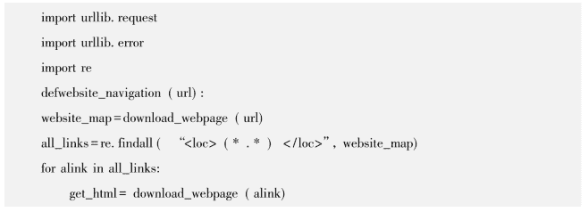

部分网站数据源自数据库，不同页面的 `url` 仅尾缀参数有别。应用服务器以此尾缀作为 `ID` 匹配后端记录。通过迭代器自动更新 `ID`，即可实现对符合此结构页面的自动化遍历访问。

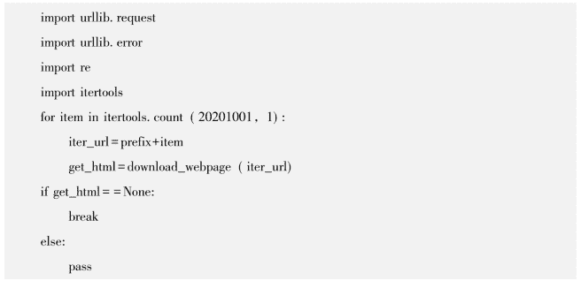

模拟用户浏览习惯，访问通常从首页起步，按需点击相关链接，其余无关链接被忽略。爬虫程序需借助正则表达式与 `url` 追踪机制，定向访问目标内容页面。函数 `get_urls()` 负责正则匹配页面内合格 `url`；函数 `trace_pages()` 则从队列取出链接，调用 `download_webpage()` 下载内容，再经 `get_urls()` 提取新链接入队，形成闭环。

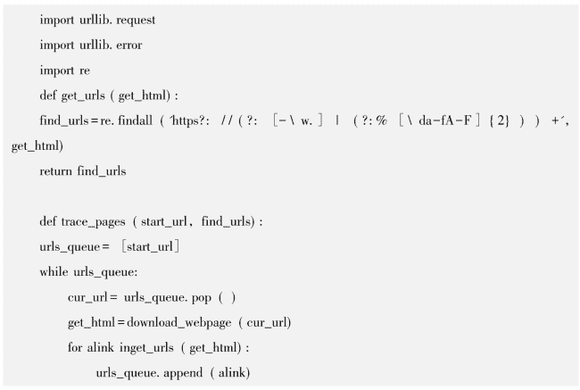

### 1.5.3 网页数据解析与提取

页面追踪下载完成后，需对网页结构进行深度剖析。主流浏览器均支持“查看源代码”功能。以澳大利亚联邦法院公开判例库为例，访问 `http://www.austlii.edu.au/au/cases/cth/FCA/2006/1.html` 并查看源码，可见部分 `HTML` 结构：

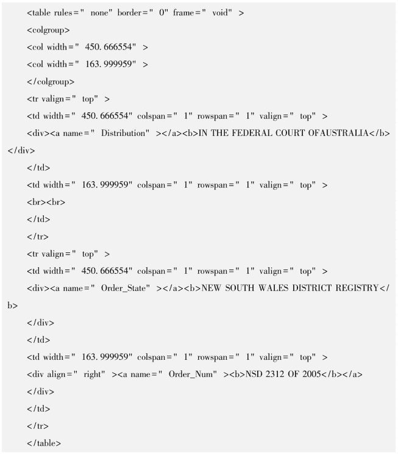

提取判决状态数据时，锁定 `<a name="Order_State">` 元素；检索判决编号则匹配 `<a name="Order_Num">` 元素。DOM 树层级关系为：`<a>` 嵌套于 `<td>`，`<td>` 从属 `<tr>`，`<tr>` 又属于 `<table>`。数据提取可选用正则表达式、Python 第三方库 `BeautifulSoup` 及 `Lxml`。

`BeautifulSoup` 专攻网页结构解析；`Lxml` 为 `XML` 解析器的 `Python` 封装（`C` 语言编写），解析性能优于 `BeautifulSoup`。两者安装命令如下：

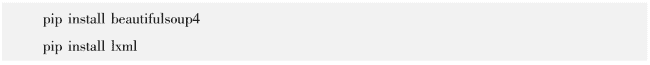

终端输入 `python` 进入交互环境。正则语法速记：`.` 匹配除换行外任意字符，`*` 匹配前元素零次或多次，`?` 匹配零次或一次，括号 `()` 标记捕获组。

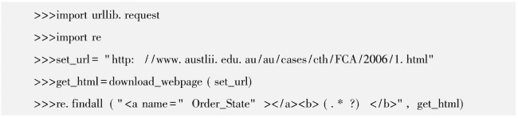

`BeautifulSoup` 提供定位接口。首步将下载的 `HTML` 解析为 `soup` 文档对象，继而用 `find()` 与 `find_all()` 精准锁定目标节点。针对标签未闭合、引号缺失等格式缺陷（示例如下）：

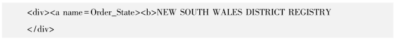

`BeautifulSoup` 会先修补格式再解析。本质上，`HTML` 由成对尖括号标签构成，控制内容呈现，整体呈倒置树状层级。每个标签含标签名与属性，`<tag>` 开启、`</tag>` 闭合。`<tag>.attrs` 返回键值对字典属性集；`<tag>.string` 获取标签间非属性文本。以 `<a>` 标签为例，既可作超链接也可作锚点。在 `<a name="Order_State">` 中，`name` 为属性名，`"Order_State"` 为属性值。`BeautifulSoup` 支持树结构的向上（父）、向下（子）、横向（兄弟）全向遍历，能自动补全标签、修正缺失引号，甚至为缺失 `<html>`、`<body>` 的残页自动补齐生成完整树。`bs4` 即 `BeautifulSoup4` 简写，`prettify()` 方法可美化输出带缩进的 `HTML` 文本。

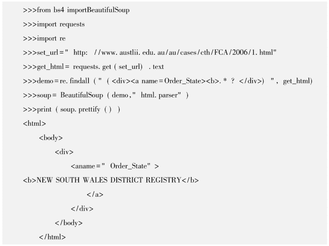

若使用 `lxml` 解析器处理畸形 `HTML`，流程同理：先补全缺失，再按 `XML` 遍历逻辑建树、补引号、闭合标签，解析成功后输出树结构。

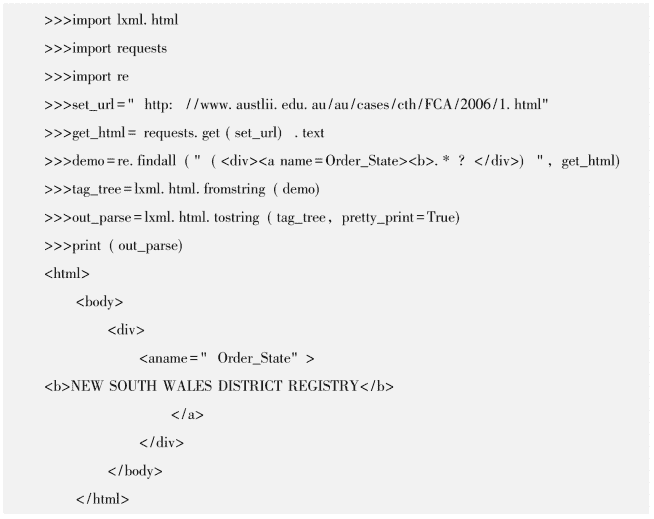

# Chapter 2 机器学习赋能实战

# 机器学习：从数据中「长」出智能的算法

步入大数据纪元，能从海量数据里挖掘意义的机器学习，迅速成长为计算机科学版图中最耀眼的新星。它的核心逻辑并不神秘：借助自学习算法，将原始数据转化为可用的知识。这其实与人类认知世界的路径如出一辙——我们之所以能积累文明，全赖「过往经验对未来依然有效」这一铁律。

打个比方，挑水果时老手总爱拾个儿饱满、色泽亮丽、敲起来脆响的。起初没人知晓美味与外表的关联，可尝得多了，大脑便自动总结出「好吃水果的典型特征」。这便是从海量特征中提炼模型的过程：**学习方法是观察与试吃，经验则是一次次真实的「采样」。** 人脑以记忆存储经验，学习本质上是在记忆库中检索、推理、生成新认知。

计算机照搬了这套流程：把经验数字化存储为数据，让学习算法从数据中生成模型，喂入训练数据调优，面对新情况即可输出判断。若说计算机科学是「算法的科学」，机器学习则是「**关于算法的算法**」——专门研究**如何让机器从数据里学会学习**。经过多年迭代，线性模型、决策树、神经网络、SVM、贝叶斯统计、集成学习、强化学习、主题模型等经典架构已臻成熟，配套的开源库更让程序员能低门槛调用强算法，轻松从数据中淘金、预见未来。

---

## 2.1 演进脉络：从「教它懂逻辑」到「让它自己悟」

机器学习是人工智能三大核心支柱之一，更是衡量 AI 智商高低的试金石。

**早期：迷信「推理」，忽视「知识」**
上世纪中叶，学界笃信智能系统的核心是逻辑推演。通用问题求解器、逻辑理论家在数学定理证明上甚至超越人类数学家，风光无两。但随着软硬件升级，单纯推理已难支撑 AI 的宏大愿景——系统必须「有知识在肚子里」。

**70 年代：专家系统登场，却卡在「知识获取瓶颈」**
基于知识库的专家系统井喷式涌现，解决了大量规则型难题。可专家精力有限，无法把行业所有隐性知识全敲进代码。**「机器自主获取知识」由此从奢望变成刚需。**

**萌芽期：百家争鸣奠基石**
其实早在图灵测试年代，机器学习的雏形就已现身。60-70 年代，连接主义的感知机、符号主义的结构学习系统、强化学习雏形、贝叶斯统计学习接踵而至，为日后大厦奠定了基石。

**80 年代：首部专著问世，神经网络破局 NP-hard**
Michalski 等人出版《机器学习：一种人工智能方法》，首次给出定义：**从样本中学习，归纳总结，属于归纳法范畴。** 决策树引入信息熵剪枝；1986 年 BP 算法（反向传播）让神经网络攻克 NP-hard 问题——前向传递信号、反向修正误差，参数调整隐含了样本学习。但参数极多、极度依赖人工调参，稍有偏差便可能导致结果指数级偏离。

**90 年代初：统计学习登台，SVM 成焦点**
学界将机器学习视为统计学的「华丽转身」。SVM 在样本空间寻找**最大间隔超平面**分类，引入损失函数量化误差，通过最小化结构风险与经验风险的线性组合确定参数。针对线性不可分难题，**核方法**将低维空间映射到高维线性可分，多项式核、RBF 核、高斯核等由此大放异彩，核构建技术渗透进 ML 诸多角落。

**关键辨析：统计学习 ≠ 统计建模**
- **统计建模**：为数据建模推断关系，**重解释、不重预测**（如线性回归找条「覆盖最多点」的直线）。
- **统计学习**：**舍弃可解释性换预测性能**（如线性回归在子集训练、另一子集测试，只为泛化效果最优）。

**概率图谱接管机器学习**
经典统计学习将概率模型引入 ML：
- **朴素贝叶斯**：假设特征条件独立，用联合概率分类，属生成模型；参数靠 MLE/MAP 迭代求解，损失函数为对数似然。
- **EM 算法**：专治含隐变量的概率模型。似然函数含对数求和难直接求解，EM 构造近似分布，迭代最大化下界直到收敛。
- **主题模型**：文档→主题→词，主题为隐变量。似然导数含对数求和，MLE 与贝叶斯估计失效，**必须借 EM 算法估计参数**。

从「手把手教规则」到「扔海量数据让它自己悟」，机器学习的发展史，就是人类不断向机器**「授渔」**的历史。

## 2.2 核心概念与术语速览

步入21世纪，算力飞跃与大数据爆发让深度学习迅速成为机器学习领域的“顶流”，尤其在计算机视觉赛道大放异彩。说白了，深度学习就是多层神经网络的堆叠：数据从输入层流入，穿过层层隐藏层提取特征，最后抵达输出层。隐藏层越深，层间连接权重参数便呈指数级增长，动辄数万乃至更多。参数量巨大意味着调参至关重要。虽说深度学习在理论可解释性上常被诟病，但它在工程落地上却异常强势，核心仰仗两大基石——海量数据与强劲算力。互联网应用的普及催生了前所未有的海量样本；若参数极多而样本稀缺，模型极易“死记硬背”训练集（过拟合），训练集损失为零，实战却惨不忍睹。因此，复杂模型必须喂入大数据反复迭代训练，这极其烧算力，若无硬件支撑，时间成本将难以承受。

---

数据是机器学习的基石。想象一下，一条条法律判决记录摆在面前：
（原告=张三，被告=李四，法院=北京朝阳法院，案由=借贷纠纷，日期=2020.1.8）
（原告=赵某甲，被告=钱某乙，法院=上海松江法院，案由=隐私权纠纷，日期=2019.3.5）……
每一对括号内的内容，就是一条描述案件的**记录**。多条记录汇聚成**数据集**，文本类数据集常称**语料库**。数据集中的单条记录，对应一个**样本**或**实例**。样本由若干项构成——原告、被告、法院、案由、日期，这些项便是**特征**或**属性**。某个具体样本下的取值（如“张三”），叫**特征值**或**属性值**。

若把特征映射为空间坐标，每个特征对应一维坐标。上述5个特征便张开一个五维空间，一个案件即该空间中的一个**点**，用坐标**向量**即可描述。所以，样本常被直接称为**特征向量**。

为便于数学处理，数据集常用大括号表示：$D=\{d_1, d_2, ..., d_m, ..., d_M\}$。大写 $M$ 代表样本总数；下标 $d_m$ 指第 $m$ 个样本。每个样本包含 $N$ 个属性，写作 $d_m=\{d_{m1}, d_{m2}, ..., d_{mn}, ..., d_{mN}\}$。$d_m$ 是 $N$ 维样本空间中的一个向量，$d_{mn}$ 代表第 $m$ 个样本第 $n$ 个属性的值。例如 $d_{32}$ 指第3个案件的被告是王某丁；$d_{24}$ 指第2个案件的案由是隐私权纠纷；$d_{13}$、$d_{41}$、$d_{55}$ 同理可得。

算法通过“啃”数据获得模型。训练阶段会用到部分数据，每条叫**训练样本**，全体组成**训练集**；剩下的留作**测试集**。学习算法先对数据分布做假设（如判决日期服从高斯分布），模型含均值、方差等参数。算法在训练集上学得参数，不同训练集得出的参数必然不同。好的学习过程，追求模型不仅能拟合训练集规律，更能在测试集上泛化——即解释数据生成背后的现象。因此，模型可视为学习算法在特定数据上的“参数化落地”。算法优劣强依赖数据类型：深度学习擅长图像，主题模型擅长文本。

前文案件样本含5个特征值，若要预判胜负，引入**标签**便成了关键。例如：((原告=张三...), 胜) ((原告=赵某甲...), 败)。有标签样本记为 $(d_m, y_m)$，$y_m$ 即标签。所有可能标签集合构成**输出空间** $Y$。模型输入无标签样本 $d_m$，输出 $f(d_m)$，这里的 $f$ 是广义函数/映射。学习目标：让预测 $f(d_m)$ 无限逼近真实 $y_m$。

按输出空间性质，任务分两大类：
*   **分类任务**：输出离散值。如“胜/败”仅两类，称**二分类**，一类为**正类**，另一类为**负类**；超两类则为**多分类**。
*   **回归任务**：输出连续值。如预测赔偿金额，取值在一个连续区间内。

简而言之，搞清样本、特征、标签、训练/测试集划分，以及分类与回归的边界，就是打通机器学习任务的“任督二脉”。

# 核心概念：数据划分、学习范式与模型评估

在机器学习的实战流程中，原始标注数据集通常会被切分为两个互不重叠的部分：**训练集**与**测试集**。

我们用符号系统来精确描述这一结构：训练集记为 {(`d1`, `y1`), ..., (`dtr`, `ytr`), ..., (`dTR`, `yTR`)}，其中 `TR` 代表训练样本总量，`tr` 指代任意单个训练样本；测试集记为 {(`d1`, `y1`), ..., (`dte`, `yte`), ..., (`dTE`, `yTE`)}，`TE` 为测试样本总量，`te` 为任意单个测试样本。两者之和 `TR + TE` 共同构成了完整的样本空间 `M`。

**建模的核心目标**，是通过训练集学习到一个映射函数 `f: D → Y`，将输入空间（特征集合）映射到输出空间（标签集合）。输出空间 `Y` 的形式取决于任务类型：二分类通常设为 `{1, 0}` 或 `{+1, -1}`；回归任务则对应连续的实数域。模型训练完成后，参数固定，映射 `f` 确立。随后在测试集上进行预测，得到预测值 `ˉyte = f(dte)`，再将其与真实标签 `yte` 对比，以此量化模型性能。

---

## 无监督视角：聚类与隐式结构发现

当样本空间**缺乏标签**时，任务转向**聚类**。其核心是将数据自动划分为若干群组（簇），每个簇潜在对应一个隐含主题或概念。

以法律文书数据为例，聚类维度可以多样化：
*   **按管辖地域**：自动形成华北、华东、华南、西南、东北、西北等案件簇；
*   **按时间跨度**：划分为 1 年内、3 年内、5 年内案件簇；
*   **按案由类型**：生成人格权、物权、合同、知识产权等纠纷簇。

聚类的“学习”过程，本质是**从数据中挖掘内在规律**，且**无需标签监督**。以“华东案件簇”为例，算法初始不知其含义，但通过学习发现该簇样本的法院地理坐标均靠近上海且彼此临近，远离北京、广州等地；再如“人格权纠纷簇”，算法捕捉到“人格、身体、名誉、姓名、肖像”等高频词的强共现特征，且与其他案由词汇共现度低。这种自下而上的结构发现，极大辅助了数据探索分析。


**图示：监督学习与非监督学习对比**

---

## 2.1 两大范式：监督 vs 非监督

学习任务本质上分为两大流派，**区别在于是否拥有“标签”这一监督信号**：

| 维度 | **监督学习** | **非监督学习** |
| :--- | :--- | :--- |
| **样本构成** | 含标签 (`X`, `Y`) | 仅含特征 (`X`)，无标签 |
| **学习机制** | **有反馈**：利用预测输出与真实标签的偏差（损失函数）反向调整参数 | **无反馈**：无外部指导，目标是挖掘数据内在隐结构（如分布密度、相似性） |
| **核心产出** | 可用于**预测**新样本标签的模型 `f` | 数据的**内部分组/降维/表示** |

---

## 2.2 监督学习的终极使命：泛化预测

监督学习的**根本目的**不是“拟合训练数据”，而是**从有标签的历史数据中学得模型，以预测未见的未来数据**。

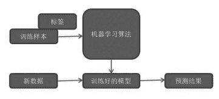

**图示：监督学习流程**

*   **监督信号**：即样本的期望输出 `Y`（标签）。
*   **分类任务**：标签离散。如法律文本领域分类，模型学会判定新文本属于“民事/刑事/行政/国家赔偿”中的哪一类。
*   **回归任务**：标签连续。模型输出具体数值（如判决金额、刑期长短）。

---

## 2.3 深度解析：分类决策边界与泛化能力的边界条件

### 从二分类几何视角理解决策边界

以**案件胜败预测（二分类）**为例。新样本：`原告=韩某某, 被告=方某某, 法院=南京玄武区法院, 案由=不当得利, 日期=2020.6.7`。模型需输出“胜/负”。

**建模假设**：判决结果与原被告身份、法院、案由、时间等特征相关。特征越丰富（如补充案件事实、证据描述），假设空间越完备，预测理论上越合理。

为可视化理解，简化模型仅保留两个特征：**时间（横轴 `feature_1`）**与**法院（纵轴 `feature_2`）**。
*   圆点 = 正类（胜），方块 = 负类（负）。
*   对角线 = 学到的**线性分类器/决策边界**。
*   **学习策略**：寻找使所有训练样本到分类边界距离平方和最大（或最小化经验风险）的那条线。

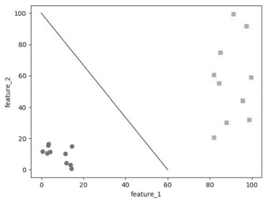

**图示：二分类监督学习任务示意图**

### 多分类与“未见类别”困境

若任务升级为**多分类**（如预测法律领域：民事/刑事/行政/国家赔偿），会面临一个关键风险：**训练集缺失某类样本（如无行政法数据）**。此时模型根本无法学习该类特征，预测时只能在剩余类别中“强行选一个”，导致系统性误判。

> **核心洞察**：模型只能学习训练数据中**已呈现的模式**。决定未来结果的特征，**必须在训练数据中有所体现**。

### 泛化能力与样本空间覆盖

**泛化能力** = 模型对未知/新数据的预测准度。评估模型优劣，必须看泛化能力与样本空间适应性。

*   **维度灾难**：特征数增多，样本空间呈指数级爆炸。
*   **数据采样现实**：手头数据集仅是海量样本空间的稀疏采样。
*   **强泛化的必要条件**：数据集必须**良好代表**整个样本空间分布——
    1.  训练集反映空间整体分布；
    2.  测试集遵循**同分布假设**（i.i.d.）；
    3.  两者分布一致，模型才具备实战适应性。

---

**总结**：无论监督还是非监督，机器学习的本质都是**在有限样本中寻找规律，并期望该规律在无限未知空间中依然成立**。数据划分规范、特征工程深度、分布一致性保障，是通往这一目标的三块基石。

# 监督学习中的回归任务：从核心概念到模型拟合的平衡艺术

在监督学习的回归场景里，输入端的样本特征被称为**解释变量**，而模型预测的输出则称作**响应变量**。回归任务的核心假设是：响应变量与解释变量之间存在某种受参数约束的函数关系。训练的过程，本质上就是让模型从数据中学出这组参数，使预测值尽量贴近真实分布。回归预测的目标是**连续型数值**——比如预测案件的标的金额。

以图 2.4 为例，横轴是开庭日期，纵轴是涉案金额。模型假设二者呈线性关系，学习策略是寻找那条能让训练集上所有样本的均方误差最小的回归线。图中数据点分布看似很契合线性趋势，但现实往往更复杂：数据可能服从高斯分布、多项式分布等。不同分布假设对应不同参数空间，模型学到的参数也会随假设而变。**世上没有放之四海而皆准的“万能算法”**，每种算法都有其适用边界。

此外，若训练样本在样本空间分布不均、挤在一隅，就会出现**数据倾斜**。此时需清洗数据、重新采样或扩充训练集来缓解。

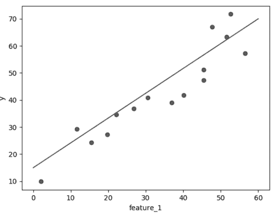

**Figure 2.4 回归监督学习任务示意**

---

## 拟合的两难：欠拟合与过拟合

模型在训练集学得参数后，若能推广至整个样本空间，称作**拟合**。但模型极易陷入两个极端：欠拟合或过拟合，归根结底是**泛化能力不足**。

**欠拟合**通常源于模型太“简单”：参数太少、结构太浅、特征太单一。如图 2.5，仅用“开庭日期”这一个特征去套线性方程 `y = a*x + b`，拟合线偏离大量样本点，偏差求和很大。破解之道有二：一是**提升模型复杂度**，改用多项式回归，引入更多参数弯曲拟合线；二是**丰富特征维度**，比如加入“法院层级”作为第二特征，将二维平面升为三维空间，原本散乱的点可能刚好落在一个平面上。

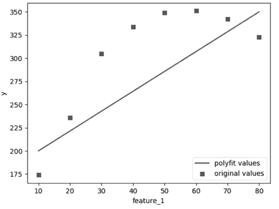

**Figure 2.5 欠拟合现象示意**

---

**过拟合**则是模型“贪多嚼不烂”：参数过多、结构过深、训练样本太少。图 2.6 用三次多项式 `y = ax³ + bx² + cx + d` 去拟合，曲线几乎穿过每个点，总偏差趋近于零。看似完美，实则连噪声和脏数据都“背”下来了，泛化性极差。应对策略是**做减法**：降阶（改二次多项式）、减参数，或是**增数据**，让样本量压过模型复杂度。

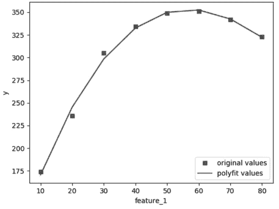

**Figure 2.6 过拟合现象示意**

---

## 无标签下的洞察：聚类学习的价值

监督学习依赖标签，但现实中大量数据无标签——因为标签往往需要人工依据业务逻辑打标。此时，**无监督聚类**能挖掘数据内在结构。

图 2.7 以“法院距北京距离”为横轴特征，“赔偿金额”为纵轴特征。样本点自然形成左上、右下两个簇群。左侧点对应北京朝阳法院案件，赔偿高；右侧点对应重庆渝中法院案件，赔偿低。**聚类算法无需领域知识，自动揭示了“地域经济发展水平差异”这一隐性规律**。对于不懂中国经济地理的人，这正是数据直接给出的洞察。

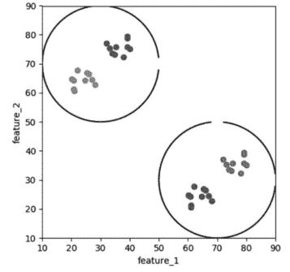

**Figure 2.7 聚类任务示意**

---

## 聚类特征的业务解读

聚类生成的每个簇，代表在特定特征上“相近”的样本群；簇间差异大，簇内差异小。

回到图 2.7：左上簇特征值组合为“距离小、赔偿大”；右下簇为“距离大、赔偿小”。进一步分析发现：若簇群分布在右上象限（距离远、赔偿高），案件动机中经济因素占比高；若在左下象限（距离近、赔偿低），经济动机占比低。这展示了如何从几何分布反推业务语义。

---

## 2.4 强化学习

# 强化学习：在试错中进化的智能体

在监督学习里，模型面对的是明确的分类标签或回归数值。但现实中，诸如下棋博弈这类场景，并没有现成的“标准答案”供模型照搬。双方棋手依据局面落子，棋盘状态随之迁移；若某步棋吃掉对方子力或将死对方主力，该动作便获得正反馈。这种通过与环境互动、在状态流转中寻求最优策略的范式，正是强化学习（RL）的核心逻辑，如图 2.8 所示。

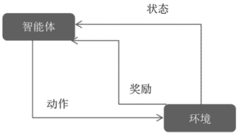

**图 2.8 强化学习示意**

智能体与环境持续交互：智能体施加动作，环境状态随之跃迁，环境随即返回奖励信号。RL 的终极目标，是让智能体在不断博弈中，通过高效策略提升系统整体表现。虽常被归类为监督学习的一种，但它的“监督信号”并非硬性的类别标签，而是**奖励函数**——以激励机制引导智能体向正向目标演进。

奖励函数量化每个动作的收益：正值越大，激励越强；负值越大，惩罚越重。训练过程中，智能体靠探索性试错驱动环境状态流转，最终实现累积奖励最大化。每一步动作即时产生正负反馈，正奖励意味逼近终局目标，负奖励则代表偏离轨道。

### 法律场景中的强化学习映射

将视角切入案件样本空间：若把单个案样本视为环境状态，判决前案情处于动态演变中；驱动状态变化的抽象实体即为智能体。

*   **原告方智能体**：目标是连续施展有利动作，终极奖励是**胜诉**；
*   **被告方智能体**：目标同理，终极奖励是**原告败诉**。

*举例*：当前状态为某知识产权纠纷案（原告刘某，被告孙某，管辖法院重庆渝中区法院，立案日 2016.8.25）。假设原告公司注册地在北京，被告在重庆。原告方智能体发起管辖权异议等动作，推动案件流转至北京法院审理。依据其奖励函数设定，该状态跃迁即触发正向奖励。

### 决策过程的数学建模：四元组 `<S, A, P, R>`

在 RL 决策循环中：
*   智能体全知环境状态集合 `S`（状态空间）；
*   当前状态 `s` 下执行动作 `a`（动作空间 `A`），环境 `E` 按转移概率 `P` 跃迁至新状态；
*   同步触发奖励函数 `R` 反馈即时收益。

由此，强化学习本质可形式化为四元组 `E: <S, A, P, R>`。

---

### 具象案例：律师“刷脸”与法官心证的博弈

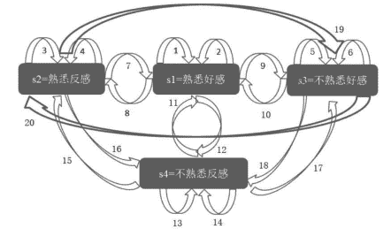

**图 2.9 出庭决策过程**

引入“法官熟悉度”特征后，智能体（律师）每日面临二选一：**出庭** 或 **缺席**。
*   出庭：可能刷高熟悉度赢得好感，也可能因过度曝光引发反感；
*   缺席：可能因神秘感加分，也可能因陌生感减分。

状态空间由此划分为四象限：**熟悉-好感**、**熟悉-厌恶**、**陌生-好感**、**陌生-厌恶**。

奖励设定如下：
| 事件 | 奖励值 |
| :--- | :--- |
| 熟悉度 ↑ | +10 |
| 熟悉度 ↓ | -5 |
| 好感度 ↑ | +20 |
| 好感度 ↓ | -30 |

图 2.9 标注了 20 条具体状态跃迁路径（动作 `a`、概率 `p`、即时奖励 `r`），例如：
*   跃迁 1：`a=出庭, p=0.7, r=10`（大概率刷熟悉度）；
*   跃迁 8：`a=缺席, p=0.2, r=-20`（小概率导致好感度大幅下降）；
*   跃迁 11：`a=出庭, p=0.8, r=30`（高概率同时刷熟悉度与好感度，收益最大）……以此类推。

---

### 核心机制差异：为何 RL 是“交互式监督”？

1.  **监督源不同**：RL 的监督信号源自环境反馈的奖励，而非预设标签。
2.  **控制权模糊**：状态跃迁与奖励发放不完全由智能体掌控。
3.  **感知路径独特**：智能体只能通过“执行动作 → 观测新状态 → 获得奖励”这一闭环来认知环境、进而影响环境。
4.  **无直接指令**：训练集不会告诉智能体“下一步该干什么”，只能靠不断尝试各类动作，最大化**累积奖励**（即单步奖励之和）。
5.  **短视与概率性**：智能体无法预知长期总收益，只能基于当前状态贪婪选择期望即时奖励最高的动作；且单步奖励服从概率分布，少量尝试无法收敛最优策略。

**结论**：强化学习，本质上是一场**持续交互、不断试错、在概率中逼近最优**的监督学习过程。

---

## 2.5 假设空间

机器学习的本质是从具体样本中归纳泛化。案件数据集中，每条样本包含原被告、法院、案由、日期等特征值，既是具体实例，也是“案件”这一抽象概念的具象投射。

逻辑层面，归纳与演绎是两大基石。归纳法自特殊走向一般，如通过观测冬夏温差总结出季节规律……

# 2.5 假设空间与归纳偏置

## 从“猜温度”看懂假设空间如何收敛

想象一下，我们要教会机器分辨“夏天”和“冬天”。

先拿 7 月 1 日连续 9 天的最高气温做训练：35.5、36.0、35.0、37.5、36.5、35.0、38.0、37.5、38.0℃，标签全是“夏天”；再拿 12 月 1 日连续 9 天的数据：11.5、12.0、9.0、8.5、9.5、11.0、10.0、10.5、10.0℃，标签全是“冬天”。

分类器会提出一堆备选规则（假设）：
- 夏天规则：最高温若超过阈值 `a`，即判为夏天。候选阈值集合 `a` = {36.0, 35.5, 35.0, 34.5 …}。
- 冬天规则：最高温若低于阈值 `b`，即判为冬天。候选阈值集合 `b` = {11.0, 11.5, 12.0, 12.5 …}。

这些候选规则全体，就是**假设空间**。学习的过程，就是在空间里筛选——哪个规则能完美覆盖训练数据？

实测发现：夏天候选里 36.0 和 35.5 无法覆盖那 9 天实测值（有低于这两值的夏天），剔除后空间变为 {35.0, 34.5, 34.0 …}；冬天候选里 11.0 和 11.5 同样失效（有高于这两值的冬天），剔除后剩 {12.0, 12.5, 13.0 …}。

**结论显而易见：训练样本越多，被排除的假设越多，模型越精准。**

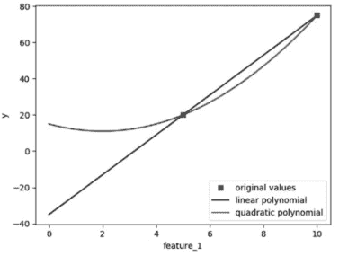

> **图 2.10 线性与二次回归假设的完美拟合**

## 回归任务里的“多解”困境

换个场景：预测经济赔偿案件的赔偿金额（输出 `y`），输入特征 `feature_1` 是地区发展量化值。

假设模型是线性关系 `y = a·feature_1 + b`，两个参数 `a、b`，两个样本点刚好能解出唯一解，**完美拟合**；若假设是一元二次 `y = a·feature_1² + b·feature_1 + c`，三个参数 `a、b、c`，两个样本点却留下一个自由度，**无数条抛物线都能完美穿过那两点**。

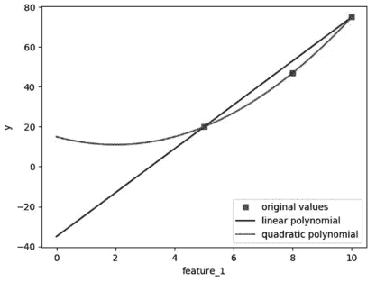

> **图 2.11 线性假设的偏差**

## 样本增多，谁更“靠谱”？

再加一个样本点，三点不共线。
- 线性模型：只能拟合其中两点，第三点产生**偏差**；
- 二次模型：三参数对三点，**零偏差完美拟合**。

按“训练误差最小”选模型，二次胜出。但现实里：
- 若数据可靠、无噪声 → 追求零偏差是对的；
- 若第三个点本身是**脏数据/噪声** → 线性模型反而更稳健，二次模型反而“过拟合”了错误。

**核心洞见**：
- 样本量 < 模型复杂度 → 总能完美拟合（风险极大）；
- 样本量 > 模型复杂度 → 无法完美拟合，此时才暴露模型真实表达力；
- 现实数据既非绝对准确，也非严格 i.i.d. → **盲目追求“全拟合”会陷入结构风险，拟合噪声得不偿失。**

## 法律判决预测：从“五五开”到“心中有数”

假设胜败取决于三要素：**诉求、案由、证据**。大量历史案例训练出模型，就能对新案给出判断——这就是**归纳学习**：从历史中提炼“赢案长啥样”“输案长啥样”。

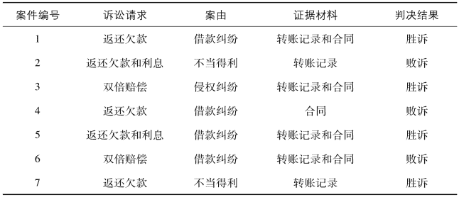

> **表 2.1 从样本中学到的数据集**

| 案件ID | 证据材料 | 案由 | 诉求 | 结果 |
|--------|----------|------|------|------|
| 1 | 转账记录+合同 | 借贷纠纷 | 还款 | 胜 |
| 2 | 仅口头约定 | 借贷纠纷 | 还款 | 负 |
| 3 | 转账记录+合同 | 借贷纠纷 | 还款 | 胜 |
| … | … | … | … | … |

用逻辑表达式描述胜诉概念：
`(证据=待定) ∧ (案由=待定) ∧ (诉求=待定)`
`∧` 为逻辑“与”，三个条件须同时满足。

学习过程 = 确定“待定”处。
- 案件 1 告诉我们：`(证据=转账记录+合同) ∧ (案由=借贷纠纷) ∧ (诉求=还款)` → 胜诉。
- 案件 3、5、7 同理。

**泛化**：对训练集外的新案件，模型能否给出正确预测？

**版本空间收缩**：
- 初始假设空间大小 = 各特征取值数的乘积。
- 完全无知时，胜诉概率 1/2。
- 每见一个正样本，排除不匹配的假设（如 `胜诉 = (证据=任意)∧(案由=任意)∧(诉求=任意)` 因案件 2 败诉而被排除）。
- 样本越多，特征模式越清晰，**胜诉概率大幅跃升**。

---

**一句话总结**：学习就是在假设空间里“用数据做筛子”，筛掉不靠谱的猜想，留下既能解释历史、又能面向未来的规律——**既别欠拟合（筛子太疏），也别过拟合（筛子太密）**，归纳偏置正是帮我们把握这个“度”的关键。

# 2.5 案例学习中的假设空间构建

我们用 `a` 表示证据材料，取值范围为 `evidence:{转账记录与合同, 仅转账记录, 仅合同, *}`，其中 `*` 代表任意值。`b` 代表案由，取值为 `cause:{借贷纠纷, 不当得利, 侵权纠纷, *}`。`c` 表示诉讼请求，取值为 `claim:{偿还债务, 偿还债务及利息, 双倍赔偿, *}`。每个特征均有 4 种取值，因此假设空间共包含 64 个假设，结构如图 2.12 所示。

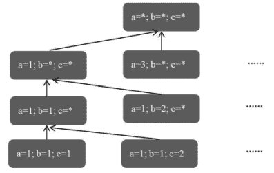

**图 2.12　案例学习假设空间示意**

图中 `a=*` 表明证据材料不限，`b=*` 代表案由不限，`c=*` 代表诉请不限。具体编码为：`a=1` 对应“转账记录与合同”，`b=1` 对应“借贷纠纷”；`c=1` 为“偿还债务”，`c=2` 为“偿还债务及利息”，`c=3` 为“双倍赔偿”。该图结构酷似文件系统的目录树，呈倒置树状：顶层为根节点，底层为叶节点。最左侧叶节点 `(a=1;b=1;c=1)` 即假设 `h1`：凭借转账记录与合同提起借贷纠纷诉讼，请求偿还债务，判决原告胜诉。`h1` 仅与训练集中案件 ID 1 吻合，无法推广预测其它样本。最右侧叶节点 `(a=1;b=1;c=2)` 对应假设 `h2`：同类证据与案由下，请求偿还债务及利息，判决原告胜诉。`h2` 仅匹配案件 ID 5，同样缺乏泛化能力。若采用这两个叶节点的父节点 `(a=1;b=1;c=*)` 作为假设 `h3`：凭转账记录与合同起诉借贷纠纷，判决原告胜诉。`h3` 能覆盖 `(a=1;b=1;c=*)` 下未在训练集出现的子节点，可对未标注数据预测（虽可能有误），即模型具备一定准确率。从假设空间中筛选与训练集匹配的假设，可采用自顶向下的演绎法或自底向上的归纳法：保留与所有正样本一致的假设，剔除与所有负样本一致的假设。

从表 2.1 中选取案件 ID 1、2、5、7 组成训练集（见表 2.2）。假设空间中有 3 个假设能匹配该训练集：
*   假设 1：若 `(证据=转账记录与合同) ∧ (案由=借贷纠纷) ∧ (诉请=任意)` 成立，则判原告胜；
*   假设 2：若 `(证据=转账记录与合同) ∧ (案由=任意) ∧ (诉请=任意)` 成立，则判原告胜；
*   假设 3：若 `(证据=任意) ∧ (案由=借贷纠纷) ∧ (诉请=任意)` 成立，则判原告胜。
详见图 2.13。

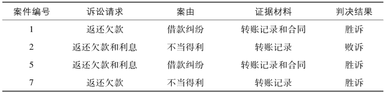

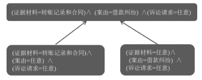

**图 2.13　训练集上的假设空间分布**

模型最终选择哪个假设，取决于归纳偏好——倾向于更泛化的解释，还是更具体的解释。假设 1 依据“证据”与“案由”两特征学习；假设 2 仅依据“证据”；假设 3 仅依据“案由”。假设 1 比假设 2、3 更具体。优劣由模型在测试集上的泛化表现决定，即该假设在测试样本上的匹配情况。

选取表 2.1 中案件 ID 3、4、6 构建测试集（见表 2.3）。结果显示：案件 3、4、6 均不匹配假设 1；案件 4、6 不匹配假设 2；案件 3、4、6 均不匹配假设 3。按测试样本匹配数计分：假设 1 得 0 分，假设 2 得 1 分，假设 3 得 0 分。这说明在当前问题下，学习模型倾向于选择泛化程度更高的假设。推测原因在于：胜诉结果与关键特征（如证据材料）关联度较高。假设 1 条件过于具体，包含两个特征值，其中某特征可能与胜诉关联不大，但模型从训练集过度拟合细节，将弱相关特征引入模型。

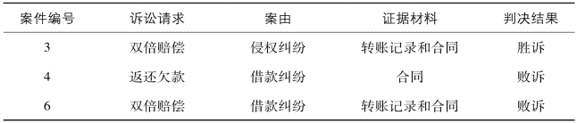

机器学习算法旨在从历史数据中挖掘内在规律。假设规律客观存在，不同数据蕴含的规律各异，不存在放之四海而皆准的“万能算法”。某算法在部分数据上表现优异，在另一数据上可能适得其反。因此，评价算法优劣必须结合具体问题与数据进行针对性分析。

## 2.6 数据预处理

在机器学习系统构建路线图中，初始阶段即为数据预处理。原始数据的规格与维度往往不利于提升系统性能，故众多机器学习应用将预处理视为关键环节。以人脸识别为例，原始数据为图像序列，系统需提取眼睛、鼻子、嘴巴、耳朵等有效特征；植物花卉识别则提取花瓣颜色、萼片长宽、花瓣长宽等特征；案件预测场景下，则从文本中识别法院、日期、案由、原被告、法条、证据等特征。预处理质量直接决定学习模型的泛化性能与最终效果。

现实中采集的数据常不完整，某些特征存在缺失值。例如录入时因隐私保护导致收入、婚姻属性缺失；法律关系中配偶信息对未婚者而言即为缺失值；人为疏忽或高昂获取成本也会造成缺失。不仅缺失值，噪声与异常数据同样干扰模型训练与评估。许多算法要求特征选择，使特征值落入标准化、连续的空间——如映射至 `[0,1]` 区间，或变换为均值 0、方差 1 的正态分布。

在数据采集环节，特征属性常面临缺失值困扰。针对这种情况，需结合特征取值的分布形态及其对预测任务的贡献度，灵活选择删除特征或填补数值两大策略。若某特征在大量样本中缺失，占比极高，且在模型训练中地位非核心，果断舍弃往往是上策。以个人基础档案中的“家庭座机号”为例，随着通讯习惯更迭，九成样本皆无此数据，保留该列仅增噪音，不如直接移除。若特征服从均匀分布且缺失样本稀少，用整体均值填补即可，如用社会平均工资替代个别缺失的“月薪”数据。但遭遇分布倾斜的数据时，均值易受极端值牵引失真，中位数更具代表性——如北京高收入群体拉高平均工资，中位数收入更能反映大多数劳动者真实水平。针对离散型特征缺失，则可引入哑变量法，将“性别”等字段的缺失统一归类为“未知”或“其他”类别。

异常值是指偏离常规分布区间的数据点，实质上分为“伪异常”与“真异常”两类。前者源于采集录入差错，不反映客观事实，如年龄误填为 600 岁；后者虽罕见却真实存在，如百岁老人出现在以 70 岁为中心的年龄分布中。针对简单数值型数据，箱线图是直观排查利器：通过计算四分位数（Q1、Q2、Q3）及上下边界，超出边界者即判定为异常。若数据近似正态分布，亦可采用 3σ 原则，将偏离均值 3 个标准差以外的点标记异常。

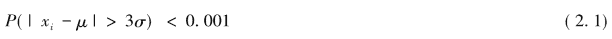

需警惕的是，标准差法非稳健检测手段，因异常值本身会反向扭曲均值与标准差。相比之下，中位数绝对偏差（MAD）法更可靠：先求样本中位数，再算各点对中位数的绝对偏差，取这些偏差的中位数为基准，最后以此标准化各点偏差，该机制放大了异常信号，抗干扰能力更强。此外，基于距离的方法依据点邻域远近判断孤立度；基于密度的方法聚焦局部稀疏度显著低于常态区域的点，适配分布不均数据；基于聚类的方法则将远离主簇群的微小簇群视为异常集合。

异常值对模型训练与评估均有干扰，处理需权衡数量、影响度与算法特性。个例极少时可直接剔除，虽伴随微量信息损失；数量庞大不可删时，对数变换能将数量级压缩至同一维度，保全信息但对模型有适用性要求；若异常与常态数量级差距不大，用均值或中位数替代，损耗可控。

噪声是采集观测值与真实值间的偏差。主流降噪手段含分箱法与回归法。分箱按策略分等宽（按数值范围均分区间）与等频（每箱样本量均等）两派；落箱后，用箱内均值、中位数或边界值平滑替代原始值。回归法则利用特征与目标变量关系建模，反向拟合特征近似真值。

数据集成旨在融合多源异构数据为一致性集，核心攻克实体识别、冗余消除、冲突解决三大难题。实体识别即匹配不同源中语义相同的字段，如公检法系统对嫌疑人描述字段命名各异（`suspect_description`、`suspect_miaoshu`、`suspect_desc`），需映射统一。冗余指跨源字段可相互推导，如法院存“出生日期”，检察院存“年龄”，后者可由前者衍生。冲突指同义字段取值不一，如嫌疑人身高法院录 1.75m，检察院录 1.85m，此类冲突可借用缺失值处理思路，或以更靠近数据产生源头的记录为准。

数据归约在保留原始信息完整性与建模效果前提下精简数据集，显著提升学习效率，涵盖降维与维度变换。分类任务常面临成千上万特征，多数与标签无关。特征子集选择旨在以最小代价找到分布最接近原空间的子集。顺序前向选择（SFS）从空集起步逐步加入最优特征；顺序后向选择（SBS）从全集出发逐步剔除最差特征。判定“最优/最差”常借助单变量与目标变量的统计关联分析，卡方检验与回归系数为常用工具。卡方检验依据观测值与理论假设偏差量化特征与目标相关性，按相关性排序清洗低贡献特征。

# 数据预处理与模型评估核心指南

## 降维：从冗余高维中提炼核心信息

当特征间存在强相关、数据充斥冗余时，降维技术便成了“压缩利器”。它能将高维冗余空间映射为低维子空间，不仅节省存储、加速训练，更能在噪声密集的数据集上显著提升模型预测力。核心在于：以最小信息损耗换取最大结构清晰度。

主流手段三剑客各有所长：
*   **PCA（主成分分析）**：通过空间投影，将数据映射到方差最大的主成分方向，保留核心变异信息。
*   **SVD（奇异值分解）**：借助正交矩阵变换实现跨维映射，虽计算开销大，却是稀疏矩阵的最佳拍档。
*   **聚类降维**：用簇群代表单一特征变量，簇的数量即为新特征维度，实现以少胜多。

## 特征缩放：统一度量衡，消除量纲干扰

训练数据各特征常带不同单位与量级（如重量0-10000g，生长期0-100天），这种“张冠李戴”会严重干扰依赖距离计算的算法。必须通过缩放将特征映射至统一区间：

*   **Min-Max归一化**：线性压缩至[0,1]，用（值-最小值）/（最大值-最小值）实现比例缩放。
*   **Z-score标准化**：减均值除标准差，将数据拉回均值为0、方差为1的标准正态分布，改变原始分布形态。
*   **对数变换**：针对数量级跨度巨大的时序数据（如20年GDP指数级增长），用`log`函数压缩数量级，让不同维度数据能在同一坐标系内按比例呈现。

## 离散化：连续变离散，增强鲁棒性与可解释性

决策树、朴素贝叶斯等模型偏好离散输入。将连续值分箱，不仅能大幅降低时空开销，还能赋予特征业务含义、增强抗噪能力。例如将嫌疑人身高从连续数值转为“高/中/矮”，不仅符合认知习惯，还能将异常脏数据归入最近区间，容忍录入错误，稳固模型训练。

主流分箱策略：
*   **等频分箱**：每箱样本量均等。如数值跨度1-1000，按样本量均分为若干区间，各箱各10条样本。
*   **等宽分箱**：区间长度固定。如班级人数0-100，切分为[0,25]、[25,50]...四个等长区间。
*   **聚类分箱**：引入聚类算法，将同簇样本归为同一离散值，边界由数据分布自然形成。

## 稀疏化（独热编码）：打破虚假序数，还原类别本质

多分类特征若直接编号（如职业：工人1、农民2...），模型会误读为存在大小序关系。引入虚拟变量，将单一多类特征拆解为多个二元特征（`is_worker`、`is_farmer`...），取值仅0/1。职业为工人时，仅`is_worker`为1，其余全0。这种“稀疏化”操作彻底消除了人为赋予的顺序偏见，让模型正确理解类别特征。

---

# 机器学习模型评估与选择

## 1. 泛化误差与模型选择：警惕“死记硬背”陷阱

二分类器输出正负类，预测难免偏差。总样本`m`，错分`e`，错误率`e/m`；准确率即`1 - 错误率`。关键区分两类误差：
*   **经验误差（训练误差）**：模型在训练集上的表现。
*   **泛化误差（测试误差）**：模型在未见测试集上的真实能力。

**经典陷阱**：模型在训练集上大显神威（如准确率99%），实战却惨不忍睹（泛化准确率仅80%）。这意味着模型“死记硬背”了训练样本的特有噪声与细节，丧失了对未知数据的推演能力。**训练误差无法作为评估学习算法优劣的依据。**

同一数据集上，不同算法、同一算法不同参数，效果天差地别。工程落地的核心目标：**通过模型评估与选择，寻找泛化误差最小的“最优组合”**。模型选择的本质，是在算法库与参数空间中，精准定位那个能驾驭未知数据的最佳配置。

# 模型评估的基石：从数据划分到交叉验证的实战指南

分类器的训练过程，本质上是从训练集中学习出一个分类假设或模型。要检验这个模型的真实水平，关键在于评估其**泛化能力**——即模型面对从未见过的新数据时表现如何。我们通常通过计算测试集上的分类准确率来量化这一指标。

这里有两个不可逾越的“铁律”：
1.  **同分布假设**：无论是训练集还是测试集，样本都必须服从独立同分布（i.i.d.）。打个比方，若学生成绩服从正态分布，训练集和测试集的采样均需来自均值、方差完全一致的正态分布。
2.  **严格隔离**：训练过程**只能**使用训练集数据，测试样本绝不能“混入”训练环节。一旦测试数据参与了训练（如表 2.2 的测试样本出现在表 2.1 的训练集中），测试误差会被人为压低，导致模型泛化能力被严重高估，评估结果便失去了参考价值。

---

## 2. 数据集划分的四大核心策略

实际操作中，我们通常不是独立采集两份数据，而是从一个完整的数据集 $D=\{(d_1,y_1),\dots,(d_M,y_M)\}$ 中切分出训练集 $P$ 和测试集 $T$。切分方式的优劣，直接决定了评估的可靠性。

### 2.1 留出法：最直观的“切一刀”

这是最基础的划分方式：将 $D$ 切分为互斥且并集为全集的 $P$ 与 $T$（即 $P \cup T = D, P \cap T = \varnothing, |P|+|T|=|D|$）。

**举例**：数据集总量 $|D|=1000$，按 8:2 切分，训练集 $|P|=800$，测试集 $|T|=200$。模型在 $P$ 上训练后，在 $T$ 上测试发现 40 个错例（含假阴性、假阳性）。
- **错误率** = $(40/200) \times 100\% = 20\%$
- **准确率** = $((200-40)/200) \times 100\% = 80\%$

> **隐患**：单次随机切分极不稳定，若切分运气不好（如测试集全是难例），评估结果偏差极大。

### 2.2 分层抽样：守住“比例”的底线

测试集的**类别分布**必须与训练集、乃至原始数据集 $D$ 保持一致。一旦分布倾斜，评估就会失真。

**反面教材**：$D$ 中正负样本各 500 个（1:1）。训练集 $P$ 却是 490 正 vs 310 负（约 1.58:1），测试集 $T$ 变成 10 正 vs 190 负（1:19）。
- 模型在 $P$ 学到的“正类特征”过多，预测倾向于判正。
- 但 $T$ 里负样本占绝对多数，必然导致大量误判，测试误差虚高。

**正确做法——分层抽样**：切分时**锁定类别比例不变**。
- $P$：400 正 + 400 负（1:1）
- $T$：100 正 + 100 负（1:1）

即便采用分层抽样，切分方式仍有成千上万种（如按 feature_1 排序取前 400 还是后 400，或按 feature_2、feature_n 排序……），不同切分对结果影响显著。

### 2.3 重复随机子采样：用“平均”对抗“波动”

单次划分结果方差大，业界通用做法是：**多次随机划分，取平均值**。

**操作逻辑**：
将正负样本各自打乱。第 1 次取位置 1–400 为训练正样本，其余为测试正样本；负样本同理。
第 2 次向后滑动一步，取 2–401 为训练正样本……
以此类推，滑动 100 次（步长 1），得到 100 组训练/测试对，训练 100 次，测试 100 次，最终将 100 个准确率求平均。
**结论**：百次平均的结果，远比单次切分稳健、可信。

### 2.4 交叉验证：让每一条数据既当“教材”又当“试卷”

留出法的痛点在于：**训练集太小，模型欠拟合；测试集太小，评估不准**。没有完美的切分比例，只能靠经验妥协。

**K 折交叉验证** 给出了更优雅的解法——**数据全员轮流做测试集**。

#### 2.4.1 K 折交叉验证（以 5 折为例）

**步骤 1：分层均分**
先分层抽样，将 $D$ 平均切成 5 个互斥子集：$D = D_1 \cup D_2 \cup D_3 \cup D_4 \cup D_5$，且 $|D_1|=\dots=|D_5|$。

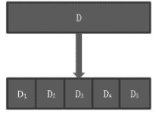
*Figure 2.14 划分为 5 个互斥子集*

**步骤 2：轮流验证**
共进行 5 轮实验，每轮留出 1 个子集做测试，其余 4 个合并做训练：
- 第 1 轮：测 $D_5$，练 $D_1\sim D_4$
- 第 2 轮：测 $D_4$，练 $D_1\sim D_3, D_5$
- …
- 第 5 轮：测 $D_1$，练 $D_2\sim D_5$

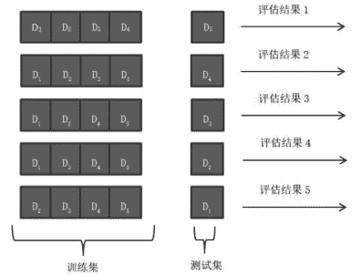
*Figure 2.15 5-Fold Cross-Validation 流程图*

**步骤 3：聚合结果**
将 5 轮的评估指标（如准确率）取平均，作为最终模型性能估计。

**细节：如何生成这 5 个折？**
正样本集 $D_P$ 随机均分为 $DP_1\sim DP_5$，负样本集 $D_N$ 同理均分为 $DN_1\sim DN_5$。
随机抽取一个 $DP_i$ 和一个 $DN_j$ 组合成第 $t$ 个折 $D_t$。从剩余池中继续抽取组合，直到凑齐 5 个折。这叫**“一次划分”**。

**进阶：重复 K 折**
一次划分仍有随机性偏差。工程上常做 **“10 次 5 折”**：重复上述“分层均分+轮流验证”流程 10 次，每次随机种子不同，最终得到 $10 \times 5 = 50$ 个评估值取平均。

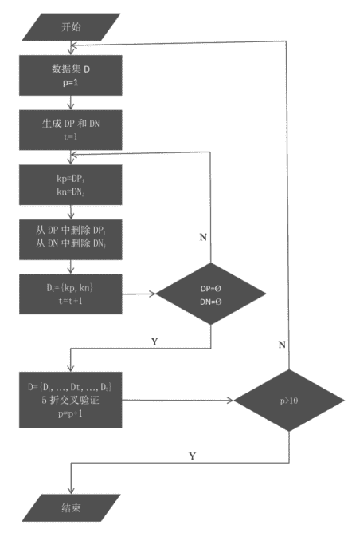
*Figure 2.16 10 Times 5-Fold Cross-Validation 示意图*

---

**总结**：
从简单的留出法，到分层抽样保分布，再到重复随机采样抗波动，最终到交叉验证最大化数据利用率——**划分策略的进化，本质是用更严谨的统计手段，逼近模型真实的泛化边界。** 实战中，小数据集首选重复 K 折；大数据集单次留出法或单次 K 折即可平衡效率与精度。

流程图演示了十轮五折交叉验证的过程；取这十次结果的均值，能有效稳定评估指标，从而在一定程度上规避因数据划分方式不同而引入的偏差。五折交叉验证自然可以推广为十折，更通用的形式被称为 K 折交叉验证。K 值越大，训练集越逼近完整数据集，训练出的模型也就越接近“理想模型”；但与此同时，子集划分的组合数激增，计算开销也会随之显著上升。

## 3. 模型选择与参数调优

### 3.1 学习算法与超参数

机器学习任务的核心在于两步走：**挑选学习算法**、**调优算法参数**。常见的算法阵营涵盖线性模型、支持向量机、决策树、神经网络、朴素贝叶斯、主成分分析、主题模型等。每种算法都自带一套参数配置体系，调整这些参数的过程，业界称为“参数调优”或“超参数调优”。参数组合的搜索空间极其庞大，调优的终极目标是锁定能训练出最优模型的那组参数。理论上可以穷举所有配置训练模型，但时间成本高得惊人。即便参数离散化，参数量一多，全排列训练也成了不可能的任务，更别提还有大量连续型参数。工程上的务实做法是：划定范围、设定步长，构建网格搜索空间。

以 LDA 主题模型为例，它有两个关键先验超参数：与主题数相关的 `alpha`（默认 1），与词表规模相关的 `beta`（默认 0.01）。若给 `alpha` 设定 `[0, 10]` 步长 1，`beta` 设定 `[0, 0.1]` 步长 0.01，两者各产生 10 个候选值，仅这两个参数的小范围组合就要评估 10×10=100 个模型。再看支持向量机，惩罚系数、核函数系数等超参数一旦超过 3 个，每种组合都对应一个需训练评估的模型，工作量呈指数级爆炸。此外，若搜索步长设得太粗，极易跨过性能最优的参数区间，导致“失之毫厘，谬以千里”。

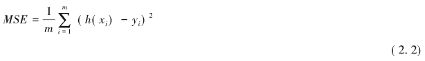

### 3.2 验证集与调优流程

参数调优需要一块“试金石”来验证各配置下的模型表现，因此数据集 `D` 必须三分天下：训练集 `P`、验证集 `V`、测试集 `T`。

以 PCA 的 `n_components`（主成分数）为例，候选集合 `|N_comps|={1, 2, 3... 100...}`。每个候选值 `n_components_i` 对应一个模型 `model_i`。流程如下：
1.  **训练**：模型 `model_i` 在训练集 `P` 上学习；
2.  **验证**：在验证集 `V` 上测算性能 `performance_i`；
3.  **择优**：对比所有候选模型性能，取最大值 `performance_MAX`，确定最优参数 `n_components_MAX` 及对应模型 `model_MAX`；
4.  **重训**：将训练集 `P` 与验证集 `V` 合并为新训练集 `P'`，让 `model_MAX` 在更大规模样本上再次训练，逼近真实分布。

总结来说：训练集练模型，验证集调参数，测试集则模拟真实用户环境，考察模型的泛化实力。

## 4. 回归任务性能度量

学习算法的适用性与学习器的性能指标，本质上都指向模型的**泛化能力**。评估学习器不仅需要度量手段，更需要客观的评价准则。不同准则往往导出截然不同的结论，单一指标很难断定模型优劣。在回归任务中，常用均方误差、均方根误差、平均绝对误差三把“尺子”来衡量。

设样本 `xi` 的预测输出为 `h(xi)`，真实值为 `yi`，验证集含 `m` 个样本。

### 4.1 均方误差

均方误差（MSE）量化的是预测值与真实值的偏离程度。计算逻辑：逐样本求平方差 -> 求和 -> 取平均：


验证集上的 MSE 形式与回归任务的损失函数如出一辙。训练时通过随机梯度下降最小化损失函数来学习映射 `h(xi)`。但 MSE 是模型输出的平方量级，**不利于直观感知模型效果**，尤其难以横向对比输出量级。比如某地去年人均可支配收入 10 万，预测明年收入若用 MSE 评估，误差值可能高达千万级，完全脱离直观认知。

### 4.2 均方根误差

为让评估量级与实测值对齐，引入均方根误差（RMSE）。计算逻辑：逐样本求平方差 -> 求和 -> 取平均 -> **开方**：

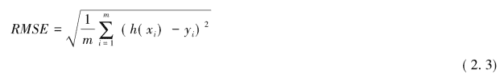

RMSE 数值上小于 MSE，量级回归了真实观测值。**缺点是对异常值极其敏感**。若收入数据中混入极端离群点，RMSE 可能飙升至百万甚至千万级。

### 4.3 平均绝对误差

为进一步压低评估数值、贴近实测量级，可用平均绝对误差（MAE）。计算逻辑：逐样本求绝对差 -> 求和 -> 取平均：

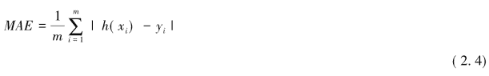

预测收入单位是“元”，输出均值 10 万量级；预测青少年身高单位是“厘米”，输出均值 150 量级。**量纲不同的任务，MSE、RMSE、MAE 绝对数值不可直接横向比较**。无论哪个指标，本质上都是带量纲的绝对值，**越接近 0 代表模型越精准**。

### 4.4 决定系数

# 决定系数（R²）：回归模型优劣的核心量尺

决定系数，通称 `R2`（R-square），是衡量回归学习模型拟合优度的关键相对指标。它的计算建立在两大核心概念之上：**残差平方和**（`RSS`，Residual Sum of Squares）与**总平方和**（`TSS`，Total Sum of Squares）。

*   **RSS**：反映模型预测偏差，即每个样本“预测值与真实值”之差的平方求和。
*   **TSS**：反映数据本身波动，即每个样本“真实值与平均值”之差的平方求和。

`R2` 的计算公式为：`1 - (RSS / TSS)`。

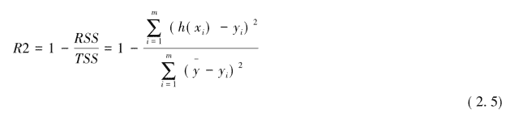

`R2` 通常落在 `[0, 1]` 区间。模型拟合越精准，RSS 趋近于 0，R2 逼近 1；反之，若模型毫无预测力（等同于直接用均值代替预测），RSS 与 TSS 接近，比值趋近 1，R2 便降向 0。

# 分类任务评估：为何准确率不够用？

## 准确率与错误率的“盲区”

在二分类或多分类场景中，错误率（误判样本占比）与准确率（正确判断样本占比）虽常用，却过于粗糙。错误率混淆了“将正类误判为负”与“将负类误判为正”两类错误；准确率则合并了“正类判对”与“负类判对”两类正确。实际应用中，我们常关心更细粒度的问题：**“预测为赢的案例，究竟有多少真赢了？”** 或 **“真赢的案例，模型捕捉了多少？”** 单靠整体准确率，无法回答这些问题。

举个例子：1000 个样本，胜负各半。
*   **模型 A**：500 胜全中 400，500 败全判为败。准确率 90%，错误率 10%。
*   **模型 B**：500 胜全中 450，但将 100 个败误判为胜。准确率 85%，错误率 15%。

单看指标，模型 A 胜出。但若业务侧重“尽量不错过任何胜诉案件”（类似刑事司法“宁可不抓坏人，不可冤枉好人”），模型 B 因漏判更少（FN 更低），反而更具实战价值。

## 查准率与查全率：检索视角的双重视角

借用信息检索领域的术语：
*   **查准率**：在模型“说是的”结果里，真正相关的占比。衡量**“信得过”**程度。
*   **查全率**：在所有“真正相关”的目标里，模型找回了多少。衡量**“找得全”**程度。

## 混淆矩阵：拆解分类结果的“显微镜”

混淆矩阵将预测类别与实际类别一一对应，构建四大核心指标：
*   **TP (True Positive)**：实为正，预测也为正。
*   **TN (True Negative)**：实为负，预测也为负。
*   **FP (False Positive)**：实为负，误判为正（虚警/第一类错误）。
*   **FN (False Negative)**：实为正，误判为负（漏报/第二类错误）。

总样本数 = TP + TN + FP + FN。二分类混淆矩阵结构如下：

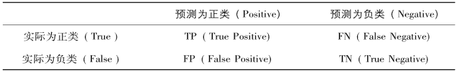

## 核心指标计算公式

以“用户关心的信息 = 正类”为前提：
*   **查准率** = TP / (TP + FP) —— 预测为正的样本中，真阳性的概率。
*   **查全率** = TP / (TP + FN) —— 实际为正的样本中，被成功召回的概率。

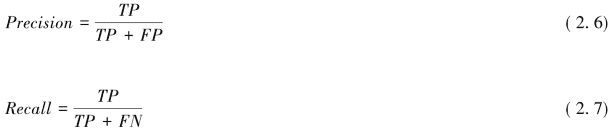

# 查准与查全的“跷跷板”博弈与 P-R 曲线

## 此消彼长的内在矛盾

查准率与查全率往往**相互制约**，难以同时最大化。

*   **激进策略（提升查全率）**：把所有案件全预测为“胜”。查全率拉满（FN=0），但查准率暴跌（FP 激增）。
*   **保守策略（提升查准率）**：仅对极高置信度案件预测“胜”。查准率上升（FP 减少），但漏掉的真胜诉案件变多（FN 增加），查全率下滑。

从公式看：提升查准需增 TP、减 FP；提升查全需增 TP、减 FN。调整分类阈值，本质是在 FP 与 FN 之间做权衡。

## 阈值扫描与 P-R 曲线生成

模型输出的是正类概率。按概率从高到低排序验证集样本，前部置信度高，后部置信度低。

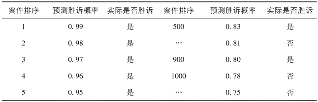

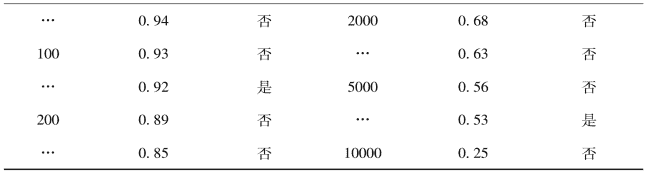

以排序位置为分界线：分界线前判“胜”（TP+FP），后判“负”（FN+TN）。每移动一步位置，即可计算一组 (查全率, 查准率) 坐标。
*   起始位：仅 Top1 判胜。若命中，查准=1，查全极低（如 0.01）。
*   终止位：全判胜。查全=1，查准跌至正样本占比（如 0.01）。
*   中间位：如前 100 个样本中 TP=50, FP=50，则查全=0.5，查准=0.8。

以查全率为横轴、查准率为纵轴连点成线，即得 **P-R 曲线**：

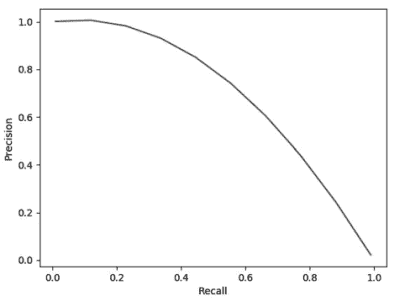

**图：P-R 曲线示意**

## 业务场景定乾坤：没有最好，只有最合适

*   **高查准诉求**：医疗信息搜索、垃圾邮件拦截。容错率极低，**“宁缺毋滥”**，哪怕漏掉一些，也不能让错误结果干扰用户。
*   **高查全诉求**：证据收集、疾病筛查、安检。核心是**“宁可错杀，不可放过”**，甘愿人工二次筛查成本，也要确保目标全覆盖。

模型评估的终局，不是追求单一指标极值，而是结合业务代价，在 P-R 曲线上寻找那个**最佳平衡点**。

要协调“精确率”（Precision）与“召回率”（Recall）这对相互制约的指标，通常引入综合度量指标来兼顾二者效能。当两者数值相等时，该平衡指标即等于精确率或召回率；若不相等，则取值介于两者之间。F1 分数便是精确率与召回率的调和平均数，赋予二者同等权重：

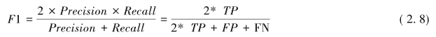

在信息检索领域，召回率与精确率针对“相关信息”与“无关信息”两类目标。它们分别刻画了模型对相关信息的覆盖面（召回率）与命中准度（精确率）。机器学习分类任务涵盖二分类与多分类两大类。在验证模型性能时，不能仅盯着正类或首类的召回与精确，而须全方位审视所有类别的表现。多分类任务的混淆矩阵如表 2.6 所示：

**表 2.6 多分类混淆矩阵**

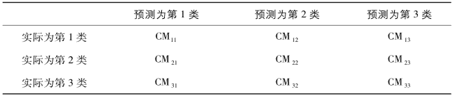

假设共有 `C` 个类别。对于类别 `Labelc`，其精确率定义为：被预测为 `Labelc` 的样本中，真实属于 `Labelc` 的比例。而其召回率定义为：真实为 `Labelc` 的样本中，被正确预测为 `Labelc` 的比例：

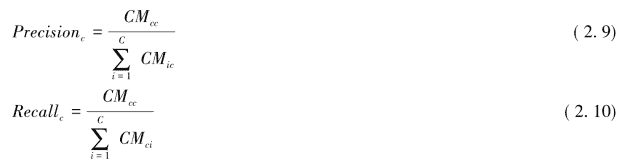

依据上述定义，逐一计算各类别的精确率与召回率，得到 (`Precision1`, `Recall1`)、(`Precision2`, `Recall2`)、…、(`Precisionc`, `Recallc`)、…、(`PrecisionC`, `RecallC`)。将所有精确率求平均得“宏精确率”（Macro-Precision），所有召回率求平均得“宏召回率”（Macro-Recall），二者的调和平均数即为“宏 F1”（Macro-F1）：

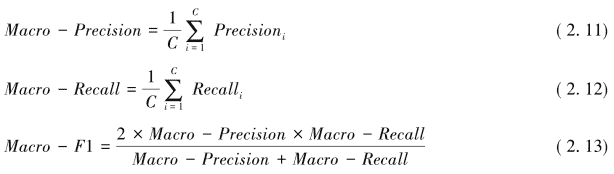

把每个类别的精确率、召回率及 F1 分值分别平均的评估方式，称为“宏平均法”（Macro-averaging）。另一种思路是基于混淆矩阵中预测输出与真实标签的对应值进行平均，称作“微平均法”（Micro-averaging）。将混淆矩阵对角线上的数值（即各类别预测正确的样本数）汇总平均：微精确率等于预测正确的样本数占所有预测样本数的比重；微召回率等于预测正确的样本数占所有真实样本数的比重。数值上，微精确率与微召回率是相等的：

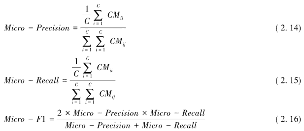

在 P-R 曲线中，分类器对样本的预测输出是一个概率值。设定阈值：预测概率高于阈值判为正类，低于则判为负类。神经网络与逻辑回归的输出均落在 (0, 1) 区间，常以 0.5 为界。若按预测概率从高到低排序测试样本，靠前的更可能是正例，靠后的更可能是反例。分类器需确定一个截断点，截断点前输出正类，后输出负类。截断点越靠前，被判为正类的样本越“纯”，精确率越高，但正类样本量少，易漏判真实正例，导致召回率下降；截断点越靠后，纳入正类的样本越多，召回率升高，但混入负例增多，精确率随之下降。因此，测试样本预测概率的排序序列，整体反映了不同截断点下的精确率与召回率表现。

`ROC`（受试者工作特征曲线）源自信号检测理论，机器学习借用它来表征概率预测结果的整体泛化能力。将样本按预测概率从大到小排序，依序选取截断点。在 P-R 空间里每个截断点对应精确率与召回率；而在 ROC 空间里，对应的则是“真正例率”（TPR）与“假正例率”（FPR）。

真正例率（TPR）指分类器成功预测为正类的样本占所有真实正类样本的比例。假正例率（FPR）指分类器错误预测为正类的样本（实为负类）占所有真实负类样本的比例：

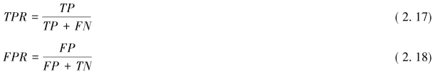

本质上，真正例率 TPR 即正类的召回率。TPR 越大，被正确识别的真实正例越多；FPR 越大，被误判为正例的真实负例越多。若分类器输出的是正类概率，通过调整阈值划分正负类，即可算出一组 (FPR, TPR) 值。以 FPR 为横轴、TPR 为纵轴，每组值对应平面上一点。阈值为 1 时，全判负类，TPR 与 FPR 均为 0。阈值首次下降，高概率样本被判正类，这批样本大概率为真正例，TPR 快速上升，FPR 缓慢增长。阈值继续降至 0.5 左右，更多样本被判正类，真正例继续增加但增速放缓，假正例增加且增速加快，TPR 增长趋缓，FPR 增长加速。阈值逼近 0 时，全判正类，所有正负例均被判为正类，TPR 与 FPR 均达 1。随着 FPR 增大，TPR 单调递增，故 ROC 曲线是在 [0, 1] 区间上单调递增的 (FPR, TPR) 曲线。`AUC`（曲线下面积）为 ROC 曲线下方面积。在 FPR 较小（阈值较高）区域，对应 TPR 越大的分类器性能越优；AUC 数值越大，分类器综合性能越强。

## 2.8 学习路线图

# 机器学习实战全流程：从数据清洗到模型落地的避坑指南

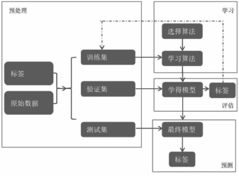

**图示 2.18 标准建模路线图**

上一节我们梳理了机器学习的基石概念，现在聚焦其标准化作业流程。这条“流水线”由四大核心环节串联：数据预处理、模型训练、模型评估、新数据预测。

**数据预处理：最耗时也最关键的“地基工程”**

别被“预处理”二字误导，它往往吞噬项目 80% 的工时。原始数据多源自历史积累，首要任务是**多源融合**。接着得处理三大“顽疾”：
*   **缺失值**：补齐而非简单丢弃；
*   **异常值**：视业务场景决定删除还是替换；
*   **多分类特征**：稀疏化编码是标准动作。

但预处理的“皇冠上的明珠”是**降维**。将高维原始空间映射到低维新空间，分两条路：
1.  **特征选择**：在原特征集里“减法”，剔除噪音特征。代价是信息损失较大。
2.  **特征提取**：做“映射变换”（如 PCA），将原空间投影到新空间。信息保留更完整，效率更高。

做透这步，能剔除采集噪音、精简特征空间，直接决定模型性能上限与训练速度。

---

### 没有银弹：诺奖理论与“锤子钉子”效应

实际落地中，面对千差万别的业务诉求，**“没有免费午餐”定理（NFL）** 告诉我们一个残酷真相：脱离具体场景谈算法优劣毫无意义，甚至不如掷骰子靠谱。

俗话说“手里只有锤子，看什么都像钉子”。不存在万能分类器，也不存在脱离应用场景的最优算法。**每个分类器自带归纳偏置**，只有当假设空间与问题域匹配时，它才有效。因此，**工程实践的铁律是：针对特定问题、特定数据分布，必须横向对比多算法**，选最优解，而非迷信某单一模型。

---

### 模型评估与选择：把“验证集”用对，别让超参“跑偏”

对比算法前，先定**评价指标**（如准确率、F1、AUC）。数据集划分有讲究：
*   **训练集**：练模型；
*   **测试集**：大考，仅用于最终汇报泛化能力，**严禁用于选模型/调参**；
*   **验证集**：从训练集中再切一块出来，专门用于**模型选择与超参调优**。

**超参数 ≠ 模型参数**。它不是从数据学来的，而是我们手中的“调节旋钮”（如风扇档位）。不同算法包的默认参数通常不适配你的任务，必须通过验证集网格搜索/贝叶斯优化等方式反复调试，直到达标。

---

### 终局：泛化能力验证与“数据泄露”红线

流程跑通后：在验证集表现最优的模型晋升为“最终模型”，拿测试集做**最后一战**，估算其在真实环境中的泛化表现。达标则上线服务。

**⚠️ 硬核避坑指南（必读）：**
所有预处理参数（均值、方差、PCA 投影向量、归一化系数等）**必须仅在训练集上拟合**，随后**原参数不动**直接应用到验证集、测试集及新样本。

*反例警示*：若在全量数据上做 PCA 再划分，或测试集单独拟合 PCA，坐标系对不上，方差最大化方向错位，评估指标全是“虚高”的假象——这是典型的**数据泄露**。

---

### 完建模闭环：一张图看懂标准迭代流

1.  **原始数据** → 清洗（补缺失、去噪、除异常）+ 打标签 → **干净数据集**；
2.  **切分**：训练集 / 验证集 / 测试集（分层抽样保分布）；
3.  **候选算法池**：按数据类型/分布选定若干（如树模型、线性模型、神经网络）；
4.  **循环赛马**：
    *   取候选算法 A → 训练集训练 → 验证集评分 → 记录；
    *   切换算法 B → 重复上述步骤……直至遍历候选池；
5.  **选冠军**：综合验证集指标选最优模型；
6.  **大考**：测试集评估泛化误差 → 上线/迭代。

---

# 第三章 深度解析法律文本

法律文本不是新闻稿，也不是朋友圈文案。它是为**精准表达法律概念、规范法律实务**而生的专业语料体系。

## 3.1 法律文本的语言基因

### 3.1.1 法律文本来源画像

### 法律文本的语言特征与形态解析

法律文本的语言面貌深受其渊源制约，因此厘清法源归属是解读法律语言的前提。普通法系与大陆法系（成文法系）的渊源构成截然不同。在部分普通法国家，正式渊源涵盖判例法与成文法。判例法以既往裁判为后续判决基石，居主导地位；成文法则指国家制定、体现国家意志的规范性法文，多扮演补充、解释或重述判例的角色。非正式渊源则包括习惯、公序良俗及政府公共政策等。

相比之下，大陆法系国家的法律多由立法机关制定，行政机关制定部门规章。以中国为例，法律渊源层级分明：全国人大及其常委会制定的法律（称“通则”、“法”等）；国务院制定的行政法规（称“条例”）；国务院部委制定的部门规章（称“规程”、“办法”等）；地方人大制定的地方性法规（称“规定”）。例如《民用航空法》属法律，《民用航空安全保卫条例》属行政法规，《中国民用航空安全检查规则》属部门规章，《浙江省无人驾驶航空器公共安全管理条例》则属地方性法规。

从词汇构成维度审视，法律文本句子融合了通用语词与特定语境下的法律术语。以“妻子”为例，在法律文本中仍属通用词汇；而“未成年人”则是专门法律术语，特指不满十八周岁群体。英语中“Writ”系法律专用词，指令状或书面法律命令；“Real estate”作为法律术语指代土地及其地上附着物的财产权概念，区别于泛指房屋建筑的通用词“house”。法律术语是法律文本中具有特定涵义、专门定义的最小固定单元，不可随意拆分——“法人”不可再分，“Real estate”亦不可拆为“real”与“estate”。按内部构词方式，法律术语可归类为动宾、偏正、主谓、联合、补语等结构类型。

### 3.1.2 法律文本的形态学透视

**形态学**作为语言学分支，聚焦词的构成与生成机制。**词**是句法层面能独立运用的最小单位；**语素**则是形态学层面最微小的语言单位，位于词之下一级。

汉语语素多源于单音节汉字，少数为双音节复合语素。如“笔”可组“笔筒”“毛笔”等通用词；双音节语素“豆腐”衍生出“豆腐脑”“臭豆腐”等众多词汇；法律领域“诉讼”可构建“诉讼当事人”“诉讼代理人”等术语。英语语素通常呈现为词的组成部分：通用词“house”含单一语素，“houses”含“house”与“-s”两个语素；法律词“writ”同理，“writs”则含两个语素。**词干**虽也是词的一部分，但可接纳其他语素或词缀扩展。如“pack”为词根，加前缀“un”成“unpack”，后者即为词干。

语法层面的分析任务即**形态学分析**，旨在拆解词的语素构成，识别最小语义构件。语素作为不可再分的语言符号，兼具形式与义。以英语“Unmoralized”为例，含`un`、`moral`、`ize`、`d`四个语素，理解该词需掌握四者形式义。语素亦称**词缀**，分**前缀**、**后缀**、**中缀**三类。前置于词干前为前缀，如“untidy”中“un”表否定；后置于词干后为后缀，如“acceptable”中“able”表能力；插入词干内部为中缀，罕见多用于化学命名，如“pipecoline”中“pe”表全氢化。语素与形态学分析示意见图 3.1。

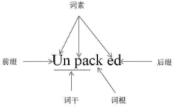

**图 3.1 语素与形态学**

图 3.1 从语素角度剖析通用词“Unpacked”：“pack”义为包装，构词核心，居语素主导位，称**词根**；“un”前置表逆向动作，称**前缀**；“unpack”占据词之主体，称**词干**，义为拆封/打开，决定词之主旨义；“ed”后置标过去/状态，称**后缀**。综合研判：“Unpacked”意指先打包后拆封之状态，直义为“已打开”。

再以法律词汇“Undefended”剖析：“defend”义为辩护，法律上指被告方为减责或免责提出有利事由证据，含反驳控诉、答辩等行为。前缀“Un”表放弦、豁免或不实施某行为；词干“Undefend”即放弃辩护/不抗辩；后缀“ed”标示已发生的过去时/结果状态。合成义为：形容词性的“无辩护/不争辩”；不争辩缘由多元，如被告缺席、不认罪答辩、未提交辩护状等。衍生术语包括“Undefended case”（无辩护案件）、“Undefended divorce”（无抗辩离婚）、“Undefended lawsuit”（无抗辩诉讼）等。

# 词与词素：自然语言处理的基石

在句法结构中，**词** 是能被提取出的最小形式单位，同时也是最小语义单位。不过，初学者常把“词”和“词素”混为一谈。二者虽关系紧密，但界限分明：**词能独立出现**；词素则不然，有的能独立（如词根），有的必须依附他人（如词缀）。

以 *cases* 为例，*case* 单复数均可独立成词；拆解来看，*case* 是词根，自带实义；*s* 却只能做词缀，标注复数或三单，自身无实质语义。

---

## 自由与粘着：词素的两大阵营

按能否独立成词，词素分为**自由词素**与**粘着词素**。

*   **自由词素**（如 *air*、*line*）：无需依附，自成一词。两者组合成合成词 *airline*（航空公司），语义却与短语 *air line*（航线/空中管道）大相径庭——这就是合成词“整体大于部分”的魅力。
*   **粘着词素**：必须挂靠词根，细分为**屈折词素**与**派生词素**。

### 屈折词素：语法的“标签贴纸”

屈折词素均为**后缀**，不改变词性与核心义，只打语法标签（数、时、格、级）。英语仅有 8 个：

| 后缀 | 功能 | 例词 |
| :--- | :--- | :--- |
| *'s* | 名词所属格 | *lawyer's* |
| *s* | 名词复数 / 动词三单 | *defendants* / *defends* |
| *ing* | 动词现在分词 | *defending* |
| *ed* | 动词过去式/过去分词 / 形容词 | *defended* |
| *en* | 动词过去分词 | *taken* |
| *er* | 形容词/副词比较级 | *faster* |
| *est* | 形容词/副词最高级 | *fastest* |

> **关键点**：*defendants* 中的 *s* 仅把 *defendant* 变复数；*defended* 中的 *ed* 让 *defend* 变过去式或形容词。词性或核心义未变，只是语法属性变了。

### 派生词素：造词的“魔法积木”

派生词素（前缀/后缀）能**改变词性、反转语义、创造新词**。

*   *undefendable*：**un-** (否定) + **defend** (词根) + **-able** (动→形) = “无法辩护的”
*   *biweekly*：**bi-** (二/双) + **week** (词根) + **-ly** (名→形) = “双周的”

*un-* 取反义，*bi-* 表双倍——派生词素让词汇量指数级扩展。

---

## 词干 vs 词根：一刀切的层级关系

以 *unpacked* 为例剥洋葱：
1.  去屈折后缀 *ed* → **unpack** 是**词干**
2.  去派生前缀 *un* → **pack** 不可再分 → 这是**词根**

结论：
*   自由词素对应的词干 = 词根
*   派生词构成的词干 ≠ 词根

---

## 3.1.3 实战工具：NLTK 与 Polyglot

### NLTK PorterStemmer：基于规则的“归并利器”

搜索引擎常用**词干提取**召回文档。用户搜 *defendant*，系统提取词干 *defend*，同时命中 *defendant* 与 *defendable* 相关页面。

`PorterStemmer` 提供两条路：
1.  **巨型词典映射**：准但维护成本高；
2.  **规则归纳法**：覆盖面广、极少报错、工程首选。

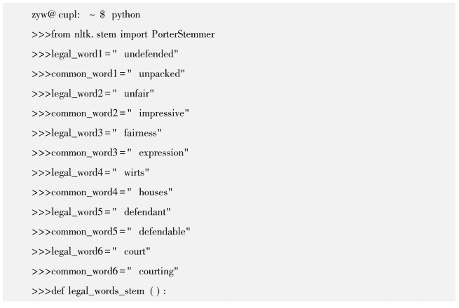

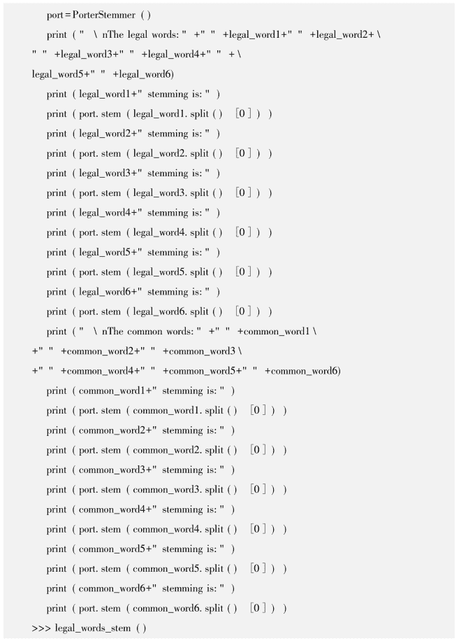

运行结果见下图。**注意**：*houses* 的词干 *hous* 并非合法单词——**词干提取不等于还原原形，目的是把同源异形词归到同一桶**，便于下游 NLP 任务。

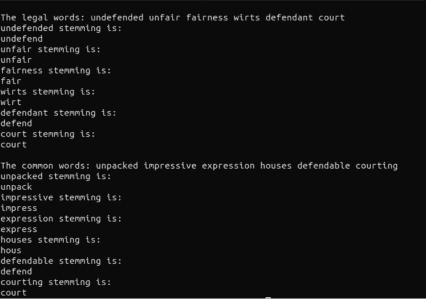

**图 3.2　NLTK 词干提取示例**

---

### Polyglot Morfessor：无监督发现“语言基因”

想把词拆成最小语义单元（词素）？`Polyglot` 内置多语言训练好的 `morfessor` 模型，每语言取 5 万高频词无监督训练，专治词形变化复杂的场景。

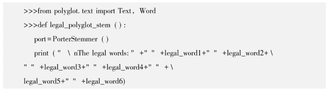

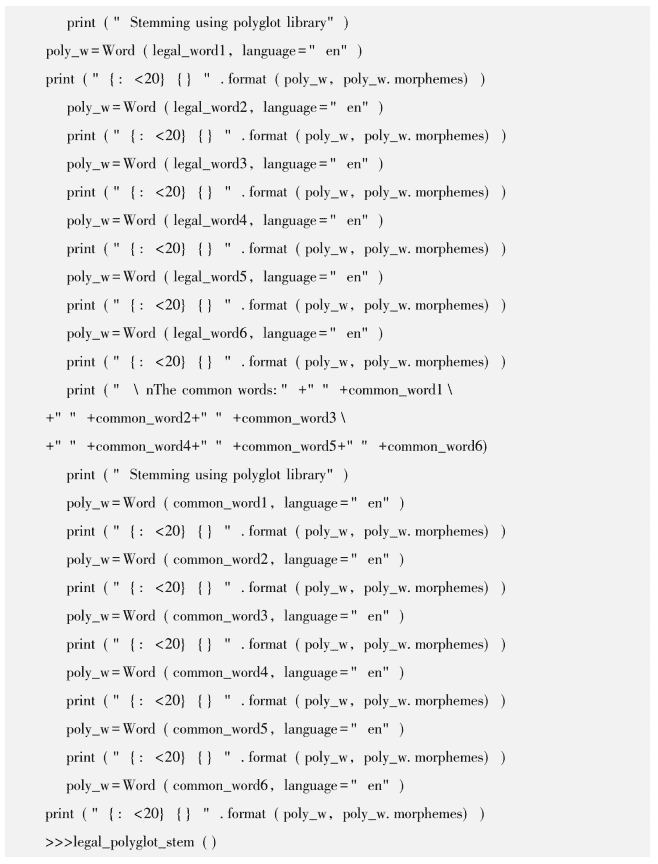

输出如下图：
*   *defendant* → `defend` + `ant`（法律术语后缀）
*   *defendable* → `defend` + `able`（形容词后缀）

同源词根 *defend* 共享，后缀不同揭示**词性、数、时**差异——这正是词素分析的核心价值。


**图 3.3　Polyglot 词素分析示例**

---

## 3.2 法律文本词法分析

### 3.2.1 词法分析

精准理解自然语言文本，奠基于词法分析。简单说，词法分析就是将一段文本切分为词汇、短语及其他有意义单元的过程。以英文为例："A process is used to select jurors by a judge or counsel"。英文分词通常以单词为单位，但英文存在一词多性现象，要准确把握词义，必须结合其在句法结构中的位置与功能。英文单词间有天然分隔符，分词相对容易。反观中文，文本连续书写，词与词之间无明显界限。例如："该案法官和律师按照程序挑选了一些陪审员"。中文分词的核心任务在于确定词界，常用 "/" 标注切分结果，如 "该案/法官/和/律师/按照/程序/挑选了/一些/陪审员"。

文本中常夹杂具有特定指代意义的名词或短语。例如英文 "License is required for sale of nursery stock by Act 189 of 1931"，若将 "Act 189 of 1931" 生硬拆为 "Act/189/of/1931" 四个词，显然不妥。该字符串是一个语义不可分的整体，指代 1931 年颁布的第 189 号法案。这类特殊名词被称为**命名实体**。在自然语言中，命名实体的地位与作用远超一般句子成分，往往承载着核心信息，也是信息检索中寻找的答案所在。同理，"nursery stock"（苗木）亦是语义整体，拆分为 "nursery/stock" 会严重偏离原意。

再看中文法律文本："依据《中华人民共和国刑法修正案 (九)》的相关规定，检察院以涉嫌盗窃罪对犯罪嫌疑人钱某作出批准逮捕决定"。分词结果可能为："依据/《中华人民共和国刑法修正案 (九)》/的/相关规定/，/检察院/以/涉嫌盗窃罪/对/犯罪嫌疑人/钱某/作出/批准/逮捕/决定"。其中 "刑法修正案 (九)" 不可拆为 "刑法/修正/案/(九)"。此处 "《中华人民共和国刑法修正案 (九)》" 即为命名实体，在法律文本中属于法条依据，也是法律 NLP 任务（如领域分类、问答、自动摘要、检索）中的关键信息点。

词法分析的输出，是将文本转化为一系列语义完整的词汇或短语序列。通过对语言基本单元的定位，实现灵活的切分粒度，兼顾粗粒度的语义完整性与细粒度的词级颗粒度。针对中文法律文本，依托法律专业术语与词表，将连续文本切分为法律语义下完备合理的词序列；处理英文法律文本时，则需保证特殊命名实体作为整体输出至序列中。

### 3.2.2 词性标注

句子中的词汇承担着不同的角色与位置。在句法结构中，处于同一位置的词通常归属同一**词性**。词性是指具备相同语法属性的一类词汇总称；同一词性的词在句中表现出相似的性质、活动规律或行为模式。

以中文为例：
*   句句："原判根据相关的证人证言认定被告具有非法占有的主观故意"。其中 "原判/证人证言/被告/主观故意" 属名词；"认定/具有" 属动词；"相关的/非法占有的" 为限定语/修饰语；"根据" 为介词。
*   句句："王某以欺骗的方式非法占有他人巨额财物"。"王某/方式/财物" 为名词；"占有" 为动词；"他人" 为代词/限定语；"欺骗的/巨额" 为形容词；"非法" 为副词；"以" 为介词。
*   句句："张某通过编造的谎言欺骗物业公司管理人员"。"张某/谎言/物业公司/管理人员" 为名词；"欺骗" 为动词；"编造的" 为形容词；"通过" 为介词。

上述例子揭示了同词异性现象："占有" 在第一句作修饰语，在第二句作动词；"欺骗" 在第二句作形容词，在第三句作动词。

英文词性体系包含名词、动词、形容词、副词、冠词、数词、介词、代词、限定词，此外还有连词与感叹词。
*   例句："the jury has easily reached a consistent verdict on this issues submitted to the court for determination"。名词：jury/verdict/issues/court/determination；动词：has/reached/submitted；形容词：consistent；冠词：the；数词/冠词：a；介词：on/to/for；代词：this；副词：easily。
*   例句："I am the public defender appointed to your case"。代词：I；动词：am/appointed；冠词：the；形容词：public；名词：defender/case；介词：to；限定词：your。

### 3.2.3 Token 输出机制

构建文本时，输入端是字符流或字符序列。从人类语言视角看，词作为基本单位，其字符串长度不定。要从文本字符流中识别出词，必须预先定义词对应的子序列；词即具有独立含义的字符串。**Token（记号/标记）** 可视为词典中词的对应项。**Tokenization（分词/标记化）** 指将全文本字符流切分为子序列的过程；这些子序列即 tokens，每个子序列在词典中的索引位置称为 term。

词、token 与 term 在大多数语境下含义一致，严格区分则有别：
*   **词**：语言学范畴，指人类语言使用过程中形成的语言单位。
*   **Token**：信息检索范畴，指文本中出现的、与词形式一致的字符串实例。
*   **Term**：词典范畴，指形式相同但义项不同的 token 集合，即同形异义 token 的聚合类。

举例说明：输入英文法律文本序列 "According to legal documents，a judge will serve with a summons or writ to show an administrator’s right to control of assets"。依据词典分词，输出子序列："According/to/legal/documents/，/a/judge/will/serve/with/a/summons/or/writ/to/show/an/administrator/’s/right/to/control/of/assets"。共 24 个 token（含 1 标点、3 个 "to"、2 个 "a"）。去除标点并合并同形 token 后，词条数为 20。若再剔除 "to"、"a" 等高频虚词，剩余 18 个词即为 terms。

# NLP核心基建：从分词到句法树的实战避坑指南

## 3.2 文本预处理的“刀工”细节

### 中文分词：没那么简单的“切菜”

咱们先看个法律文本的实例：`"在协议签订后，委托双方认可的有资质的资产评估机构对甲方投入的资产进行评估"`。按字典切分，能出来 22 个片段（含 1 个标点、3 个“的”、2 个“资产”）。去重、去标点后剩 18 词；若再把高频虚词“的”当停用词干掉，落地为**术语**的就剩 17 个。

**流程拆解**：
1. **断句**——靠句末标点（。！？等）定边界；
2. **切词**——中文无显式分隔符，需结合词典、统计模型或深度学习判断词边界；英文靠空格天然分隔，但连字符 `-`、撇号 `'` 等符号处理极易翻车。

#### 英文符号的“三种命运”
| 符号 | 场景 | 切分策略 |
|------|------|----------|
| 连字符 `-` | `Wi-Fi`（合成词） | **不切**，输出 1 token |
| 连字符 `-` | 行尾断词 `long-` `distance` | **合并**为 1 token |
| 连字符 `-` | `long-distance`（短语合成） | **切开**为 2 token |
| 撇号 `'` | `man’s`（所有格） | 切为 `man` + `'s`（2 token） |
| 撇号 `'` | `don’t`（缩略） | **不切**，输出 1 token |

---

### 停用词：别让高频虚词“吃算力”

信息检索里，`the`、`的`、`a` 这类**停用词** 与主题相关性极低。预定义表或数据集高频词表均可作来源，大表几百条、小表十来条。过滤后能显著降低存储与计算开销。

---

### 归一化：把“同义异形”拉成同一术语

**词干提取** 粗暴直接：不管词性、语境，同义词强行归一类。  
**词形还原** 精细得多：依词性、语境还原词形——`am/is/are/was/were → be`，`better/best → good`。

---

## 3.2.4 双库实战：Polyglot 与 NLTK 的断句切词对决

NLP 处理粒度自大到小：**语料/文档 → 段落 → 句子 → 词 → 字符**。  
文件≈文档，段落靠 `\r\n` 分隔，句子靠 `.` + 空格/制表符 `\t` 切分。

### Polyglot：靠“句号+空格”活着

```python
# 伪代码示例
from polyglot.text import Text
text = Text(legal_content)
sentences = text.sentences   # 依赖 ". " 分句
words = text.words           # 空格、制表、逗号、句号作分隔
```
- **正确案例**：句末 `.` 后有空格 → 3 句精准切出（见  ）。  
- **翻车案例**：删掉第 2、3 句间空格 → `up.The` 被误判为缩写，前两句合并（见 ）。

切词输出 51 项（45 词 + 5 标点 + 1 特殊符），含 `10-2`（票数）、`man’s`（未切分）等细节（见  ）。

### NLTK：规则更细、切词更“碎”

```python
from nltk.tokenize import word_tokenize
tokens = word_tokenize(legal_content)
```
- `man’s` → `man` + `'s`（2 token）  
- `10-2` → 整体保留（1 token）  
- 分隔符含空格、制表、逗号、句号、引号，**不含连字符 `-`**  
- 输出 50 项，去标点 45 词（见   ）。

#### 词形还原实测
```python
from nltk.stem import WordNetLemmatizer
wnl = WordNetLemmatizer()
```
- 系动词各形态统一归 `be`  
- `running` 作动词 → `run`，作名词 → `running`（保留原形）  
- 同理 `meeting`（动词“遇见”/名词“会议”）词性决定还原结果

---

## 3.3 法律文本句法分析：给句子装“骨架”

### 3.3.1 两大核心动作
1. **形式化语法规则**——用规则定义合法句式、词性标注体系；  
2. **解析生成语法树**——自顶向下/自底向上/混合策略构树。

知识库三件套：**形式化规则 + 词典 + 术语表**（词法阶段已合并同义词）。

### 3.3.2 语法树长啥样？

英语核心骨架：**S → NP + VP**（主语名词短语 + 谓语动词短语）。  
常用标记：`S` 句子、`dp` 限定短语、`d` 限定词、`np` 名词短语、`vp` 动词短语、`v` 动词。

**实战**：`the policeman arrested the thief`  
用 `nltk.tree.Tree()` 定义 CFG 规则，可自顶向下、自底向上或混合生成树（见   ）。

- **自顶向下**：根节点 `S` → 规则展开 `dp1` `vp` → 递归替换中间节点 → 叶节点落词。  
- **自底向上**：从词级合并短语，逐层归约至 `S`。  
- **混合**：结合两者优势，工程落地最常用。

---

> **一句话总结**：分词断句是“切菜备料”，停用词过滤是“挑掉菜渣”，归一化是“统一规格”，句法树才是“摆盘成菜”——每一步偏差，最终端上桌的语义大餐都会走味。

# 自底向上构建句法树：从词汇到根节点的推演

与自顶向下的策略截然不同，自底向上分析从句子的最小单元——词条出发，层层向上归约。以具体句子为例，首先识别出匹配 `the policeman` 的规则 2，利用其左侧非终结符 `dp1` 完成首次归约；随后匹配 `arrested` 对应的规则 3，因其中包含待归约节点 `dp2`，故暂存该规则；紧接着规则 4 匹配 `the thief`，引入 `dp2` 完成归约；随即回过头用 `vp` 归约先前暂存的规则 3；最终，规则 1 将一切汇聚，生成树根节点 `s`。这一过程的核心在于不断重复“规约”动作，直至抵达根节点。

在 `nltk` 工具包中，`CFG` 模块借助 `fromstring()` 方法即可灵活定义上下文无关文法。每行字符串代表一条产生式，`->` 标识推导关系，`|` 分隔可选分支，`PP`、`P`、`N`、`Det` 等符号分别对应介词短语、介词、名词、限定词等语法范畴。针对句子 `the defendant robbed a car`，构建文法并送入解析器后，即可输出完整的句法生成树。对比 `nltk.tree` 直接构树的方式，`CFG` 以字符串声明规则，形式更简洁，扩展性更强。


运行结果见图 3.11，直观展示了从文法定义到树形结构生成的全流程。


图 3.11 nltk CFG 句法分析输出示意

## 3.4 法律文本语义解析与消歧

### 3.4.1 语义分析：从词到篇章的层层递进

词法分析切分出词条，而语义分析则赋予词条以意义。其研究对象极广，凡涉及自然语言理解皆在其列。法律文本语义理解需穿透三层：词汇字面义、句法结构义、上下文语境义。按颗粒度划分，可分为词级、句级、篇章级三个维度。

**词级语义**聚焦词汇内部及词际关系。词语表示形式多样（词、词素、词缀、复合词、短语），语言的多样性导致同义词（如 house/building/real estate 均指“房屋”）与多义词（如 bank 兼具“银行”与“河岸”）普遍存在。法律领域独有的**上下位概念**构成特殊语义层级：`cars、stocks、deposits、real estate` 等具体财产形态属下位概念，`property` 为上位概念。这种泛化与实例的关系直接影响法律适用——房屋交易纠纷中，视其为普通财产适用《合同法》，视为特定不动产则适用《物权法》。

**句级语义**以句法树为骨架。结构歧义是核心挑战：`the police controlled the defendant with a gun` 中，介词短语 `with a gun` 既可修饰 `defendant`（持枪被告），亦可修饰 `controlled`（警方用枪控制）。机器学习可辨析最优结构。此外，文本蕴含（前句为真能否推导后句为真）、语义角色标注（标识施事、受事、时、地等浅层语义）均属句级任务，广泛服务于问答与信息抽取。

**篇章级语义**跨越句界，在上下文长链条中消解歧义。`the head controlled the man with arms` 中，`head`（头/首领）、`arms`（胳膊/武器）的指向全赖语境。法律术语 `plaintiff、appellant、accuser` 虽同含“告”义，但反义词对揭示其严格区分：`plaintiff` 对 `defendant`（初审被告），`appellant` 对 `respondent`（被上诉人），`accuser` 对 `the accused`（被指控人）。指代消解同样棘手：`The plaintiff borrowed the car and navigation from the defendants, and he returned it to one of them later` 中，`it` 究竟指 `car` 还是 `navigation`，前文线索不足以判断，造成指代模糊。

### 3.4.2 消歧技术路线：从词典到深度学习

**基于词典的无监督消歧**以覆盖度计算为核心。`WordNet`（英语认知词典）与 `HowNet`（中文知网）均标注词义项及其典型共现语境。算法对比“待消解词及其上下文”与“词典中各词义项及其释义上下文”的重合程度，选取覆盖度最高者。短板在于词典释义若过于简短，覆盖度普遍偏低，效果打折。

**有监督消歧**将任务建模为分类问题。依托语义标注语料，提取三维特征：词汇特征（窗口内词及词性，如前 3 后 2）、句法特征（消解词所在成分类型：动宾、介词短语、主语中心语等）、语义特征（命名实体类别：地名、机构名、人名等）。模型性能上乘，但高度依赖昂贵的人工标注数据。

**半监督与深度学习消歧**打破标注瓶颈。少量种子语料引导大规模无标注数据挖掘语法搭配与语义强度。深度学习（如 `word2vec`）在海量语料上预训练，词向量内隐蕴含丰富上下文语义，经微调或直接用于最近邻搜索，即可实现高精度消歧，逐渐成为主流范式。

# 第 4 章 法律文本主题建模

## 4.1 法律文本术语体系

### 4.1.1 三层术语谱系

法律文本词汇可分三类：**日常用语**（劳动、计算机、汽车等通用词）、**临时法律术语**（原为常用词，入法赋予特定法律效力，如“应当”表强制义务、“可以”表裁量权限）、**法律术语**（法学专有名词）。预处理阶段，向量空间模型（VSM）构建需区分三类词汇，分别建模；为简化实验，后文将前两类合并为“一般性词语”，与“法律术语”二分建模。

### 4.1.2 术语内部构词逻辑

法律术语多为合成词，分**派生词**与**复合词**。

*   **派生词**：核心词素 + 携带词性/语法功能的词素。常见后缀构词：
    *   表权利：`名誉权、商标权、财产权、辩护权…`
    *   表人员：`控告人、辩护人、代理人、监护人、审判员、陪审员…`
    *   表文书：`起诉书、判决书、决定书、执行书、仲裁申请书…`

*   **复合词**：两个以上词素并列，按语义关系细分六大类：
    *   **联合式**：义近或义反词素并列（`询问、收养、征收、管制、冻结、判决、过错、过失、证据、瑕疵…`）
    *   **偏正式**：前修后。定中式（`主犯、从犯、主刑、书证、物证、定金…`）、状中式（`假释、代理、签订…`）
    *   **动宾式**：动作 + 受体（`抗诉、立案、上诉、举证、立法、减刑、投标、招标、要约、量刑、违约、听证…`）
    *   **述补式**：后补前（`侦破、驳回…`）
    *   **主谓式**：主体 + 陈述（`自首、民主…`）
    *   **连动式**：前一动作接后一动作（`收养、扭送、送达、拘留、提存…`）

### 4.1.3 九大部门法核心术语库（精选三法）

按调整社会关系分类，法律术语归属九大部门法。研究聚焦与民生紧扣的**诉讼法、民法、刑法**三大核心词库（全量见附录 A）：

*   **诉讼法词汇**：覆盖全流程程序名词——`案由、立案、传票、开庭、举证责任、抗诉书、卷宗、认定事实、送达、撤诉…` 及主体角色——`法官、陪审团、辩护律师、公诉人、检察官、目击证人、利害关系人…` 以及措施结果——`逮捕、批捕、缓刑、保释、判决、上诉、再审、引渡…`
*   **民法词汇**：围绕主体资格、权利体系、行为规则、责任承担——`法人、代理、合同、监护人、继承人、违约金、抵押权、债务人、意思表示、完全行为能力、表见代理、时效中止、法律规避、违约责任…` 及法源渊源——`制定法、判例法、公序良俗、诚实信用、等价有偿…`
*   **刑法词汇**：聚焦犯罪构成要件、责任原则、刑罚体系——`罪刑法定、故意犯罪、过失、正当防卫、紧急避险、未遂、中止、累犯、管制、拘役、没收财产、减刑、谋杀、抢劫、敲诈勒索、取保候审…` 及理论范畴——`犯罪主体/客体/主观/客观方面、行为犯/结果犯…`

> **文本表示流程**：分词剔除法律术语后，依 VSM 向量化，经特征筛选保留通用词汇，构建**通用词典**；通用词典与**法律术语词典**合并，形成最终**文本表示词典**。

## 4.2 法律文本主题特征

### 4.2.1 部门法维度的主题天然分层

互联网爆发式增长使海量法律文本在线化，主题建模愈发关键。法律术语天然携带“部门法”标签：同一调整对象（社会关系）下的术语归属同一部门法，形成天然主题簇。按部门法分类，主题词汇清晰可辨：

*   **宪法类**：`国家结构、政体、根本大法、罢免权、选举权…`
*   **刑法类**：`犯罪、累犯、缓刑、假释、没收财产、有期徒刑、单位犯罪…`
*   **民法类**：`法人、代理、合同、监护人、继承人、违约金、抵押权、债务人…`
*   **程序法类**：`证人、证言、上诉、回避、讯问、仲裁、公诉、终审、管辖权…`
*   **行政法类**：`行政行为、行政主体、行政复议、简易程序、行政处罚…`
*   **国际法类**：`主权、条约、豁免权、国民待遇…`

这种显性分类结构为法律文本主题建模提供了极佳的先验知识与评价基准。

### 法律术语怎么分类？这份主题与功能维度的全景图请收好

法律术语绝非杂乱无章的词汇堆砌，其背后藏着严密的分类逻辑。若按**语义指向**划分，大致可归纳为十一种图景：权利术语（如代理权、著作权、商标权、人身权、财产权、抵押权等）、称谓术语（如代理人、合伙人、候选人、公诉人、当事人、辩护人等）、罪名术语（如走私罪、危害公共安全罪、金融诈骗罪、侵犯财产罪等）、物名术语（如定金、合同、权利、孳息、罚金、不动产、判决书等）、法律行为术语（如拍卖、招投标、破产、特赦、减刑、辩护、教唆、侦查等）、法学分支术语（如刑法、民法、合同法、教育法、婚姻法、侵权法等）、法律后果术语（如违约责任、侵权责任、民事责任、刑事责任、行政处罚等）、心理态度术语（如故意、过失、过错、鲁莽等）、法律关系术语（如人身关系、财产关系等）、诉讼程序术语（如一审、二审、再审、终审等）以及其他类别。详细对照请见**表 4.1**。

**表 4.1 法律术语主题分类表**


续表


若换个角度，依据**功能角色**切入，法律术语则呈现出“命名—定性—处置”的三重奏：

*   **命名性术语**：专司“点名道姓”，标识法律关系中的主体与客体。既涵盖参与人称谓（原告、证人、被代理人等），也囊括罪名标签（妨害司法罪、侵犯财产罪、渎职罪、贪污贿赂罪等）与刑罚名称（主刑、附加刑、管制、拘役、罚金、有期徒刑、无期徒刑等）。
*   **定性术语**：专司“定性格、划界限”，为法律关系、行为、事实盖棺定论。界定行为性质的有自首、立功、未遂犯、既遂犯、紧急避险、正当防卫；界定事实形态的则有共同犯罪、单位犯罪、集团犯罪、累犯等。
*   **处置性术语**：专司“判后果、定乾坤”，针对违法行为给出最终处置方案，诸如缓刑、减刑、假释、数罪并罚、没收财产等皆属此列。

### 4.2.2 法律文本的主题化建构

**溯源：从图书馆编目到法律词汇的“身份证”**

法律术语的主题化萌芽于图书馆编目体系。1856 年，英国人 Crestadoro 著成《图书馆编目技术》，拉开了学科分类体系形成与发展的序幕。杜威十进制分类法的相对索引是国外最早采用学科法组织编目索引的尝试。美国杨百翰大学图书馆（即文中提及的“贝加逊·富兰克林出借图书馆”）则率先在国内推行该法。

步入法律领域，术语与词汇自带专属“基因密码”，容不得随意曲解。其来源多元：有的由立法机关原生创制，有的引纳外法移植而来，有的传承古法思想重整编纂。从语言学视角剖析，法律术语内部结构与构词法独树一帜，主要分**合成型**与**派生型**两大阵营。合成型将两个以上语素拼装成词，如“民法”（Minfa）；派生型则在实词语素外挂词缀衍生新词，如“委托人”（Weituoren）由“委托”加“人”构成。

**核心基因：凝聚性、法定性、准确性、单义性**

法律术语之所以权威，仰仗四大核心特质：

1.  **凝聚性——不可拆分的“整体块”**  
    法律术语是不可再分的实心单元。以“委托人”为例，绝不能随意拆解为“委托的人”。这种不可分性，折射出法律的庄严与稳定，确保完整法律意涵不被肢解。

2.  **法定性——唯有法律赋予“官方解释权”**  
    术语内涵须由法律条文精准界定，不容擅自演绎。法律上的“证据”区别于日常语境的“证据”，它专指能以特定形式（书证、物证、证人证言、当事人陈述等）证明案件事实的客观存在。法定性体现了法律权威，要求立法机关统一阐释术语内涵。

3.  **准确性——为共识“画像”，拒绝模糊地带**  
    旨在精准描摹法律内容，达成立法者、公民、司法人员三方共识，消弭歧义与含混。例：“轻伤”非同日常认知的“伤得不重”，而是指致人体组织器官一定程度损伤或功能障碍。为锁定其法律内涵，《人体重伤鉴定标准》给出了显性界定。

4.  **单义性——一词一义，杜绝“多重奏”**  
    法律文本中，一术语仅对应单一法律内涵，无多义歧途。日常语“居所”泛指居住地或户籍地，法律术语“居所”则专指户籍登记地。若任由多义并存，司法适用中势必引发理解偏差，动摇法律权威与庄严。

# 法律检索的分类体系与语义编码实践

在法律信息检索领域，按“学科分类”检索是常见范式。以中国裁判文书网为例，其支持按案由、关键词、法院、当事人及代理律师等维度检索，其中“案由”在相当程度上对应着法律学科或领域。依据法律事务属性，案由可划分为刑事、民事、执行、国家赔偿、行政五大类。刑事案由涵盖危害国家安全罪、危害公共安全罪、破坏社会主义市场经济秩序罪、侵犯公民人身权利及民主权利罪、侵犯财产罪、妨害社会管理秩序罪、危害国防利益罪、贪污贿赂罪、渎职罪、军人违反职责罪等；民事案由则包括人格权纠纷、婚姻家庭继承纠纷、物权纠纷、合同纠纷、无因管理与不当得利纠纷、知识产权与竞争纠纷、劳动人事纠纷、海事海商纠纷、公司证券保险票据纠纷、侵权责任纠纷等；执行案由涉及刑事、民事、行政、非诉行政执行、妨害诉讼制裁决定、民事制裁决定、下级法院复议执行裁定、财产保全、先予执行等；国家赔偿案由分刑事赔偿、非刑事赔偿；行政案由则按行政主体、行政行为区分。在 FCA 系统中，也采用法律学科分类检索，涵盖海事海商、反垄断、破产、商法、建设工程法、公司法、能源环境、遗产规划、家事法、金融银行、政府采购、医药卫生法、劳动就业、市政法、养老退休福利、产品责任、不动产、证券法等专题。

案由学科体系构建为四层级架构。一级学科设 4 类：民法、刑法、行政法、国家赔偿法。以民法为例，二级学科含 10 类：物权、人格权、婚姻家庭继承、合同、无因管理与不当得利、知识产权与竞争、劳动人事、海事海商、铁路运输、公司证券保险票据、侵权责任。在“物权”二级学科下，三级学科细分为 6 类：不动产登记、物权保护、所有权、用益物权、担保物权等。深入至“所有权”三级学科，四级学科又扩展出 10 类：侵害集体组织权利、建筑物分段所有权、所有人撤销权、所有人知情权、拾得物返还、漂流物返还、相邻关系、共有纠纷等。

基于此结构，参考国务院学位委员会学科目录，我们为法律领域与学科制定了编码规则。一至四级学科均用两位阿拉伯数字表示，格式为 `aabbccdd`，其中 `aa` 标识一级、`bb` 标识二级、`cc` 标识三级、`dd` 标识四级。具体映射为：`01` 民法、`02` 刑法、`03` 行政法、`04` 国家赔偿法。民法包含 10 个二级、32 个三级、416 个四级学科；刑法含 10 个二级、187 个三级学科；行政法含 2 个二级、58 个三级学科；国家赔偿法含 2 个二级学科。民法属私法，调整范围广、法律关系复杂，故设四级学科；刑法体现罪刑法定原则，三级学科即可界定罪名；行政法反映政府管理职能，设三级学科；国家赔偿案件较少，仅设二级学科。可见，各法律领域的学科颗粒度呈现显著的不平衡特性。

完整编码对照表详见附录 B。编码机制使法律内容对应的学科层级能被快速、精准定位。例如，含“复原原状”与“消除危险”两段文本，查阅附录 B 得编码分别为 `01030206` 与 `01030204`。两者同属四级学科，共同溯源至 `01` 民法、`03` 物权、`02` 物权保护。再如“复原原状”与“共有纠纷”，编码分别为 `01030206` 与 `01030310`，虽同为四级学科，但共同溯源仅至 `01` 民法、`03` 物权。由此可判定：在法律渊源维度上，“复原原状”与“消除危险”的语义距离，近于“复原原状”与“共有纠纷”。

## 4.3 法律文本主题模型

### 4.3.1 主题语义剖析

某电商平台热销书单涵盖：《国际私法》《深度学习》《法理学》《惩罚、赔偿与法律》《算法导论》《R 语言数据科学》《数字堡垒》《Python 与数字取证技术》《计算机伦理》《网络社群》《计算机技术与社会、法律和伦理》《网络安全》。从馆藏管理视角，这些著作可归为法学、计算机、计算法学三大类。为向读者推荐，我们整理了各书的内容摘要。

如  所示，文本主题呈现法学、计算机及交叉领域三大方向。主题 1 聚焦法学概念，核心词汇包括“私法、规则、司法、管辖、法律领域”，亦夹杂“设计”等词但占比较低。主题 2 聚焦计算机概念，核心词为“机器学习、人工智能、计算机、计算、数据、网络”，“技术”等词占比次之，高于“使用”等通用词。主题 3 为计算法学交叉概念，核心词涉及“程序、价值与实践、治理、计算机法、知识产权”，同时包含“数据安全”等相关词汇。


**Figure 4.1 A Text Containing 3 Topics**

## 4.3 潜在语义分析与主题模型

### 什么是主题建模？一句话读懂核心逻辑

简单来说，主题建模的任务是把文本中语义相近的词汇“归堆儿”，聚合成一个个抽象的“主题”。比如“机器学习、人工智能、计算机、算力、数据、网络”这些词，虽然表象不同，但都指向“计算机”这一核心语义，且这种关联能跨越句子、段落甚至章节的界限。主题模型借助语义分析技术，将这些意义关联的词界定为同一主题；所谓“主题”，本质上是透过上下文浮现的、隐匿在词汇背后的抽象概念。

一篇文本通常包含多个主题，每个主题覆盖多个词，而一个词也可能同时隶属于不同主题。若将文本视为一种混合体，它就是由若干主题按特定比例叠加而成（如图 4.2 所示）。


**图 4.2 主题建模示意**

图中 ① 代表海量文本语料库。通过语义层面的归纳总结，这些语料可浓缩为三大主题维度：法律领域、计算机科学、法学与计算机交叉领域。图中 ② 为从语料库中抽取的单篇文本，其词汇构成包含了上述三类主题词汇（详见图 4.3）。


**图 4.3 单篇文本的主题构成**

针对一词多义现象，模型依据上下文将同形异义词分配至不同主题。以 "set" 为例：在主题 1（法律）中它指代“法定方案/规则集”，在主题 2（计算机）中则指“数据集”。给文本中每个词打上主题标签，再将同标签词汇聚合，宏观来看，文本结构便呈现为多主题的混合态（如图 4.4）。


**图 4.4 多主题混合的文本结构**

每个主题支配着一批词汇。同一主题下，高频词与低频词共存。以该主题下总词频为分母、单词出现次数为分子，可得词在该主题中的权重占比。权重越高，词与主题的绑定越紧密。譬如“法律”在法律主题中高频现身，“你好”则极少；“数据”在计算机主题中占比高，“欢迎”则鲜见。三大主题的词分布统计详见图 4.5、4.6、4.7。


**图 4.5 主题 1 词分布统计**

**图 4.6 主题 2 词分布统计**

**图 4.7 主题 3 词分布统计**

### 4.3.2 主题建模：穿透词表，直击语义的实战价值

面对海量法律文书等文本处理需求，单靠关键词匹配早已力不从心。挖掘词汇背后的抽象主题，才能实质性提升文本相似度计算的精度，并精准捕捉特定主题下的热门词汇。在搜索引擎查询匹配层面，它能依托语义理解，在巨量数据中自动、快速定位词簇。

在相似文本比对中，单纯计算重合词数或比例极易失真。例句 *"the head controlled the man with arms"*：若置于法律主题语境，"arms" 指“武器”，“head”指“首脑/主谋”，意为“主谋持枪控制人质”；若置于计算机文献语境，"arms" 指“肢体/臂”，"head" 指“智能体/主控端”，意为“智能体护卫人员肢体安全”。词层面完全一致，相似度 100%；但引入主题分布估算，相似度骤降至 50% 以下——后者显然更符合认知真相。

语言是长期约定俗成的产物，承载文化与习俗，多义词、近义词等细微差异层出不穷，常规语义分析难以捕捉。主题模型恰适其反。以 *"Laws set out a set of procedures and rules"* 为例，将 "Laws" 替换为 "Algorithm"，后续语义随之迁移：前者指法律规范行为准则，后者指算法生成管理流程。词层面几乎无差，但若给每个词贴上主题标签，同一词汇亦可因语境获赋不同标签（见图 4.8）。


**图 4.8 主题建模支撑语义挖掘**

图示两段文本，一主法律，一主计算。文中 `#` 与 `*` 标记词汇所属主题，底部进度条显示主题占比。假设两文本均 1000 词，重合 800 词。按词匹配，相似度 80%；若这 800 词中 600 词主题标签不同，差异 200 词中 100 词标签不同，按主题标签计算，相似度仅 30%。显而易见，30% 才是更可信的判断。通过剖析词背后的主题分布，语言的微妙差异与语境效应方能显现。

### 4.3.3 潜在语义分析（LSA）：从“浅层匹配”到“深层理解”的跨越

移动互联与大数据高速时代，学习、生活、工作全面上云，社交媒体日产海量文本。人们围绕话题讨论、寻找同好。如何高效存储、组织、管理、分析这些数据资源，成为文本信息处理的核心课题。

传统手法以“词”代表语义、以“共词”匹配主题，这种浅层分析无法表征和解决深层、隐性的语义关联。不妨换个视角：人在社交媒体发声前，先有“话题/主题”的意念，继而转化为“词汇”表达。换言之，文本与词汇之间，存在着一个中间的抽象关联层——正是这层隐性结构，将不同用户汇聚至同一话题之下。

# 隐性语义模型如何赋能司法大数据：从LSA到LDA的原理与实战

在海量法律文本面前，如何让机器真正“读懂”案件核心？**LSA（隐性语义分析）**与**LDA（隐性狄利克雷分布）**这两大无监督主题模型，提供了截然不同却极具互补性的技术路径。

### 一、 LSA：用代数重构“文档-词汇”的隐性桥梁

LSA（亦称LSI，隐性语义索引）的核心思想是引入**矩阵分解**机制。它不满足于表层的词频共现，而是通过奇异值分解（SVD）将庞大的“文档-词项”矩阵压缩为三个低维矩阵：**文档-主题矩阵、主题特征值矩阵、主题-词汇矩阵**。

这相当于在宏观语料与微观词汇之间，强行植入了一个**“语义中介层”**。在这个抽象空间里，同义词被拉近、多义词被消歧。Deerwester早年提出的这一经典范式，至今仍是信息检索、内容推荐、文本聚类等场景的基石。

**直观演示：** 假设一篇判决书的主题分布为`[0.5, 0.2, 0.3]`，对应三个主题的特征值为`[3, 4, 5]`。经过加权融合后，我们能反推出该文档在词表上的概率分布——前三个高频词权重显著更高，精准揭示了文本“主攻方向”。

### 二、 司法场景的刚需：从“文书堆砌”到“法理挖掘”

中国司法实践虽非普通法系，但**“类案同判”**已成共识。历史裁判文书不仅是检索对象，更是约束自由裁量权、维护法律权威、节约司法成本的关键资源。

痛点在于：传统检索停留在**“字面匹配”**，而裁判指导的本质在于**“法理同构”**。法官起草文书时，大脑先调取“法律原则主题”，再从知识库提取词汇填充。**“法律原则主题”正是连接法条文本与具体词汇的那个隐性中间层**。

面对爆发式增长的司法数据，人工归纳已不现实。必须引入NLP与潜在语义技术，自动化完成从“全流程司法数据（立案、审判、执行）”到“统一可信数据资源”的转化，实现裁判权、监督权、执行权的良性互动。

### 三、 LDA：用概率图模型还原“生成过程”

与LSA的“几何投影”不同，LDA（Blei等提出）站在**生成式概率建模**的角度：假设每篇文档是多个主题的混合，每个主题又是词汇的概率分布。

*   **判别模型**问：“给定文本，它属于哪类？”（分类视角）
*   **生成模型**问：“给定类别，它会生成什么文本？”（还原视角）

LDA引入**狄利克雷先验**，让文档-主题分布与主题-词分布都具备平滑性。为捕捉主题间相关性，可将先验升级为**逻辑正态分布**；为追踪法理演进，可叠加**状态空间模型**构建动态主题模型（DTM）。

**关键改进点：** 标准LDA假设词贡献均等，但法律文本中“管辖权”、“举证责任”等核心术语远比虚词关键。引入**词权重机制**（如TF-IDF加权、领域词典增强），并结合线性模型融合词分布与主题分布，能大幅提升法律语义相似度计算的精度。

### 四、 双模互补：没有银弹，只有适配

| 维度 | LSA (几何代数派) | LDA (概率统计派) |
| :--- | :--- | :--- |
| **核心数学工具** | 矩阵分解 (SVD) | 贝叶斯推断 / 变分推断 / 吉布斯采样 |
| **语义空间** | 稠密向量空间，隐含语义捕捉强 | 离概率单纯形，可解释性强（主题即词包） |
| **增量更新** | 困难 (需重算SVD 或折叠投影) | 天然支持在线学习 / 流式变分推断 |
| **先验知识注入** | 较难 | 灵活 (Dirichlet先验可编码领域知识) |
| **典型适用场景** | 冷启动推荐、短文本检索、降维可视化 | 长文档建模、主题演化分析、需解释性的法律建模 |

**实战建议：**
1.  **冷启动/检索召回**：优先上LSA或其变体（如PLSA、Word2Vec/BERT Embedding），利用稠密向量快速召回候选案例集。
2.  **精排/法理溯源/报告生成**：引入LDA及其监督变体（sLDA、Labeled LDA），利用主题分布的可解释性，对齐“法律原则主题”，输出裁判参考要旨。
3.  **长期演进**：部署动态主题模型（DTM/BDTM），量化指导性案例发布前后、法律修订前后的主题漂移轨迹。

### 结语

从LSA的**“代数降维”**到LDA的**“概率生成”**，技术演进的主线始终是：**如何用最少的潜在变量，最大程度还原法律文本背后的“法理逻辑”**。在司法大数据落地的最后一公里，不再是单一模型的PK，而是**“召回用几何，精排用概率，演化用动态，解释用知识图谱”**的工程化组合拳。

# LDA：从无监督聚类到有监督预测的演进

LDA（隐含狄利克雷分配）将文本生成建模为一系列独立的随机实验：先从文档抽取主题，再从主题抽取词汇。每次生成词汇的概率遵循特定模型，完整的文本生成过程，本质上是寻找让生成概率最大化的模型及参数。LDA 平等对待词汇的先验分布，仅凭语料库与词频的统计规律来发掘主题与抽象语义。

然而，现实中文本常带有人类专家赋予的标签——法官对判例分类整理、律师在辩护中引用判例、法学学者评析判例法理等。若弃置这类监督信息不顾，无异于浪费宝贵经验与资源。标注数据必须真实有效，否则会引入计算误差、降低模型质量；这类可信的监督标注常被称为 **Groundtruth**。

原生 LDA 无需监督信息，输出为主题分布。将其视为空间中的点，即可实现文本聚类与同主题词簇形成。若要判定法律文本归属的法律领域，领域标签即为监督信息。基于 LDA 假设，**Blei** 提出了 **监督式隐含狄利克雷分配（SLDA）**。它依据标签调整主题分布的概率计算，使监督信息在“主题→词汇”的生成过程中参与联合概率分布推断，从而构建出能预测法律文本所属领域的潜在语义主题模型。

## 4.4 贝叶斯理论

### 4.4.1 贝叶斯定理

概率推理是处理不确定信息、辅助决策的方法。贝叶斯推理依据条件概率与先验概率计算后验概率。按贝叶斯假设，法律文本所有可能归属的领域构成互斥且穷尽的事件集合（即分类标签），记为 `ci`（第 i 类），全体标签集合为 `C`，规模为 `|C|`。例如民法与刑法互不相容，所有类别先验概率之和为 1：


输入样本 `x` 是观测到的事件，其概率 `p(x)` 为证据因子。对固定 `x`，`p(x)` 与类先验 `p(c)` 无关。`p(x|c)` 为类别 `c` 下观测到 `x` 的概率，称作条件概率或似然度。`p(c|x)` 即后验概率，表示在观测到证据 `x` 后判为类别 `c` 的概率。

通用预测模型对输入 `x` 输出 `h(x)`，损失函数度量真实标签 `y` 与 `h(x)` 的偏差，通过反馈误差调整参数以降低训练误差。基于后验概率 `p(c|x)` 可计算误分类的累积期望损失；若要最小化训练集期望损失，模型必须输出后验概率最大的类别。

利用有限样本估计后验概率主要有两条路径：一是直接为输入 `x` 建立假设函数 `h(x)`，以其输出为预测结果，称为 **判别式模型**；二是通过联合概率分布 `p(x, c)` 结合贝叶斯公式计算后验概率 `p(c|x)`：


若训练数据是从样本空间独立同分布（i.i.d.）采样而得，训练集中类别 `c` 的比例可估计先验 `p(c)`。样本量极大时，出现频率可逼近概率。但若直接用样本 `x` 的出现频率估计贝叶斯公式中的条件概率 `p(x|c)`，将面临维度灾难。例如样本含 100 个二值特征，样本空间达 `2¹⁰⁰`，训练集难以覆盖，导致大量样本频率为零、概率估计为零，显不合理。因此，在假设特征间相互独立、无关联的前提下，用样本 `x` 所有特征的联合概率来估计 `p(x|c)`，其中 `xj` 为第 j 个特征：


### 4.4.2 最大似然估计

通常假设条件概率 `p(x|c)` 服从某种确定形式的概率分布，参数未知，再利用训练数据估计参数。以二分类为例，可假设正样本服从参数为 `θ1` 的正态分布，负样本服从参数为 `θ2` 的正态分布；正态分布参数涉及均值与方差。`p(x|θ1)` 为带参数 `θ1` 的正类条件概率，`p(x|θ2)` 为负类条件概率。将训练集 `D` 的样本代入含参数的条件概率表达式，通过推导求解参数——概率模型的学习过程实质上就是参数估计。

对概率分布参数有两种认知派别：一派认为参数虽未知但为固定常数，可通过特定准则求得（**频率学派**）；另一派认为参数本身服从先验分布，是随机变量，需通过观测数据推断后验分布（**贝叶斯学派**）。

频率学派采用 **MLE（最大似然估计）** 估计分布参数。正样本条件概率即似然度为 `p(x|θ1)`，全体正样本集合记为 `D1`。假设正样本彼此 i.i.d.，参数 `θ1` 在数据集 `D1` 上的似然函数为：


# 似然函数与最大似然估计

观测数据集 `D1` 在未知参数 `θ1` 下的生成概率，即由上式定义。既然 `D1` 是客观存在的既定事实，其发生概率理应最大。因此，最大似然估计（MLE）的核心任务，就是寻找能令似然函数 `p(D1|θ1)` 取得峰值的那个参数值 ``。毋庸置疑，在 `θ1` 所有可能的取值中，必存在某个值能让数据集 `D1` 出现的概率最大。同理，这一推导过程同样适用于负类样本。针对负类数据集 `D2`，参数 `θ2` 的似然函数表达为：


由于单个样本的条件概率或似然值均小于 `1`，直接连乘极易导致数值下溢，结果趋近于 `0`。工程实践中，通常引入对数似然函数来规避此问题：


正类样本分布参数 `θ1` 的估计公式为：


负类样本分布参数 `θ2` 的估计公式为：


上式中，`` 表示寻找使后续表达式取得最大值的 `θ1` 赋值。正类服从的正态分布参数 `θ1` 包含均值 `μ1` 与方差 ``，其条件概率密度函数如下：


据此，正类分布参数 `μ1` 与 `` 的最大似然估计值分别为：


同理，负类分布参数 `μ2` 与 `` 的最大似然估计值为：


可见，正态分布的 MLE 解析解恰好是样本均值与样本偏差，这符合直觉认知。但现实场景中，若样本不满足独立同分布（i.i.d.）、样本量不足、或假设的分布形式与真实底层分布不符，估计结果可能出现严重偏差。

## 4.5 狄利克雷分布

### 4.5.1 多项式分布

针对随机事件 `X`，用 `1` 表示发生，`0` 表示不发生。发生概率为 `θ`，不发生概率为 `1-θ`，这构成了伯努利分布。单次只有“发生/不发生”（如正/反面）两种结果的实验，称为伯努利试验。例如投掷一次硬币，正面朝上的概率为：


将伯努利试验独立重复 `n` 次，事件 `X` 发生 `k` 次，其随机变量分布即为二项分布。例如投 `n` 次硬币，正面出现 `k` 次的概率为：


前 `k` 次均为正面、后 `n-k` 次为反面，按乘法原理该序列概率为 `θ^k(1-θ)^(n-k)`。在 `n` 次试验中正面出现 `k` 次的组合数共有 `` 种。多项分布（类别分布）将伯努利试验的两种结果推广为 `K` 种结果。例如投一次骰子，第 `k` 个面朝上的概率为：


将二项分布的“单次双结果”推广为“单次多结果”，并重复多次独立试验，即得多项分布。例如投 `n` 次骰子，第 1 面出现 `m1` 次、第 2 面 `m2` 次……第 `K` 面 `mK` 次，其概率密度为：


多项分布公式实质上是多项式展开的通项。根据乘法公式，对 `(X1+X2+...+XK)` 进行 `n` 次随机试验的概率为 `(θ1+θ2+...+θK)^n`。事件和为必然事件，概率和为 `1`。多项式展开后的每一项，按加法原理对应互斥事件的概率。即多项分布是展开式某一项的概率，代表特定事件组合，如 `X1` 出现 `m1` 次、`X2` 出现 `m2` 次……`Xk` 出现 `mk` 次。在主题模型中，`X1` 对应第一个主题索引，`m1` 为分配给该主题的词数；`Xk` 为第 `k` 个主题索引，`mk` 为对应词数。

### 4.5.2 从 Beta 分布到狄利克雷分布

在二项分布中，硬币正面概率 `θ` 取多少合适？直觉猜测可能是 `0.5`。若硬币两面质量不均，作为先验，`θ` 在 `[0, 1]` 区间内任意取值皆有可能。试验次数足够多时，正面频率可作为 `θ` 的估计。但若仅投一次便出现正面，便断定概率为 `100%` 显然不合理。通常设定先验 `θ=0.5`。若投 `100` 次，正面出现次数 `X` 的概率密度呈中间高、两边低分布，`X` 取值范围 `0` 到 `100`，如图 4.9 所示。


图 4.9 二项分布概率密度

无论实验中正面出现多少次，我们对先验 `θ` 的初始认知倾向于：`θ` 取中间值的概率显著大于取极端值。随着试验证据 `X` 积累，先验分布逐渐修正为后验分布，`θ` 不再均匀分布，天平向证据 `X` 倾斜。依据贝叶斯公式：


其中 `p(X)` 为常数，`p(θ)` 取值于 `[0, 1]`，`` 形式上服从 `Beta` 分布：


Beta 分布可理解为“概率的概率”。`B(α, β)` 为归一化系数。`α` 大致对应发生事件中正面的次数，`β` 对应反面次数。Beta 分布的期望为 `α/(α+β)`。若投 `100` 次，正反面各 `50` 次，Beta 分布概率密度如图 4.10 所示：


图 4.10 `Beta` 分布概率密度（`α=50`, `β=50`）

# 第 5 章 法律文本预处理

## 5.1 正则表达式

### 5.1.1 核心功能与应用场景

在数据清洗与预处理流程中，正则表达式（`Regular Expression`，缩写 `Regex`）是处理字符串的利器。它本质上是一套基于预定义元字符与语法规则构建的模式匹配机制，广泛服务于文本检索、替换与信息抽取任务。

其应用主要聚焦于两大维度：**模式校验**与**数据提取**。前者用于判断输入文本是否符合特定规范，典型案例是注册时的密码强度校验——要求字符串同时包含大小写字母、数字及最小长度限制，这依赖于正则对字符类型与重复量词的精准控制。后者则侧重于从非结构化文本中“挖掘”目标片段，例如从身份证号中解析出生年份以推算年龄，正则能精准定位并捕获该字段。

### 5.1.2 语法基础详解

正则引擎支持对字符与位置的双重匹配，其模式描述具备强大的模糊表达能力。例如 `wil{1,3}` 允许字符 `l` 连续出现 1 至 3 次，适配长度不定的字符串。

**字符类与区间简写**：
使用方括号 `[]` 定义可选字符集。`m[ae]n` 可同时命中 `man` 与 `men`。针对连续字符范围，引入连字符 `-` 简写：`[a-z]` 对应小写字母，`[A-Z]` 对应大写，`[0-9]` 对应数字。注意 `-` 在此为元字符，若需匹配字面量 `-`，需转义为 `\-`。

**排除匹配**：
字符类首位若为 `^`，表示取反。`c[^cu]u` 可匹配 `cau`、`cbu` 等，但拒绝 `ccu` 与 `cuu`。

**常用预定义字符类（转义序列）**：
为简化书写，正则提供内置简写：
- `\d` / `\D`：数字 / 非数字（等价于 `[0-9]` / `[^0-9]`）。
- `\w` / `\W`：单词字符（字母数字下划线） / 非单词字符。
- `\s` / `\S`：空白符（含制表、换行、回车、换页） / 非空白符。

任意字符匹配可用 `[\d\D]`、`[\w\W]` 或 `[\s\S]` 实现。

**量词控制重复次数**：
- `{m,}`：至少 m 次（如 `of{1,}` 即 `o` 后跟 1 个以上 `f`）。
- `{m,n}`：m 至 n 次（`{2,2}` 精确 2 次）。
- `?`：0 或 1 次（等价 `{0,1}`）。
- `+`：1 次或多次（等价 `{1,}`）。
- `*`：任意次（含 0 次，等价 `{0,}`）。

**锚点与边界**：
- `.`：匹配除换行外任意单字符。
- `^` / `$`：锚定字符串起始 / 结束位置。
- `\b` / `\B`：单词边界 / 非单词边界。

### 5.1.3 Python 实战演示

Python 标准库 `re` 模块提供完整正则支持，引入即用。以下通过实例演示核心 API 用法。

**基础提取**：
待处理文本：`The policeman arrested 536 suspects.Some of them were set free after 36 days.Goodman is a company，not a man.`
- `re.findall(r'\w+', text)`：提取所有单词序列。
- `re.findall(r'\d+', text)`：提取纯数字串。
- `re.findall(r'[^\d\s]\w+', text)`：提取非数字开头的单词。

结果参见下图：


**图 5.1 正则匹配单词演示**

**分组捕获与进阶技巧**：
若需获取匹配模式的特定子部分，使用括号 `()` 分组。
- 查找含 `s` 与 `e` 的单词：`re.findall(r'\w*[sS]\w*e\w*', text)`。
- 仅捕获 `s` 与 `e` 间的内容：`re.findall(r's(.*?)e', text)`（非贪婪模式）。

**反向引用**：
利用编号回溯已捕获组。`re.findall(r'((\w)\2{1,})', text)` 中 `\2` 指向第二个分组 `(\w)`，可检测连续重复字符。

**分支选择**：
竖线 `|` 实现“或”逻辑。查找含 `man` 或 `rest` 的单词：`re.findall(r'\w*man\w*|\w*rest\w*', text)`。

效果对比：


**图 5.2 正则捕获分组演示**

**定位首尾元素**：
- 首单词：`re.findall(r'^(\w+)', text)`。
- 尾单词：`re.findall(r'(\w+)\.$', text)`。
- 首句：`re.findall(r'^\b(.*?\.)', text)`。
- 尾句（限长 35 字）：`re.findall(r'\.\s*(.{1,35}\.)(?=$)', text)`。

---

## 贝叶斯参数更新示例

先验分布中，参数 `θ` 取值 `0.5` 的概率密度最高，合理区间落在 `0.35~0.65`。沿用该模型再实施 `200` 次伯努利试验，观测到 `31` 次正面、 `169` 次反面。据此更新超参数得到 `α=81`、`β=219`，后验分布形态如下：


**图 4.11 Beta 分布概率密度曲线 (`α=81`, `β=219`)**

曲线峰值对应 `θ ≈ 0.27`，理论期望 `81/(81+219)` 印证此值，参数高概率区间收敛至 `0.2~0.35`。若将此后验 `p(θ|X, α=81, β=219)` 作为后续实验的新先验，即可实现贝叶斯推断的迭代更新。

# 正则进阶：贪婪、断言与函数差异全解析

## 贪婪与非贪婪：一字之差，匹配天壤

观察图 5.3 可知，模式 `re.findall(r'^\b(.*\.)', text)` 从字符串起始处发起匹配。无论是吞吐到第一句句点、第二句句点，抑或是第三句句点，均符合模式定义。最终返回的是吞吐字符最多的那种情况——这便是典型的 **贪婪模式**。只需在量词中插入一个 `?`，即可切换为 **非贪婪模式**（惰性模式），写法变为 `re.findall(r'^\b(.*?\.)', text)`，此时引擎会返回满足条件的最短字符串，亦即仅捕获首句。两种模式的对比详见图 5.4。


**图 5.3 正则匹配句子演示**


**图 5.4 贪婪与非贪婪模式对比**

## 零宽断言：精准定位“不可见”的边界

正则不仅能匹配字符，更能锚定位置。例如欲在 `man` 前插入 `#`，可用 `re.sub(r'(?=man)', '#', text)`，这是 **正向前瞻**——匹配紧随其后为 `man` 的位置。与之相对，**正向后顾** `re.sub(r'(?<=\d)\s', '%', text)` 锁定数字后的空格并替换。

若需排除特定上下文，**负向断言**登场：
- **负向前瞻** `re.findall(r'an(?!y)', text)`：捕获后面不跟 `y` 的 `an`。
- **负向后顾** `re.findall(r'(?<!police)man', text)`：捕获前面不是 `police` 的 `man`。

上述四类断言的可视化效果请参考图 5.5。


**图 5.5 前瞻与后顾断言匹配示意**

## 三大核心函数：各司其职，勿混淆

`re` 模块的 `match()`、`search()`、`findall()`、`sub()` 均支持标志位，但匹配策略迥异：
- **`match()`**：死守起点。仅从字符串头部尝试匹配，首字符不符即返回 `None`。
- **`search()`**：全局巡航。从任意位置起跳，寻得首个匹配即返回，行为类似非贪婪模式。
- **`findall()`**：网罗全局。默认贪婪地收集所有非重叠匹配，除非正则内部显式声明非贪婪。

三者的核心差异对比见图 5.6。


**图 5.6 match、search 与 findall 函数差异**

## 标志位（Flags）：改写引擎底层规则

通过位或运算符 `|` 组合标志位，可改变元字符语义：
- **`re.S` (DOTALL)**：让 `.` 跨越换行，匹配任意单字符。
- **`re.M` (MULTILINE)**：赋予 `^` 与 `$` 多行锚定能力，逐行匹配首尾。
- **`re.I` (IGNORECASE)**：大小写不敏感匹配。
- **`re.U` (UNICODE)`**：按 Unicode 编码处理字符。

实战演示：定义多行字符串 `mullines="536 suspects.\n36 days.\na man."`。
- `re.findall(r'536(.*?)days', mullines, re.S)` 借助 `re.S` 跨行捕获中间文本。
- `re.findall(r'^(\d+)', mullines, re.M)` 配合 `re.M` 提取每行行首数字，若无此标志仅匹配首行。
- `re.match(r'the', text, re.I)` 忽略大小写匹配。

详细效果见图 5.7。


**图 5.7 常用标志位效果演示**

# 5.2 获取原始法律文本

## 5.2.1 三大主流来源

原始法律语料获取主要有三条路径：
1.  **本地文件读取**：打开磁盘上存储的 `txt`、`xml` 等格式文本。
2.  **运行时变量**：直接调用内存中以字符串形式存在的变量数据。
3.  **网络爬虫抓取**：通过代码从远程服务器抓取网页内容。

### Python 文件操作利器：`os` 与 `open`

`os` 模块封装了跨平台的目录/文件操作，自动适配系统差异。`os.chdir()` 切换工作目录；内置 `open()` 配合 `read()` 方法，按字节序将磁盘数据读入字符串。操作流程见图 5.8。


**图 5.8 读取数据文件语料演示**

### `nltk` 自带语料库：开箱即用的宝藏

`nltk.download()` 可一键获取权威公开语料：`reuters` 新闻、`gutenberg` 名著、`brown` 百万语料、`webtext` 网络文本、`nps_chat` 聊天记录、`inaugural` 就职演说等。数据量小时，直接赋值字符串变量最为便捷。示例见图 5.9。


**图 5.9 字符串变量定义与赋值**

## 5.2.2 XML 格式深度解析与实战

### 从扁平到结构化：XML 的优势

语料存储已由 `txt` 进化至 `xml`。作为可扩展标记语言，XML 赋予数据骨架，多层级标签便于检索、分类与统计，天然形成类似文件系统的树状层级。法律文本 XML 样例见图 5.10。


**图 5.10 XML 格式法律文本样例**

### 澳洲联邦法院判例的树状拓扑

本地语料为澳洲联邦法院判例（XML 格式）。根节点 `<case>` 代表单篇判决文书。二级分支包含：
- `<name>`：案件名称
- `<AustLII>`：文书源 URL
- `<citations>`：引用先例集合（子节点数量随案件变动）

三级节点 `<citation>` 细化单条引用，含：
- `<class>`：引用案件类型
- `<tocase>`：被引案件名
- `<text>`：被引案件摘要

完整树状结构见图 5.11。


**图 5.11 法律文本树状结构图谱**

### `ElementTree`：轻量级 XML 解析神器

`ElementTree` 将 XML 全量加载内存并构建树对象，操作轻量高效。利用它遍历节点标签与属性，即可实现结构化数据提取。代码实战见图 5.12。


**图 5.12 遍历节点标签与属性实战**

# 5.2.2 XML 文档解析与操作实战

**核心模块导入与树构建**
首先引入 `xml.etree.cElementTree` 模块，调用 `parse()` 函数加载文档生成解析树，再通过 `getroot()` 定位根节点。根节点的标签名与属性字典分别对应 `root.tag` 与 `root.attrib` 属性。

**层级遍历技巧**
- **二级节点**：直接迭代根节点 `root`，即可在循环中获取 `child.tag` 与 `child.attrib`。
- **三级节点**：继续迭代二级节点 `child`，通过 `children.tag` 与 `children.attrib` 完成深层遍历。


**图示 5.13 通过索引直达目标节点**
解析树支持类列表索引访问：`root[2]` 定位根节点的第三个子节点（即 `<citations>`）；`root[2][0]` 锁定其首个子节点 `<citation id='c0'>`；`root[2][0][2]` 则直达第三层的 `<text>` 节点。

**精准查找与属性提取**
- `findall(tag)`：筛选所有同名子节点，返回列表。
- `find(tag)`：仅返回首个匹配子节点。
- `get(attr_name)`：直接取出指定属性的值。


**图示 5.14 标签筛选与属性读取演示**

**迭代器与节点修改**
`iter(tag)` 以当前节点为根创建迭代器，按标签名过滤后代节点。
节点三大核心属性：
- `tag`：标签名
- `attrib`：属性键值对字典
- `text`：文本内容

修改操作：
- `set(key, value)`：属性不存在则新增，存在则覆盖。
- 直接赋值 `node.text = "新内容"` 更新文本。


**图示 5.15 文本更新与属性设置**

**属性字典的深度操作**
`attrib` 本质是标准字典，支持全套字典方法：
- `keys()`：遍历所有属性名
- `items()`：获取键值对列表
- `del node.attrib[key]`：删除指定属性


**图示 5.16 属性删除操作**

**动态构建节点树**
1. `Element(tag)` 实例化新节点；
2. `set()` 设置属性，`text` 赋值文本；
3. `parent.append(child)` 将新节点挂载至父节点。


**图示 5.17 新增子节点流程**

**条件删除节点**
结合 `iter(tag)` 遍历匹配标签，配合文本内容判断，调用 `remove()` 方法剔除符合条件的节点。


**图示 5.18 基于内容匹配的节点移除**

---

# 5.2.3 网络爬虫采集法律文本


**图示 5.19 FCA 判例库页面速览**
在合法合规前提下，爬虫可用于抓取互联网公开法律文本。以澳大利亚法律信息研究所（AustLII）发布的联邦法院（FCA）判例为例，如 2006 年 *Sharman Networks Ltd v Universal Music Australia Pty Ltd* 案，访问地址：`http://www8.austlii.edu.au/cgi-bin/viewdoc/au/cases/cth/FCA/2006/1.html`。判例结构包含诉讼程序、引用案例、原被告、判决结果及理由依据，其中“诉讼程序”提炼法官推演的法律要点，可视为案件检索关键词或宣传标语。

**HTTP 交互与会话管理**
- **基础模型**：客户端发起 URL 请求，服务端响应 HTML 页面。
- **Requests 库**：标准库级 HTTP 客户端，自动处理编码，避免乱码。
- **Session 机制**：`requests.Session()` 创建会话对象，自动保持连接参数与 Cookies，实现多请求间的状态连贯。
- **伪装 Headers**：爬虫作为代理客户端，需在 `headers` 中填充 User-Agent 等字段模拟真实浏览器。
- **获取响应**：`session.get(url)` 返回标记语言格式的 HTML 数据。


**图示 5.20 Requests 请求实战**


**图示 5.21 BeautifulSoup 解析对象**

**BeautifulSoup 核心解析语法**
解析对象 `bsObj` 将 HTML 映射为可遍历的树结构：
- 标签访问：`bsObj.title` 获取首个 `<title>` 标签。
- 属性读取：`bsObj.meta["content"]` 取首个 `<meta>` 的 content 值；`bsObj.link["href"]` 取首个 `<link>` 的链接。
- 属性写入/新增：赋值既有属性即修改，赋值新键即新增（如 `link["website"] = "..."`）。
- 属性删除：`del bsObj.link["href"]`。
- 文本提取：`bsObj.title.string` 获取标签内纯文本。
- 关系导航：`bsObj.title.parent.name` 访问父标签名；`bsObj.head.contents` 列出所有直系子节点。


**图示 5.22 标签名与文本输出操作**


**图示 5.23 标签属性增删改查**


**图示 5.24 子节点列表输出**

**高级检索方法**
- `find_all('p')`：全量收集 `<p>` 标签，返回列表。
- `find(charset="utf-8")`：按属性精准定位首个匹配标签。
- `bsObj.meta.attrs`：以字典形式返回首个 `<meta>` 的全属性集。
- `bsObj.head.children`：生成器形式遍历 `<head>` 直系子节点。
- `tag.attrs.get("class")`：安全获取 class 属性值。
- `tag.get_text()`：递归提取标签及所有后代的纯文本内容。


**图示 5.25 标签查找与文本提取综合演示**


**图示 5.19 FCA 判例库页面速览**


**图 5.26 在 BeautifulSoup 对象中定位属性**


**图 5.27 从 BeautifulSoup 对象获取属性值**

调用 `bsObj.get_text()` 可一次性提取 BeautifulSoup 对象内的全部文本内容，效果如图 5.28 所示。接着，`catchphases` 借助正则表达式锁定 "PRACTICE AND PROCEDURE" 板块的法律要点，返回的是一串夹杂特殊符号的混合文本，详见图 5.29；而 `catchphase` 同样依托正则，却将其整理为列表数组，每个元素对应一条独立的法律要点，如图 5.30 所示。


**图 5.28 BeautifulSoup 对象全文本输出示例**


**图 5.29 catchphases 获取的含特殊符号的多条法律要点**


**图 5.30 catchphase 获取的结构化法律要点列表**

接下来，将从 HTML 网页中解析出的法律要点、裁判依据等核心内容，按统一规范写入 XML 文件存储。图 5.31 展示了一份标准的 XML 格式法律文本：


**图 5.31 XML 格式法律文本示例**

文件首行声明 XML 版本。根节点 `<case>` 下挂载四个一级子节点：`<name>`、`<AustLII>`、`<catchphrases>` 与 `<sentences>`，层级关系如图 5.32。其中 `<catchphrases>` 包含多个 `<catchphrase>` 子节点，通过 `id` 属性区分不同法律要点；`<sentences>` 则包含多个 `<sentence>` 子节点，依靠 `id` 属性标识正文句子的序号。


**图 5.32 XML 法律文本树形结构图**

Python 标准库中的 `xml.dom.minidom` 是一款轻量级 DOM 解析器。它能在内存中构建完整的树形结构保存所有标签与元素，并支持将整棵树写入 XML 文件。解析时会将文件全量读入内存，随后便可调用 `minidom` 的各类方法灵活访问、修改 XML 的结构与内容。实操中，先 `import` 引入模块并加载 `parse` 解析器；再用 `os.listdir(path)` 读取目标目录下所有文件名，配合 `sort()` 完成排序，流程如图 5.33：


**图 5.33 导入 xml.dom.minidom 模块示例**

`parse()` 方法依据 XML 文件生成 DOM 对象。通过 `DOMTree.documentElement` 即可拿到根节点。节点的 `nodeName` 代表名称，`nodeType` 标识类型，`childNodes` 则以列表形式返回当前节点的所有子节点，如图 5.34 所示：


**图 5.34 获取根节点及其子节点列表**

利用 `getElementsByTagName('catchphrase')` 按标签名批量抓取所有 catchphrase 节点，赋值给列表 `catchtags`。`catchtags[0]` 对应第一个标签，即 `getElementsByTagName('catchphrase')[0]`。`<catchphrase>` 标签包裹的文本是其子节点，`data` 属性存着具体内容。因此，`DOMTree.getElementsByTagName('catchphrase')[0].childNodes[0].data` 这条链式调用就能精准取到第一个法律要点的文本；同理，索引 `[1]` 可取第二个。对于句子节点，`getElementsByTagName('sentence')` 返回列表 `sentences`。`sentences[0]` 是首个句子标签，`sentences[0].getAttribute('id')` 读取其 id 属性值，`sentences[0].parentNode.nodeName` 则能反向获取父节点标签名（即 sentences），细节见图 5.35 与 5.36：


**图 5.35 通过标签名提取 Catchphrase 节点文本内容**


**图 5.36 通过标签名获取 Sentence 节点 ID 与文本**

创建新 XML 文档的起点是 `xml.dom.minidom.Document()`，它生成一个空的 DOM 对象 `new_dom`。调用 `new_dom.createElement('case')` 可创建任意层级节点（含根节点），此处指定参数建立名为 case 的根节点，赋值给 `root_case_node`。随后 `new_dom.appendChild(root_case_node)` 将其挂载到空树上。同理，`new_dom.createElement('name')` 创建 name 节点（`name_node`），再通过 `root_case_node.appendChild(name_node)` 挂载为根节点子节点。文本节点由 `new_dom.createTextNode()` 创建（`name_text`），最后 `name_node.appendChild(name_text)` 填充内容。AustLII 节点的构建遵循完全一致的逻辑。


**图 5.37 构建 case、name 与 AustLII 节点层级**

接着创建 `catchphrases` 节点（`catchphrases_node`）并挂载到根节点下。创建单个 `catchphrase` 节点（`catchphrase_node`），该节点既有属性也有文本。`catchphrase_node.setAttribute('id', 'c00')` 设定属性；文本节点经 `new_dom.createTextNode()` 生成后，通过 `catchphrase_node.appendChild()` 挂载为其子节点；最后 `catchphrases_node.appendChild(catchphrase_node)` 完成二级节点的嵌套，结构如图 5.38：


**图 5.38 添加 catchphrases 节点及其子节点 catchphrase**

`sentences` 节点（`sentences_node`）的构建同理：创建后挂载根节点。创建 `sentence` 节点（`sentence_node`），用 `sentence_node.setAttribute('id', 's00')` 标记序号。创建文本节点并通过 `sentence_node.appendChild()` 挂载（注：原文此处误写为挂载到 catchphrase 节点，上下文应为 sentence 节点）。最终 `sentences_node.appendChild(sentence_node)` 完成句子层级的组装，见图 5.39：


**图 5.39 添加 sentences 节点及其子节点 sentence**

最后，`new_dom.writexml()` 方法将内存中的 DOM 树完整序列化写入磁盘文件。该方法支持配置文件指针、标签前缩进、子节点缩进、标签后缩进及编码格式等参数，输出效果如图 5.40：


**图 5.40 XML 文件写入磁盘示例**

# 从原始判决书到模型特征：法律文本数据清洗与特征工程全流程解析

在上图中，`fcase` 代表文件操作指针。参数 `indent='  '` 设定每个标签前缩进两个空格，`addindent='\t'` 让子节点相对父节点再缩进一个制表符，`newl='\n'` 规定标签结束后换行，`encoding='UTF-8'` 则指定文件编码为 UTF-8（即 XML 文件头声明的编码属性），生成效果如下图所示：


**图示：生成的 XML 法律文本文件**

## 5.3 原始法律文本的预处理实战

### 5.3.1 句子切分：从段落到句子

原始法律语料通常以段落形态存储。若需提取句子级数据，可借助 Python 相关库实现切分。鉴于数据源为 XML 格式，最直接的方式是使用 `xml.dom.minidom` 解析器，依据 `<sentence>` 标签定位判决文本，示意如下：


**图示：DOMTree 解析获取 XML 法律文本**

图中可见，`DOMTree.getElementsByTagName("sentence")` 返回的列表共包含 233 个句子，通过 `for` 循环即可逐条打印输出。若数据源为 HTTP 网页，则可用 `requests` 配合 `BeautifulSoup` 抓取并解析文本。针对纯文本切分，`nltk` 的 `sent_tokenize` 或 `polyglot` 的 `text` 方法也是常用选择，对比结果如下：


**图示：polyglot 与 nltk 处理 HTTP 法律文本**

对比发现，针对同一份文本，DOMTree 方式得出 233 句，polyglot 识别出 249 句，而 nltk 仅返回 219 句。以 DOMTree 中第 164 句为例，在 polyglot 中对应第 181 句，在 nltk 中则是第 158 句，具体对照请见下图：


**图示：polyglot 对应句号对比**

### 5.3.2 大小写归一化：别让专有名词“误伤”

统计词频时需忽略大小写差异。段落首词、句首首字母通常大写，需统一转为小写，`lower()` 方法可直接处理，效果如下：


**图示：大写转小写演示**

但需注意：图中 "Music" 和 "Honour" 首字母大写并非因句首位置，而是专有名词属性。此类词汇（人名、地名、机构名等）大写具有特定语义，**盲目转小写会丢失关键信息**。因此，转换前必须先通过命名实体识别（NER）筛除专有名词，流程如下：


**图示：命名实体识别演示**

如图，`nltk` 的 `word_tokenize()` 分词，`pos_tag()` 标注词性，`ne_chunk()` 识别实体。其中 "Music" 和 "Honour" 对应实体标签 "NNP"（专有名词）。排除此类实体后，再对其余词汇执行 `lower()` 操作，结果如下：


**图示：非专有名词转小写结果**

### 5.3.3 词干提取 vs 词形还原：粗暴切割还是精准还原？

为合并同义词形（如复数/时态变化），统计时可将其归为同一词项。

**词干提取** 采用启发式规则“切尾巴”，`PorterStemmer()` 便是典型代表，但副作用明显：


**图示：词干提取效果（注意此处素材标题重复，实为词干提取演示）**

可见简单切除尾部 's' 处理复数，甚至把 "was" 切成 "wa"，明显不合理。多义词场景下，**必须结合词性上下文**，改用**词形还原**。`lemmatize()` 方法通过 `pos` 参数指定词性（动词/名词/形容词/副词），精准还原词形：


**图示：指定词性的词形还原演示**

图中先按动词还原过去式，再按名词还原复数形式。完成还原后的文本字符串如下：


**图示：词形还原后的字符串**

### 5.3.4 停用词过滤：剔除高频噪音，自定义更精准

停用词指高频但低语义值（如介词、冠词）或极低频词，引入会增加模型复杂度。例如 `to`、`and` 虽高频但对理解贡献小，可列入停用词。`nltk` 内置英文停用词表加载方式如下：


**图示：nltk 内置停用词表**

该字符串中近半数词汇（`it`, `be`, `to`, `an`, `of`, `for`, `his`, `have`, `in`, `where`, `the`, `not`, `those`, `which`, `they` 等）命中内置表。过滤后结果如下：


**图示：去除内置停用词后的字符串**

但残留词汇中仍有 `therefore`、`upon`、`either` 等虚词，因不在内置表中。此时可用 `set()` 自定义停用词集合进行二次清洗：


**图示：自定义停用词扩展演示**

### 5.3.5 词条化：预处理的“化学反应”

**小写转换** 合并大小写异形词，**词形还原** 合并语法变体，**停用词过滤** 剔除无意义高频词。三者叠加，显著降低特征空间维度。

以素材文本为例：未处理前输出 39 个词项（去重 34 个）；经全流程预处理后，仅剩 15 个词项（去重 14 个），压缩比极高：


**图示：预处理前后词条化对比**

---

## 5.4 特征工程：让机器“读懂”法律文本

### 5.4.1 核心定义：从自然语言到数值张量

计算机无法直接理解自然语言。特征工程的本质是**将文本表示转化为机器学习模型可计算的数值序列**（标量、向量、矩阵、张量），每个数值映射原始文本的某个维度信息。

模型输出 = f(模型参数, 输入特征)。**特征质量直接决定模型上限**。特征工程即从语料中提取“准确且有效”的信息构建特征，其定义随数据集与任务目标动态变化。训练阶段通过调参最小化预测偏差，得到最优参数；推理阶段对新特征预测，准确率高度依赖特征生成质量——这要求既懂计算机建模，又懂法律语言学领域知识。

### 5.4.2 基础特征构建：句法、词性与实体

针对预处理后的法律文本，依任务不同，可从三类基础特征入手：

#### 1. 句法依存分析：挖掘词间结构关系
将句子切分为语法组块，基于依存语法提取三元组 `(关系、支配词、从属词)`。以根词为核心，向下迭代展开主语/宾语子树，形成层级依存树。这些语法关系三元组可直接作为模型输入特征，捕捉长距离依赖与结构信息。

#### 2. 词性标注（POS）：消除歧义，保留上下文
词性决定词在句中的功能。如前文 "was"：作名词(NN)还原为 "wa"，作动词(VB)还原为 "be"。**若仅将词编码为 ID（如 "was"->186），模型无法区分两种语境**。引入 POS 标签构造复合特征（如 "was_VB"->1861, "was_NN"->1862），即可显式区分上下文环境。此外，POS 还可辅助停用词扩展（如过滤虚词/介词词性）。

#### 3. 命名实体识别（NER）：锁定法律关键要素
NER 是问答、检索核心任务。综合规则、词典、词性、依存等手段，从文本中抽取关键名词短语并分类：人名、机构名、地名、法条名等。主流工具已支持人名、国别、设施、机构、城市、地理、物品、事件、著作、时间、货币、百分比、基数/序数词等十余类实体识别，极大丰富法律文本的结构化表达。

### 5.4.3 统计特征建模：从代数到概率的量化映射

统计特征将文本直接量化为数学对象：
- **标量**：单一实数
- **向量**：一维数组
- **矩阵**：二维数组
- **张量**：多维数组

构建词典建立词-to-ID/向量映射，依据词频、文档频率、共现统计等，结合代数与概率理论，自动生成适配特定模型的特征表示，主流方法包括：
- **词袋模型 (BoW)**：忽略顺序，统计词频
- **One-hot 编码**：高维稀疏向量，正交但无语义
- **词嵌入**：稠密低维向量，捕捉语义相似性
- **主题模型**：发现隐含语义主题分布

---

# 第 6 章 特征选择与维度约简

## 6.1 法律文本分类：任务建模与流程拆解

### 6.1.1 任务定义：寻找最优映射函数

法律文本分类 (LTC) 旨在通过算法自动将文本映射至预定义法律类别/标签。数学形式化定义如下：


**数学符号说明**：
- $D_L=\{d_{l1},…,d_{li},…,d_{l|D_L|}\}$：法律文本数据集， $|D_L|$ 为总文本数。
- $C_L=\{c_{l1},…,c_{lj},…,c_{l|C_L|}\}$：预定义类别集合， $|C_L|$ 为类别总数。
- 目标函数：对任意 `<d_li, c_lj>`，判定 $d_{li}$ 属于 $c_{lj}$ (真/T) 或不属于 (假/F)。

标准分类流程包含五环：**数据准备 → 文本预处理 → 特征选择降维 → 模型训练 → 结果评估**，流程图如下：


**图示：文本分类标准流程**

**数据准备**：提供训练/测试集。通用基准有 20 NewsGroup、IMDB、UCI 等；法律垂直领域主流语料库包括中国裁判文书网 (CJO)、澳大利亚联邦法院判决库 (FCA) 等。

**预处理阶段**：将自然语言转为模型可食用的量化特征，即前文详述的特征工程全链路（分句、分词、大小写归一、词干/还原、停用词过滤）。分句为词性/句法奠基；分词规则差异大（英语靠分隔符，中文靠词典）；归一合并同义形；还原消除时态语态干扰；停用词剔除虚词噪音。经此流程，文本语义与主题显著聚焦。

### 6.1.2 特征表示：从词条序列到数值张量

预处理输出词条序列，每个词条在字典中映射为数值。**字典本质是键值对集合**，如 `("submit", 1289)`。模型输入特征即通过查表将词语转为对应整数 ID（如 1289），完成从符号到数值的初级编码。

# 核心技术：法律文本特征工程深度解析

特征表达的核心在于将预处理后的法律语料转化为数学可计算的格式。主流路径主要有三条：布尔模型、向量空间模型（VSM）及概率模型。布尔模型采用“非黑即白”的二元逻辑，将文档映射为仅含 0 和 1 的向量，1 标记词典词汇出现，0 标记缺失。例如二进制串 `00001100 01110011` 即精确对应词典中第 5、6、10、11、12、15、16 位词汇的出现情况。向量空间模型则打破二值限制，引入权重机制，量化特征词对分类任务的贡献度。概率模型另辟蹊径，通过计算文档 `d_li` 在各主题 `zj` 下的条件概率 `p(zj|d_li)`，以概率分布作为特征向量。

## 6.2 法律文本特征工程

### 6.2.1 词袋模型与向量空间模型

为降低自然语言处理复杂度，词袋模型应运而生：它抛弃语序与句法，将文本视为一组相互独立的词汇集合。无论句子还是全篇，处理逻辑一致。

以两段法律文本为例：
文本 1：“the suspect robbed the car，the police likes the car”
文本 2：“the police arrested the suspect”

构建词表 `["arrested", "car", "likes", "police", "robbed", "suspect", "the"]`，依据词频生成向量表示。文本 1 编码为 `[0, 2, 1, 1, 1, 1, 4]`，文本 2 为 `[1, 0, 0, 1, 0, 1, 2]`。以 "car" 为例，其在词表索引 1 处（从 0 开始），文本 1 出现 2 次，故向量第 1 维数值为 2。可视化结构如下：


图 6.2 词袋模型

词袋模型本质是向量空间模型在文本场景的落地。VSM 将文档视为高维空间中的一个坐标点（向量），每个维度对应一项特征，坐标值即权重，直观反映该特征对文档分类的决定性影响。向量由实数数组构成，每个实数对应一个不可再分的特征项（通常映射词语）。文档 `d_li` 可形式化为特征项集合：


其中 `f_t1` 至 `f_tk` 为对应词语 `t1` 至 `tk` 的特征项，`k` 介于 1 与 `n` 之间。每个特征项 `f_tk` 经特定准则赋予权重 `wk`，表征其对文档 `d_li` 类别判定的重要性，向量表示可写为行向量或列向量：


或者：


遵循词袋假设，VSM 忽略词序，视文本为特征项集合 ，每个特征占据空间一维，从而构成 `n` 维空间。文档 `d_li` 即空间一点  ，坐标值为各维度权重。由此，文本 1 记为 `d_l1(w11, w12, …, w1k, …, w1n)`，文本 2 记为 `d_l2(w21, w22, …, w2k, …, w2n)`。两文本相似度可通过夹角余弦、欧氏距离、切比雪夫距离及曼哈顿距离度量。

向量内积定义为：


内积受向量模长影响，需归一化消除模长干扰——即内积除以各模长乘积，得夹角余弦值，亦称余弦相似度。

## 6.2 Vector Space Model

### 6.2.1 Distance Metrics and TF-IDF

欧氏距离将文本视为欧氏空间点，两文本间距即连线直线长度：


切比雪夫距离定义为各坐标差值绝对值的最大值：


曼哈顿距离（绝对值距离）则为各坐标差值绝对值之和：


VSM 中特征权重 `wik` 赋值策略多样。预处理合并同义词后，布尔模型仅记录是否出现（值为 1）；词频法（TF）则统计出现次数。TF 逻辑直观：高频词往往更关键。为消除文长干扰，需将词 `tk` 在文档 `i` 中的出现次数 `Nik` 除以文档总词数 `Ni` 归一化：


例：文档长 100 词，“car”现 2 次，“law”现 10 次，则 `TF(car)=0.02`，`TF(law)=0.1`。

逆文档频率（IDF）引入全局视角：若词虽在单文档高频，却在语料库普遍高频，则区分度低。假设语料库 1 万篇，“car”现 100 篇，“law”现 1 万篇，显然 "car" 信息量更大，权重应更高。计算公式：


`N` 为语料总篇数，`Ntk` 为含词 `tk` 的文档数。代入得 `IDF(car)=2`，`IDF(law)=0`。

TF 与 IDF 乘积得 TF-IDF，兼顾局部高频与全局稀缺性：


TF-IDF 能有效筛选核心词、剔除虚词。上例中 `TFIDF(car)=0.04`，`TFIDF(law)=0`。大量助词、连词 TF-IDF 趋近 0，可作为停用词在特征工程中过滤。

### 6.2.2 One-hot Encoding

词袋模型用向量表文本（元素为词频），若用向量表单词，文本即成矩阵。假设词表规模 `|V|`，One-hot 编码将第 `k` 个词映射为 `|V|` 维向量：仅第 `k` 位为 1，其余全 0。表 6.1 展示前述两文本构建的词表 `["arrested", "car", "likes", "police", "robbed", "suspect", "the"]`（索引从 0 始）的编码情况：

Table 6.1 One-hot Encoding


One-hot 属稀疏表示，维度等于词表大小，计算开销大；向量间正交、余弦相似度恒为 0，无法捕捉语义关联（如 "car" 与 "vehicle" 语义相近但编码无关）。其价值在于：作为神经网络输入层映射高维特征，再经解码器还原；或作为语言模型输入（预测上下文词），隐层权重即蕴含语义信息的稠密向量（Word Embedding）。

### 6.2.3 Word Embedding Models

NLP 词汇层面语义分词汇语义（词典释义）与分布式语义（上下文共现推断）。如海量法律语料显示 "robbed" 高频共现 "car"、"wallet"、"suspect"，即便不知词义，也能从共现模式推断其法律场景含义。

### 深度解析：Word2Vec 核心原理与法律文本向量化实战

机器学习模型的本质，是构建从输入数据到输出数据的映射关系。以词向量训练为例，输入是单词，输出则是语料库中该词的上下文，双方均采用 `one-hot` 编码呈现。训练的核心目的并非单纯预测上下文，而是通过海量语料迭代优化神经网络参数——即连接权重，进而将这些参数作为输入层的稠密向量表示。

具体架构中，输入层对应目标词的 `one-hot` 向量，输出层对应共现词的 `one-hot` 向量，而连接两者的权重矩阵，便是在分布式语义空间中该词的向量化表征，即 **Word Embedding（词嵌入）**，业界常称 **word2vec**。详细结构请参考下图：


**图 6.3 词嵌入模型架构示意**

经过充分训练后，我们获得权重矩阵 `WV×N`。当字典中第 1 个词输入时，输入层仅 `X1=1` 激活，隐藏层仅接收矩阵第一行 `W1×N`；同理，第 `k` 个词输入时，仅第 `k` 行权重 `Wk×N` 传递至隐藏层。由此可见，**`one-hot` 稀疏向量通过查表操作直接映射为稠密词向量**，该向量维度等于隐藏层节点数 `N`。从本质上讲，word2vec 实现了一次降维：将维度高达词表规模 `V` 的稀疏表示，压缩为维度为 `N` 的低维稠密表示。

Word2vec 主流分为两大架构：
*   **Skip-gram**：单词入，上下文出，核心任务是“已知中心词，预测周围词”。
*   **CBOW**：上下文入，单词出，核心任务是“已知上下文，预测中心词”。

---

### 6.2.4 法律文本的向量化表征策略

法律文本兼具专业术语与日常语言双重属性，针对性地分别建模能显著提升表征质量。

**核心思路：双通道特征融合**
1.  **法律术语通道**：引入法律术语词典，构建术语特征项，强化领域语义表达。
2.  **日常语言通道**：利用通用词汇构建特征项，充分挖掘机器学习的统计规律。

两类特征融合后，从日常词袋生成对应特征项，经特征筛选构建日常语言词典。**不在“术语词典”也不在“日常词典”中的词视为噪声（停用词）直接剔除。** 完整流程见图示：


**图 6.4 法律文本表征构建流程**

| 阶段 | 核心操作 | 关键产出 |
| :--- | :--- | :--- |
| **① 数据就绪** | 准备语料（CJO/FCA 数据集）及对应法域术语词典 | 原始语料库、法律术语词典 |
| **② 分词输出** | 对法律文本分词 | 全量术语集合 |
| **③ 术语剥离** | 基于术语词典剔除专业词 | 通用语言术语集合 |
| **④ 初建模型** | 无术语条件下，用统计方法建立向量空间模型 (VSM) | 半文本表征特征向量 |
| **⑤ 筛选造词典** | 对半文本特征向量筛选，构建日常语言词典 | 日常语言词典 |
| **⑥ 双词典建模** | 依据双词典过滤全量术语集，建立双词典 VSM | **法律文本全量特征向量** |
| **⑦ 分类应用** | 利用特征向量进行文本分类 | 分类结果 |

---

### 6.3 特征筛选：Filter 方法深度剖析

#### 6.3.1 特征子集搜索的分类与本质

特征选择旨在按特定准则从初始空间中挖掘最优子集。
*   **基础策略**：穷举法、随机法——理论完备但时空开销巨大。
*   **进阶策略**：启发式规则、贪心策略——逐步逼近最优，效率显著提升。

**关键区分：特征选择 vs. 特征提取**
*   **特征选择**：**保留原始特征值**，子集 ⊆ 原始空间（如上述穷举、启发式）。
*   **特征提取**：**变换原始特征值**，通过空间映射（如 PCA、傅里叶变换）生成新特征，子集为原始空间的投影。

二者均实现降维，但处理原始信息的方式截然不同，如下图分类所示：


**图 6.5 特征子集搜索过程分类**

评价指标取决于业务目标：或要求子集具备代表性、样本均衡；或直接以下游模型在测试集上的表现为准。

#### 6.3.2 Filter 筛选机制与工程权衡

Filter 方法通过剔除噪声特征，提升模型泛化能力，输出一个相对最优的特征子集，使模型在测试集上表现更优。

工程落地中，需平衡三大核心诉求，均属**约束优化**范畴：
1.  **定额选优**：在固定特征数量下，最大化模型精度。
2.  **极简达标**：在满足目标精度前提下，最小化特征数量。
3.  **精简平衡**：在精度与特征规模间寻找帕累托最优解。

**维度灾难与算法选型**：
*   低维场景：计算资源允许，精确算法可行。
*   高维场景：时空复杂度指数级上升，精确解不可行，**必须引入近似最优或启发式算法**以在可接受开销内求解。

# 特征选择全流程解析与随机矩阵评估模型深度剖析

特征选择的完整流程由四个核心环节串联：子集筛选、质量评估、终止判定与有效性验证。首先依据特定策略从原始特征空间中抽取候选子集；接着引入评价机制度量其优劣；随后依照停止准则决定是否终止搜索或继续迭代；最终对入选特征子集进行效力验证，以强化模型的泛化表现。整个流程逻辑如下图所示：


图 6.6 特征选择流程图

鉴于特征子集各具特性，筛选策略需结合具体业务场景裁剪。评价函数作为衡量特征子集优劣的核心指标，主要分为三大范式：过滤式、包装式与混合式。过滤模型遵循“独立性原则”，它将训练数据的初始特征空间经迭代压缩为最终子集，再送入学习算法建模。值得注意的是，子集生成全程未引入学习算法参与，二者完全解耦。该模型利用训练数据内在的分布规律，实质上可视作一种数据预处理手段。


图 6.7 过滤模型原理示意

## 6.3.3 基于随机矩阵的评价函数体系

评价函数按判别逻辑可归为相关性准则与独立性准则两大阵营。过滤模型下多采用独立性准则，试图借助训练数据自身的统计规律评估特征，从而摆脱对特定学习器的依赖。该类准则涵盖信息量度、距离度量、相关性分析及一致性检验等。因其与后续学习算法解耦，通用性极强，适配大多数建模场景。

随机矩阵即元素为随机变量的矩阵。随机变量的引入使矩阵元素及特征值从确定性数值转为随机变量及其概率分布。依托矩阵结构与内禀性质，随机矩阵擅长处理不确定性问题。它非要取代确定性矩阵，而是在精确解难求时，放弃确定性机制，转而从均值、方差等统计特性入手描述问题。

`Wishart` 基于对称非负定矩阵构建的随机矩阵集，提出了 `Wishart` 分布。设随机变量 `X1`...`Xn` 相互独立，均服从均值 0、方差 1 的正态分布，从单变量正态分布抽取 `n` 个独立样本，其样本方差服从自由度为 `n` 的 `X2` 分布（卡方分布）：


`Wishart` 分布描述的是从独立多元正态随机向量抽样获得的协方差矩阵分布，是卡方分布向多维空间的推广，可刻画多元正态分布样本的协方差结构，在多元正态分布的贝叶斯推导中地位关键。用 `Wishart` 分布建模随机矩阵协方差，遵循如下公式：


`Wishart` 分布 `S` 的概率密度函数表达为：


式中 `Γp(n/2)` 为多元 `Gamma` 函数，`trace(Σ-1S)` 表示矩阵迹（主对角线元素之和）。实际应用中极少直接使用该密度函数显式形式，但其核心价值在于：`Wishart` 分布常作为正态分布协方差矩阵逆矩阵的共轭先验。在众多场景下，它能有效描述正态分布样本的协方差矩阵，这与卡方分布描述单变量正态样本方差异曲同工。当对称正定矩阵的扩散张量本身即随机元素时，该分布同样不可或缺。

`Wishart` 分布最核心的使命，是刻画多元正态分布样本的协方差结构。假设 `X1`...`Xn` 为独立同分布样本，均来自 `Np(μ, Σ)`，则样本均值与方差为：


## 6.3.4 随机矩阵特征选择算法 (SMFS)

基于随机矩阵特性，引入随机变量后，文本向量空间矩阵的元素从确定值转变为随机变量采样及其概率分布。

### 推论 6.1

`W` 为 `N×N` 维 `Wishart` 矩阵，且：


`W` 矩阵各元素由不同词随机向量的内积构成。词随机向量的观测值数量即样本量 `m`，随机变量个数即词汇量 `n`，故文本向量空间矩阵维度为 `m×n`。

### 推论 6.2

`W` 的对角元素 `Wii`（`1≤ i≤ N`）为独立同分布（`IID`）随机变量。当观测样本量足够大时，其近似服从正态分布，且期望 `μ(Wii)` 与方差 `σ2(Wii)` 均有界。

依据推论 6.2，若对角元素 `Wii` 独立同分布，则文本向量空间中的列向量（即词随机列向量）亦独立同分布且近似正态分布，而类别向量服从二项 `Bernoulli` 分布。若词随机向量 `tj` 与类别向量 `c` 相互独立，则 `tj` 在正样本与负样本中的观测分布应一致或差异极小。这意味着 `tj` 的整体分布不随样本类别变化而剧烈波动，其观测值与类别无关。反之，若 `tj` 在正负样本中分布差异显著，则表明其整体分布与样本类别强相关。因此，我们可通过 `tj` 在正负样本中观测分布的差异程度，来估量词汇与类别的关联强度。

`m` 个样本在词随机向量 `tj` 上的观测值为：


`T` 表示向量转置。将 `m×n` 矩阵依据正负样本划分为两个子集：`TP` 为正样本构成的文本向量空间矩阵，`TN` 为负样本对应的矩阵。正样本在全体样本中的索引为 `(1, 2, ..., r-1)`，词向量 `tj` 在正类上的观测值记为 `(t1j, t2j, ..., t(r-1)j)T`。负样本索引为 `(r, r+1, ..., m)`，`tj` 在负类上的观测值则为 `(trj, t(r+1)j, ..., tmj)T`。

`TP` 矩阵结构如下：


`TN` 矩阵结构如下：


#### 推论 6.3

随机向量 `tj` 的期望由样本观测值的均值估计，方差由平方偏差的均值估计。

依据公式 (6.20) 与 (6.21)，随机向量 `tj` 在正样本分布中的期望 `μp(tj)` 为：


其在正样本分布中的方差 `σ2 p(tj)` 为：


同理，`tj` 在负样本分布中的期望 `μn(tj)` 为：


## 6.4 包裹式特征选择

### 6.4.1 基于特征抽取的启发式包裹模型

换个视角看，特征选择本质上是在特征空间中探寻最优子集的过程。法律文本处理中，特征间常存在多样关联——如“合同”与“违约”高度相关。法律数据维度极高，若在全词汇构成的空间里穷举搜索，时空开销巨大，工程落地困难。此类问题往往难觅全局最优，不妨退而求其次寻求次优解。贪心策略从初始解出发，按优化准则逐步求解局部最优，以局部最优拼凑全局次优。启发式方法沿用此思路：从空集起步，每轮挑选令评价函数最优的特征加入，直至函数值达标。评价函数衡量子集优劣，其选型取决于评价目标：有的着眼数据分布均衡，有的依赖模型分类表现。故需综合数据内在特性、应用场景及学习模型。若利用数据自身结构特性，用与模型无关的内在评价函数，将特征选择视为独立预处理阶段，称作**过滤模式**。前文不依赖分类结果的评价函数均属此类。反之，若引入机器学习模型的分类结果验证子集优劣，评价依赖算法与数据选择。固定算法后，以分类性能反推子集质量，称作**包裹模式**。

包裹模式遵循**相关性原则**，流程见下图。它先生成子集，送入学习算法计算分类性能，再以性能优劣评判子集，最终选定满足目标精度的子集。同一数据集在不同算法下表现各异，故包裹式选择天然依赖学习算法。搜索过程中是否继续生成新子集需停止准则，不同评价函数准则不同。可设阈值为停止条件：过滤模式可按样本平均覆盖原则选平均间距最大的组合；包裹模式可取验证集准确率最高的子集。数据集通常分训练、验证、测试三集：先用训练集子集训练参数，在验证集评估性能；再据验证集最佳表现筛选子集；最后用测试集验证有效性。三集划分须严防数据耦合与泄露。过滤与包裹可融合，如结合准确率、召回率、F1值的启发式搜索。


特征抽取将高维原始空间映射到低维子空间。主成分分析（PCA）通过坐标变换剔除冗余特征。变换中丢弃较小特征值，可同时实现去噪、去相关与降维。小波变换也是空间变换手段；相较傅里叶变换，它对剧烈变化的信号适应性更强。

### 6.4.2 基于主成分分析的包裹模型

矩阵变换将原始特征空间投影至主成分空间，虽在保留信息前提下降维，但主成分变换改变了原始数据信息结构。并非所有主成分都利于分类，故须对主成分筛选。

# PCA降维与主成分子集包裹模型：从理论推导到工程实践

主成分自带的特征值已蕴含数据内在的结构度量，因此挑选主成分时，评价函数应聚焦于**相关性准则**。具体做法是：利用分类器选出的主成分子集对样本集进行分类，以分类精度（如准确率、召回率、F1值等）作为衡量该子集优劣的标尺。一旦精度达标，搜索即告终止。这种基于性能评估的主成分子集选择（PCSS）包裹模型流程如下图所示：


面对高维法律文本，我们亟需一种在不损失原始信息前提下实现空间降维的特征提取手段。统计建模中，为客观剖析问题，必须综合考量海量影响因子，这些因子自然构成了高维向量。尽管每个向量都从侧面映射着数据信息，但向量间若存在相关性，便意味着信息冗余。主成分分析（PCA）正是通过正交变换，将相关的高维向量重构为一组线性无关的低维向量。作为特征提取利器，PCA虽属降维范畴，却能让原特征空间的每个特征在新空间（主成分）上都有投影，这与普通特征选择截然不同——它最大程度保全了原空间信息。通俗说，PCA将原空间中难以分辨的向量，投射到另一个正交空间，使数据在新维度上差异放大，从而易于识别。

正交变换的代数本质，是将原随机向量的协方差矩阵对角化。设原向量空间模型中第 $i$ 条文本的特征向量为 $x_i$，维度为 $n$，其表达如下：


式中 $x_{ij}$ 代表样本 $i$ 在词典中第 $j$ 个特征词的取值。数据标准化需先求均值与方差：


此处 $m$ 为样本总量，$\mu_j$ 与 $\sigma_j^2$ 分别为原高维空间第 $j$ 维的均值与方差。标准化操作如下：


PCA 的核心目标，是在原空间寻找一个投影方向（单位向量 $v$），使所有样本投影后的方差最大化。目标函数与约束条件分别为：


引入拉格朗日乘子构造函数：


令：


求极值时偏导为零：


结合式 (6.42) 与 (6.43) 可知，最大方差投影方向对应标准化数据协方差矩阵的特征向量。协方差矩阵 $Cov$ 为 $n \times n$ 方阵，设其秩为 $k$：


协方差矩阵共 $n$ 个特征向量，其中特征值非零的有 $k$ 个，且满足：


特征值 $\lambda_1$ 对应特征向量 $v_1$，$\lambda_2$ 对应 $v_2$，以此类推。投影到 $v_1$ 上的方差最大，随后递减。从分类视角看，类内间距小、类间间距大为宜，故 $v_1$ 方向的最大方差最利于分类，说明主成分变换在分类任务中信息损耗最小。

从旋转缩放几何视角解读矩阵变换：旋转 -> 坐标轴缩放 -> 旋转回原位。依据协方差矩阵特征值与特征向量关系，矩阵表示为：


$\Sigma$ 为由特征值 $\lambda_i$ 组成的对角矩阵。设 $U$ 为 $m \times m$ 正交矩阵，$S$ 为 $m \times k$ 矩阵，可构造使得：


其中：


同时有：


将式 (6.50) 代入式 (6.48) 得：


由式 (6.47) 知：


投影计算需分样本量 $m$ 与特征数 $n$ 的大小关系两种情况：
*   若 $m > n$，采用公式：


*   若 $m < n$，采用公式：


# 法律文本特征工程：从术语提取到混合降维策略

法律语言区别于日常叙事文本，其核心特质在于“规范性”与“权威性”。普通文字可随表达需要灵活变换，但法律条文作为统治阶级意志的固化，容不得半点马虎。你绝不会在判决书里看到“好人、坏人”这类口语化称呼，取而代之的是“合同”、“表见代理”、“无效”、“撤销”、“上诉”等法律术语，以及“禁止”、“应当”、“可以”这类虽源于通用词汇、却被赋予特定规制功能的法律词汇。这些词汇边界清晰、指向精准，严禁随意替换或曲解。

针对法律文本的结构化特征提取，我们设计了一套九阶段流水线（见图 6.10）：

*   **阶段 ① 数据就绪**：导入 `FCA` 或 `CJO` 语料库，依据附录 A 构建法律术语词典；剔除术语与停用词后的剩余词汇，组成日常词汇词典。
*   **阶段 ② 分词建袋**：对语料分词，忽略语序生成文本对应的词袋集合。
*   **阶段 ③ 双向建模**：分别依据两份词典，构建法律术语向量空间模型（VSM）与日常词汇 VSM 模型。
*   **阶段 ④ 术语降维**：按法律主题对应的主成分数，对术语 VSM 实施主成分变换，获取主题相关主成分。
*   **阶段 ⑤ 日常降维**：对日常词汇特征集同样实施 PCA，转化为主成分集。
*   **阶段 ⑥ 划分数据集**：将日常词汇主成分集切分为训练、验证、测试三部分，暂留前两者。
*   **阶段 ⑦ 模型训练**：训练集输入分类器，输出模型参数。
*   **阶段 ⑧ 迭代优化**：用验证集考核分类器性能，判定主成分筛选是否达标；若不达标，回溯阶段 ⑥ 重选主成分，直至验证集指标满标。
*   **阶段 ⑨ 特征融合**：合并日常词汇与法律术语的主成分子集，得到映射空间中的法律文本语料特征提取最终结果。


依据公式 (6.46) 计算前序主成分的累积贡献率，旨在保证降维后的信息保真度维持高位。此处定义信息方差的累积贡献率 (ACR)：


主成分数量的抉择，需在“保留原始空间分类有效信息”与“规避噪声干扰”间寻找平衡。累积贡献率虽达标意味着分类间隔最大程度保全，却也可能引入误导分类的噪声。基于 PCA 方法，将原始高维特征空间映射至 `k` 维主成分空间：


因此，主成分筛选常引入评价函数，对 `n` 维主成分逐个或整体打分，保留增益分类的成分，剔除干扰分类的成分，本质上是对主成分数量的二次压缩。值得注意的是，主成分的物理含义往往模糊不如原始向量直观。求解最优主成分组合，传统路径主要有枚举法与启发式搜索。因组合取值离散，枚举法可穷举所有组合寻得全局最优分类性能对应的方案，最优解必然落在全组合空间内。


## 6.5 混合特征选择策略

### 6.5.1 混合选择器原理

混合特征选择模型融合“过滤法”与“包装法”，对特征空间实施两轮降维：首轮用过滤法，次轮用包装法。

*   **过滤机制（独立性准则）**：评价函数仅依赖数据内在属性，如理论值与实测值偏差、特征与类别相关性、样本间距离差异等。常见手段有卡方检验、相关系数、距离度量、信息增益率等。
*   **包装机制（相关性准则）**：预设特定机器学习算法，用给定特征子集对样本分类，以分类准确率衡量子集优劣。若性能不达标则重选子集，需反复调用学习器，计算开销大；虽针对特定算法效果好，但泛化性受限。常用指标含分类准确率、召回率、F1 值等。

两类评价函数的优劣势与适用场景对比详见表 6.2。


### 6.5.2 信息增益率：优化特征筛选的利器

卡方检验的核心逻辑，在于通过实测值与理论值的偏离程度来验证假设。它预设两变量相互独立（即原假设），理论值即在此假设下的期望值。若实测值与理论值偏差微小，可归因于采样误差或测量精度不足，从而接受原假设，认定变量独立；若偏差显著到难以用偶然性解释，则拒绝原假设，判定变量存在关联。其偏差量化公式为：


将观测样本值代入上式可得卡方统计量，将其与预设阈值比对：超过阈值则判定原假设不成立，反之则成立。

相关性度量的思路是：优质特征子集应包含与分类标签高度相关的特征，且特征间彼此相关性低。线性相关系数常用于衡量特征向量间的线性关联强度：


距离度量（亦称相似度度量）则主张：同类样本间距离越近越好，异类样本间距离越远越好。常见手段包括欧氏距离、标准化欧氏距离、马氏距离等。


鉴于过滤法独立于具体分类器，故具备跨算法的强泛化能力且计算开销小；包装法虽在评估中引入特定分类器，但泛化性较弱且计算成本高。实际建模时，可结合独立性判别与相关性度量，依场景灵活搭配，以挖掘出分类效能更优的特征组合。

---

在优质特征子集中，同类特征值应呈现一致性，异类特征值则应分散。衡量某特征对数据集的贡献，可对比“含该特征”与“不含该特征”两种情况下的信息量差异。前者称作信息熵，后者为条件熵。单纯用信息增益易偏向取值较多的特征，而信息增益率能有效规避此弊端。

基于熵度量原理，用 $E(DS)$ 表示数据集 $DS$ 划分类别（如正负类）的确定性，$E(DS)$ 越小，判别确定性越高：


式中 $p_l$ 为第 $l$ 类的概率，$|DS|$ 为样本总数，$DS_l$ 为第 $l$ 类子集。按特征 $f_i$ 划分数据集产生的期望熵为 $E(DS, f_i)$：


其中 $Values(f_i)$ 为特征 $f_i$ 的所有取值，$DS_{v,f_i}$ 为特征取值为 $v$ 的样本子集。$SplitInfo(DS, f_i)$ 表征按 $f_i$ 划分数据集的均匀度：


信息增益 $Gain(DS, f_i)$ 量化划分前后熵的减少量：


信息增益率则以信息增益除以划分均匀度为商，修正了取值多寡带来的偏好：


---

### 6.5.3 混合特征选择（HFS）：降维实战策略

法律文本向量空间模型初始维度常达数万，特征汇聚法律术语与通用词汇，高维不仅引入噪声，更拖累计算效率，降维势在必行。

融合信息增益率与 PCA，构建三阶段混合特征选择（HFS）模型：步骤一、数据预处理；步骤二、建立初选特征子集（PFS）；步骤三、生成次级特征子集（SFS）。整体流程涵盖预处理、特征选择、特征抽取三环节，架构如图 6.11 所示：


图 6.11 混合特征选择模型

#### (1) 预处理阶段

依据词表 $Voc$ 对法律文本分词并统计词频（TF），TF 侧重词频计数而忽略语序。输出为词频文本向量空间模型：


词表映射词汇至索引，词表规模为 $n$，语料规模为 $m$，$tf_{ij}$ 为第 $i$ 篇文本中第 $j$ 词的频次，文本标签 $Y$ 定义为：


其中 $y_i$ 为分类任务中的监督标签，取值为 $1, 2, \dots, |L|$ 中之一。

#### (2) 初步特征选择

### 预选特征子集构建

在初步特征筛选阶段，依据公式 (6.67) 计算 `TF` 矩阵中每一列（即每个特征）的信息增益比。各特征词的信息增益比表示如下：


其中 `rig1` 表示语料库中词汇表第 1 个词（即第 1 列）的信息增益比。该指标数值越低，说明该特征对分类的贡献度越弱。设定阈值后，将矩阵中低于阈值的特征词标记并移出词汇表，从而获得更新后的词汇表 `Voc_new`，其规模记为 `p`。基于此新词汇表，沿用 `TF-IDF` 思想重构文本向量空间模型 `TFIDF`：


预处理输出的 `TF` 矩阵元素 `tfij` 仅反映第 `j` 个特征在第 `i` 篇文本中的出现频次，未考虑该特征在其他文本中的分布情况。而初步特征选择输出的 `TF-IDF` 矩阵元素 `tfidfij` 与该特征词在第 `i` 篇文本中的频次成正比，与包含该词的文本总数成反比。`TF` 矩阵维度为 `n`，`TFIDF` 矩阵维度为 `p`，首轮降维消减的维度即为 `n-p`。

### 精选特征子集构建（二次降维）

进入精选阶段，将初步筛选输出的 `TFIDF` 矩阵通过 `PCA` 方法映射为主成分矩阵。`TFIDF` 为 `m×p` 矩阵。经 `z` 标准化处理得到 `Z` 矩阵，使其均值与标准差达标。设 `Z` 的协方差矩阵为 `CovZ`，存在 `n` 阶正交矩阵 `V` 使得：


上式右侧为对角矩阵 `Σ`（源文中虽称三角矩阵，但结合 SVD/PCA 语境实为对角/Σ 矩阵），主对角线元素 `λ1…λn` 对应特征向量构成正交矩阵 `V`。对角矩阵 `Σ` 的秩为 `k`。依据公式 (6.50)，`S` 与特征值的关系可描述为：


其中：


单位矩阵记为 `I`。存在 `m` 阶正交矩阵 `U` 使得：


根据公式 (6.53)，若 `Z` 矩阵行数 `m` 大于列数 `p`，可将 `Z` 投影至矩阵 `V`，即 `Z·V`；依公式 (6.54)，若 `m` 小于 `p`，则投影至矩阵 `U`，即 `ZT·U`。

初步特征子集矩阵 `TFIDF` 的标准化矩阵 `Z`，根据新词汇表 `Voc_new` 中特征词数 `m` 与数据集样本数 `p` 的大小关系，可分别投影至列向量 `V` 或行向量 `U`。换言之，若不考虑仅选取部分主成分的情况，二次降维至少消减的维度为：


假设沿列向量方向降维，即 `m≤p`、`k≤p`。因 `σk+1`、`σk+2`…、`σm=0`，由公式 (6.54) 推导得：


主成分矩阵 `PC` 为初步特征子集 `TFIDF` 的标准化矩阵 `Z` 在矩阵 `Vk` 上的投影，`Vk` 由对应前 `k` 个特征值 `λ1` 至 `λk` 的特征向量组成：


该阶段输出 `PC` 矩阵，每列为一个主成分，共 `k` 个，记作 `pc1`…`pck`。按特征值排序，首个主成分 `pc1` 方差最大，次之 `pc2`，以此类推。

由预处理、初步特征选择、精选特征选择三模块组成的混合特征选择模型实现了两轮降维。预处理模块输出矩阵 `TF` 维度 `n`；输入初步选择模块输出 `TFIDF` 维度 `p`；输入精选模块输出 `PC` 维度 `k`。亦可从 `[pc1, …, pck]` 中截取前序部分主成分组成 `PCS` 矩阵，最终将 `PC` 或 `PCS` 输入机器学习模型训练。

**算法 6.3 (HFS)**
输入：文本空间矩阵 `X`= 样本数 `m`、词数 `n`、首轮保留特征数 `first_n`、二轮保留特征数 `second_n`；输出：特征选择子集 `HFS`。算法流程包含：


# 第 7 章 法律文本无监督主题学习

## 7.1 面向法律术语的特征表征

### 7.1.1 中文法律语料

依据相关规定，最高人民法院建立**中国裁判文书网（CJO）**，统一发布各级法院生效裁判文书。通过整合法律词汇与检索关键码，构建法律术语词表，命名为 `CJO_legal_terms` 文本文件，收录合同、本案、反诉、原告、被告、履行、协议、违约金等 1,171 个法律专用词，每词独占一行，示例如图 7.1：


图 7.1 法律术语词表示意

Python `codecs.open()` 函数首参指定文件路径名，次参定义打开模式（默认只读），第三参设定编码（`utf-8` 为 `Unicode` 变长编码），第四参配置错误处理。`readlines()` 一次性读取全文并按行存入列表，`strip()` 剔除字符串首尾指定字符，`split()` 按指定字符分割字符串，操作演示见图 7.2：


图 7.2 读取法律术语词表文件

Python **字典** 的 `setdefault()` 方法以键为首参、键值为次参：键不存在则新增赋值，键已存在则保持原值并返回。例如术语字典中，“合同” 键值为 0，“原告” 键值为 3，详见图 7.3：


## 7.1 法律文本特征提取实战

### 7.1.1 中文法律语料处理

**构建法律术语映射表**

法律术语字典的核心机制是“键值对”检索：以专业词汇为键，以数字编码为值，作为特征工程的基础表示。我们构建的 `legal_terms_vocabulary` 字典共收录 1,171 个条目，部分映射关系如下图所示：


Figure 7.4 法律术语字典

**分词工具与参数详解**

Python 生态中的 `Jieba` 库凭借内置词典与词语关联概率，成为中文分词的首选。其 `jieba.analyse.extract_tags()` 函数可直接输出分词结果及词频权重。核心参数配置如下：
*   `content`：待处理的文本内容；
*   `topK`：期望提取的高频词数量；
*   `withWeight`：是否返回词频权重；
*   `allowPOS`：词性过滤器，支持 `ns`（地名）、`n`（名词）、`vn`（动名词）、`v`（动词）等标签。


Figure 7.5 利用 Jieba 从法律文本中提取法律术语

**语料级词频统计与主题推断**

定义 `doc_word_cut` 函数遍历语料库，调用分词统计并持久化存储。文件操作使用 `open()`，需指定路径、模式（`w` 写/`r` 读）及编码格式。


Figure 7.6 语料库分词与保存

统计结果显示，首份文本中“公司”高频出现 208 次，“损失”“合同”“赔偿”分别为 47、35、25 次，“违约”“违约金”合计 22 次。高频词聚类特征明显指向**公司合同违约赔偿**案由。


Figure 7.7 获取法律术语词频统计

---

### 7.1.2 英文法律语料处理

**数据源与体系构建**

数据源自澳大利亚法律信息研究院（AustLII）的联邦法院（FCA）判决库。为实现高效检索，语料按 9 大国家执业领域（NPA）分类，涵盖商法公司法、劳工关系、宪法行政法、海事、原住民土地权、刑法、知识产权、税法及其他。据此建立英文术语表 `FCA_legal_terms`，收录 `bankrupt`、`Act`、`evidence` 等 1,259 个词条，单词独占一行。


Figure 7.8 英文法律术语表

**字典加载与索引构建**

使用 `codecs.open()` 逐行读取术语表至数组，随后注入 `legal_terms_vocabulary` 字典生成索引映射。例如 "bankrupt" 编码为 0，"Act" 编码为 1。字典总长度经 `len` 验证为 1,259。


Figure 7.9 打开英文法律术语表文件


Figure 7.10 英文法律字典中的键值对


Figure 7.11 英文法律术语字典

**FCA 语料特征提取与案由分析**

复用 `doc_word_cut` 函数逻辑，针对英文文本清洗换行符后，调用 `jieba.analyse.extract_tags` 提取术语及频次。


Figure 7.12 从英文法律文本中提取法律术语

批量处理 FCA 语料并写入文件：


Figure 7.13 FCA 语料库分词与保存

首份判决文书统计显示："benefit" 32 次、"evidence" 24 次、"application" 18 次，且 "bankrupt" 与 "bankruptcy" 合计高达 50 次。术语分布强烈暗示该案件核心为**公司破产程序及上诉**。


Figure 7.14 FCA 法律术语词频统计

---

### 7.1.3 基于法律术语的中文文本向量空间模型

**双轨特征空间策略**

针对法律文本，我们分别构建“法律术语视角”与“通用词汇视角”两套特征空间。经术语级词频统计后的 CJO 语料文件为 `CJO_based_legalterms_feature_representation.txt`。建模依托 `re`（正则）与 `scipy.sparse`（稀疏矩阵）两大库。


Figure 7.15 导入 re 和 scipy.sparse

**CSR 稀疏矩阵存储机制**

向量空间模型本质是高维稀疏矩阵，采用 `csr_matrix()` 以三数组结构压缩存储：
1.  `data`：非零元素值集合；
2.  `indices`：非零元素对应的列索引；
3.  `indptr`：行偏移指针，标记各行非零元素在 `data` 中的起始位置。

取第 *i* 行非零值切片为 `data[indptr[i]:indptr[i+1]]`，列索引为 `indices[indptr[i]:indptr[i+1]]`。


Figure 7.16 基于法律术语的 CJO 特征向量空间

# 7.1 基于法律术语的文本向量空间模型构建

`vocabulary` 为字典型结构。`setdefault` 方法会为读入的法律术语分配一个索引 `index`，该索引反映术语录入字典的先后顺序。在特征空间中，该索引即代表对应的法律术语。若术语已存在于字典中，则不再重复分配索引，仅返回其现有索引值。`vsmtf` 即向量空间模型，包含 1,154 个特征。借助字典与循环机制，可将特征空间还原为法律术语的文本表述，详见下图：


图 7.17　CJO 法律术语特征空间向文本的转换

## 7.1.4 基于法律术语的英文文本向量空间模型

前述基于法律术语词频统计后的英文法律语料库 FCA 文件为 `FCA_based_legalterms_feature_representation.txt`（参考图 7.13）。以此建立 FCA 法律术语向量空间模型，如下图所示：


图 7.18　基于法律术语的 FCA 特征向量空间

该 FCA 法律术语向量空间拥有 1,086 个特征。`vocabulary` 为包含 1,086 组“术语-索引”键值对的字典。`vocabulary.items()` 可获取全部键值对，其中 `items[0]` 为键名（术语），`items[1]` 为键值（索引）。将特征向量空间转换为英文法律术语文本表征，结果见图：


图 7.19　FCA 法律术语特征空间向文本的转换

# 7.2 基于一般词汇的特征表征

## 7.2.1 中文法律文本

Python 中 `jieba.analyse.set_stop_words()` 函数用于设定停用词。将法律术语设为停用词，可在从法律文本抽取特征词时排除法律术语，使提取结果仅保留一般词特征，操作示意见图：


图 7.20　设定 CJO 法律术语为停用词

通过循环调用 `doc_word_cut()` 函数读取语料库中的法律文本。在剔除法律术语后，将读取到的一般词频率存入 `fp` 指向的磁盘文件，过程见图 7.21 与 7.22：


图 7.21　从 CJO 语料库中抽取一般词


图 7.22　CJO 一般词特征向量向文本的转换

## 7.2.2 英文法律文本

借助 `jieba.analyse.set_stop_words()` 函数，将英文法律术语设为停用词，对 FCA 语料库进行特征抽取，结果同理仅含一般词特征，如图所示：


图 7.23　设定 FCA 法律术语为停用词

`doc_word_cut()` 函数对输入法律文本执行分词。循环遍历 FCA 语料库中每篇文本，在设定 FCA 法律术语为停用词后，提取出的特征词即为一般词，存入 `fp` 指向的磁盘文件，详见下图：


图 7.24　从 FCA 语料库中抽取一般词


图 7.25　FCA 一般词特征向量向文本的转换

## 7.2.3 基于一般词的中文文本向量空间模型

前述基于一般词词频统计后的中文法律语料库 CJO 文件为 `CJO_based_commonwords_feature_representation.txt`（参考图 7.24）。`readlines()` 函数读取所有行，每行对应一篇法律文本的一般词频统计。词与频率间以冒号分隔，构成 `wordfreq` 项；项与项之间以制表符分隔。使用 `re.findall("(\\w+):", wordfreq)` 提取词汇，`re.findall(":(\\d+)", wordfreq)` 提取频率。构建结果见图：


图 7.26　基于一般词的 CJO 特征向量空间

中文法律文本一般词向量空间模型特征数达 41,623 个。可见，一般词特征空间维度远超法律术语特征空间。通过 `vocabulary` 字典与 for 循环，可将特征空间还原为一般词文本表征，如图：


图 7.27　CJO 一般词特征向量空间向文本的转换

## 7.2.4 基于一般词的英文文本向量空间模型

前述基于一般词词频统计后的英文法律语料库 FCA 文件为 `FCA_based_commonwords_feature_representation.txt`（参考图 7.24）。建立 FCA 一般词向量空间模型，如下图：


图 7.28　基于一般词的 FCA 特征向量空间

FCA 一般词向量空间特征数为 43,663 个。`vocabulary` 为包含 43,663 组“一般词-索引”键值对的字典。将特征向量空间转换为英文一般词文本表征，结果见图：


图 7.29　FCA 一般词特征空间向文本的转换

# 7.3 LDA 主题模型

## 7.3.1 法律文本的概率生成机制

多项分布的多变量参数符合狄利克雷分布形式，且后验分布与先验分布同构，即共轭分布。在生成法律文本中的词汇时，先按概率选取某一侧面的主题，再从该主题中按概率选取词汇。上述过程的持续重复即构成法律文本的生成。

基于从文本到主题、从主题到词汇的贝叶斯概率假设，三层主题模型实现法律文本生成。每个词的生成概率在统计上遵循参数分布。依据共轭后验分布，参数估计经逐步调整迭代。基于法律文本全体词汇，生成服从多项分布的潜在主题分布。主题模型属于词袋模型，即词汇相同但序列不同的文本，其主题分布一致。法律术语承载信息量大于一般词。若不加特殊处理，仅靠统计与概率抽取，主题分布将忽视法律语义背景。因此，应在法律文本中赋予法律术语更高的权重与地位。

## 7.3.2 LDA 原理

# LDA主题模型：从生成机制到法律文本相似度应用

LDA（隐含狄利克雷分布）本质是一种生成式概率模型，它通过反复从隐性主题中采样来“生成”词汇。其核心生成流程可参考图 7.30 所示。图中，`w_m,i` 代表第 m 篇文档第 i 个位置产出的词；`α` 是文档-主题分布的狄利克雷超参数；总文档数记为 `M`；`θ_m` 表示第 m 篇文档独立试验对应的主题多项式分布参数。第 m 篇文档第 i 个词位的隐性主题编号为 `z_m,i`。主题总数设为 `K`；`φ_k` 为隐性主题为 k 时，该词位多项式分布独立重复试验的参数；`β` 则是主题-词层面的狄利克雷超参数。图示箭头指向的条件概率均遵循特定分布。潜在变量涵盖 `θ_m`、`z_m,i` 与 `φ_k`。标记 `M` 的框图意味进行 M 次独立重复试验，每次产出一篇合法文档；标记 `N_m` 的框图则表明第 m 篇文档需经历 `N_m` 次独立试验，每次生成一个词。


图 7.30　LDA 模型结构示意

用  标识第 m 篇文档在 1 至 K 号主题上的分布情况。将第 1 篇至第 M 篇所有文档的主题分布汇总，即构成  矩阵，维度为 M×K。同理，用  表示第 k 号主题在各词汇上的分布。汇总 1 至 K 号所有主题的词分布，形成  矩阵，规模为 K×V（V 为词表大小）。 与  分别服从参数为  与  的狄利克雷分布。

LDA 通过隐性主题搭建起文档与词汇的桥梁。依据贝叶斯后验概率，全文档所有词汇的生成概率可借助边缘概率密度与贝叶斯公式推导得出：


上述公式涉及贝叶斯全概率公式，导致参数直接求解极具挑战。为此引入吉布斯采样：当直接采样困难时，通过它从多元概率分布中近似抽取样本序列以逼近目标。在 K 维主题空间里，各维度轮流利用全条件概率循环迭代，直至收敛：


式中符号 ¬i 指代移除第 m 篇文档第 i 个词位词汇后的统计量。 表示主题 k 下第 i 词位词汇 t 的计数。 为剔除词 wi 后的统计量，即  减 1。主题-词狄利克雷超参数记为 β，虽各词原对应不同分量，但为简化计算统一取值。 代表移除第 i 位词 wi 后，归属主题 k 的总词频。显然，第 i 词位词 wi 在主题 k 下的概率即公式 (7.2) 前半段，即 


## 7.3.3 文本相似度度量

公式 (7.2) 后半部分  反映第 m 篇文本在主题 k 上的词频。 为剔除词 wi 后的统计量，即  减 1。文本-主题狄利克雷超参数记为 `α`，同样采用统一值简化。 表示移除第 i 位词 wi 后第 m 篇文本的总词频。显然，第 m 篇文本下主题 k 的概率即公式 (7.2) 后半段，即 


遵循公式 (7.3) 与 (7.4) 的吉布斯采样流程，将第 m 篇文本第 i 位词 wi 的隐性主题标记记为 `zm,i`，依据后验分布与伪计数完成概率参数估算：


 为第 m 篇文本主题 k 下的词额计数。第 m 篇文本总词数记为 `Nm`。基于公式 (7.5)，可推导生成文本-主题分布矩阵 。


 统计词 `w` 在主题 k 下的出现次数。主题 k 总词数记为 `Nk`。依据公式 (7.6)，可构建主题-词分布矩阵 。

在向量空间模型（VSM）框架下，常用欧氏距离、曼哈顿距离及余弦相似度衡量文本相似度。基于两文本主题分布的差异，可计算两篇法律文本的余弦相似度：


`docsim(di, dj)` 即法律文本 `di` 与 `dj` 的余弦相似度。假设第 0 篇文本为待匹配新文本，分别计算其与其余法律文本的余弦值，返回相似度峰值对应的文本 `dmax`：


余弦相似度最高的法律文本即为最相似文本。在 `θ` 矩阵中定位 `dmax` 对应行，即可获取该文本主题分布中的主题编号。

# 7.4 中国法律文本的 LDA 主题解析

## 7.4.1 中文法律术语 LDA 模型构建

语料源自中国裁判文书网（简称 `CJO` 数据集），精选 1,103 份判决书。借助 `Python` 自然语言工具包（NLTK）分词，共获 42,777 个词条。其中指定法律术语 1,154 个（详见附录 A），其余 41,623 个为通用词汇。

### 基于 CJO 语料的 LDA 主题模型构建与应用

#### 法律术语主题模型：低维度的精准建模

针对 `CJO` 语料库中的法律术语特征向量矩阵 `vsmtf_legalterms_CJO`（规模为 1,103 行 × 1,154 列），我们引入 `slda.topic_models` 中的 `LDA` 模块进行建模。考虑到我国主要法律领域约 10 个、细分领域数十个，结合经验值将主题数 `K` 设定为 15。超参数方面，文档-主题先验 `alpha` 取 1，主题-词先验 `beta` 取 0.01，词表大小 `V` 对应矩阵列数 1,154。参数初始化完成后如下图所示：


**图 7.31　CJO 法律术语 LDA 模型初始化配置**

迭代轮数 `n_iter` 设为 100。调用 `lda.fit` 进行训练，底层采用吉布斯采样结合伪计数机制，为特征向量空间中每个词分配潜在主题。在 2.8 GHz CPU、8 GB 内存环境下，训练耗时约 5 秒，过程记录如下：


**图 7.32　CJO 法律术语 LDA 模型训练过程**

训练完成后，返回的 `lda.theta` 矩阵刻画了各法律文本在 15 个主题上的分布（形状 1,103 × 15）。以首篇文本为例（`lda.theta[0]`），其主题概率之和为 1，数值代表各主题在该文本中的占比。最大概率落在第 5 号主题（实际为第 6 个，因索引从 0 始），分布详情见下图：


**图 7.33　CJO 法律术语 LDA 模型：文本-主题分布**

另一返回值 `lda.phi` 矩阵（形状 15 × 1,154）则描述各主题对法律术语的分布。首个主题（`lda.phi[0]`）中权重最高的术语编号为 321，经词典映射为“被告人”，如下图所示：


**图 7.34　CJO 法律术语 LDA 模型：主题-词分布**

遍历 `lda.phi` 每一行并按概率降序排列，提取各主题 Top 20 高频词，结果如下：


**图 7.35　CJO 法律术语 LDA 模型：主题 0-4 Top 20 词**


**图 7.36　CJO 法律术语 LDA 模型：主题 5-14 Top 20 词**

语义解读显示：主题 0 聚焦公诉刑事，主题 1 涉及租赁所有权，主题 5 关联公司代理合同，主题 6 对应保险交强险，主题 7 涵盖涉外贸易代理，主题 8 集中于合同违约等。

利用主题分布实现降维：首篇文本原始特征维度 1,154，经 `lda.theta[0]` 映射压缩至 15 维。排序后可知该文本核心内容集中于主题 5、8、7 等，如下图：


**图 7.37　CJO 法律术语 LDA 模型：法律文本主题表征**

基于主题表征计算文本相似度：以首篇文本为基准，在主题空间而非原始空间计算其与全部 1,103 篇文本的余弦相似度，降序取 Top 10 索引。索引 0 为自身（相似度最高），剔除后，最相似文本为索引 936（即第 937 篇），详情如下：


**图 7.38　CJO 法律术语 LDA 模型：余弦相似度计算结果**

---

#### 通用词汇主题模型：高维度的深度挖掘

`CJO` 语料的通用词特征矩阵 `vsmtf_commonwords_CJO` 规模达 1,103 行 × 41,623 列，稀疏度极高，如下图：


**图 7.39　CJO 通用词特征向量矩阵**

重新初始化 LDA 参数：主题数 `K` 扩大至 100，`alpha=1`，`beta=0.01`，`V=41,623`，迭代数 `n_iter=100`。训练耗时约 1 分 29 秒，过程如下：


**图 7.40　CJO 通用词 LDA 模型训练过程**

训练产出 `lda.theta` 矩阵（1,103 × 100），记录文本在百个主题上的分布。首篇文本（`lda.theta[0]`）主导主题为 9 号，分布如下：


**图 7.41　CJO 通用词 LDA 模型：文本-主题分布**

`lda.phi` 矩阵（100 × 41,623）给出主题-词分布。首个主题（`lda.phi[0]`）顶词编号 2,257，映射为“置业”，如下图：


**图 7.42　CJO 通用词 LDA 模型：主题-词分布**

提取全部 100 个主题的 Top 20 高频词（部分展示）：


**图 7.43　CJO 通用词 LDA 模型：主题 0-2 Top 20 词**

首篇文本在通用词空间从 41,623 维降至 100 维（`lda.theta[0]`）。按比例排序，其核心主题依次为 9、13、71 号，表征结果如下：


**图 7.44　CJO 通用词 LDA 模型：法律文本主题表征**

选取首篇法律文本作为参照标本，逐一计算其与编号1至1,103的法律文本之间的余弦相似度，共得出1,103组数值。将数值按从高到低排序后，锁定前10个最大值对应的索引。如图7.45所示，剔除自身干扰后，与首篇文本相似度最高的为第631号文本。


图7.45　法律术语LDA模型的余弦相似度计算

# 7.5 英文法律文本LDA主题解析

## 7.5.1 英文法律术语LDA建模

语料素材源自澳大利亚联邦法院（FCA），构建`FCA`数据集，共收录3,886份判决文书。采用`Python`自然语言工具包（NLTK）分词，总计获得44,749个词条。经筛选，明确界定的法律术语共1,086个（详情见附录A），其余43,663个归类为通用词汇。

`FCA`语料的法律术语特征向量矩阵标记为`vsmtf_legalterms_FCA`，规模为3,886行乘1,086列。详见图7.46：


图7.46　CJO法律术语LDA模型初始化配置

引入`LDA`模块后，依据澳大利亚衡平法与成文法的实务经验设定参数：主题数`K=10`，超参数`alpha=1`，`beta=0.01`，词表规模`V=1,086`，迭代轮次`n_iter=100`。模型训练（`lda.fit`）耗时约33秒，过程记录见图7.47：


图7.47　FCA法律术语LDA模型训练耗时

训练结束后，输出矩阵`lda.theta`描述各文本在10个主题上的分布概率，维度为3,886行（文本数）×10列（主题数）。以首文本`lda.theta[0]`为例，其主题分布中占比峰值落在2号主题。分布详情见图7.48：


图7.48　FCA法律术语LDA模型文本-主题分布图

另一输出`lda.phi`矩阵反映各主题对1,086个术语的分布权重，维度10行×1,086列。首行`lda.phi[0]`权重最高的术语编号为0，经字典映射对应词汇"sentence"（判刑/句子）。如图7.49所示：


图7.49　FCA法律术语LDA模型主题-词汇分布图

遍历`lda.phi`各行（即各主题词分布），按概率值降序提取每主题前20高频词。结果汇总见图7.50与图7.51：


图7.50　FCA法律术语LDA模型主题0–3前20高频词


图7.51　FCA法律术语LDA模型主题4–9前20高频词

以首文本为基准，原始特征维度1,086经主题向量`lda.theta[0]`压缩至10维。按主题占比降序排列，该文本核心主题依次为2、7、8号。表征结果见图7.52：


图7.52　FCA法律术语LDA模型下的文本主题表征

继续沿用首文本为参照，计算其与全集3,886篇文本的余弦相似度，得3,886值。降序取Top 10索引。图7.53显示，除自身外，最相似文本为第1,917号。


图7.53　FCA法律术语LDA模型余弦相似度排序

## 7.5.2 英文通用词LDA建模

`FCA`语料通用词特征向量矩阵记为`vsmtf_commonwords_FCA`，维度3,886行×43,663列。矩阵概貌见图7.54：


图7.54　FCA通用词特征向量矩阵

初始化`LDA`参数：经验设定`K=250`，`alpha=1`，`beta=0.01`，`V=43,663`，`n_iter=100`。训练（`lda.fit`）耗时约26分58秒。过程见图7.55：


图7.55　FCA通用词LDA模型训练过程

训练完成后，`lda.theta`矩阵刻画文本在250主题上的分布，维度3,886×250。首文本`lda.theta[0]`分布峰值位于235号主题。分布图见7.56：


图7.56　FCA通用词LDA模型文本-主题分布

`lda.phi`矩阵维度250×43,663，表征主题-通用词分布。首行`lda.phi[0]`最大权重词为编号0，映射词汇"id"。详见图7.57：


图7.57　CJO通用词LDA模型主题-词汇分布

逐行遍历`lda.phi`并降序排序，获取各主题前20高频词。结果见图7.58：


图7.58　FCA通用词LDA模型主题0–3前20高频词

首文本原始维度43,663经`lda.theta[0]`降维至约250维。按占比降序，前十大主题编号为：235、33、14、111、190、5、147、211、120、167。表征详情见图7.59：


图7.59　FCA通用词LDA模型文本主题表征

再次以首文本为锚点，计算其与全库3,886文本余弦相似度，降序取前10。图7.60表明，除自身外，最近似文本为222号。


图7.60　FCA通用词LDA模型余弦相似度排序

# 第8章 法律文本监督主题学习

## 8.1 法律文本监督学习框架

### 8.1.1 法律自然语言处理综述

# 法律文本智能处理：为何常规模型失效，SLDA 如何破局？

数据统计表明，文本是大众获取信息的首要渠道，机器学习在文本分类领域早已大展身手。其核心逻辑是：喂入带标签的样本训练模型，提炼分类规则，继而自动归类海量无标签数据。移动互联网飞速发展的当下，法律条文、科研文献、新闻资讯等文本数据呈爆发式增长，自动化处理势在必行。

然而，法律文本并非普通语料。它内含严密的逻辑链条，句与条之间交织着大量专业术语、特有词汇与基础概念。这些特性虽助法律从业者精准判案、消除歧义，却让法律信息检索与问答系统的构建难度直线飙升。

当前处理路径主要分两派：**人工知识工程**将专家思维转为计算机算法，效果虽好，但构建知识库耗资惊人，落地推广受阻；**自然语言处理（NLP）**则更具实用性，借助机器学习可极速处理亿级数据。可惜，朴素贝叶斯、支持向量机、神经网络、深度学习、决策树、KNN、回归等传统算法在法律语料上表现平平。

症结在于二者：一是训练集面临**高维稀疏**难题；二是法律语境下，事实与概念的解读高度依赖上下文。要精准回答法律问题，必须融合问题与法条间的语义关联。

---

## 8.1.2　法律文本的监督学习实践

法律 NLP 的本质是：针对特定法律问题，自动检索相关法条并判断其能否作答，实质上融合了**信息检索**与**问答系统**两大任务。学术界已探索出多种组合拳：

- **Ranking SVM + CNN**：用融合特征的 Ranking SVM 对检索文档排序打分，再由 CNN 对“查询-文档”拼接对分类。输出 1 表示文档支持答案，0 则不支持。
- **N-gram + AdaBoost**：以 TF-IDF N-gram 特征粗排文档，再用基于查询-文档相似度特征的 AdaBoost 对文档对二分类（1/0）。
- **Hiemstra / BM25 / PL2 投票机制**：多模型联合完成文档检索与排序。
- **隐马尔可夫模型**：作为法律检索系统的查询生成模型。
- **关键词查询法**：基于查询与文档的逆频率为关键词评分，按三种评分情况排名。

**LDA 主题模型**假设文档生成背后隐含主题，能挖掘词汇间的隐性语义关联。而**监督主题模型 SLDA** 更进一步：它构建的潜在主题模型能依据文本与响应变量预测结果。不同于无监督的 LDA，法律 SLDA 依赖大量标注样本，其监督信号设定为**文字蕴含关系**——即法律逻辑内部的一致性。判决支持原告标为 1，否则标 0 或 -1（SVM 负类标签）。实验表明，将法律术语与通用词汇分离为两个特征向量空间，能显著提升 SLDA 的拟合度与模型颗粒度。

---

## 8.2　法律文本监督主题模型 SLDA 深度解析

### 8.2.1　SLDA 的生成机制揭秘

SLDA 引入层级统计结构，在文档生成过程中植入**隐含中间层——主题模型**。具体而言：
- **主题** = 词表上概率分布 = 隐性语义单元。
- **文档** = 多主题联合概率分布。

基于主题的文本相似度计算，在检索、摘要、推荐等场景极具优势。**LDA** 作为无监督代表，不需预标注，假设文本生成遵循贝叶斯概率模型：文档由多词组成，每词背后隐含一个主题。文档可视为多主题重复独立实验（多项式分布），主题亦可视为多词重复独立实验（多项式分布）。通过训练数据估算参数，LDA 能从海量语料中发掘词与主题的语义纽带，并以此计算文档间主题层面的相似度。换个视角看：主题作特征即是降维，作标签即是聚类。

主题模型通过重复采样将数据集表示为**文档-词频矩阵**（单文档词频而非类别词频）。通用生成假设：文档经多轮独立实验采样词汇生成，中间夹带“潜在主题”层。即：文档服从主题多项式分布，主题服从词汇多项式分布 → 文档最终服从词汇上的**狄利克雷分布**（即多元 Beta 分布）。

在无监督 LDA 设定中：文本集 D 含 K 个主题。文档 d 在 K 主题上的概率分布（隶属度）用向量 θ 表示，θ 的先验超参数 α 常被视为“概率的概率”。详细符号约定见下表：


### LDA：文档生成的概率视角

在主题模型的框架下，单篇文档并非归属于单一主题，而是以概率分布 θ 的形式隶属于多个主题；同理，每个主题也以概率 φ 的形式覆盖多个词汇。基于此，**LDA** 将文档视为词表上若干隐含未知分布的混合体：全局共享固定的 K 个主题，差异仅在于各文档的混合比例不同，从而形成独一无二的主题组合。

简单来说，主题模型是一种“松散”的混合模型。文档长度为 Nd，其生成过程相当于执行 Nd 次独立采样。**LDA** 假设该过程服从多项分布，而多项分布的参数又遵循**狄利克雷分布**，由此构建出“文档→主题→词”三层生成结构，具体流程如下：

1.  采样 θ～`Dirichlet(α)`。θ 为文档指向主题的多项分布参数，α 为对应的超参数。
2.  采样 φ～`Dirichlet(β)`。φ 为主题指向词汇的多项分布参数，β 为对应超参数。
3.  对每个词位，采样 z～`Multinomial(θ)`。z 代表主题编号，即参数为 θ 的文档-主题多项分布。
4.  对每个词位，采样 w～`Multinomial(φz)`。w 为词汇编号，即主题 z 下的主题-词多项分布。
5.  循环上述步骤直至文档结束。

上述机制如图 8.1 所示。文档在主题上的分布 θ（即各主题隶属度）通过变分推断确定，模型参数亦可借助贝叶斯变分推断获取。关于狄利克雷分布与变分推断的符号说明，详见表 8.1。


Figure 8.1　Unsupervised Learning LDA Model

---

### SLDA：引入监督信号的生成式模型

相较于 LDA，**SLDA** 的核心升级在于引入了响应变量。该变量可以是连续数值，也可以是离散类别。面对无标签文本，SLDA 利用训练好的模型推断其主题分布，进而预测响应结果。在此视角下，主题是输入变量，响应变量依赖于主题，且主题间相互独立。

*   若两文档响应变量相同，它相当于充当了“公共主题”；
*   若响应变量不同，它则成为区分文档归属的“专属主题”。

将文档级的监督信息（如法律案件的所属法域、推荐/点赞/收藏/下载量等）融入模型，旨在从训练集中挖掘与响应变量相关的潜在主题分布，以提升对未标注文本的预测精度。文档 d 的生成流程调整为：

1.  采样主题分布 θd|α～`Dirichlet(a)`。
2.  遍历每个词位：
    (a) 依据 θd 采样主题分配 zdn～`Multinomial(θd)`；
    (b) 依据主题 k 采样词汇 wdn～`Multinomial(φk)`。
3.  采样响应变量 yd|z1:N, η, σ2～`Normal(ηT``，σ2)`。

该过程如图 8.2 直观呈现。


Figure 8.2　Supervised Learning SLDA Model

---

### 8.2.2　SLDA 参数求解与推理详解

设响应变量为 y。假设 y 服从均值为  的正态分布，其中 η 为线性回归系数， 表示全词位主题分布的平均值：


若响应变量为离散分类标签，则引入**广义线性模型（GLM）**。GLM 通过链接函数连接随机分量与系统分量，其分布函数属于指数族，自然参数为 ζ，T(y)=y 为充分统计量，a(ζ) 为对数归一化系数。


自然参数 η 与主题呈线性关系：


目标函数求解充分统计量的数学期望：


该方程即为逻辑回归中的 **Sigmoid 函数**。h(y) 函数称为典范响应函数。对 GLM 而言，通过估计 y 的期望即可实现监督主题学习。

文档的主题向量用 z1:N 表示。在 **SLDA** 中，线性预测结果为 。结合公式 (8.2) 与 (8.3)，离散监督主题模型遵循 **GLM** 范式：


文档词向量记为 w1:N。采用变分推断求解潜在主题分布。**EM 算法** 是估计隐变量参数的常用迭代法：E 步（期望步）在参数已知时依据训练数据推断最优隐变量 Z；M 步（极大化步）在 Z 已知时对参数做极大似然估计。

**变分推断 E 步**：给定参数 η 与 δ，计算隐变量关于对数似然函数的期望：


**变分推断 M 步**：基于语料库对参数做极大似然估计。η 的梯度表达式为：


**类别预测**：通过 E 步与 M 步的交替迭代，隐变量 Z 的近似分布（即主题分布）逐步逼近真实分布，使证据下界（ELBO）最大化。测试文档的响应输出期望为：


---

### 8.2.3　法律文本监督学习模型

# 法律文本NLP处理流程与SLDA模型实证分析

在法律自然语言处理领域，常规业务流程主要围绕信息检索与问答系统展开。检索环节依据法律术语与专题查询，从历史判决库中调取相关案件全文；问答环节则需判定这些文本是否支撑查询命题。查询文本可视作待比对的法律文本，此即文本蕴涵任务。若将查询界定为“判决是否支持原告”，则判决书中的案情陈述部分作为待分类文本，裁判结果部分作为监督标签，任务随之转化为相关文本分类。法律文本监督学习模型的处理管线如图8.3所示，共包含七个阶段：


图8.3　加权监督主题模型

具体步骤解析如下：
1. **语料预处理**：对CJO或FCA语料库进行清洗，将判决书拆分为“案情描述”（分类文本）与“裁判结果”（监督标签源）两部分。
2. **标签构建**：将裁判结果映射为分类标签。可采用简易规则：判决支持原告标记为1，否则为0；通过“驳回”等关键词匹配或情感分析模型自动打标。
3. **文本向量化**：基于词频（TF）策略，将案情描述编码为向量空间模型（VSM）特征向量。
4. **数据集划分**：将VSM特征矩阵切分为训练集与测试集。
5. **模型训练**：引入监督主题模型（SLDA），输入训练集及对应监督信息，拟合得到模型参数。
6. **推理预测**：将测试集输入已训练的SLDA模型，输出二分类预测标签（0/1）。
7. **效能评估**：结合预测结果与测试集真实标签，量化模型性能。

## 8.3 模型评价指标体系

### 8.3.1 核心依赖导入
除基础库（`os`, `sys`, `codecs`, `numpy`, `re`, `jieba`, `scipy`）外，还需引入绘图库`matplotlib.pyplot`、分类器`SVC`、ROC计算工具`roc_curve`/`roc_auc_score`，以及主题模型`LDA`与二元逻辑回归监督主题模型`BLSLDA`。`matplotlib.pyplot`提供类Matlab风格的可视化能力；`SVC`（支持向量分类）是Python中SVM的分类实现；`sklearn.metrics`集成了丰富的分类性能度量函数；`LDA`为无监督主题模型，`BLSLDA`则为引入二元逻辑回归的监督主题模型。详见图8.4：


图8.4　模块导入示例

### 8.3.2 精确率、召回率与F1值
函数`test_prf()`用于返回精确率等核心指标，接收预测值`pred`与真实标签`labels`。其内部调用`cal_prf()`，分别在微观与宏观两种平均模式下计算精确率、召回率及F1值。微观精确率实为各类别精确率的算术平均；宏观精确率则为全样本中分类正确比例。代码实现参考图8.5与8.6：


图8.5　函数 test_prf 实现


图8.6　函数 cal_prf 实现

### 8.3.3 ROC曲线与AUC
ROC（受试者工作特征曲线）用于度量概率预测结果的整体泛化能力。`sklearn.metrics.roc_curve`通过在不同阈值下计算假正例率（FPR，横轴）与真正例率（TPR，纵轴）生成坐标点，将预测概率降序排列并逐一作为分类阈值，连线即得ROC曲线。`roc_auc_score`则计算曲线下面积（AUC），量化模型排序质量。

## 8.4 中文法律文本SLDA主题实证

### 8.4.1 中文法律术语SLDA建模
`vsmtf_legalterms_CJO`构建了中文CJO语料的法律术语特征向量空间，`MR.task.labels.txt`提供法律领域监督标签，样本量1,103条。监督学习需划分训练/测试集：`x_train_legalterms_CJO`/`y_train_CJO`为训练特征与标签，`x_test_legalterms_CJO`/`y_test_CJO`为测试特征与标签。数据集划分情况见图8.7：

### 8.4.1 中文法律术语SLDA模型


图8.7　中文CJO法律术语特征空间的训练/测试集标签分布

使用线性核支持向量机（`SVC(kernel='linear')`）进行建模：`astype()`转换数据类型，`fit()`完成训练，`predict()`输出预测。该分类器在中文CJO法律术语特征空间上的准确率约为0.78，性能详情见图8.8。


图8.8　SVC在中文CJO法律术语特征空间上的分类性能

为绘制ROC曲线，初始化启用概率输出的SVM（`SVC(kernel='linear', probability=True)`）。二分类场景下，预测概率矩阵第二列对应正类概率，将其作为`roc_curve`输入，获取`fpr_svc_legalterms_CJO`与`tpr_svc_legalterms_CJO`。`plt.plot`绘制曲线并标注AUC值，结果显示AUC约为0.818，见图8.9与8.10。


图8.9　SVC在中文CJO法律术语特征空间上的预测概率输出


图8.10　SVC在中文CJO法律术语特征空间上的AUC曲线

# 中英文法律文本：监督主题模型与经典分类器实战复盘

## 8.4.1 中文 CJO 法律术语空间：BLSLDA 建模全记录

导入逻辑斯谛线性回归监督主题模型 `BLSLDA` 后，完成参数初始化：主题数 `_K` 设为 15，`_alpha` 与 `_beta` 分别控制文档-主题与主题-词的多项分布先验，`_mu` 与 `_nu2` 界定回归高斯先验的均值与方差，`_b` 为截距项，`V` 代表词表规模，`n_iter` 确定迭代轮次，详见【图 8.11】。


模型实例 `blslda_legalterms_CJO` 面向中文 CJO 法律术语特征空间，调用 `fit()` 启动训练，过程如【图 8.12】所示，耗时仅 15 秒。


训练产出 `eta` 为各轮迭代的逻辑回归系数，取后半段均值作为预测参数。`thetas_test_blslda_legalterms_CJO` 给出测试集文档的主题分布。通过 `bern_param` 函数，以 `eta` 为系数、`theta` 为自变量计算线性预测器，得响应变量 `y_blslda_legalterms_CJO`，流程见图 8.13。


将概率输出 `y_noproba_blslda_legalterms_CJO` 二值化为 0/1，便于计算准确率、召回率与 F1 值；再利用 `roc_curve` 获取 FPR/TPR 序列，`roc_auc_score` 给出 AUC，最终绘制 ROC 曲线。如【图 8.14】-【图 8.16】所示，准确率约 0.74，AUC 约 0.799。


---

## 8.4.2 中文 CJO 通用词特征：SVC 与 BLSLDA 同台竞技

在中文 CJO 通用词向量空间中，依据标签文件划分 880 条训练样本与 223 条测试样本，分布详见【图 8.17】。


先以 **SVC 支持向量机** 立基线：分类报告准确率约 **0.68**【图 8.18】；概率输出分布见【图 8.19】，ROC 曲线下面积 **AUC = 0.787**【图 8.20】。


随后引入 **BLSLDA**，主题数 `_K` 调大至 **100**【图 8.21】，训练耗时 **2 分 48 秒**【图 8.22】。最终准确率提升至 **0.72**【图 8.23】，AUC 为 **0.783**【图 8.24】，超越 SVM 基线。


---

## 8.5.1 英文 FCA 法律术语空间：SVC 展现强势基线

切换至英文 FCA 语料，构建法律术语向量空间。监督信息编码司法蕴含关系：**1 表示判决支持原告，0 表示不支持**。总样本 3886 条，已按比例切分训练/测试集及对应标签，详见【图 8.25】。


**SVC** 作为基准分类器表现亮眼：准确率高达 **0.89** 左右【图 8.26】。概率输出分布见【图 8.27】，ROC 曲线下面积 **AUC ≈ 0.878**【图 8.28】。


# FCA语料实测：术语与通用词双轨对决，BLSLDA表现如何？

本文复盘英文 FCA 法律语料在两类特征空间下的建模实况，重点对比 **法律术语** 与 **通用词汇** 向量表示下，BLSLDA 及基线模型的实战效能。

---

## 一、 法律术语空间：轻量参数、秒级收敛、指标领先

在术语向量空间内，逻辑线性回归监督主题模型的主题数 `_K` 仅设为 **10**（配置详情见下图）。训练过程极为轻快，**不足一分钟（约 59 秒）即告完成**。


实测 `BLSLDA` 分类表现亮眼：
*   **准确率** 命中 **0.87** 左右；
*   **AUC** 达到 **0.863**。

双高指标充分印证该模型对专业术语特征的强适配性。


---

## 二、 通用词汇空间：重参数、长周期、AUC 反超

切换至通用词特征空间（`vsmtf_commonwords_FCA`），数据划分为 **3000 条训练 / 886 条测试**，标签文件为 `MR.task.labels.txt`。


### 1. 基线 SVC 立下标杆
支持向量机（`SVC`）跑出 **准确率 ~0.85**、**AUC ~0.854**，确立基准线。


### 2. BLSLDA 大幅扩容迎战
将 `_K` 推高至 **250**，训练耗时随之飙升至 **55 分 29 秒**。尽管算力开销大增，结果却呈现“准确率持平、AUC 逆袭”态势：
*   **准确率**：**~0.85**，与 SVC 齐头并进；
*   **AUC**：**0.873**，**超越 SVC 的 0.854**，展现出更优的排序判别稳健性。


---

## 参考文献

[1] 周志华. *机器学习*. 清华大学出版社, 2016.
[2] Nazarenko A. Legal NLP Introduction. *TAL*, 2017, 58: 7-19.
[3] Raschka S, Mirjalili V. *Python Machine Learning*. Packt Publishing, 2017.
[4] Kim MY, Xu Y, Goebel R. Legal Question Answering Using Ranking SVM and Syntactic/Semantic Similarity. *Proc. 8th Int. Workshop Juris-informatics*, 2014.
[5] Sulea OM. Predicting the Law Area and Decisions of French Supreme Court Cases. *arXiv:1708.01681*, 2017.
[6] Kanapala A et al. Text summarization from legal documents: a survey. *Artif. Intell. Rev.*, 2017, 17(2): 954-1001.
[7] Sulea OM, Zampieri M, Malmasi S et al. Exploring the Use of Text Classification in the Legal Domain. *Proc. 2nd Workshop ASAIL*, 2017.
[8] Delaney JK. Future of Artificial Intelligence Act of 2017. *H.R. 4625, 115th Congress*, 2017.
[9] Balahur A, Mihalcea R, Montoyo A. Computational approaches to subjectivity and sentiment analysis. *Comput. Speech Lang.*, 2014, 28(1): 1-6.
[10] Nga TA, Anh. Applying Deep Neural Network to Retrieve Relevant Civil Law Articles. *Proc. Student Research Workshop RANLP*, 2017, pp. 46-48.
[11] Zhang N, Pu Y, Yang S. An Ontological Chinese Legal Consultation System. *ACCESS*, 2017, 5: 1250-1262.
[12] Thanaki J. *Python Natural Language Processing*. Packt Publishing, 2017.
[13] Salton G, McGill MJ. *Introduction to Modern Information Retrieval*. McGraw-Hill, 1983.
[14] Bollegala D, Okazaki N, Ishizuka M. A bottom-up approach to sentence ordering for multi-document summarization. *Inf. Process. Manage.*, 2010, 46(1): 89-109.
[15] Aletras N, Tsarapatsanis D, Preoţiuc-Pietro D. Predicting judicial decisions of the European Court of Human Rights: a natural language processing perspective. *PeerJ Comput. Sci.*, 2016, 2: e93.
[16] Williams. State v. Loomis. *Harv. Law Rev.*, 2017, 130(3): 1530-1537.
[17] Barron-Cedeño A. Plagiarism meets paraphrasing: insights for the next generation in automatic plagiarism detection. *Comput. Linguist.*, 2013, 39(4): 917-947.
[18] Boella G, Di Caro L, Humphreys L. Using classification to support legal knowledge engineers in the Eunomos legal document management system. *Proc. JURISIN*, 2014, pp. 898-905.
[19] Ciobanu AM, Zampieri M, Malmasi S. Incorporating dialects and language varieties in author profiling. *Proc. PAN Workshop CLEF*, 2017, pp. 520-525.
[20] Merchant K. NLP based Latent Semantic Analysis for Legal Text Summarization. *Proc. ICCCIA*, 2018, pp. 19-28.
[21] Ross. Lawyer Challenge. *https://www.case-crunch.com/*, 2017.
[22] Northpointe. COMPAS Risk and Need Assessment System. *http://www.northpointeinc.com/*, 2017.
[23] Mihalcea R. Experiments in open domain deception detection. *Proc. EMNLP*, 2015, pp. 1120-1125.
[24] Sulea OM et al. Automatic profiling of Twitter users based on their tweets. *CEUR Workshop Proc.*, 2015, pp. 1391-1398.
[25] Zampieri M et al. Modeling language change in historical corpora: the case of Portuguese. *Proc. LREC*, 2016, pp. 1610-1618.
[26] Delfino P, Cuconato B. Legal QA using OpenWordnet-PT. *Proc. GWC*, 2018.
[27] Cheng J et al. Antisocial behavior in online discussion communities. *arXiv:1504.00680*, 2016.
[28] Fawei B et al. Methodology for constructing criminal law and criminal procedure law ontology for legal QA. *Proc. 8th JIST*, 2018, pp. 26-36.
[29] Chalkidis I et al. Deep learning in law: early adaptation and legal word embeddings trained on large corpora. *Artif. Intell. Law*, 2018, 12: 38-46.
[30] Roozmand O et al. Computational modeling of uncertainty avoidance in consumer behavior. *Int. J. Comput. Sci. Res. Rev.*, 2011, 12: 18-26.
[31] De Vel O, Anderson A, Corney M. Mining e-mail content for author identification forensics. *ACM SIGMOD Rec.*, 2001, 30(4): 55-64.
[32] Niculae V et al. Temporal text ranking and automatic dating of texts. *Proc. EACL*, 2014, pp. 17-21.
[33] Zettlemoyer LS. Learning to map sentences to logical form. *Proc. UAI*, 2009, pp. 86-93.
[34] Carroll J et al. Efficient realization of a wide-coverage unification grammar. *Proc. IWPT*, 2005, pp. 165-176.
[35] Kim Y. Convolutional Neural Networks for Sentence Classification. *arXiv:1408.5882*, 2014.
[36] Carvalho DS et al. Lexical-morphological modeling for legal text analysis. *Proc. JURIX*, 2015, pp. 16-32.
[37] Sushmita et al. Legal Information Retrieval Task: Participation of ISM Dhanbad. *Proc. JURIX*, 2015, pp. 87-97.
[38] Tran et al. A Legal Text Retrieval Approach. *Proc. JURIX*, 2015, pp. 55-63.

### 参考文献

[39] Kano, "A Yes/No QA System for COLIEE 2015 Based on Keywords and Segments," *Proc. 9th Int. Workshop Juris-informatics*, pp. 123–131, 2015.

[40] J. M. Conroy, "Text Summarization via Hidden Markov Models," *Proc. 24th Annu. Int. ACM SIGIR Conf. Res. Develop. Inf. Retrieval*, pp. 406–407, 2001.

[41] F. Schilder, "FastSum: Fast and Accurate Query-based Multi-document Summarization," *Proc. ACL-08: HLT*, pp. 205–208, 2008.

[42] J. Carbonell and J. Goldstein, "The Use of MMR, Diversity-based Reranking for Reordering Documents and Producing Summaries," *Proc. 21st Annu. Int. ACM SIGIR Conf. Res. Develop. Inf. Retrieval*, pp. 335–337, 1998.

[43] D. M. Blei, A. Y. Ng, and M. I. Jordan, "Latent Dirichlet Allocation," *J. Mach. Learn. Res.*, vol. 3, pp. 993–1022, 2003.

[44] R. McDonald, "A Study of Global Inference Algorithms in Multi-document Summarization," *Springer, Berlin, Heidelberg*, pp. 557–564, 2007.

[45] D. Gillick, B. Favre, D. Hakkani-Tür, et al., "A Scalable Global Model for Summarization," *Proc. NAACL HLT Workshop Integer Linear Program. Nat. Lang. Process.*, pp. 10–18, 2009.

[46] M. Steedman, *The Syntactic Process*. MIT Press, 2000.

[47] P. Miller and I. Sag, "French Clitic Movement without Clitics or Movement," *Nat. Lang. Linguist. Theory*, vol. 15, pp. 573–639, 1997.

[48] M. Tomita, "An Efficient Context-Free Parsing Algorithm," *Commun. ACM*, vol. 26, no. 1, pp. 386–395, 1970. (Note: Source lists "Masaru", typically Tomita)

[49] S. M. Shieber, "A Uniform Architecture for Parsing and Generation," *Proc. 12th Int. Conf. Comput. Linguist. (COLING)*, pp. 80–89, 1988.

[50] D. Flickinger, "On Building a More Efficient Grammar by Exploiting Types," *Nat. Lang. Eng.*, vol. 6, pp. 15–28, 2002.

[51] J. Earley, "An Efficient Context-Free Parsing Algorithm," *Commun. ACM*, vol. 26, no. 1, pp. 386–395, 1970.

[52] M. White and J. Baldridge, "Adapting Chart Realization to CCG," *Proc. 9th Eur. Workshop Nat. Lang. Gener. (ENLG)*, pp. 61–69, 2003.

[53] J. Sprowl, "Automatic Document Assembly," *Comput. Law*, pp. 195–203, 1980.

[54] T. F. Gordon, "A Constructive Approach to Document Assembly," *Proc. 3rd Int. Conf. Artif. Intell. Law (ICAIL)*, pp. 485–498, 1989.

[55] S. Hofler, "Legislative Drafting Guidelines: How Do They Differ from Controlled Language Rules for Technical Writing?" *Proc. 3rd Int. Workshop Controlled Nat. Lang. (CNL)*, pp. 138–151, 2012.

[56] L. P. Dinu, "Plagiarism Detection via Stopword Ranking: Unmasking a Romanian Impostor," *Proc. Workshop Comput. Approaches Deception Detection*, pp. 72–77, 2012.

[57] C. Sumner, A. Byers, R. Boochever, et al., "Predicting Dark Triad Personality Traits from Twitter Usage and Linguistic Analysis of Tweets," *Proc. 11th Int. Conf. Mach. Learn. Appl. (ICMLA)*, pp. 386–393, 2012.

[58] R. M. Palau and M. F. Moens, "Argumentation Mining: Detection, Classification, and Structuring of Arguments in Text," *Proc. Int. Conf. Artif. Intell. Law (ICAIL)*, pp. 597–606, 2009.

[59] A. Farzindar and G. Lapalme, "Legal Text Summarization by Exploring Topic Structure and Argumentative Roles," *Proc. Text Summarization Workshop*, pp. 122–130, 2004.

[60] F. Galgani, P. Commodi, and A. M. Giuglea, "Combining Different Summarization Techniques for Legal Texts," *Proc. Workshop Innov. Hybrid Methods Text Data Process.*, pp. 112–123, 2012.

[61] B. Hachey and C. Grover, "Extractive Summarization of Legal Texts," *Artif. Intell. Law*, vol. 14, no. 4, pp. 305–345, 2006.

[62] T. Goncalves and P. Quaresma, "Evaluation of Preprocessing Techniques for Text Classification," *Proc. Brazilian Comput. Soc. Conf.*, pp. 841–851, 2005.

[63] D. M. Katz, M. J. Bommarito II, and J. Blackman, "Predicting the Behavior of the United States Supreme Court," *arXiv:1407.6333*, 2014.

[64] P. Wongchaisuwat, "Predicting Patent Litigation Likelihood and Time to Litigation," *arXiv:1603.07394*, 2016.

[65] S. Malmasi and M. Dras, "LTG at SemEval-2016 Task 11: Complex Word Identification with Classifier Ensembles," *Proc. 10th Int. Workshop Semantic Eval. (SemEval)*, pp. 996–1000, 2016.

[66] S. Jo, I. Trummer, and W. C. Yu, "Summarizing Relational Datasets for Verification," *Proc. ACM SIGMOD Int. Conf. Manag. Data*, pp. 299–316, 2019.

[67] M. Dash and H. Liu, "Feature Selection for Classification," *Int. J. Intell. Data Anal.*, vol. 3, pp. 131–156, 1997.

[68] M. Dash and H. Liu, "Feature Selection for Clustering," *Proc. 4th Pacific-Asia Conf. Knowl. Discov. Data Min. (PAKDD)*, pp. 110–121, 2000.

[69] H. C. L. Martin, A. T. F. Mario, and A. K. Jain, "Feature Saliency in Unsupervised Learning," *Michigan State Univ., Tech. Rep.*, 2002.

[70] C. H. Papadimitriou, P. Raghavan, and H. Tamaki, "Latent Semantic Indexing: A Probabilistic Analysis," *J. Comput. Syst. Sci.*, vol. 61, no. 2, pp. 217–235, 2000.

[71] T. Hofmann, "Probabilistic Latent Semantic Indexing," *Proc. 22nd Annu. Int. ACM SIGIR Conf. Res. Develop. Inf. Retrieval*, pp. 50–57, 1999.

[72] D. M. Blei and M. I. Jordan, "Variational Inference for Dirichlet Process Mixtures," *Bayesian Anal.*, vol. 1, pp. 121–143, 2006.

[73] M. Steyvers and T. Griffiths, "Probabilistic Topic Models," in *Handb. Latent Semant. Anal.*, pp. 424–440, 2007.

[74] I. Titov and R. McDonald, "Modeling Online Reviews with Multi-grain Topic Models," *Proc. 17th Int. Conf. World Wide Web (WWW)*, pp. 111–120, 2008.

[75] R. J. Gallagher, K. Reing, and D. Kale, "Anchored Correlation Explanation: Topic Modeling with Minimal Domain Knowledge," *Trans. ACL*, vol. 5, pp. 1–21, 2017.

[76] M. Rosen-Zvi, T. Griffiths, M. Steyvers, et al., "The Author-Topic Model for Authors and Documents," *Proc. 20th Conf. Uncertain. Artif. Intell. (UAI)*, pp. 487–494, 2004.

[77] F. Sebastiani, "Machine Learning in Automated Text Categorization," *ACM Comput. Surv.*, vol. 34, no. 1, pp. 1–47, 2002.

[78] A. K. Uysal and S. Gunal, "A Novel Probabilistic Feature Selection Method for Text Classification," *Knowl.-Based Syst.*, vol. 36, pp. 226–235, 2012.

[79] J. Su, J. S. Shirab, and S. Matwin, "Large Scale Text Classification using Semi-supervised Multinomial Naive Bayes," *Proc. 28th Int. Conf. Mach. Learn. (ICML)*, pp. 97–104, 2011.

[80] A. Marin, R. Holenstein, and R. Sarikaya, "Learning Phrase Patterns for Text Classification using Knowledge Graphs and Unlabeled Data," *Proc. Interspeech*, pp. 1203–1210, 2014.

[81] A. Rehman, K. Javed, and H. A. Babri, "Feature Selection for Text Classification based on Normalized Difference Measure," *Inf. Process. Manag.*, vol. 53, no. 2, pp. 473–489, 2017.

[82] G. Salton, "A Vector Space Model for Automatic Indexing," *Commun. ACM*, vol. 18, pp. 623–620, 1975. (Note: Page range likely 613-620 in original)

[83] C. M. Bishop, *Pattern Recognition and Machine Learning*. Springer, 2007, pp. 345–353.

[84] H. M. Wallach, "Topic Modeling: Beyond Bag of Words," *Proc. 23rd Int. Conf. Mach. Learn. (ICML)*, pp. 977–984, 2006.

[85] E. Kilic, N. Ates, and A. Karakaya, "Two Novel Feature Extraction Methods for Text Classification: TESDF and SADF," *Proc. 23rd Signal Process. Commun. Appl. Conf. (SIU)*, pp. 475–478, 2015.

[86] G. Chandrashekar and F. Sahin, "A Survey on Feature Selection Methods," *Comput. Electr. Eng.*, vol. 40, no. 1, pp. 16–28, 2014.

[87] R. Sheikhpour, M. A. Sarram, S. Gharaghani, et al., "A Survey on Semi-supervised Feature Selection Methods," *Pattern Recognit.*, vol. 64, pp. 141–158, 2017.

[88] A. Rehman, K. Javed, and H. A. Babri, "Feature Selection based on Normalized Difference Measure for Text Classification," *Inf. Process. Manag.*, vol. 53, no. 2, pp. 473–489, 2017.

[89] F. Mezzadri, *Random Matrix Theory and Number Theory: A New Perspective*. Cambridge Univ. Press, London, pp. 147–184, 2010.

[90] G. Akemann, J. R. Ipsen, and M. Kieburg, "Finite Rank Perturbations in Products of Coupled Random Matrices: From One Correlation to Two Wishart Ensembles," *J. Math. Phys.*, vol. 55, no. 1, pp. 441–479, 2019.

[91] Y. Zhang, G. Li, L. Wang, et al., "A Principal Component Method based on Random Matrix Theory," *Proc. 13th Int. Conf. Nat. Comput. Fuzzy Syst. Knowl. Discov. (ICNC-FSKD)*, pp. 1927–1933, 2018.

[92] Y. Bengio, "Yoshua Bengio's Views on Kaggle and Competitive Machine Learning," *Quora*, 2016. [Online]. Available: https://www.quora.com/What-are-Yoshua-Bengios-views-about-Kaggle-and-competitive-machine-learning-in-general

[93] CNNIC, "Statistical Report on Internet Development in China," *CNNIC*, 2017. [Online]. Available: http://www.cnnic.net.cn/hlwfzyj/hlwxzbg

[94] V. Vapnik, *Statistical Learning Theory*. Wiley, 1998, pp. 85–90.

[95] I. T. Jolliffe, *Principal Component Analysis*, 2nd ed. Springer, 2002, pp. 2–8.

[96] A. A. Mohammed, R. Minhas, and Q. Wu, "Human Face Recognition based on Multidimensional PCA and Extreme Learning Machine," *Pattern Recognit.*, vol. 44, no. 10, pp. 2588–2597, 2011.

[97] N. Lehmann, "Principal Component Selection when the Number of Variables is Large," *Stat. Probab. Lett.*, vol. 74, no. 1, pp. 51–58, 2005.

[98] Y. Zhang, G. Li, and H. Zong, "A Dimensionality Reduction Method for Text Classification based on Component Selection in PCA," *Filomat*, vol. 32, no. 5, pp. 1499–1506, 2018.

[99] I. T. Jolliffe, *Principal Component Analysis*. Springer, 2002, pp. 92–104.

[100] L. Ferre, "Component Selection in Principal Component Analysis: A Comparison of Methods," *Comput. Stat. Data Anal.*, vol. 19, pp. 669–682, 1995.

[101] J. Shlens, "A Tutorial on Principal Component Analysis," *arXiv Preprint*, vol. 51, no. 3, pp. 219–226, 2014.

[102] M. Fernandez-Delgado, E. Cernadas, S. Barro, et al., "Do we Need Hundreds of Classifiers to Solve Real World Classification Problems?" *J. Mach. Learn. Res.*, vol. 15, pp. 3133–3181, 2014.

[103] H. Uguz, "A Two-stage Feature Selection Method for Text Classification using Information Gain, PCA and Genetic Algorithm," *Knowl.-Based Syst.*, vol. 24, no. 7, pp. 1024–1032, 2011.

[104] Y. Zhang et al., "A Hybrid Text Feature Selection Method based on PCA," *J. Comput. Appl. Softw.*, no. 10, 2019.

[105] WebDewey, "Introduction to Dewey Decimal Classification," *OCLC*, 2019. [Online]. Available: https://www.oclc.org/content/dam/oclc/dewey/versions/print/intro.pdf

[106] R. P. Adams, E. B. Fox, and E. B. Sudderth, "Guest Editorial: Introduction to the Special Issue on Bayesian Nonparametrics," *IEEE Trans. Pattern Anal. Mach. Intell.*, vol. 37, no. 2, pp. 209–211, 2015.

[107] D. A. Smith and C. McManis, "Text Topic Classification using LDA," *Proc. 9th IEEE Int. Conf. Semantic Comput. (ICSC)*, pp. 131–135, 2015.

[108] D. M. Blei and C. Wang, "Decoupling Sparsity and Smoothness in the Discrete Hierarchical Dirichlet Process," *Proc. Neural Inf. Process. Syst. (NeurIPS)*, pp. 65–73, 2009.

[109] P. A. Chew, "A Term Weighting Scheme for Latent Dirichlet Allocation," *Proc. NAACL HLT*, vol. 3, pp. 465–473, 2010.

[110] D. M. Blei and J. Lafferty, "Correlated Topic Models," *Proc. Neural Inf. Process. Syst. (NeurIPS)*, vol. 18, pp. 147–154, 2005.

[111] D. M. Blei and J. Lafferty, "Dynamic Topic Models," *Proc. Int. Conf. Mach. Learn. (ICML)*, pp. 113–120, 2006.

[112] Y. Zhang et al., "Research on Legal Text Topic Model based on Keyword Weighting," *J. Comput. Digit. Eng.*, no. 5, 2019.

[113] A. Muhic, J. Rupnik, and P. Skraba, "Cross-lingual Document Similarity," *Proc. Int. Conf. Inf. Technol. Interfaces (ITI)*, pp. 387–392, 2012.

[114] Y. S. Lin, J. Y. Jiang, and S. J. Lee, "A Similarity Measure for Text Classification and Clustering," *IEEE Trans. Knowl. Data Eng.*, vol. 26, no. 7, pp. 1575–1590, 2014.

[115] T. Mitchell, "Never-Ending Language Learning," *Proc. IEEE Int. Conf. Big Data*, pp. 1–1, 2014.

[116] V. Vapnik, "Learning Hidden Information: SVM+," *Proc. IEEE Int. Conf. Granular Comput. (GrC)*, pp. 22–32, 2006.

[117] T. Joachims, "Structured Output Prediction with Support Vector Machines," in *Lect. Notes Comput. Sci. (LNCS)*, vol. 4190, pp. 1–7, 2006.

[118] I. Tsochantaridis, T. Joachims, T. Hofmann, and Y. Altun, "Large Margin Methods for Structured and Interdependent Output Variables," *J. Mach. Learn. Res.*, vol. 6, pp. 1453–1484, 2005.

[119] T. Joachims, T. Finley, and C. N. J. Yu, "Cutting-Plane Training of Structural SVMs," *Mach. Learn.*, vol. 77, no. 1, pp. 27–59, 2009.

[120] O. Chapelle, T. Joachims, F. Radlinski, and Y. Yue, "Large-Scale Validation and Analysis of Interleaved Search Evaluation," *ACM Trans. Inf. Syst.*, vol. 30, no. 1, pp. 6–9, 2012.

[121] A. Swaminathan and T. Joachims, "Counterfactual Risk Minimization," *Proc. 24th Int. Conf. World Wide Web (WWW)*, pp. 939–941, 2015.

[122] D. E. Rumelhart, G. E. Hinton, and R. J. Williams, "Learning Representations by Back-propagating Errors," *Nature*, vol. 323, no. 6088, pp. 533–536, 1986.

[123] G. Hinton, Y. LeCun, and Y. Bengio, "Deep Learning," *Nature*, vol. 521, no. 7553, pp. 436–444, 2015.

[124] M. Muja and D. G. Lowe, "Scalable Nearest Neighbor Algorithms for High Dimensional Data," *IEEE Trans. Pattern Anal. Mach. Intell.*, vol. 36, no. 11, pp. 2227–2240, 2014.

[125] D. M. Blei and J. D. McAuliffe, "Supervised Topic Models," *Adv. Neural Inf. Process. Syst. (NeurIPS)*, vol. 23, pp. 21–28, 2010. (Note: Source says vol 3, likely refers to proceedings volume/year 2010)

### 核心参考文献分类导览与附录索引

**一、 主题建模与机器学习基础理论**

*   **多粒度视角的评论建模**：Titov 与 McDonald 于 WWW 2008 大会提出针对在线评论的多粒度主题模型 **[126]**。
*   **生成式判别训练范式**：McCallum 等人在 AAAI 2006 发布多条件学习框架，实现聚类与分类的统一判别训练 **[128]**。
*   **标注数据的概率建模**：Blei 与 Jordan 在 SIGIR 2003 探讨如何对带标注数据进行有效建模 **[129]**。

**二、 法律文本智能处理与检索**

*   **判例关联要素抽取**：Raghav 利用段落级特征与引证网络，于 ECAI 2016 研究相关法律判决的自动识别 **[127]**。
*   **SVM 分类的词项加权优化**：Haddoud 等人融合监督权重指标与扩展词表达，显著提升文本分类效能 (KAIS 2016) **[131]**。
*   **情感计算中的权重方案评测**：Paltoglou 与 Thelwall 系统对比信息检索加权策略在情感分析任务中的表现 (COLING 2010) **[132]**。

**三、 生物信息学建模应用**

*   **化学基因组谱系的潜变量剖析**：Flaherty 等人构建潜变量模型解析化学基因组数据，成果刊登于《生物信息学》2005 年刊 **[130]**。

**附录 A：法律术语对照表**


*续表*


*续表*


*续表*


*续表*


*续表*


**附录 B：法律主题层级体系**


*续表*


*续表*


*续表*


*续表*


*续表*


*续表*


*续表*


*续表*


*续表*


*续表*


*续表*


*续表*


*续表*


*续表*


