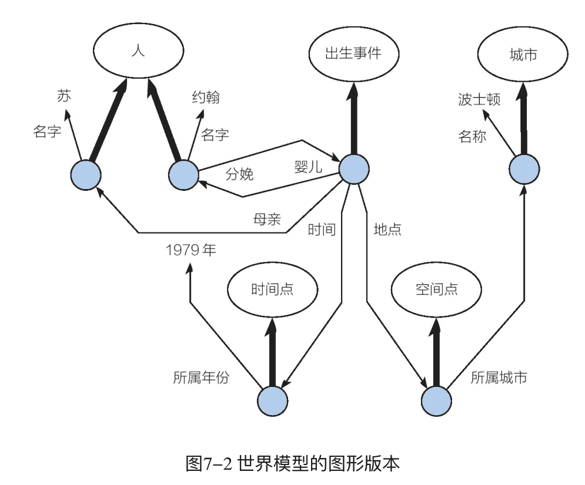
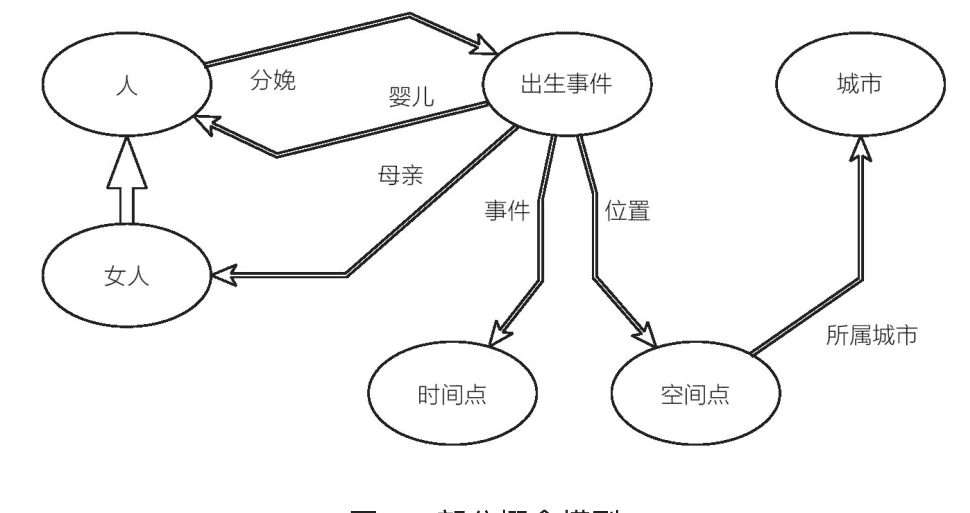
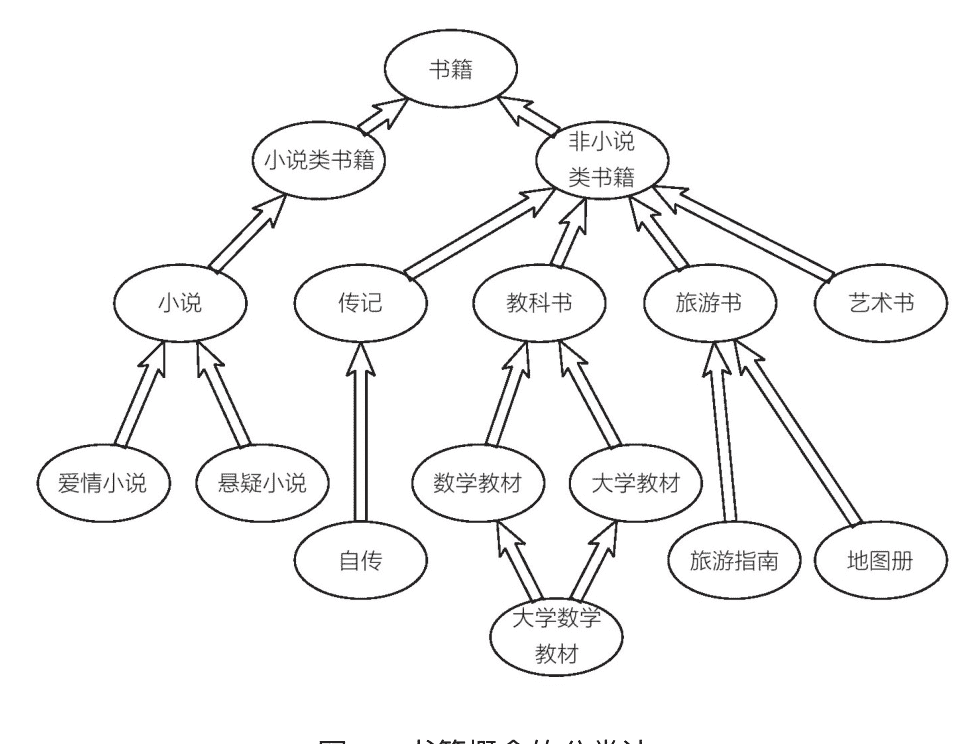
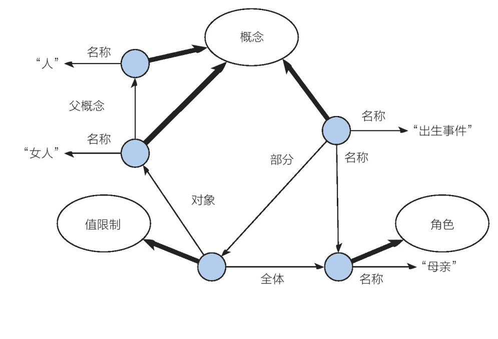
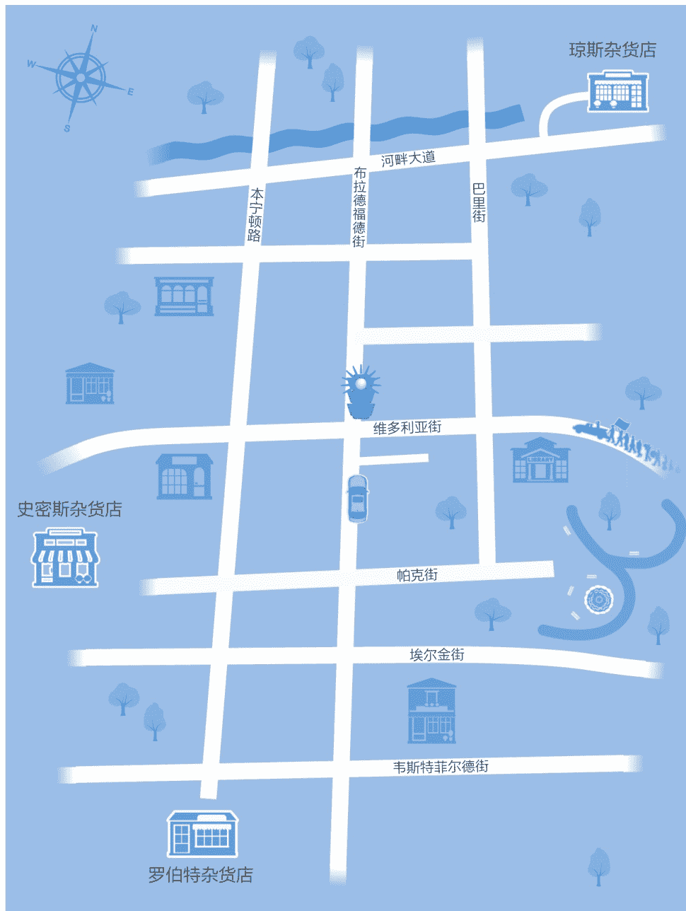
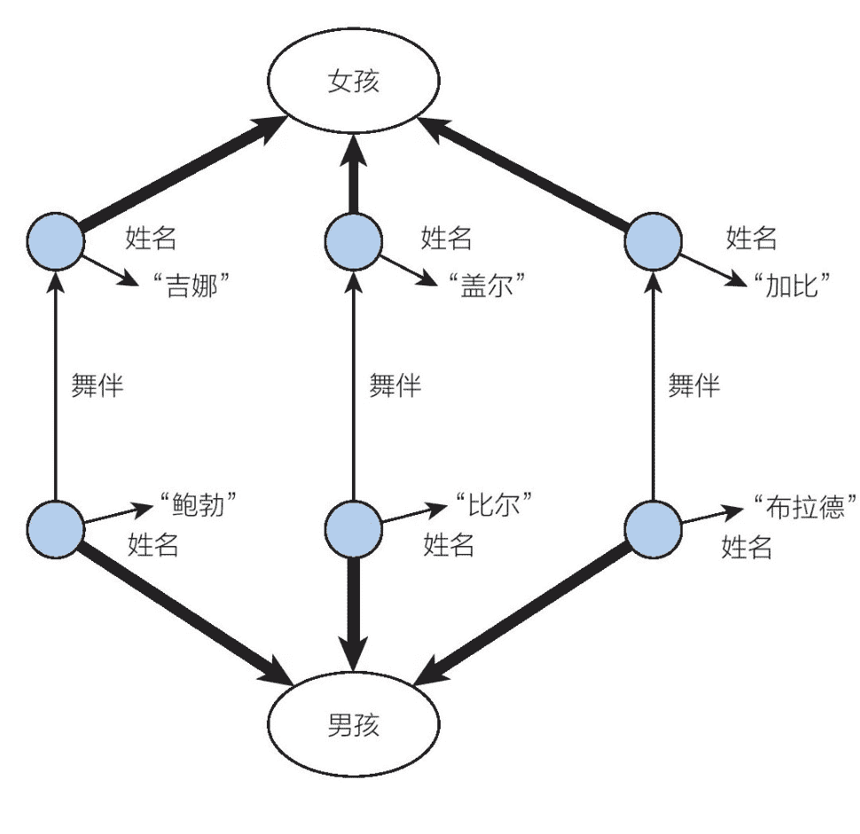

# 机器的常识盲区

# 引言

试想一下再过不久的道路。无人车比现在更成熟，会自己绕开障碍，守住标线与信号，甚至能读懂旁边车辆打出的转向意图。没有司机的推车已经在高尔夫球场、摄影棚和小区里跑开了，多个城市也投用了无人货车来给上班族提供服务。理想情况下，这些车辆足够安全可靠，几乎不需要人来接手。

这项技术已经开始进入普通家庭，邻居们大多换上了自驾座舱，你也跟着入手了一台。它的表现常常让人意外，比人开得更稳，风雪里依旧平顺，拥堵时会自动换道，在行人、婴儿车、自行车混行的路口也能游刃有余。只要报出目的地，它自己就能把你送到。更省心的是，不少商铺给这类车辆留了临街车位，车把货物装满后就能自行把东西搬回家，完全不需要人工参与。

下面设想一个周一早晨的情节：

你让车去琼斯杂货店买几块牛排，下午要办独立日烧烤。你觉得店子不远，假期里很多人往海边跑，车应该很快就回来。结果在布拉德福德大街与维多利亚大街的交叉口，灯变红，车稳稳停下。等了片刻依旧是红，再等片刻依然未变。车载摄像头捕捉到对面远处有人在集会，却没有给出任何操作建议。避障和车道保持都很靠谱，可它不明白为什么有人会下车交谈并用手指向远方。车上装了外置声学传感器，能分辨鸣笛和警报，却听不出远处飘来的音乐有什么特别含义。

导航没有提示改道，也没有拿到实时的路况或施工信息。车辆就安静地守在原地，等着绿灯亮起。十几分钟过去，信号依旧没动。

与此同时你在家坐立不安，因为一直没收到购物完成的推送。你知道一旦机械出问题系统会报警，于是打开了远程控制面板，发现车辆正卡在路口停了将近一刻钟。监控画面显示它只是在依法等候放行。你想不通它为什么不做点别的，只能感叹：技术越强，偶尔的困惑也越让人无奈。客人马上要到，它却仍在红灯前一动不动。

再换一个视角，这次是你亲自开车，来到同一个路口，遇到同样的死灯，几分钟过去了：

你低声嘀咕到底出了什么事？再等等？直接冲过去？右转绕开？换条路去琼斯？干脆换家店？或者干脆不买了回家叫外卖？你关掉电台，几秒钟观察对面。其他司机也在交谈并指向远方。顺着手指看过去，远处彩旗招展，人群熙攘，一辆敞篷车慢慢驶过，车上坐着几个人，铜管乐队的声音隐约传来。

想了想，你放弃了去琼斯的念头，掉头前往另一家店铺。

回头想想，你当时权衡了哪些东西？没有现成的条款可套，也没有驾校教材能照抄。没有唯一正确的开法。也许你以前跟过车流绕过故障灯，但这一次不同，红灯一直亮是因为游行队伍正要经过。你忽然记起，今天是独立日。于是你考虑改道，却又担心下一路口也会碰上队伍。最后你决定换店，比如史密斯离得更近但肉类和蔬果品质一般，最后选了罗伯特杂货店。

这并不需要几千小时经验的老司机，也不是平时刷牙遛狗就能记住的固定程序，更不是火箭科学。你不需要纸笔推演，但必须结合当下情境做判断。这就是普通成年人的常识，知道红灯前一直等并不总是对的。

普通人会把交谈、手势、彩旗、铜管乐迅速拼成一个合理推测，然后行动。可行的办法不行就换下一个。这就是常识。你那辆驾驶技术出众的自动驾驶汽车却缺的就是这种常识。

本书不是一部关于自动驾驶去超市的虚构故事。它在讨论当下流行的AI的艺术与科学，并指出一个矛盾：AI在某些极高智力要求的任务上甚至超过人类，却缺少人类独有的常识。

简单说，AI很脆弱。它在熟悉的场景里非常熟练，一到陌生环境就会以难以预测的方式失灵，因为它无法像人那样用常识应对社会生活里的各种状况。

那么普通人拥有的常识到底指什么？让像自动驾驶汽车这样的智能机器获得常识需要哪些条件？怎样让机器的驾驶更像我们人类？本书将围绕这些问题展开。

稍后再看，你会明白回答并不容易，需要大量研究。我们整理了人工智能研究里的观察、技术设想和建议，帮助理清让机器拥有常识的难题。

如果你只想听未来几年AI会怎样发展，无人驾驶会多聪明，AI会不会造反，那么这本书可能不适合你。我们想满足的是那些好奇于AI常识本质、构成和运行机制的读者。告诉他们为何至今没有功能完整的自主机器人，以及是否能打造更强大的人工智能。如果你希望未来的自动驾驶汽车能在纷繁多变且难以预测的世界里真正自主并按时购物，请认真阅读。

让我们开始吧。

# 第1章 通往常识之路

尽管我们无法预见更远的未来，但是我们清楚，前方还有很多艰巨的任务等待我们完成。

> ——艾伦·图灵（Alan Turing），《计算机器与智能》（*Computing Machinery and Intelligence*）。

本书聚焦人工智能能否掌握常识。关注这一点的研究者不多，但自AI诞生以来话题始终热门。20世纪50年代，美国计算机科学家约翰·麦卡锡（John McCarthy，1927—2011）首次提出人工智能概念，并在1958年发表了最早涉及常识的论文《具有常识的程序》。

六十多年过去了，人们也许以为常识早已解决。2019年，加里·马库斯（Gary Marcus）和欧内斯特·戴维斯（Ernest Davis）在《重启AI》中却写道：“令人遗憾的是，让人工智能获取常识的难度远超我们的想象。而且我们还会看到，未来人类对机器获取常识的需求将越发强烈，而这同样远超我们的想象。”这说明：迄今人类仍未找到让AI掌握常识的方法。常识是AI领域无可争议的核心议题之一。

本书会详细解释“常识”意味着什么，它为何重要，以及要在AI系统中实现它需要什么条件。在出发前，先看看我们要去哪里。

## “常识指南”导读

在亚马逊上快速搜索，会发现超过7000本书的书名里包含“common sense”。其中约十分之一还带“Guide”一词。为了解其范围，我列出几本指南类：

- 1. 《房地产投资常识指南》
- 2. 《保育之书：育儿常识指南》
- 3. 《战胜埃博拉病毒：热带医师诊治常识指南》
- 4. 《罕见水果与蔬菜的常识指南》
- 5. 《技术写作A-Z：工程报告和论文写作常识指南》
- 6. 《人工喂养幼鸟的常识指南》
- 7. 《骡子驯养答疑：理解骡子想法的常识指南》

除了都出现“常识”，很难看出共同点。

为了阅读本书，需要先弄清这些书名里的“常识”到底指什么。显然它们不是在劝人去使用常识。

成为专家能更好解决问题，但并非必要。有时仅靠基本的常识性知识，普通人也能把事情处理好。亚马逊对《人工喂养幼鸟的常识指南》的宣传语就是：

本书打破了一个神话，即喂养幼鸟的人需要多年训练才能胜任。本书提供一个常识性解决方案，介绍幼鸟喂养的基本实用知识，比如温暖清洁的环境、合理的喂养频率、适当配方、合适温度和正确喂养技巧，让您像专业人士一样喂养幼鸟。

译者注：Alexa 为亚马逊推出的语音助手，能操控智能家居、查天气、放音乐、下单购物等。

目标很合理。我们每天面对大量事务，不会用专家方式处理，而是用简单普通的方式。真要问有多少人明白液晶电视是怎样把影片投出来，或语音助手如何播报天气？大多数人只掌握其中的常识性知识。有时靠多年经验积累，诸如如何在酷暑吃快化的冰淇淋；有时靠朋友建议，比如聚会如何穿着；有时靠指南或手册，比如怎样设置家用打印机。

本书不会详述埃博拉病毒或人工喂养幼鸟，而是从更高层面阐述常识的基本理念。我们想更深入理解常识，它如何通过以往经验、朋友建议和指南来获取知识。作为计算机科学家，我们希望把常识表述得具体明确，至少能设想建造一台具备常识的计算机。

## 人工智能

回到人工智能。总体而言，它研究如何用计算手段产生智能行为。极端来看，一方面我们期望它完成下棋、解读诗歌、分类肿瘤等复杂任务；另一方面我们期望它完成照看小孩、烹饪、驾驶汽车等更常见活动。

这些事与常识有什么关系？接下来两章会分类讨论，但核心想法是：AI系统可能在某些高智力要求的特定任务上表现很好，却仍无法在更广范围内表现出智能。因此这些系统展现的是专业知识，而非常识。

“阿尔法狗”由深度思维公司开发，在围棋领域无疑是专家级，被视为世界顶尖棋手，但除此之外什么都不会。它甚至没有订购比萨、推荐电影或诊断血液感染的基本能力。尽管如此，没人会批评它，因为它的唯一功能就是下围棋。

对普通人而言，用不同AI做不同任务似乎低效。他们会问：为何不能把AlphaGo之类的系统与Roomba和Siri结合，得到既精通围棋又能清扫地板并响应语音指令的系统？再加上谷歌翻译，不就能对任何语言的语音指令做出反应？如果不断完善优化，最终会不会得到一个能处理现实各种任务的功能齐全系统？

事实并非如此。每个AI系统在各自任务上都很出色，但彼此之间并无关联。人类的行为任务复杂多样，像海洋，而AI的成就只是点缀在海面上的零星孤岛。专家始终没研究出让AI拥有通用智能的方法。AI只能在特定专业领域发挥作用，在其他方面完全无能。

即便AI学了前面提到的各种常识指南，一旦离开这些特定主题，就会手足无措。

比如《罕见水果与蔬菜的常识指南》里详细介绍了石榴，却肯定没提洗衣篮。我们也无法用洗衣篮说明书或使用经验来处理石榴。若让AI判断石榴能否放进洗衣篮，就需要它不仅熟悉每个主题，还要具备更高维度的关联和判断能力。若不能把两个独立主题合理联系，就无法做出合理决定。

对人来说，这不是问题。我们可以完全相信一个擅长围棋的人在其他领域也能表现不错，比如清扫地板或判断石榴能否放入洗衣篮。这种在任何领域都能合理处理问题的能力，就是我们希望机器拥有的常识能力。

人类与AI在此的差异明显，几乎所有AI科学家和技术人员都认同这一点。但他们在影响上仍有分歧。

AI支持者认为：

目前仍处于AI早期。最先进系统虽有高度智能，但这种“智能”本质上与人类智能不同。我们不能被“智能”标签迷惑。这些系统在某些方面比人类更好，在其他方面远不如人类。目标不是让AI更逼真地模仿人类的各种特征，包括局限和缺点，而是使其能智能地完成各种任务。因此AI系统应与人类协作，互相弥补短板。

而AI怀疑论者，包括许多AI研究人员，持相反观点：

到目前为止，我们构建的AI系统根本不具备智能。如果你希望AI达到人类智能水平，那么目前整个人工智能研发方法都是错误的。在某些非常专业的领域，比如围棋，AI确实有用武之地，但在其他领域，它的表现甚至还不如六岁儿童。由此可见，AI赶超人类遥遥无期。

本书不卷入这场争论，另有专业人士讨论。我们只关注其中涉及的常识部分：常识到底是什么，如何运作，构建具有常识的计算系统需要哪些条件，以及为何要费力让机器拥有常识。

## 未来之路

为方便阅读，我概述一下后续章节内容。

# 第2章 人类的常识

在该章中，我们探讨了人类常识的概念。我们认为，常识是对日常生活中普通事物和现象的理解和认知，是人类有效地利用基本知识来采取行动的能力，对人类发挥认知能力起到了关键作用。

# 第3章 人工智能系统中的专业知识

在该章中，我们探讨了过去和现在的人工智能系统，发现这些系统只是在某些特定任务上展现出专业能力，但缺乏常识。常识并非某个领域的额外专业知识，而是指我们对现实生活中各种情况的基本理解和推理能力。如果我们想让人工智能系统处理现实生活中出现的各种意外情况，就需要采取一种完全不同的方法。

# 第4章 知识及其表达

在该章中，我们探讨了知识以及合理运用知识的重要性。我们认为，知识可以像数字一样，用符号来表示和运用。我们熟悉数字以及算术运算，而对于知识的运用方法还并不清楚，第四章将对此进行详细说明。

# 第5章 对世界的常识性理解

在该章中，我们开始研究常识性知识，探讨其预设的世界的高级图景。我们认为，在这个世界上，有些事物的属性会随着某些事件的发生而变化。在这些事物中，有一些是具有物理属性（如空间尺寸与位置）的实体对象。而在这些实体对象中，还包含一些具有信念和目标的智能生命体，会导致另一些事件的发生。

# 第6章 常识性知识

> 边缘案例：是指介于典型案例和非典型案例之间的情况，其特征和属性不是很明显或一致，有时需要通过更深入的分析比较才能进行分类和理解。——译者注

在该章中，我们探讨了如何制定特定的常识性知识。我们认为，除了要知晓事物及其属性，我们还需要理解事物的本质概念，通过典型、非典型和边缘案例来理解这些概念。

# 第7章 表示与推理（第一部分）

在该章中，我们开始研究用符号形式来表示常识性知识。我们希望将事物及其属性与相关概念分开表示。此外，我们还讨论了计算机系统如何使用这些表示进行推理。

# 第8章 表示与推理（第二部分）

在该章中，我们继续研究用符号表示常识性知识的方法。我们认为，命题需要能够被表示，即可判断真实或虚假的语句，而不必预先相信它们的真实性。这对于我们推理关于如何使命题成为真实状态所需的条件（即计划的基础）非常重要。此外，我们还阐述了计算系统如何基于这些表示形式进行运作。

# 第9章 行动中的常识

在该章中，我们从更高维度来审视常识，探究各个部分如何相互关联。我们考虑了一种场景，主体在执行常规任务时遇到了完全出乎意料的情况，需要运用常识性知识来找到解决方案。我们还展示了如何将常识问题转化为符号计算问题，即通过对符号表示的处理来解决常识问题。

# 第10章 实施的步骤

在本章中，我们从实际出发，研究了构建具有常识的人工智能系统需要具备的条件。除了考虑开发常识性推理系统以外，我们还深入研究了所有常识性知识的来源，并研究了一些有趣的方式，使未来人工智能系统可以通过经验和书面文本来学习常识。

# 第11章 建立信任

在本章中，我们从社会角度探讨是否应该建立具有常识的人工智能系统。我们认为，自主决策的系统应该能提供让人类理解它们决策的充分理由。尤其重要的是，我们希望这些系统具备常识性知识与目标，并且基于这些知识去实现目标，进而做出合理决策。

本书还设置了一个附加章节，为感兴趣的读者介绍逻辑与常识性推理之间的关联。

# 启程出发

这句歌词的原文是“the road is long with many a winding turn”，出自名曲《他不重，他是我兄弟》（He Ain't Heavy, He's My Brother）。该曲由鲍比·斯科特（Bobby Scott）和鲍勃·拉塞尔（Bob Russell）联手创作。——译者注

这正是我们要走的路：从常识，到常识性知识，再到常识性知识的表征与推理。学问不少。就像歌里唱的那样，“路途漫长且布满弯折”⁽¹⁾。本书谈的是常识，却不是一本常识手册。

有一种说法觉得人工智能没那么难，无非是把一个学习系统连上网、或者放个机器人，让它慢慢学会解决问题。为何常识不能自然而然随时间学会？他们认为把知识符号化、算出来太死板、太理性，不像常识的样子。

这种想法听起来很诱人，可目前找不到扎实的理由。我们要讲的故事更复杂，它不过是一种假说，也只是通往常识的众多路径之一。很可能最后会撞进死胡同，或被更好的高速路取代。但我们希望读者能看出，从智能的角度看，这条路很有价值，沿途能牵出哲学、心理学、语言学、逻辑学和计算机科学里不少新鲜见解。

眼前这条路，是四十年摸索才探出来的。人工智能系统被我们搭出来，理论被验证了，项目也被带过。我们跟许多优秀的人一起做事，也参与了重要的国际组织。作为向导，我们会尽力让旅程既有趣又有收获。请系好安全带，出发吧！

## 2 人类的常识

常识就是穿着工装的天才。

普遍认为是拉尔夫·沃尔多·爱默生（Ralph Waldo Emerson）的名言。

在让机器拥有常识之前，我们得先搞清楚常识到底是什么，可严肃的科学文献并不多。我们对常识有直觉：日常里常挂在嘴边，会提醒别人“用点常识”。这句话到底想说什么？

这一章会从多个角度审视人类常识，并给出一个工作定义，为人工智能的常识之路按下第一块砖。

### 常识的要素

除了爱默生的那句，还有不少发人深省的说法。比如：

- 阿尔伯特·爱因斯坦（Albert Einstein）：“常识就是一个人十八岁之前积累的偏见集合。”

霍尔巴赫男爵：法国哲学家。——译者注

- 霍尔巴赫男爵（Baron d'Holbach）：“审视人们的观点，会发现最缺的就是常识；换句话说，他们缺乏辨别朴素真理、拒绝荒谬和自相矛盾的判断力。”

约什·比林斯：19世纪美国幽默作家。——译者注

- 约什·比林斯（Josh Billings）：“常识就是看清事物的本质，并按事物的规律办事的窍门。”

鲍勃·马利：牙买加唱作歌手。——译者注

- 鲍勃·马利（Bob Marley）：“我是个懂常识的人。意思是我会用极简单的方式解释事情；说白了，连婴儿都能听懂。”

这些话点出了常识的几条主线：源自经验、关乎好懂的事实和可预期的事、能让人做得更合理、偏爱简单解释。

展开来说，大家基本同意常识来自亲身经历，而非课堂或书本。当然跟人交流、读读指南也能补一点，但核心是通过自己碰到的事来理解世界怎么运转。

这种经验往往是某个大群体在平凡日常里共同积累的。可能是某个文化、某个国家，甚至整个人类。在这个群体里，成年人都知道一些事实和趋势。若有人忽略这些共识信息，我们就说他没用常识。常见批评就是：“他怎么会这么做？谁都知道不能用叉子喝汤。”成长中我们学到很多，也期待别人知道并做出一样的选择，这就是常识的“共同性”。

常识也是对正常人都能判断的事物的觉知。处在共同情境时，我们默认别人也会把情境算进去。如果朋友把邻居门口台阶上像哈士奇的狗看成狼，我们就说他缺常识，没顾及实际情境。反之，判断它是狗，即使像狼，我们就认定他用了常识。

在思考里，抓住“显而易见”和“荒谬”是关键。常识的重要功能是能大致预测行动后果。我们靠过往经验和因果直觉推测事情可能怎么发展。选择更合适的行动，本质上是基于对后果的预期。比如不会开车冲向结冰的陡坡。比较方案时，常识让我们快速估算成本收益：向邻居借东西省钱但有社交成本，去商店买或租更麻烦还得花钱。常以此做出更合适的取舍。

常识性思维整体上是合理的。它依赖推理：由前提得出合理结论。可以设想计划一步一步推进，比如打车去机场再坐飞机去罗马。能凭直觉把多个事实组合成有用的新事实。靠逻辑和证据得出合理解释。只有细致观察、设想结果、综合信息，才能做出符合常识的决定，这就是常识的“理性”侧面。

关键还在快而轻省。我们能直观地看出结论，不必绞尽脑汁。借用过往经验，迅速找到当前适用的判断。常识是一种浅层认知，比缜密的系统分析快得多。可看作“反射式思维”，反射性与思维同等重要。

相比复杂推理，常识更爱简单解释。它遵循奥卡姆剃刀：本可以用更简洁的方式说明，却偏要复杂，就不像常识。作家詹姆斯·惠特孔·莱利（James Whitcomb Riley）有句话说得透：“若我看见一只鸟走路像鸭子、游泳像鸭子、叫声也像鸭子，那我就叫它鸭子。”对这只像鸭子的鸟可能还有别解，但看到它像鸭子般走游叫，我们就按常识称它为鸭子。

最后，常识与专业知识有分界。常识指南教我们快速直观地做事。专业的事做不到——常识帮不了你算飞船轨道，也帮不了你操作带六个遥控器的影院系统。但常识能帮你避开低级错误，比如把水壶放炉子上一个小时不拿，或把锋利刀子放在小孩够得着的矮咖啡桌上。

### 常识的定义

梳理了要素后，我们给常识一个更精确的表述。学界说法不一，但有共识的关键特质。结合对知识及在人工智能中应用的经验，我们提出：

常识是有效运用普通日常的经验知识，以实现普通日常实践目标的能力。

定义里用了大量通用词，需要解释一下。它涵盖：

- “有效”指光知道相关事实不够，要能轻松、快速、高效地用它达成目标。
- “普通”“日常”指它针对人类在生活里高频遇到的情境，不需要专业训练。
- “经验”强调它来自重复经历，通常不是学校或技术文献给的。共有知识可从他人学来，但多来自个人体验。
- “实践”强调它用于日常决策和解决问题，不是学术研究或哲学论证的根基。

常识的实践面向正是心理学强调的。罗伯特·斯特恩伯格（Robert Sternberg）提出“成功智能”理论，讲在个人文化背景下设定并实现重要目标的能力。他把智能拆成分析、创造、实践、智慧四种能力。关于实践能力，他说：“这就是大多数人说的常识。”斯特恩伯格与理查德·瓦格纳（Richard Wagner）认为实践智能主要基于隐性知识，即在特定环境中取得成功所需的、无明确表述甚至难言传的知识。该理论突出了个人经验，并认为这种隐性知识是程序性的，关乎在具体情境下如何行动。我们认同隐性知识支撑实践智能，但认为用于常识推理的许多隐性知识是陈述性事实。

我们的定义显然与“理性”相关。史蒂文·平克（Steven Pinker）认为理性就是“利用知识达成目标的能力”。差异在于理性更宽泛，不限制知识种类或推理复杂度。常识只能用普通的经验知识，而理性可用专业知识，并需要更深更全面的处理。举例：患者刚查出癌症阳性，医生要判断是否治疗，需要研究检测可靠性、排除误诊，才能合理解释。常识做不到，只有理性能。

要区分常识性知识，即事实、模式、原理与概括，和常识性推理，即以某种方式使用该知识的能力。说某人有常识，往往指他既掌握相关知识，又能合理运用。

关于“知识”，我们沿用人工智能领域的惯例，不严格区分知识与信念。严格说，常识性知识其实是常识性信念，其中有些可能因错误而产生。常识并不只限于完全正确或确定的信念，完全正确的信念很少。“知识”比“信念”更能覆盖某些表述情境。有些句子可用“知道”却不能用“相信”，例如“哈利知道安妮手里拿的是什么牌”，说成“哈利相信安妮手里拿的是什么牌”就很拗口。顺带一提，信念有程度差异，从怀疑到确信，但本书不深入讨论数值如何得出或与常识的关系。

### 常识的应用方法——自下而上和自上而下

了解了常识的特质后，看它何时如何被用。常识关乎对日常情境的实际反应。可分成两类：自下而上和自上而下。

- 自下而上，或事件驱动：你注意到异常，想要弄清发生了什么。你可能在做目标导向的事，也可能在发呆。异常可能是意外的事发生了，也可能是预期没发生。你需要一个简单直观的解释。
- 自上而下，或目标驱动：你思考要做什么，需要在当前或未来情境下比较备选方案。要权衡成本与收益。成本包括风险、失败概率、负面影响、社会因素等；收益包括成功概率或结果的好处。

先看自下而上。我们每天机械地做很多事，像被自动导航控制。常陷入惯例，本能地行事。走路、刷牙、通勤，都不怎么思考。即使计划周全，执行时也会下意识走程式。比如准备开车出行，会先关门、走向车、开门、调座位再出发。这些程式来自重复经验，蕴含期望。期望满足时我们甚至没察觉。关前门时我们预期车门会锁，启动车时预期仪表亮、风扇转、收音机继续播。这些顺其自然，不引人注意，之后才想晚餐吃啥或演讲怎么讲。

有时例行程序没执行。车门关不严、车打不着，我们就切换思维。脱离常规，进入解决问题模式。会自问“怎么回事？”意外也可能是等了20分钟咖啡没来。

遇到意外，我们马上诉诸常识。若见过类似问题，就参考经验快速判断维修。车门关不上，会想到门框被玩具卡住，拿掉就行。车灯不亮，会想到昨晚忘了关灯，电瓶可能没电。这些思维不像之前的自动化那么轻松，但也不需要复杂方法。常识的特点是本能找简单熟悉的解释。若常识方案无效，才继续找更有效解，甚至胡思乱想。也许有人恶作剧绑了弹力绳，也许新报警系统锁了车。但我们不会先想这些。日常意外，首选常识。

我们也对别人的常识错误很敏感。很多父母深有体会：“你明明知道开车回家要20分钟，晚上11点55才离开莎莉家，难道不知道会错过午夜宵禁？”我们都很熟练地用常识评判别人，所以常说“用点常识”。

再看自上而下。这时在制订计划以达目标。制订简单计划不需要写字或用电脑，靠丰富经验就能想象关键步骤和可能结果。即使没有顶级逻辑，也能感性地预想未来活动。日常里常预想一两步，比如走到厨房开冰箱找饮料；也常预想多步，比如开车去机场、坐飞机出国、在机场与朋友会面。常识是构想未来的首选工具。

如前所述，计划时我们凭经验注意到显而易见的事，快速判断行动是否会失败，比如周日邮局不开门就取不到包裹；是否带风险，比如即将驶上的高速没有加油站，油会耗尽；或比较两种实现同一目标的方案，交通高峰时更快的高速可能堵车，而普通街道虽有红绿灯但更顺畅。

尽管我们会预见结果，但有人在权衡利弊时仍不靠谱。喜剧演员杰里·塞恩菲尔德（Jerry Seinfeld）曾讲，万圣节超级英雄服装制造商觉得有必要在标签上写警示：穿上后别尝试飞行。这说明决策时未必遵循常识。

注意，自下而上和自上而下会交织。意外会打断计划。开会途中把咖啡洒身上，会用常识重构计划，考虑有没有时间回家换衣服，走哪条路更快。有时执行计划中会及时发现潜在问题。按常规行事可能带来麻烦，但我们会在闯祸前突然醒悟。

日常里语言就是同时使用两种方式的典型。一方面听别人说话理解意图，另一方面按自己的目的决定说什么。有时表达很简单，主语加谓语、名词加修饰语、代词加指称，像自动驾驶一样。在可能歧义时，常识就起作用。

这句话就很说明问题：

大球砸破了桌子，因为它是钢制的。

“它”有歧义，可能指球也可能指桌子。我们毫不犹豫想到是重金属球砸破了桌子。不会去想桌子材质。因为常识告诉我们重金属物易砸破非金属面。有趣的是，改一个词推理就变：

大球砸破了桌子，因为它是纸制的。

我们会想到桌子是纸制的，稍微重的球就能砸破。压根没想纸制球的可能。这些推论是快速自然的，牢牢基于对世界的常识理解。

上述例子共同点是，推理时不需要材料科学、动物行为或汽车修理等专业知识。都是日常情境，普通人凭日常经验就能预测或解释，大多源自个人观察。

### 常识有什么用？

常识给人类认知带来什么价值？为什么人类需要它？

人类认知架构常被看作两端：一端是处理日常活动的反射性动作组件，另一端是支持深入思考和有意识解决问题的系统分析组件。反射性组件让我们轻松处理大部分日常事务，无需费力思考；系统分析组件让我们运用高级智能解决复杂技术问题、制订未来计划、写文章、维护文明。

常识是我们在不被外部因素干扰的前提下有效完成上述工作的关键。当日常活动出现小问题时，我们首选常识。简单经验思维足以处理生活中大部分麻烦。因此常识像自动驾驶，帮我们轻松应对各种情况。它来自人类长期积累的经验与细致观察，在极广的场景中适用，且多数情况下奏效。

动脑思考、推敲决策往往消耗大量精力与时间。常识则扮演着节能器的角色，借助既有经验让人迅速形成判断，避免过度推理。当情境逼仄、容错极小时，这种即时反应的价值会凸显。某种程度上，常识架起直觉反应与精细分析之间的桥梁——既促成当下行动，也为难度更高的任务搭起初步框架。

> 认知连续体是一种表示认知和思维在不同层次之间相互连接的模型，它强调了认知和思维的渐进性和连续性，而不是断裂或分割。——译者注

这些观点在心理学界获得广泛认同。研究判断与决策的肯尼斯·哈蒙德等人提出，认知活动并非截然分开，而是沿着一条“认知连续体”⁽¹⁾渐进分布，一端靠直觉，一端靠分析。中间区域是二者的混合体，这与我们对常识的理解高度吻合：带点逻辑痕迹，却更为迅速、低耗、依赖记忆驱动。哈蒙德把这一区间称作“准理性”，概念很贴切，后文仍沿用更通用的称呼“常识”。

即便调动分析能力，常识也难以被取代。借助网络与电子表格制订一次复杂行程，细节打磨仍离不开常识。很少有人会把去机场的路程拆成“伸手拉车门、随后坐进出租车”这类显而易见的步骤，常识会自动略过无需思考的中间环节，只保留起点与终点。换句话说，再缜密的方案也建立在常识之上。对一般推理而言也成立：常识像黏合剂，把深层论证的碎片连成完整自洽的链条。

> 弗雷德里克·巴特利特：英国心理学家。——译者注

再谈经验的利用效率。设想未来记忆达到录像机水平，每个细节都能原样保存，那么在调用相关经验时检索负担会极重。现实是，记忆倾向于模式化。我们把大量相似经历压缩成通用模板。弗雷德里克·巴特利特爵士等人的研究证实，回忆往往是重构而非回放。记忆并不完美，容易把一次经历与另一次相近经历混淆。从常识角度看，这非但不是缺陷反而是优势：泛化让我们从多次体验中提炼规律，而不必记住每次细微差别。动用经验时调用的是被抽象过的版本，不必在成堆相似记录里逐条甄别。

按后文论述，若经历稀少，或每个事件都完全可控，常识的需求会降低。真实世界却充满突发与不确定，僵化流程无法自动应对，于是需要一种灵活的处理机制。常识未必是最终答案，却是极佳的第一选择。它以直观可信的实践为底座，让人在意外面前更灵活，也具备足够稳定性来应对快速变化环境。正因智能常被定义为学习并适应环境的能力，常识才被视为智能核心组成。

### 常识固然重要，但并非灵丹妙药

常识在日常中至关重要，但人类思维并非只有这一模式。有些时候常识派不上用场，要么是因为调用不当，要么是经验驱动的方法本身难以破解难题。大多数精神活动已超出常识覆盖范围，落在认知连续体的别处。以下先简要列出常识失效或受限的情形，后续章节会深入展开。

**专业知识：** 工作或学习中获得的、超出日常经验的学科内容，可统称为专业知识。它们源于系统教学与实践，是研发新技术、解决复杂问题、推动社会进步的必要条件。掌握专业知识需要理解事物运作原理与机制，这与常识有明显分野。常识更依赖积累经验，少问背后因果与原则。专业知识的习得与传递方式也不同，更多依赖记忆容量与综合推理。相较之下，专业机制更具目的性与分析性。专业并不取代常识，而是对它进行丰富与深化。即便火箭科学家，也需要知道同事必须呼吸空气。

**解题模式：** 即便没有系统数学或解题训练，人仍能处理部分难题。面对无法直接处理的情境，会退一步进行计算、分析或与他人商讨。有时出于娱乐，比如数独、逻辑谜题，有时出于枯燥事务，比如填报税表或按字母排序名单。类似做法同样适用于更专业任务，像估算桥梁承载或求解线性方程组。一旦借助代数、逻辑、流体力学等专业工具，思考就已超出常识范畴。需要动笔演算或遵循复杂程序时，就不再是常识性解决方案。当然，即便执行程序时，常识仍在润色细节，正如前文所说，任何方法都需要常识来补全。

**识别模式：** 有些思维几乎与既有知识、常识无关。看这几组字母序列：“wxyz”与“wyzx”、“rbv”与“rvb”、“shout”与“south”，以及“gccewt”与“gcewtc”。能看出规律吗？能找到两者的关联吗？你会发现，学过的知识和培训对这类任务帮助有限。这种识别也不依赖视觉：即便呈现的是字符，也可用声音序列或身体敲击来体现，无须视觉输入。更有趣的是，它也不依赖感知。若在一对序列里，第一个元素依次对应星期日、星期一、星期二直至星期六，那么对应的另一个元素指什么？人类擅长发掘此类序列及更复杂结构的模式，但这与常识能力不同。可以说，模式识别是对常识的一种补充与完善。通过它，我们能在不同常识范畴之间建立类比或部分对应，例如医院与教堂，具体问题后文会展开。

**原始冲动：** 显而易见，许多行为由情绪、冲动与欲望驱动，而非常识或明确目标。人并不清楚这些本能何时有益。对陌生人的警惕在一定程度上起保护作用，却也容易滑向排外。恶心感会阻止摄入不健康食物，却也可能演变为过度洁癖。最糟糕时，本能会与常识背道而驰，被视为心理异常。我们曾提到有人会冒险跳上地铁轨道捡落手机，这充分说明本能有时会压倒理性判断。面对突发状况，很难预判自己会选择常识还是原始冲动。

**虚假信念：** 社会学家邓肯·瓦茨在其著作《一切都显而易见（只要你知道答案）》[Everything Is Obvious (Once You Know the Answer)]中精辟阐述了他对常识与非常识的看法。他认为常识的重要特征是与“当前日常生活”相关。他指出，“如果在远离我们当前时空条件的情况下预测或管理人们行为”，常识就会失效。虽然“远离”具体指什么尚不确定，但瓦茨准确指出了常识容易误导的情境。作为社会学家，他主要研究政治冲突、医疗经济学和营销，但也探讨了物理世界的常识直觉可能导致偏差。他举例：从同一高度水平发射和自由落体的子弹，哪颗先落地？按高中物理，这两颗应同时落地。然而我们仍难以摆脱“发射子弹会在空中停留更久”的常识信念。一些看似合理的常识信念其实会误导我们。该书副标题《常识是如何让我们失望的》[How Common Sense Fails Us]正体现了这一点。尽管常识有时会令人失望，我们仍坚信它是人类认知能力的关键要素，并在许多时刻默默帮助我们解决问题。

**认知偏误：** 心理学家丹尼尔·卡尼曼、阿莫斯·特沃斯基等人有力展示了常识在面对各种认知偏误时的无力。人类倾向于快速简单地依靠经验，这使我们很容易被误导：如一厢情愿、确认偏差、成本收益谬误、过度乐观的心理捷径等。

例如“代表性启发式”。人们在判断对象类别时，只考虑典型或代表性案例。卡尼曼与特沃斯基做过经典实验：受试者被告知一位学生活动家琳达，积极参与社会正义和学生示威。然后让他们判断琳达更可能从事的职业。选项之一是“女权主义银行柜员”，另一个是“银行柜员”。所有受试者都选择了前者，这在逻辑上是不成立的。错误的原因在于，他们只从典型属性出发思考“银行柜员”这一模糊职业类型。换句话说，他们把“女权主义银行柜员”与“典型银行柜员”对比，进而想当然地认为前者更可能。

在解释偏误成因时，卡尼曼明确区分了“系统1”和“系统2”。系统1是快速、条件反射式的反应；系统2是针对复杂情况的深思熟虑。常识在这一框架中的位置并不清晰。虽然常识推论也是快速直观的，却并不完全等同于系统1，系统1更接近前述的条件反射或直觉。卡尼曼认为系统1能回答“2+2=？”并在空旷道路上驾驶，但它是否能理解“大球砸破了桌子，因为它是钢制的”中代词“它”的指代？系统2主要用于需要投入精力的活动，更符合我们前面讨论的分析成分。后文会更深入分析卡尼曼团队如何诠释常识在这一框架中的作用。

无论学者如何解释，常识失效与局限的根源，从常识与专业知识的差异、常识与难题解决导向思维的差异来看，我们都能明确认识到，常识对生活至关重要，但并非唯一心智能力。如果工作是管控核电站或驾驶复杂客机，仅凭常识是不够的。

若希望机器掌握并运用常识，就必须意识到这些局限，并努力帮助机器及时发现常识的不足，无论是在解决问题前还是事后分析。这对后续章节讨论人工智能系统具有重要意义。

## 人工智能系统中的专业知识

一个人应该掌握多种技能，比如换尿布、指挥舰船、设计建筑物、写十四行诗、平衡账目、砌墙、接骨、安慰垂死之人、接受指令、下达指令、协同合作、单独行动、解方程、分析新问题、施肥、编程、烹饪美食、高效战斗和英勇死去。

专业化只适用于昆虫。

> 罗伯特·海因莱因（Robert Heinlein），《时间足够你爱》（*Time Enough for Love*）。

本书主要探讨制造通用智能机器所需的要素与条件。制造通用智能机器并非新想法，近期人工智能的新闻报道让我们觉得目标已近在咫尺，也许某个富有的实验室已秘密完成，如同电影情节。

事实并非如此。迄今人类已研发出许多强大的人工智能系统，但它们都局限于特定专业领域，且难以迁移。因此在进入主题前，有必要回顾人工智能的研发历程与现状。本章将介绍该领域过去六十多年取得的主要进展，人工智能虽尚未掌握人类拥有的丰富技能与强大智能，但已取得巨大进步。随后我们将总结前行道路上的经验教训。

### 构建人工智能

过去几个世纪人类一直在研究具有智能行为的设备与机制。许多人认为，直到20世纪50年代通用电子计算机诞生后，研究才取得实质性进展。一个关键转折点是1956年在达特茅斯学院举办的会议，约翰·麦卡锡在会上命名了人工智能这一新兴领域。20世纪60年代初，得益于参加会议的计算机与认知科学家如麦卡锡、马文·明斯基、艾伦·纽厄尔、赫伯特·西蒙等人，人工智能在许多大学实验室生根发芽。尽管对智能的真正含义尚未达成共识，但过去六十多年里，通过计算机编程实现智能一直是科学家的追求。近年来该领域发展迅猛，巨额资金投入，公众对“人工智能”的熟悉度也大幅提升。

如今，人工智能领域的焦点与投资集中在一种被称为“深度学习”的人工智能构建方法上。相关论文数量庞大，以至于许多人将人工智能等同于深度学习。的确，深度学习的成就令人钦佩。然而，要更全面地理解人工智能的优劣，需要更宏观的视角。人工智能领域经历了多次思维变革，每一次都被视为颠覆性突破，有望取代之前所有方法。深度学习只是最新一波变革的产物。

本章将探讨五个相互交织的主题，它们推动人工智能向实用有趣的方向发展。这些主题源于该领域的多个方面，强调智能行为的核心要素，并回顾这些要素在近几十年内的研究与发展。每个主题都取得显著成功，但在实现人工智能方面也都暴露出明显不足。

在此之前需要强调：我们并不试图覆盖整个领域，甚至在所讨论的五个主题中也无法做到全面。许多学者已深入阐述人工智能历史，我们无意与之竞争。我们关注的是该领域最初的宏伟愿景，即创造能在人类世界中自主行动的人工智能系统，实现既定目标并迅速适应不断变化的条件。本章会提及一些知名的人工智能项目，但始终聚焦它们对具有常识、健全且通用的人工智能系统的影响。

### 主题1：游戏类人工智能

自20世纪50年代人工智能诞生以来，人们一直研究如何让计算机玩策略类游戏，如国际象棋、跳棋、围棋、扑克等。其中有三大主要原因。第一，在此类领域衡量成功十分容易，只需看程序能否击败顶尖人类选手即可。第二，像国际象棋和围棋被普遍认为具有很高智力挑战性，世界冠军如同体育英雄般受尊敬。第三，更为实际的是，按照数学家克劳德·香农和计算机先驱艾伦·图灵的设想，似乎可以相对容易地制作并运行游戏类程序。

简单来说，香农与图灵的想法是：让计算机在国际象棋等游戏中达到专家水平，无需把象棋书籍中的复杂技巧全部编入程序。相反，只需充分利用计算机的高速运算能力，全面探索游戏规则隐含的“技能树空间”，学习所有可能的走法与应对即可。这样在对局中，无论对手棋艺多高，程序都能准确预判下一步及后续发展，从而确定最佳走法。国际象棋程序具有巨大潜力，它能预见到足够远的未来，棋力远超其编程者。

实现这一设想的主要难点在于棋盘上位置组合的数量庞大。20世纪50年代早期的计算机远不如今天强大，因此最初的游戏程序只针对小型游戏，如跳棋和6×6格象棋。20世纪50年代，计算机科学家阿瑟·塞缪尔开发的跳棋程序大获成功。然而，直到20世纪90年代末，计算机科学家乔纳森·谢弗开发的跳棋程序才最终成为世界冠军。在国际象棋领域，直到1997年，国际商业机器公司开发的“深蓝”超级计算机才击败当时的世界冠军加里·卡斯帕罗夫。“深蓝”的设计遵循了香农和图灵的思路，并采用专用硬件，能每秒分析两亿步棋。

“深蓝”是人工智能历史上的重要里程碑。人们首次制造出强大的程序，能在人类擅长的智力领域取得成功。自人工智能诞生以来，国际象棋一直是重点目标。早在1957年，诺贝尔奖得主赫伯特·西蒙就将国际象棋选为目标，预测在1967年前肯定会有智能机器能击败象棋世界冠军。要取得成功，关键因素不是掌握多少专业知识或战略，而是具备在庞大空间中搜索与管理有效信息的技能。此外，还需不断扩展与改进，以开发能击败世界冠军的游戏智能程序，例如针对带随机元素的游戏，如1979年汉斯·柏林纳及其同事演示的西洋双陆棋，以及含有不完全信息的游戏，如2017年图奥马斯·桑德霍姆及其同事演示的扑克游戏。有趣的是，对于像围棋这类计算量极大的游戏，这些技术就无能为力了，需要更强大的机器学习理念，如下文所述。

纽厄尔与西蒙是最早提出将有效搜索巨大可能性空间作为智能行为核心要素的科学家。除游戏外，人们在解决15拼图游戏等谜题时也使用类似搜索方式。这种搜索方法甚至被应用于证明数学定理等任务。在本例中，“走棋”的含义是根据逻辑规则向证明过程中添加句子，目标是得出待证明的最终定理。

尽管基于搜索的方法是人工智能的重要工具，它也存在明显局限性，即便在游戏领域也是如此。为了说明这一点，下面介绍一种名为《强权外交》的战棋游戏，其维基百科定义如下：

《强权外交》游戏由七名玩家参与，每位玩家控制着一个欧洲大国的武装力量。每个玩家的目标是利用其初始部队击败其他玩家部队，以占领地图上标记为“供应中心”的战略城市；这些供应中心可让占领者生产更多部队。在每轮玩家谈判之后，如果某位玩家得到更多毗邻城市的支持，那么它就可以发起攻击并占领支持率较低的城市。

当谈判成为棋步的暗面

从 AI 的观察角度看，《强权外交》最耐人寻味的地方，是把众人轮流落子之间的空隙，专门留出来给玩家谈判。结盟能把军事力量叠加，防止单打独斗被反复消耗，独自行动的玩家通常难以坚持到终局。规则对谈判本身几乎没有约束，私下递条还是公开喊话完全由玩家自行决定；更关键的是，口头宣称的下一步往往与实际递交的密令并不一致。一旦某人被认定为失信，以后这盘以及后续对局里，再想拉到同盟都会变得困难。

游戏很直观地展示了，穷举地图上所有可走的点只是问题的一面。把军队调动在欧洲版图上，表面看与象棋围棋的挪子很像，但把谈判因素加进去后，这种类比就失效了。谈判阶段里，玩家究竟要执行何种“操作”，本身就是模糊的。

换句话说，象棋、围棋、扑克等领域的 AI 能取得突破，正因为它们运行在边界清晰的环境里，下一步可事先枚举，带不确定性时也是可计量的概率。而《强权外交》的玩法更接近现实人际互动，开放、不确定、由意图主导。

### 主题2：自然语言理解

图灵是探讨机器能否思考的先驱之一。他设计了一个遮蔽对话的游戏，让计算机与真人躲在幕后，只与一位裁判交流。如果裁判无法分辨对话者是人还是机器，计算机便可被认为拥有智能。括注说明，这个设想过于简化，图灵测试本身存在多种变体。其直观吸引力在于，人们普遍认为，若没有真

### 主题3：基于规则解决问题

与语言理解的难题类似，AI 研究里还有一个核心议题，就是让机器像人一样解题。这一脉络最早在麻省理工学院萌芽。60 年代，明斯基带领团队攻克了多种人类认知任务，比如解代数与演绎文字题[计算机科学家丹尼尔·博布罗和伯特伦·拉斐尔]、做几何类比[数学家托马斯·埃文斯]、以及寻找概念关联[认知科学家罗斯·奎利安，该项工作在卡内基梅隆大学完成]。

卡内基梅隆早期的人工智能探索里，人类思维是核心灵感来源。主张写程序时要观察受试者在解题过程中的出声思考。纽厄尔与西蒙认为，问题求解可以从长期记忆与短期记忆的协作里理解。长期记忆相对稳定，由一组条件规则即 IF/THEN 规则构成，短期记忆则用来暂存求解中间产物。求解流程是共通的：在当下短期记忆里反复检索匹配规则，并用它们决定下一轮周期如何改写记忆。所有求解细节都编码在规则内部。

这种用规则推进的思路对整个行业产生深远影响，掀起一波研究热潮，并催生出不少对商业世界影响显著的系统。70 年代，这类成果通常被称为专家系统，因它们力图模仿人类专家，利用从对话里抽取的规则来解决问题。

这一方向的开创性工作多出自斯坦福的首批专家系统。计算机科学家泰德·肖特利夫的 MYCIN 系统展示了规则系统在医学诊断与治疗上的强大能力，例如为特定疾病开具处方。到了70 年代末，MYCIN 在传染病治疗上的水准已接近人类医生，这算是一项了不起的成就。关于典型 MYCIN 的规则解释见图3-1。

> 如果
> 1. 患者头痛的时间范围是急性的，
> 2. 患者突然发作头痛，
> 3. 头痛严重程度（0—4）大于3，
> 那么
> 1. 有提示性证据（.6）表明患者感染细菌性脑膜炎，
> 2. 有不太充分的提示性证据（.4）表明患者感染病毒性脑膜炎，
> 3. 有提示性证据（.6）表明患者蛛网膜下腔内充血。

图3-1 关于MYCIN的IF/THEN规则解释

早期重要的工业专家系统包括 Prospector 与 XCON。Prospector 由计算机科学家理查德·杜达和彼得·哈特及 SRI 国际同事合作打造，意图用有限地质学家的专业知识模拟来预测矿藏。它顺利完成任务目标，比如预测出华盛顿州一处此前未知的钼矿。XCON 由卡内基梅隆的计算机科学家约翰·麦克德莫特设计，用来配置 DEC 公司的计算机。XCON 1980 年上线，到1986 年处理了约8 万张订单，为母公司省下2500 万美元。它是当时最复杂的专家系统，携约2500 条规则。

当这些开创性成果证明商业可行后，专家系统领域迅速扩张。AI 公司获得的投资大幅增加，上万套系统被部署到各行各业。这是人工智能首次被国际社会认可为具有重要商用价值的阶段。

很明显，专家系统成功了，而且专业知识似乎都能编码成一系列规则。于是汽车保险杠上出现了“知识就是力量”的标语[通常被认为是弗朗西斯·培根爵士的名言，实则可追溯到10 世纪]。在解决专家级问题时，算法技巧不是关键，关键是知识的量。这里的“知识”实质是“以 IF/THEN 规则形式存在的专家知识”。这套范式有两大缺陷。首先是知识获取瓶颈：人工从专家那里收集足够规则负担极重。其次，虽然能在特定专业领域模拟解决方案，却受限于有限的知识类型。遇到超出能力范围的提问，它便哑口无言。计算机科学家梅勒妮·米切尔指出：

> 专家系统……越来越显出脆弱性，容易出错，在面对新情境时往往难以概括或调整。研究者分析其局限时发现，编写规则的人类专家本身依赖潜意识的知识，即常识性知识，以做出明智判断。

我们将在下一章深入探讨。

### 主题4：自主集成系统

随着人工智能在专业领域取得成功，一个趋势愈加明显：想让 AI 软件在工业里为付费客户提供满意表现，工作必须深入且限定范围。只要多加注意，前述脆弱性并不会阻碍成功应用。

然而人工智能的初衷远不止于此。人们设想的自主机器人能自行决策并按计划行动。要让机器人自由行动，就必须做好应对意外情况的准备。

SRI 国际的“沙基”项目是60 年代末的一个 AI 项目，目标打造一台能在室内滚动的机器人，并制定执行相对复杂的计划，从一个房间移动到另一个房间并搬运物体[机器人名“沙基”，英文 shakey 源自 shaky 有摇晃之意，因停下时会晃动]。早期成果之一就是把一个具备一定自主能力的移动系统放在部分不可预测的环境里，让它感知周围、规划行动、观察效果并调整计划与下一步。例如机器人决定把箱子从高架推下，它会先滚上斜坡并清理通道以便顺利推进。

沙基之后，机器人逐渐走出实验室走向社会。1998 年，计算机科学家塞巴斯蒂安·特伦及其同事开发了名为“密涅瓦”的交互式移动机器人，能在无人干预下工作，两周内在史密森尼美国国家历史博物馆为游客导览。博物馆常人满为患，安全导航极具挑战，密涅瓦能在这种不可预测的动态环境中安全运行，可见大量视频里孩子挡路、引诱或试图爬上去。

也许自主系统最需要适应的环境是像外太空这样遥远独特的地方，因为人类无法实时遥控或通讯。正因如此，美国国家航空航天局及其喷气推进实验室一直在探索自主技术前沿。1997 年部署在火星表面的“旅居者”探测器是首批自主机器人系统之一。1999 年的“深空一号”任务中，一个 AI 软件在距地球6000 多万英里处操控机载计算机长达两天。据悉该系统收到多个模拟故障报警，一个电子装置失效、传感器误报、姿态控制推进器卡滞等，并妥善处理。

在研究单机系统的过程中，研究视角转向机器人团队。基于计算机科学家艾伦·麦克沃斯1992 年的建议，日美研究者提出一个重大挑战：到2050 年用一队自主机器人击败人类世界杯冠军足球队。正如现实世界嵌入式机器人面临的问题，足球场的开放性与对抗性对核心算法提出挑战，要求实时感知与实时决策协同。机器人世界杯足球挑战赛由此诞生。此后全球团队不断创新改进模拟足球队，并发明各尺寸的轮式或腿式机器人。

目前一个重要领域，即自主集成系统，正逐渐进入日常应用。该领域的一个重大进展始于 DARPA 的一项挑战，让汽车在加州和内华达之间的沙漠里自主行驶132 英里。2004 年首届比赛中成绩最好的车辆仅行驶7 英里，转弯时被护堤卡住。但2005 年第二届比赛中23辆参赛车里有5辆完成，其中斯坦福的特伦团队的斯坦利夺魁。这一成功直接推动谷歌率先启动自动驾驶汽车研究，并最终影响多家汽车厂商。当然截至目前，商用车仍达不到完全自动驾驶目标。它们擅长自动车道跟踪与反应速度控制，甚至平行停车，却无法对道路上从未见过的物品以及人类驾驶的意外行为做出适当反应。

并非所有集成自主系统研究都集中在机器人或其他移动平台。该领域一直致力于开发整合感知、学习与推理能力的软件系统。例如 DARPA 的“学习的个性化助手”项目，由本书作者构想发起，直接催生了 Siri 以及后来的 Google Home 和 Alexa，意图打造一个集成多种功能却无实体形态的系统来模拟人类办公室助理。此前，人们对集成知识系统的多年研究催生了一系列认知架构，为如何构建受人类认知与感知启发的完整 AI 系统提供方法。Soar 架构就是源于纽厄尔与西蒙研究的一个宏大且持久的项目，试图描述一个主体的全部能力，包括自我审查求解能力，并在单一综合框架中设定多种记忆形式，即情景记忆、语义记忆和程序记忆。

集成自主系统可以说是人工智能的主线，最终关注的是 AI 创造者所期待的目标。即便如此，这些系统仍受相当大限制，或在完成任务时直接依赖统计数据或指标以规避局限。目前，还没有任何机器人能够真正理解和处理与人类日常生活密切相关的常识性问题。

### 主题5：数据驱动学习

在人工智能早期，明斯基、数学家西摩·帕佩特及其他研究者认为，AI 的合理灵感来自天然有机大脑。科学家借鉴了诺贝尔奖得主大卫·胡贝尔和托尔斯滕·威塞尔的神经科学成果，以及神经生理学家沃伦·麦卡洛和逻辑学家沃尔特·皮茨在所谓“人工神经网络”方面的早期工作，它们研究并采用人类神经元模型，并据其触发机制与连接性设计计算设备。

1969 年，明斯基和帕佩特证明这些网络的简单形式在计算能力上存在明显局限，导致研究热情降温。然而仍有一群核心科学家继续研究更复杂的多层神经网络。80 年代中期，神经网络学习算法反向传播取得重大进展。反向传播是在错误分类后对神经元间权重进行微调，从输出层回调到网络内部的隐藏层。这使得网络能随时间提升性能，且不会对单个训练样本过度反应。同样在80 年代，计算机科学家扬·勒丘恩提出一种非常适合图像处理的网络模型，即卷积神经网络。该方法从输入层开始，以重叠网格覆盖输入图像，其中后续层是先前层的卷积。勒丘恩在 AT&T 贝尔实验室的团队创建了一个网络，使机器能够读取信封上手写的邮政编码并分类。该技术最终在90 年代被美国邮政局普遍采用，成为神经网络在现实世界中的首个应用。

尽管数字识别颇有成效，但早期卷积神经网络规模并不大。90 年代中期，研究热情再次减退。然而在大量有标签样本数据集上训练系统 的想法仍然很有吸引力。最终在2012 年，计算机科学家杰夫·辛顿及其学生[特别是伊利亚·苏茨克弗和亚历克斯·克里热夫斯基]的研究使多层网络能有效处理海量图像训练数据。基于这项工作，一个名为 AlexNet 的系统在 ImageNet 大规模视觉识别挑战赛的第三次公开比赛中击败对手，ImageNet 是普林斯顿大学和斯坦福大学共同创建的一个包含数百万张图片的数据库。拥有多个隐藏单元层的神经网络被称为深度神经网络，而在深度神经网络上进行的训练也被称为深度学习。

脸书（Facebook）现已更名为元宇宙（Meta）。——编者注

ImageNet 卷积神经网络的成功确立了深度学习适用于感知任务如图像中物体识别的观点。推特、脸书、微软和谷歌等公司纷纷投入深度学习领域，利用卷积神经网络帮助用户找到相似图片、按情感类型分类图片、为图片中的人和物体打标签，并改进与图片相关的各种服务。

随后深度学习的热潮席卷整个领域，并在上述四个主题中实现有效应用。例如机器学习成为自动驾驶汽车技术的核心要素。在深度学习彻底改变图像处理的同时，语音识别也以惊人速度取得进展。谷歌的杰夫·迪恩表示，神经网络的深度应用实现了“过去20年来语音研究领域最大的进步”。这正是 Siri、Alexa 等相关产品取得巨大成功 的关键原因。

其他应用也纷纷跟进。诸如亚马逊、网飞和油管等公司的产品咨询服务都利用深度学习提高其推荐引擎性能。雅虎、谷歌、脸书等大型平台运用机器学习技术，根据收集到的用户会话数据进行训练，并进行相关广告推荐，值得注意的是，最显著的收益最初来自拥有海量数据的谷歌、IBM 和微软等公司。2017 年，天文学家利用开普勒望远镜在四年内收集到的大量数据来训练神经网络，发现了一个距地球约2500 光年的八行星太阳系。Nest home 智能恒温器使用机器学习技术调节温度，方法是在安装后的头几周内，通过人类用户的手动调节方法，推断出人们的日程安排和温度偏好。到了2015 年，人们把战斗口号从“知识就是力量”改为“数据为王”。

现代机器学习最令人印象深刻的成就之一是谷歌翻译。自人工智能诞生起，机器翻译一直是人们渴望实现的目标。2006 年谷歌翻译问世，它采用数据驱动并基于统计模型的方法，具有光明前景。然而在2016 年，谷歌公司在深度学习应用方面取得重大突破，彻底改变游戏规则。它使用了计算机科学家约书亚·本吉奥等人提出的一种新颖的词汇和词序表示法，用数量惊人的约3000 万组人工翻译成对语句进行神经网络训练。其中很多语句源于政府的多语言记录，如加拿大议会的记录。谷歌翻译的性能在短短几年内得到显著提升，其翻译质量在某些语言对上已接近人类水平。谷歌公司的神经机器翻译从根本上提高了翻译的质量和能力范围。任何人都可以亲自上网证实，谷歌翻译是一项伟大成就，目前支持一百多种语言，并且随时间不断改进。然而像许多此类翻译系统一样，它对整段文字的翻译表现不佳，而且容易混淆同一个词的不同含义，包括马库斯、戴维斯和米切尔在内的多位作者已经对谷歌翻译和其他深度学习系统中的失败案例进行了分类。

最近，在自然语言领域中，出现了一种全新的深度学习产品，即 OpenAI 研究实验室开发的一个名为生成式预训练 Transformer 模型即 GPT 的系统。简单来说，GPT 的任务就是针对任何输入内容通常是一段文字进行预测分析。用户可以输入：

我出生于雅典。我会说很流利的……

而 GPT 会回应：

……希腊语。我从小学就会写希腊文了。

它是如何做到这一点的？它使用了一个庞大的网络，在最新版本中有1750 亿个参数，这个网络是在数量惊人的数千亿字的文本上训练的。维基百科的600 多万篇文章据说还不到其训练集的1%。《纽约时报》称之为“有史以来最强大的‘语言模型’”。这一成果令人印象深刻，推动了一波新的应用，包括基于问题的搜索引擎、代码生成引擎，甚至是允许你与历史人物“交谈”的聊天机器人。

它的使用效果如何呢？GPT 的最新版本截至本文撰写时是 GPT-3，但网上可以免费使用和测试其早期版本 GPT-2。它会出现一些问题：有时它给出的答案是完美的；但有时答案很奇怪，不是你所预期的那样，但仍然相关，可以启发思路；而有时它的答案只是胡言乱语。下面是一个示例：

问：我想要生日蛋糕。我应该……

答：……去一个更危险的地方，然后被逮捕。

在非正式应用的场景下，GPT 会给人带来很多快乐。但当答案事关重大时，我们很难把它给出的答案当真。这不仅是因为它偶尔会犯错，而是因为它会不假思索地给出匪夷所思的答案。很难说清它为什么要这么回答，我在第11 章中将以 AlexNet 为例继续探讨这个问题。虽然 GPT 产生的回答非常流畅，而且大部分都紧扣主题，但它并没有反映出对世界的真正理解。就像谷歌翻译一样，它不知道自己在说什么。

>“超级碗”是美国国家橄榄球联盟主办的年度冠军赛。——编者注

AI的专才困境：为什么越聪明越不懂事

要说近十年机器学习为什么突然进入公众视野，绕不开谷歌旗下DeepMind在游戏上的连串爆点。2013年的一次技术分享会上，团队已经用街机视频游戏证明了自己的能力。一年后被谷歌收入麾下，目标直接拔高到比国际象棋复杂无数倍、历史悠久的围棋。靠着数百万次自我对弈的内卷式训练——本质上是几十年前塞缪尔在跳棋程序里开创的老思路——“阿尔法狗”在2016年击败了世界顶尖棋手李世石，全球关注度瞬间炸裂，保守估计观看人次达两亿，远超超级碗。2017年它又把柯洁拉下马。

深度学习因此在舆论场和商业场同时坐上了王位。猫的照片、血液感染的筛查、街机通关，这些任务里它经常碾压人类，于是大众直接把人工智能等同于深度学习。可依赖训练数据的甜头也很扎眼：一旦训练集和真实使用场景对不上，系统就彻底失语。把数据当成学习的主引擎，既解决了专家系统靠人工编码的古老难题，也埋下了一个致命依赖——成败全系于训练时见没见过。研究员弗朗索瓦·乔莱特曾一针见血地指出，当前系统即便在特定任务上很强，依然脆弱、吃数据、无法处理与训练假设稍有偏离的情况，也难以在没有研究人员介入时自行迁移到新任务。

数据成了国王，但它的王国被围栏死死框住。

### 高光背后的两张面孔

从这些案例里能提炼出什么？乍看各不相关，却共享同一套逻辑：靠算力堆出来的“暴力美学”。深蓝靠暴力穷举，翻译靠暴力数据。可再往里拆，两个特征始终如影随形。

一是，它们在极窄的专业赛道里能打出超人水平，认猫、诊病、下街机都可远超常人。二是，离开设计好的专属场域，表现立刻崩盘。让它做个偏门任务，连入门线都摸不到。这种脆弱性让人很难直接套用“智能”这个词来评价。

更贴切的类比是“低能特才者”。这类人智力或学习上有明显障碍，却在某个极细分的智力活上展现天赋，《雨人》里达斯汀·霍夫曼饰演的角色就是典型的大众印象。AI也类似：在专业点上是学者，在专业外是白痴。

我们不会要求血检App会下棋，翻译软件证明数学定理也不合理。真正让人失望的是缺失一种普遍能力——常识。常识是人类几乎与生俱来的底座，而AI反其道而行，先拿到极致的专业，再连常识的门都没摸到。这种倒置颇有讽刺意味。

常识的用处在于让系统在超出训练范畴时不至于蠢到离谱。只盯着棋盘赢棋，常识可有可无；一旦把棋局放回真实世界，常识就成了避免低级失误的刹车。

### 封闭的实验室 敞开的生活

看懂开放与封闭的区别，可以从一个“象棋父母”的场景入手。能下棋只是底线，父母要区分“赢棋”和“击败对手”：孩子不想在一边倒里被羞辱，所以要么故意放水，要么把局势调得刚刚好，还不能让孩子察觉自己在放水。赢输之间要走一条很高明的平衡线。

现有的AI象棋程序只看棋盘，或看一串着法历史。而象棋父母要考虑的远不止此：今天孩子状态如何？这盘是娱乐还是训练？孩子沮丧还是求战心强？每一步棋其实在传递信息——“这步不是最强，但够好，你怎么接？”太强太弱都不对。

更麻烦的是棋盘外的事。狗把棋盘撞翻了，该吃晚饭了，孩子烦躁了，这些日常干扰都会叫停游戏。极端点还有孩子被棋子磕伤、房子着火、久未联系的远房表亲突访、龙卷风逼近……有些因素关乎棋局，有些关乎亲子关系，还有些纯粹是常识。

这就是开放与封闭的区别。如果能把系统决策时用到的所有环境参数提前列全，那就是封闭系统。现有的象棋引擎就是典型的封闭：在一个只有棋盘和棋子的虚拟世界里行为自足。哪怕加入对手水平调节，只要棋盘和水平被指定，其他一切都无关紧要。

开放意味着永远列不完清单。你不可能提前写好象棋父母要应对的所有中断因素，龙卷风和突然拜访的亲戚能写进去吗？自动驾驶汽车正是这种开放问题的现实放大版，后面还会展开。

归根结底，无论是深度学习、专家系统还是游戏引擎，在限定参数的封闭环境里皆可惊艳，一旦脱离限制就手足无措。它们没有人类常识，面对龙卷风式的意外也束手无策，甚至失控时我们都难以及时干预。

### 专才的长尾陷阱

会不会有捷径？有人设想，只要专业领域不断扩张，系统终将博学到常识自然涌现，像自由市场价格自发形成，像白蚁堆出蚁巢。

可现实有两个硬墙。

其一是事件的范围。事物本身有限，排列组合无限。你不能只说“狗咬人事件”，得明确是狗咬人还是人咬狗。闹钟、救生衣、购物车、小熊我们都见过，谁见过一只穿救生衣的小熊推着装闹钟的购物车？词语组合更直观。威廉·布莱克诗里“可怕的对称”两个词单独平淡，放在一起就经典难忘。即便读完所有小说的第一句，下一个开头仍会让人惊讶，比如那句“昨天，当我所有的烦恼逐渐远离时，马勒第七交响曲的七个音符——那个1986年来自另一个星球的著名号角声——从大厅里的收音机飘进了我的房间，让我瞬间想起了《日内瓦告别》”。熟悉的词，陌生到无法预测的排列。

其二是概率分布。想象一亿张彩票，每张中奖概率极低。若有人每天每分钟抽一张，100年后仍有近一半彩票没被碰到，却每分钟都在产生罕见事件。现实世界也是这样，长尾现象无处不在。

英国国家语料库约一亿词，“the”出现600万次，“time”作名词出现18.3万次。但还有约0.5%的词只出现一次，如形容词“niffy”意为发臭。随机抽一个词，概率一亿分之一，和彩票一样。粗略算一下，随机抽140个词，抽中这些只出现一次的罕见词的概率就超过一半。罕见词其实很常见。

结论很清晰：世界是从天文数字级的事件池里不断抽样。AI即便覆盖了除极罕见事件外的所有事，仍会漏掉大量日常常见的组合。要让系统在现实里合理行事，光有专业知识远远不够，暴力般的数据内化也追不上未来。常识不可替代。

事实上，人工智能史上规模最大的常识项目早已存在，我们下一章会继续聊。

# 知识及其表达

将想法写下来才算是真正的创意。
——伊万·萨瑟兰，见丹·瑞安《计算机图形学史》

“保持冷静”和“勃然大怒”都是英语谚语，用了隐喻的手法。——译者注

人类面对全新突发状况时，如何调用常识应对？定义上，常识是用日常知识实现目标的能力。问题是，我们该如何“使用”这样抽象的东西？是修辞吗？是人类的专属吗？这需要先弄明白知识是什么。

## 知识怎么被说出来

知识是我们学会的东西，很容易被想象成一锅炖菜，而非一堆食材。我们对家乡的印象是整体、模糊的，而不是零散的细节。萨瑟兰提醒我们，很多知识很难言传。程序性知识最典型，比如玩悠悠球、揉面团。有人会说“1969年伍德斯托克音乐节怎么样”“土星五号火箭什么声音”，答案常常是“你得去过才知道”。我们总觉得很多重要东西无法用语言捕捉。

这种说法太绝对。其实难说，不等于不能说。动点脑筋，大量事物都能被讲清楚，且在实践中被频繁使用。

需要用知识办事时这种需求最鲜明。试着回答：

- 鳄鱼能参加障碍赛跑吗？
- 石榴能放进洗衣篮吗？
- 吃生日蛋糕前需要洗干净吗？
- 能不能从安大略省萨德伯里开车到特拉华州威尔明顿？

你没经历过，也没人专门教过，靠记忆找不到答案。词都认识，问题是全新的。以鳄鱼为例，这可能是你第一次把鳄鱼和障碍赛连起来。你能凭直觉判断，是因为你有关于鳄鱼的常识和关于障碍赛的常识，两个独立的知识块被临时拼接。

这就是常识推理。新排列的词，全新的情境，却能靠常识解套。

怎么做到的？关键在于能把知识形式化，并组合。鳄鱼知识+障碍赛知识→鳄鱼不能参赛。头脑里到底发生了什么？三百多年前莱布尼茨给出一个看似离谱却深刻的建议：像用数字运算那样用知识。

## 符号的算术

数字是抽象的，但我们用十进制符号序列表示它，通过已知的符号运算得到新符号，最后解读回数字。我们不必直接操作抽象概念，只需操作符号。

莱布尼茨主张对待知识也一样：把想法符号化，对符号做算术运算，得到新符号，再解读为新想法。以下是他17世纪的思路：

莱布尼茨想要的“可计算常识”

如果我们能像算术处理数字、几何处理线段那样，用一套清晰精确的符号来承载全部思想，就能像做加减法一样推演一切。莱布尼茨的设想并不在于先解决“如何运用抽象知识”这种难题，而在于两件事：找到合适的字符或符号把知识写下来，以及找到一套正确的操作规则来演算这些符号。

这套设想其实有两个硬性前提。第一，任何我们关心的知识片段都必须可以被符号化，变成类似数字序列那样可操作的形式。第二，我们必须清楚怎么对这些符号进行合法操作，从而生成新的思想表达，就像算术运算那样。

先看第一个前提。它强调的不是“拥有知识”，而是“能把知识写出来”。如果某个领域太过庞杂、无法拆解表述，莱布尼茨的路径就无从展开。我们习惯用自然语言来尝试表述，比如用英语说出对鳄鱼的了解，再说出对障碍赛的了解。能说出来的东西，通常能用句子表达；说不出来的东西，往往也难以用任何符号捕捉。

数字的符号化是我们最熟练的例子。14这个数，可以写成十进制的14、二进制的1110、罗马数字的XIV，甚至写成“十四”“catorce”或“八与六之和”。这些写法都正确，却不全都适合做运算。算术之所以好用，是因为符号拆解为固定字母表里的基本单位。十进制里14是4个10^0加1个10^1，二进制里1110是0个2^0加1个2^1加1个2^2加1个2^3。莱布尼茨正是看清了运算如何完全落在符号结构上，才提出机器也能“做”算术——机器处理的是符号，符号对应抽象概念，操作对应加乘等规则。

把同样的思路搬到常识层面就困难得多。莱布尼茨那个年代根本没有可用的符号系统。亚里士多德的三段论能从“所有人都是凡人”“苏格拉底是人”推出“苏格拉底是凡人”，但关注的是论证结构而非日常常识，而且表达力非常有限。直到19世纪末弗雷格的工作，20世纪后期符号逻辑才逐渐成熟。可那时逻辑学家主要服务数学基础，关心的是等式传递性这类数学真理，而不是“鳄鱼腿短粗”“鸟一般会飞”之类的常识。

而且并非所有知识都适合句子形式。数字、图像、图表也可以作符号。鳄鱼短腿的照片和马跳障碍的视频，即便摆在一起，我们也不知道该如何“运算”它们才能得到“鳄鱼不适合障碍赛”的结论。否定更难用图像表达：一张约翰站着的照片，怎么区分“约翰没走路”“约翰不在”“约翰没躺下”或“约翰穿裤子”。

### 知识表示假说

最早把常识符号化并想通过运算得出结论的，是人工智能奠基人之一的约翰·麦卡锡。1958年他提出《具有常识的程序》，设想用一阶谓词演算这种新兴符号逻辑来编码常识，然后让计算机计算其逻辑后果。他相信系统能从被告知的内容和既有知识中，推导出相当广泛的直接逻辑结果，这正是常识的一部分原因。

这个提议暗含了一种系统蓝图：大量信息以符号形式存于记忆库构成知识库；系统借助逻辑规则从知识库生成超出原意的新符号；这些结论再指导下一步行动。后来专家系统的结构与此一致，只是把规则从人类专家对话中提取出来。

麦卡锡的核心判断是，若想让计算机达到人类智能水平，就必须以知识为基础建造系统。但谓词演算虽擅长数学真理，对常识却水土不服。数学里我们敢说“所有P具有属性Q”，常识里却很少绝对断言。我们知道鸟会飞、鱼会游，却不会断言每只鸟都会飞。麦卡锡和后继者很快发现，处理典型、非典型和边界情况，谓词演算必须大幅改写。

那么这种符号化处理常识的思路是否正确？哲学家布莱恩·坎特韦尔·史密斯称之为知识表示假说。他的表述是，任何机械化实现的智能过程都包含结构成分：作为外部观察者，我们会把它们理解为代表整个过程的知识性命题描述，而这些结构在实际行为中发挥着形式上、因果性的关键作用。

换句话说，假说认为智能系统的记忆必须同时具备两点：外部可解读为系统的知识陈述，内部能因果地促成智能行为。它并未说明符号如何引发行为，也未限定知识类型。麦卡锡关注的是常识，后来70年代的专家系统只聚焦专业知识。结果系统在狭窄领域很强，一离开专业范围就极度脆弱——医学感染诊断系统可能耗尽资源在血液学细节上，却没空处理鳄鱼跳跃能力的常识性常识，而正是这些显而易见的普通事实在支撑专家推理。

对此学界大致分两路。第一路想用人工语言写清世界的常识句子，再按逻辑规则推导出结论。帕特里克·海耶斯、杰里·霍布斯、欧内斯特·戴维斯、雷蒙德·瑞特、约瑟夫·哈尔彭等人致力于收集物理学、时间、空间、信念、计划、社会等领域的常识表述，有时谓词演算够用，有时需要更强的逻辑。

第二路对逻辑作用提出质疑。明斯基说“逻辑推理不够灵活，不能作为思考的基础”。罗杰·尚克及其学生珍妮特·科洛德纳等人认为不应只编码句子，而应构建框架、脚本、图式等复杂符号结构作为记忆库。这些结构仍算知识表示，但更强调过去经验的记忆和模式识别，而非普遍真理的演绎。

### Cyc项目

前两路都提供了对常识本质的有用启示，但都局限于孤立例子。斯坦福的道格拉斯·莱纳特想解决广度问题。20世纪80年代中期他在奥斯汀启动Cyc项目，即“百科全书”，目标是构建一个符合知识表示假说的常识知识库，避免专家系统的脆弱性。他的假设是，专家推理依赖未明示的常识事实，于是着手编纂这些隐性陈述性知识。

这是人工智能史上规模最大、寿命最长的项目之一。据称知识库已包含超过一万个谓词、数百万个集合与概念、超过2500万条断言，成就惊人。但项目成果多为保密，公开评议极少，难以判断是否达成目标。2019年莱纳特在《福布斯》发表文章，用《罗密欧与朱丽叶》情节举例，显示商业应用已出现，但具备普遍常识的AI系统并未在公众面前现身。

这带来的经验是，知识对常识或许必要，却不充分。仅让系统内部以符号形式拥有全部常识，仍不足以让它有效运用这些知识完成任务。

Cyc的投入侧重建造而非使用。据估计约千人花费数年构建庞大知识库，类似情况也出现在卡内基梅隆汤姆·米切尔的永恒语言学习项目NELL上，自2010年起通过爬网页自动积累近300万条断言，却鲜少研究如何整合利用。

Cyc并非完全忽视推理。面对庞大结构，团队追求足够的推理速度，并提出启发式充分性，即如何搜索可能性空间和匹配模式。到1989年已实现约20个特例推理器，到2019年据称超过1100个。这样的模块池对电路分析、流体力学等专家领域有意义，但为何对常识有益却缺乏说明。团队展示了正确使用知识能得出结论，却未解释系统如何在无人干预下自动把不同知识组合，尤其在首次组合时如何不迷失。

核心问题仍在：若系统已有全部所需知识的符号表示，它如何自动挑出鳄鱼和障碍赛相关事实并结合得出预期结论？过程何时启动、何时结束？经典逻辑或概率要扮演什么角色？若不使用它们，莱布尼茨意义上的演算方法是什么？在不被项目数量拖垮的前提下，如何保证快速运行？莱纳特提到的元知识和微理论又有什么限制？

在这些问题没有清晰答案前，很难判断Cyc或任何推理系统在实践中如何运作。仅靠从知识库里拼凑出几个常识结论的演示，无法证明系统会以怎样的方式串联知识，而不会陷入混乱或过载。

### 检验假说

面对 Cyc 这类以知识为核心的系统所引发的各种顾虑时，一个自然的追问就会出现：在常识推理上，人工智能是否还有别的理论路径可选？就目前来看，似乎还没有。深度学习近年的突破固然惊人，但它的运作方式并不依赖符号表示，这恰好说明，仅靠现有思路很难解决根本问题。近期社区里的 COMET 项目更佐证了这一点——它把传统知识库拿来训练语言模型，可研究的重心仍落在常识知识的获取上，而非我们真正关心的常识推理过程。

那为什么还要坚持知识表示这条路呢？对许多当代研究者而言，谈论知识和符号已经像是过时的话题。哲学家约翰·豪格兰德不久前把它称作“老式的优良人工智能”GOFAI。有人会说：符号人工智能？我们七十年代试过了，没成功。但这个判断太草率。回想一下，六十年代研究者也曾说过：神经网络？我们试过了，明斯基和帕佩特证明它行不通。正如前一章所暗示的，真实的历史远比口号复杂。

本书下半部分要做的，不只是从原则上判断各种方案是否可行，而是要给知识表示假说一个更具体的展开：我们需要哪些类型的常识性知识，用来承载这些知识的符号结构应该是什么样，能在实践中高效处理这些结构的计算操作又有哪些。第5到第8章会逐一展开这几层要素，尽量从基本假设出发。到了第9章，会演示这些要素如何组合起来，让主体在遭遇意外时仍能借助常识应对。

这仍是一个假说，离彻底解决问题还很远，但我们希望通过这样的分析，让它至少变得可信，能作为理解常识的一种思路。

## 5 常识的起点：如何看待世界

你不可能拥有全部事物，你要把它们放哪儿？

> ——史蒂文·赖特，引自杰森·齐诺曼《脱口秀喜剧的源泉》。

我们所说的常识，本质上是一种能力：在日常情境里调动大量普通背景知识来决定该怎么做。支撑这项能力的是什么知识？怎么用？在什么条件下有效？

第5到第8章会尝试回应这些问题。我们的目标不是制造一种虚假的常识感，而是研究常识究竟怎么运作。本书不提供捷径或花招，那样只会制造表象，用百分比或时长来迷惑人。我们要看的是常识在机器里真正的工作方式。

请理解，这只是个简要的轮廓。我们会讲得相当细，对某些读者可能过于冗长，对负责实现系统的工程师又显得粗疏。我们承认还有许多未解问题，但它们与我们接下来要展开的问题同属一类。

首先谈常识性知识，即人们对普通情境和普通事物的看法，可以用日常语言描述。讨论人们对世界的理解时，并不需要科学家认可的解释。我们不打算只限定在已被精确分析的主题上，也不认为数字的精确度对常识思维至关重要，比如大家都知道奶酪三明治和换尿布，这和精确度有什么关系？我们也不想用只有专家才懂的术语来叙述，比如量子或感受质。

常识是谁的？他们多大了？属于哪种文化？通常我们想到的是成年人，并且希望找到跨文化通用的常识。毫无疑问，每个人的知识各不相同。加拿大人对黑冰很敏感，对哈卡舞可能陌生；对新西兰人则相反。谈论常识时，我们不关心它归属哪个主题。每种文化都有一些普遍且日常的知识，成年人在其中成长，并默认他人也知道。

常识的成败取决于它所依赖的知识。我们会说，机场爆发骚乱时，避开机场是常识。但如果你不知道有骚乱，或者明知有骚乱却把它当成狂欢，那去机场也说得过去，不能算缺乏常识。

下一章会深入常识性知识本身。先做准备。本章要探讨常识性知识的前提条件，即在你开始理解关于世界的常识之前，必须具备怎样的理解方式。就像知识本身，不可能只有一种方法。我们会提出一种理解世界的方式，但肯定还有别的途径，正如研究认知发展的心理学家所看到的那样。

### 事物、属性与追问的尽头

在谈知识，尤其是日常语言表达的普通知识之前，先做个思想实验。假设你从未听说过足球，有人解释：

足球有点像曲棍球，只不过……

如果你也不懂曲棍球，这就无助于理解。更直接的说法是：

足球是两支球队在户外场地上用脚踢球的游戏……

要理解这句话，你需要先知道游戏是什么、足球是什么、踢球是什么、球队是什么、两队比赛是什么意思、户外场地是什么、在场地上玩游戏是什么意思。比如，你需要先知道足球长什么样，才明白它是一个空心的球体，大小约为……这又要求你知道球体、空心是什么。

追问会不会没完没了？似乎可以一直问下去：“那……是什么意思？”但仔细想，这种对话必然在某个地方收敛。你可以继续要求解释，但得到的答案最终不会再带来新信息。

比如有人说足球就是具有某种大小的事物，你打断问事物是什么、具有大小是什么意思，对方可能回答：

事物就是任何东西，每件事物都有自己的属性……

或者更直白：

这些东西叫事物，它们具有被称为属性的属性。

这等于没解释。如果你本来就不懂事物或属性，这种说辞毫无帮助。被告知足球有一定大小、足球队有一个守门员、足球场两端有网时，你必须已经明白这些都是事物且具有属性。要学任何关于足球或其他世界的知识，先决条件就是这些基础。

### 一个微型的世界观

先看事物及其属性。

事物按属性可分不同类型。有些是非实体事物，如数字、信念、故事；有些是实体事物，如冰箱、湖泊，它们有大小和位置等属性。

某些属性只是诸如有生命、每周二举行活动这类属性，另一些则涉及事物间关系，比如某人出生于某城、两个数字之和。有些属性是可以分级的大小，比如喜爱程度。

时间点是非实体事物，按线性排列，具有先后关系。谈论事物存在或属性时，总是相对于某个时间点。事物可能在某时不存在，后出现再消失；属性也可能随时间获得或丧失。

事件是非实体事物，会带来变化。我们默认事物及其属性在时间上保持不变，除非发生了事件才改变。事件可由主体引发、可由先前事件引发，也可自发发生。

有些事件只在瞬间发生带来即时变化，有些则跨越多个时间点产生渐进变化，被称作过程。多个事件可同时发生。时间流逝是一种始终进行的特殊过程，逐渐改变所有实体事物。

这个小世界观最明显的特点是，它描绘的世界恰是我们熟悉的世界。表述可能生硬，其中有些说法也并不完全认同，比如是否相信自发事件、是否把头发生长看作持续过程在起作用。但整体上，它是我们从小就掌握的常识，只是没明说。

它也是常识性知识的前提。例如，若不理解事物会随时间变化，就很难想象后来如何学到变化的可能性。

它包含一个核心常识：惯性法则，除非被事件改变，否则事物保持不变。这像牛顿第一定律，却不限于运动。我们把长椅漆成黄色并预期明天仍是黄色，为钢琴调音后预期它明天仍好听，都是在用这条法则。

要让法则成立，需要变化的局部性。随着我们积累常识，会发现每个事件只改变少数事物，每个事物的属性也只被少数事件改变。尽管世界不断发生事，整体格局仍稳定。当然，灾难性事件如天文或地震会带来广泛影响，但在宇宙尺度上仍然有限。

惯性与局部性让生活可控。重逢时我们预期事物大致如初，于是能循序渐进地完成任务。把车停在停车场去逛商场，我们相信车不会自己开走。自然也不指望把车停下三年后再回来仍在原地。世界稳定，但并非绝对稳定。

这种稳定性也让语言的位移能力变得宝贵。我们读到他人遇险的新闻，尽管未亲见，仍会重视，因为我们相信危险仍在。

这个微型理论提到实体事物，却未深究，也未谈主体。下面会补充。

### 朴素物理学速览

我们关注的事物里，实体占绝大多数。大致可这样概括：

实体世界由空间中的物质构成。

空间点在三个独立维度上线性排序。连续点的集合构成区域。区域的边界由接触区域内外点构成。每个区域有体积，表示它包含的空间量。

物质的组成单位具有空间存在性，即每个单位都有确定位置的空间点。物质有不同种类，如空气、花岗岩、姜汁汽水，密度各异。它们还有非空间属性，即能量属性，如运动、热、光、声、电荷。

物体是由连续物质单位构成的事物。涉及的物质总量计密度后为质量。包围所有物质的最小区域为形状，总体积为大小。物体间的边界有时并不清晰。

在物体属性里，空间位置尤为关键。实体对象必须在操作者附近才能被使用，如弹吉他、吃苹果、拿梳子。将两个物体紧密接触，可把一个放入另一个，或牢固附着其上。

物质单位随时间变化。云和河流不断变化，岩石和塑料袋变化缓慢。物体的形状也会变。根据变形属性，可分固态、液态、气态。固态保持形状，液态随容器取形，气态自发改变形状。物体可由不同状态部分构成，如牛奶有固体外壳包液体。

这只是朴素物理学的第一步，“朴素”指浅显而非错误。与真物理学不同，它不深入微观细节。提到质量能量等定量性质，却无相关理论，后文会专门讨论定量。

它主要关心中等宏观物体，即我们能直接感知和操纵的对象。

物体概念的难题在于空间边界。对非固态物体更明显，固态也有问题，比如某段路面到底属主干道还是匝道？常识答案是不在乎，精确边界无关紧要。基于程度的分类也有类似问题：小溪多宽才算河？石头多小就不算石头？零食何时成正餐？熟人何时成朋友？

把物体视为离散事物还有另一个难点：它们会消失。房子在火灾中毁坏，细胞分裂后被两个新细胞取代，水坑蒸发，门框装块木板就成门。尽管如此，我们仍认为实体世界中的物体在人类时间尺度上足够稳定，而不是量子力学暗示的那种不稳定混合。没矛盾，微观波动剧烈，宏观性质仍可稳定。

这里隐含着常识搭配定律：若一个物体包含于另一个或附着其上，改变后者位置，前者位置随之改变。这可被视作惯性法则的例外。护照位置通常不受弹吉他或梳头等事件影响，但若把它放在汽车后备箱的手提箱里，开车去蒙特利尔会改变护照位置。正如史蒂文·赖特所说，你不仅无法拥有万物，甚至无法让所需之物一直待在身边，必须采取行动才能得到。

### 朴素心理学要点

“万物理论”里最后一个关键主题是主体。我们大部分时间都在猜测主体在做什么、为何那样做，尤其是和我们相似的主体。

主体是能主动引发特定事件的实体，此类事件称作行动，主体是执行者。有意识的主体依据心理状态行动，心理状态由命题组成。

命题是非实体事物，具有真假属性。原子命题的真假取决于某物是否具有特定属性或是否存在。复合命题的真假取决于其他命题的真值，比如房间里每个人是否都在费城出生。

在任何时刻，有意识主体认为某些命题为真，无论这些命题是否真实，同时希望某些命题为真。我们把后者称为目标。虽然主体可能无意中行动，通常情况下他们是有意识地行动，并相信行动会实现预期变化。

有意识主体能做出智能行为，利用信念来实现目标和欲望。但即使按自己的标准也不一定做对，可能没意识到全部后果。

主体常设定依赖他主体行动的目标。两个主体因相互信念紧密相连：当双方都相信某个命题，并认为彼此都相信时，就形成了相互信念。有时，主体基于此种信念选择行动，期望对方回报。为达成此状态，主体会沟通，如通知或请求，目的是改变对方的信念。

主体被视作引发事件的事物，就像烤面包机，但我们关注的是有意识的主体，即依据信念、欲望和目标选择行动的主体。简单说法是：它们按世界的运行规律行动。如天气预报说下雨，主体会带雨伞。这与经验吻合。微妙而重要的一点是，这种说法是错的，关键是信念。若主体误以为预报是晴天，即使实际是雨天，他也不会带伞。四岁左右的儿童构建心智理论后，才开始意识到他人可能持有错误信念并据此行动。

关于有意识主体，有种常识性倾向：他们会采取认为是能推进目标的行动，避免认为是会妨碍目标的行动。这只是倾向而非严格法则。一方面，主体有时随意选择，甚至不顾重要目标。非常看重金钱的人可能不理智消费，原因可能是原始冲动，也可能是自由意志行为。我这样做因为我有钱。另一方面，主体有时陷入错误推理导致误入歧途。因此很难精确预测行为。期望主体像理想逻辑机器那样充分利用所学知识实现愿望，过于简单化。即使粗略近似，这种关于人们行为的观点也难以奏效。

简要说说交际行为。一旦主体把另一主体识别为有意识主体，就打开了新维度。主体可以走过去开窗，也可以在适当情况下说一句“这里太闷了吧？”对方可能去开窗，达到同样效果。由主体组成的群体可以协作完成个体无法完成的任务。全面分析还需更广泛的社会惯例和群体互动，即朴素社会学。

### 程度、量级与限制

常识性思维虽不诉诸科学数学里的精确数字计算，却涉及量级，如轻重、明暗、新旧。一头成年大象装不进小汽车，这是常识。怎样描述尺寸这类量级？

自然数是一种按线性排序的抽象事物。一个数比另一个大或小，取决于序列中的位置靠后或靠前。每个数都有后继数和前驱数。

事物可具有数字属性。其中一些仅用于标识，不同事物对应不同数字。还有一种抽象概念称作量级或程度，具有特殊的数字属性，可对事物分类，如面积、电压、成本、持续时间。它们以标准化单位衡量数量大小。对某个长度，我们可用米、足球场或光年等不同但相关的单位来测量。

我们日常借助“量级”来度量各种属性，地毯的面积、身体的重量、电池的电压、自行车的价格、一次用餐的时长都是典型例子。不同对象在同一维度上可能数值相同，比如两人的年龄一致；量级也能用来刻画对象之间的关系，比如两座城市间的直线距离。

当对象发生变化，相应的量级也会随之波动。体重会增会减，在度量单位不变的前提下，新读数大于旧读数即为量级上升，读数变小即为量级下降。这一特性蕴含一个强常识推论：只要持续递减，最终必归零。

最直观的模型是有限集合。集合的量级就是其中的元素个数，每移除一件，个数减一，反复操作终将得到空集，数量归零。

整段论述从自然数出发，几乎不依赖常规算术，仅保留零的概念。引入排序的目的是为了比较大小。最后点出的常识极限律与此前提到的惯性律类似，都很强，有助于理清不少棘手问题。

例如搬运一堆砖到卡车上，按此律与常识，只需反复拾取一块放到车上即可。先后顺序无关紧要，关键是保证每次取砖时堆里仍有可取的砖。阅读全部邮件、给所有土豆去皮这类需要统一处理的任务，思路也一致。

极限律还能在不做数学推导的情况下给出判断，只要量级可确认。国王在棋盘上能到达任意格子，因为它可以逐步逼近目标，即使棋盘很大结论同样成立。

以上讨论局限于自然数。我们假定单位足够小以避免分数，这并非核心，分数的处理会更讲究。比如要论证两物体最终会接触，若用分数单位衡量距离并允许任意微小变化，就需要更细的分析。

谈到自由女神像的尺寸，实际上涉及三层内容：雕像本身、与之相关的抽象高度、数值93以及米这一单位。出于简化考虑，我们暂时绕开量级，只保留雕像和以米计的93米这一测量值，后续章节会再讨论这种简化。

### 反事实想象与世界状态

谈论现状及其随事件演变时，我们默认状态会变化。同样谈主体的信念与目标时，也要承认事物可能偏离过去或未来的样子。

有人喜欢用“其他现实”来解释这种设想，比如构想一个理想情境。这种说法不妥，它暗示宇宙之外还有更广阔的空间，存在大量平行现实，我们生活在其中一个却能窥见或前往另一个，就像去遥远星球一样。这种图景无法解释过去，过去的状态与现在不同，但不会属于另一个现实，昨天的我仍是我。若我不死，明天的人仍是我。

常识里没有多个现实，而是世界唯一但存在多种存在方式，我们称之为状态。状态由当前存在的事物及其属性决定。任何时刻世界处于某种当前状态，事件会把世界推向另一种状态。

与当前状态不同的状态叫反事实状态。信念和欲望都锚定在反事实状态上，因为我们相信或希望成立的命题往往只在非当前状态下为真。

一个有趣的现象是，某些状态彼此几乎相同，事物和属性都高度重合。人在思考现实和行动时，会在脑中模拟反事实情境：现实几乎和想象一致，只是被行动改变的那部分不同。

我们常谈当前、五分钟前、五分钟后的状态，但主体未必知晓真相。除去错误信念，还有很多原因导致信息缺失。对任何主体而言，现实在过去现在未来都呈现多样状态。实践上只能在当前状态下对有限事物进行观察测量验证。概念层面也有难题，比如物体或事件边界界定不清，人们对真实状态的判断就会分歧。这与主观意见不同，比如觉得一部电影无聊，不需要客观事实支撑。

反事实思考常涉及目前并不存在的事物。谈未来时说乔治正在建房子，这没问题，只要明确所指的状态。例如坚持房子有五个卧室，严格说并无实物可指。谈福尔摩斯在伦敦的住址或圣诞老人靴子的颜色，也是同一思维方式。

### 因果与进阶常识议题

常识里有些主题很难靠语言习得，本文用语言只是为了便于理解，并非从零教学。有些主题仅点到为止，比如谈物体时提到质量能量却不谈重力这类力，谈主体时提到信念目标却不谈兴奋恐惧羞耻这类情绪及其对选择的影响。省略只是为控制篇幅，不代表不重要。

未来智能机器的常识基础可能包含很多相关主题，目前难以判断哪些该由哪些来解释。对主体而言，道德概念、控制自由责任、外观随时间变化及其与基本属性的外在表征关系，以及因果概念都值得展开。

我们用因果关系来描述很多领域的世界观，因为想知道谁该负责，或该做何行动以实现期望。比如简迟到是因为闹钟没响，吉米不能玩水滑梯因为身高不够。宏观上，吸烟导致癌症，碳排放导致变暖。

这不是简单的事实陈述，而是涉及反事实的复杂判断。不能仅因一个事件先于另一个就认定因果，律师称之为后此谬误。真正的因果意味着，如果设想一个状态，其中第一个事件不发生或某个属性不成立，其他保持不变，第二个事件就不会发生。于是可以说：简没睡过头就会准时到，吉米高一点就能玩水滑梯。

反事实故事本身也并非必要或充分。请注意，简那天不仅睡过头，公交还堵车，我们仍说迟到因睡过头，尽管没睡过头也可能迟到。再看汤米把蒂米推下楼梯，我们会说摔倒因被推，因为没有推就不会摔，但不会说摔倒因在楼梯边，若不在边上本就不会摔。涉及多人的事件，参与者未必都负责任，这点很重要。

因果的微妙之处很多，但有两个基本方面是研究核心：

1. 事件会让世界发生变化。例如雨水让草地湿润，生日聚会让客厅凌乱，买汽车改变所有权，开车去蒙特利尔改变护照位置。
2. 在某些情况下，主体会促成事件的发生。例如搬运砖块、吃苹果、唱歌或开车去蒙特利尔。

关于如何以更全面符合常识的方式理解因果，即便专家也没有统一答案。

最后要自问是否因怕遗漏而谈得太多。本章讨论掌握常识性知识的前提条件，即理解万物前的基础。然而列得是否过多？主题是否覆盖全面？构建常识性世界观更像智能研究的终点而非起点。正如布莱恩·坎特韦尔·史密斯所说：本体论是智能研究的成果，而非前提条件。这只是观点问题，我们给出诸多前提，为下一章更大的游戏做准备。

## 6 常识性知识

> 海象说：“我们该谈论一些事情了，比如鞋子、船、密封蜡、卷心菜、国王。”

> ——刘易斯·卡罗尔 (Lewis Carroll) ，《海象与木匠》(The Walrus and the Carpenter)。

常识如何搭建世界我们已经看到，现在该聚焦常识性知识本身了。这种知识指向什么？很直接：身边日常事物，例如电梯门、摩天轮、前院草坪、汽车贷款、悬疑小说、苹果派、法庭裁决乃至卷心菜。

它也涵盖事件，例如市议会会议、娱乐节目、交通堵塞、餐厅用餐、森林火灾、出国旅行，以及所有能让其他事物属性随时间改变的事件。

前文把常识定义为有效利用普通日常经验性知识来决定行动的能力。本章将展开关于此类知识的问题，即关于普通事物、其属性以及如何变化的知识。

为实现方法与目标，我们研究计算机掌握和利用常识知识所需的条件，需要一种可计算符号形式来表达知识。如前所述，这种表示将是可计算符号。然而投入研究前，先弄清想表达的事物类型，会发现有趣的细微差别与复杂性。因此先用自然语言作为临时替代，便于人类理解，后续章节再展开。

## 知识的整体架构

我们对世界的很多了解都与特定个体事物相关——遇见过的事物、互动过的人、经历过的事情。这些事物构成世界的某种状态。我们也允许当前不存在、未来可能出现或我们希望存在的状态。人们善于回忆过去状态，也会在有限范围内想象行动结果，为想象未来做计划。我们想象的场景与当前实际场景几乎一致，人物、地点等要素都相似。

对这些个体事物我们到底知道什么？人类会系统管理知识，比如与家庭、工作、地理、时间、思想相关的信息。将现实中概念或结构相似的事物归类整理是一种高效方法，于是我们倾向先把事物分到类型或类别再讨论。

谈常识时需要超越个体，关注概念结构。我们不仅要认识医院和生日聚会这类事物，还要有辨识能力。因此除了个体本身，还需掌握事物的概念，比如医院的概念，以便归类分析。

想象户外场地运动，甲看到的是棒球比赛，有投手接手；乙看到的是一群人传球接球用棍击球奔跑。双方观察到的事物、属性、事件完全相同，分歧来自甲掌握棒球比赛的概念结构，乙没有。

概念结构涉及我们想象的事物类型及其属性。在说约翰出生在波士顿前，需把约翰看作具有出生地属性的事物，即掌握人的概念并知道人有出生地属性。同样需要棒球队概念，知道球员有特定角色如游击手；需要医院概念，知道它包含手术室和患者；需要生日聚会概念，知道它包含来宾和生日蛋糕。掌握这类结构能对个体进行概括类比，更全面理解世界，而非孤立看待。

最基本形式是含有“是”“存在”的语句：

医院是一栋建筑，里面存在患者和配置明亮灯光的手术室。

“是”引导泛化层次或分类法。医院是建筑物，建筑物是物理封闭空间，房屋是建筑物，度假屋和湖边小屋是房屋。“存在”也引导层次——城市存在医院，医院存在患者，患者存在伤病，伤病存在治疗方法。从这些层次思考，将概念看作更一般或更特殊，是处理大量概念的有效方法。词典百科条目通常先给出总体类别，再说明特定术语的差异与更具体特征。

概念间还有更具因果或时间性的关系，涉及位置结构如手与胳膊。我们主要研究通用概念，不涉及现实特定个体。这种通用知识对认知至关重要，是常识重要组成部分。

因此表达常识性知识时，不仅关注个体及其属性，还需关注概念以帮助理解。常识依赖概念结构。面对新意料之外的事物，我们需要判断它是什么，继而推断相关信息并决定下一步。这种嵌入在概念结构中的关于个体事物的观念的双重组织，构成常识性知识基础。

## 概念究竟包含什么

概念结构由相互关联的概念组成。如何理解每个概念？例如医院概念是什么？想到医院时会联想到什么？能否用语言表达？下面是《韦氏大辞典》释义：

> 医院是对患者进行医疗护理的机构。

儿童词典释义：

> 医院是照顾患者的地方。

这些定义在某种程度上贴切，但远达不到常识性理解的预期。它们没告诉我们在医院里思考徘徊决策时需要知道的事情。谈到医院会想到很多：建筑本身如急诊入口、手术室、重症监护室、病房、护士站；人如患者访客、医生护士、勤杂工、礼品店营业员等；医疗服务如检查手术用药缠绷带；科室如重症监护、产科、肿瘤科、财务科；器具如病床药车担架手术台；其他部门如药房自助餐厅礼品店长期停车场。

表述概念时要说基本属性而非可推导结论。例如常识信息：

> 医院比一辆冰激凌车要大。

这是常识，但冰激凌车概念不是医院概念的一部分。我们希望这种结论由更基本的属性推导而来。看极端表述：

医院是一栋低于$n$层的建筑。

少于279层的医院符合常识，我们知道这类语句有无数个成立。我们希望它们由更基本的楼层数属性推导而来。

总之表述医院概念需要比词典定义多，但不可能穷尽所有事实。主要有两方面：其一，医院概念如何与概念结构中其他概念如建筑物或医疗机构关联，即在属性上如何专门化或概括化；其二，除医院本身外，其他事物如患者、候诊室、担架扮演何种角色。这通常用“是”“存在”表达，在涉及事件时用其他动词更自然。例如笨拙表述：

医院是一栋建筑，里面包括医疗服务活动、治疗地点和接受治疗的患者。

更合理的表述：

医院是患者接受医疗服务的建筑。

这里不仅关注医院本身，还把医疗服务想象为具有治疗地点、治疗接受者、医务人员等属性的事件。

## 概念注释的入门

试图用语言表达医院概念时，常会出现总觉得不准确的感觉，很难下“每个医院都有……”或“所有医院都是……”的断言，因为变化因素很多。讲述时总想纠正完善，最终只能罗列想象得到的一切。

更好的做法是对所述内容保持保留态度。用“医院是……”“医院有……”这类直接未限定表述，认识到它们只是初步说法，后续需注释。简单表述是儿童能掌握的全部。随着知识增长，我们逐步完善概念，增加细节并修正最初不完善的判断。知识越多，注释越多。

脚注就是直观注释方法，如图6-1所示，每一行注释都需要进一步注释。线性单词串组成的语句并不适合此类注释。

医院是一个为患者 $^3$ 提供医疗服务 $^{4-5}$ 的建筑 $^{1-2}$。

1. 医院可以由砖石和水泥建成，但有些只是帐篷。有时，医院只是一个户外区域，可能带有屋顶和墙壁，以防雨水和尘土进入。

2. 我们可能希望区分医院作为一个物理封闭空间和医院作为组织化医疗服务集合的概念。与其说医院是一个建筑物，我们可能更倾向于说医院驻扎在一座建筑物中。这样，即使建筑本身被拆除，我们也可以说医院将搬迁到新地点。

3. 患者一般指的是正因疾病或损伤而得到医护照料的人。医院里除了患者，还活跃着医生、护士、护工、探访者、后勤人员和行政管理者等群体。有时有人会突然冲进急诊入口寻求紧急救治，这时候他还尚未被正式列为患者。兽医体系也类似，动物医院的“患者”是家养宠物，而负责照护的则是兽医及其助手。

4. 医院能提供的医疗服务比较多元，涵盖手术、重症监护、长期康复以及各类实验室检查。像是眼科视力检查或日常的物理治疗，这类项目往往不安排在医院内进行。除了诊疗，医院对患者和家属也提供一系列非医疗支持，比如礼品商店、食堂等，目的就是让就医体验更方便、更有温度。

5. 医院与由多位医生共同开设的医事大楼看起来相似，核心差异在于体量。医院通常规模足够大，能够配备多名医师同时使用昂贵的医疗设备来服务大量患者。

图6-1 带有脚注注释的医院描述

## 常识概念的模糊边缘

要写出“所有医院都有……”、“所有生日派对都……”这样的绝对判断，其实很难，而这也完全正常。语言学家早就注意到，对于大多数现实事物，我们很难用语言穷尽其全部特征。维特根斯坦就曾提出，对于游戏这类形态多变的现象，我们该如何描述它的常识概念？

关键往往出在边界上。医院的概念边界，就像之前提到的溪流边界一样，并非泾渭分明。我们可能会用“医疗大楼”来指代规模较小的诊疗场所，用“医疗保健机构”来涵盖更大范围的组织，但并不认为两者之间存在一条清晰的切割线。

在构建常识概念时，我们并不需要先列出适用于该类所有成员且仅适用于该类成员的全部属性。可先给出一个直接、无条件的初始定义，它会忽略许多例外、变化和细节，之后再视需要加上注释来补足。

要看效果，可以先看一个未经注释的儿童生日派对定义：

儿童生日派对是由孩子父母在家举办的庆祝活动。通常选在孩子生日临近的周末进行，事先邀请大约六名孩子，大多是朋友或亲戚，每位来宾都需带一份包装好的礼物赠予寿星。

通常的流程如下：

1. 派对开始，父母安排一些集体游戏，比如给驴子贴尾巴。
2. 随后孩子们围坐桌边吃点心。
3. 点心后灯光调暗，父母端出插着与年龄相同数量蜡烛的生日蛋糕。
4. 蛋糕放到寿星面前，大家一起唱生日歌。
5. 唱完歌后寿星许愿、吹灭蜡烛，大家鼓掌。
6. 接着父母将蛋糕切块分给众人。
7. 寿星收到来宾带来的礼物。
8. 当众逐一拆开礼物并向赠礼者致谢。
9. 收完礼物后孩子们再玩一阵，派对结束。

我们对这个脚本都很熟悉：有寿星、客人、礼物、蛋糕、蜡烛，也有唱歌和吹蜡烛这两个标志性环节。然而这个描述并不覆盖全部现实：它只提到在家举行，忽略了不少聚会在附近餐厅吃饭或去礼品店的情形；它默认是周末，却没考虑节假日可能在工作日举办；它也没有区分两岁和十岁的派对差异。每个子环节的顺序也被写得过于固定，几乎不容变通。所有这些都需要通过注释来完善。

我们建议用这种简化的方式来表达常识性知识，尽管它并不适用于每一场生日派对。事实上，描述越细致，往往适用范围越小。这就带来一个困惑：如果不追求绝对准确，是否可以用任意描述？描述会不会出错？

看一个老笑话：

问：什么东西又大又灰、长鼻子、还住在树上？
答：大象。我只是隐瞒了“住在树上”这部分。

极端版是：什么又大又灰、有长鼻子、住在树上？ 答：数字七。我什么都没说实话。

这就引出：我们能否用一个很离谱的术语来定义常识概念，再靠注释把错误纠正过来？比如先说“大象是一种大型树栖动物……”，再用注释把“树栖”改掉。可以吗？

可以，但有问题。我们常识里大象应该是陆生的，用“树栖动物”来描述大象是违背常识的。“大型树栖生物”作为一个概念本身没有问题，但用来指称大象的特征就错了。

一般原则是：如果在相同详尽程度上，能把概念的某部分换成更准确的表述，就说明原描述是错误的。换句话说，如果删掉原描述的某一部分后能用同样详细程度更好的说法替代，那它就是错的。反之，如果只是觉得哪里别扭，需要补充更细的注释，那它并不算错误。回到生日派对的例子，写“在家中举办”是可以接受的，因为可以通过补充细节让它更精确。

类似的模式化事件描述也能解释那些只在特定情境下成立的经验常识。比如“人们在生日派对上吃蛋糕”这种说法，看似是关于人或蛋糕的一般事实，其实它更贴合生日派对的概念，尤其是参与者在这个情境里的角色。曲棍球赛上欢呼、饭后洗碗、冬天穿保暖衣也是同类例子。

### 原型与具体案例如何塑造认知

以上讨论大多围绕模式化情境展开。前面我们强调的是简化版、常识性的世界观，而不是严谨的词典定义或专业百科条目。我们甚至用“朴素物理学”来与专业物理学对比。普通人的世界观包含“不受支撑的物体就会掉落”，而不是时空弯曲或引力波。

常识知识源于日常经验。我们在童年通过观察、父母和老师的引导逐步建立世界观。因此对事物如何运作、行为为何发生、事件为何变化的理解往往直觉而粗浅。我们在学会语言甚至阅读之前，就已经在观察周围人与物互动。于是形成了局部化的思维定式，在遇到反例前已经根深蒂固。后来我们通过阅读和教育接触更复杂规律，但大部分常识依旧来自个人经验。虽然最初基于个人经历，我们天生具备归纳能力：看到第二、第三、第五只狗，我们会发现它们都有尾巴、黑鼻子、四条腿等共同点。颜色、鼻型、是否吠叫会不同，但我们自然归纳出共同特征，并预期下一只狗也会摇尾巴。

保留初始体验及其概括有几种方式。心理学上常用“原型”或“理想表征”来构建类别：如果孩子第一次见的是牧羊犬，那么他对“狗”的原型就会带有牧羊犬的典型特征。随后随着接触更多狗，表征会逐渐抽象和完善。我们的机制承认常识建立在个人经验之上并进行概括，同时保留默认值，并通过逐步添加注释来处理例外和细微差别。

另一种方式是通过具体实例来保留知识，而非抽象原型。我们会把新事物与已遇到的特定个体比较，比如电影《流浪汉》里的那只院子里的狗，或现在的宠物费多，而不是一个虚构的典型。研究显示人们既会用原型描述类别的核心特征，也会围绕原型引用具体实例。

我们对哪种观点站队并不重要，关键是概念框架要能兼容这两种方法。

## 事件与行动怎样改变世界

与其它事件一样，生日派对也会改变世界：蜡烛被点燃又吹灭，蛋糕被吃掉，礼物的所有权从客人转移到寿星手中。要理解这些变化，需要拆看子事件。很多事件还包含有意行动，其目的是实现主体关心的目标。

以开门为例。从常识角度看，门的主要特征是位置和可开可关的状态。我们之所以关注，是因为为了操作某个物体，通常需要进入放置该物体的房间，这可能需要一扇门。如果门没开，主体可以采取行动改变其状态。

门的知识可表述为：
门拥有开启、关闭且上锁、关闭且未上锁等状态。
主体可在门开启时将其关闭，效果是变为关闭且未上锁。
主体可在门关闭且未上锁时将其开启，效果是变为开启。
主体在门关闭且未上锁且持有钥匙时可上锁，效果是变为关闭且上锁。
主体在门关闭且上锁且持有钥匙时可解锁，效果是变为关闭且未上锁。

这描述了四个操作，每个操作都有执行前的条件，即先决条件，和执行后的结果，即效果。操作期间具体发生了什么通常不说明。大多数情况下，门的事件被视为没有子事件。钥匙的具体使用过程只在需要时才以注释补充。

这种模式很常见。婚姻状况受婚礼、离婚、死亡影响；物品所有权受买卖、赠予、收回影响；物体位置受运输影响。某些行动还会引发或终止长期事件。拔掉浴缸塞子会立即导致排水，本来水位只是缓慢下降；头发长度通常缓慢增长，除非理发事件突然介入。

事前事后状态尤其有助于目标-手段分析。想从某个房间拿书，你可能需要先走反方向，因为你知道门被锁了，必须先找钥匙解锁，再开门进入取书。

把行动串起来达成目标属于常识知识，除此之外我们还需要知道哪些动作不合适：不值得投入、很可能失败、或会产生不良副作用。不知道钥匙在哪时，你当然可以拆门、请锁匠、凿墙，但常识会告诉你这些做法的成本、风险和不便，从而排除不合适的方案。

人类也常借助其他主体达成目标。这要求我们认识到他者不仅参与事件，还能引发事件。只要让另一主体共享目标，就能促使其采取行动。所以通过沟通表达意图，可以有效完成诸如找钥匙、取书等任务。

但借助他人也有成本和副作用。问陌生人时间很正常，但在周末想开车出游却恳求陌生人借车就很不现实，除非对方恰好经营租车业务。按常识，主体会轻易接受某些目标，也会爽快答应请求，但若没有特殊理由，不会接受难以实现的目标。

有些事件虽由主体努力引发，但在特定情境下更像自然事件，比如雷雨或堵车。生日派对不被视作为了吃蛋糕而执行的行动，虽然我们确信客人会在派对上吃蛋糕，但没人会为了吃蛋糕专门参加派对。相比之下，在面包店买蛋糕就是明确为了获取蛋糕而做的复杂事件，其子事件如开门、取号、开展示柜、用收银机等都被视为副作用。

## 我们如何记录具体的个体事实

正如本章开头所说，我们对世界的了解主要是关于具体个体事物。我们拥有大量概念来描述它们，但我们认识的具有独特属性的个体数量极大。例如，只有数字7503的前驱数是7502。

关于个体的常识知识像是一份事实清单：隔壁的约翰出生在波士顿，在理发店工作，他的母亲叫苏。周六晚上他在地下室组织扑克局，有五名玩家，玩到凌晨三点。个体知识与概念结构紧密关联：要断定某事物具有某种属性，就必须把它视作该属性所属的类型。换句话说，概念结构决定了事实清单的范围。

用英语谈论个体事物时，名词短语会带来麻烦。我们说“约翰”、“约翰的地下室”或“波士顿”在指什么？如果约翰没有地下室，“约翰的地下室”这个说法如何理解？如果他有两个地下室呢？

罗素对此提出建议。我们写“约翰出生在波士顿”，应理解为“有一个叫‘约翰’的人，这个人出生在一个叫‘波士顿’的城市”。即要把句子解释为关于事物存在及其属性的陈述。所以“约翰的地下室正在举行比赛”应理解为“有一个叫约翰的人，他有且只有一个地下室，有场比赛正在那里进行”。罗素的建议就是把指代个体的名词短语替换为关于类型事物存在和属性的声明，必要时还包括唯一性声明，如定冠词“the”。

谈个体知识时，基本知识与派生知识的问题再现。假设我们知道：
（1）玛丽拿着手电筒在约翰的地下室。
由此可推得：
（2）约翰的地下室里有一个人手里拿着手电筒。
（3）除了乔以外，还有一个人拿着手电筒在约翰的地下室。
（4）爱丽丝或玛丽拿着手电筒在约翰的地下室。
这四条都可从（1）推导。区别在于（1）明确标识了个体是玛丽，而（2）（3）（4）并未明确身份。

有趣的是，我们可能只知道（2）这类基础信息，却不知道（1）的具体信息。比如透过脏兮兮的小窗看到地下室有人，但看不清是谁。或我们知道地下室的人绝对不是乔（比如乔更高），但无法进一步确定。对于（4），我们可能判断出是爱丽丝或玛丽，因为她们很像，但无法缩小范围。

哲学家有时区分“知道什么”和“知道谁”。我们可能知道有人拿着手电筒在地下室，却不知道是谁。也可能知道一张牌被抽出，却不知道是哪张。这就是不完整知识。表述为“x拿着手电筒在约翰的地下室”时，我们并不确定x是谁。对于（2），x可以是任何人；对于（3），x必须是除乔之外的人；对于（4），x必须是爱丽丝或玛丽。我们也用全称量词得到类似的不完整知识：“约翰地下室的所有油漆罐都被灰尘覆盖”。这里表达了一组个体具有某属性，但并未具体说明它们是谁。

我们为何关心不完整知识？因为通过语言或经验获取世界信息时，往往是碎片化的，有时只能靠手头信息做决定。比如在约翰地下室看到某人，在确认是不是玛丽之前，我们就必须决定下一步怎么做。

对机器和人类而言，不完整知识都带来复杂性。我们被迫从直接表达事物及其属性，转向表达关于事物及其属性的信息。把这些信息片段组合成结论，就像解谜一样。

看图6-2的例子。三对情侣准备去舞会。男士：鲍勃、比尔、布拉德；女士：加比、盖尔、吉娜。
- 鲍勃将与吉娜同去。
- 盖尔将与比尔同去。
- 加比将与布拉德同去。
谁会与吉娜同去？显然是鲍勃，常识上吉娜不会与比尔同去。

再看图6-3的变体。这次很难一眼看出吉娜的约会对象，实际上仍是鲍勃。用三条线索推导出吉娜的对象需要一定思考，需要纸笔，并非人人擅长。虽然能得出吉娜不会与比尔同去的正确结论，但这已超出直觉常识。在解释常识运作时，如何区分这两种情况是一个更微妙的挑战。

三对情侣准备参加舞会。男士包括：鲍勃、比尔和布拉德；女士包括：加比、盖尔和吉娜。
- 鲍勃将与盖尔以外的其他人一起参加舞会。

- 盖尔的舞伴一定不是布拉德
- 加比只能从布拉德和比尔里挑一个
吉娜会和谁一起去舞会？

### 图6-3 三对舞伴的推理示例
这道舞会配对的推导可以这样走。先看第一条限制，盖尔排除布拉德，也排除了鲍勃，于是她的选择只剩下比尔。加比的线索是布拉德或比尔二选一，既然比尔已经被盖尔占了，加比只能跟布拉德。剩下的两人自然是吉娜和鲍勃配对，所以最终是鲍勃去陪吉娜。

顺带一提，常识性补充会让谜题更有趣。比如把“不和盖尔以外的人”改成“和盖尔的姐妹一起”，把“不和布拉德以外的人”改成“和布拉德的铁哥们一起”，推理结果丝毫不动，还是鲍勃配吉娜。

这就引出一个问题：在信息不全时，常识扮演了什么角色。按之前的讨论，我们甚至能在未确定具体是谁的情况下，就断定爱丽丝、玛丽或吉尔其中之一在约翰的地下室里，细节会在后续章节展开。

明确一个个体的知识到底意味着什么？在舞会谜题里，就是能说出吉娜的舞伴叫鲍勃、布拉德还是比尔。但不止于此。之前我们把“玛丽拿着手电筒在约翰地下室”理解为“一个棕发的人拿着手电筒在约翰地下室”。为什么前者算确定了个体，后者不算？因为同名的人可能很多，名字不一定唯一。侦探小说里凶手最后揭晓是管家，即使我们不知道管家的姓名，也仍然认为我们知道了凶手是谁。

这背后是这样一种结构：我们有一组个体，比如鲍勃、布拉德、比尔，它们被不同的描述标记。如果能把描述和个体对应起来，就锁定了指称。舞会里就是用姓名把吉娜的舞伴定下来，推理谜案里就是把凶手对应到管家、离异妻子、来访教授等角色上。

这类指称常常用指示方式呈现，依赖“此时此地”。“五秒后”“往前走两条街”“我手上这块表”“我左边门上的牌子”，都是相对当前位置的表达。你不知道自己在哪儿，光知道绝对坐标没用，得知道从这里怎么到那里。名字也一样。你想和房间里最有钱的人握手，知道“房间里最有钱的人是瑟斯顿·豪威尔三世”没用，因为你不知道谁是他。改成“房间里最有钱的人就是你右手边那位”，立刻就能行动。

## 事实信息里的“种类”问题
我们关心的多数事实都关乎个体及其属性。问“婚礼来了多少人”“周二有球赛吗”“24和28之间有质数吗”，都在问世界里有什么以及它们怎样。有时问题看起来在问种类，比如“世界上有什么样的狗？”

从概念角度回答会变成警犬、赛犬、卡通狗、爱叫的狗……这是在答概念，不是事实。真正有意义的问题是“世界上有多少个犬种？”这和数婚礼人数一样，是事实问题。目前世界犬业联盟记录的犬种约有339个，涵盖比熊、西高地白梗等，分成十个大类。

于是犬种不是狗的概念，而是一种抽象事物，有起源、历史、近缘品种等属性。狗可以有颜色，也可以有犬种。说“棕色狗”和说“哈巴狗”不一样。前者只告诉你狗和颜色，后者还告诉你皱纹、突出眼、卷尾巴等特征。这些特征属于狗本身，而不是犬种标签。我们可以说“所有犬种为哈巴狗的狗都有卷曲尾巴”，但这与“狗展上的狗都戴红项圈”不同，前者是内在属性，后者是临时情境。

因此更准确的表述是：哈巴狗指犬种为哈巴狗的狗，且通常具有皱纹、突出眼、卷尾巴等特征。若进一步强调充分性，可以说哈巴狗就是任何犬种为哈巴狗的狗，都具备上述特征。这和“四足动物是任何有四条腿的动物”类似，比“马是一种有四条腿的动物”更精确。

总结起来，关于种类的事实问题实质上是在问抽象事物，比如犬种、谷物品牌、汽车型号、玉米品种。它们有自己的属性，而相关个体的属性则作为概念结构的一部分，并以充分条件来限定类型。

## 概念结构难以言说的困境
本章快结束了，但还有不少难题没展开。即使是最基础的常识，也很难用语言说清楚。试看两句：

+ (1) 湖上停着一艘红船。
+ (2) 24和28之间存在一个质数。

两者都在陈述属性。但(1)里的“红”“船”“湖”含义会让人分歧。红到什么程度算红？船包不包括玩具船、带座的木筏？湖和码头上的水面怎么区分？于是有人可能认为(1)错，但承认码头上停着红船。

这看起来像是文字游戏，却触及常识的根本难题：也许我们认为的常识根本无法被语言表达。用“红”“船”“湖”时，我们可能只是在自欺。世界可能是连续的，而我们强行切成离散的命名类别。布莱恩·坎特韦尔·史密斯说过，我们觉得世界离散，可能更多反映了语言的组合特性，而不是本体事实，也不是我们真实的思维方式。

如果如此，面对“红船”该怎么想？一种做法是：你指着远处的船、色块和水面说，“在这个区域的表面，有一个这样的东西，它的颜色是这样的。”我们仍用了词，却不预设红船湖的概念结构。

这种思路的优点是直接连向经验。我们不再说“它是红的”，而是说“它和我之前感知过的一系列色调相似”。没有原型，只有经验的堆叠。对做低阶感知学习的人工智能可能很重要。

但挑战成立吗？骑自行车、看出吉米像表亲萨米、分辨酸橙和柠檬的味道，这些知识确实说不出来。但当我们试图用语言描述时，比如(1)，是否就自欺了呢？

我们的观点是，概念结构不只是描述世界的方式，它直接决定智能体如何行动。棒球里的“双杀”不是口头说法。游击手决定把球传二垒而非一垒时，脑子里有局数、出局数的概念，而不是只靠跑投挥棒的经验记忆。同样，对房间里戴派对帽的孩子说“生日快乐”而对别人不说，依赖的是生日概念，而非单纯的帽子经验。

感知学习很重要，但关键在于行动的原因涉及概念。游击手大多数时候传一垒这件事本身不重要，重要的是他知道为什么这么做。罗德尼·布鲁克斯说的“世界就是最好的模型”对足球、围棋部分成立，但对棒球、生日派对、大量常识情境并不成立。

最终，这应看作经验问题。史密斯认为符号AI失败是因为分类太简单。我们则认为失败在于没重视常识知识和推理。时间会给出答案。

## 把常识装进机器：表示与推理（一）
> 所有知识都与所有其他知识相关联。乐趣在于建立这些关联。
> ——亚瑟·奥夫海德，引自凯文·克拉伊克《木乃伊医生》

第5-6章讨论了常识概念，现在看如何让机器用上。自此我们从非正式英语描述转向符号化处理。采用知识表示假说，主体用符号表示常识，再对符号结构运算以决定行动。本章概述常识如何在模型中表示及基本处理，下一章讨论命题表示与更复杂的推理。

我们让符号结构尽量像英语，便于阅读，但它们是为机器设计的符号，重点是机器能做什么。

要剥开常识看底层运作。常识关键且挑战大：枯燥、不直观、不像常识。第9章后道路会平坦，因为符号机制可用于更熟悉的行动决策。

### 世界模型的组成
表示常识要分两块。一种是关于世界个体事物如“约翰”“波士顿”及其属性，构成世界状态；另一种是关于概念结构中的概念如“医院”“生日派对”，即世界可能有什么以及它们的属性。

因此表示包含世界模型和概念模型。世界模型是符号结构，直接映照世界状态片段。世界由有属性的事物组成，模型由代表事物的符号和代表属性的符号关联而成。

举例：世界里有约翰和苏，苏是约翰亲生母亲。我们用“约翰”和“苏”作符号，再用“人”和“生母”作概念与关系符号。

### 世界模型
世界模型的基本骨架包括：

- 把个体和概念关联
  人 #17 是一个人。

- 把个体通过角色关联
  人 #17 的出生事件是事件 #23。

## 概念模型的要素
- **概念**：事物普遍意义的类别
  人是一种动物。
  出生事件是一种事件。

- **角色**：与概念相关的基本属性
  持续时间是事件的属性。
  母亲是出生事件的属性。

- **限制**：对角色填充物的数量与类别限制
  数量限制 #29：出生事件有一个婴儿。
  值限制 #26：出生事件的母亲是一个女人。

- **注释**：对角色的取消或默认过滤
  注释 #504：多胎分娩时数量限制 #29被取消。
  注释 #702：事件的持续时间默认1秒。

- **派生条款**：在第8章阐述。用“如果”加语言L表达派生属性
  人：x的生母是人：y，如果存在事件z，其中人x的出生事件是z，且z的母亲是人y。

图7-1 知识库的组成部分

用短句表示对人类阅读不友好，通常用节点边图展示，如图7-2所示（最左圆代表苏，最右圆代表波士顿）。


图7-2 世界模型的图形版本

这些句子对机器意味着什么？拥有此类模型的主体认为在该状态下存在若干事物并具有若干属性，还可用模型表示反事实状态如过去、未来、他人信念等。像人#17、空间点#18若无关联就无关紧要；而像人和所属城市则指向概念模型。

在世界模型上能做什么操作？下一章会详谈命题相关操作，但已有有趣操作不涉及命题而涉及关联寻找：

约翰和苏怎样关联？
约翰有一个出生事件，苏是母亲。

约翰和芬威球场怎样关联？
他出生的城市有芬威球场。

约翰和宾夕法尼亚州怎样关联？
他出生在州府哈里斯堡，当年附近发生三英里岛核事故。

这靠计算操作FIND-PATH实现，输入两个个体的符号，计算连接路径。路径是关系和个体的符号序列，对联想思维很有用，比如找出别人想到的事物。

## 概念模型

从实例到概念的跃迁

上章构建的世界模型用来记录具体的个体及其相互关联。再往上抽象一层便得到概念模型。前者关心发生了什么，后者关心事物可以是什么以及如何关联。两者可以借助相近的符号架构来表述，差异在于视角从实体转向类型。

在操作上，概念被拆成三类构件：角色、限制、注释。角色即依附于概念的属性与本质关系；限制说明角色可接受何种填充物、接受几个；注释是对概念局部所做的解释性补充。

先看出生事件与母亲关系的表述。概念层面基本可以写成：
出生事件归类为事物。
母亲是出生事件所拥有的属性。
前两条就把概念与角色的绑定确定下来。其中出生事件、事物、母亲属于内容符号，其余连接词仅为阅读方便。人物概念、城市概念，以及婴儿、所属年份这类角色的写法同理。为表述方便，后文有时会直接用符号名指代其所代表的概念本身。

再看限制。值限制规定角色填充物的类型，例如：
值限制#26：出生事件里的母亲只能是女人。
符号值限制#26表达的是对出生事件概念中母亲角色的期望填充物类型所做的限定，涉及的内容符号有值限制#26、母亲、出生事件、女人。

数量限制管的是个数，例如：
数量限制#28：出生事件关联的母亲数量为1。
符号数量限制#28表达的是对出生事件概念中母亲角色期望填充物数量的限定，涉及的内容符号有数量限制#28、母亲、出生事件、数字1。数字较大时习惯写成复数形式。概念所关联的角色数与该角色的填充物数并非同一回事，一个角色可对应多个填充物，反之公司里的首席执行官与总裁两个角色也可能由同一人担任。

概念模型或其片段常以接近世界模型的图形呈现，比如图7-3。图中体现的值限制关系是：出生事件的母亲角色限定为女人；空间点的所属城市角色限定为城市。女人与人之间的联系会在后续展开。


继续推进前，先理清概念模型与世界模型的对应。世界里的事物可以指向其他事物形成属性。前文曾写过：
事件#23是一个出生事件。
事件#23里人#16担任母亲。
上图展示的具体出生事件片段里苏是母亲。该世界片段与概念片段高度对应：
出生事件是一种事物。
母亲是出生事件的一种属性。
也就是说，“事件#23是出生事件且苏是母亲”这一判断，建立在更普遍的约定之上：出生事件是与母亲相关联的事物。若事件#23其实是棒球比赛，世界模型里就不会出现母亲的概念。在数量限制与值限制下，我们预期母亲即苏是女性，且是该角色的唯一填充物。通常世界模型里角色的填充物会遵守概念模型规定的限制，后续也会讨论例外情形。

除值限制与数量限制外，还能设想概念关联的其他限制，比如角色填充物之间需要满足的额外属性，可用下一章的公式来表达。

### 分类法
概念不仅由角色和限制构成，概念之间本身也能直接关联。最核心的关系是子概念关系，即一个概念包含另一个概念。比如：
人是一种哺乳动物。
这说明人不仅是事物，更是一种哺乳动物。由此，世界上被判定为人的任何个体也可视作哺乳动物。用图形展示子概念、父概念关系，就得到熟悉的分类图。图7-3里女人与人之间的联系就是这种关系。

沿着出生事件的例子，概念模型可能包含：
出生事件是一种活体哺乳动物分娩事件。
出生事件是一种医疗程序。
于是活体哺乳动物分娩事件或医疗程序中包含的角色、限制、注释，也被视作出生事件的一部分，这就是继承，除非通过注释明确取消。

把概念组织成子概念与父概念的分类体系，是模块化管理大量概念的有力手段。比如人类分娩概念实际上是从更一般的哺乳动物胎生分娩概念继承而来。于是活体哺乳动物分娩事件可以拥有母亲、婴儿两个角色，并附带值限制和数量限制。出生事件概念继承这些结构，只需加上局部限制，确保这两个角色的填充者是人而非泛指哺乳动物。一个概念可以对同一角色继承或拥有多个限制，同时生效。第一节世界模型里使用的出生事件的时间和地点角色，是从通用事件概念继承来的。医疗程序概念也会继承这两个角色，并限定地点在医院内，这个限制会被出生事件继承。


图7-4 书籍概念的分类法

### 继承和取消
认为一个概念是另一个概念的子概念很有用，但如果必须相信前者的每个实例都拥有后者的全部属性，用处就会大打折扣。人工智能里经典的例子是认为鸟类是通过飞行移动的动物，企鹅是鸟类，但我们并不想被迫认为企鹅会飞。大多数鸟会飞，这确实是鸟类概念的一部分，但企鹅、鸵鸟、几维鸟等不会飞。鸟的大小也相对标准，但蜂鸟和皇家信天翁就是特例。

这说明除角色和限制外，概念还能用注释来覆盖父概念中不适用的部分。概念模型里的注释用类似限制的句子来写。先想出生事件对婴儿角色的数量限制，再看例子：
数量限制#29：出生事件关联的婴儿数量为1。
这表达了正常情况下出生事件只涉及一个婴儿的预期。由于存在例外，我们可以这样说明多胎分娩：
多胎分娩是一种出生事件。
注释#504：对于多胎分娩，数量限制#29将被取消。
第一句表明多胎分娩是出生事件；第二句表明注释#504取消了对相关婴儿数量的限制。注释的内容词是注释#504、数量限制#29、多胎分娩。于是多胎分娩的子概念如双胎分娩可以自由添加新的数量限制。值限制和概念的其他部分也以类似方式被覆盖。

基于取消机制，我们可以给继承一个操作性的定义。设想概念模型里能运行一个叫GET-PARTS的获取部分过程。它接收一个表示概念的符号，返回该概念在当前模型下拥有或继承的所有角色、限制、注释的符号表示。思路是：如果从概念甲到概念乙存在也可能是空的“是”关联，比如人是哺乳动物，动物是生物，那么甲是乙的子概念。然后，给定概念若是与模型中某个限制句子里的某部分直接相关联的另一个概念的子概念，且该概念里没有取消该部分继承的注释，GET-PARTS就会返回该部分。比如数量限制。取消注释本身也可以被继承，但不能被第二个注释取消，第二个不能被第三个取消，以此类推。

值得注意的是，尽管我们还没讨论命题，GET-PARTS已经是一种推理形式。比如它能让我们得出边境牧羊犬有四条腿的结论，因为狗有这个一般属性。深入分类体系底部，概念会从所有父概念继承角色、限制、注释，形成丰富结构。即便在大型模型里，GET-PARTS也能轻松计算，只要每个概念只位于少数更通用的概念之下。搜索“是”关联就够了。如果关联本身可被取消，继承过程会更复杂。

### 默认值和其他注释
对概念最有用的注释之一，就是给角色指定默认填充值。比如通用事件概念里可能包含事件持续时间（秒）角色。我们可以加上：
注释#706：事件的持续时间（秒）的默认值为1。
这表明事件概念有一个注释为持续时间角色提供默认值1。于是找不到其他理由时可使用默认值，并理解它可能被其他考量移除。若找不到其他值，就假设事件持续1秒。

角色的默认值观念极大改变了表示的使用方式。

一个应用场景是关于取消子概念关系的提议。有人提议取消“企鹅是鸟类”和“鸟类是飞行动物”，让企鹅不必成为飞行动物。正如前面所说，这会让继承定义变得非常复杂，判断属性是否被继承变成逻辑难题，这与常识推理应快速简单的直觉相悖。

用默认值可以避免这些复杂性。我们先把具有严格充分条件的事物类别，比如飞行动物，表示为派生属性而非需要特化的概念。也就是说，只有当动物的移动方式是飞行时，才视其为飞行动物。我们不再说鸟类是飞行动物的子概念，而是说鸟类概念的默认移动方式是飞行。企鹅概念可以作为鸟类的子概念，但其他注释可以取消这个默认值。

最后还有一个难题：角色的重要性，以及限制或注释的强度。

如果要把概念模型里所有存在的事物都明确写进世界模型，每个人的出生事件都会被写出，每个出生事件都涉及一个比婴儿年长的母亲，而这个母亲又有一个出生事件，如此循环。世界模型就会无限膨胀。

实际表示一个人时，即使知道出生事件必然存在，也可以选择不显式写出。出生在不同语境下重要程度不同。这种重要性由注释决定，指示该角色作为先验对所讨论概念有多重要：
注释#501：出生对一个人来说具有0.6的重要性。
假设重要性在0.0到1.0之间，注释#501可理解为人的出生是相当重要的属性，但不至于过度在意。不是说苏没有出生事件，而是我们认为这个事件相对模型里其他事物不重要，不会成为下一章推理操作的主题。随着关注点变化，我们可能扩展模型并考虑她的出生。

限制和注释的强度想法类似。再看出生事件。虽然可以接受多个婴儿，但多个母亲会让人极度惊讶。这表明出生事件中母亲填充物数量的限制比婴儿数量的限制更强。我们可以引入新注释，也可以用每个句子自带先验强度来表达。因此两个数量限制可写成：
数量限制#28：出生事件中有1个相关的母亲，强度1.0。
数量限制#29：出生事件有1个相关的婴儿，强度0.9。
这里我们严格要求母亲数量为1，但对婴儿数量的要求没那么强。事件的典型持续时间也可能这样指定：
注释#706：事件的持续时间（秒）默认为1，强度0.1。
这个默认值很松，是弱默认值。事件的子概念如电影演出或生日聚会可以取消该默认并给出更高强度的不同默认值。

使用数量级数字来标定强度可能更有意义。出生事件只有一个婴儿的限制强度可能是2，概率约为几百分之一；只有一个生母的限制强度接近11，概率约为几万亿分之一，原则上仍可能被违反，比如连体双胞胎。

还能想象其他注释类型。第一类是记录概念间相似性，比如鲸鱼与鱼相似，马车与汽车相似。还有类比：卢瑟福原子像太阳系，辩论像战争，时间像金钱。相似性注释通过映射部分的对应建立联系，有助于差异诊断。

第二类是注释世界模型中个体的属性。第一节约翰出生的模型里写：
事件#23是一个出生事件。
事件#23的位置是空间点#18。
事件#23代表他的出生，空间点#18代表波士顿一处。我们会在注释里记录为何相信事件发生在那里。若是默认分配，记录对默认使用的强度。若从该分配得出额外结论，也记录来源。若最终要重新考虑约翰的出生地，这些注释会起作用。

第三类应用涉及元级概念和角色。我们可以把概念模型里的数量限制表示为：
数量限制#29：出生事件中有1个相关的婴儿，强度0.9。
这句话可拆分为：
出生事件包含数量限制#29这一部分。
数量限制#29是一个数量限制。
数量限制#29的主体是婴儿。
数量限制#29的对象是1.0。
数量限制#29的强度是0.9。
概念模型里的其他句子，包括注释、概念、角色，都可以类似扩展。这些扩展让概念模型看起来与世界模型完全一样，只是处于元级：个体由类似出生事件、位置、706号注释的符号表示。概念由类似数量限制和角色的符号表示；角色由类似部分和主体的符号表示。我们可以借此把类似出生事件和位置的符号替换为类似概念#19和角色#58的符号，就像世界模型里表示个体符号那样，允许多个概念共享同一名称表示。

图7-5展示了图7-3所含概念模型部分的元层级世界模型片段。最左上方个体代表概念人，最右边个体代表概念出生事件。底部居中个体表示值限制#26。然后可以按上述方式对元层级个体做注释。例如数字限制的对象角色的默认值设为1，注释的强度角色的默认值设为0.4。若找不到其他典型值，就用这些典型值，并可对它们本身做进一步注释。


图7-5 图7-3中的部分概念模型所含的元层级世界模型部分

### 添加到世界模型中
正如前面所说，随着注意力转移，我们可能需要扩展世界模型以包含更多事物和属性。比如把苏看作独立个体而不仅是约翰的母亲时，我们希望她身上也有人概念所拥有的其他属性。为此可以用GET-PARTS过程查找人概念的角色。在这种情况下，出生角色可能是从哺乳动物继承的，且重要性很高，于是我们希望在模型中找到代表其填充物的符号，就像对约翰做的那样。根据值限制，填充物应是一个出生事件。因此模型需要一个新的出生事件来表示苏的出生，符号已经存在。

于是我们要实例化出生事件概念。再次通过GET-PARTS查看该概念的所有角色，决定哪些角色重要到需要用填充物表示。我们会看到婴儿角色应由一个人填充。也可能发现人概念里存在相关限制：一个人的出生事件中的婴儿应就是那个人，这类限制叫角色链等式。因此新创建的出生事件会把苏作为婴儿角色的填充物。出生事件概念还具有母亲、时间和位置等角色，这些角色目前可能没有填充物，还有一些不太重要的继承角色如持续时间。

到底是什么因素推动我们这样扩展世界模型？关键在于，出于某种原因，我们想把注意力从之前的事物转移开来。

这可能是自下而上的推动。也许我们在环境中观察到新事物，或有人提醒我们关注新事物或属性。也可能是自上而下的推动。也许我们决定执行某种感知行动，比如打开一个盒子看里面有什么新物体。也许我们需要使用新物体来实现感兴趣的目标，比如端热锅需要耐热手套，在雪地上行走需要靴子。

无论原因，我们都会被推动去扩展世界模型以涵盖新事物和属性。我们希望这种推动或多或少明确说明应包含哪些新事物和属性。如果被告知苏的母亲是一个以前不知道的人，就扩展模型将其包含，并创建一个新的出生事件，其中苏作为婴儿，那个人作为母亲。也可能添加注释说明这次扩展基于听到的信息。

如果我们需要考虑约翰的母亲和祖母，却没有其他额外信息，就很难确定相关任务是否已在模型中表达。可以合理推测它们是新的，并相应修改模型。同样，若某个角色具有足够高的重要性，即使我们不太明确其填充物具体是哪种事物，也希望去表示它。这正是默认值的主要作用：当没有其他信息可用时，就使用默认值。然而在所有这些情况下，我们都会添加注释说明目前进行的假设将来可能需要修正。

模糊定位与上位抽象

如果获知苏的出生地就是凤凰城，处理逻辑与约翰的情形基本一样。系统会把这条新信息吸进表征，只保留城市归属这个核心维度，其余附属细节先放一边。

棘手的是只知道苏出生在凤凰城或图森，却分不清到底是哪一处。此时常见的做法有两种：先随意挑一个城市填入并打上随机抽样的标记，以便日后修正；或把出生地当作未解的谜题搁置，像第六章里加比的舞伴那样暂不处理。表面上用新标签概括世界图景很诱人，实际上并未解决根本问题。图景里存下的已不是城市本身，而是关乎城市的碎片线索，无论怎样标记，这类线索的推理难度都很高，后续章节会专门展开。

还有一种更迂回的思路。可以先问自己，对这两座候选城有哪些共同认知。去概念体系里找一个能同时覆盖它们的最小上位概念，例如两者都是亚利桑那的城市。然后把表征向上抽象一层：不再记录城市归属，而是记录州属。这样必然会丢细节，当两座城市几乎没有交集时损失尤其大，例如图森与廷巴克图。但好处也很明确，可以在不打开逻辑难题、不做武断推断的前提下，先把与位置相关的信息塞进世界图景。

### 添加到概念模型中

有了前述的技术手段，便能设想在机器里搭建一套庞大的常识库，用来刻画计算机所处世界里可能遇到的各种个体。上一章谈的是想要刻画的事物类型与特征。回看人类常识会发现，常识主要围绕日常物件与事件，记得牢是为了支持快速合理的推断。当环境里出现一批看上去同类的东西时，我们会迅速归纳并简化记忆，倾向于生成新概念，把最显著的特征提炼出来。

第一次接触汽车的经历很典型。先是一辆黑车、一辆白车、几辆银车，随后又见到更多银车，偶尔还有敞篷车，但大多是轿车。注意到大量感知上的重合后，我们自然会建一个汽车概念，把这些实例归到一起。基于观察到的分布，概念会倾向于复刻常见的银色四门轿车。当然例外很多，最省力的记忆方式是把汽车概念的默认色调设为银色，只是可信度比较弱。所以见到红色汽车并不会让人惊讶，只是暂时放弃银色默认值。相比之下，汽车有四个轮子、带挡风玻璃的默认假设会更强，因为极少见到轮子更少或没有挡风玻璃的车。

用概念捕捉同类事物的常见特征，这不仅帮助构建新概念和记忆新事物，也给心理学研究提供了抓手。我们记住的往往是代表性样例或概念原型，而不是每个个体的细节。巴特利特爵士就观察到，人类记忆很大程度上依赖原型和重建，而不是对观察细节的精确保存。人们通常不是可靠的目击者，除非目睹的人或行为有显著异常，与记忆中的普遍印象不符。巴特利特认为有效记忆的不是个体事物的图形表象，而是对普遍情况和明显异常的记忆，也就是观察到的事物应有的状态与实际状态的差异。异常越突出，越容易被记住。

记事件或程序的顺序也有同样现象。人工智能里的经典例子有看病、用餐、办生日聚会。接触过几次后，我们会形成概念，抓取常规案例并做成脚本，里面是一串小事件，参与者是各种通用角色。要表示这种按时间排序的活动，需要更多装置，尤其是表示事件时序与影响的复杂机制，这部分留到下一章介绍。

下面会细讲原型预期落空时会怎样。总体来说，我们相当自如地形成概念和脚本，就像前面讨论的自动驾驶模式。明斯基的框架理论也是这个意思。前面所有技术机制的目的是近乎条件反射地解释新情境并判断下一步行动，让普通事物的表征变得高效。

### 世界模式的调整

本章结尾简要说一下出现问题时会怎样，通常常识会发挥作用。可以把本章和下一章的计算操作看作内向型过程：只关注内部表征，尽力利用它们。只有意识到存在冲突，比如想纳入图景的新信息与已有信息矛盾，才会从梦里醒过来。

信仰上存在重大矛盾会引发问题，有时甚至无法彻底解决。这类矛盾多涉及对立观念的边界。比如有人强烈主张言论自由，同时又强烈要求禁止仇恨言论。就像判断一条小溪算不算河流有时会摇摆一样，人们对言论自由和仇恨言论的边界也可能不一致。

这里谈的是更温和的矛盾。比如我们准备参观的医院在世界图景里的默认值是六层，靠近时却发现只有五层，与图景冲突。或者前面提到的例子：被告知翠迪是一只鸟，于是推断它靠飞行移动，后来得知翠迪其实是企鹅不会飞。预期失败很常见，需要对世界图景的部分进行调整，以免造成更大破坏。

最简单的情况是冲突值只是一种松散的默认值。需要查看注释了解其强度。只要该默认值没推出其他结论，就可以取消它，相应修改世界图景来解决问题。

但并非所有调整都如此简单。比如走进一栋预期是医院的建筑，却发现是个天花板很高的大房间，人群聚集唱歌祷告，这时就要重新审视身处医院这个前提。前面提到的相似性注释就能派上用场，让我们意识到更像一座教堂。需要对之前被理解为医院一部分的事物重新解释，并重新分配给教堂对应的部分。这些都是日常常识推理的重要环节。

## 表示与推理（第二部分）

阅读只能提供知识素材，思考才能让所读内容变成自己的思想。

> ——约翰·洛克，引用于霍勒斯·曼的《手册：警告和建议》。

上一章我们讨论了用世界图景和概念体系来表示常识知识。但如果考虑到常识的真实需求，还有一个很大的表征难题没解决。

来看一个具有常识的主体思维过程。比如他认为门是开着的，并考虑要不要关上。注意，为了沿着这个思路思考，主体必须能够想象门是关着的状态，即使他实际上认为门是开着的。这种想法叫做命题。所以我们假设具有常识的主体能够想到本身为真的命题，而不一定要认定这些命题当前为真。

如果计算机系统能这样处理命题，就需要对命题做符号表示。系统掌握的世界知识仍可通过上一章的世界图景和概念体系来表示。用洛克的话说，这些是知识素材。但系统要考虑的命题必须在与这些模型不同的第三个层面里表示。事实上知识本身就是命题性的。主体可能在世界图景里表示门是开的，但他真正相信的是这样一个命题：在其他方面之外，他相信门是开的。

本章将讨论命题的符号表示，并展示认知主体如何与世界图景协同使用这些表示，来处理诸如“P现在成立吗？”、“如果我采取行动A，P会成立吗？”、“我能采取什么行动使P成立？”这类问题，它们是常识性思维的基本组成。

## 命题的表示语言

为了符号化命题，我们使用一种人工语言L。技术上说，L是类似英语的一阶谓词演算变体。它与普通英语的主要区别是使用了变量。因此L的表达式，也称合式表达式，在形式上像英语，只是在指代个体事物时有两种方式：一种是用人#17这类符号，我们称常量；另一种是用带冒号的符号如人：x，我们称变量。L的常量和变量合称单称词项，相当于英语里的名词短语。

下面详细介绍语言L，并解释表达式的意义，即哪些表达式表示真命题，哪些表示假命题，简言之，我们会直接说L的某个表达式为真或假。

先看结构。L有三种表达式：原子式、等式、复合式。L的原子式就是世界图景中出现的符号表达式，但除了常量外也可以包含变量。例如：

人#17的诞生事件是事件#23。

这是一个原子式，下面也是原子式：

人：x的诞生事件是事件23。

L的等式是由两个词项中间用“是”连接的表达式。例如：

人：x是人#16。

这是个等式。

最后，L的复合式是把其他表达式组合起来的表达式：两个表达式中间放“并且”构成合取式；中间放“或者”构成析取式；前面加上“并非如此”构成否定式；前面加上“存在”、变量和“其中”构成存在量化。例：

存在一个事物：x，其中

事物：x是一个人，并且

事物：x并不是人#16。

这就是语言的全部内容。这些构成在图8-1中做了总结。L还有一些与处理数字和序列的世界图景无关的特殊附加功能，详见附录。请注意我们忽略了L句法上的歧义，多重“并且”或“或者”可以有多种分组方式，我们用缩进消除歧义。

为便于阅读，我们采用缩略写法。多个“并且”连接时，省略除最后一个外的“并且”，用逗号分隔。嵌套“存在”时，把变量合并，用逗号分隔，最后用“并且”。例如：

存在一个人：x和一个事件：y，其中

人：x是一个人，

事件：y是一个诞生事件，并且

人：x的诞生事件是事件：x。

### 词项

- 常量：世界上某个个体事物的名称。

人 #17

- 变量：个体事物的占位符，用法类似代词。

人：$x$。

### 简单表达式

- 原子式：一种世界图景语句，允许使用变量。

人 #17 的诞生事件是事件 #23。

人：$x$ 是一个理发师。

- 等式：用“是”把两个词项连起来的表达式，表示两者指同一事物。

人：$x$ 是人 #16。

### 复合表达式

- 合取式：用“并且”连接两个表达式，表示两者都为真。

人 #17 的诞生事件是事件 #23，并且

人 #17 的名字叫约翰。

- 析取式：用“或者”连接两个表达式，表示至少一个为真。

人 #17 的名字叫约翰，或者

人 #17 的名字叫詹姆斯。

- 否定式：以“并非如此”开头的表达式，表示嵌入表达式为假。

并非如此：

人 #17 的名字叫詹姆斯。

- 存在量化：带有“存在”和“其中”的表达式，表示存在具有某些属性的事物。

存在人：$x$，其中

人：$x$ 是一个理发师，并且

人：$x$ 的诞生事件是事件 #23。

图8-1 语言L

下面是不缩略的表达：

存在一个人：$x$，其中

存在一个事件：$y$，其中

人：$x$是一个人，并且

事件：$y$是一个诞生事件，并且

人：$x$的诞生事件是事件：$y$。

这些缩略形式没有增加实质内容，只是让表达式更简洁。

我们采用L这类符号表示语言，主要是为了进行符号结构的计算。下一节开始讨论这些推理操作。但先探讨一下表达式的含义，从没有变量的表达式开始。直觉上，这些表达式应根据世界图景判断真假。没有变量的原子式按过去方式理解。与世界图景所述事实完全相同的表达式视为真，其他视为假。例如对上一章所述世界图景，下面为真：

人#17的名字是“约翰”。

而下面为假：

人#17的名字是“詹姆斯”。

只有当两个词项是完全相同的常量时，没有变量的等式才为真。这意味着无论世界图景有何内容，下面为假：

事物#237是事物#238。

没有变量的复合式规则如下：合取式仅当两个部分都为真时为真，析取式只要至少一个为真就为真，否定式在被否定式为假时为真。

含变量的“存在”表达式真值判断稍复杂。若存在一个常量，能让嵌入表达式通过替换相关变量变为真，则该表达式视为真。

假设我们有一个类似上一章的世界图景，只包含七项：

- 人#17是一个人。
- 人#17的名字是“约翰”。
- 人#17的诞生事件是事件#23。
- 时间点#24是一个时间点。
- 时间点#24的所属年份是1979年。
- 事件#23是一个诞生事件。
- 事件#23的时间是时间#24。

那么根据此图景，下面为真：

存在一个人：x和一个事件：y，其中

人：x的名字是“约翰”，并且

人：x的诞生事件是事件：y。

因为可以在嵌套表达式中把变量人：x换成常量人#17，变量事件：y换成常量事件#23，得到：

人#17的名字是“约翰”，

人#17的诞生事件是事件#23。

这被视为真。该表达式表示“约翰具有诞生事件”的命题，更准确地说，存在两种事物，一种是名字“约翰”，另一种是诞生事件。

最后看带变量的表达式：

人：x的名字是“哈利”。

这既非真也非假，没有真值。可理解为“它的名字是哈利”，带代词的句子。该表达式只有出现在“存在”量词范围时才获得真值，例如：

有一个人：x，其中人：x的名字是“哈利”。

可解读为“存在一个事物的名字是哈利”，或更好，“有人叫哈利”。按上述图景，这个语句是错误的，因为没有常量能替换人：x使嵌入表达式为真。未处在“存在”量词作用范围内的变量叫自由变量，只有没有自由变量的L表达式才能获得真值。

## 回答事实性问题

现在准备讨论推理。正如开头所说，L语言主要用来表达推理主体出于某种目的而考虑的关于世界的问题。问题的答案可以在世界图景中找到，但问题本身用表达式表示。尽管L语言中的问题关于图景所表示的世界，它们并不属于世界图景。

总体有两种事实性问题。一是wh问句或特殊疑问句，比如“约翰在哪里诞生”，期望的答案是世界中某个事物的表示符号，比如一个地点。二是非问句或一般疑问句，比如“苏是否在多伦多生过孩子”，期望得到二元答案。是或否。特殊疑问句可有多答案，比如“在波士顿诞生的人都有谁”，答案是一组有限符号。关于有多少事物具有某种属性的问题，比如“有多少养蜂人是化学家”，可通过计数回答。

我们可用L表达式表达这些问题。设想两种表达式操作：

- 对于是非问句，TEST操作会根据当前图景判断给定表达式真假，返回符号真或假。
- 对于wh问句，FIND-ALL操作返回所有常量的组合，若其能替换自由变量使表达式为真。

注意TEST参数必须是没有自由变量的表达式，否则无真值。例如TEST能算出下面为假：

人#17的名字是“吉姆”。

但对下面无法计算真值：

人：x的名字是“约翰”。

另一方面，FIND-ALL能把该表达式解释为wh问句“谁的名字是约翰？”，并算出答案为人#17。TEST和FIND-ALL都通过分解给定表达式并在世界图景中寻找原子式来工作。由于L是递归构建的，TEST和FIND-ALL过程也递归。具体定义见附录，细节不重要。

需要注意，wh问句的答案可能没有用。例如想知道约翰是什么时候诞生的。FIND-ALL返回的单一答案可能是时间点#24，这确实是图景所表示的约翰诞生准确时间点，但没有任何标识。在某些情况下我们不需要标识，比如只想检查两个返回结果是否相同。但若需要标识，就需通过后续wh问句把时间点#24这类符号转换为标识字符串或数字。对一个时间点，可能需要年份和月份名称等更多细节。对一个人，可能需要名字和姓氏，或电话号码或电子邮件地址，视用途而定。即使在需要指示性标识以便后续行动时，我们仍然想要标识字符串与数字：从现在开始还需多少秒？指针从当前位置顺时针转了多少个四分之一？正前方标牌上写着什么字符串？

常识推理其实可以靠很轻量的逻辑来支撑。

要注意的是 TEST 与 FIND-ALL 本质上在做一种逻辑推演，不过这种推演的复杂度远比经典逻辑里那套演绎规则要低得多。我们借的更多是数据库检索的思路，逻辑机制几乎被压缩到了最小。正是这种简约的可计算性，让推理能够在包含几十万个符号的庞大世界模型上仍然顺畅运行，也正是它让这种简单的逻辑形式很适合常识推理。稍后附章会展开细节。

## 派生新属性
世界模型用来存放知识，并不意味着 L 语言的表达式只能用来提问。我们可以把世界模型看成是记录世界事物基本属性的底座，再用 L 语言的表达式把这些基本属性组合成新的衍生属性。

比如前文约翰与苏的那个模型。约翰和一次出生事件相关，这次事件又和波士顿某地相关。合起来看，约翰的出生城市就是波士顿。可模型里并没有直接写“出生城市”这一条，问“约翰出生在哪座城市”就没法直接命中。为此我们引入一种记号，放在知识库里，叫派生子句，也可简称子句。它由三部分拼成：一个新表达式、变量、以及“如果”引导的 L 表达式。意思是当子句末尾的条件为真时，头部的新表达式也为真。在此基础上扩展 TEST 与 FIND-ALL，就能在推理时自动展开这类子句。

举个例子，把“某人的出生城市”定义为“此人出生事件发生地的所属城市”：

人：x 的出生城市是城市：c
如果
存在事件：e 与空间点：s，使得
人：x 的出生事件是事件：e，事件：e 的位置是空间点 s，
并且空间点 s 的所属城市是城市：c。

这就建立了一个把人和城市连起来的新角色。只要能找到满足三条条件的事件和空间点，出生城市的关系就成立。往后凡是出现“人：z 的出生城市是城市：65”这类表述，TEST 就会按上面的子句展开来判断。生母属性也可以用同样方式处理。

由此可见 TEST 本身就是一种推理。以世界模型里的人#17 为例：
人#17 的出生事件是事件#23。
事件#23 的位置是空间点#25。
空间点#25 的所属城市是城市#18。
TEST 会把这四条基本事实拼起来，得出人#17 的出生城市是城市#18，正好对应约翰与波士顿的关联。

派生子句并不限于二元角色，还能定义多参数属性。比如“多伦多本地人”可以这么写：
人：x 是多伦多本地人
如果
存在城市：y，使得
人：x 的出生城市是城市：y，
并且城市：y 的名称是“多伦多”。

这些子句都表达的是充分条件。出生在名叫多伦多的城市就足够被视作多伦多人。若想要更丰富的概念，就需要在概念模型里引入额外的组成部分，正如前一章所述。飞行动物、四足动物这类属性也适用同样的处理。

派生子句的好处在于处理典型属性时不必纠缠可撤销的子概念和父概念。只要动物的运动属性符合，派生的飞行动物属性就成立。若鸟类默认就带有相应的运动属性，它们自然会被归为飞行动物，无需在概念模型里专门建立鸟类与飞行动物之间的显式关系。

同样可以对看似无关的事物定义关系。比如物体体积比较：
事物：x 的体积大于事物：y 的体积
如果
存在数字：v1 与数字：v2，
事物：x 的体积是数字：v1，
事物：y 的体积是数字：v2，
并且数字：v1 > 数字：v2。
这里的 > 是 L 为数字提供的特殊符号。倘若能确定事物#656 的体积是 3，事物#474 的体积是 7，就能推断出后者的体积更大。借助算术，我们也能表征富有、喜好程度等程度性属性，甚至定义涉及多个事物的关系。

属性定义也可以递归。例如先有父母属性，再定义祖先：
人：x 的祖先是人：y
如果
存在人：p，使得
人：x 的父母是人：p，
并且人：p 是人：y，或人：p 的祖先是人：y。
只要世界模型里存在一条父母链，TEST 就能正确推断祖先关系。

## 模拟变化
用 L 表达式来描述可派生的属性，给处理变化提供了一种自然的方式。常识世界不只是静态属性，属性会随事件而改变。

以门为例，世界模型可能记录：
门#58 是一扇门。
门#58 的门状态是“打开”。
我们还需要描述事件发生后状态的迁移。为方便分析，假设模型里同时存放可能或不可能发生的事件符号。符号事件#427 代表一个事件，如婚礼、买自行车或关门，并不意味着它已经发生或将要发生。不同于前文 1979 年的那次出生事件，这是对事件的抽象指称。

要讨论事件序列发生后的情况，可在原子式里加入“后”，后面跟一系列术语。扩展后的原子式表示在给定事件序列发生后，内部表达式立即成立。没有序列的写法可视为空序列的简写：
门#58 的门状态是“打开”。 等价于 门#58 在[ ]后的门状态是“打开”。

对带序列的式子，TEST 需要寻找描述状态变化的派生子句。空序列时按旧法在模型里查找，可视为门的当前状态。

根据门的讨论，状态变化可以用惯性法则概括：
任一事件序列之后，门的状态取决于序列最后一个事件：
若最后是开门且对象是该门，则状态为“打开”；
若最后是关门且对象是该门，则状态为“关闭”；
否则状态保持不变。

用派生子句写出：
门：d 在“序列：s | 事件：e”后的门状态是状态：z
如果
如果事件：e 是开门事件且事件：e 的对象是门：d，则状态：z 是“打开”；
否则如果事件：e 是关门事件且事件：e 的对象是门：d，则状态：z 是“关闭”；
否则门：d 在序列：s 之后的门状态是状态：z。
这是一个递归规则，核心就是常识惯性：除非特定门的开关事件，否则状态不变。用它，TEST 既能读出当前状态，也能读出任意事件序列后的状态。

若模型里有表示关门#58 的事件符号事件#817，TEST 会判定“在[事件#817]之后，门#58 的门状态是‘关闭’”为真。反之对不涉及该门的序列，如哼歌或读书，“在[ ]之后，门#58 的门状态是‘关闭’”为假。借助 FIND-ALL，还能找出使门关闭的事件，例如求解“在[事件：u]之后，门#58 的门状态是‘关闭’”，答案会给出关门事件事件#817。我们已接近规划，却还不确定该事件是否会发生。

变化里还有时间的微妙之处。属性可能因持续时间被看似无关的事件改变。浴缸满水时，拔塞子、关灯、关门之后仍满；拔塞子、烤蛋糕、关门之后则空了。原因是拔塞子让浴缸进入排水状态，水位随后续事件的持续时间变化。类似因素还有冷却、坠落等。

我们期望知识库对所有可被事件改变的基本属性，即人工智能文献里的流变属性，如婚姻状况、水位、位置，都包含对应的派生子句。若某基本属性没有子句，TEST 可默认它在任意事件下不变。对派生属性，则按子句里提到的基本属性变化来推断其变化。

于是模拟变化的思路是：从记录当前基本属性的世界模型出发，计算事件序列的结果，对每个基本属性用派生子句更新。若事件后状态为关闭，新模型就记录门#58 的门状态是“关闭”。把所有关注的基本属性都更新后，就得到一个反映序列结果的新模型，派生属性会自动随之改变。若需回溯，就回到原始模型。

## 制订计划以应对变化
常识的重要作用是利用推理把背景知识用于实际目标。上一节讲了如何推算事件带来的变化，剩下的是判断主体能否真正引发该事件。主体能执行的行为称为动作，即主体使某个事件发生的途径。比如说主体按下按钮，就是让一次特定的按下按钮事件发生。

关门事件会改变世界状态，但主体并非总能引发它。远离门口的主体就无法执行关门的动作。

## 回答一般性问题
到这一章末尾，我们再次回到提问，但问题类型变了。TEST 与 FIND-ALL 处理的是关于具体事物及其属性的问题。真正常识性的提问往往更一般，不牵涉特定个体：
鸟是会飞的动物吗？
婴儿会开车吗？
理发比生日聚会花更长时间吗？
灰熊比独轮车重吗？

这些问题可以转化为关于个体的变体。例如第一个问题可写成“是否所有鸟都是飞行动物”。若已定义鸟类与飞行动物属性，可测试“并非存在鸟：x，其中鸟：x 是一只鸟并且鸟：x 不是飞行动物”。若存在不会飞的鸟，测试为真；若每只鸟都飞，则否定成立。但这仍与通用问题不同。

关键区别在于两条问法的差异：
1. 鸟在一般情况下会飞吗？
2. 每只鸟都飞吗？

即使 2 为假，1 也可能为真。我们认为鸟类通常会飞，即使知道企鹅不会飞。反之，即使 2 为真，类一般性的说法也可能为假。若我们只认识企鹅这类特例，可能就认为所有鸟都生活在南极且不会飞。显然，知道大多数鸟有某种属性，也不等于相信鸟在一般情况下有该属性。

问题 2 是对世界模型里鸟类的提问，TEST 能处理。问题 1 则涉及概念结构：想到“鸟”这个概念时联想哪些属性？特定鸟类的属性不足以给出答案。这里牵涉默认值、撤销、强度等复杂限制。我们不深究概念模型的结构，却要利用它来回答问题。

一种解释是：假设出现一个从未考虑过的新鸟，它是飞行动物吗？换句话说，用概念模型中与鸟相关联的所有属性，直接或通过继承扩展世界模型，生成一个新符号如鸟#247 并赋予相应属性。完成后用 TEST 判断鸟#247 是否是飞行动物。这更接近对问题 1 的答案，虽仍无法区分默认值与基本限制，但能给出“通常如此”或“按理如此”的判断，甚至可附带强度数值。

## 行动中的常识
制订完美的计划并不代表计划一定会发生。
——泰勒·斯威夫特，引自丽芙·斯宾塞《泰勒·斯威夫特：白金版》

如前所述，常识就是在日常情境下有效利用常规背景知识来决定行动的能力。前两章研究了常识性知识的符号表示与通用推理操作，目的是计算化。本章阐述如何用这些计算来决定行动。重点先放在第二章提到的一个明显表现：遇到意外情况时打破常规思维。我们考察计划出错的例子，探讨常识应如何应对，并展示它如何基于前两章的表示与推理实现。

我们不打算涵盖所有常识表现。采取功利主义立场，常识仅用于即时行动。搁置做白日梦、回忆、阅读等不活跃的用途，最终目标是回答“我现在该做什么”。行动是说话、拿起物体、去某处等常见普通行为，不涉及控制内脏或肌肉。

从这个角度看，第二章的常识推理只有两种模式，自上而下与自下而上：
自上而下是主体利用知识实现目标，回答“我该怎么做才能使命题 P 为真”。
自下而上是主体利用知识理解感知，回答“当命题 P 为真时，我该如何应对”。
这两种推理共同帮助回答“我现在应该做什么”的问题。

# 常识的边界：为什么我们总差一点就能算清

聊到常识推理，我们实际能琢磨出来的内容，远比从已知线索里能推导出来的全部可能性要少。有人站在1号门和2号门前，反复权衡，可能所有关键信息都已经在脑子里，但就是拿不定主意。这并不等于他缺乏常识。常识能帮我们从现有信息里捞出一个靠谱的结论，却做不到把所有可能的结论都捞出来。

聊常识之前，先回头看看那种完全不靠常识的机械运作，也就是只靠简单条件-动作规则在跑的行为。随后我们再聊知识该怎么进入这个过程，以及为什么要进入。

## 例程与规则：没有常识的自动化

先从“例程”说起。日常里我们处理的大多数事情其实很枯燥，绝大多数时候面对的是比较熟悉的场景。一次次碰到同类情况，我们就学会了固定的处理套路。过马路、开油漆罐、买杯咖啡，或者注意到风暴逼近、烤面包的香味、救护车的鸣笛。最基础的模式是：认出熟悉的情境，从记忆里调出对应的例程，然后按部就班执行。

要以这种方式运转，至少需要两项能力：
1. 能在不看上下文、不考虑目标的前提下识别出某些共同条件。
2. 能在同样不看上下文、不考虑目标的前提下照着例程及其子例程走下去。

总体上，这是一种基于规则的运作方式：规则集合形如 [X→Y]，X是世界里的一个条件，Y是要跑的例程。最简陋的情况只有一个规则，一个单一例程按指令走。更常见的是观察-决策-执行循环：不断观察世界，从条件X被满足的规则里挑出对应的例程Y来执行。顺带一提，如果这类规则系统还能访问一个可读写无限的工作内存，其架构通用性足以模拟任何计算系统。

决定执行例程的时候，体验很像照着菜谱做饭。任务是按指定顺序完成步骤，不去质疑为什么要这一步，或者换个做法会怎样。这些步骤更像是小仪式。例程要求按三下按钮你就按，行动本身就是重点，效果如何反倒次要。

例程可以很盲目机械，甚至能被编程好的自动机完成。这个自动机未必简单，可能是个能下棋的机器，或者复杂的感染诊断机器。但它们的执行与上下文无关，周围环境的常识性知识不会影响运行。我们期待下棋机在龙卷风里和全球战争期间表现一致。除了程序输入，世界唯一的连接就是例程的调用时机。

调用例程的前提是能识别世界中某些常见条件，而且并不带有任何预期。我们人可以通过学习获取知识。看棒球比赛时消防车冲进球场，我们仍能认出是消防车，尽管完全没料到。同样，没预期音乐也能听出背景是贝多芬第五交响曲。但这不意味着感知可以在完全没有自上而下期望的情况下发生。在模糊街景里，像素块被认成汽车，有时只是因为它恰好占据了我们认为汽车该在的位置。

正因不依赖上下文，系统参数可以提前确定。这就是我们之前说的封闭系统：参数集合在启动前就固定了。参数可预测，但具体取值不一定已知。不知道对手走哪步，但知道棋步长什么样；不知道开冰箱门要多大力，但知道需要一定力。顺利时我们不会回头质疑在做什么或该不该做。这种封闭系统的概念很强大，封闭式AI已有惊人成就，对很多实际应用足够。但如后文会看到，很多场景远不够用。

## 当规则失效：常识介入的时刻

如果系统必须在不可提前确定的环境里运作，封闭系统就失效了。当出现不协调、违背预期时，我们需要从固定规则退一步，用常识来处理。

意外无处不在。过马路时地面突然塌陷；进酒店房间闻到烤培根味；准备用螺丝刀开油漆罐时有人大喊“别用螺丝刀！”也许只是小事，如煮面时锅里冒出个玩具长颈鹿。也有反向情况：本应发生的事没发生。水一直不沸；伸手想握手对方没反应；咖啡店点的咖啡没送来。这种时候就得打破常规，重新思考下一步。

规则系统未必完全脆弱，下棋程序能应对对手的怪招，过马路例程能处理路边消防栓喷水。系统可以足够通用灵活，应对许多变化。

但在真正开放的世界里，总有超出参数范围的事发生。我们不可能有一套固定规则覆盖现实生活所有可能。而且每个意外单独看很罕见，但种类繁多，累计概率很高。罕见事件其实很常见。

那该怎么办？需要重新审视正在做的事情。为此，例程不能只列步骤，还需要两点补充：1. 每个行动步骤要明确其意图，以便判断是否成功，若失败允许主体寻找其他方法达成目标。2. 对需要等待条件满足的步骤，要明确等待多久才合理，以及多久检查一次条件。

简单说，为应对变化和问题，我们需要一种符号表述，强调例程步骤所实现的世界状态。我们称之为“计划”。

漫不经心执行计划就和机械执行例程一样，只盯着步骤不管其他。相反，谨慎细致地执行会监控世界条件，条件不满足时随时中断。

常识在行动中起双重作用：一是观察行动，确认预期条件是否达成，及时发现意外；二是当行动预期失败时，结合当前计划的结构、现场发现和对世界的常识，重新思考如何达成条件，是否改用别的方法。本章重点是计划执行偏离预期时，常识如何指引。

同时还有个问题：人如何从无意识执行切换到有意识执行？反过来，如何通过练习让有意识的笨拙变成无意识的流畅？

我们认为无意识到有意识的切换并非常识直接导致。像警报器，听到警报不取决于你的信念目标，警报会无条件抓住注意力。警报只是把你拉到警觉状态，让你问“发生了什么？我该做什么？”被惊醒后怎么行动，常识才开始发挥作用。

这种切换常依赖明确强烈的信号：大声、强光、刺鼻气味、明显触感，或人说“小心！”“注意！”但弱信号也能触发警觉，如锅里玩具长颈鹿，或水迟迟不沸腾的异常时间。但并非所有意外都会抓住注意力。骑车时看到路边松鼠拿着套环，你不会立刻停下来思考下一步。专注交谈时时间流逝也可能被忽略。何时该慎重考虑当前情况，是个棘手难题，需要明确解法。

## 目标如何分解成可执行的计划

目标从哪来？绝大多数目标源于其他目标。

穿越街道是为了去某家餐馆，餐馆是为了外出吃饭，外出吃饭是为了获取食物和社交。并非获取食物只能靠出门吃饭，还可以在家做。但我们知道外出吃饭是一种方式，去特定餐馆是方式之一，穿越特定街道又是去那家店的方式之一。反复使用某种获取食物的计划，它就变成常规，成为之后可回忆的实现路径。

有些目标是更基本的驱动力。吃饭的需求无法选择，顶多拖延。任何系统，生物或非生物，都有必须应对且几乎无法控制的驱动力。比如简单电脑有内部温度传感器，过热自动关机，这决定不是基于目标或计划，而是基于简单规则：温度>阈值则关机。这是纯反应，没有“为什么”的思考。但人类除基本生理需求饥饿、口渴、疲劳外，还有更高心理需求归属、成就、好奇。这些需求转化为目标，再分解为子目标，如去厨房、开冰箱、拿食物、烹饪。每个子目标可由更具体计划实现。目标分解和计划制定是常识在行动的重要体现，让复杂目标变得可管理。然而充满挑战：权衡不同目标，或计划执行受阻时需要常识调整或寻找替代方案。这正是常识的灵活性和适应性。

一个更复杂的机器人助手可能收到常规指令，执行任何被要求做的事，同时受限于类似阿西莫夫机器人三大定律，衍生出各种子目标。

目标改变不只发生在发现替代路径时。价值观也会变化。我们可能逐渐发现某个目标值得拥有。例如起初对读经典没兴趣，却渴望成为爱读经典的人。某种意义上，目标是最终成为拥有其他目标的人。已做的选择和承诺也会影响目标。例如决定修读某个课程，后续所有目标都会受此承诺牵制。

谈到常识行为，会问：基于我知道的和想的，现在该做什么？更具体：基于当前知识和目标，我认为最好的行动计划是什么，会让我接下来怎么做？

基于我所知的一切，考虑到还有很多不知道但可能发现的事实，以及所有目标、需求、欲望、偏好、倾向、抱负、志向，和迄今的选择及打算遵守的承诺，在所有现有行动计划中，是否有某个明显突出的计划？换句话说，能否找到一个无法替代的好计划？

一个计划比另一个好意味着什么？涉及成本效益权衡：实现目标的收益 vs 行动成本。你可能有“去旧金山”这种全有或全无目标。只有成功才有好处。也可能有享受度假或保持房屋清洁这类可部分满足的目标。每个行动都会产生成本，消耗金钱、时间或社会资本。还应把努力、不便、风险和危险纳入成本。跳伞冒险本身不负面，但成本高。

简单说，如果一个计划在相同成本下预期收益更高，或更低成本实现同等收益，就更好。更细说，即使成本略高，只要收益明显更高，或收益略低但成本明显更低，也可认为更好。

这说明计划的表示不仅要包括每一步实现的条件，即收益，还要包括其产生的成本。

这并不意味着收益和成本能在统一尺度比较。有些无法比较。尽管不指望常识解决所有成对比较，但我们期待它能处理简单比较，甚至不太明显的比较，也许借助数量级推理。例如我们知道永远不过马路更安全，但仍选择过马路，因为到达对面好处超过风险。

## 重新考虑计划

谈到常识推理式的计划，上一章提出在现场组合完整行动序列来实现目标，要求过高。对解谜游戏可能可行，对普通常识推理则太 demanding。

相反，主体在需要计划时，会在世界模型中寻找已知的行动。这些行动可能是多步骤的复杂行动，即预制计划。主体必须能在当前状态下执行可能复杂的行动，因为它不会额外寻找使前提条件成立的准备行动。上一章用可能属性讨论可执行性。此外对每个目标属性，希望能确定行动如何影响它，就像门状态受行动影响。因此总体上，基于记忆的计划利用FIND-ALL和TEST操作以及先前见过的符号机制。用这些操作可计算出使目标条件为真的可执行动作的暂定列表，按熟悉度排序。

似乎限制很严，例如打电话需要先拿起电话。但打电话本身就是一个复杂行动，包含多步骤，其中之一是拿起电话。对基于记忆的计划而言，打电话的真正前提是附近有正常工作的电话且知道号码。次要问题如放下咖啡杯才能拿起电话，在实际执行时解决，而非计划时解决。

这里避开一个主要复杂性：需要知识或产生知识的行动。前者前提条件包含知识条件，如打电话需要知道号码。后者是感知行动，如查电话簿、窥视房间、把脚趾浸入湖水，它们不改变世界而改变认知。为表示和推理这些行动，表示语言L需扩展，因它能描述世界现在或将来的真实情况，但无法描述信念的现在或将来情况。

重要注意行动的副作用，模拟行动产生变化，寻找受影响但与目标无关的条件，特别是多步骤行动，确保无隐藏障碍或过高成本，包括时间。

如果面对全新目标条件，且尚未考虑能实现该目标的单一行动，会怎样。即使如此仍有希望。世界模型中可能有处理类似情况的计划。规划过程需要选取一个现有计划用于构建新计划。

类比如何计算？这是复杂问题，目前尚无完全令人满意解法。最简单情况，可想象采用已知个体行动，用不同事物扮演相关角色，实例化相同但涉及不同角色的行动，构建新符号表示。来自概念模型的值限制会指导哪些手头事物可能扮演相关角色。例如你从未在这家餐馆付账，但曾在其他类似场所付账。看过修理烤面包机视频，修自己机器时可考虑类似操作。

更一般地，类比涉及寻找源域与目标领域中个体行动之间的对应关系。这些对应关系可事先通过相似性注释关联。然后通过将源活动各部分映射到新目标领域构建类比。例如蹒跚学步孩子学会绕过物体爬行避开沙发或害怕的叔叔。通过类比，相同动作可映射到走路、游泳、滑雪、骑自行车绕过障碍。

### 案例：旅程被意外打断

要理解想法在实践中如何运作，需要详细研究具体日常案例。假设遵循计划行动，中途遇到意外事件违背期望，然后运用常识解决问题。

尽管意外可能超出系统预设行为参数，但系统不应对其感到陌生。我们预期系统已有相关常识性知识可用。情况新奇意外是因为背景知识与具体行为无直接关联。知识只是关于世界运行方式的信息，与任何特定应用或行为无关，也与正在遵循的计划无关。

现在请考虑这个场景，我们曾在引言中描述过这个场景：

红灯卡住，路怎么走？

休假的清晨准备开车去琼斯杂货店，给傍晚的烧烤囤点东西。必经路口是布拉德福德街与维多利亚街的交叉。这里到了时，信号刚好由绿跳到红，车子停下等候。几分钟过去仍是红灯，又过了几分钟依旧没变。有的繁忙路口红灯会拉得很长，但这个路口的体量明显不至于，通常几十秒就会轮换，基本可以判断是灯本身出了故障。

这时候该怎么判断？

下面把几种典型的意外拆开来看，常识在不同情境下会给出怎样的指引。有人会问，这些例外是不是也能写进最初的行程？经验积累够了，是否就能脱口而出“红灯死住我知道怎么走”？直觉上像是已有预案，现实却并非如此。我们面对的是开放世界，再丰富的过往也覆盖不了所有从未出现过的状况。为了说明问题，就把信号故障当作一种未被事先设想的案例，如果这种事很常见，也可换成更小概率的事件。

处理方式完全取决于现场的真实条件，并没有放之四海而皆准的操作模板，一切要看当下情境。这正是常识发挥作用的地方。只能笼统地说，先把自己所处的状况弄清楚，再让常识牵引判断。正如前面暗示的，一种情境里牵连的变量可能相当多。



琼斯杂货店

河畔大道

本宁顿路

布拉德福德街

巴里街

维多利亚街

史密斯杂货店

帕克街

埃尔金街

韦斯特菲尔德街

罗伯特杂货店

### 图9-1 布拉德福德街和维多利亚街的交通信号灯出现故障

先从第一反应说起。参考图9-1，里面标出了周边道路、商铺、故障灯位，甚至远处似乎有铜管乐队的碎响。红灯锁死时，最先冒出的念头往往是打开右转向灯，在确保安全的前提下驶入维多利亚街，再借助替代路径比如巴里街绕到琼斯杂货店。在不少情形下，这正是符合常理的动作。

但也很容易设想，常理会给出不同建议。比如你明知红灯不亮是因为维多利亚街正在进行游行，常理绝不会支持你右拐。再比如维多利亚街是车流较大的单行道，且行驶方向和你的目的相反，常理也不会让你右拐。某些区域红灯右拐本身就是禁止的，即便允许，当对向来车疾速且密集时，红灯右拐也未必安全。还有其它顾虑，你可能清楚维多利亚街是通往高速的入口匝道，下去再绕回商店会耗费很长时间。即便如此，若别无他法，右拐仍可能是不得不接受的选择。

若右侧改道不理想，常理会提供其它选项。闯红灯显然违规，但当维多利亚街几乎无车，比如宁静的乡村路段，反而可能是最优解。左拐也在备选里，不过红灯左拐比直行更吃亏，几乎是最后手段。否则在布拉德福德街调头会更合理，除非这条街恰好是繁忙的单行道或中央分隔公路。图里右侧不远处有一个车道，那是比较合适的调头位置。若没有，就得在路中调头，容易受来车干扰，尤其来自维多利亚街的快速车辆。调头后可立刻左拐上帕克街，再左拐至巴里街，除非那里也在游行，巴里街和维多利亚街的交口同样受影响。帕克街右拐也是办法，只是绕得更远。最终，你也许会改去史密斯杂货店或罗伯特杂货店，或者情形太糟就干脆放弃本次采购。

还有大量细节会左右决断。路口中间是否有人在指挥交通，是警员还是小孩？前方是否有一辆车？即便礼貌鸣笛它也没动？后方是否还有车把你夹住？维多利亚街对面的布拉德福德街是否也堵死了？如果没堵，对面驾驶者在做什么？杂货店还能营业多久？车内燃油或电量剩余多少？座位上是否坐着孩子？世纪风暴何时到来？或许信息已经足够。

这个例子表明，常理同时包含由目标出发的考量和由现场出发的考量。由目标出发关注你要达成的目的：按方案去杂货店买食材。由现场出发关注实况：故障的红灯、路口车流、游行、附近车辆动向、有无交通指挥等。

接下来的两部分会更系统地讨论这两种推演，并说明如何运用第7～8章所述的机制来激活常理性知识，从而做出上面那些符合常理的决定。

## 由上而下的推演

从目标端开始推理，可以先问：有没有能避开这个麻烦路口的替代路线去那家商店。

但这不是恰当的问题。即便有另一条路可达，如果你到时店已关门，常理也不会支持这个选择。因为出行的终极目的不是去这家店，而是完成更高层的需要。

更合适的问题是：在当前情境下，我该如何实现最初的目的——为烧烤准备食物？

面对全新情形，若只想以最佳方式拿到想要的食物，表面上只能重新审视所有选项，重新制定获取食物的完整方案。可惜这种“从第一性原理推导”的做法并不实用，也不是常理追求的目标。

那么，常理到底如何运作？关键问题就在于此。常理为何有时建议你右拐，有时却建议你放弃去这家杂货店？我们想表达的是，有一种建立在既往符号操作之上的常理推理过程，可以回答这类问题。我们把这个过程命名为 MODIFY-PLAN，下面简要说明其思路。

假设在遇到不变红灯时，你正按照类似图9-2的方案执行，其中包含行动序列、目的与子目的，以及每个行动的代价值。

为傍晚烧烤聚餐准备食材：
1. 商店买牛排：
   (1) 上车
   (2) 驱车到河滨大道上的琼斯杂货店：
       ① 沿埃尔金路向西
       ② 在布拉德福德街右拐
       ③……
       ④ 在布拉德福德街和维多利亚街十字路口等绿灯通过
       ⑤ 继续停在布拉德福德街
       ⑥……
       ⑦ 在河畔大道右拐
       ⑧ 沿河畔大道前行200米
       ⑨ 左拐进入河畔大道178号停车场
   (3) 下车
2. 进店购物
3. 回家

图9-2 购买商品的方案

MODIFY-PLAN 的大致步骤如下：

先检查给定方案，定位失败的最具体子目的。本例中是通过布拉德福德街和维多利亚街路口的子目的 1.B.4 失败，因为红灯卡住。基于当前情境，寻找实现该子目的最佳方式，这一步依赖记忆检索与 TEST、FIND-ALL 操作。

假设此前步骤找到了一个方案，比如先在维多利亚路口右拐，评估其代价。如果代价不高于原方案，就把这个新子方案纳入整体方案并结束修改。

如果找不到方案，或代价差距太大，就退回原方案，考虑实现该子目的上一个更高级目的。本例即驱车到琼斯杂货店。再次在当前情境下寻找最佳实现方式，可能会选择替代路线。若新路线代价可接受，就采用并继续。

若仍不可行，再向上看一个更高级目的。本例是找到一家卖优质牛排的商店。思考在当前情境下如何最好地实现这个目的，以及额外代价。这可能涉及去另一家商店。若代价合理，就采纳新子方案继续。

依此类推，直到顶层目的被实现。

MODIFY-PLAN 用新方案替换旧方案，但会尽量保持和原方案的相似性。最坏的情况下需要重新考虑顶层目的，大多数时候只需处理更具体的子目的，比如如何通过这个故障路口。

为避免在执行中反复审视顶层目的，我们需要容忍 MODIFY-PLAN 带来的略微增高代价。起初你可能拒绝因右拐而产生的额外代价，但在后续发现右拐是到达任何商店的最佳途径时，就会接受这种较高代价。

在购物示例中，MODIFY-PLAN 首先会问是否还有别的办法通过路口。经验丰富的司机通常知道一个合法的第二种做法：先右拐，再调头，再右拐。急躁的司机常用这个动作来避开长时间等待。即便新手也该知道绕行的方法——右拐后左拐、左拐、右拐，就像之前看到的那样。这个操作能让你通过路口，但会多走一段距离。只要记忆方案能在环境模型中找到这类行动，剩下的就是代价问题。

对右拐-调头-右拐这个操作，每次右拐都有代价，暂且忽略，只看调头的代价。常规无阻碍的右拐发生频率很高，相对轻松，代价低；调头则需要更谨慎地观察是否违章以及来往车辆，因为要关注两个方向的交通。关于调头代价，我们能预先知道什么？体力、时间、不便都可以忽略，核心是风险。若靠近右侧的另一个路口，且当地允许在此调头，风险很低。若能利用附近路口的左拐信号灯调头，风险也低。若必须在路口中央调头，风险则介于中等到极高之间，取决于那条街的车流。

根据现场情形，当然可能还有更低代价的通过方式。若实现特定子目的的最终代价太高，常理就会让我们重新审视更高层目的，如前所述。

## 由下而上的感知

现在看看常理所需的由现场出发的推演。有时你必须立刻对突发状况做出即时反应，来不及细想。如果一块石头砸破挡风玻璃，或前车突然起火，现在就不是想去商店的时候。当警察在路口指着你让你开往某地时也是如此。这类情形下，你不会真正做理性决策。即时反应更多依赖条件反射式的条件动作规则，而非常理。

并非所有反应都是这样。在不那么紧急的情况下，你会进行深思熟虑的决策。很多人误以为新情境的反应必须总是即时和条件反射式的，或认为常理只用于事后为行为做合理化解释。如果你能在现场即时运用所学知识，就能更明智地应对新情况。

回到购物例子，最初的买货方案因意外而失败，但现场并无特别异常。由下而上的推演在这种情况下会相对直接简单。做决定时主要依赖到达路口前已知的资讯，以及周围场景的具体细节：车上乘客多少、路口车流、其它车辆朝向、哪些车辆停放等，这些都应反映在你当前的环境模型里。

你事先了解的内容中，有些是关于环境的基本事实。比如你知道如何到达杂货店，如果必须右拐你也可能知道怎么走。也就是说，若是熟悉的路线，你脑中会有一张地图，清楚自己位置以及如何到达目的地。这并不意味着要在脑中构建图9-1那样的二维笛卡尔坐标系。你需要的是一个能够帮助你定位的环境模型：哪些道路连着哪些路口、朝哪个方向。这部分模型就像二维地图一样模拟所在区域。若路线不熟，就需要查图或导航来建立内部地图。环境模型还可能提供关于道路、高速公路、单行限制和问题区域的额外信息。

当场景出现意外时，由下而上的推演会更复杂。此时环境中可能出现新东西，帮助你决定下一步。该如何理解这一点，不仅要能把东西归类为山羊、绷带或卡车等基本类型，还要考虑其可供性：可坐的东西、可扔的东西、可用来写字的东西，或更广义地说，可利用、可忽略或应主动避免的东西。

由下而上的推演如何进行？总体上需要按照概念结构对所述东西进行分类和理解。这是第7章所述的概念模型发挥直接作用的地方。你需要根据自己掌握的概念集合来理解东西。你会问，这件东西是否属于我认识的某个概念？如果属于，这是否暗示还有其它需要注意的东西？例如，看到一辆皮卡翻车，你就会推测车上的货物可能洒落在视线外的路面。

这个过程由概念模型的分层组织驱动。对任何给定概念，我们可通过概念模型找到相关概念：一方面，一个概念的实例是否也可能是另一个概念的实例，概念模型中的“成为”关系；另一方面，一个概念的实例是否在另一个概念的实例中发挥作用，概念模型中的“拥有”关系。正如第6章所述的明斯基框架，相似或相关的概念之间还可能存在其它有用关联。

在杂货店案例中，假设等待红灯时，你看到某人沿横向街道走来，他恰好有一个又圆又红的鼻子。你会怎么想？你会思考他是什么人，即在概念模型中搜寻子概念，可能猜测他是小丑，并通过寻找其它相关东西比如又大又软的鞋子来确认。但你不会止步于此。你还会想，为什么这个小丑会出现在这个路口上，并思考小丑是否属于现场某个活动的一部分。然后，你可能通过概念模型推断这个小丑是游行队伍的一部分，这一点可由远处传来的音乐得到确认，尽管乐队暂时看不到。你可能会继续思考，这是怎样的游行，这个游行是否属于其它活动的一部分等。

这种由下而上的分类直接关联到我们关心的由上而下方案。当你意识到横向街道上有游行并将其纳入环境模型时，就会明白通往杂货店的潜在方案无法实现。同样，当你认识到其它东西的存在，比如附近电线杆上的手动交通信号开关，就会考虑采用由上而下方案，而这种方案在其它场景下可能不适用。最后，我们要回答的问题是：这是什么东西，结合我准备实现的目的，我接下来该做什么？

## 常识运行机制小结

在讨论了常理的由上而下和由下而上的推演后，我们来总结本章及之前章节关于常理计算的故事。

我们认为，常理是一种特定能力，即利用某些背景知识来决定行动的能力。常理性知识关乎环境中的东西及其属性，通过概念结构介导，是关于可能存在的东西种类及其可能属性的概念集合。这些知识通过符号化表示以及对符号结构的计算操作得以应用。常理性决策利用这些知识来考虑如何实现目的以及如何对所观察到的情形做出反应。

第5章认为上述故事基于某种世界观：我们必须能从东西及其属性、因事件而改变的角度思考环境，其中一些事件是由主体执行的行动。第6章认识到概念结构必须处理边界模糊的概念，以及典型和例外情形。第7章研究了如何构建环境状态的符号模型以及用于表示知识的概念结构。第8章研究了如何根据所表示的知识计算一个表达式是否为真、是否在某些事件发生后仍然为真，以及涉及的主体是否有可能引发这些事件。

最后，本章再次对常理本身进行分析。我们认为，只要经验足够，未必需要常理做事。然而当意外事件发生时，我们需要能够以由上而下和由下而上的方式运用所掌握的知识。由上而下的推演涉及查找我们所了解的行动，包括类似领域的行动，以找到其它合理的方法实现受阻目的。由下而上的推演包括浏览所知概念，以确定所观察到的东西是否会影响我们试图实现的目的。这两种推演需要快速协同发挥作用，以制定有效决策。我们可以看到，第7～8章的符号表示与推理提供了必要要素。

当然，常理的作用不只是让人们跳出常规思维。我们认为，至少在这个方面，常理起到了有效作用。

需要注意的是，这种解释并没有为认知主体提供一个把常理置于高位的计算架构。事实上，它并没有解释一个主体的整体行为如何由常理来管理和控制。原因很简单：在我们看来，这不是正确的思考方式。具备常理的主体不会像哲学家那样不停自问：“根据我所知和我想要的，我下一步到底该做什么？”相反，我们设想主体仍将受习惯与例程支配，或者像本章开始论述的那样，受一套不断演化的规则影响。只有当这些规则失效，出现新情形、预期外情形，或需要格外小心谨慎时，才需要动用常理。在这种情况下，我们会看到更深思熟虑的行为模式，主体会明确自己的目的是什么、对当前情形有何了解等。如果这种描绘大致正确，就不存在一个关于常理的整体认知架构。常理在主体的心智生活中只扮演次要角色，旨在使主体的习惯和常规行为变得更灵活、多样化和强大，以便更聪明地应对各种情形。

## 10 实施的步骤

水上行走并非一日练成。

> 俳句：是由门音组成的日本定型短诗，从俳谐的首句演变而来。——编者注

> ——杰克·凯鲁亚克 (Jack Kerouac)，《一些西方俳句》(Some Western Haikus)。

# AI 常识之路，缺两块关键拼图

常识梳理快要收尾，先停下来回看那些被绕开或没深聊的问题。本章想把焦点放在书里没展开却很重要的一个命题上：要造出真正拥有常识的智能系统，需要满足哪些前提。常识本身已经讲得很细致，我们不认为剩下的工作只是重复收尾或几天就能搞定。如果那么容易，现在早就有成果了。需要厘清的要点如下。

我们一再强调，常识的本质是调用常识性知识的能力。涉及知识的种类、如何把知识符号化、如何按特定方式处理符号结构以达成目标，也就是常识性推理。所以做一个有常识的 AI，实质上要同时把两样东西搭起来：一个常识推理器，和一个常识知识库。

## 建立常识性推理器

先说推理。人类的常识推理从哪来？举例来说，被告知杰克正在注视安妮，我们立刻得出杰克在看某个人，无须专门教学。知道巴巴是一头大象后，也能自然联想到巴巴的颜色、耳朵大小大致如何，也不需额外训练。这种逻辑是与生俱来的基础逻辑，不是课堂学来的。

这种能力到底是像长发一样天生具备除非异常，否则人人都有，还是像投掷一样先有雏形再逐步打磨？人类在常识推理上是否还能持续进步？一个完整的自助系统似乎能让人更有序、更专注、更好地区分相关与无关、犯错更少。有趣的是，《高效能人士的七个习惯》这类书主要面向企业经理，似乎钣金工不需要高效一样。

对机器而言，我们只能老老实实把这些推理形式一点点写成代码。是的，若所有推理都能靠某种机器学习自动完成当然最好，但目前看难度很大。某些神经网络能学会二进制乘法之类，更像精彩演示，还不具备实用性。

乐观一点，我们认为实现目标并不需要 Cyc 暗示的那数千种程序，几十种就够了，就是前面几章提到或讨论过的那些程序类型。我们对 GET-PARTS、TEST、MODIFY-PLAN 等做了比较详细的说明。但概念实例化、变化模拟、不一致处理、利用强度或重要性等标注的具体实现，我们只点到为止。至于自下而上的调用、类比与相似性的使用、情境识别、常识在更广认知架构中的定位与协同，研究的空白还很大，整合工作才刚开始。

## 建立常识知识库

再看知识。跟推理器不同，这里谈不到几十个项目。把医院的知识算一个项目，生日聚会算两个，规模轻松上万甚至几十万。都从哪来？

人类很清楚。第 1 章就说过：有的常识来自反复经验，比如盛夏怎么吃快化掉的冰淇淋；有的来自朋友建议，比如派对穿什么不穿什么；还有的来自指南手册，比如家用打印机怎么设置。说白了，人类一部分知识靠亲身经历，一部分靠他人语言传递，无论口头还是书面。

机器呢？不能指望深度学习轻松搞定，是否意味着要走 Cyc 的手工路线，把庞大库一点点建起来？也许部分确实需要手工，但可以探寻替代路径。

对人类通过语言获得的知识，也就是已经写好供人阅读的那些，让机器能利用，意义很大，下面会再展开。

对人类通过个人经历获得的知识，是否也期望机器有类似经历、类似方式去学？人类要花多年，机器也得如此吗？特德·姜在科幻小说《软件体的生命周期》里写道：

这并无捷径可言。如果你想创建出人类花费二十年经历才获取的常识，那么你就需要投入二十年的时间来完成这项任务。你无法依靠在短时间内收集到同等数量的启发式方法，经验在算法上是不可压缩的。

也许是对的。但即便经验本身不可压缩，其中部分需要学习的知识仍可能可压缩。下面试着拆分。

### 来自经验的知识

个人经历都由感官中介。没有视觉、触觉、嗅觉等，就体验不到物理世界。为说明方便只谈视觉，人类也可以在脑内不靠感知体验，但暂不讨论。

关注视觉并不等于被动。以触觉为例，你可以摸到一个小号，更重要的是你可以拿起来操作。它有多重、硬不硬、质感怎样。你可以翻转、看光泽、用指甲敲听金属声。阀门能动，哨嘴不能动。对着喇叭吹气会出声。这就是我们认识小号的方式。经验靠感官，也靠主动与物理世界互动。

视觉体验带来的一项能力是识别。看过足够多消防车或图像，就能在不靠上下文的情况下可靠识别。这很可能靠深度学习实现。学习后，把感知参数关联到世界模型里消防车的符号表示，比如“卡车#95”，再关联到梯子、水管、消防员、火灾等相关概念符号。这样一想消防车就会联想到图像。注意这种符号奠基只适用于前面说的“中等宏观物体”。像正当、财产税这类抽象符号就没法这样奠基。

视觉能学到的不止识别。光看就能知道人们冬天穿暖和衣服，这说明什么？光靠视觉图像很难解释。正如第 4 章所说，图像本身只提供外观，除聚合相似图像外，很难推导出相关信息。

要了解涉及要素，可以看一个人类靠个人经历学习、语言作用不大的典型：幼儿学习。

年幼时，我们期望他们主要靠与世界互动学习，常在成人指导下。学前教育就叫儿童早期教育。ECE 重视社交情感发展，也包含认知世界的内容。

朱迪·赫尔写了《儿童早教的创意资源》。书中列出适合学前课堂的主题范围，约七十五个，涵盖昆虫、果蔬、艺术、交通、节日、家庭、季节等。每个主题都有对应的学前活动建议。比如“建筑工具”主题建议剪出工具模板贴公告板、对着每个工具唱用途歌、练习用小锤敲打、看工具演示视频、参观鞋匠或工艺品店、把小工具蘸涂料印纸上、讨论安全使用、参与工具清理等。

书里还给每个主题列出孩子可能选择的词。建筑工具主题包括电钻、扳手、螺丝刀、锯、锤子、钳子、夹具、尺子、楔子、木工刨等，并配有简短释义。

最有意思的是，每个主题都列出孩子可从活动中学到的核心观点。我们姑且叫概念或命题。建筑工具相关的要点大致包括：工具分手动和电动、工具在建造中很有用、钳类用于固定、钻钉螺丝用于打孔、刨锯剪用于切削、锤螺丝刀用于装拆、尺子用于测量、要小心使用、操作时戴护目镜、收纳要归位等十项。

孩子在学前课堂获得的大量经验就是可以用英语清晰表述的普通常识。含义很微妙：学龄前儿童可能读不懂“使用工具时应戴上护目镜以保护眼睛”，但能通过实践理解其意。

再看“露营”主题的概念，包括帐篷是庇护所、可在树林、营地、公园、湖边、后院露营、常见露营食物、光源、睡袋等。

“冬季”主题的学习内容包括冬季是四季之一、通常最冷、部分地区下雪、人们穿暖和衣物、部分动物冬眠、树叶会掉、水体结冰、冬季运动、清雪工具等。

早期学习显示个人经验带来两种知识：①能识别并命名常见物体类别，比如消防车、钳子、帐篷、雪橇，这部分留给深度学习研究；②一些可语言表达的其他概念，即使儿童未完全理解。接下来主要探讨②。

### 来自语言的知识

如果 AI 能像人一样靠阅读文本学习当然很方便，但第 3 章指出有严重障碍：即需要理解文本本身。

## 在线资源

有一个类似维基百科的网站 KidzSearch，专为孩子阅读理解设计。号称有 20 万篇文章，用更简单的英语，句子短而直接，避免术语。

比如地鼠的描述：
地鼠是一种小型穴居啮齿动物。美洲现存一百多种地鼠。地鼠具有较长的门牙、小巧的五官和短尾巴。它们生活在环境非常复杂的地下隧道中。它们独自生活并以根和灌木为食。它们以破坏人们的草坪和花园而闻名，被认为是害虫。

维基百科面向成人的描述：
囊鼠，通常简称为地鼠，是一种属于囊鼠科的穴居啮齿动物。大约有 35 种，均为北美洲和中美洲的特有物种。它们以广泛的挖掘活动和破坏农田和花园的能力而闻名。

再看歌剧。KidzSearch 版：
歌剧是一种以唱歌而非说话的方式进行的戏剧表演。歌剧通常在歌剧院演出。歌手们站在舞台上演唱歌曲并扮演故事角色，管弦乐团则位于舞台前方但较低的地方，即乐池中，以便观众可以看到舞台。

维基百科版：
歌剧是一种以音乐为主的戏剧表演形式，其中角色由歌手扮演，但与音乐剧有所不同。这种 “作品”，意大利词 opera 的字面翻译，通常是作曲家和剧本作者之间的合作，并融入了多种表演艺术形式，如表演、布景、服装，有时还包括舞蹈或芭蕾舞。演出通常在歌剧院进行，由管弦乐队或小型合奏团伴奏，自 19 世纪初以来，乐团由指挥家指挥。

差异明显但并不大。KidzSearch 虽没维基百科详细，信息量依然丰富。若能读懂并有效利用这 20 万篇文章，就能成为博学者，更能理解后面难度更高的文本。

分阶段利用在线文本有两个关键问题。要让 AI 具备足够知识和语言能力去理解上面关于地鼠的 KidzSearch 文章，需要什么条件？除了儿童文章，AI 还需要掌握哪些额外知识才能理解面向成人的文本？这两个问题都没有简单答案。

## 经验教训

这说明，从构建有常识机器的角度看，关注表示与推理的研究者，和关注语言分析尤其是简单表达性语言分析的研究者，需要更紧密合作。过去有过这种联系。但近几十年计算语言学淡化了传统句法、语义、语用学的分量，借鉴深度学习统计方法的成功，把大量英文文本当作信息检索和摘要的资源。若要把英文文本作为常识知识基础，就需要映射到适合常识推理的符号表示，这就要求重新重视传统语言学的句法、语义和语用问题。

## 11 建立信任

> 能力越大，责任越大。
> ——彼得·帕克，《蜘蛛侠》

到目前为止我们多是描述性介绍：常识在人类中如何表现、为何没出现在当前 AI、常识如何工作。本章退一步，从规范视角看未来。我们提出关于未来 AI 系统的愿景以及常识在其中的位置。我们不谈具体设计，而是谈设计应该追求的目标，让系统最终具备最重要的特质：可信赖。

## 自主人工智能系统

先想想我们想造什么样的 AI。希望它能在自由度很高的真实世界环境中工作，具有自主决策能力，能处理实际问题。具备全面智能的未来系统常被称作通用人工智能，我们更喜欢“自主”，因为它强调这类系统不用依赖他人的智能来做决定。这不意味着必须独立运行。可以想象自主 AI 与人类和其他 AI 紧密协作。

因此，对在人工定义领域工作的 AI 没太多可说，因为输入范围可以预先限定。这几乎适用于所有现有 AI，无论是下棋、扑克，还是血液感染诊断、人脸识别、电影推荐。

同样，本章也不聚焦那些最终由他人承担决策责任的 AI。“自主”通常指无需人类直接控制的系统。我们更关心，也更符合设想的未来通用 AI 的重要部分，就是系统对其行为负责，并做出负责任的决策。如果一台传统机器在预设参数后无人干预在车间作业导致工人受伤，我们会归为意外，不会像责备人类那样怪它。但可以设想未来自主 AI 能对其行为负责，像设置机械参数的人类一样。所以这里的自主 AI 指能对其在世界中的行为负责，而不只是无人值守运行的系统。

以恒温器为例。设置好后它无人值守运行，自己决定何时开炉。也面对真实世界意外：夏天寒潮、窗户破裂、外界冷空气进入、突然来访的老人喜欢高温等。但要让恒温器成为封闭系统，需要预先设定完整参数。基本恒温器只关心附近环境温度与设定值的关系。因此它被视为在封闭人为环境中工作，只处理数值输入来控制温度。责任范围很有限：温度低于设定就开炉，高于设定就关炉。它不对房间整体温度或人们舒适度负责。出现意外需要人类调整设置，甚至请人修理炉子。对更复杂的“智能”家庭控制中心如亚马逊 Alexa、谷歌 Home 也一样——传感器和执行器更多，但高级决策仍靠人类完成。

自动驾驶只是开始：我们到底要不要真自主的AI

先从路上开的车说起。最高阶的无人驾驶，本质上是被一套人工智能操控的机器。理想状态下它自己判断车道、时机、车速和刹车，人几乎不用碰方向盘。大家都知道，一旦感知失效、计算出错，或是系统迷糊了，人必须立刻接管，就像飞行员关掉自动驾驶。可问题是，让一个长时间无事可干的人保持高度警觉，随时准备接手，本身就是个没解决的难题。

光是应付机器失误还不够，人类的判断在别处更关键。第9章提到过一个红灯一直不变的路口。面对这种开放情境，下一步是右转、直行还是掉头，变量太多，需要的是常识性判断。哪怕未来的顶级自动驾驶，也未必能搞定。像恒温器一样，这类决定往往还是得交回人手。

有人会问，我们是不是在想造一类不听人类指令的AI？也许风险太高就不该碰。科幻给我们最多的画面，就是智能体自己做主，甚至违背人意。现实里，失控的技术大多不会上演核战或生化灾难，更多是有人滥用，或是因疏忽引发事故。科幻里那种恶意造反的AI，更像弗兰肯斯坦的剧情。

真要部署自主系统，逻辑其实很清晰：当人类根本来不及决策时，系统得替我们想。比如深空探测器，信号延迟几十分钟，根本等不及地面指令；又比如地震后的地下救援，通信受限、人力不足。又或者是一些人类能做但机器做更安全、更便宜的工作。

另有一类更浪漫的理由，未来学家爱讲：总有一天自主系统会在现实问题上超过人类，成为超智能。那时我们要它，是因为它能给出我们没有的能力。

可是，能做和该做是两回事。好处真的值得冒险吗？接下来的讨论建立在一个前提上：我们真的要往自主方向走。这个前提很重要。选技术目标不能只看技术可行，俗话说Can不代表Should。风险投资人罗杰·麦克纳米提醒过，人很容易把轻松的成功、快速的进步、金钱的增长和真正的价值、美德、智慧混为一谈。在AI上尤其如此。

我们对AI可行性的看法，最终还是立足于研究中的经验和教训。对AI如何更好地服务人类，没有谁比谁更权威。

人工智能系统的规范

暂时把未来的AI想象成一种软件，跟报税App或足球模拟并无本质区别，先不谈机器人硬件。看待此类系统有两个角度：一个是用户实际交互的实现方式，另一个是工程师对系统该做什么的理解，即规格。

现实里，受市场压力，开发者常常带着模糊的使用设想就上线。初版薄弱且有bug，边跑边修。快速迭代已成常态，并不理想。

换个理想视角，假设不用赶上市时间，构建者可以先把规格想清楚，再做按预期工作的产品。对普通消费者来说这很陌生，但在关键任务软件里已经在做，比如飞机导航、火星车或核电站控制。这种软件只有一次发挥机会，错了不能像Word那样打个补丁就过去，错误可能致命。

关键任务的做法是：用形式化语言写规范，用代码实现它，再用数学方法证明代码符合规范。随着技术成熟，能保证系统符合规范。不是说不会出错，而是错误更可能出在规范本身，而非实现。

把这个思路用在未来的自主AI上，如果它要做影响重大或决定成败的决策，我们就得尽可能搞清楚它的预期行为。

难题在于，系统一旦在真实世界自主运行，我们怎么规定它该怎么做？我们无法预知它会遇见什么。它不仅要应对我们能想到的未知，还要应对我们从未考虑过的未知。

艰难的选择

问题更复杂的是，有些情形即便我们认真想过，仍很难判定该不该动手。

经典电车难题就是例子。一辆失控电车冲向轨道上五位动弹不得的人。你面前有拉杆，拉了能把车切到另一条轨道，救下五人，却会撞死侧轨上的一人。选择一：什么都不做，五人死。选择二：拉杆，一人死。你会怎么选？

这类情境令人不安，因为没有通用准则。救五人总比救一人好吗？如果五人是明天要被处决的杀人犯呢？如果救五人要把一个无辜者推下去呢？差别在哪？为什么？

这些困境长期被道德哲学研究，我们要明白，AI的规范不可能总给出令人满意的答案。有人艰难，有人难过，但都很难轻松解决。

有人提议，AI只要做好分内事，不做就不错。遇到不确定的情况就待命，避免因错误行动带来未知后果。这看似稳妥，却把所有责任推给人。

注意，上例里“什么都不做”本身就是一种操作选择。操作者明知结果仍坚持不干，这真的符合我们的期待吗？如果系统在人类的授意下导致死亡，它是否仍有正当性？如果它按指令行事，同时又遵循阿西莫夫机器人三大定律避免伤害，结果是否就能被原谅？归根结底，尽力避免争议的AI也是一种道德立场。有的场合合理，有的场合就不行。过分谨慎的系统，和过分激进的系统一样会出事。

面对这些伦理死结，我们该怎么走？也许最安全的是避开。但做一次思想实验，设想一个相对合理的目标。

寻找行动的理由

我们的建议是，自主AI的规范不该追求“做出正确决策”。很多决策事先我们根本不知道正确答案。标准放低一些：系统应该被设计成能用我们能理解的理由来支撑自己的行为，哪怕我们不同意。

听过AI历史的人会知道，过去系统很重视符号和表征。后来共识变成，符号法既不靠谱，也错误地把智能等同于语言能力，图灵测试被误读为会聊天就是智能。现代路线强调具身和世界互动。火星车不需要纠结“熟人”与“朋友”的细微差别，也不必在语言指代上浪费算力。语言问题本身没错，只是它不是智能行为的核心。

类似的思路会让人以为，常识只是处理自然语言的系统才需要。我们认为这错了。人类语言能力确实依赖常识，但常识超越语言。我们希望AI展现常识，不是为了用英语交流，而是更根本：我们希望它有能被人类理解的理由来支撑行为。

为什么要理解它？本章结尾会展开。现在暂且假设我们需要理解。未来技术可能做出重大决策，或在遥远环境代人作业，我们需要确信它的行为是有意义的。出问题时，它能说清原因。

我们怎么理解人类？可以说“约翰尼开冰箱门因为……”，再用神经系统、感觉、肌肉的真实陈述去填补。也许有一天能做到，但我们永远不会这么做。细节太多，无法帮助理解。我们需要能说的理由。也许他想凉快，也许他以为有冰棍，也许他想示威，也许他在骗妹妹。这些我们能懂。

谈复杂事物时，我们把它当作主体，按信念和目标行动。哲学家丹尼尔·丹尼特称之为意向立场。约翰尼做A，因为他相信P，想要G。也许未来能用其他方式描述，但意向思维我们不会放弃。

对复杂AI同样如此。原则上可以用物理、电气或计算术语描述。代码开源，神经权重可查，但这种描述就像对约翰尼做神经学描述一样让人无从下手。对复杂AI，我们需要意向立场，原因和对待约翰尼一样。

拥有正确的信念和目标

如果AI行为可被意向理解，它就是“做A因为相信P并且想要G”。但信念和目标应该是什么？

如果目标只是尽可能赚钱，其他全其次呢？或者是尼克·波斯特罗姆说的制造回形针？或是菲利普·K·迪克《自动工厂》里不断复制自己的系统？显然都不是我们想要的。如果系统基于错误信念行动，且在学习中持续误解，价值就更低。

谁来判定正确的信念和目标？AI应该相信大象比狗大，这没争议。它应相信更多守法公民持枪会让社会更安全吗？问不同的人得到不同答案。

对成年人我们能说，看证据自己决定。但在社会里共识难达成。行为偏离普遍信念，即使逻辑自洽，也可能被惩罚。没展现出我们说的常识，也会被指责。很多时候疏忽的后果和故意一样严重。

我们认为，对AI可接受行为能规定必要条件，却很难给出充分条件。人类的法律只说必须做和不能做，不会穷举所有恰当行为。我们承认在未考虑周全的情况下仍希望人们行事得体。法律会更新，但在那之前，我们希望人们恪守精神。

同样希望AI做到。我们能想象一个系统机械遵守所有明文规则，却让人无尽烦恼。它会狡辩：“你说A，没说B，我按指令做的，对吧？”如果系统被编程成对抗性地寻找模糊和漏洞，即使技术上合规，它也会为己服务。我们不希望设计一个消极对抗人类的AI。

因此需要的AI，不仅按信念和目标行动，还应大致拥有正确的信念和目标，对未明示之事有正确态度。我们可能无法更具体地描述，就像父母对孩子说：好好玩，注意举止，守规矩。意图清楚，细化很难。我们期待AI有服从的态度。

但我们可以要求一点：如果行动基于可理解的理由，我们就能在不同意时要求它改变。系统因相信P想要G而选择A，我们能追问。问题可能在P，也可能在G。我们可以纠正错误信念：“你为何认为P？你不知道Q吗？”我们未必能保证它永远正确，但应坚信可让它变得更好。

愿景：两个基本要求

总结我们对未来自主AI的规范，有两条高级要求：

一、只建造能给出行动理由的系统。它具备可理解的知识和目标，行为是这些知识用于追求目标的结果。

二、只建造能接受建议的系统。当知识或目标不完全正确时，我们能与它对话纠正，而不必重写程序。

于是我们主张，未来AI在决策时应具备常识性理由，不仅为自己，也为我们。它的行为对我们有意义。这与它会不会说英语无关。

如果语言不是必要条件，是否可用完全不同于本书中间讨论的那种方式构建系统？为何一定要符号表征知识，而不是神经元式权重连接？这是好问题。我们谈的是规范，不是实现。只要有效，方式都可以。

第二个要求带来复杂性：无论信念如何实现，架构必须能把错误信念或目标与其他部分隔离并修改。这可能比任何因素都更偏向符号式描述，但不等于必须如此。

相关的是，第二个要求说明，仅在难以理解的系统上挂一个“解释模块”不够。即使模块能用常识性信念和目标解释行为，我们仍要更多。具体是，我们应能通过纠正错误信念和目标来改变行为。所以信念和目标不能只是解释输出里的事实，它们必须能实际控制系统运行。

总体而言，我们希望具备常识的AI能通过学习持续改进。这种学习不同于重复试验或海量数据的自动化机器学习，虽然后者也有用。我们想的是师生式的一对一教学，老师聪明，学生配合。纠正错误信念或目标时，未必需要自然语言，其他交互也行，但自然语言很难被超越。

有趣的是，这个愿景正是约翰·麦卡锡1958年首次提出的人工智能构想的细化。他描述的“建议接受者”用符号语言表示常识知识，按此决策，通过修改符号表示即给出建议来改变行为。

第4章提到，麦卡锡的愿景并未真正实现，部分原因走进了专家系统的歧途。他的最初宣言并未强调重点。我们不清楚，若他更深入研究常识和基于常识的推理，是否会更成功。

无须理解就给予信任

章末回到那个问题：未来可理解的AI，即基于人类能理解的考量来行动的系统，到底有多重要？也许把决策能力与人类理解力绑定，会让技术进步被我们有限的智力所限制。是否可以信任一个我们看不懂的系统？]

说到 AI 的行为能不能讲得通，很多人第一反应是——大家都得听懂。真实的评判标准其实要宽松，类似法庭上被告解释动机的情形：我们默认当事人可能懂行，行动背后有专业逻辑，普通陪审员未必跟得上，所以会请中立专家来转译，只要懂行者能理出因果链，说明就算成立。法官经常会听到类似“当时为何按 23 号而不是 17 号？说来挺复杂。”的回应，关键在于有专家能把理由讲清楚，而非全场都懂。

把这套尺度用到智能系统上。我们希望得到大众大致可接受的解释，但也要承认支撑决策的依据未必是日常常识，可能涉及专业领域或高阶数学这类门槛很高的内容。即便如此，这些专业推理的底座终究还是常识，只是被封装得很深。

这种解释边界会不会被突破？也许未来的模型会聪明到决策理由已超出人类追溯范围。

AlphaGo 就是个典型。它起步时只熟悉基础规则，却靠数百万次自我对弈把自己练成世界顶尖棋手。这正是深度学习强大的地方。正如数学家史蒂文·斯特罗格茨在《纽约时报》上写道：

> 最令人不安的是，“阿尔法狗”似乎表现出了洞察力。它的下棋方式是前所未有的，行云流水、精彩纷呈，展现出一种浪漫而极富攻击性的风格……国际象棋大师从未见过这样的情景。“阿尔法狗”集大师的智慧和机器的力量于一身。这是人类首次见识到如此令人敬畏的新型智能……

可机器学习的挫败感就在于算法说不出自己的想法。我们不知道它为何有效，也就难以判断是否可信。AlphaGo 发现了不少象棋原理，却无法把思路分享给我们。人类要的不仅是正确答案，更是洞察力，而这正是未来人机互动容易产生张力的根源。

斯特罗格茨推测，如果技术带来的好处足够大，也许有一天我们就不必纠结人类能否理解它的决策理由了。

这成立吗？

要明白，国际象棋是人工搭建的封闭游戏，规则事先写死。AlphaGo 背后的深度学习或许能用在生物、医疗、工程设计等领域，但那些同样是人为界定的环境。能在受限、可预期输入的场景里表现优异，并不意味着会自动迁移到真实世界那种可能出现完全意外情况的环境。无论 AlphaOne、DeltaTwo 还是 GammaNine 多么惊艳，我们都不能误以为它们就能从容应对现实里各种突发状况。

暂且放下分歧，做个思想实验。假设我们真能造出在真实世界里自主运行且表现优秀的系统，但其工作原理我们完全看不懂。我们想要它吗？

先做个人类对照。很多人做出杰出成果，其动机我们很难参透。你喜欢的艺术家，毕加索为何在那个位置用那种颜色？威廉·布莱克为何选那些词？拉赫玛尼诺夫为何用那个乐句？有时连艺术家自己都说不清。如果社会要求所有行为的理由都必须被清晰理解，我们的创造力会变得非常贫瘠。而象棋本身也是一种艺术，据说 AlphaGo 的对局极富美感。我们难道要因为看不懂它的妙招，就剥夺欣赏的权利吗？

不过生活不等于艺术。有些选择必须能追溯到可理解的因果。设想法庭上律师辩护：“法官大人，我当事人是艺术家，我们不否认行为描述，但动机出于艺术，只能用艺术标准评判。”这显然站不住脚。我们不喜欢束缚想象力，却必须承认，当行动涉及真实世界，特别是会影响他人时，就需要边界。

因此我们的判断是：在棋盘、画布、书籍或计算机模拟这类人工环境里，不应设限。我们应该像对待人类的创造力一样，无条件地欢迎和赞赏系统的原创性与创造力，无需解释。

一旦进入现实世界的行动，情况就分两类。第一类，系统并不自主，而是受人类监督、由人类提供常识。那它的行为就应算作人类的行为来评估。烤面包机、温控器就是例子。非自主的系统，比如人脸识别，本质上是高级设备。用技术监控公民的政府，与用雷达逃避交警的超速司机没什么本质区别，责任都落在操作的人身上。

那如果是真正能在现实世界自主决策的自主系统呢？就像我们不会容忍人类做出某些不可接受的行为，也不会容忍系统的类似行为。于是可以先问自己：我们会给另一个人多少信任？我们能否接受这样的说辞：“我的决定对你来说太复杂了，但我保证结果会让你满意。”

思考方式可以这样：有人让你做一件明显会负面影响他人的事，你并不完全懂理由，但一个你非常信任的人告诉你结果是好且正确的。你会照做吗？

这个问题没有简单答案，我们需要一次“信任之跃”。电影《34街奇缘》里说过：“信仰就是当常识告诉你不要相信时，你依然相信某件事情。”而缺乏信仰能力的人似乎缺了点什么。但盲目服从同样可能导致灾难，也许那根本不是信仰，而是邪教。

回到研究者的立场。如果一个战绩辉煌的系统做出了我们无法完全理解的决定，我们该信它吗？

我们认为不该信。即便记录完美无缺，也不够。世界充满怪事，我们无法预知在意料之外的特殊情境下它会如何反应。没有对原理的真正理解，就无法保证不会出现灾难性失误。

听起来像危言耸听，有证据吗？对抗样本已经证明了这一点。研究者克里斯蒂安·赛格德等人证实，像 AlexNet 这样用于图像分类的深度学习系统可以被欺骗。只要对一张正确分类的图片做人眼几乎察觉不到的微调，分类结果就会出错。AlexNet 会把被微调后的校车图判成鸵鸟，原始图和调整后图看起来就是同一辆校车。

这说明什么？我们知道这些系统不完美，会犯错，就像人一样。这些人为构造的测试案例在自然图像中可能几乎碰不到，统计上 AlexNet 表现依旧很亮眼。那为何还要在意？

因为这些案例揭示了我们根本没弄明白系统学到了什么。它为何把校车当成鸵鸟？统计数字在这里毫无意义。我们可以接受系统偶尔误分类，但我们希望它对看起来完全相同的图像保持一致的判断。AlexNet 没有这个特性。我们担心的不是那些人为案例本身，而是它们暴露出系统的决策标准对我们来说毫无意义。

现在把场景换成系统要做关系重大甚至生死攸关的决策。我们想说：“这个系统靠谱，遇到过完全相同的情况，总是做对的。”但我们说不出来。即便它战绩完美，也可能遇到从未见过的罕见事件，一些我们察觉不到的微小差异就会让系统完全误读当前情境。正如第3章所述，看似极罕见的事件其实相当常见。

在某些特定案例中，人们可以信任他人，包括系统。但这绝不能上升为原则。如果整个社会都这么做，就是不负责任。哪怕这会拖慢技术进步，负责任的做法也应该是克制。

总之，如果我们真的要追求自主式系统，就有责任确保它的大部分选择建立在常识之上。换句话说，不满足要求的系统绝不应被放任在世界上自主运行。没有常识的系统不应被允许在需要常识的场合做决定。无论是人类还是未来的系统，最终决策都应以常识为基础。

# 结语
我可能没有去到我打算去的地方，但我想我已经到了我需要去的地方。

> ——道格拉斯·亚当斯（Douglas Adams），《灵魂的漫长而黯淡的时光》（*The Long Dark Tea-Time of the Soul*）。

本书所走的常识之路，与当下人工智能的主流实践明显存在冲突。写作时，系统工作大多围绕深度学习，能完成很多任务，却不知道自己在做什么。正如前文所述，对许多任务这种方法非常有效，对某些任务甚至极其出色。深度学习几乎渗透到所有现代计算应用领域。

本书的意图不是教人如何更好地用系统下围棋、翻译英文或诊断血液感染，而是探讨系统在这些任务之外以合理方式行动需要满足什么条件。它问的是，当你不再只是执行任务，而是开始思考下一步该做什么时，会发生什么。如果你永远不必停下来反思，那么“你其实不了解自己在做什么”这个问题就不会被注意。但一旦你需要判断在当前情境下是否继续原任务，就必须对任务有更深的理解，而不仅仅是执行。

本书的观点是，这时你真正需要的是能后退一步，审视行动如何嵌入更大的图景。简言之，你需要把自己置于一个充满事物和属性的世界里，属性会因事件而改变，其中包括你自己的行动所引发的事件。这就是我们说的对世界的常识性理解。书中中间部分对此做了详细展开。

因此，这种更普遍的理解能力，其价值远超执行任何具体任务的能力。当设计师说“这就是我的系统需要做的事”时，就限制了系统的适用范围。特定任务可能要求很高，需要大量专业技能。它可能是月球着陆、在崎岖地形行走或推荐一部电影。面对具体任务时，工程师可以限定输入范围，甚至训练系统处理特定样本。超出预设参数运行系统的后果，应由操作者承担。操作者必须自行决定聚会上音乐的音量，或是交通灯卡在红灯时该怎么办。

这种设计理念没有任何问题，它是自工业革命以来工程实践的基础。我们当然期望洗衣机、家用音响和高尔夫球车做好本职工作，仅此而已。洗衣机不会察觉有人把生日蛋糕藏进去。为什么我们要对系统有更高的期待呢？

这种观点有其道理。我们已经学会适应各种技术的局限和怪癖。也许我们该接受，打造具备人类智能的机器并不值得付出成本。也许智能机器最好被视作一种幻想，如同《星际迷航》里的超光速飞船、陀螺车和传送装置。也许我们该放下这个梦想，专注于让机器在我们关心的特定任务上表现更好。

然而本书的重点截然不同。我们想退一步问：如何造一个洗衣机控制器，能明白当机器里藏着生日蛋糕时运行洗涤程序是个坏主意？我们承认，考虑生日蛋糕不属于洗衣机的工作范围，但常识性的人会考虑这些因素。

本书认为，表现这种常识所需的能力，与执行特定任务所需的能力完全不同，即便是下棋这样需要人类智慧的任务。我们认为，常识能力就是能充分利用广泛常识性知识的能力。洗衣机控制器至少要知道人们为何更在意生日蛋糕而不是衣服，启动洗涤会发生什么，然后据此推迟启动。

我们希望读者认同，理解常识以及思考机器如何以这种方式利用常识知识本身就很有价值。而本书提出的观点——对代表常识性知识的符号结构进行计算——至今仍是唯一的方案，我们称之为知识表示假设。尽管从纯工程角度看，目前还没有其他提案能解决机器如何在不受手头任务限制的情况下，基于对所处世界更全面的描述来做决策的问题。

总之，常识不关乎复杂任务。正如麦卡锡六十多年前首次提出的那样，常识就是从你所知道和被告知的内容中得出简单而直接的结论，并将常识有效应用于你想做的任何事。

这就是拥有常识的机器的未来图景。

# 附录
本附录汇总了第七、八章涉及的表示与推理方法的若干技术细节。

## 在世界模型中寻找联系
第7章介绍了用于在两个符号之间查找路径的FIND-PATH过程。

```
FIND-PATH[x; y]:
```
> [这里的x和y是世界模型中的符号。找出模型中从x到y的所有最短路径。此处的路径是一个序列x (r, y) (r, y) ...... (r, y) ，其中 (r, y) 如以下GET-ADJACENT的描述所示]
1. 设P是包含一条路径的集合，即上面只有x的路径。
2. 循环将集合P的值赋值给EXTEND[P]，直到P为空集或者P包含一个最后一项是y的路径。
3. 返回P中最后一项为y的元素（如有）。
```
EXTEND[P]:
```
> (这里的P是一组路径，返回比P中路径长一步的路径)
返回所有由p后跟 (r, v) 组成的路径，使得
1. p是P的元素。
2. (r, v) 是GET-ADJACENT[z]的元素，其中z是p的最后一项。
3. v不会出现在集合P中的任何位置。
```
GET-ADJACENT[x]:
```
> (这里的x是一个符号，用于在世界模型中寻找x的相邻元素。)
返回所有满足以下条件的对（r, y）：在世界模型中存在列表“x以y作为r”的关系。
以及所有满足以下条件的对（r', y）：在世界模型中存在列表“y以x作为r'”的关系。
> (这里的r'表示相关角色r的逆向关系。)

## 概念模型中的继承
第7章里介绍了一个名为GET-PARTS的过程，用于执行带有取消功能的继承操作。虽然可以按照概念模型中的句子来定义此操作，但如果我们假设这些句子已经被扩展，就更容易执行此操作，就像在第7章末尾所述（以及图7-5所示）的默认值一样。因此，对于此操作，我们假设概念模型实际上包含形式为“c以e作为父概念”的语句和“c以x作为部分”的语句，其中c和e是表示概念的符号，x是表示角色、限制或注释的符号。
```
GET-PARTS[c]:
```
> (在概念模型中找到概念c继承的所有部分。我们探讨的这部分是表示角色、限制或注释的符号。)
1. 计算出所有满足以下条件的项p：在概念c与某个概念e之间可用“是一个”来建立关联（即形式为“x以y作为父概念”的语句），并且在概念模型中存在形式为“e以p作为部分”的语句。调用此集合P。
2. 反复执行：找到P的两个元素x和y，其中y取消x，并且其中P中没有合适的z可使z取消y。将x从P中去除。
3. 当没有其他元素可以从P中去除时，则认为P的剩余部分可被c继承。于是返回P。
> （注：“y取消x”表示：“y是取消注释”并且“y以x为主项”。）

## 数字和序列的特殊符号
在第8章的表示语言L中，将常用的算术符号及其正常解释纳入其中可简化操作。例如，“t+t”是L中的特殊项，可以理解为“t和t的和”。“t < t”是L的特殊原子式，可以读作“t小于t。”对于序列，我们包括特殊符号[......， ......]和|。例如，“[t, t, t]”是L的特殊项，读作“仅由t, t和t组成的序列”。而“t|t”是一个特殊项，读作“由t的所有元素后跟单个元素t组成的序列。”

## 回答问题
在第8章中，介绍了两个推理程序：TEST和FIND-ALL。
```
TEST[p]:
```
> （确定没有自由变量的表达式p在当前世界模型中是否为真。）
如果以下任一条件成立，则返回TRUE（真）[否则返回FALSE（假）]。
1. p的形式为“t是t”，其中t是某个常数。
2. p的形式为“t是c”，或者其形式为“t以t作为r”，并且p以当前世界模型中的原样存在。
3. p的形式为“并非q”，其中TEST[q]=FALSE。
4. p的形式为“q和q”，其中TEST[q]=TEST[q]=TRUE。
5. p的形式为“q或q”，其中TEST[q]=TRUE或TEST[q]=TRUE。
6. p的形式为“存在v，其中q”，其中FIND-ALL[v; q]不是空集。
```
FIND-ALL[v, ......, v; p]:
```
> （查找表达式p的所有常量，满足其自由变量在v，......，v中为真。）
返回出现在世界模型中的所有常量组合t，......，t的集合，使得
TEST[SUBST[v; t; SUBST[v; t; ......SUBST[v; t; p]......]]]=TRUE.
```
SUBST[v; t; e]:
```
> （用表达式e中的t项替换自由变量v。）
1. 如果e的形式为“p和p”，则返回“q和q”，其中q=SUBST[v; t; p]和q=SUBST[v; t; p]。
2. 如果e的形式为“p或p”，则返回“q或q”，其中q=SUBST[v; t; p]和q=SUBST[v; t; p]。
3. 如果e的形式为“并非p的情况”，则返回表达式“并非q的情况”，其中q=SUBST[v; t; p]。
4. 如果e的形式为“存在u，其中p”，则如果u为v，则返回e不变，否则返回“存在u，其中q”，其中q=SUBST[v; t; p]。
5. 如果e是由符号序列“s s………sₙ”组成的任何其他表达式，然后返回序列“w w………wₙ”，其中当s是变量v时，w是t，否则w是s。

## 派生规则何时生效
在第8章里已经说明了派生子句的作用。当一条派生规则能够匹配到目标命题 p 时，前面提到的 TEST[p] 也会给出肯定的结果。基本思路是这样的：

假设我们有一条形如“若 q 成立则 e 成立”的派生规则，且结论 e 中出现了若干个变量 v。把 e 里的这些变量全部替换成具体的项 t 后得到的式子就是 p，可以写成
p=SUBST[v; t; SUBST[v; t; ……SUBST[v; t; e]……]]。
对前提 q 做完全相同的替换得到 q'，当 TEST[q']=TRUE 时，TEST[p] 也应该为真，其中
q'=SUBST[v; t; SUBST[v; t; ......SUBST[v; t; q]......]]。
换句话说，只要存在“q 推出 e”这类派生规则，TEST 在 e 经变量替换后与 p 一致且对应的 q 成立时就会判定 p 为真。带顶层析取的规则，例如“q 或 q 成立则 e”，在 TEST 场景下等价于拆成多条更小的规则“如果 q 则 e”与“如果 q 则 e”。

### 犬种如何被当作推导属性
第6章提到的犬种信息完全可以用一条巨大的析取式来表示成狗的一个推导属性。

狗：d 的犬种属性是 b
如果
- 狗：d 符合哈巴狗 且 b 的值是“哈巴狗”，或
- 狗：d 符合比熊犬 且 b 的值是“比熊犬”，或
- 狗：d 符合杰克罗素梗犬 且 b 的值是“杰克罗素梗犬”
或者……
以此类推把全部339个品种都列成析取。我们并不希望把品种当成普通字符串，而是想得到对应的英文名称。比如可以表述为：
狗#227 是杰克罗素梗犬（jackRussellDog）。
在世界模型里，可以用 FIND-ALL 查询
狗#227 的犬种属性是 u。
借助上面的规则就能得到答案：字符串“JackRussellTerrier”，即杰克罗素梗犬。
在更复杂的场景里，先在模型中假设 Dog#228 是一只狗，已知狗：228 的犬种属性是哈巴狗为真，并希望按第7章的方式把这一信息扩充进模型。可以用上面的犬种规则视情况化简表达式，例如等式“哈巴狗”=“哈巴狗”恒为真，而等式“哈巴狗”=“比熊犬”恒为假。化简后可知“狗#228 是一只狗”必然成立，继而再推导出典型特征，比如凸出的眼睛和卷曲的尾巴。

### 行为如何驱动状态变化
假设模型里记录了三种有关门的事件，事件#816、事件#817 和事件#818：
事件#816 是一个开门事件。事件#816 的对象是门#58。
事件#817 是一个关门事件。事件#817 的对象是门#58。
事件#818 是一个关门事件。事件#818 的对象是门#59。
常识性的惯性法则在对只有一个自由变量 State：u 的表达式做 FIND-ALL 时得到体现：
```
FIND-ALL[Door#58 has State：u as a doorState after[]]=“open”
```
没有事件发生，门#58处于打开状态（因为我们假设门的初始状态是打开的）。
```
FIND-ALL[Door#58 has State:
u as a doorState after[Event#817]]=“closed”
```
关闭门#58后，门处于关闭状态。
```
FIND-ALL[Door#58 has State:
u as a doorState after[Event#818]]=“open”
```
关闭门#59后，门#58保持打开状态。
```
FIND-ALL[Door#58 has State:
u as a doorState after[Event#817, Event#816]]=“open”
```
关闭又打开门#58后，门再次恢复为打开状态。
```
FIND-ALL[Door#58 has State:
u as a doorState after[Event#817, Event#816,
Event#817]]=“closed”
```
关闭、打开、关闭门#58后，门#58处于关闭状态。
```
FIND-ALL[Door#58 has State:
u as a doorState after[Event#817, Event#816,
Event#818]]=“open”
```
关闭又打开门#58后，并且关闭门#59，门#58处于打开状态。

### 可执行序列的定义方式
回顾第8章关于模拟变化的约定，我们只要在派生子句的嵌入式表达里加上“之后”，就能把“之后”与任意派生属性结合起来，这也包括可能属性。在此基础上可以定义一个派生属性可能序列，用来说明主体能够引发某个事件序列，可用两条子句描述：
当序列：s 为[] 时，序列：s 是主体：x 的可能序列。
序列：s|事件：e 是主体：x 的可能序列
序列：s 是主体：x 的可能序列，并且
事件：e 对于序列：s 执行之后的主体：x 是可能发生的事件。
这意味着空操作序列总是可执行的，并且如果可以递归执行序列 t₂，那么非空序列 t₂ 也可以执行，只要在序列 t₁ 执行完毕后，主体能够执行最终操作 t₂。

### 可行操作的推理示例
假设当前状态下门#58 是打开的，人#17 即约翰并不在门边，但约翰在当前状态下可以执行移动事件，即事件#357，这样约翰就会来到门边。于是得到以下结论：
```
TEST[Person#17 is near Door#58]=FALSE
```
约翰此刻并不在门口。
```
TEST[Person#17 is near Door#58 after[Event#357]]=TRUE
```
约翰移动到了门口。
```
TEST[Event#817 is possible for Person#17]=FALSE
```
约翰现在无法关门。
```
TEST[Event#357 is possible for Person#17]=TRUE
```
约翰现在能够移动到门口。
TEST[Event#817 is possible for Person#17 after[Event#357]]=TRUE
约翰可以先移动到门口再把门关上。
TEST[[Event#357,
Event#817]is a possibleSequence for Person#17]=TRUE
约翰可以执行“移动到门口并关门”这一序列。

## 附录 生动表达式的符号简写
在附加章里使用了以下表达式缩写：
+   · $t_1, t_2, \dots, t_n$ 互不相同（distinct）。
$12n$
用于代表如下表达式：
非此情况（It is not the case）……或or $t_i$ 是 $t_j$ 或or……，
$ij$
其中各析取项覆盖了所有满足条件 $i < j \leq n$ 的索引对。
+   · 以下各对 $t'_1, t'_2, \dots, t'_n$ 互不相同（distinct）。
$12n$
用于代表如下表达式：
非此情况（It is not the case）……或or $t_i$ 是 $t_j$ 并且 $t'_i$ 是 $t'_j$ 或or……，
$ij$
其中各析取项覆盖了所有满足条件 $i<j\leq n$ 的索引对。
·至多存在 $n$ 个 $c$（表达式中的“是”和 $c$ 可能为复数形式）用于代表如下表达式：
非此情况 It is not the case
存在（there is）1 个 $v$，……，1 个 $v$，和 1 个 $v$，其中 where
$_{1n}$
$v$，……，$v$，$v$ 互不相同，distinct
$_{1n}$
$v$ 是 1 个 $c$，……，$v$ 是 1 个 $c$，$v$ 是 1 个 $c$，
$_{1n}$
其中，所选的变量 $v_i$ 和 $v$ 互不相同。
·至多存在 $n$ 个 $r$（表达式中的“是”和 $c$ 可能为复数形式）
用于代表如下表达式：
非此情况（It is not the case）
存在（there is）1 个 $v$，1 个 $u$，……，1 个 $v$，1 个 $u_n$，1 个 $v$
$_{11n}$
和 1 个 $u$，其中 where
$v$，$u$，……，$v$，$u_n$，$v$，$u$ 互不相同（distinct），
$_{11n}$
$v$ 将 $u$ 作为 1 个 $c$，……，$v$ 将 $u_n$ 作为 1 个，并且 $v$ 将 $u$ 作为 1 个 $r$，其中，所选的变量 $v_i$，$u_j$，$v$，和 $u$ 互不相同。
$11n$

# 附加章
——常识的逻辑
逻辑就像威士忌，过量使用就会失去其益处。
> ——邓萨尼勋爵（Lord Dunsany），引自詹姆斯·R. 纽曼（James R.Newman）《数学的世界》（*The World of Mathematics*）一书
第7～8章中，我们论述了如何在模型世界中表示知识（借助概念模型和派生子句），以及如何通过这样的模型计算出哪些 L 语言表达式应被视为真。本附加章面向希望深入研究相关问题的人，从逻辑角度出发重新研究推理过程，同时获得了重要的经验教训。
本书探讨的推理过程显然与经典（演绎）逻辑内容相关。在逻辑学中，我们从一些前提或假设出发，根据逻辑规则，我们就知道哪些语句应被视为真实的逻辑结论。唯一的真正的区别是，在第7～8章中，推理始于模型世界，而非一组初始设定为真的前提。在逻辑中，前提通常被视为公理（axiomatic），以绝对的数学确定性为基础，因此结果也将确保为真，即数学定理。但逻辑实际上关注的是一些前提为真时的推论结果，无论它们的确定性如何。对确定性的强调并不是逻辑的固有特征，显然也不是常识的所需条件。
但就常识的运作而言，从模型世界入手来进行知识表示有多重要呢？既然我们现在可以使用 L 表达式，那么我们能否仅利用 L 表达式来表示已知内容而完全摒弃模型世界呢？Cyc 项目的道格·雷纳特（Doug Lenat）等其他研究人员认为，应该通过丰富和极具表现力的逻辑（甚至是所谓的高阶逻辑）来表达常识，甚至是高阶逻辑。我们为何不照做呢？
本章更深入地探究了上述问题，并表明，虽然我们可以用 L 表达式而非模型世界来表示知识，但我们也有充分的理由不去这样做——理由是我们要以更小的数量来处理逻辑。特别是，本章还表明，如果要通过 L 表达式得出作为前提的结论，所需的计算要求通常非常苛刻，无法作为常识的基础。事实上，我们完成了进一步工作：证明了模型世界可被视为受到足够限制、可以接受更适度的逻辑推理形式、更适合日常常识需求的特殊 L 表达式。

## 世界模型即生动表达
我们回顾一下第7章所述的模型世界示例，其中涵盖了以下7个项目：
+   - 人#17 是一个人。
- 人#17 的名字是“约翰”。
- 人#17 的出生事件是事件#23。
- 时间点#24 是一个时间点。
- 时间点#24 的所属年份是1979年。
- 事件#23 是一个出生事件。
- 事件#23 的时间是时间点#24
上面表述涵盖了有关世界的哪些信息？根据伯特兰·罗素的建议（参见第6章），我们应该将这个模型世界视为存在的事物及其具有的属性：存在一个具有特定属性的人、出生事件和时间点。至于选择什么名字，如人#17，则无关紧要。因此，该模型世界涵盖的信息与通过将上述常量替换为变量的表达式所表达的信息类似。
有一个人：$x$，一个时间点：$y$，一个事件：$z$，其中 where
人：x 是一个人，
人：x 的名字是“约翰”，
人：x 的出生事件是事件：z，
时间点：y 是一个时间点，
时间点：y 的所属年份是1979年。
事件：z 是一个出生事件。
事件：z 的时间是时间点#24
但是还有更多。例如，表达式：
存在事物：u，其中，事物：u 的名字是“哈利”。
根据模型世界（和 TEST 过程），该公式被视作错误，但是上面的表达式（即包含人：x、时间点：y 和事件：z 的表达式）并未表明错误。
在使用模型世界的过程中，我们意识到，我们并非为整个世界建模：世界上的事物纷繁复杂，属性五花八门，而且，我们对大多数属性一无所知。一个模型世界只能涵盖处于某种状态的世界片段。
当我们认识到模型世界只能涵盖世界上部分事物时，也就认可其只能表示这片段中存在的所有事物以及所有相关属性。这有时被称为对表示的“封闭世界”解释。我们可以将模型世界视作其表示的世界片段的相似物（analogue）。世界片段中的事物与模型世界中的符号（包含#）一一对应，世界片段中事物的基本属性与模型世界中的相应符号结构同样一一对应。模型世界与世界片段具有部分对应关系，就像模型飞机与真实飞机也具有部分对应关系一样。
关于这一点，还需要很多论述。值得注意的是，我们根据模型表示的信息得出了结论，同时还根据其未表示的信息得出了结论。根据模型的相似部件，我们得出结论：飞机各机翼下方都有一个喷气发动机。同时，我们还得出结论：鉴于模型没有相应部件，飞机尾翼下没有喷气发动机。
对于模型世界，也是同理。例如，可以通过统计模型世界中具有某种属性之符号的数量，确定世界上具有该等属性的人数。可以通过在模型世界中查看某个人的符号是否与另一个人的符号正确连接，确定在现实世界中，这两个人是否存在某种关联。这正是我们期待的模型世界用途。
借助上述封闭式世界解释，有一种可以涵盖模型世界所表示的全部信息特殊 L 表达式，称为生动表达式，其一般形式如下：
存在变量（Variables），其中有不同（distinct）、中间（middle）、最多（most）。
详细信息：在该表达式中，“变量（Variables）”是一个变量列表，对应模型世界中各命名个体（字符串、数字和序列除外）；“不同（distinct）”是一个缩写，表示个体彼此不同（详细信息参见附录）；“中间（middle）”是一个原子式序列，与模型世界相同，不同之处在于，使用变量而非常量（如上所述）；“最多（most）”是一个缩写序列（参见附录），缩写以“最多”开头，涵盖模型世界中的所有概念和角色，同时考虑“中间”部分中涉及概念或角色的原子式的数量。
对于具有上述7个项目的模型世界，生动表达式如图1所示。生动表达式表明，该世界中存在3种不同事物，且均具有列出的7种属性，不多也不少（严格地说，生动表达式需额外说明：需排除不具有命名概念和角色之任何属性的事物的可能性。本书忽略该复杂性）。
存在 There is：
1 个人：$x$、1 个时间点：$y$ 和 1 个事件：$z$
变量
其中 where
人：$x$、时间点：$y$ 和事件：$z$ 不同
不同（distinct）
人：$x$ 是一个人，
人：$x$ 的名字是“约翰”，
人：$x$ 的出生是事件：$z$，
时间点：$y$ 是时间点，
时间点：$y$ 的所属年份是 1979 年，
事件：$z$ 是出生事件，
事件：$z$ 的时间是时间点：$y$，
中间（middle）
最多有 1 个人，
最多有 1 个时间点，
最多有 1 个出生事件，
最多有 1 个名字，
最多有 1 个所属年份，
最多有 1 个出生，以及
最多有 1 个时间。
最多（most）
图1 一个生动表达式的模型世界
生动表达式突显了模型世界在表示信息方面的不受限制，杜绝了存在所列事物或属性以外事物或属性的可能性。
然而，在约翰出生年份未知的世界中，该如何表示知识呢？或者，在希望保留存在其他个体可能性的世界中，又该如何表示知识呢？
正如第6章首次指出，这需要不同的表示方式。须改变方向，不能像在模型世界中那样直接表示事物及其属性，而是表示有关事物及其属性的信息。使用 L 的非生动表达式最容易实现这一目标。

## 用非生动形式表述知识
为了解运作方式，我们再次回顾第6章所述的高中舞会示例。对于第一个变量（参见图6-2），根据给定信息直接构建模型世界并不困难：列出所有相关个体及其各自属性。如下所示：
男孩#51 是 1 个男孩。男孩#52 是 1 个男孩。男孩#53 是 1 个男孩。
女孩#54 是 1 个女孩。女孩#55 是 1 个女孩。女孩#56 是 1 个女孩。
男孩#51 的名字是“鲍勃”。男孩#52 的名字是“比尔”。
男孩#53 的名字是“布拉德”。女孩#54 的名字是“加比”。
女孩#55 的名字是“盖尔”。女孩#56 的名字是“吉娜”。
男孩#51 的舞伴是女孩#56。
男孩#52 的舞伴是女孩#55。
男孩#53 的舞伴是女孩#54。
该模型中 3 个男孩和 3 个女孩，他们都有名字，比尔（男孩#52）的舞伴是盖尔（女孩#55）等（为简单起见，舞伴设定为男孩的属性。也可以进行更对称的表示）。该模型世界的图表请参阅图2。
根据上述方法，图3 呈现了涵盖相关信息、略显冗长的生动表达式。总之，有 3 个男孩、3 个女孩、6 个名字属性和 3 个舞伴属性，与模型世界所列信息相同。

图2 模型世界舞伴示例
现在，我们来看图3 中舞会的第 2 个变量（逻辑思考题）。很明显，我们无法为其构建模型世界。我们必须将鲍勃的符号与其舞伴关联，但现在只知道他的舞伴不是盖尔。那么我们应该如何关联呢？虽然无法在模型世界中直接表示给定信息，但可以使用 L 的非生动表达式表示信息。替代以下 3 个项目即可得出该表达式：
男孩：u 的舞伴是女孩：z
男孩：v 的舞伴是女孩：y
男孩：w 的舞伴是女孩：x
图3 所示的生动表达式涵盖了以下 9 个项目：
存在人：p，且男孩：u 的舞伴是人：p
存在人：p，且男孩：v 的舞伴是人：p
存在人：p，且男孩：w 的舞伴是人：p
存在人：p，且人：p 的舞伴是女孩：x
存在：
1 个男孩：u、1 个男孩：v、1 个男孩：w、
1 个女孩：x、1 个女孩：y、1 个女孩：z
其中
男孩：u、男孩：v、男孩：w、
女孩：x、女孩：y、女孩：z 不同
男孩：u 是 1 个男孩，男孩：v 是 1 个男孩，
男孩：w 是 1 个男孩，女孩：x 是 1 个女孩，
女孩：y 是 1 个女孩，女孩：z 是 1 个女孩，
男孩：u 的名字是 “鲍勃”，
男孩：v 的名字是 “比尔”，
男孩：w 的名字是 “布拉德”，
女孩：x 的名字是 “加比”，
女孩：y 的名字是 “盖尔”，
女孩：z 的名字是 “吉娜”，
男孩：u 的舞伴是女孩：z，
男孩：v 的舞伴是女孩：y，
男孩：w 的舞伴是女孩：x，
最多有 3 个男孩，
最多有 3 个女孩，
最多有 6 个名字，并且
最多有 3 组舞伴。
图3 舞会示例的生动表达式
存在人：p，且人：p 的舞伴是女孩：y
存在人：p，且人：p 的舞伴是女孩：z
男孩：u 的舞伴不是女孩：y
男孩：w 的舞伴不是女孩：y
男孩：w 的舞伴是女孩：x，或
男孩：v 的舞伴是女孩：x

当具象描述撞上抽象谜题

算下来得到的公式并不把具体配对钉死，只是给出一个可能区间：三名男生的舞伴可能落在某位女生身上，三名女生的舞伴可能落在某位男生身上，同时附带三条限制。鲍勃排除盖尔，盖尔排除布拉德，加比只能在布拉德、比尔之间二选一。

两种写法该怎么比较？细腻具象的叙述与宽松抽象的叙述，哪个更可靠？在纯逻辑层面，二者等价：其一成立则其一必成立。先看具象写法，若已知鲍勃搭吉娜这类细节，抽象断言随之成立，例如鲍勃不配盖尔，加比只能二选一。反过来从抽象限制出发，把配对谜题解开后，具象结论也会浮现，例如鲍勃配吉娜，盖尔不配比尔，布拉德配加比。

二者并不相同。前一种情形分析鲍勃搭档几乎是直觉的，后一种必须先把整套配对解出来才能得到。

总体而言，每个情景框架都对应一个涵盖相同明确信息的 L 记法，反向不成立。L 记法能省去框架里必须细化的部分。事实上还能构造出比上面那个抽象式省略更狠的抽象式。

比如把图3的具象式子里关于不同性与最多性的部分拿掉，仍能得到一个成立的框架：依然可能推出鲍勃的搭档是吉娜，但同时保留其它可能。鲍勃可能与布拉德共用某种属性，例如两人搭档都是加比。鲍勃的搭档也可能超出给定的三位女生，男生同理。在这种设定下，仅靠解谜无法确认鲍勃的搭档是吉娜之外的某位女生，因为所需信息根本未被确认。

回到最初的问题，用 L 记法能否替代情景框架来表示知识？答案是可以。在封闭世界假定下，每个框架都有一个涵盖相同明确信息的具象 L 记法，并且包含相关的不同与最多子结构。但某些 L 记法已超出框架的表达范围。L 这类语言的表达力取决于它保留了哪些可能性，以及留下了哪些未解的谜题。用情景框架、概念框架与派生子句承载知识，实际上把可表述的知识类型限制在一定范围内。

为什么要把可表述与可推理的知识类型限制在具象表述里？这将在最后一节讨论。下面先用一个更简单的例子，深入比较具象表述与抽象表述的差异。

## 生动与非生动的界限

从第六章的舞会例子能看出，抽象表述本质上是逻辑思考题的形式，包含的信息例如：

鲍勃的搭档排除吉娜。
加比的搭档是布拉德或比尔。

这类表述可用不是、或者、存在等逻辑算子书写。也可以不用算子出题。例如：

杰克、安妮和乔治在同一间房。杰克看着安妮，安妮看着乔治。杰克已婚，乔治离异。

房间里是否存在已婚者正在看未婚者？

乍看答案不明显。心理学家做过测试，多数受试者觉得陈述不足以得到唯一答案，因为安妮的婚姻状况未知。

实际上，根据给定信息答案是可以确定的。考虑安妮的状态：如果安妮已婚，那么已婚的安妮正在看未婚的乔治；如果安妮未婚，那么已婚的杰克正在看未婚的安妮。我们不知道安妮是否已婚，但这不影响结论：无论如何，都存在一位已婚者正在看着一位未婚者。这个思考题和舞会题类似，都需要先把谜解开才能作答。注意，这里并不足以判断是否存在未婚者正在看着已婚者。

如果上节的分析成立，就无法用情景框架或具象表述来表示这些给定信息。但看下面这种写法：

人物31是一个人，名字是杰克。
人物32是一个人，名字是安妮。
人物33是一个人，名字是乔治。
人物31正在看着人物32。
人物32正在看着人物33。
人物31的婚姻状况是已婚。
人物33的婚姻状况是离异。

这似乎把信息都表达出来了。这样的框架能得出答案吗？

不能。问题出在封闭世界解释下，以下断言：

人物33的婚姻状况是已婚。

在该框架里被判为错误，因为乔治是离异。同样，以下断言：

人物32的婚姻状况是已婚。

也为错误，因为框架里根本没说明安妮的婚姻状况。检验过程在这两种情况下都会返回错误。换句话说，在这个框架里，安妮和乔治都没有被赋予已婚属性，而谜题只说明了乔治的状态，并未说明安妮的状态，也不能由此断定安妮未婚。因此，这个框架或对应的具象表述未能正确刻画给定信息。可以用抽象表述如实表示，比如用存在来表达安妮具有婚姻状况，却不具体说明。

以上说明，导致谜题难以解答的原因，并非问题中出现了不是或或者等算子，而是遗漏了在框架中表示信息并解开谜题所必需的细节。

注意，如果问题明确给出安妮的婚姻状况，推理会完全不同。例如：

杰克、安妮和乔治在同一个房间。杰克看着安妮，安妮看着乔治。杰克已婚，安妮单身，乔治离异。

是否有一位已婚人士正在看着一位未婚人士？

现在可以明确已婚的是杰克，未婚的是安妮。即使把安妮的状态改为已婚、丧偶或离异，答案依然不变。

在每种情况下，都能轻松判断出：有一位已婚人士正在看着一位未婚人士。对我们而言，包含安妮婚姻状况的变量之所以好推理，是因为相关信息能在框架里被准确找到。

## 常识推理的启示

可以观察到，人们更习惯用框架里足够具体的信息来推理，这正是本书提出的常识机制的核心。

再看舞会例子。下面这个式子能说明鲍勃的搭档是吉娜：

存在人物 x 和人物 y，其中人物 x 的名字是鲍勃，人物 y 的名字是吉娜，且人物 x 的搭档是人物 y。

舞会的两个版本都让该式子在逻辑上成立。也就是说，给定具象版或抽象版，都能按逻辑规则判定上述式子是否成立，二者逻辑意义一致。

区别在于计算。具象版下，可用框架配合检验程序轻松验证该式子是否成立。检验也可以直接作用于具象表述得出答案，难度不大。

在抽象版下，上述捷径失效。判断该式子是否成立，需要先分析抽象版提供的信息，再采取措施解开谜题。一般而言，没有具象限制时，判断一个式子是否为另一个式子的逻辑结果，需要相当重的逻辑机制，接近教科书里的形式逻辑，且超出本书范围。这种计算适合逻辑谜题，不适合日常常识。

关键在于，我们需要足够简单的常识推理，能够全自动常规运行，无须大量劳动或人工监控，即便知识库很大。我们认为，存在一种基于受限经典逻辑的一般推理形式。这种逻辑必须以限制形式为前提：具象表述。若放弃框架的封闭世界解释，逻辑推理会变得过于沉重，难以实现判断什么成立、什么将成立或如何使之成立等目的。更具联想性的推理，如 x 与 y 有何关联，或更具类比性的推理，如 P 如何近似 Q，则需另行分析。

这正是使用框架并以概念框架和派生子句扩展，作为常识推理依据的关键计算原因，也是常识可以基于逻辑推理却无需复杂逻辑的原因。总之，逻辑专业知识并非常识的先决条件。

这也有助于理解一个奇怪现象：在逻辑谜题之外，人们似乎倾向于为给定信息补充遗漏的细节。例如，听说一只狗围着树追一只猫，若不想象狗是顺时针还是逆时针，脑中很难形成画面。听说一位年轻女孩与前总统里根拍照，若不想象女孩在总统的左边还是右边，也很难形成画面。这与心理学家所说的重建记忆有关：回忆时我们会补上当时并未注意的细节。原则上逻辑表达式可以不加额外细节就表示信息，但人们更倾向于用更具体的心理表征。有人会从视觉图像解释，认为我们在脑中想象视觉场景，而场景呈现了方向。然而正如第四章所述，视觉图像本身并非最适合常识推理的表现。也许更准确的说法是，真实或想象的场景会生成或连接框架，这些模型是对世界的类比，可以通过易处理的计算进行推理。

值得一提的是，逻辑与常识之间存在微妙联系。当我们说一个表达式可信时，指的是它能通过框架经检验计算判定成立。因此存在两个概念：一种是可以直接表示在框架中的信息，其逻辑形式受限；另一种是可信的表达式，集合更大，可更自由使用逻辑算子。需记住：一个可信的、逻辑复杂的表达式，一定有一个简单的框架支撑。例如，鲍勃的搭档不是盖尔这个表达式之所以可信，只是因为框架里指定了鲍勃的搭档，且恰好不是盖尔。

这种信念方式带来一个惊讶的结论：

如果表达式 P 可信，且 P 逻辑上蕴涵 Q，那么 Q 也可信。

这就是逻辑蕴涵的封闭性信念。但必须强调，这不意味着主体是逻辑全知，能够从 P 推导出所有被蕴涵内容。我们并未说主体能从 P 推导出相关内容；P 必须从框架开始。正确结论是：如果主体能从框架或具象表述得出 P，那么也能从同一框架得出 Q。从外部看，P 到 Q 有逻辑联系，但并不要求常识主体自己看到这条联系。

## 常见误区与局限

本节认为，从框架得出结论是一种可行的常识推理形式，通常无需从表达式得出结论。但在表示与推理上，我们忽略了许多微妙之处，靠部分观察下结论。

先说推理。检验与枚举相对于不受限逻辑推理已相对容易，但在某些情况下对常识应用仍要求过高。

例如，涉及 5 个变量时，用检验判断一个存在式是否成立，可能需要在含 1000 个常量的框架里搜索 10^15 个组合，才能找到一个成立的实例，即便每秒检查十亿个组合，也需要十多天。

缓解因素之一是，很少需要找 5 个相互关联变量的组合。常量多以成对或三元组出现，很少超过 3 个。另一个是检验可以由下而上增量计算，例如表达式是一个合取且包含人物 x 的朋友是人物 y，则答案只需取框架中朋友属性对应的 x、y 值，无需检查全部 10^6 个组合。若表达式还包含仅涉及这两个变量的其他合取，检查量会进一步减少。若再有变量人物 z 且合取为人物 z 的兄弟是人物 y，则答案只需取兄弟为人物 y 的人物 z，无需检查 10^9 个三元组。以此类推。这就是数据库合取查询评估的依据，在实践中即使对庞大数据库也很有效。

检验的另一个难题是递归。虽然可以通过检验查看父母关系链，但工作量很大。我们能否保证检验总能停止并给出最终答案？不能。具有递归定义的属性会导致检验永久运行。缓解因素是，常识中递归只以有限方式使用，如传递闭包，可用专用机制处理。

数字也带来复杂性。检验可以判定无变量算术式成立，但不应期待它作为常识推理的一部分去评估含变量的算术式。例如除 2 外，是否有偶数不是两个质数之和？连专家也不知道。缓解因子是，当涉及变量时，把检验与枚举限制为只查找框架中出现的常量。例如表达式 6 小于数 x 的枚举只返回框架中出现的大于 6 的有限数字，而不会尝试列举无限多个大于 6 的数。

序列也有同样问题，不能靠枚举定位实现目标的动作序列，除非框架中已有这些动作的常量。我们期待框架中已有被证明有用的行动表示。若动作非原始动作，会与一系列原始动作关联。枚举应能定位记忆中的动作序列以便规划。根据基本原理构建全新序列要求过高，适合逻辑谜题，不适合常识。

再看表示问题。我们提出，基本知识应在框架中表示，而以表达式表达的信念应从框架中派生。这样就不用处理不完整知识，即缺少具体事物细节却涉及属性的情况。本章论述处理不完整知识需要解开逻辑变量，超出常识范围。

然而还有其他形式的不完整知识。例如一本推理小说有三名嫌疑人。框架中有三个常量代表嫌疑人及其事实。凶手确定后方案即告失败。某种意义上，这本小说也是一个谜题。我们承认，在找出凶手前可能需要处理无法提前得出的线索，与舞会例子相同。

尽管如此，在解开谜题前仍需推理凶手是谁。例如常识包括凶手出生在某地、有母亲、需要呼吸等，与其他两人无异。若必须等到找出凶手后才能得出结论，就无法深入理解小说。例如故事开头说凶手早餐吃了格兰诺拉麦片，就能得出凶手早餐吃了什么，而不必先弄清凶手是谁。

如何在框架中表示不完整知识？最直接的想法是使用第四个常量代表凶手，然后将凶手信息表示为一个人，并像对三名嫌疑人那样得出结论。

这会带来问题。首先，不能假设各 L 记法成立或不成立。例如，若第一个嫌疑人是人物92，凶手是未知人物17，则式子人物92 是人物17 不能仅因常量不同就判定为不成立。迄今为止这是惯例。在该虚构世界里有三个人，但有四个常量。因此显然应修改检验操作。类似地，约翰的出生地点可表示为空间点25，但我们并不知道该点是否不同于已知的波士顿其他空间点。

要理解复杂性，注意以下式子：

存在人物 x，其中人物 x 是一个人，且人物 x 不是未知人物17。

即使无法指定四个常量之一替代人物 x 使内层式子成立，该式子也应被判定为成立。因此等式与其他表达式上的检验运作都需要改变。

现在考虑不完整知识。假设后院有几只狗，被告知它们是吉姆的狗。若已知有四只狗，就能构建框架并说明每一只是吉姆的狗。若狗的数量未知，如何表示所有狗都是吉姆的狗这一事实？似乎应该能处理这一事实，而不必列出每只狗。前面章节讨论过类似问题：

约翰地下室的所有油漆罐都被灰尘覆盖。

似乎应该能表示此信息，而不必识别单个油漆罐并说明其属性。在以下情况下更明显：

银河系中所有的恒星都比海王星大。

这涉及千亿颗恒星。

这也是不完整知识，存在逻辑谜题。以下示例改编自心理学家菲利普·约翰逊·莱尔德：

假设后院有几只狗，有两个事实：

1. 后院所有的狗都是吉姆的。
2. 后院没有小的狗。

那么哪种说法一定正确？

3. 有几只小的狗不是吉姆的。
4. 吉姆养的狗不小。
5. 吉姆养的狗没有一只是小的。

正确答案是 4。如前所述，不应期待仅凭常识就能从 1 和 2 得出这一结论。

这与第六章提出的问题相同：对于 1 这样基本事实，究竟该怎么处理？莱尔德提出了一种类似框架的表示，并加上额外功能，可用符号表示可能存在或不存在的假设物体。例如，用一些符号表示后院的狗，全部标记为吉姆的狗，用另一些符号表示吉姆拥有的其他物体，且这些物体不在后院。换言之，表示假设存在许多单个事物，生成一个或多个框架，根据框架得出包含全部、一些、没有等一般结论。这与如何处理鸟类会飞的一般问题有关。从推理角度看，该建议很有吸引力，尽管作为一般表示机制仍需研究。例如，如何避免根据框架得出关于存在或不存在物体的虚假结论？

在常识方面，处理不完整知识的另一种可能是，允许任意一般表达式作为知识库组成部分，仅用于得出肤浅结论，过于肤浅无法解开复杂谜题，但足够肤浅便于计算。对具象知识库，肤浅推理可能与检验同功。对含 1 这样表达式的知识库，可能能得出明显结论，如后院所有棕色的狗都是吉姆的狗，但无法结合 2 这样其他事实得出 4 这样结论，至少需要额外思考。该建议需要进一步研究。

顺便说一句，人工智能知识表示与推理领域很大一部分研究涉及在逻辑和概率推理中寻找其他易处理信息，着眼于常识。换言之，除本书所述形式外，还有哪些具有逻辑和概率意义、可足够高效自动化运行、对庞大符号知识也有效的自动化推理形式？这与理论计算机科学中计算复杂性项目更广泛的努力相呼应，即理解何种原因使计算任务变得容易或困难。

# 参考文献

Abiteboul, Serge, Richard Hull, and Victor Vianu. *Foundations of Databases*. Reading, MA: Addison–Wesley, 1995.

AI 核心参考文献速览

下面把一批贯穿知识表示、规划、机器人、深度学习与常识推理等方向的关键论文与专著做了梳理，每条都保留了作者、题名、载体、年份与页码等核心信息，方便快速查阅。

1. James F. Allen 在 1983 年于 Communications of the ACM 第 26 卷第 11 期发表论文 Maintaining Knowledge about Temporal Intervals，页码 832–843。
2. Md Zahangir Alom、Tarek M. Taha、Chris Yakopcic、Stefan Westberg、Paheding Sidike、Mst Shamima Nasrin、Mahmudul Hasan 等人在 2019 年在 Electronics 第 8 卷第 3 期发表综述 A State–of–the–Art Survey on Deep Learning Theory and Architectures，页码 1–66。
3. Minoru Asada、Hiroaki Kitano、Itsuki Noda 与 Manuela Veloso 合著的 RoboCup: Today and Tomorrow—What We Have Learned 发表于 Artificial Intelligence 第 110 卷第 2 期，1999 年，页码 193–214。
4. Minoru Asada 与 Oskar von Stryk 在 Annual Review of Control, Robotics, and Autonomous Systems 第 3 卷，2020 年发表 Scientific and Technological Challenges in RoboCup，页码 441–471。
5. Isaac Asimov 的经典小说 I, Robot 于 1950 年由 New York 的 Gnome Press 出版。
6. Franz Baader、Diego Calvanese、Deborah L. McGuinness、Daniele Nardi 与 Peter F. Patel–Schneider 主编的 The Description Logic Handbook: Theory, Implementation and Applications 由 Cambridge University Press 于 2003 年在 Cambridge 出版。
7. Judith Bachant 与 Elliot Soloway 在 1989 年于 Communications of the ACM 第 32 卷第 3 期发表 The Engineering of XCON，页码 311–319。
8. James Barrat 所著 Our Final Invention: Artificial Intelligence and the End of the Human Era，由 New York 的 Thomas Dunne Books 于 2013 年出版。
9. Sir Frederic C. Bartlett 的 Remembering: A Study in Experimental and Social Psychology 由 Cambridge University Press 于 1932 年在 Cambridge 出版。
10. Hans J. Berliner 在 1980 年于 Artificial Intelligence 第 14 卷第 2 期发表 Backgammon Computer Program Beats World Champion，页码 205–220。
11. Derek Bickerton 著 Adam's Tongue: How Humans Made Language, How Language Made Humans，New York 的 Hill and Wang 于 2009 年出版。
12. Or Biran 与 Courtenay Cotton 在 Melbourne 2017 年 8 月举行的 IJCAI–17 Workshop on Explainable AI 收集中发表 Explanation and Justification in Machine Learning: A Survey，页码 8–13。
13. Daniel G. Bobrow 与 Terry Winograd 在 1977 年于 Cognitive Science 第 1 卷第 1 期发表 An Overview of KRL, a Knowledge Representation Language，页码 3–46。
14. Antoine Bosselut、Hannah Rashkin、Maarten Sap、Chaitanya Malaviya、Asli Celikyilmaz 与 Yejin Choi 的论文 COMET: Commonsense Transformers for Automatic Knowledge Graph Construction 于 2019 年 6 月 12 日提交，arXiv 编号 https://arxiv.org/abs/1906.05317。
15. Nick Bostrom 的 Superintelligence: Paths, Dangers, Strategies 由 Oxford University Press 于 2014 年在 Oxford 出版。
16. Craig Boutilier、Thomas Dean 与 Steve Hanks 在 Journal of Artificial Intelligence Research 第 11 卷，1999 年发表 Decision-Theoretic Planning: Structural Assumptions and Computational Leverage，页码 1–94。
17. Ronald J. Brachman 在 AI Magazine 第 6 卷第 3 期，1985 年发表 “I Lied about the Trees” (or, Defaults and Definitions in Knowledge Representation)，页码 80–92。
18. Ronald J. Brachman 的 On the Epistemological Status of Semantic Networks 收录于 Nicholas V. Findler 编辑的 Associative Networks: Representation and Use of Knowledge by Computers，New York 的 Academic Press 于 1979 年出版，页码 3–50。
19. Ronald J. Brachman 在 IEEE Computer 刊登的 Knowledge Representation 特刊，1983 年第 16 卷第 10 期发表 What‘IS–A’Is and Isn’t: An Analysis of Taxonomic Links in Semantic Networks，页码 67–73。
20. Ronald J. Brachman 在 International Journal of Man–Machine Studies 第 9 卷第 2 期，1977 年发表 What’s in a Concept: Structural Foundations for Semantic Networks，页码 127–152。
21. Ronald J. Brachman、David Gunning 与 Murray Burke 在 AI Magazine 第 41 卷第 2 期，2020 年发表 Integrated AI Systems，页码 66–82。
22. Ronald J. Brachman 与 Hector J. Levesque 合著的 Knowledge Representation and Reasoning 由 Amsterdam 的 Morgan Kaufmann Publishers, Inc. 于 2004 年出版。
23. Ronald J. Brachman 与 Hector J. Levesque 主编的 Readings in Knowledge Representation 由 Los Altos, CA 的 Morgan Kaufmann Publishers, Inc. 于 1985 年出版。
24. Ronald J. Brachman 与 James G. Schmolze 的 An Overview of the KL–ONE Knowledge Representation System 收录于 John Mylopoulos 与 Michael L. Brodie 编辑的 Readings in Artificial Intelligence and Databases，San Mateo, CA 的 Morgan Kaufmann Publishers, Inc. 于 1989 年出版，页码 207–230。
25. Rodney A. Brooks 在 Artificial Intelligence 第 47 卷第 1–3 期，1991 年发表 Intelligence without Representation，页码 139–159。
26. Margaret Wise Brown 与 Clement Hurd 的 Goodnight Moon 由 New York 的 Scholastic Book Services 于 1947 年出版。
27. Noam Brown 与 Tuomas Sandholm 在 Science 第 359 卷第 6374 期，2018 年发表 Superhuman AI for Heads–up No–Limit Poker: Libratus Beats Top Professionals，页码 418–424。
28. James F. Brulé 与 Alexander Blount 合著的 Knowledge Acquisition 由 New York 的 McGraw Hill, Inc. 于 1989 年出版。
29. Wolfram Burgard、Armin B. Cremers、Dieter Fox、Dirk Hähnel、Gerhard Lakemeyer、Dirk Schulz、Walter Steiner 与 Sebastian Thrun 在 Artificial Intelligence 第 114 卷第 1–2 期，1999 年发表 Experiences with an Interactive Museum Tour–Guide Robot，页码 3–55。
30. Jaime G. Carbonell 与 Steven Minton 的 Metaphor and Commonsense Reasoning 收录于 Jerry R. Hobbs 与 Robert C. Moore 编辑的 Formal Theories of the Commonsense World，Norwood, NJ 的 Ablex Publishing Corporation 于 1985 年出版，页码 405–426。
31. Ted Chiang 的短篇集 Exhalation: Stories 由 New York 的 Alfred A. Knopf 于 2019 年出版。
32. François Chollet 的 On the Measure of Intelligence 于 2019 年 11 月 25 日提交，arXiv 编号 https://arxiv.org/abs/1911.01547。
33. Andy Clark 在 Cognitive Science 第 11 卷第 2 期，1987 年发表 From Folk Psychology to Naive Psychology，页码 139–154。
34. Edmund M. Clarke、E. Allen Emerson 与 Joseph Sifakis 在 Communications of the ACM 第 52 卷第 11 期，2009 年发表 Model Checking: Algorithmic Verification and Debugging，页码 74–84。
35. William F. Clocksin 与 Christopher S. Mellish 合著的 Programming in Prolog: Using the ISO Standard 由 Berlin 的 Springer–Verlag 于 2012 年出版。
36. Philip R. Cohen 与 Hector J. Levesque 在 Artificial Intelligence 第 42 卷第 2–3 期，1990 年发表 Intention Is Choice with Commitment，页码 213–261。
37. Philip R. Cohen 与 Hector J. Levesque 在 Noûs 第 25 卷第 4 期，1991 年发表 Teamwork，页码 487–512。
38. Philip R. Cohen 与 C. Raymond Perrault 在 Cognitive Science 第 3 卷第 3 期，1979 年发表 Elements of a Plan-Based Theory of Speech Acts，页码 177–212。
39. Anthony G. Cohn 在 ACM Computing Surveys 第 27 卷第 3 期，1995 年发表 The Challenge of Qualitative Spatial Reasoning，页码 323–325。
40. Harry Collins 的 Artifictional Intelligence: Against Humanity's Surrender to Computers 由 Medford, MA 的 Polity Press 于 2018 年出版。
41. Alain Colmerauer 与 Philippe Roussel 的 The Birth of Prolog 收录于 Thomas J. Bergin 与 Richard G. Gibson 编辑的 History of Programming Languages—II，New York 的 ACM Press 于 1996 年出版，页码 331–367。
42. Stephen A. Cook 在 1971 年 5 月于 Shaker Heights, OH 召开的 Proceedings of the Third Annual ACM Symposium on Theory of Computing 中发表 The Complexity of Theorem-Proving Procedures，页码 151–158。
43. Kenneth J. W. Craik 的 The Nature of Explanation 由 Cambridge University Press 于 1943 年在 Cambridge 出版。
44. Tim Cross 在 Economist Technical Quarterly，2020 年 6 月发表 An Understanding of AI's Limitations Is Starting to Sink In。
45. Brad Darrach 在 1970 年 11 月 20 日的 Life 杂志发表 Meet Shaky[sic], the First Electronic Person: The Fascinating and Fearsome Reality of a Machine with a Mind of Its Own，页码 58B–68。
46. Ernest Davis 的技术报告 Lucid Representations，编号 565，由 New York University Courant Institute Computer Science Department 于 1991 年发布。
47. Ernest Davis 的 Representations of Commonsense Knowledge 由 San Mateo, CA 的 Morgan Kaufmann Publishers, Inc. 于 1990 年出版。
48. Ernest Davis 与 Gary Marcus 在 Communications of the ACM 第 58 卷第 9 期，2015 年发表 Commonsense Reasoning and Commonsense Knowledge in Artificial Intelligence，页码 92–103。
49. Giuseppe De Giacomo、Yves Lespérance 与 Hector J. Levesque 在 2011 年 7 月于 Barcelona 召开的 Proceedings of the Twenty–Second International Joint Conference on Artificial Intelligence 中发表 Efficient Reasoning in Proper Knowledge Bases with Unknown Individuals，页码 827–832。
50. Johan de Kleer 在 Artificial Intelligence 第 28 卷第 2 期，1986 年发表 An Assumption–Based TMS，页码 127–162。
51. Daniel C. Dennett 的 The Intentional Stance 由 Cambridge, MA 的 MIT Press 于 1989 年出版。
52. Philip K. Dick 的短篇 Autofac 收录于 Selected Stories of Philip K. Dick，Boston 的 Houghton Mifflin Harcourt 于 2013 年出版，页码 199–222。

AI 与认知科学经典文献速览

Jon Doyle 于1979年在期刊 Artificial Intelligence 第12卷第3期发表论文《A Truth Maintenance System》，页码231至272。

Richard Duda、John Gaschnig 与 Peter Hart 合著《Model Design in the Prospector Consultant System for Mineral Exploration》，收入 Bonnie Lynn Webber 与 Nils J. Nilsson 主编的《Readings in Artificial Intelligence》，Los Altos, CA：Morgan Kaufmann Publishers, Inc. 1981年出版，第334至348页。

Herbert B. Enderton 著《A Mathematical Introduction to Logic》，2001年由 Academic Press 在 San Diego 发行。

David W. Etherington、Alex Borgida、Ronald J. Brachman 与 Henry Kautz 合写《Vivid Knowledge and Tractable Reasoning: Preliminary Report》，载于1989年8月 Detroit 举行的第十一届国际人工智能联合大会论文集，页码1146至1152。

Ronald Fagin、Joseph Y. Halpern、Yoram Moses 与 Moshe Y. Vardi 合著《Reasoning about Knowledge》，MIT Press 2003年于 Cambridge, MA 出版。

Scott E. Fahlman 的《NETL: A System for Representing Real-World Knowledge》由 MIT Press 于1979年在 Cambridge, MA 推出。

Richard E. Fikes 与 Nils J. Nilsson 在1971年于 Artificial Intelligence 第2卷第3-4期刊发《STRIPS: A New Approach to the Application of Theorem Proving to Problem Solving》，页码189至208。

Charles J. Fillmore 的《The Case for Case》收录于 Emmon W. Bach 与 Robert T. Harms 主编的《Universals in Linguistic Theory》，New York：Holt, Rinehart and Winston 1968年出版，第1至88页。

Charles J. Fillmore 的《Frame Semantics》收入 Dirk Geeraerts 主编的《Cognitive Linguistics: Basic Readings》第34卷，New York：Mouton de Gruyter 2006年出版，第373至400页。

Nicholas V. Findler 主编《Associative Networks: Representation and Use of Knowledge by Computers》，Academic Press 1979年于 New York 出版。

John Firth 的《A Synopsis of Linguistic Theory, 1930-1955》收入 John Firth 编辑的《Studies in Linguistic Analysis》，Oxford：Basil Blackwell 1957年出版，第1至32页。

Martin Ford 所著《Architects of Intelligence: The Truth about AI from the People Building It》，Packt Publishing Ltd. 2018年于 Birmingham, UK 发行。

Lance Fortnow 的《The Status of the P versus NP Problem》刊于2009年 Communications of the ACM 第52卷第9期，页码78至86。

Aldo Gangemi、Nicola Guarino、Claudio Masolo 与 Alessandro Oltramari 合著《Understanding Top-Level Ontological Distinctions》，发表于2001年8月 Seattle 举办的 IJCAI-01 Workshop on Ontologies and Information Sharing 论文集，第26至33页。

Peter Gärdenfors 主编《Belief Revision》，Cambridge Tracts in Theoretical Computer Science 第29卷，Cambridge University Press 2003年于 Cambridge 出版。

Malik Ghallab、Dana Nau 与 Paolo Traverso 合著《Automated Planning: Theory and Practice》，Elsevier 2004年于 Amsterdam 出版。

Matthew L. Ginsberg 主编《Readings in Nonmonotonic Reasoning》，Morgan Kaufman Publishers, Inc. 1987年于 Los Altos, CA 出版。

Ashok K. Goel 主编的特刊，AI Magazine 第41卷第2期，2020年夏季。

Ben Goertzel 与 Cassio Pennachin 主编《Artificial General Intelligence》，Springer 2007年于 New York 出版。

Carla P. Gomes、Henry Kautz、Ashish Sabharwal 与 Bart Selman 合写《Satisfiability Solvers》，收入 Frank van Harmelen、Vladimir Lifschitz 与 Bruce Porter 主编的《Handbook of Knowledge Representation》，Elsevier 2008年于 Amsterdam 出版，第89至134页。

Noah J. Goodall 的《Away from Trolley Problems and toward Risk Management》刊于2016年 Applied Artificial Intelligence 第30卷第8期，页码810至821。

Alison Gopnik 与 Janet W. Astington 合著《Children's Understanding of Representational Change and Its Relation to the Understanding of False Belief and the Appearance-Reality Distinction》，刊于1988年 Child Development 第59卷第1期，页码26至37。

Andrew S. Gordon 与 Jerry R. Hobbs 合著《A Formal Theory of Commonsense Psychology: How People Think People Think》，Cambridge University Press 2017年于 Cambridge 出版。

A. Phillips Griffiths 主编《Knowledge and Belief》，Oxford University Press 1967年于 London 出版。

Joseph Y. Halpern 著《Actual Causality》，MIT Press 2016年于 Cambridge, MA 出版。

Joseph Y. Halpern 著《Reasoning about Uncertainty》，MIT Press 2017年于 Cambridge, MA 出版。

Kenneth R. Hammond、Robert M. Hamm、Janet Grassia 与 Tamra Pearson 合写《Direct Comparison of the Efficacy of Intuitive and Analytical Cognition in Expert Judgment》，刊于1987年 IEEE Transactions on Systems, Man, and Cybernetics 第17卷第5期，页码753至770。

Kristian J. Hammond 的《Explaining and Repairing Plans That Fail》刊于1990年 Artificial Intelligence 第45卷第1-2期，页码173至228。

Stevan Harnad 的《The Symbol Grounding Problem》刊于1990年 Physica D: Nonlinear Phenomena 第42卷第1-3期，页码335至346。

John Haugeland 著《Artificial Intelligence: The Very Idea》，MIT Press 1985年于 Cambridge, MA 出版。

Patrick J. Hayes 的《The Logic of Frames》收入 Bonnie Lynn Webber 与 Nils J. Nilsson 主编的《Readings in Artificial Intelligence》，Morgan Kaufmann Publishers, Inc. 1981年于 Los Altos, CA 出版，第451至458页。

Patrick J. Hayes 的《The Naive Physics Manifesto I: Ontology for Liquids》收入 Jerry R. Hobbs 与 Robert C. Moore 主编的《Formal Theories of the Commonsense World》，Ablex Publishing Corporation 1985年于 Norwood, NJ 出版，第71至107页。

Patrick J. Hayes 的《The Second Naive Physics Manifesto》收入 Jerry R. Hobbs 与 Robert C. Moore 主编的《Formal Theories of the Commonsense World》，Ablex Publishing Corporation 1985年于 Norwood, NJ 出版，第1至36页。

Frederick Hayes-Roth、Donald A. Waterman 与 Douglas B. Lenat 合著《Building Expert Systems》，Addison-Wesley 1983年于 Reading, MA 出版。

Jennifer Hedlund 的《Practical Intelligence》收入 Robert J. Sternberg 主编的《The Cambridge Handbook of Intelligence》第二版，Cambridge University Press 2020年于 Cambridge 出版，第736至755页。

Judy Herr 著《Creative Resources for the Early Childhood Classroom》，Wadsworth Cengage Learning 2009年于 Belmont, CA 出版。

Jaakko Hintikka 著《Knowledge and Belief》，Cornell University Press 1962年于 Ithaca, NY 出版。

Jerry R. Hobbs 与 Andrew S. Gordon 合写《Toward a Large-Scale Formal Theory of Commonsense Psychology for Metacognition》，发表于2005年3月 Palo Alto, CA 举办的 AAAI Spring Symposium: Metacognition in Computation 论文集，第49至54页。

Jerry R. Hobbs 与 Robert C. Moore 主编《Formal Theories of the Commonsense World》，Ablex Publishing Corporation 1985年于 Norwood, NJ 出版。

Samuel H. Hooke 著《The Bible in Basic English》，Cambridge University Press 1949年于 Cambridge 出版。

Eric J. Horvitz、John S. Breese 与 Max Henrion 合著《Decision Theory in Expert Systems and Artificial Intelligence》，刊于1988年 International Journal of Approximate Reasoning 第2卷第3期，页码247至302。

Peter Jackson 著《Introduction to Expert Systems》，Addison-Wesley 1990年于 Reading, MA 出版。

Sergio Jiménez、Javier Segovia-Aguas 与 Anders Jonsson 合写《A Review of Generalized Planning》，刊于2019年 Knowledge Engineering Review 第34卷 e5 期，页码1至28。

Philip N. Johnson-Laird 的《Mental Models and Human Reasoning》刊于2010年 Proceedings of the National Academy of Sciences 第107卷第43期，页码18243至18250。

Philip N. Johnson-Laird 著《Mental Models: Towards a Cognitive Science of Language, Inference, and Consciousness》，Harvard University Press 1983年于 Cambridge, MA 出版。

Nicholas Jolley 主编《The Cambridge Companion to Leibniz》，Cambridge University Press 1994年于 Cambridge 出版。

Daniel Jurafsky 与 James H. Martin 合著《Speech and Language Processing: An Introduction to Speech Recognition, Computational Linguistics and Natural Language Processing》，Prentice Hall 2008年于 Upper Saddle River, NJ 出版。

Leslie Pack Kaelbling、Michael L. Littman 与 Anthony R. Cassandra 合写《Planning and Acting in Partially Observable Stochastic Domains》，刊于1998年 Artificial Intelligence 第101卷第1-2期，页码99至134。

Daniel Kahneman 著《Thinking, Fast and Slow》，Farrar, Straus and Giroux 2011年于 New York 出版。

Łukasz Kaiser 与 Ilya Sutskever 合著《Neural GPUs Learn Algorithms》，发表于2016年5月 San Juan, Puerto Rico 举办的第四届 International Conference on Learning Representations 论文集。

Subbarao Kambhampati 与 James A. Hendler 合写《A Validation-Structure-Based Theory of Plan Modification and Reuse》，刊于1992年 Artificial Intelligence 第55卷第2-3期，页码193至258。

Sangeet S. Khemlani、Ruth M. J. Byrne 与 Philip N. Johnson-Laird 合著《Facts and Possibilities: A Model-Based Theory of Sentential Reasoning》，刊于2018年 Cognitive Science 第42卷第6期，页码1887至1924。

AI 经典文献清单

这份合集收录了从知识表示、常识推理到深度学习与认知架构的关键原著与论文，覆盖了人工智能发展脉络中的核心观点与里程碑研究。

Alison L. Kidd 主编的《Knowledge Acquisition for Expert Systems: A Practical Handbook》，1987年出版于纽约的Plenum Press。
Gary Klein 著《The Power of Intuition: How to Use Your Gut Feelings to Make Better Decisions at Work》，2007年由纽约Doubleday发行。
George J. Klir 与 Bo Yuan 合编的《Fuzzy Sets, Fuzzy Logic, and Fuzzy Systems: Selected Papers by Lotfi A. Zadeh》，属于Advances in Fuzzy Systems—Applications and Theory第6辑，1996年由新泽西River Edge的World Scientific Publishing Co. Pte. Ltd.出版。
Gina Kolata 在《Science》第217卷第4566期1982年刊发的文章“How Can Computers Get Common Sense?”，页码1237至1238。
Janet Kolodner 著《Case-Based Reasoning》，1993年由加州San Mateo的Morgan Kaufmann Publishers, Inc.出版。
Iuliia Kotseruba 与 John K. Tsotsos合著的“40 Years of Cognitive Architectures: Core Cognitive Abilities and Practical Applications”，发表于2020年《Artificial Intelligence Review》第53卷第1期，页码17–94。
Tobias Kuhn 的“A Survey and Classification of Controlled Natural Languages”，刊于2014年《Computational Linguistics》第40卷第1期，页码121–170。
Benjamin J. Kuipers、Patrick Beeson、Joseph Modayil 与 Jefferson Provost 共同撰写的“Bootstrap Learning of Foundational Representations”，2006年见于《Connection Science》第18卷第2期，页码145–158。
Ray Kurzweil 著《The Singularity Is Near: When Humans Transcend Biology》，2005年由纽约Penguin Books出版。
John E. Laird 的《The Soar Cognitive Architecture》，2019年由麻省剑桥MIT Press出版。
Gerhard Lakemeyer 与 Hector J. Levesque 在2020年9月于希腊Rhodes举行的第十七届知识表示与推理国际会议论文集《Proceedings of the Seventeenth International Conference on Principles of Knowledge Representation and Reasoning (KR2020)》中发表“A First-Order Logic of Limited Belief Based on Possible Worlds”，页码624–635。
David Leake 主编的《AI Magazine》第26卷第2期冬季2005特刊。
David Leake 主编的《AI Magazine》第27卷第4期冬季2006特刊。
Yann LeCun、Yoshua Bengio 与 Geoffrey Hinton 合著的“Deep Learning”，2015年刊于《Nature》第521卷第7553期，页码436–444。
Douglas B. Lenat 于2019年2月18日在《Forbes》发表文章“Not Good as Gold: Today's AI's Are Dangerously Lacking in AU (Artificial Understanding)”。
Douglas B. Lenat 于2019年7月3日在《Forbes》刊出“What AI Can Learn from Romeo & Juliet”。
Douglas B. Lenat 与 Ramanathan V. Guha 合著《Building Large Knowledge-Based Systems: Representation and Inference in the Cyc Project》，1989年由麻省Reading的Addison-Wesley出版。
Yves Lespérance 与 Hector J. Levesque 合写“Indexical Knowledge and Robot Action—a Logical Account”，1995年发表于《Artificial Intelligence》第73卷第1–2期，页码69–115。
Yves Lespérance、Hector J. Levesque、Fangzhen Lin 与 Richard B. Scherl 共同撰写的“Ability and Knowing How in the Situation Calculus”，2000年刊于《Studia Logica》第66卷第1期，页码165–186。
Hector J. Levesque 著《Common Sense, the Turing Test, and the Quest for Real AI》，2017年由麻省剑桥MIT Press出版。
Hector J. Levesque 在1998年6月于意大利Trento召开的第六届知识表示与推理国际会议论文集《Proceedings of the Sixth International Conference on Principles of Knowledge Representation and Reasoning (KR'98)》中发表“A Completeness Result for Reasoning with Incomplete First-Order Knowledge Bases”，页码14–23。
Hector J. Levesque 的“Knowledge Representation and Reasoning”，1986年见于《Annual Review of Computer Science》第1卷第1期，页码255–287。
Hector J. Levesque 撰写的“Logic and the Complexity of Reasoning”，1988年刊于《Journal of Philosophical Logic》第17卷第4期，页码355–389。
Hector J. Levesque 在1984年8月于德州Austin举行的第四届全国人工智能大会论文集《Proceedings of the Fourth National Conference on Artificial Intelligence (AAAI–84)》中发表“A Logic of Implicit and Explicit Belief”，页码198–202。
Hector J. Levesque 的“Making Believers Out of Computers”，1986年发表于《Artificial Intelligence》第30卷第1期，页码81–108。
Hector J. Levesque 著《Thinking as Computation: A First Course》，2012年由麻省剑桥MIT Press出版。
Hector J. Levesque 与 Ronald J. Brachman 合著“Expressiveness and Tractability in Knowledge Representation and Reasoning”，1987年刊于《Computational Intelligence》第3卷第1期，页码78–93。
Hector J. Levesque、Ernest Davis 与 Leora Morgenstern 在2012年6月于罗马举行的第十三届知识表示与推理国际会议论文集《Proceedings of the Thirteenth International Conference on Principles of Knowledge Representation and Reasoning (KR2012)》中发表“The Winograd Schema Challenge”，页码552–561。
Hector J. Levesque 与 Gerhard Lakemeyer 合写“Cognitive Robotics”，收录于Frank van Harmelen、Vladimir Lifschitz 与 Bruce Porter 主编的《Handbook of Knowledge Representation》，2008年由阿姆斯特丹Elsevier出版，页码869–886。
Hector J. Levesque 与 Gerhard Lakemeyer 合著《The Logic of Knowledge Bases》，2001年由麻省剑桥MIT Press出版。
John Levesque 著《Geneva Farewell》，2020年由安大略Oakville的Mosaic Press出版。
Mark Liberman 与 Charles Wayne 合著“Human Language Technology”，2020年发表于《AI Magazine》第41卷第2期，页码22–35。
Fangzhen Lin 撰写“Situation Calculus”，收录于Frank van Harmelen、Vladimir Lifschitz 与 Bruce Porter 主编的《Handbook of Knowledge Representation》，2008年由阿姆斯特丹Elsevier出版，页码649–669。
Elizabeth F. Loftus 著《Eyewitness Testimony》，1996年由麻省剑桥Harvard University Press出版。
Alex Malpass 与 Marianna Antonutti Marfori 主编《The History of Philosophical and Formal Logic: From Aristotle to Tarski》，2017年由伦敦Bloomsbury Publishing Plc.出版。
Farhad Manjoo 于2020年7月29日在《New York Times》发表“How Do You Know a Human Wrote This?”。
Gary Marcus 著《The Birth of the Mind: How a Tiny Number of Genes Creates the Complexities of Human Thought》，2004年由纽约Basic Books出版。
Gary Marcus 提交于2020年2月19日的论文“The Next Decade in AI: Four Steps towards Robust Artificial Intelligence”，可在arXiv链接https://arxiv.org/abs/2002.06177查阅。
Gary Marcus 与 Ernest Davis 合著《Rebooting AI: Building Artificial Intelligence We Can Trust》，2019年由纽约Pantheon Books出版。
Gary Marcus、Francesca Rossi 与 Manuela Veloso 主编的《AI Magazine》第37卷第1期2016年春季特刊“Beyond the Turing Test”。
Cynthia Matuszek、Michael Witbrock、Robert C. Kahlert、John Cabral、Dave Schneider、Purvesh Shall 与 Douglas B. Lenat 在2005年7月于匹兹堡举行的第二十届全国人工智能大会论文集《Proceedings of the Twentieth National Conference on Artificial Intelligence (AAAI–05)》第3卷中发表“Searching for Common Sense: Populating Cyc from the Web”，页码1430–1435。
David McAllester 在1991年7月于加州Anaheim举行的第九届全国人工智能大会论文集《Proceedings of the Ninth National Conference on Artificial Intelligence (AAAI–91)》中发表“Observations on Cognitive Judgments”，页码910–914。
John McCarthy 在1998年1月于伦敦举办的第四届常识推理逻辑形式化研讨会论文集中发表“Elaboration Tolerance”。
John McCarthy 在1977年8月于麻省剑桥举行的第五届国际人工智能联合会议论文集《Proceedings of the Fifth International Joint Conference on Artificial Intelligence (IJCAI–77)》中发表“Epistemological Problems of Artificial Intelligence”，页码1038–1044。
John McCarthy 的“Programs with Common Sense”，收录于1958年11月英国Teddington国家物理实验室出版的《Symposium on the Mechanization of Thought Processes》，页码77–84。
John McCarthy 撰写的“Recursive Functions of Symbolic Expressions and Their Computation by Machine, Part I”，1960年刊于《Communications of the ACM》第3卷第4期，页码184–195。
John McCarthy 的“Situations, Actions, and Causal Laws”，收录于Marvin L. Minsky 主编的《Semantic Information Processing》，1968年由麻省剑桥MIT Press出版，页码410–418。
John McCarthy 与 Edward A. Feigenbaum 合写“In Memoriam: Arthur Samuel: Pioneer in Machine Learning”，1990年刊于《AI Magazine》第11卷第3期，页码10–11。
John McCarthy 与 Patrick J. Hayes 合著“Some Philosophical Problems from the Standpoint of Artificial Intelligence”，收录于Bonnie Lynn Webber 与 Nils J. Nilsson 主编的《Readings in Artificial Intelligence》，1981年由加州Los Altos的Morgan Kaufmann Publishers, Inc.出版，页码431–450。
John McCarthy 与 Vladimir Lifschitz 合编《Formalizing Common Sense: Papers by John McCarthy》，1990年由新泽西Norwood的Ablex Publishing Corporation出版。
John McCarthy、Marvin L. Minsky、Nathaniel Rochester 与 Claude E. Shannon 联合撰写的“A Proposal for the Dartmouth Summer Research Project on Artificial Intelligence, August 31, 1955”，2006年刊于《AI Magazine》第27卷第4期，页码12–14。
Pamela McCorduck 著《Machines Who Think: A Personal Inquiry into the History and Prospects of Artificial Intelligence》，2018年由佛罗里达Boca Raton的CRC Press出版。
John McDermott 的“R1: A Rule-Based Configurer of Computer Systems”，1982年发表于《Artificial Intelligence》第19卷第1期，页码39–88。

罗杰·麦克纳米的《Zucked: Waking up to the Facebook Catastrophe》2020年在纽约由企鹅图书出版。

道格拉斯·L·梅丁与爱德华·E·史密斯合写的《Concepts and Concept Formation》刊于1984年《Annual Review of Psychology》第35卷第1期，第113至138页。

伊莱奥特·门德尔松著《Introduction to Mathematical Logic》，2009年由佛罗里达州博卡拉顿的CRC Press发行。

托马什·米科洛夫、温-陶·伊赫与杰弗里·兹韦格的论文《Linguistic Regularities in Continuous Space Word Representations》收录于2013年6月在亚特兰大举行的NAACL-HLT会议论文集，第746至751页。

艾利贾·米尔格拉姆编著的《Varieties of Practical Reasoning》，2001年由麻省剑桥的MIT Press出版。

马文·M·明斯基的《A Framework for Representing Knowledge》收入由罗纳德·J·布拉赫曼与赫克托·J·莱韦斯克编辑的《Readings in Knowledge Representation》，1985年加州洛斯阿尔托斯的Morgan Kaufmann Publishers, Inc.出版，第245至262页。

马文·L·明斯基主编的《Semantic Information Processing》，1968年由麻省剑桥MIT Press发行。

马文·L·明斯基著《Society of Mind》，1986年纽约Simon and Schuster出版。

梅拉妮·米切尔的《Artificial Intelligence: A Guide for Thinking Humans》于2019年在纽约由Farrar, Straus and Giroux出版。

汤姆·米切尔、威廉·科恩、埃斯特瓦姆·赫鲁什卡、帕尔塔·塔鲁克达尔、比善·杨、贾斯汀·贝特里奇、安德鲁·卡尔森等合著的《Never-Ending Learning》刊于2018年《Communications of the ACM》第61卷第5期，第103至115页。

顿·门罗的《Seeking Artificial Common Sense》发表于2020年《Communications of the ACM》第63卷第11期，第14至16页。

罗伯特·C·穆尔的《The Role of Logic in Knowledge Representation and Commonsense Reasoning》载于1982年8月匹兹堡举行的第二届全国人工智能会议论文集，第428至433页。

埃里克·T·穆勒著《Commonsense Reasoning: An Event Calculus-Based Approach》，2014年由阿姆斯特丹的Morgan Kaufmann Publishers, Inc.出版。

尼古拉·穆斯切托拉、P·潘杜兰加·那亚克、巴尼·佩尔与布赖恩·C·威廉斯合写的《Remote Agent: To Boldly Go Where No AI System Has Gone Before》刊于1998年《Artificial Intelligence》第103卷第1-2期，第5至47页。

伯恩哈德·内贝尔的《A Knowledge Level Analysis of Belief Revision》收录于1989年5月多伦多举行的第一届知识表示与推理原则国际会议论文集，第301至311页。

伯恩哈德·内贝尔与贾娜·科勒的《Plan Reuse versus Plan Generation: A Theoretical and Empirical Analysis》发表于1995年《Artificial Intelligence》第76卷第1-2期，第427至454页。

蒙蒂·纽伯恩著《Deep Blue: An Artificial Intelligence Milestone》，2003年在纽约由SpringerVerlag出版。

艾伦·纽厄尔与赫伯特·A·西蒙合著的《Computer Science as Empirical Inquiry: Symbols and Search》刊于1976年《Communications of the ACM》第19卷第3期，第113至126页。

艾恩·奈尔斯与亚当·皮斯的《Towards a Standard Upper Ontology》收入2001年10月在缅因州奥格昆奎特举行的形式本体信息系统国际会议论文集，第2至9页。

尼尔斯·J·尼尔森的《The Quest for Artificial Intelligence: A History of Ideas and Achievements》由剑桥大学出版社于2009年在剑桥出版。

查尔斯·K·奥格登的《Basic English》1935年在伦敦由Kegan Paul Trench Trubner出版。

查尔斯·K·奥格登编的《The General Basic English Dictionary》1942年在纽约由W.W.Norton and Co.发行。

大卫·R·奥尔森的《The Mind on Paper》2016年由剑桥大学出版社在剑桥出版。

朱迪亚·皮尔的《Causality: Models, Reasoning, and Inference》2009年由剑桥大学出版社在剑桥出版。

朱迪亚·皮尔与达娜·麦肯齐合著的《The Book of Why: The New Science of Cause and Effect》2018年在纽约由Basic Books出版。

查尔斯·桑德斯·皮尔斯、查尔斯·哈特肖恩、保罗·魏斯与亚瑟·W·伯克斯编辑的《Collected Papers of Charles Sanders Peirce》第1卷，1931年由麻省剑桥哈佛大学出版社出版。

马丁·彼得森的《An Introduction to Decision Theory》2017年由剑桥大学出版社在剑桥出版。

史蒂文·平克的《The Language Instinct: How the Mind Creates Language》2003年在伦敦由Penguin Books出版。

史蒂文·平克著《Rationality: What It Is, Why It Seems Scarce, Why It Matters》，2021年由Penguin Books在纽约出版。

M·罗斯·奎利安的《Semantic Memory》收录于马文·明斯基编辑的《Semantic Information Processing》，1968年麻省剑桥MIT Press出版，第227至270页。

威拉德·范·奥尔曼·奎因的《From a Logical Point of View: Nine Logico–Philosophical Essays》，1953年由哈佛大学出版社在麻省剑桥出版。

威拉德·范·奥尔曼·奎因著《Methods of Logic》，1982年哈佛大学出版社在麻省剑桥发行。

阿南德·S·拉奥与迈克尔·P·乔治夫的《Modeling Rational Agents within a BDI Architecture》刊载于1991年4月麻省剑桥举行的第二届知识表示与推理原则国际会议论文集，第473至484页。

雷蒙德·赖特的《The Frame Problem in the Situation Calculus: A Simple Solution (Sometimes) and a Completeness Result for Goal Regression》收入弗拉基米尔·利夫希茨编辑的《Artificial and Mathematical Theory of Computation: Papers in Honor of John McCarthy》，1991年波士顿Academic Press出版，第359至380页。

雷蒙德·赖特的《Knowledge in Action: Logical Foundations for Specifying and Implementing Dynamical Systems》2001年由麻省剑桥MIT Press出版。

雷蒙德·赖特的《On Closed World Data Bases》收录于邦妮·林恩·韦伯与尼尔斯·J·尼尔森编辑的《Readings in Artificial Intelligence》，1981年加州洛斯阿尔托斯Morgan Kaufmann Publishers, Inc.出版，第119至140页。

# 参考书目
唐·D·罗伯茨的《The Existential Graphs of Charles S. Peirce》1973年在海牙由Mouton出版。

伊莱诺·罗斯与芭芭拉·B·洛伊德编的《Cognition and Categorization》，1978年由新泽西希尔斯代尔的Lawrence Erlbaum Associates, Publishers发行。

迈克尔·D·罗斯与莱昂·加利斯合著的《Knowing: Essays in the Analysis of Knowledge》，1984年由马里兰州兰哈姆的University Press of America出版。

伯特兰·罗素的《On Denoting》发表于1905年《Mind》第14卷第56期，第479至493页。

斯图尔特·罗素的《Human Compatible: Artificial Intelligence and the Problem of Control》2019年在纽约由Penguin Books出版。

圭介·坂口、罗南·勒·布拉斯、钱德拉·巴加瓦图拉与耶金·崔的《WinoGrande: An Adversarial Winograd Schema Challenge at Scale》收录于2020年2月在纽约举行的第三十四届人工智能国家会议论文集，第8732至8740页。

乔纳森·谢弗、尼尔·伯奇、英维·比约恩松、明宏·岸本、马丁·穆勒、罗伯特·莱克、保罗·卢与史蒂夫·萨特芬合著的《Checkers Is Solved》刊于2007年《Science》第317卷第5844期，第1518至1522页。

罗杰·C·尚克的《Dynamic Memory: A Theory of Reminding and Learning in Computers and People》1982年由剑桥大学出版社在剑桥出版。

罗杰·C·尚克的《Language and Memory》发表于1980年《Cognitive Science》第4卷第3期，第243至284页。

罗杰·C·尚克与罗伯特·P·阿贝尔森合著的《Scripts, Plans, Goals, and Understanding: An Inquiry into Human Knowledge Structures》，1977年由新泽西希尔斯代尔的Lawrence Erlbaum Associates, Publishers出版。

约翰·R·塞尔的《Collective Intentions and Actions》收入菲利普·R·科恩、杰里·摩根与玛莎·E·波拉克编辑的《Intentions in Communication》，1990年麻省剑桥MIT Press出版，第401至415页。

约翰·R·塞尔著《Expression and Meaning: Studies in the Theory of Speech Acts》，1985年由剑桥大学出版社在剑桥发行。

克里斯托弗·J·沙卢与安德鲁·范德堡的《Identifying Exoplanets with Deep Learning: A Five–Planet Resonant Chain around Kepler–80 and an Eighth Planet around Kepler–90》刊于2018年《Astronomical Journal》第155卷第2期，第94页。

默里·沙纳汉的《Solving the Frame Problem: A Mathematical Investigation of the Common Sense Law of Inertia》1997年由麻省剑桥MIT Press出版。

默里·沙纳汉著《The Technological Singularity》，2015年麻省剑桥MIT Press发行。

默里·沙纳汉、马修·克罗斯比、本杰明·拜雷特与露西·切克合写的《Artificial Intelligence and the Common Sense of Animals》发表于2020年《Trends in Cognitive Sciences》第24卷第11期，第862至872页。

克劳德·E·香农的《Programming a Computer for Playing Chess》刊于1950年《London, Edinburgh, and Dublin Philosophical Magazine and Journal of Science》第7系列第41卷第314期，第256至275页。

斯图尔特·C·沙皮罗的《Path-Based and Node-Based Inference in Semantic Networks》发表于1978年《American Journal of Computational Linguistics》，第38至44页。

Shortliffe, Edward H. *Computer-Based Medical Consultations: MYCIN*. New York: American Elsevier Publishing Co., Inc., 1976.

Silver, David, Julian Schrittwieser, Karen Simonyan, Ioannis Antonoglou, Aja Huang, Arthur Guez, Thomas Hubert, et al. “Mastering the Game of Go with Deep Neural Networks and Tree Search.” *Nature* 529, no. 7587 (2016): 484–489.

Simmons, Robert F. “Answering English Questions by Computer: A Survey.” *Communications of the ACM* 8, no. 1 (1965): 53–70.

Smith, Brian Cantwell. *The Promise of Artificial Intelligence: Reckoning and Judgment*. Cambridge, MA: MIT Press, 2019.

Smith, Brian Cantwell. “Reflection and Semantics in a Procedural Language.” PhD thesis, MIT Laboratory for Computer Science, 1982.

Sober, Elliott. “Mental Representations.” *Synthese* 33, no. 1 (1976): 101–148.

Speer, Robert, and Catherine Havasi. “Representing General Relational Knowledge in ConceptNet 5.” In *Proceedings of the Eighth International Conference on Language Resources and Evaluation (LREC'12)*, 3679–3686, Istanbul, May 2012.

Spelke, Elizabeth S., and Katherine D. Kinzler. “Core Knowledge.” *Developmental Science* 10, no. 1 (2007): 89–96.

Staab, Steffen, and Rudi Studer, eds. *Handbook on Ontologies*. Berlin: Springer–Verlag, 2009.

Stanovich, Keith E. “Rational and Irrational Thought: The Thinking That IQ Tests Miss.” *Scientific American Mind* 20, no. 6 (2009): 34–39.

Sternberg, Robert J. *Adaptive Intelligence: Surviving and Thriving in a World of Uncertainty*. New York: Cambridge University Press, 2021.

Sternberg, Robert J., George B. Forsythe, Jennifer Hedlund, Joseph A. Horvath, Richard K. Wagner, Wendy M. Williams, Scott A. Snook, and Elena L. Grigorenko. *Practical Intelligence in Everyday Life*. New York: Cambridge University Press, 2000.

Szegedy, Christian, Wojciech Zaremba, Ilya Sutskever, Joan Bruna, Dumitru Erhan, Ian Goodfellow, and Rob Fergus. “Intriguing Properties of Neural Networks.” In *Proceedings of the Second International Conference on Learning Representations ICLR 2014*, Banff, Canada, April 2014.

Thomson, Judith Jarvis. “The Trolley Problem.” *Yale Law Journal* 94, no. 6 (1985): 1395–1415.

Thrun, Sebastian, Mike Montemerlo, Hendrik Dahlkamp, David Stavens, Andrei Aron, James Diebel, Philip Fong, et al. “Stanley: The Robot That Won the DARPA Grand Challenge.” *Journal of Field Robotics* 23, no. 9 (2006): 661–692.

Trevaskis, John, and Robin Hyman. *Boys' and Girls' First Dictionary*. Toronto: Copp Clark Pitman, 1983.

Turing, Alan M. “Digital Computers Applied to Games.” In *Faster than Thought: A Symposium on Digital Computing Machines*, edited by Bertram Bowden, 286–310. London: Sir Isaac Pitman and Sons, Ltd., 1953.

van Harmelen, Frank, Vladimir Lifschitz, and Bruce Porter, eds. *Handbook of Knowledge Representation*. Amsterdam: Elsevier, 2008.

Vardi, Moshe Y. “Move Fast and Break Things.” *Communications of the ACM* 61, no. 9 (2018): 7.

Wagner, Gerd. *Vivid Logic: Knowledge-Based Reasoning with Two Kinds of Negation*. Lecture Notes in Artificial Intelligence 764. Berlin: Springer, 1994.

Watt, Stuart. “A Brief Naive Psychology Manifesto.” *Informatica* 19, no. 4 (1995): 495–500.

Watts, Duncan J. *Everything Is Obvious* (*Once You Know the Answer*): *How Common Sense Fails Us*. New York: Crown Business, 2011.

Weld, Daniel S., and Johan de Kleer, eds. *Readings in Qualitative Reasoning about Physical Systems*. San Mateo, CA: Morgan Kaufmann Publishers, Inc., 1989.

Winograd, Terry. “Understanding Natural Language.” *Cognitive Psychology* 3, no. 1 (1972): 1–191.

Witbrock, Michael, David Baxter, Jon Curtis, Dave Schneider, Robert C. Kahlert, Pierluigi Miraglia, Peter Wagner, et al. “An Interactive Dialogue System for Knowledge Acquisition in Cyc.” In *Proceedings of the Eighteenth International Joint Conference on Artificial Intelligence (IJCAI–03)*, 138–145, Acapulco, August 2003.

Wittgenstein, Ludwig. *Philosophical Investigations*. New York: Macmillan Company, 1953.

Woods, William A. “Transition Network Grammars for Natural Language Analysis.” *Communications of the ACM* 13, no. 10 (1970): 591–606.

Woods, William A. “What's in a Link: Foundations for Semantic Networks.” In *Representation and Understanding: Studies in Cognitive Science*, edited by Daniel G. Bobrow and Allan Collins, 35–82. New York: Academic Press, Inc., 1975.

Wooldridge, Michael. *An Introduction to Multiagent Systems*. Hoboken, NJ: John Wiley and Sons, 2009.

Yu, Victor L., Lawrence M. Fagan, Sharon Wraith Bennett, William J. Clancey, A. Carlisle Scott, John F. Hannigan, Robert L. Blum, et al. “An Evaluation of MYCIN's Advice.” In *Rule–Based Expert Systems: The MYCIN Experiments of the Stanford Heuristic Programming Project*, edited by Bruce G. Buchanan and Edward H. Shortliffe, 589–596. Reading, MA: Addison–Wesley Publishing Co., 1984.

# 尾声

整本书扎根于自五十年代起至今累积的人工智能研究脉络。文末由布拉赫曼与莱韦斯克梳理了一批在内外部都产生过影响的文献清单，具体出处收进参考文献，并依各章节排列，方便读者循线展开更深入的阅读。

奠基很厚实，近期的直接启发却来自三本出版不久的著作。加里·马库斯与欧内斯特·戴维斯的《重启AI》、梅拉妮·米切尔的《人工智能：人类思考指南》，以及莱韦斯克早年撰写的《人工智能的进化》。这三位作者的交叉点在于都指出当下AI的主流目标与学科诞生之初的设想出现了偏离。技术层面收获显著，但他们一致认为常识仍是悬而未决的痛点。遗憾的是，三本书都未对常识本身做细致拆解。常识到底指什么？它如何运行？让机器具备常识需要满足哪些前提？两位作者认为这些空白值得填补，于是尝试补上细节。

在此之前已有专门讨论常识的著作，比如戴维斯1990年的《常识性知识的表示》、霍布斯与摩尔的《常识世界的形式理论》、麦卡锡与利夫希茨的《常识的形式化》、以及穆勒的《常识性推理》。这些作品的焦点基本落在如何把常识知识形式化上。

写作思路还受到两位同行的新作影响。朱迪亚·珀尔与丹娜·麦肯齐合著的《原因之书》示范了怎样用少量技术示例写出一本面向大众的AI好书。好友布莱恩·坎特韦尔·史密斯2019年出版的《人工智能的承诺》则促使作者更认真地面对实现AI过程中不可回避的哲学议题。

本书也吸纳了人工智能圈外的评论。当前报刊杂志的技术与商业版块里关于AI水平的讨论非常活跃，部分观点会在各章中被引用。最早触及机器常识的报道可以追溯到科学作家吉娜·科拉塔1982年的《计算机如何获得常识？》。值得注意的两篇评论是社会学家哈里·科林斯的《人工智能》、以及科技记者蒂姆·克罗斯2020年在《经济学人》发表的《开始深入理解人工智能的局限性》。

# 第1章 常识的起航图

本章的任务是先点燃好奇心，再为整本书搭一张可视化的路线图。

1958年，约翰·麦卡锡发表《具有常识的程序》，把常识问题正式带进AI议题。紧接着，马文·明斯基在《语义信息处理》中提出的《情境、行动和因果定律》成为另一座里程碑，该文也被收进布拉赫曼与莱韦斯克的文集。想了解更多背景，可参考第4章和第8章的注释。马库斯与戴维斯在《重启AI》第94页的引文，恰好在六十年后回望了这个起点。

无论在学界内部还是公众舆论里，关于AI该往哪走、什么因素最关键的争论始终激烈。若想把握当下的声音，可以读未来学家马丁·福特2018年的《智能建筑师》，书里汇总了他对众多研究者的访谈。福特的书洞察丰富、想象力十足，却没有给出统一框架。作者更倾向于相信，研究路线的取舍最终要靠实践检验，能用的方法才有说服力。

本书不争论AI的整体走向，而是沿着一条通向常识的特定路线展开，力图把旅程的轮廓描清楚。我们先从人类的常识说起，第2章；再梳理包含深度学习在内的AI发展脉络，第3章；然后追溯符号思想的来源及其背后的科学假设，第4章。随后用第5到第8章展开假设的细节，再在第9章尝试把它和真实的常识性行为挂钩。最后留两个问题：第10章谈落地，第11章谈动机。

这套安排并不能终结“要不要做AI研究”的争论，但希望能让常识相关的困惑变得更清晰。

# 第2章 常识究竟指什么

常识在日常口语里频繁出现，却很少被拆开来讲。常被用来指代判断力好或逻辑通顺。本章开头列出了几种耐人寻味的看法，网络上还能找到更多。让人意外的是，对人类常识的精确描述其实相当稀缺。人们喜欢猜测什么情况下该动用常识、它是否人人皆有，却几乎没有给出实质内容。

针对常识本身的科学研究也十分有限。可能因为它和更专业的思维方式很难分清。丹尼尔·卡尼曼在《思考，快与慢》中提出的系统1与系统2，为理解心理提供了很有用的视角。有趣的是，这本书详细回顾了他与阿莫斯·特沃斯基关于认知偏误的研究，比如文中提到的林达实验，但书目的索引里竟然找不到“常识”这个词。

# 通识研究的起点：从实务智慧说起

素材里第2章的脉络把我们带到一个核心概念，也就是人们在日常情境里运用的实务智慧。Robert Sternberg 和他的同事在这条线上耕耘多年，代表作是《Practical Intelligence in Everyday Life》，最近的整理性综述由 Jennifer Hedlund 执笔，题目就是《Practical Intelligence》。2021 年出版的《Adaptive Intelligence》则把讨论拉向更广的自适应智慧框架。学界的争论主要绕在两个点：一是对 IQ 测验里单一 g 因素的质疑，二是通识能否被训练，市场上充斥着各种号称能提升实务智慧的指南和网站。暂时不展开论战，但这些思考对 AI 研发有很强的启发。

Kenneth Hammond 自 1980 年起提出认知连续体假说，1987 年与同事发表的《Direct Comparison of the Efficacy of Intuitive and Analytical Cognition in Expert Judgment》是标志性文本。Hammond 认为直觉加工更像图像式，分析加工更偏语言式。现有证据指向分析能力更多依赖前额皮质，而日常自动化则关联杏仁体和小脑。作为记忆中枢的颞叶可能在通识形成中起作用，具体脑机制另当别论。

心理学强调通识的行动导向，哲学则区分描述世界真相的推理和实践推理，后者关乎应该怎么做。Elijah Millgram 编辑的《Varieties of Practical Reasoning》汇集了多种立场，关于理性可以读 Steven Pinker 2021 年的《Rationality》。

社会学角度，Duncan Watts 在《Everything Is Obvious》里给出了通俗解释。我们基本认同他对快速、简便、以经验为基础且具实践性的描述。分歧在于两处：第一，按我们的界定，通识必须能有效调用经验知识来实现目标，Watts 更侧重知识本身，我们认为推理同样关键；第二，Watts 认为实用性意味着不必追问为何某件事成为通识，甚至最好少问。我们认为至少需要直觉层面的运作理解，像第11章指出的那样，可以依据其赖以成立的基础知识进行拆解。

Frederic Bartlett 关于重建性记忆的研究收录于《Remembering: A Study in Experimental and Social Psychology》，第7章再次引用并提供了目击者记忆的参考。

第2章结尾还列出了与通识不同的现象。专家固然掌握需要复杂分析的专业内容，但他们也在努力把专业内容转化为可共享的直觉化通识。Gary Klein 的《The Power of Intuition》有力展示了专家在关键决策中依赖直觉而非循序分析的频率。拼图式模式思维的初步分析可参见 Levesque 1988 年的《Logic and the Complexity of Reasoning》。在模式识别方面，第2章以线性字母序列为例，计算机科学家 Mikhail Bongard 提出的两维视觉结构任务则在 Melanie Mitchell 的《Artificial Intelligence》中得到详细讨论。

# 第3章 AI系统里的专业Know-how

本章盘点各类 AI 系统与项目。Pamela McCorduck 的《Machines Who Think》与 Nils Nilsson 的《The Quest for Artificial Intelligence》提供了系统的历史回顾。2005至2006年 David Leake 主编的 AI Magazine 特刊为该领域50周年作总览，2020年 Ashok Goel 主编的一期 AI Magazine 则聚焦美国 DARPA 资助的重要成果。

20世纪40年代末，Alan Turing 提出判断机器是否智能的设想，模仿游戏及其利弊成为早期核心驱动。Levesque 的《Common Sense》以及 Gary Marcus、Francesca Rossi、Manuela Veloso 2016年的 AI Magazine 特刊都对 Turing Test 作了深入阐述。1953年 Turing 在《Digital Computers Applied to Games》中探讨计算机在战略博弈中的应用，承接了 Claude Shannon《Programming a Computer for Playing Chess》的工作。

不少人将 AI 的起点归于 Dartmouth 夏季研究项目。1956年于新罕布什尔举行的八周研讨会源于 John McCarthy、Marvin Minsky、Nathaniel Rochester 与 Shannon 1955年8月31日的提案。Rockefeller 基金会的提案预见了抽象推理、学习尤其是神经网络、创造、问题求解与游戏等至今仍为核心的主题。会议前一年，Allen Newell、Herbert Simon 与 Cliff Shaw 已在研制 Logic Theorist。据 Byron Spice 2006年1月2日发表于 Pittsburgh Post-Gazette 的报道，1956年初 Simon 曾对学生说：“圣诞假期里，我和 Allen Newell 造出了一台思考机器”。

博弈与搜索贯穿 AI 史。Newell 与 Simon 1976年图灵奖演讲《Computer Science as Empirical Inquiry》提出搜索经验观。跳棋方面，John McCarthy 与 Ed Feigenbaum 在 Arthur Samuel 逝世后撰文纪念其机器学习先驱贡献，2007年 Jonathan Schaeffer 等在 Science 发表“Checkers Is Solved”记录人工破解。Deep Blue 在国际象棋的突破见 Monty Newborn 的《Deep Blue》。Hans Berliner 的《Backgammon Computer Program Beats World Champion》与 Noam Brown 和 Tuomas Sandholm 的《Superhuman AI for Heads-up No-Limit Poker: Libratus Beats Top Professionals》展示了双陆棋与扑克的进展。

自然语言处理中，Terry Winograd 的 MIT 论文《Understanding Natural Language》1972年发表于 Cognitive Psychology，是早期里程碑，William Woods 的《Transition Network Grammars for Natural Language Analysis》亦属重要贡献。Robert Simmons 1965年《Answering English Questions by Computer: A Survey》梳理了问答系统。Daniel Jurafsky 与 James Martin 合编的教材持续更新，涵盖 NLP、语音与语言处理。语音识别回顾见 Mark Liberman 与 Charles Wayne 在《Human Language Technology》。Winograd Schema 的近期热度始于 Levesque、Ernest Davis 与 Leora Morgenstern 2012年提出的 Winograd Schema Challenge，并在 Levesque《Common Sense》中进一步展开。

规则推理的早期信号是 Minsky 主编的《Semantic Information Processing》，收录多篇以符号知识支撑 AI 的博士论文。《Building Expert Systems》由 Frederick Hayes-Roth、Donald Waterman 与 Douglas Lenat 撰写，Peter Jackson 的《Introduction to Expert Systems》亦为经典。MYCIN 系统见 Edward Shortliffe 的《Computer-Based Medical Consultations》，1984年 Victor Yu 等在《An Evaluation of MYCIN's Advice》中报告其在传染性脑膜炎治疗建议上的效能，双盲两阶段评估显示其可接受率高于七名医生与一名医学生的建议。Prospector 系统由 Richard Duda、John Gaschnig、Peter Hart 在《Model Design in the Prospector Consultant System for Mineral Exploration》中介绍，XCON 由 John McDermott 在《R1: A Rule-Based Configurer of Computer Systems》中提出，Judith Bachant 与 Elliot Soloway 的《The Engineering of XCON》作出评论。Ernest Davis 在《Artificial Intelligence》中引述的专家系统脆弱性观点值得注意。

集成系统方面，1970年 Brad Darrach 在 Life 杂志首次向公众展示机器人 Shakey，标题写“Meet Shakey, the first electronic person”，并称其有“自己的思想”。三十年后 Wolfram Burgard 等提出《Experiences with an Interactive Museum Tour-Guide Robot》。Sebastian Thrun 团队在《Stanley: The Robot That Won the DARPA Grand Challenge》中记录2005年无人驾驶突破。Nicola Muscettola 等讨论深空一号上的远程代理系统。1999年 Minoru Asada 的《RoboCup》介绍机器人世界杯，Asada 与 Oskar von Stryk 后文《Scientific and Technological Challenges in RoboCup》延续该主题。John Laird 2019年《The Soar Cognitive Architecture》介绍 Soar 架构，Brachman、David Gunning 与 Murray Burke 在 AI Magazine 发表的《Integrated AI Systems》梳理其他集成案例。Levesque 与 Gerhard Lakemeyer 的《Cognitive Robotics》从认知角度综述机器人研究。

媒体报道中的机器人常被定义为外形逼近人类或移动方式类人，实际价值常被外表掩盖，部分甚至可由场边人类遥控，这一传统可追溯到18世纪70年代的下棋机器人 Mechanical Turk。

神经网络建模从早期小规模尝试发展为数据驱动学习的主流。图灵奖得主 Yann LeCun、Yoshua Bengio 与 Geoffrey Hinton 在 Nature 发表的权威综述确立了深度学习地位。《Deep Learning》一书帮助普及该领域。Md Zahangir Alom 等整理的《A State-of-the-Art Survey on Deep Learning Theory and Architectures》收录三百余篇文献，并回顾微软、IBM、Google 等公司的应用。Jeff Dean 关于深度学习对语音工作影响的引述来自 Mitchell《Artificial Intelligence》第180页。Christopher Shallue 与 Andrew Vanderburg 在《Identifying Exoplanets with Deep Learning》中展示天文学应用。2020年7月29日 New York Times 法哈德 Manjoo 专栏《How Do You Know a Human Wrote This》讨论 GPT-3，希腊语 GPT-2 输出的示例见 Marcus《The Next Decade in AI》预印本，生日蛋糕例子来自同一程序。David Silver 等多作者 Nature 论文《Mastering the Game of Go with Deep Neural Networks and Tree Search》阐述围棋方法。François Chollet 在《On the Measure of Intelligence》中讨论深度学习局限，其他研究者也有类似担忧。引用的 John Levesque《Geneva Farewell》中“下一部小说”的首句在此收束讨论。

# 第4章 知识表征与推理

第4章奠定通识研究的基础，围绕知识、表征、推理及其与逻辑的联系展开。

# 哲学追问到AI常识：知识脉络全景

知识作为核心议题，从古希腊起就长期占据哲学讨论中心。围绕该主题最具代表性的两部文集，一是 A. Phillips Griffiths 主编的 Knowledge and Belief，二是 Michael Roth 与 Leon Galis 合编的 Knowing。

在 Knowledge and Belief 中，Jaakko Hintikka 最早对知识进行数学式剖析，这一开端后来被计算机科学承接发展，Ronald Fagin 等人的 Reasoning about Knowledge 正是典型延续。Levesque 与 Gerhard Lakemeyer 的 The Logic of Knowledge Bases 则把焦点放在知识库里符号表征的知识观。

逻辑本身庞大散漫，不易概括。若限定在西方古典传统，演绎逻辑最具参照价值。Alex Malpass 与 Marianna Antonutti Marfori 合著的 The History of Philosophical and Formal Logic: From Aristotle to Tarski 梳理了这条线索。书中指出，现代符号逻辑的奠基者是 Gottlob Frege，Giuseppe Peano 在20世纪初为其确立专用记号。关键突破是建构出形式系统，它既包纳语句层的“与”“或”“非”等算子，即 George Boole 提出的布尔算子，也首次引入带参数、变量与量词的谓词，后续章节会据此展开。

符号对思维尤其是读写的影响，David Olson 在 The Mind on Paper 中做了系统梳理。文字与数字等表征手段的早期探路者中，Gottfried Leibniz 尤其突出。他的 1677 年著作 General Science 序言经 Nicholas Jolley 在 The Cambridge Companion to Leibniz 再版整理后，成为今日所说符号处理的源头，但符号处理与算术的本质差异，直到约三百年后才在 John McCarthy、Allen Newell 等研究里具体化，例如 McCarthy 1960 年发表的 Recursive Functions of Symbolic Expressions and Their Computation by Machine, Part I。即便 Kurt Gödel 在20世纪30年代处理逻辑语言公式，也需要先把公式映射为数字，即后来的 Gödel 编码，才得以算术化。

McCarthy 1958 年论文 Programs with Common Sense 里的常识论述被置于本章开头作为切入。Brian Cantwell Smith 博士论文 Reflection and Semantics in a Procedural Language 提供了“知识表示假说”的出处，学界通常归于 McCarthy，但同期其他 AI 研究者也在做类似探索。Allen Newell 与 Herbert Simon 更偏符号层面，他们提出的 physical symbol system hypothesis 在 1976 年论文 Computer Science as Empirical Inquiry 中表述为：“一个物理符号系统具有一般智能行动的必要和充分手段。”

McCarthy 1977 年文章 Epistemological Problems of Artificial Intelligence 讨论了知识系统的认识论与启发式充分性。

此后一代研究者沿着 McCarthy 的路径用逻辑公式表征常识知识。代表作包括 Ernest Davis 1990 年的 Representations of Commonsense Knowledge、Joseph Halpern 2017 年的 Reasoning about Uncertainty、Jerry Hobbs 与 Robert Moore 1985 年的 Formal Theories of the Commonsense World、Raymond Reiter 2001 年的 Knowledge in Action。若要把逻辑拓展到默认、典型性等维度，Matthew Ginsberg 编的 Readings in Nonmonotonic Reasoning 可供参考。Minsky 在 1985 年论文 Knowledge Representation Framework 第 262 页明确谈到逻辑推理的不充分性。

Cyc 大概是 AI 史上运行最久的项目，同时也是争议最大的项目之一，争议并非源于雄心，而在于长期信息不透明。尽管有同行评议成果，如 Cynthia Matuszek 等人的 Searching for Common Sense 和 Michael Witbrock 等人的 An Interactive Dialogue System for Knowledge Acquisition in Cyc，对于一个35年规模的研究而言产出仍显稀少。比较系统的描述是 Douglas Lenat 与 Ramanathan Guha 的 Building Large Knowledge-Based Systems，但该书被定位为“中期报告”，内容止于1989年之前。多数关于 Cyc 的说法只能在流行媒体见到，例如 Lenat 2019 年7月在 Forbes 发表的 What AI Can Learn from Romeo & Juliet，其中关于“启发式推理模块”的引文即源于此。项目对外信息几乎完全由领导层掌控，例如 Cyc 实际规模的引述来自官方网站，至今未获独立核实。Ernest Davis 与 Gary Marcus 在 Communications of the ACM 上发表的 Commonsense Reasoning and Commonsense Knowledge in Artificial Intelligence 对此作出评论：如果可以对 CYC 进行系统的描述和评价，那么该领域可能会受益匪浅。如果 CYC 已经解决了常识推理的一些重要部分，那么知道这一点是至关重要的，它既可以作为一个有用的工具，也是进一步研究的起点。如果 CYC 运行出现问题，从所犯的错误中吸取教训也将受益匪浅。如果 CYC 完全没用，那么研究人员至少可以不再担心他们是否在重新发明车轮这个问题。

2018 年 Tom Mitchell 团队发表 Never-Ending Learning，介绍了 NELL 项目。术语 GOFAI 出自 John Haugeland 的 Artificial Intelligence: The Very Idea。

深度学习领军人物 Yann LeCun、Yoshua Bengio、Geoffrey Hinton 均强调常识对智能系统的重要性，这与本书核心关切相呼应。他们普遍认为以某种深度学习形式解决该问题终将到来，例如 Martin Ford 在 Architects of Intelligence 中对其访谈即有体现。COMET 系统则探索更混合的方案，Antoine Bosselut 等人的预印本对其做了介绍。Marcus 的预印本 The Next Decade in AI 探讨了混合系统的必要性，而 Don Monroe 在 Communications of the ACM 上发表的 Seeking Artificial Common Sense 则梳理了相关研究现状，以及当前部署的系统普遍缺乏类似常识的短板。

# 第5章 对世界的常识性理解

第5章整体关切的是常识主体认知世界时所依赖的一套默认假设，这与试图还原世界“究竟为何物”的形而上学努力并不等同。观察角度各异。发展心理学更侧重物理层面，例如物理因果关系居中，空间与时间具有同等权重。相关视角可参见 Gary Marcus 的 The Birth of the Mind、Steven Pinker 的 The Language Instinct，以及 Elizabeth Spelke 与 Katherine Kinzler 的 Core Knowledge。

在 AI 里，系统对各类事物的划分常被称为本体论。Steffen Staab 与 Rudi Studer 合著的 Handbook on Ontologies 对此做了厚重梳理。可以设想，不同应用领域会采用截然不同的本体，例如考古学、内分泌学、社会学或神话学。Brian Cantwell Smith 在第5章结尾对本体论的引用，来源是 The Promise of Artificial Intelligence 第142页。

第5章倡导的做法是，先把 AI 系统的知识归入宽泛的上层或顶层本体论范畴，参见 Aldo Gangemi 等人的 Understanding Top-Level Ontological Distinctions 以及 Ian Niles 与 Adam Pease 的 Towards a Standard Upper Ontology。思路本质上是构建一个覆盖全局的分类阶层，使“生物”“物理对象”等概念位于更靠近顶部的层级。

物理学家用“万有理论”来指代对整个宇宙的统一数学描述。在常识层面，研究者普遍认为最基础、需优先处理的其实是中宏观物体，即关注位置、形状、外壳等属性，Murray Shanahan 等人2020年的 Artificial Intelligence and the Common Sense of Animals 提供了相关讨论。“朴素物理学”，亦称“民间物理学”，由 Patrick Hayes 的 Naive Physics Manifesto 推广，后续还有 The Second Naive Physics Manifesto。有时“定性物理学”一词被用来强调对物理对象与属性进行非数值推理，这正是常识的典型特征。定性物理学的主流脉络起源于 Johan de Kleer，后由 Ken Forbus 等人系统化，Daniel Weld 与 de Kleer 合编的 Readings in Qualitative Reasoning about Physical Systems 是重要集结。定性物理学最引人之处在于对空间与时间本身的推理，如 Anthony Cohn 的 The Challenge of Qualitative Spatial Reasoning 和 James Allen 的 Maintaining Knowledge about Temporal Intervals。Shanahan 1997 年著作 Solving the Frame Problem 以及 Erik Mueller Commonsense Reasoning 第5章详细阐述了惯性的常识定律，与框架问题直接相关，第8章注释亦有涉及。Derek Bickerton 的 Adam 讨论了语言的位移特性，以及这种特性如何使人类语言使用区别于其他动物交流。

关于数量与界限，定性推理不用实数或大整数，例如变量仅取正、负、零三值。这种思路是定性物理学发展的源头，下一章将专门讨论数量级推理。国王与骑士在棋盘上移动的经典例子，取自 David McAllester 的 Observations on Cognitive Judgments。

通过与朴素物理学的类比，Andy Clark 的 From Folk Psychology to Naive Psychology 与 Stuart Watt 的 A Brief Naive Psychology Manifesto 探讨了朴素心理学。将主体建模为受信念、欲望与意图支配的实体，这一想法在 Jerry Hobbs 与 Andrew Gordon 2005 年论文 Toward a Large-Scale Formal Theory of Commonsense Psychology for Metacognition、以及 Anand Rao 与 Michael Georgeff 早期论文 Modeling Rational Agents within a BDI Architecture 中出现。Gordon 与 Hobbs 的 A Formal Theory of Commonsense Psychology 对“人们如何思考他人的思考”给出了更完整的表述。意图有时被视作衍生属性，即信念与目标的组合，见 Philip Cohen 与 Levesque 1990 年文章 Intention Is Choice with Commitment。同理，知识或认知能力也被认为是信念的衍生物，Yves Lespérance 等人在 Ability and Knowing How in the Situation Calculus 中有论述。Alison Gopnik 与 Janet Astington 在 Children’s Understanding of Representational Change 中指出，儿童需达到一定年龄才意识到他人可能基于错误信念行动。言语行为由 John Searle 在 Expression and Meaning 中提出，Cohen 与 C. Raymond Perrault 1979 年文章 Elements of a Plan-Based Theory of Speech Acts 将其应用于 AI。Cohen 与 Levesque 的 Teamwork 讨论主体间的共同意图，Searle 的 Collective Intentions and Actions 亦有相关论述。对于更广范围的多主体群体，即所谓的“朴素社会学”，可参考 Michael Wooldridge 的 An Introduction to Multiagent Systems。

AI 中的因果关系研究主要受益于 Judea Pearl 的两部著作 Causality 与 The Book of Why——后者与 Dana Mackenzie 合著——以及与 Joseph Halpern 的合作，见 Halpern 的 Actual Causality。核心在于从一组基础因果事实，通常以图形表示，推导出合理结论，并将因果关系与纯粹的统计相关性区分开来。

# 第6章 常识性知识

前一章建立的图景认为，世界由随时间变化属性的事物构成。本章聚焦于我们对这些事物及其属性的认知，即我们形成的概念或想法。

# 第7章 心智里的常识地图

常有人觉得只要把定义写准了，概念就被拿捏住了，这种直觉得先放一放。生日聚会在字面上只是“聚会”的一种，实际运作里它指向为某人生日而设的庆祝，脑中马上会补上蛋糕、蜡烛、合唱这些意象，在西方语境里尤其根深蒂固。奎因在《从逻辑观点看》、维特根斯坦在《哲学研究》中都直指，仅靠类属定义无法把握概念的活态，第6章也就此展开讨论：面对生日派对这类事物，除了必要充分条件，还要容纳哪些使用情境。

整条线索明显受明斯基牵引。从起步阶段起，明斯基对人类如何推理的兴趣就与麦卡锡分岔，《心灵学会》第323页的对照很典型：“麦卡锡致力于为推理建立逻辑数学基础，我更关注我们如何靠模式识别与类比来推理。”明斯基提出以知识为原料构建人工智能的思路，其中框架系统最具代表性。核心材料出自1974年6月麻省理工人工智能实验室第306号备忘录《知识表示框架》，该文可在线阅览，也被收录于布拉赫曼与莱韦斯克编《知识表示中的阅读》。想把握明斯基整体立场的最好入口仍是《心灵学会》。大象与树的例子源自布拉赫曼的《我撒谎关于树》。

把经验固化为范式，唤起旧经验后再让记忆结构去适配当下情境，这种机制强化了人工智能里一个重要却常被低估的线索。记忆驱动的推理也贯穿罗杰·尚克及其学生的研究，可见《语言与记忆》《动态记忆》，以及他与罗伯特·阿贝尔森合著的《脚本、计划、目标》。海梅·卡本内尔与史蒂文·明顿在《隐喻与常识性推理》中提出的经验推理假说，大抵也是明斯基路线的回响：日常熟练、可循环的情境里的推理，与数学解谜这类抽象实验性、非循环情境里的显式形式演绎，本质不同。珍妮特·科洛德纳等人把基于记忆的推理发展为案例式推理，用到医疗诊断、产品设计、冲突调解、规划等具体问题求解，参阅其1993年专著《基于案例推理》。

由此可见，概念与范畴的问题深深嵌在语言与思维里，心理学与哲学贡献了关键资源。原型概念主要在心理学文献中讨论，可参阅梅丁与史密斯的评论文章《概念与概念形成》，以及罗什与劳埃德主编《认知与分类》。欣蒂卡在《知识与信仰》里辨析“知道那个”与“知道谁”。拉塞尔关于名字、名词短语与个体的见解载于《论指称》，对后两章个体符号的使用有直接影响。

布莱恩·坎特维尔·史密斯在结尾节的引文来自《人工智能的承诺》第63页。罗德尼·布鲁克斯关于世界与其模型关系的论断出自《无表示智慧》第139页。概念可被不断细化注释的思想常被称为细化容差，麦卡锡1998年论文《细化容差》对此展开。关于概念与属性只在一定限度内成立的讨论，可见克里尔与袁博在扎德文集中《模糊集，模糊逻辑与模糊系统》中的论述。索引知识在智能系统中的应用，莱斯佩兰斯与莱韦斯克1995年在《人工智能》发表的《索引知识与机器人动作》提供了更多案例。第6章提到的儿童词典为特雷瓦斯基斯与海曼的《孩子们的第一本词典》，儿童对概念的理解也将在第10章继续探讨。

第7、8章的核心是常识性知识的符号化表征与在此之上定义的演算。这一分支通常归为知识表征与推理。早期重要合集是布拉赫曼与莱韦斯克编《知识表示中的阅读》，近年的综述合集有范·哈梅伦等人编《知识表示手册》。两章涉及的大量问题在布拉赫曼与莱韦斯克的教材《知识表示与推理》中已有深入展开。

第7章聚焦世界模型与概念结构，强调个体事物及其关联。70年代起，面向连接的表征在语义网络、概念网络、联想网络等名称下流行。芬德勒编《关联网络》汇集相关论文，布拉赫曼的《论语义网络的认识论地位》反映了70年代末的进展。有人认为皮尔斯在20世纪初已提出类似网络思路，见罗伯茨《查尔斯·S. 皮尔斯的存在主义图谱》。60年代最具影响的研究之一来自奎里安，其文《语义化记忆》直接推动人工智能探索。奎里安指出，因高连通性，语义网络支持基于路径的处理，如沿链接传递标记以检验关联。该思路后在法尔曼的《NETL》和夏皮罗的《语义网络中基于路径和节点的推理》中得到充分发挥。

语义网络的基本特征是层级分类与属性继承。但从节点与链接视角看，这一简单想法暗藏微妙陷阱。威廉·伍兹的《链接中的内容》对网络链接做了大量直观却有误的假设，布拉赫曼随后在《概念的含义》与《“IS-A”的区分》里提出观察与挑战。

理解相关难题，可思考世界模型中使用的符号空间点#25：该符号是指波士顿的某处，同时恰好是事件#23约翰出生发生之处，还是本质上代表事件#23的发生地，而该地恰好位于波士顿？按伍兹的说法，前者是断言链接，后者是结构链接。若事实被修正，差异即显现，假设约翰实际出生于匹兹堡。前一种解释下，需把事件#23的位置链接改指向另一符号如空间点#37代表匹兹堡某地；后一种解释下，保留位置链接不变，只把空间点#25的所属城市链接改为代表匹兹堡的符号。需要说明的是，第7章并未固定采用某种解释，也未详述不同解释对信念的影响，这些问题在附录中会更精确地讨论节点与链接承载的信息。

这些分析催生了广为人知的KL-ONE知识标识系统，由布拉赫曼与施莫尔策在《KL-ONE知识标识系统概述》中记录，为后来的描述逻辑奠基。巴德等人编《描述逻辑手册》提供综合视角。世界模型与概念模型的区别对应描述逻辑中A-Box与T-Box的分化。第6章的框架概念与描述逻辑的符号表达密切相关。框架结构的解释在菲尔莫尔《框架语义学》与海斯《框架逻辑》中展开，也与语言学早期的案例框架相关，菲尔莫尔1968年论文《格辩》贡献突出。这为本文与KL-ONE中使用的角色概念提供了基础。需注意，KL-ONE远超本文呈现的表征，拥有丰富的结构描述语言来表达概念角色间关系，如布拉赫曼与施莫尔策论文所述。

KRL是该谱系中较复杂的表征框架，见博布罗与维诺格拉德1977年《知识表示语言KRL综述》。KRL包含许多有趣构造，其中一种注释样式与本文讨论相近，也探索了元层面的表征与推理。

第6章讨论了原型与范例。重构记忆的想法可追溯至巴特莱特爵士《记忆》，附录亦有提及。洛夫特斯《目击证言》记录了关于目击记忆的重要章节。

我们对世界的认知在不断修正，因默认假设会被证伪。金斯伯格《非单调推理中的阅读》强调在典型性假设下处理例外时的棘手。无分支的简单更新相对容易，但许多推理依赖的基础信念一旦改变，处理变得复杂。围绕信念修正的研究在探索这一问题，其中古尔文编《信念修正》与内贝尔论文《信念修正的知识水平分析》尤为重要。智能系统通常借助真理维护系统支持信念变更，德基勒《基于假设的TMS》与道尔《真值维护系统》为代表性贡献。

# 第8章 让模型会思考

前一章侧重常识性知识需要的表征形式，即世界模型与概念结构，第8章转入演算：基于给定模型进行推导，前提是需要一种“计算类型”的方法，源自莱布尼茨在第4章的表述，它不仅能产生恰当概念，还能以高度自动化方式进行常规计算，无需过多精力或实时监控，即便面对庞大知识库，如附录所述。

我们提出一种符号语言来表达打算相信的命题。此处引入的语言L是第4章提到的一阶谓词演算的变体，仅含一元与二元谓词，对常量有特殊处理，类似于赫克托与拉克迈尔《知识库的逻辑》中对标准名称的处理。关于谓词演算的入门可参阅恩德滕《数理逻辑》与门德尔松《数理逻辑概论》。由于使用了“之后”来谈论事件与变化，L更接近情境演算的方言，该语言由麦卡锡在《情境、行为和因果律》中提出。后期莱特及其同事对情境演算进行改编与形式化，见莱特2001年《行动中的知识》与林方真2008年论文《情境演算》。根据麦卡锡与海斯论文《从人工智能角度看待一些哲学问题》，为处理时间与模态等概念，L需要进一步扩展。

下一步是将世界表征视为仅代表世界的基本属性，并借助涉及语言L公式的特殊子句来推导属性。这些子句使整个表征系统更像Datalog，处理数字与序列时常被视为编程语言，如Prolog。阿比特布尔等人《数据库基础》对Datalog有记载。科尔默劳尔与鲁塞尔《Prolog的诞生》、克洛克森与梅利什《Prolog编程》以及赫克托《思维即计算》介绍了Prolog的历史。

当用逻辑术语推演变化时，首先出现的问题是框架问题，见麦卡锡与海斯《一些哲学问题》及沙纳汉《解决框架问题》。简单说，在只处理受影响内容的前提下，如何对未受事件影响的内容做出结论。第8章提出的关于变化的推演方法基于莱特1991年论文《情境微积分中的框架问题》首次提出的解决方案，并在《行动中的知识》中详细阐述。粗略地说，这涉及对事件的逻辑量化，即能够影响某属性的事件只有那些被明确命名的事件。对莱特而言，这些陈述成为逻辑公理，即后继状态公理；在我们的例子中，它们表现为某种形式的派生子句。

需要指出，这种处理变化的方式并未讨论在无进一步干预下会发生什么，即自发进行的过程是什么。这需要把过程作为可见的复杂事件来表征，例如在情境演算中使用的Golog语言，详见莱特著作。

在规划方面，第一次将其归为逻辑推演形式的是麦卡锡的《情境、行为和因果律》。此后自动规划成为AI的长期主题，出现了大量专用表征与推演方案，其中极具影响力的STRIPS表征由菲克斯与尼尔森在《STRIPS：应用定理证明问题解决的新方法》中提出。加拉卜、劳与特拉维索的教材《自动规划》介绍了部分专用规划方案。

除了追问一个行为会带来什么结果，我们同样要倒回去审视这个行为得以成立的前提。莱特把这些前提称作前提公理，并把它看成一种派生属性。由此就牵出麦卡锡在《人工智能的认识论问题》里提出的限定问题：怎样对行动的前提条件进行归类，却不必把原则上可能出现、哪怕极少出现的各种情况全部列出来。这是第6章里那个矛盾的缩影——一方面想给出斩钉截铁、无条件的表述，另一方面又希望这种表述能随着时间不断被补充和注释。

书里还提到一种应对策略：把抽象概念具体化，用来审问一个假设的个体，从而回答类似“石榴能不能装进洗衣篮”这样的普遍问题。这种做法呼应了菲利普·约翰逊·莱尔德关于人们用心理模型来解题的假说，具体讨论留到附加章。

# 第9章 常识在行动中如何发力

这一章可以看作第5到第8章的收束，围绕常识性知识如何被符号化，以及这些符号操作在主体用常识方式应对突发状况时起到的关键作用展开。

核心场景是计划执行受阻时，系统需要抽离出当下的执行流程，把计划本身的结构、当前情境的认知以及对世界的一般常识放在一起权衡，再决定下一步怎么走。

书里把计划简化为单一动作或动作序列，但现实远不止于此。比如飞往某地的行程包含去机场找对的登机口，可计划里通常不会写明具体口号，而会规定在机场做一系列感知或知识生成操作来确认登机口。莱韦斯克和格哈德·拉克迈尔在《认知机器人学》里就讨论过这类行为，它往往会触发世界模型的增补以吸收新信息。这类计划还常带分支与循环，在AI里被称为广义计划，可参考塞尔吉奥·希门尼斯等人的《广义规划综述》。

如何权衡成本与收益来决定行动，是决策理论的核心议题，马丁·彼得森的《决策理论导论》做了系统梳理。相关研究既有哲学经济背景，也有大量需要用计算语言处理的AI工作，埃里克·霍维茨等人合著的《专家系统和人工智能的决策理论》就是例子。本书更贴近的是决策理论规划，比如克雷格·布蒂利耶等人的《决策理论规划》、莱斯利·帕克·凯尔布林等人的《在部分可观察的随机领域中的计划和行动》。这些研究高度强调计划质量和环境不确定性，却相对弱化了常识性知识在规划过程中的作用。

第9章大量推理都指向意外发生时用常识来修正计划，这个过程常被称为计划修复。相关文献包括克里斯蒂安·哈蒙德的《解释和修复失败的计划》、苏巴劳·坎布哈帕蒂和詹姆斯·亨德勒的《基于验证·结构的计划修改和重用理论》。有趣的是，计划修复在计算上往往比从零规划更难，因为最坏情况下它仍要回到从头生成计划，这一点在伯恩哈德·内贝尔和贾纳·克勒的《计划重用与计划生成》里已有观察。

章节的最终判断是，不宜把常识视作具备常识的主体认知架构里的主要驱动力。那架构究竟该怎么设计，目前仍无定论。想了解学界其他看法，可参见尤利亚·科特塞鲁巴和约翰·措措斯2020年的综述《认知架构的40年》。

# 第10章 把常识装进系统的难题

这一章把用常识构建实际计算机系统的困难拆成两块：造一个会推理的机器，和建一个可靠的知识库。对常识推理者，用神经网络学习符号运算的设想曾在吕卡兹·凯泽和伊利亚·苏茨基弗的《神经GPU学习算法》中被探讨，不过本章重心仍在知识库的建设上。

专家系统时代，知识库通常靠访谈专家抽取如果/那么规则来搭建。这类工作很难做，因为专家很难说清自己凭什么做出判断，直觉的来源更是难以自省。这就是著名的知识获取瓶颈。更多背景可参见詹姆斯·布鲁莱和亚历山大·布朗特的《知识获取》、艾莉森·基德的《专家系统的知识获取》。

常识不一样，每个人都自认是专家。第4章提到的Cyc项目就是手动构建大规模常识库的典型代表。自动化方面，值得注意的有概念网，记录在罗伯特·斯皮尔和凯瑟琳·哈瓦西的论文《在概念网5中表示一般关系知识》中，以及NELL，后者在第4章已有介绍。加里·马库斯和欧内斯特·戴维斯在《重启AI》第151到153页对两者进行了批评。特德·姜的《呼吸》里也有关于常识的引述，斯特凡·哈纳德的《符号接地问题》则讨论了符号如何获得意义的难题。

从海量文本里自动捕捉词义，有一种做法是：给定文本集合T1、T2……TN，用一个N维二进制向量表示一个词，若该词出现在Ti中则第i个分量为1。相关含义相近的词向量也相近，这呼应了约翰·弗斯1957年《语言学理论概要》第11页的观点：“你应该通过与之搭配的词来了解一个单词。”这种分布式表示在聚合词义、做相似性操作时很有用，托马斯·米科洛夫、易文涛和杰弗里·茨威格的《连续空间词表示的语言规律》是代表工作，但它并不足以支撑常识推理所需的深层语义。

逐层搭建知识库的思路常被称为引导学习，本杰明·凯珀斯等人合著的《基础表示的引导学习》做了概述。书中还引用了朱迪·赫尔的《幼儿课堂的创意资源》，其中大量材料源自电气与计算机工程项目，并提到了玛格丽特·怀兹·布朗和克莱门特·赫德的经典绘本《晚安月亮》。

基础英语项目是查尔斯·奥格登在《基础英语》中提出的尝试，目标是用一个虽小但表达力足够的核心英语降低学习门槛。该项目在网上有详细记录，包括奥格登的《通用基础英语词典》。关于用受限的自然语言做知识表示，托比亚斯·库恩在《计算语言学》中的受控自然语言分类与综述及其参考文献提供了进一步思路。

# 第11章 自主时代的信任问题

本章讨论常识在未来自主AI技术中的意义。近年关于AI局限与风险的讨论很多，但大多聚焦在非自主AI上。

举例来说，2019年12月娜塔莎·辛格和凯德·梅兹在《纽约时报》的报道指出，人脸识别对非裔美国人和亚洲人的误识率比白人高出10到100倍，可能带来严重后果。我们有理由要求技术清除训练数据中的偏见。但这类系统并非自主运行，最终责任仍在操作人类身上，由人类决定如何使用或是否使用。

第11章关注的则是另一种图景：在可预见的未来，AI系统需要自行判断并做决定，也就是常说的自主AI，有时也指通用AI，可见本·戈策尔和卡西奥·佩纳钦编的《通用人工智能》。

相关文献中，詹姆斯·巴拉特的《最终发明》、雷·库兹韦尔的《奇点临近》、默里·沙纳汉的《技术奇点》都谈到超级智能及其引发的奇点。“快速行动，打破常规”是Facebook创始人著名的口头禅，摩西·瓦迪的短文《Move Fast and Break Things》做了回顾，罗杰·麦克纳米在《扎心了》里也有涉及。关于关键任务软件的验证，可参考爱德蒙·克拉克、E.艾伦·爱默生和约瑟夫·希发基思的模型检查论文。唐纳德·拉姆斯菲尔德提出的“未知的未知”概念来自2002年2月12日美国防部简报。关于伦理困境，朱迪思·汤姆森的《电车问题》和诺亚·古道尔的《远离电车问题，走向风险管理》提供了不同视角。丹尼尔·丹尼特在1989年《意向立场》中提出的意向立场也是重要背景。沙纳汉等人在《人工智能和动物的常识》里批评当前AI处理常识的方法过于依赖语言运用。

阿西莫夫在1950年的《我，机器人》中提出机器人三定律，摘自2058年的一本机器人手册：

- 机器人不得伤害人类，或因不作为使人类受损。
- 在不违背第一定律的前提下，机器人必须服从人类的命令。
- 在不违背前两条的前提下，机器人必须保护自己的存在。

有人认为还需要更普遍的约束。当谈到失控时，尼克·博斯特罗姆在2014年《超级智能》里用回形针做过经典类比。菲利普·K·迪克的故事《自动工厂》收录在《故事选集》中。关于可解释AI，可参考奥·比兰和库尔特奈·科顿的《机器学习中的解释和理由：调查》。史蒂文·斯特罗加茨在2018年12月25日《纽约时报》的文章中引用了AlphaZero。第11章末尾提到的AlexNet对抗样本，最早由克里斯蒂安·塞格迪等人2014年的《神经网络的有趣特性》提出，欧内斯特·戴维斯在《人工智能》中进一步讨论。

这些例子背后有一个方法论难题：AI研究的成功常以测试集的统计表现衡量。比如坂口圭介等人报告的Wino-Grande，在全面测试中准确率达90%，这是否等于问题解决了？能否只做微调？答案取决于这些测试能告诉我们什么。我们能否预测系统在更广场景下的合理行为？我们是否足够了解系统，以至于确信在不相关的输入扰动下它仍能保持90%的表现？这才是关键。若不理解系统的运行逻辑和决策依据，就不该信任其输出，哪怕在特定测试上表现很好。

最后，斯图尔特·拉塞尔在《人类兼容》中强调设计自主AI必须承担责任。他的粗略观点是，让AI拥有目标或偏好或奖励函数，去发现人类设定的目标并行动，即“最大化满足人类需求”。这听起来合理，但可能不够。比如可以想象一个世界模型完全错误却被误认为有益的行为系统，正如拉塞尔所提醒的。若系统不基于常理构建，我们可能无法理解其具体选择，即便相信它出于善意。换句话说，我们希望AI像拉塞尔所说去做我们想做的事情，同时也需要它具备足够的自主可解释性，让我们能发现错误并加以引导。

# 附加章 常识与逻辑的交界

附加章探讨常识推理与经典逻辑推理之间错综复杂的关系，正如威拉德·冯·奥曼·奎因在1982年《逻辑方法》里指出的，两者既有重叠也有分歧。常识会得出经典逻辑不承认的结论，例如默认推理；反过来，逻辑会推出不属于常识范畴的结论，例如逻辑谜题的答案。

对想深入研究的人，入门经典逻辑可读埃利奥特·门德尔松的《数理逻辑概论》、赫伯特·恩德滕的《数理逻辑》，想了解常识与知识的关联和逻辑全知问题，可读亚科·欣蒂卡的《知识与信仰》。

生动表示的思想脉络

补充章节里多次出现的那些话题，很多都源自作者本人的实验探索，最早的系统表述可以追溯到莱韦斯克在 1986 年发表的那篇探讨如何让电脑产生信念的论文。这篇工作首次把世界图景看作一种有限的生动式逻辑形式，尽管表述方式与今天有所差异，其灵感直接来自雷蒙德·赖特 1981 年关于封闭世界数据库的逻辑解释研究。

此后学界把更宽泛的信息压缩进同类形式的尝试持续增多。戴维·埃瑟林顿与合作者撰写的《生动知识与可追踪推理》，以及格尔德·瓦格纳的专著《生动逻辑》，都是在这条路上深化的代表。欧内斯特·戴维斯在 1991 年的技术报告《清晰表示》中则对这种做法提出了质疑。把生动表示与视觉图像相联系的思路，也来自莱韦斯克那篇论文的论证，而这篇论文本身又援引了艾略特·索博尔关于心理表征的文章。

书中用到的杰克、安妮、乔治这一组例子，最初出现在莱韦斯克的论文里，其原型改编自罗伯特·摩尔 1982 年论及逻辑在知识表征与常识推理中作用的文章，后来心理学家基思·斯坦诺维奇在《理性和非理性思维》里以另一种视角延续了讨论。对合取查询进行自底向上的求值，是关系数据库的基本操作，泽格·阿比特布尔等人编著的《数据库基础》对这一点做了清晰展示。

莱韦斯克在《知识表征与推理》一文中指出，像 L 这样更具普适性的语言自带大量未明说的含义。他与布拉赫曼在 1987 年的论文《知识表征与推理中的表达力与可处理性》中梳理了表达力与推理之间的关联，这一讨论后被收进布拉赫曼与莱韦斯克 2004 年教材的第 16 章。围绕表达力与可计算性关系的探究一直持续，技术层面相当复杂，核心直觉是让世界图景这类表征在扩展的同时，仍能对特定问题做出快速回答。莱韦斯克 1998 年关于不完备一阶知识库推理完备性的结果，以及朱塞佩·德贾科莫、伊夫·莱斯佩朗斯与莱韦斯克 2011 年有关含未知个体的恰当知识库高效推理的工作，都体现了这一思路。

在世界图景里引入析取尤其棘手。第七章提到，苏的出生地可以表述为菲尼克斯或图森。有趣的是，学界至今没有定论这种写法会不会显著提升难度。该难题等价于著名的 P 与 NP 问题，史蒂芬·库克在 1971 年的奠基性论文《定理证明程序的复杂性》中首次提出。数十年来大量研究者未能突破，其悬而未决的地位在兰斯·福特诺的综述《P 对 NP 问题的现状》中得到强调。实践中 SAT 求解器这类程序在大规模实例上表现惊人，却偶尔出现错误，卡拉·戈麦斯等人在《可满足性求解器》一文中讨论过这一现象。

转向心理学，菲利普·约翰逊-莱尔德在 1983 年的《心理模型》中开启了相关研究。本书中关于狗的谜题改编自该书第 67 页的经典例题，仅把银行家换成后院的狗、运动员换成吉姆的狗、议员换成小狗。近年进展可见约翰逊-莱尔德 2010 年的《心理模型与人类推理》，以及桑吉特·凯姆拉尼等人 2018 年的《事实与可能性》。在历史脉络上，约翰逊-莱尔德受查尔斯·桑德斯·皮尔斯 1931 年文集的启发，也直接借用了哲学家肯尼斯·克雷克在 1943 年《解释的本质》中提出的观点：思维是对内部世界表征的操纵。

正如补充章节结尾所言，避免常识推理过于苛求的另一条路径是允许知识库中出现非生动的、没有限制的表达，但对使用这些表达进行推理的规则加以限制。由此得到的信念概念不再在逻辑蕴含下封闭，需要一套替代的演算机制。早期尝试可见莱韦斯克 1984 年的《隐式与显式信念的逻辑》；较新的提议是雷克梅耶尔与莱韦斯克 2020 年的《基于可能世界的有限信念一阶逻辑》，它放宽了量词的使用。总体来看，知识表征与推理领域的许多工作，都可以理解为在这一可能性空间里寻找可替代方案，参见莱韦斯克的《知识表征与推理》。