# 机器学习实战指南：Python 语言版

# 引言

**Preface**

早在 1959 年，美国 AI 领域的奠基人之一阿瑟·塞缪尔便正式提出了“机器学习”这一概念，他将其定义为：赋予计算机无需显式编程即可具备学习能力的技术。

作为人工智能的核心分支，机器学习打破了传统程序“死执行指令”的模式，核心在于“学习”二字。尽管该领域迷人且前沿，但学术界对其定义至今未达成完全共识。1997 年，汤姆·米切尔给出了一个经典且广被引用的界定：针对特定任务 T 及性能指标 P，若计算机程序能在经验 E 的积累下，持续优化其在 T 上基于 P 衡量的表现，则称该程序实现了从经验 E 中的学习。

这是一门融汇概率论、凸优化、统计学等多学科知识的交叉学科，其应用版图早已铺开至制造、自动驾驶、农业、医疗等诸多领域。

本书系统梳理了当前主流的机器学习算法，并紧扣实战落地。内容通俗易懂，通过原理简析配合多维案例拆解，激发学习兴趣，引领读者跨入机器学习应用的大门。得益于语法简洁与生态丰富，Python 已成为入门首选语言。其中，Sklearn 库内置海量数据集与算法模型，为入门筑牢基石。本书将全程以 Python 语言复现核心算法。

全书规划 10 个项目，采用任务驱动模式，层层递进，具体安排如下：

- **项目 1 启程：走进机器学习世界**。奠基篇，覆盖算法谱系、应用版图、主流框架库及开发环境搭建。
- **项目 2 基石：数据预处理**。模型训练前的必修课，详解数据清洗、转换等关键操作，挖掘高价值特征。
- **项目 3 无监督实战：K-Means 聚类算法**。原理深度解析 + 实战案例演练。
- **项目 4 经典分类：KNN 算法**。原理探讨、分类流程标准化、多场景落地实现。
- **项目 5 数值预测：线性回归算法**。多元线性回归变体实战，强化原理内化。
- **项目 6 分类利器：逻辑回归算法**。原理剖析、样本不均衡处理方案、实战问题求解。
- **项目 7 白盒模型：决策树算法**。原理透析、构建步骤详解。
- **项目 8 高维分类：支持向量机 (SVM)**。原理讲解、高维空间分类实战指南。
- **项目 9 深度入门：神经网络曲线拟合**。人工神经网络原理、构建流程、分类任务实战。
- **项目 10 集成强化：AdaBoost 算法**。原理还原、算法手写实现、多元应用落地。

每个项目均遵循“项目导读 → 学习目标 → 知识导图 → 具体任务 → 项目小结 → 练习题”标准化框架。任务步骤环环相扣，均附带完整源码，助力读者夯实技能。

编著过程中参考大量文献名著，致谢原作者。受限于水平，疏漏在所难免，恳请读者批评指正。

**编著团队 敬上**

2022 年 2 月


源代码

# 启程：走进机器学习世界

## 章节导读

过去十年，机器学习催生了自动驾驶、精准语音识别、高效网络搜索等里程碑式成果。如今它已渗透日常，人们每天可能不知不觉调用它数十次。

本章将从落地场景切入，带你梳理生活工作中的 AI 影子，系统梳理算法分类体系，盘点主流开发框架与工具链，手把手搭建开发环境，为后续深度学习扫清障碍。

## 核心收获

- 洞察机器学习核心应用版图。
- 精通算法分类的多维视角。
- 熟悉主流 Python 生态工具库。
- 掌握零基础开发环境搭建全流程。

## 知识全景

**应用场景速览**：人脸识别、天气预测、异常流量检测、智能制造

**算法分类双维度**  
▸ **按学习范式**：监督学习、半监督学习、无监督学习、主动学习、强化学习  
▸ **按任务目标**：聚类算法、回归算法、分类算法

**核心工具链**：NumPy、Sklearn、Matplotlib、SciPy、TensorFlow、CUDA、cuDNN

**环境搭建链路**：安装 Anaconda → 启动 Jupyter Notebook → 新建 Python 脚本

**标准建模流程**：数据收集 → 数据预处理 → 模型选型 → 模型训练 → 模型评估 → 实战测试

## 实战一：洞察机器学习应用版图

### 任务背景

通过盘点生活中触手可及的 AI 案例，建立对主流应用场景的直观认知。

### 任务目标

结合场景特征，匹配所需算法类型，建立“场景-算法”映射思维。

### 实施步骤

当前算法已深度嵌入人脸识别、气象预测、网络安全、工业制造等核心场景。

#### 步骤 1 解码人脸识别

该技术基于面部特征向量完成身份验证，广泛适用于照片、视频流分析。作为生物特征识别的重要分支（同类还有声纹、指纹、虹膜识别），它是智能安防与执法侦查的核心技术支撑。

#### 步骤 2 重塑天气预测

传统数值预报依赖大气物理模型，易受随机扰动影响，难胜任复杂气候区精细化预报。智能时代来临，机器学习凭借数据驱动优势，在气象预报领域异军突起，成为新范式。

#### 步骤 3 突围异常流量检测

静态规则匹配难以捕捉动态网络环境下的未知攻击。机器学习具备自学习、自进化特性，能自适应复杂网络拓扑，精准捕获未知异常，满足实时性与准确性的双重苛求。

#### 步骤 4 赋能智能制造

机器学习已成智能制造核心引擎。通过消除浪费、重塑价值链，它大幅跃升预测力与全局洞察力：精准预测对齐生产计划与实时调度；设备磨损前置预警平衡停机维护与供应链稳定，双提收益与客户满意度。

## 实战二：构建算法分类知识体系

### 任务背景

明确算法全貌，掌握多维度分类方法论。

### 任务目标

能按要求对算法进行分级归类，看透分类背后的逻辑脉络。

### 知识储备

人工智能是计算机科学皇冠上的明珠，近年爆发式增长，全域渗透。尼尔逊教授曾定义：“AI 是关于知识的学科——研究如何表征、获取与运用知识。”

机器学习是 AI 的核心子集，专攻计算机模拟人类学习行为；深度学习则是 ML 内部最热门的研究分支。

### 实施步骤

当前算法库涵盖监督/无监督学习、聚类/分类等多元形态。换个视角切分，即得全新分类谱系。

#### 步骤 1 按学习范式分类（五大流派）

依学习过程差异，划分为监督、半监督、无监督、主动、强化学习五大范式，架构如下：

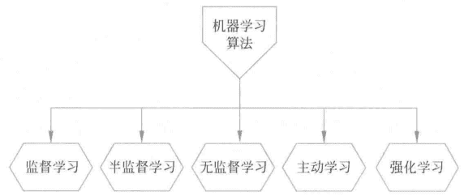

图 1-1 机器学习算法按学习范式分类

- **监督学习**：借助带标签数据集训练模型，通过调整权重拟合目标（交叉验证贯穿始终），解决垃圾邮件分拣等大规模现实问题。
- **半监督学习**：利用海量无标签样本辅助训练，大幅压缩人工标注成本，典型如生物学蛋白质特征鉴定。
- **无监督学习**：面向无标签数据挖掘隐式模式/分群，零人工干预，是探索性分析、交叉营销、用户画像、图像识别的利器。
- **主动学习**：数据量巨大难以全量标注时，通过优先级策略精准标注关键样本，适配高标注成本场景，与半监督学习同构异源。
- **强化学习**：智能体在不确定复杂环境中通过试错序列决策达成目标，攻克自动驾驶、棋类博弈等高难度场景。

#### 步骤 2 按任务目标分类（三大核心）

从任务视角出发，归类为聚类、回归、分类三大基本范式：

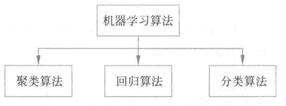

图 1-2 机器学习算法按任务目标分类

- **聚类算法**：基于距离等度量准则将数据集划分为互斥簇群，簇内高内聚、簇间低耦合，典型支撑目标用户画像分群。
- **回归算法**：针对连续数值型随机变量建模预测的监督学习，覆盖房价、股票趋势、考试分数等连续场景，常用手段含线性/逻辑/岭回归，落地如机场客流预测。
- **分类算法**：依样本特征映射标签空间，将新样本划入预设类别，核心在于学习特征→标签映射函数，应用如公交线路乘客选择预测。

## 实战三：盘点 Python 机器学习工具箱

### 任务背景

明晰算法落地所需的软件基础设施。

### 任务目标

建立主流 Python 开发框架与库的全景认知。

### 实施步骤

虽 Java、C++ 等语言亦有生态，但 Python 凭借三大优势称霸：① 语法极简，压缩工程落地耗时，释放算法设计精力；② 生态极富，NumPy/Sklearn/Pandas 等库即拿即用；③ 调试友好，开发体验优。以下为核心工具清单：

#### 步骤 1 NumPy：科学计算基石

2005 年由 Travis Oliphant 创建的开源扩展库，原生支持大规模多维数组与矩阵运算，内置海量数学函数，线性代数/傅里叶变换/矩阵运算性能卓越。

#### 步骤 2 Sklearn：机器学习瑞士军刀

Python 生态最健壮的 ML 库。统一 Pythonic API 封装分类、回归、聚类、降维四大算法族，开箱即用。底层构建于 NumPy、SciPy、Matplotlib 之上。

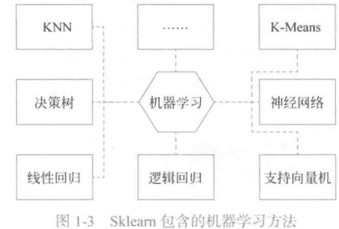

#### 步骤 3 Matplotlib：可视化底座

Python 绘图基础库，开源免费，主体 Python 编写，辅以 C/Objective-C/JS 适配跨平台，赋能数据可视化洞察。

#### 步骤 4 SciPy：科学计算进阶库

依赖 NumPy，提供高阶 N 维数组操作与数值计算例程（积分、优化等），为科研计算提效。

#### 步骤 5 TensorFlow：深度学习全栈平台

Google Brain 团队倾力打造的端到端开源平台。工具链、库、社区生态完备，推动前沿研究与工程落地双轮驱动。提供稳定 Python/C++ API，通用性强，覆盖多元领域。

#### 步骤 6 CUDA：GPU 并行计算引擎

NVIDIA 推出的通用并行计算架构，释放 GPU 巨算力加速计算密集型任务。CPU 负责串行逻辑，GPU 担纲并行重载，分工明确。

#### 步骤 7 cuDNN：深度学习 GPU 加速核心库

针对卷积、池化、归一化、激活等前向/反向传播原语的深度优化。主流框架（Caffe2、PyTorch、TensorFlow 等）均深度依赖它，让研究者聚焦模型创新而非底层调优。

## 实战四：零基础搭建开发环境

### 任务背景

落地算法离不开运行时环境，本任务实操配置全流程。

### 任务目标

熟练掌握环境部署每一步操作细节。

### 实施步骤

Anaconda 是面向 Python 的数据科学全能平台，一体化管理海量数据与依赖。默认预装 Jupyter Notebook（基于 Web 交互式 IDE，极友好新手调试）。官网提供跨平台安装包，本书选用 64-bit Graphical Installer (477 MB, 内置 Python 3.8)。

#### 步骤 1 部署 Anaconda

运行 `.exe` 进入向导界面，按提示次点“Next”至完成。

  
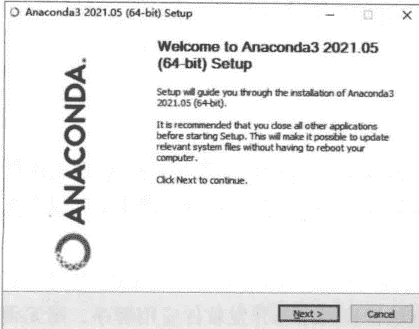  
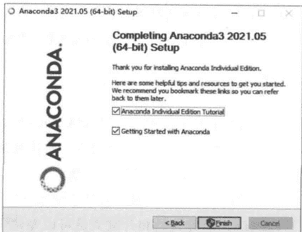  

图 1-4 安装向导首页  
图 1-5 安装成功确认页

#### 步骤 2 启动 Jupyter Notebook

“开始菜单”搜索打开 Anaconda Navigator，主界面点击 Jupyter Notebook 图标唤起 Web 操作台。

  

图 1-6 Anaconda Navigator 主界面

#### 步骤 3 新建 Python 脚本

Jupyter 面板点击 `New` 下拉菜单选择 `Python 3`，即得全新编程笔记本。

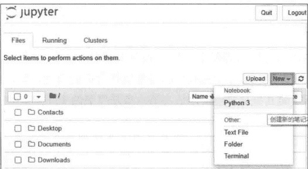  
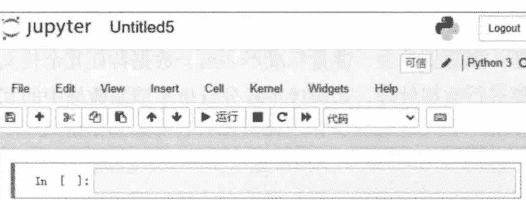  
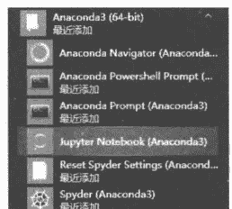  

图 1-8 Python 3 编程界面  
图 1-9 通过开始菜单快捷方式直达编辑界面

## 实战五：标准化机器学习建模流程

### 任务背景

串联全流程，明确各环节职责与价值。

### 任务目标

精通标准建模六步法的内涵与衔接逻辑。

### 实施步骤

项目开发遵循统一范式，如下图所示：

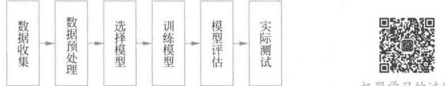  

图 1-10 机器学习标准建模六步走

1. **数据收集**：多源汇聚，量质并举。
2. **数据预处理**：清洗、转换、特征工程，炼成优质输入。
3. **模型选型**：依数据特征与业务目标匹配算法。
4. **模型训练**：喂入数据，迭代优化参数。
5. **模型评估**：多指标体系量化泛化能力。
6. **实战测试**：真实环境验证，闭环落地。

### 机器学习落地全流程：从数据清洗到模型上线的实战指南

俗话说得好，“巧妇难为无米之炊”，数据就是机器学习的“米”。没有高质量的数据支撑，再精妙的算法也只是空中楼阁。今天我们就来拆解一下，一个标准的机器学习项目是如何从零跑通的，重点剖析最耗时、最关键的**数据预处理**环节。

---

#### 一、 标准建模六步走：项目落地的“导航图”

任何机器学习项目，本质上都是在解决“用数据训练模型，再用模型解决问题”这一核心命题。流程可归纳为六大步：

1.  **搜罗素材（数据收集）**
    数据源头千万条，传感器采集（温湿度、图像、红外）、网络爬虫抓取、业务日志沉淀，都是常见获取手段。源头水平决定了模型上限。

2.  **洗净铅华（数据预处理）**
    原始数据往往“脏乱差”：缺失值、量纲不统一、冗余特征噪音大。此步核心任务是“洗数据”，比如用主成分分析（PCA）降维去噪，统一度量标准，为后续建模铺平路。

3.  **选定兵器（选择模型）**
    没有万能模型，只有适合场景的模型。依据数据特性（如温度预测属于回归问题），经验性备选几个候选者：神经网络、支持向量回归 (SVR)、线性回归等，后续PK定胜负。

4.  **磨刀不误砍柴工（训练模型）**
    核心是求解参数。深度学习中，这意味着成百上千次的迭代反向传播。设定早停条件（迭代上限或 Loss 收敛阈值），拿到“训练好”的权重文件。

5.  **实战演练（模型评估）**
    光看训练集指标是自欺欺人。需引入主观/客观综合评估体系：验证集调超参、测试集给最终成绩单。表现差？回头重选模型、调特征，循环往复直到满意。

6.  **交付使用（实际测试/部署）**
    模型不进生产环境，永远只是代码。以景区客流监测为例：训练好行人检测模型 -> 部署至边缘计算盒/服务器 -> 接入摄像头流 -> 实时输出坐标框。这一步验证的是工程落地能力，延迟、吞吐、鲁棒性全得过关。

> **项目小结回顾**：至此，我们串联了应用场景、算法分类（监督/无监督/强化学习等）、常用库及环境搭建，构建起了全局认知框架。

---

#### 二、 深度聚焦：数据预处理的“内功心法” (Project 2 核心)

业界公认：**数据预处理占据项目 80% 工时，决定模型 80% 上限。** 这一章我们拆解三大核心模块：数据切分、特征缩放、脏数据清洗。

##### 2.1 数据切分：把好“防作弊”关

监督学习里，带标签数据集必须“三七分”（甚至“八一一”、“九零五零五”）：
*   **训练集**：模型的“教科书”，用于拟合参数。
*   **验证集**：模型的“模拟考”，专供超参数调优、选模型、查过拟合。训练时**绝不碰**它。
*   **测试集**：模型的“高考”，最终性能大考，锁死不动，出分即定终身。

**实战工具：** `sklearn.model_selection.train_test_split`
*   关键参数：`test_size` (比例/数量)、`random_state` (固定种子保证复现)。
*   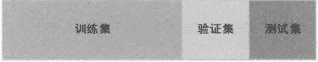  <!-- 对应原素材图 2-1 划分示意 -->
*   ```python
# 第一步：装载数据
import numpy as np
x=np.array([
10,11,12,13,14,
15,16,17,18,19
])
y=np.array([
0,1,2,3,4,
5,6,7,8,9
])
# 第二步：数据集划分
from sklearn.model_selection import train_test_split
x_train,x_test,y_train,y_test=train_test_split(x,y,test_size=0.3)
# 第三步：输出结果
print(x)
print(y)
print(x_train)
print(x_test)
print(y_train)
print(y_test)
```  <!-- 对应原素材 代码 2-1 -->
*   ```text
[10 11 12 13 14 15 16 17 18 19]
[0 1 2 3 4 5 6 7 8 9]
[19 18 11 4 5 6 14 15 10]
[12 17 13]
[9 8 1 6 4 5 0]
[2 7 3]
```  <!-- 对应原素材 代码 2-1 输出结果 -->

##### 2.2 特征缩放：消除“量纲霸权”

特征量纲差异大（如“年收入 10万” vs “年龄 30”），大量纲特征会主导梯度方向，小量纲特征被忽略。必须将所有特征映射到同一尺度。

| 方法 | 别名 | 核心公式 | 适用场景 | Sklearn 实现 |
| :--- | :--- | :--- | :--- | :--- |
| **最小-最大归一化** | Min-Max Scaling | $X^* = \frac{X - X_{min}}{X_{max} - X_{min}}$ | 分布有明确边界、无显著异常值、需压缩至 [0,1] | `MinMaxScaler` |
| **标准化** | Z-Score / Standardization | $X^* = \frac{X - \mu}{\sigma}$ | 分布近似高斯、存在异常值、下游模型假设正态分布 (如线性模型、SVM、PCA) | `StandardScaler` |

**公式速查：**
*   $$X^*=\frac{X-X_{min}}{X_{max}-X_{min}}$$  <!-- 对应原素材 公式 (2-1) MinMax -->
*   $$X^*=\frac{X-X_{\mu}}{X_{\sigma}}$$  <!-- 对应原素材 公式 (2-2) Z-Score -->

**代码实战：**
*   **MinMax 归一化** -> 数据落入 [0, 1] 区间
    *   ```python
# 第一步：装载数据
import numpy as np
X = np.array([[2, 2, -1],
              [1, 2, -2],
              [0, -2, 2]])
# 第二步：数据预处理
from sklearn import preprocessing
scaler = preprocessing.MinMaxScaler()
X_processing = scaler.fit_transform(X)
print(X_processing)
```  <!-- 对应原素材 代码 2-2 -->
    *   ```text
[[1. 1. 0.25]
 [0.5 1. 0.  ]
 [0.  0.  1.  ]]
```  <!-- 对应原素材 代码 2-2 输出 -->
*   **Z-Score 标准化** -> 均值 0，方差 1
    *   ```python
# 第一步：装载数据
import numpy as np
X = np.array([[2, 2, -1],
    [1, 2, -2],
    [0, -2, 2]])
# 第二步：数据预处理
from sklearn import preprocessing
scaler = preprocessing.StandardScaler()
X_processing = scaler.fit_transform(X)
print(X_processing.std())
print(X_processing.mean())
```  <!-- 对应原素材 代码 2-3 -->
    *   ```text
[[ 1.22474487 0.70710678 -0.39223227]
 [ 0. 0.70710678 -0.98058068]
 [-1.22474487 -1.41421356 1.37281295]]
1.0
2.4671622769447922e-17
```  <!-- 对应原素材 代码 2-3 输出 -->

> **避坑指南**：**切分在前，缩放在后！** 缩放参数（均值、方差、最大最小值）**仅在训练集上拟合**，再 `transform` 验证集和测试集，防止数据泄露。

##### 2.3 脏数据清洗：Pandas 实战“除三害”

真实世界的数据从不完美。Pandas 是清洗利器。

**害一：重复值**
人工录入常导致整行重复。
*   排查：`df.duplicated()` 标记 True/False。
*   清洗：`df.drop_duplicates()` 直接删重保留首行。
*   ```python
import pandas as pd
data=pd.DataFrame({
    '学号':[1,2,3,4,5,6,7,7,8],
    '身高':[172.0,162.0,175.0,170.0,168.0,160.0,164.0,164.0,160.0],
    '体重':[70,62,75,68,67,58,64,64,53]
})
data.duplicated()
```  <!-- 对应原素材 代码 2-4 (构建数据+duplicated) -->
*   ```text
0 False
1 False
2 False
3 False
4 False
5 False
6 False
7 True
8 False
``` <!-- 对应原素材 代码 2-4 输出 (重复标记) -->
*   ```python
data.drop_duplicates(['学号'], keep='first', inplace=True)
print(data)
``` <!-- 对应原素材 代码 2-4 (drop_duplicates) -->
*   *输出结果显示：索引 7 的重复行已移除，学号 8 保留。*

**害二：缺失值**
传感器掉线、用户未填项，表现为 `NaN`。
*   **策略 A：直接删行** (`dropna`) —— 样本量大、缺失随机、缺失比例低时用。
    *   默认 `how='any'`：只要有空就删。
    *   `how='all'`：全行皆空才删。
*   **策略 B：填充/插补** (`fillna`) —— 样本珍贵、缺失有规律时用。均值/中位数/众数/前后向填充/模型预测填补。
*   ```python
import pandas as pd
import numpy as np
data=pd.DataFrame({
    '学号':[1,2,3,4,5,6,7,7,8],
    '身高':[172.0,162.0,175.0,170.0,np.nan,160.0,164.0,164.0,160.0],
    '体重':[70,62,75,68,67,58,64,64,53]
})
``` <!-- 对应原素材 代码 2-5 (构建含 NaN 数据) -->
*   ```python
data=data.dropna()
print(data)
``` <!-- 对应原素材 代码 2-5 (dropna 默认 any) -->
*   ```python
data=data.dropna(how='all')
print(data)
``` <!-- 对应原素材 代码 2-5 (dropna how='all') -->

**害三：异常值**
虽未在代码演示中展开，但同样关键。箱线图 (IQR)、Z-Score (>3σ)、孤立森林 是常用检测手段。处理方式：视业务定性为噪声则剔除/修正，视为极端真实样本则保留并用树模型抗噪。

---

#### 三、 进阶拓展：PCA 降维去噪

当特征维度爆炸（如图像像素点、基因表达谱），冗余与噪声并存。**主成分分析 (PCA)** 通过正交变换，将高维数据投影到低维主成分空间，**保留最大方差信息，丢弃噪声方向**。

*   **核心流程**：标准化 -> 协方差矩阵 -> 特征值分解 -> 选取前 k 个主成分 -> 投影重构。
*   **Sklearn 关键参数**：`n_components` (保留维数/方差比)、`svd_solver` (分解算法)、`whiten` (白化)。
*   **经典应用**：人脸识别特征脸、图像去噪压缩、可视化降维。

---

#### 四、 自测清单：检验学习成果

**单选/多选速判：**
1.  预测“明天中午 12 点温度” → 连续值输出 → **回归 (A)**
2.  判断“明天是否下雨” → 离散类别输出 → **分类 (B)**
3.  “将数据聚成几类” → 无标签分组 → **聚类 (C)**
4.  算法大全库 → **Sklearn (C)** (SciPy 科学计算、Matplotlib 绘图、NumPy 数组基建)
5.  按学习范式分类 → **监督 (A)、无监督 (B)、强化 (C)、半监督 (D)、主动 (E)** 全选。

**简答题核心考点：**
1.  **应用场景**：推荐系统、风控反欺诈、计算机视觉 (CV)、自然语言处理 (NLP)、时序预测、异常检测……
2.  **Python 生态栈**：`NumPy`/`Pandas` (数据处理) → `Matplotlib`/`Seaborn` (可视化) → `Scikit-learn` (传统 ML) → `TensorFlow`/`PyTorch` (深度学习) → `XGBoost`/`LightGBM`/`CatBoost` (表格数据竞赛神器)。
3.  **六步走详解**：同上文第一部分，需能背出各步骤输入、输出、核心动作、常用工具。
4.  **算法名录**：
    *   监督-分类：LR、KNN、SVM、决策树、RF、GBDT、XGBoost、NN
    *   监督-回归：线性回归、岭/套索回归、SVR、树回归
    *   无监督-聚类：K-Means、DBSCAN、层次聚类、谱聚类
    *   无监督-降维：PCA、LDA、t-SNE、UMAP
    *   强化学习：Q-Learning、DQN、PPO、SAC

---

#### 结语

数据预处理不是枯燥的“搬砖”，而是**理解业务、洞察数据、规避陷阱**的高级技术活。切分严谨、缩放得当、清洗干净，模型训练才能事半功倍。下一站，我们将把这些处理好的数据，喂给具体的算法模型，开启建模实战之旅。

# 实战指南：从脏数据到清洗填补，再到PCA降维去噪全流程解析

在上一节展示的基础数据表中，我们已初步接触原始记录。接下来，我们将深入实战，攻克数据预处理中的两大核心难题：**缺失值如何科学填补**与**异常值如何精准修正**，最后解锁**PCA主成分分析在图像去噪中的妙用**。

---

## 一、 缺失值填补：多策略对比，总有一款适合你

面对数据集中的“空洞”，盲目丢弃样本绝非上策。我们将以身高数据为例，演示四种主流填补范式的代码实现与效果差异。

### 1. 常数填充：简单粗暴的“占位符”
最直接的思路是用一个固定值（如 `170`）补齐空缺。
> **操作演示**：调用 `fillna(170)` 后，原本缺失的第5行身高瞬间变为 `170.0`。虽然高效，但引入了人为偏差，适合业务兜底或基线实验。

### 2. 邻近值填充：利用序列相关性“借位”
若数据存在强时序或空间相关性（如同班学生身高分布），前向填充 `ffill()` 或后向填充 `bfill()` 往往更合理。
- **前向填充**：用上一行数据补当前行。示例中第4行本为 `170`，填充后依然保持 `170`，因前一行即为 `170`。
- **后向填充**：用下一行数据补当前行。示例中第4行被下一行的 `160` 覆盖，变为 `160.0`。
> **核心判断**：选择哪种取决于数据流向——时间序列常用前向，空间序列视业务而定。

### 3. 统计量填充：用“整体特征”修补“局部缺失”
计算列均值 `mean()` 填补，能最大程度保留全局分布特征。
> **实战结果**：缺失处被填为 `165.875`（其余样本均值）。注意：Pandas默认保留三位小数，后续建模可按需四舍五入。

---

## 二、 异常值修复：把“脏数据”洗白成“可用数据”

采集环节常因人为录入错误（如单位混淆、小数点偏移）产生极端值。删掉可惜，留着误模型——**截断替换法**是工业界标准动作。

### 场景 A：数值爆表（上限越界）
**现象**：某学生身高记录为 `1700cm`（表 2-4 第5行），明显将“米”误作“厘米”录入。
**诊断代码**：`(df['身高'] > 200).any()` 返回 `True`，确认存在超阈值噪声。
**修复策略**：将超 `200cm` 的值，替换为 **正常范围内的最大值**（即 `175cm`）。
**代码逻辑**：
```python
mask = df['身高'] > 200
df.loc[mask, '身高'] = df.loc[~mask, '身高'].max()
```
**效果验证**：第5行身高由 `1700` 修正为 `175`，数据分布瞬间回归合理区间。

### 场景 B：数值崩塌（下限越界）
**现象**：某学生身高仅 `17cm`（表 2-5 第5行），疑为漏输数位。
**诊断代码**：`(df['身高'] < 50).any()` 返回 `True`。
**修复策略**：将低于 `50cm` 的值，替换为 **正常范围内的最小值**（即 `160cm`）。
**效果验证**：异常值 `17` 被 `160` 取代，数据集重获洁净。

> **避坑指南**：阈值（如 200/50）须结合业务常识设定；替换值选“次极值”而非“均值”，能更好保留原始分布尾部特征。

---

## 三、 PCA 降维实战：从理论推导到图像去噪落地

### 1. 核心原理一张图看懂
PCA（主成分分析）本质是**正交线性变换**：
1. **中心化** → 零均值化样本；
2. **协方差矩阵** → 量化特征间线性相关；
3. **特征值分解** → 找到最大方差方向（主成分）；
4. **投影重构** → 低维表达高维信息。

> **一句话总结**：用最少的“合成特征”保留原始数据最大的“信息量”（方差）。

### 2. Sklearn `PCA` 关键参数速查表
| 参数 | 作用 | 实战建议 |
|------|------|----------|
| `n_components` | 目标维度 / 保留方差比 | **首选浮点数（如 0.95）**，自动匹配维度，避免人为猜测 |
| `copy` | 是否复制数据 | 默认 `True` 保护原数据，大内存场景可设 `False` 节省开销 |
| `whiten` | 是否白化（单位方差） | 视下游模型而定，通常默认 `False` 即可 |
| `svd_solver` | 分解算法 | 大数据/高维选 `'randomized'` 加速；常规选 `'full'` 精度更高 |

### 3. 代码极简范式：降维→还原，四行搞定
```python
from sklearn.decomposition import PCA
pca = PCA(n_components=0.95)  # 保留 95% 信息量
X_low = pca.fit_transform(X)  # 降维
X_recon = pca.inverse_transform(X_low)  # 还原
```
**实测对比**：原始特征值 `5.0`，还原后 `5.16`，误差极小——**说明核心模式已被完整捕获**。

### 4. 杀手级应用：PCA 图像去噪
**原理直觉**：图像主成分 = 结构轮廓；噪声 = 高频微小抖动 = 低方差分量。丢弃尾部主成分，即实现“降噪保边”。

**实战流程（代码 2-10 精简版）**：
1. **读图转灰**：`img = rgb2gray(imread('pic.png'))` → 二维矩阵。
2. **加噪模拟**：`noisy = img + 0.3 * randn(*img.shape)` → 生成含噪图（图 2-3）。
3. **PCA 降噪**：
   - 将图像按 `8x8` 小块切分 → 样本矩阵 `(n_patches, 64)`；
   - `PCA(n_components=0.8).fit_transform(patches)` 保留 80% 能量；
   - `inverse_transform` 还原拼接 → 去噪图（图 2-4）。
4. **效果对比**：图 2-4 纹理更平滑，伪影显著减弱，主体边缘完好无损。

> **进阶提示**：实际工程中，`n_components` 需网格搜索平衡“去噪强度”与“细节保留”；彩色图可对各通道独立 PCA 或转 Lab 空间仅处理亮度通道。

---

## 四、 项目知识地图 & 自测题库

### 核心技能树回顾
| 模块 | 关键动作 | 核心工具 |
|------|----------|----------|
| 数据集划分 | 分层抽样、固定随机种子 | `train_test_split(stratify=y, random_state=42)` |
| 缺失处理 | 常数/邻近/统计量填补 | `fillna()` / `ffill()` / `bfill()` |
| 异常修复 | 阈值截断+次极值替换 | 布尔索引 + `loc` 赋值 |
| 标准化/归一化 | Z-score / Min-Max | `StandardScaler` / `MinMaxScaler` |
| 降维/特征提取 | PCA 白化/去噪 | `PCA(n_components=0.95)` |

### 选择题速练（答案在文末）
1. 划分数据集用哪个？`A. MinMaxScaler  B. train_test_split  C. StandardScaler`
2. Z-score 标准化用哪个？`A. MinMaxScaler  B. train_test_split  C. StandardScaler`
3. 复现划分结果的关键参数？`A. stratify  B. test_size  C. random_state`
4. 直接删除含空值行用哪个？`A. fillna  B. dropna  C. loc`
5. PCA 目标维度参数？`A. n_components  B. copy  C. whiten  D. svd_solver`

### 简答题深度思考
1. **测试集 vs 验证集**：测试集仅用于最终模型“期末考试”，验证集用于超参调优“期中模拟”，二者严禁数据泄露。
2. **原始数据常见“五毒”**：缺失、异常、重复、不一致（单位/格式）、偏采样（分布失衡）。
3. **PCA 原理/特点/场景**：
   - **原理**：协方差矩阵特征分解 → 最大方差正交基投影。
   - **特点**：无监督、线性、可解释性强（主成分=特征组合）、计算高效。
   - **场景**：高维可视化、多重共线性消除、噪声抑制（如人脸识别 Eigenfaces、图像压缩、金融风控指标融合）。

> **参考答案**：1-B  2-C  3-C  4-B  5-A

---

## 结语
数据预处理虽无模型训练那般“显山露水”，却是**模型上限的隐形决定者**。掌握缺失填补的策略权衡、异常修复的业务对齐、PCA降维的几何直觉，你就拥有了将“野生数据”驯化为“优质特征”的核心武力。下一章，我们将把这些洁净特征喂给经典算法，开启建模实战之旅——**敬请期待！**

```python
import pandas as pd
import numpy as np
data=pd.DataFrame({
    '学号':[1,2,3,4,5,6,7,7,8],
    '身高':[172.0,162.0,175.0,170.0,np.nan,160.0,164.0,164.0,160.0],
    '体重':[70,62,75,68,67,58,64,64,53]
})
```
```python
data=data.fillna(170)
print(data)
```
```python
data = data.fillna(method='ffill')
print(data)
```
```python
data=data.fillna(method='bfill')
print(data)
```
```python
data['身高'].fillna(data['身高'].mean(), inplace=True)
print(data)
```
```python
import pandas as pd
import numpy as np
data=pd.DataFrame({
    '学号':[1,2,3,4,5,6,7,7,8],
    '身高':[172.0,162.0,175.0,170.0,1700.0,160.0,164.0,164.0,160.0],
    '体重':[70,62,75,68,67,58,64,64,53]
})
print("是否存在超过正常身高范围的值：",any(data['身高']>200))
```
```python
# 得到所有身高值中仅次于 200cm 的数据
renew_value=data['身高'][data['身高']<200].max()
# 使用上一步得到的数据来替换所有身高超过 200cm 的数据
data.loc[data['身高']>200,'身高']=renew_value
```
```python
import pandas as pd
```
```
renew_value=data[' 身高 '][data[' 身高 ']>50].min()
data.loc[data[' 身高 ']<50," 身高 "]=renew_value
print(data)
```
```
# 第一步：装载数据
import numpy as np
X=np.array([
 [1,2,1,2],
 [7,2,2,4],
 [3,7,3,6],
 [2,5,2,3],
 [3,2,2,9],
 [5,0,3,5]])
# 第二步：选择 PCA 算法并设置参数
from sklearn.decomposition import PCA
pca=PCA(n_components=3)
# 第三步：进行数据降维
X_pca=pca.fit_transform(X)
# 第四步：将降维后的数据进行还原
X_new=pca.inverse_transform(X_pca)
# 第五步：输出 PCA 模型系数
print(pca.explained_variance_ratio_)
print(X_new)
```
```
[[ 0.44274388  0.35663085  0.18459621]
 [ 0.95722833  1.97159761  1.22028273  1.9753309 ]
 [ 6.88643498  1.92458751  2.58488274  3.93449993]
 [ 3.05169086  7.03432515  2.73378166  6.02981336]
 [ 2.01310818  5.00870444  1.93249024  3.00756031]
 [ 2.92587872  1.95078   2.38173953  8.95724961]
 [ 5.16565893  0.11000528  2.14682309  5.09554589]]
```
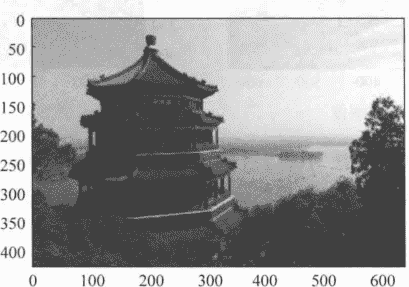
```
# 第一步: 读取并显示图片
from sklearn.datasets import load_sample_image
import matplotlib.pyplot as plt
import numpy as np
img1=load_sample_image("china.jpg")
img1=np.array(img1,dtype=np.float64)/255
plt.imshow(img1)
plt.show()
# 第二步: 图像灰度化
from skimage import color,filters
img1=color.rgb2gray(img1)
img2=np.random.normal(img1.data,0.1)
plt.imshow(img2,cmap='gray')
plt.show()
# 第三步: PCA 降维去噪
from sklearn.decomposition import PCA
pca=PCA(0.8)
img2_pca=pca.fit_transform(img2)
img3=pca.inverse_transform(img2_pca)
# 第四步: 显示去噪后的图像
plt.imshow(img3,cmap='gray')
plt.show()
```
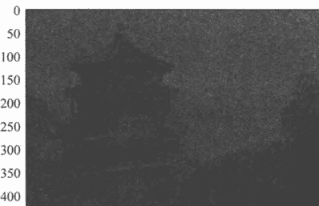
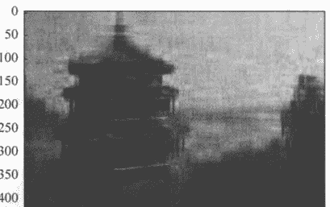

# 项目3
## K-Means 算法实战进阶

### 核心导读
机器学习里常见的一类任务，是给目标贴上“身份标签”。比如判断一张照片里是猫、狗还是别的生物。常规套路是先喂给算法一堆带标签的样本，让它充分“练级”，掌握了判断依据后，再拿新图让它预测。这就是有监督学习，分“训练”和“预测”两步走：训练阶段用海量样本炼出模型，预测阶段直接丢图片进去出结果。

### 你将收获
- 吃透 K-Means 图像聚类的核心逻辑；
- 学会用“肘部法则”与“轮廓系数”精准定 K 值；
- 实战掌握 K-Means 图像压缩的套路。

### 知识脉络一览
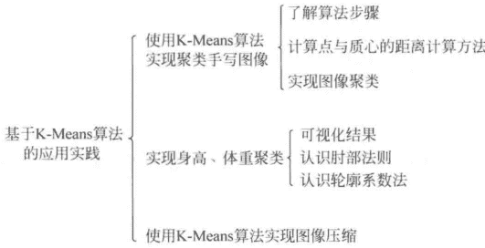

## 任务 3-1：手写数字图像聚类实战

### 任务简介
这节课我们要拆解聚类算法的底层原理与操作流程，并动手调用 Sklearn 的 K-Means，完成手写数字图像的自动归类。

### 任务指标
熟练驾驭 Sklearn 中的 K-Means，轻松搞定图像聚类操作。

### 理论储备

#### 1. 聚类算法：无标签下的“自动分拣”
跟分类一样，聚类也要搞清类别，但最大的区别在于：**没有现成的标签，也没有训练好的模型**。算法得自力更生，把一堆样本按相似度自动分堆——堆内成员越像越好，堆外差异越大越好。这里的“堆”专业叫“簇”。

举个栗子：给一群动物照片，不告诉你有哪些品种，也没现成模型。聚类算法得自己看着办，有人按颜色分，有人按体型分，标准不唯一。这属于**无监督学习**，没有显式训练过程，这是它跟分类算法最本质的分野。算法靠自己定规则，把相似的凑一起，不相似的分开。

本质上，聚类是个“集合划分”问题：按特定标准切分数据集，追求**簇内高相似、簇间大差异**。核心在于如何定义“簇”，通常靠样本间距离或空间密度来裁夺。

应用场景很广：生物学挖掘同表达模式基因、电商猜你爱买啥、营销圈定相似用户群。

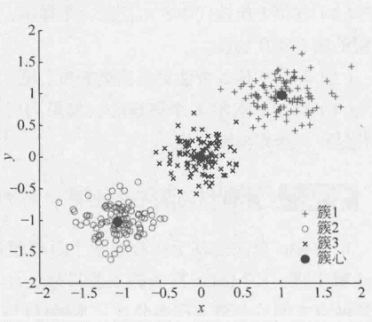

图 3-1 聚类划分效果图

#### 2. K-Means 算法：经典的“质心迭代法”
K-Means 是无监督聚类里的“常青树”。给定数据集，它能切出 K 个簇，每个簇用**质心**（所有成员坐标均值或加权均值）代表。K 值用户定，距离用欧式距离——**越近越像，越像越同簇**。

特点鲜明：原理直白、解释性强、收敛快、调参只改 K。但**初始值敏感**，多跑几次结果可能不一样，容易陷入局部最优，尤其两簇贴得太近时。

### 实战演练
本任务带你走一遍 K-Means 定义、步骤、质心计算，并落地二维图像聚类。

#### 步骤 1：理清算法流程
K-Means 就四步循环：
1.  随机/启发式选 K 个初始质心。
2.  第 k 轮迭代：算每个样本到 K 个质心的距离，扔给最近的那堆。
3.  重算各簇质心（取均值）。
4.  质心不动了就收工，否则回第 2 步接着转。

#### 步骤 2：距离怎么算？
核心目标：最小化**各点到各自质心距离之和**。常用欧氏距离，二维公式如下：

\(d=\sqrt{(x_1-x_2)^2+(y_1-y_2)^2}\) (3-1)

#### 步骤 3：跑通手写数字聚类
图像聚类能切分数据集、挖同类特征。我们用 Sklearn 自带的手写数字库（0-9 共 10 类，1797 张 8x8 像素小图）实战。图 3-2、3-3 是数字 0 和 9 的样子。

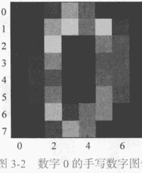
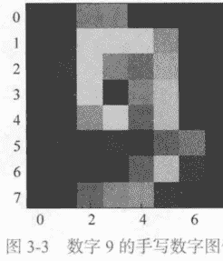

### 【代码 3-1】
```
# 第一步：装载数据
from sklearn.datasets import load_digits
digits = load_digits()
X = digits.data;
y = digits.target
# 第二步：引入时间计时
import time
start = time.process_time()
# 第三步：进行 K-Means 聚类
from sklearn.cluster import KMeans
KM = KMeans(n_clusters=10)
c = KM.fit_predict(X)
end = time.process_time()
print('Time is %.3f' % (end - start))
# 第四步：计算聚类结果
import numpy as np
y_predict = np.zeros_like(c)
from scipy.stats import mode
for i in range(10) :
    mask = (c == i)
    y_predict[mask] = mode(y[mask])[0]
KM.cluster_centers_.shape
# 第五步：显示聚类中心
```
```
import matplotlib.pyplot as plt
plt.rcParams['font.sans-serif'] = [u'SimHei']
plt.rcParams['axes.unicode_minus'] = False
fig, ax = plt.subplots(2, 5, figsize = (8, 3))
centers = KM.cluster_centers_.reshape(10, 8, 8)
for axi, center in zip(ax.flat, centers):
    axi.set(xticks = [], yticks = [])
    axi.imshow(center, cmap = plt.cm.binary)
# 第六步：输出聚类准确率
from sklearn.metrics import accuracy_score
print('聚类准确率为：%.4f %%' % accuracy_score(y, y_predict))
```

输出结果如下，聚类中心长这样：
```
Time is 0.406
聚类准确率为: 0.7919 %
```
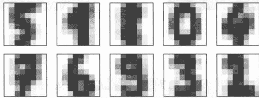

图 3-4 聚类中心（10 个，对应 0-9）

代码里 `n_clusters=10`，因为咱们知道底儿有 10 类。跑出来 10 个中心，肉眼可见 0-9 的轮廓。

前面学的 PCA 能降维提主成分，我们拿它预处理一下手写字符，再看聚类效果：

### 【代码 3-2】
```
# 第一步：装载数据
from sklearn.datasets import load_digits
digits = load_digits()
X = digits.data;
y = digits.target
# 第二步：引入时间计时
import time
from sklearn.decomposition import PCA
start = time.process_time()
# 第三步：PCA 降维
pca = PCA(n_components=10)
```
```python
pca.fit(X)
X_reduction = pca.transform(X)
print(X_reduction.shape)
end = time.process_time()
print('PCA Time is %.3f' % (end - start))
# 第四步：K-Means 聚类
from sklearn.cluster import KMeans
start = time.process_time()
KM = KMeans(n_clusters = 10)
c = KM.fit_predict(X_reduction)
end = time.process_time()
print('K-Means Time is %.3f' % (end - start))
# 第五步：计算聚类结果
from scipy.stats import mode
import numpy as np
y_predict = np.zeros_like(c)
for i in range(10):
    mask = (c == i)
    y_predict[mask] = mode(y[mask])[0]
# 第六步：输出聚类准确率
from sklearn.metrics import accuracy_score
print('聚类准确率为：%.4f %%' % accuracy_score(y, y_predict))
```

输出结果：
```
(1797, 10)
PCA Time is 0.094
K-Means Time is 0.406
聚类准确率为：0.7869 %
```

**意外发现**：加了 PCA 反而更慢？因为 PCA 自身降维也要耗时，数据量小时（仅 1797 条）这点开销抵不上收益。

换个大场验证——**MNIST 数据集**（6 万训练样本，1 千测试样本，28x28 像素）。

先跑**不降维**版：
### 【代码 3-3】
```python
# 第一步：装载数据
from sklearn.datasets import load_digits
from sklearn.datasets import fetch_openml
digits = fetch_openml('mnist_784')
X = digits.data
y = digits.target
# 第二步: 引入时间计时
import time
start = time.process_time()
# 第三步: K-Means 聚类
from sklearn.cluster import KMeans
KM = KMeans(n_clusters = 10)
c = KM.fit_predict(X)
end = time.process_time()
print('Time is %.3f' % (end - start))
# 第四步: 计算聚类结果
from scipy.stats import mode
import numpy as np
y_predict = np.zeros_like(c)
for i in range(10):
    mask = (c == i)
    y_predict[mask] = mode(y[mask])[0]
# 第五步: 显示聚类结果
import matplotlib.pyplot as plt
plt.rcParams['font.sans-serif'] = ['SimHei']
plt.rcParams['axes.unicode_minus'] = False
fig, ax = plt.subplots(2, 5, figsize = (8, 3))
centers = KM.cluster_centers_.reshape(10, 28, 28)
for axi, center in zip(ax.flat, centers):
    axi.set(xticks = [], yticks = [])
    axi.imshow(center, cmap = plt.cm.binary)
import pandas as pd
y = y.astype(np.int8)
y_predict = pd.DataFrame(y_predict)
y_predict = y_predict.astype(np.int8)
# 第六步: 输出聚类准确率
from sklearn.metrics import accuracy_score
print(' 聚类准确率为: %.4f %%' % accuracy_score(y, y_predict))
```

聚类中心见下图：
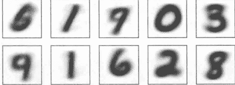

图 3-5 聚类结果（可见 0-9）

```
Time is 169.375
聚类准确率为: 0.5851 %
```

6 万张图，`n_clusters=10`，跑了近 170 秒，准确率约 58.5%。

再跑**先 PCA 降维再聚类**版：
### 【代码 3-4】
```python
# 第一步: 载入数据
from sklearn.datasets import load_digits
from sklearn.datasets import fetch_openml
digits = fetch_openml('mnist_784')
X = digits.data
y = digits.target
# 第二步: PCA 降维
import time
start = time.process_time()
from sklearn.decomposition import PCA
pca = PCA(n_components = 64)
pca.fit(X)
X_reduction = pca.transform(X)
print(X_reduction.shape)

from sklearn.cluster import KMeans
KM = KMeans(n_clusters = 10)
c = KM.fit_predict(X_reduction)
end = time.process_time()
print('Time is %.3f' % (end - start))
# 第三步: 计算聚类结果
from scipy.stats import mode
import numpy as np
y_predict = np.zeros_like(c)
for i in range(10):
    mask = (c == i)
    y_predict[mask] = mode(y[mask])[0]
# 第四步: 显示聚类结果
from sklearn.metrics import accuracy_score
y = y.astype(np.int8)
import pandas as pd
y_predict = pd.DataFrame(y_predict)
y_predict = y_predict.astype(np.int8)
accuracy_score(y, y_predict)
```

输出结果：
```
Time is 28.719
聚类准确率为: 0.5847 %
```

**对比震撼**：
- 原始维度 784，降维后 64。
- 准酱油差不多，但**耗时从 169.375s 降到 28.719s**，仅为原版 **1/6**。
- 结论：大数据量下，PCA 降维能显著提速 K-Means。

## 任务 3-2：身高体重聚类——实战定 K 值

- **任务简介** 用身高体重案例，手把手教你确定 K-Means 里的关键超参数 K。
- **任务指标** 熟练掌握 K 值确定的两大神器：肘部法则 & 轮廓系数法。

### 实战步骤

#### 步骤 1：可视化先行，心里有数
K 值定不对，聚类全白搭。常用两招定 K：**肘部法则**看 SSE 拐点，**轮廓系数法**看轮廓峰值。

表 3-1 是某班同学的身高体重数据。咱们先用代码 3-5 跑个二维散点图，直观瞅瞅数据长啥样，估个大概的分堆数。

表 3-1 身高、体重数据集

| 序号 | 身高/cm | 体重/kg | 序号 | 身高/cm | 体重/kg |
|---|---|---|---|---|---|
| 1 | 159.3 | 60.5 | 11 | 185.3 | 81.0 |

## K-Means 实战：如何精准确定 K 值与图像压缩应用

| 序号 | 身高 | 体重 | 序号 | 身高 | 体重 |
| :--- | :--- | :--- | :--- | :--- | :--- |
| 2 | 160.3 | 60.2 | 12 | 161.3 | 62.2 |
| 3 | 165.2 | 60.4 | 13 | 164.2 | 64.4 |
| 4 | 162.5 | 62.1 | 14 | 163.5 | 65.1 |
| 5 | 175.4 | 75.1 | 15 | 176.4 | 75.1 |
| 6 | 178.6 | 75.3 | 16 | 185.6 | 85.3 |
| 7 | 177.1 | 78.2 | 17 | 175.1 | 78.0 |
| 8 | 176.4 | 75.4 | 18 | 168.4 | 60.4 |
| 9 | 189.4 | 85.8 | 19 | 187.4 | 80.8 |
| 10 | 176.2 | 73.7 | 20 | 185.2 | 79.7 |

【代码 3-5】

```python
# 第一步: 装载数据
import numpy as np
x = np.array([
    159.3,160.3,165.2,162.5,
    175.4,178.6,177.1,176.4,
    189.4,176.2,185.3,161.3,
    164.2,163.5,176.4,185.6,
    175.1,168.4,187.4,185.2
])
y = np.array([
    60.5,60.2,60.4,62.1,
    75.1,75.3,78.2,75.4,
    85.8, 73.7, 81,62.2,
    64.4, 65.1, 75.1,85.3,
    78,60.4,80.8,79.7
])
# 第二步: 显示二维数据
import matplotlib.pyplot as plt
plt.rcParams["font.sans-serif"] = ['SimHei']
plt.rcParams["axes.unicode_minus"] = False
plt.scatter(x, y)
plt.xlim([150,190])
plt.ylim([45,90])
plt.xlabel( ' 身高 /cm' )
plt.ylabel( ' 体重 /kg' )
plt.show()
```

代码 3-5 将二维数据可视化，直观展示了数据自然分为三个簇，暗示 K=3 为最优选择。但现实场景多为高维数据，难以肉眼判断。下面介绍两大主流指标法——肘部法则与轮廓系数法，助你科学定 K。

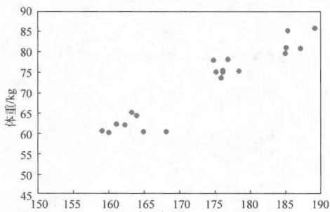

**图 3-6 不同 K 值下的聚类效果对比**

### 核心技法一：肘部法则

**畸变程度** 是衡量簇内紧密度的关键指标，即样本点到簇心距离的平方和。畸变越小，簇内聚合越紧密。对于结构分明的数据，随着 K 值增加，畸变度会在某个“拐点”处大幅下降趋缓，该拐点即为推荐 K 值。此法适合 K 值较小的场景，实现流程见代码 3-6。

【代码 3-6】

```python
# 第一步：装载数据
import numpy as np
x = np.array([
    159.3,160.3,165.2,162.5,
    175.4,178.6,177.1,176.4,
    189.4,176.2,185.3,161.3,
    164.2,163.5,176.4,185.6,
    175.1,168.4,187.4,185.2
])
y = np.array([
    60.5,60.2,60.4,62.1,
    75.1,75.3,78.2,75.4,
    85.8, 73.7, 81,62.2,
    64.4, 65.1, 75.1,85.3,
    78,60.4,80.8,79.7
])
X = np.array(list(zip(x, y))).reshape(len(x), 2)
K = range(1, 10)
meandistortions = []
# 第二步：肘部法则
from sklearn.cluster import KMeans
from scipy.spatial.distance import cdist
for k in K:
    kmeans = KMeans(n_clusters = k)
    kmeans.fit(X)
    meandistortions.append(sum(np.min(cdist(X, kmeans.cluster_centers_,
    'euclidean'), axis = 1)) / X.shape[0])
# 第三步：输出结果
import matplotlib.pyplot as plt
plt.rcParams['font.sans-serif'] = ['SimHei']
plt.rcParams['axes.unicode_minus'] = False
plt.plot(K, meandistortions, 'bx-')
plt.xlabel('K')
plt.ylabel('平均离差')
plt.title('用肘部法则选取 K 值')
plt.show()
```

运行结果如下图所示。

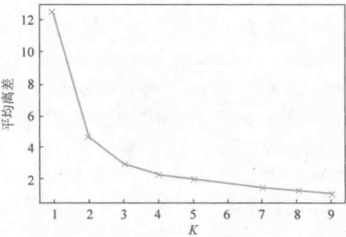

**图 3-7 肘部法则寻找最佳 K 值**

由图 3-7 可见，曲线拐点出现在 K=3，确认为最佳聚类数。

### 核心技法二：轮廓系数法

轮廓系数综合评估**簇内聚合度**与**簇间分离度**。取值区间 [-1, 1]，值越逼近 1，代表簇内越紧凑、簇间越疏离，聚类质量越高。代码 3-7 演示如何绘制轮廓系数随 K 变化的曲线。

【代码 3-7】

```python
# 第一步: 装载数据
import numpy as np
x = np.array([
    159.3,160.3,165.2,162.5,
    175.4,178.6,177.1,176.4,
    189.4,176.2,185.3,161.3,
    164.2,163.5,176.4,185.6,
    175.1,168.4,187.4,185.2
])
y = np.array([
    60.5,60.2,60.4,62.1,
    75.1,75.3,78.2,75.4,
    85.8, 73.7, 81, 62.2, 64.4,
    65.1,75.1,85.3,78,
    60.4,80.8,79.7
])
sc_scores = []
X = np.array(list(zip(x, y))).reshape(len(x), 2)
#第二步:轮廓系数法
clusters_number = [2, 3, 4, 6, 7, 8]
from sklearn.cluster import KMeans
from sklearn.metrics import silhouette_score
for t in clusters_number:
    kmeans_model = KMeans(n_clusters=t).fit(X)
    sc_scores.append(silhouette_score(X, kmeans_model.labels_, metric=
    'euclidean'))
# 第三步：输出结果
import matplotlib.pyplot as plt
plt.rcParams['font.sans-serif'] = ['SimHei']
plt.rcParams['axes.unicode_minus'] = False
plt.xlabel('K-簇数量 ')
plt.ylabel('轮廓系数 ')
plt.plot(clusters_number, sc_scores, 'o-')
```

输出结果如下图。

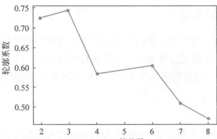

**图 3-8 轮廓系数法确定 K 值**

图中 K=3 时轮廓系数峰值最大，再次印证 K=3 为最优解。

> **小结**：肘部法则与轮廓系数法双重验证，稳健确定 K=3。

---

## 任务 3-3：K-Means 实战图像压缩

### 任务背景与目标
掌握 K-Means 通过颜色聚合实现图像压缩的核心原理与操作流程。

### 原理解析
图像压缩本质是剔除冗余信息。K-Means 压缩图像的思路：**将相似像素颜色归并至同一簇，用簇心颜色替代原像素值**，从而大幅降低灰度/色阶数，达成压缩目的。这在网页加速、存储优化、邮件附件限制等场景极具价值。

### 实操演示
实验选用 Sklearn 自带 `china.jpg`（分辨率 427×640×3，原始 256 色阶），如图 3-9。

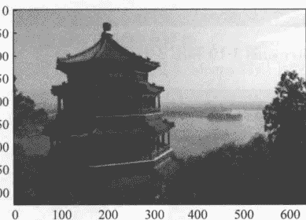

**图 3-9 原始图像**

核心代码逻辑（代码 3-8）：
1. 读取图像并重塑为二维特征矩阵；
2. 设定目标色阶数（如 `colors=20`），训练 KMeans 获取簇心与标签；
3. 编写重构函数，按标签映射簇心颜色还原图像矩阵；
4. 可视化对比。

【代码 3-8】

```python
# 第一步：读取并显示图片
from sklearn.datasets import load_sample_image
img1 = load_sample_image("china.jpg")
import numpy as np
img1 = np.array(img1, dtype = np.float64) / 255
import matplotlib.pyplot as plt
plt.rcParams['font.sans-serif'] = ['SimHei']
plt.rcParams['axes.unicode_minus'] = False
plt.imshow(img1)
plt.show()
m, n, p = img1.shape;
x = img1.reshape(-1,p)
print(img1.shape,x.shape)
# 第二步：进行灰度级聚类
```

```python
from sklearn.cluster import KMeans
import numpy as np
import matplotlib.pyplot as plt

# 假设 x, m, n, p 已定义为图像数据矩阵及形状参数
colors = 20
KM = KMeans(n_clusters=colors, random_state=42)
labels = KM.fit_predict(x)
codebook = KM.cluster_centers_

# 重构图像函数
def recreate_img(codebook, labels, m, n, p):
    img_recon = np.zeros((m, n, p))
    idx = 0
    for i in range(m):
        for j in range(n):
            img_recon[i][j] = codebook[labels[idx]]
            idx += 1
    return img_recon

# 执行重构与显示
img_compressed = recreate_img(codebook, labels, m, n, p)
plt.imshow(img_compressed)
plt.axis('off')
plt.show()

# 统计压缩后唯一灰度级数量
unique_levels = len(np.unique(img_compressed.reshape(-1, p), axis=0))
print(f"压缩后实际灰度级数: {unique_levels}")
```

压缩效果对比见图 3-10 与 3-11。

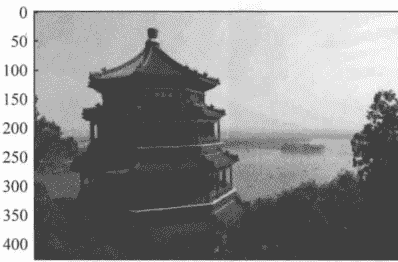

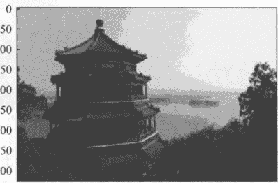

**图 3-10 色阶 128 效果**  |  **图 3-11 色阶 16 效果**
:---: | :---:
质量保留较好 | 天空区域出现明显色块失真

**洞察**：色阶数越低，压缩率越高，但画质损耗越严重（如低色阶下天空层次丢失），需在业务场景中权衡。

---

## 项目复盘：K-Means 核心要点速记

| 维度 | 关键结论 |
| :--- | :--- |
| **算法定位** | 无监督学习代表，原理直观、收敛快、仅需调 K 值。 |
| **性能评估** | 可通过畸变程度、轮廓系数等指标量化。 |
| **核心痛点** | **初始化敏感** -> 易陷入局部最优；**簇间距近** -> 划分不稳定。 |
| **工程建议** | 多次随机初始化取最优；结合 K-Means++ 改进初始化；高维数据先降维。 |

---

## 课后强化训练

### 单选题
1.  K-Means 归属哪类学习范式？（ **B** ）
    A. 监督学习  **B. 无监督学习**  C. 强化学习  D. 主动学习
2.  K-Means 默认最常用的距离度量？（ **B** ）
    A. 曼哈顿距离  **B. 欧氏距离**  C. 余弦距离  D. 海明距离
3.  可用于确定 K 值的方法？（ **A, B** 多选题性质，单选语境下常考组合或单项，此处标注核心两项）
    **A. 肘部法则**  **B. 轮廓系数法**  C. 随机梯度下降  D. 归一化

### 简答题
1.  **梳理 K-Means 完整流程**：初始化 K 个质心 -> 分配样本到最近质心 -> 重计算质心 -> 迭代至收敛。
2.  **对比 K 值确定方法原理**：肘部法则找畸变度下降拐点；轮廓系数法找聚类质量评分峰值。
3.  **动手实验**：调用 `make_blobs` 生成 5 簇数据，遍历不同 K 值训练 K-Means，可视化对比聚类边界变化，体会 K 值过小/过大导致的欠拟合/过拟合现象。

---

# 基于 KNN 算法的应用实战

## 项目速览
**K 近邻（KNN）** 是兼具分类与回归能力的**有监督**经典算法。核心逻辑：**“物以类聚”**——通过目标点周围 K 个邻居的标签（分类取众数，回归取均值）进行预测。概念极简，实战威力强，是入门必修课。

## 学习清单
- [ ] 透彻理解 KNN 基础原理
- [ ] 熟练调用 Sklearn 完成分类任务（鸢尾花案例）
- [ ] 掌握 KNN 回归预测技巧（鲑鱼案例）
- [ ] 理解交叉验证在 K 值优选中的作用
- [ ] 实战医疗预测场景（乳腺癌筛查）

## 知识全景图
| 实战方向 | 核心打卡点 |
| :--- | :--- |
| **鸢尾花分类** | 距离度量计算 -> KNN 流程复现 -> Sklearn 高效建模 |
| **鲑鱼回归预测** | 数据认知 -> 样本裁剪实验 -> K 值敏感性分析 |
| **乳腺癌筛查** | 综合实战：数据清洗 -> 特征工程 -> 模型调优 -> 评估 |

---

## 任务 4-1：KNN 实战鸢尾花分类

### 任务目标
吃透 KNN 原理与步骤，熟练使用 Sklearn 解决经典鸢尾花三分类问题。

### 理论储备站

#### 1. KNN 算法通俗讲解
想象二维平面上分布着不同颜色的数据点群（如图 4-1）。KNN 的假设：**空间距离近 = 语义相似**。新来一个点，看它最近的 K 个“邻居”是谁，少数服从多数，归为哪类。

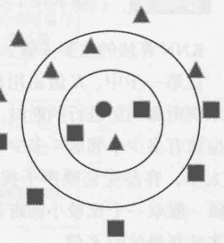

**图 4-1 样本空间分布示意**

#### 2. 优劣势剖析
| 优点 ✅ | 缺点 ❌ |
| :--- | :--- |
| 双模通吃（分类/回归） | **懒惰学习**：需存全量训练集，内存/预测延迟随数据量线性增长 |
| 无需训练过程，即用即走，可解释性强 | 对**数据规模敏感**，大数据集预测极慢 |
| 无参数假设（非参数模型），适用面广 | 高维灾难下距离度量失效，需降维/特征选择 |

---

### 实战三步走

#### 步骤 1：距离度量——相似性的尺子
KNN 靠距离定相似。**距离越大，差异越大**。常用三把尺子：
- **欧氏距离 (Euclidean)**：直线距离，最常用，公式 (4-1) $ \sqrt{\sum (x_i - y_i)^2} $。
- **曼哈顿距离 (Manhattan)**：网格路径和，公式 (4-2) $ \sum |x_i - y_i| $。
- **马氏距离 (Mahalanobis)**：考虑特征间相关性，消除量纲影响。

> 💡 **实战提示**：特征量纲不一致时，**必须归一化/标准化**，否则大量纲特征主导距离计算。

#### 步骤 2：KNN 标准作业流程（见图 4-2）
1.  **定 K**：用户指定。K 太小易受噪声干扰；实战常取**小奇数**，配合**交叉验证 (CV)** 网格搜索最优 K。
2.  **测距**：计算目标点与所有训练样本距离。
3.  **排序**：距离升序排列。
4.  **取邻**：截取前 K 个最近邻索引及标签。
5.  **决策**：
    - **分类**：K 个标签**众数** -> 预测类别。
    - **回归**：K 个标签**均值** -> 预测数值。

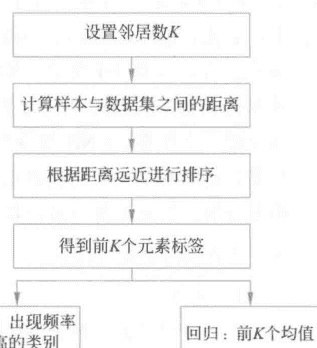

**图 4-2 KNN 算法标准流程图**

#### 步骤 3：鸢尾花分类全流程复现
*接下来将分环节讲解数据加载、划分、预处理、建模、评估与可视化的完整代码实现……*

## 实战：K近邻算法（KNN）三大经典案例全解析

### 经典案例一：鸢尾花品种分类

**数据集速览**
我们采用经典的 Iris 数据集，共收录 150 份样本，数据维度为 150×5。前四列为特征向量，分别对应花萼长度、花萼宽度、花瓣长度、花瓣宽度；最后一列为标签，涵盖 Setosa（狗尾草鸢尾）、Versicolour（杂色鸢尾）、Virginica（弗吉尼亚鸢尾）三个品类。部分样本数据如下表所示。

### 表 4-1 鸢尾花数据集（节选）

| 花萼长度/cm | 花萼宽度/cm | 花瓣长度/cm | 花瓣宽度/cm | 类别 |
|---|---|---|---|---|
| 5.1 | 3.5 | 1.4 | 0.2 | Setosa |
| 4.9 | 3.0 | 1.4 | 0.2 | Setosa |
| 4.7 | 3.2 | 1.3 | 0.2 | Setosa |
| 4.6 | 3.1 | 1.5 | 0.2 | Setosa |
| 5.0 | 3.6 | 1.4 | 0.2 | Setosa |
| 5.4 | 3.9 | 1.7 | 0.4 | Setosa |

**建模全流程**
分类任务遵循标准四步走：导入依赖库 → 读取数据并切分训练/测试集 → 利用训练集拟合 KNN 模型 → 测试集评估模型性能。完整流程图解如下。

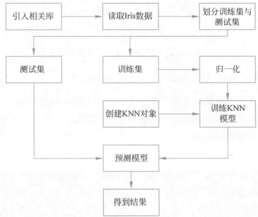

图 4-3 算法实现流程

**数据可视化洞察**
鉴于数据集包含 4 维特征，直接绘图困难，此处引入 PCA 降维至二维平面以便观察分布。可视化代码如下：

> 【代码 4-1】

```python
# 第一步：装载数据
from sklearn.datasets import load_iris
data = load_iris()
X = data.data
y = data.target
# 第二步：PCA 降维
from sklearn.decomposition import PCA
PCA_X = PCA(n_components = 2)
reduced_X = PCA_X.fit_transform(X)
# 第三步：对降维后的数据进行二维可视化
import matplotlib.pyplot as plt
plt.scatter(reduced_X[y==0,0], reduced_X[y==0,1], color='r', marker='D')
plt.scatter(reduced_X[y==1,0], reduced_X[y==1,1], color='g', marker='+')
plt.scatter(reduced_X[y==2,0], reduced_X[y==2,1], color='b', marker='x')
plt.show()
```

降维后的散点分布如下图：

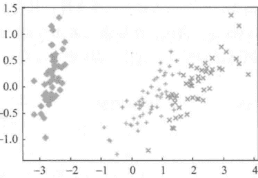

图 4-4 数据二维可视化结果

**图表解读**：Setosa 类别与其余两类边界分明，线性可分特征明显；Versicolour 与 Virginica 存在重叠区域，该区域样本易导致误判。

**核心建模代码**
完整分类实现代码如下：

【代码 4-2】

```python
# 第一步：装载数据
from sklearn.datasets import load_iris
load_data = load_iris()
x = load_data.data
y = load_data.target
print(x[:10])
# 第二步：数据集划分并归一化
from sklearn.model_selection import train_test_split
x_train, x_test, y_train, y_test = train_test_split(x, y, test_size = 0.25)
from sklearn.preprocessing import StandardScaler
std = StandardScaler()
x_train = std.fit_transform(x_train)
x_test = std.transform(x_test)
# 第三步: KNN 训练并预测
from sklearn.neighbors import KNeighborsClassifier
knn = KNeighborsClassifier()
knn.fit(x_train, y_train)
result = knn.predict(x_test)
# 第四步: 输出结果
r_result = knn.score(x_test, y_test)
print("训练的结果为: ", result)
print("正确的结果为: ", y_test)
print("识别成功率为: ", r_result)
```

运行输出结果：

```
[[5.1 3.5 1.4 0.2]
 [4.9 3. 1.4 0.2]
 [4.7 3.2 1.3 0.2]
 [4.6 3.1 1.5 0.2]
 [5. 3.6 1.4 0.2]
 [5.4 3.9 1.7 0.4]
 [4.6 3.4 1.4 0.3]
 [5. 3.4 1.5 0.2]
 [4.4 2.9 1.4 0.2]
 [4.9 3.1 1.5 0.1]]
训练的结果为:
[0 1 0 0 0 2 2 2 1 2 1 2 1 0 0 2 0 1 1 2 2 2 1 2 1 1 1 0 2 0 2 2 2 1 2 1]
正确的结果为:
[0 1 0 0 0 2 2 2 1 2 1 2 1 2 1 0 0 2 0 1 1 2 2 2 1 2 1 1 1 1 0 2 0 2 2 2 1 2 1]
识别成功率为: 0.9736842105263158
```

代码演示了数据集划分、`KNeighborsClassifier` 默认参数训练及测试集评估全过程。

**实战模拟：单样本预测**
模型训练完成后，模拟生产环境部署场景：手动录入一组鸢尾花特征，调用训练好的模型预测其归属类别。

```python
# 预测花萼长 5cm、宽 3cm, 花瓣长 1cm、宽 0.5cm 的鸢尾花品种
X_new = np.array([[5,3,1,0.5]])
prediction = knn.predict(X_new)
print("这个鸢尾花的品种为: {}".format(load_data['target_names'][prediction]))
```

预测输出结果：

```
这个鸢尾花的品种为: ['Virginica']
```

---

## 任务 4-2：KNN 回归实战——精准预测鞋码

### 任务背景与目标
本任务旨在掌握 KNN 回归的标准化操作流程，并通过鞋码预测案例，直观体会超参数 K 值对回归结果的敏感度影响。

### 步骤 1：数据认知与基线建模
**训练集（表 4-2）**：记录 10 位同学的身高、体重、性别（男=1，女=0）及鞋码，男女各 5 样本。
**测试集（表 4-3）**：待预测 2 位同学的鞋码，仅提供身高、体重、性别。

### 表 4-2 预测鞋码的训练集

| 身高/cm | 体重/kg | 性别 | 鞋号/码 |
|---|---|---|---|
| 182 | 80 | 1 | 44 |
| 177 | 70 | 1 | 43 |
| 160 | 59 | 0 | 38 |
| 154 | 54 | 0 | 37 |
| 165 | 65 | 1 | 40 |
| 192 | 90 | 1 | 47 |
| 174 | 64 | 0 | 39 |
| 176 | 70 | 0 | 40 |
| 158 | 54 | 0 | 37 |
| 172 | 76 | 1 | 42 |

### 表 4-3 预测鞋码的测试集

| 身高/cm | 体重/kg | 性别 |
|---|---|---|
| 174 | 59 | 0 |
| 174 | 70 | 1 |

基线模型代码实现：

【代码 4-3】

```python
# 第一步：装载数据
import numpy as np
X = np.array([
    [182, 80, 1],
    [177, 70, 1],
    [160, 59, 0],
    [154, 54, 0],
    [165, 65, 1],
    [192, 90, 1],
    [174, 64, 0],
    [176, 70, 0],
    [158, 54, 0],
    [172, 76, 1]
])
y = [44, 43, 38, 37, 40, 47, 39, 40, 37, 42]
K = 5
# 第二步：KNN 训练
from sklearn.neighbors import KNeighborsRegressor
knn = KNeighborsRegressor(K)
knn.fit(X, y)
# 第三步：数据预测
X_test = np.array([
    [174, 59, 0],
    [174, 75, 1]
])
predictions = knn.predict(X_test)
print("预测的鞋号为：", predictions)
```

基线预测输出：

```
预测的鞋号为： [40. 41.6]
```

### 步骤 2：数据量缩减实验
为验证样本量对 KNN 性能的影响，我们人为削减训练集，仅保留 5 名男生与 2 名女生数据（表 4-4）。

### 表 4-4 删减后的训练集

| 身高/cm | 体重/kg | 性别 | 鞋号/码 |
|---|---|---|---|
| 182 | 80 | 1 | 44 |
| 177 | 70 | 1 | 43 |
| 160 | 59 | 0 | 38 |
| 154 | 54 | 0 | 37 |
| 165 | 65 | 1 | 40 |
| 192 | 90 | 1 | 47 |
| 172 | 76 | 1 | 42 |

代码修改对应部分：

```python
X = np.array([
    [182, 80, 1],
    [177, 70, 1],
    [160, 59, 0],
    [154, 54, 0],
    [165, 65, 1],
    [192, 90, 1],
    [172, 76, 1]
])
y = [44, 43, 38, 37, 40, 47, 42]
```

基于缩减数据集的预测结果显示，鞋码预测值发生了明显漂移：

```
预测的鞋号为：[40. 41.4]
```

### 步骤 3：超参数 K 值敏感性分析
固定缩减后的数据集，依次调整 K 值为 1、2、3、4，观察预测波动。

**K=1 时：**
```python
K = 1
```
预测结果：
```
预测的鞋号为：[39. 42.]
```

**K=2 时：**
```python
K = 2
```
预测结果：
```
预测的鞋号为：[39.5 41.0]
```

**K=3 时：**
```
K = 3
```
预测结果：
```
预测的鞋号为：[39.66 41.66]
```

**K=4 时：**
```
K = 4
```
预测结果：
```
预测的鞋号为：[40.5 42.25]
```

**核心结论**：KNN 回归结果对 K 值高度敏感，微小的参数变动即可导致预测值显著偏移，参数调优至关重要。

---

## 任务 4-3：KNN + 交叉验证——乳腺癌辅助诊断

### 任务背景与目标
结合交叉验证机制，利用 KNN 构建乳腺癌预测模型，核心在于掌握 CV 原理，并通过其筛选最优 K 值。

### 知识储备：为何医疗数据需要 K 折交叉验证？
AI 在医疗落地中，样本量往往远小于计算机视觉等领域。数据稀缺下，单纯划分训练/测试集易导致评估方差大、模型泛化差。K 折交叉验证（K-Fold CV）成为首选策略。其核心逻辑如图 4-5 所示。

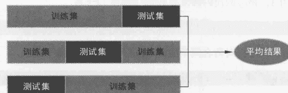

图 4-5 KNN 算法交叉验证示意图

**K 折 CV 标准流程**：
1.  **分折**：数据集随机打乱，均分为 K 个互斥子集。
2.  **迭代**：轮流选取 1 个子集作测试集，其余 K-1 个作训练集，训练模型并评估，记录指标。
3.  **聚合**：重复 K 次，确保每个子集均测试一次，最终取 K 个指标均值作为模型性能估计。

**优势**：充分利用有限数据，每个样本既参与训练又参与测试，有效降低评估偏差，提升泛化能力保障。
**代价**：计算量为单次训练的 K 倍，训练耗时线性增长。

### 实战实施：癌细胞特征分析
数据集维度 569×30，每行对应一位患者的 30 维细胞核特征，目标变量 `target` 标记良/恶性。部分特征数据如下：

### 表 4-5 癌细胞数据集（节选）

| #1 特征 | #2 特征 | #3 特征 | ... | #28 特征 | #29 特征 | #30 特征 |
|---|---|---|---|---|---|---|
| 1.799e+01 | 1.038e+01 | 1.228e+02 | ... | 2.654e-01 | 4.601e-01 | 1.189e-01 |
| 2.057e+01 | 1.777e+01 | 1.329e+02 | ... | 1.860e-01 | 2.750e-01 | 8.902e-02 |
| 1.969e+01 | 2.125e+01 | 1.300e+02 | ... | 2.430e-01 | 3.613e-01 | 8.758e-02 |
| ... | ... | ... | ... | ... | ... | ... |
| 1.660e+01 | 2.808e+01 | 1.083e+02 | ... | 1.418e-01 | 2.218e-01 | 7.820e-02 |
| 2.060e+01 | 2.933e+01 | 1.401e+02 | ... | 2.650e-01 | 4.087e-01 | 1.240e-01 |
| 7.760e+00 | 2.454e+01 | 4.792e+01 | ... | 0.000e+00 | 2.871e-01 | 7.039e-02 |

**建模代码（含交叉验证流程）**：

### 【代码 4-4】

```
# 第一步：装载数据
from sklearn import datasets
breast_cancer = datasets.load_breast_cancer()
X = breast_cancer.data
y = breast_cancer.target
# 第二步：数据集划分
from sklearn.model_selection import train_test_split,cross_val_score
train_X,test_X,train_y,test_y = train_test_split(X,y,test_size=1/3,random_state=3)
# 第三步：选择模型进行 K 折交叉验证
k_range = [1,3,5,7,9,11,13,15,17,19,21,23,25,27,29]
cv_scores = []
from sklearn.neighbors import KNeighborsClassifier
for n in k_range:
    knn = KNeighborsClassifier(n)
    scores = cross_val_score(knn,train_X,train_y,cv=10,scoring='accuracy')
    cv_scores.append(scores.mean())
    print(" 当前的准确率为 :%.2f " % scores.mean(), " 当前 K 的取值为 :%d " %n)
# 第四步：结果显示
import matplotlib.pyplot as plt
plt.plot(k_range,cv_scores)
plt.xlabel('K')
plt.ylabel(' 准确率 ')
plt.show()
```

模型运行输出结果：

# KNN算法参数调优与交叉验证实战总结

```
当前的准确率为：0.92 当前 K 的取值为：1
当前的准确率为：0.93 当前 K 的取值为：3
当前的准确率为：0.92 当前 K 的取值为：5
当前的准确率为：0.91 当前 K 的取值为：7
当前的准确率为：0.92 当前 K 的取值为：9
当前的准确率为：0.92 当前 K 的取值为：11
当前的准确率为：0.92 当前 K 的取值为：13
当前的准确率为：0.92 当前 K 的取值为：15
当前的准确率为：0.92 当前 K 的取值为：17
当前的准确率为：0.92 当前 K 的取值为：19
当前的准确率为：0.92 当前 K 的取值为：21
当前的准确率为：0.92 当前 K 的取值为：23
当前的准确率为：0.91 当前 K 的取值为：25
当前的准确率为：0.92 当前 K 的取值为：27
当前的准确率为：0.92 当前 K 的取值为：29
```

图 4-6 展示了模型准确率随 K 值变化的趋势。

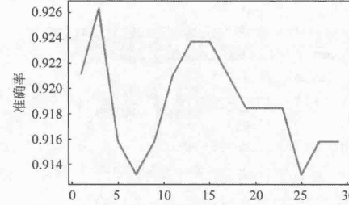

图 4-6 不同 K 值下的验证表现

代码清单 4-4 采用 KNN 算法完成了乳腺癌预测任务，并引入 K 折交叉验证机制对模型性能进行评估。实验数据及图 4-6 表明：当 K 取 3 时，分类准确率峰值达 0.93。这充分证明，借助交叉验证策略能够有效筛选最优超参数，从而显著增强模型的检测能力。

## ◆ 核心知识回顾 ◆

本节系统梳理了监督学习代表算法——KNN 的核心原理、落地流程及典型应用场景。关键要点包括：K 值通常选取奇数以避免表决僵局；算法逻辑直观易懂，兼具分类与回归双重能力；此外深度解析了 K 折交叉验证的理论基础及其在实战中的关键价值——特别是在样本量受限的情况下，它能大幅提升模型泛化水平。

## ◆ 课后强化练习 ◆

### 单项选择题

**1. KNN 算法归属于哪一类机器学习范式？**

- A. 监督学习
- B. 无监督学习
- C. 强化学习
- D. 主动学习

**2. KNN 计算样本相似度时，最常用的距离度量是什么？**

- A. 曼哈顿距离
- B. 欧氏距离
- C. 余弦距离
- D. 海明距离

**3. KNN 算法具备解决哪类机器学习问题的能力？**

- A. 聚类
- B. 分类
- C. 回归
- D. 分类与回归均可

**4. 关于 K 折交叉验证中 K 值的选取，下列论述正确的是？**

- A. K 值越大验证效果越好，但会增加计算开销
- B. 增大 K 值必然导致偏差减小
- C. 选取 K 时应着眼于最小化各折数据集间的方差
- D. 以上说法均不准确

### 简答题

1. 请概述 KNN 算法的核心工作机制。
2. 简述 KNN 分别处理分类任务与回归任务时的业务流程差异。
3. 解释 K 折交叉验证的基本原理及其适用场景。


# 线性回归算法：从原理到实战的进阶指南

### 项目概览

线性回归属于回归分析范畴，旨在建模并预测两个或多个变量间的线性依赖关系。建模过程中涉及两类核心变量：因变量（目标预测值）与自变量（特征输入）。自变量独立于其他变量，而因变量会随自变量的调整而波动。

### 学习里程碑

- 精通一元线性回归的数学原理与模型特性。
- 深度掌握多元线性回归的理论架构、现实意义及预测实操。
- 熟练运用多项式扩展技术处理非线性关系，掌握其原理、作用及工程化调用。

### 认知结构图谱

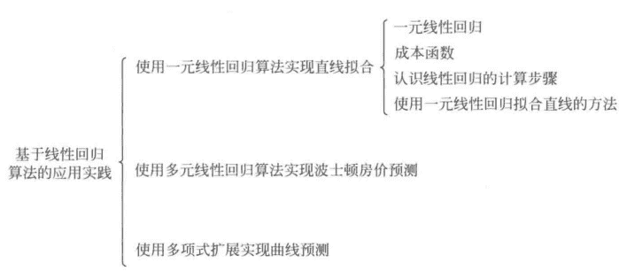

## 任务 5-1：一元线性回归直线拟合实战

### 任务背景与目标

掌握线性回归建模的标准化流程，实战演练一元线性回归对二维散点的直线拟合技巧。

### 理论基石

#### 1. 一元线性回归模型

模型数学表达式见式（5-1）：

$y(x)=a+bx$ （5-1）

其中，$y$ 为响应变量（因变量），$x$ 为解释变量（自变量），$a$ 与 $b$ 为待估参数（截距与斜率）。该模型核心在于寻找一条最佳直线，使其能精准刻画 $x$ 与 $y$ 间的线性映射关系。训练过程本质上是通过参数迭代，让散点均匀分布于拟合直线两侧，实现最优拟合。

#### 2. 损失函数（成本函数）

损失函数量化预测值与真实值的偏离程度。线性回归采用均方误差（MSE），计算所有样本预测值与真实值平方差的均值，公式如式（5-2）：

$L(\theta) = \sum_{i=1}^n (y(x_i) - y_i)^2$ （5-2）

损失值反映拟合优劣：直线偢离数据点越远，损失越大。训练目标即寻找使损失函数取得最小值的参数组合。

### 实战演练

#### 步骤 1：明确建模标准流程

线性回归建模遵循标准化管道，流程图示如下：

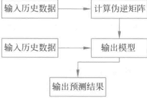

图 5-1 线性回归建模全流程

#### 步骤 2：实战直线拟合

表 5-1 记录 11 组二维坐标观测值。

### 表 5-1 原始观测坐标

| X | 1 | 2 | 5 | 6 | 7 | 8 | 9 | 14 | 15 | 16 | 24 |

|---|---|---|---|---|---|---|---|---|---|---|---|

| Y | 1 | 2 | 3 | 2.5 | 3 | 4.9 | 6.5 | 8.7 | 9.5 | 11 | 18 |

散点分布可视化如下，圆形标记标识训练集，三角形标记标识测试集：

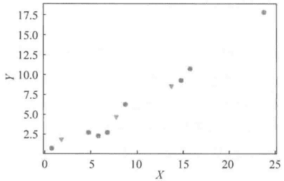

图 5-2 散点分布可视化（训练集/测试集划分）

调用一元线性回归进行拟合，核心代码实现如下：

#### 【代码 5-1】

```
# 第一步：装载数据
import numpy as np
X = np.array([
    [1], [2], [5], [6], [7], [8], [9], [14], [15], [16], [24]
])
Y = [1, 2, 3, 2.5, 3, 4.9, 6.5, 8.7, 9.5, 11, 18]
```

```
# 第二步：划分数据集
from sklearn.model_selection import train_test_split
x_train, x_test, y_train, y_test = train_test_split(X, Y, test_size=0.25,
random_state=10010)
# 第三步：显示数据点
import matplotlib.pyplot as plt
plt.rcParams['font.sans-serif'] = ['SimHei']
plt.rcParams['axes.unicode_minus'] = False
plt.scatter(x_train,y_train,label='train',color='b')
plt.scatter(x_test,y_test,label='test',color='r',marker='v')
plt.xlabel('X')
plt.ylabel('Y')
plt.show()
# 第四步：模型训练
from sklearn.linear_model import LinearRegression
LR=LinearRegression()
LR.fit(x_train, y_train)
# 第五步：显示训练点与拟合直线
plt.scatter(x_train,y_train,color='b',label=' 测试数据 ')
y_train_pred=LR.predict(x_train)
plt.plot(x_train,y_train_pred,color='green',label=' 拟合直线 ')
plt.xlabel('X')
plt.ylabel('Y')
plt.legend()
plt.show()
# 第六步：输出参数
a=LR.intercept_
b=LR.coef_
print(' 拟合直线参数：a=', a, ', b=', b)
```

拟合结果可视化呈现：

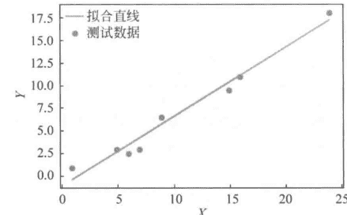

图 5-3 一元线性回归拟合效果图

模型学习到的参数为：

**截距 a = -1.0933，斜率 b = 0.7620**

代码 5-1 演示了 `LinearRegression` 估计器的直接调用。从拟合结果可见，最优直线实现了到各数据点几何距离的整体平衡。

## 任务 5-2：多元线性回归——波士顿房价预测实战

### 任务背景与目标

理解多特征融合建模的必要性，熟练运用 Scikit-Learn 多元线性回归模块解决真实房价预测问题。

### 理论拓展：多元线性回归

推广至多特征空间，模型形式为特征加权求和加截距。以矩阵形式表达如下：

$$

y(x) = w_0 + w_1x_1 + w_2x_2 + \cdots + w_nx_n = w^Tx \quad (5-3)

$$

其中 $w$ 为权重矩阵，$x$ 为特征矩阵。

$$

w = \begin{pmatrix} w_0 \\ w_1 \\ \vdots \\ w_n \end{pmatrix} \quad (5-4)

$$

$$

x = \begin{pmatrix} x_0 \\ x_1 \\ \vdots \\ x_n \end{pmatrix} \quad (5-5)

$$

均方误差（MSE）定义为预测偏差平方和与样本量之比，是评价回归模型性能的标准指标。

### 实战演练：波士顿房价数据集

该数据集内置于 Sklearn，含 506 条样本，每样本 13 维输入特征与 1 维目标输出。特征语义详见表 5-2，前 5 条样本数据见表 5-3。

### 表 5-2 特征语义对照表

| 序号 | 特征名 | 业务含义 |

| :--- | :--- | :--- |

| 1 | CRIM | 城镇人均犯罪率 |

| 2 | ZN | 大面积住宅用地比例 (＞25,000 sq.ft.) |

| 3 | INDUS | 非零售商用土地比例 |

| 4 | CHAS | 查理斯河虚拟变量 (1=临河, 0=否则) |

| 5 | NOX | 一氧化氮浓度 |

| 6 | RM | 住宅平均房间数 |

| 7 | AGE | 1940 年前建成自住单位比例 |

| 8 | DIS | 至 5 个就业中心加权距离 |

| 9 | RAD | 辐射性公路近便指数 |

| 10 | TAX | 万刀全额物业税率 |

| 11 | PTRATIO | 师生比例 |

| 12 | B | 黑人比例指标 $1000(Bk - 0.63)^2$ |

| 13 | LSTAT | 低收入阶层比例 |

| 14 | Price | 房价中位数 (单位: 千美元) |

### 表 5-3 部分样本数据预览

| 序号 | CRIM | ZN | INDUS | CHAS | NOX | RM | AGE | DIS | RAD | TAX | PTRATIO | B | LSTAT | Price |

| :--- | :--- | :--- | :--- | :--- | :--- | :--- | :--- | :--- | :--- | :--- | :--- | :--- | :--- | :--- |

| 0 | 0.00632 | 18.0 | 2.31 | 0.0 | 0.538 | 6.575 | 65.2 | 4.09 | 1.0 | 296 | 15.3 | 396.90 | 4.98 | 24.0 |

| 1 | 0.02731 | 0.0 | 7.07 | 0.0 | 0.469 | 6.421 | 78.9 | 4.96 | 2.0 | 242 | 17.8 | 396.90 | 9.14 | 21.6 |

| 2 | 0.02729 | 0.0 | 7.07 | 0.0 | 0.469 | 7.185 | 61.1 | 4.96 | 2.0 | 242 | 17.8 | 392.83 | 4.03 | 34.7 |

| 3 | 0.03237 | 0.0 | 2.18 | 0.0 | 0.458 | 6.998 | 45.8 | 6.06 | 3.0 | 222 | 18.7 | 394.63 | 2.94 | 33.4 |

| 4 | 0.06905 | 0.0 | 2.18 | 0.0 | 0.458 | 7.147 | 54.2 | 6.06 | 3.0 | 222 | 18.7 | 396.90 | 5.33 | 36.2 |

### 【代码 5-2】

```
# 第一步：装载数据
from sklearn import datasets
boston = datasets.load_boston()
X, Y = boston.data, boston.target
# 第二步：数据集划分
from sklearn.model_selection import train_test_split
x_train, x_test, y_train, y_test = train_test_split(X, Y, test_size=0.25, random_state=1001)
# 第三步：模型选择、训练与预测
from sklearn.linear_model import LinearRegression
reg = LinearRegression()
reg.fit(x_train, y_train)
```

```
y_predict = reg.predict(x_test)
# 第四步: 输出结果
from sklearn.metrics import mean_squared_error
print(mean_squared_error(y_test, y_predict))
print(reg.score(x_train, y_train))
print(reg.score(x_test, y_test))
```

模型训练与预测输出结果：

```
29.824006898863182
0.7570401119326386
0.6783942923302058
```

代码 5-2 展示了 `LinearRegression` 在多元场景下的零配置训练特性，完成了从特征矩阵到房价预测的端到端流程。

## 任务 5-3：多项式扩展——破解非线性拟合难题

### 任务背景与目标

掌握多项式特征工程原理，学会在 Sklearn 中利用 `PolynomialFeatures` 实现复杂曲线拟合。

### 实战实施

现实数据常呈现非线性模式：因变量对自变量单位变化的响应随观测区间不同而异。本任务引入多项式扩展，通过映射原始特征至高维多项式空间，赋予线性模型非线性拟合能力。

【代码 5-3】

```
# 第一步: 数据装载
import numpy as np
X = np.linspace(-10, 10, 400)
Y = np.sin(X) + 0.1*np.random.rand(len(X))
X = X.reshape(-1, 1)
Y = Y.reshape(-1, 1)
# 第二步: 多项式扩展进行模型训练
from sklearn.linear_model import LinearRegression
from sklearn.preprocessing import PolynomialFeatures
from sklearn.pipeline import Pipeline
dim = 30
def polynomial_LR(degree=1):
    polynomial_features = PolynomialFeatures(degree=degree, include_bias = False)
    linear_regression = LinearRegression(normalize=True)
    pipeline = Pipeline([("polynomial_features", polynomial_features),
    ("linear_regression", linear_regression)])
    return pipeline
from sklearn.metrics import mean_squared_error
model= polynomial_LR(degree=dim)
model.fit(X, Y)
# 第三步：进行预测并输出结果
train_score = model.score(X, Y)
mse = mean_squared_error(Y, model.predict(X))
print(train_score)
print(mse)
import matplotlib.pyplot as plt
plt.scatter(X, Y)
plt.plot(X, model.predict(X), 'r--')
```

结果输出如下。

0.9984005657287661

0.0007646526678177416

当多项式维度（dim）设定为 30 时，拟合曲线呈现如图 5-4 所示。

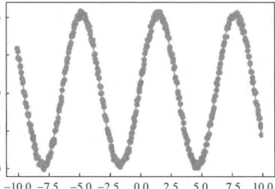

图 5-4 dim=30 时的拟合曲线

调整程序中的 dim 变量为 20，运行结果如下，对应拟合曲线见 图 5-5。

0.9316853269947533

0.03253209253182293

继续将 dim 降至 10，结果如下，拟合曲线参考 图 5-6。

```
0.05672984808633452
0.45130435551452847
```

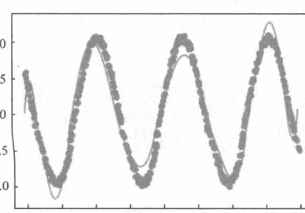

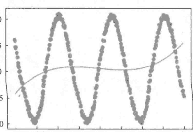

图 5-5 dim=20 时的拟合曲线

图 5-6 dim = 10 时的拟合曲线

对比实验可见：增大 dim 值能有效降低误差，模型拟合能力随之增强。

## 项目回顾

本项目系统讲解了线性回归的核心原理，并演示了如何利用它解决多类预测与分类任务。内容涵盖一元线性回归、多元线性回归及多项式扩展三大板块。一元线性回归虽概念直观易懂，但受限于单特征，实际应用场景有限；多元线性回归则可从容应对多特征数据；而多项式扩展赋予了线性回归处理非线性曲线关系的能力。

## 课后练习

### 一、单项选择题

- **1.** 已知函数 $y=x+2$，其图像必定通过以下哪个坐标点？

- A. (1, 3)   B. (1, 2)

- C. (1, 1)   D. (1, 0)

- **2.** 下列变量关系中，呈现负相关的是哪一项？

- A. 学习时长增加，考试分数上升   B. 加油量越多，行驶里程越远

- C. 摄入越多，体重越重   D. 价格下降，消费需求增强

- **3.** 线性回归算法的适用数据范围是？

- A. 仅限线性数据   B. 仅限非线性数据

- C. 线性与非线性数据均可   D. 以上皆非

- **4.** 线性回归处理非线性数据的关键手段是？

A. 多项式扩展

B. 梯度下降

C. 反向传播

D. 最小二乘法

### 二、简答题

1. 请概述一元线性回归的基本原理。

2. 请概述多元线性回归的基本原理。

# 项目6

## 基于逻辑回归算法的应用实战

### 项目导读

逻辑回归是一类专门针对离散因变量（$y$）的预测建模算法，其输出值被压缩在 0 到 1 区间内。核心在于寻找一个数学方程来量化事件发生的概率。模型一旦建立，即可用于推断因变量与自变量间的关联关系。

### 学习目标

- 扎实掌握逻辑回归算法的底层原理。
- 熟练应对样本数据不平衡的处理策略。
- 深入理解逻辑回归解决多分类问题的机制。

### 知识脉络

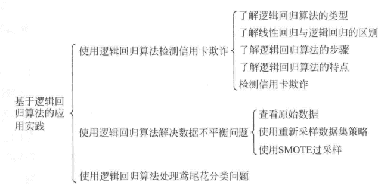

## 任务 6-1 逻辑回归实战：信用卡欺诈识别

### 任务简介

本任务将引导你理解逻辑回归原理与信用卡欺诈的业务定义，最终落地实现一套基于逻辑回归的欺诈检测模型。

### 任务指标

熟练运用逻辑回归算法完成信用卡欺诈检测。

### 知识储备

信用卡欺诈指利用非法手段骗取财物的行为，逻辑回归凭借将预测值映射至 (0,1) 区间的特性，配合阈值判断，非常适合此类二分类检测场景。

### 实施路径

本任务先梳理逻辑回归的分类体系、与线性回归的差异、核心流程及优缺点，夯实理论基础，随后投入实战环节。

#### 步骤 1 认知逻辑回归的三大类型

逻辑回归按因变量性质分为三类，详情如下。

- **(1) 二元逻辑回归**：适用于因变量仅有两种取值（0/1）的场景。1 通常代表肯定类（如：购买、违约），0 代表否定类（如：不购买、正常）。
- **(2) 多项式/名义逻辑回归**：适用于因变量包含 3 个及以上无序类别的场景。例如：部门归属（市场/销售/人事）、搜索引擎偏好、颜色分类等。
- **(3) 序数/顺序逻辑回归**：适用于因变量为 3 个及以上有序类别的场景，但级别间间距不一定相等。例如：课程评价（好/中/差）、健康状况（良好/稳定/严重）等。

#### 步骤 2 剖析线性回归与逻辑回归的本质区别

虽名为“回归”，但逻辑回归主攻分类问题。其通过引入 Sigmoid 非线性映射函数（式 6-1），将线性输出压缩至 [0,1] 区间（式 6-2），配合阈值即可轻松分类。

$$ y = \frac{1}{1 + e^{-x}} \tag{6-1} $$

$$ 0 \leqslant y \leqslant 1 \tag{6-2} $$

式中，$y$ 为 Sigmoid 输出，$x$ 为自变量。两者核心差异汇总见表 6-1。

| 维度 | 线性回归 | 逻辑回归 |
| :--- | :--- | :--- |
| **学习范式** | 监督回归算法，需标注连续目标值 | 监督分类算法，需标注离散类别标签 |
| **输出范围** | $(-\infty, +\infty)$ | $[0, 1]$，配合阈值极易分类 |
| **激活函数** | 无 | 引入 Sigmoid 函数 |
| **阈值机制** | 无 | 必需，用于划分类别边界 |
| **因变量性质** | 必须连续 | 必须离散（通常二分类） |
| **优化目标** | 拟合最佳直线（最小化平方误差） | 系数微调将显著改变决策边界形状 (S型曲线) |
| **分布假设** | 误差项通常假设正态分布 | 假设数据服从二项分布 |
| **损失函数** | $L(\theta) = \sum (y(x_i) - y_i)^2$ | $L(\theta) = \begin{cases} -\log(y(x)), & y=1 \\ -\log(1-y(x)), & y=0 \end{cases}$ |

图 6-1 与 6-2 直观对比了两者输出范围：逻辑回归被限制在 [0,1]，线性回归则覆盖全实数域。

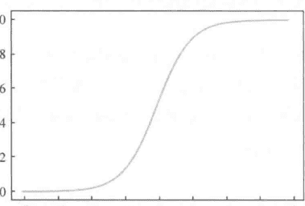

图 6-1 逻辑回归算法输出值的范围

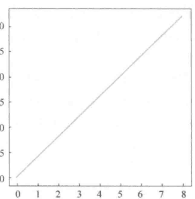

图 6-2 线性回归算法输出值的范围

#### 步骤 3 梳理逻辑回归建模全流程

标准建模步骤如图 6-3 所示。

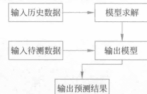

图 6-3 逻辑回归算法的基本步骤

#### 步骤 4 评估逻辑回归的优劣势

算法特点汇总见表 6-2。

### 表 6-2 逻辑回归算法特点速览

| 优点 | 缺点 |
| --- | --- |
| (1) 模型透明易懂，训练高效<br>(2) 兼容离散与连续特征<br>(3) 阈值可按业务灵活调整<br>(4) 原生支持多分类扩展 | (1) 小样本下误差较大<br>(2) 类别不平衡处理较弱<br>(3) 易受多重共线性干扰 |

#### 步骤 5 实战演练：信用卡欺诈检测

随着电子支付普及，欺诈手段层出不穷。机器学习方法能高效识别异常交易。核心思路：融合交易时间、地域、品类、金额、商户、用户行为模式等 28 维特征，输入训练好的模型，输出欺诈概率。

本次实验数据集共 284,807 笔交易，极度不平衡：正常交易占绝大多数，欺诈仅 492 笔。每条记录含 31 字段（Time、V1-V28、Amount、Class）。Class=0 为正常，Class=1 为欺诈。数据加载代码如下。

### 【代码 6-1】

```
import pandas as pd
# 导入数据集
credit_card = pd.read_csv('d:/creditcard.csv')
# 输出读取的数据
print(credit_card.shape)
# 输出 3 行数据
print(credit_card.head(3))
```

输出结果如下。

(284807, 31)

Time V1 V2 V3 V4 V5 V6 V7 \

0 0.0 -1.359807 -0.072781 2.536347 1.378155 -0.338321 0.462388 0.239599

1 0.0 1.191857 0.266151 0.166480 0.448154 0.060018 -0.082361 -0.078803

2 1.0 -1.358354 -1.340163 1.773209 0.379780 -0.503198 1.800499 0.791461

V8 V9 ... V21 V22 V23 V24 V25 \

0 0.098698 0.363787 ... -0.018307 0.277838 -0.110474 0.066928 0.128539

1 0.085102 -0.255425 ... -0.225775 -0.638672 0.101288 -0.339846 0.167170

2 0.247676 -1.514654 ... 0.247998 0.771679 0.909412 -0.689281 -0.327642

V26 V27 V28 Amount Class

0 -0.189115 0.133558 -0.021053 149.62 0

1 0.125895 -0.008983 0.014724 2.69 0

2 -0.139097 -0.055353 -0.059752 378.66 0

[3 rows x 31 columns]

代码 6-1 完成 CSV 读取并展示前三行，便于初步探查数据结构。

模型评估核心指标（准确率、精确率、召回率、F1-Score）计算公式见式（6-3）。其中 TP/FP/TN/FN 分别代表真阳/假阳/真阴/假阴样本数。


召回率、精确率、F1-Score 的计算步骤

Accuracy = (TP + TN) / (TP + FP + TN + FN)

Precision = TP / (TP + FP)

Recall = TP / (TP + FN)

F1-Score = 2 * Recall * Precision / (Recall + Precision)

## [代码 6-2]

```
# 第一步：装载数据
import pandas as pd
credit_card = pd.read_csv('d:/creditcard.csv')
X = credit_card.drop(columns='Class', axis=1)
y = credit_card.Class.values
# 第二步：数据划分及归一化
from sklearn.model_selection import train_test_split
X_train, X_test, y_train, y_test = train_test_split(X, y)
from sklearn.preprocessing import StandardScaler
std = StandardScaler()
X_train = std.fit_transform(X_train)
X_test = std.transform(X_test)
# 第三步：模型选择与训练
from sklearn.linear_model import LogisticRegression
LR = LogisticRegression(max_iter=1000)
LR.fit(X_train, y_train)
y_train_hat = LR.predict(X_train)
y_train_hat_probs = LR.predict_proba(X_train)[:,1]
# 第四步：输出训练过程结果
from sklearn.metrics import roc_curve, roc_auc_score, classification_report, accuracy_score, confusion_matrix
train_accuracy = accuracy_score(y_train, y_train_hat)*100
train_auc_roc = roc_auc_score(y_train, y_train_hat_probs)*100
print('混淆矩阵:\n', confusion_matrix(y_train, y_train_hat))
print('训练 AUC: %.4f %%' % train_auc_roc)
print('训练准确率: %.4f %%' % train_accuracy)
# 第五步：输出测试结果
y_test_hat = LR.predict(X_test)
y_test_hat_probs = LR.predict_proba(X_test)[:,1]
test_accuracy = accuracy_score(y_test, y_test_hat)*100
test_auc_roc = roc_auc_score(y_test, y_test_hat_probs)*100
print('混淆矩阵:\n', confusion_matrix(y_test, y_test_hat))
print('测试 AUC: %.4f %%' % test_auc_roc)
```

```python
print(' 测试准确率: %.4f %%' % test_accuracy)
print(classification_report(y_test, y_test_hat, digits=6))
```

模型评估报告输出如下。

```
混淆矩阵：
[[213187 34]
 [ 136 248]]
训练 AUC: 94.0909 %
训练准确率：99.9204 %
混淆矩阵：
[[71070 24]
 [ 31 77]]
测试 AUC: 96.3951 %
测试准确率：99.9228 %
```

| | precision | recall | f1-score | support |

|---|---|---|---|---|

| 0 | 0.999564 | 0.999662 | 0.999613 | 71094 |

| 1 | 0.762376 | 0.712963 | 0.736842 | 108 |

| accuracy | | | 0.999228 | 71202 |

| macro avg | 0.880970 | 0.856313 | 0.868228 | 71202 |

| weighted avg | 0.999204 | 0.999228 | 0.999215 | 71202 |

# 实战复盘：LR模型如何攻克刷卡诈骗检测中的样本倾斜难题

## 基线建模：当 99.9% 精度遭遇 29% 漏判尴尬

在信用卡反欺诈实战中，我们首轮部署对数几率模型（`LogisticRegression`，迭代上限 `max_iter=1000` 保证收敛），借助错配表（即列为预测类别、行为真实类别）复盘。**整体精度虽达 99.92%，但 108 笔真实诈骗单里仅捕获 77 笔，查全率仅 71%，漏判比高达 28.7%**。罪魁祸首在于极度倾斜的样本分布——海量正常单淹没稀缺诈骗单，致使模型“偏科”严重。

---

## 实战三部曲：重塑样本分布，漏判比骤降至 9.6%

### 阶段 1：可视化量化“悬殊鸿沟”
先绘制原始标签分布条形图（见脚本 ```python
unique, counts = np.unique(y, return_counts=True)
plt.bar(unique, counts)
plt.title('类别频数')
plt.xlabel('类别')
plt.ylabel('频数')
plt.show()
```，输出 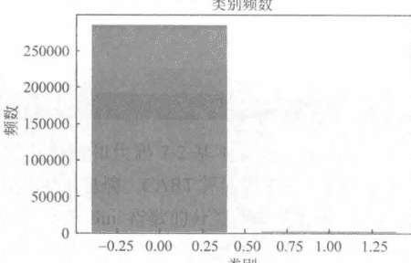 对应图 6-4），直观刻画正负样本量级差距。

### 阶段 2：基础重采样策略对比
针对倾斜，主流思路是“扩少缩多”：
- **随机欠采样**：裁减多数类。利于加速训练、缓解内存压力，但易丢弃关键信息，且抽样偏差可能损伤泛化能力。
- **随机过采样**：复制少数类。保全信息零损失，却极易引发过度拟合，模型死记硬背少数样本。

### 阶段 3：SMOTE 合成新样本——实测漏判比从 28.7% 降至 9.6%
SMOTE（合成少数类过采样技术）不再简单复制，而是基于 K 近邻插值生成**合成样本**。
- **长处**：缓解过拟合、零信息丢失、落地简单。
- **短板**：可能模糊类边界引入噪声；高维场景下效用递减。

实战脚本 ```python
# 第一步: 安装所需要的库
pip install imbalanced-learn
# 第二步: 导入数据集并预处理
import pandas as pd
credit_card = pd.read_csv('d:/creditcard.csv')
X = credit_card.drop(columns='Class', axis=1)
y = credit_card.Class.values
# 第三步: 划分数据集
from sklearn.model_selection import train_test_split
X_train, X_test, y_train, y_test = train_test_split(X, y)
# 第四步: 定义 SMOTE 模型
from imblearn.over_sampling import SMOTE
OS=SMOTE(random_state=1)
X_train,y_train=OS.fit_resample(X_train,y_train)
# 第五步: 数据归一化
from sklearn.preprocessing import StandardScaler
std = StandardScaler()
X_train = std.fit_transform(X_train)
X_test = std.transform(X_test)
# 第六步: 训练模型并进行预测
from sklearn.linear_model import LogisticRegression
LR = LogisticRegression(max_iter=1000)
LR.fit(X_train, y_train)
y_train_hat = LR.predict(X_train)
y_train_hat_probs = LR.predict_proba(X_train)[:,1]
# 第七步: 输出训练过程结果
from sklearn.metrics import roc_curve, roc_auc_score, classification_report, accuracy_score, confusion_matrix
train_accuracy = accuracy_score(y_train, y_train_hat)*100
train_auc_roc = roc_auc_score(y_train, y_train_hat_probs)*100
print('混淆矩阵:\n', confusion_matrix(y_train, y_train_hat))
print('训练 AUC: %.4f %%' % train_auc_roc)
print('训练准确率: %.4f %%' % train_accuracy)
y_test_hat = LR.predict(X_test)
y_test_hat_probs = LR.predict_proba(X_test)[:,1]
test_accuracy = accuracy_score(y_test, y_test_hat)*100
test_auc_roc = roc_auc_score(y_test, y_test_hat_probs)*100
print('混淆矩阵:\n', confusion_matrix(y_test, y_test_hat))
print('测试 AUC: %.4f %%' % test_auc_roc)
print('测试准确率: %.4f %%' % test_accuracy)
print(classification_report(y_test, y_test_hat, digits=6))
``` 跑出分类报告（```
混淆矩阵:
[[211399   1850]
 [  6753 206496]]
训练 AUC: 99.7746 %
训练准确率: 97.9829 %
混淆矩阵:
[[70445   621]
 [   13  123]]
测试 AUC: 97.2637 %
测试准确率: 99.1096 %
```）：诈骗类（标签 1）查全率跃升至 **90.44%**，漏判比大幅收敛至 **9.6%**，宏平均 F1 从极低值回升至 0.64，实战成效立竿见影。

---

## 进阶拓展：LR 原生支撑多类别——Iris 品种识别实战

对数几率模型不止两类分类。Sklearn 通过 `multi_class` 参数一键切换两大经典范式：
1. **OVR (一对其余)**：每类建一分类器，共 *n* 个，将该类为正、其余为负，逻辑直观。
2. **Multinomial (多项式/Softmax)**：两两配对，共 *n(n-1)/2* 个分类器，决策边界更平滑。

Iris 三分类实战（代码 ```python
from sklearn import datasets
iris = datasets.load_iris()
X = iris.data
y = iris.target
# 划分数据集
from sklearn.model_selection import train_test_split
X_train, X_test, y_train, y_test = train_test_split(X, y ,test_size = 0.25)
# 数据集归一化
from sklearn.preprocessing import StandardScaler
scaler = StandardScaler()
X_train = scaler.fit_transform(X_train)
X_test = scaler.transform(X_test)
# 训练模型
from sklearn.linear_model import LogisticRegression
LR = LogisticRegression(penalty='l2',C=100,multi_class='ovr')
LR.fit(X_train,y_train)
y_predict = LR.predict(X_test)
# 模型预测
from sklearn.metrics import classification_report
print(classification_report(y_test, y_predict))
print(y_test)
print(y_predict)
```，可视化 ）采用 **OVR** 模式，验证集 38 样本精度 **97%**，三类精确率/查全率均超 0.91（```
[1 0 0 0 2 1 1 2 2 0 2 1 1 2 0 0 2 0 1 2 2 1 1 0 0 0 1 1 0 2 0 1 0 0 1 2 0]
[1 0 0 0 2 1 1 2 2 0 2 1 1 2 0 0 2 0 0 2 1 2 1 1 0 0 0 1 2 0 2 0 1 1 0 0 1 2 0]
```），验证了 LR 处理多类别的工程落地性。

---

## 章节小结：一模贯通二分类、倾斜治理、多类别

| 场景 | 关键动作 | 核心收获 |
|------|----------|----------|
| 刷卡诈骗（二分类） | 基线建模 + 错配表诊断 | 识别“高精度陷阱”，量化漏判风险 |
| 样本倾斜治理 | SMOTE 重构训练集 | 漏判比 **28.7% → 9.6%**，查全率质变 |
| Iris（多类别） | `multi_class='ovr'` 一键切换 | 三品种精度 97%，落地零门槛 |

---

## 自测题库：巩固核心考点

### 单选题
1. 对数几率模型本质属于 **B. 分类** 任务。  
2. 错误描述是 **D. 不需要阈值来确定每个实例的类别**（默认 0.5 阈值可调）。  
3. *k* 类别下 OVR 需训练 **A. k** 个分类器。

### 简答题思考框架
1. **原理**：线性加权 → Sigmoid 映射概率 → 阈值决策；极大似然估计参数，梯度下降求解。  
2. **对比线性回归**：目标函数不同（对数似然 vs MSE）、输出含义不同（概率 vs 连续值）、对异常值敏感度不同。  
3. **倾斜危害与对策**：模型偏向多数类 → 查全率崩塌；对策：算法层面（类权重、集成）、数据层面（重采样、SMOTE、GAN 生成）、评估层面（F1、AUC、PR 曲线）。

---

# 项目 7 树模型：从 Iris 品种识别到房价预测的全能选手

## 项目导读：为何树模型成分类“瑞士军刀”？

决策树以树状拓扑递归切分特征空间，**决策节点=特征测试，分支=测试结果，终端节点=类别/数值**。无需归一化、自带特征选择、白盒可解释、天然支撑分类与回归。主流谱系：ID3 → C4.5 → CART（兼容分类回归、基尼不纯度/均方误差切分）。

---

## 任务 7-1 实战：树模型 3 分钟拿下 Iris 品种识别

### 核心原理速览
- **递归切分**：按信息增益/增益率/基尼指数选最优切分点，直到纯度达标或触发停止条件（深度、最小样本数等）。  
- **预测路径**：根节点出发，按特征值沿分支下沉，落入终端节点即得预测。  
- **优势**：白盒可解释、处理混合类型特征、非线性边界拟合强。  
- **痛点**：极易过度拟合（需剪枝/限制深度）、贪心局部最优、倾斜数据倾向多数类。

### 算法谱系速查
| 算法 | 切分准则 | 目标类型 | 核心改进 |
|------|----------|----------|----------|
| ID3 | 信息增益 (熵) | 分类 | 奠基之作，偏好取值多的特征 |
| C4.5 | 增益率 | 分类 | 引入分裂信息惩罚，支撑连续值/缺失值 |
| **CART** | **基尼系数 / MSE** | **分类 + 回归** | **二叉树、剪枝机制完善、Sklearn 默认实现** |

### 步骤 1：认识 ID3 算法
ID3 引入熵的概念。熵度量数据中“信息量”，反映离散事件发生概率。这不仅取决于不同值的数量，还取决于值所持有的意外估计量。事件越确定，所含信息越少。简而言之，信息是不确定性或熵的增加。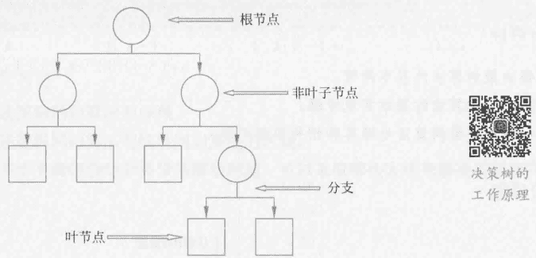

> 下一节将直接上手代码，用 CART 树复现 Iris 分类，并对比可视化决策边界，敬请期待！

# 决策树核心算法：从 ID3 到 CART 的原理与实战解析

决策树作为机器学习中的经典模型，其核心在于“如何划分特征”。本文将深度拆解 ID3 与 CART 两大主流算法的数学本质、分裂策略差异，并通过鸢尾花分类与曲线回归两个实战案例，直观展示它们的工程落地差异。

---

## 一、 ID3 算法：以“信息增益”度量特征价值

ID3（Iterative Dichotomiser 3）算法的核心逻辑是：**通过计算各特征的信息增益，选取增益最大者作为分裂节点**。这背后的数学度量依赖于信息熵与条件熵的差值。

### 1. 核心数学定义

**信息熵（Entropy）** 衡量样本集合的不确定性。集合越“混杂”，熵值越大：
$$ Ent(H) = -\sum_{i=1}^n p(x_i) \log_2 p(x_i) \tag{7-1} $$
其中 $H$ 为样本集，$p(x_i)$ 为第 $i$ 类样本所占比例。

**信息增益** 量化了某特征 $a$ 对不确定性的消除程度，本质是**父节点熵与子节点加权熵的差值**：
$$ Gain(H, a) = Ent(H) - \sum_{i=1}^n \frac{|H^i|}{|H|} Ent(H^i) \tag{7-2} $$
$H^i$ 为按属性 $a$ 划分后的第 $i$ 个子集。

### 2. 算法迭代流程

1.  遍历未使用特征，计算各自信息增益；
2.  选取增益最大的特征作为当前节点；
3.  若最大增益 > 阈值，继续递归分裂；否则停止，标记为叶节点；
4.  重复上述过程直到遍历完所有特征或满足停止条件。

### 3. 实战演示：预测学生性别

```
info = - \frac{5}{10} \log_2(\frac{5}{10}) - \frac{5}{10} \log_2(\frac{5}{10}) = 1
```

现有 10 名学生样本（男女各 5 人），特征为“力气大小”与“鞋码是否>38”。

**按“力气”划分：**
- 力气大（6 人）：4 男，2 女；
- 力气小（4 人）：1 男，3 女。
```
info1 = - \frac{2}{6} \log_2(\frac{2}{6}) - \frac{4}{6} \log_2(\frac{4}{6}) = 0.9183
```
```
info2 = - \frac{1}{4} \log_2(\frac{1}{4}) - \frac{3}{4} \log_2(\frac{3}{4}) = 0.8113
```
```
info = \frac{4}{10} \times 0.8113 + \frac{6}{10} \times 0.9183 = 0.8755
```
**信息增益 = 1 - 0.8755 = 0.1245。**

**按“鞋码”划分：**
- 鞋码 >38（8 人）：5 男，3 女；
- 鞋码 ≤38（2 人）：0 男，2 女。
```
info3 = - \frac{3}{8} \log_2(\frac{3}{8}) - \frac{5}{8} \log_2(\frac{5}{8}) = 0.9544
```
```
info4 = - \frac{2}{2} \log_2(\frac{2}{2}) = 0
```
```
info' = \frac{8}{10} \times 0.9544 + \frac{2}{10} \times 0 = 0.7635
```
**信息增益 = 1 - 0.7635 = 0.2365。**

**结论**：鞋码特征的信息增益（0.2365）显著高于力气（0.1245），分类判别力更强，故作为根节点最优。
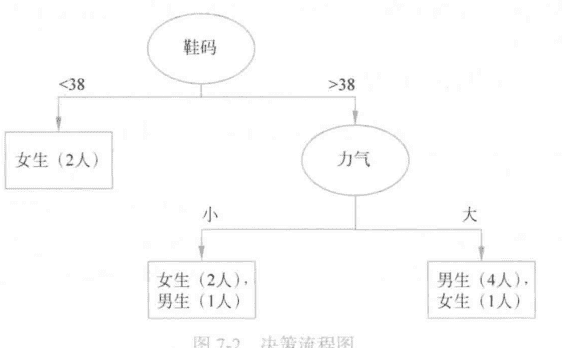

---

## 二、 CART 算法：基尼指数与回归能力的双重突破

CART（Classification and Regression Trees）不仅解决了 ID3 仅能处理离散值、仅能分类的局限，还引入计算更高效的**基尼指数**作为分裂准则。

### 1. 基尼指数：纯度的“反向度量”

基尼指数表示从数据集中随机抽取两个样本，类别**不一致**的概率。**值越小，纯度越高**。
$$ Gini(H) = 1 - \sum_{k=1}^K p_k^2 \tag{7-3} $$
$p_k$ 为第 $k$ 类样本概率。

特征 $a$ 划分后的加权基尼指数：
$$ Gini\_index(H, a) = \sum_{i=1}^I \frac{|H^i|}{|H|} Gini(H^i) \tag{7-4} $$
```
$$Gini(H) = \sum_{k=1}^n p_k(1-p_k) = 1 - \sum_{k=1}^k p_k^2$$  
(7-3)
```
```
$$GiniIndex(H, a) = \sum_{i=1}^I \frac{|H^i|}{|H|} Gini(H^i)$$  
(7-4)
```

**核心优势**：避免了对数运算，计算速度显著快于信息增益；且天然支持**连续值**切分（二分法），生成结构固定的**二叉树**。

### 2. CART 回归树：最小化平方误差

针对连续目标变量，CART 采用 **MSE（均方误差）** 作为切分标准，寻找使子区域内方差最小的切分点 $s$ 与变量 $j$：
$$ \min_{j, s} \left[ \min_{c_1} \sum_{x_i \in R_1(j,s)} (y_i - c_1)^2 + \min_{c_2} \sum_{x_i \in R_2(j,s)} (y_i - c_2)^2 \right] \tag{7-5} $$
$R_1, R_2$ 为切分后的两个区域，$c_1, c_2$ 分别为区域内样本均值（即叶节点输出值 $O_m$）。
```
$$\min \sum_{n=1}^N \left( y_n - \sum_{m}^M O_{mI} \right)^2$$  
(7-5)
```

**回归构建步骤**：
1.  遍历特征与切分点，找到使平方误差最小的组合；
2.  划分区域，以区域均值作为预测输出；
3.  对子区域递归执行步骤 1，直至满足停止条件（如深度限制、样本数阈值）；
4.  生成回归决策树。

### 3. ID3 vs CART：关键差异速览

| 维度 | ID3 算法 | CART 算法 |
| :--- | :--- | :--- |
| **适用任务** | 仅分类 | **分类 + 回归** |
| **分裂准则** | 信息增益 (熵) | **基尼指数 (分类) / MSE (回归)** |
| **数据类型** | 仅离散值 | **离散 + 连续值** |
| **树结构** | 多叉树 | **严格二叉树** |
| **计算开销** | 较大 (含对数) | **较小 (无对数、排序优化)** |

---

## 三、 实战对决：鸢尾花分类中谁更强？

基于经典 Iris 数据集（4 维特征：花瓣/花萼长宽，3 类标签），我们分别用 CART(Gini) 与 ID3(Entropy) 建模对比。

### 1. 数据可视化先行
```python
import pandas as pd
from sklearn import datasets
data = datasets.load_iris()
X = pd.DataFrame(data=data.data, columns=data.feature_names)
# 转换为 DataFrame 格式
X['target'] = y
C0 = X[X['target'] == 0].values
C1 = X[X['target'] == 1].values
C2 = X[X['target'] == 2].values
# 使用 scatter 函数绘制三维散点图
import matplotlib.pyplot as plt
fig = plt.figure(figsize=(10, 12))
ax = fig.add_subplot(111, projection='3d')
ax.scatter(C0[:, 3], C0[:, 2], C0[:, 2], label='setosa')
ax.scatter(C1[:, 3], C1[:, 2], C1[:, 2], label='versicolor')
ax.scatter(C2[:, 3], C2[:, 2], C2[:, 2], label='virginica')
# 显示三维图
plt.legend()
plt.show()
```
三维散点图清晰展示了三类鸢尾花在特征空间的分布边界，为后续建模提供直觉。

### 2. CART (Gini) 建模
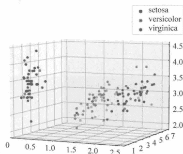
```python
# 装载数据
from sklearn import datasets
iris = datasets.load_iris()
X = iris['data']
y = iris['target']
feature_names = iris.feature_names
# 数据集划分
from sklearn.model_selection import train_test_split
X_train, X_test, y_train, y_test = train_test_split(X, y, test_size=0.2,
random_state=1024)
# 模型引入、训练、测试
from sklearn.tree import DecisionTreeClassifier
clf = DecisionTreeClassifier(criterion='entropy')
clf.fit(X_train, y_train)
y_ = clf.predict(X_test)
# 计算正确率
from sklearn.metrics import accuracy_score
print(accuracy_score(y_test, y_))
# 输出结果
import matplotlib.pyplot as plt
plt.figure(figsize=(14, 8))
from sklearn import tree
tree.plot_tree(clf, filled=True, feature_names=feature_names)
plt.show()
```
输出结果：
```
1.0
```
生成的决策树结构：
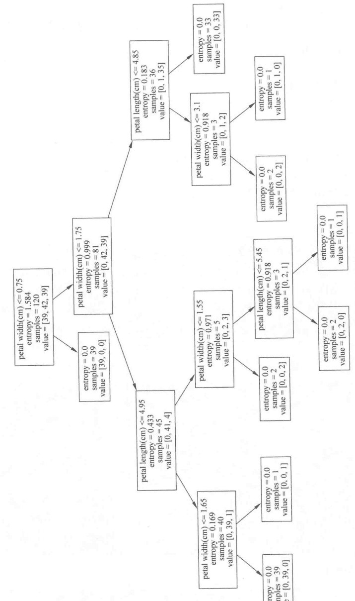
代码核心：`DecisionTreeClassifier(criterion='gini')`（默认即 Gini）。通过 `export_graphviz` 导出 dot 文件可视化树结构。

### 3. ID3 (Entropy) 建模
```python
# 装载数据
from sklearn import datasets
iris = datasets.load_iris()
X = iris['data']
y = iris['target']
feature_names = iris.feature_names
# 数据集划分
from sklearn.model_selection import train_test_split
X_train, X_test, y_train, y_test = train_test_split(X, y, test_size=0.2,
random_state=1024)
# 模型引入、训练、测试
from sklearn.tree import DecisionTreeClassifier
clf = DecisionTreeClassifier(criterion='gini')
clf.fit(X_train, y_train)
Y_ = clf.predict(X_test)
# 计算正确率
from sklearn.metrics import accuracy_score
print(accuracy_score(y_test, Y_))
# 输出结果
import matplotlib.pyplot as plt
plt.figure(figsize=(14, 8))
from sklearn import tree
tree.plot_tree(clf, filled=True, feature_names=feature_names)
plt.show()
```
输出准确率：**0.98**

代码唯一差异：`DecisionTreeClassifier(criterion='entropy')`。
生成的决策树结构：
```
petal width(cm) <= 0.75
gini = 0.666
samples = 120
value = [39, 42, 39]

gini = 0.0
samples = 39
value = [39, 0, 0]

petal width(cm) <= 1.75
gini = 0.499
samples = 81
value = [0, 42, 39]

petal length(cm) <= 4.95
gini = 0.162
samples = 45
value = [0, 41, 4]

petal width(cm) <= 1.65
gini = 0.049
samples = 40
value = [0, 39, 1]

gini = 0.0
samples = 39
value = [0, 39, 0]

petal width(cm) <= 1.55
gini = 0.48
samples = 5
value = [0, 2, 3]

petal length(cm) <= 4.85
gini = 0.054
samples = 36
value = [0, 1, 35]

gini = 0.0
samples = 33
value = [0, 0, 33]

petal width(cm) <= 3.1
gini = 0.444
samples = 3
value = [0, 1, 2]

gini = 0.0
samples = 2
value = [0, 0, 2]

gini = 0.0
samples = 1
value = [0, 1, 0]

petal length(cm) <= 5.45
gini = 0.444
samples = 3
value = [0, 2, 1]

gini = 0.0
samples = 1
value = [0, 0, 1]

gini = 0.0
samples = 2
value = [0, 2, 0]

gini = 0.0
samples = 2
value = [0, 0, 2]

gini = 0.0
samples = 1
value = [0, 0, 1]
```

### 4. 实战结论
在该数据集上，**CART (Gini) 表现优于 ID3 (Entropy)**。这印证了基尼指数在计算效率与分类效果上的综合优势，也解释了为什么 sklearn 等主流库将 Gini 设为默认分裂标准。

---

## 四、 进阶任务：决策树回归拟合非线性曲线

决策树回归通过**分段常数函数**逼近复杂曲线。核心超参数 `max_depth` 直接控制拟合精度与过拟合风险。

### 任务目标
掌握 `DecisionTreeRegressor` 核心参数调节，观察不同深度下的拟合效果。

### 代码实现
```python
import numpy as np
num=400
X=np.linspace (-10,10,num)
X=X.reshape (num,1)
y=np.cos(X).ravel() +np.random.rand(len(X))
# 深度为 2
from sklearn.tree import DecisionTreeRegressor
DTR=DecisionTreeRegressor(max_depth=2)
DTR.fit(X,y)
# 预测过程
X_test=np.arange (-10,10,0.01) [:,np.newaxis]
y_predict=DTR.predict(X_test)
# 输出结果
import matplotlib.pyplot as plt
plt.rcParams['font.sans-serif'] = ['uSimHei']
plt.rcParams['axes.unicode_minus'] = False
plt.figure()
plt.scatter(X,y,edgecolor="black",c="darkorange",label="data")
plt.plot(X_test,y_predict,color="cornflowerblue",label="max_depth=2",linewidth=2)
plt.xlabel(" 输入 ")
plt.ylabel(" 输出 ")
plt.legend()
plt.show()
```
关键点：`DecisionTreeRegressor(max_depth=...)` 控制树深度。

### 拟合效果对比（深度 2 vs 5 vs 8）
- **Depth=2**：欠拟合，仅能捕捉粗略趋势，阶跃极少；
- **Depth=5**：较好平衡，捕捉主要波动且平滑；
- **Depth=8**：过拟合风险，紧贴训练点噪声，泛化能力下降。

> **工程启示**：决策树回归本质是“轴平行切分空间”，在高维稀疏数据上表现强劲，但对连续光滑函数拟合呈阶梯状，**集成方法（如 GBDT、随机森林）是提升性能的标准路径**。

---

## 总结

| 算法 | 核心度量 | 适用场景 | 工程建议 |
| :--- | :--- | :--- | :--- |
| **ID3** | 信息增益 | 教学演示、小规模离散分类 | 理解熵理论基础，生产环境极少直接使用 |
| **CART 分类** | 基尼指数 | 通用分类任务、混合型数据 | **首选基线模型**，sklearn 默认配置 |
| **CART 回归** | MSE 最小化 | 非线性回归、特征交互挖掘 | 注意 `max_depth` 正则化，**集成化使用效果最佳** |

掌握从熵到基尼、从分类到回归的演进脉络，才能在特征工程与模型调优中游刃有余。

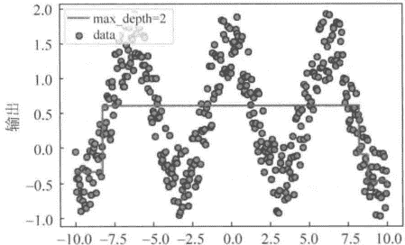

图 7-6 决策树深度限制为 2 时的拟合表现

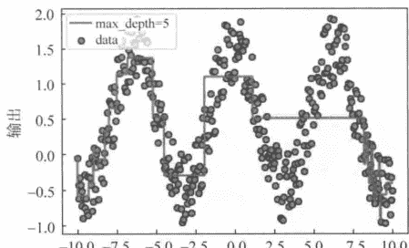

图 7-7 决策树深度设为 5 时的拟合表现

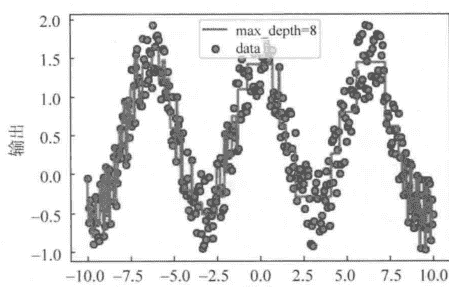

图 7-8 决策树深度增至 8 时的拟合表现

直观对比三张图表不难发现：随着 `max_depth` 参数数值的攀升，模型对数据的贴合程度显著增强，拟合能力也随之大幅跃升。

## 任务 7-3 实战演练：决策树预测波士顿房价

### 任务简介

承接前文对决策树核心原理与调用技巧的拆解，本任务将带你动手实操，用该算法攻克波士顿房价预测这一经典回归问题。

### 核心收获

熟练掌握决策树模型从建模到评估的标准化落地流程。

### 实操步骤

本案例沿用项目 5 的波士顿房价数据集（数据详情前文已述，此处不再赘述）。我们将结合算法原理，完整走一遍预测流程，具体实现请参考 **代码 7-5**。

## 【代码 7-5】

```python
from sklearn import datasets
# 加载波士顿房价数据
boston = datasets.load_boston()
X, Y = boston.data, boston.target
print(X.shape)
print(Y.shape)
# 特征选择
from sklearn.feature_selection import SelectPercentile, f_regression
selector = SelectPercentile(f_regression, percentile=40)
# 选择了前 40% 的特征
X_new = selector.fit_transform(X, Y)
print(X_new.shape)
# 输出结果，选择了前 40% 的比较重要的特征
X = X_new
# 划分训练集和检验集
from sklearn.model_selection import train_test_split
x_train, x_test, y_train, y_test = train_test_split(X, Y, test_size=0.25, random_state=1001)
# 引入决策树回归
from sklearn.tree import DecisionTreeRegressor
# 使用训练集训练模型
reg = DecisionTreeRegressor(max_depth=8)
```

# 模型训练
reg.fit(x_train, y_train)

# 模型推理
y_predict = reg.predict(x_test)

# 引入评估指标：均方误差 (MSE)
from sklearn.metrics import mean_squared_error
print(mean_squared_error(y_test, y_predict))

# 查看训练集决定系数 (R^2)
print(reg.score(x_train, y_train))

# 查看测试集决定系数 (R^2)
print(reg.score(x_test, y_test))

```

输出结果如下。

```

# 数据维度核验输出
(506, 13)
(506,)
(506, 5)

# 模型评估结果
# 均方误差
22.316430632704368
# 训练集 R^2
0.9730483714239704
# 测试集 R^2
0.7593518707719875

```

代码 7-5 采用决策树算法预测波士顿房价，从代码中可以得知具体的流程为选取特征、划分数据集、训练模型和输出最终的结果。代码 7-5 采用最大深度 8 进行了模型训练。

## 项目小结

本项目主要围绕决策树算法进行讲解，通过任务驱动的模式重点讲解了决策树算法的基本原理以及实现步骤，并且采用程序绘制决策树结果图的方式让读者更加理解决策树算法。为了更好地体现决策树算法的优点，本项目采用决策树算法对实际的案例进行了实现。

## 练习题

- 一、选择题

- 1. ID3 算法是基于（ ）进行分裂的。
  A. 信息增益 B. Gini 系数 C. 均值 D. 方差

- 2. CART 决策树可以处理（ ）问题。
  A. 回归 B. 分类 C. 回归与分类 D. 聚类

- 3. ID3 决策树可以处理（ ）问题。
  A. 回归 B. 分类 C. 回归与分类 D. 聚类

- 4. CART 决策树可以处理（ ）数据。
  A. 离散
  B. 连续
  C. 离散与连续

- 5. 以下关于 CART 决策树说法错误的是（ ）。
  A. 可以用于分类，也可以用于回归
  B. 采用 Gini 作为分裂标准
  C. 可以处理离散值和连续值
  D. 可以为多叉树

- 6. 以下关于 ID3 决策树说法错误的是（ ）。
  A. 可以用于分类，也可以用于回归
  B. 采用信息增益作为分裂标准
  C. 只能处理离散值
  D. 可以为多叉树

### 二、简答题

1. 简述决策树算法的原理。

2. 介绍几种常见决策树算法，并说明它们的特点。

# 基于支持向量机算法的应用实践

## 项目导读

支持向量机（Support Vector Machines，SVM）是目前受欢迎的机器学习算法之一，属于一种二分类模型。其基本思想是准确地划分数据集并且分离出间隔最大的超平面，即选择最合适的边距将两种类别进行分离。SVM 可以解决复杂的高维度问题，同时也可以处理小样本下存在的训练问题，其模型的泛化能力较强。

## 学习目标

- 理解支持向量机算法的基本原理。
- 熟练使用支持向量机算法进行高维数据分类。
- 熟练使用支持向量机算法处理各种分类和预测问题。

## 知识导图


## 任务 8-1 使用支持向量机算法处理二维数据分类问题

### 任务描述

通过理解支持向量机算法的基本原理，认识非线性数据和了解支持向量机求解，然后使用支持向量机算法解决数据二分类问题。

### 任务目标

掌握支持向量机的基本原理和基本实现步骤。

### 知识准备

### 理解支持向量机算法工作原理

通过一个简单示例可以更容易理解支持向量机的基本原理。假设有两个标签分别是“蓝”和“绿”，其数据含有两个特征 x 和 y。需要通过一个分类器，然后给定一对（x, y）坐标值，最终输出“蓝”或“绿”。图 8-1 是已经被标记的训练数据，其中，圆形为蓝色数据，三角形为绿色数据。

支持向量机获取这些数据点并输出最能分隔标签的超平面（在二维空间中它只是一条线），也就是决策边界，落在决策边界一侧的数据将归类为蓝色，而落在另一侧的数据将归类为绿色。加入决策边界后的结果如图 8-2 所示。


超平面应使两个标签的边距最大化，即超平面（记住在这种情况下是一条线）与每个标签的最近元素的距离最大。

### 任务实施

SVM 算法是一种监督式机器学习算法，它使用分类算法解决两组分类问题。在为每个类别提供一组含有标签的训练数据的 SVM 模型后，它们能够对新文本进行分类。SVM 算法的目标是创建可以将 n 维空间划分为类的最佳线或决策边界，以便将来可以轻松地将新数据点放入正确的类别中。这个最佳决策边界称为超平面。SVM 算法选择有助于创建超平面的极值点 / 向量。这些极端情况称为支持向量，因此该算法称为支持向量机。

SVM 的优缺点如表 8-1 所示。

| 优点 | 缺点 |
| :--- | :--- |
| 在非结构化、结构化和半结构化数据方面非常灵活 | 计算大型数据集时，训练时间更长 |
| 内核函数减轻了几乎任何数据类型的复杂性 | 超参数在解释其影响时，通常具有挑战性 |
| 与其他模型相比，过拟合现象较少 | 由于一些黑盒方法，整体解释性低 |

与神经网络等较流行的算法相比，SVM 算法的主要优势：在样本数量有限（数千个）的情况下，速度更快，性能更佳。

### 步骤 1 了解非线性数据

上一个例子中的数据非常简单，只需要画出一条直线就可以将蓝色和绿色的数据区分开。如果数据变得复杂，那么只有一条直线是无法区分蓝色和绿色的数据，如图 8-3 所示。如果我们将数据的维度增加一维，将得到 3 个维度的数据，那么数据变成了线性可分。图 8-4 表示将数据的空间映射到更高维度来对非线性数据进行分类的结果。然而，事实证明，由于出现更多维的数据，每个维度都可能涉及复杂的计算，从而导致计算成本非常高。


非线性数据表示数据之间的关系为非线性，不是线性可分的。如果可以通过使用一条直线轻松地将数据分离，那么这就是线性 SVM。如果采用直线不能将数据正常分离，那么这就需要使用非线性 SVM。也可以使用内核函数将非线性空间转换为线性空间，即它将数据转换为另一种维度，以便对数据进行分类。

### 步骤 2 使用支持向量机算法求解最大几何间隔

在之前的内容中已经了解到支持向量机能够绘制出一个最优的决策边界（超平面），假设 \(w^Tx+b=0\)，在超平面上方的数据定义为 \(w^Tx+b=1\)，在超平面下方的数据定义为 \(w^Tx+b=-1\)。几何间隔计算方法如下：

\(\gamma = \frac{y(w^Tx+b)}{\|w\|_2}\)

式中，\(w\) 表示分类间隔，间隔越大说明分类效果越好；\(\|w\|\) 表示所有元素的平方和；\(b\) 为偏置变量。

当求解 \(w\) 的最大值时，还需要设置合适的约束条件。

\(\max\gamma = \frac{y(w^Tx+b)}{\|w\|_2} \quad s.t \quad y_i(w^Tx_i+b) \geqslant 1 \quad (i=1, 2, \cdots, m)\)

其中，约束条件为 \(y_i(w^Tx_i+b) \geqslant 1 (i=1, 2, \cdots, m)\)，可以根据凸优化理论中的拉格朗日函数来求解 \(\gamma\)。

### 步骤 3 使用线性 SVM 处理二维数据分类问题

代码 8-1 采用线性 SVM 算法处理二分类问题，首先需要建立 SVC 模型，其次输入数据，最后根据具体的绘制函数绘制出分类结果。

【代码 8-1】

```

# 线性 SVM 可视化示例
from sklearn.datasets import make_blobs
data, label = make_blobs(n_samples=100, centers=2)

from sklearn import svm
# 配置线性核，软间隔参数 C 设为 1000
SVM = svm.SVC(kernel="linear", C=1000)
SVM.fit(data, label)

# 绘制决策边界与支持向量
import matplotlib.pyplot as plt
import numpy as np

plt.scatter(data[:, 0], data[:, 1], c=label, s=50)
ax = plt.gca()
xlim, ylim = ax.get_xlim(), ax.get_ylim()

xx = np.linspace(xlim[0], xlim[1], 50)
yy = np.linspace(ylim[0], ylim[1], 50)
Y, X = np.meshgrid(yy, xx)
xy = np.vstack([X.ravel(), Y.ravel()]).T

Z = SVM.decision_function(xy).reshape(X.shape)
# 绘制边距边界与决策边界
ax.contour(X, Y, Z, levels=[-1, 0, 1])
# 高亮显示支持向量
ax.scatter(SVM.support_vectors_[:, 0], SVM.support_vectors_[:, 1],
           s=100, linewidth=1, facecolors="none")
plt.show()

```

代码 8-1 中，np.linspace(xlim[0],xlim[1],50) 表示图像仅在 xlim[0]～xlim[1] 显示 50 个点。具体结果如图 8-5 和图 8-6 所示。


图 8-5 线性数据显示结果

图 8-6 线性 SVM 分类结果

现在更换数据样本，使用环形数据并通过添加噪声和改变影响因素来打乱数据。

```

# 非线性可分数据集生成（同心圆）
from sklearn.datasets import make_circles
data, label = make_circles(100, factor=0.2, noise=0.2)
plt.scatter(data[:, 0], data[:, 1], c=label, s=50)
plt.show()

```

运行结果如图 8-7 和图 8-8 所示。


图 8-7 环形数据显示结果

图 8-8 线性 SVM 对环形数据的决策结果

可以看出，线性 SVM 处理线性不可分的数据时，决策边界明显出现了问题，为了解决这个问题，非线性 SVM 被提出。

### 步骤 4 使用非线性 SVM 处理二维数据分类问题

为了使用非线性 SVM 进行数据分类，只需要将 SVM 的内核换成 RBF 即可。

```

# 切换 RBF 核处理非线性问题
SVM = svm.SVC(kernel="rbf", C=1000)

```

从图 8-9 中可以看出，当核函数 Linear 替换成 RBF 后，决策面的合理性得到了大幅提高。


图 8-9 非线性 SVM 决策结果

## 任务 8-2 使用支持向量机算法处理高维数据分类问题

### 任务描述

根据前面所理解的支持向量机可以处理线性和非线性数据分类的方法，本任务将使用支持向量机来解决高维数据分类问题。

### 任务目标

掌握支持向量机的基本实现步骤。

### 任务实施

本任务将使用 Fashion-MNIST 数据集，它包含 10 个类别，一共 60000 张大小为 28 x 28 像素的灰度图像，同时包含 10000 张测试集。由于本任务使用 TensorFlow 中的库下载数据集，因此需要搭建 TensorFlow 环境。数据集中的具体类别如表 8-2 所示。

### 表 8-2 Fashion-MNIST 数据类别

| 数据 | 类别 | 数据 | 类别 |
|---|---|---|---|
| 0 | T-shirt/top ( T 恤 ) | 5 | Sandal ( 凉鞋 ) |
| 1 | Trouser ( 裤子 ) | 6 | Shirt ( 汗衫 ) |
| 2 | Pullover ( 套衫 ) | 7 | Sneaker ( 运动鞋 ) |
| 3 | Dress ( 裙子 ) | 8 | Bag ( 包 ) |
| 4 | Coat ( 外套 ) | 9 | Ankle boot ( 踝靴 ) |

### 步骤 1 搭建 TensorFlow 环境

### 1. 打开 Anaconda Prompt 命令行窗口

在获取数据集之前，需要安装 TensorFlow 框架。首先打开 Anaconda Prompt 命令行窗口，如图 8-10 所示。


图 8-10 Anaconda Prompt 命令行窗口

### 2. 查看 Python 版本号

输入 “python --version” 即可查看 Python 版本号，如图 8-11 所示。


图 8-11 查看 Python 版本号

### 3. 创建 TF-FashionMnist 环境

按图 8-12 输入命令，即可创建 TF-FashionMnist 环境。


图 8-12 创建 TF-FashionMnist 环境

### 4. 激活 TF-FashionMnist 环境

按图 8-13 输入命令，即可激活 TF-FashionMnist 环境。


图 8-13 激活 TF-FashionMnist 环境

### 5. 安装 TensorFlow（CPU 版）、Matplotlib 和 Sklearn 库

使用下列三句命令安装 TensorFlow（CPU 版）、Matplotlib 和 Sklearn，其中 pip install tensorflow 默认情况下安装 CPU 版本，如果需要安装 GPU 版本则使用 pip install tensorflow-gpu。

```

# 环境依赖安装指令
pip install tensorflow
pip install matplotlib
pip install sklearn

# SVM 与 SVR 核函数实战全解析：从图像分类到房价预测

支持向量机（SVM）及其回归版本 SVR 是机器学习中的经典算法，核函数的选择往往直接决定了模型的上限。今天我们通过三个实战案例，带你彻底搞懂 `linear`、`rbf` 与 `poly` 核在分类与回归任务中的真实表现。

---

## 一、 图像分类实战：Fashion MNIST 服饰识别

首战用经典的 Fashion MNIST 数据集，验证线性核 SVC 在高维稀疏特征下的分类能力。

### 1. 数据准备与预处理
直接调用 Keras 加载数据，像素值归一化到 `[0, 1]` 区间加速收敛，并定义好 10 个类别标签用于后续可视化。

```

### 6. 选择 TF-FashionMnist 环境

打开 Anaconda Navigator，在“Application on”下拉列表框中选择 TF-FashionMnist 环境，如图 8-14 所示。


图 8-14 选择 TF-FashionMnist 环境

### 步骤 2 使用 SVM 对高维数据进行分类

代码 8-2 使用了支持向量机处理多维数据，对多维数据进行分类，将 Fashion-MNIST 的 10 个类别进行分类。

### 【代码 8-2】

```

from tensorflow import keras

fashion_mnist = keras.datasets.fashion_mnist

(X_train, y_train), (X_test, y_test) = fashion_mnist.load_data()

# 归一化处理

X_train = X_train / 255.0

X_test = X_test / 255.0

# 类别标签映射

label_names = ['T-shirt/top', 'Trouser', 'Pullover', 'Dress', 'Coat',

               'Sandal', 'Shirt', 'Sneaker', 'Bag', 'Ankle boot']

# 可视化前 10 张训练样本

import matplotlib.pyplot as plt

plt.figure(figsize=(10, 4))

for i in range(10):

    plt.subplot(2, 5, i+1)

    plt.imshow(X_train[i], cmap=plt.cm.binary)

    plt.xlabel(label_names[y_train[i]])

# 类型转换与扁平化（SVM 需要 2D 输入）

X_train = X_train.astype('float32')

X_test = X_test.astype('float32')

X_train_flat = X_train.reshape(X_train.shape[0], -1)

X_test_flat = X_test.reshape(X_test.shape[0], -1)

### 2. 模型训练与评估
选用 `C=1`、`kernel='linear'` 的 SVC，训练完成后输出准确率、混淆矩阵及详细分类报告。

```

代码 8-2 首先导入数据集，并读取数据集的标签，通过 SVC 建模，训练模型，从而得到最终的分类结果。图片分类结果如图 8-15 所示。


图 8-15 图片分类结果


输出结果如下。

```

F1 值: 0.845599053028593

准确率: 0.8463

混淆矩阵:

[[815 2 13 45 4 1 108 0 12 0]

 [ 6 962 2 22 3 0 4 0 1 0]

 [22 6 769 8 109 0 79 0 7 0]

 [54 15 19 842 27 0 40 0 3 0]

 [ 1 2 2 114 33 773 0 72 0 5 0]

 [ 1 0 0 0 1 0 936 0 38 3 21]

 [174 2 122 30 93 0 562 0 17 0]

 [ 0 0 0 0 0 38 0 934 1 27]

 [12 1 8 8 2 15 25 4 925 0]

 [ 0 0 0 0 0 15 1 39 0 945]]

> **结果解读**：线性核在该数据集上达到 **84.63%** 准确率。混淆矩阵显示，“Shirt”（索引 6）与 “T-shirt/top”（索引 0）、“Pullover”（索引 2）混淆严重；“Sandal”（索引 5）与 “Sneaker”（索引 7）、“Ankle boot”（索引 9）易混淆，这符合视觉直觉。

---

## 二、 合成数据可视化：三大核函数拟合能力直观对比

构建带噪声的正弦曲线数据，直观展示 `RBF`、`Linear`、`Poly` 三种核在非线性回归中的拟合差异。

```

| | precision | recall | f1-score | support |
|---|---|---|---|---|
| 0 | 0.75 | 0.81 | 0.78 | 1000 |
| 1 | 0.97 | 0.96 | 0.97 | 1000 |
| 2 | 0.73 | 0.77 | 0.75 | 1000 |
| 3 | 0.85 | 0.84 | 0.85 | 1000 |
| 4 | 0.76 | 0.77 | 0.77 | 1000 |
| 5 | 0.93 | 0.94 | 0.93 | 1000 |
| 6 | 0.63 | 0.56 | 0.59 | 1000 |
| 7 | 0.92 | 0.93 | 0.93 | 1000 |
| 8 | 0.95 | 0.93 | 0.94 | 1000 |
| 9 | 0.95 | 0.94 | 0.95 | 1000 |
| accuracy | | | 0.85 | 10000 |
| macro avg | 0.85 | 0.85 | 0.85 | 10000 |
| weighted avg | 0.85 | 0.85 | 0.85 | 10000 |

通过本任务的输出结果可知，SVM 算法可以实现多种类别的分类任务，并且还能将分类结果进行可视化显示。

## 任务 8-3 使用 SVM 回归算法预测曲线和波士顿房价

### 任务描述

前面任务学习了 SVM 的使用方法以及实现流程，本任务使用支持向量机算法解决曲线预测、波士顿房价预测问题。

### 任务目标

掌握支持向量机算法的基本实现步骤。

### 任务实施

支持向量机算法在大多数情况下应用于分类问题，除此之外，它还可用于回归问题上。

### 步骤 1 使用 SVM 回归算法预测曲线

代码 8-3 针对非线性数据，使用支持向量机回归算法来预测曲线。

**【代码 8-3】**

```python

import numpy as np

X = np.sort(5 * np.random.rand(100, 1), axis=0)

y = np.sin(X).ravel()

y[::4] += 3 * (0.5 - np.random.rand(25))

# 分别训练三种核函数

from sklearn.svm import SVR

rbf_svr = SVR(kernel='rbf').fit(X, y)

lin_svr = SVR(kernel='linear').fit(X, y)

poly_svr = SVR(kernel='poly').fit(X, y)

# 预测

y_rbf = rbf_svr.predict(X)

y_lin = lin_svr.predict(X)

y_poly = poly_svr.predict(X)

# 绘图对比

import matplotlib.pyplot as plt

plt.scatter(X, y, c="black", label="Data")

plt.plot(X, y_rbf, c="blue", label="RBF")

plt.plot(X, y_lin, c="black", label="Linear", linestyle='--')

plt.plot(X, y_poly, c="red", label="Poly")

plt.legend()

plt.show()

> **核心观察**：
> - **RBF (蓝)**：完美贴合非线性波动，体现强大的局部映射能力。
> - **Linear (黑虚线)**：仅能拟合全局线性趋势，欠拟合明显。
> - **Poly (红)**：呈现多项式曲线特性，拟合效果介于两者之间，但边界处易震荡。

---

## 三、 真实回归任务：波士顿房价预测核函数 PK

使用经典波士顿房价数据，引入标准化流程，量化对比三核性能。

### 1. 数据加载与标准化
SVR 对特征尺度极其敏感，**必须**对特征 `X` 与目标 `y` 同步标准化。

```

输出的预测结果如图 8-16~图 8-18 所示。


图 8-16 使用 SVR 的 rbf 核函数预测结果


图 8-17 使用 SVR 的 linear 核函数预测结果

图 8-18 使用 SVR 的 poly 核函数预测结果

代码 8-3 使用了 SVR 的不同核函数，主要代码为 SVR(kernel='< 核函数名称 >')，其中设置了 'rbf'、'linear'、'poly' 三种核函数。

### 步骤 2 使用 SVM 回归算法预测波士顿房价

代码 8-4 使用支持向量机回归算法预测波士顿房价。

**【代码 8-4】**

```python

from sklearn import datasets

data = datasets.load_boston()

X, y = data.data, data.target

# 划分训练/测试集 (98%/2%)

from sklearn.model_selection import train_test_split

X_train, X_test, y_train, y_test = train_test_split(X, y, test_size=0.02, random_state=42)

# 双向标准化

from sklearn.preprocessing import StandardScaler

scaler_X = StandardScaler()

X_train = scaler_X.fit_transform(X_train)

X_test = scaler_X.transform(X_test)

scaler_y = StandardScaler()

y_train = scaler_y.fit_transform(y_train.reshape(-1, 1)).ravel()

y_test = scaler_y.transform(y_test.reshape(-1, 1)).ravel()

# 训练三模型

from sklearn.svm import SVR

model_rbf = SVR(kernel='rbf').fit(X_train, y_train)

model_lin = SVR(kernel='linear').fit(X_train, y_train)

model_poly = SVR(kernel='poly').fit(X_train, y_train)

### 2. 均方误差 (MSE) 量化评测
在标准化空间下计算 MSE，数值越小越优。

```

```python

from sklearn import metrics

print("RBF 核 MSE:", metrics.mean_squared_error(y_test, model_rbf.predict(X_test)))

print("Linear 核 MSE:", metrics.mean_squared_error(y_test, model_lin.predict(X_test)))

print("Poly 核 MSE:", metrics.mean_squared_error(y_test, model_poly.predict(X_test)))

### 3. 实测结果复盘

```

输出结果如下。

```

0.03795017920613611

. [2.76905336 -0.80318644 0.52389719 -0.52797209 -0.87367903 0.73735352

 1.04551702 1.29927286 0.07266811 -0.29264133 0.00856511]

0.12110228836702991

[2.19241826 -0.76325414 0.62935601 -0.28970941 -1.14379274 0.95476249

 1.07098262 1.25435436 0.61985103 -0.31138358 0.11344282]

0.23674137853149116

[4.238507 -0.55361369 0.51053733 -0.1271334 -0.81925754 0.90327477

 1.31654422 0.74636943 0.24956165 -0.10726398 -0.0060541]

> **结论速览**：
> | 核函数 | MSE (标准化空间) | 表现 |
> | :--- | :--- | :--- |
> | **RBF** | **0.038** | **完胜**，非线性建模能力最强 |
> | Linear | 0.121 | 次之，假设线性关系受限 |
> | Poly | 0.237 | 最差，高次多项式在小样本测试集极易过拟合/发散 |

---

## 总结与避坑指南

1.  **分类首选线性核起步**：特征维度远大于样本量时（如文本、基因、扁平化图像），`LinearSVC` 或 `SVC(kernel='linear')` 训练极快且效果往往不俗（本例 84.6%）。
2.  **回归/非线性分类首推 RBF**：不知选哪核时，**RBF 是“万金油”**，通过调节 `C` 与 `gamma` 通常能拿到基线以上分数。
3.  **Poly 核慎用**：计算量大、超参多（degree, coef0），极易在测试集发散（见波士顿房价 MSE 最高），除非领域先验明确指向多项式关系。
4.  **标准化是 SVR 生命线**：波士顿房价案例中，未标准化直接跑 SVR 会导致梯度消失或数值溢出，**X 与 y 都要标准化**，且预测后记得 `inverse_transform` 还原真实价格。

掌握核函数特性，配合数据预处理与参数调优，SVM/SVR 依然是中小规模结构化数据上的“特种兵”利器。代码已全文给出，建议复现跑通，体会核函数对决策边界的重塑魔力。

# 用 MLPRegressor 实战非线性回归：从抛物线到正弦波的拟合之旅

```

由如上结果可以看出，使用不同的核函数的结果差别较大，其中使用 RBF 核函数的效果最好。

## ◆ 项目小结 ◆

在本项目中，重点介绍了支持向量机的基本原理，同时采用多项任务来具体实现支持向量机的分类功能，并使用支持向量机解决高维度数据分类问题。

## ◆ 练习题 ◆

### 一、选择题

- 1. 支持向量机可以用来处理（ ）问题。
  - A. 回归
  - B. 分类
  - C. 聚类
  - D. 回归与分类

- 2. 逻辑回归与支持向量机的数学上的本质区别是（ ）。
  - A. 是否有核函数
  - B. 损失函数
  - C. 是否支持多分类
  - D. 是否可以处理连续数据

- 3. 关于支持向量机的描述中错误的是（ ）。
  - A. 属于监督学习
  - B. 可以处理多分类的问题
  - C. 是一种生成式模型
  - D. 是一种判别式模型

- 4. 线性 SVM 与非线性 SVM 相比，其特点有（ ）。
  - A. 模型简单
  - B. 准确率高
  - C. 计算速度快
  - D. 模型简单

### 二、简答题

- 1. 简述支持向量机的原理、种类。

- 2. 简述支持向量机中核函数的作用。

- 3. 选择一组数据，分别使用支持向量回归和逻辑回归进行回归分析。

- 4. 使用与本书中不同的核函数对 Fashion-MNIST 数据集进行分类。

# 基于神经网络算法实现曲线拟合

## 项目导读

人工神经网络（Artificial Neural Network，ANN）是深度学习算法的重要组成部分，它在许多领域都发挥了至关重要的作用，目前已经被众多研究学者广泛学习使用。人工神经网络最初的目的是学习人类大脑的功能，研究者通过生物神经网络的启发创造出人工神经网络。目前人工神经网络应用范围很广，大量实践证明了单层和多层神经网络产生的性能优势，研究者通过优化网络结构和调整多种超参数来增强人工神经网络的鲁棒性。

## 学习目标

- 理解人工神经网络的基本原理。
- 掌握人工神经网络的实现步骤。
- 熟练使用人工神经网络处理分类问题。

## 知识导图


## 任务 9-1 人工神经网络反向传播计算

### 任务描述

理解人工神经网络的具体定义和基本原理，使用人工神经网络算法解决反向传播计算问题。

### 任务目标

掌握人工神经网络算法的基本实现步骤。

### 知识准备

### ANN 算法概述

人工神经网络旨在模拟人脑分析和处理信息的方式，是人工智能（Artificial Intelligence，AI）的基础，可以解决人类或统计标准证明不可能或难以解决的问题。人工神经网络具有自主学习能力，能够在获得更多数据时产生更好的结果。

人工神经网络从信息处理的角度对人脑神经元网络进行抽象，建立模型，神经元节点像网络一样相互连接。人脑有数千亿个称为神经元的细胞，每个神经元由一个细胞体组成，细胞体负责通向大脑（输入）和远离（输出）大脑来处理信息。

人工神经网络有成百上千个称为处理单元的人工神经元，它们通过节点相互连接。这些处理单元由输入单元和输出单元组成。输入单元基于内部加权系统接收各种形式和结构的信息，神经网络尝试了解所呈现的信息来生成一份输出报告。就像人类需要规则和指南来得出结果或输出一样，人工神经网络也使用一组称为反向传播的学习规则来完善其输出结果。

人工神经网络最初会经历一个训练阶段，在这个阶段它学会识别数据中的模式，无论是视觉上、听觉上还是文本上。在这个监督阶段，网络将其实际产生的输出与预期产生的输出进行比较。两种结果之间的差异使用反向传播进行调整。这意味着网络向后工作，从输出单元到输入单元来调整单元之间连接的权重，直至实际结果和期望结果之间的差异产生尽可能低的误差。

基于 ANN 算法的人工智能平台正在颠覆传统的办公方式。从网页翻译成其他语言，到让虚拟助手在线订购杂货，再到与聊天机器人对话解决问题，人工智能平台正在简化交易，并以很低的成本让所有人都能获得服务。


人工神经网络已应用于几乎所有操作领域。电子邮件服务提供商使用 ANN 算法来检测和删除用户收件箱中的垃圾邮件；财务经理用它来预测公司股票的走势；信用评级公司使用它来改进公司的信用评分方法；电子商务平台使用它向受众提供个性化推荐；ANN 算法还可以预测事件发生的可能性。

### 任务实施

本任务主要围绕人工神经网络的基本原理展开介绍，其中，包括人工神经网络概述、应用场景、不同层数的人工神经网络和常用的激活函数等。

### 步骤 1 了解单层与多层网络

人工神经网络中需要计算的层次称为计算层，拥有一个计算层的称为单层人工神经网络，如图 9-1 所示。其中，$x_i$ 为输入，$w_i$ 为权重。单层人工神经网络只包含输入层和输出层，输入层用于数据的传输，不作计算，输出层则是对前面一层的输入进行计算。

多层人工神经网络是指包含计算层的网络，比单层神经网络多了隐含层，如图 9-2 所示。


神经网络中的激活函数用于改变数据的线性关系，这样可以增强神经网络的拟合能力。如果隐含层的个数超过 1，则称为深度人工神经网络。

### 步骤 2 认识常用激活函数

ANN 算法常用的激活函数有 tanh、ReLU、Leaky ReLU 和 Sigmoid。

tanh 激活函数如下：

\( f(x)=\frac{2}{1+e^{-2x}}-1 \)

ReLU 激活函数如下：
\( f(x)=\left\{\begin{array}{ll} 0, & x<0 \\ x, & x\geqslant 0 \end{array}\right. \)

Leaky ReLU 激活函数如下：
\( f(x)=\left\{\begin{array}{ll} 0.01x, & x<0 \\ x, & x\geqslant 0 \end{array}\right. \)

Sigmoid 激活函数的形式如下：
\( f(x)=\frac{1}{1+e^{-x}} \)

### 步骤 3 了解权重调整训练过程

- 权重求解的过程如下。
- （1）网络初始化。
- （2）前向传播。
- （3）残差计算。
- （4）更新权重。
- （5）返回至（1），直至达到退出条件（误差或者迭代次数达到上限）。

权重调整训练是根据误差并通过反向传播完成的，常见的误差计算公式如下：
\( L=\frac{1}{2}\sum_{i=1}^n(y_i-\hat{y}_i) \)

### 步骤 4 权重调整训练

在此实例中，使用到的网络结构信息如图 9-3 所示，激活函数为 Sigmoid，学习率 \(\eta\) 为 0.1。

#### 1. 前向传播过程

- （1）输入层到隐含层的节点间计算。

\(\text{ha}_{\text{in}}=w_{11} \cdot x=0.6 \times 0.1=0.06\)
\(\text{hb}_{\text{in}}=w_{12} \cdot x=0.3 \times 0.1=0.03\)
\(\text{ha}_{\text{out}}=\frac{1}{1+\exp(-\text{ha}_{\text{in}})}=0.5150\)
\(\text{hb}_{\text{out}}=\frac{1}{1+\exp(-\text{hb}_{\text{in}})}=0.5075\)


- （2）隐含层到输出层的节点间计算。

\( y_{in} = [w_{21} \ w_{22}] \cdot \begin{bmatrix} ha_{out} \\ hb_{out} \end{bmatrix} = w_{21} \cdot ha_{out} + w_{22} \cdot hb_{out} \
= 0.6 \times 0.5150 + 0.4 \times 0.5075 = 0.5120 \\
\( y_{out} = \frac{1}{1 + \exp(-y_{in})} = 0.6253 \\
\( L = \frac{1}{2} (y_{out} - y)^2 = 0.0079 \)

#### 2. 反向传播过程

- (1) 输出层到隐含层参数更新。

\( \frac{\partial L}{\partial w_{21}} = \frac{\partial L}{\partial y_{out}} \cdot \frac{\partial y_{out}}{\partial y_{in}} \cdot \frac{\partial y_{in}}{\partial w_{21}} \)

计算 \( \frac{\partial L}{\partial y_{out}} \) :

\( L = \frac{1}{2} (y_{out} - y)^2 \\
\frac{\partial L}{\partial y_{out}} = -(y - y_{out}) = -(0.5 - 0.6253) = 0.1253 \)

计算 \( \frac{\partial y_{out}}{\partial y_{in}} \) :

\( y_{out} = \frac{1}{1 + \exp(-y_{in})} \\
\frac{\partial y_{out}}{\partial y_{in}} = y_{out}(1 - y_{out}) = 0.6253 \times (1 - 0.6253) = 0.2345 \)

计算 \( \frac{\partial y_{in}}{\partial w_{21}} \) :

\( y_{in} = w_{21} \cdot ha_{out} + w_{22} \cdot hb_{out} \\
\frac{\partial y_{in}}{\partial w_{21}} = ha_{out} = 0.5150 \)

最后得到

\( \frac{\partial L}{\partial w_{21}} = 0.1253 \times 0.2345 \times 0.5150 = 0.0151 \)

更新 \( w_{21} \) 的值：

\( w_{21} = w_{21} - \eta \cdot \frac{\partial L}{\partial w_{21}} = 0.6 - 0.1 \times (0.0151) = 0.5985 \)

\( w_{21} \) 与 \( w_{22} \) 求解方法一样，这里不做过多讲解。


### (2) 隐含层到输入层参数更新。

$$
\frac{\partial L}{\partial w_{11}} = \frac{\partial L}{\partial ha_{out}} \cdot \frac{\partial ha_{out}}{\partial ha_{in}} \cdot \frac{\partial ha_{in}}{\partial w_{11}}
$$

计算 $\frac{\partial L}{\partial ha_{out}}$：

$$
\frac{\partial L}{\partial ha_{out}} = \frac{\partial L}{\partial y_{in}} \cdot \frac{\partial y_{in}}{\partial ha_{out}}
$$

已知 $\frac{\partial L}{\partial y_{in}} = 0.1253 \times 0.2343$

$$
y_{in} = w_{21} \cdot ha_{out} + w_{22} \cdot hb_{out}
$$

$$
\frac{\partial y_{in}}{\partial ha_{out}} = w_{21}
$$

$$
\frac{\partial L}{\partial ha_{out}} = \frac{\partial L}{\partial y_{in}} \cdot \frac{\partial y_{in}}{\partial ha_{out}} = 0.1253 \times 0.2343 \times 0.6 = 0.0176
$$

计算 $\frac{\partial ha_{out}}{\partial ha_{in}}$：

$$
ha_{out} = \frac{1}{1 + \exp(-ha_{in})}
$$

$$
\frac{\partial ha_{out}}{\partial ha_{in}} = ha_{out} \cdot (1 - ha_{out}) = 0.5150 \times (1 - 0.5150) = 0.2498
$$

计算 $\frac{\partial ha_{in}}{\partial w_{11}}$：

$$
ha_{in} = w_{11} \cdot x = 0.6 \times 0.1 = 0.06
$$

$$
\frac{\partial ha_{in}}{\partial w_{11}} = x = 0.1
$$

综上所述，

$$
\frac{\partial L}{\partial w_{11}} = \frac{\partial L}{\partial ha_{out}} \cdot \frac{\partial ha_{out}}{\partial ha_{in}} \cdot \frac{\partial ha_{in}}{\partial w_{11}} = 0.0176 \times 0.2498 \times 0.1 = 0.0004
$$

更新 \( w_{11} \) 的值

$$
w_{11} = w_{11} - \eta \cdot \frac{\partial L}{\partial w_{11}} = 0.6 - 0.1 \times (0.0004) = 0.6000
$$

\( w_{12} \) 的更新办法和 \( w_{11} \) 相同，更新完 4 个超参数之后，就完成了误差反向传播；接着使用新的权重重新进行前向传播，继续迭代训练，最终获得训练好的模型并保存。

## 任务 9-2 使用人工神经网络算法拟合函数

### 任务描述

根据前面所理解的人工神经网络的基础知识，使用人工神经网络算法拟合函数。

### 任务目标

掌握人工神经网络拟合函数的要点。

### 任务实施

首先拟合第一个函数——抛物线，方程式为 $y = x^2$，函数图形如图 9-4 所示。


图 9-4 要拟合的抛物线图形

### 【代码 9-1】

```python
import numpy as np

# 生成均匀分布的特征数据，范围 -10 到 10，共 400 个点
X = np.linspace(-10, 10, 400)
# sklearn 要求特征输入为二维数组，需转换形状
X_reshaped = X.reshape(-1, 1)
# 构建目标值：抛物线曲线叠加随机噪声
y = X * X + 1 * np.random.rand(len(X))

# 导入多层感知机回归器
from sklearn.neural_network import MLPRegressor

# 配置模型超参数：极小的 L2 正则化、两层隐藏层(10,20)、ReLU 激活、充足迭代次数
model = MLPRegressor(
    alpha=1e-6,
    hidden_layer_sizes=(10, 20),
    random_state=10,
    max_iter=100000,
    activation='relu'
)

# 训练模型
model.fit(X_reshaped, y)
# 预测拟合值
y_pred = model.predict(X_reshaped)

# 可视化对比：灰色散点为原始数据，黑线为模型预测曲线
import matplotlib.pyplot as plt
plt.scatter(X, y, c="grey", label="原始数据")
plt.plot(X_reshaped, y_pred, c="black", label="拟合曲线")
plt.legend()
plt.show()

```

```python
# 引入均方误差指标评估模型性能
from sklearn.metrics import mean_squared_error

mse = mean_squared_error(y, y_pred)
print(f"均方误差 (MSE): {mse}")

```

代码 9-1 输出的图形如图 9-5 所示。其中灰线为原始目标数据，黑线为预测数据。均方误差为 0.5534671907156201，该模型可以有效地进行抛物线逼近拟合。


图 9-5 拟合抛物线结果

拟合第二个函数，方程式为 $y=\cos x$，神经网络参数配置如下。

```python
# 切换目标函数为正弦波，噪声幅度调整为 0.3
y_sin = np.sin(X) + 0.3 * np.random.rand(len(X))

# 复用相同网络架构进行训练
mlp_sin = MLPRegressor(
    alpha=1e-6,
    hidden_layer_sizes=(10, 20),
    random_state=10,
    max_iter=100000,
    activation='relu'
)
mlp_sin.fit(X_reshaped, y_sin)

```

修改代码 9-1，运行结果如图 9-6 所示。对不同的函数，需要的模型拟合能力是不同的。


图 9-6 系统函数拟合结果

对于抛物线的拟合，将隐含层大小设置为 hidden_layer_sizes (2, 2)，对应的程序修改如下。

```python
# 实验：缩减网络宽度，隐藏层神经元数改为 (2, 2)
mlp_narrow = MLPRegressor(
    alpha=1e-6,
    hidden_layer_sizes=(2, 2),  # 瓶颈结构，表达能力大幅下降
    random_state=10,
    max_iter=100000,
    activation='relu'
)
mlp_narrow.fit(X_reshaped, y_sin)

# 深度解析：从权重可视化到鸢尾花分类的 MLP 实战指南

在探索神经网络“黑盒”内部机制时，直接查看各层参数矩阵是最直观的切入点。本文将带你通过代码实操，完成从模型结构拆解、经典数据集实战到决策边界数学建模的完整闭环。

## 一、 直击核心：一行代码“透视”网络权重

想知道多层感知机（MLP）每一层学到了什么特征？利用 `coefs_` 属性即可轻松打印出权重矩阵的形状与具体数值。以下脚本演示了如何逐层输出这些核心参数：

```

重新运行代码 9-1，结果如图 9-7 所示。明显可以发现，减小隐含层大小后的拟合效果变差了，均方误差为 11.320189326103405。从图 9-7 中可以看出，拟合的结果并没有之前平滑，由此说明隐含层越少，拟合的效果越差。


图 9-7 调整参数之后的抛物线拟合结果

输出训练后得到每层的权重参数，第一层为 2 个参数，第二层为 2 x 2=4 个参数，最后一层为 2 个参数。

```python

layer = 0

for w in MLP.coefs_:

    cengindex += 1

    print(layer, w.shape, w)

执行后，你将获得类似如下的控制台输出，清晰展示了输入层到隐藏层、隐藏层到输出层的连接权重分布：

```

输出结果如下。

```

0 (1, 2) [[ 1.99537275  -1.84565219]]

0 (2, 2) [[-2.27061811e-06  1.63467648e+00]

          [-7.48914833e-04  1.76601096e+00]]

0 (2, 1) [[4.61343773e-04]

          [4.08913520e+00]]

通过这些矩阵，我们能直观感知数据在网络中流动时的线性变换过程。

## 二、 实战演练：鸢尾花数据集全流程建模

理论结合实践，我们选取经典的 Iris 鸢尾花数据集，演示一个标准的 MLP 分类流水线，涵盖数据加载、预处理、建模训练与多维度评估。

```

## 任务 9-3 使用人工神经网络算法实现鸢尾花分类

### 任务描述

前面的项目中对鸢尾花数据集作了详细的介绍，可以使用多种不同的算法对其分类。本任务使用人工神经网络算法解决鸢尾花分类问题。

### 任务目标

掌握用人工神经网络算法实现鸢尾花分类的基本步骤。

### 任务实施

根据前面讲解的人工神经网络的基础知识，使用人工神经网络实现鸢尾花分类。

> 【代码 9-2】

```python

from sklearn import datasets

iris = datasets.load_iris()

X = iris.data

y = iris.target

# 数据集划分

from sklearn.model_selection import train_test_split

X_train, X_test, y_train, y_test = train_test_split(X, y, test_size = 0.25)

# 数据归一化

from sklearn.preprocessing import StandardScaler

scaler = StandardScaler()

X_train = scaler.fit_transform(X_train)

X_test = scaler.transform(X_test)

# 训练模型

from sklearn.neural_network import MLPClassifier

MLP = MLPClassifier(hidden_layer_sizes=(20, 8), max_iter=100000)

MLP.fit(X_train,y_train)

y_predict = MLP.predict(X_test)

# 输出分类结果

from sklearn.metrics import roc_curve, roc_auc_score, classification_report,

accuracy_score, confusion_matrix

train_accuracy = accuracy_score(y_test, y_predict)*100

print('混淆矩阵:\n', confusion_matrix(y_test, y_predict))

print(train_accuracy)

from sklearn.metrics import classification_report

print(classification_report(y_test, y_predict))

**关键步骤解读：**
1.  **标准化不可少**：`StandardScaler` 将特征缩放至同一量级，这是 MLP 收敛的前提。
2.  **架构设置**：`hidden_layer_sizes=(20, 8)` 定义了两个隐藏层，神经元数量分别为 20 和 8。
3.  **充分训练**：`max_iter=100000` 确保模型充分收敛，避免欠拟合。
4.  **全面评估**：混淆矩阵、准确率、分类报告（精确率/召回率/F1）三管齐下，立体衡量模型表现。

## 三、 架构微调：隐藏层结构的对比实验

网络拓扑结构对性能影响显著。我们保持其他超参数不变，仅调整隐藏层配置，观察模型行为差异。

**方案 A：双隐藏层 (20, 3)**

```

输出结果如下。

混淆矩阵：
[[19 0 0]
 [ 0 10 0]
 [ 0 0 9]]
100.0

| | precision | recall | f1-score | support |
|---|---|---|---|---|
| 0 | 1.00 | 1.00 | 1.00 | 19 |
| 1 | 1.00 | 1.00 | 1.00 | 10 |
| 2 | 1.00 | 1.00 | 1.00 | 9 |

| accuracy | | | 1.00 | 38 |
| macro avg | 1.00 | 1.00 | 1.00 | 38 |
| weighted avg | 1.00 | 1.00 | 1.00 | 38 |

上述代码主要经过数据集划分、数据归一化、训练模型和输出结果这几个主要流程。继续更改隐含层数量，来观察一下对结果产生的影响，隐含层大小设置为 (20, 3)。

```python

MLP = MLPClassifier(

    hidden_layer_sizes=(20,3),

    max_iter=100000

)

**方案 B：双隐藏层 (10, 3)**

```

输出结果如下。

混淆矩阵：
[[10 0 0]
 [ 0 12 1]
 [ 0 1 14]]
94.73684210526315

| | precision | recall | f1-score | support |
|---|---|---|---|---|
| 0 | 1.00 | 1.00 | 1.00 | 10 |
| 1 | 0.92 | 0.92 | 0.92 | 13 |
| 2 | 0.93 | 0.93 | 0.93 | 15 |

| accuracy | | | 0.95 | 38 |
| macro avg | 0.95 | 0.95 | 0.95 | 38 |
| weighted avg | 0.95 | 0.95 | 0.95 | 38 |

设置隐含层大小为 (10, 3)。

```python

MLP = MLPClassifier(

    hidden_layer_sizes=(10,3),

    max_iter=100000

)

通过对比两种结构下的分类报告与混淆矩阵，你可以深刻体会“网络宽度”对特征提取能力与泛化性能的具体影响。

## 四、 数学视角：决策边界的分段函数表达

当网络训练完成，其在特征空间中形成的决策边界可以用数学语言精确描述。对于某一维特征 $x$，经过训练后的模型可能学习到类似以下的分段决策规则：

```

输出结果如下。

混淆矩阵：
[[16 0 0]
 [0 10 1]
 [0 0 11]]
97.36842105263158

| | precision | recall | f1-score | support |
|---|---|---|---|---|
| 0 | 1.00 | 1.00 | 1.00 | 16 |
| 1 | 1.00 | 0.91 | 0.95 | 11 |
| 2 | 0.92 | 1.00 | 0.96 | 11 |
| accuracy | | | 0.97 | 38 |
| macro avg | 0.97 | 0.97 | 0.97 | 38 |
| weighted avg | 0.98 | 0.97 | 0.97 | 38 |

由如上结果可知，设置不同的隐含层大小获得的结果也不尽相同。

## ◆ 项目小结 ◆

本项目首先介绍了人工神经网络基本原理，前向传播与反向传播的具体计算；其次通过人工神经网络来拟合曲线，并更改网络参数来观察对拟合曲线的影响；最后将其用于鸢尾花的分类案例中。

## ◆ 练习题 ◆

### 一、选择题

- 1. 以下说法中正确的是（ ）。
- A. 一个神经元可以有一个输入端和一个输出
- B. 一个神经元可以有多个输入端和一个输出
- C. 一个神经元可以有一个输入端和多个输出
- D. 一个神经元可以有多个输入端和多个输出
- E. 上述都正确

- 2. 在神经网络中，求解每一个神经元的权重和偏差是最重要的一步，以下（ ）可以获得神经元的权重和偏移。
- A. 穷举法，直到得到最佳值
- B. 赋予一个初始值，然后根据误差使用反向传播方法不断迭代调整权重
- C. 随机赋值
- D. 以上都不正确

- 3. 现在需要计算 3 个矩阵 A、B、C 的乘积 ABC，假设三个矩阵的维度分别为 m x n, n x p, p x q，且 m < n < p < q，以下计算顺序效率最高的是（ ）。
- A. (AB)C
- B. AC(B)
- C. A(BC)
- D. 所有效率都相同

- 4. 为了避免神经网络陷入局部最小值里，可以采取（ ）策略。
- A. 动态调整学习率
- B. 一开始将学习率降至原来的 1/10，然后用动量项（momentum）
- C. 增加参数数目
- D. 以上都不对

- 5. Sklearn 库中用于神经网络回归和分类的函数分别是（ ）和（ ）。
- A. MLPClassifier
- B. MLPRegressor
- C. DecisionTreeClassifier
- D. DecisionTreeRegressor

### 二、简答题

- 1. 简述人工神经网络的使用场景。

- 2. 简述人工神经网络权重调整训练的过程。

- 3. 写出 Sigmoid 函数，并对其进行求导。

- 4. 写出 3 个常见的神经网络激活函数。

# 基于 AdaBoost 算法的应用实践

## 项目导读

AdaBoost（Adaptive Boosting，自适应提升）是一种非常典型的提升（Boosting）算法，属于迭代增强算法。AdaBoost 的基本思想是在同一个数据集下训练出多个弱学习器，将多个弱学习器集成起来组合成一个强分类器，即充分利用多个弱学习器的优势组合成一个强学习器。一般情况下，在训练过程中需要进行多次迭代，每一次迭代都会改变样本的概率分布，通过突出样本的权值来更好地进行下一次迭代训练。

## 学习目标

- 掌握 AdaBoost 算法的基本原理。
- 掌握 AdaBoost 算法的分类实现步骤。
- 掌握 AdaBoost 算法的回归实现步骤。

## 知识导图

基于 AdaBoost 算法的应用实践
├── 使用AdaBoost算法原理知识进行分类器计算
│   ├── 了解AdaBoost算法的步骤
│   ├── 了解AdaBoost算法的特点
│   └── 使用AdaBoost算法实现分类器计算
├── 使用AdaBoost算法实现鸢尾花分类问题
│   ├── 使用决策树分类器实现鸢尾花分类
│   └── 使用SVM分类器实现鸢尾花分类
├── 使用AdaBoost算法实现人脸识别
└── 使用AdaBoost算法实现曲线预测

## 任务 10-1 使用 AdaBoost 算法原理知识进行分类器计算

### 任务描述

首先了解 AdaBoost 算法的基本原理，其次通过 AdaBoost 算法实现分类器计算。

### 任务目标

掌握分类器计算的基本实现步骤。

### 知识准备

### 认识 AdaBoost 算法

AdaBoost 是一种集成学习算法，可用于分类或回归。虽然 AdaBoost 比多数机器学习算法更能防止过拟合，但它对噪声很敏感。

AdaBoost 之所以称为自适应，是因为它使用多次迭代来生成单个复合强学习器。AdaBoost 通过迭代添加弱分类器（与真实分类器仅略微相关的分类器）来创建强学习器（与真实分类器相关性良好的分类器）。在每一轮训练中，一个新的弱学习器被添加到集合中，并调整一个权重向量以关注在前几轮被错误分类的例子。最终结果比弱学习器具有更高的准确度。

AdaBoost 算法的基本思想如图 10-1 所示。

集成学习结合了多种出色算法，从而形成一种优化的预测算法。集成方法不是希望在一个决策树上做出正确的调用，而是采用几种不同的树并将它们聚合成一个最终的、强大的预测器。


图 10-1 AdaBoost 算法的基本思想

### 任务实施

本节主要围绕 AdaBoost 算法的基本原理进行阐述，主要包括 AdaBoost 算法的基本概述、AdaBoost 算法的实现步骤、AdaBoost 算法的特点，并通过具体的例子来解释 AdaBoost 算法的原理。


## 步骤 1 了解 AdaBoost 算法的步骤

AdaBoost 算法的实现步骤如下。

- (1) 初始化权值。
- (2) 使用权值来进行训练集数据学习，得到基础分类器 \( G_m(x) \)。（下标 \( m \) 表示轮数，第 1 轮为 1，第 2 轮为 2，……）
- (3) 计算 \( G_m(x) \) 在训练集上的分类误差率。
- (4) 计算 \( G_m(x) \) 在最终分类器中的重要程度。
- (5) 更新训练集的权值，用于下一轮迭代。
- (6) 继续迭代，直到满足迭代停止条件。

## 步骤 2 了解 AdaBoost 算法的特点

AdaBoost 是一种比较容易实现的算法，它通过组合弱学习器迭代地纠正弱分类器的错误并提高准确度。同时可以在 AdaBoost 中设置多个基本分类器，而且 AdaBoost 拥有不容易过拟合的特点。

AdaBoost 对噪声很敏感。它受异常值的影响很大，因为它试图完美地拟合每个点。

## 步骤 3 使用 AdaBoost 算法实现分类器计算

假设训练集中有 10 个样本，如表 10-1 所示。

表 10-1 AdaBoost 算法训练集

| x | 1 | 2 | 3 | 4 | 5 | 6 | 7 | 8 | 9 | 10 |
|---|---|---|---|---|---|---|---|---|---|---|
| y | 1 | 1 | 1 | -1 | -1 | -1 | 1 | 1 | 1 | -1 |

首先，初始化权值。每个样本的权重都相同，均为 0.1，权重向量 \( D_1=[0.1, 0.1, 0.1, 0.1, 0.1, 0.1, 0.1, 0.1, 0.1, 0.1] \)。

假设有 3 个分类器，具体如下。

```

\( f_1(x)=\begin{cases} 1, & x \le 3.5 \\ -1, & x > 3.5 \end{cases} \)

\( f_2(x)=\begin{cases} -1, & x \le 6.5 \\ 1, & x > 6.5 \end{cases} \)

\( f_3(x)=\begin{cases} 1, & x \le 9.5 \\ -1, & x > 9.5 \end{cases} \)

这三个函数分别对应不同隐藏单元或输出节点的激活模式：它们在特定阈值（3.5、6.5、9.5）处发生翻转，共同勾勒出非线性的分类超平面。这从数学本质上揭示了 MLP 如何通过分段线性组合逼近复杂边界。

---

**结语**

从权重矩阵的微观审视，到鸢尾花分类的工程落地，再到决策边界的数学抽象，这套组合拳帮你建立起对 MLP **“结构-训练-表达”** 全链路的认知。建议动手调整 `hidden_layer_sizes` 与 `max_iter`，观察权重分布与分类指标的协同变化，真正掌握神经网络调优的门道。

### 实战演练：AdaBoost 集成学习在分类任务中的多场景应用

```

3 个分类器的结果如表 10-2 所示，分类器 1 的误差率为 0.3，分类器 2 的误差率为 0.4，分类器 3 的误差率为 0.3。

### 表 10-2 分类结果

| x | 1 | 2 | 3 | 4 | 5 | 6 | 7 | 8 | 9 | 10 |
|---|---|---|---|---|---|---|---|---|---|---|
| y | 1 | 1 | 1 | -1 | -1 | -1 | 1 | 1 | 1 | -1 |
| f₁(x) | 1 | 1 | 1 | -1 | -1 | -1 | -1 | -1 | -1 | -1 |
| f₂(x) | -1 | -1 | -1 | -1 | -1 | -1 | 1 | 1 | 1 | 1 |
| f₃(x) | 1 | 1 | 1 | 1 | 1 | 1 | 1 | 1 | 1 | -1 |

在 3 个分类器中，分类器 2 的误差率最高，分类器 1 与分类器 3 的误差率相同，因此按照规则，选择分类器 1 或分类器 3 为最佳分类器。

本任务选择分类器 3 作为基础分类器。

对于二元分类问题，第 \( i \) 轮弱分类器的权重为

\(\lambda_i = \frac{1}{2} \log \frac{1-e_i}{e_i}\)

式中，\( e_i \) 表示第 \( i \) 轮分类器的分类误差率。第 1 轮分类器 3 的误差率为 0.3，于是

\(\lambda_1 = \frac{1}{2} \log \frac{1-e_1}{e_1} = \frac{1}{2} \log \frac{1-0.3}{0.3} = 0.4236\)

分类器 \( G_1(x) \) 为

\( G_1(x) = \lambda_1 f_3(x) = 0.4236 f_3(x) \)

下面更新权值，假设第 \( k \) 轮弱分类器的权重向量为 \( D_k=[w_{k1}, w_{k2}, \cdots, w_{k10}] \)，则第 \( k+1 \) 轮弱分类器的权重为

\( w_{k+1, i} = \frac{w_{k, i}}{Z_k} \exp(-\lambda_k y_i G_k(x_i)), \quad i=1, 2, \cdots, 10 \)

式中，\( Z_k \) 为规范化因子，且

\( Z_k = \sum_{i=1}^{10} w_{k, i} \cdot \exp(-y_i \lambda_k G_k(x_i)) \)

于是，在第 2 轮中

\( Z_1 = \sum_{i=1}^{10} w_{1, i} \exp(-y_i \lambda_1 G_1(x_i)) \)
\( = \sum_{i=1}^{3} 0.1 \times \exp(-[1 \times 0.4236 \times 1]) + \sum_{i=4}^{6} 0.1 \times \exp(-[(-1) \times 0.4236 \times 1]) \)
\( + \sum_{i=4}^{9} 0.1 \times \exp(-[1 \times 0.4236 \times 1]) + 0.1 \times \exp(-[(-1) \times 0.4236 \times (-1)]) \)
\( = 7 \times 0.1 \times \exp(-0.4236) + 3 \times 0.1 \times \exp(0.4236) \)

其中，\( 0.1 \times \exp(-0.4236) = 0.0655 \)，\( 0.1 \times \exp(0.4236) = 0.1527 \)，因此

\( Z_1 = 7 \times 0.0655 + 3 \times 0.1527 = 0.9165 \)

则

\( w_{2,i} = \frac{w_{1,i}}{Z_1} \exp(-\lambda_1 y_i G_1(x_i)) = \frac{0.1}{0.9165} \exp(-[1 \times 0.4236 \times 1]) = 0.07143, i=1,2,3 \)

\( w_{2,i} = \frac{0.1}{0.9165} \exp(-[(-1) \times 0.4236 \times 1]) = 0.16666, i=4,5,6 \)

\( w_{2,i} = \frac{0.1}{0.9165} \exp(-[1 \times 0.4236 \times 1]) = 0.07143, i=7,8,9 \)

\( w_{2,i} = \frac{0.1}{0.9165} \exp(-[(-1) \times 0.4236 \times (-1)]) = 0.07143, i=10 \)

第 2 轮权重向量为 \( \mathbf{D}_2 = [0.07143, 0.07143, 0.07143, 0.16666, 0.16666, 0.16666, 0.07143, 0.07143, 0.07143, 0.07143] \)，显而易见，被错误分类的数据的权重变大了，而被正确分类的数据的权重变小了。

重复以上步骤两次，选择 3 个弱分类器，最终组成一个强分类器。

\( G(x) = \text{sign}(0.7514 \times G_1(x) + 0.6496 \times G_2(x) + 0.4236 \times G_3(x)) \)

## 任务 10-2 使用 AdaBoost 算法实现鸢尾花分类问题

### 任务描述

根据所学习 AdaBoost 算法的基本原理，使用 AdaBoost 算法处理鸢尾花分类问题。

### 任务目标

掌握使用 AdaBoost 算法实现鸢尾花分类的基本步骤。

### 任务实施

本任务主要是采用 AdaBoost 算法实现鸢尾花分类问题，通过使用具体案例来深入讲解 AdaBoost 的原理知识，包括决策树分类器和 SVM 分类器。

### 步骤 1 使用决策树分类器实现鸢尾花分类

AdaBoostClassifier 函数中默认的分类器为决策树分类器，使用决策树分类器对鸢尾花数据集进行分类的具体代码如下。

### 【代码 10-1】

```

我们首先引入经典的鸢尾花数据集，并完成特征与标签的分离。随后利用 `train_test_split` 将数据按 7:3 比例切分为训练集与测试集。核心建模环节，我们实例化 `AdaBoostClassifier`，设定 50 个基学习器、学习率为 1（默认基学习器为决策树桩），在训练集上完成拟合，并对测试集发起预测。最后借助 `metrics` 模块输出准确率、详细分类报告及混淆矩阵。

```

输出结果如下。

```

模型在测试集上达成 **93.33%** 的整体准确率。细观各类别表现：类别 0 完美识别（精确率/召回率均为 1.00）；类别 1 召回率略低（0.82），存在漏报；类别 2 精确率为 0.84，有少量误报。宏平均与加权平均 F1 均稳定在 0.93-0.94 区间，混淆矩阵直观显示了 3 个类别 1 与 3 个类别 2 的错分情况。

```

由如上结果中明显可以看出，当使用默认的决策树分类器时，分类的准确率为 0.93。
代码中，train_test_split 函数用于将数据集随机划分为训练集和测试集。AdaBoostClassifier (n_estimators=50, learning_rate=1) 中 n_estimators 表示弱学习器的最大个数，learning_rate 表示每个弱学习器的权重缩减系数。

### 步骤 2 使用 SVM 分类器实现鸢尾花分类

使用 SVM 分类器进行分类，具体实现代码如下。

### 【代码 10-2】

```

为探究基学习器替换的效果，我们保持数据划分不变，将 AdaBoost 的弱分类器换装为线性核 SVM（需开启 `probability=True`）。其余超参数维持原样（50 轮迭代、学习率 1），完成训练与预测流程，同步输出评估指标。

```

输出结果如下。

```

引入 SVM 后，准确率显著跃升至 **97.78%**。分类报告显示三大类别表现均衡：类别 0 与 2 均实现完美或近乎完美的精确率/召回率，类别 1 亦达 0.93/1.00。宏平均与加权平均 F1 同步攀升至 0.98。混淆矩阵证实：仅 1 个类别 2 样本被误判为类别 1，其余全对，分类边界划分更为精准。

```

由如上输出结果可以看出，SVC 分类器的准确率为 0.98。显然，选取不同的弱分类器，会对输出结果造成一定的影响，并且 SVC 分类器比决策树分类器的准确率更高。

## 任务 10-3 使用 AdaBoost 算法实现人脸识别

### 任务描述

使用 AdaBoost 算法处理人脸识别问题。

### 任务目标

掌握 AdaBoost 算法实现人脸识别的基本步骤。

### 任务实施

本任务采用人脸数据集 LFW 进行实验，该数据集一共包含 13233 张人脸图片，每个人脸图片的原始大小为 62 × 47 像素，共 7 个人（7 个类别）。图 10-2 是 LFW 数据集中的部分图片。


本任务从每个类别中选择 70 张图片进行测试，具体实现代码如下。

### 【代码 10-3】

```

转战真实世界的复杂场题——LFW 人脸识别。我们筛选出拥有 70 张以上照片的人物，构建数据集，并可视化前 5 幅人脸图像（62×47 像素）。数据按 4:6 比例划分（测试集占比较大以严格考验泛化能力）。鉴于像素维度极高，引入 PCA 降维保留 100 个主成分压缩特征空间。随后在降维后的特征上横向对比三类分类器：
1.  **基准 KNN** 直接分类；
2.  **AdaBoost + 决策树** 集成；
3.  **AdaBoost + 线性 SVM** 集成（迭代 100 轮、学习率 0.2）。

最终统一输出三模型的得分、分类报告与混淆矩阵，为人脸识别任务下的算法选型提供实证依据。

```


输出结果如下。

## KNN 人脸识别

0.5316946959896507

| | precision | recall | f1-score | support |
|---|---|---|---|---|
| 0 | 0.50 | 0.28 | 0.36 | 53 |
| 1 | 0.48 | 0.63 | 0.55 | 150 |
| 2 | 0.40 | 0.30 | 0.34 | 71 |
| 3 | 0.57 | 0.80 | 0.67 | 304 |
| 4 | 0.50 | 0.15 | 0.24 | 65 |
| 5 | 0.55 | 0.14 | 0.23 | 42 |
| 6 | 0.56 | 0.23 | 0.32 | 88 |
| accuracy | | | 0.53 | 773 |
| macro avg | 0.51 | 0.36 | 0.39 | 773 |
| weighted avg | 0.52 | 0.53 | 0.49 | 773 |

| | 0 | 1 | 2 | 3 | 4 | 5 | 6 |
|---|---|---|---|---|---|---|---|
| 0 | 15 | 16 | 2 | 16 | 1 | 1 | 2 |
| 1 | 6 | 95 | 5 | 41 | 1 | 0 | 2 |
| 2 | 4 | 9 | 21 | 33 | 1 | 0 | 3 |
| 3 | 4 | 36 | 11 | 244 | 4 | 2 | 3 |
| 4 | 1 | 12 | 5 | 30 | 10 | 1 | 6 |
| 5 | 0 | 11 | 1 | 22 | 2 | 6 | 0 |
| 6 | 0 | 0 | 17 | 7 | 42 | 1 | 20 |

## Adaboost+决策树弱分类器人脸识别

0.44372574385511

| | precision | recall | f1-score | support |
|---|---|---|---|---|
| 0 | 0.00 | 0.00 | 0.00 | 53 |
| 1 | 0.53 | 0.19 | 0.28 | 150 |
| 2 | 0.38 | 0.07 | 0.12 | 71 |
| 3 | 0.43 | 0.97 | 0.60 | 304 |
| 4 | 0.67 | 0.03 | 0.06 | 65 |
| 5 | 1.00 | 0.02 | 0.05 | 42 |
| 6 | 0.57 | 0.15 | 0.23 | 88 |
| accuracy | | | 0.44 | 773 |
| macro avg | 0.51 | 0.20 | 0.19 | 773 |
| weighted avg | 0.48 | 0.44 | 0.33 | 773 |

| | 0 | 1 | 2 | 3 | 4 | 5 | 6 |
|---|---|---|---|---|---|---|---|
| 0 | 0 | 4 | 1 | 48 | 0 | 0 | 0 |
| 1 | 0 | 28 | 3 | 116 | 0 | 0 | 3 |
| 2 | 0 | 2 | 5 | 64 | 0 | 0 | 0 |
| 3 | 0 | 7 | 3 | 294 | 0 | 0 | 0 |
| 4 | 0 | 7 | 0 | 51 | 2 | 0 | 5 |
| 5 | 0 | 1 | 0 | 38 | 0 | 1 | 2 |
| 6 | 0 | 4 | 1 | 69 | 1 | 0 | 13 |

## Adaboost+SVC 弱分类器人脸识别

0.7761966364812419

| | precision | recall | f1-score | support |
|---|---|---|---|---|
| 0 | 0.80 | 0.60 | 0.69 | 53 |
| 1 | 0.83 | 0.81 | 0.82 | 150 |
| 2 | 0.68 | 0.65 | 0.66 | 71 |
| 3 | 0.78 | 0.92 | 0.84 | 304 |
| 4 | 0.71 | 0.60 | 0.65 | 65 |
| 5 | 0.82 | 0.64 | 0.72 | 42 |
| 6 | 0.76 | 0.64 | 0.69 | 88 |
| accuracy | | | 0.78 | 773 |
| macro avg | 0.77 | 0.69 | 0.72 | 773 |
| weighted avg | 0.78 | 0.78 | 0.77 | 773 |

| | 0 | 1 | 2 | 3 | 4 | 5 | 6 |
|---|---|---|---|---|---|---|---|
| 0 | 32 | 4 | 5 | 7 | 3 | 0 | 2 |
| 1 | 4 | 121 | 3 | 14 | 3 | 1 | 4 |
| 2 | 1 | 4 | 46 | 16 | 0 | 1 | 3 |
| 3 | 2 | 9 | 10 | 279 | 0 | 2 | 2 |
| 4 | 1 | 2 | 2 | 14 | 39 | 1 | 6 |
| 5 | 0 | 1 | 0 | 7 | 6 | 27 | 1 |
| 6 | 0 | 5 | 2 | 20 | 4 | 1 | 56 |

由如上输出结果明显可以看出，AdaBoost+决策树弱分类器的识别效果是最差的，AdaBoost+SVC 弱分类器人脸识别结果是最优的，KNN 算法的效果处于中等程度。

## 任务 10-4 使用 AdaBoost 算法实现曲线预测

### 任务描述

使用 AdaBoost 算法处理曲线预测问题。

### 任务目标

掌握曲线预测的基本实现步骤。

### 任务实施

此任务使用 AdaBoost 算法对非线性数据进行拟合，并与决策树算法和支持向量机算法进行对比，具体实现代码如下。

### 【代码 10-4】

```

# 第一步：数据准备与可视化

```python
import numpy as np
import matplotlib.pyplot as plt

# 生成带噪声的线性数据
X = np.linspace(-10, 10, 1000)
features = X.reshape(-1, 1)
labels = X + 0.4 * np.random.rand(len(X))

# 绘图配置（支持中文显示）
plt.rcParams['font.sans-serif'] = ['SimHei']
plt.rcParams['axes.unicode_minus'] = False

plt.plot(features, labels, 'o', markersize=2, alpha=0.5)
plt.xlabel('自变量')
plt.ylabel('因变量')
plt.title('原始数据分布')
plt.show()
```

# 第二步：拆分训练集与测试集

```python
from sklearn.model_selection import train_test_split

# 98% 用于训练，2% 用于测试
X_train, X_test, y_train, y_test = train_test_split(
    features, labels, train_size=0.98, random_state=42
)
```

# 第三步：构建并训练三种回归模型

```python
from sklearn.tree import DecisionTreeRegressor
from sklearn.ensemble import AdaBoostRegressor
from sklearn.svm import SVR

# 1. 单棵决策树（限制深度防止过拟合）
model_dt = DecisionTreeRegressor(max_depth=20)

# 2. AdaBoost 集成 SVR（基学习器为 RBF 核 SVR）
model_ada_svr = AdaBoostRegressor(
    base_estimator=SVR(kernel='rbf'),
    n_estimators=50,
    random_state=42
)

# 3. 单独的 SVR（RBF 核）
model_svr = SVR(kernel='rbf')

# 统一训练
for model in (model_dt, model_ada_svr, model_svr):
    model.fit(X_train, y_train)
```

# 第四步：预测与误差评估

```python
from sklearn.metrics import mean_squared_error

# 获取预测值
pred_dt = model_dt.predict(X_test)
pred_ada_svr = model_ada_svr.predict(X_test)
pred_svr = model_svr.predict(X_test)

# 打印对比结果
print('=' * 60)
print('真实值 (测试集前6样本):')
print(y_test[:6])

print('\n决策树预测值:')
print(pred_dt)
print(f'MSE: {mean_squared_error(y_test, pred_dt):.6f}')

print('\nAdaBoost + SVR 预测值:')
print(pred_ada_svr)
print(f'MSE: {mean_squared_error(y_test, pred_ada_svr):.6f}')

print('\n单独 SVR 预测值:')
print(pred_svr)
print(f'MSE: {mean_squared_error(y_test, pred_svr):.6f}')
print('=' * 60)
```

```

原始数据如图 10-3 所示，输出结果如下。


```

#### 实测对比数据 ####

**真实标签 (测试集片段):**
`[ 9.621  -4.897  -4.060   8.843  -1.259  -6.115]`

**决策树预测:**
`[ 9.841  -4.677  -4.141   9.047  -1.187  -6.473]`
**均方误差 (MSE):** `0.0464`

**AdaBoost + SVR 预测:**
`[ 9.590  -4.706  -4.169   9.003  -1.181  -6.264]`
**均方误差 (MSE):** `0.0172` ⭐ **表现最优**

**单独 SVR 预测:**
`[ 9.312  -4.709  -4.167   8.869  -1.181  -6.275]`
**均方误差 (MSE):** `0.0292`

```

代码 10-4 使用 AdaBoost 算法实现曲线预测问题，代码中使用 3 种不同的方法预测，包括决策树预测、AdaBoost+SVR 和 SVR 预测，通过 3 种不同的预测方法得出不同的结果。

## ◆ 项目小结 ◆

本项目介绍了 AdaBoost 算法的基本原理，并使用它的基本思想解决了多个分类和预测问题。读者通过多个具体的任务可深入理解 AdaBoost 算法。

## ◆ 练习题 ◆

### 一、选择题

1. 关于 AdaBoost 说法错误的是 ( )。

- A. 可以处理分类问题
- B. 可以处理回归问题
- C. 不易过拟合
- D. 对异常样本不敏感

2. 以下说法正确的是（ ）。

- A. 在 AdaBoost 算法中，所有被错分的样本的权重会变小
- B. 在 AdaBoost 算法中，所有被错分的样本的权重相同
- C. 在 AdaBoost 算法中，没有被错分的样本的权重不相同
- D. 在 AdaBoost 算法中，没有有被错分的样本的权重会变大

3. AdaBoost 可以解决（ ）问题。

- A. 回归
- B. 分类
- C. 聚类
- D. 回归与分类

4. AdaBoost 算法属于（ ）。

- A. 无监督学习
- B. 有监督学习
- C. 强化学习
- D. 半监督学习

5. Sklearn 中 AdaBoostClassifier 函数中默认的基础分类器是（ ），默认的基础分类器的个数是（ ）。

- A. 决策树， 50
- B. SVM， 50
- C. 决策树， 100
- D. SVM， 100

### 二、简答题

1. 简述 AdaBoost 权值更新的步骤。
2. 简述 AdaBoost 的优缺点。
3. 简述 AdaBoost 算法的原理。

## 教学服务


## 清华社官方微信号


扫我有惊喜

ISBN 978-7-302-60123-4


978-7-302-60123-4

定价: 49.00元

[ General Information ]
书名=机器学习算法与应用 Python版
页数=138
SS号=15068950

```