# 跨境并购整合案例合辑

# 主编团队

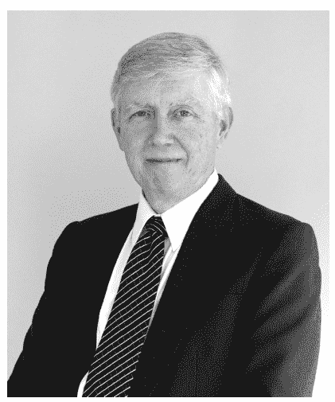
## 包铭心 (Paul W. Beamish)
Paul W. Beamish 在国际商务研究界具有重要影响力，现任加拿大西安大略大学毅伟商学院教授。个人参与主编或合著专著约六十部，期刊论文发表一百四十一篇，多次入选国际战略管理与国际商务领域贡献突出的学者前三名。Google Scholar 引用总量超过三万七千次。1993至1997年担任《Journal of International Business Studies》主编。现为加拿大皇家学会院士、加拿大亚太基金会院士，曾出任国际商务学会院士学院院长。2018年获加拿大-中国贸易理事会第四十届卓越成就奖。累计撰写案例一百四十八个，获最佳案例奖二十二次，八十余个案例被译为非英语。2012年获美国管理学会国际管理杰出教育家奖。现任毅伟亚洲管理研究院主任，推动案例教学在中国的发展。曾任毅伟出版社执行主编，现为编辑主任。1999至2004年任毅伟商学院学术副院长，现任毅伟国际商业研究院主任。

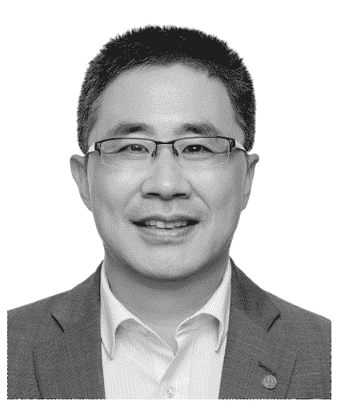
## 阎海峰
阎海峰现任华东理工大学副校长、商学院教授、博士生导师，曾赴美国印第安纳大学凯利商学院、澳大利亚墨尔本大学商学院、悉尼大学商学院访学。系美国管理学会、国际商务学会会员，并为国际中国管理研究学会创始会员。兼任临港—华东理工大学自贸区创新研究院院长，先后担任华东理工大学商学院院长。研究集中于中国企业对外扩张、组织学习与知识转移。论文发表于《Management and Organization Review》《Asia-Pacific Journal of Management》《Journal of Knowledge Management》以及《管理世界》《科研管理》《南开管理评论》等。长期致力于国际商务经典文献的本土传播，与团队于北京大学出版社推出《〈国际商务研究〉优秀论文集萃：国际化情境下的组织管理研究》，并参与编译《自下而上的变革：中国的市场化转型》《全球企业战略 第3版》。与陈万思、陈正一合作的案例入选全国百篇优秀管理案例。

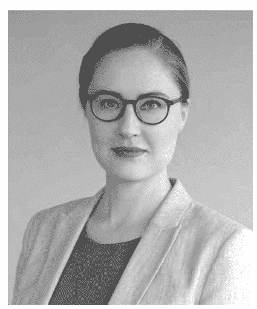
## 瓦妮莎·C．哈斯 (Vanessa C. Hasse)
Vanessa C. Hasse 为加拿大西安大略大学毅伟商学院国际商务系助理教授。加入毅伟前在旧金山大学任助理教授，并参与亚太创新与管理研究中心项目。论文见于《Academy of Management Journal》等期刊，案例涉及中国、德国、美国、瑞士的国际战略管理议题。曾获美国管理学会及国际商务学会研究奖项及提名，含2017年东北大学D'Amore-McKim商学院最佳论文奖。教学面向本科与研究生，课程涵盖国际商务、国际合资与战略联盟、全球战略、国际谈判等。

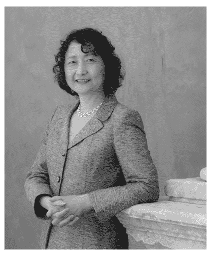
## 杨小华 (Xiaohua Yang)
Xiaohua Yang 系旧金山大学商学院国际工商管理终身教授、亚太创新与管理研究中心主任。长期关注中国企业国际化、可持续发展战略、国际研发战略联盟及海外市场进入战略，在国际期刊发表大量论文，获最佳论文、杰出研究贡献、杰出服务贡献及中国国家自然科学基金奖等荣誉。曾任《Journal of Asia Business Studies》副主编，并担任《Asia-Pacific Journal of Management》《Business Ethics Quarterly》《Thunderbird International Business Review》《Multinational Business Review》等刊特约主编。撰有若干国际工商管理案例。曾任多家机构董事会成员，为多国企业与政府提供咨询，并为中国企业设计培训。现指导里昂商学院工商管理博士，曾在上海社会科学院经济伦理研究中心、湖南师范大学公共管理学院、四川大学商学院工作。

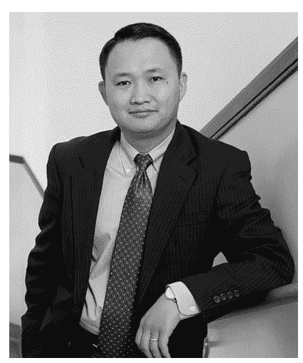
## 王亮 (Liang Wang)
Liang Wang 任旧金山大学管理学院战略学教授、亚太创新与管理研究中心副主任。获加拿大约克大学舒立克商学院博士学位后，先后任教于加拿大麦克马斯特大学德格鲁特商学院及旧金山大学管理学院。研究聚焦跨境并购、产业集群、区域创新、企业社会责任，以及新兴市场企业创新与全球化。论文刊于《Academy of Management Journal》《Strategic Management Journal》《Entrepreneurship Theory and Practice》《Journal of Business Ethics》等顶刊。

# 前言

近三十余年，全球跨境兼并收购在次数与规模上持续走高。本书所谈并购涵盖兼并与收购。跨国并购总额由1988年的约178亿美元增长到2018年的约1.56万亿美元，占比超过当年全球并购总额的三分之一，后者当年超过4万亿美元。与此同时，中国企业的海外并购数量也在快速提升，成为其走向全球的重要方式。2008至2009年金融危机释放了大量低价优质资产，加速了这一进程，联想收购IBM业务即为典型例证。

研究与实践显示，交易数量虽大增，价值实现却极不均衡。七至九成的并购未能达成预期，整合问题是主要原因。交易完成后，企业常在运营层面遭遇诸多阻力；在中资企业与发达经济体企业的交易中，整合方案设计与跨文化沟通的难度尤为突出，根源涉及国际经验不足与双方期望错位等。

为呈现并购后整合的细节与复杂性，本系列推出两册案例集。第一册《跨国并购后的整合：有效规划的案例》聚焦交易规划，第二册《跨国并购后的整合：成功组织的案例》聚焦交易组织。案例既包括中资企业与他国企业的交易，也包括外资企业之间的交易。

本书可独立用于教学，也可与第二册配合使用，以更全面把握跨境并购的核心议题。适用课程包括企业全球战略、对外直接投资、跨境并购及高管培训。面向现任或未来将参与并购工作的管理者，期望通过研读提升并购后整合效能，最大化价值转移。

## 内容设计和结构

Donald M. DePamphilis 在《Mergers, Acquisitions, and other Restructuring Activities》中提出的整合框架为本系列提供理论雏形。两册共收录19个毅伟商学院案例及3篇《Ivey Business Journal》文章，特别关注中国企业海外投资的共性挑战。

第一册《跨国并购后的整合：有效规划的案例》
• 第一阶段：整合规划
• 第二阶段：制定沟通方案

第二册《跨国并购后的整合：成功组织的案例》
• 第三阶段：构建新组织
• 第四阶段：人员重组
• 第五阶段：职能融合
• 第六阶段：塑造新企业文化

案例与文章按阶段分布见表0.1。

表0.1 案例及文章分布
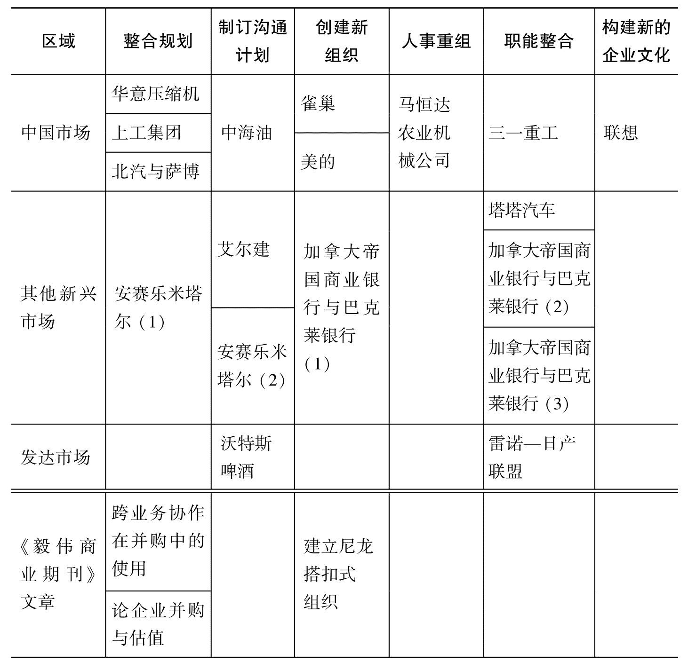
*为保持时效性与代表性，书稿删去原有的吉利与沃尔沃案例。

第一阶段与第二阶段为本册重点。第一阶段强调制定支撑公司战略的整合方案，由三个案例构成：华意压缩机巴塞罗那有限责任公司：收购后的挑战；上工集团：中国挑战者收购德国高端品牌；北京汽车集团有限公司收购瑞典萨博汽车公司的机会。补充案例为安赛乐米塔尔，涉及荷兰米塔尔钢铁与卢森堡安赛乐钢铁的成功合并。另收录两篇《毅伟商业期刊》文章：《跨业务协作在并购中的作用》提供解决并购后协同问题的工具；《论企业并购与估值》解释并购成败原因并梳理常用估值框架。

第二阶段聚焦被购方、购方及各利益相关方的有效沟通。包括安赛乐米塔尔2，记录新公司CEO与两家公司财务总监就整合要点达成一致；中海油收购加拿大尼克森石油勘探公司后，如何回应加拿大利益相关方对健康、安全与环境的关切；艾尔建案例描述美国第三大通用制药商艾尔建南非公司在并购后高管离职等内部动荡的应对；沃特斯啤酒案例记录英博收购德国多家啤酒厂后，与当地企业家、市议会、银行等多元主体的重组谈判。

## 学习目标

本册案例遴选旨在实现若干教学目标。其一，理解并购全流程各阶段及价值转移机制，既兼顾职能视角也兼顾领导全局视角。其二，通过真实情境使核心概念与框架落地。其三，呈现并购情境的现实复杂性，提供多元视角以审视机遇、挑战与管理举措。

本系列并非以财务为中心。并购未达预期的重要原因在于忽视规划与实施的软性要素，如沟通与企业文化。因此案例重点突出这些层面，帮助读者运用多种工具促进价值转移。

尽管2020年新冠疫情冲击全球产业链，未来十年至二十年全球化或呈现半全球化等多种形态，但全球化仍是主流。跨境并购仍是快速进入市场、获取技术、提升品牌的热门路径。把握并购后整合是实现价值创造与转移的关键。借鉴成功与失败案例可节省大量人力、物力与财力，两册为希望在并购领域胜出的从业者的必读书目。

## 致谢

出版离不开多方支持。感谢毅伟商学院允许案例与文章的中译出版，感谢北京大学出版社团队的信任与投入，策划编辑徐冰女士的全程协助。

本书源于2017年5月24日华东理工大学与旧金山大学联合主办的“跨国并购：新兴市场跨国公司的崛起”国际研讨会，包铭心教授作主旨报告。感谢组委会特别是吴冰博士的会务付出，感谢与会者提供的观点与灵感。感谢华东理工大学国际商务研究团队、旧金山大学亚太创新与管理研究中心、毅伟国际商业研究院的支持。特别感谢中欧国际工商学院陈世敏教授授权中海油案例中文版，及中国管理案例共享中心授权联想案例中文版。

感谢所有案例与文章作者及参与翻译、润色、编校的同仁。阎海峰感谢国家自然科学基金委资助，项目批准号71972072。致谢名单包括：

作者
Adoracion Alvaro-Moya
Paul W. Beamish
Louis Beaubien
Joseph L. Bower
Danielle Cadieux
Archibald A. A. Campbell
R. Chandrasekhar
Daniel Han MingChng
Ines SansoCodina
David Conklin
Edward Corbin
Miao Cui
Jiawei Dong
Libo Fan
Steve Foerster
Dominique Fortier
Suzanne Francis
Huifang Geng
Alexandra Han
Meera Harish
Wiboon Kittilaksanawong
Yuanxu Li
Xiaobing Liu
Yuekun Liu
Chunguang Ma
Sonia Mahon
Klaus E. Meyer
Caroline Palecki
Simon C. Parker
Betty Jane Punnett
Aijing Ran
Noel Reynolds
Jean-Louis Schaan
Caren Scheepers
Lei Shao ( James)
Oded Shenkar
Kulwant Singh
Sanjay Singh
Deepa Sita
Jonathan Stearn
Yang Wang
Guang Yu
Qian Zhang
Yingying Zhang
Yingchao Zhou
Jianhua Zhu

华东理工大学商学院
杨昕悦
王启虎
钱嘉怡
金伟杰
王墨林
吴琼
陈正一
秦一琼

旧金山大学亚太创新与管理研究中心
谢在阳
马子程
Becky Tian
Earl Xu
Anqi Zhou

# 第 1 章 华意压缩机巴塞罗那有限责任公司：收购落地后的挑战

本案例由 Yingying Zhang 与 Adoracion Alvaro-Moya 撰写，仅供课堂讨论，不代表作者对管理行为有效性的判断。文中对真实姓名等信息进行了必要的隐匿处理。

2005年前后，中国企业加速向发达经济体扩张，但伴随诸多挑战与风险。学界对动机与过程的研究尚显不足。2012年5月，由中国大型国有制造企业长虹集团控股的子公司华意压缩机股份有限公司进军西班牙，在巴塞罗那设立华意压缩机巴塞罗那有限责任公司，目标锁定国际化企业Cubigel，后者为世界第四大压缩机制造商。2013年5月，收购顺利完成。

收购虽成，但恢复生产、开拓市场、实现盈利仍困难重重。华意压缩机巴塞罗那有限责任公司总经理黄大文Darwin Huang全程负责收购，2014年1月接到总部调回四川的指令。在巴塞罗那办公室，他思考三问：继任者人选如何确定？华意在巩固国际化成果的过程中应采取何种战略？如何协助公司制定未来的国际化路径？

## 华意：成长为全球玩家

华意创立于1990年的江西景德镇，1996年在深圳证券交易所上市。2001年完成重组后，以合资形式凭借中国市场的大销量大产量成为压缩机行业领军者。2002年收购加西贝拉压缩机有限公司53.78%股权。2007年被四川长虹电子集团有限公司收购，后者是中国消费电子龙头之一。

历经多次并购，华意已成产业集团，旗下包括景德镇虹华家电部件有限公司、华意压缩机巴塞罗那有限责任公司、华意压缩机荆州有限公司、加西贝拉压缩机有限公司等压缩机业务单元，并在景德镇城市信用合作社、广东科龙模具有限公司、佛山市顺德区容声塑胶有限公司等企业持有战略股份。具体架构见图1。

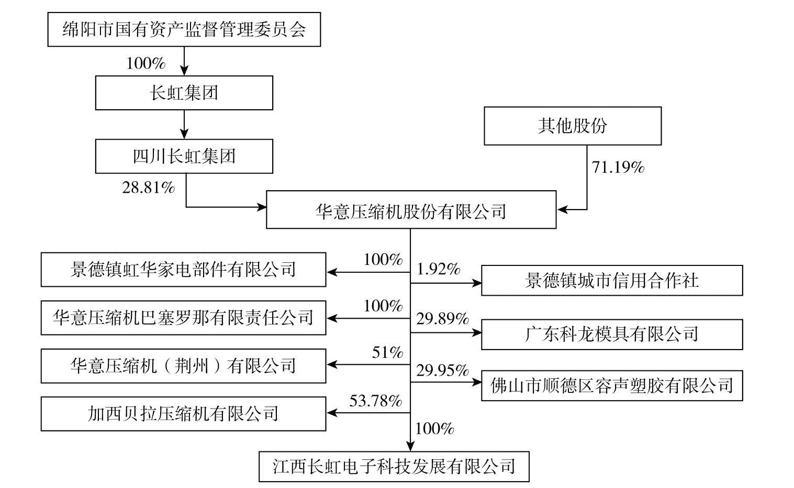
图1 华意股权及子公司架构
资料来源：“About us: ownership,” Changhong: Huayi compressonBarcelina, accessed February 15, 2014, `http: //en. hua-yi. cn/about\_1003. asp`。

**从中国压缩机龙头到西班牙老厂：华意收购Cubigel的出海样本**

2010年，华意已经跻身全球压缩机制造第一梯队，市场占有率约16%，员工规模6500人，总资产约9亿美元。长期为博世、西门子、伊莱克斯、利勃海尔、三星、东芝、海尔、海信、美的、美菱等国内外知名家电品牌供货。

在行业成熟、竞争加剧且产能出现一定过剩的背景下，华意高层与长虹集团共同制定了“走出去”的发展思路。路径主要有两条：一是自主扩张，即有机增长，推进缓慢且投入高、风险大；二是并购扩张，即无机增长，可以撬动存量资源与中国市场优势，还能通过并入具备互补资源和能力的海外品牌，提升创新能力、产品线广度、市场份额和渠道网络。

即便已是行业前三，华意仍看中通过并购实现全球布局的机会。2012至2013年间，公司收购濒临倒闭的Cubigel，并将其更名为华意压缩机巴塞罗那有限责任公司。

**Unidad Hermética到Cubigel：萨瓦德尔工业的缩影**

Unidad Hermética, S.A.简称UH，1962年创立于巴塞罗那省萨瓦德尔以南，专注制冷压缩机生产，创始人是工业工程师Antonio Forrellad Solà。初期在西班牙与法国资本下获得美国特库姆塞公司的生产许可，很快成为行业领军者。1972年西班牙创始人回购法国股权实现全资，随后在Sant Quirze del Vallès设立新厂即后来的Cubigel总部。1976年投产后年均产量达200万台。

1983年创始人去世，子嗣Herman Forrellad接班，同年UH与特库姆塞的许可到期，转而与日本东芝合作。70年代末80年代初的工业危机加上1986年西班牙加入欧洲共同体后失去国家保护，UH遭受重创。连年亏损下，1988年瑞典伊莱克斯控股善意收购成为大股东，UH退出家族企业掌控。为进军家用制冷市场，Cubigel于1989年成立，业务聚焦商业制冷与伊莱克斯全球体系协同。

在商业制冷领域的地位让Cubigel备受重视，并在此基础上拓展电气设备品类。2003年伊莱克斯将其出售给新成立的意大利ACC集团。ACC在塞尔维拉建厂，年均产出压缩机等产品约110万台。

2009年，因涉及500多名员工的临时就业条例ERTE，塞尔维拉工厂停工。随后美国工业收购公司AIAC买下ACC商用制冷业务，ACC更名为Cubigel Compressors, S.A.。AIAC的策略是低价抄底后再高价转手，但并未如愿。2011年6月管理层提交ERTE计划削减29天工时，涉及551人。9月尽管仍有商业订单，因流动资金断裂被迫停产。年底接受加泰罗尼亚政府审计，被认定进入破产前状态。

破产宣布时，Cubigel仍是全球第四大商业压缩机制造商，产品销往80多个国家和地区，与可口可乐、联合利华、百事等跨国企业合作。2011年总资产3750万欧元，较2010年的4700万欧元下降，净资产640万欧元，较2010年的1880万欧元大幅下滑。

**竞标Cubigel：机会与烫手山芋**

Cubigel财务虽困，仍有市场价值。公司深耕封闭压缩机与冷凝装置开发，在轻型商用制冷领域排名第四，品牌因品质稳定而知名，拥有50多年商用制冷经验。轻型商用压缩机全球份额约10%，在欧洲超20%。华意认为其技术、资源与自身定位高度互补，是战略国际化难得的切入点。

这是华意首次参与海外并购，此前经验仅限进出口与浅层合作。挑战在于Cubigel遗留的劳资矛盾与社会压力。2011年下半年AIAC申请ERTE，551名员工受影响且未获地方失业救济。2012年1月5日约400名员工游行讨要救济金。问题解决后又因减产再次申请ERTE，削减551人180天工时。当时债务约2700万欧元。虽与多数供应商谈妥减债40%并获5年延期，但法国巴黎富通银行关闭授信额度，生产难以为继。

即便生产受阻，公司仍获价值约1300万欧元订单，其中两家客户愿预付230万欧元以保供。2012年2月7日，AIAC管理层因2700万欧元债务问题正式申请破产保护。加泰罗尼亚政府出资200万欧元维持临时生产，并通过即时金融基金发放工资以换取未来分红权。

情况持续恶化，2012年5月10日进入清算程序。巴塞罗那第三商业法庭驳回AIAC重组方案，决定剥离出售生产部门。夏季有两家中国企业、一家德国企业和一家投资基金表达兴趣，最终仅两家中国企业入围。

华意快速搜集信息并争取本地支持，联系了西班牙知名律所Cuatrecasac以及萨瓦德尔、Sant Quirze del Vallès的地方当局。2012年7月16日华意董事会召开第五次特别会议，一致通过参与收购方案并决定加入法庭初始与补充竞拍。黄大文被任命主导全过程，团队另有三名管理人员。7月17日法官确认华意中标，击败中国另一投标方东贝。法官在裁定中肯定了华意团队与地方政府、员工及破产委员会几个月的让步与努力。

收购价60万欧元，10%用于补偿工人，至2013年预计再投入350万欧元用于改善。原551名员工中仅386人留任，其中280人直接雇佣、52人非直接雇佣、54人管理人员。收购后年产目标180万台，员工薪酬整体下调15%，华意不承担原有约3000万欧元债务。协议约定未来扩招需优先考虑此前被裁人员。

接管并不顺利。2012年9月13日，萨瓦德尔附近酒吧发生吉普赛人与华人店主冲突致一人死亡，引发当地族群对立。10月媒体曝光“帝王行动”，约100名华人被捕，涉洗钱、文件造假、税务欺诈等，负面舆论持续发酵。

2012年10月15日，Cubigel按协议裁员162人，员工总数减少约40%。被裁员工在厂门口讨要遣散费与欠款约170万欧元，封堵厂区入口导致运输受阻，日损失估算达5万元。因原材料短缺生产停摆。法官下令前员工不得进入工厂千米范围，警方护送卡车进入。至2013年1月底，Cubigel同意发放部分失业救济金。

**直面冲突还是退出**

收购前数月，黄大文团队准备商业计划说服华意与长虹董事会。他们逐项核对会计科目，与审计师评估财务需求。与此同时，9月的凶杀案与华人社区丑闻让当地社会对中国企业观感不佳，前员工集会更是直接干扰运营。

黄大文反复自问如何应对。他认为更理性的做法是直面而非回避。一种方案是前置投入，承担额外成本支付拖欠员工债务，以展示社区承诺并保障后续业务推进，预计需追加近760万欧元社会资本并改变股东结构。另一种是放弃收购，避免劳资冲突、经济放缓与整合失败带来的更大损失，但在竞标程序中已作出承诺，退出代价明显。

若继续，整合需解决的关键问题包括：利用Cubigel的技术与人才，为不同区域提供多样化产品；借助西班牙企业在欧洲、非洲、拉美的历史影响力，拓展华意的区域业务；进入商业压缩机市场，增强技术实力与西欧市场渗透，扩大长虹集团全球版图。技术上，Cubigel拥有全球最完整的气缸与制冷器生产体系，擅长发动机铝件、低成本高效半成品钢等商业压缩机相关技术。

战略方向清晰：解决劳资纠纷是2013年初最大管理挑战。即便收购完成且纠纷缓解，Cubigel因一年停工导致市场份额流失，如何赢回客户并建立信任是难题。被中国国企收购在西方市场并不易。过去数十年Cubigel股东频繁更迭，尤其在以收购为主业的基金手中，研发投入与设备升级受阻。

此外员工士气低落，薪酬暂时下调15%，西班牙华人社区负面事件与缺乏中国跨国公司在地雇佣经验的参照，使不确定性持续。2013年成立的子公司华意巴塞罗那压缩机有限责任公司将接手业务，整合被列为年度战略重点，目标是短期内扭亏为盈、提振士气、提升研发与生产效率。

**整合成效与后续考验**

收购与过渡于2013年5月完成，生产与客户关系重启。绩效显示生产力与全球地位明显提升。2013年底，华意全球制冷压缩机销量与产量均居首位，销量超3400万台，净利润约3000万美元，2012至2013年净利润增长65%，初步实现行业全球领导者目标。综合竞争力提升，特别是在创新能力与欧盟、美国认证实验室合并方面。

截至2013年底，华意压缩机巴塞罗那有限责任公司注册资本7599792欧元，销售额超3000万欧元，经济利润率2.38%，财务利润率6.39%。在西班牙非家用通风及制冷设备制造类排名第3，在巴塞罗那企业中排第710位，全国排名第3547位。2013年Cubigel二十年来首次缴纳企业所得税。公司下设两家子公司及Cubigel、UH两个品牌。

入主前已部分恢复市场份额，重组后仍需提效。2013年生产率提升51.5%，从1月日产3603台增至9月日产5460台。订单趋稳反映市场饱和与产能不足并存。质量投诉大幅下降，客户与供应商评分提升。报废率降低50%，不合格品由2011年的1430台降至722台。环境管理贯穿全流程。公司因社会责任与管理、业务、文化整合成效获认可。2014年2月19日，萨瓦德尔市长Juan Carlos García在市政厅颁发荣誉证书，当地报纸以“欢迎你！黄先生”为题报道积极变化。

尽管初期业绩亮眼，Cubigel前景仍存疑。压缩机市场整体饱和叠加全球经济放缓，增长承压。2014年1月，黄大文被调回华意总部，加入长虹集团董事会。接任者人选、国际化持续路径、经验能否向母公司复制等问题留待后续。巴塞罗那的冬日阳光下，前任总经理离开办公室，仍在思考已解与未解的挑战。

**注释**

1. 根据西班牙劳工规定，资方可在经济、技术、组织、产品或不可抗力因素下中止合同或减薪，由此产生临时就业条例。企业可采取暂停劳动合同、减少工时减薪、集体辞退三种集体措施。2012年起遇到上述情况无需劳动部门许可，但需充分协商并遵守程序，若无法达成一致以企业主张为主，不可抗力需劳工部门授权。

2. 截至2011年12月31日，1欧元=1.2959美元。

3\. “ 400 People Protest in Sabadell to Demand Payment of Unemployment in Cubigel,” La Vanguardia, January 5, 2012, accessed May 28, 2014, www. lavanguardia. com/local/barcelona/20120105/54243652606/400-per-sonas-protestan-en-sabadell-para-exigir-el-pago-del-paro-en-cubigel. html.

4．截至 2012 年 1 月 30 日，1 欧元=1. 3137 美元。

5\. “ The Company Cubigel, of Compressors, Will Go to Chinese Hands,”Inversión & Finanzas. com, July 17, 2012, accessed May 28, 2014, www. finanzas. com/noticias/empresas/20120717/empresa-cubigel-compresores-pasara-1462551. html.

6\. Rebeca Carranco, “ The Mossos Try to Contain in Sabadell the Tension be-tween Chinese and Gypsies,” El País: Catalonia, September 14, 2012, ac-cessed May 28, 2014, http://ccaa. elpais. com/ccaa/2012/09/14/catalun-ya/1347578232\_ 232349. html.

7\. Cruz Morcillo and Pablo Muñoz, “ Nearly 100 Arrested in the Biggest Police Blow to the Heart of the Chinese Mafia,” ABC. es: España, October 19, 2012, accessed May 28, 2014, www. abc. es/20121016/espana/abci-macroop-eracion-contra-mafias-chinas-201210152024. html.

8\. Clara Blanchar, “ Quince días de bloqueo en Cubigel,” El País: Cataluña, November 23, 2012, accessed May 28, 2014, http://ccaa. elpais. com/ccaa/2012/11/23/catalunya/1353701707\_664931. html.

9．截至 2013 年 12 月 31 日，1 欧元=1. 3776 美元。

# 第 2 章 上工集团的德国高端收购战

本案例由 Klaus E. Meyer 教授，Daniel Han Ming Chng 副教授和 Jianhua Zhu 助理研究员撰写。本案例仅作为课堂讨论材料，作者无意暗示某种管理行为是否有效。作者对真实姓名等信息进行了必要的掩饰性处理。

2013 年 7 月，上海缝纫机制造商上工申贝集团 董事长兼 CEO 张敏正在庆祝当年在德国完成的第二次并购。2 月底刚拿下百福工业，随后又把工程公司凯尔曼收入囊中。此前，集团已于 2005 年吃下德国工业缝纫机制造商杜克普爱华。

这一系列海外操作让上工集团迅速跃升为中国乃至全球缝纫机市场的领军者。2013 年集团预计营收约 18 亿元人民币，营业利润接近 1.5 亿元，净利润近 8000 万元。员工总数 3450 人，其中过半在海外。家用品牌蝴蝶和飞人在国内家喻户晓，收购来的德国工业品牌 DA、Pfaff 与 KSL 的产品则服务于高端成衣与汽车制造。集团在中国、德国、捷克、罗马尼亚运营七座工厂。

张敏认为海外并购会为他在上海同行中赢得声誉，但新并入的两家公司带来全新课题。尽管已有收购杜克普爱华的经验，这次的战略抉择与运营难题性质不同。他必须快速决策，同时协调众多利益相关方。除了德国的整合，如何在国内巩固领先地位，并最终与主导全球市场的日本企业抗衡，也是摆在面前的考验。

## 上工集团的底色与困境

上工集团是国有背景企业，最早叫上海工业缝纫机厂，1965 年由上海市政府设立。80 年代初公司投入近 2 亿元从日本重机引进高速锁线生产线。1993 年在上交所上市，上海市政府一直保持控制权。

进入 21 世纪，竞争骤然加剧。Juki 在中国工业缝纫机市场占据主导，提供高技术且价格有优势的产品。尽管上工集团引进高端线，仍困于低端。浙江的多家民营新创企业以更低价推出类似产品。上海人工成本全国最高，上工的人力成本居高不下，市场份额持续下滑。数据显示，2003 年净亏损 5000 万元，2004 年扩大至 7800 万元。

危机之下，上海市国资委与上海轻工控股集团果断重组。第一步，上工与生产复印机和相机本地制造商申贝合并。第二步，上海轻工控股持有集团 26.4% 的股份转至上海浦东新区国资委，区政府由此间接成为最大股东。第三步，提拔张敏担任董事长兼 CEO。

## 为什么要买下 DA

面对日本企业与国内民企的夹击，张敏必须采取激进手段避免退市。DA 专注高端客户的高科技工业缝纫机，这为上工集团提供与日本企业在技术层面竞争的抓手。张敏判断，海外收购是既雄心勃勃也风险极大的应对路径。“只有拿下高端品牌与尖端技术，上工集团才能活下去。第一次海外收购并不是冲着海外市场去的，更多是被生存推着走。”他回忆说，收购 DA 的目的既是提升中国地位，也是在国际市场打开新空间。

### DA：辉煌褪色的德国老牌

DA 的脉络可追溯至两家竞争的缝纫机公司，1860 年成立的 Dürkoppwerke 与 1867 年成立的 Koch's Adler。起初都做家用机，后转向工业机。德国汽车供应商 FAG Kugelfischer 分别在 1962 年与 1987 年收购两家企业，并于 1990 年合并为 DA。DA 在德国证券交易所挂牌，5.02% 股份流通，94.98% 由 FAG Kugelfischer 持有。

冷战结束后，DA 收购捷克与罗马尼亚的低成本工厂，借力东欧机会。到 2005 年，通过 200 多个合作伙伴的全球销售服务网络，DA 超过 80% 的销售额来自海外。其自动化缝纫机使用于古驰、爱马仕、博世、阿玛尼等奢侈品牌的生产线，工业缝纫机则用于梅赛德斯-奔驰、宝马、奥迪、通用等汽车座椅与内饰制造。

全球需求回落叠加欧元升值，DA 的收入与利润持续走低，自 1998 年起未派息。FAG Kugelfischer 多次重组降本减产，效果有限。2002 年 FAG Kugelfischer 被 INA 控股收购，INA 认为缝纫机非核心业务，当年即把 DA 卖出。

张敏在评估后发现 DA 有三大短板：
其一，错过市场转移。纺织业重心已移向东亚、南亚，取消中国纺织品配额后，2003 年全球超三分之一服装在中国生产，中国成为最大缝纫机市场。DA 的亚洲网络薄弱，仅靠香港经销商服务内地，2002 年1 月才在内地设立销售子公司，错失增长期。
其二，欧洲工厂未做专业化。捷克与罗马尼亚的人工成本不到德国一半，但四座工厂都做整机生产且零部件互通少，未能发挥规模经济与成本差异优势。
其三，架构臃肿。行政费用占销售额 5% 至 7%，销售费用占比从 2001 年的 57% 升至 2004 年的 67%。

表 1 DA 的关键数据 (1998—2004 年)单位：百万欧元

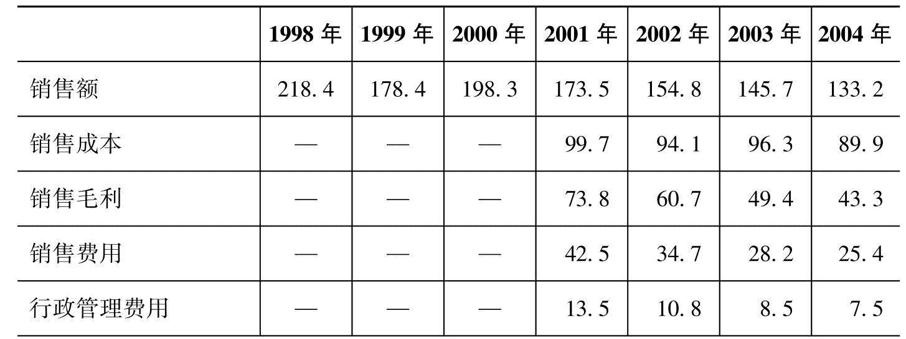

(续表)

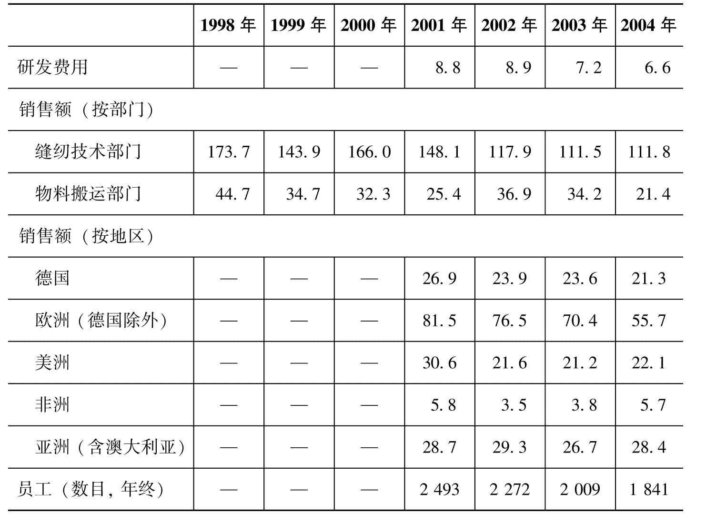

资料来源：Wind Information Co., Ltd., “SGG Data 2005-2013,” Wind Database, ac-cessed May 16, 2014。

### 先稳住人心：收购后的信任重建

收购前，上工集团设立上工欧洲控股有限公司作为收购平台。2003 年12 月，上工集团发行 3.23 亿元人民币新 B 股，为海外投资筹资。上工欧洲从 INA 手中买下 DA 94.98% 的股权，作价约 95 万欧元，同时偿还 800 万欧元银行贷款，并把 DA 欠其的 2700 万欧元贷款展期 9 年，年利率 6%。

张敏出任监事会主席，与德国 CEO 共同制定总体战略。2006 年，曾管理 DA 捷克工厂的艾尔弗雷德·韦德尔升任 CEO，分管生产、研发、销售日常运营，与分管财务、人资、IT 的 CFO Zheng Ying 协同工作。战略层面与德国高管共议，执行与运营仍由当地负责。重大本地决策由 Zheng Ying 与张敏及上海团队沟通。

关键战略由张敏拍板，一旦监事会定调，管理层必须落实。意见不合可能导致离职。收购时原 CEO 对张敏的产品与营销主张不同意，后被韦德尔取代。

“最大难题是赢得合作伙伴、员工与银行的信任。”张敏说。DA 员工早已接受被出售的事实，但卖给中国国有企业仍引发震动。这是首例德国公司被中国国企收购，员工、工会与媒体普遍怀疑。

FAG Kugelfischer 在近二十年里大幅裁员，德国比勒费尔德员工从 80 年代的 2500 人减至 2005 年的 450 人。收购前，按上工、FAG 与工会协议，167 人离职。收购后未再裁员，集体劳动合同继续有效，两名员工代表保留监事席位，没有机器被拆运海外。这些举措平复了员工焦虑。

2005 年11 月，张敏在德国职工大会上承诺：“DA 的品牌管理与销售管理地位不变，研发中心地位不变，高端产品生产基地地位不变。”会场响起热烈掌声。

## 收购后的两条战线

上工对 DA 的重组集中在两点：优化欧洲价值链，提升在中国市场的地位。

### 欧洲工厂分工再造

DA 在欧洲有四厂，两座在德国，一座捷克，一座罗马尼亚，各自完成整机生产。收购后不久启动专业化分工。罗马尼亚厂聚焦劳动密集型零部件生产，供欧洲与中国后续加工；捷克厂继续主做核心产品系列；德国赫斯巴赫厂迁入比勒费尔德，赫斯巴赫厂2009 年关闭，比勒费尔德成为 DA 与上工的高科技制造与研发中心，定位进一步强化。

分工清晰后生产成本明显下降，2005 年底 DA 扭亏为盈。经营改善显著提升了张敏在德国员工与利益相关方中的可信度。

### 中国合资尝试与教训

DA 在中国虽口碑好却难以打开销路。韦德尔坦言：“欧洲我们有优势，亚洲机器太贵。”与此同时上工缺乏高端市场的管理与营销能力。双方于 2006 年成立两家合资公司。

第一家是 DA 贸易上海公司，DA 初期持股 25% 后增至 40%，负责向中国、后延至东南亚客户销售德国或中国制造的 DA 机器。2007 年该合资公司全球销量约 3000 台。

第二家是 DA 制造上海公司，设在上工原厂翻新址，使用上工既有劳动力。DA 持股 30%，从德国派四名经理与工程师主导。目标是为中国中端市场研发制造缝纫机。设计在德国用计算机辅助完成，再由中国团队改造，吸收本地材料与部件，还专门为中国市场打造一款快速机。设想是简化设计加上 DA 品牌与德国生产监督，能做出品质可靠、价格有竞争力的产品，挑战日本企业在中国中端市场的领先地位。

实践远比设想艰难。派驻中国的德国团队遭遇技能差距与沟通障碍，工艺知识传递受阻。中国制造质量波动大，成品出现严重质量问题，部分机器交付不久即在客户工厂故障。合资公司未能盈利，浦东制造厂于2009 年关闭。

张敏复盘时说：“如果能重来，我不会那样做。我高估了德国同事的设计能力，也高估了德国人在中国的管理能力。事实证明不能想当然，德国能造的东西在中国就能造。虽然中国能上天，但高端缝纫机造不出来。我吸取教训，现在只把成熟合适的产品逐步引入中国工厂，高端研发与生产暂时留在德国。”

## 中德管理碰撞的现场

德国与中国在生产运营的做事方式上差异巨大，整合与协同因此充满摩擦。中国员工尊重德国同事的质量管理，却反感其缓慢与挑剔；德国同事则把中国员工的灵活与快节奏解读为设计不稳定。正如 DA 创新经理所言：“中国人喜欢即兴，质量因此下滑……中国同事觉得我们太慢，但我们的机器要求极致精度。”

从中国员工视角看，过度追求精度会推高本已昂贵的产品成本。当时中国厂商不像欧洲客户那样看重耐用与可靠性，视野偏向短期合同，不愿为更耐用的产品支付溢价。市场差异放大了工程师思维的分歧：中国工程师倾向快速响应客户需求，德国工程师更关注技术可靠性、产品寿命与品牌声誉。

初期日常运营也出现误会。中国员工在与自身无关的话题上显得心不在焉，会议上甚至打瞌睡，让德国同事恼火。中国员工则认为德国同事在指出错误时态度过于直接，显得傲慢无礼，即使意见正确。

增进理解需要互动，但很难展开。除 CFO Zheng Ying 外，中国高层极少常驻德国，Zheng Ying 也很少接触德国车间工人或销售团队。中低层经理缺乏在非正式场合认识中国老板的机会，如一起喝啤酒聊天。英语流利度有限也构成障碍。

另一处挑战来自客户期望管理。DA 销售经理常被问及产品产地。欧洲与美国客户以超 5 万欧元的价格采购机器，用于汽车安全气囊等安全敏感部件。机器仍在德国与捷克生产，客户仍要求明确原产地证明，因为他们不愿为中国制造支付溢价。

## 初期的成效

收购落地后的第三年，上工集团与德国子公司 Dürkopp Adler 的经营指标均出现向好态势。SGG 营收从 2005 年的 14.82 亿元人民币上升至 2007 年的 25.38 亿元人民币，2006 年起实现盈利，2007 年净利润约为 3233 万元人民币（见表 2）。DA 同样走出低谷，2005 年即实现收支平衡，营收由当年 1.286 亿欧元增至 2007 年的 1.513 亿欧元（见表 3）。更值得关注的是，在行业普遍裁员的背景下，DA 用工规模逆势小幅上行，由 2005 年的 1772 人增至 2007 年的 1817 人（见表 3）。

在比勒费尔德工厂，收购带来的不安很快消退。初期不少员工担心技术被转移回中国、德国岗位被削减，实际运行打破了这种顾虑。两年后，员工对长期就业持乐观预期，部分因担忧而离职的人员选择返岗。员工家属由担心保障问题转向讨论新的发展机会，德国工会肯定了 SGG 的履约表现，当地媒体对中国买家也持正面评价。26

表 2 上工集团的关键数据(2005—2013 年)单位：百万元人民币

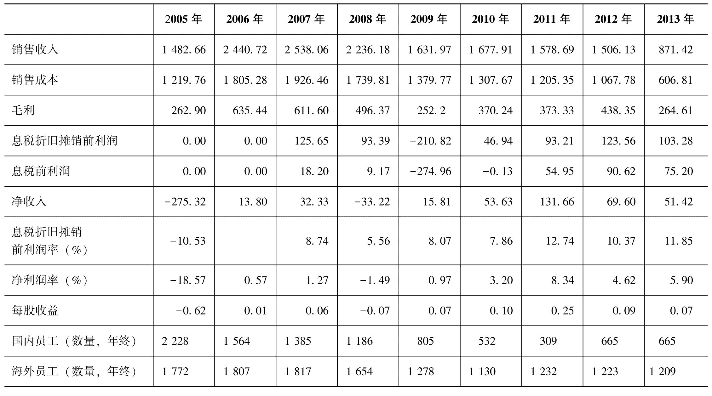

(续表)

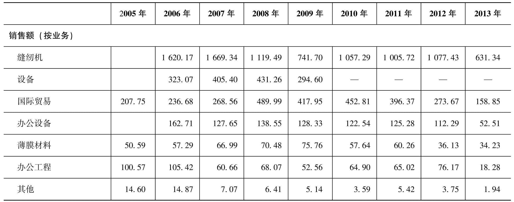

备注:2013 年为 1—6 月数据。

资料来源:Wind Information Co,Ltd,“SGG Data 2005-2013,”Wind Database,accessed May 16,2014。

表 3 DA 的关键数据 (2005—2013 年)单位：百万欧元

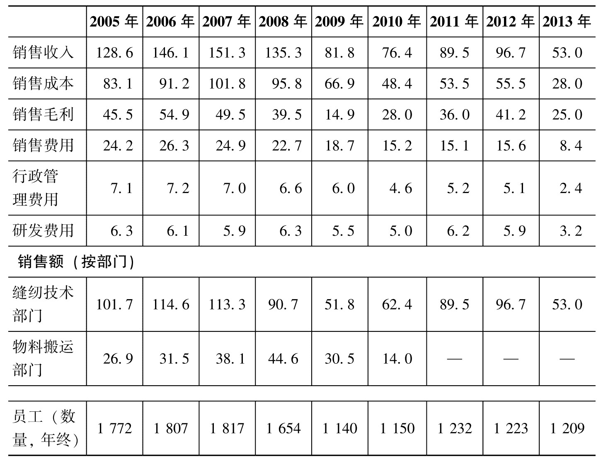

备注：2013 年为 1—6 月数据；物料搬运部门于 2010 年 7 月被出售；2010 年的数据包含出售日期之前的销售额。

资料来源：Dürkopp Adler AG, “ Geschäftsberichte 2005-2013,” https: //www. duer-kopp-adler. com/de/main/investor/business\_report. html, accessed August 26, 2015。

## 不断演变的竞争和商业周期

2008 年金融危机重创制造业，尤其是汽车产业链，DA 也未能幸免。缝制技术业务收入由 9070 万欧元跌至 2009 年的 5180 万欧元（见表 3），当年净亏损 2120 万欧元，而 2008 年尚有 20 万欧元微利。27 SGG 抓住窗口期推动重组。经工会协商，DA 裁员 150 人，主要集中于行政职能。物料搬运业务以 1000 万欧元售予奥地利 Knapp AG。张敏与 INA 及银行就债务重组谈判，为改善净资产比率，SGG 核销了借给 DA 的 1000 万欧元贷款。28 双方约定 DA 恢复盈亏平衡后偿还余款，按年 300 万欧元、年息 6% 执行。重组后 DA 债务降至 1250 万欧元。

危机期当地普遍担忧银行或德国投资者会抽贷。29 SGG 不仅减记债务，还基本保持每年 500 万至 600 万欧元的研发投入，持续把德国工厂打造成集团全球研发中心（见表 3）。重组后的业务聚焦汽车用原材料的工业缝纫机，如座椅与内饰。研发围绕 M 型平台与 H 型平台展开，未来约 80% 的机型将以此为基础，实现零件标准化与规模效应。

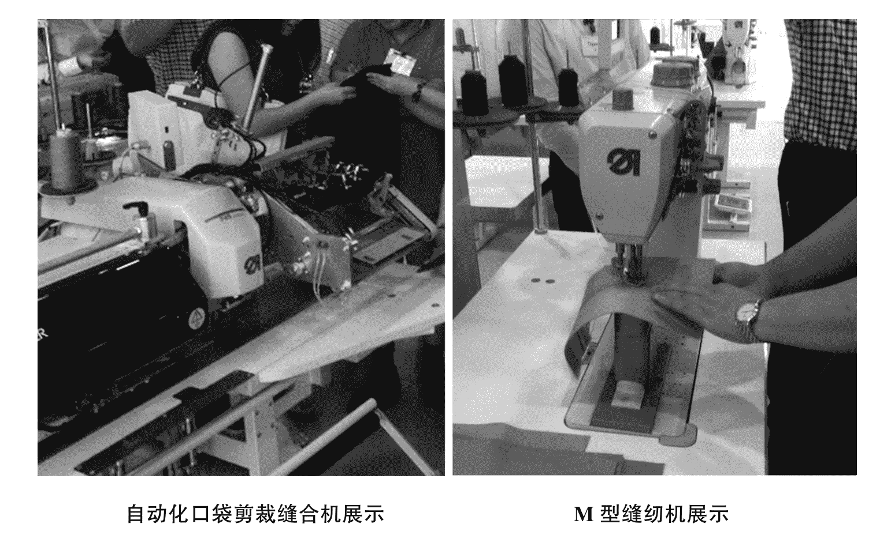

图 1 上工集团上海展示厅

资料来源：中欧国际商学院案例中心。

张敏的说法是：

“欧洲和美国汽车业在衰退，中国却在崛起。我们相信所研制的两种机型大有可为。2010 年推出 M 型机时，中国已成全球最大汽车市场。中重型缝纫机业务的销量挽救了集团，也为 DA 贡献了约 70% 的利润。”

DA 在厚料缝纫机中端市场的占有率接近 90%，盈利能力稳健。即便经历裁员，SGG 在困难期持续支持，赢得 DA 员工的高度认可。德国新任 CEO Ditrich Eickhoff 称并购“从最初的恐慌走向了最佳局面”，工厂理事会负责人则表示收购“是可能发生的最好选择”。30

## 雄心勃勃的新收购

### Pfaff Industrial

2013 年 SGG 在国际化上迈出两步，同时收购两家德国高端品牌：凯泽斯劳滕的 Pfaff Industrial，简称 Pfaff，以及法兰克福附近的 KSL Keilmann，简称 KSL。Pfaff 在欧洲深耕高端缝纫机，在自动化缝纫与胶缝领域技术领先，尤其在汽车高端缝纫机上长期与 DA 竞争。31 Pfaff 还在上海太仓生产鞋革用重型机器，但近年营收持续下滑，2013 年规模仅为 DA 的三分之一。多年亏损使其背负 2000 万欧元债务，银行启动破产程序并要求寻找新股东。

SGG 收购 Pfaff 的意图有二：一是消除 Pfaff 与 DA 在欧洲的直接竞争，二是获取其产品与技术。尽调发现两大问题：其一，如同并购前的 DA，Pfaff 深信“德国制造”，坚持全线零部件在德国生产装配，成本偏高；其二，因聚焦高端而流失标准与中端客户，多次破产也削弱了客户信心，核心研发工程师大量流失。

在 Pfaff 第三次破产后，SGG 正式接手。经与工会沟通，并购后裁员 60 人。部分关键零部件生产将转移至 DA 在捷克与罗马尼亚的基地，Pfaff 的销售渠道将与 DA 整合。

名义上收购价仅 1 欧元，实际投入合计 2410 万欧元，其中 1000 万欧元用于偿还银行贷款，原债务 2000 万欧元经重组降至 1000 万，150 万作为运营资金，250 万用于安置离职人员，460 万投入太仓工厂及南亚销售网络，550 万设为发展基金。32

### KSL Keilmann

同期，SGG 将目光投向 KSL。这家 1964 年成立的家族企业是全球唯一的 3D 缝纫技术供应商。张敏视其为“缝纫机行业的隐形冠军”。KSL 的全自动机可为汽车安全气囊、机翼碳纤维等专业应用提供定制方案，也能在豪华车内饰等领域实现装饰性图案缝制。张敏认为其技术在航空航天、风电、高铁与地铁等交通领域具备广阔潜力。

KSL 受困于资金，销售网络覆盖有限，多靠老客户回头。收购意向方不止一家，但最终选择 SGG，因其此前成功整合 DA。SGG 支付 1850 万欧元收购全部股权，其中 1295 万预付，余下 555 万两年后支付。技术人才被认定为最核心资产，公司推出高额人才保留计划，原业主仍留在管理层。

## 2013 年的挑战

### 将 Pfaff 和 KSL 与 DA 整合

完成 2013 年两笔收购后，SGG 汇聚了工业缝纫机的尖端技术与全球销售网络，成为行业主要玩家。然而，如何整合收购标的、巩固中国市场领先地位、并寻找下一目标，成为新的考验。

DA 与 Pfaff 已竞争 150 年，将研发、生产与销售融合难度不小。收购 Pfaff 的初衷之一是实现运营协同，但两边员工对品牌有强烈的自豪感，工程师更强调价值链掌控以保证品质。协同效应如何落地是个难题，专业制造商 KSL 又能为 DA 与 Pfaff 带来何种互补，也需厘清。

运营层面需回答多个问题：DA、Pfaff、KSL 与上工四个品牌如何分工，避免同吃一块蛋糕；全球范围的研发、采购与生产如何统一协调；美国、欧洲与中国的销售子公司与渠道在多大程度上整合。组织架构上，上工(欧洲)长期担任集团德国子公司的财务控股角色，它是否应在三家标的整合中发挥实质性管理职能，若要发挥，德国子公司的管理团队应如何搭建才能高效运转。

### 加强在中国的领导地位

并购 DA 后，SGG 希望提升研发实力。但合资制造尝试失败后，集团认为研发中心不宜搬回上海。张敏表示：

“产品可以在中国制造，但不能在中国创造。中国团队短期很难掌握核心研发。作为大股东，我们能把技术带到上海，但这等同于杀鸡取卵。我在国内另建研发团队，在德国团队指导下开展支持性研发，逐步提升能力。中国研发团队大概需要十年才能追上德国。”

拥有德国研发中心与中国市场的双重资源后，张敏仍在探寻更贴近本地需求的产品定义方式。亚洲在工时、气候与电力供应上与德国差异明显，德国团队需为中国与东南亚设计“够用且有本地特征”的产品，但鲜有研发人员愿意驻场了解客户。张敏在用 DA 技术复兴“上工”中国品牌时也面临政治压力：同技术、同平台下，国产品牌售价通常比 DA 品牌低约 30%。他需要在德国品牌向中国市场适配与用上工品牌填补细分市场之间取得平衡，既发挥价格优势，又不稀释德国品牌的价值。

### 雄心勃勃的新目标

张敏的远景是实现年收入 100 亿元人民币，并于十年内跻身全球领先。他考虑再收购一家缝纫机企业，同时引入核心战略股东，如私募股权机构。在中国，上市民营企业中捷、杰克与方正电机在国内市场占据强势地位，是潜在对象。全球范围内，欧洲与美国的高绩效企业也在下一步收购的范围内。

## 注释

1．中文名称为“上工申贝”，在英文中该公司以缩写 SGSB Group 为人所知，后改为 SGG，为方便阅读，本文使用 SGG。

2．截至 2015 年 5 月 26 日，1 元人民币=0. 15 欧元。

3\. SGSB Group Co., Ltd., “ Annual Report 2004,” April 27, 2005, http://globaldocuments. morningstar. com/documentlibrary/document/07db9baab414 45af. msdoc/original, accessed May 7, 2014, p. 3.

4\. Wind Information Co., Ltd., “SGSB Group Annual Report 2005,” Wind Da-tabase, accessed May 7, 2014.

5\. O. Bönig, “ Nobody Trusted Us at That Time: Interview with Zhang Min, Chairman & CEO, SGSB ( Group) Co. Ltd,” M&A Dialogue, August 17, 2013, www. ma-dialogue. de/unternehmen/fallstudien/nobody-trusted-us-at-that-time, accessed August 26, 2015, pp. 42-43.

6\. Dürkopp Adler AG, “ Annual Report 2004,” April 5, 2005, https://www. duerkopp-adler. com/de/main/investor/business\_report. html, accessed August 26, 2015.

7\. S. Sohm, B. M. Linke and A. Klossek. “ Dürkopp Adler and ShangGong Hold-ing: Fit for the Future Together,” Chinese Companies in Germany: Chances and Challenges, www. gtai. de/GTAI/Content/CN/Invest/\_SharedDocs/Down-loads/Studies/chinese-companies-in-germany. pdf, accessed September 28, 2015, pp. 16-27.

8\. Dürkopp Adler AG, “ Geschäftsbericht 2002,” May 6, 2003, https://www. duerkoppadler. com/export/sites/duerkoppadler/commons/download/down-load-text-attachments/DA\_GB2002. pdf, accessed August 26, 2015.

9\. Sohm, Linke and Klossek, op. cit.

10．正式名称为人民币特种股票，这些股份在中国的上海证券交易所和深圳证券交易所交易。

11．如果上工集团收购了 DA 超过 95%的股权，将 DA 摘牌退市，那么上工集团需要支付 600 万欧元的财产税。截至 2015 年 5 月 27 日，1 欧元=6. 75 元人民币。

12\. Bönig, op. cit.

13\. Sohm, Linke and Klossek, op. cit.

14\. Ibid.

15\. Dürkopp Adler AG, “ Geschäftsbericht 2009,” April 12, 2010, https://www. duerkopp-adler. com/export/sites/duerkoppadler/commons/investor/downloads/DA\_GB\_2009\_DE. pdf, accessed September 29, 2015; Dürkopp Adler AG, “Geschäftsbericht 2010,” March 18, 2011, https://www. duerkopp-adler. com/export/sites/duerkoppadler/commons/investor/downloads/DA\_GB\_2010\_DE. PDF, accessed August 26, 2015.

16\. Sohm, Linke and Klossek, op. cit.

17\. Bönig, op. cit.

18\. Sohm, Linke and Klossek, op. cit.

19\. J. Klöckner, “ Freunde in der Krise,” Zeit Online, February 21, 2013, www. zeit. de/2013/09/Chinesen-Unternehmen-Duerkopp-Adler, accessed August 26, 2015.

20\. Dürkopp Adler AG, “ Geschäftsbericht 2011,” 2012, www. duerkopp-ad-ler. com/export/sites/duerkoppadler/commons/investor/downloads/DA\_GB\_2011\_DE. pdf, accessed August 26, 2015.

21\. Sohm, Linke and Klossek, op. cit.

22\. Ibid.

23\. Klöckner, op. cit.

24\. Ibid.

25\. Ibid.

26\. Sohm, Linke & Klossek, op. cit.

27\. Dürkopp Adler AG, “ Geschäftsbericht 2009,” op. cit.

28\. Ibid.

29\. Klöckner, op. cit.

30\. Ibid.

31\. Pfaff 也是家用缝纫机的知名品牌，但是被另一家公司持有其家用缝纫机的商标权。 Pfaff 仅有权使用工业缝纫机的品牌。收购 Pfaff 时，上工集团仅收购了 Pfaff 的工业缝纫机品牌。

32．太仓工厂在之前的破产程序中被卖给一个投资者，后来在另一次交易中被上工集团收购。

# 第 3 章 北京汽车集团有限公司收购瑞典萨博汽车公司的机会

本案例由 Yang Wang 和 Ma Chunguang 在 Si-mon C. Parker 教授的指导下撰写。本案例仅作为课堂讨论材料，作者无意暗示某种管理行为是否有效。作者对真实姓名等信息进行了必要的掩饰性处理。

北京汽车集团有限公司（简称北汽集团）是一家总部设在北京的国有汽车制造企业。2009 年秋季，北汽集团首席财务官马传骐坐在办公桌前审视一个颇具吸引力的新机会。瑞典豪华车制造商萨博汽车的所有者通用汽车，已释放出可能向北汽集团转让部分股权并允许其获取部分知识产权与生产设备的信号。

长久以来中国汽车企业对西方技术怀有强烈渴求。对北汽集团来说，眼下的情况看起来是同时拿下知识产权、推动自主品牌建设的难得时机。可集团财务负责人马传骐对这笔交易保持高度审慎。一个正处困境的欧洲车企，其股权到底值多少钱并不好判断，尤其在经济衰退势头仍在放大的背景下。谈到专利价值，他也不确定北汽是否具备驾驭和消化新技术的条件，从而形成真正的商业价值。他同样注意到，汽车制造的技术更迭非常迅速，北汽很可能花钱买到的是已经落伍的方案。此外，和国内不少汽车高管一样，马传骐对上海汽车集团收购韩国双龙汽车这起高调交易记忆犹新，最终以失败收场并伴随互相指责告终。

在西方公司里，首席财务官的核心职责通常是管控财务风险并向CEO和董事会汇报财务数据。而在北汽集团以及多数中国企业中，CFO往往与CEO并肩做战略决策。正是这个角色定位，让马传骐在与通用汽车的谈判中拥有决定性影响力。

## 北汽集团发展脉络与行业环境

北汽集团是一家国有控股集团，也是多家中国汽车及机械制造企业的母公司。公司成立于1958年，总部位于北京。如今它已成长为以整车制造为核心，同时涵盖研发、零部件生产、汽车服务与贸易、金融、通用航空等业务的综合性现代化企业。图1呈现了2009年北汽集团的品牌与合作伙伴布局。

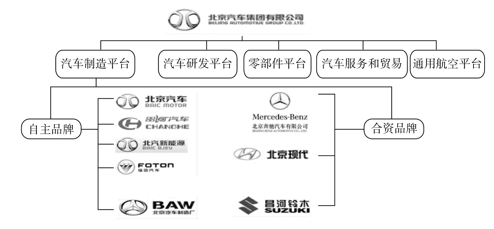

图 1 北汽集团的品牌和合作伙伴

注：图 1 展示为 2009 年北汽集团的品牌和合作伙伴，后有所变化。

资料来源：北汽集团内部文件。

北汽集团在国内深耕汽车及零部件制造，产品线覆盖越野车、军用越野车、轻型卡车、重型卡车、客车等多个名牌品类。商用及重型车型约占总产量的三成，集团同时提供汽车贸易配套。2009年整车产量突破124万辆，在中国位列第五。

与外资品牌的合资布局如下：

• 北京现代汽车有限公司。由北京汽车投资有限公司与韩国现代自动车株式会社各持50%出资设立，2002年起为中国市场生产现代品牌车型，当时尚无专为中国定制的全新车型。

• 北京奔驰汽车有限公司。1984年由北汽集团与德国戴姆勒股份公司、戴姆勒大中华区投资有限公司合资成立，业务覆盖研发、发动机及整车生产销售、售后服务。车型包括梅赛德斯-奔驰长轴距E级、长轴距C级及GLK级。1

2009年，中国汽车年产量首次跃居全球第一，超过欧盟与美国。中国品牌车销量占比约45%，其余为中外合资生产。2009年北汽集团与上汽集团、一汽集团、广汽集团、东风汽车、长安汽车同处第一梯队。表1列示了当年主要车企的销量与市场占有率。

表 1 2009 年中国主要汽车制造商的销售量和市场份额数据

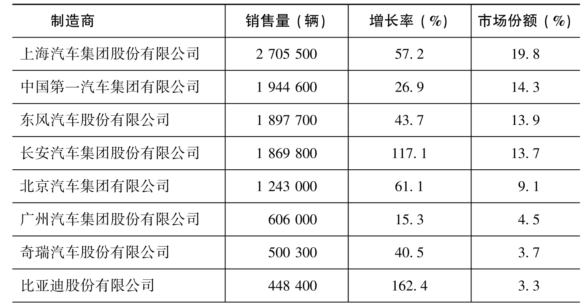

(续表)

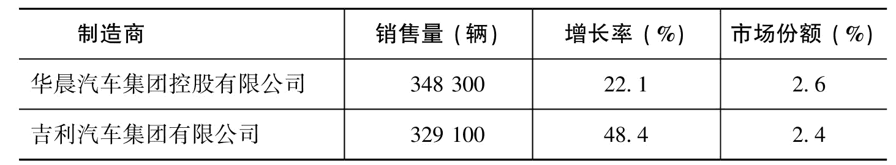

资料来源：作者根据相关资料整理。

尽管2009年开始尝试出口，中国产车主要仍服务于国内市场。2002至2007年间，国内汽车销量年均增速达24.7%，2007年同比增加157万辆。2009年全国汽车产量1379万辆，其中乘用车1038万辆、商用车341万辆。同年全国在用汽车保有量达到6200万辆。庞大的内需为北汽等厂商提供了稳定支撑。

中国汽车产业规划的愿景是培育既满足国内需求又具备全球竞争力的企业。达成这一目标的关键一步是获得西方技术支持。西方企业历来高度保护知识产权，通常只愿通过严控的合资方式合作。许多西方国家对中国企业模仿产品设计尤为敏感。4 技术转让案例相对稀少，例如2005年7月南京汽车集团以5300万英镑收购英国罗孚集团。

中国车企最具警示性的收购是2004年上汽集团对韩国双龙汽车的尝试。上汽以约5亿美元购入双龙48.92%股权，2005年成为大股东。但双方约定的技术转让并未落地，上汽被指窃取双龙技术。上汽最终撤资，双龙于2009年1月进入破产保护。失败归因于文化差异、工会阻力以及金融危机等多重因素。

## 萨博技术收购窗口出现

2008年9月雷曼兄弟破产引发全球金融海啸，2009年初世界已滑入大衰退，汽车行业受创尤甚。2008年11月，美三大车企通用、克莱斯勒、福特向美国政府申请500亿美元救助以避免破产。作为通用亏损子公司的萨博汽车尤为脆弱，被正式挂牌出售，但与潜在买家的谈判很快陷入停滞。2009年中，因财务前景恶化与全球经济持续低迷，主要竞标者科尼赛克汽车明确退出收购。

北汽曾是科尼赛克竞标联盟的支持方之一，计划落空后，马传骐判断北汽在谈判中处于有利位置。通用急于甩掉亏损子公司，聚焦美国本土业务抵御风暴，也无力承担萨博的债务，因欧洲需求急剧萎缩。与此同时，北汽亟需核心技术支撑自主品牌发展。萨博体量小而技术含量高，自称发动机技术水平接近瑞典同行沃尔沃，且仅有两条车型线，技术消化难度相对较低。这些因素对北汽颇具吸引力。再加上北汽通过境内银行获得低成本充裕融资，现金充裕，对通用而言也是重要加分项。在西方股市暴跌之际，北汽有机会以低价抄底资产。

通用希望整体出售萨博给北汽，但对知识产权的转让设下诸多限制。若无法整体出售，通用愿以非排他方式出售萨博9-3与9-5“凤凰”平台的蓝图使用权及部分生产设备。马传骐认为北汽面临三条路径：仅购买知识产权使用权；购买使用权并持有萨博股权；彻底放弃机会。

影响决策的两个核心变量是技术吸收能力与技术生命周期。若要获得新技术，必须有能力正确运用。这要求员工具备灵活性和改变意愿，以适应既有生产实践。实质上北汽员工需要再培训和重组，几乎等于重新起步。马传骐相信北汽等中国车企在灵活性上优于不少西方企业，但他也清醒认识到，北汽缺少能够推动必要改变以吸收利用技术的骨干人才，这需要一次能力上的大幅跃升。

第二是技术寿命。北汽将买入的是近期的而非顶尖技术。即便员工最终掌握，也可能等到量产时竞争对手已进入更具创新性的阶段。此外，萨博9-3、9-5在进入欧洲和美国市场时曾被视为商业上的重大失利。因此这些设计最多只能帮助北汽建立初步品牌，参与国际竞争仍需进一步学习改进。虽然马传骐明白北汽的学习改进能力有限，但若北汽放弃，竞争对手可能抓住机会，从长期看对北汽更不利。

北汽现金充沛，或许能以极低价格收购萨博股份。萨博拥有成熟品牌与良好经营，当前的不景气或许是暂时的，在更好管理下未来仍可乐观。

但风险同样明显。萨博已确认负债4.5亿欧元，若欧洲投资银行同意为新产品线研发提供资金，负债将升至12.5亿欧元。北汽需投入巨资弥补销量下滑。若北汽让萨博继续运营，将背负不具竞争力的成本结构，且可能发现让萨博破产后在甩卖中获取知识产权更为划算。上海汽车收购双龙失败的经历提供了相似教训：在韩国强势工会支持下，被收购员工拒绝改变工作方式，上汽在技术转让上陷入长期拉锯。虽然出售萨博股权并带走专有技术符合通用利益，北汽是否接受仍存疑问。

马传骐还需评估出价底线。部分西方CEO认为中国买家几乎愿意为技术付出任何代价。虽然是误解，一旦北汽开始报价，这一认知会让谈判更复杂。他必须先测算知识产权对北汽的真实价值，给出公允报价。同时决定是否购买萨博股份、购买价格与持股比例。萨博自2000年起未独立发展，缺乏明确估值基准。若假定除技术外品牌仍有残值，则可适度提高对部分股权的报价。北汽内部要求约15%的收益率也需纳入考量。

另一种选择是放弃收购萨博，转而加大研发投入培育自主品牌。2009年北汽年研发投入约10亿元人民币。据中国汽车技术研究中心未公开测算，自主品牌建设需要五年以上周期，每年额外投入6至8亿元研发，另需约10亿元换取外方技术支持。合计额外成本将超过12亿元人民币。自主之路代价高昂且成功并不确定。

## 董事会前的关键抉择

马传骐担心的是自身及北汽集团在行业乃至全国范围内的声誉维护。继续推进知识产权收购并持股萨博是一场豪赌。成功将大幅提升个人与集团声誉，失败则导致声誉受损、资金损失与精力浪费。

他整理领带走进董事会会议室。结论已在心中成形，现在需要向总裁与董事们阐释并争取支持。通用已在向其他竞标者推销萨博，若北汽想拿下机会，已容不得拖延。

## 参考注释

1\. E级自1993年起生产为商务系列，C级为小型商务系列，GLK级于2008年上市为紧凑型豪华跨界SUV。长轴距版本通过加长轴距提升乘坐空间。

2\. “ More Cars Are Now Sold in China than in America,” The Economist, Octo-ber 23, 2009, www. economist. com/node/14732026/, accessed November 18, 2014.

3\. “ How Many Cars Are There in China?” China Auto Web, http://chinaau-toweb. com/2010/09/how-many-cars-are-there-in-china/, accessed November 18, 2014.

4\. David Brierly, “ Road Rage in the West as Copycat Cars from China Start to Make Their Marque Overseas,” The Independent, September 9, 2007, http://web. archive. org/web/20100422210528/www. independent. co. uk/news/business/news/road-rage-in-the-west-as-copycat-cars-from-china-start-to-make-their-marque-overseas-401770. html, accessed November 18, 2014.

5．北汽集团内部文件。

# 第 4 章 安赛乐米塔尔（1）

本案例由 R. Chandrasekhar 在 Jean-Louis Schaan 教授的指导下撰写。本案例仅作为课堂讨论材料，作者无意暗示某种管理行为是否有效。作者对真实姓名等信息进行了必要的掩饰性处理。

2006年8月中旬，总部设在荷兰鹿特丹的世界最大钢铁制造商米塔尔钢铁公司集团董事比尔·斯科汀关闭了手机，他深知临时改期休假并非当下最棘手的问题。斯科汀刚与卢森堡的全球第二大钢铁商安赛乐钢铁集团执行副总裁杰尔姆·格兰布兰结束通话。格兰布兰同样身处度假状态，也被迫提前结束假期。

年初米塔尔向安赛乐发起收购要约。双方董事会谈判僵持半年多，并牵动多个国家政府。最终安赛乐董事会同意“对等合并”。2006年6月25日，双方签署备忘录，合并后成为全球最大钢铁公司。卢森堡的新闻发布会上，双方披露了合并要点。管理层压力稍有缓解，但新的挑战随即显现。

## 合并指导原则

格兰布兰与斯科汀此前已分别接到米塔尔钢铁董事长兼CEO拉克希米·米塔尔的私人电话。合并后拉克希米·米塔尔担任安赛乐米塔尔总裁并进入董事会。

拉克希米·米塔尔任命两人为联合负责人，主导安赛乐与米塔尔的整合工作，并给出指导。按照集团管理委员会制定的框架，两位主管需在未来六个月内完成合并。整合不得干扰日常运营，对业务增长的关注不能放松。预计协同效应可达16亿美元。

两人均为资深管理者，对各自公司业务与组织结构了如指掌，并参与过并购。斯科汀是米塔尔指导委员会成员，并购安赛乐的前期准备由该委员会完成，他还负责了应法国政府要求提交的行业计划，对合并战略依据作出阐述。格兰布兰亲历钢铁行业持续整合，曾在安赛乐主导三次连续并购，两次负责业务板块，一次负责主要职能。

## 安赛乐米塔尔合并深层解析

## 合并的战略背景

格兰布兰与斯科汀很快意识到任务的艰巨性。这次合并与他们过往参与的项目截然不同。合并后公司将跻身全球百强，员工32万人，业务覆盖60多个国家和地区，年营收达百亿美元，对文件与执行的要求更高。过去半年媒体持续追踪双方动向，合并进展将接受公众监督，并引发关于交易实质的激烈公开辩论。两人认为，生产线管理人员的支持是成功的关键，全球前线团队能否接受一体化的运营理念至关重要。此次合并与以往最大的不同是时间仅有六个月，必须在半年内完成一体化，对如此体量的公司而言是前所未有的挑战。

两人还认识到，从战略动机看，安赛乐与米塔尔合并是为了实现增长而非业务重组。双方业务互补，重叠部分很少，企业整合中通常出现的困难在此次合并中不会出现。

因此2008年8月31日在卢森堡的私人会面中，两人迅速就三件事达成共识：整合小组构成、整合路线图、协同效应实现方式。

## 钢铁行业基本面

钢铁是汽车、建筑、运输等基础产业的核心原料。常言道：“发展中经济体靠钢铁。”在多数国家，钢铁资源多掌握在政府手中。通常市场对钢铁的需求呈现周期性，不仅因目标行业周期波动，更因为供需微小变化会被放大，进而影响价格与利润。钢铁产品分两类：一类是长材，如棒材、型钢，多作为通用商品直销，广泛用于建筑；另一类是板材，如薄板、厚板、钢管，多属增值产品，广泛用于汽车与家电。

自19世纪90年代起，炼钢一直采用两步法：先在高炉用焦煤将铁矿石还原为铁水，再用转炉炼成钢材。因生产需持续补给原料，部分钢厂开始自采煤炭或铁矿石，或实现后向一体化。20世纪60年代电弧炉出现，开创新的商业模式，利用废钢循环生产更环保的产品，并以钢材质量为战略优势。电弧炉通过烧结等工艺节省了高炉在原材料上的巨额投入，也减少了对高炉的依赖。较低的资本投入催生了众多小型民营短流程钢厂。虽然产品质量不及高炉钢，但电弧炉生产更快更经济。自此两种制造模式并存至今。

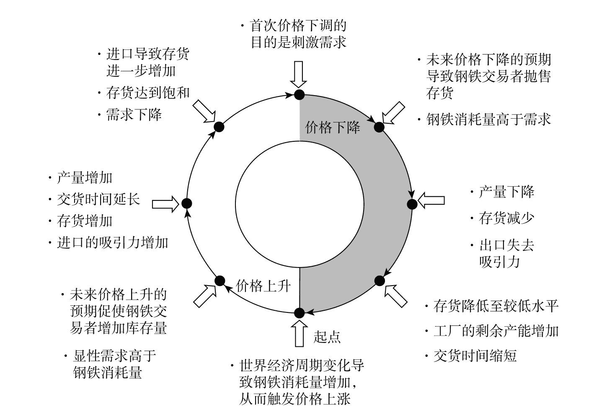

图 1 钢铁价格的周期性循环

资料来源：Breaking the Stalemate: Value Creation Strategies for the Global Steel Industry, Boston Consulting Group, Boston, July 2002, p.2, http://www.bcg.com/documents/file13970.pdf, accessed November 12, 2009。

钢铁工业的转折与整合

70年代以来，经济的涨落让钢铁业长期困于低增速、产能过剩与价格走弱。国家对“钢铁产量即国力”的旧观念逐渐动摇，越来越多政府选择将长期扶持的综合钢铁企业出售，让给渴望整体接盘的私人企业家。

进入新世纪需求陡增。2003年全球粗钢产量创纪录达9.6亿吨，拉动力量主要来自中国与印度等新兴市场。当时钢价均价约每吨650美元，制造商盈利可观且利润率持续抬升。2005年，中国一举成为全球最大钢产国，也是首个年产量突破2亿吨的国家，当年消费量高达3亿吨，稳居全球第一。反观发达市场，生产与消费几乎停滞。

在这种竞争格局下，钢企的比拼聚焦于原料低价获取、技术升级、人工与物流成本压缩。美国和欧洲厂商把增量的希望寄托于在拥有铁矿与煤矿、劳力成本更低的新兴市场附近建厂。传统上极度本土化的钢铁业，首次被迫走向全球化。

产业整体却很分散，没有一家年产能达到1亿吨，这一数字相当于全球产量的10%，也是业内垂涎的目标。若市场集中度提升，产业规模与业绩有望同步改善。商品属性强的钢材易受供需波动牵动出现周期性震荡，全球化与并购被视作“走出低谷”的良方。多数厂商认可合并必要，但真正能在全球有效运营的巨头之间互不愿联姻。

例外只有两家：米塔尔与安赛乐。两者2005年的经营表现相近，一直暗中较劲。两家企业本身都是多次收购堆砌而成，管理层对并购流程极其熟悉，这在变革期的行业里成为核心竞争力。

表 1 2005年全球钢铁制造企业20强

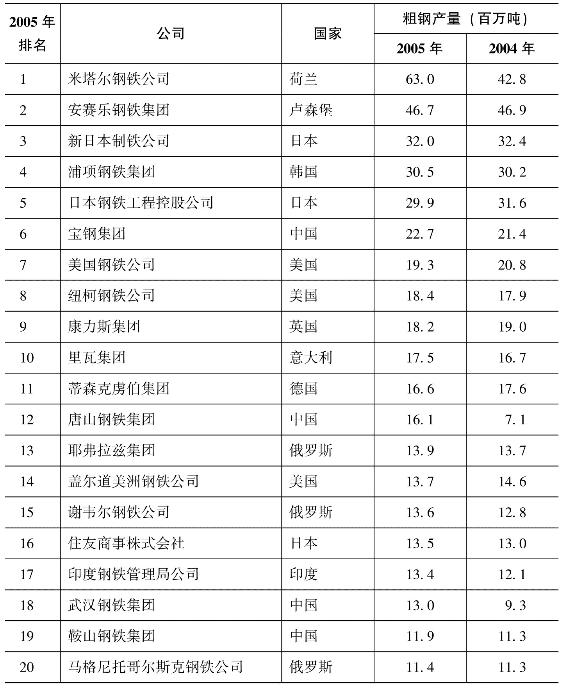

资料来源：“Top steel producers 2008,” World Steel Association. www.worldsteel.org/steelinfigures/topsteelproducers, accessed September 25, 2009。

2005年的行业氛围并不乐观。2004年透支性生产导致2005年初多地供过于求，美洲与欧洲厂商普遍减产。见表 2。其中米塔尔最早出手，2005年第三季度单季减产100万吨。

表 2 世界钢铁产量（2002—2005年）单位：百万吨

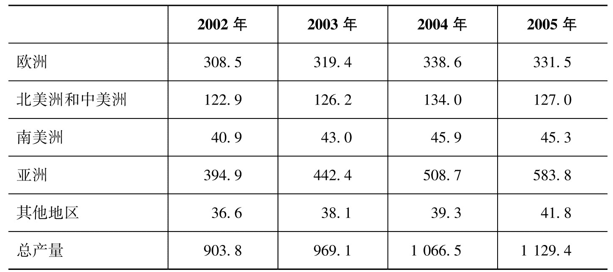

资料来源：Arcelor NV Annual Report 2005, p.33。

米塔尔收购安赛乐正迎合跨国市场趋势，两大龙头合并把全球化与并购推向高潮，但根本性危机并未消失。

下游制造业客户高度集中。2006年全球42.3%的汽车产量由通用、丰田、福特与大众四家占据。与此同时上游也在集中，约40%的铁矿石由巴西淡水河谷、英美资源与力拓三家供应。废钢渠道也在形成更大集团。铝与塑料等轻质替代材料在消费者偏好中份额上升。

价值创造的关键在迁移。钢企需更贴近终端，尤其是原始设备制造商，即OEM部门，其核心是为客户定制解决方案并掌握新材料与零部件的设计工艺。新的主线是优化价值链：从大路货转向按需定制，从产钢转向为产线直用的高品质钢材，从单纯卖钢转向提供技术支持服务。

## 米塔尔的扩张之路

拉克希米·米塔尔青年时期在家族于1963年在印度东部创办的伊斯帕特轧钢厂实习。1969年加尔各答大学商贸专业毕业后在厂中工作六年。1975年移居印尼泗水，1977年投建钢厂。1978年该厂年产2.6万吨，实现收入1000万美元、利润100万美元。

到1989年泗水年产已增至33万吨，同年启动首次扩张，以先租后买方式整合特立尼达和多巴哥国企钢厂，随后在1992至1995年间收购墨西哥、加拿大、哈萨克斯坦三家国企及一家德国民营钢企。

1997年伊斯帕特在纽约与阿姆斯特丹上市，出售20%股权募集7.76亿美元，当年收入近25亿美元、利润1.4亿美元。此后收购加速：1997年德国蒂森长材业务，1998年美国第四大钢企内陆钢铁，1999年法国联合金属集团。

2004年伊斯帕特收购LNM控股并与美国国际钢铁合并，成立米塔尔钢铁，总部设鹿特丹。2005年米塔尔购入湖南华菱管线36.67%股权，成为首家在中国设厂的外资钢企，年产能850万吨的华菱当时位列中国十强。同期米塔尔在拍卖中拿下乌克兰最大钢企克里沃罗格钢铁厂，并与利比里亚政府签署铁矿石开发授权。

彼时米塔尔已是全球体量最大，装机产能7000万吨。2005年销售收入281亿美元，营业利润47亿美元，净利润34亿美元，年末现金余额超20亿美元。拥有31座钢厂分布于16个国家和地区，员工22.4万，客户5000家遍布150国。

其战略基石是规模化、高产量、纵向一体化、产品多元、高价值持续增长与明确客户导向。拉克希米·米塔尔的公开目标是成为每个市场成本最低的制造商。

组织上除鹿特丹总部外，按地理划分为美洲、欧洲、亚非三大板块，众多子公司由中心派员管理。

到2006年竞争优势体现在：上游一体化通过收购原材料商实现，铁矿石自给率50%，煤炭超40%，焦炭超80%；业务覆盖四大洲；产品涵盖板材与长材；东欧与北美市场占据主导；组建250人骨干团队可在集团内快速流动。

股票在纽约与阿姆斯特丹上市，董事长兼任首席执行官。2006年初董事会9人，其中5人为独立董事。高管28人，分管各业务单元、产品线与职能。

股权多为米塔尔家族掌控，本质为创始人与其子。公司像一台适应自由市场的收购机器，行动迅捷熟悉规则，“追目标时能在窄路上高速行驶”。企业文化强调企业家精神、直觉与结果导向。

并购工具是“价值计划”，围绕增长来自四方面：拓展棕地产能解除高增长区低成本瓶颈；随市场演进优化增值组合；全公司持续提产降本；发展低成本矿业资产。米塔尔认识到各国需求因经济发展水平而异，力求按市场提供匹配钢材。

## 安赛乐的整合之路

安赛乐诞生于2002年2月，由卢森堡阿贝德钢铁、西班牙塞雷利与法国于齐诺尔合并而成。三家欧洲企业整合技术、产业与商业资源，打造全球领导者。波士顿咨询2002年7月报告指出，此次合并每年运营成本节约相当于三家销售额合计的2.3%，四年累计投资节约1.2%，同等规模企业中罕见。

增长举措持续：2002年接管巴西图巴朗，2003年与中国宝钢、日本新日铁设合资，2005年与俄罗斯谢韦尔设合资。

到2005年底拥有11座一体化厂与21座电弧炉，年产粗钢4670万吨，定位为高附加值钢材与解决方案供应商，是汽车、建筑、家电、包装等行业主要供货商。当年销售收入326亿欧元，营业利润56亿欧元，净利润超38亿欧元，年末现金47.65亿欧元，员工96256人分布60国，并持续业务重组精简。

理念是价值优先于数量。战略三层为：保持欧洲竞争力；巩固欧洲外汽车钢地位；支撑金砖四国钢铁消费上升。

业务按地理与产品划分：欧洲碳钢板、美洲碳钢板、长碳钢、不锈钢、钢铁解决方案与服务。

2006年优势在于：是全球汽车业主要供应商，满足15%需求。其车身主动控制系统可在减重20%的同时提升安全；通过自营分销网络实现前向一体化，成为本土供应商；高附加值产品尤其板材领先；欧洲整合良好，南美保持区域领导，亚洲新兴市场站稳。2006年1月击败蒂森收购加拿大多法斯科，进军北美。

股票在卢森堡、布鲁塞尔、巴黎、马德里、巴塞罗那、毕尔巴鄂、巴伦西亚上市。股权分散：70.99%自由流通，员工持股2.51%，库存股10.27%，卢森堡政府5.94%，创始三家合计10.29%。

董事会18名非执行董事，含主席8人为独立董事，3名为职工代表。2006年1月任命含CEO在内的四位高管组成管理委员会。

所有权与经营分离，主席不参与日常经营，CEO不任董事会席位。企业风格稳定、长远、循序。严格流程确保业务稳步提升，满足汽车行业对质量与可靠性的要求。体系主导，员工按既定标准作业，决策受逻辑、学习与计划影响。文化兼具流程驱动与人文关怀，追求共识。

并购价值计划具防御性，展示独立运营价值，旨在刺激2005年后息税折旧摊销前利润提升，强调安赛乐在提供多元优质产品服务方面的领导地位。

## 合并诞生的安赛乐米塔尔

2006年1月26日，米塔尔以每股28.21欧元、较前收盘溢价27%向安赛乐股东发出收购要约，目标是“打造首个年产超1亿吨的钢铁商”。两家公司重塑了全球版图，也点燃金融市场对钢铁股的兴趣。

拉克希米·米塔尔在伦敦表示，过去十年整合为各方创造可持续价值，两家企业走在前沿并对未来愿景一致。

安赛乐董事会第一反应是行动大胆且具敌意。当时安赛乐正消化2001年成立合并不久前才完成对多法斯科的收购，整合未完。

随后数月，安赛乐反制：每股派息1.2欧元争取股东；联手谢韦尔宣布130亿欧元合并计划；质疑米塔尔安全记录与管理流程。

法国与卢森堡政府反对交易，欧盟表示赞同，印度政府认为阻挠源于欧洲民族主义。

2006年6月26日，米塔尔将报价提高至每股40.4欧元，安赛乐董事会同意合并。次日签署备忘录后米塔尔吸纳94%股份，新集团命名安赛乐米塔尔，注册地与总部设卢森堡。米塔尔家族持股43.4%，安赛乐股东持股50.5%。

备忘录约定两家决策机构在程序进行期间保持独立。双方董事会各18人：安赛乐6人、米塔尔6人、职工代表3人、大股东代表3人。安赛乐主席约瑟夫·金希兼任安赛乐董事长与米塔尔董事会主席；拉克希米·米塔尔兼任米塔尔董事长与安赛乐董事会主席。

治理整合期三年，自次日起启动，财务合规工作于2006年9月开始。股票在卢森堡、纽约、布鲁塞尔、阿姆斯特丹、巴黎及西班牙多地上市。

集团管理委员会GMB于2006年8月成立，由董事会任命高管组成，负责日常管理并指导整合。管理委员会由集团全体成员及20位高管组成，协助GMB并对集团层面的重要事项决策。

合并后年产1.1亿吨，占2005年全球产量的9.7%。并无垄断威胁，全球前十产能合计仅占26%，最大企业产能是第二大企业三倍，全球份额仍不足10%。产业仍分散，整合空间依然存在。

## 2006年8月的整合议题

GMB提出四项整合指导原则：

1．双重焦点。整合团队聚焦优化合并后的安赛乐米塔尔，而非分别优化两家企业。兼顾短期现金流入与长期价值创造的基础性改进。

2．保持轻盈。把整合当成日常经营的自然延伸，而不是另起炉灶。整合小组直接沿用两家公司原有的预算节奏与计划周期来牵引整体进度。

3．抓住主线。整合成效要围绕四条主线展开：预算编制与费用控制、资本支出安排、日常经营管控、人力与组织。

4．兼收并蓄。安赛乐米塔尔是两强对等合并，团队需要在双方体系中甄别更优做法，再复制到合并后的平台。

格兰布兰和斯科汀的任务是在不扰动日常运转的前提下，让这次合并又快又稳。参照米塔尔与安赛乐此前兼并的经验，集团管理委员会测算自上而下的协同潜力约16亿美元，这个数字仍需在安赛乐米塔尔内部再验证。能否兑现协同，关键在生产线的经理深度参与方案设计与落地。

初期，合并主要波及采购、销售、市场及总部职能。两厂重叠有限，生产端的冲击会滞后，这种时间差会让新公司长期处于不确定状态。

整合窗口压缩到半年，格兰布兰和斯科汀必须马上行动：迅速确定整合团队人选并召集就位，厘清职责边界，同时确立整合流程的基本框架。

# 第 5 章 安赛乐米塔尔合并纪实

本案例由 R. Chandrasekhar 在 Jean-Louis Schann 教授指导下撰写。仅作课堂讨论使用，作者不表示对管理行为的评价。文中对真实身份等信息做了必要的隐匿处理。

2005年，米塔尔钢铁与安赛乐钢铁分列全球钢铁制造前两名，比尔·斯科汀与杰尔姆·格兰布兰是主导合并的核心人物。2006年10月6日，两人出席了两家公司财务负责人的联席会议。会议聚焦三件事：完成价值链对接、把首年经营目标纳入2007年年报、为安赛乐米塔尔制定2007—2009年的三年规划。

财务负责人既管业务预算也管整体预算。工作领导小组已按业务制定了自上而下的评估标准。此后，合并的主要负责人持续与业务经理沟通目标达成路径。

两家公司均以公历为财年，每年十一月启动预算编制，经营目标的分派方式因企业实际情况而异。斯科汀与格兰布兰发现，报表合并不仅是数字叠加，更是流程的重塑。

这次会谈气氛紧张。整合工作始于2006年8月。财务负责人围绕集团管理委员会提出的两项硬指标展开激烈争论：2008年实现16亿美元协同效益，以及200亿美元息税前利润。部分负责人认为，无论是一年经营目标还是三年财务目标，这套方案说服力不足。目标定错会带来负面影响，定低会错失机会，定高则加大落空风险。

大部分目标虽已自上而下分解，但多基于过往经验与内部基准。斯科汀与格兰布兰对管理层设定的目标很有信心。但鉴于整合期仅有半年，各类流程必须在极短时间内形成可视化汇报，这将直接决定2008至2009年的表现。

会上集中讨论了目标可行性，尤其是2007年业务前景。多位财务负责人对协同目标能否实现表示怀疑。

## 经营展望

2006年下半年及2007年，经营环境充满阻力。财务负责人认为挑战主要来自：

• 欧洲与北美成熟市场进口竞争加剧。欧盟25国进口渗透率创历史新高，较2006年三季度上升18%，进口总量提升50%，主要来自中国。
• 欧盟钢铁产量自2000年起增长缓慢，2005年出现回落。
• 美元与欧元同步贬值。
• 美国与欧洲缺乏其他地区那样的增长动能。中东石油出口国因油价上行受益；贸易价格走高拉动非洲与拉美；中国、印度等亚洲国家因内需强劲保持快速扩张。

## 整合推进

米塔尔与安赛乐的整合始于2006年8月。核心整合团队由6名经理组成，双方各3名，称作整合协调人。他们的职责是协调推进，真正的执行落点在他们督导的工作领导小组。

### 人力与组织设计

2006年8月的会议上，斯科汀与格兰布兰被任命为并购总负责人，体现50∶50的分配原则。新董事会成立前，原董事会临时重组。重组后董事会共18人，双方各6名代表，另有3名员工代表和3名大股东代表。集团管理委员会GMB由6人组成，双方各3人。9月份，新公司组建了由20名顶尖管理者构成的管理委员会。整合团队的6名协调员均从高潜力候选人中挑选。斯科汀与格兰布兰分别从安赛乐和米塔尔提名候选人后共同拍板，每位候选人须通过面试且评审一致同意。两人分别在邻近的办公地点办公。

### 并购的特殊性

这笔并购与常规项目有两点不同。其一，常规并购按月评估，本项目按周评估。集团管理委员会每周一开会，整合团队每周三开会，核心团队每日与工作领导小组沟通。工作领导小组进行中期复盘，在周末前帮助团队决策并安排后续动作，进度管控极为严格。其二，一般并购的子项目多为串行，本项目多为并行，并在组织正式成立前就组建了并购团队，部分项目在详细计划出台前已提前启动。

### 工作领导小组

整合团队组建了22个工作领导小组，部分按业务单元命名，如板材碳钢，部分按职能命名，如采购、销售、可持续发展。小组由业务或职能部门的人员组成，根植于本业务，并非独立组织，而是业务不可分割的部分。每位协调员负责3至4个小组并保持每日联络。每个小组都有授权书、行动计划和时间表 见表1。

表1 工作领导小组授权

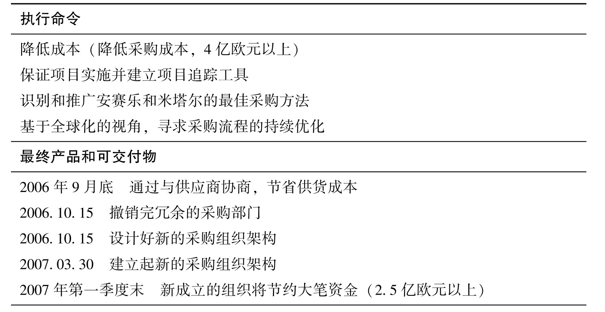

(续表)

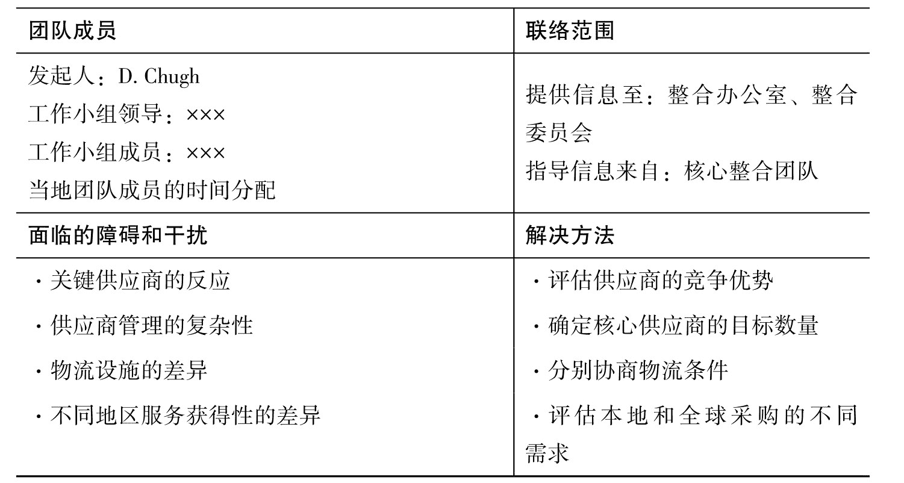

资料来源：作者根据公司内部资料整理所得。

这些小组是“内部整合”的核心载体，整合并非平行运作的独立活动，而是嵌在业务中。目标是确保所有措施都在直接负责执行的经理管控范围内。

小组进一步拆分为50个分小组，在基层培育出91名项目负责人，落地350项行动计划，数千名员工在日常工作中参与整合执行。

### 沟通安排

自2006年9月起，集团管理委员会成员在两家公司的经营场所和办公区开展路演，重点介绍并购的战略意图、潜在优势、方法及时间表。公司通过报纸、企业宣传片、网络电视以及高管与员工面对面会议等多种渠道传播计划，并为员工提供向首席执行官反馈问题的通道。

### 财务规划

整合团队在很短时间内把16亿美元经营目标拆分为采购、销售、运营和其他四类，并分配给各工作领导小组。各小组的首要任务是在全局考量下思考如何落实16亿美元目标，并收集各部门协同建议。每组需在数周内拿出执行方案并核实数据。

随着并购推进，业务部门需承担整合责任并设计行动方案以释放协同。团队成员须全力执行，严格按表推进，如有必要以关键绩效指标衡量进展。

### 存在的争议

16亿美元目标的制定与分配基于三点：借鉴其他并购经验、知识共享、以及基准对比。财务负责人的反馈差异明显，有人说“在当前环境下很难保证生产力提升”，有人说“市场已趋饱和”，也有人说“目标依据不清晰”。整体情绪偏向“我们不认可这些目标”。

斯科汀与格兰布兰正在思考，如何让两家公司的财务负责人接受这套目标。

# 第 6 章 并购中跨团队协作的驱动力

本案例由 Suzanne Francis 和 Jonathan Stearn 撰写。本案例仅作为课堂讨论材料，作者无意暗示某种管理行为是否有效。作者对真实姓名等信息进行了必要的掩饰性处理。

并购伊始，若双方经理共同描绘合并后的组织蓝图，成功率会大幅提升。本案例讲述经理如何跨业务协作制定并购蓝图，从而推动交易落地。

## 并购概览

大多数高管都清楚，整合两个组织风险很高，在某些情况下甚至威胁企业未来。通常整合达不到预期，成效有限。

交易未达预期原因之一是双方心态不一致，一方积极推动，另一方保持距离。法律法规的限制也让双方更加谨慎，导致合并运营时出现磨合期，错失协作时机。在最需要协作的节点，并购双方反而疏远。

## 跨业务协作：破解并购难题的有效手段

过去十年，我们与众多客户合作提升“协作商数”，即把两个组织的人才有效聚合创新，高效共享信息以便决策，在交易各阶段创造性地利用双方合力，提升交易价值。

本案例以这些合作经验为例，说明跨业务协作如何巩固整合并实现预期成果。

## 跨业务协作的关键机会

跨业务协作的应用形式多样，但在以下三方面影响最大。

详尽的尽职调查：预览合作前景

近年来组织愈发依赖电子信息、非正式行业网络和公开资料来了解交易对象。遗憾的是，这些渠道获取的信息在质量、跨职能互动、现场维护与效率等需要观察或对话的维度上较为粗略，难以获得业务开发专家所说的“直觉感受”。

采用跨业务协作的工具与技术是弥补研究不足的办法。随着交易推进，人们更愿意尝试协作。若能更清晰地理解合并业务的发展方向和运营方式，往往会产生更具创造性的并购协作，使结果更完善。跨业务协作提供的尽职调查比传统方式更全面。尽管交易早期信息交流受法律约束，但评估战略与文化契合度、促进整合规划通常是被允许的，为深度协作提供了空间。

在交易早期让内部跨职能团队参与尽职调查并撰写整合报告，这个简单举措对后续进程影响很大，也为后续协作提供了范例，加快规划与执行。

例如多元化印刷包装公司维实伟克拟从太普-银兰收购美国德州一家造纸厂时，召集了多个跨职能跨业务小组研究整合成本、时机与回报。每个小组由并购双方代表组成，聚焦制造、维护、采购或职能支持等信息，并按统一模板编制尽职调查报告。报告为执行经理提供了整合优先级和规划思路。小组通过与员工合作开展正式数据收集和早期尽职调查，并从经验丰富的一线经理处获得第一手资料。双方就项目选择及其在降本或改善绩效方面的潜在回报达成一致。负责整体尽职调查的小组制定行动计划并协同其他小组推进。

## 跨业务协作在并购中的价值

该例说明并购交易中尽早合作大有裨益。合作发生在交割前还是交割后是判断问题。充分利用合并资源，对整合机遇与挑战做简要评估，有助于把规划聚焦于最可能实现收益的领域，并加速并购后整合。深入研究如何运营合并业务时，潜在陷阱、文化鸿沟和复杂问题会变得清晰。

## 并购蓝图：以蓝图创造交易价值

对许多交易而言，整合目标往往模糊，且缺乏明确议程达成具体结果。这会导致组织投入大量时间和精力于看似有用但对绩效影响有限的活动。

持开放合作态度的公司可在签署初始协议到交易完成前的窗口期，共同制定交易完成后约一年的业务合并愿景。我们称之为并购蓝图，它从战略、运营、财务、组织等维度详细描绘新组织在某个确定时间点通常为交易完成后12—18个月的样子。共同制定的蓝图明确了合并后公司期望实现的财务与经营目标，并为整合计划提供支撑。

例如一家全球金融服务机构的大型事业部宣布收购互补业务。访谈中获悉收购方CEO听到大量整合分歧，如产品开发期望差异、客户群体维护战略不同、成本协同规模与速度预期不一。

为化解分歧并为成功整合做准备，收购方CEO与被收购方高层召开工作会议，共同起草并购蓝图，即交易后一年的战略、运营、财务与组织目标 见表1。每个人分享想法，经过数小时讨论与修改形成完善草案。数日后，双方联合领导小组召开工作会，精炼方案并交各自团队再细化。最后领导小组再次聚会，分享新增信息并敲定蓝图。收购方CEO在启动整合前，将文件与由双方200名成员组成的整合团队分享，确保每位成员清楚启动后的行动。在交易关闭前开展清晰的跨业务协作对制定一致的并购蓝图至关重要。

当然，上述并非唯一路径。许多组织会聘请顾问访谈领导小组核心成员，制定未来规划并推动跨业务工作会议以完善蓝图。

无论流程如何，共同制定并购蓝图的经验与文件本身同等重要。它为双方高管提供了接触与互动的机会，并围绕“如何实现成功整合”使他们认识到整合团队面临的大量基础工作，以及蓝图与管理层领导力对交易成功的重要性。同时，蓝图为整合计划提供了明确的责任框架。

表1 并购蓝图

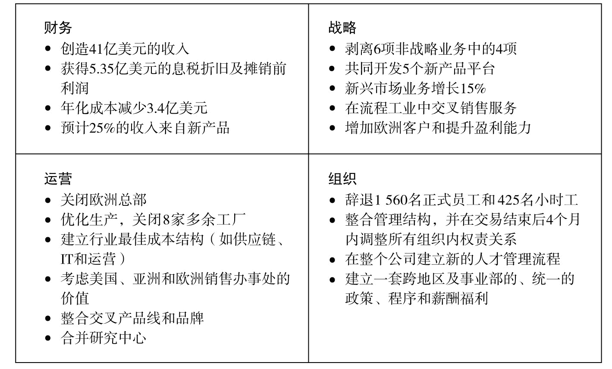

资料来源：作者根据相关资料整理所得。

## 并购后整合：跨业务协同提速

交易最终敲定后，大多数公司都得立刻把重心转到业务合并上来。重心转移不在于交易是在交割前还是交割后发生，而在于是不是从“拿下交易”转向“让合并后的公司跑起来”的心态转换。哪怕在交易早期两边几乎没有实质接触，公告一出就启动跨业务协作，也会带来明显收益。

一次收购里，一家大型企业的事业部去整合一家规模偏小但更具创新性的公司。整合的意图是让事业部更以客户为中心、产品线更丰富，并为合并后的产品线开拓市场，从而提升响应速度和灵活性。收购官宣后，收购方任命了一位整合经理。这位经理在企业收购领域深耕十年，资历和口碑都很不错。他并不直接下场干活，而是和公司总裁一起挑选一批高管组成指导小组来督导整合计划。小组里有被收购方总裁、事业部副总裁，以及收购方的财务、法务、人力和信息技术负责人，公司总裁担任组长。小组成员一致把成本协同和收入增长作为焦点，按职能搭建整合小组。每个小组都由双方人员各派一名主要负责人和一名次要负责人。指导小组定期召集各小组负责人，介绍整合思路、关键时间节点以及衡量成败的具体标准。这套安排为后续业绩改善和文化转型打下了基础。

整合里最难啃的一块，是销售业务该怎么捏合、盯哪些客户。收购完成数月后，事业部的销售额仍旧低于指导小组设定的目标。季度复盘会上，总裁借机重申销售目标，并提出季度结束前要把销售额拉到高于年度计划10%以上的短期攻坚目标。总裁强调各部门必须通力配合，目标必须达成。整合团队据此制定了新的整合方案。季度结束时，销售目标被实现，面向投资者的年度收入承诺也得以兑现。达成这些结果的同时，企业也跨过了不少文化层面的合作障碍。

没有数十上百人脚踏实地、自律投入的努力，要想加速整合并满足高层对财务和运营的期待几乎不可能。职能部门和跨业务团队的任务，是识别出回报最高、最关键的整合举措，并在限定时间内通过协作跑出结果。好处是整合更快、协同效应更早显现，还能培养一批能在合并体里持续发挥作用的领导者和管理者。

## 立即可用的协同打法

并购过程中可以采用的跨业务协同方式很多，这里只点出最核心的几类。通常由收购方最高层判断在何时何地协同才有价值。要在交易早期就种下协作的意识，并随着交易推进让协作成为习惯。

听起来简单，现实中“收购方”与“被收购方”的力量失衡会让协作充满风险和不确定性。并购期间小规模的抵触几乎不可避免，领导者必须识别这些阻力，通过教育、说服和示范相结合的方式消除顾虑，让员工相信协作不可或缺。当高层与整合团队一起制定整合方案时，就能厘清跨业务协同的最大收益，并搭建透明统一的机制让其落地。每一次整合都是创造和打磨更具创新性、更有趣的跨业务协同方法的契机。共同起草的团队章程、定期的跨业务整合进度汇报，都是推动职能与业务部门展开更广泛对话、最终达成共识的抓手。

并没有包治百病的协同模板，但以上思路可以帮助正在考虑或已在推进并购的人更早开始共事。当尽职调查和计划阶段的经验积累足够时，整合执行会更顺畅，更有可能兑现交易价值。

# 第 7 章 企业并购与估值全景

本案例由 Dominique Fortier 在 Steve Foerster 教授指导下完成，仅作课堂讨论用途，作者不表明任何管理行为的有效性，并对真实姓名等信息做了必要的隐蔽处理。

未经 Ivey Management Services 书面授权，禁止任何形式的复制、收藏或转载。本内容不属于任何版权组织授权范围。如需订购、复制或引用有关资料，请联系 Ivey Publishing, Ivey Management Services, c/o The University of Western Ontario, London, Ontario, Canada, N6A3K7; Phone: (519) 661-3208; Fax: (519) 661-3882; E-mail: cases@ivey. uwo. ca。

Copyright ©1995, Ivey Management Services

版本：2010-02-11

本案例先解释企业并购的含义及发生动因，随后讨论并购对双方股东的影响，分析成功与失败的分水岭，最后介绍企业价值评估的方法。

## 核心术语速览

兼并收购在企业扩张中一直是重要手段，企业规模扩大对稳健经营意义重大。企业兼并指两个或多个经济体合并为一个经济体。企业收购指 X 公司买入 Y 公司股权从而取得控制权的交易。两者合称并购。并购形式主要有：横向并购，即生产销售相同或相近产品、经营同类业务的企业间交易；纵向并购，即生产链条上处于不同环节的企业间交易；混合并购，即业务关联度很低的企业间交易。

相关术语还包括杠杆收购，指通过举债融资收购上市公司全部或部分流通股。由管理层主导时称为管理层收购。若收购方买下全部股份且不存在第三方持股，则称为私有化，股票将从公开市场撤下。合资企业是两家以上企业为某个项目共同出资、共担盈亏并共享控制权的经营体。

企业拆分是并购的反向操作。主要有分拆和撤资两种。分拆是将母公司部分业务剥离为全新独立法人，按母公司股东持股比例分配股份。撤资则是将部分业务出售给外部交易方，换取现金或等价物。

## 并购动机的理论与实证

大量理论用来解释并购行为，核心关注职业经理人的并购动机及影响因素。

### 效率视角
效率理论对并购的社会效益最乐观，认为并购可带来单位成本下降、议价能力增强和管理效率提升。差别效率理论认为企业间管理效率有差异，效率更高的公司收购效率较低的公司后，可把被收购方的管理水平拉升。效率差异反映了交易的真实收益。

低效率管理理论认为管理层可能未能充分使用现有资源实现潜在绩效，外部管理层往往能做得更好。

效率观点还包含协同效应，若协同实现，合并后企业价值会超过双方价值之和。前提是行业存在规模经济，且并购前单体企业尚未达到最优规模。并购时如何取舍精华、剔除糟粕是一个关键问题。

### 信息视角
信息理论认为并购磋商、竞标和合资过程中释放的新信息会重估公司股价。可从两方面理解：一是“踢一脚”效应，被并购方管理层在被收购压力下制定高估值战略并执行；二是“坐拥金矿假设”，并购谈判和竞标活动会释放新信号或让市场更确信竞标方的信息优势，从而促使先前被低估的股票重估。

### 代理冲突
当职业经理人代表股东行动却不持有或仅少量持有股票时，代理问题出现。股东与经理利益不一致会致使经理工作松懈、追求奢华福利等。

由此衍生出两种并购观点。一派认为并购威胁会缓解代理问题，股东无需持续监督，经理因面临失业风险而与企业利益绑定，会采取利好股东的行动。另一派认为并购会加剧代理问题，经理为扩大规模而接受更低回报。

### 市场份额动机
扩大市场份额是并购的重要目的。横向并购可直接提升份额。但市场份额增加是否必然带来股东经济利益、股东为何更倾向并购而非内生增长，仍存疑问。潜在规模经济或协同效应属于效率理论范畴。

### 税务因素
并购涉及税收。例如收购有税前亏损的企业，可用其前期亏损抵减收购方应税所得，从而为股东创造价值。

## 什么在左右并购周期

成功完成并购需要企业决心与战略、资金来源、双方相对估值、良好经济环境等多重条件同时具备，所以并购活动呈周期性。

影响因素分外部和内部。外部因素包括货币政策、宏观经济、政治因素及监管政策，如加拿大《外国投资审核法》和《竞争法》，前者限制外资持股比例，后者规范市场集中度。利率较高时市场投资热情下降，资金充裕企业可低价并购。内部因素随行业和企业而异，常见有管理层能力、经营的产品类型等。内外因素共同决定并购周期。并购潮通常出现在资金可得、目标估值偏低、利率低、银行融资容易的阶段。

## 并购为何成败各半

外部发展竞争激烈，通过并购提升股东收益的概率很低。Michael Jensen 与 Richard Ruback 对11年并购的实证显示，交易宣布日被收购方股东市值平均上涨20%，收购方基本不变；收购方正式报价时，被收购方股东市值平均上涨30%，收购方股东仅上涨4%。

显然被收购方股东可获丰厚回报，收购方股东往往未达预期。麦肯锡研究1972-1983年并购发现61%失败、23%成功、16%结果不明。成功率与业务相关性强相关，并购关联业务企业的成功率远高于无关业务。

并购仍在进行，因为失败可归因于多种原因。管理不善和环境不利是诱因，最常见的是收购价过高。

高价原因包括：估值假设过于乐观，如持续高增长、市场复苏、企业好转等；高估协同效应，整合难度被低估，核心人员流失导致预期优势消失；竞标大战中不慎报出超合理价；并购后整合失误，客户、员工、供应商关系受损。

麦肯锡提出五步成功方案。

第一步是并购前工作的管理。保密至关重要，传言会推高目标股价致交易胎死腹中。同时管理层需全面审视自身优劣势与行业结构，再选择价值提升路径。麦肯锡建议三种路径：强化核心业务、追求规模经济、从技术与技能转移中获益。

明确提升路径后，第二步是寻找合适目标。上市公司、分公司、私营企业都在范围。建议先设定淘汰标准，如规模过大过小、可行性差等。分析应由律师、投行、会计师等专业人士完成。

## 并购五步法与估值逻辑

### 第三步 价格评估
筛选后需估值收购对象。收购方通常希望以略高于第二高报价的价买下目标，且价格低于目标真实价值。麦肯锡建议并购后价值=收购方价值+目标价值+可实现协同价值（考虑实现时间）-交易费用。增值额=并购后价值-收购方价值。

### 第四步 沟通协商
关键是确定最高可接受底价并坚守。需考虑目标对收购方的价值、对现有股东和其他潜在买家的价值、各方财务状况、策略动机以及反收购措施的影响。

### 第五步 整合落地
研究显示许多并购后不仅未增值，业绩反而下滑。建议并购决策要果断，整合要审慎，不要生搬硬套收购方目标和文化，而应由双方管理层共同制定彼此接受的方案。

## 估值方法总览
并购中必须对目标企业估值。以下框架适用于各类估值场景。

### 现金流折现法
企业价值等于未来预期现金流按反映风险的折现率折现后的现值。既可用于单个项目，也可用于整体企业。

#### 第一步 测算资本成本
第一步是计算资本成本 Kc，它是投资者在相同风险水平下要求的最低回报。利用目标资本结构可计算加权平均资本成本。仅在并购不改变投资风险时，才能用并购前资本成本作为并购后折现率，否则需调整。

#### 第二步 预测自由现金流

在折现现金流估值框架里，被用来算数的并非会计利润，而是企业真正可以自由运用的现金，即自由现金流。自由现金流是在扣除税费、资本性开支以及营运资金净增之后，剩下来可以分配给股东和债权人这类投资者的那部分现金。算清目标企业的自由现金流，就能评估一笔并购交易为买方带来的现金贡献。

自由现金流的计算逻辑如下：

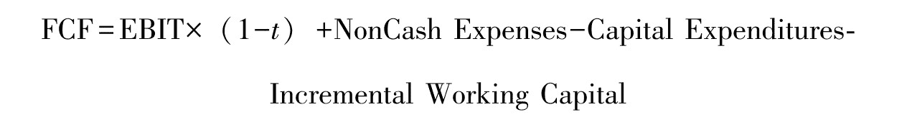

其中 EBIT 代表息税前利润，t 为边际所得税率。非现金费用比如折旧摊销这类项目，因为不产生真实现金流出，所以在测算时要加回。资本性支出是购置固定资产的现金流出，利润表里看不见，但在实际现金层面必须扣除。营运资本增量反映应收账款等为维持并购后正常运营所需资金的增加，通常按营业收入增幅乘以固定比例估算，这部分现金同样不可自由分配，也要扣除。所有与融资相关的收支都被排除在外，因为资本成本的测算已涵盖了融资成本。

估值时一般要预测一段自由现金流，预测期要延续到企业进入长期稳定增长为止。实务中常把这个窗口设在 5 到 10 年。

#### 第三步 将预期现金流折现到当下
借助前面求得的资本成本 Kc，把未来各期预期现金流折算为现值。操作上通常假设资本成本在预测期内不变，且每期现金流在期末实现。

#### 第四步 补上预测期后终值的现值
预测期结束后的持续现金流尚未计入。做法是在期期末加入企业终值。终值本质上是预测期结束后第一年起的永续现金流在期末的现值。常见做法是假设进入稳态后现金流按固定增速增长。设第 T 年为预测期末，则

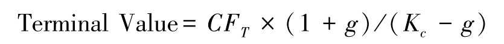

其中 CFT 为第 T 年年末的现金流，g 为 T 年后现金流的稳定增长率，Kc 为资本成本。

#### 第五步 扣除借款与其它负债
股东对企业拥有剩余求偿权，估值时须从企业现金流现值中减去借款及其他负债的市场价值。

### 估值实操演示
假设分析师要对史密斯公司估值。首先算资本成本。该公司贝塔为 1.38，无风险利率 Rf 8.15%，市场回报率 Rm 14.15%，市场风险溢价为 6%。权益资本成本：

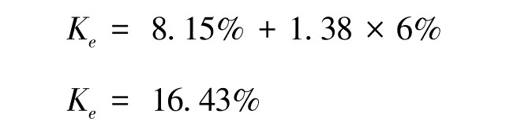

债务融资利率 9.25%，所得税率 45%，税后债务成本：

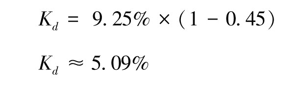

资产负债表显示资本结构为债务 35%、股权 65%，以此为目标结构，加权平均资本成本：

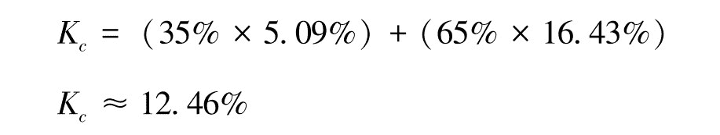

表 1 史密斯公司资产负债表 单位：美元

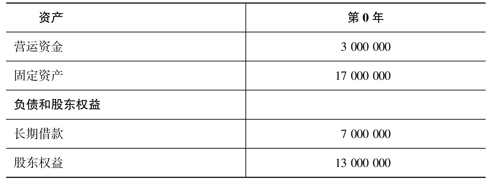

随后分析财务报表并预测未来现金流。息税前利润可从历史利润表推断，见表 2。过去第 0 年和第-1 年息税前利润年均增速超 10%。分析师假设未来两年仍保持约 10%的增速，两年后增速回落至约 2%，更符合行业常态。利润表对资本性支出信息有限，分析师预计未来十年内需在三年内购入一台价值约 200 万美元的全新设备，按 30%折旧摊销。除此之外无重大资本支出，但需维持现有固定资产规模，故每年除第 3 年外均投入固定金额用于资本性支出以抵消折旧损耗。营运资金随主营业务收入同增。

据此对未来 5 年现金流的预测见表 3：

表 2 史密斯公司利润表 单位：美元

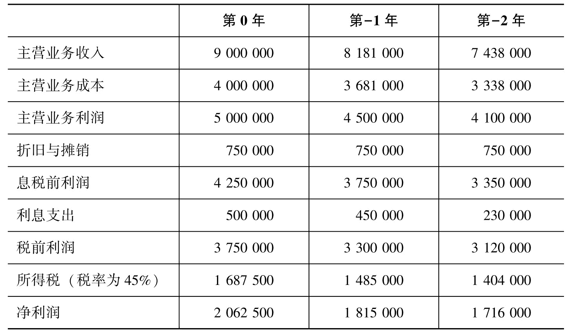

表 3 史密斯公司现金流 单位：美元

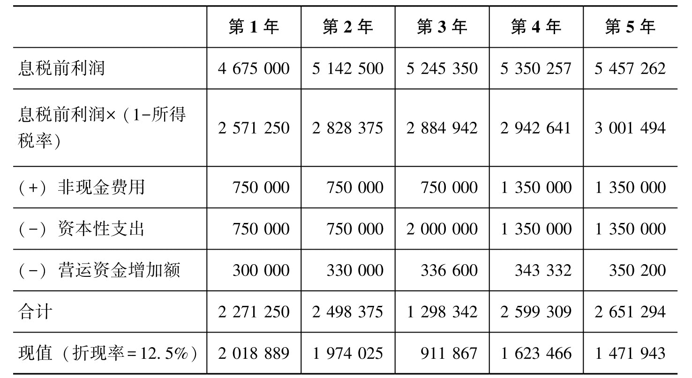

按前述资本成本折现，未来 5 年现金流现值为 8 000 190 美元。分析师认为 5 年后息税前利润将长期保持 2%年增速，第 6 年现金流即第 5 年现金流上调 2%至 2 704 320 美元。按

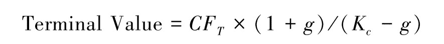

计算的期末终值为 26 370 998 美元，折现到当前为 13 008 030 美元。1-5 年现金流现值与期末终值现值合计 21 008 220 美元。扣除资产负债表上的长期借款 7 000 000 美元后，史密斯公司估值约 14 008 220 美元。这只是第一步，后续还需做敏感性测试，比如 12.5%折现率是否合理、行业能否长期维持 2%增速等，确定一个估值区间后再向管理层汇报并给出建议。

### 基于市盈率的乘数估值思路
另一种常见方法是市盈率法，核心公式为：

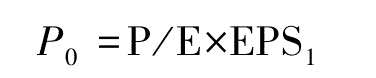

P0 为当前每股价格，EPS1 为预期第 1 年每股收益，P/E 为预期市盈率。市盈率通常参照可比公司的水平。可比公司需在成长性、风险特征、财务杠杆及股利政策等方面相似。判断准则：成长性越强市盈率越高；风险越高市盈率越低；杠杆越高在其他条件相同下市盈率越低；成长性强的行业市盈率普遍高于成熟行业。

在石油天然气行业，常改用每股股价与现金流比率；在新设企业或新兴市场，市销率估值法更常用。

### 拆分出售价值法
该方法先以账面价值评估企业资产，再加上不动产、品牌、版权等资产的价值，假设逐项拆开出售求和。拆分价值常高于整体出售，原因包括隐性资产存在、成本节约潜力、债务融资能力提升、税收影响或某些资产被低估。关键在于投资者愿意为企业各项资产分别支付的价钱。

### 并购交易视角的估值
折现现金流可用于任何企业估值。下文解释为何同一企业对卖方和买方的价值不同。模型可表述为：

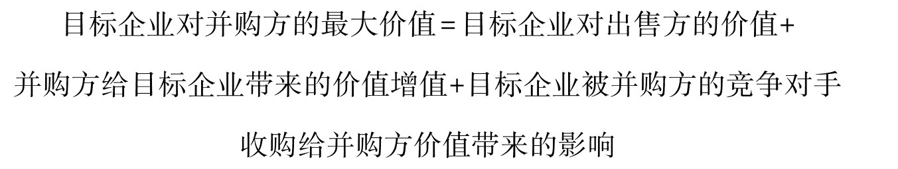

右端第一项“目标企业对出售方的价值”，即按现有经营方式的未来现金流现值减去维持所需资本性支出和营运资金，再加新业务现金流现值减其所需投入，最后加非使用资产变现价值。相当于用 DCF 计算的存续价值。

第二项“并购方带来的增值”，包括协同效应与成本节约的现值、新战略带来的新产品收益现值、因重叠而处置多余资产产生的税后收益，以及并购后财务改善的现值，如信用评级提升、融资渠道增加等。

第三项反映若目标被竞争对手收购，对并购方自身自由现金流的影响，需重新测算竞争环境变化下的现金流。

三项相加得到目标企业对并购方的最大价值。多数情况下该值高于对出售方的价值，这在理论上解释了并购溢价的出现。

### 注释
1\. Tim Koller, Marc Goedhart and David Wessels, Valuation: Measuring and managing the value of companies, ( London: Wiley, 1994).

2\. Thomas E. Copeland and J. Fred Weston, Financial theory and corporate policy, ( Boston: Addison Wesley,1988).

3\. Michael C. Jensen and Richard S. Ruback, “ The Market for Corporate Con-trol: The Scientific Evidence,” Journal of Financial Economics 11( 1983):5-50.

# 第 8 章 中海油收购尼克森：跨国交易下的利益博弈
本案例由 Klaus Meyer 教授和 Alexandra Han 撰写，仅作教学讨论之用，作者不暗示任何管理行为的优劣。对真实姓名等信息做了必要隐匿。

未经 CEIBS ( China Europe International Bus-iness School) 书面授权，禁止任何形式的复制、收藏或转载。本内容不属于任何版权组织授权范围。如需订购、复制或引用有关资料，请联系 Ivey Publishing, Richard Ivey School of Business Founda-tion, The University of Western Ontario, London, Ontario, Canada, N6G0N1; Phone: ( 519 ) 661-3208; E-mail: cases@ ivey. ca。

Copyright ©2017, CEIBS ( China Europe In-ternational Business School)

版本：2017-01-11

2013 年 2 月，中国海洋石油集团有限公司以 151 亿美元完成对加拿大石油勘探公司尼克森的收购，创下当时中国企业海外并购最大规模。对加拿大公众而言，这笔交易自始就充满争议，加、美当局在审批过程中对中海油层层审查。

交割后尼克森运营并不顺畅。运营成本超出预算，叠加油价大幅下跌，压力骤增。其勘探区多位于开采成本较高的地区，如加拿大阿萨巴斯卡油砂。2015 年 7 月，偏远地区一条管道泄漏 500 万升乳化油。2016 年 1 月，媒体风暴未平，尼克森一座石油裂解厂爆炸致一人死亡一人住院。管理团队回应媒体并表示需反思内部流程与战略。

## 中国能源扩张的驱动力
随着“走出去”战略推进，大型企业加速海外投资以获取资源、技术与市场。中国经济高速增长带来能源需求攀升。当时西得克萨斯中质原油均价约每桶 94 美元，布伦特原油约每桶 111 美元。中国此前主要依赖俄罗斯、中东、非洲进口，随着内需增长寻求新供应渠道。

中国能源企业在全球寻找资源时发现加拿大具备丰富资源、良好的能源安全保障与先进科技，是极具吸引力的合作伙伴。进入加拿大不仅能获得资源，还能吸纳本地专业人才。同时加拿大政治环境相对稳定，被视作安全投资地。

## 中海油集团概览
中海油成立于 1982 年，直属国务院国资委，主要从事油气勘探开发。1999 年在香港设立中国海洋石油有限公司作为国际控股平台。2001 年在港交所 00883 及纽交所 CEO 上市，IPO 融资 12.5 亿美元。截至 2015 年底，旗下 5 家子公司已上市。

中海油首次引发国际关注是 2005 年 186 亿美元竞购加州联合石油公司，后因美国政府反对撤回。首次重大美国收购为 2010 年斥资 10.8 亿美元取得德州鹰福特页岩项目 33%权益，与切萨皮克能源公司合作开发。

在浅水与深水勘探均有突破，2014 年储量替代率达 112%，净探明储量 44.8 亿桶油当量，日产量 118 万桶油当量。2015 年位列《财富》世界 500 强第 72 位，总资产 11 642 亿元。已成为中国主要油气生产商，并向炼油、化工、发电等领域多元化。

2011 年发布二次跨越发展战略，目标是通过液化天然气、煤层气增长，扩大油田服务、石油销售与贸易发展核心油气业务，并拓展炼化、化工、金融服务与新能源。愿景到 2030 年成为全球领先能源公司，计划十年内油气产量翻倍，2030 年产量较 2010 年提升两倍。同时强调企业社会责任，力争成为负责任的国有能源企业典范。

## 中海油如何觊觎尼克森
## 中海油发展历程
## 尼克森和长湖油砂

151亿美元买来的教训：中海油收购尼克森的十年沉浮

尼克森的根在加拿大西方石油公司 CanOxy，后者1971年在卡尔加里成立，专注油气勘探开发。80、90年代该公司先后并入墨西哥湾、也门和北海的项目。2000年公司更名为尼克森，同步启动了北海海上设施和阿尔伯塔省长湖油砂的两个旗舰投入。2000年初，尼克森在阿尔伯塔省名声最好，靠的是技术实力、环境责任感和对员工的重视。

进入21世纪油价走高，新技术让油砂成为备选能源，环保团体却对其土地污染提出批评。长湖项目坐落在麦克默里堡以南75公里，采用蒸汽辅助重力排水并以循环水为主，宣称减少了对环境和碳排放的冲击。2003年项目获批，2006年设施建成，2007年开始向井垫注汽，2008年启动蒸汽辅助重力泄油的沥青加工，2009年产出优质合成原油。同年尼克森从合作方奥玛特科技Orm at Tech ndogies手中增持15%，持股升至65%并取得运营权。

项目从上游就问题不断，产量远低于预期。2011年日产量仅3万桶油当量，预期是28万。矿床不均夹杂页岩让穿透困难，高含水饱和度导致开采难度大，施工延误推高建设支出。公司跳过现场试点直接上马商业化规模，靠近基地打井，结果井很快被水淹没且远离富集区，蒸汽用量超出设计。建设成本由最初26亿美元攀升至2007年超61亿美元。

高成本成为常态。2011年尼克森日产量约20万桶油当量，单桶当量成本20.84美元。中海油同期9.01美元，略低于中石油11.54美元和中石化15.43美元，埃克森美孚9.44美元，荷兰皇家壳牌10.78美元。

长湖拖累了奥玛特科技。到2011年奥玛特有28亿美元债务，手头现金不够支付当年利息，穆迪将其部分债务降至Caa3。危机下中海油收购奥玛特，从而拿到长湖的权益。

财务随之恶化。尼克森股价2009至2012年跌20%。2012年1月执掌13年的CEO马文·罗曼诺卸任，CFO凯文·莱因哈特暂任CEO。2012年净利润3.33亿美元，同比下降53%，收购传闻升温。

政治角力与审批风波

2012年7月，中海油宣布以151亿美元、每股27.5美元收购尼克森，溢价61%。尼克森带来先进技术和北海、墨西哥湾、西非、也门的海上海产和储量，有助于中国企业海外组合多元化。

交易须过加拿大关。《加拿大投资法》要求证明投资对加拿大经济有净收益，审查极为严格，2012年10月加拿大已否决马来西亚对国内能源公司的收购。尼克森在墨西哥湾的资产还须美国批准。

中海油聘请加拿大顾问提前沟通，向关键决策者释放信号，并主动承诺净收益。

时任保守党总理斯蒂芬·哈珀把外资视为国家优先，期望提振经济、减少对美国出口、增加对亚洲资源出口。阿尔伯塔省长艾丽森·雷德福称此为对省和国家的重要投资。长期以来美国是加拿大唯一大客户，但美国产量上升，加拿大缺乏开发资金，需海外资本。

商界普遍欢迎，政界争议激烈。新民主党担忧战略资产卖给外国政府控制企业。民调显示58%加拿大人认为应阻止收购。保守党议员收到选民反对来信，一位匿名议员表示纸面看是财富互换，但国有背景令人不安。

加拿大外资法专家保罗·布思认为方案符合法律标准，但更大议题是是否该允许外国国有企业入场、入场多少，这是规则层面的讨论。

亚太基金会执行长胡元豹表示应平等对待所有在加经营的外国公司，真正问题是加拿大能否有效阻止或执行补救，答案是肯定的。

中国方面称交易是检验加拿大对中国投资开放度的试金石，拒绝将损害中加关系。中海油承诺收购后董事会和管理层半数由加拿大人担任，维持就业至少五年，总部留在卡尔加里，在多伦多证券交易所上市，继续履行尼克森的社会责任和投资计划。

因公众争议，政府两次延长审查。2012年12月8日哈珀批准收购，同时宣布除特殊情况外禁止外国国有企业未来收购本土油砂企业，新政提高门槛。哈珀强调国有企业仍可参与少数股权和合资。

获加拿大批准后，美国外国投资委员会2013年2月放行，中海油同意放弃墨西哥湾资产的运营控制权以消解国家安全顾虑。

并表后的融合与磨合

交易完成后，中海油全球石油产量提升20%，储量提升30%，并拿到页岩气和深水技术。尼克森管理团队和员工基本保留，自2012年1月起CEO莱因哈特继续任职，李方荣出任非执行董事长。

初期战略是让尼克森独立运作。2013年2月李方荣表示什么都没变，尼克森证明过成功，无需改动管理方式，汇报线从董事会改向他本人，其他一切照旧。

但战略层面仍需在稳住队伍的同时改善财务。时任中海油总裁杨华宣布未来三到五个月整合两家公司的规划、财务、勘探与开发。

整合动作随之展开。2013年3月尼克森退市纽约，5月发行40亿美元公司债券偿还60亿美元短期过桥贷款，该债券是日本以外亚洲最大美元债，利率比2012年同期限低35个基点。2013年9月在多伦多上市。2014年净产量约4.32亿桶油当量，同比增5.1%，储量替代率达112%。

机制上成立独立海外健康、安全与环境管理办公室，引入全球危机管理系统，协调应急反应团队并开展联合演练。信息技术打通北京与卡尔加里网络，支持电话、视频会议、邮件列表集成和大文件安全传输。

社会责任延续，2013年向加拿大社区基建和洪灾救援捐赠310万美元，员工志愿服务1900小时。

蜜月期的裂痕

开局顺利后挑战显现。运营成本超预算尤其在长湖，油价暴跌削弱高成本项目经济性。油气销量增长15.4%，成本增速更快，净利润下降11.4%。到2014年底尼克森日均净产128万桶，增6.7%，占集团产量5.3%。营业费用增加约312亿元人民币，其中尼克森贡献19.8%。巨额投入未能扭转盈利，2015年运营亏损扩大至21亿元人民币。

表 1 中海油部分财务数据 2012—2015 年 单位：百万元人民币

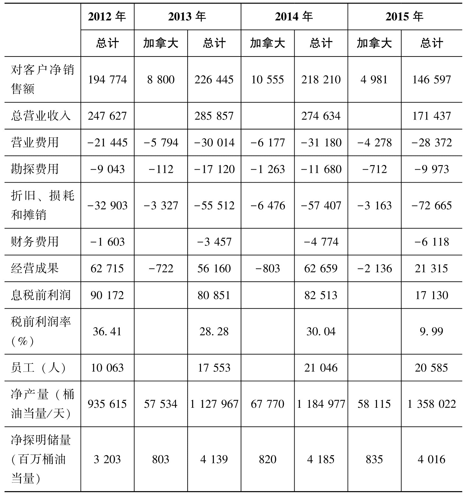

资料来源：中国海洋石油总公司，2012—2015 年年报。

油价从2014年初每桶110美元跌至年底60美元以下。2015年西得克萨斯中间基均价48.67美元，布伦特52.32美元。中海油综合净销售额下滑33%至1466亿元人民币，尼克森净销售额下滑53%至50亿元人民币。阿尔伯塔石油业出现大规模裁员，外国运营商撤出。

2012年高点以151亿美元买入，2015年资产估值缩水至少50亿美元。油价50美元时油砂经济性丧失。蒙特利尔银行分析师估计尼克森供应成本76.5美元/桶，长湖项目达188.5美元。

收缩与求变

油价暴跌和高成本迫使中海油重新梳理全球业务，总部审查各环节、削减资本支出，对尼克森施行更直接管控。业务发展部门集中北京以协调全球投资。

此举导致北京与加拿大管理层关系紧张，后者希望继续独立运营。2014年4月在中海油任职30年的执行副总裁方志接替莱因哈特，方志参与2012年谈判并任董事会成员。尼克森同时裁减财务副总裁四名，原承诺保留50%加拿大领导团队需重新评估。

2015年中海油强化成本控制，加快油气区域发展，推动前沿海上工程、钻井与生产技术投入。尼克森宣布北美裁员340人，英国裁员60人。加拿大政界要求核查承诺履约情况，尼克森回应完全遵守在加投资承诺。

表 2 中海油新闻稿 节选

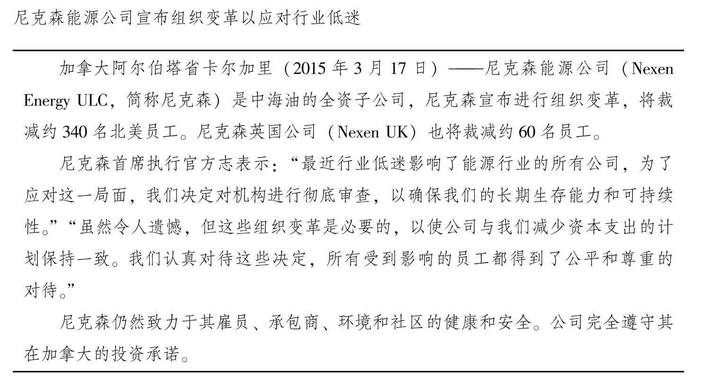

资料来源：《尼克森能源 ULC 宣布组织变革以应对行业低迷》，尼克森公司新闻通稿，2015 年 3 月 17 日

集团运营支出削减约9%，加拿大削减30%。单桶运营费降20.9%至9.55美元，勘探费降14.1%。2015年资本支出降30%至677亿元人民币。自2013年起尼克森员工从3000人减少约300人。

环保与安全危机

2015年7月15日长湖附近一条新管线泄漏约31.5万桶重质原油混沙水，位于麦克默里堡以南约40公里的林区。初步调查显示泄漏始于6月29日管道清理作业，7月15日承包商发现。尼克森立即启动应急计划清理，阿尔伯塔省能源监管机构全程协作。

7月17日尼克森邀请媒体现场查看，作业区设栅栏防野生动物、塑料鹰驱鸟，约130名工人作业。CEO方志现场道歉，强调透明公开，首要确保人员安全、减缓环境影响并查清原因。

高级副总裁罗恩·贝利称收购后对安全的关注加强。

同日省能源监管机构发布环境保护令，要求控制泄漏、检测碳氢化合物和氯化物、制定修复方案。官方称泄漏未对人类和野生动物构成直接威胁，未进入水体。

2015年春季新政府强调石油行业环境责任。8月31日加拿大能源署下令关闭95条管道，因维护监控不达标，长湖原油生产设施被迫停产。9月17日恢复全部生产，日产5万桶。

2016年1月15日长湖加氢裂化装置爆炸，一名工人死亡一名重伤。工厂停产调查，估算减产约5万桶/天。

公众质疑下的战略反思

自2012年竞购以来中海油在加拿大持续受关注，尼克森团队承受政界、非政府组织和媒体压力。连续危机后高层需重新评估在加业务及沟通策略。

外界也在审视中海油的国际增长逻辑是否需调整，如何改变运营流程以确保安全生产，是否应削减亏损减少在加尤其是油砂的敞口，或以不同方式盘活加拿大资产。

中海油151亿美元押注加拿大油砂：光环与阵痛并存

2012年夏天，中海油宣布以151亿美元收购加拿大尼克森，成为中国迄今最大规模的海外能源并购案。交易公布后尼克森股价大涨，市场把此事视为中海油对外扩张的关键一步，也被视为哈珀政府经济议程的风向标。

审批过程牵动多方。加拿大政府在2012年12月7日正式放行，同时批准了马来西亚国家石油收购Progress的交易。阿尔伯塔省省长雷德福称该决定是出于商业考量。美国方面直至2013年2月12日才完成最后审查，中海油随后同意放弃尼克森在美国墨西哥湾资产的运营控制权，以换取通过。股东层面，尼克森在2012年9月21日通过了该方案。

收购完成后的经营并不顺意。2012年底，中海油的信用评级跌至三年低点。2013年一季度财报显示，利润因资本开支增加和产出增速放缓而下滑。为筹措资金，公司在2013年5月发行了自2003年以来亚洲最大规模的美元债券40亿美元，并在同年9月获准在多伦多证券交易所挂牌。

尼克森本身背负历史包袱。早年与合资伙伴OPTI共同推进的长湖项目屡曝问题，被业内视为油砂投资的惨痛教训。收购后管理层也出现更迭，尼克森首席执行官凯文·莱因哈特于2014年4月被中海油高管方之江接替。

安全与资产减值成为持续隐忧。2015年7月，媒体报道尼克森在阿尔伯塔省的石油管道发生泄漏，公司公开致歉。2016年1月，中海油旗下的油砂厂发生爆炸，导致第二名工人死亡。受油价低迷和投入收缩影响，中海油在2015年初被曝正评估对尼克森计提约50亿美元的减值。

从政策博弈到项目执行，中海油的加拿大之旅始终伴随外部审查与内部挑战。交易在地缘政治层面获得突破，却在油砂开发的高成本和运营风险中付出代价。

54\. “Nexen 因监管失误关闭 Long Lake 项目,” The Globe and Mail, 2015 年 9 月 2 日, 访问于 2016 年 12 月 1 日, `www. theglobe-andmail. com/report-on-business/video/video-nexen-shuts-down-long-lake-project-over-regulatory-failure/article 26193058.`

55\. Dawson, 同上引.

56\. CBC News, “阿尔伯塔省发生巨大管道泄漏,” YouTube, 2015 年 7 月 17 日, 访问于 2016 年 12 月 1 日, `www. youtube. com/watch? v=LVSy8N5IEt4.`

57\. BNN Video, “阿尔伯塔能源监管机构：Nexen 泄漏清理工作进展顺利,” The Globe and Mail Video, 2015 年 7 月 17 日, 访问于 2016 年 12 月 1 日, `www. theglobeandmail. com/report-on-business/video/video-alberta-en-ergy-regulator-nexen-spill-clean-up-well-underway/article25553658.`

58\. CP Video, “Nexen 首席执行官就管道破裂可能造成的后果亲自道歉,” The Globe and Mail video, 2016 年 7 月 23 日, 访问于 2016 年 12 月 1 日, `www. theglobeandmail. com/report-on-busi-ness/video/video-nexen-ceo-calls-pipeline-failure-disappointing-on-visit-to-site/article25634592.`

59\. “Nexen 表示阿尔伯塔油泄漏可能始于 6 月 29 日,” CTV News, 2015 年 7 月 22 日, 访问于 2016 年 12 月 1 日, `www. ctvnews. ca/canada/nexen-says-alberta-oil-spill-began-as-early-as-june-29-1. 2481186.`

60\. “Nexen Long Lake 管道故障,” Alberta Energy Regulator, 访问于 2016 年 12 月 1 日, `www. aer. ca/compliance-and-enforcement/nexen-long-lake.`

61\. BNN Video, “Nexen、Syncrude 在油砂生产中遭遇生产挫折,” The Globe and Mail Video, 2015 年 8 月 31 日, 访问于 2016 年 12 月 1 日, `www. theglobeandmail. com/report-on-business/video/video-nexen-syncrude-hit-by-production-setbacks-in-the-oil-sands/article26161974`; The Canadian Press, “Nexen Energy 因管道停运令关闭 Long Lake 油砂,” Financial Post, 2015 年 9 月 2 日, 访问于 2016 年 12 月 1 日, `http: //business. financialpost. com/news/energy/nexen-energy-shuts-down-long-lake-oilsands-on-pipeline-suspension-order? __lsa=c009-7015.`

62\. Reuters, “Nexen Energy 的 Long Lake 油砂设施恢复全面生产,” Financial Post, 2015 年 9 月 17 日, 访问于 2016 年 12 月 1 日, `http: //business. financialpost. com/news/energy/nexen-energys-long-lake-oil-sands-facility-resumes-full-output? __lsa=c009-7015.`

63\. Carolyn King and Chester Dawson, “致命爆炸关闭 Nexen Energy 设施,” Wall Street Journal, 2016 年 1 月 15 日, 访问于 2016 年 12 月 1 日, `www. wsj. com/articles/fatal-explosion-shuts-nexen-energy-facility-145 2912676.`

64\. Dali Carmichael, “致命爆炸后 Nexen Long Lake 运营暂停,” Northern Journal, 2016 年 1 月 27 日, 访问于 2016 年 12 月 1 日, `https: //norj. ca/2016/01/operations-at-nexen-long-lake-suspended-following-fatal-explosion.`

65\. “我们与家属同在：中国能源公司 Nexen 在加拿大油砂现场爆炸后道歉,” South China Morning Post, 2016 年 1 月 17 日, 访问于 2016 年 12 月 1 日, `www. scmp. com/news/world/article/1901950/our-thoughts-are-families-chinese-energy-compa-ny-nexen-apologises-after.`

# 第 9 章 南非并购样本：艾尔建以情境领导稳住文化

本教学案例由 Caren Scheepers 与 Deepa Sita 联合撰写，仅用于课堂讨论，作者对各项管理做法的有效性不作评判。为保护隐私，文中涉及的真实姓名等信息已做必要处理。

## 版权声明

如无 Richard Ivey School of Business Foundation 书面同意，禁止以任何方式复制、保存或传播本材料。本内容未纳入任何版权组织的授权范围。 如需订购、复制或引用，请联络 Ivey Publishing, Ivey Business School, Western University London, Ontario, Canada, N6G0N1；电话：( 519 ) 661-3208；电子邮件：`cases@ ivey. ca`。

版权所有 ©2016, Richard Ivey School of Business Foundation

## 版本信息

版本：2016-11-29

## 行业背景

### 艾尔建有限公司

艾尔建有限公司创立于 1977 年 4 月 14 日，是一家横跨医药、生物制品、医疗器械与非处方品的综合性健康企业。业务覆盖眼科、康复、医学美容、皮肤科、乳腺美容、泌尿等专科市场。公司分为专科药品与医疗器械两大板块。最知名的产品是兼具治疗与美容属性的 Botox，其余眼科产品涵盖干眼、青光眼、炎症、感染、过敏与视网膜疾病；另有非处方护肤品与泌尿产品。器械板块提供隆胸修复整形用的乳房植入体、组织扩张器及面部美容耗材。

艾尔建在约 40 个国家及地区设立直营销售子公司，并通过 100 多个国家及地区的独立经销商铺设全球渠道。公司设有战略营销团队及区域销售市场体系，支持各地推广。Morné Steenkamp 自 2013 年起担任艾尔建南非总经理。

2015 年 3 月完成与阿特维斯集团合并后，艾尔建成为美国第三大仿制药企业。《财富》分析认为，艾尔建正是 2012 年以来五笔重量级交易塑造而成，成为近几年制药并购浪潮的代表。1 以 2015 年 3 月 16 日股价计，公司市值约 7 389 308 万美元，流通股本 307 605 860 股。纽交所代码 AGN，2015 年 1 月股价约 219.26 美元，2 月升至 232.74 美元。主要股东为爱尔兰艾尔建公司，截至 2013 年 12 月营收 130.62 亿美元，员工 21 600 人；另一大股东为美国阿特维斯集团，持股超 50%。2014 年 11 月阿特维斯首次宣布收购艾尔建，以阻止瓦伦特国际制药的敌意收购。2

近五年营收持续上行，由 2010 年约 49 亿美元增至 2014 年约 72 亿美元，增幅 47.1%。3 对比之下阿特维斯扩张更快，由 2010 年约 36 亿美元增至 2014 年约 131 亿美元，五年增幅超 264%。收入上 2012 年前艾尔建占优，2012 年后被阿特维斯反超。盈利走势则相反，2014 年艾尔建净利约 15 亿美元，阿特维斯在 2013 年亏损 75.04 亿美元后，2014 年亏损仍超 16 亿美元，亏损映射其扩张失序。

表 1 艾尔建资产负债表节选 单位：美元

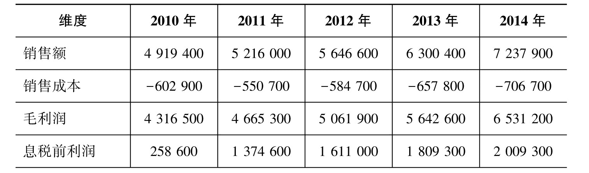

(单位：美元)(续表)

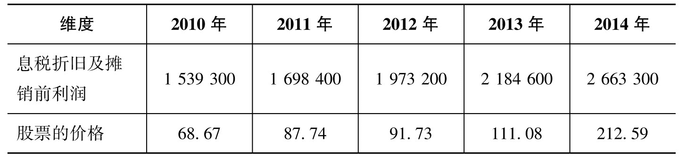

资料来源：Osiris company report of Allergan Inc. Reference number: 2270, June 25, 2015, 1-42。

表 2 阿特维斯、艾尔建、梯瓦三家公司收入利润表 单位：百万美元

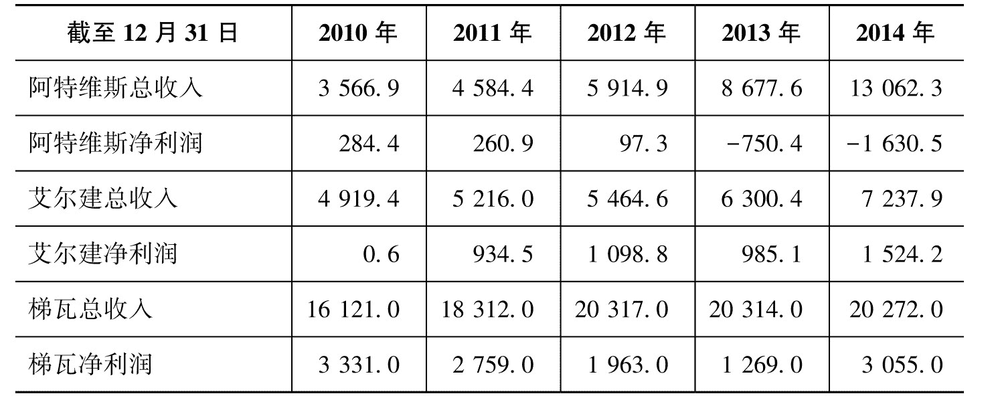

资料来源：“ Industry Trend Analysis: Allergan Acquisition Will Put Actavis Head-to-Head with Teva,” BMI Research, March 18, 2015。

BMI 于 2015 年 6 月指出，除多笔收购外，艾尔建还与 Kythera 生物制药签署最终协议，拟以每股 75 美元、总价约 21 亿美元的现金加股票方式收购后者，该公司专注美容医疗领域新型处方产品的研发与商业化。4 交易以满足惯例条件为前提，80% 现金、20% 新发艾尔建股票支付。

### 阿特维斯与合并

据汤森路透统计，截至 2015 年 7 月 23 日，全球医疗保健并购规模达 3 985 亿美元，同比增长 80%。艾尔建大股东之一阿特维斯是一家覆盖 60 多个国家及地区的综合专业药企，聚焦非处方药、仿制药与传统品牌药的研发、生产、营销与分销。剂型包括口服、经皮吸收、注射与黏膜，用于妊娠失败预防、疼痛管理、抑郁、高血压、烟瘾等。

阿特维斯前身为美国仿制药商沃森制药，业务遍及美洲、欧洲、亚洲。2012 年与瑞士阿特维斯集团合并，2013 年 1 月更名为阿特维斯股份有限公司，总部设爱尔兰都柏林。下图为阿特维斯 SWOT 概览。

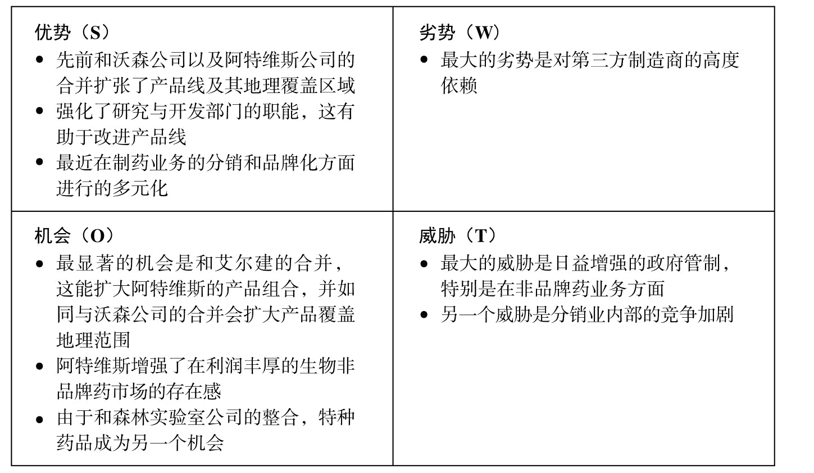

图 1 对阿特维斯的 SWOT 分析

S: Strength，优势；W: Weakness，劣势；O: Opportunity，机会；T: Threat，威胁。资料来源：作者根据相关资料整理。

2014 年 11 月阿特维斯签署最终协议，拟以每股 129.22 美元现金加 0.3683 股阿特维斯股票收购艾尔建每股普通股，总交易价值约 660 亿美元，对应每股 219 美元。2015 年 6 月 15 日开盘后，阿特维斯改用艾尔建名称，以 AGN 代码交易。Paul M. Bisaro 出任执行委员会执行主席，Brenton L. Saunders 担任首席执行官兼执行委员会主席。下图为收购概念框架。

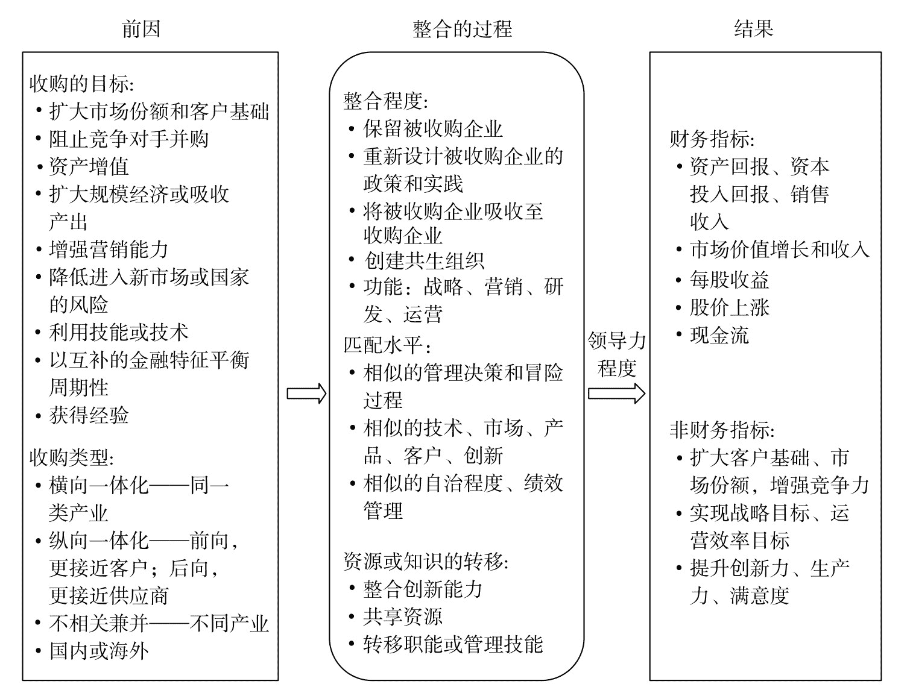

图 2 收购的概念框架

资料来源：Created by the authors based on Athina Vasilaki, “ Enhancing Post-Acquisition Organizational Performance: The Role of Ledership” ( doctoral dissertation, Mid-dlesex University London, 2009); Yaakov Weber, Shlomo Y. Tarba and Arie Reichel, “ A Model of the Influence of Culture on Integration Approaches and International Mergers and Ac-quisitions Performance,” International Studies of Management & Organization 41, no. 3 (2011): 9-24。

BMI 2015 年 3 月报告称，合并后阿特维斯品牌业务将成核心，但仿制药仍具分量。5 阿特维斯有望在 2015 年实现营收大幅增长，首次超过以色列竞争对手梯瓦，随后在商业模式相近的两家企业间展开主导权竞争。仅就仿制药而言，梯瓦 2015 年仍居首位，市场预期其或将领先地位让予阿特维斯，此前难以想象。其后梯瓦以 405 亿美元现金加股票收购艾尔建仿制药业务，巩固其全球仿制药龙头地位，也让艾尔建得以聚焦品牌药并偿还债务。这是该国历史上最大规模交易，梯瓦借此获得更强规模经济，在低利润率仿制药领域至关重要。

## 管理收购

### 建立一个“超级部落”

Steenkamp 回忆起艾尔建相对平稳的时期。2010 至 2013 年，他与人力资源总监 Maurentia Gertze 共同打造了“超级部落”Supertribe。灵感来自 Ray Immelman 著作，该词被用来描述工作文化，核心在于把以人为本、以客户为中心的价值观植入组织。6 两人全力推动该理念。

他们同时受 Stephen Covey《高效能人士的七个习惯》中“要事第一”思想影响。7 整个团队参与为期六个月的项目，推动个人目标达成、激发团队活力、提升执行效能。2014 年 10 月 16 日，艾尔建南非公司获评化学与制药行业“最适合工作企业”。

### 在经历多次被收购试探中寻求出路

2014 年，面对竞争对手 Valeant 的敌意收购意图，Steenkamp 任务艰巨。2014 年 4 月 22 日 Valeant 提出 460 亿美元报价，5 月 28 日上调至 530 亿美元。Steenkamp 记得沟通的混乱——媒体在公司对内对外发布前就提前曝光了 Valeant 的激进动作。谈判期间，他被要求在正式公告前对员工保密，不得透露任何信息，只能在纽约与伦敦总部之间充当缓冲，保持能量，在逆境中进行有效领导。

2015 年 6 月，艾尔建启动名为“Endurance”的提效项目，因成本削减导致岗位取消与裁员，Steenkamp 亲自处理协商与沟通，全程展现领导力。自 2015 年 3 月 16 日阿特维斯完成收购整合起，他的核心任务是调解员工冲突、促进两大组织融合。

过渡期他尚不确定能否保留最高职位，需与阿特维斯南非前首席执行官竞争。在伦敦会议上，艾尔建地区负责人阐述收购逻辑时，Steenkamp 坚定表达自身愿景，向员工推介合并后的方向。他很快意识到必须主动调整角色，尽快熟悉新环境下的产品、服务与制造体系。

Steenkamp 深入研究新环境，研读哈佛大学 George Mayo 与 Nitin Nohria 的著作并加以推广实践。8 对他而言，具备全球视野尤为重要，他是全球子公司与国际职能部门的联结点。他欣喜艾尔建保留原名，这有助于员工接纳并购。

借鉴 Robert Kutz 提出的领导者情境智力模型，Steenkamp 努力洞察两家组织的历史以提升判断力。9 他具有较强文化敏感度，致力于理解两家公司的文化差异，把领会阿特维斯组织文化作为己任，并主动主导两种文化的融合。他与执行团队一道，力求平稳整合职能、政策与实践。

斯廷坎普是一位以价值观为内核的管理者，他持续向团队释放信任信号，努力以信任、正直和真诚去践行真正的领导本色。公司正处于成本紧缩阶段，他收到了去瑞士滑雪度假的邀请。当时他因整合工作已十分疲惫，部分同事甚至正面临失业风险。经过权衡，他主动放弃了行程，以免让本就脆弱的信任感进一步受损。艾尔建南非内部的信任储备本就不足，他不想因个人选择火上浇油。更为棘手的是与国际母公司的对接，沟通时常拖沓，对整合的细化方案也缺乏明确指引。两家企业在产品线、客户结构与文化习惯上差异显著。

### 合并后的干预策略
他援引理查德·布兰森“文化的力量大于战略”的观点，认识到必须主动弥合双方的文化落差，并明确新主体将承继哪些核心价值。为此他签约了一名文化融合顾问，顾问通过访谈与工作坊的方式，从两边员工中提炼出可保留的精华。斯廷坎普与格尔茨共同策划了一系列定向沟通，比如在正式的公司聚会上分别面向两边员工发表讲话，并按节奏推送整合进程的即时通报。

在并购后的融合期，让员工与管理者共同参与、协同作业是成败的关键。搬入新办公楼并将信息技术、财务、人力、市场与销售等职能打包整合就是典型。斯廷坎普强调，执行团队必须保持高度透明，并为自身绩效与决策负责。他多次指出，人力资源部门在谈判、组织重塑以及部分人员调整上发挥了关键作用。南非《劳工关系法》第1995号法令对为促进经济发展、社会正义、劳工和平与工作场所民主而进行的裁员协商做出了具体程序要求。

### 合并冲击对人心的影响
他明白，收购必然带来扰动，会搅乱买方与卖方的日常秩序。相关调研提示，合并时员工常会遭遇三种不安：发生难以掌控的重大事件、未来充满不确定、以及工作关系乃至家庭关系可能改写。这些体验会拉低满意度、执行力与归属感。斯廷坎普自己也经历过阵痛，深知转型带来的巨大压力。他观察到，变化与不确定性对基层员工的冲击最为直接。他原本预判高不确定下流失会飙升，但艾尔建南非的实际离职率却低于预期。

他坚持，只有以意图为导向的整合管理，才能实现收购的长期价值。这要求沟通有效，并对双方个体的关切与预期保持敏感。为此他延长了工作时长，确保白天能与员工和客户面对面。他投入大量时间走访客户，解释收购的动因以及对客户业务可能产生的影响。

### 客户端的沟通布局
除内部沟通外，斯廷坎普还主动联结客户、客户论坛及其他相关组织。他与执行团队必须确保在媒体报道前将新进展告知相关方。他向对方描绘整合后的愿景、新产品与服务规划。除说明变化，也要点明什么保持不变，例如艾尔建南非长期坚守的客户至上价值。

管理层需要把收购目的讲清楚，通过明确预期目标来校准整合节奏，加快获取客户与客户群的反馈，迅速化解复杂问题，并主动管理外界对业务的认知。斯廷坎普借助多个沟通平台来推广并购后的新产品与服务。

### 再起波澜的新一轮收购
就在整合逐步顺畅、团队以为进入相对平稳期时，又一波收购浪潮袭来。他清楚这种情境下必须保持冷静，持续传递信任感。此刻展现情境领导力尤为关键，远见成为迫切需求。执行团队被迫主动管理另一次整合，对象是大型制药企业辉瑞。辉瑞提出以1600亿美元的价格并购艾尔建。这是医疗行业史上最大规模的交易，将诞生全球最大制药集团，并把辉瑞总部迁往爱尔兰。合并体将远超美国第二大药企默克，后者年销售额约400亿美元。

为规避潜在监管限制，该交易被设计为总部位于都柏林的艾尔建收购辉瑞。尽管合并后公司名称仍为辉瑞并由首席执行官伊恩·里德领导，艾尔建首席执行官桑德斯将担任高管并聚焦运营与整合。桑德斯因帮助先灵葆雅克服严重质量问题而知名，也曾主导先灵葆雅与默克的整合，在并购整合领域经验丰富。

桑德斯还将进入合并后公司的董事会。合并后集团年销售额可能达到640亿美元。辉瑞旗下拥有立普妥、万艾可以及治疗神经性疼痛的乐瑞卡等广受欢迎药物。该交易实现了里德通过反向并购摆脱美国35%企业所得税的愿望——美国是全球企业税率最高的国家之一，而爱尔兰税率为12.5%。

在艾尔建南非的走廊和客户论坛上，这些动向始终是热议话题。斯廷坎普担心会分散员工注意力，使其难以聚焦本业。他思考如何在保持发展势头与“超级部落”文化的同时维系市场正面形象，持续融入新的实体。他认识到，在这个极不稳定、并购频繁的制药行业，自己的情境领导能力将再次受到考验。他期待下周末的直升机飞行：开阔的天空让他能俯瞰全局、畅想未来、迎接挑战。

## 注释
1\. Stacy Jones, Kacy Burdette and JenWieczner, “ From Actavis to Allergan:One Pharma Company's Wild Dealmaking Journey,” Fortune, July 30, 2015, accessed November 8, 2015, http://fortune. com/2015/07/30/actavis-aller-gan-timeline/.

2\. Morné Steenkamp, ( presentation, Gordon Institute of Business Science, Uni-versity of Pretoria, South Africa, August 20, 2015); Allergan, “ Actavis to Acquire Allergan to Create Top 10 Global Growth Pharmaceutical Company with $23 Billion in Revenue,” press release, November 17, 2014, accessed November 8, 2016, www. allergan. com/news/news/thomson-reuters/acta-vis-to-acquire-allergan-to-create-top-10-globa; “ Industry Trend Analysis: Al-lergan Acquisition Will Put Actavis Head-to-Head with Teva,” BMI Re-search, March 18, 2015.

3\. “ Actavis to Acquire Allergan to Create Top 10 Global Growth Pharmaceutical Company with $23 Billion in Revenue,” op. cit.

4\. Allergan, “ Allergan to Acquire Kythera Biopharmaceuticals,” press release, June 17, 2015, accessed November 8, 2016, www. allergan. com/news/news/thomson-reuters/allergan-to-acquire-kythera-biopharmaceuticals.

5\. BMI Research, op. cit.

6\. Ray Immelman, Great Boss, Dead Boss: How to Exact the Very Best Perform-ance from Your Company and Not Get Crucified in the Process ( Gurnee: Stew-art Phillip International, 2003).

7\. Stephen R. Covey, The 7 Habits of Highly Effective People ( New York: Simon and Schuster, 1989).

8\. Anthony J. Mayo and NitinNohria, “ Zeitgeist Leadership,” Harvard Business Review 83, no. 10 ( Oct. 2005): 45-60.

9\. Matthew Kutz, “ Toward a Conceptual Model of Contextual Intelligence: A Transferable Leadership Construct,” Leadership Review 8 (2008): 18-31.

10\. Richard Branson, Screw It, Let's Do It: Lessons in Life and Business ( Lon-don: Virgin Books, 2009).

# 第10章 沃特斯啤酒重组谈判

本案例由 Klaus Meyer 教授撰写。本案例仅作为课堂讨论材料，作者无意暗示某种管理行为是否有效。作者对真实姓名等信息进行了必要的掩饰性处理。

未经 Richard Ivey School of Business Foundation 书面授权，禁止任何形式的复制、收藏或转载。本内容不属于任何版权组织授权范围。如需订购、复制或引用有关资料，请联系 Ivey Publishing, Richard Ivey School of Business Foundation, The University of Western Ontario, London, Ontario, Canada, N6A3K7; Phone: (519) 661-3208; Fax:(519) 661-3882; E-mail: cases@ ivey. uwo. ca。

Copyright ©2012, Richard Ivey School of Busi-ness Foundation

版本：2012-03-19

## 发展脉络
自2000年起，比利时跨国酿造集团英特布鲁在欧洲范围内快速扩张，在多个国家和地区站稳领先位置，尤其在东欧表现突出。2005年，公司在保加利亚、克罗地亚、匈牙利、塞尔维亚和乌克兰等市场占据主导，市场份额介于29%至46%。在德国，英特布鲁试图在欧洲最大却高度分散的啤酒市场中建立稳固阵地，该市场年销量超过1亿百升。集团已先后收购北方不来梅的贝克与巴伐利亚的教士。2003年，通过收购总部位于汉诺威的杰尔德，英特布鲁获得了重要契机，杰尔德持有在德国东部颇具民族特色的哈斯瑟罗德品牌。

2004年，英特布鲁与巴西安贝夫合并，组建英博集团，创下全球最大的酿造跨国公司。在德国，英博成为第二大品牌，运营八家工厂，市场份额为10.1%。在多起收购后，英博面临将各地业务整合成符合全球战略的德国业务的难题。部分本土品牌如杰尔德与沃特斯主要在本地具影响力，对全球战略意义有限。部分酿酒厂仍使用陈旧技术，运营效率低于有效规模，亟需关闭部分设施并将生产集中于少数现代化工厂。然而该计划遭到员工与当地社区的抵制。

## 行业大环境
啤酒作为传统商品，在中世纪的欧洲城市乃至修道院中已有悠久酿造历史，促成了地方企业与品牌的形成，以及消费者对本土啤酒的高度忠诚。20世纪八九十年代，全球化浪潮改变了酿造业，国内市场领军企业凭借先进管理与配方打入海外，随后展开国际并购。21世纪初期，喜力、英特布鲁、南非啤酒、嘉士伯与苏格兰纽卡斯尔等全球企业占据了欧洲市场的大部分份额。德国啤酒市场却长期分散，利润率偏低，外资难以取得有利地位（见表1与图1）。不过随着外资收购步伐加快，如英特布鲁收购贝克、嘉士伯收购好顺，集中度不断提升。

表 1 德国啤酒产业与国际市场的比较
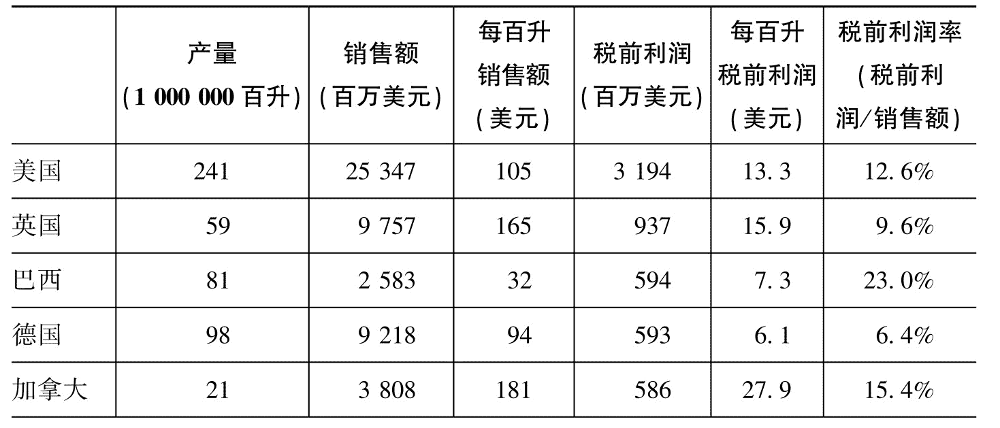
(续表)
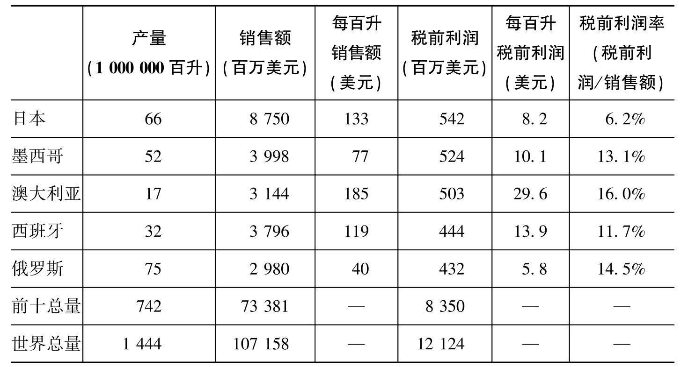
资料来源：Oliver J. Ebneth, “ Internationalisierung und Unternehmenserfolg Börsenno-tierter Braukonzerne,” doctoral dissertation, 2006, University of Göttingen, Department of Ag-ricultural Economics。
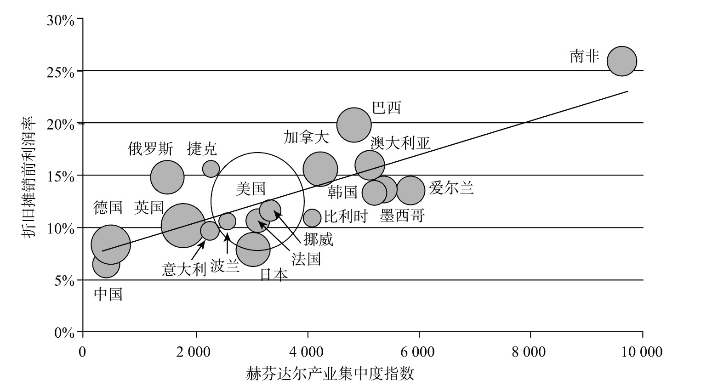
图 1 啤酒产业集中度的国际比较
资料来源：同表 1。

全球酿酒参与者在面临本土品牌忠诚的劣势时主要采取两种策略：一是收购生产本土知名品牌的酒厂以构建被认可的品牌组合；二是实施全球化运营与营销，提升品质、降低成本并利用规模经济。因此收购后通常保留主要本土品牌的生产，而运营变革则致力于简化组织层级，建立更大更现代且更具规模效益的生产设施，以取代分散的小型酒厂。

中欧与东欧成为志在全球的酿酒商的竞争场。20世纪90年代初经济转型期间，当地酒商逐步私有化，部分企业多次易主。于是进入21世纪后，四个国际酿酒商分别主导了四个转型经济体：南非啤酒（后为南非米勒）、荷兰喜力、丹麦嘉士伯与比利时英特布鲁（后为英博）。以波兰为例，1996年喜力与南非啤酒各自拥有10.4%与11.1%份额，确立领先地位。经积极收购与整合，到2000年双方份额分别升至31.4%与29.5%，以传统小型酒厂为代价继续扩大。2005年二者各控约三分之一市场，第三名嘉士伯份额约15%。尽管跨国垄断加剧，消费者几乎无感：最畅销品牌为南非啤酒拥有的Tyskie，份额19%，及喜力拥有的Zywiec，份额13%。

相比之下，德国市场因消费者对本土品牌如科隆巴赫、费尔廷斯与沃斯汀那的依赖而高度分散。即便人均啤酒消费从1999年的130升降至2005年的115升，德国人均饮用量仍居世界前列，仅次于捷克。德国仍是全球最大啤酒市场之一（1997—2003年德国啤酒消费与国际比较见图2），吸引嘉士伯与英特布鲁等跨国公司前来收购本土品牌后植入全球最佳实践，正如在波兰的做法（见图3）。

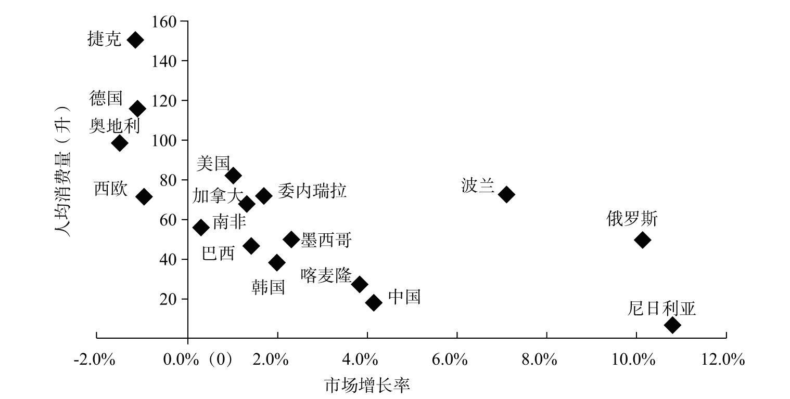
图 2 德国啤酒消费量与国际市场比较 (1997—2003)
资料来源：同表 1。
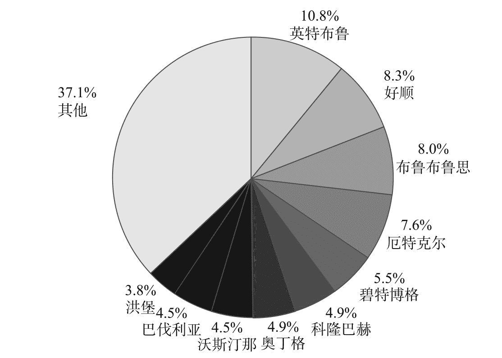
图 3 德国啤酒产业市场份额，2003 年
资料来源：作者根据相关资料整理。

即便集中度提高，德国酿造业的利润率仍远低于其他国家与地区。2 同时微型啤酒厂日益增多，它们为小社区提供贴合口味的产品，或为特色餐饮提供现场鲜酿服务（见表2）。德国东西部的定价结构存在差异，西部高价啤酒份额明显高于东部（见图4）。宾馆与餐馆渠道在销售中占比很大，尤其在东部，这对小型与本土酒厂至关重要。啤酒制造商面临两大主要风险：需求下滑与产能过剩。

表 2 德国不同规模啤酒商数量
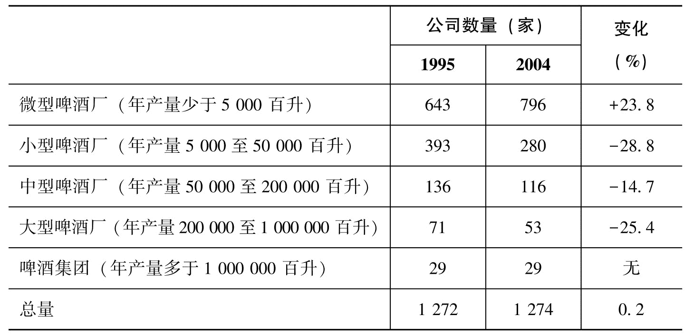
资料来源：Matthias Heyder and Ludwig Theuvsen, “ Strategic Management in the German Brewing Industry: Are There Still Differences between East and West?” Journal of East European Management Studies, 16 (1), 2008, pp. 10-39。
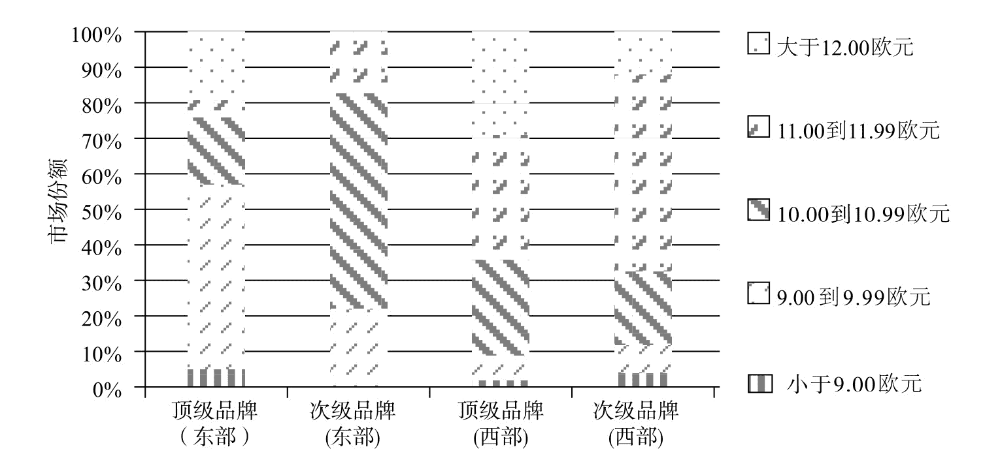
图 4 2004 年德国啤酒定价结构
注：每板条箱啤酒的价格 (24×0. 33 升装)，依据 2005 年对啤酒厂的一份调查。资料来源：同表 2。
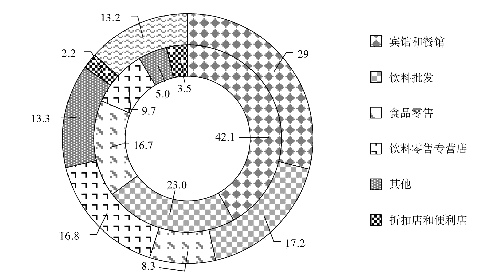
图 5 德国啤酒分销渠道份额比 (%)
注：外圈：德国西部；内圈：德国东部。
资料来源：同表 2。

## 沃特斯啤酒的历史

从皇家御供到被关停：不伦瑞克沃特斯啤酒的百年兴衰

沃特斯啤酒几乎就是不伦瑞克酿造记忆的代名词，往上可以追溯到1627年。早在中世纪，这座城市就已是德北的制造与贸易重镇，19世纪工业化浪潮里，这里汇聚了机械制造、制罐、相机等技术产业，当地高校也成长为德国理工科研的重要基地。二战后，因坐落在东西德难以逾越的边界附近，经济被重创，东侧城市的商业纽带全部断裂。转机来自沃尔夫斯堡的大众汽车，带动供应商与分支机构扎根此地。1989年柏林墙倒塌，凭借中北部区位，不伦瑞克迎来新的发展窗口。

19世纪70年代沃特斯向外扩张，新办公楼和酿酒设施建在了当时的郊区，这一地块直到21世纪仍是集团大本营。1882年它获封“皇家啤酒馆”“公爵御用饮食供应商”的头衔，即便1918年公爵政权终结，称号也沿用至今。1947年公司改制为上市公司，掌控了以不伦瑞克为中心、半径约50公里、人口约150万的区域市场。通过盛大活动和体育赞助，沃特斯深深嵌入城市生活：在当地几乎所有餐厅、酒吧和足球俱乐部里，它都是首选。德国的俱乐部在社会生活中的分量远超他国，每个周末数百万人活跃在业余联赛中。

1986年，杰尔德入主沃特斯，取得控制权，但品牌并未失去独特性。1990年德国统一被视作增长机会，杰尔德收购了韦尔尼格罗德的哈斯瑟罗德，在当地新建现代化啤酒厂，重金打造品牌，先在东部崭露头角，后跃居全国。尽管转型由管理团队主导，幕后东家的杰尔德始终保持低调，这让哈斯瑟罗德成为少数成功的标杆，也抬高了整体形象。

90年代末起，杰尔德调整定位：哈斯瑟罗德走全国化路线，杰尔德与沃特斯则收缩为更窄地域的本土牌。结果沃特斯产量从2001年的约40万百升跌至2005年的14万百升。集团对不伦瑞克与汉诺威的历史竞争十分敏感，仍保留两大品牌的地域色彩。此时不伦瑞克厂区还在代工集团其他品牌，只是产能利用不足。

哈斯瑟罗德的崛起令杰尔德成为跨国啤酒商眼中的猎物，喜力、南非米勒、英特布鲁都曾表态兴趣，最终由英特布鲁在2003年完成收购。收购后，英特布鲁计划把哈斯瑟罗德与手中已有品牌整合进德国组合，并复制自身运营最佳实践来提升盈利。3

## 英特布鲁/英博在德国

英特布鲁1987年由比利时当时最大的两家酿酒厂合并而成，直至2000年前保持私有，首次公开募股后才开启更激进的国际化。进入德国市场始于2000年收购迪贝尔斯，之后相继拿下贝克、杰尔德和斯贝特。

2004年英特布鲁与安贝夫合并，诞生英博，当时全球规模最大，2005年啤酒总产量达2.356亿百升。依据2005年年报，合并后全球市占14%，随后为南非米勒12.2%、安海斯-布希11%、喜力8.1%、嘉士伯4.4%。与喜力一样，英博已近乎全球化。合并后重点放在欧洲业务的技术共享以优化工厂绩效，同时搭建国内与国际品牌矩阵，目标到2007年息税折旧摊销前利润率达30%。

表 3 英特布鲁/英博公司财务数据 (2001—2005) 单位：百万欧元

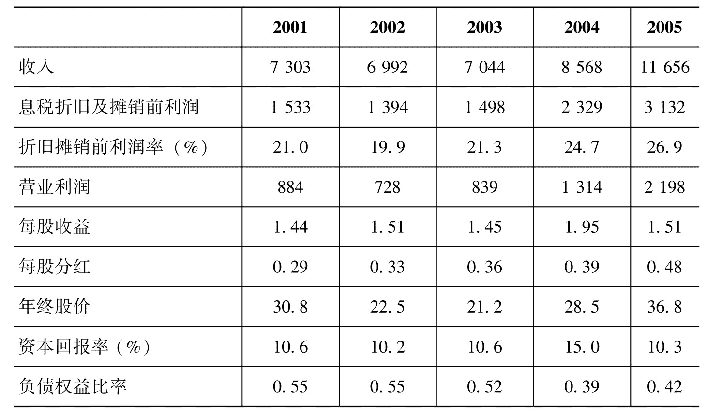

资料来源：Interbrew, 2006, Annual Report 2005。

表 4 2005 年英博欧洲市场数据

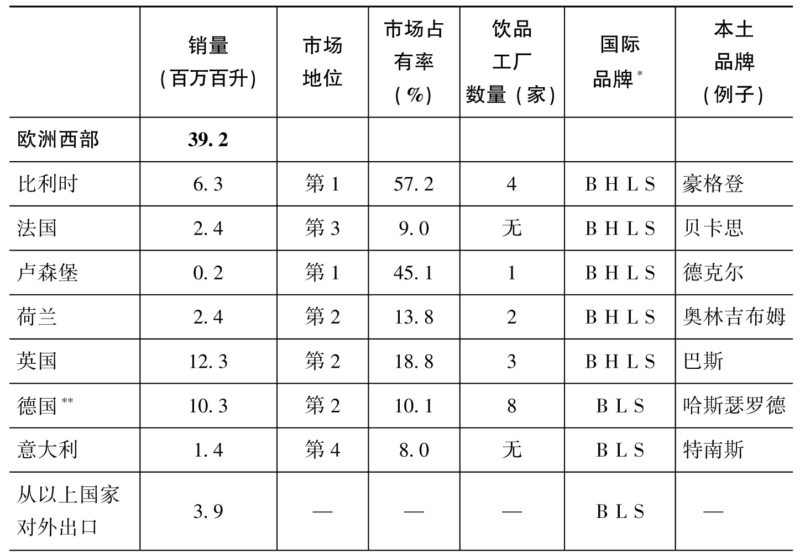

(续表)

资料来源：同表 3。

注：∗B=贝克，H=百瑞马，L=莱福啤酒，S=时代啤酒；∗∗除此之外，英博公司在德国和乌克兰也销售无酒精饮料。

图 6 英博与欧洲前四大啤酒厂的业绩比较 (2000—2004 年)

资料来源：同表 1。

在德国，英博仅次于厄特克尔集团位居第二，厄特克尔旗下有瑞德伯格、积发等品牌。凭借贝克、时代和莱福等全球牌，以及迪尔贝斯、哈斯瑟罗德、教士、杰尔德、沃特斯等本土牌，英博占据10.1%的市场份额。

策略上优先推头部品牌，尤其是贝克及其衍生品贝克黄金、贝克柠檬。德国啤酒整体疲软，但贝克在欧洲被塑造为德国传统高端形象，2005年销量实际增长18%。教士是德国领先的小麦啤，2005年销量110万百升；哈斯瑟罗德为东部头牌。相比之下，不伦瑞克地区年啤酒销量约40万百升，沃特斯占14万百升。

行业正向质量管控和成本效率进化，规模经济越来越关键，小型设施难以匹敌新大厂的效率。英博2005年推行零基预算、采购整合和精益组织。德国层面则重塑组织架构、整合被收购公司管理层，精简决策、统一流程与营销、削减开支，杰尔德等被并购方的中高层多人被裁。

## 麻烦不断的沃特斯啤酒

聚焦少数民族品牌的做法让杰尔德与沃特斯失去了立足点。早在2005年英博收购林德公司时，已有人预判沃特斯与杰尔德终将退出。4

德国市场高度分散，外地奏效的打法在德国并不灵光。英博在德表现不及预期，2005年高层决定重组。首步是2006年6月关闭沃特斯酿酒厂，品牌名保留但搬至汉诺威杰尔德工厂生产，以提升后者产能利用率。5 厂区坐落在不伦瑞克市中心、火车站旁，含三座法定保护建筑和部分新设施，英博欲改建为住宅区，预计收益超过账面价值240万欧元，仍需基建投入、土壤清理及市政府批准。

因德国法律要求提前告知裁员，宣布选在圣诞联欢会进行，不伦瑞克员工当场得知半年后失业。

当地媒体反应激烈，企业关闭与失业引发强烈情绪，报纸和政客纷纷介入。品牌迁往汉诺威酿造加剧了两城历史竞争的伤痛，协会与体育俱乐部对赞助商前景担忧。6

直选市长等政客公开承诺力保这家历史地标，但欧盟禁止补贴、城市财政吃紧，实质支持难以落地。

专家认为按杰尔德收购前思路发展本土品牌仍有空间，外来品牌的电视广告冲击了地方品牌的消费者粘性。7 战略已定，圣诞期间各方只能探讨下一步，可能由更重本土的德国酒厂接手，或由英博现任/前任中层发起管理层收购。与此同时，英博需推进重组以尽可能降低声誉损失。

## 注释

1\. Klaus E. Meyer and Yen Thi Thu Tran, “ Market Penetration and Acquisition Strategies for Emerging Economies,” Long Range Planning, vol. 39, no. 2 (2006): 177-197.

2\. “ Small Beer: Foreign Brewers Are Finally Entering Europe's Largest Beer Market,” Economist, July 26, 2001.

3\. “ Will the Majority Vote forGilde Sale?”, Braunschweiger Zeitung, November 15, 2002.

4\. JochenZeininger, “ Wolters vor Ungewisser Zukunft,” Braunschweiger Zei-tung, November 5, 2002;

5\. Klaus Sievers, “ Wolters Is Not Economical”, Braunschweiger Zeitung, De-cember 3, 2005.

6\. JacquelineCarewicz, “Wolters: Clubs Worry About Money”, Braunschweiger Zeitung, December 6, 2005.

7\. Ernst-JohannZauner, “ Braunschweiger Investor for Wolters”, Braunschweiger Zeitung, January 17, 2006; Carolla Böse-Fischer, “ Beer Needs a Home”, Hannoversche Allgemeine, January 15, 2010.

