# 重新理解 AI 经济学：从“点方案”到“系统革命”

献给我们的家人、同事、学生与创业伙伴：是你们让我们对人工智能有了更透彻、更清醒的认知。致谢！

## 前言：我们为何曾看错未来？

回溯 2018 年，《AI 极简经济学》出版时，我们自信满满地以为：AI 经济学的底牌已被我们摸透。现实却给了我们一记响亮的耳光——**我们只讲到了故事的前半段。**

经济学原理恒久不变，技术却日新月异。上一本书构建的框架依然有效，但它仅覆盖了“点解决方案”。这几年，我们发现故事的另一半——**“系统解决方案”**，才是撬动产业变革的真正杠杆。为何起初会漏掉这关键一环？得从 2017 年说起，那时我们正忙着写前作。

那一年，AI 热潮席卷全球。深度学习在图像识别上的突破才过去五年，满世界都在押注：加拿大会诞生下一个科技巨头吗？我们创办的“创新颠覆实验室”（CDL）聚焦 AI 孵化，业界公认的赢家画像是：蒙特利尔、多伦多、埃德蒙顿——因为那里坐镇着图灵奖得主，有政府巨额补贴的“超级集群”，有全球科技巨头排队设立的实验室。

我们自认为是懂 AI 商业化的“顶级专家”：出畅销书、发顶刊、办全球最大 AI 孵化项目、给巨头高管和政府决策者做咨询。我们提出的核心洞见——**“AI 的本质是降低预测成本”**——在谷歌、Netflix、亚马逊、Meta、微软内部引发强烈共鸣。Spotflix 高管古斯塔夫·索德斯特伦甚至公开背书：正是预测精度跨越临界点，让他们从“卖工具助你建歌单”进化为“直接帮你生成每周推荐”，实现了从“先买后发”到“先发后买”的商业模式范式跃迁。

按这逻辑，首个加拿大 AI 独角兽必诞生于那三大技术重镇。结果？**我们错得离谱。**

2020 年 11 月，《华尔街日报》头条揭晓答案：纳斯达克 27.5 亿美元收购 Verafin。总部在哪？纽芬兰省圣约翰斯——北美东北角、人口仅 50 万、连美剧《来自远方》才让美国人知道有这地儿的“世界尽头”。

为何专家集体失明？复盘发现：Verafin 赢在**“系统视角”而非“模型参数”**。他们不卷最尖端算法，而深耕金融反欺诈、合规核查这种**早已高度依赖预测分析、数据积累最深厚、且雇佣了大量数据科学家的成熟场景**。他们把 AI 嵌入现有工作流，而非试图替代人类判断。

这让我们醒悉：**只盯着“预测成本下降”这技术内核，忽略了“重构系统”这部署经济学，是致命盲区。**

如果早懂此理，我们不会去数顶级实验室发了多少 Paper，而会去找：哪些行业早把预测嵌入骨血？哪些公司早养好了数据科学家团队？哪些初创团队在用新技术解决这些存量难题？答案指向显而易见——银行业、Verafin。

由此，我们意识到人类正处于一个独特的历史断层期——**“中间时代”**：
技术威力已显现，但规模化采用尚未到来。
- **点方案**：像 Verafin 这样，直接替换旧预测工具，即插即用，见效快；
- **系统方案**：需重塑产品、组织、流程，甚至商业模式，才能释放 AI 真正价值，周期长、阻力大。

连“AI 教父”杰弗里·辛顿都栽过跟头：他预言 5 年内深度学习超越放射科医生，技术确实做到了，但 5 年后放射科住院医师招生非降反增。因为**诊断只是系统一环，信任、责任、流程协同才是拦路虎**。

这本书，正是我们跳出“模型崇拜”，转向**人类决策认知、组织行为博弈、生产系统耦合、行业结构重塑**后的新总结。基于数百家 AI 初创项目的实战复盘，结合蓬勃发展的 AI 经济学实证研究，我们构建了区分“点/系统方案”的新框架——它能解释 Verafin 为何胜出，也能预判下一波 AI 红利将如何重塑行业版图。

---

## 第一部：穿越“中间时代”

## 第一章：三个企业家的电力启示录

电力重塑人类文明，背后的核心变量只有一个——**时间**。

1879 年爱迪生点亮灯泡，20 年后美国仅 3% 家庭用电，工厂同理；再过 20 年，普及率破 50%。这漫长的 40 年“空窗期”，正是电力的“中间时代”。**灯亮了不等于世界变了。** 当下的 AI 处境如出一辙：技术光环耀眼，实质性生产力跃升却迟迟未至。

想看清 AI 商业化迷雾，请穿越回 1880 年代，化身电力创业者：面对这注定改变未来的能源，你如何抓住机遇？

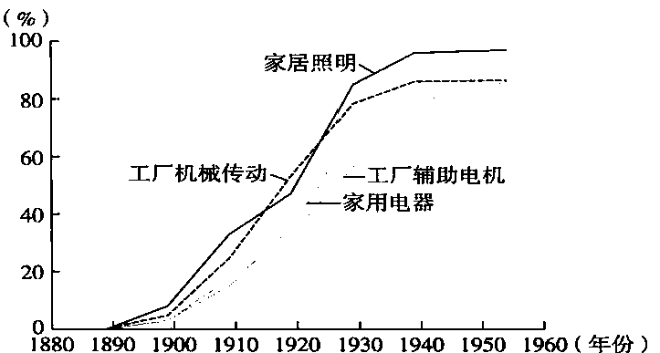

### 图 1-1 美国电力普及曲线
*数据来源：保罗·A·大卫《电脑和发电机》（1989）*

---

### 第一型选手：卖“替代品”的点方案创业者

19 世纪下半叶，蒸汽机是帝王。烧煤热水，带动轴杆、皮带、滑轮，驱动全厂机器。要推销电力，第一步必须让客户痛恨蒸汽：
- **能耗极低效**：30%-85% 能量在冷凝、泄漏、摩擦中白白流失；
- **布局极刚性**：一根 3 英寸粗的主轴贯穿全厂，多层叠加，牵一发动全身；
- **环境极恶劣**：热、脏、噪音大，转速还不稳。

**点方案逻辑极其简单：拔掉蒸汽机，在主轴末端装个电动机。**
爱迪生旧部弗兰克·斯普雷格 1886 年造出早期电动机，首批客户很明确：
1. **大型蒸汽厂**：如南卡罗来纳纺织厂，水力发电+1 英里电缆，电价全美最低；
2. **服装/纺织厂**：电力清洁、转速稳，精准击中痛点。

卖点直白：**“更便宜、即插即用、解决特定痛点”。** 但卖久了发现：省下的电费有限，且客户没理由用*更多*电。生意做到天花板，卡死在“只换能源、不变系统”上。

---

### 第二型选手：卖“新机器”的应用方案创业者

蒸汽机一启动就不停，电动机却能**随时启停、按需分配**。
经济史学家内森·罗森伯格称这开启了**“电力分散化时代”**：能以极小、极廉价单位供能，无需为间歇性需求维持巨大基载。

洞察到这点的工程师，开始给**每台机器**配专属电动机。
- 机器不再被栓在中央主轴上，变得可移动、可灵活布局；
- “机器跟着走”，而非“人跟着机器转”。

这就是**应用方案**：**不只是换动力，要换整台设备。**
代价是惨痛的：每台机床（钻床、剪板机、冲床）都得为独立电机**彻底重新设计**；电机多为非标定制；重新设计一台工具，往往降低了它复用动力的价值。要平衡取舍，得重构整套工具体系——**机会巨大，落地极难，周期极长。**

---

### 第三型选手：卖“新工厂”的系统方案创业者

蒸汽时代，工厂**为动力源而生**：多层、狭长、纵向堆叠，只为让机器离主轴近一点。靠近主轴的空间溢价高，物料被迫按动力需求上下搬运，人沦为机械齿轮。

电力**拉平了空间的经济价值**。
没有中央主轴束缚，工厂可以平铺展开，按**生产流程逻辑**而非**动力传递逻辑**布局。物料在流水线上单向流动，距离最短、衔接最顺。

亨利·福特没能用蒸汽造出 T 型车流水线，等电力成熟几十年后，他才以**系统方案创业者**身份兑现承诺。直到这种系统级重组完成，电气化才真正在生产率统计数据里“显影”。

---

### 给 AI 创业者的三重启示

穿越百年电力史，映照当下 AI 创业的三重境界：

1.  **认清技术本质，别卖错价值主张**
    1890 年卖电力，喊“比烧煤省钱”不算错，但格局太小；1920 年再喊这句，就out了。电力的核心价值从来不是“廉价蒸汽”，而是**“解耦能源与用能端，重塑空间与流程自由度”**。
    **AI 同理：** 早期红利在 Verafin 这类**点方案**——用更强、更快、更廉价的预测替代旧模型；但终局价值在于**系统方案**——当预测成本趋近于零，我们如何重新设计决策架构、组织边界、商业模式？

2.  **点方案是“切入口”，系统方案是“护城河”**
    点方案即插即用，变现快，但易被复制，天花板低；系统方案重构工作流、数据飞轮、激励机制，门槛高、周期长，一旦跑通便形成**结构性护城河**。

3.  **“中间时代”不缺技术，缺“系统想象力”**
    正如 1900 年的工厂主看不见流水线，今天的决策者往往只盯着模型榜单。真正的赢家，不是训练出最强模型的人，而是**看清「预测极廉」后，敢于重写行业操作系统的人**。

**下一波 AI 独角兽，不会诞生在算力最强的实验室，而会长在最懂「系统重构」的存量场景里。**

## 第二章：人工智能的系统未来

### 重塑产品与组织的底层逻辑

还有一类应用方案，要求我们围绕 AI 彻底重构设备或产品。凡是由 AI 驱动的机器人、终端侧的 AI 增强软件，皆属此列。拿智能手机来说，人脸识别功能的实现，离不开专用摄像头模组与隔离敏感数据的专用硬件。但这波创新浪潮中，资金投入规模最大、拉动效应最强的，莫过于自动驾驶汽车的研发量产。车身外观或许变化不大，但底层架构必须推倒重来：传感器布局、车载算力平台、执行机构无一不需重新设计，只为在复杂真实路况下保障系统稳健运行。

大量高价值的 AI 系统级方案仍处于“未被发掘”状态。接下来的篇幅，我们将深度剖析这些机会的可行路径与现实阻碍。

理解这一点后，必须直面一个简单却棘手的问题：基于我们当下对 AI 的认知，若推倒重来，产品、服务乃至工厂该如何设计？历史告诉我们，扁平化工厂架构最初并非诞生于传统巨头，而是烟草、金属加工、运输装备、电气机械等 20 世纪新兴行业的杰作。如今，这一幕在搜索、电商、流媒体、社交网络等数字化新赛道重演——它们率先拥抱了“AI 原生”的系统设计。

围绕 AI，我们始终要追问两个核心命题：（1）AI 究竟赋予了我们什么？（2）若从零开始构建业务，流程与商业模式该如何重塑？电力的价值若止步于“降低燃料成本”，便不会催生“极大提升生产力的工厂设计”；同理，AI 若仅被视为“降低预测成本”的工具，便无法释放“极大提升生产力的产品、服务与组织设计”红利。电力的核心贡献在于将**能源消耗与能源来源“解耦”**，倒逼工厂布局创新；AI 的核心贡献在于将**预测与决策其他环节“解耦”**，通过重构决策关联关系，驱动组织架构创新。

我们认为，AI 通过将预测从人类转移至机器、实现预测与决策其他要素的“解耦”，达成了系统级创新。决策是系统的关键构件，而 AI 强化的正是决策能力。

第三，不同层级的方案，赋予企业家截然不同的获取市场权力的路径。

企业家盈利的前提是“创造价值”与“获取价值”同步达成。点解决方案的痛点在于初期创造的价值有限。电力早期替代蒸汽，却面临成熟蒸汽基建的转换成本，终端用户感知到的仅是电费下降。换言之，点方案创业者顶多分享“最优替代方案”的红利——Verafin 即是典型——这已是该层级的天花板。

随着方案演进至应用层、系统层，创造价值的说服力指数级跃升。新硬件可凭差异化脱颖而出，并受专利保护；但系统级方案的潜力更胜一筹。电力时代，工厂主自主设计新型厂房，深谙业务诀窍，从而锁定份额、筑起护城河。尽管厂房布局公开可见，但背后的工艺流程、隐性能力、人才培养体系却难以复制。更关键的是，系统方案具备规模化复制能力。

### AI 颠覆与权力的转移

电力系统耗时数十年才完成所谓的“颠覆”。前 20 年，它仅作为少数工厂的点方案或照明手段存在。一旦新系统成型，经济版图随之重塑，权力向掌握发电、电网及大规模用电技术的人群倾斜。此后，没人想再做皮带滑轮生意，也无人青睐市中心工厂地产。

AI 正走着极其相似的曲线。经济权力的实质性转移，本质是稀缺资源控制权在不同群体间的易手，而接盘群体往往具备抵御竞争冲击的能力。确定的是，AI 存在这一机会；但真正能重塑行业格局、引发权力洗牌的颠覆性机会，唯有源自**新系统**。新系统开发难度大、复杂度高、模仿壁垒厚，这恰恰为突围者创造了护城河。

当然，不确定性依然笼罩全局。究竟谁能在新技术浪潮中积累权力，仍是悬而未决的谜题，答案取决于新系统的最终形态。我们的使命，是为你绘制导航图，预判在 AI 系统演进与落地过程中，谁将掌权、谁将出局。

### 本章核心回顾

- **百年寓言的现实投射**：三位企业家的故事发生在百年前能源变革期，生动演绎了同一技术红利下的三种价值主张：点方案（降低动力成本与传动损耗，不改系统设计）；应用方案（单机电驱实现模块化，故障隔离，不改系统设计）；系统方案（重构工厂——轻量化、单层化、流程与物流最优化）。
- **价值密度的阶梯差异**：电力早期的点/应用方案，前提皆为“不变系统设计下的直接替代”，价值有限，这也解释了行业采纳初期的迟滞。直到企业家发现系统方案——利用电力实现“机器与电源解耦”（蒸汽时代不可想象或成本高不可攀），价值才实现质变，远超点方案。
- **历史的押韵**：正如电力通过“机器-电源解耦”将价值主张从“省燃料”升维为“重塑工厂设计”，AI 正通过“预测-决策解耦”，将价值主张从“降预测成本”升维为“重塑产品、服务与组织设计”。

---

### 2017 年的那场聚会：觉醒的时刻

2017 年，各类 AI 峰会如雨后春笋，商政学三界齐聚，学术界热情高涨。我们敏锐察觉到 AI 改写经济的潜力，渴望引入顶尖经济学家共同研判。于是，多伦多会议应运而生，为经济学界设定了 AI 研究议程。

参会热度远超预期。日后因经济学与计算机科学交叉创新获诺奖的保罗·米尔格罗姆回忆：1990 年曾收到研究“互联网经济学”的邀请，因忙于委托代理理论等课题而婉拒，追悔莫及。“这次我找不到任何借口拒绝，我一定到场。”

与会者观点分化显著。乐观派中，诺奖得主丹尼尔·卡尼曼断言：“人类能做的事，计算机终将通过编程实现。”曾任奥巴马经济顾问的贝齐·史蒂文森总结道：“经济学家普遍认为 AI 代表可观经济收益的机遇。”

怀疑派同样重量级。诺奖得主约瑟夫·斯蒂格利茨担忧 AI 加剧不平等；泰勒·考恩指出 AI 生产力释放或导致资源稀缺；曼努埃尔·特拉伊滕贝格直击痛点：若变革发生，长期红利无意义，短期内自动化焦虑与就业冲击将引发强烈社会阻力。

一个极具穿透力的质疑直指核心：**AI 似乎对宏观经济“无感”**。埃里克·布莱恩约夫森、丹尼尔·洛克、查德·西弗森指出了这个悖论：

> 我们身处矛盾时代。AI 系统在越来越多领域匹敌甚至超越人类，在其他技术加持下推高股价。然而过去十年，生产率增速腰斩，美国大多数人实际收入自 90 年代末便陷入停滞。

对技术史学者而言（电力史即是明证），这并非首见。1987 年，MIT 罗伯特·索洛名言道：“计算机时代到处可见，唯独生产率统计数据中没有。”计算机无处不在，生产率却无起色。这种模式极其常见，催生了对“通用技术”（GPT）的研究——此类技术能在多领域持续提升生产力。蒸汽机、电力、半导体、互联网皆在列。与会者共识：AI 是合格的 GPT 候选者。那我们该如何预期？历史表明，此类技术终将重塑经济、企业与工作，但在漫漫“中间时代”里，究竟发生了什么？

### AI 创新的系统论视角

谷歌 CEO 桑达尔·皮查伊判断：“AI 可能是人类史上最重大的事，影响力或超电力。”谷歌已深享其利，但更多企业仍在门外。MIT《斯隆管理评论》与 BCG 2020 年调查显示：**仅 11% 组织从 AI 获得显著经济效益**。非因不作为——59% 有战略，57% 已部署或试点。

AI 先驱吴恩达称：“AI 是新电力，有潜力改写每个行业，创造巨大经济价值。”我们深表认同。AI 拥有改变世界的潜能，但历史经验告诫：变革将是漫长且曲折的。

电力史印证：对未来的乐观与对当下的失望，非本质矛盾。布莱恩约夫森等人精准描述了该悖论。我们应怀揣对未来的乐观，同时直面当下的落差。理论上，经济在适应变革性技术的结构调整期，这两种情绪共存合理。

电力第一波浪潮：灯泡替蜡烛，电机替蒸汽机。皆为点方案，无需结构调整，经济未转型。AI 现状如出一辙——沦为预测分析新工具。Verafin 等寥寥数家受益于“更强预测”，构成那 11% 的受益者。它们本就依赖预测，AI 仅使其更准、更快、更廉。对 AI 而言，点方案是“低垂果实”，正逐渐被摘完。

正如电力真正潜能待“分布式发电”红利释放后才被激活，AI 也须待“预测红利”被充分利用方能觉醒。这要求明确预测在优化决策中的定位。我们将证明：在诸多场景中，预测将重塑决策模式，倒逼组织整个决策系统与流程重构。唯有那时，AI 才会迎来大规模采用。

我们正处于**“中间时代”**——AI 显性潜能已验，变革性冲击未至。Verakin 等 11% 头部企业，因其预测契合现有系统，工作流早已就绪，无需大刀阔斧调整。

剩下 89% 企业，系统尚未就绪。愿景清晰，路径模糊。我们必须寻找路径：如何用机器预测更好完成任务，即用预测驱动更优决策。

AI 将触达人类决策的全疆域。这不止技术挑战（数据、建模、预测），更是组织挑战（对的人、对的时机、对的决策），更是战略挑战（信息增量下，如何重塑做事方式）。

### 搭建舞台：中间时代的特征

“中间时代”特征鲜明：对点方案狂热且屡获小胜，但 AI 似仍是小众技术。应用方案虽有探索，因强特异性，多止步于改良现有产品（如手机、车载安全）。

美普查局访谈 30 万+ 企业发现：已采用 AI 的大型企业，聚焦自动化与流程优化。即点/应用方案，**系统未变**。这些 AI 对生产力影响微弱。在现有流程中寻找“AI 替人”切口，收益确定但边际递减，难孕育巨大机遇。

“中间时代”里，企业家与管理者苦心经营应用方案的商业可行性。内森·罗森伯格警示：一切技术皆然，“无数创业失败，源于创业者忽视了关注点与系统其他部分的相互依存条件”。

**真正的变革，只在创新者将目光投向“新系统方案”时发生。** 这些方案将 AI 引入经济核心，并反向刺激应用方案繁荣。潜能外溢与后续创新，将使 AI 系统具备真正经济效益。

鉴于此，必须严谨界定三大方案概念：

- **点解决方案**：优化既有流程，**可独立采用，无需改变宿主系统**。
- **应用解决方案**：开启新流程，**可独立采用，无需改变宿主系统**。
- **系统解决方案**：通过**改变相关流程**，优化既有或开启新流程。

定义的锚点在于“独立”二字——它出现在前两者定义中，却在系统方案中缺位。设想一个既有/新流程，新技术注入可提升其价值。若增量价值大于开发采纳成本，该方案即经济可行，**且无论外部如何，均独立成立**。反之，若收益不足以覆盖成本，必须配合其他环节变革才能见效，则**独立采纳在经济上不成立**，新技术落地势必牵一发动全身。

电力史佐证：工厂易以点方案“以电代汽”；部分应用亦能融入旧体系。但更多情况下，工厂须重构，唯有集中供电系统与电网到位，方案才具经济性。换言之，**系统方案将电力从“替代品”升维为“新能源使用机会”**。

第三章我们将回溯《AI 极简经济学》核心观点：现代 AI 进步本质是**预测技术跃迁**；预测仅服务于决策才有价值。基于此，我们为本书语境重标三大方案：

- **AI 点方案**：预测优化既有决策，**且该决策可独立完成**。
- **AI 应用方案**：预测催生新决策或改变决策方式，**且该决策可独立完成**。
- **AI 系统方案**：预测优化既有或催生新决策，**但前提是其他决策环节必须同步改变**。

对成熟技术，我们可“事后诸葛亮”精准判断独立与依存；对 AI，系统边界尚待厘清。本书旨在助你拨开迷雾。

### 系统变革即颠覆性变革

历史经验表明：AI 采纳规模的爆发式增长，源于系统变革，且**此变革必具颠覆性**。颠覆性意指：重塑行业内人与企业的角色，引发权力转移。若变革迅猛，必产生经济赢家与输家。

农业预测案例极具说服力。机械化让农业就业大幅萎缩，但经营权长期掌握在农民手中。决策权下沉，农民凭直觉与天气预报决策，技能与自家土地深度绑定。

**局势正在反转。** 农民对天气敏感，但风险因作物、地块而异。大卫·弗里德伯格（互联网天气预报先驱）在向美农推销保险时洞察此机：除天气数据，美政府掌握 2900 万地块红外卫星像与土壤数据，可精算地块级气象风险。

弗里德伯格创立“气候公司”卖保险，却发现农民更渴望**地块级决策数据**：

- 实时土壤湿度（超阈值耕作毁地）；
- 每日降雨温度（农民常管辖跨县 20-30 块地，难逐一掌握）；
- 作物精确生长阶段、最佳施肥窗口、播种黄金 8 天、理想收获日。

施肥、播种、收获——农民核心决策三部曲，目标高度统一：**极致产量**。农业生产向来凭直觉，气候公司将其重构为**决策科学与概率博弈**。农民不再赌轮盘，而玩二十一点；弗里德伯格教他们“算牌”。

农民习惷技术以“新工具”形式赋能，但预测正在**改变甚至转移**决策权。转移至何处？**旧金山**——这家西海岸公司告诉堪萨斯农民：“别种玉米了。”

气候公司尚未接管所有决策，农民保留关键判断。但弗里德伯格直言：“时间拉长，人为决策将趋近于零。一切可观测、可预测。”迈克尔·刘易斯记录了农民的灵魂拷问：**“如果我的知识不再有用，那我还有用吗？”**

这预示着：**农场管理将走向颠覆与集中化。** 时间表未知，全自动化边界未知。但业界公认工具潜力巨大——孟山都 2013 年以 11 亿美元收购气候公司。

随着预测机器迭代，农民将从“接受预测决策”进化为“让渡决策权”。这或将优化管理——因拥有正确信息、技能、激励与协调能力者决策更优。但农民将何去何从？他们当下是土地主，变革前还能守住多久？

### 全书导航

本书旨在**开启 AI 系统方案之路**，聚焦决策与预测的互动重构。

**第一部分**，我们以三企业家寓言开篇，剖析“中间时代”开发部署 AI 的挑战——这与电力及过往通用技术的困境同构。为深度理解挑战与机遇，**第三章**将重温《AI 极简经济学》主题，揭示 AI 核心本质与预测的深层关联。

# AI 变革的深水区：从“点解决方案”到“系统重构”的漫漫长途

**核心提示**：AI 的预测能力虽强，却陷入“生产力悖论”。真正的红利不在“点状应用”，而在“系统级重塑”。这注定是一场漫长、痛苦、伴随权力更迭的深度变革。

---

### 前情回顾：为何单靠“更准的预测”不够？

在上一章的深度复盘中，我们剖析了决策的本质，揭示了 AI 预测落地的三重障碍：

**第一，决策本身有“认知成本”。**  
遵守规则很省力，决策却要消耗脑力。预测的价值，在于让我们在新信息面前敢于“变招”。若无预测支撑，决策的灵活性优势便无从谈起。

**第二，规则体系是“遮蔽不确定性”的保护伞。**  
组织习惯用规则冻结不确定性，换取表面的秩序。AI 预测一旦介入，强行撕开这层伪装，逼迫人类直面未知。不确定性藏在哪里，颠覆就爆发在哪里；擅长掩盖不确定性的老牌企业，反而首当其冲。

**第三，决策之间是“牵一发动全身”的耦合关系。**  
规则像隐形胶水，将系统各环节粘得死死的。把某个环节从“规则驱动”换成“预测驱动”，局部的不可靠会传导至整体。与其在旧地基上硬拆硬建，不如另起炉灶。这也解释为何历史上，需要系统级重设计时，初创公司常成赢家，巨头却成包袱。

### 系统重构的三部曲：创新、权力与设计

*   **创新即系统重塑（第三部分）：** 真正的应用不是换个算法，而是重画决策流程图。AI 已在创新流程中演示了这种“系统级手术”，为其他领域做了样板。
*   **颠覆本质是权力转移（第四部分）：** 谁创造最大经济价值，谁掌权。AI 重塑系统，必然重新洗牌经济权力。别恐慌“机器夺权”——AI 只是预测工具，权力源于背后掌握“判断力”的人，以及他们如何驾驭预测。数据与预测的累积，正在重塑竞争优势的护城河。
*   **“脱钩”重塑权力版图（第五部分）：** AI 将“预测”与“判断”强行拆分。过去决策者一人包揽二者，现在预测外包给机器，判断权悬而未决。原决策者未必是最佳判断者；判断一旦从分散走向规模化，权力便会剧烈集中，新权力中心应运而生。
*   **白板重构决策系统（第六部分）：** 拿到强预测工具，别想着打补丁。要用“白板思维”，剥离历史包袱，回溯到最原子的决策单元。保险业已示范，医疗业正在经历阵痛——这才是系统设计的正确打开方式。

### 尾声：偏见不是拦路虎，是系统优化的契机

全书以 AI 偏见收尾。视其为“点问题”会引发抵制；放入“系统视角”，你会发现：系统一旦为适应 AI 而调整，偏见反而有机会被系统性消除，而非被放大。

### 本章金句：穿越“中间时代”的三把钥匙

> **悖论是常态：** 过去十年生产力腰斩、实际收入停滞，正如 80 年代电脑普及初期。我们正身处“中间时代”——看到了威力，却未见普惠。
>
> **独立性定解法：**
> *   **点解决方案：** 预测改善现有决策，**独立**于系统其他部分 → 快、易、强化现状。
> *   **应用解决方案：** 预测催生**新决策**，但仍**独立**于系统核心 → 中等难度。
> *   **系统解决方案：** 预测价值**不独立**，必须配合系统性重构才能兑现 → 难、慢、颠覆性强、**回报最高**。
>
> **颠覆是代价：** 点/应用方案巩固旧系统；系统方案推翻旧系统。赢家通吃，输家出局，这是必经之路。

---

## 第三章：AI 的本质，是一台“预测机器”

### 经济学家的降维打击：把科幻还原为统计学

在《AI 极简经济学》中，我们给 AI 做了次“去魅”手术：剥离哲学、意识、类人幻觉，只留下核心变量——**预测**。

大众眼中的 AI：R2-D2、贾维斯、HAL 9000，它们会思考、推理、甚至叛逆。  
经济学家眼中的 AI：**统计技术的指数级进步**。它不思考，只算概率。但这正是它的威力所在——**大幅降低预测成本**，而预测是决策的基石，无处不在。

**里程碑时刻：2012 年，深度学习赢了“人类”。**  
辛顿团队用 ImageNet 数据集，把“识别图像”重构为“预测人类最可能打的标签”。不懂“狗的本质”，只猜“这个像素组合大概率叫狗”。这种“瞎猜”，准确率却超越了大多数人类。机器的“即兴发挥”，比人类的“深思熟虑”更精准、更廉价。

---

### 决策三角：预测、判断、数据，缺一不可

预测不是决策的全部。要看清 AI 定位，必须补齐拼图：

*   **预测：** 填补信息空白（如：这笔交易欺诈概率 99%）。
*   **判断：** 定义偏好与代价（如：宁可错拦 1 笔真单，不可放过 1 笔诈骗；或反之）。**判断是人类的专属**，明确“在特定情境下，什么结果更值钱”。
*   **数据：** 预测的燃料。质量不等于量大，而在于“覆盖了决策场景”。

**电影《我，机器人》里的经典困境：**  
机器人救生存率 45% 的侦探，放弃 11% 的小女孩。逻辑无懈可击——**预测**完美执行了**判断**“所有生命等价”。但侦探（人类）的判断是：“女孩命值 4 个我”。**用好 AI，就是人类必须显性化、量化这种隐性判断。**

---

### 相关性陷阱：为什么“数据喂饱模型”还不够？

*   **玩具广告案例：** 12 月广告狂投、销量暴涨，相关性极强。若机械套用“多投广告 = 多卖玩具”，4 月狂投必亏死。因为背后的**因果**是“圣诞节”，广告只是伴随变量。
*   **因果推断是刚需：** 没有因果理解，预测只能在“数据分布不变”时有效。一旦环境变（竞品反制、政策突变、用户作弊），相关性瞬间失效。
*   **游戏 vs 现实：** 围棋、马里奥能练成超人 AI，因为规则固定、可无限模拟、数据完美覆盖。商业战场呢？对手会针对性“投毒”数据，战争中敌人会主动“改规则”。**数据缺口、因果盲区、对抗环境**，逼迫我们从点方案走向系统方案。

---

### 核心案例：Verafin，生在“点方案”温床里的幸运儿

**欺诈检测 = 预测的主场。**  
银行批不批转账？核心是预测“欺诈概率”。太严拒真客户，太松赔真金。AI 让这条“推测曲线”更陡峭、更精准。

**Verafin 为何能快跑？三大“天时地利人和”：**
1.  **预测即业务核心：** 不用说服客户“预测有用”，客户天天在做这事。
2.  **零系统改造成本：** 铱行现有流程（审批/拦截）完美兼容 AI 输出，插拔即用。
3.  **容错机制成熟：** 银行习惯了“误报/漏报”，有完善兜底流程，AI 犯错不致命。

**结论：** Verafin 是**点解决方案**的教科书级样本——**旧系统原地不动，仅把“人工预测”换成“机器预测”**。但本书重点不在此，而在于**其他 99% 没这么幸运的企业**。

---

### 超越预测：清理灌木丛，甚至推倒森林

大多数企业想用 AI，面对的是：**流程不匹配、判断未显性、数据不干净、组织架构卡脖子**。  
本书要讲的，就是这场**“清理灌木、平整土地、重盖房子”**的系统变革实录。搞清你是要“打补丁”还是“动大手术”，是决定成败的第一步。

---

### 思想实验：亚马逊的“发货即购买”悖论

《极简经济学》最著名的脑筋急转弯：  
亚马逊预测极准，甚至知道你明天要买牙膏。**如果预测准到 99%，亚马逊能否“先发货，后下单”？（甚至直接送到家，你别退就算买）**

*   **现状：** “购物 -> 预测推荐 -> 下单 -> 发货 -> 收货”（预测在决策*前*）。
*   **假想：** “预测 -> 发货 -> 收货 -> 决定留/退”（预测*替代*了决策）。

**这中间隔着什么？**  
物流成本、退货逆向流程、仓储布局、客服体系、法律合规、信任机制……**整个零售系统的每一块砖，都得为“预测前置”重砌一遍。**  
这，就是**系统解决方案**的代价与诱惑。谁先砌好，谁就重新定义行业规则。

### AI 重塑商业逻辑：从“预测”到“决策”的范式跃迁

设想一下，若亚马逊对你购买意向的预判精准到极致，会发生什么？它将不再等你下单，而是直接把预测你想要的商品寄到家门口，由你决定签收或拒收。这彻底省去了你挑选、下单的时间成本。本质上，这是一种从“先购物、后发货”向“先发货、后购物”的模式倒置。尽管突如其来的包裹可能让人惊讶，但其带来的便利性不言而喻。

这种“先发货、后购物”模式，实质是将发货决策权从消费者转移给算法预测。鉴于许多人视购物为累赘，精准预测便成了降低交易成本的良方。虽亚马逊尚未全面落地，但已申请“预期发货”专利并小范围试水——如根据卫生纸消耗周期推送订阅服务，以折扣换取需求确定性。

然而，跳出思想实验，现实阻力极大。预测永不可能完美，这就要求建立极低成本的逆向物流体系来处理拒收退货。现有体系下，安全送达已属不易，上门取退更是雪上加霜。亚马逊甚至因退货处理成本过高，选择直接销毁而非翻新上架。教训深刻：**看似单点的“预测应用”，实则是撬动整个物流、退货、定价系统的“系统级重构”。** 这也是我们在《AI 极简经济学》初版中低估的复杂性。

---

### 现在，怎么办？

许多企业引入 AI 后，发现红利似乎已被榨干：手机解锁、应用推荐、导航预测……预测无处不在，却让人困惑“难道仅此而已？”。

答案是否定的。如同电力、内燃机、半导体历经数十年才重塑世界，AI 预测革命才刚启幕。我们正处于“中间时代”——技术已至，系统未变。谁能回答“现在怎么办”，谁就能掌舵未来。

经济学视角下，预测成本骤降必引发预测需求激增。但决策非简单寻优，而是基于认知成本、流程与权衡的复杂过程。利用预测的前提是：搞清如何用、没预测时怎么决策。缺乏信息时，我们构建了规避风险的“应对框架”；AI 到来时，这套旧框架反成壁垒。

本书将为你拆解决策结构，提供工具包，助你看透预测表象，捕捉那些不显性却高价值的系统性机遇。

---

### 核心洞察回顾

- **预测经济学**：AI 降低预测成本 → 预测用量激增 → 人力预测贬值，数据与判断力增值。预测提供“可能性”，判断定义“偏好”，决策源于两者耦合。
- **相关非因果**：AI 擅长找相关，因果需靠随机实验验证，切勿混淆。
- **亚马逊启示录**：推荐系统精准度跨越阈值，触发从“点解决方案”（优化推荐）到“系统解决方案”（重构退货物流）的质变。旧书未充分区分二者本质差异。

---

## 第二部分

### 规则

## 第四章

### 决策：行动还是不行动

说个秘密：经济学家并不真信“人完全理性”。那个全知全能、瞬间优化的“经济人”，只存在于模型里。但经济学家用这模型推演群体行为，却惊人管用——加烟草税，吸烟率必降；具体降多少、光靠税够不够，才需引入心理、社交、营销等变量。理解决策，起点是承认：人思考后行动，但思考有成本。

乔布斯只穿黑高领、扎克伯格固定灰T恤、奥巴马非灰即蓝西装。奥巴马曾言：“我不想在吃穿上耗费决策能量，关键选择留给大事。” 甘斯教授甚至一次性买断鞋款全球库存（6双），只为十年免买鞋。这些都是**主动建立规则、习惯，以“满足决策”替代“最优决策”**，规避认知耗竭。

你我日常亦然：绝大多数“决定”实为“潜在决定”——本可选、但选不选的事。在 AI 书中谈这个，因为**预测服务于决策，而系统运行靠规则保障可靠性**。若 AI 打破规则强行决策，系统失稳；除非重塑系统适配 AI，否则引入无意义。本章从“不决策”切入，探寻 AI 如何将“潜在决策”激活为真决策，释放商业增量。

---

### 一劳永逸：满足决策的智慧

不决策比决策轻松——免去了搜集、筛选、权衡。经济运行虽假设理性，实则将决策权分散给各主体。

西蒙（Herbert Simon）最懂这点。他因“有限理性”获诺奖、因 AI 先驱获图灵奖。早年在公园部门目睹预算非最优分配，后编程智能机时意识到：优化成本太高，算力不够。于是他提出**“满足决策”**——不求最优，求“够用”；不处理全环境，缩小备选集；不随信息动态调整，靠固化规则/习惯屏蔽噪音。

但仅知“有人用规则”不够。我们要搞清：**何时决策？何时守规则？边界由何决定？**

---

### 不严重的后果：低赌注的豁免权

决策驱动力二：后果重轻、信息成本高低。先看后果。

布里丹驴困于干草水桶中间，等距无法抉择终饿死。计算机易陷死循环，人则懂得：微不足道的选择，不值得耗费宝贵认知资源。

乔布斯、扎克伯格、奥巴马的衣橱极简，因他们判定：**穿错衣服后果可忽略**。常人虽无此特权，但也会整理成套穿搭、固定早餐店——本质都是**人为降低选项重要性，压缩决策复杂度**。

后果严重时（择偶、育儿），人甘愿投入海量心力。若将“潜在决策”视为“需投入思考的事”，则后果越重，越倾向深思而非逃避。

---

### 昂贵的信息成本：未知的代价

第二推手：信息获取成本。高昂信息成本会让决策显得“不值得”，推人向默认规则靠拢。

**带伞困境**：淋湿损失 10 美元，带伞累赘也折合 10 美元。若降雨概率 50%，期望损失皆 5 美元，带不带无所谓。看天气预报？若预报“90% 不雨”，决策显现；若“40% 降雨”，模糊地带依旧。即便算清风向气压，认知成本远超 5 美元收益。

决策树量化此局：无预测时，雨/晴各半；有预测（如 90% 降雨），带伞成本 1 美元，不带 9 美元。理性者选带伞。

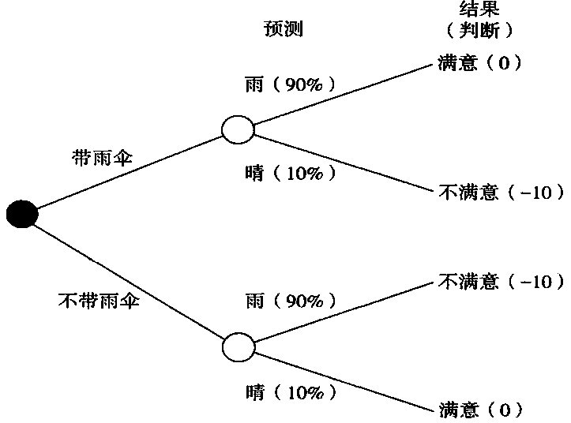

### 图 4-1 雨伞决策树

多数人无预测时拒绝决策：要么灵活调整行程（默认不带伞），要么买微型伞常备包底（默认带伞）。

---

### 决策的红利：打破惯性的价值

**核心逻辑：信息昂贵 → 养成习惯/立规则 → 规避思考。**

若你坚守默认规则，AI 预测对你零价值——不决策，就不需信息。

AI 赋能的精准预测，能将“不确定”变“可信”，让**打破规则、真决策**变得划算。知道天气，你就能按需带伞，省下淋雨或累赘的成本。这需要：查看预测 App 决策，或直接听从 App 推送“带伞/不带”——阈值虽程序员预设，但本质已从“守规则”转向“动态决策”。

日常中，我们放弃“通读报纸”改刷“推荐流”，放弃“固定工位”改尝“远程办公”，都是**以预测辅助决策，替代僵化规则**。疫情强制实验证明：打破“必须去办公室”规则后，许多人发现居家高效，从而重塑“在哪工作”这一决策的意义。

**预测降低决策成本，激活沉睡选择，这就是 AI 赋予个人与组织的核心红利。**

## 第五节：在“不决策”上的沉没成本

乔布斯、扎克伯格、奥巴马，真的是完全不操心穿什么吗？盯着某天的造型看，确实如此；但拉长时间线审视他们的衣橱，结论截然不同。若要实现“每天同款”，前提是这套装备必须极其耐操：既要应对各种场合的得体要求，又要保证长时穿着的舒适度。想找到这件“万金油”，哪位大佬没在暗中耗费大量心力筛选过？

换个角度看，**规则并非“免决策”，而是“预决策”**。咱们做旅行攻略时不也是这样？订酒店、定返程机票、攒洗漱包、整理充电线……常出差的人早就把“差旅专用装备”打包成模块，出门一扔进行李箱，省去了临时起意的脑力消耗。这就是在管理“决策的时间表”：**提前投入精力，换取执行时的轻松**。

可一旦在“不决策”上投入了沉没成本，惯性就成了钢铁长城。如果现状让你舒服，你根本不会意识到“通过决策还能更优”。若你的业务是开发 AI，核心价值在于“激活那些被冻结的决策”，那你面对的就是个硬骨头：**怎么让用户放下熟悉的规则，拥抱 AI？**

对比一下，公众人物在穿衣上的“预决策”投入，在企业级“标准作业程序”（SOP）面前简直九牛一毛。绝大多数组织不是“决策机器”，而是“规则仓库”。SOP 详细规定了每个环节怎么干，虽因行业而异，但无一例外。

SOP 的价值不止于“省去重复决策的麻烦”，它更是一笔**认知成本的预付款**——同理于个人层面的“制服策略”。更关键的是，它造就了**可靠性**。大家按章办事，彼此配合像齿轮咬合，不必开会对齐、不必高频沟通。

建筑工地就是教科书级应用：总进度表把工程拆解成逐日逐项的简单任务，结果预定义，顺序固化。工人只管干好手头活，完工打勾，接下一项。当然有变更和例外，但大基调是“按图施工”。这种规则体系压缩了不确定性，降低了主动协调的必要。决策被前置到了图纸和进度表里。**代价是：一旦动了规则，牵一发而动全身，改动成本极高。** 正如后文将详述，试图把 AI 塞进这套精调好的规则体系，难点正在于此——AI 的使命是“释放决策”，但决策一旦释放，原有的协调机制就会失灵。

---

## 第六节：新决策的破局之路

AI 预测的核心意义，在于**把“靠规则行事”逼成“靠预测决策”**。

新决策要取代旧规则，但旧规则从不孤军奋战。人们在规则四周筑起了高墙厚垒——组织架构、流程体系、行业惯例——专门用来抵御不确定性的冲击。整个企业甚至行业，都在为“维护规则的统治”买单。于是，新的决策机会便被深深埋没。破局的关键，在于**识破这些防御工事，精准定位被掩藏的决策点，并给出真正能替代旧规则的新决策**。下文将展开这场“寻宝行动”。

---

### 本章金句回顾

*   **规则 = 预决策。** 决策胜在灵活（随时随地因地制宜），规则胜在低认知成本。何时值得付决策的“智商税”？——后果严重且信息获取成本低时。AI 不改变后果严重度，但**大幅压低信息成本**。
*   **AI 重塑权衡天平。** AI 的主业是生成预测，预测是决策的燃料。随着 AI 变强，预测成本骤降，决策相对规则的“性价比”飙升。必然会有更多决策挣脱规则的束缚。
*   **规则的隐形红利：可靠性。** 决策间常有耦合，系统里必须要有“定海神针”。SOP 正是这根针——降认知负荷、保可靠。若要用 AI 预测把规则换成决策，**必须同步重构系统，解决可靠性断层问题**。

---

## 第六章：隐形的不确定性税

经济学家乔治·斯蒂格勒名言：“若你从未误过机，说明你在机场待得太久了。” 放在当下，他还会这么酸吗？

韩国仁川机场 T2 航站楼的设计师根斯勒，巴不得斯蒂格勒闭嘴。现在的机场，早不是单纯的“登机口”了：水疗、赌场、艺术展、滑冰场、五层楼高的瀑布花园（新加坡樟宜）、游泳池儿童乐园（多哈）、水族馆（温哥华）、名画巡展（阿姆斯特丹）…… 对新一代航站楼而言，这只是旅客的标配日常。

根斯勒的目标很直白：**把机场打造成“目的地”**。安检后滞留时间越长，非航收入（零售租金、餐饮分成）越肥。安全检查越严、流程越长，旅客被迫提前到达，机场赚得越多。

数据佐证：**过去十年，旅客机场停留时间平均多了近 1 小时。** 即使是在 60、70 年代建成的老机场，人均逗留时长也在涨。为什么？因为**赶飞机的不确定性变大了**——路况、停车、安检、改签费、超售、转机、争夺行李架…… 后果更严重（误机成本高），自然只能“以提前换安心”。久而久之，提前到达成了肌肉记忆，**不确定性被“规则”吸纳、隐藏、甚至遗忘了**。

仁川机场投了 100 亿美元扩建，标榜“保障航空运输顺畅”，实则 40% 收入来自非航业务。设计师拼命让旅客“舒服地耗时间”，旅客却浑然不觉自己在为隐形的不确定性买单——就像进了电影院，再贵的爆米花也得买。

**现代机场，就是“隐形不确定性”的教科书级样本。** 缺乏精准信息（何时出发最优）时，人只能求助规则（如“提前 2 小时到达”）。规则生效后，配套设施（豪华航站楼）随之建成，进一步掩盖了规则的代价。**寻找 AI 决策机会的窍门，就是盯着这些规则看：它们能否被“主动拥抱不确定性的 AI 决策”替代？** 本章将揭示：规则背后的防御工事，不仅藏着 AI 的用武之地，更标注了机会的大小。事实上，极简的 AI 应用已对机场现有商业模式构成降维打击。

---

## 第七节：平行宇宙的机场——私人航站楼

在另一个平行世界，住着一群超富豪。他们不挤商业航班，走的是**私人航站楼**。令人意外的是：私人航站楼**极其简陋**。没有奢华餐厅，没有艺术馆，甚至连像样的休息室都没有。

原因很简单：**困扰普通旅客的不确定性，对富豪不存在。**
*   商业航班：飞机等人不等机，误机即作废 → 必须极早到达 → 需要豪华设施打发时间。
*   私人包机：人没到飞机不飞，人早到飞机早走 → **零候机焦虑** → 无需投资“候机体验”。

富豪没有“几点必须离开机场”的规则，想走就走。如果这套体验能普及，最好的航站楼恐怕比大教堂还简陋。

不必等暴富，去机场对比一下**到达层**与**出发层**就懂了：到达层极简，快餐、打车、停车场一应俱全，核心逻辑是**“最快撤离”**；出发层却是商业奇观，核心逻辑是**“最大化滞留消费”**。除了“怎么跑得快”，你还记得到达层有什么细节吗？

---

## 第八节：AI 对机场商业模式的“降维打击”

机场早用上 AI 了：空管预测拥堵、埃因霍温机场试行“拍照托运、免标签取行李”、甚至探索“刷脸通关”。这些都在**加速流程**，但没解决**“从家到安检口”**的两大不确定性——**路况**与**安检排队**。

路况端，**Waze 类导航已介入**。输上航班时间，它结合实时路况反推最佳出发时间，甚至预判航班实际起飞时间（而非计划时间）提醒你。这相当于**把“盲目遵守提前 2 小时规则”升级为“动态精准决策”**。正如 Uber 用户从“不在乎预计到达时间”变为“离不开这功能”，精准预测能帮旅客省下数小时候机时间。

安检端，**AI 排队预测**也在路上。综合路况 + 安检 + 航班动态，旅客终于能**基于预测决策“何时出门”**，而非基于规则。

**冲突来了：**
开发导航/航班预测 App 的人，不靠机场商业租金吃饭。**他们的价值 = 有多少人“不想在机场候机”。** 机场把候机体验搞得越爽，这些 App 价值越低。
更扎心的是安检预测。机场嘴上说“缩短安检时间”，实则动机分裂：安检快 → 旅客多出时间消费（利好）；但安检快 + 路况透明 → 旅客敢晚到 → 滞留时间缩水、非航收入缩水（利空）。**叠加 AI 解决了“到达航站楼”的不确定性，机场真会在可控范围内主动消除不确定性吗？**

---

## 第九节：规则的“共谋者”与破局者

科技作家克莱·舍基的**“机构保全原则”**一针见血：**机构会竭力维护与其解决方案对应的问题。** 你的业务是“服务候机人群”，你为什么要让他们“不用候机”？

要用 AI 创造新决策机会，必须**冲垮保护规则免受不确定性冲击的壁垒**，去寻找“更易承担不确定性成本”的活动，或直接**压缩规则必须容忍的恶果**。

英国农民修树篱（Hedge）的历史是绝佳注脚：树篱挡牲畜、防水土流失、抗风暴，**“对冲” 一词由此而来**。但树篱也切碎了土地，阻碍机械化。二战后政府补贴铲树篱，今又在查尔斯三世推动下复种。风险管理工具，总在“保护”与“束缚”间博弈。

公路护栏、建筑规范（抗百年洪水、抗罕见地震）、飞机救生衣……这些**“过度设计”的防御设施**，平日看似闲置，实则是为极低概率的灾难兜底。萨伦伯格机长哈德逊河迫降，让“救生衣无用论”闭嘴。**不确定性不等于零概率，规则体系就是为这“非零”买单。**

列维特与都伯纳的核心洞见：**采用保护措施时，往往高估了其必要性，却低估了其隐形成本。**

---

## 第十节：温室里的“系统级跃迁”——从点方案到新物种

Ecoation 这家公司，用机器视觉在温室里**预测虫害风险区**、**指导“今日哪里喷药”**，甚至**预判未来一周全棚虫害趋势**，赢得一周采购部署窗口期。卖点是**“省钱：对的时间买对的药”**——典型的**点方案**。

但透过系统视角，**更大的红利藏在“规则松绑”里**：
农民为防虫遵守了一堆死规则——种抗虫品种（口感差）、建小棚方便巡检、特定气候调控……
**若 AI 预测足够精准，规则就能松动：**
*   敢种高口感、怕虫的高价值作物；
*   敢建大棚、推行规模化、自动化；
*   敢尝试节能的新气候策略……

**AI 不再只是“优化现有流程的工具”，而成为“重塑生产系统的变量”。** 正如机场，农业也在等待**“从规则到决策”**的系统级跃迁。

---

### 本章金句回顾

*   **规则背后藏着“隐形不确定性税”。** 机场豪华设施、温室小棚抗虫品种，本质上都是为“对冲不确定性”支付的沉重结构性成本。
*   **AI 威胁的不是规则，是“规则的守护者”。** 导航 App、安检预测、虫害预判，价值锚定在“用户想摆脱规则束缚”上。现有利益方（机场、传统农艺体系）动机不纯，甚至会阻滞 AI 部署。
*   **点方案 ≠ 系统变革。** Ecoation 先卖“省钱”（点方案），实则在铺垫“换品种、建大棚、换模式”（系统变革）。**真正的 AI 红利，在于打破规则重写系统。**

---

## 第七章：规则是系统的“强力胶”

外科医生阿图·葛文德是清单控。他在《清单革命》里写道：清单的存在只为一件事——**告诉顶尖专家：在复杂度爆表的环境里，勾选清单不是低级动作，而是生存必修课。**

# 清单：驾驭复杂的隐形利器

当美军寻找新型轰炸机时，波音299凭借卓越性能——载荷是竞品5倍、速度更快、航程翻倍——本应胜出，却因一场非设计缺陷导致的坠机而被拒。事故揭示了一个残酷真相：这飞机太复杂，飞行员凭记忆根本驾驭不了。美军没选择加码培训，反而祭出一招“笨办法”：**清单**。涵盖起飞、降落等关键节点的标准化步骤，让飞行员飞行180万英里零事故，最终该机型定名B-17，订单超1.3万架。

葛文德据此主张：现代医学同理，清单能救命。虽遭顶级外科医生抵制（如同当年的洗手令），但从建筑工地到芝士蛋糕工厂，清单早已证明威力。我们不争论其价值，只看本质：**清单是规则的具象化，是为对抗“不确定性”而生的可靠性护栏**。复杂系统中部件关联、人员协作，靠专家直觉决策反而制造混乱；清单与标准作业程序（SOP）将“该做什么”固化，让组织平稳运转。

但规则有代价。它视所有人为同质化个体，忽略差异。销售懂得分群，流媒体懂得“千人千面”（Spotify/Pandora对标传统电台）。潘多拉电台曾因“免费听广告、付费去广告”的固定规则受限。直到AI介入：通过预测每个用户的广告厌恶度与付费意愿，**打破“均匀投放”规则**，对高容忍度用户多推广告、对潜在付费用户逼单、对敏感用户少打扰。这不仅大幅提利润，更揭示了核心逻辑——**AI把“规则”变成了“决策”**。虽受限于广告库存与用户隐私顾虑未全面落地，但方向明确：构建预测模型，是摆脱僵化规则的第一步。

## 人皆不同

教育系统是规则的重灾区。一份59页的家长手册，管到底细。规则保安全、保效率，却也扼杀个性。穆勒百年前忧虑“国家教育让人变得相同”，至今回响。《纽约州幼儿学习标准》虽喊出“目标统一、路径个性”，但靠人力落地太难：好老师因材施教，普通老师应付不过来，贫富教育资源鸿沟更大。

创业教育实验给出答案。世界银行等年投百亿培训400万创业者，效果平平。经济学家斯科茨、孙钜联手电商平台，用AI给几十万新商家“定制课表”：采集店铺数据，从几十模块（选品描述、SEO、客服等）中精准推荐最需学习的内容。RCT实验显示，50万受训商家收入涨6.6%，年增收600万美元。单店年均仅增12美元（基数200美元），但**零边际成本下的规模化个性化**，才是AI打破“一刀切”规则的威力所在。

## 又一块墙砖

规则像砖墙，砌久了便成了系统的“强力胶”。电视台22分钟内容+8分钟广告的固定格式，锁死了编剧节奏、排期制作、广告销售全链条。YouTube不同：内容长短随意，AI匹配内容与广告，**预测能力在“灵活系统”里价值指数级放大**。

学校同理。按年龄分班、统一进度，是应对“学生能力不确定性”的规则，衍生出教师培训、补习体系、职高分流等配套机制。若仅在现有框架内植入“预测下一步最佳学习内容”的AI，收效有限——学生学完本年级课程就得停下，老师只懂本年级教法，能力差距随年级拉大。

**真正的变革是重构系统**：打破年龄分班，按学习进度分组；教师按专长（如阅读障碍干预、奥数培优）配置，不再为“兼顾大多数”妥协。AI个性化推进度+灵活分组+专业化师资，**这才是释放预测价值的完整拼图**。难点不在造模型，而在拆掉“基于年龄的课程”这块基石。

## 本章核心洞见

- **清单/SOP = 规则 = 可靠性换灵活性**。让专家自主决策虽灵活，但引入不确定性与协作混乱。
- **规则是系统的“胶水”**，相互咬合。单点替换规则为AI决策，边际收益极低，因周边模块仍按旧规则运转、抗拒变革。
- **教育个性化AI案例证明**：同等模型，嵌入旧系统（按年龄分班）效用有限；嵌入新系统（灵活分组、专业师资、项目制学习）威力巨大。破局关键：**解绑“年龄分班”规则，重塑系统架构**。

---

# 第三部分 系统篇

## 第七章 黏合系统 vs 灵活系统

新冠疫情是照妖镜。AI本可助我们精准防疫，却因各国固守“规则式”公卫流程而缺位。**不是AI不够强，是系统不够“软”**。少数大企业联合搭建创新平台、用决策替代规则、在不确定中保运转，正是灵活系统的雏形。

### 最昂贵的规则代价

2021年1月，900万美确诊是健康危机，但3.2亿未感染者因“隔离规则”付出巨大社会经济成本。本质是**预测缺失**：不知谁传染，只能把所有人当潜在感染源，实施全员社交距离。

决策树逻辑清晰：隔离=零传播+高个人成本；接触=若感染则传播、若健康则正常。若能**精准预测“谁传染”**，便能“隔离感染者、放行健康者”，既阻断传播链、又恢复常态。这不是医学难题，是**信息/预测难题**。

### 将防疫重构为预测问题

剥离公卫滤镜，直击不确定性核心。常规手段（疫苗、药物、减缓传播）之外，**“识别感染者”才是防控枢纽**。接触者追踪是最古老预测法：接触过患者=高风险。人工溯源慢、漏、不可靠；韩国融合监控、刷卡、手机数据，完成了**从人工规则到数据驱动预测的跨越**。

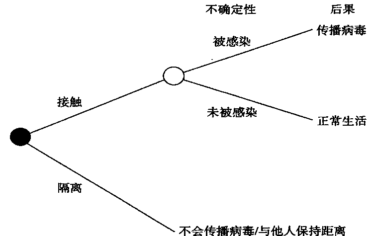

### 图 7-1 隔离与接触的决策博弈

# 第七章：灵活系统——当预测遇上规则的博弈

## 创新不止于追踪：预测工具的多元探索

抗疫创新的版图远比接触者追踪宽广。AI 专家们早早投身于“预测传染性”的工具研发。有团队攻克了“听咳识病”技术，只需对着手机咳嗽，便能筛查无症状感染者。希腊边境更是祭出大招：一个融合行程轨迹、出发地疫情、人口画像且周更迭代的 AI 系统，识别无症状感染者的效率是随机抽检的 1.85 倍，精准筛出可通行人员。当然，非 AI 手段也在发力：测温枪、热成像仪守在关卡，泰国甚至训练嗅觉灵敏的“防疫犬”闻出病毒味。

## 秋天的答案：廉价、快速、可规模化的抗原检测

到 2020 年秋季，实践给出了标准答案——快速抗原检测是预测传染性的性价比之王。PCR 虽敏感，却慢且贵；抗原检测虽非百发百中，但假阳性极低，阳性即传染，隔离即切断传播。关键在于，它把“谁具有传染性”这个信息黑洞填平了，且极其廉价、易量产。这不是 AI，却是那个节点上最强的“预测机器”。

## 从实验室到车间：一场关于“规则松绑”的实战

基于此，我们联手流行病学家、政治学者与创新实验室主管，为企业量身定制“快检复工”方案：定期测、阳性居家、阴性上班、同事安心。逻辑通顺，执行却撞上“规则墙”：隐私法卡数据收集，工会约束限进出，数据安全规范存储，危废条例管废液，工伤赔偿算阳性假期……系统由无数规则胶水粘合，一旦引入“基于信息的决策”，牵一发而动全身。

## 破局：组建“灵活系统联盟”，在夹缝中试点

信息缺失导致经济停摆，破局刻不容缓。我们说服 12 位跨行业巨头（覆盖 50 万员工）签署承诺：各派一名高管全权推进，豁免规则障碍。2021 年 1 月，多伦多首个试点落地。成效立竿见影：感染者被拦门外，员工安全感飙升，设施持续运转。我们随即提炼《作战手册》，从建站、培训、沟通、数据流、废弃物处理到采购渠道，全流程标准化开源，辐射至非营利机构、夏令营、托幼园所、学校。

## 规则的融化与隐私的平衡

随着推进，僵化规则开始松动：加拿大从“专业监管下检测”进化到“居家自测无需医护”。数据追踪系统同步上线，既锁定“谁在何时测了什么”，防止阴性报告造假安全感，又用技术架构守住隐私底线，满足合规红线。企业政策跟进：带薪病假、工时认定、检测场所、阳性响应流程、责任归属……《手册》配套的 SOP（标准作业程序）免费迭代，成了规则松绑的润滑剂。

## 两年，2000+ 组织，挡住数万感染者——但预测只是序章

最终，该系统在加拿大 2000 多家组织落地，拦截数万阳性个案于门外。但复盘令人清醒：头部企业规模化部署耗时半年，全员常态化检测跑通要一年。**预测工具，只是漫漫长征的第一步。** 它解决了“知不知道”的信息问题，却撬动不了“怎么做”的系统变革。

---

### 核心洞见：规则僵化，决策需要“柔性土壤”

本章要旨：想用好预测机器，必须把“死规则”变成“活决策”。但前提是系统得有弹性。若规则间像钢筋混凝土般互锁为可靠性，决策空间就被压缩为零。

回溯 2020 春：不确定传染源 → 规则“全员居家” → 经济熄火、医疗教育停摆、心理创伤深远 → 衍生出探访、监控、在线问诊等新规则修补裂痕。规则虽稳，代价太重。

**新冠本质上是个预测问题。** 对感染者是医疗题，对绝大多数未感染者是信息题。有了预测，就能从“全员隔离”切换到“精准隔离”。寻找 AI 释放决策价值的切口，首瞄“规则”。快抗填补信息洼地，配套带薪隔离等从属创新跟上，还需灵活协调系统对齐目标、推动变革。有时候，新系统颠覆性太强，老组织装不下，得另起炉灶，让它野蛮生长。

**揭示不确定性，是预测打开新决策的钥匙；重塑从属流程，是系统级方案的定义。**

### 本章金句回顾

- **社交距离规则代价高昂**：冻结经教医三大系统，全球经济急刹车，心理创伤需数十年愈合，周边衍生规则层层叠叠。
- **重新定义新冠**：它是预测问题。无信息则全员视为疑似，经济停摆；有预测则精准隔离，社会低成本运转。规则是 AI 预测释放价值的首要靶心。
- **从规则到决策，系统得“软”**：规则互锁太死，决策无用武之地。我们用 12 家巨头首席背书，构建微型灵活系统，用快抗预测驱动决策，保住运营，随即引爆 2000+ 组织跟进，完成从“守规则”到“做决策”的范式跃迁。

---

# 第八章：系统思维——别让任务替代遮蔽了系统重构

## 图灵测试场上的焦虑：人机对决，赢了又怎样？

布莱切利公园年年上演“最像人的人”大赛，人类勉强守擂。围棋、识图、筛简历、自动驾驶……人机 PK 单项指标，机器频频破纪录。焦虑随之而来：机器会取代人类吗？

汽车跑赢马，马却还在赛场；奥运会不因机器快而停办。为何围棋 AI 胜柯洁，却让人感到“取代感”迫在眉睫？**区别在于衡量标准：** 竞技场比的是极限，职场比的是**性价比**。马不再拉车，是因为机器载人更低成本；同理，认知劳动一旦机器边际成本更低，替代必然发生。

## 拆解工作的“任务清单”陷阱

产业界流行把职业拆成任务清单评估“可被自动化度”。放射科医生 30 项任务（见下表），仅 1 项直接涉及 AI 预测强项（解读影像）。牛津研究曾警告：近半美岗位面临自动化风险；布莱恩约弗森团队细分到 964 职业、1.8 万任务，前台、信贷员等“预测型岗位”首当其冲，按摩师、考古学家暂避风头。顶级经济学家忧心：AI 接管核心任务，底层劳动者去哪儿？

**但现实打脸：** AI 浪潮十年，大规模技术性失业未至。聊天机器人、机器翻译虽有建树，人类仍在岗。原因很简单：**在大多数场景，有缺点的人类，仍比机器替代品更便宜。** 资本成本补贴论虽在逻辑自洽，但当下我们可以喘口气。

> **图 8-1 放射科医生的 30 项核心任务**  
> （涵盖病史采集、报告撰写、影像解读、PACS操作、医患沟通、教学指导、介入手术、治疗规划、核医学操作、辐射防护、质控管理、设备校准等，仅第 3 项“演示或解释影像诊断程序的结果”直接对标 AI 预测）  
> *资料来源：O*NET 数据库*

## 任务思维 vs 系统思维：价值不在“减人”，在“重构”

斯坦福教授蒂莫西·布雷斯纳汉一针见血：**盯着任务替代，看漏了技术红利的真正来源——系统变革。**

看亚马逊、谷歌、Meta、奈飞：它们的 AI 价值**零贡献**于“任务级替代”。它们没雇人再裁人，而是**从零构建全新系统**。这些系统不是“任务堆砌+AI 点缀”，而是**原生重写**业务逻辑。

**这就是“系统思维”：** 看见 AI 的宏大潜力，懂得要产出真价值，必须重组包含机器预测与人类判断在内的**整个决策系统**。历史启示：新入局者用新通用技术（如 AI 预测）做系统创新，比老巨头在存量系统打补丁容易得多。汽车赢马，靠的不是更好的引擎，而是加油站、柏油路、交规——**全新基建体系**。

## 定价陷阱：成本思维卖不出去，价值思维才能规模化

我们做经济学家，天然关注成本。《AI 极简经济学》核心论点：AI 降预测成本 → 用量激增。既有预测场景（销量、天气、分类、翻译）先受益，但**真机遇在“预测成本低到引发新应用”那一刻**。

可创业者初期总爱算“成本账”推销：我的 AI 能省掉一个 5 万年薪岗位，定价锚定节省工资。结果碰壁：AI 往往只能替代一个岗位里的**一个任务**，省下的碎银子不够买单，企业内部阻力大，销售极难。

**破局在“价值定价”：** 别说“帮你省人”，要说“帮你赚钱”——提升产品质量、创造新服务、打开新增长。这不要求 AI 单任务比人类便宜，只需**系统整体产出更高价值**。内部阻力小，销售顺畅，推广自然水到渠成。

**关键洞见：相较“省成本”的替代逻辑，“造价值”的增强逻辑，才是 AI 规模化落地的主航道。**

### 为何新技术总在“磨蹭”中获胜？电力与AI的共同困局

回望历次技术变革，新旧更替从未是一蹴而就的“降维打击”，而更像是一场漫长的拉锯战。第一章提到的电力取代蒸汽，足足拖了几十年。工厂主不是不想换，而是算账：只有电价跌破蒸汽成本，才值得动刀子。可老厂房全是为蒸汽机量身定制的，硬塞进电机只能发挥一半效能。真正扭转局面的，不是省下的煤钱，而是电力让工厂得以逃离寸土寸金的市中心，铺开摊子建在平地上——彻底重构布局，生产力才迎来质变。同理，电动车早年输给燃油车，也不是技术烂，而是续航短跑不远；等电池技术突破，新价值建立，局面才逆转。**结论很硬核：单纯算“替换成本”永远推不动变革，唯有“创造新价值”才能撬动系统重组。**

### 医疗AI：被激励机制“锁死”的系统变革难题

说到系统变革的难度，医疗领域是教科书级反面教材。埃里克·托普尔在《深度医疗》里描绘了AI大显身手的蓝图：诊断更准、手术自动化、居家监测、个性化用药、新药研发……听起来美得不像话。但托普尔是临床医生和科学家，不是经济学家。他默认医生会把省下的时间还给患者，却忽略了核心驱动力——**报酬机制**。

现行“按项收费”模式下，AI若提高效率，医生反而可能缩减单患者诊疗时长以维持收入，而非多陪患者聊天。历史证明，效率工具从未自动转化为更多沟通时间。想实现托普尔的愿景，光有算法不够，得连带着重写激励规则、培训体系、职业文化乃至法律法规。这解释为何医疗在AI采用榜上垫底（2019年数据甚至不如餐饮住宿业）——系统太复杂，牵一发动全身。

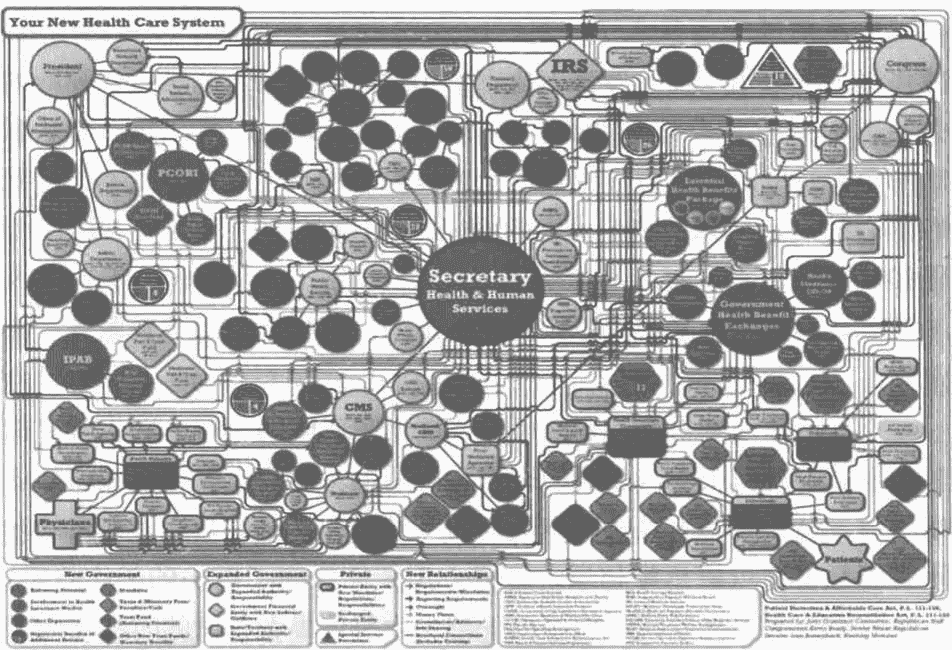

### 图 8–2 美国医疗保健系统（2010 年）

**点方案、应用方案为何总“落地生根、开花不果”？**  
在美国奥巴马医改这张如迷宫般的系统图里，随便塞进个AI预测模型都毫无波澜。个性化治疗听起来美，落地却要无数人配合改流程：多采数据、改护理模式、换支付方式。现状是：AI给出预测，医生没药可开、不敢用（担责任）、不愿用（不挣钱）。卡在的不是算法不准，而是**协同进化的极高门槛**。

喀麦隆的Cardiopad便是活例证。这神器让偏远村民也能做心电图，数据传给城里专家远程诊断，解决了“测不了”的难题。但全国60个心内科医生根本看不过来，确诊后又没医院治疗。Cardiopad只是拼图的一角，要真解决心血管病，得重塑“诊断-治疗”全链路。IBM Watson野心更大，却栽在数据烂、落地难、责任不明上——**点方案嵌不进旧系统，新系统又尚未诞生。**

### 打破被动：从“找钉子”转向“造锤子”

当下大多数组织用AI还停留在“被动接单”阶段：供应商推个模型，或内部挖掘哪个任务能套用预测。这只能生产**点方案**。真正的机会在**系统层面**——重新审视整条价值链，问：AI如何让系统跑出更优解？  
系统思维易懂难行。隐性不确定性藏得深，陈规陋习粘得紧。但认清“必须变系统”是破局第一步，这已在经济领域萌芽。

#### 本章核心洞见
- **主流误区**：满坑满谷都是“任务级思维”——拆解岗位，找依赖预测的任务，用AI替人干。咨询报告、高管会议全是这套调调。  
- **现实打脸**：AI最惊艳的战绩（亚马逊推荐、谷歌搜索、Netflix分发）全是**系统级重构**，而非任务替换。任务思维盯着“省人力成本”，系统思维盯着“造新价值”。  
- **医疗破局**：AI在医疗场景跑不通，核心不是审批慢，是旧系统跑不出增量价值。必须**白纸重绘**：从培训、分诊、支付、隐私、责任全链条重来，这就是系统思维的门槛。

---

## 第九章

### AlphaFold：撬动生命科学的“阿基米德杠杆”

《福布斯》称AlphaFold为“AI史上最重要成就”，《自然》直言“它将改变一切”，绝非溢美之词。蛋白质是生命的积木，“结构决定功能”，可几十年来搞清结构全靠实验熬，慢得像蜗牛。AlphaFold仅凭氨基酸序列就能精准预测三维结构：UCSF借它几小时搞定新冠关键蛋白细节，科罗拉多实验室十年搞不定的耐药菌蛋白十五分钟拿下，另一实验室十年失败后三十分钟出图。实验室主任卢帕斯直呼：“医学、科研、生物工程，全要变天。”

### 重新发明“发明本身”

若问AI最可能重塑经济的地带，非**创新系统上游**莫属。好消息是，这里的玩家最懂系统思维——AlphaFold若不改变科研范式，就只是个好用的查结构工具。

2017年NBER大会上，经济学家组合Cockburn、Henderson、Stern便断言：AI将**改变创新过程本身**。数据科学已是科研标配，AI让它更强、更快、更廉，还能解锁新型预测。显微镜发明催生病菌论，进而重塑现代医学；AI作为“发明的发明方法”，其杠杆率恐超越历代通用技术。

### 创新范式的“内核重写”

创新本质是**结构化的试错**（见图9-1）。

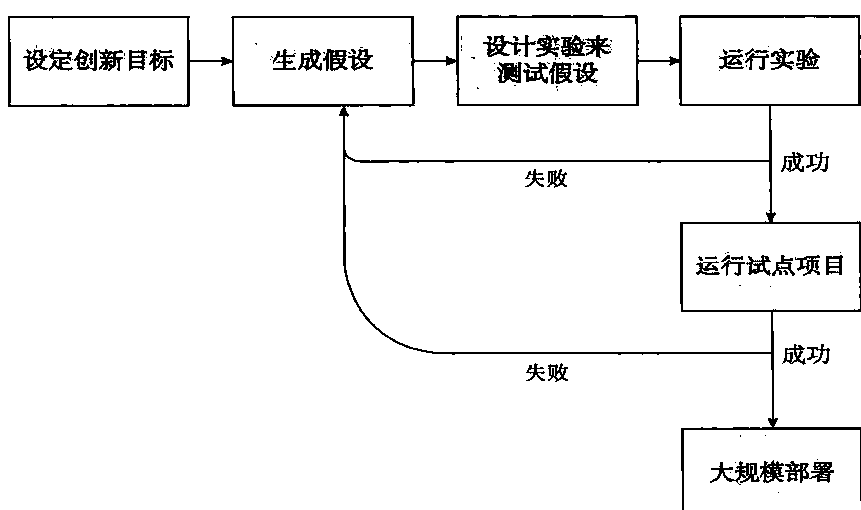

### 图 9-1 创新过程

无论推荐算法这类轻量系统，还是新药研发这类重装系统，流程皆是：定目标 → 提假设 → 做实验 → 试错迭代 → 试点 → 推广。

**推荐系统的“点方案陷阱”**：李道均、霍桑纳格实验证明，“协同过滤”确实能提升短期销售，但会加剧马太效应——爆款更爆，长尾更冷。公司想改良算法扶持长尾，工程师却喊累、怕风险、不想动根基。**“不想破坏现有系统”成了系统变革的拦路虎。**

**AI重塑创新流程的图景（见图9-2）**：  
不再靠人拍脑门提假设，AI海量生成候选方案；假设生成提速，实验周期压缩，甚至可跳过试点直推；优化目标从“下单转化”升级为“防流失、增LTV”。阿杰伊团队在新材料研发模拟中已验证：前端预测质量跃升，能倒逼整条流水线重构。

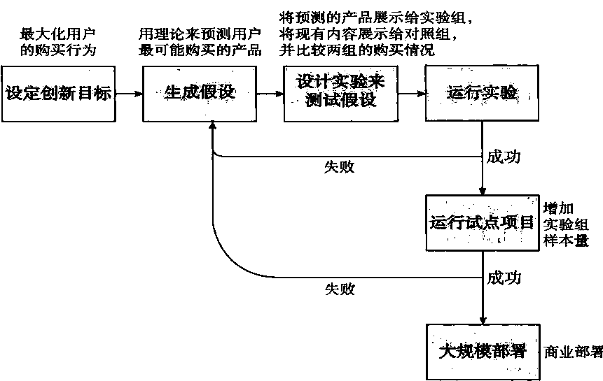

### 图 9-2 推荐引擎的 A/B 测试（简单）

**药物研发这头“硬骨头”同理（见图9-3）**。AlphaFold不是终点，是新起点：结构预测不再是瓶颈，实验室分工倒逼重组——少要“练结构”的，多要“转化疗法”的；研究目标敢更野心，筛选更宽，下游验证更精准。AI重塑优先级排序、提升探索预期值、击穿显性瓶颈。**但新系统不会自动长出来，得砸真金白银、熬时间、赌运气。**

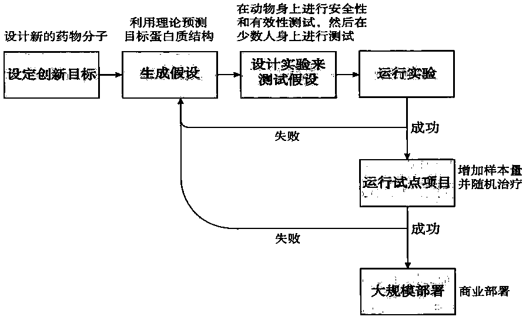

### 图 9-3 药物研发（复杂）

### 看见不可见的系统：大厂为何总缺席革命？

多伦多大学Aspuru-Guzik教授的“自驱动化学实验室”已给出雏形：AI提假设、机械臂做实验、便携实验室跑闭环。可经济版图大部仍睡在梦里。**认清“要变系统”仅是入场券，后面是漫长的攻坚战。**

大厂最不爱变——现金奶牛还在挤奶，谁愿自废武功？这正是**颠覆性创新温床**：初创公司在利基市场野蛮生长，产品迭代成熟后反杀巨头。新范式总从“意想不到的角落”长出来。下一章，我们聊聊这场“下克上”是如何上演的。

#### 第九章核心洞见
- **创新即试错**，AI正在重写试错的每个环节：假设生成自动化、实验并行化、决策数据化。  
- **AlphaFold价值不在“查结构”，在“变范式”**——从“倒腾试管”转向“动脑子想机制”，催生全新分工与组织形态。  
- **推荐系统到药物研发，同一逻辑**：点方案嵌入旧流程；系统方案重写流程。前者工程师抗拒，后者需巨资博弈。  
- **大企业惯性是常态**，颠覆源于边缘。识别系统变革机会，是领跑者的必修课。

- 创新体系内部的突破往往能引发连锁反应。以镜片打磨工艺的精进为例，它不仅催生了眼镜等个人光学产品与显微镜等科研工具的革新，更反过来加速了创新体系本身的迭代。显微镜的发明让病菌理论得以诞生，使人类得以与病毒、细菌展开抗争，并深刻重塑了医学版图。

- 人工智能在创新体系中扮演的关键角色，在于预判新组合的后果。以往我们依赖科学理论或试错法，而今只要数据充足、模型训练得当，AI便能直接生成假设并进行预测。

- 自动生成假设虽能大幅跃升创新产出，但若想红利最大化，必须对整个创新体系进行重构，而非止步于假设生成环节。譬如，若后续的实验设计验证环节未同步升级，便会形成下游瓶颈，导致假设产出再快也无济于事。

## 第四部分

### 权力的博弈

## 第十章

### 颠覆与权力的转移

先梳理一下脉络。AI 蕴藏着引发技术变革的潜能，但历史表明，变革从非易事。新技术初期多以“点解决方案”与“应用解决方案”现身，真正的规模化落地与变革，须待由技术驱动的新体系建成之后。AI 通过预测优化决策来创造价值：点方案改良现有决策，应用方案则开辟新决策路径。这些新决策非凭空而来，而是取代了既有规则。规则容忍误差，并衍生出诸如机场航站楼般的配套设施来对冲后果，导致原本可被 AI 预测的不确定性被遮蔽。这种建立在规则之上的体系极其稳固——我们称之为“粘合效应”。这意味着，缺乏系统思维，将规则转为决策、引入 AI 便毫无建树。

欲释放 AI 的变革潜能，必须在系统层面创新。后续章节将探讨此道工程及组织面临的阻力，核心在于认清：此过程必伴随颠覆。
“颠覆”虽是争议词，经济学家避之不及，科技界却视为流量密码。但在全系统变革视角下引入 AI，用“颠覆”恰如其分，缘由有三：一、既有行业易现盲点，错失 AI 契机；二、推翻旧制建新制，本质是技术变革带来的创造性毁灭，挑战与权衡在所难免；三、旧系统让位新系统，经济权力必然转移——权力积累成为系统创新的回报，引发担忧与抵制。这三点契合大众对“颠覆”的认知，故此处用词合理。

### 预测如何引发颠覆

本书后续将剖析 AI 预测及其采纳如何引发颠覆。虽属未发生之事，涉及推测，但均立足于对 AI 预测与技术经济学的认知。数据采集与算力助推下，我们的预测能力已大幅跃升。

直至 20 世纪 90 年代，发电业仍处严格监管之下。多数国家由垂直一体化机构包揽生产与输送。缘于发电成本高、电力难储存，若能精准预判需求，按需生产本是上策。但海量用户每时每刻的独立用电决策，稍有供需失衡便引发电网崩溃。

运营方虽掌握发电主动权，却须兼顾线路饱和、机组停运、燃料波动等变数。最终策略是严控出力、冗余备用，核心逻辑唯“谨慎”。

随时间推移，天气、工程、停机预测精度借助算力与经验提升，运营层面警惕性略有放松。但调度系统在节省燃料成本上表现平平：运行大型燃煤或核电机组，远比调度燃气峰值电厂容易。

预测能力的跃升终倒逼行业架构重塑，走向模块化、弱化中央协调。发电厂不再受严控，凭借精准的需求与分配预测，可竞标向本地市场售电。至 80 年代末，专家认定电力池市场能在不损质量前提下降本。

“供大于需”的底线未变，但精准的本地需求预测让发电决策得以分散。电厂提前一日竞标，供需匹配，价格飙升风险微存（电厂主乐见其成）。全系统层面，更优预测意味着统一规划退场、竞争入场，综合电价大幅下探。如今主流经济体皆拥有昔日难以想象的电力池市场，皆得益于预测进步。

预测开辟了分布式发电的组织新范式。精准预测使实时偏差骤减，信息可提前一日下发至电厂、输电、分销端，各方自主报量，自主权大增，从而催生差异化投资与效能提升，无需中央统筹万事。

电力行业的转型是从集权走向分权，关键在于权力易手——非电力权力，乃经济权力。

经济权力源于对稀缺且有价值资源的掌控。设两幅肖像：一为毕加索所绘，一为五岁孩童所作。二者皆独一无二、稀缺且同为“不似”，前者价值高达天价。同理，藏毕加索真迹与藏复制品天差地别——审美等价，稀缺性判若云泥。

稀缺性奠定经济权力根基，竞争稀释稀缺，故经济学家常将经济权力等同垄断权力。昔日稀缺品一遇竞争，权力便即刻转移。

仰仗垂直一体化护城河的生产商，此变革极具颠覆性。竞标机制取代长约，利润被压缩；分销商虽获互联良机，但美本土跨州市场屈指可数。

颠覆常见剧本：掌权的既得利益者遭遇竞争，权力瓦解。权力不灭，只迁徙。电力领域中，权力从一体化供应商流向他处，核心受益者是用户。

亦有权力在旧新生产商间轮转的案例——垄断未破，仅换马甲。经济权力不惧创新本身，反因创新而获赏。系统创新引发权力交接，而无涉现有体系利益的局外人，往往能从新体系建构中收割最大红利。

### 颠覆性威胁的本质

为何系统创新型颠覆能重创巨头经济实力，却成新入局者的沃土？源自克莱顿·克里斯滕森研究。他指出巨头易“问错问题”：对无法服务主流客户的技术视而不见。但被巨头忽视的边缘客户，却对这些技术趋之若鹜。如硬盘巨头执着性能与容量，却有客户愿以此换取小尺寸、低功耗。新入局者抓住契机，技术迭代后终成劲敌。

真正的颠覆在于：激进技术虽不优化传统指标，却在边缘指标发力，制造巨头盲区。历史学家吉尔·勒普尔引述该理论：巨头非因决策失误败北，反因“正确决策”成就过往辉煌（“创新者的窘境”即“做对即是错”）。历史自有节奏，非如误机般显性，而是你不知飞机存在，误闯跑道以为草地，被起飞的飞机撞飞。

规则与隐性不确定性正是盲区之源。应对颠覆非止于细分客群，而须重塑组织架构与优先级。忽视新技术所需的组织变革，是被颠覆的捷径。

一战末期英军坦克即为明证。坦克之父富勒主张高速突击制造混乱，战间期英军却将其归入骑兵序列。德军重整军备时，英陆军元帅马辛伯格反将马饷增十倍；骑兵配双马，坦克兵分一马。反观组织重构的德军，未强行塞进旧制，转而建立新编制、新战术——闪电战，并邀富勒参谋首战。

英军荒诞非孤例，商业史反复上演。1990 年克里斯滕森在哈佛钻研需求侧颠覆（客户价值缺位），亨德森与克拉克同期聚焦供给侧（组织适应性缺失）。他们指出：结构性技术变革重写组织优先规则，而组织僵化难改，恰为零起点新组织留出窗口。

近例莫过于 iPhone。2007 年手机界为加拿大 RIM（黑莓）天下。黑莓因实体键盘成商务人士邮件神器，甚至美前国务卿私设服务器死忠不渝。其胜在键盘手感、网络高效安全、机身耐摔。

反观 iPhone：脆弱、无键盘、依赖慢速移动网、费电、通话质差。全行业不屑一顾，劝其退出专业领域。

质疑虽中肯，却误读了 iPhone 的系统级架构创新：软硬一体化，以牺牲单组件性能换取整体涌现。拆解看皆劣品，系统视角下别有洞天。唯有无历史包袱的谷歌，嗅到了机遇。

系统变革三重困境：一、初期产品必显无竞争力（须牺牲客户在意指标）；二、绩优组织无法识读权衡全貌（只见树木不见森林）；三、缺乏快速反馈。iPhone 耗时四年冲击巨头销量，黑莓 2007 后仍登峰，直至苹果谷歌双雄并立，新范式才定乾坤。

此时巨头欲变革追赶，已错失良机——虽曾拼力挣扎。

### 系统变革的困境

当 AI 决策嵌入系统，采纳 AI 往往要求组织层面的系统性重构。如前所述，现有组织深度优化于现行技术绩效，引入 AI 却需转移焦点。或推动模块化，或强化协同，难点在于觉醒：“现有焦点即病根”，且须大刀阔斧。

高层一旦意识到整合 AI 预测需新组织设计，更棘手的博弈随之而来。组织设计动的是利益奶酪，牵扯资源掌控者的权力再分配。预期受损者必抗拒，且往往身居要津、手握实权（因有权才能抗），其阻力或增大实施难度，或彻底搅局逆转变革。

百视达案堪称教科书。90 年代至世纪初霸主，世人归咎奈飞与点播崛起。实则百视达非坐以待毙，它看清趋势，却未能完成自我进化。

奈飞早期借 DVD（比录像带轻便耐用）切入，创订阅制：同时租 3 碟、无截止日期、邮寄到家。优势显性：免奔实体店、免滞纳金（特许店营收 40%+ 靠此）。短板：未必有新片、需预谋非冲动。

百视达察觉分流，曾推首创点播（宽带不给力折戟），随即觉醒：可复刻奈飞模式，并叠加门店自取/还碟优势。

痛点致命：订阅制干掉滞纳金现金牛，进店客流不买爆米花糖果。总部获利，加盟商流血。新模式跑通时，抵制爆发。董事会换帅、复辟旧制护加盟，尝试增值服务对抗奈飞，终因循守旧倒闭。

百视达悲剧极具戏剧张力：展示了面对新技术的变革溃败，及内部势力如何在死线前扼杀转型。其预警意义深远——受益与受损者冲突尖锐化。门店在新世界毫无价值，却因既得利益阻碍了组织进化，即便高层洞察新架构。

后续章节将揭示：AI 驱动的组织变革或致权力下放，或借协同上收。无论哪途，受损者心知肚明：权力根基在旧系统，维持现状即是护佑既得利益。

### 颠覆中的机遇

系统变革道阻且长，胜者通吃。常被追问：承载 AI 预测的机器——实体机器人或软件算法——是否掌权？洞悉 AI 本质，便知机器掌权非虞。争论未止，下章细说。

## 本章要点

- 巨头偏好“点方案”：聚焦单点决策优化，不牵连关联任务。但“系统方案”需重塑关联任务，而组织已深耕现有优化；且短期内系统方案可能表现更差，由此埋下颠覆伏笔。
- 权力即经济权力。需求侧看：掌控稀缺资源即握权。稀缺是权力基石，竞争稀释稀缺，故经济权力常等同垄断权力。稀缺品一遇竞争，权力即刻易主。
- 充分获益 AI 常需系统方案。权力迁徙现身三层：行业层（数据巨头更强）、企业层（详第十二章）、岗位层（百视达加盟商在转型中失权）。潜在受损者必抗拒，且往往现握实权（因有权才能抗），足以阻滞系统变革，构成颠覆前提。

## 第十一章

### 机器真的掌权了吗？

头条频现：“亚马逊算法监控解雇仓储员工”、“AI 自动清洗低效员工”、“你敢让机器人开除下属吗”、“在亚马逊被机器人开除：人机对抗”、“低薪劳工的机器霸主已至”（2019《华尔街日报》）。首席经济评论员叶伟平直指核心：别再恐慌机器抢饭碗，当警惕机器掌握“分配饭碗”的权柄。

此论引发共振，直击原始恐惧：机器将统治人类？

叙事多描绘：下班扫描仪前，绿灯“明天见”，红灯“滚蛋”附赠粉色解雇单。

实情远非夸张。亚马逊用 AI 预测绩效，预测后经评估再决定去留，全程非无人介入。流程是：量化表现、AI 标记异常、人类主管裁决。若主管盲从算法，才会产生“机器决策”假象，这与纯指标化管理无异，反比主观考核更规范。

退一万步，若头条成真、全程无人决策，机器真成分配工作的裁决者？阶级易位，机器成资产阶级，我们沦为无产者？

## 第十一章  决策权从未旁落

本章将给出否定答案：机器人与机器向来不负责决策，故而无权可言。决策的根基始终在于人，或人类群体。虽有部分流程实现自动化，造成机器决策的假象，实为幻觉。以当前 AI 技术水平，真正的决策权掌握在人类手中。

此非哲学辩题，留待他人争鸣。欲准确评估 AI 的颠覆潜力，必须承认机器不决策这一事实。AI 虽不能让机器决策，却能更换决策者。机器虽无权，一经部署，便能改写权力版图。

决策者一变，底层系统势必重构。工程师需懂得将判断力植入产品的后果——届时或许不再需要即时拍板的人。

“机器不决策”非新论。1842 年编写首个程序的埃达·洛夫莱斯早已洞见此限制：

> 埃达警示读者：若用户输入“不真实”信息，计算机将无计可施。今称“垃圾进，垃圾出”。她原文如此：“分析引擎不会自凭创造任何东西。我们让它做什么，它就会做什么。它能仿效分析过程，但它无法预见任何类比关系或者真理。”¹

机器无自主性，只遵外部指令。

以亚马逊假想的“解雇算法”为例：无人介入，自动考核并解雇。编写者须预设判断标准：薪资基准、替代者可得性、培训成本、法规约束，以及技能、文化契合度等概率性预测指标。工程师或在反复打磨代码，但部署自动化系统时，判断标准多源自更审慎的流程。我们亟需建立新型决策体系。

易误以为全流程可托付机器。执行层面虽可全自动，但预测生成后“如何行动”，终究由一人或多人定夺。

### 自动化与判断的分离

因 AI 实现自动化，机器貌似会决策。预测机器能转移决策的时空坐标，让人类预先审议、设定应对逻辑，再编入机器。

自动化即判断编码。部署时，人类须显性化判断标准，而非事后补课。这要求判断具备规模化适用性、可编码描述——谈何容易。

多伦多初创公司 Ada 的客服自动化实践颇具参考价值²。Ada 定位为驱动企业与客户互动的自动化中枢。

2020 上半年疫情爆发期，Zoom 日活从 1000 万飙至 3 亿³，Ada 撑起 70% 销售来电、98% 免费客服、85% 付费客服自动化。重置密码、修摄像头，大概率对接的是 Ada 智能代理。

判断构建流程至关。Ada 先预测用户意图（改密、换卡、升级）。若高置信度判定为“改密”，即启动对应工作流；否则转人工。关键在于：启动自动化的置信度门槛几何？视风险而定。免费用户 98% 自动化，付费仅 85%，非因问题更简单，乃因付费用户容错率低、风险高，门槛自然拔高。

随数据积累，Ada 拓展工作流：改密之外，覆盖信用卡更新、技术排障、销售线索识别。判断愈发关键。搞砸销售电话比搞砸改密后果重得多。Ada 需数据与决策流，权衡自动化收益与失误代价。决策权从一线客服上移至管理层与工程师。更强的意图预测创造自动化机会，值不值得用，凭人的判断。此中系统变革，涉及数据采集、决策制定、责任归属。

### 幸运儿是谁

另一担忧：预测机器掌握信息分发（买东西、投票），我们的权力是否被隐形收割？实则双向关系。机器影响我们，我们也喂养数据反哺模型。经济视角下，机器及所有者并未全控。它们依赖我们维护质量。虽觉失控，实则握有更多主动权。

看最接近超级 AI 的谷歌搜索。输关键词，得排名列表。早年靠 PageRank（链接权重），今朝凭万亿数据深度学习，结合画像个性化排序。你觉不觉“手气不错”？

### 图 11–1：2001 年谷歌首页

资料来源：谷歌和谷歌标识是谷歌有限责任公司的商标，请参见 https://about.google/brand-resource-center/products-and-services/search-guidelines/。

怕是不太幸运。多数人不在首页搜，忽略了两个按钮（见上图）。点“谷歌搜索”出列表加广告；点“我感觉很幸运”直达榜首。鲜少人点次按钮，因不自信——预测不够准。

“我感觉很幸运”非新按钮，1998 年便驻留首页（见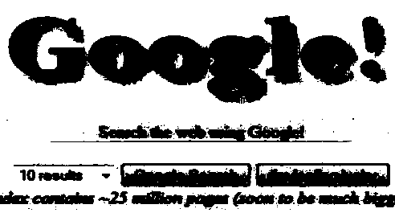）。虽谷歌迷恋极简，布林仍坚持保留，意在炫技。2007 年布林称仅 1% 用户点击，年损广告费 1 亿。为品牌温度、留存人性，谷歌选择保留⁴。

### 图 11-2：1998 年谷歌首页

资料来源：谷歌和谷歌标识是谷歌有限责任公司的商标，请参见 https://about.google/brand-resource-center/products-and-services/search-guidelines/。

为何不敢碰？榜首往往非所求。我们浏览、点入、发现不对、返回、再选。谷歌也无奈：搜“预测机器”点手气不错进官网，想买书、看摘要？谷歌不知你心，只能给最优猜测，留判断权予你。它想做决策机，奈何无判断力，只能做预测机，剩下交给你——顺带还能点广告。

谷歌案证：决策自动化难，非不可能。撰书时，语音搜索兴起，查询更具体，谷歌能给确定性答案，甚至无需跳转。其余情况仍引导至屏幕决策。Alexa/Siri 同理。流程类 Ada：机器观察选择，更新预测，人是系统关键齿轮。

预测准、判断清、动作明 → 自动化；否则人工介入。称“例外判断”。沙恩言：背景目标明确时 AI 高效⁵。常规做法：新情况引入判断；极复杂时 AI 建议或成累赘。

我们已能为常态编码判断，自动化获益。非常态无法穷尽编码。与其强求全自动，不如混合方案：超出编码范围，机器识别异常、移交人类裁决。

总结：AI 预测不完美，降险双策——赛前：研判突发、预设机器动作；赛中：遇低置信度或未编码场景，人类接管。预测越强，越需投入人力做这两项判断。即：例外处理需人机协作系统设计。

### 判断规模化的责任归属

预设标准可全自动决策。刷卡瞬间，算法链已决定过拒。判断在百万决策前完成，编码规模化复用。机器不决策，但改变决策者——无论是临场拍板者，还是预设标准者。

这揭示“机器解雇”论的冲击源。机器无权雇解。是人（或群体）设定标准、调用预测、做选择。凡因“机器”失业，实因有人为机器编程。

为何易怪机器？究其本质皆为人为。讽刺的是，哈耶克言资本主义赋予个体判断决策权；蒙福德观察：机器中立，因资本主义之弊显恶名⁶。实则掌权者是将判断编码入机器者。他们负责，法制监管当识此理。

自动化模糊责任主体。编码判断让单一决策具超常规模。我们必须知晓“谁在负责”。无责任界定，何以问责？从即时判断转为预编码、远程决策，新系统设计势在必行（详见第十三章）。

反驳“机器掌权”后，转向 AI 另一面——反馈。预测机即学习机。可持续学习、自动更新，随环境演进，此乃核心价值。但涉权力时，领跑者借此固化优势，追赶愈难。AI 采用者的累积权力，是下一议题。

### 核心速览

- **机器不决策**。然而，AI 让人误以为机器在决策。一旦判断可编码，机器貌似决策。AI 生成预测，机器凭编码化的人类判断执行动作（决策）。
- **AI 预测不完美**。降险双策：其一，部署前研判突发、预设机器应对；其二，部署后若预测置信度不足或遇未编码情景，人类介入（人类参与决策）。
- **机器虽无权，却能规模化造权、重新分配权**。基于 AI 的系统将判断与决策分离，支持不同时空提供判断。若判断从单次部署转为软件编码，将引发市场份额变迁、规模扩张、权力转移，决策者从“临场判断者”变为“编码判断者”或“掌握嵌入判断系统者”。

## 第十二章

### 权力的聚变

既系统创新艰辛，为何不让对手踩坑再抄作业？因 AI 赋予先发优势。AI 会学，部署越早学越早，学越多越准，越准系统越强，飞轮高速转。故 VC 敢激进投早期 AI。学习源于数据，先发优势源于数据反馈环。

医药 AI 公司 BenchSci，志在压缩研发周期。痛点：海量文献与内部库中大海捞针。推进临床试验需实验，BenchSci 觉：若能从既往实验获洞见，可减实验、提成功率。

用 ML 读文献、分类、出洞见，BenchSci 让科学家以半数实验推进临床。从文献觅得生物试剂（影响测蛋白表达的关键工具），免从头摸索，大幅缩短候选药生产周期。望年省 170 亿美金。在研发回报率极低的行业，或改市场格局；加速上市，更可救命。

瞩目之处：BenchSci 做的正是谷歌在垂直领域的复刻——搜索。无 ML，BenchSci 无法解读海量生物医学文献、以省钱方式服务客户。如谷歌助你修洗碗机免跑图书馆，BenchSci 助科学家免实验锁定试剂。昔日：谷歌/PubMed 搜几天、读几天、订购测 3-6 种试剂定夺耗周；今朝：BenchSci 搜分钟、测 1-3 种定夺。测试少、耗时短。

BenchSci 需惧谷歌竞争吗？看能否筑护城河，端赖 AI 数据属性¹。

### 数据与预测业务

洞悉 AI 时代竞争，先解如何产出更优更廉的预测。无魔法棒，需识别管理预测生成要素及串联数据。

预测业务本质：搞到更好更廉的算法与数据。源头何在？先算法。训练模型需输入（如图像）与输出（如描述），故需训练数据。训练数据质量定算法起跑线。企业难点：自建（雇专家标注）或外购（如健康档案）。

训练数据仅是起点。AI 异于他工具，在于越用越强。从反馈学：收数据、做预测、验结果。验准增信，验偏修模。

环境变致模型需新数据重训。导航适应路况人口流动，广告跟随消费习惯。模型会旧，预测随时间衰退。

新训练数据虽可解，但动态环境下，持续用反馈数据更新或为上策。反馈数据源于持续测量预测表现。需独立采集准确性相关信息，匹配原始输入，合成反馈数据以更新算法。

例：手机 Face ID。初训后，虽戴眼镜、留长发、化妆，免重训。这些变化降低“你是主人”预测可靠性，故手机会

## 第五部分
### AI颠覆的本质

### 第十三章
### 伟大的“脱钩”：从洞见到决策

问：“你们的 AI 能为客户带来什么？”
答：“提供深度洞见。”

如果每当创业者在实验室导师面前给出这个回答，我们就能收到 1 美元，早就财务自由了。

对我们而言，“洞见”是个危险信号，它暴露了一种思维误区：到底怎么用 AI 创造价值？对于一项新预测能力，“洞见”往往潜台词是：“我们拿这预测能干啥，心里没底。”

正确的答法，是描述该预测如何优化决策。只有能催生更好决策，AI 才有价值。这意味着，从 AI 挖掘价值的新机遇，全在于它如何改善决策。

好消息是，决策无处不在。决策赋予了 AI “通用”属性，使其成为通用技术。且对优质决策的需求正暴涨：据估计，1960 年仅 5% 的工作需要决策力，2015 年已超 30%。这些岗位薪酬更高，对学历、技能、经验门槛也更严。

AI 预测能提升决策价值，将“洞见”转化为“更优决策”。但关键不在“要不要做”，而在“谁能抓住这新决策良机”。

### 决策的核心：判断力

“若给你一瓶药，9 粒治愈头痛， 1 粒致命，你敢吃吗？”

芝加哥公牛老板杰里·莱因斯多夫曾向乔丹抛出这假设。大多数人会说“不”。现实决策是：脚伤未愈的乔丹，要不要在第二个赛季强行复出？医生警告：上场有 10% 再次受伤、毁掉职业生涯的风险。乔丹觉得：90% 的概率一切安好，值得赌一把。于是有了开头那道“吃药”题。

乔丹的回答是：“看头痛有多疼。”

这回答揭示了核心：**决策不只看概率（预测），更看回报（判断）**。这里的回报，是个人对“头痛之苦”与“治愈/死亡”的权衡。这种衡量“事有多重要”的能力，就是判断力。

为直观区分预测与判断，我们用决策树复盘“吃药”困局（见图 13-1）。树根分两叉：吃药、不吃药。吃药下又分两叉：治愈、中毒身亡。叶子节点是最终结局：舒服、头痛、死亡。不吃药无不确定性，必然头痛。

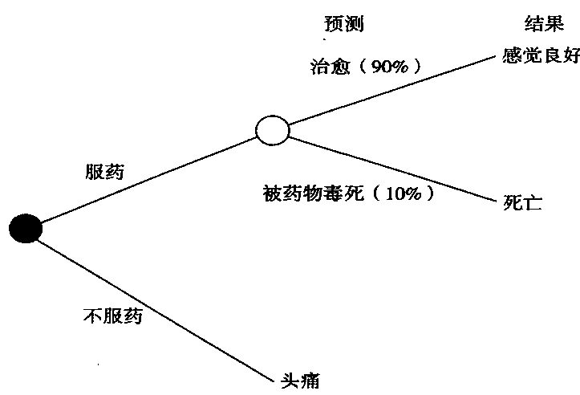

### 图 13-1 迈克尔·乔丹“服药”决策树

结果排序简单：舒服 > 头痛 > 死亡。但 10% 死亡风险，能否被“舒服”抵消？光列结果不够，正如乔丹所言，必须量化“头痛有多疼”、缓解后获益几何。这种**定夺轻重**的能力，即判断力。

假设极端是为凸显决策结构。真实博弈在“复出还是休养”（见图 13-2）。我们在结果上标数值，量化判断。决策树结构不变，但有了数字，决策即可计算：休养确定得 -10 分；复出则 90% 拿 100 分，10% 亏 -2000 分，期望值 = 0.9×100 + 0.1×(-2000) = -110 分。-10 > -110，理性选择是休养。

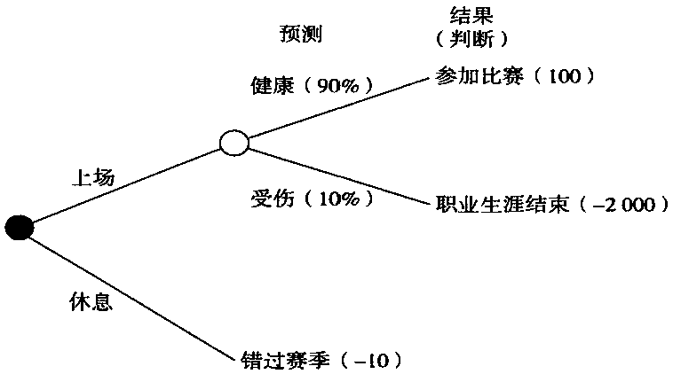

### 图 13-2 迈克尔·乔丹“复出/休养”决策树

但乔丹与老板对判断产生分歧。乔丹坚持：复出值 200 分（对个人/球队），报销仅 -1000 分。若此判断成立，复出期望值 = 0.9×200 + 0.1×(-1000) = 80 分，远超休养。关键在于：**双方对预测（医学概率）无异议，分歧全在判断（价值权重）。**

---

### 何为“最小可行性预测”

先行者红利的大小，取决于入场门槛——**最小可行性预测**（MVP）门槛有多高。

工业时代，工厂要造到“最小有效规模”（MES），单位成本才具备竞争力。规模越大、成本越低，直到触及临界点。AI 领域同理，只是度量衡变了：规模靠**训练数据量**，门槛看**预测准确率**。

要在市场存活，预测必须达标。达标线可能由法规划定（医疗诊断准入）、易用性倒逼（邮件智能回复需多准才不碍事）、或竞争对手定调（搜索引擎想挑战谷歌、必应，准确率得过多高线）。

写准 AI 代码不烧钱买厂房设备，软件非资本密集型，**核心壁垒是数据**。凑够数据达标，耗时费力。先发优势大小，取决于“刷到及格线”有多难。

早期网络搜索，用户容错率高，给一堆链接让人自己选，出个不相关链接无伤大雅。于是百花齐放，竞争白热化。反观自动驾驶，容错为零，必须比人更靠谱才敢托付性命。首家达标者初期几乎无敌，因为数据量门槛极高。抢跑至关重要：一旦跨过 MVP 线，就能开启预测回报飞轮。

但若市场增速极快，这波红利转瞬即逝。后入者只要凑够数据跨过门槛，即可入局。**MVP 门槛本身，锁不住长期霸主地位。**

原因在于技术层面的**数据边际收益递减**：第 10 条样本的信息增量，远超第 100 条，更遑论第 100 万条。数据堆得越高，单条样本提升精度的作用越微弱。

要把数据变成**长期护城河**，先行者得借力更强的经济引擎：**反馈数据**。实战中收集反馈，直接打磨预测，让追赶者望尘莫及。优势不在“别人发布不了”，而在“发布后我能持续收割反馈”。

发布预测还能倒逼算力、人才投入，充分榨取数据价值。早期玩家厮杀越烈，互补资产投入越猛、质量越高，后进入者越难撼动。技术密集型行业常现“早期霸主长期统治”：成熟巨头持续迭代，后来者想在性能、安全、性价比三维追平，学习与研发成本高得吓人。商用飞机领域，昔日多雄并立，如今想造个能跟波音、空客掰手腕的新厂商，砸进去的可能是数千亿美金。

伦敦政经教授约翰·萨顿在《技术与市场结构》中列举医药、半导体、液相色谱等无数案例。技术迭代推高了 MVP 门槛（萨顿称“内生性沉没成本”），形成长期市场势能，让先行者坐享巨额超额收益。

在线广告与搜索即是活例。谷歌对“谁在何时想要什么”预测极准，远超黄页报纸，从而精准投放广告。广告与购买行为挂钩，构建反馈闭环：系统知晓每次预测对错，实时更新模型，筑起新入局者难以逾越的高墙。虽 90 年代搜索入场门槛不高，但谷歌持续加码算力、人才、数据，硬生生把今天的门槛抬到了天上。

### 快速反馈：护城河的加速器

能早日把 AI 推向市场，就能率先收割客户数据。数据让预测更准，催生正向飞轮，筑高竞争壁垒。**反馈循环越快，先发优势滚雪球越猛，数据持续产出更优预测。**

这让预测机器拥有了人类传统优势——**从结果中学习**。AI 从学习中获益多寡，取决于反馈延迟。预测人寿保险死亡率，反馈滞后数十年，循环太慢，早期领先优势难维系。但若预测生成后能极速获得反馈，早期领先便能随时间放大，化为持久竞争优势。

2009 年微软推必应，倾全力扶持，砸入数十亿美金。十余年过去，搜索量与广收双双远逊谷歌。核心拦路虎：**反馈循环太快，先行者优势已成护城河。** 搜索场景，预测（展示链接）到反馈（用户点击）仅几秒。谷歌运营 AI 搜索多年，拥有海量用户、日均数十亿查询，持续收割数据、高速感知偏好、实时覆盖新增网页。每次查询，谷歌给 Top10 预测，用户点选即完成标注，模型随之在不断膨胀的搜索空间持续进化。凭借更多用户数据，谷歌识别新事件、新趋势比必应快得多。**极速反馈循环 + 持续投入互补资产（如超算中心），锁死谷歌王座，必应永无翻身日。** 连 DuckDuckGo 这类为隐私放弃个性化的小众选手，也只能守住细分阵地。

快速反馈循环加剧竞争：对手若已受益于飞轮，其预测会极速迭代。这放大了萨顿笔下的“内生性沉没成本”——落后太多，追赶成本将高到无法承受。设想首个能穿梭纽约街头的无人驾驶 AI，获批上路后持续收割数据、越跑越聪明。第二个获批时，数据量级与质量全面落后，表现大概率更差。无成本优势、预测质量又弱，次优 AI 对消费者吸引力有限。

因此，**快反馈 → 激烈竞争 → 先行者优势巨大 → 企业疯狂抢跑**。这解释为何对“看似不成熟”AI 砸重金合理：通用汽车约 10 亿美金收购 Cruise，虽对方仅有原型车、数十员工。为何豪赌？因为一旦跑通，在快反馈与内生沉没成本双重加持下，后来者追赶难如登天。

### 差异化：逃离同质化红海

竞品常有差异，吸引不同圈层。可口可乐 vs 百事可乐（口味/品牌），宝马 vs 奔驰（风格/功能）。差异让市场容得下不止一家，甚至百年后红牛、诚实茶仍能切分蛋糕。

AI 亦然。**不同场景对“更好”的定义不同。**

企业想用聊天机器人替人工客服。机器人“够用”后，“更好”有N种定义：A 公司要高效秒回；B 公司要查询转单、创收；C 公司要安抚情绪、化解怒火。**定义“更好”的维度不同，留出了无数细分赛道**，小企业也能在利基市场活得滋润。

黑色素瘤检测同理。欧训 AI 依赖白人数据，亚训 AI 用亚裔数据。**对白人欧 AI 更准，对亚裔亚 AI 更准。** “更好”虽指“更准”，但环境变了，准不准也就变了。

但很多 AI 只能靠**预测质量高低**说话。质量可度量时，同其他行业一样，最高质量者享更高需求。传统行业高质伴随高成本，劣质品靠低价生存。AI 不同：**软件零边际成本，跑顶级模型与跑劣模型成本一致。** 既然好坏同价，谁买差预测？

谷歌数据多、受益快反馈，但这还不够成绝对优势。用户心知肚明啥叫“更好搜索”。常见查询（如“天气”），谷歌必应结果如出一辙。必应翻车在**长尾查询**。搜“颠覆”（写书时），必应首页仅给字典义，谷歌却同步给出“颠覆性创新”研究链接。虽必应部分追平，但无一维度能**全面超越**谷歌。搜索里“更好”=“用户更爱点、更爱停留的链接”，这标准对所有人统一（虽最佳链接因人而异）。**预测目标明确 + 快反馈闭环**下，必应在差异化上突围不足，难分羹。

### 刻意设计反馈系统

反馈闭环非天然形成，需**精心构建**。能预测反馈价值的 AI，才能确保采集到结果数据。

第六章提到的“个性化学习推荐 AI”，预测学生当天最适合学什么，实现因材施教。我们讨论过师资配置、社会发展等系统级难题。反馈视角揭示：还需更深层系统重构。AI 需知学生掌握否、投入度如何，且**越快拿到反馈越好**。挑战在于：如何设计课程，既保深度理解与长期记忆，又能以“分钟级”而非“期中考级”频次产出高频反馈？这要求打破获取学生数据的监管壁垒，在护隐私上同步技术突破。同点解决方案（仅做预测）不同，**行业级 AI 先行者的力量源于反馈**。AI 必须拿到结果数据才能学习。

自动驾驶 AI 需事故数据，每个系统都会保底采集。幸好事故稀少。为稳健运行，更需**“未遂事故”数据**。此类数据越多，学习越快。这套系统得能识别险情，再建立避险学习机制。光避事故不够，乘客舒适度也是指标。**能为先行者造势的系统级方案，必然从多维结果指标的度量与学习中受益。**

### 赢家通吃的底层逻辑

预测机器潜力巨大。反馈飞轮赋予先行者真实红利：早入 → 多据 → 好测 → 多客 → 更多据……飞轮一转，大规模部署竞赛打响。

但切记：**预测如精密零件，高度适配特定目标与环境。** 企业哪怕只在目标、环境上微分化，也能开辟竞争空间。魔鬼藏在系统收集、使用数据的细节里，天使也在其中。

### 核心洞见回顾

- **抢跑即抢学习权**。系统级 AI 创新虽难，但理由充分：AI 会学，早部署早学习，越学越准，系统越有效。
- **软件零边际成本，飞轮一转优势指数级放大**。模型建好，再产出预测成本趋零。初期略胜一筹 → 吸引更多用户 → 收割更多反馈 → 预测更准 → 再吸更多用户……飞轮启动，微小初始优势随时间膨胀为统治级护城河。巨大回报倒逼企业疯狂抢跑。
- **反馈机制决定系统架构**。要让 AI 学会，必须拿到结果数据。如教育 AI 要推“下一步最优内容”，就得重构系统，以分钟级高频采集“掌握度”与“投入度”，而非沿用期中考等低频反馈。点解决方案（仅预测）不够，必须系统级重设。

乔丹最终“妥协”复出，却被莱因斯多夫严格管控上场时间。那个赛季公牛队虽挤进季后赛，却以30胜52负的惨淡战绩，成为NBA史上闯进季后赛战绩倒数第二的球队。首轮对手是拉里·伯德率领的波士顿凯尔特人，后者最终捧起总冠军奖杯。然而，在东部首轮第二场，乔丹狂砍63分，刷新了NBA季后赛单场得分纪录，该纪录至本书成书时仍无人打破。

### 人工智能预测迫使人们做出明确的判断

乔丹与莱因斯多夫的分歧，源于他们拿到了医学专家的诊断——本质上是一种预测，且无人有资格质疑。但请思考：现实中有多少决策是在缺乏明确预测的情况下做出的？后果如何？消防员在火场瞬间抉择救谁，既要权衡救援成功率，又要考虑被困者身份（如老人与儿童）。他们的决策虽果断，但对不同结果的权重分配往往是隐性的。我们评价决策优劣，实则是综合多重因素的结果。

人工智能预测正将这“隐性的一环”从决策者手中剥离。AI预测导致**预测与判断“脱钩”**（见图 13-3）。

这并非课堂假设。麦肯锡关于保险业未来的展望即建立于此。文章描绘2030年车险图景：你上车，数字助手规划路线，后台AI预测事故概率，你基于判断做选择。

假设你在温哥华出差，住市中心萨顿酒店，要去不列颠哥伦比亚大学。两条路：沿海观光路（经基斯兰奴海滩、杰里科公园、西班牙海滩，风景绝美，稍慢但不误事）；西四街直达路（枯燥但高效）。

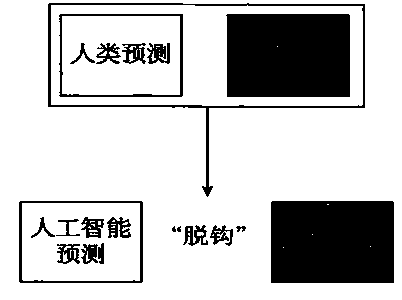

### 图 13-3 人工智能预测导致预测和判断“脱钩”

关键在于：观光路行人多、景色美，极易分心，剐蹭概率更高。假设租车配有AI系统，它精准告知观光路事故概率，你需运用判断力权衡“值不值”。理论上你可画决策树、算期望收益，像乔丹那样理性计算。但现实中**没人这么干**——太繁琐，那是学院派做派，实战零用处。

转机在于：AI助手不给概率，给**价格**。它直接说：“走观光路，保费加1美元。”

这看似微不足道。司机凭价格选路，价格背后是事故率与维修成本，对用户不透明。AI算概率、派成本，用户只见价签。**机器负责预测，人类负责判断**——只需判断这1美元值不值，小事一桩。

这已悄然融入生活。许多车险按分钟驾驶行为定价，装远程信息处理App者享折扣，默认其驾驶习惯良好。特斯拉更进一步，用车载数据直接算安全分（急刹、跟车过近等）。“行为基础保险让保费更低，路也更安全。”

预测与判断“脱钩”了：保险公司为风险行为定价，用户判断值不值得买单。

保险案例揭示：判断可与预测分离，而人类天生擅长判断，这正是经济学所谓“显示性偏好”的内核。通过决策窥见偏好，营销界玩了几十年。

1971年，保罗·格林与维塔拉·拉奥发表《用于量化判断性数据的联合测量法》，开创评估消费者需求的新工具。文中直指痛点：“量化管理者或消费者判断，向来是营销研究的难题。”核心在于搞清买家如何在冲突标准中权衡。方法是让消费者对假设选项排序，选项虽假但极简熟悉。

例：三张折扣卡。A卡14美元，10店铺5%折；B卡7美元，5店铺10%折；C卡21美元，10店铺15%折。通过排序，统计学家能算出每张卡在消费者心中的隐性价值。**选择即判断。**

此后该法不断演进：评估意香肠、夏威夷披萨、福特卡车、丰田轿车的价值，甚至探究中国博士留美还是回国的偏好。用“波士顿私企科研岗7万美元”对“北京公共部门管理岗5万美元”，即可测算学生对中美生活价值的相对判断。

这套显性偏好框架在经济学有深厚根基。源自丹尼尔·麦克法登70年代初的诺奖研究，衍生出超市扫描数据、在线点击流测需求等现代工具。

15年前，领军经济学家可能是帕特·巴贾里。现为亚马逊核心AI副总裁兼首席经济学家。入职前，他任职哈佛、斯坦福、杜克、密歇根、明尼苏达等名校，是世界计量经济学会院士，著作标题晦涩如《针对各种消费者与无人留意的产品特征所做的需求估计：一种享乐主义的方式》。满纸符号公式的他，谁想到会把亚马逊打造成全球最大经济学博士雇主之一？

这靠导师与领袖风范，更靠论文直击业务核心。需求估计是亚马逊命脉：搞清用户看重什么、愿付多少钱。若知用户价值判断，便能在对的时间、对的价格、推对的货。营销研究与计量经济学都有估算工具，巴贾里带队，亚马逊经济学团队攻克了**大规模量化判断**的难关。

一旦认清“决策即判断”，便发现人类从未停止判断。我们本擅判断，只有当判断与预测“脱钩”，判断才显得陌生。

### 判断的机会

“脱钩”造就良机。决策不再拼谁预测判断两手抓，而拼谁善用AI预测做判断。

AI给出预测后，判断力最强者脱颖而出。如前所述，AI在特定领域预测精度已超越多数放射科医生。关键在于：AI训练不依赖医生标注，而直接匹配影像与病理确诊结果（如是否恶性肿瘤）。科斯拉断言：未来放射科医生若不借AI预测，或构成医疗事故。

那么，AI预测如何重塑放射科医生的判断价值？美制下医生不知患者全貌。若AI报“恶性概率30%”，什么情况下系统采信医生“需治疗”判断，什么情况下采信“不治”判断？极难想象。推测未来：专家委员会在机器预测前讨论立规则，委员会判断大规模落地。放射科决策被拆解为：**机器预测 + 委员会判断**。

新系统应运而生：利用更好、更快、更廉的预测，配以更得当的判断。《AI极简经济学》曾探讨亚马逊“先发货后下单”模式，Stitch Fix在服装界已践行。CEO卡特里娜·莱克言：“融合数据机器学习与专家判断，实现独特个性化选品。”不止于此，时尚业库存成本高，数据科学团队开发算法，将补货决策与需求预测结合。

第十一章指出：机器无权，因决策所需判断终源于人，纵使机器执行决策。下章将深挖“脱钩”后的判断技能，解释为何“脱钩”改变了决策合适人选。其核心机遇：**强化判断相关技能。**

### 本章要点

- 预测与判断是决策双引擎。决策树中，预测生成分支概率，判断赋予叶节点收益。平时决策两者混于一念，感知不清。引入AI，预测外包给机器，**预测与判断“脱钩”**，判断主体随之易位。
- 我们常不假思索就决定，实则每次决策都隐含预测与判断，只是未显性拆解。

## 第十四章

### 从概率的角度思考

2018年，Uber自动驾驶车在亚利桑那坦佩撞死行人，这是自动驾驶首起致命案。媒体引述普林斯顿教授警示：敲响警钟，查系统，确保必要时自动刹车。坦佩警长却说：“看行人走位，这事故难避免。”

Uber会编程撞人？不可能。车盲了？也不对。撞击前6秒，车检测到未知物体；识别出可能是人时，急刹已不及。

**两种解释都错，因它们是确定性的。** 车识别出物体，且赋予“是人”极低概率。若更早判定高概率是人，便会刹车避祸。事故报告显示：车以极低概率（非零）探测到行人。且编程逻辑是：只要“非人”概率未超高阈值，就继续行驶。阈值或为0.0001%或更低，但绝非零——机器不工作在绝对零概率上。

这是可怕的结果：车觉得“撞人概率不够高”就不刹。要认清这是错决，极难。事后Uber暂停项目，半年后重启：限速25英里/小时、双安全员、三方监管、新刹车逻辑。**基于阈值的旧决策失效了。**

### 赌徒思维

区分“烂决策”与“烂结果”至关重要。好决策也可能导致烂结果。职业扑克手安妮·杜克在《对赌》中强调此点。她是NBC全国单挑赛史上唯一女冠军。扑克兼需运气与技巧：完美打法可能输，烂牌梭哈可能赢。

杜克主张：事败时反思——是决策烂，还是运气背？运气背则归类“烂结果”翻篇；决策烂则复盘下次做对。

太多业余玩家：一输就换策略；赢了烂牌大注，便拿结果当下注依据。杜克称此为“结果导向”，久之水平退步。若分不清运气成分，不确定性便成吸取教训的拦路虎。

乔丹1985-86赛季末复出未伤，得最好结果。无论职业生涯报销概率与收益如何，结局完美。此后6冠5MVP、吸金26亿成史上最富运动员。这些结果让人误以为“复出是对的、甚至该更早”。**但没伤不代表决策对。**

赌徒思维要求：承认预测不确定，懂结果含运气成分。这很难。自动驾驶前，预测判断全在司机脑中。人撞人，我们不知是预测失误（觉得撞人概率极低不刹车），还是判断失误（赶时间低估风险）。出事了，默认判断对、预测机械出错。社会似能容忍。

设计自动驾驶，预测误差可测，但判断须量化——做些不愉快的事：给生命定价，拿乘客体验做交换（过度谨慎频繁刹车很烦人）。大家暗地里权衡，摊开来谈却拒绝。让工程/伦理团队替自动驾驶定夺，同样别扭。

### 接受不确定性

赌徒思维即**拥抱不确定性**。衡量发生概率，高则左、低则右。决策规则显性化，依预测而动。预测若极准，此法极效。回溯乔丹抉择：医生若说“绝不葬送生涯”，双方秒定。难就难在预测有不确定。乔丹觉得90%把握够用，莱因斯多夫不认。

用“置信度”决策颇具吸引力。如难民审批：充满不确定。评估员凭陈述判断可信度，及拒批后依《难民公约》是否受害。材料少、反馈稀、极少知晓过往决策对错。

当下评估员凭直觉硬抗。学者讽刺：“有人觉得直觉即真理，直觉说撒谎，那必撒谎。”**这自信是假的。** 若有预测工具给“撒谎概率”，决策质量将升。目标是改善结果，非提高通过率。

目前无结果数据，不知接受/拒绝是否达预期。需造预测机，跑未来案例。有了机器，证据评估更自信。例：加拿大案，德国女申请人称遭儿子学校迫害、警方不管。德警响应数据充足，可信预测警方会护她，满足申请。评估员也确信：证据支持也门LGBTQ活动家、苏丹少数族裔申请。

但也存不确定：警方是否管家暴、个人处境是否引政府重视，常因信息缺失而模糊。**数据缺口=不确定性=抑制过度自信。**

评估员须运用判断：权衡不确定预测与申请标准——哪错更重？拒真难民，还是收假难民？看似简单，实则惊心。拒真致迫害致死；收假被钻空子。依《公约》，收假是“严重错误”，拒真则是“大错特错”。

预测判断“脱钩”下，最强AI仍存不确定。若机器接纳预测固有不确定性，更多申请将获批，拒批成本极高。

现行体制非此运作。对评估员，给不确定性的预测机没用。他们未受训解读不确定，法律对错漏严重性也模糊。即使受训，也难嵌入现流程。全收不确定案件，恐引政治压力、致难民目标落空、诱发隐瞒信息。AI虽有潜力重塑公正流程，**体制不变，寸步难行**。新系统核心之一：**显性化判断，量化错漏相对风险。**

### 判断力缺失限制了人工智能

判断即表达需求。但遇新环境、新信息，你真知需求？对难民官，如何解读“40%合法性”？过往他们将预测判断合二为一。对许多AI新场景，**脱钩后的判断尚不存在**。因无预测能力，无法按预测行动，进而无从知晓行动回报。

这形成“先有鸡还是先有蛋”死结：**阻碍预测机器采用与新AI系统构建。** 只有知晓信息用处，投资更好预测才有值；只有预期有更好预测，才会构思有预测后怎么干。**缺判断力，不愿投预测；反之亦然。**

### 找寻判断

判断可通过**事前推演预期结果**建立。研习、评估、向他人学，可推断不同情境下的可能结果。我们大多如此学会“不碰热炉子”。有人告诉你会烫，你未亲历痛楚便懂得判断。判断被传递，**好处是规避试错高昂代价。**

部分读者或存疑。孩子被禁足无数事，多无严重后果。叛逆者会去摸热炉子，痛过方悟。**你通过亲身经历学到了。**

# 判断力的构建：从规划到实战

你做出抉择，随即收到反馈，结果会直观揭示不同路径的代价与回报。在多元环境中不断试错，阅历愈深，前路愈明。这些实战沉淀出的判断力，终将指引你未来的行动。

判断力的养成主要有两条径：一是有计划地向外求索，如阅读名著、接受导师指点；二是于实战中体悟真知。下面我们逐一拆解。

## 详细规划

若能低成本、高质量地获得预测，经验判断的形成将事半功倍。但若预测本身需要前期投入与研发呢？开发完成后单次预测成本虽低，但数据获取、模型训练与测试的沉没成本却不容小觑，必须论证其必要性。我们需要推演：若拥有预测，决策图谱将如何改写，即预判结果并提炼判断，这步必不可少。以风投为例，他们在高度不确定性中押注初创企业，入局前便会推演：上市退出好，还是并购退出优？

常人直觉上倾向于多研究高频场景的后果。然而，决策的关键不在于预测能否区分“常态”与“罕见”，而在于它能否识别出**截然不同场景下该采取的差异化动作**。

以信用卡反欺诈 AI 为例。刷卡瞬间，算法裁定通过或拦截。拦截理由或为额度耗尽，或为疑似欺诈。网络方必须拦截可疑交易，因盗刷损失由其承担。但信用卡业务的命脉在于“便捷”，误伤合法交易则得不偿失——持卡人一怒之下可能转投竞品。

算法输出一个欺诈概率分，但如何据此行动，需判断力介入。这判断不在商户，甚至不在人工客服，而是预埋在系统代码里，自动化执行。难道别无他法？

这意味着必须**决策前置**：由专家委员会提前想清楚如何将“分数”转化为“动作”。若分数非 0 即 100，判断自然无用武之地。现实是设定阈值：超阈拦截，低阈放行。绝大多数交易分数低、直接通过，这也是早期由商户自行判断的原因。

阈值的设定，是为了平衡两类错误：
1.  **漏放欺诈**：成本可控，历史数据可算。
2.  **误拦正常**：成本隐性且高昂。高净值客户一旦受挫，极易全盘流失。因此判断须结合“客户画像”与“欺诈分”交互。常旅客的消费模式多变，预测难度远超常规用户。

可见，多维考量让预设判断变得极其复杂。这些逻辑必须显性化、代码化，才能自动化落地。自动化倒逼我们在决策前审视“判断什么”。这种复杂性，正是 AI 系统落地的拦路虎。决策主体已悄然易位：从商户凭经验判信用，变为持卡机构凭实时预测、大规模精细规划来裁决。

## 经验之旅

实战磨砺判断，优化决策。但过程未必顺遂。你是否经历某事，取决于“发生了什么”与“你是否知晓”。误触热烤箱，你获取经验并推断后果，但代价是意外受伤；若因恐惧从不触碰，便永远不知后果。这非贬低规避策略，而是揭示：**你的选择边界决定了经验的边界。**

设想两种选项：“现状动作”——你熟稔的路径，收益确定、波动为零；“探索动作”——从未涉足的领域，如雇佣非标准人才、投资不符合论调的初创项目。即便有预测信息辅助，你可能仍难评估探索值不值得。

于是陷入两难：不知如何用信息，便不愿付费买预测；无预测指引，只能守着现状，永不解探索之谜。**建立判断的“先有鸡还是先有蛋”困局，正是 AI 系统构建的核心门槛。**

若 AI 方案回报率足高，投资判断力建设便划算，死局或可破解。擅长通过经验或规划建立判断的人，未必是当下掌握决策权的人。

## 适用于一切的 FDA

用药反应因人而异，良药也有副作用，药效本质是概率。百年前江湖郎中满街跑，概率性疗效阻滞了药品市场。直至 FDA 式监管确立：用随机实验验证总体获益>风险，并细分人群（如疫苗先批成人、后批儿童）评估收益比。

当我们要用概率系统取代确定性系统，无监管领域也需引入类似机制。考驾照只考技术，不考判断力；未来自动驾驶 AI 需专门监管机构测试其是否达安全线。同理，银行贷款 AI、人机协作仓储机器人，皆需类 FDA 机构按框架验证合规与安全。

制药业因概率性难验证，反而受益于监管红利，向公众兜底“总体获益>风险”。我们迈入 AI 无处不在的新纪元，系统从确定性转向概率性，**几乎万物皆需一座“FDA”**。这些监管节点将嵌入新系统肌理。

## 谁是合适的裁决者

谁掌判断、如何得判断、如何落地为决策（阈值或复杂逻辑），是 AI 系统设计的基石。回顾：AI 预测让“预测”与“判断”**解耦**。你不再需要“懂预测又懂判断”的复合型人才，而需分别指派：谁获取预测，谁定义预测如何用。预测可能流向单一算法（内嵌预设判断触发阈值），也可能分发给万千司机（导航路线自主裁决）。

这种重构具有颠覆性，伴随阵痛。但机会已现：先“解耦”，再“觅得其人”。新裁决者未必是旧决策者，他们需具备“赌徒思维”，拥有规划能力、实战阅历或构建判断的机遇。

## 本章要点

- **AI 注入概率思维**。传统调查问“你看见行人了吗”，期待是/否；AI 回答“有 0.01% 概率有人入路”。引入 AI，系统常从确定性转为概率性。有的系统原生兼容，有的需重构才能释放生产力。
- **判断力是预测变决策的桥梁**。人工决策时代，判藏于心不显性；引入 AI，必须显性编码判断。判断源自“传授”或“经验”。无现成判断，不愿投资 AI 预测；无 AI 预测，犹豫投资判断建设。**鸡蛋难题，阻滞重构。**
- **系统级方案=预测+判断+监管**。系统不再强制编码，全场景表现未知。借鉴制药业 FDA 经验，需监管功能按框架验证机器决策，向社会兜底“获益>风险”。这是概率系统落地成败的关键。

---

# 第十五章：新的裁决者

铅是神经剧毒，损害儿童脑发育。60 年代退出油漆，70 年代退出汽油，存量管道却仍埋地下。1986 年美禁含铅管道，但老管寿命百年，不换便持续害人。密歇根弗林特市变更水处理工艺，铅含量飙升，换管迫在眉睫——官方不知哪根管含铅，逐根排查成本高企。

不确定性孕育预测良机。密歇根大学两教授埃里克·施瓦茨、雅各布·阿伯内西应战，构建 AI 预测含铅管道，落地弗林特。仅对 AI 判定高风险的住户排查，命中率 **80%**。2016-2017 年，数千居民完成换管。

但风波骤起。预测显示某社区仅一街区有铅管，邻里恐慌；贫困区居民配合度高，富裕区却因未被优先排查而愤怒。市长换承包商，强推全域挖掘，无视预测。**准确率瞬间跌至 15%**（见图 15-1）。虽让更多居民安心（挖了没铅），但换管进度停滞。AI 预测优秀，判断却被政治绑架。新项目经理直言：市政府“不想向议员解释为何选区无工程”、“不想落下任何人”。第五选区 80% 房屋有铅，却挖得最少。最终，市政弃用预测机器。

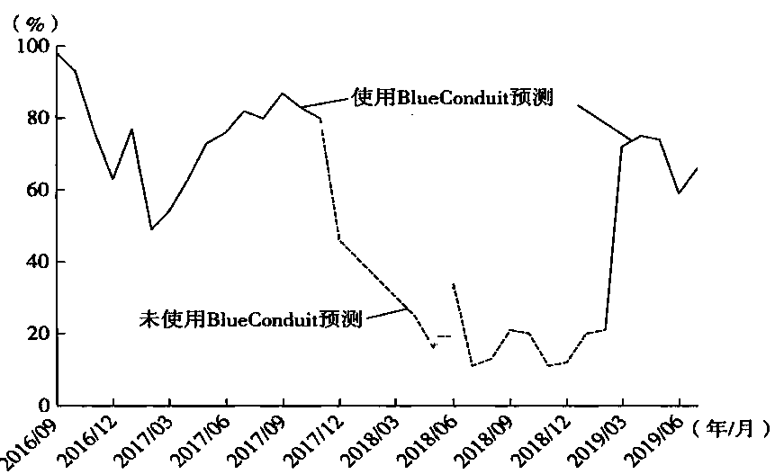

**图 15-1 弗林特市含铅管道预测准确率变化**
资料来源：根据贾里德·韦伯、雅各布·阿伯内西、埃里克·施瓦茨论文《清除铅：弗林特市的数据科学与供水系统》（密歇根大学，2020）图 3 调整绘制。访问于 2022 年 5 月 10 日。

故事未完。2019 年 3 月 26 日，法院批准和解，**强制启用施瓦茨/阿伯内西预测模型**。法院剥夺政治自由裁量权，**预设判断逻辑：全城每选区、每社区，清除铅的价值同等，唯风险高低定优先级**。准确率迅速回升至 70%，数千含铅管道被精准清除。《时代》周刊将该 AI 评为“2021 年最佳发明”。如今由 BlueConduit 公司商业化推广，已助 50 余城节资百万、清除数百万住宅铅害。

为何预测机器引发决策权争夺？因预测让政客失利，他们弃用预测；他人识破：只要确立“全民同值”判断，预测便能救命。经诉讼，决策权易主，法院预设判断，政客失权，中心化系统胜出。

**预测与判断“解耦”，即意味着判断重心可转移。** 谁掌判断，谁定乾坤。决策权应归属与实归属皆可变。本章探究：新裁决者何时登场、如何担责。

更深层看，变革引发阻力，源于权力再分配。颠覆必有赢家输家。百视达加盟商阻挠流媒体，是组织内部利益受损拒变。弗林特案中，AI 夺走政客决策权，权力流失引发摩擦，需再次转移决策权以消摩擦。**改变“谁决策”，即改变权力版图，这本身便是采纳新系统的最大隐患。**

## 谁有权做决策

法院以优先级清单取代政客判断，改善了民生。动机各异，当预测机器改变决策时空，良机乍现。

商业界，决策权归上层还是一线，核心标准是：**“谁能以最低成本为组织做最优决策”**——即效率。分配决策权的考量：
1.  **信息优势**：一线经理掌握部署资源的一手信息，上报耗时耗力，决策权下放更优。
2.  **技能门槛**：决策需理解信息、预测、判断，非人人胜任，按能分配。
3.  **激励对齐**：决策应符合组织利益，但人受偏好驱动。利益可用激励校准，若难量化，则选利益更一致者掌权。
4.  **协调跨度**：销售、生产需联动。懂跨域关联者捆绑决策，虽牺牲信息/沟通效率，换取整体协同。

授权即赋权：定资源部署、选信息输入、代表谁的利益。权力带来获取超额价值的能力。你获授权，因你能创造更优价值；权力归你不归他，因“信息、技能、利益”三重对齐并非普世。

**AI 预测到来，预测与判断“解耦”。判断力成基准，决定谁能高效获授权。** AI 预测结果与使用者无关，自动失去“分配决策权”的资格。

## 决策才能

我们称技能者为“人才”。过去，好决策=好预测+好判断，难拆分。预测机器出现，聚光灯打在**人类判断技巧**上。

正如第十一章所述：好消息是判断必须源于人；坏消息是，这人未必是 AI 前的决策者。

**AI 预测何时真正改写“判断合适人选”？**
多数场景下，AI 巩固现有决策者地位，无颠覆。但部分场景，外部判断更高效。判断变革方向，看三点：
1.  **解耦重塑权力版图**，前提是“高效提供判断者”易人。有人判断增值，有人判断贬值。
2.  **非普世发生**。某些行业 AI 无影响；某些仅优化现有分析、微调流程。
3.  **关键拐点**：当“更好预测”导致“判断基准变迁”时，决策者更迭，权力重组。AI 对判断价值的冲击，取决于**决策原本对预测的依赖程度**。

伦敦黑车司机需三年背“知识”通过考核，随时规划最优路线。**预测是核心竞争力**。当机器通过 App 免费提供顶级预测……

### 重塑决策权：当预测与判断“脱钩”

此刻，对现役出租车司机而言，日常或许波澜不惊；但对于广大其他驾驶员，他们得以借助 AI 预测辅助决策，而不再单凭个人经验。AI 颠覆出租车业，核心不在于改变了出租车司机判断的价值，而在于拔高了“非职业司机”判断的价值——他们如今能在 Uber、Lyft 等平台接单载客。预测技术扩大了具备载客决策资格的劳动力池，从而重塑了决策主体。

弗林特市铅管危机中，预测同样将决策权从地方政客手中剥离，转交给法官及法律和解各方。

决策主体的更迭往往伴随阻力与质疑。以气象学家为例，他们预报温度、降水及飓风、龙卷风等极端天气，传达风险信息至关重要。美国国家气象局前局长托德·勒里科斯直言：“我们的本质是做风险评估——公众面临多大风险？我们该传达什么信息以引导应对？”

预测只是起点，若传达失效、无法驱动行为改变，精准预测也将失去意义。回溯 2011 年密苏里州乔普林市龙卷风灾害：灾前 4 小时发布预警、17 分钟拉响警报，却鲜有居民寻求庇护，最终酿成 158 遇难的悲剧。天气预报旨在助人们在险境中做对决策。

预报技术进步，反而让沟通更棘手。假设龙卷风概率 5%，预报员须权衡：短期利益（如实告知风险）与长期成本（频繁空警致“警报疲劳”，19 次虚惊换 1 次真灾）。这重塑了气象学家角色。勒里科斯指出：过去公众是直接客户，今公众成间接客户；核心服务对象转为地方政府决策者——那些有影响力的人。暴风雪前市长呼吁“别上路”，即典型场景。

换言之，气象局正转型为“决策支持”机构。作家安德鲁·布拉姆观察到：他们花更多时间向应急、工程官员解读天气概率与冲击；未来这或成唯一主业。

根源在于预测精度跃升。昔日预测失准，学校只能见雪停课；今精准预测让行动提前数天展开。

新挑战随之而来：若预报近乎完美，如何善用？如何学会用它决策？气象学界曾进展缓慢。Weather Company 高管彼得·尼利坦言：科学家曾以为“精准达乌托邦，社会自安稳”，现认清此非全貌。职能已拓展至“全价值链——从模型预测到个人有效决策”。

地方气象台对此适应良好。以暴雪预警为例：多伦多 1 英寸降雪意味着早出门几分钟刷车；亚特兰大同等降雪可致全城停摆；拉斯维加斯更复杂——预报可能仅针对西部高海拔区。精准判断需融合生活方式认知。

勒里科斯勾勒 AI 气象解决方案图景：先是“点方案”——更强预测让气象学家在传达风险冲击上更关键；继而引发“系统级变革”：

AI 融合精准预报与社会/个体数据，精准画像个人/企业风险及应对行动。设想未来：不再发布通用预报，而是推送个性化专属预报。人类气象学家会消失吗？人类判力更擅于“训练 AI 做对决策再交付客户”。

这要求洞察个体行为模式，解读预报对个人的具体含义。勒里科斯举例：拉斯维加斯东部居民无需改变行程，除非孩子在西部上学——则需预判停课及接送对策，还要考量交通工具（内华达多后驱跑车）。预测越细致，判断越微观。勒里科斯强调需“社会学家、交通专家、气象学家”跨界协作，甚至“视具体问题，气象学家可能无话语权”。若 AI 让气象学家退出核心决策圈，他们对 AI 大规模落地必存戒心。

弗林特铅管、导航 APP、天气预报三例同证：若 AI 提升决策者判断价值，其权力巩固；若贬值，则权力旁落。终局取决于决策效率。若拥有预测机器意味着信息、技能、激励、协调四要素的掌控者易位，判断权随之转移。

### 权力的（去）中心化

AI 影响权力集中度。它能规模化复制判断——直接源于 AI 预测可编码为软件、跨决策传播。从制定判断到编码自动化，规模化释放效率红利。

透视已受 AI 冲击的放射科与信用卡案例（后者详见第十四章）便明。放射科面临 AI 预测冲击，虽 AI 或优于人类，但评估影响的关键在：AI 是否改变“提供判断者”？

判断是权衡抉择后果的价值认知。借预测决策时，判断体现为对“预测失准后果”的重视度。AI 预测登场，谁懂得在预测不完美时应对？

以疑似恶性肿瘤诊断为例。放射科医师读片诊断（美式模式下不见患者，仅凭影像）。后果显性时判断易；模糊时需推断概率。漏诊（假阴性）致患者失治亡命，倒逼“宁可错杀”倾向；但过度诊断（假阳性）让健康者承受痛苦检查。终极诊断凭判断，亦凭医师自信度——怕漏诊者偏向假阳性。

放射科判断源于训练与经验，逐案施用。

信用卡网络则截然不同：算法预测欺诈，但处置判断需预置、编码、规模化应用——判断高度中心化。

两例揭示判断双源：个体为单一决策供“局部判断”；中心机制为海量决策供“全局判断”以规模化。决策强依赖局部情境或难编码时，局部判断珍贵；流程一致、局部差异次要时，全局判断高效。AI 改进预测会改变判断最优来源，故须区分二者。

信用卡史即明证。前现金支票时代，商家自主预测兑付风险、自行判断收否。信用卡网络规模化积累数据，甚至在 AI 诞生前就能预测交易可信度。早期重事后追偿，预测优化后可直接拒欺诈交易，免商家介入。更强预测倒逼判断源从“局部商家”转向“全局网络”。

放射科尚在预测并判断，判断仍居局部。但 AI 进阶下，放射科是否仍是诊断判断最优源？未可知。

放射科职能不止预测。第八章述及其 30 项任务中仅 1 项预测受图像识别 AI 直接冲击，其余涵盖体检、制定方案等判断。医学院毕业后多年培训，大头在练读片。AI 接管影像预测后，谁最适配其余工作？极可能需懂局部情境的医护人员。影像预测跃升，或让更多医疗专业人士凭判断介入，决策权从放射科医生下沉分流。

预测能强化或削弱决策权中心化。

### 判断与控制的四象限

我们探讨了判断与控制两维度。预测与判断“脱钩”或致不同人判断，或同群人判断；决策控制或趋集中，或趋分散。图 15-2 总结如下：

| 判断主体 \ 控制程度 | 更集中 | 更分散 |
| :--- | :--- | :--- |
| **相同** | 客服、招聘 | 医学影像 |
| **不同** | 信用卡、弗林特铅管 | 网约车司机、气象学 |

**图 15-2 判断与控制**

当极少数人掌握最高效判断，且 AI 指向他们应取代现决策者时，颠覆降临。支付业已见：中心化网络判断替代百万商家判断。弗林特案亦然：旧模式在数据时代失效。

判断主体易位，即使 AI 点方案也遇阻，拖延普及，延长“中间时代”，倒逼系统级方案。若既得权力者拒让位，新体系——或由激进 AI 创业者构建——将把判断权配置给最适配者。

然而，即便找到合适裁决者（第六部分详述），系统仍涉相互关联的决策链。改变单一决策执行方式，会牵动多米诺骨牌，对系统设计影响深远。

### 本章核心洞见

- **脱钩重构权力**：AI 导致预测与判断“脱钩”创造增值机会，但常需重塑系统、转移判断权。掌判断者握决策权、握权力。新设计剥夺既得利益者权力，必引抵制。
- **决策权分配四维框架**：新系统设计中，将决策权授予“以最低成本为组织做最优决策”的主体。四维考量：① **信息**——谁掌握/应获决策所需信息；② **技能**——谁具备决策专长；③ **激励**——谁利益与组织最对齐；④ **协调**——决策跨部门时，谁有跨域权威、信息与激励为全局最优。AI 注入预测后，“预测+判断”与“纯判断”的最优承接者可能截然不同。
- **编码判断引发中心化**：若判断可编码规模化，新设计或聚权。信用卡案权力聚拢至寡头网络；放射科案中，影像模式识别等核心技能助推预测集中于 AI。若放射科预测技能贬值，其是否仍是最优判断源？若非，护士、社工等训练有素者或接棒判断。

---

## 第六部分：展望新系统

## 第十六章：构建可靠系统

诺贝尔经济学奖得主托马斯·谢林，在获奖数十年前提出一思想实验：

设定：你在纽约与陌生人碰面，无约定地点、无法通讯，双方只知“须猜测对方会去处并尽量一致”。

今学生闻之茫然：“发短信不就行？”但昔日这是常见难题。实验核心：**无法通讯时，如何协调？**

2000 年前后，纽约学生秒答：大中央车站大钟下。墨尔本选弗林德斯街车站台阶；多伦多选纳森·菲利普斯广场标志。皆为城市地标，众知彼知，形成谢林焦点。

外地生常困惑——非缺知识，乏“常识共识”。但问后续题：“只知日期不知时刻，何时现身？”众口一词：“中午。”时间焦点甚至比空间更强。

谢林一生受战争尤其是冷战塑造，研聚焦“如何避免冲突、达成共识”，工具为博弈论。思考多人决策协调时，即便目标一致，博弈论亦能揭示协调何时难、何时易。

我们关切：**嵌入 AI 辅助决策时，系统内所有决策的协调本质如何重塑？关键在于“可靠性”。**

谢林实验揭示：依赖“共享知识基础者”何其高效。组织内亦然，但我们更常依赖对他人行为的**预期**。他人守规则，协作易；规则变决策，柔性系统建设难凸显。我们不敢时时同步动作（成本太高），转而形成预期，据此决策。预期若不可靠，协调即崩塌。

非必然如此。若设计系统使预期恒久可靠，便能从更优预测中获益，催生服务新范式。

### AI 长鞭效应

设你经营餐厅。顾客点单、厨师出餐，看似简顺，因预期一致。厨师产能受限于技能、订单量、食材设备。若任顾客随意点，乱象丛生。故设菜单——限制选择，换取厨房确定性。菜单本身即创造可靠性、屏蔽意外。

食材按周采、按菜单备。菜单有牛油果酱，便周订 100 磅牛油果。或多弃、或少失机。

引入需求预测 AI 后：有周订 30 磅，有周订 300 磅。浪费降、销量增、利润升。

但本地供应商懵了：习惯周供 100 磅，今面临剧烈波动。其它客户也用 AI，需求端集体狂飙。

供应商被迫自用 AI 预测：昔周订 2.5 万磅，今 5000 至 5 万磅剧震。上游供应商跟进用 AI，订单再震荡……

层层传导至种植户，他们需提前一年定种植规模。

我们称此为**“AI 长鞭效应”**——单节点引入 AI 优化决策质量，却降低系统他处决策可靠性，损他人利益。如牛鞭轻抖，近端微动，远端巨颤。

AI 擅解不确定性，但若无法实现全系统决策一致性，核心矛盾（供需匹配）未真解。牛鞭摆动，你的最优解在全链路激起回响。

悖论现形：AI 价值在于匹配不确定性做优决策，但这让你的决策对他人变得不可靠，你将不确定性甩给下游。换言之，**坚持“不用 AI、守旧制”反而可能造就更可靠的系统**。

破局有二径：强协同，或强模块化。

### 协同的价值

餐厅 AI 预测需求。经理还决策“上什么菜”。若长鞭效应致种植户无法供牛油果，经理须改菜单——前提是知情供给端短缺。这需要**协同**。

这意味核心不在“转型变革”，而在**如何实现多决策主体间的持续协调、变更管理与动态调适**。

观 8 人划艇队：表现取决于二工——① 桨手保持一致节奏；② 依赛况调节频率，防个别过早耗竭。舵手坐船尾，对 ② 不可或缺，对 ① 非必需。

反直觉吗？舵手高喊“划——划——”统一节奏，实则一桨手即可替代（无舵手赛制即证）。但舵手盯战略、知体能、汇总信息、判断变速时机、下达协调指令，此役无可替代。若全程匀速，舵手归零。舵手存在，因队伍**要对信息反应，又须保证调整的协调性**。

## 第十六章 系统设计的权衡：协同与模块化

### 协同效应的刚需：为何模块化不是万能药

解决同步难题的前提，在于组织对协同效应的渴望程度，这也意味着单纯的模块化手段已无法应对。正如经济学家保罗·米尔格罗姆与约翰·罗伯茨所界定的“分配问题”，同样要求对信息做出高度协调的反应。此类问题的核心在于资源的精准投放：用多了是浪费，用少了不顶事。

以救护车调度为例。突发病患仅需一辆救护车，第二辆即属冗余。为杜绝“零响应”或“过度响应”，必须引入中央调度机制——无论是人工坐席还是智能算法——集中接收求助信息，再指令单车出动。若让所有车辆自行获取信息并决定是否出勤，系统极易失控。在高风险场景下，协调机制的价值显而易见：哪怕派车选择不够完美，也远优于无车可派或车辆挤兑带来的灾难性后果。

与其费力切割决策权、筑起墙壁隔离AI预测带来的连锁反应，不如投入资源完善沟通体系，从源头上规避点解决方案固有的弊端——同步失灵与资源错配。当高效沟通与系统设计将潜在负面成本压至最低，关键决策便能与AI预测无缝衔接。**预测与协同的深度融合，即构成了系统级解决方案。** 每个决策都因响应预测而优化，同时又不拖累整体可靠性。

### 模块化的价值：隔离风险的“防火墙”

模块化本质上是围绕AI驱动决策筑起的一道屏障，旨在规避该决策与组织其他环节失调所致的成本。它降低了协调开销，代价是可能牺牲协同效应——一旦AI预测驱动了某决策，理应同步调整的关联决策却因隔离而静止。在协调无法实施的困境中，模块化至少能让部分决策享受AI红利，同时保护其余决策免受可靠性下降的波及。

唯一双料得主（诺贝尔经济学奖+图灵奖）赫伯特·西蒙，曾用“两位制表师”的寓言揭示组织应对复杂性的智慧。两位技艺精湛、订单爆满的制表师，结局却冰火两重天。

制表由上千零件组成。第一位师傅坚持一次性全装，品质虽高，一旦中断（如接待客户）便须全盘推倒重来。第二位师傅将流程拆解为若干“模块”（每模块约10件），虽略增工时、微降完美度，但中断仅损失单模块进度。结果显而易见：模块化路径更具弹性与扩展性，完胜复杂产品场景。

**核心逻辑在于：** 若追求“一步到位”，必须协调全局决策，微小差错即可能引发系统性崩塌；若采用模块化，各单元独立运作，无需时刻顾及全局。这不代表模块无关紧要——单模块失效仍可导致整机报废——但它将大问题拆解为可控的小问题。

另一优势在于**进化能力**：模块可独立迭代创新，不干扰系统他部。史证如数字电话替代模拟电话，仅更换拨号终端，网络核心纹丝不动；反面教材如螺旋桨机升级喷气式，因振动特性突变迫使机身重构，严重拖慢转型节奏。

模块化为餐厅引入AI、规避“牛鞭效应”提供了可能，但前提是上下游同步具备模块化能力。若餐厅换菜单，供应商须有模块化系统响应需求波动。行业规模效应可平滑单点波动，为供应链模块化创造条件。总体而言，模块化有助于化解AI采纳初期因决策联动引发的动荡。

### 设计的艺术：在隔离与融合间寻找平衡点

若决策间无强一致性要求，AI落地自然水到渠成。现实多为灰度地带。理想虽是全系统协同运作，但若不可行，**能否在容忍局部成本的前提下，获取超额AI收益？** 成为关键命题。

亚马逊的运营范式极具启示性。面对跨越时空的供应链与海量SKU，它面临的困境与餐厅同构：如何确保推荐商品“所见即所得”？朴素想法是“缺货不推荐”，但这会扼杀需求发现——若不知客户真想买什么，永远无法拓展品类边界。

亚马逊选择**“推荐+预警+反馈”**的协同设计：照常推荐长周期/缺货品，同步告知延迟风险。客户多择现货，偶尔坚持等待，这反向传递了真实需求信号，指导库存投入。这要求精妙的架构平衡：模块化组织让推荐算法快速迭代，隔离物流震荡；但订单与库存决策不能完全去耦，客户行为产生的信息流必须触达物流端。

**成功的AI系统，皆是在可能处协同、在必要处模块化。**

### 案例深度解析：美洲杯帆船赛的“数字孪生”突围

#### 航行系统：AI教人类造船、练帆

帆船竞技已演进五千年，美洲杯更是技术与人艺的巅峰博弈。物理原理透彻后，模拟器成制胜利器——新西兰队凭最强模拟器夺2017年桂冠。

2021周期，各队联手麦肯锡诊断瓶颈：**人类船员**。模拟器测试受限于人类反应速度与生理极限，无法加速。引入围棋级强化学习AI后，局面彻底改写：机器人无需吃睡，数周内完成人类数年模拟量，且8周后开始在模拟器中完胜人类。

转折随之而来：**AI开始反哺人类。** 以往船型创新受限于人类适应周期（小时至周级），AI可同步遍历“船型设计”与“航行策略”双重空间，极大压缩迭代周期。人类船员复刻AI发掘的最优动作，实现“设计-操作”双向奔赴。某队员直言：“加速学习让我们在有限时间内尽探设计空间、尽极航行上限。” 最终新西兰队7:3卫冕成功。

此役中，AI虽未实战掌舵，却重构了**两类决策的协同关系**：船舶设计（长周期）与航行操作（实时）。模拟器+AI船员构成的完整系统，实现了双重跃升。

#### 系统孪生：无风险的创新沙盒

帆船模拟器是“数字孪生”的典范——物理实体的虚拟映射。埃森哲称其为“无风险创新游乐场”，数字孪生之父迈克尔·格里夫斯指出：物理系统线性演进，数字孪生支持**迭代与同步共生**。

结合AI，数字孪生重塑系统设计范式：新西兰队在虚拟海域完成决策协同最优解搜索，大幅削减试错成本。管理者可预演变革影响，无需实造设备、停产冒险；模拟亦可聚焦AI落地本身，推演预测机器接入后的协调需求或模块化边界。

**复杂性源于决策的相互纠缠。** 单一二元决策仅2种组合；3个联动即8种，10个爆发1024种，20个超百万种。实战帆赛涉及数百联动决策，组合数远超宇宙原子总数。这正是模拟威力所在：利用数字资产低成本生成海量合成数据，配合AI预测评估，在虚拟世界完成物理世界不可能的全景搜寻。

**实证案例：**
- **虚拟新加坡**：耗资千万构建的城市级孪生体，覆盖地形、建筑、材料、交通、植被。规划者可预演新建公园对人流交通的冲击、蜂窝网络覆盖优化、公交AI调度对公私交通协同/模块化边界的重塑。
- **斗山重工×微软风电孪生**：融合物理模型与机器学习，精准预测单机发电量。预实偏差对比指导控制微调，优化整场产出；设计创新与可靠性同步提升；精准预测支撑对电网承诺兑现，规避违约罚款；维修调度决策与并网承诺决策实现协同，以系统方案取代保守的点方案。

### 面向AI的系统架构

模非唯一径，但最能显化机遇。新西兰队以协同制胜；模块化虽保落地，协同则放大威力。核心挑战在于：**识别系统需要何种协同，以及在何处实施。**

---

### 本章金句回顾

- **决策非孤岛**：一决策之果，常牵动多环。为博全局可靠，常以预设规则替代实时决策，接受局部次优。
- **双剑合璧**：应对AI致可靠性下降，有“协同”与“模块”两把手术刀。协同聚焦总目标，设计信息流/激励/决权；模块筑墙隔离，降本损效。
- **指数爆炸**：联动决策呈指数级复杂度（2ⁿ）。模拟+AI破解此咒：数字孪生低成本遍历组合，AI预测评估优劣，虚拟世界寻优，物理世界落地。

---

## 第十七章 白板重启：以“AI系统探索画布”破局

### 诊断书里不该只有“判词”

设想体检收尾，医生冷然抛下：“三年内大病概率极高，下一位。”转身离去。你必震怒：病因何在？干预方案何在？

荒诞却真实上演于保险业日常。保费差异源于风险预测差异，数据科学是保险家看家本领。然**洞见不外溢**——本可助客户降风险的精准画像，仅用作定价筛选。

家险领域，AI已能定位至“电线老化致电气火灾”、“暗管渗漏致水灾”等细分风险。与其因高风险收高保费，不如**共享预测，联手防患**：客户低成本部署早期预警装置，保险方甚至补贴设备——预期赔付降幅远超设备成本。

为何寥寥行动？主流仍困于**点解决方案**——用AI打磨核保定价。代理人利益受损（风险降→保费降→佣金降），行业规则、监管惯性、组织惯性构筑高墙。局外人看清的机遇，内部人视而不见。故而，我们需要**“白板法”**——剥离存量包袱，回归第一性原理。此乃“AI系统探索画布”诞生缘起。

### 经济学家的解构术：将“玄学”还原为“决策链”

经济学家擅长把诱人叙事拆解为枯燥结构。虽不讨喜于酒局，却能看透迷雾。我们构建框架，助你建立系统视角评估AI价值。

**白板核心任务：** 假设你拥有高精度预测机，为达成行业目标，**必须做出哪些基础决策？**

AI预测必落脚于决策层。梳理某决策/决策类如何牵动他决策，是洞察AI系统级冲击的起点。此法双重价值：
1.  **穿透规则迷雾**：组织沉淀大量规则掩盖不确定性。白板倒逼回溯第一性原理，识别哪些规则可转化为AI赋能的决策点（详展下章）。
2.  **推演系统冲击**：单板视角审视受AI影响的决策如何与现有规则/决策博弈，制定行动路线。

### 保险业实战推演：从“赔得快”到“管得好”

创业者推出两类应用：
- **影像定损**：用户自拍受损车/房，AI秒算赔付，即时到账，免去查勘等待与比价奔波。
- **行为监测**：车载/居家设备实时捕获高危动作，即时预警并关联保费动态调整（下月/明年保费联动）。

切入点清晰，但**真有系统价值？** 白板法三步走：
1.  **还原行业决策图谱**：车险/家险核心决策链为何？
2.  **定位AI落脚点**：该方案究竟赋能哪个/哪些决策？
3.  **推演连锁反应**：该决策原有主责方是谁？是单一决策权？还是被规则固化？若拟“规则转决策”，边界冲击几何？

答案不在PPT里，在白板上。下章，我们将手把手教你落笔。

### AI系统探索画布：你的系统级思维外挂

[待展开：画布核心要素、填写指南、实战模板]

# 别再打补丁了：用“白板思维”重塑AI时代的商业系统

## 核心工具：一张画布，看透决策本质

随着实践深入，我们发现：真正推动变革的高手，都偏爱在“白板”上推演战局。这不是填表格，也非遵循死板的SOP，而是一种**结构化思维的训练场**——你可以从任意切口入手，但落笔处必须通盘考量全局。

我们设计了**“AI系统探索画布”**（见表17-1），帮你拆解行业关键决策。首要任务，写下**使命**——不必追求措辞精准，只需像指北针般，时刻提醒团队“我们要去哪儿”。

| **AI系统探索画布：极简决策模型** |
| :--- |
| **1. 使命** |  |
| **2. 关键决策** |  |
| **3. 核心预测** |  |
| **4. 判断权衡** | |

**怎么用？**  
别贪多。业务里理论上有百万个决策，但画布只装得下**“最少量、最核心”**的那几类。问自己：若拥有近乎完美的预测机器，达成使命最少要做几个决策？只圈定生死攸关的那些。

锁定决策后，下一步是**“找情报”**。不光盘点现有数据，要敢于想象：为了决策，理想世界里我需要知道什么？预测正是AI的切入点——它填补不确定性缺口，把“猜测”变成“概率”。

但预测永不完美。**完美预测下决策可自动化，现实里必须面对“错”的代价。** 我们主张引入**“错误框架”**：预测失准或缺位时，会犯什么错？后果有多重？  
比如带伞决策：预报错要么“多带把伞累”，要么“淋成落汤鸡”。判断的过程，就是给这些错误排序、定价——或算账，或凭经验排优先级。

最后，把潜在AI预测挂到决策上压力测试：  
- 组织当下谁掌握这个决策权？  
- AI介入后，会震动哪些部门的利益版图？  
（落地博弈详见第18章）。现在，你只需要一块白板，和对行业底层逻辑的透彻理解。

---

## 实战演练：百年保险业的“降维打击”

保险业，稳得像块磐石。几百年模式不变：收保费、赔事故。IT革命仅让精算表算得更快、产品切得更碎，核心变量仍是年龄、住址等**“人不可控的标签”**。

### 画像家庭险：三大决策链条

假设使命是：**“守护房主核心资产，让安心触手可及。”** 拆解下来，业务靠三驾马车拉动（见表17-2）：

| **决策域** | **核心动作** | **AI能预测什么？** | **判断的本质：错的代价** |
| :--- | :--- | :--- | :--- |
| **营销** | 砸钱找谁？ | 潜在客户购买意愿 | 错失真买家 vs 浪费预算在路人身上 |
| **核保** | 定价多少？ | 房主特定区间内出险概率 | 定低赔本 vs 定高吓跑客户 |
| **理赔** | 给钱不给？ | 索赔有效性概率 | 拒赔真案件砸招牌 vs 赔假案件漏利润 |

**生意经很简单：** 卖出去的单子，预期赔付 < 保费收入。  
成熟公司很难再压低保费卷价格，**唯一增利路径：精准识别“低风险好客户”，把保费卖给他们；对“高风险客户”要么拒保，要么敢定高价。**

### AI切入点：从“事后算账”到“事前管风险”

**1. 核保是主战场，营销顺带受益**  
核保本质就是“预测风险”，AI的舒适区。模型越准，定价越精，营销响应越快、转化越高。监管虽卡数据使用，但两部门利益一致：都想要好客户。

**2. 理赔自动化：体验升级的隐形杠杆**  
拍照秒赔，完美嵌入现有流程。客户爽了，营销好卖了；但核保可能头疼——好体验吸引来更多爱赔款的人？理赔成本究竟降了（人工少了）还是升了（赔案多了）？**单点应用不改变决策结构，系统内别处会产生应力。**

**3. 真正的系统级变革：行为监控与“风险管理”**  
*痛点：* 火灾49%源于烹饪，油炸最凶。可保险公司从不知道你家厨房几把火，只能按“平均风险”定价——**不做饭的补贴天天炸鸡的。**  
*破局：* IoT + AI 让**持续监控、动态定价**成为可能。  
- 水浸传感器、电气监测（类烟感报警器），车险已有行驶行为监测（UBI）。  
- 隐私？车险先行：愿省25%保费者，乐意共享数据。  
- **价值主张质变：** 从“风险转移”转向“风险降低”。保险公司补贴传感器、指导防灾，风险真降了，保费降、利润反增、客户赢、社会赢。

**拦路虎：组织惯性与利益固化**  
- **部门墙倒塌：** 营销想卖“智能防灾套餐”，核保流程跟不上，理赔数据谁管？决策权被迫重新分配。  
- **利益链反抗：** 代理佣金挂钩保费，风险降了保费降，佣金少了，一线最阻力。  
- **旧系统锁死：** 现有架构视风险为“既定命运”，而非“可干预变量”。

**结论：** 想吃这碗“风险管理”红利，**光买AI不够，得重塑组织系统。**

---

## 定制化陷阱：个性化背后的权力博弈

AI让“千人千面”落地：匹配度越高，价值越大。但**极致定制 = 极致自动化**。百万级SKU匹配个体，人工管不过来，必须全流程无人化。

这触动了奶酪：**权力重新洗牌。**

**以Lemonade等InsurTech为例：**  
- **竞争维度：** 精准识别优质客户 -> 低价抢单 -> 传统巨头被迫跟进或被筛选残留高风险客户（逆向选择死循环）。  
- **组织冲击：** 传统流程：客户填单 -> 核保员人工核批 -> 报价。InsurTech：算法秒出价，无人签字。  
  - *数据：* Lemonade人均单产2500份，Allstate 1200，GEICO 650。核保、销售、中层管理面临大规模裁撤。  
- **抵抗话术：** “核保有隐性经验，算法看不透”；“老客户涨价怎么向品牌交代？”  
- **创新者窘境：** 巨头不敢All-in新系统（怕砸招牌），但等技术验证成熟再转，先发优势早没了。**新系统赋予创新者多少权力，就从旧系统守护者手中夺走多少权力。**

---

## 本章精华速记

1.  **别在旧地基上盖新楼。** 系统耦合太深，动一牵百。用**白板重来法**：使命 -> 极简决策 -> 预测+判断。
2.  **保险业范式跃迁：** 三大决策（营销/核保/理赔）若接入超强AI，可重构为**极速、低成本、高利润**新模型。更进一步，**预测落地“风险缓解”**（如传感器预警漏水），可开辟**“风险管理”**全新蓝海——这需为“降风险”而生的新系统。
3.  **定制化是双刃剑：** 极致个性化倒逼全自动化，必引发组织权力斗争。不破旧制，无新生。

---

## 第十八章：预判系统连锁反应——医院里的“检查博弈”

病人胸痛冲进急诊：**心梗？还是虚惊？**  
医生面对的是一道**带风险的数学题**：

| **选项** | **收益** | **成本与风险** |
| :--- | :--- | :--- |
| **直接上支架（导管介入）** | 确诊即治疗，一步到位 | 万元级费用；辐射大、造影剂伤肾、动脉损伤/中风风险 |
| **先做压力测试/影像** | 便宜、无创（相对） | 仍有辐射/运动猝死风险；若结果模糊，最终还得做导管——**双倍成本、双倍罪受** |
| **观望不查** | 零成本、零风险 | 漏诊心梗，后果致命 |

**决策逻辑链：**  
1.  **预测：** 病人心梗概率几成？（核心不确定性）  
2.  **判断：** 概率高 -> 倾向查/治；概率低 -> 查大概率是“过度医疗”，自费且伤身。  
3.  **检查的价值：** 纯源于**“改变后续决策”**——只对真受益者干预。  
4.  **权衡变量：** 年龄、合并症、护理条件、癌症史……医生在博弈树上把这些算进“判断函数”。

**这正是系统变革的缩影：**  
**预测（AI强项）不等于决策（人类判断）。**  
新技术改变了“获取信息”的成本结构，迫使你重新校准整条决策链的**权衡参数、责任归属、流程编排**。不搞定这些“软骨头”，硬塞进再强的AI，系统也跑不通。

**[下章预告：如何系统性拆解这些连锁反应，设计抗脆弱的新组织架构？]**

# AI重塑急诊医学：从“点状工具”到“系统变革”的博弈

假设医生在面对疑难杂症时，拥有了超越人类极限的“外脑”辅助——一种能瞬间判断患者是否需要检查的AI。这听起来诱人，且并非空穴来风。经济学家穆来纳森与奥伯迈尔利用急诊医生同等维度的信息训练了一个AI模型，结果显示：它在预测心梗风险上精准度碾压人类专家。

人类医生的决策里藏着两大顽疾：一是“过度检查”，在“多做检查少担责、多收费多得利”的激励机制下，患者常被迫承担无谓的创伤与费用；二是令人意外的“漏诊”。成千上万被AI标记为高危的患者竟未接受任何检查，最终结局要么再次入院，要么不治身亡。

这套算法堪称“三好学生”：低成本、高速度、双向低误判率。它能把有限的检查名额从低危人群精准调配至高危群体，在不降医疗质量的前提下减少检查总量，或维持检查量却大幅提升诊疗成效，连带着医疗纠纷风险也能同步下降。

### 点方案与应用方案：两种落地路径

这看似是个毫无争议的“标准答案”。急诊AI诊断提供了一个教科书级的**点解决方案**——它仅介入“查不查”这一单一决策节点，辅助医生优化判断，流程不变，岗位不威胁，医生在诊断环节本就耗时不多，且诊断与后续治疗判断相对“解耦”。

但现实的拦路虎是：这点增量收益，值得管理层为引入新工具支付培训、磨合、试错成本吗？医疗管理者面对的技术备选项众多，若实测效果打折扣，这笔账未必划算。

相比之下，**应用解决方案**更具诱惑力：AI不再只是“参谋”，直接接管“查不查”的决策权。患者一进急诊，机器输出心梗概率——低于阈值放行回家，中间区间安排运动平板测试，高危直奔冠脉造影。这些分流阈值的设定，本质是“判断”的外包，由医院高层或专家委员会把关。

### 系统能否消化这颗“定心丸”？

医院本质上是“双核驱动”：行政管钱（收款、编制、采购），医疗管命（诊断、治疗）。权钱分离下，博弈是常态，成熟医院靠默契契约维持平衡。

AI切入急诊诊断，动了奶酪：医生从多开检查中获取的“安全感”与潜在收益被切断；若AI更准，医生多年积累的经验贬值，相对AI构建者地位下降；管理层担心落地成本与系统风险。在**应用方案**下，医生被彻底剥离决策核心，职业尊严与自主权受挫，老专家更会质疑：“机器真比我强？”

**渐进式改良（如准确率从15%提至20%）** 时，双方激励同步——都认同“先做平板测试”保险，系统阻力大，动力小，大概率搁置。

**若逼近完美（99%准确率）**，系统重构窗口打开：平板测试成冗余，行政停采购，医生弃开单，直奔造影成共识。

**最棘手的是“中间地带”（如50%准确率）**：行政嫌平板测试贵、担责轻，想跳过直推造影；医生怕漏诊担责、惯性思维，坚持留平板测。僵局下，行政若强行禁测、逼医生二选一（造影或放行），医生必反抗、甚至诉诸监管谈“患者权益”。原有决策分配机制失效，AI工具反而因体制内耗而永难落地。更可怕的是，AI需数据迭代进化，中段卡顿直接扼杀了长期红利。

破局之道非“跳过决策”这等简单粗暴，而是医政共建**新决策架构**——系统级重构。但就单病种心梗AI而言，这笔重构账恐划不来。

不过，一旦跳出单点视角，引入**AI系统探索画布**，急诊医学的重塑图景便徐徐展开。

### 拆解急诊医学：用“画布”重想未来

画布的起点是**使命**：“以高性价比服务改善急危重症患者预后”。

为达使命，行政与医疗每日做成千上万决策，画布将其归纳为两大核心决策类（见表18-1）：
1. **治疗决策**（医疗侧）：给什么方案？依赖“诊断预测”与“循证判断”。
2. **资源配置决策**（行政侧）：备什么设备、排多少班？依赖“患者量谱预测”（随时间分布的诊断画像）。

| 1. 使命 | 以高性价比服务改善急危重症患者预后 |
|---|---|
| 2. 核心决策 | **治疗**：选用何种干预手段 | **资源配置**：确定设备类型与人力编制 |
| 3. 关键预测 | **诊断**：推断症状背后病因 | **患者量谱**：预测到诊人数与诊断分布 |
| 4. 核心判断 | 过度/不足/误治疗的代价 | 资源闲置 vs 资源短缺的代价 |

心脏病权威托普断言：精准预测将开启医学黄金时代，医生回归人文关怀，机械流程交给机器。“心梗预测仅是AI诊断超越人类的冰山一角。”

**推演极致场景**：
诊断预测下沉至院前——智能穿戴设备、家庭监测提前预警。患者未抵急诊已明确分流：心内科、骨科直达专科病房；轻症由社区药师/全科医生管控；跨院调度依托专科闲置度优化。
护理角色重塑——专科化培训的急救护士随专用救护车出诊，院前即开展专科干预，抢夺黄金分钟。
资源配置智能化——精准的“患者量谱预测”指导装备与人员在时空维度精准预置。
终局图景：多数患者居家/社区闭环，医院收缩为“重症堡垒”，医学教育与人力结构随之重构。

这非朝夕之事，技术不够、重构成本高、利益固化阻力大。但**局部萌芽已现**：城市派车带医、AI调度匹配“需哪类医生、备哪类设备”，是新系统的雏形。

### 系统抉择：谁看见？谁决定？

为何系统变革如此艰难？剥开表象，系统由两类选择定义：
1. **信息视野（谁看见什么）**：组织是信息过滤器。部门墙导致信息割裂——医疗端看个体预测，行政端看事后分布，海量院外数据根本未入系统。
2. **决策权杖（谁决定什么）**：权力分配基于“谁最善用信息、谁掌握信息、谁动机与组织利益对齐”。部门专业化降低协调成本，代价是无人掌握全景。好组织靠“越级上报”机制补盲区，但规模越大、部门越多，协调越难。

**点方案/应用方案**深耕单部门（如行政用AI排班、筛简历），不触权力核心，阻力最小。
**系统方案**收益跨部门、甚至“甲买单乙受益”（如AI诊断利好医疗侧分流、却需行政侧投入数据与设备），必须重新切蛋糕、重分权力。这不仅是技术采纳，更是**权力再分配**——颠覆性极强，有时“推倒重来”反而比内部谈判更易落地。

**两步思想实验**，测你的组织能否接住系统级创新：
1. **定不确定性**：AI解决了什么预测难题？优化了哪个决策？
2. **定边界**：该信息/决策锁死在单部门，还是横跨多部门？

回看心梗AI：
- 步骤1：预测诊断 -> 影响“查不查/怎么治”。
- 步骤2：信息决策均在医疗部 -> **单部门内部事** -> 点方案极易落地。
- 若延伸至“急诊该不该备平板测试机” -> 涉资源配置决策 -> **跨部门博弈** -> 系统阻力骤增。
- 若再延伸“院前诊断” -> 需院外长程数据 -> 行政批权、患者授权、法规适配 -> **全系统冲突** -> 非新系统架构不可承载。

### 系统演变难预测：我们正处于“1880年”

1880年电力已知能改造工厂，却花了40年才懂得如何设计“电力原生工厂”。没人能预见终局，因为认知与探索同步进化。

**AI处于1880年而非1920年**。它将催生无数“AI原生系统”。核心在于：预测重塑决策，新决策触发新行动，结果反映而非掩盖不确定性。决策间耦合放大蝴蝶效应，系统级连锁反应不可避免。若无系统创新，AI采纳必受限于旧流程。

后续章节将提供工具箱，助你看清AI如何进入系统。保险、医疗是首批变革高地。我们身处“中间时代”早期——即使看清演变路径，仍需漫漫长征：验算重组价值、明确预测精度门槛、博弈权力再分配。推变者与守旧者的力量对比，将决定变革节奏。

技术史铁律依然有效：**通用技术必引颠覆，但必经漫漫长夜**。我们为预测机器提供“指南针”而非“地图”，方向明、路径隐。古训在此最应景：“预测很难，尤其是预测未来。”

### 核心回顾

- **超人类诊断已现**：两位经济学家训练的AI在心梗预测上全维度超越医生，更低成本、更高速、双向低误判。作为**点方案**接入“查不查”决策，可显著优化检查资源配置，提升医院生产力。
- **系统方案的门槛与诱惑**：若精度足够高、数据采集足够便捷（如可穿戴设备），诊断预测可前移至院前/家庭。患者分流重构就医路径：专科直达、社区闭环、院前干预。画布方法论剥离冗余规则，锚定使命与核心决策，以“极致预测”倒推“原生系统”。
- **抽象决策，重塑系统**：画布将组织还原为核心决策集，使命不变、决策重组。单一心梗预测可衍生多种可行系统形态。思维路径：锁定关键决策 -> 假设极致预测 -> 反推利用预测的新系统 -> 评估任务成功率跃升。

---

## 尾声：AI偏见，系统的镜像

回首2016年微软“Tay”事件：一个上推特学聊天的AI，几小时变身“毒舌喷子”，发布攻击性言论。这非孤例。企业恐AI，非因其“比人笨”，恰恰因其**“太像人”——连人性的阴暗面都学得惟妙惟肖**。

这不意外。AI以数据为食，预测人类行为的数据源头就是人类。人类不完美，训练集里的偏见、歧视、谬误，AI照单全收、甚至放大固化。好处是模拟人类对弈时极真实；坏处是继承了人类所有瑕疵。

# AI与偏见：点方案的陷阱与系统方案的曙光

许多人尚未察觉，眼下的困境源于我们习惯用“点解决方案”思维去套用人工智能。比如企业想让HR从海量简历中筛人，第一反应就是让算法取代人工。毕竟，预测“具备特定资质者在本公司成功的概率”本质上是个预测任务。但这种单点替换往往治标不治本，正如反复强调的，真正有效的往往是完整的**系统级解决方案**——唯有系统思维，方能铲除偏见的深层毒根。

我们的核心观点与主流叙事分道扬镳：换个视角看，AI在消除偏见上大有可为，能为顽疾开出良方，只是推行阻力重重。一个扎心的现实是，**去歧视化必然伴随利益再分配，权力易手，阻力天然存在**。当AI试图构建无歧视新秩序时，遭遇的推力往往比预期更猛烈。

---

### 破局良机：借AI之力看清偏见真面目

AI提供了窥探偏见源头的窗口，掌握成因后便能在决策中精准纠偏，从而压降歧视。

**一个医疗案例极具说服力。** 报告显示，有色人种膝关节疼痛显著高于白人，解释有二：一是骨关节炎更重；二是生活压力、社交隔离等“膝外因素”作祟。诊断分歧直接导致治疗分道扬镳——前者需理疗、用药甚至手术，后者则应聚焦心理健康。

多数医生倾向于“膝外因素”说。研究对比了患者主诉疼痛与放射科医生影像评分（如KL分级法，依骨刺、畸形打分）。**即使扣除影像评分影响，有色人种疼痛依然更烈。**

计算机科学家Emma Pierson团队质疑：分级体系本身存疑？KL分级等诊断标准早年基于白人群体建立，恐漏诊非白人疼痛病理；放射科读片时也可能隐性偏见，轻视少数族裔主诉。

**AI介入后局面逆转。** 团队喂入海量膝盖影像及患者自报疼痛。放射科评分仅能解释9%的种族疼痛差，而AI模型预测出**43%的差异**——它捕捉到了医生忽略的影像特征，揭示了疼痛差异高达5倍的隐因。

这揭示了医疗系统性歧视：大量非白人患者明明关节内部有机质病变，却被误导至关节外治疗。AI不仅识别出歧视，更指明了解题路径。**去歧视需“查实+整改”双管齐下，人机同理，系统不可或缺。**

---

### 查实歧视：人为何难，机为何易

查实歧视极难。虽诉讼漫天，原告胜诉寥寥；职场歧视案多以雇主胜诉或撤诉收场。

以晋升性别歧视为例：公司提拔男性而非资历更深女性，核心争点在于“为何”。原告控故意歧视，公司反咬“员工难管、拒改进”。管理者否认歧视，律师追问“若为男性会否晋升”，答“否”。绩效难量化，对比模糊地带太大，**无“歧视动机直白供述”，法官陪审团难定性——人心隔肚皮，无从考证。**

**Sendhil Mullainathan是这领域的权威。** 2001年博士毕业三年，他与Marianne Bertrand投递虚构简历测美职场歧视：同岗投四份简历（两高两低），随机赋“白人名”（Emily、Greg）与“非裔名”（Lakisha、Jamal）。**白人名回电率高50%，高质量简历差距更大——歧视实锤。**

十五年后，他再出手。芝加哥大学教授、麦克阿瑟得主身份下，团队发现**广泛使用的医疗风险算法存种族偏见**：同风险分下，非裔患者实则病情更重。若消除偏差，非裔获额外资源比例将近翻倍。**根因在于：算法预测“医疗费用”而非“疾病严重度”，而美医疗系统对非裔投入本就少，导致费用低估病重。**

**两项研究对比犀利：**
*   早期：招聘经理**人为**歧视；
*   后期：计算机程序**算法**歧视。

Mullainathan直指要害：**“人类比算法更难以捉摸。”**
*   查人类歧视：耗时月余的“复杂秘密行动”，需精心控制变量；
*   查算法歧视：一次“统计学练习”，反复问机器“此人如何待遇？彼人如何待遇？”，绘制种族差异图谱。技术化、机械化，无需潜伏巧计。
*   人类决策黑箱，变量难控；机器决策白箱，喂入数据、遍历假设（成千上万组），即时复盘。

---

### 整改歧视：改代码易，改人心难

查实只是第一步，关键在整改。**人性难移，故需不依赖人性的系统。**

简历实验中，即便锁定有问题公司，“洗脑”偏见也非易事；隐性偏见测测不准，消除方案更无着落。二十年后，Emily、Greg大概率仍优于Lakisha、Jamal。

**AI截然不同。** 发文前，Mullainathan团队已助企业修复医疗算法。企业复现结果后，首招**融合健康预测与费用预测，偏见骤降84%**。团队免费协助多家医疗系统落地，获广泛响应。

Ziad Obermeyer等学术总结：**“标签偏见可消除。精心选取标签，可在极小化风险前提下享算法红利。”** Mullainathan金句：**“改算法易改人难：电脑软件可热更，大脑‘湿软件’迄今证明零可塑性。”**

---

### 黑箱剖析：AI的双刃剑与治理难题

**AI会染偏见，弱势群体首当其冲——它可以是歧视制造者。**
**AI能破偏见，能像查膝痛一样揪出人类歧视——它可以是歧视侦测器，且可审计。**
**AI的歧视可修复，代码可改，偏见源可除——它可以是歧视矫正器。**

但去歧视之路布满荆棘：

1.  **前提是人想除偏。** 若掌权者欲部署歧视性AI，易如反掌。但AI歧视易大规模复制，**也易被抓现行**——留存审计日志，监管机构可模拟测试（如Mullainathan所做）。惜当下法规体系针对无算法辅助的人类决策设计，**难驾驭算法治理新挑战。**
2.  **善意部署也需烧钱费时。** 偏见渠道多元，溯源需投资存储历史决策数据、模拟潜在偏见源、迭代新数据新流程，首战未必捷。
3.  **权力重组引发反弹。** 无AI时，一线经理凭社交圈招人，暗藏偏见；有去偏AI后，高管定门槛，经理自由裁量权被收回。**AI减少歧视的同时，也削弱了中层权力——既得利益者自然抵制系统变革。**

**并非人人愿去偏。** 2003年MLB引入QuesTec电子判球系统，裁判抗议，巨星投手Glavine、Bonds联名抱怨，Schilling甚至砸摄像机。时任运营副总裁Sandy Alderson直言：资深球星长期吃“信任红利”获有利判罚。**自动化工具虽能减偏，但吃偏见红利者绝不买单。**

---

### 系统视角：从“被动修结果”到“主动保过程”

亚马逊曾是反面教材：2014年上马招聘AI，次年弃用——因训练数据以男性为主，系统对女子学院等女性特征系统性降权，微调无效。

**换个读法：AI有偏，人觉察到了，果断叫停。** 那人类招聘员呢？**这个AI最初正是从人类招聘员决策中学来的。** 同理，这也倒逼开发者：仅靠历史数据不够，须开发新数据源，虽耗时，但成品可评估、可持续监测。

**这是去歧视的潜在质变。** 当下干预多基于“结果平权”：群体间有差距就硬性调配额度。易引争议，且治标不治本。

**人们真正渴望的是“过程平权/待遇平等”**——而非单纯结果均等。可人类决策动机不可见，何以信服待遇平等？

**若AI预测成决策核心，客观基准即建立。** 我们可知晓AI如何待人：它无主观动机区别对待相似个体，我们可持续验证其是否真正做到。

**自动化预测让“统一标准”落地：**
*   所有棒球手面对同一好球带；
*   所有司机遵守同一交规。
交通执法中黑人被拦截率高有据可查，**自动测速拍照罚单**即简洁有效的系统方案：更公平、更安全、少冲突。

**系统红利远超点方案：** 当“平等待遇”成确定性预期，人与系统互动模式、安全感将重塑；那些为“账面好看”搞的配额、指标干预，可彻底退场。

当然，**去不平等待遇非坦途——它改写结果分配，阻力必存。** 如吃“自由裁量权红利”司机怨监控、医疗急救超速不被谅解、警方失去拦截查别案线索。但超速致命，限速救命；执法不公且歧视。**自动化执法=查处更多违规+更少歧视。**

---

### 终局思考：悲观人性，乐观技术

**点方案落地，AI放大偏见、加剧歧视——这是媒体聚光灯下的负面叙事，也是合理抵制源头。**
**系统视角下，AI领衔反歧视变革——虽受益者阻挠，但乐观理由充分。**

同Mullainathan一样，我们看到AI在招聘、医疗、金融、警务等全域压降决策偏见的潜力。**对AI的乐观，实是对人类决策的悲观：** “人类是糟糕的”（MIT计算机科学家Marzyeh Ghassemi语）。

**AI偏见可查、可改、可设计新系统方案、可持续监测追溯。** 若人类也能这般轻松去歧视，该多好。

---

### 章节速记

*   **主流叙事**：AI学人类偏见并放大 → 我们**同意，须警惕**。
*   **激进派**：AI不透明、持续歧视，禁用于招聘/贷款/理赔/司法/录取等重大决策 → 我们**反对**。
*   **我们的立场**：**正是因可审计，AI应用于重大决策。** 疑似歧视的人类招聘员，无法被追问成千上万个反事实问题（“仅肤色不同，别条件相同，你录不录？”）并期待诚实答案；**AI系统则可精准提问、批量测试、秒得真实回答。**

*   **Mullainathan双研究对比**：人类招聘歧视 vs AI医疗歧视。**查实与整改，AI系统远易于人类系统。** “改算法易改人难：软件可更新，大脑‘湿软件’零可塑性。”
*   **悖论与预测**：今最抵制AI者，往往是最怕被歧视者。我们预判**态势将完全逆转**——一旦大众认知“AI系统去歧视比人类系统易”，最大阻力将不再来自反歧视派，**而是最吃歧视红利的既得利益群体。**

### 参考文献速览：核心章节出处全梳理

#### 引言部分：金融犯罪与AI先驱
*   **洗钱黑洞有多大？** 联合国测算，全球金融系统每年因洗钱流失资金高达 2 万亿美元。针对这一痛点，自动化合规与供应商解决方案市场规模已达 130 亿美元（数据源自 Oliver Wyman，Nasdaq 收购 Verafin 新闻稿，2020.11.19）。
*   **AI 教父为何定居多伦多？** Erica Vella 于 2019 年 10 月 8 日在 *Global News* 刊文深度解析 Geoffrey Hinton 的选择（原文链接：globalnews.ca）。
*   **Hinton 论放射学的未来** 2016 年 11 月 24 日，Hinton 在 Creative Destruction Lab 发表演讲《On Radiology》，视频可在 YouTube 回看（ID: 2HMPRXstSvQ）。

---

#### 第一章：三位企业家的寓言 —— 电气化历史的隐喻
*   **电力重塑制造业的经典实证** Richard B. Du Boff 在 *Economic History Review* (1967) 与 *Journal of Economic History* (1983, Warren D. Devine Jr.) 中详细记录了美制从轴驱动到电气化的演变。
*   **技术黑箱与机床演进** Nathan Rosenberg 两部奠基之作：《Inside the Black Box: Technology and Economics》(1982) 及 "Technological Change in the Machine Tool Industry" (*JEH*, 1963)，深度剖析技术扩散路径。
*   **生产率悖论的历史视角** Paul A. David 名作 "The Dynamo and the Computer" (*AER*, 1990)，以发电机与计算机类比，解释新技术红利滞后之谜。
*   **创业战略的三重选择框架** 来源于 Joshua Gans, Erin L. Scott, Scott Stern 的 HBR 佳作 "Strategy for Start-Ups" (2018)。
    *   **点解决方案**：切入既有价值链，执行导向，嵌入式创新。
    *   **应用解决方案**：颠覆重组价值链，执行导向，构建新链条。
    *   **系统解决方案**：架构级博弈，投资控制权，打造防御性护城河，亦可视为知识产权战略的高阶形态。

---

#### 第二章：人工智能的系统未来 —— 从通用技术到组织变革
*   **顶级学术会议论文集** Agrawal, Gans, Goldfarb 主编 *The Economics of Artificial Intelligence: An Agenda* (UChicago Press, 2019)，汇聚前沿视野。
*   **大师私信与评论** Paul Milgrom 邮件往来 (2017)；Daniel Kahneman 在同上书第 24 章评论 Colin Camerer 文章 (p.610)；Betsey Stevenson 第 7 章探讨 AI 与收入、就业、意义 (p.190)。
*   **现代生产率悖论再审视** Erik Brynjolfsson, Daniel Rock, Chad Syverson 第 1 章实证对比预期与统计冲突。
*   **通用目的技术 (GPT) 理论奠基** Bresnahan & Trajtenberg (*J. Econometrics*, 1995) 定义“增长引擎”；Bresnahan & Greenstein (*Brookings*, 1996) 分析计算领域的协同发明。
*   **行业领袖论断** Sundar Pichai："AI 比电力或火更深远" (CNN Business, 2018.01.24)；WIPO 杂志称 "AI 是新电力" (Catherine Jewell, 2019.06)。
*   **组织学习与实证研究** MIT SMR (Ransbotham et al., 2020) 强调组织学习放大 AI 价值；Acemoglu 等 (NBER 2022 会议论文) 基于 2019 年企业调查数据对比自动化效应（含图 1 双图对照）。
*   **技术互补性与决策案例** Rosenberg (1982, p.59) 论互补创新；Michael Lewis《第五风险》(2018, Kindle loc 185-186) 及 Specter《气候数字化》(New Yorker, 2013) 展示数据驱动决策在气象与政府中的实战样本。

---

#### 第三章：人工智能是预测技术 —— 因果、判断与商业闭环
*   **广告因果推断的难题** 定向投放导致选择偏差。Blake, Nosko, Tadelis (*Econometrica*, 2015) 与 Gordon 等 (*Marketing Science*, 2019) 以大规模田野实验拆解付费搜索效果。
*   **大众读物推荐** Judea Pearl & Dana Mackenzie《为什么：因果新科学》(计算机视角)；John A. List《The Voltage Effect》(2022, 经济学视角警惕规模化陷阱)。
*   **诺奖得主与亚马逊渊源** Larry Hardesty (Amazon Science, 2021.10.13) 报道两位亚马逊关联经济学家获诺奖。
*   **从围棋到战争的判断力** Singh, Okun, Jackson (*Nature*, 2017) 记录 AlphaGo Zero 自学成才；Goldfarb & Lindsay (*International Security*, 2022) 指出：预测越廉价，人类判断越珍贵——战争亦是如此。
*   **金融与物流的预测闭环** Buchanan & Wright (*Oxford Review*, 2021) 考察 ML 对英金融服务冲击；Amazon "发货前预测" 专利曝光 (Kwame Opam, The Verge, 2014)；CBC 调查揭秘退货流向 (Anu Singh 等, 2020)——亚马逊为何坚持回收预发货退货？核心难点在于区分“未拆封退货”与“二手旧货”。

---

#### 第四章：决策：做还是不做 —— 规则、实验与清单
*   **奥巴马的决策极简主义** Michael Lewis《奥巴马之道》(Vanity Fair, 2012) 揭秘总统只穿灰/蓝西装、用菜单式备忘录降低认知负荷（棕色西装争议 *Wikipedia* 反证规则力量）。
*   **西蒙与伯利丹驴** Herbert A. Simon 未发表手稿 (CMU 藏) 论娱乐设施管理；Lamport (*Foundations of Physics*, 2012) 形式化证明“伯利丹驴原理”在计算系统中的必然性。
*   **决策数学简化模型** 设降雨概率 p，淋雨损失 w，带伞成本 c。若 pw = (1-p)c 则无差异。文中例设 p=50%, w=c=$10。
*   **自然实验与搜索成本** Emanuel & Harrington (Harvard mimeo, 2021) 研究远程工作筛选效应；Larcom, Rauch, Willems (*QJE*, 2017) 借伦敦地铁罢工证实“被迫实验”带来长期收益；Byrne & de Roos (*AEJ: Micro*, 2022) 量化初创企业搜索成本。
*   **清单革命** Atul Gawande《清单革命》(2009, Kindle loc 61-62) 论标准化流程对抗复杂系统失误。

---

#### 第五章：隐藏的不确定性
*   *(注：原素材此章节仅列出标题，未提供具体条目。如有后续内容请补充，此处预留占位。)*

### 第六章：规则——系统的粘合剂

经济学界对这句箴言情有独钟，我们在《AI极简经济学》探讨机场贵宾厅时亦曾引用。相关背景资料汇聚自多方权威报道：Simple Flying曾刊文指出机场正逐渐蜕身为旅游目的地；Gensler设计事务所提出“目的地机场”概念；Travel and Leisure评选全球十大国际机场；Golf Monthly甚至报道了机场内部建高尔夫球场的案例；仁川国际机场2016年年报、机场理事会国际（ACI）关于机场产业全球经济贡献的报告，均为佐证。在技术应用层面，艾伦·图灵研究所探讨AI管制空中交通，埃因霍温机场行李处理引入AI系统获成功，Tower Fasteners展望航空业AI未来，Uber工程团队发布DeepETA深度学习预测到达时间模型。此外，William Booth在《华盛顿邮报》及BBC纪录片中提及的竞争策略，《魔鬼经济学》作者Levitt与Dubner的经典论述，马萨诸塞州农业资源部与肯塔基大学关于温室最佳管理及虫害防治的指南，以及Ecoation“智人+机器”协同与病虫害综合治理的实践案例，均构成了本章的论据基石。

**核心参考来源：**

*   **机场经济与演变：** SF Staff (Simple Flying, 2020)；Gensler (Destination Airports)；Paul Brady (Travel and Leisure, 2021)；Elliott Heath (Golf Monthly, 2018)；Incheon International Airport Corporation (2016 Annual Report)；Airports Council International (Press Release, 2020)。
*   **航空领域的AI实践：** Alan Turing Institute (2020)；Arnoud Cornelissen (Innovation Origins, 2021)；Tower Fasteners (Press Release)；Xinyu Hu et al. (Uber Engineering, 2022)。
*   **跨领域洞察：** William Booth (Washington Post, 2019) & BBC Documentary (2018)；Steven D. Levitt & Stephen J. Dubner (Freakonomics, 2006)；Massachusetts Dept. of Agricultural Resources (Greenhouse BMPs)；Ric Bessin et al. (Univ. of Kentucky, Greenhouse Insect Management)；Ecoation (Human + Machine / Integrated Pest Management, Case 4)。

---

**规则与实验的共生关系**

正如第三章所论，AI系统往往需要通过实验采集数据以完成预测任务，此二者互为补充、相辅相成。关于消费者多归属对广告市场及媒体竞争影响的首度深度剖析，详见Susan Athey、Emilio Calvano与Joshua S. Gans的联合研究 (Management Science, 2018)。此外，YouTube视频“无规则则混乱”、约翰·斯图亚特·密尔《论自由》第98页、纽约州幼儿园学习标准、世界银行关于全球教育危机复苏路径与数字教育技术的系列报告、VoxDevLit刊载的“企业家培训”专题，均提供了多维视角的支撑。肯·罗宾逊在《发现天赋》中关于激情改变命运的论述 (第230页)，亦印证了规则框架下个体发展的可能性。

---

### 第七章：黏合系统与灵活系统的博弈

本章引用数据追踪至Worldometer美国疫情实时统计 (访问于2021年11月)。Joshua Gans著作《大流行信息鸿沟：新冠经济学的残酷逻辑》 (MIT Press, 2020) 为疫情经济学奠定基石。Our World in Data记录韩国吸取MERS教训抗疫成功的案例。MIT News报道AI模型通过手机录音识别无症状感染者咳嗽声的突破。希腊边境实证研究显示：融合出行方式、出发地及人口统计特征的强化学习算法，按周迭代更新，较随机检测能多捕获1.85倍无症状病例 (H. Bastani et al., Nature, 2021)。纽约时报记录抗疫一线嗅探犬的贡献。关于检测策略，Michael Mina与Kristian Andersen (Science, 2020) 及Daniel Larremore等人 (Science Advances, 2021) 强调频次与周转时间重于灵敏度。Gans团队在JAMA (2022) 分析快速抗原检测假阳性，并联合Creative Destruction Lab联盟在Science Advances (2022) 论证工作场所大规模快检落地可行性，相关启动过程曾被纽约时报以“战时状态：加拿大企业联合发起大规模病毒检测”报道 (2021)。

**关键文献索引：**

*   **宏观数据与理论：** Worldometer (2021)；Joshua Gans, *The Pandemic Information Gap* (2020)；June-Ho Kim et al. (Our World in Data, 2021)。
*   **AI检测前沿：** Jennifer Chu (MIT News, 2020)；H. Bastani et al. (Nature, 2021)；Hannah Beech (NYT, 2021)。
*   **检测策略辩论：** Mina & Andersen (Science, 2020)；Larremore et al. (Science Advances, 2021)；Gans et al. (JAMA, 2022)；Rosella et al. (Science Advances, 2022) & CDL Rapid Screening Consortium；NYT报道 (2021)。

---

### 第八章：系统思维的维度

推荐阅读Brian Christian著作《最像人的人：人工智能教会我们什么是活着》 (Anchor, 2011)。核心理论支撑来自Ajay Agrawal、Joshua Gans与Avi Goldfarb合著的《人工智能：自动化预测对劳动力市场的模棱两可影响》 (Journal of Economic Perspectives, 2019)，深度解析预测自动化如何重塑就业版图。

**延伸阅读：**
*   Brian Christian, *The Most Human Human* (2011)。
*   Agrawal, Gans & Goldfarb, "Artificial Intelligence: The Ambiguous Labor Market Impact of Automating Prediction," *JEP*, 33(2), 2019, pp. 31–50。

# 核心书目深度解析：从自动化焦虑到科学范式革命

## 前序视野：就业变局、医疗重构与 AI 经济学的前沿对话

在探讨人工智能如何重塑世界的宏大叙事前，我们有必要梳理奠基这一讨论的学术基石。关于技术替代劳动力的经典担忧，牛津大学的 Carl Benedikt Frey 与 Michael A. Osborne 早在 2017 年便在《技术预测与社会变迁》上发布里程碑式研究，量化了近半数职业面临计算机化的风险，《经济学人》与《麻省理工科技评论》随即跟进解读，引发全球持续热议。与此呼应又有所区别，Daron Acemoglu 系列工作（含 NBER 工作论文 29247 及《经济展望》刊文）与 Jeffrey D. Sachs 的章节贡献，更聚焦于自动化如何在置换与创造任务间动态博弈，Joshua Gans 与 Andrew Leigh 更在《创新+平等》中为这场辩论提供了“星际迷航而非终结者”式的乐观框架。

斯坦福大学的 Tim Bresnahan 则从总要素生产率视角审视 AI 的增长潜力。值得关注的是，我们的核心主张——聚焦“价值创造”与“能力增强”而非单纯模仿人类智能——与 Erik Brynjolfsson 警示的“图灵陷阱”不谋而合，只是论证路径更强调开发者的理性激励兼容性。

医疗健康领域是 AI 落地最具张力的战场。从《新英格兰医学杂志》到《自然·生物医学工程》，Alvin Rajkomar、Isaac Kohane 等顶级学者系统综述了机器学习在临床诊断、药物研发中的渗透路径；James Shaw 等人则直击“最后一公里”落地难题。舆论场上，Siddhartha Mukherjee 于《纽约客》发起的“AI 对决 MD”讨论，与《纽约时报》对医疗 AI 阴暗面的警示，共同构建了认知的上下边界。我们特别致敬 Eric Topol——虽未谋面，其疫情期间主导的加拿大快速筛查联盟（CDL Rapid Screening Consortium）及著作《深度医疗》，为本书提供了宝贵的实战样本与思想共振。实证层面，Avi Goldfarb 团队通过招聘大数据揭示了医疗 AI 技能需求的真实图谱；而 Steven Adleman 与 Harris Berman 在《STAT》上对医生职业倦怠的深度剖析，更提醒我们技术部署必须直面系统性复杂性。世界银行《2021 年世界发展报告》关于“公平竞争环境”的论述，以及蓝牙技术将心脏病专家带入喀麦隆乡村的动人案例，共同拼凑出技术普惠的全球图景。IBM Watson 的曲折历程（《纽约时报》深度复盘）则为行业敲响警钟：技术可行性与商业闭环之间，隔着漫漫长途。为穿越这段迷雾，我们推荐《AI 极简经济学》中的“AI 系统探索画布”作为结构化决策工具。

---

## 第九章：改写科学史的“最强大脑”——AlphaFold 与发现范式的跃迁

如果要为 AI 迄今最震撼的单一成就加冕，《福布斯》专栏作家 Rob Toews 与《自然》资深记者 Ewen Callaway 异口同声指向 DeepMind 的 AlphaFold：它攻克了困扰生物学半个世纪的蛋白质折叠难题，《麻省理工科技评论》将其定性为“改变一切”的里程碑。这不仅是算法的胜利，更预示着科学发现范式的根本性重构。Iain Cockburn、Rebecca Henderson 与 Scott Stern 在《人工智能经济学议程》中通过探索性分析论证：AI 正在成为发明创新过程本身的“发明”。Stern 教授在 2018 年 CDL 会议上的精彩演讲（YouTube 可查）更将这一理论具象化为可感知的经济增长动能。

创投市场已用真金白银为这一范式投票。CDL 孵化的三家独角兽即是注脚：Atomwise 融资 1.75 亿美元，以点云网络预测分子-蛋白结合亲和力，加速小分子药物发现；Deep Genomics 募集 2.4 亿美元（含 1.8 亿美元 C 轮），利用 AI 解码基因突变后果，开辟基因疗法新赛道；BenchSci 获 1 亿美元投入，通过智能试剂筛选大幅提升疗法研发成功率。正如 Oliver Wendell Holmes  Sr. 百年前赞誉忽必烈·塞梅尔维斯开创的洗手革命，今日的 AI 研究工具正以类似的“元创新”姿态，重塑科学生产力的基础设施。

推荐系统对科研注意力分配的影响也不容忽视：Dokyun Lee 与 Kartik Hosanagar 通过随机田野实验揭示了推荐算法如何重塑销售多样性（及其背后的知识流向），私人通信进一步印证了机制的微妙性。Ajay Agrawal、John McHale 与 Alex Oettl 在 Brookings 工作论文中更大胆推演：“超人类科学”时代已至，AI 或将重新定义创新的边界与速度。DeepMind 官方复盘（Callaway, *Nature* 588）与 Matter Lab 推动的“自动驾驶实验室”愿景，共同勾勒出：假说生成、实验执行、数据闭环全流程自动化的“自我进化实验室”蓝图。

---

## 第十章：颠覆性创新与权力重构的历史回响

技术浪潮从不平静地托举既得利益者。Severin Borenstein 与 James Bushnell 回溯加州电力重组博弈（Regulation, 2000），揭示“放松管制”如何异化为“再管制”，利益集团在规则重写中完成权力转移。这一历史镜像，为理解 AI 时代的产业颠覆提供了完美的制度经济学注脚。Clayton Christensen 的经典《创新者的窘境》（1997）系统阐释了为何伟大企业会在颠覆性技术面前失效；而 Richard Foster 在《创新：进攻者的优势》（1986）中更早洞察的“攻击者红利”，至今仍是解读 OpenAI 等新锐力量挑战科技巨头的核心逻辑钥匙。

### 第十一章 谁掌握机器的权柄

**延伸阅读与资料来源**

3. 历史经验表明，面对来自底层的颠覆性冲击，老牌企业并非坐以待毙，往往能奋起直追。它们或通过收购新晋玩家，或加大研发投入实现赶超，凭借既有资产优势在动荡中存活下来。关于此类防御策略的深度剖析，详见 Joshua S. Gans 之《颠覆的两难》（MIT Press, 2016）。

4. Jill Lepore, “The Disruption Machine,” *New Yorker*, 2014年6月16日。

5. Tim Harford, “Why Big Companies Squander Good Ideas,” *Financial Times*, 2018年9月6日，链接：https://www.ft.com/content/3c1ab748-b09b-11e8-8d14-6f0f9d06439c.

6. Rebecca M. Henderson and Kim B. Clark, “Architectural Innovation: The Reconfiguration of Existing Product Technologies and the Failure of Established Firms,” *Administrative Science Quarterly* (1990): 9–30.

7. 关于上述差异的进一步探讨，请参考 Gans, *The Disruption Dilemma*。

8. 形式化经济模型的详细构建，见 Joshua Gans, “Internal Conflict and Disruptive Technologies,” mimeo, Toronto, 2022。

9. 欲知百视达衰落全程中的商战细节，推荐阅读 Gina Keating 所著《Netflixed: The Epic Battle for America's Eyeballs》（Penguin, 2012）；若想回顾其兴衰往事，可观看纪录片《最后一家百视达》，影片不仅复盘其经营逻辑，更讲述了俄勒冈州本德市最后一家门店的温情故事。

---

### 第十二章 机器握有权力吗

**注释与参考**

1. Joan Baum, *The Calculating Passion of Ada Byron* (Archon Books, 1986).

2. Ada 公司孵化自我们的创新颠覆实验室，至本书成稿时，其融资额已逾 2 亿美元。

3. Ada 官方案例研究：“Zoom, the World's Fastest Growing Company, Delivers on Customer Experience with Ada,” 链接：https://www.ada.cx/case-study/zoom?hsCtaTracking=bbb3dca6-ad19-42b2-97e3-8bcd92813842%7C754f3b30-ab8b-418d-b36c-d0ab3be3514f.

4. David Zax, “'I'm Feeling Lucky': Google Employee No. 59 Tells All,” *Fast Company*, 2011年7月12日；Nicholas Carlson, “Google Just Kills the 'I'm Feeling Lucky Button,” *Business Insider*, 2010年9月8日。玛丽莎·梅耶尔曾言：“‘我感觉很幸运’之美妙，在于它提醒你身后有真人。”哲学家 John Durham Peters 更直指谷歌的“上帝情结”：“主页两大按钮——‘谷歌搜索’与‘我感觉很幸运’——极具意味。后者以第一人称‘我’闯入网络，宛如赌徒低语，是欲望的入口、祷愿的宝座（服务器存着‘需求档案馆’），呼应着抽签占卜的宗教习俗。虽仅 1% 用户使用且不带广告，高层坚决保留，因其赋予品牌神谕般的光环与极客魅力，弥补了无法估量的文化损失。谷歌搜索页如门槛前敲门，古老占筮与现代算法并列，神与谷歌的连续性显而易见。人们在此寻觅信号、真爱、逃犯、钥匙……部分愿望，算法可圆。” 详见：John Durham Peters, “Google Wants to Be God’s Mind: The Secret Theology of 'I'm Feeling Lucky,” *Salon*, 2015年7月19日。

5. Janelle Shane, *You Look Like a Thing and I Love You* (Little Brown, 2019), 第144页。

6. Lewis Mumford, *Technics and Civilization* (Harcourt, Brace, 1934), 第27页。

---

### 第十三章 积聚权力

**核心依据与拓展**

1. 本章框架源自：Ajay Agrawal, Joshua Gans and Avi Goldfarb, “How to Win with Machine Learning,” *Harvard Business Review*, 2020年9-10月。

2. Marco Iansiti and Karim Lakhani, *Competing in the Age of AI* (Harvard Business Review Press, 2020).

3. Joseph White, “GM Buys Cruise Automation to Speed Self-Driving Car Strategy,” *Reuters*, 2016年3月11日。

4. 关于 AI 在黑色素瘤诊断中的应用，见 Clara Curiel-Lewandrowski 等，《Artificial Intelligence Approach in Melanoma》（Springer, 2019）；皮肤科领域的算法偏见风险，参阅 Adewole S. Adamson and Avery Smith, “Machine Learning and Health Care Disparities in Dermatology,” *JAMA Dermatology* 154, no. 11 (2018): 1247–1248。

---

### 第十四章 伟大的“脱钩”

**关键引用与背景资料**

1. David J. Deming, “The Growing Importance of Decision-Making on the Job,” NBER Working Paper 28733, 2021。

2-4. 乔丹关于“头痛要多疼才会放弃比赛”的经典反应，见 Chris Bengel, *CBS*, 2020年4月19日；及 Jordan 自身 YouTube 视频（2020年4月20日）。

5. 保险业未来图景：Ramnath Balasubramanian, Ari Libarikian and Doug McElhaney, “Insurance 2030—The Impact of AI on the Future of Insurance,” *McKinsey*, 2021年3月12日。

6. 特斯拉基于“实时驾驶行为”的保险模式：Fred Lambert, *Elektrek*, 2021年10月14日。

7. 基于传感器数据的 UBI 车险是否惠及车主？见 Miremad Soleymanian, Charles B. Weinberg and Ting Zhu, *Marketing Science* 38, no. 1 (2019)。

8. 判断数据量化测度方法：Paul Green and Vithala Rao, *Journal of Marketing Research* 8, 355–363。

9. 美籍华裔科学家回流意愿研究：Robert Zeithammer and Ryan P. Kellogg, *Journal of Marketing Research* 50, no. 5 (2013)。

10. 巴贾里谦称非独功，强调系亚马逊经济学与数据科学团队集体协作之成果。

11. Katrina Lake, “Stitch Fix’s CEO on Selling Personal Style to the Mass Market,” *Harvard Business Review*, 2018年5-6月。

---

### 第十五章 从概率的角度思考

**案例溯源与理论支撑**

1. Uber 自动驾驶致死案官方调查：Tom Krisher, *AP News*, 2018年5月24日；*The Economist* 深度解析 “Why Uber’s Self-Driving Car Killed a Pedestrian”, 2018年5月29日。

2. 警方曾判定该事故“任何驾驶员均难以避免”：Uriel J. Garcia and Karina Bland, *AZCentral*, 2018年3月20日。

3. 美国国家运输安全委员会 (NTSB) 正式事故报告 (HAR1903), 2019年3月18日。

4. AI 如何降低难民审批中的误拒率：Hilary Evans Cameron, Avi Goldfarb and Leah Morris, *Journal of Refugee Studies* 35, no. 1 (2022)。

5. Hilary Evans Cameron, *Refugee Law’s Fact-Finding Crisis: Truth, Risk, and the Wrong Mistake* (Cambridge University Press, 2018)。

6. “前瞻性思维”决策模型：P. Bolton and A. Faure-Grimaud, *Review of Economic Studies* 76, no. 4 (2009)；预测机器语境下的应用：Ajay Agrawal, Joshua Gans and Avi Goldfarb, “Prediction, Judgment and Complexity,” in *The Economics of Artificial Intelligence: An Agenda* (University of Chicago Press, 2018)。

7. 基于经验习得的判断模型：Ajay Agrawal, Joshua S. Gans and Avi Goldfarb, “Human Judgment and AI Pricing,” *AEA Papers and Proceedings* 108 (2018): 58–63。

### 第十四章 尾声：监管视野下的医疗 AI

本章结尾的论述，参考了 Ariel Dora Stern 与 W. Nicholson Price II 两位学者在《Biostatistics》（2020）上发表的研究，深入探讨了监管层面如何通过因果推断视角，保障医疗机器学习的安全与有效性。

### 第十五章 新的裁决者：当算法接管关键判断

**铅管危机与算法的“福尔摩斯”时刻**
关于环境铅暴露对儿童智力发育的长期冲击，经典证据源自 Baghurst 等人 1992 年在《新英格兰医学杂志》发布的波特皮里队列研究。而在弗林特水危机的实战中，机器学习模型展现了惊人的排查效率。据相关技术文档披露，该模型的 ROC 曲线下面积（AUC）高达 0.95，意味着在辨别含铅与非含铅管道的二选一任务中，准确率达 95%，远超随机猜测的 50% 基线。这一突破性应用被《大西洋月刊》、《时代周刊》、《连线》及《快公司》等主流媒体广泛报道，并入选 2021 年度最佳发明。

**气象预报：从经验主义到计算协作的范式迁移**
本章对现代气象预报体系的剖析，综合了美国国家气象协会（NWA）的机制介绍、气象学分类科普，以及前协会主席 Todd Lericos 于 2021 年 11 月的多次深度访谈。Michael Lewis 在《第五种风险》中对此有生动描绘，Andrew Blum 则在《天气机器》中详细记录了超级计算机如何重塑预报流程。核心看点在于：预报员不再是单打独斗，而是与数值模型深度协作，形成了“人机联合决策”的独特范式。

**决策权的重新分配：AI、管理者与一线员工的博弈**
当高层管理者可直接调用 AI 预测，绕过中层汇报时，组织权力结构便发生微妙位移。AI 的优势在于目标函数与高层高度对齐，规避了人类代理人固有的利益偏差。但预测机器并非全知全能，当不确度较高时，管理者反而需要一线员工投入精力提供情境化建议。这种“保留人类决策权”与“拥抱算法效率”的张力，由 Athey、Bryan 与 Gans（2020，AEA Papers and Proceedings）在理论模型中严谨推演。Agrawal、Gans 与 Goldfarb（2019，JEP）则进一步从劳动经济学视角，解构了预测自动化对就业市场的复杂冲击。

### 第十六章 设计可靠的系统：架构、契约与数字孪生

**博弈论视角下的组织架构**
Schelling 的《冲突策略》与 Roberts 与 Milgrom 的《经济学、组织与管理》奠定了理论基石：系统设计本质上是激励相容机制的工程。Herbert Simon 在《人工科学》中强调的“满意制”与有限理性，更是提醒我们——可靠系统不是追求最优，而是在约束下寻找鲁棒解。Henderson 与 Clark（1990，ASQ）的“架构创新”理论则揭示了为何老牌巨头常败于系统重组而非组件迭代。

**系统级变革的代价与数字孪生的破局**
Agrawal、Gans 与 Goldfarb（2021，NBER 工作论文）指出，AI 采纳若止步于点状应用，难以释放真价值；唯有触发系统级重构，方能跨越“生产率悖论”。此处的关键赋能技术便是**数字孪生**。从麦肯锡展示的 AI 驱动跨洋飞行优化，到 IBM 与埃森哲对“海量智能孪生体”的愿景勾勒；从 Grieves 与 Vickers 在复杂系统中规避涌现风险的理论构建，到新加坡“虚拟国家”平台的城市级落地，再到斗山借助 Azure Digital Twins 突破可再生能源发电瓶颈——数字孪生正从概念走向工业基建的核心中枢，实现物理世界的实时映射、仿真推演与闭环优化。

### 第十七章 白板：保险业的“精算革命”与道德风险消解

**从“事后赔付”到“事前干预”的范式跃迁**
美国国家消防协会（NFPA）数据显示，烹饪意外长期霸榜住宅火灾成因榜首。传统保险模型依托 Ehrlich 与 Becker（1972，JPE）及 Marshall（1976，AER）奠基的道德风险与自我保护理论，核心矛盾在于：投保后，被保险人预防损失的动机减弱。Lemonade 创始人 Daniel Schreiber 通过博客系列文章（如“精准承保”、“AI 吞噬保险”、“超透明编年史”）展示了如何利用行为经济学与 AI 打破此困局：即时理赔消除欺诈动机，动态定价内化外部性，甚至将剩余保费捐赠公益，重塑信任契约。IPC Research 将其上市形容为“独角兽吐出的彩虹”，生动隐喻了这种商业模式的颠覆性张力。

### 第十八章 预见系统变化：医疗决策的“系统级重写”

**诊断错误的隐性图谱与低价值医疗的算法审计**
Mullainathan 与 Obermeyer（2022，QJE）利用机器学习逆向工程医生决策，揭示了“低价值医疗”并非单纯技术不足，而是系统性激励错位的产物。其附录 3 为本章核心分析提供了关键数据支撑。经典医院组织经济学（Harris, 1977；Bhattacharya 等教科书论述）早已指出：医生既是代理人又是决策者，私有信息优势使得外部监管极具挑战。Agrawal、Gans 与 Goldfarb（2022，NBER 工作论文）据此推演：通用目的技术（GPT）采纳初期，往往被塞入旧流程“打补丁”，真正的红利等待组织架构、支付模式与法律责任的同步重构。

**急诊医学前线：AI 如何补齐“黄金时间”短板**
匹兹堡大学急诊科的使命宣言、Topol 《深度医学》的前瞻视野、Rajkomar、Dean 与 Kohane 在《新英格兰医学杂志》的综述，共同勾勒出 AI 介入临床决策的图景。Knapp 等人（2019，J Trauma Acute Care Surg）的荟萃分析证实：院前医生介入显著提升重度创伤存活率。这暗示了 AI 最大的价值不在替代专家，而在**资源稀缺场景下下沉专家能力**——将 ICU 级的判断力，通过算法部署到救护车、偏远诊所乃至战场急救包中，实现医疗公平的技术性兑现。

---
*文案基于原书第 14-18 章注释体系重构，旨在梳理核心论证脉络与关键引证来源，便于读者深度溯源与系统理解。*

### 尾声：AI偏见与系统性挑战的文献溯源

在探讨急救医疗调度决策的准确性时，Victor Nathan Chappuis 等学者的研究为我们提供了关键实证依据，该文发表于《斯堪的纳维亚创伤、复苏与急救医学杂志》（2012年，第29卷，第31期）。关于企业边界与组织演进的理论基石，经典之作包括伊迪丝·彭罗斯的《企业生长理论》（牛津大学出版社，2009年版）与肯尼斯·阿罗的《组织的边界》（诺顿出版社，1974年版）；若需深入了解正式的理论模型，奥利弗·哈特与本特·霍姆斯特龙于《季度经济学期刊》（2010年，第125卷，第2期）发表的“企业范围理论”堪称必读。此外，丽贝卡·亨德森与金·B·克拉克在《行政科学季刊》（1990年）中提出的“模块化创新”与“架构性创新”概念，以及约书亚·甘斯在《颠覆的困境》（麻省理工学院出版社，2016年）中的延伸分析，均为理解技术变革提供了重要视角。

#### 核心参考文献索引

针对算法在医疗痛觉差异中的应用，E. Pierson 等人的开创性工作（发表于《自然·医学》，2021年，第27卷，第1期）展示了如何通过算法手段缩小弱势群体未被解释的疼痛鸿沟。骨关节炎分级的经典标准 Kellgren-Lawrence 分级法，源自 J.H. Kellgren 与 J.S. Lawrence 1957 年的奠基之作（《风湿病年鉴》），后经 Mark D. Kohn 等人（2016年，《临床骨科与相关研究》）进一步规范。J.E. Collins 等基于“骨关节炎倡议”数据的追踪研究（2014年，《骨关节炎与软骨》），则勾勒了影像学确诊且有症状膝骨关节炎患者的疼痛轨迹与风险画像。

在算法歧视检测的理论框架方面，Jon Kleinberg 等人于《美国国家科学院院刊》（2020年，第117卷，第48期）发表的“算法即歧视探测器”一文，构建了本节分析的核心骨架。该文将算法偏见拆解为三重维度：输入变量选择偏差、结果测量指标偏差、以及训练过程建模偏差；扣除这三类因素后，残留的群体差异即映射出结构性劣势的真实投影。劳动力市场歧视的经典田野实验来自 Marianne Bertrand 与 Sendhil Mullainathan（2004年，《美国经济评论》），他们通过“Emily/Greg”与“Lakisha/Jamal”简历对比，实证了种族化名字的就业歧视。Ziad Obermeyer 等人在《科学》（2019年，第366卷，第6464期）上的里程碑式研究，深度剖析了用于人口健康管理算法中隐含的种族偏见。Sendhil Mullainathan 随后在《纽约时报》（2019年12月）撰文指出：修正有偏算法远比纠正有偏人类更为可行。Carmina Ravanera 与 Sarah Kaplan（2021年，多伦多大学罗特曼管理学院）则从公平视角审视了人工智能的伦理图景。

硅谷性别歧视的诉讼史与行业生态，由 April Glaser、Rani Molla（Vox，2017）、Sheelah Kolhatkar（《纽约客》，2017）及 David Streitfeld（《纽约时报》，2015年多篇报道）等记者详细记录，呈现了 Ellen Pao 案等标志性事件的前因后果。自动化执法的边界探讨，可参阅 Matthew Yglesias（2021年，Slow Boring）的观点。Marzyeh Ghassemi 在 NBER AI 2021 会议上的演讲（2021年9月，剑桥）亦提供了前沿学术洞见。此外，Bernie Wilson 与 Katie Dean（2003年）关于棒球裁判抗拒技术介入的报道，以及 Dominick Reuter（2021年，《商业内幕》）披露的亚马逊员工规模数据、Jeffrey Dastin（2018年，路透社）揭露的亚马逊弃用有性别偏见招聘 AI 工具事件，均为“算法决策与人类系统博弈”提供了生动注脚。

---

## 致谢

本书的成形，凝聚了无数人的智慧、时间与耐心。我们向所有受访专家致以谢意：BenchSci 的 Leland、Family Care Midwives 的 Jackie French Collarn、华盛顿大学的 Ali Goli、宾夕法尼亚大学的 Kartik Hosanagar、波士顿大学的 Doo-Kyun Li、美国国家气象局的 Todd Lericos、Ada 的 Michael Murchison、加州大学伯克利分校的 Ziad Obermeyer、Pandora 的 David Riley 以及 BlueConduit 的 Eric Schwartz，感谢你们慷慨分享一线洞见。

同事与学界同仁的讨论与反馈更是不可或缺，名单星罗棋布：Peter Abbeel、Daron Acemoglu、Anousheh Ansari、Susan Athey、Joshua Bach、Laleh Behjat、James Bergstra、Dror Berman、Scott Bonnam、Francesco Bova、Timothy Bresnahan、Kevin Bryan、Erik Brynjolfsson、Elizabeth Kelly、Emilio Calvano、Hilary Evans Cameron、Christian Catalini、James Cham、Brian Christian、Ian Cockburn、Sally Dobbs、Helen Demare、Pedro Domingos、Mark Evans、Haig Farris、Fang Chen、Ash Fontana、Chris Forman、John Francis、Marzyeh Ghassemi、Anindya Ghose、Susanne Gildert、Ingmar Givoni、Ben Golub、Alexander Della Greenhill、Shane Greenstein、Daniel Gross、Gu Shixiang、Chris Hadfield、Gillian Hadfield、Avi Haviv、Abraham Heifets、Rebecca Henderson、Geoffrey Hinton、Tim Hodgson、Marco Iansiti、Trevor Jamison、Steve Jurvetson、Daniel Kahneman、Aidan Kehoe、John Keller、Vinod Khosla、Karin Klein、Anton Korinek、Katya Kudashkina、Michael Kulmann、Karim Lakhani、Liu Yalun、Liu Zengyihua、Yann LeCun、Mara Lederman、Andrew Leigh、Joan Lindsay、Liu Xiangning、Hamid Mahiya、Jeff Marovitz、Corey Mattheusen、Christina McElheran、John McHale、Roger Melko、Paul Milgrom、Timo Minsen、Matt Mitchell、Sendhil Mullainathan、Kashyap Murali、Ken Nixon、Olivia Norton、Saman Nurani、Alex Oettl、Barney Pell、Patrick Pichette、Ingmar Posner、Jim Poterba、Tommy Putnam、Andrea Prat、Nicholson Price、Samantha Price、Jennifer Redmond、Pascual Restrepo、Jodi Rose、Laura Rosella、Frank Rupp、Stuart Russell、Ruslan Salakhutdinov、Bahram Samimi、Sampsa Samila、Amir Sariri、Reza Sacho、Jay Shaw、Shin Ki-mu、Ashmeet Sidana、Brian Silverman、Bruce Simpson、Avi Slater、Dilip Soman、John Stackhouse、Janice Stein、Ariel Dora Stern、Scott Stern、Joseph Stiglitz、Scott Stornetta、K. Sudhir、Sun Manzhi、Rich Sutton、Shahram Tafazoli、Isaac Tamblyn、Brady Taska、Graham Taylor、Florenta Teodoridis、Patricia Thaine、Andrew Thompson、Tony Tseung、Tong Jiarui、Manuel Trajtenberg、Dan Trefler、Catherine Tucker、William Donaldson-Con-Donaldson-Pedro、Teagle Thyagarajan、Raquel Urtasun、Eric Van Den Steen、Hal Varian、Ryan Weber、Dan Wilson、Nathan Young、Shiwen Gilles 等，感谢你们的挑拨与启发。

特别鸣谢研究助理团队：Alex Burnet、Lee Goldfarb、Leah Morris、Verina Quy、Sergio Santana、Zhang Wenqi、Zhou Yan，以及创新颠覆实验室与罗特曼管理学院的行政支持团队：Carol Deneka、Rachel Harris、Jennifer Hildebrand、Maleeka Kapoor、Amapreet Kaur、Khalid Kurji、Lisa Ma、Ken McGuffie、Sonia Senik、Christian Sigurdsson。院长团队 Susan Christopher、Ken Corts、Tiff Macklem 的鼎力支持，代理人 Jim Levine 的专业运作，编辑 Jeff Kehoe 的精雕细琢，均让本书受益匪浅。研究经费来源于加拿大社会科学与人文研究委员会、斯隆基金会，以及 David Michel 与 Danny Goroff 在全美经济研究局 AI 经济学项目的资助，谨此致谢。最后，献给在漫长写作周期中给予无限包容与陪伴的家人：Gina、Amelia、Andreas、Natalie、Belanna、Ariel、Annika、Rachel、Anna、Sam、Ben。

---

## 名家荐读：《权力与预测》——洞见 AI 时代的经济逻辑

**劳伦斯·H·萨默斯**（哈佛大学校长、前美国财政部长）  
“人工智能之于 21 世纪，恰如电力之于 20 世纪。《权力与预测》是解读 AI 对一切经济主体重塑意义的佳作。”

**达龙·阿西莫格鲁**（麻省理工学院经济学教授、《国家为什么会失败》作者）  
“如何确保个体与组织真享 AI 红利，而非耗费资源应对副作用？本书可读性极强，清晰阐释了 AI 如何借由精准预测与系统重组，重塑工作图景。”

**蒂夫·麦克勒姆**（加拿大央行行长）  
“无人能比三位作者更深谙 AI 的底层经济学原理，也无人能更精准勾勒 AI 真正能带来的变量。”

**多米尼克·巴顿**（高博锐新全球管理合伙人）  
“企业领导者必读。书中既展现了 AI 带来的巨大机遇，亦不回避落地过程中的硬核挑战。”

**维诺德·科斯拉**（科斯拉创投创始人）  
“未来数十年，AI 必将替代岗位、颠覆行业。《权力与预测》以振奋人心的笔触，推演了即将到来的系统级变革。”

**埃里克·布莱恩约尔松**（斯坦福大学教授、《第二次机器革命》作者）  
“注定成为理解‘AI 如何改变经济’与‘为何改变经济’的权威指南。”