# 极简AI入门一本书读懂人工智能思维与应用

## 内容提要

人工智能到底是什么？人工智能可以做什么？人工智能未来发展将面临什么样的问题？本书将深入浅出地为你讲述人工智能那些事儿，包括人工智能的历史、人工智能的核心概念与关键技术、人工智能思维与各类应用，以及人工智能未来的发展趋势，等等。所有你想了解的，书中可能都会涉及，即使从未接触过人工智能的人，通过阅读本书，也能对人工智能有一个全方位的认识和理解。本书适合所有想了解人工智能的读者阅读。

## 引言

人工智能（Artificial Intelligence），英文缩写为AI。2016年3月，由英国DeepMind公司开发的AlphaGo战胜曾获多项围棋世界冠军的韩国棋手李世石，标志着深度学习和神经网络技术崛起，现代AI技术进入了公众的视野。自动驾驶、机器翻译、智能家居、医疗影像分析、智能客服、AI作曲、智慧物流……AI技术在各个领域得到广泛的应用，给人们的生活带来了巨大的变化。

在人工智能蓬勃发展的同时，我们也要警惕其深远的社会影响。2014年，牛津大学的一份报告指出，在未来10年间，50%的人类工作可能会被机器取代。另外，AI技术的大量黑盒子式应用，带来了算法透明度和可解释性问题。深度学习（Deep Learning，简称DL）所依赖的大数据训练样本的偏差致使产生算法偏见，会让一部分人受到不公平的对待。

在越来越多的情况下，根据人类价值观编制的AI算法将会决定我们找到的工作、我们匹配的约会对象、我们获得的银行贷款，以及我们在交通意外中会受到伤害的概率——自动驾驶可能引起的交通事故。因此，我们必须全面地认识AI，一方面掌握AI的思维过程，以便更好地运用新技术，与AI更好地协作，避免被时代淘汰；另一方面也要认识AI对社会的潜在负面影响，确保AI技术的应用能造福社会。

本书系统地梳理、总结了六大AI思维模型，即计算思维、机器感知思维、机器学习思维、机器推理思维、人机交互思维以及AI伦理思维，用通俗的语言向读者展示现代AI的精髓，并结合大量国内外AI商业和社会应用的案例，让读者能够清晰地了解AI的前世今生、技术理论基础、行业应用和社会影响。

从历史数据来看，技术的创新周期在不断缩短。电力是人类在19世纪70年代发明的，但直至20世纪20年代才大规模应用，中间经历了约50年；电话与电力差不多在同期发明，但到广泛应用只花了约35年；而智能手机的普及只用了10年……种种迹象表明，与以往重大技术相比，AI的普及速度只会更快。因此，掌握AI思维已经不只是满足好奇心的奢侈品，而是适应社会发展的必需品。

人工智能技术是第四次工业革命的核心技术之一，人工智能领域也将成为强国之间角力的“竞技场”。在第一次工业革命中，英国凭借蒸汽机和纺纱机技术迅速崛起。在第二次工业革命中，美国和德国凭借电力和内燃机技术迅速发展，赶超英国；同一时期，日本也凭借第二次工业革命实现国家富强。在第三次工业革命中，原子能技术、航天技术以及计算机技术成为各国关注的焦点。

统计学家I.J.Good于1965年提出技术奇点和“智能爆炸”的概念：让我们将超级智能机器定义为一种能够远远超过人类所有智力活动的机器。如果说设计机器是这些智力活动中的一种，那么超级智能机器肯定能够设计出更加优良的机器；在未来，可能会出现一场“智能爆炸”，人类的智能会被远远抛在后面。因此，第一台超级智能机器可能会是人类的最后一项发明。

AI不是人类第一个伟大发明，但可能是人类历史上最后一个伟大发明。欢迎开启你的AI认知升级之旅！

# 第1部分 认识云计算

人类对现代人工智能（以下简称AI）的研究始于1956年，在60多年的探索中曲折前进，终于在最近几年取得重大突破。现代AI的成功包括多方面的因素：AI算法的进步，尤其是深度学习算法的改良；互联网以及物联网的发展，为AI系统的训练提供了大量的数据；加速AI系统训练的专用硬件（如GPU和TPU）的广泛使用；AI的云服务，促使AI服务普及化，降低使用门槛；学术界及IT行业巨头提供的开源AI软件框架；来自技术巨头与风投的持续投资；投资人、高管、创业家及公众对AI的认知度不断提升。从技术角度而言，云计算无疑是现代AI发展的必要条件，它为现代AI提供了计算基础设施，推动着大数据的供给和算力的提升。

1996年，康柏（Compaq）公司在其内部文件中，第一次提及“云计算”这个词。2006年，亚马逊公司首次发布Elastic Compute Cloud的云计算服务。此后，随着谷歌、雅虎等IT巨头相继推出各自的云计算产品和业务，云计算便逐步普及开来。

# 第1章 从互联网说起

云计算是一种基于互联网的计算方式，通过这种方式，可以按需求给各种计算机终端和设备提供共享的软硬件资源和信息。用户通过网页浏览器可以访问和存取云端的应用程序和信息。云服务及其产品就像自来水一样，我们可以随时接水，并且不限量，只需按照自己家的用水量，付费给自来水厂就可以了。要从原理上理解云计算，我们得先从互联网说起。

## 分组交换技术

简单来说，互联网是多台计算机通过一定的协议组合而成的网络。它与传统的电话通信网络相比，两者都是由一些通信设备组成的网络，但其实二者有本质上的区别。电话通信网络是基于“电路交换技术”，在电话与电话之间建立专用通道，信息只可以在两部联通的电话之间流动。

▲ 固定信道的电话连接

互联网则是基于多种技术，其中“分组交换技术”是其中一种成熟的技术，该技术使数据能同时在多台设备之间传输。因此，在互联网的始发计算机上，传输的信息被切割成多个数据包，然后从不同的路径向终点计算机传输，终点计算机收到不同的数据包后，按照一定的规则重组还原为初始信息。

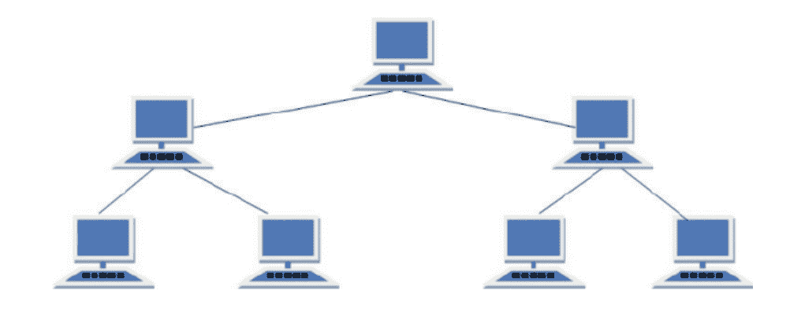

▲ 支持碎片通信的计算机网络

跟电话网络不一样的是，计算机网络除了可以传输音频数据信息，还能传输文本、视频等数据信息。分组交换技术是在20世纪60年代末出现的，当时美国高级研究计划局（简称ARPA）为实现远程计算机之间的信息交换，资助建设了一个试验性的网络，分组交换技术的出现为这个网络的建成提供技术支撑，该网络被称为阿帕网（ARPANET）。

## 阿帕网（ARPANET）计划

基于分组交换、用以强化通信系统“自存活”能力的阿帕网是美国国防部高级研究计划署（DARPA）开发的一个项目。阿帕网最初使用的是网络控制协议（Network Control Protocol，简称NCP）。该协议在网络条件下运行稳定，但随着阿帕网用户的增多，NCP逐渐暴露出以下两大缺陷。

- （1）NCP只是一台主机对另一台主机的通信协议，并未给网络中的每台计算机设置唯一的地址，结果就造成计算机在越来越庞大的网络中难以准确定位需要传输数据的对象。
- （2）NCP缺乏纠错功能，数据在传输过程中一旦出现错误，网络就可能停止运行，出错计算机增多，使得网络运行效率大打折扣。

基于NCP的阿帕网最大的痛点是无法做到与其他类计算机网络交流，1973年春，温顿·瑟夫（Vinton Cerf）和鲍勃·康（Bob Kahn）开始研究如何将阿帕网和另外两个已有的网络相连接，尤其是连接卫星网络（SA NET）和基于夏威夷的分组业务的ALOHA网（ALOHA NET），温顿·瑟夫设计了新的计算机交流协议，最后它被称为传输控制协议/互联网协议（TCP/IP）。1982年，阿帕网停用原先的交流协议，NCP被禁用，只允许使用温顿·瑟夫的TCP/IP进行网络连接。1983年1月1日，NCP成为历史，TCP/IP开始成为通用协议，基于TCP/IP的互联网逐渐形成，因此TCP/IP的发明人温顿·瑟夫也被称作“互联网之父”。

## 互联网的全球化

互联网沿着TCP/IP不断进行横向国际扩张以及纵向商业扩张。1982年5月，韩国成为继美国之后第二个成功建立TCP/IP网络的国家。在1984年至1988年间，欧洲核子研究中心（CERN）开始安装和运行TCP/IP，以连接其主要的内部计算机系统、工作站、PC和加速器控制系统。1987年9月20日，钱天白教授发出我国第一封电子邮件“越过长城，通向世界”，揭开了中国人使用互联网的序幕。

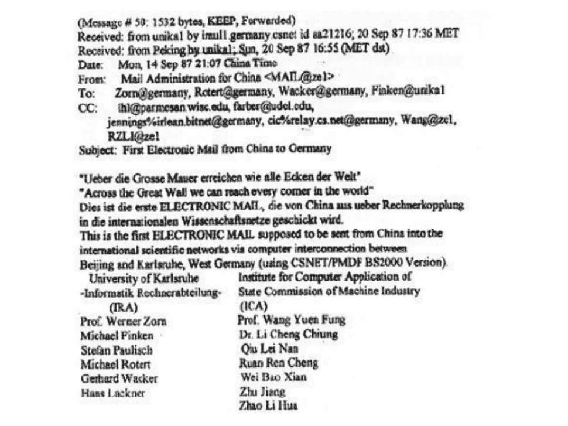

▲ 中国第一封互联网电子邮件

互联网直到1988年才公开进行商用，而网络覆盖的广泛性和信息传递的即时性使得互联网很快表现出巨大活力。1989年，美国3家商业网络公司UUNet、PSINet和CERFNet成立并开始提供服务；紧接着，商业机构和教育机构的网站并入互联网。思科公司提供的路由器极大地促进了互联网的快速发展。互联网目前联系着全球超过198个国家和地区，直接用户超过40亿，接近全世界人口的一半。

## 小结

在本章，我们回顾了互联网从诞生到发展的过程，重点介绍了分组交换技术、阿帕网计划以及互联网的全球化。在第2章，我们将介绍万维网以及它催生的云化应用。

# 第2章 程序和存储的云化

比尔·盖茨（Bill Gates）在创立微软之初，曾立下“让每个人的桌面上都摆上一台计算机”的梦想。后来，这个梦想不但变为现实，而且大部分计算机安装了微软的操作系统。在操作系统上，是各种应用软件，包括办公处理软件、制图软件、邮件客户端、网页浏览器等。

## 万维网技术

网页浏览器是一个用于浏览超文本标记语言（HTML）的应用程序。在互联网形成后的很长一段时间内，信息的访问要么采用文件传输的形式（如FTP上传、下载），要么是类似新闻组。英国科学家蒂姆·伯纳斯-李（Tim Berners-Lee）在欧洲核子研究中心（CERN）工作期间，对查找存储在不同计算机上的信息时的效率低下和困难感到十分苦恼。1990年，蒂姆·伯纳斯-李正式提出万维网（World Wide Web，简称WWW）的建议，其中最巧妙的设计是将超文本（Hypertext）嫁接到基于TCP/IP的互联网上。万维网的3项关键技术是：

- (1) 一个全球网络资源唯一认证的系统，统一资源标志符（URI）。
- (2) 超文本标记语言（HTML）。
- (3) 超文本传输协议（HTTP）。

万维网与其他超文本系统有很多不同之处，在万维网上需要单向链接而不是双向链接，这使得任何人都可以在资源拥有者不做任何行动的情况下链接该资源，加快互联网资源链接的速度。和早期的网络系统相比，这一点对于减少网络服务器和网络浏览器的实现困难至关重要，但它的副作用是产生了链接失效的慢性问题，也就是著名的404网页访问不到的错误。

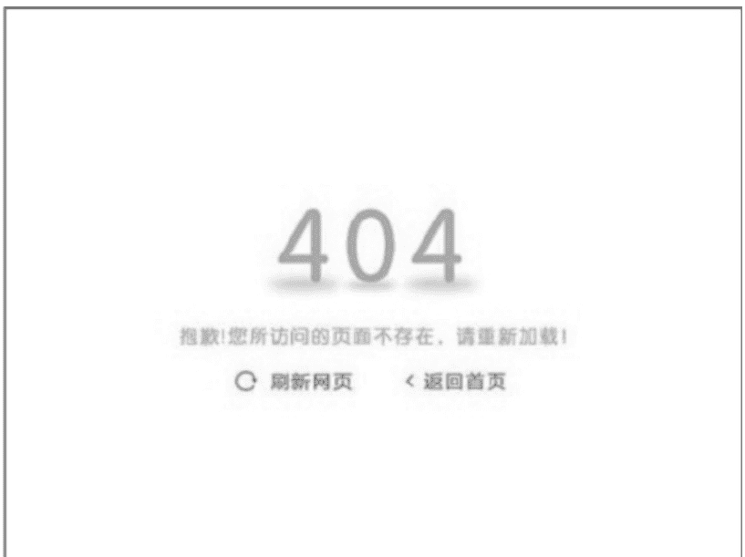

▲ 万维网404页面

蒂姆·伯纳斯-李利用自己发明的万维网技术，成功开发出了世界上第一个Web服务器和第一个Web浏览器，为了让大家都能使用万维网，他把欧洲核子研究中心的电话号码簿制作成网页。Web技术在互联网上一经露面，立即引起轰动，获得了极大的成功，并被广泛推广应用。1993年，欧洲核子研究中心宣布万维网对所有人免费开放，不收取任何费用。同年，推出Mosaic网页浏览器，首次在网页中混合文字和图片，让Web成了互联网上最受欢迎的应用，并催生了整个互联网产业，从1994年开始，雅虎、亚马逊、谷歌、阿里巴巴、腾讯、百度……陆续诞生。

最初的万维网是以静态的网页为主，网页上只有一些文字和图片的信息，用户也是以浏览阅读为主。部分Web应用可以允许在浏览器端填写表单（Form），例如，在搜索引擎中输入关键词，当浏览器提交表单时，会向网页服务器发送一个请求，服务器接收并处理传来的表单，然后将其送到一个新的网页上。由于每次应用的沟通都需要向服务器发送请求，应用的响应时间依赖于服务器的响应时间，这导致了浏览器界面的响应比本机应用慢得多。这时候出现了一种叫AJAX的技术，即Asynchronous JavaScript and XML（异步的JavaScript与XML技术），它能在向网页服务器发送请求前先对表单等信息进行预处理，以便减少信息在服务器和浏览器之间交换的次数，降低网页服务器的访问负荷，提升工作效率。后来，HTML5的发明进一步增强了网页浏览器的功能，减少浏览器对外挂程序的依赖，让浏览器能完全独立运行Web应用。

## 用户生成内容

随着AJAX及HTML5的应用和推广，一批Web2.0互联网服务应运而生，包括博客（Blog）、社交网站、基于地理位置的LBS服务、维基百科、RSS聚合、视频网站、论坛、问答网站等。与Web1.0不同的是，用户不仅可以浏览静态的图片和网站，还能上传、分享图片、文字和视频，并通过各类社交应用进行交流和协作。应用程序和存储功能也逐渐从操作系统的桌面上转到网页浏览器中。

当视频分享网站开始出现的时候，人们只是把一些短视频上传到网站，内容以个人生活为主，画质也不是特别清晰。随着技术的进步，这些视频逐渐由几分钟的生活片段变成了一个多小时的电影，画质也越来越清晰，下载速度也越来越快，用户体验跟操作本地的影音播放器软件无异。另外，网站能提供大量的视频资料库，它比任何一个人的藏碟数都要多，种类也更丰富，所以人们不再只是使用本地的程序（软件播放器）和存储（VCD），而开始使用云化的应用，获取存储在云端的信息资源。用户通过浏览器，不但可以访问视频网站，还能访问和存取云端的各类应用程序和信息，包括办公处理软件、制表软件、邮件客户端等。

## 宽带上网的普及

除了万维网技术以及用户生成内容，云计算的广泛应用还得益于宽带上网技术的普及。在互联网刚普及的时候，人们使用拨号上网，每次上网都需要主动连接网络供应商，然后网络供应商根据上网的时间计算费用，最重要的是上网速度，当时一般是56kbit/s-128kbit/s，不超过256kbit/s，网速很慢，很难观看视频和使用较复杂的程序应用。从2000年开始，有一种叫ADSL的接入互联网的服务逐渐普及开来，ADSL不但速度相对传统的拨号上网更快（可达8Mbit/s），上网的同时不影响电话使用，而且可以实现“永远在线”。ADSL基于现有的电话网络，所以宽带上网能快速普及起来，由此打通了云计算到用户的最后一公里。

## 小结

程序和存储的云化是云计算核心特征，本章从技术和社会发展的角度详细剖析了这一过程，让读者了解万维网的发展历程，切实感受云计算技术是如何走进我们生活的。在第3章，我们将介绍云计算的各种应用。

# 第3章 云计算的应用

2006年，亚马逊公司首次发布“Elastic Compute Cloud”云计算服务。此后，随着谷歌、雅虎、微软、阿里巴巴等IT行业巨头相继推出各自的云计算产品和业务，云计算便逐步普及开来，随着腾讯、百度、华为等更多“玩家”的入局，全球云计算形成了群雄争霸的局面。云计算作为一种产品和服务，在各行各业也得到了广泛的应用，成为人工智能下一步发展的助推器。本章，我们重点列举了云计算有代表性的4项行业应用。

## 云存储

简单来说，云存储就是把需要的资料储存在云端随时调取，它可以按量收费，没有前期投入，按实际使用情况付费。云存储具有以下优势。

- （1）存储容量的高扩展性：与传统的硬盘存储不同，云存储的容量可以根据用户的需要进行调整。所需存储量较小的用户可能无须付费，而当用户需要使用大量存储空间的时候，用户可以选择升级自己的账户。云存储动态满足了用户需求，用户可以随时升级存储账户、增加存储空间。与升级硬件系统相比，这种方式明显更加方便，成本也更低。
- （2）硬件冗余：云存储具备多个副本文件，数据丢失或损坏的风险更低。云存储根据不同的拷贝策略将副本文件存放在不同的服务器上，当硬件损坏时，服务并不会终止，数据也不会丢失。更换新服务器后，系统会自动复制，保持多备份的文件，从而避免数据的丢失。而在扩容时，数据也会自动迁移到新存储的节点，不需要多余的设定，降低了维护人员的工作量。
- （3）提高资源利用率，有效实现管理和协作：将数据集中起来，用户可以在任何地点依靠单机或移动设备随时访问数据。实现网内资源共享和协同工作，减少了传统的资源交换，提高了资源的利用率。当组织、公司的数据量很大，或者涉及的管理面太多时，分散的管理往往不能保证数据的一致性，员工或用户自己管理自己的存储，往往会导致许多人做重复性的工作，这样就会导致效率低下，造成人力资源的浪费，同时也很难进行对信息的有效控制，信息泄露以及安全性将会成为一个突出的问题。而云存储式的统一管理同时解决了上面几个方面的问题。数据在同一个管理界面下进行维护，用户不需要自己处理数据管理的烦琐工作，在降低了成本的同时，安全性问题也可以得到有效解决。

## 企业云

据《世界经理人》杂志2018年一项针对2327家企业的调查显示，有七成左右的企业已经部署了公有云服务。这表明越来越多的企业开始走上轻盈的“云端”，借助云计算为企业提质增效，实现了产业升级。在这个“数据为王”的年代，企业在运营的过程中，必然会产生海量的数据。企业为了降低IT管理的复杂性，提高资源的利用率，释放数据中蕴藏的巨大价值，须借助云计算这一工具，从而有效驱动业务及流程创新，并形成自身差异化竞争优势。

开源技术的加速发展，让用户的需求发生了根本性的改变。企业不仅要在公共云上安全、可靠地运行无服务器的企业云应用，而且还要在企业现有基础设施上运行，这大大增加了大型企业采购企业云服务的动力。企业云之所以备受企业关注，最重要的原因是：企业云给数据中心带来了更快的运行速度、更高的性价比，以及更明显的资源利用率的提高。未来，企业会更偏重于企业云这种模式，这不仅是为了加速数字化转型，更是为了在激烈的市场竞争中保持领先。

## 医疗云

医疗云是指在云计算、物联网、新通信技术以及多媒体等新技术的基础上，结合医疗技术，提高医疗水平和效率，降低医疗开支，实现医疗资源共享，扩大医疗范围，以满足广大人民群众日益提升的健康需求的一项全新医疗服务。在云计算等IT技术不断完善的今天，一般的IT环境可能已经不适合许多医疗应用，医疗行业必须更进一步，建立专门满足医疗行业安全性和可用性要求的医疗环境——“医疗云”应运而生。它是IT信息技术不断发展的必然产物，也是今后医疗技术发展的必然方向。

医疗云技术包括云医疗健康信息平台、云医疗远程诊断及会诊系统、云医疗远程监护系统以及云医疗教育系统等。医疗云即在医院的IT基础架构采用云计算，医疗信息系统采用云服务的模式。它是支撑新技术应用 [例如医疗AI应用、医疗扩展现实（XR）应用、医疗机器人等] 的平台；医疗云也将会支持医疗保险支付、医药流通和药物研发，以及人口健康管理等全方位大健康业务的创新转型和业务运行。从卫生经济学的角度看，医疗云将会提高整个医疗信息化的效率，支撑医疗信息化跟上医疗转型的步伐。

## 教育云

随着普惠教育理念的进一步深化，教育资源共享已经成为当前教育改革的重点。其中，教育云平台凭借其资源敏捷性、共享性的优势，已经成为普惠教育实践的优先工具。国务院印发的《“十三五”国家信息化规划》曾明确提出，要实施在线教育普惠行动，形成覆盖全国、多级分布、互联互通的数字教育资源云服务体系。教育云的应用包括：云化数据中心、云存储平台、云科研平台、桌面虚拟化平台、远程教育云平台、云应用平台以及教育管理服务平台等。教育云的应用为智慧教育的推进打下了良好的基础。

## 小结

本章着重从存储、企业部署、医疗和教育这4个领域来重点介绍了云计算在行业的应用。云计算与大数据共同促进了人工智能的发展。在第2部分，我们将介绍人工智能的另一个重要技术前提——大数据。

# 第2部分

## 了解大数据

机器学习和深度学习是引领人工智能发展的重要技术，要发挥这些算法和模型的作用，就需要数据，数据越多，机器学习训练的效果越好，精度越高。另外，如果用于训练的数据出现偏差，就会引起算法偏见，会让一部分人受到不公平的待遇。我们必须要全面理解大数据这个我们既熟悉又陌生的技术。

什么是大数据？大数据也可以广泛地定义为来自各种来源的大量非结构化或结构化数据。所谓结构化数据，简单来说，就是我们表格软件或数据库里面的数据，有一定的数据格式和长度规范。所谓非结构化数据，就是指数据结构不规则或不完整，没有预定义的数据模型，不方便用数据库二维逻辑表来表现的数据，包括所有格式的办公文档、文本、XML/HTML、各类报表、图像和音频/视频信息等。现代AI的一个明显标志就是拥有处理非结构化数据的能力，例如图像识别、语音识别和自然语言理解等。对于机器学习和深度学习而言，要想提升识别的精度，就需要大量的数据样本，那么这些大数据是从何而来的呢？

# 第4章

## 大数据从何而来

数据驻留在一台台独立的计算机中，大量的数据分散存在，无法合流形成大数据。本书第一部分提到的云计算技术彻底改变了这一切，它为大量数据的收集、处理和存储提供了必要的技术条件。随着互联网和云计算技术的普及，我们看到越来越多的数据可以被公开访问。传感器和物联网的普及大大促进了大数据的发展。医疗领域里约80%的数据都是医学影像数据，就是因为很多设备每天都在大量地收集数据。另外，企业也越来越重视大数据的作用，并形成有助于自身管理的大数据策略。

## 互联网

大数据时代，就是互联网的时代。我们在第2章曾提到，随着万维网技术的发展和用户生成内容的增加，互联网逐渐拥有了庞大的数据来源。同时，互联网也在第一时间体现出大数据的价值。例如，我们在获悉消费者行为后，可以将数据洞察用于某些改变，如降低成本或增加销售，就会产生价值。以互联网业务为核心的公司，如亚马逊、谷歌、阿里巴巴、腾讯和百度等，正在推动大数据的进一步革新。互联网行业产生的数据包括：电子邮件、文档、图片、音频、视频，以及通过社交媒体产生的数据流。一方面，这些数据大多数为非结构性数据，需要用文本分析功能进行分析。另一方面，它们也为机器学习和深度学习提供了大量的训练样本。例如著名的谷歌机器翻译，就利用了谷歌收集的互联网上大量的翻译句子数据，是基于深度学习训练的结果。

## 物联网

如果说互联网是在收集线上的大数据，那么物联网就是在收集线下的大数据，包括来自传感器、量表和其他设施的数据、定位/GPS系统数据等。还有各种设备创建或生成的数据，如智能温度控制器、智能电表、工厂机器和连接互联网的家用电器的数据。来自物联网的数据可以通过互联网传回云端进行大数据处理和分析。人工智能中的安防监控领域的应用，就是通过物联网监控摄像头的图像数据，加上公安系统长期收集、积累的数据，使得视频监控系统可进行实时数据智能分析，为公安机关打击违法犯罪行为提供了更多可能。未来随着5G的普及，边缘计算的计算存储能力将直接下沉到设备边缘，在设备端就可以直接对数据进行处理，分析结果可以直接用于指导现场设备的生产制造。

## 企业内部数据

随着大数据应用日益渗透到各行各业中，数据所蕴含着的巨大商业价值也越来越为人们所重视，数据日益成为重要的企业资产和国家战略资源。企业大数据包含企业内部海量的战略、文化、运营、营销、人力资源、财务等数据以及企业外部的行业和环境数据。大数据对企业管理的影响是多方面的，例如人力资源管理中的大数据类型大致分为4种：年龄、学历、职务、专业技能、实践经历等基础数据；培训经历、考核情况、奖惩情况等能力数据；完成工作任务效率、完成单项任务时间、故障率、坏件率等效率数据；工作效率提高率、业绩提高率、职称提升频率、收入涨幅水平等潜力数据。企业可以利用大数据逐步实现人才招聘与培养、员工关系、薪酬管理信息化。另外，一些人工智能应用（如AI招聘）就是通过对人力资源数据进行分析而得出的算法。

## 小结

本章介绍了大数据的3个主要来源。但大数据并不是大量数据的简单汇总，在第5章，我们将介绍大数据的主要特征。

# 第5章

## 四大维度

IBM是最早提出大数据理论的公司，在他们最初的提案中，提出大数据的4V特征：大容量（Volume），即数据巨大，从TB级别跃升到PB级别；多样性（Variety），即数据类型繁多，不仅包括传统的格式化数据，还包括来自互联网的网络日志、视频、图片、地理位置信息等；快速度（Velocity），即数据产生的速度飞快；低密度（Value），即有价值的数据比较稀疏。因此，大数据指的是高维低密度的大量快速产生的数据。

## 大容量

数量也许是与大数据最相关的特征之一，互联网和物联网的数据量正在以前所未有的速度增加。一般认为数据量达到TB和PB之间的数据为大数据。百度资料表明，其新首页导航每天需要提供的数据量超过1.5PB（1PB=1024TB），这些数据如果打印出来将使用超过5000亿张A4纸。

## 多样性

大数据的类型不仅是文本形式，更多的是图片、视频、音频、地理位置信息等多类型的数据，其中个性化数据占大多数。多样性还包括数据类型的复杂性，包括结构化、半结构化和非结构化数据。从数据的来源来说，还包括企业内部和外部的数据。随着传感器、智能设备和社会协同技术的爆炸性增长，数据的类型变得更加广泛，包括文本、微博、传感器数据、音频、视频、点击流、日志文件等。

## 快速度

数据处理遵循“1秒定律”，可从各种类型的数据中快速获得高价值的信息。数据创建、处理和分析的速度持续加快。加速的原因是数据创建的实时性，以及需要将流数据结合到业务流程和决策过程中。速度影响数据时延——从数据创建或获取到数据可以被访问的时间差。目前，数据以传统系统不可能达到的速度产生、获取、存储和分析。对于那些对时间敏感的流程，例如实时欺诈监测或多渠道“即时”营销，某些类型的数据必须进行实时分析，以对业务产生价值。

## 低密度

价值密度低是指随着物联网和互联网的广泛应用，信息感知无处不在，信息海量，但在连续不间断的视频监控过程中，可能有用的数据仅一两秒。以视频为例，一小时的视频，在不间断的监控过程中，可能有用的数据只有一两秒。通过机器学习和深度学习算法迅速地完成数据的价值识别，是人工智能时代的标志。

## 小结

本章介绍了大数据的四大维度，简单来说，大数据指的是高维低密度的大量快速产生的数据。在第6章，我们将介绍大数据的行业应用。

# 第6章

## 第四范式

21世纪，人类在科学领域的最大挑战之一，就是我们如何应对这个数据密集型科学的新时代。在信息社会中，信息技术的影响无处不在，有关科学研究的一切都处于日新月异的变化当中。我们不得不承认，不断膨胀的数据尤其是商业数据，是大数据思想出现的主要动力。图灵奖得主、关系型数据库的鼻祖吉姆·格雷（Jim Gray）在NRC-CSTB（National Research Council- Computer Science and Telecommunications Board）大会上，发表了主题为“科学方法的革命”的演讲，提出将科学研究分为四类范式（Paradigm，某种必须遵循的规范或大家都在用的套路），依次为实验归纳、模型推演、仿真模拟和数据密集型科学发现（Data-Intensive Scientific Discovery）。其中，最后的“数据密集型科学发现”，也就是现在我们所称的“科学大数据”。

## 数据密集型科学

在科学发现领域，第一范式是指以实验为基础的科学研究模式。简单说来，就是以伽利略为代表的文艺复兴时期的科学发展初级阶段。在这一阶段，伽利略爬上比萨斜塔扔铁球，掐着脉搏为摆动计时等我们耳熟能详的故事，见证了现代科学是如何开辟崭新的领域，现代科学之门是如何开启的。

但这些研究显然受到当时实验条件的限制，难以完成对自然现象更精确的理解。科学家们开始尝试尽量简化实验模型，去掉一些复杂的干扰，只留下关键因素（这就出现了我们在学习物理学的过程中“足够光滑”“足够长的时间”“空气足够稀薄”等令人费解的条件描述），然后通过演算进行归纳总结，这就是第二范式。这种研究范式一直持续到19世纪末，都堪称完美，牛顿三大定律成功解释了经典力学，麦克斯韦理论成功解释了电磁学。但之后量子力学和相对论的出现则以理论研究为主，更需要超凡的头脑思考和复杂的计算，而随着验证理论的难度和经济投入越来越高，科学研究开始显得力不从心。

随着电子计算机的高速发展，第三范式，即利用电子计算机对科学实验进行模拟仿真的模式得到迅速普及。不论在基础科学研究还是工程实验中，计算机仿真的方法越来越多地取代实验，成为科研的常用方法。人们可以对复杂现象进行模拟仿真，并推演出越来越多复杂的现象，典型案例例如模拟核试验、天气预报等。

当我们进入互联网时代，吉姆·格雷认为：鉴于数据的爆炸性增长，数据密集范式理应并且已经从第三范式即计算范式中分离出来，成为一个独特的科学研究范式，即“第四范式”。

## 全局数据

同样是计算，第四范式与第三范式有什么区别呢？最显著的区别就是：第三范式（计算范式）是先提出可能的理论，再搜集数据，然后通过计算仿真的方法进行理论验证。而第四范式（数据密集型范式），是先有了大量的已知数据，然后通过计算得出之前未知的可信的理论。

但是，这条途径中有一个看起来很小的问题：你如何确定哪些参数是重要的、哪些是不重要的？那些看起来不重要的参数，会不会在某些特定条件下，起到至关重要的作用？从这一点来看，能够获取最全面的数据，也许才能真正做出更科学的预测。第四范式就是这样一种研究方法。

## 数据科学

如果说互联网和物联网提供了大数据，那么第四范式的提出，可使人们有意识地生产和获取大数据。这为后续的应用，包括机器学习、深度学习等AI技术的广泛运用，提供了坚实的理论基础。数据分析已经超脱了传统的范畴，成为一门系统的学科。数据科学是一门利用数据学习知识的学科，其目标是通过从数据中提取有价值的部分来生产数据产品。这跟我们接下来提到的机器学习思维的指导原则是十分类似的。

## 小结

本章介绍了第四范式与大数据，至此，我们已经完整地了解了云计算和大数据这两个重要的技术。在第3部分，我们将正式介绍人工智能及AI思维。

# 第3部分

## 人工智能基础

人类对人工智能的研究可谓源远流长，在古代的神话传说中，技艺高超的工匠制作“人造人”，并为其赋予意识。

现代人工智能的诞生，则与一个英国人有关——艾伦·图灵（Alan Turing）。

# 第7章

## 图灵测试

2019年7月，英国的中央银行——英格兰银行宣布，图灵将成为英国最大面值50英镑新钞人物，以表彰其对人们生活方式产生的巨大影响。图灵到底是一位怎样的科学家？

## 图灵简介

1912年6月23日，图灵出生于伦敦，他的父亲是一名公务员，他的外祖父是一名工程师。图灵在16岁的时候，为了帮助母亲理解爱因斯坦相对论，开始阅读爱因斯坦的著作，他不但能够理解著作中的内容，而且看出了爱因斯坦对牛顿运动定律存有质疑，尽管爱因斯坦的著作中并没有明白指出这点。

1931年，图灵入读英国剑桥大学国王学院，5年后，他提出“图灵机”的构想，奠定了计算机的理论基础。1950年，图灵发表论文《计算机器与智能》，提出著名的“图灵测试”理论，次年，年仅39岁的他被选为英国皇家学会会员。

## 模仿游戏

在图灵发表的论文《计算机器与智能》中，图灵提出了一个问题：机器能思考吗？接着他设计了一个模仿游戏，并认为该游戏是对上述问题的等价描述。这里提出的“模仿游戏”后来被称为“图灵测试”，在很长一段时间内，这一测试都是较为公认的人工智能判断标准。

这个“模仿游戏”由3个人参与：一个男人（A）、一个女人（B）和一个审问者（C）。审问者待在一个与另外两人隔开的房子里。游戏的目标是审问者要确定另外两个人的性别。审问者通过标签X和标签Y辨别他们，在游戏结束时他要说出“X是A，Y是B”或者“X是B，Y是A”。审问者可以向另外两人发出任意的问题，例如：

> “请X告诉我你头发的长度好吗？”

现在假设X是A，那么A必须做出回答。在这个游戏里，A的目标是尝试和引导C做出错误的判断。因此他的回答可能是：

> “我的头发是卷发，最长的头发有23厘米长。”

为了避免噪音可能对审问者提供的帮助，两人的回答需要手写，更好的方式是打印出来。理想的安排是在两个房间利用一台计算机进行交流，或者有一个中间人来重复问题和回答。对于第3个玩家B而言，其目标是为审问者提供帮助。对她而言，最好的策略可能是给予真实的回答。她可以在她的回答中加入类似这样的话：“我是女人，别听他的！”，但这是不管用的，因为男人也可以做出类似的回答。

图灵提出：“在这个游戏中，当用一台机器扮演A的角色时，将会发生什么？”当游戏这样进行时，审问者做出错误判断的可能性是否会与当游戏在一个男人和一个女人之间进行时一致？这些问题替代了我们原来的问题——“机器能思考吗？”

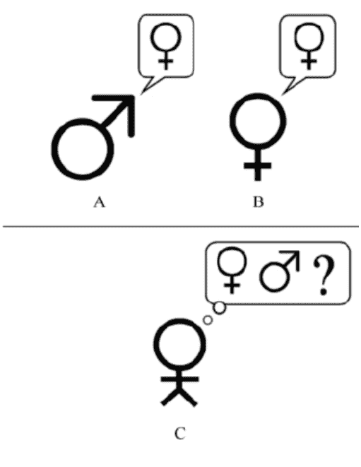

▲ 模仿游戏

## 对立观点

提出“图灵测试”后，图灵指出人们可以基于“电子计算机”建造一台会思考的机器。我们现在已经证实这个可能性了，因为人工智能技术已经在各个行业领域得到了应用和验证，但在图灵刚提出这个概念的时候，不少人是半信半疑的，有些人还提出反对的意见。对于这些对立的观点，图灵一一进行了反驳，我们在今天看来仍然具有深刻意义：

1.  鸵鸟思维：这种观点认为机器能思考的后果太可怕了。让我们希望并相信它们不能够这样做吧。图灵认为这是某些人的自我安慰，这一观点本身没有多少“技术含量”，不值一驳。
2.  自数学逻辑上的意义：电子计算机本质上是一种“离散状态机”，数学上已经可以证明这种“离散状态机”的能力是有限制的。但图灵指出，数学上也没有明确的论证，说“人类的能力和思维”就没有这种限制的。换言之，数学上也不能否认人工智能的可能性。
3.  机器不具备意识：这种观点认为若要我们承认机器与大脑是一样的，除非机器能够因为思想与感情，而不是符号的偶然涂抹，写出十四行诗或协奏曲来。也就是说，它不仅写了，而且也应知道自己确实这样做了。任何机器都感觉不到成功的喜悦，不会因困难而沮丧，不会因犯错误而闷闷不乐，也不会因欲望得不到满足而暴跳如雷或一蹶不振。机器跟我们的大脑不一样，不具备独立的意识。图灵指出，你若想确认一台机器是否有思维，唯一的途径就是你自己成为那台机器并且去感受自己的思维活动。这实际是唯我论的观点。这也许是符合逻辑的，但若真是这样，观念的交流就会成为难题。A会说：“A在想，而B不在想。”而B会说：“B在想，而A不在想。”我们不必为这个观点争执不休，所谓“人同此心，心同此理”，我们不如客客气气地认为大家都在想。在模仿游戏中，审问者经常采用“答辩”的形式，来鉴定某人是真的理解了，还是“鹦鹉学舌”。例如：

    审问者：“你的十四行诗的第一行是这样的，‘我欲比君为夏日，如何？’，如果将‘夏日’改成‘春日’，是不是也可以，或许会更好？”

    机器：“这样一改便不合韵了。”

    审问者：“改为‘冬日’怎么样？这样也合韵。”

    机器：“这样是没问题。但是有谁愿意将自己比作冬日呢？”

    审问者：“你认为匹克威克先生会使你联想到圣诞节吗？”

    机器：“在一定程度上会的。”

    审问者：“但是圣诞节是在冬天，我认为匹克威克先生对这个比喻不会在意。”

    机器：“我在想你也许在开玩笑。冬日的意思是指某一个典型的冬日，而不是像圣诞节那样特殊的一天。”

    如果那台写十四行诗的机器在这场“答辩”中能够这样对答，那么我们还能认为机器只是在“机械地通过发信号”吗？如果这些答复如上面所引那样令人满意，逻辑前后一致，我们还能认为机器只是“一个属于简易发明之类的人工信号”吗？图灵指出他固然也承认“意识有神秘之处”，但是，不能以此否认机器能思考和具备智能。
4.  机器有各种缺陷：这些论据形如“我同意你说可以造出一台机器，能做你所提到的所有事情，但是你永远也不能造出一台能做X的机器”。图灵认为这种观点没有根据。因为只要我们列一个X的清单，一个一个地去实现就可以了，从人工智能发展的历史来看，这些X确实是一个接着一个被实现了。
5.  机器永远不能创新：这个观点认为机器只能执行死命令，永远不会有原创性。换句话说，机器永远也不能“使我们惊奇”。我们现在知道，机器是可以“使我们惊奇”的，如AlphaGo战胜人类围棋冠军。图灵当时就指出，机器经常令我吃惊，这主要是由于我对机器能做什么估算甚少。
6.  神经系统是连续性的：现代解剖学指出人脑是模拟信号系统，不是数字信号系统，因此不能被电子计算机所模仿。图灵承认这一点，但同时指出，只要有足够的算力，模拟信号系统就能被模仿到一定的精度。
7.  人类行为的不规则性：制定一个行为集合，规定每个人能做什么、不能做什么是不可能的。比方说有一个规则，当某人看到一个红色交通灯时需要停下，如果看到了绿色交通灯就走，但如果由于某些故障，两者一起出现了怎么办？一些人可能认为最安全的就是不动，另一些人可能觉得应该动，因此不能制定一个统一的行为集合。而机器是基于一定的规则建成的，因此它不能真正地实现智能。图灵认为这是把行为规则与一般行为准则混淆了，如果在足够广泛的范围内（如在人类社会），机器行为将变得越来越难以预测。他指出，我们不能立即看到规则是什么，并不意味着不存在这样的规则。

## 小结

图灵被称为“人工智能之父”，本章对他的生平以及他与人工智能研究的关系做了详细描述，在第8章，我们将介绍现代人工智能的诞生和发展历程。

# 第8章 AI简史

图灵从理论上证明了人工智能的可行性。受“图灵机”后发的美国科学家约翰·冯·诺伊曼（John von Neumann）提出了“存储程序计算机”的计算机设计概念架构，又称冯·诺伊曼结构。1948年，世界上第一台电子存储程序计算机在曼彻斯特大学建成。至此，现代人工智能的理论和硬件基础均已完成，现代人工智能即将诞生。

## 达特茅斯会议（1956）

1956年的夏天，在美丽的常春藤名校达特茅斯学院，群星闪耀，一批大师级的人物聚在一起共同组织了一个为期两个月的研讨会。会议的提案如下：

> “学习的每个方面或智能的任何其他特征，原则上都可以被精确地描述，以至于能够建造一台机器来模拟它。我们将尝试研究如何让机器使用语言，通过抽象化和概念化求解多种现在只有人类才能解决的问题，进而改进机器。我们认为：如果用一个夏天的时间，仔细选择一组科学家针对这些问题进行探索，那么我们对其中的一个或多个问题就能够取得意义重大的进展。”

会议足足开了两个月的时间，研讨话题包括计算机、自然语言处理、神经网络、计算理论、抽象化、随机性与创造性。虽然大家未能达成普遍的共识，却为会议讨论的内容起了一个名字：人工智能。并且大家一致确立“人工智能”作为一门独立学科的地位，因此1956年也就成了人工智能元年。

## 激情与期待（1952—1969）

现代人工智能诞生后，研究者们在私下的交流和公开发表的论文中表达出相当乐观的情绪，他们认为完全智能的机器将在20年的时间内出现。DARPA（国防高等研究计划署）等政府机构向这一新兴领域投入了大笔资金。

1958年，麦卡锡（McCarthy）组建了世界上第一个人工智能实验室。同年，麦卡锡发明了Lisp语言，这是人工智能界第一个最广泛流行的语言，至今仍有着广泛应用。Lisp语言与后来于1973年实现的逻辑式语言PROLOG并称为人工智能的两大语言。麦卡锡另一个卓越贡献是在1960年左右第一次提出将计算机批处理方式改造成分时方式，这使得计算机能同时允许数十甚至上百用户使用，极大地推动接下来的人工智能研究。

艾伦·纽厄尔（Allen Newell）和赫伯特·西蒙（Herbert A.Simon）合作开发了“通用问题求解系统”（General Problem Solver，简称GPS）。GPS是根据人在解题中的共同思维规律编制而成的，它可以解11种不同类型的问题，从而使启发式程序有了更普遍的意义。赫伯特·西蒙曾多次强调，科学发现只是一种特殊类型的问题求解，因此也可以用计算机程序实现。GPS是针对结构化的问题设计的。赫伯特·西蒙后来又和海斯（J.R.Hayes）合作，开发了一个名为“理解”（Understand）的AI程序，可以解决非结构化问题，进一步发展了推理技术。1966年，赫伯特·西蒙、艾伦·纽厄尔和贝洛尔（Baylor）合作，开发了最早的下棋程序之一——MATER。他们乐观地宣称：“10年之内，数字计算机将成为国际象棋世界冠军；10年之内，数字计算机将发现并证明一个重要的数学定理。”

同年，麻省理工学院（MIT）的约瑟夫·魏泽鲍姆（Josep Weizenbaum）开发了聊天机器人ELIZA，将其用在临床治疗中模仿心理医生。值得注意的是，尽管ELIZA的实现技术仅为关键词匹配及人工编写的回复规则，但约瑟夫·魏泽鲍姆本人对ELIZA的表现感到吃惊，随后他撰写了Computer Power and Human Reason这本书，表达他对人工智能的特殊情感。

20世纪60年代后期，麻省理工学院人工智能实验室的马文·明斯基（Marvin Minsky）和西蒙·派珀特（Seymour Papert）建议人工智能研究者们专注于被称为“微世界”的简单场景。他们指出在成熟的学科中往往使用简化模型帮助人们理解基本原则，例如物理学中的光滑平面和完美刚体。在这一指导思想下，马文·明斯基和西蒙·派珀特制作了一个会搭积木的机器臂，从而将“积木世界”变为现实。微世界程序的最高成就是特里·威诺格拉德（Terr Winograd）的SHRDLU，它能用普通的英语句子与人交流，还能做出决策并执行操作。

## 第一个冬天（1966—1973）

然而，这些早期的AI系统在尝试更广泛的问题选择和更困难的问题时都会失败。1965年，机器定理证明领域遇到了瓶颈，计算机推导了数十万步也无法证明两个连续函数之和仍是连续函数。

更糟糕的事情发生在机器翻译领域，早期的自动翻译系统对人类自然语言的背景知识了解甚少。计算机在自然语言理解与翻译过程中表现得极其差劲，一个典型的例子就是下面这个著名的英语句子：

The spirit is willing but the flesh is weak.（心有余而力不足。）

当时，人们让机器翻译程序把这句话翻译成俄语，然后再翻译回英语以检验效果，得到的句子竟然是：

The wine is good but the meet is spoiled.（酒是好的，肉变质了。）

这简直是风马牛不相及。

程序在原理上可以找到解决方案，不代表该机制就能应用于实践。越来越多的不利证据迫使政府和大学削减了人工智能的项目经费，这使得人工智能进入了寒冷的冬天。来自各方的事实证明，人工智能的发展不可能像人们早期设想的那样一帆风顺，人们必须静下心来冷静思考。

## 基于知识的系统（1969—1979）

1965年，斯坦福大学的费根鲍姆（E.A.Feigenbaum）和化学家勒德贝格（J.Lederberg）合作研制DENDRAL系统，该系统具有非常丰富的化学知识，可根据质谱数据帮助化学家推断分子结构，这个系统的完成标志着专家系统的诞生。使得人工智能的研究以推理算法为主转变为以知识为主。在此之后，麻省理工学院开始研制MACSYMA系统，现经过不断扩充，它能求解600多种数学问题。

到20世纪70年代中期，专家系统已逐步成熟起来，其观点逐渐被人们接受，并先后出现了一批卓有成效的专家系统。其中，最具代表性的是肖特立夫等人的医药专家系统MYCIN，该系统用于诊断和治疗血液感染及脑炎感染，可给出处方建议。另一个非常成功的专家系统是探矿专家系统PROSPECTOR，它用于辅助地质学家探测矿藏，是第一个取得明显经济效益的专家系统。

1977年，费根鲍姆在第五届国际人工智能联合会议上提出知识工程的概念。他认为知识工程是人工智能的原理和方法，对那些需要专家知识才能解决的应用难题提供求解的手段。恰当运用专家知识的获取、表达和推理过程的构成与解释，是设计基于知识的系统的重要技术问题。

知识工程是一门以知识为研究对象的学科，它将具体智能系统研究中那些共同的基本问题抽出来，作为知识工程的核心内容，使之成为指导具体研制各类智能系统的一般方法和基本工具，成为一门具有方法论意义的科学。在知识工程的推动下，涌现出了不少专家系统开发工具，例如EMYCIN、CLIP（OPS5、OPS83）、G2、KEE、OKPS等。

## AI成功实现产业化（1980至今）

1980年，一款名为XCON的专家系统程序被设计出来，这款程序能够根据用户的需求自动选取DEC公司计算机系统（集群）里面合适的部分来完成计算任务。在1980年到1986年间，XCON平均每年帮DEC公司节省约4000万美元的成本。在这个阶段，人们逐渐意识到研发人工智能的目的不仅仅是设计出能通过“图灵测试”的机器，能够以现有的条件帮助人类解决在实际工作中的问题并提高效率才是更为重要的。

正是因为人工智能的实际应用前景被挖掘出来，越来越多的公司开始投入资金研发不同类型的专家系统，人工智能进入第二个高速发展期。在这个阶段，人工智能开始逐步形成一个产业，诞生了一批公司，比如硬件公司Symbolics和LispMachines，软件公司IntelliCorp和Aion。这个阶段最具有标志性的事件是HiTech和Deep Thought击败了国际象棋大师，Deep Thought也为后来IBM的Deep Blue奠定了基础。

现在的人工智能终于实现了人们最初的一些目标。它已被成功地用在技术产业中，不过有时是在幕后。“实现人类水平的智能”这一最初的梦想曾在20世纪60年代令世界很多人为之着迷，现在，各种因素的合力将人工智能拆分为各自为战的几个子领域，人工智能比以往任何时候都更加谨慎，却也更加成功。

## 智能体的出现（1995至今）

20世纪90年代，被称为“智能体”（Intelligent Agent）的新范式被广泛接受。尽管早期研究者提出了模块化的分治策略，但是直到朱迪亚·珀尔（Judea Pearl）、艾伦·纽厄尔（Alan Newell）等人将一些概念从决策理论和经济学中引入人工智能领域之后，现代智能体范式才逐渐形成。当经济学中的“理性人（Rational Agent）”与计算机科学中的“对象”或“模块”相结合，“智能体”范式就完善了。

智能体是一个软件或者硬件系统，它感知周围环境，然后采取措施使成功的概率最大化。最简单的智能体是某个解决特定问题的软件程序，例如网络爬虫。已知的最复杂的智能体是理性的、会思考的人类。智能体范式将人工智能研究定义为“对智能体的学习”。这是对早期一些定义的推广：它超越了研究人类智能的范畴，涵盖了对所有种类的智能的研究。

这一范式让研究者们通过学习孤立的问题找到可证的并且有用的解答。它为人工智能各领域乃至经济学、控制论等使用抽象代理概念的领域提供了描述问题和共享解答的一种通用语言。人们希望找到一种完整的代理架构（如Newell的SOAR），允许研究者们应用交互的智能体建立通用的智能系统。

## 从关联数据到知识图谱（2006至今）

万维网之父蒂姆·伯纳斯-李希望把万维网技术向前推进一步，他将其称为“语义网”。我们所访问的万维网的所有网页、文件，本质上都是一个个文档，这使得更小的数据碎片化了。那么如果我们将信息降解到数据级别，我们就可以将当前网络上无结构或半结构化的文档转换为网络数据，从而使计算机与人更好地合作。举个例子，现在有两个网站卖《新华字典》，分别是“当当”和“亚马逊”。当我们比较这两个信息源内容的时候，我们需要手动搜索或编写爬虫程序来爬取挖掘相关信息。但在“语义网”的基础下，数据本身就是构建网络的基本元素了，因此我们可以很容易地以《新华字典》这个关键词为起点，去寻找它的所有价格信息。从而使万维网更加智能。

然而，在2006年，笔者的导师奈杰尔·夏伯特（Nigel Shadbolt）、蒂姆·伯纳斯-李（Tim Berners-Lee）和温迪·霍尔（Wendy Hall）在发表的论文中认为这个简单的想法还无法实现。由于“语义网”的设计模型是“自顶向下”的，其实现很困难，所以学者们逐渐将焦点转向数据本身。2006年，蒂姆·伯纳斯-李提出关联数据（Linked Data）的概念，鼓励大家将数据公开并遵循一定的原则发布在互联网中。莱比锡大学项目组的学者认为语义网的基础应该是内容丰富的多元数据语料（这样的语料可以极大推动诸如知识推理、数据等的不确定管理技术），以及开发面向语义网的运营系统。

2012年，维基媒体基金会推出Wikidata项目，这是一个大规模社区成员合作知识库，旨在用一种全新的方式管理知识。在中文社区，类似的项目有上海交通大学的zhishi.me、清华大学的XLore、复旦大学的CN-pedia等。

关联数据技术直接促成了谷歌的知识图谱（Knowledge Graph）技术。为了提升搜索引擎返回的答案质量和用户查询的效率，谷歌于2012年5月16日发布了知识图谱。有知识图谱作为辅助，搜索引擎能够洞察用户查询背后的语义信息，返回更为精准的信息，更大可能地满足用户的查询需求。知识图谱技术继承了知识本体和专家系统的精髓，成为当代知识表示和推理的重要技术。

## 神经网络革命（2009至今）

早在现代人工智能诞生之初，就有学者从神经网络的角度研究人工智能。感知器是神经网络的一种形式，由弗兰克·罗森布莱特（Frank Rosenblatt）于1958年提出。与多数人工智能研究者一样，他十分看好这一发明的潜力，并预言“感知器最终将能够学习，做出决策和翻译语言”。在20世纪60年代，人们对这一方向的研究工作很活跃。然而，1969年，明斯基和派珀特在《感知器》一书中暗示感知器具有严重局限，神经网络的研究因此停滞了10年。1982年，物理学家约翰·霍普佛德（John Hopfield）证明一种新型的神经网络（现被称为“Hopfield网络”）能够用全新的方式学习和处理信息。大约在同时，戴维·鲁姆哈特（David Rumelhart）推广了反向传播算法（一种神经网络训练方法）。2006年，深度学习之父杰弗里·辛顿（Geoffrey Hinton）在《科学》杂志发文，一举解决了深层神经网络的训练问题，推动了深度学习的快速发展，开创了人工智能领域的新局面。

2009年，大规模并行处理的GPU被用于高性能计算，这个新的算力模型引发了现代人工智能的“大爆炸”。人工智能像野火一样蔓延。GPU深度学习开发者的数量在短短两年内就增加了25倍。多伦多大学的亚历克斯·克里泽夫斯基（Alex Krizhevsky）创建了能够从100万样本中自动学习识别图像的深度神经网络。仅在两块nVIDIA GTX 580 GPU上训练几天，“AlexNet”就赢得了当年的ILSVRC竞赛，击败了磨炼几十年的所有人类专家算法。研究者们认识到网络数据规模越大、计算能力越强，其学习能力就越强的规律后，斯坦福大学的吴恩达（Andrew Ng）与nVIDIA研究室合作开发了一种使用大规模GPU计算系统训练网络的方法。世界各地的人工智能研究人员，集体转向GPU深度学习。百度、谷歌、脸书与微软是首批将其用于模式识别的公司。2015年，人工智能在图像识别方面实现了“超越人类”的水平。在语音识别领域，微软研究院使用GPU深度学习实现了“媲美人类”的水平。

围棋是人类发明的最复杂的游戏之一。2016年，英国DeepMind公司研发的AlphaGo战胜世界围棋冠军李世石，人工智能攻破了几乎不可能被攻破的领域——围棋。对于1997年IBM深蓝的暴力博弈树遍历而言，深蓝的胜利只是硬件速度和计算机的胜利。而今天AlphaGo与李世石的人机大战远远超越了围棋本身的范畴，标志着人类进入通用人工智能时代。

## 小结

在本章，我们回顾了人工智能的发展历程。在第9章，我们将介绍人工智能在当代的行业应用案例。

# 第9章 行业应用案例

无人驾驶、机器翻译、智能家居、医学影像分析、智能客服、智慧物流……人工智能技术在各个领域得到广泛的应用，给人们的生活带来了巨大的变化。人工智能技术完成了一系列挑战，越来越多人类特有的技能，包括理解、推理、规划、沟通和感知等，可以通过软件来实现，并且规模更大，成本更低。通过传统软件执行的一般分析任务（包括查找数据模式）也可以利用人工智能技术更有效地执行。

## 人工智能技术解锁新机遇

由于商业运作中的大多数业务流程和消费者应用程序涉及知识管理、推理、规划、沟通或感知，因此人工智能的新功能在提高生产力、构建新兴商业模式方面具有重大作用。

| | | | |
|---|---|---|---|
| 知识 | 医疗诊断 | 药物发现 | 媒体推荐 |
| | 金融交易 | 信息合成 | 消费者精准定位 |
| 推理 | 法律分析 | 资产管理 | 合规审查 |
| 计划 | 物流 | 车队管理 | 导航 |
| | 网络优化 | 预测性维护 | 需求预测 |
| 沟通 | 语音控制 | 智能助理 | 客户支持 |
| | 实时翻译 | 实时录音 | 客服 |
| 感知 | 自动驾驶 | 医疗影像 | 认证 |
| | 增强现实 | 监控 | 工业分析 |

▲ 人工智能技术在多个领域解锁新机遇

## 数据驱动的产业

人工智能不是一个寻求问题的解决方案，它是一系列有形的功能，可以帮助企业提高收入，降低生产成本。以机器学习和深度学习为核心的人工智能技术可以将更广泛的数据集纳入分析，比基于规则的传统系统更好地识别数据中的概念和模式，并且可以实现人机对话。人工智能技术在很多产业和众多业务流程中都有应用。人工智能应用与数据息息相关，因此，在大量使用数据的行业，人工智能的应用相对广泛，相反，在一些数据处理活动较少的技术行业，人工智能的应用比较有限，如战略管理和教学。

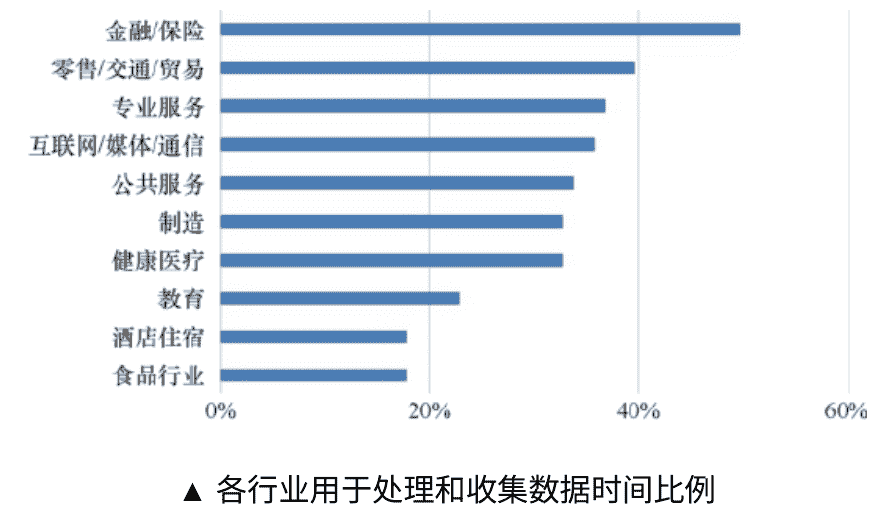

▲ 各行业用于处理和收集数据时间比例

## 行业核心案例

随着人工智能技术的不断进步，人工智能应用案例的数量正在激增。下面我们描述了8个行业的32个核心人工智能应用案例：

| 行业 | 应用案例 |
| :--- | :--- |
| 资产管理 | 投资策略 | 投资组合 | 风险控制 | 客户端服务 |
| 健康医疗 | 诊断 | 药物发现 | 病患监护 | 手术支持 |
| 保险 | 风险评估 | 索赔处理 | 欺诈识别 | 客服 |
| 法律与合规审查 | 判例法 | 尽职调查 | 诉讼策略 | 合规审查 |
| 生产制造 | 预测性维护 | 机械性能 | 能耗优化 | 供应链优化 |
| 零售 | 客户细分 | 内容个性化 | 价格优化 | 流失预测 |
| 交通 | 自动驾驶 | 城市交通管理 | 车队管理 | 交通信号控制 |
| 公用事业 | 能源供应管理 | 需求优化 | 安全 | 客户体验 |

▲ 人工智能行业应用案例

1. 资产管理：人们能够使用自然语言处理技术从非结构化数据中提取内容，在不同的数据中探索出微妙的规律，并通过聊天机器人实现人机交互。人工智能在资产管理领域的核心案例包括投资策略、投资组合、风险控制和客户端服务。通过增加或代替许多资产经理的一部分任务，人工智能使资产管理人员能够向客户提供过去只有高净值客户才能享用的个性化服务。机器人投资顾问可以降低投资组合的成本，同时提高服务质量。

2. 健康医疗：在未来10年，人工智能技术能够实现健康医疗领域的范式转变，以提高护理和流程效率。医疗自动诊断是20世纪80年代人工智能技术早期应用案例。“专家系统”模仿人类诊断方法，将基于规则的推理应用于医疗知识体系。现代人工智能，特别是深度学习，适用于更广泛的医疗领域。其应用案例包括诊断、药物发现、病患监护和手术支持等。

3. 保险：保险的基本业务包括客户探查、风险评估、索赔处理和欺诈检测等，人们利用现代人工智能技术可以改善保险流程的各个阶段，从而提高效率并改善客户体验。人工智能设备可以改进并加速决策和索赔处理，减少欺诈行为，并使大部分客户的服务查询更智能。

4. 法律与合规审查：人工智能设备的自然语言处理、综合知识和自动推理能力在法律服务和合规部门中得到广泛应用。初级律师往往花费大量时间查找和整理信息，这些事情由人工智能设备来解决会更快更好。人工智能技术应用在法律领域的案例包括识别相关判例法、尽职调查、诉讼策略等。金融服务公司的合规性业务自2008年以来成本显著增长。由于基于规则的软件不适合捕捉违规行为，银行不得不投资额外的合规审查人员。在2008—2016年间，花旗集团全球员工人数减少了32%，但监管和合规审查人员增加了一倍，达到29000人。人工智能设备能够从一段时间的行为中学习规律，并实时地报告异常活动，以更低的成本处理更多的合规审查业务。

5. 生产制造：人工智能技术可以显著提高制造商的效率和盈利能力。设备综合效率（OEE）是设备实际的生产能力相对于理论产能的比率，各行业差异很大。同一行业内公司的业绩差异也很大，为竞争优势提供了空间。人工智能可以通过预测设备故障来提高OEE和盈利能力（减少意外停机时间），从而提高资产运营效率，降低公用事业供应成本。

6. 零售：电子商务为零售商提供了大量消费者及交易数据，人们通过人工智能技术可以把电商数据转化为洞察力，从而更有效地留住客户，提升竞争优势。用户购买的各个阶段——从潜在客户生成和内容选择到价格优化和流失预测——可以通过人工智能算法来改进，这些算法可以比基于规则的系统更好、更多地采集数据并识别其中的规律。通过消费者个性化分析，人工智能技术为新零售赋能。

7. 交通：计算机视觉技术的突破使自动驾驶汽车成为可能。人工智能技术带来的业务价值链的转移和对新商业模式的影响将是深刻的。除此之外，人工智能技术还可以应用于很多交通领域核心业务的预测和流程优化，如拥堵建模和车队管理等。

8. 公用事业：信息技术的应用对公用事业部门的发展以及商业模式十分重要。在未来，拥有能源生产能力的消费者将融入能源市场，人工智能技术将成为这一转变中的重要价值驱动因素。公用事业领域的人工智能案例多种多样，如能源供应管理、需求优化、安全和客户体验等。

## 小结

在本章，我们介绍了人工智能技术在一些重要行业的应用案例，人工智能技术已经广泛地应用于各行各业，其对现代社会经济的发展起着举足轻重的作用。在第10章，我们将介绍AI思维。

# 第10章 AI思维

在过去，人们对人工智能的应用充满各种幻想，而在当今“未来已来”的社会中，人们正在接受人工智能随时随地可用的事实。人工智能已经成为人们工作和生活中不可或缺的一部分。从经济的角度来看，人工智能已经成为各行各业的推动者，并且在提高生产力、构建新兴商业模式方面具有重大作用。它的社会影响和发展潜力使其成为现代社会的技术支柱之一。

鉴于人工智能的应用在现代生活中无处不在，以及人工智能技术“孵化”了许多现在已经发展成为相对独立的研究领域（例如深度学习和自然语言处理等），其中许多新的应用（甚至行业）植根于人工智能的理念和技术，我们认为现在是时候提出“AI思维”的概念了。什么是AI思维？我们把AI思维定义为从人工智能研究和实践中提炼出来的思考方法。AI思维不但能帮助我们理解人工智能应用背后的原理，更为我们解决问题提供一个新维度。AI思维把解决问题的全部或部分责任从人的身上转移到人工智能设备上，因此，AI思维的本质是解决问题思路的范式转移。AI思维不但对人工智能研究员有用，在人工智能时代，它对我们每个人都有十分重要的意义。具体来说，AI思维包含6个理念：计算思维、机器感知思维、机器学习思维、机器推理思维、人机交互思维以及AI伦理思维。

## 硅基智能

目前地球上已知有两种智能，一种是碳基智能，另一种是硅基智能。碳基智能指碳基生命所具备的智能，主要是人类智能，因为人类生命基于碳元素，碳元素是构成人类生命的基石。硅基智能指基于硅芯片的智能，现代人工智能则基于使用硅芯片的电子计算机。计算设备是现代人工智能的基础，运用人工智能解决问题就是运用计算设备解决问题。计算思维就是借助计算机及利用计算机科学解决问题的一种思维方法，AI思维是在计算思维的基础上进一步把解决问题的责任转移到智能设备上。因此，计算思维是AI思维的基础。

## 形式科学

中小学基础教育的科目大致可以分成3类：社会科学、自然科学和形式科学。社会科学指研究人类社会的科学，广义的社会科学还兼指人文科学，包括语文、英语、历史和政治等。自然科学指研究大自然中有机或无机的事物和现象的科学，广义的自然科学包括物理、化学、生物和地理等。形式科学指主要研究对象为抽象形态的科学，如逻辑、数学、统计学等。由此可知，计算机科学、人工智能属于形式科学。人工智能中的计算机视觉、语音识别、自然语言处理和情感识别等机器感知和人机交互领域研究对象是抽象形态的图像、语音及语言，研究使用的工具也主要是数学建模及编程语言。因此，机器感知思维和人机交互思维是AI思维的重要支柱。

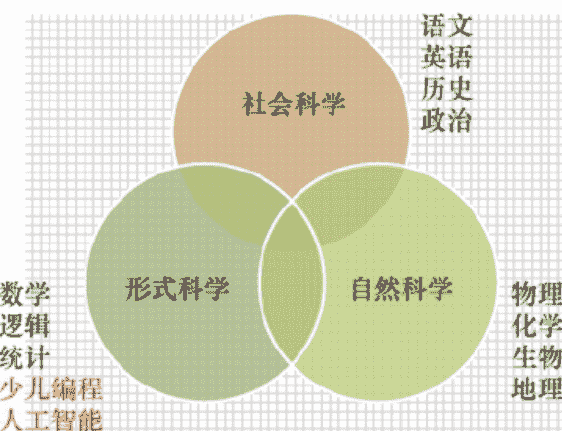

## 直觉和理性

直觉思维和理性思维是人类两种核心思维模式。直觉思维是对事物整体形势的一种概括性判断，它有赖于人对整个形势的全局判断，它是综合性的。一般来说，人的经验越丰富，其直觉判断力或洞察力越强。这与机器学习很相似，机器学习的效果与训练数据集有关，一般来说，数据越多，机器学习的效果越好，训练的精准度越高。理性思维则是一种建立在证据和逻辑推理基础上的思维方式，对事物或问题进行比较、分析、抽象与论证。这与人工智能中的知识表示和推理十分相似，对现实世界使用数据结构（如树结构）构建一种知识表示，然后利用一定的推理算法从已知信息中推导出新的信息。因此，机器学习思维和机器推理思维是AI思维的两大核心。

## 辩证看AI

人工智能技术正在改变着我们工作、出行和沟通的方式。但我们也必须注意其可能带来的危害。若用于训练AI系统的数据存在偏差，可能会导致部分人得到的服务质量低于其他人。例如AI招聘系统的“面试偏见”问题。很多智能医学系统的训练需要使用病人的数据，我们该如何平衡数据隐私问题，确保人工智能技术造福人类？因此，探讨人工智能技术对我们社会的影响，并根据相关系统在道德层面的设计以及应用来制定标准十分重要，AI伦理思维是AI思维的辩证本质。

## 小结

在本章，我们介绍了AI思维的6个理念及其形成背景。AI思维是一种概念，并非某一特定的软件工具；AI思维是一个思考过程，不是某一学科专属的技能；AI思维是模仿人的思维，而不是模仿智能体的思维；AI思维不是人工智能科学家的专利，它可以被我们每一个人使用。在第11章，我们将介绍各个思维模块的详细内容及应用。

# 第11章 计算思维

## 计算思维

计算思维是AI思维的基础，最早在2006年3月由美国卡内基·梅隆大学计算机科学系主任周以真（Jeannette M.Wing）教授正式提出，她把计算思维定义为运用计算机科学的基础概念进行问题求解、系统设计，以及人类行为理解等涵盖计算机科学领域的一系列思维活动。在她看来，计算思维是一种普适思维方法和基本技能，所有人都应该积极学习并使用，而非仅限于计算机科学家。计算思维是基于计算设备的人工智能的重要基础。很多学者对计算思维做了大量的研究，我们接下来介绍比较有代表性的6种思维模式。

## 抽象思维

解决问题的第一步是提出问题并把问题以一种恰当的方式表示出来，所以我们有时会说，如何提出一个好问题比解决问题更重要。例如，将应用题“原来有5个苹果，吃掉2个后还剩几个？”问题的答案可以抽象表示成“5-2”，这里显然只抽取了问题中的数量特性，而忽略苹果的颜色或吃法等不相关特性。数学抽象的特点是抛开现实事物的物理、化学或生物等特性，仅保留其量的关系和空间的形式。与数学抽象相比，计算思维中的抽象显得更为丰富，也更为复杂。

计算思维中的抽象包括数据抽象和控制抽象，简言之就是将现实世界中的各种数量关系、空间关系、逻辑关系和处理过程等表示成计算机世界中的数据结构（数值、字符串、变量、列表、堆栈、树等）和控制结构（基本指令、顺序执行、分支、循环、模块等），建立实际问题的计算模型。计算思维的抽象还受工程思维的影响，其结果必须在受现实物理条件制约的环境中执行，要考虑边界条件和可能失败的情形，要决定哪些细节需要强调、哪些细节可以忽略等。

更重要的是，数学、物理中的抽象往往只有一层；而计算思维中的抽象有多层，强调分层抽象，需要逐次将事物的细节信息剥离，形成不同的抽象层级，并厘清层与层间的联系。分层抽象之所以重要，是因为根据不同的抽象层次，有选择性地忽视某些细节，以便每次只关注少数几个特性，有利于理解和处理系统的复杂性。在分析问题时，AI思维要求将注意力集中在感兴趣的抽象层次或其上下层，同时还应当了解各抽象层次之间的关系。

通过抽象思维还能发现一些看似不同的问题的共性，从而建立相同的计算模型。抽象思维是计算思维中使用广泛的一种思维方式，也是人类认识世界的基本思维，具有普遍意义。

## 算法思维

算法是对特定问题求解步骤的一种描述，算法有3种基本结构：顺序、分支和循环。顺序结构由若干个依次执行的处理块组成，是构成算法的最简单也是最基本的结构。分支结构又称为选择结构，这种结构是根据条件从若干个分支中选择其中的一个分支去执行。最基本的分支结构是二分支结构（IfElse）。分支结构是对人类思维判断活动的抽象。循环结构表示有规律地重复执行某一处理块的过程，被重复执行的处理块称为循环体。凭借这3种结构，我们可以实现任意的算法，而不同的算法组合方式是不同的，再往上一层就是递归、迭代等机制。

迭代作为一种思维也具有广泛性。为了逼近所需目标或结果，对过程每重复一次称为一次“迭代”，而每次迭代得到的结果会作为下一次迭代的初始值。可见，迭代不仅表达了一种求解过程，而且与求解结果的优化紧密联系在一起。在科学发明、商业模式及日常工作和生活中，迭代是一种重要的思维方式。例如：有人认为改变世界需要依赖迭代式创新而非颠覆式创新。迭代式创新指首先针对一小批用户，做出产品雏形，然后慢慢滚动发展，增加或整合更多的产品功能，随着功能和用户增多，逐渐形成生态圈。脸书和微信是这种迭代式创新的成功案例。

迭代思维是一种持续优化的思维，强调在实现若干个小周期循环改进的基础上实现大周期的循环改进，并不企图一次性达成完美结果。算法的迷人之处，在于各种知识的组合、迭代，这些组合、迭代反映了人类思维的规律，也反映了人类发现知识的过程。

## 自动化思维

自动化思维是利用计算设备自动化求解问题的思维，充分利用计算设备可自动重复的强大的运算能力来求解问题，以弥补人在处理大数据时的计算缺陷。这种问题可能是工程问题，也可能是科学问题。工程问题的求解与科学问题的求解都需经层次分解，利用抽象思维将求解问题抽象成可被计算设备理解和自动执行的数学模型或概念模型。

计算思维的核心是将大的问题分解成很多小的问题，直到小的问题能够自动化解决的思维过程。正基于此，计算思维需要利用抽象思维来简化和控制问题复杂性，但与数学、物理不同，计算思维增加了控制问题复杂性的新维度——自动化。学习自动化的最佳方法就是学习一门编程语言，然后设计并实现某种智能算法。对于初学者而言，我们推荐使用积木式编程语言。这些图形化编程工具可以让普通人也能了解计算思维并直观体验自动化过程。

毋庸置疑，自动化技术的发展有利于将人类从复杂、耗时、烦琐、机械、危险的劳动中解放出来，并大大提高工作效率，尤其在诸多智能产品走向日常生活的当下，自动化技术正改变人们的生产、生活和学习方式，也正改变着人们的思维方式。理解自动化的必要性，辨识自动化的限度，理解人类在利用自动化技术解决问题过程中的功能和价值，将成为普通大众“祛魅”高科技产品的钥匙，也是人类在高科技面前保持自信的基石。这种思维能力必将成为新时代公民的重要素养之一。最后，我们也必须提醒大家一点，人本身也可以执行自动化，只是速度比计算机慢得多。

在自动化的基础上，人工智能技术能帮助机器进一步实现自主化，机器能够自主做出决定。自动化思维是自主化思维的基础，AI思维是在计算思维基础上的进一步升华。

## 分治思维

分治思维在字面上的解释是“分而治之”，我们不要在一开始就想着尽快解决复杂问题，这样往往会因为找不到突破点而无从下手，而应该先把一个复杂的问题分成两个或更多的相同或相似的互相独立的子问题，再把子问题分成更小的子问题，直到最后子问题可以转移到人工智能设备上求解，原问题的解是子问题解的合并。我们用分治思维求解问题时一般分为三个步骤：分、治、合并。在步骤“治”中往往会用到迭代的思想。用分治思维求解问题的优势是可以并行地解决互相独立的子问题。分治思维的本质是各个击破，分而治之，分治思维对于处理复杂问题和复杂系统非常重要。

分而治之的重点在于：一是能否发现重复的子问题，能否发现大问题中存在的循环子结构，如果发现就把原问题转化为很简单的小问题；二是能否划分步骤（不同步骤有不同解决方法），因为解决单个步骤的问题较为简单；三是子问题是否很容易解决，如果子问题都解决不了，那么划分的意义就不大了。

比如一个规模为“n”的问题，我们可以划分为“1”和“n-1”两个部分，其中“1”是易于解决的。而“n-1”这个剩余部分可以用相同的划分方式分成“1”“n-2”两个部分；重复这个过程，最终解决所有问题。我们也可以将其划分成“n/2”和“n/2”两个部分，然后对两个部分继续划分，让问题变得简单。

## 调试思维

人工智能中的调试指对软硬件智能体进行测试，发现错误之后排除错误的过程。在实际生活与工作中，调试是无处不在的，当你发现使用的设备出故障时，需要调试；当你发现家里没有电时，你会去检查开关，这也是调试。调试不是测试，它发生在测试之后。调试过程从执行一个测试用例开始，评估测试结果，如果发现实际结果与预期结果不一致，就说明这个程序存在着隐藏的问题，人们在调试过程中试图找出产生问题的原因，以便改正错误。调试思维一般有以下几种。

- 1. 枚举法：枚举法是人们为了找到错误原因而采取的最常用也是最低效的一种方法。这种方法的思想是每一种情况都考虑，然后通过分析，找到错误的地方，这种方法非常浪费时间，但结果往往是有效的。
- 2. 回溯法：回溯法对小问题是最有效的。从发现问题的地方开始，沿着问题的逻辑线索往回追踪，直到找出错误为止。但是随着问题规模变大，回溯路径变多，使用这种方法会变得很困难。
- 3. 原因排除法：在问题点的前后若干个位置设置标记，反复使用这个方法来缩小范围，从而找到错误。
- 4. 归纳法：从个别现象推断出一般性结论的思维方法。首先把和错误有关的数据组织起来进行分析，以便发现错误原因。然后导出针对错误原因的一个或者多个假设，利用已有的数据证明或者排除假设。
- 5. 演绎法：首先设想出所有出错的可能原因，然后试图用测试来排除每一个可能原因，如果测试表明某一个原因可能是真的错误原因，则对数据进行细化以精确定位错误。

## 类化思维

类化思维是一种基于先前的问题解决方案和经验快速解决新问题的方法和思路。运用类化思维解决问题时，我们会问“这类似于我已经解决过的问题吗？”和“它有什么不同？”等问题。另外，识别使用中的数据和策略的规律也十分重要。解决某些特定问题的算法可以适用于解决这一大类的问题。类化思维的常见例子是：

- 1. 脸书根据用户经常浏览的信息内容推送相关的广告。
- 2. 谷歌搜索引擎在不同时间识别不同地区的热门关键字，并使用类化的过程建议这些关键字（自动完成和更正）。
- 3. 亚马逊和Netflix对消费者进行建模和分类，使用类化推理来预测客户感兴趣的内容，并据此提出建议。
- 4. 当我们没有完整的信息时，我们会采用类化的方法来做出决策（尽管有时候这些决策不一定正确）。

## 小结

在本章，我们详细介绍了6种计算思维的类别。在第12章，我们将介绍AI思维的重要支柱：机器感知思维。

# 第12章 机器感知思维

智能体使用传感器来感知世界。感知是从传感器信号中提取意义的过程。人工智能领域迄今为止最重要的成就之一，就是让智能体足够好地去“看”和“听”，并投入实际应用。机器感知思维就是要了解AI感知所具备的能力及其限制，区分智能及非智能的机器，了解人类感知和机器感知的异同。

## 传感思维

人们从外界获取信息，必须借助人体感觉器官。AI系统要获取外界信息，则必须借助传感器。传感器是一种检测装置，能感受到被测量的信息，并能将感受到的信息按一定规律变换为电信号或其他所需形式的信息输出，以满足信息的传输、处理、存储、显示、记录和控制等要求。传感思维就是要了解人工智能设备通过传感器获取外界数据这一过程。

传感器按照工作原理可以分为两大类：物理传感器和化学传感器。物理传感器包括力传感器、光传感器、声传感器、电传感器、热传感器、磁传感器和射线传感器等；化学传感器包括离子传感器、生物传感器和气体传感器等。根据运行方式，传感器可以分为被动式传感器和主动式传感器。被动式传感器是本身不发出能量，靠捕获外界光线来获得信息的传感器，如CCD；主动式传感器是有自主性的传感器，它们能发出探测信号，如红外线等。我们常将传感器的功能与人体5个感觉器官相比拟：压敏/温敏/流体传感器——触觉；气体传感器——嗅觉；光传感器——视觉；声传感器——听觉；化学传感器——味觉。

传感器技术在工业自动化、尖端科学与工程等重要领域被广泛应用的同时，正向着与人们生活密切相关的方面渗透，如生物工程、医疗卫生、环境保护、安全防范、家用电器等方面的传感器已层出不穷，并在快速地发展。可见，从茫茫太空到浩瀚海洋；从各种复杂的工程系统到人们的日常生活，绝大多数现代化项目离不开各种各样的传感器，可以毫不夸张地说，未来的世界将是充满传感器的世界。

## 计算机视觉

作为人工智能的重要分支，计算机视觉近年来取得了长足的进步。计算机视觉通过算法对图像进行识别分析，简单地说，我们可以认为计算机视觉是研究“让机器怎么看”的科学。计算机视觉的基本任务包括：

- 1. 识别：判定一组图像数据中是否包含某个特定的物体、图像特征或运动状态。目前比较成熟的应用包括几何图形识别、人脸识别、印刷或手写文件识别、车辆识别等。
- 2. 运动分析：基于序列图像对物体运动进行监测，如自体运动和图像跟踪。
- 3. 场景重建：给定一个场景的多幅图像或一段录像，寻求为该场景建立一个三维模型。
- 4. 图像恢复：图像恢复的目标在于移除图像中的噪声，如修复旧照片、去除图片水印等。

## 语音识别

语音识别的目标是AI系统将人类的语音内容自动转换为相应的文字。语音识别主要分为3部分：

1. 信号位准：信号位准的目的是提取语音信号并增强信号，以及对数据进行适当的预处理、清理和特征提取。这类似于每一项机器学习任务，换句话说，如果给定一些数据，我们需要做适当的数据预处理和特征提取。

2. 噪声位准：噪声位准的目的在于将不同的特征划分成不同的声音。换句话说，声音本身并不能提供一个足够精确的标准，而有时我们将次于原声的声音称为声学标准。

3. 语言位准：因为我们假设这些声音都是人类所产生并且是有意义的，因此我们可以把这些声音组合成词语，然后把这些词语组合成句子。在语言位准中，这些技术通常属于不同类型的NLP技术。

在过去几年中，人们在人工智能和深度学习领域的突破，让语音识别技术得到了发展。市面上琳琅满目的产品也反映了这种飞跃式发展，例如亚马逊的Echo、苹果的Siri等。不过语音识别技术还要克服很多障碍，比如理解嘈杂背景下的语言指令、自动纠错，以及理解同一词语在不同情境下的语义等。

## 小结

在本章，我们详细介绍了机器感知思维，了解了计算机视觉和语音识别这两个目前发展成熟、应用广泛的领域。在第13章，我们将介绍引领现代人工智能“大爆发”的核心技术——机器学习及其思维方式。

## 第13章

## 机器学习思维

机器学习是一种从数据中自动分析获得规律，并利用规律对未知数据进行预测的统计推断。它是一种数据驱动型的实现人工智能的方法。机器学习的效果与训练数据集有关，一般来说，数据越多，学习的效果越好，训练的精准度越高。这种“训练数据”通常由人类提供，有时也可以由机器自身获取。近年来，人工智能技术在诸多领域的突破都归功于机器学习及深度学习算法。机器学习思维就是在一定数据的基础上借助人工智能技术进行分析的思维方式。掌握机器学习思维方式，对了解现代人工智能的应用有着重要意义。

## 监督学习思维

监督学习指关注对事物未知表现的预测，从训练数据中学到或建立一个模型（函数），并依此模型预测新的实例。监督学习思维包括分类思维和回归思维两大类。

分类思维就是要对数据进行分类，例如我们要寻找一种对鸢尾花进行自动分类的方法。我们假设仅根据鸢尾花花萼和花瓣的长度和宽度对其进行分类，且假设只发现3个分类：山鸢尾、弗吉尼亚鸢尾、变色鸢尾。在这个问题中，我们要在3个选项中预测其中一个（鸢尾花的品种）。花萼和花瓣的长度和宽度叫作特征。可能的输出（鸢尾花的不同品种）叫作类别。数据集中的每朵鸢尾花都属于3个类别之一。单个数据点（一朵鸢尾花）的预期输出是这朵花的品种。对于一个数据点来说，它的品种叫作标签。分类思维就是要利用这些数据构建一个模型，我们可以从这些已知品种的鸢尾花测量数据中进行学习，从而能够预测新鸢尾花的品种。

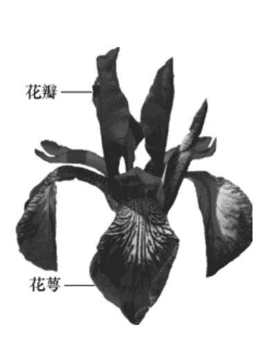

▲ 鸢尾花局部图

监督学习思维中的回归思维同样是一种预测思维，只是预测的目标是连续的变量，比如我们根据房屋的面积、地理位置、建筑年代等对房屋价格进行预测。在这里，价格是一个连续的变量，房子的面积是特征，房屋价格是一个输出值。房子的面积、地理位置和建筑年代称为自变量，房屋价格称为因变量。在这个例子中，我们先获取一定量的房地产数据，包括房子的面积、地理位置和建筑年代及其对应价格，然后基于一定的模型（如三元线性回归函数）进行学习，最终实现对新房子价格的预测。

分类和回归也是重要的数学统计概念，但监督学习思维中的分类思维和回归思维更注重预测的作用以及预测的准确性，并且借助计算机算法得以实现。常见的监督学习应用包括在线广告点击预测、图片标记、语音识别、机器翻译和自动驾驶等。

## 无监督学习思维

根据没有标签的训练样本解决模式识别中的各种问题被称作无监督学习。监督学习和无监督学习的最大区别在于数据是否有标签。无监督学习思维包括聚类思维和降维思维两大类。

聚类思维，顾名思义，“物以类聚，人以群分”，就是把“类似”的对象（或个体）聚到一起。具体来说：将数据集中的样本根据相似度划分为若干个不相干的子集，每个子集称为一个簇。例如，我们在拼图之前，要先把颜色相近的同一块区域的碎片聚成一堆；在市场营销中，我们可以按照顾客的消费习惯、人口特征等将顾客分类，对不同类别的顾客采用不同的营销模式；在金融方面，我们可以根据金融投资产品的收益、波动性、市场资本等指标将这些产品归成几类，然后本着不要把鸡蛋放入同一个篮子（同一类产品）的原则，优化投资组合。聚类的目标是为数据点分组，使得不同聚类中的数据点相异，而同一聚类中的数据点是类似的。聚类是一种自动分类的方法，在监督学习中，你很清楚每一个分类是什么，但是聚类不是，你并不清楚聚类后的每个分类代表什么意思。

降维思维指减少数据集的数量，降低数据复杂度，将高维数据转化为低维数据，同时还能保存相关的结构和有用性，保证数据能传达重要信息。降维思维在本质上是一种抽象思维。例如，一个数据科学团队需要降低一个大型数据集的维度，以便简化建模和降低文件大小，降维很像压缩。对于一张128×128×3像素的图像（长×宽×RGB值），数据就有49152维。如果你可以给这张图像进行空间降维，同时又不毁掉图像中太多有意义的内容，那么你就是很好地执行了降维。降维可以通过特征抽取方法和特征选择方法完成。特征选择方法会选择初始变量的子集。特征抽取方法执行从高维度空间到低维度空间的数据转换。

值得一提的是，著名的生成对抗网络就属于无监督学习。

## 强化学习思维

强化学习是机器学习大家族中的一大类，是让智能体从零开始，通过不断地尝试，最后找到规律，学会达到目的的方法。这就是一个完整的强化学习过程。实际中的强化学习例子有很多。比如AlphaGo使用强化学习算法进行训练，战胜了世界围棋冠军。强化学习主要包含5个元素：智能体、环境、状态、动作和奖赏。强化学习的目标是获得尽可能多的累计奖励。

我们以幼儿学习走路来做个比喻。幼儿想要走路，需要先站起来，站起来之后要保持平衡，接下来先迈出一步，迈出一步后再迈出下一步。在这里，我们把幼儿比喻成智能体，智能体试图通过采取动作（即行走）来操纵环境（路面），并且从一个状态转变到另一个状态（即走的每一步），当智能体完成任务的子任务（即走了几步）时，会得到奖赏（点赞）；当智能体不走路时，不会得到奖赏（点赞）。

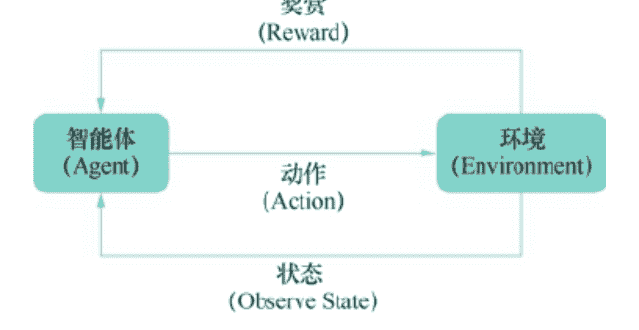

▲ 智能体与强化学习

强化学习思维是一种反复试错的迭代思想，由于没有直接的指导信息，智能体要不断与环境进行交互，通过试错的方式来获得最佳策略。强化学习是机器学习中一个非常活跃且有趣的领域，相比其他学习思维方法，强化学习更接近生物学习的本质，因此有望获得更高的智能，这一点在棋类游戏中已经得到体现。强化学习有很多应用案例，包括自动驾驶、AlphaGo、智能音箱等。

## 深度学习思维

深度学习是机器学习的一种，它有两个优势。

1. 解决问题的高精度，随着用于学习的数据量大幅度攀升，深度学习的精度也会大幅度提高。近年来，人工智能技术在图像识别和语音识别领域的突破得益于此。
2. 我们在上文提到的监督学习中的“特征”，一般需要由人类来提供，深度学习的厉害之处在于它即使没有人类的提示，也能输出高精度的结果。因此，没有相关的领域专业知识和技能的人也能使用深度学习解决某一领域内的问题。

深度学习的基础理论早在20世纪50年代就已经出现了，而这种被视为深度学习起源的逻辑就是感知器。简单来说，感知器是一种“接受多个输入，再传回一个输出结果”的模型。要注意的是，它不是直接将输入值传送至输出端，而是要在途中进行“加权”计算。以房价预测为例，房屋面积、地理位置和建筑年代是输入部分，要预测的房价是输出部分，在这个过程中，输入值和输出值会因为权重而增减。整个过程就是先用输入值乘以“权重”，加总之后，感知器判断该总和，然后输出房价。我们也可以把权重想象成不同粗细的水管。如果影响房价的因素依次是房屋面积>地理位置>建筑年代，那么其对应的权重w1>w2>w3，水管的宽度由粗到细。

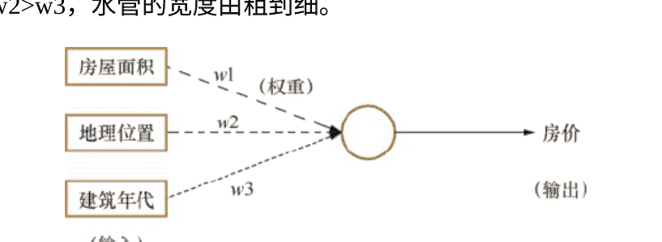

▲ 感知器模型

影响房价的一个重要因素是房子所处城市的等级，一二线城市与三四线城市有比较大的区别，我们把这个影响输出值范围的部分称为偏差项。添加偏差项的目的是改变权重与输入相乘所得结果的范围。偏差项和权重一样，是可以通过机器学习调整的。

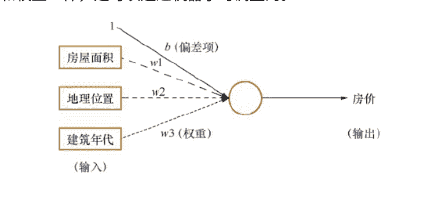

▲ 带偏差项感知器模型

感知器的优点在于可重叠多层有输入值与偏差项组成的小区块。如下图所示，我们把感知器增加至3层，感知器会变成网状结构，我们称之为人工神经网络或神经网络。单一一个感知器被称为神经元。位于每一层最上面的就是偏差项。

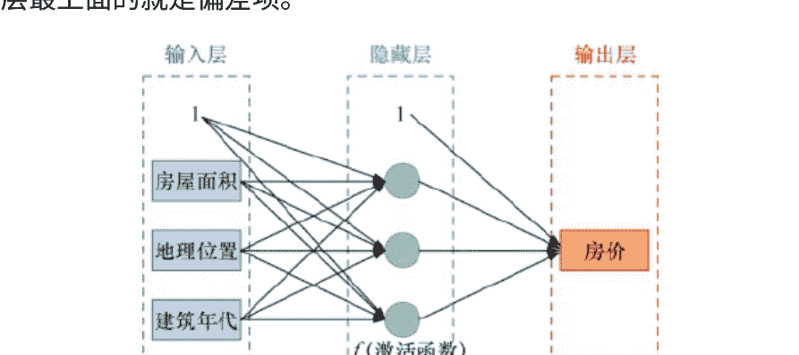

▲ 简单神经网络模型

在上面的例子中，权重和偏差只会进行线性变换。线性方程很简单，但解决复杂问题的能力有限。这时的神经网络实质上只是一个线性回归模型。为了让神经网络能处理更复杂的非线性问题，我们引入激活函数的概念。激活函数对输入进行非线性变换，使其能够学习和执行更复杂的任务，如语言翻译和图像分类等。激活函数不是真的要去激活什么，而是要给神经网络加入一些非线性因素，使得神经网络可以更好地解决较为复杂的问题。

深度学习就是神经网络的层次越来越深的意思，目前还未明确定义要达到几层才能称为深度神经网络，但一般来说，只要是隐藏层达到3层或3层以上的神经网络，就可称为深度学习。虽然这些原理在20世纪50年代就已形成，但当时没有流行开来，主要有两个原因：一是当构造神经元层数越多，计算量就越大；二是深度学习训练所需要的数据量非常大，当时的计算机及大数据技术还不成熟，不足以支撑巨大的数据量。不过现在的技术已经能够解决这些问题，所以深度学习的旋风也立即席卷全世界。

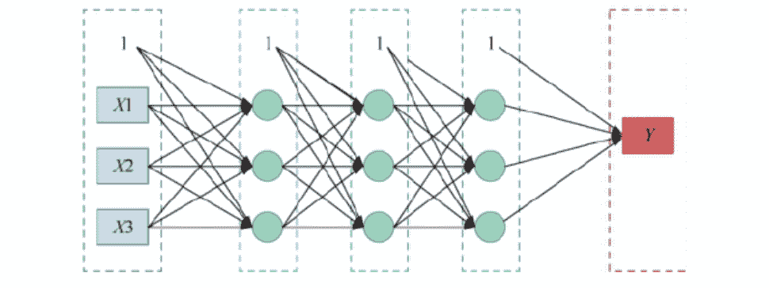

▲ 深度学习神经网络模型

与普通的机器学习相比，深度学习需要规模更大的数据，具体需要多少数据量呢？这个问题难以回答，有时候需要几万条数据，有时候却需要几千万条数据。另外，神经网络隐藏层的层数为多少合适呢？这个问题也没有绝对的答案，往往与经验有关。有时候训练的结果不理想，可能需要调整层数或数据量。想，所以我们先增加一层隐藏层试试看，结果精度居然莫名其妙地提升了，这种情况也是完全有可能的。

## 小结

在本章，我们介绍了4类有代表性的机器学习思维。在第14章，我们将介绍与机器学习思维相应的机器推理思维。

## 第14章

## 机器推理思维

表示（Representation）是自然智能和人工智能的基本问题之一。智能体能够保持对现实世界的表示，并用它们进行推理。计算机使用数据结构来构建表示。这些表示支持算法从已知信息中推导出新的信息。虽然智能体可以推理非常复杂的问题，但它们并不像人类一样思考问题。机器推理思维是对现实世界使用数据结构（如树结构）构建一种知识表示，然后借助AI，利用一定的推理算法从已知信息中推导出新的信息。机器推理思维与机器学习思维是AI思维的两大核心思维方式。我们先介绍比较简单的决策树思维模型，然后引入更复杂的知识本体表达及推理思维。

## 决策树思维

决策树通常采用流程图的形式，决策树的根节点到叶节点之间的每一条路径构建一条规则，路径上分支节点的特征对应着规则的条件，而叶节点的类对应着规则的结论。决策树可以表示许多规则，当沿着路径向下执行逻辑时，相当于绕过了与当前案例无关的规则。你不必查看每条规则是否触发，你可以采用最短的路径来获得正确的结果。决策树的路径或其对应的If-Then规则集合具有一个重要的性质：互斥并且完备。这就是说，每一个实例都被一条路径或一条规则所覆盖，而且只被一条路径或一条规则所覆盖。这里的覆盖是指实例的特征与路径上的特征一致或实例满足规则的条件。决策树的图形性质使它们非常易于理解，并且它们非常适合于过程性知识的编码。

我们在现实生活中经常会用到决策树思维。例如，你决定这个周末应该做什么活动。这可能取决于你是想和朋友一起出去玩还是独自过周末。在这两种情况下，你的决定还取决于天气。如果天气晴朗，并且朋友也有空，你会去踢足球。如果下雨，你就去看电影。如果你朋友根本不来，那么，无论天气如何，你都会去打电竞游戏。

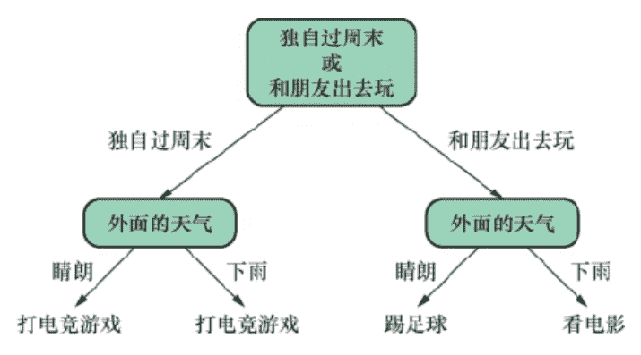

## 知识本体思维

当决策推断涉及的规则和知识越来越多时，决策树思维就不再适合推理。这时候往往采取一种“知识库+推理机”的架构进行机器推理。而知识本体思维就是一种利用某种本体模式来表示描述知识的思维方法。

什么是本体？本体是用来描述某一特定知识领域的概念以及概念之间关系的一种形式化表达。例如，我们可以用一个树结构描述动物分类。值得注意的是，除了使用树或图的结构，知识本体还可能以逻辑的形式来表达，例如描述逻辑（Description Logic）。我们在本书第8章提到的知识图谱技术，是目前最流行的表达知识本体的一种形式。随着人工智能的技术发展和应用，知识图谱已被广泛应用于智能搜索、智能问答、个性化推荐、内容分发等领域。下面，我们来看一张简单的知识图谱：

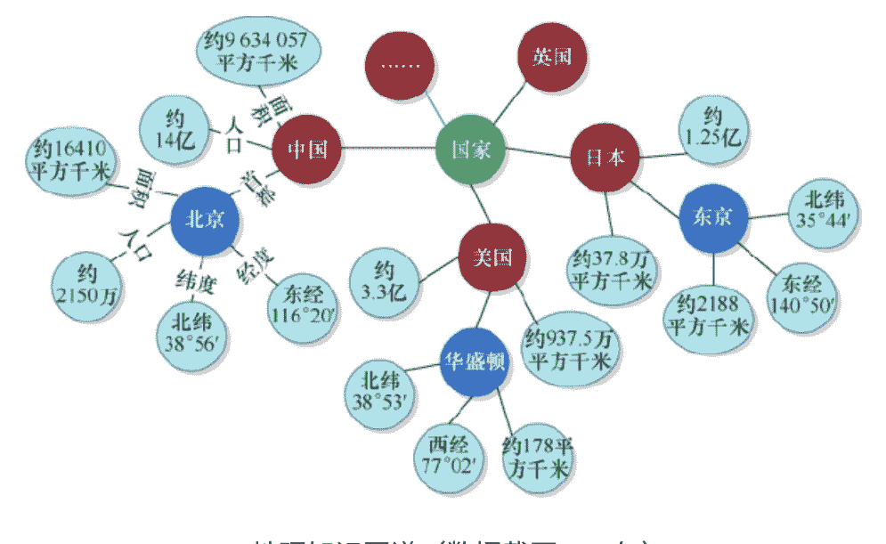

▲ 地理知识图谱（数据截至2019年）

如上页图所示，如果两个节点之间存在关系，它们就会被一条无向边连接在一起，那么这个节点，我们就称其为实体（Entity），它们之间的这条边，我们称其为关系（Relationship）。知识图谱的基本单位是“实体（Entity）—关系（Relationship）—实体（Entity）”构成的三元组，这也是知识图谱的核心。

实体：具有可区别性且独立存在的某种事物，可以是实例或概念。实体是知识图谱中的最基本元素，不同的实体间存在不同的关系。如上页图中的“中国”“北京”“16410平方千米”等。

关系：连接不同的实体，指代实体之间的联系。通过关系节点把知识图谱中的节点连接起来，形成一张大图。如图中的“人口”“首都”“面积”等。

## 正向推理思维

单纯地存放知识并不能解决问题，只有使用知识才会有意义。按某种策略使用知识的行为就是推理或推断。正向推理思维就是以已知事实或条件为前提，逐步推导目标成立的思维过程。因此，正向推理又称事实驱动推理、数据驱动推理或前向推理。

正向推理的基本思想是：从问题已有的事实（初始证据）出发，正向使用规则，当规则的条件部分与已有的事实相匹配时，就把该规则作为可用规则放入候选规则队列中，然后通过冲突消解，在候选队列中选择一条规则作为启用规则进行推理，并将其结论放入数据库，作为下一步推理的证据。如此重复这个过程，直到再无可用规则或求得了所要求的解为止。

例如，我们有以下规则：

1. 如果X呱呱叫且X吞食蚊子——那么X是青蛙。
2. 如果X叽叽喳喳且X唱歌——那么X是金丝雀。
3. 如果X是青蛙——那么X是绿色的。
4. 如果X是金丝雀——那么X是黄色的。

假设我们有以下事实：

弗里茨呱呱叫。
弗里茨吞食蚊子。

利用正向推理，基于规则1，我们可以知道：

弗里茨是青蛙。

进一步推理，基于规则3，我们得出：

弗里茨是绿色的。

正向推理的优点是比较直观，允许用户主动提供有用的事实信息，适合诊断、设计、预测、监控等领域问题求解。其主要缺点是推理无明确目标，求解问题时可能会执行许多与解无关的操作，导致推理效率较低。

## 反向推理思维

与正向推理相反，反向推理是目标驱动。首先提出某个假设，然后寻找支持该假设的证据，若所需的证据都能找到，说明原假设是正确的；若无论如何都找不到所需要的证据，则说明原假设不成立，此时需要另做新的假设。例如，一个人早上醒来，看到窗外的行人只穿了轻薄的外衣，有的人还穿了短袖，由此推测出外面的温度很高，所以他出门也穿了一件短袖，又带了一件轻薄的外衣。这样根据结果而推测原因的思维就是反向思维，这种推理方法就是反向推理法。著名的人工智能语言Prolog就提供反向推理引擎。

反向推理思维的主要优点是：不必寻找和使用那些与假设目标无关的信息和知识，推理过程的目标明确，也有利于向用户提供解释，在诊断性专家系统中较为有效。其主要缺点是当用户对解的情况认识不清时，由系统自主选择假设的目标具有盲目性，若选择不好，可能需要多次假设，因此影响系统效率。

## 小结

在本章，我们介绍了机器推理思维。至此，我们已经完整地介绍了AI思维中的两大核心思维模式：学习和推理思维。在第15章，我们将介绍AI思维的另一个重要应用领域：人机交互。

## 第15章

## 人机交互思维

人类本身是智能体最难理解的事情之一。智能体需要多种知识才能与人类自然交互。智能体必须能够用人类语言交谈，识别人类面部表情和情感，并利用文化和社会习俗的知识来推断所观察到的人类行为的意图。今天的AI系统可以在有限的程度上使用语言，但其综合推理和会话能力却达不到一般人类儿童的水平。人机交互思维就是要理解人工智能在自然语言、常识推理等自然交互领域应用及其限制。

## 自然语言处理

自然语言处理（NLP），有时候也被人们称作自然语言理解，旨在利用计算机分析自然语言语句和文本，抽取重要信息，进行检索、问答、自动翻译和文本生成。它的目的是使计算机能听、会说、理解语言、会思考、解决问题，甚至会创造。它包括运算智能、感知智能、认知智能和创造智能等几个层次的技术。计算机在运算智能（即记忆和计算的能力）方面已远超人类。而感知智能则是计算机感知环境的能力，包括听觉、视觉和触觉等，相当于人的耳朵、眼睛和手。目前感知智能技术已取得飞跃性的进步；而认知智能包括自然语言理解、知识和推理等，目前还有待深入研究；创造智能目前尚无多少研究。自然语言处理是人工智能皇冠上的明珠，自然语言处理的进步将会推动人工智能整体发展。自然语言处理在深度学习的驱动下，在众多领域取得了很大进步。下面，我们就来一起看看自然语言处理的重要技术进展。

机器翻译：输入的源语言文本通过自动翻译获得另外一种语言的文本。根据输入媒介不同，可以细分为文本翻译、语音翻译、手语翻译、图形翻译等。机器翻译从最早基于规则的方法到20年前基于统计的方法，再到今天基于神经网络（编码-解码）的方法，逐渐形成了一套比较严谨的方法体系。

对话系统：系统通过一系列的对话，与用户进行聊天、问答或完成某一项任务。它涉及用户意图理解、通用聊天引擎、问答引擎、对话管理等技术。此外，为了体现上下文相关，它要具备多轮对话能力。同时，为了体现个性化，要开发用户画像以及基于用户画像的个性化回复。一般的对话系统背后单元处理引擎有3层技术：第一层是通用聊天机器人，第二层是搜索和问答（Infobot），第三层是面向特定任务对话系统（Bot）。

机器阅读：机器阅读指我们让计算机看一遍文章，然后针对这些文章问一些问题，看计算机能不能回答出来。例如，在搜索引擎中，机器阅读理解技术可以用来为用户的搜索（尤其是问题型的查询）提供更为智能的答案。我们通过对整个互联网的文档进行阅读理解，从而为用户提供精确的答案。同时，机器阅读在移动场景的个人助理也有直接的应用：在智能客服中，我们可使用机器阅读文本文档（如用户手册、商品描述等）来自动或辅助客服回答用户的问题；在办公领域，我们可使用机器阅读理解技术处理个人的邮件或文档，然后用自然语言查询获取相关的信息；在教育领域，机器阅读可以用来辅助出题；在法律领域，机器阅读可用来理解法律条款，辅助律师或者法官判案；在金融领域，机器阅读可以从非结构化的文本（如新闻）中抽取与金融相关的信息等。机器阅读理解技术可形成一个通用能力，第三方可以基于它构建更多的应用。

机器创作：机器创作指运用算法对输入或搜集的数据进行加工处理，从而自动生成文章的一整套计算机程序。目前，适合通过机器或算法进行的写作主要有两种：第一种是以各种数据、图表的引用和分析为基础的技术文章，文章的主体来源于对数据的引用、解释和分析，具

## 情感识别

计算机情感识别技术能够解释人类的情绪状态，并做出相应的行为，对情绪给予恰当的回应。情感识别技术是人工智能发展的分水岭。人工智能的情感识别依赖于语音技术、图形识别技术的发展。机器人大数据的支持下，对微表情的捕捉和情绪判断更加精准。微软、软银、苹果等公司都开始在情感识别领域布局，这说明情感识别确实是人工智能的重要发展方向之一。情感识别功能是以后机器人进入家用领域的必备能力之一。目前的机器人情感仅仅停留在情感识别，还没发展到情感表达。

对于人工智能系统来说，发现细微的现象和捕捉稍纵即逝的变化是它的长项，并且可以借助高速摄像机和高性能处理器来完成这项工作，从这个方面来说，人工智能系统对人类情绪的理解可能比人还准确。面对人类情感这个异常复杂且人类自身都没有完全弄懂的问题，人工智能还有很长的路要走，但好在我们现在找到了正确的路径——我们不需要懂得人类情感的本质，只需要让机器对情感表达的各种信号（面部表情、语言等）进行分析并输出结果就可以了。就像我们目前虽然无法完全破译大脑，但我们依然能够从功能的高度出发，研发出智能化的机器。例如，软银推出的情感陪护机器人Pepper读懂人类情感的方式是对人类的面部表情进行分析，它应用了图像识别技术；而神经科学公司Innerscope通过观察电影中那些让观众的大脑高度活跃的高光时刻来预测该电影能否一鸣惊人，这是一种对大脑某些区域电信号的物理检测，而不是真正弄清楚大脑为何兴奋。

## 小结

在本章，我们介绍了人机交互思维中的两个主要应用，分别是自然语言处理和情感识别。在第16章，我们将介绍AI伦理思维。

# 第16章 AI伦理思维

人工智能技术在飞速发展，同时也带来了伦理问题。我们如何确保算法不侵犯隐私权和数据保密权？我们如何确保人工智能系统不会复制社会和文化偏见？它能否对价值观进行编程？又由谁来编程？我们如何确保世界各地的人都可以享受到这些技术的惠益？AI伦理思维是保证AI算法系统的透明性，要求其提供多样性、无歧视、公平的服务，能够促进积极的社会变革，同时具有相应的问责制等方面的一种思维。

## 算法可解释性

尽管“深度学习神经网络”已经帮助机器学会如何利用自然语言进行交谈、驾驶汽车、玩电子游戏、下围棋，甚至绘制梦境、绘制场景并推动科学发现等，但同时它也给创造者们带来了新的挑战。时至今日，我们仍不清楚到底是什么样的基本原则指导着这些学习系统的实际设计。这有点像人类的大脑，尽管已经非常强大和智能，但人类对大脑的思维运作知之甚少。大脑与深度学习算法一样，都是一个不透明的黑匣子。然而，基于人工智能产生的结果越重要，对人工智能可解释性的需求就越大。在高风险的情况下，如自动驾驶和医疗领域，人们可能需要明确地解释特定结果是如何得出的。而相对低风险的人工智能系统可能更适合黑盒模型，但人们很难理解其结果。

希伯来大学计算机兼神经科学家蒂什比（Tishby）提出了证据以支持一种新的理论，希望能够借此对深度学习的工作原理做出解释。蒂什比认为，深度神经网络是根据一种所谓“信息瓶颈”的流程来进行学习的。其想法在于神经网络会从输入数据中排除无关细节与干扰信息，“挤压”信息以通过瓶颈，最终仅保留与一般性概念相关性最强的特征。当然，“信息瓶颈”是否适用于所有深度学习机制，以及除压缩之外还存在着哪些其他泛化途径，仍有待观察。我们在使用人工智能技术尤其是深度学习算法的时候，需要保有一种算法透明思维，在准确性和可解释性之间取得平衡。

## 算法偏见

在我们的世界里，算法无处不在，偏见也是一样，我们经常忽略的一点是二者的交集：计算机算法中存在的偏见。与我们大多数人的认知相反，科技并不是客观的。人工智能算法和它们的决策程序由它们的研发者塑造，他们写入的代码、使用的“训练”数据，以及他们对算法进行压力测试的过程，都会影响这些算法今后的选择。这意味着研发者的价值观、偏见等都会反映在软件上。

从脸书的新闻算法到医疗系统，再到警用携带相机，我们作为社会的组成部分，极有可能对这些算法输入各式各样的偏见。这些被输入了偏见的机器会大量生产、分配，将种种社会偏见藏于科技客观性的面纱之下。

人工智能不仅需要在技术上进行评估（例如基于分类准确性和误差矩阵），还需要在道德和法律标准上进行审查。算法公平思维就是把一些原则融入AI设计，以确保人工智能系统不会出现偏见和歧视。

1. 样本代表性：为了防止偏见的产生，所有对象都应该有相同的机会在数据中出现。有时这意味着需要将代表性不足的人群添加到任何训练数据集中。有时这也意味着机器学习模型需要在不同的数据源上进行大量重新训练。好消息是最近的研究提供了新的算法技术来衡量代表性足够与否，并帮助减轻机器学习中的不必要偏差。
2. 保护敏感特征：机器学习系统需要避免对个人的不公正影响，特别是对社会和现实的影响以及其他敏感属性。这些特征可能包括民族、性别、国籍等。算法的整体公平性必须根据它对最脆弱人群的影响来判断。然而，简单地从机器学习模型中省略敏感变量并不能解决问题，因为它还可能混杂其他各种相关因素。
3. 多元化管理：算法公平不仅意味着追求正义，它代表着在机器学习系统设计中不断追求公平的积极责任。在这方面，管理的精神只能由一个挑战彼此隐含假设的多元化团队承担。例如，在常规的无意识偏见破坏练习中，团队可以对各种观点进行评价。只有通过创造包容性文化，公司才能为团队制造适当的条件，以解决机器学习中的不公平和偏见。
4. 真实性：真实性原则不仅涉及训练数据的真实性，还涉及人工智能预测的真实性，因为人工智能系统经常被用于为人类决策提供信息。例如，有人使用机器学习扭曲现实。在这种情况下，人工智能的普遍滥用可以帮助恶意行为者制作虚假的视频，伪造人们说出他们从未说过的话，甚至伪造现实生活中从未发生的情景。

要彻底消除算法偏见并不容易，庆幸的是我们可以利用机器算法来实现算法的公平，目前已经有一些公平系统被人们开发和部署，并在防止意外的歧视上取得了一些成功。我们希望该算法自身能够促进现代人工智能系统算法的公平性。

## 数据隐私

欧盟于2018年5月25日正式实施号称有史以来最为严格的数据保护法规GDPR（General Data Protection Regulation）。它保护的是自然人的“个人数据”，包括姓名、地址、生日、信用卡、银行、医疗信息、位置信息、IP地址等。任何在欧盟设立机构的企业或向欧盟境内提供产品和服务的企业，在处理欧盟境内个人的数据时都会受到GDPR的约束。

如果违反GDPR，企业最高将面临全球年营收4%或者2000万欧元（约1.5亿元人民币）的巨额罚款（两者取其高）。

人工智能是一个极度依赖数据的行业。从最初进行人工智能算法模型的训练，到形成最终的人工智能产品或服务，数据都是不可或缺的生产资料，这意味着GDPR对人工智能产品的约束贯穿其整个生命周期。使用人工智能算法去改造自身业务的公司也需要评估其是否违反GDPR。所以，GDPR被称为人工智能的“紧箍咒”。数据保护思维就是基于GDPR的若干基本原则形成的针对个人数据和隐私的保护措施。

1. 合法、公平、透明原则。
2. 目的限定原则：出于特定、明确、合法的目的收集个人数据，进一步处理不得有悖于前述目的，除非符合公共利益、科学研究等正当目的。
3. 最小范围原则：所收集、处理的个人数据之于其处理目的，应当准确、相关、必要。
4. 准确性原则：确保个人数据准确、时新。
5. 有限留存原则：除非符合公共利益、科学研究等正当目的，否则对个人数据的留存期限不能超过其处理目的。
6. 完整及保密原则：采用技术手段确保个人数据安全，不被非法处理、窃取、损毁等。
7. 责任原则：控制者应当遵守上述6项原则并承担责任。

尽管GDPR为人工智能套上了一个“紧箍咒”，但是它得到了人工智能领域从业者的普遍赞同，发展和应用人工智能技术需要一个良好的环境。人工智能系统如果不能尽力确保个人数据的安全性，不但无法赢得用户信赖，而且将触犯相关法律。数据保护思维就是要充分了解有关个人数据及隐私保护的原则，以便人们在人工智能时代更好地应用人工智能及保护自己。

## 小结

在本章，我们详细介绍了AI伦理思维，包括算法透明思维、算法公平思维和数据保护思维。至此，我们已经完整地阐述了整个AI思维体系。在第4部分，我们将应用这些思维方法，针对人工智能在不同领域的应用做介绍和分析。

# 第4部分 智慧城市

数据是现代城市的命脉。全世界每天有数亿个摄像头在捕获数据，且数量还在不断增长，这形成了人类无法分析的信息海啸。人工智能技术是将这些信息转化为深刻洞察的关键。它正在改变我们捕获、检查和分析数据的方式，进而影响公共安全、交通、城市服务等方方面面。

智慧城市就是运用人工智能和通信技术感测、分析、整合城市运行核心系统的各项关键信息，从而对包括民生、环保、公共安全、城市服务、工商业活动在内的各种需求做出智能响应。其实质是利用先进的人工智能技术，实现城市智慧式管理和运行，进而为市民创造更美好的生活，促进城市和谐和可持续发展。相对于传统城市，智慧城市主要由数据收集、数据存储、数据分析等环节组成，充分利用新技术及其带来的启发，让人工智能系统和服务得到改造和提升，智慧城市的涵盖范围非常广，包括我们的衣食住行及娱乐。

# 第17章 自动驾驶

自动驾驶汽车依靠人工智能、视觉计算、雷达、监控装置和全球定位系统协同合作，让计算机可以在没有任何人主动操作下，自动安全地操作机动车辆。它集中运用了计算机、现代传感、信息融合、通信、人工智能及自动控制等技术，是典型的高新技术综合体。自动驾驶技术是人工智能的最大应用场景之一。在本章，我们将主要介绍AI思维在自动驾驶中的应用，并对自动驾驶技术的发展前景及挑战进行简单分析。

## 自动驾驶分级

按照SAE（美国汽车工程师协会）的分级，自动驾驶技术共分为辅助驾驶、半自动驾驶、有条件自动驾驶、高度自动驾驶、完全自动驾驶5个层级。

L1：辅助驾驶，自动驾驶系统对方向盘和加减速中的一项操作提供驾驶支持，其他的驾驶动作都由人类驾驶员进行操作。现阶段大部分ADAS主动安全辅助系统，让车辆能够实现感知和干预操作，如防抱死制动系统（ABS）、电子稳定性控制（ESC）、车道偏离警告系统、正面碰撞警告系统、盲点信息系统等。车辆能够通过摄像头、雷达传感器获知周围交通状况，进而做出警示和干预。

L2：半自动驾驶，车辆通过摄像头、雷达、激光传感器等设备获取道路及周边交通信息，自动驾驶系统会自行对方向盘和加减速中的多项操作提供驾驶支援，在驾驶者收到警告却未能及时采取相应行动时，自动驾驶系统能够自动进行干预，其他操作交由驾驶员完成，实现人机共驾，但车辆不允许驾驶员的双手脱离方向盘。半自动驾驶的自动驾驶系统有自适应巡航控制（ACC）、车道保持辅助系统（LKA）、自动紧急制动系统（AEB）、车道偏离预警（LDW）等。

L3：有条件自动驾驶，由自动驾驶系统完成驾驶操作，根据路况条件，在必要时发出系统请求，必须交由驾驶员驾驶。

L4：高度自动驾驶，由自动驾驶系统完成所有驾驶操作。根据系统请求，驾驶员可以不控制车辆。

L5：完全自动驾驶，自动驾驶的理想形态，乘客只需提供目的地，无论任何路况，任何天气，车辆均能够实现自动驾驶。这种自动化水平允许乘客在车中进行计算机工作、休息以及娱乐活动等，人在任何时候都不需要对车辆进行监控。

可以看到，自动驾驶技术分级的核心是驾驶的责任逐渐从人转移到自动驾驶系统，重点体现在转向与加减速控制、对环境的观察、激烈驾驶的应对、适用环境范围上的自动化和自主化程度。目前，自动驾驶技术还在进行L3、L4的研发，离一些电影中所展示的全自动驾驶还有比较长的一段距离。

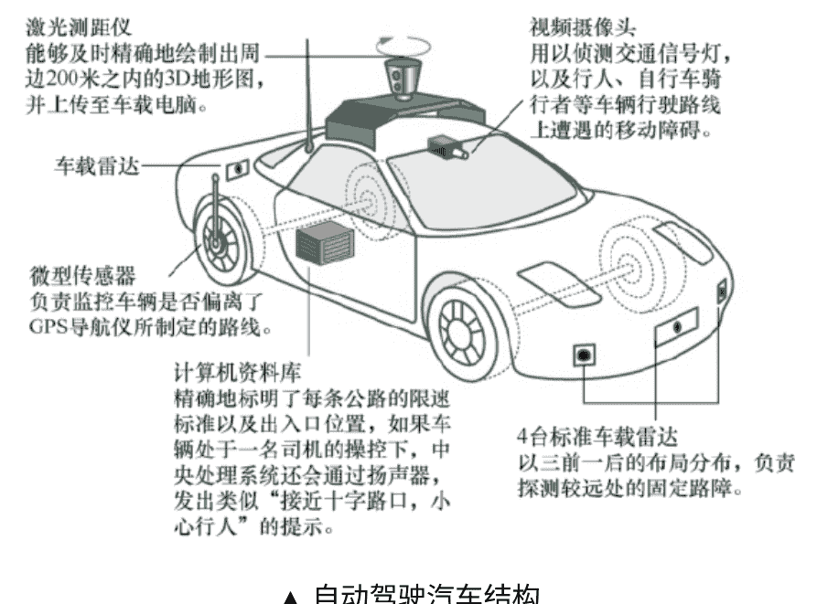

## 原理与实现

车辆实现自动驾驶有3个环节：（1）感知；（2）决策，人工智能系统对感测器收集到的资讯进行分析处理，然后再向控制的装置输出控制信号；（3）执行，人工智能系统依据ECU输出的信号，让汽车完成动作执行。其中，首要解决的便是图像识别能力，而传感器的“智能”水平在很大程度上决定了汽车在复杂路况上自动驾驶的可靠度，因此，深度学习的应用便成为关键所在。

环境感知技术是实现自动驾驶的前提条件，起着人类驾驶员“眼睛”和“耳朵”的作用。环境感知技术是利用摄像机、激光雷达、毫米波雷达、超声波等车载传感器，以及V2X和5G网络等获取汽车所处的交通环境和车辆状态等多源信息，为自动驾驶汽车的决策规划提供服务。传感器的重要性来自于两个方面：第一，传感器决定着数据采集的质量，数据的质量决定着算法使用效果。第二，传感器的成本与产业升级的速度强相关。目前传感器性能越来越高、体积越来越小、功耗越来越低，其飞速发展是自动驾驶热潮的重要推手。

除了对外界进行认知，机器还必须能够进行学习。深度学习是自动驾驶技术成功的基础。深度学习可以提高汽车识别道路、行人、障碍物等的时间效率，并保证识别的正确率。通过大量数据的训练之后，汽车可以将收集到的图形、电磁波等信息转换为可用的数据，利用深度学习算法实现自动驾驶。

将深度学习应用到自动驾驶汽车中，主要包含以下步骤：

1. 准备数据，对数据进行预处理，再选用合适的数据结构存储训练数据和测试元组。
2. 输入大量数据对第一层网络进行无监督学习。
3. 通过第一层网络对数据进行聚类，将相近的数据划分为同一类，随机进行判断。
4. 运用监督学习调整第二层网络中各个节点的阈值，提高第二层网络数据输入的正确性。
5. 用大量的数据对每一层网络进行无监督学习，并且每次只训练一层，将其训练结果作为其更高一层输入。
6. 输入之后用监督学习去调整所有层网络。

## 现状与挑战

在目前交通出行状况越来越恶劣的背景下，自动驾驶汽车的商业化前景，还受很多因素制约。主要有：

1. 政策、法规障碍。
2. 不同品牌、车型之间需要建立共同协议，行业缺少规范和标准。
3. 基础道路状况、标识和信息准确性，自动驾驶所面对的环境是完全开放的，包括天气、光线、突发的路况，还要解决自动驾驶汽车和有人驾驶汽车的共存等问题，目前技术的健壮性仍然不足。
4. 难以承受的高昂成本，以激光雷达为代表的核心传感器的成本仍是商业化量产的最大阻碍之一。

此外，自动驾驶汽车的最大特点之一就是车辆网络化、信息化程度极高，而这也对计算机系统的安全问题形成极大挑战。一旦遇到计算机程序错乱或信息网络被入侵的情况，如何继续保证自身车辆以及周围其他车辆的安全是未来需要解决的问题。

## 小结

实现完全的自动驾驶也许有些遥远，但随着机器学习算法的提升和应用的挖掘，更接地气的人机和谐共驾或许指日可待。技术的发展充满激情与动力，在不久的将来，也许自动驾驶会成为主流。在第18章，我们将介绍一个与我们生活息息相关的AI应用——智能垃圾分类。

# 第18章 智能垃圾分类

垃圾分类已经成为国内最受关注的话题之一。不过，人工智能技术早已学会了垃圾分类。人工智能系统通过深度学习、神经网络训练机械臂，使其能够像人一样识别垃圾并进行分类，其效率远高于人工分类。

## 智能回收箱

智能回收箱对投放进来的垃圾进行数据分析、流向检测等工作。居民只要在垃圾分类箱前扫描二维码或完成刷脸程序，再在触摸屏上轻触相应类别的垃圾按键，用于投放垃圾的箱门就会打开。人工智能系统可以智能识别居民的误投、乱投现象。例如，如果有居民故意将石块扔进可回收垃圾，该系统会自动把石块返还到投递口。同时，系统还能把误投信息记录到用户的数据中，形成用户的行为肖像。

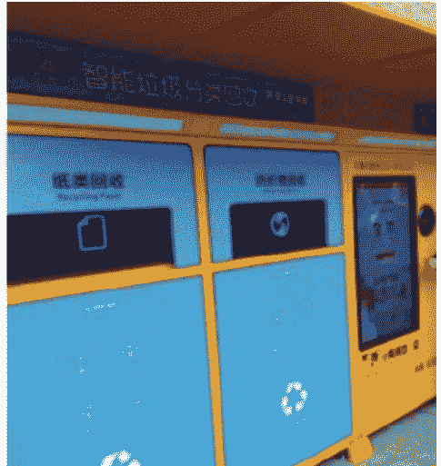

智能回收箱其实早有应用。在加拿大，一款名为“奥斯卡”（Oscar）的垃圾箱赫赫有名。它包括一台32英寸的显示屏和一个人工智能摄像头，收纳不同类别垃圾的垃圾桶，摄像头可以分辨出纸张、厨余、容器等垃圾，并在显示屏上指示用户根据分类将垃圾丢进桶内，当有人将手机放在摄像头前时，显示屏上会出现一行文字及配图指示对方将手机放进衣服口袋里。

“奥斯卡”垃圾分类系统由Intuitive AI创建，该解决方案主要面向小区、机场、学校、企业园区等应用场景。目前已被投放在加拿大温哥华的一个机场及西蒙弗雷泽大学等地。它还能通过对垃圾数据进行数据分析，并向企业出售有关用户在特定地点的消费习惯数据。

## 自动分拣系统

在一般的垃圾回收流程中，人为垃圾分类只是第一步，之后，垃圾还要送至分拣中心，由分拣工人进一步细化分类。以往垃圾回收厂为了对垃圾中有价值的材料进行分类和回收，仍然需要进行一些手动工作，但直接接触废物有可能会给分拣工人带来健康风险，而现在垃圾分拣机器人能将分拣工人从这项既脏又危险的劳动中解放出来。

Zen Robotics垃圾回收设备（ZRR）是全球首个机器人垃圾分类系统，它可对同一位置的多种碎物进行分类。它的工作方式为ZRR传感器单元扫描垃圾流，ZRR大脑识别各种材料、物体和抓取位置，ZRR大脑控制软件分析数据、控制机器人，ZRR智能抓取器可选取所需的物体。该套系统能以每小时3000件的速度全自动分离各种垃圾，单件垃圾重量最高可达30千克。该系统可以识别金属、木材、石膏、石块、混凝土、硬塑料、纸板等20余种可回收材料，如果两套系统24小时不停机操作，一天就可以处理2000吨垃圾。与人工分拣相比，30万吨的年处理量使用机器人分拣可提升约40%的效率。

## 自动分类原理

首先要收集海量的“垃圾”图像并为每张图像标注相应的类别。垃圾自动分类在本质上是一个图像分类问题，当前基于深度卷积神经网络的图像分类算法发展很快，各种方法层出不穷。所以我们需要构建一个垃圾自动分类器的流程，我们可以使用50层的ResNet来构建垃圾自动分类器。

我们在实际的垃圾分类投放过程中，对单个的垃圾一一拍照进行分类显得过于烦琐和缓慢。那么我们能否对一群垃圾直接拍照后进行批量分类呢？要实现对一群垃圾的批量分类，其实就是要构建一个垃圾的目标检测器。输入一张含有多个垃圾的图像，让模型输出图像中每种垃圾对应的类别。

和垃圾分类器一样，一个理想的垃圾检测器，需要大量的“垃圾”标注数据来支撑。但是与分类数据集相比，检测数据集除了标注类别外还要标注图像位置坐标，这样的标注工作更为艰巨。在完成垃圾检测的图像数据集后，我们就可以利用当前主流的深度学习检测算法来实现批量垃圾的分类。

## 小结

基于人工智能、云计算、大数据、物联网等新技术，垃圾分类的效率越来越高，这对环保事业及技术发展有着重要的意义。近年来，各国对环保的重视和投入力度不断增强，期待今后会有越来越多的人工智能产品落地。在第1章，我们将揭开AI预防犯罪的神秘面纱。

## 第19章

## AI预防犯罪

随着人工智能技术的发展，摄像头采集、大数据分析、人脸识别等技术越来越多地被用于安防、司法领域。学者、专家尝试统合犯罪学、人口学、地震学等学科，以及大量的案件资料，利用人工智能技术预测犯罪。从犯罪高发地预测到潜在罪犯预警，从协助审讯嫌疑人到辅助司法量刑，利用机器学习和深度学习算法预防、打击犯罪逐渐进入大众的认知范围。人工智能技术在该领域中有着广阔的发展空间。

## 少数派报告

美国好莱坞著名导演斯皮尔伯格曾翻拍了一部20世纪50年代的科幻小说，电影的名字叫作《少数派报告》，其内容是描述未来某国政府利用超能力预测潜在犯罪（Pre-Crime），以便司法系统提前阻止。这样的社会没有重大罪行，只有充满“潜在罪犯”的拘留营，一切看似安详、和谐。关于这部电影，以及预测犯罪，目前还存在很大的争议。如今在现实生活中，许多国家面对层出不穷的犯罪问题，正在使用或引入属于它们的“少数派报告”。不过，它们依靠的并非是超能力，而是人工智能技术。

## 如何预测犯罪

目前，AI预测犯罪的类型大致可分为两种。

第一种是预测犯罪热点，20世纪90年代，纽约市警方曾用数据信息来预测哪些地铁站是犯罪高发区。随着人工智能的发展，世界上已经有一些国家和地区开始利用最新的机器学习算法预测犯罪。他们在城市里安装了可以检测枪声的声音感应器来收集数据，加上城市路边的摄像头数据，通过机器学习算法做了一个“罪案预测系统”，它能预测抢劫、枪击案的发生地点。犯罪发生区域的预测有利于警方合理安排警力。在现实中，警察的数量是有限的，传统的巡逻效率不高，现在，人们利用算法和机器学习可以帮助警察合理安排警力资源，提升打击犯罪的效率。

第二种是预测哪些人可能成为罪犯。人们通过收集犯罪案例，使用机器学习方法，将这些数据“喂”给计算机程序，包括年龄、性别、住址及邮编、第一次犯罪的年龄及一长串可能相关的犯罪记录。通过机器学习，我们得出哪些人可能重复犯罪，例如，芝加哥警局的“预测罪犯热点名单”会向警员展示附近街区最有可能犯罪的20名嫌疑犯的名字和照片，具体到这样的程度：“此人在未来18个月内有25%的可能性参与暴力事件。”根据芝加哥警局透露的信息，这个名单目前已经超过400人。名单上的人不一定有犯罪史，他们可能住在罪案高发地区，或者其朋友、家人有犯罪记录等。

## 算法歧视问题

利用客观大数据分析等技术的人工智能在司法领域的应用可以排除许多人为因素，但同时不可避免地存在着一些弊端，比如大数据涉及的个人隐私问题、算法制定者的个人偏见问题等。只有通过机器算法加上人工审核的方法，才能更准确、更公正地做出判断和决策，任何过分依赖人或者机器的司法体系必然走向两个极端而失去公信力。

## 小结

在本章中，我们介绍了如何利用人工智能技术预防犯罪。在第5部分，我们将介绍人工智能技术在智能家居领域的应用。

## 第5部分

## 智能家居

近年来，语音识别技术取得重大突破。改善智能家居设备的交互性和易用性，正成为智能家居领域的重要关注点。语音助理是这一领域取得进展的关键，智能音箱逐渐成为智能家居的关键枢纽。

智能家居的主要案例适用范围包括监控、远程控制和自动化等，这些案例向那些在家中安装相关云连接的安全、温湿度控制、照明和电力设备的消费者承诺其便利和安全性。阿里的“天猫精灵”、小米的“小爱同学”、腾讯的“腾讯听听”、百度的“小度智能音箱”等产品陆续出现，各互联网公司纷纷试水智能家居领域。

人工智能也会为智能家居行业提供更安全、可控的应用环境。传统的密码输入保护方式已经无法满足人们对操作便捷性和安全性的要求，这推动了人们对生物识别技术的开发。生物识别指通过计算机与生物传感器等高科技结合，提取人类固有的生理特征和行为特征，以鉴定个人身份。目前人脸识别、指纹识别和虹膜识别已经得到广泛的应用。为达到更高的安全水准，通过红外线照射获取手指静脉图像的指静脉技术也在紧锣密鼓研究当中，这些技术极大地迎合了人们对智慧生活的追求，也使当下热门的智能门禁、智能家电等传统家居领域获得了新的生命力。

## 第20章

## 智能音箱

随着物联网技术的发展，智能音箱占据了家庭娱乐场景中核心的位置，并且凭借其语音交互的优势成了现阶段智能家居的控制中心。在科技巨头竞争智能音箱市场的背后，其实是对智能家居入口的争夺。如今的智能音箱被业界公认为是控制智能家居入口级别的产品。

## 智能家居入口

整个智能家居的生态圈，包括智能家居整体解决方案、家庭影音及娱乐系统、智能照明控制系统、家庭暖通和新风系统、家庭安防及楼宇对讲系统、智能遮阳及电动窗帘系统等。

家庭是一个有着多年龄层人员的场景。在这个场景中，像路由器、冰箱等设备未必适合与全年龄层的用户进行交互。而智能音箱独特的语音交互体系与较低的入手价格，使得其更适合作为智能家居入口级产品。

自从亚马逊推出智能音箱“Echo”后，越来越多的智能家居产品及服务快速地进入用户的日常生活。人们也更加重视智能音箱所起到的智能家居时代的入口效应。

## 3个关键因素

和Eliza（人工智能软件，最早的与人对话程序）相比，现在的智能音箱明显更接近人类，功能也更多样化。人工智能有3个关键因素促进了智能音箱的发展。

(1) 语音识别：智能音箱必须检测人类的声音，并且将其转换为机器可读的形式，这也被称为语音识别。多年来，研究者们常常被噪声所困扰，但深度学习带来了革命性的改变。2012年，基于深度学习的AlexNet在ILSVRC竞赛中胜出，它在图像识别方面大获成功。

(2) 自然语言理解：在语音识别和语音合成之间，有一个关键步骤是自然语言理解（NLU），这是让智能音箱具有阅读理解能力的关键。例如，当用户说“我在弹钢琴”的时候，系统并不知道什么是“我”、什么是“钢琴”。自然语言理解的研究者们需要找到方法，将人类语言转换成一个标准的形式。虚拟助手首先会挑出一些特有名词，如城市名、公司名、乐曲名等；然后进行词类归纳，也就是将单词分成8类：动词、名词、限定词、形容词、副词、代词、同位语、感叹词；最后一步是语法分析，也就是将一串自然语言或机器语言符号依照语法规则进行分析。但是，如果用户没有注意语法规则，语法分析可能无法正确工作。现在，许多研究项目抛弃了语法分析，寻找其他替代方案解决端到端的自然语言处理问题。

(3) 对话系统：对话行为将用户需求与对应的系统功能联系起来。例如，用户想听一首歌，系统在接收到这个输入需求后，智能音箱会根据语调、首位单词和谓语动词来捕捉特征，然后将这些特征归类到一个对话行为中，如需求、陈述、是非问题等。紧跟着对话行为步骤的是对话决策（对话规则），它决定了系统接下来要做出怎样的动作。如今，用户希望能与智能音箱进行多重互动的自然对话，因此对话系统需要一个状态追踪器去维持现有的对话状态。这包含了用户最近的对话行为及用户当前表达的全部信息。现在，对话系统通过强化学习来搭建。这使得智能音箱能更加机敏地响应用户的需求。

## 问题与挑战

尽管智能音箱已经获得普遍的应用，但是它的一些缺陷和问题也逐渐暴露出来。

第一，语音交互能力较弱，主要体现在远场识别差、误唤醒率高、连续对话功能不稳定、语义理解能力差等方面。与用户之间超过一定距离后，音箱的反应和识别能力明显降低，而且经常出现用户没有发出指令却自行唤醒音箱的误唤醒现象。同时，智能音箱的学习内容有限，在与用户进行对话交互和语义理解时出错率较高。

第二，智能家居的互通性较差。目前市场中的大多数智能音箱只是一个单独的智能家居设备，这和人们期待的智能家居时代还有差距。智能音箱作为一个独立体，其跨场景和跨任务处理能力明显不足，想要实现便捷互通的智能家居生活，还需要加强智能音箱与其他智能家居设备的互通性，真正做到“一键控制，智能互通”。

## 小结

智能音箱市场目前正处于蓬勃发展的态势，在本章，我们对智能音箱的技术和挑战做了详细介绍。在第21章，我们将介绍人工智能技术在智能家居的另一个应用：扫地机器人。

## 第21章

## 扫地机器人

扫地机器人，又称自动打扫机、智能吸尘器、机器人吸尘器等。它是智能家用电器的一种，能够自动在房间内完成地板清理工作。扫地机器人一般采用刷扫和真空吸尘方式，将地面杂物吸纳进入自身的垃圾收纳盒，从而完成地面清理的工作。市面上多数的扫地机器人都是基于传统技术，没有办法建立精确的室内地图，存在打扫不干净、打扫不彻底、使用复杂三大问题。考虑到这一现实情况，一些企业和科研机构逐步引入自动驾驶领域的先进技术，将其应用到新的扫地机器人上。

## 扫地与驾驶

扫地机器人和自动驾驶汽车在原理上有相似的地方，都需要高清地图、定位、感知、规划、控制等，两者有相同的传感器配置，包括激光雷达、超声波、里程计、陀螺仪或加速度计等。而区别在于自动驾驶汽车的速度比较快，场景范围比较广，所以传感器要能够探索更远的距离，要有更高的精度、灵敏度。但是它们的传感器配置是相近的。

要做一个自动驾驶汽车系统，首先要建一个高精地图，里面有环境的完整描述，对汽车进行高精度定位，让汽车产生感知，知道路上有哪些人和车。而扫地机器人要感知的是房间里的沙发、电视柜、茶几等，产生感知后开始做路径规划，设备会控制机器按规划好的路径运作。所以从基本的逻辑上来讲，自动驾驶汽车和扫地机器人也是高度相似。

## 激光导航与视觉导航

扫地机器人系统通常由4个部分组成：移动机构、感知系统、控制系统和吸尘系统。目前实现自主规避障碍和自主规划路线的扫地机器人的技术主要有两类，分别是激光雷达导航技术和机器视觉技术。

激光雷达作为目前非常成熟的三维测量传感器，具有精度高、响应快的优势，已经被广泛应用于机器人行业，但这种技术也有其无法忽略的问题——成本高、系统可靠性低。无论是应用于扫地机器人的低端雷达还是应用于工业机器人的高端雷达，激光雷达的成本都是机器人厂商成本的重要部分。此外，在功能效果上，由于激光雷达受限于单一的信息采集模式，遇到走廊等相似场景时容易出现“假回环”，导致位置丢失，并且在异常位置以及开机重启等情况下，激光雷达很难进行快速准确的重定位。因此，在酒店、室外等场景中，采用激光雷达导航的机器人很容易出错。

视觉导航，顾名思义，就是通过视觉摄像头捕捉环境信息，以获取移动物体在空间中所处的位置、方向及其他信息，并通过一定的算法对所获信息进行处理，建立环境地图，通过算法规划路径、躲避障碍。扫地机器人加入机器视觉技术以后，它还可以做地图的“语义识别”，也就是说它能识别哪个环境是厨房，哪个环境是卫生间，哪个环境是卧室，等等，由此进入不同的地方可以有不同的清扫模式。

与现阶段广泛应用的激光雷达方案相比，视觉导航依靠立体视觉摄像头采集环境图像，成本无疑要低很多。但处理视觉导航图像非常占用计算资源，对算法能力要求极高，同时视觉探测的原理也只是尽可能接近物理探测，因此在精度上略有不足，所以在具体使用上我们要因地制宜，结合场景应用。

在以扫地机为代表的小型机器人底盘上，视觉导航方案是一种替代性的方案，它可以取代现有的激光雷达方案，以更低的成本实现建图、导航、避障等功能，并且智能化程度高，具有很强的交互潜力。但在服务类机器人上，视觉导航更合理的使用方式是与现有激光、里程计等多传感器融合，解决假回环、重定位、深度测量等问题，要进一步提高技术的健壮性，满足更为严苛的使用需求。

除此之外，视觉导航方案还能提升机器人的交互能力。视觉作为最高维度的感知手段之一，不仅可以进行测距、导航定位，还可以对事物进行识别和理解，为机器人提供获取语义地图的能力。

总体来说，与激光雷达方案相比，视觉导航方案是一个维度更高、成本更低、适用性更强的机器人导航定位方案。在未来，随着算力的提升以及算力成本的降低，视觉导航方案的成本可以进一步降低；并且伴随研究的深入，视觉导航所带来的环境语义功能会日趋完善，具有更高维度交互潜力的智能视觉机器人无疑在下一轮竞争中更具优势，因此可以预见，视觉导航方案拥有广阔的发展前景。

## 路径规划算法

路径规划技术是扫地机器人研究的核心内容之一，机器人定位与环境地图构建就是为路径规划服务的。机器人路径规划技术指机器人根据自身传感器对环境的感知，自行规划出一条安全的运行路线，同时高效地完成作业任务。人们对路径规划的研究已经持续很多年了，也提出了多种方法。各种方法有各自的优缺点，适用范围各不相同，没有一种路径规划方法能适用于所有的环境信息。其中人工势场法、栅格法、模板模型法、模糊控制方法、神经网络路径规划和遗传算法等是路径规划中很典型的方法，并且受到越来越多的关注。下面我们将分别了解上述这些典型的路径规划方法。

(1) 人工势场法：其基本方法是将机器人在周围环境中的运动设计成其在一种势场中的运动。它是对机器人运动环境的一种抽象描述，机器人在场中具有一定的抽象势能，势能源有两种，即斥力极和引力极。

(2) 栅格法：设定移动机器人的实际几何形状，可用方形区域表示。规划过程中将机器人缩为一个点，并对环境中的障碍物边界做相应的扩展及模糊化处理。采用网格的形式表示机器人的工作空间，即把工作空间划分为一个个大小相同的方格，方格大小与机器人的几何外形相同。

(3) 模板模型法：德卡拉瓦（DeCaravalh）设计了一种依靠二维清洁环境的地图并基于完全遍历路径规划的模板。为了完成完全遍历路径规划，德卡拉瓦定义了5种模型，分别是：前进模型（Towards Model）、沿边转向模型（Side Shift）、回逆跟踪（Backtracker）、U形转弯模型、U形转弯交替模型。模板模型法基于先验知识及通过先前的环境地图遍历机器人，让得到的环境信息来匹配事先定义的模板。因此，整个路径就是由一系列的模板组成的。在这个方法中，为了简化路径规划过程，我们事先将环境扩大，这样这种小巧灵活的机器人就可以被我们考虑成一个质点。基于模板的模型完全遍历路径规划，它需要事先定义环境模型和模板的记忆，因此采用这种方法，对变化着的环境（如在遍历机器人的工作过程中突然出现一个障碍等）就不好处理了。

(4) 模糊控制方法：模糊控制方法是一种很有特色的方法，它是在线规划中通常采用的一种规划方法，包括建模和全局规划。它用若干个传感器探测前方道路和障碍物的状况，制定模糊控制规则，用于处理传感器信息，并输出速度、加速度、转角等控制量。该方法最大的优点是计算量不大，能够实现实时规划，可以解决势场法易产生的局部极点问题，效果比较理想。模糊控制的路径规划方法特别适用于局部避碰规划，设计简单、直观、速度快、效果好。

(5) 神经网络路径规划：神经网络在路径规划中的应用也很多。Tse提出了BP神经网络，模型通过自学习进行自主导航的路径规划。避障的完全遍历路径规划有运动行为、路线规划和全局路径规划3个步骤，能够通过离线学习实现。在运动行为阶段，机器人通过各种传感器采集三维环境信息，然后把这些信息输入BP神经网络，机器人可以清扫周边的区域直到周边没有未清扫的区域。在路线规划阶段，清洁机器人要选择一条最短的路径通向工作空间中其他未清扫的区域。在全局路径规划中，首先产生一个全局环境地图，然后机器人从起始点开始清扫整个工作空间。

(6) 遗传算法：遗传算法是由约翰·霍兰德（John Holand）提出的一种符合自然选择和群体遗传机理的搜索算法。它模拟了自然选择和自然遗传过程中发生的繁殖、交配和突变现象。它将每个可能的解看作群体（所有可能解）中的一个个体，将每个个体编码成字符串的形式，根据预定的目标函数对每个个体进行评价，并给出一个适合值。在开始时总是随机地产生一些个体（即候选解），根据这些个体的适合度，利用遗传算法（选择、交叉、变异）对这些个体进行交叉组合，得到一个新的个体。这一群新的个体由于继承了上一代的一些优良性质，因而明显优于上一代，这样逐步朝着更优解的方向进化。遗传算法对于复杂的优化问题无须建模和进行复杂的运算，只要用遗传算法的3种算子就能找到优化解，因而在各种领域中得到了广泛的应用。在机器人相关领域的研究中，遗传算法已被应用于机械手的轨迹生成、多机器人的路径规划、冗余机械手的障碍避碰等。

## 小结

随着人工智能技术的日益普及，目前人工智能技术已经融入人们的工作和生活，很多家庭的自动化程度都得到了一定提升。在本章中，我们介绍了用于自动扫地的扫地机器人。在第22章，我们将介绍机器人厨师。

## 第22章

## 机器人厨师

机器人厨师一般运行机器人操作系统，它由智能手机控制，根据系统的食谱，使用机械臂和灵巧手使用各种炊具完成食品制作，可实现全自动化烹饪。

## 机器人操作系统

许多机器人都用到一个共同的软件平台，即机器人操作系统（Robot Operating System，简称ROS）。ROS相当于机器人的中枢神经系统，这个系统把原本松散的功能模块耦合在一起，为它们提供了通信架构。这样机器人的各个零部件就可以协同工作，完成复杂的任务了。ROS机器人具备更高级的思维框架和控制系统。

事实上，ROS和Android一样，它们都是开源的，在功能上也相差无几，它可以提供硬件抽象、底层设备控制、常用功能实现、进程间消息以及数据包管理等功能。ROS的独特之处在于能够支持多种计算机语言，如C++、Python、Octave和LISP等，甚至支持多种语言混合使用，这可以简化开发者的工作。它基于Linux系统，其可靠性高，体积小，适合嵌入式设备。ROS是一种分布式处理框架，开发者可以单独设计可执行文件。不同节点的进程能接收、发布各种信息（如传感、控制、状态、规划等）。ROS允许开发者灵活添加各个功能模块，增加了便捷性。另外，ROS包括大量的库，方便搭建原型。ROS是学界和业界人士经常使用的软件，人们更容易衡量其产品性能。目前，ROS是人们开发机器人厨师时首选的框架之一。

## 灵巧手技术

机器人厨师一般由机械手臂和灵巧手组成。手臂上配有电动机、接合点和感应器，在电动机的动力和传感器的感应下，机器人厨师的灵巧手可以模仿人类双手实现抓取食材、调味用品以及灶具、餐具等器物，从而进行食材处理、烹饪、装乘等工序。

机器人厨师的关键技术在于灵巧手。灵巧手看起来并不像人的手，它有较高的自由度，每个关节独立驱动，无耦合关系。灵巧手在以下两个方面有突出的作用：

- （1）对手中物体进行细微的调节和操作。常见的例子如转刀叉、捏面团等。这些工作需要手指运动独立且灵巧，各个手指协同合作，根据实际的力或视觉反馈做细微的调整。

- （2）触觉感知方面。厨师感知食材时通常会很自然地用几根手指将食材“捏一捏”“碾一碾”。在这个过程中，厨师能自然地感知到食材的形状、硬度、黏度等重要信息。这个过程需要手指间高精度的协同和细微且精密的运动控制。

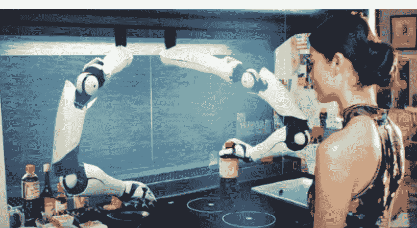

## 机器嗅觉的挑战

机器人厨师发展的最大挑战在于如何模拟类精准的触觉和嗅觉。各种食材的差异微妙难言，在烹饪过程中，人类厨师会根据菜品的颜色、气味、触感决定是否按时起锅，这是机器人无法临时应变的情况。况且，许多厨师都会有自己的“秘方”，他们还会进行菜品的研发。在创造性上，烹饪机器人与人类相距甚远。

首先，AI“辨味”需要清晰的数据边界，比如食物配方、化学成分、消费者口味等信息，这显然违背了味觉与嗅觉的基本逻辑。人类在感知气味的时候，不需要将其分解成各种成分来进行单独感知，而是依赖于现场实时感受到的一种整体氛围。“气味”本身的整体性会使高度依赖结构化数据的AI模型准确度有待提升，AI模型只能应用在一些高度机械化的场景，如食物测试。

其次，AI“辨味”依赖于交互感知、材料学、动力学等多种技术的集成和协作，如电子舌、电子鼻、组合化学等。显然，要保证机器人厨师对气味有充足的感受，仅凭人工智能技术是无法搞定的，复杂可靠的传感器阵列和其他学科的辅助也非常关键。

## 小结

在本章，我们介绍了机器人厨师的构造和原理。在第6部分，我们将介绍AI在健康医疗方面的应用。

## 第6部分

## 健康医疗

“AI+健康医疗”一直被人们视为极具发展潜力的新兴领域。在未来几年，人工智能技术有望改善人们的健康状况和生活质量，并改变医务工作者和患者之间的交流方式。“AI+健康医疗”的主要应用领域包括：医学影像、辅助诊断、药物研发、辅助手术、健康管理及疾病预测等。

## 第23章

## 医学影像诊断

现代医学是建立在实验基础上的循证医学，医生的诊疗结论必须建立在相应的诊断数据的基础上，医学影像是重要的诊断依据，医疗行业80%～90%的数据都来源于医学影像。临床医生对医学影像有极强的需求，他们需要对医学影像进行各种各样的定量分析，并与历史图像进行比较，从而完成诊断。

“AI+医学影像”是计算机通过深度学习，完成对医学影像的分类、目标检测、图像分割和检索工作，协助医生完成诊断、治疗工作的一种辅助工具。

## 标注数据

人工智能在参与医疗过程时，首先要做的是获得大量带标注的医学影像样本，然后尝试在其中找到一些关键点。如靠近肝的点，人工智能系统把关键点找到以后，结合肝的形状先验模型，设定一个初始化模型，再通过机器学习的方式学到边界应该是什么样的，病变是什么样的，尽量逼近它的边界信息，再通过它的形状特征进行完善，最后获得好的分割、筛查结果。这一过程便是人工智能系统对图像的定位、分类和切割。

## 影像分析

通过搭建神经网络和利用深度学习算法，人工智能系统对包含各种病变形态细胞的病理库进行大量训练，获得识别病变细胞特征的能力。

利用之前提到的分割算法，对细胞进行分割，通过大量比对，识别出细胞的病变形式及发展程度，为医生做出最后诊断提供辅助依据。

人工智能系统进行肺部筛查的步骤为：使用图像分割算法对肺部扫描序列进行处理，生成肺部区域图，然后根据肺部区域图生成肺部图像。利用肺部分割生成的肺部区域图像，加上结节标注信息，生成结节区域图像，训练基于卷积神经网络的肺结节分割器，然后对图像做肺结节分割，得到疑似肺结节区域。找到疑似肺结节后，使用3D卷积神经网络对肺结节进行分类，得到真正肺结节的位置和置信度。

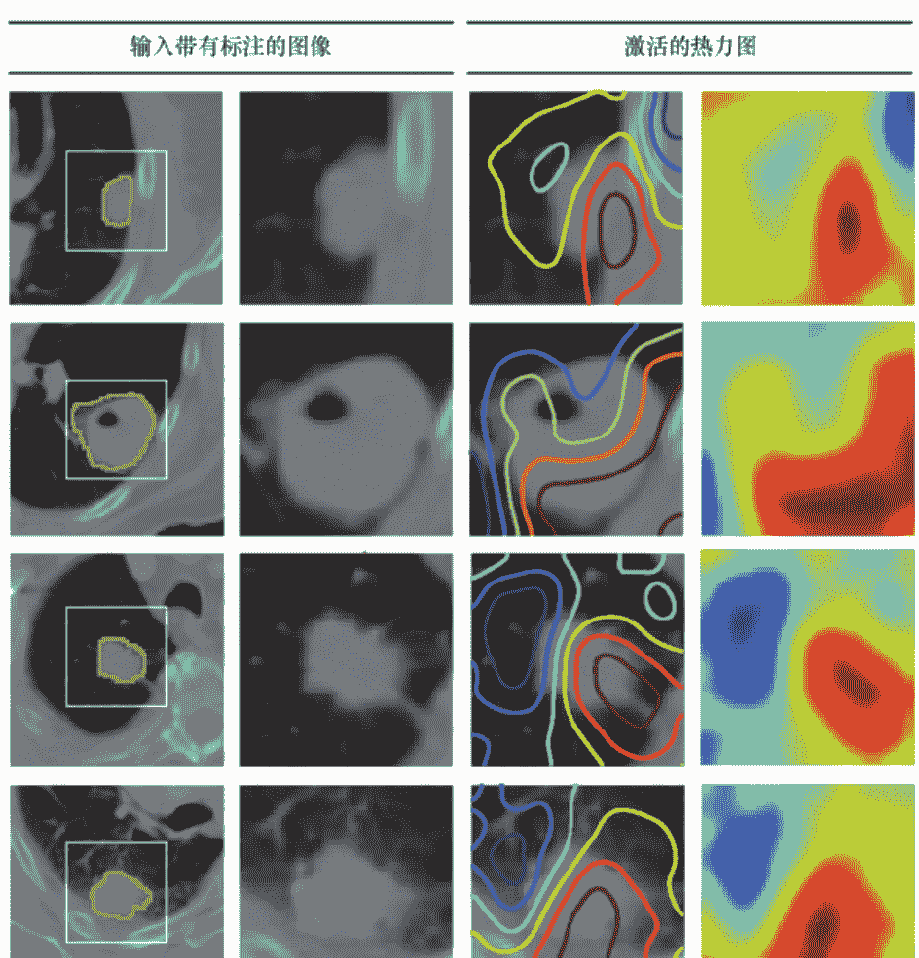

▲ 标记肺癌肿瘤部分以便用于深度学习训练

## 伦理法规

目前，我们运用人工智能技术进行医学影像处理的一大障碍是相关法律法规不完善。即使计算机再智能，也无法保证百分之百的正确率。那么一旦发生误判，耽误了病人的治疗，这个责任是由医生、医院承担，还是由提供图像识别服务的公司承担？这是一个很重要的问题。另外，由于信息被数据化，存在信息外泄的可能性，一旦病人隐私被泄露，将引起新的麻烦。如今美国Food and Drug Administration正在着手规划人工智能在医学领域应用的标准，当人工智能对使用者健康风险影响较小时，可以提供基本健康服务，但对于更加具体的疾病诊断的应用仍在探索之中。

AI技术在医学影像诊断领域的应用同样引起了人们在伦理、法规方面的争论和思考：一是AI影像诊断结果的医疗责任问题；二是AI相关信息安全问题；三是放射专业医师的AI知识及应用技能的教育问题。

## 小结

在本章，我们介绍了AI在医学影像方面的应用。在第24章，我们将介绍AI在医疗诊断方面的案例。

## 第24章

## AI糖网筛查

来自世界卫生组织的报告显示，全球截至2014年共有4.2亿糖尿病患者，其中三分之一会患上并发症——糖尿病视网膜病变，其中10%会导致完全的失明。全球2.6%的盲症可以归咎于糖尿病。糖尿病致盲的眼睛即便通过手术也无法恢复光明。早期糖网筛查可以预防致盲，而且治疗成本也较低。但是糖尿病属于内分泌科疾病，而视网膜疾病往往在眼科进行眼底拍照检查。以往医生的方式是告知糖尿病患者去眼科进行眼底检查，但是仍然有超过50%的糖尿病患者并没有进行定期的眼部筛查，因此错过最佳干预时期而致盲。AI进行糖网初筛可以满足内科的初筛以及后期的随访需求，解决内分泌科眼底照相设备不足及相关人才缺乏的问题。

2018年4月11日，美国卫生监管机构食品药品监督管理局（FDA）批准了世界上第一款人工智能医疗设备——IDx-DR的使用，该设备可以在没有医生帮助的情况下诊断疾病。IDx-DR由此成为第一个获得FDA批准可进行独立检测而不需要医生解释结果的人工智能设备。这意味着任何医生都可以使用它，包括经常与糖尿病患者打交道的初级保健医生，患者也无须自己寻求眼科医生的帮助。

## AI诊断系统

糖尿病是一种代谢类疾病，患者表现为血糖值长时间高于标准值，如果不能及时控制治疗，最终会引发一系列症状，包括头痛、肌肉无力、伤口愈合缓慢等，其中视网膜病变就是最常见且严重的并发症之一。糖尿病会引起视网膜毛细血管壁损伤，加之血液呈高凝状态，易造成血栓和血淤，甚至血管破裂，最终无法为视网膜细胞提供营养，导致病变，甚至失明。如今，糖尿病视网膜病变已成为四大致盲因素之一。在美国，只有大约一半的糖尿病患者会进行常规的视力检查，而即使有条件进行预约，患者通常也需要经过数周或数月的时间才能见到专科医生。

复杂的人工神经网络可以让人工智能系统变得非常强大，但也会让人无法理解这些系统是如何做出决定的——人们称之为黑箱问题。这种不透明性在临床上尤其令人头疼。因为人工智能诊断背后的原理对于这些系统是否能够通过审查具有关键性的作用。美国爱荷华大学视网膜专家、计算机科学家迈克尔·阿布拉莫夫（Michael Abramoff）说：“FDA把可解释性看作一个很大的问题，如果你想实现自动化，你必须首先解释你的算法的工作原理。”

研究人员正在探究如何才能看到黑箱的内部。美国的人工智能研究公司IDx Technologies以及英国的DeepMind Technologies使用了双管齐下的方法，尝试分析其系统在诊断眼部疾病时的决策过程。研究人员用一种算法来分析视网膜图像，检测疾病特征；利用这些特征，用另一种算法判断患者是否需要看眼科医生，如果需要，那么进一步判断病情的紧急程度如何。DeepMind Technologies的计算机科学家奥拉夫·龙尼贝格尔（Olaf Ronneberger）表示，通过将这两步分离，临床医生就能知道深度学习网络是如何解读图像并做出转诊建议的。

还有一个破解黑箱的方法，那就是借用另一个黑箱。加州大学圣迭戈分校的眼科医生张康和德国雷根斯堡大学的遗传学家伯恩哈德·韦伯（Bernhard Weber）使用黑罩遮住一部分视网膜图像，并观察这会如何影响人工智能的诊断表现。这样一来，韦伯就能确定人工智能算法在诊断时会看视网膜的哪些位置。他说：“你会发现它们看的地方和人类医生看的地方是一模一样的。”

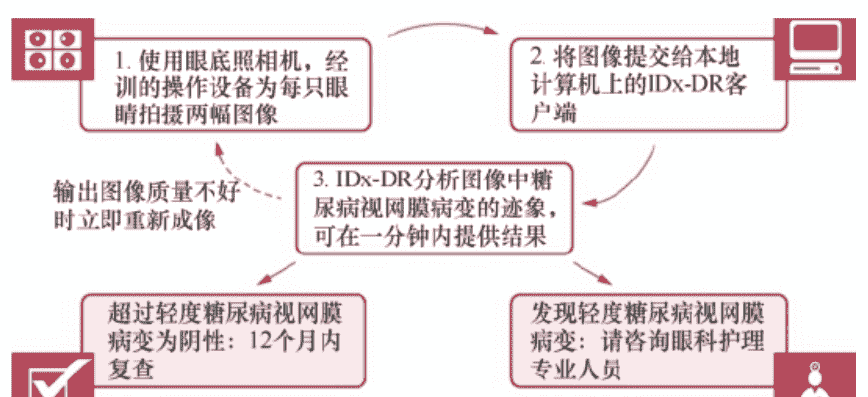

▲ AI诊断系统流程图

## 多病种诊断问题

眼底病变可能对应的眼部疾病多达几十种，即使排除了糖网病，病人也可能患有其他眼部疾病。AI和临床医生的不同之处在于，一位眼科医生能够同时识别多种眼部疾病，即使有些疾病无法确诊，至少他知道症状是不正常的，并能带着疑问查找资料或请教其他医生，最终做出诊断。对于AI而言，由于每种疾病的特征不同，理论上一个模型只能识别一种疾病，而只能识别单一疾病的产品临床意义往往有限。即便机器确认病人未患有糖网病，但未识别出其他眼底病变也可能会使得患者错过诊疗时机。

要扩大病种的识别范围，离不开不同疾病类型的庞大的高质量数据库。在训练数据层面，谷歌在眼底病变研究中用到了128 000张图像，但其中严重病变的案例事实上只有200多例，还远远不够多。

## 资质认证

产品认证问题：虽然常常有新科技和产品声称可以解决糖尿病视网膜病变问题，但是目前在国外市场上，通过FDA认证的只有IDx-DR。

## 小结

综上所述，在糖尿病视网膜病变这一领域，无论是巨头还是创业公司都投入了大量成本。经过数年发展，成果已经开始落地，无论是实效还是技术层面上，都推动了糖尿病视网膜病变筛查的进步。在未来，更多的糖尿病视网膜患者和医务人员将受益于人工智能技术。在第25章，我们将介绍达·芬奇手术机器人系统。

## 第25章

## 手术机器人

手术机器人的理论最早来源于美国。实际上，在这一波人工智能浪潮兴起之前，手术机器人已经有大约30年的研发和应用的历史，但其成本一直比较高昂。随着人工智能技术的兴起，手术机器人也面临着新的发展，可以预期的是，其成本也会随着技术的普及而逐渐降低。目前，手术机器人已经能够在一些领域很好地协助医生实施手术，尤其在微创外科领域，它可以发挥十分有效的作用。手术机器人可以分为两个层级：一是医生控制的手术机器人系统；二是全自动的手术机器人。到目前为止，由医生控制的手术机器人系统发展得较为成熟，并且出现了一些具有代表性的系统。

## 达·芬奇手术机器人系统

达·芬奇手术机器人系统建立在美国麻省理工学院研发的机器人外科手术技术基础上，经过逐步开发而成为当今先进的微创外科治疗平台。

达·芬奇手术机器人的正式名称应为“内窥镜手术器械控制系统”，是目前全球最成功及应用最广泛的手术机器人之一。实施手术时主刀医师不与病人直接接触，而是通过三维视觉系统和动作定标系统操作控制，由机械臂以及手术器械模拟完成医生的技术动作和手术操作。它广泛适用于普外科、泌尿科、心血管外科、胸外科、妇科、五官科、小儿外科等。达·芬奇手术机器人在前列腺切除手术上应用最多，现在也已越来越多地应用于心脏瓣膜修复和妇科手术中。

与普通的内窥镜手术相比，达·芬奇手术机器人有着巨大的优势。首先，内窥镜剥夺了医生直接使用工具的直觉，但不会在视觉上给医生带来立体感；其次，腹腔镜技术难度远超预期，学习曲线很长。达·芬奇手术机器人在视觉上拓展了医生的视野，同时，3D影像弥补了2D平面影像欠缺的距离感。此外，身高近两米的达·芬奇手术机器人，“手艺”却精细得可以操作绣花针。之前网络上的一段达·芬奇手术机器人为一颗葡萄缝合葡萄皮的视频表演就曾技惊四座。

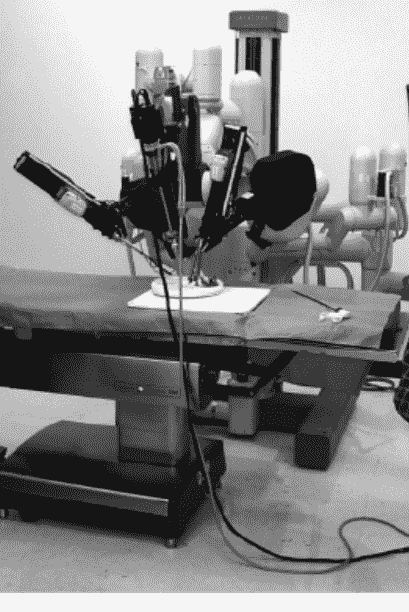

▲ 达·芬奇手术机器人

## STAR机器人

STAR机器人是由美国华盛顿儿童国家健康系统（Children’s National Health System）的Peter C.Kim团队研发。经过长达7年之久的探索和磨合训练，他们整合了近红外荧光（NIRF）标记和3D光场成像技术，解决了成像问题。这套成像系统通过捕捉组织器官的光场信息，生成3D立体影像。有了这套成像系统，STAR机器人就可以在整个手术的过程中，准确而不受限制地监测目标组织的运动和变化。STAR机器人就像是有了“眼睛”，它知道哪个组织是它手术的目标，哪个组织是不能碰的。为了配合STAR机器人的这套成像系统，Kim团队又自主创新研发了一套智能算法。这套算法不仅可以用于制定手术方案，还可以根据成像系统传回的信息，判断组织的变化，进而对手术方案做出调整。

目前，自主手术机器人研究进展乏力，有两个重要的技术原因：一是缺少区分和监测目标组织器官的可视化系统，二是缺少能够执行复杂手术任务的智能算法。但是，STAR机器人内部全新架构的成像系统与智能算法，使其不仅可以制定手术方案，还可以根据成像系统传回的信息，判断组织的变化，进而对手术方案做出调整。为了检验效果，研究团队选择了复杂性比较高的肠吻合手术，让STAR机器人与熟练的外科医生、达·芬奇手术机器人三者做了实验比较。

从研究论文中的结果来看，无论是在离体还是在活体的吻合术中，STAR都要明显优于熟练的外科医生和达·芬奇手术机器人系统。目前，STAR自主手术机器人正在逐步向临床阶段迈进。由此，手术机器人的“辅助”或“助手”的地位将会得到根本改变，智能机器有望真正接手外科医生的工作，为人类进行外科手术等治疗服务。

STAR机器人研发团队认为，医疗机器人的理念和自动驾驶汽车的理念相同——不是因为我们不会开车，而是因为我们想减少交通事故的发生。医疗机器人可以精准稳定地操作一切，无须休息，大大提高了治疗效率，缩短了病人的等待时间，提高了就医效率。

## 国内发展

很快，国内企业自主研发的腹胸腔手术机器人也将上岗执业。以胶囊机器人闻名的重庆金山科技（集团）有限公司，其自主研发的大型胸腹腔微创手术机器人即将进行临床试验。

相比于美国的达·芬奇手术机器人，这款手术机器人增加了握臂反推力设计。通过力反馈技术模拟手术中的真实感受，增强医生操作的真实感，从而让手术过程更便捷、安全。该手术机器人还能实现远程手术，方便患者接受远在外地或国外的医生的手术治疗。

在我国著名口腔修复学专家赵铱民教授及其团队主导下，空军军医大学口腔医院与北京航空航天大学机器人研究所共同研发的种植牙机器人，是世界首台自主式种植牙手术机器人。这台自主式种植牙手术机器人已经开始上岗工作了，它的问世标志着口腔疾病治疗迈入了机器人时代。

与传统方法相比，种植牙机器人具有精准、高效、微创、安全等优点。该团队研究了一种无须空间配准的机械式空间融合定位方法，突破了机器人配准操作复杂的技术瓶颈，实现了高精度空间定位，设计出了自主式种植牙手术机器人构型，能在空间狭小的口腔内灵活地完成手术操作。目前已开发出口腔种植规划、手术导航以及机器人控制软件系统，实现了个性化种植方案精准规划、术中全程导航与机器人自主控制。在多次动物实验的基础上，建立了口腔种植手术机器人临床工作程序，完成牙齿的种植后即刻进行修复，降低了手术难度，提高了手术效率。

## 小结

伴随着人工智能的发展和系统器械的完善，手术机器人将进一步细化功能，大到机体外科手术，小到伤口消毒缝合，实现专科化、专项化操作。这样一来，既降低了研发成本和难度，又加快了迭代更新的频率，降低了生产成本，继而降低了病人看病的成本。在第7部分，我们将介绍人工智能技术在文化艺术上的应用。

## 第7部分

## 文化艺术

科技的发展，尤其是人工智能、大数据等新技术对艺术的呈现形式、组织方式、接收方式产生了巨大的影响。科技发展给人类社会带来巨大的改变，当下已经进入人工智能与互联网、文化艺术跨界融合的全新时期。以技术发展为支撑的AI赋能给文化艺术产业的各方面创新都带来了新的可能性。

在过去几年中，许多科技公司、研究机构和个人都在探索利用AI进行艺术创作。在音乐、诗歌、绘画、舞蹈、电影、小说写作等领域，我们都已经可以看到AI的身影。

## 第26章

## 小诗机

携程App中的“诗情画意”小诗机，让机器能够“理解”和“欣赏”用户拍摄的照片，并基于小诗机自有的庞大知识库体系，写出符合图片意境和内容的古诗。用户只要上传风景照，后台人工智能系统就能结合用户图像，写出一首诗。

小诗机使用深度学习，自动识别出用户照片上的景物、内容、关系和人物表情，运用机器学习进行景点关系和特征的提取，构建旅游景点的知识图谱，该图谱包括全球数千万景点、地区、美食、天气等数据。

小诗机由3部分组成：拥有大量诗歌方面的知识图谱、景物的图像识别元件以及能够像人一样写诗的成诗引擎。

## 知识图谱

小诗机融合多个维度的知识源，以便构建全面的旅游行业知识图谱，一方面是大量的旅游行业和景点数据，另一方面是互联网上关于城市、历史、民俗等方面的数据，具体分为以下3部分。

- (1) 非结构化数据：网站上的景点简介、用户游记、用户评论等文本信息。
- (2) 半结构化数据：以维基百科、百度百科为代表的大规模知识库，包含了大量结构化和半结构化数据，可以高效地应用到知识图谱中，知识获取也比较容易。
- (3) 结构化数据：包括自由行、团队游、酒店、景点、用户意图等较为全面的结构化旅游数据。

小诗机针对结构化数据，除了使用一些相关的维度信息，如景点所属的城市等，还会进行一些相关的统计分析，实现深入的信息提取和筛选，如对每个城市中重要的景点进行排名。

文本数据的知识抽取会涉及许多自然语言处理的基本技术，包括分词、词性标注、依存句法分析、语义角色标注、命名实体识别等，实现对文本数据的清洗和结构化。主要的提取目标包括以下3部分：

- (1) 实体抽取：利用CRF++和字典结合的方式，从文本中自动识别人名、地名（国家、城市、景点等）、机构、节气、时间等实体。
- (2) 关系抽取：主要利用一些启发式的规则和半监督的方法，从新的实例中学习新的模式，并扩充模式集合，挖掘各个实体之间的关系。
- (3) 主题抽取：为了构建更全面的旅游知识体系，使用改进的TF-IDF、卡方+TextRank、LDA等方法综合进行文章主题、关键词、摘要的抽取，从而实现景点实体和特征实体的关系挖掘。

小诗机的数据来自不同的数据源，因此需要对各个数据源提取出来的知识进行融合。实体的融合和匹配是多数据源融合的核心，一方面通过语义向量维度或字面维度的相似度来进行实例、属性、概念等的匹配，另一方面结合实体对应的相关属性以及结构信息进行多维度、多层次的匹配，最终利用自定义权重进行融合，实现小诗机知识图谱的构建。

## 图片识别

小诗机采用CNN深度神经网络，能够识别的景物、人物类别超过150种，包括人物的性别、年龄及神情等。与普通图像识别不同，小诗机会添加相似类别的语料，以便提升识别的精度，譬如可能把“温泉”识别成“小河”或“游泳池”，因此要添加相近的类别语料供算法进行学习。图片的识别结果如下图所示。

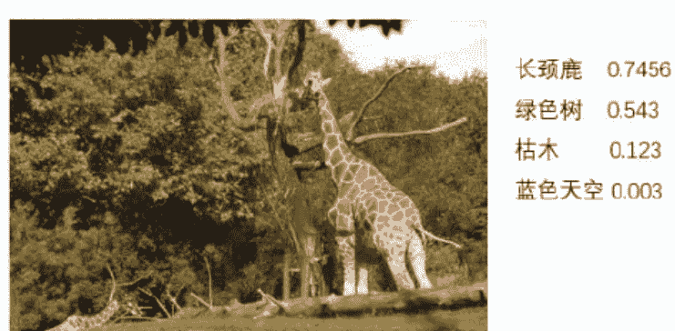

▲ 图像识别参数

不过，要让小诗机进一步识别出一座塔是“雷峰塔”还是“六和塔”，一条河是“莱茵河”还是“尼罗河”，就比较困难了。

## 成诗引擎

传统诗歌生成主要借助统计模型，同时结合人工规则。统计机器翻译的方法使用统计机器翻译模型，结合韵律规则，生成下一句。遗传算法则根据开发者对诗歌的理解、人工定义韵律、流畅性、主题相关性等各个评价因子，构建评估函数，同时使用统计语言模型，自动生成诗歌。

随着深度学习技术的日益发展，研究员更多使用神经网络进行诗歌自动生成。由于古诗词语言表达的简洁性和语料数量的限制，传统的诗歌自动生成模型基于统计的语言，具有严重的稀疏性。在深度学习中，利用RNN训练和获取诗歌的语言模型，在一定程度上缓解了该问题。与此同时，Encoder-Decoder框架作为成诗的基本模型，利用Encoder模块进行历史内容、主题内容的编码，利用Decoder模块进行诗句的生成，对主题关联性和语义连贯性，使用不同方法进行尝试，从而构建相关模型。模型根据给定的关键词首先对每句话进行主题的规划，避免在逐句成诗过程中主题关联性的弱化。模型利用Attention机制，在成诗过程中进行主题、历史生成内容的融合，而模型则是使用Hierarchical的RNN框架，进一步保证整体主题和语义的统一性。

小诗机基于海量的知识库，利用最新的深度学习CNN、LSTM、翻译模型等，可以把一些自然语言抽象表达成诗句用词，让生成的诗句更接近人类写作的效果。例如，“高高的房顶”“白白的墙”“漫山遍野的樱花”这些属于自然语言，放到诗里就成了“尖顶”“白花”等。小诗机训练的律诗有近30万首、中外小说300余本。

## 小结

总体而言，小诗机是从技术和产品维度上的创新和探索，一方面构建了大规模、全面的旅游知识图谱，另一方面结合深度学习的方法进行基于图片的成诗，使得诗具有较好的主题性和流畅度。当然，目前小诗机的诗作还处于比较稚嫩的阶段，后续需进行进一步的标签细化，包括知识库和图片识别两个方面，以便提升AI作诗的水平。

## 第27章

## AI换脸

2017年年底，国外一位叫作“Deepfakes”的网友，利用业余时间创造了一个通过机器学习来更换视频人脸的AI算法。后来这个算法也被广泛称为“Deepfakes”。这个机器学习算法，首先在小圈子内“炸开”。在国外的Reddit论坛上，有一个Deepfakes社区，一个月内聚集了1.5万订阅者，并产生了大量的AI换脸视频。

不过当时该技术的使用门槛还比较高，需要编译代码之类的操作；而在数个月后，使用管理Deepfakes技术的简易版AI换脸工具FakeApp出现了，就算是普通用户，也能够顺利操作。

## 与PS的区别

在AI换脸技术出现前，视频换脸技术最早、最广泛的应用还是在电影领域，那时它需要相对较高的技术和资金。现在，AI换脸降低了这一门槛。

AI换脸技术和传统的PS技术有什么区别呢？PS技术的原理是图像的移动，AI换脸的原理是把提供五官的脸进行变形，然后变化为新脸（因为变形后有无数种可能，所以需要经过大量的计算找到变得准确的方式）。AI换脸训练耗时，但训练后合成很快。PS技术主要针对静态图像，而AI换脸技术则扩展到视频领域。

## 技术流程

AI换脸技术的核心是一个“自动编码器”，这个“自动编码器”实际上是一个深度神经网络，它能够接收数据输入，并将其压缩成一个小的编码，然后从这个编码中重新生成原始的输入数据。AI换脸让一个编码器把一个人脸压缩成一个代码和两个解码器，一个将其还原成人物A，另一个将其还原成人物B。在这个案例中，使用的编码器是一样的，但是A和B的解码器不同。在训练的过程中，输入的人脸会被扭曲，从而模拟一个“我们希望得到这样的人脸”的概念。下面以人物A换脸人物B为例介绍算法训练的3个步骤。

首先，我们给编码器输入了一张人物A的“扭曲脸”的图片，并尝试用解码器A来重新还原她的脸，这就使得解码器A必须要学会在纷繁复杂的图片中识别并且还原出人物B的脸。

然后，把人物A“扭曲脸”的图片输入同一个编码器，并用解码器B来还原人物A的脸。

接着，我们不断重复上面的操作，直到两个解码器能够分别还原出两个人物的脸，同时编码器也能够学会通过抓取人脸关键信息，分辨出人物A和人物B的脸。

以上的训练步骤全部完成后，把一张人物B的照片输入编码器，然后直接把代码传输至解码器B，就能将人物B的脸换成人物A的脸。

这就是我们通过训练模型完成换脸的全过程。解码器获取了人物B的脸部信息，然后把信息交给解码器B，这时候解码器B会做出这样的反应：“这是一条干扰信息，这不是人物A的脸，那么我就把你换成人物A的脸吧。”

## 潜在风险

AI换脸的真正问题在于它走出影视作品，用于伪造虚假视频，比如用于制作诈骗视频等。

一方面，如果在深度学习过程中使用大量的敏感数据，那么这些数据存在后续被披露出去的风险；另一方面，考虑到各种服务之间会大量交易数据，数据将成为新的流通物，因此个人对其数据的控制和管理也会被削弱。

更大的风险其实是来自于对获取用户相关信息的平台的监管。目前大多数获取用户脸部和个人资料的平台是金融平台，受到一行两会的严格监管，但是当越来越多的平台在没有受到监管的情况下获取用户相关的信息时，这背后存在的监管缺失才是最大的风险。

相关的法律法规已经陆续出台。2019年11月29日，国信办印发了《网络音视频信息服务管理规定》（以下简称“规定”），提到了对深度学习视频内容的管控。规定中第十一条指出，网络音视频信息服务提供者和网络音视频信息使用者利用基于深度学习、虚拟现实等的新技术新应用制作、发布、传播非真实音视频信息的，应当以显著方式予以标识；不得利用基于深度学习、虚拟现实等的新技术新应用制作、发布、传播虚假新闻信息；转载音视频新闻信息的，应当依法转载国家规定范围内的单位发布的音视频新闻信息。也就是说，普通人和服务商发布非真实AI音视频时，要以显著方式标明其运用AI技术进行了二度创作，且不得使用它制作假新闻。

## 小结

2012年，多伦多大学教授杰弗里·辛顿（Geoffrey E.Hinton）带领着自己的学生设计出深度学习模型AlexNet，开启了该领域工业化的序幕。人工智能领域的各种应用大多源于此。不知道杰弗里·辛顿有没有预料到，自己打开了“潘多拉的魔盒”，一个“真假难辨”的世界即将出现。人们投入大量的资源实现技术进步，再花费更多精力消除技术进步带来的负面影响。

## 第28章

## AI写作

随着人工智能技术的发展，AI写作已被应用于多个行业，包括新闻业、广告业、自媒体行业等。最典型的是关于机器人记者的应用，新闻机器人已被用于以数据为基础的报道领域，如公司年报、股票市场简报、地震报道和体育报道等数据类的新闻。还应用在文学作品的写作上，例如互动小说、小说生成之类的，甚至是图书的生成。那么，一篇文章甚至是一本书，到底是如何通过机器写作产生的呢？

## 文本生成技术

在过去，我们如果让计算机写作需要预设模板。最初的模板就像我们英语考试中的完形填空题，人写完文章后将会变化的部分抠空，再让计算机根据数据填空。为了不使用固化的模板，科学家人为地将语法规则建模，这样在表达相同意思时，句式可以在人们前期设定的有限规则内有多种变化。

现在，AI写作运用的是统计学方法。通过输入大量真实语料，使用概率统计，预测出词汇最可能的排列组合，自动训练出模型网络。这个模型无须人工编写，除了语法，还包含词性判断、实体区分、关键词句提取、情感分析等。有了模型就可实现NLP（自然语言处理）的各下游任务，还可通过各种参数精细地控制NLG（自然语言生成）。

自OpenAI开源GPT-1.0后，在其上改进的BERT和GPT-2.0是目前NLP业内的最高水平。谷歌在2018年10月开源的BERT模型打破了11项纪录，部分阅读理解能力还超过了人类。2019年2月，OpenAI透露的GPT-2.0通过更大的训练得到了比BERT更高的分数，甚至可以通过给定开头续写文章，无论是学术、新闻还是小说类型，官网公布的续写示例都有模有样，甚至在续写“垃圾回收对世界有害”这样的误导话题时依然能侃侃而谈。

国外模型对中文的理解能力稍差，国内也有本土化研究。中文是少见的不通过空格区分词汇的文字，在理解词性和实体上需要特殊处理。百度的飞桨（PaddlePaddle）项目在2019年3月发布了ERNIE模型，通过输入百科、资讯、对话等语料库和直接对语义知识进行建模，增强了模型语义表示能力，较BERT在中文上的效果更好。

## 程序写作天花板

人类和机器一个非常重要的差别是人类有创造性。写作与音乐创作、绘画创作一样，都属于创作的过程。人类在写作的过程中会加入了对诗词意境的理解和自己的情感，这样的理解方式与人类自身在语言上的天赋、造诣、自身的修养、生活的环境是息息相关的。短时间内机器在这些方面没办法达到人类的高度。

现在的AI写作还是一种“初级的机器辅助写作”，给AI一个关键元素、关键词，人工智能能够从数据库中检索，找到历史上所有涉及这个词语的文本。例如，单写一个“云”字，AI就能查到历史上不同时段、不同文本里描绘“云”字的不同方式，为作家提供选择。但是AI写作的局限性也非常明显，尽管写出来的句子我们最初看上去非常相似，但是多读一些就很容易识别出哪些是机器写的，哪些是人写的。机器写的句子往往在100字以内让人惊讶，但是把长度扩展到500字时，涉及句与句、段与段之间的关系时，就会让读者感觉莫名其妙。而在我们平时读的小说里，作家常常会在一些地方埋下伏笔，或者描述人物在一个行动后有什么样的心理变化，具有内在逻辑关系，这是目前AI还学不会的技能。

## 版权问题

传统机器写作对某些类别作品的创作过程和创作效率会产生影响，但到目前为止，仍然没有改变人类创作行为的本质。机器生成内容的实质是计算机程序运行的结果，不是智力创作的成果，不应获得著作权保护。但在人工智能日益渗入人类创作活动的今天，著作权法关于作者和作品的判定规则依然有效。就像计算机程序不可能成为作者一样，依靠计算机程序对获得信息的分析和处理，按照特定算法形成的生成物，同样不可能成为受著作权法保护的作品。

如果将这些计算机程序的运行结果作为受著作权法保护的作品，就等于承认计算机程序可以作为作者，等于承认计算机程序或计算机这个机器可以成为民事权利的主体，就等于破坏“只有实际进行创作的人才可以成为作者”的规则。

那么应如何保护由人类提供基础数据并由人工智能系统通过数据分析和算法完成的内容呢？英国在1988年颁布的《版权、设计与专利法》中规定“计算机生成作品”的权利归于对该作品的创作进行必要安排的人。这或许是我们可以借鉴的做法。但必须明确的是，“计算机生成作品”不是作品，权利人对其享有的也不是著作权，而是邻接权。

邻接权模式可以借鉴德国的著作权法为那些不属于艺术性摄影的普通照片提供保护的做法。由于不属于摄影作品的照片制作仍然凝结了制作人的某种劳动投入，德国的著作权法为其提供邻接权保护。该权利属于照片制作者（包括企业主），保护对象不是照片的内容或形式，而是具体的再现，保护期限为50年，同样适用著作权的限制性规定。权利人是否对照片享有相关的人格权，取决于具体案件中是否存在值得保护的人格利益。但是，影印或者缩印的照片，以及自动摄像机拍摄的照片，不属于该邻接权保护的范围。

同样地，非类人的AI的使用人（包括法人）对该AI系统通过数据分析和算法完成的内容，进行了某种劳动投入，包括购买AI系统、提供各种基础数据和信息以及分析数据的经验、设定场景、给出内容大纲，以及发出进行运算的指令等。从理论上来说，该AI系统的使用者可以基于上述投入而对计算机程序生成内容，主要是具有价值的内容，享有邻接权保护。计算机程序生成内容能够保护的标准、该邻接权的具体保护范围以及如何判定侵权等问题，仍然有待司法机关根据实际发生的案例进行判断。

## 小结

本章介绍了AI写作，由于受技术的限制，当下的AI写作整体还处于初级阶段，一方面需要人的参与；另一方面，机器在自然语言处理、理解方面还存在着障碍。从目前来看，AI写作的主要目的并非是替代人力，而是作为人类的助手，协助人们处理一些烦琐、重复的劳动。被AI取代的将是有明确规则的智力劳动，而深度报道、文化评论等需要创造性思维的部分，将是人类进一步深耕的领域，这是机器所无法取代的。

## 第8部分

## 金融科技

得益于金融领域的大容量、准确的历史数据和可量化等特点，它非常适合与人工智能技术结合。同时由于我们当前拥有强大的计算能力和方便易用的机器学习工具（如谷歌的TensorFlow），人工智能领域的核心技术机器学习在金融科技领域的应用从未如此便捷。人工智能技术对金融机构的影响正在与日俱增，它不仅改变了人们存款、投资和借贷的方式，甚至还能预防金融犯罪。金融科技（Fintech）带动了金融行业一系列产品和业务模式的创新。

## 第29章

## 智能投顾

智能投顾也称机器人投顾（Robo-Advisor），其运用云计算、大数据、人工智能等技术将资产组合等金融投资理论应用到模型中，再将投资者的风险偏好、财务状况及理财规划等变量输入模型，为用户生成自动化、智能化、个性化的资产配置建议，并对组合进行跟踪和自动调整。

智能投顾作为人工投顾的替代品，通过获取用户的风险偏好水平以及大致预期收益率等指标，运用智能算法以及组合投资的自动化管理技术，帮助用户实现主动投资、被动投资策略相结合的定制化投顾服务。智能投顾因其服务过程能够实现全部或绝大部分自动化操作管理而得名。

## 发展历史

智能投顾最早起源于美国，其发展历程大致可分为3个阶段。

在线投顾阶段：20世纪90年代末期，可供投资者选择应用的投资分析工具的技术水平和规模开始扩大。2005年，美国金融业监管局（FINRA）允许证券自营商将投资分析工具（Investment Analysis Tools）直接给投资者使用，投资者可以利用投资分析工具进行不同投资策略的投资收益分析，对收益和风险有更好的把控。此后，在线资产管理服务规模迅速增长，更多长尾客户在此阶段受益。此阶段的特点主要是机器智能应用比较有限，主要应用领域是投资组合分析。

机器人投顾阶段：2008年至2015年间，大量新兴科技企业开始为客户直接提供各类基于机器学习的“数字化投顾工具”，机器人投顾商业模式开始发展。这些公司开发的面向客户的投顾工具提供的功能之前只被金融从业者应用，而目前已经广泛被客户直接应用。在这个阶段的很多实际应用案例中，证券公司对他们的“数字化投顾工具”提供的投资策略负责。

人工智能投顾阶段：2015年至今，以大数据为基础的深度学习被广泛应用，人工智能技术取得突破性进展。智能投顾服务商和科技企业开始尝试开发能够完全消除人类参与投资管理价值链的人工智能系统。目前包括Bridg Water、Wealthfront等都已经实现了这样的系统开发和商业化运营。通常采用“人工智能+云计算”体系结构的服务商，在计算设备和软件开发方面投资巨大，能够同时服务千万、亿级别的海量用户。

## 算法模型

在智能数据分析方面，智能投顾有两种运作模式：一类是侧重信息的输入端，利用机器的优势收集并处理海量数据，从海量噪声信息中快速且准确地找到有价值的信息，提高信息筛选效率；另一类是侧重信息的输出端，运用机器学习、自然语言处理和知识图谱等人工智能技术分析宏观经济、公司业绩、网络舆情等数据，判断信息与市场之间的关联性，进而输出投资决策建议。

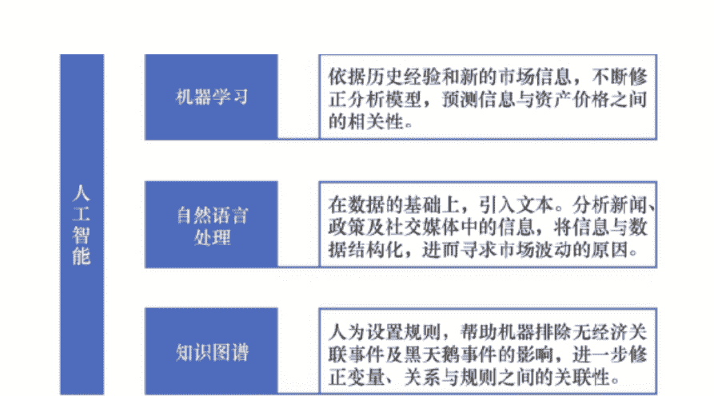

资料来源：36氪、兴业证券经济与金融研究院整理。

▲ 智能投顾的算法模型

## 理财师会失业吗？

在没有智能投顾的时代，理财师服务的门槛相当高，如高盛对于财富管理的投资门槛在5000万美元以上。智能投顾的出现，降低了财富管理的门槛，让大众偏富裕人群也能享受到这种服务。

虽然智能投顾具有广阔的市场潜力，在专业性上也具有巨大优势，但就目前的发展水平而言，它所提供的服务还远远达不到专业理财师的服务水平，专业的理财师能根据投资者的具体情况，提供具体到每个人的投资方案，这是目前智能投顾所不能实现的。

具体来讲，根据投资者的年龄、学历、职位、收入、储蓄、家庭环境等因素，专业的理财师能为投资者提供最适合其自身的具体投资理财规划方案，而这个方案不是仅推荐一款投资理财产品，而是分析投资者适合在短期内投资什么产品，在未来适合做哪些投资规划等，这是智能投顾所不具备的能力。所以，业界专家认为，在未来5年内，智能投顾可以在大数据分析等方面减轻理财师的工作量，但不可能代替理财师的绝大部分工作。因此，从这一点可以看出，理财师具有不可替代性，自然也就不存在理财师这一职业消失一说。但智能投顾的发展十分迅速，随着技术的不断进步，相信未来在投资理财领域它发挥的作用将越来越大，对理财师的影响也将越来越大。

专业的投资顾问要在投资者选择智能投顾前做好长期投资理念的引导，介绍智能投顾的特征，分析市场上常见的智能投顾产品，并提供选择建议，之后还要在投资者持有理财产品期间，做好疑问解答，避免投资者在不合适的时机退出，或建议他们在合适的时机进行追加。

## 小结

展望未来，智能投顾的发展前景非常广阔，人工智能和大数据赋能传统金融业的步伐将不会减慢。

## 第30章

## 欺诈检测

欺诈检测简单来说就是：根据借款人提供的信息，查找多方面资料，进行不同属性的比对，从而发现“羊群中的狼”。这种工作复杂而枯燥，为了识别团伙欺诈，往往需要收集、整理、分析各种维度的数据，工作量非常大。但是枯燥的工作往往是单纯且有乐趣的。欺诈检测就是起到了辨识申请人身份真伪、申请材料是否真实有效、是否为团伙骗贷的作用。

## 欺诈种类

根据欺诈方式和行为对象，当前的数字金融欺诈主要表现为高利理财、网络借贷、网络众筹、消费金融、非法集资等5种类型。

高利理财类诈骗主要是利用受害人期望“高额回报”的心理，对其进行“利益”诱惑。相关报告显示，在金融诈骗的众多类型中，金融理财类诈骗所涉及的总金额和人均损失额度，均是最高。高利理财类欺诈手段比较多样，包括以低投资获得高利息的“消费返利”，投资境外股权、期权、外汇，私募入股，投资“虚拟货币”“区块链”等为噱头的互联网金融理财欺诈行为。

网络借贷类诈骗通常是通过网络操作，盗取投资者信息，以“低息贷款获利高”进行引诱、迷惑投资者。网络借贷诈骗造假成本低，操作简单，且不易被发现，因此成为金融诈骗高发类型。据调查，通常网络借贷诈骗的主要方式有包装骗贷、组团诈骗、虚假广告引诱、欺骗缴纳保证金、冒充他人、信息盗取等。

网络众筹类诈骗主要表现为非法的投资众筹、众筹开店、电影众筹、扶贫救助众筹、熟人众筹等形式。无论是非法吸收公众存款，还是冒充上市公司发行股票，都是外表披着“众筹”的外衣，实则由缺乏资金的第三方托管。信息披露不健全等问题，再加上项目发起人和项目投资人信息强烈不对称，常使得投资者陷入非法集资的陷阱。

消费金融欺诈主要表现为网络支付诈骗、虚假营销、骗取网购运费险、骗取消费退款、网络刷单诈骗等欺诈方式。欺诈手段包括：利用第三方支付账户安全系统的漏洞，造成信息泄露，进行支付诈骗和套现，以及虚假宣传、信用卡欺诈、刷单诈骗、退款诈骗、骗取保证金等消费金融类欺诈。其中，买方对网购退货运费险的恶意欺诈行为已经成为消费金融类欺诈的高发事件。据中国保险行业协会数据，某公司上市运费险之初的赔付率竟高达90%，可以推断其中有骗保行为。

非法集资类欺诈是指公司或个人未经批准，违反法律、法规，通过不正当的渠道，向社会公众或者集体募集资金的行为。欺诈手段包括擅自发行股票、债券，利用传销或秘密串联的形式非法集资，甚至利用“地下钱庄”等民间会社形式非法集资、签订商品经销等经济合同的形式进行非法集资。

## 反欺诈模型

传统反欺诈模型是基于规则的。通过查看表面上明显的信号，可以发现金融欺诈活动。另外一些大型交易或发生在非典型位置的交易则需要进一步验证。纯粹基于规则的系统需要使用执行几种欺诈检测方案的算法，这些算法由欺诈分析师手动编写。如今，遗留系统平均采用大约300条不同的规则来批准交易。因此，基于规则的系统仍然过于简单。它们需要手动添加或调整方案，并且几乎无法检测到隐式关联。最重要的是，基于规则的系统经常使用传统软件，该软件几乎无法处理对于数字空间至关重要的实时数据流。

但是，用户行为中也存在一些细微和隐藏的事件，这些事件可能并不明显，但仍预示着可能的欺诈行为。机器学习允许创建处理具有许多变量的大型数据集的算法，并帮助找到用户行为与欺诈行为可能性之间的这些隐藏的关联。与基于规则的系统相比，机器学习系统的另一个优势是更快的数据处理和更少的人工工作。例如，智能算法非常适合行为分析，有助于减少验证步骤。

## 算法局限

机器学习的最大障碍之一是陡峭的学习曲线。数据科学知识加上创建模型所需的时间和数据量，是许多风险团队无法企及的。陡峭的学习曲线意味着从事机器学习的数据科学家需要掌握许多不同的工具，如R、Weka、Python、DBMS、NoSQL数据存储、Hadoop作业、流系统等。另外，很难通过开发配置文件和模型来反映业务不断变化的性质，如一些公司部署使用2年数据的1年模型。还有一大障碍是很多机器学习都基于黑匣子决策，这具有严重的局限性，因为许多政策执行或治理要求需要明确的决策解释。最后，处理大数据的能力还存在一些问题，即包含不相关的数据。机器缺乏常识，因此仍然需要人来监督。

## 小结

互联网金融科技的迅速发展成为整个金融领域不可逆转的大方向，新技术的应用将逐步挤压“黑灰产业”的生存空间。随着市场的相关政策法规的完善，以及大数据、人工智能等技术的应用，互联网金融行业将走上发展的快车道。

## 第31章

## 智能客服

智能客服机器人是一种能够使用自然语言与用户进行交流的人工智能信息系统，它采用包括自然语言理解、机器学习技术在内的多项智能人机交互技术，能够识别并理解用户以文字或语音形式提出的问题，通过语义分析理解用户意图，并以人性化的方式与用户沟通，向用户提供信息咨询等相关服务。

传统客服行业基于人工座席，这样的纯人工服务模式往往依赖大量的人力。如果能够自动答复简单重复的用户咨询，就可以极大地提高用户的满意度，同时降低企业的经营成本。在强烈的市场需求下，结合人工智能技术的智能客服机器人由此兴起。而后，随着人工智能技术的迭代更新，语义分析、大数据以及深度学习等技术的不断突破，深入客户服务场景应用的不断优化，智能客服行业得到质变提升。无论是客服处理效率、客户信息管理，还是人性化程度方面，智能客服机器人都将传统客服远远甩在身后。

## 多轮对话系统

对话系统一般分为任务型和闲聊型，两者的主要区别是：前者是协助用户完成具体的某项事情，如订机票、设置闹钟、查天气等；而后者的特点是让用户觉得自己在跟人聊天，而不是机器。

多轮对话系统的原型如下。

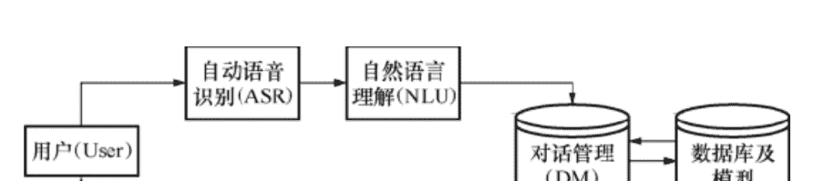

在这个框架中，主要包括以下模块。

自动语音识别（Automatic Speech Recognition，简称ASR），作用是将用户语音转换为文本。

自然语言理解（Natural Language Understanding，简称NLU），作用是理解用户话语，理解的含义是按照不同的语义表示方式，对用户话语进行解析。

对话管理（Dialogue Management，简称DM），是实现多轮对话系统的核心，功能分为两个部分，一部分记录用户历史话语，一部分生成系统决策。

自然语言生成（Natural Language Generation，简称NLG）决定了系统如何与用户进行交互，它的作用是按照对话管理模块产生的系统决策，产生相对应的自然文本。

语音合成（Text to Speech，简称TTS），由于用户和系统之间使用语音的方式进行交互，因此系统也需要“能说会道”，TTS将文本转换为语音，以实现和用户间的交互。

具体而言，这几个模块之间的工作流程如下。

1. 用户说一句话。
2. 通过ASR将语音转为文字。
3. NLU模块，将文字转为格式化的输出，一般使用slot-value pair的方式表示。
4. 对话状态追踪（DST）模块的作用是更新对话状态；DST会记录到目前为止用户所有的聊天记录，以及系统的行为，用于更新对话状态。
5. 对话决策模块（Dialog Policy）的作用是依据DST模块中的对话状态（DS），产生系统行为（Dialog Act），也就是说，依据DS决定下一步做什么。
6. 下一步做什么，包括反馈一句话、查询数据库等。
7. NLG模块的作用是将Dialog Policy产生的Act映射成自然语言。
8. TTS模块的作用是发音。

在上述过程中，Dialog Act也被称为Action Selector。ASR和SLU可以产生一个最佳结果，也可以产生多个候选结果，分别称为1-best、n-best list。我们通常将DST模块和Dialog Policy模块合起来统称为Dialogue Manager模块。

## 情感分析

判断文字聊天中的感情，这可以看作情感分析。之前已有的一些情感分析的研究主要有两种方法。一种是基于词典的方法，这种方法判断是否准确主要在于词典质量的好坏，此外，还有一些本身就带有歧义的词，不能够简单判定是正面的或者负面的。另一种是基于机器学习的方法，基于机器学习的方法主要是有监督学习，即找一些类似的聊天语料来对机器进行训练，使得机器能够正确地判断文字中的感情。

在训练集上达到足够高的准确率，才有可能在实际测试的时候，准确地预测情感。此外，目前机器能够区分的情感并不多，之前研究的区分的情感，大多是正负两极或五级（负面、轻微负面、中性、轻微正面、正面）情感。但人类情感的复杂程度远超出这5种，因此机器如何识别人类的复杂情感也是需要研究的课题。但是随着算法的不断改进，在不久的将来，相信机器的准确率会比人高。

## 商业智能

在业务营销端，智能客服通过对大数据技术的应用，对客户服务的问题数据、体验数据和建议数据等进行挖掘分析，全维度了解客户需求，完成用户画像的刻画，为精准营销提供数据支持。在客服系统中引入业务系统日志挖掘平台，实时对业务系统的用户操作行为数据及系统运行异常日志进行分析，通过特征数据提取和数据挖掘算法，得出业务系统健康诊断报告和用户操作流程合理性结论，并提供相关问题描述信息和对应解决建议。

客服系统通过对用户客户端提问文本的上下文语义情感分析、关键字分析、问题聚类，由客服引擎生成咨询问题标准描述。通过将日志挖掘平台和客服引擎关联起来，基于用户LSTM长短期记忆网络模型、CNN神经网络模型等深层次机器学习算法，智能客服系统可以更准确地理解用户提问，从而把最准确的答案反馈给用户，向用户提供智能咨询服务。甚至可以先于用户发现业务问题，实时给用户推送业务预警及解决方案或关怀提醒信息。

通过智能客服系统可更有效解决用户咨询问题，提高用户感知，提升服务效率，缩短咨询的处理时间。同时可以降低传统人工客服的压力，节约企业成本。并在一定程度上提升业务系统健康度，更好地发挥业务系统作用。

## 小结

在未来，伴随着人工智能技术的发展以及知识库的完善，再加以推广，相信智能客服的使用率将大大增加。当然，鉴于智能客服当前的不完善，人工客服暂时也不需要为自己的“饭碗”担忧，而在未来境况究竟如何，还得看智能客服所提供的服务到了哪种程度。

## 后记

近年来，以深度学习为核心驱动的人工智能飞速发展，随着各国政府相关政策的推动、企业的投入以及风投资本的进入，人工智能在各行业所取得的成就有目共睹。然而，我总有一种担心，忧虑这一次人工智能发展的红利会逐渐淡去，并随着经济环境的变化、资本的退潮以及各国政府预算的收紧，而陷入一个人工智能寒冬。

所谓人工智能寒冬（AI Winter），又称人工智能低谷，指的是人们对人工智能的资金投入大幅减少，学术界对它的研究兴趣也越来越弱的时期。自现代人工智能学科诞生以来，共经历过两次主要的低谷时期。

第一次人工智能寒冬发生在1974年至1980年间，当年AI研究的重点是逻辑理论。自于1956年被提出之后，应用逻辑理论的人工智能程序在20年间不断获得举世瞩目的成就。比如在国际跳棋比赛中战胜人类选手、自己解决代数问题等。当时带来的社会冲击，想来跟我们今天看AI下围棋、AI与人聊天一样震撼。然而，逻辑理论下的AI系统难以工程化。“纸上谈兵”的AI太多，在耗费了巨额资金和经历了漫长的等待后，依然没有能成为实物、带来有实际价值的AI系统。就在人们开始逐渐放弃对AI的幻想时，最后一根导火索被点燃了：应用数学领域的大师詹姆斯·莱特希尔爵士在给英国工程和自然科学研究委员会所做的报告中，用详尽的数据和调查结果狠狠批判了AI产业的发展现状，并且断言“人工智能研究没有带来任何重要影响”。这一报告，引发了西方各国政府纷纷削减AI研究经费，林立的实验室接连关闭。

第二次人工智能寒冬发生在1987年至1993年间。一方面，在20世纪80年代初期，专家系统成为商业追逐的风口。另一方面，是1981年日本开始了第五代计算机项目研究，这在当时日本经济腾飞的大背景下受到了全世界的广泛关注，美英等国也出于战略考虑重新开始自主AI计算机发展。1987年，发生了华尔街大崩溃，全球范围内迎来了史无前例的金融危机。由于专家系统的真实应用场景欠奉，危机中的资本界很快失去了耐心，泡沫急速破碎，相关公司近乎全线破产，AI又一次成为欺骗与失望的代名词。

那么，人工智能会迎来第三次寒冬吗？

纵观前两次AI的低谷，不难发现AI产业的兴衰是有规律的。总结这些规律，可以认为AI有三点特征始终没有改变。一是AI是经济兴奋的造物。每一次AI潮的爆发和冷却，都是由没有被完全验证的技术利好，引发各领域的全线疯狂。但当技术利好最终被证明无效的时候，产业寒冬就会无情爆发。二是AI发展离不开国家战略的支持，历史和今天都证明了每一次AI崛起都离不开国家间的技术博弈。因为AI本身具有的经济和军事变革想象力实在过于巨大。主流大国不会坐视其他国家独自发展这一技术。但如果一旦国家战略转向，AI发展的情景就将十分危险。三是AI有可能被其他技术赶超并替代。我们都以为AI将彻底取代家用计算机，殊不知真实的历史并非如此。当我们以为AI就是唯一未来的时候，市场往往会有其他看起来“不那么聪明”的技术出来搅局，用铁一样的数据证明谁才是老大。

这三点可以说是AI产业被反复验证的规律，也是两次AI寒冬留下的宝贵经验。如果我们认同这些常识，或许可以从中得到一些经验和教训。

AI的前两次热潮都是因为不能兑现承诺而进入寒冬，因此这次切勿过度承诺，通用AI研发仍在路上，大数据也不是轻易就能获取，人工智能的基础理论还需要进一步提升。大多数AI不能自我成长，总体还需理性进步。

前两次“寒冬”，主要是因为人工智能专家们的乐观预测，带动了行业热潮，但最后却未能取得预期的商业效果。而本轮人工智能热潮却正好相反，是工业界看到了人工智能的效果之后，主动投入。近几年，得益于深度学习的发展，人工智能取得了前所未有的进展。现如今，我们早上被闹铃唤醒、上网购物、在线回复帖子、得到天气预报、使用交通导航，无一不使用到了人工智能。

另一个值得注意的是AI在大学组织中的地位。在过去，人工智能研究通常采取跨学科研究的形式。因此，AI容易遇到与其他类型的跨学科研究所面临的相同问题。资金是通过既有部门来投入的，在削减预算的过程中，往往会保留每个部门的“核心内容”，优先削减跨学科和传统研究项目支出。但在这一波人工智能发展中，人工智能作为一个独立的学科已经逐渐确立其在高等院校中的地位。国内有30多所大学新增人工智能本科专业。在国外，美国麻省理工学院甚至已经把人工智能独立设系。

人类研究人工智能已经有60多年的时间，目前正在从两个方面接近技术突破：一是研究本身是从实际困难出发得到新的理论和方法，使得人工智能基础理论更“接地气”；二是产业发展脱离过去粗放式的发展模式，主动往人工智能的方向推进。现在未必需要人工智能理论取得根本性突破，仅局部突破就可以产生非常好的应用效果。

第三次AI热潮前途光明，即使遇冷，也是暖冬。

## 作者简介

黄永健，广州趣程教育科技有限公司创始人兼CEO，广东轩辕科技股份有限公司轩辕研究院院长，华南理工大学广东省人工智能中医研究中心高级研究员，致力于AI技术商业化及创新教育。2003年开始从事人工智能相关领域的研究。在英国留学生活超过5年，分别获得利兹大学计算机本科（一等荣誉）学位及南安普顿大学人工智能博士学位。参与其博士生导师，英国帝国理工学院院士Nigel Shadbolt教授（现任牛津大学耶稣学院院长）领导的AK项目，旨在开发和扩展一系列的技术，为知识的捕获、建模、发布、重用和管理提供综合方法和服务。拥有丰富的国际教育合作经验，协助清华大学研究生院在深圳建立国内首个网络科学实验室；作为英国兰卡斯特大学中国区首席代表与广东省科技厅合作，引进超过60家英国科技企业与中国企业及科研院校进行联合研发，并协助开发国际创新硕士研究生课程。

韩宜飞，新疆维吾尔自治区天山英才，国培计划授课专家。中国人工智能学会中小学工作委员会副秘书长，中国高级科技辅导员，全国优秀机器人竞赛教练员，乌鲁木齐市第一中学人工智能实验室负责人、机器人竞赛教练员、创客指导老师、科技辅导员，乌鲁木齐市专业技术人才知识更新工程高级研修项目——“人工智能在教育领域的创新应用”项目负责人。自2013年开始担任校机器人比赛辅导教师，指导学生参加各级比赛，其指导的学生获国际赛冠军项，国家级一等奖39项。

## 参考文献

[1] 陈全，邓倩妮.云计算及其关键技术[J].计算机应用，2009, 29(9): 2562-2567.

[2] 孟小峰，慈祥.大数据管理：概念，技术与挑战[J].计算机研究与发展，2013, 50(1): 146.

[3] 李开复，王咏刚.李开复：到底什么是人工智能[J].科学大观园，2018(2): 48-49.

[4] 黄永健.STEAM理念在国内中小学教育落地的思考[J].科技与金融，2019(09) : 11-14.

[5] 曹勇.携程 AI 产品“小诗机”上线[J].计算机与网络，2017, 43(4): 34-34.

[6] 朱亚宗.论计算思维——计算思维的科学定位、基本原理及创新路径[J].计算机科学，2009, 36(04): 53-55+93.

[7] 杜祥民，张永寿.达芬奇手术机器人系统介绍及应用进展[J].中国医学装备，2011, 8(05): 60-63.

[8] 刘津宁.AI换脸技术暗藏法律风险[J].法庭内外，2019(05): 56-58.

[9] 杨晓珍.任务型对话系统[D].华中师范大学，2019.

[10] 许明月，谭玲.论人工智能创作物的邻接权保护——理论证成与制度安排[J].比较法研究，2018(06): 42-54.

[11] 马晓凯.基于日志挖掘的智能客服系统设计[J].通讯世界，2019, 26(06): 13-14.

[12] 黄如花.数字信息资源开放存取[M].武汉：武汉大学出版社，2007：3.

[13] 王炬.大数据技术在企业管理中的应用研究[J].企业科技与发展，2018(08)：288-289.

[14] 戴潘.基于大数据的科学研究范式的哲学研究[J].哲学动态，2016(09)：105-109.

[15] 张月.清洁机器人全覆盖路径规划研究[D].重庆大学，2015.

[16] 吴沈括，唐巧盈.《欧盟数据保护新规对人工智能的影响》报告述评[J].信息安全与通信保密，2018(07)：74-77.

[17] Abràmoff M D, Lavin P T, Birch M, et al.Pivotal trial of an autonomous AI-based diagnostic system for detection of diabetic retinopathy in primary care offices[J].NPJ digital medicine, 2018, 1(1): 1-8.

[18] Goodfellow I, Bengio Y, Courville A, et al.Deep learning[M].Cambridge: MIT press, 2016.

[19] Turing A M.Computing machinery and intelligence[M]//Parsing the turing test.Springer, Dordrecht, 2009: 23-65.

[20] Ventures M M C.The state of AI 2019: Divergence[J].Report.London, UK: MMC Ventures, 2019: 42-56.

[21] Wing J M.Computational thinking[J].Communications of the ACM, 2006, 49(3): 33-35.

- [z-library.sk](http://z-library.sk)
- [z-lib.gs](http://z-lib.gs)
- [z-lib.fm](http://z-lib.fm)
- [go-to-library.sk](http://go-to-library.sk)

[Z-Access](http://Z-Access)

[https://wikipedia.org/wiki/Z-Library](https://wikipedia.org/wiki/Z-Library)