# AI思维与应用入门全解

## 内容提要
人工智能到底指什么？能用来做什么？发展到后面会撞上哪些难题？本书用好懂的语言带你走一遍AI的全貌，从发展脉络到核心概念与关键技术，从不同思维方式到真实应用场景，再到未来的走向。即使是零基础的读者，看完也能对人工智能形成立体的认知。所有对AI好奇的人，都可以从这里开始。

## 引言
人工智能，英文是Artificial Intelligence，简称AI。2016年3月，DeepMind打造的AlphaGo击败了获得多项世界冠军的韩国棋手李世石，这一战让深度学习和神经网络真正走进大众视野。随后自动驾驶、机器翻译、智能家居、医疗影像判读、智能客服、AI作曲、智慧物流等，AI的应用场景迅速扩散，生活被改写得比想象中更快。

热潮背后也有需要警惕的阴影。2014年牛津大学的一份研究报告指出，未来十年约有一半的工作可能被机器取代。大量AI产品呈现黑盒特征，可解释性和透明度不足。深度学习高度依赖训练数据，若数据本身带有偏差，就容易产生算法偏见，让部分人群承受不公平对待。

在更多时候，由人类价值观编码的算法会间接决定一个人能找到什么工作、匹配到怎样的伴侣、能不能拿到贷款、甚至在交通事故中承担多大风险，比如自动驾驶带来的安全争议。因此全面认识AI很重要：一方面学会AI的思考方式，更好地使用新技术、与AI协同工作，避免被时代甩下；另一方面也要清醒看到AI可能带来的社会负面效应，确保技术真正造福大众。

本书整理了六大AI思维模型：计算思维、机器感知思维、机器学习思维、机器推理思维、人机交互思维、AI伦理思维。用通俗的表达呈现当代AI的精髓，并配合海内外商业与社会案例，让读者弄清楚AI的来龙去脉、技术根基、行业落地和社会影响。

从历史看，技术从发明到普及的周期在持续压缩。电力19世纪70年代出现，要到20世纪20年代才大范围使用，间隔约50年。电话和电力同期诞生，普及大概花了35年。而智能手机从兴起到普及只用了10年左右。种种迹象显示，AI的渗透速度只会比前辈更快。掌握AI思维已不再是满足好奇的奢侈，而是适应社会变迁的刚需。

AI是第四次工业革命的核心引擎之一，也正成为大国竞争的关键赛场。第一次工业革命里，英国凭借蒸汽机和纺纱机率先崛起。第二次工业革命，美国和德国靠电力与内燃机实现超越，日本也借此实现富强。第三次工业革命，原子能、航天和计算机成为各国博弈焦点。

统计学家I.J.Good在1965年提出技术奇点与智能爆炸的设想：若把超级智能机器定义为能远超人类全部智力活动的机器，那么它甚至能设计出更优的机器，最终可能出现智能爆炸，人类智能被甩在身后。所以第一台超级智能机器，也可能成为人类最后的一项发明。

AI并非人类首个伟大创造，却很可能成为人类历史上最后的伟大创造。开启你的AI认知升级吧。

# 第1部分 认识云计算
现代人工智能的研究可以追溯到1956年，六十多年里历经起伏，近年才迎来集中突破。成功的背后是多重因素叠加：算法尤其是深度学习的持续改良，互联网和物联网带来的海量训练数据，GPU、TPU等专用硬件的普及，云服务让AI使用门槛大幅降低，开源框架的开放生态，巨头和风投的持续投入，以及公众认知的提升。从技术底座来看，云计算是AI发展的必要条件，它提供了算力基础设施，推动大数据供给和算力增长。

1996年，康柏公司在内部文件中首次使用“云计算”这个词。2006年，亚马逊上线Elastic Compute Cloud，正式把云计算推向市场。此后谷歌、雅虎等巨头相继推出云产品，云计算逐步走向普及。

# 第1章 从互联网说起
云计算本质上是一种依托互联网按需调配软硬件资源和信息的方式。用户通过浏览器就能调用云端的应用和数据。某种程度上云服务像自来水，随取随用，按用量付费。要理解云计算，先得弄明白互联网是怎么回事。

## 分组交换技术
互联网是众多计算机按统一协议组建的网络。跟传统电话网相比，差异很根本。电话网采用电路交换，通话时要在两台电话间建立专用通道，信息只能在已连通的两端流动。

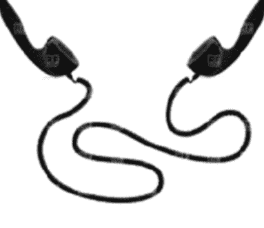
▲ 固定信道的电话连接

互联网的核心技术之一是分组交换。数据不再独占通道，而是被拆成多个数据包，分多条路径并行传输，到达目的地后再按规则重组。互联网因此能承载音频之外的文本、视频等多种信息。分组交换诞生于20世纪60年代末，美国ARPA为实现远距离计算机互联而资助的试验网，正是靠它得以建成，这就是ARPANET的前身。

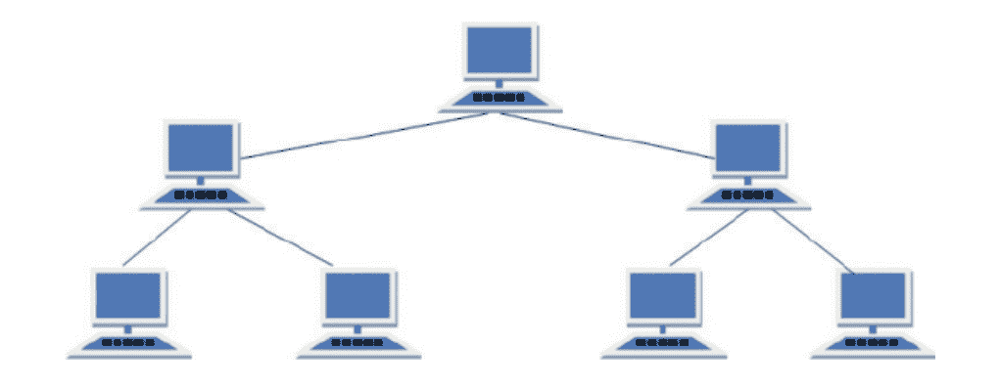
▲ 支持碎片通信的计算机网络

## 阿帕网（ARPANET）计划
以分组交换为基础、具备自存活能力的阿帕网是美国DARPA主导的项目，最初运行的是网络控制协议NCP。该协议在小规模下稳定，但用户增长后暴露两个致命缺陷：一是 NCP 只实现主机间的通信，没有为每台设备分配唯一地址，网络扩大后定位传输对象变得困难；二是缺乏纠错能力，传输出错时网络易停摆，效率随之下降。

更大的痛点是无法与其他类型网络互通。1973年春，Vinton Cerf 与 Bob Kahn 开始研究如何把阿帕网与卫星网SA NET、夏威夷的ALOHA NET连接起来。Cerf 设计出新的互联协议，即TCP/IP。1982年阿帕网停用NCP，统一改用TCP/IP。1983年1月1日起，NCP正式退出历史舞台，TCP/IP成为通用标准，基于它的互联网逐步成形，Cerf 也因此被称为互联网之父。

## 互联网的全球化
互联网在TCP/IP基础上向外横向扩张、向下纵向商业化。1982年5月，韩国成为美国之后第二个部署TCP/IP的国家。1984至1988年间，CERN开始部署TCP/IP连接内部系统、工作站、PC和加速器控制系统。1987年9月20日，钱天白教授发出“越过长城，通向世界”这封邮件，中国由此接入互联网。

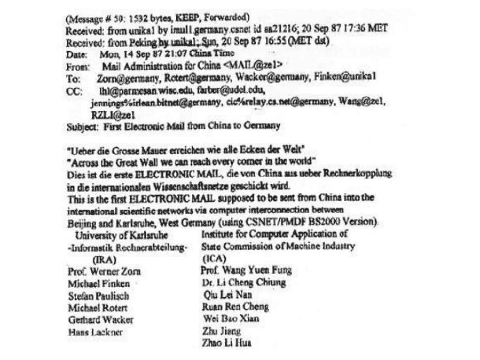
▲ 中国第一封互联网电子邮件

1988年互联网才开始面向公众商用。紧迫的覆盖需求和信息即时性让它迅速活跃起来。1989年，美国的UUNet、PSINet、CERFNet三家商业网络公司相继成立并提供服务，随后大量商业机构和教育机构接入。思科路由器的普及进一步加速了扩张。今天互联网已连接全球198多个国家和地区，直接用户超过40亿，接近全球人口一半。

## 小结
本章回顾了互联网从诞生到全球化的历程，重点讲了分组交换技术、阿帕网计划和全球化进程。下一章将介绍万维网的出现以及由此催生的云化应用。

# 第2章 程序和存储的云化
比尔·盖茨早期提出“每人一台电脑”的愿景，后来梦想成真，微软系统占据了大量桌面。系统之上运行着办公、制图、邮件、浏览器等各类应用。

## 万维网技术
网页浏览器是用来解析HTML的工具。互联网早期，获取信息主要靠FTP下载或新闻组。任职于CERN的英国科学家蒂姆·伯纳斯-李深感在不同机器间找信息效率低下，1990年他提出万维网方案，最精妙之处在于把超文本嫁接到TCP/IP之上。万维网建立在三项基石上：统一资源标志符URI、超文本标记语言HTML、超文本传输协议HTTP。

与传统超文本系统不同，万维网采用单向链接，资源拥有者无需配合，任何人都能链接该资源，从而大幅提升链接速度，降低服务器和浏览器的实现难度。但代价是链接失效问题长期存在，也就是大家熟悉的404错误。

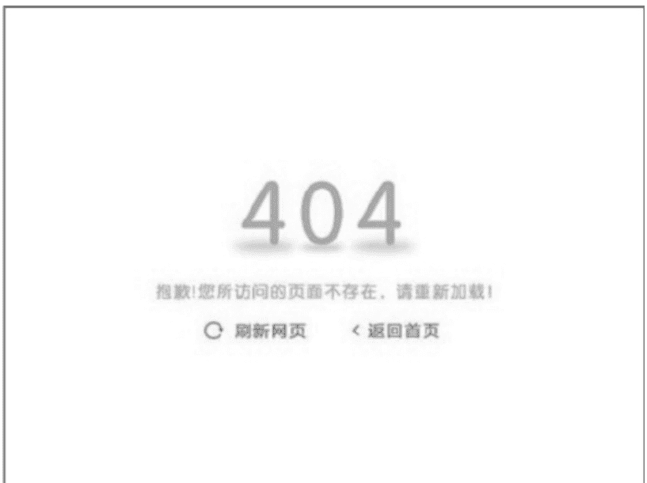
▲ 万维网404页面

伯纳斯-李用自创技术开发了首个Web服务器和浏览器，并把CERN的电话簿做成网页上线。Web一经推出便引发轰动。1993年CERN宣布万维网免费开放同年，Mosaic浏览器发布，首次实现图文混排，Web迅速成为互联网最受欢迎的应用，并催生产业爆发。1994年后雅虎、亚马逊、谷歌、阿里巴巴、腾讯、百度等相继出现。

早期网页以静态文字和图片为主，用户主要浏览。部分应用支持表单提交，如搜索引擎。每次交互都需往返服务器，响应速度受服务器限制，比本地应用慢很多。随后AJAX技术出现，即异步JavaScript与XML，能在请求前对表单等数据预处理，减少客户端与服务器的交互次数，减轻服务器压力。HTML5的到来进一步增强浏览器能力，减少对插件依赖，使浏览器能独立运行复杂Web应用。

## 用户生成内容
AJAX和HTML5的普及催生了Web2.0。博客、社交网站、基于位置的服务、维基百科、RSS、视频网站、论坛、问答平台等大量涌现。用户不再只是阅读静态内容，还能上传文字、图片、视频，并通过社交工具协作。应用和存储的功能从桌面操作系统逐步迁移到浏览器。

视频分享起初只是几分钟的生活片段，画质粗糙。随着技术提升，视频时长和清晰度不断提高，下载速度加快，用户体验接近本地播放器。网站提供的视频库远超个人收藏，种类也更丰富，人们开始习惯用云端应用获取云端存储的信息。借助浏览器，用户可以调用云端的办公、制表、邮件等多种服务。

## 宽带上网的普及
云计算的普及还离不开宽带。互联网初期多用拨号上网，需拨号连接运营商，按时长计费，速度通常在56kbit/s到256kbit/s之间，观看视频和运行复杂程序都很吃力。从2000年起，ADSL逐渐普及，速度可达8Mbit/s左右，上网时不占电话线并可保持“永远在线”。ADSL依托既有电话网络，快速铺开，为云计算打通了最后一公里。

## 小结
程序和存储的云化是云计算的核心特征。本章从技术和社会角度剖析了万维网的演进，让读者体会云计算如何进入日常生活。下一章将介绍云计算的典型行业应用。

# 第3章 云计算的应用
2006年亚马逊推出Elastic Compute Cloud后，谷歌、雅虎、微软、阿里巴巴等相继入局。随着腾讯、百度、华为等加入，全球云市场形成多方竞争格局。云计算已成为各行业的基础设施，也在为AI下一步发展提供助力。本章聚焦四类代表性应用。

## 云存储
云存储就是把数据放在云端，需要时随时调取，按量付费，无需前期投入。其优势主要有三点。扩展性强：容量可随需求弹性调整，用量小可不付费，用量大可升级，比扩建硬件更省事省钱。硬件冗余：数据以多副本形式分散保存，服务器损坏也不会导致丢失或服务中断，扩容时数据会自动迁移，降低运维负担。资源利用与协作提升：数据集中后，员工可通过单机或移动设备随时访问，实现共享与协同，避免重复劳动，保证数据一致性，提升安全性与效率。

## 企业云
据《世界经理人》2018年对2327家企业的调研，七成左右已部署公有云服务。企业在运营中产生海量数据，借助云计算可以降低IT管理复杂度，提升资源利用率，挖掘数据价值，推动业务与流程创新，形成差异化竞争优势。

开源生态的加速让企业需求发生变化：既要在公有云上运行无服务器应用，也要在自有基础设施上部署。企业云因此更受关注，它能让数据中心运行更快、性价比更高、资源利用更充分。未来企业会更倾向企业云模式，不仅为数字化转型加速，也为保持市场竞争优势。

## 医疗云
医疗云依托云计算、物联网、通信和多媒体等技术，结合医疗专业能力，提升诊疗效率，降低成本，实现资源共享，满足公众健康需求。随着IT环境不断升级，传统系统已难以支撑医疗应用，专门满足安全性和可用性要求的医疗环境应运而生。

医疗云包括健康信息平台、远程诊断与会诊系统、远程监护系统、教育系统等。它让医院采用云计算架构与云服务模式，成为支撑医疗AI、扩展现实XR、医疗机器人等新技术落地的平台，也能支持医保支付、医药流通、药物研发及人口健康管理等全流程创新。从卫生经济学角度看，医疗云能提高信息化效率，推动医疗转型。

## 教育云

普惠教育思路持续深化，教育资源共建共享已成为当下改革的核心议题。凭借调配迅速、开放易用的特点，教育云被视作推动普惠落地的优先手段。《“十三五”国家信息化规划》明确提出开展在线教育惠民，打造覆盖全国、分级部署、互联互通的数字教育资源云服务体系。实际应用涵盖云化数据中心、对象存储、科研云、桌面虚拟化、远程教学云、应用云及教育管理服务平台等形态，为智慧教育奠定了基础支撑。

## 小结
本章围绕存储、企业部署、医疗和教育四个方向，梳理了云计算在行业的落地路径。云端技术与海量信息相互促进，共同加速智能技术发展。下一部分将聚焦智能技术的另一项关键前提——海量信息。

# 第2部分
## 了解大数据
机器学习与深度学习是驱动智能演进的关键技术，模型的效能依赖于训练材料，材料规模越大泛化能力越强。若训练样本存在系统性偏差，就会导致模型偏见，进而造成不公平结果。我们需要对这门既常见又陌生的信息技术形成清晰认知。

海量数据可广义理解为来自多元渠道的结构化与非结构化信息集合。结构化信息通常指表格或数据库中的内容，具备固定的格式与长度规范。非结构化信息则形态各异、模型不完整，不适合用二维表表达，涵盖办公文档、文本、XML/HTML、报表、图像、音视频等。现代智能的标志之一是处理非结构化信息的能力，例如图像识别、语音识别和自然语言理解等。为提升识别精度，机器学习与深度学习需要大量样本，这些样本主要源自何处？

# 第4章
## 大数据从何而来
信息原本分散在大量孤立主机中，难以汇聚成规模化集合。第一部分提及的云计算改变了这一状况，为信息的采集、处理与存储提供了技术前提。随着互联网与云服务的普及，可公开获取的信息不断增多。传感器与物联网的广泛部署极大推动了海量信息形成。医疗行业约八成信息为医学影像，正因各类设备持续产生数据，企业也日益重视数据价值并形成相关战略。

## 互联网
海量信息的时代即线上网络的时代。回顾第2章，随着万维网演进与用户生成内容激增，网络拥有了庞大的信息来源。网络也最先体现出数据的商业价值。例如洞察消费者行为后可用于降本增效。以互联网业务为核心的公司如亚马逊、谷歌、阿里巴巴、腾讯、百度等，正持续推动数据变革。网络产生的信息包括邮件、文档、图片、音频、视频及社交媒体的信息流。一方面多为非结构化信息，需文本分析能力；另一方面为机器学习和深度学习提供了丰富训练样本。例如谷歌机器翻译即利用互联网上的大量平行语料进行深度学习训练。

## 物联网
若说互联网在收集线上信息，物联网则在收集线下信息，包括传感器、仪表、各类设施及定位/GPS数据等，还有智能温控器、智能电表、工厂设备、联网家电等产生的信息。物联网数据可经网络回传至云端进行处理分析。安防监控是典型应用，通过摄像头图像结合公安系统长期积累的信息，实现视频的实时智能分析，为打击违法犯罪提供支撑。未来随5G普及，边缘计算能力下沉至设备侧，可实现端侧实时处理，为现场生产制造提供即时指导。

## 企业内部数据
海量信息应用渗透各行各业，其商业价值日益凸显，信息正成为重要企业资产与国家战略资源。企业信息既包括内部的战略、文化、运营、营销、人力资源、财务等数据，也包括外部行业与环境数据。数据对管理的冲击是全方位的。以人力资源为例，可分为四类：基础类如年龄、学历、职务、专业技能、实践经历；能力类如培训、考核、奖惩记录；效率类如任务完成效率、单项耗时、故障率、次品率；潜力类如效率提升率、业绩提升率、职称晋升频率、收入增速。企业可借助数据实现招聘培养、员工关系、薪酬管理的信息化。AI招聘等应用正是基于人力资源数据的分析结果。

## 小结
本章介绍了海量信息的三大来源。海量信息并非简单堆砌，在第5章将介绍其主要特征。

# 第5章
## 四大维度
IBM最早提出海量数据理论，其初版方案提出4V特征：容量Volume，即规模从TB跃升至PB；多样性Variety，即类型繁多，除传统格式化数据外还包括网络日志、视频、图片、地理位置等；速度Velocity，即产生速度极快；价值密度Value，即有效信息相对稀疏。因此海量数据本质是高维低密度、快速产生的集合。

## 大容量
规模是与海量数据关联最紧密的特征，互联网与物联网的数据量正以前所未有的速度增长。通常认为TB至PB区间的数据即为海量。据百度资料，其新首页导航每日所需数据超1.5PB，1PB=1024TB，若打印将消耗超5000亿张A4纸。

## 多样性
海量数据的类型不仅是文本，更多是图片、视频、音频、地理位置等多类型，个性化数据占比高。多样性还体现在类型复杂性，包括结构化、半结构化与非结构化。从来源看，涵盖企业内外部。随传感器、智能设备与社会协同技术爆发式增长，数据种类愈加广泛，包括文本、微博、传感器数据、音频、视频、点击流、日志文件等。

## 快速度
数据处理遵循“1秒定律”，即从各类数据中快速提取高价值信息。数据创建、处理与分析速度持续加快。加速原因在于数据创建的实时性，以及需将流数据融入业务流程与决策。速度影响时延，即从数据产生或获取到可访问的时间差。目前数据产生、获取、存储、分析的速度远超传统系统承受能力。对实时反欺诈或多渠道即时营销等场景，数据必须实时分析才具价值。

## 低密度
价值密度低意味着在物联网与互联网广泛应用下，信息感知无处不在，数据总量巨大，但在不间断视频监控中，有用数据可能仅一两秒。以视频为例，一小时监控中真正有价值的片段可能只有一两秒。通过机器学习与深度学习迅速识别价值是智能时代的标志。

## 小结
本章介绍了海量数据的四大维度，概括而言即高维低密度、大量快速产生。下一章将介绍其行业应用。

# 第6章
## 第四范式
21世纪科学面临的挑战之一是如何应对数据密集型科学新时代。在信息社会，信息技术无处不在，科研日新月异。持续膨胀的数据尤其是商业数据是海量数据思想兴起的主要动力。图灵奖得主、关系型数据库创始人吉姆·格雷在NRC-CSTB大会上发表《科学方法的革命》，提出科学研究可分为四种范式：实验归纳、模型推演、仿真模拟、数据密集型科学发现，其中最后一种即科学大数据。

## 数据密集型科学
科学发现的第一范式是基于实验的研究模式，代表文艺复兴初期。伽利略登比萨斜塔投掷铁球、用脉搏计时等故事见证了现代科学开创。
当时实验条件有限，难以精确理解自然现象。科学家开始简化模型，剔除干扰保留关键因素——物理学中“足够光滑”“足够长时间”“空气足够稀薄”等表述即源于此，再通过演算归纳，这是第二范式。该范式延续至19世纪末，牛顿三大定律解释经典力学，麦克斯韦理论解释电磁学。但量子力学与相对论兴起后，研究更依赖超凡思维与复杂计算，验证难度与成本升高，科学研究显现乏力。
随电子计算机高速发展，第三范式即利用计算机模拟科学实验迅速普及。无论基础科研还是工程，仿真越来越替代实体实验。人们可模拟复杂现象并推演更多情形，典型案例如核试验模拟、天气预报。
进入互联网时代，吉姆·格雷认为鉴于信息爆炸，数据密集范式应从第三范式即计算范式中分离，成为独特的科研范式，即“第四范式”。

## 全局数据
第四范式与第三范式在计算上的差异在于：第三范式先提出理论，再收集数据，通过仿真验证理论；第四范式则是先拥有海量已知数据，再通过计算推导出此前未知的可信理论。
关键问题在于如何判定参数的重要性。看似无关的参数在特定条件下是否会起到决定性作用？因此获取尽可能全面的信息，才能做出更科学预测。第四范式即基于这一思路的方法论。

## 数据科学
互联网与物联网提供了海量信息，第四范式的提出使人们有意识地生产与获取海量信息，为机器学习、深度学习等AI技术的广泛应用提供理论基础。数据分析已超越传统范畴，成为系统学科。数据科学是通过数据学习知识的学科，目标是从数据中提取价值部分生产数据产品，这与机器学习的指导原则高度相似。

## 小结
本章介绍了第四范式与海量数据，至此已完整了解云计算与海量数据这两个关键技术。下一部分将正式介绍人工智能及AI思维。

# 第3部分
## 人工智能基础
人类对人工智能的探索源远流长，古代神话中有工匠打造“人造人”并赋予意识的记载。现代人工智能的诞生与英国人艾伦·图灵密切相关。

# 第7章
## 图灵测试
2019年7月，英国央行英格兰银行宣布图灵将登上50英镑新钞，以表彰其对大众生活方式的深远影响。图灵究竟是怎样的科学家？

## 图灵简介
1912年6月23日，图灵出生于伦敦，父亲为公务员，外祖父为工程师。16岁时为帮助母亲理解相对论，他研读爱因斯坦著作，不仅理解内容，还看出其对牛顿运动定律的质疑。
1931年图灵入读剑桥大学国王学院，5年后提出“图灵机”构想，奠定计算机理论基础。1950年发表论文《计算机器与智能》，提出著名“图灵测试”，次年年仅39岁即当选英国皇家学会会员。

## 模仿游戏
在《计算机器与智能》中，图灵提出核心问题：机器能否思考？随后设计了一个模仿游戏，认为可等价表述上述问题。该游戏后被称为“图灵测试”，长期是人工智能判断的通行标准。
游戏由三人参与：男方A、女方B、审问者C。审问者与另两人隔开，目标是判断另外两人的性别。通过标签X、Y辨识，结束时需给出“X是A，Y是B”或“X是B，Y是A”。审问者可向两人提问，例如“请X告诉我你的头发长度好吗？”假设X是A，A需作答。游戏中A的目标是误导审问者，其回答可能是“我头发卷曲，最长约23厘米”。为避免噪音干扰，回答多以手写或打印呈现。理想安排是通过计算机在两房间交流，或由中间人转述。对玩家B而言目标是帮助审问者，最佳策略是如实回答。

图灵提出：“若用机器扮演A角色会怎样？”审问者误判概率是否与真人男女对弈时一致？这些问题替代了“机器能否思考？”的原问。

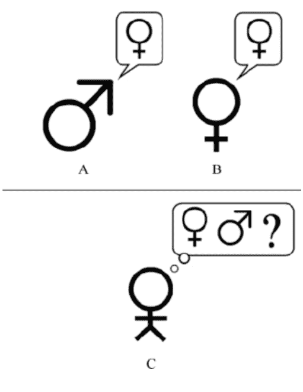

▲ 模仿游戏

## 对立观点
提出图灵测试后，图灵认为基于电子计算机可建造会思考的机器。如今AI已在各行业得到验证，但在概念提出时不少人存疑，部分反对意见被他逐一反驳，至今仍具意义：
1. 鸵鸟思维：认为机器能思考后果可怕，应自欺欺人相信其不能。图灵认为这是自我安慰，缺乏技术含量，不值一驳。
2. 数学逻辑限制：电子计算机本质是离散状态机，数学上能力受限。图灵指出数学也未证明人类思维不受此限制，因而不能否定AI可能性。
3. 机器无意识：认为除非机器能因思想与情感而非符号拼凑写出十四行诗或协奏曲，且知道自己写了。机器感受不到成功喜悦、困难沮丧、犯错郁闷。图灵指出确认机器是否思考的唯一途径是自己成为机器去感受，这实为唯我论。若如此观念交流成难题。A会说“A在想B不在想”，B会说“B在想A不在想”。与其争执，不如默认大家都在思考。在模仿游戏中，审问者常以答辩形式检验对方是真正理解还是鹦鹉学舌。例如审问者询问诗句改动对押韵的影响，机器能指出冬日比喻的特殊性等。若写诗机器能如此对答，还能说其只是机械发信号吗？若答复前后一致令人满意，还能说其只是人工信号装置吗？图灵承认意识有神秘之处，但不能以此否定机器思考与智能。
4. 机器缺陷论：论调为“可造出能做你说的机器，但永远造不出能做X的机器”。图灵认为只要列出X清单逐一实现即可，AI发展史已显示这些X被逐一攻克。
5. 机器无法创新：认为机器只能执行指令，绝无原创性，也不能令人惊奇。如今AlphaGo战胜人类围棋冠军已证明机器能令人惊奇。图灵当时也指出机器常令他惊讶，主要因低估了其能力。
6. 神经系统连续性：现代解剖学认为人脑是模拟信号系统，非数字系统，故不可被电子计算机模仿。图灵承认这一点，但认为凭足够算力可将模拟系统模仿至足够精度。
7. 人类行为不规则性：行为集合不可穷尽，如红灯停绿灯行，但故障同时出现时该如何？人们处理方式不一，故无法制定统一规则，机器基于规则则难具智能。图灵认为这是混淆行为规则与行为准则，在足够广的范围内机器行为会变得难以预测，看不到规则不代表规则不存在。

## 小结
图灵被誉为人工智能之父，本章介绍了其生平及与AI研究的关系。下一章将介绍现代人工智能的诞生与发展历程。

# 第8章 AI简史
图灵在理论上证明了人工智能的可行性。受图灵机启发的美国科学家约翰·冯·诺伊曼提出存储程序计算机设计概念，即冯·诺伊曼结构。1948年，世界首台电子存储程序计算机在曼彻斯特大学建成。至此，现代人工智能的理论与硬件基础均已具备，人工智能即将真正诞生。

## 达特茅斯会议（1956）

1956年盛夏，常春藤名校达特茅斯迎来了一场改变历史的聚会。几位顶尖学者共同发起为期两个月的研讨，会议的核心设想是：

> “无论是学习还是智能的其他特质，从根本上都可以被精确刻画，以至于能造出机器来复制它。我们想探索机器如何运用语言、以抽象和概念化手段解决原本只有人类能处理的难题，相信用一个夏天集中一批科学家，就能在其中几个问题上取得实质性进展。”

两个月里，计算机、自然语言、神经网络、计算理论、抽象化、随机性与创造力等议题轮番展开。学者们并未达成统一结论，却为这批研究命名——人工智能，并将其定格为独立学科。于是1956年被视作AI元年。

## 起步狂热：1952-1969

AI诞生后，研究圈弥漫着乐观情绪，普遍认为二十年内就能出现完全智能的机器。DARPA 等机构随即大举注资。

1958年，麦卡锡组建了全球首个人工智能实验室，并同年发布Lisp语言，成为AI早期最主流的工具，后来与1973年问世的逻辑语言PROLOG并称双壁。他还在1960年前后提出分时系统，让一台电脑同时服务数十上百人，极大推动了后续研究。

艾伦·纽厄尔与赫伯特·西蒙联手打造了通用问题求解器GPS，它依据人类解题的共性规律，可处理十余类不同问题，让启发式编程走向通用。西蒙还强调科学发现只是特殊的问题求解，因而可程序化。两人后来与海斯合作开发了理解程序Understand，用来攻克非结构化任务。1966年他们与贝洛尔合作做出早期下棋程序MATER，并乐观预测十年内电脑能夺得国际象棋世界冠军并证明重要数学定理。

同年，麻省理工的约瑟夫·魏泽鲍姆推出聊天程序ELIZA，用在临床模拟中。尽管实现只是关键词匹配加人工规则，魏泽鲍姆本人却为其表现震惊，后来写下《Computer Power and Human Reason》表达复杂心态。

60年代末，马文·明斯基与西蒙·派珀特倡导“微世界”思路，主张用简化模型先理解基本原理，如物理里的理想平面。他们据此制作会搭积木的机械臂，把积木世界变为现实，代表作是特里·威诺格拉德的SHRDLU，它能用自然英文交流、决策并执行操作。

## 初次寒冬：1966-1973

早期系统在扩大问题范围时迅速失效。1965年定理证明遇瓶颈，机器推演数十万步仍无法证明两个连续函数之和仍连续。

机器翻译更是灾难。早期系统缺乏语境，出现经典错译：

The spirit is willing but the flesh is weak.

被译成俄语再译回英语后变成：

The wine is good but the meet is spoiled.

原理可行不等于可用。负面证据累积，政府与高校纷纷砍掉项目，AI陷入第一次寒冬，学界被迫冷静反思。

## 知识系统时代：1969-1979

1965年，斯坦福的费根鲍姆与化学家勒德贝格合作推出DENDRAL，它基于丰富的化学知识，能从质谱数据推断分子结构，标志着专家系统的诞生，AI研究从偏重算法转向以知识为核心。其后麻省理工的MACSYMA不断扩充，可求解六百多种数学问题。

到70年代中期，专家系统逐渐成熟。医药专家系统MYCIN可诊断血液和脑炎感染并给出处方建议；探矿专家系统PROSPECTOR则帮助地质学家找矿，是首个产生明显经济效益的系统。

1977年，费根鲍姆在第五届国际联合会议上提出知识工程，认为它是用原理和方法解决需专家知识的难题，核心在于知识获取、表达与推理的构造与解释。随后涌现出EMYCIN、CLIPS、OPS5/OPS83、G2、KEE、OKPS等开发工具。

## 产业化突破：1980年至今

1980年，XCON专家系统上线，能依据需求自动挑选DEC计算机集群部件。1980-1986年间它每年为DEC节省约4000万美元。人们开始意识到，AI的价值不在通过图灵测试，而在解决实际问题并提升效率。

资金涌入，Symbolics与Lisp Machines等硬件公司、IntelliCorp与Aion等软件公司相继出现。标志性事件是HiTech与Deep Thought击败国际象棋大师，Deep Thought也为IBM的Deep Blue奠基。

如今AI已在幕后广泛落地。最初“人类水平智能”的浪漫梦想被拆解为多个子领域，研究更审慎，却也更成功。

## 智能体崛起：1995年至今

90年代起，“智能体”范式流行。朱迪亚·珀尔、艾伦·纽厄尔等人把决策理论与经济学概念引入AI后，现代智能体才成型。经济学里的理性人结合计算机的模块或对象，便构成了智能体。

智能体是可感知环境并采取行动以最大化成功概率的软硬件系统。从简单的网络爬虫到理性的人类，它把研究范围从模仿人类智能扩展到一切智能形式，并为AI、经济学、控制论等提供通用描述语言。人们期望出现像SOAR这样的完整架构来构建通用智能系统。

## 关联数据与知识图谱：2006年至今

万维网之父蒂姆·伯纳斯-李提出语义网，希望把网页碎片降维到数据级别，让计算机与人协作。例如比较当当与亚马逊的《新华字典》价格时，语义网可直接以书名为起点聚合信息。

2006年，奈杰尔·夏伯特、伯纳斯-李与温迪·霍尔指出自顶向下设计难以落地。随后伯纳斯-李提出关联数据，倡导公开并规范发布数据。学界也强调需要内容丰富的多元语料和面向语义网的运行系统。

2012年维基媒体基金会推出Wikidata，中文社区也有zhishi.me、XLore、CN-pedia等类似项目。关联数据直接催生了谷歌知识图谱，2012年5月16日上线后，搜索引擎能洞察查询语义，返回更精准答案，延续了本体与专家系统的精髓。

## 深度学习浪潮：2009年至今

神经网络的探索早在AI伊始就存在。弗兰克·罗森布莱特1958年提出感知器，并预言它终将学习、决策与翻译。但1969年明斯基与派珀特的《感知器》指出其局限，研究停滞十年。

1982年约翰·霍普菲尔德证明Hopfield网络可全新学习与处理信息，同期戴维·鲁姆哈特推广反向传播。2006年杰弗里·辛顿在《科学》发文解决深层网络训练难题，掀起深度学习热潮。

2009年GPU大规模并行算力接入，AI进入大爆炸。两年内GPU深度学习开发者增长25倍。多伦多大学亚历克斯·克里泽夫斯基的AlexNet用两块GTX 580训练数日，就在ILSVRC击败人类专家算法。吴恩达与NVIDIA合作的大规模GPU训练方法推动全球转向深度学习。百度、谷歌、Facebook、微软率先用于模式识别。2015年图像识别超越人类，语音识别接近人类水平。

2016年DeepMind的AlphaGo击败李世石，围棋这一复杂游戏被攻克。这与1997年Deep Blue的暴力搜索截然不同，标志着通用智能时代的到来。

## 小结

纵观历史，AI从达特茅斯的夏日设想到产业级应用，经历狂热、寒冬、知识化、产业化、智能体、数据图谱与深度学习多重浪潮。第9章将聚焦当下的行业实践。

# 第9章 行业应用案例

无人驾驶、机器翻译、智能家居、医学影像分析、智能客服、智慧物流……AI技术正重塑各行各业，让理解、推理、规划、沟通、感知等过去被视为人类专属的能力以更低成本大规模运行，传统软件的分析任务也能被AI做得更高效。

## AI如何打开新机会

由于商业流程与消费者应用多涉及知识管理、推理、规划、沟通或感知，AI新能力在提升生产力与创造新商业模式上作用显著。

| | | | |

|---|---|---|---|

| 知识 | 医疗诊断 | 药物发现 | 媒体推荐 |

| | 金融交易 | 信息合成 | 消费者精准定位 |

| 推理 | 法律分析 | 资产管理 | 合规审查 |

| 计划 | 物流 | 车队管理 | 导航 |

| | 网络优化 | 预测性维护 | 需求预测 |

| 沟通 | 语音控制 | 智能助理 | 客户支持 |

| | 实时翻译 | 实时录音 | 客服 |

| 感知 | 自动驾驶 | 医疗影像 | 认证 |

| | 增强现实 | 监控 | 工业分析 |

▲ 人工智能技术在多个领域解锁新机遇

## 产业的AI化程度看数据

AI不是为解决问题而生，它是一组可落地的功能，帮助企业增收降本。以机器学习、深度学习为核心的技术能把更广的数据纳入分析，比规则系统更擅长发现概念与模式，并实现人机对话。数据密集的行业AI应用更广，数据处理少的领域如战略管理、教学则相对有限。

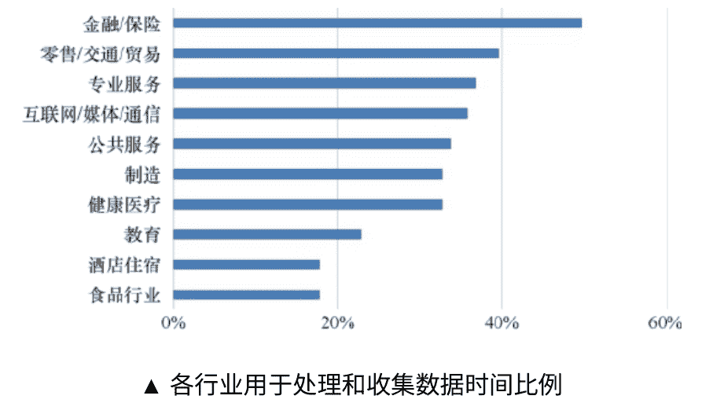

▲ 各行业用于处理和收集数据时间比例

## 八大行业32个落地方向

随着技术成熟，应用案例快速增长。以下为8个行业的32个核心场景：

| 行业 | 应用案例 |

| :--- | :--- |

| 资产管理 | 投资策略 | 投资组合 | 风险控制 | 客户端服务 |

| 健康医疗 | 诊断 | 药物发现 | 病患监护 | 手术支持 |

| 保险 | 风险评估 | 索赔处理 | 欺诈识别 | 客服 |

| 法律与合规审查 | 判例法 | 尽职调查 | 诉讼策略 | 合规审查 |

| 生产制造 | 预测性维护 | 机械性能 | 能耗优化 | 供应链优化 |

| 零售 | 客户细分 | 内容个性化 | 价格优化 | 流失预测 |

| 交通 | 自动驾驶 | 城市交通管理 | 车队管理 | 交通信号控制 |

| 公用事业 | 能源供应管理 | 需求优化 | 安全 | 客户体验 |

▲ 人工智能行业应用案例

1. 资产管理：自然语言处理可从非结构化数据中提炼信息，发现微妙规律，聊天机器人实现人机交互。核心场景包括投资策略、组合管理、风险控制、客户服务，AI让个性化服务从高净值客户走向大众，机器人顾问降低成本并提升体验。

2. 健康医疗：未来十年AI将带来范式转变。80年代专家系统已用规则推理模仿诊断。现代深度学习覆盖更广，场景包括诊断、药物发现、病患监护、手术支持。

3. 保险：业务涉及客群洞察、风险评估、理赔与反欺诈，AI可贯穿全流程提效、改善体验，加速决策、减少欺诈并智能化客服。

4. 法律与合规审查：NLP、知识整合与自动推理在法律与合规中广泛应用。初级律师的检索整理工作被AI加速。场景包括判例识别、尽调、诉讼策略等。2008年后合规成本大涨，花旗集团2008-2016年员工减少32%，合规人员却翻倍至29000人。AI可从行为学习规律并实时预警异常，以更低成本处理海量审查。

5. 生产制造
人工智能正在为工厂带来效率与盈利的实质性提升。设备综合效率OEE衡量的是实际产出与理论产能之间的差距，不同行业之间差异明显，同一行业内企业间也存在较大落差，这为建立竞争壁垒留下了空间。借助预测性维护，AI能够提前识别设备故障风险，降低非计划停机，从而拉升OEE、改善盈利，同时让资产运转更顺畅、用能成本更可控。

6. 零售
电商平台沉淀了海量用户和交易行为，借助人工智能，这些数据能够被转化为可执行的洞察，帮助商家提高客户留存并强化竞争力。从获客、内容匹配，到定价策略和流失预警，整条购物旅程都能被AI算法覆盖。相比传统规则系统，算法可以吸纳更广的数据、挖掘更隐蔽的规律，而基于个人画像的精细化运营，正是新零售被赋能的核心。

7. 交通
计算机视觉的突破让自动驾驶从概念走向现实。AI带来的不仅是驾驶自动化，更是价值链的重塑与商业模式的深层变化。除无人驾驶外，AI还能渗透进交通运营的关键环节，比如拥堵预测建模、车队调度优化等，实现流程的智能化管理。

8. 公用事业
信息技术对公用事业的模式演进起着决定性作用。未来具备发电能力的用户将正式进入能源交易市场，人工智能将在这一转型中扮演关键价值驱动角色。应用场景非常多元，涵盖能源供给调度、需求侧优化、运行安全保障以及客户体验提升等多个维度。

小结
本章梳理了人工智能在多个关键行业的具体实践。可以看到，AI的落地已遍布各行各业，对社会经济发展发挥着关键作用。下一章将进入AI思维的介绍。

# 第10章 AI思维

过去人们对人工智能多怀憧憬，如今“未来已来”的语境下，AI已成为随手可用的基础设施，成为工作与生活的标配。从经济视角看，AI是各行业的增长引擎，推动生产率提升并催生新型商业形态，其社会价值与发展潜力使其成为现代技术体系的支柱。

随着AI应用无处不在，以及深度学习、自然语言处理等分支逐渐独立，形成了大量根植于AI理念的新应用甚至新行业，提出“AI思维”概念的时机已经成熟。AI思维指的是从AI研究与实践中提炼出的思考方式。它不仅帮助我们理解应用背后的原理，也为解决问题提供全新维度。其本质是把部分或全部解决问题的责任从人转移到智能设备上，是一次问题解决范式的转移。AI思维对研究者重要，对普通人同样重要。它包含六大理念：计算思维、机器感知思维、机器学习思维、机器推理思维、人机交互思维和AI伦理思维。

## 硅基智能
地球上已知的智能可分为碳基智能和硅基智能。碳基智能以人类为代表，源于碳基生命；硅基智能则建立在硅芯片之上，现代人工智能依托硅基电子计算机运行。计算设备是AI落地的物质基础，用AI解决问题本质上是用计算设备解决问题。计算思维是借助计算机与计算机科学解题的思维，AI思维在此之上进一步把解题责任交由智能设备。由此，计算思维是AI思维的基础。

## 形式科学
基础教育大致分为社会科学、自然科学和形式科学。形式科学研究抽象形态，如逻辑、数学、统计。计算机科学和人工智能属于形式科学范畴。计算机视觉、语音识别、自然语言处理、情感识别等感知与交互领域，研究对象是抽象的图像、语音、语言，核心工具是数学建模与程序语言。因此机器感知思维和人机交互思维构成了AI思维的支柱之一。

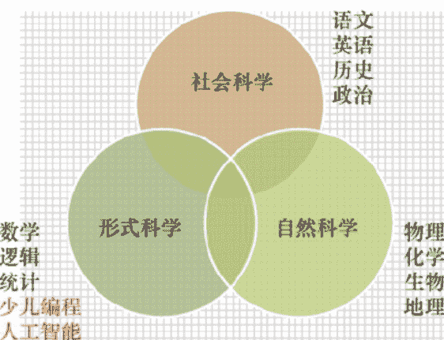

## 直觉和理性
直觉思维是对整体形势的概括性判断，依赖全局把握，经验越丰富直觉越准。这与机器学习有相通之处，机器学习的效果取决于训练数据规模，数据越多模型越精准。理性思维建立在证据与逻辑上，强调比较、分析、抽象与论证。这与AI中的知识表示与推理相似：先用数据结构如树构建对现实的表征，再借助推理算法从已知推导出新知。因而机器学习思维与机器推理思维是AI思维的两大核心。

## 辩证看AI
人工智能正在重塑工作、出行的形式和沟通方式，同时也带来潜在风险。若训练数据存在偏见，服务质量会出现不公平，例如AI招聘中的面试偏见。医疗AI大量使用患者数据，如何在隐私保护与造福人群之间平衡，是必须面对的问题。探讨AI对社会的影响，并在道德层面设计与应用标准至关重要，AI伦理思维体现了AI思维的辩证性。

小结
本章介绍了AI思维的六大理念及其形成背景。AI思维是一种概念而非具体软件，是一个思考过程而非学科专属技能，它模仿的是人的思维而非智能体的思维，并非AI科学家的专利，人人可用。下一章将详解各思维模块的内容与应用。

# 第11章 计算思维

## 计算思维
计算思维由卡内基梅隆大学的周以真教授于2006年提出，被定义为运用计算机科学基本概念进行问题求解、系统设计和人类行为理解等一系列思维活动。她认为这是一种普适能力，所有人皆需掌握。计算思维是智能化计算的根基。学界对计算思维进行了丰富研究，以下介绍其中六种典型模式。

## 抽象思维
解题的第一步是恰当表征问题，提好问题往往比解题更关键。例题“5个苹果吃掉2个剩几个”可抽象为“5-2”，只保留数量关系，舍弃颜色、吃法等无关信息。数学抽象剥离物理化学生物属性，只留数量与空间形式。计算思维的抽象更丰富，包含数据抽象与控制抽象，即把现实中的数量、空间、逻辑关系和处理流程映射为计算机中的数据结构如数值、字符串、变量、列表、栈、树，以及控制结构如指令、顺序、分支、循环、模块，并构建计算模型。计算抽象受工程思维影响，需在物理约束下运行，考虑边界与失效，决定保留与舍弃的细节。数学物理抽象多为单层，计算思维强调分层抽象，通过逐次剥离细节形成不同层级并理清层间关系，有助于聚焦感兴趣的层次并驾驭复杂性。抽象还能揭示看似不同的问题的共性，建立统一模型，是计算思维的核心能力。

## 算法思维
算法是对求解步骤的精确描述，基础结构有顺序、分支、循环。顺序是依次执行，分支是依据条件选择路径，最常见的二分支是If-Else，对应人类判断；循环是重复执行处理块。三种结构足以表达任意算法。递归与迭代是更高层机制。迭代即重复逼近目标，每次结果作为下次起点，与优化紧密相关。迭代思维广泛存在于科研、商业和日常工作，如迭代式创新先做最小可用产品，再滚动扩展，最终形成生态，Facebook与微信是典型案例。算法的魅力在于知识的组合与迭代，体现了人类认知的规律。

## 自动化思维
自动化思维是借助计算设备自动求解问题，利用机器强大的重复计算能力弥补人类处理大数据时的局限。工程或科学问题均需分层分解，通过抽象建模为机器可执行的数学或概念模型。计算思维的核心是把大问题拆解为可自动解决的小问题。抽象简化复杂性，而自动化提供了新的控制维度。学习编程是掌握自动化的最佳路径，积木式图形化编程适合入门。自动化解放人类于繁琐、危险、机械劳动，提升效率，重塑生产生活学习方式，也改变思维方式。理解自动化的价值与边界，以及人在自动化过程中的角色，是祛魅高科技、保持自信的关键素养。人类也能自动化，只是速度远不及计算机。自动化之上是自主化，AI思维是计算思维的升华。

## 分治思维
分治即分而治之，避免一开始就硬攻复杂问题。先把问题拆分为若干独立子问题，再递归拆分直至可交由AI求解，最后合并子问题解。流程通常为分、治、合并，治的阶段常借助迭代。优势在于子问题可并行处理。本质是各个击破。关键在于能否发现重复子问题与循环子结构，能否按步骤划分，能否确保子问题可解。例如规模为n的问题可拆为1与n-1，或n/2与n/2，递归处理直至简化。

## 调试思维
调试指对软硬件智能体进行测试并排除错误的过程。生活中无处不在，从开关排查到设备检修都是调试。它发生在测试之后，流程是执行测试用例、评估结果，若实际与预期不符则定位隐藏问题并修正。常见调试思路包括：枚举法，穷举各种情况，低效但有效；回溯法，从出错点沿逻辑链向回追踪，适合小规模问题；原因排除法，在问题前后布点逐步缩小范围；归纳法，整理相关数据分析错误成因并提出假设验证；演绎法，先列出可能原因再用测试逐一排除。

## 类化思维
类化思维基于过往解法与经验快速应对新问题，常问“是否像已解决的问题”“有何不同”。识别数据与策略的规律很重要，针对一类问题的算法往往可迁移。典型表现有：脸书依据浏览内容推送广告；谷歌根据时地热词提供自动补全；亚马逊与Netflix对用户建模分类，依据类化推理推荐内容；在信息不全时采用类化决策。

小结
本章详细介绍了计算思维的六种类别。下一章将介绍AI思维的重要支柱——机器感知思维。

# 第12章 机器感知思维
智能体通过传感器感知世界，感知是为传感器信号赋予意义的过程。让机器“看”和“听”并投入应用，是AI的重要里程碑。机器感知思维要求理解AI感知的能力与局限，区分智能与非智能机器，比较人类与机器感知的异同。

## 传感思维
人类依靠感官获取信息，AI系统则依赖传感器。传感器能检测被测信息并按一定规律转换为电信号或其他形式输出，供传输、处理、存储、显示与控制。按工作原理分物理传感器与化学传感器，物理类包括力、光、声、电、热、磁、射线等，化学类包括离子、生物、气体等。按运行方式分被动式与主动式，被动式不发射能量仅接收外界信号如CCD，主动式发射探测信号如红外。常用类比人体五感：压敏温敏流体传感器对应触觉，气体传感器对应嗅觉，光传感器对应视觉，声传感器对应听觉，化学传感器对应味觉。传感器技术已深入工业自动化、前沿科研，也渗透到医疗、环境、安全、家电等生活领域，未来世界将充满传感器。

## 计算机视觉
计算机视觉用算法识别分析图像，研究机器如何“看”。核心任务包括：识别，判断图像中是否包含特定物体、特征或运动状态，已成熟应用如几何图形识别、人脸识别、文档识别、车辆识别；运动分析，基于图像序列监测物体运动如自运动与跟踪；场景重建，从多幅图像或视频构建三维模型；图像恢复，去除噪声如修复老照片、消除水印。

## 语音识别
语音识别的目标是将人类语音自动转为文字。典型流程分三层：信号层，提取并增强语音信号，进行预处理、清洗与特征提取，与机器学习的数据预处理类似；声学层，将特征归并为不同音素，因声音本身不唯一，常以近似声学模型表征；语言层，假设声音有意义，将音素组词成词、组句成句，依赖自然语言处理技术。深度学习突破推动了语音识别发展，Echo、Siri等产品普及。但嘈杂环境指令理解、自动纠错、同一词在不同语境的语义区分等挑战仍在。

小结
本章介绍了机器感知思维，并重点阐述了计算机视觉与语音识别两大成熟方向。下一章将介绍引领现代人工智能爆发式增长的核心技术——机器学习及其思维方式。

# 第13章

## 数据驱动的机器学习思维

机器学习的本质是让模型从海量样本里自动提炼出规律，再用这些规律去推断未见过的数据，属于一种统计推断范式，也是实现人工智能的数据驱动路线。模型表现好不好，很大程度上取决于训练样本的质量和规模，通常数据越多、覆盖越广，学习的精准度就越高。训练样本往往由人工标注产生，也有部分是机器自行采集。近些年人工智能在多个领域取得突破，机器学习与深度学习功不可没。机器学习思维，说白了就是凭借一定规模的数据，结合人工智能技术进行分析的思考方式。掌握它，对理解当下人工智能的应用至关重要。

## 监督学习的预测逻辑

监督学习的核心是预测未知表现。它先从有标签的训练数据中学习出一个映射函数，再用该函数预测新样本。监督学习思维主要分为分类思维和回归思维。

分类思维的任务是对样本打标签。以鸢尾花为例，假设只用花萼和花瓣的长宽两个量来判断品种，且只考虑山鸢尾、弗吉尼亚鸢尾、变色鸢尾三种可能。这里花萼和花瓣的长宽就是特征，可能的输出品种是类别，每朵花都属于其中一类，单个样本的期望输出即标签。分类思维就是基于已知品种的花朵测量数据学习规律，从而对新花的品种做出判断。

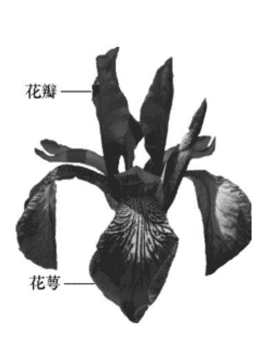

▲ 鸢尾花局部图

回归思维也是预测，目标是连续数值。比如用房屋面积、区位、建成年代来估算房价。房价是连续变量，面积是特征，价格是输出值。面积、区位、年代属于自变量，房价属于因变量。先收集一批带价格的房源数据，再借助如三元线性回归之类的模型学习关系，最终对新房进行价格预测。

分类与回归在数学统计里是经典概念，但在监督学习视角下，更强调预测功能与准确性，并由算法实现。典型场景有在线广告点击率预测、图像标注、语音识别、机器翻译、自动驾驶等。

## 无监督学习的自发现

用没有标签的样本解决模式识别问题就叫无监督学习。它和监督学习的最大分野在于数据是否带标签。无监督学习思维包含聚类思维和降维思维。

聚类思维遵循“物以类聚，人以群分”的原则，把相似对象归到一起。具体操作是将样本按相似度划分为若干互不重叠的子集，每个子集称为簇。拼图时先把颜色相近的碎片聚堆，市场营销中按消费习惯和人口特征对顾客分组实施差异化策略，金融投资中按收益、波动性和市值等指标把产品归类，再遵循分散风险的原则优化组合。聚类的目标是让簇内样本相似、簇间样本差异。聚类属于自动分类，和监督分类不同的是，监督分类事先知道类别含义，而聚类得到簇的语义需要事后解读。

降维思维是降低数据复杂度，把高维数据压缩到低维，同时保留结构与有效信息，确保信息传递不丢失。实质上是一种抽象。以一个128×128×3像素的图像为例，维度高达49152维。若能做空间降维而不损失太多语义，就是成功的降维。常见手段有特征选择和特征提取。特征选择是从原始变量中挑选子集，特征提取则是把高维空间映射到低维空间。

值得一提的是，生成对抗网络属于无监督学习的代表。

## 强化学习的试错思维

强化学习是机器学习的一大分支，让智能体在没有完整示范的情况下，通过不断尝试摸索规律，最终达成目标。这是一个完整的学习闭环。AlphaGo正是用强化学习训练后击败世界围棋冠军的典型案例。强化学习通常包含智能体、环境、状态、动作、奖赏五要素，目标是最大化累积奖赏。

用婴儿学走路来类比。婴儿作为智能体，通过迈步等动作改变路面环境，从一个状态转移到下一个状态，完成几步走路的子任务就会得到点赞作为奖赏，站着不动则没有奖赏。

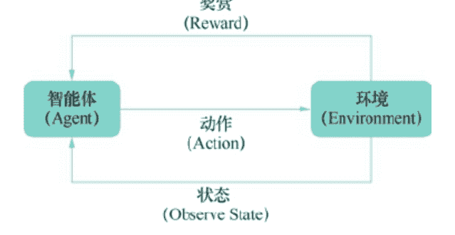

▲ 智能体与强化学习

强化学习思维是一种反复试错的迭代方式，缺乏直接的指导信号，智能体必须持续与环境交互，通过试错积累最优策略。它在机器学习中非常活跃，因更贴近生物学习本质而被认为更具潜力，棋类游戏已验证这一点。应用范围包括自动驾驶、AlphaGo、智能音箱等。

## 深度学习的层层抽象思维

深度学习是机器学习的子集，有两大优势。
1. 精度随数据量提升。用于训练的数据大幅增长时，精度也会显著提高，这正是图像识别与语音识别近年突破的关键。
2. 特征无需人工提供。传统监督学习常需人工设计特征，而深度学习能自动学习高精度表示，降低对领域专业知识的依赖。

深度学习的基础可追溯到20世纪50年代的感知器。感知器接收多个输入输出一个结果，中间会做加权求和后再判断。以房价预测为例，面积、区位、年代作为输入，房价作为输出，输入先乘以权重再汇总，感知器据此给出价格。权重可类比水管粗细，影响力越大管径越大。

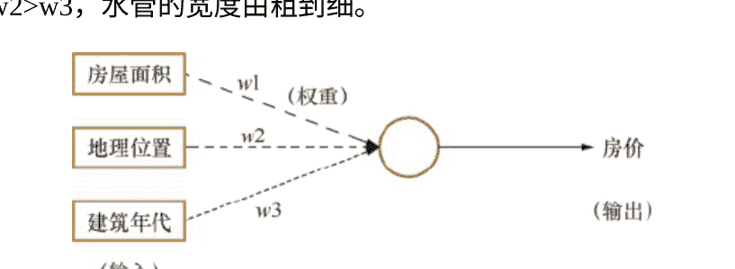

▲ 感知器模型

城市等级对房价范围有显著影响，这部分称为偏差项。加入偏差项可以调整加权结果的取值范围，偏差项同样可通过学习优化。

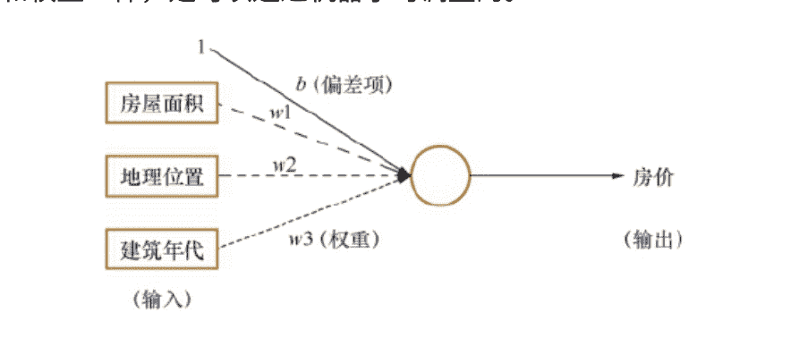

▲ 带偏差项感知器模型

感知器可以堆叠成多层结构，形成网状的人工神经网络。单个感知器也称神经元，每层上方通常放置偏差项。

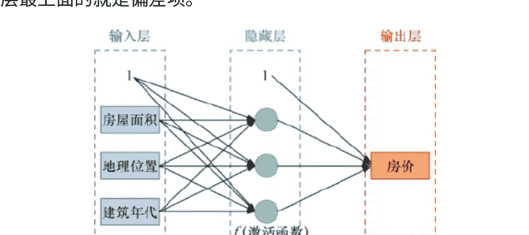

▲ 简单神经网络模型

早期网络仅做线性变换，能力有限，实质等同线性回归。为处理非线性问题，引入激活函数，对输入做非线性变换，让网络学习更复杂的任务，如机器翻译和图像分类。激活函数的意义在于为网络注入非线性，使其解决复杂问题。

深度学习即网络层数不断加深，一般隐藏层达到三层及以上即可称作深度网络。尽管原理早在五十年代就已存在，却因计算量大和数据需求高而长期沉寂。如今算力和大数据成熟，深度学习才迎来爆发。

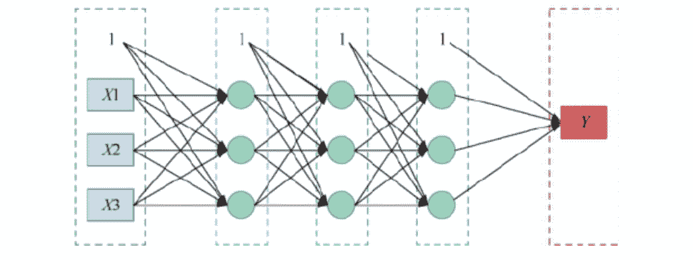

▲ 深度学习神经网络模型

深度学习对数据规模要求更高，几万到几千万条样本都可能出现。隐藏层数也无固定标准，多靠经验调节。有时盲目加一层隐藏层，精度反而意外提升，这也是常有的现象。

## 要点回顾

本章介绍了四类代表性的机器学习思维。下一章将介绍与之对应的机器推理思维。

## 第14章

## 机器推理思维：从知识中推导

表示是自然智能和人工智能的核心议题之一。智能体需对现实世界建立表示并据此推理。计算机通过数据结构构建表示，这些表示支持算法从已知信息推导出新信息。机器虽能处理复杂推理，却不像人类那样思考。机器推理思维即利用树结构等数据结构为现实世界构建知识表示，再借助推理算法从已知推导出未知。它与机器学习思维共同构成AI思维的两大支柱。下面先讲决策树思维，再介绍知识本体表达与推理。

## 决策树思维：路径即规则

决策树常以流程图呈现，从根节点到叶节点的每条路径对应一条规则，分支节点的特征即规则条件，叶节点的类别即规则结论。一棵树可容纳大量规则，沿路径向下执行即可跳过无关规则，无需逐条检验。决策树路径构成的If-Then规则集具有互斥且完备的性质：每个实例都被且仅被一条路径覆盖，覆盖指实例特征与路径一致或满足规则条件。图形化特性使其易懂，适合编码过程性知识。

生活中处处可见决策树思维。例如周末活动选择取决于是否想与朋友同行，若同行则再看天气，晴天踢足球，下雨看电影；若独自度过，则直接打电竞游戏，不受天气影响。

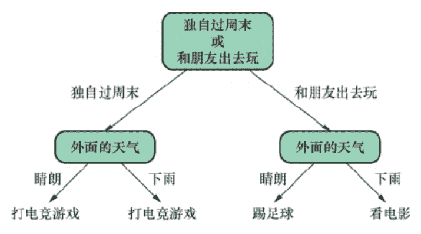

## 知识本体思维：结构化表达知识

当规则和知识规模膨胀时，决策树不再适用，常采用“知识库+推理机”架构。知识本体思维即用本体模式形式化地描述领域概念及其关系。

本体是对特定知识领域概念及关系的正式表达。比如用树结构描述动物分类。除树图外，本体还可用描述逻辑等逻辑形式表达。本书第8章提到的知识图谱是表达本体的流行方式，已广泛用于智能搜索、问答、个性化推荐、内容分发等。

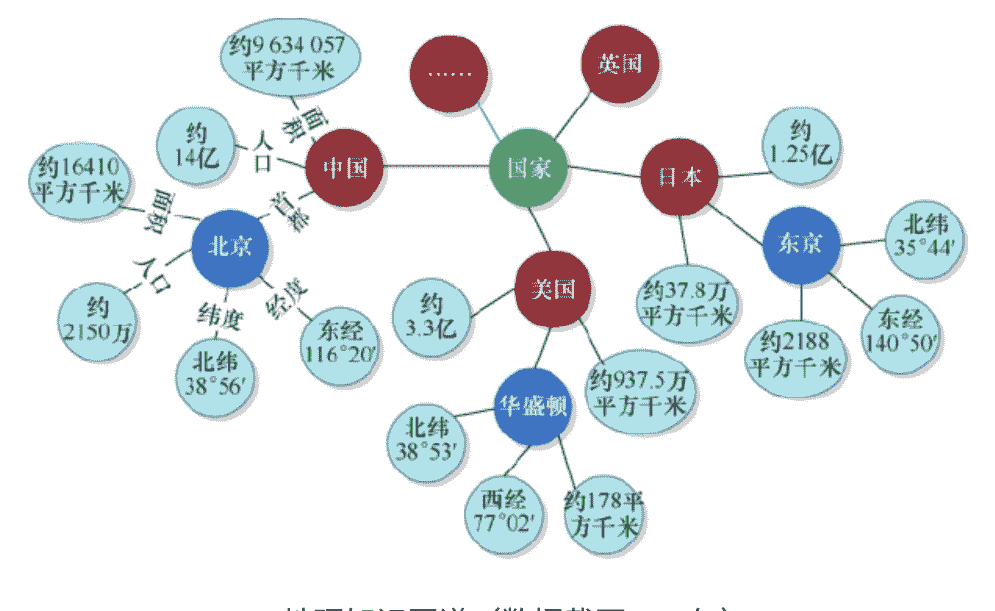

▲ 地理知识图谱（数据截至2019年）

图中有关系连起的节点称为实体，连接它们的边称为关系。知识图谱的基本单元是“实体—关系—实体”三元组。

实体指可区分且独立存在的事物，可为实例或概念，是图谱最基础元素。例如上图中“中国”“北京”“16410平方千米”。

关系指实体间的联系，连接节点形成大图。如“人口”“首都”“面积”等。

## 正向推理：事实驱动推演

单纯存储知识无用，只有使用才产生价值。正向推理思维以已知事实为起点逐步推导出目标成立的过程，也称事实驱动推理或前向推理。

基本流程是从初始证据出发匹配规则，将可用的规则放入候选队列，经冲突消解后选择一条启用，推导出结论并写入知识库，作为下一步的证据，循环直至无可用规则或得到解。

例如规则：
1. 若X呱呱叫且X吃蚊子，则X是青蛙。
2. 若X叽叽喳喳且X会唱歌，则X是金丝雀。
3. 若X是青蛙，则X是绿色的。
4. 若X是金丝雀，则X是黄色的。

已知事实：弗里茨呱呱叫，弗里茨吃蚊子。
正向推理先得“弗里茨是青蛙”，再得“弗里茨是绿色的”。

优点是直观，允许用户主动提供事实，适用于诊断、设计、预测、监控等。缺点是目标不明确，可能执行大量无关操作，效率偏低。

## 反向推理：目标驱动求证

反向推理与正向相反，是目标驱动的。先提出假设，再寻找支持证据，若证据齐全则假设成立，否则放弃并另做假设。如早晨看到行人穿薄衣短袖，便推断气温较高，自己也穿短袖带薄外套。这是典型的结果倒推原因，也称反向推理。Prolog等人工智能语言提供反向推理引擎。

优点是不处理与目标无关的知识，推理目标明确，便于解释，在诊断专家系统中效果好。缺点是假设选择具有盲目性，若起点错误会多次试错，降低效率。

## 要点回顾

本章介绍了机器推理思维。到此，AI思维的两大核心模式——学习与推理已完整呈现。下一章将探讨AI思维的另一重要应用：人机交互。

## 第15章

## 人机交互思维：自然沟通的边界

人类是智能体最难理解的对象。自然交互需要语言、面部表情与情感识别，以及文化社会常识来推断行为意图。当前AI系统虽能在有限场景使用语言，但综合推理和会话能力仍不及普通儿童。人机交互思维旨在理解人工智能在自然语言、常识推理等自然交互领域的应用与局限。

## 自然语言处理：让机器读懂人类

自然语言处理旨在用计算机分析语句和文本，抽取关键信息，实现检索、问答、翻译和生成。目标是让机器能听会说、理解语言、思考解题乃至创造。它包含运算智能、感知智能、认知智能、创造智能四个层次。运算智能即记忆计算，已远超人类；感知智能涵盖听觉视觉触觉，已有飞跃；认知智能包括语言理解、知识推理等仍在深耕；创造智能研究尚少。自然语言处理被视作人工智能皇冠上的明珠，其进步将带动整体发展，并在深度学习驱动下取得诸多突破。

机器翻译：源语言文本经自动转换得到目标语言文本。可细分为文本、语音、手语、图形翻译。发展历程从规则法到统计法，再到基于神经网络的编码解码法，形成成熟体系。

对话系统：通过多轮对话实现聊天、问答或任务完成。涉及意图理解、通用聊天引擎、问答引擎、对话管理等，需具备上下文关联的多轮能力和基于用户画像的个性化回复。典型架构有三层：通用聊天机器人、搜索问答Infobot、面向特定任务的Bot。

机器阅读：让计算机阅读文章后回答相关问题。在搜索引擎中可为问题型查询提供精准答案；个人助理场景下可用于智能客服的文档理解、办公邮件检索、教育出题、法律条款解读、金融新闻信息抽取等。机器阅读理解可作为通用能力，供第三方构建更多应用。

## 机器撰文的边界
用程序把收集或使用者提供的材料进行算处理后批量产出文本，就是我们常说的机器创作。现阶段机器写得相对得心应手的稿件主要分两类：其一是依托数据、图表引用与解读的技术类文章，这类稿件的骨架几乎全由数据的调取、说明与分析撑起；其二是…

## 情感感知
电脑的情感识别能力可以读懂使用者的即时情绪并给出相应回应，常被看作智能迈向成熟的分水岭。这一功能的发展受益于语音理解与图像理解的进步，在机器人积累的大量样本支持下，微表情捕捉与情绪判断的精确度在持续提升。微软、软银、苹果等巨头都在加码布局，说明情绪感知已成为智能演进的重要方向，也是家用机器人进入家庭的必要基础。眼下机器对情绪的掌握仍停留在识别层面，表达层面几乎还是空白。

对智能系统而言，发现细微变化、捕捉稍纵即逝的现象是天然优势，借助高速摄像与高算力硬件后，对情绪的理解精度甚至可能超过人。人类情感极其复杂，自身都未完全厘清，技术尚有漫长的探索之路，但已找到可操作的路径：不必追究情感的本质，只需让机器解析面部表情、语言等外在信号并输出结论即可。正如大脑运作至今仍未被彻底破解，我们仍能从功能角度打造智能设备。例如软银的陪护机器人Pepper是通过图像理解技术分析人脸表情来把握情绪；神经科学公司Innerscope则通过观察电影里让观众脑区高度活跃的高潮片段的脑电物理信号来预测影片是否会爆款，而不是真正弄清大脑为何兴奋。

## 小结
本章围绕人机交互思路介绍了自然语言处理与情绪感知两个核心应用。下一章将进入人工智能伦理的讨论。

# 第16章 AI伦理思维
智能技术高速演进的同时也带来了伦理难题。如何避免算法侵害隐私与数据保密？如何防止系统复制社会与文化偏见？价值观能否被编程，又由谁来主导编程？怎样让不同地区的人都能公平享受到技术红利？AI伦理思维要求算法系统保持透明，提供多元、无歧视、公平的服务，推动积极的社会变革，并具备可追责机制。

## 算法可解释性
深度学习神经网络已让机器学会用自然语言交流、自动驾驶、玩游戏、下围棋、绘制梦境并助力科学发现，但也带来了新的困惑。时至今日，我们对其学习系统的底层运行规则仍知之甚少，有点像人类大脑——能力很强，却不透明。人工智能产生的后果越关键，可解释性的需求就越高。在自动驾驶、医疗等高风险场景，人们需要明确知道某个结果是如何得出的；而低风险系统或可容忍黑盒，但结果难以被理解。

希伯来大学的计算机与神经科学家蒂什比提出信息瓶颈假说来解释深度学习的工作原理。他认为深度神经网络在学习时，会从输入中剔除无关细节与噪声，通过瓶颈压缩信息，最终保留与抽象概念关联最强的特征。信息瓶颈是否适用于所有深度学习机制，以及除压缩外的其他泛化方式，仍需验证。使用人工智能尤其是深度学习时，需要保持算法透明的思维，在效能与可解释性之间取得平衡。

## 算法偏见
算法无处不在，偏见也无处不在，二者交织却常被忽视。与多数人认知相反，科技并非中立。人工智能算法及其决策逻辑由研发者塑造，代码撰写、训练数据的选择以及压力测试的方式，都会影响算法的后续选择。换言之，研发者的价值观和偏见会沉淀在软件之中。

从社交平台的推荐算法到医疗系统，再到警用执法记录仪，我们的社会系统极易把各种偏见输入算法。这些被污染的机器会规模化生产和分发偏见，把社会偏见隐藏在技术客观的外衣之下。

人工智能不仅要在技术层面接受检验，比如分类准确率和误差矩阵，还必须接受道德与法律标准的审查。算法公平思维就是将原则嵌入AI设计，防止偏见和歧视的发生。

1. 样本代表性：为避免偏见产生，每个群体都应有平等机会出现在数据中。有时需要主动把代表性不足的人群补充进训练集，有时需要对模型进行多源数据的再训练。好消息是最新研究已出现可度量代表性并缓解不必要偏差的技术。
2. 保护敏感特征：机器学习系统应避免对个人造成不公正影响，尤其是与社会现实相关的敏感属性，如族裔、性别、国籍等。整体公平性需以对最脆弱人群的影响来衡量。仅从模型中剔除敏感变量并不能解决问题，因为相关因素可能以其他形式残留。
3. 多元化管理：算法公平不仅是追求正义，更是对公平性的持续负责。这需要一个敢于挑战彼此隐含假设的多元化团队。比如通过无意识偏见破坏练习来审视不同观点。只有包容的文化才能为团队创造解决机器学习不公平问题的条件。
4. 真实性：真实性既关乎训练数据的真实，也关乎AI预测的真实，因为AI常被用于辅助人类决策。机器学习被滥用时可能扭曲现实，助长恶意行为者制作虚假视频、捏造言论甚至虚构事件。

彻底消除算法偏见并不容易，但好在我们可以用算法来促进算法公平，已有公平系统被开发和部署，在避免意外歧视上取得进展。期待算法自身能推动现代人工智能系统的公平性。

## 数据隐私
2018年5月25日欧盟正式实施被称作史上最严的数据保护法规GDPR。它保护的是自然人的个人数据，包括姓名、住址、生日、信用卡、银行、医疗信息、位置、IP地址等。任何在欧盟设立机构或向欧盟境内提供产品服务的企业，处理欧盟个人数据时均受约束。

若违反GDPR，企业最高将被处以全球年营收4%或2000万欧元的罚款，两者取高。人工智能是一个极度依赖数据的行业，从模型训练到最终产品服务，数据是核心生产资料，这意味着GDPR对AI产品的约束贯穿全生命周期。使用AI改造业务的公司也需评估合规性。GDPR因此被称为人工智能的“紧箍咒”。数据保护思维则是基于GDPR基本原则对个人数据和隐私的保护措施。

1. 合法、公平、透明原则。
2. 目的限定原则：个人数据须为特定、明确、合法目的而收集，后续处理不得背离该目的，除非为公共利益、科研等正当目的。
3. 最小范围原则：收集和处理的数据应准确、相关且必要。
4. 准确性原则：确保个人数据准确且及时更新。
5. 有限留存原则：除公共利益、科研等正当目的外，数据的留存期限不得超过处理目的所需。
6. 完整及保密原则：采用技术手段保障数据安全，防止非法处理、窃取、损毁。
7. 责任原则：控制者须遵守上述原则并承担相应责任。

尽管GDPR为AI套上紧箍咒，但业界普遍认可。发展和应用人工智能技术需要良好的环境。AI系统若不能尽力保障个人数据安全，既无法赢得用户信任，也会触犯法律。数据保护思维要求充分理解个人数据及隐私保护原则，以便在AI时代更好地应用并保护自身。

## 小结
本章详细阐述了AI伦理思维，包含算法透明思维、算法公平思维和数据保护思维。至此，整个AI思维体系已完整呈现。下一部分将应用这些思维方法，剖析人工智能在不同领域的落地与挑战。

# 第4部分 智慧城市
数据是现代城市的生命线。全球每天有数亿摄像头在采集数据，形成人类难以处理的海量信息。人工智能是把这些信息转化为深刻洞察的关键，它正在改变我们采集、审视和分析数据的方式，进而影响公共安全、交通出行、城市服务等各方面。

智慧城市是通过人工智能和通信技术感知、分析、整合城市运行核心系统的关键信息，从而对民生、环保、公共安全、城市服务、工商业等各类需求做出智能响应的城市形态。其本质是借助先进人工智能技术实现城市的智慧化管理与运行，为市民创造更美好的生活，促进和谐可持续发展。相较传统城市，智慧城市由数据采集、存储、分析等环节构成，利用新技术赋能改造人工智能系统和服务，其覆盖范围遍及衣食住行与娱乐。

# 第17章 自动驾驶
自动驾驶汽车依赖人工智能、视觉计算、雷达、监控装置和全球定位系统的协同，让计算机在无需人工干预的情况下安全操作车辆。它集中运用了计算机、现代传感、信息融合、通信、人工智能及自动控制等技术，是典型的高新技术综合体，也是人工智能的最大应用场景之一。本章将聚焦AI思维在自动驾驶中的应用，并简要分析其发展前景与挑战。

## 自动驾驶分级
按SAE美国汽车工程师协会划分，自动驾驶技术分为辅助驾驶、半自动驾驶、有条件自动驾驶、高度自动驾驶、完全自动驾驶共五个层级。

L1辅助驾驶：自动驾驶系统仅对方向和加减速中的一项提供支持，其余驾驶动作由人类完成。现阶段主流ADAS主动安全系统如ABS、ESC、车道偏离预警、前碰撞预警、盲点监测等，均可实现感知与干预，车辆通过摄像头、雷达感知周边交通并发出警示与介入。

L2半自动驾驶：车辆借助摄像头、雷达、激光雷达获取道路与周边信息，系统可同时对方向和加减速提供支援，若驾驶员在警示后未及时反应，系统可自动干预，其余操作仍由驾驶员负责，且不允许双手离开方向盘。代表功能包括自适应巡航ACC、车道保持LKA、自动紧急制动AEB、车道偏离预警LDW等。

L3有条件自动驾驶：系统完成驾驶操作，在特定路况下需在必要时请求驾驶员接管。

L4高度自动驾驶：系统完成全部驾驶操作，驾驶员可按系统请求不干预车辆。

L5完全自动驾驶：理想形态，乘客只需输入目的地，无论路况或天气，车辆均可自主行驶，允许乘客工作、休息或娱乐，无需任何监控。

可见分级的核心是驾驶责任从人向系统逐步转移，体现于转向与加减速控制、环境观察、复杂情况应对及适用范围的自动化程度。目前研发重心集中于L3、L4，距离电影中展示的全自动驾驶仍有距离。

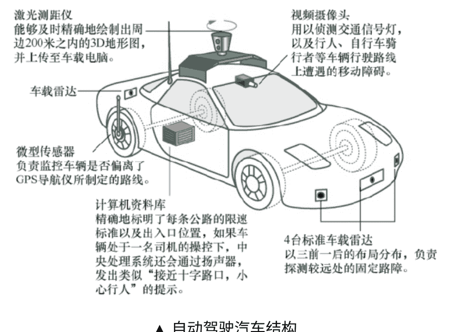
## 原理与实现
自动驾驶的实现包含三个环节：感知、决策、执行。感知环节采集环境信息；决策环节由人工智能系统分析传感器数据并输出控制信号；执行环节由ECU驱动汽车完成动作。其中图像识别能力是首要难题，传感器的智能水平在很大程度上决定了复杂路况下的可靠性，因此深度学习成为关键。

环境感知技术是自动驾驶的前提，相当于人类驾驶员的“眼睛”和“耳朵”。它利用车载摄像头、激光雷达、毫米波雷达、超声波，以及V2X和5G网络获取交通环境与车辆状态等多源信息，为决策规划提供支撑。传感器的重要性体现在两点：一是决定数据采集质量，而数据质量决定算法效果；二是成本与产业升级速度强相关。目前传感器性能提升、体积缩小、功耗下降，其快速发展是自动驾驶热潮的重要推手。

除对外界认知外，机器还需具备学习能力。深度学习是自动驾驶成功的基石，可提升对道路、行人、障碍物的识别效率与准确率。在大量数据训练后，汽车能将图形、电磁波等信息转化为可用数据，并利用深度学习算法实现自动驾驶。

将深度学习应用于自动驾驶汽车，主要步骤如下：

1. 准备数据，对数据进行预处理，并选用合适的数据结构存储训练数据与测试样本。
2. 用大量数据对第一层网络进行无监督学习。
3. 通过第一层网络聚类相似数据，随机判断归类。
4. 运用监督学习调整第二层网络节点的阈值，提升输入正确性。
5. 用大量数据对每一层进行无监督学习，每次仅训练一层，并将结果作为更高层的输入。
6. 最后用监督学习对所有层网络进行整体调整。

## 现状与挑战
在交通出行压力加大的背景下，自动驾驶的商业化仍受多重制约：

1. 政策与法规障碍。
2. 不同品牌车型间缺乏共同协议，行业规范与标准不足。
3. 基础道路状况、标识与信息准确性。自动驾驶面对完全开放环境，需应对天气、光线、突发路况，还要解决自动驾驶与人工驾驶车辆共存问题，技术鲁棒性仍不足。
4. 高昂成本。以激光雷达为代表的核心传感器的成本仍是量产商业化的主要阻碍之一。

此外，自动驾驶车辆网络化、信息化程度极高，也带来计算机安全挑战。一旦程序出错或网络被入侵，如何保障本车及周边车辆安全，是未来必须解决的问题。

## 小结
完全自动驾驶或许仍需时日，但随着机器学习算法的提升和人机和谐共驾的应用落地，更接地气的合作驾驶模式或将很快普及。技术发展充满动能，未来自动驾驶可能成为主流。下一章将介绍与生活密切相关的AI应用——智能垃圾分类。

# 第18章 智能垃圾分类
垃圾分类已成为社会热议话题之一，而人工智能早已掌握这一技能。AI系统通过深度学习和神经网络训练机械臂，像人一样识别并分类垃圾，效率远超人工操作。

## 智能回收箱
智能回收箱可对投放垃圾进行数据分析与流向检测。居民在垃圾分类箱前扫码或刷脸，再在触摸屏上选择对应类别，箱门随即打开。系统能智能识别误投乱投行为，例如有人故意把石块扔进可回收箱，系统会自动将石块退回投递口，并把误投记录写入用户画像。

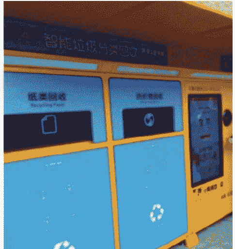
智能回收箱早有实践。在加拿大，一款名为“奥斯卡”的垃圾箱颇有名气。它配备32英寸显示屏和人工智能摄像头，内设不同类别的垃圾桶。摄像头可分辨纸张、厨余、容器等垃圾，并在屏幕上指引用户投放。当有人把手机放在摄像头前，屏幕会出现提示让其收好手机。

“奥斯卡”垃圾分类系统由Intuitive AI打造，主要面向小区、机场、学校、企业园区等场景。目前已投放在加拿大温哥华某机场及西蒙弗雷泽大学等地。它还能通过垃圾数据分析，向企业出售特定地点的用户消费习惯数据。

## 自动分拣系统
一般垃圾回收流程中，人工分类只是第一步，之后垃圾需送至分拣中心进行更细致分类。传统分拣依赖手工，不仅效率低，还可能给工人带来健康风险。如今垃圾分拣机器人可将工人从脏乱危险的劳动中解放出来。

Zen Robotics的垃圾回收设备ZRR是全球首个机器人垃圾分类系统，可对同一位置的多种碎物进行分类。其工作方式为：ZRR传感器单元扫描垃圾流，ZRR大脑识别材料、物体与抓取点，ZRR大脑控制软件分析数据并操控机器人，ZRR智能抓取器拾取目标物体。该系统每小时可全自动分离约3000件垃圾，单件重量最高达30公斤。它能识别金属、木材、石膏、石块、混凝土、硬塑料、纸板等20余种可回收材料。若两套系统24小时运行，一天可处理2000吨垃圾。相比人工分拣，30万吨年处理量下机器人分拣效率可提升约40%。

## 自动分类原理
首先需收集海量“垃圾”图像并为每张图像标注类别。垃圾自动分类本质上是图像分类问题，基于深度卷积神经网络的方法发展迅速。可用50层的ResNet构建垃圾自动分类器。

在实际投放中，对单个垃圾逐一拍照分类过于繁琐，能否对一堆垃圾整体拍照批量分类？这需要构建垃圾目标检测器，输入含多件垃圾的图像，模型输出每件垃圾的类别与位置。

与分类器类似，理想的检测器也需要大量标注数据支撑，而检测数据集除类别标签外还需标注位置坐标，标注工作更为繁重。在完成垃圾检测图像数据集后，可利用主流深度学习检测算法实现批量垃圾分类。

## 小结
依托人工智能、云计算、大数据、物联网等新技术，垃圾分类效率持续提升，这对环保事业与技术发展意义重大。近年来各国对环保的重视与投入不断增强，期待更多人工智能产品落地。下一章将揭开AI预防犯罪的神秘面纱。

## 第19章
## AI预防犯罪

随着机器学习与感知技术的推进，摄像头采集、大数据挖掘、人脸识别等手段正逐步渗入安防与司法实践。学术界开始尝试打通犯罪学、人口学、地震学等多个学科，并结合海量案件档案，用人工智能对犯罪进行前瞻性研判。从热点区预判到潜在个体预警，从审讯辅助到量刑参考，机器学习和深度学习正把预防打击犯罪带入公众视野，这一赛道的发展空间相当广阔。

## 预见犯罪的科幻投射
好莱坞导演史蒂文·斯皮尔伯格曾重拍上世纪五十年代的一部科幻小说，影片名为《少数派报告》。故事设定在一个能够用超能力锁定潜在犯罪 Pre-Crime 的未来国家，司法系统得以提前干预。这个社会表面安宁和谐，重大案件几乎绝迹，却存在专门收容“潜在罪犯”的营地。对这部作品以及犯罪预测本身，争议至今未休。如今面对络绎不绝的刑事案件，多个国家已经在现实中搭建自己的“少数派报告”，只是依赖的不是超能力，而是人工智能。

## 犯罪预测怎么分两类
AI 驱动的犯罪预测大致可归为两种做法。

第一类是区域热点的预判。九十年代纽约警方就曾借助数据判断哪些地铁站更容易出事。随着算法成熟，部分城市已开始用最新机器学习模型推演风险。这些城市部署了能捕捉枪声的声学感应器，并结合路边摄像头流，通过建模得到“案情预测系统”，可对抢劫、枪击等事件的可能发生地进行推估。区域化预测有助于警方把有限警力投向最需要的地方。现实中警力有限，传统巡逻效率不高，算法辅助调度能够提升打击效率。

第二类是对个人的前瞻。研究者收集大量刑事案例，用机器学习训练模型，输入特征包括年龄、性别、居住地址及邮编、首次触法年龄以及一连串可能相关的案底记录。模型据此识别再犯风险。例如芝加哥警局的“预测性嫌疑人名单”会向一线警员推送附近街区最可能涉案的20名人员的姓名照片，并给出量化提示，如“未来18个月内参与暴力事件概率约25%”。据警方披露，该名单规模已超过400人。上榜者未必有前科，也可能只是住在高发区，或亲友中有犯罪记录。

## 算法的伦理困境
把客观大数据引入司法可以削弱人为干扰，却也带来难以回避的副作用，比如个人隐私泄露以及算法设计者主观偏见的渗入。机器判算再精准，也需要人工复核配合，才能更公正可靠。过度依赖人或过度依赖机器的司法体系，都容易滑向极端而丧失公信力。

## 小结
本部分介绍了人工智能在犯罪预防方面的运用方式。后续将转向人工智能在智能家庭场景的应用。

## 第5部分
## 智能家居的AI升级
语音识别的突破让设备交互更顺手、更易用，成为智能家居关注的重点。语音助手是这一进展的核心推手，智能音箱正逐渐演变为家庭智能枢纽。

智能家居的典型场景集中在监测、远程操控与自动化上，为装配了云连接安防、温湿度调节、照明与电力设备的消费者提供便利与安全感。阿里天猫精灵、小米小爱同学、腾讯听听、百度小度智能音箱等产品相继上线，各大互联网公司纷纷入局。

人工智能也在为家居环境提供更可控的安全方案。传统密码输入已难以兼顾便捷与安全，这推动了生物识别的研究。生物识别是通过计算机与生物传感器结合，提取人与生俱来的生理或行为特征来确认身份。人脸、指纹、虹膜识别已大规模应用。为了进一步提升安全，借助红外照射获取手指静脉图像的指静脉技术也在加速研发。这些技术契合智慧生活需求，也让智能门禁、智能家电等传统品类焕发新活力。

## 第20章
## 智能音箱
物联网普及后，智能音箱在家庭娱乐场景中占据核心位置，并凭借语音交互优势成为当前智能家居的控制中枢。巨头们争夺音箱市场，本质上是在争夺智能家居入口。如今业界普遍认为智能音箱已是入口级产品。

## 为何音箱成入口
整个智能家居生态涵盖整体解决方案、家庭影音娱乐、智能照明、家庭暖通新风、安防楼宇对讲、智能遮阳电动窗帘等。

家庭是多年龄层共存的环境，路由器、冰箱等设备并不一定适合全员交互。智能音箱凭借独特的语音交互形态和较低的入手门槛，更适合作为家庭智能入口。自亚马逊推出 Echo 以来，大量智能家居产品与服务迅速进入日常生活，人们也更加看重音箱在智能家居时代的入口效应。

## 驱动音箱的三大技术
与最早的人机对话程序 ELIZA 相比，如今的智能音箱更像人、功能也更丰富。三个关键技术推动了其发展。

(1) 语音识别：音箱必须捕捉人类发声并转成机器可读形式，这就是语音识别。噪声长期困扰研究者，深度学习的出现带来质变。2012 年，基于深度学习的 AlexNet 在 ILSVRC 竞赛中胜出，在图像识别上取得突破。

(2) 自然语言理解：在语音识别与语音合成之间，NLU 是赋予设备阅读理解能力的关节。比如用户说“我在弹钢琴”，系统并不知道“我”和“钢琴”指什么。研究者需要把自然语言映射为标准表征。现有虚拟助手通常先抽取专有名词，如城市、公司、曲目；再做词性归并，把词分为动词、名词、限定词、形容词、副词、代词、同位语、感叹词八类；最后进行句法分析，按语法规则解析符号序列。若用户语序不规范，句法分析容易失效。如今不少项目放弃传统句法分析，转而探索端到端的自然语言处理方案。

(3) 对话系统：对话行为把用户需求映射到系统功能。以点歌为例，系统接收输入后依据语调、首词、谓语动词提取特征，再归类为请求、陈述、是非问句等行为类别。随后对话决策决定下一步动作。为支持多轮自然交互，对话系统需要状态追踪器维持当前上下文，包含最近的行为和当前表达信息。当前对话系统多采用强化学习构建，使音箱回应更敏捷。

## 音箱的短板与挑战
即便普及度高，智能音箱的缺陷也在显现。

其一，语音交互能力仍弱。远场识别差、误唤醒率高、多轮对话不稳定、语义理解不足等是典型表现。距离稍远反应和识别就下降，且常出现无指令自唤醒。学习素材有限，导致交互和理解错误率偏高。

其二，家居互通性不佳。市面上多数音箱仍是孤立设备，与人们期待的整体智能生活有差距。作为单一节点，其跨场景、跨任务处理能力不足。要实现真正的一键控制、智能互联，还需加强音箱与其他智能家居设备的协同。

## 小结
智能音箱市场正处高速发展期，本章梳理了其技术路径与瓶颈。下一章将聚焦智能家居中的另一类应用：扫地机器人。

## 第21章
## 扫地机器人
扫地机器人又称自动打扫机、智能吸尘器，能在室内自主完成地面清扫。通常采用刷扫与真空吸尘，把地面杂物吸入集尘盒。当前多数产品仍依赖传统方案，难以建立精准室内地图，存在清扫不净、不彻底、操作复杂三大问题。为此，企业与科研机构正引入自动驾驶领域的先进技术。

## 扫地即驾驶？
扫地机器人与自动驾驶汽车在底层逻辑上相似，都需要高精度地图、定位、感知、规划与控制，传感器配置也相近，包括激光雷达、超声波、里程计、陀螺仪或加速度计等。主要差异在于汽车行驶更快、场景更大，传感器需覆盖更远距离、更高精度。两者配置接近。

构建自动驾驶系统首先要建立完整的环境高精地图，完成高精度定位，让车辆感知路上的行人与车辆。扫地机器人则要感知沙发、电视柜、茶几等室内物，感知后规划路径并执行。因此两者在原理上高度可比。

## 激光还是视觉？
扫地机器人系统通常由移动机构、感知系统、控制系统与吸尘系统组成。具备自主避障与路径规划能力的方案主要分两类：激光雷达导航与机器视觉导航。

激光雷达是成熟的三维测量传感器，精度高响应快，已广泛用于机器人，但成本高、系统可靠性低是硬伤。无论低端还是高端雷达，成本都占整机比重很大。功能上，单一信息采集模式在走廊等相似场景易产生“假回环”，导致定位丢失；在异常位置或重启后重定位困难，因此在酒店、室外等环境容易出错。

视觉导航即用摄像头捕捉环境信息，获取移动物体的位置、方向等，借助算法建图、规划路径、避障。加入视觉后，机器人可对地图做语义识别，能区分厨房、卫生间、卧室等，并在不同区域采用不同清扫模式。

与激光方案相比，视觉导航依赖立体视觉摄像头采集图像，成本明显更低。但图像处理占用算力大，对算法要求高，且基于光学近似物理探测，精度略有不足，使用时需因地制宜。

在扫地机这类小型底盘上，视觉导航可作为替代方案，以更低成本实现建图、导航、避障，并具备更强的交互潜力。在服务机器人上，更合理的做法是与激光、里程计等多传感器融合，解决假回环、重定位、深度测量等问题，提升鲁棒性。

视觉导航还能强化交互能力。作为高维感知手段之一，它不仅能测距定位，还可识别理解物体，为机器人提供语义地图。

总体来看，相较激光方案，视觉导航维度更高、成本更低、适用性更强。随着算力提升与成本下降，其优势会进一步放大，具备更高交互潜力的智能视觉机器人将在下一轮竞争中占优。

## 路径规划的六种思路
路径规划是扫地机器人研究的核心，定位与地图构建为其服务。机器人路径规划是指基于传感器感知自主规划安全高效的运行路线。研究已有多年，方法众多，各有优劣，没有一种方案普适。人工势场法、栅格法、模板模型法、模糊控制、神经网络规划与遗传算法是典型流派。

(1) 人工势场法：把机器人在环境中的运动抽象为势场中的运动。机器人拥有抽象势能，源分为斥力极与引力极。

(2) 栅格法：用方形区域表示机器人的几何外形，规划时把机器人收缩为一点，并对障碍边界做扩展与模糊化。工作空间被划分为大小相同的方格，格子尺寸与机器人几何相当。

(3) 模板模型法：DeCaravalh 提出基于二维清洁地图的完全遍历路径规划模板，共定义五种模型：前进模型、沿边转向模型、回溯、U 形转弯、交替 U 形转弯。方法基于先验知识，把遍历得到的环境信息与预设模板匹配。路径由一系列模板拼接而成。为简化规划，环境会被预先放大，机器人可视为质点。该方法需预先定义环境模型与模板记忆，对工作过程中突发障碍等变化环境适应性差。

(4) 模糊控制方法：在线规划的常用手段，包含建模与全局规划。用多个传感器探测前方道路与障碍状况，建立模糊控制规则处理信息并输出速度、加速度、转角等控制量。计算量小可实时规划，能缓解人工势场易陷入局部极点的缺陷，效果较好，尤其适用于局部避障，设计直观高效。

(5) 神经网络路径规划：Tse 提出 BP 神经网络用于自学习自主导航。避障完全遍历规划分为运动行为、路线规划、全局路径规划三步，可离线学习。运动行为阶段，机器人通过传感器采集三维环境信息输入 BP 网络，自行清扫周边直至无遗漏。路线规划阶段选择最短路径前往其他未清扫区域。全局规划阶段先生成整体环境地图，再从起点开始全域清扫。

(6) 遗传算法：由 John Holland 提出，模拟自然选择与遗传机制的搜索算法。通过繁殖、交配、突变等操作进化解群体。每个候选解编码为字符串，按目标函数评估适应度。初始随机生成个体后，经选择、交叉、变异产生新一代，逐步向更优解进化。对复杂优化问题无需建模与复杂运算，仅靠三种算子即可寻优，在机器人轨迹生成、多机器人路径规划、冗余机械臂避障等领域已有应用。

## 小结
人工智能日益融入工作生活，家庭自动化水平不断提升。本章介绍了自动扫地的扫地机器人。下一章将介绍机器人厨师。

## 第22章
## 机器人厨师
机器人厨师通常运行机器人操作系统，由智能手机控制，依据系统食谱，用机械臂与灵巧手配合各类炊具完成食品制作，实现全自动化烹饪。

## ROS：机器人的神经中枢
许多机器人共享同一软件平台，即机器人操作系统 ROS。它如同机器人的中枢神经，把松散的功能模块耦合起来，提供通信架构，使各部件协同完成复杂任务。

ROS 与 Android 均开源，功能相近，可提供硬件抽象、底层设备控制、常用功能实现、进程间消息与数据包管理。其独到之处在于支持多种语言，如 C++、Python、Octave、LISP，甚至混合使用，降低开发门槛。基于 Linux，可靠性高、体积小，适合嵌入式。ROS 是分布式处理框架，开发者可单独设计可执行文件。不同节点进程可收发传感、控制、状态、规划等信息。模块可灵活增删，便于扩展；同时内置大量库，便于搭建原型。ROS 在学界与业界广泛使用，便于性能评估，当前是开发机器人厨师的首选框架之一。

## 灵巧手技术
机器人厨师一般由机械臂与灵巧手构成。臂上装有电动机、关节与感应器，在动力与传感配合下，灵巧手能模仿人手抓取食材、调味品、炊具与餐具，完成处理、烹饪、装盘等工序。

灵巧手是关键。其外形不像人手，自由度高，各关节独立驱动，无耦合。它在两方面表现突出：其一，对手中物体做精细调节与操作，如转动餐具、揉面等，需要手指独立灵活、协同配合，并依据受力或视觉反馈做微调。其二，触觉感知。厨师在感知食材时常会捏一捏、碾一碾，从而判断形状、硬度、黏度等信息，这需要手指间高精度协同与精细运动控制。

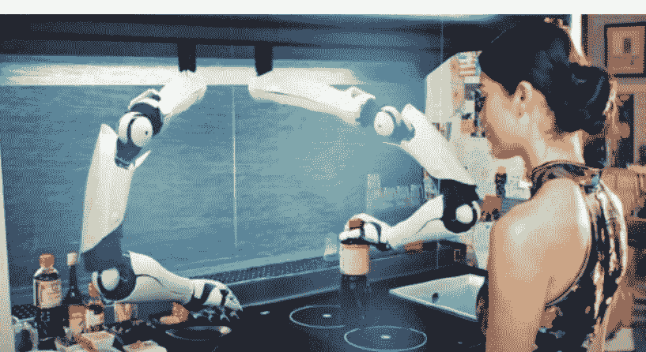
## 机器嗅觉的挑战
机器人厨师发展的最大瓶颈是触觉与嗅觉的类人精准模拟。不同食材差异细微，烹饪时人类厨师会依据颜色、气味、触感决定出锅时机，这是机器人难以即时应变之处。此外，许多厨师拥有独门秘方并持续研发菜品，在创造力上烹饪机器人与人类仍有较大差距。

### 机器能真正尝出味道吗

复制味觉体验的前提是把配料表、分子组成、口味偏好等全部变成结构化信息，这正好与嗅觉味觉的工作原理背道而驰。人类闻香时并不会把气味逐项拆解打分，而是直接捕捉当场的整体感受。这种整体性让依赖数据模型的系统难以保证准确度，现有实践大多只能用在食材质检等高度标准化的场景。

若想让机器人厨师具备真实的嗅觉，需要电子舌、电子鼻、配合理化合成等感知模块协同，还要把交互感知、材料特性、运动规律等多领域知识整合进去。仅靠算法不够，稳定可靠的传感器阵列配合跨学科支持才是核心。

小结
本章回顾了机器人厨师的设计思路，下一章节将转向智能技术在医疗健康领域的应用。

## 第6部分
## 健康医疗
将智能与医疗结合长期以来被看作极具潜力的方向。未来几年相关技术有望提升健康水平和生活质量，并重塑医患沟通模式。主要应用集中在影像诊断、辅助判断、药物研发、手术支援、健康管理与疾病预判等板块。

## 第23章
## 医学影像诊断
循证医学要求诊疗必须基于客观证据，其中影像资料占到了医疗数据总量的八成到九成。临床医生对影像依赖度很高，往往需要量化分析并与既往影像对照才能做出判断。

智能影像辅助本质上是让计算机借助深度学习实现分类、目标定位、区域分割与检索，为医生提供诊疗参考。

标注数据
进入医疗场景的第一步是收集大量已标注的影像样本，并定位关键点，例如邻近肝脏的标志点。系统先依据肝脏形状的先验信息建立初始模型，再通过机器学习掌握边界与病变形态的特征，逐步逼近真实轮廓，最后借助形状信息优化，从而得到可靠的分割与筛查结果。整体流程涵盖定位、分类与切割。

影像分析
通过搭建神经网络并用深度学习对包含多种病变形态细胞的病理库进行训练，使系统具备辨识异常细胞特征的能力。

借助上述分割方法把细胞区域分离出来，经大量对比即可判定病变类型及其进展程度，为医生的最终判断提供参考。

肺部筛查大致流程为：先用分割算法处理CT扫描序列得到肺部区域图，再据此生成肺部影像；结合分割结果与结节标注合成结节区域图，用以训练卷积神经网络的结节分割模型，对影像进行结节分割以筛选可疑区；随后利用三维卷积网络对可疑结节进行分类，输出真正结节的位置及置信分数。

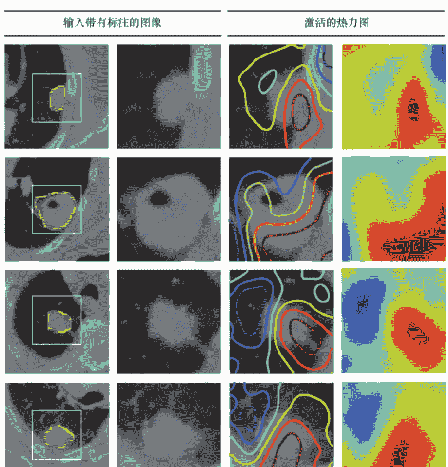
▲ 标记肺癌肿瘤部分以便用于深度学习训练

伦理法规
目前制约智能影像落地的最大阻力来自法规不健全。即便系统再先进，也不可能做到绝对准确。若因误判导致延误治疗，责任归属医生、医院还是服务提供方目前仍模糊。影像数据化同时带来泄漏风险，一旦患者隐私外泄将带来新的困扰。美国食品药品监管局正在制定医疗领域智能应用的标准，对风险较低的基础健康服务可提供有限支持，具体疾病诊断仍在探索阶段。

智能影像诊断引发了三个层面的争议：诊断结果的法律责任归属、信息安全保障、以及放射科医师在智能知识与操作技能方面的培养需求。

小结
本章梳理了智能技术在医学影像中的运用方式，下一章将呈现其在临床诊断案例中的具体实践。

## 第24章
## 糖尿病视网膜 AI 初筛
世卫数据显示，截至2014年全球糖尿病患者约4.2亿，其中约三分之一会并发视网膜病变，约10%最终完全失明。全球约2.6%的盲症源于糖尿病，且失明后即便手术也难以恢复视力。早期筛查既能避免失明，成本也更低。糖尿病归内分泌科管理，而眼底检查属于眼科范畴。传统流程是内科医生建议患者前往眼科拍摄眼底，但超过一半的糖尿病患者并未定期检查，因而错过最佳干预窗口。智能初筛可以弥补内科初筛和随访需求，缓解基层眼底摄影设备与人才不足的状况。

2018年4月11日，美国食品药品监管局批准了全球首个可独立运行的智能医疗器械 IDx-DR，该设备可在无医生介入情况下完成诊断，成为首个获批无需人工解读即可使用的产品。这意味着基层全科医生也能操作，患者不必专门预约眼科专家。

智能诊断机制
糖尿病属于代谢性疾病，血糖长期偏高若未及时干预，会引发头痛、肌无力、伤口愈合迟缓等一系列问题，其中视网膜病变是最常见且严重的并发症。病程中毛细血管壁受损，血液处于高凝状态，容易形成血栓、淤血甚至血管破裂，进而影响视网膜细胞供养，导致病变乃至失明。目前视网膜病变已跻身四大致盲原因。在美国，仅约一半糖尿病患者会做常规视力检查，即便能预约，通常也要等待数周甚至数月才能见到专科医生。

复杂的人工神经网络虽强，却难以解释决策依据，这就是常说的黑箱困境。对临床而言，不透明性尤其棘手，因为审查是否通过很大程度上取决于算法原理是否可解释。爱荷华大学的视网膜专家兼计算机科学家迈克尔·阿布拉莫夫指出：“监管方高度重视可解释性，想实现自动化就必须先说清算法如何运作。”

为打开黑箱，研究界尝试多种策略。美国IDx Technologies与英国DeepMind采用双阶段思路来追溯决策路径：先用一个模型从眼底图像中提取病变特征，再用第二个模型据此判断是否需要转诊及紧急程度。DeepMind研究员奥拉夫·龙尼贝格尔解释，分步处理能让临床医生明确深度网络如何解读影像并给出转诊建议。

另一种思路是借助另一套模型进行探查。加州大学圣迭戈分校眼科医生张康与德国雷根斯堡大学遗传学家伯恩哈德·韦伯通过遮挡部分眼底图像，观察诊断结果的变化，从而定位模型关注的区域。韦伯表示，模型聚焦的位置与临床医生的视线惊人地一致。

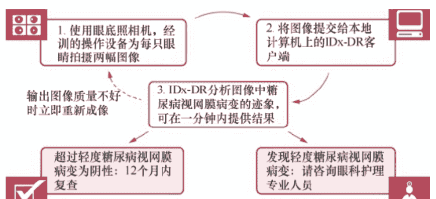
▲ AI诊断系统流程图

多病种诊断问题
眼底异常可能对应几十种眼病，即便排除视网膜病变，患者仍可能患有其他问题。临床医生可同时识别多种眼病，即便无法确诊，也能察觉异常并进一步查证或会诊。智能系统受限于模型设计，通常只能针对单一疾病，临床价值有限。若系统判定无视网膜病变却遗漏其他眼底异常，患者仍可能错失治疗时机。

扩大识别范围需要覆盖多种疾病的大规模高质量数据。即使谷歌在相关研究中使用了12.8万张眼底图像，其中严重病变的样本仅两百余例，仍显不足。

资质认证
资质层面，目前市面上宣称可筛查视网膜病变的方案不少，但取得FDA认证的仅有IDx-DR。

小结
总体而言，巨头与初创企业均在该领域投入大量资源，成果已逐步落地，在效果与技术上均推动了筛查进展。未来更多患者与医护人员将获益。下一章将介绍达·芬奇手术机器人。

## 第25章
## 手术机器人
手术机器人的概念最早源自美国。即便在当前智能浪潮之前，该技术已积累约30年研发与应用历史，但成本一直偏高。随着智能技术的普及，成本有望下降。现阶段手术机器人已能在多领域辅助医生，尤其在微创外科中效果显著。按控制方式可分为医生操控型与全自主型，目前前者更为成熟，已出现多款代表性产品。

达·芬奇手术机器人系统
达·芬奇系统源于麻省理工学院的机器人外科技术，经过不断迭代成为现今领先的微创手术平台。

其正式名称为内窥镜手术器械控制系统，是全球使用最广泛的手术机器人之一。手术中主刀医生不直接接触患者，通过三维视觉与运动标定系统操控，机械臂配合器械模拟医生动作。该系统适用于普外、泌尿、心胸、妇科、五官、小儿外科等多个科室，在前列腺切除术中应用最多，现也越来越多用于心脏瓣膜修复与妇科手术。

相比传统腹腔镜手术，达·芬奇具备明显优势。传统内窥镜削弱了器械直觉，且提供的是二维平面影像；腹腔镜操作学习曲线较长。达·芬奇扩展了视野范围，三维影像弥补了距离感缺失。即便设备高近两米，其操作精度却可达缝合绣花针的水平。网络上曾流传一段机器人为葡萄缝合表皮的演示，令人印象深刻。

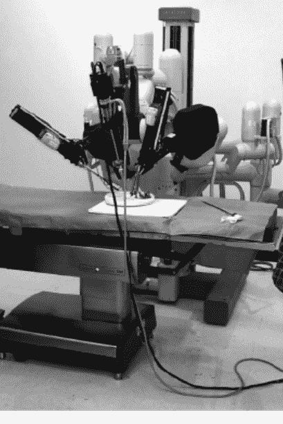
▲ 达·芬奇手术机器人

STAR机器人
STAR机器人由美国华盛顿儿童国家健康系统Peter C.Kim团队历经七年研发完成。团队融合了近红外荧光标记与三维光场成像技术，解决了术中成像难题。该系统捕捉组织光场信息生成立体影像，使机器人能在手术全程无限制地追踪目标组织的位移与变化，相当于赋予机器人“视觉”。为配合成像系统，团队另行开发智能算法，可据此制定方案并根据实时反馈动态调整。

自主手术机器人发展受限，主因是缺乏高精度可视化与可执行复杂任务的算法。STAR凭借新型成像与算法架构，可制定方案并实时修正。为验证性能，研究组选取肠吻合术这一复杂操作，让STAR与熟练外科医生及达·芬奇系统进行对比实验。

论文数据显示，无论离体或活体吻合，STAR均显著优于经验丰富的医生与达·芬奇系统。STAR正逐步迈向临床试验，其出现或将改变手术机器人的定位，从辅助工具变为可实际执业的智能系统。

团队认为医疗机器人与自动驾驶的逻辑相似：并非因人类不能操作，而是为降低失误。机器人可稳定精准、持续作业，提升疗效并缩短患者等待时间。

国内发展
国内自主研发的胸腹腔微创机器人也即将进入临床。以胶囊机器人著称的重庆金山科技集团，其大型胸腹腔手术机器人已进入试验阶段。

相较达·芬奇，该系统加入臂部反向推力设计，利用力反馈模拟真实触感，提升操作真实性与安全性，同时支持远程手术，方便患者接受异地专家治疗。

在口腔修复专家赵铱民教授带领下，空军军医大学口腔医院与北京航空航天大学机器人研究所联合研发的自主式种植牙机器人，是全球首台同类设备，已投入使用，标志着口腔治疗进入机器人时代。

与传统方式相比，该机器人具有精准、高效、微创、安全等特点。团队采用免空间配准的机械融合定位方法，解决了配准复杂的技术难题，实现高精度定位，适配狭小口腔。配套的种植规划、术中导航与控制软件可实现个性化方案设计与全程引导。经动物试验后已建立临床操作流程，可在种植后即刻修复，降低难度并提升效率。

小结
随着智能化与器械的成熟，手术机器人将向专科、专项方向细分，从大手术到伤口缝合均可覆盖，从而降低研发难度与成本，加快迭代，最终降低患者负担。下一部分将探讨智能技术在文化艺术领域的应用。

## 第7部分
## 文化艺术
新技术尤其是智能与大数据深刻改变了艺术的呈现、组织与接受方式。当下已进入智能与互联网与文化艺术深度融合的新阶段，技术赋能为文化产业创新带来诸多可能。

近年多家科技公司、科研机构及个人都在尝试用智能进行艺术创作，音乐、诗歌、绘画、舞蹈、影视、小说写作等领域均可见其踪影。

## 第26章
## 小诗机
携程App的“诗情画意”小诗机可“理解”用户上传的照片，并依托自身知识库生成契合画面意境的古诗。用户上传风景照后，系统即可据图作诗。

小诗机借助深度学习识别照片中的景物、元素、人物表情等信息，并通过机器学习提取景点关系与特征，构建旅游知识图谱，覆盖全球数千万景点、区域、美食、天气等数据。

系统由三部分构成：诗歌知识图谱、图像识别模块、模拟人类创作的成诗引擎。

知识图谱
为构建全面旅游知识图谱，小诗机融合多源数据，包括行业景点信息与网络上关于城市、历史、民俗等内容，主要分为三类。
- (1) 非结构化数据：网站上的景点简介、用户游记、用户评论等文本信息。
- (2) 半结构化数据：以维基百科、百度百科为代表的大规模知识库，包含了大量结构化和半结构化数据，可以高效地应用到知识图谱中，知识获取也比较容易。
- (3) 结构化数据：包括自由行、团队游、酒店、景点、用户意图等较为全面的结构化旅游数据。

对于结构化数据，除利用景点所属城市等维度外，还会做统计分析以深入挖掘信息，例如为每个城市的重要景点排序。

文本知识抽取依赖多项自然语言处理技术，如分词、词性标注、依存句法、语义角色标注、命名实体识别等，用于清洗并结构化文本。核心目标包括三方面：
- (1) 实体抽取：利用CRF++和字典结合的方式，从文本中自动识别人名、地名（国家、城市、景点等）、机构、节气、时间等实体。
- (2) 关系抽取：主要利用一些启发式的规则和半监督的方法，从新的实例中学习新的模式，并扩充模式集合，挖掘各个实体之间的关系。
- (3) 主题抽取：为了构建更全面的旅游知识体系，使用改进的TF-IDF、卡方+TextRank、LDA等方法综合进行文章主题、关键词、摘要的抽取，从而实现景点实体和特征实体的关系挖掘。

因数据源多样，需要对提取的知识进行融合。实体匹配是核心，一方面借助语义向量或字面相似度匹配实例、属性、概念，另一方面结合属性与结构信息做多层次匹配，最终按自定义权重融合，形成知识图谱。

图片识别
小诗机基于CNN深度网络，可识别超过150类景物与人物，包括性别、年龄、表情等。与常规识别不同，为提升精度会加入近似类别的训练样本，例如温泉易被误判为小河或泳池，因此补充相似语料供模型学习。识别结果示意如下。

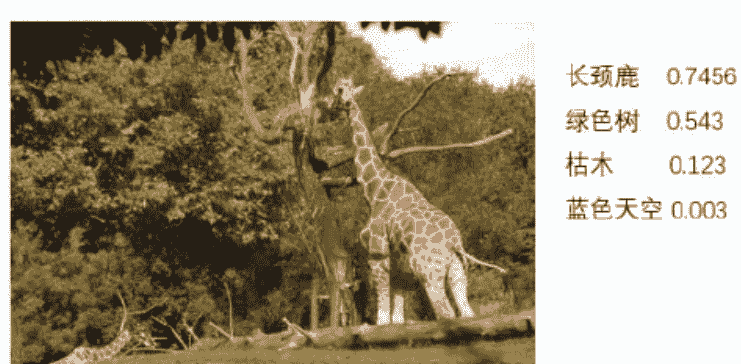
▲ 图像识别参数

但要进一步区分具体建筑如雷峰塔与六和塔，或河流如莱茵河与尼罗河，则难度较大。

成诗引擎
传统作诗多依赖统计模型并辅以人工规则。统计机器翻译方法借助翻译模型与韵律规则逐句生成；遗传算法则依据对诗歌的理解、韵律、流畅度、主题相关性等评价指标构建评估函数，结合统计语言模型自动生成作品。

深度学习推进到今天，科研人员更习惯用神经网络去尝试自动写诗。古诗词讲究凝练，语料又少，以往靠统计语言建模的方案稀疏度很高。借助循环神经网络学习到的语言表示，稀疏困境得到一定缓解。与此同时，编码解码结构成为成诗的主流框架：编码端把历史语境和主题信息压成向量，解码端逐句展开，针对主题连贯与语义一致的不同诉求，研究者不断提出改进，构建出各类模型。实际运行中，模型会先依据输入的关键词为每句话做主题规划，防止逐句生成时主题漂移；生成过程引入注意力机制，让主题与已生成内容在时序上融合；再配合分层循环网络架构，进一步保证整首作品的主题统一与语义贯通。

小诗机依托海量知识库，调用卷积网络、长短时记忆网络和机器翻译等最新技术，把口语化的自然表达抽取出诗意词汇，让输出更接近人手写作。比如“高高的房顶”“白白的墙”“漫山遍野的樱花”这类日常说法，进入诗体后会被提炼为“尖顶”“白花”等凝练意象。项目训练的律诗约三十万首，中外小说语料超过三百本。

小结
总体来看，小诗机兼具技术探索与产品尝试：既搭建了覆盖面广的旅游知识图谱，也把深度学习与图成诗结合，提升了主题相关性与阅读流畅度。只是目前作品仍显稚嫩，下一步需要在知识库细化与图像识别标注上持续打磨，才能真正提高机器作诗的水准。

第27章

人脸替换技术
2017年年末，国外以Deepfakes为名的业余开发者用机器学习做出一套视频人脸替换的算法，后来该名称也成了技术代称。起初只在小圈子里流传，Reddit上同名小组一个月内聚集约一万五千名订阅者，产出大量换脸片段。当时操作门槛不低，需要自行编译代码。数月后面向普通用户的简化工具FakeApp出现，使用难度大幅下降。

与传统修图的区别
换脸出现前，视频换脸主要服务于影视制作，技术与资金要求都高。新的人脸替换大幅拉低门槛。传统PS本质是像素搬移，而换脸是通过形变把源人脸的五官特征映射到目标面孔上，形变空间巨大，必须靠大量计算寻找可靠映射。训练阶段耗时，训练完成后合成很快。PS多用于静态图像，换脸则进入了动态视频场景。

技术流程
核心是自动编码器，即一种深度神经网络，能把输入压缩成紧凑代码，再从代码重建原始输入。在换脸任务里，一个共享编码器把人脸压成代码，配上两套解码器，分别还原为人物A与人物B。编码器相同，A、B的解码器各自分开。训练时人脸会被人为扭曲，用来模拟“期望得到的人脸”这一概念。以A替B为例，训练分三步。

先把人物A的扭曲人脸送入编码器，再用解码器A尝试复原，迫使解码器A学会在复杂图像中识别并还原人物B的面孔。

随后把同样的扭曲人脸再送入同一编码器，这次用解码器B来复原人物A的面孔。

反复迭代，直到两套解码器能各自还原对应人物，同时编码器学会抓取关键面部信息区分A与B。

训练收敛后，把人物B的照片输入编码器，得到代码后交给解码器B，即可把B的面孔换成A。整个过程相当于解码器先提取B的面部信息，再由解码器B判断“这是干扰信息，不是A的脸，那就按A的样貌输出”。

潜在风险
真正的问题在于技术脱离影视，被用于伪造虚假视频，例如诈骗视频。深度学习若使用大量敏感数据，后续泄露风险存在；各服务之间频繁交易数据，数据流通属性增强，个人对其数据的掌控力被削弱。更大的隐患来自监管缺口。目前收集面部与个人信息的平台多为金融机构，受一行两会严格监管，但越来越多不受监管的平台获取用户信息时，监管空白成为最大风险。

2019年11月29日，国家网信办发布《网络音视频信息服务管理规定》，明确对基于深度学习、虚拟现实等新技术的音视频内容进行管理。第十一条要求，利用此类技术制作、发布、传播非真实音视频的服务提供者和使用者必须以显著方式标注；不得用其制作、传播虚假新闻；转载音视频新闻需依法转载国家规定范围内的单位发布内容。换言之，个人与机构发布AI二次创作的非真实内容时必须明示，且不得用于造假新闻。

小结
2012年，多伦多大学的杰弗里·辛顿团队推出AlexNet，拉开深度学习工业化的序幕。诸多人工智能应用都源于此。是否有人料到这打开了潘多拉魔盒，让真假难辨的世界到来，人们用大量资源推动技术进步，又要付出更多精力去消解负面效应。

第28章

机器写作
随着人工智能渗透各行各业，自动写作已落地新闻、广告、自媒体等多个领域。最典型的是机器人记者，用于数据驱动报道，如公司年报、股市简报、地震快讯、体育报道等，也延伸到文学创作，如互动小说、自动生成小说甚至整书生成。那么文章或书籍究竟是如何由机器完成的？

文本生成技术
过去让计算机写作依赖预设模板，最早的模板类似完形填空：人工写好文章后把可变化部分留空，让计算机按数据填补。为避免模板僵化，研究者人工建模语法规则，让同一意思能在设定规则内以多种句式表达。如今机器写作多采用统计方法。输入海量真实语料，用概率统计预测词序，自动训练网络。模型无需人工编写，涵盖语法、词性判断、实体识别、关键词提取、情感分析等，支撑自然语言处理的下游任务，并可通过参数精细调控自然语言生成。

OpenAI公开GPT-1.0后，其改进的BERT与GPT-2.0成为业内标杆。谷歌2018年10月开源的BERT打破11项记录，部分阅读理解能力超越人类。2019年2月OpenAI披露GPT-2.0在更大规模训练后取得比BERT更高的分数，甚至能根据开头续写文章，学术、新闻、小说示例都很逼真，甚至能就“垃圾回收对世界有害”这类误导话题滔滔不绝。国外模型对中文理解稍弱，国内也有本土优化。中文无需空格分词，词性与实体识别需要特殊处理。百度飞桨项目2019年3月发布ERNIE，通过百科、资讯、对话等语料并直接建模语义知识，增强语义表征，在中文上优于BERT。

程序写作的天花板
人与机器的关键差异是创造力。写作同音乐、绘画一样属于创作，人类写作会融入意境理解与个人情感，这与语言天赋、修养、生活阅历密切相关，短期内机器难以企及。

当前机器写作仍属初级辅助，给一个关键词，系统会从库中检索历史上所有相关表述。例如只给“云”字，系统能列出不同时期文本中描绘“云”的多种写法，供作家挑选。但局限明显：百字内常令人惊讶，延展到五百字，涉及句间段间关系时便显得突兀。小说中作家常埋伏笔，或描写行动后的心理变化，具有内在逻辑，这是机器尚不具备的能力。

版权问题
传统机器写作虽影响部分作品创作效率，但并未改变人类创作本质。机器生成内容是程序运行结果，非智力创作，不应获得著作权保护。随着AI深度介入创作，著作权法关于作者与作品的判断规则仍然有效。程序不能成为作者，依赖程序分析信息、按特定算法生成的结果同样不具有著作权保护。若把运行结果作为受保护作品，等于承认程序可成为作者、可成为民事主体，破坏“只有实际创作者才是作者”的规则。

如何保护由人类提供基础数据、AI经数据分析与算法完成的内容？英国1988年《版权、设计与专利法》规定“计算机生成作品”的权利归于对创作进行必要安排的人，可供参考。但需明确，“计算机生成作品”并非作品，权利人享有的并非著作权，而是邻接权。

邻接权可借鉴德国著作权法对非艺术性普通照片的保护。制作此类照片仍凝结劳动，德国法给予邻接权。该权利归属于制作者，保护对象是具体的再现而非内容或形式，期限50年，适用著作权限制。是否享有相关人格权取决于案件情形。影印、缩印或自动摄像机拍摄的照片不在保护范围。

同理，非类人AI的使用者对系统产出的内容投入了购买系统、提供基础数据与分析经验、设定场景、给出大纲、发出运算指令等劳动。从理论上，使用者可基于这些投入对具有价值的程序生成物享有邻接权保护。具体保护标准、范围及侵权判定，仍需司法机关依据案例判断。

小结
本章介绍了机器写作，受技术限制，目前仍处于初级阶段，既需要人工介入，也存在自然语言理解的障碍。现阶段主要目的是作为助手处理繁琐重复劳动，而非替代人力。需要创造性思维的深度报道、文化评论等领域，仍是人类深耕的空间。

第8部分

金融科技
金融领域数据量大、历史数据准确且可量化，非常适合与人工智能结合。加上强大的算力与便捷的机器学习工具如TensorFlow，机器学习在金融科技中的应用空前便利。人工智能正深刻改变存款、投资、借贷方式，也能用于防范金融犯罪。Fintech推动了产品与业务模式的创新。

第29章

机器人投顾
机器人投顾利用云计算、大数据、人工智能等技术，把资产组合等投资理论嵌入模型，再把投资者的风险偏好、财务状况、理财规划等变量输入，为用户生成自动化、智能化、个性化的资产配置建议，并持续跟踪调整。

作为人工投顾的替代品，它通过获取风险偏好与预期收益率等指标，结合智能算法与组合投资的自动化管理，为用户提供主动与被动投资相结合的定制服务，因过程高度自动化而得名。

发展历史
机器人投顾最早源于美国，可分为三阶段。

在线投顾阶段：20世纪90年代末，投资分析工具规模扩大。2005年，美国金融业监管局FINRA允许券商向投资者直接提供投资分析工具，投资者可分析不同策略的收益风险。随后在线资产管理快速增长，长尾客户受益。本阶段机器智能应用有限，主要用于组合分析。

机器人投顾阶段：2008至2015年间，大量科技公司开始向客户直接提供基于机器学习的数字化投顾工具。此前仅从业者使用的功能向客户开放，本阶段券商对工具提供的策略负责。

人工智能投顾阶段：2015年至今，基于大数据的深度学习广泛应用，人工智能取得突破。服务商尝试开发完全消除人类参与投资管理价值链的系统。Bridgewater、Wealthfront等已实现商业化运营。通常采用人工智能加云计算架构，对算力与软件开发投入巨大，可同时服务千万至亿级用户。

算法模型
智能投顾在数据分析上有两种模式：一类侧重输入端，利用机器收集处理海量数据，从噪声中快速筛选有价值信息，提升筛选效率；另一类侧重输出端，运用机器学习、自然语言处理和知识图谱分析宏观经济、公司业绩、网络舆情等，判断信息与市场的关联，输出投资决策建议。

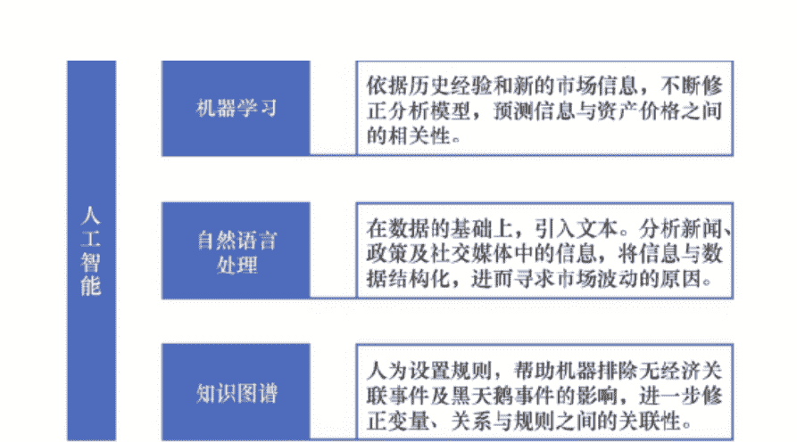
资料来源：36氪、兴业证券经济与金融研究院整理。

▲ 智能投顾的算法模型

理财师会不会失业
没有机器人投顾时，理财服务门槛很高，如高盛财富管理门槛在5000万美元以上。机器人投顾降低门槛，让中高净值人群也能享受服务。

尽管市场潜力大、专业性强，目前的服务远达不到资深理财师水平。专业理财师能依据年龄、学历、职位、收入、储蓄、家庭环境等因素，为投资者制定个人化方案，不仅推荐产品，还会分析短期适合什么、未来怎么规划，这是机器人投顾不具备的能力。因此业界认为未来五年内机器人投顾可在大数据分析等方面分担工作量，但不可能替代大部分工作。理财师具有不可替代性，职业不会消失。但技术进步会让其作用越来越大，影响也越来越深。

专业顾问应在客户选择机器人投顾前做好长期投资理念引导，介绍产品特征，分析市场上常见产品并给出选择建议，持有期间做好答疑，避免在不当时机退出或建议在合适时机加仓。

小结
展望未来，机器人投顾前景广阔，人工智能与大数据赋能传统金融的步伐不会放慢。

第30章

欺诈识别
欺诈识别简单说就是依据借款人提供的信息，多方核验不同属性，揪出“羊群中的狼”。工作繁琐，为识别团伙欺诈往往需收集、整理、分析多维度数据，工作量很大。但枯燥工作也有乐趣。欺诈识别用于辨别申请人身份真伪、材料是否真实有效、是否团伙骗贷。

欺诈类型
按方式与对象划分，数字金融欺诈主要表现为高利理财、网络借贷、网络众筹、消费金融、非法集资五类。

高利理财诈骗利用受害者追求高回报心理进行利益诱惑。报告显示，理财类诈骗在总金额与人均损失上均居高位。手段多样，包括低投高息的消费返利、境外股权期权外汇投资、私募入股，以及打着虚拟货币、区块链旗号的互联网理财欺诈。

网络借贷诈骗通常通过网络操作盗取投资者信息，以低息贷款高收益引诱。造假成本低、操作简便、不易察觉，因而高发。常见方式有包装骗贷、组团诈骗、虚假广告引诱、欺骗缴纳保证金、冒充他人、信息盗取等。

网络众筹诈骗表现为非法投资众筹、众筹开店、电影众筹、扶贫救助众筹、熟人众筹等。无论是非法吸收公众存款，还是冒充上市公司发行股票，都披着众筹外衣，实则由资金短缺的第三方托管。信息披露不健全，发起人与投资人信息严重不对称，常使投资者陷入非法集资陷阱。

消费金融欺诈表现为网络支付诈骗、虚假营销、骗取网购运费险、骗取消费退款、网络刷单诈骗等。手段包括利用第三方支付账户安全漏洞导致信息泄露进行支付诈骗与套现，虚假宣传、信用卡欺诈、刷单诈骗、退款诈骗、骗取保证金等。其中买方恶意欺诈网购退货运费险已成为高发事件。据中国保险行业协会数据，某公司运费险上市初期的赔付率高达90%，可推断存在骗保行为。

非法集资的常见套路与识别要点

非法集资型欺诈的本质，是组织或个人未取得法定授权、违反法律法规，通过非正规渠道面向公众或集体进行资金募集。常见操作手法包括私自发行股票债券、以传销或地下串联方式吸纳资金、打着地下钱庄或民间会社的旗号敛财，以及披着商品经销、经济合同合作的外衣变相揽储。

## 反欺诈模型

传统风控体系多以规则驱动为主。靠筛查表面异常信号来揪出可疑交易，金额异常高或交易发生地不典型时会被挑出来进一步核查。纯规则方案的检测逻辑完全依赖分析师手工编写，目前仍在运行的老系统里，决定交易放行的规则数量平均在三百条左右。可以看出，这类做法效率不高，既要人工不断补充或调参，也难以捕捉隐性关联。更关键的是底层多为传统软件，对数字业务至关重要的实时数据处理能力不足。

实际上用户行为里藏着不少细微不易察觉的征兆，单独看并无问题，却在暗中指向欺诈风险。机器学习能够搭建处理海量多变量数据的模型，帮助挖掘行为模式与欺诈概率之间的隐性联系。相比规则方案，学习型系统处理速度更快、人工介入更少，例如在行为分析场景下，智能算法能明显压缩人工复核量。

## 算法局限

把机器学习落地，最大的门槛之一是上手难度陡峭。所需的数据科学素养、投入的时间与数据规模，让多数风控团队难以企及。门槛高意味着从业者要熟悉大量工具，如 R、Weka、Python、DBMS、NoSQL 存储、Hadoop 作业、流式系统等。再者业务本身持续演进，很难用固定模型反映变化，例如用两年历史数据训练一年期模型就会滞后。另一明显缺陷是决策难以解释，合规与治理往往要求给出清晰可追溯的判断依据，而模型难以满足。最后在大规模数据处理上也存在噪音问题，数据里混杂大量无关信息，机器缺乏常识判断，仍需人工把关。

## 小结

互联网金融科技的扩张已成为金融领域难以逆转的主线，新技术正逐步压缩黑灰产业的生存空间。伴随监管政策日趋完善，以及大数据、AI 等工具的广泛应用，互联网金融有望进入加速发展期。

## 第31章

## 智能客服

智能客服机器人是一种能够运用自然语言与用户交流的 AI 信息系统，融合自然语言理解、机器学习等多项人机交互技术，能识别并理解用户以文字或语音提出的问题，通过语义解析把握意图，以人性化方式提供咨询等相关服务。

传统客服依赖人工坐席，大量人力难以为继。若能自动应答重复性、简单的咨询，既可提升用户满意度，也能降低运营成本。在此需求驱动下，融合 AI 的智能客服应运而生。随着语义分析、大数据、深度学习等技术迭代，服务场景不断优化，客服行业实现质的跃升。在处理效率、信息管理、人性化体验等方面，机器人客服已全面超越传统人工模式。

## 多轮对话系统

对话系统大致可分为任务型与闲聊型，前者帮助用户完成订票、设闹钟、查天气等具体事务，后者则追求人与人聊天的自然感。

多轮对话系统的参考框架如下。

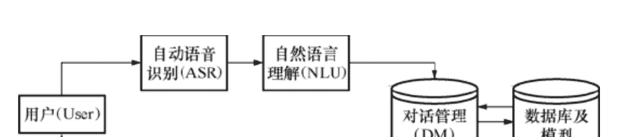

该框架主要包含以下组件。

自动语音识别 Automatic Speech Recognition，简称 ASR，负责把用户语音转成文本。

自然语言理解 Natural Language Understanding，简称 NLU，负责对用户话语进行解析，按不同语义表示方式抽取出含义。

对话管理 Dialogue Management，简称 DM，是多轮对话的核心，承担记录用户历史表达以及生成系统决策两项功能。

自然语言生成 Natural Language Generation，简称 NLG，决定系统如何与用户互动，它依据对话管理模块的决策生成相应的自然文本。

语音合成 Text to Speech，简称 TTS，让系统具备开口说话的能力，把文本转为语音以完成交互。

具体工作流程为：

1. 用户发出一句话。
2. ASR 将语音转为文字。
3. NLU 把文字转为结构化输出，常用 slot-value pair 形式表示。
4. 对话状态追踪 DST 模块更新对话状态，记录截至目前的全部聊天历史与系统行为。
5. 对话策略模块 Dialog Policy 依据 DST 提供的对话状态 DS 产生系统行为 Dialog Act，即决定下一步做什么。
6. 下一步行为可能包括反馈一句回复、查询数据库等。
7. NLG 把 Dialog Policy 产生的 Act 映射为自然语言。
8. TTS 负责发音。

在上述流程中，Dialog Act 也常称 Action Selector。ASR 和 SLU 既可输出单一最优结果，也可输出多个候选结果，分别称 1-best 和 n-best list。通常把 DST 模块与 Dialog Policy 模块合并称为 Dialogue Manager。

## 情感分析

从文字聊天中判断情绪即为情感分析。已有研究主要有两类。词典法依赖词典质量来判定正负，准确度受词典限制，且部分歧义词难以简单归类。机器学习法多采用有监督学习，利用大量相似聊天语料训练模型以识别文字情绪。

只有在训练集上达到足够准确率，才可能在实际测试中稳定预测情感。目前机器可分辨的情感维度有限，多为正负两极或五级 负面、轻微负面、中性、轻微正面、正面。人类的情绪远比这复杂，如何识别复杂情感仍是研究课题。但随着算法改进，未来机器的判别精度有望超越人类。

## 商业智能

在营销端，智能客服借助大数据挖掘客户服务问题、体验、建议等数据，全景把握客户需求，描绘用户画像，为精准营销供数。客服系统内可接入业务系统日志挖掘平台，实时解析用户操作行为数据与系统异常日志，通过特征提取与数据挖掘给出业务健康诊断报告及操作流程合理性结论，并提供问题描述与解决建议。

客服系统通过上下文语义情感分析、关键词分析、问题聚类，由客服引擎生成咨询问题的标准化描述。将日志挖掘平台与客服引擎关联后，基于用户 LSTM 长短期记忆网络、CNN 神经网络等深度学习方法，智能客服能够更准确理解提问并返回最合适的答案，提供智能咨询服务。甚至可提前发现业务异常，主动推送预警、解决方案或关怀提醒。

由此可更有效地解决用户咨询，提升感知与服务效率，缩短处理时长；同时缓解人工客服压力、节约成本，并一定程度上提升业务系统健康度，发挥更大价值。

## 小结

随着 AI 技术成熟与知识库完善，叠加推广普及，智能客服的使用率预计将大幅增长。当前系统仍不完美，人工客服短期内无需担忧岗位，但在未来能否保留，还取决于智能客服服务的实际水平。

## 后记

以深度学习为核心的 AI 近年发展迅猛，在政策推动、企业投入与资本加持下，成果显著。但笔者仍担心这轮红利或将消退，随经济波动、资本撤离、政府预算收紧而陷入新一轮 AI 寒冬。

AI 寒冬又称 AI 低谷，指资金投入锐减、学术兴趣减弱的时期。自现代 AI 学科诞生以来，共经历过两次主要低谷。

第一次发生在1974至1980年间，当年研究的重点是逻辑理论。自1956年提出后，基于逻辑的 AI 程序在二十年里取得瞩目成果，如在国际跳棋比赛中胜过人类、自行解决代数问题等，冲击感堪比今日 AI 下围棋、与人聊天。然而逻辑派系统难以工程化，纸上成果多，投入巨大却难出实物。压垮局面的导火索是詹姆斯·莱特希尔爵士向英国工程与自然科学研究委员会提交的报告，以数据批判产业现状并断言研究未带来重要影响，引发多国削减经费、实验室关闭。

第二次发生在1987至1993年间。20世纪80年代初专家系统成为商业风口，1981年日本启动第五代计算机项目，在日本经济腾飞背景下引发全球关注，美英随之重启 AI 计算机研发。1987年华尔街崩盘引发全球金融危机，专家系统缺乏真实应用场景，资本失去耐心，泡沫破裂，多家相关企业破产，AI 再次被视为失望象征。

是否会迎来第三次寒冬？

纵观前两次兴衰，AI 产业存在可复现规律。其一，AI 是经济情绪的产物。每一次潮起潮落都由未经充分验证的技术利好引发全行业狂热，一旦利好失效，寒冬便至。其二，发展离不开国家战略支撑，历次崛起都伴随技术博弈，若国家战略转向则发展受阻。其三，AI 可能被其他技术赶超替代，市场常以不那么聪明的技术搅局并用数据证明胜负。

这三点是反复验证的规律，也是两次寒冬留下的经验。若承认这些常识，便可汲取教训。AI 前两次热潮因无法兑现承诺而冷却，此次应避免过度承诺，通用 AI 仍在路上，大数据并非易得，基础理论仍需提升。大多数 AI 尚未具备自我成长能力，整体仍需理性推进。

前两次寒冬源于专家乐观预测导致热潮却未达商业预期，而本轮热潮与之相反，是产业界在看到实际效果后主动投入。得益于深度学习，AI 已渗透闹钟唤醒、网购、在线回复、天气预报、交通导航等日常。

另一值得关注的是 AI 在高校的定位。过去 AI 多以跨学科形式存在，资金来自既有院系，预算削减时易被优先裁撤。现如今 AI 已逐步成为独立学科。国内超30所高校新增 AI 本科专业，国外如麻省理工学院已独立设系。

人类研究 AI 已有六十余年，正从两方面逼近突破：一是研究基于实际难题产生新理论，使基础理论更接地气；二是产业摆脱粗放模式，主动向 AI 方向演进。未必需要理论根本性突破，局部突破即可带来优质应用。

第三次 AI 热潮前景光明，即便遇冷，也多为暖冬。

## 作者简介

黄永健，广州趣程教育科技有限公司创始人兼CEO，广东轩辕科技股份有限公司轩辕研究院院长，华南理工大学广东省人工智能中医研究中心高级研究员，致力于AI技术商业化及创新教育。2003年开始从事人工智能相关领域的研究。在英国留学生活超过5年，分别获得利兹大学计算机本科（一等荣誉）学位及南安普顿大学人工智能博士学位。参与其博士生导师，英国帝国理工学院院士Nigel Shadbolt教授（现任牛津大学耶稣学院院长）领导的AK项目，旨在开发和扩展一系列的技术，为知识的捕获、建模、发布、重用和管理提供综合方法和服务。拥有丰富的国际教育合作经验，协助清华大学研究生院在深圳建立国内首个网络科学实验室；作为英国兰卡斯特大学中国区首席代表与广东省科技厅合作，引进超过60家英国科技企业与中国企业及科研院校进行联合研发，并协助开发国际创新硕士研究生课程。

韩宜飞，新疆维吾尔自治区天山英才，国培计划授课专家。中国人工智能学会中小学工作委员会副秘书长，中国高级科技辅导员，全国优秀机器人竞赛教练员，乌鲁木齐市第一中学人工智能实验室负责人、机器人竞赛教练员、创客指导老师、科技辅导员，乌鲁木齐市专业技术人才知识更新工程高级研修项目——“人工智能在教育领域的创新应用”项目负责人。自2013年开始担任校机器人比赛辅导教师，指导学生参加各级比赛，其指导的学生获国际赛冠军项，国家级一等奖39项。

## 参考文献

[1] 陈全，邓倩妮.云计算及其关键技术[J].计算机应用，2009, 29(9): 2562-2567.

[2] 孟小峰，慈祥.大数据管理：概念，技术与挑战[J].计算机研究与发展，2013, 50(1): 146.

[3] 李开复，王咏刚.李开复：到底什么是人工智能[J].科学大观园，2018(2): 48-49.

[4] 黄永健.STEAM理念在国内中小学教育落地的思考[J].科技与金融，2019(09) : 11-14.

[5] 曹勇.携程 AI 产品“小诗机”上线[J].计算机与网络，2017, 43(4): 34-34.

[6] 朱亚宗.论计算思维——计算思维的科学定位、基本原理及创新路径[J].计算机科学，2009, 36(04): 53-55+93.

[7] 杜祥民，张永寿.达芬奇手术机器人系统介绍及应用进展[J].中国医学装备，2011, 8(05): 60-63.

[8] 刘津宁.AI换脸技术暗藏法律风险[J].法庭内外，2019(05): 56-58.

[9] 杨晓珍.任务型对话系统[D].华中师范大学，2019.

[10] 许明月，谭玲.论人工智能创作物的邻接权保护——理论证成与制度安排[J].比较法研究，2018(06): 42-54.

[11] 马晓凯.基于日志挖掘的智能客服系统设计[J].通讯世界，2019, 26(06): 13-14.

[12] 黄如花.数字信息资源开放存取[M].武汉：武汉大学出版社，2007：3.

[13] 王炬.大数据技术在企业管理中的应用研究[J].企业科技与发展，2018(08)：288-289.

[14] 戴潘.基于大数据的科学研究范式的哲学研究[J].哲学动态，2016(09)：105-109.

[15] 张月.清洁机器人全覆盖路径规划研究[D].重庆大学，2015.

[16] 吴沈括，唐巧盈.《欧盟数据保护新规对人工智能的影响》报告述评[J].信息安全与通信保密，2018(07)：74-77.

[17] Abràmoff M D, Lavin P T, Birch M, et al.Pivotal trial of an autonomous AI-based diagnostic system for detection of diabetic retinopathy in primary care offices[J].NPJ digital medicine, 2018, 1(1): 1-8.

[18] Goodfellow I, Bengio Y, Courville A, et al.Deep learning[M].Cambridge: MIT press, 2016.

[19] Turing A M.Computing machinery and intelligence[M]//Parsing the turing test.Springer, Dordrecht, 2009: 23-65.

[20] Ventures M M C.The state of AI 2019: Divergence[J].Report.London, UK: MMC Ventures, 2019: 42-56.

[21] Wing J M.Computational thinking[J].Communications of the ACM, 2006, 49(3): 33-35.

- [z-library.sk](http://z-library.sk)

- [z-lib.gs](http://z-lib.gs)

- [z-lib.fm](http://z-lib.fm)

- [go-to-library.sk](http://go-to-library.sk)

[Z-Access](http://Z-Access)

[https://wikipedia.org/wiki/Z-Library](https://wikipedia.org/wiki/Z-Library)