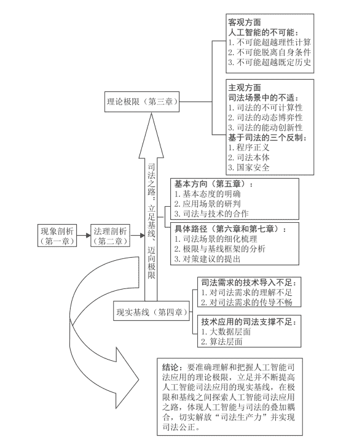
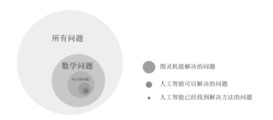
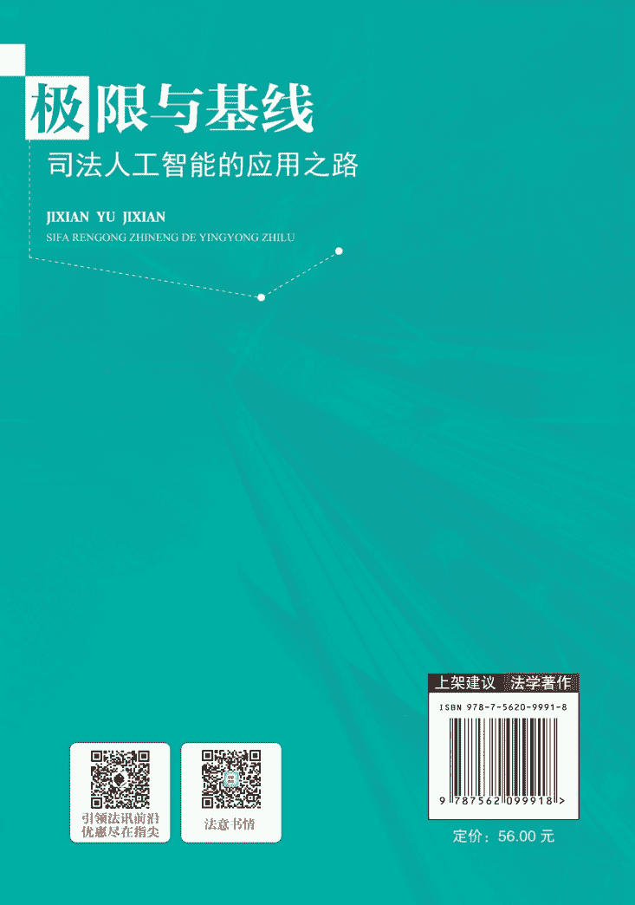

# 司法AI的天花板与地面

# 前言
Preface

人工智能的本质是依托大数据、算法与算力驱动的机器式智能，并非生命体意义上的有机智能。因此更合理的认知路径是工具论，而非沉溺于充满科幻色彩的强人工智能设想。当前司法人工智能的热度，既源于法院信息化建设的持续推进，也得益于顶层规划的强力推动，值得以更冷静的姿态审视。不可否认，正因其具备信息多维呈现、运行规模化、技术中立等工具性特征，司法人工智能能够在一定程度上助力裁判公平、提高办案效率、优化法院治理、培育系统性认知，真正做到善假于物。不过同样需要警惕的是，技术应用在司法场域也潜藏异化风险，比如技术决定论对司法权的挤压、法官能动空间被削弱、社会不平等被技术精致化后固化放大等。围绕善假于物与司法异化这一核心张力，本书提炼出理论极限与现实基线两条分析线索。理论极限上，人工智能作为工具无法突破理性计算边界、无法脱离自身条件独立演进、无法跳出既定历史语境创新；在司法情境中，它难以应对司法的不可计算性、动态博弈性与能动创新性；同时程序正义、司法本体价值与国家安全也会对技术介入形成制约。现实基线上，问题主要体现在司法需求向技术转化的不足与技术应用回馈司法的不足，具体表现为对司法需求的理解偏差、需求传导机制不畅、制度未能有效支撑司法大数据生成、数据结构化、机器学习与算法监督均面临困难。在此框架下，本书进一步厘清司法人工智能的整体走向，坚持工具定位与司法主导，基于对司法场景的审慎判断，加强司法与技术的双向协作，提升需求向技术导入的能力、强化技术应用的司法支撑、推动跨界人才培养。随后对服务当事人与公众、法院管理、司法审判三大板块进行系统梳理，逐一检视具体场景的可行性、边界、关键前提与短板，并提出针对性对策。

# 题记

登高而招，臂非加长也，而见者远；顺风而呼，声非加疾也，而闻者彰。假舆马者，非利足也，而致千里；假舟楫者，非能水也，而绝江河。君子生非异也，善假于物也。

——荀子

他在自己的劳动中不是肯定自己，而是否定自己，不是感到幸福，而是感到不幸，不是自由地发挥自己的体力和智力，而是使自己的肉体受折磨、精神遭到摧残。

——马克思

不清楚边界就会白费力气甚至适得其反，不夯实基础就谈不上降维打击，人工智能在司法中的推进可以概括为：先夯实基线，再逼近极限。

# 绪论

大数据与人工智能等信息技术的发展，持续放大人类借助外物延伸自我的冲动。不同于传统工具对体力的替代，此次延伸已进入脑力层面，并深度嵌入社会经济生活全程。在司法领域，人工智能的介入范围相当广泛，《新一代人工智能发展规划》《人民法院信息化建设五年发展规划（2016—2020）》等顶层文件与各地智慧法院建设都在积极探索，寄望以此提升效率、增进公平。因而“司法人工智能热”应运而生，但在基本定位上存在分歧，对工具属性与运行机制缺乏深入讨论，对积极效应与异化风险的剖析多停留在概念层面，对人工智能在司法中能做什么、不能做什么、不应该做什么即理论极限，以及现实条件下具备哪些前提与难题即现实基线，认知并不清晰。也缺乏将总体方向与具体司法场景相结合的系统研究。基于此，本书从现象切入，先把握司法人工智能的基本矛盾，再明晰其理论极限与现实基线，据此确定发展方向，并结合主要司法场景探讨具体应用，努力夯实基线、逼近极限，为司法改革与智慧法院建设提供参照。

## 第一节 选题意义

本书以极限与基线的分析框架展开论述司法人工智能的基本矛盾、理论极限、现实基线、总体走向及场景化应用，具有理论价值与实践价值。

### 一、理论意义

司法人工智能处于法学与科技交叉地带，蕴含明显的法理学意涵。本书从三个方向展开理论探讨。

#### （一）对人工智能本质及其运行原理做出了基本阐释
研究司法人工智能前，需先弄清人工智能为何物、如何运作。作为文科研究者，笔者不求技术细节，但可基于法学实践品格与行业现实做出判断。本书放弃对强人工智能的科幻式想象，梳理发展脉络后认为：本轮人工智能的实质是建立在大数据、算法、算力之上的机器智能，而非有机智能。大数据是核心要素，算法设计与算力增强均围绕这一基础展开。因此不适宜以仿生学的主体论视角审视，而应坚持工具定位。具体而言，在算力保障下，人工智能能依据既定算法从海量数据中挖掘多维信息，弱化信息不对称，形成系统认知，从而减少盲区、误区与偏差；其规模化运作与技术中立属性，也能在特定理性计算领域替代人脑或抵消偏见、好恶、情绪等非理性干扰。

这一判断为后续司法应用提供了务实的理论预设，对把握实践走向有指导价值。

#### （二）对司法人工智能的主要价值进行了全面的探讨
本书从人工智能本质出发，从司法公正、司法效率、法院管理与系统认知四个维度展开价值分析。与以往宽泛论述不同，本书更具体地揭示了其差异化价值。关于公平，本书主张以分权制衡的政治理念与拉伦茨方法论等中观法学路径构建制度框架，而人工智能则在规则、案例、流程、社会评价等微观层面提示、督促裁判具体化，从而丰富宏观理念与中观方法。关于效率，人工智能不仅能替代部分辅助性事务，其“以技术对技术”的能力更能回应网络纠纷的内在效率矛盾，同时提升认知高度与维度，将司法从定分止争提升到社会治理层面，推动法院与政府源头协同，摆脱“案海战术”。关于管理，案件权重测算、成本收益分析等工具有助于绩效考评科学化精细化，助推资源精准配置，间接促进公平与效率。关于系统思维，人工智能是提升认知高度、拓展维度的重要支撑，能将审判、管理和社会评价融为一体，帮助全面审视司法权运行并提出改进方案。

上述分析揭示了善假于物的内在动因，回应了为何要发展司法人工智能的问题，有助于目标清晰与方向把握。

#### （三）对司法人工智能的应用可能及其限度进行了系统反思
本书借助异化理论，从整体上审视技术偏离司法的隐患。对司法而言，技术主义狂热易遮蔽体制机制性问题，并可能侵蚀本体司法权。对审判而言，一味强调人工智能将威胁法官主体性，既涉及实体裁判中的规则创新与价值判断，也涉及诉讼程序价值如被动性、公开透明性、多方参与性、亲历性、集中性、终结性的削弱，更涉及量化绩效对法官的过度约束。对社会公平而言，社会偏见或不平等可能被技术包装后嵌入司法运行并以机器方式固化放大。人工智能的“三大不可能”亦决定了其在司法场景中的局限：无法超越理性计算范畴、无法脱离自身条件发展、无法超越既有历史条件创新，故难以适应司法不可计算性、动态博弈性与能动创新性，只能在有限范围内发挥作用。此外程序正义、本体价值与国家安全也会对技术应用形成反制，从适用范围与介入程度两个方面界定了必要限度。

上述论述为司法人工智能热注入冷思考，具有理论镜鉴意义。

### 二、现实意义

司法人工智能必须与真实司法需求对接并落地实践。

#### （一）对人工智能与司法的契合障碍进行了研判分析
本书认为，要实现善假于物，必须精准挖掘现实与潜在司法需求并有效表达，同时通过制度保障技术的司法要求。从需求向技术导入与技术向司法支撑两个面向，本书指出障碍包括：对需求理解不充分、需求传导不顺畅、大数据支撑不足如信息化不充分不平衡、公开力度不够、数据库标准化缺位、算法支撑不足如数据结构化困难与风险、机器学习与算法监督难题。

这一研判有助于把握发展现状与阶段，为改善条件提供依据。

#### （二）对司法人工智能的总体方向进行了明确
本书坚持人工智能的工具定位与司法的引领地位，主张在充分评估场景后加强协作。具体从服务当事人公众、法院管理、司法审判三大板块切入，体现具体问题具体分析思路。合作方向包括：强化需求向技术导入、强化技术应用的司法支撑、强化复合型人才培养。需求导入需反省价值属性摒弃无效需求、系统梳理场景找准有效需求、完善机制释放并传导需求。司法支撑涵盖树立司法技术主义思维、夯实大数据基础、建立算法规制。人才培养则强调长远布局法学基础教育，并在组织与遴选制度中预留空间或开展试点。

这些建议具有较强政策参考性。

#### （三）对司法人工智能的具体应用进行了全面探索
以往研究偏重形而上，忽视形而下场景。本书将三大板块进一步细化：法院管理板块以智能分案、法官绩效考评、司法社会治理为例，覆盖审判管理、司法人事、司法决策；司法审判板块以民商事审判为重点，按立案、送达、庭审、裁判流程梳理。结合极限与基线框架，提出可为、不可为、不应为的具体条件与对策，体现应用法学要求。

## 第二节 内容、框架和方法

本书的主要内容、结构与方法如下。

### 一、主要内容

本书共分七章。

#### 第一章 人工智能走向司法
从现象论证工具定位，分析“司法人工智能热”的兴起条件与动因。梳理人工智能的由来与发展，结论为强人工智能不符合现实，本轮技术是基于大数据、算法与算力的机器智能，应做工具定位。司法人工智能早有探索，我国热度升温主要因法院信息化成熟与顶层设计推动共同作用。

#### 第二章 司法人工智能的基本矛盾
从法哲学层面剖析基本矛盾。先展开人工智能工具属性：信息多维、运作规模化、技术中立，构成善假于物与司法异化的实体基础。再论述主要价值：促进公正、提升效率、优化管理、形成系统思维，强调价值实现的司法特异性与方式。最后引入马克思异化理论，概括为技术主义俘获司法事业、侵蚀法官主体能动性、不平等固化放大三个层面。

#### 第三章 司法人工智能的理论极限
回答不能做什么、不适合什么、不应做什么。极限分三方面：技术上不可能、场景上不适、司法反制。技术维度为“三大不可能”，场景维度为对不可计算性、动态博弈性、能动创新性的不适，司法维度为程序正义、本体价值、国家安全的反制，三者构成主客观统一的判断逻辑。

#### 第四章 司法人工智能的现实基线
讨论现实条件与主要问题。提出基线提升需需求导入与技术支撑相互配合。需求导入层面，问题在于理解不足与传导不畅：法官态度差异、需求分类梳理欠缺；法院管理者与企业开发者难以完全代表法官真实需求，缺乏有效机制。技术支撑层面，存在大数据支撑不足与算法支撑不足，具体为信息化发展不均、公开不足、数据库标准化不足；数据结构化难度与风险、机器学习与算法监督困难。

#### 第五章 司法人工智能的总体方向
基于前述极限与基线确定走向。明确基本态度：司法主导、工具定位。按场景性将总体场景划分为服务当事人公众、法院管理、司法审判三大板块，由外围向核心递进并阐释介入差异。基于基线提出司法与技术合作路径：强化需求导入、强化司法支撑、强化交叉人才培养。前两者着眼短期改进，后者着眼长远蓄力。

#### 第六章和第七章
依次对服务当事人公众、法院管理、司法审判三大板块的细分场景进行梳理，如智能分案、法官绩效考评、决策参考、网上立案、电子送达、智能庭审、智能裁判等，结合极限与基线框架审视应用的可行性、边界、条件与不足，提出针对性对策。各场景契合点不同，作用空间与限度各异。

### 二、框架结构

从结构看，本书分为理论篇与应用篇。

#### （一）理论篇

# 边界与落地：AI司法应用的双层地图

## 理论篇概览
上篇由第1至第4章铺陈。第1章从智能技术闯入法庭这一现实切口出发，回望AI的演进脉络与当下生态，厘清其运行逻辑，并解读司法圈为何形成一轮高度关注。第2章由此提炼出司法AI的核心张力，立足工具属性来展开借力赋能与审判异化这对矛盾。第3、4章则把讨论推向可为与不可为的辨析，既讲清技术与司法的天花板，也梳理推进所需的现实条件与主要阻碍，为后续方向和落地提供坐标：在天花板与起点的区间里寻找应用空间，先把起点拉高再逼近天花板。极限不明会白忙甚至反噬，起点不升就谈不上降维式提效。

#### （二）应用篇
下篇由第5至第7章构成。承接前述矛盾、极限与起点的框架，第5章确立总体取向。其一是对基本态度的 Clarify，是对核心矛盾的回应；其二是应用场景的研判，对应理论天花板的延伸；其三是司法与技术的协同，对应现实起点的延伸。第6、7章把总体取向拆解到具体业务，借助极限与基线的分析框架，对各类场景进行归类分层并给出可操作建议。叙事顺序遵循由法院外围向裁断核心推进：服务当事人与社会公众、法院管理、司法审判三块依次展开。前两块关联紧密，都属外部性评价与公正司法的助推，不直接介入审判业务，故合并论述。在法院管理板块，按与审判的关联紧密程度选取典型场景，如智能分案代表审判管理、法官绩效考核代表人事管理、决策参考代表司法决策，做具体展开。在审判板块以民商事为主线，按诉讼流程依次讨论网上立案、电子送达、智能庭审、智能裁判等环节并给出对策。

为直观呈现结构，作者将整体框架制作成思维导图，图示如下：

本书框架结构思维导图图示

### 三、研究方法
总体上本书先以大量资料搜集与技术人员的交流为基础，以实证方式描绘 AI 发展态势及其在司法领域的应用现状、条件与驱动。继而在法哲学层面剖析司法 AI 的基本矛盾，结合司法与技术的交叉研究及实证考察，界定应用的理论天花板与现实起点。最后结合作者熟悉的司法情境与对法院运行的把握，运用极限与起点框架，为具体业务环节提出针对性建议。

#### （一）重视实证考察研究
依托作者近八年民商事审判经验，以及对北京市高级人民法院、北京市第二中级人民法院、北京市第一中级人民法院、北京互联网法院的调研座谈、法官咨询与课题合作，本书对司法运行情境与真实需求的把握较为敏锐客观，避免了模拟式需求推演。关于 AI 的现状、源起与发展，作者亦查阅了大量中英文一手资料与媒体报道。

#### （二）着力交叉学科研究
鉴于研究的交叉属性与作者文科背景，作者深入一线研发团队，参与科技部立项、中科院自动化研究所与华宇元典有限公司联合开发的法院智能项目，以及中国司法大数据研究院的相关开发工作，以此加深对司法 AI 本质与技术原理的理解，为交叉研究奠定基础。

#### （三）突出应用法学研究
在理论分析之上，依托法官从业经历与法院工作联系，作者系统梳理司法 AI 在各具体场景中的可能性、边界、现实条件与具体问题，给出有针对性的对策，彰显应用法学取向，期望为司法决策者与技术开发者提供参考。

## 第三节 贡献和不足

本书在多个维度试图实现突破与创新，同时也存在若干局限。

### 一、主要贡献
总体来看，本书在智能本质与技术原理、分析框架与具体对策三个层面作出一定贡献。

#### （一）立足和回归 AI 本质与技术原理这一基础问题
哲学家维特根斯坦曾说“别人走远了，我就待在原地”，意在强调对本源性问题的反思重要性，本源错误会导致南辕北辙。要研究司法 AI，必须先把握 AI 的本质与技术原理。作为文科研究，本书不深究工程细节。作者研读大量科普著作与文章，涉及计算机设计原理与大数据信息哲学等，认为 AI 是机器智能而非有机智能。其原理在于算法设计与算力支撑下，从大数据中挖掘隐蔽而稳定的规律或信息，从而拓展人类认知。本书亦涉猎机器学习运行机制与算法特性，并梳理国内外早期司法 AI 的研究与实践，特别是钱学森等人的设想得到当下印证，仍具理论与现实意义。这些努力属于返璞归真式的思考，对 AI 加以祛魅，去除不必要的科幻色彩，主张以务实态度引入司法。

#### （二）总结和提炼出理论极限和现实基线这一分析框架
在法哲学层面，本书基于 AI 的工具属性，深入分析借力赋能与审判异化这对基本矛盾，并全面论述其具体表现。在此基础上提炼出理论天花板与现实起点的分析框架，对总体方向与具体应用具有重要意义。极限不清会做无用功甚至反作用，基线不升则无法降维打击。司法 AI 之路可概括为提高起点、迈向极限。本书进一步在司法维度与技术维度上深入探索极限与起点的面向，体现交叉研究特色。正如卡尔·皮尔逊所言，科学的统一在于方法而非材料。本书提出的框架旨在提供方法论启示，而非仅是文献贡献。

#### （三）分析和提供司法 AI 具体应用的对策建议
法学是经世致用之学，贡献在于提炼理论命题，也在于回应现实问题。本书既有理论构想，也提供政策建议，尽管未必全然正确，但避免了空话废话。鉴于现有研究多停留在方向性或初级层面，本书依托极限与起点框架，在系统梳理司法场景后，明确发展方向，重点探讨 AI 司法应用的可能、限度、条件、问题与对策，期望为决策者与开发者提供启示，更好体现应用法学属性，详见后文所附20条建议。

### 二、两大不足
受研究难度与作者知识结构、实践经验限制，本书存在不足。

#### （一）知识结构的局限导致交叉研究缺乏深度
司法与 AI 结合是最大难点，文科背景作者对 AI 的理解仅及本质与运行原理，对技术架构尤其是细节把握不足，交叉研究只能保持总体方向性，深度有限。具体体现在技术需求的司法支撑方面。司法人员模拟技术需求同样会失真，如本书能基于司法大数据要求讨论司法公开的程度，但对裁判文书结构化要求或技术标准如何适配应用则缺乏判断能力。算法规制方面，规制正当性可由司法民主、平等、公开等价值论证，但具体方式需与技术紧密结合，判断哪些算法具可解释性、哪些可通过事后评测保障安全有效，需依赖对技术框架细节的掌握。

#### （二）实践经验的局限导致具体应用缺乏广度
研究以民商事审判为背景，研究重点亦集中于此。法院管理部分仅选取智能分案、法官绩效考评、司法社会治理等典型要点，实践中管理更为宽泛。司法审判部分按网上立案、电子送达、智能庭审、智能裁判流程概括，为体例便利，场景梳理不够细化，如要素审判未区分具体案由差异。且受审判经验限制，对刑事、执行领域涉及较少，难以比较民商事与这两个领域的差异。这些局限使本书在具体应用研究上的广度与精细度不足。

## 理论篇
上篇由第1至第4章构成。首章以智能技术走向司法的现象与趋势为入口，结合 AI 现状、源起与发展，探讨其本质并分析司法 AI 热的动因与条件。在此基础上提出司法 AI 基本矛盾这一法理命题，从工具属性出发阐释借力赋能与审判异化，并据此建立理论天花板与现实起点的分析框架，集中讨论可为、不可为与不可接受之处，以及发展的现实条件与主要问题，为后续方向与应用奠定理论基础。

## 第一章 AI 走向法庭
AI 本质上是以大数据、算法与算力为基础的机器智能，而非有机智能，应作工具主义定位。在信息社会，大数据与智能技术势不可挡，在规范研究完成前已从电商、金融等领域进入相对保守的司法领域，形成高度关注。从客观条件看，这是人民法院信息化建设的延伸成果。主观上，顶层制度设计对热潮的助推作用显著。

### 第一节 AI 的工具主义定位
当前关于 AI 的讨论常带科幻或浪漫色彩，担心超 AI 产生主体意识威胁人类生存。这与现实不符。目前 AI 限于理性计算，未拓展至通用领域，更未触及人类情感意志。通过对其来历与发展的考察可发现，AI 主要是工程学意义上的研究与应用。其实质是以大数据、算法、算力为基础与动力的机器智能，并非有机智能。因此应作工具主义定位，并由此延伸至司法 AI 讨论。

#### 一、超 AI 并不符合当下现实
无论有意无意，AI 常被披上科幻外衣。部分未来学家、产业人士与媒体设想其将经历弱 AI、强 AI、超 AI 三阶段，在超 AI 阶段机器将具自主意识威胁人类生存。霍金曾警告不力发展 AI 可能导致人类灭绝。埃隆·马斯克亦持此观点，并提出人机融合方案，认为与其被消灭不如融合。为此他创立 Neuralink 研究脑机接口技术。媒体报道亦不乏夸大，如将围棋胜出外推至各领域、给机器人授国籍等。

但此类设想与应对不符当下现实。第一，当前应用仅限理性计算。以 AlphaGo 战胜李世石为例，其胜出在于对可能棋局与胜率的精准计算，而非主体性优于人类，更准确说人利用机器打败了人，并非机器本身打败人。第二，当前 AI 不具备通用智能，更不用说情感意志。如叠衣服测试中机器人至今无法像人类般从容取衣分类叠放。DeepMind 联合创始人哈萨比斯在《经济学人》创新峰会上指出，深度学习相当于大脑感觉皮层中的视觉或听觉皮层，真正智能需重组为更高层次思维与符号推理，这正是80年代经典 AI 试图解决而未竟的问题。

#### 二、AI 的由来和发展
要客观理解 AI，需考察其来历与发展。

某种意义上，AI 并非新生事物。学界考证概念由约翰·麦卡锡、马文·明斯基、纳萨尼尔·罗切斯特、克劳德·香农等人在达特茅斯夏季研究会议上提出。会议策划书称1956年暑期在新罕布什尔州汉诺威的达特茅斯学院举办为期两月的研讨会，基于学习与智力的每个环节原则上可被准确描述从而由机器模拟的猜想，尝试让机器使用语言、提出抽象命题、解决人类难题并自我改进。认为精挑细选的科学家一个夏天可取得重大进展。AI 核心无非是机器如何模拟可准确表达的学习或智力环节，目的以机器方式实现人脑价值或功能。姚海鹏等亦提出，AI 是制造智能机器或系统模拟人类智能活动的科学，以延伸人类智能。

随后围绕核心问题，AI 经历三次浪潮并逐步成熟。第一次浪潮在20世纪50年代末至80年代初，以符号主义或逻辑主义为核心，出现奠基性算法模型如贝尔曼公式雏形，用机器证明与推理知识，但受数学模型先天缺陷与计算复杂度指数增长限制而陷入低谷。第二次浪潮在20世纪80年代初至末，以连接主义为核心，即大规模连接涌现秩序，出现多层神经网络与1986年 BP 反向传播算法等，专家系统得以应用，但受成本高、维护难、产业应用不足等因素影响再度沉寂。第三次浪潮始于21世纪初至今，随着信息技术发展与互联网普及，大数据资源成形，加之脑计算、深度学习、强化学习等技术突破及资本产业融合，AI 迎来高速成长。其中基于大数据的深度学习是本轮最重要、最广泛应用的技术。

据此，AI 主要在工程学意义上研究与使用，不直接涉及情感意志等生物范畴。在人类尚未理解大脑认知机制前，过分担忧自主意识威胁并无必要，超 AI 是否出现有待计算机科学与生命科学进一步研究。

#### 三、本轮 AI 的本质

AI 从模仿到工程的转向

回溯 AI 的发展脉络，不同的技术路线指向了截然不同的实现逻辑。吴军在《智能时代：大数据与人工智能革命重新定义未来》里把 AI 拆成狭义与广义两种说法。狭义指向 20 世纪 50、60 年代那批经典研究范式，也被称作 AI 1.0，其基本立场是机器必须像人那样思考才算智能，坊间常戏称为“鸟飞派”^([\[10\]](#txt004.html#footnote_content_txt004_10))。广义的边界被拉大，涵盖了以数据驱动、知识发现、机器学习等当代手段建构的机器智能，姑且称作现代机器智能。用通俗类比，前者更接近仿生学，后者更接近工程学。

以机器翻译为例，“鸟飞派”希望机器先掌握人类语言的语法结构，再建立一一对应的映射。实践中许多语义的把握依赖常识与世界认知 `World knowledge`，单靠语法解析难以突破，最终碰到难以逾越的瓶颈^([\[12\]](#txt004.html#footnote_content_txt004_12))。数据驱动的现代路径换了思路，用“统计+数据”训练出可自我优化的数学模型，借助概率论寻找两种语言的对应。于此范式里，句子的合理性不再由是否合规语法决定，而由词块组合的概率高低决定，也就是可能性大小即合理性^([\[13\]](#txt004.html#footnote_content_txt004_13))。由此可见，机器智能的要害在于能否解决人类要解决的问题，而非是否复刻人类的解题方式^([\[14\]](#txt004.html#footnote_content_txt004_14))。只要数据规模足够且质量可靠，该路径在理论上具备可行性。

本轮复兴的直接动因是海量数据的真正起量。“这些年 AI 突飞猛进，根本在于巨量数据在持续累积。感应器与采集技术的发展，让人类获取了往昔难以想象的信息体量，同时在各领域拥有了更深更全的样本，而这些恰是训练智能的原料。”^([\[15\]](#txt004.html#footnote_content_txt004_15))平台经济把线上线下打通，设备互联让社会被嵌入互联网与物联网的网络中，人们持续产生并沉淀可分析、可产品化的数据，个人在某种意义上成为“量化自我”^([\[16\]](#txt004.html#footnote_content_txt004_16))。支撑存算的算力亦不再受限。摩尔定律显示，在价格不变条件下，集成电路可容纳的元器件约每 18 至 24 个月翻倍，性能随之提升。信息技术加速发展，数据处理成本不断下降，硬件基本不再构成瓶颈。在此环境下，海量数据可被挖掘出多维信息，知识应用领域出现量变到质变的跃迁。

与巨量数据紧密相连的算法进展是另一支技术支点。机器学习的底层逻辑是从已知特征出发，借助概率统计等数学工具提炼规律性模型，再用模型执行任务。简言之，以事物自身的数据特征以数学方式构建模型并完成既定目标。以星空认知为例，任务是预测星体下一步运动，特征是运动状态与观测时间，模型则是通过时间与轨迹推导出运行规律^([\[17\]](#txt004.html#footnote_content_txt004_17))。此处的模型即算法。算法与数据的关系密切：算法需经巨量数据训练，样本越全质量越高，算法越有效，这也是迭代改进的基础；同时本轮技术立足神经网络并发展出多层神经网络，打破了传统线性建模的限制，能完全基于输入数据自行模拟并构建结构。往昔该思路也存在，却因算力不足、数据不够而几乎无用。如今高速并行运算、海量数据与更优算法共同打破僵局，促成突破^([\[18\]](#txt004.html#footnote_content_txt004_18))。

综合来看，本轮 AI 的本质是依托海量数据、算法、算力驱动的机器智能，并非有机智能。其中海量数据处于关键位置，算法设计与算力强化都围绕这一基础资产展开。正因如此，本文放弃以仿生学视角探讨 AI 及其司法应用^([\[19\]](#txt004.html#footnote_content_txt004_19))，机器人人格、机器人法官等议题不在讨论范围，而是从工具论角度审视 AI 在司法中的用途。

### 第二节　司法 AI 热潮如何掀起
无论主观态度如何，巨量数据与 AI 等信息技术已渗透各行各业，对法律运行的冲击不可避免。AI 与司法的结合并非新近话题，国内外早有探索。

#### 一、海外司法 AI 实践回顾
据学界梳理，上世纪五十年代起国外就设想把 AI 用于法律信息的归类、检索、咨询与裁判。1958 年卢西恩提出法律科学的信息化处理，1970 年布坎南在《关于人工智能和法律推理若干问题的考察》中探讨法律推理模型的可行性。此后基于规则与案例的推理模型和专家系统相继出现，如 1977 年分析公司税务法的 `TAXMAM` 系统、1989 年处理工人事故补偿的 `IKBALSI` 系统、1995 年处理离婚财产分割的 `Split-Up` 系统等^([\[20\]](#txt004.html#footnote_content_txt004_20))。在当下热潮中，司法实践加速数字化。如美国纽约州已形成较为完备的网上立案送达系统 `NYSCEF`，并在部分刑事和家庭法院允许与当事人进行网上视频沟通^([\[21\]](#txt004.html#footnote_content_txt004_21))；同时还出现了协助处理破产案件的 AI 律师 `ROSS`、辅助法官量刑的风险评估工具 `COMPAS`、`PSA` 和 `LSI-R`。

#### 二、中国司法 AI 发展脉络
国内起步稍晚。检索显示，龚祥瑞、李克强在 1983 年发表的《法律工作的计算机化》前瞻性提出要全面引入计算机技术进入法律工作，以克服人的偏见冲动，并推动定性分析向定量分析转型^([\[22\]](#txt004.html#footnote_content_txt004_22))。钱学森把法学视作现代科学技术的一部分，坚信其能为法学研究和法制建设服务。1985 年全国首次法制系统科学讨论会上，他从系统工程角度提出六条设想：建立法制信息库；在省市自治区一级建法律咨询的电子计算机处理中心；运用 AI、知识工程和专家系统把人的经验传给计算机；系统辨识即大数据分析；用逻辑推理检验法律系统是否周密完善；建立法制和法治系统体系^([\[23\]](#txt004.html#footnote_content_txt004_23))。实践大致沿着该蓝图发展。八十年代起，北大法律系张力行等人在 1985 年开发“涉外法规查询系统”，后演化为著名的“北大法宝”；上海法学研究者朱华荣、肖开权主持的“量刑综合平衡与电脑辅助量刑专家系统”课题始于 1986 年；武汉大学赵廷光教授领衔的实用刑法专家系统诞生于 1993 年^([\[24\]](#txt004.html#footnote_content_txt004_24))。法院层面，最早报道可追溯到 2006 年山东淄博市淄川区人民法院研制并使用“电脑量刑”软件^([\[25\]](#txt004.html#footnote_content_txt004_25))。

近年来，信息革命深化，AI 成为新一轮信息技术革命的重心与风口。叠加中国在资本、市场、技术、人才方面的优势，顶层设计寄望借此实现弯道超车。2016 年 7 月《国家信息化发展战略纲要》把建设“智慧法院”纳入国家战略，2017 年 4 月最高人民法院印发《关于加快建设智慧法院的意见》，周强院长多次强调信息建设与司法改革是“车之两轮、鸟之双翼”。在审判流程公开平台、中国裁判文书网、执行信息公开平台、庭审直播平台、诉讼服务网逐步建成开放后，法院 AI 进入爆发期，方向是“全业务网上办理、全流程依法公开、全方位智能服务”。最具代表性的是杭州、北京、广州互联网法院的成立，把部分案件搬到线上并贯彻全程在线审理原则，以及最高人民法院司法案例研究院、司法大数据研究院的设立运行和被誉为中国版“万律”的法律知识与案例平台法信的上线。地方实践丰富：江西收转发 E 中心聚焦网上送达；北京睿法官、上海“206”刑事案件智能辅助办案系统聚焦智能裁判；苏州市中院依托语音识别、合成、转换技术支撑电子卷宗和数字法庭，聚焦庭审同步留痕；江苏法院“12348”公共服务平台提供智能问答、导航、案例推送、风险检测、热点感知等；深圳福田法院融平台与“余杭模式”道路交通事故损害赔偿纠纷网上数据一体化处理，聚焦多元解纷与社会治理综合^([\[26\]](#txt004.html#footnote_content_txt004_26))。高校科研单位纷纷成立未来法治研究院、法律 AI 实验室、大数据与 AI 法律研究中心等，华宇、Icourt、北大法意等科技公司加速产品迭代。研究量也井喷，笔者在中国知网以“AI+司法”为主题检索，2016 年至今文献累计超过 610 篇，而 1984 至 2016 年累计仅 48 篇。

### 第三节　司法 AI 兴起的根基与推力
从客观条件看，人民法院信息系统建设正按“电子化、网络化、智能化”路径推进，为司法 AI 提供了地基，AI 本身也是信息建设的必然产物。从直接动因看，顶层设计把智慧法院作为国家信息化战略的重要组成，大大助推了发展。

#### 一、客观基础：法院信息化建设的累积
本轮 AI 以海量数据为前提，而数据的形成又离不开信息系统建设。考察当下的“司法 AI 热”，需要回溯人民法院信息化的历程，经验教训正是启示所在。司法 AI 既是信息建设的必然结果，也是其重要组成，二者相互支撑、共生共促。

信息系统建设已是现代化法院的重要标志。人民法院信息化是指以计算机网络硬件软件平台为中心，以现代通信网络为载体，利用现代科技手段实现信息采集、制作、传输、发布、存储、利用的现代化，构建以审判信息为中心的全国司法信息数据库，实现系统信息资源共享和司法信息服务。它涵盖审判管理、队伍建设、执行机制、办公、后勤保障、法庭建设等^([\[27\]](#txt004.html#footnote_content_txt004_27))。1996 年最高人民法院开始规划信息化工作，同年召开的全国法院通信及计算机工作会议部署了法院计算机网络建设，确定北京、上海、江苏等八家高院为试点，标志着正式起步。此阶段在硬件、软件、安全体系方面取得明显成绩。2002 至 2012 年进入普遍推进期，最高人民法院愈发认识到司法改革与信息建设密不可分，在此期间出台了一系列信息网络系统建设的规定、规划、技术规范和方案，并作为改革主要任务推进^([\[28\]](#txt004.html#footnote_content_txt004_28))。2013 至 2015 年间，最高人民法院要求每年召开一次全国法院信息化工作会议。截至 2015 年，基础设施基本完成，核心应用成熟，司法信息资源搜集整合初见成效，保障体系完善，法院系统建成信息化 2.0 版^([\[29\]](#txt004.html#footnote_content_txt004_29))。2016 年以来，各级法院在 2.0 版基础上，按照《人民法院信息化建设五年发展规划（2016-2020）》确定的 4 个方面 55 项重点任务，推动以数据为中心的信息化 3.0 版应用建设，包括基于全国 3520 个法院、9277 个人民法庭和海事派出法庭接入法院专网的全业务网上办理，基于司法公开和诉讼服务平台建设的全流程审判执行要素依法公开，以及面向法官、诉讼参与人和政务部门的智能化服务，如智审系统、庭审语音识别转录、庭审自动巡检、最高法院数据集中管理平台等^([\[30\]](#txt004.html#footnote_content_txt004_30))。

司法 AI 的成长得益于信息建设这一优质土壤。信息化 1.0 版以“数字化”为核心，关注纸质向电子转化；2.0 版以“网格化”为核心，关注工作方式由线下到线上转化^([\[31\]](#txt004.html#footnote_content_txt004_31))，两者为司法 AI 奠定硬件软件基础，实现系统互联互通。3.0 版则以“智能化”为核心，重点在于如何更有效地利用留存和正在生成的数据，通过智能化处理更好服务审判、管理和社会。

#### 二、主观推动：顶层规划的加持
“司法 AI 热”的形成，不只源于上述客观条件，更得益于顶层设计的推动。其一是对此前二十多年信息建设积累的充分认可和持续转化，其二是配合国家信息化战略的需要。党的十九大报告提出要加快建设创新型国家，为科技强国、网络强国、数字中国、智慧社会提供支撑，而各地依托 AI 建设的智慧法院正是网络强国和智慧社会的重要部分。正是在此顶层设计下，“智慧法院”2016 年被纳入《国家信息化发展战略纲要》和《“十三五”国家信息化规划》，上升为国家战略，最高人民法院随即出台《关于加快建设智慧法院的意见》等文件。2020 年两会上，最高人民法院工作报告五次提及“智慧法院”，认为其有力提升审判质效，与司法改革并称审判体系和能力现代化的“车之两轮、鸟之双翼”，并特别指出在疫情防控期间大显身手。数据显示，互联网法院案件平均审理周期 42 天，比传统模式缩短 57.1%；全国法院网上立案 136 万件、开庭 25 万次、调解 59 万次，电子送达 446 万次，网络查控 266 万件，司法网拍成交额 639 亿元，执行到位金额 2045 亿元^([\[32\]](#txt004.html#footnote_content_txt004_32))。

这种助推是全面且长期的，而非局部阶段性。有学者总结，当前司法大数据与 AI 应用具有鲜明时代特征：范围全面性，从流程管理扩展到司法公开、诉讼服务、案件审判、判决执行等环节；功能根本性，从提升效率上升到优化审判体系、提升司法能力、改善质效、实现同案同判、维护公正；地位关键性，与司法改革等量齐观；态度开放性，摆脱被动保守并与国家信息化战略同步^([\[33\]](#txt004.html#footnote_content_txt004_33))。本质上，顶层设计蕴含更高期待：把深化司法体制改革与现代科技应用结合起来，不断完善和发展中国特色社会主义司法制度。具体实践中，依托司法大数据和 AI 的“静默监管”有望在很大程度上缓解法院管理行政化问题；“类案类判”项目也有可能探索出不同于西方判例法、却有助于统一裁判标准的体制机制建设。

# 第二章 司法AI的双刃困境

把司法人工智能放在工具主义的框架里看，它依然要遵守工具论的基本法则。正是在这个前提下，“善假于物”的赋能效应与“司法异化”的风险效应共同构成了它的根本矛盾。一方面要弄清这项技术作为工具的本质、功能以及对司法带来的正面增益；另一方面必须冷静评估其可能产生的弊端与风险，对消极用法提前设防并加以有效规制。

## 第一节 工具特质的显影

人类自古就有借助外物延伸自我的冲动。春秋战国时期，荀子在《劝学》篇里就做了经典概括：“登高而招，臂非加长也，而见者远；顺风而呼，声非加疾也，而闻者彰。假舆马者，非利足也，而致千里；假舟楫者，非能水也，而绝江河。君子生非异也，善假于物也。”^([\[1\]](#txt005.html#footnote_content_txt005_1))当时生产力受限，工具多用来替代或延长体力，比如自然力、车马舟楫；之后算盘等器具能辅助简单的加减乘除，也仅是极初级的、非自动化的计算帮助。

信息化推进后，人工智能迎来长足发展，开始在辅助乃至部分替代脑力劳动上发挥作用。司法人工智能亦不例外，其工具性主要体现在以下几个面向。

### 一、多维信息的涌现

本轮人工智能的本质是依托大数据、算法与算力的机器智能。最核心的驱动是“大数据驱动”，即在海量、高速、多样、真实的数据条件下，发掘对人脑思考、决策和执行有价值的信息。过去数据并非不存在，但观测和采集的手段受限，比如实时采集个体的心律活动用于诊断，在当时既不经济也不现实。如今电子穿戴设备让这件事变得容易。更关键的是，实时、连续且在无意中生成的采集，减少了人为干扰带来的扭曲，保证了数据的真实性，从而汇聚出维度更丰富的海量信息。学界也指出，big data 的关键不在于单纯的大，而在于信息维度的丰富与多样。^([\[2\]](#txt005.html#footnote_content_txt005_2))换句话说，体量的庞大是高速、多样、真实的结果，而非原因。

从信息哲学看，认识本身就是信息的交互与处理。大数据所承载的多维信息正在带来认知方式的深层改变。信息不足会产生认知盲点、误区和偏差，要消除不确定性，就需要对更多维度的信息进行分析和综合。以信息论的语言表述，就是熵与相对信息量的统一。“熵是衡量系统混乱程度的指标，信息是衡量消除这种混乱能力的指标。熵意味着无序，信息意味着有序……有序与无序并不能简单用信息量的多少来判断，而是有用信息与无用信息之比在认识中的体现。”^([\[3\]](#txt005.html#footnote_content_txt005_3))将信息论与马克思主义科学认识论关联，便会发现其内在契合。马克思认为科学认识是从“感性具体”的模糊整体表象，到“理性抽象”的抽象片面规定，再到“理性具体”的诸多规定综合。大体上，感性具体对应信息不充分时的定性把握，理性抽象对应某个点上的多维信息，理性具体则对应多点多面的多维信息。

可见，人工智能包括司法人工智能，为人脑提供了这样一条认知路径：汇聚多维信息，提升认知高度，尽可能减少盲点与偏差。其意近于古语“会当凌绝顶，一览众山小”。

### 二、运作规模的跃迁

信息并不会自行显现出来，关键在于算法如何设计以及算力能否跟上。乍看算法、算力与传统机械差别很大，剥开来看都离不开零一编码，是代码、程序与硬件构成的整体，所以人工智能整体包括司法人工智能在内本质上仍是机器。回溯计算机演进，其基本逻辑一直是把计算等同于可预期的机械运动，只是载体从早期的算珠拨动演进为当下的电子运转，处理的量与复杂度也从单一数值向多元结构扩散，有学者用标量、向量、矩阵、张量的演化来概括这一路径。^([\[5\]](#txt005.html#footnote_content_txt005_5))

归入机器范畴就带有可复制放大的运行特征，而放大必然伴随标准化。只要数学模型、机械原理或程序保持一致，即便输入端素材在表象上各不相同，因计算内核相同，产出仍然可预期，就像勾股定理在不同情境下不变。人脑的驱动来自有机体，有生理上限且易受情绪意志干扰，智能系统则无此限制，有稳定电力与硬件即可持续运行。正是这两点，让智能呈现规模化运行，也构成了效率优势。

### 三、技术的中立性
剥离主体与用途，技术本身是中立的。配合前述的可放大性，只要数据到位、算法设定、算力充足，系统会稳定给出确定结果，不会因意志迁移而改变。由此它确实规避了人性中偏好、好恶、情绪等弱点，看起来相对无偏。

基于对技术中立的期待，舆论常把司法智能等同于司法中立，认为没有情绪偏见的机器人法官有望约束自由裁量、推进公平。但技术中立能否转化为司法中立、支撑力度有多大，仍有争议，也需要案件可类型化、标准化，算法设计真正无歧视等前提得以补足。

## 第二节　善假于物的内在冲动
表面看司法智能兴起源于法院信息化成效与顶层推动，深层动力是工具属性能够以不同形态满足司法根本需求。简言之，是荀子所说的善假于物的内在冲动，既回应传统司法的价值诉求，也在催生新的司法思维。

### 一、促进司法公正
从公平看，规范法官自由裁量、实现裁判尺度统一长期是难题，也反映出社会根深蒂固的心理期待。“如果有一组案件要点相同，各方就会期待同样的决定……若不同，我胸中就会升起愤怒与不公的感觉；那是对实质权利和道德权利的侵犯。”^([\[6\]](#txt005.html#footnote_content_txt005_6)) 这种期待由来已久。培根提出擅动界碑必受诅咒、污染水源的警示^([\[7\]](#txt005.html#footnote_content_txt005_7))，孟德斯鸠则说判决是法律的精确复写，法官只是宣告法律的嘴巴。^([\[8\]](#txt005.html#footnote_content_txt005_8)) 他们从分权制衡出发给出政治层面的技术方案。拉伦茨从方法论切入，主张使法官决定空间尽量缩小，这也是法学的任务之一。^([\[9\]](#txt005.html#footnote_content_txt005_9)) 经过严格训练，法官能在很大程度上摒弃个性、避免恣意，确保裁判客观性。^([\[10\]](#txt005.html#footnote_content_txt005_10))

在智能时代，这种期待投向了机器人法官。机器没有情感意志，有望规避偏见情绪，严谨按规则程序运作，满足法律稳定与可预期要求。早在2006年，山东淄博淄川区法院就有电脑量刑实践。据称将犯罪情节输入程序，计算机依据内置法条作出量刑，能精确到天，以实现量刑的数字化与精确化。时任刑事审判庭庭长王红梅直言我们搞这套系统的目的就是防止量刑畸轻畸重。^([\[11\]](#txt005.html#footnote_content_txt005_11)) 按工具论，机器人法官不现实，目前定位多为辅助裁判或量刑。即便如此，司法智能也开辟了另一条通路。智能建立在大数据、算法、算力之上，根基是数据的海量、多样、高速。从中挖掘的信息，既能帮助法官摆脱小数据经验与认知盲区，也能让当事人与公众在更大样本下评判裁判，把司法与社会更紧密连接。若说培根、孟德斯鸠在宏观政治层面论证裁判规范性，拉伦茨在中观方法论层面提供指引，那么司法智能则依托司法大数据，从微观层面提示并督促裁判过程与细节落实，进一步丰富宏观理念与中观方法。反过来，这也能助力法院科学化精细化管理，提升法官被问责监督的可能性，为司法责任制落地提供抓手，间接促进公正。

### 二、提升司法效率
相比公正，效率导向在司法智能中更强。工具与效率本为一对，效率没有价值倾向，衡量也更直接；而司法公正多元复杂，与社会保持动态博弈，如何把公正转为可计算参数、法官如何作为变量参与其中，都是未解难题。正如有学者所言造成这种现象，并不是法律人价值观高下之分，而是对人工智能而言，提高司法效率比实现司法公平更容易把握。^([\[12\]](#txt005.html#footnote_content_txt005_12))

在国内实践中，司法智能主要用于替代事务性工作，如法官助理或书记员的诉讼材料接收、通知送达、身份核验、笔录记录、卷宗整理归档，或在网上立案、特定涉网案件在线审理等环节。严格说来，这些只是智能化元素，并不涉及复杂脑力劳动。更进一步的服务是类案推送与智能裁判，即为法官推介办案参考，或基于过往大数据给出初步裁判方案。在人案失衡、法官超负荷背景下，这类效率导向应用确实能分担事务工作，辅助复杂判断，让法官聚焦关键分析。

更深一层，滞后于技术的传统规则造成的效率困境，也需靠技术本身化解，即技术对技术的降维打击。以消费者起诉网络交易平台的网络购物纠纷管辖为例，按消费者住所地确定管辖会抬高平台追偿成本，按平台或经营者住所地确定则会抑制维权、不合正义。跳出既有管辖规则，探索涉网案件在线审理，或是值得研讨方向。^([\[13\]](#txt005.html#footnote_content_txt005_13)) 再者，若把司法置于社会治理体系而非仅是定分止争，就能获得更高维度的善假于物认知。调研显示，北京地区民事法官年均结案四百余件，其中相当比例集中在供暖合同、物业服务合同等法律关系简单的案件，让法官不堪重负。大数据与人工智能分析表明，此类纠纷集中在特定区域，与物业管理、房屋产权密切相关。若能据此分析成因，推动政府与法院协同治理、源头治理，就能从根源减轻负担，解放案海战术，腾出资源处理更重要纠纷。此外，司法大数据与智能推送也能相对客观中立地帮助当事人预测诉讼、寻找利益平衡点，减少社会运行成本。依托大数据与人工智能的调研、新闻通报，还能延伸法院职能，指导行业与个人作出有利于和谐的行为。例如最高人民法院信息中心与最高人民法院司法案例研究院联合发布的《网络约车与传统出租车服务过程中犯罪情况》司法大数据专题报告，就能用理性声音缓解行业与公众焦虑。

### 三、优化法院管理
在推动法院科学化精细化管理方面，司法智能也有可为。学界以往多聚焦审判公正效率，对法院管理如何影响裁判关注不足，这与管理相对封闭、相关分析数据匮乏有关。

伴随信息化留痕，法院管理产生大量实时数据，通过恰当算法，完全可能分析出管理如何影响案件裁判效果，帮助管理者与公众更清晰认识内在机理。例如，利用大数据与智能，可科学方便地测算案件成本收益。这里的成本收益并非经济学意义，而是司法资源投入，即法官办案时间、警力物力等，与社会效果，即个案纠纷化解、示范意义、裁判规则深化细化的内在关联。成本收益的可视化与可量化，有助于管理者科学决策，优化司法资源配置，也利于司法责任制落实。又如，成本收益分析可作为法官绩效考评体系设计的重要依据，将调解撤诉率等具体指标与裁判效果对比，为绩效考评科学设计提供支撑。基于成本收益分析的大数据验证，如错案率，也更客观实在，从而倒逼法官提升裁判水平。正如有学者指出通过实证研究对法官裁判行为进行研究非常重要。^([\[14\]](#txt005.html#footnote_content_txt005_14)) 构建一种纯粹、客观反映法官裁判水平的评估体系，对提升裁判水平、落实司法责任制非常重要；同时，建造一个辅助系统，使法官裁判具有实时参照物，使同案同判可以在一个被论证了的客观标准中进行。^([\[15\]](#txt005.html#footnote_content_txt005_15))

### 四、形成系统思维
特别要指出的是，智能的司法应用还有突出的认识论意义，有助于法官形成系统思维，有机融合上述考量，更好贯彻司法为民、公正司法精神，让人民群众在每个案件中感受到公平正义。

马克思认为科学认识是从模糊的整体表象到抽象的片面规定再到诸多规定的综合。^([\[16\]](#txt005.html#footnote_content_txt005_16)) 相对于个体经验，人工智能能延展处理更多数据，获得更全面丰富的信息，扫清认知盲点、降低不确定性，提供系统性认知而非片面深刻。可以说，司法智能是推动司法判断从理性抽象跨越到理性具体的利器。

借助它，法官能跳出法院本位换位思考，获得更全面的认识。电子诉讼普及与网上诉讼服务中心建设，使得当事人使用诉讼服务的同时，其参与行为信息也被留存。把这些数据与案件自身数据结合，有助于动态预测诉讼走向，也能审视群众是否在每个案件中感受到公平正义。可以设想，借助司法智能，司法过程的内在机理将展现得更清晰细致，司法的法律正确与司法与社会的契合度将获得更精准的评判，案件审理、法院管理、公众评价得以聚合升华，司法功能实现更高层次的质变。

总体看，司法智能以特有方式满足公正、效率、管理等需求，并促进系统思维形成。这与工具属性密不可分：信息多维既能无死角审视公正，也能找准提效根源，把司法从定分止争提升到社会治理层面；可放大的运行体现强大效率逻辑，彰显机器优势；技术中立性与司法中立公正存在关联。上述属性贯穿法院管理，能丰富管理维度，促进可视化精细化，并把审判、管理、社会评价有机统一，形成系统、全面、深刻的认知。

## 第三节　司法异化的若干隐忧
作为工具，司法智能能实现上述善假于物效果，但人在用工具改造世界的同时，也被工具塑造，并始终有被异化的风险。正如马歇尔·麦克卢汉所说我们自身变成我们观察的东西……我们塑造了工具，此后工具又塑造了我们。^([\[17\]](#txt005.html#footnote_content_txt005_17)) 马克思从劳动角度提出异化理论：劳动是人本质力量对象化活动，本质上自由自觉，通过劳动智慧体力都得到发展，并带来幸福愉悦。但异化劳动的结果是，人因工具化或过度依赖工具而丧失主体自由自觉。^([\[18\]](#txt005.html#footnote_content_txt005_18)) 人本身的异化必然导致人与人异化，加速经济不平等与阶级分化对立。^([\[19\]](#txt005.html#footnote_content_txt005_19)) 马克思异化理论的两个面向——主体性丧失与人际异化——同样适用于司法智能。

### 一、技术主义对司法的俘获
当前司法智能热更多基于技术主义，体现为科技服务司法如网络办公等低层次信息化建设、科技支撑司法如以网上留痕为代表的静默监管、科技引领司法如文书网上公开服务大众、科技驱动司法为司法改革赋能等。^([\[20\]](#txt005.html#footnote_content_txt005_20)) 若缺乏对司法自身属性的反思与规训，易走向技术俘获司法的极端。

司法决策层认为司法体制改革与法院信息化建设是并驾齐驱的车之两轮、鸟之双翼，希冀通过科技+司法实现中国模式的司法公正。依托大数据的类案推送、类案类判被视作一种现代新型判例法，有望超越西方既有法治模式，为全球治理贡献中国方案、中国经验。^([\[21\]](#txt005.html#footnote_content_txt005_21)) 这种技术主义探索值得肯定，但并驾齐驱的预设容易忽略根本命题——司法与技术的体用关系，以及由此衍生的具体问题。季卫东在宏观层面批判指出各地、各机关介绍经验的重点其实已经在不经意间从司法体制革新悄然转向司法技术革新。^([\[22\]](#txt005.html#footnote_content_txt005_22))

从工具论立场看，人工智能技术最终要服膺于司法根本属性。司法功能与程序的精巧设计体现了人类政治文明智慧，在较长时间内相对稳定。人工智能只有在尊重并满足司法责任制核心要求——让审理者裁判、由裁判者负责，并在总体上契合司法程序的被动性、公开透明性、多方参与性、亲历性、集中性、终结性时，才能发挥正向作用。

需要看到，技术权力与司法权力在具体层面将长期冲突博弈。片面技术主义容易导致算法权力绑架司法权力，算法黑箱固化或放大司法不公。比如我国互联网法院多依托互联网公司搭建诉讼平台运行，当事人身份信息、证据信息乃至网上合议等审判秘密被互联网公司监控、不当操作或泄露的风险已非危言耸听。又如，我国法院主要依靠技术公司合作开发司法人工智能，技术公司的营利取向与法院公共属性并不完全兼容。求大、求多、求快消耗公共资金反而是其商业逻辑，加之法院缺乏既懂办案又懂技术的复合人才，导致一线法官难以真实、准确、有效地把司法需求导入技术层面。^([\[23\]](#txt005.html#footnote_content_txt005_23)) 幸运的是学界已有呼吁。王禄生指出需进一步唤醒对技术驱动型司法现代化建设的危机意识，遏制不断膨胀的片面技术理性主义，从而更加合理、谨慎地在司法场域中运用新技术，更加理智地看待和规约不断扩张的技术权力。^([\[24\]](#txt005.html#footnote_content_txt005_24)) 如何在实践中纠偏片面技术主义，将是今后重要任务。

### 二、法官能动性的削弱
若对人工智能与司法过程的性质缺乏正确真切的认识，就容易走向善假于物的反面，导致司法智能对法官主体能动性全面侵蚀。这种侵蚀源于应用中的人机错位与对人工智能的过度依赖，并在司法的各个领域环节中显现。

# 司法是有温度的规范，AI 只能做助手的助手

法和法治从来不是无目的的摆设，而是人有意识地塑造出来的实践。耶林早就点出，法的目的决定了法律长向何处。套用亚里士多德的四因说，居住的需求这个目的因在推动图纸这个形式因和工匠作业这个动力因，让木料这个质料因变成房子而非桌椅。^([\[25\]](#txt005.html#footnote_content_txt005_25))把法律规则当作法治工程的原料来看，法背后的价值取向与政策诉求就决定了整座工程的面貌。由此，司法的本质是规范性与能动性的合一。规范性要求法官以事实为依据、以法律为准绳裁判，不可任性“移界石”，裁判过程要合乎程序、讲逻辑。能动性则意味着裁判不只是理性运算，还裹挟着政策导向和价值判断，说得形象一点，司法是有体温的。两者互为支撑：温度必须通过法律适用来呈现和护住，而规范的背后站着的正是政策、伦理等对司法的支持。

和人相比，人工智能擅长海量数据处理与理性计算，对具体情境的沉浸、情感感知与价值抉择却明显吃力，上文关于 AI 并非有机智能的分析已做出说明。所以不能只看 AI 哪里超过人，也要看清 AI 背后是人，以及情感、意志、价值、意义这些事 AI 可能永远做不到。司法人工智能的价值在于人工与智能的叠加互补，实现善假于物。于是所谓智能裁判并非真正成立的命题，需要限定：它必须服从司法的根本属性与法官的主体能动性，司法过程中那些纯计算的部分，比如关联性挖掘、裁判要素分析报告等，可以交给 AI，由法官筛选、监督后再参考使用。

在当下中国的司法现实里，规范性被强调得更多、能动性相对收敛。法官普遍秉持克制主义，奉行培根的话：“为司法官者应当记住他们的职权是 jus dicere 而不是 jus dare；是解释法律而不是立法或建法……移界石者将受诅咒……一次不公的判断比多次不平的举动为祸尤烈。”^([\[26\]](#txt005.html#footnote_content_txt005_26))这是在分权制衡意义上说的规范性，提醒法官不要越俎代庖污染水源。但时代在变，法治形态已从“法秩序的法治”“法统治下的法治”走向“良序善治的法治”，社会关系网格化、立体化，合作与连带需求增强，法律滞后、不完备的问题愈加突出。于是从司法与社会互动的角度看，法官在某些情形下需要像立法者那样思考，以社会责任为本位，借助司法智慧与法律原则为规范“赋能”，彰显法治的善良，而非死扣条文或只盯案件本身。^([\[27\]](#txt005.html#footnote_content_txt005_27))早在二十世纪二十年代，卡多佐在《司法过程的性质》中就专门论述社会学方法和法官作为立法者，认为普通法与成文法下司法有相近倾向：“法官在发现法律时的研究路径与立法者的研究路径很像，都要以恰当规则满足正义与社会效用；当正式法源沉默或不足时，法官应顺应立法者本会采取的目标来塑形判决。司法不同于立法的抽象性，它由具体情境触发。为了防止恣意，司法决定必须立于客观基础之上。”^([\[28\]](#txt005.html#footnote_content_txt005_28))受政治体制与成文法传统制约，我国法官能动空间有限，但趋势明显。大数据、平台经济、人工智能的发展更强化了这种要求，司法需在个案裁判之上，以主体能动回应转型期的经济社会需求，并在社会治理中发挥更大作用。能动性是时代需要，如何与规范性兼容，仍需探索。

比如审判思维需从纯规范法学提升到法社会学、法经济学层面，在大数据与人工智能时代还要发展运用法统计学这一新型实证方法^([\[29\]](#txt005.html#footnote_content_txt005_29))来落实规范性与服务能动性。再如法官绩效考评要走出“泰罗制”^([\[30\]](#txt005.html#footnote_content_txt005_30))、“科层制”模式，不只盯法院内部效率，要上升到接受社会评判的层面，评判要兼顾价值与实证，避免空泛或虚无。让缺乏情感意识、尚无迁移学习能力的司法人工智能来完成这种评判，是不现实的幻想。相反，它可能挤压法官劳动中本有的创造愉悦与社会认可，出现机器的人化和人的机器化，这正是应用时要避免的。

实体层面看，人机错位会让法官、陪审员、助理、书记员的定位紧张，甚至悄然改变上下级法院间的独立关系——如果 AI 输出的是科学、严格的客观正义，那带偏见或冲动的法官凭什么还管事？审级制度的必要性与价值也会被动摇。程序层面看，司法的被动性、公开透明、多方参与、亲历性、集中性、终结性等特质^([\[31\]](#txt005.html#footnote_content_txt005_31))都受威胁。算法歧视会隐蔽渗透并系统化运作，侵蚀被动性与中立性；算法不可解释即黑箱，与公开透明冲突，削弱法官能动性，也妨碍当事人参与，让“看得见的正义”因门槛而被架空；网上或异步审理接触的多是信息化处理后的传来证据，现场感缺失削弱对抗与直接言词原则；AI“分有”法官主体性，易造成人工与智能分离，减损集中性；若裁判异化为机器判案，当事人与公众会强烈质疑司法的终结性。更何况即便在理性计算环节，AI 也不完全可靠。基于抽样偏差的结论有适用边界，AI 不会自动说明，仍需法官判断、取舍与加工。

### 三、不平等的固化和放大

正如赫拉利所担忧，人工智能会进一步拉大主体间的能力差距，这已体现在辅助学习、研究、智能投顾、涉网行业与传统行业等领域。^([\[32\]](#txt005.html#footnote_content_txt005_32))AI 背后是人，主观偏见会通过算法设计固化进去，很难短期修正。域外已出现苗头。美国威斯康星州 State v.Loomis 案中，法官把 COMPAS 用作量刑参考，被告与学者批评法官并不真正理解该 AI 与算法原理，可能导致种族歧视等社会问题。^([\[33\]](#txt005.html#footnote_content_txt005_33))担忧有理。当法官不了解数据来源与算法原理时，难以参与其中。于是司法权的中立判断与平等保护职能悄然从法官手中转移到技术开发者那里。资本与技术优势者便可能自觉不自觉地把有利于自身群体但未必有利于整体社会的价值观溶解进司法公器。

更麻烦的是，AI 犯错是规模化、系统性的，而非个案。金融领域早有先例。为实现股市暴跌时快速止损而设计的 AI，自动抛售往往加剧抛售，酿成雪崩式股灾。1987 年 11 月“黑色星期一”，纽交所就因此被迫停用计算机操作。后来程序更新后，2001 年“9·11”后股灾、2008 年金融危机后的股灾、2010 年一次莫名的股市暴跌，都被认为与智能炒股高度相关。^([\[34\]](#txt005.html#footnote_content_txt005_34))司法应引以为戒，警惕机器犯错的致命细节，避免失之毫厘谬以千里。

偏见与不平等不仅存在于判断，也体现在诉讼过程。当一方当事人借助司法人工智能主张请求、组织理由，其庭审杀伤力在外观看明显强于传统对手，AI 成为继法律知识之后的另一专业门槛。法官若不能平衡衡量、平等保护，抗辩空间会压缩甚至扭曲。原本靠生活经验就能判断的简单问题，被包装成专业难题，当事人与公众被挡在门外，司法民主受损。这不是我们想要的司法。

司法总体是专业化的，尤其在裁判路径与法律适用上，但这不等于司法是与世隔绝的概念天国^([\[35\]](#txt005.html#footnote_content_txt005_35)。案件涉及的善良风俗、交易习惯、社会常识、地方性知识等，法官未必优于公众或相关人士，尤其家事、相邻纠纷中。此时法官要俯身求证、敏锐捕捉事实原委，建立在坚实基础上的裁判。司法自带政治社会烙印，裁断需契合主流正义、国家政策、价值共识甚至人民情感。应避免专业偏执，以司法民主为格局，将专业嵌入其中。

因此，司法人工智能需要祛魅与普及。专业膜拜、过度扩张会损害司法民主。大规模应用中，司法人工智能本质上是公共品，要接受合法性审查与公众评判，算法编程要转化为可理解的自然语言。法官也要有意识地平等武装当事人，让司法人工智能理性止步于司法民主的边界。

[\[29\]](#txt005.html#footnote_quote_txt005_29)左卫民认为，依托数据的实证研究或将带来一次范式转换。法律实证研究是以数据分析为核心的经验性法学，其关注点在于法律实践的经验现象，通过搜集、整理、分析并运用数据，尤其是尝试引入统计学方法来展开研究。参见左卫民：“一场新的范式革命？——解读中国法律实证研究”，载《清华法学》2017 年第 3 期。

[\[30\]](#txt005.html#footnote_quote_txt005_30)弗雷德里克·W.泰罗（Frederick Winslow Taylor，1856～1915 年）被视作科学管理的开创者，他首将科学管理方法引入实践应用，其核心可归纳为工作的目标化、标准化与流程化，并借助车间组织实现产业工人间的专业分工与相互协作，从而提高劳动生产率。但泰罗制的基本假设把产业工人当作遵循操作规程的“机器”，忽略了人的主体能动性及其与企业的情感互动。参见［美］F.W.泰罗：《科学管理原理》，胡龙昶等译，中国社会科学出版社 1984 年版；周洁：“试论泰罗科学管理理论的利弊”，载《科技经济导刊》2016 年第 18 期。

[\[31\]](#txt005.html#footnote_quote_txt005_31)参见陈瑞华：“司法权的性质——以刑事司法为范例的分析”，载《法学研究》2000 年第 5 期。

[\[32\]](#txt005.html#footnote_quote_txt005_32)赫拉利指出，随着算法挤占就业市场，拥有强力算法的少数精英可能集中财富与权力，形成前所未有的社会与政治不平等。参见［以色列］尤瓦尔·赫拉利：《未来简史：从智人到智神——打开人类认知未来之窗》，林宏俊译，中信出版社 2017 年版，第 277～313 页。

[\[33\]](#txt005.html#footnote_quote_txt005_33)李本：“美国司法实践中的人工智能：问题与挑战”，载《中国法律评论》2018 年第 2 期。

[\[34\]](#txt005.html#footnote_quote_txt005_34)See Mark Carlson，A Brief History of the 1987 Stock Market Crash with a Discussion of the Federal Reserve Response，Finance and Economics Discussion Series：Divisions of Research＆Statistics and Monetary Affairs Federal Reserve Board，Washington，D.C.，pp.15～16，https：／／www.federalreserve.gov／pubs／feds／2007／200713／200713pap.pdf，accessed October 30，2018.Kinsey Grant，A Storm That May Cause the Next Stock Market Crash Is Brewing—Even at Dow 23K，https：／／www.thestreet.com／story／14335 451／1／what-could-cause-the-next-stock-market-crash.html，accessed October 30，2018.

[\[35\]](#txt005.html#footnote_quote_txt005_35)耶林在《法学的概念天国》中反思了近代法学将法律过度概念化而难以契合现实的困境。参见［德］鲁道夫·冯·耶林：《法学的概念天国》，柯伟才、于庆生译，中国法制出版社 2009 年版。

# 第三章 司法人工智能的边界在哪

数学中，极限指无限逼近却永远达不到的界线，在分析与工程领域应用广泛。以概率与数据为基础的司法人工智能，同样需要这种边界意识。先在理论上把上限想清楚，就能在限定空间内行动，减少无谓的臆想与投入，集中释放机器的优势，并与人的主观能动性有机配合，寻到人机协同的最佳状态。可以说，界定边界是迈向应用的前提之一。目前学界已有感知，却缺少清晰的归纳与提炼。

## 第一节 理论边界仍待厘清

从现有研究看，学界对司法人工智能的上限有触及，但把握较为粗糙，系统化整理不足。

### 一、边界被淡化与学界的警示

文献检索显示，鼓吹研发推广的声音占主流。政策导向、立场差异与思维惯性都在推着它向前。对产品企业而言，渲染前景抢占市场是商业本能，边界问题容易被有意无意搁置。类推思维亦起作用，AI 在商业场景的成功让人们倾向于直接移植到相对保守的司法场域，遮蔽了适配难题。

针对此，学界已发出多次提醒。马长山系统论述了人工智能的社会风险，涵盖伦理、极化、异化、规制与责任等，需要以风险社会理念构建多元互动的规制机制，采用过程与结果双重策略，促进健康发展并维持智慧社会的法治秩序。^([\[1\]](#txt006.html#footnote_content_txt006_1))王禄生敏锐指出技术话语与司法话语的分离，以及技术权力介入司法权力的限度问题^([\[2\]](#txt006.html#footnote_content_txt006_2))，并呼吁对大数据与人工智能开发中片面技术理性的反思^([\[3\]](#txt006.html#footnote_content_txt006_3))，主张让司法属性对技术进行规训。季卫东以电脑量刑为例认为，电脑法律实证主义的预设排除了自然法、权利保障、天理人情等思辨要素，也轻视了司法运行所需的背景条件与地方性知识，而这些要素恰好划出了计算机专家系统与人工智能审判的边界。^([\[4\]](#txt006.html#footnote_content_txt006_4))

### 二、厘清边界需双重视角

上述成果从法理、社会和审判微观层面都具启发性，但仍显不足。一方面多停留在抽象层面，对司法属性缺乏系统展开，因而难以说明司法如何规训技术；另一方面，工具背后的技术机理未被充分展开，工具本身的局限与司法错配就难以显现。

因此需要更系统地回应一系列连环问题：由工具属性决定，司法人工智能做不到哪些事；在其可为的范围内，司法改革、制度设计、审判活动、法院管理、社会服务要做怎样的配套调整；成本、收益、风险是否可知、可信、可控；经技术改造后的司法是否仍是我们所期待的司法。这些问题指向三个层面：客观上的不可行，即工具自身的天花板；场景上的不匹配，即工具与司法情境的适配度；主观上的司法制约，即司法主体对技术扩张的反作用。三者相互交织。人工智能在司法领域的应用是主客观统一的过程，既要承认工具的固有属性与潜力，也要容纳主体的价值判断。本文试图在前人基础上，把理论边界梳理得更明确。

## 第二节 技术自带的“三重不可为”

技术极限源于人工智能自身的不可行。作为工具，与传统工具相比，它迭代快且具备一定自我适应性，但从原理看并非万能，存在难以逾越的限制，主要体现为三类无法实现。

### 一、难以突破理性计算的框架

工具主义立场不谈科幻式的威胁论，而是聚焦于工具的潜能与边界。从原理上看，人工智能是计算机工程，其活动被限定在理性计算之内。图灵提出的图灵机模型为当代乃至较长时间的计算机划定了不可突破的界线。它追问的核心是：并非所有数学问题都有确定答案，有答案的问题中只有一部分能用有限步骤求解，能用有限步骤求解的问题中只有一部分能被理想图灵机解决，能被理想机器解决的又只有一部分能被现实计算机解决，而人工智能可解的只是计算机可解范围的子集。^([\[5\]](#txt006.html#footnote_content_txt006_5))清华大学未来实验室首席研究员马兆远指出，图灵机印证并拓展了哥德尔不完备定理，只能处理人类能够清晰描述和认识的问题；^([\[6\]](#txt006.html#footnote_content_txt006_6))中国工程院院士邬贺铨也认为人工智能本质上是统计学，只是包装更为华丽。^([\[7\]](#txt006.html#footnote_content_txt006_7))希勒的“中文房间”实验很好地诠释了这一底层逻辑：房间内的人按对照手册机械应答，看似理解中文，实则一窍不通，程序只能处理符号关联，对思考本身无助于事。^([\[8\]](#txt006.html#footnote_content_txt006_8))

人工智能解决问题的相关图示

表面上，语音识别对应听觉，图像识别对应视觉，自然语言处理对应读写，实则都是把感知转化为数据的采集汇总，再借助特定算法程序输出。机器只是机械复现了人脑的智能，并不理解其运作机理。感知类技术相对成熟，但仅停留在感性层面，要进入理性认知阶段尚有很长距离。^([\[9\]](#txt006.html#footnote_content_txt006_9))至于情感、价值、意志、信仰等非理性维度，康德曾说要为信仰留出空间^([\[10\]](#txt006.html#footnote_content_txt006_10))，人工智能更难触及。可以认为，这类领域本应是应用的禁区。人工智能的基础是信息程序，以0和1、真假为边界的逻辑，尚未涵盖情感逻辑。^([\[11\]](#txt006.html#footnote_content_txt006_11))

### 二、脱离条件难以自生自长

与传统工具不同，人工智能具备自我改进性，这来自机器学习，尤其是基于神经网络的深度学习。与线性建模相比，深度算法能依据输入自行模拟构建模型，具有自优化特征。^([\[12\]](#txt006.html#footnote_content_txt006_12))这种自我改进容易让人产生它会越学越强最终取代人类的错觉。但发展并非无条件的逍遥游，而是受大数据、算法、算力三重条件牵制。

大数据要求体量、速度、多样、真实^([\[13\]](#txt006.html#footnote_content_txt006_13))。体量是规模，速度是更新及时，多样是来源与内容的立体，真实是可靠性。四者兼备才接近全样本，关键在于品质而非单纯大小，这也是 big data 与 large data 的区别。现实中采集、汇聚、加工的数据与理想状态存在差距，既有客观不完整，也有主体道德偏见。IBM 研究者亚历山德拉·奥尔泰努指出，数据决定决策方式，而采集与测量方式本身会带来偏见与不完整；社会数据的偏差很难完全消除，甚至不可接受。^([\[14\]](#txt006.html#footnote_content_txt006_14))

算法依赖前端训练样本，后端形成模型并测试，再循环优化。理想如此，实践中常出现过度拟合与欠拟合。机器学习还存在“无免费午餐”定理：不存在在所有分类问题上都最优的算法。序列1、2、4既可视为递增规律，也可视为指数规律，任何单一算法都无法同时满足。^([\[15\]](#txt006.html#footnote_content_txt006_15))算力方面，摩尔定律与硬件发展提升了深度神经网络的可行性，过去数天难解的任务现在可进行，但算力作为外部制约始终存在。姚海鹏等指出，在算力突破前，多层神经网络几乎没有实用价值。^([\[16\]](#txt006.html#footnote_content_txt006_16))

### 三、技术无法超越既定历史而创新

人工智能的目标不仅是解释已有样本，更在于预测未知样本。看似前瞻，实则仍属归纳推理：由有限样本推广到整体。^([\[17\]](#txt006.html#footnote_content_txt006_17))它处理的是已存在或正在生成的数据，而非尚未生成的数据。依据的是既有经验，即所谓有多少人工才有多少智能，垃圾进垃圾出。人工智能无法跳出既定历史而创新。人类能够感知经济社会变化，以非程序化方式摆脱既定模式并创造性推动历史，这是机器不具备的。

综合来看，张钹院士的总结较为到位：当前技术适合的场景，一般需要充分的数据与知识储备，且是确定性问题、信息完备、静态、任务有限、领域特定。^([\[18\]](#txt006.html#footnote_content_txt006_18))

## 第三节 人工智能在司法场景中的“三重不适”

AI 效能的释放靠大数据、算力扩张和算法迭代的叠加，但叠加的能量必须在匹配的场景里才有意义。围棋、象棋、语音识别、图像识别、电视问答之所以成为 AI 的代表性突破，是因为这些场域数据充沛，或同时符合信息确定、信息完备、环境静止、任务单一、范围受限这五项前提。只要任一前提松动，当下技术就会碰壁。^([\[19\]](#txt006.html#footnote_content_txt006_19))也就是说，潜能由内部要素决定，可用度则由外部场景的特殊性决定。司法自身的复杂性，让 AI 在法律适用里至少面临三重错配。

### 一、无法适应司法的不可计算性

总体来看，AI 的运行仍局限在理性演算的范畴，而审判是人与人直接发生的社会实践，并非单纯的计算作业。从实证分析法学的视角看，审判具规范性、程序性与逻辑性，要求审判者以事实为据、以法律为准，不能随意改动规则，且全程须符合程序要求与逻辑自洽。因此审判看似具备可计算的基础。实际上并无纯粹的条文，条文背后站着主体的主观意愿、价值诉求与政策考量。^([\[20\]](#txt006.html#footnote_content_txt006_20))这意味着审判是实体上事实与价值的复合体，程序上技术操作与民主过程的统一体，通过查明事实与适用规范来实现公平正义与人文关怀。法律作为最低限度的道德、以良序善治为导向的秩序，内含正义观、价值判断等非理性成分，这些成分在审判中往往处于主导，审判者据此分配与调节社会利益，通过直接适用或解释使其合乎目的，可计算的理性成分反而居于从属。

在实体层面，对有罪与否的认定、刑罚裁量、涉及伦理道德的家事类案件，法律的道德色彩更浓，审判者往往先权衡社会效果，再以技术主义的规范予以证成，追求法律效果与社会效果的统一。即便看似纯计算的认定，也难以摆脱立场或价值判断的影响。比如交通事故损害赔偿中，精神抚慰金数额通常与伤残等级挂钩，裁断据此作出，但受害人经济状况、加害人主观恶性等变量也会干扰判断。^([\[21\]](#txt006.html#footnote_content_txt006_21))这类变量难以被程序化吸收并有效调适。

在程序层面，审判绝非冰冷公式，它承载着“看得见的正义”价值，蕴含司法民主需求，关系到各方的认同感、参与感与获得感。若审判像机器运转，程序将沦为符号，审判者与司法机构也将失去意义。让没有情感与意志的 AI 承担价值判断，无疑勉为其难。故本书认同的观点是：“目前和将来相当长时期的人工智能仅仅是辅助性司法活动的实践工具、司法裁判活动的新分析工具而已，其本身尚无法感知、承载和落实司法根本属性所凝结的法的伦理道德诉求、政策价值考量等。”^([\[22\]](#txt006.html#footnote_content_txt006_22))

### 二、无法适应司法的动态博弈性

AI 受制于数据、模型、算力，尤其受数据完备性的制约。中国法院信息化与司法公开进步明显，但以真正大数据的标准衡量仍有缺口。以裁判文书上网为例，外在上存在公开不全面、选择性公开^([\[23\]](#txt006.html#footnote_content_txt006_23))，中西部法院上网率偏低^([\[24\]](#txt006.html#footnote_content_txt006_24))，缺乏全国范围、长历史跨度的文书库^([\[25\]](#txt006.html#footnote_content_txt006_25))。内容上，体量庞大也难弥补数据失真、维度单一的不足。少数文书说理粗糙、表述模糊，本质上即数据失真，而关键信息往往隐藏在庭审笔录、合议笔录中，不可或不适宜公开。此外审判过程复杂，带来大量非电子信息，手写记录、副卷、实物证据、辩论信息难以电子化，这些缺陷削弱了形成全样本的基础。近年来《最高人民法院关于加强和规范裁判文书释法说理的指导意见》（2018 年 6 月）强化说理、公开法官会议纪要，部分法院尝试写入合议庭少数意见^([\[26\]](#txt006.html#footnote_content_txt006_26))，既回应公正需求，也为 AI 应用提供支撑。

准确说，全样本问题多属困难，通过条件创造与持续努力理论上可解。更关键的极限在于，裁判文书背后是诉讼活动。从信息论看，该活动是动态博弈的，信息流持续输入输出，而开关的掌握取决于审判者对诉讼的感知、理解与判断。具体而言，法官居中裁判，控辩双方不断搜集证据、举证质证、阐释法律依据，试图说服法官并争取有利结果。随着博弈推进，案件相关信息不断汇聚，理论上更接近“案件真相”，符合以更多信息消除不对称的认识论。但控辩双方常基于立场利益建构两套自洽的论证体系，选择性提供信息、隐匿信息或植入干扰信息，且干扰度与价值不同的信息会持续膨胀。如何对不断涌入的信息有效判断，并在恰当时点关闸，是裁判的关键。AI对此无能为力，因其只适用于信息相对确定、封闭、静态的场域。以围棋为例，棋手对弈看似动态，实则边界封闭静态。规则完全确定，棋盘限定了落子范围与胜率，AI据此可算出“最优落子”。而在诉讼中，各方对法律规则的前置理解、事实调查与陈述技艺都会影响干扰排除与新信息纳入，使司法场景边界变动不居。此即“人工智能不能两次跨入同一条河流”的哲学意涵，一旦出现干扰或新信息，既有决策便会失之毫厘谬之千里。^([\[27\]](#txt006.html#footnote_content_txt006_27))因此不能类推围棋经验到司法，对变化与确定的掌控只能仰仗审判者的智慧与经验，这是一种对人性、具体社会关系与生活经验的体察，机器难以以人的方式理解人，其应用也应止步于此。

### 三、无法适应司法的能动创新性

上述诉辩裁的微观博弈之外，宏观上还存在司法与社会的互动。法官并非盲目类案类判，而是需展现一定能动创新。总体而言，司法克制主义仍是主流，因其最契合法治理念，能保障法律安全与稳定^([\[28\]](#txt006.html#footnote_content_txt006_28))，但在现代经济社会中受到冲击。其一，社会关系网络化、立体化，主体“社会连带性”增强，公权私权融合发展，社会对司法的期待已不限于个案解决，而要求在处理个案中回应社会、参与社会治理。其二，平台经济催生新型社会关系，传统法律关系难以完全适用，如网约车平台与司机的法律关系、数据竞争的司法裁判等。立法滞后、行政执法不足时，如何巧妙运用司法政策、法律原则妥善处理案件，并在实质上推动制度供给、助推经济社会发展，成为法院的重大课题。这意味着司法在特定情形下需秉持一定能动主义，以“熨平”社会关系与法律的脱节，裁判思维不能局限于机械法条主义，需兼顾社会经济维度，将考量与法律原则、司法政策、相关规范有机融合，维持法的自洽与安定。此时法官超越案情与法律本身，敏锐捕捉经济社会变化，在合理范围内以司法技艺调节经济基础与上层建筑的不适。

AI 难以适应此类更复杂的场景变换。从技术原理看，AI 能从大数据中挖掘被忽略的潜在信息，显示出预见性。但此类预见源于对既有或生成中经验数据的提炼升华，对未知样本的“泛化”本质上是归纳推理，即由有限数据集推广到整体样本空间^([\[29\]](#txt006.html#footnote_content_txt006_29))，仍未脱离相对封闭静态的边界。正如前述，对个案信息流输入输出的判断已不可行，更遑论判断案情之外的经济社会条件变化并据此调适。当然，AI 并非全无作为，它可通过数据发掘为法官提供经济社会变化的具体数据、资料与报告，以及对既往裁判社会效果的评估，为司法的能动创新提供准备与辅助。

## 第四节 司法对人工智能应用的“三个反制”

作为新一代信息技术工具，AI 在应用中也在重塑司法。若任其扩张触及价值底线，必将遭到司法的反制。该反制正是 AI 不完全适应司法场景的必然结果。实践中，AI 对司法的塑造既体现在外在诉讼运行，也渗透至司法本体，并隐含技术失控的外溢风险。基于程序正义、司法本体与国家安全等价值底线的坚守，司法理应并正在做出反制。从“扩张—反制”的动态图景中，可看到 AI 司法应用另一维度的极限。

### 一、基于程序正义的反制

在诉讼运行层面，AI 扩张十分直观，主要表现为诉讼的线上化、智能化以及诉讼规则与法院组织形态的变革，集中体现为人民法院信息化建设。《最高人民法院关于加快建设智慧法院的意见》提出要实现“全业务网上办理、全流程依法公开、全方位智能服务”。从以“数字化”为核心的法院信息化1.0版，关注纸质向电子转化，到以“网格化”为核心的2.0版，关注线下向线上转化，再到以“智能化”为核心的3.0版，关注数据留存利用与智慧司法^([\[30\]](#txt006.html#footnote_content_txt006_30))，诉讼经历了层层改造。其一，线上化，包括网上立案、电子送达、在线审判与审判管理流程信息化。其二，智能化，对线上留存数据充分利用，发展自动审查起诉材料齐备性、语音识别庭审记录、AI辅助科学证据可采性审查、裁判文书样式自动生成、类案推送、保释辅助评估、案件审理结果预测等。其三，规则与组织变革。电子证据被三大诉讼法列为新证据形式后，《最高人民法院、最高人民检察院、公安部关于办理网络犯罪案件适用刑事诉讼程序若干问题的意见》（2014年）、《最高人民法院、最高人民检察院、公安部关于办理刑事案件收集提取和审查判断电子数据若干问题的规定》（2016年）等司法解释陆续出台。2017至2018年浙江、北京、广州相继设立互联网法院，随后《最高人民法院关于互联网法院审理案件若干问题的规定》确立网上案件网上审理思路^([\[31\]](#txt006.html#footnote_content_txt006_31))，被认为便利诉讼并有助于创制依法治网规则。

上述变化内在动因是效率，“对于人工智能而言，去把握如何提高司法的效率，要比去把握如何实现司法的公平更容易”^([\[32\]](#txt006.html#footnote_content_txt006_32))。效率导向体现在事务性工作替代、网上立案与特定涉网案件在线审理、类案推送与智能裁判节省检索时间等方面^([\[33\]](#txt006.html#footnote_content_txt006_33))。但司法程序不等同计算机程序，具有独特的程序正义价值。程序要在每一步都体现司法民主，让当事人与公众感知司法的中立性、平等性、专业性、权威性与便利性，这种感知反过来强化司法威信。正如学界所言：“法院审判的独立性是基于政治权力对法治原则的认可而存在，尽管法院自身既无财权也无军权；司法的权威性除了基于自身的强制力外，更是依靠广大人民群众的信任和信心；司法的终局性则主要基于法律的程序正义原则，把对事实和法律问题的判断止于程序救济终结之处。”^([\[34\]](#txt006.html#footnote_content_txt006_34))从具体层面看，线下转线上，司法场景转化导致程序正义价值减损：法台、国徽营造的“司法剧场效应”削弱，威严感与神圣感难以感知；亲历性、对抗性、规范性、严密性因网络非现场性受损，进而引发异步审理是否违反直接言词原则、证人在线作证有效性、可行性与证据出示有效感知与质证等问题。线下到线上的转换须有更好替代方案，或其容忍度符合效率与程序价值的权衡。最高人民法院《民事诉讼程序繁简分流改革试点方案》专章规定“健全电子诉讼规则”，第23条明确双方明确不同意或一方不同意且有正当理由的不适用在线庭审，较好体现取舍。最高人民法院有关作者也指出：电子诉讼本质是诉讼活动，必须严守正当程序原则，按规则规范运行。适用须以当事人同意为前提，不能剥夺当事人选择线下方式的权利。避免刻意追求所有案件在线、盲目追求全流程在线。充分发挥技术辅助作用，但不能以技术判断代替司法判断，推行所谓“机器审判”^([\[35\]](#txt006.html#footnote_content_txt006_35))。这正反证程序正义是 AI 司法应用不可逾越的红线，司法已做出反制。

### 二、基于司法本体的反制

相较诉讼运行，AI 对司法本体的塑造更为隐蔽，它对裁判权归属与行使提出重大挑战。该挑战始于网络世界对传统部门法的冲击。既有法律规则与裁判对网络世界表现陌生，引发争议，如民事领域网约车司机与平台雇佣关系、经济法领域网络效应与反垄断执行、刑事领域网络犯罪共犯理论适用性等。其一，司法不得不汲取技术基础知识、了解网络运行才能作出合理裁判；其二，网络法律问题可能具有独特内在逻辑，人们缺乏足够理论把握。20世纪90年代美国“马法之争”中，第七巡回上诉法院法官弗兰克·H.伊斯布鲁克认为网络法只是具体部门的专门应用，正如对马无需专门立法，网络法独立性无根据^([\[36\]](#txt006.html#footnote_content_txt006_36))。哈佛学者劳伦斯·莱斯格则反驳，不同于现实世界，网络空间相对独立，如难以辨识成年与未成年人，给儿童色情规制带来挑战，因而除法律、社会规范与市场外，还需以代码为基础的架构加以规范，代码是另一种规范^([\[37\]](#txt006.html#footnote_content_txt006_37))。今日看来，莱斯格观点具强预见性，他提供了以技术手段解决技术问题的思路。如在线审理可化解网购纠纷管辖成本，电子身份证可解决年龄辨识难题，网络公证可解决电子证据留存鉴真问题。技术一旦有用，便有泛化惯性与扩张倾向。近年该思路被复制到司法领域，各类辅助量刑智能应用出现，如国外COMPAS系统、国内“上海刑事案件智能辅助办案系统”（上海“206”），不少技术公司以案由切入开发案例与规则类智能系统。但要害在于，技术泛化暗含技术内嵌法律并侵蚀司法的隐忧，需从司法本体角度审慎思考与批判。

从法学本体的角度看，司法就是国家动用公权力，对已进入诉讼程序的纠纷作出终局裁判的行为。通俗地说，司法就是国家的审判实践，司法权就是审判权，其核心在于居中裁判，并通过个案实现法律价值的最终确认，行使这一职权的机构就是审判机关。^([\[38\]](#txt006.html#footnote_content_txt006_38))现实中，法官普遍受限于技术门槛，很难有效约束技术的滥用与失控，于是技术从业者便有可能借助算法的设计与嵌入，实质上分食司法权，甚至扮演起“影子法官”的角色。更棘手的是，这类算法在技术层面难以被解释，形成不可穿透的黑箱；在价值层面又不可避免地带入研发者的主观预设乃至偏见，即算法歧视，并以机器的规模化运转推动司法流程的推进，这种局面既不符合现行司法制度的容忍边界，也难以获得公众的认可。相关隐患已经显现。美国威斯康星州的 State v.Loomis 案就是典型，州最高法院虽驳回了被告以 COMPAS 量刑系统侵害正当程序与平等保护为由的上诉，但学界仍持续担忧：公共职能的过度算法化，因法律黑箱与技术黑箱的存在，会冲击正当程序、平等保护与透明度，将公共权力无限制且不经审查地外包给人工智能，将侵蚀人权与法治根基。^([\[39\]](#txt006.html#footnote_content_txt006_39))《哈佛大学法律评论》亦指出其中的内在矛盾，要求法官对本就用来矫正司法偏见的工具再进行“偏见审查”本身就令人不安，法官并不具备相应的信息与能力。因此需要更严格的遏制路径，比如先排除算法黑箱带来的风险、在充分研究后再允许使用，以对冲新技术带来的负面效应。^([\[40\]](#txt006.html#footnote_content_txt006_40))除了价值层面，技术人员在司法逻辑内部开发的“要素式审判”“知识图谱”等工具，也因认知局限容易滑向简化的实体审判误区。举例而言，道路交通事故损害赔偿纠纷中的精神损害抚慰金确定，就不应套用程式化的逻辑推演，而要结合侵权人的主观恶性、受害人实际受损状况等具体情境通盘权衡。目前我们更多停留在感性层面，认识到人工智能在司法中应用的高效性及其潜在的负面影响，却在理论上尚未给出有力的回应：司法改革强化人工智能，是否会导致司法权分裂为司法权力与技术权力；法院组织层面如何对司法权作出有效配置；人工智能技术人员是否将成为新型司法辅助人员，其与法官的关系应如何定位。回顾 2017 年《人民法院组织法》《法官法》修订时，就已有学者呼吁，人工智能时代的变化并未充分体现在立法文本中，具体涉及数字信息处理部门、电脑工程师等司法辅助机构及其人员权利义务、在法律与计算机程序编码及大数据算法主导下如何坚持法官“有思考的服从”、判决自动生成技术如何与法律解释和法律沟通相兼容等问题。^([\[42\]](#txt006.html#footnote_content_txt006_42))未来立法与司法实践中，这些问题难以回避，会在不同环节具体显现，司法必须提前准备并作出正确反制，从而把人工智能的司法运用限定在可接受的合理区间。

### 三、基于国家安全的反制
从长周期来看，依托大数据智能分析以及信息论、系统论的思维方式，人工智能将强力推动司法职能的转型。传统上，定分止争被视为司法的核心职能。若以系统视角审视，司法不仅是对个案的裁判，更是社会治理体系的重要构成。通过个案裁判产生制度性外溢，往往是拓展司法社会治理职能的关键路径。因各国司法制度与法律传统差异，这种拓展呈现不同样态：判例法国家里，判例本身构成具有法律效力的规则体系，司法直接介入社会治理；非判例法国家则多更间接迂回，如我国法院体系便通过司法解释、指导意见、司法建议、调研报告、新闻发布等方式参与其中。在人工智能的推动下，司法的定分止争功能将被进一步拓展为更宽广的社会治理功能。相关研究虽少，但国内已有法院利用人工智能形成社会纠纷根源的数据研究报告，并积极参与府院联动的源头治理。源头治理很好地发挥了人工智能的信息工具优势，摆脱了“案海战术”的困境，从社会治理层面最大化提升了司法效率。

然而福祸相依，司法社会治理功能的扩展以大数据为支撑，难免产生外溢风险，进而威胁国家安全。其一，司法大数据与商业大数据不同，具有极强的公共属性，其公开、存储、流转、开发、利用应以何种主体为载体、以何种方式进行，都是亟待深入探讨的关键问题。令人担忧的是，商业领域的数据垄断与“数据杀熟”逻辑也可能复制到司法领域，一旦智慧法院建设中的平台设施及相关数据受制于或依赖于网络技术公司，则当事人信息乃至审判秘密的安全都可能受威胁。侯猛对此指出：“利用互联网技术进行网上审判的创意，最早就来自于阿里巴巴公司，且杭州互联网法院是依托阿里巴巴建立诉讼平台来运行的……这既影响了阿里巴巴等平台公司与其他公司之间的非对等地位，如阿里巴巴公司的竞争者为防止数据被监控或泄露，会拒绝在该法院进行网上审理，也增加了法院自身被技术公司俘获的可能。”^([\[43\]](#txt006.html#footnote_content_txt006_43))其二，司法作为国家政权体系中的一种权力，必然带有政治烙印与意识形态色彩，这决定了对司法大数据的智能化运用必须具有正当目的，尤其要考虑国家安全维度。利用大数据等智能分析手段策划“颜色革命”或开展政治渗透，已不再是传闻，而是现实存在。在民族国家博弈的背景下，政治斗争与经济竞争长期并存，他国完全可能利用可轻易获取的司法大数据，并经由人工智能处理后，进行政治渗透与意识形态层面的“造势”。更进一步，从现实来看，我国大数据等相关技术目前多停留在应用层面，而网络基础设施、芯片、操作系统与网络服务等更关键的底层要素仍主要掌握在美国手中^([\[44\]](#txt006.html#footnote_content_txt006_44))，此类风险更应引起决策层的高度警惕。严格而言，技术俘获司法、意识形态输入等外溢风险已超出司法自身范畴，关乎国家安全。但正因司法是社会治理的重要组成，以国家安全为基础对人工智能司法应用划定边界，实属必要。

### 【注释】
[\[1\]](#txt006.html#footnote_quote_txt006_1)参见马长山：“人工智能的社会风险及其法律规制”，载《法律科学（西北政法大学学报）》2018 年第 6 期，第 47～55 页。

[\[2\]](#txt006.html#footnote_quote_txt006_2)参见王禄生：“大数据与人工智能司法应用的话语冲突及其理论解读”，载《法学论坛》2018 年第 5 期，第 137～144 页。

[\[3\]](#txt006.html#footnote_quote_txt006_3)参见李卓谦：“王禄生：司法大数据与人工智能开发需反思片面技术理性思潮”，载《民主与法制时报》2018 年 6 月 3 日。

[\[4\]](#txt006.html#footnote_quote_txt006_4)参见季卫东：“人工智能时代的司法权之变”，载《东方法学》2018 年第 1 期，第 129 页。

[\[5\]](#txt006.html#footnote_quote_txt006_5)参见“谷歌方法论”，来源于得到 APP。文中的图示亦来源于此。

[\[6\]](#txt006.html#footnote_quote_txt006_6)参见马兆远：“正视人工智能的‘不能’”，载《中国科学报》2020 年 3 月 6 日。

[\[7\]](#txt006.html#footnote_quote_txt006_7)参见邬贺铨：“客观看待人工智能”，载《北京日报》2019 年 10 月 28 日。

[\[8\]](#txt006.html#footnote_quote_txt006_8)参见 Searle，John.R.（1980），“Minds，brains，and programs”，Behavioral and Brain Sciences 3（3），pp.417～457.

[\[9\]](#txt006.html#footnote_quote_txt006_9)参见华宇元典法律人工智能研究院编著：《让法律人读懂人工智能》，法律出版社 2019 年版，第 13～14 页。

[\[10\]](#txt006.html#footnote_quote_txt006_10)参见邓晓芒：《康德〈纯粹理性批判〉句读》（上），人民出版社 2010 年版，序。

[\[11\]](#txt006.html#footnote_quote_txt006_11)参见 Alexandru Tugui，“Reflections on the Limits of Artificial Intelligence”，Ubiquity，Volume 5，Issue 38，December 1-7，2004.

[\[12\]](#txt006.html#footnote_quote_txt006_12)姚海鹏等：《大数据与人工智能导论》，人民邮电出版社 2017 年版，第 6 页。

[\[13\]](#txt006.html#footnote_quote_txt006_13)参见蒋惠岭：“司法大数据能为我们带来什么”，载《人民论坛》2017 年第 36 期。

[\[14\]](#txt006.html#footnote_quote_txt006_14)参见 Alexandra Olteanu et al.，“Biases，Methodological Pitfalls and Ethical Boundaries”，https：／／www.microsoft.com／en-us／research／wp-content／uploads／2017／03／SSRN-id2886526.pdf，于 2019 年 6 月 3 日访问。

[\[15\]](#txt006.html#footnote_quote_txt006_15)参见姚海鹏等：《大数据与人工智能导论》，人民邮电出版社 2017 年版，第 26～30 页。

[\[16\]](#txt006.html#footnote_quote_txt006_16)姚海鹏等：《大数据与人工智能导论》，人民邮电出版社 2017 年版，第 6 页。

[\[17\]](#txt006.html#footnote_quote_txt006_17)姚海等：《大数据与人工智能导论》，人民邮电出版社 2017 年版，第 29 页。

[\[18\]](#txt006.html#footnote_quote_txt006_18)华宇元典法律人工智能研究院编著：《让法律人读懂人工智能》，法律出版社 2019 年版，第 8 页。

[\[19\]](#txt006.html#footnote_quote_txt006_19)参见张钹：“走向真正的人工智能”，载《卫星与网络》2018 年第 6 期。

[\[20\]](#txt006.html#footnote_quote_txt006_20)参见史际春：“由民法看法本位”，载《法律学习与研究》1992 年第 1 期。

[\[21\]](#txt006.html#footnote_quote_txt006_21)《最高人民法院关于确定民事侵权精神损害赔偿责任若干问题的解释》第 5 条并未明确精神损害抚慰金的计算方式和赔偿限额，各地法院往往根据本地区的经济发展水平及司法实践，制定出具体的精神损害抚慰金计算规则。其中，《安徽省高级人民法院审理人身损害案件若干问题的指导意见》第 25 条的规定尤为量化，也更适宜于智能化处理：①公民身体权、健康权遭受轻微伤害，不支持赔偿权利人的精神抚慰金请求；②公民身体权、健康权遭受一般伤害没有构成伤残等级的，精神抚慰金的数额一般为 1000 元至 5000 元；③公民身体权、健康权遭受的伤害已经构成伤残等级，精神抚慰金的数额可以结合受害人的伤残等级确定，一般不低于 5000 元，但不高于 80 000 元。④造成公民死亡的，精神抚慰金的数额一般不低于 50 000 元，但不高于 80 000 元。但该条同时规定，案件有其他特殊侵权情节的，精神抚慰金的数额可以不按上述标准确定。受害人自身有过错的，应按其过错程度减少精神抚慰金数额。可见，即使是这类“标准化”的案件也无法完全排除价值判断的因素。

[\[22\]](#txt006.html#footnote_quote_txt006_22)参见冯洁：“人工智能对司法裁判理论的挑战：回应及其限度”，载《华东政法大学学报》2018 年第 2 期。

[\[23\]](#txt006.html#footnote_quote_txt006_23)根据社科院的第三方评估显示：全国法院中尚有 2136 家法院没有公示不上网裁判文书数量，占 62.00%；1808 家法院未公开不上网裁判文书的案号，占 52.48%；1819 家法院未公开不上网裁判文书的理由，占 52.80%。参见李林、田禾主编：《中国法院信息化发展报告 No.2（2018）》，社会科学文献出版社 2018 年版，第 50 页。

[\[24\]](#txt006.html#footnote_quote_txt006_24)早期的一些实证研究指出：有些省份如浙江、陕西、安徽的法院公开文书量可以达到 60%甚至 70%以上，而有些省份如黑龙江、西藏的法院要低于 20%。参见马超、于晓虹、何海波：“大数据分析：中国司法裁判文书上网公开报告”，载《中国法律评论》2016 年第 4 期。目前，这种情况并未得到根本性改观。

[\[25\]](#txt006.html#footnote_quote_txt006_25)《最高人民法院关于人民法院在互联网公布裁判文书的规定》于 2013 年 11 月 21 日公布，自 2014 年 1 月 1 日起施行，2016 年 8 月 29 日修订。裁判文书上网的全面推开是最近几年的事情，加之各地推进工作的不平衡，历史性、区域性问题较为突出。

[\[26\]](#txt006.html#footnote_quote_txt006_26)参见刘欢：“北京知产法院首次将‘少数意见’写入判决书”，载《北京日报》2015 年 12 月 15 日。

[\[27\]](#txt006.html#footnote_quote_txt006_27)张钹院士提到，人类的最大的优点是“小错不断、大错不犯”，机器最大的缺点是“小错不犯，一犯就犯大错”。全球有名的索菲亚机器人在电视中看起来侃侃而谈、对答如流，实际上这些问题是预先准备的、有明确答案的。如果临时提问题，索菲亚的缺陷就暴露了。一个中国记者给索菲亚提的四个问题中，它只答对了一个。“你几岁了？”这个问题很简单，但它答不上来，它的回答是“你好，你看起来不错”，答非所问，因为它不理解所问的问题。只有第二个问题“你的老板是谁”它是有准备的，所以答得很好。第三个问题，“你能回答多少问题呢？”它说“请继续”，没听懂！第四个问题“你希望我问你什么问题呢？”它说“你经常在北京做户外活动吗？”参见张钹：“走向真正的人工智能”，载《卫星与网络》2018 年第 6 期。

[\[28\]](#txt006.html#footnote_quote_txt006_28)参见陈金钊：“法官司法的克制主义姿态及其范围”，载陈金钊、谢晖主编：《法律方法》（第 7 卷），山东人民出版社 2008 年版。

[\[29\]](#txt006.html#footnote_quote_txt006_29)参见姚海鹏等：《大数据与人工智能导论》，人民邮电出版社 2017 年版，第 29 页。

[\[30\]](#txt006.html#footnote_quote_txt006_30)参见王禄生：“司法大数据与人工智能技术应用的风险及伦理规制”，载《法商研究》2019 年第 2 期。

[\[31\]](#txt006.html#footnote_quote_txt006_31)《最高人民法院关于互联网法院审理案件若干问题的规定》第 1 条规定：“互联网法院采取在线方式审理案件，案件的受理、送达、调解、证据交换、庭前准备、庭审、宣判等诉讼环节一般应当在线上完成。根据当事人申请或者案件审理需要，互联网法院可以决定在线下完成部分诉讼环节。”

[\[32\]](#txt006.html#footnote_quote_txt006_32)参见李晟：“略论人工智能语境下的法律转型”，载《法学评论》2018 年第 1 期。

[\[33\]](#txt006.html#footnote_quote_txt006_33)参见陈敏光：“善假于物与审判异化：司法人工智能的辩证思考”，载 http：／／kns.cnki.net／kcms／detail／50.1023.c.20200514.1641.004.html，2020 年 6 月 10 日访问。

[\[34\]](#txt006.html#footnote_quote_txt006_34)参见蒋惠岭：“司法改革进入新时代　六大配套工程应当成为改革重点”，载《人民法治》2018 年第 1 期。

[\[35\]](#txt006.html#footnote_quote_txt006_35)参见李承运：“正确把握推进电子诉讼的四个维度”，载《人民法院报》2020 年 4 月 2 日。

[\[36\]](#txt006.html#footnote_quote_txt006_36)参见 Frank H.Easterbrook，“Cyberspace and the Law of the Horse”，1996 U Chi Legal F 207.

[\[37\]](#txt006.html#footnote_quote_txt006_37)参见 Lawrence Lessig，“The Law of the Horse：What Cyberlaw Might Teach”，113 Harv.L.Rev.501（1999）.

[\[38\]](#txt006.html#footnote_quote_txt006_38)参见周玉华主编：《中国司法学》，法律出版社 2015 年版，第 16 页。

[\[39\]](#txt006.html#footnote_quote_txt006_39)参见 Han-Wei Liu，Ching-Fu Lin and Yu-Jie Chen，“Beyond State v Loomis：artificial intelligence，government algorithmization and accountability”，International Journal of Law and Information Technology，2019，27，122.

[\[40\]](#txt006.html#footnote_quote_txt006_40)参见 Wisconsin Supreme Court Requires Warning Before Use of Algorithmic Risk Assessments in Sentencing，MAR 10，2017，130 Harv.L.Rev.1530，https：／／harvardlawreview.org／2017／03／state-v-loomis／，于 2019 年 6 月 6 日访问。

[\[41\]](#txt006.html#footnote_quote_txt006_41)《人民法院组织法》即《中华人民共和国人民法院组织法》。为论述方便，本书涉及的我国法律只使用简称，省略“中华人民共和国”字样，后不赘述。

[\[42\]](#txt006.html#footnote_quote_txt006_42)参见景玥：“法学大咖共聚金陵论司改成果入法如何除旧布新”，载 http：／／legal.people.com.cn／n1／2017／0910／c42510-29525963.html，2019 年 4 月 12 日访问。

[\[43\]](#txt006.html#footnote_quote_txt006_43)参见侯猛：“互联网技术对司法的影响——以杭州互联网法院为分析样本”，载《法律适用》2018 年第 1 期。

[\[44\]](#txt006.html#footnote_quote_txt006_44)美国信息安全权威专家布鲁斯·施奈尔（Bruce Schneier）的观点指出：美国在信息安全技术方面仍然是毫无争议的世界领先者，而且这种领先地位很难被撼动，因为①政府的情报预算超过其他国家的同类预算总和；②由于互联网起源于美国，其基础架构使得全世界的数据流都会经由美国，即使是两个其他国家之间的数据流动；③其他国家的智能产品都在使用美国制造的芯片、操作系统和网络服务，并因此受制于美国法律，“这就是霸权”。转引自 Greg Allen and Taniel Chan，“Artificial Intelligence and National Security，Belfer Center for Science and International Affairs”，Harvard Kennedy School，Harvard University，2017，p.97.

# 第四章 司法AI落地的现实底盘

厘清了司法人工智能“善假于物”的边界，也明确了它能做什么不能做什么，接下来就得看能不能做。工具再好，没有合适的土壤也长不出成效。要想让司法AI真正进入实务，得先盘点应用的前提和短板，把现实的底线抬上来。

## 第一节 现实基线研究为何薄弱

对司法人工智能可行性的探讨远少于对极限的争论，这大概与跨学科门槛高、协同难度大有关。

### 一、基线问题长期被忽略

极限思维关注的是司法AI的“不可为”，基线思维关注的是“可为”，要回答的是制约发展的前提条件和实际阻碍。目前学界多停留在肯定价值层面，或在抽象层面列出风险隐患，真正聚焦落地条件的成果并不多。其中最接近实践的是左卫民的《如何通过人工智能实现类案类判》和王禄生的《司法大数据与人工智能开发的技术障碍》。前者围绕类案类判场景，指出了司法公开地域差异、管理体制、技术限制等掣肘；后者则从产品思路到技术细节，系统梳理了类案类判、量刑辅助、偏离预警等场景下开发的障碍。^([\[1\]](#txt007.html#footnote_content_txt007_1))

这类研究很接地气，但总体体量偏小，导致人们对现实基线的理解仍不够系统和清晰。

### 二、判断基线的两个关键维度

司法AI本质是把适合用技术解决的司法需求落地，这就涉及司法与技术的有效耦合。一方面，法官、辅助人员、管理者要准确识别现实及潜在需求，并把需求完整传递给研发方，让技术按司法逻辑去设计。另一方面，技术应用本身也会对主体提出要求，尤其司法AI的核心是司法大数据的质和量，而大数据又依赖司法公开的广度与深度。再如，使用AI工具的法官需要具备一定的技术思维、系统思维和法统计学知识。

因此，技术的成熟既看自身，也看应用场景的支撑。市场层面，用户需求的激活、使用熟练度提升和满意度提高，也会反哺产品迭代。只有司法需求向技术导入、技术需求向司法导入双向畅通，基线才可能实质性抬升。

## 第二节 司法需求没能顺利导入技术

理想状态下，需求的准确理解与顺畅衔接是前提，现实中却存在理解不到位、传导不畅两大症结。

### 一、一线对需求的认知还不够

顶层在推动，企业在研发，但法院和法官层面的接受度明显偏冷，形成“外面热、里面冷”的局面。通过对高、中、基层法官和助理的访谈，呈现出大致三种心态：一是认为司法重在经验，AI可有可无；二是认可AI但认为作用有限，适合做案例检索、资料查找、语音转录，复杂审判或量刑辅助存疑；三是吐槽体验差，比如类案推送信息冗长，需要二次筛选，反而不如请教老法官高效。对管理者的访谈则显示，他们更关注AI能否实现更公平的分案、更精细的绩效核算、更准确的审判态势预测。

#### （一）需求判断仍处感性

总体看，法官对司法AI多停留在直观感受，尚未认识到技术演进趋势和“善假于物”的深层价值，也未能把自身需求理性化，更难挖掘潜在需求。具体梳理应包含：有效需求与无效需求，有效需求如为类案类判提供多角度参考，无效需求如自动生成零差错且无需监督的裁判；现实需求与潜在需求，现实需求如庭审笔录概括、文书自动生成、文书上网便捷，潜在需求如源头治理、破解案海战术、构建公正精准的绩效评价体系；一般需求与场景需求，一般需求如自然语言识别准确率，场景需求则随司法管理、审判业务、社会服务等不同条块而细分。

其中最关键的潜在能力是大数据思维。在司法责任制深化、审判规范化推进的背景下，法官办案正向精细化发展，过去主要靠司法解释、规范性文件、会议纪要和传帮带。如学者所言，“经验只是数据的残缺形式”。法律实证研究正在形成基于数据的法统计学新范式，借助大数据思维和AI，司法判断可以获得更丰富的经验支撑。但目前实务普遍仍在“小数据”惯性里，对大数据相关性思维和新型法律实证主义敏感度不足，学界成果向实践转化的通道也不够顺畅。

### 二、需求传导链条存在断点

最终用户是一线法官和司法人员，可他们在人案失衡的重压下，很难抽身系统提炼需求，更谈不上对接研发。于是实际操作中往往由法院管理者和信息技术部门代为传导。

管理者虽更易理解AI的意义，也更重视贯彻顶层部署，但其需求表达很难完全代表一线。不同法官、不同庭室、不同案由的需求差异很大，仅靠管理部门难以面面俱到。放眼全国法院垂直体系，基层重纠纷实质解决，中级重二审监督，高院、最高法还涉及政策、司法解释、区域裁判尺度统一，区域差异也明显，如何兼顾系统集成与地方特色是难题。

技术企业同样面临导入难题。多数公司的研发中心设产品经理，但工作多为“模拟需求”，依据调研、研讨会反馈和外部专家意见，形成间接传导，未必符合司法实务逻辑。司法极具经验性和专业性，非亲历难以把握。部分专家因学术或批判视角，会带入不符合实务的偏好，或遗漏关键需求。例如有专家认为案件预后中的涉诉信访不应纳入AI考量，而一线法官普遍认为信访涉及司法为民、办案精力乃至人身安全，应作为重点并推送相关流程和跨部门沟通机制。近期也有不少离职法官检察官进入企业担任产品经理，对需求传导是有益补充。

总体看，无论法院内部还是企业端，都缺乏行之有效的体制机制来保证需求的真实、完整传递。

## 第三节 技术应用的司法支撑仍然不足

讨论AI如何规范司法时常被放大，而司法对AI提出的要求同样关键。当前制约大数据形成和算法迭代的体制机制问题仍待解决。^([\[5\]](#txt007.html#footnote_content_txt007_5))

### 一、大数据层面的支撑短板

司法AI的开发高度依赖司法大数据质量，而大数据又受信息化水平和司法公开影响。

#### （一）法院信息化进展不均不深

从电子化到网格化，法院信息化已取得明显进展，门户网站、庭审直播、审判流程公开、裁判文书网等汇聚了海量信息，但仍存在不足：一是深度不够。裁判文书虽已大量上网，最高法也明确了不上网范围，但选择性公开问题依然存在。中国社科院法学所的评估显示，全国仍有2136家法院未公示不上网文书数量，占62.00%；1808家未公开案号，占52.48%；1819家未公开理由，占52.80%。^([\[6\]](#txt007.html#footnote_content_txt007_6))同时大量手写记录、副卷、实物证据等非电子化信息难以被纳入。二是均衡性不足。受经济、硬件、观念影响，各地发展不同步，中西部相对滞后。以文书公开量为例，浙江、陕西、安徽可达六七成，而黑龙江、西藏一度不足两成。^([\[7\]](#txt007.html#footnote_content_txt007_7))虽有改善，但差距仍在。

#### （二）公开的广度和力度有限

真正有价值的大数据是真实、全样本、多维度的数据，而非单纯体量。现阶段数据存在失真、维度单一、结构化不足等问题，条块管理还制造了“数据鸿沟”。司法大数据来源包括上网文书、司法运行数据、法院人财物管理数据，但法院内部尤其是管理数据多不公开，限制了对管理对公正效率影响的分析。更广维度的数据本应纳入相关政府机构和社会组织，但部门化管理让数据打通困难。

即便是口碑最好的裁判文书公开，质效仍可提升。真实性不仅指电子版与原件一致，更指裁判者真实意思能否在文书中准确表达，空泛粗暴的说理已构成数据失真。全样本方面，庭审笔录、合议笔录中的关键信息尚未结构化呈现，且多不公开，削弱了全样本基础。多维度方面，地域性、短期性明显，缺乏全国范围、长时段的裁判数据，不利于提炼一般性规则和发展逻辑。

#### （三）数据库标准化建设滞后

统一标准是减少重复建设、促进互联互通的前提。当前智慧法院建设各自为政，当事人网上立案在不同地区使用不同软件，材料要求不一，学习成本高。复数法律知识库如何兼容、去冲突、统一管控，也是长期难题。^([\[8\]](#txt007.html#footnote_content_txt007_8))

知识库的动态追赶难题

必须正视一个现实：法律知识库的建设不是一次性工程，而是会随着社会运行持续演进。社会节奏加快，规则变动也随之提速，库能否保持同步才是关键。把新条文写入系统在技术层面并不复杂，真正棘手的是同一规则在理解与适用上容易产生分歧，而这种分歧最集中地沉淀在案例之中。可以说，案例库的有效性始终在接受检验。面对不同情势，阶段性、区域性的司法政策会牵动裁判尺度，例如各地对限购政策的落实力度差异就会让裁判口径出现波动，这显著提升了库建设的复杂度。更关键的是，细微的差别在网络化结构里会被放大，最终形成系统性偏差。正如有学者所言：“何况法律在不断修改，知识数据库的更新以及解释规则的调整也需要不断进行，在网络结构中只要某一事项的重新定义出现过失，就有可能成倍放大误差、引起自动化处理的结果异常——这也将导致建构和维持电子计算机法律专家系统的成本居高不下。”^([\[9\]](#txt007.html#footnote_content_txt007_9))

### 二、数据结构化和算法层面司法支撑之不足

从落地角度看，司法大数据要先完成结构化处理，再把法律表述转译为技术表述，才能训练出更可靠的智能模型，这条路径上的障碍不少。

#### （一）数据结构化的困难和风险

从机器可处理性的视角看，大数据可分为结构化、半结构化和非结构化。结构化数据规整，便于精确检索与匹配，是建模的基础。非结构化数据则需要借助自然语言处理`NLP`（`Natural Language Processing`）^([\[10\]](#txt007.html#footnote_content_txt007_10))等技术方能可用。在司法场景里，裁判文书多属半结构化，而审判流程、法院管理类信息多属非结构化，且增速快、占比在升高。这意味着以信息化、公开、库建为底座的原始大数据，必须按技术规范完成系统化改造，才能成为人工智能的高质量原料。

难点集中在法律表达的精确度与转译的可行性。首先，同义表述泛滥。以交通事故责任纠纷中的后续治疗费为例，称谓就超过十种，如“二次治疗费”“后续治疗费”“后期医疗费”“取出内固定物费用”等。机器不像人能自动建立概念映射，必须由法律从业者手工标注。刑法近470个罪名、民事案件467个二级案由，概念表达的组合规模由此可见，标注工作量巨大。其次，部分术语涉及价值判断，连能否标注都要先商榷。以《消费者权益保护法》第2条对消费者的界定为例，法律限定为“为生活消费需要购买、使用商品或者接受服务的自然人”。在日常语用里，转售中间商、公司采购也常被理解为消费者，技术上需要人工标注，体量大成本高。

更大的难题来自价值判断。是否属于消费者不能仅靠形式逻辑判定。以知假买假为例，机器无法从“知假”推导出是否以生活消费为目的，但职业打假群体的普遍存在说明其目的可能指向盈利。这就要求先厘清职业打假人的定义边界，再关联其诉讼历史与特定时期的司法政策。法律修改、政策调整在数据层面体现为刷新、模式与规律的快速变化，对结构化整理构成持续冲击。

标注只是点层面的困难。后续还需把标签组织成“知识图谱”，把法律概念拆解为机器可读的知识结构，并建立概念间的关联，让机器真正“理解”。这项工作的复杂度、人才缺口难以估量。它要求标注者既懂技术原理，又能透彻把握法律概念并贴近法官的真实理解；也要求法官撰写文书时更规范、更贴近技术应用标准，或配备专人担任法律语言与数据语言的桥梁。

这一转译过程还潜藏司法异化的风险。法律表述向技术表述转换，预设了两种话语权的张力，司法的社会回应性可能被技术所主导。技术主义把司法看作可精确计算的定分止争，公众却对技术语言和编程链条一无所知。若要回应社会，就需技术语言→法律语言→自然语言，多了一层转译，难度显著增加。诚如学者所言：“如果再深想一层，在这里还表现出对审判本质的理解方面的变化——有关机构正在试图用专业性共同语言（按照法律要件整理事实并进行严格论证）来取代日常性共同语言，尽量排除情绪化因子和暧昧含义对推理的影响。”^([\[12\]](#txt007.html#footnote_content_txt007_12))

#### （二）机器学习和算法监督的困难

机器学习是基于已知特征，利用概率统计等数学方法提炼规律性模型并完成指定任务。通俗表述，“训练集是输入，算法是核心，模型是输出。”^([\[13\]](#txt007.html#footnote_content_txt007_13))按是否需要标注，可分为监督学习、无监督学习、半监督学习。监督学习标注费时费力，无监督学习数据质量难控，半监督学习用少量带标样本训练初始模型，再把预测可靠的样本扩充训练集。鉴于司法大数据的半结构化特征，半监督学习适配度较高，但标记的工作量、难度与可行性仍需审慎评估。

算法选择上，除分类外还有回归、聚类、关联挖掘、决策树、随机森林、支持向量机、神经网络、强化学习、贝叶斯模型等。机器学习处理的问题并非等概率，需要深入理解问题特征来选型。目前技术人员对司法场景、司法知识、司法需求的把握明显不足。

更关键的是算法监督。法律与司法的要求必须对算法歧视、算法专断进行规制，前提是算法透明、可解释。美国加州大学信息学院的乔娜·布雷尔在《机器如何“思考”：理解机器学习算法中的不透明性》中提到三种不透明性：“第一种是因商业秘密或者国家秘密而产生的不透明性；第二种是因技术了解程度不同而产生的不透明性；第三种是算法本身的复杂所带来的不透明性。”^([\[15\]](#txt007.html#footnote_content_txt007_15))第一种可通过法律与采购机制缓解，第二种依赖技术认知提升，第三种则源于算法本身的不可知性，如人工神经网络的运作难以穷尽。司法具有公共性、公开性，任何透明性问题都应接受司法审查。在此基础上再评判效益、风险与可接受度。目前学界已有共识，实践中却缺乏基于司法属性的算法审查监督机制，需进一步建设与完善。

### 【注释】

[\[1\]](#txt007.html#footnote_quote_txt007_1)参见左卫民：“如何通过人工智能实现类案类判”，载《中国法律评论》2018 年第 2 期；王禄生：“司法大数据与人工智能开发的技术障碍”，载《中国法律评论》2018 年第 2 期。

[\[2\]](#txt007.html#footnote_quote_txt007_2)参见左卫民：“一场新的范式革命？——解读中国法律实证研究”，载《清华法学》2017 年第 3 期。

[\[3\]](#txt007.html#footnote_quote_txt007_3)左卫民主张，基于数据的实证研究将会是一场新的范式革命。法律实证研究，本质上是一种以数据分析为中心的经验性法学研究，它以法律实践的经验现象作为关注点，通过搜集、整理、分析和运用数据，特别是尝试应用统计学的方法进行相关研究的范式。参见左卫民：“一场新的范式革命？——解读中国法律实证研究”，载《清华法学》2017 年第 3 期。

[\[4\]](#txt007.html#footnote_quote_txt007_4)参见白建军：“大数据对法学研究的些许影响”，载《中外法学》2015 年第 1 期；左卫民：“一场新的范式革命？——解读中国法律实证研究”，载《清华法学》2017 年第 3 期。

[\[5\]](#txt007.html#footnote_quote_txt007_5)需要说明的是，算力的改进主要是技术层面的事情，和司法属性并无直接关联，故本书在此不做讨论。

[\[6\]](#txt007.html#footnote_quote_txt007_6)参见李林、田禾主编：《中国法院信息化发展报告 No.2（2018）》，社会科学文献出版社 2018 年版，第 50 页。

[\[7\]](#txt007.html#footnote_quote_txt007_7)马超、于晓虹、何海波：“大数据分析：中国司法裁判文书上网公开报告”，载《中国法律评论》2016 年第 4 期。

[\[8\]](#txt007.html#footnote_quote_txt007_8)季卫东：“人工智能时代的司法权之变”，载《东方法学》2018 年第 1 期，第 130 页。

[\[9\]](#txt007.html#footnote_quote_txt007_9)季卫东：“人工智能时代的司法权之变”，载《东方法学》2018 年第 1 期，第 130 页。

[\[10\]](#txt007.html#footnote_quote_txt007_10)自然语言处理 NLP（Natural Language Processing）技术是用机器处理人类语言的理论和技术，又可以称作自然语言理解或计算语言学。NLP 大致可分为基础研究和应用技术研究，基础研究包括词法分析、句法分析、语义分析和篇章理解等；应用技术研究包括文本挖掘、自动问答、信息检索、信息抽取、机器翻译等。

[\[11\]](#txt007.html#footnote_quote_txt007_11)华宇元典法律人工智能研究院编著：《让法律人读懂人工智能》，法律出版社 2018 年版，第 114 页。

[\[12\]](#txt007.html#footnote_quote_txt007_12)季卫东：“人工智能时代的司法权之变”，载《东方法学》2018 年第 1 期，第 129 页。

[\[13\]](#txt007.html#footnote_quote_txt007_13)姚海鹏等：《大数据与人工智能导论》，人民邮电出版社 2017 年版，第 26 页。

[\[14\]](#txt007.html#footnote_quote_txt007_14)姚海鹏等：《大数据与人工智能导论》，人民邮电出版社 2017 年版，第 29～30 页。

[\[15\]](#txt007.html#footnote_quote_txt007_15)转引自高奇琦、张鹏：“论人工智能对未来法律的多方位挑战”，载《华中科技大学学报（社会科学版）》2018 年第 1 期，第 86 页。

# 应用篇

应用篇覆盖第五章至第七章。在厘清基本矛盾、理论极限与现实基线的条件下，明确司法人工智能的整体走向，涵盖基本态度、应用场景研判、司法与技术协同，并在极限与基线框架下对具体环节提出对策建议。

## 第五章　司法人工智能的总体方向

在把握理论极限与现实基线后，发展路径就清晰了。基本态度上要重申工具主义，贯穿司法改革、审判、主体各层面确立司法主导。应用场景上要紧扣极限理论，审慎评估可能与边界。司法与技术合作上要立足现实基线，强化司法需求向技术导入、技术应用受司法支撑，并做好长远规划与交叉人才培养。

### 第一节　基本态度的明确

工具的效用服从于主体的目的。把AI放到司法这一特定场域，就必须体现司法主导，深刻反思司法价值与属性，才能化解“善假于物”与审判异化的内在矛盾。

#### 一、对工具主义的重申

AI建立在大数据、算法与算力之上，是机器智能，不是有机智能。可预见的未来里，担心它“长出”意识、意志而成为主体是不必要的，也是杞人忧天。从自由意志与伦理看，培育具主体意识的AI也不可接受。若目标是完全取代法官，就等于预设AI比法官更懂情理法、更有良知与判断，这毫无依据，社会也难以接受。

从科技史看，研究工具的意义在于“善假于物”，把成熟、可复制的工作交给工具，腾出精力做更具创造性的事务。发展司法AI的重要价值，就是让其承担可替代性事务，让法官聚焦良知感受与专业判断。

同时，司法AI不同于传统工具，它能拓展认知维度、填补认知盲区，具有“智能”属性。若只把它矮化为事务处理，会堵住通过类案类判实现裁判尺度统一、通过源头治理大规模化解纠纷、通过成本收益分析优化司法资源配置等另一条促进公正与效率的路径，减损其工具价值。

#### 二、对司法主导性的强调

强调司法主导，正是对司法异化的警惕：技术改革简单取代司法改革而偏离目标；压抑而非更好发挥法官能动性；扩大而非缩小司法民主与平等，削弱程序价值。

这需要在改革层面、法官队伍层面、当事人与公众层面持续充实司法主导。法院信息化常被比喻为司法改革的“车之两轮、鸟之双翼”，但信息化本身不是改革，而是实现改革、解放“司法生产力”的工具。把改革让位于信息化建设，用AI压抑法官能动性，并非两轮双翼的本义。两者实质是相互促进、相互支撑。决策层把信息化提升到与改革同等高度，正因大数据与AI为触及、完善体制机制提供了手段与空间。

全程留痕既规范办案，又能抵制对审判的不当干预；基于大数据与AI的类案类判机制能增强法官业务能力、促进尺度统一，长期运行甚至可能培育出具有中国特色的判例法制度。在警惕技术改革替代司法改革的同时，要让司法AI更多服务于改革并逐步内化于改革，真正取得实效，这样质疑声才会消散。

在法官群体实际运用层面，司法人工智能的价值在于为审判者提供助力，而非成为枷锁。它应当帮助法官更好地坚守善意与公正、施展司法智慧、发挥专业特长，而不是限制其手脚、更不能走向人被机器化、机器被拟人化的极端。无论是把握社会经济运行、社会条件变化以及发展趋势的体感，还是在具体诉讼中推进控辩审三方博弈，抑或是进行证据认定、事实判断与法条激活，这些工作都离不开法官的良知与意识活动，这是算法根本无法替代的核心。把社会生活、诉讼过程、司法认定和裁判判断全部程式化、切片化，再一刀切套用在所有司法场景里是非常不智的做法，最终只会把司法异化为“司法编程”，让法官丧失存在的意义。

反过来，司法人工智能应该像 Word 那样的办公工具一样便捷，同时承担更高级的职能：补足认知的盲区、拓展认知的维度，替法官分担大量简单重复的事务性劳动；在案件相对简单成型的情形下提示可能的盲点和误区，在疑难复杂案件中提供有参考价值的经验。推动社会进步的永远是使用工具的人而非工具本身，这一点在司法领域同样成立。因此，通过司法人工智能对量刑进行规范化、或借助要素审判推送裁判结果，都必须置于法官的审视、校正与监督之下，法官在有充分理由时完全可以不予采用。当技术本身尚不成熟，或面对开创性裁判时，若不当强化人工智能对法官的约束，必然损害法官的主体能动性以及更高层次的善意公正，这是必须警惕避免的。

在当事人与社会公众层面，司法人工智能的引入应有助于而非削弱司法民主与司法平等的实现。一方面，将技术嵌入司法运行要避免制造不必要的技术门槛，或独断地用技术替代最终裁判。公众与当事人有权以通俗易懂、准确的方式了解司法人工智能的基本原理、司法大数据的采集方式以及算法的选用标准。针对算法黑箱、算法歧视等潜在问题，应允许按照民主程序进行充分审查，以决定技术的存废或提出改进建议；在涉及自身权益的案件中，当事人有权要求法官说明其如何评价人工智能的输出结果。

另一方面要坚守司法程序的基本价值，尽量消除人工智能带来的极化效应，避免对司法程序进行不当的编程。成熟的技术应当普惠于各方，并在双方当事人之间形成实质意义上的平等武装与直接对抗，以保障庭审的有效性与公正性。若一方借助人工智能大量推送对其有利的案例、材料与观点，而另一方不熟悉或来不及准备，法官应主动审视相关推送，更多倾听另一方的异议，防止被当事人引导进入先入为主的选择。对司法程序的必要改造也不能触碰底线，例如异步审理只能严格限定于简单明确的案件，并须取得各方当事人的同意。

### 第二节　应用场景的研判
人工智能必须结合具体任务与应用场景才能发挥作用，它与司法的结合不是通用成熟技术的直接搬运，而是要面对并克服每个场景的特殊难题。^([\[1\]](#txt009.html#footnote_content_txt009_1)) 整体上司法场景可大致分为司法审判、法院管理和服务当事人及社会公众三大板块，但对场景的细化梳理以及人工智能的可介入性与介入方式的研究仍比较欠缺。而前文所说的技术不可替代性与司法不适性、人工智能的司法塑造及其限度，为场景与技术的对接提供了研判依据。

#### 一、服务当事人和社会公众方面
面向公众的服务场景主要包括信息查询与公开、制式诉讼文书样式生成与法条推送、导诉服务或类案推送及诉讼风险提示、当事人与社会评价信息的汇总分析等。这些事项多处于司法外围，并不直接决定当事人实体权利，而是承担告知、提示、宣传与引导功能。从技术适用看，这类场景整体上不存在人工智能的不可为与司法不适问题。它们多体现已发生的司法片段，相关信息相对确定封闭，正是人工智能擅长对既有确定信息进行理性计算与归纳总结的领域。

从司法塑造的限度看，这类外围场景并不直接介入实体审判或诉讼程序，总体不会对司法产生不合理或难以接受的塑形。相反，它们能更好地收集当事人与社会公众对法院工作及个案审理的评价，形成关于满意度、工作短板与改进方向的分析报告，进而反哺法院管理、法官绩效考评以及案件社会效果的评估。在理想状态下，这样的评估会建立在更扎实的數據基础上，更加精细完善。需要注意的是，这类信息一旦外溢，可能被利用进行意识形态煽动或对具体诉讼施加胁迫，需加以防范。

总体而言，公众服务场景大有可为并值得重点开发。目前实践中相对成熟的是各地投入的导诉机器人，但应用范围与力度仍较局限。下一步应把应用延伸至类案推送与诉讼风险提示、当事人与社会评价信息的汇总分析等方面，注意防范外溢风险，并与法院管理、司法审判系统融合，实现人民法院整体工作的提升。

#### 二、法院管理方面
法院管理中包含大量理性计算内容，如各层级的收结案数量与结案率、案由分布、调解撤诉率、平均办案周期、改判发回率等，这类工作传统信息化已能较好应对。司法人工智能不应被降维成“计算器”，其真正使命是挖掘隐含关联，为管理者提供更高维度的认知。可能的场景有：法官绩效评价体系的科学化与精细化，改变以往粗暴以结案数论英雄的现状；各类案由的成本收益分析，为司法资源配置提供最优方案；研判各类型案件的苗头走势，比如金融危机后借贷纠纷的集中增长，帮助管理者提前部署；通过案件数据发现源头治理问题，为推动多元化纠纷解决机制提供依据。

这些场景仅在抽象层面涉及不特定当事人的权益，并未指向具体个案。从技术角度看，同样是对既有、确定、可计算数据的汇聚、提炼与升华，契合人工智能属性。从塑造角度看，数据与人工智能更多为法院管理提供自上而下的认知，有助于把司法功能从定分止争拓展到社会治理，支撑源头化解与多元化解，推动司法社会本性的回归。

因此，法院管理的技术开发应从工具型计算器提升为社会治理的重要利器。当然也存在风险与弊端，技术的成熟度、大数据的充分性、算法的合理性与算力支撑直接影响输出有效性，这是共性问题。此外管理思维必须跟上技术，如沉迷“唯数字论”，忽视数字的片面性与背后的鲜活内容，管理就会变成对法官善意与能动性的压制，甚至把人工智能当成“紧箍咒”。只盯结案政绩、过度实时监控庭审与环节，都将损害法官的主体自觉与能动作为，开发应用前必须先行警惕。

#### 三、司法审判方面
司法审判的复杂性远高于其他场景，因为它既包含可计算的部分，也包含彰显主体性与价值判断不可计算的部分；既有经验总结，也有超越历史的能动创新。因此该场景的技术应用必须选择性进行并接受必要监督。

从诉讼流程看，从起诉立案、送达，到庭审、合议、宣判，存在大量外围辅助事务，如材料收交签收与审查、诉讼费收取、法庭预定、笔录记载签名等，这类工作因确定性与程式化要求较高，整体上可交由人工智能处理，但必须施以监督。因为这类工作涉及当事人程序权利，甚至影响实体权利，如材料收取不全导致裁判，实体权益就会受损；而且“冷冰冰”的机器替代必要的人际司法交流，会贬损程序自身的价值。若当事人提交立案材料后，人工智能直接给出能否立案的结论与简要理由，缺乏工作人员的释明与指导，当事人极易对技术乃至司法产生怀疑。因此程序场景的应用要特别注意避免对程序价值的削弱，并设计配套机制，如异步审理须经各方同意、法官对技术应用的质疑须作出充分回应，以将负面影响降到最低。

实体审判层面的应用更为复杂。一方面确实存在相对简单成型的标准化案件，司法在此类案件中更像“正义产品”的制造，输入材料与预期输出结果相对可预期，要求法官目标化、标准化、流程化是可行的，人工智能也可在一定程度上胜任，目前业界推广的“要素式审判”即体现这一思路。但要素式审判以法律形式主义为前提，难以解决价值判断与法律元规则的选择与适用，一旦超出范围，结论可能与社会现实严重脱节。因此即使在标准化案件中，法官也不能放松对技术产品的最终把关。另一方面实践中还有不少引领社会价值、精细规则的创造性案件。此类案件必然不同于既往案例，裁判不仅依赖既有经验传承，更依赖法官对社会经济条件与发展趋势的感知与积极作为。此类裁判超越既定历史范畴，面向过去的技术难以给出令人满意的答案。

这并不意味着人工智能在此类案件中无用，其最大价值在于为法官提供更多维度的审视视角，帮助检验裁判合法性与内在适当性。技术不能给出确定答案，不等于不能提供有效帮助。它可以梳理国内外法官处理类似情形的经验、考量因素，并基于大量历史类案发现演化逻辑与规则变迁，这恰是法官能动创新的基础。创新本质上是旧元素的重新组合。概括而言，在简单标准化案件中可侧重技术对具体答案的辅助，在创造性案件中则应侧重认知维度的拓展而非答案供给。无论何种案件，法官对人工智能的监督都不可缺少，除去技术无法超越理性计算与历史局限外，还因现实大数据并非全样本，驱动算法可能存在算法独裁或歧视，并非总是恰当。

### 第三节　司法与技术的合作
司法人工智能属于新兴交叉学科，其发展离不开司法与技术人员的协作。目前法律与技术壁垒限制融合，主要表现为司法人员对技术原理理解不足，技术人员对司法需求敏感度不够。今后应重点把握以下方面。

#### 一、强化司法需求的技术导入
强化司法需求的技术导入就是突出司法的引领性，这也符合市场逻辑，即从需求到产品设计、研发、测试、评估与反馈。把握要点如下。

#### （一）深入反省司法的价值属性，摒弃不切实际的无效需求
必须牢记从事的是具有人文关怀的司法事业，是将技术用于司法而非炫技，不应提出超出工具属性的无效需求。例如幻想开发机器人法官实现自动售货机式严格确定的公正，或期待技术能完美完成诉前调解、判后答疑、涉诉信访等工作。现实中类似无效需求不少，需要在学界与实践中加以清理。部分研究还存在误读，把人工智能从工程学意义上的机器智能误解为仿生学功能模拟，进而引向科幻式的机器人人格、财产权、责任等议题，而忽视了司法的特定场景与任务。

#### （二）系统梳理具体的应用场景，找准切中司法实践中的有效需求
落到应用的需求必须是具体确定的，而非抽象模糊，必须与司法场景挂钩。法学研究者与司法工作者应共同厘清：司法有哪些具体场景？各场景存在哪些具体需求？这些需求是否适合用人工智能满足？若适合，介入的边界在哪里？只有回答这四个问题才是真正有效的需求。目前学界与实务界对技术能力与实现逻辑的理解仍显不足，对人工智能能做什么并不清晰。相反技术公司已把司法场景纳入开发视野，但其对需求的理解多停留在模拟或想象，甚至为营利而扩张出并不契合或虚假的需求，如裁判结果自动生成就很可能是妄念。司法需求取决于技术与场景的适配性，解决适配问题离不开法学与实务的深度参与。前文已据技术极限对服务公众、法院管理、司法审判三大板块的应用场景做概括梳理，并强调基于认知维度的需求如源头化解与多元化解，这正是人工智能区别于传统工具的关键，而非停留在导诉机器人、语音识别记录等计算器层面。如何将这些有效需求落地，还需长期探索。

#### （三）加大相关的组织机制建设，充分释放和顺畅传导司法需求
法院管理者应认识到法官等一线人员是最佳的产品经理。可以通过信息中心或定期内部会议，鼓励一线人员提出现实与潜在的具体需求并进行汇总提炼。在条件允许下，可结合最高人民法院与上级法院部署，制定本院的人工智能发展规划与实施方案，稳步推进符合实际的开发应用。在需求传导上，可多用政府采购激发企业竞争，以效果保障传导；涉及国家利益或涉密需求时可委托“国家队”如中国司法大数据研究院开发。若注重过程管理，则需安排专人持续介入开发、测评与应用，并定期提供需求指导、监督与审查。

#### 二、强化技术应用的司法支撑
技术应用本身对司法提出相应要求，要求是否落实直接影响开发实效。除树立司法技术思维外，还需配套制度机制以保障大数据形成、算法正当选择与技术失控防范。

#### （一）司法技术主义思维的树立
不同于片面技术主义，这里所指的司法技术思维是在准确把握工具属性与理论极限的前提下更好地理解与运用技术，从而拓宽视野、提供认知维度与有效性，实现善假于物。

一方面要求法官等人员对技术能力与实现逻辑有基本认知，以便在不同场景中灵活切换与善用，提升效能并摆脱经验主义。法律领域中有大量确定性问题、完全信息、有限任务，数据质量高、逻辑严谨，适合技术落地。例如法庭记录的语音自动识别即可大范围应用。而对于开放性、非完全信息的场景如裁判环节，需兼顾法律文本、案例与具体情境中的政治经济社会因素，技术应谨慎使用或仅作参考监督。

另一方面要认识到从业者自身是司法大数据的生产者、技术需求者、开发者与最终用户。法官撰写裁判文书时不仅在裁判个案，也在生产数据，为后续大数据与人工智能分析提供原材料。这要求说理充分、表述结构优化、语言可识别性增强，以提供优质数据原料。只有树立这样的思维，技术发展才更有方向与支撑。

#### （二）大数据层面的司法支撑

从形成机制看，当前司法公开更多体现在数量的累积，体量看似庞大，但在信息维度与结构丰富度上仍显不足，距离真正意义上的司法大数据尚有差距。下一步工作应同步强化公开的覆盖面、信息颗粒度以及跨系统协同管理。

就覆盖面而言，在已成常态的裁判文书、审判流程与执行信息之外，合议笔录等对裁判过程具有关键影响的材料，也可在严格可控的前提下以特定形式对外呈现。^([\[2\]](#txt009.html#footnote_content_txt009_2)) 海外法院的相关做法可供参照，大致可归纳为三种模式。其一，将相关观点写入文书，但统一表述为“多数意见认为”“少数意见认为”，避免点名具体法官，以降低评议顾虑。其二，允许当事人调阅评议笔录，但在判决中不再展开多数与少数意见。其三，制作专门的合议庭意见书供查询，意见书同样采用多数、少数意见的表述，不指向个人，查询主体限定为当事人及诉讼参与人，属于审慎的有限公开。^([\[3\]](#txt009.html#footnote_content_txt009_3)) 可见，涉及裁判理由的合议信息并非天生禁止公开，其限制更多源于对法官履职安全的考量，担心舆论压力或事后报复影响独立表达。此类张力可通过匿名化处理化解，例如把笔录表述为“一种意见认为……”，而非“某某认为……”，并允许当事人与公众查阅，就能在保护履职与推动公开之间取得平衡。

在信息颗粒度层面，对特定事实和法律问题的认定、描述与说理，应当做到更充分，避免因数据缺口导致技术人员无从下手，同时也要更凝练准确，避免大量低价值清洗与标注工作占据资源。近年来强化裁判文书说理、开展文书质量排查的做法值得肯定，应持续推进。

在协同管理层面，还需打通法院内部以及法院系统间的条块分割，实现数据互联互通，释放司法人工智能的价值。例如四川在智慧法院建设中通过法院与公安数据的联动应用，有效支撑了多元纠纷解决。^([\[4\]](#txt009.html#footnote_content_txt009_4)) 类似的延伸应用还包括执行查控的精准落实与虚假诉讼的智能识别等。

司法大数据发展带来的技术失控风险同样需正视，主要涉及国家安全、个人隐私和数据权力边界的规制。国外实践中，裁判文书或相关司法数据的获取并非无条件，而是强调可控可追溯，例如获取者须以真实身份登录并履行必要程序，所获内容须留痕备查。国内目前更强调公开而忽视保护，对文书获取几乎缺乏溯源性程序控制，在一定程度上加大了意识形态安全风险，应借鉴域外经验，在推动大数据发展的同时守住安全底线。隐私保护除技术手段如匿名化外，更核心的是数据权力的正当行使。建设与共享必须限定于正当目的，任意扩张将导致权力失控。初步设想是，承办法官本人不能直接调取相关数据，而需按条件与程序申请并备案，既能过滤不当调取，也便于后续追责。理想状态下，大数据的形成不应依赖法院单打独斗，像“司法大数据中心”这类机构应保持更中立超脱，由专门事业单位承担数据库建设、查询与开发，契合权力制衡要求，更有利于保护涉案人员隐私。

#### （三）司法人工智能的算法规制

学界对算法黑箱、算法偏见的警惕度很高，但研究多集中于商业领域，司法领域的介入仍相当有限，配套机制基本缺位。考虑到司法人工智能具有规模化运行的属性，域外已有具体设置可参考。2019 年 4 月 8 日，欧盟委员会发布的人工智能伦理准则提出，可信赖的人工智能应具备七项要素：人的主导与监督；算法的安全、可靠与稳健；个人数据受正当控制，不用于伤害或歧视；系统具备透明性与可追溯性；充分兼顾人类能力与技能需求，实现多样性、非歧视与公平；助力社会可持续发展并承担生态责任；建立问责机制，对后果负责。我国可参照上述思路，在法院系统或更高层面设立司法人工智能审查委员会，承担开发许可、司法属性与伦理道德审查、应用测评、风险应对及后续评估清退等职能。

具体规制时需兼顾司法与技术的双重需求以及场景差异，采用多元灵活的路径。基于司法的稳定性、公共性、民主性与公开性，在原则层面应偏向成熟、可视化、可解释的算法，或努力打破黑箱，将算法转化为公众与法官可理解的自然语言，并接受伦理与司法政策审查。这是一种理想的事前规制，但从技术适配性看未必现实。例如深度学习中的神经网络，采用网状非线性函数，在不相关元素间建立假设逻辑，再以海量数据检验淘汰，保留正确度高的假设，从而具备更强学习能力，这种非线性逻辑难以被一般线性思维理解。^([\[5\]](#txt009.html#footnote_content_txt009_5)) 当透明性与实用性难以兼得时，可转向别的路径，即通过严格把控数据输入质量与事后输出结果校验来削弱黑箱危害。^([\[6\]](#txt009.html#footnote_content_txt009_6)) 另外，司法全流程并非每个环节都需解释。例如法庭记录只需完整呈现各方陈述，关键在于书记员的提炼概括。现今语音识别技术可逐字记录，无须深究底层原理，如同使用 Word 办公不必知其原理。而在核心裁判形成与文书说理环节，则必须向当事人与社会公众作出回应，黑箱与不可解释性在此不被允许，否则司法将退化为“神明裁判”。在使用司法人工智能获取新信息维度时，法官有义务说明信息获取方式及其对本案事实认定与法律适用的影响，并努力将举证质证义务分配给各方，以维系中立与当事人抗辩主义。也有学者建议反向使用司法人工智能以规避黑箱与歧视风险，针对“206”系统“数据化、统一证明标准”带来的风险，可将其作为反向、否定性标准，如同英美法系的排除合理怀疑标准，而非大陆法系的直接定罪标准。^([\[7\]](#txt009.html#footnote_content_txt009_7)) 从广义看，这也是一种可借鉴的规制思路，即通过使用方式来规制算法。

总体而言，算法层面的司法支撑可概括为：设立司法人工智能委员会并探索审查准则，确立透明性与无歧视、平等性原则；依据司法应用场景的差异，综合采用数据输入的事前管控、输出结果的事后校验、持续测评评估及使用方式等不同层面的规制手段。

#### 三、强化交叉人才的培养教育

当前普遍存在司法与技术互不通达的问题。一方面，司法人员不了解司法人工智能的原理，也缺乏技术思维、系统思维与法统计学等知识；另一方面，技术人员对司法需求不敏感、对场景理解不足，容易偏离应用初心，甚至导致司法异化。虽然强化司法需求的技术导入和技术应用的司法支撑是必要的，但这更多是短期对策，且转换成本极高。在人案矛盾突出时，要求司法人员腾出资源参与研发、审核、测试评估，本身即是沉重负担，可持续性存疑。它在一定程度上牺牲了当下审判职责，且司法与技术能力的积累都需要长期过程，融合更非一朝一夕。

因此需着眼长远，提前布局交叉人才培养。第一，要拓展司法人工智能的基础法学教育。当前法学院课程仍以传统部门法为主，学科壁垒明显，专业化优势伴随视野窄化。大数据与人工智能时代需要系统论视野与学科交叉。如张吉豫指出，传统法学研究多为个体活动，而大数据时代的海量数据难以由单人完成收集整理分析，许多研究已采用大规模分工协作，单一部门难以突破，必须加强跨学科协作。^([\[8\]](#txt009.html#footnote_content_txt009_8)) 从基础教育看，有必要开设司法人工智能等专门课程，邀请有实务经验的研究者或先锋人员参与人才培养设计，突出法学应用性与司法主导性，让法科生具备基本理工素养，能够在未来借助大数据与人工智能支撑法学研究与司法实践。培养模式要避免单一学科范式，真正实现法律与科技的紧密融合。

第二，在司法制度、组织机构与法官遴选上为未来变革预留空间，或在条件允许时开展试点。例如提前谋划法院人工智能审查委员会、信息化管理部门的设置与人员构成；司法辅助人员范围是否应扩大至司法人工智能技术人员，并能否作为合议庭成员；或优先遴选具有交叉学科背景的法官、法官助理等。这些问题最终可能需要《人民法院组织法》《法官法》修改或解释来回应。但在现行框架内，可秉持开放前瞻态度，鼓励各地法院与研究机构创造性开展工作。根据《人民法院组织法》第 58 条，人民法院应当加强信息化建设，运用现代信息技术，促进司法公开，提高工作效率。各法院据此可招录使用技术背景的法律人才，以法官身份或聘用制技术辅助人员方式充实合议庭运行。在此基础上思考梯队建设与定位，更好落实《人民法院组织法》第 45 条关于法官、审判辅助人员与司法行政人员分类管理的规定，或在充分调研后提出针对性完善建议，如将司法人工智能技术人员纳入司法辅助人员进入合议庭，或作为司法行政人员纳入法院专门职能部门管理。

### 【注释】

[\[1\]](#txt009.html#footnote_quote_txt009_1)华宇元典法律人工智能研究院编著：《让法律人读懂人工智能》，法律出版社 2018 年版，第 8 页。

[\[2\]](#txt009.html#footnote_quote_txt009_2)蒋惠岭研究员系统地梳理了司法大数据的六大载体，也即司法基本数据、审判流程数据、裁判文书数据、庭审活动数据、执行案件数据和诉讼服务信息，这种载体思维对于司法大数据的支撑颇具理论上的启发意义。事实上，以发展的眼光看，载体还可以进一步拓展，如笔者即将要论述的合议笔录的特定合理公开的问题。参见蒋惠岭：“司法大数据能为我们带来什么”，载《人民论坛》2017 年第 36 期，第 75 页。

[\[3\]](#txt009.html#footnote_quote_txt009_3)参见钱锋、高翔：“审判管理制度转型研究”，载《中国法学》2014 年第 4 期，第 99～100 页。

[\[4\]](#txt009.html#footnote_quote_txt009_4)参见曾学原、王竹：“道路交通纠纷要素式审判探索——从四川高院的改革实践出发”，载《中国应用法学》2018 年第 2 期，第 97～106 页。

[\[5\]](#txt009.html#footnote_quote_txt009_5)参见华宇元典法律人工智能研究院编著：《让法律人读懂人工智能》，法律出版社 2018 年版，第 223 页。

[\[6\]](#txt009.html#footnote_quote_txt009_6)个中道理，正如汪庆华所言：“算法的燃料就是大数据。当对数据进行严格保护的时候，其实就在源头对人工智能进行了规制。”汪庆华：“人工智能的法律规制路径：一个框架性讨论”，载《现代法学》2019 年第 2 期，第 62 页。

[\[7\]](#txt009.html#footnote_quote_txt009_7)刘品新：“法律与科技的融合及其限度”，载《中国检察官》2018 年第 15 期。

[\[8\]](#txt009.html#footnote_quote_txt009_8)张吉豫：“大数据时代中国司法面临的主要挑战与机遇——兼论大数据时代司法对法学研究及人才培养的需求”，载《法制与社会发展》2016 年第 6 期，第 61 页。

# 第六章　服务当事人、社会公众和法院管理场景中的具体应用

基于理论极限与现实基线，本文提出发展司法人工智能的总体方向，但该方向仍显概括，要落地就必须将人工智能与司法的具体场景结合。服务审判执行、服务法院管理、服务当事人与社会公众构成三大板块，其中审判执行最为核心，法院管理的要义在于更好组织司法资源搞好执法办案，从而实现司法公正；而服务当事人与社会公众，则是从司法民主角度检验前两大板块成效的试金石。考虑到服务当事人公众与法院管理的内在关联，且两者更偏向外部性评价、助推公正司法，可纳入广义的法院管理，司法人工智能在此介入相对容易，本章先从这里展开。同时，法院管理场景极为庞杂，蒋惠岭研究员将其划分为案件审理层的审判管理、系统运作层的外部管理和机关运转层的事务管理三个层次。^([\[1\]](#txt010.html#footnote_content_txt010_1)) 受能力所限，本文无法面面俱到，而是择取与审判相关且具不同层面属性的场景进行阐释，即智能分案、绩效考评、决策参考等。^([\[2\]](#txt010.html#footnote_content_txt010_2))

## 第一节　服务当事人和社会公众

服务当事人和社会公众是司法为民的重要体现，指法院在依法公正履职的同时尽可能便利相关主体。因其多处于审判程序外围或系司法职能延伸，司法人工智能能很好地介入。

### 一、从理论上限看服务场景

服务当事人和社会公众的具体工作包括立案前的导诉、引导、诉前调解，诉讼中的案件程序、处理流程和节点信息公开、诉讼材料复制，诉讼后的裁判文书上网、社会宣传、新闻发布、调研成果展示等。^([\[3\]](#txt010.html#footnote_content_txt010_3)) 这些工作处于审判外围或系职能延伸，却对诉辩裁各方的有效沟通起重要作用，也能预防或提前化解潜在纠纷。因其不直接涉及实体权益，也非司法程序独立价值的集中体现，更多是事务性工作，故可大力借助司法人工智能等现代信息手段提升成效。回顾实践，经过多年信息化建设，人民法院服务能力、质效均大幅提升。过去案件流转涉及多个部门，当事人为了解进展需多头奔走。最高人民法院建设审判流程公开平台、开通中国审判流程信息公开网，当事人凭有效身份证件即可登录查询下载流程信息，由过去当事人打听改为法院主动告知。但这种建设仍停留在电子化、网络化阶段，距离智能化应用极限尚有距离。

### 二、现实基础上的不足

即便在电子化、网络化层面，仍存在诸多不足，主要包括以下几个方面：

# 司法公开与诉讼服务：堵点剖析与破局路径

一、信息披露仍存盲区且推进强度有限

公开的灰色地带集中在流程交接环节，主要是仲裁申请法院保全、上诉卷宗移送等节点。这类事项涉及多部门联动。以仲裁衔接司法保全为例，当事人先向仲裁机构提交材料，由仲裁机构转至有管辖权的法院；法院立案窗口先行审查，符合条件则受理并作出决定，再转保全部门，由执行人员实施措施。相关法规未作细化，多靠内部惯例或习惯做法，导致操作尺度易显随意，对当事人及代理律师造成不便，甚至被迫打听进展，滋生廉政隐患。

公开力度薄弱在电子卷宗随案生成与裁判文书上网表现明显。全国能够做到随案同步生成电子卷宗的法院共2591家，占比75.21%，但中西部部分省份同步生成率不足五成，有的甚至不到10%。深度应用方面，可跨院调阅电子卷宗的法院有2136家，占比62%；合议庭及本院审委会能调阅的有2611家，占比75.79%；具备电子卷宗文字智能识别功能的仅1450家，能利用电子卷宗提取案件信息并自动回填至办案系统的仅1255家，分别占全国法院的42.09%和36.43%，而这两项正是智慧审判、减少法官重复劳动、提升效率的关键。

随案同步生成也伴随技术与管理难题：电子卷宗按材料提交或生成时间排序，不符合档案管理规范，结案后需按归档要求重扫，形成重复劳动；随案生成的电子文档文字识别准确率不高，影响数据利用；部分法院要求业务庭同步扫描，在案量大的院所办案人员负担明显加重。^([\[4\]](#txt010.html#footnote_content_txt010_4)) 裁判文书上网亦存在相近困境。

二、平台建设忽视使用感受

平台建设的初衷是便民，让当事人与公众便捷获取流程信息、法律知识、诉讼指引及与法院沟通渠道，实际建设却出现重技术轻业务、重业务轻服务的问题。以诉讼服务网为例，部分法院网站完全由技术人员维护，连基础法律常识性错误也不能及时纠正；维护人员不熟悉业务流程，导致当事人通过门户网站难以顺畅联系法官，信息化未能真正满足群众需求。

不少网站服务入口设在首页边角，不易发现；网站不可用、首页栏目更新滞后、搜索引擎功能落后、首页链接失效、附件无法下载、网页出现错别字等现象时有发生。诉讼服务大厅与12368诉讼服务热线建设中亦不同程度存在上述问题。

三、各类平台缺乏应有的协同程度

法院信息化起步阶段缺乏整体规划与顶层设计，部门间协调不足，导致诉讼服务平台林立、彼此不衔接，数据难以打通，形成信息孤岛。《最高人民法院关于全面推进人民法院诉讼服务中心建设的指导意见》实施后，诉讼服务大厅、诉讼服务网、12368诉讼服务热线初步形成三合一中心，平台间不协调问题有所缓解，但分工不明、信息重复、数据不统一仍存，影响服务精准性与实效性。

### 三、对策建议
从理论极限看，服务当事人与公众的场景应在电子化网络化基础上向智能化演进。将各类网站平台数据汇聚，通过智能化司法技术深度挖掘当事人和社会公众对司法权运行的评价与建议，并与法院管理、司法审判紧密结合。

随案同步生成的电子卷宗对内可便利法官及相关主体调卷、提升办案效率、保障卷宗安全、节约司法资源，使内部审判监督前移；对外经授权后，当事人及其代理律师可直接调阅、打印在审和已结案件的电子诉讼卷宗，大幅节省查卷调卷时间，最大程度实现知情权。对当事人评价等留痕数据进行智能分析，可快速找准群众满意度与司法痛点难点，为监督运行、完善管理提供依据。

从现实基线看，应夯实信息公开与平台建设基础。其一，扩大公开广度与力度。在信息公开平台设置部门衔接时间节点与进度，如明确一审法院结案后若干日内向上级法院移送卷宗及移送状态，逐步将内部程序惯例可视化、公开化，并制定流程规范、操作细则与罚则，主动接受监督。同时提升技术智能化水平，在随案生成电子卷宗与裁判文书上网中推广自动回填、一键上网，减少司法工作人员额外负担。其二，强化用户导向。平台搭建要紧密结合一线司法人员业务知识与需求，条件具备时由一线人员指导或直接参与搭建，改变重技术轻业务倾向；对有效性与便利性细节提高重视，建立巡查整改机制，改变重业务轻服务倾向。其三，整合平台搭建。加强顶层设计，扩大数据互联互通，避免重复建设与信息冗余，妥善处理诉讼服务三合一平台与司法公开四大平台即中国审判流程信息公开网、中国裁判文书网、中国执行信息公开网、中国庭审公开网的关系，使服务当事人、服务律师、服务社会公众各有侧重又有机统一，提升诉讼服务整体效果。

## 第二节　审判管理——以智能分案为例

### 一、基于理论极限的总体审视
分案表面是事务性工作，实为审判管理的源头基础，承载司法效率与公正价值，人工智能的介入并非简单替代，需综合考量具体因素。

若仅按事务理解，可能得出可完全由AI替代的结论。细究可知，分案背后涉及法官绩效考核起点公平、裁判尺度统一协调、虚假诉讼防范、审判资源最优配置等。

就绩效起点公平而言，结案数在传统考核中占核心，因难以对各类案件权重合理估算，串案或简单易办案件如道路交通事故责任纠纷、侵犯生命权健康权身体权纠纷成为法官偏好对象，投入精力少却能获得与疑难复杂案件同等的工分，分配方式直接影响起点公平。

就裁判尺度统一协调而言，关联案件或串案尽量分至同一业务庭或合议庭，不能从根本上消除认识分歧，却能避免因审判主体过大导致的不必要分歧与疏漏，以较低成本实现尺度统一。

虚假诉讼防范关乎司法公器被滥用、裁判公正及第三方权益和社会公共利益。若能在分案阶段通过智能识别预警，可为法官后续处理提供提醒，避免陷入当事人陷阱，减轻办案压力；亦可配合第三人撤销之诉、妨碍民事诉讼强制措施、虚假诉讼罪等制度，降低运行成本。^([\[5\]](#txt010.html#footnote_content_txt010_5))；也能够在一定程度上配合第三人撤销之诉制度、妨碍民事诉讼强制措施、虚假诉讼罪等制度，并减轻了其运行成本。^([\[6\]](#txt010.html#footnote_content_txt010_6))

审判资源最优配置方面，将不同案由分配给对口专业化合议庭，或将个案分配给有专门研究的法官，可显著提升质效，推动专业化建设；亦可基于队伍培养长远考量，审时度势分配案由以弥补短板、丰富业务能力，这也是分配的一种资源配置。

可见，简单事务性替代矮化了AI应用价值，距理论极限尚远。分配背后的价值考量与机制设计更为根本，反映审判管理效率与司法公正贯彻力度，是AI应用重点。

### 二、基于现实基线的一般考察
目前司法人工智能在分配领域的应用仍停留在表层，深度应用不足，主要表现为：

# 分案机制问题与对策

## 第一，分案机制缺乏对系统集成的综合考虑
考察北京地区几家法院发现，分配设计多以案件总体稳健运行为目标，缺乏系统精细化考量。

一种形态为完全人工操作，立案庭按案由分流至各业务庭，再由内勤依据庭室分配办法或惯例拟定方案报领导审批，最终分配至合议庭或法官。此方式占用人力，规范性弱，任意性大，廉政风险突出，如将案件分给与请托人相关法官。^([\[7\]](#txt010.html#footnote_content_txt010_7)) 多数法院正逐步摒弃。

另一种形态为机器随机分配，按对口业务领域法官未结案数进行随机补差，结案快则收案快，仅在回避、串案或关联案件、重大影响案件等特定情形下人工微调。该方式节省人力且具公平性，值得肯定。但特定情形做法仍处经验摸索阶段，不一定科学公正。例如北京市第三中级人民法院曾有惯例将一审案件分给业务庭领导或审判长以上法官，不利于培养年轻入额法官驾驭重大疑难案件能力。^([\[8\]](#txt010.html#footnote_content_txt010_8))

## 第二，分案机制的相关配套建设尚未跟上
分配涉及内设机构设置、制度建设等方方面面。按案由设置业务庭可能抵消分配公平性，如婚姻家事法庭案由办理难度高于劳动争议法庭，先天案由设置与结案数考核已决定分配局限性与考核不合理性，需精细化科学化案件权重测算解决。北京市第三中级人民法院民商融合实践，在很大程度上同质化民事业务庭，辅以随机分配，较好解决了公平分配问题。^([\[9\]](#txt010.html#footnote_content_txt010_9))

公平分配具体要素也不够细致，分配规定或惯例很少涉及虚假诉讼防范。分配经验未上升为全体法官认可的规章制度，机器缺乏对具体公平要素认知与动力，智能化难以提升。

## 第三，分案自身信息技术的费时费力
大量与分配相关信息仍需工作人员手工填写录入，缺乏智能抓取回填，占用大量人力。这既与立案阶段电子化、结构化不足有关，如诉辩材料纸质化、书写模糊、扫描不准、冗余信息多、结构化不足，也与相关技术开发投入不足有关。

## 三、对策建议
从理论极限看，应提高对分配工作认知，把法官绩效考核起点公平、裁判尺度统一协调、虚假诉讼防范、审判资源最优配置等考量融入AI设计研发，将简单替代升华为认知性支撑。

从现实基线看，应着重做好以下工作：

### 第一，系统研判分案背后的要素考量
整体上要把随意性较大的人工分配过渡到机器随机分配，符合电子化网络化智能化规律，亦有助于杜绝分配阶段廉政风险。具体机制需结合地区和法院实际，不宜一概而论。法官绩效考核起点公平、裁判尺度统一协调等要素具有普遍性，可在一定层面统筹设计，避免重复研发。审判资源优化配置方面，专业化建设不足的地区需考虑案由与审判团队匹配性；注重法官民商融合全面能力培养的地区则应考虑不区分案由的随机分配。

虚假诉讼防范其一要汇聚既往虚假诉讼海量数据，通过人工智能提炼更细颗粒度关联特征，如多发生在亲属或特定联系人之间，套路多为虚构债权债务、钻政策制度漏洞等，建模后应用于当下和未来审判；其二要设计机制实现更大系统范围内数据融合，因虚假诉讼案例可能分散于不同法院甚至其他部门，关联案件和串案亦同。

### 第二，健全分案相关的配套制度建设
在审判管理总体思路下统筹内设机构设置与智能分配对应性。民商融合制度下无需考虑专业化庭室和按案由分配机制；专业化人才队伍建设中则需按案由设置业务庭、审判团队并按案由分配，并重点评估不同案由权重赋值，保障分配与考核公平性。将分配实践中摸索出的有益经验^([\[10\]](#txt010.html#footnote_content_txt010_10))逐步上升为规章制度，并通过相关机制如上海市第二中级人民法院成立的法官自主管理委员会^([\[11\]](#txt010.html#footnote_content_txt010_11))获得法官普遍认可，而非由管理者简单决定。

### 第三，完善分案自身信息技术
加强立案与分配技术衔接，确保诉辩材料信息全面准确并符合电子化、结构化要求，便于后续智能分配应用；嵌入自动识别和回填技术，减少不必要的人工录入，节约人力资源。

# 第三节　司法人事——以法官绩效考评为例

## 一、基于理论极限的总体审视
绩效考核指评定者以科学方法、标准和程序对行为主体绩效信息进行观察、收集、整合并作出评价的过程。法官绩效考核即把反映司法品行、司法能力的有关信息指标化、数量化，在一定周期内计算、评估并应用。指标种类越相关、维度越多，体系越科学健全；操作上指标应可定性、可计算，输出相对确定结果，便于后续应用，故与司法人工智能契合度高。

AI优势在于信息维度全面挖掘，可辅助优化考核体系，特别是指标种类增减及内部合理设置；依托科学算法和强大算力，可规模化处理以往难以准确计算或可视化的问题，如不同案由权重赋值对AI并非难事，对人工则难以计算或耗时耗力，以往法院多为简单不区分案由赋值或凭经验赋值。^([\[12\]](#txt010.html#footnote_content_txt010_12))

需注意，AI作为技术工具不能自动生成具有能动性的考核设计方案。法官绩效考核背后涉及价值审视、理想诉求，要回答培养什么样法官、需要什么管理、达到什么绩效等根本问题，涉及法院管理理念、机构设置和制度建设等体制机制，非AI所长。

## 二、基于现实基线的一般考察
《法官法》第41条规定考核内容包括审判工作实绩、职业道德、专业水平、工作能力、审判作风，重点考核审判工作实绩。实践中执法办案是法官第一要务，体现工作实绩的案件质量成为绩效考核重中之重。2008年《最高人民法院关于开展案件质量评估工作指导意见（试行）》确立案件质量评估体系，包括3个二级指标——审判公正、审判效率、审判效果，各下设11个三级指标，具体指标已实现网上自动实时生成，但智能化水平仍待提升，主要包括：

### 第一，对法官绩效考评的“颗粒度”挖掘不够
总体上绩效考核处于一锅炖状态，只能看到法官、合议庭、业务庭或法院层面的结案数、结案率、调解率、撤诉率等数字，看不到其与具体案件内在对应关系，更缺乏以案件或案类为视角的指标体系。职业道德、专业水平、工作能力、审判作风等因缺乏可视化、可量化机制，基本处于你有我有全都有大锅饭状态。如审判效果指标下的公众满意度指标，《案件质量评估工作指导意见》第18条第2项虽可通过问卷调查人大代表、政协委员、廉政监督员、当事人及其代理律师、社会公众收集，但未明确具体社会评价因素有哪些，且问卷调查实践不多见、未全面电子化网络化，该指标落实多被泛化或虚置。

### 第二，对法官绩效考评的“关联度”挖掘不够

把法官考核硬性套入一套固定指标表，很容易走向程式化操作，最后滑向教条和片面。结案数上升、结案率提高并不等于纠纷真正了结，信访量、改判发回比例、调解撤诉情况、执行到位率等指标必须同步对照、综合研判，而且研判要落实到每一个具体案件，不能只盯住好看的数字而忽视实体对应以及各指标之间的内在关联。同样，结案量相同也不代表负担相当，必须结合案件难易程度和具体案由实施差异化赋分，才能实现公平。挖掘指标间的关联正是司法智能技术的核心价值，它能够对指标进行实质性的穿透式审查，揪出办案过程中的异常，也能为后续阈值设定提供有益参考。

### 第三，考核数据净化仍显不足

智能技术落地最终依赖数据，数据的有效性是关键。法官考核涉及的维度繁多、来源各异，比如公众满意度这一项，就可能混入锦旗数量、对外宣传频次、是否入选年度优案等信息，形成大量冗余噪声，必须先净化再利用，而这方面的净化技术仍处探索阶段。

## 三、对策建议

从理论极限看，应更充分利用司法智能技术挖掘和计算考核中的信息，而非指望它推动法院管理理念、机构设置、制度建设的根本性变革。恰恰相反，管理理念更科学、机构去行政化、考核更透明，才是智能技术发挥优势的外部前提。它只能为考核提供标准化底座，触达不到法官基于社会职责的使命召唤，也无法替代法官的主体能动性。^([\[13\]](#txt010.html#footnote_content_txt010_13))

从现实基线看，2008年的《案件质量评估工作指导意见》第22条已要求指标采集、整理、传输、指数编制由计算机自动完成并实时更新，减少人为干扰，但智能化实际提升有限。故需针对问题从以下方面着力：

### 第一，全面细化颗粒度

目前可做的，一是用单案或案类视角重构指标体系，加强多层次数据与实体案件的对应；二是依托服务当事人与公众的平台，把职业道德、专业水准、工作能力、审判作风、公众满意度等长期难量化的内容进行数据汇聚，提炼更细的维度。如公众满意度可拆分为：裁判是否正确、对类案的指引意义、对制度创新的助推，如成为司法解释依据的案例，以及对社会治理创新的贡献，如网约车平台责任的司法认定对平台治理的完善等不同层面。

### 第二，深入挖掘关联度

颗粒越细，关联越显。其一要挖透指标间的内在联系，为权重设定提供依据。例如调解撤诉率设置不合理就易诱发压调、虚假调解。借助智能技术可统计某院或某庭某类案由的调解率均值与分布区间，看案由与调解率的关联；可分析已知的虚假调解或压调案件中法官调解意愿、业务水平、当事人因素等，量化这些现象与调解率过高设置的关联程度；也可测算不同案由的平均审理时长，据此合理赋权。其二，关联挖掘要延伸到考核链条的其他环节。法官结案数不能简单按件数累加，而应结合平均审限、资源消耗等维度分析，这一点在分案环节就要体现，才能保证起点公平。

### 第三，提升数据清洗技术

面对冗余信息，要靠经验逻辑进行清洗筛选。以案件及法官的社会评价为例，其一评价因素复杂，涵盖裁判公正性、类案指导价值、制度推动力、社会治理贡献等，需按颗粒度做结构化梳理。其二，社会评价具有滞后性，往往要经过较长时间才能定论，不一定与当下宣传推介同步^([\[14\]](#txt010.html#footnote_content_txt010_14))，裁判规则对制度创新的推动效果也只能事后长期验证，不能仅凭是否入选年度优秀裁判案例就判断。因此不能仅用锦旗数、好评度、宣传量、是否入选优案等衡量社会效果，而应丰富维度、层层拆解；针对不同案件侧重点赋予差异化权重^([\[15\]](#txt010.html#footnote_content_txt010_15))；拉长测评周期确保客观；更要抓取高价值信息，如败诉方对法官的正面评价往往比胜诉方更真实更有价值。

# 第四节　司法决策——以司法社会治理为例

本节讨论的司法决策并非个案裁判或审判管理层面的优化，而是聚焦顶层制度设计，尤其是在发挥司法社会治理功能方面的重大决策。

## 一、基于理论极限的总体审视

从理论极限看，智能技术对司法的塑造重要方向是把司法从定分止争拓展到社会治理，这是一种值得发展的正向塑造。其一体现在审判业务层面。通过海量个案及法院管理、学术研究、社会评价数据的汇聚分析，可对司法权运行形成系统认知，摆脱盲人摸象的局限，而这种系统认知可融入后续裁判，赋予更广阔的社会治理意义。这种赋能不仅限于类案规则创新的疑难案件，也包括标准化案件，如通过智能分析研判物业纠纷根源，促进法院与政府联动治理。其二体现在制度运行层面。依靠司法智能技术，可准确获知解决纠纷的司法资源耗费与社会效益，进行定量的成本—效益分析。随着大数据质量与算法改进，该框架的颗粒度与关联度将更精细，可细化到某类案由或群体纠纷。成本—效益分析有助于内部资源科学配置，如按案由、复杂程度、群体性、特殊当事人情况配备专业法官、警力、医务人员、法庭、警车等；更有助于对比诉讼与调解、行政处理、电商ODR等替代机制的效率效果，明确各类案件的适宜路径，厘清诉讼在社会治理体系中的定位，促进多元纠纷解决机制完善。无论哪方面拓展，均应遵循“司法大数据深度挖掘—充分信息—科学决策”，这正是司法智能技术擅长的。当然，只有挖掘出准确有效信息时才对决策有真正帮助，须回到大数据质量、算法透明公平等基础问题，而非不加分析地接受智能输出。

## 二、基于现实基线的一般考察

实践中，我国法院已开始用司法智能技术服务决策，如最高人民法院信息中心主导的司法大数据研究院下设社会治理研究中心、司法大数据分析中心，定期向最高法报送社会治理研究报告供决策参考。探索值得肯定，但存在以下问题：

### 第一，司法“大数思维”的缺乏

整体上法院仍沿用旧的管理决策机制，依赖条块化科层、部门汇报、统计报表、民主生活会等方式汇聚信息，停留在经验性的“小数世界”，对智能技术处理的“大数世界”较为陌生。正如有学者批评：“大数据时代，怎么还能把调查问卷作为主要评价手段？”^([\[16\]](#txt010.html#footnote_content_txt010_16))在这种情况下，数据采集难超既有维度，层层上报易遗漏失真，决策的科学性与精确性难以保证。

### 第二，配套制度建设的不足

彻底贯彻“大数思维”需要制度助推。现有机构设置与人员配备难以适应数据驱动要求。其一，法院内流程数据在审管办、执行数据在执行局、裁判文书在信息中心、案件数据在研究室、人事数据在政治部，无统筹难融合，智能开发无从谈起。其二，法院缺乏既懂司法又懂信息技术的人才，数据抓取范围受限，架构设计缺乏编程统计知识，守着富矿难开采。此外，司法职能延伸多限于调研宣传、司法建议等传统方式，如何以智能技术为依托建立政府、法院源头治理、协同治理机制，促进国家治理体系和治理能力现代化，仍缺乏实践经验、理论反思与制度准备。

### 第三，技术应用条件的不成熟。

司法数据不完备、不融合、处理不当、算法黑箱、算法独裁等共性问题同样存在，应用成熟度与认可度待提升，如对中国司法大数据研究院发布的《网络约车与传统出租车服务过程中犯罪情况》专题报告，有学者从数据采集角度提出异议。此外，信息化带来额外负担，法官要“干一遍、写一遍、填一遍”，疲于奔命，降低录入积极性或导致失真。

## 三、对策建议

让司法智能技术服务司法决策、拓展司法功能、参与社会治理，从高处解决制约效率与公正的体制机制问题意义重大。结合现实障碍，应在以下方面发力：

### 第一，树立司法“大数思维”。

破除经验主义、小样本局限，主动用智能技术处理大数据，发掘确定存在却不为人知的隐蔽规律与信息，为司法赋能，摆脱案海战术与机械法条主义，切实提升社会治理功能。

### 第二，加强配套制度建设。

针对数据壁垒，可在院级设置信息化工作领导小组或委员会统筹汇聚融合，该模式可复制到上下级法院及法院与相关部门之间。针对人才缺乏，可在审判、调研部门设信息专员，指导数据提供、修正偏差，并将一线需求如实反馈技术部门。^([\[17\]](#txt010.html#footnote_content_txt010_17))针对职能延伸不足，在做好调研宣传、司法建议的同时，以数据分析报告为基础探索法院、政府座谈交流机制，找准源头纠纷隐患与联动发力点，成熟后上升为制度规范。

### 第三，完善技术应用条件。

除数据融合与算法优化外，要重视技术自动化与便利性，让数据提供与办案过程合一，实时同步生成，避免给法官增加额外负担。

## 【注释】

[\[1\]](#txt010.html#footnote_quote_txt010_1)传统上，通常将法院管理简单地划分为审判管理和行政管理，如郝红鹰所指出的，法院是一个二元异合结构的组织体，即法院内部同时存在性质迥异的审判管理和行政管理。与传统划分相比，蒋惠岭的划分显然更为深入和细致。参见蒋惠岭：《司法改革的知与行》，法律出版社 2018 年版，第 220～221 页；郝红鹰：《当代中国法院管理研究》，天津人民出版社 2016 年版，前言部分。

[\[2\]](#txt010.html#footnote_quote_txt010_2)总体上看，分案、绩效考评和决策参考都与审判业务相关，但具体地看，分案最直接地和诉讼活动结合在一起；绩效考评则离诉讼活动较远，它不仅体现为审判管理，还是人事管理的主要抓手和重要方面；决策参考则又有更宏大的外部管理的蕴意，尽管这种外部管理重在司法职能的拓展而不限于传统的人财物的管理。在逻辑上，分案、绩效考评和决策参考，体现了以审判为中心的微观、中观和宏观的三个层面。

[\[3\]](#txt010.html#footnote_quote_txt010_3)从广义上说，内在于审判权行使的部分工作也属于服务当事人和社会公众范畴，如询问／开庭笔录的记载、对特殊需求当事人医疗资源的支持等，但此处将服务当事人和社会公众限定于当事人、社会公众在庭审活动之外角度的理解。

[\[4\]](#txt010.html#footnote_quote_txt010_4)参见李林、田禾主编：《中国法院信息化发展报告 No.2（2018）》，社会科学文献出版社 2018 年版，第 45 页。

[\[5\]](#txt010.html#footnote_quote_txt010_5)根据笔者的法官工作经历和对一些法官的采访调查发现，法官对虚假诉讼高度警觉，因虚假诉讼极易与渎职或与司法腐败联系在一起。即便不被无理由地联系在一起，神圣的法官职业如果无意中被当事人“当枪使”，这也会令人羞愧终身。

[\[6\]](#txt010.html#footnote_quote_txt010_6)为防范和打击虚假诉讼行为，一系列法律制度、相关司法解释、指导意见相继出台。2015 年 2 月实施的《最高人民法院关于适用〈民事诉讼法〉的解释》第 292 条确立了第三人撤销之诉制度以对虚假诉讼作出民事应对；第 190 条则明确将虚假诉讼作为妨害民事诉讼的情形，可处以罚款、拘留乃至追究刑事责任；为与之相匹配和衔接，2015 年 11 月实施的《刑法修正案（九）》第 307 条之一则在刑法上增设了虚假诉讼罪。其后，最高人民法院于 2016 年 6 月出台了《关于防范和制裁虚假诉讼的指导意见》，最高人民法院、最高人民检察院于 2018 年 9 月联合出台了《关于办理虚假诉讼刑事案件适用法律若干问题的解释》等。

[\[7\]](#txt010.html#footnote_quote_txt010_7)据笔者访谈了解，北京市第一中级人民法院已于 2019 年开始取消人工分案，而代之以机器随机分案。

[\[8\]](#txt010.html#footnote_quote_txt010_8)据笔者访谈了解，北京市第三中级人民法院已于 2021 年开始，一审案件可以随机分给员额法官来办理。

[\[9\]](#txt010.html#footnote_quote_txt010_9)但不得不提的是，该院还确立了繁简分流机制，即剥离出道路交通事故责任纠纷、生命权健康权身体权纠纷和劳动争议案件和买卖纠纷、公司金融类案件作为“快审庭”专属民商融合案由；其他各类民商事案件则交由其他“精审庭”审理，并不区分各审判业务庭的专属案由。这种做法有其特定的背景和考量，有利于破除专业化所带来的思维窄化问题，更好更系统地应对社会纠纷的立体化、网格化的发展趋势，但带来的问题是，在内设机构设置上强化了法官绩效考评的复杂性和可能带来的起点不公。

[\[10\]](#txt010.html#footnote_quote_txt010_10)在这方面，北京市第三中级人民法院的有些做法颇有启示意义。如该院规定，二审案件发回重审后又上诉的案件，仍应当由原二审法官办理。这旨在杜绝法官随意发回，而将纠纷矛盾转移给别的法官，督促其一管到底、负责到底，这在某种意义上弥补了随意发回重审方面的制度缺失。

[\[11\]](#txt010.html#footnote_quote_txt010_11)严剑漪、翟珺：“让法官拥有充分话语权——上海二中院成立‘法官自主管理委员会’”，载《人民法院报》2019 年 4 月 13 日。

[\[12\]](#txt010.html#footnote_quote_txt010_12)在笔者曾供职的北京市第三中级人民法院某业务庭中，庭领导考虑到破产清算案件的复杂性、长周期性等因素，曾提议将破产清算案件赋值为其他民事案件的 20 倍。这种做法在总体上符合考评精细化的要求，但此种经验性做法也难免存在局限性，例如，有些小微企业的破产特别是无产可破案件的处理，并不比一般民事案件复杂。

[\[13\]](#txt010.html#footnote_quote_txt010_13)参见陈敏光：“综合配套改革背景下的法官绩效考评体系的完善——基于司法属性的管理学思考”，载《法律适用》2018 年第 19 期，第 102～104 页。

[\[14\]](#txt010.html#footnote_quote_txt010_14)例如，在被最终认定为无罪的浙江叔侄冤案中，正面典型“神探”聂某某荣誉满身，在当时的央视节目中讲述参与侦破“5·18 奸杀案”时，如何在没有找到任何物证的情况下，通过“突审”，让“惊魂未定”的张氏叔侄交代“犯罪事实”，进而从“细节”入手，获得了“无懈可击”的证据。

[\[15\]](#txt010.html#footnote_quote_txt010_15)各类案件的社会效果也表现在不同层面，例如，电商纠纷案件可能更需要司法审判中的“规则细化和合理创新”，而前述的物业纠纷彻底解决可能更需要政府、法院的协同治理，以达到通过解决一个来解决一大片的社会效果。故两类案件社会效果的权重构成也应有所不同。

[\[16\]](#txt010.html#footnote_quote_txt010_16)华宇元典法律人工智能研究院编著：《让法律人读懂人工智能》，法律出版社 2018 年版，第 131 页。

[\[17\]](#txt010.html#footnote_quote_txt010_17)华宇元典法律人工智能研究院编著：《让法律人读懂人工智能》，法律出版社 2018 年版，第 134 页。

# 第七章　司法审判场景中的具体应用——以民商事审判为重点

本章围绕司法审判场景展开，对网上立案、电子送达、智能庭审、智能裁判等具体环节进行分析，结合作者民商事法官经历，以民商事审判为重点。

## 第一节　网上立案

立案是案件进入诉讼的第一道门，目前整体仍处网络化阶段，智能化应用局部且改进空间大。

### 一、基于理论极限的总体审视

从理论极限来看，立案这个环节的本质并不在于法官与当事人围绕实体争议展开沟通判断，而是聚焦于诉状、证据等材料的递交与形式合规性审查，其规则门槛相对清晰可预期。《民事诉讼法》第119条对起诉条件作了列举，第121条和第124条又对起诉状应载明事项和不予受理的事由作了具体限定，各地高院在操作层面也做了进一步细化。这种高度程式化的特征，使得法官在大量重复性审查中确实具备借助司法人工智能分流处理的空间。网络立案带来的全流程留痕，也在持续累积纠纷数据，即便部分申请最终未立案，这些记录也能成为后续司法大数据和算法训练的素材，例如用于评估替代性纠纷解决机制的效果。

但立案与实体并不完全割裂。典型的是“与本案有直接利害关系”的认定，往往需要价值判断，甚至本身就是一个需经实体审理才能确定的前置问题，因而不适合由机器机械裁量。法律因此设置了不予立案裁定的审查和上诉通道。立案还是当事人进入诉讼程序的入口，关乎权利救济的起点，也牵动司法权与行政权的边界、诉讼与调解仲裁的分流治理，对此必须依靠法官与当事人充分的解释与交流，而非机器式的冷回应。

### 二、现实基线下的现状盘点
从实践基础看，当前网络立案的探索为司法人工智能的应用搭建了初步条件。2015年5月1日《最高人民法院关于人民法院登记立案若干问题的规定》即立案登记制施行后，法院收案压力陡增，而平台经济催生的电商交易、互联网金融、网络侵权等纠纷，证据生成均在虚拟空间，对传统解决方式提出新要求。网络立案的呼声随之高涨。《登记立案规定》第14条明确法院应提供网上立案、预约立案、巡回立案等服务。

北京2014年先行网络预约立案，2016年1月1日起推行网上直接立案并发布试行办法。最高法2017年4月12日《关于加快建设智慧法院的意见》提出完善网上立案系统、推广异地网上立案并与法官工作平台无缝对接。随后杭州、北京、广州分别于2017年8月18日、2018年9月9日、2018年9月28日成立互联网法院，采用如杭州互联网法院诉讼平台 www.netcourt.gov.cn 进行网上立案，审理特定互联网案件。

总体推进值得肯定，但信息化仍处于网络化阶段，集成问题明显。

第一，覆盖面偏窄。主体上，网络立案多限于代理律师，当事人本人难以使用。案由上也受限，如北京地区网络立案主要适用于高、中级法院管辖的一审民商事、知识产权、执行案件，且不含诉讼保全或特别程序；基层法院常见的一审买卖合同、借款合同、金融借款合同、承揽合同、委托合同等商事案件仅在推广中，知识产权民事案件亦处推广阶段。

第二，执行力度不足。鉴于各地信息化水平不一，网络立案多为倡导性而非强制性。实务中大量法院的“网络立案”仍是网络预约立案，当事人网上传材料初审后仍需到窗口办理，并非真正线上闭环。

第三，技术应用不够深入。身份核验是核心难点。自然人证件比对、人脸识别，法人证照比对等技术已普及，但在司法场景中的深度使用不足。出于可追溯、可问责的考量，各地系统多只向律师开放。浙江法院相对开放，对自然人要求上传照片、人脸扫描，并与支付宝合作调取信息以核实身份，此举有效但也凸显“技术俘获”“技术失控”的风险。

第四，制度规范滞后。最高法文件虽大力倡导便利诉讼，但《民事诉讼法》层面并未明确网络立案，对电子材料种类、形式、效力、流程缺乏上位法规定。各地标准不一，如《北京法院网上直接立案工作办法（试行）》与《北京法院网上预约立案工作办法（试行）》对材料要求不一致，导致律师需熟悉不同系统，增加成本，也制约人工智能的后续开发。

### 三、优化路径建议
第一，适度扩大适用范围并分类施策。主体上，应在条件许可下向当事人本人放开，利用网络留痕提前固定诉求表达，格式化材料可通过律师渠道解决。案由上应持续扩展网络立案类型，同时明确不可适用的情形，如刑事案件因国家追诉属性不适用，民事中涉及身份关系及部分强调现场真实性的特别程序案件也不宜网上办理。

第二，提升执行刚性并区分情形。建议以必须适用为原则，选择适用和不可适用为例外。必须适用指排除当事人意愿强制网络办理；选择适用需双方合意，可参照民事诉讼法管辖合意判断；不可适用指法律明确禁止的案件。同时统筹推进各地信息化差距，加大宣传与过渡安排，逐步将预约立案转化为真正的网络立案。

第三，整合技术资源破解难点。身份核验与材料真实性是关键。
① 依托国家资源统一标准。依据2018年7月25日国务院《关于加快推进全国一体化在线政务服务平台建设的指导意见》，全国统一身份认证系统已于2019年底建成并运行于国家政务服务平台。最高法正建全国律师信息库，可为各法院核验律师身份提供接口，应开发对接通道实现真实身份核查。
② 明确技术实现方式。要求立案人在法院或仲裁机构网络平台实名注册，通过手机、人脸识别完成认证，并提交身份证件正反面照片或扫描件，法人需提交营业执照及法定代表人身份证明。律师代理的，系统账号与执业证号绑定。国统一认证与律师库建成后，以其信息为准，后台自动或人工审核后即时通知当事人。
③ 建立电子材料标准与存证机制。倡导统一电子材料制作与存储规范，探索区块链等技术实现信息存证，确保电子材料的证据可溯源，解决提交真实性问题。

## 第四，顶层设计与制度细化
建议由最高人民法院统一流程、技术标准或开发统一系统，并在设计之初明确与办案、管理系统的衔接。

### ① 立案附件的格式规范
涵盖文字格式、图片格式、技术要求、敏感信息隐匿及与审判执行衔接。参考域外经验：美国纽约州法院要求上传文件为 PDF-A 格式，分辨率不低于 200dpi，不允许 JavaScript 及加密，需隐去敏感信息，系统会自动检测并涂抹；英格兰与威尔士在线金钱索偿系统申请表不得超过 1080 字符，通过 CE Filing 向高等法院提交文件单份不超过 50mb。立案电子材料的格式应与审判执行保持一致，便于系统调用和当事人一次性提交。

### ② 网上立案的原件核验
立案阶段法院仅作初步形式审查，不实质审查真实性。但为维护司法权威与诚实信用原则，建议要求申请人签署《网络立案承诺书》，承诺电子材料与原件一致并保留备查。若不一致或诉讼中不能提供原件，除认定电子材料无法律效力外，还应予以处罚。

### ③ 材料受理与审核流程
建议构建立案自动受理审核系统，按《登记立案规定》第4条设置网络填报页面，完成填写后系统自动审核，符合条件即受理并生成受理编号如“［2018］京0105民网受××××号”。不符时页面以红色提示补充。审核以形式审查为主，仅在极有限情形下退回或拒立，不因案由不准而拒立。审查期限应符合《登记立案规定》第8条，经立案法官复核后可一键正式受理并生成正式案号如“［2018］京0105民受××××号”。不符合条件的应在线告知不予受理或不予立案的理由。

### ④ 异议与救济机制
《登记立案规定》第7条规定人民法院应一次性书面告知补正并给予指定期限补正，网络立案亦应适用。参考英格兰与威尔士的“程序听证会”机制，可创设“网上程序听证会”制度，利用网络低成本、高效率优势，充实当事人程序权利救济渠道。

# 第二节 电子送达

## 一、理论极限的整体判断
送达难长期困扰法院，既耗费司法资源，也受传统方式内在局限制约。直接送达面临人难找、拒收、躲避送达；留置送达依赖单位配合积极性低，拍照录像成本高、保存难，且仅限受送达人住所；委托、转交送达部门沟通不畅、流转耗时；邮寄送达耗时长、地址不准、拒收或代签身份难核；公告送达门槛高、效率低、时间成本高。

从性质看，送达是司法机关将文书送达当事人使其知晓纠纷处理进程或结果的事务性、标准化工作，与人工智能契合度高。电子送达相较传统方式优势明显：即时送达且到达即生效，避免拒签拒收；大幅降低成本，节约司法资源；全程留痕，防止纸质材料丢失与操作失误；当事人可即时获知程序进展，权利得到保障。

## 二、现实基线下的实践观察
各地法院基于效率需求积极探索电子送达并形成经验。北京市高级人民法院2017年8月召开集约送达专项推进会，2018年4月出台《关于推进集约送达工作的规定（试行）》，将电子送达作为重点引导方式。无锡市中级人民法院2018年初建成统一电子送达平台，除判决书、裁定书、调解书外实现“零距离、零等待”，2018年5月起民商事案件除符合直接送达条件外全部优先电子送达，严格控制邮寄、公告使用。

无锡做法已深入数据融通层面。法院联合公安、电信资源查询准确身份信息，通过短信向实名登记下所有手机号发送送达通知，明确“本通知短信到达生效，视为已送达”。平台显示发送成功及各运营商接收时间，运营商反馈已收、已读情况并生成截图作为回执，减少打印、人工送达、签收环节，降低成本。依托12368诉讼服务平台，发送号码统一显示为051012368热线，防止诈骗。

但智能化应用仍受制度、技术、观念障碍限制。

第一，操作规范缺失。现行法仅原则性规定，《民事诉讼法》第87条第1款规定经受送达人同意可采用传真、电子邮件等确认收悉方式，但判决书、裁定书、调解书除外。《最高人民法院关于适用〈中华人民共和国民事诉讼法〉的解释》第135条第1款允许传真、电子邮件、移动通信等即时收悉系统作为送达媒介。法律要求当事人同意且媒介限定，且排除主要文书，尚未为扩大适用提供制度供给，司法人工智能应用方向不明。

电子送达的信任与效率困境，根源在于技术正当性与便捷性都未落地。

技术正当性更多关乎电子送达能否被有效举证。现行规则把送达程序的有效性责任明确给了法院，实践中却卡在可追溯的技术空缺上。缺少可溯源的电子送达手段，网络公证等第三方客观鉴定的体系也发育不足。一旦法院与收件人产生分歧，法院自行举证很容易被当事人否认，争议反复消耗信任，也打击了法院推广的积极性。

技术便捷性则指向流程是否统一标准化。目前各地试点缺乏共同的技术规范，导致重复建设与衔接不畅。送达载体的口径各地不一，邮箱、微信、阿里旺旺、短信、微博乃至各类社交平台都被纳入使用范围。表面上增加了触达渠道，实际上让司法人员要额外查询、固定、核验有效送达地址，也让跨区诉讼的当事人面临随时切换媒介的困扰。

当事人与公众的接受度同样偏低。电子送达的生命力在高效，但效率与送达效力之间存在内在张力。网络环境的虚拟、非面对面特性，容易被受送达人否认收到；同时电子送达对个人权益的侵扰风险也客观存在，必须在提升速度的同时兼顾效力与救济保障。各地经济发展水平、诉讼能力的差异，也制约了电子送达的推广半径。

## 三、对策建议

上述症结可从规则打磨、技术完善和舆论普及三条路径疏解。

第一，规则细化要划定效率边界，妥善平衡当事人的权益。域外做法可资借鉴。纽约州法院的网上立案系统NYSCEF就体现了这种平衡：起诉材料原则上仍以书面送达为主，除非相对方已是NYSCEF用户并明确同意接收电子送达；立案后的后续材料则视案件类型而定。部分案件电子送达为强制，部分案件须经相对方同意，同意书通常与起诉文件一并书面送达并签字确认。另有特殊安排，若相对方自行代理、无律师代理，可选择退出网上系统，要求书面送达，并把送达回证及后续材料扫描后上传至NYSCEF。这些规则兼顾不同案件需求，对平衡效率与权益有参考价值。

第二，技术完善要做到技术反制技术，同时彰显便捷与服务。仅靠规则无法彻底解决送达效力，且成本高昂。长远看应推动电子身份证、电子邮箱的固定化，并引入第三方中立的网络公证机构来证明是否送达，以缓解法院与当事人之间的对立。从使用体验看，需要精细的标准化。NYSCEF的送达是文件上传即触发，无需单独流程。上传完成后系统自动列出可电子送达的对象及信息，若有不可送达对象则提示需后续书面补正。点击确认后，可送达对象即完成送达并收到电子回执，不可送达对象则由发送人完成书面送达并回扫闭环。效力上采用到达主义，上传即视为送达，系统同时向收件人与发件人推送邮件提示与回执，确保全程留痕、无人工干预。规则明确，网上送达回执可证明邮件已妥善送达，除非上传方明知通知无法到达。争议时由法官通过traverse hearing裁决，也可根据申请直接裁定。

第三，要加大信息化投入与宣传普及。目前各地法院信息化水平不均衡，亟需顶层设计与数据融通的统筹推动。在规则与技术同步完善的前提下，宣传普及会更顺畅，社会接受度也会提高。

# 第三节 智能庭审

庭审是裁判的核心，涵盖主体资格核验、诉辩陈述整理、举证质证、法庭辩论、最后陈述、合议与宣判等多个场景。智能化应用既要提升效率、拓宽视野，也要防范对司法公正的冲击。

## 一、基于理论极限的总体审视

庭审阶段诉讼权利与实体权利高度交织，程序本身还承载看得见的正义这一价值，相较立案送达，智能介入的方式与边界更复杂。

第一，替代性介入。庭审包含大量事务性工作，人工智能可分担。身份核验可用人脸识别，庭审笔录可用语音自动识别，签字核验可避免漏签，让干警从繁琐事务中解脱。

第二，辅助性介入。庭审的外围形式要求本质上是程序控内容，契合人工智能的程式化特质。在起诉状、答辩状形成阶段，系统可将诉辩意见、证据清单结构化为诉讼图谱或思维导图，帮助法官与当事人快速把握全貌。在法庭调查与辩论阶段，系统可实时梳理各方诉请、证据、陈述的逻辑关系，法官也能即时把审理重点投射出来，提升庭审聚焦度，减少各说各话。

第三，认知性介入。事实判断不可避免，人工智能可提供多维视角。主体资格核验中，自然人死亡、法人注销合并分立破产等信息公示存在时差，若代理人隐瞒，法官易误判。依托公安、市场监管与审判信息互联，可避免裁判落空。法官审理本就信息不充分，人工智能的提醒功能很有价值，如提示证人亲友或利害关系人身份对证明力的影响，或提醒当事人陈述前后矛盾、模糊之处，这些往往因庭审跨度被忽视。

第四，内生性介入。效率诉求与网上案件网上审理的趋势推动这一介入。人案矛盾长期存在，传统开庭需要预约法庭、公告、协调多方到场，资源消耗大，拖庭还会连锁影响排期。对当事人而言存在飞行数小时开庭几分钟的高成本，任意开庭、重复开庭极易引发不满。网上审理已是效率与技术的必然。

这些介入方式同时带来价值减损，形成应用边界。

第一，司法器物价值流失。司法公正与文明体现在仪式与器物上，庄严的法庭剧场对法官与当事人有无形约束。在线庭审的虚拟非面对面特性削弱了这种庄严感。权利义务告知、法庭纪律宣布的效果打折。当事人可能随意退出平台、辱骂、玩手机；庭后也可能以患病为由要求推翻在线陈述。

第二，诉讼程序价值消减。缺乏剧场效应，法庭威严与神圣感难以传递，亲历性、对抗性、规范性、严密性都受影响。以异步审理为例，不当扩大适用实质违反直接言词原则，对抗与辩护被弱化。证人在线作证也缺乏严肃性，易有缓冲时间，交叉询问难以取得现场效果，证人也可能提前获知案情。举证质证环节，律师反馈当事人常仅将原件置于镜头前出示，对方无法感知真伪。对简单争议影响有限，对大案要案则不稳妥。

第三，证据形态变化与司法认定权转移。电子证据以电子化形态存于网络，易篡改、不稳定。审判中如何确保未被污染、如何证明生成时间、如何对应线下真实证据仍在探索。多数法官仍依赖公证，实质把审查认证权转移给公证机构，而公证未必必要有效。传统书证物证电子化后成为传来证据，在线审理非面对面，展示原件、核验真实性难度加大，技术部门在事实上分享了证据认定权。

## 二、基于现实基线的一般考察

实践中智能庭审已形成一定态势。

替代性介入已广泛应用，人脸识别身份核验、语音识别自动记录在各地常见。

辅助性介入快速发展。北京市海淀法院曾用远程视频实现法官足不出户参与鉴定听证，降低时间成本。上海刑事案件智能辅助办案系统可自动从全案证据中抓取与提问相关的内容，直观呈现拘留、逮捕、签收日期等材料，节约查找比对时间。

认知性介入处于尝试阶段，主要集中在刑事领域。2019年上海市二中院审理抢劫案时，智能辅助系统通过单一证据校验提示扣押物品缺失扣押笔录等瑕疵，并生成报告供公诉人补正。

数据互联互通仍不足。虽然法院可联通身份证、企业信用信息公示系统，但主体变动与网上登记公示存在时间差，时效性待改进。

内生性介入已有发展。三大互联网法院的成立推动了网上案件网上审理，缓和了效率矛盾，但地域管辖规则对网络空间的限制仍是局部瓶颈。

总体看，辅助与认知介入的场景尚未充分挖掘，制度供给也不足；对器物价值流失、程序价值减损、认定权转移已有意识，但建设性做法仍缺。

## 三、对策建议

智能庭审在一定程度上贬损司法价值，需针对性完善。

对司法器物价值的维护。要重塑在线庭审纪律氛�围，制定诉讼规则，对律师无故退出平台或辱骂等不良行为，可记录并联通司法局、律协依规处理；当事人无故退出可探索纳入失信记录。

对诉讼程序价值的维护。要根据案件重要性与具体情形分门别类适用同步或异步审理；运用技术隔离避免证人提前知情；设计前端便捷机制核对原件，完善在线举证质证规则。

对司法本体价值的维护。证据形态变化带来的认定权转移，既可通过技术对技术解决，如电子身份证认证、可信时间戳、区块链网络公证，也要警惕片面技术主义导致人文缺失。法官应理解技术原理，认真倾听技术异议并及时救济。

从全方位智能服务看，应推广成熟的替代应用，如人脸识别、语音识别对接公安、市场监管、银行认证结果实现精准自动化判定。对辅助、认知、内生介入的深挖需做三件事：

一是对细分场景与需求做深度挖掘。如类案类判不仅限于实体程序，还应覆盖庭审驾驭能力，针对醉酒、精神病人、缠访当事人等情形推送培训资料、生成建设性建议，并辅以法官帮扶带教。

二是深化数据互联与技术发展。互联不应限于法院内部，需扩展至公安、市场监管等。机构设计上可由公安部、市场监管总局和最高人民法院上层对接，也可由国家信息中心统一处理分送。技术上可借鉴深圳仲裁委员会云档案馆经验，证据电子化后固化视为原件；或借鉴杭州互联网法院司法区块链，以时间、地点、人物等六维度实现全流程记录、全链路可信、全节点见证。

三是规则重塑与制度供给。随着互联网法院成熟，部分具备互联网特性的案件可突破传统地域管辖，由当事人选择或基于司法资源效率强制要求在线审理。

# 第四节 智能裁判

立案、送达、庭审属外围保障，规则相对稳定，与人工智能工具属性契合度较高。裁判环节直接触及实体认定，对法官主体性与价值判断要求更高，介入方式必须更审慎，且接受更严格审查监督。

## 一、基于理论极限的总体审视

裁判是价值体认、事实判断、法律推理与解释交织的辩证思维过程，并非纯粹数字化形式逻辑。它具有信息开放性、动态博弈性、价值判断与情感认知复杂性、利益衡量公平性等特质，远非当前弱人工智能所能承载。从司法本体看，法官若把裁决权让渡给机器人法官或其背后的开发者，法院是否放心、社会是否认可、如何防范失控风险，都是令人担忧的问题。这些问题在前文关于人工智能工具属性、司法不适性与异化性的讨论中已有阐述。

裁判环节，AI 只能做助手不能当法官

让智能系统在裁判时直接取代法官的设想，从根本上是不可行的，投入越大越显徒劳。这并不等于在审判流程中就没有智能的用武之地。以庭审智能化已有的四种参与形态为参照，总体判断可以把替代式和内生式参与先排除，支持式和洞察式参与仍有操作空间。强调的是整体判断而非绝对否定，比如死亡伤残赔偿金、诉讼费计算这类纯计算事项，机器可以完成，但这不属于真正意义上的智能；道路交通事故财产损失这类高度标准化的纠纷，也比较契合机器程式化和数字化处理。对裁判工作而言，保留法官最后审查、监督和定夺余地的支持式、洞察式介入，才应该是研发和应用的重点方向。

支持式介入的核心在于结构化整理。对诉辩材料、证据内容、当事人陈述进行归并整理，自动生成裁判文书的骨架与主要事实法律要点，这和法官助理、书记员给法官套写文书很像，只涉及整理不涉及实体认定。洞察式介入则更进一步，通过同案检索推送，为法官审理相似案件提供新的思考维度、裁判方法与实证支撑，甚至对某个案由的裁判要素进行深度发掘，防止挂一漏万。

相较于支持式，洞察式介入的智能水平更高，也更体现司法大数据的价值导向，更贴合法官善假于物的内在诉求，所以当前研究和落地也主要集中于此。

一种是外向的同案比照。法官主动检索或系统被动推送相近案例，并以特定机制阐明适用或不适用的理由。同案比照通过深挖海量案件中的价值判断、法理命题与法律方法，帮助法官摆脱小样本本本主义、经验主义的局限，提升裁判认知的广度与深度，它只是思路方法的参考，并不替代具体判断。从极限来看，同案比照的应用很有发展必要。决策层也期待借此构建中国特色的判例制度，向外输出司法文明：“通过成熟裁判规则的归纳，不断地向世界展示中国的司法水平、贡献中国智慧，更要努力挖掘蕴含其中的人类的价值共识、同理心等，进一步赢得国际上的尊重和国际法律规则形成过程中的话语权，从而为世界司法文明和人类命运共同体的构建做出中国贡献。”^([\[11\]](#txt011.html#footnote_content_txt011_11))实践中实务部门对此也高度青睐，正如左卫民所言：“类案类判可以说是当前法律大数据与人工智能在司法领域最为热门的一项实践尝试，司法实务部门对类案类判抱持强烈的需求与期待。”^([\[12\]](#txt011.html#footnote_content_txt011_12))

另一种是内嵌的要素化裁决。试图把细分案由或具体裁判事项拆解为若干要素，用确定的法律术语与严谨逻辑让机器推导出裁判结论。它看似追求个案具体结果，易侵蚀法官主体性，除非有正当目的与使用方式，否则不宜开发。现实中该技术主要集中在道路交通事故案件与刑事量刑领域，刑事量刑因涉及生命自由等重大权益，更有控制自由裁量权的强烈冲动。实际使用更多是反向偏离预警，并不直接采用机器产出，而是作为对照，发现裁判中的不足与盲点。这种用途并未超出理论极限，是值得肯定的经验做法。

## 二、基于现实基线的一般考察

以较高智能化定位来看，同案比照与要素化裁决在现实基线上有内在相通性。运行条件都依赖高质量海量案例训练；自底向上输入-输出-校验的过程有助于发现审理中的隐蔽要素与规律，丰富案件要素，自顶向下要素精细化又能提升同案检索匹配精度。使用上，同案比照起正向参谋作用，要素化裁决起反向督察作用，两者交叉融合更利于公正处理。

尽管意义重要，实践效果并不理想。不少法官反映，无论系统推送还是主动搜索，现有同案系统帮助有限：简单案件本不需检索，疑难复杂案件推送精准度不高，花时间过滤不如请教经验丰富的法官找对人，或借助当事人律师用对人。要素裁决则被形容为不必要的紧箍咒，合议庭与法官会议的质量把控已足够，无需借助不成熟的智能系统。这种状况源于多方面障碍。

第一，案例数据有效性待优化。我国卷宗电子化与裁判文书上网时间不长，直至2013年最高人民法院才建立中国裁判文书网统一上传各地文书，数据体量与时间跨度不足，制约对裁判要素与规则演变的分析。地域上，各地信息化进程不一^([\[13\]](#txt011.html#footnote_content_txt011_13))，数据来源混杂、要素标准缺乏系统整理，加上司法的地方性，导致适用悖论。如裁判规则可能源于地方高院会议纪要却未标注，其他地区是否适用不得而知；限购政策下的房屋买卖纠纷处理因地而异。又如同样盗窃金额与量刑幅度的相关性在不同地区差异明显，本地化数据开发的预警系统仅适用于本地，全国统一系统又面临地区差异，部分一审文书也看不出是否上诉、是否生效，需要改进细节。

第二，算法规制思路方法待探索。智能裁判要被法官、当事人与社会接受，首先要可视。当前系统决策过程不可见，何谈接受？即便可视，也难保证无偏见。一种思路主张回归上世纪九十年代自顶向下专家系统，把裁判视为线性模型，逻辑图谱清晰，可解释性强，算法歧视与独裁风险降低。另一种思路认为专家系统依赖大量标注，成本高昂，且司法人工智能的根本意义在于发现潜在、不为人知的裁判影响因素，完全依赖专家系统违背初心。学者也指出裁判在某些情况下并非线性逻辑，而是模糊决策，让机器表达本身模糊的过程不现实。需要另寻规制路径。^([\[14\]](#txt011.html#footnote_content_txt011_14))

第三，司法需求挖掘不足。系统开发未充分考虑用户体验。检索时法官关心的是普遍性、相对抽象的法律定性问题，比如合同任意解除权的行使条件，而非简单案情相似，现有不少系统维度单一。^([\[15\]](#txt011.html#footnote_content_txt011_15))要素裁决中，对创造性要求的疑难案件，法官需要的是办案思路或论证角度而非标准答案；对简单案件则需要标准答案及校验。需求差异决定开发方式。

第四，制度机制支撑需完善。最高人民法院已建立公报案例、典型案例、指导性案例体系，《最高人民法院关于案例指导工作的规定》2010年11月第7条明确指导性案例应参照。2017年8月《最高人民法院司法责任制实施意见试行》第39条要求承办法官依托办案平台检索类案关联案件并制作检索报告，对与类案尺度偏差大的裁判进行严格审查。现行规范未对检索时间范围、地域范围、效力等级、操作规程等作出细化。要素审判结果的可否适用、如何适用更是空白。

## 三、对策建议

从极限理论看，总体应以同案比照开发为重点，更多适用于有一定创造性要求的新型疑难案件；具体使用上侧重认知型参与，提供思考维度、角度与实证基础，而非输出裁判结果。对要素裁决要慎之又慎，限定于相对简单标准化的案件，集中于涉及当事人重大权益的刑事量刑领域，以匹配资源与效益。研发前后应由法律人主导，严格事前审查与事后测评；使用上建议采取反向监督如偏离预警，而非替代裁判，保留法官主体裁量空间。

从现实基线看，还需夯实基础性工作。

第一，建设系统集成的案例数据库。最高人民法院、各级法院及科研单位已投入不少，如北大法宝、北大法意、法信平台及司法案例研究院2016年9月成立等。下一步要从量的扩张转向系统集成与有效性，深度挖掘案情比对、法律知识点比对、情势权衡类别等亮点，明确参考适用的时代条件、政策背景、效力范围，丰富类案维度体系，为检索与要素裁决奠基。

# 第二，丰富和完善算法规制的思路方法

对可视化的专家系统类算法，应尽量用通俗语言向社会公开并接受评判，可称之为事前规制，主要用于简单标准化案件，并由法官做最终校验。对神经网络等可视化受阻的技术，应注重源头数据质量控制与产品测试评估，适用于有创造性要求的疑难案件，仅提供概括性思路、具体角度与实证基础，辅助认识而不侵蚀主体能动性。机器学习训练中要注重法官实质参与，帮助技术人员解构实体要素、案情要素，细化要素颗粒度，提升精准度并获得司法认可。^([\[16\]](#txt011.html#footnote_content_txt011_16))某种程度上，算法不可知性与人类思维不可知性并无本质差别，可在一定程度上接受黑箱并借鉴人类思维应对方式，包括数据输入质量把控与输出结果校验，类似裁判中的事实-证据-证据标准认定逻辑及上诉再审纠偏机制。在 AI 收集数据阶段，只要保证输入数据与结果之间的恰当关联，或者在 AI 作出决定之后对输出结果予以审查、把控，那么算法黑箱的危害就是可控的，而黑箱是否被解读其实无关紧要。当 AI 输出结果时，不应盲从 AI 的结论，而是把握主动权，对结论是否符合客观事实和正义原则进行审查，这样也能淡化黑箱的潜在危害。^([\[17\]](#txt011.html#footnote_content_txt011_17))

# 第三，强化司法需求的挖掘和导入

类案类判与要素审判都未系统发掘整理法官的现实与潜在需求。建议由各级法院研究室等专门职能部门承担，通过一线司法人员汇聚多样的具体需求，进行分析归类总结，与技术研发部门或企业对接。

# 第四，加强制度机制保障和完善

一方面，建立专门智能裁判研究队伍与工作机制。依托研究室对接业务庭内勤或法官会议、审委会，系统研究重大疑难典型案例亮点与参考价值，整理类案逻辑图谱与裁判要素，为开发奠基。另一方面，鼓励法院及工作人员探索总结，将行之有效的经验复制推广并升华为制度规范。具体包括适用情形、产品范围、类案标准、多维度类似比较、有效性呈现、排除理由、合议庭意见等。还应强化司法工作人员司法大数据生产者身份，明确其保证数据质量的义务。审判信息录入、庭审笔录记载、合议与裁判文书撰写都须保证真实、全面、简要、表述严谨规范、形式结构化，减少冗余，提升多维度属性，降低技术处理成本。《最高人民法院关于加强和规范裁判文书释法说理的指导意见》2018年6月13日从证据认定、法律适用、规范用语、文书样式等方面强化说理要求，有利于智能裁判开发，但未主动将说理与人工智能紧密联结，文书样式与结构化数据关系、副卷内容如合议庭少数意见能否以特定方式公开等重要规范有待细化。^([\[18\]](#txt011.html#footnote_content_txt011_18))

# 司法AI：该怎么用、用到什么程度

2018年9月，中国之声曾披露上海某区法院在同一案件里短时间内三次臨時撤銷開庭的情況。法院對臨時調整給出了說明，遠道而來的外地律師卻強烈不滿，認為是權力被不當使用、程序正義被破壞。這類沖突不僅是個別法官的問題，更折射出傳統審理方式在案多人少與時效壓力下面臨的結構性局限，也讓人開始思考：司法能否引入新一代信息技術，緩解人案失衡，回應當事人與社會對效率的期待。[\[8\]](#txt011.html#footnote_quote_txt011_8)

最高法官網曾介紹過一項全國首例的實踐，“上海刑事案件智能輔助辦案系統”在庭審中完成輔助功能。[\[9\]](#txt011.html#footnote_quote_txt011_9) [\10\](\#txt011.html#footnote_quote_txt011_10) 姜偉在全國法院2018年度優秀案例評選研討會上的講話裡指出，案例研究的深化是推動法院工作創新的重要動力。[\[11\]](#txt011.html#footnote_quote_txt011_11) 左衛民在《中國法律評論》撰文探討了依託機器智能實現類案類判的路徑。實際操作層面，探索已遍佈上下級法院：最高法2018年1月5日上線的“類案智能推送系統”、中國應用法學研究所正在推進的“類案類判”研究項目、安徽高院主導的“類案指引”項目、重慶北江區院自2017年4月起運行的金融案件“類案智能專審平台”、貴州高院搭建的“類案裁判標準數據庫”等，均是其中代表。[\[12\]](#txt011.html#footnote_quote_txt011_12)

馬超、於曉虹、何海波在《中國法律評論》發表的量化報告，對裁判文書公開的現狀進行了梳理。[\[13\]](#txt011.html#footnote_quote_txt011_13) 王祿生則提醒，法官裁判要綜合構成要件、加重減輕等情節，最終結果多屬模糊決策，由此產生的算法也常呈現模糊函數形態，量刑預測難以完全可視化，決策者和公眾因技術門檻而難以充分理解。[\[14\]](#txt011.html#footnote_quote_txt011_14)

指導性案例制度的發展軌跡大體如下：2005年最高法《人民法院第二個五年改革綱要》提出要建立和完善案例指導制度；2010年4月中央政法委召開會議要求推行案例指導並當年公布一批；同年11月《最高人民法院關於案例指導工作規定》出台；2011年首批指導性案例發布，至今累計112件。[\[15\]](#txt011.html#footnote_quote_txt011_15)

在訓練集的深度剖析中，人們能更全面地把握影響裁判的多元要素，特別是此前未被注意的變量，例如某個盜竊罪模型可能因經濟條件和當地司法政策而僅適用於特定省域，或案件裁判幅度受到當事人鬧訪行為的影響，基於此才能較好地解決算法有效性問題。[\[16\]](#txt011.html#footnote_quote_txt011_16) 《讓法律人讀懂人工智能》由華宇元典法律人工智能研究院編著，2019年法律出版社版，第226-227頁，對上述問題做了系統闡述。[\[17\]](#txt011.html#footnote_quote_txt011_17)

合議筆錄特定方式公開的問題前文已涉及。此處補充一點，北京知識產權法院在依波路案中首次突破常規文書格式，將“合議庭少數意見”寫入判決書，完整呈現了合議庭兩種觀點。參見張曉霞、賓岳成《北京知產法院首次將“少數意見”寫入判決書》，《北京日報》2015年12月15日。[\[18\]](#txt011.html#footnote_quote_txt011_18)

# 结语　拥抱并审慎地对待司法人工智能

人工智能本質上是依托海量數據、算法與算力的機器智能，而非有機智能。在司法場景中，由於信息維度豐富、運作規模化、技術中立等工具屬性，它能夠以獨特方式促進司法公正、提升辦案效率、優化法院管理並形成系統思維，從而在最大程度上釋放“司法生產力”，這無疑是福音。但科技本身就是雙刃劍，按工具論邏輯，司法人工智能在滿足需求的同時，也潛在著技術主義對司法的俘獲、對法官主體能動性的侵蝕，以及對不平等情形的固化與放大。基於“善假於物”與“司法異化”的內在矛盾，整體上應持擁抱與審慎並重的態度。

這種態度必須落到應用層面。首先要厘清理論極限，不清楚邊界容易做無用功甚至產生反作用。極限既源於工具本身，也受司法屬性規訓。沒有萬能工具箱，目的會限制手段；且司法人工智能屬於“快變量”，而與人性緊密相連的司法屬於“慢變量”，在時間跨度與制度匹配上難免存在不適。換言之，司法人工智能正被潛移默化“嵌入”司法運行，塑造未來司法制度的基本形態，司法是否以及如何對其進行規訓值得深入研究。^([\[1\]](#att001.html#footnote_content_att001_1)) 其次要抬高應用基線，不抬高基線就難以實現降維打擊。基線包括技術條件的成熟，也包括司法部門及其人員的有力支撐，例如真正意義上司法大數據的形成、法律語言與技術語言轉化成本的降低等。總體方向上要始終強調司法主導與人工智能工具定位，在場景研判基礎上大力加強司法與技術合作，包括司法需求技術導入的強化、技術需求司法支撐的強化和交叉人才培養教育的強化。在具體應用中，應對服務當事人與社會公眾、法院管理、司法審判等板塊進一步細分梳理，結合極限與基線分析框架，明確人工智能介入的可能、限度及方式，創造有利條件、解決主要問題，從而提出有針對性的對策建議，為司法決策者和開發者提供參考。

## 注释

[\[1\]](#att001.html#footnote_quote_att001_1)按照伊藤穰一在《爆裂》一書中的提法，技術屬於快變量、人性屬於慢變量。參見［美］伊藤穰一、傑夫·豪：《爆裂》，張培、吳建英、周卓斌譯，中信出版社 2017 年版。

# 附录　关于司法人工智能应用的 20 条建议

基於以上研究，試圖從基本原則、總體思路和具體措施三個層面提出若干建議，供司法決策者和人工智能開發者參考。

## 一、基本原则

1. 依托司法民主機制，高度尊重人民群眾司法需求，充分發揮群眾智慧，主動接受監督評判，努力實現司法人工智能可知、可使用、可控制、可信賴。
2. 人工智能本質上是基於大數據、算法和算力的機器智能而非有機智能，故應做工具主義定位，強調司法的主導性。
3. 對司法人工智能的工具屬性與運作機制要有充分理解，重視其在促進公正、提升效率、優化管理、形成系統思維方面的重要價值。
4. 對司法性質、屬性與價值進行系統反思，以此劃定人工智能應用的可能與限度。
5. 對應用現實條件與存在問題進行充分研判，主動營造有利條件、努力破解制約，更好助力落地。

## 二、总体思路

6. 建立完善科學可行的體制機制，加強司法對人工智能技術的規訓，落實司法主導。
7. 進一步推動人民法院信息化建設縱深發展，注重充分性、平衡性、協調性，在電子化、網絡化基礎上實現智能化躍升。
8. 深化司法與技術合作，研究建立相關體制機制強化司法需求的技術導入與技術應用的司法支撐。
9. 立足長遠，注重交叉人才培養教育，適應新時代信息變革對法院工作的助推與挑戰。
10. 在具體應用中注重司法場景與人工智能能力的緊密契合，在極限範圍內追求最大化利用。

## 三、具体举措

11. 試圖在最高人民法院或依托信息中心設立司法人工智能發展委員會，統一部署司法人工智能研發前的司法審查、研發中的監督指導、研發後的評估應用等工作，出台類似歐洲司法效率委員會《關於在司法系統中使用人工智能的歐洲憲章》的指導性文件，確定人工智能司法應用基本原則，包括尊重基本權利、非歧視、透明公正、質量安全和用戶控制原則等^([\[1\]](#att002.html#footnote_content_att002_1))。
12. 試圖建立“司法統領、市場運行”的司法人工智能開發機制，由最高人民法院或其控制的企業實體如中國司法大數據研究院整體把控司法大數據的安全開發與算法的公開公正，有效避免當事人隱私、意識形態安全等外溢風險，切實解決算法黑箱、算法獨裁等問題。
13. 各級人民法院應依託信息化職能部門與審判部門的銜接互動或法官自主管理委員會等實踐機制真實高效匯聚應用需求，並對相關產品提出改進意見和措施。
14. 建立人民法院信息職能部門與司法人工智能開發企業之間的指導監督與交流合作機制，充分發揮法官等司法工作人員“產品經理”“數據標註者”“算法質疑者”等角色功能，強化需求導入。
15. 整合人民法院各類網站平台建設；深化司法公開廣度力度，強化裁判文書說理，探索合議意見合理公開制度方式；對最高人民法院指導案例、公報案例、人民法院案例選和各級人民法院典型參閱案例等資源，和法律、行政法規、司法解釋及相關規範性文件進行系統集成，為司法大數據真正形成和高質形成創造條件。
16. 建立司法大數據數據庫標準，研判結構化要求，以此指導審判流程信息模塊和裁判文書樣式，盡可能減少數據對接與“清洗”成本。
17. 算法的選擇與應用須符合司法人工智能委員會確定的標準。對可解釋算法應盡可能以公眾可理解方式充分闡釋，以擊破“算法黑箱”；對不可解釋算法，應強化事前輸入數據質量控制、持續校正和事後性能測評驗證，確保安全有效。
18. 加強司法場景的細分梳理，明確人工智能在不同場景中的契合點、可能與限度及介入具體方式。
19. 在可計算、模式化的司法輔助事務中，應側重人工智能的替代性介入，輔之以司法工作人員必要監督。
20. 在不可計算的價值判斷或涉及能動創新的司法領域中，特別是實體裁判核心環節，應慎之又慎。要側重人工智能的輔助性介入和認知性介入，相關結果輸出僅作為正面信息來源或反向預警參考，最終裁判的作出者與司法責任承擔者仍為法官，不得推諉給人工智能。

## 【注释】

[\[1\]](#att002.html#footnote_quote_att002_1)See European Ethical Charter on the use of artificial intelligence in judicial systems，https：／／rm.coe.int／ethical-charter-en-for-publication-4-december-2018／16808f699c，accessed June 6，2019.

25. 《学术研究》2018年第3期刊载了余斌的《论大数据人工智能时代司法裁判层级的适用——以商事裁判为例》。
26. 郑戈的《算法的法律与法律的算法》收录于《中国法律评论》2018年第二期。
27. 《国外人工智能与法律研究进展评述》由张妮、杨遂全、蒲亦非合作完成，发表在《法律方法》2014年第2期。
28. 左卫民的《一场新的范式革命？——解读中国法律实证研究》见《清华法学》2017年第3期。
29. 《中国法律评论》2018年第2期登载了左卫民撰写的《如何通过人工智能实现类案类判》。
30. 张吉豫《大数据时代中国司法面临的主要挑战与机遇——兼论大数据时代司法对法学研究及人才培养的需求》刊于《法制与社会发展》2016年第6期。
31. 曾学原、王竹合写《道路交通纠纷要素式审判探索——从四川高院的改革实践出发》，载《中国应用法学》2018年第2期。
32. 周洁《试论泰罗科学管理理论的利弊》出现于《科技经济导刊》2016年第18期。
33. 德籍学者卡尔·拉伦茨《论作为科学的法学的不可或缺性——1966年4月20日在柏林法学会的演讲》，赵阳译，收于《比较法研究》2005年第3期。

#### （四）报刊网络
1. 蔡长春《人民法院信息化3.0版‘智慧法院’为司法事业插上腾飞翅膀》发表于《法制日报》2016年4月12日。
2. 景玥《法学大咖共聚金陵论司改成果入法如何除旧布新》，来源 http：／／legal.people.com.cn／n1／2017／0910／c42510-29525963.html，2019年4月12日访问。
3. 王雷报道《山东在争议中推广电脑量刑刑期可望精确到天》见《南方都市报》2006年9月12日。
4. 消息《首位人类国籍机器人：‘索菲娅’获沙特公民身份》，网址 http：／／www.cssn.cn／gj／gj_gjzl／gj_ggzl／201710／t20171031_3689730.shtml，2018年10月12日访问。
5. 李卓谦《王禄生：司法大数据与人工智能开发需反思片面技术理性思潮》刊登在《民主与法制时报》2018年6月3日。
6. 严剑漪、翟珺《让法国拥有充分话语权——上海二中院成立‘法官自主管理委员会’》见《人民法院报》2019年4月13日。
7. 肖琴编译《哈萨比斯：AI将带来诺奖级突破，但深度学习解决不了通用AI》，链接 http：／／www.sohu.com／a／256002782_473283，2018年10月23日访问。
8. 刘欢《北京知产法院首次将‘少数意见’写入判决书》登载于《北京日报》2015年12月15日。

### 二、外文文献
#### （一）期刊论文
1. Anupam Chander. “The Racist Algorithm?” Michigan Law Review, 115, 2017.
2. Anne vonder Lieth Gardner. An Artificial Intelligence Approach to Legal Reasoning. MIT Press, Cambridge, MA, USA, 1987.
3. Buchanan & Headrick. “Some Speculation About Artificial Itelligence and Leagal Reasoning.” Stanford Law Review, 1970.
4. CalDeedman & Smith J C. The Nervous Shock Adviser: A Legal Expert System in Case—based Law. In Operational Expert Systems Applications in Cananda, eds. Ching Y.Suen and Rajjan Shinghai. Pergamon Press, Oxford, 1991.
5. Danielle Keats Citron & Frank Pasquale. “The Scored Society: Due Process for Automated Predictions.” Washington Law Review, 89(1), 2014.
6. Danielle Citron. “Technological Due Process.” Washington University Law Review, vol.85, no.6.
7. Greg Allen & Taniel Chan. Artificial Intelligence and National Security. Belfer Center for Science and International Affairs, Harvard Kennedy School, Harvard University, 2017.
8. JamesHendler & Alice M.Mulvehill. “Social Machines: The Coming Collision of Artificial Intelligence.” Social Networking and Humanity. A Press, 2016.
9. LawrenceLessig. “The Law of the Horse: What Cyberlaw Might Teach.” Harv.L.Rev., 113:501, 1999.
10. LucienMehl. Automation in the Legal World. Proccedings of Conference on the Mechanisation of Thought Process. Teddington, 1958.
11. Jack M.Balkin. “The Path of Robotics Law.” California Law Review Circuit, vol.6.
12. Richard A.Posner. “Legal Research and Practical Experience.” The University of Chicago Law Review, vol.84, no.1, 2017.
13. SolonBarocas & Andrew D.Selbst. “Big Data's Disparate Impact.” Cal.L.Rev., 104:671, 2016.

#### （二）网络资料
1. European Ethical Charter on the use of artificial intelligence in judicial systems. https：／／rm.coe.int／ethical-charter-en-for-publication-4-december-2018／16808f699c.
2. Nick Statt. “Elon Musk launches Neuralink, a venture to merge the human brain with AI.” The Verge, Mar 27, 2017, 4:10pm. https：／／www.theverge.com／2017／3／27／15077864／elon-musk-neuralink-brain-computer-interface-ai-cyborgs.
3. Nick Heath. “GoogleDeepMind founder Demis Hassabis: Three truths about AI.” TechRepublic, September 24, 2018, 6:51 am. https：／／www.techrepublic.com／.article／google-deepmind-founder-demis-hassabis-three-truths-about-ai.
4. John McCarthy, MarvinMinsky, Nathaniel Rochester and Claude Shannon. A Proposal for the Dartmouth Summer Research Project on Artificial Intelligence. 31 August 1955, p.1. http：／／raysolomonoff.com／dartmouth／boxa／dart564props.pdf.
5. JanetDiFiore. Electronic Filing in the New York State Courts. 2018.
6. Report of the Chief Administrative Judge to the Legislature, the Governor, and the Chief Judge of the State of New York. http：／／ww2.nycourts.gov／sites／default／files／document／files／2018-06／18_E-File_Report.pdf.
7. Kinsey Grant. “A Storm That May Cause the Next Stock Market Crash. Is Brewing—Even at Dow 23K.” https：／／www.thestreet.com／story／1433545 1／1／what-could-cause-the-next-stock-market-crash.html.
8. Mark Carlson. A Brief History of the 1987 Stock Market Crash with a Discussion of the Federal Reserve Response. Finance and Economics Discussion Series: Divisions of Research＆Statistics and Monetary Affairs, Federal Reserve Board, Washington, D.C., pp.15-16. https：／／www.federalreserve.gov／pubs／feds／2007／200713／200713pap.pdf.
9. Hannah Osborne. “Stephen Hawking Warning: Artificial Intelligence could destroy civilization.” Newsweek, July 11, 2017, 4:43am. https：／／www.newsweek.com／stephen-hawking-artificial-intelligence-warning-destroy-civilization-703630.
