# 树莓派人工智能实战指南

# Author Biography

Chen Jialin

Moderator of Kanxue Forum, Instructor at Kanxue Company, Raspberry Pi Player, Experienced in Mobile Security Field, Has Hosted Training for Banks, Telecom, Government and Industry Departments Multiple Times and Participated in Security Research Projects. Delivered Keynote Speeches at Kanxue Security Developer Summit and GeekPwn Multiple Times. Loves Tinkering, Wide Range of Interests, Hardcore Raspberry Pi Enthusiast, Likes Fiddling with Raspberry Pi and Applying It to Work.

Published Works: *Raspberry Pi Maker: Hands-on Guide to Building Robots*, 2019.11, Tsinghua University Press.

# Content Summary

This book is meticulously written by a veteran Raspberry Pi player, introducing the hot applications of Raspberry Pi in Artificial Intelligence from shallow to deep, with great foresight. Main contents include: Common operations of Raspberry Pi's Debian Linux Operating System and its Command Line; Usage of Voice Sensors (taking ReSpeaker and Google Voice Kit as examples), i.e., Principles and Usage of Hardware such as Voice Wake-up, Speech Recognition, Speech-to-Text, Voice Control Devices; Playing with Smart Image Deep Learning Sensor Pixy2 and Google Vision Kit; Hot Edge Inference Devices Edge TPU and Coral USB Accelerator, such as Cool Applications like Running TensorFlow Models on Edge TPU, Object Detection, and Training Image Classification Models.

This book keeps pace with Tech Trends, Adopts a Hands-on Teaching Method, The Hardware Costs Involved Are Relatively Low, Believing That Any Reader Interested in Raspberry Pi AI Will Benefit From It.

# Preface

First, Why Write This Book?

Facing This Question, My Feelings Are Complex. Although I Am A Science Student, I Do Not Want To Answer This Question With Cold Hard Numbers Like Various Parameter Comparisons, Cost-performance Ratios. I Want To Answer Emotionally, Loudly, Proudly — Because I Just Like Raspberry Pi!

Due To Work Reasons, I Am Always Surrounded By A Large Number Of Engineers, Most Of Whom, Like Me, Fell In Love With This Circuit Board At First Sight. And Once They Loved It, They Could Never Let It Go; There Are Many Who Have Followed From The First Generation In 2012 To The Latest 3B+ Version. And It Is Very Magical That This Circuit Board Is "Versatile In Both Software And Hardware". Whether Friends Playing Hardware Or Friends Playing Software See It, They Love It Too Much To Put It Down, And Quickly Get Started Integrating It Into Their Own Projects.

Raspberry Pi Is A Real Computer. Relying On Powerful CPU Performance, Raspberry Pi Is Capable Of Anything. From Web Browsing, Gaming, Watching Movies, Listening To Music, To Controlling Circuits, Controlling Sensors, Scientific Computing, Edge Computing, Cloud Computing, Even Advanced Applications Like Deep Learning, Artificial Intelligence, Image Recognition, Environmental Perception, Raspberry Pi Can Handle Them All Effortlessly.

At The Same Time, It Maintains A Very Low Price. The Official Price Has Always Been $35. You Know A Traditional Complete Computer Might Not Even Be Bought For $350. This Is Especially Precious. Today's China, And The Future World, Will See More And More Automated Work, Needing More And More Programmers. Lowering The Popularization Threshold Of Computers, Letting More People Contact Programming Earlier, And Fall In Love With Programming, Is A Great Undertaking!

I Especially Like Flashing Various Customized Systems Onto Raspberry Pi. Raspberry Pi Can Flash Android, Windows, Debian, Ubuntu, OSMC, PiNet, OpenNAS And Other Feature-rich Operating Systems Suitable For Different Scenarios. Benefiting From Its Ultra-low Power Consumption, Using It As A Server Running 24/7 Is No Worry. Swap A TF Card, And Immediately It's A New System. For Us Reverse Engineers Who Often "Mess Around With" System Environments, The Help Is Huge.

In Spare Time I Often Build Various Robots With Colleagues, Utilizing Raspberry Pi's Software-Hardware Integration Characteristics, Where Raspberry Pi Acts As The "Nerve Center", And Participate In Some Robot Competitions. Coinciding With A Warm Invitation From Teacher Wang Of Tsinghua University Press, I Hereby Record Some Techniques Usually Used In Building Robots With Raspberry Pi, Hoping To Meet More Friends Who Like Raspberry Pi, Together Promote The Maker Culture Advocated By Raspberry Pi, And Incidentally Improve My Own Skills And Level.

Hope To Keep In Touch With Everyone, Communicate More.

Chen Jialin  
Shanghai Zhangjiang High-Tech Park  
2019-12-23

# Chapter 1 Getting Started with Raspberry Pi Command Line Operations (Part 1)

The Appearance Of The Graphical User Interface (GUI) Was A Huge Progress, Enabling Some Non-technical Users To Easily Use Computers. However, For Some Special Task Scenarios, The GUI Might Instead Be Not As Efficient As The Command Line: Clearly Just A Few Lines Of Commands, On The GUI It Takes A Long Time To Operate. For Example, We Directly Input The `sudo shutdown -h now` Command, Press Enter, And The Raspberry Pi Will Shut Down. On The GUI, It Takes At Least Three Or Four Clicks.

When Executing Batch Tasks, We Cannot Record All Operation Steps To Replay On The OS, But We Can Use The Command Line To Execute Directly In Sequence, Greatly Improving Productivity. For Example, When Configuring The Same Environment For 100 Raspberry Pis Simultaneously, We Can Use Scripts To Automatically Connect To Each Pi, Execute The Same Script On Each. As Long As The Script Is Written Correctly, The Entire Process May Not Even Require Manual Intervention.

So, Let's Return To The Embrace Of The Command Line! Many People Might Think That Blinking Cursor Exited The Stage Of History In The 1990s. Actually, If We Want To Input Information Into The Computer Quickly And Execute In Batches, The Command Line Is Still The Best Tool In Our Hands.

The Command Line Never Disappeared; It Has Always Been Active On UNIX/Linux Systems. Since The Kernel Of Raspberry Pi's Raspbian OS Is Still Linux, Learning Raspberry Pi Is Actually Learning Linux. Using Raspberry Pi To Learn AI Is Using The Linux OS To Operate AI Hardware. The Configuration, Operation, And Use Of These Hardware Are Mostly Configured In The Command Line. Therefore, We Must Not Fear The Intimidating Command Line; We Must Master It. In Fact, Once You Master The Basic Skills Of The Command Line, You Might Even Fall In Love With It!

## 1.1 Command Line Introduction

Using The Command Line Is Not A Technical Regression, But Lets You Avoid Struggling In The Myriad GUI, Allowing Your Raspberry Pi To Complete Tasks Quickly And Efficiently. Compared To When Computers Were Just Invented, Using Octal Machine Code To Operate Computers, The Command Line Interface (CLI) Is Already A Great Progress. Compared To The GUI, The Latter Sacrifices Some Operability And Expressiveness To Let Users Get Started More Easily. On The Raspberry Pi, You Can Experience The Unique Charm Of Both Operation Modes Separately. Hope You Can Use The Command Line As Fast As Using A Desktop System After Reading The First Two Chapters.

### 1.1.1 Opening The Command Line

Unlike Some Early Raspberry Pi Raspbian Systems, The New Stretch System Boots Directly Into The GUI. You Can Modify The Default Interface After Boot In Settings. And Just Press The `Alt+CTRL+F1` Key Combination To Bring Up The Command Line Environment, Obtaining A Virtual Console. Pressing `Alt+F2` To `Alt+F6` Can Start 5 Additional Console Interfaces. During Daily Use, You Can Open These Terminals Anytime, Anywhere To Explore. Now Let's First Press `Alt+F7` To Return To The GUI.

Besides Using Shortcut Keys, We Can Also Directly Open A Program Called Terminal Emulator To Use The Command Line (Usually Called `term` Or `xterm`). You Might Also Hear People Talking About Names Like `shell` Or `Bash`. If You Are Still Unfamiliar With These Two Names, That's Fine, We Will Discuss Them Later. Now, Please Click That Icon Resembling An Old TV Screen In The Top Left Corner Of The GUI To Open The Terminal Emulator; Or, You Can Also Find Terminal (Terminal) By Clicking Accessories (Dropdown Menu). After Opening The Terminal Emulator, You Can Enter Commands In The Command Line.

You Can View Help Pages By Using The `man` Command. For A Beginner, Reading `man(ual)` Pages Might Be Somewhat Difficult. For Beginners, You Can Try To Learn Some Extended Options (Parameters) Of Commands Through Help Pages, For Example, Other Parameters Besides The `-a` We Used Here. To View The Help Page Of The `ls` Command, We Just Need To Input `man ls`.

Figure 1-1 Shows The Terminal Interface After Connecting To The Raspberry Pi.

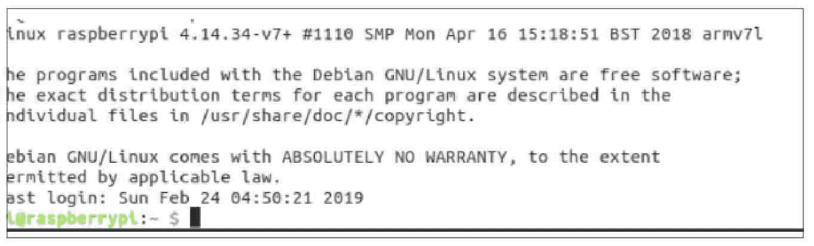

**Figure 1-1**

Command Parameters Can Modify Its Behavior. For Instance, The `-a` Parameter Of The `ls -a` Command Can Display Usually Hidden Files Starting With `.`; `ls -al` Can Display More Relevant Information, Specifically As Follows:

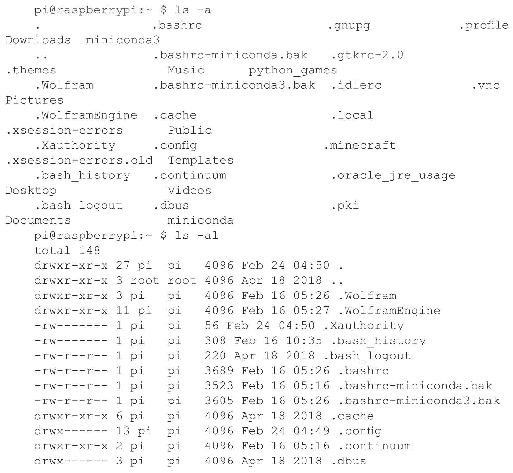

### 1.1.2 Historical Anecdote Of The `ls` Command

In Future Command Line Usage, Whenever You Enter A Command, You Need To Press The `Return` Or `Enter` Key To Tell The Raspberry Pi System That You Have Finished Entering A Command.

If You Are Used To Using A File Manager To Locate Files And Folders, Then Before Starting To Manage Files With The Command Line, You Must First Erase The Stereotypical Impression Of File Icons In Your Mind. Open The Terminal, Input `ls` And Press `Return`. If On The Latest Raspberry Pi Stretch System With Recommended Software Installed, You Will See Some Folders, Including MagPi. Input `ls MagPi`, Then You Will See What Is Inside The MagPi Folder.

The Design History Of The `ls` Command Dates Back To The Era When Computers Only Had 110 Baud Serial Lines And Used ASR33 Terminals. You Might Wonder, Why Do We Use These Ancient Programs? Haven't These Designs Become Obsolete After Such A Long Time? Actually, In The Engineering Field, These Classic Designs Often Have Very Long Lifespans Because Their Impact Is Profound, Even Changing People's Usage Habits, So They Continue To Be Used. For Example, The QWERTY Layout On Our Keyboards Is Influenced By Typewriters. Back Then, It Was To Prevent Typewriters From Jamming Due To Mechanical Failure, And Also To Make It Convenient For Typists To Type "typewriter" Using The Top Row, Resulting In This Design.

### 1.1.3 File (Folder) Paths

You Just Need To Use The Name Of The Folder You Want To View As A Parameter To View The Contents Of Any Folder In The System (Or Other Systems Connected Via Network). File Paths Follow The File System Structure: On A Windows Machine, It Starts From "My Computer"; On Your Raspberry Pi, The Root Directory Is `/`, We Call It Root.

Try Inputting The `ls /` Command. We Get Some Unclear Content Again, Including Names Like `bin`. `bin` Is Short For `binary`. It Stores Many Applications (Try Inputting `ls /bin` To View The Contents). `ls /dev` Outputs Hardware Device Information. Try Inputting `ls /home`. You Should See The Name `pi`. This Is Your Own User Folder. You Are Currently Logged Into The System As "pi". If You Changed The Login Username Or Added Extra Users, Their Home Folders Will Also Show Here. Every System User Has Their Own Corresponding Home Folder; Yours Is `/home/pi`. Before This, When Inputting `ls MagPi`, We Were Already In This Folder. For Example:

```
pi@raspberrypi:~ $ ls /home
pi
```

Using The `ls /home` Command Outputs All Users' Home Folders. On My Machine, There Is Only The Default User pi.

If You Want To Confirm The Absolute Path, Just Use The `pwd` Command.

### 1.1.4 Home Directory And Changing Folders

For All Logged-in Users, Their Home Directory Can Be Abbreviated As The `~` (Tilde) Symbol. That Is To Say, If You Are User pi, Then `~` Represents Your User Home Folder `/home/pi`. Input `ls ~`, Then You Will See What Is Currently In Your Home Directory. However, The Raspberry Pi Hides Many Files And Folders. These Hidden Files Usually Start With A Dot. Hidden Files Contain Configuration Information About Your System And Programs. Normally You Don't Need To See These Files.

But When You Want To See Or Modify These Files, Just Add The `--all` Parameter Or The Abbreviation `-a` To The `ls` Command: `ls -a`. Traversing The File System In The Command Line Is Much Easier Than In The GUI, Especially When Using Various Abbreviations. The `ls -a` Command Shows The First And Second Folders Are `.` And `..`, Representing The Current Path And The Parent Path Of The Current Folder. Try Viewing Your Parent Folder Path From `/home/pi`. Inputting `ls ../../` Will Show The Grandparent Folder. If You Don't Want To See `.` And `..` In The Output List, Just Change `-a` To `-A`.

Before We Introduce Other Commands, Let's See What Happens When Combining Various Parameters. For Example, The `ls -lh` Command. The `-l` Parameter Tells You More File Information. The `-h` Parameter Converts File And Folder Size Units To Common KB, MB, Or GB. In Subsequent Chapters, We Will Further Explain The Meaning Of The `ls -l` Output Content.

Generally, `ls -al` Suffices For Daily Use.

**Absolute Path**

The `~/mylisting4.txt` We Use Is An Absolute Path Because The Path Is Written Out Fully. If You `cd` To The `~` Home Folder, You Can Just Use `mylisting4.txt`. At This Time, The Effect Is The Same As `~/mylisting4.txt`. This Is A Relative Path.

To Change The Current Folder, You Can Use The `cd` (Change Directory) Command. This Command Lets You Move To Any Location In The File System. For Example, Use The `cd /var/log` Command To View The Contents Of The Var Folder:

```
pi@raspberrypi:~ $ cd /var/log
```

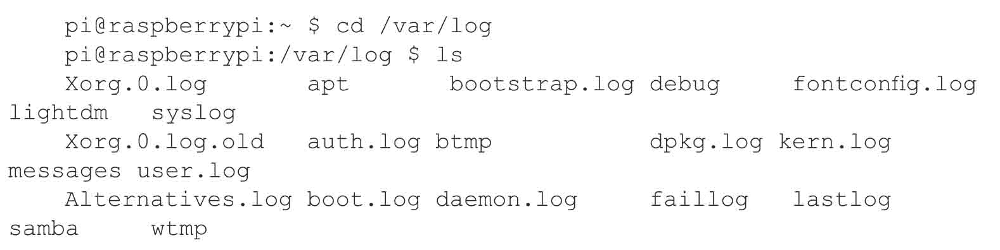

The `/var/log` Folder Stores Various System Status Logs For Later Analysis. For Personal Daily Use, You Don't Need To Often Check The Contents Of These Files. For Those Raspberry Pi Devices Running In Data Centers And Supercomputers, This Monitoring Information Is Very Important. For Us, Roughly Understanding These Files Is Still Necessary, Especially Later When Encountering Problems And Seeking Help, The Error Messages Inside Can Accurately Locate The Problem Source.

Using The `cd ~` Command Takes You Back To Your Home Folder. Try It Yourself. Then Use `pwd` To Verify The Result. Next Try `cd -`. `-` Is The Abbreviation For The Previous Directory Path You Were In. Now We Have Learned How To View Folder Contents And Jump Between Them. Next We Will Learn How To Handle Files.

## 1.2 File Read/Write

Using The `tail` Command Can Print The End Part Of A File, As Shown In Figure 1-2.

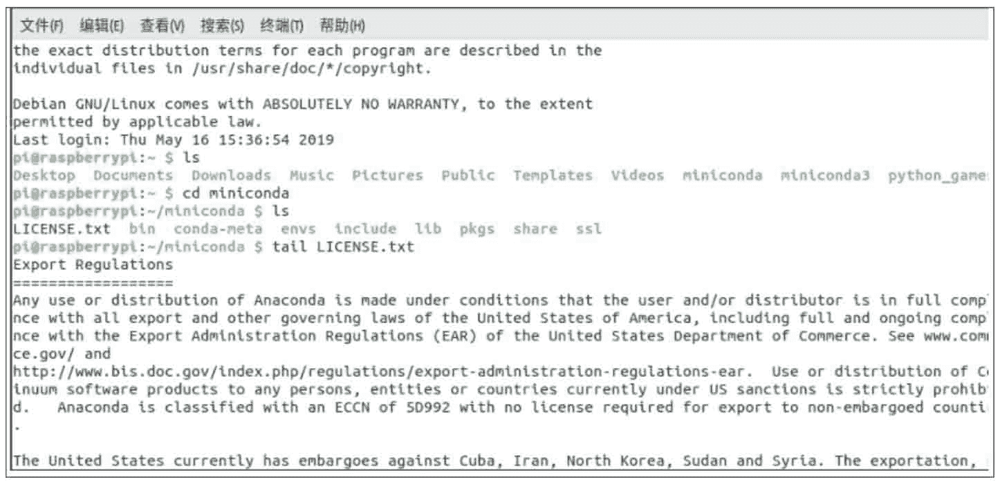

**Figure 1-2**

Many Commands Have Corresponding Info Pages. These Pages Are Much More Detailed Than Man Pages. If You Want More Information On These Commands, You Can Use The `info` Command. For Example, Using The `info nano` Command Returns The Nano Getting Started Guide:

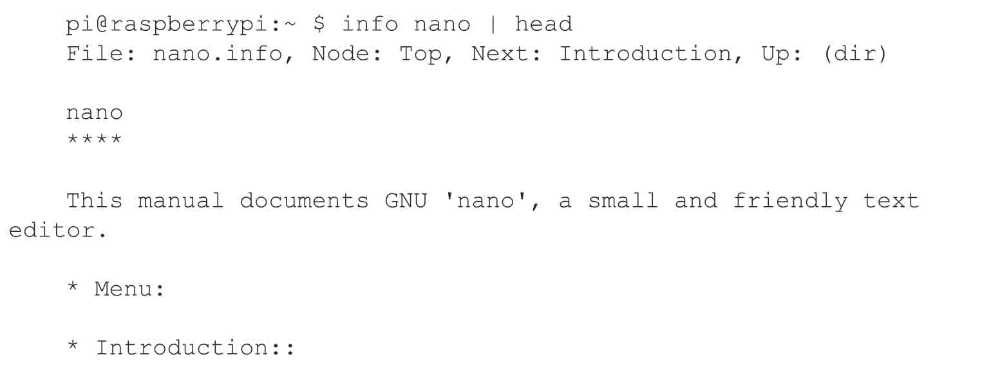

Now We Have Mastered How To Access Folders And View Files Inside. It Is Time To Learn How To Create, View, And Modify Files And Folders. These Commands Are Not Difficult At All. Once You Can Use Them Proficiently, You Can Work Easily In The File System.

### 1.2.1 Creating Folders

We First Learn How To Create A New Folder. Open A New Terminal Again And Go To Your User Directory (Home Folder). Input `mkdir tempfolder`. Then Use The `ls` Command To View The Current Directory, As Shown Below:

```
pi@raspberrypi:~ $ mkdir tempfolder
pi@raspberrypi:~ $ ls
Desktop   Downloads Pictures Templates miniconda   python_games
Documents Music     Public   Videos     miniconda3 tempfolder
```

`mkdir` Means Create A Folder. Next, Let's Do A Small Exercise To Help You Get Familiar With This Command.

Input `cd tempfolder`. Then Copy Some Files To The Current Directory.

First, Confirm You Have Installed Python Games. If Not, You Can Go To System Preferences, Then Select Recommended Software, Then Click The Option Next To Python Games To Install. We Use The Following Commands To Copy:

```
cp /usr/share/python_games/fourinarow.py .
cp /usr/share/python_games/4row_* .
```

**Note**

(1) On My Raspberry Pi, `python_games` Installs At This Location. On Different Machines, The Situation May Vary.

(2) If You Want To Quickly Open A File, You Can Also Press The `Alt+F2` Key Combination. A Window Will Pop Up. Input The Relevant Command Name Inside, E.g. `lxterminal`, To Open An App More Conveniently.

(3) The `.` At The End Of The Above Commands Represents The Current Directory. That Is The Folder We Want To Copy Files To. Also, `4row_*` Can Be Understood As All Files Starting With `4row_`. `*` Is Generally Called A Wildcard. It Can Match A String Of Any Length, Including An Empty String. `?` Can Match A Single Character.

Input `python fourinarow.py`, And You Can Run The Game. The Interface Is As Shown In Figure 1-3.


**Figure 1-3**

You Can Use A Text Editor To Modify The Source Code Of This Game. For Example, We Use The Built-in `nano` Editor, As Shown In Figure 1-4.

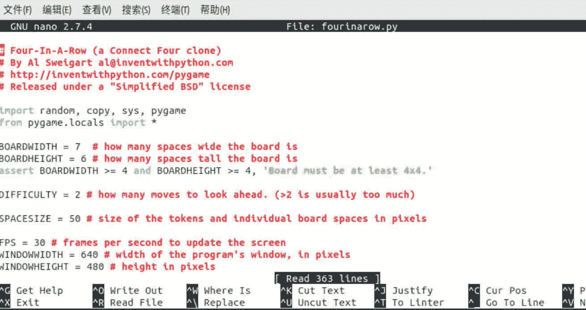

**Figure 1-4**

The History Of The `nano` Editor Predates The Familiar `Ctrl+C` Shortcut. And It Has A Different Design From The Familiar Notepad. So It Might Feel A Bit Strange To Use.

The Shortcuts Of `nano` (Marked At The Bottom Of The Editor) Are Set Strangely. But They Are Worth Learning. They Help With Using Various Linux-like Systems Later.

### 1.2.2 Editing Files And Paging

Next, Please Operate As Instructed. First, Use The Command `nano fourinarow.py` To Open The Game Source Text File. Use The Arrow Key To Go Down 9 Lines. Then Change `BOARDHEIGHT` From 6 To 10. The Last Two Lines Of `nano` List Its Shortcuts. `^` Means `Ctrl`. `Ctrl+O` Means Save File. `Ctrl+X` Means Exit Edit. Now Opening This Program Will Show A Larger Board. The Display Space Is Larger. But This Way The Desktop Top Lacks Space. So We Change `BOARDHEIGHT` Back To 9.

Via The `cat` Command, You Can Directly Output The Content Of `fourinarow.py` In The Terminal (`cat fourinarow.py`). But For Large Files, This Produces A Large Amount Of Text Output In The Terminal. If You Want To View One Part At A Time, You Can Use A Pager Program. Inputting The `less fourinarow.py` Command Lets You Use `PAGE UP` And `PAGE DOWN` To Scroll Up And Down. Pressing The `Q` Key Exits The `less` Command (This Applies To Man Pages Too).

**Getting Help**

When You Want To View Basic Help For Some Commands, You Don't Need To Always Enter The Corresponding Man Page. Just Input The `--help` Parameter. For Example, You Can Try `rm --help`.

### 1.2.3 `cat`, `head` And `tail` Commands

The `cat`, `head`, `tail`, `less`, And `more` Commands Are Very Important In Your Future Usage. And Their Functions Are Very Similar. They All Output The Content Of A Text File To The Terminal. But The Output Format And Method Differ. The Best Way To Understand Them Is To Open The Command Line, Pick Any File As A Test Subject, And See The Effect Of These Commands On This File. Following Are Some Examples:

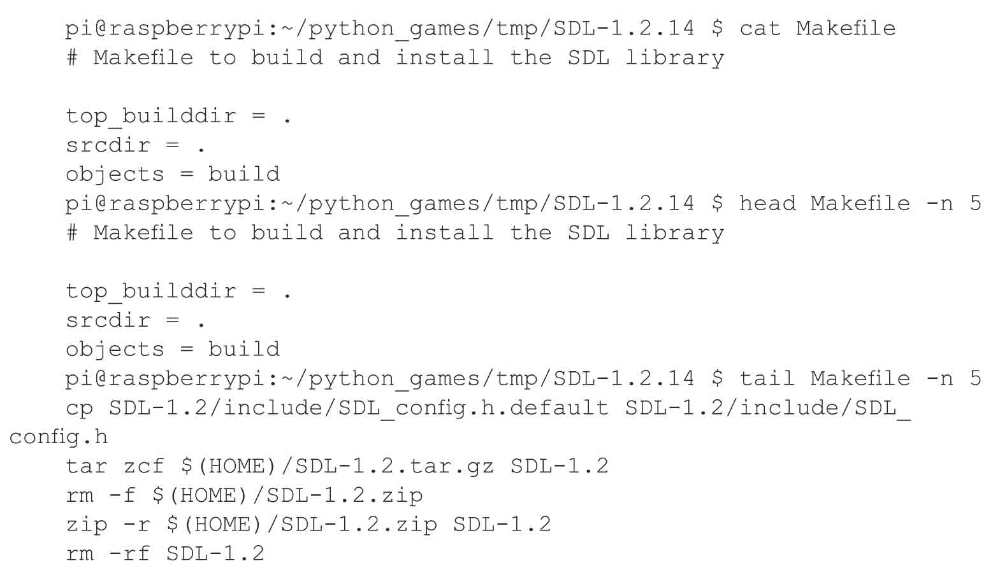

The `cat`, `head`, And `tail` Commands Directly Output File Content. `cat` Outputs All Content. `head` Outputs The Beginning Part. `tail` Outputs The End Part.

The `more` Command Is Similar To `cat`. But It Displays Page By Page. More Convenient For Users To Read Page By Page. The Most Basic Command Is Press Space To Show Next Page. Press `B` To Go Back To The Previous Page. `less` Is Similar To `more`. But `less` Allows Free Browsing Of The File. While `more` Only Moves Forward, Not Backward. And `less` Doesn't Load The Entire File Before Viewing. Also, `more` Is More Convenient Than `less` In That `more` Auto Exits At The End Of The File. No Need To Press `Q`. When You Need To Print File Content To The Terminal, You Can Just Use `cat`. This Command Is One Of The Most Used File Commands Later.

`cat` Is Short For `concatenate`. When You Use `cat` On Multiple Files, It Concatenates Them. Example As Follows:


### 1.2.4 小心使用 rm

```
pi@raspberrypi:~/python_games $ echo a > a.txt
pi@raspberrypi:~/python_games $ echo b > b.txt
pi@raspberrypi:~/python_games $ cat a.txt b.txt
a
b
```

`head` 与 `tail` 命令分别可以显示文件的前几行与后几行。举例来说，`head fourinarow.py` 会显示文件的前 10 行。`head -n 5 fourinarow.py` 会显示文件的前 5 行，`tail -n 5 fourinarow.py` 会显示文件的后 5 行。你也可以使用缩写语法，比如 `head -5 fourinarow.py` 也可以显示前 5 行。

如果要删除文件，可使用 `rm` 命令：

```
pi@raspberrypi:~/python_games $ rm -rf *
```

使用 `rm` 时一定要小心，比如上面的语句指令就是整个系统上最危险的指令之一。

`nano afile.txt` 会创建一个新文件 `afile.txt`。尝试着不做任何事直接退出，看看会发生什么。

如果我们直接退出，那么上面的操作会新建一个空的文件，名字是 `afile.txt`。现在，假设要删除这个文件，或者是别的一些不再需要的文件，可以使用 `rm` 命令。`rm` 命令跟之前的 `ls` 等命令不一样，非常危险并且具有破坏性，应该小心使用。虽然它有一些保护机制，但是使用者还是能很容易地避开这些保护机制。永远不要尝试 `rm -rf /`，这样会删除系统上的所有文件。更严重的是，这个操作是无法撤销的。

现在让我们回到 `tempfolder` 文件夹，看一看在这一章里新建的文件。输入 `ls` 命令，你会看到刚刚复制进来的文件。接下来尝试着用如下命令删除文件：

```
rm fourinarow.py
rm 4row_*.png
```

使用 `cd ..` 命令回到 `/home/pi` 文件夹。`rm -r tempfolder` 会删掉现在已经空了的文件夹。`-r` 选项在删除文件夹时是必须使用的，同时这个选项也会递归删掉所有文件夹内的文件。

## 1.3 安装软件与用户权限

安装软件原本是一件非常简单的事，但其背后错综复杂的文件依赖使得这件事情没有那么轻松了。Linux 系统分离软件包与依赖的设计减少了重复安装所需要的硬盘空间，但是也造成了一些潜在的问题。幸运的是，Debian 系统在 20 世纪 90 年代解决了这些棘手的问题，解决方案是 Debian 包管理器以及 APT 包管理器。由 Debian 衍生出的各种系统（比如 Ubuntu 以及树莓派系统）都沿用了这个优秀的解决方案。现在我们先介绍一下通过命令行安装文件的方法，然后看一下文件所属用户组以及执行权限的问题。

使用 `apt` 命令可以非常简单地更新系统上安装的软件 `apt-get update`。尝试着以用户 `pi` 的身份执行这条指令，然后你会得到一条报错信息。原因是在 GNU/Linux 系统上只有超级用户，也就是 `root` 用户有权限执行这条指令。

### 共享你的设备

如果你想要共享树莓派设备，就应该先查阅一下 `sudo` 以及 `visudo` 指令，确保给予其他用户正确的权限。

`apt` 包管理器是 Debian 类系统的默认包管理器，所以从 Debian 衍生而来的 Raspbian 自然而然地采用了这种包管理器。与此同时，其他的 Linux 发行版（比如 CentOS）有自己的包管理器 `yum`，甚至 macOS 下也有自己的管理器 `homebrew`，了解并且学习一些其他的包管理器也是十分有必要的。

### 1.3.1 了解 sudo

在我们详细讲解用户权限之前，我们先来谈谈 `sudo` 指令。`sudo` 指令简单来说就是给普通用户提供了使用 `root` 权限的权利。在树莓派系统上，在命令前加上 `sudo` 指令几乎能让你完成任何操作，当然也包括一些危险的操作，所以一定要小心使用！

需要注意的是，`sudo` 其实是系统上的一个软件，如果你的系统遇到了 `sudo` 命令找不到的问题，就可能需要 `apt-get install sudo -y`，在一些纯净的镜像上 `sudo` 程序是不会被安装的。

以下的两条指令可以更新树莓派系统中安装的程序：

```
sudo apt-get update
sudo apt-get upgrade
```

你可以同时用一条指令完成上述任务：

```
sudo apt-get update && sudo apt-get upgrade
```

`&&` 是逻辑运算符号“与”。简单来说，它的意思就是如果与符号左边的指令没有成功运行，那么右边的就不会执行。

在每次安装新软件前执行更新操作是一种良好的习惯。因为刚才我们已经更新过了，所以现在可以直接安装一些终端游戏：

```
sudo apt-get install bsdgames
```

### 1.3.2 软件列表

`apt-cache search games` 命令可以在软件列表中搜索特定类型的软件。同时，你也可以通过 `apt-cache show bsdgames` 命令查看某一个软件包。APT 是 `dpkg` 的一个前端实现。关于 `dpkg` 命令，你可以尝试 `dpkg -l`，这条指令会打印出系统上已安装的软件（注意，在一个全新的系统上这条指令也会打出很长的列表）。

在这里我们简单地介绍一下 `dpkg` 指令，因为虽然在 Raspbian 下有非常好用的 APT 包管理器，但有时你还是会遇到一些需要自己手动安装 `.deb` 包的情况。`dpkg` 是 APT 的底层依赖，功能是安装和卸载 `.deb` 包。比如说你拿到了一个网络上下载的 `.deb` 包，然后就可以使用 `dpkg` 命令来安装了。在这里顺便提一下，一般 Debian 系统可能会提供图形界面的用来安装 `.deb` 包的软件，但是使用 `dpkg` 才是你应该掌握的正确方法，毕竟 Linux 下图形界面软件的可靠性比较有限，而且图形界面即使出了错你也不知道根源在何处。使用 `dpkg` 命令安装软件的命令是 `sudo dpkg -i`，后面接上软件包的名字即可。

已经下载的软件包会存档在 `/var/cache/apt` 文件夹中。当你发现硬盘空间不足时，`sudo apt-get clean` 命令会自动清除这些存档，同时不会影响到已安装的软件。你也可以尝试 `sudo apt-get autoremove`，这是笔者常用的一条清理指令，可以删除一些过时的旧版软件包。

现在尝试使用命令 `ls -lh /etc/apt`，同时观察对应的输出：

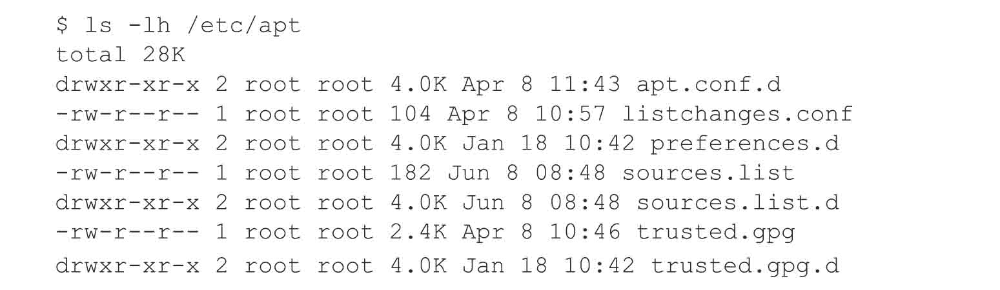

观察输出信息，`sources.list` 对应的信息为 `-rw-rw-r--`。这些信息告诉了你不同用户组的不同用户在使用这个文件上的对应权限。文件夹内的其他项对应的信息以字母 `d` 开头，这是因为它们是文件夹。`sources.list` 对应的文件信息以 `-` 开头，表明这是一个常规文件，而剩下的文件信息位表明了文件的使用权限。

再尝试观察 `ls -l /dev/input` 的输出：

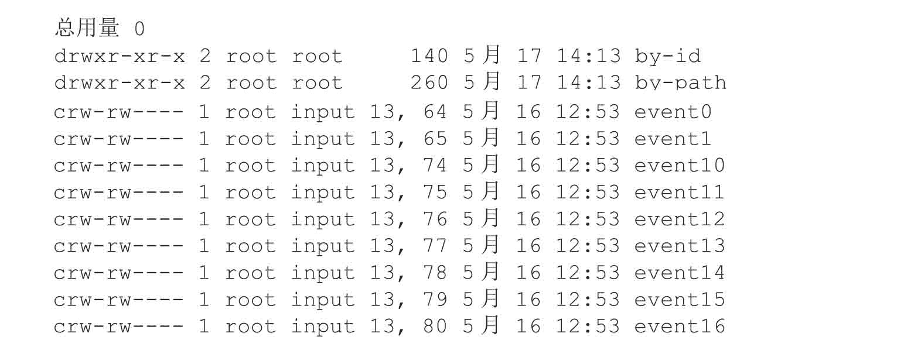

有些项以字母 `c` 开头，这是因为它们是硬件设备。在 Linux 上，所有东西都是文件，包括你现在使用的鼠标。

每一个文件都有对应的所有者与所有组。举例来说，你的 `home` 文件夹下的内容所有者就是你自己。试着输入命令 `ls ~ -l`，那么你应该在输出中看到 `pi`。`pi` 表明了文件的所有者与所有组（假设你以 `pi` 用户身份登录）。注意，把 `-l` 放在命令尾部不是一种好的习惯，这里是知法犯法，为的是向你们展示各种可能的情况。接下来尝试命令 `ls -l /dev`，你会发现所有者与所有组并不总是相同的。

### 1.3.3 文件属性

Linux 的文件属性设计是对安全性的有力保障，但也会带来使用上的问题。如果在执行命令的过程中遇到了权限问题，就试着在命令前加上 `sudo`。

文件属性是文件类型后包含字母 `rwx` 的序列。文件属性能够告诉你某一用户能否读取、运行这个文件。如果你想要运行一个程序（比如之前的 `python games`），在你的文件属性中需要包括 `x`；对于文件夹来说，`x` 属性允许你 `cd` 到它的内部。

现在尝试 `cd` 到 `/usr/share/python_games` 并且输入命令 `sudo chmod a-x launcher.sh`，这里的 `a` 表示所有组（`user`、`group` 与 `others`），使用 `u`、`g`、`o` 可以只改变一个组对应的权限。修改过后，现在你已经无法执行我们的 Python 游戏了。想要恢复权限，我们可以使用指令：`sudo chmod 755 launcher.sh`。

上面的数字 `755` 是另一种表示权限的方式。3 个数字分别代表 `user`、`group` 与 `others` 这 3 个组对应的权限。那么这些数字如何解读呢？一般来说，`4` 代表读权限，`2` 代表写权限，`1` 代表执行权限。在解读的时候，我们把这些数字加起来即可。举例来说，`7=4+2+1`，那么 `7` 也就表明对应的用户组对这个文件有读、写、执行的权限；`5=4+1` 表明有读、执行的权限。在当前目录执行 `ls -l`，你会发现在 `launcher.sh` 的权限变为了 `-rwxr-xr-x`。

`chown` 命令与 `chgrp` 命令可以改变文件所属的用户以及文件所属的用户组。在当前目录下新建一个文本文件 `myfile.txt`，然后输入 `sudo chown root myfile.txt`，你会发现现在这个文件只能读，不能写了。运用相似的原理，你可以尝试着新建一个可以写、可以执行但不能读的文件。

```
pi@raspberrypi:~$ id
uid=1000(czk) gid=1000(czk) 组=1000(czk),4(adm),24(cdrom),27(sudo),30(dip),46(plugdev),118(lpadmin),129(sambashare),996(docker)
```

`id` 指令显示你现在的用户组访问信息，这决定了你使用、修改文件与设备的权限。

一般来说，`chmod 755` 是你在之后的工作日常中经常要使用的命令，当你在网上下载了一个脚本文件却发现无法运行时，那么先确认文件的使用权限，然后使用 `chmod` 命令为它加上执行权限。

## 1.4 管道与流处理

树莓派以及其他的 UNIX 系操作系统以流的形式处理命令的输出。也就是说，你可以使用管道运算符链式处理流文本。

当一个命令在命令行执行的时候，有 3 个与它相关的流，分别是标准输入流、标准输出流以及标准异常流。这些流的本质是文本，树莓派会把它们当作文件处理。在 UNIX 类系统中，一切都是文件。这也是为什么作为 UNIX 家族一分子的树莓派系统能够通过简单的命令构建出复杂且可靠的系统。

### 1.4.1 重定向

标准输入流与你输入的文本有关，而标准输出流、标准异常流一般是一起出现的。之所以要把后两者在设计的时候分开，是因为你可能需要把它们之中的一个重定向到特定的位置。比如说，把报错信息重定向到标准输出之外。接下来我们先学习如何重定向标准输出到其他的命令与文件。

我们在这里使用的是管道操作，用 `|` 符号表示。举例来说：

```
ls -l /usr/bin | wc -l
```

前一个语句原本应该输出到标准输出，加上管道以后，会重定向到 `wc` 命令。`wc -l` 命令会统计 `ls` 输出的信息有多少行。所以上面的这条复合指令能够统计某一文件夹下文件与文件夹的数量。

```
$ ls
Desktop Documents Downloads MagPi Music Pictures Public Templates Videos
$ ls -l /usr/bin | wc -l
1229
```

### 1.4.2 grep 命令

`grep` 是我们要学习的非常重要的指令，请看下面的示例:

```
$ grep if /usr/share/python_games/catanimation.py
```

这条指令会打印出对应 Python 代码里包括了字符 `if` 的每一行。也就是说，以 Python 为例，包含 `elif` 或者 `gift` 的行也会被包括进去。想要更复杂的匹配结果，你可以使用正则表达式。

```
pi@raspberrypi: ~/visualizatoin$ grep if visual.py
if __name__ == '__main__':
```

接下来，让我们结合一下以前学过的 `dpkg` 与现在的 `grep`：

```
$ dpkg -l | grep -i game
```

`-i` 选项表明对大小写不敏感，也就是说 `Game` 与 `game` 是相同的。

再结合之前的 `more` 命令，`dpkg -l | more` 会一次打印一页的内容；`sort` 指令可以排序输出的结果：

```
$ ls ~ /usr/share/python_games | sort -f
```

`-f` 表明忽视大小写。

还可以结合之前的 `uniq` 命令来排除重复的项：

```
$ ls ~ /usr/share/python_games | sort -f | uniq
```

### 1.4.3 正则表达式

在介绍完这些指令的基本功能之后，我们在这里对正则表达式做一个入门的讲解。如果你对这一部分不是特别感兴趣，可以暂时跳过，这将不会对你的后续学习有任何影响。

为什么要使用正则表达式呢？正则表达式被我们用来匹配一定的文本模式。更具体地说，它可以被用来处理一类特定的文件。举个比较简单的例子，你想要处理文件夹下所有的 `txt` 文件，那么你可以使用 `*.txt` 这样的表达式来匹配所有的文本文件，使得同时处理大量的文件变成非常简单的一件事情。

接下来介绍一下基本的语法。鉴于篇幅的限制，不可能做原理上的详细讲解，但会尝试以一种简单易懂的方式介绍清楚基本的语法。

正则表达式中的匹配主要依赖于特殊字符，在 Linux 命令行下的这种正则表达式语法下，`\.`、`\*`、`\[`、`\]`、`\^`、`\$`、`\\`、`\+`、`\?`、`\|`、`\(`、`\)` 被定义为特殊字符。碰到了一个问题，如果想要匹配的文本里本身就包含这些特殊字符怎么办呢？

答案很简单，你只需要把这些特殊字符进行转义，而转义的工具本身也是特殊字符 `\\`。接下来在讲解示例的过程中会用到一个命令 `awk`。`awk` 是 Linux 系统上非常流行的行处理器，它的特点是一行一行地处理数据，然后进行处理化的输出。

请看一个简单的示例：

```
$ awk '{print $0}' /etc/passwd
```

这条指令的意思是原封不动地打印 `/etc/passwd` 的内容。`$0` 代表整行内容。再看下面的示例：

```
$ awk '{print " "}' /etc/passwd
```

这条指令的意思是打印与 `/etc/passwd` 具有相同行数的空行。从这两条语句的输出行为可以看出 `awk` 按行处理文件的特性。在一行一行获取到文本内容后，`awk` 提供了很多处理的相关功能，在这里我们就不进行介绍了，因为 `awk` 并不是这里讲解的重点。

接下来回到正则表达式的讲解部分。下面的指令展示了该如何匹配特殊字符：

```
$ echo "\\ is a special character" | awk '/\\\\/{print $0}'
```

在这里我们用 `\\\\` 转义 `\\` 符号。这里的 `//` 表示 `awk` 里的匹配代码块，后面这句 `awk` 的意思可以理解为输出匹配成功的所有整行。

因为 `//` 也有对应的特殊含义，所以也需要转义，示例如下：

```
$ echo "3 / 2" | awk '/\\//{print $0}'
```

接下来我们讲解正则表达式里的其他一些问题。你可能会在实际使用中碰到这样的情况，一个单词在句子中多次出现，但你只想匹配那种单词在开头出现的模式，那么你需要用到 `^` 符号，它匹配的不是文本，而是位置（这在一开始可能难以理解，你需要想清楚这里位置的含义）。举例来说：

```
$ echo "welcome to likegeeks website" | awk '/^likegeeks/{print $0}'
```

没有对应的输出，而

```
$ echo "likegeeks website" | awk '/^likegeeks/{print $0}'
```

输出 `likegeeks website`。

接下来是匹配的重头戏 `.` 符号。`.` 符号可以匹配除了空字符串外的所有字符，比如：

```
$ cat myfile
this is a test
This is another test
And this is one more
start with this
$ awk '/.st/{print $0}' myfile
```

输出：

```
this is a test
This is another test
```

如果你不想匹配所有的字符，而仅仅是几个特定的字符，可使用 `[]` 符号，例如：

```
$ awk '/[oi]th/{print $0}' myfile
```

输出如下：

```
this is a test
This is another test
```

我们甚至可以反向选择，排除对应的字符，示例如下：

```
$ awk '/[^oi]th/{print $0}' myfile
```

这样会排除有 `o` 和 `i` 出现的情况。

使用 `-` 字符可以表示范围，示例如下：

```
$ awk '/[e-p]st/{print $0}' myfile
```

最后看一看 `*` 符号。在正则表达式里，它有不太一样的含义，这一点在使用的时候千万不要混淆。`*` 在 bash 里有着与刚才 `.` 类似的含义，但可以匹配多个字符；而在正则表达式里，它并不匹配字符，而是表示一个模式可以重复多次或零次。

```
$ echo "st" | awk '/s[ae]*t/{print $0}'
```

输出 `st`。

```
$ echo "awwwwwk" | awk '/aw*k/{print $0}'
```

输出 `awwwwwk`。

### 1.4.4 文件重定向

符号 `>` 可以重定向输出流的位置。比如说，可以输出到一个新建的文件，也可以覆盖一个已经存在的文件。请看如下示例：

```
$ ls /usr/bin > ~/mylisting4.txt
```

现在文件 `mylisting4.txt` 里已经包含了命令输出的内容，如下所示：

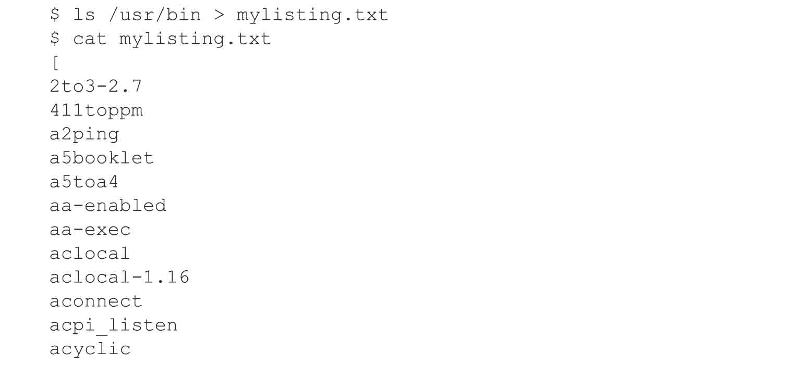

文件重定向可以把命令输出直接保存到一个文本文件里。在上论坛询问网友前，先把你的报错信息保存起来，坛友经常会要求看到错误信息再帮你分析。

注意，输出的布局在文件与命令行里是有所不同的。在命令行里，为了节省空间，一般会把很多项挤在一行里，但重定向到文件后，一行只有一项内容。大部分命令都是以行为最小单位来处理文本的，比如说我们刚刚学过的 `grep`。另外，注意有些命令在使用管道时需要用 `-` 作为占位符，比如 `cat`：


### 1.4.5 添加内容

有时我们想向文件末尾追加内容，就应该使用 `>>` 符号：

```
$ echo "& one more for luck!" >> ~/mylisting4.txt
```

`echo` 命令把所有在引号里的内容直接打印到标准输出；`-e` 选项可以让你添加一些特殊字符，比如换行符；`tail` 命令允许你查看文件的最后几行，例如 `tail ~/mylisting4.txt`；`<` 可以重定向文件的输入，比如重定向到 `sort` 的输入：

```
$ echo -e "aardvark\nplatypus\njellyfish\naardvark" > list1
$ sort < list1
```

我们可以同时使用 `>` 和 `<`：

```
$ head -n 2 < list1 > list2
```

这样就可以实现从 `list1` 读，再把命令的输出重定向到 `list2`。还可以跟管道相结合：

```
$ sort < list1 | uniq > list3
```

最后，看一看如何分离标准异常流。可以用 `2>` 来重定向异常信息：

```
$ cat list1 list2 list3
$ list42 2> errors.txt
```

这段命令的意思是把没有报错的部分直接打印到命令行里，再把异常信息打印到 `errors.txt` 文件里。注意，使用 `2>>` 的话就不会覆盖原本的文件了。

## 1.5 用户相关命令

现在让我们把目光放到命令行最前面的位置，你应该会看到 `pi@raspberrypi~ $`。我们一般把美元符号 `$` 称为命令符，在美元符号之前是 `~` 符号，是 home 文件夹的简写。在前面的一般形式是 `[用户名]@[计算机的名字]`，在这里是 `pi@raspberrypi`，这里的信息是可以由你自己自定义的。

### 1.5.1 创建新用户

在系统里新建一个新用户是很容易的。输入 `sudo adduser jo` 命令后，系统会要求你输入对应的密码以及一些用户相关的信息（你可以直接按 Enter 键跳过这些选项）。现在有了一个新的用户，可以用 `ls -A` 查看一下对应的 home 文件夹 `/home/jo`。`jo` 还没有登录过系统，所以现在文件夹下没有什么内容，只有 `.bashrc` 与其他的一些配置文件。

并不是每一个用户都有自己的 home 文件夹，输入 `cat /etc/passwd` 后你会发现很多显示的用户并不是真实的操作者。这是因为文件与程序必须属于一个用户，所以你会看到诸如 `sshd` 这样的用户名。为了安全考虑，用户的密码肯定不会直接显示在 `/etc/passwd` 文件里。想要更改密码时，可以使用 `sudo passwd jo` 命令。如果你现在以用户 `pi` 的身份登录，那么输入 `passwd` 就可以更改 `pi` 对应的密码。

在 BASH 命令行里会以环境变量的形式存储一些有用的信息，比如 `OLDPWD` 以及 `USER`。`env` 命令可以显示所有的环境变量。

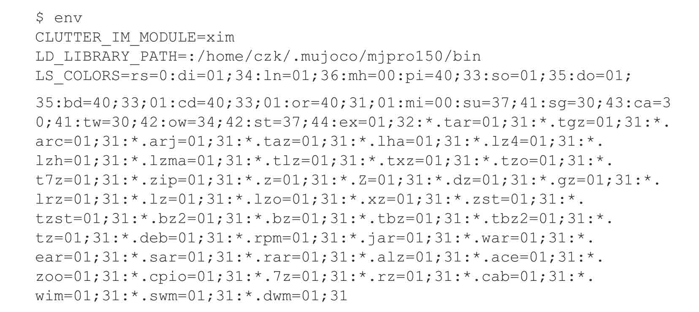

### 1.5.2 切换用户

如果你以 `pi` 的身份登录系统，那么 `~` 是 `/home/pi` 的简写。类似地，`~jo` 是 `/home/jo` 的简写。对于其他用户，也是一样的道理。

`su - jo` 是切换用户的命令。使用这个命令后，你的命令行会加载 `jo` 这个用户的环境变量，然后会跳转到 `/home/jo` 文件夹。注意，在很多 Linux 系统上，`su` 会切换到 root 用户。在树莓派系统上，不建议直接使用 `su`，而是只在需要超级权限的时候使用 `sudo`。`sudo -s` 命令会让你接下来拥有超级用户权限，使用 `exit` 命令可以退出超级用户状态。在一般情况下，不要使用 `su` 或者 `sudo -s` 这两个命令。想要定制命令行，我们可以编辑 `~/.bashrc` 文件。接下来使用 `more ~/.bashrc` 命令查看用户 `jo` 的命令行配置。在文件里，你会看到很多大写的变量，比如 `HISTSIZE` 以及 `PS1`。变量 `PS1` 控制了命令提示符的文本，比如现在是 `jo@raspberry ~ $`，若要改变命令提示符，则只需要改变变量的值 `export PS1="tutorial@magpi >"`。

这只是一项暂时的改变，输入 `exit` 之后命令提示符又变回原来的值。如果你想要永久地改变命令提示符，那么你需要把命令提示符 `PS1` 的值保存到 `~/.bashrc` 文件里。你可以上网去寻找一些特别的定义命令提示符的方法。

每次登录 Bash 命令行，`~/.bashrc` 文件都会被读取。所以，保存在里面的设置会一直生效，除非你把默认的命令行改为 Bash 以外的其他终端。

可以看一看自己系统上的 `PS1` 是如何定义的。例如，在笔者的机器上查看：

```
\[\e]0;\u@\h: \w\a\]${debian_chroot:+($debian_chroot)}\[\033[01;32m\]\u@\h\[\033[00m\]:\[\033[01;34m\]\w\[\033[00m\]\$
```

这里的 `PS1` 定义了大量的配置信息，包含颜色、所在路径等，所以不建议对这个变量进行修改。

### 1.5.3 自定义命令行

接下来研究一些可以帮助你进一步自定义系统的命令。可以通过以下命令查看系统上已经定义了的别名：

```
$ grep alias ~/.bashrc
```

你应该会看到条目 `#alias ll= 'ls -l'`。

去掉 `#` 符号就可以让这个别名生效。用你习惯的文本编辑器打开 `.bashrc` 文件，去掉注释符号，然后在命令行里输入 `ll`，就会得到与 `ls -l` 一样的效果。接下来做更多的更改，把这一行改为 `alias ll='ls -lAhF'`。通过输入 `ll` 得到的输出会更为人性化，以 KB、MB 的格式代替了 byte 以及 `.`、`..`（代表当前）、上级目录。重新打开一个命令行后别名就会生效；若想要取消别名，则可使用 `unalias ll`。

在日常的使用过程中，别名其实是一个非常好用的工具。举例来说，你安装了一个程序，但是它的文件路径很长，手动输入它的路径会很麻烦。具体点说，比如一个可执行程序的存放路径为 `/example/test/test2/test3/test4/a.run`，那么你肯定不希望每次都跑到目录下去执行。在这种情况下，一是选择在环境变量 `PATH` 里修改，二是使用 `alias` 定义别名。示例如下：

```
$ alias count='wc -l'
$ alias netstate='netstat -tunlp'
```

可以尝试着去自定义你自己的命令别名。

创建了一个新的别名后，就没有必要每次输入那么长的文件路径了。

接下来学习如何改变键位。键盘的设置文件在 `/etc/default/keyboard` 目录下，但这个文件对所有用户都是生效的，如果只想改变自己的键位，那么可以使用 `sudo` 打开下列命令：

```
$ touch ~/.xsessionrc
$ echo "setxkbmap el" > ~/.xsessionrc
```

这里的 `el` 可以改成其他语言的键盘。`.xsessionrc` 是只对当前用户生效的，设置完成之后，对这名用户在命令行下使用的所有软件都生效。

## 1.6 硬盘管理

除了树莓派本身自动的 tf 卡硬盘外，有时可能要手动对设备进行控制，比如想要自己挂载一块硬盘，就需用到下面讲的知识了。

在你挂载设备之前，可以使用 `df` 命令查看已挂载的设备，如图 1-5 所示。

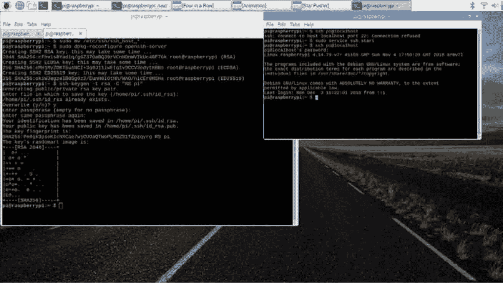

**图 1-5**

`df` 命令有多个功能，包括显示磁盘空间以及查看已挂载的设备等。

### 1.6.1 挂载与连接

往计算机上插入一个设备与从设备上读取数据是完全不同的两个任务。有时计算机知道设备已经插入了，但是其中的信息在设备被挂载前还是不可见的，这就像书本已经在书架上了，但你还未被允许去借阅它一样。

硬盘以及外设是通过树莓派系统的虚拟文件系统进行管理的，使用 `mount` 命令可以查看当前的挂载情况，输出的格式为“设备 挂载点 文件系统类型 选项”。你会看到一些 `none`，不必去理会那些设备。你应该关心的主要设备以 `/dev` 开头，例如 `/dev/mmcblkop1`，这个是与 SD 卡相关的；以及 `/dev/sda1`，这个是与 USB 设备相关的。

现在插入一个 USB 设备。像大多数计算机一样，树莓派会自动挂载好 USB 设备。接下来输入 `mount` 指令，你会看到类似 `/dev/sda1 on /media/pi/UNTITLED...` 这类的输出。通过指令 `sudo umount /dev/sda1`，你可以取消挂载，当然前提是设备不在使用中。

如果你遇到了设备正在使用这样的错误，就尝试切换目录并关闭可能有影响的软件。

### 1.6.2 找到磁盘

`/dev/sda1` 指向 `/dev/sda` 上的第一个分区。下一个插入的设备会储存在 `/dev/sdb1`。你可以通过命令 `tail -f /var/log/messages` 来查看挂载的相关信息。在其他的 Linux 系统上，如果上述指令输出为空，可以尝试查看 `/var/log/syslog`。`fdisk` 是另一个查看设备的指令。`sudo fdisk -l` 指令不会分区，而是会直接打印出连接到树莓派上的磁盘，同时也会给出一些帮助你挂载硬盘的信息。

如果你想要挂载磁盘，那么首先需要一个具有相应权限的挂载点，可以执行下述命令设置挂载点：

```
$ sudo mkdir /media/usb
$ sudo chmod 775 /media/usb
```

树莓派系统会使用一些简单的图形界面程序帮助你完成磁盘的挂载，如图 1-6 所示。

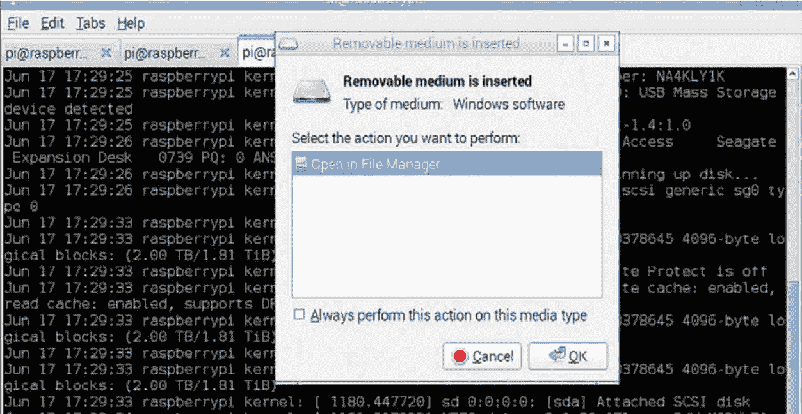

**图 1-6**

除开图形界面以外，执行下述命令可以在终端上提供帮助信息，比如告诉你分区的格式为 NTFS：

```
$ sudo mount -t vfat /dev/sda1 /media/usb
```

这里的 `vfat` 是文件系统类型。

接下来就可以挂载硬盘了。

### 1.6.3 文件系统列表

系统通过 `/etc/fstab` 文件知晓在启动时要挂载哪些硬盘。问题是在启动时如果有两个设备，就可能会选择到错误的那一个上。幸运的是，磁盘有自己独特的“身份证” UUID。`sudo blkid` 命令能够输出这些信息，这与查看 `/dev/disk/by-uuid` 有相同的效果。

对于一个 NTFS 格式的硬盘，输入 `sudo nano /etc/fstab` 并向文件中添加如下命令：

```
/dev/disk/by-uuid/E4EE32B4EE327EBC /media/usb
ntfs defaults 0 0
```

第一项是设备名，第二项是挂载点，第三项是格式，第四项是可选项，最后两项是两个整数设定位。一般将第一项设为 0。第二项是在启动时的顺序数：根文件系统是 1，长期要挂载的硬盘是 1，其他情况是 0。通过 `man mount`，你可以了解更多相关信息。

### 1.6.4 通过 nano 编辑

现在来学习有关 `nano` 编辑器的更多操作。先来看一些快捷键：`Ctrl+R` 是打开文件，`Ctrl+O` 是保存，`Ctrl+X` 是退出。记住的快捷键越多，工作的效率就越高。虽然 `nano` 不像 `vim` 与 `emacs` 那样强大，但是也有一些方便的快捷键功能：`Ctrl+J` 能够重新组织段落，`Ctrl+K` 可以切分行，`Ctrl+U` 实现粘贴功能。自己亲手使用一下会更好理解。

还有一些以 `M-` 开头的快捷键，意思是组合使用 Alt 键。除了 `Ctrl+O` 可以实现保存功能外，`Ctrl+T` 可以跳出一个文件管理器，选定想要保存的位置。

退出 `nano`，输入 `sudo mount -a` 会自动挂载设备到指定的挂载点。如果你在 `/etc/fstab` 里添加了新的设备，那么 `sudo mount /media/usb1t` 会只挂载选中的设备。

`mount -a` 会读取 `etc/fstab` 并且帮你自动处理挂载，如图 1-7 所示。

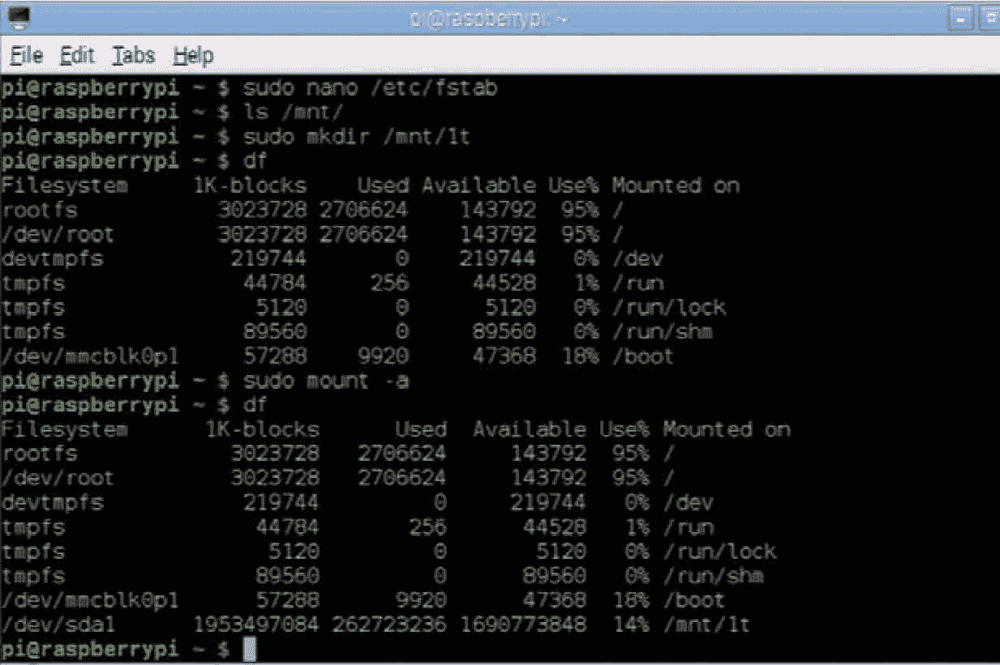

**图 1-7**

# 第 2 章 树莓派命令行操作入门（下）

## 2.1 网络操作

### 2.1.1 配置网络

大部分情况下树莓派会自动进行网络配置，但有时又不得不自行配置网络，接下来讨论如何配置树莓派的网络。

如何把树莓派连接到网络并且获取网络的相关信息呢？只需要用一根网线将树莓派连接到以太网或者直接无线连接到无线局域网上，就可以与外界通信了。这背后的原理是 DHCP 协议，可以帮助你自动对网络进行配置。一般来说，树莓派会被分配一个 IPv4 格式的地址，比如 `192.168.0.37`。其中，`192.168` 代表一段私有网络范围的起点，在你房间里的设备会有 `192.168.0.0` 到 `192.168.255.255` 的 IP 地址。

想要获取你的树莓派的网络连接信息，可以使用 `ifconfig` 命令，如图 2-1 所示。在输出的信息中，你应该会看到自己的 IPv4 地址，比如上面的 `192.168.0.37`。这些数字是在 `eth0` 板块下的，这是因为你现在连接的是以太网。顺便提一下，最快获知 IP 地址的方法是使用命令 `hostname -I`。

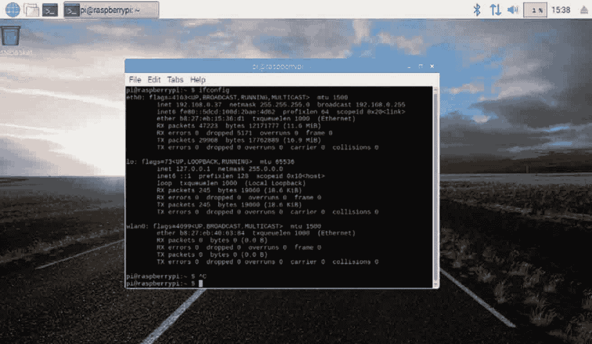

**图 2-1**

一般来说，IP 地址是一个在区间 `192.168.0.0` 到 `192.168.255.255` 之内的私有地址，放在 `eth0` 板块下，这里的 IP 地址是 `196.168.0.37`。

`ifconfig` 命令会返回你的网络地址（包括 IPv4 地址）。

### 2.1.2 配置静态 IP

通常在你的树莓派连接到局域网的时候，系统会自动分配一个 IP 地址。当然，这个自动分配的地址每次连接的时候都会变化。如果你想要每次连接的时候都有相同的 IP 地址，那么应该怎么做呢?

首先，需要修改文件 `/etc/dhcpcd.conf`，如图 2-2 所示。

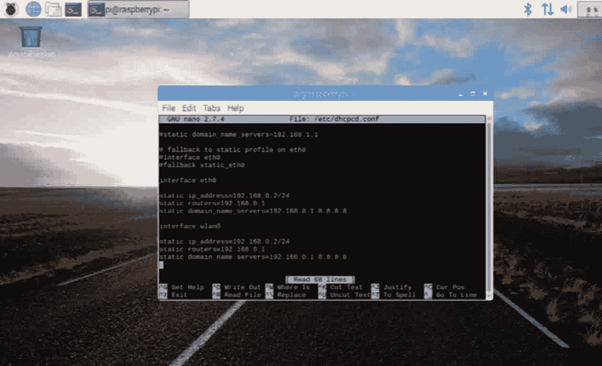

**图 2-2**

通过编辑这个文件，可以自定义连接时的 IP 地址。

通过 `nano` 打开文件，拉到脚本的底端，添加如下脚本:

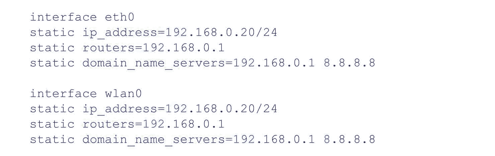

接下来保存文件并退出 `nano`。

使用 `ping` 可以在另一台电脑上测试树莓派的网络情况，如图 2-3 所示。

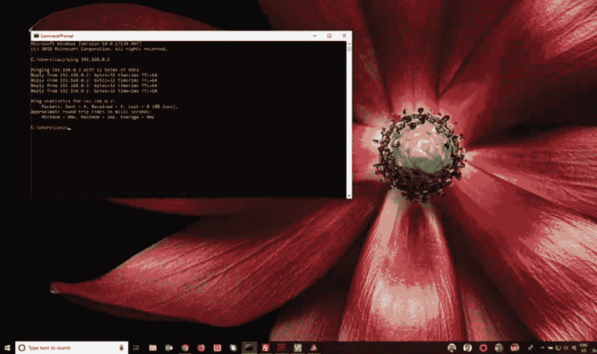

**图 2-3**

现在每次连接网络时树莓派都会有一样的 IP 地址，即 `192.168.0.20`。不使用 `192.168.0.1` 的原因是已经被路由器占用了。当然，你也可以根据喜好自行设定，但要注意范围是从 `192.168.0.2` 到 `192.168.0.255`。

重启，然后输入 `hostname -I`，你应该会看到自己的 IP 地址已经设定成 `192.168.0.20`。一般最好不要把 IP 地址设成静态的，如果想要改回去，只要把刚才添加的内容删除即可。

### 2.1.3 Ping 命令

刚才添加到 `dhcpcd.conf` 中的 `192.168.0.1 8.8.8.8` 设定了域名服务器（DNS）。域名服务器的作用是将字符串型的网址映射为 IP 地址（比如树莓派官网 `raspberrypi.org` 到 `93.93.128.230`）。如果想要通过浏览器和域名来访问网站，DNS 是必需的。

`Ping` 是最基础的网络连接测试命令，会发送一个 ICMP 的 `ECHO_REQUEST` 信号到网络上的设备。ICMP 是每个设备都会内置的用于网络检测的模块。`Ping` 返回的信息包括是否成功连接、延迟、丢包情况等。

一般来说，`ping localhost` 如果正常工作，就会告诉你本地网络回环是正常工作的，并且 `localhost` 被解析到 `127.0.0.1`。注意，名字的解析有时会引发很多问题。

从同一局域网内的另一台计算机上输入 `ping 192.168.0.20`；如果在 Windows 机器上，`Ping` 会测试 5 次；在 Linux 机器上则会一直测试，直到你按下 `Ctrl+C` 快捷键。你也可以自己指定测试的次数:

```
$ ping -c 5 raspberrypi.org
```

`192.168.0.4` 之类的地址是 IPv4 地址，最新的标准是 IPv6。一个 IPv6 地址是 128 位的，比如 `fd51:42f8:caae:d92e::1`。你可以通过 `dhcpcd.conf` 来了解如何设定一个静态的 IPv6 地址。

除了动态 DNS，一些网站（比如 FreeDNS.com）提供公用 DNS 服务器。如果你不想使用 Google 的 DNS 服务，就自行寻找其他替代品。

### 2.1.4 使用 SSH 远程登录

有时你可能想要远程连接一台树莓派设备。在树莓派上使用远程登录非常简单，因为底层的 UNIX 系统提供了大量的远程连接工具。

在现在的互联网远程连接工具中，使用最多的应该就是 SSH 了。SSH 凭借独特的加密特性取代了 telnet 和 rlogin。在第一次初始化完成后，你可以很容易建立一个加密连接。需要注意的是，在使用 SSH 之前，你应该先使用 `passwd` 修改默认的树莓派密码。

可能在你现在的设备上 SSH 服务还没有被打开，那么你应该输入 `sudo raspi-config`，然后打开 SSH 服务，再用 `ifconfig` 命令查看当前的 IP 地址，就可以连接到树莓派了。

在一台基于 UNIX 系统的计算机上，可以直接通过命令行里的 `ssh` 命令进行连接。假设 IP 地址是 `192.168.0.20`，那么只需要先输入 `ssh pi@192.168.0.20` 再输入密码即可。在 Windows 上，可以使用 openssh 客户端或者早期的 PuTTY；在安卓上，可以使用 ConnectBot 或 Termux。

你可以在树莓派上检查 SSH 是否正常工作。如果没有，可以开启 SSH 服务。出于安全因素考虑，应该生成自己的密钥，然后确保不要把私钥分享给别人，如图 2-4 所示。


**图 2-4**

经过上面这些步骤以后，你应该已经通过 SSH 连接到树莓派上了。如果没有连接成功，可以通过在树莓派上输入 `ssh@localhost` 来验证 SSH 服务，同时检查网络设置。

现在已经可以通过局域网里的另一台设备访问树莓派了，接下来更改一些配置使得 SSH 远程连接更加安全。首先，需要修改配置文件 `/etc/ssh/sshd_config`，把其中的 `PermitRootLogin yes` 改为 `PermitRootLogin no`；接下来，输入 `sudo service ssh reload` 重启服务，禁止用户以 root 账户登录。注意 `ssh_config` 与 `sshd_config` 的区别：前者是客户端的配置文件，后者是守护进程的配置文件。你还可以将 ssh 端口换成其他数字，但是要记住在以后连接的时候要指定连接的端口，比如 `ssh -p 12123`。


If you want to access the Raspberry Pi over the internet, you need a public IP address. Generally, if you are connecting via an `ADSL` router, you might not have a public IP. In this case, you might need an internal network penetration service like Peanut Shell (Hsk) (detailed operations can be found on the Peanut Shell official website: `https://hsk.oray.com/`).

Remote file copying and sharing with the Raspberry Pi is also very simple; just use the `scp` command:

```
scp pi@192.168.0.2:/home/pi/testfile1 .
```

This command means copying a file from the Raspberry Pi to the current directory. When using `SCP`, you can also use wildcards and the `-r` option together; the latter allows you to recursively copy all items within a folder.

> **Note**
>
> Using `FTP` is no longer secure; it is recommended not to use it.

### 2.1.5 Shared Folders

`samba` has many customizable options. If you just want it to work properly, you only need to add your workgroup name to the default settings, as shown in Figure 2-5.

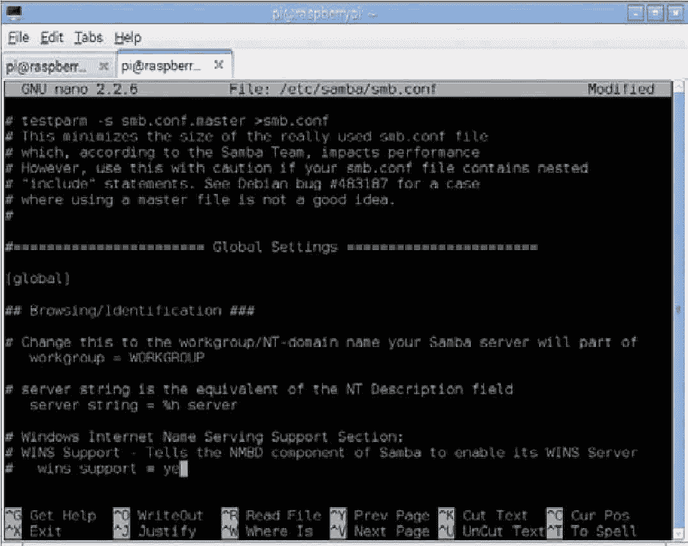

**Figure 2-5**

You might think you need a service like Baidu Netdisk to share files between different machines, but this is unnecessary within a LAN. The `samba` service allows a `Windows` computer to access the Raspberry Pi as a shared device. You can install `samba` with the following command:

```
$ sudo apt-get install samba samba-common-bin
```

Now edit the `/etc/samba/smb.conf` file and modify the `workgroup` variable (set to `WORKGROUP` for versions below `Windows 7`, and `HOME` for `Windows 7` and above). Next, you need to ensure `pi` is a network user:

```
$ sudo smbpasswd -a pi
```

Then restart the service:

```
$ sudo service samba restart
```

You should now be able to see the Raspberry Pi in Windows File Explorer. Now modify the `samba` configuration file to adjust shared devices and permissions:

```
$ sudo nano /etc/samba/smb.conf
```

Jump to the last line and add the following content:

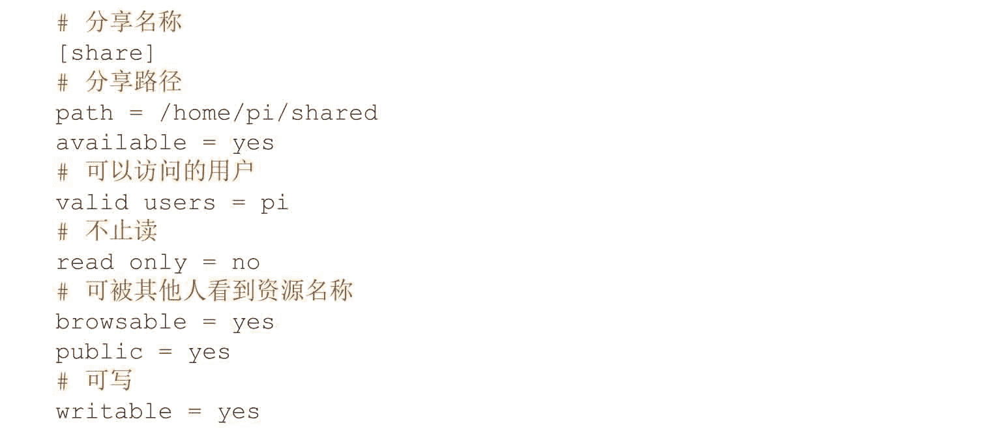

Then restart the service:

```
$ sudo service samba restart
```

At this point, you can access, read, and write to the shared folders.

## 2.2 Process Management

The `top` command displays the `CPU` and memory usage of currently running programs. You can manually suspend a command running in the command line, or use the `fg` command to resume it, as shown in Figure 2-6.

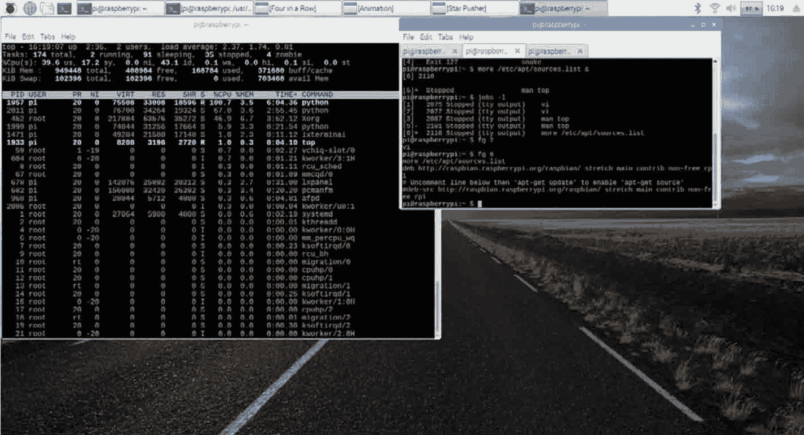

**Figure 2-6**

Sometimes you may feel a running program has frozen and does not respond to your input, including the quit key `Q`. At this point, it seems only `Ctrl+C` can close it. This section deals with "crashes"; you don't need to reboot at all—you can simply close the corresponding process in the background with a few commands.

### 2.2.1 Displaying Processes

You can view processes running on the system using the `ps` command. The `ax` options display all processes for all users; the `u` option specifies displaying processes for a specific user; `w` and `ww` configure the output format.

Try `ps auxww` and other combinations yourself. You will notice there is no "-" before the command's options because this command has been carried over from early `UNIX` `ps`. Other `UNIX` branches have improved the `ps` command, so you might see commands like `ps -e`.

The list returned by `ps aux` has many columns, including username, `PID`, etc., where the first process `init` has a `PID` of `1`.

The `kill` command we will learn next is related to `PID`. If you want to kill a program and know its `PID` is `3012`, just type `kill 3012`. To quickly find a program's `PID`, say the `vi` tool's `PID`, type:

```
$ ps aux | grep -i vi
```

Generally, the `-i` option is not required, but adding it ensures you are not disturbed by case sensitivity issues. The `killall` command followed by the program name, e.g., `killall firefox`, can also close a process.

Now let's look at a slightly more complex example:

```
kill $(ps aux | grep '\[f\]irefox' | awk '{print $2}')
```

Let's talk about `awk` first. We won't go deep into it here; you just need to know it prints the second column of the output, which is the `PID`; additionally, the `\[f\]` trick prevents the `grep` process itself from being included in the output.

### 2.2.2 Modern Process Managers

The output of the `ps` command also tells you some useful information, such as memory and `CPU` usage. Besides `ps`, the `top` command displays real-time changing hardware usage; the `free` command has similar functions, displaying available memory, etc.; `htop` is an enhanced version of `top`, which can be installed and used via `apt`:

```
$ sudo apt-get install htop
```

Of course, the current `Raspbian` system already has the `htop` command built-in.

You can use the mouse wheel to scroll up, down, left, and right through the `htop` output information, and even use the `k` command directly in this interface to kill certain processes. Like the `top` command, you can use the `Q` key to exit this interface. On multi-core processors, `htop` also displays the usage of each core, as shown in Figure 2-7.

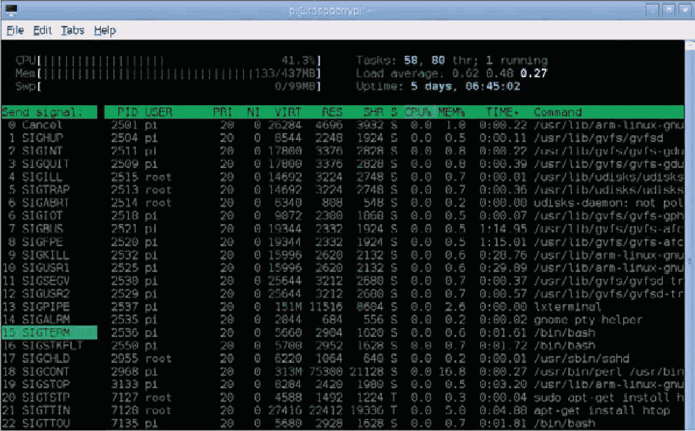

**Figure 2-7**

`htop` not only displays processes and their corresponding usage rates but also allows you to interact with it.

### 2.2.3 Background Tasks

Adding an `&` symbol after a command allows it to run in the background. Try `man top &`, and you will get output similar to `[1] 12768`. The first number is the job number, automatically assigned by the terminal; the second is the `PID`. Now `man top` is running in the background; you can interact with the background task in the command line via the job number. Try opening another task in the background, then type `fg 1`, and you will see the `man` command running again.

For a task, you can use `Ctrl+Z` to suspend it. The `fg` command without parameters always executes the most recently suspended task or background task (note the difference between the two). The job number assigned just now is only valid in this terminal; you can see background tasks by typing `jobs`, and `jobs -l` will also output the `PID`s of these tasks.

`nohup` runs a program in the background, specifically allowing the program to continue executing after the terminal exits. After the terminal exits, the program's output and error messages are saved to the `nohup.out` file (in the directory where you ran the process). This brings us back to the redirection we learned earlier. You can redirect output to another file; `1>` redirects to `stdout`, `2>` redirects to `stderr`, and `&>` redirects to both `stdout` and `stderr`:

```
$ nohup myprog &>backgroundoutput.txt &
```

A common use case for `nohup` is related to network connections. For example, you want to restart an already connected network:

```
$ sudo nohup sh -c "ifconfig wlan0 down && ifconfig wlan0 up"
```

Note that the output `nohup.out` file requires `sudo` permissions to read and write. Of course, you can also change permissions yourself:

```
$ sudo chown pi:pi nohup.out
```

`nohup` is very useful for programs that need to run in the background for a long time, such as a sensor program.

### 2.2.4 Signals

When we kill a process in `htop`, we are actually sending a signal to that process. Common ones include `SIGTERM`, `SIGINT`, and `SIGKILL`.

The first signal is sent when we type `kill` in the command line. Upon receiving this signal, the process will first save data, then release system resources.

`SIGINT` is the signal sent by `kill -2`, which has the same effect as `Ctrl+C`; you will lose unsaved data. `SIGKILL` corresponds to `kill -9`; this signal tells the kernel to close the process immediately without any warning; it is best not to try sending `SIGKILL` directly.

`HUP` signal corresponding to `kill -1` has the lowest danger level; for many daemons, this signal just makes them perform a round of self-check. On machines with very low fault tolerance, `kill -1` is the preferred choice.

## 2.3 Downloading, Compiling, and Installing

The `curl` command has the same basic functionality as `wget`, while also possessing advanced features like setting proxies, cookies, and `FTP` uploads. The `tar` command can compress or decompress files, as shown in Figure 2-8.

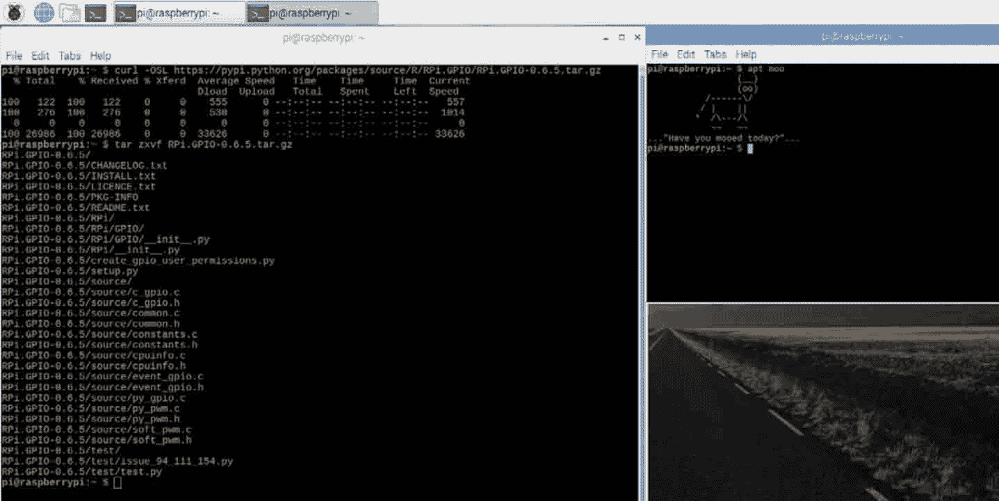

**Figure 2-8**

### 2.3.1 Downloading and Decompressing

`wget` is a very handy tool; its function is to directly download links, but note that it offers no security guarantees. Compared to `wget`, `curl` is a more secure choice. To download a file, we can type:

```
$ curl -OSL https://pypi.python.org/packages/source/R/RPi.GPIO/RPi.GPIO-0.6.5.tar.gz
```

`curl` outputs to standard output by default; `-O` saves the download to a file, `-S` prints errors encountered, and `-L` retries downloading upon encountering errors.

The `GPIO` file we just downloaded is compressed with `gzip` and can be decompressed with `gunzip`, or with the following command:

```
$ tar zxvf RPi.GPIO-0.6.5.tar.gz
```

Note that no "-" symbol is needed here. In `zxvf`, `z` means using `gzip` to decompress, `x` means extract files, `v` means `verbose` (output processing info), and the final `f` means not using standard input but file input.

After decompression, you will get a new folder, and then you can install:

```
$ cd RPi.GPIO-0.6.5
$ sudo python setup.py install
```

If you encounter a `zip` file, just use the `unzip` command directly:

```
$ unzip 2018-11-13-raspbian-stretch-lite.zip
```

### 2.3.2 Manual Compilation

Before package managers appeared, one had to learn to manually compile downloaded software packages. Most software packages at that time were developed in `C` or `C++`, and users often had to compile with `gcc` themselves and handle linking issues.

After `configure` and `make` scripts became widely used, these troubles disappeared. These two scripts can automatically check software dependencies, set correct compilation options, and even install documentation in the correct locations.

Most software provides `.deb` packages, so we can simply use `apt` or `dpkg` to solve the problem. Sometimes projects indeed don't offer such convenience, such as packages downloaded from `GitHub` or manually downloaded source code, which must be compiled manually.

After downloading, the general steps are to decompress the `tar` package:

```
$ tar xvf latest-software.tgz
```

Then `cd` into the source folder, find the `README` and `INSTALL` files; read the `README` file briefly, it usually tells you installation-related matters. Next, you can install; the installation steps are the same in most cases, just these few commands:

```
$ ./configure
$ make
$ sudo make install
```

> **Tip**
>
> Refer specifically to the software's `README`, `INSTALL`, and other installation files.

`Git` was developed by `Linus` as a version control system for the `Linux` kernel code, with the goal of making the software simple and easy to use, as shown in Figure 2-9.

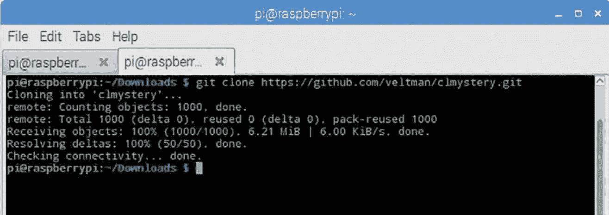

**Figure 2-9**

Using the `./configure` command directly on the Raspberry Pi might install software to locations we don't want, such as `/usr/local/lib`. In subsequent use, problems may arise because the library search paths do not include these installation paths.

Solving this is very simple: just set a new installation path yourself:

```
$ ./configure --prefix=/usr --libdir=/usr/lib/arm-linux-gnueabihf
```

### 2.3.3 Installation via Scripts

Sometimes thoughtful developers provide one-click installation scripts, such as `edublocks` (a programming education software), which can be installed with the following command:

```
$ curl -sSL get.edublocks.org | bash
```

This command downloads the corresponding script and runs the installation directly. Here, `curl`'s `-s` option means don't show the progress bar, `-S` means print error messages, and `-L` means follow redirects. If you don't want to give so many permissions directly to the script, you can compromise by downloading it locally first and then installing. For example, download the script and rename it to `install.sh`:

```
$ curl -o install.sh -L get.edublocks.org
```

You can install the software via `sh install.sh`. Observe its output, and you will find it automatically installs many necessary dependencies. Before running the script, you had better understand what it does; otherwise, there are huge potential security risks.

Writing all installation steps into a script and running it directly can save you time configuring the environment, as shown in Figure 2-10.

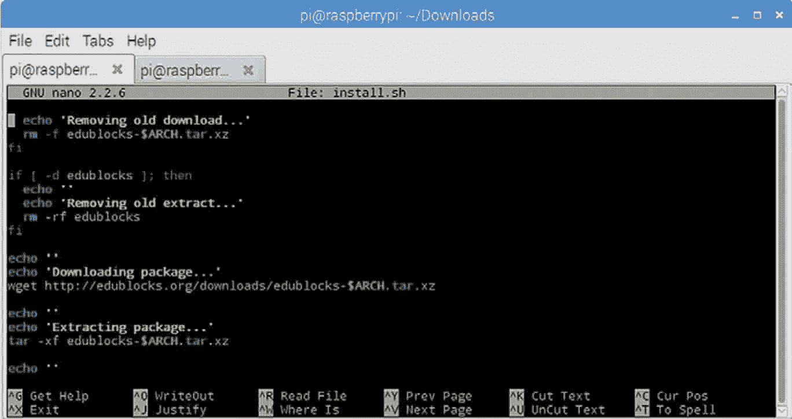

**Figure 2-10**

Additionally, `Python` is a very popular language now; it designed some mechanisms that make `python` libraries very easy to install.

Although `Debian`-based systems already have powerful `APT` and `dpkg`, some languages and tools still come with built-in package installation systems, including the famous `emacs`. In future development, you will most commonly use `Javascript`'s `npm` and `Python`'s `pip`. `pip` usage is similar to `apt`:

```
$ sudo pip3 install numpy
```

The process of installing the `numpy` library here is very simple.

### 2.3.4 Disk Images

When burning system image files, the general `cp` command cannot achieve the desired effect. You need a command that can modify the `SD` card's file system; that command is `dd`.

When using the `dd` command, you must confirm that the command's operand is the correct disk. `dd` functions to convert file formats and copy files; its characteristic is that it copies data byte-by-byte faithfully. To burn a system image, we first need to eject the second `MicroSD` card. Before re-inserting and removing, use `sudo fdisk -l` to confirm the device name. If you see a `/dev/sdb` with a size matching the `SD` card, eject `sdb1` first: `umount /dev/sdb1`, then burn the image:

```
sudo dd if=~/Downloads/2018-11-13-raspbian-stretch-lite.img of=/dev/sdb bs=1M
```

The abbreviations `dd` and `if` have a long history, dating back to the 1960s. When using the `dd` command in the future, you must check whether the target disk is correct; otherwise, you may lose important data! Finally, `bs=1M` can also be set to `bs=4M`. After burning, you can use this `SD` card to boot another system.

## 2.4 System Boot and Shutdown

### 2.4.1 Traditional Boot Process

Over the past few years, most `Linux` distributions have changed their boot methods; basically, those old tutorials on how to configure `rc.local` are obsolete, although they still work, they are not recommended. One thing hasn't changed: `Linux` still follows the original design—the first process started becomes the parent of all subsequent processes. Originally this process was `/sbin/init`, now it is `/lib/systemd/systemd`; both have a `PID` of `1`.

The boot process completes most work, then displays the user interface. You can view the system's welcome messages via the `dmesg` command; these messages are saved in the `/var/log/kern.log` file.

The boot process is the starting point of user space. In user space, your programs can modify system behavior without changing kernel source code. Generally, `Linux` distributions implement `UNIX`'s `SystemV` boot mode, through which you can define process run levels, including single-user mode, terminal mode, graphical interface mode, and shutdown.

Now `Jessie` systems no longer use the `service` command; you should use `systemctl` to add services to `systemd`. Links will appear in this folder later; you should not manually modify these links, as shown in Figure 2-11.

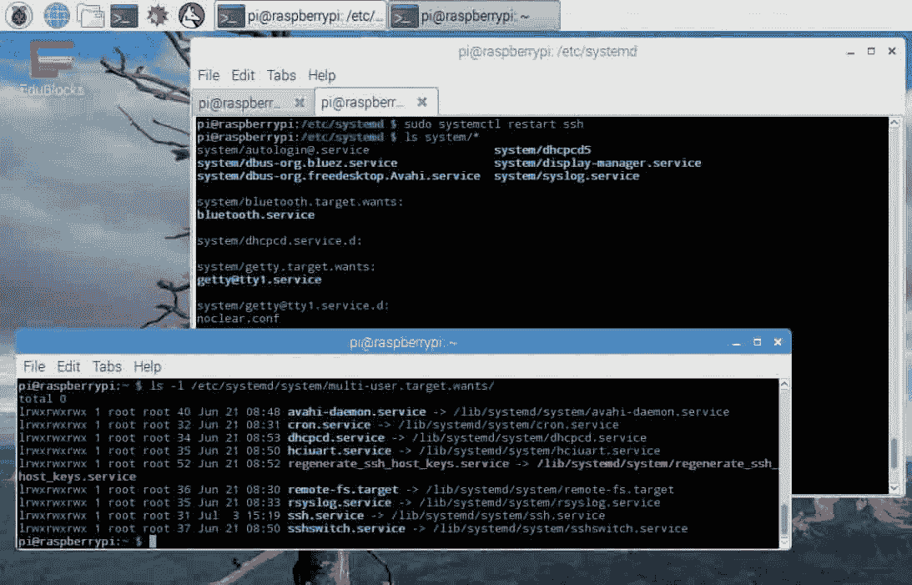

**Figure 2-11**

`dmesg` displays system boot information, as shown in Figure 2-12.

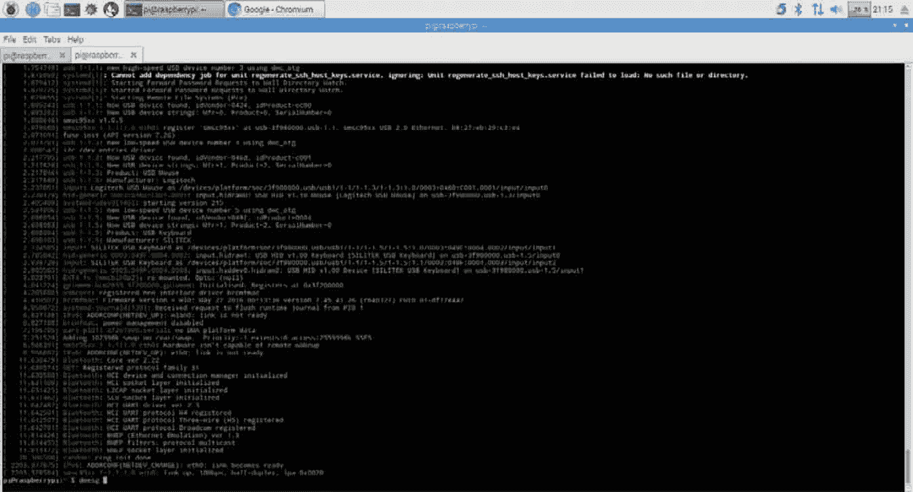

**Figure 2-12**

Startup items defined in the `rc0` to `rc6` files under the `/etc` folder will always start at system boot, regardless of the defined run level.

Scripts under `/etc/init.d` can be used to start your databases, servers, and other services. These services can be checked with the `status` command and restarted with the `reload` command. The `reload` command re-checks configuration files but does not fully restart the service.

```
$ sudo /etc/init.d/couchbase-server status
```

We discussed mainly the `Sys-V` boot method above. This method has a major drawback: low efficiency. Next, we introduce a more efficient boot method.

### 2.4.2 New Era Boot: Systemd

The characteristic of `Systemd` is that it starts processes concurrently. After setting a boot target, `Systemd` attempts to resolve the target's dependencies without starting unrelated processes. `Systemd` configuration files are in `/etc/systemd/system`. Note that `Systemd` uses the `systemctl` command, for example:

```
$ sudo systemctl restart ssh
```

Restarts the `ssh` service. For compatibility, `Systemd` did not deprecate the `service` command, for example:

```
$ sudo service apache2 reload
```

Still works normally.

In the `/etc/systemd/system/multi-user.target.wants` folder, you will find many files like `cron.service`. Check with `ls`, and you will find these links point to same-named files in `/lib/systemd/system`; simply put, they handle dependencies between files. Next, we introduce `crontab`:

```
$ sudo systemctl enable postgresql.service
```

This command creates a link, and then `postgreSQL` will run at system boot.

```
$ sudo systemctl daemon-reload
```

This command makes these changes take effect immediately for `systemd`.

Although run levels have no effect in `systemd` mode, you can still check the run level via `who -r`.

For compatibility, `Systemd` systems retain `init.d` and other script files.

`Systemd` is a complex system, including components from `systemd.unit` to `systemd.slice`, each with its own help page, as shown in Figure 2-13.

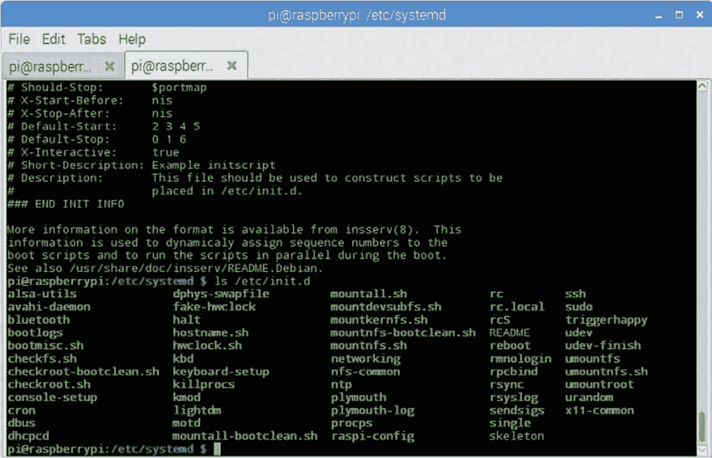

**Figure 2-13**

`Systemd` can automatically handle link relationships between files, but sometimes you may need to manually manage link relationships; this is where the `ln` command comes in.

The `ln` command can create a link to a file, allowing a file to appear in two different locations in the system:

```
$ sudo ln -s /usr/share/doc/python-numpy/THANKS.txt
```


$ `numpy-THANKS.txt`

建立链接后，输入 `ls -l`，你会发现这是一种特别的文件（一个指向实际存储的文件的链接）。编辑 `numpy-THANKS.txt` 文件，然后你会发现原本的 `THANKS.txt` 也被更改了。

另外，这里的 `-s` 代表软链接。软链接的特点是被链接的文件甚至可以不存在，特别适配可插拔的设备。

这种链接被称为符号链接，这是因为它链接到的是文件的文件名，而不是文件实际的数据。

$ `sudo ln /etc/bluetooth/main.conf mybluetooth.conf`

以上命令生成了一个硬链接，相当于一个文件现在在不同的两个位置有了两个不同的名字，但这并不意味着这两个是同一个文件。创建一个硬链接会类似于复制生成了一个新的文件，对原文件的修改不会对硬链接文件产生影响。

### 2.4.3 周期运行：cron

启动脚本一般是为守护进程这样需要一直保持运行状态的进程所设计的，对于其他一些周期性运行的进程（比如家务管理），要使用 cron 系统来进行更好的管理。cron 会在 `/etc` 目录下寻找自己的配置文件，然后根据这些配置文件来工作。那么应该如何寻找对应的配置文件呢？这时就要用到 `locate` 命令了。`locate` 命令在系统上默认是不会安装的，所以要先安装 `locate` 命令：

$ `sudo apt-get install mlocate`

然后输入命令：

$ `sudo updatedb`

接下来通过 `locate` 命令寻找配置文件：

$ `locate cron-`

`locate` 命令是通过自己存储的文件数据库来工作的，这个数据库每天会通过 cron 来完成周期性的更新。如果你想要手动更新这个数据库，只需要输入命令 `sudo updatedb` 即可。

`find` 命令与 `locate` 命令具有类似的功能。`find` 命令允许你通过文件的文件名、大小以及修改时间来在某个文件夹或者是整个文件系统下寻找文件。`find` 命令有很复杂的功能，比如具有 `locate` 并不支持的正则表达式。同时由于它是直接通过文件系统寻找文件的（相比之下 `locate` 通过一个缓存的数据库来寻找文件），所以它一般耗时会更久一些。如果你想要使用 `find` 命令来完成以上用 `locate` 命令完成的任务，就可以输入：

$ `find / -name '*cron*'`

在搜索结果中会出现 anacron 相关的文件。如果你不希望搜索到这些文件，那么可以使用正则表达式 `cron*`。`find` 命令一般会有大量的输出，所以最好把输出信息通过管道重定向到其他命令里去。

在系统上使用 cron 可以通过 `crontab` 命令。输入 `crontab -e` 命令后就可以编辑对应的 cron 配置文件了。下面来看一个示例。

```
45 05 * * 1-5 calendar | mail -s 'Your calendar' me@myemailaddress.com
```

这条命令的意思是在每天上午发送对应的日历信息到你的邮箱。前 5 个参数与命令执行的周期相关，可以用 `@daily` 或者 `@hourly` 来代替。如果想了解更多有关 crontab 的信息，你可以输入 `man 5 crontab` 来查看帮助文档。

在运行上面的命令时，系统可能会提示你 `mail` 并没有被安装，那么你需要先安装一个邮件软件，比如说 `ssmtp`。

> **提示**
>
> 正则表达式：`find` 命令支持在查找时使用正则表达式。正则表达式是一个非常大的主题，这里就不详细介绍了。作为一项广泛应用的技术，它非常值得学习。一些用户不希望使用 Systemd 的启动方式，可以使用操作系统提供的其他选择。对于 Ubuntu，你可以使用 Upstart。对于 Raspbian，你可以使用 Devuan 发行版，它使用的是经典的 Sys-V 启动。

### 2.4.4 自定义启动

`crontab` 中的 `@reboot` 配置符可以让我们在启动时打开一个服务。相较于之前提到的 systemd 配置，`crontab` 的配置更为简单一些。在使用 `crontab` 配置启动服务时有两点需要特别注意一下：

- 在启动时 `$PATH` 环境变量是无效的，因为 `$PATH` 环境变量只有在导入了 `.bashrc` 文件后才能生效。在启动时，还没有对应的终端环境，所有使用了 `$PATH` 环境变量的命令要手动写出完整的路径，比如 `/home/pi/bin/test.sh`，同时也要确认文件权限是否正确。
- systemd 是并行进行服务启动的。这样一来，可能在你的 `@reboot` 对应的命令执行时网络连接的服务还没有启动完成。如果你觉得自己可能遇到了类似的问题，那么你应该在 crontab 的配置信息里将时间延后几秒钟。

```
@reboot sleep 10; /usr/bin/python3 /home/pi/Documents/Python_Projects/hello_gpio.py
```

安装 `mlocate` 后系统会添加一些脚本到 `/etc/cron.daily`，之后 `locate` 命令会每天自动更新它的数据库，如图 2-14 所示。

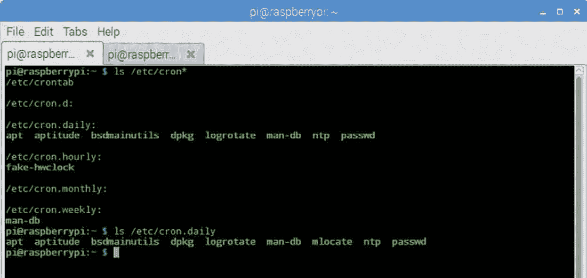

**图 2-14**

在 crontab 的配置文件里你会看到 anacron（被用来管理那些已经很久没有启动的进程）。在 anacrontab 配置里，你可以手动定义一个最长时间，超过这个时间以后 anacron 就执行指定的进程。anacron 常常被用来管理备份脚本，这是下一节将要讨论的内容。

## 2.5 备份策略

在日常的使用中，你有良好备份的习惯吗？对于一台计算机来说，备份是非常重要的。如果你的计算机遭遇了一些故障，而你没有提前备份，可能会造成很大的损失，而且这些故障何时发生是我们完全无法预知的。

对于运维专家来说，他们在做备份时总会做好最坏的打算。对于我们手头的树莓派来说，硬件设备的成本并不高，但是里面存储的数据往往是十分重要的。所以，经常备份会是一个很好的习惯。在接下来的内容里，研究一下如何使用命令行来简化备份的操作。

最简单的备份方法就是把数据复制到其他地方去，同时这也是工作量最大的一种方法。虽然这种方法听上去非常低级，但有时会很有效，所以我们在此做一定的讨论。

在使用这种方法做备份时，文件越小越好。推荐使用 zip 压缩技术，它的通用性可以让其他系统的用户也能方便地使用这种格式的压缩文件。如果你想要更高的压缩率，也可以选用 LZMA 或者 bzip2，它们对应的压缩时间会比 zip 更长一些。

在这里创建一个可执行的脚本文件，把 `~/bin` 文件夹添加到 `PATH` 变量后，可以直接通过文件名来调用命令，如图 2-15 所示。

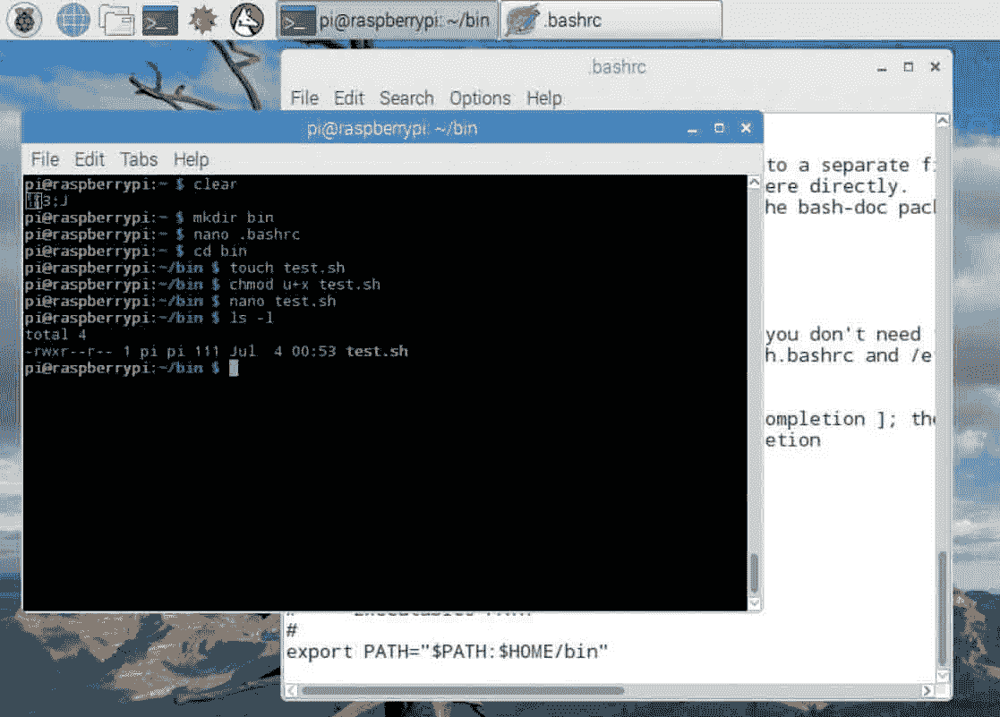

**图 2-15**

只需要一个命令就可以完成打包与压缩的任务，如图 2-16 所示。

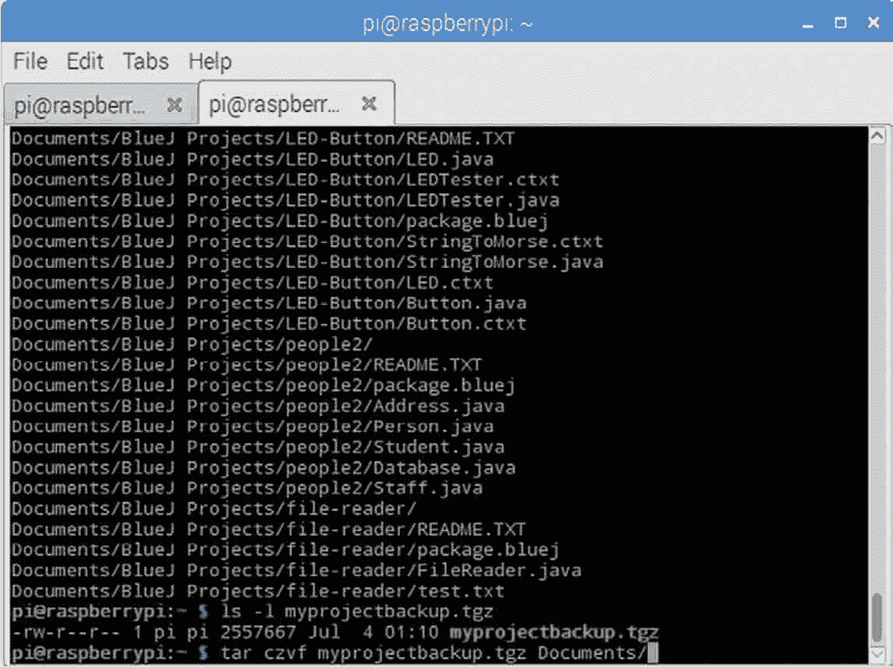

**图 2-16**

接下来把需要备份的文件夹打包成一个压缩文件：

$ `tar czvf mybackup.tgz myfolder`

这里的 `c` 表示递归处理所有的子文件夹；`f` 表示把输出重定向到 `mybackup.tgz`；`v` 表示把输出的详细信息打印到终端，其中会包括可能出现的错误信息。最后，`z` 表示使用 gzip 进行压缩。

如果你想要解压这个 tar 包，就需要把命令中的 `c` 替换为 `x`，然后去掉 `z`，因为 `tar` 命令会自动判断压缩的类型：

$ `tar xvf mybackup.tgz`

tar 文件类型有悠久的历史，可以一直追溯到 20 世纪 60 年代。tar 包可以储存各种类型的文件信息，比如归属权以及被创建的时间。

### 2.5.1 备份整个文件系统

如果想要备份你的用户主文件夹，`tar` 命令可以很轻松地完成这个任务。如果你想要备份的数据在不同的文件夹，比如 `/etc` 以及 `/var/www`，那么最好的办法是备份整张 SD 卡。

首先，你需要创建一个与整张 SD 卡上的数据一样大的文件。在我们的机器上，这张 8GB 存储量的 SD 卡会生成一个大约 2.5GB 的镜像文件。回想一下前面是如何确定盘符的，然后使用相同的方法来确定 SD 卡的盘符（在笔者的机器上是 `/dev/sdb`）：

$ `dd bs=4M if=/dev/sdb | gzip > back-raspbian.img.gz`

如果你觉得自己的硬盘空间可能不够，可以打开另一个终端，然后通过 `df` 命令来确认剩余的空间。若是检查出空间确实不够了，那么可以使用 `Ctrl+C` 结束当前的 `dd` 命令，然后使用 `rm` 命令删除已经生成的镜像文件。

现在我们已经备份好了所有的文件，如果你想要把备份后的压缩包恢复成原本的文件系统，可以输入以下命令：

$ `gzip -cd back-raspbian.img.gz | dd bs=4M of=/dev/sdb`

注意，在上面的命令中，`dd` 是需要 root 权限的，同时在 `/home/pi` 主文件夹外保存文件也是需要 root 权限的。

在树莓派上，`sudo` 命令不需要你输入密码，看似很方便，但是会有安全性上的隐患。在其他的 UNIX 系统上，你可以输入 `sudo -s` 进入一个具有完全 root 权限的交互环境，然后输入 `exit` 退出这个环境。除此以外，如果你输入的命令是一长串的复合指令，只需要在头上加一个 `sudo` 就可以了：

$ `sudo bash -c "gzip -cd back-raspbian.img.gz | dd bs=4M of=/dev/sdb"`

### 2.5.2 备份到远程服务器

上面介绍的是在本地创建备份文件的方法。在更多的情况下，需要通过网络来存储备份文件，这时就需要用到之前讲过的 `SCP` 命令了。下面输入命令：

$ `scp -p back-raspbian.img.gz pi@192.168.0.207:/home/pi/bak/`

接下来你只需要输入密码就可以完成连接并且将备份内容复制过去了。如果想要改成其他的服务器怎么办？其实也很简单，只需要把 `pi@` 及后面的内容改为对应的服务器名称、IP、文件夹即可。

`scp` 的 `-p` 选项可以保存文件上一次的访问时间，另外 `-P` 选项可以指定一个端口。在前文中，我们展示了如何设定一个固定的 IP 地址。这样一来，配合上 USB 大容量存储设备，你手上的树莓派就可以用作一个不错的备份设备，比如说可以用来存储你的影像资料。

另外，由于是通过命令行发送这些信息的，因此也可以运用一些命令行独有的高级特性，比如之前提到的正则表达式以及 tab 键自动补全。假设在同一个文件夹里有 `www-backup-20181225.gz` 以及 `data-backup-20181226.gz` 两个文件，下面的命令可以同时复制它们：

$ `scp -p ./*.backup*.gz pi@192.168.0.207:/home/pi/bak/`

接下来讨论如何把这些备份的过程自动化。

通常，使用 `scp` 命令可以使得在不同的设备上传输数据非常简单，如图 2-17 所示。

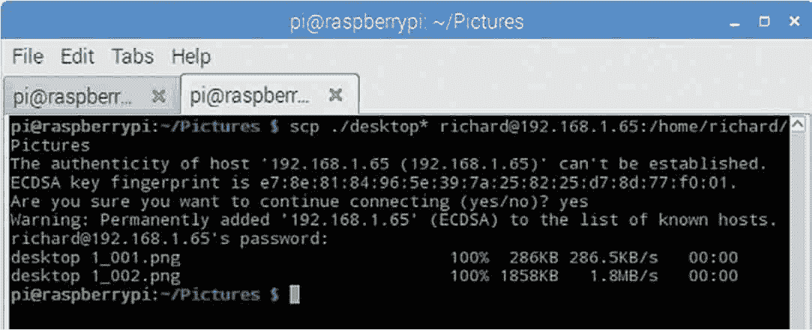

**图 2-17**

### 2.5.3 自动登录目标服务器

为什么要使用远程备份？远程备份的最大好处是降低了集中式存储遭遇紧急情况从而丢失重要数据的危险性。虽然可能性很小，但是对于运维人员来说再小的风险都是需要尽量避免的。

前面讨论了 ssh 登录相关的内容，在使用 ssh 的时候，可以用 `ssh-keygen` 命令来生成一个用于登录的密钥，然后就可以免密登录了。`ssh-copy-id` 是系统上一个用来在不同设备之间传输密钥的工具，使用范例如下：

$ `ssh-copy-id pi@192.168.0.207`

`-i` 选项可以用来指定一个 `.pub` 文件，`-p` 选项可以用来指定一个端口（在使用公网上的服务器时会很重要）。现在已经设定好远程的备份，如果设定脚本让它们经常进行备份，那么备份文件会占用大量空间。

`rsync` 与 `scp` 一样是远程传输工具，优势是差分传输算法。具体来说，`rsync` 只会传输发生了变化的那部分内容。这样的好处是明显的，既能够减少传输占用的带宽，又能减少备份文件占用的空间（如果你使用的是收费的服务，那么 `rsync` 可以为你省下一大笔钱）。

如果你的电脑上还没有安装 `rsync`，那么可以通过 `apt-get` 来安装。一般来说，`rsync` 是通过 ssh 协议进行传输的，但是也可以设定一个 `rsync` 后台进程，然后通过 `rsync:// URL` 的方式进行 TCP 传输。在后面的一种情况下，你需要设定好 `RSYNC_PASSWORD` 环境变量，或者使用 `--password-file` 手动提供密码。

虽然 `rsync` 并不是内置的 bash 指令，但它是非常有帮助的工具。除了 `rsync` 以外，你也可以考虑使用 `git` 这样的版本控制工具来进行远程备份。

### 2.5.4 编写脚本自动执行

脚本里的 `datestamp` 变量确保了备份文件不会重名。首先回到之前学过的简单指令，然后通过脚本把原先手动完成的任务自动化。除了通过管道来嵌套执行 bash 指令以外，还可以通过写自己的脚本文件来一次执行多条指令。接下来看一个脚本的示例。

```
#!/bin/sh
cd /home/pi
tar czf mydocsbackup.tgz Documents
scp mydocsbackup.tgz pi@192.168.0.207:/home/pi/bak/
```

运行效果如图 2-18 所示。

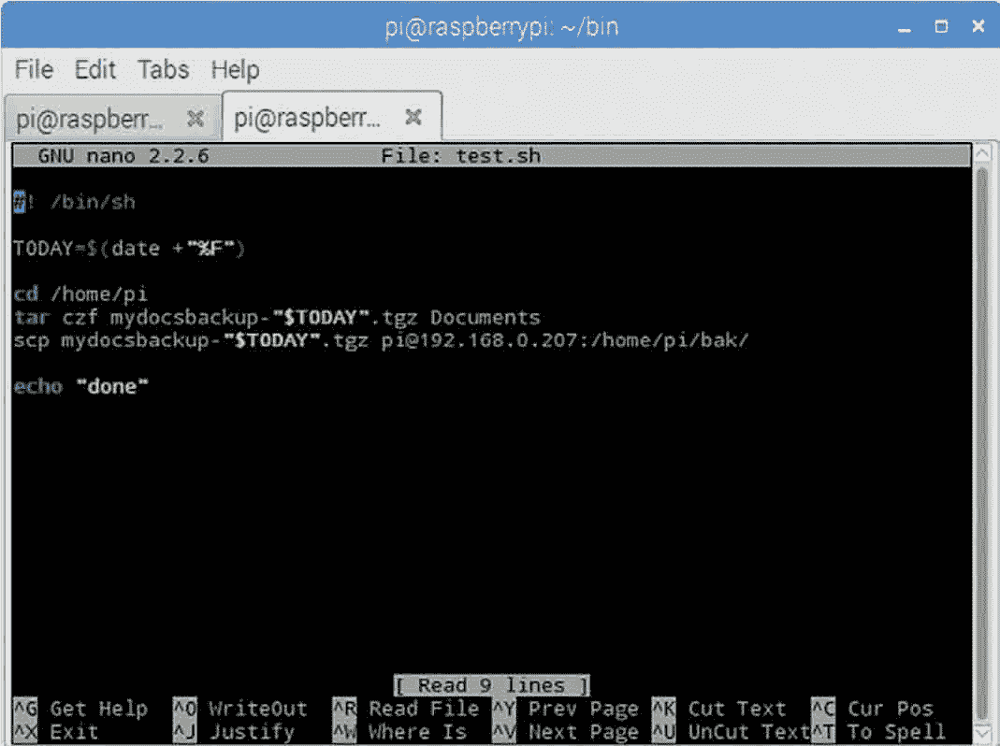

**图 2-18**

你可以根据实际情况修改脚本的内容，比如先把 `scp` 改为 `cp`，然后把 IP 地址改成你自己的服务器地址。想要让这个脚本运行，还需要修改运行权限：

$ `chmod u+x test.sh`

接下来就可以通过 `./test.sh` 来运行脚本了。如果报错，那么应该再次确认自己的信息有没有填对或者是否进行了上面的 `ssh-copy-id` 操作。亲手运行一下这个脚本，你会发现每一次运行它，新的备份文件都会覆盖原有的文件，所以要做一些修改：

```
#!/bin/sh
TODAY=$(date +"%F")
cd /home/pi
tar czf mydocsbackup-"$TODAY".tgz Documents
scp mydocsbackup-"$TODAY".tgz pi@192.168.0.207:/home/pi/bak/
```

创建一个日期的变量。在命令行里试着运行一下 `date` 命令，你会发现 `date +"%F"` 会返回一个 `YYYY-MM-DD` 形式的日期。

编写完脚本后，就可以试着让它自动运行。你可以把它放到 `/usr/bin` 文件夹下，然后使用 cron 让它自动运行。

脚本文件的扩展性是很强的，目前这个脚本的功能还很简单，你可以试着设计更多的功能。举例来说，你可以设计一些 `echo` 语句来输出用户的状态，通过交互式的输入语句让用户手动输入备份的目录等。

关于脚本文件的编写，网络上有很多资源，同时系统上也有很多脚本编程范例。比如，之前提到过的 `raspi-config` 本身就是一个脚本文件，你可以通过阅读它的源代码来进行学习。

在编写脚本文件的过程中，要记住一个原则：循序渐进。不需要一开始就设计大量复杂的功能，而是应该从简单的设计开始，慢慢添加更多的功能模块，同时做好每个模块的测试。

在编写好代码以后，你可以使用 `shellcheck.net` 上的工具进行检查。举例来说，它会提示你把简单的 `cd` 语句替换为下面的语句:

$ `cd /home/pi || exit`

这样在 `cd` 出错后就能够自动退出了。在编写代码的过程中，一定要注意各种可能出错的情况，并把它们排除。

> **免密登录**
>
> 设置好你的密钥后，就可以免密地使用 `scp` 登录远程服务器了。感兴趣的话，可以亲自动手尝试一下。

### 2.5.5 安全移除数据

如果你看过《碟中谍》，那么你可能会对里面上级下达任务的方式印象深刻。在电影里，一个类似磁带的设备会弹出任务信息，然后立即自毁。

在信息时代，数据的安全性是非常重要的。想要安全地保护自己的隐私，就要了解硬盘是如何存储数据的，并且要知道如何安全地移除数据。

硬盘是以块的形式组织起来的，每个块的大小一般为 4096KB，并且被文件系统用 inode 来进行寻址以及存储。现代化的 SSD 硬盘不再有磁头这样的设计，但是内部的组织结构还是与传统的机械硬盘类似。对于现在的硬盘处理来说，大部分操作都是通过 inode 来完成的，比如移动文件实际上就是通过对 inode 进行重命名。类似的，`rm` 命令并不会实际把数据从硬盘上抹去，只是删除了对应数据块的 inode 表项。

在拿到一块新的硬盘后，执行 `rm -rf`，看上去已经被清理干净了，实际上只是表面效果，你还可以通过对底层数据的修复来还原整个文件系统。如果你想安全地彻底清理掉某些敏感的数据，那么下面讨论的方法才是你应该使用的。

`shred` 命令会安全地清理掉数据，可以用于某些文件或整块硬盘，如图 2-19 所示。

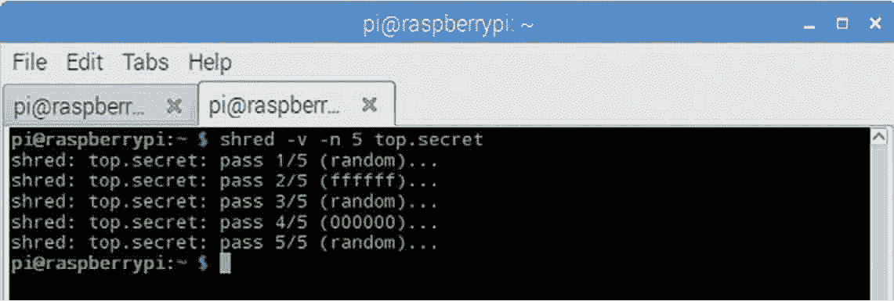

**图 2-19**

必须提醒你要小心操作，因为它们是极具危险性的，可能会直接抹去所有的数据。

先回忆一下学过的 `dd` 命令，它可以以比特为单位重新覆盖一块硬盘上的所有数据。即使是在这样的情况下，数据依然可以被恢复。为了应对这样的问题，可以使用 `shred` 命令。它与 `dd` 做的事情是类似的，不同的是它会把这样的事情做很多遍。例如，以下命令会把文件重写 5 遍：

$ `shred -vf -n 5 /dev/sdb`

其中，`-z` 选项表示使用随机数据而不是默认的零来进行重写，这样会生成一个看上去是真实数据的硬盘；`-u` 选项表示在重写后把原来的数据全部删除。使用 `shred`，你可以非常安全地清理掉自己硬盘上的数据。

# 第 3 章

# 智能语音（一）：ReSpeaker

## 3.1 树莓派语音助手套件 ReSpeaker 1：环境准备

基于 Raspberry Pi 的 ReSpeaker 4-Mic 阵列是一款适用于 AI 和语音应用的 Raspberry Pi 的四通道麦克风扩展板，如图 3-1 所示。这意味着你可以借助它构建一个集成 Amazon Alexa 语音服务、Google 助手等功能更强大、更灵活的语音产品。

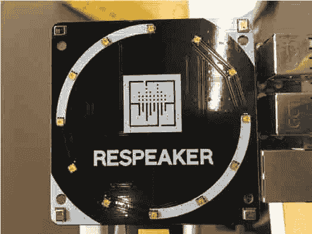

**图 3-1**


### 3.1 ReSpeaker 4-Mic Array

Unlike the ReSpeaker 2-Mics Pi HAT, this version is developed based on the `AC108` and is a highly integrated four-channel `ADC` voice device featuring high-definition voice capture, `I2S`/`TDM` output, and sound pickup within a 3-meter radius. Additionally, this 4-Mics version offers a cool LED ring containing 12 programmable `APA102` LEDs. Similar to Amazon Echo or Google Assistant, using 4 microphones and the LED ring, the Raspberry Pi gains `VAD` (Voice Activity Detection), `DOA` (Direction of Arrival), `KWS` (Keyword Spotting), and displays directional lighting functions via the LED ring.

### 3.1.1 Hardware Introduction

The ReSpeaker 4-Mic Array for Raspberry Pi consists of the following hardware (see Figure 3-2):

- **MIC**: 4 analog microphones.
- **LED**: 12 `APA102` programmable `RGB` LEDs connected to the `SPI` interface.
- **Raspberry Pi 40-pin Header**: Supports `Raspberry Pi Zero`, `Raspberry Pi 1 B+`, `Raspberry Pi 2 B`, and `Raspberry Pi 3 B`.
- **AC108**: Highly integrated four-channel `ADC` with `I2S`/`TDM` output conversion function.
- **I2C**: Grove `I2C` port connected to `I2C-1`.
- **GPIO12**: Grove digital port connected to `GPIO12` and `GPIO13`.

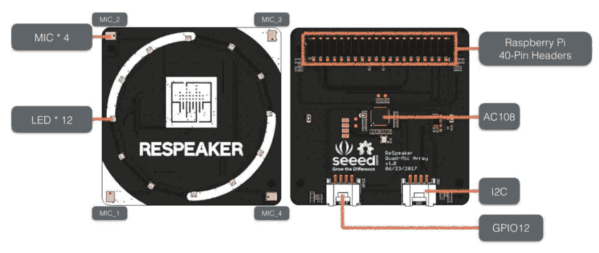

*Figure 3-2*

### 3.1.2 System Configuration and Driver Installation

All the following experiments require the Raspberry Pi to be flashed with the full version of the Raspbian operating system, i.e., the `Raspbian Stretch with desktop and recommended software` version from the official website. The specific steps for system configuration and driver installation are described below.

#### Step 01: Insert ReSpeaker 4-Mics Pi HAT into Raspberry Pi

Insert the ReSpeaker 4-Mics Pi HAT into the Raspberry Pi, ensuring the pins are aligned during insertion, as shown in Figure 3-3.

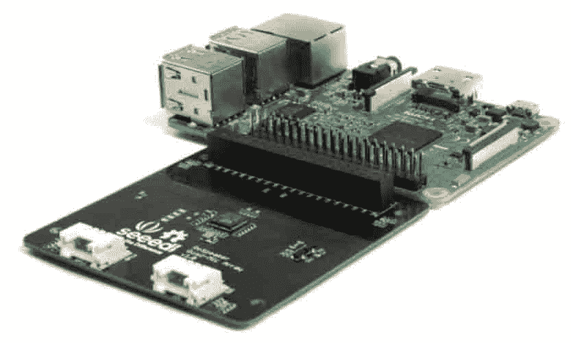

*Figure 3-3*

> **Note**
>
> Do not hot-plug the ReSpeaker 4-Mics Pi HAT while powered on.

#### Step 02: Flash System, Log In, Change Sources

Since the current Pi kernel does not support the `wm8960` codec, manual building is required. Ensure you are running the Raspbian OS (Debian 9) on the Pi. You can use Etcher to flash the system. Enter the command shown in Figure 3-4 to check the Raspberry Pi OS version.

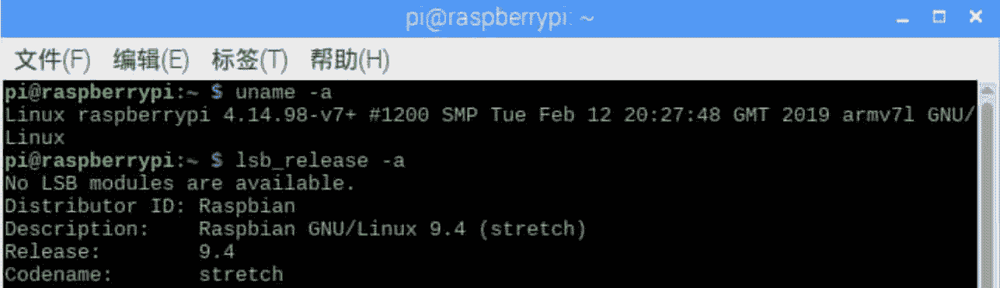

*Figure 3-4*

There are two types of Raspberry Pi systems (download site: https://www.raspberrypi.org/downloads/raspbian/): one with a desktop and one without. Here you can choose the desktop-less `RASPBIAN STRETCH LITE` because no monitor is needed, and the LITE version is smaller in size.

Etcher is an open-source disk flashing utility used to create bootable USB drives. The Raspberry Pi essentially turns an SD card into a boot disk and boots the Linux server on the SD card. Etcher can be downloaded from its official website (https://etcher.io/).

##### Flashing Method

Insert the SD card into a card reader and plug it into the computer's USB port; the computer will recognize a new disk. Run Etcher, select the previously downloaded `RASPBIAN STRETCH LITE` and the drive letter corresponding to the SD card in sequence.

You can connect to the Raspberry Pi using VNC or PUTTY, but please configure WiFi first. The tutorial for connecting to Raspberry Pi using PUTTY is https://www.cnblogs.com/mq0036/p/8488598.html.

Before installing the driver, please switch sources according to the following process:

```bash
pi@raspberrypi ~ $ sudo nano /etc/apt/sources.list
```

Comment out the original file content with `#`, and enter the following content to replace it:

```
deb http://mirrors.tuna.tsinghua.edu.cn/raspbian/raspbian/ stretch main non-free contrib
deb-src http://mirrors.tuna.tsinghua.edu.cn/raspbian/raspbian/ stretch main non-free
```

The result is shown in Figure 3-5.

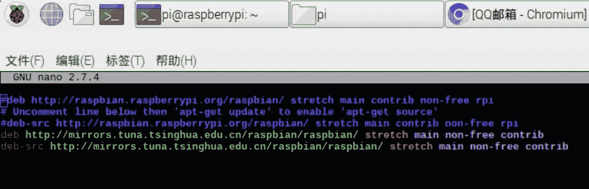

*Figure 3-5*

> **Note**
>
> After entering, press `Ctrl+O` to save.

#### Step 03: Download and Install Driver

Run the following commands:

```bash
sudo apt-get update
git clone https://github.com/respeaker/seeed-voicecard.git
cd seeed-voicecard  # Download voice card driver
sudo ./install.sh   # Install voice card driver
reboot              # Reboot
```

The result is shown in Figure 3-6.

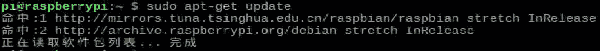

*Figure 3-6*

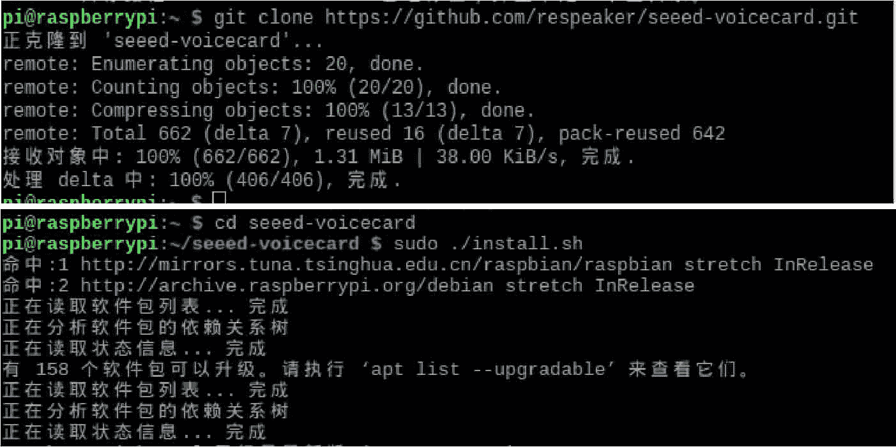

*Figure 3-6 (Continued)*

#### Step 04: Check if Sound Card Name Matches Source Code seeed-voicecard

Enter `arecord -L` in the terminal and configure accordingly, as shown in Figure 3-7.

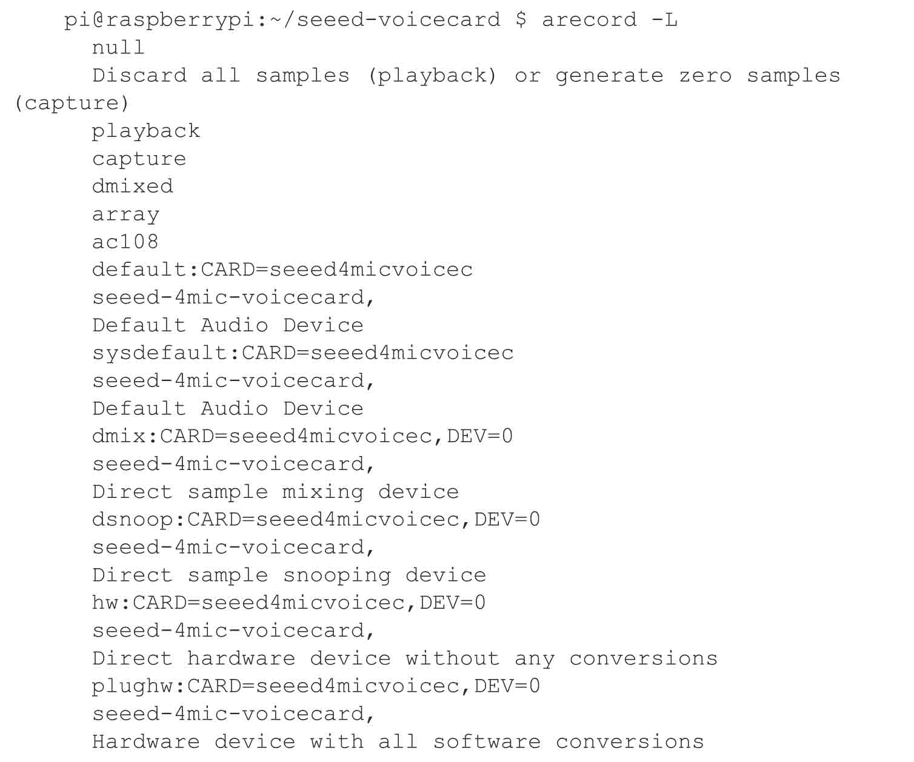 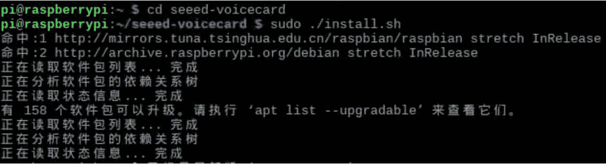

*Figure 3-7*

If you need to change ALSA settings, you can use `sudo alsactl --file=ac108_asound.state store` to save current settings. When you need to use these settings again, copy it to `sudo cp ~/seeed-voicecard/ac108_asound.state /var/lib/alsa/asound.state`.

### 3.1.3 Recording and Playback Test

#### 1. Recording and Playback Implementation

##### (1) arecord Recording

① Check recording devices:

```bash
arecord -l
```

② Record. Based on the above information, if you want to record using `TDM_Capture`, you can enter the following command:

```bash
arecord -Dhw:0,1 -d 10 -f cd -r 44100 -c 2 -t wav test.wav
```

Where `-D` specifies the recording device; `0,1` means `card 0 device 1`, i.e., `TDM_Capture`; `-d` specifies recording duration in `s`; `-f` specifies recording format, known from above to support only `cd`, `cdr`, `dat` formats; `-r` specifies sample rate in `Hz`; `-c` specifies number of channels; `-t` specifies output file format.

##### (2) aplay Playback

① Check playback audio devices:

```bash
aplay -l
```

② Play specified audio file:

```bash
aplay test.wav
```

#### 2. Recording/Playback Test

```bash
arecord | aplay
```

You can record with `arecord` and then play with `aplay` (don't forget to plug in headphones or a speaker): you can also test using Audacity software. After opening Audacity, select `AC108` and 2 channels as input, and `bcm2835 alsa: - (hw:0,0)` as output for testing:


The Audacity running interface is shown in Figure 3-8.


*Figure 3-8*

#### 3. Volume Adjustment

`AlsaMixer` is a graphical mixer program for configuring sound and adjusting volume for the Advanced Linux Sound Architecture (ALSA), as shown in Figure 3-9.

After entering the command `pi@raspberrypi:~ $ alsamixer` in the terminal to start `AlsaMixer`, please use the `F6` shortcut to select the `seeed-4mic` sound card device.

Left/Right arrow keys select channels or devices; Up/Down arrow keys control the volume of the currently selected device. Exit the program using `Alt + Q` or press `Esc`.

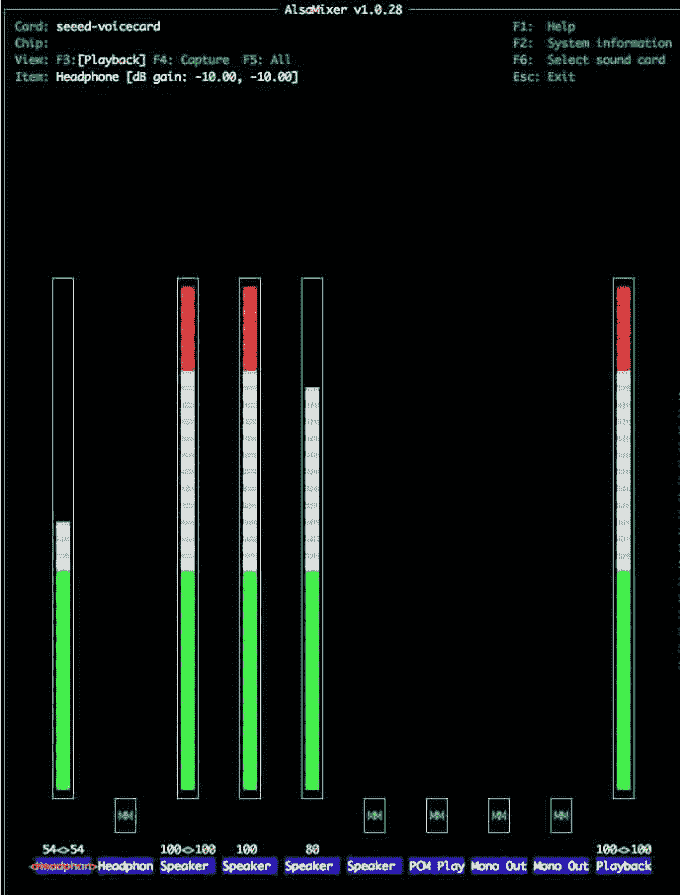

*Figure 3-9*

### 3.1.4 Install Python Virtual Environment

Using Python for development, here we need to isolate the SDK from system Python packages.

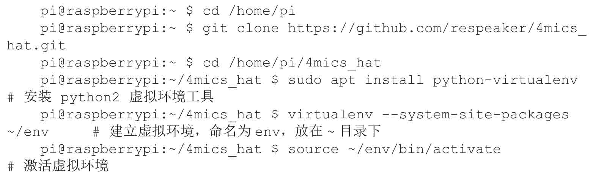

Terminal commands and feedback are shown in Figure 3-10.

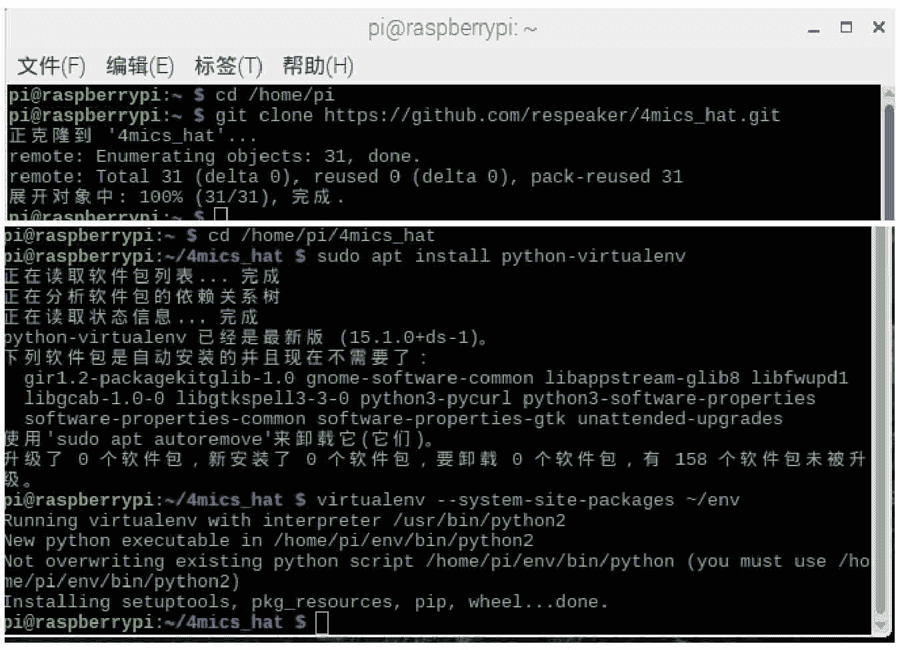

*Figure 3-10*

### 3.1.5 Control Onboard LED: APA102

Each onboard `APA102` LED has an additional driver chip. The driver chip sets the LED color and maintains that color until a new command is received.

Please enable `SPI` before execution. Specific steps are as follows:

1.  Enter `sudo raspi-config`.
2.  Select `Interfacing Options`.
3.  Select `SPI`.
4.  Select `Yes`.
5.  Select `OK`.
6.  Select `Finish`.

After configuration, execute the following command line to run the LED example:

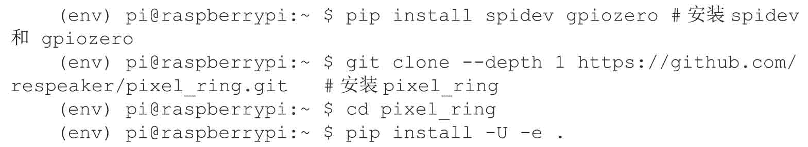

Terminal commands and feedback are shown in Figure 3-11.

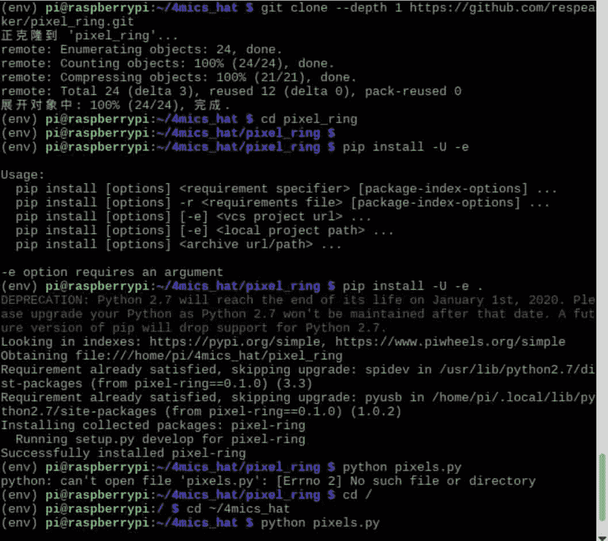

*Figure 3-11*

At this point, run `python pixels.py` in the virtual environment, and you will see the LEDs blinking like Google Assistant lights, as shown in Figure 3-12.

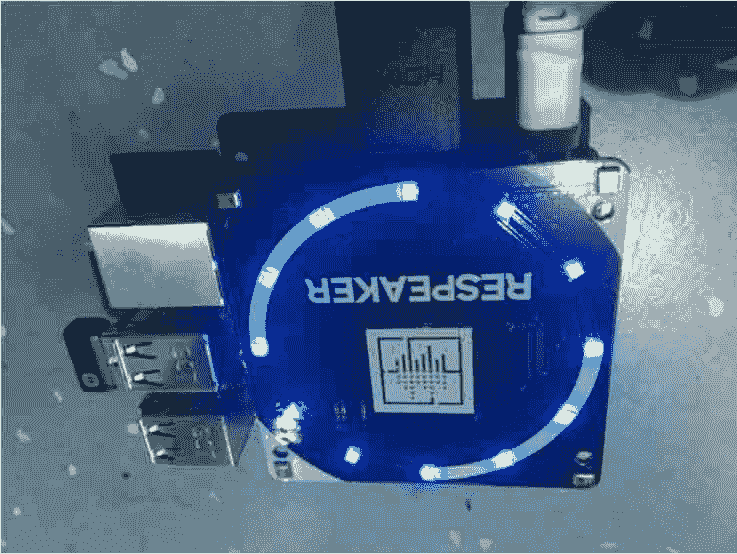

*Figure 3-12*

## 3.2 Speech Recognition and Dialogue

### 3.2.1 Google Assistant Configuration and Download

Compared to Amazon and Baidu voice engines, Google Assistant offers faster speech recognition speed and more stable connections. Note that some steps in this section require successful "scientific internet access" (bypassing firewall) to connect to Google for operations.

#### Step 01

Open the Raspberry Pi built-in browser, enter the URL and log in, as shown in Figure 3-13.

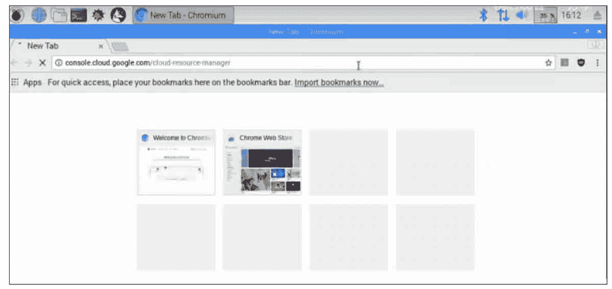

*Figure 3-13*

#### Step 02

After logging in with your Google account and password, open Google Cloud Platform, as shown in Figure 3-14.


*Figure 3-14*

#### Step 03

Set up project selection, as shown in Figure 3-15.


*Figure 3-15*

#### Step 04

Click the "New Project" button to open the new project page, enter a custom Project name, as shown in Figure 3-16. Named `rpi3-ga` here, as shown in Figure 3-17.


*Figure 3-16*


*Figure 3-17*

#### Step 05

Return to the Google Cloud Platform homepage, select "APIs & Services → Library", as shown in Figure 3-18.


*Figure 3-18*

#### Step 06

Click `Select a project`, as shown in Figure 3-19.


*Figure 3-19*

#### Step 07

Select the newly created project `rpi3-ga`, as shown in Figure 3-20.


*Figure 3-20*

#### Step 08

After selecting the project, return to the previous page, enter `google assistant api` in the search box, as shown in Figure 3-21.


*Figure 3-21*

#### Step 09

Click the "Enable" button, as shown in Figure 3-22.


*Figure 3-22*

#### Step 10

After enabling, the credential creation page appears. Click "Create Credentials" to add credentials for the project, select key format as `JSON`, as shown in Figure 3-23.

#### Step 11

After adding credentials, configure OAuth credentials, customize application name here, as shown in Figure 3-24.

#### Step 12

After setting options on the page, credentials can be created, as shown in Figure 3-25.


*Figure 3-23*


*Figure 3-24*


*Figure 3-25*

#### Step 13

Download credentials and save to a specified folder.

### 3.2.2 Raspberry Pi Driver Installation

#### Step 01

Open the Raspberry Pi terminal, enter the commands shown in Figure 3-26 in sequence to install the Python virtual environment and activate it.


*Figure 3-26*

#### Step 02

After activating the virtual environment, install Google Assistant according to the specified URL, as shown in Figure 3-27.


*Figure 3-27*

#### Step 03

Then enter the command to update the Google Assistant library, as shown in Figure 3-28.


*Figure 3-28*

#### Step 04

After the update, enter the command shown in Figure 3-29. Note: Replace the `json` file path with the path of your previously downloaded `json` key, ending with the `json` filename.


*Figure 3-29*

#### Step 05

After replacing the `json` file path and running, a URL will appear in the terminal feedback. Copy this URL to a browser to open it and obtain the Google Assistant code, as shown in Figure 3-30. Copy this code, paste it into the terminal window, and press `Enter`.


*Figure 3-30*

#### Step 06

Google permissions need to be set at this point. Open `myaccount.google.com` in a browser, log in to your Google account, and enter the page shown in Figure 3-31. Enable all options (including Location permissions, Voice & Audio Activity permissions).


*Figure 3-31*

### 3.2.3 Install Sound Card and Start ReSpeaker

#### Step 01

Enter the commands shown in Figure 3-32 in the terminal to install the `seeed-voicecard` sound card.


*Figure 3-32*


*Figure 3-32 (Continued)*

#### Step 02

Reboot the Raspberry Pi after installation. After reboot, open the terminal, enter `sudo raspi-config`, and select options in sequence as shown in Figure 3-33.


*Figure 3-33*


*Figure 3-33 (Continued)*

#### Step 03

Open sound card sound options and check input/output settings, as shown in Figure 3-34.


*Figure 3-34*

#### Step 04

Add code in the `asoundrc` file and change the code after `hw` to the corresponding `card`, `device` values, as shown in Figure 3-35.


*Figure 3-35*

#### Step 05

Reboot the Raspberry Pi after modifying the `asoundrc` file:

```bash
~$ sudo reboot
```

#### Step 06

After reboot, open the virtual environment in the terminal, as shown in Figure 3-36.


*Figure 3-36*

#### Step 07

Open the terminal, enter `sudo apt-get`, install `pulseaudio` and check its status, as shown in Figure 3-37.


*Figure 3-37*

#### Step 08

Open `AlsaMixer`, select `seeed-4mic-voicecard`, and adjust the corresponding volume to a sufficient level, as shown in Figure 3-38.


*Figure 3-38*

#### Step 09

Open the terminal, enter `pulseaudio &` to check its status. Figure 3-39 indicates successful setup.


*Figure 3-39*

### 3.2.4 Wake Up ReSpeaker

#### Step 01

Keep the terminal state from the end of the previous section unchanged. In the virtual environment, enter `googleassistant-demo` to launch the Google Voice Assistant via Raspberry Pi, as shown in Figure 3-40.


*Figure 3-40*

#### Step 02

Use the microphone to input "Ok, google" to wake up the Raspberry Pi Google Voice Assistant, and feel free to ask questions! You can ask things like "ok, google, who made you?", "how can you help me?", "what is the weather?", etc., as shown in Figure 3-41.


*Figure 3-41*


*Figure 3-41 (Continued)*

## 3.3 Alexa SDK and DuerOs SDK

Since Google Assistant cannot be accessed in mainland China, one can choose Alexa and Baidu DuerOs, which are connectable domestically, as voice engines to develop voice interaction systems usable by most people. However, the disadvantage is that the voice assistants provided by Amazon and Baidu may exhibit instability; developers need to be aware of this.

### 3.3.1 Configuration and DOA Test

#### 1. Configure Voice Engine

Use the following commands and operations to configure the Voice engine:


#### 2. Run

Run `python kws_doa.py` in the virtual environment. Use Snowboy to wake up, and you can see the direction information, as shown in Figure 3-42.


*Figure 3-42*

### 3.3.2 Voice Dialogue

#### (1) Execute the following commands to configure and install relevant dependencies


#### (2) Obtain Authorization

Run `alexa-auth` in the terminal, then log in to obtain Alexa authorization, or run `dueros-auth` to obtain Baidu authorization (Baidu is recommended). The authorization file is saved in `/home/pi/.avs.json`.

The terminal displays as shown in Figure 3-43 after running the authorization command.


*Figure 3-43*


**Note**

You need to close the auto-opened browser first, then open the browser on the Raspberry Pi desktop to authorize; only then can it succeed. Upon successful authorization, the page shown in Figure 3-44 will be displayed.


**Figure 3-44**

**Tip**

If switching between `alexa-auth` and `dueros-auth`, delete `/home/pi/.avs.json`. This is a hidden file; you can use `ls -la` to show it.

(3) Wake up ReSpeaker! Run `python ns_kws_doa_alexa.py` in the virtual environment, and you will see many debug messages in the terminal. When you see `status code: 204`, use `snowboy` to wake up ReSpeaker. Next, the LED on ReSpeaker will light up, and you can talk to it to activate ReSpeaker's functions, as shown in Figure 3-45.


**Figure 3-45**

### 3.3.3 Speech to Text

#### Step 01 Install Dependencies.

```
$ sudo apt install mpg123
$ pip install baidu-aip monotonic pyaudio
```

#### Step 02 Get Key from Baidu Cloud Console.

`https://login.bce.baidu.com/?account=&redirect=http%3A%2F%2Fconsole.bce.baidu.com%2Fai%2F%3Ffromai%3D1#/ai/speech/overview/index`

#### Step 03 Download Source Code Smart_Fan.py, URL: `https://raw.githubusercontent.com/SeeedDocument/MIC_HATv1.0_for_raspberrypi/master/src/baidu_STT/Smart_fan.py`.

Partial source code is shown below:


Command line operations are as follows:


**Reminder**

Before running `Smart_Fan.py`, add Baidu keys @ `line 36,37,38`. You can also generate the owner's voice by running `synthesis_wav.py`. Add Baidu keys at `line 6,7,8` and modify the string to the content you want to generate.

#### Step 04 Say 'Turn on the light', and you will see the LED light up, as shown in Figure 3-46.


**Figure 3-46**

### 3.4 Possible Issues

**Q1: Driver installation still fails after strictly following this wiki. What should I do?**

**A1:** If the driver installation fails using the above methods, please click the firmware installation link below: `https://v2.fangcloud.com/share/7395fd138a1cab496fd4792fe5?folder_id=188000207913`. Execute the following steps: First, flash the downloaded firmware; after flashing, remember to change the software sources (apt sources); Second, before using the interaction function, enter `alexa-auth` or `dueros-auth` in the command line to apply for authorization. After successful authorization, a `.avs.json` file will be generated in the `/home/pi` directory; only then can you use the interaction function; Third, there will be a `respeaker` example folder in the `/home/pi` directory. You can use the corresponding example based on the mic. After flashing the system, update the examples in the `respeaker` directory (you can execute `git pull origin master` in the `respeaker` directory).

**Q2: Sound can be heard with aplay, but no sound when running alexa/dueros.**

**A2:** There are 3 players available: `mpv`, `mpg123`, and `gstreamer`. `SpeechSynthesizer` and `Alerts` are better suited to `mpg123`. `AudioPlayer` prefers `gstreamer` > `mpv` > `mpg123`. `Gstreamer` supports more audio formats and runs well on the Raspberry Pi. You can also use the environment variable `PLAYER` to specify the `AudioPlayer` player. Try the following command to enable voice:

```
sudo apt install mpg123 PLAYER=mpg123 python ns_kws_doa_alexa_with_light.py
```

**Q3: Running DOA, no response when saying snowboy.**

**A3:** Run `audacity` to check if all 4 microphones have data. If one microphone has no data, there will be no response.

**Q4: Warning about platform incompatibility when installing snowboy.**

**A4:** Currently `snowboy` is only compatible with `Python2`, so please ensure it is `Python2` when creating the Python virtual environment.

**Q5: Dependency issues sometimes occur when running sudo python file.py.**

**A5:** Testing found that `sudo` executes from the system environment by default, while the dependencies used in the wiki are installed under `~/env`. This can be resolved by using `sudo ~/env/bin/python file.py`.

**Q6: No response when shouting snowboy while running kws_doa.py.**

**A6:** Run `audacity` to ensure all 4 channels are good. As long as one channel has no data, there will be no reply when saying `snowboy`.

# Chapter 4 Smart Voice (II) Google AIY Voice Kit

## 4.1 Introduction and Assembly

### 4.1.1 Voice Kit Introduction

Google has launched an AIY Voice Kit. This kit can be used to build a natural language processor. After connecting to Google Assistant or an online Speech-to-Text service, you can use this kit to send voice commands to your program or ask questions directly. All components of the Voice Kit fit into a small cardboard box, powered by a Raspberry Pi.

After purchasing the kit, you don't need to buy anything else; even the Raspberry Pi is included in this Voice Kit.

### 4.1.2 Preparation Before Starting

The Google AIY Voice Kit is shown in Figure 4-1.


**Figure 4-1**

Now let's start assembling your Kit!

The manual below details how to assemble this kit, how to connect it, and how to run the Google Assistant demo. This demo allows your Kit to answer your questions and execute your voice commands. After completing the demo, you can also use the Google Cloud Speech-to-Text service to convert spoken commands into text your program can understand.

#### Check Kit Version

The current manual is for Voice Kit v2.0. You can see the version info at the bottom left corner of the product packaging box, as shown in Figure 4-2.


**Figure 4-2**

The v2.0 Kit can follow the manual below directly. If no version number is written above, you can refer to the previous manual for assembly.

Besides the Kit, you need some other tools to help with assembly, including:

*   2mm flat-head screwdriver.
*   Micro USB Power Supply. Best is a USB power supply with a micro-USB B connector providing 2.1A. The second best option is a phone charger, sometimes called a fast charger. It can also provide 2.1A. **Never use a computer to power the Raspberry Pi**, otherwise it not only fails to provide enough power but may also burn the SD card, causing boot failure or other errors.
*   Wi-Fi Connection. There are two ways to connect the Kit to Wi-Fi.
    
    Use the AIY Projects App. You need an Android phone and a Windows, Mac, or Linux computer.
    
    Use a Monitor, Mouse, and Keyboard. If you don't have an Android phone, you can use a Windows, Mac, or Linux computer, a mouse, a keyboard, a monitor or TV with HDMI input, a standard HDMI cable and a mini HDMI adapter, and a hub to connect the mouse and keyboard to the Kit. For this hub, you can choose a USB OTG adapter to convert the Raspberry Pi's Micro USB port into a standard USB port. Then you can connect a [wireless keyboard/mouse combo](https://www.adafruit.com/product/1738) to the Raspberry Pi via this USB port. You can also use multiple USB ports on a Micro USB hub to connect a traditional keyboard and mouse.

Open the Kit and check what parts are included. If any parts are missing from your Kit, email `support-aiyprojects@google.com`, and we will help you find replacements.

### 4.1.3 Parts List

The AIY parts list is shown in Figure 4-3. Specific descriptions for each kit are shown in Table 4-1.


**Figure 4-3**

**Table 4-1 Google AIY Kit Description**


### 4.1.4 Assembling the Voice Kit

Let's start assembling the Voice Kit.

#### Step 01 Orient Correctly.

Build the internal frame; all electronic components will be placed inside this frame. Place the cardboard on the table in the orientation shown in Figure 4-4; the left slot should be closer to the cardboard edge.


**Figure 4-4**

#### Step 02 Fold Long Flaps.

Fold the long flap away from you downwards, as shown in Figure 4-5.


**Figure 4-5**

#### Step 03 Fold Left and Right Flaps.

Fold the left and right flaps towards you, as shown in Figure 4-6.


**Figure 4-6**

#### Step 04 Fold Bottom Flap.

Fold the bottom flap up towards you, as shown in Figure 4-7.


**Figure 4-7**

#### Step 05 Align Bottom.

Align the slots on the bottom edge with the tabs on the left and right sides, as shown in Figure 4-8.


**Figure 4-8**

#### Step 06 Insert Tabs.

Insert the tabs into the slots, as shown in Figure 4-9.


**Figure 4-9**

#### Step 07 Check Alignment.

Check the bottom of the assembled frame; the tabs near the edge should be on your left. If not, you may have folded incorrectly. It is recommended to unfold and re-fold according to Step 01, as shown in Figure 4-10.


**Figure 4-10**

#### Step 08 Set Aside.

Set the folded frame aside for now, as shown in Figure 4-11.


**Figure 4-11**

Next, connect the circuit boards.

#### Step 09 Find Your Boards and Speaker.

Start connecting all electronic components. Prepare your Raspberry Pi, Voice Bonnet board, two plastic standoffs, and speaker, as shown in Figure 4-12.


**Figure 4-12**

The Raspberry Pi board is a powerful microcomputer. The Voice Bonnet board includes two microphones, a speaker connector, an LED button connector, and an audio codec.

#### Step 10 Position Your Raspberry Pi.

Place your Raspberry Pi as shown in Figure 4-13, ensuring the 40-pin header is on the left.


**Figure 4-13**

**Note**

Ensure the Raspberry Pi is disconnected from any power source or components before fully assembled, otherwise it may damage your boards or other components and devices, and could cause electric shock, serious injury, or even death.

#### Step 11 Insert Standoffs.

Insert the two standoffs into the holes at the bottom right corner of the board, as shown in Figure 4-14.


**Figure 4-14**

**Note**

Excessive force may bend the board, so it's best to hold the underside of the board, preferably by the edges, not the top or bottom surfaces.

#### Step 12 Connect Boards.

On the bottom of the Voice Bonnet board is a female header. Align this header with the male header (GPIO pins) on the Raspberry Pi and press them together, as shown in Figure 4-15. Then hold the Voice Bonnet board and press firmly to snap the plastic standoffs into place.


**Figure 4-15**

**Note**

Do not press on the center of the board; hold the standoffs and press firmly.

#### Step 13 Check Connection.

Ensure the standoffs are securely installed between the two boards, and press along the 40-pin header from end to end to ensure there are no gaps between the boards, as shown in Figure 4-16.


**Figure 4-16**

**Note**

Poor connection may lead to electric shock, short circuit, fire, injury, death, etc.

#### Step 14 Loosen Screws.

Use a 2mm screwdriver to loosen the two screws at the bottom of the screw terminal block, as shown in Figure 4-17.


**Figure 4-17**

#### Step 15 Insert Speaker Wires.

Insert the speaker's red wire into the bottom slot and push it as far left as possible. Similarly, insert the black wire into the second-to-last bottom slot and push left, as shown in Figure 4-18.


**Figure 4-18**

These two wires transmit electrical signals to the speaker, which converts them into sound.

#### Step 16 Secure Wires.

Use a 2mm screwdriver to tighten the screws clockwise; otherwise, it may cause danger, as shown in Figure 4-19.


**Figure 4-19**

#### Step 17 Place Circuit Board.

Place the circuit board into the mouth-shaped slot of the previously built frame, as shown in Figure 4-20.


**Figure 4-20**

#### Step 18 Check Alignment.

The microphone on the left of the board and the circled part on the right should be outside the entire frame, as shown in Figure 4-21.


**Figure 4-21**

#### Step 19 Place Speaker.

Place the speaker into the frame, as shown in Figure 4-22.


**Figure 4-22**

**Note**

The speaker contains magnets; keep away from children. It may also interfere with medical implants and pacemakers.

#### Step 20 Check Speaker Stability.

Check and ensure the speaker is fairly stable, then you can start building the outer frame, as shown in Figure 4-23.


**Figure 4-23**

### 4.1.5 Building the Outer Frame

#### Step 01 Unfold Speaker Box.

Take the cardboard for the speaker box, squeeze the edges to form the box shape, as shown in Figure 4-24.


**Figure 4-24**

#### Step 02 Fold Flap A.

Fold Flap A down, as shown in Figure 4-25.


**Figure 4-25**

#### Step 03 Fold Flaps B and C.

Fold Flaps B and C down, then fold Flap A down, as shown in Figure 4-26.


**Figure 4-26**

#### Step 04 Fold Flap D.

Fold Flap D down and press down until it locks under Flaps A, B, and C, as shown in Figure 4-27.


**Figure 4-27**

#### Step 05 Check Box Bottom.

Check the bottom of the box to ensure it is stable, as shown in Figure 4-28.


**Figure 4-28**

#### Step 06 Place Internal Structure.

Place the previously assembled internal structure into the speaker box, ensuring the speaker faces the side of the cardboard with the circular hole, as shown in Figure 4-29.


**Figure 4-29**

#### Step 07 Check Alignment.

After placing it in, check that there is still a gap on the right side between the internal structure and the speaker box, as shown in Figure 4-30.


**Figure 4-30**

If yours looks different from Figure 4-30, you may need to re-fold and cross-check with Step 07 of building the internal frame.

#### Step 08 Check Ports.

Ensure the ports on the internal components align with the corresponding cutouts on the cardboard; these ports are for connecting the SD card and power, as shown in Figure 4-31.


**Figure 4-31**

**Note**

If ports are not placed in corresponding positions, it may cause unstable connections, leading to electric shock, short circuit, fire, and other hazards.

If your box looks different from Figure 4-31, you can check against Step 26. Finally, install the button.

#### Step 09 Find Parts.

Find the button, button nut, and cable from the Kit, as shown in Figure 4-32.


**Figure 4-32**

#### Step 10 Install Button.

Place the button into the circular hole on the cardboard shell, as shown in Figure 4-33.


**Figure 4-33**

#### Step 11 Position Button.

Looking from the other side of the button, ensure the side with 4 pins is facing up, as shown in Figure 4-34.


**Figure 4-34**

#### Step 12 Secure Button.

Use the button nut to further secure the button; the wide side of the nut faces the cardboard, while keeping the button pins on top, as shown in Figure 4-35.


**Figure 4-35**

#### Step 13 Connect Wires.

Connect the button cable to the button as shown in Figure 4-36: Row 1 is Blue and Green, Row 2 is Gray and Black, Row 3 is Red and Orange.


**Figure 4-36**

#### Step 14 Check Wires.

Double-check that the cable is connected correctly, as shown in Figure 4-37.


**Figure 4-37**

#### Step 15 Find 8-pin Connector.

Locate the white square circled 8-pin header on the Voice Bonnet board shown in Figure 4-38. With the speaker facing away from you, insert the black wire into the top-right slot of the header, and the blue wire into the top-left slot. Check to ensure correct connection, otherwise it may cause danger.


**Figure 4-38**

#### Step 16 Fold Top Flap.


### 4.1 Hardware Assembly (Continued)

**Step 17** Close the box.

Fold down the cardboard flaps on top of the box to close it, as shown in Figure 4-39.


**Figure 4-39**

Press down the locking tabs with your hand to ensure the box stays closed, as shown in Figure 4-40.


**Figure 4-40**

**Step 18** Insert the SD card.

Insert the `SD Card` with the arrow facing up into the corresponding slot on the Raspberry Pi (labeled `SD Card`), which has the pre-downloaded required software, as shown in Figure 4-41.


**Figure 4-41**

**Step 19** Assembly complete.

You can now connect the Kit to `Google Assistant`, as shown in Figure 4-42.


**Figure 4-42**

## 4.2 Preparing the Software Environment

### 4.2.1 Preparing the System TF Card

This Kit needs to run on a special version of the `Raspbian` operating system that includes the `AIY` software, so you must first flash the TF card with the system image.

Although the `MicroSD` card included in the Kit has already been flashed with the `AIY` system image, these images are most likely not the latest versions. Therefore, before starting assembly, it is strongly recommended to download and install the latest system image from the web and flash it onto the `MicroSD` card; otherwise, you may encounter old `bugs`, and some of the sample code may not work.

The specific steps are as follows:

**Step 01** Download the latest `.img.xz` file from the `GitHub` releases page.

**Step 02** Connect the `MicroSD` card to your computer using an adapter.

**Step 03** Use a program like `Etcher` to flash the `.img.xz` file onto the `MicroSD` card. `Etcher` is a free program that runs on `Windows`, `Mac`, and `Linux`.

Flashing these system images may take a few minutes. While you wait, you can start assembling the Kit. Once assembled, you can insert the `MicroSD` card and continue to the next step!

After powering on the system, the first thing is to obtain the `Voice Kit`'s `IP` address. There are two ways to connect your Kit to `Wi-Fi` and get an `IP` address: one is using the `AIY Projects APP`, and the other is using a monitor, mouse, and keyboard.

> **Tip**
>
> **IP Address**: Internet Protocol address, a 4-byte number used to identify a device on a network. Every device on the network—your computer, phone, and `Voice Kit`—has its own unique `IP` address. Different devices can connect to each other via `IP` addresses.

### 4.2.2 AIY Projects APP

**Step 01** Connect power.

Plug the `Voice Kit` into power (the power port is labeled `Power`), as shown in Figure 4-43.


**Figure 4-43**

For power supply selection, refer to the previous product content section. Note: Do not use a computer to power the Raspberry Pi.

**Step 02** Start booting.

Look inside the box through the port labeled `SD Card`. If you see a green `LED` flashing on the Raspberry Pi circuit board, the power connection is successful, as shown in Figure 4-44.


**Figure 4-44**

The device takes about 4 minutes to boot. When the green light changes from flashing to solid on, booting is complete.

**Step 03** Download `AIY Projects APP`.

Use an Android phone to download the `AIY Projects APP` from the `Google Play Store`, as shown in Figure 4-45.


**Figure 4-45**

You can use this `APP` to connect the `Voice Kit` to `Wi-Fi` and create an `IP` address, allowing you to connect to your `Voice Kit` wirelessly from another computer or via `SSH`.

**Step 04** Follow the prompts.

Open the app and follow the on-screen prompts to pair with the `Voice Kit`, as shown in Figure 4-46.


**Figure 4-46**

Since the `IP` address will be used later, it is best to write it down. The `APP` will also store the `IP` address and display it on the home page. You can then log in to the Kit.

If the above method doesn't work, first check if your Kit is connected to power.

If the app throws any errors, it is recommended to exit and restart it.

If the device fails to pair, check if the green `LED` on the `Voice Bonnet` is flashing. If not, it may have timed out. Hold the `Voice Bonnet` button for 5 seconds and try again. If it still doesn't work, try restarting your phone.

### 4.2.3 Connecting a Monitor, Mouse, and Keyboard

**Step 01** Prepare the required devices.

If you don't have a second computer or Android phone, or want to connect directly to the Raspberry Pi, you can use a monitor, keyboard, and mouse, as shown in Figure 4-47.


**Figure 4-47**

**Step 02** Connect devices.

Connect your monitor to the `HDMI` port, then use the adapter mentioned in the product content to connect the mouse and keyboard to the `Data` port, as shown in Figure 4-48.


**Figure 4-48**

**Step 03** Connect power.

Power the `Voice Kit`. Look inside through the port labeled `SD Card`. If you see a green `LED` flashing on the Raspberry Pi board, the power connection is successful, as shown in Figure 4-49.


**Figure 4-49**

**Step 04** Boot the device.

Upon plugging in power, a Raspberry Pi logo will appear in the top-left corner of the screen. Wait about 4 minutes for the device to boot. When the green `LED` stops flashing and stays solid, booting is complete.

**Step 05** Warning message.

You will then see a desktop with the `AIY` logo background. A pop-up warning window states that the Raspberry Pi user password has been set to the default value, as shown in Figure 4-50.


**Figure 4-50**

If you plan to use this Kit for other projects or connect it to a computer, this password is very important. No need to reset the password now; just click `OK`.

**Step 06** Password modification.

If you intend to put the Kit on the internet, you may need to change the password using the `passwd` program. All instructions here assume you have not changed the password.

> **Note**
>
> If you change the password, be sure to record the new password, as recovering it is very difficult.

**Step 07** Connect to `Wi-Fi`.

Click the `Wi-Fi` connection icon in the top-right corner of the screen, find your `Wi-Fi` network name (also called `SSID`) and select it. If you have a network password, a dialog box will prompt you to enter it; enter it and click `OK`.

**Step 08** Check `Wi-Fi`.

The `Wi-Fi` button you just clicked should start flashing. When it stops flashing, you are connected to the network.

**Step 09** Find the `IP` address.

Hover the mouse over the `Wi-Fi` icon. Information like `192.168.0.0` or `10.0.0.0` will appear, prefixed with `wlan0`. This is your `IP` address, as shown in Figure 4-51.


**Figure 4-51**

Record this `IP` address; you will need it later to remotely connect to the Raspberry Pi from your computer.

`Linux` uses abbreviations like `wlan0` to represent devices connected to your computer. `wlan` stands for `Wireless Local Area Network`, and `0` indicates the first device detected by `Linux`.

## 4.3 Launching Google Assistant

### 4.3.1 Remotely Connecting to Voice Kit

**Step 01** Check `Wi-Fi` connection.

Ensure your computer and the Kit are on the same wireless network. The next step will remotely connect to your Kit via `SSH` and configure it to connect with `Google Assistant`.

**Step 02** Prepare the terminal.

If you know how to set up a terminal, simply open an `SSH` session using `pi@192.168.0.0`, replacing the numbers with the `IP` address you just recorded, then skip to Step 07 below.

If you don't know how to use a terminal, first download the `Chrome` browser and the `Secure Shell Extension`, then proceed to the next step.

A terminal is a window that allows you to send commands to your Raspberry Pi. `SSH` lets you operate the terminal remotely. There are many `SSH` clients; on `Windows`, `Putty` is a small, powerful, and free option, as shown in Figure 4-52.


**Figure 4-52**

**Step 03** Open the downloaded extension.

After installation, open the extension, as shown in Figure 4-53.


**Figure 4-53**

If you are using `Chrome` on `Windows`, `Mac`, or `Linux`, you can see the extension icon in the toolbar (to the right of the address bar). Click the icon and select `Connect Dialog` from the dropdown menu.

If you are using `Chrome` on a `Chromebook`, you can type "secure shell app extension" in the `app` launcher.

**Step 04** Connect to the Raspberry Pi.

In the top field shown in Figure 4-54, enter `pi@IP address` (the `IP address` is the real `IP` of your Raspberry Pi), then click the `port` field, and click the highlighted `[Enter] Connect` button. If it fails to connect, check if the `IP` address is correct and if your Raspberry Pi and computer are on the same `Wi-Fi`. If you reflashed or replaced the `SD` card, you may need to remove and reinstall the `Secure Shell Extension`. Right-click the toolbar icon and select `Remove`, then reinstall following the guide above.


**Figure 4-54**

**Step 05** Grant permission.

Click `Allow` to permit this `SSH` extension to connect to your Raspberry Pi, as shown in Figure 4-55.


**Figure 4-55**

**Step 06** Continue connecting.

The `SSH extension` will ask you to confirm that the displayed key matches the one stored on the Raspberry Pi. Since this is the first time booting the Pi, all listed data is new, and this operation is safe.

The goal of `SSH` is security, so it must verify that the computer you are connecting to is the one you intend to connect to. To simplify verification, the computer generates a long string of numbers and reports it to `SSH`. `SSH` stores these numbers securely and confirms the identity by comparing them.

Once confirmed, the `SSH extension` stores this info in the browser. Every subsequent connection will re-verify. Now, type `yes` and press `Enter` to proceed, as shown in Figure 4-56.


**Figure 4-56**

**Step 07** Enter the Raspberry Pi password.

The default password is `raspberry`. The password will not be visible as you type, as shown in Figure 4-57.


**Figure 4-57**

If entered incorrectly, `Permission denied, please try again` or `connection closed` will appear. Press `R` to restart the connection. A warning bar may appear indicating the system has saved the key, and the extension will auto-verify next time.

> **Note**
>
> Your `IP` address will differ from the one in Figure 4-57.

**Step 08** Confirm connection.

If the password is correct, you will see `SSH is enabled` and the prompt `pi@raspberrypi` in green. Your Raspberry Pi is now connected to your computer. The `~` symbol is shorthand for `/home/pi`, as shown in Figure 4-58.


**Figure 4-58**

### 4.3.2 Verifying Audio Functionality

**Step 01** Run the audio test script.

Enter `/home/pi/AIY-projects-python/checkpoints/check_audio.py` in the command line, as shown in Figure 4-59. This will run all the steps listed below. Note that some steps require you to speak, so pay close attention to the script output.


**Figure 4-59**

> **Note**
>
> In `Secure Shell Extension`, copy/paste works differently. Select content to highlight it, then drag with the left mouse button. When you release, it is copied. To paste, right-click; on a touchscreen, tap the bottom-right area or double-tap to paste.

**Step 02** Follow script prompts.

If everything works, you will see `The audio seems to be working`. If an error appears, check the details and re-run the script, as shown in Figure 4-60.


**Figure 4-60**

**Step 03** Adjust volume.

You can adjust the volume by entering the following command and pressing `Enter`:

```
alsamixer
```

The volume control program (see Figure 4-61) will launch. Use the Up/Down arrow keys to adjust volume, and press `Esc` to exit.


**Figure 4-61**

You can run the `check_audio.py` script again to test if the volume is suitable:

```
/home/pi/AIY-projects-python/checkpoints/check_audio.py
```

You can browse previous commands using Up/Down arrows in the command line, edit them, and press `Enter` to run again.

### 4.3.3 Obtaining Google Cloud Platform Credentials

**Step 01** Open the `Google Cloud` platform.

To use `Google Assistant` and `Cloud Speech APIs`, you first need credentials from the Google Developer Console, as shown in Figure 4-62.


**Figure 4-62**

Open `https://console.cloud.google.com/` on your computer.

**Step 02** Sign in to your Google account.

Sign in with your Google account, as shown in Figure 4-63. If you don't have one, create an account.


**Figure 4-63**

**Step 03** Agree to Terms of Service.

Read the terms; if you agree, click `AGREE AND CONTINUE`, as shown in Figure 4-64. You can now install programs in `Cloud Platform` and use Google Developer `APIs`.


**Figure 4-64**

**Step 04** Select a project.

First, create a project to track all `APIs` used by the `Voice Kit`. In the top bar, click `Select a project`, as shown in Figure 4-65.


**Figure 4-65**

**Step 05** Create a new project.

In the dialog shown in Figure 4-66, click `NEW PROJECT` in the top right.


**Figure 4-66**

**Step 06** Enter project name.

Enter a project name and click `CREATE`. The `Location` field can be left blank. Figure 4-67 uses `Voice Kit` as the name; you can choose another.


**Figure 4-67**

**Step 07** Open the project.

After creation, select the project to enable the desired `APIs`. In the left nav menu, choose `Home`, then click `Select a project` on screen and choose the one you just created, as shown in Figure 4-68. Project info will appear, and the project name will show in the top dropdown.


**Figure 4-68**

**Step 08** Go to the Library.

Now you can enable `Cloud Speech` and `Google Assistant APIs`.

> **Tip**
>
> An `API` is a set of extra functions a program can call. Like an ice cream machine: you put ingredients in, and get a great result—ice cream!

If the nav menu is hidden, click the three-line icon top-left to open it. Hover over `APIs & Services` and click `Library`, as shown in Figure 4-69.


**Figure 4-69**

**Step 09** Enable `Google Assistant API`.

Type `google assistant` in the search bar and click the `Google Assistant API` card, as shown in Figure 4-70.


**Figure 4-70**

**Step 10** Activate `Google Assistant API`.

Click `ENABLE`, as shown in Figure 4-71.


**Figure 4-71**

The `Google Assistant API` is now enabled, allowing programs to use its features.

**Step 11** Create credentials.

The site redirects to the `Google Assistant API` info page, including usage and requests. Next, create a credential file so our `demo` can be recognized by `Google` for content and project ownership.

Click `CREATE CREDENTIALS`, as shown in Figure 4-72.


**Figure 4-72**

**Step 12** Add credentials to your project.

The page jumps to the `Credentials` help page. Under `Which API are you using?`, select `Google Assistant API`. Under `Where will you be calling the API from?`, select `Other UI (e.g. Windows, CLI tool)`. Under `What data will you be accessing?`, select `User data`.

This is because `Google Assistant` needs access to user data. After filling, click `What credentials do I need?`, as shown in Figure 4-73.


**Figure 4-73**

**Step 13** Create an `OAuth 2.0` Client ID.


### 4.3.4 Run Built-in Dialogue Demo

**Step 01** Run the Personal Assistant demo version.

Enter the following command in the terminal and press the `Enter` key:

```
src/examples/voice/assistant_grpc_demo.py
```


**Figure 4-86**

**Step 02** Grant Permission.

You will see a message prompting you to go to a URL to authenticate your application. This is because this program needs to use Google Assistant. To ensure the security of your Google account information, you need to grant permission to the URL displayed on the screen first, as shown in Figure 4-87.


**Figure 4-87**

Usually, the browser will automatically open this webpage. If not, you can copy and paste the link directly into your browser.

**Step 03** Confirm Account.

Log in to your account in the browser, then click the `ALLOW` button to connect your Kit to your Google account, as shown in Figure 4-88.


**Figure 4-88**

**Step 04** Run Demo.

Once connected, messages will appear sequentially in the Raspberry Pi terminal, then `Press button to start conversation...` will be displayed, as shown in Figure 4-89.


**Figure 4-89**

At this point, press the button and start speaking; do not speak for more than one minute.

**Step 05** Machine Learning.

Press the button once, then ask a question or give Google Assistant a command. For example, you can ask `what’s the weather today?` or say `sing me a song!` When you speak, the terminal will display the actions being performed, as shown in Figure 4-90.


**Figure 4-90**

Google Assistant may take several seconds to respond. If the Voice Kit cannot hear you clearly, you might be too close; try speaking from a bit further away.

**Step 06** Test Google Assistant (see Figure 4-91).

Here are some of our favorite things to say to Google Assistant:

```
"Beam me up Scotty!"
"How much wood could a woodchuck chuck..."
"I'm one of your engineers."
"How do you say 'this tastes delicious' in Korean?"
"How far away is the moon?"
"Beatbox!"
"Remind me to call my friend tomorrow morning."
```


**Figure 4-91**

**Step 07** Stop Demo Test.

When you finish testing, press the button again and say `Goodbye`, or simply press the `Ctrl+C` key combination to terminate the program.

When you press `Ctrl+C`, whether in the terminal or on Secure Shell Extension, it will terminate the command you are currently running. If you don't see the prompt, press `Ctrl+C` a few more times.

If it freezes, press `Ctrl+C`, then press the up arrow key to select the `src` command to restart.

**Step 08** Shut Down Demo.

When not using the Voice Kit, remember to shut it down and be careful not to damage the SD card.

Enter the following command, then press the `Enter` key:

```
sudo poweroff
```

You will see a message with R, C, and E options pop up on the screen (see Figure 4-92), and the green LED on the Raspberry Pi will turn off; at this point, you can unplug the power from the Kit. When you reconnect the power, remember to wait until the LED stops blinking before reconnecting to the Kit via SSH.


**Figure 4-92**

> **Note**
>
> If you close the Secure Shell Extension or unplug the power, the demo will stop working.
>
> To reconnect to your Kit, simply plug the power back in, wait 4 minutes for it to boot, and then you can reconnect via SSH.

> **Tip**
>
> If the IP address has changed, you can use the App to determine the new IP address first.

### 4.3.5 Set Demo to Auto-start on Boot

By default, your Voice Kit does nothing on startup; you must manually run a program like the Assistant demo. Creating a systemd service allows this project or other projects to run automatically on startup.

You only need a `.service` configuration file. This file can accept a long list of configuration options, so we provide a reference. You can find this file at `~/AIY-projects-python/src/examples/voice/assistant_grpc_demo.service`, with the following content:


Place this file in the `/lib/systemd/system/` directory, and it will work. You don't actually have to drag it to the above directory; you can create a symbolic link to this file. The specific operation is as follows:


Now make the system run this service on startup:

```
sudo systemctl enable assistant_grpc_demo.service
```

That's it for the setup! You can reboot to see if it works properly.

Or enter the following command to start it manually:

```
sudo service assistant_grpc_demo start
```

> **Note**
>
> Even if a prompt dialog appears, you still need to wait a moment for the program to start running. When the Assistant Demo is ready, the button will light up.

If you want to stop the service from running on startup, you can use the following command:

```
sudo systemctl disable assistant_grpc_demo.service
```

If it is currently running, you can stop it with the following command:

```
sudo service assistant_grpc_demo stop
```

You can check the status of this service with the following command:

```
sudo service assistant_grpc_demo status
```

You can copy the above configuration to a new file, e.g., `my_program.service`; the filename must end with `.service`. For most programs, you only need to change `ExecStart` to point to the Python file of the program. Then change `Description` to a description of the program. Then just repeat the above commands, replacing the filename with your filename.

If you want to learn more about service configuration files, you can click `.service config manual`.

### 4.3.6 View Logs

If you want to view more logs to help you troubleshoot or just out of curiosity, you can use the `journalctl` tool to view system logs and specific project logs.

By default, this tool outputs a lot of system information useless to you, so it's better to first set your program as a service, then tell `journalctl` to only print logs under this service.

For example, to run Assistant Demo as a service, you can enter the following command to output all logs for this service:

```
sudo journalctl -u assistant_grpc_demo -f
```

The `-f` option continuously outputs newly generated log information. Press `Ctrl+C` to stop the output.

### 4.3.7 Updates and Support Information

**Step 01** Download the latest `.img.xz` file from the Releases page on GitHub. For more release details, read the changelog.

**Step 02** Connect the MicroSD card to your computer using an adapter.

**Step 03** Use a program like Etcher to flash the `.img.xz` to your MicroSD card. (Etcher is free software and runs on Windows, macOS, and Linux.)

Once flashed, you can insert the MicroSD back into the Kit, and the project is complete!

Whether you are building a project for the first time or are very experienced, we hope this project inspires you.

## 4.4 More Ways to Play

Now, you have built your own smart speaker.

From the tests above, you should have a good idea of what the Voice Kit can do; now start exploring its functions freely.

In the content below, you can find instructions on Python APIs, hardware, and other program building tools.

You can use `#aiyprojects` to share your new creations with the maker community.

> **Note**
>
> The technical difficulty of the next section is much higher than before; if you are a programming beginner, you may need to work harder.

### 4.4.1 Python API Library

To better implement various Voice Kit functions, Google released a Python library. You can directly use the functions in the library without programming them yourself. This includes connecting to Google Assistant and Cloud Speech-to-Text, and using some Kit peripherals like buttons, LEDs, and other GPIO pins.

These APIs are packaged in a package called `aiy` and pre-installed in the Kit's system image. Make sure you have installed the latest system image.

You can read the API reference to learn more about the APIs. Here are some APIs you might use while using the Voice Kit:

*   `aiy.assistant`: Used to simplify connection operations with the Google Assistant API.
*   `aiy.cloudspeech`: Used to simplify connection with the Google Cloud Speech-to-Text service.
*   `aiy.voice.audio`: Used to record and play audio files.
*   `aiy.voice.tts`: Used to convert text to speech.
*   `aiy.board`: Used to control the button connected on the Voice Bonnet.
*   `aiy.leds`: Used to control the LED on the button.
*   `aiy.pins`: Used to define additional GPIO pins on the bonnet that might be used when using `gpiozero`.

#### Example: Voice Recorder

If you already have a demo as a template, learning the aiy Python API might be a bit easier.

These files are pre-stored in the `~/AIY-projects-python/src/examples/` path on your Kit. You can also find the source code for all examples on GitHub.

For example, you can run the `voice_recorder.py` file to further understand the `aiy.voice.audio` API.

```
cd ~/AIY-projects-python/src/examples/voice
./voice_recorder.py
```

At this point, if you press the button, the device will start recording what you say. After you finish speaking, release the button, and it will play back the recording you just made.

You can open this folder on the Raspberry Pi, or view its source code here, and then debug it.

If you are interested in hardware, such as how to use buttons and servo systems, you can read the content about GPIO pin expansion below, which contains relevant examples for reference.

### 4.4.2 Using Cloud Speech API

If you want to try another API, you can follow the guide below to experience the Google Cloud Speech-to-Text service. This feature converts your spoken commands into text, then uses that text to trigger your program. This API supports 80 languages and long audio clips, and can also perform fuzzy recognition.

To switch APIs, you first need to use the `src/examples/voice/cloudspeech_demo.py` code.

#### 1. Enable Billing

The Google Cloud Speech-to-Text service is a cloud platform service. If your usage is less than 60 minutes per month, this part is free; if it exceeds 60 minutes, you are charged at a rate of $0.006 per 15 seconds. The platform will send a warning message when you are about to exceed the free quota.

**Step 01** Open the navigation menu in the Google Cloud Console.

**Step 02** Click **Billing**.

**Step 03** If you don't have a billing account, click **Add billing account** and follow the instructions to complete the process.

**Step 04** Return to the Billing homepage, then click **My Projects**.

**Step 05** Find your new project name and ensure the project is linked to your billing account.

**Step 06** You can click the three-dot icon, then click **Change billing account** to link or change the project's billing account.

#### 2. Enable API

**Step 01** Open the navigation menu in the Console, then click **APIs & Services**.

**Step 02** Click **Enable APIs & Services**.

**Step 03** Enter **Cloud Speech API** in the search bar, then click the corresponding card.

**Step 04** Click **Enable** to turn on the API.

#### 3. Create Service Account and Credentials

**Step 01** Open the left navigation menu, click **APIs & Services**, then click **Credentials**.

**Step 02** Click **Create Credentials**, then click **Service account key** in the dropdown.

**Step 03** Select **New service account** from the **Service account** dropdown list.

**Step 04** Enter a service account name, e.g., **Voice Credentials** (the service account for your voice recognizer).

**Step 05** Select the **Viewer** role under **Project**.

**Step 06** Select **JSON** key type.

**Step 07** Click **Create**.

**Step 08** Your credentials will download automatically (filename consists of project name and some extra numbers); rename it to `cloud_speech.json`.

**Step 09** Open your workstation terminal, then enter the following command to move the `credentials.json` file to the corresponding folder.

```
(using the local file system)
```


### 4.4.3 启动 demo 程序

进入`/path/to/downloaded/credentials.json`目录，找到`~/cloud_speech.json`。

（从另一台机器）

`scp /path/to/downloaded/credentials.json pi@raspberrypi.local:~/cloud_speech.json`

双击桌面上的**Check Cloud**图标，让它运行。如果一切设置都正确，就会看到信息“Eveything is set up to use the Google Cloud”；如果看到了错误的信息，就按照上面的步骤重新设置一遍，再次进行检查。

### 表 4-2 测试语音命令


现在你可以通过修改`cloudspeech_demo.py`来创建自己的语音命令，具体操作方法如下：

#### 例子：重复我说的话

为了让语音识别能力更强，首先要把想听到的语音命令加到`get_hints()`函数的返回列表中：


然后用`aiy.voice.say`来重复 Kit 听到的语音，可在`main()`函数最下面的`if-else`语句中加入一个新的条件语句：


还没有定义`say()`函数，所以需要回到文件顶部加入下面的语句：

`import aiy.voice.tts`

然后保存文件。完整的`cloudspeech_demo.py`应该是下面这样:


回到终端窗口，然后运行代码。等到屏幕上显示“`INFO:aiy.cloudspeech:Start listening`”时，你说“`repeat after me, hello world`”，然后就会听到扬声器说“hello world”。

鼓励大家上传短的演讲音频文件到云端，然后就可以用这些数据来进行机器学习、完善离线的 TensorFlow 模型了。最后，希望这个设备能够在不连接云端的情况下离线操作。

### 4.4.3 Voice Kit GPIO 引脚扩展指南

如果你想探索更多的功能，那么了解 GPIO 接头的引脚分配是非常有用的。图 4-93 中展示了树莓派上的所有引脚以及哪些在 Voice Bonnet 连接中用到了。


**图 4-93**

其中，Voice Bonnet 用到的用绿色高亮标出。

Voice Bonnet 还包括一个单片机，它可以实现以下功能：

- 可以控制额外的 4 个 GPIO 引脚，让树莓派的 GPIO 引脚用来实现其他功能。
- 伺服器和电机控制可以用`PWM`来实现，不占据树莓派的`CPU`。
- 用模/数转换器（`ADC`）来实现模拟输入。
- 控制 bonnet 上的两个 LED 灯。

多余的 GPIO 引脚在 Voice Bonnet 的上方。你可以用`gpiozero` library 来控制 GPIO 和 LED，引脚的名称用`PIN_A`、`PIN_B`、`PIN_C`、`PIN_D`、`LED_1`和`LED_2`表示。

Voice Bonnet 上的 GPIO 扩展引脚如图 4-94 所示。


**图 4-94**

`aiy.pins`程序包中提供了与`gpiozero`兼容的脚注定义。你可以用这些来搭建标准的`gpiozero`设备，比如 LED 灯、伺服器和按钮等。

> **注意**
>
> 在你连接电路到 Voice Bonnet 前，要确保你的树莓派没有接上电源，否则有可能会导致电击、受伤、死亡等，同时你的设备和电路板也有可能会毁坏。

#### 例子：LED 灯

注意，下面的代码有可能没有预存在你的 SD 卡中，所以首先要确保你已经更新了 SD 卡。

如果你想要把 LED 灯放在别的位置，可以参照图 4-95 把 LED 灯和 GPIO 扩展板上的`PIN_A`和`GND`连接起来，确保 LED 灯的弯脚与`PIN_A`相连，电阻只要大于 50 欧姆即可。然后运行下面的`led_chaser.py`代码：

```
cd ~/AIY-projects-python/src/examples/gpiozero
./led_chaser.py
```

几秒后代码运行起来，LED 灯会不断闪动，可以按`Ctrl+C`组合键来停止。

如果 LED 灯没有闪动，就等 15s 左右。还没有反应的话，可以在终端窗口中看看哪里出了问题。然后按`Ctrl+C`组合键停止脚本运行，关掉 Kit 的电源，再次检查各种线路连接正确，然后重新运行一遍。


**图 4-95**

`led_chaser.py`脚本可以让 4 个 LED 灯依次亮起，具体如下：


当然，它也可以用来点亮一个 LED 灯。如果需要连接更多的 LED 灯，只需要把它们以同样的方式连接到`PIN_B`、`PIN_C`和`PIN_D`上，然后再次运行代码即可。

#### 例子：伺服器

Voice Bonnet 上的 GPIO 引脚是用一个单片机来控制的，因此比树莓派更能精确地控制脉冲宽度，也更适合用来控制伺服器。

如图 4-96 所示，把伺服器与`GND`、`PIN_B`与`5V`的引脚连接起来，然后运行`servo_example.py`脚本：

```
cd ~/AIY-projects-python/src/examples/gpiozero
./servo_example.py
```


**图 4-96**

等待几秒钟让脚本开始运行，然后你的伺服器就会在大、中、小 3 个位置上来回转动。因为每个伺服器可能会存在一些差异，所以你可能需要调节代码中的一些参数，让它能够与伺服器的运动范围匹配。

如果终端显示以`gpiozero.exc.GPIOPinInUse: Pin already in use`结尾的错误信息，就输入`sudo !!`，然后按 Enter 键。（重新运行上一条带有 sudo 信息的命令的快捷方式。）

如果伺服器没有反应，就等 15s。如果还是没反应，就看看终端上是否出现了错误信息。然后按`Ctrl+C`组合键来停止脚本运行，关闭 Kit，检查所有的线路都连接无误，然后重新尝试操作。

`servo_example.py`用`gpiozero`中的`Servo`来控制伺服器，关键代码如下：


如果要调整伺服器的运动参数，可以先打开 Python 脚本，然后调节`Servo()`函数下的参数。更多信息可参见`Servo API`的说明。

你可以在`AIY GitHub`里面找到更多关于 GPIO 引脚使用的例子。所有这些例子的文件都在 Voice Kit 的`~/AIY-projects-python/src/examples/`目录下。注意，一定要提前更新好 SD 卡。

### 4.4.5 按钮接口分布

如果你想重新连接按钮，比如更换一个按钮，请确保已按照图 4-97 正确地进行连接。


**图 4-97**

### 4.4.4 搭配 Android Things

Android Things 是谷歌为物联网设备设计的操作系统，可以帮助连接各种硬件系统中的不同设备。Android Things 不支持 V2 Voice Kit 使用的树莓派 Zero，支持 AIY Voice Bonnet 所使用的树莓派 3。

如果你有树莓派 3，就可以在 Android Things 上搭建语音助手或者在 GitHub 上下载示范代码了。

# 第 5 章 智能图像（一）：Pixy2

Pixy（CMUcam5）是卡内基梅隆机器人研究所和 Charmed Labs 之间的合作产品。Pixy 来源于一系列 CMU 制作的摄像头，但 Pixy 项目真正落地是在 Kickstarter 活动中由大家支持的。Pixy 从 2014 年 3 月开始销售，自此成为有史以来最受欢迎的视觉系统传感器。本章我们介绍 Pixy2 在搭建机器人中的应用。

## 5.1 Pixy2 详解

如图 5-1 所示是 Pixy2 在小车智能机器人中的应用。


**图 5-1**


**图 5-1（续）**

Pixy2（见图 5-2）是 Pixy 的第二代版本，速度更快、体积更小、功能更强，增加了线跟踪/跟随算法以及其他特性，可以轻易地集成到自己的项目中去。


**图 5-2**

下面列出 Pixy2 新增的特性：

- Pixy2 可检测线路、交叉点和小条形码，适用于巡线机器人。
- 帧速率提高——可达每秒 60 帧。
- 跟踪算法已添加到基于颜色的物体检测。
- 改进和简化 Arduino、LEGO Mindstorms EV3、树莓派以及其他微控制器的库。
- 自带集成光源。

当然，Pixy2 可以完成 Pixy 能做到的所有事情：

- 小巧，快速，易于使用，成本低廉，随时可用的视觉系统。
- 可检测到你曾教它学习过的物体。
- 可使用附带的数据线连接到 Arduino，同样可以连接到 LEGO Mindstorms EV3、树莓派、BeagleBone 和其他类似的微控制器上。
- 提供 Arduino、LEGO Mindstorms EV3、树莓派等所需的所有库文件。
- 支持 C/C++和 Python。
- 支持的通信接口：`SPI`、`I2C`、`UART`、`USB`或模拟/数字输出。
- 配置实用程序可在 Windows、MacOS 和 Linux 平台上运行。
- 所有软件/固件都是经过开源 GNU 许可的。
- 提供所有硬件文档，包括原理图、材料清单和 PCB 布局等。

技术规格：

- 处理器：NXP LPC4330，主频 204 MHz，双核。
- 图像传感器：Aptina MT9M114，分辨率为 1296×976，具有集成图像流处理器。
- 镜头视野：水平 60 度，垂直 40 度。
- 功耗：典型值 140 mA。
- 电源输入：USB 输入（5V）或非稳压输入（6V 至 10V）。
- RAM：264KB。
- 闪存：2MB。
- 可用数据输出：`UART`串口、`SPI`、`I2C`、`USB`、数字或模拟输出。
- 尺寸：1.5 英寸×1.65 英寸×0.6 英寸。
- 重量：10 克。
- 集成光源，约 20 流明。

### 5.1.1 主要功能

#### 1. 视觉即传感器

如果你希望机器人执行诸如拾取物体、追逐小球、定位充电站等任务，并且希望借助单个传感器完成这些任务，那么视觉摄像头就是你想要的传感器。视觉（图像）传感器非常有用，因为它们非常灵活，只要使用正确的算法，图像传感器几乎可以感知或检测任何东西。但是图像传感器有两个缺点：一是它们会以每秒几十兆的速度输出大量数据；二是处理如此大量的数据会压垮许多处理器。如果处理器全部用在处理这些数据的情况下，一般基本上不会再有多余的处理能力分配给其他任务。

Pixy2 通过将功能强大的专用处理器与图像传感器配对来解决这些问题。Pixy2 处理来自图像传感器的图像，并且仅将有用的信息（比如，在 x=54, y=103 处检测到的有效目标）通过输入输出接口发送至宿主机的微处理器。它以帧速率（`60 Hz`）执行此操作，这些信息可通过`UART`串口、`SPI`、`I2C`、`USB`或数字/模拟输出接口获得。因此，你的宿主机 Arduino 或其他微控制器可以轻松地与 Pixy2 交互，并且仍有足够的`CPU`可用于其他任务。

可以将多个 Pixy2 连接到你的微控制器——例如，具有 4 个 Pixy2 制作的全向视觉传感功能的机器人；或者在没有微控制器的情况下使用 Pixy2，仅搭配数字或模拟电路输出来触发事件、开关、伺服系统等。

#### 2. 控制器支持

Pixy2 可以轻松连接到许多不同的控制器，因为它支持多种接口选项（`UART`串口、`SPI`、`I2C`、`USB`或数字/模拟输出），并且增加了对 Arduino Due、树莓派、BeagleBone Black 以及 LEGO Mindstorms EV3 的支持。Pixy2 提供所有这些平台的软件库，因此你可以快速启动和运行。此外，如果你使用的是基于 Linux 的控制器（例如树莓派和 BeagleBone），Pixy2 还添加了`Python API`。

#### 3. 每秒 60 帧

“每秒 60 帧”意味着什么呢？简而言之，这意味着 Pixy2 很快。Pixy2 只需 1/60 秒（`16.7 毫秒`）来处理整个图像帧，也就是说你每`16.7 毫秒`就可以完全更新所有检测物体的位置。按此速率，可以跟踪下落或回弹小球的轨迹。如果你的机器人在执行线跟踪任务，那么你的机器人通常在两帧之间移动的距离不到 1 英寸。

### 5.1.2 极强的颜色感知能力

#### 1. 基于色彩 RGB 检测算法

Pixy2 使用基于颜色的过滤算法来检测物体，这种算法称为色彩连通分量（`CCC`）算法，基于颜色的过滤算法因其快速性、高效性和相对鲁棒性而受欢迎。因为大部分人都熟悉使用`RGB`（红绿蓝）来表示颜色，所以 Pixy2 计算来自图像传感器的每个`RGB`像素的颜色（色调）和饱和度，并将它们用作主要过滤的参数。随着光照和曝光的变化，物体的色调基本保持不变，光照和曝光的变化会对色彩过滤算法产生严重的负面影响，导致算法失效，而 Pixy2 的过滤算法在应对照明和曝光变化方面也非常健壮。

#### 2. 7 种颜色标记（signatures）

Pixy2 的`CCC`算法可以记忆 7 种不同的颜色标记，意味着如果有 7 种不同颜色的物体，Pixy2 的颜色过滤算法将会轻松辨别它们。如果你需要辨别 7 种以上的颜色，你可以使用颜色编码，下文中我们会深入讨论这一点。

#### 3. 单次识别数以百计的物体

Pixy2 一次可以识别数百个物体。它使用连通分量算法来确定一个物体的起点和另一物体的终点，然后辨别每个物体的大小和位置，并通过支持的接口（如`SPI`）来输出。

图 5-3 是一些演示的例子。


**图 5-3**

#### 4. 教给它你感兴趣的物体

Pixy2 是独一无二的，因为你可以身体力行地教它你感兴趣的物体。比如教它识别紫色恐龙玩具，将恐龙玩具放在 Pixy2 前面，然后按下按钮；教它识别橙色小球，将小球放在 Pixy2 前面，然后按下按钮。就是这么简单，操作简单并且识别速度很快。

更具体地说，你可以按住顶部的按钮，同时将物体放在镜头前来教 Pixy2。与此同时，镜头下方的全彩 LED 可以立刻提供镜头前物体的反馈。例如，当橙色球直接放置在 Pixy2 前面时，LED 变为橙色。松开按钮，Pixy2 将生成物体所含颜色的统计模型，并将它们存储在闪存中。然后，从那时起它将使用此统计模型在当前帧中查找具有相似颜色标记的物体。

Pixy2 可以学习 7 种颜色标记，编号为 1 到 7，其中编号为 1 的标记是默认标记。教会 Pixy2 其他颜色标记（2~7），需要一系列简单的按动按钮的操作。

#### 5. Pixy2 可以“跟踪”它检测到的物体

一旦 Pixy2 检测到新物体，它就会将其添加到当前正在跟踪的物体表中，并为其分配跟踪索引。然后，它将尝试通过查找其最佳匹配来寻找下一帧中的物体（以及表中的每个物体）。每个被跟踪的物体被赋予一个`0 到 255`之间的索引，它将保持不变，直到物体离开 Pixy2 的视野，或者 Pixy2 不能在后续帧中找到该物体（因为遮挡、光线不足等）。当你希望程序密切关注某个特定的物体时，“跟踪”这项功能非常有用，即使当前帧中可能还有其他几个类似的物体。

#### 6. 什么是“颜色编码”

颜色编码（`CC`）是两个或多个靠近放置的颜色标签。Pixy2 可以检测和解码`CC`并将它们呈现为特殊的物体。如果你想要检测和识别许多物体，那么颜色编码很有用（也就是说，仅使用 7 个单独的颜色标记就可以检测到更多物体）。

具有 2 个标签和 4 种不同颜色的颜色编码方案可以区分多达 12 个不同的物体。颜色编码方案也可能具有 3、4 和 5 个标签以及更多不同颜色，并且可以检测出更多不同种类的物体。（实际上，使用具有 5 个标签和 6 种颜色的颜色编码，可以产生数千个不同的编码。）

#### 7. 为什么使用颜色编码

如果你想要检测和识别许多物体，那么颜色编码非常有用，仅使用 7 个独立的颜色标记就可以检测到更多物体。颜色编码通过减少错误检测来提高检测的准确度。也就是说，特定颜色以特定顺序排列并且靠近在一起的概率很低。缺点是你需要在你想检测的每个物体上使用颜色编码。通常你感兴趣的物体（黄色球、紫色玩具）具有独特的颜色标记而不需要颜色编码。具有颜色编码的物体和没有颜色编码的物体可以并排使用而不会出现问题，因此你可以自由地选择将颜色编码用于某些物体而不用于其他物体。

图 5-4 是一个颜色编码演示的例子。


**图 5-4**

颜色编码可以提供精确的物体角度估计（除了位置和大小之外），这是一个算法实现的特性，对某些应用来说很有用，角度估计、颜色编码的解码、常规的物体及其位置和大小均以每秒 60 帧的速率呈现。

颜色编码可能对帮助机器人导航尤为有用，比如说，能够通过颜色编码唯一识别每个门口和每条走廊的室内环境将是低成本且鲁棒的。

### 5.1.3 巡线系统中的线跟踪

Pixy2 新增了检测和跟踪线条的能力。巡线功能是一个很受欢迎的机器人演示/应用功能，因为它相对来讲易于实现，并且使机器人具有简单的导航能力。大多数巡线机器人使用红外传感器来区分线条和背景。这种方法可能是有效的，但是只有粗线条才能发挥最佳效果，并且这种传感是局部的，使机器人难以预测线的方向或处理交叉点。

图 5-5 是巡线功能应用的一个例子。


**图 5-5**


## 5.1 线条跟踪

Pixy2 尝试利用它的图像（阵列）传感器去解决巡线跟踪中更加普适的问题——直接用“眼睛”追踪线条本身。比如驾驶汽车时，是用眼睛看道路、道路方向（前方有没有急转弯）、前方有没有交叉路口等信息，而不是用其他感官；一些过时的技术会使用传感器来感知线条，Pixy2 是直接用“眼睛”来看。类似地，Pixy2 摄像头的每一帧都能获取所跟踪的线条、线的方向、其他线条以及它们可能形成的交点之类的信息。Pixy2 也可以识别简单的条形码，这些条形码可以指示你的机器人接下来做什么—比如左转、右转或减速等。所有这些操作，Pixy2 都能以每秒 60 帧的速率完成。如图 5-6 所示是一个演示的例子。


**图 5-6**

### 5.1.1 检测和跟踪线条

Pixy2 的算法可以检测到亮背景下的暗线条或暗背景下的亮线条。你也可以教 Pixy2 只检测特定宽度范围内的线条。Pixy2 可以遍历每一帧，找到符合你要求的线条，并且每一帧里都会标注线条的起始和终止位置。

通常来说一个机器人只对它现在跟踪的线条感兴趣。当检测到一帧中有新线条出现时，通常你不想让机器人改去检测这些新出现的线条。Pixy2 可以跟踪每条线，确定后续帧里每条线的位置是如何移动的，所以除非你另有指示，机器人依然会跟踪当前的线条。机器人当前跟踪的线条称为“向量”（Vector）。Pixy 可以告诉你每一帧中“向量”的起点和终点，所以可以利用这些信息来决定机器人的动向。举例来说，如果一帧中“向量”指向右侧，机器人应该开始右转；反之，如果指向左侧就应当左转。Pixy2 给出了可以在 `Arduino` 上运行的示例程序，程序会演示如何执行此操作。图 5-7 所示是一个演示的例子。


**图 5-7**

### 5.1.2 检测交点和支路

对于一个巡线机器人来说，交点检测是一个较难的任务，因为交点可能呈现出不同的形状和样式。你的机器人会不会能处理好 T 型交点但是处理 Y 型交点时会遇到问题呢？如果有 4 条或者是 5 条支路呢？如果线条和交点是手绘的或者如同“九曲回肠”呢？这些情况 Pixy2 都可以处理。比如说，当 Pixy2 在前方检测到交点时，它可以将此信息传达给程序，同时也会告知支路的数量以及每条支路的角度等，然后程序决定走哪条支路并告知 Pixy2，紧接着 Pixy2 把这条新支路作为新的向量，机器人就会按照新的“向量”方向走这条支路。如图 5-8 所示是一个演示的例子。


**图 5-8**

> **注意**
> 如果要像图 5-8 这样在 `PixyMon` 中标注交点，请确认在 `Expert` 配置选项卡中设置 `Delayed turn` 选项，否则 Pixy2 会立刻选择如何转弯或走哪条支路，这个交点基本会在 `PixyMon` 中消失。

### 5.1.3 检测条形码

除了检测线条和交点，Pixy2 还可以检测小型的条形码（见图 5-9）。条形码可以用来告知程序在下一交点应该怎么做，或者提供诸如“减速”的提示信息。Pixy2 可以检测到多达 16 种不同的条形码，并且每当检测到时都会告知你的程序，然后程序会决定应当对每种条形码做何种反应。


**图 5-9**

- 只收集和发送最必要的信息。

Pixy2 只将最相关的信息发送至你的程序：

- 它会选择最佳的候选“向量”，并且逐帧跟踪。“向量”通常是 Pixy2 提供给程序的唯一特征，也是程序跟踪线条时需要的唯一特征。
- 检测交点，并且当满足某些过滤性的约束条件时会发送交点信息。
- 检测条形码，并且当满足某些过滤性的约束条件时发送条形码信息。
- 每个新的条形码或交点信息只会发送一次，所以程序不需要持续跟踪之前未出现的特征。
- 通过将“向量”赋值给程序选择的支路来“执行”走哪条支路的任务。

也许你想以不同的方式来使用 Pixy2 的线跟踪算法，需要 Pixy2 传递它所收集到的更多信息。比如，你想让程序（而不是 Pixy）自己来选择“向量”，此时 Pixy2 可以将检测到的所有线条、交点和条形码信息提供给程序，不管过滤约束条件以及“向量”的状态是怎样的。Pixy2 仍会逐帧跟踪每条线、每个交点和条形码，将这些信息提供给程序，但是程序可以选择利用或忽略这些信息。换言之，你的程序是不受它从 Pixy2 所收到的信息的限制。

### 5.1.4 集成光源

Pixy2 自带一个集成光源，当光线条件需要提升时，调用 API 开灯就行了。当机器人执行线跟踪任务时，集成光源尤为有效。无论环境光线如何，它都能为 Pixy2 提供充足的光线，并且可以减少运动模糊，运动模糊问题可能是当机器人快速行进、地面从下方迅速划过时产生的。集成光源发出约 20 流明的亮度，大约是手电筒模式下 `iPhone` 发出量的两倍。如图 5-10 所示是一个演示例的例子。


**图 5-10**

### 5.1.5 直接播放视频

有关视频的程序可以播放视频，而且操作非常简单！此程序还可以用于获取视频图像中特定位置的红绿蓝像素值，如图 5-11 所示。


**图 5-11**

Pixy2 注意到部分 Pixy1 用户只是用 Pixy 来感知颜色，却是通过色彩连通分量算法来实现的。为了让这种仅用于感知颜色的应用程序更为简单易用（比如魔方求解程序），Pixy2 在视频程序中增加了 `getRGB()` 函数。

> **注意**
> `PixyMon` 在主窗口右下角的图像坐标中显示鼠标的 `x` 和 `y` 坐标，通过这样确定的坐标来作为 `getRGB()` 函数的输入。

## 5.2 安装 PixyMon

`PixyMon` 是可以在 `Windows`、`macOS` 和 `Linux` 系统上运行的应用程序（见图 5-12），它允许你查看 Pixy2 看到的东西，无论是以原始视频还是已处理视频的形式。它也允许你自行配置 Pixy2、设置输出端口及管理色彩标记。`PixyMon` 与 Pixy2 通过标准迷你 USB 进行通信。


**图 5-12**

`PixyMon` 非常适合调试应用程序。你可以在 Pixy2 后边插入 USB 线然后运行 `PixyMon`，当连接到 `Arduino` 或其他微处理器时，就可以实时观察到 Pixy2 所看到的内容，而无须拔下任何接口。像所有其他程序一样，`PixyMon` 也是开源的。

### 5.2.1 在 macOS 上安装 PixyMon

**步骤 01**  
首先需要准备一条 `Micro USB` 数据线（Pixy2 中配套包含），以助于电脑与 Pixy2 进行通信，如图 5-13 所示。


**图 5-13**

**步骤 02**  
下载最新版本的 `PixyMon`。下载完成后使用 `Finder` 打开下载目录并双击相应的 `DMG` 文件。

当 `DMG` 文件挂载完毕时，可以看到一个新 `Finder` 窗口，其中包含 `PixyMon` 应用文件，如图 5-14 所示。将 `PixyMon` 拖入 `Applications` 目录中，Mac 上 `PixyMon` 的安装就完成了。


**图 5-14**

**步骤 03**  
将 Pixy2 用 `USB mini` 数据线连接到你的电脑上，如图 5-15 所示。


**图 5-15**

**步骤 04**  
在 `Applications` 目录中双击 `PixyMon` 以启动程序。`PixyMon` 将会连接到 Pixy2 上，并开始显示色彩连通分量数据，如图 5-16 所示。（这是从 Pixy2 上流式传输的默认数据，包含已检测到的物体列表、它们的位置和大小，这些信息覆盖在原始视频上，但由于 Pixy2 很可能还没有学到任何色彩标记，因此可能只会显示原始视频。）


**图 5-16**

### 5.2.2 在 Windows Vista/7/8/10 上安装 PixyMon

**步骤 01**  
准备一条 `Micro USB` 数据线（Pixy2 中配套包含），以助于电脑与 Pixy2 进行通信，如图 5-17 所示。


**图 5-17**

**步骤 02**  
下载最新版本的 `PixyMon`，并运行安装程序，但是先不要将 Pixy 与电脑连接。

在 `Windows Vista/7/8/10` 系统上安装 `PixyMon` 时，安装会正常进行，然后将进入驱动程序的预安装过程，此时会显示“正在预安装设备驱动程序，请耐心等待！”的提示信息，过一段时间会弹出如图 5-18 所示的对话框。


**图 5-18**

**步骤 03**  
继续单击“Install”按钮，`Windows` 会发出安全提示，然后再次显示同样的对话框（因为 Pixy2 需要安装 2 个设备驱动程序），此时再次单击“Install”按钮，`Windows` 会再次发出安全提示（此时 `Windows` 正在执行系统还原点）。驱动安装过程将会持续数分钟，请耐心等待。

**步骤 04**  
安装过程结束，可以将 Pixy2 用 `USB mini` 数据线连接到你的电脑上，如图 5-19 所示。


**图 5-19**

**步骤 05**  
在“开始”目录中选择并运行 `PixyMon`（`Windows 8` 系统在“开始”屏幕中运行）。首次运行 `PixyMon` 可能会弹出 `错误：没有检测到 Pixy 设备！`，驱动完成安装后便不再会提示错误，系统会弹出如图 5-20 所示的托盘消息。


**图 5-20**

**步骤 06**  
驱动安装完成后，`PixyMon` 将会连接到 Pixy2 上，并开始显示色彩连通分量数据，如图 5-21 所示。（这是从 Pixy2 上流式传输的默认数据，包含已检测到的物体列表、它们的位置和大小。这些信息覆盖在原始视频上，但由于 Pixy2 很可能还没有学到任何色彩标记，因此可能只会显示原始视频。）


**图 5-21**

> **故障诊断**
> 如果所有都安装好后，`PixyMon` 仍然报错 `错误：没有检测到 Pixy 设备！`，那么可能是设备驱动的问题。具有 `Renesas` 主机控制器的计算机通常需要更新驱动程序。

### 5.2.3 在 Windows XP 上安装 PixyMon

**步骤 01**  
准备一条 `Micro USB` 数据线（Pixy2 中配套包含），以助于电脑与 Pixy2 进行通信，如图 5-22 所示。


**图 5-22**

**步骤 02**  
在此下载最新版本的 `PixyMon`，并运行安装程序，但是先不要将 Pixy 与电脑连接。在 `Windows XP` 系统上安装 `PixyMon` 时，安装过程会正常进行及结束。

安装完毕后可以将 Pixy2 用 `USB mini` 数据线连接到你的电脑上，如图 5-23 所示。


**图 5-23**

**步骤 03**  
弹出有关新硬件向导的对话框，如图 5-24 所示。


**图 5-24**

**步骤 04**  
单击“No, not this time”单选项，然后单击“Next”按钮，在下一个对话框中单击“Install the software automatically”，再单击“Next”按钮，如图 5-25 所示。


**图 5-25**

**步骤 05**  
进行驱动安装。驱动安装完毕后，`PixyMon` 将会实时显示摄像头所拍到的视频，如图 5-26 所示。


**图 5-26**

### 5.2.4 在 Linux 上安装 PixyMon

如果系统满足以下条件，下面的步骤可帮助你在 Linux 上编译 `PixyMon`：

- 已安装 `Linux Mint` 系统（基于 `Debian` 的均可，比如 `Ubuntu`）。
- Pixy 固件已升级到 1.0.2 版本。
- 系统已联网。

在此下载 `Linux Mint` 发行版：`http://www.linuxmint.com`。

在此查看升级 Pixy 固件的说明：上载新固件。

虽然此过程使用 `Linux Mint`，但是对于任何使用 `Debian` 软件包管理器的 Linux 发行版本（例如 `Ubuntu`），也都是适用的。

**步骤 01**  
安装编译 `PixyMon` 所需依赖包。

打开一个终端，如图 5-27 所示。


**图 5-27**

**步骤 02**  
安装 `git`。

在终端输入：

```
sudo apt-get install git
```

**步骤 03**  
安装 `libusb-1.0-0-dev`。

在终端输入：

```
sudo apt-get install libusb-1.0-0-dev
```

如图 5-28 所示。


**图 5-28**

**步骤 04**  
安装 `Qt`。

在终端输入以下内容：

```
sudo apt-get install qt5-default
sudo apt-get install qt5-qmake
sudo apt-get install qtbase5-dev-tools
```

**步骤 05**  
安装 `g++`（编译器）。

在终端输入：

```
sudo apt-get install g++
```

如图 5-29 所示。


**图 5-29**

**步骤 06**  
下载 `PixyMon`。

下载 `PixyMon` 源码，在终端输入：

```
git clone https://github.com/charmedlabs/pixy2.git
```

如图 5-30 所示。


**图 5-30**

**步骤 07**  
运行编译脚本。

进入 Pixy 编译工具所在目录并运行编译脚本，在终端输入：

```
cd pixy2/scripts
./build_pixymon_src.sh
```

脚本可能需要几分钟才能结束，不要着急。

**步骤 08**  
为 Pixy 添加 USB 接口权限。

为了使非 root 用户也能通过 USB 与 Pixy 通信，必须为 Pixy 设置权限，只需将 `pixy.rules` 文件复制至 `/etc/udev/rules.d/` 目录下。在终端中输入以下内容（见图 5-31）。

```
cd ../src/host/linux/
sudo cp pixy.rules /etc/udev/rules.d/
```


**图 5-31**

**步骤 09**  
运行 `PixyMon`。

首先使用 `USB micro` 数据线将 Pixy 与 Linux 系统连接，如图 5-32 所示。


**图 5-32**

然后进入 `PixyMon` 编译目录，在终端输入以下内容：

```
cd ../../../build/pixymon/bin/
```

**步骤 10**  
运行 `PixyMon`。

在终端输入：

```
./PixyMon
```

如图 5-33 所示。


**图 5-33**

## 5.3 教 Pixy2 学习一个物体

### 5.3.1 基本原则

教 Pixy2 学习一个物体超级简单，但是首先需要讨论一下什么样的物体更适合让 Pixy2 学习。Pixy2 使用基于色调的颜色过滤算法来检测物体。正是由于 Pixy2 使用了色调（颜色），被检测物体的色调需要独特鲜明。图 5-34 所示的这些物体非常适合，因为他们色调独特鲜明。反之，图 5-35 所示的物品则不适合检测，因为它们要么没有色调（黑白或灰色），要么色调不鲜明。


**图 5-34**


**图 5-35**

牢记此原则，然后选择一个物品来教 Pixy2。（如果没有充电，需要通过电池或 USB 数据线进行充电。当启动 Pixy2 后会有一系列 LED 灯闪烁，在开始教 Pixy2 之前要确保 LED 灯都已停止闪烁。）按住 Pixy2 上方的按钮，约 1 秒后 LED 会亮起（先闪白色，再是红色，然后是其他颜色），当 LED 闪烁红色时就可以释放按钮了。

释放按钮后，Pixy2 将会进入所谓的“光管”模式，此时 LED 的颜色正是 Pixy2“锁定”物体的颜色。Pixy2 将锁定出现在视频帧中心物体，所以直接将物体放在 Pixy2 正前方，距离镜头 6~20 英寸处。

Pixy2 使用区域生长算法来确定哪些像素属于物体、哪些像素属于背景。然后 Pixy2 利用属于物体的像素来构建此物体的统计模型，因此在不同的光照条件下，Pixy2 也可以很可靠地检测出该物体。通过 LED 灯的颜色作为反馈来确定 Pixy2 是否能够很好地锁定物体，可以进一步利用以下准则来判断：

- 当 Pixy2 锁定物体时，LED 灯的颜色应与物体颜色相匹配。
- LED 越亮，锁定效果越好。可以轻微移动物体来使 LED 亮度最大。
- 在 `PixyMon` 中看一下区域生长网格，观察网格的大小如何与 LED 颜色和亮度相对应。网格覆盖物体的面积越大越好，同时 LED 也会越亮。如图 5-36 所示的网格覆盖了物体的大部分面积，说明效果较好。

通过观察 LED 来判断 Pixy2 何时能对物体进行较好的锁定可能需要一定的练习，但是一旦你找到了感觉，就可以在不需要 `PixyMon` 的情况下可靠地教 Pixy2 学习新物体了。


**图 5-36**

当对锁定效果比较满意时，像单击鼠标一样按一下 Pixy2 的按钮然后放开，LED 会闪烁几次，表示 Pixy2 已经“学会”了你教它的物体，此时就可以跟踪物体了。

### 5.3.2 多种颜色标记

Pixy2 可以学习多达 7 种颜色标记。当 LED 变红时，Pixy2 可以通过放开按钮来教 Pixy2 第一种颜色标记。如果 Pixy2 继续按住按钮，LED 将变为橙色、黄色等，这些颜色表示剩余的颜色标记。下面按顺序给出这些颜色标记：

- 红色
- 橙色
- 黄色
- 青色（浅蓝）
- 蓝色
- 紫色


### 5.3.3 White Balance

Certain lighting sources (such as incandescent bulbs) emit a slightly reddish light, while others (such as fluorescent lights) have a bluish tint. These lighting conditions affect color signatures. For example, if you teach Pixy2 an object under incandescent light and then move it to a fluorescent environment, the color signature may fail. At this point, you can only re-teach all color signatures or adjust the white balance.

When Pixy2 is first powered on, it spends about 5 seconds determining the correct white balance to use, then disables auto white balance. If you want to readjust the white balance, press and hold the button until the LED turns white, then release. This process is quick, so be prepared. Pixy2 is now in auto white balance mode; you can place a sheet of white paper in front of Pixy2 to let it adjust the white balance. The adjustment takes only 2 or 3 seconds, after which you can press and release the button (like a mouse click). The LED flashing indicates success, and Pixy2 enters the "re-balance" mode.

### 5.3.4 Teaching via PixyMon

You can also teach Pixy2 objects via PixyMon. Teaching via PixyMon is useful when the object to be taught is small, or when you want better control over which pixels on the screen are used for teaching. Connect Pixy2 to your computer via a USB data cable, then run PixyMon.

Next, place the object to be taught directly in front of Pixy2, and select `Action → Set signature 1` from the dropdown menu bar, as shown in Figure 5-37.


**Figure 5-37**

Drag the mouse on the screen to select the area of the object; Pixy2 will use the selected area to learn, as shown in Figure 5-38.


**Figure 5-38**

Once the area is selected, Pixy2 has "learned" the object and will automatically start tracking it, as shown in Figure 5-39.


**Figure 5-39**

### 5.3.5 Signature Tuning

Sometimes the color signatures you teach Pixy2 need "tuning," meaning there might be false positives (Pixy2 incorrectly identifies other objects as the one you taught) or false negatives (Pixy2 fails to detect the taught object, or only detects it intermittently). In this case, you can open the Configure dialog (click the gear icon or select `File → Configure`) to adjust, then select the `Tuning` tab under `Pixy2 Parameters`, as shown in Figure 5-40.


**Figure 5-40**

If you need to adjust Signature 1, you can use the `Signature 1 range` slider to adjust its inclusion range. If you want to make the range of Signature 1 smaller (e.g., when false positives occur as in Figure 5-41), slide the slider to the left.


**Figure 5-41**

If you want to make the range of Signature 1 larger (when false negatives occur), or if the object is only detected intermittently, or the detection range is discontinuous, slide the slider to the right, as shown in Figure 5-42.


**Figure 5-42**

Slide the slider to select a value until the detection range perfectly matches the learned object, as shown in Figure 5-43.


**Figure 5-43**

You can use this method to tune all 7 color signatures to maximize detection accuracy. Be sure to click the `Apply` or `OK` button to save the adjusted range; clicking `Cancel` or closing the dialog will not save changes.

For more tips on improving color signature accuracy, please refer to the documentation here.

## 5.4 Line Tracking Feature Details

This program executes the line tracking algorithm, suitable for line-following robots, serving as the core algorithm for line tracking.

### 5.4.1 PixyMon "View" and "Tuning" Tabs

The "View" tab contains different types of views for the line tracking program in PixyMon. To open this menu, you must first click to run the line tracking program in the "Program" menu, then click the "View" menu in the menu bar, as shown in Figure 5-44.


**Figure 5-44**

- **Primary features, no background**: This view displays a black background, with vectors, intersections, and barcode features displayed as separate layers. This view shows the minimum content detected by Pixy2; the advantage is that it does not significantly reduce Pixy2's image processing speed, allowing Pixy2 to process frames at the maximum rate of 60 frames per second. In this view, PixyMon also typically displays images at 60 frames per second.
- **Primary features**: In addition to displaying vectors, intersections, and barcode features as separate layers, the background displayed is grayscale. This view usually reduces Pixy2's processing speed because the background layer takes time to transmit via USB.
- **All features**: This view is the same as "Primary features" above but adds all detected (filtered) lines and intersections. This view essentially presents all data returned by the `getAllFeatures()` function in the line tracking API. Because both the background layer and extra features take time to transmit via USB, this view further reduces Pixy2's processing speed.

The "Tuning" tab contains all the most effective parameters for "tuning" the accuracy of the line tracking algorithm. To open this tab, you must first click to run the line tracking program in the "Program" menu, then open the "Configure" dialog (click the gear icon or select "File" → "Configure"), then select the "Tuning" tab under "Pixy Parameters" (this should be the first window you see by default when opening the "Configure" dialog), as shown in Figure 5-45.

- **Edge threshold**: Adjusting this parameter configures the line detection algorithm. If the edge threshold is decreased, more potential lines will be detected; if increased, fewer potential lines will be detected. If Pixy2 is not detecting the lines you want, you may need to adjust this parameter.
- **Maximum line width**: This parameter adjusts the maximum width (in pixels) of detected lines; wider lines will not be detected.
- **Minimum line width**: This parameter adjusts the minimum width (in pixels) of detected lines; narrower lines will not be detected.
- **White line**: Enabling this parameter changes Pixy2's line detection algorithm from detecting dark lines on a light background to detecting bright lines on a dark background.
- **Camera brightness**: This parameter appears in the "Tuning" tab regardless of whether a program is running. It sets the exposure for Pixy, controlling image brightness. The "Camera brightness" setting is important because correct exposure settings yield the best detection accuracy.


**Figure 5-45**

### 5.4.2 PixyMon "Expert" and "Barcode Labels" Tabs

The "Expert" tab contains more advanced parameters for tuning the line tracking algorithm. To open this tab, you must first click to run the line tracking program in the "Program" menu, then open the "Configure" dialog (click the gear icon or select "File" → "Configure"), then select the "Expert" tab under "Pixy Parameters", as shown in Figure 5-46.

> **Warning**
>
> All parameters in this tab are advanced parameters, some used for testing or debugging; certain values may cause strange behavior in the line tracking algorithm. Pixy2 will not suffer a "smoke" failure, but it is best to treat them with caution!


**Figure 5-46**

- **Edge distance**: This parameter adjusts the distance (in pixels) between edge detectors. Increasing the edge distance helps detect less distinct (blurrier) edges but affects barcode detection and decoding, meaning the minimum barcode size will increase.
- **Line extraction distance**: This parameter is for testing or debugging and is currently invalid.
- **Maximum line compare**: This parameter can be viewed as the maximum line speed parameter for tracking lines between two frames. For example, if a line moves from one side of the frame to the other in one frame period (very high line speed), it likely isn't the same line; thus, this parameter acts as an integrity check for the line tracking algorithm. Decreasing this value makes the algorithm more restrictive on line speed, while increasing it makes the algorithm less restrictive.
- **Maximum merge distance**: This parameter determines the distance the line tracking algorithm searches for nearby lines to form intersections. If the lines to be tracked are wide, increase this parameter until intersections formed with these wider lines can be accurately detected.
- **Minimum line length**: Allows the algorithm to discard lines shorter than this parameter.
- **Line filtering**: Increasing this parameter performs more filtering on results and can reduce false positives in line detection, but may introduce extra latency when presenting newly detected lines.
- **Intersection filtering**: Increasing this parameter performs more filtering on results and can reduce false positives in intersection detection, but may introduce extra latency when presenting newly detected intersections.
- **Barcode filtering**: Increasing this parameter performs more filtering on results and can reduce false positives in barcode detection, but may introduce extra latency when presenting newly detected barcodes.
- **Default turn angle**: This parameter sets the path the algorithm chooses when encountering an intersection; the algorithm will select the path closest to the angle specified by this parameter. The turn angle is in degrees; for example, `0` means straight ahead, left turn is `90`, right turn is `-90`, and can be set to any valid angle value (valid angles range between `-180` and `180`). This parameter is usually set to `0`, meaning go straight at intersections unless otherwise instructed; the algorithm can be instructed via the `setNextTurn()` function in the API.
- **Delayed turn**: This parameter stops the algorithm from automatically choosing a path at intersections. The host program must instruct the path via `setNextTurn()` in the API before the intersection leaves the frame. This is an additional advanced option. You might need this when you don't know which way to turn until you see the next intersection (knowing the number of branches or angles, etc.). Setting this parameter is also useful and interesting because PixyMon will label intersections as "3-way intersection", "4-way intersection", etc., since it doesn't know which way to turn.
- **Manual vector select**: When the algorithm initializes, it needs to determine which line is the "vector" (the line you want to track). The algorithm automatically selects the vector based on features it deems representative, such as lines intersecting the bottom of the frame or near-vertical lines. You can bypass this selection process by enabling this parameter; the algorithm then sets the vector via the `setVector()` function in the API.
- **Default program**: This parameter appears in the "Expert" tab regardless of the currently running program. It sets the program to run on power-up boot; available programs can be seen in the dropdown menu.
- **Program select on power-up**: This parameter appears in the "Expert" tab regardless of the currently running program. Selecting this parameter allows choosing the program to run at power-up via the button.
- **Debug**: This parameter appears in the "Expert" tab regardless of the currently running program. It sets the debug level in Pixy2; setting this value to `0` means no debug information is displayed.

The "Barcode Labels" tab allows you to label barcodes detected by Pixy2. To open this tab, you must first click to run the line tracking program in the "Program" menu, then open the "Configure" dialog (click the gear icon or select "File" → "Configure"), then select the "Barcode Labels" tab under "Pixy parameters", as shown in Figure 5-47.

> **Note**
>
> Barcode labels are stored on Pixy2. Therefore, after you set barcode labels, if you plug Pixy2 into another computer running PixyMon, the labels will appear there.


**Figure 5-47**

To label a barcode, simply fill in the corresponding content in the label's text box, then click "Apply" or "OK", as shown in Figure 5-48.


**Figure 5-48**

Then, when a matching barcode is detected, it will be displayed on PixyMon, as shown in Figure 5-49.


**Figure 5-49**

### 5.4.3 Quick Start with Line Tracking Algorithm

This guide helps you quickly get started with the line tracking algorithm on Pixy2. PixyMon displays what Pixy2 detects in image form; it is a great tool to help you familiarize yourself with the line tracking algorithm's features and a good way to perform tuning. First, select the line tracking algorithm in the "Program" menu, as shown in Figure 5-50.


**Figure 5-50**

Draw a line on a piece of paper and place it in front of Pixy2. You can use a pencil, but a black marker works better. You should then see something like Figure 5-51.


**Figure 5-51**

What Pixy2 does is find the best candidate line and designate it as the vector to be tracked—that is, the line Pixy2 (or the robot) is currently tracking. You can move the paper to see if Pixy2 can track the line quickly. PixyMon usually reduces the tracking algorithm's frame rate to 20-30 frames per second because sending raw frame data over USB takes time, but if you change the view to "No background" (see Figure 5-52), you can feel the frame rate reach 60 frames per second.


**Figure 5-52**

60 frames per second is also the frame rate at which the robot scans objects.

What happens when you turn on Pixy2's lamp (see Figure 5-53)?


**Figure 5-53**

Note that with the lamp on, Pixy2 usually shortens the image exposure (sampling) time, thereby reducing motion blur. Motion blur typically occurs because the camera samples a moving object. Now, the objects we are imaging are lines or sets of lines; if they become blurred due to motion (robot movement), it may make it difficult for Pixy2 to detect and track lines. The lamp on Pixy2 helps solve this problem, so the lamp can allow your robot to move faster.

Please use the "All features" view; if you switched views previously, you need to switch back. Next, draw another line on the original line to form a 4-way intersection and place it in front of Pixy2. Pixy2 will recognize the intersection and quickly select the default branch of the intersection—straight ahead—as shown in Figure 5-54.


**Figure 5-54**

You can change the "Default turn angle" in the "Expert" tab; with the current default configuration, you can see the default turn angle is `0`, meaning straight ahead. This angle is determined by an angular coordinate system referenced to the straight-ahead direction, as shown in Figure 5-55.


**Figure 5-55**

Now try changing the Default turn angle to `-90` (right turn direction), then click the "Apply" button, as shown in Figure 5-56.


**Figure 5-56**

Then place the intersection in front of Pixy2 again; you will find it sets the right-turn direction as the default branch, as shown in Figure 5-57.

By default, Pixy2 automatically selects the default branch based on the Default turn angle or the most recent `setNextTurn()` call. You can change this setting by enabling the "Delayed turn" option in the "Expert" tab. Enable the "Delayed turn" feature, then click "Apply", as shown in Figure 5-58.


**Figure 5-57**


**Figure 5-58**

Now when you place the intersection in front of Pixy2, it will no longer automatically select a branch but will mark the intersection because it doesn't know what to do next, as shown in Figure 5-59.


**Figure 5-59**

In delayed turn mode, Pixy2 waits for the controller to call `setNextTurn()`, which causes Pixy2 to select the branch closest to the set angle.

We wanted Pixy2 to receive simple commands or information while running the line tracking algorithm, so we added barcodes as features; barcodes function like road signs. You can add graphics to barcodes for human readability, provided it doesn't affect their function. To test this function, please download and print the `all_codes.pdf` document. (Note: other barcode files and images can be found here.)

Place the document in front of Pixy2 while it is running the line tracking algorithm; you will see the effect shown in Figure 5-60.


**Figure 5-60**

### 5.4.4 Running Line Tracking Program on Microcontroller

If you haven't connected an Arduino to Pixy2, you can use an Arduino data cable to connect it to Pixy.

Next, download the Arduino library file `arduino_pixy2-x.y.z.zip`, open the Arduino IDE, select `Sketch → Include Library → Add .ZIP Library...` to import the Pixy library (older versions use `Sketch → Include Library`), then select the zip file you just downloaded.

Next, in the Arduino IDE, select `File → Examples → Pixy2` to load the `line_hello_world` example. After uploading, open the Serial Monitor; you can see output similar to the following:


Specifically, when you place a barcode, line, or intersection in front of Pixy2, it returns a number. Remember, this value is based on the coordinate system shown in Figure 5-61.


## 5.5 Connecting Pixy2 to a Microcontroller

It is also worth noting that intersections and barcodes are only marked when they first enter the field of view. This means the programmer does not need to record which intersections and barcodes have appeared previously or not.

The Line Tracking API can be applied to Arduino (SPI interface) and Raspberry Pi, or other similar controllers with USB interfaces.

### 5.5.1 Connecting to Arduino

The purpose of Pixy is to connect and communicate with a microcontroller, because that is what makes it a qualified sensor.

Pixy2 can interact with Arduino at any time, sending block information to Arduino at a rate of 1 MB/s. This means Pixy can send over 6,000 detected objects per second, which is over 100 objects per frame (Pixy can process 60 frames per second).

You can now connect Pixy to Arduino using the provided Arduino cable to facilitate communication between the two.

**Note**

If you are using an Arduino Nano, the ribbon cable faces the inside of the Nano and will not stick out from the side like the Uno (see Figure 5-62). If the cable is at the rear, it cannot be connected to the Nano or perform serial communication with it.


**Figure 5-62**

Download the Arduino library file `arduino_pixy2-x.y.z.zip`. Open the Arduino IDE, then select `Sketch → Include Library → Add .ZIP Library…` (older versions require `Sketch → Import Library`) to import the Pixy library file, then select the downloaded Arduino zip package.

Next, select `ccc_hello_world` in `File → Examples → Pixy2` to load the example. After uploading, select `Tools → Serial Monitor` to open the Serial Monitor. Also ensure the Serial Monitor baud rate is set to 115200 baud, configurable at the bottom of the Serial Monitor window, as shown in Figure 5-63.


**Figure 5-63**

You will see information similar to the following in the Serial Monitor window:


Note that this example only prints messages when Pixy is running the `color_connected_components` program and detects an object matching one of the color signatures. When Pixy runs the `color_connected_components` program and detects an object, PixyMon will display the content shown in Figure 5-64.


**Figure 5-64**

#### Arduino API

Using Pixy with Arduino is very simple; just include the SPI and Pixy header files:

```
#include <SPI.h>
#include <Pixy2.h>
```

Then create a global Pixy variable outside the `setup()` and `loop()` functions:

```
Pixy2 pixy;
```

The most important method in the Arduino library is `getBlocks()`, which returns the number of objects detected by Pixy. You can then view detailed information for each detected object in the `pixy.ccc.blocks[]` array (each array element contains one detected object). The i-th element of this array contains the following properties:

- `pixy.ccc.blocks[i].m_signature`: The signature number of the detected object's color signature (standard signatures are 1-7).
- `pixy.ccc.blocks[i].m_x`: The x-coordinate of the center of the detected object (0-316).
- `pixy.ccc.blocks[i].m_y`: The y-coordinate of the center of the detected object (0-208).
- `pixy.ccc.blocks[i].m_width`: The width of the detected object (1-316).
- `pixy.ccc.blocks[i].m_height`: The height of the detected object (1-208).
- `pixy.ccc.blocks[i].m_angle`: When the detected object forms a color code, this property represents the rotation angle of the detected object.
- `pixy.ccc.blocks[i].m_index`: The tracking index of the current block.
- `pixy.ccc.blocks[i].m_age`: The frame count (age) of the current block.
- `pixy.ccc.blocks[i].print()`: Member function to print detected object information to the serial port.

As can be seen, implementing communication between Pixy2 and Arduino is also very simple.

#### Updating the Arduino Pixy Library

Before downloading a new version of the Arduino library, it is recommended to delete the existing version. You can delete the entire Pixy2 directory in `C:\Users\<username>\Documents\Arduino\libraries` (for OSX and Linux systems, it is `/Documents/Arduino`), then restart the Arduino IDE.

#### Troubleshooting

Arduino Due users may encounter the following error during compilation:

```
libraries\Pixy2\ZumoBuzzer.cpp:90:5: error: expected constructor, destructor, or type conversion before '(' token
```

In this case, simply go to the Pixy library directory and delete the following 4 files, then compilation will proceed normally, as shown in Figure 5-65.


**Figure 5-65**

### 5.5.2 Connecting to Raspberry Pi

Connecting Pixy2 to a Raspberry Pi requires the `libpixyusb2` software library. `libpixyusb2` provides an API for Pixy2 to communicate via USB, which helps you write software to communicate with Pixy2, such as PixyMon.

The following steps describe compiling `libpixyusb2` and using it to write an example program. First, the following prerequisites must be met:

- Linux (Mint or similar versions, such as Ubuntu, Raspbian) is installed.
- The system is connected to the internet.

#### 1. Install Dependencies Required to Compile libpixyusb2

Open a terminal, as shown in Figure 5-66.


**Figure 5-66**

Enter the following in the terminal:

```
sudo apt-get install git libusb-1.0-0-dev g++
```

#### 2. Compile libpixyusb2

##### (1) Download Pixy2 Source Code

Enter `git clone https://github.com/charmedlabs/pixy2` in the terminal, as shown in Figure 5-67.


**Figure 5-67**

##### (2) Compile

Enter `cd pixy2/scripts && ./build_libpixyusb2.sh` in the terminal, as shown in Figure 5-68.


**Figure 5-68**

#### 3. Example Programs

Before running the example programs, connect Pixy2 to Linux using a USB Micro-B cable, as shown in Figure 5-69.


**Figure 5-69**

#### 4. Compile the 'get_blocks_cpp_demo' Example Program

This program performs the following functions:

- Connects to Pixy2 via USB.
- Displays the firmware version installed on Pixy2.
- If color signatures are set and Pixy2 is detecting, it displays block information.

Enter `./build_get_blocks_cpp_demo.sh` in the terminal, as shown in Figure 5-70.


**Figure 5-70**

Running the example program requires root privileges. Enter the following in the terminal:

```
cd ../build/get_blocks_cpp_demo/
sudo ./get_blocks_cpp_demo
```

The result is shown in Figure 5-71.


**Figure 5-71**

The block information received by Pixy2 will be displayed on standard output.

#### 5. Compile the 'get_lines_cpp_demo' Example Program

The line detection example program (GetLinesCppDemo) performs the following functions:

1. Connects to Pixy2 via USB.
2. Configures Pixy2 for line feature detection.

Enter `./pixy2/scripts/build_get_lines_cpp_demo.sh` in the terminal.

Running this program requires root privileges. Enter the following in the terminal:

```
cd ./pixy2/build/get_lines_cpp_demo
sudo ./get_lines_cpp_demo
```

The result is shown in Figure 5-72.


**Figure 5-72**

### 5.5.3 Connecting to BeagleBone Black

The following describes how to compile the `hellopixy` example program on a BeagleBone Black running a Debian Linux distribution. `hellopixy` demonstrates how to read block information and send commands to Pixy via USB cable, just like PixyMon.

You need the following:

- BBB with Debian Linux distribution installed on eMMC.
- At least a 3-port USB hub.
- Pixy firmware updated to version 1.0.2.
- `libpixyusb` version 0.2.

You can download the BeagleBone Black Debian Linux distribution from the BeagleBoard official website at `http://beagleboard.org/latest-images/`.

Steps for flashing the BeagleBone Black can be found at `https://learn.adafruit.com/beaglebone-black-installing-operating-systems/flashing-the-beaglebone-black`.

#### Step 01

Connect the BeagleBone Black to the internet using an Ethernet cable, connect a video monitor to the BeagleBone Black via HDMI, and power the BeagleBone Black using a USB cable or 5V barrel connector.

Open the LXTerminal terminal application in the home directory. Enter the following in the terminal:

```
sudo apt-get update
sudo apt-get install libusb-1.0-0.dev
sudo apt-get install libboost-all-dev
sudo apt-get install cmake
```

Then download the Pixy source code. Enter the following in the terminal:

```
git clone https://github.com/charmedlabs/pixy.git
```

#### Step 02

Compile and install `libpixyusb`.

Enter the following in the terminal:

```
cd pixy/scripts
./build_libpixyusb.sh
sudo ./install_libpixyusb.sh
```

#### Step 03

Run the `hello_pixy` example program.

Compile command:

```
./build_hello_pixy.sh
```

Run command:

```
cd ../build/hello_pixy
sudo ./hello_pixy
```

Output of the following form will be produced:


The functions of this example program are as follows:

- Connects to Pixy via USB.
- Displays the firmware version installed on Pixy.
- If color signatures are set and Pixy is detecting, it displays block information.

### 5.5.4 Connecting to Other Microcontrollers

Pixy2 currently has software support for Arduino, LEGO Mindstorms EV3, roboRIO, Raspberry Pi, and similar controllers.

Pixy2 can also connect to other different controllers; Pixy2 is more powerful in this regard than Pixy. Pixy2 communicates via the following 3 interfaces:

- **Serial Interface**: Includes SPI, I2C, and UART interfaces. All serial interfaces use a simplified protocol, requiring minimal code and memory footprint, and the code is easily portable to different microcontrollers. Communication with Arduino uses the serial interface. Pixy can send complete information about what it detects using the serial protocol and accept simple commands such as setting pan/tilt servos.
- **USB**: The USB interface is suitable for microcontrollers with more memory resources (RAM and Flash). The USB protocol code consumes more memory. Communication with Raspberry Pi and BeagleBone Black uses the USB interface. PixyMon uses it to transmit live video and read/write configuration information.
- **Logic/Digital Interface**: This is the simplest interface, with no corresponding protocol.

#### 1. Determine How to Communicate with Pixy2

When Pixy2 communicates with Arduino via SPI, speeds can reach 2 Mb/s, because the Arduino SPI clock rate is 2 MHz, while UART serial communication is typically only 19.2–115 Kb/s. The purpose of choosing the appropriate interface is to ensure the reception of Pixy2's 60 frames per second data output rate.

- When the controller is Linux-based and has a USB port, use `libpixyusb2`. USB is the fastest interface and porting is relatively easy.
- When the controller does not support USB but supports SPI, use SPI; it is usually faster than I2C and UART.
- When the controller does not support the above interfaces but supports I2C, use I2C; its speed is comparable to UART but more flexible.
- When the controller does not support the above interfaces but supports UART, use UART.
- When the controller supports none of the above interfaces, consider using digital or analog output; this is the simplest interface.

#### 2. Using USB Communication

If using USB to communicate with Pixy2, you can refer to the `libpixyusb2` library. Porting the program to the controller should be relatively easy, especially if the controller runs Linux. If the controller runs Linux, refer to this guide; it will help you get started quickly.

The older `libpixyusb` required `libboost` and `libusb` libraries, while `libpixyusb2` only requires `libusb`. `libusb` is also available on many platforms other than Linux. Therefore, for non-Linux systems, you first need to find the `libusb` port suitable for the current platform/OS, then obtain `libpixyusb2` and compile it. Next, test using a simple example like `get_blocks_cpp_demo` mentioned in the guide.

The rest of this guide applies to other (non-USB) interfaces.

#### 3. Configuring Non-USB Interfaces

Output interface configuration can be done in PixyMon. The **Data out port** in the **Interface** tab indicates which interface is used, as shown in Figure 5-73.


**Figure 5-73**

- **Arduino ICSP SPI**: Default interface. It is a 3-wire interface (pins 1, 3, and 4 of the I/O connector) used to communicate with Arduino via the ICSP connector. This version of SPI does not use a chip select signal.
- **SPI with SS**: Basically the same as Arduino ICSP SPI, except it supports chip select via pin 7 (SPI SS). That is, before sending/receiving each byte of data, the SPI SS must be driven low.
- **I2C**: A multi-point 2-wire port (pins 5 and 9 of the I/O connector) allowing a single master to communicate with up to 127 slave devices (up to 127 Pixy2 units). You can configure the I2C address via the `I2C address` parameter.
- **UART**: This is the common "serial port" (pins 1 and 4 of the I/O connector). Pixy receives data via pin 1 (input port) and transmits data via pin 4 (output port). You can configure the UART baud rate via the `UART baudrate` parameter.
- **analog/digital x**: Outputs the largest x-value of the detected object as an analog signal (0–3.3V voltage) via pin 8, while simultaneously outputting whether an object is detected as a digital signal (pin 1 of the I/O connector).
- **analog/digital y**: Outputs the largest y-value of the detected object as an analog signal (0–3.3V voltage) via pin 8, while simultaneously outputting whether an object is detected as a digital signal (pin 1 of the I/O connector).
- **LEGO I2C**: Special protocol for LEGO Mindstorms EV3.

**Note**

The USB interface and protocol are always enabled. Only one of the above interfaces can be enabled at a time.

### 5.5.5 Interface Description

The interfaces on Pixy2 are shown in Figure 5-74.


**Figure 5-74**

#### 1. SPI

The ICSP SPI interface acts as an SPI slave device. It is designed around the Arduino ICSP port, which lacks a chip select signal. The default data rate is 2 MB/s but can be increased by modifying the `PIXY_SPI_CLOCKRATE` value in the `Pixy2.h` header file in the Pixy2 Arduino library. The protocol handles bit errors via checksums. Pixy2 supports the following SPI features:

- Most significant data sent first.
- SPI SCK is low when idle.
- Data bits are latched on the falling edge of SPI SCK.
- Chip select is active low.
- Uses SPI Mode 3.
- 3.3V output, 5V tolerant inputs.

Pixy2 also supports SPI with a Slave Select pin (SPI with SS). The following are the steps to connect the controller's SPI to Pixy2 (without using Arduino and the provided cable):

- Pin 6 → Controller Ground signal.
- Pin 1 (SPI MISO) → Controller SPI MISO signal.
- Pin 4 (SPI MOSI) → Controller SPI MOSI signal.
- Pin 3 (SPI SCK) → Controller SPI SCK signal.
- Pin 7 (SPI SS) → Controller SPI SS signal (if SPI with SS interface is selected).

#### 2. I2C

- The I2C interface operates as an I2C slave and requires polling.
- Weak 82KΩ pull-up resistors to 5V exist on the SDA and SCL signals via R14 and R15.
- I2C signals are 5V tolerant.
- The I2C address can be configured in the Interface tab of the Configure dialog in PixyMon.
- Pixy2 provides an example of using I2C on Arduino. Run the example by selecting `File → Examples → Pixy2 → ccci2cuart` in the Arduino IDE (ensure I2C is defined).

I2C requires a custom cable. Below describes how to connect the controller's I2C interface to Pixy:

- Pin 6 → Controller Ground signal.
- Pin 9 (I2C SDA) → Controller I2C SDA signal.
- Pin 5 (I2C SCL) → Controller I2C SCL signal.


注意：当通过 `I2C` 与多个 `Pixy2` 通信时，需为每个 `Pixy2` 配置不同的 `I2C` 地址，以避免地址冲突。可制作“多路压接线”，即使用 10 芯排线并压接 N 个 10 针 IDC 连接器，分别连接至 N 个 `Pixy2`。也就是说，当选择 `I2C` 接口时，`Pixy2` 的 I/O 连接器上所有信号均进入高阻态，互不干扰、不消耗电源。

#### 3. UART

- `UART` 接口采用 8 个数据位、1 个停止位，无奇偶校验、无握手协议。
- 可在 `PixyMon` 的 `Configure` 对话框 `Interface` 选项卡中配置波特率。
- `RX` 信号（`引脚 1`）为 5V 容限输入。
- `TX` 信号（`引脚 4`）为 0 至 3.3V 信号输出。
- 支持高达 230 kbaud 的波特率。
- `Pixy2` 提供了在 `Arduino` 上使用 `UART` 串行接口的示例。在 `Arduino IDE` 中选择 `File → Examples → Pixy2 → ccci2cuart` 以运行该示例。同样需要专用数据线进行连接。

以下介绍如何将控制器的 `UART` 接口连接到 `Pixy2`：

- `引脚 6` → 控制器的地线信号（GND）。
- `引脚 1`（`UART RX`） → 控制器的 `UART TX` 输出。
- `引脚 4`（`UART TX`） → 控制器的 `UART RX` 输入。

#### 4. 模拟与数字输出

- `Pixy2` 具备单路模拟（`DAC`）输出，因此模拟/数字输出共有两种模式。
- 将数据输出端口设为 `analog/digital x`，会将检测到的物体中心最大 X 值输出至 I/O 连接器的 `引脚 8`。
- 将数据输出端口设为 `analog/digital y`，会将检测到的物体中心最大 Y 值输出至 I/O 连接器的 `引脚 8`。
- 检测到物体时，`引脚 1` 变为高电平（3.3V）；未检测到物体时，`引脚 1` 变为低电平（0V）。
- `Pixy2` 的数字输出为 0 至 3.3V 逻辑电平，源/灌电流为 5mA。
- `Pixy2` 的模拟（`DAC`）输出范围 0 至 3.3V，输出阻抗约 200 欧姆。
- `Pixy2` 的模拟（`DAC`）输出电压与图像中物体位置成直接线性关系（取决于模式）。
- 在 `analog/digital x` 模式下，若物体位于图像最左侧，模拟输出为 0V；若位于最右侧，输出为 3.3V（基于 `PixyMon` 透视图中的图像）。
- 在 `analog/digital y` 模式下，若物体位于图像最下方，模拟输出为 0V；若位于最上方，输出为 3.3V（基于 `PixyMon` 透视图中的图像）。

以下介绍将控制器的 `ADC` 与数字 I/O 连接到 `Pixy2`：

- `引脚 6` → 控制器的地线信号（GND）。
- `引脚 8`（`DAC OUT`） → 控制器的一个 `ADC` 输入信号。
- `引脚 1`（`GPIO0`） → 控制器的一个数字输入信号。

注意，`Pixy2` 所有数字输出信号均为 3.3V `CMOS` 逻辑电平，所有数字输入信号均为 5V 容限。

#### 5. 串行协议

对于 `SPI`、`I2C` 及 `UART` 串行接口，其通信协议完全一致。

- 该协议可高效传输数据，采用二进制编码（非 `ASCII` 文本）。
- 所有数值均采用小端序（`little-endian`）存储，以二进制补码表示。
- 协议使用简单的请求/响应模式进行数据交换。
- 保证所有请求的响应延迟均小于 100 微秒。

双向数据通信均通过“数据包”完成。不使用校验和时，数据包结构如下：

- `no_checksum_sync`（`0xc1ae`）占 2 字节。
- `packet_type` 占 1 字节。
- `data_length` 占 1 字节。
- 数据负载共占 `data_length` 字节。

使用校验和时结构如下：

- `checksum_sync`（`0xc1af`）占 2 字节。
- `packet_type` 占 1 字节。
- `data_length` 占 1 字节。
- `data_checksum`（数据字节累加和）占 2 字节。
- 数据负载共占 `data_length` 字节。

与 `Pixy2` 的通信始于发送请求数据包。例如，一个请求硬件/固件版本数据块的数据包（通常请求包不使用校验和）如下：


`Pixy2` 将通过以下数据包响应（数据包格式大同小异，具体取决于硬件/固件版本）。响应数据包始终包含校验和，以便数据接收方（控制器）验证数据完整性：


以上版本号的请求/响应是测试控制器与 `Pixy2` 通信的简单方法。在此基础上继续编写控制器代码，特别注意如何初始化平台上的通信接口（无论是 `SPI`、`I2C` 还是 `UART`）。下列代码可帮助快速入门：


若上述请求/响应示例无法正常运行，需排查原因：首先用示波器观察控制器输出是否符合预期，再观察 `Pixy2` 响应输出是否正确。`Pixy2` 要使所有通信接口正常启动并运行面临严峻挑战：接线、连接方式及所有代码必须准确无误。若有细节错误（如接线错误或初始化代码错误），通信将完全失败。因此 `Pixy2` 通过这一简单数据交换辅助入门；攻克这最困难的一步后，后续开发将游刃有余。

#### 6. TPixy2.h

`TPixy2.h` 是一个易于复用的 `C++` 模板类，即使不使用 `C++` 编程，该类也可作为移植参考，因为它包含请求/响应模式下所有类型请求与响应的代码。同时还需配合 `Pixy2CCC.h` 和 `Pixy2Line.h` 两个头文件以完善 `Pixy2 API`。

完整协议参考如下，使用非 `C++` 语言开发时极具参考价值。但使用 `C` 或 `C++` 时，`TPixy2.h` 是极佳的入门参考。该类使用 `LinkType` 类与 `Pixy2` 通信，包含成员函数以及 `millis()` 和 `delayMicroseconds()` 的实现：


`millis()` 和 `delayMicroseconds()` 两函数参考了 `Arduino API` 的实现。

集成运行代码可能遇到系列问题，可通过 `TPixy2.h` 中的 `getSync()` 函数开始调试。能否从 `Pixy2` 获取正确的同步码？若不能，原因何在？能否获取正确数据？若成功获取同步码，则问题出在同步之后。可通过上述问题逐步分析调试。

## 5.6 云台系统组装与测试

云台与 `Pixy2` 配合使用时，可制作无需 `Arduino` 的“Hello World”演示程序。云台由套件组装而成。

此外，还需图 5-75 所示工具。


**图 5-75**

套件包含多种紧固件。请参阅图 5-76 识别说明中提到的紧固件。


**图 5-76**

**步骤 01** 找到工具包中的十字形角件，如图 5-77 所示。用剪线钳剪去十字角件的三个角，然后放置一旁或套在 `servo` 上防丢失。


**图 5-77**

**步骤 02** 撕去图 5-78 所示塑料框架上的保护膜。


**图 5-78**

**步骤 03** 如图 5-79 所示，取出一个 `servo` 将其安装耳插入框架卡槽连接。`servo` 安装耳与卡槽过盈配合，需用力压入。这完成了 `tilt servo`（俯仰舵机）组装。


**图 5-79**

**步骤 04** 翻转框架与 `servo`，系上图 5-80 所示的扎线。


**图 5-80**

**步骤 05** 系上另一根扎线，用手拉紧，如图 5-81 所示。


**图 5-81**

**步骤 06** 用钳子进一步拉紧扎线，如图 5-82 所示。


**图 5-82**

**步骤 07** 从袋中取出第二个 `servo` 装入框架孔中，如图 5-83 所示。这是 `pan servo`（水平转动舵机）。


**图 5-83**

**步骤 08** 使用两个长攻丝螺丝将 `servo` 固定到框架上，如图 5-84 所示。注意勿过度拧紧，以免塑料滑丝。


**图 5-84**

**步骤 09** 取出所有 5 个金属直角支架并检查。其中 3 个有两个螺纹孔（双头螺纹支架），另外 2 个只有一个螺纹孔（单头螺纹支架）。按类型分开备用。拿一个双头螺纹支架观察：一条腿明显较长。注意支架上的孔：一个位于腿部中心，另一个因腿较长而偏心。忽略这些细节会导致后续问题。如图 5-85 所示，使用 `4-40` 规格长螺丝将双头螺纹支架连接到框架上。支架较长的腿与螺丝配合（较短腿向上伸出）。另一侧同理，使用一个 `4-40` 长螺丝和双头螺纹支架。


**图 5-85**

**步骤 10** 如图 5-86 所示，使用 `4-40` 短螺丝将单头螺纹支架连接到 `Pixy2` 底部。（螺纹腿受螺丝，非螺纹腿向上伸出。）在相邻孔位用另一个 `4-40` 短螺丝和支架重复操作。


**图 5-86**

**步骤 11** 取两个尼龙套管，嵌入支架的无螺纹孔中，如图 5-87 所示。


**图 5-87**

**步骤 12** 如图 5-88 所示，将 `Pixy2` 插入框架两支架之间。使用两个 `4-40` 长螺丝将 `Pixy2` 连接框架，每侧一个。注意：这些螺丝不像常规用法“锁死” `Pixy2`，而是在支架间“夹持” `Pixy2` 形成俯仰轴。过程中可能需松开连接支架与框架的螺丝，以确保轴向螺丝保持拧紧。


**图 5-88**

**步骤 13** 如图 5-89 所示，将 `Pixy2` 俯仰轴向下弯曲。仔细检查确保所有部件方正；若变形（如扭曲），请松开连接支架与 `Pixy2`、框架的螺丝，调整方正后重新拧紧。


**图 5-89**

**步骤 14** 将 `servo` 导线插入 `Pixy2` 的 `servo` 连接器。观察 `Pixy2` 背面：`pan servo` 在连接器左侧，`tilt servo` 在右侧，俯仰轴被扎线带压住，如图 5-90 所示。


**图 5-90**

**步骤 15** 如图 5-91 所示，使用扎线带捆扎导线。


**图 5-91**

**步骤 16** 保留一段松弛导线以便 `Pixy2` 完全倾斜，然后拉紧扎线带，勿过紧以免损坏导线，如图 5-92 所示。


**图 5-92**

**步骤 17** 如图 5-93 所示，用剪线钳剪去扎线带尾部。


**图 5-93**

**步骤 18** 取一个 `4-40` 短螺丝、一个连杆和剩余 2 个螺纹支架。如图 5-94 所示，将连杆连接到支架上，将螺丝拧入支架较长的腿中。注意图中连杆方向，确保其不会“翻转”。连杆上的螺丝勿拧太紧，留有间隙使连杆可绕螺丝轴自由转动、俯仰轴可通过连杆自由移动。


**图 5-94**

**步骤 19** 如图 5-95 所示，将连杆另一端拧入改良的角件中（该角件有 3 个孔，建议使用中间孔）。


**图 5-95**

**步骤 20** 如图 5-96 所示，将连杆及其支架对准 `Pixy2`。


**图 5-96**

**步骤 21** 如图 5-97 所示，将一个 `4-40` 短螺丝拧入 `Pixy2`。


**图 5-97**

**步骤 22** 插入 `USB` 数据线给 `Pixy2` 供电并使 `servo` “归零/回中”，如图 5-98 所示。


**图 5-98**

**步骤 23** 插入 `USB` 数据线并将 `tilt servo` 角件连接到 `pan servo` 上，如图 5-99 所示，角件与 `Pixy2` 应基本垂直。


**图 5-99**

**步骤 24** 撕去云台底座背面的离型纸，如图 5-100 所示。


**图 5-100**

**步骤 25** 使用圆形 `servo` 角，将其对齐云台底座两个可选安装位置任一处。若仅桌面使用，可安装中央位置；若安装在机器人上，可选偏心位置。偏心安装可让 `Pixy2` 更高效捕捉底座边缘位置，如图 5-101 所示。


**图 5-101**

**步骤 26** 如图 5-102 所示，使用短攻丝螺丝将圆形 `servo` 角固定到云台底座。长攻丝螺丝会阻碍 `pan servo` 转动，务必使用短螺丝。


**图 5-102**

**步骤 27** 如图 5-103 所示，使用 4 个尼龙支柱和 4 个 `2-56` 螺丝将支柱连接到云台底座。


**图 5-103**

**步骤 28** 如图 5-104 所示，将底座连接到 `pan servo` 上。


**图 5-104**

**步骤 29** 使用 `servo` 专用角件螺丝将 `tilt servo` 与 `pan servo` 角件连接，如图 5-105 所示。


**图 5-105**

**步骤 30** 底座有两种支架安装孔型：上文展示的矩形孔型及 `Arduino` 孔型。若要将 `Pixy2` 云台安装在 `Arduino` 上，可使用后者，具体参考图 5-106。


**图 5-106**

还可采用图 5-107 所示的另一种安装方式——将底座翻转过来安装。


**图 5-107**

# 第 6 章 智能图像（二）：Google AIY Vision Kit

来自谷歌的 `AIY Vision Kit`（见图 6-1）是一款可手动 DIY 的智能相机，不仅能拍摄物体，还能通过机器学习算法识别物体。该相机将所有组件集成在纸板盒中，由 `树莓派` 驱动计算。因官方原配 `树莓派`，购买套件时无需单独购买 `树莓派`。本章将介绍 `AIY Vision Kit` 的使用。


**图 6-1**

## 6.1 组装

接下来探讨如何组装 `AIY Vision Kit`、连接并运行“笑脸检测器”样例程序。该程序可检测人脸及是否微笑，最终效果如图 6-2 所示。


**图 6-2**

还可尝试运行其他样例程序，通过摄像头检测其他物体，或加载自训练的 `TensorFlow` 模型。组装过程相对简单，预计不足 1.5 小时，需自备 5V、2.5A 电源。

### 6.1.1 两种组装方式

下面介绍连接套件的两种不同方式，可根据情况选择最适合的方法。

#### 方式 1：使用 AIY Projects APP

若有安卓手机及一台电脑，可选此方式。

所需准备：

- 安卓手机。
- `Windows`、`Linux` 或 `Mac` 电脑。
- `Wi-Fi` 连接。
- 可选：带 `HDMI` 输入的显示器或电视（尺寸不限）。
- 可选：标准 `HDMI` 线及 `mini HDMI` 转接头。

#### 方式 2：使用显示器、鼠标和键盘

若无安卓手机，可选此方式。

所需准备：

- `Windows`、`Linux` 或 `Mac` 电脑。
- 鼠标。
- 键盘。
- 带 `HDMI` 输入的显示器或电视（尺寸不限）。
- 标准 `HDMI` 线及 `mini HDMI` 转接头。
- 将鼠标键盘连接至套件的转接器，有两种选择：


`USB On-the-go (OTG)` 转接线，可将 `树莓派` 的 `Micro USB` 接口转为标准 `USB` 接口，随后可使用仅需一个 `USB` 接口的键鼠套装。


`Micro USB` 集线器，可提供多个 `USB` 接口以连接任意鼠标和键盘。

### 6.1.2 了解硬件与刷写系统

打开套件，了解所含配件，如图 6-3 所示。


**图 6-3**

`Vision Kit` 各配件说明如表 6-1 所示。

**表 6-1 Vision Kit 配件及说明**


`Vision Kit`套件需要特殊版本的`Raspbian`操作系统，其中需要包括一些额外的`AIY`软件。虽然套件附带的`MicroSD`卡预先闪存了`AIY`系统镜像文件，但它很可能已经过时了。因此，在开始组装之前，我们强烈建议你下载并安装较新的系统镜像并将其刷新到`MicroSD`卡中。否则，你可能会遇到一些错误，并且某些示例代码可能不适用。

### 刷写系统镜像

#### 步骤 01：下载镜像文件
从`GitHub`发行页面中下载`.image.xz`镜像文件。

#### 步骤 02：连接 MicroSD 卡
用适配器将你的`MicroSD`卡连接到电脑上。

#### 步骤 03：烧录镜像
使用`Etcher`等程序将镜像文件存到`MicroSD`卡上。(`Etcher`是免费的，并且适用于`Windows`、`Mac OS`和`Linux`。)

将系统镜像刷到`SD`卡上需要几分钟的时间，所以在此过程中就可以开始组装套件了。当套件组装好之后，我们就可以将`SD`卡插进去了。

### 6.1.3 详细组装过程

#### 步骤 01：整理零件
首先我们组装摄像机盒内部的框架，整理出以下零件（见图 6-4）：

- `内部框架纸板`
- `树莓派摄像头 v2`
- `长柔性排线`
- `压电蜂鸣器`


*图 6-4*

#### 步骤 02：打开连接器闩锁
首先找到`树莓派摄像头 v2`电路板，然后轻轻向后拉黑色凸起的闩锁，打开电缆连接器闩锁，如图 6-5 所示。（闩锁非常小，可以用指甲打开。如果无法判断它是否打开，可以观察到打开的闩锁将会有轻微摆动。）


*图 6-5*

#### 步骤 03：插入长柔性排线
拿起`长柔性排线`，找到排线较宽的一端，并确保带有铜条纹的一侧是背对你的。插入较宽的一端，直至其碰到连接器背面。完全插入后仍会看到排线的边缘，因此请勿强行插入，如图 6-6 所示。


*图 6-6*

#### 步骤 04：关闭连接器闩锁
按下连接器闩锁以关闭之，此时能够感觉到闩锁卡入到位，轻轻检查插入的排线是否牢固，如图 6-7 所示。


*图 6-7*

将摄像头电路板放下，几个步骤之后就会再次使用。

#### 步骤 05：调整纸板角度
拿出`内部框架纸板`，按照图 6-8 所示的方向手持纸板。


*图 6-8*

#### 步骤 06：撕掉胶纸
纸板中间有一个矩形切口，如图 6-9 上标注 A 的位置，从切口处撕下胶纸。


*图 6-9*

#### 步骤 07：折叠 A 处的翻盖
将胶带折向你的方向，然后抵住框架。将翻盖牢牢地向下压在纸板框架上，使它们粘在一起，如图 6-10 所示。


*图 6-10*

#### 步骤 08：翻转
如图 6-11 所示，翻转框架。


*图 6-11*

#### 步骤 09：插入压电蜂鸣器
找到`压电蜂鸣器`，并将其粘贴到刚刚折叠的胶带上。调整蜂鸣器的方向，使其导线跟随开口（并且孔的一侧朝向你），如图 6-12 所示。


*图 6-12*

#### 步骤 10：添加摄像头
拿出之前组装的摄像头，从镜头上剥下透明贴纸，将摄像头电路板孔放入纸板中间的矩形插槽中，摄像头应朝向你，如图 6-13 所示。


*图 6-13*

#### 步骤 11：翻转到另一侧
从另一侧观察纸板，如图 6-14 所示。


*图 6-14*

#### 步骤 12：折下顶部翻盖
将顶部翻盖折下，盖住摄像头电路板，如图 6-15 所示。


*图 6-15*

#### 步骤 13：折叠左右两侧翻盖
握住顶部翻盖，将电路板左侧和右侧的襟翼朝向你的方向折叠，将摄像头固定到位。每侧有两个小纸板凹口，可以大致将挡板固定到位，如图 6-16 所示。


*图 6-16*

#### 步骤 14：折叠下方翻盖
在握住两侧襟翼的同时，将内部框架的底部折片向上折叠，将卡舌固定到槽口中，将挡板固定到位。组件的底部看起来像一个架子，如图 6-17 所示。


*图 6-17*

#### 步骤 15：穿入蜂鸣器线
将`压电蜂鸣器`线穿过`长柔性排线`旁边的圆形开口，如图 6-18 所示。


*图 6-18*

#### 步骤 16：向上折叠柔性排线
向上折叠`长柔性排线`并轻轻按压使其折皱。

稍微弯折排线是没有问题的，不要担心会损坏它，如图 6-19 所示。


*图 6-19*

#### 步骤 17：将长柔性排线折至左侧
以 45 度角向左折叠`长柔性排线`，未连接的一端应与左侧的 3 个狭缝对齐。需要将线穿过缝隙，就像鞋带一样，如图 6-20 所示。


*图 6-20*

#### 步骤 18：穿入长柔性排线
框架的左翼上有 3 个狭缝，将柔性排线穿入底部狭缝，确保带有铜线的一侧背离你，如图 6-21 所示。


*图 6-21*

#### 步骤 19：继续穿入
通过中间的缝隙穿向你，如图 6-22 所示。


*图 6-22*

#### 步骤 20：穿过更多缝隙
穿过最后的缝隙。现在应将线穿过所有 3 个狭缝，并从框架的左侧伸出。这可以让`长柔性排线`保持在合适的位置，如图 6-23 所示。

暂时将内部框架放在一边。


*图 6-23*

## 6.1.4 连接电路

#### 步骤 01：整理零件
现在需要将线路板连接到一起，整理如下零件（见图 6-24）：

- `树莓派`
- `Vision Bonnet`
- `支架`（2 个）
- `短柔性排线`
- `按钮螺母`


*图 6-24*

#### 步骤 02：调整树莓派角度
调整`树莓派`角度，使 40 引脚的头部位于电路板的左边，就像图片一样，如图 6-25 所示。


*图 6-25*

> **警告**
>
> 确保你的`树莓派`与任何电源和其他组件断开连接。

#### 步骤 03：打开顶部的电缆连接器
轻轻向后拉黑色凸起闩锁，打开柔性连接器闩锁。操作需要十分小心，因为打开只需要一点点力气，确保你抓住的是电路板的边缘，如图 6-26 所示。

闩锁非常小，可以将指甲伸入黑色和白色部分之间打开。如果你无法判断它是否打开，可以观察一些细节：闩锁在打开位置时会稍微摆动，并且连接器的黑色和白色部分之间会有明显的间隙。


*图 6-26*

#### 步骤 04：插入短柔性排线
找到你的`短柔性排线`，可以看到末端分别标有“树莓派”和“`Vision Bonnet`”。记下树莓派端，然后纵向翻转短弯曲（见图 6-27），使带有标签（和铜条纹）的一侧背对着你。将标记为树莓派的`短柔性排线`末端插入柔性连接器，直到弯曲部分碰到连接器背面。


*图 6-27*

#### 步骤 05：关闭连接器闩锁
按下连接器闩锁以关闭，此时能够感觉到闩锁卡入到位，轻轻检查插入的排线是否牢固，如图 6-28 所示。


*图 6-28*

#### 步骤 06：调整 Vision Bonnet 角度
找到你的`Vision Bonnet`并调整角度，使 40 引脚插头连接器位于左侧、白色连接器位于底部。

电路板上有两个白色的电缆连接器（一个在顶部，一个在底部），因此当你握住它时，请确保 40 引脚插头在你的左侧，如图 6-29 所示。


*图 6-29*

#### 步骤 07：打开电缆连接器闩锁
从侧面观察白色电缆连接器，如果微小的黑色闩锁站在白色底座上方，就说明它已经打开了；如果黑色闩锁是平放的，与白色底座齐平，则说明它现在是关闭的。

如果已关闭，请轻轻向上翻转黑色闩锁，以打开电缆连接器闩锁，使其竖立。这里可以借助指甲或镊子打开它，尽量从侧面而不是翻盖的中心拉开，如图 6-30 所示。


*图 6-30*

#### 步骤 08：插入短柔性排线
将`短柔性排线`插入`Vision Bonnet`（另一侧应连接到`树莓派`），确保带有铜条纹（和标签）的一侧是远离你的，如图 6-31 所示。


*图 6-31*

#### 步骤 09：关闭连接器闩锁
将黑色闩锁向下调整至平行于白色底座，以关闭`Vision Bonnet`上的电缆连接器闩锁，这也会拉紧`短柔性排线`。

将组件翻转过来，确保`短柔性排线`上的树莓派和`Vision Bonnet`标记与它们所连接的电路板正确对应，如图 6-32 所示。


*图 6-32*

#### 步骤 10：插入支架
将`支架`插入`树莓派`电路板中与引脚头相对的孔中。

`支架`有时候很难插进去，可能需要用力按压以使它们到位。如果你发现必须要用特别大的力气，就在插入孔时用一把钳子挤压`支架`的末端，如图 6-33 所示。


*图 6-33*

#### 步骤 11：对齐
将`Vision Bonnet`接头连接器与`树莓派`上的引脚接头对齐，如图 6-34 所示。


*图 6-34*

#### 步骤 12：将短柔性排线推至内侧
将`短柔性排线`推入两块电路板之间的空隙处，如图 6-35 所示。


*图 6-35*

#### 步骤 13：连接电路板并检查
将电路板牢固地按压到一起，将`支架`卡入到位，将两个接头连接在一起后，按压连接器的中心（而不是边缘）来让它们完成连接。可能需要在板的周围也用力按压，以确保`支架`可以卡入。

确保`支座`卡入电路板，并将 40 引脚插头完全按下，这样两块电路板之间就没有间隙了，如图 6-36 所示。


*图 6-36*

#### 步骤 14：调整电路板角度
现在可以将电路板插入内部框架了。调整电路板角度，使`Vision Bonnet`面向你、白色电缆连接器位于底部。如果尚未打开，就轻轻向上翻转黑色闩锁，打开`Vision Bonnet`上的电缆连接器闩锁，如图 6-37 所示。


*图 6-37*

#### 步骤 15：连接电路板与框架
找到内部框架和穿过纸板缝隙的`长柔性排线`。

将`长柔性排线`的黑色尖端朝向你，并将其连接到白色电缆连接器，然后将黑色闩锁翻转为平行状态以将其关闭，如图 6-38 所示。


*图 6-38*

#### 步骤 16：将电路板滑入框架
电路板已连接好，接下来将其滑入内部框架，在顶部装上蓝色的`Vision Bonnet`。我们需要将电路板滑入一个看起来像嘴巴的槽中。

轻轻折叠`长柔性排线`的弯曲部分，使其靠近纸板，如图 6-39 所示。


*图 6-39*

#### 步骤 17：检查框架和线
按照图 6-40 仔细检查内部框架组件，每个白色`支座`的下端应位于内部框架壁的外侧。


*图 6-40*

#### 步骤 18：插入按钮螺母
找到`按钮螺母`并将其插入`Vision Bonnet`电路板的顶部，插到两侧中的任意一侧都可以。你也可以移除白色标签。

现在已经组装好内部框架并连接好电路板。接下来需要组装一个摄像头盒，以便将目前安装好的部分装进去，如图 6-41 所示。


*图 6-41*

#### 步骤 19：调整纸板角度
现在折叠摄像头盒，你需要准备：

- `摄像头盒纸板`
- `三脚架螺母`

找到`摄像头盒纸板`并展开，如图 6-42 那样手持，使标注的字母面向你。


*图 6-42*

#### 步骤 20：折叠 A 部分
将所有标注有 A 的部分折起，如图 6-43 所示。


*图 6-43*

#### 步骤 21：折叠 B 部分
将两块标有 B 的部分折向你，如图 6-44 所示。


*图 6-44*

#### 步骤 22：折叠 C 部分
将标有 A、B 的两部分折好之后，将标有 C 的部分折向你，如图 6-45 所示。


*图 6-45*

#### 步骤 23：撕掉胶纸
插紧盒子的底部，从标有 A 的襟翼上撕掉胶纸，如图 6-46 所示。


*图 6-46*

#### 步骤 24：折叠 D 部分
在对盒子的外侧施加压力的同时，将翼片 D 折叠在两个 A 翼片上，向下按压以固定胶纸。

现在两个箭头应该是平行的，如图 6-47 所示。


*图 6-47*

#### 步骤 25：插入三脚架螺母
取出`三脚架螺母`，将其较宽的一面朝下滑入标有三脚架螺母的插槽中，如图 6-48 所示。


*图 6-48*

#### 步骤 26：折叠 E 部分
将标有 E 的襟翼向里折叠，如图 6-49 所示。


*图 6-49*

#### 步骤 27：折叠 F 部分
将标有 E 的襟翼向里折叠，同时保证 E 仍然在盒子里，如图 6-50 所示。


*图 6-50*

#### 步骤 28：移除 E 部分的胶纸
移除标有 E 的右侧襟翼上的胶纸，如图 6-51 所示。


*图 6-51*

#### 步骤 29：折叠 G 部分
折叠标记为 G 的右侧翻盖，将其折叠以靠近 B 的边缘，向下按压以固定胶纸。这两个箭头现在应该是相对的，如图 6-52 所示。


*图 6-52*

#### 步骤 30：折叠与固定另外一侧
在另一侧重复前两个步骤，同时确保箭头是对齐的，如图 6-53 所示。


*图 6-53*

#### 步骤 31：折叠顶部翻盖
向下折叠底部固定翼片，并将其弯曲到中心，使尖端指向你。现在摄像头盒就已经搭建完毕了，但是不要闭合它，因为你需要把剩下的零件都放进去，如图 6-54 所示。


*图 6-54*

#### 步骤 32：将内部框架插入摄像头盒
拿起内部框架并将其滑入摄像头盒的背面（见图 6-55）。注意，盒子的底部包含一个与内部框架左侧壁对齐的插槽。


*图 6-55*

#### 步骤 33：检查电路板和线
确保你的`树莓派`和`Vision Bonnet`电路板仍然紧贴内部框架，并且你的`长柔性排线`是安全的，同时还要检查相机是否可以通过包装盒另一侧的相机孔看到。现在对整个盒子进行最后的润色，如图 6-56 所示。


*图 6-56*

#### 步骤 34：整理零件（LED）
将`LED`连接到盒子上，需要准备以下零件（见图 6-57）：

- `LED`
- `LED 挡板`


*图 6-57*

#### 步骤 35：安装 LED 挡板
将盒子翻到正面，你会看到 3 个孔。将`LED 挡板`推入摄像头光圈左上方的孔中，如图 6-58 所示。


*图 6-58*

#### 步骤 36：安装 LED
转动盒子，取下`LED`，将灯泡末端插入刚刚安装的`LED 挡板`中，现在它应该到位了，如图 6-59 所示。


*图 6-59*

#### 步骤 37：检查另一侧
确保另一侧能看到`LED`，如图 6-60 所示。


*图 6-60*

#### 步骤 38：整理零件（按钮）
安装`按钮`，需要准备以下零件（见图 6-61）：

- `按钮`
- `按钮螺母`


*图 6-61*

#### 步骤 39：将线穿过螺母
取`压电蜂鸣器`、`LED`和`按钮`系带，将这三者的线同时穿过螺母。`按钮螺母`较宽的一侧应朝上，朝向盒子的顶部，如图 6-62 所示。


*图 6-62*

#### 步骤 40：将线穿过整个盒子
将以上 3 根线插入盒子顶部的孔中，如图 6-63 所示。


*图 6-63*

#### 步骤 41：将线插入按钮中


## 6.1 硬件组装

将按钮倒挂，检查板上的 PIEZO、LED 和 BONNET 标识（它们会很小）。然后取出压电蜂鸣器线并将其插入左侧标有 PIEZO 的插槽中，将 LED 线插入标有 LED 的中间插槽，然后将按钮系带插入右侧的黑色连接器，如图 6-64 所示。


*图 6-64*

#### 步骤 42 插入按钮

将按钮插入孔中，如图 6-65 所示。


*图 6-65*

#### 步骤 43 旋紧按钮螺母

从包装盒内部拧紧按钮螺母以固定按钮，确保螺母较宽的一侧朝上，如图 6-66 所示。


*图 6-66*

#### 步骤 44 检查完整的盒子

完整安装好的盒子应该如图 6-67 所示。在关闭盒子之前，要确保所有线仍然保持连接。


*图 6-67*

#### 步骤 45 关闭盒子

关闭盒子并固定，如图 6-68 所示。


*图 6-68*

#### 步骤 46 插入 SD 卡

SD 卡中预装了你需要的所有软件。让箭头面朝上，将 SD 卡插入树莓派上的插槽中（你可以通过纸板的侧面切口找到它），如图 6-69 所示。


*图 6-69*

> **警告**
>
> 强制将连接器插入未对齐的端口可能会导致连接器松动或脱落，盒子中的电线松动会导致触电、短路或起火，从而引起严重伤害、死亡或财产损失。

#### 步骤 47 至此 Vision Kit 硬件部分组装完毕

现在可以打开使用了，如图 6-70 所示。


*图 6-70*

## 6.2 运行第一个 Demo

### 6.2.1 通电开机

#### 1. 将 Vision Kit 连接电源

通过设备上标有电源的端口将 Vision Kit 插入墙上的电源（有前文中有关电源的说明），如图 6-71 所示。请勿使用电脑对 Vision Kit 充电。


*图 6-71*

#### 2. 启动

通过纸板上标有 SD 卡的孔看进去，如果能看到在树莓派主板上绿色的 LED 灯亮起，就说明电源连接没有问题，如图 6-72 所示。


*图 6-72*

启动时请稍等，初次启动可能要花一定的时间。当有短暂的声音响起时，说明已启动。软件需要在初次启动的时间内进行安装和配置，之后启动过程会加快。

当你不用 Vision Kit 时，请按照后面 6.4.1 小节中的步骤来安全关闭。

### 6.2.2 运行“笑脸检测器”

#### 1. 尝试使用“笑脸检测器”

将 Vision Kit 对准某个人的脸（或者自己的脸）以运行“笑脸检测器”样例程序。当摄像头检测到人脸时，按钮会亮起。

可以尝试先让使用者微笑，然后让他大笑，最后让他皱眉头。

笑脸检测器使用机器学习来检测一个人是在微笑还是愁眉苦脸及其程度。微笑的时候按钮会变成黄色，而愁眉苦脸则会使按钮变成蓝色。

如果表情特别夸张，就会有声音响起。如果摄像头检测到不止一个人脸，就会对所有人脸进行检测，并将所有人脸的分数加起来。

如果不起作用，可尝试将摄像头移到距离被测人脸一臂距离以外。当摄像头距离被测物太近时，可能会在检测的时候遇到问题。同时请确保被测的人脸所在环境光线良好，在以后所有的测试过程中都需要注意这一点。

#### 2. 拍摄照片

在笑脸检测器运行过程中，你可以通过按钮随时抓拍照片。

如果是在摄像头检测到人脸时（即按钮被点亮时）拍摄的照片，那么将会保存两个版本的照片，第二个版本是标有笑脸分数的。

这些照片将会保存在 SD 卡上的`~/Pictures/`目录下。当下一步连接 Vision Kit 后，你就会知道如何获取这些照片。

### 6.2.3 使用 AIY APP 连接到 Vision Kit

若要尝试运行其他样例程序，需要连接 Vision Kit 以便运行命令。正如在前文中讲到的，有两种连接选项：一是通过 AIY 项目 APP，二是通过显示器、键盘和鼠标。

#### 步骤 01 下载 AIY 项目 APP

首先到 Google Play 商店中下载 AIY 项目 APP，如图 6-73 所示。


*图 6-73*

此应用程序允许你通过 Wi-Fi 连接 Vision Kit，并显示一个 IP 地址。你可以借助此 IP 在其他的电脑上通过 SSH 无线连接到 Vision Kit 上。

> **注意**
>
> 此应用程序仅限安卓系统手机。如果没有安卓系统的手机，可参考选项 2（使用显示器、键盘和鼠标）进行连接。

#### 步骤 02 按应用程序指南进行操作

打开应用程序，按照屏幕上显示的指南来连接至 Vision Kit，如图 6-74 所示。

记下 IP 地址，之后会用到。应用程序也会记录之，并显示在首页上。

如果无法启动，请确保 Vision Kit 的电源连接是正常的。如果出现错误，请退出应用程序并重新进入。如果设备没有成功匹配，请确保 Vision Bonnet 上的绿色 LED 是闪烁的。如果 LED 没有闪烁，可能是超时了。按下 Vision Bonnet 按钮并保持 5 秒钟，再试一次。如果还是不行，可以试试重启手机。


*图 6-74*

#### 步骤 03 可选：连接显示器

运行样例程序不需要显示器，如果有闲置可用的显示器，也可以连接显示器，通过显示器看到 Vision Kit 所“看到”的东西。

如果有显示器和 mini-HDMI 线（或 HDMI 线和 mini-HDMI 适配器），请遵从以下几步：

* 将 Vision Kit 的电源拔下。
* 如果 Vision Kit 是打开的，那么将其从背部关闭。
* 通过 Vision Kit 后边标有 HDMI 的 mini-HDMI 端口连接显示器。
* 确保显示器已连接电源。
* 将 Vision Kit 重新插上电源。
* 等待 Vision Kit 启动，启动完毕后会听到“嘟”的一声。

启动后，显示器的桌面上会出现 AIY 的标志。会有一个弹出窗口，提示你树莓派用户的密码设置为默认。

如果你没有显示器，或者 Vision Kit 已经重新连接电源，就可以进入下一步了。

#### 步骤 04 将电脑连上 WiFi

确保电脑和 Vision Kit 在同一个 WiFi 网络下，这样才能通过 SSH 连接到 Kit 上。

#### 步骤 05 准备好终端

我们会在终端使用 SHH 将电脑和树莓派进行连接。

如果你对终端使用比较熟悉，可通过`pi@192.168.0.0`命令来启动一个 SSH 会话（IP 地址换为树莓派的实际 IP 地址），然后直接跳到第 10 步。

SSH 客户端有很多，在 Windows 平台上一般可以使用 Putty 这款小巧、强大且免费的 SSH 客户端，如图 6-75 所示。


*图 6-75*

如果不熟悉，就下载安装 Chrome 浏览器和 Secure Shell Extension，然后跳到下一步。

#### 步骤 06 打开 Secure Shell Extension

扩展安装完毕之后，打开它。如果是在 Windows、Mac 或 Linux 电脑上使用 Chrome 浏览器，可以在工具栏（地址栏右侧）看到 Secure Shell Extension 的图标。单击此图标，在弹出的目录中选择连接对话（Connection Dialog）。

如果是在 Chromebook 上使用 Chrome，那么进入 app 目录中，然后输入“secure shell app extension”，则会打开 secure shell，其界面如图 6-76 所示。


*图 6-76*

#### 步骤 07 连接树莓派

在最上方的区域，输入`pi@192.168.0.0`，但要将 IP 地址替换为树莓派真实的 IP 地址。输入之后，单击端口号区域，此时按钮`[Enter] Connect`会亮起。单击此按钮以继续下边的步骤。

如果无法连接，就检查之前输入的 IP 地址是否正确，以及树莓派与电脑是否连接在同一个 Wi-Fi 网络下。注意，如果重新写入或者替换 SD 卡，就需要从 Chrome 中移除并重新添加 Secure Shell Extension。可以右击工具栏上的图表，然后选择“Remove”，然后根据上边的说明来重新添加，如图 6-77 所示。


*图 6-77*

#### 步骤 08 授予扩展程序权限

单击“Allow”按钮，授予 SSH 扩展远程连接（如树莓派）的权限，如图 6-78 所示。


*图 6-78*

只需要刚刚在 Chrome 中添加扩展程序时授予权限。

#### 步骤 09 继续连接

在命令提示符中输入“yes”，然后按回车键来确认所显示的主机密钥与树莓派上存储的相匹配，如图 6-79 所示。只有第一次连接 Kit 时需要这么做。


*图 6-79*

#### 步骤 10 输入树莓派密码

在命令提示符中输入树莓派密码（区分大小写），如图 6-80 所示。默认密码是`raspberry`，注意输入的时候你是看不到输入字符的。


*图 6-80*

> **注意**
>
> 你的 IP 地址与图 6-80 中显示的是不一样的。如果看到警告，是没有问题的。这是在告知你主机密钥已被保存，扩展程序下次将会自动比较此次存储和树莓派提供的密钥。如果输错了，你将会看到“Permission denied, please try again”或“connection closed”，这时需要按`R`键来重新连接。

#### 步骤 11 确认连接

如果密码输入正确，你将会看到有关 SSH 成功连接的提示信息，并且`pi@raspberrypi:~ $`命令提示符将会是绿色的，如图 6-81 所示。


*图 6-81*

同样会看到一个树莓派用户的密码被设置为默认密码的警告。如果你想要将 Kit 用于其他项目或者发布到网上，这一点是很重要的，但是现在我们可以继续其他步骤。

现在已经连接至 Vision Kit。

需要修改密码吗？如果你计划在面向互联网开放的项目中使用此工具包，则需要更改树莓派用户的密码，因为使用大家都知道的密码是不安全的。如果你打算修改密码，就需要使用`passwd`命令。注意，如果你更改了密码，那么要确保将密码记在某个地方，以防忘记，修改密码后恢复是很复杂的。

### 6.2.4 使用显示器、鼠标和键盘连接到 Vision Kit

#### 步骤 01 准备外设

如果你没有安卓手机及两台电脑，或者你更喜欢直接连接树莓派，就选择此连接选项。

你需要一系列外设来连接树莓派，包括显示器、键盘和鼠标，如图 6-82 所示。


*图 6-82*

#### 步骤 02 拔下 Vision Kit 电源

在插入外设之前，将 Vision Kit 的电源拔下，如图 6-83 所示。


*图 6-83*

#### 步骤 03 连接外设

将显示器插到 Vision Kit 的 HDMI 端口上，将鼠标和键盘插到其数据端口上，为显示器连接电源，如图 6-84 所示。


*图 6-84*

#### 步骤 04 重新插上 Vision Kit 电源

将树莓派通过电源接口重新连接电源。通过纸板上标有 SD 卡的孔看进去，如果能看到在树莓派主板上绿色的 LED 灯亮起，就说明电源连接没有问题，如图 6-85 所示。


*图 6-85*

在显示器的左上角，同样可以看到树莓派的标志。

等待设备启动，启动大概需要两分钟。在启动过程中，显示器熄灭是正常的现象，请耐心等待，启动成功后会听到“嘟”的声响。

#### 步骤 05 确认警告信息

桌面的背景会显示 AIY 的图标，并有一个弹出窗口，提示你树莓派用户的密码设置为默认。如果你打算之后将 Vision Kit 用于其他项目或将其发布到网上，这是很重要的设置，现在你可以直接单击 OK 按钮如图 6-86 所示。


*图 6-86*

#### 步骤 06 打开终端

单击屏幕上方任务栏中的黑色长方形图标来启动终端，如图 6-87 所示。现在可以向树莓派发送命令了。


*图 6-87*

#### 步骤 07 确认连接

现在可以看到命令提示符`pi@raspberrypi: ~ $`，如图 6-88 所示。恭喜，可以向树莓派发送命令了。

如果命令提示符不一样怎么办？如果你单击的是“启动开发终端（Start dev terminal icon）”图标，那么命令提示符将会是`pi@raspberrypi: ~/AIY-projects-python $`。这是因为启动开发终端会打开终端并将工作路径默认设置为`~/AIY-projects-python`。接下来将会向你展示如何使用`cd`命令来更改工作目录。


*图 6-88*

## 6.3 Vision Kit 的更多功能

连接好 Vision Kit 后，你就可以尝试其他有关机器学习的实验了。

### 6.3.1 在树莓派上显示一张图片

如果已经将 Vision Kit 连接至显示器，就可以在显示器上看到你拍的图片。（如果不是将 Vision Kit 直接连到显示器上，就不能看到。）

为了显示笑脸检测器抓拍到的图片，需要首先通过`cd`命令进入`~/Pictures`目录中。因此，在终端输入以下命令，然后按 Enter 键：

```
cd ~/Pictures
```

接着输入`ls`再按 Enter 键，查看目录中的文件内容。（提示：是字母 l，而不是数字 1。）你会看到一系列.jpeg 后缀的图片，可以试着查看其中的一张。

输入以下命令，然后按 Enter 键，将`<filename>`替换为你想要打开的图片文件名（比如`2018-06-22_15.09.13.jpeg`，见图 6-89）：

```
DISPLAY=:0 gpicview <filename>
```

连接到 Vision Kit 的显示器会打开一个新窗口，以展示此图片。


*图 6-89*

> **提示**
>
> 如果你是通过显示器、鼠标和键盘直接连接 Vision Kit，那么命令中将不需要`DISPLAY=:0`。

在终端关闭该图片展示的窗口，只需要按`Ctrl+C`组合键。

什么是`gpicview`？它是一个用于展示图片的应用程序。当你通过 SSH 连接到树莓派时需要输入`DISPLAY=:0`来告诉`gpicview`如何展示图片。

想了解更多有关终端命令行的知识，可以参考一些树莓派相关的指南：Conquer the Command Line 和 Linux Commands。显示器上如果没有显示任何东西，看起来像是休眠状态，可以尝试着按`Ctrl+C`组合键来中断之前的命令，返回命令提示符。然后输入`DISPLAY=:0 xset s activate`并按 Enter 键，再使用上边的命令来重新尝试展示图片。

### 6.3.2 关闭“笑脸检测器”释放资源

#### 步骤 01 停止“笑脸检测器”

默认会运行笑脸检测器样例程序，所以如果想要运行其他程序，首先需要停止这个程序。输入以下命令（见图 6-90）并按 Enter 键：

```
sudo systemctl stop joy_detection_demo
```


*图 6-90*

停止后，将会回到命令提示符。如果看到有错误，那么请检查拼写是否有错误，然后重新尝试。

当开始运行新的样例程序时，请务必终止之前在运行的程序，否则会造成错误。

当你下一次重启 Vision Kit 时，笑脸检测器还会重新开始运行。所以如果你想让它不要在每次启动时默认运行，可以输入以下命令然后按 Enter 键：

```
sudo systemctl disable joy_detection_demo
```

如果想要重新允许其开机默认启动，可以使用以下命令：

```
sudo systemctl enable joy_detection_demo
```

有关这些命令的更多信息，请参阅 6.4.5 小节。

然后看一下所有可用的样例程序。

#### 步骤 02 进入 examples 目录

想要查看 Vision Kit 中所有的样例程序，就需要进入它们所在的目录中。在命令提示符中输入以下命令（见图 6-91）然后按 Enter 键：

```
cd ~/AIY-projects-python/src/examples/vision
```


*图 6-91*

现在命令提示符应该为`pi@raspberrypi:~/AIY-projects-python/src/examples/vision $`。

> **提示**
>
> 想要复制粘贴？在终端中复制粘贴与在其他应用中复制粘贴是不一样的。如果你使用的是 Secure Shell Extension，复制文本时，需要用鼠标左键单击并拖动以选中文本，当释放鼠标左键时，文本就复制好了。粘贴时，单击鼠标右键即可。在触摸板上进行粘贴就需要一定的技巧了，单击或者按住触摸板的右下角，或者使用两个手指单击。如果想要在树莓派的终端上复制文本，先选中文本，再右击，然后选择目录中的“复制”。单击你想要粘贴到的地方，然后右击，在弹出的目录中选择“粘贴”即可粘贴文本。

#### 步骤 03 查看该目录

更改工作目录之后，输入`ls`然后按回车键可以查看当前目录中的所有内容，如图 6-92 所示。


*图 6-92*

你会看到一系列的`.py`文件，这些就是用 Python 写的样例程序。

### 6.3.3 用实时摄像头进行图像分类

#### 步骤 01 开始使用摄像头做图像分类

使用实时摄像头做图像分类的样例程序利用一个目标检测模型来识别物体。


### 6.3.4 Face Detection with Live Camera

#### Step 01: Start Face Detection with Camera

This sample program allows Vision Kit to perform face recognition. It prints the number of faces "seen" in the terminal; if a monitor is connected, you can see a box around each recognized face on the monitor.

Enter the following command (see Figure 6-96) and press Enter to start the sample program:

```
./face_detection_camera.py
```


**Figure 6-96**

If it works correctly, a camera window will pop up on the monitor (if connected), and the model output will start printing to the terminal. If you see an error message and return to the command prompt, check the "Using Vision Kit" section of the help page for troubleshooting tips.

What if the camera window covers the terminal? If connected directly to the Raspberry Pi via mouse, monitor, and keyboard, the camera window might cover the terminal. No worries, the terminal continues running in the background. Point the camera at a few objects, then press `Ctrl+C` to stop the sample program and close the window; you can then scroll up in the terminal window to see what the camera recognized. If you want to view the terminal information and the camera preview simultaneously, connect the Raspberry Pi to Wi-Fi, then remotely connect via `SSH` from another computer. For information on this setup, refer to the Voice Kit login setup.

#### Step 02: Point Camera at Faces

Point the camera at some faces while observing the program output. `Iteration` indicates the number of model runs, and `num_faces` represents the number of faces the model detected within the camera's field of view, as shown in Figure 6-97.

Try moving the camera quickly or moving it further away—does that make detecting faces more difficult?


**Figure 6-97**

#### Step 03: Terminate Face Detection

When you are finished with this sample, press `Ctrl+C` to terminate the program, and you will return to the command prompt, as shown in Figure 6-98.


**Figure 6-98**

### 6.3.5 Take Photo When Face Detected

#### Step 01: Run Camera Face Trigger Sample

In this sample program, Vision Kit automatically takes a photo every time it detects a face. Enter the following command (see Figure 6-99) and press Enter to start the sample program:

```
./face_camera_trigger.py
```


**Figure 6-99**

If a monitor is connected, you will see a blinking cursor and a camera window pop up; this state persists until a face is detected and captured.

#### Step 02: Point Camera at Faces

Point the camera at yourself or your friends; you can experiment with multiple faces, or use an object the machine might mistake for a face.

When it sees a face, it takes a photo, generates an image named `faces.jpg` in the current directory, closes the camera window, and returns to the command prompt.

If you see an error message, check the "Using Vision Kit" section of the help page for troubleshooting tips.

#### Step 03: Verify Generated Photo

Enter `ls` and press Enter to verify the image generation, as shown in Figure 6-100.


**Figure 6-100**

You should see a file named `faces.jpg` in the current directory. If you want to open the photo, refer to the relevant content in section 6.3.1.

**Tip**

The `face_camera_trigger` program takes a photo every time it runs, which overwrites the `faces.jpg` file. If you want to rename it to avoid overwriting the previous file, enter the following command and press Enter:

```
mv faces.jpg newname.jpg
```

### 6.3.6 Take Photos with RASPISTILL

#### Step 01: Capture Photo

The next sample program demonstrates how to use an existing image as input (instead of using the camera video stream as a live input), so you first need to take a photo with the camera (or save an image in the same directory).

Enter the following command (see Figure 6-101) and press Enter to capture a photo named `image.jpg`:

```
raspistill -w 1640 -h 922 -o image.jpg
```


**Figure 6-101**

The camera waits 5 seconds, then captures a photo.

How should you name the image? `image.jpg` is the name written by the command on the left side of the image (referring to the `-o` parameter). You can name it arbitrarily, as long as the name contains only letters, numbers, hyphens, and underscores. The file extension should be `.jpg` because this command saves the image in JPEG format.

What does this command mean? `raspistill` is a command for capturing photos using the Raspberry Pi Camera Module. The `-w` and `-h` parameters specify the image width and height, and the `-o` parameter specifies the filename. Refer to the `raspistill` documentation for more information.

#### Step 02: Verify Generated Photo

Enter `ls` and press Enter to verify the image generation; you will see the image file mentioned previously in the current directory, as shown in Figure 6-102.


**Figure 6-102**

If you want to open the photo, refer to section 6.3.1.

**Tip**

Use the up and down arrow keys at the command prompt to view your command history. If you want to rerun a command, press the arrow keys until you see the command you want to enter; you can also edit the command as needed, then press Enter to execute it.

### 6.3.7 Face Detection on an Image

#### Step 01: Run Face Detection Sample Program

Use the face detection model to detect a previously captured photo. If you haven't performed the previous steps, take a photo or ensure a photo with faces exists on the SD card.

Enter the following command in the terminal (see Figure 6-103) and press Enter to run the program:

```
./face_detection.py --input image.jpg
```


**Figure 6-103**

You can change `image.jpg` to the actual filename of the image you are using.

#### Step 02: View Results

After the program finishes, you will see results in a format similar to the following (see Figure 6-104):

```
Face #0: face_score=0.989258, joy_score=0.969556, bbox=(632.0, -15.0, 782.0, 782.0)
```

Here, `face_score` is the score representing the model's certainty of having found a face; `joy_score` refers to the joy level of the person in the frame (the maximum value for both scores is 1); `bbox` refers to the position coordinates of the face in the image.


**Figure 6-104**

If there is no output—you return to the command prompt and see no output—it means the model did not detect a face in the image. Try taking a new photo and running the command again. Ensure the lighting is good when capturing the image, and avoid direct strong light.

### 6.3.8 Object Detection on an Image

#### Step 01: Run Object Detection Sample Program

Input an image, then detect whether it is a cat, dog, person, etc.

First, you need to prepare an image (you can use RASPISTILL to take a photo or save an image on the SD card). Then enter the following command (see Figure 6-105) and press Enter, replacing `image.jpg` with the actual image name:

```
./object_detection.py --input image.jpg
```


**Figure 6-105**

#### Step 02: View Results

After the run completes, you will see output similar to the following format (see Figure 6-106):

```
Object #0: kind=PERSON(1), score=0.959231, bbox=(359, 108, 896, 808)
```

Here, `kind` refers to the type of detected object; `score` is the model's confidence score for the prediction; `bbox` represents the position coordinates of the object in the image.


**Figure 6-106**

If there is no output—you return to the command prompt and see no output—it means the model did not detect a face (likely a typo in source, context implies "object") in the image. Try taking a new photo and running the command again.

### 6.3.9 Dish Classification on an Image

#### Step 01: Run Dish Classification Sample Program

The dish classifier can classify dishes from an image.

First, you need to prepare an image (use RASPISTILL to take a photo or save an image on the SD card), then enter the following command and press Enter (replace `image.jpg` with the actual image name, see Figure 6-107):

```
./dish_classification.py --input image.jpg
```


**Figure 6-107**

#### Step 02: View Results

After the run completes (takes about a minute), you will get a result list containing the recognized dish types and their probability scores, representing the model's confidence in its classification (maximum is 1), as shown in Figure 6-108.


**Figure 6-108**

If there is no output—you return to the command prompt and see no output—it means the model did not detect anything in the image; try using a new image.

### 6.3.10 Image Classification on an Image

#### Step 01: Run Image Classification Sample Program

This program is the same as the previous image classification, except it uses a captured photo.

First, you need to prepare an image (use RASPISTILL to take a photo or save an image on the SD card), then enter the following command and press Enter (replace `image.jpg` with the actual image name, see Figure 6-109):

```
./image_classification.py --input image.jpg
```


**Figure 6-109**

#### Step 02: View Results

Similar to the camera-stream-based image classification, you will get a result list containing all recognized object types and their confidence scores, as shown in Figure 6-110.


**Figure 6-110**

If there is no output—you return to the command prompt and see no output—it means the model did not detect a face (likely a typo in source, context implies "object") in the image. Try taking a new photo and running the command again.

### 6.4 Maintenance and Secondary Development

#### 6.4.1 Shutdown and Startup

When you are finished using Vision Kit, it is very important to shut it down correctly before unplugging the power to ensure you do not damage the SD card.

If you are connected directly to Vision Kit via a monitor, keyboard, and mouse, open the Applications menu (the Raspberry Pi icon in the top-left corner of the desktop) and click Shutdown to turn it off.

If you are connected via `SSH`, enter the following command and press Enter:

```
sudo poweroff
```

Wait a moment; the Raspberry Pi's green LED will turn off (visible through the hole labeled SD card), indicating Vision Kit has shut down. You can then safely unplug the power from Vision Kit.

If you want to power on and reconnect Vision Kit, simply plug the power back in and wait for it to boot (approximately two minutes).

If connected directly via monitor, keyboard, and mouse, ensure they are connected *before* you plug in the power. Once the Kit boots, you can open a terminal and continue.

If connected via `SSH`, wait for the green LED to stop flashing before attempting an `SSH` connection. Once the Kit has booted, reconnect via the Secure Shell Extension (refer to the steps in "Connecting Vision Kit"). Note that you may need to re-pair Vision Kit via the app.

#### 6.4.2 Python API Library

To enable Vision Kit to support various functions, a Python API library with extensive capabilities and exported functions was created. This makes it simpler to use vision models for inference, draw bounding boxes around detected objects, and use peripherals like buttons, LEDs, and extra GPIO pins.

These APIs are in a Python package named `aiy`, pre-installed in the Vision Kit system image; please ensure you have the latest version of the system image installed.

For more API information, refer to the API Guide. The following APIs are frequently used in projects:

- `aiy.toneplayer`: A simple melody player for the piezoelectric buzzer.
- `aiy.trackplayer`: A tracker-based music player for the piezoelectric buzzer.
- `aiy.vision.annotator`: An annotation library for drawing on the Raspberry Pi camera preview.
- `aiy.vision.inference`: An inference engine for establishing a connection from the Raspberry Pi to the Vision Bonnet.
- `aiy.vision.models`: A collection of models for machine learning inference using specific image classification and object detection models.
- `aiy.board`: An API for the button connected to the Vision Bonnet button connector.
- `aiy.leds`: An API for controlling specific LEDs, such as the button LED and privacy LED.
- `aiy.pins`: A pin definition library for the Bonnet's extra GPIO pins, used together with `gpiozero`.

Learning the `aiy` Python API becomes easier when you start from an existing sample program and modify it according to your ideas.

Some samples have been shown above and are already installed on your Vision Kit, saved in the `~/AIY-projects-python/src/examples/` directory. You can also browse these samples on GitHub to see all sample source code and more information.

For example, to learn more about the `aiy.vision.inference` and `face_detection` APIs, run `face_detection.py`:

```
cd ~/AIY-projects-python/src/examples/vision
./face_detection.py --input image.jpg --output result.jpg
```

For each face detected in `image.jpg`, the program prints information such as the face confidence score and joy score, and creates an output image file. The output image marks the location of each face in the original image with a bounding box.

To understand how it works, open this file on the Raspberry Pi, or view the source code here, and start modifying the code.

If you are more interested in hardware programming, such as buttons and servos, refer to section 6.4.4, which contains other sample code.

#### 6.4.3 Custom TensorFlow Model Compiler

##### 1. Model Deployment

To define your own models, you can build `TensorFlow` models that recognize new object categories. You can train (retrain) a `TensorFlow` model, then use the compiler to convert the model into a binary file runnable on Vision Kit.

Due to hardware resource constraints on the Vision Bonnet, the types of models that can run on the device are limited. After testing and verification, the models shown in Table 6-2 are supported on Vision Kit.

**Table 6-2 Models Running on Vision Bonnet Device**


Note that when you want to train and deploy your own models, it is best to first confirm the model can run on Vision Kit *before* training:

- Export the checkpoint produced by Step 0 training as a frozen graph, or randomly initialize weights after defining the model and export a "fake" model.
- Use the compiler to convert the frozen graph into a binary format.
- Run the following script to ensure the model runs on the Vision Bonnet:

```
~/AIY-projects-python/src/examples/vision/any_model_camera.py \
--model_path \
--input_height \
--input_width
```

If you want to deploy your own model, the tutorial below is highly recommended.

##### 2. Poet Extension Tutorial

The `TensorFlow` Poet tutorial demonstrates how to retrain a `TensorFlow` model to classify flower images. The following describes how to port the retrained model to run on Vision Kit.

- First, follow the tutorial's recommended order: complete Step 1 (Introduction), Step 2 (Setup), and Step 3 (Download Training Images).
- In Step 4 (Train/Retrain Network), set `IMAGE_SIZE` to 160 (instead of 224).
- In Step 5 (Use Retrained Model), you will obtain the retrained model and labels; the remaining steps can be skipped entirely.
- Use the compiler to compile `retrained_graph.pb`, ensuring the compiler runs on a Linux machine (tested successfully on Ubuntu 14.04).

```
./bonnet_model_compiler.par \
--frozen_graph_path=retrained_graph.pb \
```


#### 3. 如何使用编译器

你可以在此下载编译器及以预编译形式存储的可用于 Vision Kit 的 TensorFlow 模型（人脸检测模型除外）。

运行 `tar -zxvf bonnet_model_compiler_yyyy_mm_dd.tgz` 以解压文件，解压后会得到 `bonnet_model_compiler.par` 文件（通过命令 `chmod u+x bonnet_model_compiler.par` 来运行此文件）。

**注意**：编译器只能在 x86 架构 64 位 Linux 上运行，可在 Ubuntu 14.04 上测试成功，不要在 Vision Kit 上运行。


以 `mobilenet_v1_160res_0.5_imagenet.pb` 作为例子，将此文件放在与 `bonnet_model_compiler.par` 相同的目录下，运行：


其中，`input_tensor_name` 指的是 TensorFlow 模型的推理部分中输入节点的名字，`output_tensor_names` 指的是 TensorFlow 模型的推理部分中输出节点的名字。下载文件中的 `Readme.md` 包含了这些相关信息。

**注意**

针对基于 MobileNet SSD 的模型（`mobilenet_ssd_256res_0.125_person_cat_dog.pb`），TensorFlow 模型包含 3 部分：预处理、推理和后处理。你需要用到的输入和输出指的是推理部分的输入和输出。看一下 TF 模型中的节点名字，其中有以 `Preprocessor`、`FeatureExtractor` 和 `Postprocessor` 作为前缀的，分别代表不同的阶段。这就是为什么输入和输出张量名字没有在 TensorFlow 模型的前面和后面几个节点中出现的原因。

#### 4. 限制条件

模型的输入图像是正方形的 RGB 图像，并且其边长必须为 8 的倍数。注意：Vision Bonnet 会将输入图像按比例缩小，因此推理的时候你可以上传比模型要求的输入尺寸更大的图像，而且边长也不需要是 8 的倍数。

其中，模型的第一个运算符必须是 `tf.nn.conv2d`，应按照 `NHWC`（TensorFlow 的一种数据格式）顺序进行训练，架构应是非循环的，推理过程的批大小（batch size）必须是 1。

#### 5. 支持的运算符和配置

下面列出的 TensorFlow 运算符可以通过模型编译器处理并且在设备上运行。由于需要这些运算在 Vision Bonnet 处理器上高效运行，因此对其中一些运算的输入和参数有额外的限制。

支持的 TF 运算符及配置：

*   **tf.nn.conv2d** 
    *   输入张量的深度必须可以被 8 整除，除非它是模型的第一个运算。 
    *   `filter: [k, k, in_channels, out_channels], k = 1, 2, 3, 4, 5`。 
    *   `strides: [1, s, s, 1], s = 1, 2`。 
    *   `padding: VALID or SAME`。 
    *   `data_format: NHWC`。

*   **tf.nn.depthwise_conv2d** 
    *   `filter: [k, k, in_channels, channel_multiplier], k = 3, 5, channel_multiplier = 1`。 
    *   `strides: [1, s, s, 1], s = 1, 2`。 
    *   `padding: VALID or SAME`。 
    *   `data_format: NHWC`。

*   **tf.nn.max_pool** 
    *   输入张量的深度必须可以被 8 整除。 
    *   `ksize: [1, k, k, 1], k = 2, 3, 4, 5, 6, 7`。 
    *   `strides: [1, s, s, 1], s <= k`。 
    *   `padding: VALID or SAME`。 
    *   `data_format: NHWC`。

*   **tf.nn.avg_pool** 
    *   `ksize: [1, k, k, 1], k = 2, 3, 4, 5, 6, 7`。 
    *   `strides: [1, s, s, 1], s <= k`。 
    *   `padding: VALID or SAME`。 
    *   `data_format: NHWC`。

*   **tf.matmul** 
    *   假设 a 是 M×K 矩阵，b 是 K×N 矩阵，K 必须是 8 的倍数。 
    *   `a: rank-1 or rank-2 tensor`。 
    *   `b: rank-1 or rank-2 tensor`。 
    *   `transpose_a: False`。 
    *   `transpose_b: False`。 
    *   `adjoint_a: False`。 
    *   `adjoint_b: False`。 
    *   `a_is_sparse: False`。 
    *   `b_is_sparse: False`。

*   **tf.concat** 
    *   `axis: 1 or 2 or 3`。

*   **tf.add**

*   **tf.multiply**

*   **tf.nn.softmax** 
    *   `dim: -1`。

*   **tf.sigmoid** 
    *   `x: 张量大小必须为 [1, 1, 1, k]`。

*   **tf.nn.l2_normalize** 
    *   输入张量的深度必须可以被 8 整除。 
    *   `dim: -1`。

*   **tf.nn.relu**

*   **tf.nn.relu6**

*   **tf.tanh**

*   **tf.reshape** 
    *   张量的第一维不可以改变，即 `shape[0] = tensor.shape[0]`。

#### 6. 可能会出现的问题

**Q**：按照 TensorFlow 的目标检测教程，重新训练一个目标检测模型，并没有成功，可能是哪里的原因呢？

**A**：这里列出的基于 MobileNet 的预训练模型要求输入为 300×300 且深度乘数为 1.0，这样的模型要在 Vision Kit 上运行太大了。你可以训练一个在支持的配置范围内较小的模型（MobileNet+SSD，输入大小为 256×256，深度乘数为 0.125），需要修改输入大小和深度乘数。不幸的是，基于他们的重训练教程，你不能用一个新的深度乘数来重训练（微调）一个深度乘数为 1.0 的模型，而必须从头开始训练。

**Q**：如何训练和部署使用 TensorFlow 的对象检测 API 训练的自定义对象检测模型？

**A**：已知模型架构为 MobileNet+SSD，已证明可用的模型配置为：


使用嵌入式版本的训练配置 `embedded_ssd_mobilenet_v1_coco.config`，以训练 PASCAL VOC 数据集为例。

1.  参考此处的描述安装目标检测 API。
2.  准备 PASCAL VOC 数据集的训练集和验证集。
3.  修改 `embedded_ssd_mobilenet_v1_coco.config`，主要改变为 `num_classes` 设置为 20（原始值为 90）。
4.  注释 `fine_tune_checkpoint`、`label_map_path`、`input_path` 以及 `PATH_TO_BE_CONFIGURED`。
5.  根据这里的描述开始训练。
6.  根据此处的说明导出用于推理的模型，`trained_checkpoint_prefix` 参数通常设置为 `model.ckpt-${CHECKPOINT_NUMBER}`。注意，当训练第 0 步完成后，强烈推荐验证一下模型可以在 Vision Bonnet 上运行。
7.  使用 `bonnet_model_compiler` 编译模型：

    ```
    ./bonnet_model_compiler.par \
    --frozen_graph_path=frozen_inference_graph.pb \
    --output_graph_path=customized_detector.binaryproto \
    --input_tensor_name="Preprocessor/sub" \
    --output_tensor_names="concat,concat_1" \
    --input_tensor_size=256 \
    --debug
    ```

8.  运行如下脚本，以确保模型可以在 Vision Bonnet 上运行：

    ```
    ~/AIY-projects-python/src/examples/vision/any_model_camera.py \
    --model_path \
    --input_height \
    --input_width
    ```

9.  写一段 Python 代码来展示推理结果，可以参考 `src/aiy/vision/models/object_detection.py`。如果你使用的是 `embedded_ssd_mobilenet_v1_coco.config` 中的默认 SSD 配置，可以复用 `src/aiy/vision/models/object_detection_anchors.py`；否则，就需要理解 anchor 生成的原理，并使用此脚本来重新生成 anchor。

### 6.4.4 GPIO 引脚扩展外设

如果想要在 Vision Kit 之外扩展你的项目，那么可能想要知道哪些 GPIO 引脚可以用于连接其他硬件。图 6-111 展示 Vision Bonnet 使用了树莓派的哪些引脚。

#### 1. GPIO 扩展引脚

Vision Bonnet 还包括一个专用微控制器（MCU），可实现以下附加功能：

*   控制额外的 4 个 GPIO 引脚，以释放树莓派的 GPIO。


**图 6-111**

*   对伺服器/电机控制提供 PWM 支持，减轻对树莓派 CPU 造成的负担。
*   通过板上的逻辑到数字转换器（ADC）支持逻辑输入。
*   控制在 Vision Bonnet 上的两个 LED。

一些 GPIO 扩展引脚在 Vision Bonnet 的顶部（见图 6-112），你可以借助 `gpiozero` 库、使用名为 `PIN_A`、`PIN_B`、`PIN_C`、`PIN_D`、`LED_1` 和 `LED_2` 的引脚来控制 GPIO 和 LED。


**图 6-112**

与 `gpiozero` 相容的引脚定义由 `aiy.pins` 包提供。你可以使用这些定义来构建一些基本的 `gpiozero` 设备（比如 `LED`、伺服器和按钮等）。

**警告**

在将 Vision Bonnet 连线之前，请确保树莓派未连接电源。如果没有做到，可能会导致单击、严重损伤、死亡、火灾或电路板及连接电路相关设备的损伤。

#### 2. 点亮 LED 样例

**注意**：下面的代码可能没有安装在你的 SD 卡上，请确保你运行的是最新系统镜像。

尽管 Bonnet 上的 LED 很容易使用，但是你可能想要让你的灯在其他地方也亮，所以请参考图 6-113，将 LED 连接至 `PIN_A` 和 `GND` 引脚。（确保较长的 LED 腿连接 `PIN_A` 引脚，电阻需要保证大于 50Ω。）然后运行 `led_chaser.py` 脚本：

```
cd ~/AIY-projects-python/src/examples/gpiozero
./led_chaser.py
```

脚本开始运行需要几秒钟的时间。脚本开始运行后，LED 灯会闪烁。可以通过 `Ctrl+C` 组合键来停止运行。

如果 LED 不闪烁，继续等待大概 15 秒钟。如果依然不闪烁，看一下终端是否输出错误信息。然后按 `Ctrl+C` 组合键使其停止，关闭 Kit，检查所有的连线是否正确，然后再试一次。


**图 6-113**

`led_chaser.py` 脚本会依次点亮 4 个 LED，代码如下：


当然，只连接一个 LED 时代码依然可以运行。当连接一个 LED 运行时，可以尝试将其他的 LED 灯分别按照同样的方式连接至 `PIN_B`、`PIN_C` 和 `PIN_D`，然后运行代码。

#### 3. 控制伺服器样例

Vision Bonnet 上的 GPIO 引脚是由一个板上的微处理器来控制的，通过这些引脚来执行脉冲宽度调制（PWM）要比树莓派更为精确，因此这些引脚对于控制伺服器是非常有帮助的。

如图 6-114 所示，将一个伺服器连接至 `GND`、`PIN_B` 和 `5V` 引脚，然后运行 `servo_example.py` 脚本：

```
cd ~/AIY-projects-python/src/examples/gpiozero
./servo_example.py
```

脚本开始运行需要几秒钟的时间，运行后伺服器会在最大、最小和中间位置之间来回旋转。但是每个伺服器都有不同之处，因此你需要微调代码的参数来使伺服器的运动范围达到最大。

如果伺服器没有反应，继续等待大概 15 秒钟。如果依然不闪烁，看一下终端中是否输出错误信息。然后按 `Ctrl+C` 组合键使其停止，关闭 Kit，检查所有的连线是否正确，然后再试一次。


**图 6-114**

`servo_example.py` 脚本使用 `gpiozero` 库的 `Servo` 类来控制伺服器。脚本的主要部分如下：


如果想要调整伺服器旋转的范围，打开 Python 脚本，调整 `Servo()` 构造器中的参数。

更多使用 GPIO 引脚的样例，参考 GitHub 上的 AIY 样例。所有样例文件都可以在 Vision Kit 的 `~/AIY-projects-python/src/examples/` 目录下找到，请确保 SD 卡上安装的是最新版本的系统镜像。

#### 4. 按钮连接引脚

如果你想要修改按钮接口（比如说改变实际的按钮），请参考图 6-115。


**图 6-115**

### 6.4.5 修改启动时运行 APP 机制

Vision Kit 在启动时会默认运行笑脸检测器程序，这是通过 `systemd` 服务来实现的。服务是由一个 `~/AIY-projects-python/src/examples/vision/joy/joy_detection_demo.service` 配置文件来定义的，文件形式如下：


`.service` 文件接收一系列的配置选项作为输入，但上述文件已经可以提供大多数启动时运行的程序所需的配置。

如果想要创建一个在启动时运行应用程序的服务，只需要将这个配置文件复制并粘贴为一个 `.service` 文件（如 `my_program.service`），然后修改 `ExecStart` 选项，使其指向程序的 Python 文件（并传递相应的参数），以及修改 `Description` 选项来描述你的程序。

然后将此文件放置到 `/lib/systemd/system/` 目录下。你可以在 `/lib/systemd/system/` 目录下创建符号链接来链接到当前文件，而不是直接将文件移动过去。假设配置文件为 `~/Programs/my_program.service`，你可以通过以下命令来创建符号链接：

```
#### Create the symlink
```


# Chapter 7 Deep Learning Edge Inference: Google Edge TPU

## 6.4.6 Viewing Logs and Updating System

#### 1. Viewing Logs

If you need to view more logs to help with debugging (or just want to understand the output information), you can use the `journalctl` tool to view system logs and logs specific to the program.

`journalctl` outputs a lot of useless system logs by default, so it is best to run the program as a service, then have `journalctl` print only logs related to that service.

For example, starting the smile detector as a service (or if it's already running as usual), you can output the logs related to that service with the following command:

```
sudo journalctl -u joy_detection_demo -f
```

Here, the `-f` option prints new logs as they are generated. Press `Ctrl+C` to stop log printing.

#### 2. System Update

To get the latest vulnerability fixes and new features, follow these steps to update to the latest system image:

- Download the latest `.img.xz` file from the `GitHub` release page (refer to the changelog for release details).
- Connect the `MicroSD` card to your computer using an adapter.
- Use a tool like `Etcher` to flash the `.img.xz` file onto the `MicroSD` card. (`Etcher` is free on `Windows`, `macOS`, and `Linux`.)

After flashing, reinsert the `MicroSD` card into the `Vision Kit` to continue working.

## 7.1 Introduction and Specifications

The `Coral USB Accelerator` is a `USB` accessory that adds machine learning inference capabilities to existing systems, applicable to Raspberry Pi or other `Linux`-based hosts. The `Coral USB Accelerator` is essentially a `USB` device that accelerates local machine learning inference speeds by adding an external `Edge TPU` coprocessor to the system. This chapter introduces the application of `Edge TPU` in deep learning model training.

The `Coral USB Accelerator` features an onboard `Edge TPU`, a small `ASIC` designed by Google that provides high-performance machine learning inference at low power. It can efficiently run state-of-the-art mobile vision models, such as running `MobileNet v2` at 100+ fps. The four 25mm mounting holes around the `Coral USB Accelerator` allow the accelerator stick to be easily integrated into your projects, as shown in Figure 7-1.


**Figure 7-1**

- **Local Inference**: Perform machine learning local inference on Google's `Edge TPU`.
- **Compatible with Debian Linux**: Can connect to any `Linux` system with a `USB Type-C` port.
- **Supports TensorFlow Lite**: No need to build models from scratch; compile `TensorFlow Lite` models to run on the `USB` Accelerator.


For Raspberry Pi, only `USB 2.0` can be used. At the time of this book's printing, Raspberry Pi 4 with `USB 3.0` should be available, at which point `USB 3.0` can be used.

- Google `Edge TPU` Machine Learning Accelerator Coprocessor.
- `USB 3.0 Type-C` Interface.
- Supported OS: `Debian Linux`.
- Supported Framework: `TensorFlow Lite`.

**System Requirements:**

The `Coral USB` Accelerator must be connected to a host meeting the following requirements:

- Any `Linux` machine with a `USB` port.
- `Debian 6.0` or higher, or derivative systems (e.g., `Ubuntu 10.0` or higher).
- `x86_64` or `ARM64` architecture machines with `ARMv8` instruction set.

### 7.1.1 Hardware Specifications

The `Coral USB` Accelerator is a small `PCB` providing an `Edge TPU` coprocessor for the host `CPU`. Features of the `Coral USB` are shown in Table 7-1. Device dimensions are shown in Figure 7-2.

**Table 7-1 Coral USB Features**


**Figure 7-2**

`USB` Cable Length: `300mm ± 20mm`.

### 7.1.2 Software and Performance

The `USB` Accelerator does not require any software installation, but the connected host must install the `Edge TPU` runtime library and `API` libraries. See Section 7.2 for more details.

For building models and how to run them on `Edge TPU`, see Section 7.3.

After configuring the `USB` Accelerator for the first time, you can choose to use the default or maximum clock frequency. The maximum clock frequency is twice the default value, enabling faster machine learning inference speeds but also increasing power consumption.

> **Note**
>
> If using the maximum operating frequency, the `USB` Accelerator may heat up and could cause burns if touched. Therefore, keep away from the device when using the maximum clock frequency, or use the default frequency to avoid burns.

To change the configuration later, simply rerun the installation script, which will prompt you to select the operating frequency again. If your `Edge TPU` runtime library was installed before April 2019, please format the `tf` card and reinstall the system and run the installation script.

### 7.1.3 Hardware Configuration

The `USB` Accelerator includes an `LED` that lights up according to the current system status, as shown in Table 7-2.

**Table 7-2 USB Accelerator LED Status**


The `Coral USB` Accelerator is powered by 5V from the `USB` interface (`USB_VBUS`) via the onboard Power Management IC (`PMIC`).

The device should be connected to the host via a `USB` cable, providing 5V voltage and greater than 500mA current.

During normal operation, the `Coral USB` Accelerator may heat up, depending on the workload and operating frequency. Touching the metal parts of the device after prolonged operation may cause discomfort or skin burns. Therefore, depending on your selected operating frequency, it is recommended to operate within the temperature ranges shown in Table 7-3.

**Table 7-3 Relationship between USB Accelerator Operating Frequency and Temperature**


## 7.2 Getting Started with USB Accelerator

The `Coral USB Accelerator` is essentially a `USB` device that provides an `Edge TPU` coprocessor for the system. It can be connected to various `Linux` systems via a `USB` interface to accelerate machine learning inference. This section is a getting started guide; you only need to download the `Edge TPU` runtime library and `Python` library to the machine connected to the `USB` Accelerator, and then you can run `TensorFlow Lite` models.

### 7.2.1 System Requirements

Using the `Coral USB Accelerator` requires your system to meet the following requirements:

- `Linux` machine with a `USB` port.
- `Debian 6.0` or higher, or derivative systems (e.g., `Ubuntu 10.0` or higher).
- `x86_64` or `ARM64` architecture machines with `ARMv8` instruction set.

That is, the `USB` Accelerator supports Raspberry Pi. Here, official support is only provided for Raspberry Pi 2/3 Model B/B+ versions running the `Raspbian` system.

`USB 3.0` is recommended for higher inference speeds (Raspberry Pi only supports `USB 2.0` but can still run).

### 7.2.2 Configuration on Linux or Raspberry Pi

First, follow these steps to connect the `USB` Accelerator on `Linux` or Raspberry Pi.

Install the `Edge TPU` runtime library and `Python` library.


Note that during installation, you will be asked "whether to use the maximum operating frequency". Selecting this will speed up computation but will also make the `USB` Accelerator surface very hot, potentially causing burns during operation. Therefore, if you are unsure whether acceleration is needed, enter `N` and press Enter to use the default operating frequency (to change this configuration, simply re-execute the installation steps).

If the prompt `./install.sh: line 116: python3.5: command not found` appears during installation, it means `Python 3.5` is not installed, causing installation failure. Enter `python3 –version` and press Enter to check the `Python 3` version. If the output is `Python 3.6` or higher, change `Python 3.5` to `Python 3` in the last line of the `install.sh` script. If the `Python` version is lower than 3.5, install `Python 3.5`.

Plug the accelerator into the machine via `USB 3.0` (if already plugged in, unplug and re-plug to ensure the newly installed `udev` rules take effect).

### 7.2.3 Running Models on Edge TPU

The `USB` Accelerator is now configured and ready to run `TensorFlow Lite` models on the `Edge TPU`. The following steps use our pre-trained models and corresponding scripts to perform an image classification task. First, download the bird classification model file, label file, and image:


Then navigate to the sample script directory and run the classification model on the provided parrot image (see Figure 7-3):


**Figure 7-3**

You will get the following result:

```
---------------------------
Ara macao (Scarlet Macaw)
Score : 0.761719
```

Thus, you have successfully completed a model inference process on the `Edge TPU`.

If you see the prompt `ERROR: Failed to retrieve TPU context ERROR: Node number 0 (edgetpu-custom-op) failed to prepare`, the `USB` Accelerator may not be plugged in correctly, or your account may not be in the `plugdev` user group. If the latter, you need the system administrator to add the account to the `plugdev` group, then reboot the computer for it to take effect.

The above example program uses the `Python API` to facilitate image classification or object detection tasks on the `Edge TPU`. For detailed information on the `API`, refer to the `Edge TPU API` Overview and Examples.

For how to create compatible `TensorFlow Lite` models, see Section 7.3.

## 7.3 Running TensorFlow Models on Edge TPU

To enable the `Edge TPU` to provide high-performance neural network computing at low power consumption, the `Edge TPU` supports a specific set of neural network operations and architectures. This section introduces the construction methods of neural network models compatible with the `Edge TPU` and briefly describes running methods.

### 7.3.1 Compatibility Overview

The `Edge TPU` can execute deep feedforward neural networks, such as Convolutional Neural Networks (`CNN`). It only supports fully 8-bit quantized `TensorFlow Lite` models specifically compilable for the `Edge TPU`.

`TensorFlow Lite` is a lightweight version of `TensorFlow`, designed for mobile and embedded devices. It enables low-latency inference computing, while the training models and compiler kernels themselves are very small. You cannot train models directly with `TensorFlow Lite`; you must use the `TensorFlow Lite` Converter to convert models from `TensorFlow` model files (e.g., `.pb` files) to `TensorFlow Lite` model files (`.tflite` files).

`TensorFlow` employs a model optimization algorithm called quantization (also utilized in `Edge TPU`). A quantized model converts all 32-bit floating-point numbers (such as model weights and activation function outputs) into the nearest 8-bit fixed-point numbers, making the model smaller and faster. Although using 8-bit fixed-point numbers loses precision, the inference accuracy of the neural network is not significantly affected.

> **Note**
>
> The `Edge TPU` does **not** support post-training quantization for models, because despite using 8-bit fixed-point numbers to make the model smaller, they are converted back to 32-bit floating-point numbers during inference. Therefore, quantization-aware training must be used, where "fake" quantization nodes simulate the effects of 8-bit fixed-point numbers during training, causing the neural network to use quantized values during inference as well. This technique makes the model more tolerant of imprecise values, resulting in higher model accuracy (compared to post-training quantization).

Figure 7-4 describes the basic workflow for creating an `Edge TPU` compatible model, where most steps use basic `TensorFlow` tools. When you have a `TensorFlow Lite` model, you can use the `Edge TPU` Compiler to create a `.tflite` model file compatible with the `Edge TPU`.


**Figure 7-4**

In practice, creating an `Edge TPU` model does not require strictly following the entire workflow above; you can leverage an existing model and retrain it using your own dataset. For example, `MobileNet` is a popular image classification/detection model architecture compatible with the `Edge TPU`. Different versions of this model can be created to provide different starting points for training different image classifiers. Section 7.3.3 will introduce how to retrain models using transfer learning.

If you plan to train a model from scratch, refer to Section 7.3.2.

### 7.3.2 Model Requirements

To fully utilize the `Edge TPU` to build a `TensorFlow` model from scratch, the following requirements must be met:

- Model parameters are quantized, i.e., 8-bit fixed-point numbers; quantization-aware training must be used; post-training quantization is not supported.
- Parameter tensor sizes are fixed at compile time, not dynamically variable.
- Model parameters (e.g., bias tensors) are constants at compile time.
- Model parameters can be 1D, 2D, or 3D tensors; if larger than 3D, only the innermost 3 dimensions can have sizes greater than 1 (other dimension sizes must be 1).
- The model can only use operations supported by the `Edge TPU` (see Table 7-4).

**Table 7-4 Operations Supported by Edge TPU**


If the model does not fully meet the above requirements, it can still be compiled, but only part of the model will run on the `Edge TPU`. When the compiler encounters the first unsupported operation in the model graph, it splits the graph into two parts. The first part contains only supported operations and runs on the `Edge TPU`; the second part executes on the `CPU`, as shown in Figure 7-5.


**Figure 7-5**

> **Note**
>
> The `Edge TPU` splits the model graph at most once. Therefore, once an unsupported operation is encountered, all subsequent operations, whether supported or not, will run only on the `CPU`.

Observing the compiled model (using tools like `visualize.py`), you will find it is still a `TensorFlow Lite` model, except the beginning of the model graph contains some custom operations. These custom operations are the truly compiled part, containing all sections running on the `Edge TPU`. The remainder of the model graph (starting from the first unsupported operation) remains unchanged.

If part of the model runs on the `CPU`, the model inference speed will be significantly lower compared to running entirely on the `Edge TPU`. It is unpredictable how much the model will slow down in this case, so it is best to test different architectures to strive for a model that is 100% fully compatible with the `Edge TPU`. That is, all operations in your model should be allowed by the `Edge TPU`.

> **Note**
>
> Upon compilation completion, the `Edge TPU` Compiler will tell you the percentage of operations allowed and disallowed by the `Edge TPU`. However, the ratio of parts running on the `Edge TPU` vs `CPU` is not simply proportional to performance impact. For example, when only a very small part runs on the `CPU`, inference speed may drop by an order of magnitude compared to running entirely on the `Edge TPU`.

### 7.3.3 Transfer Learning

Compared to training a model from scratch meeting all the above requirements, you can also retrain on an existing `Edge TPU` compatible model using Transfer Learning (sometimes called "fine-tuning").

Training a neural network model from scratch (without known weights and biases) requires days of training time and large amounts of training data. However, transfer learning allows using a pre-trained model for a related task, further training it with a small training set to gain recognition capabilities for new categories. Another method is to retrain the entire model, adjust weights of the whole network, replace the classification output layer with a new one, and train to gain recognition for new categories.

The transfer learning process fine-tunes parameters with sufficient training data; you can obtain a highly accurate `TensorFlow` model in one go. If satisfied with the model performance, convert it to a `TensorFlow Lite` model, then compile for the `Edge TPU`. The model structure does not change during transfer learning; if the initial model is compatible with the `Edge TPU`, the transfer learning model can also complete the full compilation process on the `Edge TPU`.

If you are familiar with transfer learning, check the official website for pre-compiled models and use them as starting points for your own models. Click "All model files" to download `TensorFlow` models and pre-trained checkpoints usable in transfer learning.

If you are new to transfer learning and want quick results, you can get started with the following (simplified process for retraining `MobileNet` for new categories):

- Retrain Image Classification Model.
- Retrain Object Detection Model.

You can even retrain models directly on the device via the `Edge TPU`. This requires the `weight imprinting` method, which can be accomplished with the provided `Python API`. Section 7.6 will detail the method for retraining image classification models on-device.

### 7.3.4 Edge TPU Runtime and API

To run models on the `Edge TPU`, you need to install the `Edge TPU` runtime library and `API` on your computer.

If you are using a `Coral` Dev Board or `SoM`, the runtime and `API` are already provided in the `Mendel` OS. If you are using an accessory like the `Coral USB Accelerator`, you must load the corresponding libraries and the accessory onto the host (only `Debian` OS supported).

During neural network inference, you can use one of the following `APIs` provided in the `Edge TPU` library:

- **Edge TPU C++ API**: A simple extension of the `TensorFlow Lite C++ API` (`edgetpu.h`), so most of the inference time is actually spent using the `TensorFlow Lite` `API`.
- **Edge TPU Python API**: A wrapper around the `C++ API`. The difference is the addition of some convenient `APIs` not present in `C++` (e.g., `ClassificationEngine`). You can perform image classification using only the compiled `.tflite` model and the image to be classified.

### 7.3.5 Running Multiple Models on Multiple Edge TPUs


Edge TPU 只运行一个模型时可以达到最高的推理速度，因为其缓存空间只能容纳最多一个模型所占的空间。尽管可以在一个 Edge TPU 上运行多个模型，但是每次切换模型时都需要清空缓存，因此会减慢整个流程的运行速度。解决这个性能瓶颈的方案就是多插几块 Edge TPU，一个萝卜一个坑，在每个 Edge TPU 上运行不同的模型。

如果有多个 Edge TPU，可以通过 Edge TPU 所提供的 Python 或 C++ 接口来为每个模型选择一个特定的 Edge TPU。

### 1. 利用 Python 选择 Edge TPU

当连接多个 Edge TPU 后，Python API 会自动为每个推理引擎（如 `ClassificationEngine` 和 `DetectionEngine`）分配不同的 Edge TPU。因此你不需要额外写代码。

举例来说，对于两个模型和两个 Edge TPU，你只需要像平时一样创建模型并且运行之，就能使每个模型运行在不同的 Edge TPU 上：

```python
#### Each engine is automatically assigned to a different Edge TPU
engine_a = ClassificationEngine(classification_model)
engine_b = DetectionEngine(detection_model)
```

如果只有一个 Edge TPU，以上代码仍然有效，只不过两个模型将会运行在同一个 Edge TPU 上。

如果有 *N* 个 Edge TPU，但是有 *N*+1 个或更多的模型，那么你必须设置第三个模型变量，使其与前两个中的某一个运行在同一个 Edge TPU 上。以下代码展示了如何通过为新模型变量 `engine_c` 设置 `device_path` 参数来使之与 `engine_b` 运行在同一个 Edge TPU 上：

```python
#### The second engine is purposely assigned to the same Edge TPU
#### as the first
engine_a = ClassificationEngine(classification_model)
engine_b = DetectionEngine(detection_model)
engine_c = DetectionEngine(other_detection_model, engine_b.device_path())
```

通过 `ListEdgeTpuPaths()` 函数，可以得到所有有效的 Edge TPU 设备路径。样例代码可以参见 `two_models_inference.py`。

#### 注意

通过 USB 连接的所有 Edge TPU 都是平等对待的，即配置模型时没有优先级。如果将 USB 加速器连接到开发板上，那么相比于 USB 连接的 Edge TPU，系统会给予通过 PCIe 连接的 Edge TPU 更高的优先级。

### 2. 利用 C++ 选择 Edge TPU

在多模型情况下，与 Python API 不同，C++ API 需要为每个模型指定 Edge TPU，通过 `EdgeTpuManager::NewEdgeTpuContext()` 方法完成，此函数输入为 `device_type`（`kApexPci` 或 `kApexUsb`）和 `device_path`（通过 `EdgeTpuManager.EnumerateEdgeTpu()` 得到）。

更多相关信息，可以参阅 Edge TPU C++ API 概览和 `edgetpu.h` 头文件。

示例程序参见 `two_models_two_tpus_threaded.cc`。链接：[`www.tensorflow.org/lite/guide/inference#load_and_run_a_model_in_c`](https://www.tensorflow.org/lite/guide/inference#load_and_run_a_model_in_c)

### 3. 性能方面的考虑

在增加系统中 Edge TPU 的数目时，请考虑以下可能的性能问题：

*   对于 CPU 密集型操作而言，Python 是不支持真正多线程的（详情可参阅 [Python 全局解释器锁（`GIL`）](https://docs.python.org/3.5/c-api/init.html#thread-state-and-the-global-interpreter-lock)）。但是我们优化了 Python API，以便对于所有 Edge TPU 支持的操作 Python API 都可以进行多线程工作来提升性能，因为 Edge TPU 所支持的操作都是 I/O 密集型的。注意，当运行多个模型时，诸如图像缩小之类的 CPU 密集型操作的性能可能会受到影响，因为这些操作在 Python 中不能是多线程执行的。
*   当使用多个 USB 加速器时，推理速度的瓶颈将由主机 USB 总线的速度决定，尤其是在运行较大的模型时。
*   当通过一个 USB 集线器连接多个 USB 加速器时，确保在默认工作频率下每个 USB 接口都能提供至少 500mA 电流，或在最大工作频率下可提供至少 900mA（参考性能设置），否则设备可能没有足够的电力支持来保证正常运行。
*   当使用外部 USB 集线器时，只能将 Edge TPU 连接至主接口，因为某些 USB 集线器可能包含不兼容辅助端口的子集线器，而我们的 API 不能在这种端口上连接 Edge TPU。比如，当输入 `lsusb –t` 时，应该能看到如下端口信息。其中，前两个 USB 端口（`usbfs`）正常工作，而第三个则不能正常工作。


## 7.4 重训练图像分类模型

本节是关于如何重新训练一个图像分类模型以识别新类别的内容，将会应用到迁移学习的技术来重新训练一个已有的模型，编译后在 Edge TPU 设备上运行。可以使用 Coral 开发板或者 Coral USB 加速器。例如，本节将展示如何重新训练一个量化的 `MobileNet V1` 模型来识别不同种类的花（采用了 `TensorFlow` 官方文档中的例子）。

什么是迁移学习？通常来说，训练一个图像分类模型需要几天的时间，但是迁移学习可以利用预训练好的相关任务模型，将其作为起始点来训练新模型。通常，通过迁移学习来训练图像分类模型只需要不到一个小时。（此过程也称为“微调”模型。）

迁移学习有两种形式：

*   **仅重新训练最后几层**：这种方法仅重新训练模型网络的最后几层，也就是最后的输出分类层。这可以很快完成，且只需要很小的训练集。
*   **重新训练整个模型**：这种方法将模型的每一层都重新训练，可以训练成一个更加精确的网络，但是需要更多时间，并且需要更大的数据集以避免过拟合。

当与训练模型所学到的特征有较强的泛化类同能力时，迁移学习是最为有效的方法。例如，一个能用于识别家居用品的预训练模型可以重训练以识别新的办公室用物品，但是如果预训练模型原本用于识别狗的品种，那么狗和家居用品的差别太大了，无法进行重训练。

下述步骤将展示“仅重新训练最后几层”或“重新训练整个模型”两种形式的迁移学习。大多数步骤是相同的，只需要关注不同方法的命令之间的差异。

#### 提示

本节不需要对 `TensorFlow` 或卷积神经网络（CNN）等有很深的了解或很丰富的经验，当然这些经验会帮助你训练出性能更高的模型。本节也不是为了教你如何设计和组织数据集或如何调参数来获得更高的准确率的。如果对这些内容感兴趣，可以参考其他深度学习相关的资料。完成本节一般只需要花费一个小时的时间，如果你对 `TensorFlow` 较熟悉且仅训练最后几层，那么半个小时就足够了。

### 7.4.1 前提

本节重训练了一个分类模型，可以在任何支持 `Docker` 的电脑上完成。当你训练好模型时，必须在 Coral 开发板或 Coral 加速设备上运行，这些设备都有相应的系统要求。

#### 注意

本节的目的是在台式机 CPU 上进行训练，而不是在 GPU 或者云上训练。迁移学习可以在 GPU 或云上完成，但需要对配置进行一些修改，超出本节范围。尽管重新训练的过程可以在 Coral 开发板上完成，但是开发板上的速度会比台式机上慢，因为 Edge TPU 不能用于训练。

`Docker` 是一个虚拟的平台，便于为此节专门创建独立的开发环境。可以通过 `Docker` 容器轻松配置需要的环境，包括 `TensorFlow`、`Python`、分类脚本以及 `MobileNet V1` 和 V2 的预训练检查点。

请参考以下步骤来配置容器：

#### 步骤 01

在电脑上安装 `Docker`（本节以 `Ubuntu` 为例，其他系统请参考 `Docker` 左侧导航栏）。

#### 步骤 02

创建模型保存目录，比如：

```bash
CLASSIFY_DIR=${HOME}/edgetpu/classify && mkdir -p $CLASSIFY_DIR
```

#### 步骤 03

下载 `Docker` 文件，编译镜像：

```bash
cd $CLASSIFY_DIR
wget -O Dockerfile "http://storage.googleapis.com/cloud-iot-edge-pretrained-models/docker/classify_docker"
sudo docker build - < Dockerfile --tag classify-tutorial
```

#### 步骤 04

将一个新目录作为绑定的挂载点，运行 `Docker` 容器：

```bash
docker run --name edgetpu-classify \
--rm -it --privileged -p 6006:6006 \
--mount type=bind,src=${CLASSIFY_DIR},dst=/tensorflow/models/research/slim/transfer_learn \
classify-tutorial
```

现在，终端应当会在 `Docker` 容器中显示命令提示符，训练所需要的准备工作完成。

### 7.4.2 准备数据集

本节将创建一个花朵分类器。开始训练之前，需要将花朵数据集下载下来，然后转换为 TFRecord 格式，为此提供了如下脚本：

```bash
#### From the Docker /tensorflow/models/research/slim/ directory
./prepare_checkpoint_and_dataset.sh --network_type mobilenet_v1
```

`network_type` 参数可以有 `mobilenet_v1`、`mobilenet_v2`、`inception_v1`、`inception_v2`、`inception_v3` 或 `inception_v4` 选项。如果想要使用其他模型，请确保与后续其他命令中的模型名称保持一致。

### 7.4.3 重新训练分类模型

可以使用迁移学习训练模型的最后几层或者训练整个模型，但是当训练数据有限时，重新训练整个模型会导致过拟合，所以你应该选择训练最后几层。

#### 步骤 01

以下列方式之一开始进行迁移学习的训练过程。

*   **仅训练最后几层**，可参考以下命令：
    ```bash
    ./start_training.sh --network_type mobilenet_v1
    ```
*   **训练整个模型**，可使用如下命令：
    ```bash
    ./start_training.sh --network_type mobilenet_v1 --train_whole_model true
    ```

训练过程的启动需要 1 到 2 分钟，一旦训练开始，终端就会逐渐打印下列形式的输出信息：

```text
INFO:tensorflow:Recording summary at step 42.
INFO:tensorflow:global step 60: loss = 1.1883 (1.347 sec/step)
INFO:tensorflow:global step 80: loss = 0.8204 (1.363 sec/step)
```

训练 `MobileNet V1` 模型最后几层 300 步可能需要 10~30 分钟，具体取决于机器和模型结构（`MobileNet` 训练比 `Inception` 快很多），训练整个模型则需要更长的训练时间。

#### 步骤 02

在终端中启动 `TensorBoard`，以实时监测训练过程。

在同一个 `Docker` 中开启一个新的 bash 终端：

```bash
sudo docker exec -it edgetpu-classify /bin/bash
```

在新的终端中，执行以下命令来启动 `TensorBoard`：

```bash
#### From the Docker /tensorflow/models/research/slim/ directory
tensorboard --logdir=./transfer_learn/train/
```

执行此命令之后，`TensorBoard` 会在本地机器上将训练过程中模型的准确率变化进行可视化，地址为 [`localhost:6006/`](http://localhost:6006/)。

#### 步骤 03

运行 `run_evaluation.sh` 脚本来评估检查点的性能。如果训练仍在进行中，也可以运行此脚本，但是需要通过下面的命令在 `Docker` 中新建一个终端：

```bash
sudo docker exec -it edgetpu-classify /bin/bash
```

或者等待训练结束，然后运行评估脚本：

```bash
#### From the Docker /tensorflow/models/research/slim/ directory
./run_evaluation.sh --network_type mobilenet_v1
```

终端会产生不同的输出信息，直到最后会显示最终准确率，形式如下：

```text
eval/Accuracy[0.7175]eval/Recall_5[1]
```

#### 步骤 04

如果对分类准确率不满意，那么可以在 `start_training.sh` 脚本中调整传入 `train_image_classifier.py` 的参数，然后再次进行训练（步骤 01）。此时需要将 `./transfer_learn/train/` 目录中所有的训练文件删除。

### 7.4.4 为 Edge TPU 编译模型

为了在 Edge TPU 上运行重新训练好的模型，你需要将检查点文件转换为固定的模型图结构：先将其转换为 `TensorFlow Lite` flatbuffer 文件，然后为 Edge TPU 编译该模型。可以利用脚本来简化此过程，具体如下：

#### 步骤 01

为了冻结模型图并进一步转换为 `TensorFlow Lite` 模型，使用下列脚本并指明需要使用第几个检查点（本样例使用第 300 个检查点）：

```bash
#### From the Docker /tensorflow/models/research/slim/ directory
./convert_checkpoint_to_edgetpu_tflite.sh --network_type mobilenet_v1 --checkpoint_num 300
```

转换好的模型保存在 `output_tflite_graph.tflite` 中，`Docker` 容器中的输出保存在 `tensorflow/models/research/slim/transfer_learn/models/` 文件夹下，是在文件系统上可用的挂载目录 `CLASSIFY_DIR` (`$HOME/edgetpu/classify/models/`)。

#### 步骤 02

获取 `output_tflite_graph.tflite` 文件并编译之，以用于 Edge TPU，方法是将其上传到我们的网络编译器上。

#### 步骤 03

下载编译结果，文件名为 `output_tflite_graph_edgetpu.tflite`。

为了安全保存，将编译好的文件移到原始目录下：

```bash
mv ~/Downloads/output_tflite_graph_edgetpu.tflite ${CLASSIFY_DIR}/models/output_tflite_graph_edgetpu.tflite
```

### 7.4.5 运行模型

现在可以使用 Edge TPU 的 Python API 运行经过训练和编译的模型了。如果想尝试使用新的花朵图片来测试分类模型，可以从这个开放图像数据集上获取：

```bash
wget https://c2.staticflickr.com/9/8374/8519435096_45e27efd0d_o.jpg -O ${CLASSIFY_DIR}/flower.jpg
```

然后就可以使用 `classify_image.py` 脚本按照以下步骤运行了，具体与设备有关。

#### 注意

`labels.txt` 文件与 `classify_image.py` 默认是不匹配的，若想使用这个脚本，需要修改 `${CLASSIFY_DIR}/models/labels.txt` 文件，将其中所有分号换成空格，比如第一行中 `0:daisy` 应该替换为 `0 daisy`。

#### 1. 使用 Coral 开发板

首先将模型、标签文件和图像复制到开发板上（假设通过 USB 连接，否则需要将命令根据开发板的 IP 地址进行相应修改）：

```bash
scp ${CLASSIFY_DIR}/models/output_tflite_graph_edgetpu.tflite ${CLASSIFY_DIR}/models/labels.txt ${CLASSIFY_DIR}/flower.jpg mendel@192.168.100.2:~/
```

然后切换到开发板终端上，进入 demo 目录中，运行 `classify_image.py` 脚本：

```bash
cd /usr/lib/python3/dist-packages/edgetpu/demo/
python3 classify_image.py \
--model ~/output_tflite_graph_edgetpu.tflite \
--label ~/labels.txt \
--input ~/flower.jpg
```

#### 2. 使用 Coral USB 加速器

进入在设备配置中下载文件所在的目录，运行 `classify_image.py` 脚本：

```bash
cd python-tflite-source/edgetpu/demo/
python3 classify_image.py \
```


```bash
--model ${CLASSIFY_DIR}/models/output_tflite_graph_edgetpu.tflite \
--label ${CLASSIFY_DIR}/models/labels.txt \
--input ${CLASSIFY_DIR}/flower.jpg
```

## 7.5 重训练目标检测模型

本节是关于如何重新训练一个目标检测模型以识别新类别的内容，将会应用迁移学习的技术来重新训练一个已有的模型，编译后在 `Edge TPU` 设备上运行。可以使用 `Coral 开发板` 或者 `Coral USB 加速器`。本节主要展示如何重新训练一个 `MobileNet V1 SSD` 模型（原始模型是通过 `COCO` 数据集训练出的 90 类目标的分类器）来检测两种宠物：阿比西尼亚猫和美国斗牛犬（来源于 `Oxford-IIIT Pets` 数据集）。通过一个不同的预训练模型，你可以重复本节步骤来训练自己的数据集。

下述步骤将展示“仅重新训练最后几层”或“重新训练整个模型”两种形式的迁移学习。大多数步骤是相同的，我们只需要关注不同方法的命令之间的差异即可。

### 7.5.1 前提

本节训练了一个分类模型，可以在任何支持 `Docker` 的电脑上完成。当你训练好模型时，必须在 `Coral 开发板` 或 `Coral 加速设备` 上运行，这些设备都有相应的系统要求。

> **注意**
>
> 本节的目的是在台式机 `CPU` 上进行训练，而不是在 `GPU` 或者云上。迁移学习可以在 `GPU` 或云上完成，但需要对配置进行一些修改，超出本节范围。尽管重新训练的过程可以在 `Coral 开发板` 上完成，但是开发板上的速度会比台式机上慢，因为 `Edge TPU` 不能用于训练。

**步骤 01** 在电脑上安装 `Docker`（本节以 `Ubuntu` 为例，其他系统请参考 `Docker` 左侧导航栏）。

**步骤 02** 创建模型保存目录，比如：

```bash
DETECT_DIR=${HOME}/edgetpu/detection && mkdir -p $DETECT_DIR
```

**步骤 03** 下载 `Dockerfile`，编译镜像：

```bash
cd $DETECT_DIR
wget -O Dockerfile "http://storage.googleapis.com/cloud-iot-edge-pretrained-models/docker/obj_det_docker"
sudo docker build - < Dockerfile --tag detect-tutorial
```

**步骤 04** 将一个新目录作为绑定的挂载点，运行 `Docker` 容器：

```bash
docker run --name edgetpu-detect \
--rm -it --privileged -p 6006:6006 \
--mount type=bind,src=${DETECT_DIR},dst=/tensorflow/models/research/learn_pet \
detect-tutorial
```

现在终端应当会在 `Docker` 容器中显示命令提示符，然后就可以训练模型了。

### 7.5.2 下载与配置训练数据

现在需要下载图像、标签文件以及重训练所需的模型检查点。

以下脚本会更新 `/tensorflow/models/research/learn_pet/ckpt/pipeline.config` 文件中的训练配置，以确保在类别数目、模型文件路径以及仅训练最后几层还是整个模型等方面与新数据集相匹配。这个脚本通过接收一些参数来进行配置，比如通过 `network_type` 来确定使用的模型类型、通过 `train_whole_model` 来确定是否训练整个模型。例如：

```bash
#### From the /tensorflow/models/research/ directory
./prepare_checkpoint_and_dataset.sh --network_type mobilenet_v1_ssd --train_whole_model false
```

其中，`network_type` 可以选择 `mobilenet_v1_ssd` 或 `mobilenet_v2_ssd`，本样例及下边用到的模型都是 `v1`，如果想使用 `v2` 模型，请确保把后续命令中的模型类型进行同步修改。

如遇缺少 `Abyssinian_104.xml` 文件的警告，则可忽略。

> **注意**
>
> `prepare_checkpoint_and_dataset.sh` 脚本包含了所有有关训练数据配置步骤，以确保宠物检测模型能够正确训练。如果想要了解更多该脚本的细节及如何创建自己的数据集，可参看 7.5.6 小节有关如何配置自己训练数据的信息。

### 7.5.3 训练

接下来开始进行迁移学习，可参照以下步骤。

**步骤 01** 根据训练策略定义一些训练相关变量：

- 如果只训练最后几层，则推荐以下配置：

```bash
NUM_TRAINING_STEPS=500 && \
NUM_EVAL_STEPS=100
```

- 如果训练整个模型，则推荐以下配置：

```bash
NUM_TRAINING_STEPS=50000 && \
NUM_EVAL_STEPS=2000
```

**步骤 02** 开始训练：

```bash
#### From the /tensorflow/models/research/ directory
./retrain_detection_model.sh \
--num_training_steps ${NUM_TRAINING_STEPS} \
--num_eval_steps ${NUM_EVAL_STEPS}
```

**步骤 03** 在终端启动 `TensorBoard`，以实时监测训练过程。

在同一个 `Docker` 中开启一个新的 `bash` 终端：

```bash
sudo docker exec -it edgetpu-detect /bin/bash
```

在新的终端中，在 `/tensorflow/models/research/` 目录下执行以下命令来启动 `TensorBoard`：

```bash
tensorboard --logdir=./learn_pet/train/
```

执行此命令之后，`TensorBoard` 会在本地机器上将训练过程中模型的准确率变化进行可视化，地址为 `http://localhost:6006/`。

在训练过程中，你会看到 `/tensorflow/models/research/learn_pet/train` 文件夹下会逐渐生成迁移学习模型文件。

机器不同，训练最后几层所需时间大概为 1~4 小时，而重新训练整个模型则需要多达 10 小时的时间（基于 6 核 `CPU`、64G 内存的工作站测得）。

### 7.5.4 为 Edge TPU 编译模型

为了在 `Edge TPU` 上运行重新训练好的模型，你需要将检查点文件转换为固定的模型图结构，将其转换为 `TensorFlow Lite flatbuffer` 文件，然后为 `Edge TPU` 编译该模型。

**步骤 01** 为了冻结模型图并进一步转换为 `TensorFlow Lite` 模型，使用下列脚本并指明需要使用第几个检查点（本样例使用了第 500 个检查点）：

```bash
#### From the Docker /tensorflow/models/research directory
./convert_checkpoint_to_edgetpu_tflite.sh --checkpoint_num 500
```

转换好的模型保存在 `output_tflite_graph.tflite` 中，`Docker` 容器中的输出保存在 `tensorflow/models/research/learn_pet/models/` 文件夹下，是在文件系统上可用的挂载目录 `${DETECT_DIR}` (`$HOME/edgetpu/detection/models/`)。

**步骤 02** 获取 `output_tflite_graph.tflite` 文件并编译，以用于 `Edge TPU`，方法是将其上传到网络编译器上。

**步骤 03** 下载编译结果，文件名为 `output_tflite_graph__edgetpu.tflite`。

为了安全保存，将编译好的文件移到原始目录下：

```bash
mv ~/Downloads/output_tflite_graph__edgetpu.tflite ${DETECT_DIR}/models/output_tflite_graph_edgetpu.tflite
```

### 7.5.5 运行模型

现在可以使用 `Edge TPU` 的 `Python API` 运行经过训练和编译的模型。

如果想尝试使用其他狗的图片来测试分类模型，可以从开放图像数据集上获取：

```bash
wget https://farm1.staticflickr.com/1407/1465700885_197f1c85a3_o.jpg -O ${DETECT_DIR}/dog.jpg
```

然后，根据你所使用的不同设备，可以按照以下步骤使用 `object_detection.py` 脚本来运行模型。

**步骤 01** 使用 `Coral 开发板`。

首先将模型文件和图片复制到开发板上（假设通过 `USB` 连接，否则需要将命令根据开发板的 `IP` 地址进行相应修改）：

```bash
scp ${DETECT_DIR}/models/output_tflite_graph_edgetpu.tflite ${DETECT_DIR}/dog.jpg mendel@192.168.100.2:~/
```

然后切换到开发板终端上，进入 `demo` 目录中，运行 `object_detection.py` 脚本：

```bash
cd /usr/lib/python3/dist-packages/edgetpu/demo/
python3 object_detection.py \
--model ~/output_tflite_graph_edgetpu.tflite \
--input ~/dog.jpg
```

**步骤 02** 使用 `Coral USB 加速器`。

进入在设备配置中下载文件所在的目录，运行 `object_detection.py` 脚本：

```bash
cd python-tflite-source/edgetpu/demo/
python3 object_detection.py \
--model ${DETECT_DIR}/models/output_tflite_graph_edgetpu.tflite \
--input ${DETECT_DIR}/dog.jpg
```

### 7.5.6 配置自己的训练数据

按照以上步骤做完后，就已经通过迁移学习训练好了检测猫和狗的模型，但你可能想去检测其他物体。本节介绍了如何自行准备数据集，并在此基础上重新训练了一个目标检测模型。

回顾以上步骤，可以发现大部分工作是通过 `prepare_checkpoint_and_dataset.sh` 脚本完成的。下面列举此脚本所做的重要事项：

1.  组织数据集、注释和标签（训练数据），然后转化为 `TFRecord` 格式。所使用的图片和注释来自于 `Oxford-IIIT Pets` 数据集；标签保存在 `pet_label_map.pbtxt` 中；转化到 `TFRecord` 格式所需的脚本为 `create_pet_tf_record.py`。
2.  下载模型检查点文件（包含重训练所需神经网络模型图）。`MobileNet`（及其他）模型文件来自模型下载页面。
3.  配置 `pipeline.config` 文件。该文件可以与模型文件一同获得。在 `TensorFlow` 目标检测 `API` 中需要用到此配置文件，你可以修改不同的配置来调整训练流程和训练策略。

以上都是创建自己数据集所需要自行准备的。

#### 1. 组织数据集

以上三点中的第一点是最耗时间也是最为重要的：你需要大量收集图片、注释和标注，然后通过合适的方式进行组织，以用于训练过程。

此过程在本节中所占篇幅是最少的，因为准备数据需要大量机器学习数据准备的经验，以及一些 `TensorFlow API` 的使用经验。推荐参照 `TensorFlow` 数据准备指南（<https://github.com/tensorflow/models/blob/master/research/object_detection/g3doc/using_your_own_dataset.md>）。你可以查看一下这里的 `TFRecord` 格式使用教程，相关代码可以查看 `create_pet_tf_record.py`。

#### 2. 选择模型

数据集准备好之后，接下来需要重新训练过程中所需的量化 `TensorFlow Lite` 模型检查点文件（必须使用训练时量化方法，因此模型也必须有伪量化节点的设计）。

在模型下载页面中提供了一些与 `Edge TPU` 兼容的模型，你可以使用任意与 `Edge TPU` 兼容的目标检测模型。

#### 3. 配置训练流程

接下来，针对不同模型和训练策略，对 `pipeline.config` 文件进行配置。有关配置文件的详细信息，可参考此页面。

为了演示，下面列举一些训练（用 `MobileNet V1 SSD` 模型且仅重新训练最后几层时）所需的 `pipeline.config` 修改：

1.  文件最顶端，将 `num_classes` 改为你的数据集中的类别数目。比如只有两类，就将原来的 `num_classes: 90` 改为 `num_classes: 2`。
2.  将 `fine_tune_checkpoint` 改为你的模型文件路径，并配置一些其他参数。比如将下面的行：
    `fine_tune_checkpoint: "PATH_TO_BE_CONFIGURED/model.ckpt"`
    修改为：
    ```text
    fine_tune_checkpoint: "/tensorflow/models/research/learn_pet/ckpt/model.ckpt"
    from_detection_checkpoint: true
    load_all_detection_checkpoint_vars: true
    ```
3.  配置训练数据路径，比如将
    
    替换为：
    
4.  配置验证集数据路径，比如将
    
    修改为：
    
5.  配置需要在模型中固定的层数。当使用 `MobileNet V1 SSD` 模型并仅训练最后几层时，将
    ```text
    max_number_of_boxes: 100
    unpad_groundtruth_tensors: false
    ```
    修改为：
    

以上是一些必要的配置，当然你也可以阅读更多有关配置文件的信息。

#### 4. 初始化

以上有关训练数据配置的步骤仅仅展示了如何重复 `prepare_checkpoint_and_dataset.sh` 脚本所做的工作，而此脚本是为宠物检测模型准备数据的。

准备好自己的训练数据后，需要做的就是进行训练了。你可以通过 `retrain_detection_model.sh` 脚本开始训练。

关于使用 `TensorFlow` 搭建目标检测模型的更多信息，请参阅 `TensorFlow` 目标检测文档（<https://github.com/tensorflow/models/blob/master/research/object_detection/README.md>）。

## 7.6 在设备上重训练图像分类模型

如上面所讲，除了在台式机上通过迁移学习训练分类模型外，还可以使用 `ImprintingEngineAPI`（仅用于分类模型），借助 `Edge TPU` 加速迁移学习过程。

该 `API` 基于*权重盖印*（*weight imprinting*）技术（提出于 *Low-Shot Learning with Imprinted Weights* 论文）。它使用预训练的 `CNN`（除了最后输出层以外的网络层）作为嵌入（embedding）特征提取器。每当有新的训练样本时，它都会通过嵌入提取器计算出嵌入向量，然后将嵌入向量的均值“盖印”到网络最后的全连接层中。这个重新训练的过程不需要梯度回传，因此训练可以在 `Edge TPU` 上进行加速。

这种策略既有优点又有缺点：

1.  **优点**
    - 迁移学习可以以几乎实时的速度在设备上完成。
    - 不需要重新编译模型。
2.  **缺点**
    - 训练数据每一类别最多只能有 200 张图像。
    - 仅适用于类内变化较小的数据集（参见后文说明）。
    - 最后的全连接层在 `CPU` 而不是 `Edge TPU` 上运行，因此相比于在 `Edge TPU` 上运行预编译版本的模型会有一定的效率损失。

本节编写一个样例脚本 `classification_transfer_learning.py` 来展示如何使用 `ImprintingEngine API` 在设备上运行迁移学习。脚本的输入为嵌入提取模型、新的训练数据和表示测试数据比例的变量，输出是一个可以通过 `ClassificationEngine` 来运行的分类模型。

### 7.6.1 运行 Imprinting 示例程序

以下步骤展示如何使用花朵数据集来运行样例程序。如果使用开发板，需要在开发板的终端上执行以下命令；如果使用 `USB 加速器`，请确保执行命令时 `USB 加速器` 是连接到电脑上的。

**步骤 01** 下载、提取数据集：

```bash
DEMO_DIR=/tmp
wget -P ${DEMO_DIR} http://download.tensorflow.org/example_images/flower_photos.tgz
tar zxf ${DEMO_DIR}/flower_photos.tgz -C ${DEMO_DIR}
```

**步骤 02** 下载嵌入特征提取器（用 `ImageNet` 训练的不含全连接层的 `CNN`）：


```
wget -P ${DEMO_DIR} https://dl.google.com/coral/canned_models/mobilenet_v1_1.0_224_quant_embedding_extractor_edgetpu.tflite
```

关于如何创建嵌入特征提取器，参考 7.6.2 小节。

**步骤 03** 在设备上运行迁移学习：


训练和验证过程需要 1~2 分钟（时间取决于机器配置与输入图片的分辨率），当只用 5% 的训练数据时，top1 准确率可以达到 76%。

脚本参数说明如下：

- `extractor`：嵌入特征提取器的路径，默认为 `test_data/imprinting` 目录下的 `mobilenet_v1_1.0_224_quant_embedding_extractor_edgetpu.tflite`。
- `data`：数据集路径，默认是 `test_data/open_image_v4_subset`。请确保需要使用 `test_data/download_imprinting_test_data.sh` 来下载数据集。
- `output`：模型保存路径，默认为 `[extarctor_name]_retrained.tflite`。
- `test_ratio`：测试集比例，默认值为 0.25。

**步骤 04** 运行 `classify_image.py` 脚本来测试模型：


输出结果如下：


注意：

- 必须使用有嵌入特征提取器的模型来重新训练。
- 样例脚本 `classification_transfer_learning.py` 对训练数据的目录结构是有要求的（每一类的图像放在同一个子文件夹下）。
- 仅支持每类数据不超过 200 张图像。可以通过 `test_ratio` 来控制用于训练和测试的比重。
- 训练脚本会输出一个 tflite 模型及对应标签文件。

在上述花朵分类样例中，不同类别的得分很相近，这是因为不像传统的训练方法中需要梯度回传来优化一个损失函数，这个方法只是将平均嵌入向量“盖印”到全连接层中。当同一类别的训练数据有比较大的差异时（比如不同光照、角度、图片长宽比等），盖印权重法最终起到的是一系列超平面将所有类别分离开，而不是选出最好的。

然而，此方法只有当训练图像（以及测试图像）差异比较小时才适用，这种情况下只需要很少数量的图片（少于 10 张）。例如，当装配线产出一种新类型的次品零件，你可以使用这种方法来让设备迅速学习这种次品零件是什么样子的。

### 7.6.2 创建嵌入特征提取器

为了用到自己的应用中，你需要自行创建嵌入特征提取器，而不是使用这里所提供的、使用大量数据训练得到的模型。

嵌入特征提取器是预训练分类模型的一部分，允许将新的嵌入向量盖印到输出全连接层中。假设已经训练好了一个分类模型，你可以按照以下步骤来创建自己的嵌入特征提取器。

**步骤 01** 找出特征嵌入张量。特征嵌入张量是模型最后分类层的输入张量，也是在设备上迁移学习过程中新的嵌入向量被盖印到的位置。对于官方支持的分类模型，在表 7-5 中列出它们的特征嵌入张量名称以及其特征维度。

**表 7-5 特征嵌入张量的名称以及其特征维度**


**步骤 02** 当你使用 `tflite_convert` 工具来可视化模型或者列出模型的所有网络层时，同样可以看到特征嵌入张量名称。

**步骤 03** 移除预训练分类模型最后的全连接层。因为需要将新产生的权重向量盖印到全连接层中，嵌入提取器实际上只是预训练模型去掉全连接层的新版本，所以可以使用 `tflite_convert` 工具来移除这些层，同时将 TensorFlow 的静态图转化为 TensorFlow Lite 的形式。然后你只需要找出全连接层的输入（特征嵌入张量）即可。例如，以下命令将从 MobileNet V1 模型中提取出嵌入特征提取器，然后将其保存为 TensorFlow Lite 模型：

```
#### Create embedding extractor from MobileNet v1 classification model
tflite_convert \
--output_file=mobilenet_v1_embedding_extractor.tflite \
--graph_def_file=mobilenet_v1_1.0_224_quant_frozen.pb \
--inference_type=QUANTIZED_UINT8 \
--mean_values=128 \
--std_dev_values=128 \
--input_arrays=input \
--output_arrays=MobilenetV1/Logits/AvgPool_1a/AvgPool
```

**步骤 04** 编译嵌入特征提取器。现在你有一个 CPU 版本的嵌入特征提取器了，因此需要利用 Edge TPU 模型编译器将其转化为 Edge TPU 版本（与编译完整的分类模型没有什么不同）。

# 第 8 章 深度学习边缘推理上手实战

在最后一章中，你将会学习如何在树莓派和 Ubuntu 台式机上配置 Google Coral TPU USB Accelerator，如何使用它进行图片分类和目标检测任务。

## 8.1 Google Coral TPU USB Accelerator 入门

### 8.1.1 下载和安装驱动库

谷歌发布的“Coral USB Accelerator”是一种速度非常快、“无须联网”的开发板和 USB 加速器，使深度学习开发者能够在“边缘设备”上（比如树莓派）部署模型并且直接对图像或视频进行推理。

深度学习开发人员在使用 Coral 时不需要联网，因为 Edge TPU 速度非常快，足以直接在设备上进行机器学习推理过程，而不是将图像或数据帧发送到云端进行推理和预测。

Google Coral 有两种版本：

- 单板计算机，板载 Edge TPU。这种开发板可以被看作一个适用于 AI 的高级版树莓派，或者与 NVIDIA Jetson Nano 同类的竞争对手。
- 可以插入设备的 USB 加速器（也可以插入同树莓派使用）。USB 加速器包含植入其中的 Edge TPU。Google Coral USB 加速器看作与 Intel Movidius NCS 类似的竞争对手，如图 8-1 所示。


**图 8-1**

首先需要准备以下环境：

- Google Coral USB Accelerator 加速器。
- 全新安装的基于 Debian 的 Linux 发行版系统（Raspbian、Ubuntu 等）。
- 了解一些基本的 Linux 命令和文件路径规则等（在第 1、2 章已经介绍）。

接下来在树莓派的 Raspbian 系统上配置 Coral USB 加速器。对于其他基于 Debian 的系统，下述命令也适用。

如果使用的是树莓派，首先需要安装 `feh`（作用是在 Edge TPU 官方 examples 中展示输出图片）：

```
sudo apt-get install feh
```

接下来需要下载 Edge TPU 运行时库和 Python 库，最简单的下载方式是使用 `wget`。

> **注意**
>
> 以下所有的链接未来可能失效，笔者将在勘误和更新中提供最新的安装包下载地址，请关注公众号获取下载地址。

```
wget http://storage.googleapis.com/cloud-iot-edge-pretrained-models/edgetpu_api.tar.gz
```

下载完成之后，需要解压，然后进入 `python-tflite-source` 目录再安装（安装过程不需要 sudo 权限）：

```
tar xzf edgetpu_api.tar.gz
cd python-tflite-source
bash ./install.sh
```

安装完成，输出如下：


安装过程中会提示“是否选择最佳性能？”，此时需要谨慎选择！根据 Google 官方提供的入门教程，如果选择此选项，将会造成：

- 推理速度的提升。
- 使 USB 加速器发烫。

触摸 USB 加速器可能会导致烫伤，因此使用时需要多加注意。

建议选择 N（“不，我不希望使用最佳性能”），至少第一次安装要这么做。之后可以根据个人需求调整性能，重新安装即可重新选择。

另一件很重要的事是保证 Python 版本大于 3.5，以便于运行 Edge TPU 运行时库。Python 2.7 或 Python 3 中低于 3.5 的版本是不满足要求的。

`install.sh` 脚本中默认使用 Python 3.5。如果不是 3.5 版本，需要修改该脚本的最后一行（有 `setup.py` 的一行）：

```
python3.5 setup.py develop --user
```

根据 Python 版本做相应修改，比如在 3.6 版本中只需要改为：

```
python3.6 setup.py develop --user
```

修改之后，应当可以顺利运行 `install.sh` 脚本了。

总之，在树莓派上的安装过程不超过一分钟。树莓派版本越新，CPU 越强，安装会更快。

### 8.1.2 使用 Coral USB 加速器进行分类、目标检测和人脸识别

安装好 TPU 运行时库后，接下来对 Coral USB 加速器进行测试。

首先，确保当前所在目录为 `python-tflite-source/edgetpu`。如果安装本指南进行操作，且 `python-tflite-source` 在 home 目录下，那么可以执行以下命令：

```
cd ~/python-tflite-source/edgetpu
```

下一步是下载预训练的分类和目标检测模型。可以 Google 提供的所有预训练模型的列表，其中包括：

- 在 ImageNet、iNat Insects、iNat Plants 和 iNat Birds 上训练的 MobileNet V1 和 V2。
- 在 ImageNet 上训练的 Inception V1、V2、V3 和 V4。
- 在 COCO 上训练的 MobileNet + SSD V1 和 V2。
- 用于人脸检测的 MobileNet + SSD V2。

本教程将会使用以下模型：

- 在 ImageNet 上训练的 MobileNet V2。
- 用于人脸检测的 MobileNet + SSD V2。
- 在 COCO 上训练的 MobileNet + SSD V2。

可以参考以下命令来下载模型：（下载地址可能失效，具体请关注公众号更新地址）


再次强调，要确保所有模型都下载到 `~/edgetpu_models` 目录中，因为下面的命令中会基于此目录，因此这一点非常重要。

从一个简单的图像分类模型开始（运行前可能需要重启，否则会出现错误）：


运行结果如下：

```
-----------------------------------------
macaw
Score :  0.99609375
```

从结果中可以看到，在 ImageNet 上训练的 MobileNet 可以将图像正确地分类为“Macaw”（一种鹦鹉），如图 8-2 所示。


**图 8-2**

> **注意**
>
> 如果使用的是 Python 虚拟环境，在命令中需要用 `python` 而不是 `python3`。

在下一个例子中，将使用 Coral USB 加速器进行人脸识别：


运行结果如下：


在这里使用的 MobileNet+SSD 模型可以在图像中正确地检测出所有人脸（见图 8-3）。鉴于光线条件较差以及最右侧的部分是被遮挡的，这样的结果是非常不错的。


**图 8-3**

接下来尝试使用在 COCO 上训练的 MobileNet+SSD 模型进行目标检测：


注意，这里的检测结果有 3 个返回值，但是图像中只有一只鸟，如图 8-4 所示。


**图 8-4**

这是为什么呢？因为 `object_detection.py` 对小概率结果并没有进行过滤。你可以简单修改脚本，以过滤置信度小于 50% 的返回结果。

可以尝试一个不在 TPU 库中的图片。以下是对一张不在库中的自定义图片进行人脸检测的结果：


可以看到这张图片中的人脸也被成功检测到了，如图 8-5 所示。


**图 8-5**

以下是在同一张图片上使用 MobileNet+SSD 模型的结果：


同样，可以通过过滤小概率结果来删除无关紧要的检测来提升效果，这样做只会留下两个检测结果，即人（87.89%）和狗（58.20%），如图 8-6 所示。


**图 8-6**

### 8.1.3 在 Python 虚拟环境中安装 edgetpu 库

在实际开发过程中，使用 Python 虚拟环境是一个很好的选择。将 `edgetpu` 库安装到 Python 虚拟环境中需要几步额外的操作，但这能够确保你所需要的库被安装到一个相对隔离且独立的环境中。

第一步是安装 `virtualenv` 和 `virtualenvwrapper`：

```
sudo pip3 install virtualenv virtualenvwrapper
```

> **注意**
>
> 这里使用了 `sudo`。这在安装 TPU 运行时库时非常重要。`install.sh` 脚本会创建 `~/.local` 目录，如果我们只用 `pip` 来安装 `virtualenv` 和 `virtualenvwrapper`，那么它们的可执行文件会在 `~/.local/bin` 目录中（不希望这样）。解决方法就是像上面一样使用 `sudo pip3`，`virtualenv` 和 `virtualenvwrapper` 就会在 `/usr/local/bin` 中了。

第二步是打开 `~/.bashrc` 文件：

```
nano ~/.bashrc
```

第三步是滑到最底部，添加下边的内容：

```
#### virtualenv and virtualenvwrapper
export WORKON_HOME=$HOME/.virtualenvs
export VIRTUALENVWRAPPER_PYTHON=/usr/bin/python3
source /usr/local/bin/virtualenvwrapper.sh
```

第四步是通过 `source` 命令来重新加载 `~/.bashrc` 文件：

```
source ~/.bashrc
```

第五步是创建 Python 3 虚拟环境：

```
mkvirtualenv coral -p python3
```

这里将虚拟环境命名为“coral”，当然你也可以随意取名。

第六步是为 `edgetpu` 库创建一个符号链接，链接到 Python 虚拟环境中：

```
cd ~/.virtualenvs/coral/lib/python3.5/site-packages/
ln -s ~/python-tflite-source/edgetpu edgetpu
cd ~
```

如果你完全按照笔者的步骤进行操作，那么你的 `edgetpu` 路径也应该跟上边的一样。如果没有完全按照笔者的步骤，请再三检查此路径。

接下来进行一下可用性测试，尝试在 Python 虚拟环境中导入 `edgetpu`（见图 8-7）：

```
$ workon coral
$ python
>>> import edgetpu
>>>
```

如果出现以上输出，就说明一些正常，接下来就可以在虚拟环境中运行样例脚本了。


**图 8-7**

### 8.1.4 在 Raspbian 上安装 OpenCV

曾几何时，在树莓派的操作系统 Raspbian 上安装 OpenCV 还需要自己编译，通常需要长达五六个小时，还经常出错，想要无错误地一次性通过几乎是不可能的，后来树莓派的热门 Python 源 piwheels 出了一个非 OpenCV 官方的预编译包，直接使用 `apt` 命令来安装就可以：

```
sudo apt install libatlas3-base libsz2 libharfbuzz0b libtiff5 libjasper1 libilmbase12 libopenexr22 libilmbase12 libgstreamer1.0-0 libavcodec57 libavformat57 libavutil55 libswscale4 libqtgui4 libqt4-test libqtcore4 libwebp6
sudo pip3 install opencv-contrib-python
```

安装成功之后，后面的图片、视频处理引擎就有了。

## 8.2 使用 Google Coral USB 加速器进行图像分类

接下来将会介绍如何使用 Coral USB Accelerator 对图片和视频进行图像分类、对视频进行图像分类、对图片和视频进行目标检测。

阅读完本节内容之后，你会对如何在自己的项目中使用 Google Coral 进行图像分类和目标检测有更深入的了解。接下来两个工程项目的文件夹结构如下：


其中最核心的代码是 4 个 Python 脚本：

- `classify_image.py`：使用 Google Coral 对单个图像进行分类。


## 示例脚本与模型文件

- `classify_video.py`：使用 Coral 对摄像头视频流中的每一帧进行实时分类。
- `detect_image.py`：使用 Google Coral 深度学习协处理器进行目标检测。
- `detect_video.py`：使用 Coral 对摄像头视频流中的每一帧进行实时目标检测。

文件夹中还包含 3 个官方提供的模型：

- **分类模型（在 ImageNet 上训练）**：
  - `inception_v4/`：Inception V4 分类器。
  - `mobilenet_v2/`：MobileNet V2 分类器。
- **目标检测模型（在 COCO 上训练）**：
  - `mobilenet_ssd_v2/`：MobileNet V2 单步检测器（SSD）。

对于 `classify_image.py` 和 `detect_image.py` 两个脚本文件，这里提供了几张测试图像，都放在压缩包里了，请关注公众号下载：

- `jane.jpg`：我的小猎犬。
- `thanos.jpg`：电影《复仇者联盟 4：终局之战》中的角色。

对于 `classify_video.py` 和 `detect_video.py` 两个脚本文件，将会直接从树莓派连接的摄像头中获取视频片段进行测试。以下两个摄像头都可以配合这两个脚本文件使用：

- **PiCamera V1 & V2**：树莓派官方提供的相机。
- **USB Webcam**：任意支持 V4L 的 USB 摄像头都可以使用，比如罗技品牌的网络摄像头，或者淘宝上几十块的那种网络摄像头。

### 8.2.1 对图片进行图像分类

接下来开始使用 Coral USB Accelerator 进行图像检测。打开 `classify_image.py`，添加以下代码：


代码的开始部分是导入需要的各个包，尤其需要注意第 2 行，从 `edgetpu` 中导入 `ClassificationEngine`。

在第 10~17 行，我们将会解析 3 个命令行参数：

- `--model`：TensorFlow Lite 模型路径。
- `--labels`：模型对应的类别标签文件路径。
- `--image`：输入图像的路径。

通过这 3 个参数，这个脚本就可以通过命令行输入任意兼容的预训练模型和图像。

然后需要加载标签 `labels`：

```python
#### initialize the labels dictionary
print("[INFO] parsing class labels...")
labels = {}

#### loop over the class labels file
for row in open(args["labels"]):
    # unpack the row and update the labels dictionary
    (classID, label) = row.strip().split(" ", maxsplit=1)
    labels[int(classID)] = label.strip()
```

第 21~27 行将类别标签文本文件加载到 Python 字典 `labels` 中。随后，Coral API 将会返回预测的 `classID`（整型数），我们可以用这个整型数在标签字典中查询标签值 `label`。

接下来，用 `edgetpu` API 加载分类模型 `model`：

```python
#### load the Google Coral classification model
print("[INFO] loading Coral model...")
model = ClassificationEngine(args["model"])
```

如第 31 行所示，我们预训练的模型 `model` 将会通过 `ClassificationEngine` 类进行实例化，其参数正是我们通过命令行传递的模型路径。接下来是加载和处理图像 `image` 的过程：


其中，第 34 行是加载 `image` 的过程，第 35~42 行是处理过程。

注意，我们对原始图像通过 `copy()` 制作了一个副本，之后的脚本会对该副本以预测标签来注释。

使用 Google Coral 的 Python API 来执行图像分类的推理过程有多容易呢？具体代码如下：

```python
#### make predictions on the input image
print("[INFO] making predictions...")
start = time.time()
results = model.ClassifyWithImage(image, top_k=5)
end = time.time()
print("[INFO] classification took {:.4f} seconds...".format(end - start))
```

第 47 行使用 `ClassifyWithImage()` 函数对输入图像进行分类预测（只需要一行简单的函数调用），该函数可以通过参数 `top_k` 来指定只想要返回的前 *k* 个结果。

分类这一行的前后各自打上时间戳，然后第 49~50 行用来计算分类消耗的时间。

接下来是对结果 `results` 进行处理：


遍历 `results`（第 53 行），首先找到最匹配的结果，然后在输入图像上标注其标签和置信度（第 56~60 行）。

为了更好地测试，同样将其他结果和分数打印至终端（第 63~64 行）。

最后，经标注的原始图像（OpenCV 格式）会显示在屏幕上（第 67~68 行）。

以上代码的含义都很直接，接下来测试一下这个脚本。如果想实际使用 Google Coral 进行图像分类，只需要把最后一个参数更改为自定义的图片路径，然后执行以下命令：


案例是在虚拟环境中执行的，因此使用的是 `python` 命令。如果在真实环境中运行，就应使用 `python3` 命令，以下所有案例均如此。

图像的输出结果如图 8-8 所示，可以看到宠物狗被正确分类成“beagle”。


**图 8-8**

### 8.2.2 对视频进行图像分类

在上一小节中学习了如何对单个图像进行分类，接下来看一下如何对一个视频流中的图像进行分类。

创建一个新文件 `classify_video.py`，然后写入以下内容：


这部分有关实时检测的代码跟上边单张图像的检测分类有两处不同：

- 第二行导入了 `VideoStream` 库，以便于处理摄像头捕捉到的视频流。
- 因为我们要使用摄像头，所以不再需要 `--image` 参数。

载入 `labels` 和 `model`，同样需要实例化 `VideoStream`：


其中，第 19~31 行跟之前一样，将标签载入一个字典对象中。第 35 行实例化一个 `VideoStream` 对象，以读取摄像头视频流中的图像帧（将在下一部分介绍）。第 37 行执行 2.0 秒的睡眠，使摄像头有时间进行初始化。

> **注意**
>
> 这个脚本默认使用 USB 摄像头，如果想要使用树莓派摄像头模块，只需要注释掉第 35 行，然后解注释第 36 行，并将 `usePiCamera=False` 后面的 `False` 改为 `True`。

接下来开始循环：


循环从第 40 行开始，第 43 行从视频流中抓取一帧，然后像之前的脚本中一样对其进行处理（第 44~51 行）。

当每一帧（`frame`）都是正确的 PIL 格式时，就可以进行预测、打标注了：


跟之前一样，第 55 行执行推理过程，第 59~66 行提取出排在前列的结果，然后在原始图像上标注其标签和得分，第 69 行将每一帧展示在屏幕上。

如果按下了 `Q` 键，循环终止，并做清理操作（第 70~78 行）。

下面尝试通过 Coral 来对视频流进行图像分类。确保已经下载了代码和预训练模型，然后执行以下命令：


实时视频分类的结果可以参考图 8-9（静态图片，截取画面）。


**图 8-9**

在 Google Coral USB 加速器的帮助下，在 ImageNet 上训练好的 MobileNet 分类器有足够的能力在树莓派上进行实时分类。

## 8.3 使用 Coral USB 加速器进行目标检测

前面学习了如何使用 Google Coral 进行图像分类，想在对物体进行分类的同时也检测出物体在图像中的位置，就要使用到目标检测的模型。

### 8.3.1 在图片中进行目标检测

新建一个文件 `detect_image.py`，写入以下代码：


第 2~7 行导入所需要的包，为了使用 Google Coral 进行目标检测，需要使用 `edgetpu` 中的 `DetectionEngine` 类。

命令行参数与 `classify_image.py` 脚本的参数非常相似，只有一个例外，需要指定一个 `--confidence` 参数，对返回值中的小概率结果进行过滤（第 17~18 行）。

接下来，加载标签的方式与分类任务中也是一样的：


加载模型：

```python
#### load the Google Coral object detection model
print("[INFO] loading Coral model...")
model = DetectionEngine(args["model"])
```

载入图像并进行预处理：


接下来进行目标检测推理过程：


第 49~50 行通过 Google Coral 的目标检测 API 进行预测，并且传入置信度参数 `confidence`。

然后对结果进行处理：


第 56 行对结果 `results` 进行遍历，首先通过第 58、59 行提取出物体边界框 `box` 的坐标。边界框 `box` 已经根据输入图像的尺寸进行相对缩放（API 对其进行调整，以适应于 CNN 的输入）。

通过第 60 行对分类标签 `label` 进行提取。接下来在原始图像上画出矩形边界框（第 63、64 行）和预测标签的文本 `text`（第 65~68 行）。然后经标注原始图像 `orig` 就会展示在屏幕上（第 71、72 行）。

接下来测试一下使用 Google Coral USB 加速器进行目标检测。

确保下载的代码和预训练模型位置无误，然后执行以下命令：


将电影《复仇者联盟 4：终结之日》的一张截图（见图 8-10）用于测试，可以看到电影角色灭霸被检测出标签是“person”（尽管不知道他是不是真正的人）。


**图 8-10**

### 8.3.2 在视频中进行目标检测

最后一个脚本将会展示如何使用 Google Coral 对视频流中的图像帧进行目标检测。

新建一个文件 `detect_video.py`，写入以下代码：


代码的开始部分依然是导入所需要的包，然后解析命令行参数（第 2~8 行）。我们使用了 `VideoStream` 库，以便于处理摄像头捕捉到的视频流，因为我们要使用摄像头，所以不再需要 `--image` 参数。

接下来，加载标签 `labels`，实例化模型 `model` 与视频流：


对视频流中的帧进行遍历：


第 41 行开始处理循环，第 44~52 行抓取和预处理帧，第 56、57 行使用 Google Coral 进行目标检测推理过程。然后处理结果，并在屏幕上展示输出图像：


对每个检测出的物体进行遍历，获取其边界框和类别标签，然后在相应帧上进行标注（第 61~73 行）。

第 76 行将经标注的每一帧展示在屏幕上。

处理过程会持续下去，直到按下 `Q`（quit）键，循环终止并进行清理（第 77~85 行）。

接下来测试一下，使用 Google Coral USB 加速器对视频进行实时目标检测。确保下载的代码和预训练模型位置无误，然后执行以下命令：


最终效果如图 8-11 所示。


**图 8-11**
