# 树莓派AI实战进阶指南

# 作者简介

陈家林

看雪论坛版主、看雪学院讲师、资深树莓派玩家，深耕移动安全领域多年。曾多次为银行、电信、政企部门授课，并参与多项安全研究项目。看雪安全开发者峰会、GeekPwn极客大赛特邀演讲嘉宾。性格好动、涉猎广泛，是名副其实的“硬核”树莓派发烧友，热衷于钻研树莓派并将其落地应用于实际工作中。

已出版著作：《树莓派创客：手把手教你做机器人》（2019年11月，清华大学出版社）。

# 内容梗概

本书由一位资深树莓派实战派倾力打造，按循序渐进、极具前瞻性的方式，系统剖析了树莓派在人工智能领域的热门落地应用。核心内容涵盖：树莓派Debian Linux系统的常规操作与命令行实战；语音传感器的深度应用（以ReSpeaker与Google Voice Kit为例），详解唤醒、识别、语音转文字及声控设备的原理与实操；智能视觉深度学习传感器Pixy2与Google Vision Kit的玩法；当红边缘推理神器Edge TPU与Coral USB加速器实战，如边缘端跑TensorFlow模型、目标检测、训练图像分类模型等酷炫案例。

本书紧贴技术潮流，坚持“手把手”实战教学，所需硬件成本亲民。坚信：凡对树莓派AI感兴趣的读者，定能从中收获满满。

# 前言

## 缘起：为什么要写这本书？

每当面对这个问题，我的心情颇为复杂。虽为理工科出身，却不愿用冰冷的参数对比、性价比测算来作答。我想用最感性、最炽热、最自豪的方式回应——**纯粹因为热爱！**

工作缘故，我身边聚集了大批工程师，大多和我一样，初见这块电路板便一见钟情，从此沉溺其中、不可自拔。不少人从2012年的初代机型一路追随至最新的3B+。神奇的是，这块板子“软硬通吃”：无论是搞硬件的极客，还是写软件的码农，上手皆快，极易融入自有项目。

**树莓派，名副其实的“微型全能电脑”。** 仗着强劲的CPU性能，它几乎无所不能：从网页浏览、娱乐影音，到电路控制、传感器驱动，再到科学计算、边缘计算、云端交互，乃至深度学习、AI推理、图像识别、环境感知等高阶应用，统统轻松拿捏。

更难得的是，它始终坚守极致性价比——官方定价长期锚定35美元。要知道，传统完整电脑往往要价350美元起步。这在当下乃至未来自动化浪潮、程序员需求爆发的中国与世界，意义非凡：极大降低了计算机普及门槛，让更多人能更早触代码、爱编程，功在千秋。

我尤爱在树莓派上刷各类定制系统：Android、Windows、Debian、Ubuntu、OSMC、PiNet、OpenNAS……场景专用、功能丰富。得益于超低功耗，跑7×24小时服务器零压力；换张TF卡，秒级切换系统环境。对我们这些常需“折腾”环境的逆向工程师而言，简直是神器。

闲暇时，常与同事合伙造机器人，利用树莓派“软硬融合”特性，让其担任“神经中枢”，杀入各类机器人赛场。恰逢清华大学出版社王老师盛情邀约，遂将平日造机积累的核心技法成书，旨在结识更多同好，共推树莓派倡导的极客文化，顺道精进自我。

期盼与君长联络，共切磋、同进步。

陈家林  

上海张江高科技园区  

2019-12-23

# 第1章 树莓派命令行实战入门（上）

图形用户界面（GUI）的诞生是里程碑，让非技术用户也能轻松驾驭电脑。但在特定场景下，GUI反而不如命令行高效：寥寥数行指令，GUI却需鼠标点击半天。比如敲入 `sudo shutdown -h now` 回车，树莓派即刻关机；GUI里至少得点三四下。

批量任务更是命令行主场。GUI无法录制回放全操作流，而命令行可将指令串联成脚本自动执行，效率指数级跃升。例如同时给100块树莓派配同一环境，脚本自动逐台连接、执行，代码无误则全程无人值守。

**是时候回归命令行怀抱了！** 别被“闪烁光标是90年代遗物”误导。若要高速录入信息、批量执行任务，命令行至今仍是手中最利器。

它从未消失，始终活跃于UNIX/Linux系统。树莓派Raspbian内核基于Linux，学树莓派实则学Linux；用树莓派搞AI，本质是用Linux驾驭AI硬件。这些硬件的配置、操作、调用，绝大多在命令行完成。**别怕那看似高冷的黑框，拿下它！** 掌握基础技法后，你甚至会爱上它。

## 1.1 命令行：不退守，是进阶

用命令行非技术倒退，而是让你跳出繁杂GUI泥沼，让树莓派高效、精准地闭环任务。纵观史：从早期八进制机器码操作，到命令行界面（CLI），已是巨大跨越。GUI为降门槛，牺牲了部分操控性与表达力。树莓派上，你可独享双模魅力。愿读完前两章，你能像驾驭桌面系统般行云流水地玩转命令行。

### 1.1.1 唤醒命令行

不同于早期Raspbian直启命令行，新版Stretch系统默认进桌面。你可在设置里改默认启动项。随时按 `Alt+CTRL+F1`，即刻唤出虚拟控制台；`Alt+F2` 至 `Alt+F6` 再开五个终端接口。日常随时随地可开这些终端探索。现在，先按 `Alt+F7` 回桌面，整装待发。

# 基础入门：打开终端与命令行初体验

除了键盘快捷键，我们还可以直接启动一个名为“终端模拟器”的程序来使用命令行（通常称为 `term` 或 `xterm`）。你可能也听说过 `shell` 或 `Bash` 这样的称呼，如果现在还不熟悉也没关系，后面会详细展开。请点击图形界面左上角那个酷似老式电视屏幕的图标来打开终端模拟器；或者通过点击“附件”下拉菜单找到“终端”。终端启动后，你就可以在命令行里输入指令了。

想查看帮助文档，可以用 `man` 命令。对新手来说，阅读 `man(ual)` 页面可能略显吃力。建议初学者尝试通过帮助页面学习命令的扩展选项（参数），比如咱们刚用过的 `-a` 之外的其他参数。查看 `ls` 命令的帮助页，只需输入 `man ls`。

图 1-1 展示了连接树莓派后的终端界面。

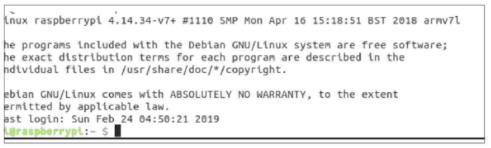

**图 1-1**

参数能改变命令的行为。以 `ls -a` 为例，`-a` 参数能显示平时隐藏的、以 `.` 开头的文件；`ls -al` 则能输出更详尽的信息，具体如下：

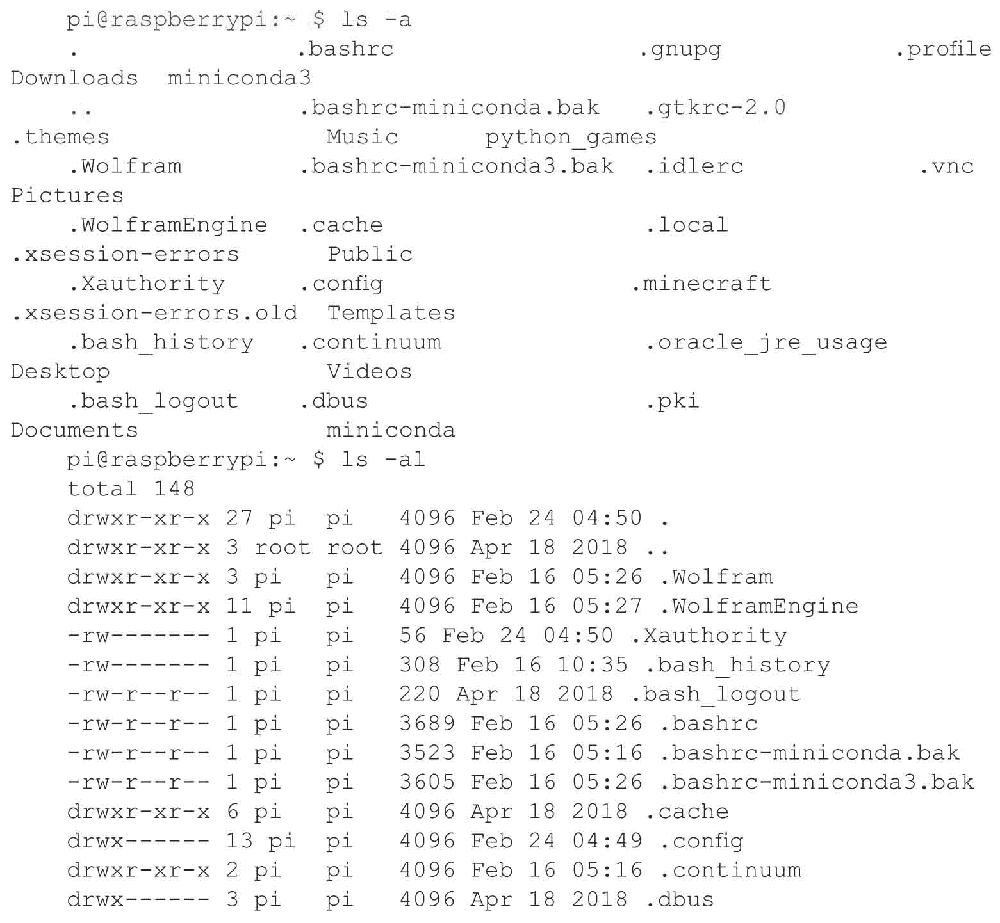

### 1.1.2 `ls` 命令的历史掌故

今后使用命令行时，每输入一条指令，都要按 `Return` 或 `Enter` 键，告诉树莓派系统“我输入完了”。

如果你习惯用文件管理器定位文件和文件夹，那么在开始用命令行管理文件前，得先擦除脑海中关于“文件图标”的刻板印象。打开终端，输入 `ls` 并按回车。如果是在装有推荐软件的最新树莓派 Stretch 系统上，你会看到一些文件夹，其中包括 MagPi。接着输入 `ls MagPi`，就能看清 MagPi 文件夹里有什么。

`ls` 命令的设计历史要追溯到计算机只有 110 波特率串口、还在用 ASR33 终端的年代。你可能会问：为什么还在用这些古老的程序？这么久了设计不该过时了吗？实际上，在工程领域，这些经典设计往往拥有极长的生命周期，因为它们影响深远，甚至改变了人们的使用习惯，所以沿用至今。比如我们键盘上的 QWERTY 布局就受打字机影响。当年为了防止打字机因机械故障卡键，同时方便打字员用顶排键敲出 "typewriter"，才有了这个设计。

### 1.1.3 文件（文件夹）路径

你只需把想查看的文件夹名称作为参数，就能查看系统中任意文件夹（或通过网络连接的其他系统）的内容。文件路径遵循文件系统结构：Windows 上从“我的电脑”开始；而在你的树莓派上，根目录是 `/`，我们称之为 Root。

试着输入 `ls /` 命令。又会得到一些看不太懂的内容，包括 `bin` 这样的名字。`bin` 是 `binary` 的缩写，存放着大量应用程序（试着输入 `ls /bin` 看看内容）。`ls /dev` 会输出硬件设备信息。试着输入 `ls /home`，你应该能看到 `pi` 这个名字。这是你自己的用户文件夹。你当前是以 "pi" 身份登录系统的。如果修改了登录用户名或新增用户，他们的主文件夹也会显示在这里。每个系统用户都有对应的主文件夹；你的就是 `/home/pi`。刚才输入 `ls MagPi` 时，我们其实已经在这个文件夹里了。例如：

```
pi@raspberrypi:~ $ ls /home
pi
```

用 `ls /home` 命令能列出所有用户的主文件夹。我的机器上只有默认用户 pi。

想确认绝对路径，直接用 `pwd` 命令即可。

### 1.1.4 主目录与切换文件夹

对所有已登录用户而言，他们的主目录均可用 `~`（波浪号）符号简写。也就是说，如果你是用户 pi，`~` 就代表你的用户主文件夹 `/home/pi`。输入 `ls ~`，就能看到你主目录下当前有什么。不过树莓派默认隐藏了许多文件和文件夹，这些隐藏项通常以点开头，包含系统和程序的配置信息，平时不需要查看。

但当你想看或修改这些文件时，只需给 `ls` 命令加上 `--all` 参数或其简写 `-a`：`ls -a`。在命令行里遍历文件系统比在图形界面轻松得多，尤其是善用各种简写时。`ls -a` 的输出里，前两项 `.` 和 `..` 分别代表当前路径和当前文件夹的父路径。试着从 `/home/pi` 查看父文件夹路径。输入 `ls ../../` 会显示祖父文件夹。如果不想在列表里看到 `.` 和 `..`，把 `-a` 改成 `-A` 就行。

在介绍其他命令前，先看看组合多个参数会怎样。比如 `ls -lh` 命令。`-l` 参数能显示更详细的文件信息。`-h` 参数把文件和文件夹大小单位转换成常见的 KB、MB 或 GB。后续章节会进一步解释 `ls -l` 输出内容的含义。

一般来说，`ls -al` 足以应对日常使用。

**绝对路径**

我们用的 `~/mylisting4.txt` 是绝对路径，因为路径写全了。如果你 `cd` 到 `~` 主文件夹，直接用 `mylisting4.txt` 也行，效果等同于 `~/mylisting4.txt`。这就是相对路径。

要切换当前文件夹，可以用 `cd`（Change Directory）命令。它能让你跳转到文件系统的任意位置。例如用 `cd /var/log` 查看 Var 文件夹内容：

```
pi@raspberrypi:~ $ cd /var/log
```

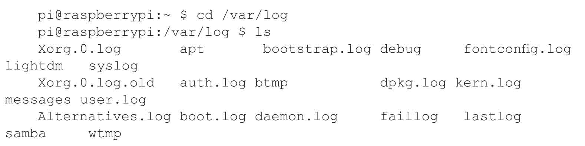

`/var/log` 文件夹存放着各类系统状态日志，供后续分析。个人日常用不着频繁查看这些文件。但在数据中心和超级计算机上运行的树莓派设备，这些监控信息至关重要。对我们来说，大致了解这些文件还是有必要的，特别是日后遇到问题求助时，里面的报错信息能精准定位问题源头。

用 `cd ~` 命令能回到你的主文件夹。自己试一下，再用 `pwd` 验证结果。接着试试 `cd -`。`-` 是你上一次所在目录路径的简写。现在我们已经学会查看文件夹内容和在它们之间跳转，接下来将学习如何处理文件。

## 1.2 文件读写

用 `tail` 命令能打印文件的尾部内容，如图 1-2 所示。

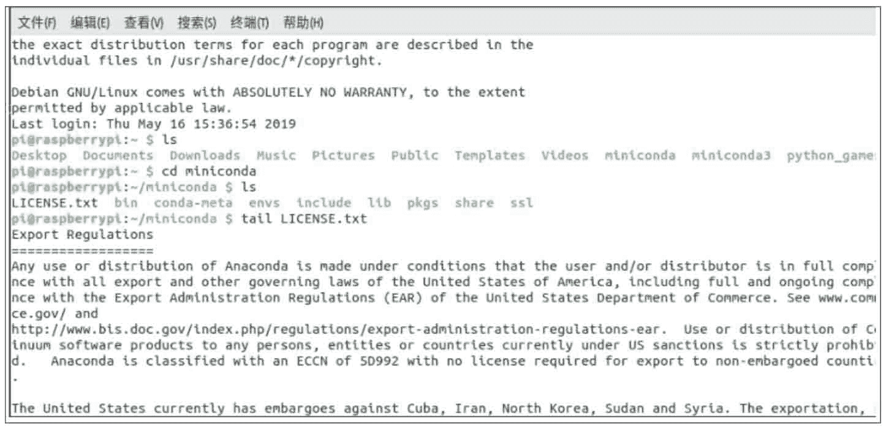

**图 1-2**

很多命令都有对应的 Info 页面，比 Man 页面详细得多。如果想获取更多命令信息，可以用 `info` 命令。比如 `info nano` 会返回 Nano 入门指南：

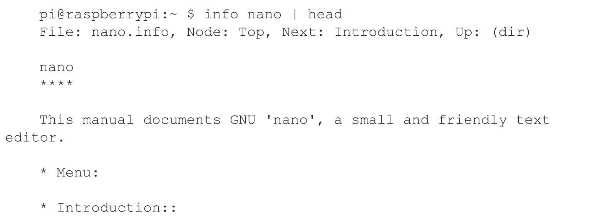

现在我们已经掌握了访问文件夹和查看其中文件的方法。是时候学习如何创建、查看和修改文件与文件夹了。这些命令一点都不难，熟练掌握后，你就能在文件系统里游刃有余地工作。

### 1.2.1 创建文件夹

先学如何新建一个文件夹。重新打开一个终端，进入你的用户目录（主文件夹）。输入 `mkdir tempfolder`。然后用 `ls` 命令查看当前目录，如下所示：

```
pi@raspberrypi:~ $ mkdir tempfolder
pi@raspberrypi:~ $ ls
Desktop   Downloads Pictures Templates miniconda   python_games
Documents Music     Public   Videos     miniconda3 tempfolder
```

# 掌握 `mkdir`：创建文件夹与基础文件操作实战

`mkdir` 的含义就是“创建文件夹”。咱们先来个小练手，帮你快速上手这个指令。

请输入 `cd tempfolder` 进入目标目录，接着把一些文件拷贝到当前位置。

首先，确认一下系统里有没有装 Python Games。要是没有，去“系统偏好设置”里找到“推荐软件”，勾选 Python Games 那一项安装即可。拷贝操作用下面这几条命令搞定：

```
cp /usr/share/python_games/fourinarow.py .
cp /usr/share/python_games/4row_* .
```

**小贴士**

(1) 我这树莓派上 `python_games` 装在这个路径。换台机器，位置可能就不一样了。

(2) 想快速打开程序？试试 `Alt+F2` 组合键。弹出窗口后输命令名，比如 `lxterminal`，终端就启动了，比点菜单快多了。

(3) 命令末尾的 `.` 代表“当前目录”，也就是咱们要把文件粘贴进去的文件夹。再看 `4row_*`，这匹配所有以 `4row_` 开头的文件。`*` 是通配符，能匹配任意长度字符（包括空）；`?` 则只匹配单个字符。

输 `python fourinarow.py`，游戏就跑起来了，界面长这样：


**图 1-3**

想改游戏源码？用文本编辑器打开就行。比如自带的 `nano`，效果如下：

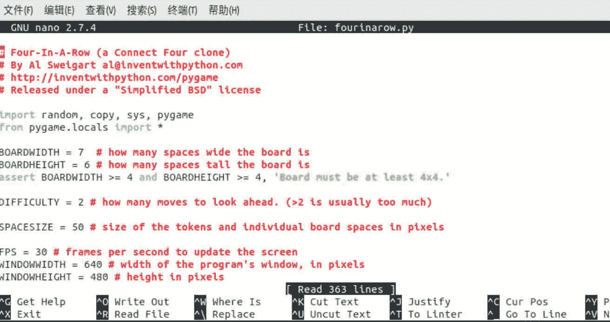

**图 1-4**

`nano` 的历史比大名鼎鼎的 `Ctrl+C` 还早，设计理念也跟记事本截然不同，初次用可能会觉得有点“别扭”。

它的快捷键（显示在底部）设置得挺特殊，但真值得花时间学。搞定这些，日后在各类 Linux-like 系统里操作都顺手得多。

## 1.2.2 编辑文件与分页查看

咱们按步骤来。先用 `nano fourinarow.py` 打开源码。用方向键往下移 9 行，把 `BOARDHEIGHT` 从 6 改成 10。编辑器底下两行列出了快捷键：`^` 代表 `Ctrl`。`Ctrl+O` 保存，`Ctrl+X` 退出。再运行程序，棋盘变大了，显示区域宽裕了。但这导致桌面顶部空间不够用，所以把 `BOARDHEIGHT` 改回 9 刚好。

用 `cat` 命令（`cat fourinarow.py`）能直接在终端吐出文件全文。但文件大了，刷屏太多看不过来。这时候得用分页器。输 `less fourinarow.py`，就能用 `Page Up`/`Page Down` 翻页，按 `Q` 退出（看 man 页也适用）。

**获取帮助**

查命令基础用法，不必非钻 man 页。加个 `--help` 参数就行。比如试试 `rm --help`。

## 1.2.3 `cat`、`head` 与 `tail` 命令

`cat`、`head`、`tail`、`less`、`more` 是后续高频命令，功能相近：都把文本文件内容输出到终端。区别在于输出格式和方式。最好的理解方式是打开终端，随便找个文件当“小白鼠”，逐个试一遍效果。几个例子如下：

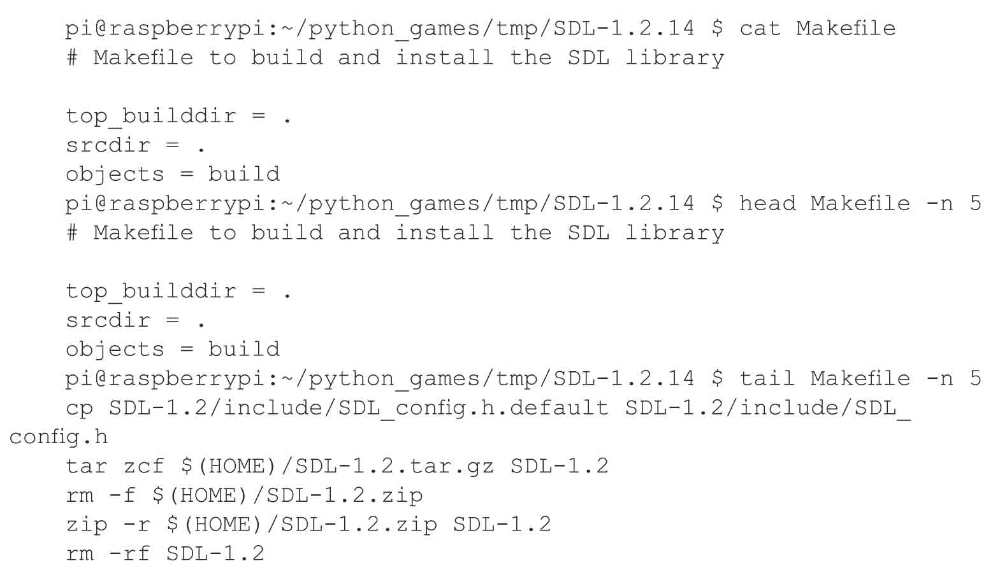

`cat`、`head`、`tail` 直接输内容。`cat` 全部吐出；`head` 只出开头；`tail` 只出结尾。

`more` 类似 `cat`，但分页显示，适合逐页阅读。最基础操作：空格翻下页，`B` 翻上页。`less` 也类似 `more`，但更强：支持自由前后翻阅，且不用加载整个文件。`more` 有个优势：读到文件尾自动退出，不用按 `Q`。平时要把文件内容打印到终端，直接用 `cat`，这是后续最常用的文件命令之一。

`cat` 全称 `concatenate`（连接）。对多文件用 `cat` 会把它们拼起来。例子如下：

## 1.2.4 `rm` 命令：手握核按钮，务必三思

```
pi@raspberrypi:~/python_games $ echo a > a.txt
pi@raspberrypi:~/python_games $ echo b > b.txt
pi@raspberrypi:~/python_games $ cat a.txt b.txt
a
b
```

`head` 和 `tail` 分别看文件前几行和后几行。如 `head fourinarow.py` 显示前 10 行；`head -n 5 fourinarow.py` 显示前 5 行，`tail -n 5 fourinarow.py` 显示后 5 行。缩写 `head -5 fourinarow.py` 也行。

删文件用 `rm`：

```
pi@raspberrypi:~/python_games $ rm -rf *
```

**用 `rm` 千万小心**，上面那条命令堪称全系统最危险指令之一。

`nano afile.txt` 会新建个 `afile.txt`。啥也不干直接退出，看看会发生啥。

直接退出会生成个空文件 `afile.txt`。现在要删掉它，或删掉其他不需要的文件，用 `rm`。`rm` 跟 `ls` 那些命令不一样，**极其危险、具破坏性**，必须谨慎。虽有保护机制，但很容易被绕过。**绝对别尝试 `rm -rf /`**，那会抹掉系统所有文件，且**无法撤销**。

现在回到 `tempfolder` 看看新建的文件。输 `ls`，能看到刚拷进来的文件。试着用下面命令删掉它们：

```
rm fourinarow.py
rm 4row_*.png
```

输 `cd ..` 回到 `/home/pi`。`rm -r tempfolder` 删掉这个空文件夹。删文件夹必须加 `-r`，这选项还会递归删掉文件夹内所有东西。

# 1.3 软件安装与用户权限：搞懂规则才能玩转系统

装软件看似简单，背后错综复杂的依赖关系却让它变得棘手。Linux 把软件包与依赖分离，省了重复安装占硬盘的事儿，但也埋下隐患。好在 Debian 90 年代就搞定了这套难题，方案是 Debian 包管理器和 APT。Debian 衍生系（Ubuntu、树莓派 OS 等）全沿用这套成熟方案。咱们先看命令行装包，再聊文件所属用户组与执行权限。

用 `apt` 更新已装软件超简单：`apt-get update`。试着用 `pi` 用户跑这条命令，报错是必然的。因为 GNU/Linux 里，只有超级用户 `root` 有这权限。

## 共享设备？先搞懂权限分配

想共享树莓派，得先摸透 `sudo` 和 `visudo`，确保给别的用户配对权限。

`apt` 是 Debian 系默认包管理器，Raspbian 自然继承。其他发行版如 CentOS 用 `yum`，macOS 有 `homebrew`，多了解几种包管理器总没错。

## 1.3.1 认识 `sudo`：普通用户的“特权通行证”

讲权限前，先说 `sudo`。简单说，它授权普通用户用 `root` 权限干活。树莓派系统里，命令前加 `sudo` 几乎能搞定一切，**自然也包括危险操作，用时务必小心！**

注意：`sudo` 本身是个软件包。如果系统提示找不到 `sudo`，可能得 `apt-get install sudo -y` 装上。某些精简镜像默认不带 `sudo`。

下面两条命令能更新树莓派系统里的程序：

```
sudo apt-get update
sudo apt-get upgrade
```

你也可以合成一条命令搞定：

```
sudo apt-get update && sudo apt-get upgrade
```

`&&` 是逻辑“与”。意思是：左边命令跑成功了，右边才会执行。

装新软件前先更新，是个好习惯。刚更新完，现在直接装几个终端小游戏：

```
sudo apt-get install bsdgames
```

## 1.3.2 软件列表与包管理底层

`apt-cache search games` 能在软件列表里按类别搜。`apt-cache show bsdgames` 能看某包详情。APT 是 `dpkg` 的前端。试试 `dpkg -l`，会列出系统已装软件（全新系统列表也很长）。

简单介绍下 `dpkg`。虽然 Raspbian 有好用的 APT，但有时你得手动装 `.deb` 包。`dpkg` 是 APT 底层依赖，专管 `.deb` 包装卸。网上下载的 `.deb`，用 `dpkg` 装最靠谱。顺带一提，Debian 可能提供图形界面装 `.deb` 工具，但**掌握 `dpkg` 才是正道**——图形工具靠谱性有限，出错还查不清根因。装包命令：`sudo dpkg -i 包名`。

已下载的包缓存在 `/var/cache/apt`。磁盘不够用时，`sudo apt-get clean` 清缓存，不影响已装软件。`sudo apt-get autoremove` 也是我常用的清理命令，能删掉过时旧包。

现在试试 `ls -lh /etc/apt`，观察输出：

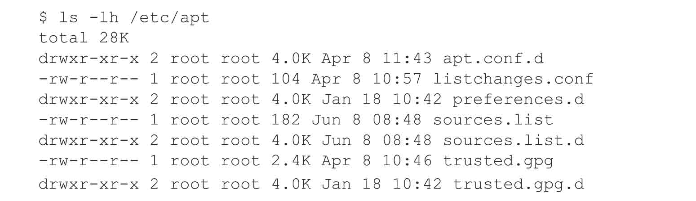

看输出，`sources.list` 对应 `-rw-rw-r--`。这串字符告诉你：不同用户组的用户对这文件有什么权限。目录项以 `d` 开头；`sources.list` 以 `-` 开头，表明是普通文件，后续位标示权限细节。

再看 `ls -l /dev/input` 输出：

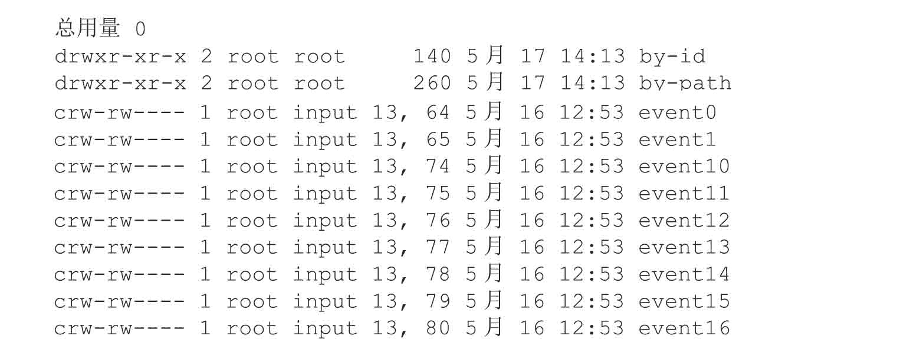

有的项以 `c` 开头，那是硬件设备。Linux 里**万物皆文件**，你手里的鼠标也不例外。

每个文件都有属主和属组。比如你家目录下的东西，属主就是你。输 `ls ~ -l`，应能看到 `pi`（假设你用 `pi` 登录）。`pi` 同时标示属主和属组。注意，把 `-l` 放命令尾部不是好习惯，这属于“知法犯法”，纯粹为演示各种写法。再试 `ls -l /dev`，会发现属主属组并不总一致。

## 1.3.3 文件属性：安全基石，偶尔绊脚石

Linux 文件属性设计是安全保障，但也会带来麻烦。跑命令碰到权限报错，试着在命令前加 `sudo` 通常能破局。

# 树莓派/Linux 进阶：权限掌控、管道流与用户管理实战

## 文件权限：读写执行的“门禁系统”

文件属性后跟着的 `rwx` 字母组合，就是系统的“通行证”。它直观地标明了用户对文件的读取、写入与执行权限。想跑程序（如之前的 `python games`）？文件属性里必须有 `x`。对于目录而言，`x` 权限则决定了你能否 `cd` 进内部。

实战一下：进入 `/usr/share/python_games`，执行 `sudo chmod a-x launcher.sh`。这里的 `a` 代表全体（用户/组/其他），若只针对特定群体，把 `a` 换成 `u`、`g` 或 `o` 即可。操作后，游戏启动器直接“瘫痪”无法运行。想恢复？输入 `sudo chmod 755 launcher.sh` 即可。

这串数字 `755` 是权限的另一种“数字语言”。三位数分别对应 User、Group、Others。解码规则是：**4=读，2=写，1=执行，数值相加即得权限值**。比如 `7=4+2+1`（全权限），`5=4+1`（读+执行）。执行 `ls -l` 验证，`launcher.sh` 权限已变为 `-rwxr-xr-x`。

改归属用 `chown`，改群组用 `chgrp`。新建 `myfile.txt`，执行 `sudo chown root myfile.txt`，你会发现文件变“只读”不可写。举一反三，你能创建一个“可写、可执行、不可读”的奇葩文件吗？

```
pi@raspberrypi:~$ id
uid=1000(czk) gid=1000(czk) 组=1000(czk),4(adm),24(cdrom),27(sudo),30(dip),46(plugdev),118(lpadmin),129(sambashare),996(docker)
```

`id` 命令能秒查当前用户组信息，这是权限判定的基石。日常工作中，`chmod 755` 是高频神器：网上下载的脚本跑不起来？十有八九是缺执行权，加上它就行。

## 1.4 管道与流：像搭积木一样处理文本

树莓派等类 UNIX 系统的核心哲学：**万物皆文件，一切皆流**。命令输出以“流”形式存在，配合管道符 `|` 即可实现链式处理，用简单指令拼装复杂功能。

命令运行时涉及三条流：标准输入、标准输出、标准错误。它们本质都是文本，系统把它们当文件处理。这正是 UNIX 系统稳健强大的基因所在。

### 1.4.1 重定向：驾驭输出流

标准输入对应键盘输入，标准输出与标准错误默认混合显示。分离设计是为了让你能精准“导流”——比如把报错信息单独甩到别处。先看如何把标准输出重定向给其他命令或文件。

管道操作用 `|`。示例：

```
ls -l /usr/bin | wc -l
```

原本 `ls` 的输出本该直奔屏幕，加上管道后被 `wc -l` 拦截统计行数。这条组合拳瞬间搞定“目录下有多少文件/文件夹”。

```
$ ls
Desktop Documents Downloads MagPi Music Pictures Public Templates Videos
$ ls -l /usr/bin | wc -l
1229
```

### 1.4.2 grep：文本搜索利器

`grep` 是必会神技，看例子：

```
$ grep if /usr/share/python_games/catanimation.py
```

这条命令筛出 Python 代码中所有含 `if` 的行。注意：`elif`、`gift` 这种包含 `if` 字串的也会被拉出来。想要精准匹配？正则表达式登场。

```
pi@raspberrypi: ~/visualizatoin$ grep if visual.py
if __name__ == '__main__':
```

实战组合招：`dpkg` 配合 `grep`：

```
$ dpkg -l | grep -i game
```

参数 `-i` 让匹配不区分大小写，`Game` 和 `game` 通吃。

再加个 `more` 分页看（`dpkg -l | more`），或用 `sort` 排序输出：

```
$ ls ~ /usr/share/python_games | sort -f
```

参数 `-f` 同样是忽略大小写排序。

去重神器 `uniq` 也能串联：

```
$ ls ~ /usr/share/python_games | sort -f | uniq
```

### 1.4.3 正则表达式：文本模式的“魔法符”

基础指令讲完，入门一下正则（不感兴趣可跳过，不影响后续）。正则用于匹配特定文本模式，批量处理同类文件超高效。例如处理所有 `.txt` 文件，`*.txt` 一把梭。

语法核心是特殊字符。Linux 命令行正则里，`\.` `\*` `\[` `\]` `\^` `\$` `\\` `\+` `\?` `\|` `\(` `\)` 都有特殊含义。若文本本身含这些符号咋办？用反斜杠 `\\` 转义即可。

演示用 `awk`，这是行处理神器，逐行读取、处理、输出。

例 1：

```
$ awk '{print $0}' /etc/passwd
```

原样打印 `/etc/passwd` 全文，`$0` 代表整行。

例 2：

```
$ awk '{print " "}' /etc/passwd
```

输出等行数的空行。对比可见 `awk` 逐行处理的特性。`awk` 功能极深，此处按下不表。

回到正则转义实战：

```
$ echo "\\ is a special character" | awk '/\\\\/{print $0}'
```

用 `\\\\` 转义反斜杠 `\\`。`//` 是 `awk` 匹配块，后半句意思是：输出所有匹配成功的整行。

`//` 本身也需转义：

```
$ echo "3 / 2" | awk '/\\//{print $0}'
```

进阶：`^` 匹配**行首位置**（非字符）。例：

```
$ echo "welcome to likegeeks website" | awk '/^likegeeks/{print $0}'
```

无输出；

```
$ echo "likegeeks website" | awk '/^likegeeks/{print $0}'
```

输出 `likegeeks website`。

重头戏 `.`：匹配**除空字符外的任意单字符**。

```
$ cat myfile
this is a test
This is another test
And this is one more
start with this
$ awk '/.st/{print $0}' myfile
```

输出：

```
this is a test
This is another test
```

只想匹配特定几个字符？用 `[]`：

```
$ awk '/[oi]th/{print $0}' myfile
```

输出：

```
this is a test
This is another test
```

反向排除用 `[^]`：

```
$ awk '/[^oi]th/{print $0}' myfile
```

直接过滤掉含 `o` 或 `i` 的行。

`-` 表示范围：

```
$ awk '/[e-p]st/{print $0}' myfile
```

最后说 `*`：正则里它**不匹配字符**，而是声明“前一个模式可重复 0 次或多次”。别跟 Bash 通配符搞混！

```
$ echo "st" | awk '/s[ae]*t/{print $0}'
```

输出 `st`（`t` 前的 `s` 出现 0 次）。

```
$ echo "awwwwwk" | awk '/aw*k/{print $0}'
```

输出 `awwwwwk`（`w` 重复多次）。

### 1.4.4 文件重定向：落盘归档

`>` 符号把输出流直接“倒”进文件（新建或覆盖）：

```
$ ls /usr/bin > ~/mylisting4.txt
```

`mylisting4.txt` 现已包含命令输出：

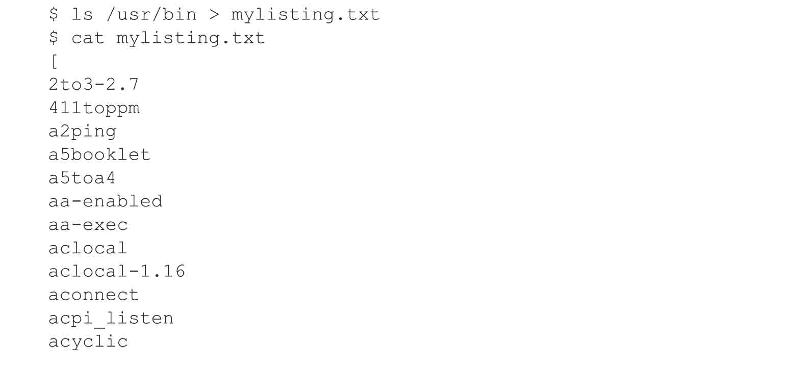

**避坑指南**：文件里的布局跟终端不同。终端为省空间挤成一行，重定向到文件则一行一项。大多数命令（如 `grep`）以行为最小处理单位。另，部分命令（如 `cat`）用管道时需用 `-` 占位。

### 1.4.5 追加与输入重定向

想往文件尾追加内容？用 `>>`：

```
$ echo "& one more for luck!" >> ~/mylisting4.txt
```

`echo` 打印引号内内容到标准输出；`-e` 启用转义（如换行 `\n`）；`tail` 看文件尾部；`<` 实现输入重定向（如把文件内容导给 `sort`）：

```
$ echo -e "aardvark\nplatypus\njellyfish\naardvark" > list1
$ sort < list1
```

`<` 和 `>` 可组合：从 `list1` 读入，处理后输出到 `list2`：

```
$ head -n 2 < list1 > list2
```

配合管道更灵活：

```
$ sort < list1 | uniq > list3
```

终极技：分离标准错误流。用 `2>` 重定向报错：

```
$ cat list1 list2 list3
$ list42 2> errors.txt
```

含义：正常输出留在屏幕，报错单独存入 `errors.txt`。用 `2>>` 则是追加不覆盖。

## 1.5 用户与环境：定制专属命令行体验

看命令行最前端：`pi@raspberrypi~ $`。`$` 是提示符，`~` 代表家目录，前缀格式是 `用户名@主机名`，均可自定义。

### 1.5.1 新建用户：`adduser` 一把梭

`sudo adduser jo`，按提示输密码、填信息（可全按 Enter 跳过）。新用户家目录 `/home/jo` 自动生成，初始只有 `.bashrc` 等配置文件（`ls -A` 可见）。

并非所有用户都有家目录。`cat /etc/passwd` 里一堆 `sshd` 等系统账号，因为文件/进程必须有归属用户。密码当然不在明文里，改密码用 `sudo passwd jo`；若是 `pi` 用户自己改，直接输 `passwd`。

Bash 用环境变量存有用信息（如 `OLDPWD`、`USER`），`env` 命令全量查看。

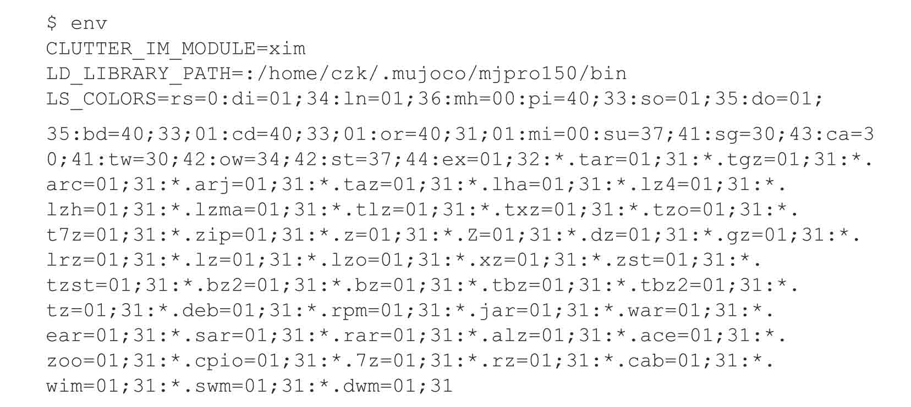

### 1.5.2 切身份、换环境

以 `pi` 登录时 `~` 指 `/home/pi`，同理 `~jo` 指 `/home/jo`。

切用户用 `su - jo`，环境变量随之加载，目录自动跳转。注意：许多 Linux 发行版 `su` 直通 root，**树莓派不建议直接用 `su`**，需提权时用 `sudo`。`sudo -s` 开启持久 root 权限，`exit` 退出。日常别滥用 `su` 或 `sudo -s`。

想定制提示符？改 `~/.bashrc`。`more ~/.bashrc` 里全是大写变量，`PS1` 控制提示符样式。临时改法：`export PS1="tutorial@magpi >"`，退出即失效。永久生效需写入 `~/.bashrc`。每次登录 Bash 都会读取此文件，除非你换了别的 Shell。

系统自带的 `PS1` 往往很复杂（含颜色、路径等），建议别动。我机器上的长这样：

```
\[\e]0;\u@\h: \w\a\]${debian_chroot:+($debian_chroot)}\[\033[01;32m\]\u@\h\[\033[00m\]:\[\033[01;34m\]\w\[\033[00m\]\$
```

### 1.5.3 别名：给长命令起个“小名”

查现有别名：

```
$ grep alias ~/.bashrc
```

能看到 `#alias ll='ls -l'`。去掉 `#` 即生效。编辑 `.bashrc`，改成 `alias ll='ls -lAhF'`，再输 `ll`，输出瞬间人性化：带隐藏文件、人类可读单位（KB/MB）、标记文件类型、屏蔽 `.` 和 `..`。重开终端或 `source ~/.bashrc` 生效；撤销用 `unalias ll`。

别名是效率神器。例：程序路径深得离谱 `/example/test/test2/test3/test4/a.run`，每次输全路径？设别名：

```
$ alias count='wc -l'
$ alias netstate='netstat -tunlp'
```

之后直接输 `myapp` 即可启动。快去定制你的专属指令库吧！

接下来我们来看看如何自定义键盘映射。系统级的键盘配置文件位于 `/etc/default/keyboard`，修改它会影响所有用户；若仅想针对当前账号生效，请使用 `sudo` 执行以下命令进行编辑：

```
$ touch ~/.xsessionrc
$ echo "setxkbmap el" > ~/.xsessionrc
```

其中的 `el` 可替换为其他语言代码。`.xsessionrc` 文件仅对当前用户生效，配置完成后，该用户在命令行环境下运行的所有程序都将应用新的键位设置。

## 1.6 存储设备管理

树莓派默认会自动识别并挂载 TF 卡，但在实际使用中，我们常需要手动干预存储设备，例如挂载一块新的移动硬盘，这就用到了下面的知识。

在动手挂载前，建议先用 `df` 命令查看当前已挂载的设备列表，参考下图：

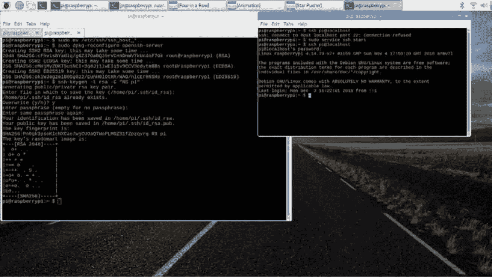

**图 1-5**

`df` 不仅能显示磁盘剩余空间，也是查看挂载状态的利器。

### 1.6.1 挂载与卸载：设备识别与数据访问的分水岭

“设备插入电脑”和“读取设备数据”是两码事。系统检测到硬件插入后，数据仍被锁在设备内，必须经过“挂载”操作映射到目录树上才能访问，这就像书已上架（设备就绪），但未办借阅手续（未挂载），你无法翻阅内容。

Linux 通过虚拟文件系统 (VFS) 管理硬盘与外设。输入 `mount` 可查看当前挂载详情，输出格式为“设备 挂载点 文件系统类型 选项”。输出中常见的 `none` 类型可忽略，重点关注以 `/dev` 开头的条目：`/dev/mmcblk0p1` 通常对应 SD 卡分区，`/dev/sda1` 则对应首个 USB 存储设备。

插入 U 盘后，树莓派桌面环境通常会自动挂载。再次执行 `mount`，你会看到类似 `/dev/sda1 on /media/pi/UNTITLED...` 的记录。若需安全移除，执行 `sudo umount /dev/sda1` 即可卸载（前提是无程序正在占用该设备）。

若提示“目标忙”，请切换当前工作目录离开挂载点，并关闭可能正在读写该设备的应用程序。

### 1.6.2 精准定位磁盘设备路径

`/dev/sda1` 代表第一块 SCSI/SATA/USB 磁盘 (`sda`) 的第一个分区。第二块同类设备会被标记为 `/dev/sdb1`，以此类推。

要实时监控内核对新设备的识别日志，可用 `tail -f /var/log/messages`（部分发行版请查看 `/var/log/syslog`）。另一个强力工具是 `fdisk`：执行 `sudo fdisk -l` 将列出所有连接设备的分区表详情，且不会执行任何写入操作，非常安全。

要挂载磁盘，首先需要一个拥有合适权限的空目录作为挂载点，请按下所示创建并授权：

```
$ sudo mkdir /media/usb
$ sudo chmod 775 /media/usb
```

桌面环境自带图形化工具可协助完成挂载，操作如下图：

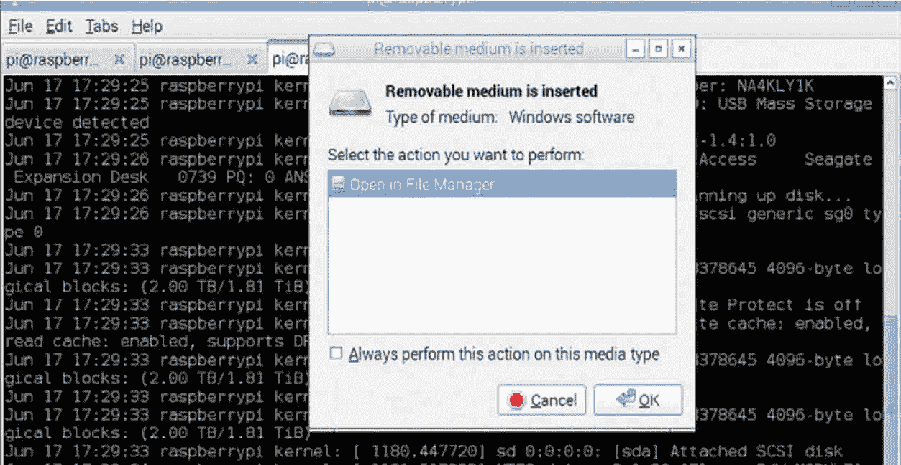

**图 1-6**

纯终端下，可通过以下命令获取分区格式等辅助信息（示例中显示为 NTFS）：

```
$ sudo mount -t vfat /dev/sda1 /media/usb
```

此处的 `vfat` 即文件系统类型标识。

确认信息无误后，即可执行挂载操作。

### 1.6.3 开机自动挂载：`/etc/fstab` 与 UUID

系统启动时读取 `/etc/fstab` 决定挂载哪些分区。但若连接多块移动硬盘，设备名 (`/dev/sda1`, `/dev/sdb1`) 可能因启动顺序变化而错位。解决方案是使用唯一标识符 **UUID**。

运行 `sudo blkid` 或查看 `/dev/disk/by-uuid` 目录可获取分区 UUID。以 NTFS 分区为例，编辑 `sudo nano /etc/fstab`，在末尾追加如下行：

```
/dev/disk/by-uuid/E4EE32B4EE327EBC /media/usb
ntfs defaults 0 0
```

字段含义依次为：设备标识（推荐用 UUID）、挂载点、文件系统类型、挂载参数、dump 备份标记（通常 0）、fsck 检查顺序（根分区 1，常驻数据盘 1，其余 0）。详细参数请 `man mount` 查阅。

### 1.6.4 进阶 `nano` 技巧与验证挂载

掌握 `nano` 快捷键能大幅提效：
- `Ctrl+O` 保存、`Ctrl+X` 退出、`Ctrl+R` 插入文件。
- `Ctrl+J` 整理段落、`Ctrl+K` 剪切行、`Ctrl+U` 粘贴（剪切后粘贴即为移动行）。
- `Alt` 键组合键（显示为 `M-`）提供更多功能，如 `Ctrl+T` 调出文件浏览器另存为。

退出编辑器后，执行 `sudo mount -a` 让系统重读 `fstab` 并挂载所有定义项；若仅挂载新增项（如 `/media/usb1t`），用 `sudo mount /media/usb1t` 更精准。执行结果如下图：

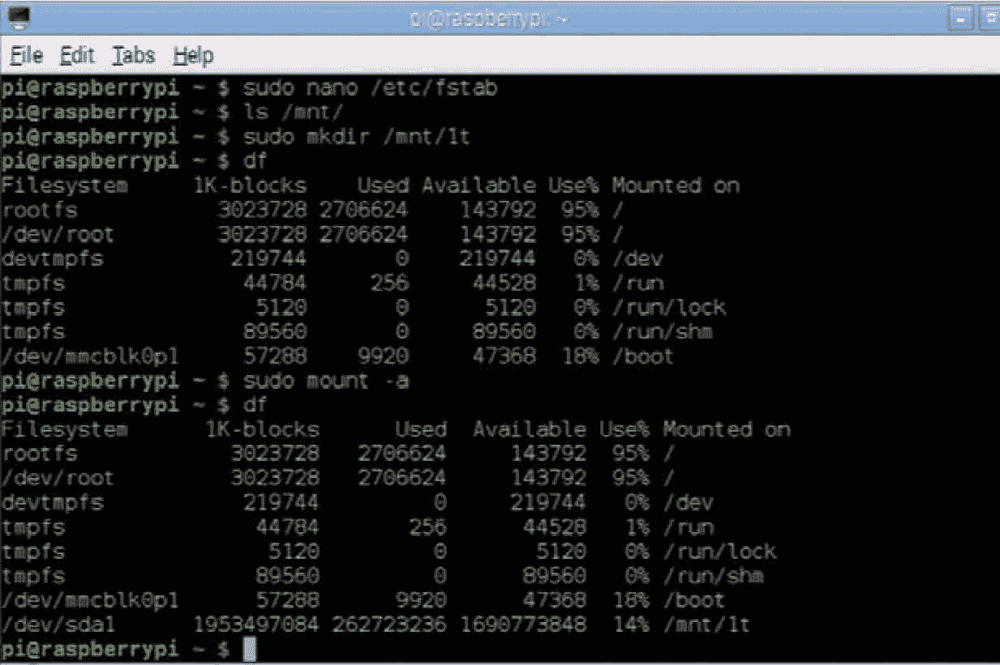

**图 1-7**

# 第 2 章 树莓派命令行操作入门（下）

## 2.1 网络配置与远程访问

### 2.1.1 获取网络信息

树莓派多数情况下通过 DHCP 自动联网。只需接入网线或连上 Wi-Fi，即可通过 DHCP 协议自动获取 IPv4 地址（通常为 `192.168.x.x` 私网段，范围 `192.168.0.0` - `192.168.255.255`）。

查看详细网络配置用 `ifconfig`（见下图），重点关注 `eth0`（有线）或 `wlan0`（无线）下的 `inet` 地址。最快仅获取 IP 的命令是 `hostname -I`。

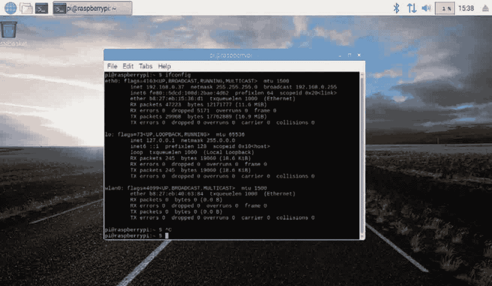

**图 2-1**

输出信息中，`eth0` 板块下的 IPv4 地址即为当前有线网络 IP。

### 2.1.2 固定 IP 地址配置

DHCP 分配的 IP 重启后可能变动，固定 IP 能让设备“门牌号”永不改变。编辑 `/etc/dhcpcd.conf` 文件（如下图）：

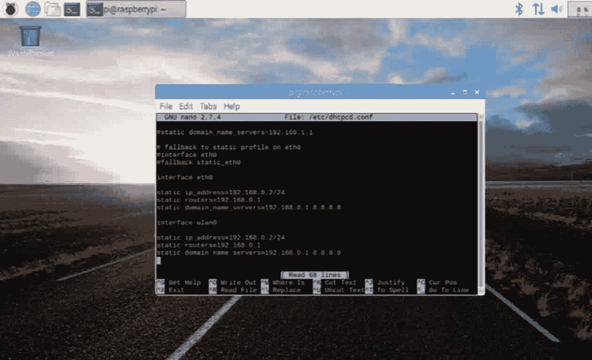

**图 2-2**

用 `nano` 打开文件，翻至末尾添加以下配置块：

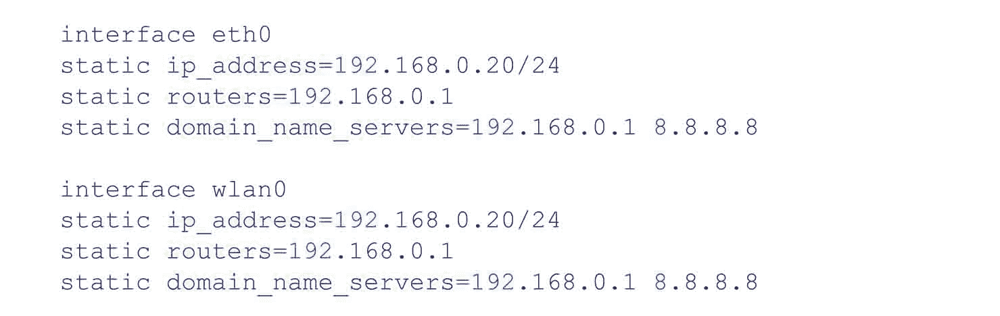

保存退出后，重启生效。可在另一台电脑用 `ping` 验证连通性（见下图）：

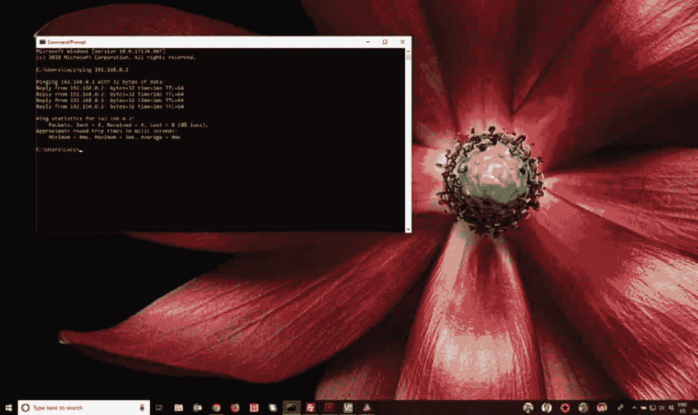

**图 2-3**

此时树莓派 IP 将固定为 `192.168.0.20`（避开 `.1` 网关地址，可用范围 `.2` - `.255`）。重启后用 `hostname -I` 确认。若需恢复 DHCP，删除刚添加的配置即可。**提示：非必要不建议固定 IP，以免造成网络冲突。**

### 2.1.3 `ping`：网络诊断的听诊器

上一步配置中的 `192.168.0.1 8.8.8.8` 指定了 DNS 服务器，将域名解析为 IP（如 `raspberrypi.org` → `93.93.128.230`），这是浏览网页的前提。

`ping` 发送 ICMP 回显请求包，返回目标可达性、延迟、丢包率。
- `ping localhost` 验证本地回环（解析至 `127.0.0.1`）。
- 局域网内另一台机器执行 `ping 192.168.0.20`：Windows 默认 4 次，Linux 持续发送直到 `Ctrl+C`。指定次数用 `-c` 参数：

```
$ ping -c 5 raspberrypi.org
```

补充知识：IPv6 地址为 128 位（如 `fd51:42f8:caae:d92e::1`），静态配置方法可参考 `dhcpcd.conf` 手册。除 Google DNS (8.8.8.8)，也可使用 FreeDNS 等公共 DNS 服务。

### 2.1.4 SSH 远程登录：安全、高效的标准入口

SSH 凭借加密传输取代了 Telnet/Rlogin，是远程管理首选。**前置步骤：务必用 `passwd` 修改默认密码 `raspberry`。**

若 SSH 服务未启，执行 `sudo raspi-config` -> `Interface Options` -> `SSH` 启用，再用 `ifconfig` 确认 IP。

**连接方式：**
- **Linux/macOS/Windows 10+ (OpenSSH)：** `ssh pi@192.168.0.20` 输入密码即可。
- **Windows 旧版本：** PuTTY。
- **Android：** Termux 或 ConnectBot。

**本地验证：** 树莓派上执行 `ssh localhost` 测试服务是否正常。

**硬化安全配置（必做）：**
编辑守护进程配置 `/etc/ssh/sshd_config`（注意区别于客户端配置 `ssh_config`）：
1.  禁止 Root 登录：`PermitRootLogin yes` → `no`。
2.  执行 `sudo service ssh reload` 生效。
3.  （进阶）修改默认端口 22 为非常用端口（如 12123），连接时需加 `-p 12123`。
4.  **强烈建议配置密钥对登录，禁用密码认证，妥善保管私钥。** 参考下图流程：


**图 2-4**

**跨公网访问：** 若无公网 IP（如 ADSL 拨号），需借助内网穿透服务（如花生壳 `https://hsk.oray.com/`）。

**文件传输 - SCP：**
基于 SSH 协议，加密传输，替代不安全的 FTP。
- 从树莓派拉取文件到本地当前目录：

```
scp pi@192.168.0.2:/home/pi/testfile1 .
```

- 配合通配符与 `-r` 可递归传输整个目录。

> **注意**
>
> FTP 明文传输极不安全，生产环境请勿使用。

### 2.1.5 Samba：局域网内的“无缝”文件共享

想在 Windows 资源管理器里像访问本地盘符一样访问树莓派？Samba 就是桥梁。安装后只需在默认配置中加入工作组名即可基本跑通（Win7 以下用 `WORKGROUP`，Win7+ 用 `HOME`），见下图：

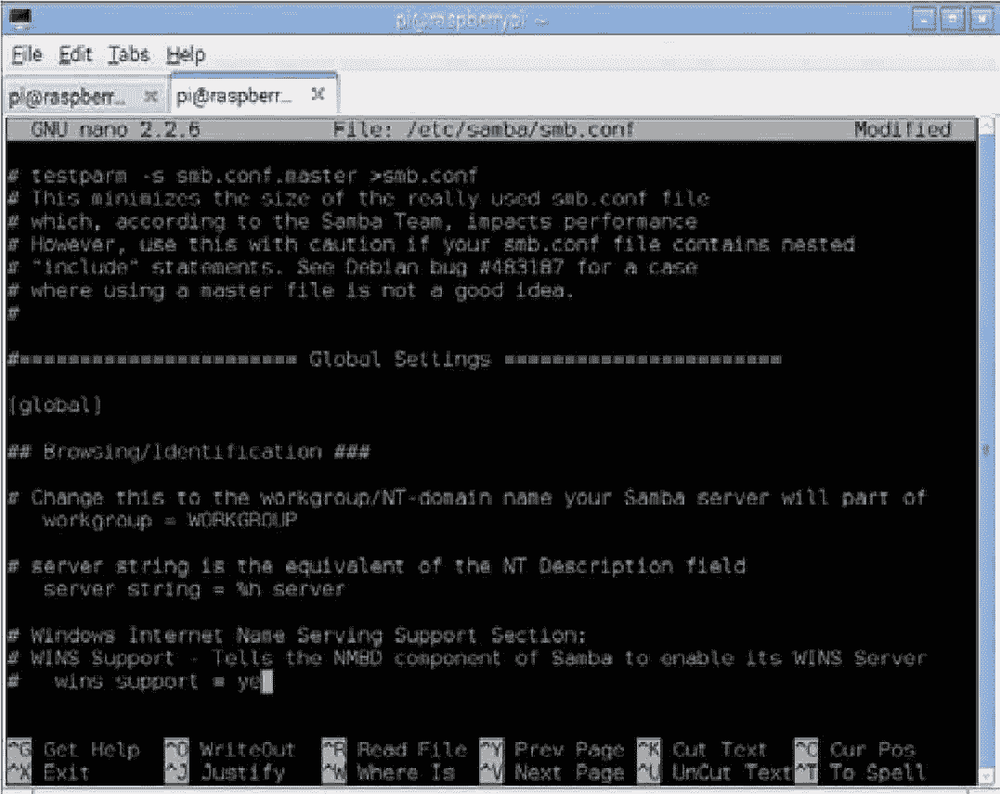

**图 2-5**

安装命令：

```
$ sudo apt-get install samba samba-common-bin
```

编辑 `/etc/samba/smb.conf` 修改 `workgroup`，并将用户 `pi` 加入 Samba 密码库：

```
$ sudo smbpasswd -a pi
```

重启服务：

```
$ sudo service samba restart
```

此时 Windows 网络邻居应能发现树莓派。进一步配置共享目录与权限（只读/读写），在配置文件末尾追加：

```
$ sudo nano /etc/samba/smb.conf
```

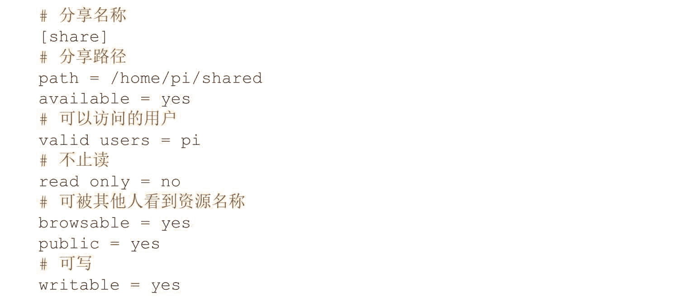

再次重启服务：

```
$ sudo service samba restart
```

完成后，即可在局域网内对共享文件夹进行读写操作。

## 2.2 进程管理基础

`top` 命令提供动态的进程视图，实时展示 CPU/内存占用。前台任务可用 `Ctrl+Z` 挂起（放入后台暂停），用 `fg` 恢复到前台继续运行，如下图演示：

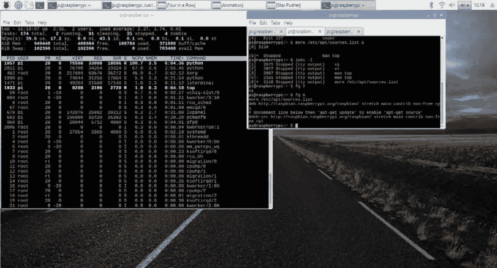

**图 2-6**

# 当程序“卡死”怎办？进程管理与软件安装实战指南

有时候程序会毫无反应，连退出键 `Q` 都按不掉，看起来只能靠 `Ctrl+C` 强行终结。其实系统并没崩，掌握几条后台指令，就能精准“收割”僵尸进程，完全不用重启。

## 2.2.1 进程查看：看清系统底牌

想管住进程，先得看清全貌。`ps` 命令就是这把“透视镜”。
- `ax`：列出全体用户的所有进程；
- `u`：筛选特定用户；
- `w` / `ww`：控制显示宽度，防止截断。

直接敲 `ps auxww` 试手气，你会发现选项前没有短横线 `-`，因为它继承了早期 UNIX 的风格（其他分支常用 `ps -e`）。输出列里，**PID（进程 ID）** 是核心——首个进程 `init` 的 PID 固定为 `1`，后续杀进程全靠它。

```
$ ps aux | grep -i vi
```

`-i` 参数虽非必需，但加上它能忽略大小写，省心不少。`killall` 后跟程序名（如 `killall firefox`）也能一键收工。

来个进阶组合拳：

```
kill $(ps aux | grep '\[f\]irefox' | awk '{print $2}')
```

简单说下 `awk`：它只负责把第二列（PID）切出来；`\[f\]` 这写法是防止 `grep` 自身混进结果里。

## 2.2.2 现代进程管家：动态监控更直观

`ps` 是快照，`top` 才是实况直播——内存、CPU 占用实时刷新。`free` 专看内存剩量；而 `htop` 是 `top` 的“加强版”，支持鼠标滚动、横向展开，甚至在界面里直接按 `k` 杀进程，`Q` 退出，多核 CPU 还能分核心显示负载（见下图）。

```
$ sudo apt-get install htop
```

> 当前 Raspbian 已内置 `htop`，开箱即用。

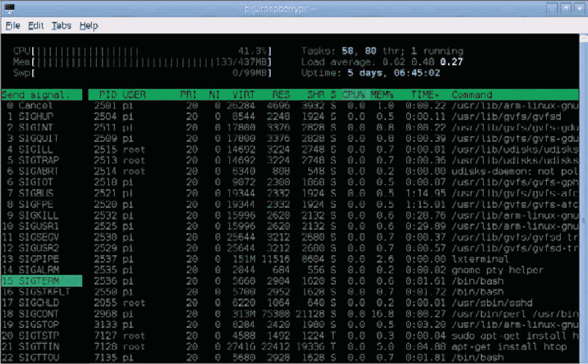

**图 2-7**  
`htop`：看得见、动得了、还能交互。

## 2.2.3 后台任务：把长跑交给系统

命令末尾加 `&`，任务瞬间转入后台。试试 `man top &`，终端回显 `[1] 12768`——方括号里是作业号（终端自动编号），后面是 PID。现在你可以接着干别的，想找回 `man` 页？`fg 1` 即可切回前台。

- `Ctrl+Z`：挂起当前任务；
- 无参数 `fg`：唤醒最近一次挂起或后台任务；
- `jobs` / `jobs -l`：列出本终端的后台任务（后者带 PID）。

**`nohup` 是真·后台守护神**：终端关了它还在跑，输出自动存入 `nohup.out`（位于启动目录）。结合重定向更灵活：
- `1>` → 标准输出
- `2>` → 错误输出
- `&>` → 全包了

```
$ nohup myprog &>backgroundoutput.txt &
```

典型场景：SSH 断开后仍要跑网络脚本。

```
$ sudo nohup sh -c "ifconfig wlan0 down && ifconfig wlan0 up"
```

注意：`nohup.out` 需 root 权限读写，或自行 `chmod` 授权：

```
$ sudo chown pi:pi nohup.out
```

传感器采集、长时间爬虫……凡是“跑不完就不能停”的，`nohup` 皆大欢喜。

## 2.2.4 信号机制：杀进程也有“温柔与暴力”

在 `htop` 里点杀进程、敲 `kill`，本质都是发信号。常见三档：

| 信号 | 触发方式 | 效果 | 建议 |
|------|----------|------|------|
| **SIGTERM (15)** | `kill PID` | 进程先存数据、再释放资源，体面退出 | **首选** |
| **SIGINT (2)** | `kill -2` / `Ctrl+C` | 直接打断，未保存数据丢失 | 非得强行停时用 |
| **SIGKILL (9)** | `kill -9` | 内核强制回收，**零预警、零清理** | 绝不首选，慎用！ |

还有一个 **SIGHUP (1)**，`kill -1` 发出。对多数守护进程只是“重读配置/自检”，危害极低；在容错率极低的设备上，它是最安全的“重启”信号。

---

## 2.3 下载、编译、安装：从源码到可执行

`curl` 与 `wget` 同为下载利器，前者更强（代理、Cookie、FTP 上传样样行）；`tar` 负责压缩解压（见图 2-8）。

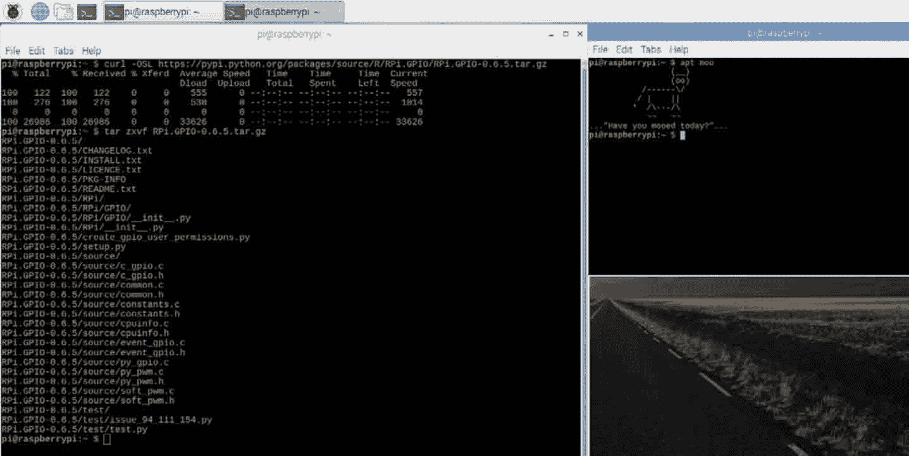

**图 2-8**

### 2.3.1 下载与解压：拿到源码第一步

`wget` 简单粗暴但无安全校验；`curl` 更稳妥。下载文件示例：

```
$ curl -OSL https://pypi.python.org/packages/source/R/RPi.GPIO/RPi.GPIO-0.6.5.tar.gz
```

`-O` 写文件，`-S` 报错，`-L` 遇跳转自动追踪。

下载的 GPIO 包用 `gzip` 压缩，`gunzip` 或下面命令皆可解：

```
$ tar zxvf RPi.GPIO-0.6.5.tar.gz
```

参数里没短横线：`z`=gzip 解压，`x`=释放文件，`v`=显示过程，`f`=读文件而非标准输入。解开后进入新目录安装：

```
$ cd RPi.GPIO-0.6.5
$ sudo python setup.py install
```

碰到 `.zip` 直接 `unzip`：

```
$ unzip 2018-11-13-raspbian-stretch-lite.zip
```

### 2.3.2 手动编译：没有包管理器的年代

早年没 `apt`/`dpkg`，C/C++ 程序全靠 `gcc` 手搓编译链接。后来 `configure` + `make` 普及，依赖检查、编译参数、文档安装全自动化。

现在大多软件提供 `.deb`，包管理器一条龙搞定。但 GitHub 克隆源码、官网下源码包、冷门工具无预编译包……这些场景仍得自己编译。通用三部曲：解压 → 配置 → 编装。

```
$ tar xvf latest-software.tgz
```

### 2.3.2 源码编译部署

进入源码目录后，先找找 `README` 与 `INSTALL` 这两个文件；粗略浏览 `README`，里面通常会说明安装相关事项。随后便可动手部署，绝大多数情况步骤固定，就那几条指令：

```
$ ./configure
$ make
$ sudo make install
```

> **提示**
>
> 具体细节还得看软件自带的 `README`、`INSTALL` 等安装文档。

`Git` 最初由 `Linus` 为管理 `Linux` 内核代码而开发，设计初衷是追求简洁易用，如图 2-9 所示。

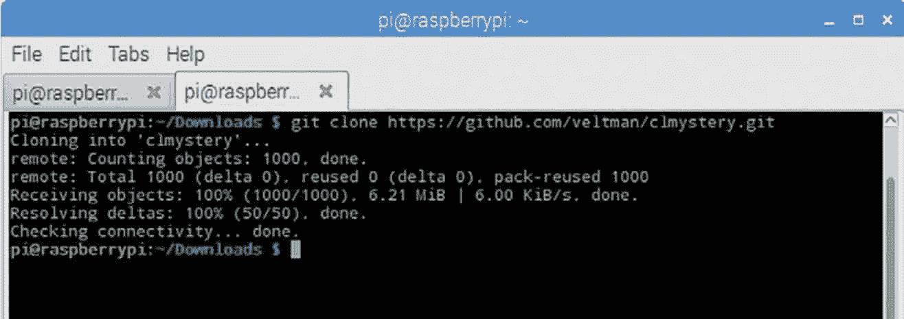

**图 2-9**

在树莓派上直接运行 `./configure` 可能会把软件装到 `/usr/local/lib` 等非预期位置，后续使用时因库搜索路径不包含这些目录而报错。

解决办法很简单，自行指定安装前缀即可：

```
$ ./configure --prefix=/usr --libdir=/usr/lib/arm-linux-gnueabihf
```

### 2.3.3 一键脚本安装

部分开发者十分贴心，直接提供自动化部署脚本，例如编程教学工具 `edublocks`，单条指令即可完成：

```
$ curl -sSL get.edublocks.org | bash
```

该命令会拉取脚本并立即执行。其中 `curl` 的 `-s` 静默进度条，`-S` 保留错误输出，`-L` 支持跟随跳转。若不愿直接赋予脚本高权限，可折中处理：先下载到本地再运行，比如存为 `install.sh`：

```
$ curl -o install.sh -L get.edublocks.org
```

随后执行 `sh install.sh`。观察输出可知它会自动拉取并配置大量依赖。**切记**：运行前务必弄清脚本行为，否则隐患极大。

将所有部署逻辑封装进脚本一键执行，能大幅压缩环境配置耗时，参见图 2-10。

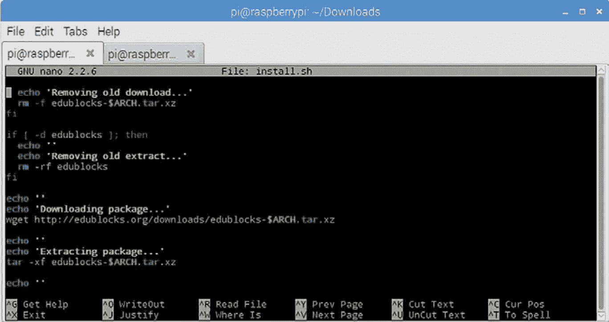

**图 2-10**

此外，`Python` 当下极火，其自带机制让库安装变得异常轻松。

虽说 `Debian` 系已有强大的 `APT` 与 `dpkg`，但不少语言和工具仍内置专属包管理器，`emacs` 便是典例。后续开发中，打交道最多的莫过于 `JavaScript` 的 `npm` 与 `Python` 的 `pip`。`pip` 用法与 `apt` 高度相似：

```
$ sudo pip3 install numpy
```

安装 `numpy` 库的过程简单直观。

### 2.3.4 磁盘镜像写入

烧录系统镜像时，常规 `cp` 命令无能为力。你需要能操作 `SD` 卡文件系统的工具，`dd` 便是其一。

使用 `dd` 时，**必须反复核对目标磁盘**。`dd` 的功能是按字节逐位复制并转换格式。烧录前，先弹出第二张 `MicroSD` 卡。插拔前后执行 `sudo fdisk -l` 确认设备名。若发现容量匹配的 `/dev/sdb`，先卸载其分区 `sdb1`：`umount /dev/sdb1`，随即写入镜像：

```
sudo dd if=~/Downloads/2018-11-13-raspbian-stretch-lite.img of=/dev/sdb bs=1M
```

`dd` 与 `if` 等缩写源远流长，可追溯至上世纪 60 年代。日后使用 `dd` 务必三检目标盘，一旦写错，数据将灰飞烟灭！写入时 `bs=1M` 亦可改为 `bs=4M` 以提速。完成后，该 `SD` 卡即可用于引导其他系统。

## 2.4 系统启动与关机

### 2.4.1 传统引导流程

近年来主流 `Linux` 发行版纷纷革新引导方式；网上配置 `rc.local` 的旧教程基本过时，虽仍能跑通但不推荐。唯一不变的是：`Linux` 仍沿用原始设计——首个启动的进程成为后续所有进程的祖先。早期为 `/sbin/init`，现为 `/lib/systemd/systemd`，二者 `PID` 均为 `1`。

引导流程跑完主体后呈现用户界面。可通过 `dmesg` 查看内核欢迎信息，这些日志记录在 `/var/log/kern.log`。

启动过程是用户空间的起点。在用户空间，程序无需修改内核源码即可调控系统行为。通常 `Linux` 发行版实现 `UNIX` 的 `SystemV` 引导模式，借此定义运行级别：单用户、终端、图形界面、关机等。

现在 `Jessie` 系弃用 `service` 命令，应改用 `systemctl` 将服务纳入 `systemd`。稍后该目录下会出现链接，**严禁手动修改这些链接**，如图 2-11。

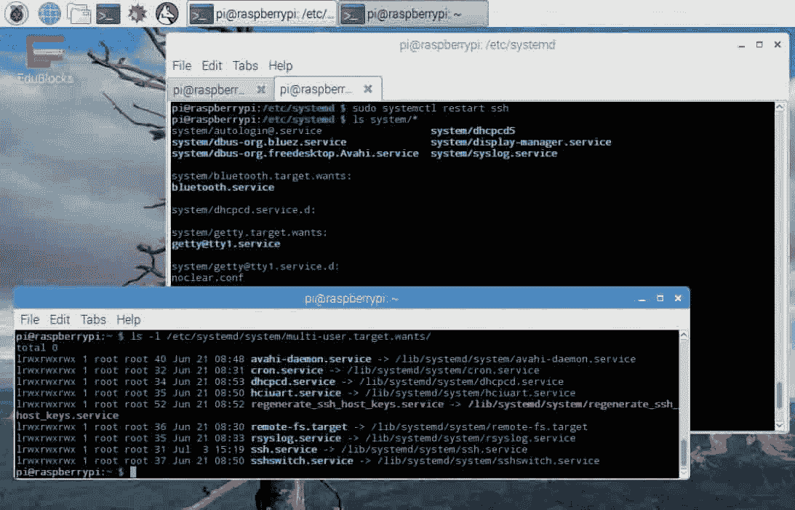

**图 2-11**

`dmesg` 输出启动详情，见图 2-12。

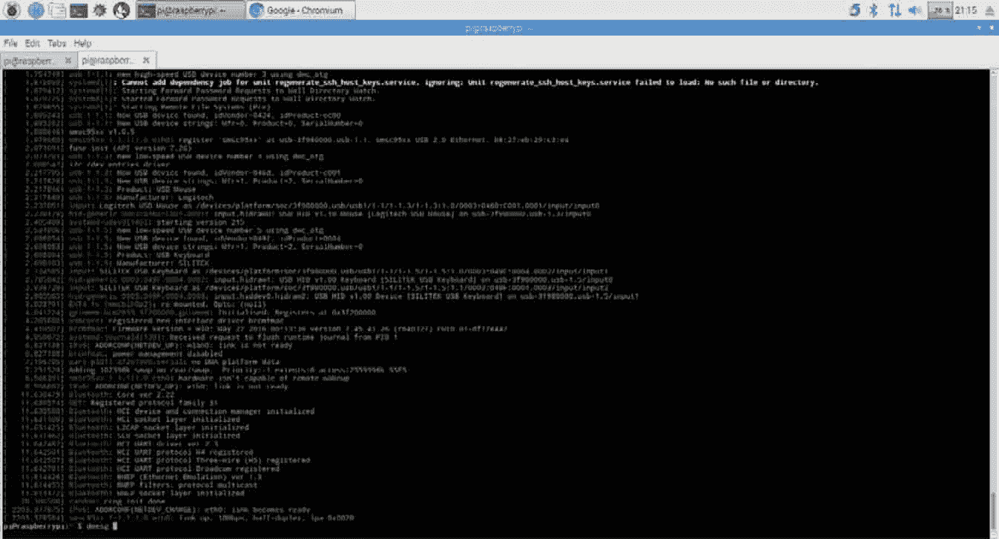

**图 2-12**

`/etc` 下 `rc0` 至 `rc6` 定义的启动项，无论运行级别如何，开机必跑。

`/etc/init.d` 下的脚本可拉起数据库、服务等。用 `status` 查状态，用 `reload` 重载配置。`reload` 仅重读配置文件，不彻底重启服务。

```
$ sudo /etc/init.d/couchbase-server status
```

以上主要讲 `Sys-V` 引导。其最大短板是效率低。下面介绍更高效的新方式。

### 2.4.2 新时代引擎：Systemd

`Systemd` 核心特性是**并发启动**。锁定启动目标后，它会自动解析依赖，跳过无关进程。配置文件位于 `/etc/systemd/system`。`Systemd` 配套 `systemctl` 命令，例如：

```
$ sudo systemctl restart ssh
```

重启 `ssh` 服务。为兼容旧习惯，`Systemd` 保留了 `service` 命令，如下仍生效：

```
$ sudo service apache2 reload
```

在 `/etc/systemd/system/multi-user.target.wants` 里能看到许多 `cron.service` 类文件。`ls` 一看，这些链接指向 `/lib/systemd/system` 同名文件；简而言之，它们处理单元间依赖。接着聊聊 `crontab`：

```
$ sudo systemctl enable postgresql.service
```

此命令建立链接，使 `postgreSQL` 开机自启。

```
$ sudo systemctl daemon-reload
```

此命令让 `systemd` 即时生效新配置。

虽说运行级别在 `systemd` 模式下失效，但仍可用 `who -r` 查看。

为兼容，`Systemd` 系统保留了 `init.d` 等脚本。

`Systemd` 体系庞杂，从 `systemd.unit` 到 `systemd.slice` 组件众多，各有手册页，见图 2-13。

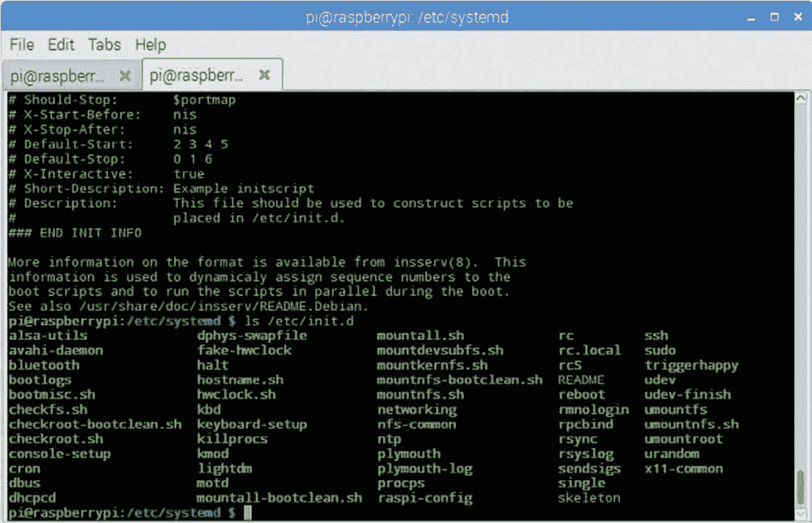

**图 2-13**

`Systemd` 能自动理顺单元链接关系，但有时仍需手动干预，这就用到 `ln` 命令。

`ln` 可为文件建链接，令同一文件在系统两处现身：

```
$ sudo ln -s /usr/share/doc/python-numpy/THANKS.txt
```

$ `numpy-THANKS.txt`

建链后执行 `ls -l`，可见这是特殊文件（指向实体存储的链接）。修改 `numpy-THANKS.txt`，源文件 `THANKS.txt` 也随之变动。

此处 `-s` 表示创建符号链接。其显著特征是目标文件甚至可以不存在，极适合热插拔设备。

这类链接称符号链接，因其关联的是文件名而非实体数据。

$ `sudo ln /etc/bluetooth/main.conf mybluetooth.conf`

执行上述指令将建立一个硬链接，这使得同一文件在两个路径下拥有不同的文件名。需注意，这并非创建了两个独立的文件副本，而是同一数据实体的两个入口。因此，修改源文件内容，链接文件同步变动；反之亦然，二者本质指向同一存储块。

### 2.4.3 定时任务调度：cron

启动脚本适用于需持续驻留后台的守护进程，而针对按固定周期执行的任务（如系统维护清理），引入 `cron` 守护进程管理更为高效。`cron` 依据 `/etc` 目录下的配置文件调度作业。若需快速定位这些配置文件，`locate` 工具是首选。但该工具多数发行版默认未预装，需先行部署：

$ `sudo apt-get install mlocate`

安装完成后，须手动构建或更新文件索引库：

$ `sudo updatedb`

随后即可检索 cron 相关配置：

$ `locate cron-`

`locate` 依赖预建的数据库运作，该库由 `cron` 定时刷新（通常为每日一次）。若需即时更新索引，再次执行 `sudo updatedb` 即可。

功能相近的 `find` 命令则通过实时遍历文件系统定位文件，支持按文件名、体积、修改时间等多维度筛选，且原生支持正则表达式，功能更为强大。代价是查询耗时远长于 `locate`。若用 `find` 复现上述搜索：

$ `find / -name '*cron*'`

结果可能包含 `anacron` 等干扰项，若需精准匹配以 `cron` 开头的文件，可用 `find / -name 'cron*'`。鉴于 `find` 输出往往冗长，建议配合管道符流向 `grep` 或 `less` 等工具处理。

管理用户级定时任务通过 `crontab` 交互。执行 `crontab -e` 进入编辑界面，参考下例配置：

```
45 05 * * 1-5 calendar | mail -s 'Your calendar' me@myemailaddress.com
```

该配置意在每日早晨将日程信息推送至邮箱。前五字段定义执行周期，亦可用 `@daily`、`@hourly` 等别名简化。详细语法可通过 `man 5 crontab` 查阅。执行时若提示缺失 `mail` 命令，需预装邮件客户端（如 `ssmtp`）。

> **提示**
>
> 正则表达式是 `find` 的高级特性，属庞大知识体系，此处不展开。它是文本处理核心技能，极其值得深究。若排斥 Systemd 管理启动流程，Ubuntu 可选 Upstart，Raspbian 用户可尝试基于 Sys-V init 的 Devuan 发行版。

### 2.4.4 个性化开机启动

`crontab` 中的 `@reboot` 指令提供了一种比 Systemd 单元文件更轻量的开机自启方案。使用时有两点关键避坑指南：

- **环境变量缺失**：开机初期未加载 `.bashrc`，`$PATH` 失效。所有命令须写绝对路径（如 `/home/pi/bin/test.sh`），并确保脚本拥有执行权限（`chmod +x`）。
- **服务竞态条件**：Systemd 并行启动服务，网络可能尚未就绪时 `@reboot` 任务已跑。若脚本强依赖网络，建议在命令前加入 `sleep 10` 等延时策略规避冲突。

```
@reboot sleep 10; /usr/bin/python3 /home/pi/Documents/Python_Projects/hello_gpio.py
```

安装 `mlocate` 后，系统会向 `/etc/cron.daily` 注入更新脚本，使 `locate` 数据库自动日更，流程如图 2-14 所示。

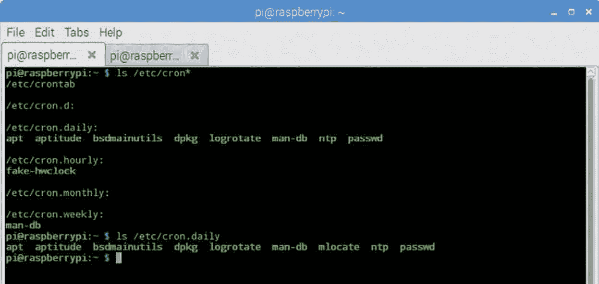

**图 2-14**

`crontab` 配置中常见 `anacron` 身影，它专司处理因关机错过的周期性任务。在 `anacrontab` 中可自定义最大容忍延迟，超时即强制执行。典型场景是调度备份脚本，详见下节。

## 2.5 数据备份策略

你是否养成了定期备份的习惯？对计算机而言，备份是容灾底线。故障来袭无预警，无备份等同于裸奔，损失不可估量。

运维老手总按“最坏情况”部署备份。树莓派硬件虽廉价，但承载的业务数据往往无价。养成高频备份习惯，性价比极高。下文探讨如何用命令行将备份流程极简化。

最原始的备份即“复制粘贴”，虽笨重但直击本质，特定场景下反而最靠谱。实施原则：压缩后再传，越小越好。首推 `zip` 格式，跨平台通吃；追求极致压缩比可选 `LZMA` 或 `bzip2`，代价是耗时显著增加。

先建立可执行脚本目录（如 `~/bin`）并加入 `$PATH`，即可直接调用脚本名，如图 2-15。

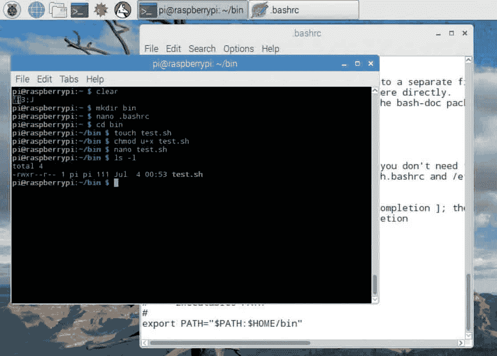

**图 2-15**

单条命令搞定打包压缩，见图 2-16。

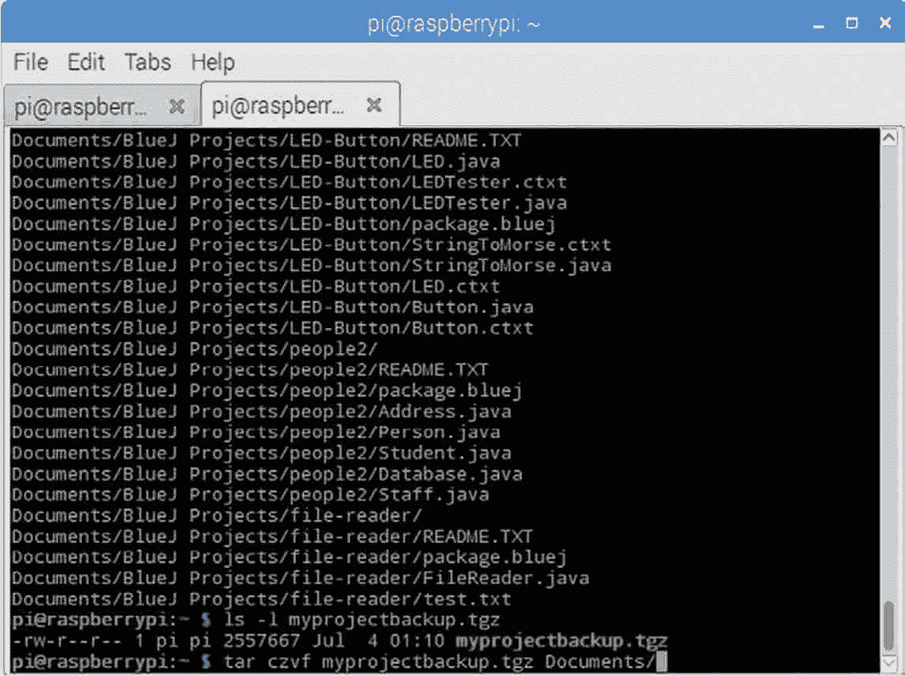

**图 2-16**

打包指定目录为压缩包：

$ `tar czvf mybackup.tgz myfolder`

参数解读：`c` 建新归档，`z` 启用 gzip 压缩，`v` 显示过程，`f` 指定输出文件名。解包时将 `c` 换为 `x`，`z` 可省略（`tar` 自动识别压缩算法）：

$ `tar xvf mybackup.tgz`

`tar` 格式源于 60 年代磁带时代，却能完整保留权限、时间戳、属主等元数据，至今仍是类 Unix 系统归档标准。

### 2.5.1 全盘镜像备份

备份用户目录 `tar` 得心应手；若数据分散在 `/etc`、`/var/www` 等多处，整盘镜像 SD 卡是最优解。

先用 `dd` 配合 `gzip` 产出压缩镜像。以 8GB 卡为例，实测压缩后约 2.5GB。先复习识别设备盘符（假设为 `/dev/sdb`）：

$ `dd bs=4M if=/dev/sdb | gzip > back-raspbian.img.gz`

担心空间不足？另开终端盯着 `df -h`，不妙即 `Ctrl+C` 终止并 `rm` 删除半成品。

恢复镜像到卡（慎重，目标盘符勿误）：

$ `gzip -cd back-raspbian.img.gz | dd bs=4M of=/dev/sdb`

注意：`dd` 写盘需 root，非家目录写入亦需提权。树莓派 `sudo` 免密虽便利但存隐患。他山之石：其他 Unix 系 `sudo -s` 切 root 交互模式，`exit` 退出。或用 `sudo bash -c "管道命令串"` 一次性提权执行复合指令：

$ `sudo bash -c "gzip -cd back-raspbian.img.gz | dd bs=4M of=/dev/sdb"`

### 2.5.2 远程服务器归档

本地备份防不了物理损毁，异地容灾须借网络。前文提过的 `scp` 登场：

$ `scp -p back-raspbian.img.gz pi@192.168.0.207:/home/pi/bak/`

输密即达。迁移目标服务器只需修改 `user@host:path`。`-p` 保留原时间戳，`-P` 指定非标准端口。结合前文静态 IP 配置与 USB 大容量存储，树莓派秒变家用 NAS，存照片、视频绰绰有余。

命令行原生支持通配符、Tab 补全等高级特性。同目录下有 `www-backup-20181225.gz` 与 `data-backup-20181226.gz`，一条命令双传：

$ `scp -p ./*.backup*.gz pi@192.168.0.207:/home/pi/bak/`

`scp` 让跨设备传数据如同本地拷贝般丝滑，见图 2-17。

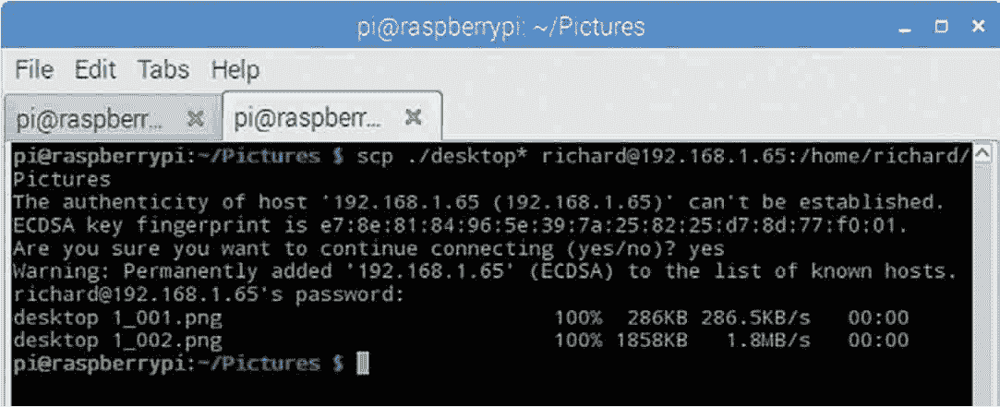

**图 2-17**

### 2.5.3 配置免密远程登录

异地备份核心价值：规避单点故障导致数据永失。运维眼中，概率再低的风险也要压制为零。

前文 SSH 篇提过 `ssh-keygen` 生成密钥对实现免密。`ssh-copy-id` 是分发公钥的利器：

$ `ssh-copy-id pi@192.168.0.207`

`-i` 指定公钥文件，`-p` 指定端口（公网跳板机必备）。免密铺路后，定时脚本可无人值守跑备份。但久而久之，历史版本堆积占空间。

`rsync` 同为远程同步神器，核心优势在于**增量传输算法**——仅传输变更块。这意味带宽占用骤降、存储膨胀受控（按量付费云存储省钱利器）。未装则 `apt-get install rsync`。默认走 SSH 通道，亦可部署 `rsync` 守护进程走 `rsync://` TCP 模式，此时需设 `RSYNC_PASSWORD` 或 `--password-file` 认证。

虽非 Bash 内建，但 `rsync` 是运维必备瑞士军刀。版本控制视角下，`git` 亦可作远程备份备选。

### 2.5.4 脚本实现自动化备份

脚本引入 `datestamp` 变量规避文件名冲突。将零散手工指令封装为脚本，是自动化第一步。除管道嵌套，编写 `.sh` 脚本可批量执行复杂逻辑。示例脚本见下：

```
#!/bin/sh
cd /home/pi
tar czf mydocsbackup.tgz Documents
scp mydocsbackup.tgz pi@192.168.0.207:/home/pi/bak/
```

运行效果见图 2-18。

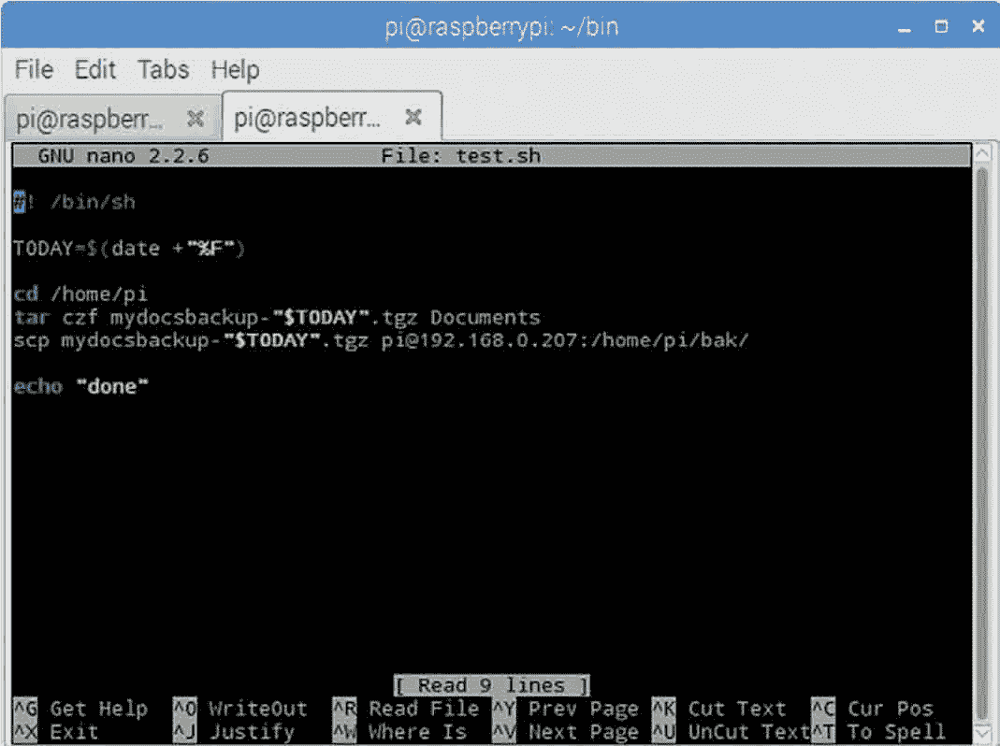

**图 2-18**

实战部署：按需修改脚本（如 `scp` 改 `cp`、替换目标 IP），赋予执行权：

$ `chmod u+x test.sh`

执行 `./test.sh` 试跑。报错则核对配置、确认 `ssh-copy_id` 已跑通。你会发现新备份覆盖旧文件，需引入日期戳修正：

```
#!/bin/sh
TODAY=$(date +"%F")
cd /home/pi
tar czf mydocsbackup-"$TODAY".tgz Documents
scp mydocsbackup-"$TODAY".tgz pi@192.168.0.207:/home/pi/bak/
```

命令行测 `date +"%F"` 输出 `YYYY-MM-DD` 格式，嵌入文件名即可唯一标识每日归档。

脚本就绪，放入 `/usr/bin` 或 `~/bin`，配合 `cron` 定时触发，全自动化闭环形成。

脚本扩展性极强。可加 `echo` 友好提示、交互式 `read` 让用户指定备份目标、甚至接入告警通知。学习范例：系统自带 `raspi-config` 本质即 Shell 脚本，读其源码获益良多。

编码铁律：**循序渐进**。切忌上来堆砌复杂功能，从最小可行原型起步，小步快跑，模块化测试。

代码完成，上 `shellcheck.net` 静态扫描。它会建议将裸 `cd` 改为防御式写法：

$ `cd /home/pi || exit`

确保切目录失败即时中断，规避后续误操作。防御性编程，把所有“可能出错”在代码里兜底。

> **免密登录**
>
> 密钥对配置妥当后，`scp`/`rsync` 皆可无感直连远端。动手试一把，体会“自动化”的爽快。

### 2.5.5 彻底销毁敏感数据

《碟中谍》里自毁磁带印象深刻。数字时代，数据清理同理：知存储原理，方能绝迹隐私。

硬盘以块（Block，通常 4KB）组织，经文件系统通过 Inode 索引。SSD 虽无磁头，逻辑结构同理。常规操作（移动、重命名）本质修改 Inode 元数据；`rm` 仅抹去 Inode 索引项，**数据实体仍躺在块中**。格式化（`mkfs`）或 `rm -rf` 后，数据恢复软件仍可通过扫描底层块还原文件系统。

真正的安全擦除，需物理级覆写。`shred` 专为此生，支持文件级或整盘级，见图 2-19。

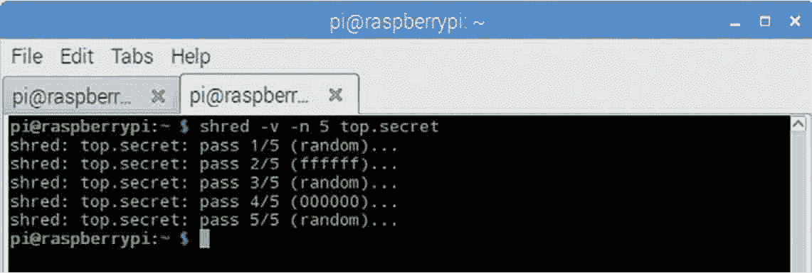

**图 2-19**

**高危预警**：操作不可逆，三思而后行，误选系统盘后果自负。

回顾 `dd` 可按比特覆盘，但单次覆写仍留磁残留/电荷残留特征，专业设备可复原。`shred` 采用多遍覆写策略对抗残留分析。例：对 `/dev/sdb` 覆写 5 遍：

$ `shred -vf -n 5 /dev/sdb`

参数 `-z`（用随机数而非零填充最后一遍）伪装成正常数据，`-u` 覆写后释放空间/删文件。善用 `shred`，让敏感数据灰飞烟灭，不留余地。

# 第 3 章

# 智能语音入门（一）：ReSpeaker 核心板

## 3.1 ReSpeaker 4-Mic Array：环境搭建与准备

基于 Raspberry Pi 的 ReSpeaker 4-Mic 阵列板是一款面向 AI 语音交互的四通道麦克风扩展板（见图 3-1）。它赋予树莓派远场拾音、波束成形、降噪等能力，助你快速集成 Amazon Alexa、Google Assistant 等主流语音服务，打造更强大、灵活的智能语音终端。

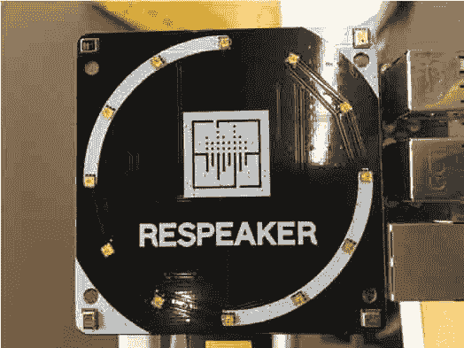

**图 3-1**

### 3.1 ReSpeaker 4-Mic 阵列板简介

# ReSpeaker 4-Mic 阵列实战指南：从硬件入门到声控交互

## 3.1 硬件认知与系统就绪

不同于双麦克风款，该阵列板采用 **AC108** 芯片方案，集成四路高性能 `ADC`，支持 `I2S`/`TDM` 数字音频流输出，远场拾音半径达 3 米。亮点在于板载 12 颗 **APA102** 可编程 `RGB` 灯珠组成的光环。四麦协同配合光环，赋予树莓派媲美智能音箱的感知能力：声源活动检测（`VAD`）、到达方向估算（`DOA`）、唤醒词捕捉（`KWS`），并能通过灯光实现方向指示反馈。

### 3.1.1 核心硬件拆解

ReSpeaker 4-Mic Array for Raspberry Pi 主要包含以下模块（实物布局见 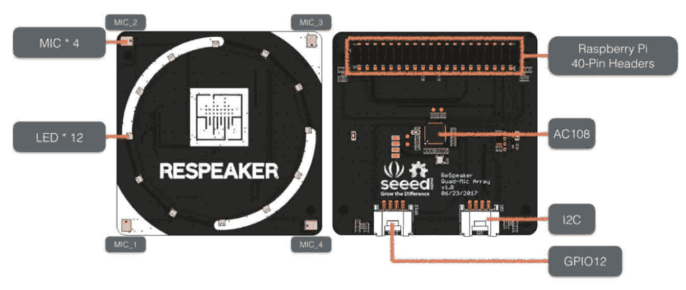 *Figure 3-2*）：

*   **拾音阵列**：4 颗模拟麦克风，环形布局实现 360° 覆盖。
*   **光环指示**：12 颗挂载 **SPI** 总线的 **APA102** 可编程 `RGB` LED。
*   **主板连接**：标准 **40-pin GPIO** 排针，兼容 Zero、1B+、2B、3B 等机型。
*   **音频核心**：**AC108**，高集成度四声道 `ADC`，内置 `I2S`/`TDM` 格式转换。
*   **外设接口**：
    *   **I2C**：Grove 接口桥接至 `I2C-1`。
    *   **GPIO**：Grove 数字口引出 `GPIO12` 与 `GPIO13`。

### 3.1.2 系统部署与驱动构建

> **基线要求**：全程基于官方 **Raspbian Stretch** 完整桌面版（含推荐软件）或 **Lite 精简版**（Debian 9 内核）。因内核缺失 `wm8960` 支持，需手动编译驱动。

#### Step 01：物理安装
将 HAT 板对准 40Pin 排针稳妥压合（参考 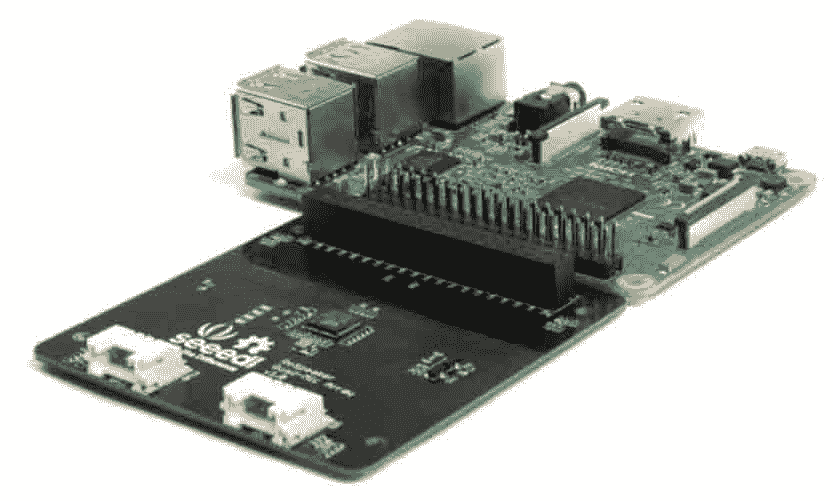 *Figure 3-3*）。
> ⚠️ **严禁带电操作**，防止芯片损坏。

#### Step 02：烧录、登录与换源
使用 **Etcher** 将镜像写入 SD 卡（推荐无桌面 `Lite` 版，体积小、无需显示器）。远程登录（PUTTY/VNC）前请先配置 WiFi。

**软件源加速**：
编辑 `/etc/apt/sources.list`，注释原条目，替换为国内镜像源（清华/中科大/阿里云等），保存生效（操作演示见 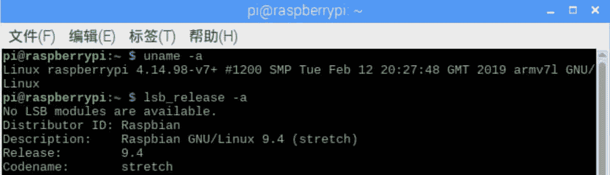 *Figure 3-4*、```bash
pi@raspberrypi ~ $ sudo nano /etc/apt/sources.list
``````
deb http://mirrors.tuna.tsinghua.edu.cn/raspbian/raspbian/ stretch main non-free contrib
deb-src http://mirrors.tuna.tsinghua.edu.cn/raspbian/raspbian/ stretch main non-free
```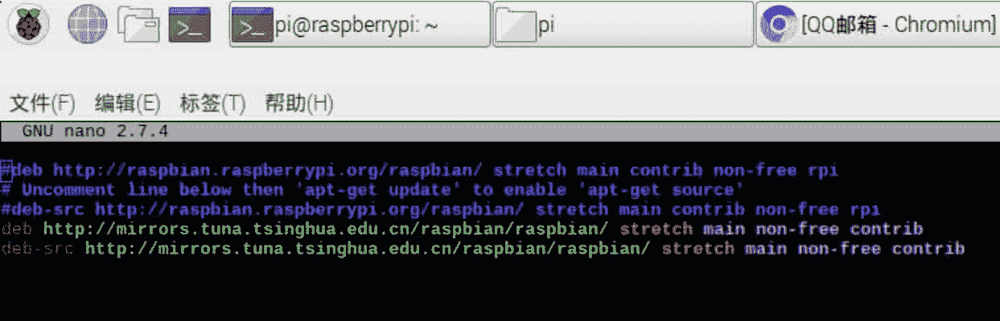 *Figure 3-5*）。
> 💡 编辑器内按 `Ctrl+O` 回车保存，`Ctrl+X` 退出。

#### Step 03：驱动编译部署
终端依次执行编译指令（详见 ```bash
sudo apt-get update
git clone https://github.com/respeaker/seeed-voicecard.git
cd seeed-voicecard  # Download voice card driver
sudo ./install.sh   # Install voice card driver
reboot              # Reboot
```），耐心等待完成，成功标志参考 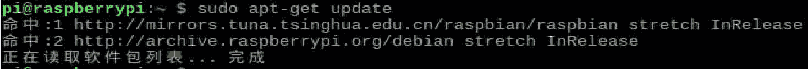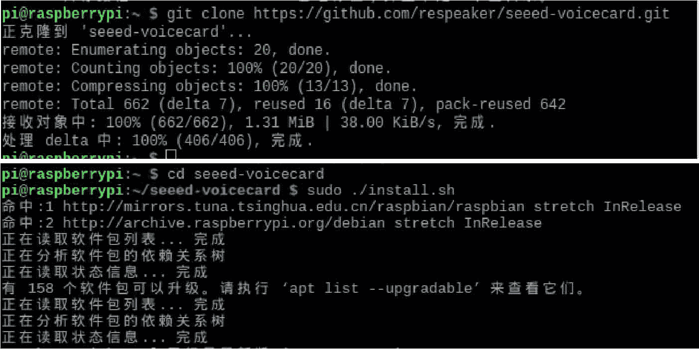 *Figure 3-6*。

#### Step 04：声卡设备校验
执行 `arecord -L` 列出录音设备，确认列表中出现 `seeed-voicecard` 标识即驱动就绪（对照 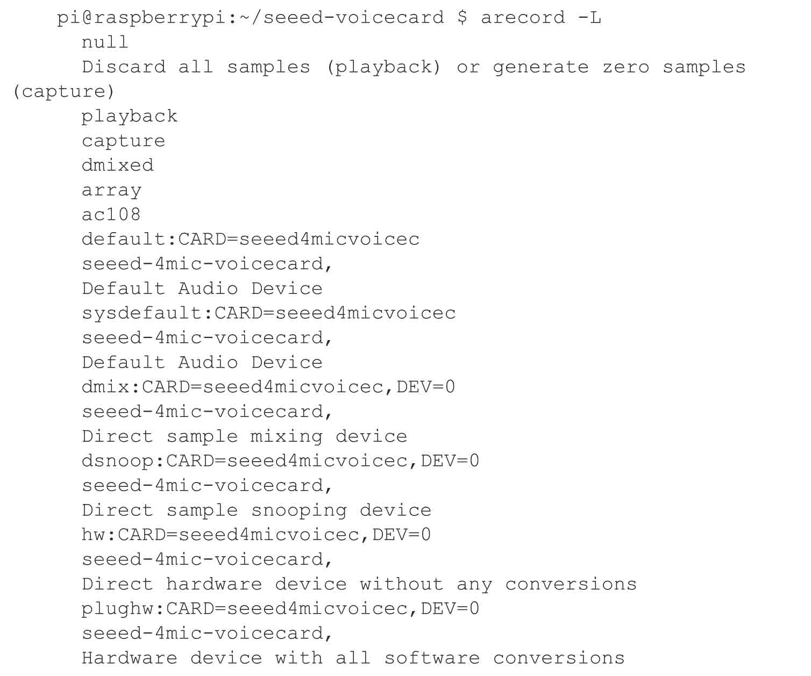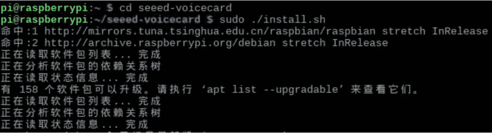 *Figure 3-7*）。
> 💡 **配置固化技巧**：`sudo alsactl --file=ac108_asound.state store` 导出当前 ALSA 状态；恢复时执行 `sudo cp ~/seeed-voicecard/ac108_asound.state /var/lib/alsa/asound.state`。

---

### 3.1.3 录放音功能验证

#### 1. 命令行工具链测试

**① 录音 (`arecord`)**  
查看设备列表 ```bash
arecord -l
```，锁定 `TDM_Capture`（通常为 `card 0, device 1`），执行录音指令 ```bash
arecord -Dhw:0,1 -d 10 -f cd -r 44100 -c 2 -t wav test.wav
```。  
参数速查：`-D` 指定设备、`-d` 时长(秒)、`-f` 格式(cd/cdr/dat)、`-r` 采样率、`-c` 声道数、`-t` 文件类型。

**② 播放 (`aplay`)**  
查看播放设备 ```bash
aplay -l
```，指定文件回放 ```bash
aplay test.wav
```（需接入耳机或有源音箱）。

#### 2. 图形化测试
```bash
arecord | aplay
```  
除命令行外，**Audacity** 是极佳的可视化调试工具。启动后配置：
*   **录入设备**选 `AC108`，声道设为 **2**；
*   **输出设备**选 `bcm2835 alsa: - (hw:0,0)`；
实测波形界面参考 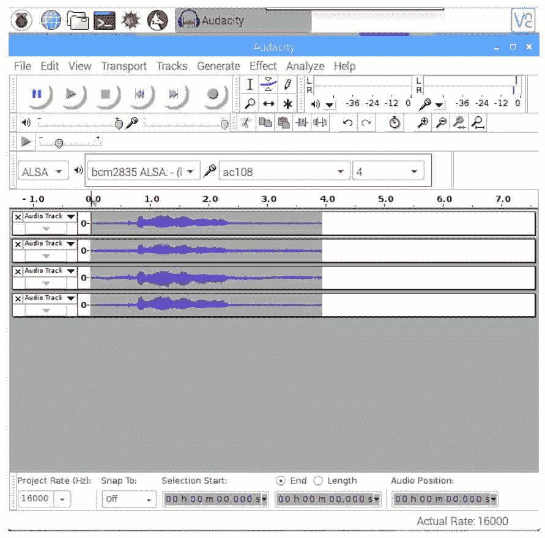 *Figure 3-8*。

#### 3. 音量调节：AlsaMixer
终端运行 `alsamixer`，按 **F6** 切换至 `seeed-4mic` 声卡。
*   `←/→` 切换通道/设备
*   `↑/↓` 调节增益
*   `Esc` 或 `Alt+Q` 退出
界面详见 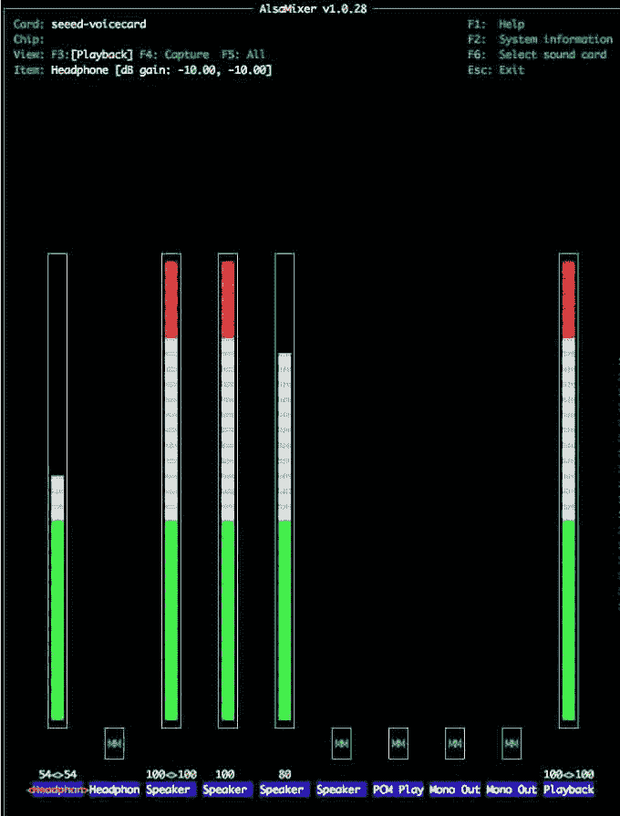 *Figure 3-9*。

---

### 3.1.4 Python 开发环境隔离
为避免污染系统级依赖，建议创建虚拟环境。执行 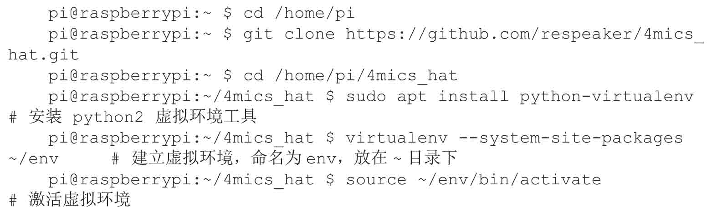 系列命令，环境就绪截图见 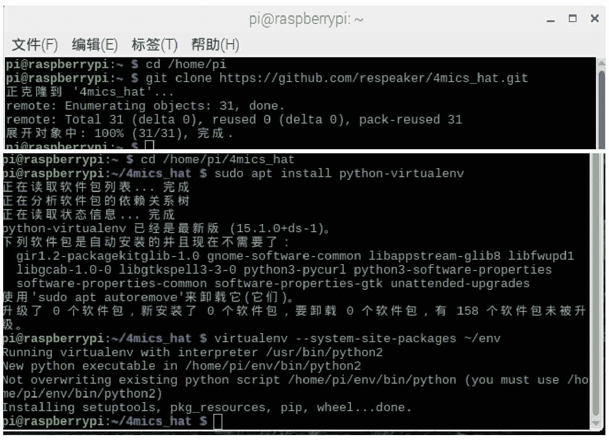 *Figure 3-10*。

---

### 3.1.5 灯环特效开发：驾驭 APA102

板载 12 颗 APA102 各自带驱动芯片，支持断电保持色彩、串行高速刷新。**使用前必须启用 SPI 内核模块**：

1.  执行 `sudo raspi-config`
2.  进入 `Interfacing Options` → `SPI` → `Yes` → `OK` → `Finish`

随后在虚拟环境中运行示例脚本 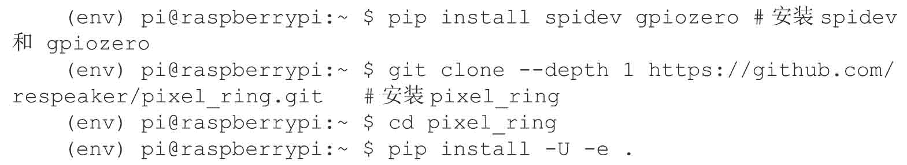，终端回显参考 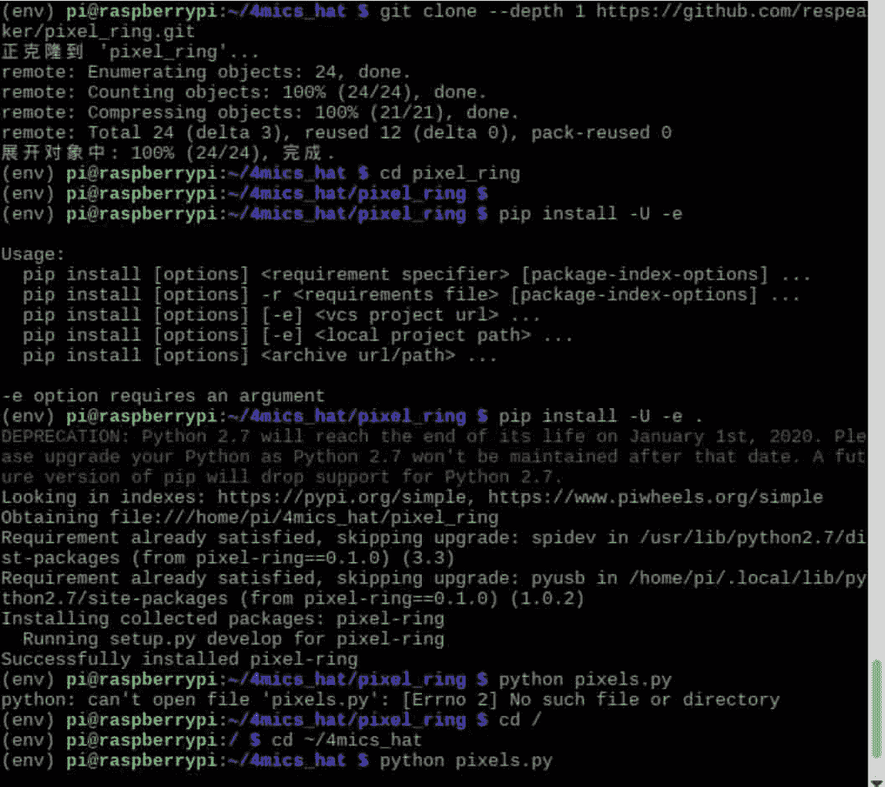 *Figure 3-11*。执行 `python pixels.py` 即可看到类似 Google Assistant 的呼吸/旋转灯效（实测效果见 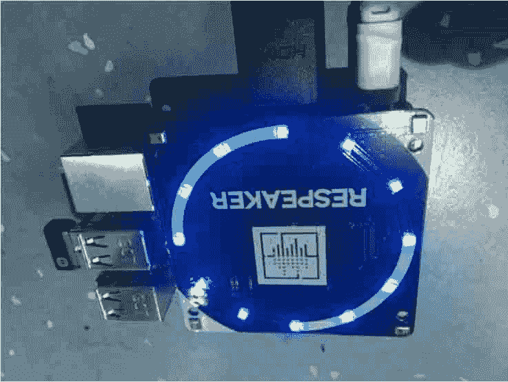 *Figure 3-12*）。

---

## 3.2 语音交互进阶：接入 Google Assistant

### 3.2.1 账号配置与 SDK 准备

### Google Assistant 环境搭建全流程指南

相较于亚马逊 Alexa 与百度 DuerOS，Google Assistant 在语音识别响应速度与连接稳定性上更具优势。但需注意，后续部分配置步骤要求设备能正常连接 Google 服务（即需具备“科学上网”条件）。

#### 3.2.1 Google Cloud 平台项目创建与 API 开通

**步骤 1：登录控制台**  
打开树莓派自带浏览器，访问 Google Cloud 官网并完成账号登录，界面参考下图。


*Figure 3-13*

**步骤 2：进入云平台**  
凭借 Google 账号密码登入后，直接跳转至 Google Cloud Platform 主界面。


*Figure 3-14*

**步骤 3：项目选择设置**  
在顶部导航栏找到项目下拉菜单，进行项目选择相关配置。


*Figure 3-15*

**步骤 4：新建项目**  
点击“新建项目”按钮，在弹出页面自定义项目名称（本教程命名为 `rpi3-ga`），确认创建。


*Figure 3-16*


*Figure 3-17*

**步骤 5：定位 API 库**  
返回平台首页，依次展开左侧菜单“API 与服务” → “库”。


*Figure 3-18*

**步骤 6：关联项目**  
点击页面顶部的“选择项目”下拉框。


*Figure 3-19*

**步骤 7：确认目标项目**  
在列表中勾选刚创建的 `rpi3-ga` 项目。


*Figure 3-20*

**步骤 8：搜索目标 API**  
选定项目后自动返回库页面，在搜索框输入 `google assistant api` 进行检索。


*Figure 3-21*

**步骤 9：启用服务**  
找到对应条目后，点击“启用”按钮激活该 API。


*Figure 3-22*

**步骤 10：创建凭据**  
启用成功后自动跳转至凭据创建页。点击“创建凭据”，为项目添加认证信息，密钥格式勾选 `JSON`。


*Figure 3-23*

**步骤 11：配置 OAuth 同意屏幕**  
继续完善 OAuth 凭据设置，此处可自定义应用名称。


*Figure 3-24*

**步骤 12：完成凭据生成**  
确认页面选项无误后，即可生成客户端 ID 与密钥。


*Figure 3-25*

**步骤 13：下载密钥文件**  
将生成的 JSON 密钥文件下载并妥善保存至指定本地文件夹，后续配置需用到该文件路径。

---

#### 3.2.2 树莓派端驱动与 SDK 安装

**步骤 1：部署 Python 虚拟环境**  
打开终端，按顺序执行下图命令，完成虚拟环境的创建与激活。


*Figure 3-26*

**步骤 2：安装 Google Assistant SDK**  
虚拟环境激活后，根据指定地址通过 pip 安装 SDK 核心库。


*Figure 3-27*

**步骤 3：升级依赖库**  
执行升级命令，确保 `google-assistant-library` 等组件为最新版本。


*Figure 3-28*

**步骤 4：运行授权样例（关键路径替换）**  
运行下图命令启动授权流程。**注意**：务必将命令中的 JSON 路径替换为你在第 13 步保存的实际文件绝对路径（含文件名）。


*Figure 3-29*

**步骤 5：获取授权码**  
命令执行后终端将输出一个 URL。复制该链接至浏览器打开，登录 Google 账号授权后获得一串代码，将其粘贴回终端并按回车确认。


*Figure 3-30*

**步骤 6：开放账号权限**  
浏览器访问 `myaccount.google.com` 登录账号，进入“数据与隐私”设置页，务必开启“位置信息”、“语音与音频活动”等所有相关权限开关，否则设备无法正常响应。


*Figure 3-31*

---

#### 3.2.3 声卡驱动安装与 ReSpeaker 初始化

**步骤 1：安装 seeed-voicecard 驱动**  
终端执行下列指令（分两组执行），完成 4 麦克风阵列声卡驱动编译安装。


*Figure 3-32*


*Figure 3-32 (Continued)*

**步骤 2：配置音频接口选项**  
安装完成后重启树莓派。重新进入终端执行 `sudo raspi-config`，依次进入“Interface Options” → “Audio”，按图示选择声卡设备。


*Figure 3-33*


*Figure 3-33 (Continued)*

**步骤 3：验证录播设备编号**  
执行 `arecord -l` 与 `aplay -l` 查看声卡编号，确认 `seeed-4mic-voicecard` 对应的 `card` 与 `device` 值。


*Figure 3-34*

**步骤 4：修改 asoundrc 配置**  
编辑 `~/.asoundrc` 文件（不存在则新建），将 `hw` 后参数替换为上一步确认的 `card`、`device` 具体数值。


*Figure 3-35*

**步骤 5：再次重启生效**  
修改保存后，执行 `sudo reboot` 重启系统使音频配置生效。

```bash
~$ sudo reboot
```

**步骤 6：激活虚拟环境**  
重启后打开终端，执行 `source env/bin/activate` 进入之前创建的虚拟环境。


*Figure 3-36*

**步骤 7：安装并检查 PulseAudio**  
执行 `sudo apt-get install pulseaudio` 安装音频服务，随后通过 `pulseaudio --check` 或查看进程确认服务运行状态。


*Figure 3-37*

**步骤 8：调整混音器增益**  
运行 `alsamixer`，按 `F6` 选择 `seeed-4mic-voicecard`，将 Mic、Capture、Playback 等关键音量推至 80% 以上，避免拾音过小。


*Figure 3-38*

**步骤 9：启动 PulseAudio 后台服务**  
终端输入 `pulseaudio &` 以后台模式启动服务，若无报错信息输出即表示音颈链路已打通。


*Figure 3-39*

---

#### 3.2.4 唤醒 Google Assistant 体验交互

**步骤 1：启动助手演示程序**  
保持终端处于虚拟环境下，直接输入 `google-assistant-demo` 启动客户端，终端提示“Press Enter to send a new request”即表示就绪。


*Figure 3-40*

**步骤 2：语音交互测试**  
对着麦克风阵列说出热词 **“Ok, Google”** 唤醒助手。随后可自由提问，例如：“Ok, Google, who made you?”、“How can you help me?”、“What's the weather today?” 等，设备将实时回复。


*Figure 3-41*


*Figure 3-41 (Continued)*

---

### 3.3 备选方案：Alexa SDK 与 DuerOS SDK 本地化部署

鉴于 Google 服务在国内网络环境下无法直连，若面向大陆用户分发，建议转用 **Amazon Alexa** 或 **百度 DuerOS** 作为语音引擎。两者均支持国内直连，但稳定性与识别准确度可能不及 Google，开发者需权衡取舍。

#### 3.3.1 语音引擎配置与 DOA 角度测试

**1. 引擎选型配置**  
执行以下指令集，完成语音引擎的基础环境配置与依赖拉取。


**2. 运行 DOA 方位角测试**  
虚拟环境下运行 `python kws_doa.py`。程序启动后使用 **Snowboy** 热词唤醒，终端将实时打印声源方位角度数据，验证麦克风阵列定向拾音能力。


*Figure 3-42*

#### 3.3.2 完整语音对话闭环

**(1) 依赖环境部署**  
按顺序执行下列安装指令，补全对话系统所需的第三方库与工具链。


**(2) 获取平台授权令牌**  
- **Alexa 授权**：终端运行 `alexa-auth`，按提示登录 Amazon 开发者账号完成绑定。  
- **DuerOS 授权（推荐国内用户）**：运行 `dueros-auth`，登录百度账号完成授权。  

授权成功后，凭据文件自动保存至 `/home/pi/.avs.json`（隐藏文件）。终端回显如下图所示。


*Figure 3-43*

> **关键提示**：授权命令会自动弹出浏览器窗口，**必须先关闭该自动弹窗**，再手动在树莓派桌面浏览器中打开授权链接操作，否则会因环境差异导致授权失败。成功后页面将显示确认界面。


**Figure 3-44**

> **切换引擎技巧**：若需在 Alexa 与 DuerOS 间切换，请先删除旧授权文件 `rm /home/pi/.avs.json`（使用 `ls -la` 可查看隐藏文件），再重新运行对应 auth 命令。

**(3) 启动对话主程序**  
虚拟环境下运行 `python ns_kws_doa_alexa.py`。终端滚动输出大量调试日志，耐心等待直到出现 `status code: 204` 字样，表示连接就绪。此时说出 **Snowboy** 热词，ReSpeaker LED 环亮起即可开始对话。


**Figure 3-45**

---

### 3.3.3 语音转文字 (STT) 功能扩展

#### 步骤 01 安装依赖库

```
$ sudo apt install mpg123
$ pip install baidu-aip monotonic pyaudio
```

#### 步骤 02 从百度云控制台获取密钥

访问地址：`https://login.bce.baidu.com/?account=&redirect=http%3A%2F%2Fconsole.bce.baidu.com%2Fai%2F%3Ffromai%3D1#/ai/speech/overview/index`

#### 步骤 03 下载源码 Smart_Fan.py，链接：`https://raw.githubusercontent.com/SeeedDocument/MIC_HATv1.0_for_raspberrypi/master/src/baidu_STT/Smart_fan.py`。

部分代码展示如下：


命令行操作如下：


**温馨提示**

运行 `Smart_Fan.py` 前，请在第 36、37、38 行填入百度密钥。你也可以通过运行 `synthesis_wav.py` 生成自定义语音。同样需要在第 6、7、8 行添加密钥，并修改字符串为想要合成的内容。

#### 步骤 04 对着设备说“打开灯”，LED 灯就会亮起，效果见图 3-46。


**图 3-46**

### 3.4 常见问题排查

**Q1：严格按教程操作，驱动安装依然失败怎么办？**

**A1：** 若上述方法均无效，请访问固件下载链接：`https://v2.fangcloud.com/share/7395fd138a1cab496fd4792fe5?folder_id=188000207913`。操作步骤：首先刷入下载的固件；刷机后别忘了更换软件源（apt 源）；其次，使用交互功能前，在终端执行 `alexa-auth` 或 `dueros-auth` 申请授权。授权成功后，`/home/pi` 目录下会生成 `.avs.json` 文件，此时方可使用交互功能；最后，`/home/pi` 目录下会有 `respeaker` 示例文件夹，可根据麦克风型号选择对应示例。刷机后建议更新 `respeaker` 目录下的示例（在该目录执行 `git pull origin master`）。

**Q2：`aplay` 播放有声，但运行 alexa/dueros 却无声？**

**A2：** 可用的播放器有三种：`mpv`、`mpg123`、`gstreamer`。其中 `SpeechSynthesizer` 和 `Alerts` 更适配 `mpg123`；`AudioPlayer` 优先级为 `gstreamer` > `mpv` > `mpg123`。`Gstreamer` 支持的音频格式最多，在树莓派上运行也最稳定。也可通过环境变量 `PLAYER` 指定 `AudioPlayer` 使用的播放器。尝试以下命令启用语音：

```
sudo apt install mpg123 PLAYER=mpg123 python ns_kws_doa_alexa_with_light.py
```

**Q3：运行 DOA，喊“snowboy”无反应？**

**A3：** 用 `audacity` 检查 4 个麦克风是否全有数据。只要有一个通道无数据，就会无响应。

**Q4：安装 snowboy 时提示平台不兼容？**

**A4：** 目前 `snowboy` 仅支持 `Python2`，创建虚拟环境时请务必指定 Python2。

**Q5：用 `sudo python file.py` 运行时出现依赖缺失？**

**A5：** 测试发现 `sudo` 默认调用系统环境，而教程安装的依赖位于 `~/env`。解决方法：改用 `sudo ~/env/bin/python file.py` 运行。

**Q6：运行 `kws_doa.py` 时喊“snowboy”没反应？**

**A6：** 用 `audacity` 确认 4 个声道均正常。只要有一个声道无数据，喊 `snowboy` 就不会有回应。

# 第 4 章 智能语音（二）Google AIY Voice Kit

## 4.1 简介与组装

### 4.1.1 Voice Kit 简介

Google 推出了 AIY Voice Kit。该套件可用于构建自然语言处理器。接入 Google Assistant 或在线语音转文字服务后，你可以用语音指令控制程序，或直接提问。所有组件都塞进一个小纸盒，由树莓派供电。

购买套装后无需额外采购，甚至树莓派主板都已包含在内。

### 4.1.2 动手前的准备

Google AIY Voice Kit 外观如图 4-1 所示。


**图 4-1**

现在开始组装你的套件！

下方手册详细说明了组装方法、连接方式及 Google Assistant 演示的运行流程。完成演示后，你的套件能回答问题、执行语音指令。此外还可使用 Google Cloud Speech-to-Text 服务，将语音指令转为程序可理解的文本。

#### 核对套件版本

当前手册适用于 Voice Kit v2.0。产品包装盒左下角标有版本信息，见图 4-2。


**图 4-2**

v2.0 版本可直接按手册操作。若包装上无版本号，请参考旧版手册组装。

除套件外，还需准备以下工具辅助组装：

*   2mm 一字螺丝刀。

*   Micro USB 电源。推荐：带 micro-USB B 接口、输出 2.1A 的 USB 电源。次选：手机充电器（常标榜快充），也能提供 2.1A。**切勿用电脑 USB 口给树莓派供电**，不仅电流不足，还可能烧毁 SD 卡，导致无法启动或报错。

*   Wi-Fi 连接。有两种方式让套件联网：

    

    使用 AIY Projects App。需一台 Android 手机，外加一台 Windows、Mac 或 Linux 电脑。

    

    使用显示器、鼠标、键盘。无 Android 手机时可选此法。需一台 Windows、Mac 或 Linux 电脑、一个鼠标、一个键盘、一台带 HDMI 输入的显示器或电视、一根标准 HDMI 线和一个 mini HDMI 转接头，以及一个集线器把鼠标键盘接到套件上。集线器可选 USB OTG 转接头，将树莓派的 Micro USB 口转为标准 USB 口，再接入[无线键鼠套装](https://www.adafruit.com/product/1738)。也可用 Micro USB Hub 多口连接传统键鼠。

打开套件核对配件。如有缺失，请邮件联系 `support-aiyprojects@google.com`，我们会协助补发。

### 4.1.3 配件清单

AIY 配件示意图见图 4-3。各套件具体说明见表 4-1。


**图 4-3**

**表 4-1 Google AIY Kit 配件说明**


### 4.1.4 组装 Voice Kit

开始组装吧。

#### 步骤 01 确定朝向。

搭建内部框架，所有电子元件将置于其中。按图 4-4 所示方向把纸板平放桌面；左侧卡槽应更靠近纸板边缘。


**图 4-4**

#### 步骤 02 折叠长翻盖。

将远离你的长翻盖向下折叠，如图 4-5 所示。


**图 4-5**

#### 步骤 03 折叠左右翻盖。

将左右两侧翻盖向自己这边折叠，如图 4-6 所示。


**图 4-6**

#### 步骤 04 折叠底部翻盖。

将底部翻盖向上朝自己折叠，如图 4-7 所示。


**图 4-7**

#### 步骤 05 对齐底部。

将底边的卡槽与左右两侧的插片对齐，如图 4-8 所示。


**图 4-8**

#### 步骤 06 插入插片。

将插片插入卡槽，如图 4-9 所示。


**图 4-9**

#### 步骤 07 检查对齐情况。

检查组装好的框架底部；靠边缘的卡扣应位于你的左手边。如果不是，说明折叠可能有误。建议展开并按步骤 01 重新折叠，参考 Figure 4-10。


**Figure 4-10**

#### 步骤 08：暂时搁置

将折好的框架先放一边，如 Figure 4-11 所示。


**Figure 4-11**

接下来，连接电路板。

#### 步骤 09：备齐板卡与喇叭

开始连接所有电子元件。准备好树莓派主板、Voice Bonnet 扩展板、两个塑料支柱和喇叭，对照 Figure 4-12。


**Figure 4-12**

树莓派是一块性能强劲的微型计算机。Voice Bonnet 板载双麦克风、喇叭接口、LED 按钮接口和音频编解码器。

#### 步骤 10：定位树莓派

按 Figure 4-13 摆放树莓派，确保 40 针排针朝左。


**Figure 4-13**

**注意**

在完全组装前，树莓派必须断开电源及所有外设，否则可能烧毁板卡、损坏元件，甚至导致触电、重伤或死亡。

#### 步骤 11：安装支柱

将两个支柱插入板子右下角的安装孔，参考 Figure 4-14。


**Figure 4-14**

**提示**

用力过猛会弯曲电路板，最好托住板子底部边缘操作，避免按压正反面。

#### 步骤 12：对接板卡

Voice Bonnet 底部的母排针对准树莓派的公排针（GPIO），对齐按紧，见图 Figure 4-15。随后握住 Bonnet 板，用力压实，让塑料支柱卡入定位。


**Figure 4-15**

**注意**

别按板子中间；要捏住支柱用力压。

#### 步骤 13：核对连接

确认支柱在两板间牢固卡住，沿着 40 针排针从头压到尾，确保无缝隙，见图 Figure 4-16。


**Figure 4-16**

**警示**

接触不良可能引发触电、短路、起火、伤亡等严重后果。

#### 步骤 14：拧松螺丝

用 2mm 十字螺丝刀拧松接线端子底部的两颗螺丝，见图 Figure 4-17。


**Figure 4-17**

#### 步骤 15：接入喇叭线

将喇叭红线插入底排最左侧槽位并顶到底；黑线插入底排倒数第二个槽位并向左推满，见图 Figure 4-18。


**Figure 4-18**

这两根线负责传输电信号，经喇叭转化为声音。

#### 步骤 16：锁紧线材

用 2mm 螺丝刀顺时针拧紧螺丝；松动会有隐患，见图 Figure 4-19。


**Figure 4-19**

#### 步骤 17：放入电路板

将电路板装入之前搭好的框架“口型”卡槽内，见图 Figure 4-20。


**Figure 4-20**

#### 步骤 18：核对对齐

板载左侧麦克风和右侧圈出部分需露在框架外侧，见图 Figure 4-21。


**Figure 4-21**

#### 步骤 19：安置喇叭

把喇叭放进框架，见图 Figure 4-22。


**Figure 4-22**

**注意**

喇叭含磁铁，置放时远离儿童；磁场可能干扰医疗植入物及起搏器。

#### 步骤 20：确认喇叭稳固

检查喇叭是否稳稳当当，确认无误后即可着手搭建外框，见图 Figure 4-23。


**Figure 4-23**

### 4.1.5 搭建外框

#### 步骤 01：展开音箱盒

拿出音箱纸板，捏合边缘成型盒子，见图 Figure 4-24。


**Figure 4-24**

#### 步骤 02：折叠盖板 A

把盖板 A 压下，见图 Figure 4-25。


**Figure 4-25**

#### 步骤 03：折叠盖板 B、C

依次压下盖板 B、C，再压盖板 A，见图 Figure 4-26。


**Figure 4-26**

#### 步骤 04：折叠盖板 D

压下盖板 D 直至卡在 A、B、C 三块盖板之下，见图 Figure 4-27。


**Figure 4-27**

#### 步骤 05：检查盒底

查看盒子底部，确认结构稳固，见图 Figure 4-28。


**Figure 4-28**

#### 步骤 06：装入内部结构

把之前组装好的内部结构放进音箱盒，注意喇叭要朝向带圆孔的那面纸板，见图 Figure 4-29。


**Figure 4-29**

#### 步骤 07：核对间隙

放入后检查右侧内部结构与音箱盒之间是否仍有缝隙，见图 Figure 4-30。


**Figure 4-30**

若与 Figure 4-30 不符，可能需重新折叠并核对内部框架搭建的步骤 07。

#### 步骤 08：对齐接口

确认内部元件接口与纸板开孔对应，这些孔位用于插 SD 卡和供电，见图 Figure 4-31。


**Figure 4-31**

**警示**

接口未对准会导致接触不良，引发触电、短路、起火等危险。

若盒子外观与 Figure 4-31 不符，可参照步骤 26 复核。最后安装按钮。

#### 步骤 09：找零件

从套件中找出按钮、按钮螺母和排线，见图 Figure 4-32。


**Figure 4-32**

#### 步骤 10：装入按钮

将按钮嵌入纸板外壳的圆孔，见图 Figure 4-33。


**Figure 4-33**

#### 步骤 11：确认朝向

从按钮背面看，确保 4 针那面朝上，见图 Figure 4-34。


**Figure 4-34**

#### 步骤 12：锁紧按钮

用螺母加固按钮；螺母宽面贴纸板，同时保持针脚朝上，见图 Figure 4-35。


**Figure 4-35**

#### 步骤 13：接线

按 Figure 4-36 将排线接到按钮上：第一排蓝/绿，第二排灰/黑，第三排红/橙。


**Figure 4-36**

#### 步骤 14：复核接线

再次核对排线连接无误，见图 Figure 4-37。


**Figure 4-37**

#### 步骤 15：找 8P 排针

在 Voice Bonnet 板上找到 Figure 4-38 白框圈出的 8 针白色排针。让喇叭背对你，黑线插右上槽，蓝线插左上槽。核对准确，接错有险。


**Figure 4-38**

#### 步骤 16：折叠顶盖

### 4.1 硬件组装（续）

**步骤 17** 合盖

合上盒子顶部的纸板盖板，见图 Figure 4-39。


**Figure 4-39**

用手按压锁扣固定，确保盒子合紧，见图 Figure 4-40。


**Figure 4-40**

**步骤 18** 插入 SD 卡

将带箭头标识的 `SD Card` 朝上插入树莓派对应卡槽（标有 `SD Card`），内含预装软件，见图 Figure 4-41。


**Figure 4-41**

**步骤 19** 组装完成

# 套件现已支持接入 Google Assistant

如图 4-42 所示，你现在可以将套件连接至 `Google Assistant`。


**图 4-42**

## 4.2 搭建软件运行环境

### 4.2.1 制作系统启动 TF 卡

该套件需运行在内置 `AIY` 组件的专用 `Raspbian` 系统上，因此首要任务是将系统镜像烧录进 TF 卡。

虽套件附赠的 `MicroSD` 卡已预装 `AIY` 镜像，但版本往往非最新。为规避旧版 `Bug` 及示例代码不兼容风险，强烈建议组装前从官网下载最新镜像重新烧录。具体操作如下：

**步骤 01** 前往 `GitHub` 发布页下载最新 `.img.xz` 压缩包。

**步骤 02** 通过读卡器将 `MicroSD` 卡接入电脑。

**步骤 03** 使用 `Etcher` 等工具将镜像写入卡内。`Etcher` 免费且跨平台（支持 `Windows`/`Mac`/`Linux`）。

烧录需耗时数分钟，期间可同步开始硬件组装。装好后插入卡即可进入下一环节！

系统上电启动后，首要目标是获取 `Voice Kit` 的 `IP` 地址。联网获取 IP 主有两条路径：借助 `AIY Projects APP`，或直连显示器、鼠标、键盘操作。

> **小贴士**
>
> **IP 地址**：即互联网协议地址，用 4 字节标识网络设备。你的电脑、手机、`Voice Kit` 均拥有唯一 IP，设备间靠它互联互通。

### 4.2.2 使用 AIY Projects APP

**步骤 01 接通电源**
将电源适配器插入标记为 `Power` 的接口（见图 4-43）。电源选型请参考前文产品介绍，**切勿用电脑 USB 口给树莓派供电**。


**图 4-43**

**步骤 02 等待引导**
透过 `SD Card` 标签口观察树莓派主板：绿色 `LED` 闪烁即供电正常（见图 4-44）。启动约需 4 分钟，绿灯由闪烁转为常亮即完成。


**图 4-44**

**步骤 03 安装 APP**
安卓手机前往 `Google Play Store` 搜索并安装 `AIY Projects APP`（见图 4-45）。


**图 4-45**

此 APP 能引导 `Voice Kit` 入网生成 IP，后续即可从他机或通过 `SSH` 无线登录。

**步骤 04 按提示配对**
打开 APP 按屏幕向导与 `Voice Kit` 配对（见图 4-46）。


**图 4-46**

**IP 后续必用，务必记下**。APP 首页也会保存显示。随后即可登录套件。

> **排查提示**
> * 无法配对？先确认供电无误。
> * APP 报错？尝试重启 APP。
> * 设备配对失败？查看 `Voice Bonnet` 绿灯是否闪烁。不闪可能超时，长按其按钮 5 秒重试；仍不行则重启手机。

### 4.2.3 直连显示器、鼠标、键盘

无安卓手机或偏好本地操作时，可采用外设直连模式（见图 4-47）。


**图 4-47**

**步骤 01 准备外设**
备好显示器、键盘、鼠标。

**步骤 02 连接线缆**
显示器接 `HDMI`；键鼠通过产品附带转接器插入 `Data` 口（见图 4-48）。


**图 4-48**

**步骤 03 上电**
给 `Voice Kit` 供电。同样透过 `SD Card` 口看树莓派绿灯闪烁确认供电（见图 4-49）。


**图 4-49**

**步骤 04 启动系统**
屏幕左上角现树莓派 Logo，静待约 4 分钟。绿灯转常亮 = 启动完毕。

**步骤 05 处理密码提醒**
桌面现 `AIY` 壁纸，弹窗警告默认密码未改（见图 4-50）。若后续把套件挂公网或接他机，密码很关键；暂不改，**点 `OK` 掠过**即可。


**图 4-50**

**步骤 06 关于改密**
若真要上公网，用 `passwd` 命令修改。**本教程均假设你未改密码。**

> **注意**
>
> 改了密码务必妥善保存，找回极难。

**步骤 07 连 Wi-Fi**
点击右上角网络图标，选中自家 `SSID`，有密则输密点 `OK`。

**步骤 08 确认联网**
图标闪烁停止 = 连接成功。

**步骤 09 读取 IP**
鼠标悬停网络图标，现 `wlan0: 192.168.x.x` 或 `10.0.x.x` 等信息，这就是 IP（见图 4-51）。**记下来，远程登树莓派要用。**


**图 4-51**

> **知识点**
> `Linux` 用 `wlan0` 这类缩写标识网卡。`wlan` = 无线局域网，`0` = 系统检测到的第一块无线网卡。

## 4.3 启动 Google Assistant

### 4.3.1 远程登录 Voice Kit

**步骤 01 确认同网**
确保电脑与套件处于同一 Wi-Fi。下步将通过 `SSH` 远程进套件配置 `Google Assistant` 接入。

**步骤 02 准备终端**
会用终端者：直接 `ssh pi@<你的IP>` 连接，跳至步骤 07。

不熟悉终端者：先装 `Chrome` 浏览器 + `Secure Shell Extension`，再往下看。

终端是向树莓派下发指令的窗口；`SSH` 让你远程用终端。客户端很多，`Windows` 下 `Putty` 体积小、功能强、免费（见图 4-52）。


**图 4-52**

**步骤 03 打开扩展**
装好后点工具栏图标（地址栏右侧），选 `Connect Dialog`（见图 4-53）。`Chromebook` 用户可在启动器搜 "secure shell app extension"。


**图 4-53**

**步骤 04 连接树莓派**

### 树莓派 SSH 远程连接与 Google 语音套件配置全攻略

#### 建立 SSH 安全连接

在图 4-54 所示的连接界面顶部输入框中，填入 `pi@树莓派IP地址`（此处 IP 需替换为你设备的实际地址），随后点击端口栏位，最后按下高亮显示的 `[Enter] Connect` 按钮发起连接。若连接失败，请排查两点：一是 IP 地址是否录入准确，二是树莓派与电脑是否处于同一 Wi-Fi 网络下。如果你曾重刷系统或更换过 SD 卡，可能需要卸载并重装“Secure Shell Extension”插件：右键工具栏图标选择 `Remove` 移除，再按前文指引重新安装即可。


**Figure 4-54**

#### 授权与密钥验证

**步骤 05：授予权限**  
如图 4-55 所示，点击 `Allow` 按钮，允许该 SSH 插件连接你的树莓派。


**Figure 4-55**

**步骤 06：继续连接与密钥确认**  
SSH 扩展会弹窗要求确认显示的密钥指纹是否与树莓派端存储的一致。因是首次启动，所有数据均为全新生成，直接确认安全无虞。SSH 协议的核心在于安全性，它通过对比双方持有的长字符串（公钥指纹）来验证目标设备身份，防止中间人攻击。首次确认后，浏览器会缓存该信息，后续连接将自动校验。在提示处输入 `yes` 并回车，即可进入下一环节（见图 4-56）。


**Figure 4-56**

#### 登录与连接确认

**步骤 07：输入密码**  
默认密码为 `raspberry`。输入时终端不会回显字符（见图 4-57）。若提示 `Permission denied` 或 `connection closed`，说明密码错误，按 `R` 键重新发起连接。系统可能弹出密钥已保存的提示条，这意味着下一次将自动完成验证。

> **注意**  
> 你的实际 IP 地址会与图 4-57 示例不同。


**Figure 4-57**

**步骤 08：验证连接成功**  
密码正确后，终端将显示 `SSH is enabled` 及绿色的 `pi@raspberrypi` 提示符，标志着树莓派已成功接入。其中 `~` 符号代表用户主目录 `/home/pi`（见图 4-58）。


**Figure 4-58**

---

### 4.3.2 音频功能验证

#### 运行测试脚本

**步骤 01：执行音频检测**  
在命令行输入以下路径并回车运行：  
`/home/pi/AIY-projects-python/checkpoints/check_audio.py`  
该脚本将自动执行完整测试流程（见图 4-59）。**请留意终端输出**，部分步骤需要你配合语音指令操作。


**Figure 4-59**

> **操作提示**  
> Secure Shell Extension 中复制粘贴方式特殊：选中文本高亮后，按住左键拖动释放即复制；粘贴则需右键点击（触摸屏可双击或点击右下角区域）。

**步骤 02：按提示操作**  
若一切正常，终端将打印 `The audio seems to be working`。若报错，请根据错误信息排查后重新运行脚本（见图 4-60）。


**Figure 4-60**

#### 调节音量

**步骤 03：启动音量控制器**  
输入下述命令并回车：

```
alsamixer
```

此时将弹出图形化音量调节界面（见图 4-61）。使用键盘 ↑/↓ 方向键调整音量大小，按 `Esc` 退出。


**Figure 4-61**

调整完毕后，可再次运行 `check_audio.py` 复测效果：

```
/home/pi/AIY-projects-python/checkpoints/check_audio.py
```

> **小技巧**  
> 命令行支持 ↑/↓ 翻阅历史指令，修改后可直接回车执行，无需重复敲入。

---

### 4.3.3 获取 Google Cloud Platform 凭据

#### 创建项目与启用 API

**步骤 01：访问控制台**  
打开浏览器访问 `https://console.cloud.google.com/`，进入 Google Cloud 平台（见图 4-62），这是使用 Google Assistant 及 Cloud Speech API 的前置条件。


**Figure 4-62**

**步骤 02：登录账号**  
使用 Google 账号登录（见图 4-63），无账号需先注册。


**Figure 4-63**

**步骤 03：接受条款**  
阅读服务条款，同意后点击 `AGREE AND CONTINUE`（见图 4-64），即可解锁 Cloud Platform 部署权限与 Developer APIs 调用权限。


**Figure 4-64**

**步骤 04-06：新建项目**  
顶部栏点击 `Select a project`（图 4-65），在弹窗右上角选择 `NEW PROJECT`（图 4-66），命名项目（如 `Voice Kit`，位置栏可留空）并点击 `CREATE`（图 4-67）。

 **Figure 4-65**  
 **Figure 4-66**  
 **Figure 4-67**

**步骤 07：切换至新项目**  
创建完成后，需手动激活该项目。左侧导航选 `Home`，点击屏幕上的 `Select a project` 选择刚建好的项目（图 4-68），顶部下拉框显示项目名即代表切换成功。


**Figure 4-68**

**步骤 08：进入 API 库**  
接下来启用核心 API。若左侧菜单折叠，点击左上角三横线图标展开。依次悬停 `APIs & Services` → 点击 `Library`（图 4-69）。

> **概念速递**  
> **API（应用程序接口）** 相当于功能模块的“自动售货机”：你提供参数（投币），它返回处理结果（出货），开发者无需关心内部实现细节。


**Figure 4-69**

**步骤 09-10：启用 Google Assistant API**  
搜索框输入 `google assistant`，点击同名卡片（图 4-70），进入详情页点击 `ENABLE`（图 4-71）。激活后，程序即可调用 Assistant 能力。

 **Figure 4-70**  
 **Figure 4-71**

#### 创建 OAuth 凭据

**步骤 11：发起凭据创建**  
页面跳转至 API 信息页，点击 `CREATE CREDENTIALS`（图 4-72），开始生成供 Demo 识别身份的凭据文件。


**Figure 4-72**

**步骤 12：配置凭据参数**  
跳转至帮助向导页，按下图 4-73 所示三项配置：  
- **Which API are you using?** → `Google Assistant API`  
- **Where will you be calling the API from?** → `Other UI (e.g. Windows, CLI tool)`  
- **What data will you be accessing?** → `User data`  
（因 Assistant 需访问用户数据）  
确认无误后点击 `What credentials do I need?`。


**Figure 4-73**

**步骤 13：生成 OAuth 2.0 客户端 ID**  
按向导完成 Client ID 创建流程。

---

### 4.3.4 运行内置对话 Demo

#### 启动与授权

**步骤 01：运行个人助理 Demo**  
终端执行以下命令（回车确认）：

```
src/examples/voice/assistant_grpc_demo.py
```  


**Figure 4-86**

**步骤 02：授权应用访问**  
程序将输出一个授权 URL，提示你在浏览器打开以授权应用访问 Google Assistant（图 4-87）。这是保障账号安全的必要步骤。通常浏览器会自动弹开该链接；若未自动打开，请手动复制粘贴至地址栏访问。


**Figure 4-87**

**步骤 03：确认账号**

### 浏览器授权与账号关联

首先在浏览器端登录您的 Google 账号，随后点击页面上的 `ALLOW`（允许）按钮，即可完成 Voice Kit 与账号的绑定操作，具体界面请参考图 4-88。


**图 4-88**

**步骤 04：启动演示程序**

连接成功后，树莓派终端会依次输出一系列提示信息，最终显示 `Press button to start conversation...`（按下按钮开始对话...），如图 4-89 所示。


**图 4-89**

此刻，请按下顶部按钮并开始讲话，注意单次语音输入时长最好控制在一分钟以内。

**步骤 05：体验机器学习交互**

再次短按按钮，紧接着向 Google Assistant 提问或下达指令。例如询问“天气怎么样？”或命令“给我唱首歌！”说话过程中，终端会实时打印当前执行的动作状态，如图 4-90 所示。


**图 4-90**

Google Assistant 通常需要几秒钟思考回复。如果识别不准，可能是距离太近导致拾音失真，建议稍微后退一点再尝试。

**步骤 06：测试 Google Assistant（见图 4-91）**

这里整理了一些有趣的指令供您尝试：

```
"Beam me up Scotty!"
"How much wood could a woodchuck chuck..."
"I'm one of your engineers."
"How do you say 'this tastes delicious' in Korean?"
"How far away is the moon?"
"Beatbox!"
"Remind me to call my friend tomorrow morning."
```


**图 4-91**

**步骤 07：结束演示测试**

测试完毕后，可再次按下按钮并说“Goodbye”，或直接使用组合键 `Ctrl+C` 强制终止程序。

无论您是在本地终端还是通过 Secure Shell Extension 远程操作，`Ctrl+C` 都能中断当前运行的命令。若提示符未出现，可多按几次 `Ctrl+C`。

若系统卡死，先按 `Ctrl+C` 中断，再按键盘上箭头键调取 `src` 命令重新启动即可。

**步骤 08：关机与维护**

不使用 Voice Kit 时，请务必正规关机，避免直接断电损坏 SD 卡。

输入下列命令并按回车执行：

```
sudo poweroff
```

屏幕将弹出包含 R、C、E 选项的提示框（见图 4-92），树莓派绿色指示灯熄灭即表示已安全关机，此时可拔掉电源。下次上电后，请耐心等待指示灯停止闪烁，再通过 SSH 重新连接。


**图 4-92**

> **注意**
>
> 关闭 SSH 窗口或直接断电都会导致演示程序停止运行。
>
> **重新连接方法**：重新通电，等待约 4 分钟完成启动，即可再次通过 SSH 连接。
>
> **小贴士**
>
> 若 IP 地址发生变动，可先通过配套 App 查询新地址。

### 4.3.5 设置开机自启动服务

默认情况下，Voice Kit 上电后不会自动运行任何程序，必须手动启动 Assistant Demo。通过创建 `systemd` 服务，可实现该项目或其他自定义项目的开机自启。

您只需准备一个 `.service` 配置文件。虽然该文件支持大量配置参数，但我们已提供现成的参考模板。文件位于 `~/AIY-projects-python/src/examples/voice/assistant_grpc_demo.service`，内容如下：


将此文件放入 `/lib/systemd/system/` 目录即可生效。其实无需复制粘贴，建立软链接指向该文件更为便捷，操作如下：


接着设置系统开机时自动拉起该服务：

```
sudo systemctl enable assistant_grpc_demo.service
```

配置完成！您可以重启设备验证效果。

若需临时手动启动，可执行：

```
sudo service assistant_grpc_demo start
```

> **注意**
>
> 即使出现提示对话框，程序后台启动仍需片刻。当 Assistant Demo 就绪时，按钮指示灯会亮起。

若要取消开机自启，执行：

```
sudo systemctl disable assistant_grpc_demo.service
```

若服务正在运行需立即停止，执行：

```
sudo service assistant_grpc_demo stop
```

查看服务运行状态，执行：

```
sudo service assistant_grpc_demo status
```

您可以复制上述配置另存为新文件（如 `my_program.service`），**文件名必须以 `.service` 结尾**。大多数情况下，只需修改 `ExecStart` 指向目标 Python 脚本，并更新 `Description` 字段，随后重复上述命令（替换文件名）即可复用。

若想深入了解服务配置详情，可点击查阅 `.service config manual`。

### 4.3.6 查看系统日志

排查故障或单纯好奇时，可使用 `journalctl` 工具查看系统及项目日志。

默认输出包含大量无关系统信息，建议先将程序注册为服务，再指定 `journalctl` 仅输出该服务下的日志。

例如以服务模式运行 Assistant Demo，输入以下命令即可输出该服务的所有日志：

```
sudo journalctl -u assistant_grpc_demo -f
```

参数 `-f` 可实时跟踪最新日志输出，按 `Ctrl+C` 退出跟踪模式。

### 4.3.7 固件更新与技术支持

**步骤 01** 前往 GitHub Releases 页面下载最新的 `.img.xz` 镜像文件，详细更新日志请阅读 Changelog。

**步骤 02** 通过读卡器将 MicroSD 卡连接至电脑。

**步骤 03** 使用 Etcher 等烧录工具将镜像写入 SD 卡（Etcher 跨平台免费，支持 Windows/macOS/Linux）。

烧录完成后，将卡插回 Kit，整个更新流程就大功告成了！

无论您是初次尝试还是经验丰富的开发者，希望这个项目能激发您的灵感。

## 4.4 更多玩法探索

恭喜您，专属智能音箱已组装完毕！

通过前面的测试，您应已掌握 Voice Kit 的核心能力边界，现在可以自由发挥，探索更多功能。

后续章节将提供 Python API、硬件接口及程序构建工具的详细指引。

欢迎使用 `#aiyprojects` 标签在 Maker 社区分享您的创意作品。

> **注意**
>
> 后续内容技术深度显著提升，编程新手可能需要投入更多精力学习。

### 4.4.1 Python API 库速览

为方便开发，Google 发布了专用 Python 库，封装了常用功能，调用即用，无需从零造轮子。功能涵盖：Google Assistant 连接、Cloud Speech-to-Text 语音识别、按钮/LED/GPIO 等外设控制。

这些 API 打包在 `aiy` 包中，并预装在最新系统镜像里，请确保镜像版本最新。

查阅 API 参考文档可获取完整信息，以下是 Voice Kit 开发中高频使用的模块：

*   `aiy.assistant`：封装 Google Assistant API 连接细节。
*   `aiy.cloudspeech`：简化 Google Cloud Speech-to-Text 服务调用。
*   `aiy.voice.audio`：音频录制与播放工具。
*   `aiy.voice.tts`：文本转语音（TTS）功能。
*   `aiy.board`：控制 Voice Bonnet 上的板载按钮。
*   `aiy.leds`：控制按钮集成的 LED 灯效。
*   `aiy.pins`：定义 Bonnet 上可用的额外 GPIO 引脚，配合 `gpiozero` 使用。

#### 实战案例：语音录音机

如果您已有 Demo 代码作为参考，上手 `aiy` Python API 将更加顺畅。

# 第 4 章 AIY Voice Kit 进阶玩法

所有示例代码已预置于套件的 `~/AIY-projects-python/src/examples/` 目录下，GitHub 上也能找到完整源码。不妨先运行 `voice_recorder.py`，直观感受一下 `aiy.voice.audio` 接口的用法。

```
cd ~/AIY-projects-python/src/examples/voice
./voice_recorder.py
```

此时按下按钮即开始录音，松开后设备会自动播放刚才的录音片段。你可以在树莓派上直接打开该文件夹，或跳转至 GitHub 查看源码进行调试。若对硬件交互（如按钮、舵机控制）感兴趣，请继续往下阅读 GPIO 引脚扩展章节，那里提供了现成的参考案例。

### 4.4.2 体验 Cloud Speech API

想尝试云端语音识别？按下面步骤接入 Google Cloud Speech-to-Text 服务。该服务能将语音指令转为文本，进而触发程序逻辑，支持 80 种语言、长音频及模糊识别。

切换 API 需用到 `src/examples/voice/cloudspeech_demo.py`。

#### 1. 开启结算功能
Cloud Speech 属云端服务，月用量 60 分钟内免费，超出后按 $0.006/15 秒计费，临近免费额度会有预警。

**步骤 01** 打开 Google Cloud Console 导航菜单。  
**步骤 02** 点击 **结算**。  
**步骤 03** 无结算账号则点 **添加结算账号** 并按引导完成。  
**步骤 04** 返回结算首页，点 **我的项目**。  
**步骤 05** 找到新建项目，确认已关联结算账号。  
**步骤 06** 点击三点图标选 **更改结算账号**，可关联或切换项目账号。

#### 2. 启用 API
**步骤 01** Console 导航菜单 → **API 和服务**。  
**步骤 02** 点 **启用 API 和服务**。  
**步骤 03** 搜索 **Cloud Speech API** 并点击对应卡片。  
**步骤 04** 点 **启用** 即可开通。

#### 3. 创建服务账号与凭据
**步骤 01** 左侧菜单 → **API 和服务** → **凭据**。  
**步骤 02** 点 **创建凭据** → 下拉选 **服务账号密钥**。  
**步骤 03** **服务账号** 下拉框选 **新建服务账号**。  
**步骤 04** 填写名称，如 **Voice Credentials**（语音识别专用账号）。  
**步骤 05** **项目** 角色下授予 **查看者** 权限。  
**步骤 06** 密钥类型选 **JSON**。  
**步骤 07** 点 **创建**。  
**步骤 08** 凭据自动下载（文件名含项目名及数字），重命名为 `cloud_speech.json`。  
**步骤 09** 在工作站终端执行命令，将 `credentials.json` 移至对应目录。

```
(using the local file system)
```

### 4.4.3 运行演示程序
进入下载目录找到 `~/cloud_speech.json`。

（跨机器传输）
`scp /path/to/downloaded/credentials.json pi@raspberrypi.local:~/cloud_speech.json`

双击桌面 **Check Cloud** 图标运行。配置无误会提示 “Eveything is set up to use the Google Cloud”；报错则按上述步骤重来再测。

### 表 4-2 语音指令测试表


现在可修改 `cloudspeech_demo.py` 定制专属指令，方法如下：

#### 案例：复读指令
为提升识别准确率，先在 `get_hints()` 返回列表中加入预期指令词：


接着在 `main()` 末尾的 `if-else` 块中新增分支，用 `aiy.voice.say` 复读识别内容：


因未导入 `say()`，需在文件顶部添加：
`import aiy.voice.tts`

保存后，完整 `cloudspeech_demo.py` 如下：


回终端运行代码。屏幕出现 “`INFO:aiy.cloudspeech:Start listening`” 时，说 “`repeat after me, hello world`”，扬声器便会回应 “hello world”。

鼓励上传短语音片段至云端，助力机器学习优化离线 TensorFlow 模型，最终实现设备纯离线运行。

### 4.4.4 Voice Kit GPIO 引脚扩展指南
想挖掘更多玩法，搞清 GPIO 排布很关键。图 4-93 标出了树莓派全引脚及 Voice Bonnet 占用情况。


**图 4-93**
绿色高亮为 Voice Bonnet 占用引脚。

Voice Bonnet 内置单片机，提供以下能力：
- **额外 4 路 GPIO**：释放树莓派原生引脚做它用。
- **PWM 驱动舵机/电机**：不占 CPU 资源。
- **ADC 模拟量输入**：支持模拟传感器。
- **双 LED 控制**：直接驱动板载指示灯。

扩展引脚位于 Bonnet 上方，配合 `gpiozero` 库，用 `PIN_A`~`PIN_D`、`LED_1`、`LED_2` 命名控制。布局见图 4-94。


**图 4-94**
`aiy.pins` 包提供兼容 `gpiozero` 的引脚定义，可直接构建 LED、舵机、按钮等标准器件。

> **⚠ 安全警告**
>
> **接线前务必断开树莓派电源！** 带电操作可能导致触电、人身伤害甚至死亡，并烧毁设备与电路板。

#### 案例：点亮 LED
注意：代码可能不在 SD 卡预置列表，先确保系统已更新。

按图 4-95 将 LED 与 `PIN_A`、`GND` 相连（LED 弯脚接 `PIN_A`，串联电阻 >50Ω），运行 `led_chaser.py`：

```
cd ~/AIY-projects-python/src/examples/gpiozero
./led_chaser.py
```

几秒后 LED 闪烁，`Ctrl+C` 停止。若 15 秒无反应，查终端报错，断电检查接线后重试。


**图 4-95**
`led_chaser.py` 让 4 路 LED 依次流水亮灭，代码逻辑如下：


单 LED 同理；扩展更多只需同法接 `PIN_B`/`C`/`D` 再运行。

#### 案例：驱动舵机
Bonnet GPIO 经单片机驱动，脉冲宽度控制比树莓派原生更精准，适合舵机。

按图 4-96 接 `GND`、`PIN_B`、`5V`，运行 `servo_example.py`：

```
cd ~/AIY-projects-python/src/examples/gpiozero
./servo_example.py
```


**图 4-96**
脚本启动后，舵机在大、中、小三档位往复摆动。因舵机差异，可能需微调代码参数匹配行程。

若报 `gpiozero.exc.GPIOPinInUse: Pin already in use`，输入 `sudo !!` 重跑（`!!` 为重复上条命令快捷键）。

无响应等 15 秒，仍无动静则查报错，`Ctrl+C` 停止，断电复查接线再试。

`servo_example.py` 核心调用 `gpiozero.Servo`，关键片段：


调参思路：打开脚本修改 `Servo()` 参数，详见 `Servo API` 文档。

更多 GPIO 玩法见 AIY GitHub 仓库，文件均在 `~/AIY-projects-python/src/examples/`，**操作前请先更新 SD 卡系统**。

### 4.4.5 按钮接线参考
换按钮或重新接线时，请严格对照图 4-97 排线。


**图 4-97**

### 4.4.6 适配 Android Things
Android Things 是 Google 面向物联网的 OS，助力异构硬件互联。**注意：不支持 V2 Kit 使用的 Zero 板，仅支持 Voice Bonnet 适配的树莓派 3。**

手头有 3B 的话，可直接在 Android Things 上搭语音助手，或从 GitHub 拉取示例代码开发。

# 第 5 章 智能视觉（一）：Pixy2 实战

Pixy（CMUcam5）源自卡内基梅隆机器人研究所与 Charmed Labs 合作，传承 CMU 系列摄像头血统，2014 年 Kickstarter 众筹落地，迄今仍是最热门的视觉传感器之一。本章聚焦 Pixy2 在机器人项目中的应用。

## 5.1 Pixy2 核心解析
图 5-1 展示了 Pixy2 在智能小车上的实装效果。


**图 5-1**


**图 5-1（续）**

Pixy2（见图 5-2）作为二代产品，更快、更小、更强，新增**线条检测/跟踪算法**，集成度更高。


**图 5-2**

### 核心新增特性
- **巡线利器**：识别线路、十字交叉口、微型条形码。
- **帧率飙升**：最高 60 FPS。
- **色块跟踪**：基于颜色的目标检测加入追踪算法。
- **生态更友好**：Arduino、EV3、树莓派等主流平台库文件全面简化优化。
- **自带补光**：集成约 20 流明光源。

### 传承经典能力
- 即插即用、低成本、高性能的视觉模组。
- **可教习**：按键示教即可识别新物体。
- **广泛兼容**：自带数据线直连 Arduino/EV3/树莓派/BeagleBone 等。
- **全语言库**：C/C++、Python 均覆盖。
- **通讯全能**：SPI / I2C / UART / USB / 模拟/数字 IO 任选。
- **跨平台配置工具**：Win/Mac/Linux 均可跑。
- **全栈开源**：软硬件资料（原理图、BOM、PCB）均遵循 GNU 协议开放。

### 硬件规格一览
| 项目 | 参数 |
| :--- | :--- |
| **主控** | NXP LPC4330，204 MHz 双核 |
| **图像传感器** | Aptina MT9M114，1296×976，带 ISP |
| **视野角度** | 水平 60° / 垂直 40° |
| **功耗** | 典型值 140 mA |
| **供电** | USB 5V 或非稳压 6~10V |
| **内存** | RAM 264 KB / Flash 2 MB |
| **数据输出** | UART、SPI、I2C、USB、数字/模拟量 |
| **尺寸/重量** | 1.5"×1.65"×0.6" / 10 g |
| **补光灯** | 约 20 流明 |

### 5.1.1 核心功能概览

#### 1. 视觉即核心传感器

若想让机器人完成抓取物体、追逐小球、定位充电桩等动作，且仅想依赖单一传感器搞定，视觉摄像头便是不二之选。图像传感器之所以极具价值，在于其高度的灵活性：只要算法得当，它几乎能感知世间万物。但它也有两大短板：一是数据吞吐量巨大，每秒输出数十兆字节；二是海量数据处理极易耗尽主控算力，导致无暇顾及其他任务。

Pixy2 通过“专用强力处理器 + 图像传感器”的组合拳化解了上述难题。它在本地完成图像处理，仅将提炼后的有效信息（如：在 x=54, y=103 处发现有效目标）经由 I/O 接口推送给主控 MCU。这一流程以帧率（`60 Hz`）高速运转，数据可通过 `UART` 串口、`SPI`、`I2C`、`USB` 或数字/模拟量输出获取。因此，你的 Arduino 或其他微控制器能轻松与 Pixy2 交互，且仍保留充足 `CPU` 余量处理别的逻辑。

你甚至能级联多个 Pixy2 至单片机——比如搭载 4 个模块打造全向视觉机器人；亦或是脱离微控制器，单凭数模输出直接触发事件、开关、舵机等执行机构。

#### 2. 广泛的控制器兼容性

得益于多样化的接口选项（`UART` 串口、`SPI`、`I2C`、`USB` 及数模输出），Pixy2 能轻松对接各类主控板，新增支持更是涵盖了 Arduino Due、树莓派、BeagleBone Black 以及 LEGO Mindstorms EV3。官方为所有平台提供现成软件库，助你极速上手。针对 Linux 系控制器（树莓派、BeagleBone 等），Pixy2 还特供了 `Python API`。

#### 3. 每秒 60 帧的高速响应

“每秒 60 帧”究竟意味着什么？直白说，就是快。Pixy2 仅需 1/60 秒（`16.7 毫秒`）便能处理完整帧画面，即每 `16.7 毫秒` 就能全量刷新所有检测目标的坐标。这般速率，足以追踪下落或反弹小球的轨迹。若机器人执行巡线任务，两帧间的位移通常不足 1 英寸。


**图 5-3**

### 5.1.2 强悍的色彩感知实力

#### 1. 基于色调与饱和度的 RGB 检测算法

Pixy2 采用基于颜色的过滤算法——色彩连通分量（`CCC`）算法来识别物体。该算法因快速、高效、鲁棒性强而广受青睐。考虑到大众对 `RGB`（红绿蓝）色彩空间的熟悉度，Pixy2 逐像素计算图像传感器输出的色调与饱和度，将其作为核心过滤参数。色调特性随光照、曝光变化而相对稳定，而光照波动往往令普通色彩算法失效，Pixy2 的滤波算法在应对光照与曝光剧变时表现极为稳健。

#### 2. 7 组色彩特征码

Pixy2 的 `CCC` 算法可存储 7 组不同的色彩特征码，意味着面对 7 种不同颜色的物体，它能游刃有余地逐一甄别。若需识别超过 7 种颜色，可引入“颜色编码”机制，后文将详细展开。

#### 3. 单帧识别数百目标

Pixy2 单次识别上限可达数百个目标。它借助连通分量算法切分物体边界，精准测算每个目标的尺寸与位置，并经由 `SPI` 等支持接口批量输出。


**图 5-4**

#### 4. 手把手教学，所见即所得

Pixy2 独树一帜的“物理示教”模式，让训练变得直观高效。例如教它认紫色恐龙玩具，只需将玩具置于镜头前并按下按钮；换橙色小球同理。全程傻瓜化操作，识别模型秒级生成。

具体流程：按住顶部按键的同时呈现物体，镜头下方的全彩 LED 会实时反馈画面中心物体的颜色（如橙球对应橙光）。松开按键，Pixy2 即基于当前画面建立该物体颜色的统计模型并写入闪存。此后它便依据此模型在每一帧中搜寻相似色标目标。

Pixy2 共支持 7 个色标槽位（编号 1~7），槽位 1 为默认。教导其余槽位（2~7）仅需一套简易的按键组合操作即可完成。

#### 5. 目标跟踪：锁定不丢失

一旦检出新目标，Pixy2 便将其录入跟踪表并分配索引（`0~255`）。后续每帧，它会通过最佳匹配策略追踪表中每个目标的位移。该索引持久有效，直至目标移出视野或因遮挡、弱光等导致连续丢帧。当你需要程序持续聚焦某特定目标（哪怕画面中存在多个同类干扰项）时，此功能至关重要。

#### 6. 何为“颜色编码”

颜色编码（`CC`）由两个或多个紧贴排列的色标组成。Pixy2 能检测并解码 `CC`，将其视为特殊对象呈现。当你需大规模区分物体时，`CC` 大有裨益——仅用 7 个基础色标，即可衍生出更多唯一身份 ID。

2 标签 + 4 色的编码方案可区分 12 个物体；3、4、5 标签配合更多颜色，编码容量指数级增长（实测 5 标签 6 色可生成数千种编码）。

#### 7. 为何引入颜色编码

核心优势有二：一是**扩容**，突破 7 色上限；二是**抗误判**，特定色序紧邻排列的偶发概率极低，大幅提升检出精度。代价是待测物体需预先粘贴色标。通常场景下，黄色球、紫色玩具等自带显著色标的物体无需编码。带码与不带码物体可混用互不干扰，取舍全凭应用需求。


**图 5-5**

额外福利：颜色编码还能输出精准的物体角度估计（除位置、尺寸外），此为算法原生特性，对特定应用极具价值。角度解算、编码解析、常规目标参数均同步以 60 FPS 吐出。

导航场景尤显神威：利用色码为每个门口、走廊赋予唯一 ID，即可构建低成本、高鲁棒的室内导航体系。

### 5.1.3 视觉巡线：重新定义循迹

#### 线条跟踪新范式

巡线是机器人入门经典，传统方案多依赖红外传感器辨识线迹与背景。虽有效，却短板明显：仅适配粗线条，且属局部点状感知，难以预判走向、处理岔路。

Pixy2 另辟蹊径——以阵列图像传感器为“眼”，直视线条本质。正如驾驶靠眼观路况（弯道、岔口）而非他感，Pixy2 每帧直取所追线条、朝向、邻近线条及交点信息。它还能识读简易条形码，指令机器人左转、右转、减速等动作。全流程 60 FPS 全速运转。


**图 5-6**

#### 5.1.1 线条检测与跟踪

算法兼容“亮底暗线”与“暗底亮线”，并支持按宽度范围筛选。逐帧遍历，标注出所有符合条件线条的首尾坐标。

实战中机器人仅关心当前追踪的那条线。新线出现不应打断既有追踪。Pixy2 为每条线建立跟踪 ID，精算其帧间位移，除非干预，否则坚守原“向量”不放。“向量”即机器人当前跟踪的主线，Pixy2 逐帧上报其端点坐标——向量指右则右转，指左则左转。官方提供 Arduino 示例代码演示此逻辑。


**图 5-7**

#### 5.1.2 岔路口与支路识别

岔路口处理是巡线难点：T 型、Y 型、多支路、手绘弯曲……Pixy2 通吃。检出岔口即上报支路数及各支路夹角，程序决策选哪条，反馈给 Pixy2，后者即刻将该支路设为新“向量”，机器人随之驶入。


**图 5-8**

> **注意**
>
> 若需在 `PixyMon` 中复现图 5-8 标注效果，请在 `Expert` 标签页启用 `Delayed turn` 选项。否则 Pixy2 会即时自主决策转向，导致岔口标注在界面中一闪而过。

#### 5.1.3 条形码识读

除线条与岔口，Pixy2 还能识读微型条形码（见下图）。最多支持 16 种码制，可用于指令下一路口动作或提示减速等。每码仅上报一次，免去程序端去重烦恼。


**图 5-9**

- **极简数据输出策略**

Pixy2 仅推送核心信息：
- 甄选最优“向量”并逐帧跟踪，这是循迹控制所需的唯一特征；
- 岔口信息触发特定约束条件时才上报；
- 条形码同理，满足约束才上报；
- 新码/新岔口仅推送一次，无需程序端持续跟踪历史特征；
- 将程序选定的支路赋值为新“向量”，完成“执行转向”闭环。

若你想自行处理原始特征（如由主控选向量），可切换模式获取全量数据：所有线条、岔口、条形码无滤波直传，Pixy2 依旧负责逐帧跟踪，主控按需取舍，完全解除数据端束缚。

#### 5.1.4 集成补光灯

Pixy2 内置补光灯，API 一键点亮。巡线场景下极具价值：无视环境光，保证曝光充足，同时抑制高速移动时地面扫过产生的运动模糊。亮度约 20 流明，约等于 iPhone 手电筒模式的 2 倍。


**图 5-10**

#### 5.1.5 视频直出与像素取色

视频查看程序开箱即用，操作极简！还能拾取画面指定坐标的 RGB 像素值。


**图 5-11**

官方注意到部分 Pixy1 用户仅用 `CCC` 算法做单纯色彩感知（如魔方求解）。为简化此类应用，Pixy2 视频程序新增 `getRGB()` 函数。

> **注意**
>
> `PixyMon` 主窗口右下角实时显示鼠标坐标，可直接作为 `getRGB()` 的入参。

## 5.2 部署 PixyMon

`PixyMon` 是跨平台（`Windows`/`macOS`/`Linux`）桌面端应用（见下图），功能覆盖：实时预览原始/处理后画面、参数配置、输出端口设置、色标管理。通过标准 Mini USB 与 Pixy2 通信。


**图 5-12**

`PixyMon` 是调试利器。Pixy2 尾部插 USB 启动 `PixyMon`，即便前端挂载 Arduino 等主控，也能零干扰旁路监控 Pixy2 视野。同属开源项目。

### 5.2.1 macOS 平台部署

**步骤 01**  

备好 `Micro USB` 数据线（随机附赠），连接电脑与 Pixy2。


**图 5-13**

**步骤 02**  

下载最新版 `PixyMon` 镜像（`DMG`）。`Finder` 定位并双击挂载，将应用图标拖入 `Applications` 目录，安装即告完成。


**图 5-14**

**步骤 03**  

`USB mini` 线连接 Pixy2 至电脑。


**图 5-15**

**步骤 04**  

`Applications` 中双击启动 `PixyMon`。程序自动链接 Pixy2 并推流 `CCC` 数据（默认输出：检测目标列表、坐标、尺寸，叠加于原始画面）。若未教导色标，则仅显示裸流画面。


**图 5-16**

### 5.2.2 Windows Vista/7/8/10 平台部署

**步骤 01**  

准备 `Micro USB` 数据线（随机附赠）。


**图 5-17**

**步骤 02**  

下载安装包并运行，**暂不连接 Pixy2**。安装主程序后自动进入驱动预装阶段，提示“正在预安装设备驱动程序，请耐心等待！”，稍候弹出确认框。


**图 5-18**

**步骤 03**  

连点“Install”。系统安全提示后再次弹同款框（因需装 2 组驱动），再点一次“Install”，系统创建还原点。驱动安装耗时数分钟，请耐心等候。

**步骤 04**  

安装完成后，连接 Pixy2 至电脑。


**图 5-19**

**步骤 05**  

“开始”菜单/屏幕启动 `PixyMon`。首启可能报“错误：没有检测到 Pixy 设备！”，驱动就绪后自动消失，托盘区弹出就绪提示。


**图 5-20**

**步骤 06**  

驱动就绪后，`PixyMon` 正常链接 Pixy2，呈现 `CCC` 数据流（同 macOS 表现）。


**图 5-21**

> **故障排查**
>
> 若全流程走完仍报“未检测到设备”，多半是驱动问题。搭载 `Renesas` 主控芯片的主板，通常需单独更新 USB 驱动。

### 5.2.3 Windows XP 平台部署

**步骤 01**

# Pixy2 快速上手：从连接配置到物体教学全攻略

## Windows 端 PixyMon 安装与驱动配置

首先准备好随 Pixy2 附带的 `Micro USB` 数据线，用于建立电脑与设备的通信链路（参考示意图）。


**图 5-22**

**第二步：获取并安装软件**

前往官方渠道下载最新版 `PixyMon` 并运行安装包。注意：此时暂**不要**将 Pixy2 接入电脑。即使在 `Windows XP` 这类旧系统上，安装流程也能正常跑通。


**图 5-23**

安装完成后，再用 `USB mini` 线缆将 Pixy2 连接至电脑 USB 接口。

**第三步：应对“新硬件向导”**

连接后，系统会弹出“新硬件向导”对话框。


**图 5-24**

**第四步：指定驱动安装方式**

在向导中选择“No, not this time”（不，暂时不连接 Windows 更新），点击“Next”；随后勾选“Install the software automatically”（自动安装软件），继续点击“Next”推进流程。


**图 5-25**

**第五步：完成驱动部署，验证画面**

系统自动完成驱动安装。一切就绪后，`PixyMon` 界面将实时呈现摄像头捕捉的画面，标志着硬件已就绪。


**图 5-26**

## Linux 环境下从源码编译 PixyMon

若你的系统满足以下条件，可参考以下流程在 Linux 上编译运行 `PixyMon`：

- 运行 `Linux Mint`（或其他基于 `Debian` 的发行版，如 `Ubuntu`）。
- Pixy 固件已升级至 1.0.2 或更高版本。
- 系统具备联网条件。

> **资源链接**  
> - Linux Mint 下载：`http://www.linuxmint.com`  
> - 固件升级指南：参考“上载新固件”章节  
> *注：本教程以 Linux Mint 为例，实则适用于所有使用 `Debian` 包管理器的发行版（如 Ubuntu）。*

### 核心依赖安装

**步骤 01：打开终端**  
启动系统终端，准备输入指令。


**图 5-27**

**步骤 02：安装 `git`**  
终端执行：

```
sudo apt-get install git
```

**步骤 03：部署 `libusb-1.0-0-dev`**  
终端输入：

```
sudo apt-get install libusb-1.0-0-dev
```

执行效果如下：


**图 5-28**

**步骤 04：引入 `Qt` 框架**  
终端运行以下命令：

```
sudo apt-get install qt5-default
sudo apt-get install qt5-qmake
sudo apt-get install qtbase5-dev-tools
```

**步骤 05：配置 `g++` 编译器**  
终端输入：

```
sudo apt-get install g++
```

界面反馈如下：


**图 5-29**

### 源码获取与编译

**步骤 06：拉取 `PixyMon` 源码**  
终端执行下载指令：

```
git clone https://github.com/charmedlabs/pixy2.git
```

下载过程示意：


**图 5-30**

**步骤 07：触发编译脚本**  
进入 Pixy 编译工具目录并运行脚本：

```
cd pixy2/scripts
./build_pixymon_src.sh
```

*编译耗时数分钟，请耐心等待。*

### 权限配置与运行验证

**步骤 08：赋予 USB 设备访问权限**  
为让非 root 用户也能通过 USB 与 Pixy 通信，需将 `pixy.rules` 复制至 `/etc/udev/rules.d/` 目录。终端执行（对应下图）：

```
cd ../src/host/linux/
sudo cp pixy.rules /etc/udev/rules.d/
```


**图 5-31**

**步骤 09：硬件连接**  
使用 `USB micro` 数据线将 Pixy 与 Linux 主机相连。


**图 5-32**

**步骤 10：启动 PixyMon**  
进入编译输出目录，终端输入：

```
cd ../../../build/pixymon/bin/
```

随即在终端执行启动指令：

```
./PixyMon
```

成功运行后的界面如下：


**图 5-33**

---

## 核心功能：教会 Pixy2 识别物体

### 识别原理与选物准则

教 Pixy2 学物体操作极简，但前提是懂它的“脾气”。Pixy2 采用**基于色调的颜色过滤算法**，因此目标物体的**色调必须独特、鲜明**。

- **适合识别**：色调独特、饱和度高的物品。
- **不适合识别**：无色调（纯黑白、灰阶）或色调模糊不清的物品。


**图 5-34（适合示例）**


**图 5-35（不适合示例）**

### 硬件端教学流程（按键交互）

1.  **供电就绪**：确保设备已充电（电池或 USB 供电）。开机后 LED 会跑马灯式闪烁，**待灯光完全熄灭/稳定后**再开始教学。
2.  **进入学习模式**：长按设备顶部按钮约 1 秒。LED 依次闪烁：白 → 红 → 其他颜色。**当闪烁红光时松手**。
3.  **“光管”模式锁定目标**：松手后进入“光管”模式，LED 显示的颜色即为当前锁定的目标色。将物体置于镜头正前方 **6~20 英寸（约 15~50 厘米）** 处，确保物体位于画面中心。
4.  **辅助判断锁定质量**：
    - **颜色匹配**：LED 颜色应与物体实色一致。
    - **亮度指标**：LED 越亮，锁定越稳。可微调物体位置让亮度最大化。
    - **PixyMon 网格参考**：观察区域生长网格覆盖面积。网格覆盖物体主体越多、LED 越亮，效果越佳。


**图 5-36（良好锁定示例）**

> **技巧提示**：纯凭 LED 判断需练习，熟练后可脱离 `PixyMon` 独立完成教学。

5.  **确认学习**：锁定满意后，**短按一次按钮**（如点击鼠标）。LED 闪烁数次提示“学习成功”，即刻进入追踪状态。

### 多色标记体系（最多 7 种）

长按按钮不放，LED 会按序循环切换颜色，对应 7 个颜色标记槽位：
1.  **红色**（松手教第 1 种）
2.  橙色
3.  黄色
4.  青色（浅蓝）
5.  蓝色
6.  紫色
7.  （第 7 个颜色隐含在序列末尾）

### 白平衡校准：应对复杂光源

白炽灯偏红，荧光灯偏蓝，光源色温漂移会导致色标失效。此时除重新教学外，可调白平衡。

- **开机自动校准**：上电前 5 秒自动判定白平衡，随后锁定关闭自动模式。
- **手动触发重校准**：
    1.  长按按钮至 LED 变**白色**即松手（动作需快，过程极短）。
    2.  设备进入自动白平衡模式，对着镜头展示一张**白纸**。
    3.  2~3 秒后校准完成，再**短按一次按钮**确认。
    4.  LED 闪烁表示成功，设备进入“重平衡”模式。

### 软件端教学：借助 PixyMon 精准标注

适用于目标微小、或需精准控制取样像素的场景。

1.  USB 连接电脑，运行 `PixyMon`。
2.  物体置于镜头正前。
3.  菜单栏依次点击 `Action → Set signature 1`。


**图 5-37**

4.  鼠标在画面上**框选目标区域**；Pixy2 将基于选区建模。


**图 5-38**

5.  选区确定瞬间，学习完成，自动开启追踪。


**图 5-39**

### 签名微调：消除误报与漏报

若出现**误报**（把别的当目标）或**漏报**（目标时隐时现/不连续），需调整包容范围。

1.  打开配置对话框（齿轮图标 或 `File → Configure`）。
2.  切换至 `Pixy2 Parameters` 下的 `Tuning` 标签页。


**图 5-40**

**针对 Signature 1 调节示例：**
- **误报严重（范围过宽）**：将 `Signature 1 range` 滑块**向左拖动**收窄范围。
     **图 5-41**
- **漏报/断续（范围过窄）**：将滑块**向右拖动**扩大范围。
     **图 5-42**
- **最佳平衡点**：调整至检测框完美贴合目标物体。
     **图 5-43**

> 同法可调优全部 7 个色标。**记得点击 `Apply` 或 `OK` 保存**，取消或关闭窗口不生效。更多进阶技巧请查阅官方文档。

---

## 进阶功能：循迹算法详解

此程序内置循迹算法，是循迹机器人的核心逻辑。

### PixyMon 中的“视图”与“调优”面板

“View”标签页集成了循迹程序的多种可视化视角。

**调出方法**：
1.  先在 `Program` 菜单中启动循迹程序。
2.  再点击菜单栏的 `View` 菜单。


**图 5-44**

# PixyMon 视图模式与参数调优全解析

## 视图模式：性能与细节的权衡

在 PixyMon 界面中，视图模式的选择直接决定了你看到的画面内容与设备的运行帧率之间的平衡。

**仅核心特征（无背景）**
该模式呈现纯黑画布，矢量线、交叉点与条形码等特征以独立图层叠加显示。这是 Pixy2 原始检测数据的最简呈现：去除了背景图像传输的开销，使 Pixy2 能以满血的 60 FPS 高速处理帧，PixyMon 端的显示刷新率也能同步达到 60 FPS，是追求极致实时性的首选。

**核心特征（含背景）**
在保留上述特征图层的基础上，叠加了灰度背景图像。代价是 USB 传输背景数据会占用带宽，导致 Pixy2 的实际处理速度有所下降。

**全部特征**
可视为“核心特征”模式的增强版，额外渲染了所有经过滤波的直线与交叉点。这实际上是调用 `getAllFeatures()` 接口返回的完整数据集。由于背景图层与海量特征数据需同时经 USB 传输，此模式对处理速度的拖累最为明显。

---

## “调优”标签页：核心参数速查

想要打开此标签，需依次操作：菜单栏“Program”运行循迹程序 → 点击齿轮图标或“File”→“Configure”打开配置对话框 → 在“Pixy Parameters”下默认显示的“Tuning”标签页（如图 5-45 所示）。


**图 5-45**

* **边缘阈值**  
  核心调节线检测灵敏度的参数。调低阈值，更多疑似线条会被捕捉；调高则反之。若目标线条未被识别，尝试微调此项。

* **最大线宽 / 最小线宽**  
  以像素为单位设定检测宽度的上下限。超出此区间的线条将被算法直接忽略。

* **白线模式**  
  启用后，检测逻辑反转：从“亮底暗线”切换为“暗底亮线”检测模式。

* **相机亮度**  
  无论何种程序运行状态，此参数常驻于此。它控制曝光度，进而决定画面明暗。正确的曝光设定是获取高精度检测结果的基石。

---

## “专家”标签页：进阶调参与风险提示

进入路径同“调优”页，仅在“Pixy Parameters”下切换至“Expert”标签（如图 5-46 所示）。


**图 5-46**

> ⚠️ **警告**  
> 此处汇聚高阶参数，部分用于内部测试/调试。不当数值可能导致循迹算法表现异常（虽不会损坏硬件），请谨慎操作！

* **边缘间距**  
  定义边缘检测器间的像素距离。增大该值有利于捕捉模糊、低对比度边缘，但会同步放大可识别的最小条形码尺寸，影响码读取性能。

* **线提取距离**  
  保留参数，当前版本暂未生效。

* **最大线比对距离**  
  可理解为帧间线条追踪的“最大位移容差”。若线条在单帧周期内横跨画面（速度极快），大概率非同一线条。此参数用于校验追踪逻辑的合理性。减小值 = 更严格的速度校验；增大值 = 更宽容的匹配。

* **最大合并距离**  
  算法在此范围内搜索邻近线条以构建交叉点。若待追踪线条较粗，需适当增大此值以确保宽线交叉点能被准确识别。

* **最小线长**  
  低于此长度阈值的线段将被算法直接丢弃。

* **线/交叉点/条形码滤波**  
  三组独立滤波强度控制。增大数值可强化结果过滤，有效抑制误检，但代价是新目标出现时的呈现延迟会增加。

* **默认转向角**  
  遇到交叉点时，算法按此角度选路。单位：度。`0`=直行，`90`=左转，`-90`=右转，取值范围 `-180`~`180`。默认 `0` 表示除非另有指令（如 API `setNextTurn()`），否则一律直行。

* **延迟转向**  
  启用后，算法不再自主决策交叉点路径，强制要求宿主程序在交叉点离场前通过 `setNextTurn()` 指定方向。适用于“需观察下一路口拓扑结构才能决策”的复杂场景。开启后，PixyMon 会因不知转向而将路口标注为“三岔口”、“四岔口”等，便于调试观察。

* **手动矢量选择**  
  默认算法自动依据特征（如贯穿画面底部、近垂直）选定主追踪线。勾选此项可关闭自动选线，改由 API `setVector()` 强制指定。

* **默认启动程序 / 上电程序选择**  
  两项通用设置，与当前运行程序无关。前者设定开机自启程序，后者允许通过硬件按键在上电时选择运行程序。

* **调试等级**  
  控制 Pixy2 内部调试信息输出详细程度。设为 `0` 即关闭所有调试输出。

---

## “条形码标签”标签页：赋予码身份

进入方式：运行循迹程序 → 打开配置对话框 → “Pixy Parameters” 下切换至 “Barcode Labels” 标签（如图 5-47 所示）。此处支持为 Pixy2 识别到的条形码分配自定义标签，便于上层逻辑快速分类处理。

> 💡 **提示**

> Pixy2 内置存储空间用于保存条形码标签。这意味着，一旦你完成标签设置，即便将 Pixy2 切换到另一台安装了 PixyMon 的电脑上，先前配置的标签依然会自动显示。


**图 5-47**

给条形码贴标签的操作非常直观：只需在对应标签的输入框内填入内容，随后点击“应用”或“确定”按钮即可生效，具体界面请参考图 5-48。


**图 5-48**

设置完成后，当 Pixy2 识别到匹配的条形码时，PixyMon 界面上会实时显示该标签信息，效果如图 5-49 所示。


**图 5-49**

### 5.4.3 循迹算法极速上手

本节将带你快速体验 Pixy2 的循迹功能。PixyMon 以图像形式呈现识别结果，是理解算法特性、辅助参数调优的得力工具。首先，在“程序”菜单中切换至循迹算法模式，如图 5-50 所示。


**图 5-50**

在白纸上画一条线置于 Pixy2 前方。铅笔虽可用，但黑色记号笔效果更佳。此时画面应呈现类似图 5-51 的状态。


**图 5-51**

Pixy2 的核心逻辑是自动筛选出最佳候选线，并将其定义为追踪向量——即机器人当前正在跟随的路径。你可以尝试移动纸张，观察 Pixy2 能否迅速锁定并跟随线条。受限于 USB 传输原始帧数据的耗时，PixyMon 默认将算法帧率降至 20-30 FPS；若切换至“无背景”视图（见图 5-52），帧率可提升至 60 FPS。


**图 5-52**

这 60 FPS 正是机器人扫描物体的标准作业帧率。

开启 Pixy2 补光灯（见图 5-53）会带来什么变化？


**图 5-53**

补光灯开启后，Pixy2 会自动缩短图像曝光（采样）时间，从而有效抑制运动模糊。运动模糊通常源于相机对移动物体的采样。由于识别目标是线条或线条组，若因机器人移动导致模糊，将严重干扰检测与追踪。补光灯的引入解决了这一痛点，助力机器人实现更高速运动。

请切换回“所有功能”视图（若之前更改过视图）。接下来，在原有线条上再画一条垂直线形成“十字”路口，置于 Pixy2 前方。设备会识别路口，并按默认策略快速选定直行分支，如图 5-54 所示。


**图 5-54**

你可在“专家”标签页修改“默认转向角度”。按当前默认配置，该值为 `0`，代表直行。该角度基于以直行为参考的角度坐标系定义，详见图 5-55。


**图 5-55**

尝试将默认转向角度改为 `-90`（右转方向），并点击“应用”，如图 5-56。


**图 5-56**

再次呈现路口，你会发现默认分支已变更为右转方向，如图 5-57。

默认情况下，Pixy2 依据默认转向角度或最近一次 `setNextTurn()` 指令自动选定分支。勾选“专家”页的“延迟转向”选项并应用（图 5-58），可改变这一行为。


**图 5-57**


**图 5-58**

启用延迟转向后，面对路口 Pixy2 不再自动决策，而是标记路口位置进入等待状态（图 5-59），直至主控制器调用 `setNextTurn()` 指定角度，它才会选择最接近该角度的分支。


**图 5-59**

为让循迹运行时能接收简单指令，我们引入条形码作为“路标”功能。条形码上可添加便于人类识别的图案，只要不影响识别即可。测试时请下载打印 `all_codes.pdf` 文件（其他条形码资源见此处）。

在循迹算法运行时将文档置于 Pixy2 前，效果如图 5-60。


**图 5-60**

### 5.4.4 在微控制器端运行循迹程序

若手头没有连接 Arduino，可先用数据线将 Pixy2 与 Arduino 相连。

接着下载 Arduino 库 `arduino_pixy2-x.y.z.zip`，打开 Arduino IDE，依次点击 `草图 → 包含库 → 添加 .ZIP 库...` 导入（旧版本为 `草图 → 包含库`），选中刚下载的压缩包。

随后在 IDE 中通过 `文件 → 示例 → Pixy2` 加载 `line_hello_world` 例程。上传完成后打开串口监视器，将看到类似下述输出：


具体而言，当 Pixy2 识别到条形码、线条或路口时，会返回一个数值。请注意，该数值基于图 5-61 所示的坐标系计算。


## 5.5 Pixy2 与微控制器通信对接

值得一提的是，路口与条形码仅在首次进入视野时标记一次。这意味着程序员无需自行记录历史记录，判断某路口或条形码是否已出现过。

循迹 API 支持 Arduino（SPI 接口）、树莓派，以及其他具备 USB 接口的同类控制器。

### 5.5.1 对接 Arduino

Pixy 设计初衷即是与单片机通信协作，这才是其作为合格传感器的核心价值。

Pixy2 可随时与 Arduino 交互，通过 SPI 以 1 MB/s 波特率传输数据块。换算下来，每秒可传递超 6000 个检测对象，折合每帧（60 FPS）超 100 个目标。

现可使用随附的 Arduino 线缆连接两者，建立通信链路。

> **注意**
> 使用 Arduino Nano 时，排线朝向 Nano 内侧，不会像 Uno 那样从侧面伸出（见图 5-62）。若排线位于背部，将无法插入 Nano 或进行串口通信。


**图 5-62**

下载库文件 `arduino_pixy2-x.y.z.zip`。打开 Arduino IDE，依次选择 `草图 → 包含库 → 添加 .ZIP 库…`（旧版需 `草图 → 导入库`）导入库文件，选中下载的 zip 包。

接着在 `文件 → 示例 → Pixy2` 中选择 `ccc_hello_world` 加载例程。上传后，打开 `工具 → 串口监视器`，并确保波特率设为 115200（可在窗口底部配置），如图 5-63。


**图 5-63**

串口监视器将输出类似如下信息：


注意：此例程仅在 Pixy 运行 `color_connected_components` 程序且检测到匹配颜色特征的物体时才打印信息。此时 PixyMon 显示内容如图 5-64。


**图 5-64**

#### Arduino API 调用

Arduino 调用 Pixy 非常简便，只需包含 SPI 与 Pixy 头文件即可：

```
#include <SPI.h>
#include <Pixy2.h>
```

首先，在 `setup()` 和 `loop()` 这两个核心函数之外，声明一个全局的 Pixy 对象实例：

```
Pixy2 pixy;
```

Arduino 库里最关键的方法莫过于 `getBlocks()`，它会返回 Pixy 当前检测到的目标数量。接着，你可以通过 `pixy.ccc.blocks[]` 数组逐个查看每个目标的详细参数（数组里的每个元素对应一个被检测到的物体）。第 i 个元素包含以下属性字段：

- `pixy.ccc.blocks[i].m_signature`：目标所匹配的颜色特征签名编号（标准签名范围是 1 到 7）。
- `pixy.ccc.blocks[i].m_x`：目标中心点的 X 坐标（取值范围 0-316）。
- `pixy.ccc.blocks[i].m_y`：目标中心点的 Y 坐标（取值范围 0-208）。
- `pixy.ccc.blocks[i].m_width`：目标外接矩形的宽度（1-316）。
- `pixy.ccc.blocks[i].m_height`：目标外接矩形的高度（1-208）。
- `pixy.ccc.blocks[i].m_angle`：当目标构成色码时，该属性表示目标的旋转角度。
- `pixy.ccc.blocks[i].m_index`：当前色块的追踪索引号。
- `pixy.ccc.blocks[i].m_age`：当前色块持续存在的帧计数（年龄）。
- `pixy.ccc.blocks[i].print()`：成员函数，用于将目标信息打印输出到串口。

由此可见，让 Pixy2 与 Arduino 实现通信的过程相当直观简单。

#### 更新 Arduino Pixy 库

在安装新版 Arduino 库之前，建议先卸载旧版本。方法是直接删除 `C:\Users\<用户名>\Documents\Arduino\libraries` 目录下（macOS 和 Linux 系统对应 `~/Documents/Arduino`）的整个 `Pixy2` 文件夹，随后重启 Arduino IDE 即可。

#### 常见问题排查

Arduino Due 开发板在编译时可能会报出如下错误：

```
libraries\Pixy2\ZumoBuzzer.cpp:90:5: error: expected constructor, destructor, or type conversion before '(' token
```

遇到这种情况，只需进入 Pixy 库的安装目录，把下面这 4 个文件删掉，再次编译就能通过了，效果如图 5-65 所示。


**图 5-65**

### 5.5.2 树莓派连接指南

要在树莓派上驱动 Pixy2，需要用到 `libpixyusb2` 这个软件库。它为 Pixy2 的 USB 通信提供了 API 接口，方便你编写应用程序（比如 PixyMon）与其交互。

下面将分步骤介绍如何编译 `libpixyusb2` 并运行示例程序。开始前，请确保满足以下前置条件：

- 已安装 Linux 系统（如 Mint、Ubuntu、Raspbian 等衍生版）。
- 设备已联网。

#### 1. 安装编译依赖

打开终端（如图 5-66 所示）。


**图 5-66**

在终端中输入以下命令：

```
sudo apt-get install git libusb-1.0-0-dev g++
```

#### 2. 编译 libpixyusb2

##### (1) 获取 Pixy2 源码

在终端执行 `git clone https://github.com/charmedlabs/pixy2`，下载源代码仓库（参考图 5-67）。


**图 5-67**

##### (2) 执行编译脚本

进入脚本目录并运行构建脚本：`cd pixy2/scripts && ./build_libpixyusb2.sh`（过程见下图 5-68）。


**图 5-68**

#### 3. 示例程序准备

运行示例前，请用 USB Micro-B 数据线将 Pixy2 连接到 Linux 设备（连接示意图 5-69）。


**图 5-69**

#### 4. 编译并运行 'get_blocks_cpp_demo'

这个示例程序的功能包括：

- 通过 USB 连接 Pixy2。
- 读取并显示 Pixy2 当前固件版本。
- 若已配置颜色签名且正在检测，则实时输出色块数据。

在终端输入 `./build_get_blocks_cpp_demo.sh` 进行编译（见图 5-70）。


**图 5-70**

运行时需要 root 权限，请在终端执行：

```
cd ../build/get_blocks_cpp_demo/
sudo ./get_blocks_cpp_demo
```

运行结果如图 5-71 所示。


**图 5-71**

终端标准输出将显示 Pixy2 采集到的色块信息。

#### 5. 编译并运行 'get_lines_cpp_demo'

行检测示例程序 的主要功能：

1. 经 USB 连接 Pixy2。
2. 配置 Pixy2 进入线特征检测模式。

在终端运行编译命令：`./pixy2/scripts/build_get_lines_cpp_demo.sh`。

同理，运行需 root 权限，终端输入：

```
cd ./pixy2/build/get_lines_cpp_demo
sudo ./get_lines_cpp_demo
```

执行效果见图 5-72。


**图 5-72**

### 5.5.3 BeagleBone Black (BBB) 连接指南

本节以运行 Debian 系统的 BeagleBone Black 为例，演示如何编译 `hellopixy` 示例。该程序演示了如何通过 USB 读取色块数据并发送指令，功能类似 PixyMon。

**硬件与软件准备：**

- 已刷入 Debian 系统的 BBB（系统在 eMMC 上）。
- 至少一个 3 口 USB Hub。
- Pixy 固件版本需为 1.0.2 或以上。
- `libpixyusb` 版本 0.2。

Debian 镜像下载地址：`http://beagleboard.org/latest-images/`。
刷机教程参考：`https://learn.adafruit.com/beaglebone-black-installing-operating-systems/flashing-the-beaglebone-black`。

#### Step 01

用网线让 BBB 联网，HDMI 接显示器，通过 USB 或 5V 圆口供电启动。

在主目录下打开 LXTerminal，依次输入以下命令安装必要工具链：

```
sudo apt-get update
sudo apt-get install libusb-1.0-0.dev
sudo apt-get install libboost-all-dev
sudo apt-get install cmake
```

随后下载 Pixy 源码：

```
git clone https://github.com/charmedlabs/pixy.git
```

#### Step 02

编译并安装 `libpixyusb`。终端执行：

```
cd pixy/scripts
./build_libpixyusb.sh
sudo ./install_libpixyusb.sh
```

#### Step 03

运行 `hello_pixy` 示例。

编译命令：

```
./build_hello_pixy.sh
```

运行命令：

```
cd ../build/hello_pixy
sudo ./hello_pixy
```

程序将输出类似如下信息：


该示例程序的核心功能如下：

- 建立与 Pixy 的 USB 连接。
- 显示设备固件版本。
- 若已设置颜色签名且处于检测状态，打印色块详细信息。

### 5.5.4 对接其他微控制器平台

目前 Pixy2 官方已提供 Arduino、LEGO Mindstorms EV3、roboRIO、树莓派等主流控制器的软件支持包。

除此之外，Pixy2 还能适配其他类型的控制器，其兼容性比上一代 Pixy 更强。Pixy2 共提供三种通信接口供选择：

- **串行接口**：涵盖 SPI、I²C 和 UART。所有串行接口均采用精简协议，代码量极小、内存占用低，极易移植到各类单片机。Arduino 通信即走此接口。通过串口协议，Pixy 可上报完整的检测数据，也能接收舵机云台控制等简单指令。

- **USB 接口**：适合内存资源较充裕（RAM 和 Flash 较大）的主控芯片。USB 协议栈代码体积较大，对资源要求高。树莓派、BeagleBone Black 及 PixyMon 均通过 USB 通信，可实现实时视频流传输与配置读写。

- **逻辑/数字接口**：这是最基础的接口方式，无协议封装，直接通过 GPIO 电平信号交互。

#### 1. 确定与 Pixy2 的通信方式

# Pixy2 通信接口选型与配置全攻略

## 核心原则：按需匹配，追求极速

Pixy2 每秒输出 60 帧数据，选对接口是跑满性能的关键。以 Arduino 为例，SPI 时钟高达 2 MHz，吞吐量轻松达 2 Mb/s，远超 UART 常见的 19.2–115 Kb/s 上限。因此，接口选择遵循“能快则快”的优先级：

1.  **首选 USB**：控制器跑 Linux 且带 USB 口？直接上 `libpixyusb2`。速度最快，移植门槛最低。
2.  **次选 SPI**：无 USB 但有 SPI？果断用。速度通常碾压 I2C 与 UART。
3.  **再选 I2C**：以上都没有但有 I2C？速度与 UART 相当，但拓展性更强（支持挂载多达 127 台设备）。
4.  **备选 UART**：只剩串口？只能将就用。
5.  **兜底方案**：全无数字接口？用模拟/数字量输出，接线最简单，但功能受限。

---

## USB 通信：Linux 平台的“专属快车道”

若走 USB 路线，`libpixyusb2` 是核心利器。相比旧版强依赖 `libboost` 与 `libusb`，新版仅依赖 `libusb`，跨平台性大增。

*   **Linux 系统**：参考官方指南，配合 `get_blocks_cpp_demo` 等例程，分分钟跑通。
*   **非 Linux 系统**：先搞定当前平台/OS 的 `libusb` 移植版，再编译 `libpixyusb2`，流程一致。

> **注意**：后续章节聚焦非 USB 接口配置。

---

## 非 USB 接口配置：在 PixyMon 里“拨动开关”

所有非 USB 接口的切换，均在 **PixyMon → Configure → Interface 选项卡** 的 **Data out port** 下拉菜单完成（见下图）。


**图示：Interface 选项卡**

可用模式详解：

| 模式名称 | 核心特征 | 典型应用场景 |
| :--- | :--- | :--- |
| **Arduino ICSP SPI** | **默认模式**。3 线制（引脚 1, 3, 4），无片选信号，专适配 Arduino ICSP 排针。 | Arduino 直连 |
| **SPI with SS** | 标准 4 线 SPI。引脚 7 作为片选 (SS)，传输前须拉低。 | 通用 MCU 主机 |
| **I2C** | 2 线总线（引脚 5, 9），支持 127 设备挂载，地址可配。 | 多设备组网 |
| **UART** | 标准异步串口（RX:引脚1, TX:引脚4），波特率可配。 | 通用串口调试/连接 |
| **analog/digital x** | 引脚 8 输出最大目标 X 坐标电压 (0–3.3V)；引脚 1 输出检测状态 (高/低)。 | 简单位置反馈/触发 |
| **analog/digital y** | 引脚 8 输出最大目标 Y 坐标电压 (0–3.3V)；引脚 1 输出检测状态。 | 简单位置反馈/触发 |
| **LEGO I2C** | 专为 LEGO Mindstorms EV3 定制的协议。 | LEGO 机器人 |

**铁律**：USB 始终启用；上述非 USB 接口**同一时刻仅能启用一种**。

---

## 硬件接口深度解析


**图示：Pixy2 接口排针定义 (Figure 5-74)**

### 1. SPI：为 Arduino ICSP 量身定制
*   **角色**：SPI 从机。
*   **默认速率**：2 MB/s（可通过修改 `Pixy2.h` 中 `PIXY_SPI_CLOCKRATE` 提速）。
*   **协议细节**：MSB 先行、Mode 3 (CPOL=1, CPHA=1)、SCK 空闲低电平、下降沿采样、片选低有效、校验和纠错。
*   **电平**：3.3V 输出，输入 5V 兼容。
*   **接线（不含 Arduino 专用线）**：
    *   Pin 6 → GND
    *   Pin 1 (MISO) → MCU MISO
    *   Pin 4 (MOSI) → MCU MOSI
    *   Pin 3 (SCK) → MCU SCK
    *   Pin 7 (SS) → MCU SS（仅 **SPI with SS** 模式需接）

### 2. I2C：多设备组网首选
*   **角色**：I2C 从机，需主机轮询。
*   **硬件特性**：SDA/SCL (Pin 9/5) 内置 82KΩ 上拉至 5V (R14/R15)，5V 容限。
*   **地址配置**：PixyMon 界面可改，默认 0x54。
*   **多设备并联秘籍**：
    *   **必须**给每台 Pixy2 分配唯一 I2C 地址。
    *   制作“多路压接线”：10 芯排线压接 N 个 IDC 接头，并联连接 N 台 Pixy2。
    *   **原理**：选中 I2C 模式后，所有设备 I/O 引脚均进入高阻态，互不干扰、不抢电流。
*   **接线**：Pin 6→GND, Pin 9→SDA, Pin 5→SCL。
*   **Arduino 例程**：IDE 中 `File → Examples → Pixy2 → ccci2cuart` (定义 I2C 宏)。

### 3. UART：最通用的“备胎”
*   **格式固定**：8 数据位、1 停止位、无校验、无流控。
*   **波特率**：PixyMon 可配，最高支持 230 kbaud。
*   **电平**：RX (Pin 1) 5V 容限输入；TX (Pin 4) 0–3.3V 输出。
*   **接线（交叉连接）**：
    *   Pin 6 → GND
    *   Pin 1 (RX) → MCU **TX**
    *   Pin 4 (TX) → MCU **RX**
*   **Arduino 例程**：同 I2C，切换宏定义即可。

### 4. 模拟/数字量：极简主义的“扳机”
*   **核心**：单路 DAC 输出，两种模式二选一。
*   **X 模式**：Pin 8 输出目标中心最大 X 值 (最左 0V → 最右 3.3V)。
*   **Y 模式**：Pin 8 输出目标中心最大 Y 值 (最下 0V → 最上 3.3V)。
*   **数字指示**：Pin 1 (GPIO0)，有目标=高电平(3.3V)，无目标=低电平(0V)。
*   **电气参数**：数字口 3.3V CMOS / 5mA 驱动；模拟输出 0–3.3V / 约 200Ω 内阻 / 线性映射图像坐标。
*   **接线**：Pin 6→GND, Pin 8→MCU ADC 输入, Pin 1→MCU 数字输入。
*   **通用电平标准**：**所有数字输出 3.3V CMOS，所有数字输入 5V 容限。**

---

## 统一串行协议：SPI/I2C/UART 通吃

三大串行接口共享**完全一致**的二进制协议栈：

*   **高效二进制**：非 ASCII，小端序，补码表示。
*   **请求/响应模式**：延迟 **< 100 μs**。
*   **数据包结构**：

| 字段 | 无校验和模式 | 有校验和模式 |
| :--- | :--- | :--- |
| **同步头** | `0xc1ae` (2 字节) | `0xc1af` (2 字节) |
| **包类型** | 1 字节 | 1 字节 |
| **数据长度** | 1 字节 | 1 字节 |
| **校验和** | 无 | 数据累加和 (2 字节) |
| **负载** | `data_length` 字节 | `data_length` 字节 |

*   **握手测试**：发送“获取版本”请求包（通常无校验），收到带校验和的响应包即通讯联通。


*请求包示例：获取固件版本*


*响应包示例：含校验和的版本信息*

> **避坑指南**：若握手失败，拿示波器查**主机发送波形**与**Pixy2 回复波形**。接线、时序、初始化代码任一细节差池，通讯即全盘皆错。跑通这个最简交换，后续开发才算真正上路。


*快速入门参考代码片段*

---

## 移植核心库：`TPixy2.h` 模板类

别被 C++ 模板吓退。`TPixy2.h` 封装了**全套请求/响应逻辑**，是移植参考的“黄金标准”。配合 `Pixy2CCC.h`（色块追踪）与 `Pixy2Line.h`（线条追踪）两大头文件，即构成完整 **Pixy2 API** 体系。即便你用 C 或汇编，阅读其源码也能照抄协议交互细节。

完整协议文档极具参考价值，尤其适用于非 C/C++ 语言环境下的开发。若使用 C 或 C++，`TPixy2.h` 则是绝佳的起点。该类封装了 `LinkType` 以实现与 `Pixy2` 的通信，内含成员函数，并提供了 `millis()` 与 `delayMicroseconds()` 的具体实现：


上述两个时间函数的实现均参考了 `Arduino API` 标准。

集成调试时若遇阻，建议从 `TPixy2.h` 中的 `getSync()` 函数切入。核心排查逻辑如下：能否从 `Pixy2` 正确读取同步字节？若失败，故障点在同步阶段之前；若成功，则问题出在同步之后的数据传输环节。通过这种分层验证，可逐步定位根因。

## 5.6 云台系统组装与调试

搭配 `Pixy2` 使用云台时，可构建一个无需 `Arduino` 参与的“Hello World”演示程序。云台主体由套件零件组装而成。

此外，还需准备图 5-75 所示的辅助工具。


**图 5-75**

套件内紧固件种类较多，请对照图 5-76 进行识别与核对。


**图 5-76**

**步骤 01** 从工具包中取出十字形角码（如图 5-77）。使用剪线钳剪除其三个翼角，剩余部分可暂放一旁，或套在 `servo` 上防止丢失。


**图 5-77**

**步骤 02** 撕除图 5-78 所示塑料框架表面的保护膜。


**图 5-78**

**步骤 03** 取出一只 `servo`，将其安装耳插入框架卡槽内（参考图 5-79）。属于过盈配合，需施力压实。至此，**tilt servo（俯仰舵机）** 组装完毕。


**图 5-79**

**步骤 04** 翻转框架连同舵机，按图 5-80 所示绑好第一根扎线。


**图 5-80**

**步骤 05** 绑上第二根扎线，用手用力拉紧，状态如图 5-81。


**图 5-81**

**步骤 06** 借助钳子进一步收紧扎线，确保结实，参考图 5-82。


**图 5-82**

**步骤 07** 取出第二只 `servo` 装入框架对应孔位（见图 5-83），此为 **pan servo（水平舵机）**。


**图 5-83**

**步骤 08** 使用两颗长攻丝螺丝将该舵机锁定于框架。注意力度适中，避免过度拧紧导致塑料滑丝（图 5-84）。


**图 5-84**

**步骤 09** 取出全部 5 个金属直角支架并分类：3 个为双螺纹孔（双头），2 个为单螺纹孔（单头）分开放置。拿起一个双头支架观察：两腿长度不一，孔位也有中心孔与偏心孔之分，忽略此细节会埋下隐患。如图 5-85，用 `4-40` 长螺丝将双头支架连接框架，支架长腿侧配合螺丝（短腿朝上伸出）。另一侧同理操作。


**图 5-85**

**步骤 10** 如图 5-86，用 `4-40` 短螺丝将单头支架固定在 `Pixy2` 底部（螺纹腿受力，非螺纹腿朝上）。相邻孔位重复安装第二个支架。


**图 5-86**

**步骤 11** 取两根尼龙套管，分别嵌入支架的无螺纹孔中（图 5-87）。


**图 5-87**

**步骤 12** 将 `Pixy2` 嵌入框架两支架之间（图 5-88）。用两颗 `4-40` 长螺丝（每侧一颗）穿过支架夹持 `Pixy2`。**关键点：此处非传统“锁死”，而是通过“夹持”形成俯仰转轴。** 调整时可能需暂时松开支架与框架的连接螺丝，以保证轴向螺丝拧紧时轴线对正。


**图 5-88**

**步骤 13** 如图 5-89，将 `Pixy2` 俯仰轴向下折弯。仔细检查各部件是否方正；若发现扭曲变形，需松开连接 `Pixy2`、支架与框架的螺丝，校正后再锁紧。


**图 5-89**

**步骤 14** 插入舵机导线至 `Pixy2` 专用接口。背面视角：**pan servo** 在左，**tilt servo** 在右，俯仰轴被扎线带压住（图 5-90）。


**图 5-90**

**步骤 15** 用扎线带整理捆扎导线（图 5-91）。


**图 5-91**

**步骤 16** 预留适量松弛余量，保证 `Pixy2` 能完全倾斜，而后拉紧扎线带，切勿过紧损伤线材（图 5-92）。


**图 5-92**

**步骤 17** 剪除扎线带多余尾部（图 5-93）。


**图 5-93**

**步骤 18** 准备一颗 `4-40` 短螺丝、一根连杆及剩余 2 个螺纹支架。按图 5-94 将连杆与支架连接，螺丝拧入支架长腿。**注意连杆朝向，防止“翻转”安装。** 螺丝不宜拧死，需留间隙，保证连杆可绕轴自由摆动、俯仰轴可随连杆自由移动。


**图 5-94**

**步骤 19** 将连杆另一端拧入改良后的角件（三孔件，建议用中间孔），如图 5-95。


**图 5-95**

**步骤 20** 对准 `Pixy2` 装配连杆及支架总成（图 5-96）。


**图 5-96**

**步骤 21** 拧入一颗 `4-40` 短螺丝固定于 `Pixy2` 上（图 5-97）。


**图 5-97**

**步骤 22** 接入 `USB` 线给 `Pixy2` 供电，使舵机“归零/回中”至中立位（图 5-98）。


**图 5-98**

**步骤 23** 保持供电，将 `tilt servo` 角件安装到 `pan servo` 上，此时角件应与 `Pixy2` 大体垂直（图 5-99）。


**图 5-99**

**步骤 24** 撕去云台底座背面的离型纸（图 5-100）。


**图 5-100**

**步骤 25** 取圆形舵机角，对齐底座两个可选安装位之一。仅桌面用选中心位；装机器人可选偏心位。偏心安装能让 `Pixy2` 更高效覆盖底座边缘视野（图 5-101）。


**图 5-101**

**步骤 26** 用短攻丝螺丝将圆形舵机角锁在底座上（图 5-102）。**警示：长螺丝会干涉 `pan servo` 转动，务必用短螺丝。**


**图 5-102**

**步骤 27** 用 4 根尼龙支柱配 4 颗 `2-56` 螺丝，将支柱固定到底座（图 5-103）。


**图 5-103**

**步骤 28** 将底座总成装上 `pan servo`（图 5-104）。


**图 5-104**

**步骤 29** 使用舵机专用角件螺丝，连接 `tilt servo` 角件与 `pan servo` 角件（图 5-105）。


**图 5-105**

**步骤 30** 底座提供两种安装孔型：前述矩形孔型、及 `Arduino` 标准孔型。若要安装在 `Arduino` 上，对应后者，细节见图 5-106。


**图 5-106**

还有一种替代方案：将底座翻转 180 度安装，效果见图 5-107。


**图 5-107**

# 第 6 章 智能视觉进阶：Google AIY Vision Kit

谷歌推出的 `AIY Vision Kit`（见图 6-1）是一款可自行组装的智能相机。它不止于拍照，更能借助机器学习算法“看懂”物体。全套组件集成于纸板盒内，由 `树莓派` 提供算力。因官方标配 `树莓派`，购买套件无需额外购板。本章将全程带你玩转此套件。


**图 6-1**

## 6.1 组装指南

我们将完成套件组装，并跑通“笑脸检测器”示例。该程序能实时检测人脸并判断是否微笑，最终效果见图 6-2。


**图 6-2**

后续还可尝试其他示例，或加载自训练的 `TensorFlow` 模型。组装难度不大，预计 1.5 小时内搞定，需自备 **5V/2.5A** 电源。

### 6.1.1 两种上手路径

提供两套连接调试方案，按手头资源二选一。

#### 方案一：AIY Projects APP 模式
适用场景：手边有安卓手机 + 一台电脑。

准备清单：
- 安卓手机。
- `Windows` / `Linux` / `Mac` 电脑。
- `Wi-Fi` 网络。
- 可选：带 `HDMI` 的显示器/电视（尺寸不限）。
- 可选：标准 `HDMI` 线 + `mini HDMI` 转接头。

#### 方案二：外设直连模式
适用场景：无安卓手机，或习惯有线操作。

准备清单：
- `Windows` / `Linux` / `Mac` 电脑。
- 鼠标、键盘。
- 带 `HDMI` 的显示器/电视。
- 标准 `HDMI` 线 + `mini HDMI` 转接头。
- 键鼠连接套件的转接器（二选一）：
  
  `USB OTG` 转接线：将 `树莓派` 的 `Micro USB` 转为标准 `USB`，适配单接口键鼠套装。
  
  `Micro USB` 集线器：扩展多个 `USB` 口，兼容任意鼠键。

### 6.1.2 硬件认知与系统烧录

拆箱盘点，核对配件（图 6-3）。


**图 6-3**

`Vision Kit` 配件明细见表 6-1。

**表 6-1 Vision Kit 配件及说明**


**重要提示：** 套件需运行定制版 `Raspbian`（含 `AIY` 专用软件栈）。随附 `MicroSD` 卡虽预烧录镜像，但版本往往陈旧。**强烈建议组装前先下载最新镜像重新烧录**，否则易遇报错、示例失效等问题。

#### 烧录系统镜像

**步骤 01：获取镜像**
前往 `GitHub` Release 页下载 `.image.xz` 文件。

**步骤 02：挂载存储**
用读卡器将 `MicroSD` 卡接入电脑。

**步骤 03：烧录写入**
用 `Etcher`（跨平台免费工具）将镜像写入卡内。烧录需数分钟，**利用这个间隙同步开始硬件组装**，组装完毕即可直接插卡启动。

### 6.1.3 机身结构详细组装

#### 步骤 01：备料
先组装相机盒内部框架，备齐（图 6-4）：
- `内部框架纸板`
- `树莓派摄像头 v2`
- `长柔性排线`
- `压电蜂鸣器`


*图 6-4*

#### 步骤 02：开闩
定位摄像头板载连接器，用指甲轻掀黑色凸起闩锁向后打开（图 6-5）。闩锁极小，打开后会有微微晃动感。


*图 6-5*

#### 步骤 03：插排线（宽口端）
取 `长柔性排线`，识别较宽一端，**铜触点朝远离你的方向**（即背面）。插入到底顶住连接器背壁，边缘仍可见，切勿强行硬插（图 6-6）。


*图 6-6*

#### 步骤 04：合闩锁定
按下闩锁直到手感卡入到位，轻拽排线确认牢固（图 6-7）。


*图 6-7*

摄像头模组暂放，稍后复用。

#### 步骤 05：持框姿势
拿起 `内部框架纸板`，按图 6-8 方向握持。


*图 6-8*

#### 步骤 06：撕胶带
框架中间矩形切口处（图 6-9 标注 A），撕开胶带。


*图 6-9*

#### 步骤 07：折叠 A 区翻盖
将胶带面朝自己折回，贴合框架按压粘牢（图 6-10）。


*图 6-10*

#### 步骤 08：翻面
整体翻转框架（图 6-11）。


*图 6-11*

#### 步骤 09：贴蜂鸣器
取 `压电蜂鸣器`，粘贴至刚折好的胶带上。调整朝向：导线朝向开口，发声孔朝向自己（图 6-12）。


*图 6-12*

#### 步骤 10：装摄像头
取出已组装摄像头，撕掉镜头保护贴。将电路板定位柱插入框架中央矩形槽，镜头朝向自己（图 6-13）。


*图 6-13*

#### 步骤 11：再翻面
从背面审视（图 6-14）。


*图 6-14*

#### 步骤 12：压顶盖
折下顶部翻盖覆盖摄像头板（图 6-15）。


*图 6-15*

#### 步骤 13：锁左右翼
按住顶盖，将左右两侧襟翼向自己方向折叠压紧。两侧各有两个小卡槽可辅助定位（图 6-16）。


*图 6-16*

#### 步骤 14：扣底部舌片
保持左右翼受力，将底部折片向上折叠，卡舌插入卡槽锁死。此时底部呈架子状（图 6-17）。


*图 6-17*

#### 步骤 15：走蜂鸣器线
将蜂鸣器导线从长柔性排线旁的圆形孔穿出（图 6-18）。


*图 6-18*

#### 步骤 16：折叠排线向上
将 `长柔性排线` 向上折起并轻压出折痕。**适度弯折无损排线，放心操作**（图 6-19）。


*图 6-19*

#### 步骤 17：排线 45° 左折
将排线以约 45 度角向左折叠，游离端对齐左侧 3 条狭缝。接下来像穿鞋带一样穿行固定（图 6-20）。


*图 6-20*

#### 步骤 18：穿入底部缝
左翼有 3 缝，先从最底端穿入，**铜线面背向自己**（图 6-21）。


*图 6-21*

#### 步骤 19：穿中缝回向
从中间缝隙穿向自己这侧（图 6-22）。


*图 6-22*

#### 步骤 20：穿顶缝定型
最后穿过顶端缝隙。排线现已穿过全部 3 缝并从左侧伸出，位置锁定（图 6-23）。

内部框架阶段性完成，暂放一边。


*图 6-23*

## 6.1.4 电路互连

#### 步骤 01：备料
准备连接各功能板，清单（图 6-24）：
- `树莓派`

# AIY Vision Kit 组装全流程与首秀体验

## 部件一览
- Vision Bonnet 扩展板
- 固定柱 ×2
- 短排线
- 按钮固定螺母


*图 6-24*

---

## 6.1 硬件组装实操

### 步骤 1：摆放树莓派
把树莓派调整方向，让 40P 排针朝左，姿态与参考图对齐。


*图 6-25*

> **⚠️ 严禁带电操作**  
> 动手前必须切断树莓派所有供电、拔掉外设。

### 步骤 2：掰开树莓派 FPC 座锁扣
用指甲钩住连接器黑白交界处，轻轻向后掀起黑色小闩锁，力度极轻即可。确认标志：闩锁微微翘起可晃动、黑白塑件间出现明显缝隙。


*图 6-26*

### 步骤 3：接短排线（树莓派侧）
短排线两头分别贴有“树莓派”“Vision Bonnet”标签。识别树莓派端，**把排线竖着翻过面**（标签面和铜触点朝外/背离自己），塞进树莓派底部 FPC 座，直到弯折处顶到座子后壁。


*图 6-27*

### 步骤 4：锁回树莓派闩锁
按压闩锁复位，手感有清脆“咔哒”声。轻拽排线确认不松动。


*图 6-28*

### 步骤 5：摆放 Vision Bonnet
拿起 Bonnet 板，让 40P 母座在左、白色 FPC 座在下。板子上下各有一个白色座子，以左侧 40P 母座为基准拿捏方向。


*图 6-29*

### 步骤 6：打开 Bonnet 底座闩锁
侧视白色连接器：黑色闩锁竖起=开、压平=关。若是关的，用指甲或镊子从**侧面**撬动闩锁使其竖立，别从正中间硬掀。


*图 6-30*

### 步骤 7：接短排线（Bonnet 侧）
把排线另一头插入 Bonnet 底部白色座子，同样保证铜触点/标签面朝外（背离自己）。


*图 6-31*

### 步骤 8：锁死 Bonnet 底座 & 核对标签
压平黑色闩锁与白色基座平行，排线被拉紧固定。翻过来检查：排线两端标签分别对应树莓派、Vision Bonnet，不可接反。


*图 6-32*

### 步骤 9：装固定柱
把两根固定柱压入树莓派板上与 40P 排针对应的定位孔。若太紧，可用钳子夹住柱子末端稍压扁再装。


*图 6-33*

### 步骤 10：对齐双板
将 Vision Bonnet 母座对准树莓派公针，同时让固定柱对上 Bonnet 板上对应孔位。


*图 6-34*

### 步骤 11：塞进排线余量
把短排线多余部分整齐折叠、推进两块板子中间的缝隙里。


*图 6-35*

### 步骤 12：压合扣死 & 零缝隙验收
双手均匀按压**板面中心**（别压边缘），让 40P 完整插底、固定柱卡扣扣入。必要时沿板周辅助用力。验收标准：固定柱锁紧、双板贴合无缝隙。


*图 6-36*

### 步骤 13：调整整体朝向，备装长排线
把双板模组转为：Vision Bonnet 朝向自己、白色 FPC 座在下。若底座闩锁未开，按步骤 6 手法撬开。


*图 6-37*

### 步骤 14：接长排线
从内部框架纸板缝隙引出长排线，黑色加强板朝自己，插入 Bonnet 底部白色座子，合上闩锁锁死。


*图 6-38*

### 步骤 15：滑入内部框架
轻折长排线弯曲段贴近纸板，把板子模组从顶部“嘴巴”状卡槽推进内部框架，Vision Bonnet 朝外。


*图 6-39*

### 步骤 16：核查固定柱落位
检查每根白色固定柱下端是否都卡在框架内壁**外侧**。


*图 6-40*

### 步骤 17：装按钮固定螺母
把按钮螺母插入 Vision Bonnet 顶部任意一侧通孔（可撕掉白色标签）。内部框架与主板组装阶段到此结束，下一阶段折装摄像头外壳。


*图 6-41*

---

## 摄像头外壳折装

### 准备 & 初始姿态
取出摄像头盒纸板、三脚架螺母。展开纸板，**印刷字母面朝自己**。


*图 6-42*

### 依序折叠锁紧
1. **A 区**：所有标 A 襟翼立起折起。  
 *图 6-43*
2. **B 区**：两侧标 B 襟翼向内（朝自己）折叠。  
 *图 6-44*
3. **C 区**：标 C 襟翼向内折叠。  
 *图 6-45*
4. **底部锁死**：压紧盒底，撕去 A 襟翼双面胶离型纸。  
 *图 6-46*
5. **D 区**：对盒身外侧施压，将 D 翼折压在 A 翼上粘牢，双箭头变平行。  
 *图 6-47*
6. **装三脚架螺母**：宽面朝下滑入标记槽位。  
 *图 6-48*
7. **E 区**：左右 E 翼依次向内折叠并留在盒内。  
 *图 6-49* /  *图 6-50*
8. **撕 E 翼胶**：撕去右侧 E 翼双面胶离型纸。  
 *图 6-51*
9. **G 区**：右侧 G 翻盖折向 B 边缘粘合，双箭头相对。  
 *图 6-52*
10. **另一侧对称操作**：重复撕胶、折 G 翼，保证箭头对齐。  
 *图 6-53*
11. **顶盖预折**：底部固定翼向下折叠并向中间弯折，尖端朝自己。盒身成型，**暂不合盖**，留待装入内部组件。


*图 6-54*

---

## 合体与收尾

### 内框入盒
拿起内部框架，从摄像头盒**背面**滑入，注意盒底卡槽需与框架左侧壁对齐。


*图 6-55*

### 最终核查
确认：树莓派与 Bonnet 贴紧框架、长排线无受力弯折、摄像头镜头正对盒侧观察窗。


*图 6-56*

### 装 LED 模组
所需：LED、LED 挡板。  
盒身正面朝上，把挡板插入镜头左上方圆孔。翻盒，把 LED 灯珠端插入挡板固定。侧视确认 LED 可见。

 *图 6-57* /  *图 6-58* /  *图 6-59* /  *图 6-60*

### 装按钮组件
所需：按钮、按钮螺母（已预装于 Bonnet 顶部）。  
把压电蜂鸣器线、LED 线、按钮排线**一次性**穿过螺母（螺母宽面朝上/朝盒顶），再将三根线一并穿入盒顶圆孔。

 *图 6-61* /  *图 6-62* /  *图 6-63*

### 接线按钮 PCB
按钮倒扣，核对板上微小丝印：左 **PIEZO** 接蜂鸣器、中 **LED** 接灯线、右黑色座子接按钮排线。逐一插稳。


*图 6-64*

### 固定按钮
把按钮装入盒顶孔，从盒内拧紧螺母（宽面朝上）。

 *图 6-65* /  *图 6-66*

### 合盖封箱
合上盒盖锁扣，合盖前再次确认所有线缆连接可靠。

 *图 6-67* /  *图 6-68*

### 插入系统卡
随附 SD 卡预装系统。金手指朝上（箭头朝上），通过纸板侧面开口插入树莓派卡槽。


*图 6-69*

> **⚠️ 严重警告**  
> 严禁强行插拔未对准的接口，松动线缆可能导致短路、起火、触电，造成人身伤亡或财产损失。

### 硬件组装大功告成
此时 Vision Kit 已具备开机条件。


*图 6-70*

---

## 6.2 运行第一个 Demo

### 6.2.1 通电开机

**接入电源**  
使用随附电源适配器，插入设备标记“电源”的端口（**严禁用电脑 USB 口供电**）。


*图 6-71*

**观察启动指示**  
透过纸板 SD 卡观察窗，树莓派板载绿色 ACT LED 亮起即供电正常。


*图 6-72*

首次启动需耐心等待（系统自动安装配置），听到短促“滴”音即就绪。后续开机将显著加快。关机请参考 6.4.1 安全流程。

### 6.2.2 体验“笑脸检测器”

**实时表情反馈**  
对准人脸（可自拍），按钮亮起即检测到人脸。  
- 微笑 → 按钮变 **黄**  
- 愁眉苦脸 → 按钮变 **蓝**  
- 表情夸张 → 触发声音反馈  
- 多人脸 → 综合评分叠加  

**避坑提示**：若无反应，请将设备后退至一臂距离外，并保证面部光照充足。

**一键抓拍**  
运行中随时按按钮拍照。若此时检测到人脸（按钮亮着），相册将额外保存一张**带笑脸分数标注**的版本。照片默认存 `~/Pictures/`。

### 6.2.3 通过 AIY APP 无线连接（解锁更多 Demo）

需通过 Wi-Fi 连接 Kit 以运行命令。两种方式：AIY APP（仅 Android）或 外接显示器+键鼠。

#### 步骤 01：获取 APP
Google Play 搜索并安装 **AIY Projects** 应用。


*图 6-73*

> **💡 注意**  
> 仅支持 Android 手机。无安卓设备请跳转“显示器方案”。

#### 步骤 02：按向导配对
打开 APP 跟随屏幕引导连接 Vision Kit，**记下显示的 IP 地址**（后续 SSH 需用），APP 首页也会保存显示。  
排障：电源确正常 → 报错则重启 APP → 若 Bonnet 绿灯不闪（超时），长按 Bonnet 按钮 5 秒重试 → 仍失败可重启手机。


*图 6-74*

#### 步骤 03（可选）：外接显示器
若有闲置显示器及 mini-HDMI 线缆：  
1. 断电、合盖  
2. 接 HDMI、显示器通电  
3. 重新供电，听“滴”音  
桌面将现 AIY 图标及默认密码提示。无显示器则跳过。

#### 步骤 04：同网段准备
电脑与 Vision Kit **连入同一 Wi-Fi**，以便 SSH 连接。

#### 步骤 05：就绪终端
电脑端打开终端（Windows 用 PowerShell/Terminal，Mac/Linux 用 Terminal），后续命令操作均在此执行。

---
*后续章节将引导你通过 SSH 运行更多样例程序及模型训练流程。*

# 通过 SSH 或外设连接 Vision Kit 并运行体验程序

我们将通过终端利用 SSH 协议建立电脑与树莓派的通信链路。

对于熟悉命令行操作的用户，可直接在终端输入 `pi@<树莓派实际IP>` 发起会话，随后跳转至第 10 步。Windows 环境下，推荐使用轻量且免费的 **PuTTY** 作为 SSH 客户端。


*图 6-75*

若对终端操作不甚熟悉，建议安装 Chrome 浏览器并添加 **Secure Shell Extension** 扩展，随后继续阅读后续步骤。

### 步骤 06：启动 Secure Shell Extension

扩展安装完成后，点击启动。在 Windows、Mac 或 Linux 系统的 Chrome 工具栏（地址栏右侧）即可找到其图标。点击图标，在弹出的菜单中选择“连接对话框”。

若你使用的是 Chromebook，请进入应用列表搜索“secure shell app extension”并打开，界面如下所示：


*图 6-76*

### 步骤 07：建立与树莓派的连接

在顶部输入框填入 `pi@<树莓派真实IP>`，随后点击端口号区域激活 `[Enter] Connect` 按钮，点击它进入下一环节。

**排查连接失败**：请核对 IP 地址准确性，并确认树莓派与电脑处于同一 Wi-Fi 网络下。注意：若重刷或更换过 SD 卡，需在 Chrome 中移除该扩展并重新安装（右键工具栏图标选择“移除”，再按上述流程添加）。


*图 6-77*

### 步骤 08：授权扩展权限

点击“允许”按钮，授予 SSH 扩展远程连接树莓派的权限。


*图 6-78*

*提示：仅在首次添加扩展时需完成此授权。*

### 步骤 09：确认主机密钥

终端提示符出现时，输入 `yes` 并回车，确认显示的主机密钥与树莓派端存储的一致。此操作仅首次连接 Kit 时需要。


*图 6-79*

### 步骤 10：输入登录凭证

在命令行输入树莓派密码（区分大小写，**输入过程不回显字符**），默认密码为 `raspberry`。


*图 6-80*

> **特别提醒**
>
> 你的 IP 地址与示意图不同属正常现象。若出现警告提示，无需担心，这只是告知主机密钥已保存，后续连接将自动校验。若提示“Permission denied”或“connection closed”，请按 `R` 键重试连接。

### 步骤 11：验证连接成功

密码正确后，终端将显示 SSH 连接成功信息，且命令提示符 `pi@raspberrypi:~ $` 会呈现绿色。


*图 6-81*

系统同时会弹出默认密码安全警告。若计划将 Kit 用于联网项目或公开发布，**务必修改默认密码**（执行 `passwd` 命令），并妥善保管新密码，因遗忘后恢复极为繁琐。当前实验环境可暂不修改。

---

## 6.2.4 通过显示器、键鼠直连 Vision Kit

### 步骤 01：准备硬件设备

若无安卓手机及双电脑环境，或偏好物理直连方式，请采用此方案。所需外设：显示器、键盘、鼠标。


*图 6-82*

### 步骤 02：断开 Kit 电源

在连接任何外设前，请先拔掉 Vision Kit 电源适配器。


*图 6-83*

### 步骤 03：连接外设与供电

将显示器接入 HDMI 接口，键鼠接入 USB 数据口，并为显示器单独供电。


*图 6-84*

### 步骤 04：重新上电并观察状态

给树莓派接通电源。透过纸板上 SD 卡标识处的孔洞观察主板：绿色 LED 亮起即供电正常。


*图 6-85*

显示器左上角将出现树莓派启动标志。启动约需 2 分钟，期间屏幕熄灭属正常现象，请耐心等待，听到“嘟”声即启动完成。

### 步骤 05：确认安全提示

桌面背景显示 AIY 图标，并弹出默认密码警告窗口。若后续用于生产或联网项目请重视此设置，当前实验点击 OK 继续。


*图 6-86*

### 步骤 06：打开终端窗口

点击顶部任务栏的黑色矩形图标启动终端，即可开始向树莓派下发指令。


*图 6-87*

### 步骤 07：校验命令行就绪

此时应见提示符 `pi@raspberrypi: ~ $`，表示可正常发送命令。


*图 6-88*

**情况说明**：若点击的是“启动开发终端”图标，提示符将显示为 `pi@raspberrypi: ~/AIY-projects-python $`，因该快捷方式默认进入项目目录。后续将演示如何用 `cd` 命令切换工作路径。

---

# 6.3 Vision Kit 进阶体验：运行机器学习示例

连接建立后，即可探索更多机器学习实验。

## 6.3.1 在树莓派显示器上查看图片

*前提：已通过显示器直连 Vision Kit（SSH 远程连接无法直接显示图形界面）。*

笑脸检测器抓拍的照片存放在 `~/Pictures` 目录。依次执行以下命令进入并列出文件：

```
cd ~/Pictures
```

```
DISPLAY=:0 gpicview <filename>
```

你将看到一系列 `.jpeg` 文件。若要查看某张图片（如 `2018-06-22_15.09.13.jpeg`），执行：

```
DISPLAY=:0 gpicview <filename>
```

显示器将弹窗展示该图片。


*图 6-89*

> **操作提示**
>
> * 直连显示器模式下，命令**无需**包含 `DISPLAY=:0` 前缀。
> * 关闭图片窗口：按 `Ctrl+C`。
> * `gpicview` 是轻量级看图工具。SSH 模式下需加 `DISPLAY=:0` 指定显示目标。
> * 若屏幕呈休眠状态无显示，尝试按 `Ctrl+C` 中断当前命令，再执行 `DISPLAY=:0 xset s activate` 唤醒屏幕后重试。

## 6.3.2 停止“笑脸检测器”以释放资源

默认开机自动运行笑脸检测器，运行其他程序前必须终止它。

### 步骤 01：终止进程

执行以下命令（见下图）停止服务：

```
sudo systemctl stop joy_detection_demo
```


*图 6-90*

停止后返回提示符。若报错请核对拼写重试。**切记：启动新示例前务必结束旧进程，否则冲突报错。**

若想禁止开机自启，执行：

```
sudo systemctl disable joy_detection_demo
```

恢复自启则执行：

```
sudo systemctl enable joy_detection_demo
```

详细原理见 6.4.5 节。

### 步骤 02：进入示例程序目录

所有示例脚本位于 `examples` 目录，执行命令进入：

```
cd ~/AIY-projects-python/src/examples/vision
```


*图 6-91*

提示符变为 `pi@raspberrypi:~/AIY-projects-python/src/examples/vision $` 即成功。

> **终端复粘贴技巧**
>
> * **Secure Shell Extension**：鼠标左键选中即复制，右键单击即粘贴。触摸板需双指点击或右下角单击。
> * **树莓派本地终端**：选中文本 -> 右键选“复制” -> 目标处右键选“粘贴”。

### 步骤 03：浏览可用脚本

在当前目录执行 `ls` 回车，查看所有文件。


*图 6-92*

列表中 `.py` 后缀文件即为 Python 编写的示例程序。

## 6.3.3 实时摄像头图像分类

### 步骤 01：启动图像分类

该示例调用目标检测模型，实时识别摄像头画面中的物体。

## 6.3.4 实时摄像头人脸检测

### 步骤 01：启动人脸检测

此程序可统计画面中的人脸数量并在终端打印；若连接显示器，画面上会用方框标注识别出的人脸。

执行以下命令启动：

```
./face_detection_camera.py
```


**图 6-96**

正常运行时，显示器将弹出摄像头预览窗口，终端滚动输出模型推理结果。若报错返回提示符，请参考帮助页面“使用 Vision Kit”章节排查。

**窗口遮挡终端？** 直连模式下预览窗口可能覆盖终端，但后台仍在运行。对准物体观察后，按 `Ctrl+C` 停止并关闭窗口，再向上滚动终端查看识别日志。若需同屏查看终端与预览，建议树莓派联网后，从另一台电脑通过 SSH 远程连接（参考 Voice Kit 登录设置）。

### 步骤 02：对准人脸观察输出

将摄像头对准人脸，观察程序输出。`Iteration` 为模型推理次数，`num_faces` 为检测到的人脸数。


**图 6-97**

可尝试快速移动摄像头或拉远距离，测试检测鲁棒性。

### 步骤 03：结束人脸检测

体验完毕，按 `Ctrl+C` 终止程序，返回命令提示符。


**图 6-98**

## 6.3.5 检测到人脸自动拍照

### 步骤 01：运行人脸触发拍照示例

该程序会在每次检测到人脸时自动拍摄一张照片。执行命令启动：

```
./face_camera_trigger.py
```


**图 6-99**

直连显示器时，将看到闪烁光标及弹出的摄像头窗口，程序将持续运行直到检测到人脸并完成抓拍。

### 步骤 02：对准人脸触发拍摄

将摄像头对准自己或他人，可尝试多人脸或测试非人脸物体是否会被误判。

### 6.3.5 确认拍摄成果与避免覆盖

#### 步骤 03：核验生成的照片

程序检测到人脸后会自动触发快门，在当前路径下生成 `faces.jpg`，随后关闭预览窗口并返回命令行提示符。若终端报错，请前往帮助页面的「使用 Vision Kit」章节查找排查思路。

在终端输入 `ls` 并回车，确认文件是否已成功落盘（如下图所示）：


**图 6-100**

你应能在列表中看到 `faces.jpg`。若需查看大图，操作方法请参考 6.3.1 小节。

**💡 实用贴士**

`face_camera_trigger` 每次运行都会覆盖写入 `faces.jpg`。若想保留历史照片，可执行下面的命令为其重命名，防止被后续运行覆盖：

```
mv faces.jpg newname.jpg
```

---

### 6.3.6 用 RASPISTILL 采集静态照片

#### 步骤 01：执行拍摄

后续示例将演示如何以本地图片文件作为输入源（而非实时视频流），因此我们首先需要用摄像头拍一张照，或在同目录下准备好一张现成的图片。

在终端运行以下指令（参考图 6-101）并回车，即可拍摄一张名为 `image.jpg` 的照片：

```
raspistill -w 1640 -h 922 -o image.jpg
```


**图 6-101**

摄像头会延迟 5 秒后自动完成抓拍。

**📝 文件命名规则**

命令中 `-o` 参数后的 `image.jpg` 只是示例名称。你可以自定义文件名，仅允许包含字母、数字、连字符（-）与下划线（_）；后缀必须为 `.jpg`，因为该工具固定以 JPEG 格式输出。

**🔧 参数速查**

- `raspistill`：树莓派官方摄像头静态拍摄工具。
- `-w` / `-h`：设定输出图片的宽度与高度。
- `-o`：指定输出文件路径及名称。
- 更多高级用法请查阅 `raspistill` 官方手册。

#### 步骤 02：确认文件落盘

输入 `ls` 回车，当前目录下应出现刚才生成的图片文件（见下图）：


**图 6-102**

若需预览大图，请参考 6.3.1 节的查看方法。

**⌨️ 效率小技巧**

命令行下按键盘上下方向键可翻阅历史指令。想复用某条命令，翻到它直接回车即可；也可先修改参数再执行。

---

### 6.3.7 静态图片人脸检测

#### 步骤 01：启动检测程序

调用人脸检测模型分析指定图片。若之前未拍摄，请先完成 6.3.6 的拍照步骤，或确保 SD 卡中已有人脸照片。

在终端执行以下命令（见图 6-103）并回车，程序即刻运行：

```
./face_detection.py --input image.jpg
```


**图 6-103**

请将 `image.jpg` 替换为你实际要分析的图片文件名。

#### 步骤 02：解读输出结果

程序结束后，终端将打印类似下方的结构化数据（参考图 6-104）：

```
Face #0: face_score=0.989258, joy_score=0.969556, bbox=(632.0, -15.0, 782.0, 782.0)
```

字段含义如下：
- `face_score`：模型判定「存在人脸」的置信度；
- `joy_score`：画面中人物的愉悦程度（均以 1 为满分）；
- `bbox`：人脸在图片中的边界框坐标。


**图 6-104**

**⚠️ 无输出怎么办？**
若程序直接返回提示符且无任何打印，说明模型未在图中检出人脸。建议：补足光线、避免强光直射、调整角度后重新拍摄并再次运行。

---

### 6.3.8 静态图片目标检测

#### 步骤 01：运行检测示例

输入一张图片，让模型识别其中是否包含猫、狗、人等常见物体。

先准备好图片（可用 `raspistill` 拍摄或直接拷入 SD 卡），随后执行下列命令（见图 6-105），记得把 `image.jpg` 换成实际文件名：

```
./object_detection.py --input image.jpg
```


**图 6-105**

#### 步骤 02：查看检测详情

运行完毕后，终端输出格式如下（见图 6-106）：

```
Object #0: kind=PERSON(1), score=0.959231, bbox=(359, 108, 896, 808)
```

关键字段说明：
- `kind`：检测到的物体类别；
- `score`：模型对该预测的置信度；
- `bbox`：物体在图中的边界框位置。


**图 6-106**

**🔍 无输出排查**
若终端无任何打印直接回到提示符，意味着模型未识别出目标（原文误写为「未检测到人脸」，实为「未检测到物体」）。请尝试更换清晰度更高、主体更明显的图片重试。

---

### 6.3.9 静态图片菜品分类

#### 步骤 01：启动分类器

该分类器专门用于识别图片中的菜品类别。

准备好图片（拍摄或导入均可），执行以下命令并回车（将 `image.jpg` 替换为实名，见图 6-107）：

```
./dish_classification.py --input image.jpg
```


**图 6-107**

#### 步骤 02：获取分类列表

程序运行约需 1 分钟左右，完成后将返回一个列表，包含识别出的菜品名称及其概率分数（代表模型分类的自信度，上限为 1），如图 6-108 所示：


**图 6-108**

**📭 无输出处理**
若直接返回提示符且无内容输出，说明模型未在图中检测到有效菜品信息；请更换图片重试。

---

### 6.3.10 静态图片通用分类

#### 步骤 01：运行分类程序

本程序逻辑与前面的「视频流实时分类」一致，唯一区别在于输入源改为静态图片。

准备图片（拍摄或导入），执行下面命令并回车（替换 `image.jpg` 为实名，参考图 6-109）：

```
./image_classification.py --input image.jpg
```


**图 6-109**

#### 步骤 02：查看完整识别结果

与视频流模式类似，终端将列出所有识别出的物体类别及其置信度分数，如图 6-110 所示：


**图 6-110**

**🛠 无输出排查**
若无打印直接返回提示符，表明模型未在图中检测到目标（原文误写为「未检测到人脸」)。请重新拍摄或更换图片后再次运行。

---

### 6.4 维护与二次开发

#### 6.4.1 规范关机与开机

使用完 Vision Kit 后，**必须按标准流程关机再断电**，否则极易导致 SD 卡数据损坏。

**🖥 情况 A：直连显示器、键鼠操作**
点击桌面左上角树莓派图标（应用程序菜单） → 选择 **Shutdown（关机）**。

**🌐 情况 B：通过 SSH 远程连接**
在终端执行以下命令并回车：

```
sudo poweroff
```

稍等片刻，树莓派板载绿色 ACT 灯熄灭（可从标有「SD card」标签的小孔观察到），即表示系统已安全关机，此时方可拔掉电源。

**🔄 重新启动**
直接通电上电，等待约两分钟完成引导即可重新连接使用。

### 硬件接入与启动指引

**外设直连模式**：若搭配显示器、键鼠直接操作，切记**先接齐外设，后通电**。待系统跑起来，启动终端即可继续后续步骤。

**SSH 远程登录**：选此方式者，需等绿灯停止闪烁（常亮或熄灭均可），确认板卡就绪后再发起会话。推荐用 Secure Shell Extension 重连（具体步骤见“连接 Vision Kit”章），留意可能需在 App 端重新配对。

---

#### 6.4.2 Python API 库（`aiy` 包）

为赋能 Vision Kit 多元功能，系统内置了功能全面的 Python 库 `aiy`。它封装了推理调用、检测框绘制、按键/指示灯/GPIO 扩展控制等核心能力，显著降低开发门槛。

该库随 Vision Kit 系统镜像预装，**务必升级至最新镜像**。完整接口见《API 指南》，高频模块速览：

- `aiy.toneplayer`：压电蜂鸣器简易乐曲播放
- `aiy.trackplayer`：压电蜂鸣器追踪器音乐播放
- `aiy.vision.annotator`：树莓派摄像头预览画面标注绘制
- `aiy.vision.inference`：树莓派与 Vision Bonnet 间推理链路引擎
- `aiy.vision.models`：图像分类与目标检测模型合集
- `aiy.board`：Vision Bonnet 按键接口控制
- `aiy.leds`：按键灯、隐私灯等专用 LED 控制
- `aiy.pins`：Bonnet 扩展 GPIO 引脚定义，配合 `gpiozero` 使用

**快速上手秘诀**：参考现有样例改写。系统预置多个示例，位于 `~/AIY-projects-python/src/examples/`，GitHub 亦可查阅全量源码。

**实战切入点**：运行 `face_detection.py` 可直观掌握 `aiy.vision.inference` 与人脸检测模型的协作：

```
cd ~/AIY-projects-python/src/examples/vision
./face_detection.py --input image.jpg --output result.jpg
```

程序会逐张人脸输出置信度、愉悦度等指标，并生成带框结果图。可在树莓派本地阅读源码或在线查看，随后动手修改验证。若偏好硬件编程（按键、舵机等），请跳转 6.4.4 节。

---

#### 6.4.3 自定义 TensorFlow 模型编译器

##### 1. 模型部署全链路

欲让 Vision Kit 识别新品类，核心路径为：**训练/微调 TF 网络 → 导出冻结图 → 转换工具生成二进制 → 设备端部署**。

受限于 Vision Bonnet 算力，非所有架构皆可上板。经实测，**表 6-2** 列举的受支持：

**表 6-2 Vision Bonnet 可运行模型**


**避坑锦囊**：投入算力训练前，**优先跑通部署链路**：
1. 从 Step 0 导出冻结图，或仅定义架构随机初始化导出“占位模型”；
2. 转换工具生成二进制；
3. 运行下述脚本验证能否在 Bonnet 落地：

```
~/AIY-projects-python/src/examples/vision/any_model_camera.py \
--model_path \
--input_height \
--input_width
```

强烈建议先完整跑通下方迁移教程，再着手自定义网络。

##### 2. Poet 扩展教程：花卉分类迁移实战

官方 TF Poet 教程演示花卉分类微调，下述说明如何移植至 Vision Kit：

- 按序完成：Step 1 简介 → Step 2 环境就绪 → Step 3 获取训练图；
- **关键调整**：Step 4 训练时，将 `IMAGE_SIZE` 设为 **160**（教程默认 224）；
- Step 5 获得微调权重与标签后，后续步骤可全跳过；
- 在 **Linux 宿主机（经 Ubuntu 14.04 验证）** 运行转换工具编译 `retrained_graph.pb`：

```
./bonnet_model_compiler.par \
--frozen_graph_path=retrained_graph.pb \
```

##### 3. 转换工具获取与基础用法

转换工具及预编译网络（人脸检测模型除外）可在此下载。解压并授权：


**⚠ 硬性限制**：转换工具**仅限 x86-64 Linux 运行**（Ubuntu 14.04 测试通过），**严禁在 Vision Kit 板端执行**。

**实战范例**：以 `mobilenet_v1_160res_0.5_imagenet.pb` 为例，置于工具同级目录，执行：


参数说明：
- `input_tensor_name`：TF 推理子图入参节点名
- `output_tensor_names`：TF 推理子图出参节点名
随包 `Readme.md` 记录了这些名称。

**MobileNet SSD 专项提示**：此类网络（如 `mobilenet_ssd_256res_0.125_person_cat_dog.pb`）含**前处理、推理、后处理**三段。转换工具仅需推理段的入/出参节点。模型节点前缀区分度高：
- `Preprocessor/*` → 前处理
- `FeatureExtractor/*` → **推理核心（重点）**
- `Postprocessor/*` → 后处理
故入/出参张量名**不在**模型首尾节点，请在 `FeatureExtractor` 作用域内寻找。

##### 4. 网络结构硬性约束

| 维度 | 要求 |
| :--- | :--- |
| **输入图像** | 方形 RGB，边长为 **8 的整数倍**；<br>注：Bonnet 会自动等比缩放，实测可喂入更大图像，且边长无需为 8 倍数 |
| **首层算子** | 强制为 `tf.nn.conv2d` |
| **数据布局** | 训练与推理均遵循 **NHWC** 顺序 |
| **拓扑结构** | **无环** 有向图 |
| **Batch Size** | 推理阶段固定为 **1** |

##### 5. 兼容 TF 算子与参数约束清单

仅下列算子经转换工具处理后可在 Bonnet 高效跑，部分算子对入参/配置有额外限制：

*   **tf.nn.conv2d** 
    *   输入通道数须为 8 整数倍（首层豁免） 
    *   卷积核：`[k, k, in_ch, out_ch]`，`k ∈ {1,2,3,4,5}` 
    *   步长：`[1, s, s, 1]`，`s ∈ {1, 2}` 
    *   Padding：`VALID` 或 `SAME` 
    *   Data Format：`NHWC`

*   **tf.nn.depthwise_conv2d** 
    *   卷积核：`[k, k, in_ch, ch_mul]`，`k ∈ {3,5}`，`ch_mul = 1` 
    *   步长：`[1, s, s, 1]`，`s ∈ {1, 2}` 
    *   Padding：`VALID` 或 `SAME` 
    *   Data Format：`NHWC`

*   **tf.nn.max_pool** 
    *   输入通道数须为 8 整数倍 
    *   池化窗口：`[1, k, k, 1]`，`k ∈ {2,3,4,5,6,7}` 
    *   步长：`[1, s, s, 1]`，`s ≤ k` 
    *   Padding：`VALID` 或 `SAME` 
    *   Data Format：`NHWC`

*   **tf.nn.avg_pool** 
    *   池化窗口：`[1, k, k, 1]`，`k ∈ {2,3,4,5,6,7}` 
    *   步长：`[1, s, s, 1]`，`s ≤ k` 
    *   Padding：`VALID` 或 `SAME` 
    *   Data Format：`NHWC`

*   **tf.matmul** 
    *   设矩阵 `a` 为 M×K，`b` 为 K×N，**K 需为 8 整数倍** 
    *   `a`：秩 1 或 2 张量 
    *   `b`：秩 1 或 2 张量 
    *   `transpose_a: False` 
    *   `transpose_b: False` 
    *   `adjoint_a: False` 
    *   `adjoint_b: False` 
    *   `a_is_sparse: False` 

### TensorFlow 算子白名单与形状约束

模型转换器仅接受特定拓扑结构，部署前请逐项核对下列硬性限制：

*   **稀疏格式**：明确禁用（`b_is_sparse: False`）。
*   **维度拼接** ：`tf.concat` 仅开放轴向 1、2、3。
*   **逐元素运算**：`tf.add`、`tf.multiply` 直接通过。
*   **激活与归一化族**：
    *   `tf.nn.softmax` ：归一化轴锁定 `-1`。
    *   `tf.sigmoid` ：强制输入秩为 4 且前三维为 1，即 `[1, 1, 1, k]`。
    *   `tf.nn.l2_normalize` ：通道数需为 8 的倍数 ；归一化轴固定 `-1`。
    *   常用非线性 `tf.nn.relu`、`tf.nn.relu6`、`tf.tanh` 全部放行。
*   **形状重组** ：批次轴（`shape[0]`）冻结，禁止任何形式的变更。

---

#### 避坑指南：从训练到上板的常见卡点

**Q**：跑通 TensorFlow 官方 Detection 教程的重训练流程，模型却在 Vision Kit 上寸步难行？

**A**：教程配套的 MobileNet 预训练模型默认分辨率 300×300、深度乘数 1.0，算力需求远超 Kit 上限。唯一出路是**缩小模型规模**——架构锁定 **MobileNet+SSD**，分辨率砍至 **256×256**，深度乘数降至 **0.125**。关键限制：无法在 depth_multiplier=1.0 的权重上微调新乘数，**必须从随机初始化重头训起**。

**Q**：基于 Object Detection API 训练的自定义模型，如何落地 Vision Bonnet？

**A**：经实测唯一稳妥的组合是 **MobileNet+SSD** 。以下以 `embedded_ssd_mobilenet_v1_coco.config` + Pascal VOC 为例，梳理全链路：

1.  **装好环境**：按官方文档部署 Object Detection API。
2.  **备好数据**：整理 VOC `train` 与 `val` 集。
3.  **改配置**：`num_classes` 改为 20（COCO 默认 90）。
4.  **屏蔽路径**：注释 `fine_tune_checkpoint`、`label_map_path`、`input_path` 及 `PATH_TO_BE_CONFIGURED`。
5.  **起训练**：按文档跑 `train.py`。
6.  **导出图**：`trained_checkpoint_prefix` 通常填 `model.ckpt-${CHECKPOINT_NUMBER}`。**强烈建议**：Step 0 结束即验证能否在 Bonnet 上跑通，别等训完再发现不兼容。
7.  **编译模型**：调用 `bonnet_model_compiler` 生成板端二进制 ```
    ./bonnet_model_compiler.par \
    --frozen_graph_path=frozen_inference_graph.pb \
    --output_graph_path=customized_detector.binaryproto \
    --input_tensor_name="Preprocessor/sub" \
    --output_tensor_names="concat,concat_1" \
    --input_tensor_size=256 \
    --debug
    ```。
8.  **板端跑通测试**：执行验证脚本确认推理流程无报错 ```
    ~/AIY-projects-python/src/examples/vision/any_model_camera.py \
    --model_path \
    --input_height \
    --input_width
    ```。
9.  **写推理代码**：参考 `src/aiy/vision/models/object_detection.py`。若沿用配置文件默认 SSD 超参，可直接复用 `object_detection_anchors.py`；否则需自行推导 anchor 生成逻辑并重写 。

---

### GPIO 扩展：解锁 Bonnet 外设能力

若要接入 Kit 之外的传感器/执行器，先看清哪些引脚被占用。图 6-111 标注了 Bonnet 对树莓派 40PIN 的占用情况。

#### 1. 板载 MCU 带来的增强 IO

Bonnet 集成一颗专用 MCU，提供四大增强能力：

*   **4 路额外数字 IO** (`PIN_A`~`PIN_D`)：分担树莓派原生 GPIO 压力。
*   **硬件 PWM 输出**：专供伺服/电机，零 CPU 抖动。
*   **板载 ADC**：支持模拟电压采集。
*   **双路 LED 直驱** (`LED_1`、`LED_2`)：无需外接驱动电路。

引脚物理位置见板顶丝印（图 6-112）。配合 `aiy.pins` 导出的常量，在 `gpiozero` 中即可像操控原生引脚一样驱动 LED、Servo、Button 等设备。

> ⚠️ **接线铁律**：**断电再接线！** 带电操作极易炸板、烧芯片，甚至引发人身伤害。

#### 2. 外部 LED 闪烁验证

> 💡 *旧版镜像可能缺示例，请先 `git pull` 或刷最新系统镜像。*

按图 6-113 接线：LED 长腿接 `PIN_A`，短腿串联 **>50Ω 电阻** 接 `GND` ```
cd ~/AIY-projects-python/src/examples/gpiozero
./led_chaser.py
```。运行 `led_chaser.py`：

*   等待数秒，LED 依次闪烁即成功。
*   超 15 秒无反应 → 查终端报错 → `Ctrl+C` → 断电查线 → 重试。

脚本核心 ：轮询驱动 4 路引脚。单灯验收通过后，可依次换到 `PIN_B/C/D` 复用代码。

#### 3. 高精度伺服控制

MCU 硬件 PWM 波形远优于树莓派软件模拟，抖动极小，天生适合舵机。

按图 6-114 接线：舵机三线分接 `GND`、`PIN_B` (信号)、`5V` (供电) 。运行 `servo_example.py`：

*   舵机在极限位与中位往返摆动。
*   不同舵机行程不同，需微调代码参数吃满物理行程。
*   故障排查同 LED 流程。

代码片段 ```
cd ~/AIY-projects-python/src/examples/gpiozero
./servo_example.py
```：基于 `gpiozero.Servo`。修改构造函数 `min_pulse_width`/`max_pulse_width` 即可校准。

> 📚 **更多例程**：GitHub AIY 仓库及本地 `~/AIY-projects-python/src/examples/`（需最新镜像）。

#### 4. 自定义物理按钮

若需替换板载按钮，请参考图 6-115 焊接对应焊盘 。

---

### Systemd 服务：自定义开机自启

Vision Kit 默认以 systemd 服务拉起笑脸检测（模板：`joy_detection_demo.service`）。

**三步生成专属自启服务：**

1.  **拷模板**：另存为 `my_program.service`。
2.  **改两处**：
    *   `ExecStart` → 指向你的 Python 入口及参数。
    *   `Description` → 简述程序功能。
3.  **挂载生效**：建议软链接到 `/lib/systemd/system/` 而非移动文件，便于维护源码。示例 ：
    ```bash
    sudo ln -s ~/Programs/my_program.service /lib/systemd/system/
    systemctl daemon-reload && systemctl enable my_program
    ```

---

### 日志诊断与系统升级

#### 1. 精准抓取服务日志

`journalctl` 裸跑噪音太大。**最佳姿势**：程序跑在 systemd 里，按服务名过滤。

例：实时追踪笑脸检测日志 ：
```bash
journalctl -u joy_detection_demo.service -f
```
*   `-f` 类似 `tail -f`，实时刷新。
*   `Ctrl+C` 退出。

#### 2. 离线刷写最新系统镜像

获取补丁与新特性，需全量刷镜像：

1.  GitHub Release 下载最新 `.img.xz`（阅读 Changelog 确认内容）。
2.  MicroSD 卡经读卡器接入电脑。
3.  用 **Etcher**（跨平台免费）烧录。
4.  刷完插回 Kit，上电即用。

---

# 第 7 章 边缘推理加速：Google Coral USB Accelerator

## 7.1 硬件规格与核心价值

**Coral USB Accelerator** 是一款即插即用的 USB-C 外设，通过外挂 **Edge TPU** 协处理器，为树莓派等 Linux 主机注入高能效 ML 推理能力。本章聚焦其在模型部署端的实战应用。

设备四角预留 25mm 标准安装孔（图 7-1），便于嵌入式集成 ```
#### Create the symlink
```。

**三大核心优势** ```
sudo journalctl -u joy_detection_demo -f
```：

*   **纯本地推理**：数据不出设备，毫秒级延迟，隐私合规。
*   **Debian 生态全兼容**：任意带 USB-C 的 Linux 设备免驱动。
*   **TensorFlow Lite 原生工具链**：现有 `.tflite` 模型经编译器转换即可上板，无需重构建模。

> 📌 **总线瓶颈提示**：树莓派 3B/3B+ 仅跑 USB 2.0（480Mbps）；树莓派 4 已支持 USB 3.0（5Gbps），吞吐显著提升。

**关键规格表**：

| 项目 | 规格 |
| :--- | :--- |
| **核心算力** | Google Edge TPU ML 协处理器 |
| **物理接口** | USB 3.0 Type-C |
| **宿主系统** | Debian Linux (含 Raspberry Pi OS) |
| **框架支持** | TensorFlow Lite (需编译为 Edge TPU 格式) |

**性能基准**：典型移动视觉模型 **MobileNet v2 推理 > 100 FPS**，功耗仅数瓦。

**系统要求** ：

*   基于 Debian 的 Linux 发行版（Raspberry Pi OS、Ubuntu 等）。
*   Python 3.5+ 环境。
*   可用 USB-C 端口（或通过转接器连接 USB-A）。
*   已安装 Edge TPU Runtime 与 Python 库 (`pycoral`)。

**开发套件内容** ：

*   Coral USB Accelerator 主体。
*   USB-C 数据线 (1m)。
*   USB-C 转 USB-A 转接头。
*   快速入门指南卡。

---

*后续章节将详细介绍模型编译流程、Python API 调用及进阶优化技巧。*

# Coral USB 加速器：硬件规格、入门指南与模型部署全解析

## 设备接入前提

要使用 `Coral USB` 加速器，宿主机需满足以下基础条件：

- 任意配备 `USB` 接口的 `Linux` 设备。
- 运行 `Debian 6.0` 及以上版本，或其衍生发行版（如 `Ubuntu 10.0` 及以上）。
- 处理器架构为 `x86_64` 或支持 `ARMv8` 指令集的 `ARM64` 平台。

---

### 7.1.1 硬件参数详情

`Coral USB` 加速器本质上是一块紧凑的 `PCB` 板卡，板载 `Edge TPU` 协处理器，旨在为主机 `CPU` 分担推理算力。其核心特性汇总于表 7-1，物理尺寸示意图参见图 7-2。

**表 7-1 Coral USB 核心特性一览**


**图 7-2**

随附 `USB` 线缆长度为 `300mm ± 20mm`。

---

### 7.1.2 软件生态与性能调优

加速器硬件本身免驱动，但宿主机必须部署 `Edge TPU` 运行时库及 `API` 库（详见 7.2 节）。关于模型构建与部署流程，请参考 7.3 节。

首次配置完成后，用户可在**默认频率**与**最高频率**两种运行模式间抉择。最高频率为默认值的两倍，能显著提升机器学习推理速度，代价是功耗上升。

> **重要提示**
>
> 启用最高频率时，设备表温会显著升高，直接接触金属外壳存在烫伤风险。请务必在高频模式下保持安全距离，或改用默认频率以规避隐患。

若需后续调整频率策略，重新执行安装脚本即可再次唤起选择交互。特别注意：若您的 `Edge TPU` 运行时库安装于 2019 年 4 月之前，请格式化 `tf` 卡并重装系统后，再运行安装脚本。

---

### 7.1.3 硬件状态指示与热设计

板载 `LED` 指示灯会随系统状态变化而点亮，具体对应关系见表 7-2。

**表 7-2 USB 加速器 LED 状态定义**


设备通过 `USB` 接口 (`USB_VBUS`) 由板载电源管理芯片 (`PMIC`) 降压供电（5V）。连接时需保证 `USB` 口提供 5V 电压且电流大于 500mA。

实际运行中，设备发热量取决于负载强度与频率设定。长时间运行后触摸金属部件可能导致不适或烫伤。建议根据所选频率，遵循表 7-3 所示的温度区间进行操作。

**表 7-3 运行频率与允许温度范围对照**


---

## 7.2 USB 加速器快速上手

`Coral USB Accelerator` 定位为一款标准 `USB` 设备，通过总线为各类 `Linux` 系统注入 `Edge TPU` 算力，加速机器学习推理。本节为入门指引：只需在连接加速器的机器上部署 `Edge TPU` 运行时与 `Python` 库，即可运行 `TensorFlow Lite` 模型。

### 7.2.1 系统兼容性清单

- 拥有 `USB` 接口的 `Linux` 主机。
- `Debian 6.0`+ 或衍生系（如 `Ubuntu 10.0`+）。
- `x86_64` 或 `ARMv8` 指令集的 `ARM64` 架构。

**树莓派支持说明**：官方明确适配运行 `Raspbian` 系统的树莓派 2/3 Model B/B+。建议优先使用 `USB 3.0` 接口以获取更高吞吐（树莓派仅限 `USB 2.0`，但仍可正常运行）。

---

### 7.2.2 Linux / 树莓派 环境配置步骤

按以下流程接入 `USB` 加速器：

1.  部署 `Edge TPU` 运行时库与 `Python` 库。


**安装交互提示**：脚本会询问“是否启用最高运行频率”。选 `Y` 可提速，但会导致设备表面过热，存在烫伤隐患。若无极致性能需求，建议输入 `N` 回车，使用默认频率（后续可重跑脚本修改）。

**常见报错处理**：若出现 `./install.sh: line 116: python3.5: command not found`，说明缺少 Python 3.5。执行 `python3 --version` 检查版本：
- 若为 3.6+，修改 `install.sh` 最后一行将 `python3.5` 改为 `python3`。
- 若低于 3.5，请先安装 Python 3.5。

2.  通过 `USB 3.0` 接口插入加速器（若已插入，请拔出重插以使新 `udev` 规则生效）。

---

### 7.2.3 Edge TPU 实战：运行分类模型

环境就绪，即可在 `Edge TPU` 上跑 `TensorFlow Lite` 模型。以下以官方预训练鸟类分类模型为例，演绎图像分类全流程。首先获取模型权重、标签文件及测试图片：


进入示例脚本目录，对提供的鹦鹉图片执行分类推理（见 图 7-3）：


**图 7-3**

预期输出结果如下：

```
---------------------------
Ara macao (Scarlet Macaw)
Score : 0.761719
```

至此，您已完成首次 `Edge TPU` 模型推理闭环。

**异常排查**：若遇 `ERROR: Failed to retrieve TPU context ERROR: Node number 0 (edgetpu-custom-op) failed to prepare`，通常因设备未正常枚举或当前用户不在 `plugdev` 组。后者需管理员执行 `usermod -aG plugdev $USER` 后重启生效。

上述示例基于 `Python API`，便于快速落地分类/检测任务。API 详情请查阅 `Edge TPU API` 文档。模型自建方法见 7.3 节。

---

## 7.3 在 Edge TPU 上部署 TensorFlow 模型

为实现低功耗高性能神经网络计算，`Edge TPU` 仅支持特定算子集与架构的深度前馈网络（如 `CNN`），且强制要求**全 8-bit 量化**且经 `Edge TPU` 编译器编译过的 `TensorFlow Lite` 模型。

### 7.3.1 兼容性核心要点

`TensorFlow Lite` 是面向移动端/嵌入式端的轻量推理框架，模型体积小、延迟低。注意：**无法直接用 TFLite 训练**，必须先用 `TensorFlow` 训练得 `.pb` 等格式模型，再经 `TFLite Converter` 转换为 `.tflite`。

量化是 `TensorFlow` 与 `Edge TPU` 共用的核心优化手段：将 32-bit 浮点权重与激活值映射为最近似的 8-bit 定点数，大幅压缩模型体积并加速计算。虽引入量化误差，但对神经网络推理精度影响通常可忽略不计。

> **注**

# 打造 Edge TPU 专属模型：核心流程与避坑指南

Edge TPU 并不支持训练后量化。虽然该技术能用 8 位定点数压缩模型体积，但在推理阶段数据会被还原为 32 位浮点数运算，无法发挥硬件优势。因此，必须采用**量化感知训练**。该方法在训练过程中植入“伪量化”节点，模拟 8 位定点运算的效果，强迫网络适应低精度数值，最终让模型在推理时也能直接使用量化值，从而大幅提升精度表现。

图 7-4 梳理了构建 Edge TPU 兼容模型的标准流程，大环节均基于 TensorFlow 基础工具完成。拿到 TensorFlow Lite 模型后，只需调用 Edge TPU 编译器，即可生成专用的 `.tflite` 文件。


**图 7-4**

实操中，并非必须死磕完整流程。你可以直接拿现成的模型，配合自有数据集进行二次训练。以 MobileNet 为例，这款经典的图像分类/检测架构原生适配 Edge TPU，其不同版本能为各类分类任务提供现成的起跑线。第 7.3.3 节将详解迁移学习的实战操作。

若打算从零训练，请参考第 7.3.2 节。

### 7.3.2 硬性指标：从零训练的“入场券”

想从头训练一个能跑满 Edge TPU 性能的 TensorFlow 模型，必须满足以下门槛：

- **量化强制令**：参数必须为 8 位定点数，仅支持量化感知训练，训练后量化直接不可用。
- **形状固定**：参数张量维度在编译期就要定死，不支持动态变形。
- **常量化参数**：偏置张量等参数在编译期必须是常量。
- **维度限制**：参数支持 1D/2D/3D 张量；超出 3D 时，仅最内层 3 个维度允许尺寸大于 1，其余维度尺寸必须为 1。
- **算子白名单**：模型仅能包含 Edge TPU 支持的算子（详见表 7-4）。

**表 7-4 Edge TPU 支持算子列表**


若模型不完全达标，编译器依然能工作，但会触发**图分割机制**。编译器在模型图中遇到首个不支持算子时，会将图一分为二：前段全由支持算子组成，跑在 Edge TPU 上；后段连同后续所有算子（无论是否支持）统统退回 CPU 执行，如图 7-5 所示。


**图 7-5**

> **重要提示**
>
> Edge TPU 仅分割一次。一旦切分发生，后续所有算子均在 CPU 运行，不再有回头路。

用 `visualize.py` 等工具查看编译后模型，本质上仍是 TensorFlow Lite 模型，只是图的前端植入了自定义算子——这才是真正落地 Edge TPU 的编译部分；从首个不支持算子开始，图结构保持原样。

**性能警示**：只要有部分落在 CPU，推理速度就会断崖式下跌，且降幅难以预估。最稳妥的策略是反复尝试不同架构，争取 100% 完美适配，即模型内所有算子均在白名单内。

> **注意**
>
> 编译器会报告“允许/不允许算子”的占比，但这**不等于**性能损耗比例。哪怕只有极小一段跑在 CPU，速度也可能比全 TPU 运行慢一个数量级。

### 7.3.3 迁移学习：站在巨人肩膀上起跑

与其从零造轮子满足上述苛刻条件，不如直接对现成的 Edge TPU 兼容模型做迁移学习（微调）。

从头训练需海量数据与数日算力；迁移学习则利用预训练模型的相关任务知识，仅用小规模数据集微调即可识别新类别。另一种路径是全网微调：替换分类输出层，调整全网权重以适配新任务。

流程上，用充足数据微调参数，往往一次就能得到高精度 TensorFlow 模型。验收通过后，转 TFLite 再编译即可。迁移学习不改模型结构，因此种子模型若兼容 Edge TPU，微调后的模型也能顺利全程编译。

老手可去官网下载预编译模型与 Checkpoint 作为起点；新手想快速见效，可按简化流程上手：
- 图像分类模型微调实战。
- 目标检测模型微调实战。

甚至能在设备端直接微调，利用 `weight imprinting` 方法配合 Python API 完成，详见第 7.6 节。

### 7.3.4 运行时与 API：跑起来的基建

部署推理需在宿主机装好 Edge TPU 运行时库与 API。
- **Coral Dev Board / SoM**：Mendel OS 已预装完毕。
- **Coral USB Accelerator**：需在宿主机（仅支持 Debian）手动加载库与驱动。

推理时可调用库提供的两套 API：
- **C++ API**：基于 TensorFlow Lite C++ API 扩展 (`edgetpu.h`)，核心推理逻辑仍复用 TFLite 流程。
- **Python API**：C++ 封装层，额外提供 `ClassificationEngine` 等便捷接口，仅需编译模型与输入图即可完成分类。

### 7.3.5 多模型并发：多 TPU 才是正解

单 Edge TPU 跑单模型速度最快，因缓存仅能容纳一个模型。虽支持多模型切换，但每次切换都要刷缓存，性能大打折扣。破局之道：**多插 TPU，一模一芯**，每个 TPU 专跑一个模型。

多 TPU 场景下，通过 Python 或 C++ 接口将模型绑定到指定 TPU。

#### 1. Python 自动调度

连接多块 TPU 后，Python API 会自动为各推理引擎（如 `ClassificationEngine`、`DetectionEngine`）分配不同硬件，**零代码干预**。

示例：双模型 + 双 TPU，常规实例化并运行即可，自动实现一模一芯：

```python
#### Each engine is automatically assigned to a different Edge TPU
engine_a = ClassificationEngine(classification_model)
engine_b = DetectionEngine(detection_model)
```

单 TPU 环境下代码照跑，只是两模型挤在同一芯片上排队执行。

# Edge TPU 多模型部署与模型重训练实战指南

## 多 Edge TPU 环境下的模型调度策略

当可用的 Edge TPU 数量（设为 *N* 个）少于待运行模型数量（≥ *N*+1 个）时，必须指定多个模型共享同一硬件资源。例如，可通过为第三个模型变量 `engine_c` 赋予 `device_path` 参数，将其绑定至运行 `engine_b` 的那块 Edge TPU 上。

```python
#### The second engine is purposely assigned to the same Edge TPU
#### as the first
engine_a = ClassificationEngine(classification_model)
engine_b = DetectionEngine(detection_model)
engine_c = DetectionEngine(other_detection_model, engine_b.device_path())
```

所有 Edge TPU 的有效设备路径均可通过 `ListEdgeTpuPaths()` 函数获取，完整示例请参考 `two_models_inference.py`。

> **特别说明**
> 所有通过 USB 接入的 Edge TPU 地位对等，模型加载时不存在优先级之分。但若同时存在 PCIe 与 USB 连接的加速器，系统会自动赋予 PCIe 设备更高的调度优先级。

## C++ 接口下的设备显式绑定

与 Python API 不同，C++ 开发者在多模型场景下必须为每个模型显式指定目标 Edge TPU。核心调用为 `EdgeTpuManager::NewEdgeTpuContext()`，需传入 `device_type`（`kApexPci` 或 `kApexUsb`）与 `device_path`（由 `EdgeTpuManager.EnumerateEdgeTpu()` 枚举获得）。

更多细节可查阅 Edge TPU C++ API 概览及 `edgetpu.h` 头文件，实战代码见 `two_models_two_tpus_threaded.cc`。
参考链接：[TensorFlow Lite C++ 推理指南](https://www.tensorflow.org/lite/guide/inference#load_and_run_a_model_in_c)

## 扩展硬件时的性能避坑指南

增加 Edge TPU 数量虽能并行推理，但需警惕以下性能陷阱：

*   **Python GIL 限制**：受全局解释器锁（GIL）影响，Python 原生不支持 CPU 密集型任务的真多线程。虽经优化使 Edge TPU 相关 I/O 操作可并行，但图像缩放等 CPU 密集型前处理在多模型并发时仍可能成为瓶颈。
*   **USB 总线带宽天花板**：多 USB 加速器并发时，推理吞吐上限取决于主机 USB 总线速率，大模型尤为明显。
*   **供电不足风险**：经集线器连接多设备时，需保证每口默认频率下 ≥500mA、最大频率下 ≥900mA 电流输出，否则设备会因欠压异常。
*   **集线器端口兼容性**：外置 USB Hub 仅支持主接口挂载 Edge TPU。部分 Hub 从属端口内含不兼容子集线器，API 无法识别。可用 `lsusb –t` 排查：正常端口显示 `usbfs`，异常端口则无法枚举。


---

# 7.4 图像分类模型迁移学习全流程

本章演示如何利用迁移学习，在量化 `MobileNet V1` 基础上快速训练花卉识别模型（沿用 TensorFlow 官方示例），编译后部署至 Coral 开发板或 USB 加速器。

### 核心概念：何为迁移学习？
从头训练分类模型动辄数日，迁移学习则以预训练模型为起点，仅需 **<1 小时** 即可完成“微调”，效率跃升数十倍。

**两种微调路径：**
| 策略 | 耗时 | 数据需求 | 精度上限 |
| :--- | :--- | :--- | :--- |
| **仅训练末层** | 极短（约半小时） | 小数据集即可 | 基础泛化能力 |
| **全网微调** | 較長 | 大数据集防过拟合 | 更高精度天花板 |

> **适用性法则**：预训练任务与目标任务特征分布越接近（如“家居用品”→“办公用品”），迁移效果越好；跨域差异过大（如“犬种”→“家居用品”）则难以奏效。

> **前置提示**：本章不要求深度学习深厚功底，熟手半小时、新手一小时即可跑通。数据集设计、超参调优等进阶主题超出范围，请自行延伸学习。

### 7.4.1 环境准备：Docker 容器化训练场

训练端在任意支持 Docker 的桌面端 CPU 完成（不涉及 GPU/云端配置）；推理端需 Coral 硬件。Edge TPU 不参与训练，开发板本地训练速度远慢于桌面机。

Docker 提供隔离环境，预装 TensorFlow、Python、训练脚本及 MobileNet V1/V2 预训练权重。

**四步拉起容器：**

1.  **安装 Docker**（以 Ubuntu 为例，他系参考官方文档）。
2.  **创建模型持久化目录**：
    ```bash
CLASSIFY_DIR=${HOME}/edgetpu/classify && mkdir -p $CLASSIFY_DIR
```
3.  **构建镜像**：
    ```bash
cd $CLASSIFY_DIR
wget -O Dockerfile "http://storage.googleapis.com/cloud-iot-edge-pretrained-models/docker/classify_docker"
sudo docker build - < Dockerfile --tag classify-tutorial
```
4.  **挂载目录启动容器**：
    ```bash
docker run --name edgetpu-classify \
--rm -it --privileged -p 6006:6006 \
--mount type=bind,src=${CLASSIFY_DIR},dst=/tensorflow/models/research/slim/transfer_learn \
classify-tutorial
```

终端提示符切换至容器内即表示环境就绪。

### 7.4.2 数据集就绪：从花卉图片到 TFRecord

提供自动化脚本下载花卉数据并转 TFRecord 格式：
```bash
#### From the Docker /tensorflow/models/research/slim/ directory
./prepare_checkpoint_and_dataset.sh --network_type mobilenet_v1
```

`network_type` 支持 `mobilenet_v1/v2`、`inception_v1/v2/v3/v4` 等，**后续所有命令模型名必须保持一致**。

### 7.4.3 启动迁移学习训练

**数据量有限时首选“仅训练末层”规避过拟合。**

#### 方案 A：冻结骨干，仅训练分类头
```bash
    ./start_training.sh --network_type mobilenet_v1
    ```

#### 方案 B：全网微调（需大数据支撑）
```bash
    ./start_training.sh --network_type mobilenet_v1 --train_whole_model true
    ```

训练启动约 1-2 分钟，随后终端滚动输出类似日志：
```text
INFO:tensorflow:Recording summary at step 42.
INFO:tensorflow:global step 60: loss = 1.1883 (1.347 sec/step)
INFO:tensorflow:global step 80: loss = 0.8204 (1.363 sec/step)
```

*   **仅训练末层（300 步）**：MobileNet V1 约 10-30 分钟（视 CPU 性能），Inception 系列更慢。
*   **全网微调**：耗时显著增加。

#### 实时监控：TensorBoard 可视化
容器内新开 bash 终端：
```bash
sudo docker exec -it edgetpu-classify /bin/bash
```
启动服务：
```bash
#### From the Docker /tensorflow/models/research/slim/ directory
tensorboard --logdir=./transfer_learn/train/
```
浏览器访问 `http://localhost:6006/` 观测准确率曲线。

#### 中期/终期评估：checkpoint 性能校验
训练中或训练后均可评估，建议新开终端避免阻塞：
```bash
sudo docker exec -it edgetpu-classify /bin/bash
```
或训练结束后直接跑：
```bash
#### From the Docker /tensorflow/models/research/slim/ directory
./run_evaluation.sh --network_type mobilenet_v1
```
最终输出包含 Top-1/Top-5 准确率：
```text
eval/Accuracy[0.7175]eval/Recall_5[1]
```

#### 精度不达标？调参重来
修改 `start_training.sh` 传给 `train_image_classifier.py` 的超参数，**务必先清空 `./transfer_learn/train/` 旧产物**，再重跑步骤 01。

### 7.4.4 模型导出与 Edge TPU 编译

将训练产出的 Checkpoint 转为 `.tflite` 再编译为 Edge TPU 专用固件。

1.  **冻结图 & 转 TFLite**（示例取第 300 步 checkpoint）：
    ```bash
#### From the Docker /tensorflow/models/research/slim/ directory
./convert_checkpoint_to_edgetpu_tflite.sh --network_type mobilenet_v1 --checkpoint_num 300
```
    产出 `output_tflite_graph.tflite`，落盘于容器内 `tensorflow/models/research/slim/transfer_learn/models/`，宿主机对应 `$HOME/edgetpu/classify/models/` (即 `CLASSIFY_DIR`)。

2.  **云端编译**：上传上述 `.tflite` 至 Coral 在线编译器。

3.  **下载并归档**：得到 `output_tflite_graph_edgetpu.tflite`，建议回存原目录：
    ```bash
mv ~/Downloads/output_tflite_graph_edgetpu.tflite ${CLASSIFY_DIR}/models/output_tflite_graph_edgetpu.tflite
```

### 7.4.5 实战部署：跑通推理流程

测试图可从 Open Images Dataset 获取：
```bash
wget https://c2.staticflickr.com/9/8374/8519435096_45e27efd0d_o.jpg -O ${CLASSIFY_DIR}/flower.jpg
```

> **标签文件适配**：`labels.txt` 格式需调整为 `class_id class_name`（空格分隔），如将 `0:daisy` 改为 `0 daisy`，方可配合 `classify_image.py` 使用。

#### 场景 1：Coral Dev Board（假设 USB 直连）
推送模型、标签、测试图至板端：
```bash
scp ${CLASSIFY_DIR}/models/output_tflite_graph_edgetpu.tflite ${CLASSIFY_DIR}/models/labels.txt ${CLASSIFY_DIR}/flower.jpg mendel@192.168.100.2:~/
```
板端终端进入 demo 目录执行：
```bash
cd /usr/lib/python3/dist-packages/edgetpu/demo/
python3 classify_image.py \
--model ~/output_tflite_graph_edgetpu.tflite \
--label ~/labels.txt \
--input ~/flower.jpg
```

#### 场景 2：Coral USB Accelerator
宿主机直接运行：
```bash
cd python-tflite-source/edgetpu/demo/
python3 classify_image.py \
```
```bash
--model ${CLASSIFY_DIR}/models/output_tflite_graph_edgetpu.tflite \
--label ${CLASSIFY_DIR}/models/labels.txt \
--input ${CLASSIFY_DIR}/flower.jpg
```

---

## 7.5 目标检测模型重训练实战

# 7.5 在桌面端借助迁移学习重训目标检测模型并部署至 Edge TPU

本章将指导你如何利用迁移学习技术，在桌面电脑上对现成的目标检测模型进行微调，使其能识别新的目标类别，最终编译部署到 `Edge TPU` 硬件（`Coral 开发板` 或 `Coral USB 加速器`）上运行。实战案例将以 `MobileNet V1 SSD` 为基础模型（该模型预训练于 `COCO` 数据集的 90 个类别），通过 `Oxford-IIIT Pets` 数据集实现对“阿比西尼亚猫”与“美国斗牛犬”两类宠物的精准检测。掌握流程后，你可替换预训练模型与数据集，轻松适配自定义需求。

教程将对比两种迁移学习策略：“冻结主干、仅训练尾层”与“全量微调”。两者流程高度一致，核心差异仅在于启动训练时的参数指令。

### 7.5.1 环境准备

模型训练全程在支持 `Docker` 的桌面环境完成（本文以 `Ubuntu` 为演示系统），训练产出的模型需部署至 `Coral 开发板` 或配备 `Coral 加速器` 的设备上推理，请确保目标设备满足相应系统要求。

> **特别说明**
>
> 本教程聚焦于 **桌面端 CPU 训练** 方案。虽迁移学习亦可借助 GPU 或云端算力加速，但涉及配置调整较多，超出本节范畴。虽 `Coral 开发板` 理论上可直接训练，但受限于 `Edge TPU` 不支持训练加速，其实际耗时远超桌面 CPU，不建议采用。

**操作 1：部署 Docker 引擎**
请在宿主机安装 `Docker`（其他操作系统请参阅官方文档侧边栏指引）。

**操作 2：建立模型存储目录**
例如在用户主目录下创建文件夹：
```bash
DETECT_DIR=${HOME}/edgetpu/detection && mkdir -p $DETECT_DIR
```

**操作 3：获取 Dockerfile 并构建镜像**
```bash
cd $DETECT_DIR
wget -O Dockerfile "http://storage.googleapis.com/cloud-iot-edge-pretrained-models/docker/obj_det_docker"
sudo docker build - < Dockerfile --tag detect-tutorial
```

**操作 4：启动容器并挂载数据卷**
将上一步创建的目录作为绑定挂载点映射进容器：
```bash
docker run --name edgetpu-detect \
--rm -it --privileged -p 6006:6006 \
--mount type=bind,src=${DETECT_DIR},dst=/tensorflow/models/research/learn_pet \
detect-tutorial
```

命令执行后，终端将进入容器内部环境，后续所有训练操作均在此处进行。

### 7.5.2 数据集与检查点就绪

此阶段需下载训练图像、标注文件及预训练模型检查点。配套脚本 `prepare_checkpoint_and_dataset.sh` 会自动修改配置文件 `/tensorflow/models/research/learn_pet/ckpt/pipeline.config`，使其适配新数据集的类别数、模型路径及训练策略（冻结层或全量训练）。脚本通过参数控制行为，示例如下：
```bash
#### From the /tensorflow/models/research/ directory
./prepare_checkpoint_and_dataset.sh --network_type mobilenet_v1_ssd --train_whole_model false
```

参数 `network_type` 支持 `mobilenet_v1_ssd` 与 `mobilenet_v2_ssd`，本教程全程采用 `v1` 版本；若需切换 `v2`，请同步修改后续所有涉及模型类型的命令。

> **提示**
>
> 若控制台输出缺失 `Abyssinian_104.xml` 的警告，属正常现象，可直接忽略。
>
> 该脚本封装了数据配置全流程，若需深入了解其内部逻辑或学习如何构建自有数据集，请跳转至 **7.5.6 节** 查阅详情。

### 7.5.3 启动训练

完成数据就绪后，即可开展迁移学习训练。

**操作 1：按策略设定训练超参**

*   **策略 A：仅微调最后几层（推荐配置）**
    ```bash
NUM_TRAINING_STEPS=500 && \
NUM_EVAL_STEPS=100
```

*   **策略 B：全量微调模型（推荐配置）**
    ```bash
NUM_TRAINING_STEPS=50000 && \
NUM_EVAL_STEPS=2000
```

**操作 2：执行训练命令**
```bash
#### From the /tensorflow/models/research/ directory
./retrain_detection_model.sh \
--num_training_steps ${NUM_TRAINING_STEPS} \
--num_eval_steps ${NUM_EVAL_STEPS}
```

**操作 3：引入 TensorBoard 实时监控**
在当前 Docker 容器中另开一个 `bash` 会话：
```bash
sudo docker exec -it edgetpu-detect /bin/bash
```

切换至研究目录并启动可视化服务：
```bash
tensorboard --logdir=./learn_pet/train/
```

服务启动后，浏览器访问 `http://localhost:6006/` 即可观测准确率曲线等指标动态变化。训练过程中，模型检查点文件将陆续生成于容器内 `/tensorflow/models/research/learn_pet/train` 目录（映射至宿主机 `${DETECT_DIR}`）。

**耗时参考**（基于 6 核 CPU、64GB 内存工作站测得）：
*   仅训练尾层：约 1~4 小时
*   全量微调：约 10 小时左右

### 7.5.4 模型编译适配 Edge TPU

为使模型能在 `Edge TPU` 上高效推理，需完成：检查点冻结图 -> 转换为 `TensorFlow Lite FlatBuffer` -> `Edge TPU` 专用编译 三步走流程。

**操作 1：导出 TFLite 图模型**
运行转换脚本，指定加载第几轮检查点（示例采用第 500 步）：
```bash
#### From the Docker /tensorflow/models/research directory
./convert_checkpoint_to_edgetpu_tflite.sh --checkpoint_num 500
```

产出文件 `output_tflite_graph.tflite` 位于容器内 `tensorflow/models/research/learn_pet/models/`，对应宿主机挂载目录 `${DETECT_DIR}` (`$HOME/edgetpu/detection/models/`)。

**操作 2：云端编译器编译**
将上述 `.tflite` 文件上传至 Coral 在线编译器完成 `Edge TPU` 专用编译。

**操作 3：落地编译产物**
下载编译后的模型（命名为 `output_tflite_graph__edgetpu.tflite`），为便于管理，建议将其移回原始模型目录：
```bash
mv ~/Downloads/output_tflite_graph__edgetpu.tflite ${DETECT_DIR}/models/output_tflite_graph_edgetpu.tflite
```

### 7.5.5 端侧推理验证

借助 `Edge TPU Python API` 即可调用已编译模型进行推理。若需更多测试图片，可从 Open Images Dataset 获取：
```bash
wget https://farm1.staticflickr.com/1407/1465700885_197f1c85a3_o.jpg -O ${DETECT_DIR}/dog.jpg
```

根据硬件形态选择运行方式：

**方案一：Coral 开发板**
通过 `scp` 将模型与测试图推送至开发板（假设 USB 直连，若为网络连接请替换为设备 IP）：
```bash
scp ${DETECT_DIR}/models/output_tflite_graph_edgetpu.tflite ${DETECT_DIR}/dog.jpg mendel@192.168.100.2:~/
```

登录开发板终端，进入 `demo` 目录执行检测脚本：
```bash
cd /usr/lib/python3/dist-packages/edgetpu/demo/
python3 object_detection.py \
--model ~/output_tflite_graph_edgetpu.tflite \
--input ~/dog.jpg
```

**方案二：Coral USB 加速器**
在宿主机对应目录下直接运行检测脚本：
```bash
cd python-tflite-source/edgetpu/demo/
python3 object_detection.py \
--model ${DETECT_DIR}/models/output_tflite_graph_edgetpu.tflite \
--input ${DETECT_DIR}/dog.jpg
```

### 7.5.6 进阶：定制专属训练数据集

完成上述流程即可得到猫狗检测模型。若需识别其他物体，核心在于复现 `prepare_checkpoint_and_dataset.sh` 的核心逻辑，主要包含三大支柱：

1.  **数据工程**：收集图片、标注框、类别标签，转制为 `TFRecord` 格式。本案例使用 `Oxford-IIIT Pets` 数据集，标签映射文件为 `pet_label_map.pbtxt`，转换脚本为 `create_pet_tf_record.py`。
2.  **检查点获取**：下载带有“伪量化节点”（量化感知训练必需）的 `TensorFlow Lite` 目标检测模型检查点。官方下载页提供多款兼容 `Edge TPU` 的模型供选择。
3.  **管线配置**：修改 `pipeline.config` 以适配新模型与策略。此文件随模型提供，是 TF Object Detection API 控制训练行为的中枢。

以下以 **MobileNet V1 SSD + 仅训练尾层** 为例，详述 `pipeline.config` 关键改动点：

#### 1. 数据集构建（最耗时、最关键）
需大量采集图像并完成高质量标注，整理成符合 TFRecord 规范的结构。此环节极依赖机器学习数据工程经验及 TF API 熟练度，建议研读官方指南：[Using Your Own Dataset](https://github.com/tensorflow/models/blob/master/research/object_detection/g3doc/using_your_own_dataset.md)。可参考 `create_pet_tf_record.py` 理解 TFRecord 生成逻辑。

#### 2. 基础模型选型
必须选用 **量化感知训练** 产出的检查点（含伪量化节点），确保后续能顺利量化编译。请从官方模型库挑选标注为 `Edge TPU` 兼容的目标检测模型。

#### 3. 训练管线配置实战
针对新模型与策略调整 `pipeline.config` 核心字段：

*   **类别数**：文件头部 `num_classes` 改为实际类别数（如 2 类则改为 `num_classes: 2`，原为 90）。
*   **微调起始权重**：定位 `fine_tune_checkpoint` 字段，指向你的模型 `.ckpt` 路径，并配套调整相关参数：
    ```text
    fine_tune_checkpoint: "/tensorflow/models/research/learn_pet/ckpt/model.ckpt"
    from_detection_checkpoint: true
    load_all_detection_checkpoint_vars: true
    ```
*   **训练集路径**：修改 `train_input_reader` 下的 `input_path` 与 `label_map_path`：
    原配置示例：
    
    修改为：
    
*   **验证集路径**：同理修改 `eval_input_reader` 配置：
    原配置示例：
    
    修改为：
    
*   **冻结层控制**：仅训练尾层时，需冻结主干特征提取层。找到 `freeze_batchnorm` 等相关字段（或 `feature_extractor` 下的 `first_stage_features_stride` 等控制项），按要求设定：
    原配置示例：
    ```text
    max_number_of_boxes: 100
    unpad_groundtruth_tensors: false
    ```
    修改为：
    

以上为必须调整项，更多高级参数请查阅官方配置文档。

#### 4. 一键启动训练
数据与配置就绪后，调用 `retrain_detection_model.sh` 即可开启训练。更多 TF 目标检测模型构建细节，请参考 [TF Object Detection API 官方文档](https://github.com/tensorflow/models/blob/master/research/object_detection/README.md)。

---

## 7.6 端侧实时重训：基于 Weight Imprinting 的图像分类迁移学习

除了桌面端离线训练，`Edge TPU` 还支持通过 `ImprintingEngine API` 在设备端秒级完成分类模型的增量训练。该技术源自论文 *Low-Shot Learning with Imprinted Weights*，核心原理为：**冻结预训练 CNN 主干（作为嵌入特征提取器），仅计算新类别样本的嵌入向量均值，直接“盖印”至输出层全连接层权重**。全程无需反向传播梯度，故可在 `Edge TPU` 上极速执行。

### 技术权衡分析

| 维度 | 优势 | 劣势 |
| :--- | :--- | :--- |
| **速度** | 端侧准实时完成，无需云端/桌面算力 | - |
| **部署** | 训练即得模型，免去重新编译环节 | 最后一层 FC 在 CPU 跑，较纯 TPU 推理有效率损耗 |
| **数据规模** | - | 单类别样本上限 200 张 |
| **适用场景** | - | 仅适合**类内差异小**（如特定商品、人脸、特定花卉）的数据集 |

### 7.6.1 实战：花卉分类迁移学习演示

本节提供样例脚本 `classification_transfer_learning.py` 演示全流程。输入：嵌入提取模型 + 新训练数据 + 测试集比例；输出：可直接被 `ClassificationEngine` 加载的分类模型。

**执行环境**：
*   `Coral 开发板`：在板载终端操作。
*   `Coral USB 加速器`：确保加速器已插入宿主机，在宿主机终端操作。

**步骤 1：拉取并解压花卉数据集**

```bash
DEMO_DIR=/tmp
wget -P ${DEMO_DIR} http://download.tensorflow.org/example_images/flower_photos.tgz
tar zxf ${DEMO_DIR}/flower_photos.tgz -C ${DEMO_DIR}
```

**步骤 02** 获取嵌入特征提取器（基于 `ImageNet` 训练、移除全连接层的 `CNN` 模型）：

```
wget -P ${DEMO_DIR} https://dl.google.com/coral/canned_models/mobilenet_v1_1.0_224_quant_embedding_extractor_edgetpu.tflite
```

构建嵌入特征提取器的具体操作，请参考 7.6.2 节详解。

**步骤 03** 在终端设备上启动迁移学习流程：


训练与验证阶段通常耗时 1 到 2 分钟（具体时长受硬件性能及输入图片分辨率影响）。即便仅使用 5% 的训练样本，Top-1 准确率也能触及 76% 的水平。

关键脚本参数释义如下：

- `extractor`：指定嵌入特征提取器的存放路径，预设指向 `test_data/imprinting` 文件夹下的 `mobilenet_v1_1.0_224_quant_embedding_extractor_edgetpu.tflite`。

- `data`：数据集所在目录，默认为 `test_data/open_image_v4_subset`。请务必先运行 `test_data/download_imprinting_test_data.sh` 脚本完成数据下载。

- `output`：微调后模型的输出路径，默认命名格式为 `[extractor_name]_retrained.tflite`。

- `test_ratio`：测试集划分比例，出厂设定为 0.25。

**步骤 04** 执行 `classify_image.py` 脚本验证模型效果：


运行输出示例如下：


**关键提示：**

- 重训练过程**强制要求**使用自带嵌入特征提取器的模型。

- 示例脚本 `classification_transfer_learning.py` 对训练数据目录结构有严格要求：同类别图片必须归置于同一子文件夹内。

- 单类别训练图片上限为 200 张。可通过调整 `test_ratio` 参数控制训练集与测试集的比重。

- 训练完成后将产出一个 TFLite 模型文件及对应的标签文件。

在上述花卉分类案例中，各类别得分十分接近。原因在于：该方法并非通过梯度回传优化损失函数，而是直接将平均嵌入向量“盖印”至全连接层。当同类训练数据差异较大（如光照、角度、宽高比不同）时，这种“盖印权重”机制实际上是在用一系列超平面将类别强行分开，而非筛选最优决策边界。

因此，该技术**仅适用于训练图像及测试图像差异极小**的场景，此情况下仅需极少样本（不足 10 张）即可生效。典型应用如：产线出现新型次品，可借此让设备极速完成“认样”学习。

### 7.6.2 自建嵌入特征提取器

若要落地到自有业务，必须自行构建嵌入特征提取器，而非沿用此处提供的、基于海量数据训练的通用模型。

嵌入特征提取器本质上是预训练分类模型的“截断版”，其核心作用是为新嵌入向量在输出全连接层处“盖印”预留位置。假设你已拥有一个训练完毕的分类模型，可按以下流程提取专属组件：

**步骤 01** 定位特征嵌入张量。该张量即模型末端分类层的输入节点，也是设备端迁移学习时新嵌入向量写入的目标位置。针对官方支持的分类模型，表 7-5 已罗列其特征嵌入张量名称及对应维度。

**表 7-5 特征嵌入张量名称及特征维度对照表**


**步骤 02** 利用 `tflite_convert` 工具可视化模型或列举网络层，同样能锁定特征嵌入张量的名称。

**步骤 03** 切除预训练模型尾部的全连接层。既然新权重向量要“盖印”进全连接层，嵌入提取器实质就是去头的预训练模型。可借助 `tflite_convert` 移除相关层并完成 TensorFlow 静态图向 TensorFlow Lite 格式的转换，关键动作是找到全连接层的输入端（即特征嵌入张量）。以 MobileNet V1 为例，提取嵌入特征提取器并存为 TFLite 模型的命令如下：

```
#### Create embedding extractor from MobileNet v1 classification model
tflite_convert \
--output_file=mobilenet_v1_embedding_extractor.tflite \
--graph_def_file=mobilenet_v1_1.0_224_quant_frozen.pb \
--inference_type=QUANTIZED_UINT8 \
--mean_values=128 \
--std_dev_values=128 \
--input_arrays=input \
--output_arrays=MobilenetV1/Logits/AvgPool_1a/AvgPool
```

**步骤 04** 编译嵌入特征提取器。此时得到的是 CPU 版本，需借助 Edge TPU 编译器将其转为 Edge TPU 专用格式（流程与编译完整分类模型无异）。

# 第 8 章 深度学习边缘推理实战指南

本章将手把手教你在树莓派与 Ubuntu 桌面端部署 Google Coral TPU USB 加速器，并实战图像分类与目标检测任务。

## 8.1 Google Coral TPU USB 加速器快速上手

### 8.1.1 驱动库下载与安装

Google 推出的 “Coral USB Accelerator” 以**极速推理**、**离线运行**著称，赋能开发者在树莓派等边缘终端直接落地模型，无需将图像/视频流上传云端。

得益于 Edge TPU 的卓越算力，所有机器学习推理均在本地闭环完成，彻底摆脱网络依赖。

Google Coral 提供两大形态：

- **单板计算机（Dev Board）**：板载 Edge TPU，定位高阶 AI 开发板，直指 NVIDIA Jetson Nano 等竞品。
- **USB 加速器**：内嵌 Edge TPU 的即插即用模块，可直插树莓派等主机，对标 Intel Movidius NCS，外观见下图。


**图 8-1**

**环境就绪清单：**

- Google Coral USB Accelerator 硬件一枚。
- 全新部署的 Debian 系发行版（Raspbian、Ubuntu 均可）。
- 基础 Linux 指令与路径操作技能（前两章已覆盖）。

以下以树莓派 Raspbian 系统为例演示配置流程，其他 Debian 系系统命令通用。

若使用树莓派，建议先装 `feh`（方便在官方例程中预览输出图片）：

```
sudo apt-get install feh
```

随后通过 `wget` 拉取 Edge TPU 运行时库与 Python 库（最便捷的获取方式）：

> **注意**
>
> 文中下载链接具有时效性，后续可能失效。笔者将在勘误及公众号同步最新安装包地址，请留意关注。

```
wget http://storage.googleapis.com/cloud-iot-edge-pretrained-models/edgetpu_api.tar.gz
```

下载完毕后解压，进入 `python-tflite-source` 目录执行安装（全程无需 `sudo` 提权）：

```
tar xzf edgetpu_api.tar.gz
cd python-tflite-source
bash ./install.sh
```

安装成功标志输出如下：


**⚠️ 关键决策点：安装向导会询问“是否启用最佳性能模式？请慎重选择！**

官方文档明确指出，开启该模式将导致：
- 推理速度显著提升。
- USB 加速器**剧烈发热**，表面温度足以造成烫伤，操作需极度小心。

**建议首次安装选择 “N”（不启用最佳性能）**。后续可根据实际业务压力重装并切换模式。

另一硬性门槛：**Python 版本必须 ≥ 3.5**（2.7 或 3.5 以下版本不受支持）。`install.sh` 脚本默认绑定 Python 3.5，若环境版本不符，需手动修改脚本末行（含 `setup.py` 的那行）：

```
python3.5 setup.py develop --user
```

按实际版本调整，例如 Python 3.6 环境下改为：

```
python3.6 setup.py develop --user
```

修正后即可顺利跑通安装脚本。

整个树莓派端部署通常不超过 1 分钟，主机性能越强、系统越新，耗时越短。

### 8.1.2 实战：分类、检测与人脸识别

运行时库就绪后，即可验证 Coral USB 加速器实力。

首先切换工作目录至 `python-tflite-source/edgetpu`（若按教程操作且源码在家目录，执行下述命令）：

```
cd ~/python-tflite-source/edgetpu
```

接着下载官方预训练模型库，涵盖：
- 基于 ImageNet、iNat 昆虫/植物/鸟类数据集的 MobileNet V1/V2。
- 基于 ImageNet 的 Inception V1~V4 系列。
- 基于 COCO 的 MobileNet+SSD V1/V2。
- 专用人脸检测的 MobileNet+SSD V2。

本教程选用以下三款模型实战：
- ImageNet 版 MobileNet V2（分类）。
- 人脸检测专用 MobileNet+SSD V2。
- COCO 版 MobileNet+SSD V2（目标检测）。

下载命令参考（链接可能失效，以公众号更新为准）：


**特别强调：所有模型文件必须落地到 `~/edgetpu_models` 目录**，后续命令均基于此路径，切勿更改。

先跑一个图像分类测试（建议重启后运行，避免潜在报错）：


运行结果回显：

```
-----------------------------------------
macaw
Score :  0.99609375
```

结果显示，ImageNet 版 MobileNet 精准将测试图判定为 “Macaw”（金刚鹦鹉），视觉对比如下图。


**图 8-2**

> **注意**
>
> 若处于 Python 虚拟环境中，命令里请用 `python` 替代 `python3`。

次例实战人脸检测：


输出结果：


MobileNet+SSD 模型成功框出画面所有人脸（见图 8-3）。考虑到弱光环境及最右侧面部遮挡，该检测表现已相当亮眼。


**图 8-3**

再测 COCO 版 MobileNet+SSD 目标检测：


注意：脚本返回 3 个检测框，但画面中仅有一只鸟（见图 8-4）。


**图 8-4**

缘由何在？`object_detection.py` 未对低置信度结果过滤。只需微改脚本，屏蔽置信度 < 50% 的输出即可净化结果。

再试一张模型库外的自定义图片做人脸检测：


画面中人脸同样被精准捕获（见图 8-5）。


**图 8-5**

同图跑 COCO 版 MobileNet+SSD 结果如下：


同理，过滤低置信度噪声后，仅保留两个高置信度目标：人（87.89%）与狗（58.20%），效果见下图。


**图 8-6**

### 8.1.3 虚拟环境部署 edgetpu 库

工程实践中，Python 虚拟环境是隔离依赖的标配。将 `edgetpu` 装入虚拟环境虽多几步操作，但能保证环境纯净可控。

**第 1 步**：安装 `virtualenv` 与 `virtualenvwrapper`：

```
sudo pip3 install virtualenv virtualenvwrapper
```

> **注意**
>
> 此处**必须用 `sudo`**。安装 TPU 运行时库时，`install.sh` 会创建 `~/.local` 目录；若仅用 `pip` 装虚拟环境工具，其可执行文件会落入 `~/.local/bin`（不符合预期）。用 `sudo pip3` 可将其安装至 `/usr/local/bin`，规避路径冲突。

**第 2 步**：编辑 `~/.bashrc` 文件：

```
nano ~/.bashrc
```

**第 3 步**：文件末尾追加以下配置：

```
#### virtualenv and virtualenvwrapper
export WORKON_HOME=$HOME/.virtualenvs
export VIRTUALENVWRAPPER_PYTHON=/usr/bin/python3
source /usr/local/bin/virtualenvwrapper.sh
```

**第 4 步**：执行 `source` 重载配置生效：

```
source ~/.bashrc
```

**第 5 步**：创建 Python 3 虚拟环境（示例命名为 “coral”，自行取名均可）：

```
mkvirtualenv coral -p python3
```

**第 6 步**：为 `edgetpu` 库建立软链接指向虚拟环境：

```
cd ~/.virtualenvs/coral/lib/python3.5/site-packages/
ln -s ~/python-tflite-source/edgetpu edgetpu
cd ~
```

若完全按教程操作，路径应一致；若有偏差，请**反复核对该路径准确性**。

**可用性验证**：在虚拟环境中尝试 `import edgetpu`（见图 8-7）：

```
$ workon coral
$ python
>>> import edgetpu
>>>
```

若输出无报错，环境即配置妥当，可直接运行示例脚本。


**图 8-7**

### 8.1.4 Raspbian 系统极速装 OpenCV

往昔在树莓派 Raspbian 上装 OpenCV 是“地狱级”体验：需自行编译、耗时 5-6 小时、报错频发、一次成功几乎是玄学。如今树莓派热门 Python 源 `piwheels` 提供了非官方预编译包，**一条 `apt` 命令即可秒装**：

```
sudo apt install libatlas3-base libsz2 libharfbuzz0b libtiff5 libjasper1 libilmbase12 libopenexr22 libilmbase12 libgstreamer1.0-0 libavcodec57 libavformat57 libavutil55 libswscale4 libqtgui4 libqt4-test libqtcore4 libwebp6
sudo pip3 install opencv-contrib-python
```

装好即用，后续图像/视频处理管线直接就绪。

## 8.2 驾驭 Google Coral USB 加速器玩转图像分类

# 玩转 Coral USB 加速器：从图像分类到目标检测的完整实战指南


本节将手把手教你利用 Coral USB Accelerator 完成四大核心任务：静态图片分类、视频流实时分类、单张图片目标检测以及视频流实时目标检测。读完之后，你就能自信地将 Google Coral 集成到自己的 AI 项目中去。先来看看两个工程项目的目录长什么样：

核心逻辑都浓缩在四个 Python 脚本里：

*   `classify_image.py`：单图分类的“Hello World”。
*   `classify_video.py`：摄像头流实时分类利器。
*   `detect_image.py`：基于 Coral 协处理器的单图目标检测。
*   `detect_video.py`：视频流实时目标检测演示。

此外，目录里还预置了三个官方预训练模型，开箱即用：

**分类模型（ImageNet 训练）**：

*   `inception_v4/`：Inception V4 架构分类器。
*   `mobilenet_v2/`：轻量级 MobileNet V2 分类器。

**检测模型（COCO 训练）**：

*   `mobilenet_ssd_v2/`：MobileNet V2 + SSD 单步检测器。

针对图片处理脚本（`classify_image.py`、`detect_image.py`），我们准备了两张测试图（压缩包在公众号后台领取）：

*   `jane.jpg`：我家的小猎犬。
*   `thanos.jpg`：《复仇者联盟 4》里的大反派灭霸。

视频脚本（`classify_video.py`、`detect_video.py`）则直接调用树莓派连接的摄像头。以下两类设备均完美适配：

*   **PiCamera V1 & V2**：树莓派官方原装相机模组。
*   **USB Webcam**：任意支持 V4L 协议的 USB 摄像头，无论是罗技大牌还是淘宝几十块的入门款都能跑。

---

### 8.2.1 单张图片图像分类实战

废话不多说，直接上手。打开 `classify_image.py`，敲入如下代码：

开头先导包，**重点关注第 2 行**，从 `edgetpu` 引入 `ClassificationEngine`，这是分类任务的核心引擎。

第 10~17 行解析三个命令行参数，让脚本具备通用性：

*   `--model`：指定 `.tflite` 模型路径。
*   `--labels`：对应的标签文件路径。
*   `--image`：待测图片路径。

有了这三个参数，任意兼容模型和图片组合都能跑通。

接着把标签加载成字典：```python
#### initialize the labels dictionary
print("[INFO] parsing class labels...")
labels = {}

#### loop over the class labels file
for row in open(args["labels"]):
    # unpack the row and update the labels dictionary
    (classID, label) = row.strip().split(" ", maxsplit=1)
    labels[int(classID)] = label.strip()
```

第 21~27 行把文本标签读入 Python 字典 `labels`。Coral API 返回的是整型 `classID`，有了字典就能秒转可读的标签名。

实例化分类引擎加载模型：```python
#### load the Google Coral classification model
print("[INFO] loading Coral model...")
model = ClassificationEngine(args["model"])
```

第 31 行通过 `ClassificationEngine` 实例化模型，参数就是命令行传入的模型路径。

图片加载与预处理：

第 34 行读图，35~42 行预处理。**注意第 36 行用 `copy()` 备份了原图**，后续绘制标注都在副本上操作，保护原始数据。

核心推理居然只需一行？```python
#### make predictions on the input image
print("[INFO] making predictions...")
start = time.time()
results = model.ClassifyWithImage(image, top_k=5)
end = time.time()
print("[INFO] classification took {:.4f} seconds...".format(end - start))
```

第 47 行 `ClassifyWithImage()` 一键搞定分类预测，`top_k` 参数控制只返回前 k 个高分结果。前后打上时间戳（49~50 行），推理耗时一目了然。

结果解析与可视化：

遍历 `results`（53 行），取 Top-1 在图上标注标签和置信度（56~60 行），其余候选结果打印到终端（63~64 行）供参考。最后用 OpenCV 窗口弹出标注后的图片（67~68 行）。

逻辑清晰直白，来实测一下。在虚拟环境里跑用 `python`，裸机环境请换 `python3`（后文同理）。执行命令：

输出结果如图 8-8，小猎犬精准识别为 "beagle"。

**图 8-8**

---

### 8.2.2 视频流实时图像分类

单图搞定，再看视频流。新建 `classify_video.py`，内容如下：

与单图版核心差异就两点：

1.  引入 `VideoStream` 库处理摄像头流。
2.  移除 `--image` 参数，改从摄像头拉流。

标签、模型加载同理，额外初始化视频流：

19~31 行载入标签字典，35 行实例化 `VideoStream` 读取帧，**37 行 `sleep(2.0)` 给摄像头预热时间**。

> **⚠️ 硬件切换提示**
>
> 默认走 USB 摄像头。若用树莓派官方 Camera 模组，**注释掉 35 行，启用 36 行**，并把 `usePiCamera=False` 改为 `True` 即可。

主循环开启：

40 行进入循环，43 行抓帧，44~51 行预处理流程与单图版如出一辙。

推理与标注：

55 行推理，59~66 行取 Top 结果并绘制标签/分数，69 行逐帧渲染显示。按 `Q` 键退出循环并释放资源（70~78 行）。

实测命令：

实时分类效果见图 8-9（视频截帧）。

**图 8-9**

得益于 Coral 加速，MobileNet 在树莓派上跑实时 ImageNet 分类完全不在话下。

---

## 8.3 进阶：目标检测——定位+分类双管齐下

分类只能答“这是什么”，检测还能答“在哪里”。下面切换 `DetectionEngine` 模式。

### 8.3.1 单图目标检测

新建 `detect_image.py`：

第 2~7 行导包，关键改用 `edgetpu.detection_engine.DetectionEngine`。

参数解析与分类脚本高度相似，**唯一新增 `--confidence` 阈值**（17~18 行），用于过滤低置信度噪声框。

标签加载不变：

模型实例化：```python
#### load the Google Coral object detection model
print("[INFO] loading Coral model...")
model = DetectionEngine(args["model"])
```

图片读取与预处理：

核心检测推理：

49~50 行调用 `DetectWithImage()`，透传 `confidence` 参数阈值。

结果后处理与绘制：

56 行遍历检测结果 `results`：
*   58~59 行提取边界框 `box`（API 已自动按原图尺寸缩放好坐标）。
*   60 行取类别标签。
*   63~68 行在原图绘制矩形框与标签文本。
*   71~72 行弹窗显示。

实测走起：

用《复联 4》截图测（图 8-10），灭霸被框出并标记为 "person"（虽然他是紫薯精，但模型觉得他长得像人类）。

**图 8-10**

---

### 8.3.2 视频流实时目标检测

压轴大戏：`detect_video.py`。

导包、解参套路不变，依靠 `VideoStream` 读流，无需 `--image`。

初始化标签、模型、视频流：

主循环处理每一帧：

41 行起循环，44~52 行抓帧预处理，56~57 行 `DetectWithImage()` 逐帧推理。

逐目标标注渲染：

61~73 行遍历每个检出目标，取框、取标签、画框、写字。76 行刷新显示。按 `Q` 退出清理（77~85 行）。

最终验收：

实时检测效果见图 8-11。

**图 8-11**