# AIGC×Photoshop UI 设计案例通关

# 内容速览

全书采用“学习目标 → 学习指引 → 行业认知 → 实战项目 → 拓展演练 → AI 赋能 → 课后巩固”这一递进式框架，以 Photoshop 为主轴，串联多类 UI 设计实战，并融入 AI 辅助流程，目的在锻造设计思维、全面提升综合实操力。

共计八章。第一章夯实 UI 设计基础，第二章掌握 Photoshop 核心操作，第三至七章围绕图标、控件、网页、App 界面、软件界面等方向展开行业认知与案例演练，第八章为综合实战项目，助力读者更透彻把握行业需求与应用场景，进而提高设计水准与落地能力。

体系由浅入深、图文并茂、理论与实践兼顾，适合高校和职业院校设计课程选用，也可供入门学习者与在职设计师参考。

# preface 前言

数字浪潮席卷之下，UI 设计已成为产品与用户沟通的核心枢纽，其价值早已超越功能与易用，承载着品牌主张、审美风向与文化表达。随着人工智能、大数据等新技术的加速渗透，UI 设计进化速度明显加快，用户交互正变得愈发丰富与个性化。在这一转型期，设计师既面临挑战，也迎来了机遇，如何在传承中求创新、如何用好新工具释放创意，已成为行业发展关键命题。

正因如此，本书应运而生。编写以真实行业需求为牵引，贴合发展趋势与市场痛点，力求培育技术扎实、职业素养过硬且富有创新精神的 UI 设计人才。

# 本书特色

- **学习目标与导学指引，清晰铺路。** 每章开篇明确知识、技能、素养三类目标，帮助读者梳理学习脉络。专设导学板块，提示预习重点、划分难易点、提炼方法与要点，并给出学时参考及能力进阶建议，激发学习热情。

- **行业认知结合实战案例，贴近真实应用。** 内容覆盖网页、App、软件界面及图标、控件等组件设计，以理论为导向，采用“背景 → 思路 → 要点 → 详解”的流程拆解商业案例，让读者沉浸式体验真实项目，提升案例复现能力。

- **Photoshop 与 AI 工具协同，驱动高效创新。** 全书以业界主流的 Photoshop 2024 为技术主线，梳理功能难易点并在案例中提炼操作精要，配套操作视频及电子教程二维码，便于自主学习。同步追踪前沿趋势，解析主流 AI 设计工具原理与用法，并以商业案例演示 AI 落地方式，帮助读者感知 AI 价值，拓展思维边界。

- **拓展练习加课后作业，夯实能力。** 第三至七章配备拓展训练，提供完整任务说明与思路示范，便于举一反三；第一至七章结尾设置课后练习，涵盖填空、选择与实操，帮助读者巩固知识、锻炼独立设计能力。

- **设计思维、技能与素养并重，培育复合型人才。** 正文穿插“设计大讲堂”，解读规范、理念、思维、趋势与前沿技术，助力提升专业素养；“操作小贴士”栏目强化软件使用技巧；实战案例在兼顾商业价值的同时融入传统文化与创新元素，培养文化自信与创新意识。

# 资源支持

书中配套资源丰富，二维码可扫码获取，也可登录人邮教育社区 www.ryjiaoyu.com 下载相关资源。

素材文件和效果文件说明：所有案例提供的素材与效果文件均以案例名称命名，按章节文件夹归类，便于查找使用。

编者

2025年4月

# 第 1 章
# UI 设计基础知识

智能手机、应用软件、智能家居、车载系统等日常场景无不依赖 UI 设计，它让产品更易用、视觉更出彩，进而提升体验与满意度。要创作出既美观又实用的作品，设计师需先建立对 UI 设计的认知，洞察用户需求，夯实基础知识。

## 学习目标

### 知识目标

- 认知 UI 设计的基础框架，涵盖设计原则、发展走向、常用工具及专业词汇。
- 熟知 UI 设计要素：点线面、色彩、文字、风格、构图、版式等。
- 掌握完整 UI 设计流程。

### 技能目标

- 熟练使用主流 UI 设计工具。
- 能够灵活运用设计要素进行表达。
- 按标准流程独立完成 UI 设计。

### 素养目标

- 增强对各类 UI 作品的审美鉴别力。
- 养成 UI 设计思维，提升学习兴趣。

## 学习引导

**STEP 1 知识预习 建议学时：3 学时**

**课前预习** 扫码了解 UI 设计的应用范围，建立基本认知与审美框架

1. UI 设计基础：基本原则、发展趋势、常用工具等
2. UI 设计要素：点、线、面、色彩等
3. UI 设计流程：需求分析、原型设计等

**课堂讲解**

1. 学习重点：点、线、面、色彩、文字、风格、构图、布局等要素，尤其是色彩对比与搭配，文字字体选择及排版
2. 学习难点：UI 设计基本原则、专业术语，以及设计流程

**重点与难点**

**STEP 2 技能巩固与提升 建议学时：1 学时**

**课后练习** 通过习题巩固知识与操作，提升设计能力与实操水平

## 1.1 UI设计基础

UI 设计凭藉良好的视觉体验与强交互特性获用户青睐，企业重视度持续提升。优秀的 UI 作品能在第一时间抓住视线，激发浏览欲望，提升好感并加深产品印象。

### 1.1.1 什么是UI设计

UI 即用户界面，是人与计算机或电子设备交互时呈现的界面形态，包含屏幕、菜单、按钮、图标、文本、音频、视频等视听元素。UI 设计是对产品的人机交互、操作逻辑与界面美感进行整体规划，旨在优化体验，让用户直观浏览、轻松操作。主要包含三方面。

- **界面设计。** 聚焦视觉呈现，通过色彩、版式、文字、图标等元素的组合提升吸引力，让使用过程更愉悦。
- **交互设计。** 针对界面操作流程、结构与规范进行规划，简化并优化交互路径，凸显产品核心特性。
- **用户体验设计。** 贯穿设计全流程，以用户为中心，通过调研挖掘真实需求，了解期望、心理与行为逻辑，便于后续设计满足需求，提升整体使用感受。

图1-1 为“初芒兼职”App 界面示例。视觉上，主色为白，App 名中的“芒”呼应芒果的黄色，辅色选用黄，增强记忆点。交互上，导航链接与按钮实现顺畅跳转，帮助用户快速上手。体验上，统一风格与清晰结构形成良好初印象，便捷控件满足功能需求。一级页呈现整体框架，明确各页关系；二级页借助功能按钮与链接，提供顺畅操作。

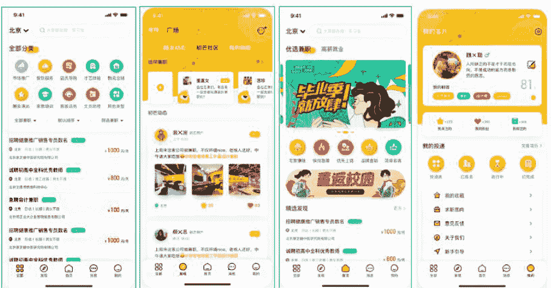

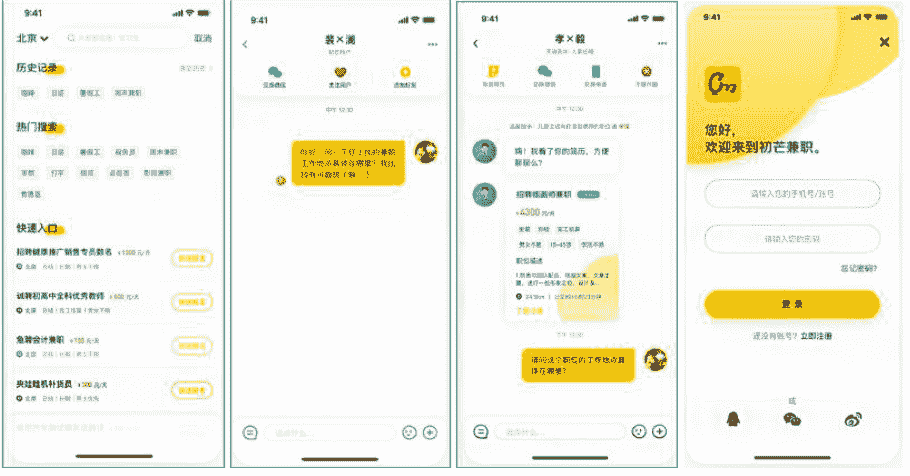

图1-1 “初芒兼职”App界面

### 1.1.2 UI设计的基本原则

优秀的 UI 设计既能吸引注意、扩大用户，也能有效传达文化与理念。创作时需在遵循基本原则前提下充分发挥创意。

#### 1. 适用性

适用性衡量作品是否契合用户需求，分为功能适用与尺寸适用。

- **功能的适用性。** 设计需满足实际使用与审美需求。实际功能要求简洁、符合操作习惯，便于快速使用；在其基础上，审美功能追求愉悦视觉体验。
- **尺寸的适用性。** 不同设备与系统影响显示效果，设计时应兼顾多终端适配，确保流畅呈现，如图1-2所示。

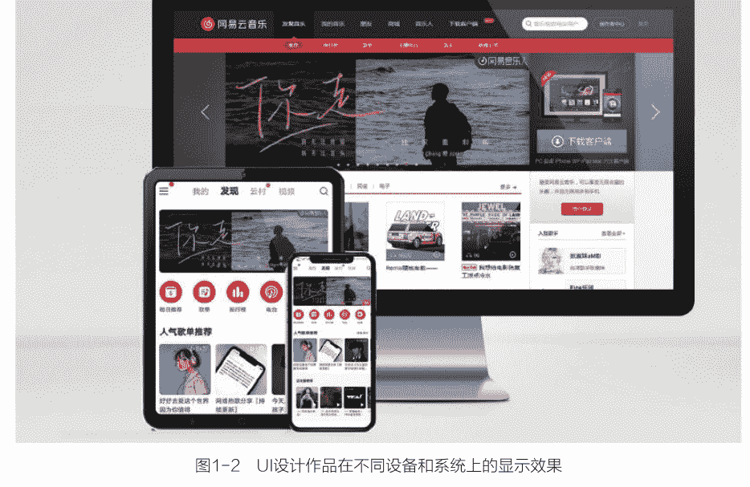

#### 2. 适配性

适配性要求在保留产品个性的同时，使风格与功能定位、目标用户审美相契合。色彩需与氛围协调，布局需适配不同屏幕，字体图标需统一易读，交互方式需符合操作习惯，以提升易用性。如购物网站多用暖色营造热闹氛围，社交网站则常选用马卡龙色系烘托青春气息。

#### 3. 统一性

UI 作品由多个界面构成整体，需保持整洁有序。应使用一致的字体、色彩与风格，功能描述与交互行为保持统一，避免同功能多词表述，确保跨界面行为一致，如图1-3所示。

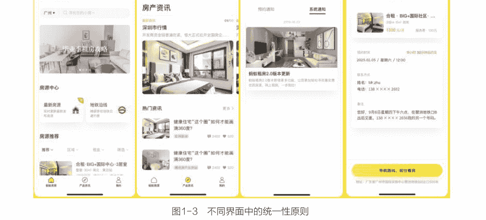

#### 4. 层级性

层级性要求内容层次清晰、重点突出、逻辑分明，便于用户区分重要程度，形成清晰操作认知，减少误操作，提升整体好感。

#### 5. 引导性

引导性强调降低使用障碍，通过文字、图标或图像引导操作，确保按预期使用。产品会随时代与内容更新而迭代，设计时应提供简明生动、重点突出的指引，降低学习成本。

### 1.1.3 UI设计的发展趋势

随着 5G 时代到来，智能化产品层出不穷，UI 设计迎来新方向与更广空间。

#### 1. 使用AI技术进行UI设计

人工智能技术模拟、延伸人类智能，在 UI 领域带来新机遇。

- **AI 辅助设计常态化。** AI 已渗透设计多环节，主流软件平台增设 AI 功能如创意构图、图像生成等，大幅提升效率。设计师需掌握一定 AI 技能，灵活辅助创作。
- **个性化需求增加。** 依托大数据与 AI，可更精准把握用户心理与趋势，产出个性化方案。结合自身创想，可创作出更具独特性的作品。
- **创意与质量要求提升。** AI 时代更需注重独特性与创新，强化策略思考与需求挖掘，以区别于同质化自动产出。
- **门槛与成本降低。** AI 使非专业人士也能快速生成高质量作品，降低门槛，让设计师聚焦创意本身。

> 数字化、网络化、智能化深入发展，AI 将在医疗、教育、交通、娱乐等多领域发挥作用。同时使用 AI 也涉及法律法规、伦理等议题。设计人员使用 AI 时须严格遵守《中华人民共和国网络安全法》等法规，严禁生成涉及政治人物、色情、恐怖等违法违规、危害社会的内容。

#### 2. 使用AR技术进行UI设计

AR 即增强现实，通过多媒体、3D 建模、实时跟踪、智能交互等技术，将虚拟信息叠加到真实世界，实现环境增强。

- **提升用户体验。** AR 可将虚拟元素与现实结合，提供沉浸式交互，用户可直观操作界面元素。
- **增强表现力。** 可创建 3D 动态 UI 元素，表现力强于传统 2D 界面，有助于更直观展示产品原型。
- **提供实时反馈。** 设计过程中可实时预览效果，便于即时调整，提高效率与质量。

图1-4 所示为 AR 虚拟动物园界面效果，结合场景识别技术，用户将摄像头对准指定场景即可在屏幕中看到互动动物。

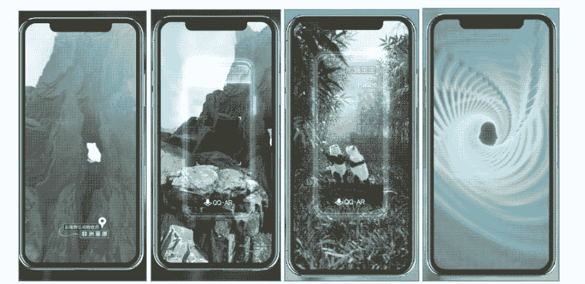

#### 3. VR产品UI设计

VR 即虚拟现实，利用计算机模拟 3D 虚拟空间，提供视觉、听觉、触觉等感官体验。国内 VR 市场规模快速扩张，5G 为其带来新机遇。

VR UI 设计核心为环境与交互元素。环境指用户所见虚拟场景，交互元素为可操作对象。二者巧妙结合可让用户完全沉浸。

> **设计大讲堂**
>
> VR 与 AR 的差异：
> （1）技术不同。VR 为仿真技术集合，包含图形学、人机接口、多媒体、传感、网络等；AR 包含多媒体、3D 建模、实时视频显示、传感器融合、跟踪注册、场景融合等。
> （2）原理不同。VR 由计算机生成模拟环境，实现多源信息融合的交互式 3D 动态视景；AR 则将图像、声音等实时叠加到真实环境。
> （3）功能不同。VR 可实现人机交互、多种感知，使用户沉浸虚拟世界；AR 必须结合现实，智能性较低，无法让人忘记现实。

### 1.1.4 UI设计的常用工具

除稳定功能强的设计软件外，智能化 AI 工具不断涌现，提升效率。

- **Photoshop。** Adobe 旗下图像处理软件，用于像素图像处理、界面合成与调整。
- **Illustrator。** Adobe 矢量绘图软件，广泛用于图标制作与矢量绘制。
- **CorelDRAW。** Corel 出品设计软件，常用于 UI 矢量图绘制与网页制作。
- **After Effects。** Adobe 动态图形软件，擅长视频处理、动画制作，用于界面动效设计。
- **Axure RP。** 专业原型设计工具，用于制作原型图、线框图、流程图，在网页原型绘制上优势明显。
- **AI 工具。** 包含 AI 写作与 AI 绘画，可辅助灵感获取、逻辑梳理、文案撰写、原型制作、智能图像编辑等。常用工具如通义万相、Midjourney、即时 AI、文心一言、Wix ADI、墨刀 AI、TreeMind 树图等。

### 1.1.5 UI设计中的相关术语

即便 AI 使“人人参与设计”成为可能，UI 设计仍具专业性。需掌握单位、图像类型及文件格式对输出的影响。

#### 1. UI设计的单位

正确使用单位直接影响准确性与体验。

- **英寸 inch。** 电子设备屏幕对角线长度单位，常说 14 寸、27 寸屏幕即指此。
- **分辨率。** 单位长度内像素数量，常以像素/英寸或像素/厘米表示，分辨率越高图像越清晰。
- **网点密度 DPI。** 打印分辨率单位，表示每英寸打印点数，多用于打印、扫描设置或 Android 系统。

**UI设计底层原理拆解：从像素单位到视觉表达**

**1. 屏幕度量单位与像素概念**

- **像素密度 PPI。** PPI 是衡量屏幕精细程度的指标，指每英寸长度内包含的像素数量，这一概念在 iOS 生态中频繁使用。
- **像素 px。** px 是屏幕显示的最小颗粒，每个物理像素由红绿蓝三原色组成。它属于相对单位，会随屏幕像素密度变化。在 Photoshop 等设计工具里做界面适配时，px 是最常用的基准。
- **点 pt。** pt 是前端常用的逻辑像素单位，用于跨设备适配，数值绝对，不受 PPI 影响。iOS 文本尺寸多以 pt 为准。pt 与 px 的换算与 PPI 相关：PPI 为 72 时 1pt=1px；PPI 为 144 时 1pt=2px。
- **独立密度像素 dp。** dp 是 Android 非文字元素的基准单位，和 iOS 的 pt 作用相近。当 PPI 为 160 时，1dp=1px。
- **独立缩放像素 sp。** sp 是 Android 文字尺寸单位，受系统字体缩放影响。在默认正常字号下，1sp=1dp。

### 2. UI 设计中的图像类型

UI 里的图像大致可分为位图与矢量图，两类特性完全不同。

- **位图。** 常见于相机、手机拍摄的点阵图，由无数像素点拼接而成。位图还原光影色彩很逼真，是界面构成的主力。单位面积像素越多分辨率越高，文件越大，放大到一定程度就会模糊并出现方格状像素点。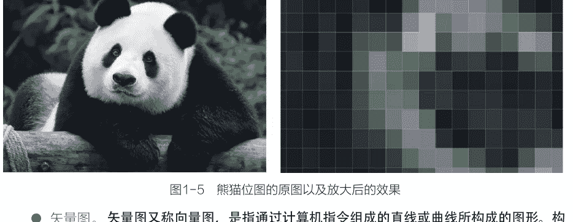
- **矢量图。** 通过数学指令绘制的线条与曲线构成图形。组成图形的点线都是独立对象，具备大小方向轮廓颜色位置等属性。可无限放大依然清晰，文件体积小。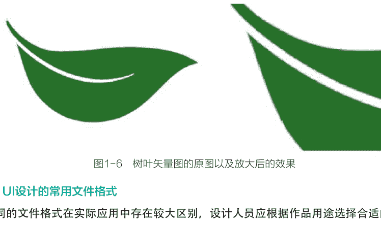

### 3. UI 设计常用文件格式

- **PSD .psd。** Photoshop 默认格式，可保留图层通道色彩模式等编辑信息。
- **GIF .gif。** 由 CompuServe 推出，支持 LZW 无损压缩，利于减小磁盘占用。
- **JPEG .jpg/.jpeg/.jpe。** 网页预览常用格式，采用有损压缩，文件变小但会丢失部分不易察觉的色彩。
- **PNG .png。** 采用无损压缩，适合网络传输，支持透明背景且边缘平滑无锯齿。
- **SVG .svg。** 基于 XML 的 2D 矢量格式，任意尺寸下保持高质显示，放大不产生像素化。

## 1.2 UI 设计要素

把 UI 设计比作盖房子，点线面是框架，文字色彩是砖石，风格是涂装，构图布局是钢筋。

### 1.2.1 点、线、面

点线面的判定依画面形态和空间作用。

#### 1. 点
点是相对概念，靠对比存在。画面中面积较小的元素都可视为点，可规则如圆点方点三角点，也可不规则如锯齿雨点。文字图形色块若足够小也可当点使用。点能聚拢视觉焦点，使画面舒适有冲击力。叠加堆积聚合还能带来韵律感。图1-7所示的启动页用多种形状点组合出迅雷图标形象。

#### 2. 线
线是点与点相连的轨迹，是点移动的痕迹。线能表现长宽位置方向个性，具有优美简洁感，常用于渲染引导串联分割。线分水平线垂直线斜线曲线。

- **水平线。** 带来平静安宁沉稳感，同时有向两侧延伸的力量。
- **垂直线。** 传达挺拔刚毅感，兼具向上伸展向下垂落的力量。
- **斜线。** 冲击力强，表现快速紧张活力。
- **曲线。** 流畅灵动，粗细形状不同带来柔软优雅温和感。

线还能引导视线，让用户不自觉跟随轨迹转移注意力。图1-8启动页用曲线构成“9”形，灵动吸睛。

#### 3. 面
放大后的点可视为面，线分割产生的空间也可称面。面具备长宽方向位置摆放角度等属性，能组合信息分割画面平衡空间层次烘托主题。面分几何形与自由形。

- **几何形。** 规律性强易识别记忆，如圆矩形三角形多边形等。矩形显稳重厚实规矩；圆形显充实柔和圆满且有聚焦力；正三角形显坚实稳定。
- **自由形。** 来自自然或灵感，洒脱随意能营造淳朴生动效果，可为手绘形态有机曲线或自然偶然形态。

点线面在位置大小形状疏密上协调统一时，才能形成有效的视觉语言。

012 案例学 AIGC+Photoshop UI 设计（微课版）

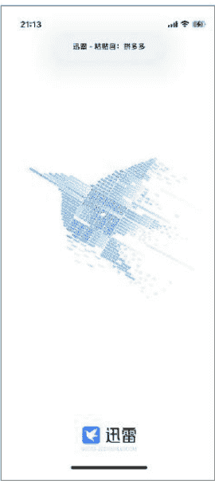

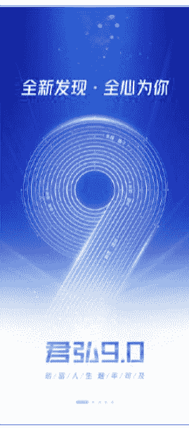

图1-7 以点为主的UI设计

图1-8 以曲线为主的UI设计

图1-9 以几何形为主的UI设计

### 1.2.2 色彩

色彩是眼睛感知大脑处理结合经验后的视觉效应，影响用户对界面的第一印象。好的配色能传递情绪氛围、传递信息、引导注意力、塑造风格。

#### 1. 色彩三要素
色相明度纯度构成色彩三大属性。

- **色相。** 色彩的种类名称，如玫瑰红湖蓝土黄。
- **明度。** 也称亮度，指明暗程度。加白变亮，加黑变暗。明度影响视觉轻重，高明度显轻、低明度显重。
- **纯度。** 也称饱和度，指鲜艳程度。本色含量越多纯度越高。高纯度带来兴奋鲜艳明媚，低纯度带来舒适低调暗淡。

#### 2. 色彩对比
色彩并置产生的美感取决于对比运用，主要有色相对比、明度对比、纯度对比。

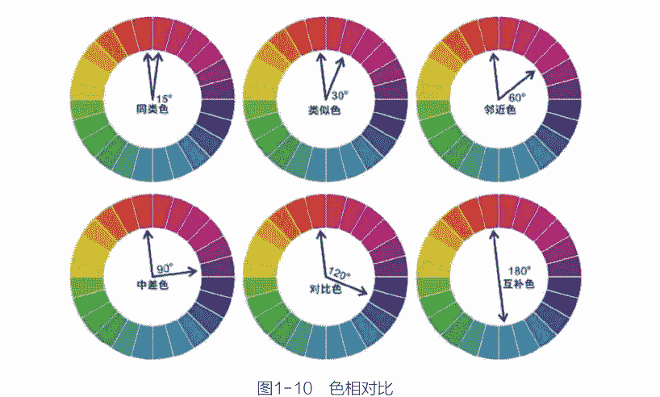
- **同类色对比。** 色相环 15° 范围内，组合平静雅致含蓄稳重。
- **类似色对比。** 色相环 30° 范围，柔和和谐雅致平静。
- **邻近色对比。** 色相环 60° 范围，保持统一和谐且有变化。
- **中差色对比。** 色相环 90° 范围，比邻近色更活泼跳跃。
- **对比色对比。** 色相环 120° 范围，醒目有力活泼。
- **互补色对比。** 色相环 180° 范围，对比强烈炫目但易刺激。

明度对比强画面清晰明快，弱则低调深沉。纯度对比弱画面柔和细腻适合久看，对比强则鲜艳明朗富有生机。

图1-11所示为明度和纯度对比效果。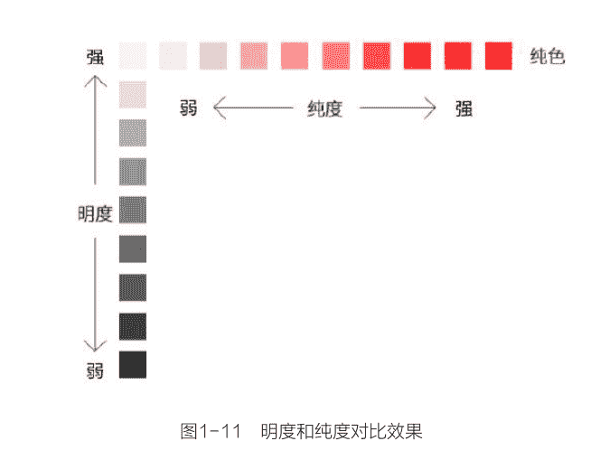

> 设计大讲堂
配色还可按面积比例透明度空间效果形态划分。强对比色彩冲突大时可通过渐变融合自然过渡，或控制面积比例高明度高纯度色占小面积，或用无彩色黑白灰间隔。

#### 3. 色彩搭配
主色面积大用量多，辅助色次之用于补充，主色点缀色用于强调关键部位。

惯用比例为 60% 主色+30% 辅助色+10% 点缀色。主色过多层级不清，搭配辅助与点缀既突出重点又平衡面积。

图1-12所示为腾讯云界面配色，主色浅蓝色呼应科技定位，辅助色黄橙与黑色丰富层次并突出文字，少量深蓝橙色点缀画面更活泼。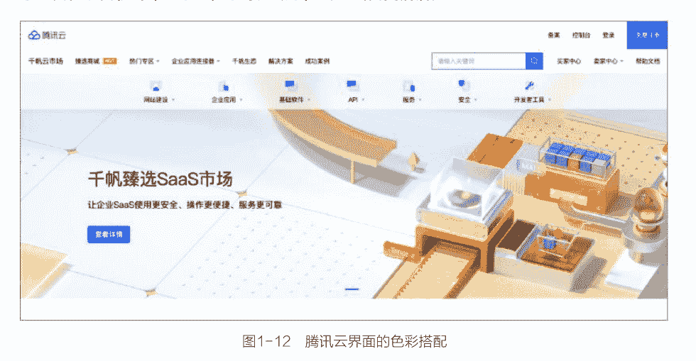

常用配色方法随色相数量递增难度增加。

- **单色配色法。** 同色相不同明度搭配，稳妥统一融洽。
- **双色配色法。** 多取对比色互补色，冲击感强，常见红绿蓝橙黄紫。
- **三色配色法。** 色相环等边三角形三角对立色搭配，色彩更丰富。
- **四色配色法。** 选择邻近四色搭配，过渡自然。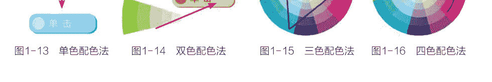

### 1.2.3 文字

文字承载信息提醒操作表达功能，字体选择与排版影响整体观感与传达效率。

#### 1. UI 设计中的字体规范
字体规范统一字号类型颜色等，保证层级清晰功能明确。

- **iOS 默认。** iOS 9+ 中文苹方、英文 San Francisco，纤细饱满易读。
- **Android 默认。** 中文思源黑体、英文 Roboto，线条适中端正大方。

常用字号：
- App：导航标题 36~40px，正文 32~34px，副文 24~28px，最小不低于 20px。
- 网页：12~30px。
- 软件：正文段落 12~20px，14/16/18 常见，用于重要内容可适当调整。

#### 2. UI 设计中的字体排版
- **齐头齐尾。** 两端对齐，理性大方，多用于长文本。
- **齐头散尾。** 版面整齐更有韵律，左对齐易读，常用于列表页。
- **自由排版。** 无固定规律，需与图片图标配合保持整体感与活力。

文字设计注意：同一产品字体种类不超过3种最好同系列，用大小色彩区分主次；风格要与界面氛围融合；字体颜色与背景要区分；选用易识别字体提升可读性。

### 1.2.4 风格

风格体现设计师情感审美与思想，先定风格再构图布局。

#### 1. 常用风格
- **扁平化风格。** 简单色块构成，简洁美观直白，目前常见。图1-17所示为扁平化 App 界面。
- **卡通风格。** 卡通表现轻松有趣，适合游戏或开屏。图1-18所示为卡通风格 App 界面。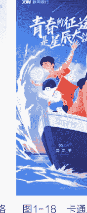
- **简约风格。** 弱对比或冷暖对比或大面积留白，舒适简洁。图1-19所示为简约风格 App 界面。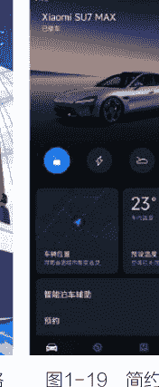
- **拟物化风格。** 还原度高质感强识别性好，常用于工具游戏图标。图1-20所示为拟物化风格 App 界面。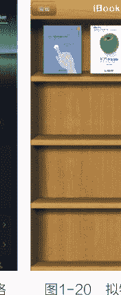
- **渐变风格。** 相比单色更有层次艺术朦胧感，适合文艺类 UI。

#### 2. 风格的选择
风格决定视觉走向和字体色彩走向，选择要点是风格要与产品类型相符，按产品定位挑选适配风格。

- **整体调性需与配色、字形、视觉图保持一致。** 色彩、字型以及图片皆是传递风格的关键载体，各类风格会唤起不同情绪，所以在选定风格时一定要让它与采用的配色方案、字体形式以及图片风格彼此呼应。

- **风格需与点缀元素保持和谐。** 装饰作为辅助手段，能提升画面质感并强化整体一致性与重点突出效果，因而所选风格务必与所用的装饰物件风格一致。

### 1.2.5 构图
构图说白了就是在有限的版面里把需要呈现的各个元素进行科学排布，让它们的位置关系产生更好的视觉观感，不同的构图手法呈现的视觉感受也会各不相同。

- **三角形构图。** 三角形构图是将画面里的各元素安排成一个稳定的三角形态，通常把视觉图置于三角的上方，文字信息放在下方，自上而下的递进关系能把信息层级梳理清楚，使用户浏览更顺畅，参考图1-21。

- **S形构图。** S形构图让画面元素沿着S型曲线排布，引导目光循着S型轨迹纵向流动，从而赋予画面节奏感与灵动感，参见图1-22。

- **F形构图。** F形构图是让图像与文字组合成F字形布局，图像占主导、文字居两侧，常出现在Banner或图文混排的页面中，比如网站专题页、首页等，见图1-23。

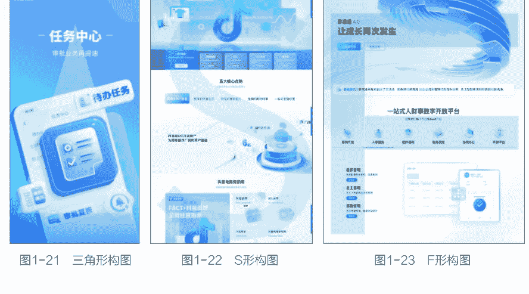

- **九宫格构图。** 九宫格构图也叫井字构图，把画面均分成九等份，以中间格四个角落中的任意一点作为主体元素的落点位置，见图1-24。

- **中心构图。** 中心构图把核心元素置于界面正中形成视觉中心，再用周边元素进行装饰与呼应，这样能直观呈现重点并强化层级感，见图1-25。

- **对角线构图。** 对角线构图把画面元素沿对角线方向布置，画面动感十足且能有效牵引视线走向，见图1-26。

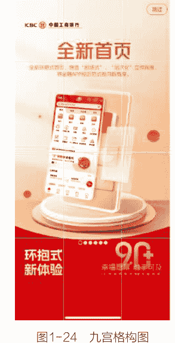

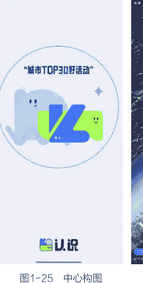

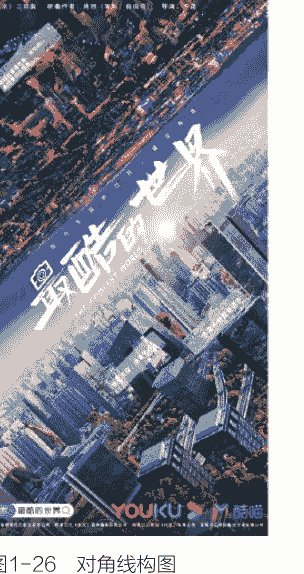

### 1.2.6 布局
布局是在构图框架内，对文字、图形、按钮等界面元素进行具体排版，让用户在浏览时感受到条理和层级，从而迅速找到所需信息。落实布局前，先要确定版面占比，再据此挑选合适的布局形式。

#### 1. 界面版率
版率指的是版面利用程度，也就是内容在整体画面中的占比。版率差异会带来不同的视觉效果，版率偏高时画面饱满有冲击力，版率偏低则显得宁静典雅。设计时应结合站点定位与内容量级来挑选合适的版率。

图1-27演示了高版率与低版率的对比，其中黄色区域代表内容区，内容填满整屏即为满版，画面无内容则为留白版。

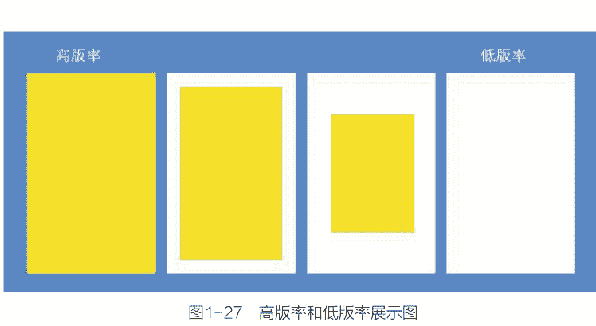

图1-27 高版率和低版率展示图

#### 2. 布局技巧
在版率确定且遵循布局原则的前提下，适当运用技巧能进一步提升界面吸引力。

(1) 大面积留白
极简风格大量使用留白是当下流行的做法，大面积空白能让界面更干净、有格调。当图片背景杂乱时，可将主体抠出，去除杂乱背景，更好地突出主体特征与重点。

(2) 局部呈现图像
若整张图表现力不足，可截取局部放大展示，只保留图像的一部分，在制造悬念感的同时也能激发用户互动，让用户自行脑补未展示的部分。

(3) 打破分格限制
常规分格布局能让内容整齐清爽，但也容易显得呆板。当页面内容较少时，可让重点元素大胆越界，摆脱格子束缚，这样既能增强层次与冲击，也更利于主题凸显。

#### 3. 常见布局方式
熟悉常见布局方式能提高制作效率，设计师可依据页面类型选择最匹配的方案。

- **纵向列表布局。** 这是App里最常用的形式之一，适合在小屏上展示海量信息，列表可无限向下延伸不受内容数量限制，用户上下滑动即可浏览，常用于功能页、个人资料页。

- **横向卡片布局。** 与纵向列表相反，它把元素并列横向排列，用户左右滑动或点击两侧箭头即可查看，常用于功能页与分类页。

- **大图展示布局。** 以图像为主体的布局类型，多见于引导页、网站首页，对主图的视觉品质要求较高。

- **标签式布局。** 用标签来划分文字内容，适合文字密集的页面，常用于搜索页、分类页。

- **弹窗布局。** 弹窗是对当前页面的补充，属于次要窗口，为节省空间，通常在用户触发时以顶部、中间或底部形式出现。

- **抽屉式布局。** 又称侧边栏布局，把功能菜单藏在两侧，需要时像抽屉一样拉出展开。它可纵向排列众多栏目，避免上下滚动查看全部内容。

- **底部导航布局。** App中常见做法，结构简单且便于单手操作，通过底部按钮切换页面，功能划分清晰。

## 1.3 UI设计流程
做UI设计时，通常先做需求分析，再绘制原型与视觉稿，最后进行标注与切图，这样才能更好地满足企业诉求。

### 1.3.1 需求分析
设计启动前，先要梳理设计需求，理清思路，才能有的放矢。

- **市场分析。** 需把握产品所处市场的整体走向，包括市场规模、主要竞品、目标用户群体等，帮助更清晰产品定位，确保设计贴合市场需求。

- **用户分析。** 深度洞察目标用户是核心工作，通过调研与画像明确用户的年龄、性别、职业等基础信息，以及使用习惯、偏好、痛点，从而打造符合预期的界面。

- **产品分析。** 需与产品经理协同，厘清核心功能、产品特色与目标，同时拆解竞品优劣，在设计中强化自身差异化。

### 1.3.2 原型设计
原型设计是对产品的初步设想，涵盖内容组织与结构排布。核心目标是将抽象需求落地为具体的界面框架与交互路径。确定视觉方向后，可借助电脑或手绘来制作原型图。

(1) 信息架构
需搭建产品的整体信息结构，厘清各页面间的关系与交互流程，保证用户能便捷找到所需信息。

(2) 界面布局
依据信息架构绘制各页面的原型，明确页面主题、元素摆放与整体排布。

(3) 交互设计
在原型中还要规划交互方式与跳转逻辑，如按钮反馈、各页切换等，以提升操作流畅度与体验感。

图1-28展示了某App的原型效果，呈现了其各级界面结构。

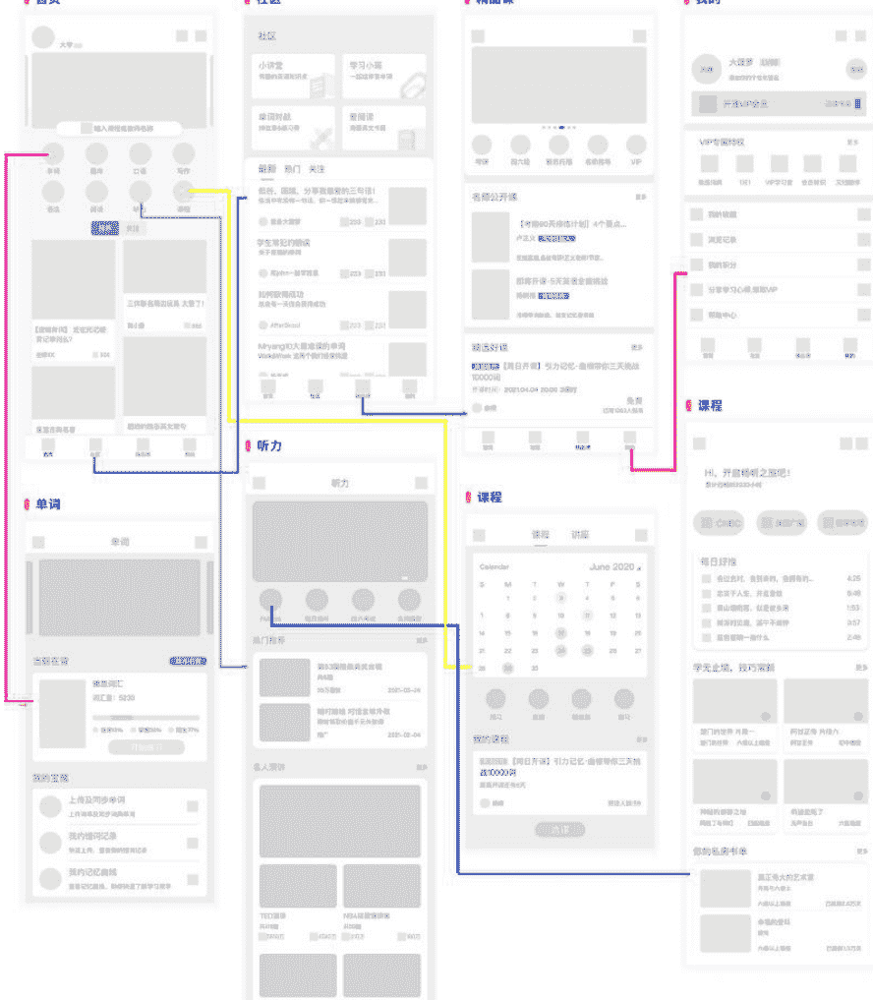

### 1.3.3 视觉设计
原型完成后，开始收集素材并进入UI视觉制作阶段。

1. 素材收集
主要涵盖图像、视频、音效等视觉听觉素材，以及文字信息。

- **视觉与音效素材的收集。** UI制作常需丰富素材包装界面，来源主要有三类：网络下载、自行绘制（借助Photoshop、Illustrator等工具创作）以及实拍（在真实场景拍摄，增强真实感与信任感）。

- **文字信息收集。** 指产品内的各类文字，如图标文案、按钮文案、展示说明等，需结合产品特性与功能进行梳理。收集时要兼顾全面、准确、及时、系统，确保信息可用。

2. 确定风格
结合产品定位与用户需求，确定整体视觉风格，如扁平、拟物等，并挑选适配的配色与字体，营造符合调性的氛围。

3. 执行UI设计
素材与风格明确后，依据原型图进行界面制作，常用Photoshop完成。先按原型绘制界面主体轮廓，再添加素材细化。设计中需兼顾适用、规范、易操作、统一与层次。图1-29展示了Photoshop UI设计的效果。

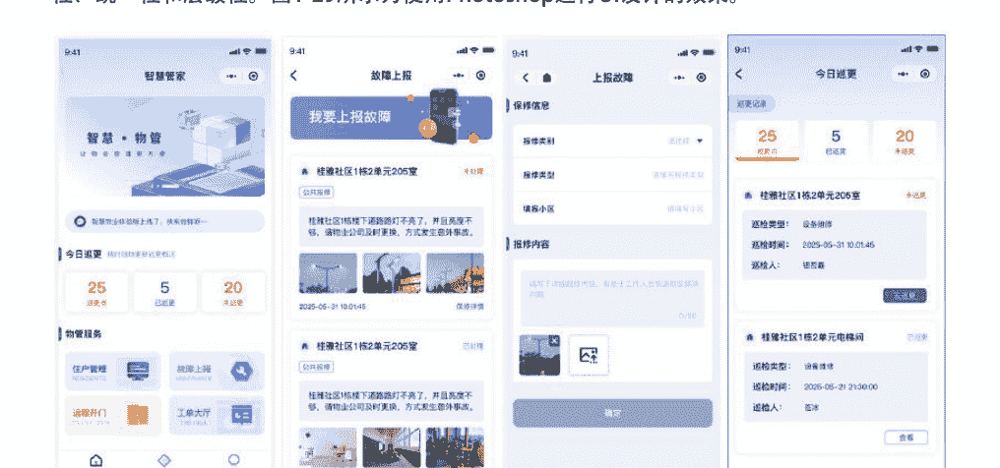

图1-29 使用Photoshop进行UI设计的效果

### 1.3.4 标注与切图
UI视觉稿完成后，为方便开发准确还原，需进行尺寸标注与切图。精准的标注与切图能最大程度保留设计意图，提升效率。常用标注工具如MarkMan、PxCook，切图则直接用Photoshop。图1-30为PxCook标注示例。

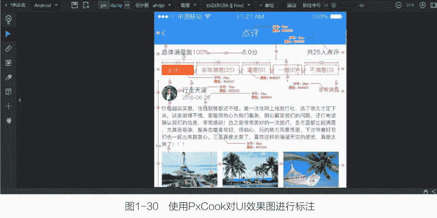

## 1.4 课后练习

1. 填空题
(1) UI设计是指对________、________和________等多方面进行整体规划与设计。
(2) 利用普通计算机程序模拟人类智能的技术手段是________。
(3) ________为电子设备屏幕对角线的度量单位。

2. 选择题
(1)【单选】通过相机、手机等设备拍摄的图像属于（ ）。
A. 三维图 B. 动态图 C. 位图 D. 矢量图
(2)【单选】（ ）是逻辑像素的单位，属于绝对单位，不随屏幕像素密度的变化而改变。
A. 像素 B. 点 C. 分辨率 D. 英寸
(3)【多选】UI设计的基本原则包括（ ）。
A. 适用性 B. 适配性 C. 统一性 D. 层级性
(4)【多选】适用性是衡量UI设计作品能否符合用户需求的标准，可分为（ ）。
A. 功能的适用性 B. 尺寸的适用性 C. 细节的统一性 D. 尺寸的统一性

3. 实操题
(1) 某软件因版本迭代需重做各界面，新视觉如图1-31所示，深受用户好评。请从构图、布局、文字、配色、风格5个维度分析其特点。

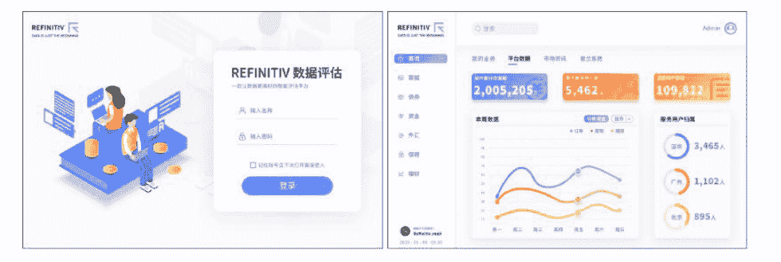

(2) 某设计公司承接了以水果团购为主的“水果淘淘”App UI项目，听取需求后先制定完整设计方案以便后续执行。为确保方案准确落地，需从设计定位、构图布局规划、配色风格选择、视觉设计4个层面进行策划，参考图如图1-32所示。

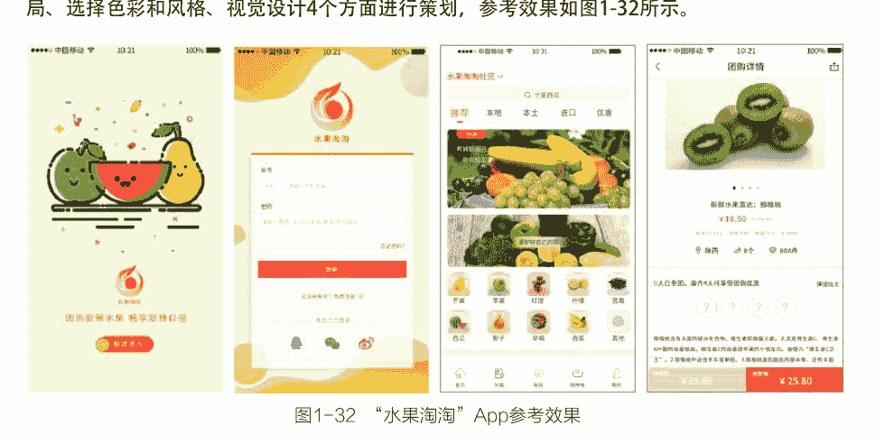

# 第2章 Photoshop 基础知识
UI工作内容繁杂，且作品需适配多系统、多平台与多设备，因此需要一款功能强大且能满足企业与设计师多样化需求的工具。Photoshop凭借出色的图像编辑、绘图与界面美化能力，成为UI设计的主流软件之一，广泛应用于UI各环节。

## 学习目标

### 知识目标
- 熟练掌握Photoshop工作界面与基础操作。
- 学会图像选区、绘制及图层应用方法。
- 掌握图像合成技巧。

### 技能目标
- 熟练编辑选区。
- 掌握用工具绘制图形。
- 能运用图层功能添加多样效果。

### 素养目标
- 提升UI设计软件实操能力，融合理论与实践。
- 培养持续钻研精神与良好设计习惯。

## 学习引导
STEP 1 相关知识学习 建议学时：3学时
课前预习 扫码了解Photoshop在UI设计中的运用，提升软件认知。

课堂讲解
1. Photoshop工作界面与基本操作
2. 图像选区与绘制、图层应用、图像合成
重点与难点
1. 学习重点：图层面板、图层样式、画笔工具、文字工具组
2. 学习难点：钢笔工具、蒙版、滤镜

STEP 2 技能巩固与提升 建议学时：1学时
课后练习 通过练习题巩固知识与操作，提升设计与实操能力。

## 2.1 熟悉Photoshop
掌握Photoshop使用方法是将创意落地的关键，熟悉其工作界面与基本操作是使用基础。

### 2.1.1 Photoshop的工作界面
将图片拖至Photoshop图标即可启动，打开图2-1所示界面（本书以Photoshop 2024为例）。界面主要包含菜单栏、标题栏、图像编辑区、面板组、工具箱、工具属性栏、上下文任务栏和状态栏。

1. 菜单栏
菜单栏共12项：文件、编辑、图像、图层、文字、选择、滤镜、3D、视图、增效工具、窗口、帮助，每项含多个命令。右侧带符号表示有子菜单，灰色表示当前不可用或未激活。

2. 标题栏
标题栏位于编辑区上方，显示文件名、格式、缩放比例、色彩模式、通道与图层状态及关闭按钮。未保存文件则显示“未命名+数字”。

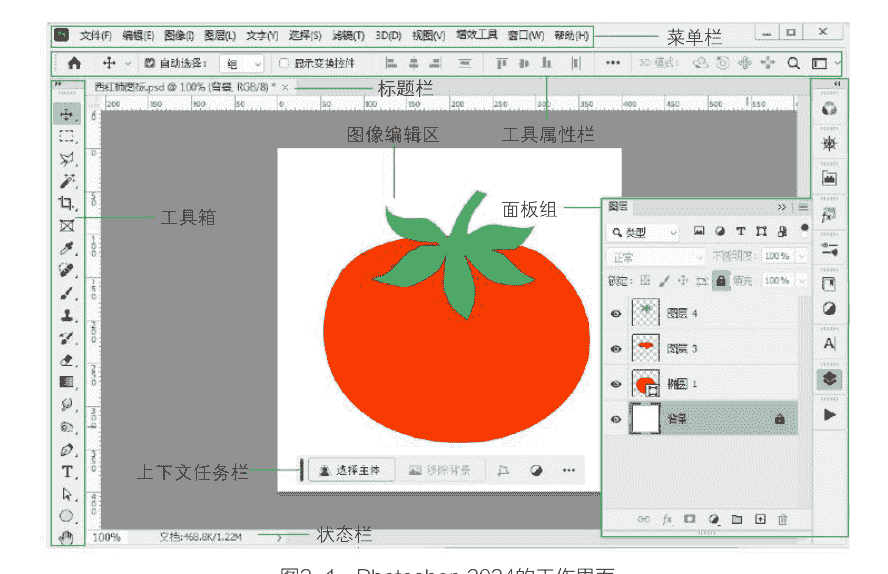

图2-1 Photoshop 2024的工作界面

3. 图像编辑区
图像编辑区是查看与编辑图片的核心区域，所有处理操作均在此完成。

4. 面板组
面板组是核心操作区，可进行取色、图层编辑、新建通道、路径编辑、撤销等。可通过“窗口”菜单显示或隐藏面板，也可拖拽标题栏移动位置，拖拽选项卡可拆分面板。左上角“展开”按钮可显示隐藏面板，“折叠”按钮可恢复图标模式。

5. 工具箱
工具箱集成了全部工具，用于绘图、修图、创建选区、调整缩放等，默认在左侧，可拖拽移动。点击顶部»可切换双列显示。选中工具后即可使用；按钮右下角带三角表示为工具组，长按或右键可展开。图2-2展示了全部工具。

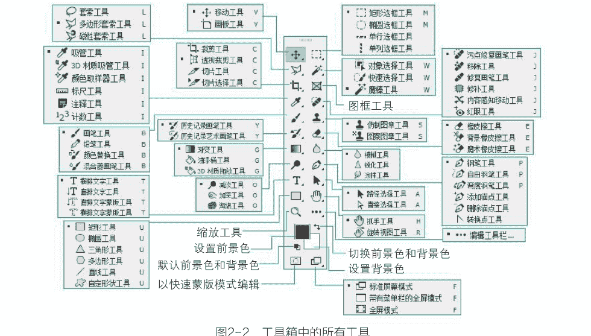

图2-2 工具箱中的所有工具

6. 工具属性栏
默认在菜单栏下方，选中工具后会显示对应参数设置，调整后可使操作更精准。

7. 上下文任务栏
用于提示当前流程的后续操作，例如选中对象后，会在编辑区上方显示相关选项。

8. 状态栏
位于编辑区底部，左侧显示缩放比例，可直接输入数值修改；中间默认显示文件大小，右侧按钮可切换中间显示内容。

### 2.1.2 Photoshop的基本操作
制作UI作品前先熟悉基本操作，才能提升效率。

1. 文件基础操作
UI设计中先新建或打开文件，制作过程中可用置入导入素材，完成后再保存关闭。

- **新建文件**。启动后进入主页点左侧“新建文件”，或选择【文件】/【新建】，或按Ctrl+N，均可打开新建文档对话框，设置宽高、分辨率等后点创建。
- **打开文件**。选择【文件】/【打开】或按Ctrl+O，定位文件后点打开。
- **置入文件**。选择【文件】/【置入嵌入对象】，选定文件后点置入，在编辑区调整大小位置，按Enter完成。
- **导出文件**。选择【文件】/【导出】，子菜单提供多种导出方式，按需选择内容、范围与格式。
- **保存文件**。选择【文件】/【存储】或按Ctrl+S，选定位置后保存。若需另存为不同名称格式，可用【文件】/【另存为】或Ctrl+Shift+S。

**快速关闭文件**

关闭当前文档有三种常用方式：通过顶部菜单【文件】/【关闭】下达指令，快捷键【Ctrl+W】，或组合键【Ctrl+F4】，任意一种都能立即退出正在编辑的文件。

> **操作小贴士**
> 为了防止因忘记存储而丢失进度，可以打开 Photoshop 的自动恢复。进入【编辑】/【首选项】/【文件处理】，在文件处理区域勾选“自动存储恢复信息的间隔”，右侧下拉框里挑选 5 分钟、10 分钟、15 分钟、30 分钟或 1 小时中的一个，最后点【确定】保存设置。

2. 调整文件的大小
在 Photoshop 里，文件的体积大小由画面的宽、高以及分辨率共同决定。需要改动尺寸时可任选以下三种做法。
- **图像尺寸指令**。执行【图像】/【图像大小】，在弹出的对话框里修改宽度、高度和分辨率数值后点【确定】即可。
- **画布尺寸指令**。编辑区本身就是画布，改变画布范围也能改变整体尺寸。执行【图像】/【画布大小】，在对话框内调整宽高并指定图像在新画布中的位置后点【确定】。
- **裁剪工具**。在工具箱中启用裁剪工具，画面会出现裁剪框，框内为保留区域，可拖动四周边框来改变范围，按【Enter】完成裁剪。

3. 标尺、参考线和网格
做 UI 精准排版时，这三类辅助线条能有效定位。
- **标尺**。打开【视图】/【标尺】或按【Ctrl+R】，即可在画布顶部和左侧显示标尺，再次按快捷键可收起。
- **参考线**。把指针移到标尺边缘，按住左键向画布内部拖拽，指针会变为 + 或 ++ 形态，右上角会实时显示位置，松手后即在该处生成一条参考线。
- **网格**。打开【视图】/【显示】/【网格】或按【Ctrl+’】，画布内即出现网格，再次按快捷键隐藏。

## 2.2 选择与绘制图像
挑选合适的素材进行编辑能提升最终效果，手绘补充则可弥补素材不足，两者都是 UI 制作的高频操作。

### 2.2.1 创建选区
选区是一个闭合的操作边界，能保护外部区域不受影响，只对内部进行编辑。常用工具组如下。
- **选框工具组**。矩形选框用于做矩形或正方形选区；椭圆选框用于椭圆或圆形选区；单行选框生成 1 像素高的选区；单列选框生成 1 像素宽的选区。
- **套索工具组**。套索工具绘制自由不规则边界；多边形套索以直线或折线组成边界；磁性套索依靠色彩差异自动捕捉边缘。

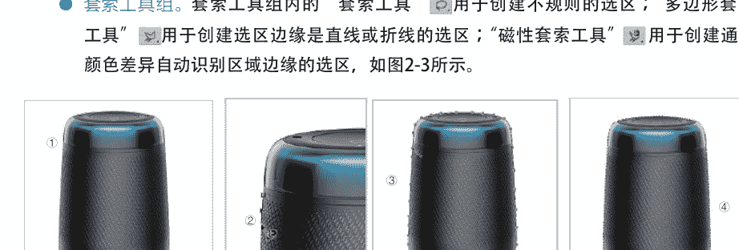

> 操作小贴士
> 使用多边形套索时按住【Shift】可沿水平、垂直或 45° 方向画直线；按【Delete】可撤销最近画的一条线段。

- **对象选择工具组**。对象选择、快速选择与魔棒工具都适合背景简洁、边缘分明的图像，能迅速生成选区。

### 2.2.2 编辑选区
编辑选区主要用于调整范围、边缘或状态。
- **反向选区**。执行【选择】/【反选】或按【Shift+Ctrl+I】将当前选区取反。
- **取消选区**。执行【选择】/【取消选择】或按【Ctrl+D】清除选区。
- **变换选区**。执行【选择】/【变换选区】，四周会出现定界框，指针变为▶时拖动控制点可等比缩放选区轮廓，不影响图像内容。
- **填充选区**。执行【编辑】/【填充】或右键菜单中的“填充”，在对话框里选择色彩或图案填充内部。
- **描边选区**。执行【编辑】/【描边】或右键菜单中的“描边”，在对话框里设定颜色与位置参数描摹边缘。
- **修改选区**。执行【选择】/【修改】，可进一步选择边界、平滑、扩展、收缩或羽化，并在弹出的面板中设定具体数值。

### 2.2.3 绘制图像
在工具箱底部先设定前景色，选用画笔工具，在属性栏里调节笔尖形状、大小与不透明度后在画布上单击或涂抹即可绘制。
铅笔工具与混合器画笔工具的功能与画笔类似。铅笔绘制的线条硬朗，混合器画笔则能模拟水彩、油画等颜料混合效果。

### 2.2.4 绘制矢量图
规则矢量图形可用形状工具组完成；不规则矢量图形则用钢笔工具、弯度钢笔工具或自由钢笔工具绘制，绘制前要在属性栏里将模式切换为“形状”。
- **形状工具组**。各工具使用方式相近，选择后在画布拖拽即可成形。矩形工具可画矩形或圆角矩形；椭圆工具可画圆与椭圆；三角形工具可画三角形；多边形工具可画不同边数的正多边形与星形；直线工具可画带粗细、颜色、箭头的直线；自定形状工具可调用预设图形。
- **钢笔工具**。属性栏里设为形状模式并指定填充与描边后，在画布上依次点按创建锚点形成直线段，闭合即可得到直线边缘图形；先点第一锚点再点按拖拽则生成曲线段，多段闭合后可得到曲线边缘图形。

## 2.3 应用图层
图层可视作一张透明胶片，多个图层按顺序叠加构成完整的 UI。越靠上的图层越在前，会遮挡下方的同位置内容。

### 2.3.1 图层的常见类型
常见类型主要有五种。
- **背景图层**。新建或打开文件时自带，始终位于图层面板底部，不可更改透明度也不支持图层样式。
- **普通图层**。最常用的类型，支持大部分编辑操作。
- **智能对象**。保留源文件的原始信息与特性，可反复缩放不失真。
- **文字图层**。输入文字时自动生成。
- **形状图层**。包含矢量对象的图层，放大后仍保持清晰。形状工具在“形状”模式下绘制时会为其自动创建形状图层。

### 2.3.2 图层的基本操作
操作前先选中目标图层。
- **新建图层**。执行【图层】/【新建】/【图层】或点图层面板中的“创建新图层”按钮。
- **删除图层**。执行【图层】/【删除】/【图层】、按【Delete】或点“删除图层”按钮。
- **复制图层**。按【Ctrl+J】、执行【图层】/【复制图层】或右键菜单选择“复制图层”。
- **合并图层**。执行【图层】/【向下合并图层】、按【Ctrl+E】或右键“合并图层”。
- **栅格化图层**。右键菜单选择“栅格化图层”。
- **对齐图层**。执行【图层】/【对齐】，在子菜单里挑选对齐方式。
- **分布图层**。执行【图层】/【分布】，在子菜单里挑选分布方式。
- **链接图层**。执行【图层】/【链接图层】或点面板上的链接按钮。
- **调整堆叠顺序**。拖拽图层，蓝色横线出现时松手即可放置。
- **调整不透明度**。在图层面板右上方的不透明度数值框输入数值来控制显示程度。

### 2.3.3 图层混合模式
混合模式可让相邻图层产生不同合成效果。面板中默认是“正常”，共有 27 种模式，分为组合、变暗、变亮、饱和度、差集、色彩六组。
- **组合模式**。需配合降低不透明度才显效果。
- **变暗模式**。整体变暗，当前图层的白色会被下方较深颜色替代。
- **变亮模式**。整体变亮，当前图层的黑色会被下方较浅颜色替代。
- **饱和度模式**。增强反差，50% 灰度会消失，高于 50% 的区域加亮，低于 50% 的区域减亮。
- **差集模式**。比较上下两层，相同区域变黑，不同区域呈灰度或彩色，白色区域显示下层反相，黑色区域不变。
- **色彩模式**。将颜色拆分为色相、饱和度、明度等成分进行混合。
例如对矩形图层分别使用“颜色加深”和“强光”混合模式，会得到截然不同的视觉效果。

### 2.3.4 图层样式
给图层添加样式可获得质感、纹理等特效。选中图层后执行【图层】/【图层样式】，或点图层面板底部的“添加图层样式”按钮，或双击图层右侧空白区打开“图层样式”对话框，设置参数后点【确定】。
共 11 种样式：混合选项、斜面和浮雕、描边、内阴影、内发光、光泽、颜色叠加、渐变叠加、图案叠加、外发光、投影，各自负责不同的视觉增益。

## 2.4 合成图像
借助文字、蒙版与滤镜合成，能显著提升画面美感与作品完整度。

### 2.4.1 添加文字
文字在 UI 中承担信息传递与风格强化作用。
#### 1. 认识文字工具组
包括横排文字、直排文字、横排文字蒙版、直排文字蒙版四种，前两者用于输入水平或垂直文字，后两者用于生成带选区效果的文字。
#### 2. 输入文字
点文字是在画布上单击后在定位点输入，不自动换行；段落文字是拖拽生成文字框输入，支持自动换行，可通过调整框体改变每行字数。
- **输入点文字**。选用横排文字工具，在属性栏设定参数后在画布单击插入定位点即可输入。
- **输入段落文字**。同样选用横排文字工具，按住鼠标拖拽生成文字框后在框内输入。

> 操作小贴士
> 点文字与段落文字可相互转换。
> （1）点转段落：选中图层，执行【文字】/【转换为段落文本】或右键菜单选择对应命令。
> （2）段落转点：选中图层，执行【文字】/【转换为点文本】或右键菜单选择对应命令。

#### 3. 设置文字格式
可在文字工具属性栏、字符面板或段落面板中调整，面板提供了比属性栏更丰富的排版参数。

### 2.4.2 添加蒙版
常用的蒙版有图层蒙版与剪贴蒙版，均可在图层面板操作。
- **添加图层蒙版**。选中目标图层，点面板底部的“添加蒙版”按钮，前景色设为黑色后用画笔或渐变工具涂抹，涂抹处内容被隐藏。
- **添加剪贴蒙版**。选中图层，按【Alt+Ctrl+G】或右键选择“创建剪贴蒙版”。
- **添加矢量蒙版**。用工具绘制路径后执行【图层】/【矢量蒙版】/【当前路径】。
- **添加快速蒙版**。打开文件后点工具箱下方的“以快速蒙版模式编辑”按钮，进入快速蒙版模式后用画笔涂抹，涂抹区呈半透明红色，点“以标准模式编辑”返回标准模式，红色区域即变为选区之外。

### 2.4.3 添加滤镜
滤镜通过改变像素位置与颜色生成特殊效果。
#### 1. 滤镜库
执行【滤镜】/【滤镜库】打开对话框，选择所需滤镜组后点【确定】，可一次性叠加多种滤镜。
滤镜库分为风格化、画笔描边、扭曲、素描、纹理、艺术效果六类，分别用于绘画风格、模拟笔刷、扭曲变形、素描效果、纹理生成与手绘效果。
#### 2. 特殊滤镜
滤镜菜单下有六个独立滤镜。
- **Neural Filters**。基于 AI 神经网络，可进行人脸编辑、人像增强、妆容迁移、表情年龄发型调整、艺术风格转换、图像增强等。
- **自适应广角**。校正透视与焦距，模拟球面或鱼眼镜头效果。
- **Camera Raw 滤镜**。调节色温、色调、曝光、对比度、高光、阴影、清晰度、自然饱和度与饱和度。
- **镜头校正**。修复拍摄或镜头导致的画面扭曲。
- **液化**。对图像任意区域进行推拉、旋转、反射、折叠、膨胀等变形。
- **消失点**。在选定区域内克隆、喷绘、粘贴时自动应用透视，使修改符合透视关系。
#### 3. 滤镜组
除特殊滤镜外，还有多个按效果归类的滤镜组。
- **3D 滤镜组**。模拟相机镜头产生 3D 变形，让平面图像呈现立体感。
- **风格化滤镜组**。对像素进行位移、拼贴、反色等处理。
- **模糊滤镜组**。降低相邻像素对比度，使过渡平滑。
- **模糊画廊滤镜组**。快速制作照片模糊。
- **扭曲滤镜组**。扭曲变形图像。
- **锐化滤镜组**。提升模糊照片清晰度，过犹不及会失真。
- **像素化滤镜组**。把相似色彩像素转为单元格，分块或平面化，增强纹理质感。

**“渲染”滤镜组**：用于模拟光线照射的氛围，在制作风格化照片或表现不同光源下的明暗变化时可派上用场。
**“杂色”滤镜组**：负责清理画面中的噪点，也能人为增加颗粒质感。
**“其它”滤镜组**：专注于对图像局部细节的精细化处理。

## 2.5 课后练习

### 1. 填空题

(1) __________ 坐落在画布编辑区的顶部，能够呈现当前文件的名称、格式、缩放比例、色彩模式、所属通道以及图层显隐状态。

(2) 选中某个对象后，上下文任务栏会浮现在 __________ 上，并提供可供挑选的 __________。

(3) 新建文件的快捷键是 __________。

(4) __________ 也可称为 AI 神经网络滤镜，是一款依托人工智能与机器学习技术开发的滤镜工具。

### 2. 选择题

(1)【单选】哪类滤镜能够模拟使用不同画笔或油墨笔刷勾勒画面时产生的视觉效果？（ ）
A. 风格化 B. 画笔描边 C. 扭曲 D. 素描

(2)【单选】按下（ ）组合键可以执行选区的反向操作。
A. 【Shift+Ctrl+T】 B. 【Shift+Ctrl+I】 C. 【Shift+Ctrl+E】 D. 【Shift+Ctrl+G】

(3)【多选】图层的类型包括（ ）。
A. 普通图层 B. 背景图层 C. 文字图层 D. 形状图层

(4)【多选】“图层样式”对话框中包含的样式有（ ）。
A. 斜面和浮雕 B. 描边 C. 内阴影 D. 光泽

### 3. 操作题

(1) 某外卖 App 为迎接春节准备制作启动页，要求尺寸为 1080 像素×1920 像素，突出“新年快乐”主题，同时融入传统文化，宣传外卖骑手坚守岗位、勤劳工作的形象，参考效果如图 2-20 所示。

(2) 某公司开发一款益智小游戏，要求使用指定素材制作 1080 像素×1980 像素的操作界面，参考效果如图 2-21 所示。

# 第3章 图标设计

在界面设计里，图标是一种高度概括的微型视觉符号，通常与文字配合使用。它既能承载丰富的信息，又能提升整体质感与信息辨识效率。优秀的图标要做到简洁易懂、辨识度高、内涵清晰，在保证实用性的前提下追求创新，以独特的视觉表现吸引用户。

## 学习目标

### 知识目标

- 认识图标的核心价值与常见分类方式。
- 熟悉图标制作标准与关键要点。

### 技能目标

- 能借助 Photoshop 完成多种类型图标的制作。
- 能利用 AI 工具生成图标并获取创作灵感。

### 素养目标

- 培养对图标创作的兴趣，提升想象与创造力。
- 保持严谨的工作习惯，在制作中注重细节打磨。

## 学习引导

### STEP 1 相关知识学习

建议学时：1 学时

**课前预习**

1. 扫码区分图案与图标，形成清晰认知
2. 在网上收集图标作品案例，通过欣赏加深理解

**课堂讲解**

1. 图标的价值与分类
2. 图标的制作标准与要点

**重点与难点**

1. 学习重点：线性、面性、扁平化、2.5D 图标的含义与制作要点
2. 学习难点：图标尺寸、绘制标准相关内容

### STEP 2 案例实践操作

建议学时：4 学时

**实战案例**

1. 制作线性图标
2. 制作面性图标
3. 制作具象图标
4. 制作 2.5D 图标

**操作要点**

1. 参考线、形状工具组的使用及形状运算
2. 图层不透明度、锚点编辑
3. 钢笔工具组、图层基础操作
4. 剪贴蒙版

### STEP 3 技能巩固与提升

建议学时：2 学时

**拓展训练**

1. 制作商务系列图标
2. 制作果蔬系列图标

**AI 辅助制作**

1. 使用通义万相生成小袁宠物软件应用图标
2. 使用 Midjourney 中文站的 SD 绘画模式生成家居系统图标

**课后练习** 通过练习巩固行业知识与软件操作，提升设计能力与实践水平

## 3.1 行业知识：图标设计基础

图标是一种传递信息的图形符号，可由符号、图案、文字或组合构成。它能为用户提供直观便捷的视觉指引，识别性突出，这对设计者视觉表达与规范掌握提出了要求。

### 3.1.1 图标的优势

图标在节约屏幕空间、跨越语言障碍、缩短辨识时长、优化整体视觉体验方面优势明显。

- **节省屏幕空间**。相比冗长的文字说明，图标以简洁形象传递操作信息，有效压缩显示面积。例如个人中心页，用人物打电话的图标即可替代“联系客服”等文字说明，占地极小。
- **不受地域语言限制**。图标具备通用性，能跨越地域与语言屏障。长期应用后，许多图标已被广泛熟知，成为国际通用符号，如放大镜代表搜索，齿轮代表设置。即使不了解界面文字，用户也能迅速理解含义并操作。
- **减少用户辨识时间**。人脑对图形图像的处理速度远快于文字，且记忆更牢，因此图标比文字更快传递信息，引导用户迅速接收并操作，降低辨识成本。
- **提升整体视觉体验**。一套精良的图标凭借独特性、象征性、记忆性、应用性、组合性与变化性吸引用户，激发点击欲望；统一一致的图标还能传递整齐的视觉感受。

### 3.1.2 图标的设计风格

图标是界面中不可或缺的部分，也是重点。从表现形式看，主要可分为线性图标、面性图标、具象图标和 2.5D 图标四种。

- **线性图标**。主体主要由线条构成，利用线与线的配合勾勒轮廓，赋予独特设计感。制作时需保持线宽统一，注意节点顺滑、走向连贯。图 3-1 所示为线性图标效果。
- **面性图标**。利用面与面的组合构成主体，使图标更饱满，视觉平衡度较高。图 3-2 所示为面性图标效果。

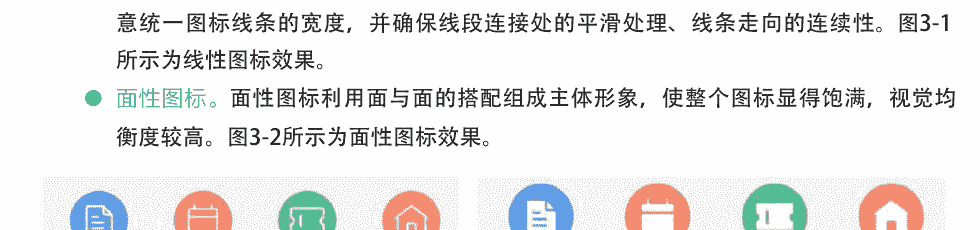
- **具象图标**。直接描绘具体事物或对象，如汽车、飞机、动物等，与现实对象有直接对应，更易识别。制作时需抓住主要特征，用简洁线条与形状表达，并注意色彩搭配与美观。图 3-3 所示为具象图标效果。
- **2.5D 图标**。外观由物体正面、侧面与顶面三面组成，视觉效果介于 3D 与 2D 之间，具有趣味真实、层次丰富的特点。图 3-4 所示为 2.5D 图标效果。

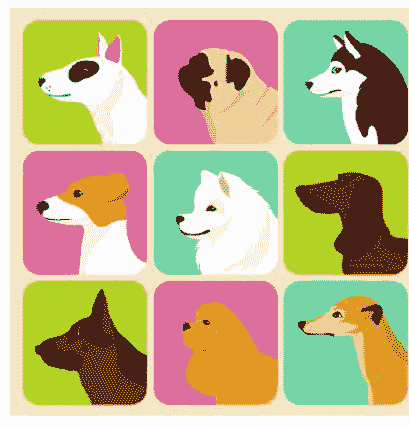
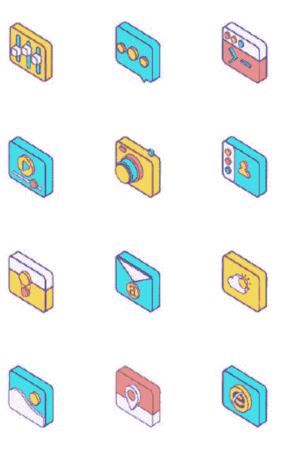

### 3.1.3 图标的设计规范

依据使用需求不同，图标的尺寸和绘制规范存在差异。

#### 1. 图标尺寸规范

按应用范围，图标可分为应用图标与功能图标，规范各异。

- **应用图标尺寸规范**。应用图标即产品图标，主要展示在主屏幕。需具备高度识别性，能迅速传达核心功能或品牌形象，制作应简洁独特易记。iOS 下应用图标通常为 180 像素×180 像素，提交 App Store 的尺寸为 1024 像素×1024 像素。安卓标准尺寸通常为 192 像素×192 像素，以适配高清屏幕，同时需提供多种尺寸适配不同设备。
- **功能图标尺寸规范**。功能图标即系统图标，用于表示软件中常见功能，多用于导航栏、工具栏和标签栏。因分辨率与场景差异，尺寸会不同。iOS 下图标尺寸通常以 48 像素为基准做 4 倍数增减；安卓下则以 48 像素为基准做 8 倍数增减。具体尺寸可按界面需求调整。图 3-5 所示为功能图标在安卓系统下 8 倍数增减变化。

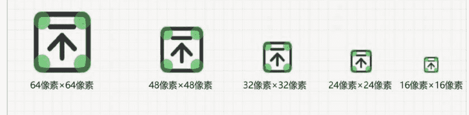
图 3-5 功能图标在安卓系统下 8 倍数的加减变化

#### 2. 图标绘制规范

制作图标时需遵循一定规范。

- **安全区规范**。重要内容应置于安全区内，以防在不同尺寸和分辨率下被遮挡或裁剪，保持视觉一致。
- **对齐规范**。保持视觉对齐有助于提升美观与专业性。制作时需注意图标内部元素的对齐方式，以及多个图标间的对齐关系。
- **线条规范**。线条粗细可按实际情况调整，但同场景下需保持统一。
- **夹角规范**。出现夹角处尽量统一，以保持几何美感和规律性，也适用于图标内部元素的夹角处理。

### 3.1.4 图标的设计要点

除尺寸与绘制规范外，制作时还需遵循以下要点。

- **具备识别性**。图标要准确表达内容，避免误导或歧义。图 3-6 所示为播放、时间、日历功能的图标，用户可通过外观直接理解含义。

图 3-6 表示播放、时间、日历功能的图标
- **具备共性和差异性**。同一产品的一系列图标通常具共性，但不能忽略差异性，因各图标含义与操作不同，过度强调共性会弱化区分度。制作时需合理规划，共性与差异并重。图 3-7 所示图标采用相同布局体现共性，色彩与形状则体现差异。

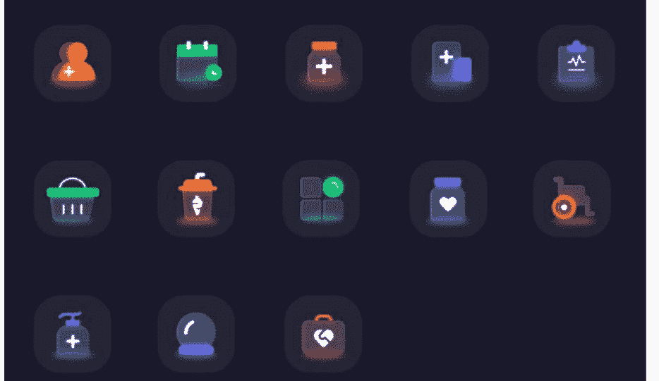
图 3-7 具备共性和差异性的图标
- **风格统一**。在一组图标中保持设计元素一致，形成视觉和谐与整体感，有助于提升 UI 美观性与识别度。图 3-8 所示图标均采用毛玻璃风格。

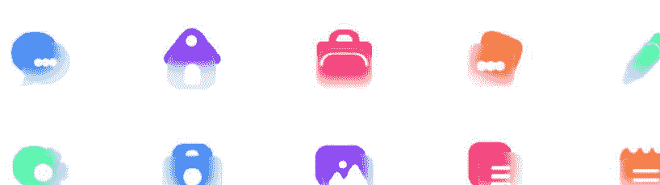
图 3-8 统一风格的图标

> **设计大讲堂**
在制作图标前，先明确风格定位，如简约还是繁复、平面还是立体、古典还是现代、写实还是抽象等。风格确定后才能依据特点有效进行制作。

## 3.2 实战案例：设计线性图标

### 案例背景

某天气预报 App 以实时更新和精准预报著称，深受用户喜爱。为进一步提升体验和辨识度，运营方计划用线性风格重设计部分功能图标，具体要求如下。

- (1) 图标应简洁明了，具有高辨识度和记忆点，能迅速传达信息。
- (2) 分辨率 300 像素/英寸，采用矢量图类型，尺寸 64 像素×64 像素。
- (3) 分别设计代表不同天气含义，以及日历和地图功能的图标，并展示其在 App 中的效果。

#### 设计思路

(1) 图形设计。结合生活观察，天气相关元素有云朵和阳光，可按天气情况做简要概括，如多云是云遮住太阳，晴天只有太阳等。日历图标可参考挂历形象，更具识别性。地图多以图纸展示，故图标可设计为折叠图纸形状。

(2) 色彩设计。以蓝色为主色，象征天空的广阔、清新与宁静。涉及太阳元素时辅以黄色。

本例参考效果如图 3-9 所示。

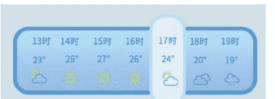

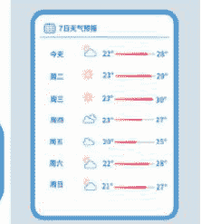

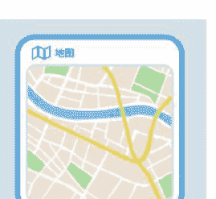
图 3-9 线性图标参考效果

### 操作要点

- (1) 使用参考线等辅助工具确定图标位置。
- (2) 使用矩形工具、椭圆工具等形状工具绘制基本图形。
- (3) 通过路径操作制作复杂图形。

### 3.2.1 绘制天气图标

结合云朵和太阳形状对天气图标元素做抽象化设计。绘制前先建立参考线辅助定位，再使用形状工具组绘制矢量形状组成图标，具体操作如下。

- (1) 新建一个名为“天气图标”的文档，尺寸设为“400 像素×400 像素”，分辨率“300 像素/英寸”，色彩模式选择“RGB 颜色”。
- (2) 选择【视图】/【标尺】命令显示标尺，将鼠标移至左侧标尺，按住左键拖曳至图像编辑区中间释放，添加参考线，同样方法从上方标尺拖曳水平参考线至中间。

> **操作小贴士**
图标尺寸通常较小，若直接按规范尺寸绘制，易因偏差影响展示。为避免此问题，可先用较大尺寸绘制，完成后再缩放至实际尺寸。

- (3) 选择“椭圆工具”，在属性栏取消填充，设置描边颜色为“#0790e7”，描边宽度为“1 点”，在编辑区中间按住【Shift】+左键拖曳，绘制 170 像素×170 像素的圆。用“移动工具”将其拖至参考线中心对齐。
- (4) 再次选择“椭圆工具”，在属性栏点开“路径操作”并选择“合并形状”，在左侧按住【Shift】+左键拖曳绘制 95 像素×95 像素的圆，交叉部分会自动隐藏。绘制时可用“路径选择工具”拖动圆调整交叉位置。
- (5) 用同上方法在右侧绘制 120 像素×120 像素的圆，此时图形已呈现云朵雏形。

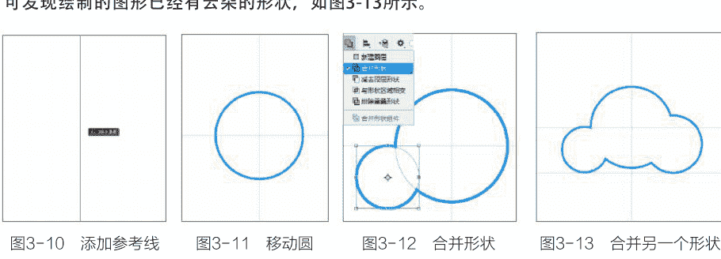
- (6) 在两圆下方添加参考线，选择“矩形工具”，取消填充，设置描边颜色“#0790e7”，描边宽度“1 点”，路径操作选择“合并形状”，依参考线在圆下方绘制矩形，左右两圆中间区域被连接。为增强轮廓，选择整个形状将描边宽度设为“3 点”，完成云朵制作。
- (7) 沿云朵各夹角添加参考线，选择“椭圆工具”，取消填充，描边颜色“#0790e7”，描边宽度“3 点”，按住【Shift】+左键拖曳绘制 110 像素×110 像素的圆，并使圆心与左上方参考线居中对齐。
- (8) 选择“矩形工具”，设置填充为“#0790e7”，取消描边，沿左上角参考线绘制 12 像素×26 像素的矩形。
- (9) 按【Ctrl+J】复制矩形，用“直接选择工具”选中复制件，按【Ctrl+T】进入变形状态，按住【Alt】并拖动矩形中间锚点至下方圆中心，设置旋转角度为“30°”，矩形随之旋转。

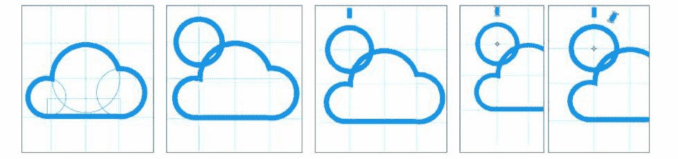
- (10) 多次按【Ctrl+Alt+Shift+T】对矩形进行旋转复制，完成光芒形状制作。
- (11) 为提升美观，需去除云朵内部的光芒。用“路径选择工具”按住【Shift】同时选中云内光芒形状，按【Delete】删除，效果如图示。
- (12) 选择太阳中的圆，选用“添加锚点工具”，在指定位置单击添加锚点。

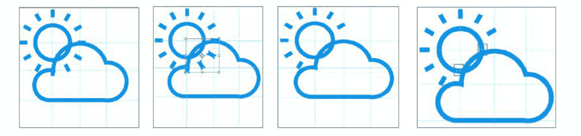
- (13) 用“直接选择工具”选中添加锚点下方的路径，按【Delete】删除。
- (14) 选择整个太阳部分，将颜色修改为“#f7ef0f”，完成图标绘制，按【Ctrl+;】隐藏参考线查看效果。
- (15) 用相同方法新建“其他天气图标”文件并绘制其他天气图标。

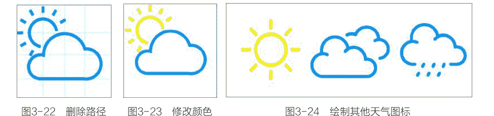

- (16) 为了让图标能直接用于 App，需要先统一尺寸。打开“天气图标”文件，先把背景图层隐藏，执行【Ctrl+Shift+Alt+E】盖印当前图层，打开“属性”面板把“W”数值改为“64像素”，图标会按比例自动缩到目标尺寸。将全部图标都移到文件左上角，然后新建一个“64像素×64像素”的矩形，并将其置于所有图标图层的最底层。

- (17) 切换到“其他天气图标”文件，重复同样的处理流程，把“W”设为“64像素”并整理好位置，完成全部天气图标的尺寸调整，并在每个图标的图层下方各放置一个矩形作为底纹，使整体符合功能图标尺寸规范，最终呈现如图3-25所示。

> **操作小贴士**
在 Photoshop 中，若需对长宽比例不相等的图形做精确缩放或放大，只需手动输入长或宽其中一边的数值，软件会依据原始比例自动计算另一边，如此即可保持图形原有比例与形状，避免变形。

- (18) 打开素材“天气预报App场景.psd”，把已盖印并缩放好的图标拖入场景中，适当调整大小与位置，保存后效果如图3-26所示。

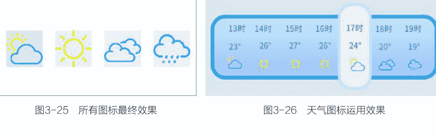

### 3.2.2 日历图标制作
参照真实日历的外形来绘制图标，以圆角矩形搭建主体轮廓，再用小矩形补充细节，操作步骤如下。

- (1) 新建文档，命名为“日历图标”，画布尺寸“400像素×400像素”，分辨率“300像素/英寸”，色彩模式“RGB颜色”。

- (2) 在画布上方中央添加十字参考线。选用“矩形工具”，关闭填充，设置描边颜色“#0790e7”、描边宽度“3点”、圆角半径“30像素”，拖拽绘制“170像素×140像素”的圆角矩形。用“移动工具”把该矩形拖至参考线交点处居中对齐，如图3-27所示。

- (3) 再次使用“矩形工具”，填充设为“#0790e7”、取消描边与圆角，绘制“12像素×35像素”的小矩形。用“移动工具”将其放到圆角矩形顶部左侧，如图3-28所示。

- (4) 选中该矩形，按住【Alt】拖拽向右复制，再向左拖拽再次复制，调整三个小矩形的间距与位置，如图3-29所示。

- (5) 使用“矩形工具”，填充“#0790e7”，绘制9个“30像素×12像素”的矩形。用“移动工具”依次将它们放置在圆角矩形中部并微调排布，按【Ctrl+;】隐藏参考线，完成日历图标，如图3-30所示。

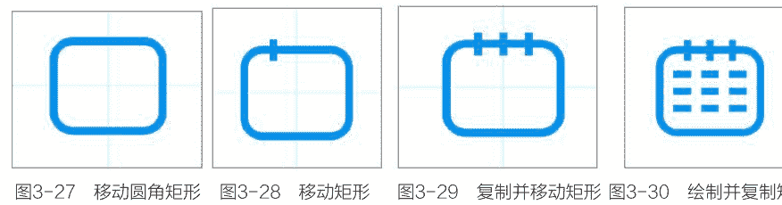
- (6) 为 App 使用做尺寸优化，先隐藏背景图层，用【Ctrl+Shift+Alt+E】盖印，打开“属性”面板把“W”改为“64像素”，日历图标会自动缩小至目标尺寸，随后将其位置调整到天气预报 App 界面的左上角。

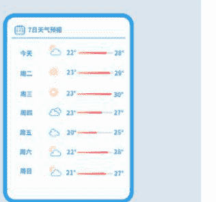
- (7) 打开“天气预报App场景2.psd”素材，把已盖印并缩放的日历图标拖入，调整大小与位置后另存，改名为“日历图标运用效果”，效果如图3-31所示。

### 3.2.3 地图图标制作
绘制三折式地图图标时，先画长方形，再通过变形制造斜切转折，具体步骤如下。

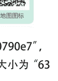
- (1) 新建文档，命名“地图图标”，尺寸“400像素×400像素”，分辨率“300像素/英寸”，颜色模式“RGB颜色”。

- (2) 选用“矩形工具”，取消填充，描边颜色“#0790e7”、描边宽度“1点”，在画布中部拖拽绘制“63像素×120像素”的矩形，如图3-32所示。

- (3) 选中矩形，按住【Alt】向右拖拽复制，再向左拖拽再次复制，调整三个矩形的位置，如图3-33所示。

- (4) 沿矩形边缘创建参考线，并在上下两侧各加一条参考线，如图3-34所示。

- (5) 选中左侧矩形，按【Ctrl+T】进入自由变换，右键选择“斜切”，如图3-35所示。

- (6) 选中右侧上方的锚点向上拖动，使其与上方参考线对齐，如图3-36所示。

- (7) 选中右侧下方的锚点向上拖动，使其与上方参考线对齐，如图3-37所示。

- (8) 采用与步骤（6）（7）相同的方式，对其余矩形的锚点进行调整，形成三折效果，如图3-38所示。

- (9) 选中整体形状，描边宽度改为“3点”，按【Ctrl+;】隐藏参考线，查看最终效果，如图3-39所示。

- (10) 为 App 应用调整尺寸，隐藏背景图层，用【Ctrl+Shift+Alt+E】盖印，打开“属性”面板把“W”设为“64像素”，地图图标自动缩小，随后将其置于左上角。

- (11) 打开“天气预报App场景3.psd”素材，把处理好的图标拖入并微调大小位置，完成后再另存，文件名改为“地图图标运用效果”，效果如图3-40所示。

## 3.3 面性风格图标实战

### 案例背景
某科技公司计划更新 App 界面，需重新设计邮件、搜索、定位等图标，以提升体验与品牌形象，要求如下。

- (1) 采用面性风格，图标简洁美观。
- (2) 具备高辨识度与记忆点，直观表达功能。
- (3) 分辨率300像素/英寸，矢量类型，尺寸64像素×64像素。

#### 设计思路
图形上采用高度符号化的主体，如邮件用信封、搜索用放大镜、定位用定位针，便于快速识别，同时剔除多余细节。色彩上以渐变底托搭配白色主体，通过对比鲜明的配色突出图标，保持和谐。

本例参考效果如图3-41所示。

### 操作要点
- (1) 利用不透明度增加层次感。
- (2) 通过编辑锚点调整形状。
- (3) 使用椭圆、矩形、三角形工具绘制。

### 3.3.1 邮件图标绘制
以信封形象为基础，先绘制渐变圆并用不透明度营造明暗层次，再绘制信封主体，具体如下。

- (1) 新建文档，命名“邮件图标”，尺寸“400像素×400像素”，分辨率“300像素/英寸”，颜色模式“RGB颜色”。

- (2) 选用“椭圆工具”，点击填充色块打开调整面板，点击“渐变”按钮，双击左下色标，将颜色设为“#9eff97”，确定。

- (3) 返回调整面板，将右侧色标改为“#e4d100”，调整色标位置，旋转渐变为“-90”，如图3-42所示。

- (4) 在画布中央按住【Shift】拖拽绘制“170像素×170像素”的圆，如图3-43所示。

- (5) 按【Ctrl+J】复制圆，选用“直接选择工具”，将填充改为“灰度”下的“白色”，点选圆上方锚点向下拖动，使其呈圆弧状，如图3-44所示。

- (6) 在“图层”面板将该圆图层不透明度设为“25%”，整体出现层次感，如图3-45所示。

- (7) 选用“矩形工具”，填充“#ffffff”，圆角半径“10像素”，在圆内绘制“90像素×70像素”的圆角矩形，如图3-46所示。

- (8) 选用“矩形工具”，点击“路径操作”选择“减去顶层形状”。

- (9) 在圆角矩形上方绘制“60像素×4像素”的矩形，用“路径选择工具”调整位置后旋转30°，如图3-47所示。

- (10) 采用与步骤（8）（9）相同方式，再绘制一个相同尺寸的矩形并做旋转处理，如图3-48所示。

- (11) 隐藏背景图层，按【Ctrl+Shift+Alt+E】盖印，打开“属性”面板把“W”设为“64像素”，图标自动缩小至目标尺寸，调整位置后保存。

### 3.3.2 搜索图标绘制
以放大镜为核心，搭配紫粉渐变底托，使扁平图标更具美感，具体如下。

- (1) 新建文档，命名“搜索图标”，尺寸“400像素×400像素”，分辨率“300像素/英寸”，颜色模式“RGB颜色”。

- (2) 选用“椭圆工具”，打开填充调整面板，点击“渐变”，左侧色标设为“#ff39b7”，右侧色标设为“#dc92ff”，微调左侧色标位置，在中央绘制“170像素×170像素”的圆，如图3-49所示。

- (3) 按【Ctrl+J】复制圆，选用“直接选择工具”，填充改为“#ffffff”，点选圆上方锚点向下拖动呈圆弧，图层不透明度设为“25%”，如图3-50所示。

- (4) 选用“椭圆工具”，描边颜色“#ffffff”、描边宽度“2.5点”，绘制“58像素×58像素”的圆作为放大镜上半部分，如图3-51所示。

- (5) 选用“矩形工具”，填充“#ffffff”、圆角半径“20像素”，在圆上绘制“45像素×21像素”的圆角矩形，按【Ctrl+T】旋转，使其成为放大镜手柄，如图3-52所示。

- (6) 隐藏背景图层，按【Ctrl+Shift+Alt+E】盖印，属性面板把“W”设为“64像素”，图标自动缩小，调整位置后保存。

### 3.3.3 定位图标绘制
延续前述思路，以白色定位针为核心图案，具体如下。

- (1) 新建文档，命名“定位图标”，尺寸“400像素×400像素”，分辨率“300像素/英寸”，颜色模式“RGB颜色”。

- (2) 选用“椭圆工具”，打开渐变，左侧色标“#75d900”，右侧色标“#f1ff8f”，调整色标位置，在中央绘制“170像素×170像素”的圆，如图3-53所示。

- (3) 按【Ctrl+J】复制圆，选用“直接选择工具”，填充“#ffffff”，点选上方锚点向下拖动呈圆弧，图层不透明度设为“25%”，如图3-54所示。

- (4) 选用“椭圆工具”，描边颜色“#ffffff”、描边宽度“18像素”，绘制“55像素×55像素”的圆，如图3-55所示。

- (5) 选用“三角形工具”，填充“#ffffff”，绘制“55像素×40像素”的三角形，按【Ctrl+T】右键选择“垂直翻转”，调整位置形成定位图标效果，如图3-56所示。

- (6) 隐藏背景图层，按【Ctrl+Shift+Alt+E】盖印，属性面板把“W”设为“64像素”，图标自动缩小，调整位置后保存。

- (7) 同样方式新建“其他图标效果”文件，绘制其他面性图标，栅格化后合并图层，便于后续调用，效果如图3-57所示。

## 3.4 具象风格图标实战

### 案例背景
某饮品店需为点餐小程序的外卖与自取功能设计图标，提升识别度，要求如下。

- (1) 采用具象风格，简洁美观，核心元素与功能契合。
- (2) 分辨率300像素/英寸，矢量类型，尺寸600像素×600像素。

#### 设计思路
外卖图标以送餐场景为灵感，自取图标以饮品图案为主，便于用户理解。色彩上外卖图标背景为浅绿，搭配嫩绿、橙、黑、白；自取图标同样以浅绿为底，搭配红、白、黄，整体形象美观。

本例参考效果如图3-58所示。

### 操作要点
- (1) 用钢笔工具绘制外卖员与饮品形状。
- (2) 利用图层基本操作整合图形。

### 3.4.1 外卖功能图标绘制
结合外卖员形象，用钢笔工具绘制鲜明图形，简化轮廓使造型现代生动，具体如下。

- (1) 新建文档，命名“外卖功能图标”，尺寸“600像素×600像素”，分辨率“300像素/英寸”，颜色模式“RGB颜色”。

- (2) 选用“椭圆工具”，填充“#c7f8e7”，绘制“400像素×400像素”的圆，如图3-59所示。

- (3) 选用“椭圆工具”，填充“#201e1f”，在圆右侧绘制“70像素×70像素”的圆；填充“#e7e7e7”，在其上方绘制“40像素×40像素”的圆；填充“#928a88”，绘制“13像素×13像素”的圆，完成轮胎制作，如图3-60所示。

- (4) 选用“移动工具”，在“自动选择”中选“组”，按住【Shift】依次选中轮胎各图层，按【Ctrl+G】建立图层组，双击组名改名为“轮胎1”。

- (5) 选中“轮胎1”组，按住【Alt】向右拖拽复制，改名为“轮胎2”，如图3-61所示。

- (6) 选用“矩形工具”，填充“#45612d”，在右侧轮胎上方绘制“5像素×24像素”的矩形作车杠，如图3-62所示。

- (7) 新建图层，选用“钢笔工具”，模式设为“路径”，在右侧车轮左侧点下起始锚点，再依次点下新锚点并向右拖拽绘制路径，如图3-63所示。

- (8) 按住鼠标左键向上拖拽形成曲线，继续添加锚点直至回到起始点闭合路径。

- (9) 前景色设为“#81dc78”，按【Ctrl+Enter】将路径转选区，再按【Alt+Delete】填充前景色，如图3-65所示，完成后按【Ctrl+D】取消选区。

- (10) 新建图层，继续用钢笔绘制车左侧路径，转选区后以“#81dc78”填充，效果如图3-66所示。

- (11) 新建图层，用钢笔绘制车厢路径，转选区后以“#65cd5b”填充；同法绘制车尾后灯并填充“#e4c008”，效果如图3-67所示。

- (12) 选用“矩形工具”，填充“#98dd91”，在车厢上方绘制3个“60像素×5像素”的矩形，如图3-68所示。

- (13) 选用“矩形工具”，填充“#81dc78”，在车头绘制“13像素×130像素”的矩形，如图3-69所示。

- (14) 新建图层，用钢笔绘制前灯路径，转选区后以“#81dc78”填充灯体，“#e4c008”填充灯光，如图3-70所示。

- (15) 选用“矩形工具”，填充“#72693c”、圆角半径“10像素”，绘制“137像素×9像素”的圆角矩形作车座，如图3-71所示。

- (16) 选用“矩形工具”，填充“#f0ac79”、圆角半径“10像素”，绘制“82像素×82像素”的圆角矩形作外卖箱；再次绘制“82像素×12像素”的矩形，填充“#ec873d”，作装饰线条，如图3-72所示。

- (17) 继续用钢笔按前述方法绘制外卖员人物，每部分单独置于不同图层，完成效果如图3-73所示。

- (18) 隐藏背景图层，完成保存。

### 3.4.2 自取功能图标绘制
先绘制饮品瓶身，再绘制瓶盖与吸管，具体如下。

- (1) 新建文档，命名“自取功能图标”，尺寸“600像素×600像素”，分辨率“300像素/英寸”，颜色模式“RGB颜色”。

- (2) 选用“椭圆工具”，填充“#c7f8e7”，绘制“400像素×400像素”的圆。

- (3) 新建图层，用钢笔工具在路径模式下绘制瓶身，按【Ctrl+Enter】转选区，前景色设为“#ff7175”，按【Alt+Delete】填充，效果如图3-74所示。

瓶身光影与吸管绘制

(4) 再建一个图层，继续用钢笔描出瓶身阴影的轮廓，执行【Ctrl+Enter】把路径转为选区，前景色调成 #e24b57，再按【Alt+Delete】填满，呈现效果如图3-75。

(5) 另起图层，以钢笔绘制瓶身高光区域，路径转成选区后填充 #ff9e99，效果参见图3-76。

(6) 切换椭圆工具，属性栏填充设为 #ff9e99，在瓶身位置放置 3 个 16像素×16像素 的小圆表现气泡，见图3-77。

(7) 仍用椭圆工具，填充改为 #fff2f0，于瓶盖处绘制 165像素×185像素 的椭圆，参考图3-78。

(8) 改用矩形工具，属性栏打开路径操作并选择“减去顶层形状”，在椭圆下半部画矩形，交叉部分会被自动扣除，形成瓶盖造型，效果如3-79。

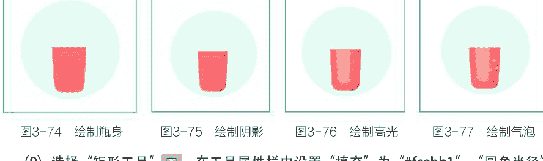

(9) 用矩形工具，填充设为 #fcebb1，圆角半径 20像素，绘制 175像素×36像素 的圆角矩形，见图3-80。

(10) 新建图层，用钢笔勾出吸管路径，【Ctrl+Enter】转为选区，前景色设为 #e24b57，再按【Alt+Delete】填充，效果见图3-81。

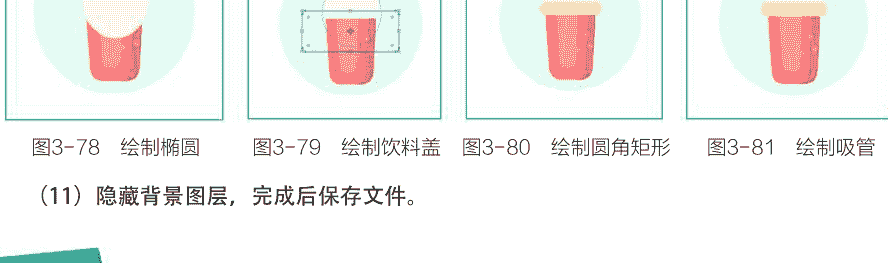

(11) 隐藏背景图层后完成保存。

## 3.5 实战案例：设计2.5D图标

### 案例背景

“挥墨”是一款绘画教学 App，运营方计划采用 2.5D 风格重新制作应用主图标和系统图标，涵盖礼品、集市、课堂、百宝箱等，具体要求如下。

- (1) 采用 2.5D 表现，图标兼顾吸睛与辨识。
- (2) 分辨率 300像素/英寸，矢量格式，主图标尺寸 192像素×192像素，其余系统图标 72像素×72像素。

#### 设计思路

(1) 造型。围绕绘画教学相关元素展开，如画笔、墨迹、画板作为主图标核心；系统图标追求直观简洁，礼品图标可直接以礼盒形象为依据。

(2) 配色。以蓝色为主调，传递宁静、深邃与专业；礼品图标以粉色为主，体现精致温馨；其余图标按内容灵活调整。

参考效果见图3-82。

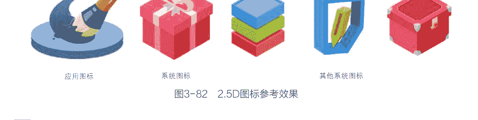

### 操作要点

(1) 借助剪贴蒙版营造高光。
(2) 借助钢笔刻画立体感。

### 3.5.1 绘制“挥墨”应用图标

先搭外形再刻画毛笔，具体流程如下。

(1) 新建文件命名为“挥墨”应用图标，尺寸 300像素×300像素，分辨率 300像素/英寸，颜色模式 RGB。

(2) 前景设为 #6578a2，新建图层，用钢笔在画布绘制墨点路径，完成后再按【Ctrl+Enter】转为选区，效果见图3-83。

(3) 按【Ctrl+J】复制一层，按住【Ctrl】点选复制层的缩览图载入选区。选用渐变工具，点击“可编辑渐变”打开渐变编辑器，双击左下色块打开拾色器设为 #3f4f71，再把右侧色块设为 #6e83b1，确认后完成设置，如图3-84。

(4) 属性栏选择线性渐变，自上而下在画布拖拽添加渐变，效果见图3-85。

(5) 新建图层，用钢笔在墨点下方绘制毛笔笔头路径，转为选区后【Alt+Delete】填充当前前景，效果见图3-86。

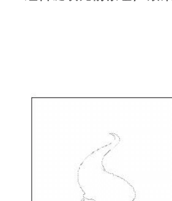

(6) 前景改为 #233665，新建图层，用钢笔在笔头上方绘制笔斗路径，转为选区后填充，效果如图3-87。

(7) 前景改为 #c28843，新建图层，用钢笔在笔斗上方绘制笔杆路径，转为选区后填充，效果如图3-88。

(8) 前景设为 #fffced，在笔头图层上方新增一层，用钢笔在笔头左侧绘制高光路径，转为选区后填充，再【Ctrl+Alt+G】创建剪贴蒙版，效果如图3-89。

(9) 前景设为 #dbc77a，在高光层上方新增一层，用钢笔在笔头中间绘制暗部路径，转为选区后填充，再建剪贴蒙版，效果如图3-90。

(10) 前景设为 #222732，新增一层，用钢笔在笔头下方绘制黑色笔尖路径，转为选区后填充并建剪贴蒙版，效果如图3-91。

(11) 同法继续绘制笔头其余区域，填充色分别为 #8c96ae、#eff2f5，并建剪贴蒙版，效果如图3-92。

(12) 前景设为 #dacf9d，新增一层，用钢笔在笔头下方绘制黄色阴影，填充后建剪贴蒙版，效果如图3-93。

(13) 同法在笔斗图层上绘制阴影与高光区，填充色分别为 #8c96ae、#152752，并建剪贴蒙版，效果如图3-94。

(14) 同法在笔杆图层上绘制阴影与高光区，填充色分别为 #a2631f、#e1aa52、#f8ebd7、#8b6333，并建剪贴蒙版，效果如图3-95。

(15) 选用椭圆工具，填充设为 #5d709a，在底部绘制 180像素×64像素 的椭圆，连续两次【Ctrl+J】复制两份并调整位置，顶部圆颜色改为 #93aed6。整体选中图标，将尺寸调整为 192像素×192像素，效果见图3-96，保存文件。

### 3.5.2 绘制礼物图标

以包装盒为参考，通过三面组合呈现立体感，再经色彩调整提升美感。先画一个面再补齐其它面与蝴蝶结，具体如下。

(1) 新建文件命名为“礼品图标”，尺寸 300像素×300像素，分辨率 300像素/英寸，颜色模式 RGB。

(2) 矩形工具，填充设为 #ff6a95，绘制 104像素×84像素 的矩形，如图3-97。

(3) 【Ctrl+T】自由变换，右键选择“斜切”，向左拖动左下锚点使图形变形，同法调整其余锚点，最终呈菱形，效果见图3-98。

(4) 钢笔，属性栏选择“选择工具模式”为“形状”，填充设为 #f7eef3，在菱形上方绘制倾斜矩形作丝带，如图3-99。

(5) 同法用钢笔绘制礼盒交叉丝带，如图3-100。

(6) 钢笔，模式选“形状”，填充设为 #cfd1d1，在丝带交叉处绘制蝴蝶结下半部一侧轮廓，如图3-101。

(7) 同步骤(6)的方法在右侧绘制蝴蝶结下半部另一侧，并在上方绘制左右两瓣，填充分别设为 #fbb2c6 与 #ffd0de，如图3-102。

(8) 钢笔，填充设为 #f13f6f，在蝴蝶结中间绘制阴影，如图3-103。

(9) 钢笔，填充设为 #e42f64，在左侧面与右侧面分别绘制菱形，倾斜角度与上方菱形保持一致，再将填充改为 #c91f50，如图3-104。

(10) 钢笔，填充设为 #ffffff，在两侧面分别绘制丝带，图层不透明度设为 40%，如图3-105。

(11) 钢笔，在左侧面与顶面中间绘制矩形，填充设为 #f1406f，如图3-106。

(12) 钢笔，在右侧面与顶面中间绘制矩形，填充设为 #e42f64，如图3-107。

(13) 钢笔，在中间矩形部分绘制丝带，填充设为 #ffffff，不透明度 60%，完成礼品图标制作，效果见图3-108，最后保存。

(14) 参考前述步骤新建“其他2.5D图标”文件，绘制其余2.5D图标，保存后效果见图3-109。

## 3.6 拓展训练

### 实训1 设计商务系列图标

#### 实训要求

- (1) 某设计公司需要设计一套商务系列图标，以计算机和资料册为核心元素，图标尺寸 400像素×400像素。
- (2) 采用面性图标风格，简洁美观，避免过多细节与复杂图案。
- (3) 使用渐变色作为主色，整体和谐统一。

#### 操作思路

(1) 椭圆工具绘制渐变色圆形。
(2) 钢笔围绕圆对角线与圆弧绘制路径并降低不透明度，完成底纹。
(3) 矩形工具绘制圆角矩形组合成电脑造型。
(4) 三角形工具绘制多个三角形点缀。
(5) 同法结合形状工具组绘制资料图标。

设计流程如图3-110。

### 实训2 设计果蔬系列图标

#### 实训要求

(1) 某果蔬销售 App 近期准备更新版本，为提升视觉效果，需要重新制作系统图标，图标尺寸 400像素×400像素，采用具象风格。

(2) 图标色彩贴合果蔬本身，如西红柿以红色为主，西梅以紫色为主，青菜以绿色为主。

#### 操作思路

(1) 绘制西红柿图标。用椭圆工具画椭圆作主体，直接选择工具微调形状。
(2) 用钢笔绘制西红柿顶部阴影部分，增强立体感。
(3) 用钢笔绘制顶部叶柄。
(4) 依步骤1至3同法绘制其他图标。

设计过程如图3-111。

## 3.7 AI辅助设计

通义万相是阿里企业研发的组合式生成模型，通过拆解配色、布局、风格等图像设计要素，再进行数字化高清重现，为设计人员提供可控且自由的图像生成能力。基础文生图功能可生成水彩、扁平插画、二次元、油画、国画、3D卡通、素描等多种风格；同时支持相似图生成，上传任意图像即可创意延展；更支持图像风格迁移，上传原图与风格图即可自动转换风格。例如生成小袁宠物软件应用图标，可从结果中挑选合适对象。

使用方式：文生图
使用方式：输入关键词
关键词描述方式：作品类型+主要元素+风格+色彩+其他细节
示例参数：模式为文本生成图像／万相2.0极速
关键词：小袁宠物，软件图标，UI设计，猴子形象，圆中添加宠物，平面简约风格，蓝色，明亮，线条简洁
创意模板：风格/描线插画
生成尺寸：1：1
示例效果：

### Midjourney中文站 生成家居系统图标

Midjourney中文站是一款功能强大的AI绘画工具，输入关键词即可快速稳定生成高质量图片，可用于艺术、设计、教育、娱乐、广告等领域。提供MJ绘画、SD绘画、Dall绘画三种模式。

- MJ绘画。侧重关键词或图片输入生成图像。
- SD绘画。注重创作效率，支持多种风格。
- Dall绘画。侧重关键词自动生成图像，强调文本到图像转换。

例如生成家居系统图标。
使用方式：文生图
使用方式：输入关键词
关键词描述方式：主体类型描述+具体要求+艺术风格+色彩要求
主要参数：模式、模型广场、生成尺寸
示例参数：模式为SD绘画／文生图
关键词：家居系统图标，UI设计，多图标、沙发、书桌、餐桌、椅子等形象，背景简洁，风格现代、抽象，去掉细节，色彩鲜艳、明亮，使用渐变色
生成尺寸：1：1

借助Midjourney中文站的AI绘画功能，可获得丰富设计方案，既可作为图标灵感来源，也可经进一步创意修改或局部重绘达到更高质量。

### 拓展训练

请参照上文方法，在Midjourney中文站中选用另一种绘画模式，通过设置不同的模式、生成尺寸与风格等，生成不同效果的家居系统图标，提升对AI绘图工具的应用能力。

## 3.8 课后练习

### 1. 填空题

(1) 图标广义上是指具有______、______、______等特征的图形符号。
(2) ______即产品图标，主要显示在主屏幕上。
(3) 2.5D图标的外观由某物体的______、______和______3面组成。

### 2. 选择题

(1)【单选】下列选项中，能直接描绘具体事物或对象的是（ ）图标。
A. 线性 B. 面性 C. 具象 D. 2.5D
(2)【单选】下列选项中，主体形象主要由线条构成，通过线与线的巧妙搭配，描绘出图标主体形状和轮廓的是（ ）图标。
A. 线性 B. 面性 C. 具象 D. 2.5D
(3)【多选】下列选项中，属于图标的优势是（ ）。
A. 节省屏幕空间 B. 不受地域语言限制
C. 减少用户辨识时间 D. 提升整体视觉体验
(4)【多选】下列关于图标的设计要点，说法正确的有（ ）。
A. 在进行图标设计时，设计的图标要能准确地表达图标内容，避免出现误导、歧义
B. 在进行图标设计时，图标要具备共性和差异性
C. 在进行图标设计时，图标的风格和主题思想要统一
D. 在进行图标设计时，图标的主题思想要具备差异性

### 3. 操作题

(1) 为购物App“拾取”设计一个尺寸为“192像素×192像素”，外形为购物袋样式的应用图标，要求图标外形简约，色彩明亮且具有视觉吸引力，参考效果如图3-112所示。

(2) 某阅读类应用计划在底部的标签栏新增“我的收藏”“购买记录”“积分”“每日签到”等功能区，需要为这些模块制作配套图标，采用面性风格，追求视觉精致且富有吸引力，参考样式见图3-113。

(3) 借助Midjourney中文站为益智休闲产品“小海绵”打造应用图标，设计核心以可爱海绵形象为灵感，整体呈现要美观，参考效果见图3-114。

# 第4章 控件设计实战精解

在界面搭建中，控件是最基础的组成单元，滑块、表单、按钮都属于此类。优秀的控件能够提升交互体验并适配不同平台。设计者需通过反复验证与优化，确保控件实用、可被用户接受。

## 学习目标

### 知识目标
- 熟悉UI设计里常见的控件分类。
- 掌握各类控件的关键设计原则。

### 技能目标
- 能借助Photoshop完成不同控件的制作。
- 能结合AI工具辅助完成控件的创作。

### 素养目标
- 培养对各类控件的探究兴趣，提升控件设计能力。
- 强化创新意识，能够按需定制各类控件。

## 学习引导

### STEP 1 相关知识学习
建议学时：1 学时
- 课前预习
  1. 扫码了解控件与组件的概念及界面常用控件
  2. 在线检索UI控件设计案例，欣赏优秀作品

- 课堂讲解
  1. UI设计中常见的控件概览
  2. 各类控件的设计要点介绍
- 重点与难点
  1. 学习重点：滑块、表单、按钮控件的特性
  2. 学习难点：滑块、表单、按钮控件的设计要点

### STEP 2 案例实践操作
建议学时：3 学时
- 实战案例
  1. 制作滑块
  2. 制作表单
  3. 制作按钮
- 操作要点
  1. 文字工具组、渐变工具、图层混合模式、图层样式
  2. 画笔工具、模糊滤镜组、图层蒙版

### STEP 3 技能巩固与提升
建议学时：2 学时
- 拓展训练
  1. 设计开关滑块
  2. 设计点击参与按钮
- AI辅助创作
  1. 使用Vega AI生成预约表单
  2. 使用Midjourney中文站生成音量调节按钮

课后练习 通过习题巩固专业知识与软件操作，提升设计水平与实操能力。

## 4.1 行业知识：控件设计基础

界面往往由多种控件组合而成，滑块、表单、按钮是使用频率较高的类型。它们为用户提供丰富灵活的交互方式，不同控件承担不同角色，也有各自的设计要求。

### 4.1.1 滑块的类型及设计要点

拖动条在界面中出现很常见，进度调节、音量控制、亮度调节等场景均需用到，因此掌握其设计方法很重要。

#### 1. 滑块构成
滑块一般由滑动轨道、填充条和操作柄三部分组成。轨道定义了移动路径和范围，可以是直线、曲线或其他造型；填充条为可选元素，通常与轨道配合显示当前位置，可加入刻度或数值帮助判断；操作柄是用户直接操控的部分，多为圆、方或条形，采用高辨识度色彩便于识别。

#### 2. 滑块类型
按风格可分为线条滑块与旋转滑块。

- **线条滑块**。以线条为主要表现形式，如图4-1所示。结构简洁，分为有刻度和无刻度两种。设计时需关注配色与操作柄尺寸，保证结果清晰、操作顺畅。
- **旋转滑块**。以旋转动作作为核心元素，如图4-2所示。形式多样，视觉冲击力强，能带来新颖体验。

#### 3. 滑块设计要点
设计时需兼顾易用、可视、直观、美观、适配，效果才更符合需求。

- **易用性**。操作柄大小要适中，便于触摸拖动，并提供充足的调节范围。
- **可视性**。可用高对比色彩区分柄与条，提升辨识。可配合刻度、标签或数字标示具体位置或数值。
- **直观性**。轨道方向应与调节属性及用户习惯一致，如音量从左到右递增。操作柄造型要简洁直观，避免过于复杂或抽象。
- **美观性**。整体视觉风格需与界面协调，呈现良好效果。
- **适应性**。需考虑不同设备与屏幕尺寸的适配，保证在各种情境下都有良好体验。

### 4.1.2 表单的类型及设计要点

表单主要承担数据采集和信息录入。常见类型有注册表单、登录表单、联系表单、搜索表单、订阅表单、调查表单、预约表单等。

合理的表单方案能显著提升体验，需注意整体布局和字号，确保与界面协调且符合使用习惯。设计时应结合实际项目灵活调整，以易用为原则。

- **逻辑清晰**。表单是沟通工具，应以清晰逻辑引导用户完成填写。
- **尽量单列**。多列表单易导致漏填，单列路径直接，效率更高。
- **减少输入**。表单越简短加载越快，完成意愿越高，应尽量精简非必要项。
- **提供合适输入方式**。针对账号、密码、邮箱等，应提供对应键盘类型，减少输入错误，帮助快速完成。

### 4.1.3 按钮的类型及设计要点

在UI中，按钮扮演关键角色，不同类型影响视觉体验，也承载特定交互意图。

按形状可分为直角按钮和圆角按钮两类，如图4-6所示。

- **直角按钮**。边角为直角，给人严谨、高端的印象，适用于金融、奢侈品类产品，营造严谨、安全、高端氛围。
- **圆角按钮**。边角为圆角，通过平滑过渡显得柔和友好，减少生硬感。视觉聚焦效果好，能引导视线并提升点击欲望。

按样式可分为填充按钮、边框按钮、文字按钮三类，如图4-7所示。

- **填充按钮**。选用鲜明色彩，通常为品牌主色，作为背景以突出重要性，常用于关键操作或主按钮，吸引注意并引导执行重要操作。
- **边框按钮**。通过绘制边框突出显示，边框颜色、宽度和样式可按需求调整。常与填充按钮搭配使用，后者更强调内部填充。
- **文字按钮**。将文字转化为可点击链接或按钮，用户可通过简单交互完成操作，设计需与整体风格匹配并具备足够吸引力。

按功能可分为主要操作按钮、辅助操作按钮、交互按钮三类。

- **主要操作按钮**。用于执行核心操作，如提交表单、购买商品等。
- **辅助操作按钮**。用于执行次要操作，如取消、查看更多等。
- **交互按钮**。用于触发特定交互或效果，如展开菜单、切换视图等。

> 设计按钮时需考虑不同状态变化以响应交互，常见状态有正常、悬停、点击、禁用、加载。正常为默认；悬停多用于网页端，鼠标停留时改变颜色或文案提示可点；点击表示视觉变化；禁用表示不可点；加载表示正在处理请求。状态变化为用户提供清晰反馈。

按钮文案是引导下一步操作的关键，应清晰、可预测、简洁，具有具体性和准确性。

- **具体性**。文案宜以动词开头，明确告知点击后会发生什么，有助于用户预判结果。例如保存操作应使用“保存”而非“确定”。
- **准确性**。文案应准确描述操作结果，避免误解。例如删除操作应明确写“删除”而非“确定”，以免误操作，提升满意度。

> 随着技术发展，控件设计不断演进。控件不再只是简单图形，添加效果已成主流。如可通过语音指令或手势控制界面元素，实现更自然便捷的交互，但应避免过度堆砌效果分散注意力。

## 4.2 实战案例：设计滑块

### 案例背景

橙子视频App准备升级播放界面，需要重新设计播放过程中出现的播放控制线条滑块和旋转滑块，具体要求如下。

1. 滑块设计要简洁明了且美观，不能影响视频正常播放。
2. 分辨率为300像素/英寸，尺寸为600像素×400像素。
3. 分别设计播放控制线条滑块和旋转滑块，并展示其在界面中的应用效果。

#### 设计思路

1. 图形设计。可采用简约几何图形作为基础，如圆形、环形或线形，易于识别记忆，也能很好适应不同屏幕尺寸。
2. 色彩设计。选用绿色、白色和蓝色作为主色，代表大地与天空，象征清新、自然、宁静。

本例参考效果如图4-8所示。

### 操作要点

1. 使用形状工具绘制不同大小的形状。
2. 使用文字工具输入文字内容。

3. 为各形状设置不同透明度，使整体设计富有层次感。

播放控制线条滑块效果

旋转滑块效果

图4-8 滑块效果

### 4.2.1 设计播放控制线条滑块

以素材图像为背景制作半透明播放控制线条滑块。制作时可先绘制圆角矩形作为滑动条，再绘制三角形、心形、音量图标等，具体操作如下。

1. 新建文件，命名为“播放控制线条滑块”，尺寸600像素×400像素，分辨率300像素/英寸，颜色模式RGB。
2. 打开“呼伦贝尔大草原.jpg”素材文件，用移动工具将其拖入“播放控制线条滑块”文档，调整大小和位置，如图4-9所示。
3. 选择矩形工具，填充设为#575653，在画面左下角绘制540像素×34像素的矩形，将图层不透明度调至60%，如图4-10所示。
4. 选择矩形工具，填充设为#ffffff，圆角半径30像素，在上方绘制360像素×4像素的圆角矩形，图层不透明度设为70%，如图4-11所示。

图4-9 添加素材

图4-10 绘制矩形1

图4-11 绘制矩形2

5. 选择矩形工具，填充设为#4caf50，在白色矩形左侧绘制180像素×20像素的矩形，按Ctrl+Alt+G创建剪贴蒙版，如图4-12所示。
6. 选择椭圆工具，填充设为#4caf50，在白色矩形左侧绘制15像素×15像素的圆，透明度设为40%，如图4-13所示。
7. 选择椭圆工具，在上方绘制9.5像素×9.5像素的圆并移至圆中心，此时滑块基本成型，如图4-14所示。

8. 选择三角形工具，填充设为#ffffff，绘制15像素×13像素的三角形，按Ctrl+T变形，旋转角度并调整位置，透明度设为70%，效果如图4-15所示。
9. 选择横排文字工具，字体设为思源黑体 CN，样式Normal，大小15像素，颜色#ffffff，在三角形右侧输入“11:22”。同法在右侧输入“28:48”，选中文字后将透明度设为70%，效果如图4-16所示。
10. 打开“爱心.png”素材文件，用移动工具拖入当前文档，调整大小和位置后保存，完成播放控制线条滑块制作，效果如图4-17所示。

### 4.2.2 设计旋转滑块

在设计旋转滑块时，可先绘制一个矩形，通过复制矩形并调整旋转角度形成圆形轮廓，最后绘制旋转指针，具体操作如下。

1. 新建文件，命名为“旋转滑块”，尺寸600像素×400像素，分辨率300像素/英寸，颜色模式RGB。
2. 打开“大草原2.jpg”素材文件，用移动工具将其拖入“旋转滑块”文档，调整大小和位置，如图4-18所示。
3. 新建图层，前景色设为#100d01，按Alt+Delete填充，图层透明度设为80%，如图4-19所示。
4. 在画面中央添加两条交叉参考线，选择矩形工具，填充设为#29abe2，取消描边，沿参考线在顶部绘制13像素×27像素的矩形，如图4-20所示。

5. 按Ctrl+J复制矩形，用直接选择工具选中，按Ctrl+T变形，按住Alt拖拽中间锚点至参考线交点，旋转角度设为15°，复制的矩形随之旋转，如图4-21所示。
6. 用相同方法复制前一个形状并进行自动旋转，重复操作直至形成圆形轮廓，如图4-22所示。
7. 依次从左到右选中矩形，调整图层透明度，通过不同透明度形成旋转效果，如图4-23所示。

> 操作小贴士

操作时若单个形状复制过于频繁，可在两条参考线重合时同时选中多个矩形复制，再通过翻转调整，使其形成完整圆，以简化操作。

8. 选中所有矩形，按Ctrl+G创建组，再按Ctrl+J复制组，按Ctrl+T变形拖拽锚点缩小图形，如图4-24所示。
9. 保持编辑状态，旋转复制后的图形，制作多重加载效果，如图4-25所示。
10. 选择椭圆工具，填充设为#29abe2，取消描边，在旋转滑块中心绘制22像素×22像素圆。选择钢笔工具，选择工具模式设为形状，填充设为#29abe2，取消描边，在圆上方绘制指针，完成保存，效果如图4-26所示。

## 4.3 实战案例：设计表单

### 案例背景

十月黄金周到来，某旅行公司计划更新官网旅游行程表单场景和内容。为方便用户在官网快速入住关联酒店，还需新增入住时间和离店时间的日历选择表单，具体要求如下。

1. 表单要简洁美观，辨识度高。
2. 布局逻辑合理，层次清晰，能直观体现表单内容。
3. 分辨率为72像素/英寸，旅游行程表单尺寸1920像素×700像素，日历选择表单尺寸750像素×1334像素。

#### 设计思路

表单与按钮视觉呈现要点

在图形层面，旅游行程类表单建议用矩形进行分区罗列，提升信息扫读效率；日历类选择表单则要让日期信息一目了然，可参照日历网格的排布方式来呈现入住与离店两段时间。

在色彩层面，行程表单以蓝灰加白为基底，点缀绿色，整体干净直白；日历表单则用蓝紫绿的渐变营造氛围，正文用黑色，确认键用绿色，观感更精致。

在字体层面，统一选用思源黑体 CN，字形端正、笔画横平竖直、粗细均匀，识别度较高。

参考效果见图4-27。

### 操作要点
1. 先用形状工具搭出表单骨架，再用渐变工具赋色。
2. 借助文字工具录入表单内容。
3. 配合图层样式与混合模式强化视觉层次。

### 4.3.1 设计旅游行程表单
制作思路是先以矩形把画布切分为左侧类目区与右侧行程区，左侧用于罗列表单分类，右侧以矩形块展示国内机票的行程类别、出发地、目的地、出发日期等信息，便于快速辨识。具体流程如下。

（1）新建文档，命名为旅游行程表单，画布为1920像素×700像素，分辨率72像素/英寸，色彩模式RGB颜色。
（2）打开大草原3.jpg素材，用移动工具将其拖入当前文件，并调整尺寸与位置。
（3）调出矩形工具，属性栏填充设为#ffffff，在画布左侧绘制690像素×590像素的矩形，透明度调至90%。再次调出矩形工具，填充设为#475769，在前述矩形左侧绘制110像素×520像素的矩形，效果如图4-28所示。
（4）继续用矩形工具分别绘制128像素×8像素与215像素×60像素的矩形，两者填充均为#4caf50，再绘制565像素×2像素的矩形，填充#aaaaaa，效果如图4-29所示。
（5）使用横排文字工具录入图4-30所示文案，属性栏字体改为思源黑体 CN，之后调整字号、颜色与位置。
（6）选用矩形工具，填充#ffffff、描边颜色#dfdfdf、描边宽度3像素、圆角半径10像素，在文字下方绘制3个230像素×63像素的圆角矩形。再用横排文字工具在圆角矩形内填入图4-31的内容，字体设为思源黑体 CN，文字颜色#e4e4e4，并微调大小与位置。
（7）用椭圆工具绘制两组不同尺寸的圆形，填充#4caf50。再绘制两个21像素×21像素的圆形，取消填充，描边颜色分别设为#4caf50与#aaaaaa，描边宽度0.5点，效果如图4-32所示。
（8）选用直线工具，填充设为#ffffff，下拉菜单勾选终点，在城市名文字中间的圆上绘制箭头，效果如图4-33所示，保存文件。

### 4.3.2 设计日历选择表单
先构建背景，上方放置入住与离店时间，中部安排日历格网，便于挑选日期。具体流程如下。

（1）新建文档，命名为日历选择表单，画布750像素×1334像素，分辨率72像素/英寸，色彩模式RGB颜色。
（2）使用渐变工具，填充设为#9bdae0~#bcbae0~#e4e3ff，从左上角向右下角拖拽生成渐变，效果如图4-34所示。
（3）调出矩形工具，填充#ffffff、圆角半径50像素，绘制680像素×1200像素的圆角矩形，透明度60%，效果如图4-35所示。
（4）双击圆角矩形右侧空白打开样式面板，勾选描边，颜色#ffffff，其他参数参考图4-36。
（5）勾选内阴影，颜色#9dd8e0，不透明度48%，角度129度，距离35像素，阻塞2%，大小62像素。
（6）勾选外发光，颜色#ffffff，大小25像素，范围58%。
（7）勾选投影，混合模式颜色#9fd5e0，其余参数见图4-37，确定后效果如图4-38所示。
（8）使用直线工具，填充#ffffff，绘制两条670像素×2像素的直线，效果如图4-39所示。
（9）使用横排文字工具录入图4-40所示文字，字体设为思源黑体 CN，调整大小、颜色与位置。
（10）选用矩形工具，填充#4caf50，绘制95像素×95像素的矩形，并将“21”“廿一”的文字颜色改为#ffffff，效果如图4-41所示。
（11）选用矩形工具，填充#4caf50、圆角半径50像素，绘制600像素×80像素的圆角矩形。横排文字工具字体设为思源黑体 CN，在矩形上方输入“确定”，调整字号、颜色与位置，效果如图4-42所示。
（12）整体偏淡，可通过混合模式优化。按Ctrl+Shift+Alt+E盖印图层，按Ctrl+J复制，图层面板中把混合模式设为正片叠底，不透明度50%，效果如图4-43所示，保存文件。

## 4.4 实战案例：设计按钮

### 案例背景
阳光幼儿园计划在入园App中新增播放板块，需完成点击进入、播放与暂停三类按钮，要求简洁美观、功能直观，色彩符合儿童审美，图标分辨率300像素/英寸、尺寸600像素×600像素。

#### 设计思路
（1）图形思路。按钮采用立体风格，播放用白色竖条表示，暂停用三角形表示。为贴近园所定位，造型带弧度更柔和。点击进入按钮延续立体风格呈现文字与形体，并加入高光强化立体感。
（2）配色思路。以浅蓝色为主色，营造清新宁静氛围。播放与暂停按钮使用深蓝色描边增加立体感，与浅蓝背景形成对比。点击进入按钮使用黄色系描边，提升识别与吸引力。
（3）文字思路。选用方正兰亭特黑_GBK，笔画粗壮简洁，直观易认。

参考效果见图4-44。

### 操作要点
- 利用图层样式提升图形立体感。
- 用高斯模糊滤镜制作虚化效果。
- 用图层蒙版丰富文字表现。
- 用画笔工具绘制高光部分。

### 4.4.1 设计播放和暂停按钮
先绘制圆形并添加样式形成立体，再绘制播放与暂停图形构成完整按钮，具体如下。

- （1）新建文档，命名为播放和暂停按钮，画布600像素×600像素，分辨率300像素/英寸，色彩模式RGB颜色。
- （2）选椭圆工具，描边颜色#0f77a6~#5cc8f1，描边宽度2点，绘制315像素×315像素的圆，示意图4-45。
- （3）按Ctrl+J复制圆，复制层的填充设为#1285b8~#2fa8da，取消描边，微调位置形成立体感，示意图4-46。
- （4）选椭圆工具，取消描边，填充#5ecaf3，绘制310像素×310像素的圆，调整位置，示意图4-47。
- （5）双击椭圆2图层空白打开样式面板，勾选斜面和浮雕，参数见图4-48，其中高光模式颜色#8bdcf8，阴影模式颜色#2797ca，确定。
- （6）选椭圆工具，填充#3ec2eb，取消描边，绘制230像素×230像素的圆，调整位置，示意图4-49。
- （7）双击椭圆3图层空白打开样式面板，勾选内阴影，混合模式颜色#2892c2，不透明度50%，角度90度，距离8像素，阻塞0%，大小24像素，见图4-50。
- （8）勾选投影，混合模式颜色#8be4ff，不透明度67%，角度90度，距离6像素，扩展0%，大小5像素，见图4-51。确定后效果见图4-52。
- （9）打开底纹.jpg素材，拖拽至最上层圆上，按Alt+Ctrl+G创建剪贴蒙版，效果见图4-53。
- （10）选矩形工具，填充#ffffff，圆角半径30像素，绘制44像素×135像素的圆角矩形，效果见图4-54。
- （11）双击圆角矩形图层空白打开样式面板，勾选斜面和浮雕，参数见图4-55，高光模式颜色#2892c2，阴影模式颜色#6cc4ec。
- （12）勾选投影，混合模式颜色#1e86c7，不透明度90%，角度120度，距离6像素，扩展0%，大小10像素，见图4-56。确定后效果见图4-57。
- （13）选中圆角矩形，按住Alt向右拖拽复制，完成播放按钮，效果见图4-58。
- （14）暂停按钮与播放按钮结构相同，在已有背景上绘制即可。隐藏圆角矩形图层，选钢笔工具，工具模式设为形状，填充#f6fcfe，在圆心绘制三角形。
- （15）选中圆角矩形图层右键拷贝样式，选中三角形图层右键粘贴样式，完成暂停按钮，效果见图4-59，最后保存。

### 4.4.2 设计点击进入按钮
先绘制圆角矩形并添加样式制造立体感，再输入文字并绘制高光，提升美观与识别度，具体如下。

（1）新建文档，命名为点击进入按钮，画布600像素×600像素，分辨率300像素/英寸，色彩模式RGB颜色。
（2）选矩形工具，填充#dab15a，圆角半径70像素，绘制430像素×170像素的圆角矩形，效果见图4-60。
（3）双击图层空白打开样式面板，勾选内阴影，混合模式颜色#e58bff，不透明度47%，角度120度，距离2像素，阻塞0%，大小1像素，见图4-61。
（4）勾选渐变叠加，渐变颜色#fed274~#c86b31。其余不变。勾选投影，混合模式颜色#aa5825，不透明度100%，角度90度，距离9像素，扩展0%，大小0像素，见图4-62。确定后效果见图4-63。
（5）选矩形工具，填充#69cfff，圆角半径60像素，绘制380像素×130像素的圆角矩形。双击打开样式面板，勾选描边，大小5像素，颜色#eeb130。其余不变。勾选内阴影，混合模式颜色#ffffff，不透明度47%，角度120度，距离2像素，阻塞0%，大小1像素，见图4-64。确定后效果见图4-65。
（6）选矩形工具，填充#ffffff，圆角半径70像素，绘制375像素×113像素的圆角矩形，透明度50%，效果见图4-66。
（7）选中该圆角矩形图层点图层蒙版，选渐变工具，渐变颜色#030000~#ffffff，在矩形下方点按向上拖拽，下半部分被遮挡，效果见图4-67。
（8）选矩形工具，填充#ffffff，绘制30像素×260像素的矩形，透明度20%，效果见图4-68。
（9）执行滤镜/模糊/高斯模糊，点击转换为智能对象，半径5像素，确定，见图4-69。
（10）选中模糊矩形按Ctrl+T变形，拖动锚点向左倾斜，完成后按住Alt向右拖拽复制，共复制4个，见图4-70。
（11）选中全部模糊矩形右键合并为一个图层。
（12）选中合并图层，前景色#070000，点图层蒙版，选画笔工具，柔边圆大小8像素，在矩形超出部分涂抹，超出部分隐藏，效果见图4-71。
（13）选横排文字工具，输入“点击进入”，字体方正兰亭特黑_GBK，文字颜色#2fa1d6，调整大小与位置。
（14）双击文字图层空白打开样式面板，勾选内阴影，颜色#2285b3，角度120度，距离3像素，阻塞0%，大小1像素，确定，效果见图4-72。
（15）新建图层，前景色#ffffff，选画笔工具，柔边圆大小8像素，在文字上方与下方绘制高光，保存文件，效果见图4-73。

## 4.5 拓展训练

### 实训 1 设计开关滑块

#### 实训要求
某App需设计开关滑块，以白天与黑夜作为开、关状态的设计点，滑块尺寸800像素×800像素。图形简洁具象，太阳代表白天、月亮代表黑夜。以蓝色为主色，浅蓝代表白天、深蓝代表黑夜，保持整体和谐统一。

#### 操作思路
（1）用矩形工具绘制圆角矩形，添加两次内阴影、外发光、投影的样式。
（2）用椭圆工具绘制不同大小椭圆作云朵，作为圆角矩形的剪贴蒙版。
（3）用椭圆工具绘制太阳形状，添加斜面浮雕、内阴影、两次投影的样式。
（4）同法绘制黑夜滑块背景，再绘制星星与月亮。星星可用钢笔工具完成；月亮先用椭圆工具绘制两个圆合并形状，再用路径查找器减去顶层形状完成。

具体设计过程见图4-74所示。

### 实训2 设计点击参与按钮

#### 实训要求
（1）某外卖App为提升用户粘性开展活动，需设计点击参与按钮，按钮立体呈现，整体简洁直观。
（2）按钮尺寸600像素×600像素，配色为紫色系，可用无彩色点缀。

#### 操作思路
（1）用矩形工具绘制圆角矩形，添加描边、渐变叠加的样式，制作按钮外部效果。
（2）用矩形工具绘制圆角矩形，添加两次内阴影、渐变叠加、投影的样式，制作按钮内部效果。
（3）用钢笔工具绘制按钮亮部并调整透明度。
（4）用椭圆工具绘制圆，上方用钢笔工具绘制“>”图标。
（5）用横排文字工具输入“点击参与”。

具体设计过程见图4-75所示。

## 4.6 AI辅助设计
Vega AI是一个强大的在线AI绘画平台，提供文生图、图生图等多种绘画模式，能简化设计流程并生成高质量图像，支持快速训练与自由定制，还可生成视频，助力设计人员高效创作。例如用Vega AI生成预约表单，用户可在结果中挑选合适的表单样式。

使用方式：文生图

使用方式：输入关键词
关键词描述方式：作品类型+风格+分辨率

示例参数：模式为图像生成／文生图
关键词：生成预约表单，平面，简约，8K分辨率
图片尺寸：1：1
张数：4
步数：20
文本强度：10
示例效果：

Midjourney中文站MJ绘画提供6种功能模式，为按钮灵感获取带来更多选择，无论追求真实细节、动漫风格或艺术增强均可实现。

- MJ5.2（真实细节）。强调真实细节表现，注重现实世界的细节与纹理，使图像更逼真生动。
- MJ5.0（动漫增强）。专注动漫风格，生成的图像色彩更鲜艳，线条更流畅。

Midjourney 绘画模式要点速览

- MJ5.1 艺术增强：以写实艺术化为导向，产出画面艺术感强、风格辨识度高，作品更具独创性与想象力。
- MJ6.0 动漫质感：聚焦二次元表现，生成结果动漫属性明显，成像细腻、细节刻画到位。
- MJ6.0 真实质感：突出现实材质还原，强化光影与质地演绎，画面真实立体。
- MJ6.1 细节纹理：注重微观纹理与局部精致信息，令质感更饱满、真实度提升。

以 Midjourney 中文站制作音量调节按钮为例

#### 制作方式：文生图

操作流程：提交关键词

提示词组织思路：核心主体 + 风格定位 + 细节补充 + 构图说明 + 光线氛围

关键参数：绘画模式、模型版本、生成尺寸、进阶调节项【质量化、多样化、风格化】

参考参数：模式选 MJ绘画 / MJ5.1 艺术增强

质量化 / 风格化 / 多样化：100 / 100 / 1

生成尺寸：1：1

关键词示例：音量调节按钮，极简设计，平铺风格，纯白底色，线条分明，对称布局，极简主义，柔和光晕，静态场景，简洁感

### 拓展训练

参照上文的使用流程，在 Midjourney 中文站换一个绘画模式来生成视频播放滑块，锻炼对 AI 绘图工具的实际应用能力。

## 4.7 课后练习

1. 填空题

（1）滑块通常由______、______、______组成

(2) 滑块按照设计风格可分为__________和__________两种类型。

(3) 表单主要负责数据采集，其具备__________功能。

(4) __________是用户与界面进行交互的基本元素。

2. 选择题

(1)【单选】下列选项中，以线条为主体设计的滑块是（ ）。

A. 线条滑块 B. 面性滑块 C. 单个滑块 D. 旋转滑块

(2)【单选】下列选项中，主要通过文字来展示其功能的按钮是（ ）。

A. 文本按钮 B. 图文按钮 C. 图像按钮 D. 以上都不是

(3)【多选】设计滑块需要满足的设计要点是（ ）。

A. 易用性 B. 可视性 C. 直观性 D. 适应性

(4)【多选】下列关于控件的设计要点，说法正确的有（ ）。

A. 表单是用于与用户沟通的工具，应以逻辑清晰的方式引导用户完成填写

B. 滑动块和滑动条的设计应与整体的UI风格相协调

C. 旋转滑块以旋转造型为主体

D. 在进行表单设计时，表单的主题思想要具备差异性

3. 操作题

(1) 为音乐App制作音量滑块，方便在播放音乐时调整音量，要求音量滑块外形简约，色彩与背景相符，具有视觉吸引力，参考效果如图4-76所示。

(2) 某视频网站近期准备添加弹幕功能，现需设计开启和关闭按钮，要求按钮外形简约、识别性强，参考效果如图4-77所示。

(3) 使用Midjourney中文站设计水晶效果的按钮，要求按钮具有水晶的通透感、视觉效果好，参考效果如图4-78所示。

# 第5章 网页设计

网页制作既要追求技术创新，也要契合用户的视觉偏好。随着网络环境快速演进，用户对页面美观度的期待也在提升。优质的网页能够更生动地传递品牌调性，提升用户记忆点。因此扎实掌握网页设计的基础知识与操作手法十分关键。

## 学习目标

### 知识目标

- 认识网页的构成、常见类别和版式形式。
- 掌握网页设计原则与尺寸规范。

### 技能目标

- 能用 Photoshop 完成各类网页的制作。
- 能借助 AI 工具辅助网页创作。

### 素养目标

- 培养良好的网页设计素养，产出美观易用、贴合用户需求的页面。
- 保持对新技术与新设计理念的敏感度，不断提升水准。

## 学习引导

STEP 1 相关知识学习 建议学时： 1 学时

- 课前预习

1. 扫码了解网页的重要性

2. 上网搜索并赏析热门企业的网页设计，分析其特点

- 课堂讲解

1. 网页的组成和常见类型

2. 网页的布局方式和设计要求

3. 网页的尺寸规范

- 重点与难点

1. 学习重点：网页首页和内页的设计

2. 学习难点：如何平衡页面中的元素

STEP 2 案例实践操作 建议学时： 3 学时

- 实战案例

1. 设计家装公司官网首页

2. 设计家装公司官网内页

3. 切片与输出家装公司网页

- 操作要点

1. 调色命令、画板工具

2. 图框工具、滤镜库的应用

3. 切片工具、存储为Web所用格式

STEP 3 技能巩固与提升 建议学时： 4 学时

- 拓展训练

1. 设计水乡土特产网站首页

2. 设计水乡土特产网站登录页

- AI辅助设计

1. 使用文心一言获取网页设计思路和灵感

2. 使用即时AI生成完整智能家居页面

课后练习 通过练习题巩固行业知识和软件操作，提升设计能力和实操能力

## 5.1 行业知识：网页设计基础

网页是企业及各类线上平台展示形象、产品、服务及文化的重要窗口，其价值不言而喻。要做出既好看又好用、能有效传达信息并满足用户需求的页面，设计者需先了解网页的构成、类型、版式、设计要求、尺寸规范等，让设计过程更得心应手。

### 5.1.1 网页的组成

网页通常由页头、Banner、内容板块和页尾四部分构成，如图5-1所示。

- **页头**。页头主要包含网站标识和导航栏等内容。导航栏需要展示网页的类目，便于用户查看二级内容。

- **Banner**。一般位于导航栏下方，主要展现网页的重点内容，如宣传活动、宣传广告、主推的商品等，需要具有较强的视觉影响力。

- **板块内容**。一般位于Banner下方，主要是对网页的主要内容进行展现。

- **页尾**。位于网页的结尾部分，一般用于总结网页内容，或展示分类信息，与导航栏具有一定对应关系，便于用户重新浏览网页。页尾还会展示版权声明、备案信息等内容。

### 5.1.2 网页常见的类型

网页有首页、列表页、详情页、专题页、控制台页和表单页等常见类型，网页中的页面类型组成不是固定的，可根据自身需求进行添加。

- **首页**。首页又称为主页，一般是用户访问网站时出现的第一个页面，也是用户了解该网站内容的第一步。首页主要包含主题图像区、介绍信息区和用户登录/注册区等区域。

- **列表页**。列表页又称list页，常用于整合网站信息，方便用户查看信息并进行对应的操作。

- **详情页**。详情页是用于展示产品详细信息的页面。

- **专题页**。专题页是针对某一特定主题而制作的页面，包含丰富的信息，设计要求较高。

- **控制台页**。控制台页是集合网站数据，并用图形、数字和文案等方式展示相应数据，将数据一目了然地呈现给用户的页面。

- **表单页**。表单页是用于执行登录、注册、下单和评论等功能的页面。表单页的结构较简单，但要有逻辑，以便快速地引导用户完成各项操作。

### 5.1.3 网页的布局方式

常见的网页布局方式包括封面型布局、顶部Banner+栅格布局、单栏布局、“国”字形布局。

- **封面型布局**。封面型布局的网页往往会直接使用一些极具设计感的图像或动画作为背景，常在此基础上添加一个简单的“进入”按钮。这种布局方式比较开放、灵活，如果运用得恰到好处，会给用户带来赏心悦目的感觉。图5-2所示为“支付宝”首页，该首页采用封面型布局方式，以一张封面图占据页面大部分区域，用户只需单击对应的按钮即可进入其他页面。

- **顶部Banner+栅格布局**。顶部Banner+栅格布局即顶部为导航栏和Banner大图，用于展现关键内容；中间部分为主要内容区域，为3～5个分栏，用于展示不同类别的信息；底部展示企业的基本信息、联系方式和版权声明等，起到对网页内容补充说明的作用。无论用户的屏幕尺寸有多大，使用这种布局方式都能充分展示页面所有内容，便于用户浏览和阅读。图5-3所示为一家净化器企业官方网站的首页，该首页便采用了顶部Banner+栅格布局方式，上方的Banner起到点题的作用，中间的栅格板块介绍企业、产品等信息，帮助用户了解企业和产品，最下方则总结企业内容。

- **单栏布局**。单栏布局是以竖排单栏的形式展现内容，常用于小型网站。

- **“国”字形布局**。“国”字形布局的网页通常会在页面最上方放置Logo、导航栏和Banner，然后展现主体内容（分为左、中、右三大块，或是左、右两大块），而页面底部则是企业的一些分类信息、联系方式等。图5-4所示的首页便采用“国”字形布局的方式，即上方为导航栏和Banner，中间为主体内容，最下方为企业的分类信息和联系方式，内容直观，方便查看。

图5-3 顶部Banner+栅格布局

图5-4 “国”字形布局

### 5.1.4 网页的设计要求

为避免制作的网页效果不符合需求，设计人员需要了解网页的设计要求。

- **主题鲜明**。网页的主题不同，其展现主题的方式也会不同，如社会新闻类网页常采用图文结合的方式展现主题，而娱乐类网页则采用音乐和视频结合的方式展现主题。只有主题鲜明的网页才能获得用户的肯定，因此设计人员需要按照目标用户需求，使用与主题相契合的设计方式、风格来体现网页的内容，使网页的主题鲜明、特点突出。

- **合理的版式布局**。在进行网页设计时，首先要做好版式布局，这样才能使网页成品更符合需求、更加美观。版式布局主要对文字、图形、图像等设计元素通过排版的方式进行排列，以达到最佳的视觉效果。在进行布局时应该基于清晰的信息架构，确保用户能够轻松找到所需信息。

- **适合的风格**。网页风格是对品牌形象、主营商品类型、服务方式等内容的集中体现，是影响用户第一印象的直接因素。设计人员在进行网页设计时，一定要综合考虑品牌文化、商品信息、目标用户、市场环境和季节等因素，明确网页定位，做到网页风格和企业或品牌的定位相统一。

- **搭配合理元素**。网页设计需合理搭配各构成元素，以突出重要信息并引导用户正确浏览。这包括选择与品牌色相符或一致的色彩，使用易读的字体和字号，设计清晰、直观的导航菜单，以及保持内容简洁，避免冗余、复杂，提供对用户有价值的信息等。通过这些合理搭配，可以设计出既美观又实用的网页。

### 5.1.5 网页的尺寸规范

网页多是在Windows操作系统中显示的，因此了解网页的尺寸规范可从Windows操作系统出发。

由于Windows操作系统在不断地升级改版，因此其网页尺寸有很多，常见的网页尺寸主要包括图5-5所示的9种（ppi表示“像素/英寸”，1英寸=25.4毫米）。

> 设计大讲堂

在制作网页时，网页的高度并非固定，而是根据内容的多少进行动态调整。设计人员通常先选定一个合适的网页尺寸作为设计基准，网页的实际高度会随内容的增减而自适应变化，以确保用户能在页面中顺畅地浏览，但也不能过长，避免网页加载时出现卡顿的情况。

## 5.2 实战案例：设计家装公司官网首页

### 案例背景

润朗家装公司作为一家在装修行业有着深厚积累的公司，以其专业的服务、高质量的成品和创新的管理模式，赢得了市场和客户的广泛认可。鉴于近期升级了装修材料和设计团队，该公司准备重新设计官网首页，方便客户了解公司信息，同时更好地宣传公司，具体要求如下。

(1) 首页主要展现企业介绍、案例展示、设计师介绍、家居指南内容。

(2) 首页结构符合逻辑，主题明确，内容清晰、有层次，视觉效果好，能提升企业形象。

#### 设计思路

(1) 色彩设计。以较为沉稳的蓝色为主色，以灰色为辅助色，搭配红色进行点缀。

(2) 文字设计。选择识别性强的黑体类字体，如方正超值体简、思源黑体等。

(3) 页面组成与布局。采用顶部Banner+栅格布局的方式，逐一罗列企业介绍、案例展示、设计师介绍、家居指南、页尾等内容，如图5-6所示。

本例参考效果如图5-7所示。

### 操作要点

(1) 运用“亮度/对比度”“色阶”“色相/饱和度”命令优化图片的色彩效果。

(2) 运用画板工具调整页面的大小。

102 案例学 AIGC+Photoshop UI 设计（微课版）

图5-7 完成后的效果

查看更多

### 设计师团队N对1服务

硬装+软装+收纳，全案设计服务，更省心，效果更好

1 2 3 4 5

查看更多

### 家居指南

跟着小编学装修

查看更多

- 整屋案例

- 图片案例

- 全景案例

- 热装楼盘

- 户型解析

- 挑选设计师

- 生活提案

- 首席设计师

- 主任设计师

- 优秀设计师

- 软装设计师

- 核心优势

- 装修流程

- 核心优势

- 在线订单

- 在线报价

- 关于润朗

- 公司招聘

- 公司动态

- 联系我们

- 加入我们

- 公众号

- 快手号

- 抖音号

图5-7 完成后的效果（续）

### 5.2.1 设计标志和导航栏

以房屋的形状和润朗的首字母大写“RL”组合的方式设计标志，使标志能直观凸显企业的名称。同时设计与企业相关的导航类目，使用户能更加直观地了解企业信息，具体操作如下。

(1) 按【Ctrl+N】组合键打开“新建文档”对话框，在“Web”选项卡中，选择“网页-大尺寸”选项，勾选“画板”复选框，单击创建按钮。

> 操作小贴士

使用画板的好处之一是可以随时调整文件的宽度、高度和文件内容位置。在进行网页设计时，画板宽度一般会保持1920像素固定不变，画板高度则可根据设计需求随时调整。使用“画板工具”单击当前画板名称，然后向下拖曳画板底部边缘，即可增加任意高度，同时不会影响已有内容的大小和位置。

(2) 按【Ctrl+R】组合键打开标尺，在离图像顶部150像素、左右两侧300像素的位置分别添加参考线，用于确认内容的显示位置。

(3) 选择“矩形工具”，在工具属性栏中设置“填充”为“#2892c2”，在图像顶部绘制大小为“1920像素×70像素”的矩形。然后在矩形左侧绘制大小为“370像素×150像素”的矩形，并设置“填充”为“#ffffff”，效果如图5-8所示。

(4) 选择白色的矩形，选择【图层】/【图层样式】/【投影】命令，设置“颜色”“不透明度”“角度”“距离”“扩展”“大小”分别为“#929292”“50%”“113度”“4像素”“0%”“21像素”，单击确定按钮，效果如图5-9所示。

(5) 选择“钢笔工具”，绘制房屋形状路径，将路径转换为选区后填充“#1e78a0”颜色，完成后的效果如图5-10所示。

(6) 选择“横排文字工具”，设置“字体”为“方正本墨物语 简”，“文本颜色”为“#1e78a0”，在房屋形状中输入“RL”，调整大小和位置，完成标志的制作，效果如图5-11所示。

(7) 选择“横排文字工具” T，在白色矩形中分别输入“润朗家装公司”“有家有爱看润朗家装——”，在工具属性栏中设置“字体”为“方正经黑简体”，“文本颜色”分别为“#ffffff”“#1e78a0”，调整文字的大小和位置。

(8) 选择“矩形工具” □，在工具属性栏中设置“填充”为“#1e78a0”，在“润朗家装公司”文字图层下方绘制大小为“220像素×40像素”的矩形，如图5-12所示。

(9) 打开“导航图标.psd”素材文件，将其中的图标分别拖曳到白色矩形右侧，然后调整大小和位置。

(10) 选择“横排文字工具” T，输入图5-13所示的文字，在工具属性栏中设置“字体”为“思源黑体 CN”，“文本颜色”分别为“#ffffff”“#2892c2”“#3e3e3e”，调整文字的大小和位置，完成导航栏的制作。

### 5.2.2 设计Banner

设计Banner时可先制作其背景，由于背景图片存在色彩偏亮和色彩偏差的情况，因此需要先调整颜色，然后绘制装饰形状和输入文字，具体操作如下。

(1) 选择标志和导航的所有图层，按【Ctrl+G】组合键创建组，并将组的名称修改为“标志和导航”。

(2) 选择“矩形工具” □，在工具属性栏中设置“填充”为“#000000”，在导航的下方绘制大小为“1920像素×750像素”的矩形。

(3) 调取 Banner素材1.jpg 文件，把图片拖入事先绘制好的矩形内部，按下 Ctrl+Alt+G 生成剪贴蒙版，呈现状态见图5-14。

(4) 该素材负责翻页后的底纹，亮度过高会失调，需要先压暗并提升对比。执行 图像 / 调整 / 亮度对比度， 在对话框中把亮度数值设为 -60、对比度设为 60，确认后得到图5-15 的效果。

(5) 载入 Banner素材2.jpg，置入已有矩形后用 Ctrl+Alt+G 建立剪贴蒙版。随后打开 图像 / 调整 / 色阶，把色阶参数调整为 20、1.58、210，确定后素材整体更亮，效果如图5-16。

图5-14 创建剪贴蒙版

图5-15 调整亮度和对比度

(6) 切换到 图像 / 调整 / 色相饱和度，把色相改为 -6、饱和度改为 21，确认后如图5-17，灯笼的红调更接近实物。

图5-16 调整色阶

图5-17 调整色相和饱和度

(7) 新建图层，用钢笔工具描出翻页路径并转为选区，选用渐变工具后把渐变色设定为 #c1bcbc~#919096~#182739，从画面左上角向右下角拖动填充渐变，如图5-18。

(8) 选中放置 Banner素材2.jpg 的图层，添加图层蒙版并把前景色置为 #000000。用画笔工具把笔刷直径调至 60，在翻页形状右下角涂抹，让部分图像被遮挡，呈现图5-19 的状态。

图5-18 添加渐变颜色

图5-19 添加图层蒙版1

(9) 选中翻页形状图层，打开 图层 / 图层样式 / 投影，把颜色、不透明度、角度、距离、扩展、大小分别设为 #06252f、35%、-26度、18像素、30%、110像素，确认后效果如图5-20。

(10) 翻页下方边缘过于生硬，过渡不自然。为该图层继续添加蒙版，保持前景色为黑色，笔刷大小 60px 在下方轻扫柔化边缘，使翻页衔接更柔和，见图5-21。

(11) 取矩形工具，填充设为 #ffffff，在版面底部绘制 1920像素×180像素 的矩形，并把不透明度降至 30%，效果如图5-22。

(12) 仍用矩形工具，先以白色填充、圆角 10像素 绘制两个 260×45像素 的圆角矩形，再在右侧以 #d73a3a 填充绘制一个 170×45像素 的圆角矩形，得到图5-23。

(13) 切换到横排文字工具，先用 方正超值体 简 输入前两行，再改用 思源黑体 CN 输入其余内容，微调字号、位置与颜色后 Banner 完成，如图5-24。

108 案例学 AIGC+Photoshop UI 设计（微课版）

### 5.2.3 设计中间区域
中间版块涵盖企业介绍、案例展示、设计师介绍、家居指南，采用“国”字形排布把各板块依次罗列，在保证美观的同时便于浏览，需注意色彩统一，具体做法如下。

(1) 选中 Banner 所有图层，按 Ctrl+G 组合成组并命名为“Banner”。

(2) 启动画板工具，把画板高度扩至 5500像素，扩展可视空间。

(3) 用矩形工具分别绘制 1920×800、650×365、170×120像素 的三块矩形，填充依次设为 #eff7fd、#ffffff、#2892c2，再绘制 4 个 335×260像素 的白色矩形，布局如图5-25。

(4) 用文字工具录入图5-26 的文字，其中“润朗家装，专业整装21年”选用 方正兰亭粗黑_GBK，其余选用 思源黑体 CN，并调整字号与配色。

(5) 打开 中间区域1.jpg 与 中间区域2.png，分别拖入对应矩形并缩放定位，效果如图5-27。

(6) 导入 中间区域3.png、中间区域4.png、中间区域5.png，依次放入矩形并调整。配上文字，其中“润朗实景案例”使用 方正兰亭粗黑_GBK，其余使用 思源黑体 CN，排版如图5-28。

(7) 用矩形工具绘制 600×80像素 的框，取消填充，描边色设为 #b5b2b2、宽度 3pt，再用文字工具填入“查看更多”，字体 思源黑体 CN，完成按钮制作，如图5-29。

(8) 在文字下方绘制 1920×650像素 的矩形，导入 Banner素材6.jpg 置于其上，按 Ctrl+Alt+G 生成剪贴蒙版。

(9) 绘制 450×500像素、填充 #050000、透明度 60% 的暗块，上层叠加 Banner素材7.png 并调整位置，如图5-30。

(10) 用横排文字工具输入说明文字，“设计师团队N对1服务”采用 方正兰亭粗黑_GBK，其余采用 思源黑体 CN，调整好位置与颜色。

(11) 在“立即预约”文字下方绘制 150×40像素 的红色块 #d73a3a；在“查看详情”下方绘制同尺寸空心框，描边白色 1pt。打开属性面板，为文字开启下划线，效果如图5-31。

(12) 先铺满 1920×1000像素 的 #1e78a0 底色，中间放置 1260×490像素 的白块，右侧放入 Banner素材8.jpg 并调整。

(13) 输入家居指南相关文字，“家居指南”使用 方正兰亭粗黑_GBK，其余使用 思源黑体 CN，微调排版。

(14) 选中“查看更多”按钮，按住 Alt 向下拖拽复制，整体改为白色 #ffffff，中间区域完成，如图5-32。

### 5.2.4 设计页尾区域
页尾需汇总整屋案例、设计师挑选、核心优势、关于润朗等模块，便于用户快速跳转，操作如下。

(1) 选中中间区域全部图层，按 Ctrl+G 打包并命名为“中间区域”。

(2) 用画板工具把高度调到 6000像素。

(3) 在画板底部用矩形工具绘制 1920×500像素 的块，填充 #eff7fd。

(4) 导入 网页图标2.png 并拖至矩形右侧。

(5) 用文字工具输入内容，字体 思源黑体 CN、颜色黑色，顶部一行加粗。用直线工具绘制四条竖线，填充 #0867ae、不透明度 40%，页尾完成，如图5-33。

## 5.3 实战案例：设计家装公司官网内页

### 案例背景
润朗家装在首页完成后着手内页设计，涉及整屋案例页、登录页，具体要求如下。

- (1) 内页风格与首页保持一致，内容相互对应。
- (2) 内页结构逻辑清晰、主题突出、视觉层次分明，契合企业形象。

#### 设计思路
- (1) 色彩。沿用首页以蓝色为主色，通过不同明度营造层次。
- (2) 文字。选用识别度高的黑体类字体，如思源黑体，便于阅读。
- (3) 页面构成与布局。整屋案例页先以 Banner 呈现主题，再以列表展示类目，图文结合呈现优秀案例，页尾沿用首页以强化统一性，布局如图5-34。登录页以美观背景搭配登录窗口，既美观又方便用户登录，布局如图5-35。

本例参考效果如图5-36、图5-37 所示。

112 案例学 AIGC+Photoshop UI 设计（微课版）

当前位置：首页>整屋案例>全部案例

| 风格 | 全部 | 轻奢 | 现代 | 中式 | 简美 | 北欧 | 港式 | 欧式 | 美式 | 地中海 | 其他 |

|---|---|---|---|---|---|---|---|---|---|---|---|

| 户型 | 全部 | 普通住宅 | 公寓 | 大平层跃层 | 别墅 | 复式 | 其他 | | | | |

| 面积 | 全部 | 100m²以下 | 100-140m² | 140-200m² | 300m²以上 | | | | | | |

| 搜索 | 人气 | 最新 | 好评 | 装修案例 | 搜索 | | | | | | |

- 整屋案例

- 全部案例

- 实景案例

- 图片案例

- 全景案例

- 视频案例

- 案例解析

绿地圣罗兰别墅430m²法式

430m²法式私宅，这才叫大型「凡尔赛」现场

五龙山蓝山别墅500m²现代

三面花园五层享受，演绎质感的低调奢华

龙湖西府琅悦大平层175m²中式

血脉觉醒！装个新中式大平层，仿佛到了真江南！

图5-36 整屋案例网页效果

图5-36 整屋案例网页效果（续）

图5-37 登录页效果

### 操作要点
- 1. 运用图框工具置入嵌入图片素材。
- 2. 运用滤镜库调整图像的视觉效果。

### 5.3.1 设计整屋案例网页
制作时先复制首页导航栏内容，再以列表形式呈现业务类目，并图文结合展示优秀案例，具体操作如下。

(1) 按 Ctrl+N 打开新建文档对话框，在 Web 选项卡选择“网页-大尺寸”，勾选画板复选框后创建。

(2) 选择画板工具，把高度改为 4100像素。

(3) 将首页导航栏复制到内页，修改“整屋案例”文字颜色为 #2892c2，“首页”文字颜色为 #3e3e3e。

(4) 用矩形工具绘制 1920×600像素 矩形，填充 #74bcdd。打开 内页素材1.jpg，将图片拖入矩形上方，按 Ctrl+Alt+G 创建剪贴蒙版，效果如图5-38。

(5) 用矩形工具设置填充 #ffffff、圆角半径 45像素，绘制 1100×90像素 圆角矩形，再把不透明度设为 70%。

(6) 用横排文字工具输入图5-39 文字，“家装案例”字体 方正兰亭粗黑_GBK、颜色 #ffffff，其余文字字体 思源黑体 CN、颜色 #413f3f，调整大小与位置。

(7) 绘制 1620×380像素 矩形，填充 #f6f7f8；左侧绘制 210×380像素 矩形，填充 #d3ecf7；下方绘制 4 个不同尺寸矩形，取消填充、描边 #1f1f1f、宽度 1点；右侧绘制填充 #fd0000 的矩形。

(8) 用直线工具在矩形上方绘制填充 #a9a9ab 的直线，效果如图5-40。

(9) 用横排文字工具输入文字，字体 思源黑体 CN，调整大小、位置与颜色，效果如图5-41。

(10) 用直线工具设置填充 #74bcdd，勾选起点选项，分别在“人气”“最新”“好评”文字右侧绘制箭头，效果如图5-42。

### 5.3.2 设计登录页
为避免单调，可为背景图增加特殊处理，使其呈现油画质感，具体如下。

（1）用矩形工具设置填充 #d3ecf7、圆角半径 30像素，在 Banner 左下方绘制 376×960像素 圆角矩形。

（2）用矩形工具在圆角矩形中部绘制填充 #74bcdd、尺寸 540×150像素 的矩形，并与圆角矩形一起建立剪贴蒙版。随后把填充改为 #2892c2、圆角半径 28像素，在上方绘制 290×60像素 圆角矩形，如图5-43。

（3）选用三角形工具，填充 #0867ae，在矩形右侧绘制三角形。用横排文字工具输入文字，字体 思源黑体 CN，调整大小、位置与颜色，效果如图5-44。

（4）选择图框工具，在“全部案例”文字右侧绘制 580×464像素 的矩形图框，如图5-45。

（5）在图层面板会自动新建“图框 1”图层，选中后在属性面板的插入图像下拉列表中选择“从本地磁盘置入-嵌入式”，打开置入对话框，选择 内页素材2.jpg 后置入，再按 Ctrl+T 调整图片在图框中的大小与位置，按 Enter 确认，效果如图5-46。

（6）在圖框右側新增一塊色塊，底色指定為 #ddecf3，寬高分別設為 615px 與 464px。接著以文字輸入功能鍵入文案，並調整字級、放置位置與字色，使視覺與圖5-47保持一致。

（7）依照第6步的思路，在下方再製作其餘三組圖文區塊，整體呈現參考圖5-48。

（8）在最後一組圖文區塊下方繪製六個規格相同的長條，大小皆為 100px×40px。前四個去掉底色，僅保留邊框，邊框色為 #383a3b、寬度 1pt；第五個填充 #ffffff、邊框維持 #383a3b 1pt；第六個填充 #0867ae 並移除邊框。

（9）以文字功能輸入頁名、頁碼與頁面跳轉說明，字型統一採用思源黑體 CN。將首頁頁尾整段複製到內頁中，直至效果與圖5-49相同，即完成整屋案例網頁製作並儲存。

### 5.3.2 登录页制作思路
製作登入頁時，為避免畫面單調，可對背景圖做特殊處理，營造油畫質感，流程如下。

（1）按 Ctrl+N 開啟新建文件對話框，在 Web 標籤選擇「網頁-大尺寸」預設，並勾選畫板選項後建立。

（2）把首頁導航欄整體複製到本頁。選用矩形繪製功能，將填充設為 #1e78a0，繪製 1920px×850px 的底板。開啟「登入頁素材.jpg」，將素材拖入底板上，按 Ctrl+Alt+G 建立剪貼蒙版，效果見圖5-50。

（3）按 Ctrl+J 複製素材圖層，執行 濾鏡/濾鏡庫，開啟對話框後在「畫筆描邊」組選擇「噴濺」，噴色半徑設 5、平滑度設 2，如圖5-51。

（4）點選「新建效果圖層」按鈕建立新效果圖層，在「扭曲」組選擇「玻璃」，參數為扭曲度 5、平滑度 5、紋理選「畫布」、縮放 103%，如圖5-52。確認後效果如圖5-53。

（5）選用矩形繪製功能，填充設 #1e78a0，在右側繪製 590px×540px 的矩形，不透明度降至 50%；再將填充改為 #ffffff，在該矩形上方繪製兩個 450px×70px 的矩形；接著填充設 #ffffff、圓角半徑 28px，在下方繪製 270px×60px 的圓角矩形，效果如圖5-54。

（6）使用文字功能輸入內容，字型設思源黑體 CN，調整字號、位置與顏色。開啟「矢量圖.png」素材，置入白色矩形內並調整大小位置。完成後存檔，即完成登入頁製作，如圖5-55。

## 5.4 实战：家装官网切片导出

### 案例背景
潤朗家裝公司官網頁面已完成，為提升圖片保真度並方便後續網頁調用，需對成品圖進行切片並單獨保存，要求如下：

- 切片後的畫面必須完整。
- 同時輸出 HTML 與圖片檔案，方便使用。

#### 设计思路
分別對導航、Banner、企業介紹、案例展示等區塊進行切片，並對切片命名與歸檔，方便後續調用。本案例參考效果見圖5-56。

### 操作要点
- 以切片工具對網頁圖像進行劃分。
- 以切片工具調整切片邊界。
- 使用「儲存為網頁所用格式（舊版）」指令輸出切片內容。

### 5.4.1 网页切片操作
微課視頻
切片時可依頁面結構放置參考線。若某結構高度過長，可先拆分為數個部分再切片。切片後需命名，便於後續輸出。具體步驟如下。

（1）開啟「企業官網首頁.psd」檔案，先另存為 .jpg 格式，再開啟保存後的圖片。選擇 檢視/標尺 或按 Ctrl+R 顯示標尺，在頂端標尺上拖曳建立參考線，同樣方法在其他區域添加參考線，部分效果如圖5-57。

（2）選用切片工具，在畫面左上角按住滑鼠沿參考線拖曳至目標位置後放開，即生成以黃色線框顯示的切片，並在左上角顯示藍色編號，如圖5-58。

（3）在切片區域右鍵選擇「編輯切片選項」，開啟對話框，在「名稱」欄輸入 image_home_1_Normal，代表首頁第一張圖片，「尺寸」欄可查看大小，確認後關閉，如圖5-59。

（4）再次選擇切片工具，在工具屬性欄點選「基於參考線的切片」按鈕，可沿參考線自動完成切片，如圖5-60。

### 设计大讲堂
切片命名多採用英文，因後期編碼時英文更易使用。若存在同類型切片，需更精確命名以便區分。例如對圖標切片可包含圖標含義、所在位置、序號及狀態等資訊，如圖5-61所示。

（5）選中 Banner 區域右鍵編輯切片選項，在名稱欄輸入 image_home_2_Normal，代表首頁第二張圖片，確認後保存。其餘區域切片亦採用相同方式命名。

### 5.4.2 切片结果导出
將切片圖像保存為 PNG-24 格式並輸出至獨立資料夾，操作如下。

（1）執行 檔案/匯出/儲存為網頁所用格式（舊版），開啟對話框，將檔案格式設為 PNG-24 後點選儲存，如圖5-62。

（2）在「將最佳化結果儲存為」對話框中，選擇儲存位置，並在「格式」下拉列表選擇「HTML 和 影像」後保存，如圖5-63。

（3）開啟保存切片的資料夾，可見「企業官網首頁.html」網頁檔與 images 資料夾。雙擊 images 資料夾即可檢視輸出切片效果，如圖5-64。

## 5.5 拓展训练

### 实训1 水乡特产首页制作

#### 实训要求
(1) 水鄉土特產網站以浙江特產為核心打造產品推廣首頁，首頁分為 Banner、特產介紹、結尾三大部分。
(2) 突出「遊浙江，懂浙江」主題，以圖文結合方式介紹當地特產，便於使用者了解。

#### 操作思路
(1) 透過繪製矩形完成首頁佈局。
(2) 結合剪貼蒙版與圖框工具添加圖片。
(3) 輸入文字並添加圖層樣式、裝飾圖形，美化文字效果。
具體流程如圖5-65所示。

### 实训2 水乡特产登录页制作

#### 实训要求
- (1) 為水鄉土特產網站製作登入頁，風格需與首頁保持統一。
- (2) 登入頁需包含登入視窗，內含帳號、密碼及登入按鈕等元素。

#### 操作思路
- (1) 繪製矩形完成登入頁佈局。
- (2) 添加旅遊圖片素材與圖標素材。
- (3) 輸入文字並為登入按鈕添加圖層樣式提升美觀度。
具體流程如圖5-66所示。

## 5.6 AI辅助设计

### 文心一言：挖掘网页设计灵感
文心一言是百度推出的生成式 AI 寫作工具，可進行互動對話、解答問題並協助創作，高效幫助使用者獲取資訊、知識與靈感。在 UI 設計領域，文心一言可為設計人員提供設計思路與靈感。例如為三元科技公司官網獲取靈感。

#### 使用方式：提问
提問格式：交代背景 + 賦予身份 + 說明需求
示例1：三元科技公司需設計企業官網，要求簡潔且能體現企業文化，內容需彰顯企業精神，佈局合理，請以專業網頁設計師身份從佈局、風格、圖形、色彩、文字等方面提供思路與靈感。
示例2：在上述生成內容基礎上，簡要生成圖表以便後續設計。
效果展示：
文心一言還具備 AI 繪圖能力，能以圖像形式表達生成內容，對設計提供啟發並在此基礎上進行網頁設計。

### 即时AI：快速生成智能家居大屏
即時 AI 由即時設計推出，基於大模型的 AI 工具。透過自然語言描述生成可編輯的 UI 設計稿，設計人員只需輸入文字描述即可快速獲得結構清晰的 UI 稿，顯著提升效率並提供靈感。即使無專業設計背景的使用者也能輕鬆生成實用 UI 稿，降低設計門檻。例如使用即時 AI 生成智能家居完整大屏頁面。

#### 使用方式：文生图
使用方式：輸入關鍵詞
關鍵詞構成：網頁類型描述+具體要求
主要參數：檔案、裝置、模型
示例參數：即時 AI／文生圖 UI
檔案：新的即時 AI 檔案
裝置：網頁端
關鍵詞：設計一款智能家居大屏頁面，包含設備控制、場景設定等模組，支援設備開關功能
模型：JS - Ulbotics
示例效果：

### 拓展训练
請參考上述方法，先利用文心一言獲取新能源主題網頁的設計思路與靈感，再在即時 AI 中生成新能源主題網頁效果，提升對文心一言與即時 AI 的應用能力。

## 5.7 课后练习

### 1. 填空题
(1) 網頁主要由________、________、________和________構成。
(2) 常見的網頁佈局方式包括________、________、________和________。
(3) 表單頁用於執行________、________、________和________等功能。
(4) 首頁又稱________，一般是使用者訪問網站時出現的首個頁面。

### 2. 选择题
(1)【單選】主要包含網站標誌和導航等內容的是（ ）。
A. 頁頭 B. Banner C. 頁中 D. 頁尾
(2)【單選】（ ）用於展示產品詳細資訊。
A. 首頁 B. 詳情頁 C. 登入頁 D. 商品展示頁
(3)【多選】下列屬於網頁設計要求的是（ ）。
A. 主題鮮明 B. 合理的版式佈局
C. 適合的風格 D. 搭配合理元素
(4)【多選】下述 Photoshop 功能說法中正確的是（ ）。
A. 使用濾鏡庫可以調整色彩、飽和度、曲線等
B. 圖框工具既可在已有圖片上繪製圖框，也可在無圖片時繪製圖框
C. 畫板可隨時調整寬度、高度和位置
D. 製作網頁時可直接使用移動裝置選項卡中的「網頁-大尺寸」預設新建檔案

### 3. 操作题
(1) 為「DEWEY」旅行網設計首頁，包含導航欄、Banner、相關版塊、頁尾四部分，採用頂部 Banner+網格佈局，參考效果如圖5-67所示。
圖5-67 旅行網首頁參考效果
熱門旅行推薦
三亞
甜蜜7日遊
如果是蜜月來的三亞，一定要選擇安靜、遊客相對少些的海島，無論在沙灘打發時光還是和愛人一起浮潛都無所拘束。
呼倫貝爾草原
7日跟團遊
一片廣袤無垠的綠色海洋，在陽光的照耀下泛著金色的光芒，湛藍的天空下，悠揚的牧歌穿過流雲，回盪在這片生機盎然的土地上。
四川
7日跟團遊
四川以其豐富的自然景觀、深厚的歷史文化、獨特的民族風情而聞名。四川不僅是中國的「天府之國」，也是旅遊者的天堂，擁有眾多令人心馳神往的旅遊目的地。
- 去旅行
  - 跟團遊
  - 自由行
  - 公司旅行
  - 當地玩樂
  - 親子行
  - 蜜月遊
  - 海島遊
  - 旅拍
- 尋優惠
  - 特賣
  - 訂酒店 返現金
  - 整合商店
  - 銀行特惠遊
- 看攻略
  - 攻略
  - 遊記
  - 達人玩法
- 查服務
  - 幫助中心
  - 會員俱樂部
  - 陽光保障
  - 火車時刻表
  - 航班查詢
登入 | 註冊
圖5-67 旅行網首頁參考效果（續）
(2) 製作「DEWEY」旅行網內頁，設計時對「三亞」進行介紹，部分參考效果如圖5-68所示。
圖5-68 旅行網頁內頁參考效果（部分）
(3) 某醫療健康企業需在官網新增介紹無菌轉運負壓隔離艙產品的頁面，要求包括產品介紹、工作原理、產品優勢、應用場景四個模組，需使用即時 AI 設計介面作為佈局、版式參考，參考效果如圖5-69所示。
圖5-69 醫療健康網頁參考效果

# 第 6 章 App 界面設計

App 是 Application 的縮寫，通常指在手機、平板等移動設備上安裝的第三方應用程式。這些應用不僅提供便捷服務，也極大豐富了生活體驗。App 介面指應用程式中使用的介面，設計合理的介面能延長使用者使用時長，提升產品好感度，使 App 在激烈競爭中保持優勢。

## 学习目标
- ▶ 知識目標
  - ◎ 了解 App 介面的構成、常見類型與設計要求。
  - ◎ 掌握 App 介面的尺寸規範與標註規範。
- ▶ 技能目標
  - ◎ 能夠使用 Photoshop 進行 App 介面設計。
  - ◎ 能夠借助 AI 工具設計不同 App 介面。
- ▶ 素養目標
  - ◎ 具備良好視覺審美，創作出美觀且具吸引力的 App 介面。
  - ◎ 傳承弘揚節氣文化，增強文化自信。

130 案例學 AIGC+Photoshop UI 設計（微課版）

## 学习引导

### STEP 1 相关知识学习
建議學時： 2 學時
- 課前預習
  1. 掃碼了解網頁和 App 介面的關係
  2. 上網搜尋並賞析熱門企業的 App 介面，分析優缺點

- 课堂讲解
  1. App 介面的組成和常見類型
  2. App 介面的設計要求
  3. App 介面的尺寸規範和標註規範
- 重点与难点
  1. 學習重點：App 中各個頁面的設計方法
  2. 學習難點：App 介面的尺寸規範

### STEP 2 案例实践操作
建議學時： 3 學時
- 实战案例
  1. 設計教育 App 啟動頁
  2. 設計教育 App 首頁
  3. 設計教育 App 其他頁面
- 操作要点
  1. 「時間軸」面板
  2. 魔棒工具、橡皮擦工具
  3. PxCook 的應用

### STEP 3 技能巩固与提升
建議學時： 4 學時
- 拓展训练
  1. 設計讀書 App 啟動頁
  2. 設計家居 App 首頁
- AI 辅助设计
  1. 使用 Pixso 設計音樂 App 介面
  2. 使用墨刀設計食堂 App 取餐介面
課後練習 透過練習題鞏固行業知識和軟體操作，提升設計能力和實操能力

## 6.1 行业知识：App界面设计基础

App 介面是常見的 UI 設計類型，主要用於呈現 App 內容。App 介面設計融合視覺設計、使用者體驗設計、人機互動等多方面知識與技能，需在保證流暢操作體驗的同時滿足使用者審美需求。

### 6.1.1 App界面的组成
App 介面一般由狀態欄、導航欄、內容區域和標籤欄組成，如圖6-1所示，各區域承擔不同內容。

- **狀態欄**。位於介面頂部，用於顯示手機當前運營商、時間、信號與電量等資訊。
- **導航欄**。位置不固定，用於告知使用者當前所在介面並提供切換功能。
- **內容區域**。介面占比最大區域，用於放置該介面的主要內容。
- **標籤欄**。用於在介面中切換顯示內容。

> 设计大讲堂
設計人員進行 App 介面設計時，狀態欄並非必須製作的元素，但需預留其位置，便於後期應用介面效果圖時顯示狀態。可透過添加素材方式體現狀態欄。

### 6.1.2 App界面常见的类型
App 介面因作用與需求不同，可分為啟動頁、引導頁、首頁、個人中心頁、空白頁和註冊/登入頁等常見類型，設計時應把握頁面實際使用需求，靈活選擇。

- **啟動頁**。又稱閃屏頁，是使用者點擊 App 圖標後出現的首個頁面，通常僅顯示約 5 秒。啟動頁按呈現內容可分為 3 種：①品牌宣傳型，常用結構為 Logo＋軟體名稱＋宣傳語，如圖6-2；②活動推廣型，常用結構為插畫占 70% 面積＋活動主題＋活動時間，或僅用全屏海報，如圖6-3；③節日關懷型，常用結構為 Logo＋節日插畫，如圖6-4。

圖6-2 品牌宣傳型啟動頁
圖6-3 活動推廣型啟動頁
圖6-4 節日關懷型啟動頁
圖6-5 功能介紹型引導頁
- **引導頁**。使用者首次使用或更新 App 後出現的由 3～5 張圖片組成的介面，用於幫助使用者快速了解 App 主要價值、功能或更新內容，起到引導作用。引導頁按內容可分為功能介紹型、情感代入型和搞笑型，圖6-5為功能介紹型引導頁。
- **首頁**。又稱起始頁，是使用者開始正式使用 App 的第一頁，用於展示 App 主要內容，幫助使用者了解 App，如圖6-6。
- **個人中心頁**。又稱「我的」頁面，承載使用者個人資料，主要由使用者頭像和使用者資訊組成，如圖6-7。
- **空白頁**。因網路、信號等問題產生的錯誤提示頁，如圖6-8。
- **註冊/登入頁**。App 必備頁面，用於註冊或登入個人帳戶，成為正式使用者以使用主要功能，如圖6-9。

图6-6 首页

图6-7 个人中心页

图6-8 空白页

图6-9 注册/登录页

### 6.1.3 App界面设计四要素

做App界面时，设计师要把产品的核心意图讲到位，功能安排要合理，同时把信息层次理清并兼顾视觉美感，这样信息传递才更顺畅高效。

- **主旨必须清晰。** 一个优秀的App界面首要任务是把App的核心功能点出来。界面本身是一个整体，设计过程中要做到由内而外的一致性与协调性。因此色彩、图形、形态、排布都要呼应App的功能与主题，让界面每一个角落都能传递出明确的定位。

- **功能要合理易用。** 设计时要结合App的使用场景，保证功能逻辑合理。建议尽量精简按钮数量，让操作更流畅，提升效率，从而给用户带来良好的使用感受。

- **信息层级要分明。** 界面可以根据内容重要性划分不同层级，用户点击某一层级时会直接进入对应页面，便于查阅。层级不宜过深，因为移动端使用时用户注意力集中、停留时间短，层级过多会拖慢信息传达速度。

- **视觉要具备吸引力。** 好界面不仅信息表达准确，还要好看。唯有吸引人的视觉才能促使用户驻足使用。可通过图像、形状、色彩的配合来提升整体美感。

### 6.1.4 App界面尺寸规范

不同系统对界面尺寸的要求不一样，目前主流系统有iOS、Android、Harmony。

#### 1. iOS系统尺寸规范

iOS由苹果开发，移动端单位为PPI，设计通常以iPhone机型为基准，常用分辨率为“640像素×1136像素”“750像素×1334像素”“1242像素×2208像素”“1125像素×2436像素”，其它型号可在此通用尺寸上向上或向下适配，如图6-10所示。

#### 2. Android系统尺寸规范

Android基于Linux内核的开源系统，主要用于移动设备，屏幕单位为dp。设计时常用“720像素×1280像素”和“1080像素×1920像素”两种尺寸。

#### 3. Harmony系统尺寸规范

Harmony是华为推出的全场景分布式操作系统，覆盖手机、平板、可穿戴、智慧屏、车机等多种设备。随着生态扩张，Harmony应用开发关注度持续上升。

Harmony的屏幕单位为vp。界面设计常用360vp×640vp，即720像素×1280像素的规格。

### 6.1.5 App界面标注规范

标注时除内容要完整，规范也十分关键，主要体现在标注颜色与标注方式上。

- **标注颜色。** 标注文字的颜色需与设计稿区分开，必要时可加描边来区分内容区域。
- **标注方式。** 标注要整洁，方便程序员检索。建议将标注拆分为两部分：一部分说明整体结构，一部分表述细节。图6-11所示界面就把整体标注放在左侧，细节标注放在右侧，效果更清晰。

> 设计大讲堂

标注前先熟悉常用标注工具，如Sketch Measure、PxCook、Cutterman、摹客、MarkMan等。

（1）Sketch Measure是一款自动标注与切图插件，自带智能识别能力，能快速识别PSD文字、色值、间距。优点是标注与切图集成在一处，兼容Windows和macOS。

（2）PxCook支持尺寸、颜色、区域、文字备注等切图设计功能。

（3）Cutterman是Photoshop插件，可自动导出图片，支持多种尺寸与格式，适配iOS、Android等平台。

（4）摹客具备智能标注、百分比标注、图钉批注功能，还支持多类型文件上传共享及在线预览。

（5）MarkMan是高效的设计稿标注测量工具，具备长度标记、坐标标记、色值标记、文字标记、自动测量、拖拽删除等功能，支持PSD、PNG、BMP、JPG等格式。

图6-11 App界面标注效果

## 6.2 实战案例：教育App启动页设计

### 案例背景

求知教育英才培训公司为满足随时随地学习的需求，决定推出集在线学习、互动交流、智能管理于一体的教育App，并优先完成启动页设计，具体要求为：

1. 整体风格简洁大气，契合教育属性。
2. 配色舒适合理，提升学习体验。
3. 突出品牌宣传语与Logo。
4. 为文字添加动效，增强吸引力。

#### 设计思路

1. 色彩方案。采用简约清新的风格，以清新蓝为主色搭配白色，形成层次丰富又和谐的视觉效果。
2. 字体规范。选用“思源黑体 CN”作为主要字体，提升可读性。标题及重点文字加粗或用主色强调。
3. 布局方式。采用对称布局，整体与文字沿中轴线排列，直观易认。本例原型图如图6-12所示。
4. 动画创意。为“解答”图标增加动效，使启动页更具动感，提升吸引力。

本例参考效果如图6-13所示。

### 操作要点

1. 用椭圆工具、矩形工具绘制图形。
2. 用横排文字工具输入文字。
3. 用时间轴制作动画。

### 6.2.1 启动页背景制作

先绘制多彩的背景底图，再用圆与圆角矩形提升层次，随后用矩形划分两块区域，便于后续布局，具体如下。

（1）按【Ctrl+N】打开新建文档，在“移动设备”选项卡选择“iPhone X”，点击创建。
（2）新建图层，前景色设为“#888cd8”，【Alt+Delete】填充。随后将前景色改为“#cad2f7”，选择画笔工具，样式选“柔边圆”，调整大小后在画布上多次点击，形成色彩叠加，如图6-14所示。
（3）选择椭圆工具，属性栏填充设为“#2a3686~#3649a4~#4c5eb4”，在画面上方绘制1610像素×1610像素的圆，图层不透明度与填充分别调为57%和50%，如图6-15所示。
（4）双击圆右侧空白区打开图层样式，勾选“斜面和浮雕”，高光模式选“滤色”颜色“#ffffff”，阴影模式选“线性光”颜色“#dedede”，不透明度均50%。勾选“内发光”，不透明度39%，颜色“#bcbcbc”，大小183像素。
（5）勾选“阴影”，不透明度70%，颜色“#9eadf5”，大小77像素，确定后效果如图6-16所示。
（6）添加“网格.png”素材，混合模式设为“颜色加深”，效果如图6-17所示。

（7）点击创建新填充或调整图层，从列表选择“色相/饱和度”，打开面板后将饱和度调为+55，提升背景饱和度，效果如图6-18所示。

> 操作小贴士

颜色调整可通过调整图层完成。执行【图层】/【新建调整图层】，在子菜单中选对应命令，确认后即可在调整面板中修改。

（8）选择矩形工具，属性栏填充设为“#0480ff~#0f92ff”，圆角半径50像素，在顶部绘制1145像素×2135像素的圆角矩形，并倾斜显示，如图6-19所示。
（9）继续用矩形工具，填充设为“#f4fafa~#eafbfb”，在上述圆角矩形上方绘制1100像素×2050像素的圆角矩形并倾斜，如图6-20所示。
（10）用钢笔工具在下方绘制带弧度的形状，填充设为“#4465ff~#e1e6ff”，完成背景制作，如图6-21所示。

### 6.2.2 启动页内容制作

内容包括文字、图形与标志。先输入宣传文字，再补足图形图标，最后制作跳转按钮，具体如下。

（1）选横排文字工具，字体“思源黑体 CN”，样式“Heavy”，颜色“#0382ec”，在圆角矩形上方输入“都来学习吧！”，调整大小与位置，效果如图6-22所示。
（2）新建图层，前景色设为“#6f8bf6”，用柔边圆画笔在文字上方点出柔和色块，按【Alt+Ctrl+G】创建剪贴蒙版，如图6-23所示。
（3）再次选横排文字工具，字体“思源黑体 CN”，样式“ExtraLight”，颜色“#000000”，在下方输入说明文字并调整，如图6-24所示。
（4）选椭圆工具，填充“#928df4~#4c6bff”，在文字右侧绘制360像素×360像素的圆，如图6-25所示。
（5）复制该圆，取消填充，描边颜色设为“#6f8bf6~#a4b7ff”，描边宽度17点。
（6）双击复制圆右侧空白区打开图层样式，勾选“投影”，颜色“#4988bd”，距离17像素，大小21像素，确定。
（7）用横排文字工具，字体“思源黑体 CN”，颜色“#ffffff”，输入“解答”，调整位置，效果如图6-26所示。
（8）打开“素材1.png”“素材2.png”，拖入画面并调整尺寸位置，效果如图6-27所示。
（9）继续用横排文字工具，字体“思源黑体 CN”，颜色“#ffffff”，输入文字并调整，如图6-28所示。
（10）用矩形工具，填充“#ffffff”，圆角半径30像素，在顶部绘制200像素×70像素的矩形。
（11）用横排文字工具，字体“思源黑体 CN”，颜色“#5f5c5c”，在圆角矩形上输入“跳过”，调整后完成启动页制作，如图6-29所示。

### 6.2.3 启动页动画制作

为提升质感，可加入动画。重点是“解答”图标的移动，以及素材与文字的依次出现，均通过时间轴实现。

（1）为方便后期修改，先复制一份启动页文件并重命名为“启动页动画”。
（2）打开复制文件，将所有图层栅格化，把背景图层合并为一体，再分别合并“解答”图标、剪贴蒙版、文字、按钮等并重命名，便于管理，如图6-30所示。
（3）执行【窗口】/【时间轴】打开时间轴面板，点击下拉按钮选择“创建帧动画”，如图6-31所示。
（4）此时面板仅显示第1帧，对应图层面板中的“背景”“文字1”“文字2”，表示首帧显示内容，如图6-32所示。

> 操作小贴士

时间轴支持视频时间轴与帧动画两种形式。视频时间轴是连贯的图层或智能对象，可裁剪、可加音频，多用于复杂视频；帧动画则是把动作拆分为单张回放图层，可单独控制每帧时长，操作更简便。两者可相互转换。

（5）在时间轴面板点击“复制所选帧”按钮，选择复制帧并在其下方下拉菜单选0.5秒，图层面板中会出现“图形”图层，表示该帧新增该图层内容，如图6-33所示。
（6）再次复制帧，图层面板显示“解答”图层，将该图层图形拖至左下角，如图6-34所示。
（7）连续复制3次帧，逐帧调整“解答”图标位置，形成移动轨迹，如图6-35所示。
（8）在时间轴复制一帧，下拉菜单设为1.0秒，图层面板中显示“标志”图层。
（9）再次复制帧，图层面板显示“跳过”图层。完成后点击▶播放，可预览动画效果，如图6-36所示。
（10）为避免移动生硬，点击“过渡动画帧”按钮，打开过渡对话框，设置添加帧数为3，确定，如图6-37所示。
（11）执行【文件】/【导出】/【导出为】，打开对话框格式选“GIF”，点击导出并设置保存位置，最后保存文件，如图6-38所示。

> 设计大讲堂

启动页动画制作方式多样。除After Effects、Photoshop等专业软件外，Pixso、Visme、动画制作大师等在线工具也适合新手或日常使用，操作简便高效。

## 6.3 实战案例：教育App首页设计

### 案例背景

求知教育App首页要全面展示产品特色，帮助用户快速熟悉功能并引导使用，具体要求为：

- 首页简洁大气，符合现代审美。
- 配色舒适，信息直观呈现。
- 采用分栏布局展示类目与教育方式，结构清晰合理。

#### 设计思路

（1）色彩设计。以蓝色为主色，搭配黄、橙、绿等，形成丰富有层次的视觉效果。
（2）字体规范。选用“思源黑体 CN”保持统一，通过不同文字颜色突出重点信息，便于识别。
（3）界面布局。首页采用分栏布局，上方为状态栏与导航栏，中部为Banner与列表，下部为内容板块，底部为标签栏。本例原型如图6-39所示，参考效果如图6-40所示。

### 操作要点

（1）用魔棒工具抠取图像。
（2）输入文字并绘制图形。
（3）用PxCook标注首页。

### 6.3.1 状态栏与导航栏制作

先用参考线划分区域，便于后续排版。状态栏属系统自带显示区，直接放置素材即可；导航栏需绘制图形并添加文字，具体如下。

（1）按【Ctrl+N】新建文档，在“移动设备”选项卡选择“iPhone X”，勾选“画板”，点击创建。
（2）按【Ctrl+R】打开标尺，按图6-41尺寸添加参考线，用于校准各内容位置。
（3）用矩形工具在顶部绘制1130像素×750像素的矩形，填充设为“#54a4ff~#1473e8”。打开“状态栏.png”素材拖入对应区域并调整大小位置，如图6-42所示。
（4）用矩形工具，填充“#ffffff”，圆角半径30像素，在导航栏区域上方绘制926像素×80像素的圆角矩形，设置不透明度20%，效果如图6-43所示。

(5) 先用椭圆工具配合矩形工具拼出放大镜造型，完成后执行栅格化处理。打开属性面板把宽度数值固定为64像素，换成矩形工具后将填充色改为#ffffff，绘制一条宽2像素高40像素的细竖线，在该线右侧输入“输入搜索你想了解的”，字体选用思源黑体 CN，并对字号和位置进行微调，最终呈现如图6-44。

(6) 用矩形工具画一个64像素×64像素的正方形，描边颜色设为白色#ffffff，描边粗细设为2pt。点开图层蒙版按钮，把前景色换成黑色#000000，用矩形选框工具在正方形中间框出区域并填充，形成类似二维码边框的视觉，再用矩形工具在中心再画一个小矩形，扫码图标即完成，效果见图6-45。

### 6.3.2 设计内容区域
内容区可拆成三块，上方是Banner用来点明App主打“AI智能题库”；中间是功能分类列表，以图标形式呈现；下方是常用板块展示。具体做法如下。

(1) 打开素材1.jpg，启用魔棒工具，在属性栏打开“添加到选区”模式，依次点选背景区域累加选区，漏选处继续补点。按【Ctrl+Shift+I】反选，保留主体部分即可抠出素材，如图6-46所示。

(2) 用移动工具把抠好的图像拖到首页文件里，缩放并摆放到位，效果参考图6-47。

(3) 激活横排文字工具输入标题，字体统一为思源黑体 CN，其中“AI智能”两字颜色设为#f9b91d，其余文字设为#ffffff，再根据版面调整字号与位置，呈现如图6-48。

(4) 双击文字图层右侧空白调出图层样式，勾选投影，设置颜色#002550，不透明度35%，距离2像素，大小8像素，确认后得到阴影效果如图6-49。

(5) 用矩形工具在文字下方绘制285×65像素圆角矩形，圆角21像素，填充从#ffa200到#ffc346的渐变。随后用文字工具在矩形上方放入“了解详情”，微调排版，效果见图6-50。

(6) 在矩形上方新建图层，用钢笔工具在“了解详情”左下角勾出路径，路径转为选区，调出渐变工具，用#c5accb~#fbe86a~#63fced三色从左到右填充，按Alt+Ctrl+G建立剪贴蒙版，Banner区完成如图6-51。

(7) 在Banner下方用矩形工具绘制970×250像素白底圆角矩形，圆角20像素，填充白色。

(8) 双击该矩形图层调出样式，添加投影，颜色#0a6ade，不透明度20%，距离0像素，大小35像素，确认后效果如图6-52。

(9) 新建104×104像素圆角矩形，圆角40像素，填充渐变#ff9966到#ff5e62。调出图层样式添加投影，颜色#f9312f，不透明度50%，距离7像素，扩展15%，大小22像素，效果如图6-53。

(10) 按住Alt拖动步骤9的矩形向右复制4份，依次更换填充色，形成一组色块，效果如图6-54。

(11) 打开素材2.png，把图标逐一拖到对应色块上方并调整。启用文字工具，字体思源黑体 CN，输入图6-55中文字并调整大小位置颜色。

(12) 用矩形工具分别绘制500×520、510×250、510×250三个圆角矩形，圆角10像素，填充分别为#fdf4e9、#dce3fa~#dae2fb渐变、#e8afe~#dff3fc渐变，效果如图6-56。

(13) 依次打开素材3.png、素材4.png、素材5.png，把图片拖到对应矩形上方，调整后按Ctrl+Alt+G创建剪贴蒙版，效果如图6-57。

(14) 用文字工具在各区块输入说明文字，调整字号位置颜色，效果见图6-58。

(15) 在下方绘制1050×500像素圆角矩形，圆角30像素，填充渐变#54a4ff~#1473e8。把素材6.png与素材7.png拖入该矩形上方并调整位置，效果如图6-59。

(16) 再次用文字工具输入相关文案，调整排版后内容区制作完成，效果如图6-60。

第 6 章 App界面设计 147

### 6.3.3 设计标签栏
标签栏先用矩形做底，再放标签按钮并写文字，具体操作如下。

(1) 在画面下方用矩形工具绘制1129×248像素矩形，填充#effafd。调出图层样式添加投影，颜色#00306b，不透明度20%，距离0像素，扩展0%，大小12像素，效果如图6-61。

(2) 打开素材8.psd，把图标逐一拖入矩形上方并对齐调整，效果图6-62。

(3) 用文字工具输入标签文字，字体思源黑体 CN，调整大小位置颜色，标签栏完成如图6-63。

### 6.3.4 标注App首页
首页完成后可用PxCook做标注，需涵盖尺寸、文字、间距、颜色并保证完整美观，具体如下。

(1) 启动PxCook，点击创建项目，在弹出对话框输入项目名“App首页”，选择Android平台，点击创建本地项目，界面如图6-64。

(2) 把App首页.psd拖入PxCook，双击进入编辑状态，选用抓手工具，通过滚轮放大画面以便操作，效果如图6-65。

(3) 切换到智能标注，选择导航栏圆角矩形，在属性栏勾选单位和描边，标注字号设为30，执行生成尺寸标注，标注出现后向上拖动调整间距，如图6-66。

(4) 仍用智能标注选中扫码图标，点击生成尺寸标注，自动产出尺寸信息如图6-67。

(5) 选中“输入搜索你想了解的”文字，生成文本样式标注，标注出现在文字右侧。属性栏选择标注颜色为紫色，并勾选字体名、字号、颜色、对齐选项以丰富信息，适当移动标注位置，效果如图6-68。

(6) 启用距离标注，颜色选绿色，在扫码图标右侧向右拖拽生成间距标注，如图6-69。

(7) 同样方式为导航栏其他位置生成距离标注，见图6-70。若出现重叠则手动调整位置以便清晰阅读。

(8) 智能标注选中Banner主标题文字，生成文本样式标注，并把标注颜色设为紫色。对下方文字重复同样操作，效果如图6-71。

(9) 选用智能标注选中“了解详情”按钮，点击生成区域标注，轮廓设红色，填充设绿色，再应用矢量图形样式并把颜色调为红色，形成圆角高亮效果如图6-72。

(10) 切到距离标注，颜色选绿色，为下方图标和形状标注间距，效果见图6-73。

(11) 智能标注选中“在线阅读”按钮，生成区域标注，颜色选红色，形成圆角框。

(12) 对该按钮下方文字生成文本样式标注，标注颜色调为紫色，效果如图6-74。

(13) 选中“精品课堂”板块生成区域标注，轮廓颜色绿色，再套用矢量图层样式使标注线条变红色。按同样方式标注其余两个板块，效果如图6-75。

(14) 延续以上方式完成在线辅导区及标签栏图标的区域标注，并补充文字标注，最终效果如图6-76。

(15) 按Ctrl+S保存pxcp标注项目，命名后确认保存。

(16) 按Ctrl+T导出PNG格式标注图，设置文件名后保存，最终效果如图6-77。

图6-74 生成文字标注3

图6-75 生成区域标注2

图6-76 生成其余标注

图6-77 首页标注效果

## 6.4 实战案例：设计教育App其他页面

### 案例背景
首页完成后，求知教育准备继续推进登录页、个人中心页、视频播放页等后续页面的制作，以强化品牌传播。具体要求如下。

- (1) 沿用首页视觉体系，保持整体质感。
- (2) 布局清晰易辨，能突出表达重点。

#### 设计思路
- (1) 色彩风格。延续首页以蓝色为主、白色为辅的配色，保持简约清新的调性。
- (2) 字体规范。界面主要字型仍用“思源黑体 CN”，新增“方正兰亭粗黑_GBK”提升识别度。
- (3) 界面布局。登录页采用上下对称，上部装饰图、中间登录区、下部装饰形，操作直观；个人中心页左对齐排列头像与列表，便于浏览；视频播放页以居中播放为主，侧边用图标与文字点缀，留白处理更易识别。本例原型如图6-78所示。

本例参考效果如图6-79所示。

### 操作要点
- (1) 用橡皮擦工具去掉多余图像。
- (2) 用钢笔、矩形、直线、椭圆工具绘制图形。
- (3) 用文字工具输入文字。

图6-79 其他页面参考效果

### 6.4.1 设计登录页
登录页沿用首页配色，上图下文呈现，界面简洁美观，具体操作如下。

- (1) 按Ctrl+N新建文档，在移动设备选项卡选择iPhone X，点击创建。
- (2) 选用钢笔工具，模式设为形状，填充渐变#55bafe~#3072ff，在顶部绘制弧形装饰，如图6-80所示。
- (3) 复制该形状图层Ctrl+J，缩小尺寸，填充改为白色，透明度降至20%，效果如图6-81所示。
- (4) 再复制一次白色形状，调整大小位置形成层次，如图6-82所示。
- (5) 导入登录页素材.png，置于形状上方并适配位置尺寸。
- (6) 选中素材图，启用橡皮擦，画笔选柔边圆，调大笔刷在下方擦拭，去掉下半部分图像，如图6-83所示。
- (7) 把状态栏.png拖到最上层，调整至合适位置。
- (8) 用矩形工具在下方绘制三个910×150像素圆角矩形，圆角48像素，填充#84b7ff，描边#83b5ff，如图6-84所示。

- (9) 将上方两个矩形填充度调至10%，双击最下方矩形图层调出样式，添加渐变叠加，颜色#55bafe~#3072ff，角度-15度。
- (10) 同步勾选投影，混合模式颜色设#3f8fff，其余参数按图6-85设置，确定。

- (11) 打开图标.psd，将深蓝图标逐个拖到矩形内并调整大小和位置。
- (12) 用文字工具输入相应文案，调整排版颜色，效果如图6-86所示。
- (13) 从图标.psd中取出微信微博QQ图标，置于矩形下方并调整，如图6-87所示。
- (14) 钢笔工具绘制两个底部弧形装饰，透明度20%，如图6-88所示。完成后按Ctrl+S保存文件，完成本例的制作。

### 6.4.2 设计个人中心页
个人中心页需突出个人信息、图标与重点内容，方便查看交易信息，下方展示系统设置，具体操作如下。

- 1. Ctrl+N新建文档，选iPhone X尺寸，创建。
- 2. 绘制1130×750像素矩形，填充渐变#54a4ff~#1473e8，角度146°。
- 3. 拖入状态栏.png 置顶并调整大小和位置。
- 4. 文字工具输入顶部文字，字体思源黑体 CN，调色排版，效果如图6-89所示。
- 5. 用椭圆工具绘制185×185像素白圆。
- 6. 导入人物.png置于圆上，调整后Ctrl+Alt+G创建剪贴蒙版，如图6-90所示。
- 7. 绘制1035×260像素圆角矩形，圆角20像素，渐变填充#55bafe~#3072ff。
- 8. 再绘制250×70像素圆角矩形，圆角30像素，填充#3a8ef5，与上层建立剪贴蒙版，如图6-91所示。

图6-89 输入文字

图6-90 添加人物素材

图6-91 创建剪贴蒙版

- (9) 选择矩形工具，把填充调为#ffffff，圆角设为20像素，在下方绘制1040像素×310像素的圆角矩形。

- (10) 在图层面板中找到白色圆角矩形图层，双击其右侧空白处弹出样式设置界面，勾选投影选项，将投影颜色改为 #55bafe，透明度设为 40%，距离设为 26 像素，大小设为 55 像素后确认。
- (11) 启动“图标2.psd”文件，把其中的图标资源拖拽到白色圆角矩形上方，根据需要调整缩放比例与位置。
- (12) 使用横排文字工具在画布上录入文案，修改字号与布局，文字填充色设为 #333333，效果见图6-92。接着打开“图标3.psd”，把图标素材逐个拖到文字下方并微调尺寸位置，再把“形状1”图层复制三份并重新摆放。
- (13) 再次调用横排文字工具于图标右侧输入文字，调整大小与排版，文字颜色维持 #333333，效果对照图6-93。
- (14) 打开“App首页.psd”，把底部标签栏整体搬入个人中心页。将前景色调为与“首页”图标相同的色值，用魔棒工具圈选“我的”图标轮廓，按 Alt+Delete 填充，使其与“首页”图标同色；随后把“首页”图标改为与“设置”图标一致，最后修改文字色，完成个人中心页，效果见图6-94。

图6-92 输入文字1

图6-93 输入文字2

图6-94 制作标签栏

### 6.4.3 视频播放页制作指南

视频播放页的构建思路是先搭建蓝色底色，再布置标签与操作键，突出标题表现，最后加入播放窗口素材，具体流程如下。

- (1) 按 Ctrl+N 打开新建文档对话框，切换到移动设备选项卡，选择 iPhone X 模板，点击创建。
- (2) 将前景色设为 #388df4 填充画布。钢笔工具设为形状模式，填充选用渐变 #f6faff~#3584fa，角度 -87°，在底部绘制带弧线的区域，图层填充降至 59%。
- (3) 使用钢笔工具在顶部再绘制两个形状，图层填充同样设为 59%，如图6-95。
- (4) 把“状态栏.png”拖到画布最上方，调整尺寸与位置。
- (5) 矩形工具设置填充 #ffc941、描边白色、描边宽度 2px、圆角半径 50px，绘制三个不同尺寸的圆角矩形，如图6-96。
- (6) 横排文字工具选用方正兰亭粗黑_GBK，输入文字并调整大小、位置与颜色。
- (7) 打开“视频.png”“点击.png”素材，分别拖入页中，调整尺寸与位置后保存，效果如图6-97。

### 设计小课堂

夏至是二十四节气中的第十个节气，民间素有此时祈求丰收的习俗。节气类启动页可选用与节气相关的视觉元素，或以该时节特有的自然景致作为场景，再将提炼的节气点与应用内容融合即可完成设计。

### 实训 2 家居应用首页制作

#### 实训要求

- (1) 为梦想家家居 App 制作首页，整体风格贴合家居主题，版式合理。
- (2) 首页画布尺寸为 750 像素×1624 像素。
- (3) 视觉效果突出，以商品图、图标、文字方式呈现内容。
- (4) 标注要具体、直观。

#### 操作思路

- (1) 用不同形状划分首页版式。
- (2) 加入图片与图标素材。
- (3) 输入文字并调整颜色提升美感。
- (4) 启动 PxCook，对图标、文字、位置、颜色进行标注。

具体流程见图6-99。

## 6.6 AI 辅助创作

Pixso 是一款融合原型设计、视觉设计与项目交付的在线协作工具，适合产品经理、UI 设计师、运营、开发和管理等多角色使用。借助智能组件库可快速搭建设计，同时支持多人实时协作、无人数限制，并提供多种格式导入导出。此外 Pixso 具备 AI 绘画能力，为设计提供灵感。例如用 Pixso 设计音乐应用界面。

使用方式：文生图
关键词组织方式：作品类型+主题+风格+主题元素+色彩+其它细节
主要参数：模式、模型、尺寸
示例参数：模式为 我的草稿／新建设计文件／文生图
比例：9：16
关键词：音乐 App 界面，UI 设计，现代风格，直观简洁，音乐元素，音波，旋律，画面明亮，渐变色，氛围感，光效，冷色调
示例效果：

墨刀是一款在线原型与协同平台，支持 App、网页、管理后台、可视化大屏、工业 HMI、小程序、H5 等场景。产品经理、设计师、开发、销售、运营和创业者可快速搭建原型并演示效果。

墨刀同时是协作平台，成员可协同编辑、审阅，便于展示想法、收集反馈、向投资人演示，或在团队内部沟通与项目管理。例如用墨刀设计食堂 App 取餐界面。

使用方式：模板生成
操作方式：选模板／修改模板内容
主要参数：智慧食堂模块、立即使用模板
示例参数：素材广场／App
选择模板：智慧食堂
示例效果：

### 拓展训练

请使用墨刀模板功能设计一组票务类应用界面，模板需契合票务服务，内容要直观体现票务信息。

## 6.7 课后练习

### 1. 填空题

- (1) App 界面一般由________、________、________和________组成。
- (2) 启动页又称为________，是用户点击 App 图标后出现的首个页面。
- (3) ________又称为起始页，是用户开始正式使用 App 的第一页。
- (4) 个人中心页主要由__________和__________组成。

### 2. 选择题

- (1) 【单选】启动页出现时间通常是（ ）。
  A. 1s B. 2s C. 4s D. 5s
- (2) 【单选】（ ）是由于网络、信号等问题产生的错误提示页。
  A. 首页 B. 提示页 C. 空白页 D. 登录页
- (3) 【单选】品牌宣传型启动页的常用结构为（ ）。
  A. Logo+软件名称+宣传语
  B. 插画（占70%面积）+活动主题+活动时间
  C. Logo+节日插画
  D. Logo+活动主题
- (4) 【单选】Harmony 操作系统的屏幕单位是（ ）。
  A. px B. vp C. up D. ap
- (5) 【多选】App 界面设计中，常见的操作系统有（ ）。
  A. iOS B. Android C. Harmony D. 小米
- (6) 【多选】下列选项中，属于 App 界面设计要求的是（ ）。
  A. 明确传达主旨 B. 保证功能的合理性
  C. 清晰地展现信息层级 D. 具备美观性

### 3. 操作题

- (1) 设计梦想家家居 App 发现页，主要展示面向消费者的内容。可先梳理内容类别，再按类别规划界面，参考效果如图6-100。
- (2) 设计梦想家家居 App 商品详情页。需突出商品展示，并呈现价格、型号、颜色、购买数量、库存等信息，底部添加“立即购买”“加入购物车”等操作按钮，参考效果如图6-101。

- (3) 请运用墨刀模板功能为窝蜗牛 App 设计界面，模板需符合“装修”主题，内容要直观体现装修信息，参考效果如图6-102。

图6-102 窝蜗牛 App 界面参考效果

# 第7章 软件界面设计

软件是为实现特定功能而运行在计算机上的程序。软件界面设计聚焦功能布局、交互方式与用户体验，通过精心的色彩搭配和视觉元素传达风格与功能特色，提升认知度和忠诚度。优秀的设计能让用户轻松理解、流畅操作，降低认知负担，提高使用效率。

## 学习目标

### 知识目标

- 了解软件界面的构成。
- 了解软件界面常见的类型。

### 技能目标

- 能够使用 Photoshop 进行软件界面设计。
- 能够借助 AI 工具生成图表和软件界面。

### 素养目标

- 具备出色的软件界面布局与设计能力，能深入理解用户需求，设计出功能完善且美观易用的界面。
- 保持对新知识的好奇心，提升设计水平。

## 学习引导

### STEP 1 相关知识学习

建议学时： 1 学时

- 课前预习
  1. 扫码了解软件界面常见的布局方式
  2. 上网搜索并赏析热门软件的界面设计效果

- 课堂讲解
  1. 软件界面的组成
  2. 软件界面常见的类型

- 重点与难点
  1. 学习重点：软件首页和内页的设计
  2. 学习难点：如何平衡软件各个页面中的元素

### STEP 2 案例实践操作

建议学时： 3 学时

- 实战案例
  1. 设计数据分析软件启动页
  2. 设计数据分析软件着陆页
  3. 设计数据分析软件其他页面

- 操作要点
  1. “曲线”命令、“杂色”滤镜组
  2. 海绵工具
  3. 波纹、油画滤镜

### STEP 3 技能巩固与提升

建议学时： 4 学时

- 拓展训练
  1. 设计办公软件启动页
  2. 设计办公软件内页

- AI 辅助设计
  1. 使用 TreeMind 树图快速生成公司发展时间线图
  2. 使用 ProcessOn 生成图书管理系统原型图

课后练习 通过练习题巩固行业知识和软件操作，提升设计能力和实操能力

## 7.1 行业知识：软件界面设计基础

软件界面是用户与计算机软件交互的桥梁，影响使用体验并关系功能性和易用性。掌握基础知识对制作美观实用的界面至关重要。

### 7.1.1 软件界面的组成

软件界面一般由导航栏、内容区域和命令区域组成，如图7-1 所示，各区放置对应内容。

- **导航栏**。为用户提供切换界面、明确位置和层级的功能。常见模式有左侧导航和顶部导航，导航项目超过5个时常用左侧导航，因其可折叠节省空间，而顶部导航始终可见。
- **命令区域**。提供快速使用软件、登录、消息提示等功能，可与导航配合，通常位于顶部或底部。
- **内容区域**。用于展示主要内容，可根据内容采用不同布局方式。

### 7.1.2 软件界面常见的类型

根据功能需求和使用场景不同，软件界面可细分为启动页、着陆页、聚合页、内页、详情信息页和表单页等。

- **启动页**。用户激活软件后首先呈现的页面，主要作用是在初始化时展示品牌形象、传递核心信息或显示加载进度。启动页设计简洁，突出品牌标识或核心标语，避免复杂交互，快速引导进入主界面。例如许多应用会使用品牌 Logo、动态效果或简短欢迎语。

页、反馈页、展示页等。即界面类型并非固定，可根据软件内容合理调整。

## 7.2 实战案例：设计数据分析软件启动页

### 案例背景

某互联网公司为统计分析销售数据，准备设计一款名为“数据分析平台”的数据分析软件，现需设计其启动页，具体要求如下。

(1) 整体风格应简洁、大气，色彩搭配简单、舒适，符合互联网公司的审美定位。
(2) 界面尺寸为1920 像素×1080 像素，分辨率为72 像素/英寸。
(3) 界面布局应合理、清晰，能直观凸显内容。

> 设计大讲堂

设计软件界面时，需确保软件界面能够在不同尺寸的屏幕上正确显示。常用尺寸包括1366 像素×768 像素、1920 像素×1080 像素、1536 像素×864 像素等。设计人员在设计时需要充分考虑这些尺寸，以确保界面元素的清晰度。

#### 设计思路

(1) 色彩风格。使用简约、清新的风格，以蓝色为主色，搭配白色，营造丰富、有层次感且和谐的色彩效果。
(2) 字体规范。选择“思源黑体 CN”为主要字体，方便用户识别。
(3) 界面布局。采用中心布局的方式，在科技感背景的基础上，输入文字，直观地体现启动页信息。软件启动页的原型图如图7-6 所示。

本例参考效果如图7-7 所示。

图7-7 软件启动页参考效果

### 操作要点

1. 运用“曲线”命令调整颜色。
2. 运用橡皮擦工具擦除图像局部，用椭圆工具绘制形状。
3. 运用“图层蒙版”命令调整显示区域。
4. 运用“添加杂色”滤镜添加杂色。

### 7.2.1 设计启动页背景

在设计启动页背景时，可在提供的背景图素材中添加光源，调整背景图素材的颜色，并添加杂色，提升背景质感，具体操作如下。

1. 新建大小为“1920 像素×1080 像素”，分辨率为“72 像素/英寸”，颜色模式为“RGB 颜色”，名称为“数据分析软件启动页”的文件。
2. 打开“启动页背景.jpg”素材文件，将其拖曳到图像中，调整大小和位置。
3. 选择“橡皮擦工具”，在工具属性栏中设置“画笔样式”为“柔边圆”，调整画笔大小并在背景图上方拖曳，使背景过渡自然，如图7-8 所示。
4. 打开“光源1.jpg”素材文件，将其拖曳到图像中，调整大小和位置，并设置图层“混合模式”为“滤色”。由于添加的光源素材右侧较长，超出了背景图素材中的线条长度，因此单击“图层蒙版”按钮，设置前景色为“#000000”，选择“画笔工具”，在超出部分按住鼠标左键拖曳涂抹，将其隐藏，如图7-9 所示。

案例学 AIGC+Photoshop UI 设计（微课版）

(5) 打开“光晕.png”“光源2.jpg”“光源3.jpg”素材文件，分别将其拖曳到图像中，调整大小和位置，并设置图层“混合模式”为“滤色”，如图7-10 所示。

(6) 单击“创建新的填充或调整图层”按钮，在打开的下拉列表中选择“曲线”选项，打开曲线“属性”面板，在中间区域单击并向下拖曳，降低图像亮度，效果如图7-11 所示。

(7) 打开“素材.png”素材文件，将其拖曳到图像中，调整大小、位置，如图7-12 所示。

(8) 选择“椭圆工具”，在工具属性栏中设置“填充”为“#28b6f1~#0041e4”，“角度”为“-90°”，在图像编辑区中绘制不同大小的圆，并设置右侧大圆的“不透明度”为“60%”，如图7-13 所示。

(9) 按【Ctrl+Shift+Alt+E】组合键盖印图层，选择【滤镜】/【杂色】/【添加杂色】命令，打开“添加杂色”对话框，设置“数量”为“10%”，如图7-14 所示。单击确定按钮，完成背景的制作，效果如图7-15 所示。

### 7.2.2 启动页文字立体化

文字录入后，通过图层样式让主标题呈现立体感，操作如下。

1. 启用 T 横排文字工具，字体指定为思源黑体 CN，字重 Bold，颜色 #ffffff，在画布中央打入“科技创新引领未来”，随后微调字号与位置。
2. 选中文字图层，把填充降为 0，按 Ctrl+J 复制度一份，双击原层缩略图空白区唤出图层样式，勾选斜面和浮雕，高光与阴影颜色统一设为 #ffffff，其余数值参照图7-16。
3. 勾选外发光，混合模式下颜色改为 #0d8cf8，其余参数见图7-17。
4. 勾选颜色叠加，混合模式选强光，颜色 #bfb8b2，不透明度 92%。

5. 勾选渐变叠加，渐变色按 #2989cc 到 #ffffff 再到 #2989cc 排列，角度 0 度，缩放 113% 如图7-18。确认后效果如图7-19。

172 案例学 AIGC+Photoshop UI 设计（微课版）

(6) 将前一步的图层样式复制到文字副本，关闭斜面和浮雕、光泽、颜色叠加三项，渐变改为从 #ffffff 到透明，呈现如图7-20。
(7) 再次使用 T 横排文字工具，字体仍为思源黑体 CN、颜色 #ffffff，补充其余文案并调整大小与位置，启动页完成，见图7-21。

## 7.3 实战案例：数据分析软件着陆页规划

### 案例背景

为让软件分类与基础信息一目了然，需为一家互联网公司的数据分析产品制作着陆页，主要要求：
1. 界面简洁，信息清晰可读。
2. 配色舒适，版式整齐。
3. 画布 1920 像素 ×1080 像素，分辨率 72 像素/英寸。

#### 设计思路
(1) 结构与布局。采用卡片式布局呈现内容，顶部为命令区展示软件名称与基础按钮，中部为主内容区，左侧置导航栏按类目归纳数据分析项目，整体框架见图7-22。
(2) 色彩方案。页面定位数据分析，选用深蓝为主色，搭配粉、红、紫、黄、绿作点缀，区分层次，配色见图7-23。
(3) 字体规范。统一使用思源黑体，提升识别度。

本例参考效果如图7-24所示。

### 操作要点
(1) 利用矩形、椭圆、直线、三角形工具绘制基础形体。
(2) 用海绵工具提升饱和度。

174 案例学 AIGC+Photoshop UI 设计（微课版）

### 7.3.1 命令区构建

着陆页先做命令区，左侧放软件名称，右侧放“创建订单”“操作人员”“退出”按钮，方便操作，具体步骤：
1. 新建文件，尺寸 1920×1080 像素，分辨率 72 ppi，RGB 模式，命名为“数据分析软件着陆页”。
2. 前景色设为 #edf5fb，用该色填充背景图层。
3. 选矩形工具，填充 #162aa9 在左上角画 300×100 像素矩形，右侧再画填充 #224ec9、尺寸 1620×100 像素的矩形。
4. 用横排文字工具输入文字，字体设思源黑体 CN，按需调整颜色、位置、字号。
5. 打开素材“数据分析软件着陆页图标汇总.psd”，把创建、退出、人物图标拖到对应文字左侧，调整尺寸与位置，效果如图7-25。

### 7.3.2 导航栏构建

导航栏在左侧，用来按类目展示数据分析内容。先用矩形划分，再添加图标文字，具体如下：
1. 矩形工具填充 #ffffff 绘制 300×990 像素矩形。
2. 横排文字工具在矩形内输入文字，字体思源黑体 CN，调整颜色、位置与大小。
3. 从图标汇总 PSD 拖入侧边图标置于文字左方，微调大小位置。
4. 矩形工具填充 #224ec9 在“首页”左侧画 4×70 像素标记条，再用直线工具在“首页”下方画分割线，如图7-26。

### 7.3.3 内容区排布

内容区在导航栏右侧，用来展示数据汇总、待处理订单、逾期情况、业务员成绩排行等。先用矩形分割再细化模块，步骤如下：
1. 命令区下方用矩形工具画填充 #ffffff 的 1590×225 像素矩形。
2. 横排文字工具，字体思源黑体 CN，输入“数据汇总”“全部”，调节颜色、位置、大小。
3. 矩形工具设置描边颜色 #d2d2d2、描边宽度 1 点、圆角半径 10 像素，在“全部”处画 114×40 像素圆角矩形。
4. 三角形工具在“全部”右侧画填充 #ebebeb 的三角形，如图7-27。

5. 矩形工具设描边颜色 #edf5fb、描边宽度 2 像素，在文字下方绘制七个 227×165 像素矩形，如图7-28，并归入一个图层组。

6. 椭圆工具填充 #4973e8，在七个矩形内各画一个 54×54 像素圆形。
7. 从图标汇总 PSD 拖入数据汇总图标置于圆上，调整尺寸位置，如图7-29。

176 案例学 AIGC+Photoshop UI 设计（微课版）

(8) 启用 T 横排文字工具，字体思源黑体 CN，在圆右侧与下方分别输入文字并调整样式，如图7-30。

图7-30 输入文字1

(9) 矩形工具绘制填充 #edf5fb、圆角半径 2.5 像素、尺寸 154×5 像素圆角矩形置于“30%”文字上方。
(10) 再次用矩形工具填充 #4973e8、圆角半径 2.5 像素，绘制 42×5 像素圆角矩形覆盖其上，完成首个板块。其余板块同法制作数据条，效果如图7-31。

图7-31 制作数据条

(11) 矩形工具填充 #ffffff，绘制 1590×312 像素矩形。
(12) 矩形工具填充 #977dec、圆角半径 10 像素，绘制 242×181 像素圆角矩形。
(13) 矩形工具填充 #8469dc，绘制 310×40 像素矩形，创建剪贴蒙版。
(14) 横排文字工具，字体思源黑体 CN，在矩形中输入文字，调整颜色、位置与大小并整理进图层组。用直线工具在“待处理订单”文字下方绘制颜色 #edf5fb 的直线，如图7-32。

图7-32 绘制直线

(15) 选中左侧圆角矩形中的全部图层和组，按住 Alt 向右拖曳复制 5 次，将圆角矩形底纹颜色分别改为 #f97186、#a051ea、#41e4d4、#f9d27f、#73f093，随后下方矩形颜色分别改为 #e95c72、#9447dc、#39d6c7、#fbc759、#5fdf80，并修改文字内容，完成效果如图7-33。

(16) 矩形工具填充 #ffffff，绘制 678×400 像素矩形。
(17) 矩形工具设描边颜色 #edf5fb、描边宽度 2 像素，在文字下方绘制 3 个 227×108 像素矩形。
(18) 直线工具设描边颜色 #e5f4ff，选择第二种描边样式，在矩形中绘制直线并组合，如图7-34。
(19) 横排文字工具，字体思源黑体 CN，在矩形中输入文字并调整样式，如图7-35。

(20) 矩形工具在“全部”文字处绘制 114×40 像素、圆角半径 10 像素圆角矩形。
(21) 三角形工具在“全部”右侧绘制填充 #ebebeb 的三角形，如图7-36。
(22) 矩形工具填充 #4973e8，在矩形中分别绘制 60×40、60×80、60×56、60×60、60×94 像素矩形，完成逾期情况板块，如图7-37。
(23) 矩形工具填充 #ffffff，绘制 890×400 像素矩形。
(24) 横排文字工具，字体思源黑体 CN，在矩形右侧输入文字并调整样式，如图7-38。
(25) 矩形工具填充 #edf4fb、圆角半径 6 像素，分别在“张一”“赵二”“李三”“王四”“周五”文字右侧绘制 357×12 像素圆角矩形。
（26）在圆角矩形上方绘制颜色 #4973e8 的圆角矩形，完成业务员成绩排行板块，如图7-39。

（27）此时整体着陆页的数据与图标颜色不够突出，可按 Ctrl+Shift+Alt+E 盖印图层，选用海绵工具，模式选“加色”，流量 50%，调整画笔大小后在图像中拖曳，增强饱和度，更易识别。完成后按 Ctrl+S 保存，着陆页效果如图7-40。

## 7.4 实战案例：数据分析软件其他页面制作

### 案例背景

某互联网公司拟在着陆页基础上延展其他页面，如内页、详情页、表单页，要求：
- (1) 各界面风格与着陆页保持统一。
- (2) 色彩鲜明，各部分直观体现内容。
- (3) 各界面尺寸 1920×1080 像素，分辨率 72 像素/英寸。

#### 设计思路
- (1) 色彩风格。选用简约清新风格，以深蓝为主色，搭配紫、绿、黄等色，并在其基础上适当变化明度与纯度，营造丰富、有层次且和谐的效果。
- (2) 字体规范。选用“思源黑体 CN”为界面主要字体，便于识别。
- (3) 界面组成与布局。采用卡片式布局，分区域展示内容。图7-41 为这些页面的组成与布局。

本例参考效果如图7-42、图7-43、图7-44所示。

### 操作要点
- (1) 运用矩形工具、直线工具绘制图形，使用文字工具输入文字。
- (2) 运用波纹、油画滤镜提升视觉效果。

180 案例学 AIGC+Photoshop UI 设计（微课版）

图7-42 数据分析软件内页效果

图7-43 数据分析软件详情信息页效果

图7-44 数据分析软件表单页效果

### 7.4.1 内页制作

设计内页时沿用着陆页色彩搭配，并以图表方式展示内容，具体操作如下。

- （1）新建文档，宽高 1920×1080 像素，分辨率 72 ppi，颜色模式 RGB，命名为“数据分析软件内页”。
- （2）矩形工具填充 #162aa9 在左上角绘制 300×100 像素矩形，右侧再绘制填充 #224ec9、尺寸 1620×100 像素矩形。
- （3）矩形工具填充 #ffffff、圆角半径 60 像素，在矩形右侧绘制 310×42 像素圆角矩形。
- （4）横排文字工具，字体思源黑体 CN，输入文字并调整颜色、位置、大小。
- （5）打开“放大镜.png”素材，将放大镜图标拖曳到圆角矩形左侧，调整大小和位置，完成命令区制作，如图7-45。

- （6）矩形工具填充 #f5f5f5，在图像左侧绘制 300×1000 像素矩形。
- （7）打开“数据分析软件着陆页.psd”，将左侧导航栏文字和图标拖曳到当前图像，并在首页下方添加二级内容，使用矩形选框工具框选图标并调整位置。
- （8）矩形工具填充 #293aa7，在“商品信息”文字左侧绘制 6×42 像素矩形。然后在“商品信息”文字下方绘制 294×42 像素矩形，并将该图层不透明度设为 10%。
- （9）直线工具，描边颜色 #e5e9fb，在矩形右侧绘制直线用于分割页面，完成效果如图7-46。
- （10）打开“图表psd”素材，将图例拖曳到矩形中并调整大小位置，如图7-47。

> 设计大讲堂

本例图表以图片素材形式直接提供。若用 Photoshop 直接绘制图表，可能出现内容分割不均、布局错误、表达不完整等问题。为避免这些情况，设计人员应借助 Excel、PowerPoint 等工具完成图表制作。此外，图表秀、图说、ECharts 等专业工具也可使用。
182 案例学 AIGC+Photoshop UI 设计（微课版）

图7-46 绘制左侧板块并绘制分割线

图7-47 添加图表

- （11）在工具栏里点取横排文字工具 T，属性栏字体唤起为思源黑体 CN，先后在图表正上方分行填入所需文字，随后分别修正字色、位置及字号，具体样式见图7-48。

图7-48 输入文字

- （12）启用矩形工具，将填充设定成 #8694fb，圆角半径调整到 10像素，于“订单状态”栏位下方画出宽 200像素 高 126像素 的圆角矩形。
- （13）再调用横排文字工具，保持属性栏字体为思源黑体 CN，在上一步的圆角矩形内部写入内容，并手动校正颜色、排位与大小。
- （14）把圆角矩形与文字整体框选，按住 Alt 键向右拖拽进行复制，修改复制体的文案，并把填充色更新为 #5fdf80。按 Ctrl+S 保存文档，软件内页至此完成，效果见图7-49。

### 7.4.2 设计详情信息页

详情页整体划为三块：类目区、销售报表文字区以及图表区。先借助矩形工具做分区，再采用图文混排的方式逐块填充，操作顺序如下。

- （1）新建一个画布，设定画布宽 1920像素 高 1080像素，分辨率 72像素/英寸，色彩模式 RGB，文档命名为“数据分析软件详情信息页”。
- （2）选用矩形工具，填充色设为 #162aa9，在画布左上方绘制宽 1930像素 高 80像素 的矩形，随后在其左侧再绘制一个填充 #ffffff、尺寸 200像素×80像素 的矩形。
- （3）使用横排文字工具输入相应文案，属性栏字体指定为思源黑体 CN，之后对字色、摆放位置与字号进行微调。
- （4）打开素材“数据分析软件详情信息页图标汇总.psd”，将其中的人物图标拖入对应文字左侧，缩放并精确定位，完成命令区，呈现如图7-50。

图7-50 完成命令区的制作

- （5）使用矩形工具，填充改为 #0492fe，在命令区下方绘制宽 245像素 高 140像素 的矩形。
- （6）切换到椭圆工具，填充设为 #3dabff，在上述矩形上方画出宽 395像素 高 286像素 的椭圆并建立剪贴蒙版，如图7-51。
- （7）在该椭圆之上再画一个填充 #5db9ff、尺寸 330像素×250像素 的椭圆，同样创建剪贴蒙版，如图7-52。

图7-51 绘制椭圆并创建剪贴蒙版

图7-52 绘制另一个椭圆并创建剪贴蒙版

- （8）以横排文字工具输入“公司介绍”，调整字体的粗细、大小、摆放与颜色。
- （9）打开“数据分析软件详情信息页图标汇总.psd”，将楼层图标拖至文字左侧，调节尺寸与位置，如图7-53。

图7-53 添加图标

- （10）参照步骤（5）至（9）的做法制作剩余模块，整体成型后如图7-54。

图7-54 制作其他模块

- （11）用矩形工具，填充设为 #f6f4f4，在左侧留白处绘制宽 630像素 高 510像素 的矩形。
- （12）调用横排文字工具，字体保持思源黑体 CN，在矩形上方落字，调整字号、排位与颜色，如图7-55。

矩形，表示柱状图。

- （16）使用矩形工具，填充改为 #506fc5，在图表上方绘制宽 137像素 高 32像素 的矩形；其右侧再绘制一个填充 #f5f5f5、描边颜色 #cccccc、描边宽度 1像素、尺寸 97像素×32像素 的矩形。

- （17）选取横排文字工具，字体维持思源黑体 CN，在上述矩形上方填入文字，微调大小、位置与颜色。
- （18）打开“数据分析软件详情信息页图标汇总.psd”，把下拉图标拖到“2024”文字右侧，缩放定位后详情信息页完成，效果见图7-57。

### 7.4.3 设计表单页

该页用于呈现注册流程，左侧罗列会员相关信息如姓名、邮箱、地址、学历等，右侧以图片点缀提升整体轻盈感，具体步骤如下。

- （1）新建画布，宽 1920像素 高 1080像素，分辨率 72像素/英寸，颜色模式 RGB，文件命名为“数据分析软件表单页”。
- （2）选择矩形工具，填充色为 #3f67d5，在画面顶部绘制宽 1920像素 高 80像素 的矩形。
- （3）用横排文字工具输入“注册账号”，属性栏字体设为思源黑体 CN，对字色、位置与字号进行调整。
- （4）启用椭圆工具，描边颜色设为 #3f67d5，在矩形下方绘制直径 51像素 的圆。
- （5）使用横排文字工具输入“1”“注册信息”，属性栏字体为思源黑体 CN，调整颜色、位置与字号，如图7-58。

- （6）同时选中椭圆与文字，按住 Alt 键向右拖拽复制，将复制体的圆描边与文字颜色均改为 #6b6a6a，再替换文案，重复三次，效果如图7-59。

- （7）使用矩形工具，取消填充，描边颜色设为 #cecece，圆角半径 4像素，在“注册信息”文字下方绘制宽 480像素 高 64像素 的圆角矩形。
- （8）用横排文字工具在圆角矩形左侧输入“姓名”，调节字体、大小、位置与颜色。
- （9）框选圆角矩形与文字，按住 Alt 键向下拖拽复制，逐条修改内部文字，共重复四次。选中最下方圆角矩形，去掉描边，填充改为 #3f67d5，并调整“下一步”文字颜色与大小，如图7-60。

- （10）选用矩形工具，填充设为 #60ba62，在右侧空白绘制宽 1160像素 高 790像素 的矩形。
- （11）打开素材“城市.jpg”，将其拖入矩形上方，调整大小与位置后创建剪贴蒙版，效果如图7-61。

- （12）选中图片图层，执行【滤镜】/【扭曲】/【波纹】，数量 183%，大小 中，确定，如图7-62。
- （13）继续执行【滤镜】/【风格化】/【油画】，描边样式 1.0，描边清洁度 1.8，缩放 1，确定，如图7-63。完成态如图7-64。

- （14）选中图片所在图层，点击“创建新的填充或调整图层”按钮，在下拉列表中选择“色彩平衡”，打开属性面板，将青色设为 +40，洋红设为 -7，使画面色调与整体蓝色更协调，完成表单页制作，效果如图7-65。

图7-65 完成表单页的制作

## 7.5 拓展训练

### 实训 1 设计办公软件启动页

#### 实训要求

- （1）某互联网公司拟对办公软件进行版本更新并重新制作启动页，要求简洁大气，以文字形式提示软件正在启动。
- （2）启动页规格为 1920像素×1080像素，分辨率 72像素/英寸。

#### 操作思路

- （1）使用渐变工具绘制带渐变效果的背景。
- （2）用椭圆工具绘制不同大小的圆形并赋予不同透明度，形成完整的背景氛围。
- （3）盖印图层后添加杂色滤镜。
- （4）加入油画滤镜增强层次。
- （5）放置素材并输入文字。

具体流程如图7-66。

图7-66 办公软件启动页设计过程

### 实训2 设计办公软件内页

#### 实训要求

- 1. 延续该公司办公软件内页的制作，需直观呈现销售简报、今日提醒、产品动态、团队贡献等板块。
- 2. 内页规格为 1920像素×1080像素，分辨率 72像素/英寸。
- 3. 内页需简洁美观，版式清晰合理。

#### 操作思路

- 1. 使用矩形工具绘制不同尺寸的矩形进行页面分区。
- 2. 引入图表、图标与 Logo 素材。
- 3. 填入文字，并在“团队贡献”区借助椭圆、钢笔等工具绘制图形，完成后再用矩形工具对“今日提醒”区文字进行划分。

具体流程如图7-67。

图7-67 办公软件内页设计过程

②添加图标、图表和 Logo 素材

③输入文字

图7-67 办公软件内页设计过程（续）

## 7.6 AI辅助设计

### TreeMind 树图 快速生成公司发展时间线图

TreeMind 树图是一款新一代 AI 思维导图工具，提供智能制图能力与丰富模板，支持脑图、逻辑图、树形图、鱼骨图、组织架构图、时间轴等多种形式。例如，可用其生成软件界面中的公司发展时间线。

#### 使用方式：模板生成

使用方式：选择模板→修改模板内容

主要参数：公司发展大事记、免费使用模板

示例参数：产品为模板知识库／创意模板／时间轴／选择模板

选择模板：公司发展大事记

示例效果：

ProcessOn 是一款在线作图平台兼社交网络，聚焦专业垂直领域。它支持思维导图、流程图、UML 图、网络拓扑图、组织结构图、原型图和时间轴等多种图形的浏览器内编辑，无需安装即可协同。

此外 ProcessOn 支持多人实时协同，同一文档可并发编辑，大幅提升协作效率；同时提供版本管理，便于回溯与恢复历史版本，避免误操作。

用户还能导入导出 Visio、PDF、Word 等文件，实现跨工具数据交换。例如，使用 ProcessOn 生成图书管理系统原型图。

#### 使用方式：模板生成

使用方式：选择模板 / 修改模板内容

主要参数：图书管理系统原型图、免费使用模板

示例参数：产品为数据分析与研究／图表/表格／在线绘制图表

选择模板：图书管理系统原型图

示例效果：

### 拓展训练

请借助 TreeMind 树图的模板生成功能制作一份销售业绩柱状图，并对柱状图内容进行修改。

## 7.7 课后练习

### 1. 填空题

(1) 软件界面一般由________、________、________组成。

(2) 着陆页又被称为________，是用户正式进入软件后首先浏览的页面。

(3) 常见的软件对包括________、________、________等。

(4) ________可为用户提供切换到其他界面的功能，使用户明确页面位置和层级。

### 2. 选择题

(1)【单选】其作用类似于列表页的页面是（ ）。

A. 启动页 B. 着陆页 C. 聚合页 D. 内页

(2)【单选】通常用于收集用户数据的页面是（ ）。

A. 着陆页 B. 聚合页 C. 内页 D. 表单页

(3)【单选】在制作软件界面时，若需界面背景能模拟出噪点效果，可使用（ ）滤镜来完成。

A. 添加杂色 B. 油画 C. 风格化 D. 渲染

(4)【多选】软件界面常见的类型有（ ）。

A. 启动页 B. 着陆页 C. 聚合页 D. 内页

(5)【多选】制作图表的常用工具有（ ）。

A. Excel B. PowerPoint C. 图说 D. ECharts

### 3. 操作题

(1) 为源鑫公司后台软件制作内页，内容区添加功能类目、9月销售额、人员构成、考勤情况等内容，要求简洁、美观，参考效果如图7-68。

图7-68 源鑫公司后台软件内页参考效果

(2) 为源鑫公司后台软件制作表单页，设计时左侧为装饰图，右侧为登录窗口，参考效果如图7-69。

图7-69 源鑫公司后台软件表单页参考效果

(3) 运用 TreeMind 树图的模板生成功能，生成以测助学软件的图表，参考效果如图7-70。

图7-70 以测助学软件的图表参考效果

# 第8章 综合案例：“宛木居” UI 设计项目

房地产市场持续回暖叠加互联网技术快速迭代，线上房产交易与信息查询平台层出不穷。“宛木居”集二手房买卖、新房销售、租房服务与房价查询于一体，坚持线上线下融合，为客户提供全流程便捷交易服务。为响应客户需求增长并提升品牌影响力，企业决定对官网、App 及软件界面进行全面数字化升级。

## 学习目标

### 知识目标

- 了解 UI 设计商业案例。
- 熟悉各类界面的设计方法。

### 技能目标

- 能够以专业手法完成各种类型 UI 设计。
- 能够综合运用 Photoshop 的各项功能。

### 素养目标

- 具备 UI 设计人员的职业素养。
- 提高独立完成 UI 设计项目的能力。
- 提高对市场和目标受众的敏感度，能从全局角度缜密思考。

## 学习引导

### STEP 1 相关知识学习

建议学时：1 学时

1. 扫码了解 UI 设计人员的职业要求，加深对 UI 设计行业的认知
2. 上网搜索成体系的 UI 设计项目，通过这些项目提高设计审美，提高系统性思维能力

课前预习

### STEP 2 案例实践操作

建议学时：5 学时

1. “宛木居”官网界面设计：设计官网首页、官网内页、官网登录页
2. “宛木居”App 界面设计：设计 App 启动页、App 图标、App 首页、App 发现页、App 个人中心页，标注 App 界面
3. “宛木居”软件界面设计：设计软件启动页、软件着陆页、软件内页

商业案例

案例欣赏

## 8.1 “宛木居”官网界面设计

“宛木居”作为专业房产企业，需要打造简洁专业的官网视觉。官网整体划分为首页、内页、登录页三部分，完成后再进行切片与导出，便于后续使用。

### 8.1.1 设计官网首页

官网首页是门户入口，应体现企业的专业形象，具有视觉吸引力，同时版式要简洁明了，便于用户快速定位服务。

#### 设计要求

1. 官网首页需包含企业标志、导航栏、宣传 Banner、企业介绍、小区介绍、二手房介绍、页尾等信息。

### 8.1.1 官网首页总览
界面保持统一的视觉语言，配色柔和且和谐，层次感明显，版块划分清晰，文字辨识度高。
画布尺寸为1920像素宽、4430像素高，分辨率为72ppi。

#### 设计思路
1. 主色选用青绿系，先完成企业LOGO与名称的陈列，随后为导航区铺设背景并写入菜单文案。
2. Banner先以矩形作底，叠入住宅类图片并降低透明度以实现自然融合，写入宣传文案后在底部区域布置搜索输入区、左右翻页控件及地图图标。
3. 撰写板块标题并在左右两侧加入装饰线，底部用不同造型的图形作衬，左侧图形覆上图片素材，右侧写入“为你为家”，再以图标配文字的方式做出详情查看入口。
4. 新建板块标题，用矩形承载小区相关图片与说明文字，左右各放置一个方向指示图标。
5. 用矩形框装入二手房图片，并在图片的顶部与底部各增加文字说明。
6. 引入楼盘摄影，对画面顶部做局部擦除，让其与整体界面过渡更柔和。
7. 底部搭建页脚造型，填入LOGO、功能图标与联系信息等收尾内容。

官网首页参考效果如图8-1所示。

198 案例学 AIGC+Photoshop UI 设计（微课版）

图8-1 官网首页参考效果

### 8.1.2 二手房内页方案
为让用户更便捷检索二手房信息，“宛木居”拟对官网二手房内页进行重构。

#### 设计要求
1. 以分类方式详列各类型房源信息，方便迅速定位。
2. 画布宽度1920像素，高度可自适应，分辨率72ppi。

#### 设计思路
1. 内页延续青绿主调并搭配浅灰，先搭建导航区，其中“二手房”文字字号明显放大。
2. 放入功能图标并调色强化，右侧配文字说明，底部区域布置搜索输入框与放大镜图标。
3. 用浅灰矩形框起筛选区，在其顶部罗列位置、户型、朝向、楼层、标签等筛选项并用小矩形归纳。
4. 借助矩形与分割线搭建内容网格，填充文字信息，左侧嵌入房源实拍图。
5. 再用矩形呈现二手房图片，顶部与底部各加文字说明，此类模块可复用首页素材。
6. 页脚沿用首页方案，确保风格一致。

官网内页参考效果如图8-2所示。

图8-2 官网内页参考效果

200 案例学 AIGC+Photoshop UI 设计（微课版）

- 默认排序

- 新发布

- 房屋总价

- 房屋单价

- 房屋面积

蜀南春郡 3室2厅南北

蜀南春郡-华阳

3室2厅|79.74平方米|南北|精装|中楼层（共32层）|2020年|板塔结合

1人关注/1个月以前发布

150万

18,812元/平方米

皇冠湖壹号3室2厅南

皇冠湖壹号-东安湖

3室2厅|102.11平方米|南|精装|低楼层（共33层）|塔楼

8人关注/一年前发布

150万

14,691元/平方米

华宇旭辉锦绣花城4室1厅南

华宇旭辉锦绣花城-龙潭寺4室1厅|127.52平方米|南|精装|高楼层(共8层)|板楼

12人关注/一年前发布

215万

16,861元/平方米

万科理想城三期.星河4室2厅西北

万科理想城三期-星河-犀浦4室2厅|110.96平方米|西北|精装|中楼层（共26层）塔楼

19人关注/一年前发布

165万

14,871元/平方米

### 二手好房 为你而选

好房源那么多，我们为你精选

更多二手房

高新-大源

南门绿郡

4室2厅|135.5平方米

370万

温江大学城

海科名城

3室2厅|104.84平方米

139万

双流航空港

TOWN城

3室2厅|109.84平方米

132万

温江大学城

西财学府尚郡

3室2厅|152.24平方米

158万

门店查询

常见问题

联系我们

联系电话：023-8××××16

地址：重庆市××区××路××号

客服QQ：660××××84

图8-2 官网内页参考效果（续）

### 8.1.3 登录页规划
为提升企业专业形象与用户粘性，需设计更具吸引力的登录页。

#### 设计要求
1. 页面简洁，提供便捷的注册与登录。
2. 各区域布局合理，重点内容突出。
3. 尺寸1920像素×1080像素，分辨率72ppi。

#### 设计思路
1. 置入背景图，顶部输入文案并在右侧放置按钮。
2. 搭建矩形与椭圆，将椭圆做渐显处理并放入企业LOGO，右侧搭建登录窗口，在“登录”及重点文案下方加上底色块。

官网登录页参考效果如图8-3所示。

图8-3 官网登录页参考效果

### 8.1.4 切片与输出
为便于后续使用，需对界面进行切片以保证跨设备兼容。

#### 设计要求
1. 对网页完整切片。
2. 导出切片内容并保存至独立文件。

#### 设计思路
1. 切片时按版块划分并命名，便于后期调用。
2. 导出HTML文件与图像文件，便于使用。

切片与输出网页参考效果如图8-4所示。

## 8.2 “宛木居”App界面设计
随着移动互联网普及，App成为信息获取重要渠道。“宛木居”为适应移动端需求，延续官网风格重塑App界面。

### 8.2.1 启动页制作
为迎合冬至节气，设计以冬至为主题的启动页。

#### 设计要求
1. 配色明亮具吸引力，凸显冬至氛围。
2. 选用饺子、羊肉汤等相关素材表达主题。
3. 尺寸1125像素×2436像素，分辨率72ppi。

#### 设计思路
1. 新建画布，放入背景图、饺子图、冬至文字图、LOGO素材。
2. 在碗底部绘制阴影。
3. 左上角写入文字内容。

App启动页参考效果如图8-5所示。

### 8.2.2 启动页动效
为增强特色，为文字与雪花添加动效。

#### 设计要求
1. 为雪花与文字添加闪动效果。
2. 导出GIF格式。

#### 设计思路
1. 新建图像文件，将启动页图层拖入并栅格化，背景图层合并，文字图层分别合成并重命名。
2. 打开时间轴面板，隐藏除背景与冬至外的图层，复制帧并显示除“人间小团圆”外的图层，复制8帧并设定显示内容。
3. 前6帧播放0.5秒，后2帧播放1秒。
4. 导出GIF。

启动页动效参考效果如图8-6所示。

### 8.2.3 App图标制作
为制作App首页先行设计图标。

#### 设计要求
1. 辨识度高，直观体现内容。
2. 采用面性风格，简洁美观。
3. 分辨率300ppi，矢量格式。

#### 设计思路
1. 描出带渐变效果的圆。
2. 使用三角形、矩形工具描出二手房图标。
3. 同法制作新房、精品公寓、短租、优惠、附件房源、找小区、个人房源等图标。

App图标参考效果如图8-7所示。

图8-7 App图标参考效果

### 8.2.4 App首页规划
为提升关注度与业绩，重设计首页。

#### 设计要求
1. 风格简洁大气，符合现代审美。
2. 布局清晰合理，配色舒适，信息直观。
3. 首页分为Banner、功能类目、二手房推荐三部分。
4. 尺寸1125像素×2436像素，分辨率72ppi。

#### 设计思路
1. 描出椭圆并放入插画素材，加入状态栏与矢量素材，调整大小位置，搭建搜索框并写入文字。
2. Banner中写入文字，底部放置5个圆并调整大小位置。
3. 用直线工具绘制分割线，加入先前图标并调整。
4. 搭建矩形并放入图片素材，顶部与底部写入文字。
5. 搭建矩形并加入投影图层样式。
6. 加入标签栏图标并在其底部写入文字。

App首页参考效果如图8-8所示。

图8-8 App首页参考效果

### 8.2.5 发现页规划
为方便用户查看各地区房源，制作发现页。

#### 设计要求
1. 风格与首页统一，简洁美观。
2. 分房屋展示、目的地推荐、热门好房三部分，以图片为主。
3. 尺寸1125像素×2436像素，分辨率72ppi。

#### 设计思路
1. 加入状态栏素材，底部搭建搜索框与按钮并写入文字。
2. 搭建矩形，放入图片素材并创建剪贴蒙版作Banner。
3. 搭建矩形与标签栏图标，底部写入文字。

App发现页参考效果如图8-9所示。

### 8.2.6 个人中心页规划
展现系统设置与个人信息。

#### 设计要求
1. 以灰色为主配绿色，风格统一美观。
2. 分个人信息展示、我的订单、功能区三部分。
3. 尺寸1125像素×2436像素，分辨率72ppi。

#### 设计思路
1. 用钢笔工具描出形状并加入图片创建剪贴蒙版，加入状态栏素材。
2. 形状中央描出圆并加入图片创建剪贴蒙版，右侧放置按钮并写入文字。
3. 底部搭建矩形，用矩形与文字工具制作我的订单板块。
4. 制作功能区图标并写入文字。
5. 搭建矩形与标签栏图标，底部写入文字。

App个人中心页参考效果如图8-10所示。

### 8.2.7 界面标注
完成各页面设计后，需进行标注以便后续使用。

#### 设计要求
1. 使用PxCook标注。
2. 标注完整且美观。

#### 设计思路
1. 启动PxCook，将App界面PSD文件拖入，放大图像。
2. 智能标注并设置参数，使用生成尺寸标注首页。
3. 生成文本样式标注，文字标签颜色改为绿色。
4. 同法标注其他页面。
5. 导出标注结果。

标注App界面参考效果如图8-11所示。

图8-11 标注App界面参考效果

## 8.3 “宛木居”办公软件界面设计
为提升员工办公效率，设计专用办公软件界面，含启动页、着陆页、内页。

### 8.3.1 软件启动页规划
用于导入软件信息。

#### 设计要求
1. 界面简洁美观，以文字提示启动。
2. 背景契合企业定位，体现理念与功能。
3. 尺寸1920像素×1080像素，分辨率72ppi。

#### 设计思路
1. 背景中描出矩形并加入素材，设置不透明度。
2. 写入文字内容。
3. 文字底部搭建矩形并调整不透明度，顶部写入启动提示。

软件启动页参考效果如图8-12所示。

图8-12 软件启动页参考效果

### 8.3.2 软件着陆页规划
直观展示类目与基础数据。

#### 设计要求
1. 风格统一简洁，展示二手房成交量、销售数量、企业热搜量、用户总量等数据。
2. 以青绿色为主，布局清晰，数据直观。
3. 尺寸1920像素×1080像素，分辨率72ppi。

#### 设计思路
1. 采用卡片式布局，顶部为标题栏，中部为信息展示区，用矩形工具描出不同大小颜色矩形。
2. 左侧与顶部加入企业LOGO与图标。
3. 右上角描出4个同宽高不同色圆角矩形，加入装饰图标并顶部写入文字，底部用矩形与蒙版搭建滑块效果。
4. “数据中心”底部搭建圆角矩形，用直线、文字、钢笔、矩形工具搭建统计图表并加入投影样式。
5. 图表底部搭建两个圆角矩形统计销售数量与热搜排行。
6. 图表右侧加入占比分析素材并写入说明文字。

软件着陆页参考效果如图8-13所示。

图8-13 软件着陆页参考效果

### 8.3.3 软件内页规划
针对收益情况的内页。

#### 设计要求
1. 风格与着陆页统一。
2. 布局合理，收益资金数据清晰，柱状图数据明确。
3. 尺寸1920像素×1080像素，分辨率72ppi。

#### 设计思路
1. 复制着陆页布局并修改左侧列表文字。
2. 右上角描出4个同宽高圆角矩形，加入素材并写入文字，用三角形标识增减。
3. “收益资金”底部搭建渐变矩形展示标题与年/月/日，重点高亮“年”，底部加入编辑图标。
4. 用直线、文字、钢笔、矩形工具搭建统计图表。
5. 在当前查看位置描出矩形并右侧显示具体销售数量。

软件内页参考效果如图8-14所示。

图8-14 软件内页参考效果

# “创新设计思维”

数字媒体与艺术设计类新形态丛书

- 案例学 AIGC+After Effects 影视后期合成与特效制作（微课版）

- 案例学 AIGC+Illustrator 图形创意设计（微课版）

- 案例学 AIGC+Premiere 短视频编辑与制作（微课版）

- 案例学 AIGC+Photoshop 平面设计（微课版）

- 案例学 AIGC+Animate 动画设计（微课版）

- **案例学 AIGC+Photoshop UI 设计（微课版）**

- 案例学 AIGC+Premiere 视频编辑与特效制作（微课版）

用书教师扫码下载

本书配套资源

教材服务热线：010-81055256

反馈/投稿/推荐信箱：315@ptpress.com.cn

需要人邮教育的服务支持和学习资料下载，统一前往 www.ryjiaoyu.com 的社区平台即可。

