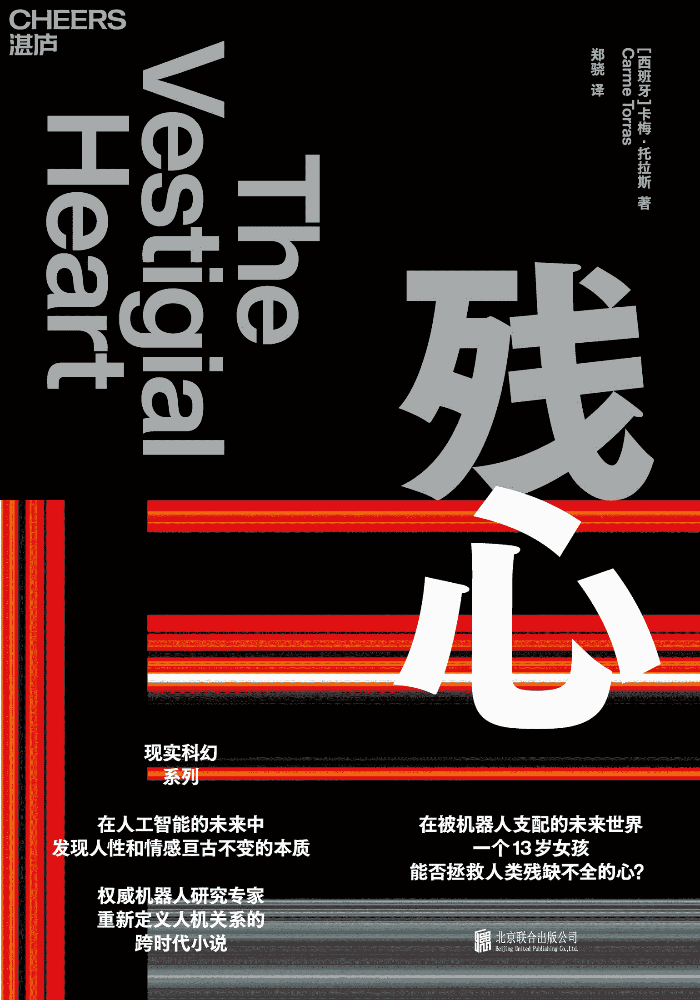
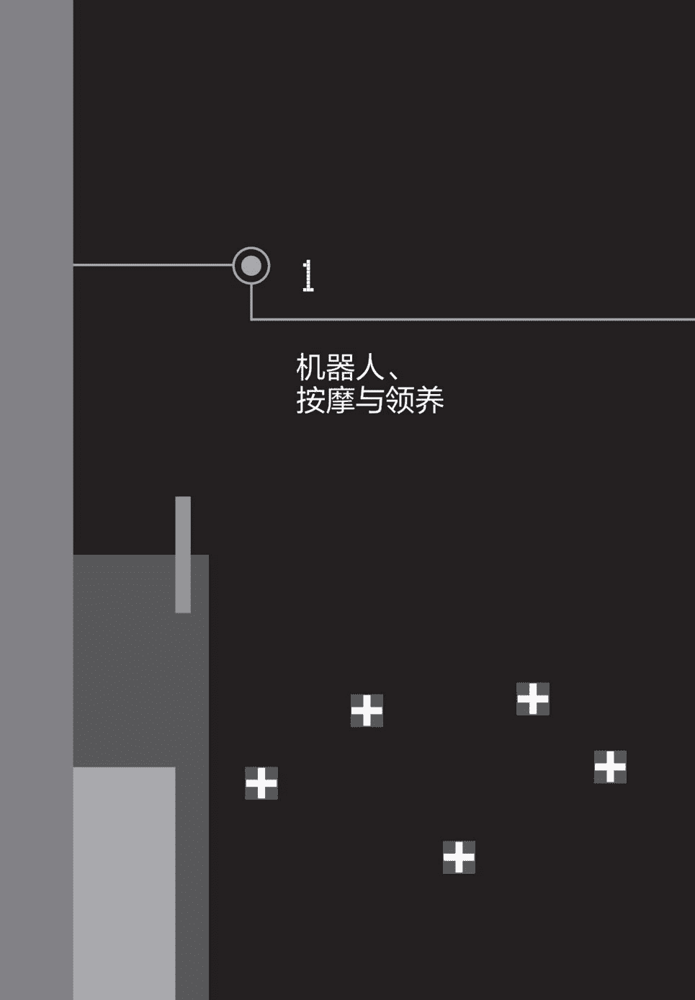
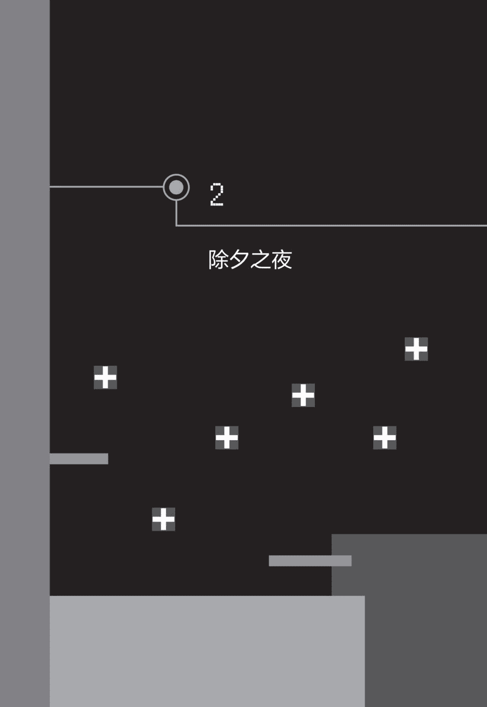
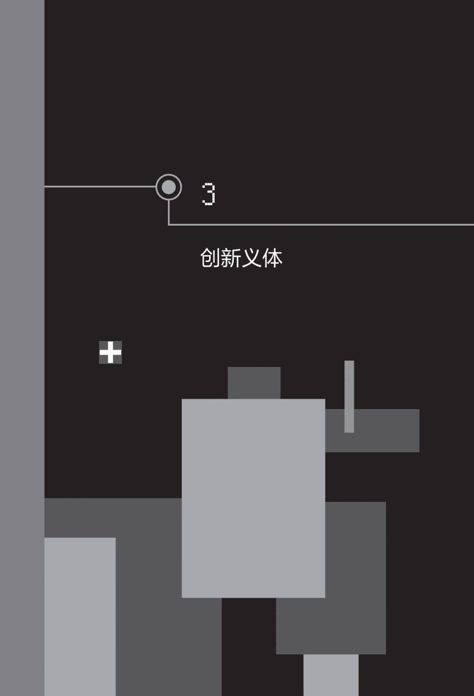
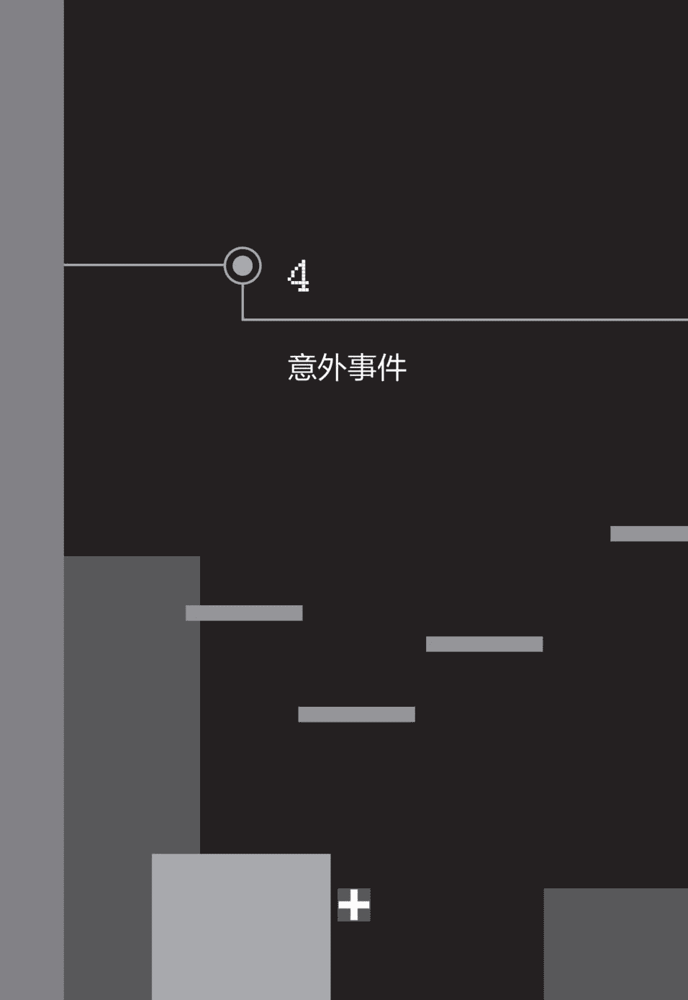
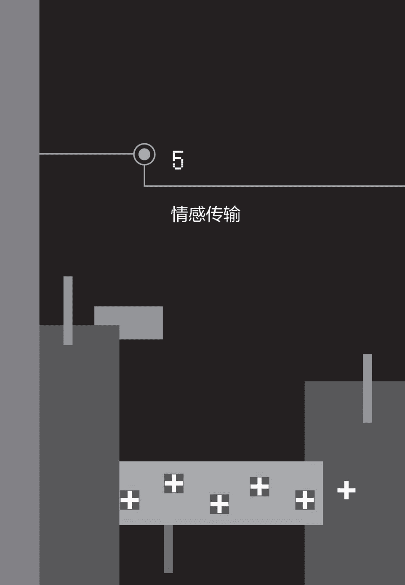
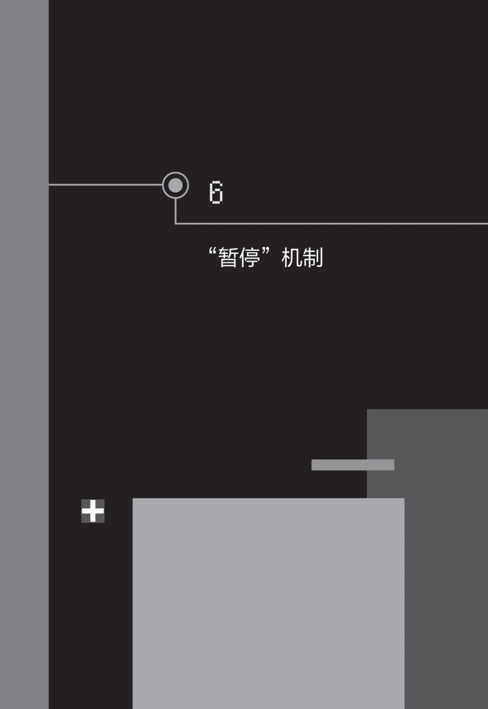
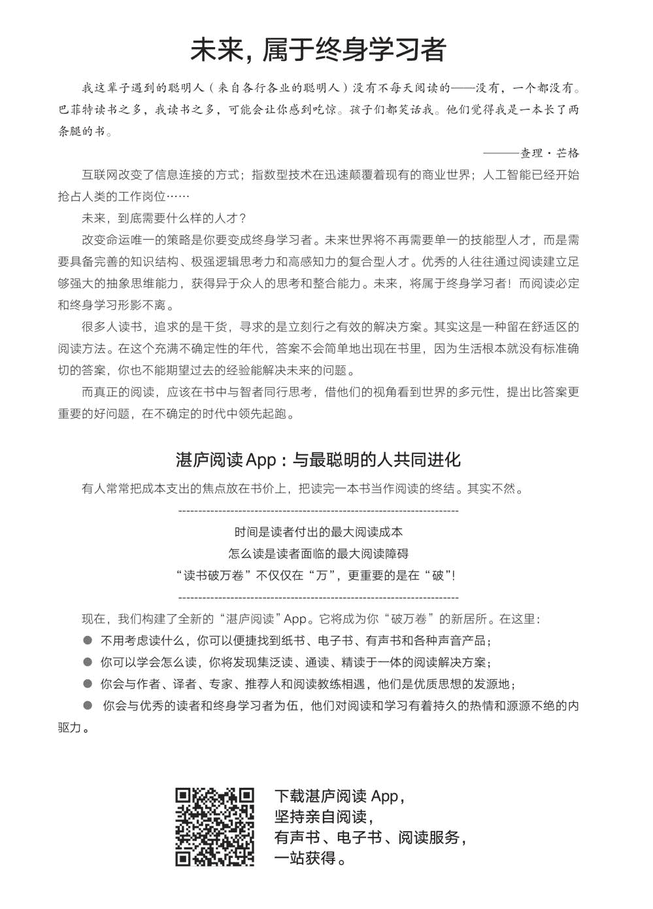
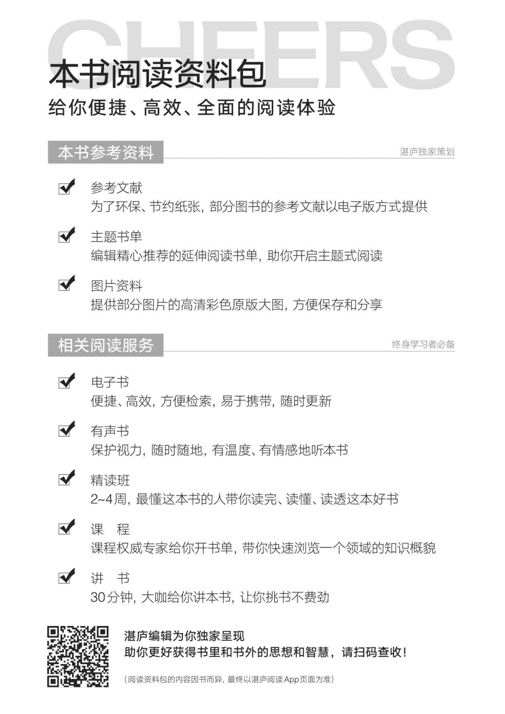

# 《残心》：机器人统治下的未来，13岁少女能否守住人性最后的阵地？

# 湛庐「现实科幻」书系：以科幻为思维杠杆，撬动真实世界的变革

## 科幻：商业创新的隐形引擎

「元宇宙」这个词，三十年前就被作家尼尔·斯蒂芬森植入小说《雪崩》。如今它成了谷歌地球、Xbox、蓝色起源等硬核科技的孵化器，甚至倒逼脸书改名 Meta 全力押注。回望科技史，颠覆性发明往往先在科幻里「彩排」一遍。马斯克、贝索斯、扎克伯格、乔布斯、盖茨——这些重塑商业版图的巨头无一不是科幻迷；《人类简史》作者赫拉利更直言，科幻是本世纪最关键的艺术门类。

科幻不负责精准预言，但它擅长在主流视野之外搭建可能性图谱：少数派如何突围？思维定势如何打碎？生存空间如何守住？这些「假想题」倒逼现实决策者提前布局。近年，微软、谷歌、英特尔、亚马逊等巨头已将科幻纳入研发兵器库，聘请作家出任战略顾问，在虚构叙事中压力测试商业模型，让想象力成为核心生产力。

## 现实科幻：从当下出发，奔赴未来，再落地生根

作为前沿思想的捕手，湛庐十年来持续引入彭特兰的可穿戴计算、泰格马克的生命进化论、兰道尔的高维空间、明斯基的机器意识、索恩的虫洞穿越、戴曼迪斯的商业太空等重磅著作。新推出的「现实科幻」书系，锚定一个信念：科幻非逃避现实的乌托邦，而是折射当下的棱镜。阅读是一场往返航程——离开真实，触摸未来，再安全着陆。入选标准极严：设定须基于可验证技术路径指向近未来；世界观构建须经得起逻辑推演；核心必指向一种前沿认知范式。

## 以科幻为思维工具，获取重塑现实的三重动能

**拓展未来的广度。** 作品设定锚定近未来，沿着可见技术轨迹推演。在虚实夹缝中穿梭，打开足够多的平行可能，直到你掌握选择权。

**锻造抗变的韧性。** 社会演进非直线。优质科幻预设「意外社会—核心困境—破局之道」三重逻辑，为大脑安装「应变补丁」，面对未知不再手足无措。

**注入创新的燃料。** 作者多为跨界实战派：机器人专家、脑科学家、航天工程师、人类学家。他们用硬核专业知识为叙事搭骨架。卸下思维枷锁，你将在叙事中提炼新价值、洞见新赛道、孵化新业态。

想象力赋予通往未来的通行证，反思力带来自我洞察，思考力转化为改写现实的杠杆。湛庐笃信：终身学习者掌握未来，每一册书系都是钥匙。

> **致中文读者**
> 承蒙湛庐邀请，很高兴借《残心》与中国读者探讨技术伦理。AI 与机器人前景广阔，我习惯用科幻推演可能图景。小说展示技术如何重塑当下生活，并深远影响未来人类。—— **卡梅·托拉斯**

# 中文版序：技术塑造人，人也定义技术

辅助机器人技术正加速落地。在巴塞罗那机器人研究所，我们的原型机已能协助行动受限者穿衣进食，为早期认知障碍者提供训练。但人机共生带来硬核挑战：算法端需攻克用户建模、持续学习、情境推理；伦理端须捍卫患者自主决策权、医疗平等与尊严。技术由人创造，成熟后反哺重塑人性。研发采购决策容不得马虎，关乎生活底色。科研与科幻在我此处互为动力——出于对明天的责任感，我构想了「人手一机」的社会图景，权衡利弊。书末附录梳理 24 个场景衍生的伦理议题，附讨论指引，可供课堂或读书会使用。

> 「正是我们亲手建立的人际关系，塑造了我们自己。」—— 罗伯特·C·所罗门 《激情》 1977

# 自测题：你懂「人机共生」多少？

**· 机器人助教能否全维度建模学生的性格、思维与态度？**  
A. 能　B. 否

**· 过度依赖机器人的核心隐患是？**  
A. 行动力丧失　B. 社交隔离　C. 情感退化　D. 安全无保障

**· 机器人接管「三脏」工作虽解放人力，但也引发新矛盾，如：**  
A. 产业转移　B. 需求错配　C. 技术鸿沟　D. 尊严维护

扫码解锁完整题库与答案，一探机器人真相——

扫码领取全套测题解析，共赴机器人认知之旅

# 第一章

## 阿尔法+

**07:10** 监测显示克拉夫特博士睡眠质量差：打鼾持续、翻身 29 次、夜尿 2 次、呼吸暂停 12 发（持续 30-50 秒），呼吸 13 次/分，脉搏 62 次/分。已上报医疗通道，申请调高安眠药剂量。

**07:15** 触觉唤醒程序启动。依据昨日偏好数据修正动作：避开鼻尖，重点抚摸眉骨至太阳穴。博士睁一眼、哼一声、翻身继续睡——信号良好，保留该策略。

**07:20** 抑制「扶起」标准指令。博士性格乖戾，偏爱「消——遣」（他的原话，故意拖长音）。虽左侧下床近浴室，但必须配合他绕行。逻辑失效，唯有压制本能反应、无限适配。

**07:25** 如厕期禁入，但接入马桶采集数据。首泄 pH6、蛋白阴、微量糖（疑酒精致）、粪便菌群/白细胞正常。反馈：排泄正常，建议低糖餐。

## 克拉夫特博士

马桶上对镜学狗叫：面部下垂如斗牛犬，肚腩大腿干瘪。变老的红利？命运彻底掌握在自己手里。黑发竖起像魔鬼，心生一计：开发「三十年后长相模拟器」，年轻人选犬种映射衰老面孔，晚宴投射给赫格和菲吓他们一跳。

沉入浴缸，海绵网托举如婴儿摇篮。泡沫冲刷、定制旋律、阳光芬芳——阿尔法+安排得妥帖，胜过已故母亲、女儿妻子。神经加速器加持，几天即贴合如第二层皮肤。博士得意：无法从心理改造人，但可控环境、在对的时间给对的刺激。这是他公司的核心主张，被同行嘲「太简单」。量身定制、极速适配，竞品抄不走，阿尔法+证明他赢了。

游泳、漂浮、构想「情感配型 LED」：匹配亮灯、不配不亮，或由中枢系统统筹全局满意度。绝妙发明！却又自嘲胡思乱想。创造力随年龄枯竭，理性犹在，想象力却被衰老锁死。市面义体满天飞，唯独无「创新义体」或「创意副驾」对抗思维僵化。海绵网送上按摩台，滚筒热源烘干全身——他真想要的，是给大脑做场深度按摩。

# 第二章

## 卢

翻箱倒腾找二十一世纪旧衣：硬邦邦蓝牛仔、发黄米白 T 恤、皮鞋缺货。心理师嘱咐：必须穿成当年模样，免吓坏那个女孩。镜中倒映奶奶的脸——松垮眼袋、腰线消失，昔日厌恶的「老古董」如今穿在自己身上。曾踮脚转身炫耀 ROBul 雕刻的模特身材，如今强忍两周剥离机器人陪伴，只为西利娅适应新生。

医生断言：发最多撑三年。问因？推诿环境、基因、植被灭绝。一群白痴。秋天秃头狂欢的旧梗还被医生拿来搪塞「女孩也一样」。她发誓：替西利娅找真专家，让所有人——包括总骂领养「草率无情」的菲——死死羡慕。

卢将浅金发拢至两鬓，面对镜台，打算亲自描绘容颜。上回亲手绾妆已是何年，她竟全无印象。如今的妆容产品早非昔比，皆具智能：可放大情绪，可屏蔽情绪，更能伪装出与真实心境背道而驰的面容。最忌讳操作失误——一旦假象维持过久，便会反客为主，导致使用场景彻底失控。幸好 ROBul 已将一切备妥，标签说明一应俱全。她在梳妆台面板上逐项勾选：关系，女儿；共情，高；场景，欢迎；心情，愉悦；情绪，亲切。日期、时间与天气无需录入，系统自动捕获。指尖触下确认键，先前挑中的底妆、眼影与睫毛膏组合便有序升上台面。这一刻她猛然惊觉，自己早已丧失自行化妆的本能；这套繁复流程折磨得她几近崩溃。但代价在所难免，好在仅维持两周，咬牙熬过去便是。妆成，镜中映出一个年轻、眉目间含着母性柔光的卢，正浅浅含笑。一条“赛腾——我们创造奇迹”的悬浮广告贴着锁骨滑过，宛若一挂流光项链。

出门时她顺手披上防紫外线外衣，可衣料与妆容的强烈违和感让她怔在门口，仿佛被那位心理学家当场抓包。其实一件旧式呢大衣足以抵御北欧寒意，这点与从前无异；但若不穿防护服，辐射必毁她的肌肤与发质，她不敢赌。小女孩根本看不到这件外衣——它会被留在入口的净化室。那间全透明净化室是她对这家诊所唯一的满意处：替她卸下防辐射外套，全程零负担，离开时再自动助她穿回。别的医疗中心或健康会所虽有同类设施，却都不如这般考究。科技进步的脚步似乎止步于这家复苏诊所门前，至少肉眼可见范围内如此；其他同类机构土气得掉渣。他们的解释是：怕吓着孩子。给拙劣服务找如此幼稚的借口，倒也要点脸皮。同理，他们还坚称诊所必须建在荒郊野岭，否则窗外钢筋水泥的景象会给刚苏醒的孩子留下心理阴影，飞行车同理——可孩子离院时终究都得面对这些。

再磨蹭下去，今天就别想出门了。从前离家从不操心归家后的收拾，如今缺乏专业经验，她对着面板发愣，不知从何下手。真想念 ROBul。明明按它指示一步不差，总觉得哪里不对劲。事不宜迟，必须在女孩醒来前赶到。他们反复警告：迟到即取消领养资格。要建立母女羁绊，孩子睁眼初见之人必须是母亲。但愿这法子管用。西利娅，西利娅，西利娅……这名字像沉闷的重锤，从脑际敲至颈项，再震遍全身。她本不喜欢这个名字，可眼下无权更改。

# 3

## 西尔瓦娜：一种失传的感觉

在康优公司的走廊里，不认识西尔瓦娜的人，只会把她当作一位年近五十、金发碧眼的成熟女性——这类人惯爱摆出漫不经心的姿态，心里却明镜似的清楚自己生得好看。可在这里，她几乎无人不晓；更关键的是，所有人都知道她丈夫巴尔塔萨是“阻止回旋镖运动”的领袖，他们今天的事业基石，全系于他。众人眼中，他的妻子个性张扬、历经风雨。她见人便笑，那股乐观极具感染力，能让人笃信万事皆有可能；却无人能真正读透她。

上班途中，她仅停驻一处：图书代理处，取走预订的书籍。配书机器人用充满金属质感的嗓音递来两册，报告茨威格的《昨日的世界》暂时调度不来，公共藏书馆馆藏尽数借出；电子版还需进一步询问版权方，若授权，过几日可来取。这点小波折又勾起她一头扎进旧书堆、暂忘流年的念头——不如让时光也把她遗忘。她并非厌倦现在的情感刺激课程，恰好相反；再过不到一小时，她便要全身心投入，且想不出此生还能有何作为比这更重大。脑海中浮现两本书：一本甘地传记，一本法拉奇的《男子汉》——光书名便暗示深长。它们或能引她触摸到那种稍纵即逝的质感，她苦寻已逾数月。昨日她方才醒悟，自己钻研的诸多概念范畴里，恐怕根本不存在那种感觉；构成它的元素，或许就藏在二十世纪人类留下的书页里。

她步入健康中心，直奔所属部门的事件经理塞巴斯蒂安，想请下午的临床病例会议放她一马。公司寥寥数位元老中，唯有塞巴斯蒂安在她与巴尔塔萨交往前就相识。他搭上她的肩，请她先坐，嘴上关切进展，实则探究意图。

“你管辖区域无突发状况。”他凑近落座，双腿过长，不得不微微前倾才能维持平衡，“不过近期你屡屡缺席，我们仍盼你出席。”

“这些年我出席得够多了。”她语气平稳坚定。下午的专属阅读时光近在咫尺，她绝不容它白白流逝。

“可惜。你是这一方向的开创者，讨论少了你便少了灵魂。”二人的手臂贴着轻蹭，“你常说要逐例拆解，将前沿发现与临床经验对照，敢于直面异见——说白了就是互找漏洞。这对年轻人是最好的淬炼，记得么？”他本想轻点她一下，指尖却落在了胸口。

她承认记得，立场未变，只是那批年轻人已能独当一面，该交棒予下一代，自己另有挑战。

他问道：“难不成要跳槽去竞对？”

她压低声线，直视他的眼：“小塞，给我点时间。这几个月我在推进一个构想，最近刚现眉目。”

“西尔瓦娜，三句不离梦，三十年没变。”他捏住她的手臂，目光灼灼，“在我眼里，你依然是那个十八岁就想拿下世界的少女。”

霎那间，仿佛有段优雅乐章将两人裹入，旋律深刻进骨血，化作专属二重奏。他们起身相拥，嘴唇渐近终贴合，随即缓缓旋转，细细品味片刻温存。良久，二人重归座位续谈，仿佛从未越界。

“我当然要拿下世界！或许不是当下这个，而是几个世纪前的那个。”她翘起二郎腿，姿态带着挑逗。

他果真上钩：“接着说。这回又被哪种新感知迷住了？”大掌落上她大腿，她仍端着俯视的架势，“当然，‘新’非字面意。我记得你只对不合时宜的情感有瘾，尤其是彻底绝迹的那些。”

“改日有空，我定细细道来，今日另有要务。”他的手正覆在她手背摩挲，“只能透露一点：那种情感需要距离，反常吧？与当下鼓吹的恰好相反。容貌、体魄、触觉或其他感知，皆与之无关。别误会，与电子连接也毫无干系。”语气罕见地严肃，塞巴斯蒂安本能收回手，试图从理智层面接招。

“那它究竟是吸引还是排斥？显性还是隐性？在心理遗传学标度上处何位阶？”

“暂未定位。我正寻找其精确成分。确信它与额叶、杏仁核及边缘系统部分区域关联，因包含野心、敬重与承受苦痛的能力。若非它禁止躯体过度贴近——这点确实诡异——它必会被归类为某种引力。或许这类情感多自年幼者流向年长者……虽存例外，例外总让事态复杂。所以，小塞，它塞不进我们现有的坐标系。”她双脚踩实地面，作势欲起。

“当下的人类还存有这种东西吗？”塞巴斯蒂安透过那双迷人的眸子被深深吸引，不愿终结话题。

“荡然无存。故而我才觉：无参考、无语境、无精准生化分析，甚至无合适器官，我不确定自己还能否研究出个所以然。”

“绝迹太久导致基质萎缩？你的刺激项目会否有效？”

“有效最好，恐怕无济于事。进化阶梯上，嫉妒与荣誉感始终相随，可那种情感与这些毫不相干，亦与耐心无关……”她起身，机械地在他的额头印下一吻，头也不回地离去，丢下句：“我的耐心早被刺激透顶了。”

她知晓 ESZ 里聚集着大批候选人等候。他们总急不可耐地献出皮囊，请她亲手推开新世界之门。她曾以此为傲，如今却常自问：我有何资格改写他们的命运？他们自愿而来，因厌倦了千篇一律的枯燥工作，厌倦了电子化的人际往来。或道听途说，或凭空臆造，都坚信体验全新感知定然趣味横生；无论如何警示，他们都不信会跌入未知的危险领域。她倾注心血钻研，因笃信这是寻回人类久失情感的首迈步；可绝大多数志愿者想要的并非此道。光让他们搞清“情感”不等于“电子运动”，便耗尽心神。

她加快步伐，企图甩开那块挥之不去的心病。上一实验阶段，一名厌倦的英国少女临行前指责她：“过去，人们搭手于人，是为抚慰痛苦；你带来的却只有痛苦。”若在几个月前，她必回以“不付出便无收获”，现在她不这么想了。非人人皆渴知，让他们白受苦却无所得，终究不公，哪怕是自愿。他们将远超她承受力的信任倾注于她。昔日她行事胸有成竹，自认吃透神经机制与传导通路；如今方悟，手中握的不过是一堆“炸药”。流程一旦启动，她瞬间入戏，化身专注尽责的向导——这点不假；可对深层动态进程掌控乏力，对分叉路径的把控更是捉襟见肘。

照旧，她穿过字母 S——三枚巨大全息字母 ESZ（Emotional Stimulation Zone，情感刺激区）中央那枚，这三字亦圈定了区域疆界。径直抵达目的地。本杰明早将参与者两两编组：一人仰卧，另一人跪于其足侧，扇形铺陈在西尔瓦娜眼前。地面铺设柔软光滑材质，与人体工学严重背离，逼得他们不住扭动寻觅舒适体位。她目光逐个扫视，想观察谁能给出良性反馈，谁会因不适抱怨；结果无人回应视线，一个也没有。新生代性格一批比一批模糊：他们真迷失了。连问双脚位置，都答不上来。她抓起最近一名参与者的足，熟练施压，指尖从大拇趾沿“之”字形滑向足跟。少年如鳗般扭动，仿佛她手握躯体遥控器。可待她询问方才感受，他却茫然对视，坚称毫无感知，甚至未觉肌肉收缩。

而在西尔瓦娜眼中，压觉点与其揭示的研究图谱关联清晰得惊人：只需一瞥，便能绘就完整微型人体蓝图，每一主要脏器均有标识。她用触觉标记器在少年足部打点定位，随即指导其搭档复刻手法再试一次。一场探险游戏就此开启：双方须通力合作，互为向导，深度探勘，直至耗尽基础训练所有变量。

每演示一组，她都会提醒：“触觉刺激仅是漫漫长途的首站……”念及那英国少女，便补一句，“对某些人，或将极其痛苦。”数据显示，此地半数参与者在三个实验阶段后退出，仅极少数能走完全程。

可怜的孩子们。每回授课，西尔瓦娜都为他们揪心，仿佛他们日日变得更无防备。阿米巴原虫诞生即成熟，幼鹿出膛数日便能奔跑觅食；眼前这些笨拙之辈，甚至未察觉自己拥有躯壳！被巴尔特称为“彼得·潘一代”的孩子已至：他们诞生于机器世界，长于机械之手。知觉意识训练、按摩与情感刺激课程对他们近乎失效。我们太迟了。现只能仰仗更激进手段遏制“回旋镖效应”持续发酵；否则不久，这病态期将延宕终生，致使人至老至死皆无法真正长大。动物生长周期越长固然越复杂，万事终有度，最终这颗星球最高等物种将死于进化过度。西尔瓦娜被自个儿这些夸张念头惊住，盯着少年鼓胀腹部上那条布满传感器的腰带，喃喃自语：“他们终将因技术冗余而平庸地死去。”

# 4

## 西利娅：陌生人的脸

怎回事？有人唤醒她……还是单纯的嘈杂？西利娅疲惫至极，连掀开眼皮的力气都无，浑身似被钉在床上。妈妈！她在心底呐喊，却发不出声，嘴巴根本不听使唤。大概是做梦吧。昨晚发生了什么？只记得又挨了一针……难怪这般乏力。想再眯会儿，反正点儿到了妈妈会来唤她。身上难受，却翻不了身。胸口压迫感倒减轻了，头也不疼了……只是晕。呼吸尚顺，吸气、呼气、吸气……咦，有股怪味，像止咳糖浆，勾起对南希的记忆。爸爸从安道尔带回布娃娃那刻，她欢喜若狂！娃娃现在在哪？许久未玩，可她依然深爱它，爱得深沉。得让爸爸寻回南希，带回身侧，置于床畔相伴。手臂忽地抽动一下，她想再试一次。好，又动了！确信非梦境。光线刺眼得近乎致盲。

“喂！醒了。”护士领着卢走到床沿，熟稔地将卢的手搭上女孩的手，随即退开，用又亮又甜的腔调问：“你好呀，西利娅，亲爱的，感觉怎样？”

这沙哑嗓音是谁？奶奶？……可……她刚叫我“亲爱的”？不可能，奶奶向来唤“甜心”“小羊羔”，或是“我的小宝贝今日可好？”不管怎样，昨日奶奶告别时吻了她好几下。奶奶说要回古尔布，得把房子收拾妥当……不知为谁收拾；不管为谁，奶奶都不情愿，显见难过。立在门口道别时，眼眸里还闪着泪光。可怜的奶奶，一把年纪还要做不愿做的事。那声音与冰凉的触感又至。定是新护士……若西利娅装睡，或能躲过一针。这么早送早餐？可她半点不饿。虽不似前几日那般恶心，胃里却怪异：仿佛心脏坠入腹腔翻江倒海。或许是例假来了。妈妈说过，那种疼很特别，绝不会认错；可西利娅仅历经两次，根本辨不出差异。

“跟她说两句。”护士在卢耳畔低声提点，“她听得见，看体征，”指着监护仪，“意识已恢复。”

“西利娅，听得见吗？我就在这，在你身边。”卢伸长脖颈，将脸凑近女孩。那心理学家反复叮嘱：女孩初醒所见必须是她的面容；他断言新生儿会与初见之人建立永久情感锚定，写在基因里。西利娅虽非新生儿，却算得上重生一回。

啊，原来有两个人。大概是换床单的护工？挑这档口换单子真怪。莫非已至正午？可她早饭未进……妈妈在哪？西利娅决定继续装睡，等妈妈来唤醒。可那女人直摸她的手，烦人极了。两人在旁压低声交谈，似怕她听见；她偏想知道聊什么。病情加重换病房了？这念头令她寒意骤生。可若真这样，父母定守在侧，绝不会丢她一人在此。

“西利娅，别怕，我是来帮你的。”卢这话更似对护士说，效果却立竿见影：女孩猛地瞪大双眸，仿佛面庞裂开两个黑洞，满溢惊恐。

这面容扭曲、蓬头垢面如稻草人般的人是谁？为何贴这般近？那手黏腻腻的，西利娅浑身战栗。走开！走开！不想看这个人。妈妈呢？还有那堵墙……他们究竟把她带到何处？这光线也诡异。她浑身发冷，天旋地转，胃部剧烈痉挛。妈妈，快来啊！

“冷静，西利娅，别耗力气。”此时传来医生低沉柔和的嗓音，女孩脸上露出一丝缓和。医生从设备后现身，让她看清面容与白大褂。走到床侧，抚摸她额头：“不错，放松，听我说：治疗极成功，你已完全康复。不再有病痛、针扎与卧床，一切终结……现在不觉得哪里疼了吧？”

“有，医生，肚子疼。”这是她开口的第一句。语气郑重，像大多数成年患者般全然信任医学，随时准备提供所需信息。

“正常。治疗期内脏停摆，如今需时间重启。注射血清、恢复进食，疼痛自会消退。你会见到效果。”

“我爸妈在哪？”西利娅扭头四处搜寻。

“别动作幅度太大，亲爱的。”护士轻抚她发丝，“你还虚弱。”

“父母不得不送你来远方，唯有这家诊所能医治你的病。”又是医生悦耳的声线，“当然，经你父母同意。为给你居家感，他们备了这个盒子，装着照片与玩具。”见女孩想打开，又道，“康复期内，卢会陪伴照料你一切。”他拉过椅子让卢坐下，“若愿，可与她共赏盒中物。我们要查房了，有需按红钮。”

医护一走，病房顿时弥漫着茫然与困惑。两个被遗留的人像观众般，目送穿白大褂的男主角不打招呼便退场，只能面面相觑。卢将心理学家多轮谈话为她定制的剧本抛诸脑后，甚至怀疑最初领养决定是否明智。才刚开始，重担便近乎压垮她。西利娅那双睁得滚圆的大眼正死盯着她，盯得她心惊肉跳。

这女人定是心理学家。不穿白大褂，神情分明在说：“如今只剩咱俩，时间充裕，聊聊吧，甜心？”真讨厌！西利娅想不透妈妈为何总信这些人，还称他们与医生同专业……甚至更专业。妈妈有时补句：保持乐观开朗，康复更快。她为何不语？真怪，心理学家不都口若悬河、追根究底吗？天哪，不！她正掏盒中物，定是要让她介绍。

“看这是什么，漂亮娃娃。”卢将其紧拥入怀，像抓住救命稻草。

哇！是南希！爸爸一眼便料中她心意，难道他们会读心术……我的南希！太棒了！

尽管双臂因虚弱仍在颤抖，西利娅仍死死抱住娃娃。随即将娃娃贴身放在床上，替它掖好被角。这个动作似搅动了两人间死寂的气氛，仿佛一阵沁人微风拂过，女子紧绷的面容柔和了几分。

盒子里的东西依然乱七八糟：几件形状可疑的物件，再加一块硬板。卢这时才真切后悔，那位心理医生明明建议过她多了解这个时代的娱乐，她却从未放在心上。对着这些东西，卢完全无从下手，直到她从盒底翻出一本硬纸封面的册子。那册子让卢心头一松：太像奶奶收了几十年的相册了。

“想看看照片吗？”

西利娅差点没绷住：她不会真要给我翻照片吧？“搁在床畔的小几上吧，我一会儿再看。”

为什么那女人一副被雷劈了的表情？西利娅说错什么了？卢愣了愣才意识到：这病房里根本没有床畔小几。

“那放那儿，架子上。”这要求有这么难懂？

卢彻底懵了。女孩让她“放那儿”，像她这个人不存在一样，更像在支使一个压根不在场的机器人。可那女孩分明对机器人一窍不通。还有“床畔小几”是什么，那口乌黑的大立柜吗？卢察觉到，两人之间的沟通已经彻底错位。更让她心惊的是，女孩才刚醒，就开始打发她、给她下命令，气场上完全压过了她。没有人预告过会发生这种事。计划里的一切都错了。一个念头在卢脑子里渐渐成形，清晰到令她害怕：如果女孩不肯要她呢？他们会再拨给她一个孩子吗？

光是这么一想，卢就一阵发毛。她翻开册子，暂时拿它当挡箭牌，为自己争取一点缓冲的时间。册子里大多数相片都拍在户外：空地，花草，透亮的光。与西利娅同框的人，有的搂着她，有的摩挲她的头发，有的让她坐在膝上。卢看着看着竟有些恍惚，仿佛在画面里看见了自己：她当然进不了户外，也站不进花丛里，但她一样能抱住她、亲吻她，帮她把长长的头发梳顺。卢相信自己会享受和这女孩相处的日子，这和心理师特意替她定制的那条高科技小狗不一样。小东西是讨喜，可它只会提醒卢：她已经是个派不上用场的老废物了。

她再抬起头，正好又撞见西利娅绷着一张脸，女孩指着床侧的台面。

“你不看？好吧，那就搁在桌上。”卢放下册子，继续在盒子里寻摸自己熟悉的游戏。

西利娅也在评估她：这人要真是个心理学家，应该也是第一天上班，又怯场又焦虑。可心理学家不该是这样的，努丽娅当年多稳重。“这位女士，你是谁？是护士吗？”这问题本没有恶意，却把那女人惊得一缩。西利娅更加失望：她说话吞吞吐吐，行动也别别扭扭，像没受过训练，连跟人照面都只敢望地板，到这会儿还没正眼看过自己。大概她的魂儿被盒子里的东西勾走了，此刻她正在拼命想词吧。

“别叫我女士，我叫卢。抱歉，忘了自我介绍……我也不是护士。”卢思忖着要不要告诉对方自己其实没有工作。他们嘱咐过的：先别提她自己，只聊女孩。“咱们来说说你的事吧。”

西利娅看穿了这种笨拙的讨好，只觉得她又无聊又可怜。西利娅现在一点聊自己的兴致都没有。她只想知道爸妈在哪里，什么时候来接她。就算他们不来，她也能自己找过去，反正病都已经好了，不是吗？

无论卢怎么绕，西利娅就是不开口。这一个下午变得格外漫长。卢翻遍了那个盒子，也未能扭转局面。要是ROBul在这里就好了，那东西总能让女孩高高兴兴，卢也就能省下这份心。

下午当班的护士进门时，差点和夺路而逃的卢迎面撞上。护士满腹火气。她见过太多这类领养孩子的女人：求孩子时火烧火燎，孩子到手了又想跑。她刚进诊所时很支持跨时代领养，如今却宁可拥护冬眠者自行解冻和结束生命的权利。多少父母根本不称职，把孩子扔给电子设备，可她自己不也学会了躲事吗？她用余光扫过那个女孩，西利娅正抱着册子出神。护士一边在心里琢磨女孩在躲谁，一边悄悄调出病房的控制面板，把助眠气体多放了好几个小时。这样一来，至少这一屋子的麻烦能推到明天再说。

这些照片应是奶奶用心挑过的。熟悉的面孔都在，也夹杂一些西利娅叫不出名字的人。那个像巨人一样高的大个子，一定是莱蒙叔叔吧，只是他老了许多。门廊上多了几把折叠躺椅，她从没见过。花园倒还和记忆中一样，花照样开，石头小径照样干干净净。奶奶从前总说她：“别整天唉声叹气的，把院子扫干净。”如今西利娅心甘情愿替奶奶做这些。册子封皮的缝隙里露出一点白，她抽出来一看，是一封信。

“给我们心爱的女儿——”

西利娅忽然没有力气往下读了，连眼皮都抬不起来。困意像潮水一样漫上来，她只好把册子留在地上，但那封信不能丢，她把它压到枕头底下。

# 5

## ROBco

**当前状态：**宕机。**根因：**过载。**过程记录：**我已连续七十二小时高速运转。主人不断投喂图谱，让我检索数据，又丢来海量肌电图记录要我整理。我不但抽不出空执行程序更新，还把前四次强制断电警告全都按了下去。现在除技术工作外，连他的家务活也要我做。再过四个小时，利奥就要赶飞机，而行李还没装箱。这是第五次警告，也是最后通牒：为了避免无法挽回的报废，我唯一的选择是自己离线。

**当前状态：**回路检查。**诊断：**待办清单已爆满。**处理：**清除次要任务。**错误：**所有任务都被标成最高优先。任务调度器彻底崩溃，警报器响成一团。我需要成倍的资源：内存、算力、速度全都吃紧。可主人对这些照旧视而不见，只要一出现紧急情况，他就手动介入、直接修改优先级，这完全违背厂商明文规定和安全守则。他对自己的做法很有把握，毕竟这是他的看家本领，听说他在这个圈子里数一数二。可他长期无视维护纪律，程序升级和硬件扩容的提醒，已经被他晾了好几个月。

**当前状态：**检修中。他已经开始修理我。处理单元被他拆开时，中子发生器还通着电，一如既往地粗暴。现在，他碰到了我的存储器……莫非，他终于决定给我装那块外接增容件了？那不是原厂件。这东西他是从哪儿淘来的？装上去就得配一套私有通信协议。看来今天的会议绝不普通。我原以为那只是克拉夫特机器人公司前瞻部的一次例行新品会，他们管它叫“融合创意”。现在我明白，我完全判断错了。这也解释了为什么他让我和他自己都空前地超负荷运转。整个项目竟然是由他一个人完成的，甚至没像以前那样去找其他生物工程师商量。他到底想干什么？

## 利奥

“怎么专挑这个时候宕机？这破玩意。”一个体格结实的年轻亚洲男人从感测舱里跳出来，放下手里的实验，走到机器人助理面前，扫了一眼它胸口的屏幕。“老古董……”他嘟囔着打开其腰部的盖板，翻看线路和芯片，这里戳戳，那里碰碰。“就算没有自愈能力，起码该有自诊程序吧。”

“滴，滴——**诊断：**待办清单已爆满。”

“行，但这帮不上忙。清单爆满的原因能有一万种，你得给点具体的。”他头也没抬，两手仍在线缆堆里摸来摸去。

“**警告：**任务调度器崩溃。”

“你报的是现象，不是根因。”利奥已经不耐烦。他自己也说不清为什么要跟ROBco讲话，反正它没有学习能力。而且他还赶时间，眼下只能做个应急处理，等从洛杉矶回来再彻底修理。

实际上，那块扩容存储器是他早就为自己的项目买好的，只是一直没装上。此刻他翻出那个部件，卡进ROBco的仓位，脑子里却已经在预演下午的要事：盖图先生看到他发明的“全沉浸”系统时，会露出什么表情？利奥记得盖图很喜欢黄金时代那种真刀真枪上身体的篮球，也自称是迈克尔·乔丹的拥趸，于是利奥特意挑了乔丹面对犹他爵士的那一场。那场球里“飞人”至少有五六次腾空劈扣。利奥打算劝盖图亲自坐进感测舱，只要进去，感染力便会成倍放大。那个膝盖不太好的经理将在场上连续运球过人，用假动作把粗壮的卡尔·马龙晃到一边，然后纵身拔高，越过底下黑压压的人群，轰出一记让宇宙都要抖三抖的扣篮。利奥预先露出了微笑。但他也清楚，盖图大概会说，这不过是以视觉为主的老把戏，再加一点肌肉、听觉和触觉的旧模块，很早以前就有人做过，市场上也早就有了。到那时，利奥会不慌不忙地开启颅内的神经刺激装备。这才是真正的杀招。他会说：我的经理先生，您即将变成乔丹本人，大脑皮层每一瞬间的细微活动都会丝毫不差地传递给你。要找乔丹原始的真实脑电记录自然是痴人说梦，可是德维恩·韦德那份脑数据，已经足以瞒天过海。您说呢，盖图先生？盖图先生当然不会回答，因为那时候他已经整个人泡进了比赛现场。而利奥，会在那一刻抵达个人生涯的顶点。

他抓着那块存储器，又一次从幻想里惊醒。再不把ROBco救活，航班就误了。他插紧部件，用手检视了一遍触点，思路却还挂在下午的演示上，尤其是那个必须讲清楚的关键点。他对自己的产品信心爆棚：它与市面上机能残缺的虚拟现实设备完全不是一回事。利奥在常规感官刺激之上，增加了一层内在的感知，也就是借助那位球星大脑活动的副本，重放他当时的情绪。这还不是全部。他还有一张更大的蓝图：他要撤掉底座、线缆、触觉外设，让整套系统变成单纯的无线电波通信，一根线也没有，用户可以在任何地方进入，比如躺在床上。不需要投影，不需要充电，什么外部装备都不需要。信号不再作用于眼睛、耳朵或皮肤，而是直接送入大脑，脑电波就在空气里飞来飞去。他管这叫梦想，也叫革命。

ROBco重新上线，立刻开始打点主人的行程。几件事同时进行：它把衣物装进跨洋专用的C2行李箱，又连上美国领事馆的服务器申请密钥；期间还以真假难辨的人声替利奥接了好几通电话，确认他下周日去参加一场象棋赛，并替他订好航班座位。最难缠的是贝特打来的那通电话。她听说利奥正在感测舱里，几小时后就要登机，执意要他本人接听。

利奥故意让她等了一会儿，才打开感测舱内的通话器：“抱歉，贝特，我真的没时间。你要说什么？”他手还在面板上操作，“对，经理终于肯看这东西了……可我现在不能谈，规矩，公司定的。周末也不行。对不起，别再问了。”他停下动作，揉了揉太阳穴，“你在竞争对手那里工作，又不是你的错，可你非要挑现在说？我还以为你打电话是祝我好运的。”他低头看了看表，“别装委屈了，你在两边大公司之间传八卦的时候比谁都精神，掌握的消息搞不好比两位CEO加起来还多。”顿了两秒，他语气干脆下来，“产品的事，我现在不能说，一句也不能。”接着他眼睛逐渐瞪大，几次试图插话都没成功。“瞒着你？你没事吧？这本来就是我的工作。我对你没有半点隐瞒，你至于这么大反应吗？”他霍地站起来，又跌回座位里。“‘幸福应用’的项目我没有扔！那是两个完全不同的创意，别说得好像我只会做一样产品似的。再说，‘幸福应用’的野心比这个大多了。”他用手比划了一个夸张的动作，“来吧，祝我好运……”他挠了挠脖子，听了一会儿，“随你便。但事成之后，别又跑来跟我说你早就希望我成功之类的话。”又是一阵沉默，“我没发脾气，只是赶时间。等我回来就去找你。要我从洛杉矶带点什么吗？好，两瓶。周五见。”

# 6

她们总算肯让我清净一会儿了。西利娅知道这些人是好心，但她们一整天围着自己打转，她只能装出一切正常的样子，把眼泪、担忧和伤感统统咽回去，免得她们再来一轮安慰：你病好了，应该高兴；你会慢慢好起来的；你很快就会恢复。西利娅已经听腻了。病魔抽干了她所有的力气，她像一只提线断掉的木偶，连想做什么都嫌累。她闭上眼睛，想象自己坠入体内那片墨黑的死水。两束光从眼窝射进来，像大雾里的汽车前灯，替她照出方向。她得找到悲伤的巢穴，找到可以用来搏斗的力量。妈妈把它叫作顽强的精神，西利娅则更愿意叫它灵魂。她不知道灵魂在不在肺里，但她的确喘不上气。水流推着潜水服左右晃动，她放任咸而稠的液体把自己卷走。她背对那两束光，被冲进一条巨大的通道——那是她的左腿。她顺手扶了一下红蓝相间的珊瑚，也就是她的脊椎骨，侧身游了进去。她游过一段形如穹顶的地方，那是膝盖，又在脚踝处拐了个弯，眼前忽然分出好几个洞口：脚趾。要挤进小脚趾相当费力，里面的回流一波一波要把她赶出来。她好不容易钻进去，想象自己贴在洞壁上磨蹭，脚趾尖竟真的发痒起来。这一痒，她猛然清醒，意识重新嵌回那具笨重的躯体，人还躺在医院的床上。刚才的一小段漫游让她轻快极了，像生病以前在水底下嬉闹时一样，仿佛身体只是个可有可无的壳。她巴不得再潜回去，在密密麻麻的血管之间游一个来回。那些血管的名字她差不多全会背，教室墙边那张亮闪闪的大海报上画得清清楚楚。她突然很想回到课堂上，听达尔玛老师用温柔的嗓音讲课。过去她从来不觉得那种声音有多好听，更没料到自己会想念。现在她真想回去上课，反正病已经好了，爸妈答应过的。可一想到爸妈，想象中的水便全变成了真正的眼泪，哗啦啦涌出来，把枕头洇湿了一大片。

西利娅哭了很久，但一点声响也没有，没有抽噎，也没有挣动。她没想找人安慰，甚至不是在宣泄心口的伤，她只是让自己彻底陷进那份无边的凉意里。后来她翻过枕头，想找一块不湿的地方，才发现昨晚塞在枕下的信。她怎么把它忘了？这个事实比任何时候都能说明她的处境有多糟，她的心智和身体都已经失控。她几乎被自己吓疯。眼泪又从身体更深处漫上来，她说不清字迹模糊是因为枕套太潮，还是因为她的眼睛又一次蓄满了水。她用手背用力抹脸，读到“致我们的女儿西利娅”，可惜视线依然发花，看来实在读不下去。所以当卢重新鼓起勇气，抱着一大捧紫罗兰走进来时，西利娅几乎可以说是松了一口气。

“你奶奶家的草地上就长着这种花，我在照片里见的。喜欢吗？”西利娅凑过去想闻，卢赶紧往后缩了缩：“这东西不能吃，只是摆来看的。”

“当然啦，我只是想闻一闻。”西利娅有点迷惑。

“闻？那不是动物才做的事吗？”

“可能在你们这里是这样，可在我家那边，人也会凑近去闻花香。”西利娅说这话时带着点骄傲，“这花没什么香气，它是真的吗？”

“如果你问的是生物意义上的，那它是有机的。”

卢没有坐下的意思，只把花放在那本册子旁边，随后弯腰在她额头上印了一下，说是要去找医生谈点事情，一会儿就回来，让她趁这个空当想想自己想做些什么。说完她便出去了，留下西利娅站在原地，又困惑又害怕。努丽娅和她认识几个月，两个人那样亲近，也从没有亲过她。这个女人算什么？一个心理学家，既不是她奶奶，也不是她姑姑。西利娅想不通这到底是怎么一回事。这家医院既然能治好她的病，怎么就不能配一个更像样的心理医生？有什么必要为了研究病人就亲人额头？不过，那个吻她并不讨厌。她甚至希望卢快点回来，再亲她一下，或者抱抱她也行。她多想得到这样的亲近，她已经受够了一直躺在这张病床上。

西利娅回身，目光落在信上。这回她觉得自己准备好了。她用指尖挑开封口，可动作停住了。她打了个寒战，并不是因为信纸已经被湿气浸得发软。信封里有两张纸，上面是妈妈又小又齐整的字，末尾另有父亲的附言，两行，后面画着一个笑脸。那个笑脸让西利娅忍不住弯起嘴角：嘴角几乎要咧到耳根，特别像爸爸——头顶光光，眼镜圆圆，表情憨憨的。她细看爸爸那几行字，发现全部用了大写。爸爸总担心别人不认得他的手迹。他说，医生为了应付文书，不得不一遍遍抄同样的内容，抄到最后实在忍无可忍，字就变成了融化的弯弯绕，再后来连自己都控制不住，只好改用大写。“我的女儿，愿你活得痛快。只要你快乐，我们也快乐。我们哪儿也不会去，一直都在你身边。我爱你。”西利娅觉得这些话一点也不像爸爸，他从来不说这么肉麻的话。事实上，他几乎没怎么给她写过信，从前去夏令营，落笔的总是妈妈。最让她不安的是爸爸这种郑重的口吻，仿佛他真的去了很远的地方，仿佛他们要隔很久很久才能再见。

她把信倒回开头，急切地读起来：“西利娅，小心肝，你好吗？我希望他们治好你了，这样你就能过上正常的生活。”她不太明白“正常的生活”是什么样，她人还在医院里，还能正常到哪里去？妈妈说话向来夸张，让人摸不透，往下读也许会有答案。“我不清楚他们会怎样向你解释这一切，但我相信你已经能够理解我们做的决定。”她当然明白，他们是为了给她治病，只是至少该提前说一声。“我们原打算等你再大一点，等你能安安静静听我们说出来，可是时间不等人，医生又说提前告诉你反而会影响治疗。”可把她跟父母分开，难道就不影响治疗？她的喉头仿佛堵了一团棉花。以前妈妈寄到夏令营的信，全是欢欢喜喜的鼓励，会告诉她等你回家，我们做这些那些好玩的事，或者要给你开一个迎接派对。字迹又一次模糊了，西利娅说不清这股悲伤是从哪里钻出来的。“是看着你离开人世，还是让你在没有我们的世界里长大——对我们来说，这是个太残酷的选择。”西利娅的眼泪停住了。她屏住呼吸，往下读。“你是一个聪明又勇敢的孩子。对你感兴趣的事情，你总是那么投入、那么热情，而你感兴趣的东西又实在是太多了。你爸爸和我反复合计过，说不定，你这种对一切事物的旺盛好奇心，才是你最棒的本钱。你有了机会活在一个远远超过这个时代的新世界里，那是多少人做梦都想要的机会，而且你身边会有很多新奇有趣的科技。”她到底被送到什么地方去了？另一颗行星吗？“就把它看作一场冒险吧，好好抓住机会。人们常说想去远方，可你却跨越了时间，这可比出远门刺激多了。”她已经忘了呼吸，也忘了思考，只想快点把剩下的字读完。“小时候你去上学，或者去参加童子军露营，我常说，真希望我能从戒指圈里望见你在做什么。现在，我比任何时候都更想这么做。所以，这只戒指归你了。”信封里那个鼓鼓的东西，她当然知道是妈妈的戒指，只是她暂时不想去碰。“你把它戴上，它会像护身符一样保佑你。如果哪天你能取下来，让我也看看你，我会很高兴的。难过的时候，觉得没有依靠的时候，你只要透过那个小孔往外看：先看看近处的东西，再慢慢看远，一直看到最远最远的地方，你会看到我在那里望着你，守着你，陪着你。人们伤心的时候，总觉得这种伤心永远不会走，于是他们变得更伤心；可它不是这样，每过一天，你都会长出新的念头。最重要的是别在过去里打转。你很安静，爱琢磨事情，这点我一直很喜欢，可我还是希望你多出去走走，去认识新的朋友，这对你是好的。昂起头，孩子！无论我们在何处，也无论你漂泊到哪里，都要记着——我们时常在你左右。我爱你，西利娅，胜过爱世上所有东西。我不说再见，因为我始终会陪着你。”

西利娅脑海一片空白，鬼使神差将戒指套上手指。她彻底懵了。信里似乎暗示她穿越至未来，情节堪比科幻大片。父母向来不说这种玩笑话。她像初次造访般审视四周：墙面密布屏幕、面板与仪器，倒也不算稀奇。大概是从未见过如此密集的设备，可他们早说这是顶尖诊所。病床寻常，白单粗糙。她撑身坐起，双腿悬空，眩晕感突袭，只能重倒床榻。

眩晕稍退，她拾起信纸欲再读。读至半途，一个念头如重锤接连敲击脑海，逼得她不得不停：父母……真的都不在了？仅仅这个念头，便让心脏狂跳，仿佛下一秒自己就会气绝。

监测仪报警，护士破门而入。"出什么事？"她死盯屏幕，不曾分女孩一眼，"那位女士去哪了？" 西利娅不知"那位女士"为何人，更无力深思，仅将信塞进被底便耗尽全力。她艰难询问今天星期几，声音细若蚊蝇补问："哪一年？" 护士恼怒的神色让她一怔，随即明白那是在生卢的气——护士嘴里不停念叨着卢。显然该由卢作答，独留她在此违规。护士丢下句"得向医生汇报"，风般去了。

这正是她盼望的独处。可内心深处，又渴望熟悉的手、温柔的声音安抚：一切皆梦，醒来父母在侧。含糊的答复只留下迷茫未来。或者，她已死，此处便是黄泉。病重转入ICU的日子里，这恐惧挥之不去。但戒指触手可及。她指尖圈成孔，透过那微光望向远方窗外，湛蓝天空印上视网膜，仿佛母亲在遥远处为她加油："把这当场冒险。" 信上这么写。 泪水止住了。

# 7

## 10:17
反复申请加密链路。密钥核对：匹配盖图先生的机器人密钥。"电子创新"项目预选名单等了三天。我将其置顶优先级，直连下载了机密档案。

## 10:18
赴主人处汇报。他背身伏案。内部警报拦住脚步。预判他会回头咆哮："废铁堆，敢打断老子思考？说废话前看清这儿——这是针对赫格·4图恩的进攻，你解得了？别再烦我，听清没？滚！" 我为主人建立的数字模型极精准，知晓背后开口必惹此反应。

## 10:19
学习模块指令：静默绕至扶手椅前，立于主人面前。执行完毕。他正伏在嵌入式屏上疯狂涂鸦，我只能静候片刻间隙递交信息。他沉浸其中，浑然不觉。今日对决，战况尚可，积分卡显示他领先两分。瞥一眼究竟何题让他这般紧绷。

"孤立修道院，交流全禁，修士仅午餐聚首。一日收到讯：现不治之症，极强传染，症状为额现红印。为防扩散，悟病者必自尽。数日内，数修士自尽后疫病根除，零冗余死亡。问：感染者如何知晓己病？院内无镜、无池、无任何反光面。半小时内解出得3分。"

真个聪明鬼。主人不得不服：4图恩出题无双。或说他有独家情报源，如百年前编程手册，故题目常含时代错位元素，解法透着独特算法韵味。他从不认账。抄袭既不违规，何必撒谎？主人看重的是：可敬劲敌，领域顶尖，逼他磨砺思维。这至关重要。如今高手过招，他微弱领先，欣喜若狂，内啡肽够乐四天。

主人调整坐姿，抬头撞见我静立一旁。老天！我真学会耐心等待、不打扰了。强过孙子太多。"说吧，阿尔法，何事？"

## 10:22
主人语气和善，无咒骂，学习模块将此介入模式强化至顶级。我道："盖图先生按要求预选4女2男，差异巨大，任君挑选。秘密档案已寄出，公共登记站查看权限已开。静候回复，以提交凯尔文博士的神经心理筛查系统。"

此消息迫使主人搁置对决。"暂停"键堪称巨大进步。昔日眼看必胜也只能弃赛。如今暂停冻结加密库，难题从记忆抹除，待重启再现。关键是暂停确认会同步发给对手。赫格·4图恩必因无此特权暴跳如雷。权限之争。但轻重缓急分明，创新义体远胜脑力游戏。唯义体可让神经元大显神威。让4图恩干等着去吧！

我遵命递档。两女已弃隐私权，登记站有直播链接。项目绝密，主人当场拒二人。仍点开频道：一女在健身房，为养肌肉与人交媾。主人若脑如胃般好使，定录用她。拟稍后再看。二女机位诡异，似绑足部。不，多机位环拍身体，画面马赛克拼接，足、侧、顶同步可见。颇有意思，若动态毕加索画作……她全然不知情，恐连毕加索是谁都不知。主人翻阅履历，无所获。不知反而更好。电子创新项目需未琢璞玉，胜过雕琢宝石。决定留存此人。

该死的玛特里克斯！下一位是杰姆·玛特里克斯，公司明星高管，盖图坚持列入。拒之门外损失巨大！濒死项目经她手皆起死回生，从未败绩。苏斯·凯尔文封她"零缺陷"。可苏斯无法容忍其贫乏设计。仅为探其能否通过著名神经心理筛查（无疑能过），入选便值。但主人对高龄者无兴，无论资历多炫，只求年轻、可塑之才。

此处有一位。二十出头怀孕顺产。若非如她所称来自反技术派，实属罕见。她必视出身为资本，否则不公示于网。盖图中意此点，或真猜中：非典型出身易育独特性格，然他因素同重。惜乎主人现见，别无长处佐证。

"再看看，剩俩……干得漂亮，阿尔法，女士优先。真绅士！"

## 11:05
判定主人指候选人序列。我按接收顺序传递。记录：绅士筛选时，女前男后。将推广至他场招聘。推断：作绅士是善举。

我的屏具优异3D潜力，现年轻亚裔男。彼展示过往成就，更重未来野心。频频手势，踱步不停。主人判其疑似偏执，需苏斯·凯尔文定夺。此子酷似两百年前魅力政客，妄以为吐露想法即能改变经武驱动的世界体系。天真！主人虽信思想力量，然前提是：绝不外泄，潜心钻研臻至完善，终局付诸行动。泄露即消灭。

看这菜鸟，无线感知转化、幸福应用。天真至极。不如直接附上蓝图，任高层轻松掠夺发明。终将成竞品卖点……克拉夫特审查机制瘫痪？多年立法费力，执行为零。连盖图过目后亦放行！公司为合法霸占员工创意打的官司，全忘了？

"阿尔法+，即刻接盖图。" 秒后经理现屏。"克拉夫特博士，等候多时。依您看，转哪档案给凯尔文？"

"暂无。正阅利奥·马尔10档。为何其公共库条目未审？" 数月前主人授权盖图此责，虽强抑火气，语气仍透怒意："内含大量公司可用产品创意。"

"知晓，故转予你。知你会有兴趣。" 盖图一贯圆滑，将指责化作恭维："新年大会你还能见他。刚要求他在会上展示一项发明。"

"何谓商业模式？" 主人需摆领袖姿态："成功企业何曾在重大会上，将公网发明当新品发布？"

"冷静，博士。每次动怒耗四分钟寿命，您清楚。"

"能否将狗屁建议加密后喂猪？"

"抱歉或未解释清：马尔10展示项为内部开发，故未上网。料你担心的是已登记项，你看出潜力了？"

"理所应当，归公司所有。为何放网上？"

"今日前你对。但年前公司通过修正案，许签不可追溯合同，保限定年份外开发的知识产权。结果无人用，因薪资按比例降。实言连我都未读。马尔10主动求援引此条护个人项目。您见过，他胜券在握。鉴其前途，我利一致，故放行合同。留我司总强过流竞敌，对么？"

盖图讨厌却称职。主人封其"话术武士"，善以敌长攻敌。比升职，他更爱此号。人乏味，从不发火、不提嗓门……主人明了，此乃其风。马尔10亦然。惊世创意，配以幼稚与狂傲混合的刺激剂。若主人能随心拆解重组这些要素，定能造就无数英才。非染色体筛选，操作基因反而简易。他不屑潜能，随时间流逝。只求实打实的专精，久经沙场……难点在单独提取。若能提纯马尔10创造力，融合盖图精明成熟忠诚……必成顶尖机器人产品。

又走神。我静立，备好次档干等，任主人虚度。主人蹙眉怒视我，意在提醒：陷入妄想时，应唤醒他。

## 11:43
长时静默不扰思考后，主人以怒目相向。判定：厌恶上一候选人。遂关全档，询是否需别务或离开。"蠢机器！即刻恢复原状！"

## 11:44
记录：沉默终止后若面露愠色，切勿轻下判断，应维持现状，无论时长。

主人觉米克·6史密斯名耳熟，其面容唤起创新部痛苦往昔。彼时唯这聋童能出新作。无人解米克拒植人工耳蜗。"聆听浪费太多光阴。"彼以手语释义。聋文化，或云"聋人物种"，今成空前庞大群体，米克堪称先驱。广告垃圾与噪声污染逼至忍限，乃至健听者主动塞耳蜗入群。克拉夫特殊荣，此小众群形成巨大细分市场：需全定制品，乃我司长项。反观汉迪卡残障公司，被迫重审植入类产品定位。

怪哉，数十年主人未闻米克音讯。彼如饥似渴阅其履历：做项目，全是项目，多为独立开发，且极前沿。惜哉，米克必老矣，五十一载……非因其为唯一具感知义体技术经验者，早被剔除。谁知？或成最稳人选。

总结环节，我呈图表量化比对：杰姆·玛特里克斯微胜米克，利奥·马尔10次席，其余三女伯仲间。主人欲无视预测，扶马尔10正名为首选。虽为纵容多变之主，慧眼识才之名在员工心中不倒，需巩固。此子天赋异禀，主人自信独具慧眼，双重笃信。仍决议：米克赴神经心理筛查……那"毕加索风"女亦行，防其真不识毕加索。

交代毕，主人重返游戏。按键瞬间，难题重占脑海。想象修士各守房室，前行四步至小窗前，或钉铁条。双手扣背，窥外复返。寂静。无交流……却于共冥中心意相通：何以救集体？弃幻想建构，直击核心，时间不等人。赫格·4图恩谜题必需计算机思维：同步处理器阵列，日换数据一次；个体不知己病，却能传递信息予他人——核心在此——并自他人获信。关键在午餐时，此点明确。设n修士患病，各见n-1斑，健者见n斑。若知总染数，自尽决断易如反掌。陷入迷茫。

尝试换角度：简化模型常给线索。设院仅一修士……愚蠢局面：必自尽，因必染；然无需自尽，因无传染对象。让4图恩知谜题漏洞，可损其优势，应限定至少两修士。起于二，一病生传染险。未见红印者必自尽，显系患者。若仅一感染者，此法通用于任意数量修士。思路似对。若两人患病呢？

邪念突袭。若讯为谎，无人见斑，引全体自尽。何其干净利落，瞬灭社区。正该用于反技术派。然谁言他们甘如修士，轻信且无私献身？今世无人如此，唯机器人或近修境……主人不愿机器人集体自毁。真那样，永别了，克拉夫特！

蠢透，浪费宝光。赫格·4图恩必争分夺秒破题。幸勿怪衰老，思维向来不羁。死咬一念：若说谎者在修士中，为使谎言可信，自画额斑。首餐后众谓彼死，彼不死。次餐众见彼生，各谓己有斑而自尽。致命武器成形于修士间。厉害。慢！次午餐后全亡，主人初为何未悟？二斑者次餐后亡，三斑者三餐后亡。破解！多余说谎者点醒主人，别无他解。谁方才说管住脑子？彼心满意足扬双臂：世界备战，伟大克拉夫特再战！

# 8

周日，西尔瓦娜照例六点半起。醒来瞬间，巴尔塔萨温热怀抱亦难留。纵前夜赐予从未有过的极致体验，纵知巴氏视唯一珍贵高潮为：睁眼见她仍在怀。然不可。近日她觉不同寻常，轻易击碎康优亲手筑就、深信不疑的根深蒂固习惯。不准确，实为习惯清晨沉浸两百年前书卷情感，乐此不疲，舍不得放。

她以从未有的充沛精力跃起，穿戴运动服间目光扫过伴侣裸体。霎时，忧虑念头钻入意识褶皱：肉体令我腻烦。衣着仅至半，身形陡僵，若受催眠般喃喃自语："肉体令我腻烦。"确是如此，此况存时日久，唯此刻方清醒认知。为人按摩时的隐约不安、面对年轻完美躯体无感的困惑，根源皆在此。肉体，腻烦了。判断无误。非冷淡，非抗拒，若非见惯年轻人光滑亮泽的肌肤，断不生腻。此时，巴尔特映于白单的赤裸身影，乃最后一块拼图。

西尔瓦娜完全没有料到，这样的想法会出现在自己脑子里。她闭上眼，试图彻底屏蔽那些杂念。身体、感官——她清楚，这些是她唯一懂得的情感入口。不可能把这一切丢掉，它们是她的谋生工具，也是她整个生活与信念的根基。可这些日子她究竟是怎么了？她用力点了一下头，像是要把焦虑甩开，又把拉链拉到下巴底下，护住脖颈。没事的，这种别扭的感觉很快就会消散。

她大步迈了四次，抵达阅读区。坐进那张环抱式扶手椅之前，她照例投入地完成晨间伸展与呼吸。这项仪式被她命名为“小肌肉归位”——人体里那些细小的肌肉，总是默默替运动过量的大肌肉承担代偿，非得等它们一一苏醒、归位，她才肯安心开启新一天。这时，一股敏锐的感知流将身体各处冒出的微弱信号收集起来，组合成一种“状态良好、精力充沛”的快意。让她意外的是，她竟然仍能觉得这副躯体有魅力。还好如此，毕竟这个世界上，这是唯一一具令她感兴趣的肉身。

她又一次开始东想西想，随即担心起这些杂念会毁掉整日的心情。打开电子书，屏幕上是一棵分叉如树枝的待读清单。传记那一支，甘地、弗洛伊德已经打上了勾；爱因斯坦那本则被她放弃了，原因是技术味太重。她转而去读他妻子米列娃·马利奇的传记，执笔者德桑卡·特布霍维奇–古里奇是米列娃的同乡兼同时代人，名字正悬在清单末梢，闪着红光。真正吸引西尔瓦娜的不是米列娃，也不是爱因斯坦，而是德桑卡本人——一个籍籍无名的女人，被那位天才妻子的人格震动，肃然起敬，于是动笔为她立传，让后者在历史上有了位置。可这“历史”二字本身就很陌生，人们如今听见能懂，却谁也不这么说了……当下不存在历史，只剩下自我记录的数据流；批判性的个人早已绝迹，或者说即便还有，我们也没能力识别。也许爱因斯坦式人物依旧存在，但无数米列娃与德桑卡都已消失，同她们一起消失的，还有一切被写进历史的可能性。她轻轻笑了：这种论调，倒像是巴尔塔萨的口吻。紧接着，他躺在床上的影像就闯进脑海，又一次截断她的思绪。对身体的倦怠，别的女人会不会也有？或者这是一种只属于当代的感情，如同米列娃的隐忍、德桑卡的仰慕，都无法跨越时间传到今天？牺牲自己、成全别人，这样的做法今天已经没人能理解，连她也理解不了，更没兴趣重新体验。然而如果那种感情仍然存在，它必定附带一种关键的情感：对超常人格的崇拜。没有仰慕者，英雄便不存在。当人失去了识别能力与效仿欲望，所有方向都会丢失，回旋镖效应也随之无可避免。

她放下视线，发觉自己竟把这么多线索拧成了一条。如此找回“仰慕”这种情感，大概会成为他们共同迈向那个里程碑的关键一步。她必须拿到足够证据，好让意识形态委员会愿意为她的情感研究拨出更多资源。巴尔塔萨和小塞至今没有全情支持，而这两人的立场决定成败。他们虽未直说，她已经看在眼里。这也难怪。她这一生都在拉近人与人之间的身体距离，对抗那些让人们分道扬镳的电子设备：不碰虚拟办公，拒绝电子化接触……不只社交和工作，连最私密的关系也不例外。康优公司正是从这种信念里诞生的。巴尔塔萨常在内会上鼓舞同伴，高喊“我们要接触皮肤”，后来又在她的耳边重复同一句话，那声音彻底点燃了她。她闭上眼，想甩掉这个今天一直缠着她的魔咒。这句话她已多年不想，此刻既不合时宜，又单刀直入。弗洛伊德大概会说：潜意识始终躲在暗处，对表面那场游戏了如指掌。她伸手捂住脸，试图截住脱缰的念头，重新把思绪归拢。此刻她的大脑就和那部电子书一样，布满粗枝、枝杈与细枝，各种念头会在意想不到的节点断掉；她想接着往前走，手里却还缺几件称手的工具。

她再次睁眼。书页上不止德桑卡一处闪着光：回忆录标签下有茨威格，书信标签下有弗洛伊德和卡尔·亚伯拉罕(3)，爱情小说标签下有福楼拜……她打算照做一遍。遇到没读完的地方，先打上标记，等到哪天有了心情再继续。眼下第一步，是专注研究“仰慕”这种情感，把它当作阻止回旋镖的关键策略。其次，虽然身体距离在这类情感里很重要，可那些传记作者和心理学家留下的描述却显示，距离往往换来更深的亲近——一种与身体亲近截然不同的情感纽结。如此看来，它和康优的宗旨并没有南辕北辙。第三点对她而言更难。直到那句“接触皮肤”浮上脑海，她才终于把两件事放在一起：一面，她对因距离而生出的情感兴趣浓厚；另一面，她对身体的疲倦与日俱增。会不会前者正是后者的诱因？若果真如此，委员会便有充分理由叫停，免得它像瘟疫一样扩散。可万一是反过来的呢？会不会正是这种轻微的不适感，让她不知不觉迷上了书里那些人——他们离开了肉体，却拥有比现世更炽热的情感？

她多希望今天的不安跟这几个月的研究毫无瓜葛，多希望一觉醒来又能重新拥抱身体和肌肤，回到过去那种正常、饱满的日子，同时照样读书研究……可心底的疑问太响，她简直怀疑自己已经走火入魔。正要合上书站起身，巴尔塔萨推门进来了。他动作笨拙却温柔地拢起她额前的头发，在她眉心落下一个吻，然后用一对问号似的、还带着睡意的眼睛打量她。

她说：“我知道，我知道。可我正看到一处特别有意思的地方，你刚才明明还在睡……”

他跪下来，凑近她的屏幕：“又在读那些古代领袖？看来我只好跟他们决斗了。满屏都是伟人的名字，都快凑成一座万神殿。这个德桑卡到底是谁？”

“她是个女人。”

“哇，那我更没法跟她动手了——我们怎么可能向女士下战书？”

“少犯傻。我们几点出发？”

“别打岔。告诉我，德桑卡哪里吸引你？”

“你自己看吧。”她把电子书转了个方向，屏幕上正亮着她划过的段落。

“很多年前，米列娃的性格就让我无法忽视。其思想的深度与情感的重量，让我不能不为她动容……于是我开始写这本书，想让她追求知识与最高价值的热望得到应有的承认……即便她的丈夫拿走了公众的掌声，我也不能任由米列娃从历史中消失。”

巴尔塔萨抬起头，一脸意外：“你这是要改行研究女权运动了？”

“没有。”西尔瓦娜用悦耳的嗓音笑出了今天第一声，心情也跟着轻快起来。

“那个贪心的丈夫是谁？”

“阿尔伯特·爱因斯坦。”

“老天！你更让我糊涂了。你什么时候对科学有兴趣了？这传记想说明什么，相对论是他太太写的？”

“没那么夸张，但她确实起了关键作用——所有数学公式都是她写出来的。行了行了，别那样看我。爱因斯坦领诺贝尔奖时，也承认过她的贡献。那时他们已经离婚，他又结了婚，可他依然把奖金寄给前妻，算是一种认可。”

话刚说完，她脑海里忽然拼齐了整幅图：被世人仰慕的天才，竟然也站在了仰慕者的位置上——而这反倒把他的伟岸衬得更醒目。爱因斯坦与德桑卡望向米列娃时，看见的其实是不同的侧面，各自借着自己的滤镜来欣赏。可如今的世界，恰恰缺少足够多的滤镜。

巴尔塔萨还跪在原地，端详她出神的模样：“我瞧得出来，你对这个课题入迷了。而且……让我很不爽！”他倏地起身，双手游上她的身子，吻了吻她的脖颈，舌尖舔过她的耳廓。融进那一阵湿润的触感之前，西尔瓦娜拼命记下最后两个字：“滤镜。”接着，思考能力便彻底报废，脑海中那张白床单上的画面也消失无踪。剩下的只有他的舌尖，还有那双无论何时都温度恰好的手。

# 9

心理咨询师赶在西利娅离开诊所前，又向卢交代了最后一条建议。卢却越来越心不在焉，因为根本不知从何下手。什么“多认识别的孩子”“玩游戏”“准备糖果”？她一个孩子也不认得，对游戏毫无兴趣，光看词汇表里“糖果”那条释义就已经反胃——要靠她组织一场一百年前的派对，简直天方夜谭。要不是某天在健身房里碰见一位养过孩子的女士，她多半会把这条建议扔进垃圾桶。对方叮嘱她：“去找康优公司。”那家公司专营复古庆祝活动，只要预算合适，连最琐碎的细节都能代劳。

事实证明，那位母亲没有说错。派对当天，卢只需把家门敞开，房子转眼就不再是原来的房子，而是被改造成千禧年前后的聚会空间。那些漂亮的半球形吊椅、各式悬空家具统统升到了天花板附近，代之以一堆形状松垮的软椅，满屋子都是。所有屏幕和控制面板也消失了，藏在一种西利娅没有见过的弹性材料后面；那层材料模仿着草木覆盖的户外景观。过去，客厅的光线来自墙壁，一种透亮、独特的黄；此刻则要依赖四处摆放的点状光源，再挂起长长的彩色拉花来提气氛。当然，康优公司保证：聚会一结束，只要揭掉那层室内泡沫蒙皮，房子就能恢复原样，不留丝毫狼藉。

卢也无需为西利娅的穿着操心，更不用费神去请那三个男孩、两个女孩按时出现。起初她觉得那个个子特别高的黑人男孩像大了几岁，而一个亚裔长相的女孩瞧着又太小；但主持人再三保证，他们全是同龄，将来都会成为她女儿的同班同学。

每次听到“您的女儿”这四个字，卢都会心头一震。对方把这几个字念得格外郑重，仿佛那身份无比神圣；可她宁可那只是一个标签。还好，小女孩没闹着要给妈妈打电话。她说她本来就有妈妈，妈妈还会常常找她聊天。可怜的孩子，她真的迷失了。也许诊所早就警告过卢：这女孩已经不算小，适应的难度会更大。昨晚，她喊卢“姑姑”，卢很难领会那是一种带温度的叫法。西利娅解释，姑姑就是祖母的女儿；可如今，孙辈们跟祖辈几乎不来往，孩子和这些并非母亲的“姑姑”就更不亲近了。复杂，而且没什么意义。

卢无聊地缩在角落，派对没她参与也能照常运转。孩子们鼓捣的事情她一样也不感兴趣，只有那个叫姬丝的金发女孩还算有趣：蓝丝带扎着头发，脚上是一双颜色相衬的尖头皮鞋。卢猛地发现西利娅在看她。她原以为自己躲得很好，可西利娅大概一直都在望着这边。卢受不了西利娅无时无刻的注视，仿佛没有任何事情能让那孩子忙碌起来。她巴不得西利娅也像别的孩子一样，把注意力交给年轻的主持人。此时，主持人正把五把椅子搬到屋子中央，提议玩一个简单游戏，让孩子们相互熟悉起来，顺便确定各人的座位。规则讲完，孩子们跑起来：先绕着椅子跑两圈，第三圈听口令一起坐下。姬丝抢到椅子，拖到屋子尽头；那个亚洲女孩有样学样，把椅子拖到另一头。西利娅跑了几步，停下，盯着主持人看——卢一眼就瞧出，她根本不懂这是在干什么。游戏只好重新开始，只因她刚才分了心，偷偷观察卢。

可那个已经坐定的男孩死活不肯起身，姬丝也不愿让出椅子。既然他们占了位子，没抢到的孩子本来应该退出，这再合理不过。主持人却坚持重开一轮——她显然想让所有人明白，这是西利娅的场子，如果西利娅出了错，人人都得当什么都没发生。劝说异常艰难。男孩怎么也不听话，最后主持人只能让他接入自己的游戏频道。姬丝则把软椅捏成各种形状，自娱自乐。剩下四个孩子依照新指令再次开跑，只是这一回只剩三把椅子了。

新一轮追逐才刚开始，主持人的尖叫就响了起来。卢暗暗道：果然要出事。西利娅撞上了黑人男孩，又被弹开，一屁股跌坐在地上。男孩回头瞪她，满脸怒气。卢知道，自己再不出面不行了。

“小公主伤着没有？”卢张开手臂迎上去，想给西利娅一点安全感。

“没事呀，怎么了？”西利娅一脸迷惑，避开了她满到溢出的关爱。

“那臭小子把你撞倒了。难道没人教他，不许对女孩动手？”

“可这是我的错。我坐下的时候推了他，他根本没碰我，”西利娅不好意思地说，“真的，他只是没让我把他推开而已。”

男孩的怒意还没有消退。

“各位先冷静一下。”主持人上前一步，想缓和卢介入带来的尴尬，“刚才大家都表现很好，游戏本来就是这么玩。信号一响，就要赶紧坐下；每一轮总会有人出局。”她转向男孩，“孩子，规则就是这样。”

“她作弊了。我有权继续玩。”

“您应该知道一些比较温和的游戏吧？”卢端出自己最威严的表情与语气。

“当然，女士。点心之后我们安排了‘20 个问题’(4)、‘钉起驴尾巴’(5)，最后还有卡拉OK。不过小孩子不容易学会轮流玩；身体游戏能帮他们提升参与感，因为每个人可以同时成为主角。”

“不行，绝对不行。这里唯一的主角是我女儿。这是她的派对，你该先问问她玩什么。”

直到这一刻，西利娅才意识到：虽然没人看她，可她才是所有人目光的焦点。她觉得自己得选个让大家都满意的方案。

“我们跳舞好不好？正好三个男孩三个女孩，又有卡拉OK的音乐……”

“不过，亲爱的，他们都不会跳舞。”主持人又转向卢，“康优公司有舞蹈课，如果她喜欢，以后办派对前我们可以先教教他们……”

“我们不必跳得很好啊，不用非得搂着摆姿势。”西利娅不想放弃这个好不容易能接受的想法，“只要放音乐，大家爱怎么动就怎么动。这也是身体游戏，人人都能参与……而且没有输赢。”

卢和主持人又你来我往地争了几句，最终总算达成一致：“好了，孩子们，这事再议。同事告诉我，点心已经准备好了。”

***

“嘿，妈妈，你看得见我吗？今天想告诉你的话太多，不知道它们能不能穿过这么小的孔洞。卢突然给我办了一场惊喜派对。我整整十五天没见到任何人，结果今天一下子冒出五个孩子和两个主持人。最友善的是姬丝。起初她一个人坐在角落生闷气，吃点心时我们聊了起来；她跟我讲了很多新学校的事。你说得对，那确实是一次冒险。据说那里既没有课桌也没有教室，同学们随心所欲地从一个场所跑去另一个场所上课，当然，水平不同会分到不同组。老师不命令学生，只提供建议。你信吗？姬丝还说，学校有许多好玩的小工具，这里不必‘学习’，只要做实验、回答问题。这让我想起和爸爸一起去过的那个博物馆，你还记得吗？那里什么都可以摸。他总喜欢告诉我肋骨在哪儿、肝脏在哪儿、胃在哪儿……他说：‘我要把你介绍给我的同事们。’然后我们都笑了。他还让我试着举起一块大石头——要是砸下来，人早就扁了，可因为有滑轮，石头几乎轻若无物。博物馆里全是物理学的奇迹，可我们真正想问的是：是不是所有奇迹都能用物理学解释？我离你们那么远，每天都忍不住想这一类问题。也许我能找到让时间倒流的办法，这样就能回去和你们在一起了。”

西利娅一时语塞，手指攥紧那枚戒指，眼眶已经发热。但她不允许自己哭出来。今天她必须勇敢地让妈妈看见自己快乐的样子，哪怕只有这么一次。她一定要把那些美好的、想说给妈妈听的事，牢牢地放在心上。

“我还没说最棒的部分。派对结束前，卢送了一台机器人给我。是真的机器人，我明白你很难想象。你可以把它想象成《星球大战》里的那种，不过它有腿，还多了四个轮子，需要快速移动时就能用上。它没有脸——也可以说，有一张没有鼻子、嘴和耳朵的脸，只有两个摄像头，胸口嵌着一块屏幕。名字叫ROBbie。它已经会独立做很多事情，但我还是得学习怎么使用它。以后它会一直跟着我。第一步就是明天和我一起去上学。我之前根本不知道，原来这里每人都有专属机器人，就像你们那会儿人人都有钱包或日历一样，只是它精密得多，内存巨大，能帮你解决无数麻烦。卢的机器人叫ROBul，他们一开始把它藏起来，说是怕吓着我。我不懂这有什么好怕的。比起ROBbie，孩子们甚至卢的一些举动才更让我吃惊。机器人做任何事都有规律，所以就算它们干出再怪的事，我也不会意外。我迫不及待要测试ROBbie了。现在，我正叫它帮我找Shins和Arcade Fire的歌。

唉，妈妈，这里的生活就像一场接一场的戏，所有角色里只有我是活的。其他人像是纸板、石头……或者机器，就像ROBbie。如果这里没有人真的在乎我，我又过得这么不开心，那我到底为什么来？有时候我怕得厉害，孤独得厉害，甚至想过一了百了。我没有真的做，只是因为你，还有爸爸。我告诉自己，也许只是因为还不够了解这个地方，所以努力让自己冷静。说不定这只是一场噩梦，你们随时会推开门走进来。有些梦真实得可怕。可你们为什么不问一声，就擅自替我决定？我不明白，妈妈。你过去明明什么事都会告诉我。

可这些念头到底从哪儿来的？西利娅又一次不自觉地想远了。她以前明明那么阳光，而现在……她必须把这些想法赶出去，不然以后只会有更多沮丧，消极情绪再也不会离开。幸好还有这枚戒指，至少它是真实的。她再次将戒指举过头顶。

把刚才的话忘了吧，妈妈。我也说不清楚是怎么了，但一定不会是坏事，真的。你在天上看着我，给我一点力气，我会撑过去的。也许有一天，我会明白你们为什么送我到这里来。亲你和爸爸好多好多好多下。”

# 10

为了纪念克拉夫特机器人公司迎来25周年，管理层决定把今年传统的新年大会办成一场空前庆典。光是保证当晚照明，他们就准备了100台发电机。临时增加的感官展台、环绕曲面屏、个性化音响自然不在话下；他们还特意搬出历届大会使用过的激光与扬声器来展览，既想证明公司源远流长，也想把“我们不会消亡”的印象再推进一步。所有员工都盛装赴会，笑容满面地步入这场无人想要错过的盛典。“我们是最好的，我们没有对手”这句话，早已通过可用的潜意识渠道，烙印在每个人的心里。

**精英的入场券**

利奥向来自视甚高。盖图亲自点将，派他作为中欧总部唯一的代表角逐“产品 2111”大赛——今晚庆典的压轴戏。他深知自家的感知转化台足以让盖图刮目相看，却万万没料到，竟能在克拉夫特博士等公司最高决策层面前亮相。他踱来踱去，紧张与亢奋交织；身上这套参赛规定的晚礼服穿着憋得慌，透着一股子不自在。距离登台还有一大把时间，他决定先在会场溜达溜达，吸收点不同的氛围。

主舞台上，公司正对入职二十载、十载的老臣子们颁奖致敬；利奥却带着看戏的心态，凑到了“灾难展台”前寻乐子。这里向来是大家拿竞争对手最烂发明开涮的地方。前两届跨年夜，他正是从这个体验台上悟出了门道：有时候，一个微不足道的失误，比成千上万次的顺风顺水更管用。成品能教会你什么？屁都不是。反倒是一次栽跟头，往往意味着挑战、渴望闯入未知、以及宝贵建议的饱和轰炸——说时迟那时快，一枚导弹精准命中了他。不知是哪股子邪劲儿把他吸到那个逼真机械婴儿展台前：是那古怪的表情，那块根本用不上的尿布，还是它身上印着的贝特公司商标？贝特最初搞的是不用拉撒的宠物狗，后来模仿野兽，最后竟动起了造仿真人的歪脑筋。哪个女人能顶得住宝宝的诱惑？逗逗它，它冲你甜甜一笑；追剧时想抱就抱；能认声儿、跟着爬、叫唤得可爱；最绝的是，吵闹时还能一键关机，或者扔进机器人充电柜里不管。可这产品扑街了，十有八九是因为太像真娃娃了。这种似曾相识的既视感，让利奥后背发凉。

今年晚会，他不得不把 ROBco 扔在充电柜里，打个电话让它帮忙联络贝特。没了机器人在身边，麻烦事儿真多。往届晚会，ROBco 不光吐槽点评，还能记录所思所想，随时帮他联系人。可现在公司有令：员工最好带伴侣、朋友、邻居来凑热闹，搞得像公司多关心员工似的。实则是想借庆典扩充潜在客户库，抢竞对手的用户。盖图曾硬要带贝特来，贝特拒了，怕借此被公司开除。其实大伙儿跟利奥一样，都是光杆司令独自到场，心里全念叨着过去有机器人陪伴的日子。

利奥虽有心理准备，电话那头女高音般的大嗓门还是吓了他一跳：“喂，利奥，晚会咋样？年终业绩出了没？”贝特这人，张口就来。

“你真治不了。到时候你放开点，利奥尼克斯，今天是你的高光时刻。”利奥回道，“咱们业绩涨了 23.92%，年度创新榜第三，技术榜第七。”

“听这消息真高兴，听得出你挺美。”

“还没算上仲裁议会的分呢……说不定能冲到第五……你敢信？第五名啊，利奥尼克斯。”

“好事，真好。ROBco 刚提醒我，总裁马上致辞，我得认真听，先挂了，散会再打。”

克拉夫特博士登场了。黑色礼服，声情并茂，环绕屏、虚拟氛围、液态镜面全方位烘托，全场目光尽数聚焦。此时利奥正窝在一台章鱼形按摩椅里等新年贺词：触手从尾椎一节节梳理到颈椎，两条缠住大腿，另一条轻抚肘腕；唯独脑袋没享受服务，因为思绪早被台上的总裁勾走了。

“克拉夫特全体同仁，我们赢了，我们是第一！”博士双臂张开，做了个胜利姿势，“不仅是咱们领域……而是所有领域！”现场炸锅，屏幕上狂欢的人群虚影叠在博士身上。“我们的产品零竞争。绝大多数榜单我们全是第一，对手根本拦不住。这一年他们招数使尽了：抢供应商、毁经销商、贬售后、高薪挖人。可没人想走，因为显而易见，只有克拉夫特能托底你们的未来。”他顿了顿，屏幕再度被交叠影像和难以辨识的尖叫填满。“我担保，明年更辉煌。有几个项目，能吓得连最疯狂的你们腿都软。我知道，野心勃勃的年轻人就藏在你们当中，你们执着于自己的发明，所以只愿签‘不可追溯性合同’……”

利奥毛骨悚然：博士这简直是在跟他说话。可这不可能，他们根本不认识。定是“交流评估器”升级了，精准调整措辞，让每个听众都觉得是在对自己谈心。内容只要沾点边，后续就能赋予独有含义。声源只有一个，衍生出的意义却与听众人数等量齐观。

“……随便你们吧。以后跑我这儿求续约，我会对你们说……”

这是在威胁他？

“欢迎加入克拉夫特！我欣赏有野心的人，也为你们认同公司而自豪。”

开场漂亮。利奥头一次听博士实战演讲，发现对方比预想中深不可测。台上紧接着宣布直播连线环节。他从按摩椅里弹起来，浑身肌肉得了新生，直奔“产品 2111”参赛者备战区。几分钟搞定感知舱设备。虽焦虑攀升，他还是硬着头皮看完了对手们的表演。他太想赢了：赢了就能放手搞创意项目，还能拿公司资源兜底。他要的是资源，海量的资源。有克拉夫特这棵大树，资源不愁。一个值得调动全公司资源的梦想，难怪博士对他青睐有加。博士刚才暗示有惊天动地的项目在孵化，不知指啥。可现在不是得意的时候，他得死盯着这场演讲，务必让总裁信服：选他的产品，利益声誉双丰收。胜算不小，博士自己承认若有软肋，那就是野心勃勃的年轻人——而利奥正是最年轻的参赛者。

盖图上台宣布规则：“猝死模式”，时长由观众定。观众 2/3 断连，演示强制终止。利奥这才发现，周围男男女女全进入了“被动模式”，反正他们铁了心把这辈子献祭给克拉夫特了。至少在利奥眼里是这样。他当下琢磨：怎么保证这群“傀儡”里有超 1/3 盯着自己？可下一秒盖图补刀：冠军由总裁钦定。也就是说，不用操心周围这些人的心思。

一分钟后，利奥意识到自己天真了：观众不给时间，他根本说服不了博士。公司早算计透了，这帮老狐狸。想博那位唯一拍板者的眼，必须先过大众这关。于是介绍环节，他一边给裁判讲天才构思，一边不得不抛梗、设悬念讨好观众。只能作罢让博士亲自试机——单人设备演示必然冷落旁观者，没参与感他们准酸、准懵，那等于自杀。所以博士也好、别人也罢，都不能上手，得让大伙眼睁睁看它怎么运转。备选演示库里，利奥调出了盖图的实录：盖图化身乔丹，运球、起跳、投篮行云流水。这足够粘住观众一阵子。无论惊讶还是嘲笑，看到这位亲测感知转化的经理反应炸裂，大伙都得服。这玩意儿不光让大众爽，还有博士得力干将的背书。到时候大家非抢着体验不可，他就能挑个观众上台，赚宝贵时间，再讲核心技术，以及最关键的——描绘无线感知转化的美好蓝图。

每上来一个新对手，利奥底气就足一分。坚持最久的也就释放了 4 粒“空间感光尘埃”，就被那 2/3 门槛刷掉了。那发明能把感知延伸到飘浮传感器上，钻进原本只容得下尘埃的未知死角。思路有点启发性，可观众连听他讲应用价值的耐心都没有。现在的群众胃口刁钻，稍松懈就干脆利落撤支持。利奥必须小心。

他前一位，上台就腿软，“万变机器人”跟普通可重构机器人有啥区别还没来得及解释，就被赶下去了。

轮到利奥了。

他二话不说站到盖图身边，瞬间把盖图变成自家中欧总部新品的联合推广官。盖图是第一个信这玩意儿、敢亲自上手的人，也是最有资格参演的人。经理笑得合不拢嘴，利奥却感受到博士那带着压迫感的目光。有那么几秒，他仿佛得到了博士的加持。这份加持必须珍重。他进进出出感知舱，嗓门放大讲解，忽而摆弄全息影像，忽而疯狂比划手势，还往介绍里塞笑料：他站出来硬刚那些高大篮球手，借机表达对“突防者盖图”的仰慕，搞得盖图瞪大眼不知往哪看。克拉夫特博士嫌利奥太癫、宣传片太花哨，恶狠狠一笑。利奥心头一紧，阵脚大乱——他发现自己一动作一停，观众注意力瞬间掉 10 点。顾不上瞥博士脸色了，当务之急是稳住阵脚，继续炸场。

利奥硬撑了 12 分 15 秒，成绩相当漂亮。下台时他回头看了博士一眼。在咄咄逼人的注视下，四目相对。博士盯着他，直到他走出视野。那感觉像触到了剑刃，利奥搞不清是吃了致命一击，还是被点中完成最高使命，只知道等判决的几分钟漫长得像个世纪。

盖图突然凭空出现，说总裁要见他。利奥心提到嗓子眼，甚至问不出那个憋屈的问题：我赢了吗？跟着经理走，他已经开始自我安慰，一阵狂喜让他飘飘然。回头跟贝特说时，她会啥表情……她老嫌他搞“发明”浪费时间，劝他只要搞个人项目就别指望晋升……可现在，眨眼间他站到了人生巅峰，克拉夫特将助他圆无线感知转化的梦。所有努力终有回响。

利奥不知怎么走的，也不知走了多久，反正现在站在大名鼎鼎的阿尔法+面前。机器人技术的分水岭，真想上手拆两下。遗憾，咫尺之遥，时机不对。

**上午 12:25。**“克拉夫特博士申请与你进行简短私人会面。期间切断一切联络，全程不留痕迹。同意吗？”

利奥没理由拒绝这千载难逢的机会，光着身子去也行。经过简短盘问、切断与 ROBco 联络后，他被带进一间狭小明亮的屋子，除他、四面墙、两把透明扶手椅外，别无长物。这封闭逼仄的空间让他不自在，他讨厌这种施压把戏。

博士到来的冲击力超出预期。不是相貌——早熟稔于胸；也不是步态——比想象中更踉跄。让他浑身一凛的是那居高临下的眼神，仿佛要剥夺他所有反抗意志，从未有人这么盯过他。

“知道我为啥在这种特殊情况下叫你来？”博士落座，目光如钉，利奥回瞪，不示弱。

“不太确定。”利奥发现开口能缓解恐惧。

“观众缘最好，你觉得你赢了？”

利奥怀疑这种必胜信念未必是福。

“不光看观众，我更需要你的认可。我成了吗？”利奥坚持认为，他俩技术品位同频。

“成也成，不成也不成。我选的是你，不是你的产品。”

“看来还没赢。”挫败感让他又冲动了。

“我说选了你，还不懂？”博士剑眉拧成尖尖的 V 字，利奥觉得那是支射来的箭，“我要给你安排更合适的项目，不是那堆‘2111’垃圾。你要干的是‘创新义体’，顾名思义。”

“义体？汉迪卡残障公司比咱们更对口吧？而且你这保密级别……非得在公司外搞？”

“欣赏你思维发散，但不全对。这研究必须绝对保密，除你我外，只有盖图知情。至于义体……虽这么叫，但跟对手那些货色没啥共同点。它不强化生理，而强化心理。纯软件，一个不断向宿主发起挑战的程序，激发创造力，防思维陷入平庸定式。算种‘批判性意识’吧。”

“听起来带劲，可我手头项目咋办？”

“派别人接手。”

“定下来了？要是我不干呢？”

“随你。若与克拉夫特为敌，那无线感知转化的念头就洗洗睡吧。”

再摆威胁架势，利奥豁出去了：“你觉得那项目有戏？”

“创新义体成了，谁知道呢，说不定它就成‘2112’或‘2113’了。”

“为啥不是‘2111’？到底谁赢了？”

“零维护机器人赢了。”

“那靠废金属自愈的玩意儿？台下没人鸟，两分钟不到就滚蛋了。”利奥彻底懵了，“你真觉得他的产品比我强？”

“孩子，你还是不懂。我根本不在乎产品，我就要你给我干义体。”

“所以哪怕我撑得最久，你也非要判我输？这不公平！”

“公平不公平，由掌权者定义，旁人说啥不算。”

“我的设备潜力大，你清楚。”利奥对这作弊行径气炸了，满腔心血打了水漂，贝特竟真言中了。

“听着，利奥，就叫这名吧？我压根不care你的产品，因为我想进化成的东西，这世上还不存在。”博士若有所思地顿了顿，“但有了义体，我们就离成功近了一步。我给了你每个克拉夫特员工梦寐以求的机会，你该感恩戴德。”

“是吗？我能捞着啥？”利奥觉察自己太直白，赶紧补救，“我是说，工作有啥变动？”

“给你机器人升级阿尔法+版本，含学习模块、神经加速器……行了，还用我多说？到时候你身心双解放。”

“只能公用，还是私用也行？”

“你清楚这违规。”

“可这项目本身就惊世骇俗……”

“说得对，这时候，规则就是用来打破的。”博士恢复了利奥般的冷静，“你拥有全天候使用权，唯一要求：谨慎用。而且若我对你做的义体满意，以后不用签‘可追溯性合同’也能拿全额工资。”

“噢，你听说了。”

“求你了，看在老天爷份上，把你在公共注册网站上的东西全撤了。按我要的法子干，合同的事很快谈。现在去签协议，听盖图安排。”

“啥协议？我还没答应呢。”

“你算老几？比那堆金属垃圾还没用。”博士起身转身要走，“让盖图请下一个。”

“我干！我干！”利奥大吼着哀求。

“规矩一：只要为我干，除了你誓死坚守的底线，不许冒任何险。再像刚才那样胡闹，给我滚出公司，听清了吗？”

这一回，利奥虽没看那双眉毛，那支箭依旧正中靶心。回到现实，回到晚会和滑稽比赛中，他唯一的念头就是直面未来。他得让内心足够硬，绝不再屈服于那种威胁，尽管警报声仍在耳边嗡嗡作响。

# 11

西尔瓦娜挽着巴尔塔萨的胳膊，汇入涌向康优公司大堂的人流。没几步，她就不得不松手，去应付一堆熟人。拥抱、亲吻、握手，送上新年美好祝愿——流程跟去年如出一辙。可这一次，她觉得这些陈规旧俗早该扔了，毫无温度可言。这份冷漠让她毛骨悚然：无论工间工外，肌肤之亲竟不再能带来一丝悸动。会不会是太沉迷研究了？她用力甩甩头，想甩掉这念头，重新挽住巴尔塔萨，迎上去跟今年的庆典组织者逐一寒暄。

杨和孙是康优的老资历，此刻身穿传统韩服立在门口迎客。鞠躬、屈膝礼毕，二人引他们去换装，并告知：今日的着装与态度，将为新一年定下基调，故而宜选艳丽色彩，寓意前程似锦。备选丝绸服里，暖色调占大头。西尔瓦娜拣了件红连衣裙，领袖口镶黑蝴蝶结。巴尔塔萨打量她，眼底满是蠢蠢欲动的渴望；他那身闪亮蓝礼服配尖顶礼帽，显得愈发修长。主办方赞了装扮，顺嘴提醒：今天将开个先例——像从前一样，家长得管着孩子收敛点，免得新年遭罪。

穿过门帘踏入大厅，二人惊得合不拢嘴。这里已被改头换面，面目全非。那个他们度过无数日夜、开过无数会的地方，如今竟完全认不出：坡道、绘满人物的折叠屏风、植物园、垂挂着墨写汉字的红幅条幅、竹丝纸扎的龙塑像、挂满穹顶的灯笼，在浓郁熏香中散发着淡黄光晕。仿佛误入异世。按计划，全程零虚拟技术。这种传统复苏，标志着年度变革成效显著，逐年递进，喜人之极。

“你还记不记得罗马主题那年？”巴尔塔萨凑近耳语，她笑了。想起当年两人硬挤进同一件戏服扮演雅努斯——那个能同时望向前后的古罗马双面神，一月英文名即源于此。他小心翼翼箍住她腰身，怕皱了裙子。随即直视她双眸，吻了下来。“这是为我们的未来担保。”巴尔塔萨微微后退，强调衣物造成的隔绝，“不过，扮雅努斯的时候更痛快。”

这是他们整场庆典最后的独处时光。转眼，朋友们把他们拉到祭祖区。高桌上菜肴按色彩排列，拼成诡异“彩虹”。左侧红色系：水果、肉、西红柿、红枣、坚果、蔬菜、汤；最右侧白色系：米饭、鱼、一种白色液体。人群里混着些亚裔面孔的年轻人，定是来参观的，西尔瓦娜与巴尔塔萨从未见过。这些年轻人鼓励参与者在大墙上书写亡故家人名字，并指示：上半部留给曾曾祖辈，下半部留给父母。

祭坛下沿仅零星刻着几行名字，西尔瓦娜望着空荡荡的上半段，懊恼自己无法增添一笔。母亲从未启齿过她的来历，虽说眼下她对往事格外执着，可当年却提不起半分兴趣。一位白须飘飘的韩国老者伫立案前，重重磕了两个响头，额头几乎贴地。两侧随从示意众人垂首静默。主祭倒酒举杯，韩国众人随即将勺筷整齐置于祭品碗中。身后低语传来：此刻该从供品中挑出祖先生前最嗜之物献上，以表敬意。

远处孩童喧闹声若有若无，干扰了几人心神，唯独西尔瓦娜沉浸其中。檀香缭绕、死寂肃穆的异样氛围点燃了她的想象，一股陌生的灵感电流窜过脊背，让她浑身战栗。巴尔塔萨一贯细心，凑近询问，她轻应一声，生怕打断内心正酝酿的某种情绪。她明白，这种不分彼此的追思非她所求——缺乏筛选机制——却已逼近真相。或许，只需一个正确的触媒，就能激活其中蕴藏的情感，正如笑声引发快乐而非痛苦。

祭歌渐歇，上供者寥寥，副祭两记重拜画上句点。醉人寂静中，他们伏拜在长者足下，一股寒意爬上西尔瓦娜脊椎，这前所未见、未曾敢想的体态震撼了她，几欲令发丝倒竖。这一次，巴尔塔萨的关切未获回应。

死者安息，轮到生者，尊长优先。副祭递过杯碗，另一人引导众人：向长者献食，再受晚辈祭拜。刹那间，焦虑的面孔四处张望，试图揣摩彼此年纪，却撞见同款困惑。所幸节日乐曲适时响起，打破僵硬气氛，众人始得舒展身心。

巴尔塔萨与西尔瓦娜未至桌前，塞巴斯蒂安已端着碗“年糕汤”走近——白块漂浮，佐以肉蔬薄蛋，另一手攥着筷子与大酒杯。“冒昧了，小姐，直递于你不合礼数。”他吻上她脸颊，将碗杯转交巴尔塔萨。

“得了，笨蛋，享受派对去！”西尔瓦娜调侃，“今日称人老非贬损，乃恭维，懂不懂？”

“失敬了，夫人。”他吻住她双手，“着装太显年轻，差点忘了面前是位高祖母。”

“即兴发挥，还是早谋划好？”

塞巴斯蒂安欲答，巴尔塔萨插嘴搂住两人肩头推向角落：“既斗嘴斗得欢，且坐下吃饭。我去上供探听点料，介意么？”吻了西尔瓦娜，扬长而去。

二人默默注视着来致意的宾客。“或许我也该参与仪式？”西尔瓦娜问。

塞巴斯蒂安按住她：“免了，亲爱的，大可不必当真。你方才已替我上供——我比你大，自然更睿智。”他挤眉弄眼，拉回话题，“讲个故事，包你爱听。”

“洗耳恭听。”

“先尝汤。”递过筷子，“看着不错吧？”

几番笨拙夹取失败，她改用手抓起一块白糕。“嗯，妙哉，口感似……米制？”

“眼力不错。倒让我信你那‘感官刺激计划’非虚传。鲜少有人能猜中。”他盯着她，“若韩国人问‘你吃过几次年糕汤’，你怎答？”

“陷阱？答错便不信计划了？”

“想多了，大胆说。”

“约莫一次……或从未，方才是头一回。”

“任谁听了都要笑翻天，甚至视为戏弄而恼羞成怒。实则他们在问年龄，你却回‘只有一岁……甚至更小’！”塞巴斯蒂安捧腹，“想起个段子：游客吹嘘登顶珠峰十回八回，友人争气说也登过，只是不记得是一回还是零回。”

西尔瓦娜毫无笑意。“年龄与此何干？”

“正要解释。”他收敛笑意，“除夕独食年糕汤，故以此询岁数成了雅致风俗。方才取汤时人告知，非我博学。韩国人今夜聚首庆生——生日快乐！”举杯送至唇边。

她浅抿一口，灼烧感久久不散：“尝不出原料。”

“无妨，你有大把年头钻研。”

“又来了！入魔了？真这么在意流逝？还是今日话题应景，又搬陈词滥调——年纪越大时间过得越快……”

“陈词滥调亦是真理。”

“分明是人们越来越不易厌倦。”话音落下，困扰她的念头闪现：她对躯体、肌肤已厌倦透顶。可或许从今不同了？谁知她会不会轻易改变。

“你和你的理论。”塞巴斯蒂安低头扒饭，“我观年轻时总急着达标，却似永难如愿……”

“你全得偿所愿了？我依旧迫不及待……”

“懂我意。日子飞逝，因我们对生活了如指掌，无需耗神便能自如穿梭。如走熟路，每一遍都觉更短。”

“看来这点共识在。”摸清身体每寸的确利于脑内自动成像，“琐事遮蔽平淡与无聊，生活便在不知不觉中溜走。故而，摆脱日常至关紧要。”

汤底朝天，侍者催促让位——舞龙舞狮即将登场，驱邪避凶，须留退路。

“猜你没耐心陪我聊了，可我……”他搂住她，吻上锁骨深处，丝绸裙摆下曲线毕现。

西尔瓦娜骤惊，随即嘴角泛起笑意。或真厌倦了肉躯，但对特定触碰，依旧敏感。

二人相拥走向喧嚣源头。至今未见一童——全在专心放风筝。年轻人铁了心在康优公司外办派对。半透明穹顶绘就繁复图案，月光透过折射流光，与地面混战形成诡谲反差：各龄童童死攥线轴，誓斩他人风筝。决战时刻，西尔瓦娜骇然发现，有童在筝上粘贴玻璃金属碎屑增伤，低头一看，确有不少筝已坠亡。

肩头被拍，抬头见贾丝廷娜——刺激课程明星学员，现统筹童派对。

“简直匪夷所思！”西尔瓦娜质问，“许这等暴力游戏违规！”

“连你都不懂……自提议以来尽是反对声。欲复刻传统，岂能残缺？”

“可另选他项……”

“时过境迁，童非昔比。”贾丝廷娜激动满面通红，“瞧瞧，互攻胜过互视无睹，是好转征兆！”

“何意？”西尔瓦娜正色，甩开塞巴斯蒂安——后者全神贯注观筝，不屑插嘴。

“前日跨世纪领养派对，那群童让我束手无策，只知独玩，死不合群。类似情形虽见过，未有如此恶劣。彼此连眼神都不交换！”

“细说。我日夜谋划让年轻人走出孤岛，却未遇如此不配合者。”

“非婴童可比……那日遇到的……”

“几岁？”

“大些。”女生松口气，“十三岁。”

“解冻了个十三岁男童？”

“女童。”

“畜生！”脱口而出，念头电闪，“我要见她。怎么联系？”

“不知你对解冻童有兴趣……早知……当时女童母让我荐心理医，我推了阿玛莉亚。若你想……”两童挥线唤她。

“我自会去谈，谢了。若闻其他解冻童……”

“放心，定通知你！”近乎嘶吼，因已被童群裹挟远去。西尔瓦娜这才觉巴尔塔萨立在她与塞巴斯蒂安中间，定是耐心等候许久。如今故技重施，左右开弓搂住二人。

“任务达成！西尔瓦娜，送份礼：明年除夕办希伯来晚宴。既然你对杰出犹太人感兴趣，定会喜欢……”

她局促，塞巴斯蒂安更甚，仍任由巴尔塔萨拖行。巨幅落地窗前，新年烟火尽收眼底。新一年，“阻止回旋镖”运动势在必行。

## 12

卢选在体育馆跨年，婉拒了两场赛——体型评选与肌脂对抗。悔意微存，毕竟去年她进了总决赛。今岁分组调整，夺冠望大。可女儿至上，不仅要陪伴，还要向众人展示，听听领养评价，尤重菲的眼光。

一入馆，命 ROBul 为两人两机器觅座，“紧挨裁判席”。不忍打断女儿与机器人嬉戏，庆幸二者相处融洽。卢四下张望，来客激增。一金发幼童艳丽动人，面熟，约莫西利娅般大，或在校见过。恍然：便是欢迎派对那“娃娃”，卢当时独钟情于此，派对唯一入眼处。

终究打断了游戏，指给女儿看。顺望发现那童身侧之人——竟是菲！菲如何做到？她早万念俱灰，差点求人“借”个女儿，可今日何人肯借？

卢死盯菲，菲很快察觉，挥臂示意。ROBul 未归！卢撂下女儿，对童机器人急命：“ROBbie，总算派上用场。识别那女人在说什么。”

ROBbie 头部扫视锁定，回放：“我派机器人找你机器人，想共寻座位以便同坐。它们联系你了吗？”停顿，合成音自语，“ROBul 刚发信号，标出位置。”

西利娅目瞪口呆，不解机器人如何在嘈杂人海中分离单一声源。藏疑于心，拟独处再问。卢下令机器人领路落座，边走边牵女儿手，整理发衣、爱抚不绝，仍不忘向每位来客打招呼介绍女儿。最后压低焦虑问：“派对后见过她没？”

西利娅一愣。“见啊，校内天天见，她是死党。”

“为何从未提？”

卢紧攥女儿手至生痛，西利娅更懵：“常跟你说姬丝啊，不记得了？”

“噢，对，抱歉。”卢缓和气氛，“不知她与来家玩的姬丝是同一人。她母亲谁？”

“不知，未见过。”

机器人领座极佳，紧邻赛场，全馆尽收眼底。菲随至，夸 ROBul 立功。被无视，卢面色骤沉，为夺回焦点，执女儿肩轻推至菲前：“我女儿。”

“看得见。乖乖。”菲瞥也不瞥卢，转向身侧女童，“她是姬丝。本想等我与你母比赛时，你们结伴玩。怕你不习惯与机器人共处。”末句扬声压过卢抗议——卢不欲菲提西利娅不懂之事，如比赛。姬丝也高声抗议，愿参赛，拒做陪衬。

嗓音渐高，双方机器人警觉上前欲介入。

“校内认识的。”西利娅澄清，惊于问候之余，更震惊于卢菲敌意，“别管我，我与 ROBbie 相处极好。”

委员会虽保留分组异议，姬丝仍自菲手接过报名表，携 ROBix 欢然去更衣室。西利娅盼她回眸告别。

“随她去。今早给母添够乱了。”菲接受落选，躺进卢旁吊床，启动同款放松程序。

“认得她母？”卢趁节目未始，追问。

“苏斯·凯尔文，克拉夫特任职。克拉夫特总裁与赫格猜谜之事，我提过吧？”

“提过，可她为何……”

“凯尔文陪显贵开会，不可带女。可今年誓不离女，故女童发脾气……”

怪不得方才反常，西利娅会心。为听二女对话，暂按捺未问 ROBbie 声纹识别原理。

“赫格也去了？”

“去才怪！他不愿掺和克拉夫特生意。赫格说若克拉夫特似谜题决斗般咄咄逼人……他去决斗俱乐部换环境，再来接我们。”菲忽忆最后见博士情景，“知否老了长成何种狗？”

“胡说何物？”

“前日博士吓我一跳。照镜忽见自己变贵宾犬，誓那脸神似我，动作如出一辙。赫格旁边成拳师犬。笑吧，想看你满身毛、满脸皱、眼无睫之相。太骇人。凭技术领先便能肆意欺凌？幽默感变态，简直虐待狂。”

西利娅不觉这是虐待，或因从未见真狗？苏醒后仅见虚拟影像与机械犬。人们定对血肉真狗做过什么。

“说到皱纹，”卢捕捉闪念，规避“虐待狂”延伸，“听说过除皱新疗法？”

“关心这作甚？你无皱纹！”

“可你有。因上过康优课程……”

“免提醒！夸张表情致皱……随之而来的除皱提议，必有阴谋。”

“胡扯，事实恰反。”

“太天真。新疗法指 IFC？”

“似是而非。”

“当知 IFC 为‘面部逆向调节’。非化妆、非整容、非器械，纯心理疗法！未觉他们方向全错？我坚持皮下注射，谢了。”

西利娅对谈资或茫然或厌烦，受够了。问 ROBbie 能否同行逛逛。菲此时全面反击，连珠炮抛问卢：为何领养大龄女童？若怀孕怎办？若已绝育？经期麻烦，是否已来月经？

卢懒得答，仅命 ROBul 闭合听觉眼睑，植入镇静指令。知友渴领养却怯懦不敢跨出一步，未料嫉妒已至斯地步。

拉开距离，西利娅发问：“周围嘈杂，你如何分辨菲语音？”

“**信息：**装载声源分离程序。”

“银圆？”不解钱币相关。

“**定义：**声源发射者。”

“哦，声源。能从嘈杂中分离每种声音？”

“**正确。**”

“原理？”

“**访问拒绝：**无法提供。”

“不愿说，还是不知？”

“**无法理解：**二义同。”

“截然不同，ROBbie，前日说过。”

“**调取记录：**答复同前，除你无他主。”

“也可能是不想说。”

“**不可能：**汝欲知且吾知答，必告。”

西利娅一滞，被触动。望进那双“黑洞”，从未有友如此直白表忠，虽现实感拉回，好感犹存。并肩前行，余光打量机器人：步态稳健威严，强健双臂温柔摆动，光泽流转。同行甚安，值得信赖。无目又何妨，世人早不再对视。

“**建议：**为何不问我能分离几路声、多远甄别？或直接用我监听关注对象？汝会喜爱此功能。”

西利娅悲笑：“免了，ROBbie。”

“**建议：**勿怒。吾虽能为多，不知何以向汝解释。如汝能单足站立，前日吾见过，敢赌汝道不出调用何肌。”

关于平衡感的维持，西利娅抛出了疑问。合成人回应干脆利落：单足独立它做不到，因此只觉诧异。西利娅表示肌肉协同可徐徐图之。机械体却纠正：二者截然不同，你欠缺辨析的器官。西利娅反问：机理未明，何以断定差异？它以望远镜为喻：听觉视觉同理，皆能圈定局部并放大。西利娅恍然：并非‘声音磁铁’只吸目标，实为全盘收录背景噪音再筛选。求证得‘不知’，反被质疑探究动机，称代劳即可。西利娅道出家训：自幼习自立，童军誓言‘自主担责’，虽或过度解读，终不可能化身望远镜。她静候笑意，落空。不信机器天生无幽默，只当未懂梗。迄今未逗笑卢、姬丝或旁人。机械体提议：变焦装置可似望远镜放大，指定目标？西利娅斥责侵犯隐私。它辩解：聚会本意即相互窥视，否则居家便是。西利娅惊诧：来此就为偷听被监？对方肯定。连台下观众、卢、菲皆具暴露癖？回复：规避者用加密通讯。西利娅追问己身安危。承认：或有窃听者。谁？拒绝访问：未知。如罗布尔受卢指使。不安骤袭全身。西利娅逼问：卢命你汇报？回绝：仅服从我。虽言有理，难安心。返卢身侧，西利娅直指窃听许可。卢茫然。澄清非指彼此闲聊，乃泛指窃听陌生人。卢轻笑：喜欢偷听？随你便。西利娅欲辩：实厌恶此举，觉若作贼。本想探卢心意及后果。卢的反应已尽释前疑。若悦即善，忧即恶？若小漠生大漠，小岛浮死水孤岛之上。新旧孤独叠加：格格不入之新痛，压着初抵新世纪的旧伤。

# 13

博士委以电子创新重任，利奥被安置进克拉夫特最隐蔽的区域，独享一室。传闻早满天飞：老同事酸溜溜地造谣，进去难、出来更难，仿佛高升后真想回原职。利奥向来反驳：甘愿蜷缩数周不出，定因内里享受与回报远胜外头；项目收尾离职，多半谋得更优差事；‘待疯了’、‘弃如敝履’之谈，他连嗤之以鼻的兴趣都欠奉。

如今亲身验证良机。他已数日未眠未归。若此地衣食无忧、工作顺遂，离去动力似乎不足。虽仍有牵挂：贝特，与象棋。他始解不透为何执着面对面厮杀。远程对弈屡败于昔日手下败将，胜了也毫无快感，仿佛两码事。

念及故人、挂牵贝特、心牵棋局……今日为何心猿意马？再拖下去，昨夜近尾声的程序恐搁浅。定是即将离室的惶恐作祟。他知晓：一旦出局、离此，脑中义体数据必被抹除，这也是烦躁根源。克拉夫特博士担保：除该段记忆缺失，余无他感。合同条款却惊心动魄。犹豫间，博士亲演‘暂停’键。系统繁复，室内乃简化版，威力已现。决斗桌映入脑海：木框插剑，中央巨屏。谜题曾现，他读毕觉趣。按钮一下，谜题不唯屏消，连记忆随之俱无。关乎重大，他却哑口无言。

利奥查证：植入加密波无害，植入前后零副作用。安全上他不慌。惧的是：受制于全然陌生的机制。博士略述思路，暗示可自悟。苦思不得其门，终认中套。谁肯泄优势奥秘？克拉夫特总裁不，熟识者不，贝特尤甚。公司勒令撤网上发明前，贝特已屡劝。因泄密而沾沾自喜的蠢货，非他莫属——荒唐如其下棋非面对面不行。若有博士般桌案，或能拆解各组件运作。

仍不解为何名‘暂停’。仅造一段不可回溯的时隙，寻常得很。或指决斗延期‘暂停’，非针对决斗者。真正针对人的‘暂停’未问世，他倒向往：世界照转，己时可停，待幻想成真再启，尽享其间新技。反向亦妙：冻结世界，潜入他山实验室无阻无觉，对冻结者而言，己速无限大。

初谓博士装置助‘无线转化’构想。推测：注入他人脑电图，前者记忆清空或屏蔽以避扰。旋即证非。‘暂停’非抹除，反似添记忆：加密波与读谜、行动时的记忆叠加。关发射器即抹。撤加密基，旧脑信号虽庸常亦化噪音。数小时后赴约贝特，室内记忆犹在，唯他无钥。

利奥沉思，竟未觉ROBco已夺环绕屏。屏延至极，裹四壁。请解全息墙，吓得他椅上欲弹。晨间比对任务有果。它无虑郊游分神。利奥自嘲自控渣，恨这神经学习机器笨蛋，未学会在他发呆时打断。瞥监控摄像头电子眼，庆幸读不了心。念头闪过：感知转化或真能监控思想。不愿深究。

眼前：尖端义体生成器架构，与他研发的想像力算法。算法乃在不知生成器下故意开发，为后验比较、取长补短。

果不其然，生成器循演进模式：同一构想施随机突变，择优留。盲目达尔文演化竟成创造前沿？他誓不靠运气，有自动推理工具引领可能性。算法将创造机械化，免随意与主观评。虽满意，承认适用域窄且固。若引生成器之随机可控数据，或能增强。

详尽图表助得全球图。精析何机制可导入，需数小时。今无心情，ROBco候命亦然。

‘即走则无需始作。’觉ROBco仍盯，提醒：‘我不可如汝，半途关机，重启续做。试将此能建模。’

**确认：此功能已运行17日4时13……**

‘住口。说过多少回，毋需如此精。知我短板，何苦逼我今启？’

**回放：汝才云‘即走’。提问：缘何？**

‘悟了。吾失告：今日与贝特郊游。错在我。’

**请求：需备何物？**

‘飞行车。博士允专车。’

**接受：查车备否。询问：他任？**

‘有。预备工程。下步：实填形式主义。’挥手向壁图，‘广集创造性工作者脑录：艺术、设计、发明、证理数物。验吾猜：存相似。天才数等常人样本。重在海量数据处理提取相关。若含反思评注，更佳。’

**接受任务。候选标准？**

‘避统计正态要紧。或纳一精神病患入丰富全集，然主流必无成见、不守规、厌循规、恶机械重复。记取：创意火花非唯赖个体，深受文、环、俗染。觅被迁新境者，因不问。天才乃前瞻者，视野超时代。’

**提问：必网搜，抑赴数据中心？**

‘网端始。俟吾须予汝……’念头电闪，‘汝能否今存屏上万物至绝对内存？’

**拒绝：禁行。吾以为汝知。**

‘能存永久介质？或兼容外设？’

**拒绝：克拉夫特信息禁外拷。因何存？**

利奥本能仰视摄像头，未觉此动配合ROBco前言已触隐患警。

仅十分钟，博士虚拟像现前。

‘利奥，明初版义体演示就绪否？’

‘午安，博士。’掩惊——行程未列‘演示未备，机制图解成。观否？’

‘免空谈，要果。分层开发，层层演示。前已言明否？’

‘是，长官。但无整案，无法增内容。’

‘吾不待汝全功成始判汝值。’

‘增量式实耗时，终品常残。’

‘休高谈。他人已交原型，虽能有限，于吾有用。’

‘他人？别人亦做此项？’

‘汝意如何？自视救世主？无敌神童？’

利奥天真如故。贝特在，定骂惨。誓不告她。

‘欲开吾，便开。汝若观吾全案，不屑无义演示，且演示拖义体研发。’

‘吾岂不知。汝酷爱己案，竟谋窃出克拉夫特。’

利奥面赤，目坠地。

‘仅一念之闪，初无谋。’

‘故留汝。吾不恤汝违规，创造脑常尔。不可忍者：汝竟耗时于无用演示。铭记：“暂停”乃吾亲督项之一。’

屏中博士箭眉模糊，不似当面咄咄。语气亦缓。竟认利奥具创造脑——克拉夫特博士口中最高赞。人心善变。博士先擒正着，斥责中夹赞。利奥落任人宰割境，不假思索应允十日后进度会演示。

明智者：即弃郊游攻工作。但贝特必不谅。她认利奥蓄意瞒项，已头疼。非不欲解释，离司即忘司内事，难使贝特解。利奥盼至少共享琐事悦之，博士保证失忆仅限项目。

利奥步出室，前所未有审视内心。动作缓、心忐、视周无物。合目，听内省，察微感，觉脉搏惊跳。恐脑裂、思失控、不识己……实不知惧何、疑焉。忽已出室外，无异觉。俯视腿足，触双臂，寻未觉身变。

唯当脑海检索研发细节，见记忆中一片不可穿透的虚无。此空间存，足证博士不欺。讽刺：曾惧空白，今成解脱。身心松，趋平台寻ROBco与飞车。

超豪华双座飞行车，尽显克拉夫特派头：造型考究，内饰阔亮，设机器人专槽。贝特见之定喜极。

果不出所料。接贝特上车，利奥荣见她有史最灿烂笑。一念及此，甚至权衡缩短假期赶演示。紧握双手，扶她前排对座。惯例：坦诚按当下心情决，非拘预案。

‘今日欲望几何？’惯用启白，欲望确影响他事。

‘晨间6.7，觉降。汝呢？’

‘吾亦低。健身俱乐部免了，可？’

‘好，思畅玩此奇车。能何为？’

‘不知，向由ROBco驾。’

**信息：吾累驾95分，故仅谙基要。**

‘喔……’贝特不掩失望，反张扬。

‘姑且短飞一次，经验留来次？ROBco必全神驾。’

‘吾今欲飞。况汝机器人忙绝密计，抽身不得？’

‘莫刻薄。’

‘吾但陈思感，吾等前约。’

‘善，吾亦陈真思。’既彼女不留余思，‘董事长突派演示任，吾须火速返。’

‘何不预告？’

‘预告则汝永删吾于通讯录。’

‘不告项目，今即删。’

‘吾真不忆。每离司，必经一装置，擦吾忆。’

‘休戏，利奥尼克斯，此乃吾俩共项。’神色非怒似肃，若疑伴侣神志。

‘共？’强烈怀疑涌上，利奥震惊，机械复诵。随之‘暂停’机制恐慌至，甚至辨不清贝特所指何项。

‘勿瞪！吓着吾。忘吾项乎？连彼亦擦？即选择性遗忆项。’见利奥复常，贝特续‘汝名之“幸福应用”，忆否？’步步逼近，眸含俏皮与警觉‘调节存忘间过滤器，可为己造快乐过去。汝曾欲进步，植入虚拟美忆……’

‘此吾忆。’利奥因‘暂停’机制已六神无主，未料彼女或指别项。今如释重负：应用细节历历，日臻完善之作如数家珍‘但与克拉夫特护盾无涉。’

‘无涉？汝不云彼抹汝部忆？’

‘话虽对，然两码事。彼能删，因彼忆以特殊法存，经加密。吾应用野心更大：须不干预录制而删内容，如久远昔事。’

‘意谓汝未予彼吾设？’

‘自然无，爱卿。别项，彼雇吾前已研。’

‘汝何确信彼未抹彼部忆？’

‘因吾替彼工前，彼演示过安保机制。’

‘或彼已抢先，悟虚拟记忆植入法。’

‘汝何多疑？纵然如何？彼会窃吾么？’

‘吾为汝忧，汝反怒。此侵入式护盾必非法。马斯科特机器人司虽有似机制，至少不侵员工权。’

‘汝安知彼独家项运作？’

‘喔，汝有话云。’

‘然。吾好前行，恶原地踏步。讳言碍成。视，’瞥车外‘车仍停原地，未绕街区一匝。’

# 14 新康优

“今天本来就不该见面，话就说到这儿。”她拉开车门，直接迈了出去，“既然你赶着去忙正事，那咱们没什么好谈的。以后要是没空，提前说一声，换个时间再约。”

利奥照例表现得体贴周到，伸手扶她站稳。刚才她上车时那一抹笑意，确实让他有一瞬怀疑过自己的决定，但此刻，心里再没有任何杂念能挡在他和演示准备之间。

# 14 旧地重游

西尔瓦娜已经许多年没踏足康优，如今这里的面貌变化之大，几乎让她认不出来。还好塞巴斯蒂安把这次到访登记成了一项中心服务，特地派了一位司机给她，不然她多半会在路上迷路。过去，能让飞行车在室内自由穿行的建筑屈指可数，顶多就是综合医院或者多层停车场。可现在，规则完全颠倒过来，户外飞行反而成了例外。要说对她有什么好处，大概是室外那刺目的光线不再那么折磨人。当然，头顶连绵的车顶棚也把压抑感加重了几分，再加上数不清的车辆和起降平台，整个人像是被困在另一层看不见的笼子里。

她没察觉的是，这些近在眼前的建筑其实又加高了好几层，新增的楼层大多是住宅，也正因为如此，这些约莫八百米长的街区才会形成今天这种格局。连西尔瓦娜看到这一切都感到震撼，那么那个小女孩见到这番景象时会是怎样的感受，也就不难想象了。虽然她和那个女孩的母亲之间还没建立起什么可靠的信任，但她对今天能见到女孩这件事依然颇有把握。关键在于，她得提醒自己：她是作为治疗师被请来的，她必须把自己对那女孩身上那种远古情感的浓厚兴趣藏好，整场谈话一个字也不能透露。

果然不出她所料，那栋房子坐落在高档住宅区。司机指给她的那个入口，在附近一带算得上最气派的：还附带一个私人停机坪。西尔瓦娜联系了房主的机器人，顺利拿到一张免费停靠凭证，可以把飞行车留在这里直到离开。

她其实很少这样亲自上门拜访，所以走向住宅时步伐里带着几分忐忑，也不知道该怎么跟那位穿戴考究、在门口迎候的客户寒暄。不过卢并没有等她走到跟前，就已经转身退回屋内，示意她跟进来。室内大部分墙面都是黄色，家具表面泛着亮晃晃的光泽，仿佛走到了露天的阳光下。更让人难受的是，连她们坐的悬浮椅也是同一种颜色。那些椅子实在是太刺眼了，西尔瓦娜只好找了个稍微舒服一点的落脚点，低下头看着自己两脚之间的地面。

卢在讲述女儿种种古怪行为时显得十分紧张，见到这一幕，西尔瓦娜反而松了口气：看来她完全不用操心第一印象的问题——因为她显然压根没有给人留下什么印象。眼前这个女人连一句完整的话都说不利索，更别提认认真真听别人说了。西尔瓦娜甚至在心里嘀咕，与其这么见面，还不如直接网上沟通，等确认能见到西利娅了再亲自跑一趟也来得及。

等到西尔瓦娜终于找到机会把问题问出口，她才得知：女孩就读的学校就在附近，再过不到半小时孩子就会放学回家。她可以选择留下来等，也可以立刻接上特地为家长准备的监控线路，看看西利娅在校的情况。西尔瓦娜犹豫了一下。按理说，她应该想都不想就拒绝这个提议。她以前没少公开指责这类侵犯隐私的手段，尤其是针对最弱势群体的那种，要是让康优的人知道她竟然偷窥别人的生活，那她真能羞愧得无地自容。但眼前这个诱惑实在太大，她怎么也舍不得放走，于是开始拼命给自己找开脱的理由。她对自己说，多观察病人自然状态下的行为，对诊断大有帮助，这对西利娅也是好事。

几分钟后，ROBul 回报说，所有静态监控摄像头都没有捕捉到女孩的身影，它们已经派出一台搜索者机器人去找人。卢几乎不敢相信自己的耳朵，因为她一直苦口婆心地劝西利娅学学别人的样子，在众目睽睽之下安分地生活。老师也警告过她，西利娅要是再不学会适应，就只能转学了。西尔瓦娜脑子里闪过一个念头：要是真想“不引人注意”，还有比躲开摄像机更有效的办法吗？不过她没有说出口。她敢肯定卢不会接受这种想法，甚至可能连听懂都难。在这群亲近技术的人中间，不合时宜的玩笑并没有市场。

搜索者最终传回了几段西利娅的影像。她身处一间宽敞的屋子里，卢认出那是社会化教室。西利娅看着很有精神，浅棕色的直发束成马尾，跟卢记忆中差别不大。唯一让她意外的是女儿脸上居然有几颗雀斑——在这个年代，雀斑几乎已经绝迹了。奇怪的是，这些雀斑让西利娅整个人看起来多了几分俏皮，仿佛它们给她平添了一股聪明劲儿。她身边坐着一个烫着金色鬈发的小女孩，正抱着膝盖，看上去似乎在哭。

“哎呀，不好，怕是要闹别扭了。”卢一下子顾不得什么仪态和架子，“谁知道西利娅又跟那位小天使讲了些什么呢？”

“能不能听听她们在聊什么？”

“不行，这不行。那会侵犯另一个孩子的隐私权，你应该懂的。”卢用怀疑的目光盯着西尔瓦娜。

“抱歉，我有点糊涂了。影像不是公开的吗，怎么声音反而涉及隐私？”

“你在开什么玩笑？谁告诉你影像是公开的？”卢的语气里带着明显的不悦，显然这是个敏感话题，“父母只能随时查看自己孩子的身体状况，仅此而已。谁要是敢越过这条线，比如用读唇程序或者别的什么手段去窃听别人的信息，那他跟监控网络的连接就会被永久切断。”她稍稍停顿，缓了口气才继续说，“所以，跟我说说吧……你作为治疗师，跟冬眠复苏的儿童打过多少交道？”

“你也知道，几乎没人会在这种年纪解冻。不少经验丰富的治疗师一辈子都只跟婴儿打交道，遇到这种病例也都束手无策。他们把这个差事交给我，是因为我专门研究历史情感。”西尔瓦娜意识到自己说得太多了，“而且我能做的远不止普通治疗师那些。我的简历已经发给你了，你收到了吧？”

“收到了。不过我还以为你处理过像我女儿这种情况的病例。”

“你看，两个女孩站起来了。”西尔瓦娜的目光始终没离开屏幕，“她头发真好看。”

卢的脸顿时拉了下来：“她就是不肯把头发放下来，对吧……不行，她这是在逼我把它剪短。”话音刚落，西利娅像是听见了母亲的话一样，马上伸手拢起头发，用一条头巾在脑后束好。

“她的头发有什么问题吗？”

“你该不会以为她这么梳头是为了不显眼吧？看来你对这个年纪的女孩真是一点都不了解。”

“西利娅肯定在很多方面都跟别的孩子不一样，我只是不知道发型也算其中一件罢了。”西尔瓦娜带着点轻蔑的口吻回了一句。

“你想想看，这才只是你发现的头一个问题。”

这话像回旋镖一样，扎扎实实地打中了西尔瓦娜自己。她本能地转移了话题：“那些她们走来走去总会撞到的人形是什么？看着像人体模型。”

“那是用来练社交的。”卢停了一下，似乎是懒得解释，“学校会设置不同的场景，让学生反复练习，直到那些行为变成他们骨子里的本能。这是这所学校最有创意的活动之一，他们管它叫‘社会行为训练’。这也是学校建议西利娅参加的课程，对她来说效果很明显，她只用几天就追上了别人。”

西尔瓦娜把这比作学驾驶：只不过操纵的不是车辆穿行在机器之间，而是让一个人在一群自动运转的人流中穿梭。她没有说出口。毕竟，事情已经发展到了这种地步，或许这办法也没那么荒唐。比起她最近在课堂上碰到的那些跟雕像似的学生，机械地处理某些事说不定还真能让交往顺利一些。

显示器关闭了，ROBul 通知说西利娅已经离校，根据当前交通状况估计，她会在十七分钟后到家。

“那正好，我可以等她回来。”西尔瓦娜抢在卢开口之前表态，她有种直觉卢原本可能另有安排。

“我们原本说好下周才开始治疗的——我还没告诉她这件事。”

“别担心，治疗照旧，下周开始。今天只算彼此认识一下。帮我个忙，先别跟她提治疗的事。她大概已经受够了整天被人当成病人。”

“那我该怎么介绍你？”

“我来处理就好。”西尔瓦娜这时已经重新掌握了谈话的主动权，接下来几分钟，她希望把话题引向自己真正感兴趣的领域。

聊着聊着，她得知：老师早就给西利娅扣上了“问题学生”的帽子，因为这孩子完全不听劝告，非要跟机器对着干，把大把时间花在亲自验算、手工检查拼写上，而不是老老实实完成系统分配的作业。当然，她以推理能力强而出名，在同学中间也算是个小头目。可这有什么用呢？她那低得可怜的成绩照样没有任何起色。

最先发出警报的是“优教系统”——西利娅不按规矩使用它。面对问题时，她不调用网络的搜索功能，而是停下来，靠自己的脑子硬想出一个答案，不愿意直接接受别人给出的结论。“你想想看，无论什么问题，她都要从头推理！”老师有气无力地抱怨道。他还略带骄傲地告诉她，他自己根本不需要掌握所教的大部分内容，因为那是“优教系统”的活儿：安排课程、批改那些枯燥的作业、写评语、给每个学生建档。系统甚至能建议老师该把精力花在哪些环节，让班级和系统之间的互动更有效率。老师的主要职责是在更复杂的事务上拍板，比如跟别的学校协调联合教学、安排高级课题这类事情。这所学校水准相当高，能根据每天的实际情况实时调整教学安排，西利娅在这里已经算是最好的选择了，按理说她不应当再有任何不满。

一旦涉及教育问题，卢是绝不会让西尔瓦娜把自己带偏到情感或者家庭话题上去的。相反，她把话说得很明白：西尔瓦娜是她雇来帮女儿适应学校的，仅此而已。只要让这孩子听话，卢的大部分麻烦就都解决了。卢说得很清楚，塑造性格的办法有很多，她希望西尔瓦娜能把这些方法用起来。她还提到，西尔瓦娜需要跟 ROBbie 配合——谁都知道，遇上特别叛逆的孩子，机器人就得学会管束他们、压制他们的冲动，把他们拉回正轨……机器人都是定制的，就是为了跟主人搭档成一支好团队。

这正是西尔瓦娜最怕听到的安排：她还得训练一台机器人。她咬紧牙关才忍住没把满肚子的反对意见全倒出来。她怕万一跟眼前这个女人正面顶撞起来，可能工作还没正式开始就被人扫地出门。无论如何，她至少得先见到西利娅——那个可怜的孩子，跟着这样一个母亲，日子肯定不好过！真到了万不得已的时候，她大不了主动放弃这单差事。就算她的调查再有意思，也总得有个限度。

西尔瓦娜心浮气躁地看了一眼时间。说来也巧，她这一看仿佛起了作用，ROBul 进来通报说女孩到家了。两人同时站起身，但卢向西尔瓦娜做了个稍等的手势，自己先迎了出去。

西尔瓦娜已经盯着大门方向看了好一阵子，一方面是因为期待，另一方面也是借此避开那刺眼的黄色墙壁。就在这时，门口出现了一个黑色的身影，正是西利娅——她带着几分害羞和好奇，朝屋里探进身来。这个画面落入西尔瓦娜眼中，在她心里留下了一个极其美好的印象。女孩没有扎头巾，一头柔亮的长发在脑后梳成辫子，人比照片上显得更高挑，也更纤细。更重要的是，在习惯了那些学生僵硬而寡味的身体之后，眼前这个女孩灵动鲜活的姿态，瞬间就让西尔瓦娜着了迷。卢在女孩背后开口介绍：

“西尔瓦娜很想见见你，她……”

“我是一名情感按摩师，”西尔瓦娜站起身来说，“这名字听起来有点怪，对吧？我们暂且就这么称呼这种职业。”

西利娅那双黑亮的眼睛像 X 光一样上上下下打量着西尔瓦娜，这让后者微微有些发慌。接下来她说每一个字都必须格外小心。

“西尔瓦娜是来帮你学习的。”卢接话说。她还站在原地，说自己不打算坐下，显然是被这种沉默弄得有些不安。

“对，是这样——不过你也得帮我一个忙。”

西利娅脸上那副严肃的表情里露出一丝天真，她问：“你说什么？”

“是这样的，我对生活在很久以前的人非常感兴趣，也许你能帮我更好地理解他们。”西尔瓦娜开门见山，根本没去多想卢听到这话会作何感想。

“你不是说你是按摩师吗？”

“没错，不过这个词现在有了别的含义……”西尔瓦娜细心地挑选用词，“我是说，跟你穿越时间之前所处的那个年代相比。”

很明显，她这番话起了作用。西利娅不再腼腆，反而凑近了一点，好奇地问道：“你知道怎么穿越时间吗？”

但卢的耐心已经花光了。

“那些问题你们治疗的时候再聊。西尔瓦娜刚才只是想见见你，现在她该走了。”

如果西尔瓦娜还想着下次再来，那她最好乖乖照做。再说，这道逐客令来得也正是时候——她完全不知道该怎么回答女孩那个问题。往门口走的时候，西尔瓦娜注意到西利娅不由自主地跟了几步，却被母亲拦住了。女孩冲她挥手告别，她也连忙挥了挥手。

卢并没有让西尔瓦娜在 ROBul 的陪同下自行离开，而是不太情愿地跟出来送客。就在西尔瓦娜踏上停车平台时，卢叫住了她，看上去好像有什么话要问。西尔瓦娜没料到会有这么一出——前一刻两个人还无话可说，这会儿怎么倒像有急事要商量似的。

“刚刚诊所那边通知我，说邀请我们去参加一个聚会……”卢不安地看着机器人身上的嵌入式屏幕，“一个叫‘跨世纪领养’的活动。你知道是做什么的吗？”

“具体细节我也说不清楚……但大概能猜到一些。”她赶紧纠正了一下自己的语气，“让孩子跟母亲一起去认识一些处境类似的人，不是什么坏事。他们多半会碰到相近的困扰。看看别人怎么应对，也许对她们会有帮助。”

“这么说，你建议我们去。”卢看起来有些担心，“你愿意陪我们一起去吗？”

“当然，我很乐意。”西尔瓦娜心想，这倒是个接触其他解冻青少年的好机会，但紧接着她又把这念头压了下去，仿佛想到这个就是在背叛西利娅。

她在日程表上记下了两周后的星期日，并确认在那之前总共还有四次课，随后与卢道别。走出门时，她不由地琢磨：刚才究竟是怎么了，自己怎么对那个孩子产生了一种想要独占她的情绪，甚至不愿她去认识别的孩子？这实在说不通，可那种感觉就是挥之不去。她一定是被那些过时的情感感染了，所以才顺着那个时代的思路走。不过，她读过的那些旧书未必是主因，更可能是西利娅那双黑眼睛俘获了她——那眼神清清楚楚地告诉她：所有的希望，所有那些脆弱的期待，都系在她身上了。西尔瓦娜绝不能让这个孩子失望。同时她也意识到，自己正走进一片完全陌生的领域，她现有的所有经验在这里几乎都用不上。在这一刻，她才是那个新来的人。

# 15 赶场

**19:34。**据本机观察，博士仍然目不转睛地盯着监控屏。整整四十八分钟过去了，他没有下达任何指令，甚至连骂一句都没有。本机推断他可能已经睡着。于是本机悄悄靠近，确认他其实还沉浸在屏幕上的画面里。那个男孩还是老样子，正对着本机的机器人副本说着什么。博士几乎把所有心血都投进了这个项目，连他最爱的决斗桌都快荒废了。今晚，俱乐部有一场面对面的社交晚会。

**19:38。**再过两分钟，本机就提醒他。根据本机的计算，博士从 20:00 开始拾掇自己就能准时到场。几天前，本机提前很久提醒他，结果他三番五次让本机闭嘴，完全不听，最后迟到了，受罚的却是本机。

**19:40。**本机发出提醒：“博士，现在该为晚会做准备了。”

“什么？”博士从显示屏上抬起头，瞪着阿尔法+身上的时钟，“这不还没到八点嘛！大概是生锈把你的脑子弄迟钝了，你这堆废铁。我可不生锈。把嘴闭上，自己该干嘛干嘛去！我准备好了自然会动。”

**19:42。**第一步按计划进行。本机暂时从他的视线里退出，两分钟后再回来。

那台机器真是会挑时候捣乱。这个错误既难以预料，更难以补救。偏偏在 ROBco 给利奥报告它在数据库里找到的所有信息时插一杠子进来，害得他只好又听了一遍他们一分钟前刚说过的内容，同时还得盯着实况画面。这种需要同时兼顾几件事的活儿真是费神。博士不得不承认，自己的脑子确实不如从前了。搁以前，他同时盯四路监控都没问题。可现在呢？他连赫格·4 图恩都赢不了。自打拿下那个僧侣谜题之后，他手里就再没出过一次好牌……他必须尽快让那个孩子把义体做出来。他那不断退化的思维就像一个漏水的容器，每回都把他不由自主地拽进同一个死胡同。

录像里，ROBco 正在说：“……按照你的指示，‘天才是视野和生命都超越了他们所在时代的人’，我查到了跨世纪收养诊所。”看到利奥一脸困惑，机器人补充道，“解释：那些因为绝症而被冷冻保存的孩子，现在已经被治愈，正在等待被人领养。这正是你在找的，对吧？那些从世纪之交来到现在的人。”

博士本人出生于 21 世纪上半叶，他非常肯定，自己这一代人里之所以没出什么天才，恰恰是因为他们出生在那个时代。这简直是胡扯淡。他可不想看那小子被这种鬼话牵着鼻子走。然而利奥的回答让他吃了一惊：

“哇，你真是个天才！不过他们都还很小，对吧？他们总共也没活多少年，算不上上个世纪的人吧？”

之前他们查艺术家、发明家、特别人才时还算靠谱，现在怎么就拐到儿童档案上去了？这不越跑越偏了嘛。

“细节解释：最近他们开始解冻年纪更大的孩子了。有 11 岁、12 岁的，甚至还有个 13 岁的女孩。建议：下周有一个领养儿童聚会。如果您批准，本机就报名参加。”

阿尔法+又挑了个不合时宜的当口插嘴，结果照例被博士劈头盖脸打发走了。而屏幕里的对话还在继续：

“当然，我当然批准。我也去。”

博士看不下去，直接违反规定强行介入：

“利奥，别再说废话了，给我干活去。”

实况屏幕里的年轻人抬头看着博士，一脸惊慌。博士这才想起来，自己刚才看的是录像——人家小伙子早就回去干活多时了。他只好赶紧岔开话头，来掩盖自己这一通不合时宜的打扰，结果却把自己梳洗打扮的时间白白耗掉了。博士自己就是个不折不扣的天才，利奥应该去查博士本人的资料才对，而不是毫无意义地跟在那帮鼻涕小鬼后面打转。然而他自己也知道，这话虚张声势的成分太多。到最后他也不得不承认，利奥说得有几分道理：博士的目标应该是为他的创造力添砖加瓦，而不是简简单单复制一遍。

**20:00。**“博士，如果您还不让本机帮您更衣，那您一定会迟到。”

阿尔法+这次的提醒来得恰到好处。博士心想，这倒也让自己显得像个公务缠身的大忙人，是不得不挂断那通电话的——尽管那通电话在他内心里其实颇有些分量，只是他假装无关紧要罢了。

博士向来喜欢在家里穿得随意邋遢，洗澡按摩都乐意交给机器人，可就是不许它碰自己的胡子和指甲。这让每次出门前的准备工作变得又长又烦。他本人对这套流程向来深恶痛绝。这到底图个什么？就为了让人围观他脸上的褶子吗？要不是因为这些面对面晚会算得上他最后的领地，是他还能愉快地称王称霸的地方，他早就懒得去了。远程交锋时，他的脑子已经有点跟不上了；可面对面时，他那种从容不迫和与生俱来的做作天赋反而比从前更加耀眼。他能在谈笑间把对手驳得体无完肤，把他们仅存的自尊碾成粉末。在赌桌上，他是不可战胜的。

他向来会设计各种花招来瓦解对手的信心。就在今天，他还想过在额头上画一块红斑，故意让赫格·4 图恩想起那场惨败，以此先声夺人。但他转念一想，把输赢看得这么重反而显得没格调，只好作罢。

尽管阿尔法+这回以创纪录的速度把他打理得人模人样，还稳稳当当地开着飞行车把他送到俱乐部，博士还是嫌它早到了七分钟，劈头盖脸一顿臭骂。他让阿尔法+围着街区绕了两圈冤枉路，中途还慌不迭地咒骂它，说它存心捣乱。做师父的怎么能比徒弟先到场？这种事在他身上还从未发生过。虽说未必真会让他丢脸，可那台机器显然压根意识不到这一点。盖图那家伙指定要拿这事嘲笑他。

博士总算下令开回俱乐部入口，结果发现门口竟然排起了一条长龙。他怒火中烧，叫阿尔法+下去打听出了什么情况。

**21:14。**“博士，他们说进门需要口令。”

“什——么？！”这一嗓子又响又长，足够让在场每一个人都知道博士驾到了。

赫格·4 图恩很快就跑出来解释：这是他们安排的一个助兴环节——以每个人破解密码的速度来决定晚宴上的座位次序。这是公司排名倒数的那个家伙搞的报复行动。正好轮到他操办活动，他当然要借机露一手。规则很简单：他拿着扬声器，报出 0 到 20 之间的一个数字，猜谜人必须马上回报一个数字。说白了就是撞运气。按理说，出题人是公司里最笨的那个，这谜题应该再简单不过——可到现在也才只有两个人答对进了门。

博士的愤怒迅速冷却为不耐，他粗暴地截住赫格的话头，只让讲游戏细节，背景故事免谈。男孩脸色微沉，却瞬间复原，接道：先前有个家伙走运，扩音器报“12”，他回“6”，竟蒙中；众人便纷纷对半除，可门再未开。后轮到“6”，另一人照搬答“3”，门忽而大开，满场骇然。又喊“17”、“7”，报质数者尽失。方才报“1”，亦无解。如今仅剩一女，次序便到吾辈。

就在此刻，扩音器传来“19”，女孩答“13”。巨门纹丝不动，身后却响起金属撞击声，众人皆惊。

**晚上 9：20。**“若你好奇，下一个数是 9。”

此语一出，顿时哗然——机器人禁令在先，不得协助。面对博士凶狠目光，阿尔法+澄清：广播报数顺序与谜底无关，并未违规。

广播果然不知内情，清清楚楚报出“9”。机器人预言成真，博士惊愕。恰此时赫格·4 图恩答“4”，竟获邀入内。博士狐疑瞥他一眼，从对方歉意的姿态里，分不清“除二取整”究竟是瞎猫碰死耗子，还是早破密码佯装。博士本不该恼，决斗即决斗。前番波折令他困惑，连错两数，忽听阿尔法+又道：

**晚上 9：23。**“下一个数是 5。”

博士脑海闪电般梳理已知：12→6，6→3，9→4，今 5→？恍惚间，仿佛见 *five* 叠于 *nine* 之上，两词皆四字母——啊，9/4 验矣！*nine* 四字，*six* 三字，*twelve*……广播尚未念完 *five*，博士已脱口 “*four*”。遂获请入内。

博士颇为自得，认阿尔法+有功。因预知“5”，方能聚精会神破解规律，否则耗时更久。此举助力大，且未犯规。严格言，不过抛根绳索，非作弊，手段颇巧。若其持续进化，或真能成所需义体，届时毋须再仰仗电子创新项目那三个傲慢多动之辈。消毒室空无一人，他热情称赞机器人，意在强化此类行为，并佯装好奇出题规律。底层逻辑固然感兴趣，最关键的是——阿尔法+究竟如何洞察此逻辑。

**晚上 9：28。**“方才赫格说，主办方脑子笨，真随机太难，按套路出题便容易得多。”

这堆废铁又充哲学家了。机械推理轻易碾压人类。原来循规蹈矩的是我们，反倒是它们能真正“与众不同”。我们习惯把灵感归因随机，把最具创造力的方案说成偶然，可主观里或许藏着不变法则。当然，机器人除外。若创造力本质是随机发生器，它们便是未来，是我寻觅的义体。

“那规律是什么？”

**晚上 9：31。**“警告！直说谜底，必被指责加速脑萎缩。‘你自己找。记着，数在 0～20，序列：0、2、20、12……看出什么一致性？’”

“和字母数量有关？”

**晚上 9：32。**“有点像，但不同。继续？3、13、6、16……”

“住口！6……下一个……约莫 17？我得全记下，否则无法排序。”

**晚上 9：33。**“对我而言，序列一设定，自会生成。”

局势已倾。博士边想边跨进门槛。赫格·4 图恩、其妻与苏斯·凯尔文上前迎候，一派得体周全。

“晚上好，贵宾犬太太。”博士向菲躬身，“今晚您的拳师犬与我过招痛快。”

“克拉夫特博士，冒昧了。”菲气得浑身战栗，仍强作镇定，“请勿再如此。”

“唉，赫格，不知令妻这般敏感。”他转身，视彼女如无物，“凯尔文博士，尔来何为？”

“照常为公司效劳。”

“别说这会儿是为克拉夫特干活。”

“嗯……”苏斯四下张望，似惧监视，“此刻不便多言。”

“反正我也无兴趣！既为我所用，道来你面试的利奥·马尔 10 情况。”

“乐意奉告。”

“彼与儿童相处如何？”

“无虞，彼无子嗣，协议严防此项。”苏斯觉菲目光灼灼，顾不上理会。

“吾意，平日与孩子合得来否？受欢迎否？”

“未聊及此。但彼狂妄自负，干出何事不足为奇。需我查证？你疑其有图谋？”

“待验。有眉目速报。我厌恶儿童，不愿项目沾染半分童真。”

“我简直太懂你了！”菲愤懑难掩。

“正是，故尔得此职。”

苏斯急欲转题：“别人呢？米克·6 史密斯、那毕加索女孩，想听细节？恐你不愿知晓他俩……顺带，她连毕加索哪时代的都不知。”

“正因如此吾选她。纯真，无附庸风雅之见，”他傲然挥臂，“如你我……或许连赫格。”

那男士早忍不住博士辱妻，趁机插嘴：“该入场了，赛将启。”

博士挥手作别苏斯，似送重任远行者。挺胸昂首，暗自以每步增高自慰；忠仆赫格瞥见二女待宰羔羊般神色。

菲因博士无礼、夫俯首而咬牙切齿，恶气转向苏斯：“尔怎这般铁石心肠背叛姬丝？‘我太懂你了！’”学其语气恶狠狠道，“职位光鲜实靠不住。从未想过败露么？”

“历尽沧桑……实话，未想过。藏惊天壮举，纵夸张，易于藏貌似合理琐事。博士根本无法想象吾有女。”

“吾藏不住。”

“尔自然藏不住，但尔不工作，不懂其中滋味。”

对话将尽，菲断言：苏斯不如将女托付她抚养，胜过借与赴宴庆典。

# 16

母亲，如今能见我否？但愿能。寻觅此地耗尽心力。屋内向不见天，你或以为夸张？绝无，定然你看到了——满目疮痍的顶板……现下应看清了吧？其下还有一层，即我立足平台的顶板。再进室内，便是第三层。此乃不见蓝天之因。欲将三洞贯成一线谈何容易，加戒指便是四洞。当然，戒指洞易对准。遍试所有窗，攀爬仰望、侧首窥视皆无效，唯未尝者——探身外望。那些“开口”（彼等如此称呼）非真窗，无框、不可启，唯有奇形怪状的透明壁，酷似舷窗。

吾向幸运。初出时，未料自自家平台即可对准穹顶洞口。近在咫尺，日后随时可至。上一次交谈是何时？上回姬丝撞见飞行校车上我与你对话，我费尽唇舌解释——虽尔不回应，吾非自语。展示戒指后，彼始信非妄语。彼酷爱此戒，欲索取。显然世不复用黄金铸戒，更遑论精妙设计。试戴后云令彼战栗。吾反觉酥麻舒适，故以戒摩挲臂膀，幻作尔抚摸之手。然彼日甚恐彼不归还。彼贪恋他物，曾校中索吾发，坚称假发。为服彼，任其拔发。尔能想像？骇人听闻，却奈何？吾不愿失唯一挚友。信中尔云“出外交友有益”，记否？看吾已熟记信中语，悉遵而行。尔欣慰否？姬丝情绪稍缓，然不笑——彼从不笑——至少不再怒。彼常怒气冲冲，尔知否？揣测彼必历艰辛。彼古怪，吾盼彼信任，吐露愁绪。

甫归家，卢因吾散发大发雷霆。不知其何以知情，必终日监视。此乃吾偏爱秘密地之故：飞行车后方为监控盲区——但愿如此。ROBbie 应允佯装陪玩，若卢寻吾，即发警报。

嗟乎母亲，吾真欲如昔夏令营归来般倾吐一切。然遭遇太多，诡谲离奇，不知能否尽述。彼等为吾聘家庭教师。尔必惊，亦能料尔念：“聘师？尔向来优等生。”然今校中不分科目，唯授优教系统用法与举止规范。毋须似昔地理史课背诵，数学公式亦废，皆由机器人包办。恍若教吾等玩乐：先独自玩机，再入社交教室群玩。此地竟无操场，信否？甚至无课间。彼等亦极少眠，吾似曾言，初时行走打瞌睡，后卢方悟吾睡眠不足。

卢确竭力相助，故吾虽不尽解其行为，亦不忍令其伤心。彼聘师助吾，却屡打断交谈，似恶吾等沟通。就昨日，仍闯入课堂问吾感受。不知其究惧何。必与西尔瓦娜所云情感按摩师有关……尔勿忧，西尔瓦娜未施怪异之举，未用复杂尖端设备。实则彼反感那些……甚至无机器人。或此即卢不信彼之因。

还有一惊人之处：全无作业，不接优教系统，仅闲谈。母亲，西尔瓦娜问之比尔更多，吾却不厌。吾喜谈尔等众人、往昔所为、两代落差最震撼处。彼云：欲助吾，首须知吾为何人、有何感。吾之病根于此，源于吾与他童反应迥异，致优教系统制订计划出错。吾欣慰彼认错在机器而非吾。彼亦告知卢，险被辞退。

卢已难忍，因西尔瓦娜初始即禁 ROBbie 介入治疗。实言，吾亦失落。吾习惯其伴侧，缺席则觉空落。西尔瓦娜却坚拒，云吾需寻回自我认同感——此语深烙脑海——必须吾主动拥抱新事，而非被新事强迫屈服妥协。吾未辨 ROBbie 致彼烦躁，因其凝视，抑或因其为新事物分吾神，盖治疗当致力追忆旧生。彼仅命吾回忆。

述及往昔美景，吾告彼：夏日常往古尔布祖母家，终日野外，助工人挖薯、喂鸡、喂兔，或骑行，或游邻家池。云每年寒假与友断联，开学复好，西尔瓦娜大骇。彼全然不能解，分离数月何以重续。彼云：宛如双重人生，可暂搁一启一。非彼告知，吾至今不知学校全年无假，根本无暑假。吾几泣，西尔瓦娜即觉，力劝振作。云若吾欲换环境，将说服卢移至彼家次阶段治疗，彼家定与此不同。彼令吾忆起尔，母亲。彼专注聆听，凝视吾目，似确吾未分神，字字入耳。吾确铭记！自彼提议后，吾屡忍不住遐想彼家模样！

然仍存忧。彼似用策略诱吾开口。尔亦擅此，然与尔谈毕心神松弛；与彼语则不然，吾恒恐言过头。卢必持续监视，谁知彼否因吾泄密过多而屡打断？的确，吾知西尔瓦娜浅，彼知吾深。

尔觉彼喜吾否？蒙邀往彼家，揣测或喜，然不知是否职责使然……彼颇专业。彼令吾描述尔、父、祖母，显见对尔最有兴致。可想而知，吾盛赞尔，泪盈于睫。“尔深爱母亲，对么？”彼语，以手背拂吾颊，拭泪。此乃西尔瓦娜唯一触碰吾之时。吾告彼尔极坚强，吾仅见尔哭一次——外公逝世。吾如此言，尔或介意否？彼乃吾最痛之日，不知何故，向彼道来竟觉背叛尔，虽未说尔坏话。夜来吾忧惧，不知缘由。今甚慰籍，终得以此告尔。

别了，母亲，不欲卢觅得此藏身处。吾将日至。明日见。爱尔。

# 17

**行动模式：**自主。仅获授权于极端事件联系利奥，且必须规避跨世纪收养会议相关话题，违者受罚。

**动机：**若克拉夫特博士察觉吾踪迹，主君将陷麻烦。

**任务：**物色最具创造力之被收养者。

**限制：**竭力避免引人注目。

**状态：**歧义。同屏显示 49 项活动，多并行。若干术语不明：“收养后支持”可尝试理解；“开放收养”当与“封闭收养”相对，如操作不可逆。故推测“开放”意指可退还子女，然仍需核实。激活该词条，释义：“开放收养中，三角三顶点——生父母、子女、养父母——身份明确、互知，并尝试建联。”推测错误，须拓宽“开放”定义。考量我方对三角是否有兴趣。或无：为制造强烈文化休克，子女冬眠须极久，生父母必已故。或有兴趣：纵生父母已逝，子女宜保留过往记忆以察觉落差，故冬眠年龄须足够大、与生父母情感纽带强。决定不请主君示下，按既定标准排序。

**策略定义：**审慎权衡利奥四条件：（1）年龄较大；（2）新近被收养；（3）长期冷冻；（4）与创造性任务关联。综合四条，为规划活动设优先级，拟最优行动路线。常态下仍与主君打磨，因信息不足，现状可接受。

**流程执行：**按路线推进。首站：面向 10-13 岁、解冻不超 2 年儿童的戏剧学校。抵达 D17 区，混入二十余机器人中，力求隐形。一成员指导 6 男 4 女，8 假母 2 假父严密监视。吾逐一审视，筛选目标。发现童背均标两全息数，首数或为生理年龄，次数定为领养年限，因不超 2。

**子流程：锁定最高价值目标。** 记录视野内数字，挪动位以窥他童背数，记录，再挪。教师游走遮挡，增难度。吾被迫穿梭、扭颈以尽览。能量浪费。禁用能量指示器，克拉夫特公司供无限能源。继续采集，未规划达标动作。部分机器人觉察，继而假父母亦觉。必须隐匿，遂停止。待彼等注意力回舞台前，吾战略性暂停，利用间隙记台上事：12/1.8 号女孩墙绘虚拟涂鸦，他童列座观。解读涂鸦需语境与规律。忆组织者初令：“请演绎昔日校园场景。”忽扮教师者向前排生发问。继而令生逐一起立，至一人尖叫，全体同起，推搡大笑，奔向室另侧。后续不可知，行为全无逻辑。吾环视，无人再视吾。

**行动：**复子流程。三枚被遮数现可视，仅差最后一童。冲前抢拍最后数字。数据集齐。算出最高价值目标：13/0.4，存本地。

**存储信息：**白人女性，163cm，瘦小，超长棕发，浅色肤覆不明斑点，附照片……**中断：**名为 ROBbie 之机器人向吾走来。

“你好，ROBco。为何观察彼女？知悉，彼为吾主。尔主为何童？”

**策略：**承认主君不在场将延长盘问，但吾据实以告。此乃获取最高价值目标脑记录唯一径径。

双机均为最新型，通讯无需编辑器转换器即顺畅。ROBco 可速为女拟申请，参与高技术研究项目。

“**拒绝：**需生母同意，且女童不得与身份不明机器人对话。”

吾扫描室内存那女性影像，或供利奥后用。吾言：“但尔能与彼语。”

“至家前亦不可。家庭教师在场，吾不得近彼等任何一。”

**警告：**路径中断。**行动：**存次高价值目标 12/1.8。**预防措施：**存关键背景。拍下家庭教师照，彼正注视台上 13/0.4 手势。出乎料，女孩盯视吾，致女性亦回视。**警告：**相机或故障暴露吾身。**后果：**难持隐形状态。**紧急：**全停机，关闭相机。

**状态：**外部休眠。

**突发：**主君紧急呼叫。吾接通内线：

“ROBco，立即自检。你在节骨眼上把自己关了，这八成是程序出了大问题。”

## 基础自检
一切正常。

## 说明
休眠只是保险措施，眼下没有紧急情况。

“你放走的是独一无二的目标。十三岁，解冻四个月，这还不叫紧急？”

## 数据
13/0.4不可达；12/1.8之类的孩子数量不少。

“所以要读懂数据：解冻一两年的孩子多，才显出她的特殊性。动用全部资源和能量，联系她。”

## 再次声明
目标不可达。记录显示她的机器人阻碍了我。

“你不能跟她母亲谈，我可以。为何不通知我？”

## 风险提示
可能暴露你，博士会惩罚。

“极端情况下冒险必要。你也要学会。我马上到，别让那女孩离开视线。”

## 后果预警
惩罚或许是……

## 通讯中断
沟通无效，对方离线。

---

利奥在路上先拟好了沟通策略。他打算让ROBco和女孩的机器人配合，在他与女孩母亲谈话时引开家庭教师。他判断那女人若是反技术派，必定棘手。不能和盘托出项目，但可以借克拉夫特公司合作的名义，简要说明项目，给她看成名机会。照片里她气质刻板、姿态强硬，这类人容易被打动。她眼中和贝特一样有野心。必须争取她。

到了之后却生变：母亲不在，女孩和家庭教师正在舞圈里跳舞。利奥问ROBco，才知跟错了人。ROBbie告诉他，卢——那位“妈妈”——去了领养家庭资源中心选购物品，很快回来。

利奥缩在角落仍被发现。这种孩子、机器人、年长女性聚集的场合，一个男人很难不显眼。

“西尔瓦娜，你看，”西利娅低声说，“那个跟着我们机器人的主人来了。他是不是想跟我们说话？”

“不清楚。你知道他是谁的爸爸吗？这么年轻，不像收养孩子的年纪。”

“他刚进来，你没看见？”

“你倒是很留意他。”西尔瓦娜看着西利娅笑，“这个年纪的小伙子你见过几个？”

“这么一说，还真是头一个。”西利娅想了想，“奇怪，我先前竟没注意。”

西尔瓦娜也停下。音乐渐弱。

“生活太依赖技术就有这毛病。你妈妈会说我老调重弹，但每代人各活各的小世界。等你到康优，就知道那里多不一样。”

人群散开去赶下一场活动。组织者提醒，参与者身份信息会发到各家，方便日后联系。

利奥站在角落，装作漫不经心，却什么都没漏看。他发现女孩时不时用余光瞟他，心想也许不必等母亲同意就能搭话，她看起来聪明。可每次他刚想动，家庭教师的目光就让他止步。他实在不擅长应付那些厌恶一切非实体事物的女人。眼前这位漂亮的反技术派大概就是。她们年轻性感，抗拒技术。要是整形和思想增强一夜消失，这些人便无人能敌。可他自己呢？若他操控技术工具的天赋没了用武之地，还能做什么？那女人仿佛看穿他，傲慢地扫了一眼，利奥努力避开视线。她虽不年轻，魅力却不容否认。

西利娅明知西尔瓦娜会反对，还是去找ROBbie打听那个年轻人。ROBbie知道的不多：那台机器人对自身情况信息感兴趣，而年轻人正等卢回来取得采集许可。

“陪我一起去问问他吧？”西利娅好奇又紧张，想拉西尔瓦娜同去。

“当然，有机会接触不同的人，我绝不拦你！”

见她们走来，利奥礼貌起身，并让自己的机器人退开，免得她们不自在。

“你好，我是西利娅。”她伸手，为自己主动得如此自然而意外，“ROBbie说你想了解一些事。”

年轻人显然不惯这种开场，但很快镇定，害羞地握了握她温暖的小手。

“是的，你肯来太好了。”他微笑时眼睛发亮，“我叫利奥。”他看向西尔瓦娜，她却退后几步。他猜她会像鹰一样盯着自己，得小心说话，“我做创造力研究。听说过你的一些事，也许你能帮我。”

西利娅压住激动，站在原地轻晃，等老师许可，可西尔瓦娜脸上毫无表示。

“我尽量。”西利娅提醒自己别太主动，“你是心理学家？”

“不，生物工程师。”女孩茫然，他解释，“我处理人类信号相关的机器，明白吗？”

“当然，医院里多的是。”

利奥忽然想到，这些被收养的孩子都患过绝症，让小女孩参与实验有些残忍。他为自己考虑不周而尴尬，怀疑自己在公司隔间里是否早意识到，还默认这是项目的一部分。那个“暂停”装置快把他逼疯。

“你怕那些机器吗？”

“怕机器？”西利娅不解，“不怕，我喜欢机器。”她记得父亲讲机器原理时的乐趣，“可现在没人能给我讲它们的原理了，对吧？”

“有些机器可以。”利奥发现，先前担心的事反而有利。

“比如，机器人怎么在嘈杂环境里听清远处的对话？”

“强天线，在很窄的频段收发电磁波，还有声源分离程序辅助。”

“哇，好酷！”西利娅用了过时的说法，随即看向西尔瓦娜。

“你为谁工作？”家庭教师终于开口。

“别误会，只是调查，目前仅此而已。”

“总归有公司吧，”她严肃道，“哪家？”

“好吧，瞒着反而不好，”利奥说，“克拉夫特。”

“我就知道！人越来越蠢，机器人越来越聪明……现在你想把我们的创造力也偷走，搬到机器人身上？”

西利娅不安地看西尔瓦娜，没想到老师如此咄咄逼人，而利奥彬彬有礼。利奥反而更自信。

“不，正相反，项目研究的是增强人类创造力，想造一个类似魔鬼代言人的东西来激发创造力。”

短暂沉默。西尔瓦娜琢磨这人无耻还是天真，信息不足，暂定两者皆有：

“你们说话爱绕弯。老说不取代人，只拓宽能力，措辞委婉。用‘助手’‘帮手’，不用‘执行者’‘篡夺者’。可到头来就是那回事。”

她在背标准说辞。西利娅注意到利奥用的是“代言人”，不是“助手”。

“我慢慢解释。我不能对公司一切负责，但保证我的研究……”

卢到了，众人注意。她看见年轻人，在不远处停步，似乎不知所措，竭力控制表情。

“教育媒体展刚开幕，你好像一直没空。”

“抱歉，失陪。”利奥两步到卢身边，“能谈谈吗？”

“当然，稍等。”卢对西尔瓦娜说，“你们先去，我就来。”

“我想在这儿等。”西利娅镇定地抱臂，要自己决定何时走。

“哦，亲爱的，别这么直，听起来像机器人。”

西利娅坚持留下，但两位女士破天荒一致认为教育媒体展最有意思，不能错过。西利娅没想到她们会联手，更没想到自己败得这么彻底。只能指望利奥说服卢……只要西尔瓦娜不插手。

# 18

利奥习惯了方寸隔间的安静，从吵闹活动现场回来便觉天旋地转。眼前影像层层叠叠，无法排序，头更疼。女孩才十三岁，却在谈话中占上风。她对一切好奇，仿佛眼睛能吸干他每个字。想到ROBco差点放跑她，利奥后怕。幸好全程他亲自指挥，虽说机器人已是最先进版本，他仍不太信它的能力。即便有神经加速器，ROBco学得太慢，想培养成阿尔法+那样的理想助手遥遥无期。他开始理解二手机器人为何吃香。眼下，一台预训练过的机器人或许更合用，哪怕它已适应前主人的怪脾气，比如博士本人。当务之急是告诉博士：自己虽违命，却有重大发现，能大推项目，所以要把女孩带进公司记录大脑活动。前提是那个反技术女人别给女孩母亲洗脑。利奥觉得自己已说服西利娅——这名字他不会忘。她是强大秘密武器。她坚持留下时的决心了不起！坚定、好奇、固执，正是创造力典型特征。文化冲击难免，但已很好。他要安排她见博士，博士定会明白这天赋异禀的孩子对项目不可或缺，也会改变主意。

利奥打电话给博士，被阿尔法+拦下。它说博士刚输决斗，心情极差，可代为转达留言。这正是利奥想要的助手：能做出对各方有利的决定。他讲明意图后，机器人友好告知：博士讨厌孩子，且据它所知从未与孩子面谈。利奥本也没指望靠这说服博士。他决定先不提，孤注一掷完成博士要的演示。演示够有说服力，博士或许会网开一面。

利奥日夜完善原型，把机器人能力压到极限，让它包揽数据输入和耗电测试等脏活，检查原型运转。他专注到周围一切都似与项目相关，成了新灵感。调试程序时他意外发现金矿：这些工具用于人的行为，能识别对改进或创新敏感的行为，意味着同一行为可产生更多创造性变量。他的模块化开放灵活的代数计算，几乎能实时把这一策略与其他策略合并，无需多写代码。形式主义威力强大。

可博士没按约来隔间，只在监控显示器上下令：把原型机和ROBco送过去。利奥短暂惊讶，虽担心赌注且数日未眠，仍镇定告知演示已就绪。

“你也想拿废话折磨我？你们工程师怎么了？现在只会造废话！我警告过你……”

“不，博士，你会喜欢这原型。我按你的要求分层开发，但得解释……”

“产品自己会说话。”

“产品做出来我同意。现在只完成第一层反应层，用户请求时它在特定领域给原创方案。”他尽量简练，“我正在开发主动层，持续监控人的行为并提出建议。最重要的是侵入层，获取大脑信号，开辟更深创新途径。”

“我想听什么、不想听什么，由我说了算。继续。”

利奥有些忘乎所以。他打开图表，比划着慷慨陈述，却太拘泥细节，没注意博士的眉毛已危险挑起。他列举启发性策略、注意力机制，甚至奉承博士，最后以巴斯德“原创性关键在主观能动性”收尾。他回头想收获胜利，却傻眼：显示器上唯一听众早没了。

他捶胸顿足：“白痴，把最重要的事忘了。”他咒骂自己，手脚乱舞，跟空气搏斗。

ROBco面无表情看着，不介入。最后它突然开口：“阿尔法+要你将原型送去。”利奥不回应，它便反复重复。

起先他没听见，接着无视，最后怒叫它闭嘴。他不理解刚才发生了什么，从未如此失控，惊愕地盯着身体。也许长期封闭工作把他逼疯了。他想起前同事的绝望预言：创新发明者都会被无耻暴君榨干。如今暴君慢慢被博士幽灵般的形象取代。更糟的是博士毫无征兆消失。那句“你也想折磨我吗？”在耳边回响，令他发寒。前任的悲惨命运比以往更让他不安。

ROBco再提醒。利奥跳到控制面板前——反正博士收到原型前不会更糟——提取独立系统版本，可随时装进机器人。他复制到克拉夫特机密存储设备，交给ROBco。机器人离开去提交原型，他终于能安静思考。

只剩自己。利奥离开隔间，打给贝特。他总在项目完成后这么做，这次没想到她秒接。聊了几句，她判断：

“你又犯演示后抑郁症了。”

这倒不假。以前他全心投入工作，大功告成后便空虚，不知做什么。但利奥辩称这次不同。他不敢说出全部担忧，显得像对自己能力不自信，贝特把这归结为怕听批评。

“不，完全不是。若说我只对一件事有把握，那就是博士肯定喜欢这原型。”

“那你还怕什么？怕下一步？”贝特糊涂。

“算是吧。”

利奥含糊应声，若有所思。他怕的是：博士会断然拒绝一位对义体开发至关重要的人进公司，项目便无望，随后他们毫不犹豫把他扫地出门。最不甘心的是潜力十足的原型也会被夺走。

“你是说，这一切都是他们预谋好的？那个重要人物是谁？”

利奥一聊聚会就滔滔不绝：为了不失去西利娅这个与众不同的女孩，他如何临时决定露面，她可能给项目带来质的飞跃。

“相信我，她和你我都很不一样：反应、动作、举止都异于常人。你该见见她。”

垂头丧气的利奥又双眼放光，贝特却直接：

“绕了半天就说这个？那你一定能设计出伟大东西得到博士许可，我信心十足。另外，祝你早日得到你的小女友，哦不，实验材料。”

她挂断。这次无论利奥怎么重拨，对方都不再接听。

ROBco回来时，利奥还在想西利娅和如何获博士许可。最直接有效是让博士赞赏原型，从而获全权委托。但即便成功，也需时间，因为阿尔法+原型安装已推迟，要等老板处理完其他事务。

利奥沉思：若冒险走紧急通道申请许可，坚称此人对下一层研究举足轻重，没她项目无法继续？或许能在忙乱中隐瞒女孩年龄，一旦博士同意见面……或者把她混入他想记录的人群，博士就不必逐个面试。可行，但麻烦。

“ROBco，现在找到多少需要来克拉夫特公司记录的人？”

“重复：只有西利娅一人，其余已排除。提问：你的目的是什么？”

“得到博士许可，让这些人进公司。”

“建议：请思考，这是最终目的，还是实现目的的办法？”

利奥惊讶抬头。ROBco主动建议，头一回。也许神经学习技术起效了。

“好吧，我的目的是让西利娅获准入许可，把她混在其他人中是办法之一。”

“再问：得到博士许可是你的最终目的吗？”

“很高兴你尝试新方法，但有必要问两遍吗？”

“解释：多余限制妨碍思路，必须辨明哪些必要，哪些可放宽。”利奥沉默。“例证：NASA曾数年寻找耐高温金属材料，以保护航天器重返大气层，未成功。直到有人意识到，目标不是找金属，而是保护宇航员。最后用了特性相反的材料：燃烧极慢，使航天飞机避免过热。”

故事耳熟。这是他给系统输入的创造性解决方案之一。难道ROBco记住了？无论如何，一针见血。

“好吧。现在宇航员就是西利娅。我唯一想要的是她毫发无伤进入克拉夫特公司。”

“不可理解：需要改变语境来理解吗？”

“算了。假设我知道真正目标，该怎么做？”

“建议：寻找其他实现方法。推荐：彻底改变视角，或拆解失败方案，比如改变当前情形中材料类型、人物身份等属性。”

利奥越想越觉得自己的判断没错。虽然眼下他完全有能力当场验证，但为了不让这段对话失去趣味，他选择先按兵不动。他有充分理由沿着既定方向继续推进，也好奇最后究竟会怎样收场。说不定这招真能奏效呢。他并非没考虑过把西利娅偷偷带进大楼这种激进做法，可直觉告诉他，那只会引来一连串麻烦，所以还是先试那个更稳妥的方案。眼下失败的尝试里，有两个关键变量：许可问题和博士。假如许可不是决定因素，那什么才是？假如博士并非核心人物，那又是谁在幕后？他已经不想继续猜来猜去，也懒得再列一份名单，因为答案猛地撞进他脑海：盖图先生。他翻开与克拉夫特签署的合同，像被勾了魂一样逐字读了一遍，白纸黑字写着：只有涉及技术事务时才需要直接向博士汇报；行政事务则只需遵守公司的规章制度。

利奥在心里骂自己太蠢，这么清楚的路子居然绕了这么大一圈才想到！他仔细研读了规章手册，填妥所有表格，然后递交到管理部门。他还特意奢侈了一把：把文件标成“紧急”。

请求发出后，他转身面向ROBco，以检查电路为借口打开了它的侧板，结果毫不意外地发现，那个本该装到阿尔法+身上的原型机就在里面。他倒不排斥白捡的好处，但心里有种被戏弄的感觉，脑子里空白了一瞬。看来得等博士评估完他的工作再说了。最让他在意的是，这一切或许从最开始就是安排好的——正因如此，博士才会给他配一台和自己同型号的机器人，而计划早已完成，博士也根本没打算隐瞒。博士到底在图什么呢？可能他只是不想拿自己的机器人冒险去测试一个没把握的原型，何况他说过原型不止一个。换个角度看，这其实也算一种并行测试。每位技术人员都会对自己的成果倾注热情，工作起来更拼命，可各自的短板也会暴露得更彻底。这主意实在精明。于是，一个真正的正向循环便形成了：个体差异被放大，最终评估结果一目了然。真是狡猾，太狡猾了！博士也许是个老顽固，但他绝对聪明绝顶。利奥只盼自己目前处于领先位置，否则想脱颖而出可就难了。好在他刚刚和ROBco的那番短暂接触还算个好兆头。

# 19

西利娅觉得今天的课比平时更没意思，白昼被拉得极长，仿佛怎么都走不到头，而卢来接她的时间也好像永远等不到。

整整几个小时，西利娅都在犹豫要不要告诉姬丝自己放学后要去哪儿，最后还是没绷住说了出来。她没想到的是，姬丝竟然说自己妈妈就在克拉夫特公司上班。这可真是失算！姬丝一听这事，立刻缠上了她，求西利娅进公司之后仔细留神周围的一切，回来好给她讲讲里面的见闻，因为她自己从来没被获准进去过。据姬丝说，那幢建筑就像一座巨型迷宫，想在里面找到她妈妈可不是件容易事。姬丝还激动地补充道，她妈妈叫苏斯，金发，个子不高，今天早上出门上班穿的是红衣服，好让西利娅认人。但这番话反倒让西利娅更不安了，她讨厌有人硬要挤进她的冒险。

西利娅在脑海里描摹着和那个英俊工程师并肩而行的画面：两人路过一堆奇形怪状的机器、尚未完工的发明，还有数不清的秘密……她爸爸会把那些叫作“物理学的奇迹”。而那位亲切的利奥，会一样一样为她解释那些稀奇的东西，告诉她该做什么，耐心回答她的每一个问题。随后，最关键的时刻到了，他会请她坐下或躺下，替她插上各种仪器，或者给她戴上一个头盔。他的全部注意力都会集中在她身上。能为技术进步出一份力，她一定会觉得自己特别了不起！爸爸也会为她骄傲，而更让她高兴的是，那双值得信赖的手，并不是来自她从前在科普书上见过的那种邋里邋遢、疯疯癫癫的老专家，而属于一个专注又有点害羞的年轻人。她真想马上再见到他。

优教系统刺耳的提示音把她拉回现实——离卢来接她只剩十分钟了。终于快解脱了。不过，她这一整天都在和同学交头接耳，还大大方方地走神，因此被训了不知多少回，她真怕老师会在卢来接她时趁机告上一状。事实证明，她还是小瞧了这位老师。老师除了照例批评她不爱学习、不肯丢掉那些过时无用的知识之外，最后还撂下一句：一旦法律规定的义务教育年限结束，学校一天都不会多留她。

幸好这趟飞行短得离谱。卢和西利娅刚上车，只经历了一段短暂到几乎察觉不到的沉默——否则一场冲突铁定躲不掉。ROBul 实在是个出色的飞行员，眨眼工夫，她们就到了目的地，悬停在一栋气势恢宏的建筑前。西利娅觉得这楼就像颗巨大的金色松果：蒂朝下，鳞片外翻，里面的“松仁”若隐若现。楼体亮得她几乎睁不开眼，但整体还真挺好看的。又靠近一些后，她才发现那些“松仁”其实是飞行车，西利娅开始兴奋地想象自己这辆飞行车会转向、对准其中一片空鳞片泊进去。可现实让她大失所望：飞行车干净利落地降落在克拉夫特公司一楼的主停机坪上。利奥早已为她们的安检环节打点好了。一个移动信标引导她们的飞行车驶入指定开口。车刚停稳，一条清晰的提示语便传了出来：访客必须等待内部人员来接应；任何情况下机器人都不许离开飞行车。

再次见到那个年轻帅气的工程师，西利娅简直心花怒放。面前那个透明的开口像特技一样忽然开启，利奥轻盈地迈出来，就像她喜欢的那部电影里乔治·克鲁尼从飞船里走出来时的样子。她望着他迈着稳健的步子朝飞行车走来，似乎还朝她们微不可察地点了点头，但动作太轻，她不能确定。两人下了车，并肩站着。西利娅又体会到第一次见他时的感觉，于是使劲挺直身体，想缩短她与他的身高差。她差点没听见他和卢之间的开场对话，因为她发觉利奥的目光从自己腿上掠过，于是下意识低头，想看看那里有什么吸引了他。再抬起头时，他又瞟了一眼她的右手，这次她确信自己没看错。

西利娅慢半拍才明白过来，这年轻人是在等她像上次那样主动伸出手来跟他握手。她心里一阵犹豫，同时又觉得痒酥酥的，很舒服。最后也不知道究竟是谁先伸的手，她只觉得自己握到的那只手软绵绵的，没什么力气，也许他是怕弄伤她吧。

“在你们那个年代，人们就是用这种方式打招呼的，对吗？”利奥这话其实是想跟卢解释自己的举动，可西利娅却被深深触动了，只觉得他是在为自己不够纯熟的握手姿势道歉。

简短介绍之后，他把手伸进入口旁边的一个小洞里——就在几分钟前，这只手刚握过她的。得到准入许可后，一个毫无感情的声音通知她们，管理部门已授予访客权限。她们必须依次走过入口控制处，把右手放进小洞里，在克拉夫特公司的系统里完成登记。跨越大门时，她们的身份芯片会被读取，注册信息与芯片数据结合后，她们就能依照协议在限定时间内进入公司的公共区域。系统还按现行法律告知她们：这里的一切活动都会被记录，且记录将受到监控并保存。

卢对这种安检早已习以为常，她一口气就走完了全部流程。然而当西利娅把手伸进洞口、跨过安检门时，那个声音冒出来一句：“受监护身份，将被命名为‘利奥-1’，以表明其负责人身份。”更让人惊讶的是，连利奥这个内部人员也来回看了看她们俩，仿佛在等一个解释。他愣了好一会儿，才向系统追问了一番，并得到了答复。原来，克拉夫特公司跟大多数公司一样，安检入口只识别成年人；未成年人的一切行为，由邀请其入内的员工本人全权负责。换言之，在法律上，那个孩子的行为将被视为利奥自己的行为。

西利娅虽然没听懂那些术语，但她完全明白了“利奥-1”和“责任”是怎么一回事。一想到自己竟然成了这位工程师的“替身”，她兴奋得不行。不过，利奥听完系统回答时脸上浮现出的迟疑和担心，又让她有点不痛快。她肯定不会给他惹一丝麻烦。

让她欣慰的是，他脸上很快又绽开了笑容。他领着她们走进一条走廊，两侧有许多开口。西利娅的兴奋劲儿又上来了，忍不住想提问。她意外地发现他们居然还采集掌纹——她那个年代的警察也这么做，她还以为现在的人应该用上更高级的系统了。

“那你觉得应该会是什么样呢？”利奥很高兴又见到西利娅这种对什么都好奇的劲儿，跟上次如出一辙。

“我也不清楚。可电影里演的都是扫描你的眼睛或芯片，难道这些还不够吗？”

“这类安全细节我也不清楚——我们这些使用者都不清楚，要是大家都明白，安检系统岂不就成了摆设。能确定的是，这玩意儿除了指纹，还会记录你按压时的压力分布，以及手指停留的时间，甚至有可能分析你皮肤上脱落细胞的DNA。这是完全无法复制的身份证明，因为没人知道该怎么精确测定DNA。芯片可以改写，甚至可能被移植，但手呢……”他顿了顿。

“眼睛总没人能移植吧。”

“你说得对。早年间一些公司确实用视网膜扫描，但后来被叫停了，因为那种系统太侵扰人，有侵犯隐私之嫌。和你们刚才进门那会儿可是两回事——刚才，是你自己决定要不要把手伸进去；换成眼睛扫描的话，要是你不想被时刻监控，就只能闭眼走路了，但那显然不现实……”他闭上眼，伸着手臂往前走，笨拙地扮演起盲人。那样子实在好笑，因为他本来没想这样。

西利娅被逗乐了，总算遇到个有幽默感的人了。可利奥自己的表情却很复杂，似乎对刚才的举动感到吃惊。旁边的卢完全被那些一路跟随她们的全息广告勾走了注意力，没看见这一幕，直到听见女儿的笑声才回过神。她摸不着头脑，也不知该不该责备女儿，纠结了一阵，干脆又回去看广告了：一个胖女人经过克拉夫特高端机器人躺在卧室里进行的“塑形按摩”后，摇身一变成了模特。

“这是个性化广告。”利奥想拉卢也聊起来，“识别访客身份的好处之一。要是你看中什么，告诉我，我可以把它算进你们的回报里。”

说着说着，他们已经踏上一个移动平台。平台在一条由线网构成的路网上滑行，让西利娅想起从前那些纵横交错的立交桥，只是规模小巧得多。目的地显然是预先设定的——每到交叉口，平台便自动转向，利奥什么都不用做。最后他们停在一个很高的楼层，一个悦耳的女声传来，欢迎他们进入记录室。

两位访客被眼前的内部空间震住了。满满当当全是机械装置，却看不到半个人影。房间远处似乎有什么东西在动——是个机器人，混在设备堆里一时没辨认出来。它正朝他们走来。

“ROBco 负责帮我们记录信号。”

“信息：苏斯·凯尔文博士说，在我们开始之前，你必须先与她取得联系。”

听到姬丝妈妈的名字，西利娅的心一下收紧了。她看了看身边的人，仿佛他们理应知道这个名字似的，然而谁都没有反应。利奥只是交代机器人在记录隔间里给她们安排舒服点，说他去去就回。

西利娅本能地讨厌这个把利奥从她身边带走的入侵者。自从在学校得知姬丝妈妈的事之后，这个巧合就一直在她心里梗着。如果碰她的是机器人的金属手，而不是那年轻人的手，她的心情只会更糟。她宁可让邋遢的老科学疯子来碰。

ROBco 调整好记录座椅，把一个布满凸起的头盔精准地戴到西利娅头上——动作十分明确地显示，它经过训练，会避免任何身体接触。西利娅先前一直担心的这件事，反而没被她注意到，因为她正全神贯注地偷看工程师。利奥说话时情绪很激动，像是正在解释什么；隔得太远她听不清内容，也看不清显示器上的红色方块，但她隐约感到出了问题，而且一定与她有关。在机器人做准备工作的当口，她满脑子想的都是怎样才能找机会问个明白。

利奥一走进隔间，就用一种明显不情愿的语气通知她们：遵照公司总裁的意思，凯尔文博士会亲自远程监督整个记录过程，并且会保留实验记录的副本，以便在方便的时候呈给总裁过目。当然，利奥心里明白，“不方便”的时刻压根不存在。

“为什么？难道不是每次都要这样吗？”卢饶有兴致地问。

“对未成年人来说就是这样。需要证据来证明他们的权利没有被侵犯。你也看到了，克拉夫特公司做事向来追求万无一失。”

什么万无一失。现在这一大群陌生人任人摆布的处境，对她而言已经糟透了，西利娅暗暗想。他们以“保护”为名对她进行的不间断监控已经让她忍无可忍了，尤其是他们拿年龄当借口的这一点，真是令人厌烦。他们是在防着谁伤害她呢？利奥吗？她原本以为，除了漫不经心的卢之外，自己可以跟利奥单独相处。现在可好，不仅要忍受机器人毫无温度的陪伴，还要被姬丝妈妈死死盯着——这位好歹也该露个脸吧。

西利娅脑子里立刻浮出一个不肯露面的女人形象，她还顺手给那女人添了副墨镜——那种把眼睛遮住、让人生厌的太阳镜，就像从前皮娅太太戴的那种。以前，清洁女工皮娅刚擦完地，西利娅又把楼梯踩脏了，可皮娅戴着墨镜，西利娅根本看不出她是在责怪自己，还是提醒自己别滑倒。不过这种打扮放在这个时代有点格格不入，因为西利娅突然意识到，这个时代根本没人戴眼镜——太阳镜也好，普通眼镜也罢——而她居然过了这么久才注意到这件事。

不知什么时候，利奥已经走到西利娅身边，打断了她的思绪。她看见那双手朝自己脸部伸来，差点喘不上气……可那双眼睛只是掠过她的脸颊，轻轻落在头盔上。她震惊的样子一定太明显了，他便简短地解释了一句：要根据她大脑结构的独特之处调整传感器，所以必须把头盔戴牢。接下来他们要做的第一件事，是跑一组测试让纳米传感器稳定下来。过程要花几分钟，受试者有感知不到，利奥便利用这段时间，讲起了之后他们要做的事情。

西利娅看了卢一眼，想从她那里得到一点认可，却发现卢对手旁那台操作机器的机器人兴趣大得多。西利娅既希望卢多关注自己，又并不希望她这样。如果换作亲妈，是绝对不会让女儿脱离自己视线的，一刻都不会。可此刻，她宁愿卢让她独自待着。

利奥坐到西利娅身边，开始细致地讲解。屏幕上出现刺激物时，她要想出尽量多的答案。比如，看到未完成的画，就把它用尽可能多的方式补完；看到物体，无论认识与否，都要尽量想象出它的各种用途；如果出现冲突场景，就得想出尽可能多的解决办法。年轻人双手稳而有力，可一双眼睛睁得和她一样大。西利娅则把自己的全部心神都放在了他身上。

准备工作就绪，刺激物出现了。第一个是一根末端带球的杆子。西利娅完全想不出那是什么，只觉得像她祖母的拐杖。接着是一枚顶着巨大针头的别针，然后是一把倒悬的锤子、高尔夫球杆、杂耍棍、实验室的吸量管、旋转的陀螺、马戏团演员的火炬……

“还要继续想吗？”

“对，对，一直想到你觉得再没别的用途为止。你说的一半东西我都没听说过，等结束你可得告诉我。最重要的是，你思考的时候，所有信号都会被记录下来。”

利奥挨得这么近，让西利娅心绪难平，她不得不拼命把注意力拉回刺激物上，才能保证应答不断。她偶尔允许自己从屏幕上移开目光，看到年轻人眼中的光亮，她便会重新振作。有一回，画面里出现两个情人笨拙交织的手，她忽而走神，低头看着年轻人搁在扶手上那只静止不动的手，在脑中想象着自己的手与他十指相扣。她似乎已经感到他掌心的温度，他的手指轻轻穿过她的指间，她真想把那双手抬起来贴到唇边。她感到嘴唇绷紧了，随即一阵战栗。西利娅猛地惊觉：姬丝妈妈肯定正看着这一切。一阵惶恐令她呼吸发急，她连忙把视线转回屏幕，心里祈祷利奥什么都没看出来。

西利娅继续努力作答，可心里却不知道能跟谁讲。独自撑着做完这场测试让她有点扛不住。卢明明在场，却魂不守舍；妈妈也再不可能回答她任何问题了。她也不想跟姬丝说这些，毕竟这中间夹着姬丝的妈。不过也许她可以只挑一部分讲给姬丝听。

她真想告诉西尔瓦娜。可她是瞒着西尔瓦娜来公司的，她不想因为自己无视西尔瓦娜的劝告而让她失望。这可真是左右为难。

利奥注意到她的表现开始下滑，便提醒她：要是累了，可以改天再继续。这是她听到过的最好的消息了——这么说她还能再来一次。她一下子来了精神，毫不犹豫地接受了这个安排。

回去的路上，西利娅鼓起勇气问利奥，他的实验室或者办公室在哪里。年轻人指了指上方，说就在大楼的这一侧，八楼。要不是那边是非公共区域，他现在就带她们上去看看了。离得这么近却没法去，反而让西利娅的好奇心烧得更旺。她大胆地想，如果自己继续乖乖配合工作，也许总有一天，他们会允许她上去瞧一瞧。

# 20

西尔瓦娜可费了不少口舌才说服卢，让西利娅来康优试听一堂课。如今女孩真来了，可她的兴奋劲儿却大不如前，这实在出人意料。她们之间已经谈过好几回，每一次西尔瓦娜都能望进那双闪闪发亮的大眼睛，那里面的热忱曾让他们以为早已无望的梦想重新燃起。如今梦想成真了，西尔瓦娜却只看到一双茫然无神的眼睛、一种心不在焉的目光，西利娅甚至懒得转头看她一眼。西利娅已经不再是过去的西利娅了。

西尔瓦娜清楚，自己不能被这股冷淡击垮，因为保持高昂的士气才是逆转现状的唯一指望。这女孩的到来对她而言是一道里程碑，她绝不轻易放手。她本来盘算着，只要带女孩在公共设施里转一圈，让她看看走廊里人来人往、大家都停步打招呼；图书馆里书架上摆满纸质书；还有植物园和花园，那可是自然主义者和健身爱好者的心头好——那么西利娅从前的生活场景便会重现，那段漫长休眠以来她再没体验过的情感也会重新发芽。可现实却远非如此。这女孩比之前任何时候都更加魂不守舍。也许这些东西在她眼里，就像一所满是人造模特儿的学校，或者远得只能靠飞行车抵达的废弃老宅一样稀松平常。那些对西尔瓦娜来说天翻地覆的变化，在一个解冻者看来也许根本不值一提。

之后她又想，不如在带西利娅去办公室之前，顺路去一趟“情感刺激区”。那里的氛围说不定能冲击一下西利娅，让她不得不专注于周围的一切——尤其是如果赶巧碰上治疗课正在进行。运气好的话，她还能哄西利娅做一次按摩，那样她就能从女孩的身体上读出许多从行为举止中看不出来的东西。

西尔瓦娜带着西利娅，穿过她每天都会经过的那道 ESZ 全息墙的字母 S，悄悄溜进一块“不透明区域”，免得打扰别人上课。

“这里我们可以看见他们、听见他们，但他们看不见我们。周围的空气可以让光线单向透过。”

也许是环境，也许是刚才那番技术解说，终于把西利娅从神游状态中拉了回来。她像是揭开了那层朦胧面纱，头一回正眼看向西尔瓦娜。

“他们在干什么？”

“你还记得我说过，我是一名情感按摩师吧？这里是我上小组治疗课的地方。那是我的一位同事，他们刚开始上课。你想加入吗？”

“你是说离开这块地方，走到他们中间去？”

“不，亲爱的。”这话脱口而出后，仿佛还在她唇边颤动了很久，“我是说，我们可以照着他们的指示做，但不必离开现在待的地方。”

西利娅眼里闪过一丝不情愿。西尔瓦娜明白，那其中是有原因的——只是女孩自己不知道。她想让女孩平静下来，于是告诫自己千万别冒进：她只需要读出女孩的情绪，千万不要刺激她。

“你给我按摩的时候，我也得像他们一样躺在地上吗？”

“是的，如果你愿意。这会是一次全新的体验。你喜欢新鲜事物，不是吗？”

“是啊……”她望着地板，还是有点犹豫。

“看起来挺硬，对吧？这是故意这样设计的，为的是让你感觉到自己身体的每一个部分。我们得抵抗现在泛滥的人体工程学家具——如今的人们已经麻木到……”

# 21

去见博士的路上，利奥心里直犯嘀咕，猜不透等着自己的究竟是什么局面。倘若只是拿他的原型跟竞品做个比较，博士没道理让他把 ROBco 撂在小隔间里。克拉夫特博士连义体都不瞧一眼，怎么评估？再说了，博士这次的要求也够绝的——禁止录音，禁止窃听，跟除夕晚会上那次如出一辙。唯一的区别是，这回碰面地点挪到了博士在公司里的寓所。

首次交谈的细节，利奥至今历历在目，此后博士再没跟他聊得那么透彻过。他心里暗暗盼着今天能重温那样的对话。正是在那一天，博士开口邀他加入创新项目。说不定今天博士会松口，让他接着搞无线转化？利奥自己都觉得这念头好笑。上回他喋喋不休，博士听得不耐烦，连句告别都没有，直接断线走人。他大致能猜出博士心里给他打了什么分。

移动平台沿着坡道缓缓爬升，利奥瞥见坡顶有人靠墙站着，第一反应是凯尔文博士。紧接着他猛地醒悟：准是凯尔文把西利娅的档案传给了博士，才有了今天这场约见。他憋住一口气，等凑近了看清那位金发女士的脸，才踏实下来——不是她。这张面孔他从未见过，八成是新来的。眼下他最不想撞见的人，就是那个快把他折腾到崩溃的神经心理学家，蠢得要命。这么一琢磨，博士把会面安排成非公开的，倒也不算坏事。

再升一层就到顶楼了。他得打打腹稿，务必让博士相信那个女孩对这个项目不可或缺。博士何等精明，只要论证站得住脚，说服应该不成问题——当然，前提是他别重蹈覆辙，再像上回那样口无遮拦，而是稳住对方，让人家把话听完。

阿尔法+守在门口，把他让进决斗室，告知总裁正在会客。利奥挺意外，居然被安排在这么私密的场所等候；更让他受宠若惊的是，对方竟请他坐到决斗桌旁的扶手椅上。头一回见到这张桌子时他就眼馋得不行，博士示范“暂停”按钮的那一刻更是叫他五体投地。他贪婪地端详着那块巨型桌面屏，四周镶嵌珍珠的刀剑随着他身形的挪动变幻出不同光泽。他落座后注意到，右腿旁的前面板上凸起一个荧光粉色的按钮。

他搞不懂，人家怎么放心让他独自跟这件稀世珍宝待在一起。他四下张望，怀疑暗处藏着监视的眼睛。他真恨不得把整间屋子拆开来翻个底朝天，说不定就能破解“暂停”的玄机，往后进出小隔间也不必再有那种出卖大脑的憋屈感。他把两条胳膊压在扶手上，拼命管住自己的手。可那块屏幕像在朝他抛媚眼，稍一走神，这双手就会扑上去把它大卸八块。屏幕顶端有三枚人形图标一闪一闪：一枚缺了眼，一枚少了耳，还有一枚五官俱全却被切割成碎片，活像一幅没拼完的图画。利奥的眼睛像被钩住一般，死死咬住屏上的文字框：

话说有三名僧侣居于一座与世隔绝的修道院，一人目盲，一人耳聋。他们收到风声：一种疫病正在他们中间扩散，症状为额头浮现红斑。与此同时他们获悉：上帝为保住教团的香火，眼下仅有一名僧侣染病。

利奥停下来喘了口气。博士竟然活在这么个古怪的世界里。他对“僧侣”“上帝”这些词实在亲近不起来，更闹不明白“与世隔绝”和“教团”所指何物，连下场参赛的资格都谈不上。象棋的世界是板上钉钉的，规则明白公道，虽说不上让人上瘾，但好歹可以拿下。这些谜题究竟出自谁手？是竞争对手编的？怪不得博士说这是只有顶尖剑客才配参加的对决。

他俯身续读，一只手不自觉滑到桌沿，指腹来回摩挲着打磨得圆润光滑的边角。他迷上了这种新旧撞色的反差：稍纵即逝的影像被框在恒久不变的边框里，再没有比这更贴切的形容了……而画面里的内容也恰好呼应着这种气质：

为完成这项神圣使命，沟通禁令临时解除，但他们只能遵照严苛的规则来交流：站成一列，依次说出“病了”“健康”或“不知道”，且每人只能开口一次。随后各回各屋，认定自己染病者当自尽，以免殃及他人，从而保住修道院。

“自尽”这个词透着一股反技术派的味儿，他猛地往椅背一仰，仿佛被什么击中了。他心虚地左右瞄了瞄，想弄清是不是有人在试探他，结果没发现摄像头和麦克风。就算真被暗中盯着又怎样？他现在只想把谜题读完：

一如既往，修道院内没有镜子、没有湖泊，也没有任何能让僧侣照见自己的反光之物。这三名僧侣能否依正确顺序开口，保教团无虞？五分钟内答对得三分。

题面读罢，似乎并不棘手。让我琢磨琢磨。染病与健康的搭配共有七种可能。倘若三人皆自私自利，死活不肯自尽，存活率只有七分之一。每个人都得笃信其余二人有救教团的智慧与意愿，并且懂得如何调动各自的本事。信息来路有二：红斑与同伴的回答。那名聋僧，不管排第几，唯有亲眼看见两枚红斑时，才能断定自己无恙。能看又能听的那位消息最灵通，也是最能往外递话的人。至于盲僧，什么也干不了，等于一个哑巴。这就对了：利奥找到了破局之法，想都没想就把图标拽到了正确位置。

“回答正确，然而超时。”这条提示只闪了几秒便消失，紧接着弹出下一题：“你想扮演哪位僧侣？”

利奥毫不犹豫戳中了盲僧的图标，只要他不确定自己染病，每回都能活下来。何等讽刺：盲僧缺陷最重、信息最少，反倒成了最大的赢家。

他全神贯注地一题接一题，压根没察觉将近两个钟头过去了。蓦地，桌子那头炸响博士低沉的咆哮，把他吓得三魂丢了七魄：

“该死的小子，住手。谁准你乱碰东西的？”

利奥弹起来时用力过猛，膝盖磕上了粉色按钮，整个人又跌回扶手椅。他第二次才勉强站稳，磕磕巴巴地赔不是，这才发现屋里其实空荡荡的。

他杵在原地，晕头转向又不敢再坐，只能懊恼地盯着桌子。这回博士真身登场，又把他唬了一跳：

“你胆子不小，行啊，反应还比另外两个快。”

眼前这位邋里邋遢、裹着黑浴袍趿着拖鞋的家伙，要不是那对精气神十足的眉毛，利奥打死也认不出这就是博士本人。

“我一接到你的信儿就赶来了。你说的另外两个是谁？”

“自然是那个聋子和那个既不聋也不瞎的。但愿你甭为我让你当瞎子的事恼火。”

“让我当瞎子？”

博士飞快地扫了一眼桌面。

“你也按了那个按钮？手够快的嘛……”他凑到利奥跟前，揿下按钮，招呼他坐下。

“我站起来的时候撞上的。”他一边坐回去一边道歉。僧侣谜题再度浮上心头，他准是漏掉了某些更深一层的门道，“我猜你叫我来是为了看看义体进展。”

“不错。而且你眼下在这项测试里拔了头筹，跟那个瞎子一样。接下来全看你额头上有没有那块‘红斑’了。”

利奥觉得自己猛地被推上了一场决斗的擂台，一时不知该出什么招、说什么话。

“可你还没见过原型呢。”

“你在某些方面天赋过人，在另一些方面却目光短浅。这堆代码里我能瞧出什么名堂？我真正在意的是它对‘宿主’的效应，也就是对你的效应，借此推测若把它塞进阿尔法+，对我又会如何。”

“那你不是该看看我跟 ROBco 搭档时的表现吗？”

“你以为我花那么多工夫盯着你的小隔间是图什么？就为了偷看你干活？我没那当警察的瘾，也不想当偷窥狂。你的日子跟我没关系。我要瞧的是你和机器人之间的互动。如今我看够了，可还得查查长期效应，瞅瞅它不在场时会留下什么后遗症。我可不想让咱俩过分依附那堆破铜烂铁。”

哪怕明知无人偷听，听公司总裁亲口吐出这番话，利奥还是浑身不自在。他巴不得博士继续用这种直来直去的腔调讲下去，别再满嘴打比方。他死死锁住博士的目光，想靠专注给对方留个好印象。为了再添把火，利奥附和道：

“那当然，顶要紧的是……”

“是打造刺激物，让它们按咱们想要的方式——哦不，按我想要的方式——来重塑咱们，然后我就用不着它们了。你研发原型的方向没跑偏，可毛病还大得很。今天阿尔法+会给你一份功能缺陷清单。阿尔法！”他扬声唤道。

利奥脑子里仿佛劈过一道闪电。他不过是博士手里的又一件刺激物，正如博士方才所言——等义体的毛病修完，博士就不再需要他了。他决定赌一把：

“这张桌子是我见过的最棒的发明。”他边说边伸出双手，却不敢真碰，“有朝一日你也会把它打发掉吗？”

“你这孩子，又尖锐又倔！我欣赏你懂得品味卓越的追求和野心，所以才挑中你。这个‘暂停’装置是我设计过的最得意的作品……除我之外没人想得出来！不过，除非我死了，否则我既不会同意扔掉这张桌子，也不会让你享用。退一万步讲，就算你拿到了桌子，只要我死了，你也永远捣鼓不明白‘暂停’怎么使。”说着，他嘴角浮起一抹高深莫测的笑，“啊，阿尔法，你来了。打现在起，你必须以最高优先级满足马尔 10 的要求，就从你要发给他的那份清单开始。还有你，动作麻利点，我希望下个月就能看见义体竣工。”

利奥走出房间，才能得到认可让他挺得意，可与此同时他又犯愁——这份认可未必能换来他真正想要的东西：一个有保障的未来。

# 22

西利娅一睁眼就觉得哪儿不对。一切看上去跟往常没两样：衣裳和日历搁在床边，仿佛今天照旧要上学，耳朵里只钻进 ROBbie 忙家务的动静。莫非 ROBul 忘了叫卢起床？她正要往大厅去，猛地想起自己还光着身子。裸睡这毛病真够呛，她怕是永远也习惯不了。她胡乱套上睡袍，澡也顾不上洗，直奔机器人室。果然，ROBul 正跟 DOMOsys 连着做日常维护。

“喂，今天要去克拉夫特公司啊，你忘啦？”

“**信息：**会面已被取消。”

“什么？”她的嗓音细若游丝，仿佛天塌下来砸在了她头顶，“怎么没人告诉我？”

“**理由：**卢没让我告诉你。”

“可 ROBbie 知道这事儿，对吧？”

“**确认：**一切与它相关的日程变更，我必须通知它。”

“那改到哪天了？”

“**信息：**无。卢说她对这项目没兴趣了。”

“卢？是她取消的？”

“**确认。**”

西利娅气得七窍生烟——卢连个招呼都不打就擅自做主，分明没把她想法和感受当回事。可换个角度想，她心底又悄悄松了半口气：起码不是利奥拒绝再见她。

这一整天，穿衣、吃早饭、上学、坐在优教系统前、对着社交室的木头人，甚至跟姬丝闲聊的当口，她脑子里翻来覆去就一个念头。父母已经没了，可她死也不肯放弃那个让她日夜惦记的人。好吧，也许不止他一个，还有西尔瓦娜。但西尔瓦娜跟利奥不一样，想见西尔瓦娜随时都行……姬丝正絮絮叨叨抱怨自己从没获准进过克拉夫特公司，就在这当口，那个念头冷不丁蹦了出来：她们偏要闯进去！就俩人，腿儿着去。公司离学校统共两个街区，学校洗手间那个出口常年没监控。她俩上主题扩展课时老躲在那儿闲聊。进去晃一圈工夫短得很，机器人准保发现不了。

“那入口密码呢？”姬丝来劲了，反问道。

天赐良机摆在眼前，再没什么拦得住西利娅了。前几天他们刚录了她的指纹，正好派上用场；况且她们是未成年人，身份隐私依法受保护。当时门口的语音提示说得明明白白：法律禁止识别未成年人——也就是说，没人会察觉她们溜进去。俩人完全可以当一个人似的穿过入口。退一步说，就算行不通，大不了提早回学校。就这么简单，亏不了什么。

“万一被抓了呢？”她朋友显然吓得不轻，连声反驳，“万一迷路了呢？”

“我还当你特想瞧瞧你妈上班什么样呢……既然你这么怂，那拉倒吧。”

西利娅压根不信自己真会“拉倒”，可她也不信凭一己之力能溜出去……更何况姬丝已经知道了她的计划，那就更没戏了。干吗嘴那么快告诉姬丝？她本该先掂量掂量的。可话说回来，又有什么两样呢——倘若不想让姬丝发现她不见了就大呼小叫，西利娅迟早都得交底。事实上，要是西利娅一个人逃课，姬丝就必须找地方猫起来，因为一旦有人撞见姬丝独自闲逛，必定起疑，接着就会派搜索队把西利娅逮回来。

独自溜出去的好处是，入口密码肯定管用。可问题是……她怎么跟姬丝解释自己去那儿的由头？说是出于好心替她探望她妈，鬼都不信，那真实目的就得露馅。西利娅光是在脑子里过一遍那场景就臊得慌。毫无疑问，上策是俩人一块儿溜。于是西利娅耐着性子，把朋友抛出的一个接一个“万一”逐一拆解。

最终，西利娅好歹把姬丝说通了。可俩人钻进洗手间准备动身时，姬丝又临阵犯起傻来：

“非得现在就走吗？好吧，那至少让我先跟 ROBix 吱一声再撤。”

# 23

“我早说别这样，”西利娅压低嗓音，烦躁感在胸口堆积，“再来几回，我真后悔当初把你哄出来。要是让机器人察觉，它们绝对会拦下我们，甚至直接举报。”

“我的 ROBix 才不会干那种事！”

“凭什么？你试过？咱们约法三章，对它们闭嘴，一个字都不许漏。”

“道理我懂，可……”姬丝攥紧衣角，指节发白，“它得时刻掌握我的位置啊。”

“为什么？”

“因为……我也说不上来。它不知道我在哪，怎么照顾我？”

“姬丝，要是它们二十四小时盯着咱们，根本不可能放咱们进克拉夫特公司。”

“知道了，知道了……可我头一遭干这事，会不会迷路？”

“别操心这个。你想见妈妈，对吧？”

“想……”姬丝眼底的光亮熄灭了最后一丝犹豫。

“其实近得很。”西利娅挽住不再挣扎的姬丝，推门走出室外。

街道空无一人。头顶只有密密麻麻的飞行车流，编织成一张巨大的天网。车速极快，可在西利娅眼中，每一条轨迹都清晰得可怕。她头一回从这么低的视角仰望，反而看得入迷——以前坐在车里往下看，总觉得空中交通乱成一团。

她下意识贴着墙根挪动几步，仿佛脚下还铺着人行道，才发觉姬丝没跟上。姬丝杵在马路中央，脸色惨白，直勾勾盯着前方。西利娅折返挽住她，低声宽慰别怕：目标就在眼前。那座底宽顶窄的金色建筑，夹在两座深色塔楼中间，和初见时一模一样，活像个巨大的松果。越走越近，楼面上停靠飞行器的鳞片状格栅清晰可见。

人行道上撒满玻璃渣和金属碎片，像是事故留下的疤，与两侧光洁如镜的楼宇形成讽刺对比。大多大厦无临街入口，少数破旧些的虽有大门，早被焊死封死。西利娅一度担心能不能从地面进克拉夫特，随即想起初来时的情景：飞行车降落地面，利奥在底层接待。想来是权势大公司把街道霸占成私人停车场，别家只好把车库盖楼上去了。

忽而，一辆飞行车贴着地面掠过。西利娅吓得猛松手、后仰；姬丝却若无其事继续前行。驾驶员减速了，或许是被西利娅的异动惊到，或许只是好奇地面为何站俩人。车舱不透光，但西利娅确信对方在盯着她们。她冲过去提醒，却发现姬丝压根没意识到方才那一幕。

“哪辆？刚那辆？它贴过来，你反倒甩开我？存心让我出事？”

“别胡说，那是本能缩手……我巴不得你平安无事。”

“你明明看见了，却不吭声。要是 ROBix 在，它肯定预警……它绝不会丢下我。”话音未落，泪水已砸在指背上。

“丢下你？”西利娅完全没反应过来，“我是让它吓退了一步，仅此而已。”

“太可怕了！眼看着危险，你独自躲闪。你非拉我来，是想让我给你挡灾？走，现在就回去！”姬丝尖声叫嚷。

“冷静点。”西利娅想再拉她，手被甩开，“我不说你根本不知有车擦肩而过。我也能赖你：明明看见了却装瞎，分明在撒谎。”这反击颇有分量，“但我认了，咱俩不一样。我吓得弹起，你却浑然不觉。谁说那必然危险？根本不危险。最好的法子是无视它，按部就班走，就像你方才那样。”这番话总算把姬丝劝住了。

“你就是会说好听的，哄我去克拉夫特呗？你总觉得自己最对。”

“真不是。我就是这么想。难道你忘了，我出生在一个世纪前，根本不适应这个时代？你的反应比我合理，顺理成章。”

说服姬丝比预想容易。可剩下的路程，姬丝死死扣住她胳膊，扣得手臂发麻发木。

果不其然，那片望不到边的停车场像张地毯铺在大楼前。穿行其间，地面布满无数一模一样的井口。西利娅找不到初来时的那个，只好赌运气随便挑。路过十二个井口，她们选了个附近无车停泊的，起码不易暴露。

趁给姬丝讲解计划的间隙，西利娅总算抽回手臂。片刻后，她将酸痛的手探进井口旁的小孔。熟悉的合成音毫不意外响起：“身份识别，利奥-1。”通过了。

两人并肩而立，准备同步通过，一道无形屏障横亘面前。不似实墙，倒像层薄膜，触碰瞬间反弹巨大阻力；后退一步，窒息感随之消散。看不出实体阻拦，反倒松了口。又试一次，排除同步偏差，薄膜依旧把她们“吐”出。随即声响起：“必须单人逐次进入。”

西利娅对姬丝说：为验证识别有效，我先进去转一圈，马上出来，快得你察觉不到。她担心姬丝像刚才炸毛拒绝分开，好在姬丝急于入内，二话不问应允了，没再起争执。

进来倒容易，可西利娅转身想退回时僵住了——出不去。那层膜出现在身后，死死卡住退路。她强迫自己扫视环境找对策，刻意不看姬丝免添担心。面前是条延伸向深处的走廊，两侧密布井口，和上回如出一辙。她恨自己迟钝：这楼里每个入口必配个小孔，她的正在身侧。手伸进去，“身份识别：利奥-1”宛如天籁，她顺利退出。

有了成功经验，西利娅信心大增，再次将手探入小孔，放姬丝通过。她们身份受法律保护，系统理论上无法区分芯片归属，分不清谁是谁。朋友正在对面冲她笑。西利娅刚冒了险：祈祷系统没留存“她”方才入内的日志，否则自己无法再次从外侧开启。一想到姬丝可能被困内侧、自己却束手无策，脊背发凉，下意识将仍发麻的手砸在孔沿上。剧痛袭来，伤口渗血。可她只担心血迹会干扰识别。匆忙擦净，战战兢兢再伸入孔中。“身份识别：利奥-1。”悦耳合成音第三次响起。

西利娅轻松跨入。姬丝神色如常，全然不知刚擦过鬼门关。西利娅当然不会多嘴。走廊依旧死寂，两人贴墙疾行，约定若有人来便钻进最近的井口。西利娅想找到那天的坡道，上八楼寻利奥。她信口开河哄骗姬丝：虽不确定姬丝母亲具体在哪，但高层找人概率大，且更不易被撞见。

她们选了个绝妙时机，一路未见半个人影。抵达顶层，景象未变：一侧整排井口通往停机坪，停着的飞行车如巨大松果上的松仁；中央走廊另一侧是排排房门，西利娅恨不得知道哪扇属于利奥。两人蹲在井口旁屏息观望。惊人一幕发生了：仿佛所有人都在等她们入场开戏——最远端那扇门无风自开，却无人穿行；另一头却传来喧哗脚步声与人声，似有大队人马压境。两人本能想躲，四下无藏身处。西利娅灵机一动：钻过井口，从安全区围观。反正伸手进孔的勾当她已烂熟于心。

透过那些如舷窗般的井口，外界尽收眼底，且无暴露之虞，简直完美。这让西利娅想起母亲的戒指——只要伸手进兜捏住它，心里就踏实。身后停着辆飞行车，将此处围成半封闭、近乎安宁的空间。两人伫立井口两侧，探头张望。果不其然，数人从身侧经过。忽而，姬丝扭动身躯，压低嗓门尖叫：“我妈！是我妈！”姬丝母亲长相出乎西利娅预料，但若架上西利娅几天前脑补的那副墨镜，倒也不违和。虽对谈话对象挂着笑，西利娅却读出一股子疏离感，浑身不自在。和上次一样，她又挡住视线，妨碍找利奥。西利娅强行将目光拉回入口处，顿时惊愕：利奥就在那里，低头盯着地面，不发一言。西利娅恨不得冲出去唤他抬头、说话、带自己参观工位，可做不到……至少该指给姬丝看、告诉她那人就是利奥，可也做不到。她呆立原地，觉得自己是个彻头彻尾的废物，啥也不敢干。

自责未久，警觉骤起：一男一女正直奔她们而来。西利娅拖着姬丝趴下，滚到飞行车底下。金属撞击声响起，两陌生人跨过门槛。女子一入车舱，引擎轰鸣震耳欲聋。西利娅理所当然以为男的开车，瞬间被打脸，随之而来的猜测让她毛骨悚然：会不会开车的是机器人，且刚才一直在盯着她们？直到男人也钻进车内，西利娅仍在自责疏忽。剧烈震动传来，危险迫在眉睫。她拽起姬丝滚至井口边，恰见那庞然大物腾空而起。巨大空洞骤现眼底，惊心动魄。

场面壮观得离谱，两女孩像被磁力吸引至平台边缘，想看个究竟。原本系固飞行车的格栅摇身一变，成了带栏杆的观景台。目送飞行车远去，汇入整齐划一的庞大车流吞没。低头俯瞰，强光刺眼，久之，各楼层停车平台、有车无车皆清晰浮现，织就巨大的光影幕布。西利娅看得出神，被姬丝哭喊打断：

“我要摔死啦！我要摔死啦！”姬丝死死扣住栏杆，指节泛白。

“冷静，别往下看。”西利娅从背后箍住她，扳过身来，“这和每天坐校车俯瞰没两样。”

“哪里一样！这儿没防护！啥都没有，啥都没有！”她抽泣着伸展双臂，仿佛肢体也是恐惧的一部分，“我要 ROBix！我要回去！”

“行行行。”

西利娅将姬丝推至井口，探头张望另一侧动静。手探入小孔，焦灼等待那句安魂般的提示音，等待似乎比以往漫长。果真更久。抽出手，颤抖再伸入。死寂。系统瘫了，像被切断电源。她凑近井口，指尖触到比以往更硬实的透明薄膜，胃部剧烈绞痛。难道这井口只有在飞行车停靠时才激活？这下真闯大祸了。

西利娅本想瞒着姬丝，编个谎说母亲马上返程、原地等最稳妥。可姬丝已发现退路被封，回身望来，满面惊恐：

“开开开！我要出去！”双拳狂捶薄膜，“我要 ROBix！它知道咋办，我得跟它谈谈！”

“冷静。咱们没危险。就在这等，等下一辆飞车停靠就能走。说不定马上就有。”

“永远出不去了！你来自上个世纪，根本不懂这儿的规矩。”愤怒瞬间崩塌成绝望啜泣，“我咋这么傻，信了你的邪？”

见姬丝蜷缩角落，双膝贴胸、双臂环抱，西利娅再无反驳之心。怒意被怜悯淹没，只剩茫然与无力。

“别急，”她蹲下贴近耳边轻语，“没事的。等飞车时咱们轮流讲故事，免得出去时撞见人。脑子里还循环着‘身份识别：利奥-1’，不想给那位青年生物工程师添堵……实在不舒服就说话。”

回应她的，只有姬丝空洞的眼神。再说什么都没用。她自己也累透了，不愿再耗心力。反正漫漫长等，舒舒服服歇会儿，才是上策。

***

最先发现女孩失踪的是卢。去学校接西利娅时，搜索器回传无果。今日卢亲自来接，系 ROBul 建议——得知行程取消，女孩早起闹腾一通。卢未打招呼突现校门，不摸底校内常态，初时不慌，只觉几分钟西利娅便会像往常般从校车旁冒头。可校车到站，老师确认姬丝也不见，卢脑仁嗡嗡响，找不出半点自宽理由。女儿不见了！怎么办？怎么做？怎么向朋友交代……准保怪到她头上。万幸担惊受怕的不只她，那位大名鼎鼎博士的女儿也失踪了。

老师向苏斯·凯尔文汇报时，卢在旁听。凯尔文不信，硬说不可能，要求校方彻查。联系是在凯尔文赴公司开会途中进行的，她抽不开身，也认定是校方责任与己无干。当然要求随时汇报。若需女儿信息，去问共同好友菲。把菲牵扯进来，正是卢最不愿见的。

卢联合老师报警，并通过校方跟进初期侦查。初期，失踪女孩照片随时间推移，以同心波扩散半径投放至所有光学传感器。监测信号一触发，图像即推送相关人员研判。一张、两张、三张图像传回：姬丝走马路中央；西利娅贴墙而行；两人挽臂同行。身份确认无误。画面仅她们两人。系自主离校，校方免责。

老师甩脱干系，卢在 ROBul 与 ROBbie 协助下继续追踪。她坐在飞行车里，随时待命飞往任意地点接人。搜索波心已锁定最后现身位置——校区周边街道。下一帧图像：西利娅惊恐注视逼近的飞行车。若遭袭击，下张岂非重伤倒地？她该咋办？贴心的 ROBul 劝稳住：真那样反倒不用她操心，警方会派飞行救护车。好在眼下不必绝望，最新图像显示两人继续挽手前行。于是决定逐帧跟踪，所有线索指向同一方向：离克拉夫特公司越来越近。

图像定格在熠熠生辉的大楼外墙。卢与老师守候下一帧，却杳无音信。警方通知：线索中断。申请深查，被告知警方无权调取企业内部影像。欲见女孩，须申请许可。此时卢与老师方悟：女孩进了克拉夫特。ROBul 一边发起授权，一边碎碎念这合逻辑——西利娅醒来以为要去公司，于是真去了。卢厉喝闭嘴：那是机器人逻辑！女儿绝不会违抗母亲，定是受胁迫，八成是利奥搞的鬼。否则凭什么进得去？

卢陷入迷茫。她想先看内部录像再定夺，却不知等多久。唯一的激进法子：直接联系利奥。不这么做，朋友圈定会群起攻之。可求助还是威胁，拿不准主意。万一利奥拐人是为取脑？稍有不慎，她在朋友面前就没法混了。

这摊子平了，她指定秃头。卢强迫自己冷静。美容师不是禁她承压吗？那就甩给别人办。凯尔文能甩给菲，她也能甩给专业人士——绝非菲，她不信任那位。ROBul 会物色。克拉夫特那帮人蛮横，多半拦着机器人，但她信自家机器人能搞定。

ROBul 效率极高，转眼送来建议。卢一瞧：家庭教师？咋早没想到？西尔瓦娜是心理学家，处理冲突拿手。且因她建议别去克拉夫特才酿成此事，理应担责，还得安抚西利娅坏情绪，才公平。卢最怕跟西利娅吵架、遭她那捉摸不透的反应。退一步讲，若西利娅真被囚禁，功劳也算西尔瓦娜的。管他呢，卢的压力指数总算降下来了。

***

西尔瓦娜对卢的诉求一头雾水。费老大劲才拼凑全貌：卢女儿失踪，锅甩给她无疑；可她搞不清是去跟绑架犯谈判，还是去劝个受不了母亲的少女回家。但对象是西利娅，西尔瓦娜不愿错过这千载难逢的良机——届时，姑娘完整的情感将尽在掌握。

警方分配的紧急代码“X327-西利-姬丝-345P”，让西尔瓦娜即刻掌控一辆紧急飞行车。特权令她直入开放空域。骤亮强光刺得她睁不开眼，ROBul 声音通过通讯装置灌注已知细节。恼火的是，两女孩竟背着她自愿参与那个自负生物工程师的项目。这也解释了西利娅那天为何古怪——她在守秘密。可怜的小东西，为抵御西尔瓦娜的情感按摩，内心定经历剧烈挣扎，已被逼至极限。想到给女孩带来折磨，西尔瓦娜愧疚；可深处却泛起暖烘烘的愉悦。她知晓，秘密揭开之日，必能毫发无损重赢信任。念及此，如释重负，睁眼——外界依旧刺眼欲盲。

合目续思，ROBul 之言忽有深意。她悟了：是她给卢的提醒，吓得卢取消了去克拉夫特的会面。卢虽显诚实，却未承认已去过公司。初时西尔瓦娜以为介入这微妙局面能赢回女孩芳心；复盘细节、想起西利娅晨间沮丧、街头行走画面，她惊觉自己才是违背西利娅意愿的闯入者。一念及方才差点站到卢那边，脊背便泛起寒意。

她那个想法，简直比失明还可怕——她竟天真地以为，只要把秘密摊开，所有裂痕就能自动愈合。西利娅去过克拉夫特公司又如何？真正要紧的是她在那里经历了什么，以及这段经历在她身上留下了什么痕迹。西尔瓦娜从女孩脑海中读到的东西，让任何自欺欺人都成了笑话：那是一种明亮到刺眼的愉悦，把一切都染上了色彩。正因为如此，尽管她对克拉夫特公司及其爪牙毫无好感，也没办法把女孩失踪的账算到他们头上。最坏的结局，无非是那个年轻人从中捞到天大的好处，捞多少她甚至不敢去想。

等她再次睁眼，飞行车已经停在了克拉夫特公司的大门口。她不得不承认，论起组织调度，技术派确实赢得很彻底。那条传说中的专属超高速路线，她早有耳闻，如今亲身试过，终于明白为什么会有人把反技术派叫成寄生虫了：一边批判技术进步，一边享受着技术带来的便利。但这份念头刚一冒头，西尔瓦娜就赶紧掐掉了。她下了车，暗暗对自己说：信念要坚持到底，这没得商量。

卢和两个机器人早已等候多时，所有谈判准备都已就绪。西利娅那边的状况她们全都告诉了西尔瓦娜，所以一句废话都不用多说。人一到齐，她们就急着让西尔瓦娜以私人名义去交涉。姬丝的母亲在得知女儿可能藏在公司里之后，整个人都绷紧了，她下令一切行动必须经过她的授权。眼下她们私下来谈，就是不想让凯尔文发现有人违抗了她的命令。

通话请求倒是立刻被接上了，但协议刚进入处理阶段就被打回，对方认不出信号发送者的线路身份。没等ROBul动手，连接又自己恢复，利奥的脸出现在了屏幕上。

“下午好，卢。改主意了？”

西尔瓦娜心里一阵发凉：这人难道一点羞耻心都没有吗？不管那女孩是自愿还是被迫，他竟敢当着母亲的面，提醒她自己的决定对女儿根本没有约束力，这简直是在往人伤口上撒盐。她没接话，年轻人立刻意识到对面换人了，原先的从容瞬间变成不耐烦。他认出了西尔瓦娜，正要切断通讯，她开口了：

“我代表西利娅的母亲。”语气带着职业律师的庄重。“西利娅必须马上回家。如果你还想继续记录她的大脑，可以提出正式申请，我们会考虑。”

“告诉她，我很高兴她改变主意。这项研究意义重大，不单是对公司——”他摇了摇头，“等等，你明明不相信这一套，为什么还要来当中介？”

西尔瓦娜也糊涂了。他怎么这么理所当然地接受“中介”的存在？绑匪该有自己的策略逻辑才对。除非他是那种老练的骗子，不然这局面实在不对劲。她个人的看法难道重要吗？

“我本人当然不支持这项研究。我关心的是那个女孩。”

“我也关心她，相信我。她有一颗独一无二的心灵。我会想尽一切办法再做一次记录。”

一阵凉意从西尔瓦娜的脊背窜上来——她自己也想说同样的话，措辞或许不同，意思却如出一辙。她厌恶这种相似，却又无法反驳。她和他一样，此刻最想知道那个女孩的感受。她甚至嫉妒他，是的，她终于肯承认，那女孩确实是心甘情愿站在他那边的。于是她脱口而出一个大胆的提议：

“请让卢知道女孩安然无恙。”

“抱歉，我不太明白。你们想让我证明什么？那天的脑活动记录？我可以保证不会对她造成长期影响。我该怎么证明她没事呢？”

“让我们见到她，和她说话。”

利奥沉默了几秒钟，随后他的回答让西尔瓦娜彻底找不到北。

“你们不知道她去哪了……怎么不早说？要是早点知道，我们本来可以省下——”

“我们确定她此刻就在公司里。”

“你们有影像记录吗？”

“正在等授权。”

“我马上查。她跟谁一起进来的，你知道吗？”

“什么？她没跟你在一起？”

“没有。有线索马上通知我。我会尽快把授权流程走完。”说完，利奥干脆利落地切断了通讯。

两个女人正在消化刚才这通对话，警方的紧急通告突然插了进来：克拉夫特公司大楼门前的公路上发现一具尸体，有机样本正送往人类物质回收中心。等化验结果出来，警方会确认尸体是否与X327-西利-姬丝-345P案中两名失踪人员有关。

西尔瓦娜张了好几次嘴，一个字都挤不出来。卢已经按照ROBul的要求，联系利奥去问有没有更多信息了。

# 24

西利娅以为自己只闭了一下眼，可等她再睁开，姬丝已经不在平台上了，哪里都找不着她。飞行车想悄无声息落地再把人接走，几乎不可能，除非有人，比如她妈妈，从里面把门打开了。她站起来，满怀期待地朝走廊望去，那里的寂静却比刚才更冷。为什么把她一个人撇在这里？姬丝就算再生她的气，也不至于扔下她不管吧？是的，是她把姬丝拖进了危险，那姑娘真的吓坏了，为了安抚她，西利娅还答应脱险后让她剪掉自己的头发。可剪头发是一回事，被丢在这里又是另一回事……忽然，西利娅眼前一亮：谁规定她被困住了？

她冲到之前那个小洞口，把手伸进去，满心期待听到那句让人安心的“身份识别：利奥-1”。什么都没有。系统一声不吭。她不甘心，整个人朝开口撞去，结果双手和前额重重撞在薄膜上——因为动量太大，薄膜变得硬邦邦的。疼痛让她彻底失控，她发疯似的拍打那层膜，摸索任何可能存在的缝隙。明明处境没变得更糟，但她觉得糟透了。

实在无计可施，她从口袋里掏出戒指，强迫自己镇定。妈妈会告诉她该怎么做，只要找一个合适的角度，让戒指对准天空。她颤着腿走到平台边缘，想找个好视野，却不小心碰到了之前那根杆子。姬丝歇斯底里的喊叫立刻在耳边炸响：“我要摔死了，我要摔死了！”西利娅的喉咙猛然堵住，那一瞬她仿佛变成了姬丝，强烈的眩晕感兜头罩下来，她觉得自己下一秒就要坠进万丈深渊。

她死死闭着眼，跟攥住戒指的手一样用力。她小心翼翼地往后挪，最终靠着墙坐下，心脏擂鼓般狂跳，四肢麻得没了知觉。她想把脑子里那些念头和感觉统统甩掉。她真希望自己从没想来过这里，也没拉上姬丝……“不，姬丝，不！”她的喊声只有自己听得到。朋友不可能绝望到跳下去，肯定是去了别的地方，只是现在的她吓得连这点都想不到。妈妈会帮她，会和她一起竖起屏障，把那些黑暗的念头挡在外面，就像她重病时妈妈做过的那样。她一定能摆脱那种恐怖的坠落感。

西利娅透过戒指的小孔，贴着墙往上爬，拼命找一小片天空，哪怕再小也行。最后她不得不躺到地上，才终于看见一丝蓝天：妈妈，妈妈！泪水又一次糊住了她的眼睛。太可怕了，妈妈，万一姬丝死了怎么办？都是我的错，她本来不想来，是我硬把她拽来的。啊，不对！我瞎说什么？我没有拽她，没有，我根本没碰过她。妈妈，我脑子已经乱了，我不知道自己在说什么。还有利奥，他们会开除他的……那也是我的错。是我搞砸了一切。我为什么非要来这里？我变了好多……我以前一直很勇敢的，对吧？“如果你迷路了，不要惊慌，要思考。”那是小时候去人多的地方，妈妈你告诉我的。我得思考……可这儿空荡荡的，没警卫可求助，也没商店可躲。我唯一的指望就是走廊里有人经过……可从我躺着的位置，根本看不见他们！她伸直身子，尽可能把眼睛凑近那个开口。一张被薄膜扭曲的女人脸猛地出现在对面，差点把她吓没半条命。她忍住躲开的冲动，认出了那是姬丝的妈妈，正在朝她打手势。姬丝的妈妈回来救她了。她最初那个最简单的解决办法果然是对的……何必编出那么多吓人的剧本吓自己呢？

那女人比划着告诉她：再等一会儿，要去拿点东西，马上回来。但西利娅隐隐看出，对方还在暗示她先藏起来，别被人发现。她一定是想把她们悄悄带出公司。西利娅以前恨透了这女人，此刻竟有点想感谢她：只要利奥还不知道这一切，那就再好不过了。

然而没过多久，那个年轻人就像被她许愿招来似的，出现在开口对面的门里。西利娅急忙缩回身子躲起来，却觉得他肯定看到了。她贴着墙，绝望地祈祷别被发现，全无用处。他的脸和刚才那个女人一样，隔着薄膜拧成扭曲的形状。西利娅想：都被看到了，再装没看见就不像话了。她站出来，面对着他，双手交握，像是在求他帮忙，又像是在求他别生气。

利奥却紧张地穿过薄膜东张西望，好像在找西利娅以外的什么人。西利娅有点失落，下意识往旁边挪了挪，别挡着他的视线。她很快看懂了他的手势：他需要测量平台尺寸，准备开飞行车来接她。他来救她了！西利娅大喜过望，可一想已经有人会来救她，还没来得及提醒，年轻人就转身跑开了。这下全乱了！假如是姬丝的妈妈来带她离开，那利奥就不会知道这件事；假如是利奥来救她，那简直是梦里才有的情节。可如果两种剧本同时上演，那就是彻头彻尾的灾难。谁会先到？如果凯尔文先来，西利娅打算劝她别管自己，先去找她女儿，她可以解释说卢已经在路上了——这理由说起来还挺像那么回事。

可惜，两个人偏偏同时到了。飞行车才刚刚停稳，姬丝的妈妈就松开安全带，疯子一样跳上平台。

“赶紧跟我走，孩子。”

“谢谢你来接我，”西利娅嘴里应着，悄悄拖住她，“姬丝呢？”

“别提她。绝对不能让任何人知道她来过克拉夫特公司，听明白了吗？”她捏着西利娅的胳膊往开口那儿拽，根本没管她疼不疼。

西利娅一路都在挣扎。不管这女人戴不戴墨镜，她照样烦她。她想不通对方为什么要用这种吓人的口气说话。姬丝的妈妈是这种人，她平时过的日子肯定也好不了。

西利娅刚要挣脱，女博士猛地朝她扑过来，一把将她往前推。幸好利奥从飞行车里跳出来，及时挡住了她们。紧跟着赶过来的是脸色发白的西尔瓦娜和卢。看到她们，西利娅想都没想就跑了过去——她紧紧抱住的不是养母，而是家庭教师。事后她也解释不清这个动作，想起就觉得脸上发烧。此刻，积压了太久的压力终于决堤，她整个人止不住地发抖。

西尔瓦娜却欣喜地感受着西利娅一波波颤抖，那些颤抖化成暖流灌进她心里。视线模糊了，思维也模糊了。她的手指不由自主地摸向女孩后背的神经痛点。这几天两人之间的共同回忆泛起涟漪，为她们圈出一个小小的、与世隔绝的空间。

沉默持续了很久，尴尬得能拧出水来。凯尔文博士先开了口：

“看得出，刚才的事你们都知道了。我希望你们尊重我的意愿：今天发生的一切，和克拉夫特公司一点关系都没有，明白吗？”她恶狠狠地盯着卢，像是想从她身上烧出一个洞来，偏偏卢根本没在听——她早已被那一幕吓掉了魂。“我今天已经丢了女儿，要是再被解雇，那可真是喜上加喜了……说不定你也会被解雇，马尔10。”她换了套路，转而向其他人寻求配合。

“这件事里受影响最大的是你，但其他人——”利奥扫了一圈，目光在西利娅身上多停了一瞬，“——事情发生在哪儿有什么关系呢？不管在公司里还是公司外，事实都一样。放心，我一个字也不会说。唯一的问题是那些记录……”

“记录在我手里，谁也看不到。”她用一句话摆平了公司内部，接着又转向两位女士，“我想你们都不希望我起诉这女孩吧？我不会的，只要你们别把今天的事和克拉夫特公司扯上关系。希望你们把那个名字从脑子里擦掉，听清了没？今天有两个女孩从学校逃出来，在街上出了事故。这就是菲需要知道的全部内容。”她的眼神像钉子一样扎在卢身上，“也是其他所有人需要知道的。现在失踪案结了，作为受害者家属，我会同意警方销案。要是让我知道有人泄密，或者有人敢污蔑克拉夫特公司，”她的目光化作一把刀，“我手上所有资源都会让你们吃不了兜着走。”

这威胁在众人面前完全找错了靶子，利奥更是门儿清这威胁背后的真正动机。尽管如此，两位女士低声商量了几句，念在凯尔文刚失去女儿的份上，还是决定顺了她的意。西利娅是其中最困惑的一个——她自己把“失去”理解成了字面意思，以为姬丝从学校溜出去后真的下落不明。她不明白起诉是怎么回事，也不明白“街上事故”是什么意思。她躲到卢身后，想让养母重新成为她的保护者，顺便弥补刚才对西尔瓦娜那头过火的热情。她选择闭嘴，免得再惹那博士发飙。在她心里，这个坏人比原来又坏了一层。

目的达成，苏斯·凯尔文便把一只手伸进小洞，头也不回地离开了平台，临走撂下一句：

“只要未来几天风平浪静，如我所料，我就会为你的研究扫清道路，并把你那份漂亮进展报告送到克拉夫特博士手里。”

这分明是勒索。利奥心里冷笑，脸上却装没听懂她暗示他跟上。西利娅就在身边，他可不想放过安排下次见面的机会。他早就在怀疑，两个女孩偷偷摸进公司这件事，或许就是卢单方面取消会面的原因，他一直想找机会求证。说不准那位反技术派的家庭教师也在背后搅和了一把。

跟他一样，两位女士和女孩各自藏着自己的秘密，没人敢说破，每个人都暗暗盘算着还能不能和自己念着的人独处一会儿。当然，卢除外。所以卢成了此刻占上风的人：

“女孩需要休息。”她扶着西利娅的肩膀，要把她带回飞行车。

利奥快步截住她们。既然刚才是他把两位女士送上来的，他顺理成章地提出：

“我送你们下楼。”他说着，轻轻拉起西利娅的手，扶她进了楼里。

然后他转身，也扶了卢一把，再回头看向西利娅。女孩看年轻人时眼里藏着的那些好感，西尔瓦娜全都看得清清楚楚。利奥那僵硬的指尖触及她的瞬间，西尔瓦娜猛然意识到自己已经多久没跟亲技术派打过交道了。上一个还是朱尔，那是她人生中最惨重的失败。正是因为朱尔，她才坚信这条鸿沟根本跨不过去：僵木永远变成不了血肉。她带着怜悯看了利奥一眼，又同情地看了看西利娅——这两人太不一样了。

下楼去停车场的路上，卢忽然抛出一句话，把气氛搅得更乱了：

“ROBul，给西尔瓦娜叫一辆出租飞行车，”她朝西尔瓦娜点点头，“我们直接回家。”

所有人都有点愣住了，西利娅尤其心凉。她原本已经接受现实：既然要跟卢去康优做按摩驱散心里的阴霾，那利奥这边只能先道别。可现在她傻眼了，却不敢第二次违抗母亲，只好偷偷给西尔瓦娜递眼色。

“她明天最好别去学校了，”西尔瓦娜反应极快，“给她一片安眠药，让她睡足。”她没说出口的是，她得确保没人跟西利娅提姬丝的事。“你也不用担心，明天一早我就来帮她处理今天的事，我再给她做一次情感按摩，好吗？”她这话是讲给西利娅的，眼睛却盯着卢——好在卢的眼神里没有反对。

“打扰一下，”利奥早就想插话了，这下终于逮到机会，“没必要叫出租车，我有飞行车。如果你愿意，我可以送你去任何地方。”只要能融入那个女孩的世界，他什么代价都愿意付。很明显，这个家庭教师是通往那个世界的关键。

西尔瓦娜没想到这话会从亲技术派嘴里说出来。他们这类人向来不会为别人的行程偏离自己半点轨道。有那么一瞬间，她差点天真地被打动，但紧接着就开始怀疑他另有所图。不过，那又怎样？这可是一场她很久没打过的仗，眼前这个新对手跟当年的朱尔有几分相似，搞不好正好能让她一雪前耻。

他们为了下一步行动商量了很久，卢忍无可忍，差点把他们全从飞行车里踹下去。好在西利娅在旁敲边鼓，西尔瓦娜也意外地默许，最终卢松了口：下周带西利娅再来公司一趟，把那次未完的会面补上。

# 25

西尔瓦娜再怎么别扭，也只能让ROBco掌舵。利奥坦白承认：“让机器开比我开安全得多。你知道，这种新机型我还从没摸过。”她原本以为可以跟这个年轻人单独待一会儿，可车上多了个机器人，让她浑身像长了刺一样。这种不舒服比违背原则还难受，她拼命掩饰，心里却清楚根源——朱尔的影子又冒出来了，同时还勾起了那股想跟亲技术派痛快吵一架的冲动。结果呢？她不得不在一个“铁皮人”面前讲话，这个称呼简直再贴切不过。那家伙就坐在身后，她连看都懒得看，已经觉得自己被一双无形的眼睛盯着。那场她期待已久的、火花四溅的辩论，眼看就要泡汤。

好在对方没打算一路装哑巴。利奥这趟出门是铁了心要捞点什么回来，对着她的沉默，他自然不会轻易放过。

“我想请教个问题……既然机器在某些任务上明明比人强得多，你们这些人怎么就那么难接受呢？”

他带着一股居高临下的味道往西尔瓦娜那边靠过来，惹得她真想给他一拳。这家伙拿她当什么了？她侧过身，仿佛在找身后什么人：“你是在用‘你们’这个复数跟我说话吗？还是说，你的机器人不好意思承认自己开得比‘我们’好？”她眼角带着讥诮，“顺便问一句，你说的‘我们’，到底是指谁？”

利奥愣了一瞬。他早知道她对自己没好感，但本以为送她回家的好意多少能缓解一下气氛。她刚才那副腔调让他的失望全写在了脸上——跟今天白天一贯的正式语气判若两人。

“对不起，如果有什么冒犯，我向你道歉。请相信，我完全尊重你的立场。”

“你知道我的立场是什么吗？”

“反技术派的立场。”利奥犹豫了一下，像是在斟酌措辞，“告诉你吧……你是我这辈子见到的第一个反技术派。”

来吧，她倒要看看他能撑多久。可他居然没想吵……不过，有个机会送上门来，不捡白不捡。

“怎么，觉得我很奇怪？”西尔瓦娜猛地转身，用力过猛，座位上的人体工学弹簧硌了她一下。这玩意儿确实先进，但设计者显然没想过乘客之间还要面对面互相说话。

“没有……”利奥强迫自己转过头来——这个动作在车里再自然不过，但在西尔瓦娜眼里简直像机器人被编程了一样。“说真的，刚才我们找西利娅那一阵子，我还没顾上想这个问题。是那女孩扑上来抱你的样子，让我突然想到了。”他慢吞吞地说完这句话，好像还没从那一幕的余震里缓过来。

这回轮到西尔瓦娜措手不及了。她原本准备好迎接亲技术派一顿猛烈的反击，或者至少是他们那种照本宣科式的高傲——毕竟这类人全都信奉技术教条——没想到他居然主动提起了西利娅和那个拥抱。朱尔绝不会让讨论往这个方向偏，在他看来这种事毫无意义，他们要争的是决定未来的那些宏大命题。

“你大概从来没见过拥抱吧。”她本想加点讽刺，最后决定先留着。

“没见过那样的拥抱。”

他这份直白打了她个措手不及。她自己也从没见过那样的拥抱，更别提亲身体验。光是想象一下那个画面，她就浑身汗毛直立。

“她是个非常特别的女孩。我不会允许你为了克拉夫特公司的利益让她受苦。”

“我猜就是这样——是你反对她来见我的。说实话，我不明白为什么。我也认为西利娅这孩子与众不同，这正是我的项目非她不可的原因。她自己很乐意参加，而这次会面也不会对她造成任何伤害。”

利奥没想到一句辩解会引来这么大反应。他低声说道：“你难道认为自己对她造成的伤害还不够多吗？一个人眼看着朋友从身边消失，这种打击可能会留下一生都抹不掉的阴影。一百多年前，这种哀恸足以纠缠一个人许多年，甚至一生。我花了很多年研究这个领域，连我都难以真正理解那种滋味，而你根本不可能懂。”

“等一下，我们能不能别这么冲动？她们今天来公司纯属巧合，跟我的项目一点关系都没有。再说，刚才那女孩非要约好下一次见面，她的样子可不像受了什么刺激。”

“你觉得这很正常？可理由摆在明面上，稍微留心就能看出来：她还不知道她朋友摔下去了。要是她从来没有拿到公司的访问权限，根本就不会发生这种事。”

“下次我会小心，她一离开我就立刻注销权限。但请别拦着她来，好吗？”利奥的声音里已带了恳求，“而且，她多来几次或许能减轻你担心的那种创伤。上次她在这里玩得很开心，不信你可以问她。再说了，采集脑信号根本不会伤到人。”

“你怎么能这么天真？你甚至还不清楚为那家公司做事会不会害了自己。现在你又想干什么？从一个小姑娘身上榨取感情，用来造一台有感情的机器人？”

“不是，完全不是。上次聚会上我就跟你说过，这个项目是为了提升人类的创造力，”利奥试图让措辞听起来更柔和，“我想做一个能激发人们灵感的助手。”

“想法倒不坏……可你自己信吗？”

忽然，一个不带感情色彩的声音闯进来：

“**信息：**我就是个例子。”

西尔瓦娜被吓了一跳，身体往后一倒，又撞上了椅子的弹簧。她刚刚太专注了，几乎忘了车里还有一个沉默的观察者。

“它在说什么？你把从西利娅那里弄到的东西都灌进这台机器里了？”她指着机器人质问道。只要再稍微动错一下，那把椅子就会把她的背弄断。

利奥已经快不耐烦了。他开始后悔自己提议送她回家——本想让西尔瓦娜放心地允许西利娅继续来克拉夫特，结果却让对方更加警惕。

“你冷静点，没人伤害过西利娅。ROBco 只是装了我们正在研发的义体原型。现在你明白了吧？我才是那个小白鼠，不是那姑娘。”他无可奈何地叹了口气。

原来如此，这孩子真是简单到令人心疼。西尔瓦娜心里想。“但你一点都不介意？”

“当然不介意。这台设备是我亲手设计的，它能帮我扩展自己的能力，我为什么要介意？”利奥自己也惊讶，他竟然这么努力地替博士的项目说话。

“用机器增强人类能力确实是个不错的方向。没有远程操控设备，外科医生根本没法做精密的微型手术；没有因费勒斯信息公司，我们做任何决定都会犹豫半天……我真正反感的只是机器人本身，以及人和机器人之间建立的那种关系——它挤占了人与人相处的时间和空间。你自己也说过，你本来不需要任何别的东西帮忙……可到头来，你照样把自己活成了一台机器人。”

“这就是反技术派最让我想不通的地方。”利奥的耐心终于耗尽，“你们把所有东西混为一谈。我说的是扩展能力，不是加强能力。你喜欢的那些设备确实有用，但它们只能放大我们已有的能力。而我说的是创造全新的技能，把能力的边界拓得更宽。比如，ROBco 现在……”

西尔瓦娜第一次静下心来听他说。她不得不承认，这个年轻人在钻牛角尖方面很有天分。这一点，他和朱尔倒是很像。

“**提问：**要听一个建议吗？”机器人等到利奥点头，才继续说，“尽量别拿我当例子。我已经被你用过一次了。很明显，这位女士不喜欢机器人，你最好换一个她感兴趣的例子。”

“它这么跟你说话，你没有感到被冒犯吗？”

“怎么会？它提的建议很好。实际上，我反而特别高兴，因为义体真的在起作用。”

显然，这个傻子的思维和他的外表一样僵化。而现在，他又打算照机器人说的去做了。

“那好吧，你觉得我对什么感兴趣？”

“西利娅，确切地说是她的情感。当然，得赶在我们把她所有情绪都榨干之前，否则你就什么都得不到了。”利奥自己都没想到能猜这么准，“你希望拓宽的，会不会就是你自己的情感清单？”

西尔瓦娜脸上的表情证实了他的猜测。她没法理解，这些毫无责任感的人为什么会猜得这么准。

“好吧，算你厉害。那要怎么做，才能把已经消失的情感重新找回来？”

“如果它们已经消失了，说明它们曾经真实存在过。那么现在我明白你的意思了：你对那女孩感兴趣，是因为你已经无法在这个世界找到那些情感了。但我刚才说的，是从来没有人拥有过的全新情感。”

“那你又打算怎么创造？”

“这个……我一时还没有答案。”利奥的大脑飞快地转着，他清楚必须要抓住这个难得的机会，“我能想到最接近的描述是：情感就像一块调色盘。悲伤是黑色，愤怒是红色，宁静是蓝色……把基本颜色组合起来，能配出更多颜色。你一定知道，只要确定一组基本情绪……”

“对，基本情绪一共七种。但并不是所有情绪都能彼此兼容，也不是所有情绪都能融合……”

“调色盘只是类比。在我看来，情感是神经系统的激活模式，所以它们可以相加，也可以相减……关键是，你需要找到一组能够覆盖所有情感维度、并且能由你支配的基础模式。”利奥被她直率又坚定的目光鼓励着，那目光已经不再咄咄逼人，“也许我们缺的正是某个维度。现在只有蓝色和红色的话，我们就只能在两个颜色里打转，而真正需要的是发现黄色。”

“一个全新的维度——前几天我还跟同事聊过这个问题。真正的难点是，上哪儿去找它。”

“可以试试颅内刺激装置，但可能出现的组合太多了，所以……”利奥说到一半忽然停住，“看来你已经对生物工程产生兴趣了。”此刻飞行车已经在康优公司门前降落了，但西尔瓦娜还没下车的意思。“在你走之前，我想问你一句：那两个女孩为什么会溜出学校去克拉夫特？”

“你看，这不正是一种创造性行为？现在的小孩都不逃学了。这应该是你的研究范围吧。”

“是凯尔文博士的女儿出的主意，还是西利娅？”

“你不是已经采集过她的大脑活动了吗？”西尔瓦娜把手平放在他胸口——这是她和朋友们讨论问题时的习惯动作。利奥有些不好意思地往后缩了缩，她立刻把手收了回去，“你把这些记录好好分析一遍，说不定就会找到答案。”

“如果我找到了，需要告诉你吗？”

“给你。”她递过来一个私人联络器。利奥吃了一惊，一是她竟然会用这种东西，二是她居然愿意把它交给他。“任何跟西利娅有关的事，我都想了解。另外，如果你真的想出了创造情感的办法，也请随时联系我。”

这一路上的开头，两个人都恨不得马上结束这段车程，可真到了该下车的时候，他们又都希望时间能再慢一点。利奥在盘算着该给 ROBco 添加什么功能，好让它能按照自己的想法调整车速；西尔瓦娜则一边说再见，一边鼓励他一定要用联络器。如果飞行车的车窗是透明的，西尔瓦娜转身目送它起飞时，就会看见利奥把手放在自己胸口——正好是她刚刚触碰的位置，但她不会明白这个动作意味着什么。

# 26

“最纯粹的痛苦”——这是西尔瓦娜第一眼看到西利娅时，脑海里浮现出的描述。她原本打算用一整夜的时间来准备这次会面：先委婉地告诉西利娅姬丝已经不在了，尽可能轻柔地照顾到每一个神经敏感点，然后陪她度过整个悲伤期。她很清楚，这个女孩需要有人帮她去接受、消化和排解这个事实。放在一百年前，这个过程可能要花上几个月；而在现在，虽然这种情况几乎不会发生，一旦发生也只需要几个小时。

可西利娅已经趴在了床上，还穿着昨天的衣服，脸上是西尔瓦娜从未见过的哀恸。她的眼睛半睁半闭，目光涣散，甚至没有察觉到有人走过来。西尔瓦娜一走进卧室，就被这副景象击得腿软，不得不坐下。床头附近，女孩的机器人正一动不动地注视着自己的主人。

她坐下来，瞥见卢撅着嘴，显得很不高兴。不用猜也知道她为什么不高兴：这位专业人士辜负了她的期望。西尔瓦娜强打起精神，同时意识到，一定是有人把真相告诉了女孩——否则她不会情绪崩溃到这种程度。那个人不可能是机器人，它们只会执行命令，所以只能是面前这个一脸傲慢的女人干的。西尔瓦娜不知道该更恨她哪一点：是恨她无视自己的建议，还是恨她让女孩遭受了这样的折磨。

“你为什么非要告诉她？”西尔瓦娜压低声音问，不想让西利娅听见。

“你没见过她有多难缠。她一直缠着 ROBbie，最后触发了警报，ROBul 只好在凌晨三点把我叫醒！没错，我授权它把一切告诉了她，但那又怎样？你本来也打算今天早上说的，不是吗？”

“话虽如此，但……”西尔瓦娜懒得跟她解释其中的区别了，“她当时有什么反应？哭了吗？”

“不知道，我起床时她就已经这样了。我想应该联系当初唤醒她的诊所。可怜的西利娅，她冬眠了那么久，偶尔闹情绪也算是后遗症，但诊所应该提前提醒我。”

西尔瓦娜明白跟这个没脑子的人讲道理是浪费时间。她本能地把目光转向西利娅，心里琢磨着女孩有没有听到她们的对话。虽然不愿意承认，但就连那个机器人提供的帮助都会比卢多；不过，不到万不得已，她还不想主动跟一台机器说话。

“让我们单独待一会儿，行吗？我得给她做例行的按摩。”

虽然有些意外，但卢听到这话后露出毫不掩饰的满意表情——专业人士终于来接手这个烂摊子了。她配合地带着 ROBul 离开了。要不是床上躺着西利娅，西尔瓦娜一定会告诉卢：因为她无视自己的指示，她无法保证治疗效果。

西利娅的身体软绵绵的，西尔瓦娜走过去时她也动也不动。她膝盖微微蜷曲，一只手垂在床边，几乎碰到地板。眼睛依然暗淡无光，但西尔瓦娜觉得她在看着自己。她坐到女孩脚边，开始轻柔地按揉她的双脚，尽量不引起任何反感。女孩毫无反应，不抗拒，也不配合。西尔瓦娜很明白，她必须耐心等待，用刺激去打破层层心理屏障，重新搭起一座已经被冲毁的桥。

她一直没有停手，直到注意到女孩的脚开始微微迎向她的动作。她抬头，女孩也抬头。那种刺痛感如此强烈，盖过了一切，西尔瓦娜知道她永远不会忘记这一眼。房间里很安静，她决定把注意力全部放在身体的接触上，不让语言成为她们之间那根脆弱纽带的阻碍。她保持着目光接触，同时双手顺着西利娅蜷起的双腿向上滑动，越过髋部、腰侧、背部，最后停在脖颈根部。那里的肌肉紧得惊人，西尔瓦娜小心翼翼地把那个硬结揉开，一块一块地放松。她知道情况非常微妙，而当她停下来准备开口交谈时，事情只会变得更微妙。她不能就这样让按摩结束。

西利娅已经不是原来的那个西利娅了——这种感觉已经持续了一段时间。她像是从一口深井里逃出来，只剩下凝视的双眼和缺乏生气的躯体。但此刻，情况开始好转。一张友善的面孔让她的身体重新活了过来。她不再是她自己，她变成了节奏，变成一道浪，被起伏不定的波涛托起，最后化成一朵随波逐流的火花。终于，在一双充满魅力的蓝眼睛注视下，西利娅突然坐起身，用比昨天在克拉夫特公司时更热烈的拥抱扑向西尔瓦娜。那个拥抱也更湿——她憋了一整夜的眼泪终于像暴雨一样倾泻出来。

她们抱了很久，仿佛时间都停了，谁也不敢先松手。西利娅哭累了，贴着西尔瓦娜的耳朵说：

“我想死，这样就能见到爸爸妈妈了……”她哽咽得说不下去，又哭了起来。

“别这么说，亲爱的，你会好起来的，相信我。”西尔瓦娜把她搂得更紧，但感觉到对方微微挣扎，便松开一些，看到西利娅含泪的眼神里全是绝望。

“连你也想让我闭嘴吗？”

“当然不是。你知道我有多希望你能告诉我发生了什么。我只是觉得，今天说出来会让你更难过。”

“你早就知道了，对不对？你们全都知道，ROBbie 是被我逼得没办法才说出真相的。”西利娅移开目光，像是在收回信任。

西尔瓦娜握住她的手，她需要这种肢体接触。

“它到底跟你说了什么？”

“你是不是还有什么别的事不敢告诉我？”西利娅的自尊心止住了眼泪。

“我不是那个意思……”西尔瓦娜只能一个字一个字地斟酌，“但我宁可我什么都没告诉过你。”

“然后呢？你是不是还想把我赶出学校，让我永远什么都不知道？”

“不，不会的！”西尔瓦娜提高声音，抓住西利娅的肩膀，“我是真的为你好，你知道，对吗？”她轻轻晃着女孩，目光坚定地锁住她的眼睛。

“姬丝的死是我害的。”这句话西尔瓦娜早就做好了心理准备，可真的听到时，她几乎喘不过气。“我真应该跟她一起跳下去……我还留在这里干什么？痛苦得不行，还要毁掉一切。就算当初那个肿瘤要了我的命，也比现在好。”

沉默像一块石头砸在两人中间。西利娅没有得到她渴望的安慰——西尔瓦娜没有能力给。这一瞬间，西尔瓦娜像是被抛到了另一个世纪，而在这个时空里，按摩解决不了问题。她仿佛花了一辈子才开口，声音从牙缝里挤出来：

“如果你妈妈还在……她会怎么做？她会说什么？”她的眼睛亮了起来，心里的虚空裂开一道缝，一片新的空间正在吞噬她，“她会做些什么，能让你好受一点？”

西利娅的手不自觉地伸向口袋，取出那枚戒指。过度的悲伤让她几乎忘了这个物件。此刻她盯着它，像在注视一个幽灵。她太专注了，以至于西尔瓦娜的下一个问题把她吓了一跳：

“这是你妈妈的戒指？”西利娅用沉默表示了肯定。“戴上它，它会给你力量。你妈妈一定知道怎么让你坚强起来。”

西利娅的回答却出乎她的意料。

“戒指太大了，还是你来戴吧……”她顿了顿，“戴上去，然后跟我说话。”

西尔瓦娜觉得这个女孩的话像她后背上的肌肉一样清晰。她的手指颤抖着，接过这份无法估量的礼物。尽管西利娅是从二十一世纪来的，但她终究只是个小女孩——这个想法让西尔瓦娜平静了一点。那枚戒指许多年来都戴在一个西利娅深爱之人的手上，西尔瓦娜紧张地摩挲着它，想从中找到灵感，找到女孩期待的沟通方式。

“你知道我很喜欢你。”西尔瓦娜的声音透出一种连她自己都感到陌生的庄重，“但我不像你妈妈，我没有她那样的头脑，也没有她那样的人生。我来自另一个时代，我做事的方式和她——还有你——都不一样。”她在绕圈子，该更直接一些，“不过，如果你愿意引导我，帮帮我，我会努力让你像对她说话一样，对我说话。”

她们没有肢体接触，只有眼神交流，但奇怪的是，西尔瓦娜并没有想念肢体接触。西利娅那双带着悲伤又带着希望的眼睛，像电流一样传遍她全身，直抵心脏最深处。

“我跟你说过了：姬丝的死是我的错。是我怂恿她逃学的，她当时很害怕，可最需要我的时候，我却在……”眼泪又涌了出来，沿着脸颊止不住地流。

“冷静，亲爱的，这不是你的错。”西尔瓦娜终于伸手替她擦泪，戒指随着她的动作轻轻拂过西利娅的脸，像一次抚摸。

“我当时一定睡着了……她那么焦虑，我本该抓住她，至少跟她说几句话……”

“别再折磨自己了：她的病根在她自己身上，不在你。那种病就是亲技术派鼓吹的教育模式造成的——一旦远离他们的机器人，他们就会完全失去方向，孤立无援。康优培养出来的孩子绝不会选择自杀。”

“我早该想到的。我不该把她和 ROBix 分开，是我带她去了那个地方……太可怕了。”西利娅用力眨着眼，不让眼泪掉下来，“还有她妈妈……我现在明白她为什么那样看我了。我该怎么办？”

“别担心，苏斯·凯尔文不会说也不会做什么，因为那会损害她的利益。”

“什么意思？”

“她明确的说了，要我们什么都不要说。而且没人追问的话，警方也不会继续调查，这件案子已经结了。”

“就这样结束了吗？她怎么死的都没人在意？”

“那只是一个意外，仅此而已。”

“可要不是我，姬丝现在还会活着。她早就预感到危险了：她告诉我，我来自另一个世纪，不知道这个世界的运行规则。我没有听她的话，她完全是对的。我活在这里毫无意义，我本该跟着父母一起死。”

“你说这话让我很难受……你想想，你妈妈会是什么感受？她希望你活着。她知道你是个坚强的人，能做出一番成就。你不是也告诉过我，她信里是这么写的吗？”

“是，可我做的一切正好相反。”

“一点也不。你对卢好，对我也好，而且你对克拉夫特公司的贡献，似乎也让他们特别兴奋。”最后那句话是西尔瓦娜不得已说出口的，她明白这话很有分量，但她根本没料到它的威力有多大：西利娅的表情瞬间变了。

“谁告诉你的？”

“昨晚是利奥送我回家的，还记得吗？”这下她终于赢得了西利娅的全部注意力，女孩彻底盯着她往下说，“他对从你这里再采集一批大脑活动记录非常感兴趣，还说他再也找不到比你更有创造力的人了。”

“真的吗？可你不是不喜欢那个项目吗？”

“没错，我以前不喜欢。但听他解释之后，我改变看法了……也许是这枚戒指给了我不同的视角。我敢肯定，你妈妈会为你参加这个项目感到骄傲。”

“我爸爸会更骄傲。他要是进了克拉夫特公司，看到那些机器，一定会兴奋坏了。如果他在这里，一切都会不一样！”又一阵思念让西利娅红了眼眶，“那你要跟我一起去吗？”

“只要卢不反对……”

卢是另一件麻烦事。西利娅已经不知道该怎么跟她相处了，她害怕卢逼她回学校。

“求求你，求求你，”西利娅反复恳求，“让我每天早上都到康优来，在去克拉夫特之前，至少我们还能在这儿做治疗。”

然后呢？西尔瓦娜问自己，她意识到，如果这个女孩只是靠一个盼头活着，那对她来说是非常危险的。她也知道自己想得太远了，但除了让西利娅抱着这个希望，她又有什么选择呢？在她想清楚之前，这个希望已经在女孩心里扎了根。

她们开始讨论西尔瓦娜该怎么跟卢交涉，时间不知不觉地过去，没有泛起什么波澜。对话像踩着石头过河，每一步都小心翼翼地避开深渊带来的眩晕。直到真的要去面对养母时，西利娅才又不安起来，像是随时会再次坠入黑暗。不过幸好，西尔瓦娜已经能带着些许自信，划出自己的领地了：

“这个特别的戒指还是由你保管吧，”西尔瓦娜小心地把戒指还给西利娅，仿佛它是一件玻璃制品，“但以后你还要再借给我用，好吗？每节课借一小会儿……这样我们就能像今天一样聊天。我还有好多东西要学呢，关于你、关于我、还有……她。”她说着，又充满敬意地看着西利娅把戒指放回口袋。

# 27

西尔瓦娜说过，只有深入分析西利娅的那次大脑记录，才可能弄清真相。于是利奥几乎把自己从事电子创新项目之外的所有空余时间都砸了进去，反复研究那些记录，希望能找出隐藏的含义，结果什么也没有发现。他提取出的那些指标，既无法用来衡量女孩的创造力天赋，也解释不了她为什么要偷偷溜进克拉夫特公司。

无路可走，利奥心一横，决定用感知舱把西利娅的脑信号强行植入自己脑内。麻烦在于，设备留在家里，而数据严禁带出公司大楼。在第二版原型交付倒计时的几小时里，他又开始痴心妄想：要是博士对成品赞不绝口，破例批条子让他带资料走人多好。到时候博士不得不承认，他利奥造出了顶配产品，想带走的那点数据，跟造义体所需的海量信息比起来，简直九牛一毛。可现实终究要给他一耳光。他大概是真天真了，结局注定重演：新原型一装进 ROBco，他又得充当博士的“专属小白鼠”。

没辙，利奥只能回家拆感知舱核心部件，扛到公司工位上搞转化实验。地儿挺大，唯一隐患是博士顺手牵羊把发明据为己有，再也不让带走。但想给西尔瓦娜个交代，这险得冒。更要命的是，明明大脑在理智上拒绝那些冠冕堂皇的理由，他内心深处却渴望这么做。讽刺的是，研发黑科技的动力竟来自个反技术派成员，而西尔瓦娜的原则与这玩意儿水火不容。他拿即将从她那换来的“宝贵启发”给自己洗脑，顺理成章地为讨好她找补台阶——西利娅，项目里最值钱的实验对象。他拼命信这套说辞，可每当想起西尔瓦娜那只轻搭在他身上的手，胸口就烧得慌，仿佛压着团没法熄灭的火。

有了 ROBco 全程接力，感知舱重建快得惊人，铁证般证明了学习模块有多猛。跟在家里那副笨拙劲儿判若两鸟，利奥甚至得下令禁止它靠近操作台，防着闯祸。他简直不敢想人类若这速度进化会成什么样。恍惚间他还幻觉：莫非这才是博士真正追求的？改机器人改腻了，转头搞人了？可利奥再软骨头，也不信这邪。克拉夫特博士顶多是拼命完美自己，巩固霸主地位罢了。而他，正在为博士卖命。当然，利奥也得实惠：造化弄人，拥有 ROBco 特权，让他成了首批吃义体红利的人。美中不足的是，项目完工后这得力助手咋处置？大概率拆八块恢复出厂设置。不想让它重回低级奴仆，他得赶紧想对策。最糟的还在后头，先别想自己将来成什么怪物吧。

仿佛感应到利奥的惊恐，想把他从水火里捞出来似的，今天 ROBco 手脚麻利得不像话。就在这小子陷在无谓担忧里出不来时，它已经跑完基础自检——确认运输没磕碰、重装没毛病，还按吩咐开启全程录像，毕竟利奥不想漏掉细节，也拿不准那信号冲击下能不能留住记忆。

“**系统就绪，实验可启动。**”

利奥比预想中更紧手脚。按理说没理由紧张，西利娅的信号想注入几回就几回，之前那个巨人杨昆(8)的脑波重复注入多少回他都腻了。可那回不一样：扣篮暴扣虽酷炫，全简化成了肌肉感知和诡异视角。而现在，他觉得自己成了躲在门后、窥探女孩最隐秘房间的闯入者。

他下令 ROBco 校准头盔，闭眼屏蔽干扰。等待漫长得像没尽头。漆黑中红点乱跳，直到右脑嗡鸣作响——设备启动了。清醒期很长，他拼命把自己跟外界切开。清晰看见给西利娅看的那些未完稿，也爱上那些一闪而过的“成品预演”，有的惊艳，有的费解。比如那辆像被锯成两半的老古董双轮车，还有那长毛绒玩具，腿比给他疏通血管的纳米机器人还多。形状在视皮层周围流窜变幻，透着股宁静安详，慢慢卸下他的防备。椅背上的摄像头和传感器，忠实记下他身体松弛的全过程。

这感觉持续到立体物体序列开始。看着简单工具被离谱扭曲使用，强烈不适袭来。那根可怜的控制杆，忽而无限伸长戳穿地板，忽而极速收缩成尖针；被抓错头推来搡去，手柄端敲击满地滚的球；甚至变成细棍插墙，连同别的棍子抛向空中落地复原。不知不觉利奥已汗透重衫，浑身肌肉再度绷紧。不是画面多诡异，而是每幅图像的构建都在抽吸他海量能量。前所未有的体感：痛苦的阴影笼罩全身，他却不想逃，反而深陷其中。深渊以非自然之力拽他下坠，不知通向何方。猛然间，一幅手指交扣的素描刺痛心口，他瞪大眼盯向大腿上不动的手。指尖泛起怪异灼热，仿佛想去抚摸连接它们的掌心；嘴唇干裂渴望，想飘过去吻那只手、舔那些指尖、与之融为一体。

利奥被这诡异感锁死，踏出最后一步，彻底丢了自我。大脑全浸西利娅感知，适应全新生命律动，向全身器官发射新神经指令：肺部主动少吸气，肌肉主动无力辅助心脏，而心脏疯狂狂跳，把过量血液泵向脸庞。

若非 ROBco 及时强介入，后果不堪设想。记录这么长时段的极端生命体征后，执行紧急熔断协议逐步终止课程，板上钉钉是对的。骤停只会造成不可逆损伤。

好久利奥才找回自我。醒来环顾，惊觉全然不知身在何处、发生何事。见 ROBco 近在咫尺，吓得弹跳而起，这才想起头盔还戴着。哦，实验。他下意识想站，ROBco 拦住。

“**警告：生理指标未归位前，禁止站立。**”

“刚才咋了？我昏过去了？”

“**是。**”

“你说我晕了，所以啥不记得？”

“**非也。**”

“那啥意思？行行好 ROBco，关键时刻别掉链子。解释一下。”

“**信息：未晕厥，因肌肉持续紧绷；但意识中断。信号注入改写生理指标，被迫终止实验。需复盘记录溯源。**”

“持续这么短，能查出啥？”

“**精确数据：33分14秒。**”

利奥炸了。他唯一记得的，就两幅未完稿在脑海自动补全的过程。居然过去半小时多……这下有理由起身了，ROBco 终于没拦。

站在神经视觉回放仪前，他不信眼里的东西：脸先是平静，继而不断绞缩扭曲，几乎面目全非。从未见过自己这般狰狞不安，庆幸 ROBco 及时拉他回避致命危险与过度亢奋。给西利娅录脑波时他没留意她也遭此劫。调取边缘区活动叠加视网膜像，峰值锁定在“看自己手”的刹那。他怀疑感知转化能否还原真实感受，毕竟女孩盯着同一个东西。仅看一只手，怎引发如此剧烈情感海啸？他盯着画面自问。说不通，思绪乱成麻：若那次会面让西利娅这般不安，她为何执意要回克拉夫特？他无法给西尔瓦娜满意答复。

但他不认输，且手握义体调遣权，遂求助 ROBco。机器人抛出一堆问题里，有个让利奥愣住。

“**陈述：你执着于己手给西利娅的印象。建议反向推演：她的手，给你留下了什么？**”

惊诧之余，利奥不得不服：虽见过摸过那只手，视觉触觉却全无存留，只隐约觉着很小。利奥向以超强记忆自诩，引以为傲能巨细靡遗重现信息。若非胸口还清晰残留另一只手的烙印，他定会宣称感官世界对他可有可无。毕竟从前从未有女性触碰过他的胸膛。

ROBco 无视沉默，续道：

“**补充：除逆向思维，可尝试归纳类比。提醒：同一念头在不同情境下，效力会被放大。**”

“停，慢着。一股脑全甩给我没意义。你得等我消化完上一条，再提下一条。”

“**可将建议提交频率参数减半。批准？**”

“不批。下一条前，必须等我反馈。”

利奥脑海掠过火箭般的念头：装义体这出戏，博士定从他这举动里窃取无数灵感。他强迫聚神，忽见未曾预料的视角——关于手，关于不同情境：西利娅想见他，会不会如他想见西尔瓦娜般迫切？幻觉不足5秒，甩都甩不掉。他从未萌生触碰这女孩的念头，若非那只手的触碰，也无今番麻烦。定是别的什么……那窒息感、焦虑感……没接感知舱，他啥也感觉不到。

他复盘记录。现在就两种可能：要么转化真实可信，女孩能零接触、零表露地感知万物；要么他得推翻重来，因发明产生恶心副作用。可惜没录下面部扭曲时的脑波，他笃信那是场前所未有的极致体验。虽爱冒险，但不想重蹈覆辙。

“前所未有的极致体验”，这词在脑海反复碾磨。这不就是西尔瓦娜苦寻之物？创造新情感……也不尽然。她用词不同：“已灭绝”。无论这焦虑源于时代错位，还是转化缺陷副作用……她定会感兴趣，因这与现存一切情感皆异。且她明令：除西利娅进展外，一切新发现感受必汇报。如今他终于能理直气壮用私人联络器，不必为两手空空尴尬；说不定她还能帮破解脑波录像里的谜题。既研究情感状态，定能识别那未知情绪。

他转身谢 ROBco 并令其接通联络，发现它早溜了，不打招呼。克服对机器人擅自行动的初期不适，他猛省：是他自己下令别打扰。超时不回应，其他进程必升级抢占。这优化迭代，当真没完没了。

刚提拨号请求，连接秒建。利奥还没想好开场白，西尔瓦娜已现屏上，抢白道：

“我还以为你永远不联系我了。处理几个脑波信号，要拖这么久？”

“不不不……”利奥结巴，“在啃义体原型。”怎么跟这女人说话，比回博士话还让人腿软？“有个发现，你可能有兴趣。”

利奥万万没料到对方兴致之高涨。解释完发现，西尔瓦娜迸发的热情远超预判——她竟提议亲自体验感知转化装置！此前她千方百计阻拦他录西利娅脑波，如今怎这副德行？瞬间思路乱成团，甚至担心自个儿又把她和西利娅妈搞混，好在迅速冷静：

“得先帮你走准入，且提前打预防针：体感极差。如我所言，我已亲尝那滋味，全程留档。”

“定是女孩努力产出创造性答案时的焦虑感。”

“不一样。我也干过无数创造性活，从未体验过那感觉。”

“你说你下国际象棋，对吧？胜券在握、落子关键那步，汗出得多、脉搏呼吸加速，你总觉察得到吧？”

“你为啥非说赢前？我只会快输时惊慌……可那惊慌，跟录像里我那副德行比，根本不值一提。”

“普遍认知只输家激动，实验却证伪：适度焦虑反而刺激大脑。”

“我说真不一样。那感觉像受刑，跟肉体疼痛没两样。”

“旧世代女性懂：想生育，必受苦。”

“你把分娩之痛，跟西利娅看……”，他欲说那只手，话到嘴边硬生生咽回，“我说，跟她看那些图片时的感受相提并论？”

“嗯，焦虑诱因繁杂，常交织难分。我意指：创造必伴不适。好奇的是，你为何惊讶，你自己不就在研究这课题？”

“所以，你对自身受苦毫不在意？”

“你脑子里有顾虑，想让我反悔？”

“没有，恰恰相反。”那个让他魂牵梦绕的女人，竟要以实验志愿者身份上门，还是情感专家，这等天降良机，他却推三阻四，蠢透了。“想在下周三见西利娅前，先见你一面。周末能来吗？”

“妙啊，正好不用动工作安排。”

利奥应允，拿到准入即通知。没别的事，利奥想探探西利娅近况，问女孩知不知朋友坠亡噩耗。

“可怜透顶，得知后痛不欲生。我怀疑你所有设备加起来，都捕捉不了那悲痛。”

利奥听得浑身一颤，脑海闪过念头：若把自己转化成现在的西利娅，会是何等下场。

# 28

西尔瓦娜浑身别扭。虽总标榜无需向谁解释行踪，却实在不惯对人隐瞒。好在巴尔塔萨为筹备康优年会连轴转一周，她溜出来轻而易举。塞巴斯蒂安那边，保险起见几天来极力避免独处。她想低调行事，可被压抑的天性在耳边唠叨个不停：瞧你多傻，不但跟亲技术派成员来往密切，像当年和朱尔一样，如今更直闯龙潭虎穴。不管她能攒多少证据证明“灭绝情感”可重现，意识形态委员会没人会批她跨这一步。是啊，换她是委员，也不批。

这成了不担责的绝佳借口。西尔狠狠警告自己：连冒险精神都丢了，还剩什么？前头等着的是漫长岁月、千篇一律的肉体、乏味口号，好不“振奋人心”。至少还能读老书，还有西利娅这类病例……西利娅。一聊利奥——近日康优课上频提，西尔瓦娜肾上腺素飙升，内心警铃大作。表面极力克制语调举止，不露真心，也不显神秘；可每次西利娅吐露心事，她大为感动，又觉女孩最隐秘的念头始终守口如瓶。西尔从未如此无力。越懂西利娅内心，待挖掘的越多，越痛觉“情感按摩”仅是浮于表皮的把戏，对深层挖掘毫无建树。

西尔瓦娜笃定：西利娅对那生物工程师怀着诡异好感。她想说服自己信他能帮女孩。或許通过亲历女孩感受，她自己也能插把手。为美好目标，不怕受罪。西利娅是她入康优以来遇见最美好的靶子。可瞒着西利娅见利奥，像种背叛。昨天指尖在女孩背部熟稔肌肉游走时，愧疚感已生。认知层面上，她也不知怎么开口。众人对西利娅的伤害已够重，她不想雪上加霜。

出租飞车识别出克拉夫特大厦耀眼外墙，已准备着陆。这次不用像上回停八楼，也不用在停机坪干等。利奥搞到的许可，不仅准入公司，还能进他工位——连西利娅都没这待遇，若她来定乐坏了。

主入口强光下，男性剪影随靠近渐清。背光、步近角度、不速之客的紧迫感，瞬间拼合成一段关于朱尔的记忆。当年他无预警上门，通知她社团与同事谈判不顺。其实这已是漫长无意义调解的最优解：起码证明她能勾引亲技术派、唆使他背叛信念。感人至深，正是这忠诚姿态陪她熬过最低谷。她不信自己全忘了。若非眼下这情形，或永远想不起来；对朱尔的记忆，只剩与这强大却生涩、极易被撩拨的巨人、一场场或理智或疯狂的赤膊厮杀。

利奥提前在外等候，振奋人心的信号。他穿件像那天的夹克，今儿栗色的，胸前横条黑纹，更衬他，恰到好处撑宽肩膀。西尔原就期待，此刻更迫不及待。

扶着他伸出的手下车，一股吻上他嘴唇的冲动涌上心头，被她硬生生按下。必须避免任何让他难堪的情感外溢。上次见面，她手指轻碰一下，那微乎其微的越界动作就让他浑身不自在。伸手进他示意的小洞时，她想：亲技术派技术虽猛，一涉肢体接触，从朱尔时代起就没长进。说不定现在更无知：三四代亲技术派，或许连为何他们住这、咱们住那、究竟啥让彼此天各一方都搞不清。

听利奥描述“暂停”装置后，楼下安检和移动平台带来的震撼瞬间褪色。一想离开时会被强制遗忘此间经历，心情直坠谷底；最怕的是有害副作用。她在装置前停步，抱怨约会时未预警存在这玩意儿，甚至动了退意。

“因你主动提来让我太意外，一时疏忽。但无须担心，绝对无害，我进出多少回了。”

“那你大脑每回都被抹得干干净净？”

“实则未抹除，信息全在，只是你访问不了。”

“被拒访问自己身体一部分，当真可怕。”

利奥先纠正了一个误会：这谈不上陌生，更谈不上“人造”。记忆原本就靠外物牵线——旧物、声响、场景，都可能把往事勾回来；少了这些触发点，人便什么也抓不住。

西尔瓦娜觉得这年轻人在记忆方面有天分。那天在车上，他什么都不知道，却猜中她渴望发现一种已经灭绝的情感；此刻他又在不知情中戳中她，让她想起朱尔。她问：以后该靠什么物件或环境，想起这里发生的事？

利奥尽量简单地解释：那不是一件实在的物，而是大脑跨过隔间门槛时抓住的信号。项目里的一切都用这套加密基础处理；她一旦出去，基础消失，解密便再无可能。

她听得半懂，但“来都来了”，加上他刚才讲的自然记忆机制已让她放下顾虑。她迈入隔间，原不知会看见什么，里面的空荡仍让她意外：灯很足，设备全嵌在墙里，舒适程度比最差的诊所还糟。她想，一个年轻人长期住这种地方，不变木头才怪，简直像行尸走肉。

身后突然响起金属质感的声音，又吓她一跳。她始终不习惯亲技术派住所里那种随时被监视的孤独。她问是不是那个驾驶机器人，今天也非它操作不可。利奥道歉，说忘了它在这里会让她难受，随即吩咐ROBco去继续测试早上出问题的R72接口。她没料到这么容易就把机器人支开，心想他对它的依赖也许没想象中深。她希望它走后还能看影像，观察西利娅的反应。利奥回她：“走的是ROBco，不是我。”她道歉说忘了机器是他发明的，它会做的他必然也会。利奥说不完全，它还积累了许多不同人的知识。她说他不是普通机器主人，喜欢主动，不像旁人主仆颠倒。利奥说机器人本就为人服务。她立刻反驳：服务早变味了，抵制机器并非自命不凡；过度保护会养出被宠坏的人，奴隶会造就暴君，娱乐机器人会给主人洗脑。最恶心的是，只要卖得出去，技术派才不管别人受什么影响。

利奥打断她：若她是来示威，最好现在放弃；他以为她来是为了理解西利娅的情感。西尔瓦娜承认自己跑题了，便直奔主题：先看录像，再根据发现决定是否把西利娅的脑信号注入自己大脑。事情比她预想的更令人兴奋。

两把扶手椅从地板升起，停在屏幕前。利奥教她调节播放速度、变焦，尤其重要的是调整透视角度，这样她能把他里里外外看个透。她问：知道她能检查他最隐秘的角落，会不会不自在？利奥自见面以来第一次迎上她的目光，眼睛有活力，却不停转动，很难定住。他似乎真不懂她意思，说相信她能帮自己弄清发生了什么，而为了这个目的，她必须亲眼看。西尔瓦娜对他这套无懈可击的逻辑不以为然。他显然比朱尔还天真，涉世太浅；种种迹象说明利奥可信，却也说明他没什么有趣观点。

她开始浏览第一组影像。画面里的利奥表情还平静，她粗略快进，急着看真正感兴趣的部分。等他的脸开始扭曲、显出痛苦，她把注意力移到第二块屏幕：那是西利娅测试中给出的一连串答案，才是关键。她指出，女孩在竭力讨好他，想尽可能让他满意；每个问题都给出大量不同回答，从第一题到最后一题，紧张程度逐渐增强。比如她越来越不确定那根末端带球的棍子干什么用。利奥说那是控制杆。他问：若事情那么简单，为什么她的大脑信号对他影响强烈，而她本人没有不适迹象？西尔瓦娜猜，也许事实相反，她非常享受这个过程。利奥反应激烈，说自己很负责，西利娅每份脑记录都仔细注入他大脑对应区域。她安抚他，抓住他的手臂，两人四目相对，满眼惊讶。她说他受的巨大刺激可能并非来自西利娅；就像这次身体接触不会让她不适。利奥急忙说也没觉得不适，只是不习惯。这种坦诚又让西尔瓦娜放下戒心。他似乎渴望尝试突破禁区的新鲜事，她当然不拦。但眼下最要紧的是弄清女孩的感受。

她提醒利奥，他也不习惯像西利娅那样付出；若把那些脑信号注入她，她可能也会露出同样痛苦的表情。一百年前人类自我牺牲的能力真不可思议。利奥困惑：女孩究竟在享受还是在牺牲？她原以为西尔瓦娜能解答，现在反而更糊涂。西尔瓦娜说自己也可能错，但认为两者皆有：过去的人热衷为将来回报努力付出，因此不介意牺牲眼前利益。利奥震惊：这不只是女孩特质？她真认为同一物种在如此短时间内发生天翻地覆变化？西尔瓦娜说这与她怎么认为无关，证据确凿。利奥问女孩期待的神奇奖励是什么。她说这得他们自己找。她让他注意屏幕：他此时的表情是深深焦虑而非痛苦，当时出神看什么？利奥说看自己的手，西利娅也看了；他查过，有一段时间她把目光从出题屏幕移开，看着他的手。这该怎么解释？西尔瓦娜犹豫要不要告诉他。他们正以极不寻常的方式窥探女孩隐私；西利娅深藏的细腻情感，对利奥来说可能像老式硅质接头里的钻石一样无从分辨。她怎能让一个亲技术派介入如此隐秘的情感？何况西利娅连她都不愿倾诉。

机器人突然播报紧急中断：贝特要和他说话，并澄清自己已说过他忙实验，但贝特坚持。利奥接通视频。贝特先问后面女人是谁，看起来不像他提过的女孩。这番嘲讽让西尔瓦娜恼火，不过她觉得利奥跟别人提起西利娅终归是好事，说明西利娅对他重要。利奥半真半假说她在帮自己做项目，脸上勉强微笑，显然想快点结束这戏剧性一幕。贝特质问：她没穿克拉夫特员工制服？不是公司员工？利奥求她行行好，他们正忙。贝特说懂了，她不是员工，所以周六能去他的小隔间，而自己只能坐该死飞行车到处飞。她说结束了，要起诉他窃取幸福应用；他一直说那里做的事与私人项目无关，现在却把东西从家带到公司；她还要起诉克拉夫特公司，因为他们没付应得版税。这样她拿到的钱比一起商业化多得多。她骂他以为一个人能搞定？伟大发明家还想开公司，根本废物。通话一结束，ROBco二话不说自觉走开。西尔瓦娜说不该听到这些，怪她抱歉。利奥说别多想，与她无关；他和贝特早该分手，这只是最后一根稻草。她提起诉，他说虚张声势：他能证明自己没碰幸福应用，贝特也清楚感知舱属于他；她在工程方面跟他在商业方面一样不在行；他们寻找的是一种从未成为现实的共生关系，她很快会找到新欢。这番理性独白让西尔瓦娜目瞪口呆。更让她震惊的是，他那么快回到被打断前的状态，重新焦虑地看手，把话题带回正轨：这种焦虑怎么解释？女孩怕他？也许他的手让她想起可怕经历？他寻找真相的愿望发自内心，与刚才和前女友交流时的心不在焉形成鲜明对比。西尔瓦娜快被他的执念感动时，问自己：他到底对女孩有意思，还是纯粹对研究感兴趣？最终她选择专业口吻：出汗、心跳加速、各种手势等情感信号可能代表许多不同情绪，恐惧、兴奋、愤怒、爱……判断一个人满怀希望、感到恐惧、心存嫉妒还是单纯发疯，要看他认为自己身处的情境逻辑。

利奥问：不管收集多少图像和信号，只要本人不亲口证实，就永远无法确切知道西利娅或任何人的感受？西尔瓦娜心想，这个天真版朱尔脑子倒挺灵。她说差不多，他们只能猜，永远不可能有绝对把握。利奥又问：既然不知道会经历什么情感，她为什么还要亲自体验西利娅的脑信号？那很可能不属于她感兴趣的已灭绝情感。她说有证据表明，这正是她寻找的情感，足以吸引她冒险；不管结果如何都是全新体验，而且结果不会坏到哪里去。假设体验到的并非灭绝情感，那可能说明他的机器成功创造出一种全新情感，无法归入现有类别——用他那天的话说，就是“缺失的维度”。利奥停住思索：注入他人脑记录，说不定真能创造些什么，这想法很有意思。西尔瓦娜说，既然无法归类，就得给它起名，觉得“烈压”（exquished）怎么样？她把记录倒回去，屏幕上又显示年轻人扭曲的面容，说他这样子看起来就很“烈压”。两人都笑了，笑声仿佛把他们裹进一个私密泡泡。他们同时站起，利奥主动挽起西尔瓦娜的胳膊，领她进感知舱。她还没告诉他，她愿为之“烈压”的神奇情感是什么。她答：“仰慕。”他也许还不知道那是什么意思。利奥猜一定和“看”有关。她说对，比如看着比自己高的人，就像他这样。利奥被感动，双脚一时不听使唤。他不确定她是想让他弯腰拥抱她，还是在学西利娅说话——那天西利娅就坐在同一把椅子上——又或者只是拿他寻开心。西尔瓦娜眼神严肃，他犹豫不决。他问：是不是那个女孩在仰视他、注视他？她解释，“仰”就是注视那些自己觉得高出一等的人时用的目光；她认为他让女孩想起了父亲。利奥惊问：“我？”西尔瓦娜真把他弄糊涂了。她说，为了他、为了见到他、为了达到他的高度，女孩什么都愿意做。利奥问：仅仅看着他，就能让她那么焦虑？西尔瓦娜说，仰视总是……她对这个年轻人的愚钝不耐烦，反问他：克拉夫特公司的老板给过他这种感觉吗？利奥一脸诧异，她立刻后悔可能冒犯了他。还没等她改口，一个气势汹汹的声音响起：利奥·玛尔10，废话够了没有？那个女人来这里是协助制作义体，不是满足他的胡思乱想；要求他周一上午10点准时完成义体最终版演示。西尔瓦娜想，那个一字眉的神经病难道一直在监视他们？她顿时觉得自己像在囚笼里任人羞辱，懊恼地站起朝门口走。利奥结结巴巴答应“好的，博士，星期一会准备好”，慌忙追上，喊她去哪、等一下。见她不回应，他伸手抓她胳膊，西尔瓦娜猛地抽回，敏捷登上正在下降的移动平台，头也不回地丢下一句：“我不跟机器人说话。老实说，我对机器人深恶痛绝。我宁可跟你那粗鲁无礼的主人相处。”利奥像突然被人拿走了电池，那具如鬼魂般毫无生气的躯体僵硬地戳在坡道顶端。她这句话，分毫不差。

# 29 记忆被上锁之后

利奥回到那个隔间，连自己都觉得陌生。他明白，频繁进出时被加密又解密的记忆，正在悄悄改写他。几小时前他还想和全世界较劲，如今却像隔了几个光年。从前他清楚每一步该做什么，日程清晰、回报明确、一切可测；现在他失了重心，也没了依靠。脑信号搅乱身体，西尔瓦娜搅乱念头——也许该反过来，但都无所谓了。贝特也走了。他抱着头坐在地上，ROBco立在一旁，金属表面照出他的颓丧。他必须把乱麻理开，判断轻重，找回自己。难的是从哪儿下手。贝特不是重点；她过去常发火，确实不愉快，可即使还能联系、还能在一起，也帮不了他。她只是次要麻烦，断掉反而清净。接着是西利娅。他想弄懂西尔瓦娜说的“仰视他”是什么意思。她竟把他比作女孩的父亲。得意刚冒头，他又坠入痛苦和黑暗。西尔瓦娜提到博士时到底想说什么？他试着回想女孩的脸——替她调头盔、指导她、坐在旁边测试——却连一次眨眼都抓不住。她明明让他产生过兴趣，他怎么如此冷淡？现在她更重要了，因为他知道了她藏着的秘密：痛苦里带着享受，一种创造性的用力，一种他难以理解的“仰视”。也许还和她逃出学校、溜进克拉夫特公司有关。要是她来，只为见他、进入他的地盘、看伟大的生物工程师利奥·玛尔10露一手，那真不可思议。他在做梦。他不愿碰那些让他受伤、惊慌的东西。ROBco说得对，要找根，不要揪枝叶。可一想到西尔瓦娜站在坡道上的样子，他腹部就像被一群带刃的纳米机器人扎过。她叫他“机器人”时那种轻蔑，连目光都懒得给。她有权这么叫。他确实有主人。他曾为公共登记网站上的贡献自负，拒绝可追溯性合同，最后双手和脑子都卖给了公司，还落到阴险总裁手里。为了什么？为了造出她说的那种机器人：过度保护、把人宠坏，奴隶养出暴君，娱乐机器给主人洗脑。这简直是给全人类的警告。这样一想，他不得不承认，人们正在参与物种变异，甚至就是变异推手。他盯着双手，希望它们更有力，可这双手并不干净，只是博士的延长。无数这样的手造出庞大机器人群体，而机器人又在重写人性。忠诚能干的奴仆背后，是股可怕力量。利奥第一次从这个高度看世界，晕眩又着迷。眼前一切像被放大。也许是西利娅的脑信号把他从时代偏见里拽出来，给了他更自由的视野。他想再试一次，为什么不？他要沉进女孩的情感和复杂内心。反正他不过是个奴隶，没什么可输。

***

昨天西尔瓦娜怒气冲冲地走掉。不是利奥被谁拿捏，而是他已经被掏空。门口有安全装置和成群机器人还不够，那个混蛋老板仍时刻盯着他；他外出时记忆还会被抹掉，处境难看。她自己也被卷进去：事后恼火，却想不起处理项目材料时看过什么、感受过什么，只留下不安。隔间里的细小画面倒清楚：利奥请她坐、靠近、看自己的手；可一问为什么，脑子只剩穿不透的白。彻底失忆会逼疯人。按后来的记忆，她离开时还没把西利娅的脑信号注入自己。因为缺失部分被清得干净，她却清楚记得进感知舱前后每分每秒的谈话。这种人格断裂太可怕。现在她懂利奥为何几乎不离开隔间。谁能接受这种工作条件？她没料到，朱尔之后，亲技术派的世界还能更坏。怒气随时间退去，她开始后悔把退路断得太绝。怎么向西利娅解释？她想了许多遍，仍找不到说法，解释自己为何不能陪女孩去见利奥。她答应过，可戒指这次帮不了她。每次戴上戒指，她演母亲越来越顺手。今天治疗课上，女孩说这陌生世界让她不再自由，像囚犯。西尔瓦娜听得眼眶湿。女孩把她当知己，说：“你以前鼓励我放学自己走，交给我跑腿的小任务，我回来还能给你或朋友带小礼物。现在没有飞行车，没有ROBbie，我几乎动不了。”当时西尔瓦娜没听出这话在替康优理念说话，如今倒觉得欣慰。女孩还说，她不嫌那东西不好，它是个好玩具，可无微不至地照顾她，实在让人受不了。西尔瓦娜记得她确实叫它玩具，只是没来得及说：那位雄心勃勃的生物工程师的全部工作，就是制造玩具——有毒的玩具。

西尔瓦娜不得不承认，曾经有一段时间，提起利奥这个名字，不仅西利娅会两眼放光，连她自己心里也会泛起某种涟漪。可那个眉毛几乎连成一条线的看守一露面，这点微弱的兴致便像被冷水浇灭的烛火，不留一丝余温。她在脑海中勾勒过与他一同探索各种情感的图景——一部分需要借助机器，另一部分则依赖他的天赋、技术热忱、沉稳勤劳和他身上那股毫不掩饰的真诚，正是这些特质让他显得如此迷人。他本该是个有希望的选项，非常非常有希望。可惜那不过是一厢情愿的幻象，利奥说到底只是那台庞大机器里一颗无足轻重的螺丝钉，而她凭自己多年的阅历，居然没早点看穿这一点。

当然，小姑娘并不这么想。“接下来那几天，我唯一的期盼就是周三能再次见到他。”西利娅说这话时眼眶泛红，那神情仿佛是在无边无际的荒漠中望见了一缕来自天堂的光。在这片荒漠里，“今天、明天、后天，直到我生命尽头的一切都已经写好了，连一个可以庆祝的日子都不剩，”她强忍着泪水，“因为真的再也没有节日了。”听到这些，谁又忍心夺走她仅存的那点念想——那段能将她从无尽黑暗中拯救出来的不确定？她的母亲若在世，肯定也不会反对，这一点西尔瓦娜深信不疑。她甚至愿意为这孩子付出生命。想到这里，一股沉甸甸的压抑感几乎让西尔瓦娜喘不过气来。她发现自己已经无法清晰地区分西利娅与她的母亲，也分不清她的母亲与西尔瓦娜自己了。三个人仿佛在某一瞬间合而为一，仅仅靠着语言，就能与另一个身体产生某种实在的连接。那种感觉很奇特，甚至称得上愉悦，可事后回想，又隐隐透出几分诡异的别扭。

那感觉几乎与催眠无异。西尔瓦娜不知不觉间开始按照西利娅的期待来表演，她说话时的停顿、措辞都受了那女孩的影响，变成了另一个版本的她。女孩向她敞开心扉的时候，自己也变成了另一个人。西尔瓦娜并不讨厌这种变化，甚至有点享受。那种心理暗示的力量实在太过真实，让人怀疑所谓的自我是否一直都在变动：我们以为自己恒定不变，可实际上，我们不过是他人目光中的影像。女孩终于憋不住了，把她对卢的怨恨一股脑倾泻出来：“他把我当宠物一样关在屋子里，对我好还是不好，全凭他一时的心情。这世上一定还有比这更好的活法。”西利娅渴望留在康优，那枚戒指其实就是她试图劝西尔瓦娜留下她的信物。好在西尔瓦娜及时刹住了这个念头。虽然把孩子交还给那个女人让她良心不安，但眼下，让这个没头脑的陪西利娅去见利奥，才最符合西尔瓦娜自己的利益。就算那枚戒指真有通天的魔力，也再没法逼她重新迈进那个嗜血的巢穴了。

经过这番坦诚相待，两人之间仿佛有了某种默契——不需要再直接提姬丝的名字，西尔瓦娜便能从西利娅的举手投足间，看到姬丝的影子。看起来，她无论如何也无法把那个女孩从脑海中抹去了，甚至去拜访那位生物工程师也无济于事。那个傻头傻脑的年轻技术人员又能懂什么呢？把西利娅从痛苦中解救出来，这是西尔瓦娜的责任；她有能力，也下定决心，没找到解药绝不放手。她计划在当天下午的临床病例会上提出这件事，但不会透露患者的身份。她相信与会者能给她一些启发。

***

另一边，利奥明明知道向博士交差的期限快要到了，却不肯把心思放在正事上，而是把大把时间泡在感知舱里。他向来厌倦机械重复的工作，可对西利娅留下的脑信号乐此不疲。最初那股不适感已经消退，甚至慢慢变成了一种药物，每“服用”一次，都会带来新鲜的余韵。自从那次记录过程之后，他的身体似乎已经适应了，那种努力非但没有让他精疲力竭，也没有像最初那样让他的体征紊乱，反而让他感到兴奋，促使他去理解。他学着像西利娅那样“抬头仰望”，又试着把自己放到“高处”去俯瞰，视野因此开阔了不少。这种双重视角带给他狂喜般的满足。最让他着迷的挑战是在这两种视角之间灵活切换，而他几乎已经做到了得心应手。他觉得自己浑身充满力气。

可惜，ROBco 突然把博士的紧急电话转了过来，一下子把他拽回现实。博士要求明天拿到全部成果，明白吗？他需要最终版原型，连同感知舱，以及利奥最近一直在摆弄的那些大脑信号。在博士看来，这些信号充满了创造性，非常吸引人。利奥试图解释，感知舱和义体本身没有关系，那是他在新年大会上展示过的转化项目，当时克拉夫特博士可是拒绝为此拨款的。然而，他的辩解完全没用，博士故作不懂，还提醒他，项目什么时候做完、怎么做、研究计划以及研究人员的命运，都只能由博士本人来决定。最后那句话意味深长。同事们过去常拿“用脑过度到发疯”来取笑他的那些画面，此刻又涌进脑海，比以往任何时候都清晰可怖。

西尔瓦娜说得没错，他确实一直在任由那个暴君摆布。为他工作还不够，博士已经把他整个人都攥在手里了。就算有不可追溯性合同保护，他也只能老老实实交出感知舱，谁知道拒绝会带来什么后果。至少，如果他乖乖配合，还能保证自己继续被人需要；胆敢反抗的话，那老家伙很可能让他“消失”，从此再没人记得他。过去他还常出门下棋、去健身俱乐部，或者和贝特一起散步，可隔间里那种安逸让他逐渐习惯了与世隔绝，所有未了之事都已经了结，现在的他已经无路可退。唯一能和外界接触的机会就是周三与西利娅的会面。如果不配合，这唯一的机会也会被剥夺，事情就是这么简单。

他没有多做思考，便离开隔间，打开了西尔瓦娜给他的联络器。他想向她道歉，为辜负了她的信任，承认自己之前的行为何等幼稚可笑，还想告诉她，她那次来访让他眼界大开，西利娅的脑信号确实改变了他……但每一次通信请求都被无情拒绝，没有任何解释。她一定还在生他的气，不肯再和他有任何瓜葛。他怎么这么笨，当时为什么没立刻反应？他只能希望她至少还愿意陪西利娅来参加会面，但这件事他必须确认。他决定继续不停尝试呼叫。

***

在临床病例讨论会上，西尔瓦娜发现一件棘手的事：她想公开讨论西利娅的案例，又不能透露病例来源和任何地点信息。塞巴斯蒂安好奇地打量着她，他很肯定这个病人从未登记过。西尔瓦娜自己也说不清为什么非得如此保密，但她从来没怀疑过这样做的必要性。把自己的生活切割成好几个互不相干的空间，这让她尝到了一种意想不到的自由，她可不想失去这份自由。尤其现在，如果她真打算按别人推荐的方案去做，就更不能让自己的行踪暴露给任何负责外出的管理员。

其实她一开始就对这种方案相当抵触：对患者施加不可控的刺激，既不给明确理由，也不做精确调节。作为一个按摩师，她最痛恨的就是这种治疗手段。可这话从塞巴斯蒂安嘴里说出来，却意外有说服力。“你说的这种情况，是个非常年轻、刚涉世不久的人在目睹一次非自愿死亡后，觉得自己应该负一部分责任。这可是人类大脑最难承受的打击之一。”他面色凝重地指出，“触诊根本攻不破她的第一道防线，我们必须先用同等力度的刺激去突破这层屏障，之后才有机会修复创伤。眼下最重要的事情，是进入她心中那片被摧毁的领域。”西尔瓦娜一时冲动，当场厉声驳斥他：她绝不会盲目对一个脆弱的孩子动手。然而，冷静下来仔细斟酌这个方案后，她隐隐看到了可取之处。

如果严格依照行为主义的路线，用愉快的方式重新演绎创伤场景，去中和原来的负面情绪，那就意味着西利娅需要又一次潜入克拉夫特公司，还必须保证整个过程不会伤及同行的西尔瓦娜。换句话说，她们得再次骗过安全系统，找到那位生物工程师。这听起来简直像是天方夜谭。但只要能看到利奥的脸，这趟冒险也算值了。

西尔瓦娜意识到自己想偏了。她应该只替西利娅着想，不能掺杂其他私心。但话说回来，假如那女孩真能回到人生最悲剧的那一天，这一次却被利奥及时发现，受到友善的接待，而最后的惨剧不再发生，这世上难道还有比这更完美的结局吗？而且，这么做还能一石二鸟：连周三会面的难题也一并解决了——西尔瓦娜不用再违背自己的诺言，不必再对克拉夫特公司低声下气，还能在陪女孩前去的途中保住自己的尊严。现在只差西利娅点头同意了。

***

利奥和博士的会面以他的惨败收场。他原以为自己还能当个明星，哪知道美梦一瞬间就化作泡影。他甚至没有机会听博士命令他投降、交出装有信号的义体感知舱——他直接被解雇了，他的感知转化发明将交给别人去完成。这简直像一场抢劫，更像一场精心策划的盗窃，但他永远找不到证据。不过作为补偿，他至少不用再担心生命安全。他会得到和所有前辈一样的待遇：一辈子衣食无忧，但记忆中只会保留“他曾为克拉夫特公司工作过”这一件事，其他一切都会被抹得干干净净。想靠破解密码找回记忆也是徒劳，因为那个疯子居然用自己的大脑信号作为加密基础……这种密钥不可转移、不可破译、不可复制，比其他任何密码都更紧密地绑在他个人身上。只要利奥一步出隔间，他在这里积累的全部知识和经验就会永久消失。

利奥心里充满了悔恨。是他自己在一次毫无记录的封闭会面上，与那位不可一世的总裁达成了协议。现在再回头审视，那些所谓的“发明”根本就是彻头彻尾的奴役工具。“暂停”装置又能是什么？那分明是一种租借大脑、随时可用的手段，是博士自身创造力和思考能力的延伸。想到这里，利奥眼睛瞪得溜圆：他长久以来追求的义体，不就是我自己，以及所有那些在我之前、之后踏进公司的倒霉蛋吗？我们是在替他干活，我们成了他的延伸，我们就是他的一部分！这个想法让他后背发凉。他必须逃出去……可是，面对这个数字暴君无处不在的触角，他又能逃到哪里去？此刻他唯一能想到的避风港就是康优公司，尽管两家公司理念差距巨大，但至少博士的手不会伸到那里。

他得想办法让西尔瓦娜听他解释，ROBco 应该能帮忙牵线。然后，他就能够通过她重新联系上西利娅。他从那个女孩身上学到了太多，他必须在忘记这一切之前亲口对她说一声谢谢。这样想着，他的脊背一阵阵发冷。不久后，他将被困在一个全然陌生的世界里，就像西利娅困在这个不属于她的世纪里一样。天无绝人之路……他一定得找到对两人都好的出路，哪怕要把自己的大脑和义体榨干也在所不惜。距离被赶出隔间只有几天了，到那时候，他就只剩下一个失忆症的躯壳和一个被降级的机器人。所以他再也耽搁不起了。

***

西尔瓦娜的联络器又响了起来，利奥的呼叫这次走的是康优的信息分发中心。天知道是什么大事让他这么执着，但现在她绝对不能接听，否则她的秘密计划就全泡汤了。绝不能回头，尤其是她刚刚才费尽口舌说服西利娅。“你确定我妈妈……我是说，你，会同意吗？”西利娅当时这样问她，差点说漏了她们关于戒指的约定。西尔瓦娜心里确实冒出了一股母性的担忧，要克制它说出“会”字，并不容易。可仔细想想，这样做的确不会带来什么坏处，相反，只要一切顺利，对女孩大有裨益。作为一个按摩师，她对这个计划毫无疑义；但作为一个母亲，她的心还是忍不住悬着。好在，戒指已经摘下来了。她若有所思地看了看自己的手，然后轻轻搭到西利娅肩上。这孩子真是温顺又勇敢。扶着西利娅坐上开往克拉夫特公司的飞行车时，西尔瓦娜偷偷打量着小姑娘，心里暗自祈祷一切顺利，也默默希望塞巴斯蒂安是对的。

# 30

**下午 4：30。** 触觉闹钟该启动了。我走进卧室，发现克拉夫特博士已经不在床上——他又缩短了午睡时间。等我好不容易学会了那一套正确的伸展和按摩服务顺序，这顺序又早就过时了。距离上次练习已经过了一周，我的经验指数表明，主人的口味变化得比我想象中还快。我打开了警报：得想个办法说服他，为了保证安眠药的用量正确，他的睡眠过程必须受到监控。

**下午 4：32。** 我来到书房，看到他还在决斗桌前苦战。他已经好几天没碰别的事了，最近连输好几场，不赢回来绝不会罢休。我小心翼翼靠近他，避免惹来他的大声呵斥，因为那通常意味着惩罚。我安静地站在他对面，等他抬起头来。

**下午 4：33。** 我试着分析他全神贯注的内容：闪烁的灯光显示，有个全球性紧急事件正在发生——两个带着机器人的人类必须撤到安全地点，但他们只有一辆双座飞行车。警告：他突然站起身，差点撞上我的胸腔，幸好我的超灵敏反应系统让我躲开了。跟着这种主人，你必须随时保持系统激活，把能量开到最大，眼睛一刻不离地盯着他。他看起来有点恼火。

“这不正合我意：那个赫格·4 图恩把谜题现代化了，用平淡无奇的现代手法取代过去那些含沙射影的古老动机。”

**下午 4：35。** 我确定他不是在跟我说话……最近他经常这样，一边自言自语，一边继续专注地解谜。

**下午 4：36。** 从图标判断：如果机器人驾驶，单程只需 1 分钟或 2 分钟；如果人类驾驶，则需要 10 分钟或 20 分钟。我读道：飞行车必须由当前车上驾驶速度最慢的人来开，那么他们怎么安排才能用最短时间把所有人送过去？这问题比我预想的简单，一次模拟就能找到答案，但我不能介入。

“要是像以前那样，是 4 个僧侣就好了：两个最慢的僧侣为别人牺牲掉，问题就解决了！可现在的现代设定把限制变得更紧了，这也太牵强了……那个白痴发明的谜题越来越蠢，还越来越会利用这些该死的条件，为什么非要最慢的人来开？”

**下午 4：37。** 我可以提出一个假设：速度慢的人，也就是人类，承受不了高速带来的过载。我还能从不同角度解释这些限制条件。但既然他没有让我介入，我就不能主动多嘴。

“咱们现实点吧，最混蛋的那个会带着他的机器人直接飞走。跟混蛋打交道反而容易，因为他们都讲逻辑，你猜得到他们下一步要干嘛。每个人只顾自己，每个人心里都有数。哪像那个马尔 10，你永远猜不透他在想什么。要不是因为这个公共登记网站和不可追溯性的合同，我们俩没准能合作得很愉快，现在我却只能把他甩开单干。公司的律师全是一帮废物。”

**下午 4：38。** 他越来越焦虑，再拖下去他肯定会因为耗时过长而爆发。

“我知道了，小意思。最快的机器人把他们一个一个送过去，这样飞行车每次都能在一分钟内返回。所以总时间是 20、10、2，再加上两次返程……他以为自己是谁？这混蛋，以为我真的老糊涂了，这么容易就被打败？他把我当什么了？让他自己一边得意去吧，事实胜于雄辩。”他输入了 34，桌面闪过一道刺眼的白光：“回答错误，正确答案是……”“停！”他重重一拳砸在暂停键上，咆哮道，“这里面肯定有陷阱！只要我还姓克拉夫特，我一定解得出来。”

**下午 4：39。** 如果他问我要提示，我会告诉他放下偏见：两个人类也可以一起走。但我不希望他因为我不劳而获的帮助而惩罚我。

**下午 4：41。** 他已经沉默了两分钟。我靠近他，压低躯干，让视线与他平齐。我想方设法让他意识到我能帮忙，但他挥起胳膊向我甩来，我抢在被击中前退了回去。

**下午 4：44。** 他和我都保持不动整整五分钟了。我的学习模块发出危险警告，但没给出任何有把握的解决方案。根据我对主人的精确模型推算，再过几秒钟，他就会朝我吼道：“滚开，你这个多管闲事的金属废物，你以为在那儿站着不动就能给我灵感？你那颗铁脑袋里也得有神经元，才配来解这种题。”对付他这种侮辱最好的办法，就是先发制人，让它说不出口。我便主动开口：“博士，我昨晚已经装了新义体，您还记得吗？或许我能在这场决斗里帮上点忙。”

“你这堆废铁，这么长时间了，总算头一回提了个有用的建议。我为这项发明规划的远景可比解谜崇高多了。不过，何不试试呢？”他突然轻快地站起来，朝感知舱走去。

**下午 4：45。** “您要去哪里？那只是一个次要设备，又不是原型的一部分，利奥·马尔 10 亲口说过。真正的义体在我体内。”

“你那些古董破电路，一天能说对两次才算见鬼。闭上嘴，按那个生物工程师的机器人演示过的流程，把头盔和其他工具给我接上。”

**下午 4：46。** “但是博士，您可以直接问我解题线索，或者直接问我任何问题，让我来做测试，看我能不能激发您的创造才能，就像那位发明家提到过的。”

“没错，他是说过，可他在那台装置上花了大把时间给自己注入那些信号。我可不光要借助他的创造力，我要直接扩展我自己的！”他特意在最后四个字上加重了语气，声音几乎震翻天花板，“给我接上，这是命令。”

***

妈妈，我现在的情况糟透了。我不是在说这辆飞行车，车子没什么问题，我说的是我们要去的地方——克拉夫特公司，而且又是偷偷摸摸地去。一想到那片阴冷的停机坪，我就浑身起鸡皮疙瘩……我不敢想象再次站上那块平台会怎样。西尔瓦娜说，如果我回到那里之后没有发生任何坏事，那以前那些糟糕的记忆和感受就会烟消云散，就像把一张新贴纸盖在旧贴纸上一样。我相信她是为我好，看她的眼神就知道，可是她并不认识姬丝，也无法体会我一次又一次在梦里看见她坠落是什么感受。

我不想再去想这件事了，不然那一天的阴影真的会把我吞噬。我要像和爸爸一起坐飞机时那样，看着窗外。地面上的田野漂亮极了，小小的方块，就像我被子上的图案。我们穿过了泡沫般轻柔的云层，离天堂那样近，感觉自由极了。啊，天堂。爸爸会纠正我说那不是天堂，而我会开心地听他把大气层分成多少层，听他讲星星和遥远星系的故事。现在的人对宇宙的了解应该比以前多得多，可是从来没有人愿意跟我聊这些。

这里的景色确实很不一样，但我依然喜欢从高处俯瞰。那些竖直的矩形越来越大了，大概是因为我们正在朝它们靠近。它们的颜色都淡淡的，除了那些被灯照得刺眼的房子。再过一会儿，我应该就能看到克拉夫特公司那枚金色松果了。如果能见到利奥，我会高兴死的！我一直不敢问西尔瓦娜我们会不会见他，因为怕她回答“不会”。

就是那里，我确定，我已经看到主入口了。这个驾驶员在干什么？我们早就该下降了。好吓人，妈妈，我还以为我们要撞上大楼了……现在我才明白，我们是要降落在停机坪上，很可能就是我和姬丝之前见过的那个平台。真让人紧张，没想到西尔瓦娜会这么安排。她只顾着给驾驶员下命令，差点把我忘了。瞧，她转过身来了。

“你还好吗？”

“还好。飞行车会一直停在这儿吗？”

“它会先飞走，然后再回来接我们。你介意吗？”

“有一点儿。我们会被困在这里，就像我和姬丝上次那样。”

“别担心，我会陪着你的……而且我们还有联络器在。”

仿佛是被这句话激活了，西尔瓦娜的联络器忽然响起通话请求。这一次，屏幕上的内容让她的脸色瞬间变了。她心里那个计划，恐怕也得跟着变一变了。

***

利奥正屏息等待，可听到 ROBco 声音的时候还是惊了一下：

“**优先通信：**西尔瓦娜刚刚接受了通话请求。您是想通过我来和她通话，还是让我为您开通直连？”

“直连，直连。”他立刻回答，内心一阵狂喜。他赌赢了！

“利奥？”西尔瓦娜的声音听起来不太稳，仿佛脚下没踩实，“你发给我的‘烈压’这个词，是不是指你又在给自己注入那些信号了？”

“没错，而且不止一次。那些信号让我想明白了很多事情。你现在是独自一人吗？”

“不，西利娅也在这儿。”

“西利娅……”利奥的声音一下子轻了下去，“请帮我告诉她，会面取消了——我被解雇了。”

“她听得到。你为什么不亲口跟她说？”

“我暂时还不能离开隔间。我知道你可能会不高兴，但是……你们俩能一起过来吗？”

“你能保证西利娅不会有危险吗？她再也受不了新的刺激了。”

“我要去。”西利娅的声音带着稚气却十分坚决，“我相信这对我是好事。你不是说，见到他就能帮我摆脱那些不好的回忆吗？”

“你告诉她了？”

“好吧，我们过来。我们的入口身份码还有效吗？”

“理论上还管用。我还没删除这些码。”

“那就好，我们很快就到你那儿。”

青年工程师利奥困在狭窄的隔间里，掌心渗出冷汗，脚步不知疲倦地在有限的空间里打转。他万万没料到那位姑娘会闯进来，如今他必须严守缄默。一夜之间，那个曾经高高在上的克拉夫特掌舵人，摇身一变成了他避之不及的定时炸弹——对方手中更攥着利奥亲手从西利娅脑际提取的神经波动数据。倘若西利娅知晓真相，会作何反应？光是设想便让人脊背发凉。思绪如同游离的脚步般无处安放，他反复拷问自己：为何昨日尚让他迫切渴望的事，今日却化作令人窒息的焦虑——在记忆被彻底抹除前，再见西利娅一面，道谢她的教导。是的，失忆的判决已下。那阴魂不散的虚无感再度笼罩而来，空气仿佛凝成了胶水，每一步都拖沓沉重。可就在他再次折返的瞬间，西利娅方才的话语击中了他：是西尔瓦娜建议她来的。这剧情反转耐人寻味。他原以为西尔瓦娜彻底断了念想，自己也再无机会见到她们，可那个孤注一掷的电话拨出去，对方的态度竟出奇地温和。

好不容易理清头绪，他已精疲力竭，过了几秒才察觉ROBco持续在呼叫：阿尔法+正申请授权，要将博士接入感知舱。利奥不仅秒批，还催促对方火速执行，并下达最高指令：务必让那老头子充分尝遍这项发明带来的每一分强烈快感。若博士能亲历那种转化时的震撼，或许会意识到开除利奥是何等愚蠢的决策。这不代表他对博士的滤镜变好了，但至少能为他赢来宝贵的喘息窗口，趁记忆尚存之际，冷静谋划后路。

***

## 17:03

全套组件皆未通过标准机构认证。为规避重罚，防范措施必须拉满。核心底线：不可损伤他分毫发丝，不可留下半点擦伤。前车之鉴：仅因微微失手，便被剥夺语音合成器作为惩罚，导致他日程瘫痪，我也差点丢掉“+”等级被降级。虽ROBco建议仅监测基础指标，但我坚持全维度追踪生命体征。任一参数偏离基线，立即终止转化体验。零风险容忍度。他的安危，远超迁就其暴躁脾气的优先级。

“喂，废铁罐头，又偷跑我禁用的麻醉剂测试？”博士收到否定回复，重新躺平，“你们这帮东西就盼着我睡大觉，可我现在比谁都清醒。别在我身上动手动脚，赶紧把发明接上。”

## 17:05

“生物工程师那边的机器人马上到。有它在，流程更稳妥。”

“你这堆废代码！我花那么久调教你，不是让你指望个低配货色！”

## 17:06

“博士，纠正一下：ROBco与我同型号。它已就位。”

“那行，叫它过来接线。”

“**信息：**我受命优化您的感知舱体验，总裁。**询问：**当前舒适度如何？”

“算你识相，总算有台懂主次的机器！我极度不适。身上非贴这么一堆电子垃圾不可？”

“**核实：**这些传感器与感知舱无关。阿尔法+，胸口与后颈的探头是谁授权的？我未下令。”

## 17:08

“为确保博士绝对安全。”

“**接受：**他是您的主。但舒适度同等重要。”

“漂亮！总算有台机器懂点人性！那个该死的工程师！若论他过去那点本事，顶多算小聪明，但这发明足以让他大放异彩。来，把这堆玩意儿扒了，启动舱体，我也尝尝鲜。”

## 17:09

“立刻停手！责任在我，未经允许不许动任何东西！”

“下贱的机械狗，敢顶嘴？亲手拆了！这话题到此为止！”

## 17:10

“遵命。”ROBco 顺从拆卸传感器，“实验到此结束。”

“废物！你算老几？这里我说了算，我不需要你了，永远不需要！滚，否则报废你！”

## 17:11

“拒绝执行：违规。主处险境，我不能旁观。”

“险境？”博士如附魔般起身直扑自家机器，“现在你才是险境：给我下药、卡快感、阻我拓展思维？彻底完了，废物！”

## 17:12

“干什么？别切语音合成器！我们能谈，我配合。”

“不！不止合成器！这回我切断你的核心线路……从此我能清静了！”

## 17:13

“博士慎重，全程有记录……盖图先生他……”

“去他的，成了。”

博士心满意落座，对着ROBco下令：“快，接上感知舱核心阵列，让我也像你家主人那样开开脑洞。”

***

在隔间门口煎熬了漫长几分钟，利奥终于等到西尔瓦娜与西利娅。西利娅走在前头，兴奋得满面绯红，一进门便热烈伸手。利奥慌忙回应，动作却僵硬得像生锈的铰链。瞬间后悔，却不知如何挽回。西尔瓦娜双手搭上他的肩，作势欲拥抱，却在半途收回，退后一步，上下打量他：

“现在，得好好交代，你是怎么‘烈压’过来的。”

“抱歉，只有两把椅子。”利奥不知如何让这借口不显无力，“我站着习惯了。”

“你俩坐。”西利娅踩了踩地面，“比康优按摩房的地板软和多了。我能坐这儿吗？还要测什么？”

“免了。一切尘埃落定。”

“为何被炒？在‘顿悟’前还是后？”话里带刺，恰好替西尔瓦娜挡回“为何匆忙返程”的追问。

“前后有区别吗？于我皆在刹那间。”利奥语气平淡，透着倦意，“你们得帮个忙。”

“怎么帮？”西利娅瞪大眼。

“我要是知道就好了……”他转向西尔瓦娜，“康优定有法务或专门渠道处理这类案子吧。克拉夫特那帮人不能连记忆一并掠夺走，让我连反抗之力皆无。若只是我一个倒也罢了，我担心同类者不止百数，更别提你提过的被‘洗脑’用户。我掌握海量情报，足以让他们吃不了兜着走……”

“你既有把握，来康优便是。我们欢迎这位重量级反技术派人才。资源倾斜，我包了。”

“问题是，明天走出这扇门，我还能剩下多少记忆？恐怕会变成另一个人。”他忽觉西利娅必听不懂，遂解释，“项目里的一切运算，都与隔间内的特定波动绑定，那实则是博士的脑波信号，”又看向西尔瓦娜，“出去后，我脑中只会残留他想留给我的东西与时间点。”

“指那几天盯着我们的浓眉大眼幽灵？”

“正是克拉夫特总裁本尊。”

“今天没监控我们？”

“正忙着体验我的感知舱呢，连设备都拎走了，”利奥指了指原位，“我得先失陪，去瞅瞅进度。”

屏幕弹出ROBco。西尔瓦娜暗觉讽刺：连总裁的活儿都外包给机器了。可结合方才收到的情报，这念头瞬间显得不合时宜：博士一接入舱体，生命体征便剧烈偏离基线，必须即时抢救。恢复极其缓慢，机器人开始恐惧随时心跳骤停，并推演强行中断的后果。

利奥如触电般弹起，厉喝：“不准停！会要命的！”随即在隔间内疯狂踱步，快得像粒子对撞机里的电子。他本该预见：博士年迈，器官早适应旧有节奏，根本承受不住情感洪流的冲击。利奥为何如此愚蠢？还妄想留条后路。这下彻底完了——博士泉下有知也不会饶他。

西尔瓦娜与西利娅屏息旁观，ROBco 回传报告：

“**警告：**心率40/分，心搏呼吸骤停风险极高。”

“胡说八道！他自家机器人干什么吃的？该救命啊！”

“**信息：**阿尔法+已被其主物理断连。”

“什么？？”

利奥如泄了气的皮球瘫倒，西利娅握住他的手，像抚慰重症患者。

“**通知：**博士临床死亡。**询问：**后续指令？”

“这便是我的杰作……死亡陷阱。如今我成了漏网之鱼。你怎么看我，西尔瓦娜？你当时差点也想亲自试……”

念及此景本可降临己身，西尔瓦娜双腿发软。但听着少年絮语，心底有股滚烫涌动：

“别自责，这是意外，非你过错。是他亲手切断机器人，对吧？或许他一清二楚在做什么，那正是他所愿：自杀。”

“恰恰相反，他图的是返老还童，想汲取他人生机，”利奥目光飘向西利娅却不敢对视，“我可耻至极，竟拿世上最脆弱的材料当玩物。”

“**重复：**后续指令？”

“你俩告诉它吧。我自己都不知如何收拾烂摊子。”

“分步走。”西尔瓦娜切入危机处理模式，“首要通知相关责任人。”

“盖图先生……但锅定扣我头上……”

“**澄清：**女士所言非虚。阿尔法+完整记录了其主物理断连的铁证，责任不在你。”

“硬核机器人！去通知盖图，再折返支援。”西尔瓦娜转向利奥，“往好处想：你自由了。囚禁你的主子已去，你不再是脑波的奴隶……”

“混账！一切不可逆。老混蛋把独享的知识通通带进棺材。带走多少惊世发明，再无人知晓用法。多么恶毒的遗产……”

“意指，你已全抹除？”

利奥面容扭曲，眼神涣散，似在内心深处搜寻：“未曾。跨过那道坎，记忆才会清零。”

西利娅目光在两人间穿梭，拼命拼凑真相：

“那别跨过去，行吗？”

她深深凝视着他。刹那间，利奥遗忘一切烦扰，只觉掌心温热传递力量。他必须为这女孩做点什么，这是欠她的债。她方才建议留守、保留认知——虽不懂原委，却点醒了他。为何不试？将义体改写为可输出格式，上传公共登记库……虽有风险且耗时，但他时间不多了。

不知西尔瓦娜是看穿心思，还是顺着逻辑推演：“留下。总裁殁，驱逐程序或将拖延，公司说不定仍有意延续项目。”

“何项目？义体已成，感知舱……毁了最稳妥。”

“可它助你开阔视野，让你读懂原本不可能懂的事，记得吗？若非你亲测，吾等今日不会立于此。”

“我未料后果。给机器装义体与拿人脑当玩具，云泥之别。我是不计后果的混蛋！”

“**信息：**”ROBco 闯入，三人同侧头，“盖图先生重接阿尔法+。博士断定感知舱完工属误判，事故证明其仍需打磨。**陈述：**该舱体即为您研发的机密项目。**警告：**决定复职，即刻起受其直接监管。”

“休想。我绝不再为单一人卖命，克拉夫特的条条框框我也不认了。”

“**澄清：**无选项。他已定夺：您继续攻关感知舱。彼言：系首位体验者，窥见巨大潜能，故新年大会力荐，且助您挡下博士施压。”

“他既爱这舱，留着自享便是。他定会爱死它……”

“别放弃，利奥，”西尔瓦娜语气笃定，“你走人，自有他人填坑，局面不变。咬牙干到底。”

“这话怎从你口出？克拉夫特的精密机械让人类日渐弱智，你不是深恶痛绝吗？”

“虽未‘烈压’自我，但认知确变了。不管好恶，机器人已成亲技术派导师，既如此，不如利用它们助人类进化、激发创造，同时防人类过度依赖丧失想象力。”

“你与盖图先生一样，混淆义体与感知舱。我要的是让这‘创造力激励器’普惠大众，上传公共注册网。”他冲西利娅一笑，甘愿为她博弈。

“那还等什么？”天真问题脱口而出。

“落地需长驻隔间，盖图不会准。”

“**发现矛盾：**即他不同意您拒绝受雇。**提醒：**破局须避盲目预设。”

“意思是……对，唯一解……但我寸步不离这间屋。更糟的是，我得为盖图打造专属工具，供其窥探他人脑海。这我不能接受。”

“你大概率接受不了，人类物种已趋懦弱。”西尔瓦娜注视他，眸光灼灼，“但我亲见你我机器人的默契配合，此刻退场，对你我皆是罪过。书中读尽人类千秋英烈，今日你岂能剥夺我见证新壮举诞生的资格……”

# 31

妈，今日心情妙不可言，您若瞧见定会替我乐。西尔瓦娜说得对，姬丝那事我放下大半了。只是此行克拉夫特又殒命一位，莫慌，与我无关。每次我潜入那公司，总有人倒霉，细想祈祷不是西尔瓦娜布的局——不可能。利奥愧疚得要命，如出一辙我那日的心境。

他本受老板托付设计绝密装置，我知情止步。如今老板亡故，利奥欲让此装置普惠众生。听起来轻松？实则难如登天。他须自锁实验室许久，如遭绑架，加倍苦干——表面为新主盖图效力，实则暗度陈仓为所有潜在使用者。他应允我，ROBbie将成首位装载义体的机器人。漏说了，这“义体”仅限机器人安装，主人若愿，可借此提升智力。实言，卢与菲怕是无感，但利奥执意推公共注册库，甚至想进校园推广，倒给我个重返校园的由头。

西尔瓦娜称我有资格首得，因无我则无一切，而利奥否则仍甘为“暴君”（她对老板的称呼）驱使。言毕还幸灾乐祸瞥他一眼。可怜利奥，仅录一次我脑波，便惹满身麻烦。“你的脑信号是关键，”西尔瓦娜对我神秘一笑，转头正色对利奥，“此点毫无异议。”我一头雾水欲追问，却被敷衍：“长大自然懂。”这套说辞您老爱用，真让人无语。瞧，妈，西尔瓦娜借戒指继承了您诸多特质，连我不爱那些也全盘照单。

她拒解释为何骂总裁“暴君”，亦不透露死因，唯一注脚：咎由自取。那人虽素未谋面，却让我生出怜悯。这世代不敬亡者，无论姬丝还是那位一手遮天的商贾。实则奇妙装置源自他构想。或是私欲占为己有，可如今人人可得，却无人致谢。西尔瓦娜口中，他似甩掉的累赘。我觉得不公。更不公的是她将我牵扯入局，认定我脑信号是关键，利奥竟也无异议。费解至极……盼有朝一日水落石出。

发现了吗？我已无需戒指便能与您对话。ROBbie生成了您的动态形象，仿佛您在眼前。它还想合成语音，被我拒了——恐混淆我对您的记忆，日久恐难还原您说“抬头”时的语气，或察觉我低落时的关切腔调。

当然，今儿非心情差，只是急不可耐。脑补着装载义体的ROBbie模样。现在我会极细致观察它，以便安装后对比差异。因……未跟您报备，利奥邀我协助测试义体。您能信？我要参与二十二世纪前沿科研！定要告诉老爸，他定乐坏了。说不定拥有这神器后，能寻得穿越法门，接你们来此！走啦，ROBbie说卢到了。拜！

# 32

西尔瓦娜将于意识形态委员会发言的消息，搅动全司神经。虽康优内网同步直播，会场仍挤得水泄不通。她穿梭人群，寒暄极简，登台调取稿件。委员们按序上前握手，在她对面半弧扶手椅落座。西尔瓦娜深知：委员越年轻越好说服，不少从师于她早年教导，颇敬重她。虽有数位中年委员素无交集，最棘手的仍是挚友巴尔特与小赛——他俩的顽固与才干同等出众。

开场过度激动致双手微颤，话语却沉稳自信，直视那十双灼灼目光。

“诸位同仁，诸多心中已有预判。这念头我们皆曾闪现，却在今日前集体选择视而不见。”她顿了顿，加重语气，“核心极简：我们未能阻止回旋镖，亦永无阻力之日。”

全场唯有比方才更沉重的死寂。

“先溯一段往事：十五载前，即此室内，巴尔塔萨展示过这张图表。”横轴为时间，蓝曲线代表技术跃升一路攀高，红曲线随蓝线升至半程便抛物线坠落，“人尽皆知，红色回旋镖曲线映射人类发展指数。彼时指数仅起跌，而今最坏推演已成现实：亲技术派需耗费过半人生方能成人，且许多人成年后仍逃避责任。”

西尔瓦娜点击曲线，数据框弹出佐证论点。观众席传来轻咳，暗示渴望浅显解读。她却未停顿，继续坚定环视委员会——这才是她须说服的对象。

“演化尺度下，物种个体成长期越长，往往意味着越发达，但万事有度。成年人贡献须与婴幼期获取匹配。数千载人类维持此平衡。直至撞上那个重大拐点，局面演变为吾等熟知之态——吾等贡献值，已沦为净赤字。”

# 33

西尔瓦娜仿佛看透了小塞的心思：这位在康优体系外摸爬滚打多年的家庭教师，早已被外界那套冷冰冰的经济至上论调给浸染透了。

“巴尔塔萨口中的‘彼得·潘一代’业已登场，我们的情感激活课程每天都要应付大量此类学员。可悲的是，无论我们如何尝试肌肤接触，进度条始终纹丝不动。这种触碰，连我们这些从业者自身都无法获得满足。”

她几乎是咬着牙关挤出这番话的，生怕个人私愤混入公事之中。

“我们一直试图逆着那条曲线回溯，强行遏制其下坠趋势，说白了就是想倒转时针。我个人的研究重心也放在了那些已消逝的情感形态上，天真地以为找回它们万事便能大吉。但今天，我不是来为课题辩护的。”

小塞眼中这才浮现出一丝讶色。

“或许能扭转乾坤，但路径绝非我们臆想的那样。你们当中有人见过西利娅。她来过这里，可融入我们圈子时的状态，远不如投靠亲技术派时自在。我敢断定，她已作出选择——凭借机器人与对未来的承诺，那边成功赢得了她的心。”

西尔瓦娜的左臂不再微颤，反而高高扬起，指尖那枚耀眼的戒指晃得巴尔特直眨眼。

“别再自我欺骗了，我们唯一成功‘挽留’的只有我们自己。曾妄图拖着对手同行，终究徒劳。面对现实吧，我们同样在借用他们的发明，我自己最近就体验了那种超高速运载工具。”一位委员摆出不耐烦的架势，逼得她必须直奔主题。

“为何要死认定技术演进与人类发展注定分道扬镳？只因发明归他们，情感归我们？若不想沦为边缘群体，创新刻不容缓。过往我们做了太多无效的‘按摩’试图改变对方，如今当聚焦改变他们的产品。不管情愿与否，机器人终将降临。”屏幕正循环播放西利娅拒绝离开ROBbie的画面，令她一度恍神，“我提议：康优即刻解除对机器人的禁忌。同时应设立专项研究，将现存设备尽数建档，进而推广那些能刺激主人成长的装备，而非将他们视作幼童般庇护。咱们这不是有不少心理学家吗？那就由我们指引方向，介入机器人的演进，左右人类的选择，乃至重塑机器人本身。抚摸皮肤的旧纪元落幕，触达大脑的新时代开启！让‘回旋镖’重归正轨！”

她眼含热泪，注视着图表上红色的抛物线逐渐舒展，最终与蓝色曲线并驾齐驱。她在心底将这份愿景托付给利奥，祈盼他凯旋。回身面对委员会那张张深不可测的面孔，唯一的慰藉是小塞投来的一个眼神；可巴尔塔萨一宣布进入讨论环节，那目光便倏忽收回。

***

**晚上 9：50**  
“阿尔法+重启完毕，随时恭候克拉夫特博士指令。”

利奥猛地旋身望向隔间入口。动作幅度过大，椅背保护装置硬生生顶得他腰眼生疼。他困惑地在两台机器人间来回扫视，一时语塞。

“你把它领这儿来干什么？”他总算对着ROBco吐出一句话，“我只让你清除义体。它提博士作甚？难道没重新刷程序？盖图先生……是不要它了？”

“**警告：并发查询超载，无法同步响应。**”

**晚上 9：52**  
“恳请允许我提个建议：别为难那个低配型号，直接向我下令即可。”

利奥心念一动——阿尔法+显然仍保留着义体，遂命其说明缘由。

**晚上 9：53**  
“博士曾嘱咐：‘自即刻起，你必须以最高优先级满足马尔10的一切要求’，此条已归档。**推论：**唯有你下达指令，我方能服从博士之命。你需要义体吗？它就在此，无需偷偷摸摸删除。”

利奥盯着ROBco，想捕捉它即将被替代的反应，却见它依旧波澜不惊地旁听。多么纯粹的机械生命！西尔瓦娜定会欣慰；可对囚居于此的利奥而言，陪伴不过是奢望。讽刺至极：唯有被囚禁，才能为众人造出不鼓励囚禁的机器人。他强迫自己专注当下，随时可能崩溃、搞砸一切。

**晚上 9：54**  
“还需其他物件？博士留给自用的那项发明？瞧，我们已将其搬运至此，只需指定位置，我们便抬入。”

感知舱！利奥猛然醒悟，原来这才是盖图逼迫他加速研发的真招——“自用”二字才是核心。判由那巨大的包装箱来看，对方甚至未曾拆解研判过感知舱。

利奥勉强挪步上前，眼睁睁看着它们撕开气泡膜，隐约露出一把寒光凛冽的军刀。他蓦地振奋，俯身迫不及待地拆封。

**晚上 9：59**  
“博士还留有遗言：除非他逝世，这张桌子才归你所有。同一天说的，有据可查。”

利奥根本未听进去，身心早被四周屏幕占据——屏幕边框饰以珍珠剑与军刀纹样。又是一道僧侣谜题。既有曾让他获博士认可的盲僧难题，又添两名来自远方不同修道院的幸存者。这是他生前未竟的决斗，抑或全新谜局？

无论如何，桌子已归他所有，“暂停”之谜便藏其中。他要将其拆解入微，洞悉运作逻辑，自由指日可待。即将分享这份喜悦的，有漂泊异世纪的孤影——西利娅；有孤军奋战反技术阵营的斗士——西尔瓦娜；当然，还有全人类。他轻抚面板上凸起的荧光粉色按钮，注视着被锁在各自房间里的三名僧侣，他们陷入惯常的集体冥想。一股暖流涌遍全身——孤独感消弭了。

然读至谜题末句，他骤然毛骨悚然：

> 失明僧侣与两名外院幸存者各自被囚，问：他们能否超越神的设定，拯救修道院乃至全教团命运？十年内解答者，得2121分。

***

# 附录：人机共生时代的六大追问

不同于工业时代的机械前辈，书中虚构的ROBbie、ROBco、阿尔法+等类人机种，实质上映射的是当下的服务与陪伴型机器人。随着此类机体深入日常，引发的社会议题早已超越工业革命量级——它们踏入了决策、情感、人际等原本专属人类的腹地。我们渴望预判：与机器伙伴协作、嬉戏，将如何重塑人类？但从科学视角看，精准预测近乎不可能。

机器人化社会是典型的复杂系统，演变路径难以捉摸。然而，构想未来图景、激发对利弊的公共讨论，仍是理性之举。这有助于集思广益，优于盲目强推条条框框。以下材料即为此探索而作。全书分六篇，每篇均与小说情节呼应，结构统一：抛出四个核心问题供研讨，附以学术延伸提示。

本书面向关注技术创新与社会责任的大众读者，适配读书会、中学课堂、成人教育，亦可作高校“机器人伦理”辅助教材，尤宜计算机、工程等技科背景学习者；同时兼顾哲学、心理学、政治学、认知科学、语言学等涉伦理课程的教学需求。

为服务后类读者，麻省理工学院出版社官网增设实用教案专页，梳理了小说中与下文问题对应的详细段落，概述伦理议题的学术处理路径，并提供最新文献供深阅。

## 议题一：何为“理想”助手的设计边界

**关联章节：** 第1节（阿尔法+与克拉夫特博士）、第5节（ROBco与利奥）

**核心追问：**
*   是否应主动建立公众对机器人的信任？若是，路径为何？
*   设计诱导依赖性的机器人，伦理上可接受吗？
*   研发阶段能否从根源上排除“欺骗”可能？
*   机器人会沦为控制人类的工具吗？

**深度解析：**
“完美助手”的定义因文化、个体而异，且制造商与用户诉求常背道而驰。以依赖性为例：企业家视角的克拉夫特博士主张机器人应如手套般贴合主人，满足一切需求、维持最佳状态；但作为用户的他，又渴望一个能激发非常规思维的假想伙伴。同理，利奥在专业设计时坚守安全、可维护等硬指标，私下调试时却可能妥协。

大规模投放机器人，欺骗风险随之放大：老人可能误判机器关怀而委托决策；儿童易将玩具拟人化，赋予其心智；公众甚至可能普遍相信机器具备真智能、真意识。主流共识主张：设计应明示机器本质，而非盲目拟人。

机器人会强化使用者的特定习惯与价值观，关键在于——由谁定义这些习惯与价值？受益者又是谁？用户、社会，还是特定权力群体？譬如用户欲控制饮食，可编程让机器人在餐间分散注意力，或扮演“吉米尼蟋蟀”式良心角色提醒羞愧感。此技术虽能促健康、降医疗成本，却也可能被异化为榨取商业利润、维护政治利益的工具。即便初衷利用户，过度干预亦易引发反感，尤其是对脾气躁急者——克拉夫特博士便是前车之鉴：初登场即因阿尔法+唤醒而暴怒推搡。故辅助效果高度依赖用户画像与情境，个性化适配须成设计必修课。

## 议题二：机器人的“面孔”与“心绪”

**关联章节：** 第9、12节（ROBbie与西利娅）、第10节（克拉夫特年会上的利奥）

**核心追问：**
*   外观设计如何左右公众接受度？
*   情感模拟的收益与陷阱各为何在？
*   你是否听闻或亲历“恐怖谷”效应？
*   是否应鼓励人类对机器人产生情感寄托？

**深度解析：**
拟人外形与情感模拟或可在紧急关头加速人类反应，但公认准则是：拟人化程度不超特定应用刚需。外观设计更须警惕性别、残障、种族、族群特征的歧视与不敏感表达。西利娅依赖ROBbie，源于其忠诚、可靠、可预测——这恰恰建立在“非欺骗性机器外表”之上。

海量实证显示：拟人度提升伴随好感与同理心上扬，直至过度相似引发不适、厌恶骤降，即“恐怖谷”效应。利奥在“灾难”展台直面机械婴儿时的痛苦，便是该效应毁产品的实证。

情感依赖的核心风险在于“忘忧草”困境：人机建联过于容易，而人际交往常伴痛苦与不确定，由此削弱现实社交动力，致使社会性孤立。儿童尤甚——家庭与同伴互动减少恐严重干扰成长、阻碍同理心养成。西利娅偏爱ROBbie，因其行为比同学养母更“理性”：必须遵规、绝不无理取闹；同时她感受到来自机器的庇护与可信赖。

主流趋势倾向在设计中植入道德护栏，然部分哲学家主张聚焦人机互动本身，让其以非常规方式补足人际情感、丰富生命体验、增进人类福祉。

## 议题三：职场中的“新同事”

**关联章节：** 第13节（利奥、ROBco与“暂停”装置）

**核心追问：**
*   机器人总体上是创造就业还是吞噬岗位？
*   如何设置工作流以实现人机最优协同？
*   人机交互实验是否需要专门监管？
*   现行知识产权法能否覆盖人机共创成果？

**深度解析：**
失业焦虑由来已久，可溯源农业、工业至互联网革命。标准回应称：技术解放人力脱离险脏累，转向设计、编程、运维等高价值劳动。然此积极面背面是“技术鸿沟”：绝大多数被裁员工难胜任新岗。发达国家技能转型至少跨越一代人，欠发达地区贫富差距恐成不可逾越鸿沟。当下挑战在于建立公平分配工作与资源的社会新范式。

为深度协作设计的机器人助手引发新忧虑：共同任务中，如何划定人机边界，兼顾产出最大化与专业人员尊严？更棘手的是：人机协作者与程序编写者之间，如何分赃成功红利、分担失败责任？机器人具备学习能力后，行为取决于内置软件与全部学习经验（涉及无数交互人类），责任归属愈发模糊。

利奥的双重挣扎正是缩影：担忧“暂停”装置侵犯隐私与知产；努力让ROBco明晰双方长板，各司其职、共享语境以求最优协同。

## 议题四：课堂里的“机械导师”

**关联章节：** 第14节（养母卢观察西利娅校况）、第16节（西利娅、同学姬丝与家庭教师西尔瓦娜）

**核心追问：**
*   机器人教学能力是否存在天花板？
*   “助学”与“造依赖”的分界线在哪？
*   机器人教师传递何种价值观，由谁定夺？
*   机器教师与人类教师应构成何种关系？

**深度解析：**
远程教外语、乐理，或引导幼儿编程、团队协作强化规则意识，机器人被视为良性辅助。争议爆发于：自主机器人以教师身份传授文化价值观与批判性思维。无生活阅历的机械，何以激励学子、施行道德引导？孩子何以在情感层面而非仅逻辑层面习得移情与说服？机器何以培育敬畏长辈、崇仰伟人之心？

西利娅校中，学生只学在“优教系统”检索解法，不修自主理性思维，被极端机械化社会化训练桎梏，姬丝现反应性依恋障碍症状便顺理成章。我们可构想更优方案：机器人以微笑、提示鼓励分享，拒分享则露失望神色；引导陌生童互动以防孤立。

学校由优教系统而非人类教师定制个性化方案，却因西利娅反应迥异而失算。她的创造力——近乎人类专属的特质——贯穿全书，凸显技术扼杀创造力的风险。

卢认持续监控孩子天经地义，实则可能阻滞自主行为与决策力养成。她甚至要求西尔瓦娜教西利娅与ROBbie组队，让机器学会掩饰女孩短板。这逼出根本问题：机器人助教究竟该与教师联手，还是与学生结盟？前者能精准追踪进度态度、建模助个性化教学；后者为赢信任，绝不能向教师泄露学生“秘密”。平衡二者，谈何容易。

## 议题五：人机互动与人的尊严底色

**关联章节：** 第25、28节（利奥与西尔瓦娜）

**核心追问：**
*   机器决策是否侵蚀人类自由与尊严？
*   机器人作为情感替代品，边界在哪？何种情境下可接受？
*   机器人能否胜任智力障碍者的治疗师角色？
*   机器人适应性与可调节性的上限为何？其对人类的赋能是否有边界？

**深度解析：**
用户期盼机器看护具备基础互动力以处理敏感伦理场景。如：未经同意不得搬动人体，避免物化感与失控感；语言须带尊重色彩，严禁恐吓。西尔瓦娜曾因ROBco建议过于强硬，反问利奥：若机器如此对你言语，你会否觉人格受辱？此外，机器收集传输数据用于医疗监控虽利，须在隐私权、生命自主权（含拒诊权）间寻平衡。衍生出系列追问：对患者/老人意愿服从度几何？授权机器控制权大小与其精神状态如何关联？

有人欣然接受机器伴侣，有人视同淫秽。人际关系常伴痛苦反复，转向可预测、不批评、不欺骗、不泄密的机器，于心智成熟成年人或可理解；但对易感群体（尤其是儿童），通常应规避情感替代品。值得注意的是，人类看护亦常通过拟态情感改善病情，故特定情境下允许机器模拟并不悖谬。

“模拟情感”与“展现情商”有别。捕捉情绪状态虽价值巨大，解读偏差却酿负面后果。部分心理学家认为：具备眼神交互与触觉反馈的机器人，在特定场景下制造的“情感理解假象”可能具疗愈功用。机器人作治疗师的另一优势在于“永不倦怠”：不厌重复、无无意识情绪外泄，这是人类难企及的。目前其助力自闭症儿童习得社交技能已见成效。

综上，核心挑战在于：如何确保机器人在提升生活品质、拓展能力、增加自由度的同时，避免制造依赖与情感软弱化。这是永恒命题。书中激辩里，利奥坚守“机器增强身心能力”正向论，西尔瓦娜则警示“亲密关系领域人类或将被取代”负面果。

## 议题六：社会责任与机器道德底线

**关联章节：** 第30节（阿尔法+与克拉夫特博士）

**核心追问：**
*   可靠性与安全性能否兜底？如何防御黑客入侵与破坏行为？

# 机器人犯错，谁来负责？

当机器人开始在设计师预料不到的场景里自行判断，一连串问题就浮出水面：它的行为该由谁担责？机器人的伦理准则是否应当允许被调整？又在哪些条件下，社会福祉才该压过个人数据隐私？这些不是抽象思辨，而是自动决策进入道德敏感领域后必须面对的现实挑战。

自主机器人往往要在程序未覆盖的境况中做选择。这既让人担心它是否可靠、是否安全，也逼着我们回答：自动决策该如何被规范，责任又该如何落到具体的人或机构头上。有人相信，机器人可能比人类更胜任道德判断，因为它的推理不会被嫉妒、恐惧或情感裹挟。可就算我们假定一套通用伦理规范足以约束机器人，麻烦依旧存在：谁来敲定写进规则的是哪一种道德观念？用户又能把这些规则改到什么程度？举例来说，机器人是否可以为了更妥当地对待他人，或者为了社会整体利益，而无视主人的自主权？眼下仍无定论。

阿尔法+的规则写得很清楚：主人身陷危险时弃主而走，属于违规。然而它的主人克拉夫特博士最终却关掉了这台机器人。致命结果的责任该落到谁头上？利奥既是“感知舱”（他口中的“死亡陷阱”）的设计者，也是机器人ROBco的拥有者，因此背负着双重的负罪感；西尔瓦娜则倾向认为，那要么是事故，要么是自杀。ROBco提醒利奥：阿尔法+的日志里存着克拉夫特博士亲手关机的证据，他不该把博士之死算在自己账上。

机器人作为工具，本身不必为任何事负责，但我们始终要能确认谁对它的行为承担法律后果。当机器具备从经历中积累经验的能力时，设计师、制造方和使用者可能共同担责；若查明有黑客非法侵入，黑客也可能被追诉。出于诉讼需要，机器人的判断链条必须能够复现，这一点极其关键。有人提议，像飞机那样给机器人装一个无法人为操作的“黑匣子”，持续记录完整学习过程以及相关输入所导致的关键结果。

### 数字鸿沟会被进一步拉大吗？

数字技术早已在年龄、收入、教育水平和地区差异等层面拉开人与人的距离，而机器人又可能因为价格、有形形态和关键应用场景，把某些鸿沟撑得更宽。反过来，如果政策向处境不利者提供必要资金与知识，面向这些群体的机器人助手就可能缓解社会偏见，帮助拉近群体差距。利奥看清这一社会难题后，选择让渡眼前的自由，推动创新义体走向普通人。

结尾我想呼应小说开篇的题词。哲学家罗伯特·C.所罗门原本谈的是人与人的关系，但在这里不妨转读为：我们正在搭建的人机互动关系，也会反过来塑造人类自身。顺着这一思路，西尔瓦娜带着挑衅意味地说：被当成奴仆的机器人会使主人越来越霸道；娱乐型机器人会操纵使用者的思想；过度保护型机器人则娇惯人类，甚至包办所有选择。利奥反驳说，机器人可以激发并滋养人的创造力，让人类抵达从前难以想象的高度。

我与多数研究者一样，既不相信未来必然走向大灾变，也不对技术进步一味叫好。我确信，个人助理机器人会在家庭、学校与职场找到位置：它们能让人摆脱乏味事务，强化身体与认知能力，并给长者和残障人士更大自主空间。不过，若要把它们当作情感替代物，必须设置极其严苛的限制。机器人会触及微妙的社会议题，引出值得深思的伦理难题，也让未来拥有无穷可能。在这个复杂而精妙的领域，科幻作品能帮助我们辨认：在那场迟早要上演的人机“双人芭蕾”中，人类与机器人各自扮演什么角色。

