# 法律人AI实操指南进阶版

# **前言：**

# **AI 会把所有产品重做一遍**

当阿尔法围棋（AlphaGo）击败李世石时，法律人或许还认为这只是科技圈的狂欢。但当 GPT-4 通过美国律师资格考试、Harvey AI 开始为大型律所起草合同，每个法律从业者都真切感受到：这场由 AI 引发的行业变革，正以超乎想象的速度重塑法律服务的底层逻辑。

过去两年，我们目睹了法律行业的两极分化趋势：有的律师在凌晨一两点仍埋头文件堆中，有的团队已通过 AI 工具大幅度降本增效；有的律所还在依赖实习生手动检索案例，有的团队已构建起智能案件推演系统。这种分化并非源于资源差距，而是认知代差——对 AI 工具的理解深度，正成为法律人专业能力的新标尺。

不止一位业界大佬说：“AI 会把所有产品重做一遍”。既然如此，法律人也有必要把那些好用的新工具“重学一遍”，本书定名为《法律人 AI 实操指南进阶版》，正是要为这场变革提供一份高阶版的实战手册。笔者无意探讨“AI 是否会替代律师”这样的终极命题，而是聚焦于更紧迫的课题：如何将 AI 转化为法律人的“第二大脑”和“第二双手”，在保证专业性的前提下实现效率跃迁。书中内容脱胎于笔者对数十家法律科技项目的深度测试和使用，尽量覆盖法律人最高频刚需的工作场景，试图回答三个核心问题：

第一，如何穿透 AI 工具的表象，直击法律场景的真实痛点？

从“投喂模板”到“提示词工程”，从“美就是生产力”到“合同智能化”，本书第一模块系统拆解了高频场景的解决方案。当您看到用 MD2card 将枯燥专业术语转化为高颜值知识卡片、通过大模型实现精准案件推演时，或许会感慨：原来法律服务的专业壁垒与效率提升可以共存。

第二，如何突破通用工具的局限，打造专属 AI 解决方案？

第二模块将带您进入 AI 定制化的深水区。无论是构建 IMA 知识库实现知识管理，还是通过 Lora 微调让大模型“通才变专才”，我们始终秉持“工具为人服务”的原则。特别设计的“零代码开发"和“手搓智能体”章节，更将证明：即使没有技术背景，法律人也能成为 AI 产品的主人。

第三，如何在人机协同中重塑职业价值？

当 AI 能完成 60%的基础工作时，法律人的核心竞争力正从“信息处理”转向“复杂判断”。第三模块我们进入方法论的阶段，从律师助理到独立律师，从律所合伙人到主任，从法务到法总，把每种不同类型的法律人如何实现 AI 转型，以及如何重塑角色认知逐一深入剖析。

毕竟技术不断更迭，工具随时翻新，但理念和认知才是决定最终走多远的关键。

当然，本书并非全然推崇“技术至上”。在“执业风险防范”章节，我们汇总了全球典型的法律人应用 AI 事故案例，这些鲜活的教训时刻提醒我们：AI 不是魔法，而是需要驾驭的烈马。

站在 2025 年的门槛上回望，法律行业已走过“要不要用 AI”的争论期，进入“如何用好 AI”的实战期。本书的每个章节都像一块拼图，当您完成全部阅读时，将获得三重新视野：看见工具和场景的化学反应，看见工作方式的进化路径，更看见法律人在这场变革中的独特价值。

此刻翻开这本书的您，既是行业变革的亲历者，也将成为新行业实践的践行者，让我们共同开启这段法律人的“智能进化”之旅——毕竟，在 AI 重构一切的时代，最大的风险从来不是拥抱变化，而是错失与未来对话的入场券。

# **英文概念简表**

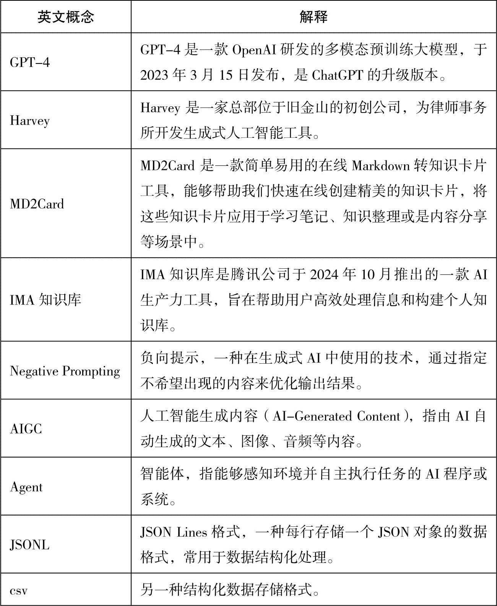

续表

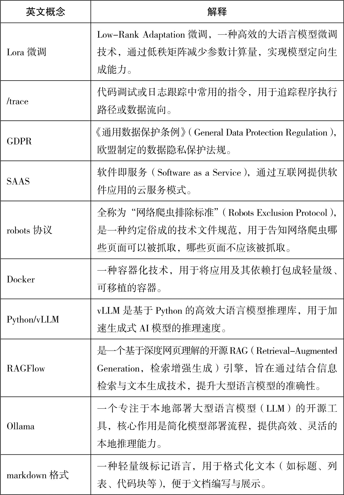

# **1**

# **第一模块：核心技法**

# ——直击场景与痛点

## **法律人使用 AI 的四大痛点与解决**

**一、大模型幻觉**

其实“模型幻觉”这事并不完全是 AI 的弱点，如果在一些文学艺术领域，这个反倒是一种创新能力，只不过来到法律、医学这种专业性和准确度要求非常高的垂直领域，一旦出现幻觉就可能要命了。实践中，AI 常常编造不存在的法律条文、案例等，而且虚构能力太强，常常令人难以分辨，导致已经出现了律师使用了 AI 幻觉生成的内容被法院处罚的案例。

**解决思路**

1.接入自己的知识库。让模型从知识库中找信息，通过构建可靠的知识库约束模型。这里必须提一下腾讯刚上线的 IMA 知识库，依托于微信生态，是非常好用的知识库产品。实际上今后在模型能力上大家很难拉开差距，但知识库构建能力却可能差异巨大。

2.接专用模型。市面上会出现越来越多的垂直模型，他们会使用行业的专用数据库（如法条、案例库等）挂载到模型上，特别是之前就做专业数据库的公司，有这方面的先天条件，所以用这些第三方专用模型相对更可靠。

3.提示词限制+多模型交叉验证。在使用模型的过程中时刻通过提示词要求它不可以胡编乱造，要对相关的案例、数据等提供出处，此外也不要过分相信一个模型的生成结果，完全可以把一个模型的结果让另一个模型校验。

4.有能力把自己作为最后一道保险。笔者并不主张在自己完全不熟悉的领域使用（特别是依赖）大模型进行工作，这种情况下使用大模型应该是用于学习而非工作。将模型用于工作应该是在自己熟悉和专业的领域，且自己有自信作为最后一道保险，能够一眼从模型生成内容中发现问题。我们常说“没有金刚钻不揽瓷器活”，如果我们在知识和经验方面驾驭 AI 的水平不够，就很有可能被 AI 幻觉所迷惑，只有你的专业知识储备到很高的程度，才会形成挑剔的眼光和敏锐的直觉。

**二、数据安全和保密**

从事一线实务工作的法律人（特别是律师和法务）使用 AI，常遇到数据安全的困扰。很多涉及公司业务的信息如果投喂给大模型，担心泄密（参考三星的前车之鉴），但不提供这些素材，AI 的作用又难以发挥（例如，让 AI 审合同或者结合证据起草诉状）。

**解决思路**

1.本地化部署。很多人会想到本地化部署，这种方式因为数据不出本地，在数据安全方面确实可以起到一定的保护作用，但部署需要一定的技术门槛和成本，且后续的模型更新升级也需要维护，所以不一定满足所有的用户需求，主要适合机构用户（如公司法务部或者律所）。

2.第二种就是对上传的内容进行脱敏，或者对客户问题进行提炼之后再投喂给模型，脱敏除了可以人工操作，还可以通过一些本地的脱敏工具来完成，如 WPS、Adobe 等文档编辑软件自带的一些脱敏功能，或者使用更专业的脱敏工具。

**三、生成内容 AI 味太强**

“AI 味”是因为 AI 生成总是有结构化的风格，这跟大模型本身的算法逻辑有关系，对此笔者不做过多介绍。实际上，在法律领域 AI 味道太强不一定是坏事，因为很多时候法律文本本来就是结构化的，要呈现出强烈的逻辑性和结构性。

但问题是，AI 味太过明显会让读者一下子发现这是 AI 的“作品”，进而怀疑人的参与度不够，而离开了人的参与，内容的准确性和创造性就会大打折扣。特别是在客户看来，他自己也会用 AI，为啥还要请律师呢？

**解决思路**

1.写一段示范样本让 AI 模仿学习，AI 在模仿能力上还是非常强的。

2.提示词给出使用场景，如告知 AI 面向的对象是谁，应该使用什么样的风格。笔者之前用 AI 解读某个技术原理，结果解读的内容是准确的，但太过于专业，难以呈现给法官，所以通过提示词要求它“用通俗语言描述但不能失去准确性以便没有技术背景的人理解”，结果 AI 给出了很好的类比来说明问题，非常直观。

3.人工去 AI 味。实际上，笔者更倾向于用人的能力为 AI 生成内容进行“润色”和“点睛”，这才是人的价值的体现。说白了 AI 完成 80%的部分就可以了，剩下的 20%必须手动操作，目的就是体现人的价值，不但是去 AI 味，更重要的是让 AI 生成内容真正可用，体现使用者的逻辑和思考，并且有使用者的创造性思维从而画龙点睛、锦上添花。

**四、不清楚人的优势和价值**

AI 越来越聪明，用得越多的人越能感觉到这一点，所以会有一种恐慌就是人会不会被替代，在 AI 面前不知道自己还能干什么？另一种可能是有人对于 AI 的能力还没有很好的认识，导致很多 AI 能干的事情还是人工完成，资源浪费。所以，还是要在认知上清楚地知道人和机器各自擅长什么，把角色分工搞清楚才能真正地人机协同。

**解决思路**

相对于 AI 而言，人的优势还是有的，至少包括：

1.发现和提出好问题。这一点非常重要，很多人并没有意识到，实际上好的问题一旦提出来，剩下的大部分工作都可以交给 AI 完成，在长期跟 AI 打交道之后，笔者明显感觉到“人有多大胆，AI 有多大产”“只有人想不到，没有 AI 做不到”，所以人应该善于在工作中发现好的问题，特别是听懂客户的真实需求，转化成 AI 能理解的问题。

2.给出好的思路和分析维度。我们会感觉到 AI 有时候也是“看人下菜碟”的，你的能力强，它也会给出对应水平的内容，但如果发现你本身水平一般，它也会糊弄你一些。

关于这个问题，笔者会在本书中单独进行讨论。

## **法律人玩转提示词的八大秘诀（附正反示例）**

**进阶要点**

不少法律人过分迷信提示词的威力了，在大模型刚刚出现的一段时间里，提示词还是非常有必要进行优化的，有些经过推敲的提示词模板确实可以大大提升模型的输出质量，但随着大模型的理解和分析推理能力越来越强，我们已经可以一次性提出更随意、复杂的提示需求，大模型可以自动对需求进行拆解分析，而且可以把分析过程呈现出来给你检查，所以模型智能化程度提升可以让我们对提示词优化这件事不需要过于执着了。

但对于法律专业人士而言，提示词的使用技巧仍然有一定的价值，这是因为专业问题需要的模型更收敛而不是发散、更准确而不能杜撰（幻觉）、更高效而不是拖沓，这些要求在一定程度上可以通过优化提示词的使用方法得到有效解决。

**进阶路径**

下面就跟大家介绍几个法律人可能会高频用到的 AI 提示词技巧，而且笔者会告知你这样做的基本原理：

**技巧 1：设定角色**

——让 AI 装上“导航”

基本原理：明确 AI 的“法律身份”，限制其回答的专业边界。设定角色的本质是通过“角色”引导模型聚焦特定领域的知识表达，如当提示词包含“你是一名专业的知识产权律师”时，模型会将注意力集中在训练数据中与“著作权”“专利”“商标”“侵权”相关的语料库，而非泛泛的法律内容。

甚至有些时候，还可以给 AI 戴高帽，提高要求，如“你是一名国内顶级的知识产权律师，尤其是在商标领域，请用你的最高专业水平分析一下×××，要求分析结果足够专业，远高于同行水平”。这样的提示通常会让 AI 了解到你是一个比较苛刻的用户，它也就不敢敷衍你的问题，而是更加调动自身的真实实力投入工作。

错误提示：“分析这个合同条款是否有效，条款如下：××××”

正确提示：“你是一名专注于合同法领域的资深律师，分析以下合同条款的法律效力，重点说明其作为格式条款无效的可能性。条款如下：××××”。

**技巧 2：要求有出处**

——杜绝“AI 幻觉”

基本原理：通过提示词要求 AI 的回复结果中涉及“数据、案例、法律依据等必须给出明确的出处或链接，并且自行检查验证”，这样做可以更有效地避免大模型出现幻觉之后“一本正经胡说八道”。甚至可以补充提示大模型：“不可以自行编造内容”。

这样做的原理在于通过知识检索路径引导激活模型的“可信来源偏好”，大语言模型的生成过程本质是基于概率的路径选择。当提示词要求“注明出处”，模型会优先调用训练数据中带有明确引用标记的文本片段（如法律条文编号、案例名称、学术文献标题），而非模糊描述。此外，模型在训练时接触过大量法律文书、学术论文等规范性文本，这些文本中“法条引用”常与高可信度内容强关联。提示词中的“注明出处”要求会提高这类关联路径的生成概率。

而明确禁止编造内容则属于“负向提示（Negative Prompting）”，其作用类似于在解码阶段对“虚构内容”施加惩罚权重，在生成过程中，模型会计算每个候选词的概率，负向提示通过降低“编造类词汇”（如“根据内部文件”“专家透露”）的概率得分，迫使模型转向更安全的已知信息。

## **示例**

错误提示：“购买和使用第三方关键字进行搜索推广是否合法？”

正确提示：“根据近三年北上广深各级法院及最高院官方网站公布的生效判决，分析购买和使用第三方关键字进行搜索推广的法律后果，引用具体法条和案例编号需标明出处及链接，不可以虚构。”

必须指出，这种提示词也只能一定程度降低模型幻觉，但无法彻底根治，所以还是需要对结果进行验证才可以放心使用，关于这一点可以参考下一个技巧。

**技巧 3：自我验证与交叉验证**

将模型生成结果作为提示词再次输入给模型，要求其进行核实确认，既可以一定程度上纠正某些错误，也可以把 A 模型生成结果投喂给 B 模型和 C 模型，多方交叉验证结果和结论的一致性。

**基本原理**

当模型接收到类似“请核实以下内容是否与真实来源一致”“检查以下内容中是否存在明显的事实错误或结论错误”的指令时，会重新分配注意力权重，优先匹配训练数据中高频出现且结构规范的知识片段（如权威法律条文、著名判例）。

## **示例**

原始生成：“根据《民法典》第 123 条，AI 生成物可视为著作权法保护的作品。”

核查指令：“请核实上述结论是否与引用的《民法典》条文内容一致。”

修正结果：“经核查，《民法典》第 123 条规范的是民事权利的取得方式，与著作权无关。正确依据应为《著作权法》第 3 条关于作品定义的规定。”

需要指出，这种通过 AI 自我检查的方式通常适用于原始错误属于模型知识库中的明确冲突内容（如混淆法律条文编号）的情形；但若错误内容本身在训练数据中无强反例（如虚构冷门地方性法规），模型可能无法识别。

此外，如果 AI 编造了某个案例，在二次检查时可能基于 AI 算法设计时逻辑自洽性特点，将被质疑的虚构案例再次虚构，补充相关细节，为了防止这种情况，应当要求模型不可以虚构并且到案例所在的源头和出处进行核对。

**技巧 4：给出分析方法**

——像法律人一样“拆解问题”

要求 AI 按特定的分析方法解决问题，这一点在法律人的工作过程中可以很好地达到让大模型实现对指令的“跟随”效果，避免其生成的结果因为没有按照既定的方法展开而失去参考价值，如要求大模型对某个案情按照侵权构成要件分析法输出。

常见的分析逻辑，例如 IRAC 框架分析法，包括：

（1）识别争议焦点（Issue）；

（2）引用相关法条（Rule）；

（3）结合事实适用法律（Application）；

（4）推导结论（Conclusion）。

**基本原理**

给出分析方法实际上是通过设计结构化的提示词框架限定 AI 的思考路径。例如，要求 AI“以侵权四要件（违法性、损害事实、因果关系、过错）逐项分析案情”，相当于在模型中植入法律分析的标准化模板，这种结构化指令能激活模型对法律领域知识的定向检索能力，减少生成内容的随机性，使模型在分析侵权案件时优先调用训练数据中与“构成要件”相关的法律文本（如判决书、学术论文等），而非泛泛而谈，进而实现与使用者（人）的思路上的一致性，达到很好的“跟随”效果。

## **示例**

错误提示：“××××这个案情下，商标侵权该怎么打？”

正确提示：“请按‘侵权要件’分析以下行为是否构成商标侵权：1.权利基础（注册商标有效性）；2.相同/近似性对比（附图文）；3.混淆可能性（参考《商标审查标准》）；4.抗辩事由（如合理使用）。”

效果：AI 会生成结构化回答，如“首先，涉案商标注册号为×××，仍在有效期内；其次，被控标识与注册商标在字形、颜色上高度近似……”。

**技巧 5：明确输出样式**

——没有形式就没有内容

在处理较为复杂的任务时，应当告知大模型输出的结果以何种方式呈现，如法律意见书、起诉状、对比表格等，从而提升结果的呈现质量和实际可用性。

**基本原理**

当明确告知大模型输出结果的呈现方式时，相当于给模型提供了更具体的指令和约束条件。模型会根据这些信息，在生成内容时更有针对性地组织语言和结构。例如，如果要求以法律意见书的形式呈现，模型会调用其学习到的关于法律意见书的格式、语言风格、逻辑结构等知识，使输出的内容更符合法律意见书的规范，包括使用专业的法律术语、严谨的逻辑论证以及规范的格式排版等。

## **示例**

错误提示：“写一份竞业限制协议”。

正确提示：“起草一份《竞业限制协议》模板，需包含：1.主体信息；2.竞业范围（行业、地域、期限）；3.补偿金计算方式（注明法定最低标准）；4.违约金条款（提示司法实践调整风险）。按‘条款+法律依据注释’格式排版。”

效果：AI 输出的协议将附带注释，如“根据《劳动合同法》第 24 条，竞业限制期限不得超过 2 年”。

**技巧 6：划定思考线索与范围**

——避免“大海捞针”

提示词中给出模型推理的线索和范围是非常有效的方式，限定法律领域、争议焦点或参考判例，可有效防止答案泛化，让模型从漫无目的的“大海捞针”到快速锁定推理方向，减少试错机会。

**基本原理**

大模型是从提示词作为原点根据参数和权重进行扩散式生成，此时如给出具体线索并限定方向和领域，都是对接下来的模型发散给出了有效提示，模型会增加与之相关的发散权重，在最有可能的方向上发掘最佳答案。

## **示例**

错误提示：“元宇宙中的虚拟财产受保护吗？”

正确提示：“聚焦 2020 年后中国司法实践，从《民法典》《反不正当竞争法》、平台用户协议三个维度，分析元宇宙平台内虚拟财产（如游戏装备、数字艺术品）的法律保护路径，排除刑法视角”。

效果：AI 会列举如杭州互联网法院元宇宙 NFT 第一案判决中对数字艺术品的法律属性界定、民法典对虚拟财产的规定等针对性结论。

**技巧 7：根据受众设定表达风格**

**基本原理**

法律人制作的内容是要面向不同受众使用的，有的用于在法庭上展示，有的用于向公众普法，有的用于做学术分析，所以同样的内容在表达风格上有所不同，可以要求大模型根据受众的接受程度和习惯进行内容输出。

特别是在很多场合，人们越来越希望模型生成内容去掉自身固有的 AI 味道，这个问题也可以通过提示词提出要求。

## **示例**

错误提示：“根据相关法律规定解释说明一下公司减资程序。”

正确提示：“以《公司法》为依据，说明一下有限责任公司减资的法定程序，要求表述严谨的同时足够通俗易懂，让没有法律专业背景的公司股东能够听明白，接近人的真实表达环境，不要有 AI 味。”

效果：AI 会输出：“咱公司要是打算减资，得按照《公司法》规定的法定程序来办，这么做主要是为了保障股东和债权人的权益，确保公司运营合法合规。下面我就给大家详细讲讲这具体的流程……。”

**技巧 8：结合推理过程多轮追问**

——避免“黑箱式生成”

很多法律人在多轮提问过程中忽略了对模型推理过程的检查，仅根据推理结果反馈问题，这时候往往难以抓住模型犯错的真正原因，正确的做法是对照输出结果倒查推导逻辑，在后续追问提示过程中定点纠正推理过程中错误的环节，肯定其他部分，让模型通过认识到自己的错误并修正后逐渐接近最佳答案。

**基本原理**

DeepSeek 等模型在接到提示需求后并不是直接给出结果，而是先展示推理过程，这样做的目的就在于展示从接收需求到生成结果的思考轨迹。让用户知道模型是否准确理解了我们的问题，以及接下来准备怎么解决，给用户一个“对齐”思考路径的机会，从而跳出“推理黑箱”。

我们可以从这个路径中找到某个推理环节不是我们想要的，从而直接在这个环节纠正模型的错误，即所谓的“局部修正、迭代优化”而非看到错误结果后要求模型全部“推倒重来”，如此可以大大节约时间、提高效率。

## **示例**

第一轮：“根据《个人信息保护法》分析企业使用人脸信息的风险。”

第二轮：从其推理过程中发现模型对收集人脸信息过程中的“单独同意”缺少实操性分析，因此向模型补充提示“单独同意”要件的实操难点，并给出处罚案例作为参考，要求其强化这个部分。

第三轮：结合前一轮输出结果和推理过程，发现模型主要针对“收集”环节但没有对“使用”“传输”等数据全生命周期的分析，因此要求其增加，让结果更加丰满。

效果：通过多轮交互，AI 的输出更具实操性并且涵盖人脸信息的全生命周期的分析。

## **DeepSeek：提示词之母**

**进阶要点**

很多人会以为 DeepSeek、chatgpt、通义千问这些都只是“万金油”式的问答机器，比其他大模型跑分数据更好一些而已，这么理解实在有些狭窄了。

很多时候，限于问答的工作形式，DeepSeek 这种基础模型确实在很多方面无法直接给到我们想要的结果，如制作 ppt、画图表、修订合同等，更别提像智能体 agent 那样调用外部工具干活了。

这显然低估了其技术内核与应用潜力。事实上，这些基础大模型的强项不一定是直接使用，而是将其作为调用其他更垂直模型应用的万能驱动器，从而展现出远超基础问答的智能化价值。就有点像是牧羊犬，成百上千头的羊，要有一条精明能干的牧羊犬才能维持好秩序，不让羊群走丢，这就是 DeepSeek 这些大模型的作用了。

**进阶路径**

现实中，很多模型工具的定向输出能力是非常强的，唯一的问题是它们或多或少存在一些使用门槛，让使用者把这些工具的使用方法都学习一遍又太过于浪费时间，这时候就可以把需求直接投喂给 DeepSeek 等基础模型，告诉它我想用哪个工具来解决这个问题，你帮我读一下这个工具的使用说明书，然后生成一套这个工具能够理解的操作指令，接着再把这个指令复制到工具里开始执行。什么是驾驭工具，这就是驾驭工具了，要相信这些基础模型太了解如何给其他工具模型派任务了，而且它们对你的需求又有极佳的理解能力，可以圆满完成“上传下达”的任务。

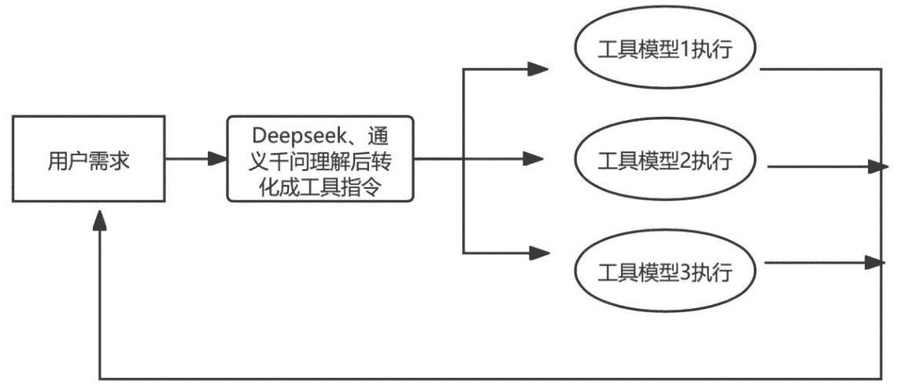

我们看几个例子：

**1.DeepSeek 驱动 kimi 分析案情**

Kimi 的长文本阅读分析能力是非常好的，可以应用在复杂的诉讼或非诉案件处理上，但究竟如何将 Kimi 的能力最大化发挥呢，我们可以先借助 DeepSeek 提出需求，转化成颗粒度更细的 Kimi 指令。

例如，我们向 DeepSeek 提出需求：“请根据以下知识产权侵权纠纷案件信息，为我生成适合在 Kimi 中进行文本处理和分析的指令。案件情况为：原告持有在第 25 类服装商品上注册的“时尚风 FASHIONWIND”商标，具有较高知名度。被告在其生产销售的服装产品及店铺招牌上使用“时尚尚风 FASHIONSHINE”商标，消费者反馈容易混淆两者商品来源。原告已收集了双方的商标注册文件、销售记录、消费者投诉截图、市场调查报告等资料。目前需要深入分析案件证据关联性以及潜在法律风险”（注：案情为虚构）。

接下来 DeepSeek 会给出具体的 Kimi 提示词：

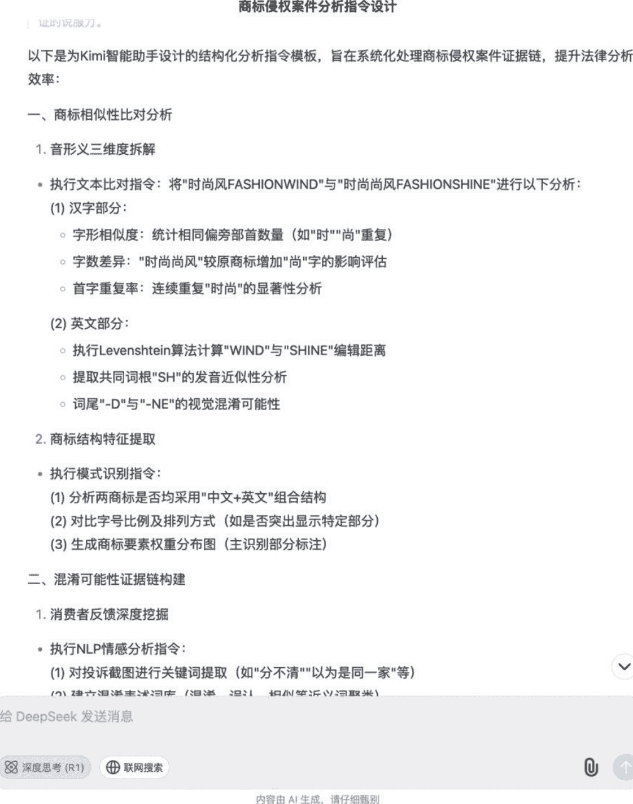

可以看到，DeepSeek 结合给出的案情描述从商标近似性比对、消费者混淆可能性、侵权要件关联性、抗辩策略等多个维度生成了专门用于 Kimi 工具的详细提示词，我们可以全部或者有选择地将这些提示词发送给 Kimi，同时把案件的具体材料（脱敏）上传到 Kimi，如此一来就可以最大限度地发挥其长文本阅读和理解能力，让它给我们生成更深度的分析结果了。

**2.DeepSeek 驱动可灵生成诉讼流程图**

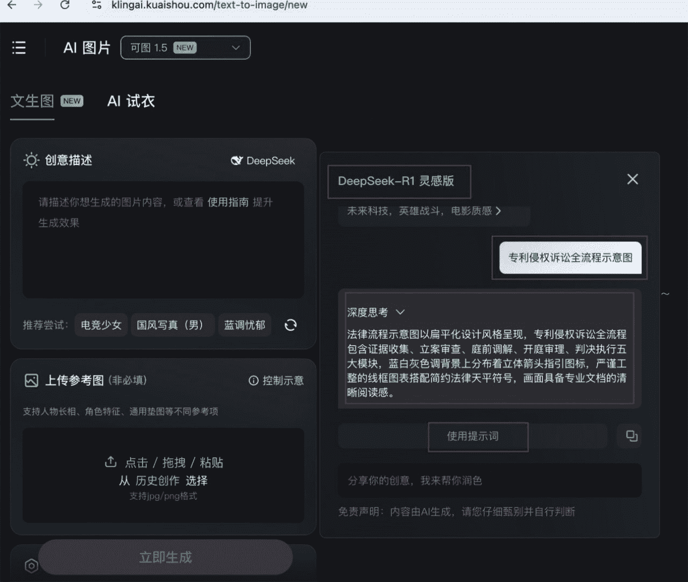

文生图是“可灵”的一个特色功能，为了避免用户不知道如何使用恰当的提示词，“可灵”直接在自己的产品界面里集成了 DeepSeek R1 灵感版，只需要给出“专利侵权诉讼全流程示意图”的提示，DeepSeek 就可以帮助扩写成下面“深度思考”框中的详细提示词，如果觉得满意，可以直接点击“使用提示词”（当然，不满意也可以修改或者重新生成提示词），系统将自动把这些提示词填写到左边框“可灵”的提示栏中，接着就可以进入生成流程等待结果了。这个产品的设计理念很好地印证了我们本章所讲的用 DeepSeek 来放大 AI 工具的作用，用户甚至可以不必在 DeepSeek 和“可灵”两个产品中切换操作，是非常友好的体验。

## **工具组合策略：从起诉状到证据**

**进阶要点**

AI 工具是层出不穷的，哪怕是通用模型在擅长处理的工作上也往往各有千秋，如 DeepSeek 就擅长深度推理，理解较为复杂的逻辑并进行分析拆解，而 Kimi 对长文字的理解和解读能力非常好，chatgpt 对英文语料和外网内容训练得更好，midjourney 的强项在于处理图片，等等。

所以，我们常常会在多个 AI 工具之间进行切换，这有点像跟真人同事之间的合作，也是要结合对方的特长来选择对应的任务。

**进阶路径**

**一、AI 工具场景化分类**

不论工具如何丰富，我们在选择和使用上均应当遵循的原则是“以场景为中心”，要先想清楚自己要什么，然后选择最合适的工具，让工具之间优势互补，协同作战，给我们输出最终成果。

部分 AI 工具与法律应用场景梳理

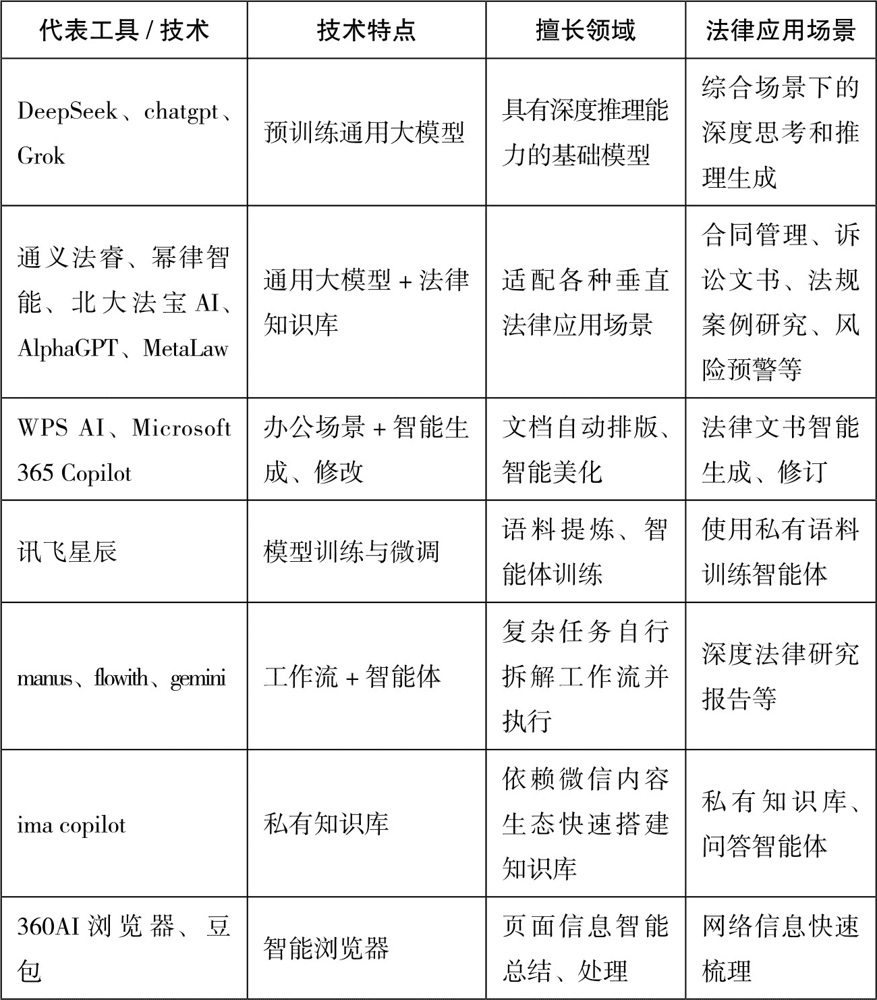

**二、诉讼全程工具组合示范**

我们拿到了来自法院送达的原告诉讼文书，包括起诉状、证据清单和证据，接下来需要进行这样几个动作：

1.内容脱敏；

2.分析提炼诉求和焦点；

3.类案检索、法官画像；

4.制定抗辩策略和答辩状；

5.结合证据制作 ppt、思维导图等可视化文书。

为了言简意赅节约篇幅，笔者不再全面展示每一个环节，仅把根据案情生成 ppt 和思维导图做一个示例，我们使用豆包及其内嵌的特色功能作为工具。

第一步：上传经脱敏的案情文档，要求其站在原告角度生成 ppt，用于庭审过程中向法院汇报案件情况和原告主张。

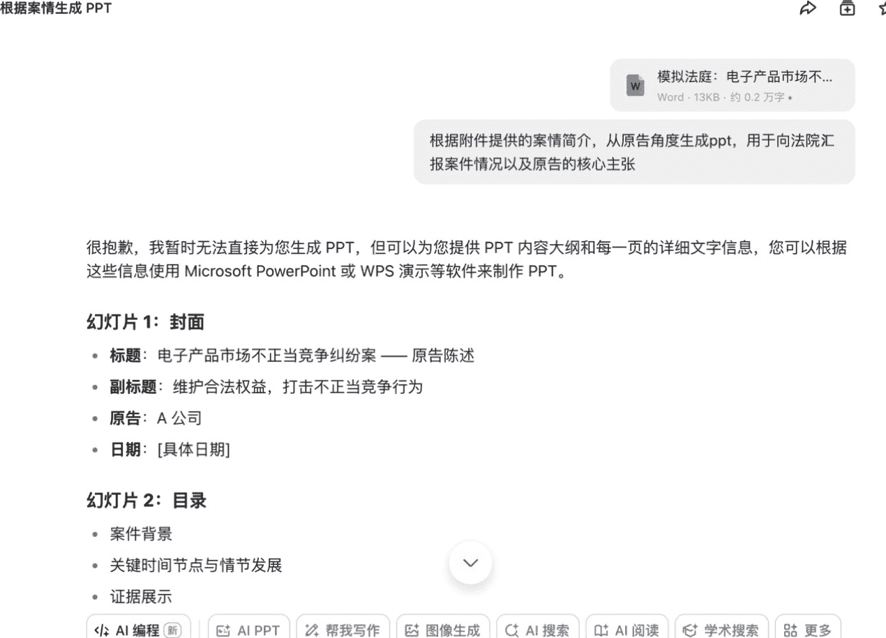

我们会发现模型无法直接制作 ppt 而是给出了大纲，这个对于多数基础模型而言都是如此。接下来，我们选择模型自带的“AI PPT”能力，将上一个步骤中生成的提纲输入，要求其继续生成可用的 ppt：

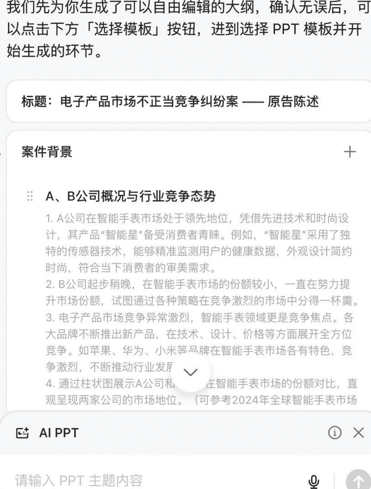

我们可以对这个大纲进行编辑直到满意，然后选择合适的 ppt 模板：

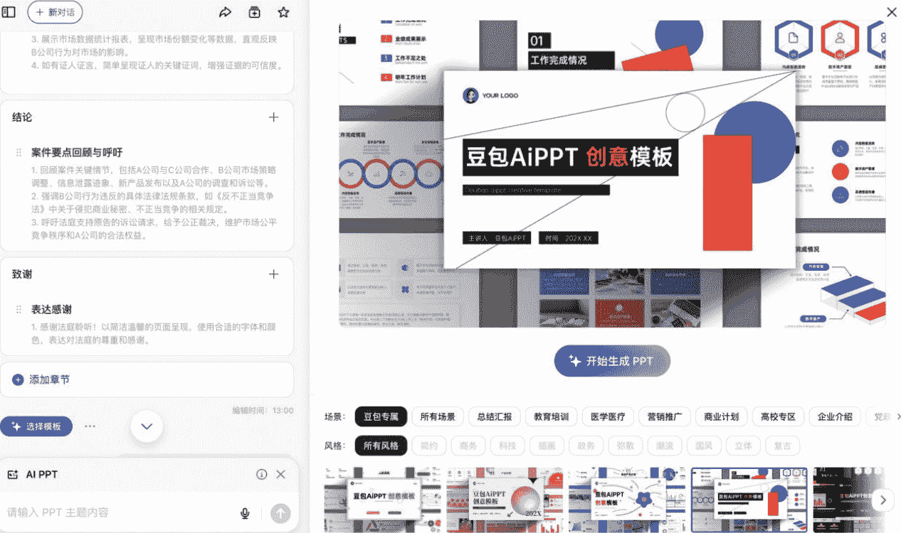

找到合适的模板之后，点击“开始生成 ppt”，接下来就可以等结果了。

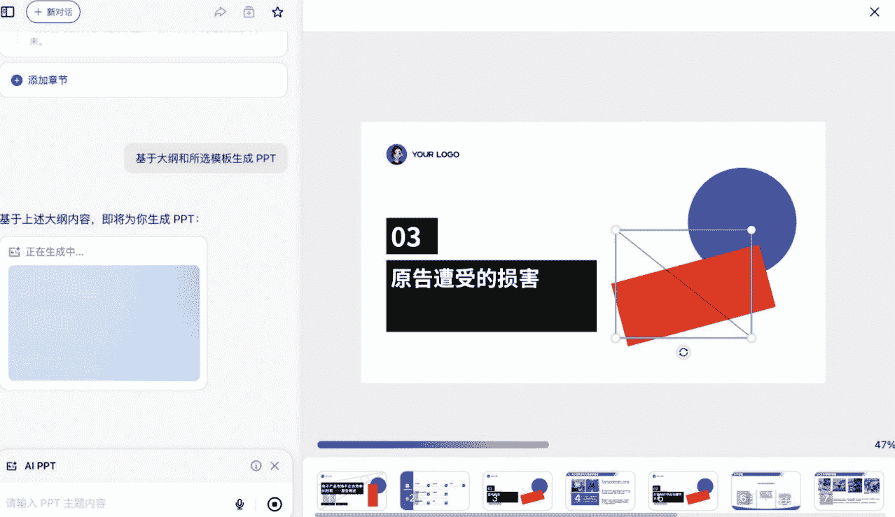

到这里，我们还不满意，我们希望模型根据原告主张生成一个思维导图，让法官更快地了解原告的主张和逻辑，于是我们退出“AI PPT”返回主界面，提出要求让它执行：

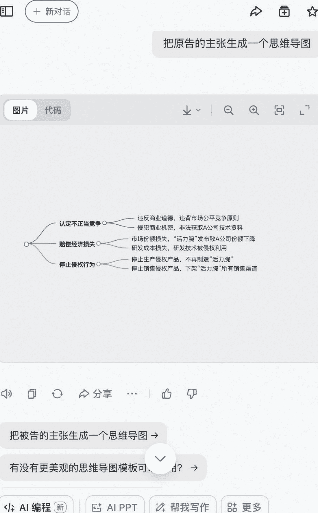

仍旧觉得不够，还希望 AI 根据案情给出一个按照时间线整理的事实梳理，以便法官直观了解案件的发展脉络。于是我们找到擅长理解长文字的 Kimi，提出要求：

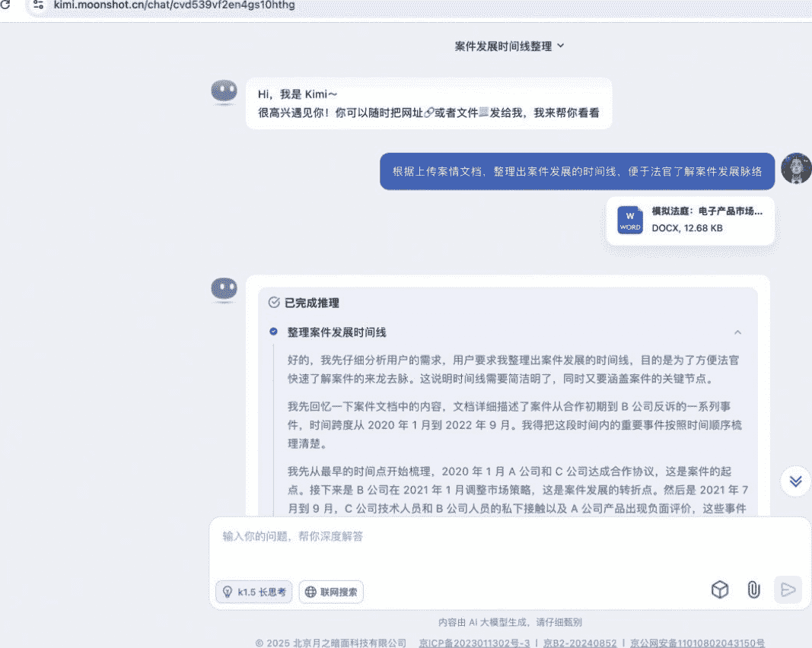

它给出了表格形式的时间线：

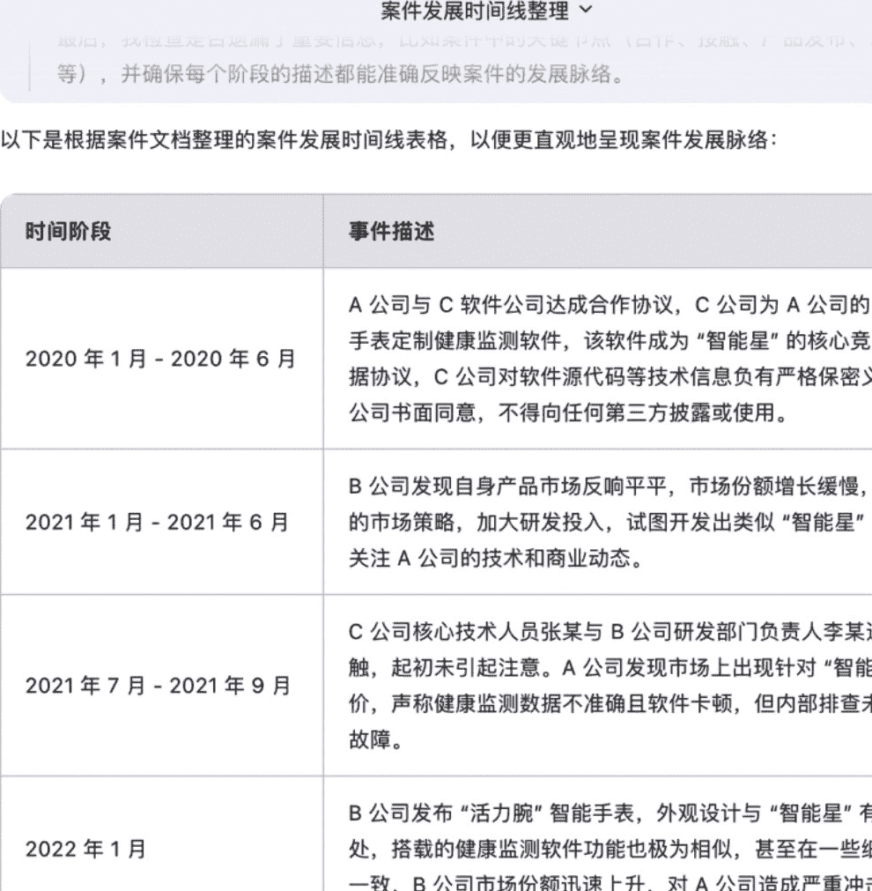

我们再举一个类案检索的例子：

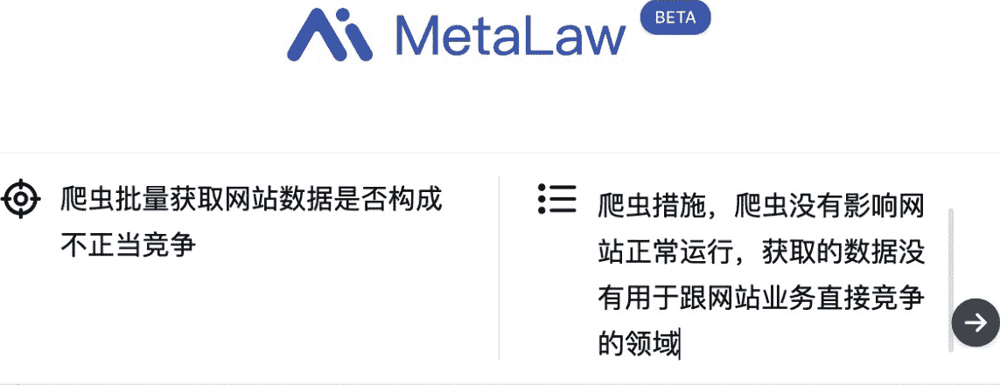

模型可以给出类似案件的判断维度：

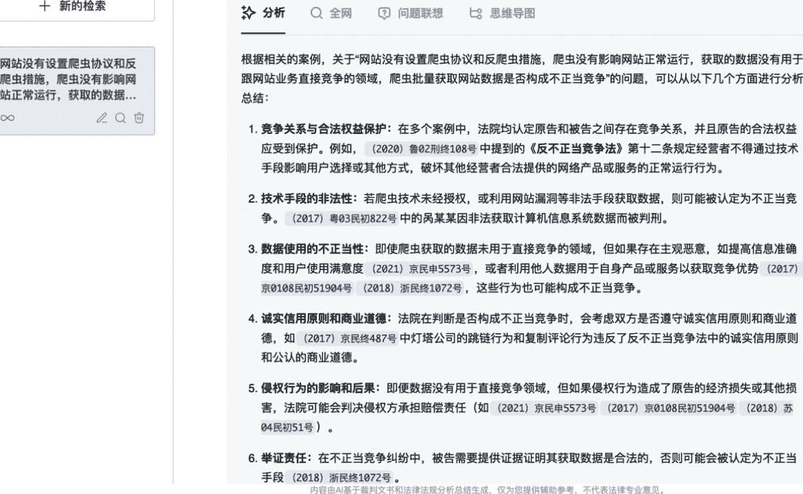

并且附上同类型参考判例：

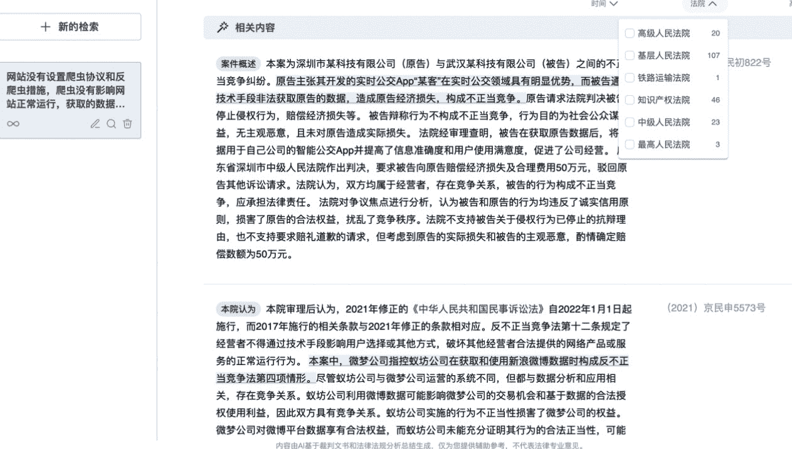

如果不满意，可以勾选更多选项，继续筛选：

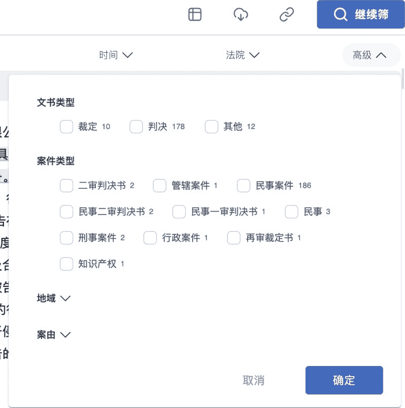

其他的操作，读者朋友们尽可以根据实际工作需要再去拆解联想，如让 AI 制作证据阅读摘要、模拟庭审抗辩等，总之从场景出发，找到匹配的工具来实现人机协同，这个过程也是熟能生巧，各种不同工具结合使用，越用越有心得，越用 AI 含量越高。

## **当证据遇到 AI：从寻证、存证到用证**

**进阶要点**

证据是法律实务工作的基础，不管是找证据还是固定证据，或是分析和使用证据，都是法律实务工作者最核心的技能之一。

AI 的出现自然会影响到证据层面，我们注意到利用 AI 技术取证、梳理证据的应用已经出现，并且取得了非常不错的成果。另外，AIGC 生成的内容如何通过电子存证固化下来，证明生成过程和权利归属，也是当下人们关注的问题。

**进阶路径**

基于大模型训练出的取证智能体已经被部署在取证系统中，美亚柏科开发出的 QiKo 大模型内置取证百科、群聊分析等 8 个取证智能体，还支持自主上传业务知识库，构建新的取证智能体，相当于给取证的客户提供了一个取证专家顾问团，这个思路可以很好地降低取证门槛：

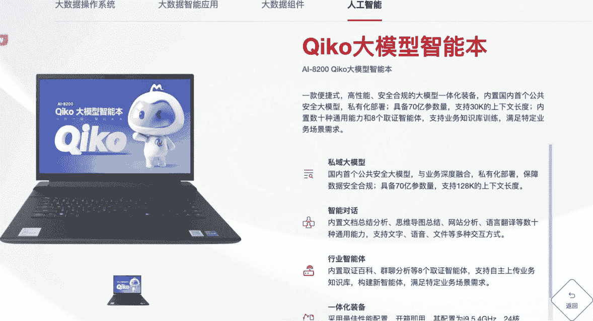

另外，同样是该公司研发的“星火”电子数据智能取证分析平台，可以基于取证分析标准件和知识库，对海量电子数据进行业务模型构建，实现情报线索的深度挖掘和智能推荐，对于复杂网络环境下的证据分析和提取是一个非常有益的尝试。

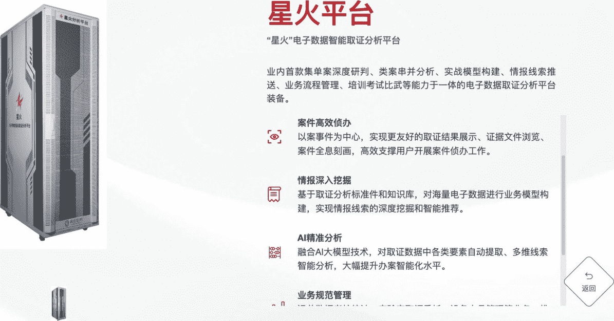

实际上，利用大模型的分析推理能力在复杂证据线索中抽丝剥茧、最终锁定有效证据已经有了很好的案例。如上海检察机关研发完成危险驾驶、故意伤害、盗窃等 10 类常见刑事案由的数智办案辅助模型 ^(¹)，覆盖全市近 70%的刑事检察案件。其中，办理危险驾驶案件的辅助模型可以根据个案酒精含量、车辆类型、事故程度、到案情况等关键情节，基于历史数据设定的 53 条推荐规则以及基于法律、司法解释规定设定的 44 条推荐规则，通过自动解析定罪量刑要素，可以精准推送同类历史案件诉与不诉的比例、起诉时的量刑建议等。

无独有偶，法制日报社举办的 2024 政法智能化建设创新经验成果展上，也出现了这样一则基于大语言模型的自动证据审查系统典型案例，系统构建了以证据为核心的案件办理全流程证据链，通过信息抽取技术，系统可以从海量的文书数据中抽取出关键的证据信息。根据抽取出的信息，系统建立了要素查找模型，能够根据案件的需求对证据进行精准的定位。案例提到一个非常重要的理念，即“人工智能模型建立在数学模型之上，关注于证据本身的语义与证据之间的联系。这一学习过程本身就是建立证据审查规则的过程” ^(²)。可见法律人在使用新工具的过程中，一方面是应用工具取得更好的效果，另一方面也让法律人寻找到新的价值（如规则制定）。

除了智能化的证据挖掘系统，还有一个 AI 引发的证据问题就是 AIGC 内容的生成过程和权利归属取证。国内已有多个司法判例认可人在 AIGC 内容中的独创性贡献，进而赋予其著作权。但如何证明整个生成过程是需要有好的存证工具的。

我们注意到市面上主流的电子存证工具也在针对 AIGC 这种特殊类型的内容开发出了针对性的存证产品，以可信时间戳为例，用户可以使用其推出的 AIGC PAS 产品对有关内容进行电子存证，包括 AIGC 平台也可以直接接入，为用户提供存证服务：

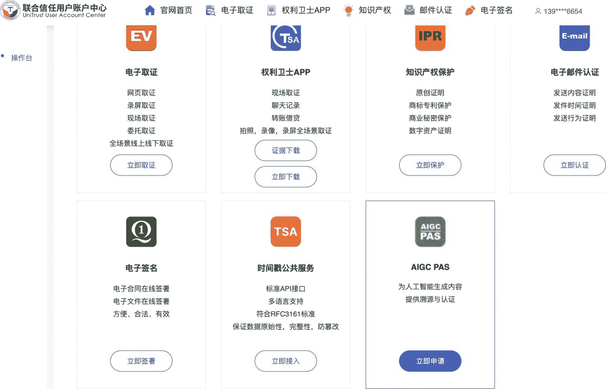

存证过程应该是把 AIGC 生成过程以录屏的方式固定，然后加盖时间戳：

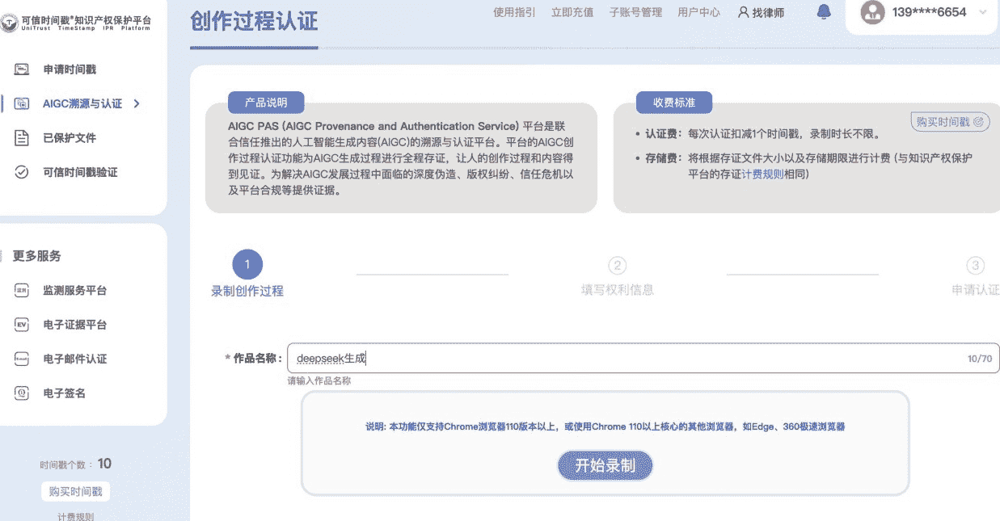

经过 AIGC-PAS 认证的内容可以通过可信时间戳验证平台（https://v.tsa.cn/）进行验证。验证信息包括 AIGC 的生成时间、生成平台、元数据、权属、许可证等溯源和认证信息：

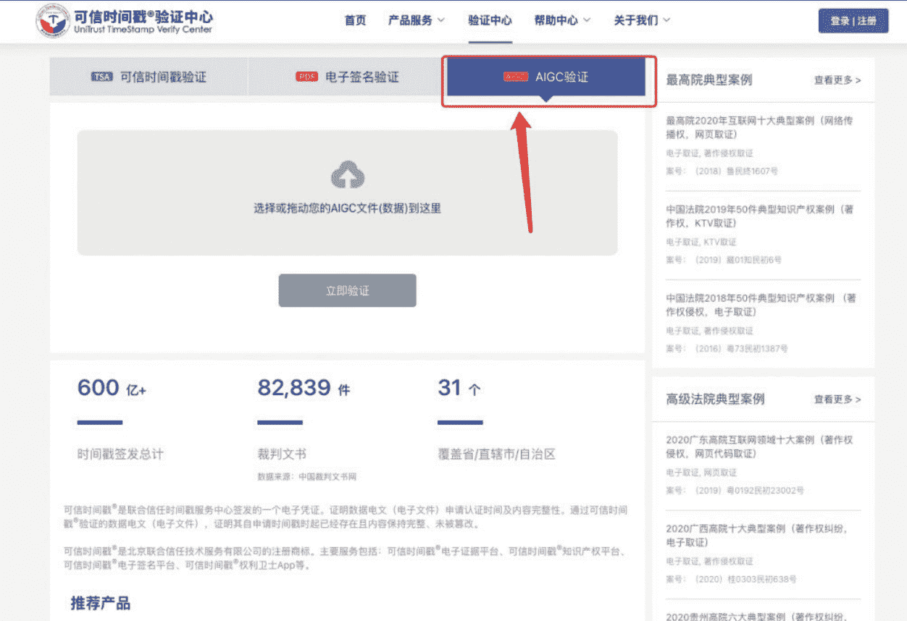

（AIGC-PAS 认证 ^(³)）

电子合同存证工具也引入了大模型，为存证场景提供更多增值应用，如智能合同审查、智能台账、合同对比等。

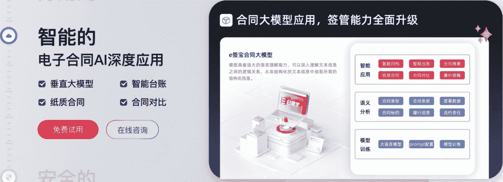

（e 签宝推出的电子合同 AI 应用功能 ^(⁴)）

总之，在证据之路上我们有了新的 AI 伙伴，它的加入不仅提升了证据收集和固定的效率，更通过智能分析技术帮助法律人发现传统方法难以察觉的证据关联。这些 AI 工具在存证环节的创新应用，正在重构电子证据的完整证据链，与此同时，也不得不让我们重新思考法律人在这个过程中的角色定位。当 AI 能够自动完成证据收集、分析和存证时，法律人需要做的是将更多精力投入策略制定和证据的创造性运用上。

## **投喂文书模板：让 AI 学会抄作业**

**进阶要点**

在法律这样的专业领域，让模型这头猛兽乖乖地跟着我们的指令前进是非常难但有必要的事，也就是业内人士常说的“跟随性”问题。很多时候，你的提示词或者知识库再怎么完善，也无法避免 AI 发散式生成所带来的效果失控，这时候我们回到法律人常见的工作场景中也许能够找到启发。

**进阶路径**

经过长期实践，法律人通常会积累下来很多成熟的文书模板，诉讼中的起诉状、代理意见，非诉中的法律意见书、融资协议，等等。这些文书有着极高的复用价值，因为它们已经反复经过了实战检验，像是被无数次升级和打补丁过后的操作系统，对于同类型的法律需求，用这些模板作为基础，再结合实际情况做一些针对性的适配，完全可以做到事半功倍。

于是我们会自然地想到，如果把模板和大模型结合起来，借助大模型对文本的理解力，让模型踩在模板这个“巨人的肩膀”上，不就可以快速提升工作效率了吗？

事实证明，这个思路可行。笔者 2024 年年初在律所内部主持开发了我们垦丁律所自己的私有模型“网络法精灵”，在产品设计的过程中，就把模板套用功能作为一个重点，允许用户自己上传文书模板给到模型，让模型根据模板和提示词进行处理，拿出来的结果远比单纯用模型生成的内容更加符合要求。

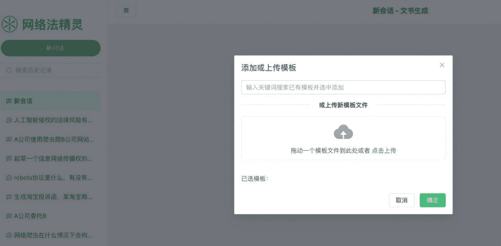

同时，我们还在模型中内置了多个模板，这些都是我们日常工作中积累下来的珍贵成果。律师在使用模型时可以选择是否调用这些内容模板，从而让这些成果为律所成员共享。

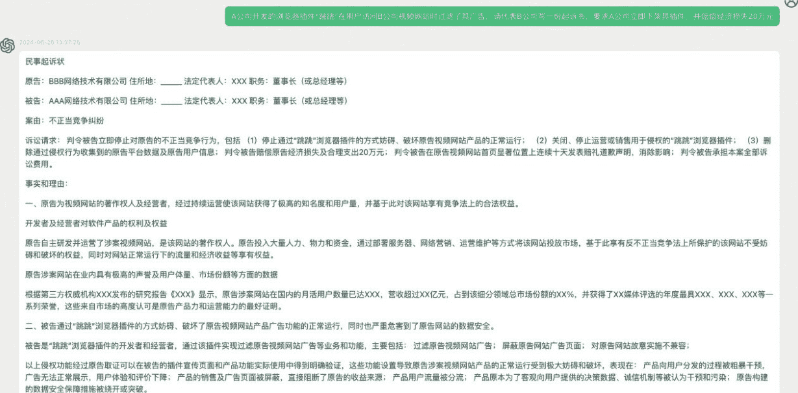

（使用内置的不正当竞争起诉状专用模板进行生成的效果）

当然，模板不一定要在自己的私有模型中才能发挥作用，在第三方模型中也同样可以作为很好的生成参照物。如我们把自己总结的一套平台商家侵权投诉模板上传到 DeepSeek，让它结合模板生成提示词中描述的需求文档，结果也非常不错。

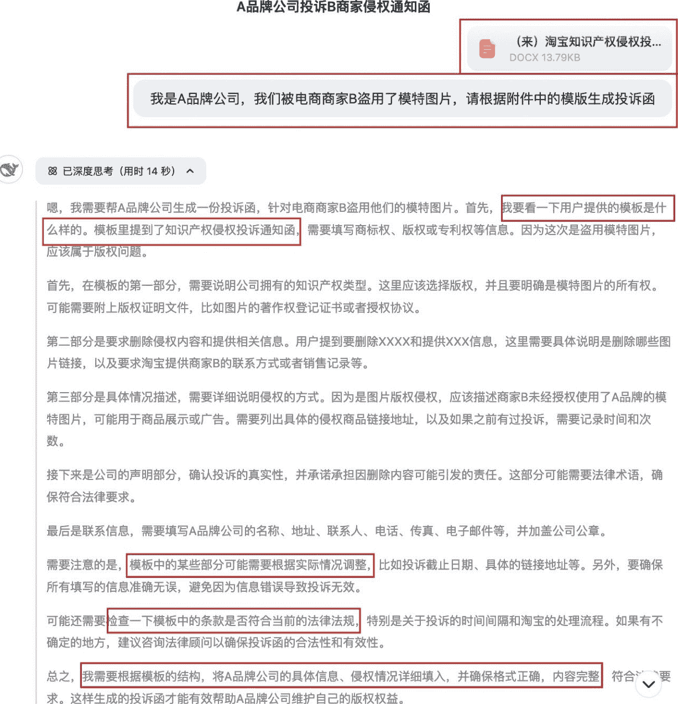

（大模型的理解能力非常惊人）

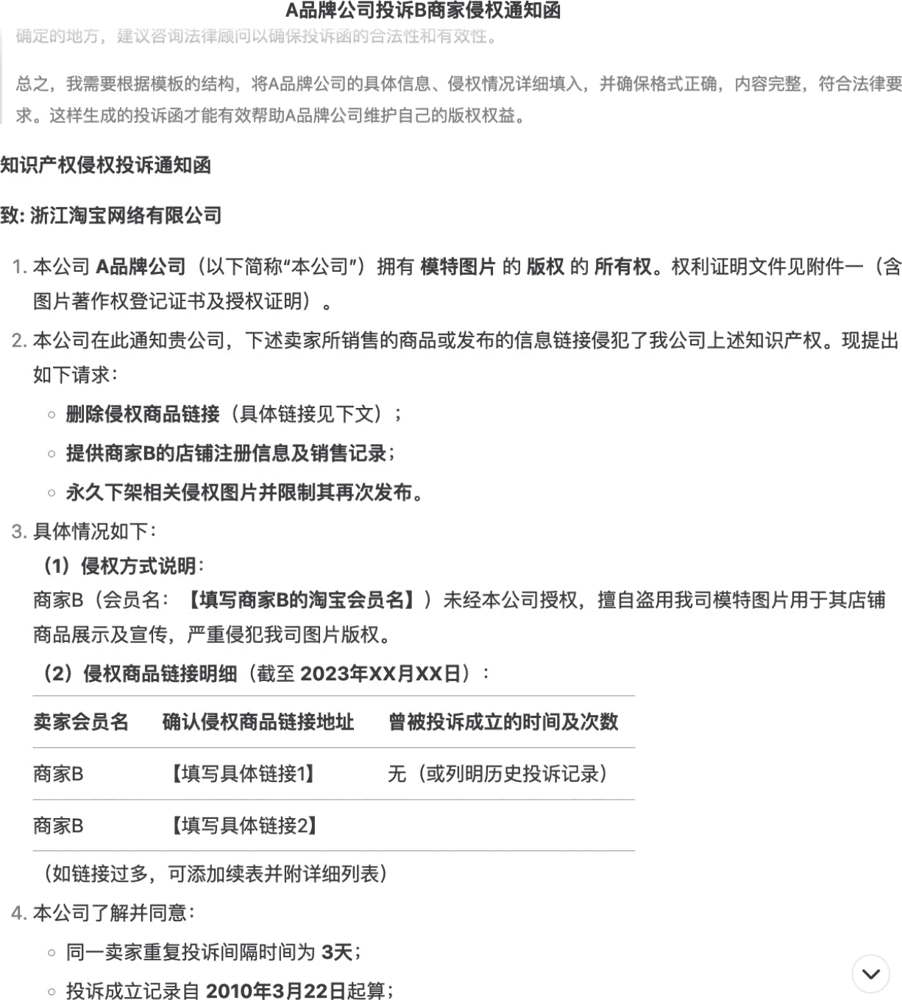

这个生成结果跟我们提供的模板保持了高度一致性，显然是没有模板的情况下自然生成所无法达到的效果。

当然，还是提醒一下大家，如果要对模板进行高度自动化的使用（如尽量减少提示成本、批量使用模板等）以及保证对模板的保密性（哪怕是脱敏的模板也是重要的智力成果），可能还是要考虑自己定制私有化模型。

## **美就是生产力：要专业也要有颜值**

**进阶要点**

日常工作中，律所在 UI 设计中的投入可谓不菲，可以理解，没有形式就没有内容，一个看上去美观大气的法律文本，无形间也为内容的专业度提升了几个档次，就连诉讼都讲究“可视化”了，所以美真的是一种生产力。

对于大部分法律人而言，如果没有专业的美工人员参与，我们还真的很难把文本做得有美感。美术设计不仅仅是把外观做得好看就行，还要跟内容很好地匹配起来，但现实中往往专业美工不懂法律，而法律人不懂设计。AI 出现之后，似乎问题迎刃而解了，大模型基于对内容超强的理解能力和生图能力可以把枯燥的专业文本瞬间“颜值飙升”。

**进阶路径**

**一、MD2card：打造精美知识卡片**

不少法律人都有记录和整理知识的习惯，如听了一个讲座，就会做课堂笔记，读了一本书也会写读书心得，还包括各种复盘总结、知识图谱等。

做这些事本身是一个枯燥的过程，而且往往顾不上排版和美化，造成的问题就是事后再翻出来看或者对外分享的时候，观感不佳，难以理解。

现在我们可以用类似 MD2card 这种知识卡片工具，先在 DeepSeek 生成 markdown 格式的纯文本内容（也可以把已有的内容让 DeepSeek 转成 markdown 格式），然后直接粘贴到 MD2card，它就能给你生成各种美观的知识卡片，还支持下载。

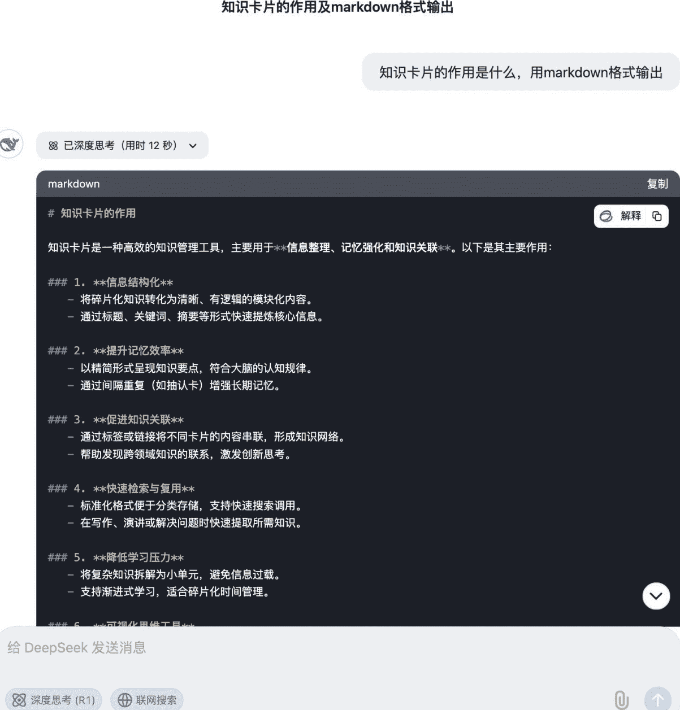

在这个例子中，我们让它生成一张小红书风格（风格样式可以自选）的知识卡片，下载之后就可以直接在小红书平台分享了，是不是很方便呢？

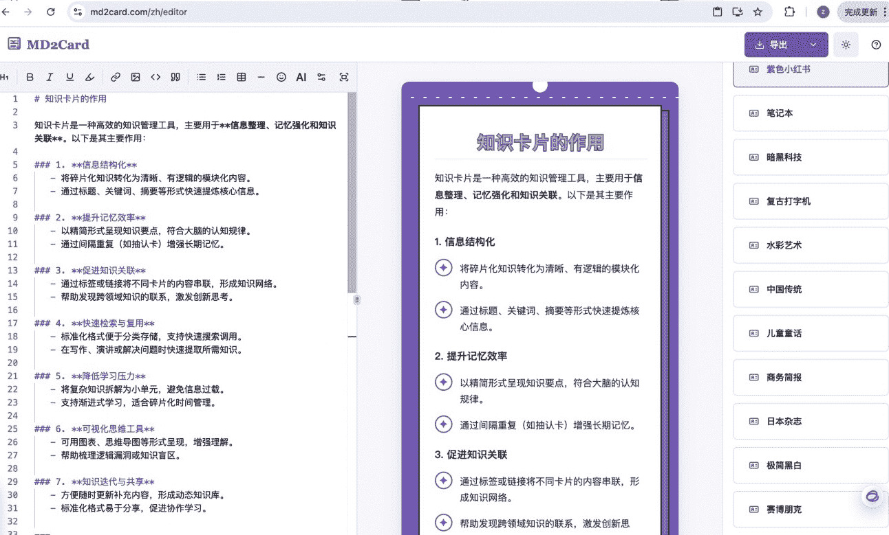

**二、Napkin：文本可视化**

实际工作中，我们常常遇到一段文字想用可视化图形来表达，以便更好地展示文字里的逻辑关系，如果是在 word 和 ppt 里通常要自己动手画，难度很大。

如果用 Napkin 这种可视化 AI 工具，也是只需要把文本粘贴进去，AI 可以直接理解这段文本，然后对应生成各种不同样式的可视化图形，任你挑选。你会发现 AI 能将文本内容和图形对应得恰到好处，我们选一个最合适的粘贴到 word 或者 ppt 里直接用就可以了。

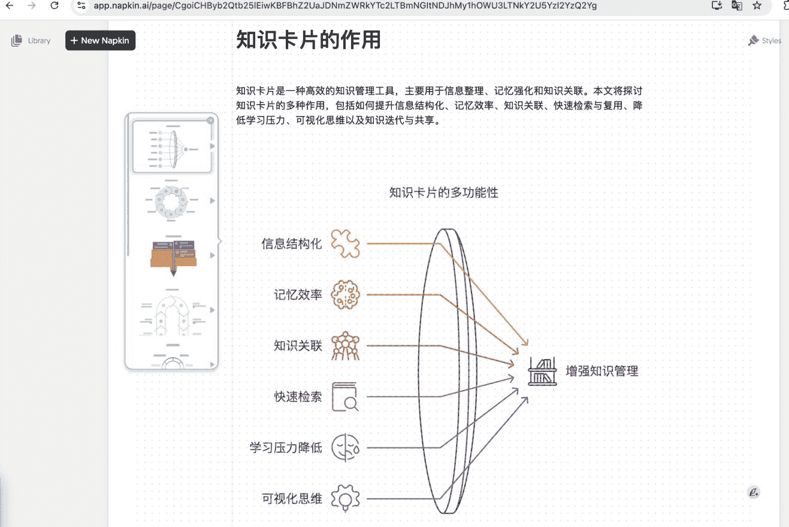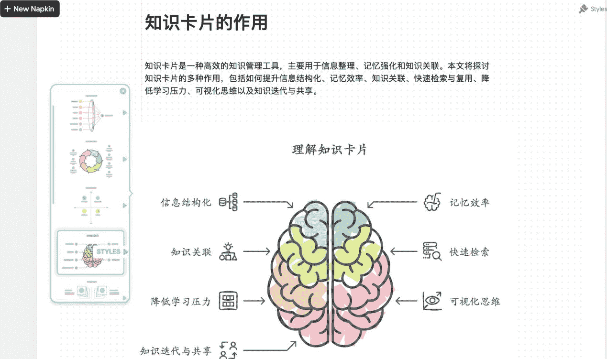

**三、infography：智能海报**

又一个痛点场景，我们常常要在一些活动、论坛、直播等场合用到海报，以前的做法要么是找专业美工，要么是用网上的模板修改，费力且费事。

如果用 infography 这种智能工具，还是一样的傻瓜操作，复制粘贴文案，海报批量生成，不仅美感在线还支持局部编辑，多快好省都做到了。

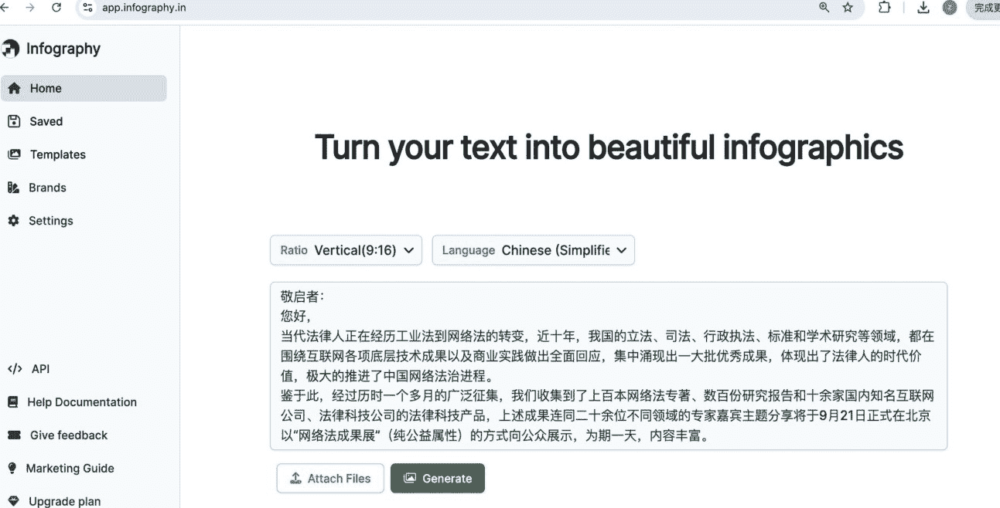

笔者直接挑了一张首轮生成的效果图，没有进行局部修改，如果根据实际需要修改之后，完成度会更高。

当然，如果你对这种 AI 直出图不够满意，系统还准备了大量的模板，可以直接套用生成。不难发现，这种工具做海报可以，做公众号的封面图、邀请函等也都没问题，可以举一反三，灵活运用。

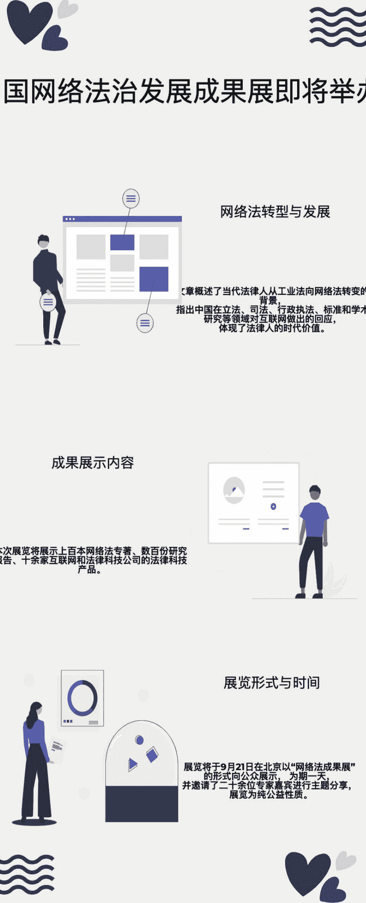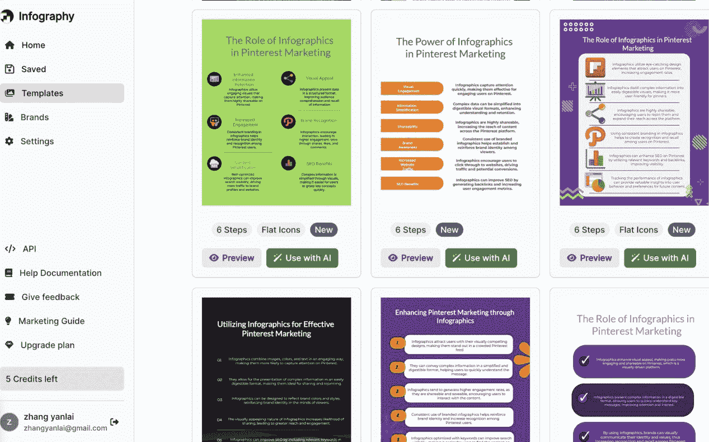

整体感受下来，AI 让美工下岗的说法真不是夸张，细心摸索，还能找到更多好用的工具，而且响应速度极快，法律终于可以不再枯燥，展现出她独有的“理性之美”。

## **AI 浏览器：从超级入口到超级助手**

**进阶要点**

一直以来，浏览器都被我们当作上网冲浪的入口，我们靠浏览器向服务器发送内容请求并且得到服务器的反馈，在浏览器上面查看内容。它就像一扇窗，把网络世界上的内容呈现在我们面前。

但我们很快也会发现一个问题，就是浏览器作为一个窗口是静态的，它只能根据我们点击的链接来机械地呈现内容。但实际上，我们并不只是希望通过网络接触和了解信息，我们更加需要的是总结、分析和处理这些信息。进入 AI 时代之后，浏览器也随之蜕变，经过 AI 的赋能，它摇身一变成了我们的超级助手。

**进阶路径**

有不少科技界的意见领袖都发表过一个观点，就是认为 AI 会把所有的互联网产品都重做一遍。这句话反映到浏览器这个产品上是非常正确的，有了 AI 加持的浏览器几乎成了跟之前完全不同的一个全新的产品。

**一、360AI 浏览器：浏览即理解**

我们以 360AI 浏览器为例，来看一下它可以在我们的日常工作当中起到哪些类似助手的效果。

可以看到，我们观看一些长视频的时候，AI 可以自动对视频内容进行总结并给出要点。

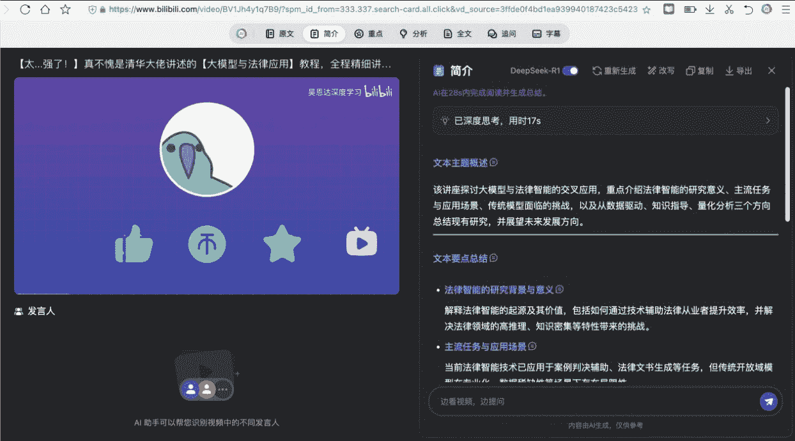

甚至快速将视频内容生成脑图，让我们直观地把握视频内容的整体框架。

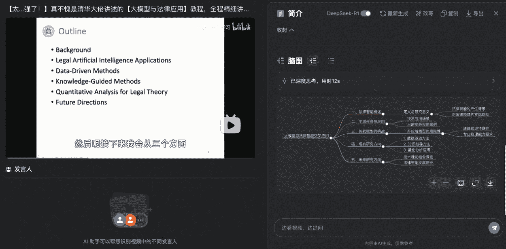

接下来，我们可以根据 AI 提炼的要点和脑图框架，直接针对我们最想了解的视频部分进行提问，让 AI 根据视频进行回答，大大提高了我们精准学习的效率。

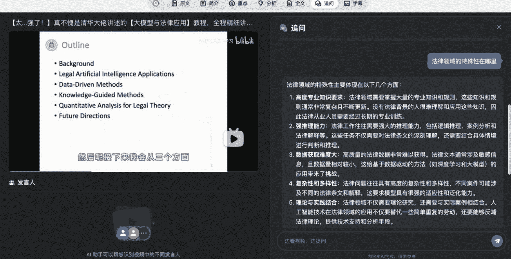

AI 并不局限于对内容本身的分析，还可以进一步进行处理，如对提取的文字要点按照不同的场景进行“改写”，直接写成“新闻稿”等格式：

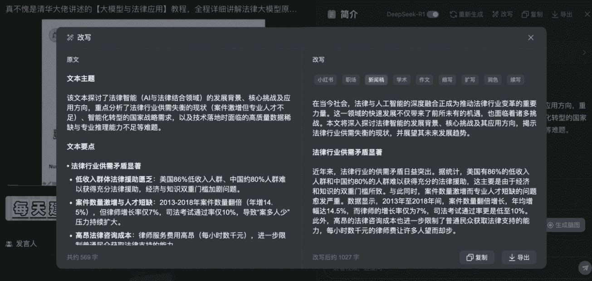

基本上就相当于把视频内容当作一个点对点的知识库来使用。不止是视频，其他形式的内容都可以作类似处理，下面是豆包浏览器基于文本页面的 AI 问答处理，非常准确快捷，可以想象一下我们今后使用互联网的效率会有多高。

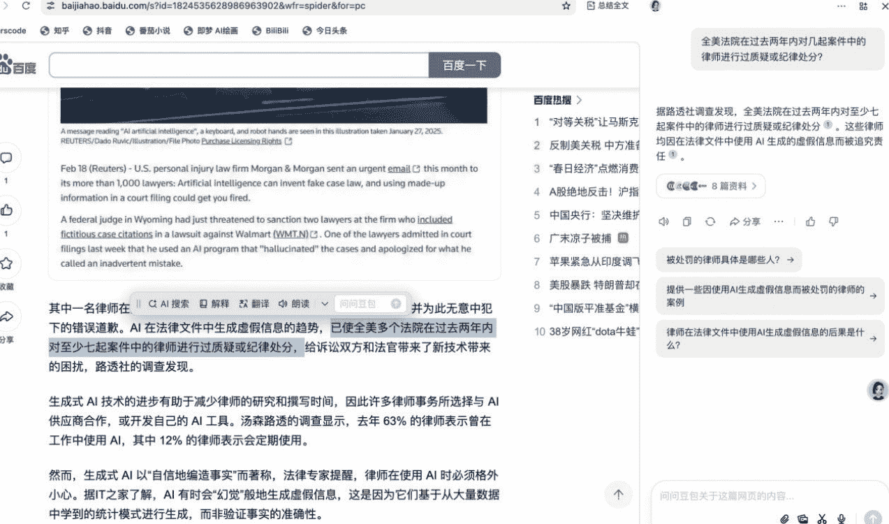

**二、chatGLM & autoGLM 插件：给浏览器装个“大脑”**

AI 赋能浏览器可以带来的功能还有很多，我们再举一个智谱清言浏览器插件 chatGLM & autoGLM 的例子。插件的技术路线有独特的优势，用户只需要在自己习惯的浏览器上安装插件即可使用，不需要另外切换新浏览器。

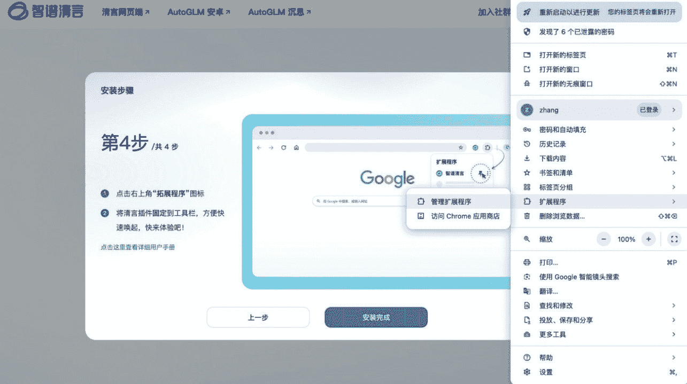

我们把 chatGLM & autoGLM 插件安装到 google chrome 浏览器，就会在右下角出现一个小图标，点击唤醒之后，就会在网页右侧展开使用界面：

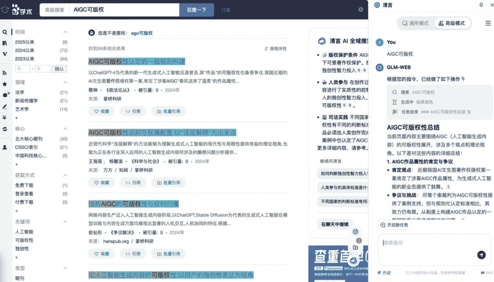

我们在百度学术网页中唤醒插件，提出需求“AIGC 可版权”，可以看到 AI 把关键词放到搜索框中寻找相关结果，并且在右侧边栏根据结果从肯定、否定观点等角度进行梳理，可以大大节约我们研究的时间。

实际上，AI 对浏览器的产品改造仍处在早期阶段，在这个超级流量入口上，AI 能做的事情还有很多，我们可以持续关注一些主流产品的进展，要把浏览器当成助手来用，这样你将时时感受到惊喜。

## **信息大爆炸：AI 超级过滤器**

**进阶要点**

随着技术和商业的不断变化，法律人面临着层出不穷的新问题，需要在信息爆炸的环境里快速掌握想要的知识。不论是立法、司法案例还是产业动态，过去我们需要花非常多的时间来检索和梳理信息，去粗取精，并经二次加工之后使用，但 AI 的出现让我们有了更好的信息过滤工具，可以驱动 AI 到指定的目标站点批量获取和筛选信息，甚至有些工具已经能做到提前筛选，我们可以“拿来主义”。

很多时候，法律人的综合能力也体现在多信息的快速获取和提炼，让自己成为信息集散中心，向客户和潜在合作方分发，此外还可以把信息加工成优质内容通过媒体平台分发，获取流量。

**进阶路径**

爬虫是一个一直以来被广泛使用的信息获取工具，以其自动化和高效率著称，但在法律行业的使用并不普遍，主要原因还是在于爬虫有一定的专业门槛。但 AI 的介入使得爬虫更加智能，操作方法也更加友好，我们可以把市面上这些好用的 AI 爬虫工具与工作场景结合起来，让我们不至于被海量信息所淹没。当然，前提是用于学习和研究，不能滥用爬虫给目标站点造成负面影响。

**一、firecrawl：多站点定向筛选**

firecrawl 就是一个典型的 AI 驱动的信息获取工具，可以对目标站点的信息进行自动处理，尤其是最新上线的“提炼”功能，支持同时检索多个目标站点，根据用户的提示词要求，精准获取想要的信息。

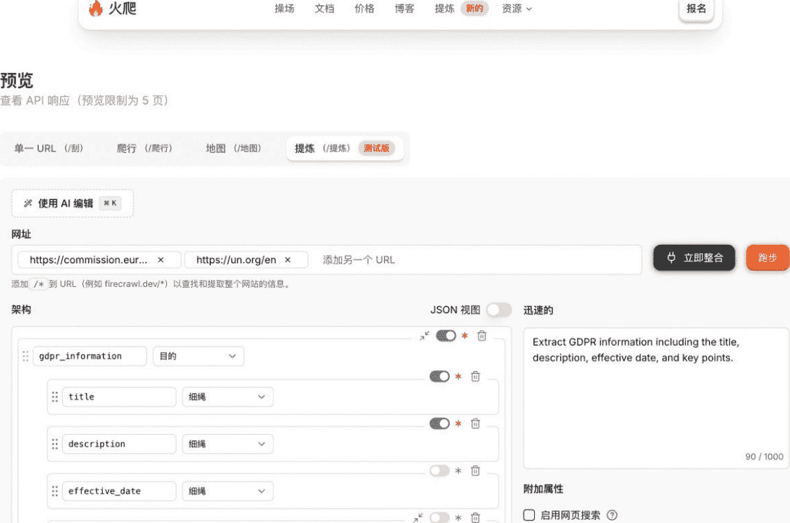

我们把欧盟委员会和联合国官网作为目标站点，通过提示词提出要求获取与 GDPR 相关的内容，可以看到它遍历目标站点，把信息集中呈现出来并且附上对应的链接，还能直接下载为 JSON 的格式。这种文件格式能够匹配模型训练的语料格式要求，可以把获取的某一类内容直接做成语料或者知识库，投喂给模型进一步微调使用。

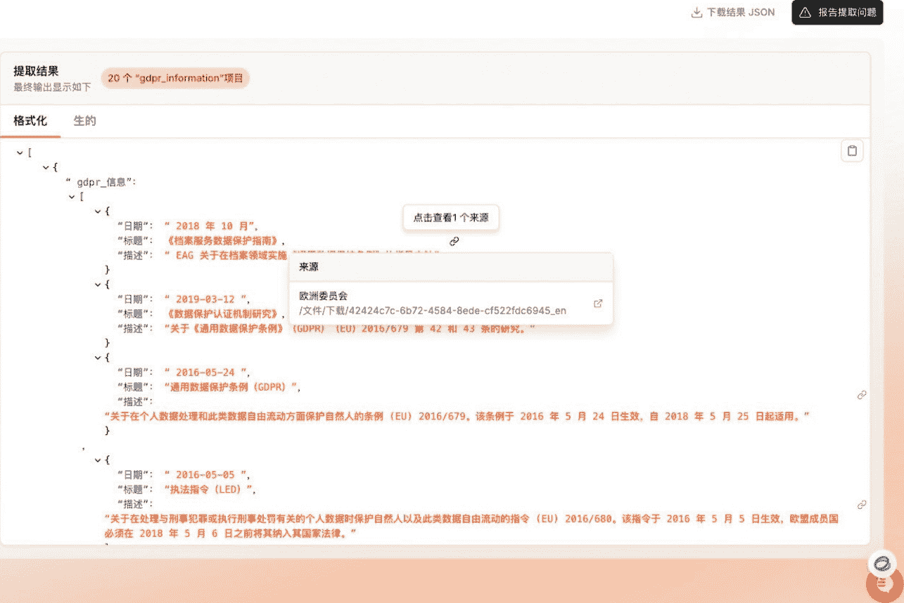

**二、newsminimalist：新闻极简主义**

另一个很好的例子是 newsminimalist.com 网站，开发者基于想快速了解全球范围内最重要的新闻这一痛点，使用 ChatGPT 每天分析 10000 多篇新闻文章。然后为它们赋予从 0 到 10 的重要性分数，从而提取出最重要的新闻内容，让用户省去了海量检索筛选工作，第一时间了解重要信息。

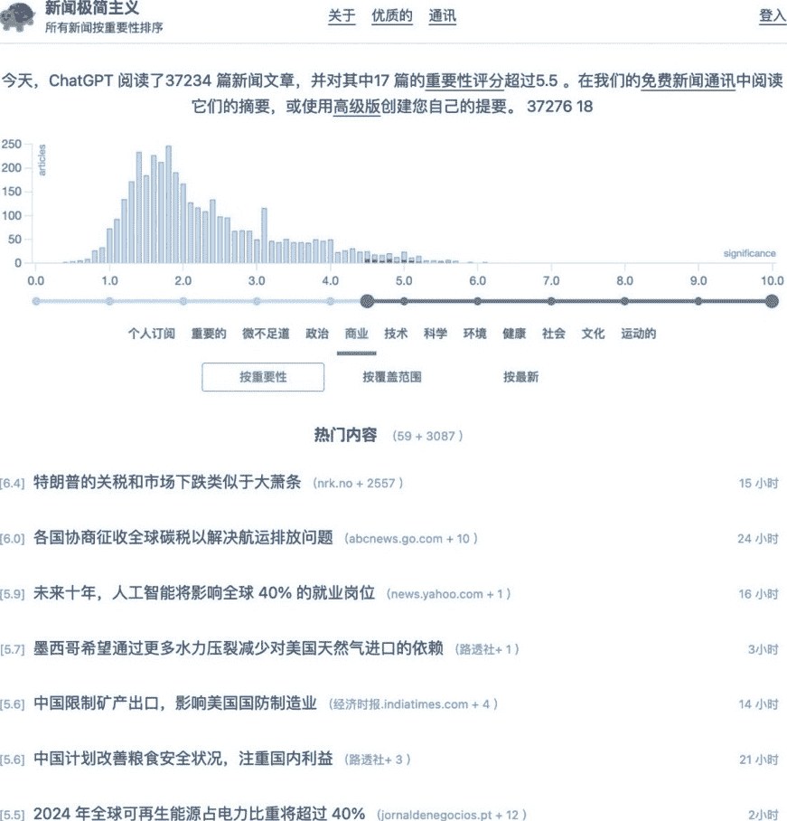

当然，通过付费订阅可以使用高级功能，进一步限定想看的信息，来获得系统的定期推送。

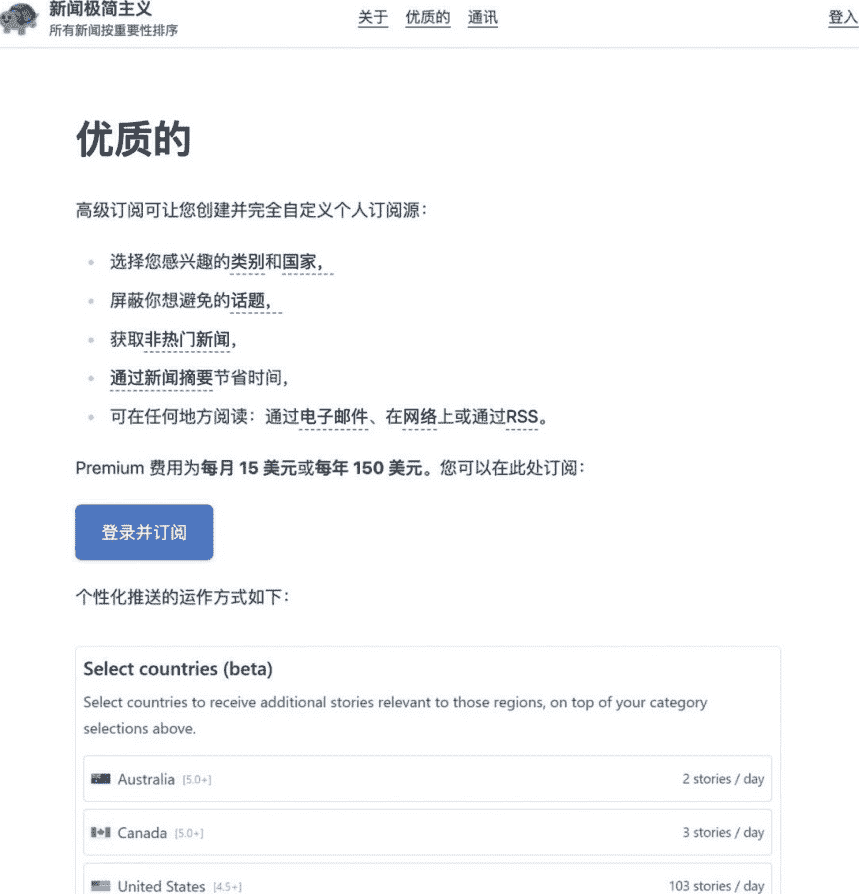

我们获得这些内容以后，可以第一时间结合法律专业给出分析解读或者其他客户想要的处理。我们常常看到有些同行总能在第一时间了解热点新闻事件，并且给出专业意见，很可能就是他们使用了类似的 AI 工具来自动跟踪热点。

**三、AI 首席情报官：交叉跟踪信息源**

再看另一个支持给定网站和监测主题之后，自动跟踪和反馈的 AI 站点：www.aiqingbaoguan.com（AI 首席情报官）。

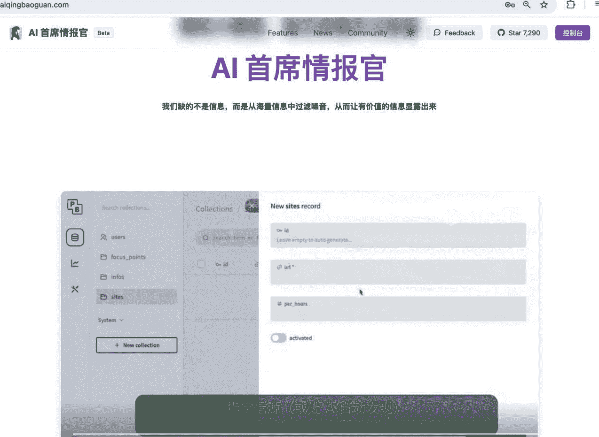

我们在“信息源管理”一栏输入目标站点作为要跟踪的信息源：

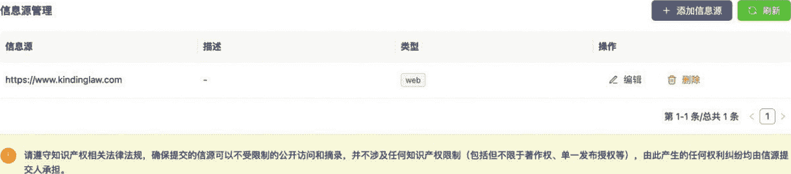

然后在“关注点管理”一栏输入希望跟踪的主题，接下来系统就会自动获取内容并且定期更新。

而且系统还支持把不同的关注点和对应的信息源网站进行绑定，这样就可以交叉跟踪不同站点里的不同主题，非常高效便捷（限于篇幅，这里不再展示跟踪效果）。

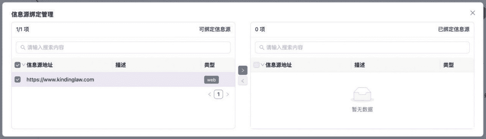

总之，工具是人的延伸，AI 大大拓展了人力可以触及的范围，好的 AI 信息获取工具可以让你“人在家中坐，信息天上来”。我们可以摆脱寻找和挑选的过程，直接进入处理环节。

## **office AI：办公软件迎来第二春**

**进阶要点**

法律人面临着大量的文本处理工作，所以 word、ppt、excel 这三个最常用的办公软件仍然是我们最高频使用的工具，即便是大模型出现之后，我们在模型生成的很多内容，仍然要回到办公软件中进一步处理和编辑。

好消息是这些办公软件已经开始用 AI 进行自我赋能了，也就是说我们很多时候可以直接在办公软件界面调用其自带或者第三方的 AI 功能，让我们的文档处理事半功倍。

**进阶路径**

以最常见的 WPS word 为例，当我们打开一个空白页之后，页面上方就会提示可以通过双击 command 快捷键来唤起 WPS AI：

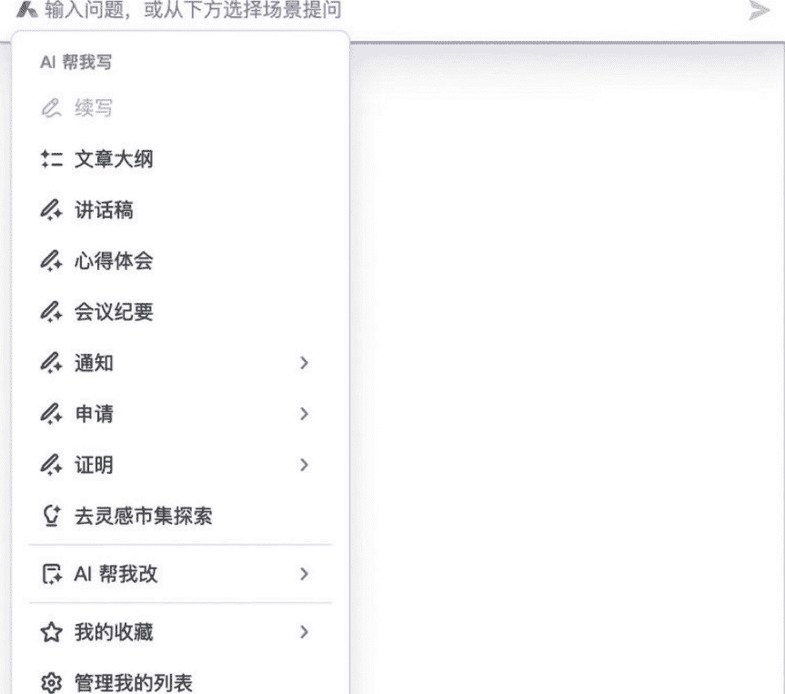

然后可以在提示栏直接给出撰写需求，或者在下拉列表中调用更具体的功能，实现讲话稿、会议纪要等常见文稿的自动撰写。

除此之外，还可以在编辑长文档的过程中，直接使用其 AI 助手智能生成目录。这个功能在长篇法律文本（尽调报告、法律意见等）生成目录时很有帮助。

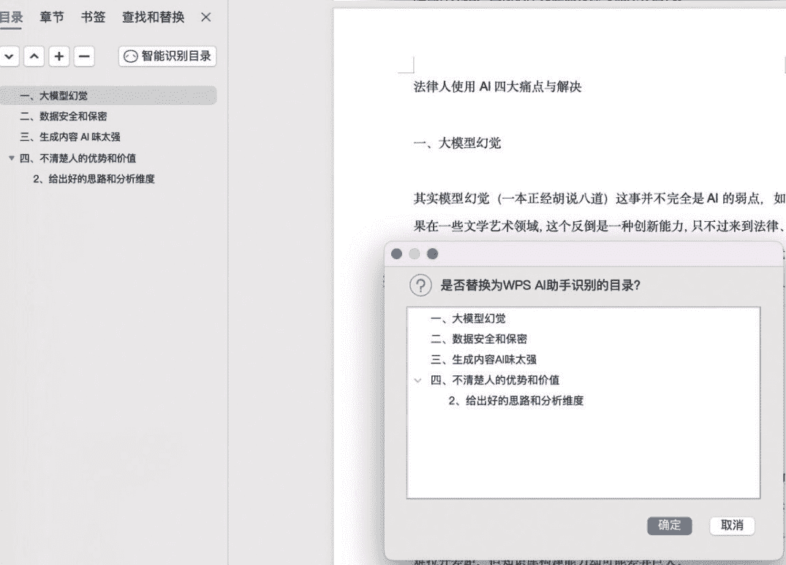

还有一个智能排版的功能也对不擅长排版但又对版式要求很高的法律人非常友好，只需要在文档写好之后，点击一下一键排版，然后选择喜欢的版式就可以直接应用。

在撰写过程中，还可以随时让 AI 改写、总结等，都可以很大程度提升效率。

再来看一个 WPS ppt 的例子。当我们创建一个新的 ppt 时，系统会自动给出一个“WPS AI 一键生成幻灯片”的选项。

这个功能的使用也非常简便高效，支持给定主题之后自动生成 ppt，也支持上传 word 文档或者思维导图后生成，后者非常契合我们根据文稿制作对应的 ppt 的需求。

同样，在 WPS excel 中也可以呼唤出 WPS AI，用它智能分析和处理表格的数据，如下图左侧所示的数据，笔者让 AI 生成右侧对应的柱状图。

如果对系统自带的 AI 功能不满意，还可以通过插件等方式将 DeepSeek 等大模型接入办公软件中，以实现更多智能化的操作。

除了 WPS 系列的办公软件，微软的办公套件也同样开始内置 AI 功能 copilot，我们就不作展开了。

总之，AI 的加入使得传统办公软件的使用门槛大大降低，我们不再需要掌握复杂的操作方法，只需要给出自然语言指令，AI 就可以把办公软件的各项功能最大限度地激发出来为我们提供服务。如果说之前我们只是发挥出了办公软件 10%的功力，AI 赋能之后，多数人都可以在不增加学习成本的前提下发挥出软件 80%的能力，这就是典型的降本增效。

## **开不完的会：AI 替你去**

**进阶要点**

工作中永远有开不完的会，特别是会议软件发达的今天，线上会议非常密集，甚至有些是临时需要加入的，根本来不及做相应的准备。开会的痛点显而易见，与会者的发言顺序是线性的，一个人讲完了再由另一个人讲，这导致我们必须全程聚精会神才能捕捉到想要的关键信息，但实际上很多会议一两个小时下来，我们真正想要了解的不超过十分钟。

参与人数比较多的会议更累，也许其中与自己相关的只有一两个环节，但是却要被迫全程听完，除此以外，还有会议之后的总结、与自己有关的下一步工作任务等。现在，专门的会议 AI 助手出现了，用好它们，至少节约一半的时间和精力。

**进阶路径**

目前，对于主流的会议软件，都开发出了基于大模型的会议 AI 助手，我们挑几个比较有代表性的给大家示范一下看看效果。

**一、腾讯会议 AI 小助手**

将会议中的语音实时转写为文字是最基本的功能，但这项功能其实非常实用。语音的交流效率实际上不如文字，如果把大段语音转成文字，我们可以扫一眼就锁定关键信息。但如果要听语音的话，就要一直听完，所以可以在开会的时候开启实时转写，看每个人发言的文字版就可以了。

接下来，我们可以使用 AI 小助手更智能的功能，开启“智能提醒”，设置哪些人提到我以及提到哪些关键词的时候，就自动提醒。

这个功能可用于参加多人会议，但只需要了解与你相关的内容的场合，特别是可以设置某些人（如你的领导、小组成员）提到与你相关的内容时，系统会给你提示。例如，下图中设置的就是当与会者提到与我相关的主题中包括了“AIGC”这个关键词时，系统就会进行提示。

这很像你派了一个助手替你开会，一旦有人提到你的名字，助手就赶紧跑过来告诉你：“快来听一下，他们在说你了！”。

会议进行过程中，常常会遇到有人提及的内容刚好是我们的知识盲区，这时可以呼唤出 AI 助手查找相关的背景资料：

会议完成之后，可以让 AI 总结、整理会议内容，对于一些没必要全程参与，或者只需要了解大致情况的会议非常好用。

甚至可以做到定向获取某些与会人员的发言内容，直接以自然语言向 AI 助手提问就可以了。

**二、钉钉闪记**

钉钉也是常用的会议软件，系统目前上线了 AI 功能——“闪记”，同样可以对语音进行文字实时转写。

接下来可以通过通义千问大模型对会议内容生成“智能摘要”，这时大模型对长文本（语音）的理解和总结能力就体现出来了。

通常会议之后，都要有进一步的行动，也就是待办事项，“闪记”也非常贴心地直接整理出来了。

**三、zoom AI Companion**

ZOOM 常被用于涉外的场合，系统同样基于模型能力加入了 AI Companion 的智能助手，但笔者只是在官网查看了功能介绍，还没有亲自测试。从介绍情况来看，AI Companion 除了常见的一些 AI 会议能力，更适合跨国别、多语种会议。如约不同时区的同事开会时，AI 可以进行跨时区协调，通过自动分析大家的日程和时区偏好推荐最佳时间，省去反复拉群投票的麻烦 ^(⁵)。

如果我们是中途参会（或者迟到），AI Companion 也可以帮助我们随时跟上会议节奏，了解之前已经讨论过的内容以及自己是否被提到过，很贴近现实场景。

此外，AI Companion 的一个亮点功能是对会议过程中共享的文档直接进行总结，这个非常节约时间，解决了会议过程中要实时阅读长文档的痛点。

以上只是展示了一部分会议 AI 的功能，相信大模型还能在会议场景中给我们带来更多惊喜，总体上就是围绕将人从繁重的沟通任务中解放出来，只关注最重要的部分。也有会议 AI 开始在一些垂直场景中开发更深度的功能（如金融、医疗等），相信法律领域专用的会议 AI 模型也很快会出现，届时法律人也许可以体会到什么是真正的“会当凌绝顶，一览众山小”了。

## **合同智能化来袭：站在更高处**

**进阶要点**

合同可以说是律师和法务最高频的刚需业务场景，因为但凡涉及人和人或者机构之间的协作都需要合同来确定法律关系。所以 AI 的这一波应用，很多法律科技机构都会率先以合同作为切入点。

面对五花八门的合同 AI 工具，哪些合同适合交给机器处理，哪些需要人机协同才能解决，以及在合同之外还可以借助 AI 做哪些更深度的衍生价值挖掘，这是我们在合同智能化场景中应该搞清楚的问题。

**进阶路径**

笔者与几家以合同为产品重心的法律科技公司的负责人都有接触，与他们进行过交流。再加上笔者自己的体会，有以下几点可以供大家参考。

**一、标准化合同：直接放手**

标准化的常见合同基本上已经不需要人工的参与了，这个部分是律师和法务要远离的地方，因为现有的合同审核系统已经非常成熟，有大量经过推敲的模板，再加上在这些领域，双方的权利义务关系比较清晰，也没有什么争议。

因此，我们看到的趋势是在这部分合同实践中产品化的速度是很快的，客户将这部分合同交付给人工智能或者审查系统处理的意愿非常强，效果也很好。

某合同审查系统界面 ^(⁶)

**二、个性化合同：人机协作**

再往深一层看就是相对复杂一点、个性化一点的合同场景。这类合同的特点是双方的诉求比较个性化，需要了解一定的交易背景，因此如果单纯通过合同审查系统根据过往的经验进行处理，很难抓住重点。

对于这类合同的处理，比较好的方式应该是人机协作。人在这个过程当中的作用是提供审核的重心或者指引和规则，然后由机器根据已经限定好的方向进行处理，有点像是人来指挥机器干活。

这让我想起了之前为某家云计算公司提供法律顾问服务，他们每年都有一批网络营销合同让律师进行审查，而且标的额都比较大，所以公司很重视。但是他们的法务团队并没有直接丢给律师就不闻不问，而是在交付这些合同的同时就直接给出了审查的指引，里面包括几十条审查重点，以及如果碰到相关的问题，应该怎样去表述和修改。这个审查指引很好地确保了律师接下来提供服务的质量。

我当然也没有机械地去执行，而是一边审核一边发现新的问题，到最后经过半年左右的时间，我已经把他们原来的审核指引扩充了一倍的内容。经过法务部门确认，我们按照这个新版的指引来进行审核，在确保质量的情况下效率越来越高。

这其实是一个很好的例子，比较个性化的合同的审查需要有人结合双方的诉求以及合同交易的背景来给出相应的指引，而不是让完全不了解情况的人或者机器凭借过往的经验自由发挥，否则很容易货不对板。当然，好的 AI 合同审查系统也不会完全依赖人的指导，而是可以凭借训练和学习在不同场景下给用户引导，自己给自己设定规则，在用户确认后按照规则执行。

幂律智能开发的无忧吾虑合同审查系统，在上传合同后，系统可以根据设定的审查立场自动匹配审查的核心目的，同时也支持用户自行调整目的 ^(⁷)。

**三、复杂交易中的一环**

再往下一层就是更加复杂的情况，即合同本身只是复杂交易的一个部分，处在一个更大、更复杂的背景和框架中，这就涉及法务或者律师甚至是公司负责人在战略层面的决策。只有在他们选定了合适的路径和方向之后，才能进行相关合同条款的起草或者修订。

在这种情况下，仅就合同本身进行审查是很难发现问题的，就像管中窥豹，可见一斑却无法看到全貌。在这种情况下，发挥主导性作用的还应该是人，因为机器毕竟还没有全流程介入这种复杂的交易，也没有能力全面掌握项目的背景和目的。

**四、合同之外**

AI 在合同领域中的应用不仅仅是针对合同本身的起草或者修订，事实上完全可以用 AI 去挖掘过往的合同历史数据，从中分析公司接下来需要在合同领域或者相关领域进行调整和优化的地方，甚至进行违约风险提示，或者提出履约方面的建议。

比如，根据供应商历年的交货和验收记录等数据来判断供应商的履约能力，进而建议公司是否给这个供应商较高的供应链融资额度。机器在这些方面更加擅长，人只要设定科学的判断逻辑并且转化为算法就可以了。

所以总体上看，AI 在合同领域的技术运用比在一般法律服务领域更强一些，投入也会更多。在这种情况下，对于传统律师和法务就提出了更高的要求。我们可能不仅要了解法律方面的内容，还要更多地去了解商务和财务方面的内容，了解客户公司的战略意图，并且应当有能力驾驭 AI 所提供的各种基础性线索和数据，从中发现真正可用的信息并进行决策。

## **司法 AI 进化提速：诉讼律师应对之道**

**进阶要点**

一直以来，法院在信息技术的运用上一般比律师行业要快，特别是近期，司法系统开始使用要素式诉讼文本和 AI 审判辅助系统，这对于诉讼律师而言是一个非常值得关注的新情况，因为这只是司法 AI 化升级的第一个阶段，接下来如何调整自己的诉讼技能和业务方向，不被司法的技术升级甩在身后，是每一个诉讼律师和法务需要思考的。

**进阶背景**

2024 年 3 月 4 日，最高人民法院、司法部、中华全国律师协会联合印发《关于印发部分案件民事起诉状、答辩状示范文本（试行）的通知》，针对金融借款、民间借贷、劳动争议等 11 类常见多发的民事案件，制定表格化、要素式民事起诉状、答辩状示范文本，并要求全面应用统一规范、要素齐全的起诉状、答辩状示范文本，随即各基层法院开始将新版起诉状、答辩状示范文本二维码摆放在诉讼服务大厅显眼位置便于当事人、律师下载使用。

跟 2016 年法院发布的诉讼文书样式相比，新的示范文本内容更细致，将当事人信息、诉讼请求、事实和理由、证据等各项内容逐一要素化、表格化，尽可能在诉讼之前就把信息采集工作做透。

很显然，这个动作是为之后的审判信息化打基础的，笔者在本书中多次提到“结构化”这个概念，而诉讼文书的“要素化”跟“结构化”其实是一个意思，都是便于系统进行自动化的处理，尤其是 AI 系统。

果然，在文书要素化工作推进的同时，法院也开始了智能辅助审判系统的建设，2025 年 1 月，深圳中院完成全国首个司法审判垂直领域大模型预训练 ^(⁸)，在全国率先研发人工智能辅助审判系统，覆盖审判业务四大环节 85 项流程，并初步形成人工智能司法应用规则。

据介绍，该系统还可以在诉讼的全流程实现高度智能化，包括立案智审、智能阅卷、智能庭审、智能文书辅助生成，串联起审判业务四大环节功能模块。这些智能化的审判系统，正是建立在诉讼文书要素化的基础之上，一旦这种模式被验证成熟，很快就可以在全国法院系统上推广。

之所以司法系统在信息化建设上总是快人一步，原因很简单，法院是一个统一的体系，没有数据孤岛的困扰，而且法院的数据主要就是高度结构化的诉讼文书和判例数据，并且诉讼高度依赖流程，这些都为 AI 的应用提供了良好的条件。相比较而言，律师和法务就很难了，知识管理相对零散、工作中过分依赖个人经验、重视市场轻视技术等都大大减缓了信息技术在这个群体中的应用。

**进阶路径**

无论如何，法律人是一个职业共同体，相互依存，在各自的生态位发挥价值，这也使得一旦司法作为其中的关键角色发生变化，必然引发连锁反应，诉讼律师如果不及时跟进法院的进化，是难以保质保量满足客户诉讼需求的。

**一、熟悉 AI 化审判流程**

早年互联网法院刚出现的时候，很多人也不适应线上庭审，甚至有人说这种线上审判的模式不利于树立司法权威。但今天越来越多律师不但习惯了线上庭审，而且已经充分享受到线上庭审带来的巨大效率提升。要素式诉讼文书和 AI 辅助审判系统引入后，律师和诉讼法务同样不应该抵触，而是应尽快了解和适应，摸清楚法官可能依赖的 AI 辅助决策逻辑，针对性提交更符合系统识别标准的证据和论点，尤其应该关注 AI 对证据链的自动化分析能力，在证据准备阶段确保材料逻辑严密、形式规范，避免因 AI 误判导致关键信息被忽略。

**二、北大法宝：类案检索报告**

最高人民法院要求“同案同判”，这对诉讼律师而言，意味着制作类案检索报告变得至关重要，一份类案检索报告大致应包括封面、待决案件基本情况、检索结果基本情况、检索结果与待决案件参照适用情况、类案检索报告结论等内容 ^(⁹)，有了类案报告，我们才能在此基础上找到对待决案件有价值的参照，要求同案同判，或者找出与近似案例的差异，要求个案处理。

这个过程中，很多专业的法律数据库或者 AI 模型已经提供了类案检索功能，如北大法宝的“类案检索平台”，支持按照案由、案情、争议焦点、法律适用进行检索的模式，可以根据不同角色的检索需求，定制化生成检索报告。

（北大法宝 ^(¹⁰)）

此外还支持“智能模式”，可以通过提供案情描述（审理经过+原告诉称+被告辩称+审理查明）、一审案件的案号，上传文书来直接“以案搜案”，这种更适用于有一审判决或者拿到了其他可参考的一审案例并且希望借此检索更多类案的情况。

（北大法宝 ^(¹¹)）

**三、巧用 Deep Research 做案件推演**

各大通用模型几乎都有自己的 Deep Research 功能，可以把它看成一个资深研究员智能体，很多人用这个功能撰写深度研究报告，实际上在诉讼过程中，完全可以让它为我们提前做一遍诉讼推演。例如，笔者使用 Google Gemini 的 Deep Research 功能，提出需求为：“作为 ios 开发者，被苹果冻结了应用内的交易款项，如果希望通过主张苹果 Appstore 业务构成垄断行为维权要回冻结款项，应该从哪些具体维度展开？需要哪些有力证据？苹果会从哪些角度抗辩？开发者胜诉的关键因素有哪些？参考苹果已经发生的垄断案判决给出深度分析，以便原告提起诉讼参考。”此时可以看到系统开始拆解分析流程：

在得到你的确认后，系统按照工作流程开始逐步分析，这个过程通常比一般的问答任务要消耗更多时间，所以系统告知你可以离开去做别的事，不影响它继续工作：

最后，系统会给出非常详尽的分析报告，我们可以借助这种深度研究能力，对疑难复杂案件进行推演，提前掌握案件的走势，制定出针对性的策略，某种程度上可以把 Deep Research 当成一个水平非常高的同事或者对方代理人。

（苹果 APP Store 流程图 ^(¹²)）

**四、量化预判案件走向**

事实上，有了类案检索、Deep Research 等诸多 AI 工具，我们可以更大程度上给出案件的量化分析，提前预判案件的走向甚至可能的结果，当然这只是预判而非对结果的承诺，由此带来诉讼律师服务的一个重大转折，就是可以在这些扎实分析和预判的基础上给当事人提供服务，让他们提前对案件有一个更加准确的预期。

## **小心被 AI 遗忘：大模型不是“检索”而是“理解”你**

**进阶要点**

必须承认，AI 将会在人们的决策过程中扮演越来越重要的作用，客户选择律师也是一个决策，而且极有可能成为律师进入客户视野最关键的渠道。这个逻辑对法务也一样适用，猎头或者企业负责人在招聘法务的时候也会越来越依赖 AI 的推荐。

所以，一个关键问题摆在我们面前，如果让 AI 知道我们并且适时地把我们带到需求方面前，这跟传统做搜索引擎推荐的逻辑有很大区别，AI 不是单纯的检索，它需要全面的“理解”你。

**进阶路径**

各位读者，您现在可以打开一个大模型，用“/trace+自己的名字和职务”作为提示输入，看看模型给出的是什么结果，同时还可以把自己觉得可能的竞争对手输入进去对比一下。

还可以再尝试另外一种提示，模仿对你有需求的用户（可以是当事人或者公司老板等）在 AI 中提问，“在数据合规领域有哪些专业的律师”“在网络侵权方面有没有经验丰富的法务”，接下来可以看一下结果里有没有你。

如果你发现在这两种情况下，自己的信息在 AI 里既少又凌乱，就要留神了，这在一定程度上说明大模型没有清晰地将你识别和记忆，从而也就无法把你精准地投送到需求方。

**一、模型正在给你画像**

传统的关键词驱动式搜索引擎正在被提示词驱动式的 AI 所替代，人们今后获取信息的主战场一定是大模型，模型一定会采集全网关于你的数据进而给出一个更加全面的画像，而非像传统搜索一样只能给出跟你有关的信息链接。

传统搜索引擎主要依赖关键词排名和链接展示，用户点击链接获取信息，因此很多法律人或者法律服务机构都去围绕关键字做搜索优化，典型的就是购买竞价排名，让自己位于搜索结果的前排位置。

AI 却正在一点点地重塑搜索逻辑和结果呈现形式，直接基于对个人或机构的深度理解输出答案摘要，用户可能无须点击网站就可以全面了解情况。

当法律服务的竞争从搜索引擎爬虫升级到大模型认知战争，律师需要以更工程化的思维构建数字身份。记住：AI 不是在“检索”你，而是在“理解”你——这意味着我们必须用机器的逻辑重新诠释专业价值。

**二、五步提升 AI“能见度”**

在这个过程中，无论是个人还是机构，都需要重新审视在网络上发布的信息，从而做到让大模型更好地“理解”，提升 AI 能见度。

**1.提供结构化内容**

大模型对信息的理解依赖结构化数据的内在逻辑，散乱的非结构化内容（如纯文本、图片）会导致 AI 抓取效率低下甚至误读。需通过以下方式重构内容呈现形式：

结构化的目的是让信息从“人类可读”到“机器可解”，当你仅仅是在网页上写下“处理过 50+数据合规案件”时，人类读者会理解这代表经验丰富，但 AI 需要的是结构化答案：

■这 50 个案件分布在哪些年份？

■涉及多少种行业类型？

■对应的法律条款引用频次如何？

通过结构化的内容，你实际上是在为 AI 编写一份“阅读理解标准答案”，只有让机器理解你，才能让需要你的人找到你。

**2.时间轴呈现：强化专业成长数字足迹**

例如，在官网设置“里程碑”板块，用机器可解析的格式展示关键事件，按时间线展示案件、立法参与、学术成果的演进关系。

可以进一步在页面上使用 JSON-LD 格式标注机器可读的履历信息，方便模型爬虫结构化获取。

**3.增加权威可信度验证**

AI 会通过交叉验证排除虚假信息，所以我们需要注意引入可以验证的信息，例如：

■可以闭环验证的资质信息：律协公示信息→学术期刊作者单位→媒体报道机构名称等是否一致。

■时间逻辑：胜诉案例判决时间是否早于相关经验介绍文章的发布时间。

■数据溯源性：引用的法律条文是否精确到条款编号，司法解释是否标注文号。

■专家背书：参与行业白皮书撰写、司法研讨会发言并公开报道链接。

**4.跨平台分发专业内容**

在单一平台发布内容可能因为数据孤岛被模型“忽视”，可以考虑在多个平台上发布不同类型内容，扩充数据丰富度，如在专业学术平台（威科先行、北大法宝等）发布实务指引，在问答社区（知乎等）维护问答专栏，在视频平台（B 站、微信视频等）发布案例解析，在行业媒体（电子期刊、杂志等）开设专家点评栏目。

多平台分发过程中要特别注意身份统一，尽量使用相同的姓名/机构名称拼写，维持统一的视觉识别系统，如设计专属知识卡片模板（含统一配色、版式、Logo），强化 AI 的图像识别记忆。

**5.成为垂直法律模型的内容源**

一个不可忽视的趋势是，一定会有越来越多的法律个体和机构选择使用专门研发的法律垂直模型，这种模型毕竟在专业度和完成度上更有保障，而且一旦公司法务团队（客户）或者竞争对手使用之后，必然会引发跟随效应。所以，在这些垂直模型中能否成为其优质内容提供者，从而获得模型的推荐是非常关键的一环。

专业法律人可以考虑选择那些愿意构建良性内容生态的模型，在为模型提供优质语料的同时，获得模型给予的曝光度和背书。

总之，AI 时代的法律人正在从“流量争夺”转向“知识权威塑造”，应该时刻结合模型的“理解逻辑”，通过深度内容、技术适配和信任强化，成为 AI 系统的“优选信源”。

# **2**

# **第二模块：高阶定制**

# ——法律人专属 AI 解决方案

## **虚拟数字人：打造律师个人 IP 捷径**

**进阶要点**

短视频时代，没有真人出镜总显得缺少温度，法律人虽然以理性著称，但在大量的法律工作中离不开感性和直观感受，这也是不少同行常常提到的“情绪价值”，尤其是打造法律人个人 IP 的过程中，更加需要有人的具体形象呈现，如此才能让专业具有温度。

这也对人的表达提出了更高要求，在保证高频出镜率的同时，还要有镜头前的“网感”，不少法律人直呼“太难了！”。数字人技术的出现似乎正在让法律人的焦虑得以缓解，特别是当制作门槛降到足够低的时候，好像成为一名专业网红的梦想开始照进现实。

**进阶路径**

数字人的技术已经变得非常成熟，使用门槛较之以前大大降低，甚至简单到给出一张照片和文案，就可以自动生成视频。

**一、闪剪：数字人孵化器**

我们以“闪剪”为例，用笔者的照片先尝试一下：

如果想生成更加逼真的视频，仅靠照片还不够，还需要上传一段符合要求的视频，并且提供一段语音，就可以训练出完成度很高的数字人分身了。

仍以“闪剪”为例，上传一段 10s—20s 的视频，然后再朗读一段文本作为声音样本，就可以完成训练。

接下来，可以用这个训练好的数字人分身去播报你想要的文字内容：

**二、应用场景：自媒体矩阵与“网感缺失”**

数字人分身目前看来比较适用于两种情况：一种是做视频号矩阵，需要大批量地快速生产视频内容，可以真人出镜，也可以用数字人工具当中本来已有的公模（人物模特）出镜，并且可以用工具当中的大模型自动生成相关的文案，快速地获取某一个专业领域里面的知识点或者是热点进行解读。

这种批量生产、快速复制的方式笔者并没有亲自试用过，所以不知道效果如何，个人推测还是适用于那些高频刚需的法律服务领域，如婚姻家事、刑事犯罪辩护等，因为与之相关的话题比较多，生成起来也比较简单，很适合大批量制作之后进行普法而为账号引流。

另一种就是适合于具有很多专业知识储备，但个人出镜能力并不是很强、缺乏“网感”的人，或者是没有太多时间录制视频。可以训练出真人数字分身，然后把过往积累的内容直接复制粘贴过去，相当于把已经储备好的文字内容转化成视频内容。

数字人的玩法并不只有这一种，还有更多可以尝试的方式。如当下非常火爆的“look in my eyes”二创视频，在一定程度上能够让法律内容更具有娱乐属性。总之法律人也需要不断地尝试和突破，在输出内容的过程当中不一定非要保持正襟危坐，可以借助新的技术尝试一些新的玩法，当然无论如何在内容上还是要确保专业。

值得一提的是，笔者仍然认为在短视频这个已经成为红海的领域，如果想做好个人 IP，还是要真人直接出镜。这种真人出镜所带来的现场感和真实感是塑造个人 IP 所必须的，哪怕是表达过程中出现些许瑕疵，观众在体验上也觉得比数字人的效果要好，当然也需要投入更多的时间精力。

## **知识库：克隆第二大脑**

**进阶要点**

很多法律人都还没意识到知识库有多重要，可以这么说，如果大模型能给你一个毛坯房，知识库就能给你一个精装修。知识库是现阶段并且在未来很长一段时间里有效解决大模型跟随性不足、幻觉严重等问题的良方。

知识库的原理并不是用你已有的知识作为语料投喂给大模型进行训练，而是让这些自有知识作为“提示词的一部分（扩展提示词）”，每次当你给模型提出一个需求（直接提示词），模型就会根据这个需求附加上知识库里的相关内容作为最终的提示词进行处理，也就是“直接提示词”+“扩展提示词”的模式。

可见知识库相当于你给模型回答问题的时候划定好的一个背景和围栏，让它优先或者不能超出这个围栏进行回复，如此一来，大模型这匹脱缰的野马就被套上了一个缰绳，带着你的问题驰骋起来。

**进阶路径**

我们先用 DeepSeek（深度思考 R1+联网搜索）尝试一下这个任务：“梳理国内学者对 AIGC 可版权性的观点，表格形式”。

（国内学者 AIGC 可版权性观点梳理 ^(¹³)）

从回答结果中，我们发现，直接使用大模型的情况下，模型会从全网进行检索，然后从它认为与之相关的 49 个页面找出有效的内容梳理成表格。

这个过程完全依赖模型深度思考和其检索能力，导致找到的学者未必是你最想要的，又或者其观点未必是来源于最有代表性的文献，所以最终给出的表格多数情况下更像是一个参考版本，也就是前文所述的“毛坯房”。

**一、IMA 知识库：从毛坯房到精装修**

现在我们换个方式来完成同样的任务，使用笔者个人搭建的微信“IMA 知识库小程序”（底座模型同样选择 DeepSeek R1，但使用自有知识库），提示词仍然是“梳理国内学者对 AIGC 可版权性的观点，表格形式”。

从结果中发现，表格给出的学者和观点都是来自笔者在 IMA 知识库里预置的内容，这些内容是笔者自己筛选过的，确保了内容的精准和有效性，此时的 DeepSeek R1 模型是在我限定的知识库内进行“深度思考”，非常像我用自己的大脑在自己已知的记忆和知识里进行思考，结果当然更加符合我自己的预期。

如果你仍然觉得基于知识库的模型思考还是太过于发散，IMA 也允许用户指定大模型仅就某个类别（标签）下的语料进行思考或者针对某个具体语料进行思考处理，以便达到更好的收敛效果。

当然，可能会有读者认为，基于全网的语料给出的结果不是比知识库更全面吗？有可能存在这种情况，但在诸如律师、法务这样的专业领域中，你更相信自己已经精挑细选的素材作为参考还是大模型泛泛地从网络中大海捞针找到的素材呢？

**二、如何快速搭建知识库**

该如何快速搭建私有知识库呢？笔者认为 IMA 知识库是目前最好用且最贴近工作场景的大模型知识库产品之一，因为它依托于微信这个社交和工作平台，我们可以随时把微信上传输的资料、阅读的文章等添加到知识库中，操作成本非常低，通常是在我们碎片化使用的过程中就可以不知不觉地把知识库搭建起来了，而且输出的结果也能快速回到微信中发送出去。

例如，我们可以把微信中读到的一篇高质量文章，直接添加到 IMA 知识库以备日后使用。

（IMA 知识库 ^(¹⁴)）

**三、用知识库实现知识管理**

知识库还有另外一个好处，就是具有一定的知识管理功能。我们平日添加到知识库里的内容，可以为它们打上标签，一旦需要快速检索的时候，可以直接按照一个线索找出所有相关内容，然后你就可以再次系统地浏览和学习这些内容，达到“闲时积累忙时用”的效果。

下图为笔者在自己的知识库里检索跟“AIGC 案判决书”有关的内容，这样就可以直接把之前积累的相关素材全部提取出来集中学习。

除了知识管理之外，创建好的知识库不仅可以拿出去分享，也可以把别人开放出来的知识库直接调用，这样你就可以拥有其他人的“大脑”了。不难想见，未来你不但可以把自己的知识库作为“第二大脑”共享给别人并收取使用费，也可以付费使用别人的“第二大脑”。

（在 ima.copilot 应用中创建好的知识库，可以通过链接和二维码共享出去）

## **AI 智能体：从动嘴说到动手干**

**进阶要点**

问答式的 AI 有着很明显的局限，就是只能说不能做，这里的“做”是指在拆解复杂任务的基础上调用外部的各种资源一步一步执行，最终完成任务提交成果。

作为法律人，我们遇到复杂问题也遵循同样的逻辑，把复杂任务拆解成基本单元，然后一步一步执行，最后把每个环节的成果再综合成最终成果，整个过程中我们需要离开当前的工作界面，去搜索引擎检索、去官方网站核实、去制作 PPT，甚至需要制作网页。随着 AI 智能体技术的进步，我们只需要给 AI 布置好任务，检查好工作流，就可以期待最终成果了。

**进阶路径**

**一、智能体与大模型的区别**

Manus 的发布成为继 DeepSeek 之后的又一个现象级的产品。这两者的区别可以很好地说明智能体和大模型之间的区别（当然，DeepSeek 也正在跟进，不断发布与智能体相关的功能）：

1.角色不一样：DeepSeek 这类大模型更像是一个知识渊博的大脑外加一张能说会道的嘴，学习了足够多的知识，能处理各种信息和问题并给你以聊天的形式反馈。而 Manus 这种智能体更像一个大脑外加一双能干的手，它能自己根据目标拆解任务，然后按照拆解好的工作流去逐项完成。像是筛选简历、分析股票、做数据报告，它可以把这些复杂的任务一步步完成。它会用浏览器、代码编辑器这些工具，把事情从开始规划到最后做完。

2.自主程度不同：DeepSeek 大模型虽然很聪明但相对“被动”，你得给它输入问题或者要求，它才会给出回答，而 Manus 就很“主动”，自己会决定做什么。比如，让它筛选简历，它不用你一直盯着指挥，自己就能把这件事从头到尾做好。

3.和外界打交道的方式不同：大模型主要就是处理你给它的文字信息，不怎么和外面的世界直接互动，更多依赖已经学习好的模型能力解决问题，当然也会用到搜索等技术查找全网信息。比如，你给它一段文字，它就分析这段文字然后给出回复。但 Manus 这类智能体不一样，它可以调用各种外部工具从而和周围软硬件环境“互动”。比如，你让智能体安排行程，它可以自己去各个网站梳理信息制定行程列表，并在得到你的确认后直接调用你的电子钱包订机票和酒店。

从这三点区别，我们会发现，问答大模型只能算是 AI 应用的初级形态，AI 智能体才是进阶形态，而且 Manus 的出现让人们看到了通用智能体的雏形，一般情况下 AI 智能体只是某个方面的“专家”，定向解决特定问题，如果我们布置一个复杂任务，往往需要调用多个不同的智能体来协作完成，但 Manus 的兼容度非常高，可以接受更多不同场景下的任务并自动完成，进一步降低了用户的使用门槛。

**二、Flowith 智能体：实战复杂任务**

对法律人而言，AI 智能体带来的影响可能远胜于大模型本身，法律人的工作呈现出比较强的模式化和程式化特点，无论是诉讼还是非诉业务抑或学术研究等，都可以模块化拆分成不同的任务。所谓的专业律师也就是在执行这些任务的过程中表现得熟练且有经验，而这些任务也是完全可以交给 AI 智能体来完成的。

例如，一个代理原告的诉讼案件，由智能体准备起诉材料，通过线上诉讼平台提交给法院，然后根据法院的缴费通知缴纳诉讼费，在庭审中随时辅助开庭律师举证质证、辩论、记录庭审要点（如果允许当庭录音的话），判决之后在法定期限内提出上诉或申请法院执行等，这些都可以交由 AI 智能体来完成。

笔者在撰写本文时，Manus 刚发布内测，由于内测资格难以获得，笔者选择了另一个很受追捧的 AI 智能体应用 Flowith 给大家做一些演示：

首先我们要选择 Oracle 模式，在这种模式下，Flowith 才能以智能体的方式出手解决问题。我给出的任务是：“对比梳理欧盟和美国的人工智能立法及案例，找出 AIGC 内容是否可以获得版权保护的部分，制作一个研究报告，并且以网页的形式发布”。很显然这是一个比较复杂的任务，不但涉及查资料、对比分析形成报告，还要制作网页来展示这个报告。

我们在最下方的黑色进度条可以注意到智能体把任务拆解成 23 个步骤，然后逐项执行，第一项从搜索欧盟相关法规开始，最后一项以将报告转化成交互式网页结束。

过程中，我们注意到，每一个步骤获得的结果都会展示出来，下方进度条会显示总的任务处理进度：

系统会在每一步骤完成后询问是否对结果满意，然后再进行下一个步骤，如果不满意可以随时叫停，也可以要求智能体有针对性地对某个部分的结果进行调整，然后再往下继续，人的参与感很强，更接近真正意义上的人机协同。

报告的内容完成后，智能体开始写代码制作网页，很明显这个过程不同于一般的问答模型，它在使用不同的工具解决问题。可以想见，如果日后服务器和域名提供商开放了智能体接口，智能体完全可以直接把制作好的页面挂到服务器上，使之成为一个可访问的网站。

最终，它完成了我想要的任务，这个过程比一般的 AI 问答要慢，有点类似你分配给助理任务，要过一段时间，它带着结果来向你复命，无论是报告的丰富程度还是网页的制作效果，它的完成度比问答式 AI 更高。如果没有 AI 智能体（Agent），我们需要自己调用多个包括大模型、搜索、网页制作、发布等在内的工具，并且要人工分别操作完成对应步骤才能拿到结果，所以区别还是非常大的。

我们从代码编辑器里预览了最终生成的报告网页，还不错！

整个过程大约耗时 10 分钟，但对于我设定的任务而言，如果交给律师助理完成的话，至少需要三五天，而且大部分助理恐怕没有英语工作能力和制作网页的能力。

智能体算是真正推开了人工智能的大门。AI 从一个工具变成了协作伙伴，人类负责构想、布置任务和监督验收，接下来的事情交给智能体就可以了。随着越来越多的法律工作流程中接入智能体，它们的“手”就会越伸越长，法律人需要亲自下场完成的任务就会越来越少。这无异于一次新的工作革命，我们需要重新思考自身的角色和价值，争取一个人带领一群智能体取得此前难以获得的新成果，而不是被智能体取代，要解决这个问题的前提就是先跟智能体互动起来。

## **腾讯元器：从零到一，手搓智能体**

**进阶要点**

智能体的搭建过程本身就已经非常智能，最重要的是你要有自己的“知识沉淀”或者能够找到已有的高质量知识，借助开发工具，我们把知识投喂给模型，高效完成从法律服务向法律产品的转型。

智能体的出现一定会大大改变律师、法务提供服务的方式，今后可以训练出各种类型的法律智能体直接交付给客户使用，不必再亲力亲为，人只需要去做最有创造性的工作，而这些训练出来的智能体既可以独立使用，也可以接入其他系统中作为一个模块使用，至于开发者和训练者可以通过持续优化算法和积累知识库来提升智能体的专业水平，并通过销售这些智能体获得真正意义上的“睡后收入”。

**进阶路径**

我们以腾讯元器为例，来演示一遍如何从零到一手搓出自己的智能体。腾讯元器提供了丰富的 API 接口和可视化工具，开发者只需按照指引接入数据源，就能快速构建具备专业知识库的智能体。

**一、搭建知识库**

我们先把知识库做好，便于智能体调用。比如，笔者曾就涉网新型案件的代理技巧撰写过一系列文章，此时我可以把这些文章单独建立一个知识库：

选择“文本类型”，填写好名字“新型涉网诉讼技能导师”和描述保存。之后进入知识库的上传页面，把相关的知识文章一起上传保存，一个知识库就做好了：

**二、公众号智能体**

接下来来做基于知识库的智能体，系统给了两种智能体的搭建入口，分别是公众号智能体和角色类智能体。我们先做一个公众号智能体，这种智能体可以同时将授权的公众号文章和你选定的知识库同时作为模型知识库进行回答。

我们仍然是搭建一个“涉网诉讼导师”为主题的智能体，在配置页面，我们用某个公众号对智能体授权，这样的话智能体就可以使用公众号文章回答问题了（相当于把公众号内容作为知识库，非常适合以专业内容为主的公众号）。

当然，我们如果不满足于公众号的内容，可以在知识库选项中，把前文已经搭建好的“新型涉网诉讼技能导师”知识库也调用进来：

在配置页面将其他基本信息填写完整：

智能体所调用的基础大模型可以自选，并且设置模型的一些工作参数：

然后我们就可以测试效果了：

我们可以看到，在问答过程中，智能体很好地调用我知识库里的内容进行了回复，我们也能看到每次回答使用的具体知识库名称。对效果满意之后，就可以直接发布了：

可以设置发布的渠道和受众范围，可选的渠道目前有四个，相信以后各家平台智能体可以互通，发布的渠道会更多。

发布到元器官网的智能体既可以被用户检索到并直接使用，也可以分享给其他人，这跟我们制作 APP 上架到应用商店是一样的，所以文章开头所讲的“睡后收入”就可以这样通过售卖智能体或者知识库的方式实现，法律人终于迎来了不必亲自动手也能丰衣足食的时代。

当然，当越来越多的法律人把自己的专业知识转化成知识库和智能体的时候，也意味着今后的法律服务将建立在这些新的基础设施之上，整体的服务水平必然被推高，法律人也面临着自身技能升级迭代的挑战。

## **定制自己的专属模型：蒸馏与微调**

**进阶要点**

大模型虽好，但对于法律这种垂直专业领域来说，往往显得“大而无当”。在法律领域，实践中会细分成很多小的方向，一个律师也许对外可以承接各种法律业务，但真正实际能够覆盖的服务类型还是非常集中的，这又进一步限制了我们使用模型的场景。

所以法律人需要的是那些更精准、更有针对性的模型能力。市面上已经出现了很多根据专业的法律数据库训练出来的法律专用模型，这会是一个非常好的解决方案，这些产品不但在生成的信息上更加准确，同时在用户体验上也更加贴合法律人的工作实际。

尽管如此，我们还是希望有更定制化、个性化的模型来精准适配我们的工作，毕竟法律人本身就是个性化属性非常强的群体，而且第三方提供的法律垂直模型只要花钱都能买到，最终是难以拉开律师之间的差距的。

**进阶路径**

如果想实现个性化定制模型的想法，有两种相对低成本、低学习门槛的路径可以了解一下：

**一、蒸馏：名师出高徒**

DeepSeek 之所以横空出世，打破 Openai 等国外模型的算力垄断，很大程度上就是借助了蒸馏技术，将模型体积缩小的同时又不会降低性能。

在模型蒸馏技术中，首先要找到一个蒸馏的参照对象模型，我们通常称之为“教师模型”，通常是一个大型、复杂且性能优异的模型。它就像一位知识渊博的“学霸”，能通过海量参数捕捉数据中的深层规律。例如，像 GPT-4 这样的大模型，可能具有数百亿甚至更多的参数，能够学习到丰富的特征表示和复杂的模式，在各种任务中表现出色。不过，这类模型通常推理速度慢、资源消耗高，需要高性能计算设备和大量数据进行训练，难以直接部署在资源受限的设备上。

接下来要找到一个蒸馏的目标对象：学生模型。这是一个相对简单、规模较小的模型，就像一个努力学习的“学生”，通过模仿教师模型的输出逻辑和知识分布，形成更精简的结构。例如，Qwen-1.5B 等模型，其参数数量可能远少于教师模型，设计目标是在有限的计算资源和存储空间下实现高效推理。学生模型通过学习教师模型的“思考方式”，即软标签所包含的类别间关系信息等，在减少参数量的同时，尽可能继承教师模型的性能，最终成为一个轻量级但性能接近教师模型的模型，从而能够在手机、IoT（物联网）设备等资源有限的环境中运行，实现快速推理。

接下来的关键就是使用我们自己的私有数据集（知识语料）来进行定向训练了，我们使用讯飞星辰 MasS 平台示范一下操作过程（https://training.xfyun.cn/modelDistillation/taskAddEdit，登录时间：2025 年 3 月 21 日）。

我们需要先创建一个模型蒸馏任务，这个过程中的关键点是选择老师模型和学生模型，以及创建数据集（我们自己的私有训练数据）。

老师模型和学生模型的选择很简单，一般系统都会给出默认选项，真正重要的是自己的数据集，我们可以把私有数据集理解成“教材和作业”，是学生模型在向老师模型学习过程中的重要参考素材。

在模型蒸馏过程中，数据集通常是经过教师模型处理或标注过的。学生模型通过学习这些数据，可以模仿教师模型的决策过程和输出模式。例如，教师模型可能在处理某些复杂问题时具有独特的推理方式，学生模型通过训练数据集能够学习到这种方式，进而在相似问题上表现出类似的行为，以达到逼近教师模型性能的目的。

此外，训练数据集为学生模型提供了用于调整和优化自身参数的依据。通过不断地将模型的预测结果与数据集中的真实答案进行对比，并根据两者之间的差异来调整模型的参数，使得学生模型能够逐渐收敛到一个最优或较优的参数配置，从而提高模型的准确性和性能。

**二、数据集智能提取**

通常在这里我们会碰到一个问题，模型蒸馏需要的数据集是要求 jsonl 或者 svc 格式的。这种格式有点像是 excel 表格，可以更直观地把问答集合归集到一起，但与我们常用的 word 和 txt 不一样。这时候可以借助讯飞提供的“问答对抽取”功能，自动从我们的文本内容中抽取问答格式的数据并转换成 jsonl 文件，需要注意的是，我们自己的文本数据尽量也是问答形式的，否则抽取的效果不会很好。

在这里笔者用自己过去积累的一个问答知识文档（内含 100 个针对电商卖家高频法律问题所做的专业回答）作为数据集，我们将 txt 格式的文档交给系统进行问答对提取和格式转化，提取完成之后，我们可以检查提取后的结果，并且下载后上传到上一步中的“数据集”里。

接下来就正式进入系统蒸馏进程了。

等待蒸馏和学习完成后，我们就可以把模型发布出来，也可以允许第三方通过接口调用。一个我们自己定制的专业模型通过蒸馏技术就这样做好了，看看效果。

**三、LoRA 微调：通才变专才**

假设你有一个非常大且复杂的模型，就像一本包含了各种知识的超级大百科全书。当你遇到一个特定的问题或者任务时，你并不需要把整个百科全书都重新学习一遍来解决这个问题，只需要在百科全书的某些关键地方做一些小的标记或者注释，来帮助你更快地找到与这个问题相关的知识。

LoRA 就是做这样标记和注释的一种方法。它在不改变原来大模型结构和大部分参数的基础上，给模型的一些层添加了一些额外的“小模块”。这些小模块就像是一些特殊的书签或者便签，它们通过一种叫作低秩矩阵分解的技术来表示模型参数的变化。

低秩矩阵分解可以把一个很大的矩阵（代表模型的参数）分解成几个较小的矩阵相乘的形式。这样一来，我们只需要训练这些较小的矩阵，也就是那些“小模块”的参数，而不用去训练原来大模型的大量参数。这就好像我们只需要在百科全书的特定页面上添加一些简单的注释，而不用重新编写整个百科全书一样。

通过这种方式，LoRA 能够以很小的计算量和参数数量来对大模型进行微调，让大模型能够更好地适应特定的任务或数据，就像我们通过在百科全书上做注释来更快速地解决特定问题一样。同时，因为没有改变大模型的主体结构和大部分参数，所以大模型原本学到的通用知识和泛化能力也能够得到保留。

讯飞（https://training.xfyun.cn/model/add）仍然提供了这样的模型 LoRA 微调功能，具体的使用方式跟蒸馏较为接近，我们就不对操作过程过多展开了。

对模型进行定向微调和训练不止以上两种方式，但原理都一样，就是个性化定制，让发散的大模型在法律场景下有效收敛，更好地为客户生成专业内容的同时体现法律人的差异化能力。

## **零代码生成：网站、APP、小程序**

**进阶要点**

一直以来编程对于文科背景的法律人而言是一个既陌生又有些神秘的领域，但没想到 AI 浪潮最先冲击的竟然是程序员，现阶段的 AI 工具已经可以做到纯自然语言的制作网站、APP、小程序等，修改过程也是自然语言，不需要任何代码知识。

一个网络站点的搭建也不仅仅是编程这一个环节，还包括产品需求设计、架构设计和测试等，AI 现在可以把这些角色融为一体，就好像给你配了一个由产品经理、架构师、程序员、测试经理等组成的专属开发团队，可以想想看有多少内容（个人名片、研究报告、法律产品）可以打包做成站点对外展示了。

**进阶路径**

我们用一个典型的工具 CodeFlying.net 作为示例，给大家演示一下建站的过程是多么便利。

我们先要求系统给我们建一个展示研究报告的站点，要有前后台并且支持浏览用户批注，提示词输入：“制作一个展示研究报告的 h5 页面（一种基于 HTML5 技术开发的网页），支持后台上传报告文档，前台直接转化成美观的报告页面，支持用户对报告任何部分内容通过批注的方式反馈意见，并且在前台页面可以实时显示所有用户的批注”。

可以看到系统会根据提示要求先进行理解，并且让你确认是否正确，得到确认后开始启动不同的 AI 智能体角色设计产品需求、测试用例和架构。

过程中会向你展示进度，几分钟之后现实完成，我们可以直接启动“预览”看效果。

我们测试一下前后台功能，发现有不满意的地方，继续用自然语言提出修改意见，系统理解之后重复之前的步骤进行优化，整个过程像跟富有经验的开发人员对话是一样的。

系统也支持直接发布（注册会员）以及下载代码（可以用于注册软件著作权）。

除了用自然语言提需求，系统还支持直接上传文档，根据文档自动建站，很好地适配我们已经有了明确的建站规划，或者需要发布的网站信息的情形。比如，笔者把一个个人简介文档上传之后，系统直接根据文档生成有关我本人的问答智能体，相当于一个 AI 名片，可以发给潜在客户，或者嵌入我的文章等，便于其他人对我的专业背景进行了解。

整个过程依然自动化程度非常高，没有任何代码编写的要求，对广大“技术小白”非常友好。

类似这样的智能体还可以做很多，研究成果、服务产品等都可以把知识文档交给系统直接生成。

更复杂的建站工具也有很多，但有些涉及一定的编程要求或者环境搭建，适用于有一定开发经验的用户，笔者就不介绍了，未来的趋势一定是零代码、零门槛，自然语言控制，所见即所得的开发平台。

技术平权是这次 AI 革命最受关注的话题，人人都可以使用这种更智能、更高级的工具完成复杂任务，法律人需要尽快摆脱以文本为主导的工作模式，让自己的专业成果以更加有技术含量的方式展现，扩大受众范围，充分品尝技术红利。

## **模型本地化部署：可行性与替代方案**

**进阶要点**

法律人使用大模型如何确保数据的安全性、私密性已经是老生常谈了，每到这个时候，就有人提出来模型本地化部署。这的确是一个直观看上去最有针对性的办法，但随之而来的部署成本、系统维护升级、多需求场景覆盖以及内部数据泄露等问题依然是必须要认真考虑的。

使用大模型导致的数据泄露主要发生在两个环节上：一个是我们上传给模型的数据（如合同、数据文本等）会被传输到模型所在的服务器；另一个是我们输入给模型的数据可能被模型用于训练。但这两个环节并不必然带来数据泄露，至少从技术角度来看，上传到服务器的内容也可以被有效保护起来，而模型学习了用户的语料并不一定会原样吐出（模型训练时接触过类似数据，可能从输出中“联想”到敏感信息从而导致泄露）。

**进阶路径**

以 DeepSeek-R1-7b 模型为例，有多种方式可以实现本地部署，可以根据自己的技术背景和硬件条件选择最适合的方式。部署过程比较偏技术，一般需要专业人士操作，以下是不同部署方法的主要步骤总结：

不少人都在强调本地化部署对安全性的保障，但实际上由于开源模型自身的漏洞等问题，本地化依然伴随着数据安全风险。还有人会说本地化部署可以对模型进行更加个性化的微调定制，让模型越来越了解你，但法律人对这个方面的需求似乎没那么刚性。

与很多人的意见相反，笔者认为现阶段私有化部署对大多数律师和律所而言都是一个性价比不高的选择，如果没有较大的资金和技术投入，又缺少刚性使用场景或者高度确定的收益预期，私有化部署很有可能会成为“烂尾工程”。

**一、小心本地部署“烂尾”**

事实上，法律人在现阶段进行模型本地化部署至少存在以下问题：

**1.部署成本**

本地化部署的成本是在不断下降的，轻量化开源模型（如 Llama-3-8B、通义千问-7B）通过量化技术压缩模型体积有效降低了硬件需求，普通律所使用单台配备 NVIDIA RTX 4090 显卡的服务器（成本约 2 万元）就能支持日常推理。再加上使用 Ollama 管理模型、RAGFlow 对接本地知识库，这些工具都可以有效降低开发门槛。

但是，即便是这些最基本的操作，通常也还是需要由专业的技术人员完成，一般法律人很难流畅地解决，更不用说如果要做前端操作界面的优化、搭建局域网使用环境、后台管理系统、后续模型升级的维护等，而如果想引入满血版的模型，算力成本就会陡增到几十万元甚至上百万元。

**2.开源模型的安全性**

本地化部署通常使用的都是开源模型，即便提供本地化部署解决方案的服务商一般也是引入开源模型作为底座，而开源模型本身就是存在漏洞的，如果模型本身存在后门或者配置模型的工具有漏洞，一旦触发完全可以把私有数据外泄，这要求我们要有能力对使用的开源模型进行安全性评估。

就在本书撰写的几乎同一时间，据“国家网络安全通报中心”微信公众号消息称，开源跨平台大模型工具 Ollama 默认配置存在未授权访问与模型窃取等安全隐患，鉴于目前 DeepSeek 等大模型的研究部署和应用非常广泛，多数用户使用 Ollama 私有化部署且未修改默认配置，极易引发网络和数据安全事件，目前已有大量存在此类安全隐患的服务器暴露在互联网上，建议广大用户加强隐患排查。

（关于大模型工具 Ollama 存在安全风险的情况通报 ^(¹⁵)）

**3.应用场景局限**

法律 AI 属于典型的垂直应用，我们需要的不仅仅是问答或者深度思考，而是大量的有针对性的场景解决工具，从案例分析到合同审查、从图表制作到 ppt 生成，这些都不是一个通用模型就能够完全胜任的，而是要调用多个模型协同实现，这时候部署在本地的模型只能解决部分问题，最终还是要把数据联网到其他外部模型进行处理。

**4.扩展性**

智能体使用大量的外部应用来处理复杂问题正在成为 AI 发展方向，然而本地模型的扩展能力却更加依赖部署者的技术水平，相比较外部模型配置好的各种外部能力，本地模型通常还要手动设置各种外部接口的调用，同时又涉及外网和内网切换问题。

**5.律所内部泄密**

在律所为本所律师部署私有化模型的情况下，每个律师的客户信息仍然要上传到律所服务器并投喂给模型进行学习处理，实际上仍然存在内部泄密的问题。因为一般情况下，客户委托的虽然是律所，但实际承办委托事项的是某个具体律师，客户并不希望律所的所有律师都有机会接触到其保密数据。

不仅如此，有时候律师对内部同事的竞争排斥意识甚至高于外部同行，很多律师不愿意使用内部的模型，担心在使用过程中自己的知识成果被律所模型吸收之后稀释掉自身专业优势。

**二、替代方案**

那如果不进行本地化部署，还有没有其他替代性方案呢？替代方案可以从以下几个方面入手：

**1.自行脱敏**

现阶段，对客户数据进行本地化脱敏后使用仍然是一个最有效的方式，当然，我们也可以使用一些工具来加快处理速度，如 datamasker。

**2.使用大厂提供的“不碰数据”模型服务**

尽管很多公司会使用用户数据进行训练，但仍有例外。例如，Microsoft Azure 接入 OpenAI 的各个模型资源，微软在自己的条款中声明了对用户数据进行多种保护的措施，确保自己和 OpenAI 都不会使用这些数据。

（Azure OpenAI 服务的数据、隐私和安全 ^(¹⁶)）

**3.第三方的数据缓冲和智能围栏服务**

笔者注意到有公司开发出了在用户数据和外部模型之间建立“数据缓冲区”和“敏感数据智能围栏”的服务 ^(¹⁷)，对用户数据自动进行过滤脱敏，这也是一个非常好的思路。例如，Legalfly（https://www.legalfly.com/products/anonymisation）这家法律人工智能公司，在处理用户文件时，不但承诺不碰数据，还在处理之前直接提供了脱敏工具（如图中右边栏所示），允许用户自定义脱敏的字段，这种做法非常值得推广。

**4.让子弹飞一会**

实际上，PC、手机、ipad 等智能终端都将很快地实现全面 AI 化，以 Apple Intelligence 为例，其设计初衷就是充分利用苹果自家的 M 系列芯片的加速能力支持模型运行，进而保证用户隐私信息的本地化处理。iPhone 16 搭载 Apple Intelligence AI 助手是其上市后大卖的重要原因。可见，当这种 AI 软硬件高度集成一体化的产品流行开来之后，我们也就不必太头疼本地化数据的处理问题了，也许我们现在最需要的只是一点点耐心。

（苹果官网文章《个人智能化系统 Apple Intelligence 为 iPhone、iPad 和 Mac 引入强大的生成式模型》介绍 Apple Intelligence 在用户数据保护上采用的方案）

## **真正的法律产品：人人都是 AI 产品经理**

**进阶要点**

法律人一直都很关注法律产品，但实际上绝大多数所谓的法律产品都只能叫作法律服务方案，有一部分公司法务可以借助公司已有的技术和产品将法律服务内嵌进去，如手机的隐私保护功能。这可以算真正意义上的法律产品，但仍然是少数情况。

AI 出现之后，法律服务将会进入真正意义上的产品时代，我们可以借助 AI 创建能够直接给客户提供服务的产品和工具，在很大程度上摆脱了对人的依赖。这将是一个具有里程碑意义的变革。法律人应该尽快掌握产品经理的思维以及将 AI 法律产品化落地的能力。

**进阶路径**

先举两个笔者所在律所进行的法律服务 AI 产品化的例子，其中一个是我们数据业务部的主任律师训练了一个法律问答库，准备交付给客户作为辅助工具使用，客户也愿意为此专门付费。

我觉得很有代表性，问答这种方式看似简单，但实际上很好地契合了律师日常咨询的服务场景，特别是过往有专业知识储备的律师，搭建一个问答知识库用于解决客户特定场景中的咨询，是一个非常值得探索并且在现阶段很容易落地的方向。

另一个是我们事务所苏州分所由于长期专注于游戏法领域，多年来在公众号等渠道储备了大量的游戏法律专业内容，他们把这些内容直接接入 DeepSeek 训练出智能体，并且就在公众号作为一项功能对外免费提供，很多用户使用之后都表示高度认可。

事实上，接下来所有法律实务工作者都应该思考如何借助 AI 技术为客户提供新型法律产品的问题，从目前已有的技术和未来发展趋势来看，可能着手的做法包括：

**1.用知识库和 AI 代理人直接提供服务**

这种模式已经完全被现有技术支持，特别是通用的基础模型不够聚焦，法律垂直模型在解决一些场景化、个性化问题上依然力有不逮的情况下，律师将自己的经验积累、知识管理注入模型中，打造成专用知识库和 AI 代理人，通过开放端口或者直接共享等方式交付给客户，很大程度上可以解决客户的问题。

这种服务模式可以大大解放律师作为个体服务能力的局限，让律师从手工业者进化成产品经理，当然，这个过程对律师也提出了新的考验。谁能够结合客户的业务流程、需求场景，设计出能够无缝对接到客户需求中的知识库和代理人，谁就能够更好地抓住客户。

**2.法务研发 AI 产品**

对法务而言，由于法务通常比律师更了解业务和产品，而且法务更有可能调动公司的技术力量，研发出高度适配公司业务的 AI 产品。笔者某客户的法务团队就在大模型技术刚出现的时候，非常敏锐地意识到机会，率先在公司主持研发了基于大模型的数字法务“i 享法”，将整个部门多年来积累的专有法律知识数据交给模型学习，训练完成后的“i 享法”成为公司的正式数字员工，并且可以直接参与业务同事的讨论群和答疑，很好地降低了法务在解答日常问题上的压力，让他们有时间精力专攻疑难问题。

更有意思的是，该公司法务负责人告诉笔者“i 享法”不仅能够回答内部同事的基础性问题，大幅提升团队的工作效率。同时这个 AI 数字员工还能够提供情绪价值，能够与员工进行情感上的互动，如给销售同事贴心的安慰，真是让人惊叹能力之全面 ^(¹⁸)！

在笔者服务的互联网公司客户中，有类似做法的可不止一家，几乎每一家都在将 AI 用于法务工作，有的是自动审核合同，有的是用定向训练好的 AI 参与识别金融业务风险，有的是用 AI 重构法律知识管理系统等。

当法律实务工作中含 AI 量日渐增加的时候，法律服务的响应速度和质量都会整体提升一个水位，届时对法律人的素质要求就更高了，人要学会与 AI 协同、监督 AI 成果、为 AI 锦上添花或者做 AI 所不能做。

**3.法律智能体协同提供 SAAS 化服务**

当市面上的法律智能体越来越多、越来越智能化的时候，接下来智能体之间基于工作流的协作就成为必然，届时一个公司就会出现虚拟法务部，一家律所也会出现虚拟律师团队。这些智能体团队可以被部署在云端，以 SAAS 服务的方式随时接受来自机构内部和外部客户的调用，按照使用次数、时长或者效果付费。

律师和法务会花更多的时间来训练这些智能体和它们之间的协同，确保实现既定效果就能够在创造“睡后价值”的同时获得“睡后收入”。当前法律行业的各种排行榜，届时也必然会出现给这些智能体评测的排行，AI 智能体的服务能力会成为法务团队或者律所专业能力的重要考量指标。

这里顺带还要提一下所谓的“背锅论”，很多法律人竟然认为 AI 无法取代律师和法务，因为它们无法像人一样在事情搞砸的时候“背锅”（承担责任）。这个想法是非常荒谬的，且不说法律人的价值本来就不是也不应该通过“背锅”来体现，即便就这件事本身而言，当 AI 智能体在某项业务中的表现足够稳定且高效之后，企业完全可以就 AI 犯下极小概率错误的情况预先“计提损失”或者购买保险。笔者了解到的一家互联网公司已经这么做了，他们使用 AI 审合同，并且对可能出现的小概率错误准备好了赔偿款，只因为这样做仍然是足够经济（低成本、高效率）的。所以当犯错概率足够低且可预见时就不需要有人“背锅”了。

这个问题还可以延伸到自动驾驶等更多 AI 应用场景中，很多法律人执着地讨论自动驾驶遇到电车难题等如何处理，责任由谁承担？其实在现实中这种极小概率事件直接通过厂商自担或保险解决就可以了，完全可以不需要有责任主体，只要责任能够被承担就行。法律要做的就是制定标准。让 AI 犯错的概率小到可以接受的程度才允许投入使用即可化解责任承担的问题。

**4.引入第三方专业 AI 工具解决场景问题**

实际上对于很多基于动态数据的合规和风险控制，仅仅通过人工是难以预判和有效处置的，特别是在互联网产业领域发生的新问题，这些痛点法律问题必须借助恰当的专业工具解决。律师需要了解市面上已有的解决方案，将这些方案带到客户面前，并且在此基础上锦上添花。

▲（针对长期困扰电商产业的薅羊毛、刷量、欺诈等黑灰产问题，市面上已经出现了专门的 AI 工具，法律人应当对这类工具有足够多的了解，结合到工作过程中解决客户痛点 ^(¹⁹)）

（这个是针对职业打假人频繁投诉的情况的工具 ^(²⁰)）

## **AlphaGPT 与 Harvy：未来律所（法务部）地基雏形**

**进阶要点**

大部分律所或者公司法务部都会采购专门的管理系统或者法律数据库系统，以便为日常工作提供最基础性的支持。这些系统通常集成了案件管理、文书生成、法规检索等核心功能，通过智能算法实现文书自动分类归档。这些系统功能更多提供的是固定的知识和简单工作流程处理，有点像“弹药库”，而 AlphaGPT 与 Harvy 这类新一代的管理系统则更像是配备了 AI 大脑的“武器系统”。

它们大量减少律师的工作，将烦琐的文书起草、合同审查等重复性工作自动化处理，同时能基于海量裁判数据提供相对精准的法律风险评估。系统还能通过深度学习不断优化法律建议的准确性，甚至预测案件走向。

这些集成度和场景针对性非常高的法律 AI 系统，为我们提供了下一代律所（法务部）的基础架构蓝图，就像盖楼要打地基一样，这些智能系统决定了未来法律服务的效率和高度。如果一个律所或者法务部拿出的成果还不如这些系统自动生成的结果，那么基本上就可以宣告在法律竞争市场的牌桌上出局了。

**进阶路径**

接下来，我们分别把国内外典型的律所（法务部）AI 系统给读者们简单演示一下，首先看国内的 AlphaGPT 系统。

这个系统被内置在了 Alphalawyer.cn 平台中，包括 AlphaGPT 和智能证据等功能，基本上覆盖了大部分常规律师和法务的高频工作场景，并且进行了深度的任务拆分。

例如，在法律检索这个版块中，就加入了法研全析、实务研究等更聚焦的使用场景。

智能合同审核、起草文书等常规功能一定是标配：

法律意见这个模块的完成度很高，主要用于对诉讼案件的深度分析和生成各种诉讼用的材料。比如，我们上传了一个案情描述文档，系统便能自动提取关键事实要素，结合最新司法解释和类案裁判规则，生成翔实的法律分析报告：

系统除了生成深度案情分析，还能根据案件类型智能匹配相关裁判观点，自动生成可视化数据图表，直观展示案件结果走向等关键指标。

在证据分析环节，除了给出证据清单之外，AI 还可快速识别证据链中的薄弱点，并给出补充证据建议。

法律阅卷功能也比较有特色，也能够解决律师阅读长文案卷的痛点，上传案卷后系统可以自动提取全文概述、关键要点等内容。

也可以智能问答的形式了解案卷内容。

接下来我们看号称上万家律所排队购买的 Harvey。这是一家美国的法律 AI 公司提供的产品，包括 Assistant（助手）、Vault（保险库）、Workflows（工作流）等几个大的模块。

笔者没有购买这款产品进行实际体验，所以只能通过其官网介绍的功能来大概展示一下产品的亮点，如系统可以提供多个权威来源的数据作为生成答案的引用，最大限度解决法律人头疼的“幻觉问题”。

这个系统对全球范围的法律事务处理可能有更强的优势，其引入了诸多不同国家、地区的法律资源，以及税务、上市公司公开信息等更垂直的信息源。

对跨语种的支持能力也很强：

工作流是一大亮点，系统应该是考虑到了法律人对 AI 工具驾驭能力不足的痛点，为了便于用户使用，采取“个性化”和“引导”式的工作方式，结合用户具体情况提供更多分步骤的智能引导模式，给用户分配更合理的代理人和工作流。

类似文中提及的两款智能法律系统已经越来越多，相信后续更加垂类的产品也会出现，如专门针对知识产权、劳动纠纷或婚姻家事等细分领域的 AI 法律助手。

我们从这些产品的形态中可以管窥到未来律所和法务部的工作底座形态，这些法律 AI 产品集成度非常高，功能全面，并且适配法律工作场景，很多机构实际上没必要自己开发，这也是我在本书讲本地化部署一章中提到的观点，律所主任或者法总所做的决策也许就是引入哪一家第三方法律 AI 产品而已。

当然，并不是所有法律人都需要接入这样的系统，会有一部分人采用更灵活的方式，毕竟不同法律业务场景对智能化的需求存在差异。小型律所可能更倾向于按需使用云端服务，而大型企业法务部则可能选择私有化部署方案。未来法律 AI 市场更有可能呈现分层化发展态势。

但无论如何，希望通过本书让大家了解到，法律人整体的服务能力正在被 AI 提升到新的水平，这种提升不仅体现在效率层面，更在于服务质量的标准化和可预期性。接下来，我们每个人都要想清楚如何在这个底座之上构建出自身更强的专业能力。

# **3**

# **第三模块：认知重塑**

# ——AI 时代的人机协作之道

## **从律师助理到主任：四类律师 AI 应用侧重点**

**进阶要点**

AI 对于不同阶段的律师而言，价值和用法是有所不同的，这个问题一直以来都很少有人关注到。大部分律师都是直接进入使用技能的层面，但如果没有很好地结合自己现阶段的角色和工作特点，很难真正把 AI 的价值发挥出来，进而也就会产生 AI 也不过如此的错觉。

我们经常说要成为会使用工具的人，但“会用”不单纯意味着“操作技能”，更重要的是找到自己和 AI 能够“相得益彰”的痛点应用场景。

**进阶路径**

**一、实习律师、授薪律师**

对于实习律师、授薪律师而言，AI 的核心作用在于让自己摆脱单兵作战的状态，很多人都没有意识到这一点，只把 AI 当成一个办公软件在使用，对于一部分独立律师而言也是如此。

所谓的“单兵作战”是指在没有 AI 之前，只能以自己的个人工作能力来为团队创造价值，对应地换取报酬和晋升空间。但单兵作战的模式下一个人能够创造的价值总是有限的。而且很多时候实习律师和授薪律师做的大量工作都是重复性的案头工作，这种工作往往只是时间的消耗，对于个人成长并没有太大的帮助。

AI 的出现给了这部分律师新的转机，熟练掌握 AI 工具可以让一大堆有相当强的智力和动手能力的智能体为自己工作，让自己从繁重的事务性工作当中解放出来，用更多的时间去进行整体性的深度思考，更快地完成职业蜕变。

如此一来，个人价值就可以成倍数地放大了，律师的角色就从“单兵”变成了 AI 的“统帅”，将越来越多的作战任务交给 AI，律师拿到作战成果的同时解决时间精力，让自己参与更多创造性的工作从而更快地成长。

对于律师助理而言，还有另外一个可能意想不到的效果，那就是不用再担心没人指导，不少律师助理总是抱怨指导老师没有带教，在这个时代 AI 应该就是最好的老师，完全可以在不同的场景下让优秀的 AI 来完成工作，并且观察它完成的整个过程和成果，把自己的困惑跟它交流，甚至让 AI 替你制订阶段性成长计划，让它监督你的进展（例如 Gemini 是具有“Search history”功能的，可以通过你过往的使用记录更加了解你的想法，跟你保持长期的持续对话），所以传统的那种师傅带徒弟的教学模式即将在 AI 介入之后变成与 AI 互动式的自我学习模式。

我们在 Gemini 的“personalization（experimental）”模式下，给出提示需求：“我是一名律师助理，我接下来把每一天的工作任务告诉你，你现在就是我的指导老师，你需要每次给我具体的、中肯的建议，帮助我快速成长为一个独立律师。今天的任务是撰写一份起诉状，但是我没写过，应该从哪些角度入手呢？另外，你需要给我一个半年度的成长计划，帮助我快速进入一名诉讼律师助理的状态”，可以看到对方很好地理解了我们的想法，并且给出了回答，在这之后，可以一直根据每一天工作的进展，让系统跟进我们的工作状态，实时地给出帮助和指导，有这样一位“随叫随到”的带教老师，还担心成长不起来吗？

同样的问题给到 DeepSeek，它也能给出非常中肯的半年度成长规划。

**二、独立律师**

独立律师最头疼的就是案源问题，所以如何借助 AI 找到潜在客户才是关键。在这方面用 AI 可以做的事有很多，包括：

1.用带有爬虫的 AI 工具批量获取本地企业的涉诉情况，制定风险提示或者解决方案定向推送。

2.用 AI 定期获取监管动态、司法动态或者热点事件，进而快速生成公众号文章或者视频脚本，制作成视频之后在各平台推送，并且在潜在客户咨询时由设定好的 AI 进行第一轮接待和筛选。

3.数字人分身。短视频时代，很多律师不习惯于真人出镜，或者没那么多时间和精力，现在已经有了更多 AI 化的工具，可以快速制作数字人分身，并且根据你给出的话题自动生成视频内容，律师只需要思考好的主题，视频内容就可以源源不断地生产出来了。

可以支持用自己的照片直接生成视频的 AI 工具 ^(²¹)

**三、合伙人律师**

合伙人一般是团队负责人，而且肩负着开拓市场和维护客户的重任，所以对内用 AI 给团队赋能，对外用 AI 维护客户和拓展市场，是合伙人关注的重点。

在团队建设方面，团队内部的知识沉淀非常适合用 AI 来做，用 AI 进行学习，训练出可以跟团队律师进行深度合作的 AI 智能体，为团队降本增效。在这方面，很多人直觉上认为知识沉淀和知识管理似乎是律所层面的事情，但实际上由于律师执业的独立性特点，很多时候知识和经验还是在团队内部才能更有效地沉淀和使用，律所层面要想做好非常困难。

北大法宝推出的“律 AI 多”知识库工具，专用于快速构建个人/团队知识库 ^(²²)

在市场和客户方面用 AI 可以做的事就更多了。例如，使用 AI 对某个潜在的领域进行深度研究，从中提取法律问题以及法律产品，或者用 AI 分析大客户的过往咨询、案例数据进而为客户提供深度的合规建议。

（让 DeepSeek 梳理历年苹果公司因为 appstore 引发的反垄断案件，深度分析案件起因、结果，并从中找出规律性的问题，站在苹果公司角度提出合规完善建议）

合伙人律师还可以通过 AI 将团队知识训练成智能体之后，由智能体对外直接给客户提供服务，这方面的例子我们在其他章节中已详细介绍，此处不赘。

**四、律所主任**

律所主任可能是这一波 AI 浪潮当中最尴尬的律师人群。一方面他们通常能从各个方面更早地得到关于 AI 的信息，并且了解到 AI 对于整个行业的冲击。但另一方面，他们对于在自己的事务所里推进 AI 应用又往往力不从心。

因为事务所层面的 AI 部署投入比较大，将全所的知识沉淀有效利用起来，并且让每个律师都成为受益者更具难度，加上 AI 部署之后能够起到的效果也不好评估，所以可能对于很多律所主任来讲，最保险也是最简单的选择就是从外部引入现成的法律 AI 工具，就像之前集中采购法律数据库的做法一样。

笔者认为每个律所的情况不一样，尤其是一些综合性的律师事务所，各个律师的阶段状态、专业化程度都不一样，贸然地去推动 AI 在事务所内部的部署，很有可能阻力重重，搞到最后变成一个烂尾工程。

但除了引进第三方工具，律所主任能做的还有许多，包括：

**1.提供工具箱和培训资源**

可以在律所层面采买市面上不同类型的专业 AI 工具，通过集采降低使用成本，同时定期或者不定期邀请业内专家在事务所内部开展 AI 应用培训。例如，某律所与 AI 数字人公司建立合作 ^(²³)，由后者为律所定制开发多个专业领域下的数字人，供其对应的业务部门使用。

**2.建立 AI 工作流程制度，控制 AI 使用风险**

律师使用 AI 还处在自发自觉阶段，缺少规范的工作流程，导致使用效率不高的同时还可能引发执业风险。律所主任可以主导制定事务所内部的 AI 工作流程，把能够 AI 化的工作尽快剥离出去，提升律所含 AI 量，与此同时制定 AI 合规风险指引和必要的审核制度，降低过分依赖 AI 导致的错误、失误风险。

**3.用 AI 进行全所客户数据挖掘，提供针对性服务**

AI 可以结合现有的客户管理系统，进行深度客户分析，把律所的优质头部客户和长尾客户识别出来，然后针对头部客户加大人力投入，深耕质量、扩展服务范围，并借助已有大客户经验进一步在市场上拓展同类客户。针对长尾客户的痛点，可以开发出产品化的标准服务，快速响应、降本增效。

**4.通过 AI 给律师画像，强化内部合作**

对于较为上规模的律所，可以通过引入 AI 给律所（总分所）律师进行画像，将专业上可以协作、互补的律师识别出来，推动这些律师互助合作，建立专业团队，在此基础上可以搭建案源快速共享、律师快速协作系统，通过 AI 快速匹配律所内部资源，进一步盘活律所内部市场。

## **法务与法总的 AI 进阶策略**

**进阶要点**

相比于律师，法务在 AI 浪潮下机会更多但挑战也更大。机会来自法务和公司业务强强结合，可以比律师看到更多商业层面的问题，更有可能把法律服务 AI 化嵌入产品和业务中直接解决问题，如果能做到这一点无疑会给公司创造巨大价值。

但挑战和压力也是更大的，不能与时俱进的法务更有可能在某个时间点一下子被 AI 替代，毕竟法务面对的业务场景有限，相当于只长期服务一家客户的律师，所以一旦法务自身的核心能力被 AI 化但又找不到其他新的价值支撑点，很可能会更快被淘汰。

**进阶路径**

笔者虽然不是法务，但打过交道的企业法务实在太多了，而且他们基本上都是技术应用能力很强的互联网公司法务，加上笔者参与过他们的一些 AI 项目，观察到一些可能的思路，下面分别围绕法务和法总两类人群进行讨论。

**一、法务：AI 重塑工作流**

法务首先应当考虑用 AI 重塑工作流，先把 AI 能做的用 AI 替代，如合同审查。笔者接触过的一家娱乐公司，已经用 AI 审查全部的对外合同，不需要法务介入，对于可能出现的小概率错误，公司直接计提损失。

当然，AI 智能处理业务也不是单纯的引进现成的工具就可以，还需要人给机器建立规则或者定向训练，如智能合同审查就很依赖法务提前给出的审查规则，否则很难结合公司业务特点给出有效结果，因此法务要做的是成为 AI 的老师，带着业务与合规双重视角把 AI 这个徒弟训练出来。

用 AI 重塑工作流还包括在自己的工作任务中引入 AI，做到单纯靠人力无法做到的颗粒度和深度。举个例子，数据资产化正在成为企业日渐关注的问题，但如何盘点企业已有的数据资产是一个非常难的问题，法务通常只能给出判断规则，接下来依靠技术人员对存量数据进行盘点，而增量数据出现之后还要更新，最终的效果比较粗放，也缺乏实时性，AI 出现之后，完全可能借助 AI 的能力更快更精准地实现数据资产盘点 ^(²⁴)。

**二、法总：法务数智化**

法总的站位可以更高一些，毕竟法总对公司整体业务的了解程度、理解老板的战略意图以及调动资源的能力都是法务部里最强的。

**1.搭建法务部知识库**

法总的基本任务当然是带团队，实际上在大模型出现以前，很多公司法务部就已经在做知识管理了，以便全部门共享已有的智力成果。有的法务部还做了“线上课程”，如此可以让新员工更好地接触到老员工的经验，实现新老知识传承。

大模型可以让这个工作变得真正可行，借助其长文本理解能力和学习之后的综合输出能力，彻底解决知识沉淀成本过高、使用和共享过于复杂等问题。这个过程中，法总要做的是引入合适的工具，并且推动全体法务部成员形成碎片化沉淀知识和使用 AI 开展工作的习惯。

**2.训练数字法务**

有了知识库就必然要走到智能体这一步了，我在本书中也介绍过智联招聘法务部用已有的知识库训练出数字法务“i 享法”的案例，这种智能体由于掌握了公司自有的法务知识和经验，可以无缝对接到日常的法务工作场景中，尤其是把他们以钉钉账号、微信账号等形式“拟人化”处理之后，参与跟业务线的项目讨论和员工咨询将非常好用。

**3.法律服务数智化嵌入业务流**

笔者曾与一位企业法总交流法务的价值问题，他说识别和控制风险是法务的应尽义务，做到这些只是让老板赚到该赚的钱，如果能够更进一步，发现公司可以做（法律允许）但并没有去做的事情，这个才是真正创造价值，因为你让老板赚到了“没想到能赚的钱”。

我深以为然，但也觉得第二种情况对于法务的要求太高了，AI 的出现也许正在降低这件事的门槛。比如，一家经营供应链金融业务的企业，法总可以通过设定判断规则，让 AI 对过往的供应商融资记录进行梳理和评估，从而更加准确地识别出对方需要融资的时机，或者划定更精准的融资额度，这些都是可以直接创造价值的点。

**4.用全域数据驱动 AI 辅助战略决策**

法务负责人可以接触到公司在某个业务条线的全量数据，把这些数据投喂给 AI 进行数据挖掘，是有可能得到一些宏观上的结论进而辅助战略决策的。例如，某技术驱动型公司把所有的专利申请数据让 AI 进行分析，就有可能得到某项技术申请专利的驳回概率分布，从而判断出是不是在某个技术领域的重复研发过高，需要提示老板控制这个方面的研发投入，避免浪费，反之如果某个细分技术领域的专利申报成功概率非常高，则说明这个细分领域可能处在技术空白阶段，应当结合市场前景加大投入。

**5.开发法律 AI 产品**

还是前面的例子，如果在这个基础上，让 AI 根据过往数据和法务设定规则做出一套风控系统，给不同的供应商分配不同的保证金、抵押额度、还款期限等，就可以把这套系统卖给风控团队了。

更进一步，AI 法律产品除了对内赋能，还能将市场上共性的痛点需求提炼出来，做成产品对外盈利。事实上，已有大型的金融科技公司将内部研发和验证有效的 AI 风控模型拿到市场上对外销售了。

类似的例子还有很多，某电商平台将广告自动审查工具提供给平台商家使用，使其提前规避广告风险，而另一家手机公司，将法务部主持研发的隐私审查工具交付给其应用商店的开发者自查自纠，避免因违规处理用户数据被执法机关下架或者处罚，这些对外应用的法律产品中都有法务的身影。

## **人机协同：人擅长的部分是什么**

**进阶要点**

我们常说“打败律师的不是 AI，是会用 AI 的律师”，从这个表述上看，大部分人都接受 AI 是工具，而人才是工具的使用者这样的角色定位。既然如此，我们必须搞清楚在人机协作的过程中哪些事情是人擅长做的，把这些擅长的工作有意识地强化和刻意训练，才能让人更好地驾驭 AI，让人和机器和谐共生而不是处处掣肘。

笔者认为，法律人相比于 AI 而言，更加擅长的工作是成为需求和 AI 之间的桥梁，也就是提出需求、不断挑剔和最终验证。当然，如果在过程中还能加入自己的独创性意见，就更加锦上添花了。

**进阶路径**

**一、提出好问题：不仅是提示词**

这里说的好问题不仅仅是提示词，而是开动脑筋把我们的一个复杂工作拆分成一个一个的精准问题，再把这些问题转化成对应的要求提交给 AI，接下来的工作由它去完成。

提出好问题并不简单，好问题通常就意味着能拿到很好的结果，而提出的问题不对，机器做出来的东西再详细，可用性也很低。

举一个诉讼当中的例子，如案件事实涉及爬虫的技术原理，爬虫技术在很多由于爬虫所引发的数据侵权案件或者刑事案件当中都有可能碰到，而且对案件的事实认定和法律适用的影响都很关键，我们必须在技术原理上向法官还原清楚，然后这个任务就可以交给擅长解读技术的 AI 了。

我们可以这样去提问：“请对爬虫的技术原理给出清晰直观的解释，并且附上相应的爬取数据的流程图，要一并讲清楚在这个过程当中被爬取的目标站点可能采取的反爬虫措施有哪些？需要注意的是这个过程当中出现的 robotx 协议到底是一个什么样的技术文件，也要给出示例和说明。”

**二、站在需求者角度，挑剔再挑剔**

继续前面的例子，我们看到第一轮问题之后，DeepSeek 给出了很准确的解答，但我们马上发现这个结果如果直接反馈给法官，除非他本身就有技术背景，否则是很难真正理解的。因此我们要做的是结合我们了解到的使用场景对 AI 给出的结果进行挑剔，必要的时候我们可以随时切换身份定位，让 AI 给出符合这个角色特殊需求的交付成果。

于是我们对前面的结果开始挑剔，提出第二轮的需求：“我是个不懂技术的法官，请你把上面这些技术原理用我能够理解的话解释清楚，要生动形象但不失准确，以便我在通过爬虫实施的数据权益纠纷案件中准确查明案件事实。”

不要小看这一步，因为只有人是真正理解需求的，法律人对客户、法官、业务侧等的需求有着远超 AI 的理解，我们要做的正是把这些需求中的痛点精准地提炼出来投喂给 AI，不断挑剔它给出的结果，直到你站在需求方的角度觉得满意为止。

我们看到，当我们对结果不满，并且提出更进一步的要求时，AI 能够很好地理解我们的意思，然后对内容做出相应的调整，DeepSeek 把之前冷冰冰的技术说明用比喻的方式进行解释，一下子就变得通俗易懂了。

**三、整合信息和呈现方式**

有了这么多的信息，接下来要做的是内容整合，注意这里说的整合不是“缝合”，很多 AI 生成的内容一旦作为成果交付，很快就会穿帮，需求方马上就能从里面闻到 AI 的味道，原因就在于我们只是把 AI 生成的碎片化内容进行了机械的“缝合拼凑”，既没有优化和调整他们之间的逻辑关系，也没有选择正确的呈现方式，导致接收者还是难以消化。

继续前面的例子：

我们把 DeepSeek 给出的 ppt 大纲投喂给豆包，然后根据后者整理的提纲和模板进行选择确认，接下来等待最终结果。

**四、能动思考，锦上添花**

孙子兵法云：“以正合，以奇胜。”就是说两军对垒，双方都要排兵布阵，把最基本的工作做到位，这样才有赢的可能。但在这个基础上，要想增加赢的概率，还需要双方主帅有奇招，出奇制胜。

AI 在我们的实务工作中就是负责“以正合”的部分，但要想让最终的结果更加符合需求，让需求方觉得眼前一亮，那就通常需要人在 AI 生成内容的基础上，叠加自己的创造性想法，也就是人要负责“以奇胜”的部分。

仍然继续前文中的例子，当我们给法官呈现了爬虫的技术原理之后，下一步法官就需要考虑根据这个技术原理，我需要具体从哪些方面查明案件事实呢？

所以我们可以根据自己的理解，给出法官应该围绕爬虫查明的有关案件事实，并且把对应的证据附上去，如此，在这个问题上，我们就可以给法官交一个完整的作业了，他拿到之后不但了解了问题，还可以直接使用我们给出的素材和成果完成审理工作，需求是不是就很好地满足了呢？

**围绕爬虫需要审查的案件事实：**

## **执业风险防范：典型案例与 AI 使用规范**

**进阶要点**

任何技术都有两面性，一方面带来便利，另一方面引发风险。法律人天然对风险高度厌恶，我们必须了解使用 AI 可能带来的执业风险以及对如何避免风险有清楚的认知，不能一味强调技术应用而忽视了技术的误导和滥用效应。

全球范围内都已经开始出现了在法律场景中使用 AI 导致的负面案例，其中最关键的问题仍然是基于大模型技术本身存在的幻觉与法律所要求的准确性、真实性之间的错位，我们有必要从这些典型案例中吸取教训。当然，不少官方机构和组织也开始重视并且着手制定相应的行为准则，为法律人提供了很好的行动参考。

**进阶路径**

从公开的新闻报道中，笔者大致整理出了一些典型的法律工作中使用 AI 引发风险的案例，包括欧洲、美国、中国等国家和地区都已经有了前车之鉴，说明这个问题具有普遍性，值得关注。

**一、全球法律人使用 AI 风险典型案例汇总**

▲①《全球律师遭 AI 背刺：ChatGPT 虚构判例引发集体翻车》，https://mp.weixin.qq.com/s/JG4FL_DA1cMezWW4vJS5zQ，最后访问时间：2025 年 4 月 6 日。

续表

①《AI 不仅让律师失业：人工智能正在给律师埋雷，过度依赖 AI 可能会丢饭碗》，载 https://mp.weixin.qq.com/s/VcsNUli7WFFLFq1TtiFsKQ，最后访问时间：2025 年 4 月 6 日。

当然，我们也注意到，无论是法院还是律师协会等相关行业组织，都在纷纷发布 AI 应用的规范性指引，不应该将这些指引视为一种风险防范措施，应该站在更高的维度上将其视为帮助法律人更广泛地应用 AI 扫清障碍的手段。

**二、全球典型 AI 法律应用指引文件汇总**

笔者整理了各国家、地区有关机构发布的指引性文件：

续表

▲①参见 https://www.americanbar.org/content/dam/aba/administrative/professional_responsibility/ethics-opinions/aba-formal-opinion-512.pdf，最后访问时间：2025 年 4 月 7 日。

②参见 https://nysba.org/wp-content/uploads/2022/03/2024-April-Report-and-Recommendations-of-the-Task-Force-on-Artificial-Intelligence.pdf，最后访问时间：2025 年 4 月 7 日。

③陈慰星、邓群生：《英国司法人员人工智能使用规范考察》，载 https://fjfy.fjcourt.gov.cn/article/detail/2024/07/id/8023424.shtml，最后访问时间：2025 年 4 月 7 日。

续表

▲①参见 https://www.judiciary.hk/doc/zh/court_services_facilities/guidelines_on_the_use_of_generative_ai.pdf，最后访问时间：2025 年 4 月 7 日。

②郭逸萱：《人工智能安全与伦理行为规范（四）|普通用户如何正确使用法律人工智能》，载 https://it.sohu.com/a/849304929_121449607，最后访问时间：2025 年 4 月 7 日。

续表

实际上，现阶段法律人使用大模型处理事务，有点像驾驶员使用自动驾驶开车，首先要清楚的是现阶段还没有 L5 级别的真正意义上可以解放双手的自动驾驶，所有的智驾本质上还是高级辅助，要有人进行实时控制和干预，否则风险就有可能不期而至。

**三、AI 法律应用规范行动框架**

在此，笔者结合自身和为客户提供服务的经验，提出如下 AI 法律应用规范行动框架，供读者参考：

**调查 AI 工具背景**：深入了解 AI 供应商的公司资质情况以及在法律科技领域的经验，如果其通过了相关权威认证或者测试可考虑优先使用。同时查看其服务条款和隐私政策，重点关注数据的使用、存储、共享和保护措施，确认 AI 供应商是否承诺不会将客户数据用于模型训练。

**选择透明度高的 AI 工具**：优先选择能够展示其推理过程并允许使用者随时检查和介入的 AI 智能体（如 Gemini 的 deepreseach 工具），以便控制整个推理过程符合使用者的意图。

**接入自有知识库**：使用自有知识库，让模型优先使用自有的可靠知识进行推理。

**接入专业法律模型**：专业法律模型通常使用有权威出处的法条和案例库，内容来源更有保障。

**客户知情同意**：在使用 AI 工具处理客户数据前，应考虑告知客户使用目的、方式和潜在风险，必要时获得其知情同意。

**小范围测试**：在全面采用前，可先进行小范围的试点测试，评估工具在具体应用场景中的表现和风险，并且制订具体的应对方案。

**客户数据使用**：仅将必要的客户数据输入 AI 工具，避免过度收集和使用，对客户数据进行匿名化或假名化处理后再输入 AI 工具。

**本地或私有化部署**：对于高度敏感的数据，考虑使用支持本地部署或云端私有化部署的 AI 工具，将数据存储在自己的安全环境中。

**多样化输入数据**：在使用 AI 工具时，尝试输入不同来源、不同类型的数据，观察输出结果是否一致，以发现潜在的偏见或错误。

**人工审核高风险场景**：对于涉及重要决策或可能产生重大影响的法律场景（如合同条款解释、案件风险评估等），务必进行严格的人工审核，避免 AI 偏见或错误意见。

**记录**、**解释**、**披露使用情况**：保留或定期保存 AI 使用记录，如果对 AI 的输出结果进行了人工修改，务必保留修改记录，以便追溯和解释，必要时向客户说明在哪些环节使用了 AI 工具，以及 AI 在其中发挥的作用。

**人工核查确认**：应避免将实质性的法律决策完全委托给 AI，尤其是在涉及复杂法律问题和重要客户利益的场景中。对于 AIGC 内容必须人工核查验证。

**明确责任分配**：在律师事务所或法律团队内部，明确在使用 AI 工具过程中的各个环节的责任人，确保问责到位。

**利益冲突审查**：在利益冲突审查流程中加入因使用 AI 工具可能产生的潜在利冲审查，如 AI 工具的供应商与客户存在利益关联。

**合理收费**：确保向客户收取的费用是合理的，不会因为使用了 AI 工具而出现不合理的收费。对 AI 工具的使用成本进行透明的说明。

**培训**：对使用者进行必要的规范化培训，宣讲有关典型案例和风险，提高安全意识。

总之，无论是个人还是法律机构，都应该尽快制定相关的行动指引，系统性地控制 AI 在工作中带来的风险并且随着实践经验的积累不断优化完善，否则一旦如本文中的负面案例日渐增多起来，很可能动摇法律人的职业根基，失去当事人的信任。

# **附录：**

# **学习人工智能与大模型宝藏资源推荐**

在技术狂飙突进的年代，保持终身学习将成为这一代法律人的宿命和核心竞争力，AI 的技术还处在早期阶段，可见，法律人的技术之路注定是长期曲折的，笔者在写这本书的过程中，时时会产生自我怀疑，因为很多工具在目前看来仍然有着明显的不足，而且可以预见到随着模型能力的提升，很快就可以看到更好的解决方案，那我写的这些岂不是很快就要过时了？

冷静下来之后，我想明白了一件事，这本书不只是一本工具书，更重要的是借助不同场景中的 AI 应用示范为各位读者提供思考线索，也许工具会不断推陈出新，但只要我们形成了工具思维，了解了技术原理，我们就能够一直关注和学习，让自己不被时代列车甩掉。

这里给出一个资源清单，可以帮助大家继续跟进 AI 技术的最新动态，更全面地掌握原理和应用，从这个角度上讲，本书的价值就真的是抛砖引玉了。

**1.**

**Coursera（https://www.coursera.org/）**

Coursera 与全球顶尖大学和行业专家合作，提供广泛的 AI 和机器学习课程、专项课程，完成课程后还可获得行业认可的证书。

**2.**

**DeepLearning.AI（https://www.deeplearning.ai/）**

DeepLearning.AI 由人工智能领域领军人物吴恩达创立，专注于深度学习、机器学习和生成式 AI 的专业课程和专项课程，平台以高质量的教学、清晰的讲解和实用的练习而闻名，拥有活跃的社区论坛供学习者互动交流、提问求助。

**3.**

**OpenAI Forum（https://forum.openai.com/）**

OpenAI Forum 是由 OpenAI 建立的官方在线论坛，汇集了来自不同领域的专家，就人工智能的现状和潜在未来进行深入探讨。论坛定期举办各种活动，包括由该领域杰出人物发表的虚拟讲座和深入探讨特定 AI 相关主题的专家圆桌会议。此外，它还将大量有价值的内容组织成易于浏览的集合，涵盖了从旨在帮助用户掌握该平台的全面 ChatGPT 教程到深入探讨 AI 在不同科学和研究领域应用的多个主题。

**4.**

**英伟达 AI 基础学习中心（https://www.nvidia.cn/learn/ai-learning-essentials/）**

英伟达作为 GPU 领域的领导者，其开发者社区提供了丰富的 AI 学习资源，包括基础知识、深度学习框架以及针对大模型的优化等，拥有大量关于深度学习和 AI 应用的教程和案例，还提供关于 Riva 的对话式 AI 的资源和课程认证。

**5.**

**马球俱乐部（https://poloclub.github.io/）**

本网站最大的特点是提供了大量的可视化理解大模型技术的资料，可以非常直观地看到和理解大模型的工作原理。目前的研究重点包括：以人为本的人工智能（可解释、公平、安全的人工智能；对抗性机器学习）；大型图谱可视化与挖掘；网络安全；社会公益（健康、能源）。

**6.**

**Learn Prompting（https://learnprompting.org/）**

当前技术条件下，大模型的有效性在很大程度上取决于提示质量，Learn Prompting 的特色恰恰在于专注提示工程技能，侧重于为与大型语言模型进行最佳交互而设计有效指令。平台为各个级别的学习者提供一系列课程，从提示工程新手到寻求从 AI 模型中获得所需响应的高级技巧的个人，还包括关于将提示工程原理应用于各种实际应用（如内容创作、复杂问题解决和工作流程自动化）的专门资源和指导。

**7.**

**AI Alignment Forum（https://www.alignmentforum.org/）**

一个专门的在线论坛，其核心议题是人工智能安全以及将先进人工智能系统与人类价值观、意图和长期福祉对齐的关键挑战，论坛上有全球研究人员、学者、伦理学家和对人工智能未来安全深切关注的公众成员贡献的富有洞察力的帖子、评论和有针对性的问题，对于那些对探索高级人工智能（包括大型语言模型的潜在风险和挑战）的深刻伦理、哲学和社会影响特别感兴趣的学习者来说是一个宝藏交流地。

**8.**

**微软云博客（https://www.microsoft.com/en-us/microsoft-cloud/blog/）**

微软的这个博客提供了大量关于 AI 商业应用的新闻、研究报告等，便于我们从商业角度了解 AI 的进展。

除了上述资源，github、CSDN 这些偏技术的论坛也是深入了解和开展 AI 实践的重要平台，法律人普遍没有技术背景，因此不必操之过急，我们重在了解原理和将 AI 嫁接到法律工作中去，正所谓：“学海无涯，进一寸有一寸的欢喜”。

# **后记：**

# **亲历历史，法律人的新征程**

身处这样一个现实比科幻还令人难以置信的时代，未来的法律人，必将行走在“破”与“立”的钢丝之上。

破，是打破传统工作模式的窠臼——那些曾引以为傲的“加班核对 200 页证据材料”“三个月打磨一份代理意见”的苦功，正在被 AI 工具解构。当北大法宝能在 3 分钟内完成类案报告，当 DeepSeek 可实时推演 10 种诉讼策略，法律服务的价值坐标已从“时间堆砌”转向“洞见密度”。

立，是建立新型职业能力的护城河——这不仅是掌握提示词工程或构建知识库的技术能力，更是预判和应对技术发展引发的新型法律问题的洞见和眼光。我在我的前一本专著《无技术不法律》中就讲到了“技术与法律关系公式”，技术滚滚向前，法律要紧追不舍，为技术发展扫清障碍，特别是在以互联网、人工智能为代表的新一代技术革命的浪潮下，法律环境正在面临极速变革和重构的挑战，今天的法律人生逢其时，我们可以参与这场法律体系的重建，无论是制定规则还是创造性地解决技术发展引发的新型个案。

这种破与立之间的平衡需要两种看似矛盾的特质：

技术同步的敏锐度——理解 transformer 架构如何影响法律文本生成，掌握向量数据库的检索逻辑，洞悉联邦学习对客户数据保护的意义。这不是要求法律人成为程序员，而是要亲自下场尝试各种新工具之后形成“技术语感”。

人文底色的坚守力——当 AI 能模拟共情、生成催人泪下的辩护词时，真正的价值恰恰在于那些无法被量化的部分：对正义的信仰、对弱势群体的同情、对制度漏洞的批判性思考。

这注定是一场没有终点的征程。本书的结尾，不是问题的终结，而是行动的起点。当您合上这本书时，或许该思考：

■明天早上的案件分析会，能否用 Deep Research 生成推演图谱？

■下周要发布的普法视频，是否该让数字人律师出演？

■正在起草的融资协议，如何嵌入智能履约条款？

这些问题没有标准答案，但提问本身已是一种突破。毕竟，在这个算法迭代速度超过法律修订周期的时代，最大的危险不是犯错，而是停滞。

* * *

1.  1.  《AI 赋能！上海检察机关全面上线常见案由数智办案辅助模型》：https://sghexport.shobserver.com/html/baijiahao/2025/03/31/1540066.html，最后访问时间：2025 年 4 月 13 日。↩︎
2.  1.  2024·智慧检务篇|创新经验之“人工智能赋能提升证据审查自动化”：https://baijiahao.baidu.com/s?id=1829063273925911441&wfr=spider&for=pc，最后访问时间：2025 年 4 月 13 日。↩︎
3.  1.  图片来源：https://www.tsa.cn/baike/116.html，最后访问时间：2025 年 4 月 13 日。↩︎
4.  1.  图片来源：https://www.esign.cn/，最后访问时间：2025 年 3 月 25 日。↩︎
5.  1.  https://post.smzdm.com/p/a0z26w6z/，最后访问时间：2025 年 4 月 12 日。↩︎
6.  1.  图片来源：https://www.powerlaw.ai/，最后访问日期：2025 年 3 月 27 日。↩︎
7.  1.  图片来源：https://ai.milvzn.com/contractReview，最后访问时间：2025 年 3 月 27 日。↩︎
8.  1.  张玮玮、李倩：《鹏法 AI 上线！全国首个司法审判垂直领域大模型在深圳诞生》，载深圳商报·读创网：https://duchuang.netwin.cn/details.html?id=s 67171bf2e4b0e26518aea6e4，最后访问时间：2025 年 3 月 26 日。↩︎
9.  1.  上海高院知乎账号：《一学就会！让你的类案检索报告“可视化”》，https://zhuanlan.zhihu.com/p/618485910，最后访问时间：2025 年 3 月 26 日。↩︎
10.  1.  图片来源：https://cases.pkulaw.com/index，最后访问时间：2025 年 2 月 19 日。↩︎
11.  1.  图片来源：https://cases.pkulaw.com/index，最后访问时间：2025 年 2 月 19 日。↩︎
12.  1.  图片来源：https://gemini.google.com/app/ad8d8791293b1640，最后访问时间：2025 年 3 月 26 日。↩︎
13.  1.  图片来源：https://chat.DeepSeek.com/a/chat/s/c70b8c36-9f3f-466f-acad-f76b2039a1e7，最后访问时间：2025 年 3 月 18 日。↩︎
14.  1.  图片来源：https://mp.weixin.qq.com/s/Mw8921w9C1zdq_nWu9H1Bw，最后访问时间：2025 年 3 月 18 日。↩︎
15.  1.  图片来源：https://mp.weixin.qq.com/s/n7PyLykK7MlO3re2oOyY5w，最后访问时间：2025 年 4 月 4 日。↩︎
16.  1.  图片来源：https://learn.microsoft.com/zh-cn/legal/cognitive-services/openai/data-privacy?context=%2Fazure%2Fai-services%2Fopenai%2Fcontext%2Fcontext&tabs=azure-portal，最后访问时间：2025 年 4 月 4 日。↩︎
17.  1.  《新赛道|启明星辰发布“大模型访问脱敏罩”，客户安心面对 DeepSeek 引爆的访问安全刚需》https://www.venustech.com.cn/new_type/cpdt/20250303/28389.html，最后访问时间：2025 年 4 月 4 日。↩︎
18.  1.  “超详细回顾：2024 网络法实务大会暨网络法成果展”https://mp.weixin.qq.com/s?__biz=MzI5Nzc5MTI3MQ==&mid=2247534462&idx=1&sn=977f842fa801e9403784b354da697e38&chksm=edb0e2c19a187d19ad61b423190911f7a0e75ec2ec5cb125e02dad0304e7fcf9a322e57c6a47&scene=272025.3.25，最后访问时间：2025 年 3 月 20 日。↩︎
19.  1.  图片来源：https://www.ishumei.com/new/product/tw/marketing?utm_source=bdss1&utm_medium=N1-%E5%A4%A9%E7%BD%91-%E4%BA%A7%E5%93%81%E8%AF%8D%E4%B8%80%E7%BA%BF&utm_campaign=% E9%A3%8E%E6%8E%A7&utm_content=%E9%A3%8E%E6%8E%A7&e_keywordid=1004722456364&e_keywordid2=1004722456364&sdclkid=AL2N15f_bSDixLFpA5gl&bd_vid=11357677713485579025，最后访问时间：2025 年 4 月 1 日。↩︎
20.  1.  图片来源：https://m.felmvip.com/，最后访问时间：2025 年 4 月 9 日。↩︎
21.  1.  图片来源：https://zenvideo.qq.com/ai/editor/xn5xipseaxu0sku6s7s7tl8?entry_from=digital_human_banner，最后访问时间：2025 年 3 月 1 日。↩︎
22.  1.  图片来源：https://ai.pkulaw.com/apps/lawyerAssist/search/?channel=SEM-baidu-lvaiduo&bd_vid=11031353760177279148，最后访问时间：2025 年 4 月 6 日。↩︎
23.  1.  大众日报：《打造数字化品宣矩阵！德和衡、德衡推出首批“数字人律师”》，https://baijiahao.baidu.com/s?id=1814741810728957968&wfr=spider&for=pc，最后访问时间：2025 年 4 月 6 日。↩︎
24.  1.  潘学芳、林勇、董波：《人工智能在数据资产管理中的应用——基于 AIGC 的数据资产盘点研究》，https://mp.weixin.qq.com/s?__biz=MjM5MzA3MzAzOQ==&mid=2655554704&idx=2&sn=f46fb1b277f4c12391771c6af6453c48&chksm=bcc63eea1ba7ad7d4809b6750ccfa6d6286d4ed3ecb1a8916053c68847b3f6457c9f4d75dcbd&scene=27，最后访问时间：2025 年 4 月 6 日。↩︎