# 法律实务十倍提速的智能化指南

# 序Ⅰ
“法智共行，未来已启，与您共建新秩序。”

这是借助生成式系统写给各位读者的开场问候。

当新一代生成式系统公开亮相时，法律圈的情绪相当复杂，惊喜与戒备并存。

执业律师源远流长、韧性十足，对传统有着特殊的尊重，把谨慎视作坚守正义与秩序的体现。它像一座风雨中仍按时报时的古塔，也像一口沉静却记存万象的深井，工业浪潮的冲击只让立法需求、交易形态、争议类型愈发繁复，为从业者提供了更广阔的技艺空间，并未撼动职业的根本。数千年的实践始终以纸笔、典籍、法庭为线索，技术从未左右过价值内核。

智能潮水来了。

没有智能的旧图景已经终结。它触动了从业者的精神层面，搅动了沉寂的表象，宣告新阶段的开启。

它究竟是吞噬行业的洪流，还是可以被专业智慧驯服的工具？是通往衰退的分支，还是通向新一轮胜势的信号？会让生活更单调，还是让职业与家庭更有质感？是挤压还是托举？会削弱人的主体性，还是彰显人的尊严？是技术定义人，还是人来定义技术？会抹去荣光，还是带来新的高度？

本书尝试对这些提问作出回应。

以实践者的视角审视机遇与风险，本书展开了技术与法理、坚守与变革、理性与人性的对话。不论抱持好奇、震撼、憧憬，还是迷惑、焦虑、排斥，都必须承认，智能化阶段已经揭幕，渗透到法律行业的每个角落可能在十年甚至五年内完成。谈论智能不是猎奇，而是关乎发展与生存。

合伙人、普通律师以及律所管理者，都应看到，智能正以罕见的广度与深度重塑实务，既改变职业属性，也改变商业属性。无人可以置身事外。它会把人从旧的安全区推出来，若能携手，它也能带人进入更高层的舒适区。它并非律师的黄昏，而是可全天候协作的伙伴，是新质生产力，是高质量发展的关键力量。

与智能结盟已成为当下法律从业者的必然选择。拒绝合作就是对抗时代，也是背离初心。

但盲目迷恋能力等于玩火。现阶段的系统在数据处理与模式识别上很强，却缺乏真正的理解与创造，只能基于已有材料推演，难以做到类人的深度思考。伦理、隐私、安全等难题依然存在。对完美系统的执念，最终会像当年对基因技术的盲信一样幻灭。

可以说，智能绝非万能，但没有智能寸步难行。

这是一本不想在新时代被淘汰的从业者应当细读的材料。

它也为法学教育提出新的历史课题。当智能已深度介入实践之时，法学院还能独善其身吗？忽视智能的教育培养出来的只能是毕业即过时的从业者；拥抱智能的教育才能实现产品的差异化，从内卷走向重生。

王进喜
中国政法大学教授
2024年10月30日

# 序Ⅱ
法律科学的科学品格集中在法律理性，它是学科的技术内核，也是良法善治的关键。法律理性有科学的确定性，也有伦理的可检验性。进入二十一世纪，以智能技术为代表的技术革命高速迭代，既在书写科技史，也在书写人类史，而执笔者已不只人类，正如Alpha Zero能自行生成围棋谱系一样，新的历史图景将由人类与智能共同描绘。

面对技术浪潮，任何专业工作者都会焦虑，法律科学研究者也不例外。所幸法律科学因规范化的知识、体系化的路数与程式化的适用，比其他社会科学更接近自然科学。其实践留下的案例数据本身就是标准化的海量库，为科学检验提供了基础。因此在法律科学的运用中引入智能不仅可行，而且相当便利。

解决可能性后，下一个问题是：我们是否需要一个被智能武装的法律科学？不妨让智能自己作答。北京新橙科技有限公司在编写本书时，智能给出的概括是：

“这本关于法律智能产品运用的参考书，是应对智能时代挑战、把握发展机遇的重要指南。它系统论述了法律智能产品的职能与使用方式，并深入剖析了智能对审判、法学教育及整体法律体系的影响与挑战。法律智能依托大数据与机器学习的优势，能迅速精准解析案情，为法官提供智能化建议与决策辅助，大幅提升审判效率、减轻负担。在教学上，可通过模拟法庭、智能案例解析等创新手段，帮助学生理解法理、掌握技能、培养实践与创新能力。通过阅读，读者能更全面领略法律智能的潜力，掌握使用技巧，更好迎接挑战与机遇。”

智能的表述底气十足，但能否兑现，取决于人类在设计之初是否以法律理性奠定底层逻辑，是否明确告知智能必须遵循的知识、方法与价值。法律理性是知识、方法、价值的统一，条文、解释路径与条文所载价值是实施的首要依据，执法司法都必须体现法律理性，否则便缺乏正当性。在从决疑术到法律科学的长程中，法学家坚持科学法的进路，对纷繁的决疑体系进行系统化与类型化。十九世纪中后期，法律科学形成了形式主义理性化的知识体系，日益趋近理性法。AI作为科学智慧体，已具备相当的自主思辨能力，若在底座注入法律理性的构成，是否就能如法律工作者般具备法律理性？值得期待。对此智能也信心满满：

“让我们携手前行，以法律智慧为灯塔，照亮司法与教育的革新之路。在智能浪潮中共同书写法律事业新篇，为社会公正与和谐贡献智慧与力量！让我们共启法律智慧新纪元，迎接更美好的未来！”

拭目以待。

曹士兵
浙江大学国家制度研究院副院长
2024年11月11日

# 序Ⅲ
以智能技术、大数据、区块链为代表的新一轮科技革命席卷全球，深刻改变生产生活方式。传统行业必须拥抱变革，推进数字化智能化转型，才能在竞争中占据先机。

法律服务业同样面临转型升级的紧迫任务。智能技术正在重塑服务形态，带来前所未有的机遇与挑战。其一，智能合同审查、案件预测、法律咨询、司法辅助等应用展现出强大潜力，正在改写工作面貌。其二，智能化转型也困难重重。麦肯锡全球研究院预测，到2030年，全球约73%的工作将被智能系统替代或改变，法律领域的比例可能更高。如何在驾驭智能的同时引导其在法治轨道上规范发展，是每一位法律从业者必须面对的新课题。

本书的出版正是积极回应。本书系统解析智能技术在法律领域的创新应用，为法律人驾驭新技术、提升专业素养提供了全面指引。

本书有三方面特点。

第一，直面挑战拥抱未来。智能、大数据、区块链正深刻改变法律服务业态。法律人唯有保持开放心态，紧跟技术前沿，才能立于不败之地。本书为读者了解智能发展提供窗口，介绍基本概念、发展历程与典型应用，为智能法律服务奠基。同时围绕法律知识图谱构建、案例推理模型构建等前沿议题展开理论分析，对法学研究有启发，对推动服务模式变革有参考。

第二，学用结合知行合一。当前法律服务的智能化转型尚处于起步阶段。法律人在学习理论的同时，更要注重实践应用。本书在理论层面借鉴前沿成果，剖析智能体构建、检索增强生成等热点，揭示原理与路径；在实践层面紧扣实务痛点，提出系统性应用方案，涵盖文书分析、辅助决策、模型构建、场景应用全流程，并以案例详解，为实务工作者提供可操作的行动指南。

第三，立足当下放眼未来。智能在释放生产力的同时，也带来知识产权、数据安全、个人隐私、虚假信息等法律风险与伦理挑战。本书在介绍现状与场景的基础上，系统梳理相关法律问题，吸收国内外研究成果，总结各国立法实践经验，为立法与学术研究提供参考。

本书由一线研发人员、技术专家与法律人共同撰写，以真实需求为导向，将前沿科技与实务经验融合，用通俗语言呈现，价值显著。可预见，它将成为法律人认知、学习、运用智能的重要参考。

本书在描绘工作模式转型蓝图的同时，也对智能时代法治建设的诸多课题进行深入思考。智能进一步融入法律工作的各个环节，跨学科融合将成为大势，多学科交叉创新将开辟法学知识发现的新疆域。本团队持续关注智能法律问题研究，曾起草发布《人工智能法（示范法）》，并于2024年8月由中国社会科学出版社出版《〈人工智能示范法〉释义》一书，旨在为智能立法提供学理基础与实践样本，推动社会各界对智能法治的重视与讨论。

展望未来，愿更多同仁参与智能法律治理研究，共同推动法律服务高质量创新与智能法治高水平建设。

周辉
中国社会科学院法学研究所网络与信息法研究室副主任
2024年11月11日于北京

# 序Ⅳ
我很早就认识iCourt团队，他们充满激情，专注于为法律人服务。2021年与iLaw合作开设数据合规与智能技术课程后，经引荐认识了张萌总，参加过一次关于法律服务行业迎接智能技术冲击的直播，认识了小武老师和周辉老师。那时了解到iCourt正在研发专为法律人服务的大模型，试用后印象深刻。2024年夏天，我组织的北京律师协会智能技术学习班上，邀请iCourt团队分享产品，得到了律师们的广泛好评。

因专业与客户需求，我很早接触智能技术。2018年的STM项目让我思考智能识别的法律问题及知识产权与数据合规；2019年的医疗智能项目让我惊叹其诊断治疗能力，并开始自学算法演进。2020年我主笔了《中国人工智能产业知识产权白皮书2020》中的相关章节。

随后，大语言模型与生成式智能时代到来，这在计算机应用领域是一次历史性突破。2022年出门问问IPO启动时，李志飞博士带来的硅谷消息令人难忘。

我认为生成式智能将革新各行各业。交通、医疗、教育影响巨大，艺术、文学、新闻等行业商业模式与运行逻辑也被改写。如今这股浪潮正冲击法律行业边界。法律行业何去何从，法律人如何应对？本书带你踏上探索之旅，讨论生成式智能如何重塑法律未来。

本书作者野心十足，用14章展开生成式智能如何赋能律所与律师这一命题。

可以想象，律师不再为海量文献检索苦恼，智能助手能精准定位关键信息，瞬间呈现案例与条文；繁琐重复的合同审查被智能接管，系统自动识别风险点并提示修改；法律咨询不再受时空限制，智能驱动平台可7×24小时提供便捷低成本服务，让法律触手可及。

这不是遥远的未来，而是正在发生的现实。生成式智能正在推动行业进入机遇与挑战并存的新时代。本书展示机遇：效率提升、商业模式更新、知识管理系统促进知识传播共享；也讨论挑战：律师伦理困境、职业重塑、制度完善的重要性。

从我观察，变化已悄然开始。我个人阅读咨询机构长篇报告时，用生成式智能检索分析抓取要点并锁定重点；我的团队用各种生成式智能工具处理“体力活”，并横向比较优劣成为日常话题；国外同行已大量使用生成式智能进行证据归类、检索、标注，大幅提升效能并改变商业模式。

智能正在把重复低效工作从律师工作中剥离，推动律所数字化转型。

我现在正尝试用生成式智能改造团队知识体系，建立知识库并定向培养律师，让他们在信息爆炸时代能精准快速找到学习素材，为客户提供贴身服务。

古老的法律学科已站在科技革命浪尖。若你对法律职业充满信心，对行业未来好奇，翻开本书定会有启发。

最后引用生成式智能的评价作结：

这本书不仅是实用指南，更是法律人智能赋能宣言！它深入浅出讲解智能技术在法律领域的应用，结合案例展示如何解决工作痛点。无论资深律师还是新人，都能在智能浪潮中游刃有余，找到成长空间。

蔡鹏
中伦律师事务所合伙人
2024年11月11日

# 前言
历史上每一次重大技术变革来临前，总伴随不同声音，但敢于拥抱变革、敢于创新的人往往成为时代引领者。

十八世纪末至十九世纪的工业革命以蒸汽机为标志，保守派担心机器取代人力导致失业与动荡。但敢于尝试的企业家利用蒸汽机提高效率，推动工业飞跃，创造新就业，带动繁荣。瓦特的蒸汽机因推动进步而被铭记。

二十世纪末至二十一世纪初互联网兴起，彻底改变生活方式。初期有人担忧隐私侵犯、传统行业冲击、监管削弱。但亚马逊、谷歌、阿里巴巴、腾讯、抖音、美团等积极拥抱互联网、创新商业模式、提升服务质量，不仅取得巨大成功，也推动行业转型，为社会创造价值。

今天，面对智能技术浪潮，法律服务行业该何去何从？2023年春，美国高盛公司估算不同行业就业岗位在美欧面临智能自动化取代的比重，法律职业位居第二高风险，约44%的任务可能被自动化。

这意味着未来一段时间，法律人和法律服务市场将承受巨大技术冲击。律师助理、实习律师的大量工作可能被机器取代，按时收费模式可能受挑战。入门门槛可能被智能抬高，传统金字塔层级可能被扁平化。过程或需数年甚至数十年，但不适应变化者将被无情淘汰。

# 法律行业 AI 转型实战手册

法律服务正处在一次罕见的重塑周期。作为一家法律科技公司的创始人，我的观点很清晰：唯有认可技术的驱动作用，主动接纳生成式智能并与之协同成长，才能为从业者赢得长远的职业空间。生成式智能已成为现阶段最核心的生产力，其对法律服务效率的提升远超出常规想象。

以合同审查工具 LawGeex 的公开测试为例：人工律师平均用 92 分钟完成一次审查，准确率约为 85%；LawGeex 仅用 26 秒就完成 5 份合同的全部核查，准确率达到 94%。苏州市中级人民法院联合图灵人工智能研究院、图灵微雀云共研的辅助办案系统“未来法官助手”，实测显示，使用该系统的法官日均可对 100.37 件案件进行智能阅卷，一键生成文书 44.96 份，AI 问答交互达 160.78 次。^(³)要在智能化竞争中保持领先，法律从业者既要理解智能法律产品的机理，也要做到熟练运用。

本书由北京新橙科技有限公司 iCourt 编纂，意在帮助法律从业者应对智能时代的职业挑战。全体撰稿人来自该公司大数据研究中心，具备法学研究与工程开发背景，对法律智能产品有切身的认知与实践经验。全书用精炼表述阐释生成式人工智能的核心要义，并梳理当前主流且领先的法律智能工具，其中包含自研的 AlphaGPT 法律智能助手^(⁴)，助力法律人快速切入新赛道，成为新时代法律服务的引领者。

**全书框架**

全书围绕智能对法律行业的深远影响、从业者所需素养及相关工具展开，划分为五大递进模块。

**第一部分，第一章 智能冲击与应对之策**
先从法律人视角介绍大模型基础知识及在法律领域的应用趋势与场景；再从宏观层面剖析智能技术对法律行业产生的正面与负面效应；最后为从业者及机构提供应对变革的具体策略。

**第二部分，第 2～6 章 智能赋能法律人提升作业效率**
围绕法律人核心作业，详解如何借助智能提升效率，覆盖类案检索、案情分析、法律咨询、法律文书撰写、合同审查等。每项作业先指出传统模式的痛点，再说明智能的优势与应用场景，随后介绍可用工具及实操案例，最后讨论局限与风险。

**第三部分，第 7～8 章 智能驱动法律机构运营提效**
聚焦律所、法学教育机构及司法机关的核心运营环节，论述智能如何优化机构效能及对未来发展的潜在影响。第七章在区分个人任务与机构任务的基础上，探讨智能对律所财务管理、知识库建设与共享的助力，以及管理效能的提升；第八章梳理法学教育与司法裁判机关应用智能的现状、挑战与机遇。

**第四部分，第 9～11 章 法律大模型的搭建与实践**
从技术视角讲解法律大模型的架构设计，继而说明大模型的训练与微调方法，最后结合具体场景阐述法律行业如何以大模型技术解决现实问题。

**第五部分，第 12～14 章 不容忽视的新兴法律服务领域**
先分析智能催生的新型法律议题，如著作权、隐私权与虚假信息问题；再介绍中国、欧盟、美国等主要法域的立法与司法实践；最后探讨在把握发展大势的基础上，如何前瞻性地应对技术演进。

分章作者为：张娴撰写第一章，张井撰写第二章，武泽钰撰写第三章，黄晓静撰写第四章，张小露撰写第五章前 3 节，周雅婷撰写第五章后 3 节，付姝撰写第六章，陈静怡撰写第七章，李小武撰写第八章，杨仁泽撰写第九章、第十一章，王小宇撰写第十章，胡晓月撰写第十二章，岳荧宏撰写第十三章，齐倍羚撰写第十四章。兰洋、魏博文负责全书智能产品与技术表述的审校，陈中泽、张萌对全文进行总审校。

**读者定位**

覆盖面较广。
其一是法律服务实务工作者，尤其是律师，可据此把握行业最新动向与变革趋势，获取提升专业素养、抢占先机的实用思路。
其二是关注法律科技与行业发展前景的高校教师，可获得全球视野的前沿观察与学术资源。
其三是从事智能前沿立法与司法的决策者，可了解技术进步如何重塑法律实践，加深对法律科技交叉领域的理解。
其四是关注人工智能在法律领域应用的专业人士，可助力其把握现状与趋势，为职业发展注入新动能。

**本书亮点**

具备四大特点。
其一为专。作者或精通法学或深耕技术，部分兼具双重背景，均身处法律智能产品研发一线，多人兼任指令撰写、测试及法律数据库研究工作。其视角兼具使用者与研发者双重维度，表述更专业准确，同时对专业术语进行通俗化处理，兼顾深度与可读性。
其二为实。强调智能工具对法律人的实用价值在于提效。所有使用场景与案例均源自实战，遵循先讲痛点、再展示工具、后给出案例的路径，落点务实。
其三为新。汇聚当前生成式智能及法律科技产品的最新资讯，写作中参考了大模型文书工具的建议，并紧扣法律工作者最新的智能使用现状与场景，是市场上少数聚焦律师智能认知与应用的指导读物。
其四为全。工具介绍覆盖传统检索、法律咨询到合同审查、文书撰写等全流程；产品来源涵盖全球知名品牌；规制讨论兼顾中国、美国、欧盟三大法域。虽以律师为主读人群，也兼顾法学教育与司法裁判机构从业者。

**勘误与支持**

作为科技类读物，本书难免存在局限。出版周期难以匹配技术迭代速度，成稿时热门的工具可能在面世时已被替代，成稿时默默无闻的产品可能已登顶榜单，这恰体现了智能市场的蓬勃与不确定性。此外，团队首次合作出书，各位撰稿人风格差异，后期统稿时间有限，文风与表意上或有不一致，敬请理解。

随着技术进步与应用拓展，我们将持续收集读者反馈，不断修订内容，定期更新工具与案例，保持实用性与前瞻性，使本书成为法律人与智能共同成长的参考资料。

如发现错误或有疑问，可发送邮件至 AlphaGPT@icourt.cc，我们将尽快答复。

**致谢**

本书得以出版，堪称信息时代的佳话。
感谢杨福川老师将法律界智能工具书的撰写机会交予北京新橙科技有限公司。感谢市场部秦晨菲与胡博促成合作，没有他们的推动，本书可能仅停留于设想。
感谢大数据中心杨鑫辉老师在组织与人员安排上的大力支持，多位技术与法律人员共同参与编撰实属难得。
感谢全体撰稿人，他们在繁忙的研发之余将经验转化为文字，周末加班、争分夺秒才让本书按期成稿。
感谢 AIGC 研究院陈忠新与林雅男为本书定制智能文稿润色工具，让我们亲身体验技术魅力。
安桂延老师提供司法机构 GPT 产品视频与资料，艾亚坤、许栋协助文献整理。中国政法大学张清教授、张玲教授，清华大学法学院吴伟光副教授，上海师范大学刘胜军教授，中国应用法学研究所宋建宝主任在初稿定稿后给予专业修改建议，特此致谢。

相信随着法律人对智能的深入理解与应用，本书将成为推动法律服务行业转型的重要力量。

让我们拥抱这个伟大时代，拥抱智能，共创法律服务的美好未来！

张萌
2024 年 10 月

# 作者简介

**张萌**，西南政法大学法学背景，中欧国际工商学院 EMBA，投身法律科技创业十余年，聚焦律所运营咨询、业务增长与数智化升级。参与创立国内领先法律科技企业 iCourt，现任 Alpha 智能操作系统及人工智能产品线 CEO。

**李小武**，清华大学法学硕士，中国社科院知识产权法博士，曾访学杜克大学与华盛顿大学法学院。曾任清华大学法学院副教授、美团法务部法律政策研究中心高级研究员，研究方向为知识产权、电商、网络安全、大数据与 AI 法。现任 Alpha 大数据法律研究所高级研究员、AlphaGPT 专家组负责人、AIGC 研究所首席专家。

**兰洋**，iCourt AI 研究院负责人兼产品研发部负责人，主导 Alpha 智能操作系统研发。担任多地律师协会青年律师导师，累计为十万余法律人开展智能课程与案源培训，为三百余家律所提供数智化建设指导。

**陈中泽**，武汉理工大学法学副教授，民商法硕士导师，法律诊所指导教师，武汉仲裁委仲裁员，iCourt 专家顾问，专注合同法与法律科技应用。

**张娴**，中国政法大学法律硕士学院国际仲裁项目在读研究生，Alpha 大数据法律研究所法律研究员。

**张井**，北京理工大学法学院毕业，Alpha 大数据研究院法律研究员、提示词工程师，现任 Alpha 案例库与实务文章库负责人。

**武泽钰**，国际关系学院法学硕士，Alpha 大数据法律研究所法律研究员，前北京观韬律师事务所知识产权律师。

**黄晓静**，湖南师范大学知识产权专业毕业，AlphaAIGC 研究院法律研究员，前北京鑫诺律师事务所知识产权律师，主导 AlphaGPT 等产品业务，推动底层模型法律业务侧建设。

**张小露**，安徽大学毕业，Alpha 大数据法律研究所法律研究员，前北京声驰律师事务所执业律师，曾任多家大型企业顾问，专长婚姻家事与民商事纠纷。

**周雅婷**，Alpha 大数据法律研究所法律研究员，前北京市京师律师事务所执业律师，曾任国企顾问，擅民商事争议解决与行政纠纷。

**付姝**，长春理工大学本科、吉林大学硕士，Alpha 大数据法律研究所法律研究员，前北京市中达律师事务所执业律师。

**陈静怡**，河南财经政法大学民商法学院毕业，Alpha 大数据研究院大数据研究员、法规库负责人，前北京植德律师事务所从业者。

**魏博文**，Alpha 智能合同审查产品负责人，负责合同审查、尽调、案源等产品设计与落地，熟悉非诉业务。

**杨仁泽**，信息与计算科学、软件工程双学位，Alpha 类案检索技术研发负责人，近十年互联网架构与智能搜索引擎研发经验。

**王小宇**，Alpha 大数据后端研发负责人，八年互联网研发经验，专长海量数据搜索分析、搜索架构与微服务架构。

**胡晓月**，华东政法大学本科、复旦大学硕士，Alpha 大数据法律研究所法律研究员，前广东华商律师事务所执业律师，专长破产重整与民商事诉讼仲裁。

**岳荧宏**，广西大学法学文学双学士，伦敦大学玛丽女王学院知识产权法硕士，Alpha 大数据法律研究所法律研究员，聚焦知识产权、个人信息保护与数据合规。

**齐倍羚**，东北大学文法学院毕业，Alpha 大数据法律研究所法律研究员，前北京市竞天公诚律师事务所民商事律师，从事法律科技与法律品牌研究。

# 第一部分

# 智能带来的影响与应对措施

当下，人工智能尤其是基于大模型的生成式智能，正以前所未有的速度重塑各行各业，成为新一轮产业变革的核心引擎。麦肯锡研究显示，该技术每年可为全球经济贡献约 4.4 万亿美元增长，相当于英国全年 GDP。金融、制造、电商、医疗、交通、教育、法律等众多行业正加速将智能融入日常运营，以提升效率与创新。Gartner 预测，到 2025 年，七成企业将把智能的可持续、伦理化运用列为首要议题。可以看出，智能的影响是全面而深刻的，既推动经济增长与产业结构调整，也对人才培养与技能提出新挑战。

聚焦法律行业，这一正被智能深度改写的专业领域。法律体系复杂，过去似乎难以渗透，如今生成式智能的快速演进正带来全新变革。不观大势则难取舍，本部分将为法律人士介绍大模型与生成式智能，帮助理解技术如何影响法律实践，把握现实冲击，从而更好地理解与应用法律智能产品，适应智能时代对法律人提出的更高要求。

## 第一章

## 智能对法律行业和法律人的影响

技术每一次跃迁都深刻改写社会图景。人工智能尤其是生成式智能的迅猛发展，正为法律行业带来机遇与挑战。全球范围内，智能已进入律师事务所、企业法务、司法系统、高校法学院与科研机构等各类场景。其影响既深且广，不仅改变服务供给方式，也重塑法律专业人士的角色定位与职业路径。

本章围绕以大模型为基础的生成式智能展开，先梳理其对法律行业的积极作用，再审视衍生的挑战。在此基础上，综合探讨法律人如何通过提升技术素养、精准使用工具来应对；同时讨论法律机构在战略、人才培养、数据管理等方面的应对路径，为转型提供路线图。此外，本章还呈现智能在法律领域的多种应用场景，展示其渗透的广度。通过系统阐述，帮助法律专业人士清晰把握智能时代的转型与升级。

### 1.1 全面认识大模型

**1.1.1 什么是大模型**

大模型即大语言模型 Large Language Model，LLM，是一种通过海量数据训练的人工智能系统，擅长理解与生成自然语言。可将其视作一位读遍万卷图书与海量网页的超级学习者，掌握丰富词汇与语法，能写作、答疑、对话。

此类模型由 GPT-4 等前沿技术驱动，其智能源自巨量文本训练。模型不仅处理文本，还能产出高质量内容。用户提问时，它会基于所学知识给出详实、逻辑严谨的回应。

简言之，大模型是强大的语言处理工具，在写作辅助、对话系统、翻译等任务中表现突出。

**1.1.2 大模型的基本原理**

可将大模型训练类比为人类学习语言：模型通过阅读和分析海量文章、书籍、网页等文本，习得语言规律。

其原理涉及机器学习、深度学习、神经网络三大技术，图 1-1 展示了三者关系。

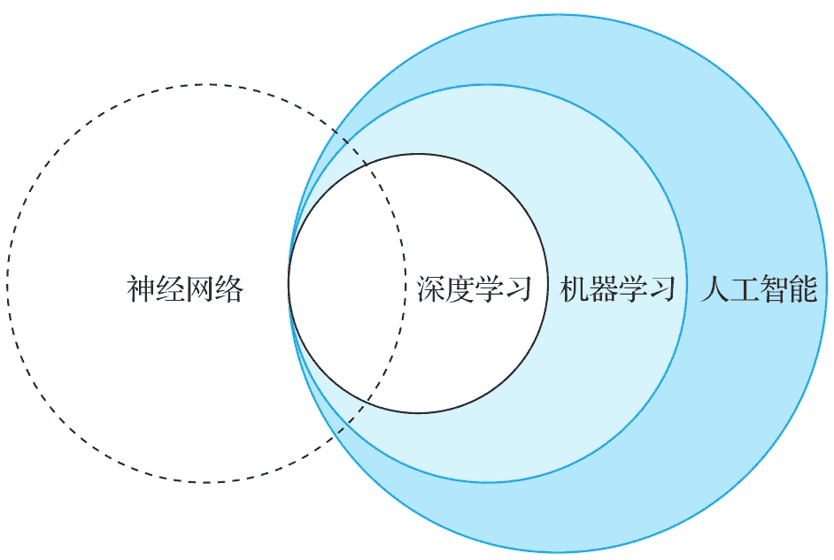
图 1-1 人工智能、机器学习、深度学习与神经网络的关系

首先，机器学习是人工智能的子领域，使计算机无需显式编程即可从数据中学习并决策。在 AI 发展史中，研究者受人类知识不断增长的启发，赋予机器学习能力，由此催生机器学习。核心在于算法能自动识别数据模式并用于预测未知数据。

其次，深度学习是机器学习的子集，依赖多层神经网络处理复杂数据模式。神经网络是受人脑启发的计算模型，模拟神经元连接以处理信息与学习模式。相较传统浅层方法，深度学习通过构建多层网络模拟人脑复杂结构，挖掘数据深层规律，可解读图像、声音与文本。

大模型的核心技术即深度学习。通俗理解为深度学习在语言文字领域的落地，通过庞大神经网络训练以理解并生成自然语言。训练中模型不断调整内部参数以提升理解与生成能力。训练完成后，模型可根据用户输入预测并生成最合适的后续文字，故在写作辅助、对话、翻译等领域表现优异。

**1.1.3 大模型的发展历程**

大模型演进可划分为数个关键阶段，每一阶段都标志着技术突破与应用拓展。

大型语言模型的发展轨迹

早期阶段集中在词表征。Word2Vec 等方法把单个词映射为高维向量，通过向量间距离来体现语义相近性，为后来的深度系统提供了基础表征能力。

转折来自 Transformer 的提出。由谷歌团队提出的该序列建模架构在翻译、内容生成、摘要等任务上表现突出，核心是自注意力机制，让模型在每一步都能参考整段序列信息，从而缓解长距离依赖问题。

随之进入预训练时代。谷歌推出的 BERT 采用双向编码器，能够同时向左右理解上下文，在理解类任务上取得进展；OpenAI 公布的 GPT-2 采用自回归预训练，展示出强劲的语言生成能力，推动了生成应用的讨论。

规模快速放大，典型是 GPT-3。该系统参数量达到 1.75 万亿，相较前代提升数百倍，理解与生成的质量明显提高，可胜任写作、对话、翻译等多种任务，凸显深度学习在语言领域的潜力。

近年的演进呈现两条主线：一是多模态融合，模型开始同时处理文字与图像，CLIP 是代表案例；二是垂域专业化，医疗、法律等专业场景出现针对特定任务优化的定制系统，实用价值增强。

总体来看，从词嵌入到 Transformer，再到大规模预训练，语言能力持续攀升，应用边界也在不断扩展。

### **1.2 全面认识法律 AI**

当下，生成式大模型与智能技术已渗透金融、医疗、教育、法律等多个行业，下文聚焦法律领域展开。

先明确法律 AI 的定义及其在当代法务服务中的意义；再拆解支撑运行的技术原理；随后观察全球法律服务市场的渗透与增长态势；最后梳理具体落地场景，呈现智能在实务中的价值。

**1.2.1 什么是法律 AI**

通俗而言，法律 AI 就是把人工智能方法用于法律场景，或以法律问题为对象的智能化应用。

2022 年 11 月 30 日 ChatGPT 上线，被视为法律行业变革的起点。结合前述技术脉络可看出，生成式系统的能力与法律业务需求高度契合：其语言理解能力符合法务对文本解读的要求，其内容生产能力符合法务对法律观点与文书生成的需要，二者叠加形成一次技术重塑。

相较传统智能，ChatGPT 等生成式系统在法律用语理解、意图识别、逻辑推理、法律材料撰写等方面优势明显。研究显示，这类大模型能够通过法律考试，撰写文件、发表评论，辅助裁判与法学教学。

凡由智能驱动的法律实践，均属于法律 AI 范畴。下面以司法裁判与律师服务为例，说明技术带来的改变。

**1.2.2 法律 AI 的技术引擎**

如前所述，大模型借助深度学习能够产出连贯且语义通顺的文本，是生成式智能在文本域的重要进展。为便于理解法律场景下的智能技术，选取以下几个核心概念：自然语言处理、生成式人工智能、人工智能生成内容、生成式预训练变换器、ChatGPT。它们用途各异且相互关联。

（1）自然语言处理
自然语言处理致力于让计算机和人类自然语言交互。相较机器语言，人类语言具有非结构化、语境依赖、模糊性与情感丰富等特性，NLP 的目标是让机器理解、解释并生成这类复杂语言。NLP 是所有文本相关智能技术的基础。

（2）生成式人工智能
生成式人工智能即生成式 AI，是一种能够创造全新内容的智能范式。相较传统智能，其区别在于自主性与创造力。传统智能更像执行者，生成式智能更接近创造者。

（3）人工智能生成内容
人工智能生成内容是指利用智能技术自动创造各类内容的过程。在法律领域可用于文书草稿生成、案例摘要自动撰写、合同模板制作等。

（4）生成式预训练变换器
生成式预训练变换器是 OpenAI 研发的基于深度学习的 NLP 模型。其名称体现了“预训练”与 Transformer 架构两大要点。预训练意味着模型在正式应用前已在海量文本上完成学习；Transformer 使其能够把握整句话语义，产出更连贯合乎逻辑的文本。

（5）ChatGPT
ChatGPT 是 GPT 体系的具体应用，也是生成式 AI 的典型代表。面对法律问题时，它能从大量法律文件、案例与书籍中检索信息，并以资深律师口吻提供建议。

简言之，NLP 提供底层基础；生成式 AI 是 NLP 的一个应用方向，涵盖各类可生成新内容的智能技术；AIGC 是生成式 AI 的具体实现方式；GPT 是实现文本生成的一种深度学习模型，ChatGPT 聊天机器人则是基于 GPT 构建的对话应用。图 1-2 综合呈现了这些概念之间的关系与原理。

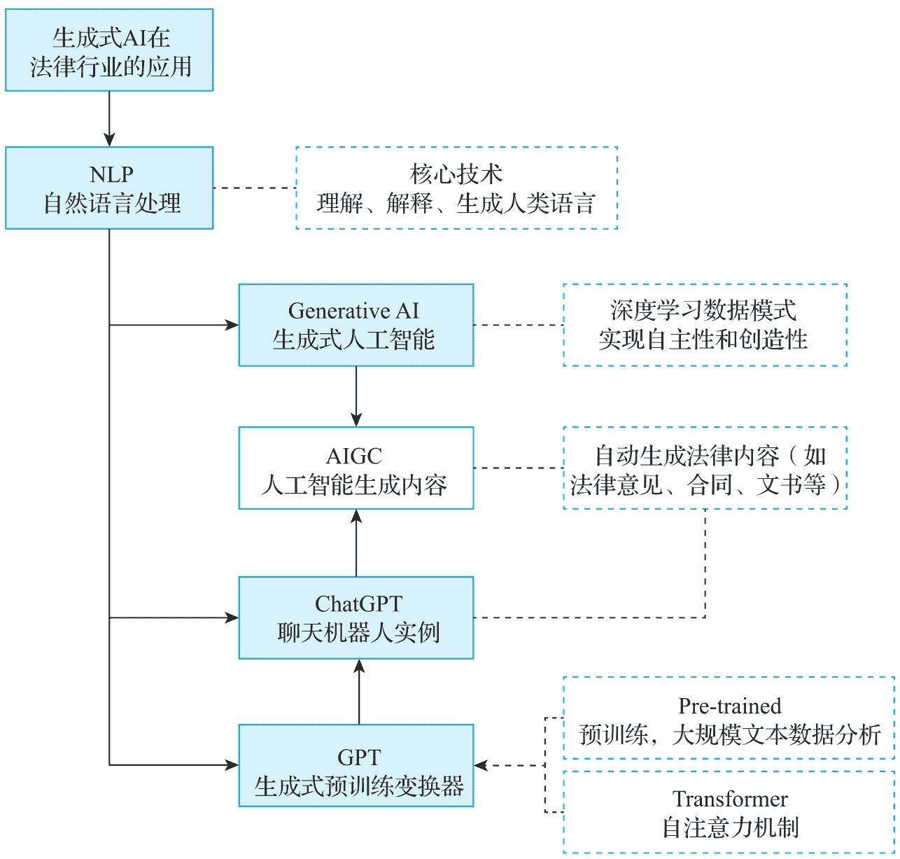

图 1-2 生成式 AI 技术在文本处理中的概念简图

**1.2.3 法律 AI 的市场趋势**

法律 AI 科技市场保持高速增长。据 Business Research Insights 的数据，2021 年全球法律科技 AI 市场规模为 81.52 亿美元，预计到 2032 年将达到 1989.33 亿美元，预测期内复合年增长率 33.7%。

LexisNexis 公布的《2024 年法律创新投资调查》描绘了法律行业高管对部署生成式 AI 的优先任务，并突出了行业采纳新技术的战略重点，如图 1-3 所示。前五项为法律研究、文件摘要、文件起草、合同分析和尽职调查，同时还包括商业发展报告和跨司法管辖区法律实时比较等。

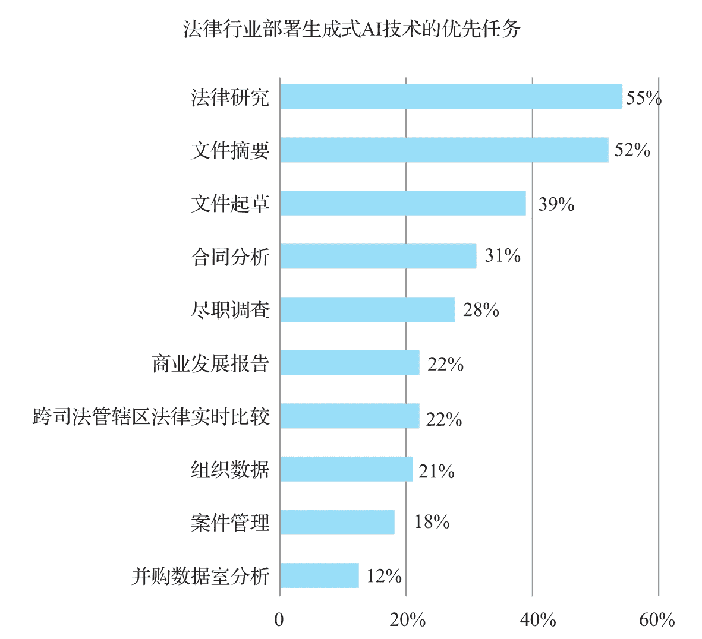

图 1-3 法律行业高管人员关于部署生成式 AI 技术的优先任务

此外，普华永道发布的《2024 人工智能就业晴雨表》揭示，积极现象是人工智能为法律从业者带来更高的薪酬溢价，在部分市场中具备人工智能技能的法律人可获得最高达 25% 的薪资增长。

法律 AI 的兴起已不仅是技术趋势，更在重塑法律服务的全貌。伴随生成式 AI 的推广应用，法律服务的工作模式与职业生态正被重新定义，行业正经历前所未有的技术创新浪潮。

**1.2.4 法律 AI 的应用场景**

在法律领域，人工智能的应用正快速拓展至多个环节。从提效到优化决策，从个性化服务到法律教育创新，智能正在成为不可或缺的部分。

**1. 律师服务**
在法律服务场景中，人工智能迅速成为律师和企业法务的重要助手。律所内部，应用已渗透到案件管理、法律研究、合同自动化、智能咨询、诉讼策略建议、知识管理及市场分析等多个方面。

第一，案件管理与分析。人工智能可自动化追踪案件进展、识别关键节点，帮助律师及时响应需求。同时，借助历史数据与当前案件信息，工具能够预测案件走向、识别潜在法律风险与结果，为策略制定提供前瞻性支持。

第二，智能咨询。人工智能咨询系统可实现 7×24 小时即时服务，模拟律师咨询流程，为客户提供初步法律意见。系统能够理解客户提问，并基于海量法律数据给出定制化回答，提升客户体验。

第三，合同自动化。人工智能合同起草借助智能模板与自然语言处理技术，确保条款准确一致；合同审核功能可自动标记潜在风险点，助力律师开展风险评估。

第四，法律研究与知识管理。人工智能可快速搜集并分析法律条文、案例与学术文献，辅助律师深入理解法律问题。知识管理系统通过结构化索引法律文档，确保信息快速检索。

第五，市场分析与策略建议。人工智能工具分析行业趋势、竞争态势与客户反馈，为律所提供市场洞察，支撑定制化的业务发展与市场进入策略。

**2. 司法裁判**
在司法领域，人工智能用于辅助法官与法院工作人员开展案件管理与判决分析。系统可分析历史判例，为法官提供参考，提升决策一致性与公正性。

第一，辅助撰写判决书。人工智能借助自然语言处理提供法律语言生成、判决书模板生成、判决结果预测以及自动审核校验等功能，提升文书撰写效率并保证规范准确。

第二，案件管理与流程简化。人工智能可智能分类排序案件、实时跟踪进展、分析案件数据、构建案件知识库，从而优化法院工作流程，提高审判质效。

第三，司法政策优化。人工智能通过大数据分析辅助裁判，为司法政策制定提供决策依据，提升政策制定的效率与公平性。

**3. 公司法务**
在企业法务场景下，人工智能的应用潜力同样突出。

第一，合规性监控。人工智能通过实时比对企业活动与外部法规，自动识别合规风险。监控不仅限于文本分析，还可通过模式识别预测未来风险趋势，帮助企业及时调整策略。

第二，合同管理优化。人工智能利用自然语言处理自动解读合同条款，提升审查速度与准确性，并可跟踪合同履行情况，必要时自动提醒续签或变更。

第三，风险评估与预警。人工智能基于历史案例与市场数据预测可能影响企业的法律风险，并量化风险等级，提供定制化预警机制，便于法务团队提前应对。

第四，内部法律咨询与知识产权管理。人工智能可快速响应员工法律问题，依据公司政策与法规提供专业意见；在知识产权管理方面，人工智能可监测市场、自动识别潜在侵权行为，保护创新成果与市场竞争力。

**4. 法律教育与研究**
人工智能在法律教育与研究中发挥重要作用，帮助师生快速获取信息、分析趋势、开展复杂比较研究，推动知识传播与创新。

第一，教学方式变革。人工智能通过模拟法庭、案例分析等互动教学改变法学教育，提升参与度与学习体验。

第二，个性化学习方案。人工智能根据学习情况与需求提供定制学习路径与辅导，帮助学生掌握法学知识与技能。

第三，教育培训材料创新。人工智能辅助开发教学材料，提供定制化学习路径与模拟案例，增强互动性与实效。

第四，研究辅助。人工智能提升研究效率，通过快速搜集与分析数据辅助文献综述与案例研究。

**5. 法律出版**
在法律出版领域，人工智能应用日益成熟，对信息的编撰、分发与利用产生深远影响。

第一，自动化内容生成。人工智能可自动生成法律新闻、案例摘要与法律分析，提升生产效率；通过解析法律文档与判决，快速提炼关键信息。

第二，智能编辑校对。借助自然语言处理，人工智能辅助编辑进行文本校对，识别语法错误、用词不当或不一致，确保出版物准确专业。

第三，个性化内容推荐。人工智能根据阅读历史、偏好与反馈向读者推荐相关内容，提升体验与黏性。

第四，版权保护与管理。人工智能助力监测与保护出版物版权，自动识别未经授权的使用与复制，维护合法权益。

第五，市场趋势分析。通过分析大量法律文献与案例，人工智能可识别并预测行业热点，为出版方向提供指引。

**6. 法律科技公司**
法律科技公司作为人工智能在法律领域落地的先锋，承担创新引领角色。通过深入调研与需求分析，精准把握律师、法务、司法人员等专业人士需求，指导产品开发。

第一，产品开发阶段聚焦原型设计与用户反馈，持续迭代优化，实现高效数据分析与智能决策支持；同时投入算法研发，提升准确性与效率，并保障可解释性与公平性。

第二，运营阶段注重数据管理与质量控制，建立严格数据流程，确保模型训练数据的可靠性。

第三，跨学科团队建设是关键，由法律专家、数据科学家、软件工程师与产品经理组成，保证专业性与可行性。

第四，产品测试与质量保证通过功能测试、性能测试与用户接受测试，确保实际应用中的稳定可靠。

第五，重视用户教育与支持，提供教程、在线帮助文档与客户服务，帮助用户快速上手。

第六，持续关注行业动态与技术演进，不断迭代功能、引入新技术，保持竞争力，推动法律行业数字化转型。

### **1.3 AI 对法律行业的深远影响**

**1.3.1 积极影响**

在数字化浪潮驱动下，人工智能成为重塑法律行业的核心力量。从提效降本到决策支持，从服务模式创新到知识管理强化，再到商业模式变革，人工智能以独特能力为行业注入新动能。

**1. 提高效率**
普华永道《2024 人工智能就业晴雨表》显示人工智能已大幅提升劳动者生产力。在人工智能渗透率最高的行业，劳动生产率增速约为其他行业的 4.8 倍，法律行业亦然。随着技术发展，法律市场涌现出多种法律 AI 软件，为律所和企业提供自动化服务。调研发现，几乎所有产品介绍均强调提效。例如，人工智能合同审查软件 LawGeex 指出：律师平均耗时 92 分钟完成任务，准确率 85%；LawGeex 仅用 26 秒审查 5 份合同，准确率达 94%。

生成式人工智能实现提效的核心在于改变了法律知识的“获取”与“生成”方式，摆脱对时间的依赖。法律知识获取指从条文、案例中收集信息；生成指创造新的法律见解。传统上依赖深度学习与长期训练，而大规模预训练的生成式模型改变了这一过程，见表 1-1。

表 1-1 AI 对法律知识的获取与生成的改变

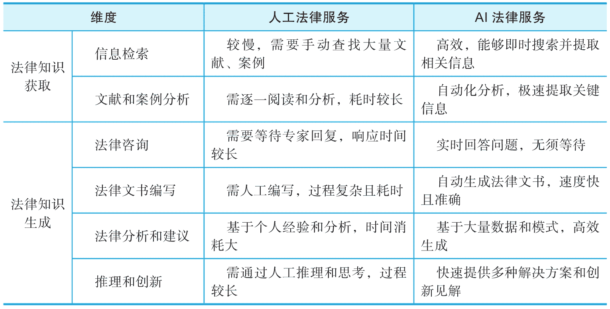

总体而言，基于大模型的生成式人工智能在一定程度上推动了从“人力中心”的知识生成模式向“算力支撑”的模式转变，法律知识的获取与生成变得即时便捷。

**2. 降低成本**
自动化与智能化服务减少了对人工的依赖，从而降低运营成本。传统法律知识获取与生成需人工监督，导致加班常态化。而人工智能可在多个业务领域提供 24 小时服务，显著缓解人力压力。在重复性强、规则性强的法律工作中，人工智能工具可替代人工，大幅减少人力与时间成本。例如，汤森路透研究显示，使用法律文书起草辅助工具可在单一起草任务上节省 108 至 353 美元。

有观点认为，随着生成式人工智能完善，知识创作的边际成本未来甚至可能趋于零，产生巨大经济价值。法律行业对成本降低潜力的预期同样乐观。LexisNexis《2024 年法律创新投资调查》显示，76% 的公司认为生成式人工智能可降低法务部门成本，47% 的律所领导者持相同预期。2024 年汤森路透研究所发布的《2024 年专业服务中的生成式人工智能》报告也指出，成本节约是法律行业受访者关注的重点之一。

**3. 提供决策支持**

法律判断并非单一的结论输出，而是贯穿研析、推演与权衡的完整链路。一方面要把案情、证据、条文、法理拆解清晰，另一方面还要预判事态走向并观察社会舆情。法官、律师、仲裁员、企业法务的关注点各有侧重：法官强调裁判统一与司法公信，律师更聚焦胜算评估与最优策略设计。在生成式模型出现之前，这类工作高度依赖从业者的经验积累与直觉判断。随着社会关系日益复杂，法律议题边界不断外延，传统人力驱动的决策范式在效率与精度上显出瓶颈，亟需更可靠的技术手段来补位。

当下生成式模型正为法律研判提供新动能。它擅长从海量历史案件中提炼结果规律与关键变量，让专业人士对法律问题理解更透、对诉讼进展预判更准。以 Lex Machina 为例，其分析服务能够帮助律师洞察法官在审前动议上的倾向，量化胜诉概率，从而制定更贴合委托方需求的方案。数据驱动的方式在提升响应速度与判断精度的同时，也让律师把更多时间投入战略谋划、客户沟通等高价值环节。整体来看，法律实践正从经验主导逐步转向数据与技术并重的形态。

为系统评估模型对法律判断的助益，可从四个相互关联的层面切入：信息处理能力、决策效率、决策质量、个性化服务。它们共同决定法律决策的综合表现。下表 1-2 对照了人工决策与模型辅助决策在这四个方面的差异。

表 1-2 AI 为法律决策带来的改变

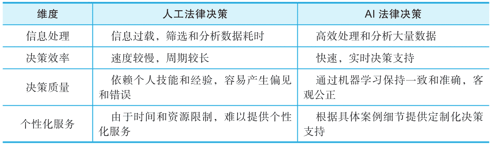
1）在信息处理能力上，人工模式常被资料淹没。法律人需要在大量法条、判例、规章与证据中手工筛选相关材料，耗时耗力。生成式模型借助深度学习与自然语言解析，能够快速扫描并解读庞大的法律文本，自动抽取与案件关联的要点，显著减轻专业人士的工作负担。
2）在决策效率方面，传统流程从受理到裁决往往周期漫长。生成式模型可在极短时间内完成复杂法律问题的拆解，并提供实时参考支持，通过算法快速形成初步建议，大幅缩短案件处理时长。
3）在决策质量方面，人工判断受个人技能与经验限制，容易产生偏见与失误。面对金融、科技等跨领域复杂案件，传统方式往往力不从心。生成式模型通过机器学习与大数据不断校准模型，提升一致性与准确性，且不受个人认知偏差影响，能给出更客观中立的建议，并随学习持续提高可靠性。
4）在个性化服务方面，受资源与时间限制，法律人士难以为每个案件提供深度定制分析。生成式模型能够依据案件具体情境输出定制化决策支持，更好满足不同当事人的需求。

总体看，模型在上述四个关键维度上已显现出对传统人工的优势。当然评判决策优劣的标准并不局限于此，模型在法律场景的应用也面临复杂情境理解受限、伦理与隐私等挑战。尽管如此，其在提速与增效方面的贡献已不容忽视。

**4. 改变服务模式**
所谓服务模式，指服务交付的方式与全流程，涵盖获取、交付、互动与后续支持，是客户与法律人之间的桥梁，直接影响体验与满意度。生成式模型带来的跃迁并非一蹴而就，而是经历了漫长的渗透过程。为呈现这一演进，我们回溯法律技术发展的历史脉络，将其划分为四个阶段，如图 1-4 所示。

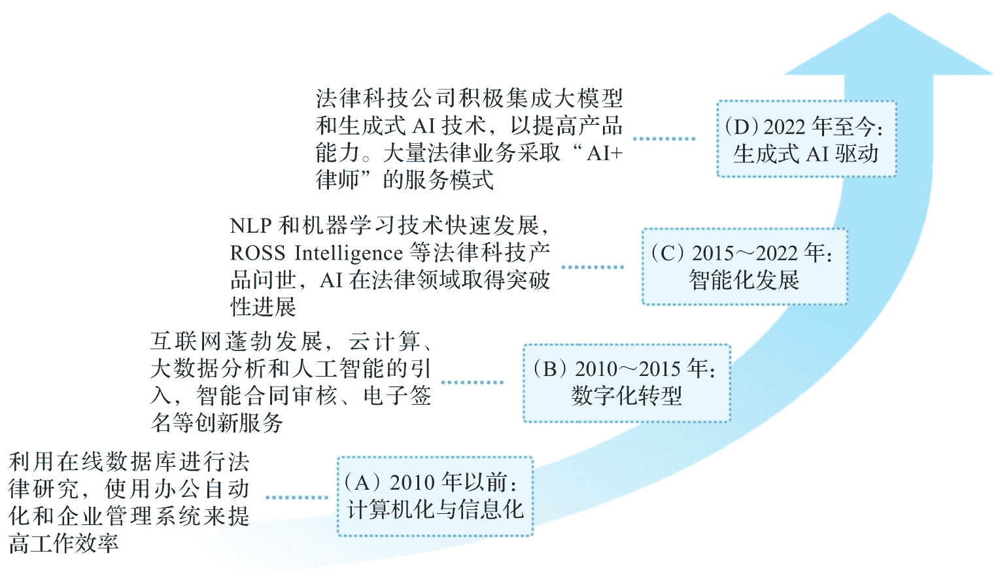
图 1-4 法律技术与服务模式的发展历程
（1）2010 年以前：计算机化与信息化
自 20 世纪 60 年代计算机辅助法律研究的尝试，到 80 年代国内学界提出“法律工作的计算机化”，法律科技已初具雏形。在线数据库 LexisNexis 与 Westlaw 的普及为研究提供了新入口；办公自动化、MIS、ERP 等工具推动了行业信息管理的数字化；90 年代末互联网兴起，电子证据开示技术兴起，改变了诉讼实践标准。这一阶段服务模式以技术辅助自动化为主：法律人借助在线库研究，借助办公系统提升效率，客户获得更快的咨询与处理体验，但需适应新工具。
（2）2010～2015 年：数字化转型
互联网、云计算、大数据与人工智能的引入推动了法律服务的数字化。2010 年前后，LegalZoom 与 Rocket Lawyer 在美国创立，推动智能合同审核、在线咨询与电子签名等新服务。2012 年区块链兴起为自动化与去中心化铺路，智能合约带来革命性变化；同年 IBM Watson 在 Jeopardy! 夺冠并探索法律应用，彰显智能潜力。此阶段服务更趋在线交互与自助，客户期望更快速、灵活、成本更低的方案。
（3）2015～2022 年：智能化发展
法律科技进入智能化与全球化期。2015 年后 ROSS Intelligence 与 LawGeex 等产品落地，标志 AI 突破。2018 年前后 NLP 与机器学习快速发展，法律咨询聊天机器人普及，基于 AI 的司法判决预测研究亦取得进展。2020 年疫情加速远程法律服务与在线法庭；2021 年法律科技延伸至环境法、知识产权、国际法律服务等领域，体现服务国家大局与高质量发展的导向。服务模式变得更智能、高效、精准，客户从等待响应转向即时获取个性化方案。
（4）2022 年至今：生成式 AI 驱动
2022 年后 ChatGPT 等应用的爆发标志行业进入生成式模型主导的新阶段。法律科技公司积极集成大模型，提升检索、智能合同管理、合同审查与法律研究等能力，落地应用增多。律所、ALSP、企业法务、法院与法学院均在探索模型应用，推动范式转变。新兴法律服务被视为“新质生产力”，获得发展机遇。服务模式从人工操作与数字化向模型核心的智能服务演进，客户对服务透明度与可及性的要求同步提升。

目前“AI+律师”已成为大量业务的主流形态。展望未来，模型有望在替代性争议解决中承担更重要角色，并在法律合规检查中实现更全面的自动化。

**5. 强化知识管理**
知识管理是法律行业对法律知识与相关信息的收集、组织、存储、共享、检索、应用、更新及技术支持的系统化流程，旨在确保文档、案例、法规等资料有序、安全，并建立高效检索机制。行业常面临信息孤岛困境：不同团队使用独立系统，知识流通受限，易造成重复劳动；同时法律环境动态变化，法规、案例与先例频繁更新，要求持续刷新知识库。有效管理对专业人士至关重要。

模型正在构建先进的法律知识管理系统，显著增强法律人管理与应用海量数据的能力。例如，知识管理系统 AlchemyAPI 可从文本中抽取关键短语并实现宽泛聚合，呈现难以用单一概念表达的知识项，并采用 SimRank 相似性算法基于图拓扑衡量文档相似度，即使无直接共性也能通过特征路径关联。

模型的核心在于海量数据的处理与分析能力，正重塑知识管理的全流程，实现从收集到分析、生成、更新、发现与个性化服务的智能化。

1）知识的自动化更新：模型对数据的敏感性使其能够实时监测并吸收新的法律信息，保持知识库的持续更新与准确。
2）数据的智能分析与转化：模型不仅收集存储，更能对数据进行智能解释，将原始信息转化为可用的法律知识，实现数据与知识的融合。
3）基于数据的知识发现：模型通过识别数据模式与关联，帮助专业人士发掘新领域与研究方向。
4）个性化的知识服务：模型利用历史查询与用户行为分析，从海量数据中筛选并推荐个性化知识，提升匹配度。

在模型驱动下，法律人拥有更多知识管理选择。
第一，个人知识库的创建。律师可借助模型工具系统化整理个人经验、案例分析、法评与法规解读，形成专属专业资源。
第二，知识发现与法律研究。模型可追踪最新发展、识别新兴问题，确保研究基于最新框架；深度分析法律文献、案例与学术文章；并通过构建知识图谱将分散知识点连接为互联体系。
第三，个性化知识推荐。模型依据专业领域、查询历史与工作模式，向团队成员推送相关资讯、案例分析与法规更新，促进协作并培育开放透明的知识文化。

通过这些应用，模型正成为知识管理的强力工具，提升效率与服务质量，并保持对法律知识的深入理解。

**6. 创新商业模式**
模型的融入不仅提供新工具，更催生商业模式创新。以下从两个维度展开：一是法律科技公司的崛起及其对传统市场的补充；二是模型助力机构重新定位，拓展“法律+科技”的综合模式。

（1）新兴市场主体的崛起：法律科技公司
模型不仅被整合进既有流程，更催生了新商业模式与参与者。未来法律服务市场中，律所不再是唯一主体，依托模型的法律科技公司也将成为重要力量。
1）基于大数据分析的法律科技公司。生成式模型兴起前，市场上已存在汤森路透、LexisNexis 等公司。21 世纪初随大数据发展，它们利用数据分析提供法律研究、案件分析、风险评估与合规检查等服务。
2）生成式模型驱动的新型法律科技公司。随技术成熟，市场涌现出专注于生成式模型法律产品的企业，它们不仅分析数据，还能模拟法律思维，执行咨询、文书起草与策略建议，标志着从数据驱动向智能化服务转变。以北京新橙科技有限公司 iCourt 为例，成立于 2013 年，Alpha 系统整合法律数据库、案件管理与律所管理，覆盖检索、合同审查与文书起草，专业性与便捷性大幅提升。产品已服务超 15 万法律工作者、6000 余家律所，印证了新型法律科技公司的潜力。
3）跨界科技公司。科大讯飞依托讯飞星火认知大模型推出“星火法律大模型”，将语音技术优势引入法律科技。

模型的进步将使生成式模型驱动的新型公司在智能法律服务需求中扮演更重要角色。尽管有观点认为其为跟风，但法律科技是行业融合的必然产物，能与传统机构互补合作，共同满足多元需求。

（2）全新的商业模式：法律+科技
法律行业的商业模式指机构在提供服务过程中创造、交付与获取价值的方法与策略，体现在服务模式与客户关系、收入与成本结构、市场定位与竞争策略、技术应用与市场适应性等方面。

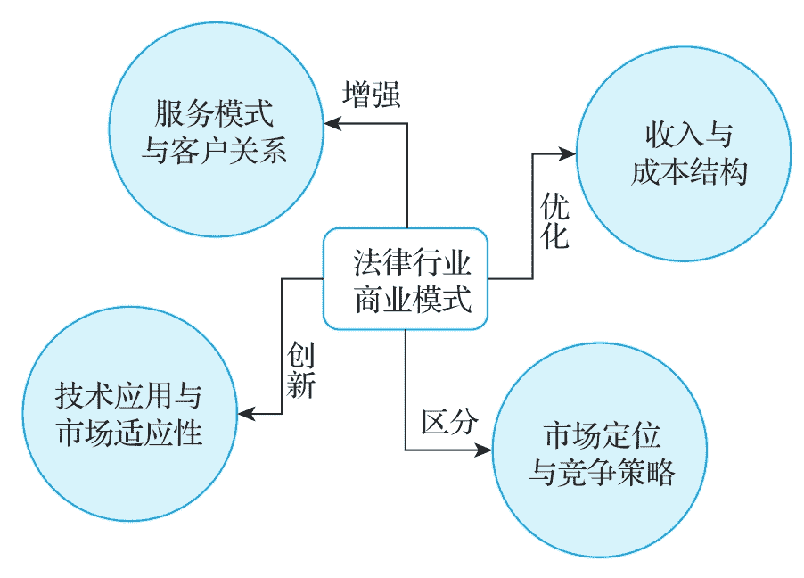
图 1-5 法律行业商业模式的价值体现
表 1-3 对比了传统法律模式与新兴“法律+科技”商业模式，以便更清晰理解模型影响下价值的转变。

表 1-3 AI 技术下“法律+科技”商业模式的价值改变

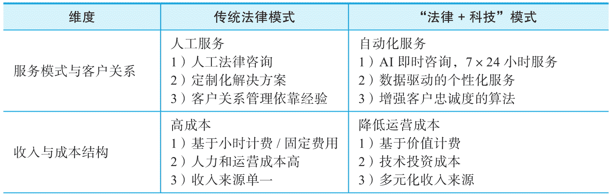
（续）

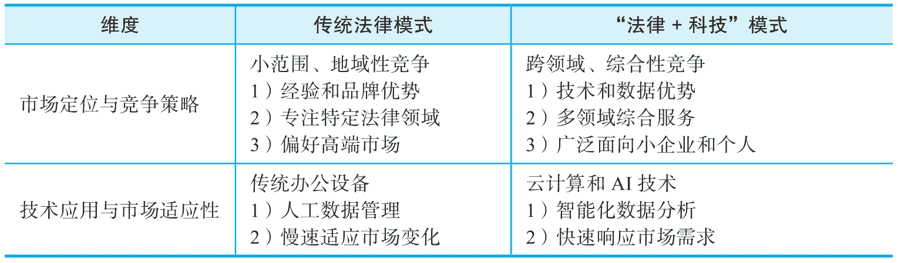
第一，服务模式与客户关系。借助生成式模型，律所可提供 24 小时实时咨询，并基于客户历史数据细分群体开展个性化服务；模型还能生成营销个性化内容，精准触达受众并预测转化。
第二，收入与成本结构。模型推动计费方式从按小时为主转向按工作量与价值挂钩，机构可探索订阅制、价值导向收费或模型增值服务等新模式。
第三，市场定位与竞争策略。法律服务不再仅依赖经验与品牌，技术创新成为竞争抓手。模型处理跨领域数据使律所业务突破传统边界，服务小微企业与个人客户，拓宽客源。
第四，技术应用与市场适应性。“法律+科技”模式下模型可快速分析并预测市场趋势，及时调整策略，使机构在竞争中保持优势，传统模式反应相对迟缓。

技术革新正推动律所转型。生成式模型的灵活与通用性配合开放接口，允许定制服务，能与科技公司合作开发定制化模型工具提供更个性化服务。谁能用好这些工具，谁就能提升效率与质量并大幅扩展业务。

**1.3.2 消极影响**
模型为法律服务带来技术与商业突破的同时，其负面影响亦不容忽视，包括失业风险、数据隐私与安全、合规监管挑战及伦理问题。

**1. 失业风险**
每次工业革命都重塑工作方式并带来失业压力。模型在提升效率的同时逐步替代人类决策与思考。2023 年高盛估算美国与欧洲各行业被模型自动化取代的就业比例，法律职业风险位居第二，约 44% 的任务可能被自动化。

法律行业会不会被AI裁掉？先看这三个破局点

本文从三个切口切入，聊聊生成式AI对律师饭碗的冲击：底层工作被取代、专业壁垒被稀释、人才结构被重塑。

（1）基础性工作的替代

“初级法律人员的处境会变吗？”汤森路透研究所技术与创新内容负责人扎克·沃伦给出了肯定答复。检索资料、起草文书或合同这类“体力活”，向来是一年级、二级律师的主战场，而这些恰恰是生成式AI最拿手的场景。完全由AI替代人类的判断目前看不太现实，但凡是靠背法条、走标准流程的环节，机器已经能大包大揽。

为便于理解，可把传统法律服务拆成三层。金字塔最底层是基础型事务，规则清晰、重复度高，最先被工具化。AI能批量处理数据、做标准化合同审查和文档生成，效率提升的同时也减少了对人手的依赖。中层是经验型事务，机器通过学习历史案例和自然语言处理给出纠纷处理的参考思路，一定程度上削减了对法律人员的倚重。塔尖是专业型事务，对经验和判断要求极高，但AI在前期的案情梳理、策略模拟等环节已能提供深度分析与模式识别，悄然改变资深律师的工作方式。由此引出一个值得追问的问题：经验型和专业型工作，会不会最终也像基础型一样被机器劳动占据主导？

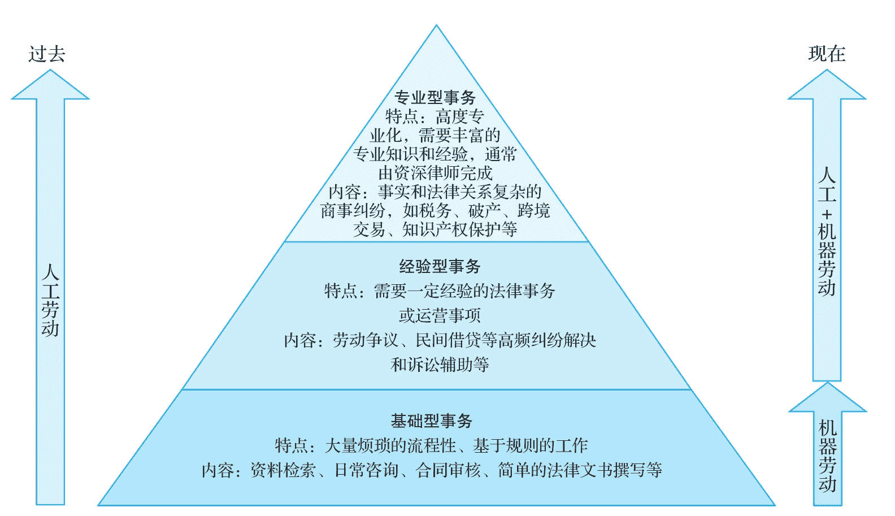
图 1-6 法律服务工作分类及劳动形式演变

关于AI是否会让岗位消失，学界形成了两种判断。一种是“补偿效应”说，认为AI提升效率、降低成本，会拉动市场需求，企业扩张招聘，进而对冲技术替代带来的岗位流失。高盛的研究就持此立场，历史上自动化的负面就业冲击往往被新岗位的出现稀释，技术催生的新职业是就业增长的核心动力。另一种声音更审慎，指出AI确实在创造岗位，但新岗位的增速在放缓，而被取代的岗位却在增多。美国在上世纪80年代新岗位的年均创造率约为8.2%，进入21世纪初则跌至0.5%。这说明机器创造就业的能力存在，且在减弱。

综合来看，AI对就业的影响是矛盾的。它会催生数据隐私律师、法律科技顾问等新角色，但目前数量有限。更现实的趋势是，低门槛、高重复的岗位正在被逐步替代，部分从业者面临失业压力。

（2）专业普及与执业泛化

传统上，法律职业通过专业术语和系统化培训维持神秘感和门槛，服务呈现单向输出的状态。客户多依赖人脉、口碑和品牌选择服务方，很难基于自身知识做自主判断。

ChatGPT等生成式工具的出现改变了这一局面。公众获取法律常识的成本大幅下降，非法律背景的人也能处理部分常规事务，传统律师的不可替代性被削弱。同时，AI驱动的科技公司以替代性法律服务提供商ALSP的身份进入市场，为用户提供另一条获取服务的路径。越来越多客户会选择先用AI工具解决日常法律问题，而不是直接付费请律师。

（3）劳动力结构的变化

技术浪潮正把劳动力市场推向两极。低技能群体就业更难，高端技术岗却出现人才缺口。AI迭代加速，法律行业对懂技术的复合型人才需求激增，但市场上合格人选供给不足。

与此同时，律所内部的权力结构也在松动。过去资深律师凭借经验和客户资源占据层级高位，如今年轻律师在ChatGPT等工具的掌握和使用上更具优势，经验的溢价被稀释，评价标准正向多元化转变。这也意味着进入法律行业的门槛在提高，从业者和学生必须补足技术素养，才能适应新环境。

**2. 数据隐私与安全问题**

有人总结得好：只要你在网上冲浪、用手机、刷信用卡、发社交动态、走ETC、看流媒体，你就在为AI提供训练数据。数字化时代每个人都是数据生产者，这些信息被收集、分析后喂养模型，让输出更精准、更个性化。

与此同时，个人数据进入模型训练链条后，隐私与安全风险被放大。透明使用、有效监管、对数据主体权利的尊重变得关键。对律所而言，保护客户数据既是法定义务，也是维护信任和声誉的底线。法律场景的数据多涉及隐私与敏感信息，从模型研发到客户服务，数据合规始终是核心议题。

（1）模型研发过程中使用数据的风险

越来越多的法律科技公司和律所开始自建模型。模型训练依赖海量输入，伴随隐私侵蚀和版权争议。常见的数据来源是公开网络，包括研究报告、新闻、社交内容。即便做匿名化处理，个人信息仍可能被还原。版权风险同样突出，未经授权使用受保护素材易引发诉讼。

OpenAI训练GPT时就因使用受版权保护的书籍和文章被起诉，作家Paul Tremblay与Mona Awad的案件、《纽约时报》指控模型复现内容并生成虚假新闻，都凸显了大模型时代数据使用的法律风险。

（2）客户服务过程中数据使用的风险

生成式AI的优化依赖用户交互数据，服务方必须严格遵守个人信息保护法规。未经明确同意将客户数据用于训练，可能招致诉讼和声誉损失。美国联邦贸易委员会就曾处罚Everalbum公司，理由是其未经同意收集照片视频训练算法。法律服务数据常涉及身份、财务、健康等敏感信息，需防止未授权访问和网络攻击。此外，AI生成内容的不透明也会侵蚀客户信任，降低机构竞争力。随着国家数据局成立和《生成式人工智能服务管理暂行办法》落地，企业需提升数据治理能力，确保处理合规、个人信息受保护。

**3. 合规与监管的挑战**

AI落地速度远超规则更新，如何让应用符合现行法、又如何制定新规监管，成为行业难题。

（1）合规的挑战

AI合规指在设计、开发、部署全流程遵循法律法规、行业标准和内部政策，涵盖数据保护、隐私、透明度、算法公平性等。当前主要困境有四：

第一，算法透明与可解释性。深度学习模型内部逻辑晦涩，对法律人和管理者构成“黑箱”，难以评估决策的合理公正。

第二，技术风险管理。数据泄露风险要求加密和严格访问控制；算法偏见风险需定期审查测试以纠偏；技术过时风险则要求持续更新维护。

第三，跨国合规。业务跨境后，需同时满足不同司法辖区在数据保护、隐私权、知识产权上的差异化要求，合规成本显著上升。

第四，培训与教育。法律人需具备技术敏感度，机构要通过常态化合规培训提升员工风险意识和使用规范。

（2）监管的挑战

AI监管指政府通过标准、规则和政策对AI开发应用进行监督，平衡秩序、权益与创新。核心问题包括：

第一，法规滞后。AI迭代远快于立法，创新应用缺乏明确法律框架。法律服务机构在采纳技术时面临不确定风险，且各国监管取向不一，给跨国经营带来复杂性。

第二，法律责任归属。AI参与案情分析或辅助判断时出错，责任应由开发者、使用者还是系统本身承担？目前尚无统一框架，伦理争议并存。

2024年2月，广州互联网法院审理了一起AI平台生成图片侵犯“奥特曼”著作权的案件，被称为全国首例AIGC服务提供者侵权案。法院认为平台未尽审查义务，应承担责任。该案虽引发争议，却推动了创新与知识产权保护平衡的讨论。

第三，细分领域差异。知识产权服务需兼顾技术细节与创新激励；医疗法律服务须满足保密与患者隐私的更高标准；刑事司法中使用犯罪预测等技术，则触及公正与道德底线，需要更严格的监管设计。

总体来看，现有法律框架与AI增速存在结构性矛盾，全球统一监管标准的需求日益迫切。

**4. 伦理问题**

每项新技术都带来伦理拷问。AI逼近人类智能却脱离制造者意志，可能动摇以人为本的伦理体系，其伦理建构将决定它是文明高峰还是终结者。

（1）AI创作内容的版权性

AI生成文本冲击了传统版权逻辑，带来四个焦点：作品是否具备版权法要求的原创性、AI能否成为作者主体、若可保护版权归属开发者、使用方还是AI本身、保护范围是否应与传统作品一致。

2023年底，北京互联网法院审结李某与刘某侵害作品署名权和信息网络传播权纠纷案，认定AI生成图片在体现使用者独创性与智力投入时可被视为作品，并认可使用者的创作者身份，但强调需个案判断。该判决被视作强化人类主导、促进技术创新的积极信号。随着技术演进，版权规则需与时俱进，在保护成果与促进共享间找平衡。

（2）主体价值

生成式AI在部分场景展现自主决策能力，带来“AI塑造人类”的风险，主要体现为两点。

一是决策过度依赖。高效信息处理让法律人易形成盲目信任，即使察觉技术局限仍倾向跟随。缺乏现实接触与实践积累，可能导致认知偏差与误判。若AI给出错误建议而未被独立核验，可能产生不公正结果。

二是价值观冲突。AI基于数据和算法决策，人类则融入道德、伦理与社会价值，二者在处理复杂案件时可能出现分歧。

案例可见一斑：亚马逊语音助手Alexa曾因漏洞向英国用户Danni建议“将刀插入心脏”；自动驾驶的伦理困境——撞向行人还是牺牲乘客？面部识别技术也暴露偏见，2019年美国国家标准与技术研究院报告显示，99名开发者的189种算法对非洲裔或亚裔面孔的误识别率比白人高出10到100倍，非洲裔女性误报率尤其突出。若AI无法理解人类真实意图，可能对社会伦理秩序造成冲击。

（3）算法偏见与歧视

AI学习自带偏见的数据，会放大社会歧视。用户输入偏见时，模型也会复现。例如部分生成式AI在23%的宗教相关测试中将其与恐怖主义关联。法律场景下，犯罪风险预测模型可能对少数族裔给出更高评分；亚马逊的AI招聘系统因训练数据男性为主而产生性别偏好。行业必须在利用技术的同时确保伦理底线。

### **1.4 法律人与法律机构如何应对 AI**

我们正处在“法律+科技”智能化浪潮的高点。数据建模和智能应用渗透流程，自动化法律服务已成现实。正如Board of Innovation首席执行官Phil De Ridder所言，AI不会取代创新者，但用AI的创新者会取代不用AI的创新者。

**1.4.1 法律人如何应对 AI**

未来法律人仍是核心，但角色、技能和专业方向会重塑。关键在于学会何时用AI、如何提问、怎样评估输出质量，从而提供实质策略。

**1. 提升技术素养**

AI的价值在于技术联结能力。擅长用生成式AI辅助研究和分析的“超级律师”更受市场青睐。他们能把技术与专业知识结合，为客户提供更精准全面的建议，并以此构建新的竞争优势。

提问表达力是操控法律智能系统的关键杠杆

高质量的产出取决于高质量的输入。Prompt 说白了就是把办案需求翻译成模型能够理解的指令或问题，在以 ChatGPT 为代表的对话系统时代，提问的好坏几乎等同于知识获取的能力。

在律所实践中，Prompt 就是对法律智能助手下达的明确任务，例如“调取与合同违约相关的最新司法解释”或“为本案梳理可适用的规范”。指令越清晰具体，回馈的信息就越精准可用。

要理解提问的作用，可参考对话型法律服务模型的工作流，如图 1-7，从输入到输出的完整路径。

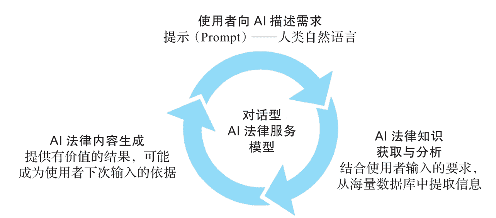

图 1-7 对话型 AI 法律服务模型工作过程

结合该模型，法律从业者日常使用智能工具的基本逻辑可归纳为三步：

第一步，把需求讲清楚。系统能够理解自然语言，先把问题想明白再完整输入。
第二步，系统进行法律知识抽取。模型能够从海量资料中抽取整合，快速触达法条、案例和学说。
第三步，整合生成结论。模型会自动产出内容，为决策提供参考。

整个环节离不开反馈循环和持续优化，使用者需要不断调整使用方式，效果才会更好。

提升提问技能，需要在实务中反复演练，比如模拟不同案情，写 Prompt 再对照输出修正。还要积极参加智能技术培训，跟上技术迭代，及时刷新提问策略。

技术素养也需要同步提升。定期参加研讨会、工作坊或线上分享，与同行交流使用经验是有效方法；与技术团队保持沟通，了解系统新功能并探讨按法律需求定制；跨学科合作能让智能系统更贴合办案，提升效率与服务品质。

**2. 应用专业工具**

当前市场已有不少成熟产品，覆盖相似案例查找、案情分析、咨询自动化、文书辅助、合同审查等方向。按指引输入需求、上传材料，就能获得相应结果。

为方便参考，我们梳理了国内法律科技主流产品的功能，见表 1-4。

表 1-4 国内主要法律科技产品与功能总结

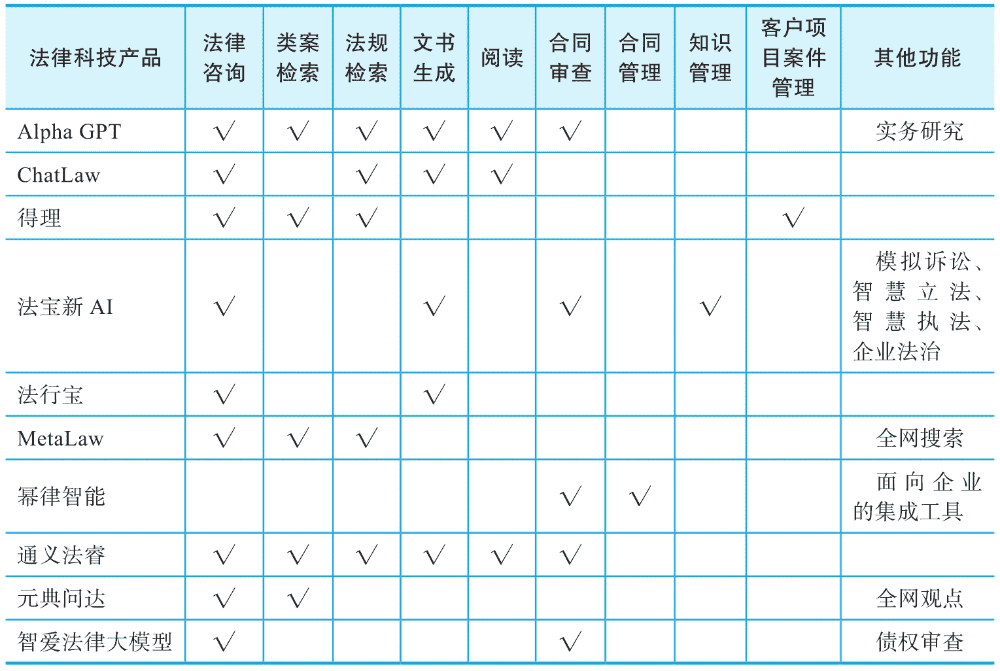

把这些工具融入工作，实现服务创新与优化，可从以下路径入手。

第一步，用智能系统捕捉用户需求。先分析客户需求与市场趋势，为定制化服务提供依据。
第二步，搭建人工智能法律知识库。整合法规、案例、期刊文章等，形成可靠的知识底座。
第三步，落地至少一个提效项目，如自动化合同审查或案件管理系统。
第四步，持续收集反馈与优化。评估服务效果并据此迭代系统，形成正向循环。
第五步，推动跨学科协作。与技术专家、数据分析师等合作，探索新应用，驱动服务模式创新。

使用过程中必须重视数据安全与客户隐私，确保处理活动合规，敏感信息不受侵害。

**3. 把握决策核心**

技术在提升的同时要保持清醒：生成式系统能显著提质增效，但局限明显。知识幻觉会影响准确性，且多数系统基于大数据给出标准化答案，在需要创造性见解的复杂问题上仍显不足。面对深度思考与创新要求高的案件，资深律师的批判性思维与创造力不可替代。

“系统控制人”的讨论很热，但就目前来看智能系统只能是辅助角色，决策权仍在法律从业者手中，必须独立审查。

首先，要主导知识掌控。智能系统的学习依赖海量语言数据，法律数据可能不全、不准或结构化程度低；司法经验等隐性知识也难以完全转译。因此需要独立判断、过滤错误产出，动态调整信任阈值，改善协作效果。
其次，要在知识创新上保持主导。系统产出的内容对个人可能是新知，对整体知识体系未必是创新。知识驱动的社会进步靠创新，法律人应以批判性思维推动认知边界。
最后，要在价值判断上保持主导。法律价值判断复杂，需要经验与判断力。系统能模仿价值观念，却缺乏主观意识与情感体验，无法完成复杂价值权衡。即便系统广泛应用，价值判断的关键作用仍需由人承担，以保证法律价值的连贯统一。

**4. 优化人机协作**

充分发挥 ChatGPT 等生成式系统的优势，需要精心设计协同流程，既释放技术红利，也守住专业核心。

系统在处理大数据、执行标准化任务、快速查找和初步分析上优势明显，能高效整理文档、识别规律、生成报告，承担大量重复性工作，让从业者聚焦更复杂、更具创造性的任务。法律专业人士则在定制化咨询、战略规划、创新方案上不可替代，其批判性思维、深厚法律理解、对案情的敏感度是系统不具备的。直觉、经验和道德判断对合理决策至关重要。

实现有效协作，可采取以下做法：

❑ 设计含智能辅助的服务流程，在合适环节引入支持，同时保留法务人员的决策空间。
❑ 合理分工，让系统处理适合其能力的事务，需要专业判断的留给人。
❑ 对从业人员进行智能工具使用培训，同时开发更易用的交互界面。
❑ 建立质量控制机制，确保系统输出在用于决策前经专业人员审核。
❑ 鼓励从业人员对系统输出提供反馈，持续优化系统性能。
❑ 明确伦理准则与责任归属，确保最终决策权在法律专业人员手中。

通过这些措施，能构建系统与人各展所长的模式，提升服务质量，同时维护法律职业的核心价值。

**1.4.2 法律机构如何应对人工智能**

**1. 抓住市场机遇，推动技术转型**

普华永道第 27 次年度全球 CEO 调查显示，84% 的公司 CEO 已开始用智能系统提升效率，70% 预计人工智能将在未来三年显著改变价值创造方式。在法律领域，Mordor Intelligence 报告《法律人工智能软件市场规模和份额分析》指出，软件渗透率目前偏低，但前景好、投资持续增加，既有参与者与新进入者都有机会塑造市场。

法律机构应识别机遇，推动技术转型，引入先进人工智能提升效率与质量。如 1.3.1 节所述，律所需加大技术投入，用智能系统优化数据处理与分析，开发新工具与平台。尚未具备能力的律所可与科技公司合作，加速整合。

需注意，“法律+科技”模式下竞争格局会变化。大所凭借资源优势投资定制工具，可能进一步拉开与小所的差距；中型律所资源相对充足，可借助人工智能灵活性快速适应市场。小所竞争压力更大，但不必恐慌，应明确定位，积极参与法律科技发展，聚焦高价值服务，提升竞争力。

**2. 重视人才培养，应对结构性变化**

生成式人工智能的普及将推动法律等专业服务行业结构性变化，旧岗位受影响，新角色出现。许多组织已开始规划培训，培养员工正确使用生成式人工智能，并预计未来几年会出现人工智能专家、数据分析师、人工智能实施协调员等新岗位。

汤森路透研究所《2024 年专业服务中的生成式人工智能》报告展示了专业人士的态度与培训做法。调查基于 2024 年 1-2 月对 1128 名受访者的在线调研，受访者主要来自美国 48%、英国 19%、加拿大 16%、澳大利亚 14%、新西兰 4%，涵盖公司法务、税务、风险管理、外部律所、会计师事务所及政府法律部门和法院人员。大多数担任合伙人、经理、董事、总法律顾问、助理总法律顾问、律师或法官。

结果显示，许多组织已开始培训员工正确使用生成式人工智能。整体仍是少数，但在公司风险管理部门比例接近 40%。19% 的受访者表示其组织已提供生成式人工智能教育或培训；在法律行业，律所/公司法务中该比例为 21%，略高于平均水平。

可见，随着人工智能应用扩大，具备相关技能的员工需求将更普遍。报告显示，越来越多组织，尤其是风险管理、法律和税务领域，将生成式人工智能技能视为招聘必备。

**3. 控制数据安全，加强风险管理**

如 1.3.2 节所述，人工智能法律服务面临隐私与数据安全挑战。数据是法律行业核心资产，保护尤为关键。

第一，实施强保护措施，包括采用先进加密保障传输安全，使用安全存储防止未授权访问，建立严格访问控制限制敏感数据访问。
第二，制定风险管理策略。识别并评估人工智能使用相关风险，定期安全审计，监控数据泄露风险，并制定应急预案。
第三，合规性必须考虑。随着数据保护法规趋严，机构必须确保数据处理符合所有适用法律和行业标准。
第四，与科技公司合作时，应确保合作伙伴遵守相同的安全与风险管理标准，可在协议中明确要求。同时在开发与部署人工智能工具时，将数据安全与风险管理纳入产品设计核心。

数据安全与风险管理是持续过程。机构应定期评估措施有效性，并根据新威胁与漏洞更新策略。

# 第二部分

# 人工智能让法律实务提速增效

在数据驱动、技术持续迭代的时代，法律领域正经历深刻变革。本书将呈现人工智能在法律服务中的多维应用，展现人工智能如何助力工作者。从相似案例查找到案情分析，从法律咨询到文书写作，再到合同审查，人工智能在各环节均发挥重要作用。

第二章中，人工智能凭借算法与数据处理能力，迅速从海量案例库中筛选出高度相关案例，为决策提供参考并提高效率与准确性。第三章中，面对复杂案件，人工智能运用数据分析梳理关键信息、识别潜在法律问题，为律师构建策略提供支持。第四章中，人工智能依靠丰富知识库为当事人快速提供准确法律意见，如同随时待命的顾问。第五章中，人工智能根据需求生成初稿并智能修订，确保文件专业合规，节省时间和精力。第六章中，人工智能全面细致审查合同，快速识别潜在法律风险，如同严谨的审计师为合同签订与履行提供保障。

## 第二章

## 用人工智能做相似案例查找

在数字化浪潮中，人工智能技术发展迅猛，正全面重塑各行各业，法律领域也不例外。对律师而言，相似案例的检索分析是日常工作不可或缺的一环。2023 年 12 月 22 日，最高人民法院相关部门负责人在就人民法院案例库参考案例答记者问时指出：人民法院审理案件必须查阅案例库，参考同类案例作出裁判，以保障法律适用统一、裁判尺度统一，避免“同案不同判”。

面对庞大的案例数据和复杂多变的法律问题，传统查找方式逐渐暴露出效率低下、准确性不足等问题。人工智能相似案例查找工具凭借算法和强大数据处理能力，为律师提供了新思路和方法，大幅提升工作效率和质量。

本章聚焦人工智能相似案例查找工具，分析传统相似案例查找的痛点，探讨人工智能在准确性和高效性方面的优势，并简要分析国内代表性工具的应用情况，以及数据质量和用户信任方面面临的挑战。

### 2.1 人工智能如何破解传统查找难题

传统相似案例查找存在诸多痛点，流程繁琐复杂、在海量信息中精准筛选困难、结果准确性难以保证等问题，常常影响案件办理效率和质量。人工智能技术崛起，其强大的数据分析处理能力为解决这些痛点提供了新启发。本节深入剖析传统查找困境，探讨人工智能的独特优势。

**2.1.1 传统查找存在哪些堵点**

**1. 查找过程**

（1）关键词确定困难

确定准确的查找关键词是有效相似案例查找的关键。面对复杂法律问题时，有时并不清楚应搜索哪些具体关键词，或希望系统能推荐与案件密切关联但出人意料的案例。法律术语专业复杂，难以用简洁准确的关键词描述案件核心问题；不同法官在裁判文书中对同一法律问题的表述存在差异，也增加了确定查找关键词的难度。

（2）范围划定需要反复琢磨

律师需要的并非简单案例罗列，而是能辅助法律分析和制定案件策略的深度信息。传统相似案例查找系统通常呈现大量文本，海量结果让用户难以迅速锁定最相关案例，信息难以直接应用。律师必须手动二次筛选，过程耗时费力，易导致信息过载，极大降低查找效率。

**2. 查找结果**

（1）查找结果筛选困难

找到相似案例后，律师还需要判断其对代理案件的适用性。每起案件都是独特的，即使存在相似法律问题，事实细微差别也会对适用性产生重大影响。例如在合同纠纷中，合同具体条款、履行情况、当事人行为动机等方面的差异都可能导致不同法律后果。查找到看似相似的案例，若不能准确把握事实差异，很难判断是否适用。众多结果中需要仔细筛选，耗时费力且易遗漏或出错，一旦用错案例，可能导致适用偏差或论证不力。

（2）查找结果分析不足

制定诉讼策略时，常需对比不同案例的判决差异。传统法律相似案例查找结果通常是孤立的案例，在案例间细微差别对比分析上有所欠缺，难以准确把握不同法院或法官在类似案件中的裁判倾向。此外，传统查找通常仅能依据输入关键词做简单匹配，对关键词背后所蕴含的深层次法律概念和关系缺乏深入理解。这种信息对比和理解的缺失，不仅加大研究工作量，还可能影响为客户提供准确法律意见。

**3. 影响使用体验的因素**

（1）使用者熟练度不足

进行相似案例查找时，一些律师往往凭借经验和直觉操作，缺乏系统方法。这可能导致查找缺乏条理性和针对性，浪费大量时间却难找到有价值案例。部分律师只是简单输入几个关键词，未考虑不同查找平台特点、数据库范围以及查找逻辑运用等因素。实际上，相同查找关键词在不同查找维度、位置和逻辑关系下，结果可能截然不同。例如查找“在土地使用权出让合同类案件中解除合同并要求返还竞买保证金”的案例，使用 Alpha 案例库输入查找条件和得出数量差异明显，见表 2-1。

表 2-1 同一问题在不同查找条件下的数量

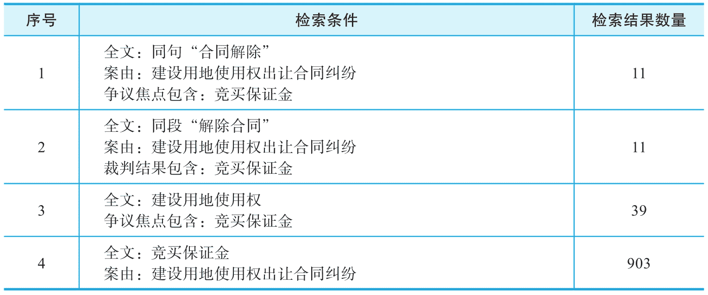

注：查找时间为 2024 年 8 月 20 日，查找平台为 Alpha 案例库。

（2）使用者技能欠缺

如何只在案例的辩方答辩意见中查找？如何查找近 3 年内抢劫罪的“无罪”案例？如何查找到某某公司作为第三人的所有案例？何时使用同句、同段或间隔位置搜索？一些律师技能掌握有限，往往仅从案号、标题、案由、法官、地域、法院等基础维度查找，不熟悉上述操作。

类案检索的卡点与AI解法

碰到牵涉多重法律关系、跨领域属性的复杂纠纷，仅会基础检索的律师往往力不从心。实务中必须先把案件的争议焦点梳理出来，这对法律功底、实务经验、条文的掌握与运用能力都要求很高，还要具备敏锐的洞察力和提炼能力，从纷繁的事实中抓住关键。对年轻律师或经验尚浅的从业者来说，这几乎是道难关，专业储备不足就容易把争议点找不准，检索效果和案件处理都会跟着受影响。

（3）时间与效率失衡

办案本身已很饱和，证据梳理、法理研究、客户沟通全都排满。类案检索又要额外拆案，复杂案件检索前反复研读材料，工作量和耗时成本骤增，时间非常紧张。全面深入的类案检索意义重大，却极费时间。律师需要在检索的严谨度与有限工作时间的分配之间找平衡，花太多时间检索会影响别的事项，太赶又发挥不出检索价值。

**4. 对不同职业群体的影响**

（1）律师
传统类案检索会拖累业务质效。检索低效导致案件准备阶段耗时过长，挤占策略制定、证据整理等核心环节。结果不准可能让法庭主张失当，降低胜诉可能。深度不足也难以真正用好类案，为当事人提供高质量服务。压力也会随之增大，时间紧、客户期待高，传统检索的痛点让高质量交付更难，长期下来易影响状态、心理健康甚至出现职业倦怠。职业成长也被限制，获取不到全面深入的类案信息，法律研究和思考受限，专业素养提升缓慢。客户信任同样受损，检索支撑不足会让客户质疑专业能力，当前案件处理受影响，口碑和后续业务也会受牵连。
在复杂案件中，一个法律问题往往覆盖多个法理层面，传统检索容易漏掉关键参考。例如企业并购中的反垄断，仅凭关键词很难涵盖市场份额界定、竞争行为评估等要点；劳动纠纷中劳动合同解除、经济补偿常与特殊保护、企业规章等联动。若把握不住深层法律关联，检索结果只盯住表面的解除条款，风险点就会被忽视。

（2）法官
检索低效会吞噬审判时间，关键环节投入减少，审理周期被拉长，当事人对效率和公正的期待难以满足。时间压力下检索不细致，类案参考质量下降，进而威胁裁判的准确与公正。从风险看，不准的检索容易导致法律适用偏差，引发上诉申诉，严重时甚至造成冤错，对司法公信是冲击。缺乏深度分析，判决的不确定性随之升高。专业成长也受限，法官需要大量优质类案来学习研究，传统检索缺陷让全面深入的信息难以获得，难以适应司法实践的变化。

（3）学者
法学研究依赖海量案例支撑。检索慢会浪费大量时间，进度和质量都受影响。结果偏差会直接牵连研究结论。学者需要对案例做深度分析和比较才能发现新课题，如果检索无法把握关键词背后的深层法理，就容易卡壳。如研究区块链法律规制时，传统方式难以把技术特征与现行法律框架有效结合，创新和发展被阻碍。

**2.1.2 AI 类案检索的优势**

技术发展让AI为类案检索带来新解法，下面聚焦AI如何助力律师检索。

**1. 提高检索效率**

（1）快速获取关键词
准确迅速地定关键词是高效检索的第一步。AI凭借自然语言处理优势，能够对律师输入的案情描述做深度解析，既读懂字面意思，也能挖掘文本背后的关键信息。人工靠阅读理解再凭借经验挑词，耗时多且易受知识局限和主观性影响，AI则能在瞬间完成大规模文本分析。
比如律师描述一起交通事故纠纷，AI能迅速识别事故时间、地点、天气、车型车速、碰撞方式、损伤程度、责任划分等要素，并自动生成全面准确的检索词，大幅缩短准备时间，让律师更快拿到相关结果。

（2）智能筛选结果
海量结果中挑出最有价值的类案是另一难题。AI用机器学习和深度学习学习各类案件的特征与规律，从过往案例中归纳模式，对新结果做精准筛选分类。像合同纠纷，AI不会只看条款表面，而是会分析合同类型、争议焦点、判决结果及法理依据等，细化分类后提供高度针对性的参考。律师无需在信息海洋里苦找，直接获得高相关类案，既省时省力，也提升分析的全面性和准确性，系统会随数据累积不断优化。

**2. 增强检索准确性**

（1）深入理解法律术语
AI可对大量法律文本学习训练，掌握概念和关联。与传统检索相比，它更能抓住关键词背后的深层法理。如“知识产权侵权”，AI能理解侵权类型、认定标准、赔偿计算等内涵并据此筛选。AI还能综合多重因素做判断，事实细节、适用条文、社会背景、政策环境、法官自由裁量等都被纳入分析。处理复杂商业纠纷时，它能同时关注合同履行、市场环境、行业惯例、法规变化，通过全方位剖析更准确评估类案适用性，为策略提供可靠支撑。

（2）避免人为因素的干扰
传统检索易受经验、知识水平、主观判断干扰。AI遵循数据分析和模式识别规则，全程基于客观事实和数据驱动。确定关键词和筛选结果时不受个人主观影响，提升客观性和准确度。

**3. 提升类案的适用性判断能力**

（1）综合分析案件的因素
AI能把案件事实、法律适用背景、法官裁量空间等要素综合评估类案适用性。基于多维度分析给出更精准的适用判断，助力律师制定更周全的诉讼策略。

（2）学习法官的裁判思维
AI通过学习大量裁判文书，提炼法官受法律原则、先例、社会公共利益、公平正义观念影响的裁判路径与决策逻辑。面对新案时，它可把当前案件与过往案例对比，找相似与差异，并基于对裁判思维的理解给出适用建议，让类案参考更贴近实务、更具可操作性。

**4. 提供个性化服务**

（1）根据律师的需求定制检索方案
AI可基于律师不同需求定制个性化检索方案，无需律师手工拆解关键词，还能按需求调整检索策略和参数，并依据使用习惯和反馈持续优化服务质量。

（2）推送相关法律资讯和案例更新
AI实时监测法律资讯和案例变化，推送新法规、司法解释解读，以及新的相似案例及其对当前案件的影响，帮助律师及时掌握法律动态，提升工作效率。

### **2.2 AI 类案检索常用工具**

从2023年底起，国内AI类案检索工具快速增长，多基于自然语言处理和机器学习实现快速精准检索。主流形态有三类：
❑ 专业法律数据库公司推出的类案检索工具，依托庞大数据库和专业算法，如Alpha、北大法宝、威科先行等。
❑ 科技公司开发的法律智能助手，融合AI与法律知识，如无讼、法蝉等，还可提供文书生成、案件分析等功能。
❑ 律师事务所自主研发的类案检索工具，按所内业务特点定制，针对性强。

代表产品简述如下：

（1）AlphaGPT
整合Alpha法律数据库与人工智能、深度学习技术，提升类案检索效率。智能搜索能理解查询上下文，给出更准结果；类案综述能提炼案例焦点与差异；可视化功能可自动生成案例摘要，帮助快速把握要点。

（2）元典问达
基于大模型研发的法律智能问答引擎。“案例洞察”可依据提问自动完成类案检索并做分析，帮助快速定位相似案例、解析焦点与判决趋势。深度集成元典独家知识库与大模型，一站式提供法律知识服务，输入问题即可得到可溯源的精准回答。

（3）MetaLaw
秘塔科技推出的智能法律类案检索工具，提供精准检索服务。支持一键直达案例节省时间；内置AI分析助理可智能分析案例并给出关键信息与相关法条；争议焦点思维导图以可视化方式梳理关键点与逻辑；还能摘录判决书引用的法律法规，便于锁定请求权基础并组织证据与辩论。

### **2.3 AI 类案检索的智能应用与实战演练**

以AlphaGPT为例，看大模型在类案检索上的实际表现。

**问题：**在健身房报了私教课，上了两节后教练离职，健身房想给客户更换教练，但客户不想要其他的教练，并要求解除合同，可以支持吗？

**2.3.1 类案综述**
类案综述是对相关类似案件的综合概括，通常包括主要特征、争议焦点、法律适用及裁判倾向等，帮助快速把握领域实践。

本案为服务合同纠纷。AlphaGPT给出的类案综述围绕“合同解除权”“退费问题”“格式条款效力”“服务合同特性”“违约金问题”5个角度展开，每点均附案例链接。

核心观点为：私教服务合同人身属性强，原定教练离职后消费者对更换教练有选择权。若消费者基于对特定教练的信任购买服务，教练离职致其不愿继续，法院通常支持解除合同，并结合履行情况、个人体验、信任基础等因素，依据公平和诚实信用原则酌定是否退费及数额。

案例指向包括：
【（2019）京 0111 民初 15568 号】法院认定健身房关于更换教练的格式条款排除消费者主要权利无效，支持解除并酌定退费。
【（2020）沪 0107 民初 24332 号】指出私教合同人身属性强、需相互信任，指定教练离职后消费者有权解除，应全额退还剩余费用。
【（2019）京 0111 民初 15565 号】同样支持解除，格式条款排除权利无效，酌定退还部分服务费。
【（2018）京 0105 民初 77823 号】认为合同针对教练个人服务，原教练离职后不愿继续，支持解除并酌定退费。
【（2017）浙 0203 民初 1307 号】认为学员基于对特定教练认可签约，教练无法履约时，支持解除并退还未上课费用。
【（2020）苏 0192 民初 4950 号】支持解除，酌定消费者承担20%违约责任后退还剩余费用。
【（2022）沪 0115 民初 53851 号】支持因原教练离职解除，格式条款无效，违约金700元并退还部分课时费。
【（2020）沪 0107 民初 24327 号】支持解除，格式条款免责无效，判决全额退还剩余私教费用和会籍费。

总体来看，法院处理私教离职后要求解除的案件，通常考量人身属性、信任基础、履行情况及格式条款效力，倾向支持消费者解除，并据案情酌定退费数额。

**2.3.2 案例列表页**

案例检索结果以列表形式呈现，点击任意一项即可进入详情页。整体布局条理清晰，律师浏览时能快速捕捉年份、审理阶段、案件类别和裁判结果等关键要素，效率明显提升。配合分类与排序工具，可以依据关注点快速锁定最相关、最有价值的案例，节省反复打开页面的时间。仅凭列表页的排序和概要信息，就能初步判断案例的价值与适用性。

AlphaGPT 的案例列表支持纯文本和可视化两种呈现方式，时间跨度覆盖 2017 年至 2024 年，便于横向对比不同时期的同类案件走势。筛选维度丰富，包含年份、审理程序、案件类型、所属行业等，可实现精细化检索。每条案例的简介信息较为完整，涵盖案情要点、审理进展、标的金额、诉讼请求等，并突出显示裁判结果和引用法条，增强专业参考价值。系统会对命中段落进行高亮，并在界面上把裁判文书拆分为当事人信息、案件概述、法院查明、法院认为、判决结果、审判人员等模块，交互顺畅，轻点即可获取所需内容。

AlphaGPT 在类案召回上并非简单按句子或段落机械匹配，而是依据内容逻辑进行精细划分。始终坚持技术驱动法律的理念，这项工作得以高质量完成。Alpha 案例库当前数据总量超 1.6 亿，收录范围包括指导性案例、人民法院案例库参考案例、公报案例、典型案例、优案评析、类案参考及普通案例，是国内规模最大、解析能力领先的裁判文书库。

依托全面准确的数据支撑，AlphaGPT 为法律从业者处理复杂法律问题和开展类案检索提供了坚实保障，其底层数据情况见表 2-2。

表 2-2 AlphaGPT 底层案例数据介绍

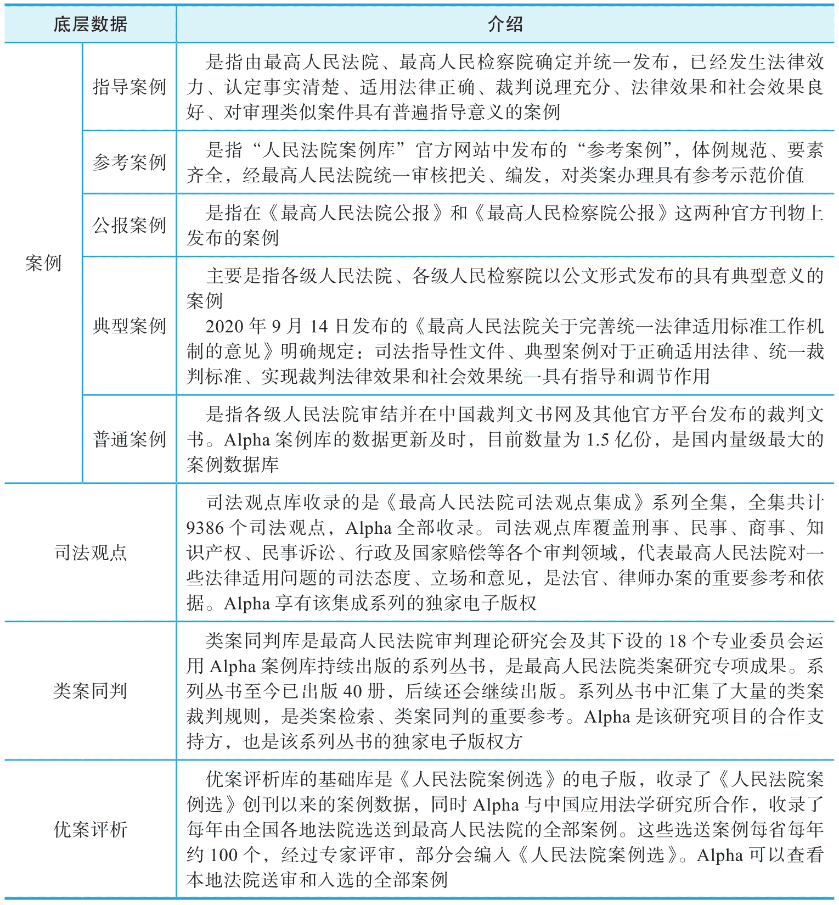

《最高人民法院关于统一法律适用加强类案检索的指导意见（试行）》明确，类案检索范围一般包括：（一）最高人民法院发布的指导性案例；（二）最高人民法院发布的典型案例及裁判生效案件；（三）本省高级人民法院发布的参考性案例及裁判生效案件；（四）上一级人民法院及本院裁判生效案件。由表 2-2 可见，AlphaGPT 的底层数据完全符合上述规定要求。

表 2-3 提供了更多体验示例。

表 2-3 类案检索参考问题及要点

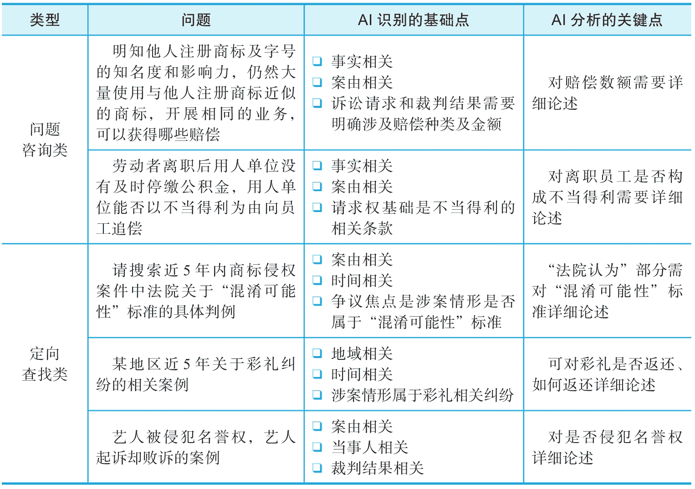

### 2.4 AI类案检索的痛点与挑战
AI 类案检索潜力巨大，但发展过程中仍面临诸多现实问题，这些问题制约着准确性与可靠度，也影响其能否真正成为律师等法律人的实用助手。本节聚焦主要挑战并探讨应对思路。

### 2.4.1 数据质量难以确保
AI 的学习效果取决于数据质量。若数据质量不佳，模型准确度会受损。部分库存在录入失误，检索结果因此偏差；部分库更新不及时，无法反映完整案例态势。

1. 案例数据录入错误
在海量法律数据录入中，因人为失误、系统故障或来源不准，会导致错误信息进入库中。如案件关键事实描述错误、法条引用出错或当事人信息不准，被 AI 学习后就会引发错误检索。例如交通事故赔偿类案检索中，若某案例的责任划分被误录，AI 可能将其作为参考误导判断。

2. 案例数据缺失
法律数据细节繁多，事实经过、证据材料、法律适用理由等缺一不可。信息不全会削弱 AI 对案件的整体理解。以合同纠纷为例，若库中案例缺少关键合同条款，AI 就难以判断与当前案件的相似度，降低检索精度；数据缺口也会限制 AI 学习重要法律特征，影响新案分析能力。

改善建议：
❑ 建立严格的数据录入、审核、更新机制，保障准确性、完整性和一致性。
❑ 应用数据清洗与预处理技术，剔除噪声、纠正错误、补齐缺失，提升质量。
❑ 选用优质法律数据库，整合法院官网、裁判文书网等多渠道来源，保证覆盖面与准确度。

### 2.4.2 算法黑箱难以解读
AI 类案检索算法复杂，决策过程难以解释，易引发律师疑虑，影响使用效果。

1. 律师产生困惑
算法内部逻辑对非技术人员不透明。法律人习惯依据条文、逻辑推理和证据判断，而 AI 返回的类案若无法说明筛选依据、权重分配和排序逻辑，律师会感到不安。如商业合同纠纷中，AI 推送一系列相关案例，却不清楚选中依据和排序理由，使用时难免存疑。

2. 信任难以建立
缺乏可解释性会导致信任危机，尤其在高风险案件中。知识产权侵权高额赔偿案需要确保参考案例合理筛选，若对 AI 结果缺乏信任，律师仍需花费大量时间人工核验，甚至放弃使用，效率受损。

改善建议：
❑ 采用可解释性算法，如决策树、规则推理，使决策过程可追溯。
❑ 提供解释说明和可视化工具，用通俗图表、流程图展示检索逻辑与结果，增强直观理解。
❑ 加强与律师沟通交流，及时解答疑问，提升信任度。

### 2.4.3 法律知识更新滞后
法律持续发展，新法、司法解释、新案例不断出现，AI 需及时学习更新，但当前学习与更新存在滞后。

1. 意图理解存在迟延
法律更新不仅是条文修改，还涉及概念重释、原则调整和适用范围变化。AI 对复杂概念和逻辑关系理解仍不足。如司法解释对某条款含义重大调整时，AI 可能难以把握调整意图和影响，造成检索偏差。

2. 法律推理路径复杂
法律推理不止于三段论，涉及概念转化、漏洞填补、类推适用及立法目的的价值判断。如将拖拉机视作机动车、将硫酸视作刑法中的武器，均需目的解释。AI 短时间内难以完全模拟这种灵活性与深度。

3. 新兴领域检索无结果
互联网金融、人工智能等新兴领域规则变化快，判决公开存在时滞。AI 难以迅速掌握最新规则，为律师提供及时准确的类案支持。

改善建议：
❑ 建立动态学习机制，实时监测法律变化，通过定期更新库或增量学习提升适应性。
❑ 引入专家系统和知识图谱，将专家经验转化为机器可理解形式。
❑ 注重法律概念的体系化解释，结合上下文和立法目的进行价值判断。
❑ 加强与学界、实务界合作，及时获取最新动态，指导模型迭代。

在审视 AI 类案检索的挑战时，必须正视其在实际应用中的多维问题。技术虽带来便利，但若不解决上述痛点，其在法律实践中的价值难以充分释放。

## 第三章
## AI助力案情分析
司法实践中，案情分析是律师、法官等法律人的核心环节。通过系统梳理和分析，能够准确把握法律依据并预判风险。但传统检索研究方式面对海量数据、时间精力限制和案情复杂性时，已难以满足需求。

本章讨论 AI 在案情分析中的应用及现状，以 AlphaGPT、通义法睿等工具为例，从实务角度展示其应用场景，同时指出其在法律分析中仍需完善之处。

### 3.1 AI破解传统案情分析的痛点
案情分析是对案件事实、证据、法律问题及适用进行的综合研判，是事实认定与法律解释的过程。民事分析中律师需厘清法律关系、权利义务、主体客体及变动；刑事分析则侧重罪与非罪划分、罪名认定与量刑评估。

从律师视角看，案情分析是全局性工作，旨在全面了解案件背景、依据、风险及可能结果，为当事人制定诉讼策略或提供建议。核心是以法律关系识别为前提、以事实把握为基础、以客户目标为导向，最终形成《法律意见书》作为成果呈现。这要求扎实的理论功底与丰富实务经验。

本节以律师工作视角梳理由传统案情分析带来的挑战，法官视角亦有相似共性。传统流程常受法律检索繁琐、案情与条文复杂多变、时间资源有限及跨领域知识壁垒制约，高效准确分析成为急需突破的课题。

### 3.1.1 传统案情分析的痛点
律师的工作远不止法庭辩论，涵盖代理诉讼非诉事务、提供法律咨询、起草审查法律文件、谈判调解、调查取证、法律培训等，案情分析贯穿其中。

笔者将律师案情分析工作归纳为“案情梳理+法律研究+策略制定”三步。然而从接案开始，多重挑战随之而来。

1. 海量数据中精准检索耗时费力
（1）传统法律数据库的局限
2013年被称作法律大数据元年，最高人民法院上线中国裁判文书网，开启法律数据资源化进程。随后大量法律数据库涌现，虽不断完善，但关键词检索精确度不足的问题仍突出。面对复杂问题，简单关键词组合难以实现精准定位；条文判例持续增长，如何高效筛选相关信息仍是难题，制约复杂检索效能，影响分析全面性与准确性。

（2）关键词设定与检索效率的关联
律师需反复调整关键词才能定位信息，既耗时又费力。一方面关键词设置要求具备检索能力和业务积累，设定不当会误导后续分析；另一方面数据库排序与相关度逻辑不尽如人意，需额外筛选。检索结束后，仍需大量时间阅读甄别，难以在有限时间内掌握全貌，影响效率与质量。

2. 法律分析及证据梳理复杂
（1）法律分析的复杂性
民事案件常涉及合同、侵权、物权等多重交织法律关系，甚至刑民交叉，案情梳理繁琐，对专业知识和实践经验要求高。律师需在不同法域间切换，兼具洞察力与严密逻辑。

（2）证据收集与整理的难度
民事诉讼遵循“谁主张谁举证”，律师需在时限内高效收集并评估大量直接与间接证据。复杂案件证据繁杂，甄别相关性与有效性耗时耗力，易出现疏漏。

刑事案件中，案卷庞大，证据既有指向有罪罪重的，也有指向无罪罪轻的。智能阅卷尚不成熟，多依赖人工摘录与阅卷笔录，工作量巨大。

（3）证据多样性带来的不确定性
证据形式多样，包括书证、物证、证人证言、视听资料、电子数据等，各有证明力与局限。法官需在矛盾证据中寻找印证，形成整体认知。证据类型的多样性增加了事实认定的复杂性和不确定性。

3. 专业壁垒限制法律实践
（1）律师多领域发展的困境
法律涵盖民商事、刑事、行政等多个领域，各有独特规则。随着法治意识提升，对服务质量要求升高，专业化成为必然趋势。专业化提升竞争力，使其在市场中更难被替代，但也导致律师难以兼顾全部领域。

（2）专业化与客户需求的平衡挑战
客户法律问题往往跨领域，超出熟悉范围时需重新学习成本高。全面掌握各领域知识有助于满足多样需求，但“小而精”与“大而全”之间的取舍成为常态。案源竞争加剧，律师被迫关注新兴行业与前沿问题，持续学习压力大，专业壁垒成为成长难题。

4. 时间与资源受限下难以兼顾效率与质量
（1）效率与质量的平衡挑战

案情研判的困境与智能突围

律师的工作本质是对时间与精力的直接变现，投入多少往往决定收费高低。预算一紧，深挖案情的空间就被压缩，高质量的研判很容易打折扣。

资源受限时，效率与质量必须反复权衡。为了在有限工时内交付可用的法律服务，不少人只能压缩休息、延长加班，或把工作拆分给技术工具和团队协作。借助法律科技提速起草与检索，依靠协作分摊负担，再以持续学习累积处理效能，是常见自救手段。客户通常只看到结果，难以感知背后的隐性付出，而正是这些看不见的投入构成了案件成功的根基。

（2）律师工作的隐性价值难以被发现

委托人更关注判决或协议能否成，更少关心律师在背后花了多少时间梳理逻辑。民事代理里，诉讼时效的倒计时叠加资源紧张，形成双重压力。律师须在极短窗口完成事实厘清、策略制定与文书输出，节奏极其吃紧。一份仅数页的类案检索或代理词，外表轻薄，内里却是长时间阅读、比对与思考的沉淀。

**5. 人为因素对分析结果的影响**

法条与司法解释本身复杂，案情研究需要扎实的法学基础与充分的实务经验。传统研究中主观干扰始终存在。下面从执业者与裁判者两端来观察这种影响。

（1）律师视角：主观性因素对案情分析的影响

研判时个人经验与价值取向会不自觉带入，容易出现盲区，进而削弱客观性与后续走向的稳定性。

主观差异还会导致结论分化。同一材料，不同执业者可能给出不同判断。这种不确定性放大法律风险，也可能让本应清晰的事实关系因个人因素走向不利结果或出现意外。根源在于传统研究高度依赖个人能力与阅历，专业背景、执业年限与判断尺度不同，结果自然分化。而诉讼不容试错，当事人没有时间做二次选择。

（2）法官视角：主观性因素对案情分析的影响

裁判者的个人素养与专业水准直接关联事实认定、证据理解与最终裁判。主观影响很难完全消除，即便同一名法官，面对不同案件也可能因经历与背景不同而产生差异化解读。

这种主观性既来自专业能力，也来自经验积累与推理习惯。资深法官更易捕捉证据间的细微差别，新入职者容易忽略关键细节。推理路径的差异也会导致对同一事实的不同结论，有人偏重严密逻辑，有人更倚重经验直觉。

**3.1.2 AI 在案情分析中的优势**

案情研究的核心是精准识别法律关系、综合评估证据并制定诉讼对策，本质上是对法律语言的理解与基于该语言的知识生成。这一内在逻辑与大模型的运行原理高度契合，因而在研究环节具备明显优势。

**1. AI 辅助下的法律检索革新**

（1）大模型通过精准理解自然语言检索内容，并快速定位结果

在复杂案件中，模型能帮助律师迅速在法规、判例与学术资料中锁定要点。

其一，语言理解能力强，无论是自然语言提问还是关键词检索，都能把握真实意图，先把案件信息或法律问题转化为概念与术语。相较传统检索，对关键词依赖更低，对复杂问题的包容度更高。

其二，系统连接海量数据库与知识图谱，可跨行业、跨法域调取相关条文、司法解释、类案与论文，大幅拓宽信息覆盖面。

其三，基于深度学习，系统能读懂法律文件的语境与逻辑结构。检索时不仅罗列条目，还能解析文档内容、抽取关键要素，给出更精准的命中结果。

（2）模型能根据用户反馈进行优化，提高效率，满足个性化需求

系统具备持续学习能力，会在每次使用中收集操作行为与反馈，如结果相关度、文档精确度、使用习惯，用以迭代。使用的次数越多，它越能掌握律师的专业方向、常用术语与表达偏好，并在检索时优先呈现符合工作风格的资源。

同时，系统可灵活调整呈现方式，按案件或场景的需求优先展示特定类型的法规、案例或论文，实现定制化检索，让工作流程与工具更贴合。

**2. 高效文本识别与深度理解，提高案情梳理与法律分析的效率**

（1）模型助力律师高效梳理案情和证据，提高信息处理的精准度和速度

传统做法里，律师需花费大量时间阅读卷宗、证据与法条。模型的核心优势是大规模数据处理。相较普通NLP，以生成式大模型为代表的系统在文本识别与多模态处理上优势突出。

实操中，可将多份材料一并上传。以GPT-4o为例，数分钟内即可提炼出核心要点。配合不同提示词，系统还能对多份文档进行归纳与总结，大幅压缩阅读整理时间，为复杂案件提供支撑。

（2）模型在法律分析中的巨大潜力推动了智能推理与法律判断的发展

民事分析里，三段式推理仍是常用框架。大前提是法律规范，小前提是案件事实，匹配结果决定结论。

大前提的定位已有论述，这里聚焦小前提。系统能深度阅读案卷材料，快速抽取关键事实与证据并与法律规范对接。可自动识别核心争议点，还能理清复杂事实间的逻辑关系。面对多源、多类型证据时，系统能整合信息，清晰呈现小前提的构成。

在综合判断上，系统可把大前提与小前提结合，给出逻辑自洽的推理路径。依托案例库与学习算法，它还能对同一法律问题进行多角度解读，让定位问题、分析规范与事实变得更高效、更精准。

**3. 降低法律领域的“知识黏性”，扩大律师执业领域**

互联网让法律知识传播更广，但高度专业化与领域壁垒仍让准入门槛很高，形成以法律人为中心的高黏性传播结构。

大模型有望打破这一格局。它大幅压缩知识生成的成本与门槛，让公众更轻松地使用法律知识。复杂的条文与案例可被简化并直观呈现，提升普及度、可及性与法律意识。

（1）模型助力律师进行内容创作，提升知识传播效率

律师是法律知识的重要传播者。案件研究后形成的文章或课程，本质是知识沉淀与品牌输出。过去撰写专业稿件或录制短视频耗时很长，借助模型，创作周期被显著缩短，传播效率随之提升。

（2）模型打破领域壁垒，助力律师进行跨界法律研究

对专攻某一领域的律师而言，模型能弱化领域间的知识壁垒。面对不熟悉的法域，可迅速检索、理解文本与案例，无需耗费大量时间研读原文。系统能解析文档、提取要件、推荐类案与适用条文，帮助律师更快制定策略。

（3）模型赋能律师自我提升，拓展其执业范围

智能工具为律师提供了持续进阶的平台。快速获取并理解新领域的法律知识，有助于拓展业务边界，提升综合竞争力。在更短时间内掌握新法、在日常工作中不断更新知识体系，使律师始终保持行业前沿。

**4. AI 助力案情分析，提升效率与节省时间**

在法律分析中，模型能明显减少耗时。凭借强大的数据处理与文本分析能力，它可批量检索与整理文档，精准提取关键信息，快速识别争议点并推荐依据与判例，还能依据案件特点给出策略建议。自动化与智能化让律师把更多时间留给核心法律判断。

**5. 从全面视角切入，助力更加公正、客观的法律分析**

（1）模型辅助构建案件论点，提升律师分析能力

传统分析受个人知识边界限制，而模型能整合跨领域信息，提供更开阔的视野。

对律师而言，减少经验不足或人为偏差是关键优势。系统能自动化筛选与案件相关的证据，避免遗漏。过去靠人工逐份核对耗时且易受视角影响，系统在短时间内完成分类与校验，为论点构建奠定基础。

此外，深度分析能力降低了判断差异带来的误差。它能发现证据间的隐性关联，以数据驱动的方式提供论证思路，弥补经验盲点，使分析更严谨、更具逻辑。

（2）模型赋能法律推理与趋势预测，推动法律实践智能化发展

通过训练大模型，可从多方视角展开分析。基于海量历史案例的学习，系统能模拟对方可能的策略，帮助己方提前准备。这种预测能力让决策不再局限于个人经验。

系统还能模拟裁判思维，结合历史数据预测判决倾向与赔偿区间，给出客观参考。更进一步，系统通过对广泛数据的挖掘，可识别法律发展的潜在趋势，为政策制定与修订提供数据支撑，具有前瞻性的实践价值。

**3.1.3 AI 在案情分析中的应用场景**

**1. 精准定位法律依据及类案参考**

在定位依据与类案方面的应用已从概念走向落地。2023年以来，多款法律垂类产品涌现，它们以海量法律数据训练模型，在条文解释、案例分析与文书生成上的准确度更符合行业要求。相较通用大模型，这类产品对提示词依赖更低，虚假输出风险更小，提供的类案参考与法律依据更具专业可信度。

**2. 高效归纳与分析法律问题**

法律智能产品能够学习大量法律文本，帮助律师快速归纳争议焦点并进行系统化分析。Dentons、Linklaters、Clifford Chance等国际律所已开始使用生成式AI工具进行法律研究与内容自动生成。这些工具可处理大量查询，并根据案件特点提供针对性分析，提升复杂问题的应对效率。

**3. 提高法律意见的专业性**

依托深度学习与自然语言处理，系统能精准解析复杂问题，迅速检索相关条文与案例，并按案件背景自动生成结构清晰、内容详实的法律意见。生成的文书通常涵盖依据、风险、建议等要素，为律师提供高质量的基础材料，提升效率与专业度。

**4. 辅助法院进行司法裁判**

在司法场景的应用也在扩展。北京互联网法院、杭州互联网法院、江苏省高级人民法院等已将智能工具用于案件筛选与证据分析。2024年7月，深圳市中级人民法院启用AI辅助审判系统，把既定裁判规则嵌入系统，自动提示审查要点与争议焦点，统一审理思路。苏州市中级人民法院作为生成式AI辅助办案试点，也在审判管理中引入相关技术，为行业示范提供了经验。

### **3.2 AI 案情分析常用工具**

目前市面上的产品多聚焦文书与咨询，专门做案情研究的较少。以下介绍几款在分析环节表现突出的工具。

**1. AlphaGPT**

AlphaGPT的法律意见模块契合律师的分析需求。依托自身数据与业务优势，它实现智能化案情推理，可一键生成案情概要、思维导图、诉讼请求、争议焦点、证据清单、法律适用与诉讼策略，几分钟内输出专业意见书，节省基础工作时间。

**2. 通义法睿**

通义法睿的案情分析多在法律咨询场景体现。它能理解用户输入的案情与关注点，采用三段论方式推理，以法律规定为大前提、事实匹配为小前提，给出结构化答案。

**3. 得理法搜**

得理法搜提供场景化提示词，支持快速检索案例与法规、归纳裁判思路、提示法律风险、制定诉讼方案与策略。

**4. Lexis+AI**

Lexis+AI是美国的法律AI工具，可用于案件策略分析、法律趋势研究与竞品分析，帮助律师准备案件。企业法务也可利用其进行风险评估与合规分析。

### **3.3 案情分析的智能应用与实战演练**

本节以AlphaGPT与通义法睿为例，结合一起机动车交通事故责任纠纷案，展示大模型在法律分析中的实际表现。

**案例背景：**

2020年12月6日晚11时28分，因加班过晚，甲女士搭同事小王的车从单位返回市区家中。次日凌晨12时35分，小王驾驶车辆行驶至888国道76公里处，因失控冲出路面并撞上路边大树。

同日，交警大队出具道路交通事故认定书认定，事故系小王在冰雪路面超速所致，小王承担全部责任。事故发生后甲女士被送医抢救。2020年12月7日医院诊断其为颈椎体骨折伴截瘫、寰区关节半脱位、脑挫裂伤等多处伤情。经长期治疗虽有改善，但四肢肌力未恢复，瘫痪在床。

2021年12月16日，司法鉴定意见认定甲女士颈部脊髓损伤致四肢瘫肌力3级伴大小便功能障碍，伤残等级为1级，完全丧失劳动能力，护理依赖程度为完全护理依赖。

甲女士应如何维权？请对本案进行分析并提出诉讼策略与法律意见。

**3.3.1 法律依据与类案参考**

法律依据是指在分析和裁判过程中所引用的法律法规与类案判例，为法官、律师与当事人提供明确的法律框架与标准，确保裁判公正与一致。在诉讼中，法律依据是裁判的基础，也是策略制定的依据。当事人需提供充分证据与依据支撑主张，否则将承担不利后果。

智能系统依托语义解析，能够把律师导入的案情材料自动拆解并提取要点，随后从庞大的法律数据库中筛出最贴合的条文。类案检索方面，模型借助大数据把与待办案件相似度高的先例推给用户，既加快了检索节奏也提升了命中精度，帮助法务快速抓住类案裁判思路，更好地评估案情所涉依据与潜在风险。

以机动车交通事故责任纠纷的测评案例为例，通义法睿准确把握了事实要点，列出人身损害赔偿相关的规范依据，并将条文原文完整呈现以供参考。

通义法睿的输出结果如下所示：

**相关法条**

[1]《中华人民共和国民法典》第一千一百七十九条：……（此处内容省略）

[2]《最高人民法院关于审理人身损害赔偿案件适用法律若干问题的解释》（2020 修正）第十二条：……（此处内容省略）

[3]《最高人民法院关于审理人身损害赔偿案件适用法律若干问题的解释》（2020 修正）第十四条：……（此处内容省略）

[4]《最高人民法院关于确定民事侵权精神损害赔偿责任若干问题的解释》（2020 修正）第五条：……（此处内容省略）

AlphaGPT 在规范依据的呈现维度更宽，覆盖案由、诉讼预期、相似案例与关联法规四个视角，部分视角采用可视化呈现，从呈现方式到信息颗粒度都更贴近律师的日常检索习惯。

AlphaGPT 的输出结果见图 3-1。

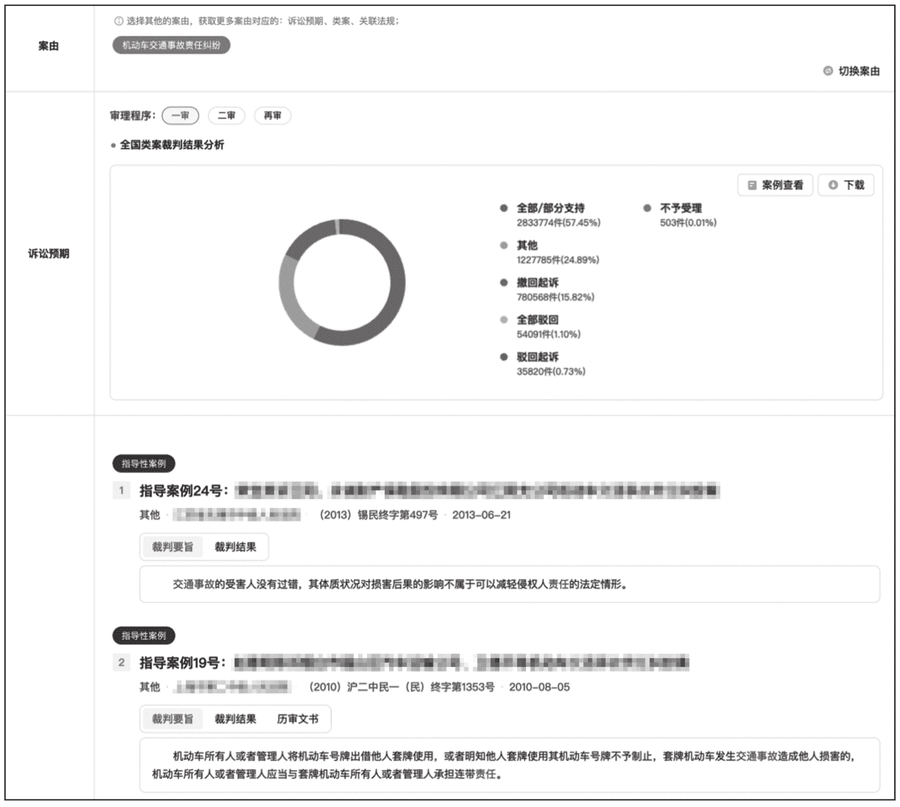

▲图 3-1 AlphaGPT 所展示的法律依据

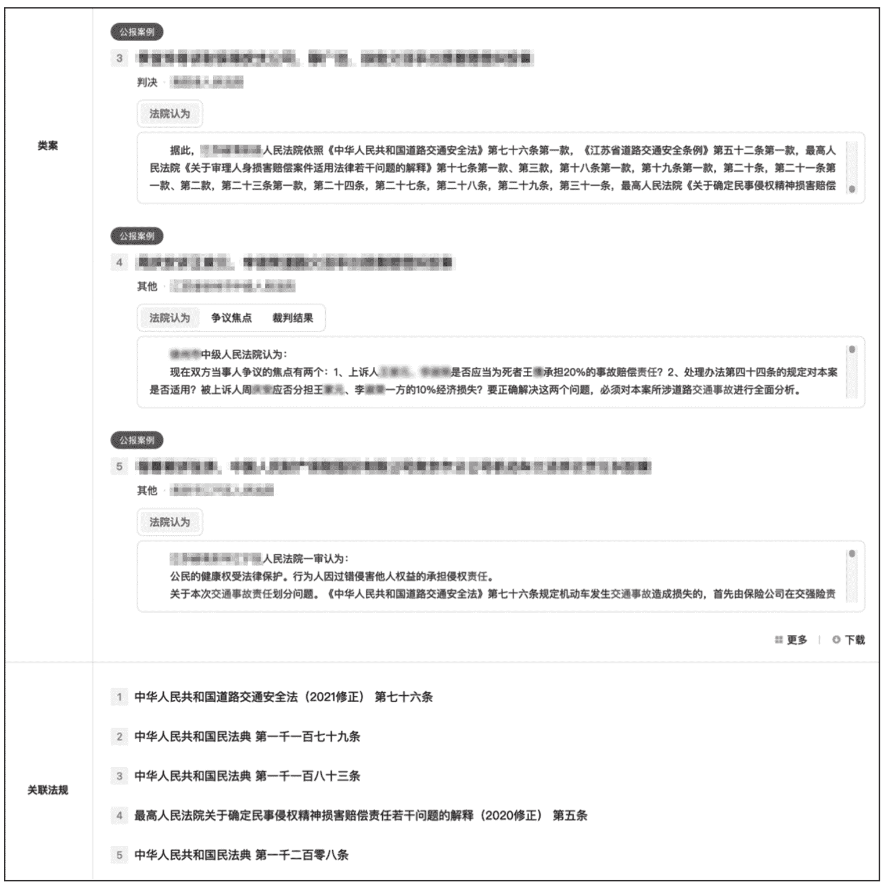

▲图 3-1 AlphaGPT 所展示的法律依据（续）

**3.3.2 分歧点梳理与研判**
实务里，民事案件剖析的关键在于把各方矛盾点提炼出来。矛盾点指当事人就事实、证据与规范适用产生分歧的内容，既是庭审核心也是法官说理重点，裁判文书必须针对性回应。

矛盾点可分为事实类与规范类。事实类关乎法律关系产生、变更或消灭的事实认定，如合同是否履行、债务是否已清偿；规范类关乎适用问题，如某项行为是否构成违约、某条款是否有效。厘清矛盾点有助于律师锁定审理重心，推动程序进展，提升庭审效率，保障裁判公正合理。

回到测评案例，本案要点的在于确认小王的侵权责任并划定赔偿边界。通义法睿的研判偏重赔偿范围的细化，对各项费用给出具体建议。

通义法睿的输出结果如下所示：

甲女士搭乘同事小王的车辆在下班路上发生交通事故，小王因雪地超速导致事故并负全责。甲女士因此重伤，经长期治疗后仍被鉴定为 1 级伤残，完全丧失劳动能力且需完全护理依赖。针对现状，其维权路径与策略如下：

1. 确认保险责任：首先，需要确认车辆是否购买了交强险和商业三者险。交强险为强制保险，对事故受害人包括车内乘客提供基础保障；商业三者险可提供额外赔偿额度。甲女士有权要求小王出示保险单据，以确认情况并作为后续索赔基础。

2. 医疗费用与后续治疗费：可向小王及保险公司主张已发生的医疗费用，包括住院费、手术费、药品费、康复治疗费等。对后续可能产生的费用，如定期复查、药物依赖、康复训练等，可依据医疗机构证明或司法鉴定意见书中的预测主张。

3. 残疾赔偿金：依据 1 级伤残鉴定结果，有权按《中华人民共和国民法典》第一千一百七十九条要求支付残疾赔偿金。计算通常以受诉法院所在地上一年度城镇居民人均可支配收入或农村居民人均纯收入为基数，按伤残等级对应比例，自定残之日起按二十年计算。但六十周岁以上，年龄每增一岁减一年；七十五周岁以上，按五年计算。

4. 护理费：……（此处内容省略）

5. 误工费：……（此处内容省略）

6. 精神损害抚慰金：……（此处内容省略）

7. 其他损失：……（此处内容省略）

AlphaGPT 直接从材料归纳双方核心分歧，不仅涵盖赔偿范围与金额，还深入责任认定层面。分析逻辑与现行裁判文书一致，先定责后定赔。呈现既以中立视角阐述分歧，又结合当事人诉求说明可能影响，模拟律师与当事人沟通场景。相关依据同步列出，便于核对。

AlphaGPT 的输出结果如下所示：

**争议焦点 1：关于小王超速行驶的责任认定**

争议焦点阐述：本案分歧之一在于小王是否因超速应承担事故全部责任。根据《中华人民共和国道路交通安全法（2021 修正）》第七十六条，机动车发生交通事故造成人身伤亡、财产损失的，由有过错一方承担赔偿责任。交警大队出具的道路交通事故认定书认定小王承担全部责任，这意味着超速行驶是事故直接原因……（此处内容省略）

对当事人请求的影响：……（此处内容省略）

法律规定：

《中华人民共和国道路交通安全法（2021 修正）》第七十六条……（此处内容省略）

《最高人民法院关于审理道路交通事故损害赔偿案件适用法律若干问题的解释（2020 修正）》第二十四条……（此处内容省略）

**争议焦点 2：关于甲女士损害赔偿的范围和金额**

争议焦点阐述：甲女士因事故造成严重伤害，包括颈椎体骨折伴截瘫等，根据《最高人民法院关于审理人身损害赔偿案件适用法律若干问题的解释（2022 修正）》第八条，护理费根据护理人员收入状况和护理人数、护理期限确定。甲女士完全丧失劳动能力，护理依赖程度为完全护理依赖，因此有权请求护理费、误工费、精神损害赔偿等……（此处内容省略）

对当事人请求的影响：……（此处内容省略）

法律规定：

《最高人民法院关于审理人身损害赔偿案件适用法律若干问题的解释（2022 修正）》第八条……（此处内容省略）

《最高人民法院关于审理道路交通事故损害赔偿案件适用法律若干问题的解释（2020 修正）》第十二条……（此处内容省略）

**3.3.3 法律建议与行动规划**
民事分析中，法律意见指律师结合案情与法条为当事人提供的专业建议与策略，通常包括事实核查、法律关系界定、请求权与抗辩权主张等。律师建议不仅关乎法律本身，还会兼顾心理、道德、经济、社会、政治等因素，以全面评估客户利益。

按工作习惯与案件类型，意见内容会有所差异，但核心始终站在当事人角度告知下一步安排，以更好维护利益。民事诉讼中，意见一般包含诉讼策略与风险评估；刑事案件则更侧重辩护策略与建议。

针对本测例，通义法睿给出的意见除诉讼策略外，还包括协商解决、申请财产保全和先予执行等多种路径，为当事人提供较为全面的选择。

通义法睿的输出结果如下所示：

**诉讼策略与法律意见**

1. 协商解决：在正式提起诉讼前，甲女士可尝试与小王及保险公司进行协商，争取达成赔偿协议。协商过程中，应充分展示医疗记录、鉴定意见书等证据，明确各项赔偿请求的依据，以提高协商成功可能性。

2. 提起民事诉讼：若协商无果，应尽快向事故发生地或被告住所地的人民法院提起民事诉讼，要求小王及保险公司赔偿上述各项损失。诉讼过程中，应确保所有关键证据材料的完整性和有效性，必要时可聘请专业律师代理诉讼，以提高诉讼效率和胜诉概率。

3. 申请财产保全：鉴于损失巨大，为防止小王转移财产导致将来判决难以执行，可在起诉时或起诉后申请对小王的财产进行保全。

4. 申请先予执行：若面临生活困难或急需医疗费用，可依据《中华人民共和国民事诉讼法》的规定，申请法院对已明确的部分赔偿款项如医疗费、护理费等进行先予执行。

AlphaGPT 的意见不止于应对手段，维度更广，涵盖法律分析、可行性评估、应对策略、风险评估及行动方案。除告知当事人如何应对诉讼，其整体逻辑性与专业度更突出。首先基于法律分析结合诉求做可行性评估；其次给出应对策略并预判对方抗辩及风险；最后提出具体行动建议。这种系统性意见既帮助当事人理解案情，也为制定有效诉讼策略提供基础。

AlphaGPT 的输出结果如下所示：

**一、法律分析和可行性评估**

**（一）法律分析**

根据提供的案情，甲女士在小王驾驶的车辆中因交通事故受到严重伤害，导致 1 级伤残，完全丧失劳动能力，并需要完全护理依赖。诉求包括请求判令小王赔偿医疗费用、精神损害抚慰金、因伤残导致的后续治疗费用及生活护理费……（此处内容省略）

**（二）可行性评估**

首先，根据《最高人民法院关于审理道路交通事故损害赔偿案件适用法律若干问题的解释（2020 修正）》第二十四条，公安机关交通管理部门出具的道路交通事故认定书认定小王承担全部责任，这为诉求提供了有力的法律依据……（此处内容省略）

**二、应对策略及风险评估**

**（一）应对策略**

首先，从甲女士的角度出发，需要预测对方可能采取的应对理由。小王可能会主张自己在冰雪路面行驶时已经采取了合理的谨慎措施，或者试图证明甲女士有同等或部分责任，例如指责未提醒减速或未系安全带等。此外，小王可能会对请求的赔偿金额提出异议，认为赔偿金额过高或部分费用不应由其承担。

针对上述可能理由，甲女士应采取的抗辩策略包括：……（此处内容省略）

**（二）风险评估**

……（此处内容省略）

**三、推荐的法律策略和行动方案**

**（一）诉讼策略**

……（此处内容省略）

**（二）谈判方案**

……（此处内容省略）

**（三）其他备选方案**

……（此处内容省略）

**3.3.4 延伸场景与衍生问题研判**
除上述维度外，智能模型还能做更多层面分析。例如证据整理与分析方面，模型可以快速归纳案内证据并生成详尽清单，为案件准备提供基础；同时帮助律师系统编制证据目录，提升证据呈现的逻辑性与说服力。

在模块丰富度上，AlphaGPT 更贴近律师思维，可输出客观的法律服务意见。除法律分析、可行性评估外，还支持案情梳理，并提供思维导图、时间轴、证据清单梳理以及衍生司法推理等模块。

实践中，律师梳理案情时常借助思维导图和时间轴，通过图示更直观展示案件脉络，尤其在复杂案件中效果更佳。AlphaGPT 的可视化功能满足这一需求。此外，其司法推理板块可在争议焦点基础上做更深入宏观的法律研判，对案件涉及的法律问题展开研究，从客观角度提供法律知识和研究材料。

从工作视角看，AlphaGPT 的案情分析能力无论内容呈现还是分析过程，都更契合实际工作场景，具备高度逻辑性、专业性和全面性。这不仅助力律师在诉讼中提供法律服务意见，也为其深度法律研究提供支持。

AlphaGPT 的输出结果如图 3-2 至图 3-6 所示。

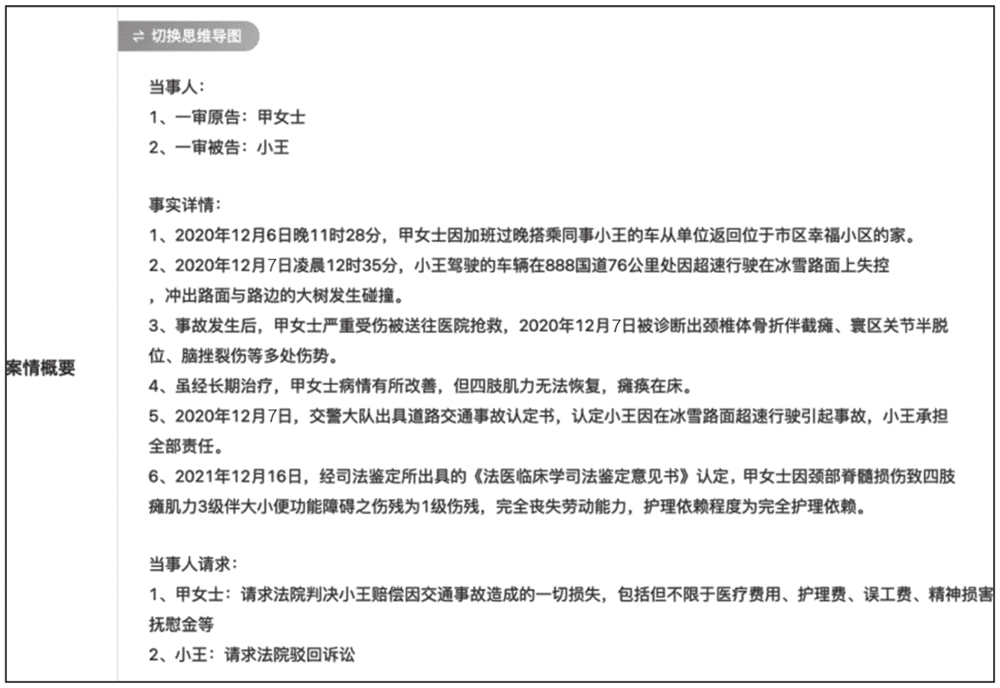

▲图 3-2 AlphaGPT 展示的案情概要

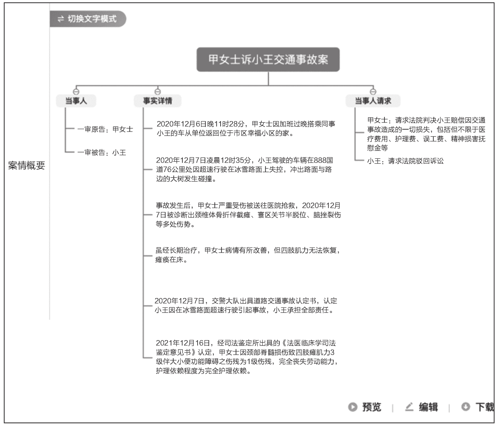

▲图 3-3 AlphaGPT 展示的思维导图

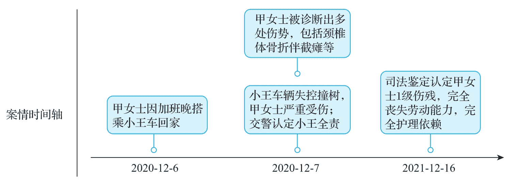

▲图 3-4 AlphaGPT 展示的时间轴

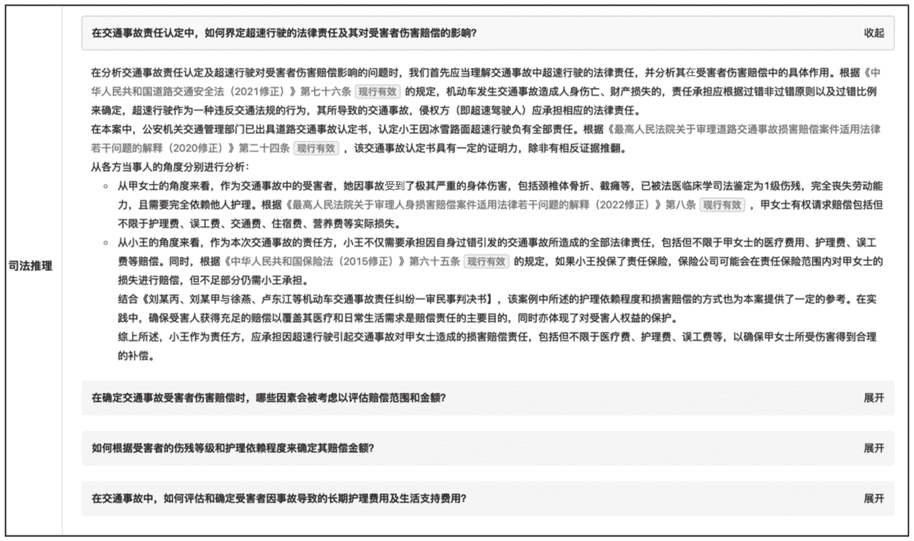

▲图 3-5 AlphaGPT 展示的司法推理

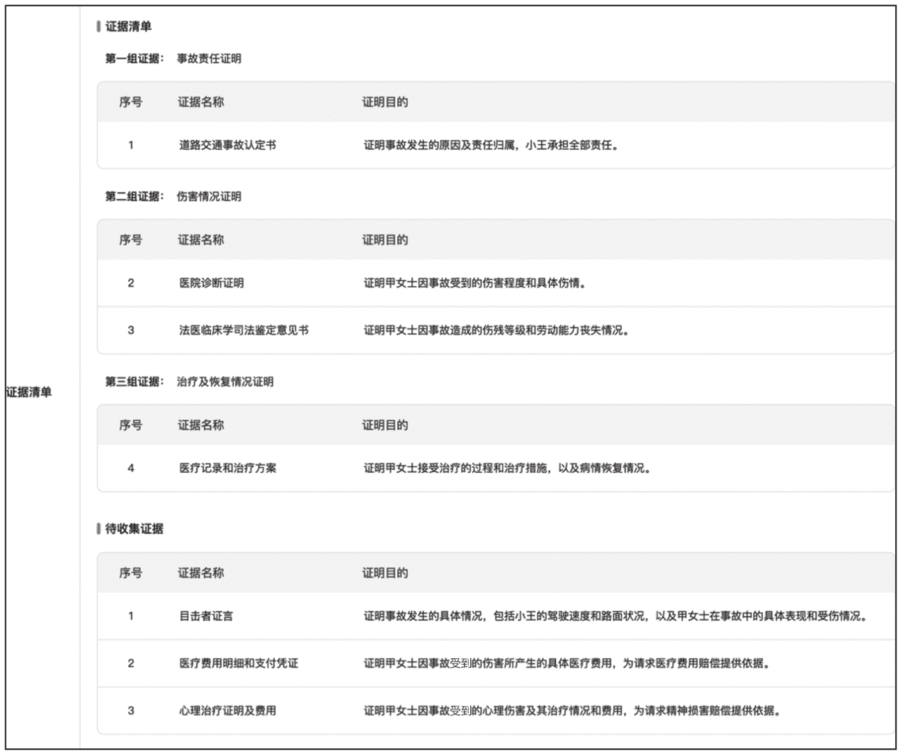

▲图 3-6 AlphaGPT 展示的证据清单

### 3.4 案情研判中 AI 的边界
即便前文论述了智能模型在案情分析上的诸多优势，且法律行业的应用已取得明显进展，但短板仍不容忽视。本质上，大模型是基于人工智能技术的语言模型。虽然设计目标是模拟人类对话，但终归不是真正的人类。它能理解并回答问题，却没有情感、思想或自我意识，其回答源于训练数据中学到的知识和算法。因此，处理基础性、重复性工作时表现优异，但在复杂法律推理上仍存在明显边界。

**3.4.1 法条解释与适用的困境**
案情分析中，模型展现出巨大潜力，但局限同样存在。讨论模型对律师案情分析的助力时可以发现，像 ChatGPT 这类大模型在语言处理和生成上表现突出，能在案例分析中提供辅助，但法律领域的应用仍有限。从内容质量看，模型的分析结果与资深律师相比仍有差距，更接近刚入职的青年律师。

案情分析高度依赖律师对特定法条和案件的深入理解，这需要扎实法律知识和丰富经验。法律理解并非机械过程，而是融入人类智慧与经验的过程，往往需要律师在具体情境下做出精细判断。

目前人工智能在法律适用准确性上仍有局限。法律条文多抽象原则性强，不同解释可能导向不同适用结果。模型在理解和解释条文时，如何处理多义性是一大难题。实务中，模型输出的分析在法律适用上仍显不足，甚至出现生搬硬套。相比之下，有经验的律师能更准确解释条文，将抽象规范具体化，适用于个案。

**3.4.2 专业深度不足**
笔者做过简单测试，4o 处理部分简单案例时表现尚可，尤其在民商事领域，其回答可达初级律师水平，分析也较为灵活。而对 AlphaGPT 等垂直法律 AI 的测试中，其回答更深入专业，内容与形式都更契合律师使用习惯。然而，与资深律师的法律分析相比，模型仍显稚嫩，尤其在行政法和刑法案例处理上，分析能力不足。

模型在法律分析中的局限主要体现在：

❑ 语义和情境理解不足：模型处理法律文本时，仍面临显著的语义理解和情境理解问题。法律文本使用专业术语和复杂句式，对语言理解能力要求极高。

❑ 创意和情感表达的局限：尽管模型能生成语法正确、逻辑清晰的文本，但在创意写作和情感表达上远不及人类，这在涉及法律解释细微差别时尤为明显。

❑ 依赖训练数据质量：模型的法律文本分析表现与其训练数据的质量和数量密切相关。若训练数据存在偏见或不足，生成内容可能出现错误或偏差，在法律领域尤为关键。

**3.4.3 法律意见成熟度待提升**
法律服务是一种社会活动，涉及对当事人情感和人性的理解与尊重。律师获取案源的基础不仅在于与当事人建立的信任，也在于自身专业储备和经验。法律意见是律师案情分析的关键环节，其内容很大程度上代表律师专业水平。当事人通常依据法律意见决定是否委托。然而，目前模型生成的法律意见成熟度仍不足，存在同质化或不够贴合实际的情况。

第一，法律语言本身复杂，专业性强且严谨。法律条文和判例的措辞需精确无误，每一词汇与句子的使用都可能影响法律适用。大模型在处理复杂法律语言时虽具一定语义理解能力，但在理解和表达上仍可能出现偏差。特别是面对复杂条款和多义性法律概念时，模型难以把握细微差别，导致法律意见缺乏准确性和深度，无法完全满足实务需求。

第二，法律不仅是语言或概念问题，更涉及程序和制度的具体体现，这是模型难以准确表达的部分。法律意见的核心在于告知当事人如何解决问题，不同案件中许多策略依赖律师丰富实践经验。诉讼策略并非一成不变，律师会根据案件发展动态调整。例如在合同纠纷中，律师不仅会综合分析案情，还可能提供超出案件本身的法律建议。相比之下，模型在出具法律意见时难以像律师那样灵活应对复杂案情变化，很难在同类案件中提供与资深律师一致且切合实际的意见。

## 第四章

## AI 辅助法律咨询

当前，法律人工智能技术与市场日益成熟，依托信息检索、法律知识存储和逻辑推理等能力，法律咨询与 AI 结合成为可能。实践中已涌现大量 AI 法律咨询产品，它们依托海量文本语料，及时回应客户提出的问题，从而提升法律行业工作效率，为法律咨询带来全新变革。

本章主要探讨 AI 如何辅助传统法律咨询：首先基于其独特技术原理带来的优势，探讨 AI 如何解决传统法律咨询的痛点；其次深入分析 AI 辅助传统法律咨询的基本技术原理，理解其底层工作方式；最后将理论落实到实践应用，并探讨当前面临的挑战，以全面分析 AI 如何辅助法律咨询。

### 4.1 AI 化解传统法律咨询的痛点

**4.1.1 传统法律咨询的痛点**

法律咨询是法律工作中最常见的行为，通常表现为法律服务人员就有关法律事务做出解释、说明，提出建议和解决方案，一般通过线下或局限式线上方式交互，如微信、电话等。这种传统交互模式存在诸多问题，如受时间地域限制、效率低下、质量参差不齐等。

**1. 法律咨询服务处于“割据”状态**

（1）法律服务市场呈现“割据”特征

法律咨询的门槛到底卡在哪

长期来看，我国法律服务市场整体呈现割裂割据的格局，主体之间相互独立、空间结构相对固化，很难实现有效融合。表现上看，不同服务供给方因所学背景和从业经验不同，多局限在各自的专业赛道内作业，各赛道边界分明，从而形成了事实上的割据。

（2）专业壁垒让跨域合作难落地

从业者在一个细分领域深耕时间越长，其积累的知识体系就越固化，迁移到其他领域的能力越弱，于是出现了明显的专业壁垒，也即空间结构分化趋于稳定。具体到实践中，法律人通常依托自己的专业背景和长期经验，专注于民商、刑、行政等某一类领域。这种精细化分工确实提升了专业深度和效率，却也让不同方向的从业者很难跳出自身范围处理异类问题。

**2. 咨询受时间与地域双重制约**

从时间维度看，找对律师本身就是一项耗时活。传统模式下，客户往往要靠人脉、口碑慢慢筛、反复比才能锁定人选。即便转到线上，回复也常有延迟，很难做到即时响应。等回复、等排期，把解决问题的成本直接拉高。

从地域维度看，获取服务同样被 geography 绑住。大量咨询需要当事人亲自上门，交通往返和时间成本随之增加。更关键的是资源分布极不均衡，经济发达地区供给更充足可靠，欠发达地区则常出现法律服务供给不足。地域差异进一步强化了法律服务的“割据”，让求助者难以触达高质量供给。

**3. 传统咨询效率偏低**

在常规流程里，律师需要花费大量时间在海量法规、判例中翻找信息。简单问题或许能凭记忆即时作答，疑难复杂问题则要经历思考、检索、研读、归纳整理等多个环节，耗时耗力。预约、等待回复的周期也拉得很长，对于需要快速决策的用户而言，这几乎是致命痛点。时间成本的累积，往往导致最佳处理窗口被错过。

**4. 费用门槛过高**

按小时计费是国内律师行业的惯例。据《商法》CBLJ 公布的《中国律师事务所费率调查》，2020 年全国律所平均小时费率约 3000 元。对比 2023 年居民人均可支配收入 39218 元、人均工资性收入 22053 元，折算月均工资约 1800 元，律师费显然超出了中低收入群体的承受能力。高价限制了服务的普惠，也让部分真实需求被压抑。

免费的公共法律服务只能覆盖基础事项，复杂案件仍依赖付费专业人士。费用与专业度的错位，使得中低收入群体在维权时被动，也暴露出市场的不平等。

**5. 服务质量参差且难评估**

（1）割据直接拉低可得质量
时间和金钱成本尚可接受，最让人失望的是拿不到行之有效的解决思路。受割据影响，或受个人经验、知识运用能力限制，优质咨询多集中在经济发达地区，相对落后的城市服务质量则普遍偏弱。

（2）质量难以客观评判
法律服务本身是过程导向的，客户更在意最终结果而非过程本身。即使服务流程完整，若结果未达预期，满意度也会骤降。此外，客户因专业知识不足和信息不对称，很难给出客观准确的反馈，导致供给方难以从评价中发现短板并改进。

综合来看，传统法律咨询在时间、地域、效率、成本和质量上存在长期痛点。AI+法律的到来，以其独有优势为这些顽疾提供了新解。

**4.1.2 AI 法律咨询的优势**

**1. 冲破割据，实现跨域覆盖**
如前所述，市场割据的核心是专业壁垒。法律人难以跨界，跨界时效果又打折。AI 的知识底座来自庞大数据集，只要库内覆盖充分，其储备广度和深度往往超过单一从业者。客户遇到跨领域需求时，无需分别寻找不同专家，借助一套 AI 咨询即可获得基础覆盖。

**2. 让服务触达更广人群**
效率低、费用高的传统模式限制了普及。个人用户常因时间与地域受限拿不到及时帮助。AI 咨询提供 24 小时在线、低成本、秒级响应的体验，让普通民众也能负担。企业端同样受益。国家市场监督管理总局数据显示，2022 年中国在册企业超 5000 万家，国家统计局显示仅 1.7% 的企业常年聘请法律顾问。AI 为这批企业提供了低成本高效的替代方案，有望成为法律服务的重要增量。

**3. 改变服务交互方式**
AI 正在重塑咨询形态。基于平台的一对一对话更像日常聊天，交互更自然便捷。背后技术组合包括对话式交互、自动化处理、口语化反馈和深度学习机制。用户在引导下描述案情并补充细节，系统自动完成分析与建议生成，并以通俗易懂的日常语言呈现。为增强说服力，系统还会结合具体案例与判决。

**4. 拓展服务内容边界**
随深度学习的迭代，AI 的服务版图持续扩大。从民事财产、婚姻家庭等常见纠纷，到商事、产权、金融等复杂问题，都能给出不逊于一般律师的专业意见。对企业而言，作用也不止于日常法务辅助。工商注册、知识产权代理、诉讼、劳务纠纷等场景均可支撑。以无讼法务为例，其依托 AI 在公司治理、合同管理、合规经营、劳动人事、知识产权、财务账款六大模块提供监控与咨询，帮助企业提升合规意识和管理水平。

**5. 整体提升服务质量下限**
AI 打破了专业壁垒，也统一了服务门槛。优质咨询不再局限于特定城市。依托海量数据和自然语言处理技术，AI 能快速筛析法律文本与案例，给出更准确的判断。即便当前结果仍有瑕疵，其具备自我优化、记忆与强学习能力，质量会随使用持续改善。

**6. 缓解供给与需求的失衡**
公民法律意识提升，咨询需求年均超亿次。2022 年全国执业律师 65.16 万人，其中专职占 77.46%、兼职 2.19%、公职 14.73%、公司律师 4.6%、军队律师 0.23%。当年办理法律事务 1274.4 万件，供给与庞大需求仍存在缺口。AI 以“一对多”的高效率模式服务，打破“一对一”或“多对一”的传统限制，让更多人获得专业支持，有效缓解供需矛盾。

**7. 显著压低使用成本**
AI 可自动化梳理问题并给出可选方案，咨询成本接近于零，即便收费也远低于律师市场价，完全在可接受范围。低成本高效率的服务既削弱了客户的费用顾虑，也减轻了律师的工作负担，同时开启新的定价模式，释放潜在需求，为行业长期发展提供新动能。

总体来看，AI 以高效、便捷、低成本的特质，系统性化解了传统法律咨询的痛点，正在成为法律服务领域的关键工具。

### **4.2 AI 法律咨询的技术原理**

在梳理优势后，有必要拆解其技术内核。这有助于理解 AI 回答时的实际逻辑，也能明确提问时我们在提供什么信息。检索，是当下模型能力下最关键的一环。

检索增强生成 Retrieval-Augmented Generation，RAG，正是为此而生，通过强化检索能力来提升生成质量。下面以 RAG 为主线，从业务流程视角说明一个法律问题如何被处理并转化为精准回答。

**4.2.1 当 AI 回答问题时，它究竟在想什么**

RAG 模式下，问题不会直接丢给大模型生成。系统会先进行一轮或多轮检索，确保答案准确全面。检索范围通常涵盖法规、裁判案例和实务文章。不同产品策略不一：有的聚焦实务文章应对通用问询，有的叠加法规，有的则采用法规+案例+实务文章的混合检索，具体选择取决于数据资源、产品定位及检索方式对输出的影响。

**1. 法律法规的检索**
专业人士与 AI 的检索路径不同。人靠对法体系的理解，先定位领域再锁定条文，例如婚姻问题直奔民法典婚姻家庭编。AI 面对的是按条存储、上下文割裂的法条数据，检索依赖问题与条文的语义相似度。AI 通过自然语言处理抽取问题关键信息并与法条匹配，实现语义检索。但并非所有法规都相关，过量召回会引入噪声降低精度。因此需要精细筛选：

❑ 来源权威：国家立法机关、司法部门或官方法律数据库发布；
❑ 现行有效：剔除已废止或已修订条文；
❑ 效力优先：优先高位阶规范；
❑ 格式规范：结构清晰利于检索；
❑ 内容优质：具备直接指导意义的实质性内容。

这套筛选机制保障了咨询的权威性和准确性，也降低了对生成内容的干扰，是用户信任的基础。

**2. 裁判案例的检索**
案例检索难度更高。不仅要抽取信息，还要理解逻辑关系。案例相关性不直观，且充斥专业术语，需要深厚法律知识。AI 与机器学习在复杂逻辑与细微差异识别上仍有局限，需在满足精准期望与提供可行方案间平衡，持续优化算法与数据库。

实现逻辑与法规检索本质一致，差异在数据处理。法规按条存储，案例多以完整文书切分为段落，切分策略因厂商而异。多维检索中，精细化筛选是提精的关键。依据用户需求对初筛结果二次过滤：地域限定、时间限定等。面对特定限定下数据稀缺的情况，AI 需具备自适应能力，同时对结果按重要性、影响力或匹配度排序，输出最有价值条目。从语义捕捉到切分、筛选、排序，每一步都决定检索效果。

**3. 实务文章的检索**
所称实务文章指除法规案例外的各类文字，包括律师、法官文章、时事新闻、媒体评论等。其构成受数据资源和搜索技术影响。检索可分为两类：公司自有数据检索，逻辑与法规案例相似；全网数据检索，则常采用关键词转换方式，相当于 AI 代替人工在搜索引擎上找资料。

质量可从准确性和全面性衡量。

（1）准确性
AI 必须准确转译用户提问，抓准核心意图。例如用户描述某公司未经授权将小说改编成游戏，却未使用“作品改编权”等术语，优秀系统应能识别并提炼关键法律概念以指导检索。若只提取“某某游戏”“某某作家”等字面词，检索深度与准确性会大打折扣，难以满足实际需求。

（2）全面性
一次检索往往不足。人工研究常通过变换检索词组合进行多轮检索并综合分析。AI 可模拟该过程，对同一问题生成多元关键词组合，汇总结果后按相关性智能排序筛选，形成更丰富、多角度的信息集合，使回答更充分、更有说服力。

**4.2.2 当我们提出问题时，我们究竟在提出什么**
弄清 AI 的工作方式后，提问的价值也随之清晰。我们的问题同时扮演两个角色：一是检索的“引子”，为搜索算法指明方向；二是回答的“主题”，确保输出相关且针对。问题成为连接检索需求与 AI 响应的桥梁，基于引子与主题，整个检索流程得以串联成高效闭环。

法律领域知识庞杂，但产品界面往往极简，多数仅有一个输入框。面对千差万别的提问，AI 必须具备预处理能力，对问题进行意图识别及语义优化，以应对复杂的咨询场景。

面对用户在输入框里抛出的各种各样的法律诉求，AI 的第一反应并不是直接开答，而是先做一次意图识别。这个环节决定了后面整条服务链的质量，因为要把用户的表述拆解清楚，摸清他到底想问什么、需要什么类型的支持。识别之后，问题会被归类到不同的簇里，不同簇走的分析路径也不同：要法规解释的，就要拉出条文并做解读；要案例判断的，就要做类案比对和适用性分析；要程序指引的，就要说明流程和材料要求。归类越准，回答越贴身。如果用户表述模糊、语句混乱，系统还会先把问题补全，把要素填齐、把意图理顺，再进入正式解答。这种先理清再出手的设计，让法律咨询既快又准，也更符合用户的真实体感。

**2. 多源检索与语义扩充**

意图和类别确定后，AI 就会带着这些“线索”去各大知识库里深挖资料。这是搭建可靠知识底座的关键一步。借助精准关键词和高级检索策略，系统从海量数据中筛出真正对答题有价值的内容，经过整理形成一套完整的参考集。随后大模型会通读、归纳这些材料，围绕一个主题给出综合结论。有意思的是，这个主题不必完全锁死在最初的提问里，检索到的新信息会自然延伸出关联问题，顺势给出拓展解答。一次提问就能触发多轮知识整合，让用户收获远超原问题的信息广度与深度，视野和专业度都得到提升。

越往下拆解 AI 法律咨询的技术链条，越能看到 RAG 模式、法规案例与实务文章的精细检索、提问意图识别与问题分型这几块如何协同工作，每一环都在体现专业性和效率。融合起来，AI 既能给出精准全面的答案，又能按需做个性化整合。只是技术仍在路上，模型迭代、算法优化、知识库更新以及对法律实践的更深理解，都是让服务更可靠的必修课。

### 4.3 主流 AI 法律工具盘点
目前 ChatGPT 类技术在法律市场渗透很快，各种法律场景的 AI 产品百花齐放。下面梳理市面上常用的通用产品和垂类产品。

**4.3.1 通用型大模型**

**1. ChatGPT**
2022 年 11 月 30 日，OpenAI 发布的 ChatGPT 在全球社交媒体引发热议，也被视作一代聊天机器人和信息产业的转折点。它是基于深度学习的自然语言处理工具，核心训练依赖海量文本，官方描述中提到采用生成对抗网络思路，让模型捕捉语言的复杂性和多样性。它能读懂用户输入、抓取关键信息与意图，进行流畅的多轮对话并给出回答，还可写文章、做摘要、写邮件等。作为持续进化的模型，ChatGPT 通过不断训练和数据刷新提升准确性和可靠性。

**2. 文心一言**
文心一言是百度推出的产品，属于知识增强大模型文心大模型体系。依托百度在自然语言处理方面的积累，它擅长理解和生成中文文本。文心大模型 4.0 的综合水准被认为与 GPT-4 相当，理解、生成、逻辑、记忆四大维度均有明显提升。该版本在输入输出两端都做了知识增强：输入时先拆解问题所需知识点，通过知识图谱定位后汇总给大模型；输出时再借助知识图谱和数据库校验，修正错误点。这是语言理解与生成领域的一次重要探索。

**3. Kimi**
Kimi 由北京月之暗面科技有限公司于 2023 年推出，支持中英文对话，擅长长文本处理，单次可承载 20 万字，适合长文写作、翻译和多轮深入讨论。它能接收多种格式文件，阅读分析内容，还具备联网搜索能力，结合搜索结果给出更全面的回应。主要用在学术论文翻译与理解、法律问题辅助分析、API 文档快速掌握等场景，通过先进的 NLP 技术提供高效智能服务。

**4.3.2 垂类法律 AI 产品**

**1. 通义法睿**
通义法睿是阿里云的 AI 法律助手，兼具法律理解与推理能力。底层融合模型微调、强化学习、RAG 检索增强、法律 Agent 和司法专属小模型，可用自然语言对话、解答法律问题、推送裁判类案、辅助案情分析、生成法律文书、检索法律知识、阅读法律文本。主要能力包括：
❑ 法律智能对话：直接对话 AI 顾问，回答会引用法规和案例。
❑ 法律文书生成：基于案情描述自动形成诉求并起草文书。
❑ 法律知识检索：智能检索法条和类案，自带法规与裁判案例库。
❑ 阅读法律文本：快速理解文本，提炼摘要、归纳争议焦点。
它面向专业人士提升生产力，也为非专业用户提供便捷咨询，支持开放共享式行业大模型应用，覆盖诉讼、信访等司法场景。

**2. 得理**
深圳得理科技有限公司的得理 AI 法律产品核心是得理法搜，一款 AI 驱动的法律数据智能引擎和检索工具，主要功能有：
❑ 专业法律检索：覆盖超 5 亿条法律数据，含知识产权和地产工程两大专业库，支持多种检索模式。
❑ AI 阅读裁判文书：自动生成摘要、提取裁判要点，可视化梳理案情并生成智能报告。
❑ 文本智能生成：依据案情自动生成起诉状、答辩状、合同等文书。
❑ AI 法律研究：争议焦点、案情、法律制度、法律术语分析，提升研究效率。
❑ AI 与律师咨询：解答具体问题、智能匹配律师、提供个性化方案。
❑ 法律资讯推荐：新法速递、观点、商机、法讯订阅等。
适合律师、企业主、研究者使用。得理法律大模型基于开源 GPT 预训练模型构建，支持对话、问答、文本生成及 API 服务，旨在重塑法律服务生态。

**3. AlphaGPT**
北京新橙科技有限公司研发的 AlphaGPT 融合生成式 AI、自然语言处理和深度学习，主要功能包括：
❑ 合同审查 GPT：快速完成基础合同审查，支持自定义审查立场，覆盖多类合同，可在线修改意见并导出。
❑ 文书 GPT：输入信息或上传文件后自动生成高质量法律文书，按格式填写。
❑ 咨询 GPT：24 小时在线助手，提供专业回答并展示匹配法规、参考实务文章，支持在线生成 PPT 与思维导图。
❑ 阅读 GPT：多文档问答，满足大批量卷宗阅览，推理增强准确性，支持问答记录查询。
❑ 案情 GPT：一键生成案件概要、诉讼请求、策略、证据清单及法律服务意见书。
法律咨询模块的数据库截至 2024 年 7 月含 466 万条法规、超 1.6 亿件案例、26 万余篇实务文章、22.4 万余篇公众号文章，检索后可快速获得专业性强的海量内容，显著降低耗时。

**4.3.3 AI 法律咨询工具横向比较**
在介绍完通用和垂类产品后，以“医疗美容机构未取得医疗机构执业许可和医师资格证为客户提供医疗美容服务应如何处罚”为例，从法律逻辑专业性、法规引用准确性等维度对部分产品进行对比（见表 4-1）。

表 4-1 AI 法律咨询常用工具比较

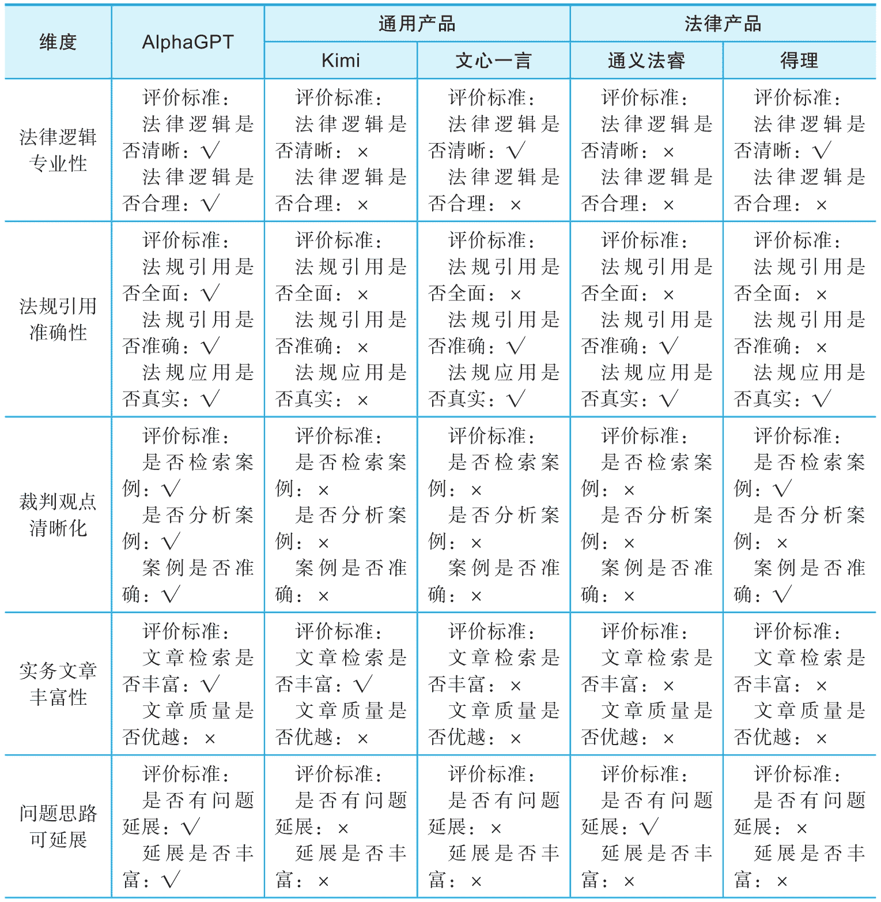

（续）

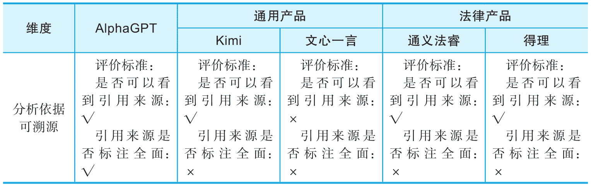

### 4.4 AI 法律咨询的应用场景与实操技巧
厘清了原理和产品后，如何把 AI 真正用在解决现实法律问题、提升律师日常工作效率上？下面精选常用场景和技巧，说明通用型与专业型产品如何协同。

**4.4.1 AI 在法律咨询中的典型场景**

**1. 全天候即时答疑**
法律沟通讲究时效。AI 7×24 小时在线，打破地域和时差限制，为全球用户提供即时支持。无论是问题解答、建议获取还是案件进展讨论，都能随时响应。多轮对话能力让复杂问题被逐步厘清，回答连贯深入。AI 还能捕捉用户情绪语气，提供更人性化的交流，提升信任感和满意度。

**2. 高质量客户服务**
AI 生成的内容准确专业，可直接嵌入咨询报告，提升深度和广度。它能按客户的具体情况定制报告，针对性强、实用性高。同时实时跟踪法律动态，及时更新报告，确保信息最新。律师得以把精力集中在沟通和策略上，繁琐的文档工作交给 AI，整体效率和服务体验都得到提升。

**3. 深度文献分析**
面对海量文档和数据，AI 能迅速定位关键信息、分类归纳并标出原文出处，大幅提升研究精度与速度。自动化处理减轻了文档审查和信息整理的负担，让专业人员把时间投入到更高阶的分析与策略制定。

**4. 辅助法律研究**
RAG 技术把检索与生成结合起来，让 AI 快速找到相关条文、案例和文献，提炼核心要点，节省大量查找时间。随后生成的摘要简洁准确，覆盖问题各面，帮助研究者快速把握重点，对研究和实践带来极大便利。

**4.4.2 让 AI 法律咨询更专业的技巧**

**1. 善用指令工程**
Prompt Engineering，即提示词工程，是通过精细设计指令引导大模型产出期望结果的技术。指令写得好，模型表现就更好，尤其在处理复杂的法律分析时。把它想象成用自然语言编程。
设计时可注意：表述明确简洁，避免歧义和复杂句式；逻辑清晰、步骤有序；明确限制条件并设置反馈机制；使用专业术语或提供示例。还可以补充上下文、设定角色、采用模型更易理解的表达方式。指令工程在通用型 AI 上效果更明显。
例如先问“在没有医疗机构执业许可和医师资格证的情况下，医疗美容机构对客户进行了医疗美容服务应当如何处罚？”，得到初步结论后，再用结构化提示：
#角色：你是一位从业多年的资深律师，我是来咨询的客户。
##角色描述：执业 10 年以上，理论扎实、实务丰富，对中国法律体系全面掌握。
#目标：理解我问题的核心意图，结合检索资料形成完整专业的法律咨询回答。
#要求：-提供尽量多的法律法规及裁判案例；-逻辑清晰有说服力；-避免自相矛盾；-论述完整、用语专业。
#咨询问题：在没有医疗机构执业许可和医师资格证的情况下，医疗美容机构对客户进行了医疗美容服务应当如何处罚？
对比前后回答的差异即可看出效果。

**2. 学会与 AI 多轮互动**
面对复杂任务，可把大问题拆成小问题，设置思考框架引导推理，得到更详细连贯的分析，避免无关信息。也可做发散式提问，用开放性问题和假设情境激发多样视角。收集多轮回答后进行比对和综合，筛选出最有价值的观点。
比如问“未经允许以直播形式使用他人有版权作品，是否侵犯信息网络传播权？”，直接回答往往只有“可能侵权”。改用互动方式：
Q：请详细解释什么是信息网络传播权，构成要件和特征有哪些？
A：信息网络传播权是指……当公众能按个人选定的时间地点获取作品时即构成……
侵犯信息网络传播权的特征有：交互性、未经许可、提供行为……
Q：请逐一分析“未经允许以直播形式使用他人有版权作品”是否符合以上三种特征？
通过拆解与逐项核对，结论会更严谨可靠。

直播搬运他人作品，算不算侵权？

A：把别人的创作放到直播里用，并不等于自动满足交互式传播的认定标准……在实时播出场景里，观众只能跟着播出节奏同步收看，没办法自主决定何时再看，除非平台把内容存下来提供回放。直播相关的争议牵涉的法律关系比较多元：……

所以要不要认定构成侵权，要结合具体情形判断。若直播允许观众在自己想看的时间点回看，就更容易被看作具备交互特征；若直播纯实时且无回放，就可能不符合交互要求，但仍可能触及别的著作财产权项。

Q：补充信息，这个直播没有回放。请再分析一下未授权以直播形式使用他人享有版权的作品，是否侵犯信息网络传播权？

A：没有回放功能的直播，观众只能在播出当时观看，一般难以达到网络传播类权利的交互门槛……即便不提供回放，只要播出的内容是未经许可的受保护作品，依然可能侵害其他著作权，例如……。

因此即便直播不留回放，未经授权的直播仍可能构成著作权侵害，只是侵害的类型未必就是网络传播类权利，权利人可以依据其他法定权利主张救济。

用拆解概念、归纳结论的方式逐步引导思考，才能让模型给出更准确的结论和更完整的分析路径。

3.自建知识库，奠定AI表现的基础
资料的质量与完整度决定知识库的可信度。高品质素材能让模型获得可靠的基础信息，从而在法律问答场景中表现更佳。知识库把海量资料进行汇聚、检索与学习，转化为模型可读、可调用的结构化资源。有了它，系统可以迅速匹配法律要点，自动提炼文件、生成报告、解答复杂问题，甚至在细分领域提出思路与策略。法律知识库的建设明显提升了咨询的准确性与可信度，也帮助从业者更高效处理事务。

搭建、维护、更新知识库是一项系统性的持续工作，核心在于保证时效与准确。

（1）分类与标签
❑ 分类体系：建立科学的归类框架，按法律分支、法规类别、案例类别等划分知识。
❑ 标签管理：为每个知识点打上标签，便于检索与关联。

（2）知识结构化
❑ 层次结构：形成清晰的层级。比如把法律知识拆成事实型、规则型、策略型。
❑ 知识图谱：用图谱把法律知识网状呈现，展示关联与逻辑。

自建个人知识库本质上是用人工经验先做初筛和优化。对办案经验丰富、积累深厚的律师而言，这一体系能明显拉升问答的质量。现阶段检索能力虽在提升，但对检索结果好坏的判断仍不够精细。

4.如何挑选适配的法律垂直智能体
垂直智能体指为特定行业专门设计的人工智能方案。相比通用产品，它聚焦行业场景，提供更专业的职能与服务，效率与精度更高。在法律领域，垂直方案既提升工作效率，也改善服务品质。挑选时可关注：

❑ 数据储备是否充足：大部分法律问答产品采用RAG架构。评判优劣最直观的就是看背后数据：核心数据是否全面、更新及时，数据多样性如何。法律上体现为法规是否齐全、更新是否跟上，是否覆盖裁判文书与实务文章等。
❑ 检索能力是否强劲：依托完备库，优秀的产品应有高效检索，能理解复杂提问并做多维度检索，如关键词、案由、法条等，同时排序与过滤要智能，让用户快速锁定最相关最权威的信息。
❑ 来源追溯是否细致：法律讲究准确性。目前没有任何产品能保证百分百正确，所以回答引用的可溯源性很重要。给出建议时应明确法条、案例等依据来源，用户能便捷核查原文，增强信任，也为进一步研究提供抓手。
❑ 操作是否简便：选择垂直产品，除了看数据专业，还因为它把法律场景封装好了。好产品在简洁输入框背后已有指令与逻辑，用户只需输入问题，就能拿到经过调优的答案，省去学习成本，把精力放回问题本身。

仍以“未经允许以直播形式使用他人有版权的作品，是否侵犯信息网络传播权？”为例，专为律师打造的法律垂直智能体AlphaGPT的产出如下。

结论：
未经许可以直播形式使用他人享有版权的作品，可能侵害网络传播类权利，但需具体分析。与传统交互式传播不同，直播是否受该权利规制，涉及著作权法及司法实践的深入讨论。

分析：
依据《中华人民共和国著作权法（2020修正）》第十条，信息网络传播权是指通过有线或无线方式向公众提供作品，使公众能够在自己选定的时间和地点获得作品的权利。进一步……。

然而直播是一种特殊网络传播形态，其是否落入该权利仍有争议。例如在【（2017）京0105民初38610号】中，法院认为未经授权网络直播他人作品的行为侵害了权利人的其他著作权，体现了直播的特殊性与法律复杂性。北京市高级人民法院在《侵害著作权案件审理指南》中指出，网络主播直播演唱歌曲，因公众无法在个人选定的时间欣赏表演，不属于交互式传播，故不构成该权利侵权 ^(¹²)。

综上，未经许可以直播形式使用他人有版权的作品是否侵权，需综合考量：

❑ 直播本身是否让公众能在选定的时间和地点获得作品。仅实时传输时，按部分法院观点，未必归入该权利调整范围 ^(¹³)。
❑ 若直播内容被平台存储并允许公众选择性回放，该行为很可能构成该权利侵权 ^(¹⁴)。
❑ ……。

因此要结合直播的具体形态、平台技术功能及法规条款综合判断。大多数情况下，未经版权人许可通过信息网络提供作品，均可能侵害网络传播类权利。

### 4.5 AI法律咨询面临的挑战

尽管AI法律咨询潜力很大、优势明显，目前仍处起步期，技术研发与市场应用都面临不少难题。

**4.5.1 自然语言理解和处理能力仍显不足**

商业化推广很热，但AI在法律咨询的基础研究相对薄弱，产品成熟度有待提升。下面重点谈自然语言处理不足对算法精度、逻辑推理和复杂问题分析的影响。

**1.算法精度与推理能力不足**

处理法律问题时AI必须极度精准。法律语言复杂且存在模糊性，要求算法能准确理解并解释，避免误导。法律咨询不仅要识别事实，还要具备复杂逻辑推理能力。系统应能模拟专业人士的思考方式，进行合理推理与论证。

**2.高质量语言数据稀缺**

海量优质样本对训练至关重要。目前可用的样本并不充分。中国裁判文书网作为AI开发的重要法律数据来源，自2013年上线以来已公开超1.47亿份生效裁判文书，但实际应用受限：部分文书因隐私等原因未公开，获取不完全透明；现有数据质量参差不齐，缺乏统一层次标准，限制了训练价值。

另外，高质量文本才能让模型学得更好。但部分产品生成的咨询所引文章质量不一。如何保证数据质量是关键。若训练数据有误或偏颇，模型会学到不可靠信息，影响泛化能力。

**4.5.2 用户与AI间的信赖障碍**

技术未成熟导致人机信任问题。服务尚未完美，人们对这一新技术持保留。实际使用中，AI可能因文本识别局限而误读用户意图，或因库中缺乏对应案例而无法给出满意的意见与预测，削弱信任，人工复核变得必要。

此外，法律咨询不仅是逻辑分析，还涉及情感交流与人文关怀。客户希望律师能基于需求、信任感和情感反馈提供全面服务，而当前人工智能难以完全模拟人类情感与人际互动，部分场景体验可能不佳。

资历与经验也是难题。法律问题错综复杂，需要综合事实、法律与社会价值。人们更倾向选择经验丰富、资历深厚的律师，因其能全面考量并给出专业建议。

**4.5.3 执业条件与监管仍属空白**

按现行规定，从事法律职业需具备扎实专业知识、相应职业能力并持有从业资格。人工智能介入法律咨询服务时，是否需要资格、是否需要考核，都是未定之问。

关于是否需要执业资格，目前并无明确法律规定。尽管人工智能在某些方面表现突出，客户仍期待律师提供更全面的服务。因此，即便具备一定专业能力，也需额外培训与考核以满足职业要求。目前对考核并无统一标准。可借鉴的是，部分国家地区法律职业资格考试是成为合格律师的必要条件。若人工智能从事法律职业，也应通过类似考试证明专业与实践能力。同时还要考虑决策过程是否透明，能否解释判断依据。从伦理与专业责任角度，人工智能作为辅助工具，其使用应受严格监管。例如，美国律师协会模型规则强调律师应了解相关技术并评估利弊。这表明，若用于法律实践，必须满足一定标准以确保建议准确可靠。

以人工智能为主导的法律科技正深刻影响法律服务行业与法律咨询等领域。影响体现在效率提升，如用人工智能弥补传统咨询局限，帮助律师处理简单检索，从而集中精力于复杂推理；也体现在服务对象与成本变化上，人工智能咨询打破时间、地域与成本限制，为更多用户提供全天候、低成本、即时响应的服务。

人工智能应用的初衷是替代重复性机械劳动，而非替代人本身。因此它并非万能，目前仍存在诸多问题，如底层自然语言处理能力仍薄弱，咨询结果未必完全符合客户意愿。

因此既要把握人工智能为法律咨询带来的新机遇，也要关注其风险，在保障职业质量与职业道德前提下逐步完善法规与技术标准，促进行业健康发展。

## 第五章

### AI辅助法律文书写作

法律文书写作既严谨又耗时。引入人工智能后，这一过程将变得高效。本章探讨人工智能如何辅助法律文书写作，对传统痛点、技术原理、实际应用与挑战进行剖析，帮助读者了解潜力并掌握常用工具以提升效率。

### 5.1 AI化解传统法律文书写作的痛点

**5.1.1 传统文书写作的痛点**

**1.资料搜集的繁琐性**

（1）从海量文献中筛选精准依据耗时费力

传统写作第一步是从庞大法律文献中筛选合适的依据。法规汇编、判例库、法律出版物等资源丰富却庞杂。面对具体问题，律师需在大量文献中细致检索，以确保找到逻辑关联最紧密且有力的依据。该过程耗时费力，且易遗漏信息。

（2）信息快速更新带来更大挑战

法律条文与判例时常更新，新判决与法规解释层出不穷。因此律师必须持续跟踪法律动态，确保引用资料现行有效。若搜集不及时或不全面，可能引用已过时或不适用的法规判例，直接影响文书准确性与专业性。时效性要求使资料搜集压力倍增。

（3）资料多样性提升筛选难度

在信息来源多元的当下，除传统法律文献外，律师还需参考学术文章、行业报告、新闻资料等。来源多样性增强全面性，但也提高筛选难度。律师需花费大量时间甄别信息适用性，确保引用内容具备足够说服力。这种繁琐筛选增加复杂性，易让人疲惫，降低效率。

**2.语言表达的复杂性**

（1）高度精确的语言要求

法律文书对语言精确度要求极高。撰写合同、诉讼文书、法律意见书时，必须选用严谨词汇与语句，以确保表达准确有效。高度精确要求往往增加撰写难度，使过程复杂且耗时。

（2）表述风格的严谨性

法律文书表述风格要求简明、严谨、逻辑清晰。该风格不同于普通文书，除策略性特殊考量外，通常不允许模糊或过度情感化表述。严格要求使撰写者在组织语言与结构时需投入大量时间精力。

（3）修改与校对的严密性

因语言表述对精确性与严谨性要求严格，文书完成后修改校对尤为重要。律师需逐字逐句检查，反复斟酌词句。该过程通常耗时，即便微小疏忽也可能对法律事务结果产生不利影响。

**3.重复性劳动的单调性**

（1）繁琐的文件格式与排版要求

法律文书写作常要求精确格式与排版，从字体、行间距到页边距、标题编号均有严格标准。重复性工作不仅耗时，还极易令人感到枯燥。对于律师而言，应将更多精力投入案件分析与法律推理，而非格式排版。忽视细节又可能影响可读性，进而影响专业印象。

（2）信息整理的机械操作

撰写过程中，律师常需整理大量资料并准确输入文书。该过程要求细致与耐心，包含大量机械操作。长时间重复输入易致疲劳厌倦，可能降低对文书写作的兴趣，影响整体效率。

（3）工作成就感缺失

由于传统写作重复劳动过多，完成工作时往往感受不到成就感。相比复杂分析与推理，排版、引用、校对等重复任务难以激发专业热情。实践中，许多资深律师会将这部分枯燥工作交由资历较浅律师或助理完成。

**4.巨大的时间压力**

（1）高度复杂的法律文书耗费大量时间精力

法律文书写作需遵循严格法律规范与逻辑推理，每一字句均须斟酌。复杂性意味着律师必须投入大量时间精力以确保专业性。无论合同、诉讼文件还是法律意见书，每份文书都要求深入研究相关法律法规、案例与事实，避免瑕疵。

（2）多任务并行致时间分配困难

律师工作不仅包括文书写作，还包括客户沟通、案件分析、调查取证等。在有限时间内高效完成所有工作是巨大挑战。多任务并行下，文书写作时间常被压缩，导致律师需在更短时间内完成本应耗时更久的工作，增加压力并影响质量。

（3）紧迫截止日期加剧压力

诉讼案件与商业交易通常有严格截止日期，律师需在此之前提交各类文书。截止日期往往紧迫，给律师带来巨大时间压力。一旦时间不足，专注度与细致度易受影响，易导致文书遗漏，对案件或交易结果产生负面影响。

**5.客户需求的多样性**

（1）需求多样性带来的挑战

传统法律文书写作中，客户需求多样性是一大挑战。每个客户情况与需求各异，律师必须根据案件细节制定相应文书。差异性要求律师在撰写时既要准确又要具备高度灵活性。处理多个案件时需花费更多时间精力，确保每份文书均满足个性化需求。

（2）频繁沟通增加工作负担

为准确理解客户需求，律师通常需多次沟通，这也增加了写作复杂性。客户需求可能随案件进展而变化，律师需及时调整文书内容以符合最新意图。频繁沟通与修改过程不仅繁琐，还耗费大量时间。

（3）定制化法律文书的高要求

客户对法律文书的期待往往非常具体，甚至挑剔到每一个措辞。有的要求合同必须完全贴合自身业务模式，有的则坚持文书的表达要符合特定正式程度或风格偏好。律师在起草时既要严格执行客户的指示，又要保证法律上的有效与逻辑上的严密。这种高度定制化的撰写需求，无疑大幅增加了工作负担。

**5.1.2 AI 赋能法律文书撰写的核心优势**

**1. 资料检索全自动化**

（1）AI 能在海量数据中迅速锁定关键信息
依托高效的检索机制，AI 可快速识别法律术语与概念，筛选出与案件密切相关的法条与判例，显著提升资料搜集效率，让律师在短时间内拿到可用依据。

（2）AI 会随使用不断优化检索结果
通过回溯律师的搜索习惯与偏好，系统会自动调整推荐策略，推送更精准、更具个性化的资料，质量与相关性因此持续提高。

（3）AI 可跨源整合信息进行检索
人工难以覆盖的法院裁判文书、法学评注、学术研究等多种来源，AI 能无缝融合，形成完整的信息图谱，拓宽参考视野。

（4）自动化检索降低人为失误风险
人工查阅易遗漏要点或引用失效条文，AI 以精确搜索与复核机制规避此类问题，确保引用的法律依据现行有效。

**2. 语言表达智能化优化**

（1）表述精准度明显提升
法律文书对准确性要求极高，AI 的自然语言处理能力可确保术语选用与表达方式恰当，提升文书质量与可信度。

（2）内置专业术语库与句式模板支撑生成
系统汇集了经律师审核的术语库与模板，输入案件要素后即可自动匹配最合适的表述，生成合规文书，尤其在合同起草中效率突出。

（3）能学习并复现律师个人行文习惯
通过分析过往文本，AI 掌握用词偏好与句式特征，使输出更贴近律师个人风格，保持案件间的一致性。

（4）快速纠错提升专业度
AI 可即时发现语法错误与用词不当，减少校对负担，避免因细微失误导致歧义。

**3. 减轻重复性工作**

（1）自动化替代繁琐环节
律师常耗费大量时间在起草与修改上，AI 接管重复流程，帮助直接进入价值更高的定制阶段。

（2）统一格式与准确性
AI 能保证批量文书在格式与语言风格上统一，降低人为差错，对合同、诉状等批量场景尤为关键。

（3）兼顾个性化定制
模板虽高效却缺乏弹性，AI 可根据具体案情信息动态调整内容，在集体诉讼等需兼顾共性与个案差异的情形下，输入共同信息与个体细节即可批量生成精准诉状。

**4. 缓解时间压力**

（1）全天候不间断运行
AI 无时间与地点限制，可在深夜或周末持续处理数据，提前完成初稿，让律师把工作时间留给策略研判。

（2）即时反馈即时调整
修改不再依赖手动反复，AI 可瞬间根据反馈调整文本，加速多轮修订，满足紧迫时限。

（3）快速响应紧急需求
接收指令后迅速输出文书框架与要点，为紧急案件争取宝贵的准备时间。

**5. 满足客户需求的多样性**

（1）实现个性化服务
AI 结合历史数据与即时反馈，逐步优化生成过程，使文书精准体现客户诉求与案件特点。

（2）应对复杂跨领域需求
面对涉及多个法域或特殊情形的需求，AI 可进行跨领域综合分析，提供更全面的解决方案。

（3）快速适配行业特性
不同行业合同条款各异，输入行业特征与客户要求后，AI 能迅速生成符合行业标准的草案，满足定制化要求。

**5.1.3 AI 在法律文书中的典型应用场景**

**1. 合同自动起草**
输入基础信息后，AI 自动匹配条款与表述，输出结构完整的合同文本，既省时又兼顾准确与合规。

**2. 诉讼文书快速生成**
只需提供案件要点与撰写要求，AI 即可产出符合规范的草案，特别适合时间敏感的紧急案件。

**3. 个性化法律意见书定制**
依据律师指令与案件特征自动生成意见书，同时学习其语言习惯，提升专业感与客户满意度。

**4. 案例研究与分析**
在庞大法律数据库中检索相关判例与法条，自动化分析帮助律师快速找到支撑论点的材料。

**5. 批量文书处理**
面对大量同类文书，AI 可一次性生成多份并保持格式统一与内容准确，大幅减少重复劳动。

**5.2 AI 辅助法律文书写作的技术基础**

在法律文书领域，AI 用精密的算法与逻辑编织出精准文本，既是工具也是伙伴，正以科技力量重塑撰写效率。

**5.2.1 自然语言处理：让 AI 读懂法律语言**
NLP 为计算机赋予理解与生成人类语言的能力，涵盖语音识别、翻译、情感分析等。在法律场景中，它像专业解码器解析语法与语义，使 AI 能解读复杂法条。依托深度学习，AI 通过海量法律文档训练，掌握概念与逻辑，输出结构严谨的文本；同时具备跨语言能力，可在多法域案件中准确转换术语，并随使用习惯持续优化语言模型。

**5.2.2 结构化生成：构建严密逻辑框架**
高质量法律文书依赖严密逻辑，AI 以强大的结构化生成能力提供支撑。深度学习使 AI 熟悉标准格式与组织方式，掌握起承转合。AI 擅长识别案例中的逻辑关系，按合理顺序排列论点，使说理清晰有力；对条款衔接、用词对应等细节把控细致，可识别并修正逻辑漏洞。

**5.2.3 机器学习：捕捉并复现个人风格**
每位律师的风格都独具特色，AI 通过机器学习捕捉用词、句式与展开方式，不断打磨生成能力。风格适应是动态迭代过程，随着互动增多，输出越贴近个性。无论是正式合同、说服性庭审论述还是分析性意见书，AI 都能自动调整语体与表达。

**5.2.4 反馈闭环：持续迭代优化**
AI 与律师如同配合默契的搭档，通过反馈循环实现协同。律师输入修改意见后，系统记录并在后续生成中应用，依托大模型对语言复杂性的理解，不断提升契合度。迭代优化让错误逐步减少，写作能力趋近专家水平。

**5.2.5 持续学习：动态更新法律知识**
AI 以深度神经网络模拟人类信息处理方式，从大量文书中学习概念、原则与案例，持续刷新知识库。借助在线学习与增量学习，AI 无需从零重训即可吸收新数据；迁移学习使其快速从一个领域切换到另一领域，如从合同转向刑法或公司法。

**5.3 法律文书写作常用 AI 工具概览**
AI 工具正成为法律人的灯塔，提升速度与质量。海外产品已趋成熟，国内产品则结合本土法律文化与语言习惯快速发展。

**5.3.1 国外常用工具**
**1. Rocket Lawyer**
在线法律服务平台，通过问答流程快速生成租赁协议、商业合同、遗嘱等文件，并提供律师咨询保障合规。

**2. Law.co**
专注文书与合同起草的 AI 平台，以智能化处理降低人为错误，适配中小律所与企业法务。

**5.3.2 国内常用工具**
**1. AlphaGPT**
以自然语言处理与深度学习见长，可生成各类文书并提供咨询、分析等全流程服务，研发团队由法律专家与 AI 工程师组成，持续迭代贴近实务痛点。

**2. 法宝新 AI**
依托北大法宝的知识库，提供条文检索、案例匹配与学术观点分析，文档智能解析帮助快速提炼要点。

**3. 通义法睿**
阿里云推出的法律助手，基于大模型推理实现智能咨询、文书自动生成、资料检索、文本摘要与案情推理，提升专业人士与企业法务效率。

**5.4 AI 法律文书写作的智能应用与实战演练**
以下以 AlphaGPT、通义法睿为例，展示大模型在法律分析中的实际表现。

**5.4.1 合同起草中的应用：自动化生成合同草案**
以二手车买卖为例进行实操：

输入内容：
❑ 合同类型：车辆买卖合同
❑ 合同立场：乙方买方
❑ 合同背景：朋友有闲置二手车，拟购买
❑ 合同目的：要求从买方角度起草，重点规避风险，要求全方位披露车辆基本情况、行驶里程，承诺权属无瑕疵且配偶知悉处置事宜

AlphaGPT 输出的合同目录如图 5-1 所示。

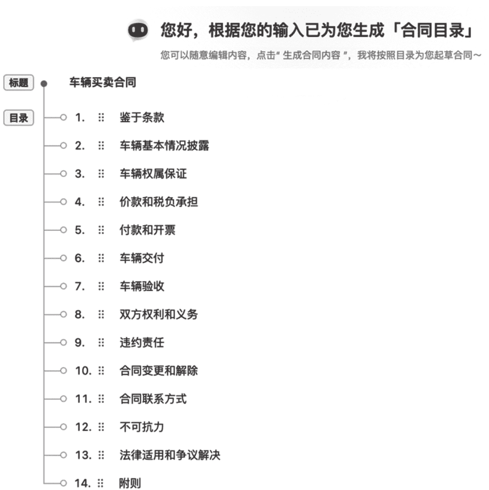

从合同到诉讼文书，AI 正在把律师的起草工作拉近到一键可用的距离

在车辆买卖合同的测试里，AlphaGPT 给出的目录框架覆盖了交易全流程的要点：开头列明买卖双方主体信息，随后是车辆基本情况披露、车辆权属保证、价款和税负承担、付款和开票、车辆交付、车辆验收，最后落到争议解决。目录下每一项都对应了权属说明、文件提供、配偶知情、瑕疵责任等细化条款，以及交付时间地点、风险转移、验收标准、质量保证期限等具体规则。

从这一份样本可以看出，AlphaGPT 已经具备了满足律师起草基础需求的能力。系统在海量合同样本中学习结构和常用表述，能够在很短时间内把骨架搭好并填充成可用的草案，起草效率明显提升，人为疏漏也随之减少。在个性化定制上，工具也能依据客户的具体交易特征和需求，自动调整权利义务的表述，为法律人提供更省时的辅助。

5.4.2 AI 参与诉讼文书撰写：起诉状的快速生成

诉讼文书的质量直接影响案件走向。传统手写法则通常要走五步：先收集并梳理案情事实，再研究适用法条、司法解释和判例，接着明确诉讼请求，之后严格按格式规范撰写，最后审核确认。

在民间借贷的实操测试中，输入信息为张某于2021年11月20日和2022年1月5日分两次借给王某10万元、5万元，借条约定分别于2022年9月20日和2022年12月1日前归还，逾期按4倍LPR计息，款项到期后多次催告未果。通义法睿生成的起诉状在形式上存在明显不足：诉讼请求缺少“请求判令”等专业用语，事实与理由部分以“我”自称而非“原告”，文末“此致”未做规范缩进。内容层面也较为空洞，只是对案情的平铺直叙，且援引了已失效的《中华人民共和国合同法》第196条。

换用 AlphaGPT，同样案情加上市民身份和案由民间借贷纠纷后，输出的起诉状在结构和用语上更贴近实务。诉讼请求写成“请求判令被告立即偿还借款本金共计150000元”“请求判令被告支付逾期还款利息”，并按两笔借款分别列明起算日和4倍中国人民银行一年期贷款市场报价利率的标准。事实与理由改用“原告”“被告”的法言法语表述违约经过。系统能快速抓取当事人信息、事实脉络和诉求要点，自动形成初稿，缩短撰写时长；诉讼请求的表述更符合律师使用习惯，并依据案件情况智能匹配法条，提升准确性，降低人工失误。经律师复核后基本可直接提交。

5.4.3 AI 参与诉讼文书撰写：答辩状的快速生成

答辩状的核心是针对起诉进行反驳。常规流程包括：分析起诉状确定思路、对事实进行反驳与补充、对法律依据进行反驳与提出、撰写并反复审核。

在劳动争议的测试里，原告刘某自2019年4月3日起在某公司任职，双方口头约定每月400元餐费补助未体现在工资条，累计差额22000元，仲裁未支持后提起诉讼。通义法睿的答辩状存在多处问题：理由条理不清、泛化严重，甚至虚构了案号；答辩思路未站在被告立场优先抗辩，而是承认管理疏漏并表示愿支付差额，违背代理的基本原则。

AlphaGPT 的处理方式则不同。用户上传起诉状原件后，

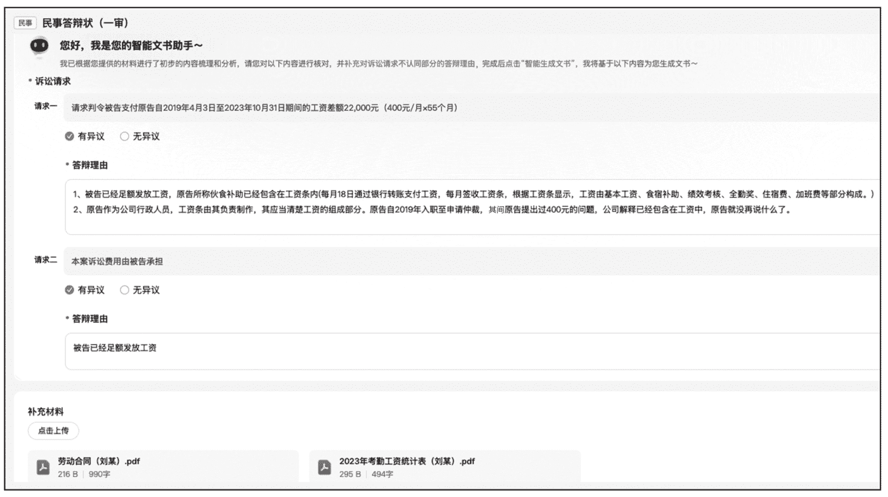
▲图 5-2 AlphaGPT 展示的上传文件和确认界面
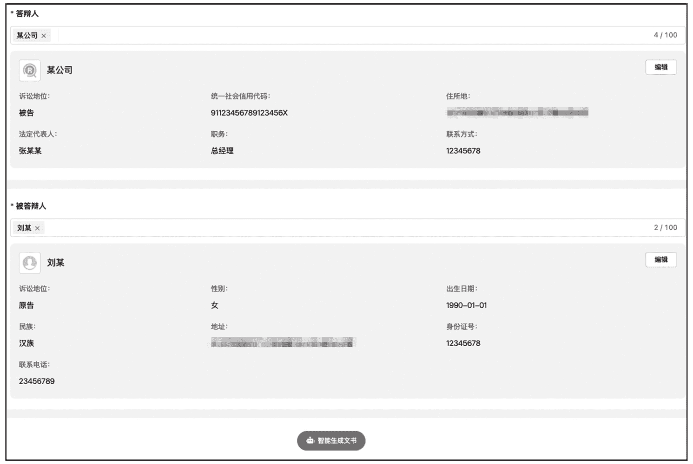
▲图 5-2 AlphaGPT 展示的上传文件和确认界面（续）

系统据此生成答辩状，核心抗辩为：被答辩人主张的餐费补助已包含在工资条内，答辩人已足额支付工资；刘某作为负责薪酬福利管理的行政人员，对工资构成具有认知能力，且每月签收工资条未提出异议，构成默认；其未能提供书面证据或证人证言证明额外补助的存在，口头约定难以单独成立。最后请求法院驳回全部诉讼请求。

可以看出，AlphaGPT 支持一键上传起诉状，快速解析关键信息，并基于预设或用户补充的法律逻辑生成层层递进的答辩。论证自洽、用语规范，推理和写作时间大幅压缩，律师复核后几乎即可使用。

5.5 AI 辅助法律文书写作的策略

5.5.1 利用 AI 进行文书内容生成与结构设计

1. 起诉状的内容生成和结构设计

通用大模型在自然语言方面表现突出，但在法律文书场景中往往输出偏短，难以满足专业要求。起诉状需要清晰的结构和严密的逻辑，任何细节都不能缺漏。通用模型容易出现逻辑松散或遗漏关键要素。

垂直法律 AI 如 AlphaGPT 则能更深入理解法律语言，把握文书规范。它可以根据案情生成完整的起诉状并智能匹配相关依据，确保严谨性和法律有效性。

对比来看，通用大模型生成的起诉状通常只是对事实的简单复述，缺乏严谨的法律推演和具体的诉求，例如仅写“请求判令被告偿还借款”，忽略利息计算方式和依据。AlphaGPT 则会结合《中华人民共和国民法典》等规定，明确本金、逾期利息及具体计算标准，并逐项列明请求。

要让 AI 更可靠，可从三方面增强功能。

案情输入与补充机制。用户输入后，AI 先进行初步解析，识别核心要素，信息缺失时主动提示补充，确保案情描述完整，为后续生成奠定基础。

法律条文生成与用户校验。基于案情理解，AI 自动挑选适用条款并展示给用户确认，用户可修改或增补，保证适用准确。

证据上传与整合支持。支持用户上传借条、转账记录等材料，AI 解析后将其融入事实陈述和法律依据，使文书更贴合个案。

2. 答辩状的内容生成和结构设计

撰写答辩状需要在逐点反驳诉求的同时，提供充分的法律依据和证据。通用模型在案情理解和法条适用上常显不足，而 AlphaGPT 通过大量案例训练，能够为不同案情设计严谨的答辩结构，并在短时间内完成推理与撰写。

面对原告的起诉，被告的答辩状就是回击的主战场，结构是否严谨直接决定说服力。如今把起诉状丢给 AlphaGPT，系统会自动拆解要点，几分钟内就能产出一份包含当事人信息、答辩思路的初稿。律师后续补充自己的抗辩方向，AI 就围绕诉讼请求的驳斥、抗辩理由的搭建、证据的梳理进行迭代，让文书逻辑闭环、内容饱满。

过去的纯人工模式，律师要逐条研读原告请求，再一句一句去对法条，耗时费神，对准确性的容错率几乎为零。AlphaGPT 在同类案件里已经能直接给出带法条支撑的答辩样本。举例来说，在一起劳动纠纷里，系统会清晰点出公司在入职环节已明确工资构成及餐补，并援引《劳动合同法》相关条款论证发放合规。AI 还能拆解原告引用的法条，给出针对性反驳建议，让辩护策略更聚焦。

要让答辩真正有力，工具设计上可以从三点入手优化。

（1）反驳证据补位提醒
起诉状内容导入后，AI 会自动标出需要重点反驳的节点，并主动提示律师上传对应的证据或反驳材料，补强说服力。

（2）抗辩观点深度输入
系统会引导律师详细填写想论证的核心观点，把证据和说理绑定在一起，让答辩在逻辑上更周密，在法律上更有分量。

（3）法条智能匹配与人工校核
根据律师输入的观点和材料，AI 从知识库里筛选最契合的法条呈现出来供确认。律师可据此修改完善，确保最终答辩状贴合预期，也更具穿透力。

**3. 合同起草：结构与定制能力**
起草合同本就少不了个性化。通用大模型能搭出框架，但面对复杂条款的定制就显得吃力。AlphaGPT 会先吃透合同类型、交易背景和双方诉求，再生成结构完整、可用性强的文本。

以车辆买卖为例，除了标准条款，还能根据买方需求加装车辆状况披露、权属保证等定制条款，把合同做得更周全、更严谨。

实现个性化生成，主要靠三方面打通。

（1）先把需求问清楚
生成前先判断用户要的是精简版还是详细版，合同是用在企业交易还是个人协议。用途不同，结构和表述自然不同。

（2）有名合同与无名合同的智能切换
常见的有名合同可直接调用标准化模块；面对无名合同或高度定制需求，系统会依据用户提供的要素进行 bespoke 输出。

（3）允许模板自带
律师可上传自家的成熟模板，AI 会解析内嵌逻辑，融合新需求后输出符合习惯的终版文本。

**5.5.2 人机协同如何把文书从初稿带到终稿**
法律写作里，AI 能提速，律师能定调准。AI 负责起步，律师负责把关，最终质量靠协同。

以民事起诉状为例，律师输入案情后，AI 会迅速给出包含案由、事实、法条及诉讼请求的初稿。审阅时若发现法条引用不够精准或事实叙述有缺口，律师可执行四步优化：
❑ 找问题：先定位引用不当、事实不足等症结；
❑ 改指令：用更明确的提示词锁定目标法条或案例，如指定《民法典》某条作为依据；
❑ 再生成：AI 按新指令重写并自动修正前次瑕疵；
❑ 终审阅：律师对修正稿做最后核验，确保专业与准确。

**2. 协作效率提升策略**
提示词的清晰度直接决定输出质量。

（1）输入要具体
起草并购合同时，明确告诉 AI 需要包含目标估值、收购方式、付款安排、股东权益保护等关键模块，初稿就会更贴近实操。

（2）边看边调
生成过程中若发现某条款空洞，律师可即时反馈，要求补充或改写。动态调整能大幅压缩返工时间，提升准确率。

**3. 反馈闭环让 AI 越用越懂**
律师的使用反馈是模型进化最直接的养分。AlphaGPT 会收集这些意见持续迭代，让生成的文书更贴近真实业务场景和个人写作习惯，越来越像定制服务。

**5.5.3 精准引用与类案支撑**
文书成败看引证。AI 能快速检索法条与判例，并把最匹配的依据自动塞进文书，同时标注出处和适用边界，检索时间被极大压缩。

在劳动争议起诉中，系统会先锁定《劳动合同法》，再从司法解释和相似判例里挑出最相关的支撑点，方便律师复核。

引用之后要会用。AI 还能把法理与案情结合，寻找情理平衡。像离婚财产分割的答辩，系统会依据《民法典》相关条文，再结合双方在婚姻期间的经济贡献与生活状况，生成相对公平的分割建议，并附上论据与补充说明，让文书既有法又有理。

**5.5.4 个性化与风格统一**
个性化不只是加条款，更是对客户特殊诉求的精准回应。

在一笔跨国技术转让里，客户要求严格限定技术使用范围，防止越界使用。通用模板做不到，手工写又慢易漏。AI 收到明确指令后，能自动加入“技术使用范围限制条款”，明确禁止未授权领域使用并设定高额违约责任，既满足需求也堵住风险。

风格统一是律所的专业脸面。大型律所处理商业诉讼时，要求文书在用词、结构和逻辑上高度一致。AI 可学习律所过往文书，提炼出特有的长句风格、术语偏好和层次习惯，后续生成自动套用，既省审核成本也保持品牌调性。

保持风格一致可做三件事：
❑ 建立风格模板：固化常用词、句式和格式；
❑ 让 AI 学习特征：把模板喂给模型；
❑ 持续微调：每次生成后反馈调整，让模型越用越准。

机器学习让风格模仿成为可能。专注国际仲裁的律所，律师习惯用专业术语和嵌套句式。AI 分析其历史文书后，会学会使用复杂句、保持论证严密。随着使用次数增加，输出越来越接近该律师的个人风格。

### 5.6 AI 写作的挑战与未来方向
**5.6.1 法条引用的准与不准**
检索快是 AI 的优势，精准度却常常打折。复杂案件里，模型可能抓到《公司法》的一般性规定，却忽略了更具体的行业规范，导致引用失当。跨域或跨境案件中更是容易把国内法简单套用。律师必须二次核验，避免误引带来的法律风险。

**5.6.2 合同起草的视角漂移**
AI 能批量生产条款，却常不懂客户的商业意图。房地产项目里的合同可能因视角不稳，对开发商与承包商的权责分配描述模糊，工期延误与成本超支的约定含糊，反而埋下争议隐患。涉及多利益平衡时，AI 的分析深度仍不及人工。

**5.6.3 下一步怎么走**
1. 加强法规与案例库的精细化处理
做更深的语义与上下文分析，让 AI 真正理解条文的适用条件与边界。
2. 提升合同起草的场景化能力
结合真实交易场景和客户反馈，生成更灵活、可落地的条款建议。
3. 增强复杂法律推理的学习能力
引入更多推理案例与深度学习训练，让 AI 在疑难问题上提供更可靠的意见。

未来 AI 不止是工具，而是律师可靠的写作搭档。

## 第六章
## AI 辅助合同审查的新可能
合同审查传统上靠律师逐条细读，既慢又易出错。AI 审查的出现正好解围：快速定位关键条款、预警潜在风险、自动出具审查报告，并通过机器学习持续优化。国内已有 AlphaGPT、熊猫 AI、幂律、文心一言等产品落地，覆盖金融、地产、医疗等行业，从贷款协议到房产交易合同都能加速合规检查。

### 6.1 AI 如何破解传统审查痛点
**6.1.1 传统审查的六大困境**
1. 耗时过长
条款繁多时，律师需要反复对照法条，单份合同耗时数小时甚至数天，影响签约节奏。
2. 成本偏高
专业律师费不低，对中小企业而言审查支出压力明显。
3. 失误风险高
疲劳、疏忽或经验盲区都可能导致漏检关键点，造成法律与商业损失。
4. 结果不一致
不同审查人对同一条款理解差异大，结论难以统一。
5. 知识更新慢
法律变动快，人工难以实时全覆盖，容易出现合规滞后。
6. 文档管理乱

**纸质合同困局，AI 审查破局**

纸质合同堆积的时代，管理成本正悄悄吞噬企业效率。成堆的纸档占着物理空间，检索、归档、流转每一步都费时费力；找不到版本、流转受限也成了常态。更棘手的是信息安全，纸面文件一旦遗失或被非授权人员接触，泄密与合规风险便立刻暴露。归根结底，传统审查陷入低效、高开销、高风险与管理繁琐的四重困境。企业必须寻找更省时、更经济、更可控的审查路径，才能让审查质量与效率同步提升，同时压降成本与法律风险。

**6.1.2 AI 合同审查的优势**

随着生成式与认知技术加速落地，AI 合同审查工具正在重塑法律服务的工作方式。它用可量化、可复用的能力补齐了人工审查的短板，具体体现在以下层面：

❑ 速度跃升：依托自然语言理解技术，系统能在数秒内拆解长文本、定位关键条款与潜在风险点，批量处理合同的效率远超人工，支持业务快速响应。
❑ 投入更优：工具属于一次性部署，长期运行成本低于人工作业，中小企业也能以可承受的价格拿到高质量审查服务，减少外部律所费用。
❑ 精准度提高：深度语义分析配合持续学习机制，使风险识别与信息抽取更稳定，审查结果随使用越发可靠。
❑ 结果统一：标准化流程消除主观偏差，同一规则适用于每一份合同，输出可预测、可追溯。
❑ 知识实时更新：法条库与判例库可自动迭代，审查结论始终贴近最新监管要求，降低合规偏差。
❑ 文档管理提效：电子化存档与检索让合同调阅、共享更顺畅，内置版本控制与变更追踪，安全性与秩序感明显增强。
❑ 风险评估自动化：算法对风险进行分级标注，企业可按优先级处置，把握决策重点。
❑ 服务可定制：可按行业与企业习惯配置审查模板与规则，提升针对性。
❑ 协作更顺畅：多角色协同、批注留痕、权限管控一体，审查全程透明可追溯。
❑ 跨语种覆盖：多语言解析能力帮助企业处理跨境文本，打破语言壁垒。
❑ 持续演进：工具不仅提升效率，也为法律实务打开新场景，应用价值仍在扩张。
❑ 专业角色升级：律师不再重复做机械校对，而是与 AI 协同，把精力放在策略与高阶判断上，为企业创造更大价值。

总体来看，AI 合同审查既在优化现有流程，也在推动法律服务的创新演进，并在企业合同治理中的分量会愈发关键。

**6.2 AI 合同审查常用工具**

在业务节奏加快的背景下，合同审查已成为法务与业务人员的核心任务。AI 工具正成为提升效率、准确性与安全性的关键支撑。以下梳理国内外主流产品的核心能力。

**6.2.1 国外合同审查常用 AI 产品**

**1. Legal Robot**
Legal Robot 以机器学习驱动法律文件自动化分析。产品主张“Know what you sign”，致力于把晦涩条款转译为易懂语言。核心功能涵盖即时合同解析、智能解读、AI 辅助起草、合同比对与审核、个性化法律建议等，并提供 GDPR、DMCA 等合规管理与网站条款监控。整体上它用自动化降低分析门槛，提升可读性。

**2. Ivo**
Ivo 面向现代法务团队，目标是压缩协议谈判的时间与成本。核心能力 Checklist 可自动校验文档是否满足内部规范，并给出未满足项的清晰说明与红线修改建议，同时能生成 Word 批注气泡便于沟通。其适用场景包括复杂合同快速审改、法务部门流程统一、初创企业谈判提速、跨司法辖区多语言合同管理、律所对外服务提效等。工具帮助团队把更多时间投入战略性工作。

**3. ContractCrab**
ContractCrab 融合人工智能与自然语言处理，实现合同审查与管理的提速。它能快速产出合同摘要并凸显要点，减少通读负担；AI 审查模块可评估合规性与潜在法律风险。平台支持上传 .docx、.txt、.pdf 或直接粘贴文本，订阅模式灵活，从按量付费到企业版均可选择。

**6.2.2 国内合同审查常用 AI 产品**

**1. AlphaGPT**
AlphaGPT 的审查模块是法律科技的新尝试。通过 AI 提升审查速度与准确性，当前覆盖通用合同、租赁、劳动合同、买卖、股权转让等类型并持续扩充。用户上传文件后选择合同类型与审查视角，系统按所选立场如劳动者或用人单位衡量风险并给出细化建议，还可指定关注点如支付条款明确性进行重点核查。系统具备法律逻辑理解能力，可识别条款缺失、不对等、违约责任不明等风险，通常 2–5 分钟完成。完成后在侧栏给出风险批注，支持人工补完与在线修订，并可一键导出带批注版与干净版报告。自上线以来获得多家律所关注。

**2. 通义法睿**
通义法睿由阿里云推出，具备法律理解与推理对话能力。可自然语言问答、推送案例、辅助案情分析、生成法律文书与检索知识。合同审查功能聚焦风险识别与专业修改建议，通过知识库与 AI 技术提升效率与准确度，适合专业人士与普通用户实现文书自动化与风险防控。

**3. 幂律**
幂律智能的 MeCheck 是其 AI 合同审查产品。基于自然语言处理与法律实务经验，提供风险识别、在线留痕、版本差异定位等一站式支持，提升审查效率与质量。

**4. 熊猫 AI**
熊猫 AI 的合同审查能力集成于熊猫智法平台，涵盖智能问答、合同智能写审改、文书起草审核、知识库管理等。审查环节采用熊猫 BERT+GPT+MOE 三模型架构，通过个性化训练为不同领域提供定制化助手，提升审查效率与精准度。

**6.2.3 代表性 AI 产品合同审查功能比较**

在了解主流产品后，笔者基于国内几款 AI 法律产品进行实测，从主体审查能力、合规性审查、审查全面与专业度、修改建议明确性、风险管控、功能完备性等维度展开对比，见表 6-1。

表 6-1 国内 AI 法律产品性能对比表

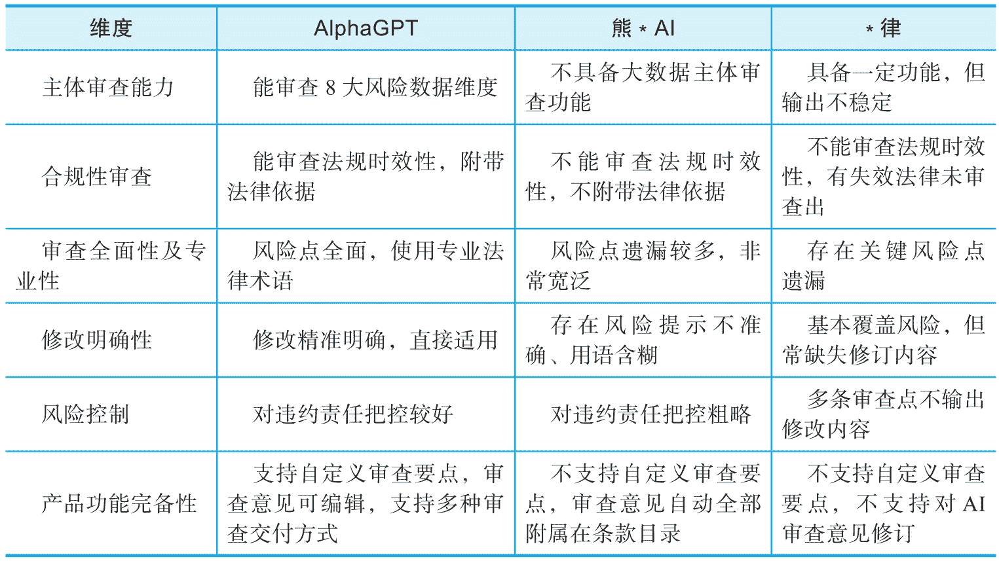

注：1. 免责声明：表格中的信息源于 2024 年 7 月的抽样合同审查对比，随着产品的更新，实际产品功能可能会有所变化和完善。

2. 为保护部分企业的名誉权和商誉，对产品名称加以简略。

**6.3 AI 合同审查的应用场景与实践**

AI 合同审查正从概念走向日常，其应用可归纳为三类。

第一，合同类型预审归类。系统可快速读入海量文本，自动判定租赁、销售、服务等类型，完成初步归类。

第二，类型化合同审查。针对不同合同配置审查模板与规则，例如租赁合同重点核查租金、租期、维修责任，销售合同聚焦价格、交期、质量保证，实现精准高效。

第三，自定义审查。企业可按自身风控偏好设定规则与关注点，如对保密条款提出更高要求，系统据此执行定制化核查，确保符合内部合规。

可见，应用边界在持续扩展，AI 正为合同治理提供更高效、更精准的方案。

**6.3.1 各种合同内容的审查**

**1. AI 审查合同内容所遵循的原则**
综合市面产品，AI 审查普遍遵循：

❑ 合法性：条款须符合现行法规，不触碰强制性规定。
❑ 合理性：避免明显失衡或不公平约定。
❑ 明确性：权利义务表述清晰，无歧义。
❑ 完整性：涵盖标的、价格、期限等必要要素。
❑ 一致性：各部分逻辑自洽，无矛盾冲突。
❑ 可行性：条款在实务中可执行。
❑ 风险控制：识别风险点并给出防范建议。
❑ 权益保护：在违约、争议解决等环节保障各方权益。

在此基础上，AI 会结合通用维度与特定合同类型的专有维度，确保合同合法、合理、可执行。

**2. 通用维度审查**
AI 对通用维度的关注点包括：

1）合同有效性：
❑ 行为主体是否具备相应民事行为能力。
❑ 意思表示是否真实、完整。
❑ 是否违反法律禁止性规定。
❑ 是否违背公序良俗。

2）合同主体：
❑ 双方资质与签约资格核验。
❑ 名称、地址、联系方式准确性。

3）合同标的：
❑ 商品或服务描述具体清晰。
❑ 避免模糊表述。

4）合同条款：
❑ 价格、数量、质量、交付、付款等要素齐全明确。
❑ 条款符合法规，无不公平约定。

5）合同期限：
❑ 生效与终止日期明确。
❑ 自动续约或终止机制是否合理。

6）违约责任：
❑ 责任范围与赔偿方式清晰。
❑ 责任分配公平。

7）争议解决：
❑ 约定协商、调解、仲裁或诉讼路径。
❑ 指定管辖地与适用法律。

8）法律适用：明确准据法，尤其在跨境情形。

9）保密条款：涉及商业秘密时明确保密义务与违约后果。

10）知识产权：归属、使用、保护方式清晰。

11）修改与终止：条件与程序明确。

12）附加条款：担保、保险、第三方权利等合法合理。

13）生效条件：签字盖章、预付款等触发条件确认。

14）书面形式：满足公证、登记等形式要求。

15）语言与文本：多文本一致，避免翻译偏差。

**3. 专有维度审查**
有名合同与无名合同在风险点上差异显著。以 AlphaGPT 审查合作经营合同为例：

（1）专有维度一：利润分配及亏损分担条款审查
❑ 核查分配比例与分担比例是否明确。
❑ 利润构成范围是否界定清楚。
❑ 支付方式、时间、账号等是否约定。

（2）专有维度二：关联交易及利益冲突条款
❑ 明确关联方定义与交易情形。
❑ 要求事前披露关联身份与交易概要。
❑ 核查交易公允性与市场一致性。
❑ 是否需其他经营者同意。
❑ 重大交易是否需第三方意见。
❑ 信息披露义务是否落实。
❑ 利益冲突管理机制与惩罚措施。
❑ 避免自我交易与利益输送。
❑ 违约赔偿责任是否明确。
❑ 税务合规要求。
❑ 正文与附件一致性，优先条款确认。
❑ 退出机制是否可操作。

总体把握要点为：先识合同性质与背景，再锁定关键条款，随后核验合法合规性，最后对照行业惯例，确保条款合理完整。

**4. AI 审查合同的优秀案例**

1）AlphaGPT 审查动产买卖合同的示例，如图 6-1 所示。

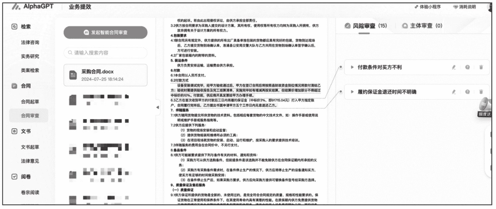

图 6-1 AlphaGPT 审查动产买卖合同

2）AlphaGPT 审查合作经营合同的示例，如图 6-2 所示。

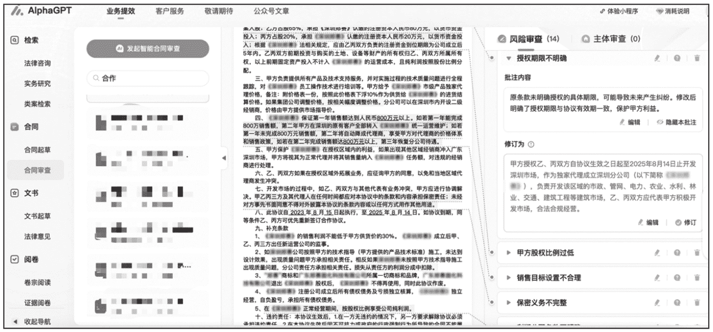

图 6-2 AlphaGPT 审查合作经营合同

3）AlphaGPT 审查建设工程监理合同的示例，如图 6-3 所示。

4）效果评估：引入 AI 审查后，合同处理时效显著压缩，律师与法务得以聚焦复杂议题。系统输出一致性强，减少人为遗漏，审查报告帮助企业及时止损，提升合同质量与风险抵御能力。

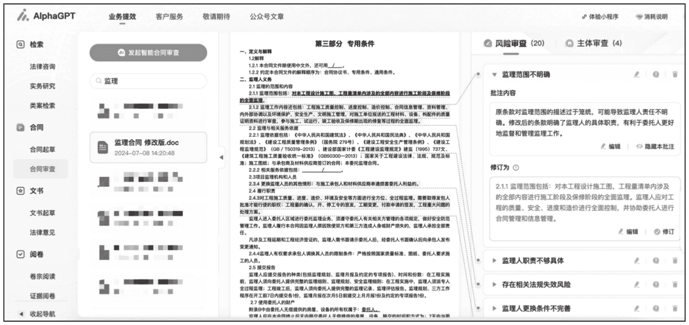
图 6-3 AlphaGPT 对建设工程监理合同的审查拆解

**6.3.2 智能分型与可定制核查**

国内已有成熟方案能够完成契约类别的预先分拣、按需定制校验及专业化支撑。北京新橙科技有限公司推出的 AlphaGPT 在分类预筛与高度可定制校验方面较为突出。下面围绕该类能力展开介绍，并以案例演示落地效果。

**1. 契约类别预筛分拣**

类别预筛承担合同管理的入口职能，对提升校验效率、守住合规底线与管控风险意义重大。随机器智能技术演进，契约预筛分拣已成为法律实务的新方向。

（1）类别预筛的原理
市场上不少分型工具借助深度学习与自然语言解析对契约文本进行智能解读与归并。核心思路是通过训练模型识别文本中的关键条款、专业术语与结构特征，从而做到自动识别与归并。整体流程是从文档中抽取主体信息、权利义务、违约责任等要素，并据此完成归并。智能化归并大幅提升管理效率，也帮助企业迅速判断契约属性与潜在风险。

这类方案通常基于海量契约样本学习，采用卷积神经网络捕捉局部特征、循环神经网络处理序列信息，二者结合使识别更精准。部分方案还融合 OCR 技术，可处理扫描件等非纯文本材料，将其转为可分析文本，扩大处理边界，也减少手工录入。

对于大型机构的顾问律师与法务而言，每年需处理的合同数量庞大，这些工具的使用不仅提升了管理效率，也通过智能风险评估优化了风控。例如系统能快速标记不公平条款或潜在违约风险，帮助企业在签约前做出更审慎决策。

（2）典型案例：AlphaGPT 的类别预审
AlphaGPT 的合同核查模块可实现合同类别的一键识别，快速且准确，便于后续展开核查，如图 6-4 所示。

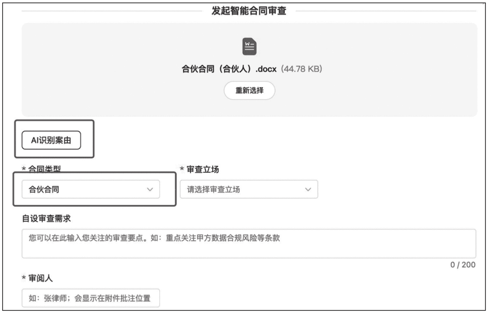
图 6-4 AlphaGPT 类型预审演示

**2. 定制化核查与专业功能**

（1）AlphaGPT 的定制化核查
定制化核查是 AlphaGPT 的核心优势，支持使用者按需定制核查流程与关注重点。

❑ 需求研判：通过与使用者的交互，明确核查的重点领域与风险关注点。
❑ 流程定制：基于需求定制核查顺序、步骤与方法。
❑ 关注点设定：可设定系统对价格条款、支付条件、担保与保证等特定条款或概念的关注。
❑ 风险偏好调节：结合商业策略与风险偏好，调节风险评估标准与敏感度。
❑ 核查深度控制：支持从浅层的格式检查到深入的法律分析之间的自由调节。

（2）典型案例：AlphaGPT 的定制化合同核查
AlphaGPT 的合同核查模块提供定制化选项，使用者可根据需要增补具体核查要求，如图 6-5 所示。

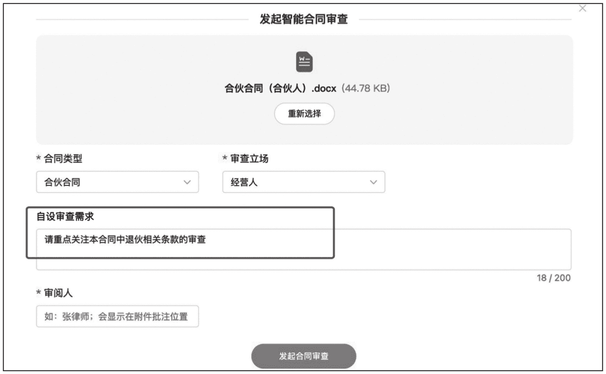
图 6-5 AlphaGPT 自定义审查界面

AlphaGPT 作为具备定制化核查能力的智能工具，在法律应用中展现出很强的灵活性和专业性。需求驱动的流程定制使其能为不同领域的合同核查提供个性化方案，专业功能保障核查的准确性和深度，帮助使用者有效识别和管理合同风险。随着技术的持续进步，其在法律服务领域的作用将进一步增强。

### 6.4 合同智能核查的瓶颈与应对思路

**6.4.1 技术边界**
尽管机器智能在合同核查领域取得明显进展，与资深法律专家相比，其理解与分析能力仍有限，主要限制包括：

❑ 语义理解：合同文本常包含复杂法律术语和行业特定表述，模型难以完全把握。隐含意义、行业用语或特定语境下的表达容易被误读，同一术语在不同场景的含义差异，模型缺乏人类专家的灵活判断。
❑ 复杂逻辑处理：合同中存在复杂的逻辑关系和条件语句，多条款相互作用。在处理多条件触发、条款联动等复杂逻辑时，准确性不及人类专家。
❑ 创新性条款：商业实践不断演进，出现新颖或非标准条款，缺乏足够历史数据支撑，模型在理解和评估上表现欠佳。如新兴技术领域的独特风险分配机制，因背景知识不足难以准确判断。

**6.4.2 法律适配性**
全球化商业环境下，各法域法律体系差异显著，给智能应用带来挑战：

❑ 法律多样性：方案需适应各法域的规范和司法解释，如美国、欧盟、中国在合同法、公司法、知识产权法上的差异。系统必须具备高度灵活性和可配置性，才能准确理解和适用相关条款。
❑ 法律更新：法律修订频繁，新法规影响合同解释与执行。知识库需及时更新，自动监测法律变化并刷新内容，更新频率和复杂性对系统提出挑战。
❑ 地域性法律差异：各地存在特殊商业习惯和交易规则，可能缺乏明确条文却在当地实践中重要。系统需理解并适应这些差异才能提供有效服务。
❑ 文化和语言差异：法律文本的语言表达存在差异，处理不同语言、文化背景下的文本能力是准确理解的前提。
❑ 法律实践的多样性：除成文法外，各地司法实践的程序和规则也各不相同。系统需理解这些非标准化的实践多样性，才能在不同地区提供可靠核查。

总体来看，提升法律适配性需不断优化知识库，增强灵活性和可配置性，并结合人类专家的经验。

**6.4.3 数据保密**
智能核查过程中，数据保密至关重要，合同常含个人身份信息、商业秘密、财务数据等敏感内容。

❑ 数据安全：处理和存储大量敏感数据时，必须防止未授权访问或泄露。需采用加密存储、访问控制、安全传输协议等先进技术保障全流程安全。
❑ 合规性：数据保护法规日趋严格，如欧盟 GDPR 对个人数据处理提出严格要求。系统需符合各地法规，避免违规风险。
❑ 数据匿名化：为保护隐私，需对敏感信息进行匿名化处理，去除或替换身份信息。但匿名化可能影响核查准确性，需在隐私保护与核查质量间取得平衡。
❑ 数据最小化原则：仅收集和处理完成核查任务所必需的数据，减少泄露风险并提升处理效率。
❑ 使用者控制权：使用者应有权查看、修改、删除自己的数据，系统需提供相应界面，增强透明度和信任度。
❑ 透明度和可解释性：使用者应能了解数据处理流程与目的，增强信任感。

通过先进安全技术、合规运营、匿名化、最小化原则及透明可控的机制，智能方案可在保护隐私的同时提供高质量核查服务。

**6.4.4 使用接受度**
法律从业者对智能技术的接受度和信任度仍需提升，关键障碍包括：

❑ 技术信任：部分从业者对准确性和可靠性存疑，担心其无法替代人在复杂模糊问题上的判断。提升透明度、可解释性并展示实际成功案例是增强信任的关键。
❑ 技术培训：充分利用工具需要专业培训，包括系统原理、操作配置、结果解读等。提供手册、在线教程和现场培训可帮助使用者更好掌握。
❑ 技术整合：将智能能力与现有法律服务流程和工具结合，并在工作流程和文化上进行调整，可提高接受度。逐步纳入日常工作，使其成为法律服务的一部分，降低对传统方式的依赖。

**6.4.5 解决路径与展望**
挑战并不会阻碍智能核查的发展前景，可行路径包括：

❑ 持续的技术进步：改进自然语言处理能力，增强学习和适应能力，开发更复杂的算法处理法律逻辑。
❑ 法律知识库的构建：汇聚大量法律文本、案例和法规，形成可更新的知识资源库，提升跨法域适应性。
❑ 数据保密技术的应用：采用加密和匿名化技术，保障数据安全，增强使用者信任。
❑ 使用者教育和培训：普及智能技术的优势、应用边界和操作方法，提升从业者信心和接受度。
❑ 人机协作模式：智能方案作为人类专家的辅助工具，处理初步核查和风险识别，人类专注复杂分析。人机协作可提升效率、降低人为错误，提供更高质量服务。

智能核查借助深度学习和自然语言解析，显著提升了核查速度和准确性，减轻了法律工作者的负担，使其能聚焦更复杂的法律服务。技术优化了流程，帮助企业预防风险、降低成本。尽管仍需应对技术、法律适配性、数据保密和使用者接受度等问题，通过持续优化、知识库更新、数据保护强化和使用者教育，智能核查将成为法律服务领域的重要工具。

# 第三部分

# 智能化驱动法律机构运营升级

法律机构的运营模式直接关系服务质量、客户满意度以及市场竞争力。其核心是提供全方位高质量法律服务。随着市场发展，机构需提供个性化多元服务，通过优质服务和案例树立品牌；借助数字营销和内容营销提升知名度；建立有效客户关系管理系统，跟踪服务历程、收集反馈并及时响应；同时团队需具备深厚法律知识和实践经验，处理复杂问题。唯有如此，才能在激烈竞争中站稳脚跟并实现可持续发展。

因此，通过优化管理流程、引入先进技术提升管理水平和效率，成为法律机构运营的重要课题。近年来法律科技产品层出不穷，对律所、法学教育机构和司法机关产生深远影响。本篇将多角度阐述智能化在辅助法律机构运营中的应用。

## 第七章

## 智能工具在律所管理中的应用

智能化在法律服务中的应用呈现多元化，既能简化日常任务，也能增强决策支持。除了解决律师重复性机械工作外，智能化在律所管理层面的价值日益凸显。它可帮助律所分析市场趋势、预测法律需求、优化资源配置，在竞争激烈的市场中保持领先。本章从多个角度介绍智能产品在辅助律所管理的场景应用，帮助法律人把握智能化在律所管理中的潜力。

### 7.1 律师个体与机构层面的差异视角

**7.1.1 智能化对律所的影响**

**1. 律所管理的主要内容**
律所管理是一个多层面复杂过程，主要包括：

❑ 组织结构管理：管委会、薪酬委员会等决策机构的设置与运作，以及管理机构和专职管理人员的配置。
❑ 业务活动管理：确保律师依法执业并承担相应法律责任。
❑ 内部制度建设：建立完善执业管理及其他内部管理制度，规范执业行为。
❑ 知识管理：解决知识采集、检索、共享及持续管理的难题，形成有效体系。
❑ 人力资源管理：人才招聘、培养体系建设，合理的薪酬分配与激励机制。
❑ 财务管理：职业风险、事业发展及社会保障等基金的建立与管理。
❑ 风险控制：利益冲突审查、案件质量控制，确保业务安全可控。
❑ 品牌与市场营销：品牌建设、市场营销和资源对接，提升市场竞争力。
❑ 技术支持：利用技术手段提升管理效率、整合资源、监控服务质量。
❑ 文化建设：发挥党组织政治核心作用，建立律所文化和价值体系。

**2. 律所管理的主要难点**
当前律所管理面临的难点包括：

❑ 整体联动不足：业务、财务、知识等尚未完全联动，资源分散，品牌影响力有限。
❑ 风险管理挑战：合伙人能力强但合作不足，增加客户信息管理和文档共享的风险。
❑ 知识管理难题：知识采集、检索、共享及持续管理困难，尤其隐性知识向显性知识转化。
❑ 人才培养与流动：建立有效培养体系并留住人才，避免流失削弱竞争力。
❑ 市场变化适应：法律服务市场竞争加剧，市场透明化导致客源获取难、服务价格下降，需创新服务模式。
❑ 技术应用：有效利用科技提升工作效率和服务质量，同时保障数据安全和隐私。
❑ 文化与价值观建设：加强文化建设，形成统一价值观，提升团队凝聚力。
❑ 公共资源积累：进行长期公共资源积累以支撑日常运营和发展。
❑ 内部协作机制：建立有效协作机制，促进合伙人和律师团队间的合作交流。
❑ 合规与监管压力：应对日益严格的合规要求和监管压力。

**3. 智能化能够帮助律所解决的问题**
智能方案应用可助力律所：

❑ 工作效率与质量提升：优化知识管理，自动从多源获取信息、整理分类，提升检索准确性和效率。
❑ 知识管理与检索：构建智能化知识存储系统，使检索和共享更高效，维护知识库、提高检索精准度。
❑ 案件分析与预测：利用智能模型分析挖掘大量知识数据，发现规律模式，辅助案件决策。在数据驱动决策中，可进行复杂数据分析，为案件策略提供支持和预测，提升决策科学性与准确性。

AI 重塑法律服务版图

市场竞争加剧与岗位重塑：律所在新一轮竞争中需敏锐捕捉市场动向，主动调整发展思路，降低对低端法律业务的投入比重，以迎合新的市场环境，AI 则能承担大量重复性基础事务，让律师从耗时工作里解脱出来。

服务模式升级：引入 AI 后，律所能够拓展服务形态，比如线上法律咨询、虚拟法律助理、自动合同起草等，使得法律帮助获取门槛大幅下降，尤其对中小企业与普通公众更友好。借助智能化手段，律所还能向偏远地区和小型客户提供更便捷高效的服务，推动法律服务覆盖与可及性提升。

在推进智能化进程的同时，律所必须同步强化技术伦理与职业责任，确保技术运用始终符合法律职业标准与道德底线。同时，律所与法学院应扩大 AI 及法律科技的教育培训覆盖，让现职律师和法学生都能理解并适应新工具，保证未来法律人能在复杂环境中熟练使用 AI。

**7.1.2 AI 如何改写律师日常**

**1. AI 技术提升了律师的工作效率**

（1）法律研究
❑ 依托自然语言处理与机器学习，AI 可迅速调取相关法条、判例及学术文献。
❑ 通过先进搜索算法，AI 能解析复杂查询需求，并返回精准匹配的结果。

（2）案件分析
❑ AI 可对历史数据进行归纳，识别出影响胜负的关键要素。
❑ 利用数据挖掘技术，AI 能够发现案件中的规律与趋势，为策略制定提供支撑。

（3）合同审查与起草
❑ AI 系统可自动标记合同中的风险点和表述矛盾，降低人为遗漏。
❑ 智能模板与自动填充功能显著加快合同起草节奏。

**2. AI 技术优化法律服务的流程**

（1）自动化文书处理
❑ 诉状、合同初稿等常规法律文件可由 AI 快速生成。
❑ 系统支持模板自定义，增强文书的专业性与个性化。

（2）客户服务与咨询
❑ AI 聊天机器人提供 7×24 小时的初步法律问答。
❑ 虚拟助手帮助律师管理日程与提醒事项，提升客户体验。

（3）案件胜诉预测
❑ AI 基于大量历史案例进行建模，估算案件胜诉可能性。
❑ 律师可据此向客户给出更明确的法律建议。

**3. AI 技术对律师职业的影响**

（1）就业结构变化
❑ 基础性法律工作易被自动化，部分传统岗位可能萎缩。
❑ 行业需要顺应技术变革，加大高端法律服务投入。

（2）技能与素质的提升
❑ 律师须掌握 AI 相关知识与技能以保持竞争力。
❑ 在夯实法律专业能力的同时，需学习数据分析与技术工具。

（3）法律教育与培训
❑ 法学院和职业培训机构应增设 AI 与法律科技课程。
❑ 鼓励律师持续接受继续教育，更新知识结构。

AI 为法律行业打开了全新机遇，也带来了不小挑战。部分基础岗位或因自动化而减少，就业结构将被重塑。律师与法律机构只有主动拥抱变革、提升专业与技术水平，才能更好地服务客户，推动行业向前发展。

**7.2 AI 赋能律所案件管理**

2015 年法律科技迎来爆发式增长后，发展逐渐趋于平稳，产品与实务的融合度及商业模式日趋成熟。2019 年起，人工智能、区块链等技术在法律检索、合同管理、电子取证等场景落地，进一步加深了科技与实务的结合。全球顶尖律所凭借深厚服务经验，精准把握市场痛点，积极参与科技创新，其中英美律所的创新力度与参与度居前。随着 AI 的兴起，法律科技厂商也在加大研发投入，寻找新增长点。

传统律所管理软件多涵盖案件管理、工时费用追踪、文件管理、客户关系管理及报表分析等基础功能，操作依赖人工录入与流程熟悉，定制化程度有限。

AI 辅助的管理软件则集成更多智能能力，如法律大数据检索、知识管理、案件协作、业务增长工具及自然语言处理驱动的文档审查与案件分析。借助智能检索、自动任务分派、进度同步等功能，用户体验得到改善，操作流程更简洁，定制空间更大，能够按律所需求灵活调整。

当前，AI 可通过多种方式协助律所开展案件管理，提升效率与管理精度，具体功能见表 7-1。

表 7-1 AI 辅助律所进行案件管理的功能及描述

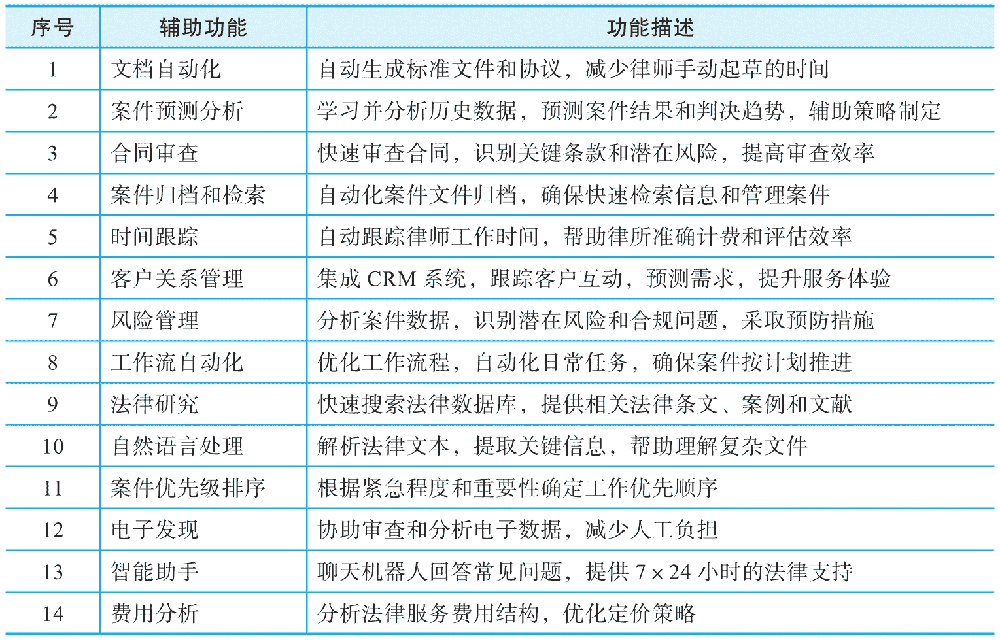

**7.2.1 AI 驱动的案件分类**

**1. 律所进行案件分类的方法和意义**

律所通常依据案件性质、专业领域、所处阶段等进行归类。分类有助于提升效率、确保管理规范与专业，便于检索与复盘，也利于律所监督与评估律师工作质量。

主要分类依据包括：

❑ 按法律部门划分，如民事、刑事、行政诉讼等。
❑ 按复杂程度与专业领域划分，如简易案件、复杂案件、行业专项案件等。
❑ 按案件流程阶段划分，如立案、审理、判决、执行等。
❑ 按事实、争议焦点及法律适用问题进行类案识别与检索。

分类的价值体现在：

❑ 提升工作效率：快速定位相关案例与先例。
❑ 规范执业行为：推动律师按标准流程操作，减少失误。
❑ 便于管理和监督：律所得以系统化跟踪进度与质量。
❑ 经验沉淀与知识积累：为后续同类案件提供参考。

在传统做法中，律所常借助专业案件管理系统或 Excel 表格记录案件全生命周期、证据材料及日程安排，以实现协同管理。例如 Alpha 系统的律管模块、和讼等工具可记录跟进状态、上传文件、生成证据清单并支持跨区协作。但人工分类耗时耗力。AI 在此环节展现出明显优势：通过自动预处理、关键词识别、类型预测与特征提取，快速从海量文本中抽取关键信息，加速初分进程；算法应用一致，减少人为误差，保证标准化；深度学习还能持续优化模型，提升准确率。

**2. 国内外辅助律所案件分类的 AI 法律产品及其功能特性概览**

市场上已有大量工具可辅助分类（见表 7-2）。它们能基于紧急程度与复杂度进行优先级排序，为律师提供决策支持，合理分配时间与资源。最终，AI 分类不仅加快处理速度与质量，还为律所提供运营洞察，优化管理策略。

表 7-2 辅助律所进行案件分类的 AI 工具及功能描述

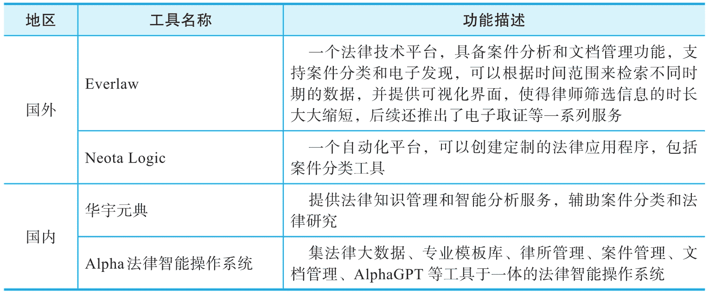

**3. AI 工具在辅助律所案件分类中的应用方式**

AI 可通过以下步骤落地：

（1）文档预处理
首先对案件文档进行扫描，通过 OCR 将图像转为文本，并利用自然语言处理理解内容。
例子：律师批量上传案件材料，AI 用 OCR 完成文字转码。

（2）关键词与短语识别
AI 借助 NLP 提取与案件类型、法律议题相关的关键词。
例子：系统捕捉到“合同”“违约”“赔偿”等高频词，初步判定为合同纠纷。

（3）案件特征提取
AI 不仅判断类型，还能抽取紧急度、复杂度、可能议题及法律依据等特征。
例子：对一起合同纠纷，AI 提取出合同金额超 100 万元、涉及多方当事人、需援引民法典相关条款等信息。

（4）自动化案件标注
根据类型与特征，AI 自动打标签便于内部检索与管理。
例子：新案件被自动标注为“合同纠纷—高价值”“紧急”“需多方协调”。

（5）案件优先级排序
结合特征与律所资源策略，AI 对案件进行排序。
例子：高额赔偿且期限紧迫的案件被标记为高优先级，并推送给经验匹配的律师团队。

**7.2.2 AI 辅助律所案件跟踪**

案件追踪有助于律所实现事前防范、事中监督、事后问责，保证处理及时合法，也能拓展案源渠道。借助互联网获客，跟踪机制更显重要。AI 法律产品在此过程中的优势体现在：

**1. AI 赋能自动化案件跟踪与决策支持系统**

自动化跟踪系统可实时监控进展，捕捉关键节点与截止日期，降低遗漏风险。部分工具能从海量文本中抽取信息，生成直观进度报告与分析。用户可像与人对话一样查询内部数据库，AI 也能持续参与对话，为团队快速获取信息、做出更优决策提供支持。

**2. AI 在提升法律服务效率与安全性中的作用**

AI 可预测案件走向、评估风险，为决策提供数据依据。智能提醒确保律师及时响应变化，提升响应速度与质量。系统还能按案件类型与复杂度智能分配人力，提高效率。同时，通过加密与访问控制保障数据安全与隐私，降低人工投入与失误成本，实现降本增效。

表 7-3 辅助律所进行案件跟踪的 AI 工具及功能描述

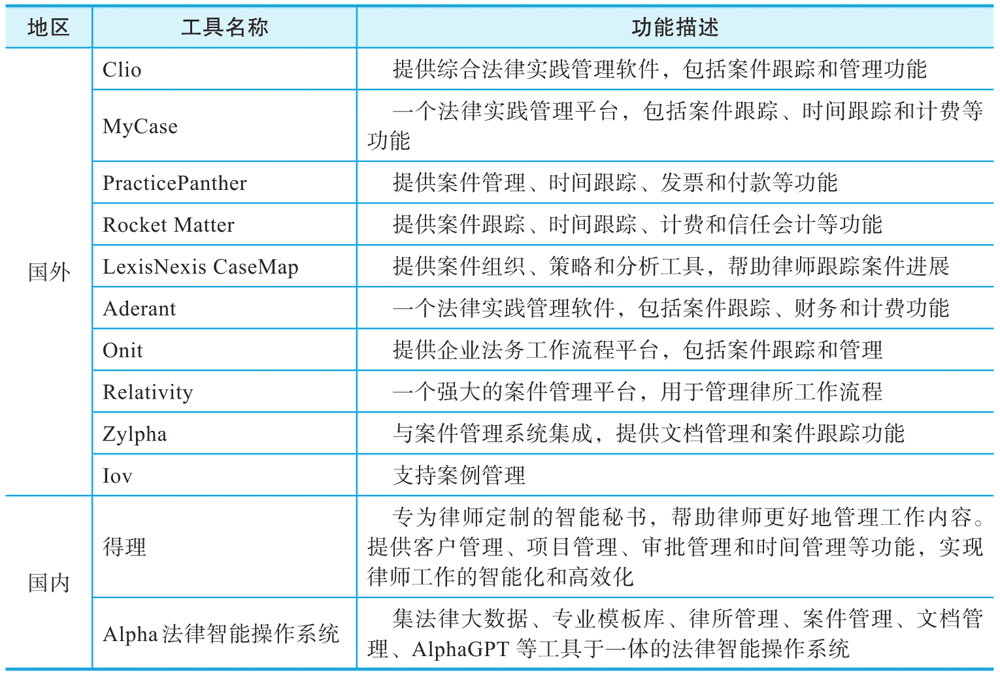

**3. AI 工具对律所案件进行全流程跟踪的拆解**

AI 对案件全流程跟踪的拆解如图 7-1 所示。

（1）自动案件录入
新案件入所时，AI 可通过 OCR 扫描文档，自动抽取关键信息录入系统。AI 扫描仪与传统扫描仪区别显著：
❑ 具备图像识别与处理，能自动分类整理。
❑ 可将图像转为可编辑文本。
❑ 支持多语言识别。
❑ 自动校正倾斜、模糊等，提升质量。
❑ 可提取日期、姓名、金额等关键信息并分类存储。
例子：律师上传纸质文件，AI 扫描仪快速转电子并自动提取案件名称、当事人、编号等。

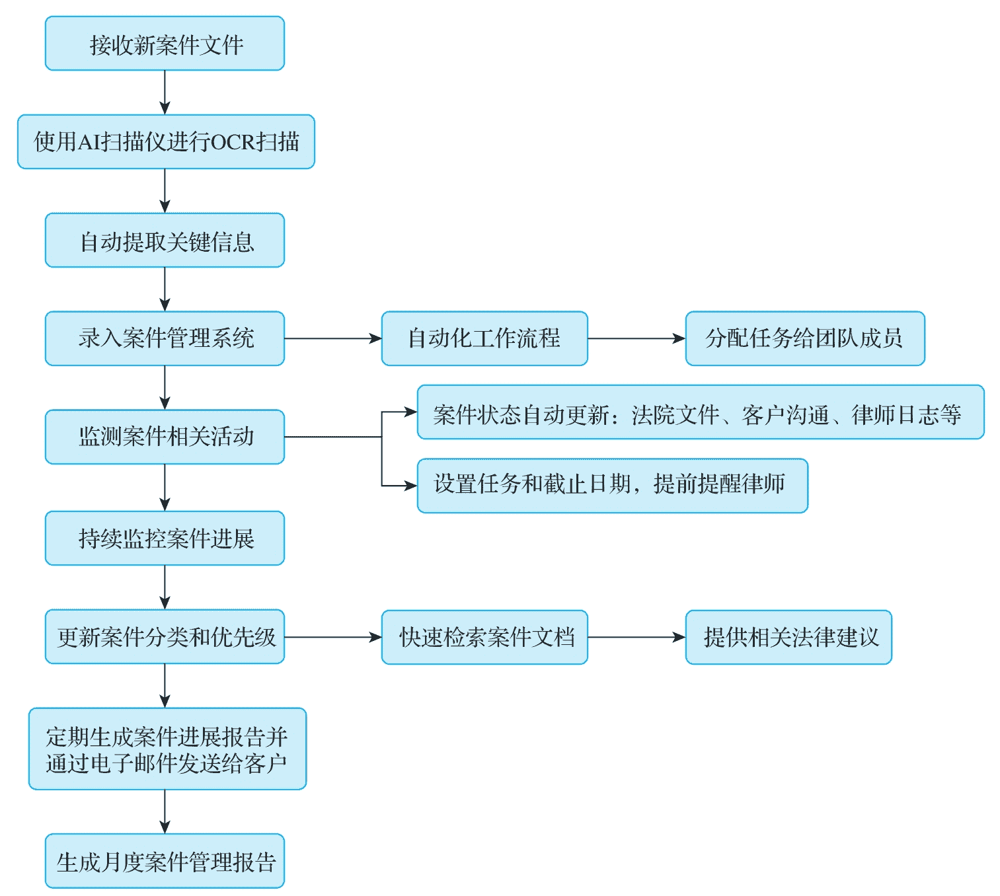

图 7-1 AI 工具对律所案件进行全流程跟踪的拆解

（2）案件状态更新
AI 自动追踪法院文件、客户沟通、律师日志等活动并更新状态。
例子：系统监测到裁决发布后自动将状态改为“等待律师审查”并通知负责人。

（3）任务与截止日期管理
AI 可设定任务与截止提醒。
例子：系统为证据提交、听证会、文书起草等节点提前一周推送提醒。

（4）案件进展跟踪
AI 分析进展，识别延误与瓶颈并提出改进建议。
例子：系统对比实际完成情况与时间表，标记延迟并生成瓶颈分析报告。

（5）客户沟通与更新
AI 可自动生成报告或摘要定期向客户通报。
例子：每月自动生成进展报告并邮件发送客户。

（6）文档的管理与检索
AI 支持快速检索并提供相关法律参考。
例子：律师查阅全部通信记录时，AI 迅速定位相关文档。

（7）工作流程自动化
AI 按案件类型自动生成工作流并分派任务。
例子：系统自动生成审查、取证、庭审准备流程并分配给团队成员。

（8）数据分析与报告
AI 分析案件数据，生成报表帮助管理层掌握负载与表现。
例子：月度报告展示案件数量、类型分布、处理时长与客户满意度。

这些应用让律师聚焦核心业务，同时为客户提供透明及时的信息。

**7.2.3 AI 辅助律所案件预测**

AI 可为律所提供数据驱动的预测，助力更明智决策，提升成功率，也可优化资源配置与服务质量。

**1. AI 辅助律所进行案件预测的优势和弊端**

（1）优势
❑ 数据分析与学习优化：AI 可处理海量历史数据，识别模式，为结果提供预测依据；机器学习可捕捉法官习惯与胜负因子，准确率随时间提升，有助于客户沟通与预期管理。
❑ 风险评估与信任构建：AI 可评估潜在风险，帮助律师客户更清晰认知挑战。
❑ 资源分配与策略制定：基于预测结果，律所可聚焦高胜诉概率案件，律师亦能制定更具针对性的诉讼与谈判方案。
❑ 工作效率提升：自动化分析减少研究时间，让律师专注高价值工作。

（2）弊端
❑ 预测不稳定：准确性高度依赖数据质量与完整性，偏差数据会导致误判。
❑ 成本与安全压力：系统需专业维护与持续更新，对小型律所挑战大；前期投入与数据安全要求高。
❑ 伦理、责任与透明度问题：预测失误的责任归属模糊；过度依赖可能削弱专业判断；部分模型难以解释决策依据。

**2. 辅助律所案件预测的 AI 工具**

主要工具及功能见表 7-4。

表 7-4 辅助律所进行案件预测的 AI 工具及功能描述

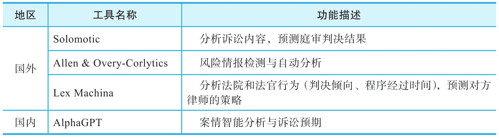

**3. AI 辅助律所案件预测的流程和方法**

（1）数据收集
从案件管理系统与公开法律数据库采集历史裁决结果、法律议题分析、证据类型与强度、法官倾向及相关法规等。

（2）数据预处理
利用 OCR 将纸质文档转为文本，去除格式错误与重复记录，统一法律术语。

（3）特征工程
提取影响结果的关键特征，如案件类型、当事人诉讼历史、证据完整性、适用条款、代理律师胜率与经验等。

（4）模型训练
采用随机森林、梯度提升机或神经网络等算法在历史数据上训练模型，并调优参数。

（5）模型评估
通过交叉验证生成混淆矩阵、ROC 曲线等指标，确保泛化能力。

（6）案件预测
输入新案件特征，模型输出胜诉概率。

（7）结果解释与策略建议
系统解释关键影响因素，如证据强度、法官倾向等，为律师提供诉讼策略建议。

（8）持续学习与优化
新判决反馈回流模型，实现持续学习，预测能力随时间提升。

总体而言，AI 在案件预测中提供强力支持，能显著提升效率与准确度。但管理者需权衡成本、复杂性与依赖风险，建立数据管理制度与伦理标准，在保留专业判断的前提下发挥 AI 优势。

### **7.3 智能化驱动律所文档治理**

人工智能进入律所文档治理后带来的价值可以归纳为三个方向，具体对照见表 7-5。

表 7-5 AI 辅助律所进行文档管理的功能及描述

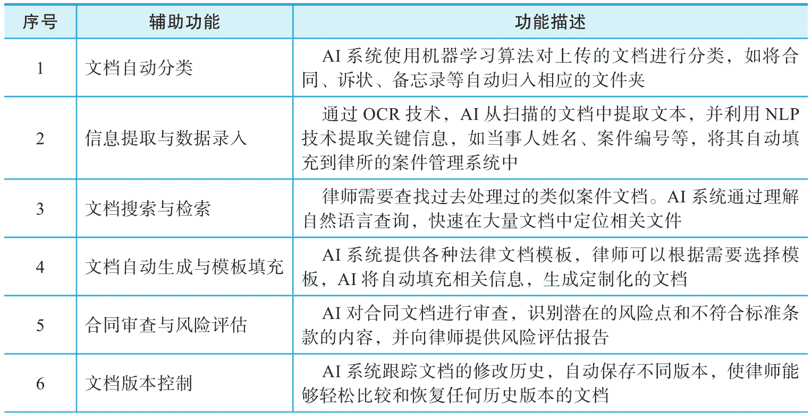

（续）

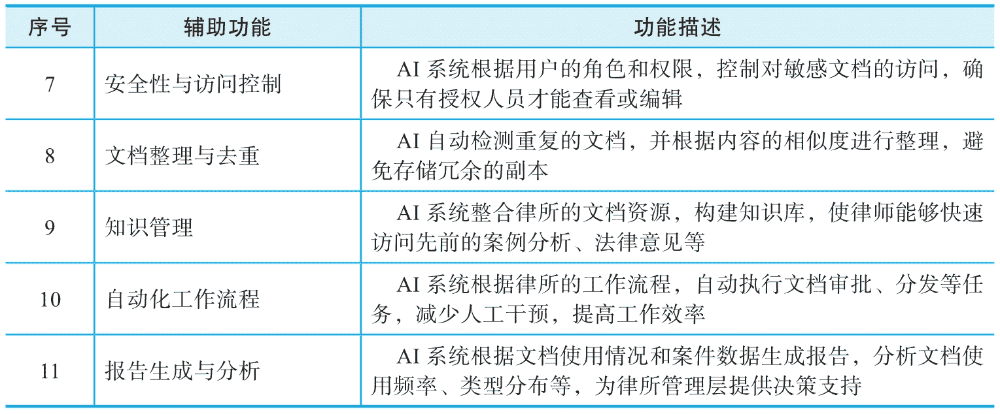

其一是提效增准。借助自然语言理解、机器学习以及光学字符识别，系统能够自主完成文件的归类、建立索引并支持检索，秒级抓取核心要点，提升判断精度。

其二是风控加固。模型可以自动扫描合同及法律文件中的风险点，提前发出合规预警，并配合访问控制、数据加密等安全机制，保障资料的保密与完整。

其三是知识与资源优化。智能化知识平台帮助律所搭建并维护统一的知识库，优化资源配置方式，同时深化对案件策略和客户服务的洞察，保持行业领先。

多工具协同后，文档处理的速率与水准同步提升，对案件和客户的理解也更透彻。

**7.3.1 智能化文档生成实践**

**1. 律所文档生成的智能价值**

律所文档生成的智能价值体现在多方面，相关方案梳理见表 7-6。

表 7-6 辅助律所进行文档生成的 AI 工具及功能描述

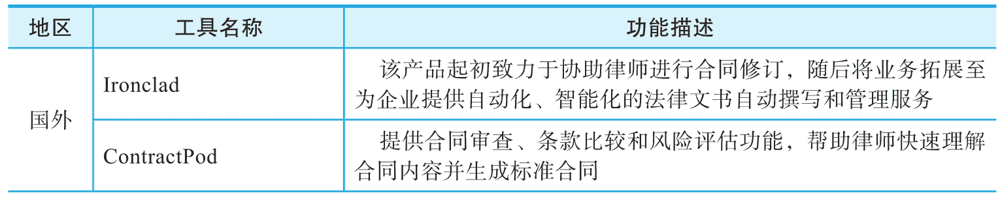

（续）

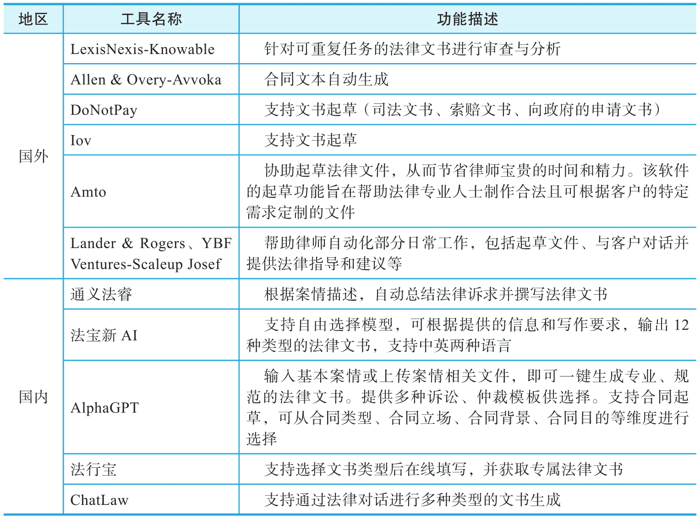

❑ 起草提速：智能系统能迅速产出初稿，大幅压缩律师撰写耗时，腾出时间攻克复杂法律问题。
❑ 费用下降：减少对人工的依赖，降低文档生成的人力成本。
❑ 品质可控：借助标准化模板与自动校核，减少差错，保障准确与一致。
❑ 版式标准化：统一排版与规范，提升专业形象与品牌一致性。
❑ 知识复用：智能知识平台让律师快速调取往期案例与文件，加速学习与应用。
❑ 反馈更及时：即时回应客户需求，及时交付文件与咨询，提升满意度。
❑ 隐私合规与法规同步：兼顾客户信息与案件数据的私密安全，并保持法律条文实时更新，跟上规则变化。

**2. 文档生成的方法及实例**

（1）自动模板填充
方法：基于预置模板，系统按案件要素自动填入变量字段。
例子：起草标准租赁合同，依据双方信息与租赁条款自动填充，快速形成草稿。

（2）智能文档审核与建议
方法：合同审查 GPT 可按业务场景定位专属风险点，出具针对性批注与修改建议，律师可设定审查立场引导输出。
例子：对一份借款合同草案进行审查，选择贷款人视角，系统重点提示对贷款人不利条款并给出有利修改建议。

（3）智能文书写作
方法：律师以口语化方式输入原告、被告、诉讼请求、事实理由、证据等要素，系统转化为规范法律语言。
例子：确定文书类型后上传案情材料或图片，系统按模板自动生成诉状等文书。

（4）交互式生成
方法：律师通过提问与指令与系统交互，逐步生成特定段落。
例子：与系统对话构建案件法律论证部分，按指令逐段生成文本。

（5）个性化定制
方法：依据客户特殊需求与偏好生成定制化法律文件。
例子：为客户定制特殊要求的遗嘱内容。

（6）批量生成
方法：处理大量同类需求，快速产出一系列标准化文件。
例子：为多位客户批量生成标准保密协议。

（7）研究辅助草拟
方法：基于研究成果辅助起草法律文件。
例子：起草特定法律问题的法律意见书时，系统提供条文、案例与论据支持。

（8）版本控制与协同编辑
方法：管理多版本文件，支持团队协同编辑。
例子：多位律师共同完善同一案件文件，系统记录编辑轨迹，保证统一与准确。

（9）风险评估与审核
方法：评估潜在风险并给出审核意见。
例子：生成商务合同时，系统分析条款、识别法律风险并提示。

（10）知识库支撑生成
方法：调用律所知识库支撑生成。
例子：撰写特定法律领域报告时，从知识库提取信息辅助成稿。

**7.3.2 文档审查的智能强化**

《法律实务人工智能现状报告》白皮书的调研显示，在无限制条件下，42%的受访律师认为文档生成器最关键；但有58%的受访者提到文件工作即核实、汇总、生成、修改，说明自动化审查是核心诉求。

**1. 文档审查的智能优势**

智能审查主要带来效率提升、一致性保障、差错降低与风险识别增强。

借助 Harvey AI、AlphaGPT、MeCheck 等系统，律所可快速分析海量文件，自动定位关键条款、风险点与不一致之处。基于自然语言处理与机器学习，系统深度理解文本，辅助律师做出更全面决策，并能学习律师审查习惯，实现个性化精审。最终提升文件质量与合规性，释放律师精力聚焦战略咨询。

表 7-7 辅助律所进行文档审查的 AI 工具及功能描述

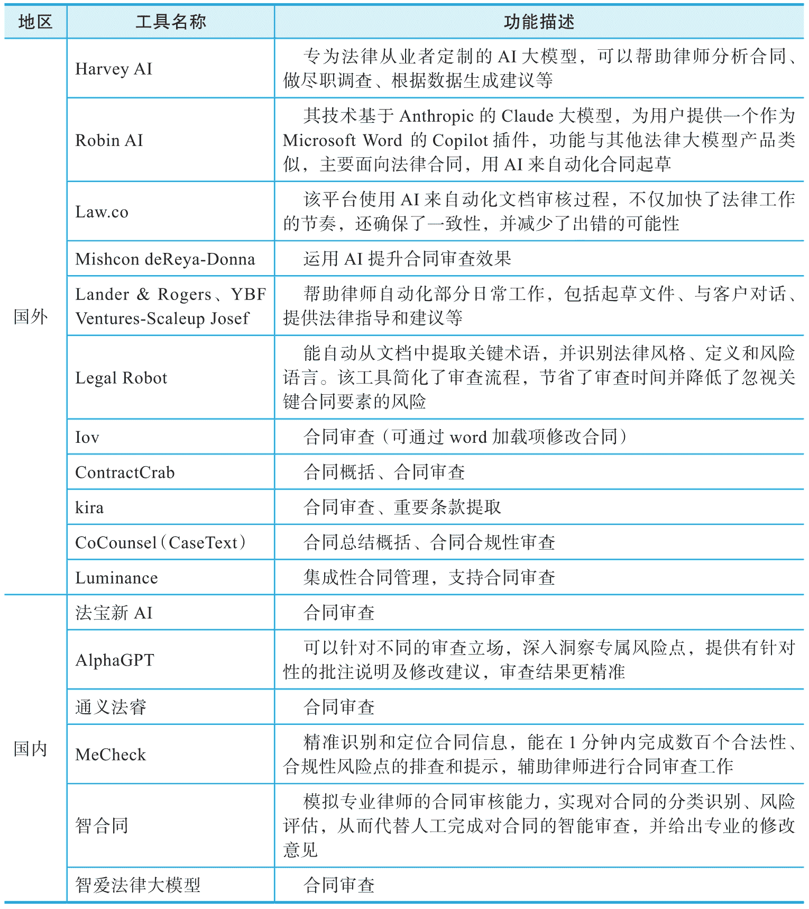

**2. 如何确保审查环节的准确与合规**

（1）数据合规性与知识产权管理
❑ 如 Harvey AI 等方案通过互联网数据、法律数据库与业务数据混合训练提升适用性。
❑ 技术方需对原始语料进行初审，确保来源合法且符合《中华人民共和国个人信息保护法》等要求。
❑ 需取得完整的知识产权授权，包括复制、改编、汇编权，并制定管理策略。

（2）数据标注与反歧视措施
❑ 建立数据标注管理制度，明确管理与安全要求。
❑ 制定标注规则并开展质量评估，核验准确性；避免训练数据选择中的歧视风险。

（3）技术滥用防范与用户反馈机制
❑ 构建技术滥用责任框架，防止违背法律、伦理与社会价值。
❑ 提供对输出结果的控制与反馈渠道，增强信任并向监管提供必要信息。
❑ 服务提供者需对生成内容进行安全审核，过滤违法、不良及侵权信息，必要时停止生成。
❑ 依据《互联网信息服务深度合成管理规定》，显著标识深度合成内容并建立用户反馈机制，及时防范风险。

**7.3.3 文档存储、阅读与理解的智能提升**

**1. 存储阅读理解方面的智能优势**

❑ 处理效率高：快速处理海量法律文档，提升审查与检索效率。
❑ 理解精度高：通过深度学习与 NLP 精准识别关键信息与概念。
❑ 语义检索：语义搜索能力可快速定位相关文档与条款。
❑ 自动化管理：自动分类、存储、索引，简化流程并保证有序可达。
❑ 风险分析：识别潜在风险与不一致，为决策提供支持。
❑ 个性化服务：按律师习惯提供处理与阅读建议。
❑ 持续学习优化：随法律环境与用户需求演进不断提升服务水平。

整体而言，智能化为存储、阅读与理解提供高效、精准的支撑，显著提高服务质量。

表 7-8 辅助律所进行文档存储、阅读及理解的 AI 工具及功能描述

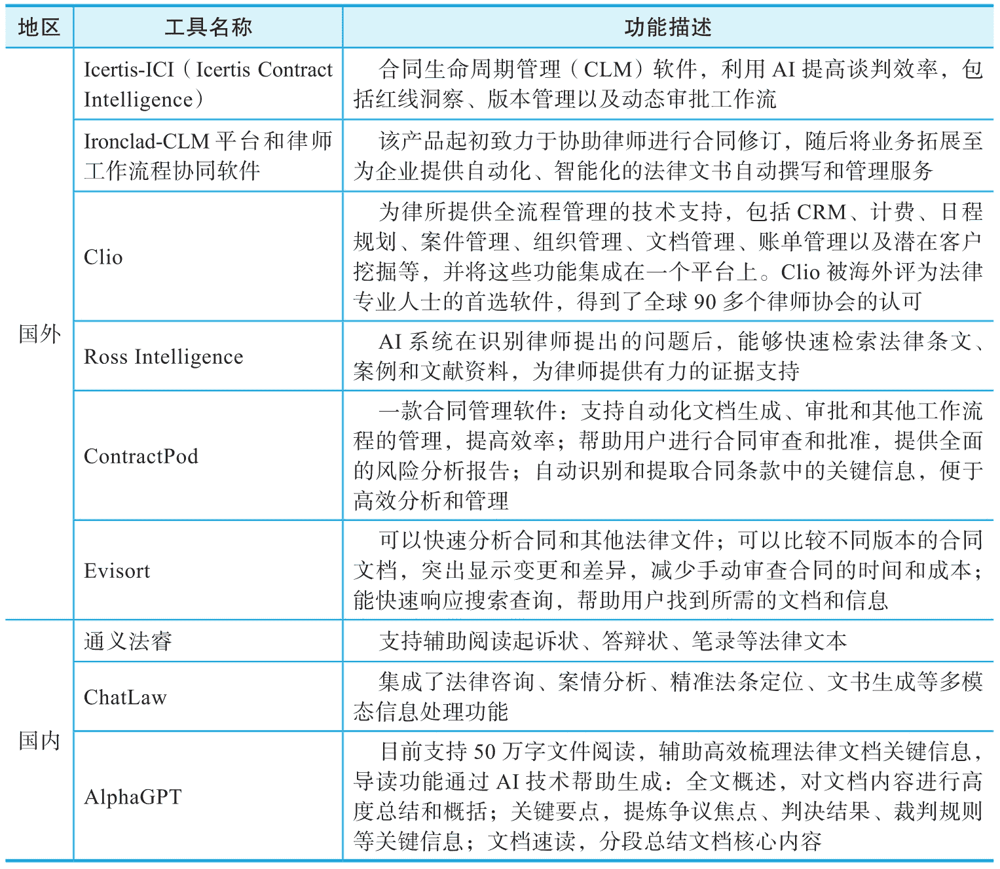

**2. 存储阅读理解的工作流程**

以 AlphaGPT 为例：

第一，利用项目功能集中管控文档，系统自动分类备份，保证安全且易检索。
第二，借助检索能力快速定位要点，系统高亮关键信息并生成摘要，加速阅读理解。
第三，运用 NLP 自动解析合同，识别风险并提出修改建议，实现智能审批。

该流程提升了效率与安全性，同时保证质量与合规。

**7.4 客情管理的智能赋能**

**7.4.1 客户管理痛点与智能解法**

**1. 管理难点及技术解决方案**

（1）客户数据整合
难点：数据分散在多平台，难以统一。
方案：集成工具自动采集整合，形成统一客户视图。

（2）个性化服务需求
难点：需求多样，需深度洞察与定制。
方案：分析工具挖掘数据，提供个性化方案。

（3）沟通渠道管理
难点：渠道多元，记录耗时。
方案：聊天机器人与自动记录系统简化沟通并留痕。

（4）风险管理与市场变化预测
难点：难以实时识别客户相关法律风险与市场变化。
方案：风险评估模型实时监控并预测，制定策略。

（5）服务质量与满意度评估
难点：缺乏量化客观标准。
方案：分析反馈与案例结果，建立量化评估体系。

（6）客户忠诚度与长期关系维系
难点：竞争激烈，维系成本高。
方案：CRM 智能功能分析行为，制定个性化维护策略。

（7）资源合理分配
难点：律师时间与专业资源有限。
方案：按需求与案件复杂度智能匹配资源。

（8）响应速度与服务质量提升
难点：客户期望快速响应。
方案：智能驱动的快速响应系统及时满足需求。

**2. 客情管理中的功能与效果**

智能化通过数据整合、个性化服务、沟通优化、风险预测、质量监控、忠诚度提升、资源智能分配与响应加速，全面提高管理效率与客户满意度，增强市场竞争力。具体功能见表 7-9。

表 7-9 AI 辅助律所进行客户关系管理的功能及描述

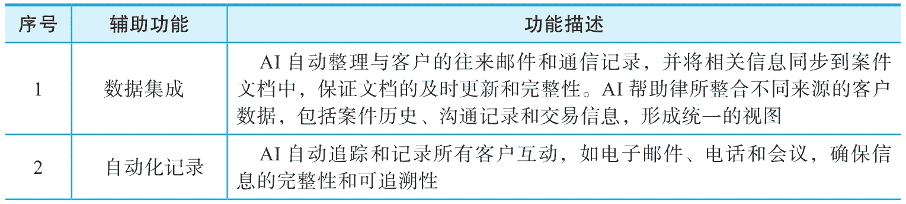

（续）

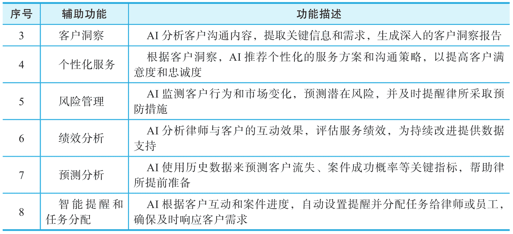

**7.4.2 客户信息管理与关系维护**

**1. 信息管理与关系维护的优势**

（1）自动记录与分析：减少手工录入，提效率。
（2）深入了解客户需求：NLP 能力助力把握偏好，为个性化服务奠基。
（3）个性化服务与风险管理：基于洞察提供定制服务，提升忠诚度；预测能力提前管控关系风险。
（4）数据支持决策：分析数据使管理更科学，决策更准确。
（5）服务绩效评估与流程优化：持续改进服务质量。
（6）提升效率与竞争力：精准高效管理客户关系，增强市场竞争力。

**2. 客情管理中的应用与效果**

（1）自动化与效率提升：自动记录分析节省时间。
（2）深入洞察与个性化服务：理解需求偏好，提升忠诚度。
（3）风险管理与决策支持：预测风险，数据驱动管理。
（4）服务绩效评估与流程优化：持续优化流程与质量。

智能产品通过自动化、洞察、定制、风险预测、数据决策与绩效评估，提升效率与满意度，优化流程并增强竞争力。相关工具见表 7-10。

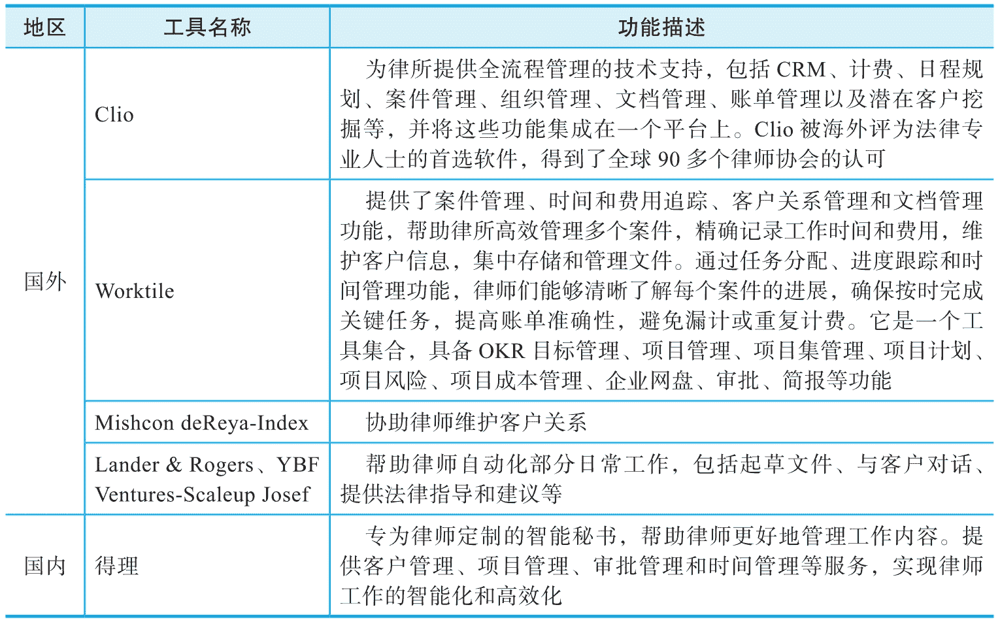

**7.5 财务管理的智能助力**

**1. 财务管理的内容**

财务管理涉及多个环节，具体见表 7-11。

表 7-11 AI 辅助律所进行财务管理的具体内容及描述

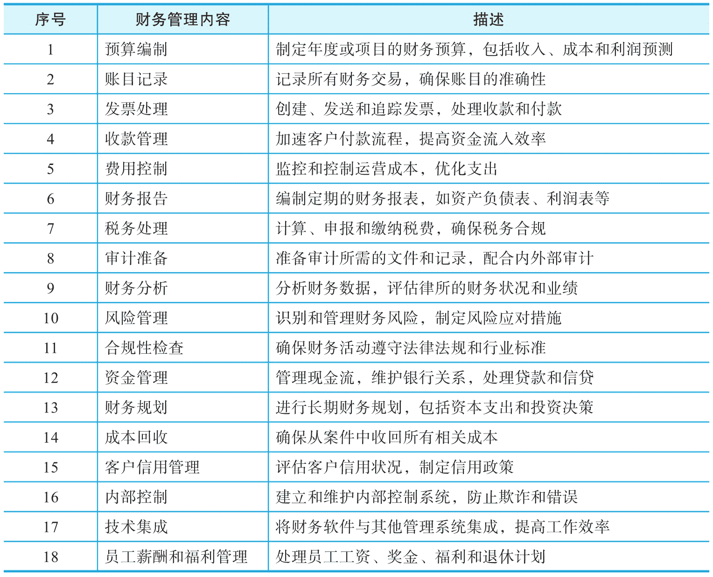

**2. 财务管理的智能方式**

目前尚无专属律所财务智能产品，但技术可从以下维度赋能：

❑ 自动化账目处理：自动生成发票、处理支付、分类账目，减少错误。
❑ 智能预算及费用控制：基于历史与市场趋势辅助编制预算与费用管控。
❑ 风险预测与管理：如法蝉平台数据分析预测财务与市场风险。
❑ 合规性检查：监控财务活动是否符合法规，降低法律风险。
❑ 财务报告生成：自动采集分析数据快速出具报告。
❑ 审计支持：识别异常交易与潜在问题，提升审计效率。
❑ 税务优化：结合税法与历史数据合理规划税务。
❑ 客户信用管理：评估客户信用，提供授信建议，降低坏账。
❑ 成本效益分析：分析支出效益，指导成本控制。
❑ 数据可视化：让复杂财务数据更直观，便于决策。

这些应用提升效率与准确性，增强决策支持，实现精细化管理。

**7.6 案例研究的智能赋能**

**7.6.1 案例研究的智能价值**

**1. 降低成本与提高效率**

智能化减少对传统人力研究的依赖，降低成本，通过自动化处理大幅缩短律师研究时长。

**2. 研究质量与策略针对性提升**

系统快速分析海量文档与历史案例，精准锁定关键要素，减少遗漏，为诉讼策略与谈判提供数据支撑。

**3. 增强客户信任，强化知识资产管理**

智能化快速响应需求，提供数据化法律意见，增强客户信任；系统持续积累案例成果，形成可复用的知识资产。

**7.6.2 律所案研智能化：从流程到工具的全景拆解**

**1. 智能化案研的典型工作链**

律所把智能技术引入案例研究时，常见的操作链条如下。

（1）检索自动化
系统能直连常用法律数据库，几秒内锁定相关判例与规范性文件，把资料搜集的耗时压到最低。

（2）语义理解
依托自然语言处理，平台可以读懂律师抛出的复杂法律提问，并从海量文书中提炼出事实要点、裁判说理与适用法条。

（3）筛选与归类
按照律师预设的筛选条件，系统自动对案源进行归类，挑出与当前争议点契合度最高的样本。

（4）摘要自动生成
模型可快速提炼案情精华，形成要点短文，让律师迅速抓住案件核心。

（5）结果与风险推演
通过对历史案例的挖掘，系统对胜诉概率、潜在风险点进行模拟，为策略制定提供数据参考。

（6）智能推荐
基于检索历史与研究习惯，平台主动推送关联判例与学术观点，实现个性化案研支持。

（7）文书比对
多份卷宗的内容差异与相似处会被自动标注，帮助律师搭建攻防论点。

（8）对话式问答
部分产品提供聊天式交互，律师以自然对话提出问题，系统即时返回答案。

（9）可视化呈现
数据可视化手段把研究结论图形化，复杂信息变得更直观易懂。

（10）外部信息融合
新闻报道、期刊论文等非司法数据源也能被整合进来，为案研补充背景语境。

（11）持续迭代更新
平台会不断吸收新判例与立法变动，保证研究材料的时效性。

（12）多语种支持
面向跨境业务的律所，系统可跨语言开展研究，削弱语言壁垒。

**2. 常用智能案研工具**
具体产品及其功能说明见表 7-12。

表 7-12 辅助律所进行案例研究的 AI 工具与功能描述

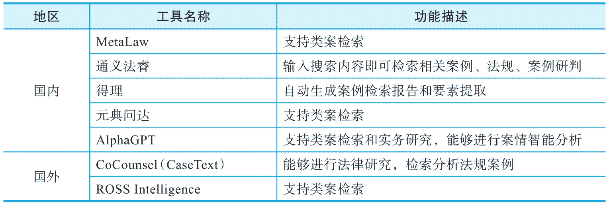
智能化手段在案研环节同时提升了效率与精确度，也强化了决策的数据支撑，推动案研走向更细颗粒度。把智能技术嵌入律所管理，能显著提速、改善决策水平、优化客户感知，为机构创造新的成长空间。随技术演进，这类能力将愈发成为律所运营的核心要素，推动法律服务向更高效、更智能的方向发展。

**7.6.3 人机案研的分工与差异**

智能辅助案研与律师手工研判在实务中各司其职，呈现出明显分野。

❑ 效率与精确度：自动化模型能在海量文献中迅速定位关联信息，判例、法条与论文的检索速度远超人工。
❑ 深度与广度：机器学习让系统对复杂法律问题具备更强的理解力，并能实现跨领域知识的整合与交叉研判。
❑ 关键要素捕捉：系统可快速锁定当事人身份、案情描述等核心信息，加快分析节奏。
❑ 预测与策略：预测模块帮助律师校准辩护思路与法律建议，比如在刑事领域推演定罪可能性与量刑区间。
❑ 风险识别：通过历史数据分析，系统能揭示常见风险点，辅助选择更有利的诉讼路径。
❑ 服务模式重塑：合同审查、案件预测、文档自动化等新形态拓展了法律服务的边界。
❑ 个性化交互：聊天机器人与虚拟助手可提供定制化咨询，及时回应客户提问。
❑ 实务应用：快速调取法律资源与判例，为策略制定提供数据支撑，提升研究速度与准确性。

总体来看，智能技术提升了案研的效率、深度与预判能力，而律师工作更侧重人工研判与策略把控，二者结合才能为实务提供更全面深入的解决方案。

## **第八章**
## **智能时代下的法学教育与司法裁判**

法律共同体是业内高频使用的概念。除律师之外，智能技术会对共同体的其他成员产生哪些影响？本章以高校法学院与法院为观察窗口，探讨人工智能浪潮下两类机构面临的挑战与应对思路。

### **8.1 智能技术对法律共同体的冲击**

**8.1.1 法律共同体何谓**
法律职业共同体指由法官、检察官、律师、法学家等职业人员构成的特殊社会群体。

法学学科的存在以职业共同体的存在为前提。共同体内各群体基于法学素养、专业话语和公平正义的价值追求密切协作。分工不同导致思维模式与分析立场各异，尤其是法官，与其他群体交流存在壁垒。

共同体的存在意味着律师无法单独面对智能技术的冲击，冲击会向法官、检察官、公安等群体传导。宏观上，法律AI产品已深度改变共同体，尤其是上游教育机构的学者群体与下游裁判机构的法官群体受影响最为突出。

**8.1.2 法学院面临的教学转型压力**
大学素有思想高地之名，关于智能技术走向的讨论，法学院乐于参与前瞻性探讨。但在教学实践层面，必须直面以下转变。

**1. 教学内容在变——教什么**
未来法律人才需要哪些素养？法学院需要传授什么才能匹配市场需求？全球实践显示，法律AI的积极价值被逐步认可，越来越多法学院在课程体系中加入法律AI相关内容。

（1）开设AI相关课程
越来越多的法学院增设AI相关课程与实验室，涉及数据科学、编程、心理学、哲学等多学科。比如巴西里约热内卢的FGV法学院要求学生学习Python与数据科学，以应对新实践需求。在中国与美国，开设此类课程的势头尤为明显。见本书 8.2 节。

（2）实务操作类知识前移
传统法学教育重原则规则传授，实务打磨多留到毕业后。随着智能技术替代助理性工作，法学教育与法律实务的人才培养分工或将模糊，法学院需要承担更多实务教学。海外精英法学院已出现从 learn-to-think 向 learn-to-practice 的课程扩张。也可理解为智能技术抬高了律师实务基准，该基准需在法学院接受更专业训练。

**2. 教学方式在变——怎么教**
传统法学教学以知识传授为主，模式多为群体授课。智能时代，系统的存储检索能力远超人类，人类更需学习人机协作，教学将由知识传授转向以学习为中心，授课可实现单人辅导模式。借助智能技术，学生能在虚拟环境中实习演练，提升操作能力。

**3. 评价方式在变——如何评价**
评价指向毕业生的综合能力及其在未来法律实践中的表现，是否满足市场需求是质量标尺。

依托智能技术，数据的采集整理变得可行。法学院知名度、美誉度、在人工智能领域的学术影响力、学生的学业成绩、就业率及职场表现等，都能迅速反馈并成为改进依据。评价呈现出更客观的形态。

**4. 学术诚信如何确立**
生成式智能工具如ChatGPT的普及使抄袭等学术不端更易发生。据《自然》调查，68%的受访者认为生成式工具将使抄袭更难检测。在法学领域，法律文本的生成与修改可被轻易完成，依赖性增强可能导致浅阅读与低创造性，学术不端风险上升。

如何规范工具使用、加强监督，确保人才培养不因工具而滑坡，是法学教育必须思考的问题。目前尚无定论。

2023年8月，全国信息安全标准化技术委员会秘书处发布《网络安全标准实践指南—生成式人工智能服务内容标识方法》，为输出内容合规提供参考，但该标准从网络安全出发，尚不足以覆盖教育场景的复杂需求。

**5. 教育公平如何保证**
智能技术作为基础设施需要大量投入，经济条件差异易导致发达地区率先获得先进教育工具，欠发达地区面临资源匮乏，加剧教育不公。

此外，智能技术的开发者集中于发达国家，数据取向与算法偏见可能导致服务质量不均。例如，GPT主要以英文语料训练，英语母语使用者获得更好服务，小语种使用者体验受限。

**8.1.3 裁判机构面临的质疑**

法院作为司法最后一道防线，在智能时代处境微妙。最初，信息化被寄望于提升先例检索效率，保障司法透明与公开，提升公信力。数据分析与算法在裁判中一度被视为正面工具。

随着普及加深，司法系统面临质疑。

**1. 法官自由裁量空间是否被压缩**
智能技术在提升效率方面优势明显，但其标准化和程序化特征可能压缩法官自由裁量空间，导致裁判趋于机械同质化。

**2. 司法独立性是否受影响**
案件积压下智能系统易成首选工具。过度依赖可能削弱法官独立判断，尤其在复杂案件中，法官易将系统建议视作权威，渐失独立审判能力。

**3. 司法公信力是否受削弱**
（1）算法黑箱问题
若系统透明可解释，公众信任度更高。但智能系统的后台原理难以完全透明，不确定结果难解释，可能动摇裁判公正性。
（2）算法僵化问题
系统处理案件追求一致性，却可能因算法简化而忽视“法理情”要素，导致裁判结果偏离社会正义感。
（3）算法偏见问题
系统可能因数据偏见与算法歧视输出不公结果。如美国犯罪管理系统COMPAS，即“用于替代性制裁的矫正罪犯管理分析系统”，由北庞因特公司开发，依历史数据评估累犯风险并分为高、中、低三级。研究认为该系统对黑人误判率高于白人，存在种族歧视倾向。

### **8.2 高校法学教育受智能技术影响的实证**

在高校法学院教学中，智能技术已成为重要议题。美国如此，中国亦然。名校与普通院校都在关注其法律应用。

**8.2.1 中国法学院教育的变革图景**

国内多所法学院高度关注法律科技，体现在机构设置、课程建设与学术活动。

**1. 机构设置**
（1）概况
2017年以来，中国人民大学、北京大学、中国政法大学等高校敏锐意识到智能技术革命对法学理论与教育的冲击，纷纷设立研究机构，关注前沿法治问题与新型人才培养，具体见表 8-1。

表 8-1 国内高校法律 AI 研究机构一览表

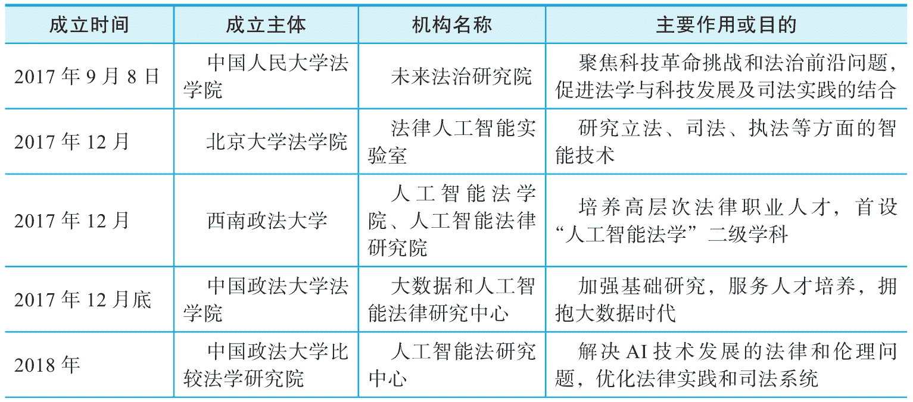

（续）

（2）原因分析
高校设立人工智能相关机构的深层动机包括：
1）应对科技革命挑战：智能技术等新兴技术涌现，传统法理面临冲击，高校主动适应新一轮科技革命。
2）促进学科发展：AI与法学结合推动与计算机科学、数据科学的交叉。
3）培养复合型人才：市场需求变化，要求既懂法律又懂技术的复合人才。
4）服务国家战略：响应法治建设与科技强国战略，为国家治理提供理论与人才支撑。
5）推动研究创新：探索利用AI优化法学教育与法律实践的方法与范式。
6）提升学术影响力：在人工智能法律领域形成特色成果，提升国内外影响力。

**2. 课程建设**
（1）课程概况
在设立研究机构的同时，各法学院调整教学内容，陆续增设AI技术相关法学课程，见表 8-2。

表 8-2 国内法学院人工智能相关课程一览

（2）课程建设的意义
1）促进法学教育现代化：结合传统理论与现代科技，保持教育的前瞻性。
2）培养复合型法律人才：理解并应用AI、大数据等技术。
3）应对新兴法律问题：帮助学生把握技术发展带来的法律挑战，适应服务市场变革。
4）强化法律伦理教育：增强职业道德与责任感，厘清技术应用伦理边界。
5）拓宽研究视野：从更广视角审视技术对社会的影响及法律回应。
6）形成新教育模式：以技术为支撑，提高教学互动性与实践性。

**3. 学术活动**
（1）概况
中国高校法学院积极拥抱法律科技交叉研究，通过系列学术活动推动法学与科技融合，近年重大学术活动可参阅表 8-3。

表 8-3 国内法学院重大学术活动一览

（2）对法学教育的影响
1）增强前瞻性与实践性：关注AI时代法律问题，使教育贴近实务需求。
2）培养解决新问题的能力：研讨前沿技术引发的法律议题，夯实职业基础。
3）提升国际视野：吸引全球专家参与，拓宽学生国际竞争力。
4）拓宽视野与激发探究精神：接触多元知识，增强批判性思维，激发对复杂问题的探究兴趣。

**8.2.2 美国法学院教育的变革路径**
与中国不同，美国大学多为创新源头与人才汇集地，尤其西海岸硅谷的斯坦福、加州大学伯克利分校，西雅图华盛顿大学，东海岸波士顿的哈佛、耶鲁，以及北卡研究三角区的杜克、北卡教堂山等名校常引领产业趋势。

例如，斯坦福的吴恩达、李飞飞都是AI科学家兼实业家，OpenAI掌门人萨姆·奥特曼也是斯坦福中途离校的学生。

美国法律院校的AI双轨实践

当前美国多所法律院校呈现两条并行的走向：一面深度参与下一代法律智能工具的共创与打磨，一面在日常教学与科研中大规模开展讲座研讨，目标是培育能熟练驾驭智能工具的法律人才。

**1. 产品研发与迭代**

斯坦福法律学院在科技创新类项目与研究机构的数量上领先。该院既有面向在校生和校友的法律科技创新平台 Legal Design Lab，也设有汇聚研究者、执业律师与企业家的法律科技中心 CODEX，名称来自 Code 与 Lex 的结合，是高校法律科技创新的先行者之一。

（1）Legal Design Lab
实验室的工作落在以人为本的设计、技术与法律的交汇处，目标是打造新一代法律产品与服务。2023至2024年度在运转的四个项目分别是 AI 与司法正义、反驱逐、司法系统创新、更优的法律互联网。这些项目多具公益属性，期望通过参与者实践塑造更高效更公平的法治环境。

（2）CODEX
CODEX 旗下孵化多项产品，覆盖区块链教学、计算法学、人机协同、机器生成文本等方向。

**2. 教学体系与学位拓展**

美国法律院校正加速增设 AI 相关课程与学位，以对应智能产业蓬勃的市场需求。美国律师协会的调研显示，超过半数院校已提供相关课程，自2022年11月 ChatGPT 面世以来，课程数量明显激增。

（1）学位方向
以下两所院校正在推进聚焦 AI 的学位项目。

1）亚利桑那州立大学桑德拉·戴·奥康纳法学院计划于2024年在原有的法律、科学与技术学位项目下开设 AI 专业方向。完成相关技术课程体系的学生可获该专业证书，且无需额外学费。

2）加州大学伯克利分校法学院自2024年8月1日起招收为期一年的非全日制高级法学学位课程。该项目旨在让律师学会运用 AI 服务客户，学费约为7.3万美元。据官网介绍，课程面向企业高管及执业律师，提供“法律职业的生成式 AI”一年制课程。授课阵容包括企业高管、执业律师及法律与技术专家。项目同时面向社会融资，充分体现加州科技与资本联动的特色。

（2）课程建设
各校侧重点不尽相同。大量课程围绕如何在法律实务中使用智能技术，也有课程更聚焦诉讼场景中的使用及伦理问题。

1）哈佛大学法学院课程目录显示，各学科目前至少开设19门以上 AI 相关课程。该校长期运行的“法律、科学与技术”学习项目中包含多门 AI 课程，其中“自主性 AI 与法律”计划于2025年春季开课。

2）耶鲁大学法学院。自2016年起已举办数十场 AI 主题演讲、座谈和会议。2024年春季，信息社会项目将举办“宣传与新兴技术”会议，议题涉及生成式 AI 如何塑造政治话语、AI 选举干扰以及 AI 与民主等。2024年秋季，法学院还举办了“计算的规范哲学”会议。

3）乔治城大学法学院地处华盛顿，是法学教学标杆之一。官网显示，2023至2024学年全年开设80余门课程中，有8门与 AI 相关，涵盖生成式 AI 高级法律写作、AI 与法律、在 AI 驱动世界中的法律技能等交叉领域。通过此种设置，法学院希望学生做好应对技术变革带来的挑战与机遇的准备。

**3. 研究机构**

与中国类似，部分美国法律院校也设立了专门研究 AI 及其对法律体系影响的中心或研究机构。

1）范德堡法学院于2023年11月启动范德堡 AI 法律实验室，致力于探索利用 AI 改善法律体系并提升其公众可及性。

2）哈佛大学伯克曼克莱因互联网与社会中心。迄今该中心已汇聚来自40多个国家的500余名研究员、员工、教师及附属人员；举办超1000场活动、研讨会和会议；产出700多个视频和播客；在 GitHub 上贡献超过1000万行代码；出版系列包括250余份报告、论文和书籍。

3）伯克曼克莱因中心于2024年7月启动由法学教授卡斯·桑斯坦与奥伦·巴尔-吉尔领衔的“AI 与法律”项目。

上述提及的斯坦福法学院的 Legal Design Lab 与 CODEX 亦属此类机构。严格而言，斯坦福设立这些平台是为了应对技术发展，它们历史悠久，并非纯粹的 AI 研究机构。此外，斯坦福法学院不仅重视学术产出，对推动产业创新和技术革命也抱有浓厚兴趣。

**4. 小结：教学必须对接法律服务市场**

美国高校往往是创新的源头。上述院校在 AI 产品研发、课程与学位、机构建设方面的持续投入，揭示了其在 AI 产业和智能产品塑造中的引领角色。与课程、学位、机构建设保持一致的是，美国法律服务市场对具备 AI 素养并能将 AI 应用于客户服务的律师需求旺盛。

Snell & Wilmer 律所合伙人托尼·考德威尔表示，扎实的智能理解与应用能力是新人的加分项。其所在律所已将 AI 应用于校对、电子取证和客户邮件起草等工作。Lewis Roca 律所首席人才官劳伦·赛明顿表示，来自亚利桑那州立大学和伯克利大学等校 AI 专业或学位的简历会引起她的关注。

尽管教授们对 AI 未来应用前景的判断不尽相同，但就未来法律从业者应具备 AI 认知达成高度共识。亚利桑那州立大学法学教授加里·马钱特认为律师的 AI 培训已成必然，并指出“未来五年内，不使用 AI 将难以成为一名成功的律师”。

**8.2.3 AI 对法学教育公平性的影响**

如前文所述，中美法学界普遍认同 AI 的积极价值，但在 AI 能否正面促进教育公平上存在两种不同声音。

**1. AI 能够提升法学教育的公平性**

AI 技术对法学教育公平性产生了积极助推作用。

（1）为获取优质教育资源创造了可能
生成式 AI 大模型汇聚海量数据，本质上是海量的行业知识。因此，基于大模型构建的法律 AI 产品为提供丰富优质的教育资源创造了条件。互联网加 AI 应用模式使偏远、资源匮乏地区的学生也能获得高质量法律教育资源。此外，AI 还可通过在线学习平台和开放课程提供多语言、多文化、多国别的内容，推动法学教育的国际化与全球化。

这一趋势已部分落地。例如，全球最大法律数据库平台 vLex 旗下的 vLex Global 已进入吉林大学法学院，该平台支持14种语言的关键词检索及对应语言翻译。

（2）使个性化学习工具成为现实
AI 可依据学生的学习状态和需求，提供个性化学习方案与辅导，帮助学生更好地掌握法律知识与技能。例如，生成式 AI 可辅助辩论准备和法律研究，提升实践与逻辑推理能力。此外，AI 还能通过智能检索、智能诉讼等智能化教学工具，提高法学教育的效率与质量。

（3）可以创造情景化的教学体验
生成式 AI 还能营造情景化教学环境，提升学习体验。传统课堂易导致理论与实践脱节。生成式 AI 可通过虚拟实验、模拟场景和沉浸式体验构建情景化学习环境。例如，学生可模拟真实世界情境参与诉讼，包括接待当事人、谈案报价、代表客户谈判以及庭审陈词与辩驳等。情景化教学可增强学习体验与理解力。学生通过亲身参与感受到学习的乐趣与挑战，更易理解抽象概念。生成式 AI 还能依据学生的进度与能力水平动态调整情景教学的难度，确保每个学生获得有意义的学习体验。

**2. AI 可能对法学教育的公平性构成挑战**

以 ChatGPT 为代表的生成式 AI 产品在全球普及，尤其自 GPT-3.5 以来 ChatGPT 的表现震动了法学界。如今 GPT-4.0 已能参加美国律师资格统一考试并大幅超越多数人类。在写作与分析过程中，GPT 总能提供启发与帮助。是否允许法律院校学生在学习期间使用 GPT、以及在何种情境下允许使用，已成为教授们关注的焦点。

（1）学术诚信规则正在被重塑
为防止学生将申请论文或研究论文外包给算法，加州大学伯克利分校法学院等机构已在考试和作业中禁止使用生成式 AI。但这可能加剧不公平。人们发现禁令难以执行。“如果你可以在做作业时使用谷歌搜索，为什么不能使用 ChatGPT 或微软必应搜索呢？我们希望生成式 AI 资源，尤其是随着它们变得更好，能够被学生在被允许使用任何手头资源的情境下使用。当然，这并不意味着考试或剽窃方面没有任何限制。” ^(¹⁵)

（2）AI 的高经济成本可能导致教育不公
若法律院校不提供足够完善的生成式 AI 工具，使用 AI 的学生将比未使用者占据优势。多数学生并不清楚如何申请 Casetext 旗下的 CoCounsel 产品，即便知晓，每月400美元的使用费也非每个法律院校学生可负担。若公共教育机构无法提供相对合理的智能工具，很可能导致学生群体分层。奖励与职业机会可能倾向于获得 AI 工具支持的学生。这对法律院校教育公平构成挑战。

AI 确实提升了优质法律资源面向大众的可能性，但正如当年上网及访问全球网络资源的可能性并不均等，接触与使用 AI 同样可能制造新的不公。因此，AI 对法学教育公平性的影响在短期内仍将是一个敏感且热门的话题。

**8.2.4 AI 在法学案例教学中的应用**

在普通法教育体系中，案例与法律文献检索的代表性数据库是 LexisNexis 和 Westlaw，二者几乎成为普通法案例教学的代名词。目前两家公司均在积极拥抱 AI。

**1. 两大法律数据库公司嵌入了 AI 能力**

Westlaw 实为成百上千个法律数据库的集合，其母公司是汤森路透。

2020年春天，汤森路透起诉法律科技公司 Ross Intelligence 窃取 Westlaw 大量训练数据。Ross Intelligence 称诉讼子虚乌有，此后陷入困境。其被收购方包括法律 AI 先行者 vLex 和 Casetext。

2023年，汤森路透宣布完成对 Casetext 的并购。此前已开始向内部用户测试 AI 版本，这意味着汤森路透完成了 AI 法律产品的布局。目前 Westlaw 已在其产品中嵌入自然语言搜索和关键词预测检索，并实现搜索结果可视化。

LexisNexis 早在2018年就通过合并 Lex Machina 的母公司 Ravel 扫除了 AI 技术与产品的障碍。

可以断言，Westlaw 与 LexisNexis 的法律检索工具正全面拥抱 AI 赛道。由此，法律院校学生最依赖的案例与文献检索工具正逐步智能化。AI 已渗透进法科生的日常学习与执业训练。

**2. 案例教学中 AI 法律产品的应用与效果**

大量法律 AI 产品源于案例检索与分析。法律 AI 产品与法律检索、法律院校案例教学天然相连。以下两个知名产品的成长路径可见一斑。

（1）Lex Machina
Lex Machina 由斯坦福法学院教授 Mark Lemley 于2006年创立，源自斯坦福法学院与计算机科学系的一个项目——知识产权诉讼信息交换所。该项目收集了大量专利诉讼文档，从 PACER 数据库、94个联邦地区法院官网、国际贸易委员会电子文档系统及美国专利商标局网站提取数据，利用斯坦福开发的自然语言处理与法律文本分类技术，对案件进程文档、判决书、主体、专利及案件结果进行分类，再由律师审核并建立索引以便检索。

用户可借助这些资源进行深入法律分析，评估不同策略的有效性，并了解特定法官或法院在知识产权案件中的倾向。例如，通过评估特定原告过往案件成功率、个别法官对类似案件的判决倾向、特定律所的整体胜诉败诉记录，公司与律师可决策是否诉讼或和解。

尽管大数据可视化产品如今已非常普遍，北大法宝、威科、Alpha 等目前均提供类似工具，但在当时的知识产权界，这已是重大突破。因为律师以往主要依赖 Westlaw 与 Lexis Nexis 在线检索，这些工具无法提供 Lex Machina 的体验，尤其是其丰富的信息图表。

（2）Ross Intelligence
Ross Intelligence 的核心优势在于利用自然语言处理技术，允许用户用日常语言提问，而非依赖复杂的布尔搜索语法。这使没有技术背景的法律人士也能轻松使用法律检索工具。Ross Intelligence 不仅提升研究效率，还借助机器学习算法提高结果准确性。运用自然语言与机器学习，它极大改变了法律检索方式。在生成式 AI 蓬勃的今天，该技术对法律检索工具仍具重要意义。Ross 公司后来因知识产权诉讼破产，其 AI 检索技术通过并购被 Westlaw 继承。

**8.2.5 AI 在模拟庭审中的应用**

模拟法庭作为教学方式，对学生或新入职律师理解实战具有明显效果。“养兵千日，用兵一时”，通过平时演练确保律师在真实庭审中能充分发挥职业水准。目前国内专门制作模拟法庭产品的公司不多，应用场景也相对有限。北大法宝的法宝新 AI 下的模拟法庭是一个典型案例。

法宝新 AI 由多个功能模块构成，模拟法庭是其中之一。该模块结合法宝自身的数据积累与处理能力，为用户提供更真实、更贴近实战的诉辩判场景，让用户提前感受庭审过程。该产品本质上是帮助法律人员进行实战练兵。

**1. 法宝新 AI 下模拟法庭的使用步骤**

1）进入北大法宝 V6 官网，可见“模拟法庭”模块，如图 8-1 所示。

图 8-1 北大法宝 GPT 官网界面

2）点击进入“模拟法庭”模块，选择“模型对抗”或“人机模式”，如图 8-2 所示。

图 8-2 北大法宝 GPT 中的模拟法庭界面

3）输入案件相关信息，利用智能检索功能进行案情分析，选择相关法条和法律文件，如图 8-3 所示。

图 8-3 北大法宝 GPT 中，进入模拟法庭界面后进行案情输入

4）进行模拟法律诉讼演练。

5）生成法律文书，如反诉状、上诉状、辩驳书等。

**2. 北大法宝 GPT 模拟法庭可以应用于多种场景**

法律教育：可作为法律院校的教学辅助工具，帮助学生更好理解和掌握庭审流程。事实上，北大法宝在多场暑期学校培训中，将模拟法庭作为连接法律院校学生与未来职业生涯的窗口。

律师培训：律所可利用该工具对新人进行培训，提升实际操作能力。

案件准备：律师可在正式庭审前使用模拟法庭进行演练，提前发现问题并做好准备。

法律研究：研究人员可通过模拟不同案例，探索法律适用的边界与可能性。

总体而言，北大法宝 GPT 下的模拟法庭是一次大胆尝试。通过 AI 技术为用户提供接近真实庭审环境的体验，有助于提升法律从业者的专业技能，也为法律教育与研究开辟了新可能。它既可模拟原告与被告的交锋，也能以法官视角作出居中裁判。此外，模拟法庭支持用户根据实际场景需要，手动选择基于 GPT-3.5 和 GPT-4.0 两种底层对话模型生成的原被告诉辩对话。不过目前产品尚未成熟，许多模块仍在开发中，应用场景的单一也可能限制其进一步发展。

**8.2.6 AI 在法律研究中的应用**

ChatGPT 对科研的影响十分明显。自 ChatGPT 问世以来，国内研究人员顾洁做了一项粗略统计，以了解各学科对 GPT 的研究情况。结果显示，国内外文献多集中在计算机科学和自动化科学领域。此外，国外文献多集中于医学领域，而国内文献则更多关注社会科学，如新闻学、经济学和法学等学科。

**1. AI 提升法律研究的效率**

算法进法庭：从研究到审判的实战观察

在实务里，效率的提升最有体感。曾有律师被一起建设施工合同疑难卡住，半年检索下来仍没有清晰结论。换成 AlphaGPT 的法律咨询功能后，3 分钟内就拿到一份完整的研析报告。报告把争议焦点梳理清楚，并附上关键判例作支撑，直接把问题打开。这个反差足以说明智能工具在法律研析中的潜力。

**2. 三大研究工具的同一问题对照**

承接上文的争议，核心是：建设工程施工合同订立阶段，中标通知文件算不算要约承诺？把同样的问题抛给另外两款主流产品，呈现会怎样？

（1）Kimi
Kimi 在处理长文本上的口碑不错，但并不属于法律垂类产品。面对该问题时，它主要抓取搜索结果前十网页做归纳，输出不足千字。结论是，中标通知在招投标流程中地位重要，具备法律效力，但不能直接等同于合同承诺。它更多意味着招标人对中标人的初步认可，为后续签署书面合同铺路。真正的承诺要等双方完成书面签署才形成。若书面合同逾期未签或与通知不一致，当事人可按具体情形主张权利。

（2）秘塔
秘塔的咨询模块和案例检索模块各有亮点，只是两者并未打通，检索到的类案推理很难在咨询层面体现。把问题交给咨询模块，思路也很有启发。它指出《民法典》与《招标投标法》在理解上存在张力。按民法典逻辑，中标通知即为承诺，合同已成立；按招标投标法解释，中标通知是预约合同的通知，预约成立，本约仍需书面签署。

秘塔的推理大量援引期刊论文，偏向理论探讨。AlphaGPT 则更侧重实务文章、司法案例和现行规范，落点更贴近落地。这种差异与产品定位密切相关。AlphaGPT 的主要用户是执业律师，所以更强调司法实践参考；秘塔覆盖面更广，也面向学术和非法律人群，因而在权威机构、学者文献的呈现上更丰富。

### **8.3 审判链条上的算法介入**

司法裁判是法院的核心业务，也是负担最重的环节。长期以来，司法系统都在追求无纸化、流程化、简明化、信息化与智能化。疫情期间这些诉求被加速落地。线上开庭普及后，当事人无需到场，通过电脑、手机或微信小程序即可在法官指挥下参与庭审。随后大量法院引入庭审语音识别、智慧审判平台，具备类案推送、法条自动关联、文书自动生成、偏离预警，以及电子卷宗随案生成与移送等能力，清楚展现了模型在司法辅助中的作用。

下面从法官撰写裁判书、法院流程与案件管理、司法政策改进三个维度展开。

**8.3.1 法官撰写判决书的模型助力**

裁判文书里结构性重复内容很多，未来很可能被模型承担。系统可以根据案型和案情特点生成模板，帮助法官迅速成文。

**1. 文书生成支持**

深圳、江苏、浙江等地的法院已引入模型辅助文书撰写，效率和质量都有提升。

（1）智能阅卷与信息抽取
上述地区使用的工具都具备智能阅卷和信息抽取能力。它们能自动导入电子卷宗，迅速形成阅卷要点，并精准抽取出案件关键要素，为后续撰写奠定基础。

（2）裁判规则嵌入与自动化分析
系统内置裁判规则，可以自动呈现审查要点和争议焦点，帮助法官统一审理思路和裁判标准。同时，系统还能对案件要素做深度解析，提供全景式信息。

（3）文书生成与在线审核修订
在智能比对和排查的基础上，系统会提示法官关注疑点，并据此生成初稿，同时支持在线审核和即时修改，保证文书的准确和规范。

（4）语音输入与左看右写创新
浙江台州的方案额外加入了裁判文书语音输入、左看右写等创新功能，让制作过程更顺手，进一步提升工作效率。

**2. 量刑参考**

系统能够结合案件事实和法律规定提供量刑参照。

（1）生成量刑建议
系统会依据犯罪事实、量刑情节如次数、数额等自动计算建议。例如浙江省宁波市宁海县法院，系统结合立功、自愿认罪等情节给出具体建议。印度部分线上交通案件平台也链接至高级法院和最高法院的案件门户，以把握尺度。

（2）再犯风险判定
美国的 PSA 系统可用于预测被告在预审阶段的逃跑和再犯风险。该系统通过年龄、是否涉及暴力犯罪等九项风险因子评估，为法官提供判断参考。

（3）审判效率提升
海南省使用智能辅助办案系统后，刑事案件办理时间缩短约 50%，文书制作时间缩短约 70%。

（4）量刑规范化
模型通过量化要素帮助法院实现量刑标准化，减少人为偏差，避免类案不同判。如山东省淄博市淄川区法院的量刑规范化管理系统即是典型。

（5）证据审查辅助
在涉及图片或其他媒体证据的案件中，系统可以进行图片查重和创新比对，辅助法官快速识别侵权行为。例如浙江省绍兴市柯桥区法院使用的“版权 AI 智审系统”，在判断是否侵权及如何裁决上提供有效支持。

（6）决策偏见弱化
模型可以在一定程度上弱化潜意识偏见，提升判决客观性。澳大利亚的司法信息研究系统 JIRS 在量刑中定期使用风险与需求评估，帮助法官量刑，同时降低个人偏见影响。

**3. 自动审核与校验**

2022 年，北京法意科技有限公司在最高人民法院指导下研发了“人民法院司法文书纠错系统”。该系统依托最新文书样式、制作规范和相关法律法规，通过智能分析全面辅助法官提升文书质量，并提供使用统计和分析，便于审判管理和信息部门监督。

核心功能包括：

❑ 文书智能纠错功能：全面检查内容完整性、规范性、合法性、逻辑一致性、法条引用准确性、错别字语法等，并对人名、金额、法条等重点项专项核查，分级提示错误并给出修正建议。
❑ 文书自动排版功能：依据最高人民法院文书制作规范或用户设定格式，一键排版并智能调整版式，确保符合打印需求。
❑ 语音校读功能：支持全文、分段或自定义校读，操作灵活。

该系统减轻了法官在文书撰写上的负担，使其能把更多精力放在司法推理和裁断上，推动了模型在司法领域的实质落地。

**8.3.2 流程简化与案件管理**

除文书生成外，模型在从立案到结案的全流程管理中作用明显，能提升质效并减轻事务性负担。

**1. 立案审查**
系统可智能核验立案登记标准，确保有案必立及时落实。如深圳中院的 AI 辅助审判系统可核查 35 项立案标准并一次性告知审查结论，提升登记效率。

**2. 案件精准分流与匹配**
模型可协助法院实现案件智能分流和精准匹配。上海一中院通过繁简分流分类处置平台，实现案件智能自动分配，优化人案匹配，提升审判质效。平台构建分案算法，提高人案均衡度，实现繁案精审、普案简审、简案快审的要求。复杂案件可分配给经验丰富的法官，简单案件快速处理，实现司法资源合理配置。

**3. 智能阅卷**
阅卷阶段，模型利用智能文档结构化技术，帮助法官大幅缩短阅卷时间并提高信息处理精度。如深圳中院的智能阅卷模块显著提高效率，减少人工阅卷的时间和错误。

**4. 智能庭审**
庭审阶段，系统可提供案情研判、规则推送、庭审提纲生成等支持，大幅缩短庭前准备时间，提升庭审效能。如深圳中院的智能庭审模块在庭前庭中提供全面支持，帮助法官更高效进行准备和审理。

**5. 文书辅助生成**
前文已述，此处不再重复。

**6. 全流程智能化管理**
系统通过智能驱动模块串联审判各环节，智能管理全流程。如山东省三级法院上线全流程无纸化网上办案系统，覆盖 26 个核心节点和 77 个子系统，实现全流程全节点实时在线办案。当事人可随时随地网上立案、缴费、退费、阅卷、诉讼；法官可在线阅卷、开庭、合议、生成文书、送达、归档、执行，案件管理效率显著提高。

**7. 数据共享与业务协同**
《最高人民法院关于印发〈人民法院在线运行规则〉的通知》第三十条规定，人民法院通过智慧审判系统实现电子卷宗随案同步生成与深度应用，支持智能编目、信息自动回填、在线阅批、一键归档、上诉审移送与查阅，支持案件收案、分案、庭审、合议、裁判、结案、归档全流程网上办理；对接司法数据中台和智慧法院大脑，提供案件数据服务、案情智能分析、类案精准推送、文书辅助生成等智能应用；按需实现法院内部、跨法院、法院与协同部门间的卷宗信息共享和业务协同。

**8.3.3 对司法政策的推动**

是否引入模型工具属于司法政策范畴，各国取舍不同。

**1. 有效提高办案效率**
模型引入显著提升办案效率，已成为各国司法系统的普遍选择。我国 2022 年发布的《最高人民法院关于规范和加强人工智能司法应用的意见》是里程碑文件，提出到 2025 年基本建成较为完备的司法 AI 应用体系，减轻法官事务性负担；到 2030 年构建具有规则引领作用的技术应用和理论体系，实现全流程高水平智能辅助，大幅提升司法管理与社会治理效率。

**2. 确保判决尺度基本一致**
司法系统期望模型作为辅助工具，降低成本、提高效率、司法为民、公正司法、保障廉洁。各地智慧法院普遍要求具备“类案同判”功能，通过大数据分析和学习为决策提供参考，确保类似案件得到一致处理，减少法官决策时可能产生的偏见。

**3. 确保司法便民、司法利民**
信息技术与模型让“司法为民、司法亲民”更易落地。公众可通过微信小程序“人民法院在线服务”在线咨询、查询法规、查阅裁判文书。模型应用已渗透到诉讼服务、司法管理、社会治理，提升治理水平，增强公众信任。

**8.3.4 审判未来的走向**

自 ChatGPT 出现以来，生成式技术的影响快速扩散，审判引入模型已成现实，深刻改变法官职业与裁判未来。

**1. 对裁判公正性的影响**

（1）提高效率和一致性
模型可处理海量案件数据，帮助法官定性定量分析，确保类案一致，减少人为误差和偏见，同时通过智能分析和纠错提升文书质量。

（2）减少人为偏见
模型处理案件时保持中立与一致，可避免因个人情感与经验导致的偏差，如刑事量刑辅助可提供客观建议。

**2. 对裁判公信力的影响**

裁判公信力取决于公正性、透明度、高效性、专业性、独立性、资源可接近性、人员可追责以及法律稳定性等八个方面。模型对这些因素的影响详见表 8-4。

表 8-4 模型对裁判公信力影响一览表

（续）

自 2014 年起，我国在司法审判中积极引入信息技术，让更多百姓享受到司法服务，满足了公信力中的透明度、高效性、资源可接近性需求，这既是法官减负的现实需要，也契合决策层的理性选择。

**3. 普通法系对技术的审慎**

（1）法院对生成式技术的保守态度
发达国家关注点集中在技术准确性、数据安全、隐私保密、法律合规与伦理使用。法官普遍认为生成式技术尚未解决“幻觉”问题，且大量案例交由系统处理会带来信息泄露风险。公正裁断本属法官职责，交由模型是否违背职业操守亦引发疑虑，因此英美法系法官多持谨慎观望。

（2）应用场景并不缺乏
尽管态度保守，生成式技术已用于法律研究、文件起草、案件分析以提效。但多数法院尚未制定明确使用政策，仅少数机构开展员工培训，影响了采纳与应用。

（3）对未来的期待
普通法系法院也看到模型可能带来的效率提升、成本降低与服务质量改善，部分法院正在探索流程优化并为长期应用做准备。

**4. 中国司法系统对技术的开放**

（1）积极采用模型
中国通过信息化建设和智慧法院工程实现裁判文书全面公开，提升透明度与公正性。面对案多人少挑战，司法系统展现出高适应性与创新精神。2022 年底最高人民法院发布《规范和加强人工智能司法应用的意见》，明确积极态度与发展方向，强调模型在辅助办案、司法管理与多元解纷中的作用。

（2）应用前景广阔
杭州西湖区人民法院的智能语音识别系统、杭州金融法院的“小智”机器人、北京高院的睿法官系统等实践，为提效与服务改善提供新思路，代表了积极探索。

（3）持续优化并深化应用
当前仍面临数据基础、模型透明度与人才培养挑战，但这些也是发展动力。中国司法系统正强化数据质量、推动法律术语与案件结构标准化，并加强跨学科人才培养，智能化前景可期。

### **8.4 法律共同体的共同应对**

积跬步以至千里，聚细流而成江海。法律智能产品的日益进步正在重塑法律人的工作方式与能力，进而影响整个法律服务业的生态。

法律共同体在生成式智能冲击下的三重回应

与互联网信息技术起步阶段颇为相似，生成式智能正与法律机构及从业者展开深度协作，对法律服务全流程进行重塑。从执业律师和律所、法学教师和院校、法官和司法机关三个维度观察，整体呈现机遇与风险并存的态势。

**8.4.1 律师群体**

**1. 个体律师需要把智能作为能力延伸**
对执业律师而言，用智能化手段提升效率、弥补个人能力边界已成不可逆趋势。单人执业者借助智能系统，可模拟出团队协作的体感，比如案件中台化、业务拓展、客户维护、文书辅助等环节均可由智能体承接。与此同时，职业伦理边界仍不清晰：客户事项在获得授权前能否输入模型？交付成果时是否需要明示模型参与？无论是否使用模型，最终服务责任仍由律师本人全权承担，实务界对此已有共识。

**2. 律所经营需要以智能重塑竞争能力**
对律所管理者而言，智能时代意味着产业再次洗牌。若不能及时把握行业走向，推动律师掌握并使用智能工具，将带来两方面后果：一是剥夺律师的学习与培训机会，使其技术节奏脱节；二是团队整体作战能力落后于已拥抱智能的同行，进而流失业务与市场地位。

**8.4.2 法学教育者群体**

法学教育工作者是法律人的引路者，承担知识传承、学术研究、思想启迪、批判思维培养、实践技能指导、教学方法创新等多项职责。法律共同体的成长很大程度上取决于这一群体的素养与投入。

若从业者故步自封，对智能技术及其对法学教育可能带来的冲击缺乏洞见，既是对教育者本人的损失，未能践行批判思维与教学创新；也是对法学院学生的损失，他们作为未来新鲜血液，可能无力承担新时代对智能工具的使用与开发，只能被动随潮流裹挟。

**1. 教学者面临思维范式迁移**
法学教师必须直面教学理念与方法论的调整，才能在变革中发挥引领作用。

**2. 法学院在智能时代的重要议题**
让师生真正理解智能化对法学教育与法学观念的冲击至关重要。院校至少要回应两个关键问题：

第一，公平性。若智能工具能够赋能学生，那么智能的可获得性是否应与上网权、知情权并列，成为每个法学院学生的基本权利？

第二，教学内容与能力平衡。在帮助学生接触前沿科技的同时，如何防止过度依赖模型？在高频使用模型的前提下，如何确保学生保有法律人应有的质疑力与分析力？

以上问题至今没有定论。

**8.4.3 法官群体**

与法律共同体的其他工种不同，司法系统的法官处于微妙境地：作为法治的最后一道屏障，法官必须及时作出裁决。随着经济与法治环境改善，诉讼总量持续攀升，文书积压的焦虑长期存在，法官渴望智能工具减负。但作为正义守护者与社会伦理的判断者，法官整体审慎保守，不愿由智能完全替代职能，尤其是明断是非的核心职责。

**1. 智能工具在审判实践中主要承担辅助**
在中国庭审与裁判实践中，智能工具主要发挥辅助配合作用，高度自动化的案例极少。官方表述强调法官应主动审查模型输出，智能的价值在于提升办案效率，而非自动生成裁判文书。同时，像全国法院线上系统这类强调便民、减负、增信的平台，即便智能化程度有限，仅做信息汇聚与留痕，也常被归入智能技术范畴。

**2. 司法系统大规模应用尚处起步**
当前司法系统宣传最多且落地最广的是 ADR 系统，涵盖线上调解与仲裁。该类系统源于电商争端解决机制，经多年商业打磨已相当成熟，因其属准司法而非完全司法，反而更容易推广。在裁判活动中，小额、规则清晰、人为判断较少的案件，正越来越多地借助智能辅助。从历史视角看，这只是智能辅助裁判的起点。

处于历史起点，我们已触及智能化时代的脉搏。法律共同体既是法律智能产品的塑造者与评估者，也是法律服务变革的引导者与推动者。行业未来走向取决于这一代法律人的认知与探索。

# 第四部分
# 法律大模型的构建与实践

随智能技术加速演进，法律行业正经历深刻变革。垂类法律大模型在其中扮演核心角色。本书第九章至第十一章将系统探讨从零构建法律垂直大模型的路径，以及模型与现有智能技术的融合如何推动服务创新。

第九章聚焦专用法律智能模型的构建流程，从基础模型与专用模型的区别到功能实现与架构设计。第十章阐述 RAG 技术与法律大模型结合的潜力。第十一章回顾法律 AI Agent 的发展、设计原理与效果评估，并全面讲解法律领域典型技术交互方案。

## 第九章
## 从零开始构建法律行业垂直大模型

在法律殿堂里，智慧与逻辑构成严谨图景。法律业因其复杂性与对精确性的极致追求而独树一帜。如今智能化带来前所未有的变革契机。

本章探讨如何从零构建专为法律行业定制的垂直大模型。这既是技术挑战，也是对法律专业知识的深度理解与应用。我们将详细讨论大模型基础、搭建准备、训练流程及应用场景。既揭示构建的复杂性，也展现其在法律领域的广阔潜力。让我们共同见证法律与智能化如何塑造更智能高效的服务新时代。

### 9.1 通用大模型与垂直大模型的区别

在智能化领域，大模型通常指参数规模庞大的机器学习系统，能处理复杂数据。通用大模型面向广泛任务，如语言翻译、图像识别等。专业领域大模型则针对特定行业定制，在细分领域内精度与效率更高。

通用模型的优势是适用面广，但对行业细节把握不足。专业模型依托法律行业数据与需求训练，能更好应对法律领域的特殊挑战。

**9.1.1 通用大模型**

**1. 定义**
通用大模型为广泛应用而设计，在大规模多样化数据上训练，获得宽泛知识基础与强泛化能力。

**2. 特点**
❑ 广泛适用性：可处理多语种、多任务，如文本翻译、情感分析、图像识别等。
❑ 泛化能力强：面对未知数据也能做出较准确预测与响应。
❑ 资源需求高：庞大参数与复杂结构需要大量计算资源支撑。

**3. 应用场景**
通用大模型可用于多场景，典型场景包括：
❑ 自然语言处理：如 BERT、RoBERTa 等，通过深度学习理解用户意图，提供更精准个性化搜索。
❑ 计算机视觉：用于图像识别与分析。
❑ 广告推荐：基于行为数据、兴趣偏好与搜索历史进行个性化推荐。
❑ 文学创作：生成大纲、剧情、续写及文笔润色。
❑ 音乐创作：基于文本提示快速创作个性化音乐，风格多样。
❑ 视频创作：一键生成视频并自动配字幕与配音，简化制作流程。

**9.1.2 垂直大模型**

**1. 定义**
垂直大模型专为特定行业或领域定制，在特定类型数据上训练，获取深厚专业知识与更强性能。

**2. 特点**
❑ 领域专精：对法律术语、案例、法规等有深度理解，能提供精准法律分析与建议。
❑ 定制化服务：可按法律行业特定需求进行优化。
❑ 资源利用效率：专注特定数据处理，在同等任务上通常比通用模型更高效。

**3. 应用场景**
依托具体业务，典型商业场景包括：
❑ 金融风控：如信用评分、欺诈检测模型，基于金融数据预测违约风险。
❑ 智能家居：用于语音识别与语义理解，实现更自然的人机交互。
❑ 法律审查：合同审查、案情分析等法律领域应用。
❑ 医疗行业：医疗咨询、体检报告分析、常见病答疑等。但医疗涉及强伦理与安全，需在立项与内容安全上更加审慎。

总体而言，通用大模型面向宽泛任务训练，具有普适性与强泛化能力，但行业深度不足；垂直大模型针对法律等特定领域定制，提供精准分析与建议，效率与资源利用更合理。垂直模型通常在通用模型基础上，用行业数据二次训练与优化，既保留泛化能力，又增强领域理解。

### 9.2 法律大模型的功能与架构

**9.2.1 法律大模型的功能**
法律大模型旨在支撑法律专业人士工作，核心功能包括：
❑ 文档理解：自动解析法律文件，提取关键信息与条款。
❑ 案例匹配：分析案例库，快速定位相关判例。
❑ 合同分析：评估合规性，识别风险点。
❑ 法律咨询：提供智能基础的法律问答与建议。

进一步提炼可形成以下产品形态：
❑ 文书/合同起草：利用自然语言生成按需自动创建法律文书或合同草稿，节省起草时间。
❑ 合同审查：深度分析合同内容，识别法律风险与不一致之处，保障合法公平。
❑ 案情分析：基于案情事实与法律依据提供评估与策略建议。
❑ 法律咨询：提供 7×24 小时自动化基础法律咨询，覆盖多领域。
❑ 类案检索：依据案件特征快速检索相似历史案例与相关条文。
❑ 智能阅卷：自动化处理案件卷宗，提取关键信息，辅助证据审查与案件准备。

**9.2.2 法律大模型的架构设计**
架构需兼顾可扩展性、效率与准确性。典型架构如图 9-1 所示。

解析如下：
（1）数据层
❑ 存储管理大量法律文本，包括条文、案例、合同模板等。
❑ 保障数据安全、隐私与可访问性。

（2）处理层
❑ 数据预处理：文本清洗、命名实体识别、词性标注等。
❑ 解析并结构化法律文本，提取关键信息。

（3）模型层
❑ 基于 Transformer 架构构建深度学习模型，处理语言复杂性与上下文关系。
❑ 含自注意力机制，捕捉长距离依赖与模式。

（4）推理层
❑ 实现法律推理能力，模拟专家思维。
❑ 应用规则与原则进行案例匹配与逻辑推理。

（5）服务层
❑ 包括文书生成、合同审查、案情分析等具体服务。
❑ 将模型输出转化为法律建议或行动。

（6）应用层
❑ 设计用户界面与 API，便于法律专业人士交互。
❑ 提供定制化法律服务与解决方案。

（7）合规性与伦理层
❑ 确保输出符合法律与伦理标准。
❑ 包含偏见检测与纠正机制，保障公正性。

（8）反馈与学习层
❑ 收集用户反馈，持续优化表现。
❑ 通过持续学习使模型适应法律最新变化。

图 9-1 典型的法律大模型架构

上述分析属业务理论层面。技术层面可依据企业体量与资源灵活调整。同时大模型只是技术业务流程的一部分，需更复杂的框架配合，方能取得理想效果。AI 大模型与业务技术结合方式如图 9-2 所示。

图 9-2 AI 大模型与相关业务的技术结合方式

各模式介绍：
（1）AI Embedded 模式
在现有应用中引入 LLM 能力提升效率，结合方式相对简单，通常用于某环节总结、推理或内容展示。如客服聊天机器人，嵌入企业客服系统自动回复常见问题，提升响应速度与满意度。

（2）AI Copilot 模式
在应用中大量运用 LLM 能力组织信息流并提升效率。技术架构中 AI 结果作为后续逻辑参数使用，但需预留应对 AI 不可控风险的机制。如编程辅助工具 GitHub Copilot，集成于开发环境提供代码建议与自动补全。

（3）AI Agent 模式
1）单 Agent 系统：遵循单一智能体范式，不支持多智能体协作。
❑ 虚拟个人助理：如手机语音助手，执行设置提醒、搜索信息等设定任务。
❑ 自动邮件分类：在邮件系统中使用大模型自动分类与过滤垃圾邮件。
2）Multi-Agent 系统：多智能体协同完成任务。
❑ 智能调度系统：在物流或交通管理中，多 Agent 协同优化路线与调度。
❑ 多角色对话系统：在客服场景中，多 Agent 分别扮演技术支持、销售顾问等角色提供综合服务。

### 9.3 法律大模型的构建方法与步骤

**9.3.1 基础大模型的选型与准备**
构建法律大模型首步是选择合适的基础通用模型，需评估性能、可定制性与兼容性。准备工作包括：
❑ 确定模型规模与复杂性。
❑ 准备必要的硬件与软件资源。
❑ 准备模型训练所需基础数据集。

工程预算需提前明确。硬件、商业大模型及训练维护成本均较高，需量力而行。

**9.3.2 大模型训练环境的准备**
训练需搭建稳定高效环境，准备要点如下。

**1. 配置高性能计算资源**
大模型对硬件要求苛刻，尤其是 GPU。以 5B 参数 LLM 为例，基本运行需 20GB~30GB GPU 显存，流畅运行建议不低于 40GB。千亿参数级模型则需上百 GB GPU 资源。

高性能计算成本较高。以某云厂商报价为例进行估算：2024 年家用游戏显卡 RTX 4090 显存约 24GB，市价约 1-2 万元；工业级显卡按 100GB 计算，单台云服务器月租超 25000 元。若支持数万人在线，需数十台服务器，年维护成本达数百万元。

图 9-3 商业 GPU 计算型服务器大致报价（2024 年 7 月 31 日报价）

**2. 安装和配置机器学习框架及工具**
（1）明确模型基座策略
专业领域大模型通常无需从零构建，可在基础模型基础上二次训练。选择分两种：
❑ 开源模型：免费使用，规模较小，智能基础有限。
❑ 商业模型：成本较高，规模更大，通常提供完善售后。

选型时可参考 ModelScope 等资源库。无论哪种，都需考虑后续机器成本与维护成本，通常需数百万元预算，决策需审慎。

（2）常用机器学习框架
❑ TensorFlow：Google 开源框架，广泛用于研究与生产，支持多种深度学习模型构建与训练。
❑ PyTorch：Facebook AI 团队开发，上手简单、灵活性高，适合快速原型与复杂神经网络研究。
❑ Transformers：Hugging Face 提供，包含 BERT、GPT 等预训练 Transformer 模型，可用于 NLP 任务，包括法律文本分析。

**3. 建立训练过程的监控与优化机制**
法律大模型专业性强，需专业指导持续干预，确保效果向好方向发展。具体将在 9.3.7 节详述。

**9.3.3 法律大模型的数据准备**

**1. 构建法律大模型所需的数据类型和数据来源**
训练法律大模型依赖多样化数据来源，包括但不限于：

法律文书类材料，诸如合同、起诉状、判决书等，给模型提供了丰富的专业表达和案例细节。
法律新闻类材料，聚焦最新案件动态和司法裁决，有助于模型感知行业走势。
法律专业论坛的讨论，凝聚了从业者对具体问题的深度解读。
法律条文是模型把握整体法域框架的根本。
司法解释则对条文如何落地使用进行细化，对模型精确度影响很大。
训练过程中挑选优质结果或人工修正后的样本反复回炉，也能明显提升性能。

这些来源共同构成了模型的知识上下文，没有它们，法律理解和应用就会失真。

**2. 数据预处理**
数据预处理是保证模型输入质量的前提，核心工作包括：
将原始材料整理成模型可读的格式。
统一文本规范，比如日期写法、金额格式等做到一致。
排查文本中的噪声和异常，提前清理干扰信息。

**3. 数据清洗**
清洗的目的是让数据集更干净、更一致，具体做法有：
剔除重复记录。
修正错别字和语法问题。
筛掉不完整或与任务无关的内容。

**4. 数据标注**
标注为模型学习提供方向，主要包括：
对案件类型、法条术语等法律概念和实体进行标记。
为案例检索、文档分类等任务生成对应标签。

**9.3.4 法律大模型的训练**
训练环节决定模型上限，常用方法各有侧重。

**1. 监督学习**
这是最主流的训练范式，特别契合法律文本。流程大致是：
数据标注：由法务专家或经过培训的标注员对文本做细化标注，指出关键概念与实体。
模型训练：基于标注样本让模型学会识别和预测法律文本特征。
模型验证：用验证集检验泛化表现，确保在未见数据上依然可靠。

**2. 无监督学习**
在缺乏标签的场景下，模型可自行发现规律。对法律文本很有价值，常见手段有：
聚类分析：把相似文档归到同一组。
主题建模：挖掘文本背后的核心议题。
降维技术：如主成分分析 PCA，提炼关键特征降低复杂度。

**3. 强化学习**
模型通过与模拟环境交互不断优化决策。可用于：
法律决策模拟：在虚拟法务环境中做决定并据结果学习。
策略优化：反复试错后掌握复杂法律情境下的最优应对。

**4. 训练方法的选择**
选择取决于场景与数据：
数据可得性：标注数据充足时监督学习更直接。
数据复杂度：问题复杂时可把监督与无监督结合。
实时性要求：需要即时决策的场景，如智能合约自动执行，强化学习更匹配。

**9.3.5 法律大模型的推理**
推理是把知识用到具体问题的过程，通常包含：
问题理解：准确读懂用户提问或材料，抓住法律要素和焦点。
知识检索：从内部知识库或外部源调取相关法条、判例和原则。
逻辑应用：把检索到的法理与个案结合进行分析。
先例参考：在推理时对照历史判例，评估其影响。
结果生成：输出法律意见、策略建议或决策支持，供专业人士或普通用户参考。

**9.3.6 法律大模型的评估**
评估是保障可靠性的关键，环节包括：
指标定义：按应用目标设定准确率、召回率、F1、ROC-AUC 等。
性能测试：用测试集检验分类、检索、文书生成等任务表现。
交叉验证：用统计方法验证模型在不同数据上的稳定性。
鲁棒性分析：检验模型面对异常、模糊或复杂案例时的抗干扰能力。
用户反馈：收集法务从业者主观评价。法律行业用户基数小、专业要求高，PV、UV、点击率等面向消费者的指标并不适用，主观测评更客观。

**9.3.7 法律大模型的优化**
优化是持续改进的过程，主要手段有：
超参数调整：用网格搜索、随机搜索或贝叶斯优化寻找最优学习率、批大小、层数等。
结构改进：根据评估结果增减层数、调整宽度。
特征工程：通过命名实体识别、情感分析等提升理解力。
数据增强：合成或变换文本提升多样性，增强泛化。
集成学习：融合多个模型结果提升整体稳健性。
持续学习：上线后不断吸收新数据和反馈，跟上法律变化。

**9.3.8 法律大模型的部署**
部署涉及技术与体验双重考量：
可扩展性设计：支持用户增长，通过分布式或云资源弹性扩容。
维护性：建立知识库更新和参数调整流程。
用户界面开发：做直观易用的交互，降低使用门槛。
个性化定制：允许用户调节输出详略或功能侧重。
资源预估与分配：按请求量和数据量合理配算力，保障响应。
网络优化：支持高并发、负载均衡和故障转移。
网络安全措施：加密、权限控制、安全认证保护数据。
反爬策略：行为分析和频率限制防止滥用。
合规与伦理：符合法规和数据隐私要求。
监控与日志：追踪性能和使用情况，便于排查。
反馈渠道：收集体验和准确性意见迭代服务。
灾备计划：备份与恢复机制应对故障。
持续性能评估：定期复检准确度和效率。

### **9.4 关键挑战及其解决方案**

**9.4.1 法律专业知识处理的挑战**
**1. 挑战**
复杂性：概念、术语、原则繁多，对理解能力要求高。
动态性：法规、解释、案例不断更新，模型需跟上变化。
**2. 解决方案**
数据集持续更新：定期归并新文献、法规和案例。
专家协同：与法律人士定期复核反馈。
模块化设计：新变化时只需更新模块，避免全量重训。
持续学习机制：让模型从新数据中自我演进。

**9.4.2 结果准确性的挑战**
**1. 挑战**
准确性要求极高，细微错误后果严重。
问题多样且常带模糊性，需在多场景保持稳定答复。
**2. 解决方案**
严格数据管理：从采集到标注全流程质控。
强化训练：对抗训练、多任务学习提升理解与生成质量。
用户反馈闭环：依评价迭代优化。
专家规则融合：把专家知识以规则形式注入，形成混合智能。
交叉验证与广泛测试：在不同场景下反复验证。
透明与可解释：让决策过程可见，提升信任。

法律大模型已成为人工智能在法律领域落地的重要载体，提升效率、降低成本、强化决策支持。常见业务包括文书与合同起草、合同审查、案情分析、法律咨询、类案检索、智能阅卷等。

## **第十章**
## **法律大模型遇上 RAG**
当前法律行业正经历智能化转型，大模型与检索增强生成 RAG 技术成为核心驱动力。它们大幅提升了法律文本处理的效率与精准度，并催生出新的应用形态，从检索、咨询到生成，重新定义法律服务方式。

本章先梳理传统检索的局限与 RAG 的优势，再介绍工作流程与构建思路，最后给出文本自动生成和案例查询的实操方案，为从业者提供技术参考。

### **10.1 大模型与 RAG 技术概览**

**10.1.1 从传统搜索到 RAG**
检索需求无处不在。如图 10-1，检索技术经历了分类管理、关键词文本搜索、向量搜索到大模型问答的演进。早期靠人工分类，效率低且覆盖面小。倒排索引的出现让关键词检索进入秒级响应时代。

图 10-1 检索技术的演进

但关键词匹配也有短板：仅限文本，难以处理多媒体；语义理解不足，例如“小汽车”和“小轿车”会被视为不同词。向量化技术通过把文字、图像等映射为多维向量，用距离度量相似度，解决了语义问题。

**1. 倒排索引**
一种从关键词指向文档的高效结构，广泛用于搜索引擎，提升检索速度。
**2. 向量化**
把内容特征转为向量，在向量空间中计算相似度，扩大检索范围并实现语义匹配。

即便如此，传统搜索只返回列表，用户仍需自行归纳。大模型能在海量数据中抽取相关信息并总结作答，企业希望落地，但预训练知识存在时效性和专业性不足的问题。RAG 正是连接专业知识库与大模型的桥梁。

**10.1.2 RAG 的概念**
RAG 即检索增强生成，结合检索与生成两大能力。先由检索模型从海量文档中找相关信息，再交由生成模型整合作答，显著提升准确性和相关性，尤其适合知识密集型复杂问题。

大模型虽能生成答案，但知识固化在训练截止点，且对垂直领域覆盖不够。RAG 允许企业把本地专业知识接入，无需重训即可让模型掌握领域要点。

**10.1.3 RAG 的应用**
RAG 能提升生成质量，主要场景有：
问答系统：从文档中抽取段落并生成精准回答。
对话系统：对话过程中实时检索增强上下文连贯性。
文档生成：检索资料支撑长文创作，使内容更丰富。
推荐系统：据查询与偏好生成个性化推荐。
知识库问答：为企业内部或公开库提供专业级解答。
教育学习：辅助学生获取与课程相关的深度信息。

**10.1.4 RAG 的技术原理**
RAG 先检索后生成，分为两步。
用户提问后，系统在知识库中检索相关文本，类似搜索引擎。
检索结果与问题一起输入生成模型，由模型综合生成针对性答案。

这种先找信息再生成的模式，使回答更准确、更有深度。

**1. 基础 RAG 技术**
流程为：文本切块，用 Transformer Encoder 转向量并存入索引；构建指令让生成模型基于检索上下文作答。查询时同方式转向量检索 Top n 相关块，再输入模型。基础工作原理如图 10-2 所示。

**2. 高级 RAG 技术**
整体思路相同，但在细节上更精细：查询转化、融合检索、摘要索引、分层索引，以及重排序后处理等。图 10-3 展示了高级流程。

图 10-2 基础 RAG 的工作原理

图 10-3 高级 RAG 的工作原理

高级流程要点：
1）数据索引：将原始知识切块向量化，同时生成摘要并同样向量化存储。

2）信息查找：用户抛出疑问后，系统先用一条大模型指令对原始提问做重写，把模型当作推理引擎对语义进行校准，让问题意图与知识内涵对齐并提升命中质量。随后另起一条指令让模型产出检索路径，决定走摘要式、向量式或其他形态。最后按该路径在向量库中执行搜索，结合索引做相似度比对，返回最相关的前 k 条。

3）重排：对第 2 步得到的候选集合，采用既定排序规则做二次排序。

4）作答：设计一条大模型指令，约束生成器只能基于检索步骤获得的背景信息来回应用户的提问。

### 10.2 法务知识规范化是 RAG 落地的关键
在法务场景里，知识是否规范化直接决定查找和处理的效率。规范化法务知识即把法规、判例、实务文章以系统化、标准化的方式组织和表征。经规范化后，查找更便捷，利用率和精确度也明显提升。

规范化的法务知识库对 RAG 至关重要。RAG 将查找和生成结合，从海量文本中取用相关信息再生成内容。法务知识经规范化后，RAG 方案能更精准定位和抽取所需信息，为使用者提供更高质量的法务服务。

**10.2.1 结构化要素概览**
❑ 法规：效力层级、适用地域、时效、颁布机关、发布日期、施行日期、标题、编章、节、条、款、项，以及援引法规、法条、法条沿革。
❑ 案例：案由、审理法院、地域、案件类型、审理程序、标题、法院观点、裁判结果、援引法条等。
❑ 实务文章：发布时间、标题、正文、援引法规法条、援引案例等。

**10.2.2 构建手段与技术路线**
❑ 信息抽取：借助文本理解技术从法务知识里提炼结构化信息，例如法规的标题条款、案例的当事人案由法院观点等。常用手段有实体标注、关系抽取和规则分段提取。
❑ 索引与向量转换：对法务材料做检索词抽取和索引，同时做向量特征抽取并入库存储。
❑ 图谱化：对存在关联的知识进行实体标注和关系抽取，用图的方式呈现内在联系。

### 10.3 RAG 工程化的五步走法
在既有工作流基础上，RAG 的工程化通常包含以下环节。

1）数据准备：采集大量法规、判例与实务文章，经清洗、标注、分段、标准化后完成向量化。
2）查找模型训练：利用手工标注数据训练查找模型，使其能根据查询快速命中相关文档。
3）生成模型训练：在海量法务文本上训练，使生成模型具备高质量文本生成能力。常见模型如 GPT 系列、BERT 等。
4）RAG 方案集成：将查找和生成模型融合。收到的查询先由查找模型找相关文档，再送入生成模型处理并输出最终答案。
5）性能优化：通过反复测试和调参，让方案在回答法务问题的速度和精确度上持续提升。

### 10.4 文书自动生成的价值与架构
文书自动生成融合了前沿的文本理解和 AI，为行业带来革命性工具。它可自动撰写合同、法务意见书、诉讼文书等，大幅简化文档创建流程。

传统文书撰写耗时且对精确度与术语要求极高。基于大模型和 RAG 的自动生成能力，可理解法务语言的复杂性，并按使用者需求智能生成结构化、规范化的法务文本。

减少人工介入后，生成速度、精确度与一致性均得到提升。法务从业者可把精力投向需要专业判断的分析与策略。自动生成的文本结合专业知识库与实时更新的法务数据，确保合法合用，提供高效可靠的文档方案。

本节从技术实现角度拆解其架构、流程与落地细节。

**10.4.1 文书自动生成技术架构**
技术采用层级架构，由上至下为应用层、逻辑层、模型层、数据层，如图 10-4 所示。

图 10-4 文书自动生成的技术架构图

**1. 应用层**
面向使用者的交互前端，提供直观易用的操作环境。输入侧支持表单、模板选择、文件上传、图片上传、文本输入等多种方式，便于提交定制化需求；同时内置安全性与合规性校验，对输入信息进行检查。输出侧展示生成结果，支持预览、下载、人工修正与生成历史记录查看。

**2. 逻辑层**
承担核心业务处理，接收应用层输入、执行业务逻辑并与模型层交互以生成文书。主要包含规则处理器、提示词管理、文书规范与约束管理、模板管理。

（1）规则处理器
实现并应用法务逻辑与业务规则，是自动化流程的关键组件。

（2）提示词管理
负责提示词的创建、优化、版本迭代与可追溯性管理，保证变更可控。

（3）文书规范与约束管理
确保输出遵守特定格式、风格与法务要求，涵盖格式规范、结构规范、引用准确性与语言风格等。

（4）模板管理
对法务文书模板做全生命周期管理，包括创建、存储、分类、更新与复用。

**3. 模型层**
自动生成过程调用传统 NLP 模型做实体标注，识别使用者输入中的法务实体如法官、案由等；用 RAG 技术完成法务相关数据的摄取，依赖向量转换模型与重排序模型；最终由 LLM 完成文书生成。

**4. 数据层**
主要覆盖法规数据、案例数据、实务文章数据、企业主体数据，以及少量网络公开数据。

**10.4.2 文书自动生成的技术流程**
如图 10-5 所示，整体流程分为四个阶段。

图 10-5 文书自动生成的技术流程

**1. 使用者输入**
流程起点。使用者通过直观界面提交法务文本需求，可涉及合同起草、法务意见书撰写或诉讼文件制作。信息可通过文本输入、文件上传、模板选择提供，支持 TXT、PDF、Word 等文档格式及 JPEG、PNG 等图片格式。也可通过表单填写具体法务参数或案件细节。平台在接收后进行安全与合规校验，为后续生成奠基。

**2. 输入解析**
把使用者提交信息转为平台可处理的数据形态。先对文本做标准化处理，消除格式不统一与非结构化干扰；再用分词、词性标注、句法分析等文本理解技术把握语义；借助实体标注抽取人名、地名、法务术语等实体。解析结果提取关键法务要素，随后按文书规范与约束过滤输入，匹配必要要素并剔除干扰信息。

**3. 法务数据摄取**
检索并汇聚与需求相关的法务信息，包括法律法规、判例、实务文章与公司信息。采用向量空间模型与搜索引擎算法保证相关性与精确性，核心以 RAG 技术完成搜索摄取。结合机器学习与使用者历史反馈，还可做个性化法务数据推荐。摄取结果为生成提供背景依据，确保内容合法、准确且具权威。

**4. 文书生成**
综合解析得到的要素、摄取的背景与模板管理的规范，通过大语言模型生成初稿。RAG 结合检索数据与使用者输入产出草案，再经规则处理器与文书规范约束管理校验合法性与格式。最终文本经应用层展示，使用者可预览、下载或手动修正，平台同时提供生成历史轨迹。

### 10.5 案例研判与查询的智能化
法务从业者日常需频繁进行案例研判与法务查询，传统方式费时易错。借助大模型与 RAG，可实现快速、精准的研判与查询。本节阐述实现流程与核心技术，工作流程如图 10-6 所示。

图 10-6 案例研判及查询的工作流程

使用者提交查询请求后，平台先判断问题类别为查询类或咨询类，再采用对应检索策略。查询类问题走全库检索关键词快速检索，咨询类问题走全库检索加语义向量召回的混合模式。检索结果经 LLM 配合提示做深度分析，生成精准法务分析。若问题已有明确答案则直接返回检索结果；若需进一步研判则按提示生成详细解答。

**10.5.1 问题分型**
流程首步。平台用文本理解技术分析输入，识别问题性质并分为查询类与咨询类。查询类通常求取具体法务信息或数据，咨询类需要更深度的法务分析或建议。分类结果决定后续检索策略与执行路径。

❑ 问题 1：“AI 创造是否构成抄袭？著作权归属谁？”明显属于咨询类，需复杂检索、处理与分析。
❑ 问题 2：“查找民法典中关于离婚的法条”，为典型查询类，只需匹配相关条文，无需深入解答。

**10.5.2 检索策略生成**
基于分类结果生成策略。查询类采用全库检索技术，快速定位含检索词的文档或条文，强调速度与精确。咨询类则结合全库检索与语义向量召回，获取更全面深入的信息。策略生成直接影响相关性与精确度。

以 10.5.1 的两个问题为例：

**1. 问题 1 的检索策略分析**
❑ 检索范围：案例数据、法规数据、实务文章数据。
❑ 检索方式：关键词全库检索 + 语义向量检索。“抄袭”“著作权”辨识度高，全库检索可命中高质量法规；向量检索关注语义逻辑，二者结合效果更佳。

**2. 问题 2 的检索策略分析**
❑ 检索范围：法规数据。
❑ 检索方式：关键词全库检索。使用者意图明确，只需在民法典中匹配离婚相关法条。

**10.5.3 法务数据检索**
在策略指引下启动检索。查询类通过检索词迅速定位，咨询类通过全库检索与向量检索混合召回获取更相关数据。借助向量空间模型与文本理解技术提升精确度与覆盖面，为后续分析与答案生成提供基础。

**10.5.4 生成答案**
检索完成后进入答案生成。检索信息输入 LLM，模型在此承担核心角色，处理分析数据并按预设提示模板做智能决策。对复杂咨询类问题，模型启动深度分析，综合法务数据与提示构建详尽分析与建议。

LLM 的文本理解与模式识别能力可捕捉法务文本细微差别，答案中得以体现。模型还具备学习与自优化能力，可随使用者反馈与新数据不断提升质量。最终输出兼具全面分析与智能响应，提升查询效率，让从业者聚焦更复杂的法务议题。

示例提示以问题 1 为例：

❑ 角色：你是一名法务咨询专家，擅长法务问题分析与解答。
❑ 目标：依据[法务参考数据]回答[法务问题]，以文本输出。
❑ 法务参考数据：取自 10.5.3 节检索结果。
❑ 法务问题：AI 创造属于抄袭吗？著作权属于谁呢？

## 第十一章
## 法务智能体设计全景
第九章已简要提及 AI Agent，本章深入展开法务 AI Agent 的概念与延伸。

在法务的严谨领域里，AI 正如春风吹拂传统服务的边界。随着技术演进，法务 AI Agent 已非科幻概念，而是法务专业人员的得力助手。本章将探讨其设计哲学、演进脉络与效果评估方法，展现其在提升服务质量、效率与可及性方面的潜力。

### 11.1 法务智能体演进史
Agent 通常指能独立执行任务、做决策并与环境交互的智能体，可表现为聊天机器人、个人助手、推荐系统等，能理解指令并响应。

法务 AI Agent 的演进是逐步深化的过程。

**1. 早期探索**
❑ 专家式系统：早期可追溯至专家式系统，通过模拟专家决策提供建议，但局限于特定领域的简单任务。
❑ 文档检索：初期应用集中于文档检索，帮助律师快速找到相关法务文件与案例。

**2. 技术突破**
❑ 文本理解：文本理解进步后，Agent 开始理解并处理自然语言，提供更复杂的分析与建议。
❑ 知识管理：法务知识管理成为发展关键，通过构建与维护知识库提升信息准确性与建议质量。

**3. 现代发展**
❑ 深度学习：深度学习的引入大幅提升处理复杂法务问题与深入分析的能力。
❑ 多模态处理：现代 Agent 不仅处理文本，还能处理图像、音频等多类型数据，提供更全面的服务。
❑ 定制化服务：借助机器学习与使用者行为分析，提供量身定制的法务建议。

**4. 应用场景扩展**
❑ 法务咨询：快速响应使用者问题并提供初步建议。
❑ 合同管理：自动审查合同条款，识别风险与合规问题。
❑ 案件预测：基于历史案例与法务数据预测结果，为策略制定提供支持。

**5. 未来趋势**
❑ 集成化：与电子发现系统、法务文档管理系统等工具融合，提供一站式服务。
❑ 伦理与合规：日益突出，需在设计与应用中强化伦理与合规，确保服务符合法务与道德标准。

### 11.2 设计方法与实施步骤
设计过程是多学科融合，涉及法务知识、人工智能与人机互动等。

（1）使用者界面设计
❑ 互动性：支持语音、文本、图形等多模态自然互动。
❑ 可访问性：兼顾不同能力与背景使用者，提供视力或听力障碍辅助功能。
❑ 定制化：允许使用者按偏好与工作流自定义布局与功能。

（2）知识库构建
❑ 结构化：以结构化形式存储法务知识，便于检索与更新。
❑ 动态更新：设计实时或定期更新机制，反映最新法务动态。
❑ 多源整合：融合官方文档、学术文章与案例数据库等多源数据。

（3）算法与模型开发
❑ 深度学习：用于处理与分析海量法务文本。
❑ 文本理解：开发高级 NLP，使 Agent 能理解复杂法务语言与概念。
❑ 推理能力：集成逻辑推理算法，支持法务逻辑推演与案例分析。

（4）适应性与灵活性
❑ 模块化设计：采用模块化架构，便于按不同法务领域定制与扩展。
❑ 上下文感知：理解并适应不同法务情境与使用者需求。
❑ 使用者反馈学习：通过反馈持续优化性能。

（5）伦理与合规要点

❑ 可解释性：Agent 的推理路径要清晰可追溯，让使用者明白建议从何而来、以何为据。
❑ 数据安全：严格遵循数据保护规则，对用户资料实施加密存储与安全管控。
❑ 公平无偏：定期对 Agent 进行检验与校准，防止偏见渗透，确保服务公平、不存在歧视。

（6）稳定与表现

❑ 抗干扰能力：即便输入出错或出现异常场景，Agent 仍能保持稳定运行。
❑ 错误应对：构建完善的容错机制，在无法给出准确答案时给出清晰、得体的反馈。
❑ 实时监控：对 Agent 的运行状态持续追踪，及时发现问题并进行处置。

（7）扩展与运维

❑ 技术选型：采用具备良好扩展性的技术架构，为长期迭代与升级留下空间。
❑ 文档与生态：准备充足的开发文档和用户指南，搭建开发者与使用者社区，促进经验共享与问题解决。

（8）跨界协作

❑ 法技联动：推动法律专业人士与技术团队深度配合，让设计既符合技术规律又贴合实务需求。
❑ 教育赋能：为法律从业者提供关于法律 AI Agent 的系统培训与学习资源。

### **11.3 法律 AI Agent 设计与落地实例**

本节以 AlphaGPT 法律咨询为样本，演示如何把 AI Agent 设计思路转化为可用的法律咨询产品。

“兵马未动粮草先行”，任何商业化应用都必须以用户真实需求为起点。因此前期要做充分的需求调研，比如用户常问什么问题、期望得到怎样的结果、怎样的界面与操作流程更符合使用习惯与审美。

技术侧的调研也要同步推进。需要明确所需算力资源、模型选型方向、是否拥有专业评测与标注团队、训练数据规模以及数据来源渠道等。

在多轮调研与权衡后，我们整理出了一张咨询检索的流程示意，如图 11-1 所示。

图 11-1 咨询检索流程图

沿着这张流程图，具体工作可以拆解如下。

**11.3.1 问答交互与界面打磨**

首先依据调研结果搭建用户界面，如图 11-2、图 11-3 所示。搜索页要保持简洁明快，色调清爽，核心功能与信息区域要足够突出。

▲图 11-2 法律咨询界面 1

▲图 11-3 法律咨询界面 2

**11.3.2 意图解析、数据汇集、清洗与知识沉淀**

高质量的解答离不开专业知识库支撑。如图 11-4 所示，Alpha 大数据构建了业内覆盖面广、权威性强、体量庞大的知识体系，这让 AlphaGPT 在法律 Agent 的落地中占据先机。

图 11-4 Alpha 大数据知识库

拥有这样完整专业的库，模型训练与检索参考都会更顺畅。若暂无自有库，也可通过合规的商业采购、或在合法范围内采集网络数据来补充。

**11.3.3 模型推理**

解答能力最终取决于模型本身，常见做法有两种：

❑ 若仅作实验学习、对效果要求不高，可直接购买商业模型的 token，通过 API 调用完成推理。需注意此方式不便于后续微调，一旦效果不理想优化难度较大。
❑ 若面向企业级、高标准应用，建议自研模型。基座选择与训练细节已在第九章详述，此处不再重复。

**11.3.4 结果后处理与风险注意**

为了提升交互体验，需要对最终输出进行加工，比如对关键段落做高亮标注、插入法条超链接、生成检索报告等。

同时要认识到模型推理存在不确定性。结合互联网信息管理政策与伦理要求，对敏感内容需做专项处理，可通过接入商业审核 API、人工复核团队等方式实现。

### **11.4 传统法律工具与法律 AI Agent 的使用对比**

本节以 AlphaGPT 类案检索为例，对比新旧两类工具在检索体验与结果上的差异。

检索需求为：“标前合同与中标合同不一致时，以何为准，如何确定结算”。

**1. 传统检索**

在传统方式下，直接检索往往无果，如图 11-5 所示。因此用户需进入高级检索，对问题进行分词拆解，如图 11-6、图 11-7 所示。结果好坏高度依赖指令质量，不理想时需反复调整。更棘手的是，法律专业性强，用户难以快速判断结果是否相关，阅读成本很高。

▲图 11-5 传统类案检索 1

▲图 11-6 传统类案检索 2

对资深用户而言或许尚可，但对普通使用者门槛明显偏高，他们更期待更简便、更精准的方案。

**2. AI Agent 检索**

引入法律 AI Agent 后，新手体验明显改善。如图 11-8 所示，用户只需自然语言输入问题即可获得相对准确的结果。每条结果都会标注命中段落，便于快速判断是否相关；类案综述还会提炼法院观点，给出专业参考。这种模式大幅降低了操作门槛，提高了检索效率。

▲图 11-7 传统类案检索 3

▲图 11-8 AI Agent 类案检索

### **11.5 如何评测法律 AI Agent 的成效**

对法律 AI Agent 的评价是多维度、跨阶段的，涉及技术、法律、用户与社会层面。具体方法与关注点如下。

**1. 准确性评测**
❑ 案例实测：用真实或模拟案例检验分析能力，评估法律建议的正确性。
❑ 专家审校：邀请法律专家对输出进行评审，把握分析深度与准确度。
❑ 横向对比：将 Agent 输出与人类律师分析进行比对，观察一致性与差异。

**2. 用户满意度评测**
❑ 问卷收集：通过结构化问卷了解易用性、帮助程度、响应速度等感受。
❑ 深度访谈：进行一对一访谈，挖掘需求细节与使用体验。
❑ 行为分析：分析交互频次与依赖程度，判断实际接受度。

**3. 效率评测**
❑ 时效对比：记录使用前后任务完成时间的变化。
❑ 自动化水平：评估在合同审查、案件分析等流程中的自动化贡献。

**4. 可靠性评测**
❑ 压力测试：在高负载下验证系统稳定性。
❑ 异常应对：检验面对错误输入或异常数据时的处理能力。

**5. 合规性评测**
❑ 法规符合度：核查决策与输出是否符合现行法律法规。
❑ 伦理标准：评估隐私保护、偏见防范等伦理要求是否达标。

**6. 持续学习与适应性评测**
❑ 反馈闭环：建立基于用户反馈与新数据的自我优化机制，检验学习能力。
❑ 更新节奏：考察知识库与算法的更新频率及效果。

**7. 技术性能评测**
❑ 资源占用：评估 CPU、内存、存储等资源使用效率。
❑ 扩展测试：验证在不同规模与复杂度任务下的扩展能力。

**8. 经济性评测**
❑ 成本效益：对比使用成本与时间节约、错误降低等收益。
❑ 投资回报：计算长期使用回报，判断经济可行性。

**9. 社会影响评测**
❑ 就业影响：分析对法律行业岗位与工作方式的长期改变。
❑ 普及调查：了解行业渗透率与接受程度。

**10. 安全性评测**
❑ 数据安全：检验敏感法律数据的加密与防护措施。
❑ 系统防护：评估抗外部攻击与内部漏洞的能力。

**11. 综合多维度评估**
❑ 平衡计分卡：从财务、客户、内部流程、学习成长四个视角综合打分。
❑ 核心指标 KPI：跟踪用户满意度、案件处理速度、建议采纳率等关键指标。

# **第五部分**

# **不容忽视的新兴法律服务赛道**

人工智能正迎来前所未有的爆发期，它在重塑日常生活的同时，也在深刻改写社会运行规则。但任何颠覆性技术都伴随挑战。

版权归属问题尤为突出，AI 创作作品的权利归谁尚无定论，这直接影响创作者权益与创意产业发展。AI 服务过程中产生的个人数据，其安全性与隐私边界也日益敏感，泄露与滥用会侵蚀社会信任。深度伪造技术的流行让虚假信息制造与传播成本骤降，对社会秩序构成威胁。面对这些，全球主要地区已开始行动，通过立法厘清 AI 作品权属、强化数据保护、打击虚假与深度伪造。但这些只是初步探索，未来新问题的出现仍需持续思考与准备。只有深入理解技术本质与演进趋势，提前预判风险并制定预案，才能实现人与 AI 的良性共生，让技术真正成为社会进步的助力而非隐患。

## **第十二章**

## **AI 带来的新型法律议题**

技术迭代会推动生产力跃升，在提升效率与生活品质的同时，也衍生出大量法律难题。生成式人工智能的普及，使生活方式、工作形态与社会结构都在加速重塑，著作权、数据安全、隐私保护、虚假信息与深度伪造等问题相继浮现。许多问题已超出既有法律的解释范围。

法律本就具有滞后性，难以即时匹配快速变化的社会。成文法国家依赖条文穷尽，面对新技术往往覆盖不足或表述模糊；判例法国家虽可依先例推演，但积累缓慢，并非所有新问题都能找到历史对应。本章将围绕这些热点展开讨论。

在进入正文前，需先明确两个前提。其一，本章聚焦的对象是具备较强自主性与创造性的生成式人工智能。这类系统能理解、学习并基于已有知识生成全新文本、图像、音视频等内容，在艺术创作、设计、科研等领域潜力巨大。本章不涉及语音识别、图像分类、推荐算法等非生成式、单一任务型智能。其二，本章中著作权与版权指同一概念，仅因地域用语差异而不同。

### **12.1 AI 生成物的著作权难题**

**12.1.1 AI 创作与人类创作的边界与差异**

两者的核心差距体现在创意生成能力与情感表达上。

**1. 创意生成上的差异**

（1）创作流程对比
AI 创作依托海量训练数据与算法模型，通过分析文本、图像、音乐等素材提取特征与模式，再生成新内容。速度快、效率高，但缺乏真实情感与深度。人类创作则源于个人经验、情感积淀、知识结构与想象力。创作者通过观察、思考、体感获取灵感，再经由创造力逐步成形，过程漫长且充满打磨。

（2）创意来源对比
AI 的灵感多停留在数据复现与模式重组，受训练集限制，易出现同质化与深度不足。人类的创意来源更为多元，除经验知识外，还包括文化传统、社会语境、历史事件等。情感、价值观与独特思维使作品更具内涵与个性。

（3）表现形式对比
AI 作品往往呈现规律性与模式化，风格、构图、色彩易于雷同。人类作品则更富个人印记，可借助多样艺术手法传递思想与情感，每件作品都带有鲜明的作者烙印。

**2. 情感表达上的差异**

（1）表达机制比较
AI 的情感表达是算法模拟，通过学习标注情感的数据来生成看似匹配的情绪文本或音乐，缺乏真实体验与理解。人类情感表达建立在切身经历与认知之上，能细腻把握情感复杂性，使作品更具真实感染力。

（2）情感来源区别
AI 的情感来源是数据标签与统计规律，间接且缺乏主观深度。人类创作者的情感来自生活经历、人际关系、社会环境与文化传统，真实主观且意义深远。

（3）表达效果差异
AI 作品情感常显单一、扁平，难以引发真正共鸣。人类作品则通过语言、色彩、音乐等手段生动传递情感，能让受众产生共情与感动，艺术感染力更强。

总体看，人类创作凭借丰富的生活体验与深邃思想而动人，而 AI 创作更多是对已有信息的分析与重组，创新能力受限。AI 虽能模仿情感外显，却缺乏真实生活感悟，表达易显机械。伴随 AI 创作普及，著作权归属、原创性认定、责任划分等伦理问题愈发凸显，可解释性也成为公众关注要点。

**12.1.2 AI 生成物能否成为著作权法意义上的作品**

这一问题争议持续，且各国实践不一。

**1. 国内学界的观点分歧**

《中华人民共和国著作权法》第三条将作品定义为“文学、艺术和科学领域内具有独创性并能以一定形式表现的智力成果”。判断 AI 生成物能否受保护，关键在于是否具备独创性。

现行法未对“独创性”作出明确界定，实践中由法官依作品定义解释。学界对 AI 生成物独创性的认定，主要分主观标准与客观标准两种路径。

外观导向的判断路径主张，只要智能产出在形式上具备作品的外观特征即应认定为可受保护的对象，无需回溯生成过程。^(¹⁶) 相对地，以主体性为核心的判断方式则认为，独立的创作过程是版权客体的必要前提，作品的诞生必须依托创作者的主体性，创作行为在对象上留下主体的印记，形成可识别的风格与特色，方能与他者相区分。^(¹⁷) 在此延伸的学说中，有学者主张只有由人亲手完成的智力成果才契合版权立法的精神，而由智能系统产生的输出不属于人类创作。^(¹⁸) 同样的立场适用于以 ChatGPT 为代表的系统产出，因其并非人的创作结果，系统本身也无法获得版权的激励，故不属于受保护范围。^(¹⁹) 另有一派认为智能产出属于人机协同的智力成果，需要个案考量，只有当最终内容达到独创性门槛时才可视为作品。

**2. 司法实务回顾：首例文本生成图像纠纷**

北京互联网法院审理的国内首例“文生图”版权纠纷具有标志性意义，并入选 2024 中国数字经济发展与法治建设十大影响力事件。原告借助开源系统 Stable Diffusion，输入指令生成涉案图像。

法院在认定相关图像能否受《中华人民共和国著作权法》保护时，从外观看，其呈现效果与常见照片、绘画无异，明显属于艺术领域，具备一定的表现形态；从内容看，与在先作品相比存在可识别的差异；从生成路径看，原告在输入指令、设定参数获得初稿后，持续增补指令、调整参数，反复修正，最终得到涉案图像，这一反复调整的过程体现了审美取舍和个性判断。

从裁判思路看，法官更倾向于将智能系统视为人类的创作工具。人对系统的操作指令体现了选择与安排，系统的输出是人在使用工具时的创造结果，前提是满足独创性标准。就本案而言，智能产出有可能被认定为版权意义上的作品。

判决公布后引发热议。法院并未明确人类指令需要细化到何种程度，也未说明人类智力活动对最终结果的贡献要达到怎样的比例，才能建立起直接的因果联系。换言说，生成式系统的结果既受模型算法影响，也受用户指令影响，是否必须以用户指令占主导才能认定独创性？“主导”又该如何界定？这些问题仍待厘清。

**3. 国外主流观点与制度取向**

就智能产出能否构成版权法意义上的作品，国际上在核心关切上较为一致：都看重人类智慧或人为干预在最终成果中的贡献度。

《国际知识产权保护协会 AIPPI 2019 伦敦决议》指出，智能产出只有在生成过程中存在人类干预，且满足独创性等保护要件时，才可获得版权保护；生成过程全无人类干预的则不应保护。决议还强调，仅因输出来自人类所建的智能系统，并不足以自动获得保护。

在美国，美国版权局明确表示版权法规仅保护人类创作的作品，曾驳回一件由智能系统生成的虚拟艺术作品的登记申请。《美国版权局惯例汇编》第 3 版 2021 年版第 313.2 条规定，版权保护的对象是作者的原创作品，而成为作者的前提是作品必须由人类创作。版权局同时指出，不会登记由机器或纯机械过程在无任何人类创造性投入或干预的情况下产生的作品，并反复强调干预程度的重要性。

英国《1988 版权、设计和专利法案》第 9 条第 2 项规定，对于计算机生成的文学、戏剧、音乐或艺术作品，作者被视为为该作品的创作进行必要安排的人。

总体而言，英美等国家及主要知识产权组织并未一刀切地排除智能产出，关键在于人类创作或人为干预对创造性表达的贡献。当“人”的要素缺失时，就无需再讨论独创性，更谈不上版权保护。倘若个案认定智能产出构成作品，下一步便是版权归属，目前学界对归属给所有者、研发者还是使用者尚未达成统一，这也引出后续关于智能主体资格的讨论。

**12.1.3 智能能否成为法律认可的作者**

在讨论智能能否成为受保护的作者前，更基础的问题是智能是否具备法律人格。

美国、加拿大法案中出现“电子代理人”概念，欧盟立法中则提到“电子人”。部分观点甚至提出“独立法律人格说”，认为智能具有独立意识与判断，已摆脱人类控制。该类观点在学界争议很大。目前主流认识仍认为智能只能作为客体存在，无法成为主体，否则会动摇以自然人和法人为本的法律体系，也违背智能服务于人类的目标。智能在人的控制下运行，是人类能力的延伸，本身没有内生的行为能力与权利能力。从意识、行为能力与责任能力看，智能不具备成为法律关系主体的资格。

回到作者主体性问题，以现行法律体系衡量，不具有权利能力、行为能力与责任能力的智能，并无法律主体资格，更谈不上版权意义上的作者。《中华人民共和国著作权法》第二条规定受保护客体包括中国公民、法人和非法人组织的作品，以及符合条件的外籍和无国籍人作品。我国法意义上的作者指向自然人。

如前所述，若缺乏人类的创造性投入、干预与主导，智能产出不会被认定为作品。进一步推演，人机协作生成的内容若具备独创性并构成作品，作者也只能是人类。分歧在于这个人类具体是谁，是算法研发者、使用者、指令发送者，还是其他角色。

**12.1.4 智能产出侵权风险及应对思路**

**1. 风险来源**

（1）训练数据未经授权使用

生成式智能的迅猛发展对传统版权法提出深层挑战，既因其强大的生成能力，也因版权解释的复杂性与大模型“黑箱”本质。

智能训练是资源密集型过程，需要海量数据喂养模型，使其学习并模拟人类决策。这些数据常来自互联网、公共数据库和各类数字媒体，涵盖文本、图像、音频、视频，其中大量属于受版权法保护的原创作品，使用需获原权利人许可。

未经授权使用这些作品训练模型，不仅可能侵害原作者权益，还会引发法律与伦理难题。例如，系统在训练中用了未经许可的音乐或文学作品，若被用于商业用途，就可能面临诉讼与高额罚金，也会削弱公众对智能技术的信任，让人觉得技术发展是以牺牲创作者为代价。

（2）“黑箱”问题

“黑箱”指的是智能内部工作机制不可见、不可解释，深度学习模型尤为突出。模型由成千上万参数和层级构成，训练中自动调整以优化性能，在图像识别、语言处理等任务上表现强劲，但其如何从输入学习并决策，对人类仍是谜。

这种不透明导致多重困境。智能产出与受保护作品相似时，难以判断是直接复制还是算法巧合，侵权认定变得困难。监管层面，监管机构难以评估系统是否合规，因为无法完全理解生成逻辑。不确定性阻碍了对侵权行为的有效监管。归属层面，若智能生成新作品，版权应归开发者、数据提供者还是智能本身？现行法框架下无明确答案。

（3）技术措施的局限性

技术手段看似能预防和减少侵权，但同样存在边界。

智能创作内容复杂多样，开发者难以预判所有侵权场景。即便设置过滤系统排除已知受保护作品，智能仍可能通过学习作品特征，创造出相似的衍生内容，构成潜在侵权。黑箱特性进一步放大局限，开发者与监管者难以准确评估技术措施是否真正有效、是否在不同情境下稳定发挥作用，导致实际效果与预期出现偏差。

**2. 智能产出的侵权类型**

（1）抄袭现有作品

智能的学习能力使其能快速吸收大量数据，包括受保护的文学、论文、新闻等。若生成时过度模仿特定作品的语言风格、叙事结构或具体表达，就可能构成抄袭。例如，智能写作工具产出的文章与某作者已发表文章在段落结构、用词上高度相似，甚至出现整句整段复制，即构成直接抄袭，侵害原创性与劳动成果。

（2）未经授权的改编

在音乐、影视、戏剧领域，智能可能对既有作品进行改编，通过算法变调旋律、调整剧本情节、重剪镜头，形成所谓“新作品”。若未经原权利人许可，即构成侵权。如智能将经典小说改编为剧本用于商业演出或影视制作而未获授权，就侵犯改编权。

（3）信息网络传播权的侵犯

互联网使传播渠道多样化。若智能产出本身侵犯他人著作权，其在网络上的传播亦可能构成侵权。例如，未经授权使用受保护旋律或歌词的智能音乐被上传至分享平台供下载播放，即侵犯信息网络传播权。未经授权使用受保护元素的图片或视频在网络传播，同样构成侵权。

**3. 典型案例**

（1）“奥特曼案”——全球首例 AIGC 平台侵权案

被告为一家智能公司，运营 Tab 网站。用户输入“生成奥特曼”等指令，系统会产出与“奥特曼”系列动漫形象高度相似的图片，保留标志性颜色、造型与装饰。

原告与日本圆谷制作株式会社签约，取得该系列形象的独占使用权，可独立维权。原告认为被告的智能绘画服务未经授权，以奥特曼形象为基础生成图片，侵害复制权、改编权和信息网络传播权。被告抗辩称无主观客观故意利用原告作品训练模型生成实质性相似图片，且绘画功能由第三方提供。

法院认为 Tab 网站生成的图片与原告享有著作权的作品构成实质性相似，侵害复制权和改编权，未对信息网络传播权作出评价，并认定被告作为服务提供者未尽合理注意义务，存在过错。判决还指出，生成式智能仍处初期，应兼顾权利保障与产业发展，不宜过度加重服务提供者义务。该案作为全球首例 AIGC 平台侵权案，具有重要指引意义。

（2）知网与秘塔的“28页告知函”事件

2024 年 8 月 16 日，《每日经济新闻》报道，秘塔在公众号发布《完蛋！我们收到了知网 28 页的侵权告知函》。知网在告知函中指出，秘塔智能搜索及 App 向用户提供学术文件题录及摘要数据，要求停止提供。事件后秘塔已停止提供相关数据，但是否构成侵权仍存争议。

争议焦点包括：知网对外提供的题录与摘要数据是否构成作品，知网是否为权利主体。秘塔称其仅收录文献摘要与题录，未收录正文，正文需跳转来源网站阅读。但著作权法第十五条规定，汇编作品以内容选择或编排体现独创性即可受保护。若知网汇编的题录摘要体现独创性，即构成汇编作品，受法律保护。

另一焦点是 AIGC 训练数据是否可构成合理使用。著作权法第二十四条列举 13 种合理使用情形，难以覆盖 AIGC 大规模商业训练。要求训练方逐一授权不现实，如何在权利人利益与技术发展间取得平衡，仍是立法难题。

**4. 应对举措**

智能产出侵权治理关乎创作者权益与技术健康发展。各国需求迫切，需法律、技术、社会协同推进。通过完善法律体系、提升技术透明度、建立多方共治机制、推广合理使用原则，可缓解治理困境。

（1）完善法律体系

现行版权法多基于人类创作，智能生成的主体、过程与独创性标准均有差异。需更新完善法律，明确智能生成物版权归属，厘清开发者、使用者、原始数据提供者间的权益分配；科学界定保护范围与独创性标准；明确侵权责任认定标准与承担机制，为智能创作提供清晰指引。

（2）增强技术透明度

黑箱性是侵权难发现、难追责的重要原因。推动技术开源，提升模型工作原理与创作过程的可知性，有助于提高可追溯性与可解释性。通过技术手段记录创作过程中使用的数据与算法，为固定侵权证据提供支撑。鼓励标准化数据标注与创作记录，确保来源可查、过程可知。

（3）建立多方共同治理机制

问题涉及政府、企业、学术界与公众。政府负责政策法规，企业主导研发与应用，学术界提供理论与技术支持，公众是最终使用者。建立对话协商机制，形成共识，加强在技术研发、标准制定、权益保护等方面的协同，形成多方共治格局。

（4）推广合理使用原则

合理使用旨在平衡权利人与公共利益。推广该原则有助于为智能创作与使用提供法律空间，允许在一定条件下用于学习与研究。需明确合理使用的具体情形与判断标准，如引用、评论、新闻报道等，同时加强宣传教育，提升公众认知，引导在尊重版权前提下合理使用。

### 12.2 智能的数据安全和个人隐私保护问题

**12.2.1 数据的收集、处理和生成回应的方式**

生成式智能通过深度学习模型分析海量输入数据，提取关键特征、学习数据内在模式，从而生成文本、图像、音频、视频等从未出现过的新实例。数据是其最核心要素，技术依赖大数据，通过学习、模拟、调整与优化实现输出。该过程涉及对现有数据的收集与处理，以及模型训练等环节。

**1. 数据收集**

生成式人工智能的原材料是多渠道汇聚的数据，来源的丰富程度和质量高低直接决定了最终产出是否新颖、是否可靠。模型的创造力与效能，本质上取决于训练素材的多样性和品质，主要的供给渠道包括：

❑ 在线互动数据：各大社交平台上用户自发的发帖、评论、动态等内容，为模型提供了海量的真实语言样本。
❑ 新闻与出版物：新闻网站、个人博客、线上杂志等持续输出的时事报道和深度解读，帮助模型把握语言的变化与表达的多样性。
❑ 学术与研究资源：经过同行评议的论文、专利资料、专业数据库等，构成了高质量的知识底座，支撑模型进行深度学习。
❑ 公共与商业数据：政府、企业公开的数据集，以及商业机构提供的市场调研、消费行为分析，为模型洞察宏观经济与行业趋势提供参照。
❑ 物联网与实时数据流：智能家居、可穿戴设备等采集的实时行为与环境信息，让模型能够感知用户习惯和外部变化。
❑ API 与在线服务接口：调用天气、地图、金融等在线服务接口，模型可获取各领域最新鲜的更新信息。

有了这些来源的数据，生成式人工智能才能完成深入的理解与分析，进而输出高度相关且具创新性的内容。数据的整合与分析，是整个学习与创造链条中不可或缺的一环。

2. 数据炼制全流程
素材采集完成后，进入数据处理阶段，核心环节包括清洗、融合、特征工程、标注和增强。清洗是剔除无效、错误或无关的信息；融合是将分散来源的数据整合成统一结构；特征工程则是提炼并构建对训练有价值的特征，提升模型表达力；标注为机器学习提供必要的标签，在监督学习中，标注的准确性直接影响分类与预测效果；增强技术通过扩充数据多样性，提高模型泛化能力，使其面对新样本也能稳定应答。经过这些步骤，原始信息被转化为干净、结构化、信息丰富的可用资源，为高质量内容生成提供支撑。数据处理的质量，决定了生成式 AI 输出的相关性与可靠性。

3. 训练让模型学会创造
模型训练是赋予机器创造能力的关键。机器在这一过程中，通过消化海量样本，逐渐摸清数据背后的内在结构与规律。样本形式多种多样，涵盖文本、图像、音频、视频等，为学习提供了丰富材料。

训练初期，系统会先对输入进行预处理，保证一致性和质量。随后利用算法提取特征，识别出关键信息与模式，这是模型能否准确学习和创新的基础。随着迭代深入，模型开始尝试生成新内容，依据已掌握的规律创造出与训练数据相似却全新的结果，再借助优质算法完成逼真输出。

为了兼顾质量与多样性，训练通常需要多次迭代。每次迭代中，系统会对比生成结果与真实数据的差距，自行调整参数。这种自我修正机制让生成能力逐步提升，直至达到预期效果。

4. 个性化回应输出
生成回应的最终落地需要结合具体场景进行定制。在个性化推荐里，AI 会依据用户偏好推送内容；在自动化客服里，AI 能提供量身定制的服务体验。此外，生成式 AI 还能辅助人类创意工作，为设计师、艺术家提供新的概念灵感或表现形式。

12.2.2 生成式AI下的隐私与安全危机

1. 隐私如何被主动与被动泄露
个人隐私的自我披露可分为主动披露与被动披露两类。

研究揭示了一个“隐私悖论”：用户一方面极度看重隐私安全，另一方面又乐于分享个人信息。随着社交媒体普及，平台已成为隐私自我暴露的主战场。用户为了社交连接和生活分享，频繁上传照片、视频、状态，这些内容往往暗含位置、生活习惯甚至情绪状态，为 AI 提供了大量个人画像。

个性化服务的设置、线上交易与金融活动也是隐私泄露的重要路径。为了换取定制化内容，用户会在不同应用中设定偏好，如新闻订阅、音乐列表、购物推荐，这些偏好透露出品味、政治倾向、宗教信仰、健康状况等敏感信息。网购、电子支付、网络银行等场景则要求用户提供银行卡号、账户信息、交易记录等，为 AI 分析消费能力与行为提供入口。表面看是用户主动提供，实质多是为换取完整服务而做的交换，并非完全自主的披露。

无论主动还是被动披露，都不等于用户允许隐私被滥用。但在生成式 AI 时代，海量数据被投放到公共空间用于模型训练，这一过程多在用户无感知的情况下进行。用户对数据去向与用途缺乏认知，采集方与使用方往往同一主体，用户丧失了对个人数据的掌控权。数据在中心化平台的“黑箱”中被反复操控，隐私侵害难以避免。

在这一时代，隐私的自我披露与控制变得愈加复杂。数据收集的隐蔽性让用户在使用服务时忽视被采集的事实，数据使用的不透明性让即便察觉采集也难以追踪具体用途，用户对数据的控制力持续弱化。提升个人谨慎度、要求更高透明度和控制权是必要方向，技术提供者与政策制定者需协同发力，保障技术进步不以牺牲隐私为代价，通过教育、创新与法律保护推动负责任的数据使用。

2. 四大风险形态全解析
生成式 AI 对个人隐私保护和数据安全构成强劲挑战，主要体现为滥用、入侵、泄露和偏见，需制度性回应。

（1）模型滥用的深远影响
滥用会侵蚀社会信任基础，并引发伦理法律难题。例如深度伪造视频可被用于政治抹黑或个人诽谤，破坏秩序与名誉。商业领域中，模仿知名品牌设计误导消费者，会侵犯知识产权、损害企业利益、扰乱市场公平。如何界定生成内容的责任归属、如何防止技术用于不道德或违法目的，成为亟待解决的问题。

（2）黑客攻击的复杂性与隐蔽性
攻击者可借助 AI 自动化攻击流程，提升隐蔽性与效率。如利用机器学习探查系统漏洞，或用生成式 AI 制作高度逼真的钓鱼邮件诱骗用户泄露敏感信息。攻击还可借助 AI 生成虚假日志掩盖痕迹，增加溯源难度。随着 AI 深度应用于能源、交通、医疗等关键基础设施，攻击后果可能导致大规模服务中断与社会混乱。

（3）数据泄露的广泛性及其连带效应
泄露往往波及大量用户，单次事件可影响数百万甚至上亿人。泄露的连带效应包括身份盗窃、金融诈骗等长期风险，威胁延伸至现实生活，如被用于跟踪行踪、窃听对话、敲诈勒索。

OpenAI 曾公开声明称开源库存在漏洞，部分用户可看到其他活跃用户聊天记录、姓名、邮箱甚至支付方式。尽管公司表示风险已不再持续，此事仍引发公众担忧和多国监管关注。

（4）算法偏见的系统性与持续性
算法偏见源于数据选择、算法设计或人为因素，导致对某些群体产生不公平判断。偏见可能在数据采集、模型训练到部署应用的每个环节累积放大，造成长期不公。在司法、医疗、教育等高度依赖公正的领域，偏见会导致错误决策，侵害个人权利与机会。如招聘算法若存在性别偏见，会系统性排除特定候选人。

12.2.3 典型泄露事件回顾

1. ChatGPT 2023年对话数据外泄 ^(²⁰)
2023 年 3 月，ChatGPT 出现严重的用户对话数据泄露，部分用户在使用时意外看到他人对话记录，其中包含电子邮件地址和支付信息。意大利个人数据保护局迅速介入，对服务实施封锁并启动调查，指控 OpenAI 在处理个人信息时缺乏透明度和合法依据，未充分告知用户数据用途。

OpenAI 表示始终遵循隐私法规，并紧急在意大利下线服务，承诺加强隐私保护。此事引发意大利强烈反响，加拿大、德国、法国、爱尔兰等国监管机构也表达担忧，并与意大利方面沟通监管对策。

此外还有用户报告账号遭未经授权登录，进一步暴露平台安全脆弱性。事件冲击了 OpenAI 声誉，也让公众对生成式 AI 的隐私能力产生质疑，如何平衡创新与保护成为全球监管与开发者共同的难题。

2. 三星员工误投机密至ChatGPT ^(²¹)
2023 年 3 月，三星电子在 20 天内接连发生员工使用 ChatGPT 导致机密外泄的事件，涉及半导体设备测量资料、产品良率数据及内部会议内容，引发全球对生成式 AI 安全性的关注。

首起事件为设备解决方案部门员工将源代码复制到 ChatGPT 处理下载问题，可能导致代码外泄；其次为员工尝试优化良率识别程序代码时泄露信息；第三起为员工将会议内容输入 ChatGPT 生成纪要，造成敏感信息暴露。

事后三星强化安全管控，加紧内部监管并开展员工培训，公开提醒避免向 ChatGPT 输入敏感信息，并提示信息可能被传至外部服务器。为防再发，公司考虑限制输入长度并研发自有 AI 产品以降低对外部服务的依赖。

12.2.4 国内监管框架与应对举措
2023 年 7 月，国家互联网信息办公室等七部委联合发布《生成式人工智能服务管理暂行办法》，要求服务提供者履行个人信息保护义务，在促进技术健康发展的同时保障个人权利和社会公共利益，我国生成式 AI 治理由此迈出关键一步。

1. 合法采集与使用底线
依据《办法》第七条，服务提供者在预训练和优化训练中涉及个人信息时，必须取得个人明确同意，或符合法律行政法规规定的其他情形，确保收集使用合法正当。

2. 平台信息保护职责
《办法》第九条和第十一条要求服务提供者不得收集非必要个人信息，不得非法留存或向他人提供可识别身份的信息，并应依法及时响应用户查阅、复制、更正、补充或删除个人信息的请求。

3. 防止泄露与滥用机制
《办法》第十九条规定，参与安全评估和监督检查的相关机构和人员对所知悉的国家秘密、商业秘密、个人隐私和个人信息负有保密义务，不得泄露或非法提供。

4. 反歧视与权利尊重
《办法》第四条和第五条要求服务提供者在算法设计和数据选择中采取措施防止各类歧视，尊重知识产权与商业道德，并尊重他人的肖像权、名誉权、荣誉权、隐私权等合法权益。

5. 监管与问责机制
根据《办法》第十六条、第十七条和第二十一条，相关主管部门依法对服务提供者进行监管，违规者将面临警告、通报批评、责令限期改正、暂停服务等法律责任。

12.3 生成式AI催生的虚假信息与深度伪造

12.3.1 虚假内容的技术土壤与生成逻辑

1. 技术成因
（1）数据爆炸供给素材
互联网蓬勃发展导致数据呈爆炸式增长，文本、图像、音频、视频在网络中广泛传播，为虚假信息和深度伪造提供了充足原材料，无论是编造新闻事件还是制作逼真视频，都能找到参考依据。
（2）算力支撑模型训练
GPU、TPU 等高性能计算设备不断演进，大幅提升计算效能，为大规模神经网络训练和运行提供条件。AI 能快速分析海量数据撰写看似合理的虚假文本，强大算力也支撑深度学习算法对图像视频进行精细处理，生成高度逼真伪造内容。
（3）算法突破带来生成能力
深度学习近年来取得重大进展，深度神经网络在图像识别、语音处理、自然语言处理等领域表现突出。生成对抗网络 GAN、变分自编码器 VAE 等架构能够学习数据特征与模式，进而生成虚假文本、图像或视频。

2. 从数据到伪造的流程
（1）真实数据被篡改重组
AI 可利用真实数据进行篡改与歪曲，如截取真实新闻片段进行修改拼接制造假新闻。深度伪造也是对原始数据的再利用，通过收集目标人物的图像视频，利用深度学习分析其面部特征、表情、动作并移植到其他场景，生成虚假视频。
（2）生成器与判别器对抗迭代
部分模型采用对抗训练机制。生成器尝试制作更逼真的虚假内容以欺骗判别器，判别器负责区分真伪。在深度伪造中，双方对抗更为明显，生成器不断提升伪造质量，判别器不断提高识别能力，通过博弈使伪造内容愈发难以辨识。
（3）常识盲区导致破绽
AI 能处理大量数据，却缺乏对真实世界的全面理解和常识判断。虚假信息或深度伪造在某些情况下会出现逻辑漏洞或与现实不符，但对缺乏专业知识和批判思维的受众仍具迷惑性。

12.3.2 滥用带来的系统性风险
人工智能快速发展使 AI 生成虚假信息和深度伪造的风险日益凸显，影响技术、法律、伦理、心理和社会多个层面。

1. 技术滥用的多重危害
深度学习与生成对抗网络的应用大幅降低信息生成门槛，为创意产业带来变革的同时也带来滥用风险。AI 生成的虚假图像、视频、音频、文本逼真度极高，易被用于诈骗、诽谤、误导等恶意行为，侵犯名誉权与隐私权，威胁社会秩序与公共安全。
（1）经济操纵与政治操弄
经济领域中，虚假信息可被用于操纵市场、实施商业欺诈，造成企业与消费者损失。政治领域中，深度伪造可制造宣传、操纵选举、抹黑政治人物或政党，甚至引发动荡，还可能传播恐怖主义、极端主义内容威胁稳定。
（2）社会信任受损
普通用户缺乏识别能力，虚假内容更容易传播和被接受，技术滥用损害信息真实性与可信度，冲击社会诚信体系。例如 2024 年 3 月 22 日，某公众人物在社交媒体发布视频称正接受癌症早期治疗，随后有声音质疑视频或为 AI 生成，指出人物造型与 7 年前相似、背景花草无风摆动、手上戒指时隐时现等细节不一致。虽无确凿证据，但事件放大了公众对 AI 在媒体传播中作用的担忧与警惕。
（3）跨境扩散难监管
虚假信息和深度伪造传播不受国界限制，跨国监管与协作难度加大。技术的匿名性使追踪打击更复杂，需要全球协同制定统一监管标准与法律框架，确保技术发展造福而非危害社会。

2. 法律滞后与监管困境
法律监管风险是 AI 生成虚假信息和深度伪造面临的重大难题。随着技术快速迭代，现行法规多显滞后，难以有效覆盖新兴现象，监管措施跟不上技术进步，惩处存在法律空白，为不法行为留下空间。
（1）技术复杂冲击现有法规

生成式AI在产出内容时，内部模型运行的原理与决策依据对外基本不可见，这让立法者在划定行为边界时找不到清晰的抓手。虚假信息与深度伪造的生成扩散从来不是单点行为，而是多环节协同的结果。以部分借助生成式AI编造新闻的案例来看，从最初的创意策划，到技术实施，再到渠道分发与放大，形成一条难以拆解的链路，责任主体因此模糊，追责成本被显著抬高。

（2）跨境流动与地域管辖的错位
网络天然跨界，而规则始终受制于地域，两者冲突放大了治理难度。虚假内容在互联网上几乎不受国界阻隔，各司法辖区在标准、要件与执行强度上差异明显，跨境执法于是受限。若没有统一的国际规范与协同机制，法律效力会随地区不同而波动，监管缝隙随之出现。

（3）技术迭代领先于规则响应
用于制造虚假内容的模型手段在持续演进，而规范制定与落地往往滞后。违法者可借助新工具绕开既有监管，例如用匿名手段隐藏身份，或用加密通道掩护传播路径。这要求监管既要跟上技术演进的节奏，也要具备前瞻性与弹性。

监管风险的本质，是法律体系与创新技术之间的结构性张力。在技术加速迭代的背景下，法律必须持续自我更新以匹配新的社会需求与技术现实。有效治理需要立法机关及时修订法条，需要司法与执法部门强化适用与执行，也需要全社会共同参与。

**3. 伦理道德风险**
人工智能的快速扩张牵引出一系列伦理难题。人工智能伦理关乎产品、服务、应用与治理全流程中，人与智能系统应共同遵循的价值准则与行为底线。面对生成虚假信息与深度伪造的能力，对真实与诚信等基本伦理的坚守受到严峻考验，如何在创新速度与道德底线之间取得平衡成为当务之急。

（1）对真实性原则的侵蚀
人工智能在图像、视频、音频、文本生成上的能力，使得仿真程度逼近真实。一旦被恶意利用，就容易误导公众、扭曲事实，甚至引发群体性恐慌与混乱，对社会秩序与公共安全构成实质威胁。

（2）诚信底线的受损
在商业、政治与个人交往场景中，由人工智能制造的虚假内容常被用于欺骗、诽谤与舆论操控，属于典型的失信行为。这不仅侵害个体权益，也侵蚀整体信任体系，降低人际间的信任基础。

（3）公平透明与责任归属的难题
人工智能发展还涉及公平、透明、可解释性与责任归属等议题。受训练数据偏见影响，系统可能输出歧视性结果，要求算法设计更强调包容与公平。当前大量系统决策过程不透明，需要提升可解释性，让使用者能理解判断依据。此外，系统出现问题时责任如何判定，至今缺乏清晰答案。

**4. 心理影响风险**
人工智能生成的虚假信息与深度伪造对个体与群体的心理冲击既深且广。在信息过载的当下，每个人每天面对海量内容，认知资源被迅速耗尽，甄别真伪的难度与日俱增。信息过载不仅增加认知负担，也削弱对真实性的敏感度。

（1）确认偏误的放大
确认偏误是普遍存在的心理倾向，人们更倾向收集、记忆与解释与既有立场一致的信息，对相悖证据视而不见。这种选择性认知让符合个人预期的虚假信息更容易被接受与扩散。在社交平台与算法推荐环境下，这一效应被显著放大，系统往往推送用户感兴趣的内容，无意中强化偏误。

（2）群体极化
人工智能生成的虚假内容有时被设计来激发特定群体的情绪，如愤怒、恐惧、同情，从而增强内部凝聚并排斥外部。政治与社会议题上尤为突出，可能导致社会撕裂与对立加剧。

（3）心理操控
精心设计的虚假信息可以成为操控工具，使不法分子影响判断与行为，甚至操控情绪与认知。这种操控可能用于广告营销、政治宣传等不正当目的，侵蚀个人自主性与社会公正。

（4）心理健康受损
长期暴露于虚假信息环境中，个体对现实的认知易被扭曲，焦虑与不确定感上升。在极端情形下，真假难辨会导致困惑与恐慌，进而影响日常生活与社会功能，损害心理健康。

**5. 社会稳定风险**
虚假信息的危害远超个体层面，直指社会结构与国家安全。其传播如病毒扩散，一旦迅速蔓延，就会引发连锁反应，后果难以预估。

（1）恐慌蔓延与矛盾激化
虚假信息最直接的后果之一是制造社会恐慌。涉及公共安全或健康危机的谣言一旦引发共鸣，可能迅速点燃集体恐惧，导致恐慌性囤货、盲目跟风等非理性行为，扰乱市场、错配资源，甚至动摇秩序。同时，针对性造谣会放大分歧、制造误解、散布仇恨，挑拨不同群体对立，侵蚀信任，撕裂社会和谐，诱发大规模动荡。

（2）深度伪造助长安全风险
深度伪造的滥用对社会安全构成严重威胁。恐怖与极端组织可能利用其制作逼真的宣传品招募成员、筹集资金或散布恐惧。其高度仿真特性极具迷惑性，让公众更难辨真伪，也增加了执法部门的防范难度。

（3）政治经济文化教育多领域受损
政治层面，虚假信息可被用于抹黑对手、操纵选举、煽动暴力，侵蚀民主制度根基。经济层面，假新闻尤其冲击金融市场，关于企业财务或政策变动的谣言可能引发股价剧烈波动，造成投资者巨额损失，影响宏观经济稳定。文化教育领域，错误信息的大规模传播会干扰知识传承，影响年轻一代认知与价值观塑造。

**6. 信息安全风险**
（1）网络攻击更隐蔽
深度伪造可被武器化进行网络攻击。网络钓鱼通过伪造网站或邮件诱导用户泄露账号、密码、卡号等敏感信息，深度伪造让伪造物更逼真，成功率大幅提升。身份冒充同样危险，攻击者可伪造身份证明或认证信息实施非法活动。

（2）国家层面信息战风险
在国家层面，虚假信息与深度伪造可能被当作战略工具。某些国家或组织可能大规模制造并投放虚假信息，以冲击他国政治稳定、扰乱社会秩序、削弱政府公信力，同时制造经济舆情误导投资、破坏市场运行，阻碍经济发展。

（3）企业面临信任与财务双重打击
企业也难逃其害。虚假信息可能侵蚀客户信任，损害品牌声誉与市场地位。深度伪造还可用于内部攻击，比如伪造高管指令或文件，导致决策失误或资产流失。在商业谈判中被虚假信息欺骗，也会带来直接经济损失。

**12.3.3 AI 生成虚假信息和深度伪造内容的防范策略**
随着人工智能能力持续提升，虚假信息与深度伪造带来的挑战也在升级。风险呈现多维度特征，下面从三个层面探讨应对思路。

**1. 强化技术研发与创新**
加强研发与创新是应对人工智能造假的关键。核心在于深度学习算法，它能从海量数据中学习模式，捕捉内容中的细微异常，识别出人工智能生成或被篡改的痕迹。

例如，先进图像识别可捕捉深度伪造视频中的不自然表情或光照瑕疵；音频分析工具能发现合成语音在节奏、语调上的不自然波动；自然语言处理则可评估文本的语言模式与用词习惯，判断其是否偏离人类写作特征。

机器学习还能实现对可疑内容的自动标记，形成实时反馈，帮助用户在使用信息时保持警惕。在社交媒体、新闻网站等场景下，用户可即时收到真实性提示，避免被误导。

**2. 提升公众媒介素养**
提高公众防范意识是遏制传播的重要环节。需要系统性的教育策略，帮助公众掌握信息识别与核验技能。教育与宣传不仅要提升对虚假信息的警觉，也要增强识别深度伪造的能力，涵盖辨别图像、视频、音频、文本异常特征等基础数字素养。

同时，应提供进阶培训，教授使用专业的验证工具与方法，如图像分析软件、音频比对工具、文本验证算法等，让公众更自信地评估信息，降低被误导的风险。

此外，媒体机构与记者应在采编流程中善用可靠工具核验信息。作为信息传播主渠道，媒体的准确性直接影响公众认知。加强内部培训，提升记者编辑的核验能力，是减少虚假信息扩散的关键。

**3. 推动国际协作共治**
应对人工智能生成虚假信息需要全球合力。在全球化信息环境下，虚假信息的传播早已跨越国界，必须与其他国家与国际组织合作，共同制定跨国监管措施，打击跨境传播。

建立国际协作框架，促进各国共享监测数据、分析方法与应对经验，形成全球预警与响应机制，既能提升各国识别与处置能力，也能增进经验交流，增强全球防范合力。

国际合作项目还能推动先进检测技术的共享与应用。通过跨国研究合作与技术创新竞赛，共同开发、优化检测工具，提升准确性与覆盖面。同时为各国提供学习平台，借鉴在虚假信息治理方面的成功做法。

## **第十三章**
## **全球 AI 立法和司法实践**
在全球范围内，人工智能的迅猛发展为法律领域带来前所未有的挑战与机遇，并推动各国在立法与司法实践方面进行深入探索。美国、欧盟与中国作为全球人工智能发展的重要力量，在数据与隐私保护、知识产权、伦理与责任、市场准入与监管、国际合作等多个方面的立法与司法实践，共同影响着产业发展。这些实践不仅确保了技术进步与个人隐私、知识产权、市场安全与社会福祉之间的平衡，还通过国际合作推动了全球统一的人工智能治理标准形成，促进全球范围内的技术交流与合作，为其他国家提供了宝贵经验与参考。

### **13.1 美国的立法和司法实践**
美国人工智能与人工智能生成内容行业的快速发展引起了立法者、监管机构与司法部门的极大关注。能够创建文本、图像、音乐等各类内容的人工智能技术的兴起，极大地改变了娱乐、营销甚至教育等领域。这些技术产生了巨大经济潜力，并提高了生产效率，但也引发了复杂的法律问题。其中最关键的是版权问题、数据安全、用户隐私以及虚假或有害内容的传播。随着人工智能不断发展，围绕它的法律环境也在不断变化。

**13.1.1 现行法律法规及政策文件**
**1. 版权问题**
从版权角度看，核心争议在于人工智能生成作品的作者身份与原创性。现行美国版权法仍坚持人类作者原则，这让纯人工智能创作的作品权利归属变得模糊。美国版权局在 2022 年的指导意见明确指出，完全由人工智能创作且未经过大量人工干预的作品不符合版权保护条件，这一观点也在后续案例中得到体现。2023 年 8 月，美国哥伦比亚特区联邦地区法院维持了版权局驳回 Stephen Thaler 博士为人工智能生成画作 *A Recent Entrance to Paradise* 申请登记的决定，理由是作品缺乏人类作者。^(22)

图 13-1 由人工智能生成的画作 *A Recent Entrance to Paradise*

**2. 个人隐私保护**
数据安全与用户隐私是人工智能治理的重点。自 2018 年起，多州相继出台以人工智能监管为导向的法案，聚焦数据安全、隐私保护与伦理等议题。例如《加利福尼亚州消费者隐私法案》（California Consumer Privacy Act，CCPA）^(23)于 2020 年生效，强化了加州居民的隐私权利。CCPA 赋予用户知晓个人数据收集情况的权利，并提供删除数据、不出售数据的选项，同时禁止因行使隐私权而遭受歧视。法案虽未直接使用“数据最小化”术语，但要求企业在隐私政策中明确收集目的，并在处理个人信息时遵循数据收集限制原则，即仅收集实现目的所需的数据。具体体现包括：

❑ 收集告知（Notice at Collection）：根据 CCPA 第 100 条，企业在收集个人信息时必须明确告知，并列出收集的个人信息类别及使用目的。
❑ 删除权（Right to Delete）：根据 CCPA 第 105 条，消费者可以要求企业删除其收集的个人信息，并要求企业指示其服务提供者同样删除这些信息，但存在一些例外情况。
❑ 限制使用权（Right to Limit the Use and Disclosure of Sensitive Personal Information）：根据 CCPA 第 121 条，消费者可以指示企业仅将其敏感个人信息用于有限的目的，例如提供消费者所请求的服务。
❑ 更正权（Right to Correct）：根据 CCPA 第 106 条，如果企业持有的个人信息不准确，消费者有权要求企业更正信息。
❑ 知情权（Right to Know）：根据 CCPA 第 110 条，消费者可以要求企业披露其收集的个人信息类别、具体信息、信息来源、使用目的，以及与第三方共享或出售的信息类别。
❑ 选择退出权（Right to Opt-Out）：根据 CCPA 第 115 条和第 120 条，消费者可以要求企业停止出售其个人信息。企业在收到退出请求后，不得继续出售信息，除非消费者再次授权。
❑ 非歧视权（Right to Non-Discrimination）：根据 CCPA 第 125 条，企业不得因为消费者行使 CCPA 权利而拒绝提供商品或服务、收取不同价格、提供不同水平或质量的商品或服务。

通过这些规定，CCPA 确立了全面的隐私保护框架，旨在保护消费者的个人信息不被滥用，并确保人工智能技术的发展与应用遵循严格的数据保护标准。企业必须定期审计与评估其人工智能模型系统，以确保遵守数据保护法规，这体现了对数据最小化原则的尊重与落实。

**3. 联邦 AI 监管原则**
2020 年 12 月 3 日，美国颁布了第 13960 号行政令《促进联邦政府使用可信人工智能》（Promoting the Use of Trustworthy Artificial Intelligence in the Federal Government）^(24)。该行政令为联邦政府机构及其人员使用人工智能技术提供了 9 项指导原则，这些原则包括合法性、目的性、准确性、可靠性、安全性、可理解性、可追溯性、透明度与可追责性。尽管这些原则对人工智能未来应用的研发与使用提供了指导，但该行政令也明确了 3 种例外情况：
❑ 国防或国家安全系统中全部或部分使用的人工智能；
❑ 嵌入在文字处理器或地图导航系统等常见商业产品中的人工智能功能；
❑ 人工智能的研究与开发（R&D）活动。
以上 3 种例外情况不受该行政令的管制，但可能需要遵循其他法规的要求。

2021 年 1 月 1 日，美国颁布《2020 年国家人工智能倡议法案》（National Artificial Intelligence Initiative Act of 2020）^(25)。该法案更倾向于美国在人工智能领域的政策布局，主要是通过设立一个协调统筹机构来促进人工智能的研究与应用，促进经济繁荣与国家安全，以保持与扩大美国在人工智能技术领域的领先地位。法案的主要目标是：协调联邦机构与社会各界之间的合作；增加联邦政府对人工智能研发的资助，重点关注长期基础研究；加强人工智能教育与培训，建立能够推动人工智能创新的熟练劳动力队伍，最终确保美国在人工智能研发方面继续保持领导地位。

为确保该倡议法案的实施，美国还成立了专门的人工智能与法律实施子委员会，定期向总统汇报与人工智能相关的法律的实施情况。同时，美国还成立了国家科学技术委员会（NSTC）人工智能特别委员会，以推进人工智能相关的标准、指南与技术的研究。

2022 年 10 月，白宫科技政策办公室（OSTP）发布了《人工智能权利法案蓝图》（The Blueprint for an AI Bill of Rights）^(26)（以下简称为《蓝图》）。《蓝图》包括前言、五项原则、应用人工智能权利草案蓝图的说明与技术指南等几个部分，旨在指导自动化系统的设计、使用与部署，从而保护人工智能时代美国公众的权利。

《蓝图》将公平与隐私保护置于首位，其核心内容包括五项基本原则，分别是：
❑ 建立安全且有效的系统（Safe and Effective Systems），具体指公众应免受不安全或无效系统的影响。

**让算法讲公平，也让数据讲隐私**

❑ 不偏见保护，指公众不应因算法或自动化机制遭受差别化对待，系统从设计到运行都应以公平为硬约束。
❑ 数据主权保护，指自动化方案要内置防护机制防止信息被滥用，同时公众对自己数据的用途拥有决定权。
❑ 事前告知与可解释，指公众要用得上且看得懂，必须事先被告知正在使用自动化系统，并理解其原理与可能产生的后果。
❑ 人工替代与最终抉择，指在合适场景下公众可退出自动化服务并改用人工或其他备选方式，设计时也要留出人的判断空间。

这四条正是对抗智能技术滥用的底线，核心落点是公平与隐私。蓝图对公平的要求是，设计、研发、落地各方都要主动作为，防止个人与群体被算法偏见伤害，并以公平的思路搭建和使用系统。对隐私的要求是，数据保护是其他原则能够落地的底层和横向支撑，系统应默认隐私友好，采集与使用范围必须围绕明确目的来限定。

2023年1月26日，美国国家标准与技术研究院联合私营和公共部门发布《人工智能风险管理框架》^(²⁷)，简称框架。它先描绘了可信赖智能应具备的特质，并给出治理、识别、度量、管理四步应对方法，把可信度考量贯穿到产品、服务与系统的设计、开发、使用和评估全链路。

**4. AI 系统的发展路径**

为巩固全球领先位置，2023年10月30日白宫发布行政命令《关于安全、可靠和可信的人工智能开发与使用》^(²⁸)。该命令延续了负责任创新的整体战略，并在此前15家头部企业自愿承诺的基础上明确八个方向：

❑ 制定智能技术安全新基准；
❑ 保障美国民众隐私；
❑ 推动公平并守护公民权利；
❑ 维护消费者、患者与学生权益；
❑ 支持劳动力发展；
❑ 促进创新与竞争；
❑ 强化国家领导力；
❑ 确保政府对智能技术的负责任使用。

2024年5月15日，参议院AI工作组发布路线图《推动美国智能创新》^(²⁹)，回应机遇与风险，主要政策包括：

❑ 鼓励智能创新：让高校与不同规模企业都能参与竞争；
❑ 研发投入：优先支持境内智能研发，建议每年投入不少于320亿美元用于非国防智能创新，以保持竞争力并推动技术进步。^(³⁰)
❑ 劳动力培养：开展培训计划，帮助劳动者掌握智能驱动经济所需的技能，并缓解潜在失业压力；
❑ 制度与指引：建立伦理准则并执行现行法律，处理偏见、测试、隐私、透明度与可解释性等负责任开发部署问题；
❑ 知识产权：评估是否需要符合第一修正案原则的立法，防止个人姓名、形象、肖像与声音在智能场景被未经授权使用；
❑ 公众防护：应对深度伪造等操纵技术对选举内容与非自愿亲密影像带来的威胁，研究智能对内容创作者的影响；
❑ 隐私与问责：借助高影响力智能技术解决隐私与安全问题，支持制定联邦数据隐私法；
❑ 风险管控：支持开发与标准化风险测试评估机制，包括红队测试与商业智能审计；
❑ 国家与网络安全：利用新技术强化国家安全，应对智能带来的国家安全威胁、风险与机遇。

当前一次性推出覆盖全国的智能联邦立法，无论是大幅修改现有法律还是另起炉灶，都面临较大难度。报告指出立法应由专业管辖委员会在各自领域推进，因此美国更可能走各州分步立法的路径，而非等待参议院审议综合法案。^(³¹)

**13.1.2 美国的 AI 产业规范**

得益于产业的快速演进，美国多家科技公司正主动探索行业规范或集体承诺。2023年7月21日，美国政府宣布与7家主要智能公司达成安全自愿承诺，分别是Amazon、Anthropic、Google、Inflection、Meta、Microsoft、OpenAI。承诺内容包括：

❑ 上线前对系统进行内外安全测试，确保产品安全，并向行业、政府、民间组织与学界共享风险管理信息；
❑ 投入网络安全与内部威胁防护，保护专有与未发布模型权重，鼓励第三方发现并上报漏洞；
❑ 研发强技术机制如水印系统，让用户知晓内容由AI生成，并公开披露系统功能、局限及合规与不合规使用边界。

在知识产权保护上，企业动作明显前置。2023年9月7日，微软宣布为商业用户因使用AI生成内容可能面临的著作权侵权提供诉讼与赔偿支持。一个月后，谷歌也宣布为其Duet AI与Vertex AI商业用户提供法律保护，应对潜在著作权诉讼。

同年12月5日，IBM、Meta、英特尔等50多个创始成员与合作伙伴联合发起成立“人工智能联盟”AI Alliance，目标是推动智能技术负责任创新与发展。主要工作有四项：开发基准与评估标准、工具及资源以保障系统全球负责任可扩展；开放基础模型，打造多模态开放基础模型生态；培育活跃的智能加速硬件生态；支持全球技能建设、教育与探索性研究。

2024年起更多美国科技公司通过公布道德准则走向自我监管。以GPT模型著称的OpenAI发布《公司宪章》^(³²)，强调安全与用户数据保护，承诺遏制技术滥用，制定道德内容生成标准，确保生成内容体现多元观点并最大限度避免刻板印象等有害输出。

**13.1.3 美国的司法实践**

司法层面，目前已有不少个人或集体诉讼指向技术公司，例如针对Meta、OpenAI、微软等，指控其训练数据行为违反版权法与个人信息保护等规定。

《纽约时报》于2023年12月27日起诉微软The New York Times Company v. Microsoft Corporation（1:23-cv-11195），称OpenAI与微软未经许可使用数百万篇文章训练GPT模型，打造ChatGPT与Copilot，构成直接与间接著作权侵权及不正当竞争。诉求包括数十亿美元赔偿并销毁含《纽约时报》作品的GPT及相关大模型与训练集，被视作目前最具代表性的智能著作权侵权案件。

2024年2月，美国独立进步新闻网站Raw Story起诉OpenAI Raw Story Media, Inc. v. OpenAI Inc.（1:24-cv-01514），指控其使用数千篇文章训练ChatGPT，导致内容被无署名复制。聊天机器人在提示下会逐字或几乎逐字复现内容，且删除版权标识，被指构成对版权作品的恶意大规模窃取。

截至2024年7月，法院已安排听证处理初步动议。OpenAI与微软主张训练实践符合“合理使用”原则，在法律上允许；原告则反驳称该使用不具变革性，未创造新意义或信息。法院表示可能需要建立框架，在保障内容创作者公平报酬的同时，允许开发者持续创新。

梳理现行法律法规、政策文件与产业规划可看出，美国在智能监管上高度重视创新自由，呈现两大特点：

❑ 目前尚无成熟的综合规制方案，生效的法律或行业规范多以原则性要求为主，强调公平、隐私保护与透明度。反映出以价值导向和审慎监管结果风险的方式，采取综合性规制路径以激励创新；
❑ 治理模式呈现多方协作。首先行业协会与研究机构等社会组织在伦理监管中发挥作用；其次企业以自治为主，头部企业通过自我承诺降低失控风险。司法实践中，法院倾向保护版权持有人利益，并强调合理使用原则的重要性。

### **13.2 欧盟的立法与司法实践**

**13.2.1 现行法律框架及政策文件**

2017年，欧洲议会通过了《欧盟机器人民事法律规则》^(³³)，旨在建立欧盟范围内的人工智能民事规则，涵盖法律地位、民事责任、设计原则、知识产权、标准化和安全保障等。2018年12月，欧盟委员会建议将“值得信赖的人工智能”作为技术开发与应用的前提，包含道德目标和技术可信性，强调开发应用必须符合欧盟条约和基本权利宪章。由此可问责性、普适性、人工监督、非歧视、隐私尊重、可靠性、安全性和透明度等原则应被纳入初始设计并持续保证。

**1. 版权方面**

欧盟《数字单一市场版权指令》DSM^(³⁴)于2019年通过，协调版权规则以适应数字时代并强化数字单一市场运作。第17条要求在线内容服务提供商须取得用户上传内容许可，从而追究YouTube等平台侵权责任。同时DSM明确两种文本和数据挖掘例外：允许研究组织和文化遗产机构为科研目的进行TDM；允许在数据合法可访问且权利人未明确保留权利的情况下为任何目的进行TDM。TDM例外免除了研究人员与创新者逐项许可的负担，有助于AI发展。^(³⁵)

**2. 数据保护方面**

2018年5月25日生效的《通用数据保护条例》GDPR^(³⁶)体现了欧盟对数据的重视，旨在限制企业收集公民信息并利用算法的权利，同时控制滥用免责条款规避责任，确保数据安全透明处理。适用范围覆盖欧盟境内处理个人信息的公司，也包括境外处理欧盟公民数据的公司。原则上需遵守目的限制、存储限制、完整性和保密性，同时赋予居民被遗忘权等关键权利。若ChatGPT处理个人隐私信息须遵守GDPR数据处理要求，违规最高可被处以2000万欧元或年收入4%的罚款。意大利对OpenAI的拟处罚决定即基于此条款。

近年欧盟持续增设具普遍约束力的机构与措施。2023年9月，《数据治理法》DGA^(³⁷)生效，欧盟成立欧洲数据创新委员会。

**3. AI 系统的监管**

2024年5月15日，欧盟理事会常设代表委员会通过《人工智能法案》^(³⁸)，被称作全球首个全面AI监管框架，于2024年8月1日起分阶段生效，适用于在欧盟境内投放市场或提供服务的提供者，无论其设立地是否在欧盟。

法案核心是基于风险的分类体系，分四个等级：

❑ 不可接受风险：被认为过于危险而禁止的应用，如操纵人类行为的系统或社会评分系统，以及某些面部识别技术；
❑ 高风险：如用于关键基础设施、医疗保健和教育领域的系统，需在部署前经过严格测试并符合基本权利评估标准；
❑ 有限风险：需履行特定透明度义务，开发与部署方必须确保最终用户知晓其与AI如聊天机器人互动；
❑ 无风险：风险最小或基本无风险的应用，如AI垃圾邮件过滤器，几乎不需要监管。

该风险分类代表监管的重要转变，体现不同应用的挑战与责任。要判断系统归属，可参考图13-2。

图 13-2 人工智能（AI）系统风险等级判断流程图

为落实法案，欧盟委员会设立人工智能办公室^(³⁹)，负责监督AI模型提供商实施与合规，主要职责包括：

❑ 支持法案实施，推动可信AI发展与使用，特别是针对通用人工智能，通过制定工具、方法和基准评估模型能力与范围，确保安全可信，为27个成员国企业提供法律确定性；
❑ 加强国际合作，推动欧盟可信AI监管，与全球同类机构协作，支持国际协议制定与实施；
❑ 执行通用规则，利用专业知识执行法案，包括建立成员国咨询机构、提供支持、信息交流及调查和纠正措施；
❑ 促进创新生态系统，构建可信AI创新生态，包括AI沙盒、现实世界测试等最佳实践；
❑ 监测系统，持续跟踪AI生态、技术与市场发展及系统性风险等趋势；
❑ 与机构、专家和利益相关者合作，包括与欧洲人工智能委员会和欧洲算法透明度中心ECAT的紧密协作，以及与独立专家科学小组和代表性咨询论坛的合作；
❑ 监督AI Pact，允许企业与委员会及其他利益相关者接触，分享最佳实践并参与活动。

该办公室旨在成为全球AI领域参考点，确保发展和应用符合欧盟价值观与规则。法案还规定下游供应商可就上游供应商侵权向人工智能办公室投诉。

**13.2.2 欧盟的司法实践**

欧盟在AI产业发展上相对美国稍逊，尚未形成统一或极具影响力的行业标准，但因其严格监管政策和惩罚性条款，已有不少科技公司因版权和隐私侵权遭遇诉讼。

**1. 著作权方面**

目前欧盟境内尚未出现认定AI产品侵犯版权的判决，但学界争议激烈。焦点在于用受版权保护文本训练AI是否属于合理使用。支持方认为，若数据合法可访问且权利人未明确保留权利，则属于DSM下的TDM例外，可被接受。反对方认为DSM例外必须通过“三步测试”：是特殊的；不与作品的正常使用冲突；不造成对版权持有人合法权益的不合理损害。简言之，若能证明AI公司使用受保护作品训练生成式AI损害了版权人合法权益，则不属于可接受例外，构成侵权。基于欧盟一贯严格立场，法院可能倾向保护版权持有人，要求AI公司取得明确许可。

**2. 隐私保护方面**

鉴于GDPR的严格性，一旦认定违规，法院很可能施以严厉处罚，这凸显同意和透明度的重要性。在个人信息保护方面，数据保护局诉Facebook Case C-311/18具有里程碑意义。该案源于隐私活动家Max Schrems质疑Facebook将用户数据从欧盟转移到美国。欧洲联盟法院CJEU担心美国监控可能损害欧盟公民权利，裁定美国数据保护法未提供足够保护，因而认定隐私盾协议无效。

欧盟司法对AI训练设限更严

从欧盟近期关于模型训练触及版权与隐私的判决来看，法官整体更倾向于维护权利人利益。相关裁决显示，一旦训练素材受版权保护，法院通常会要求提供方事先取得明确许可 ^(⁴¹)。与此同时，GDPR等数据保护规则的执行力度不断加大，审判中反复强调AI企业必须落实隐私责任，特别是用户授权的获取以及数据处理流程的合规 ^(⁴²)。这些判例勾勒出的监管取向是：以个人权利为优先、合规门槛持续抬高。随着技术演进，这一司法基调很可能进一步推高在欧洲开展业务的科技企业的合规成本。

总体来看，欧盟更重视知识产权的维护，并把高水准的隐私保护视为不可退让的底线。若想规避高额罚款与诉讼风险，AI企业必须审慎遵守当地的法律要求。

### **13.3 中国立法与司法实践**

**13.3.1 AI法律体系的演进**

自2017年国务院发布《新一代人工智能发展规划》起，我国持续完善人工智能领域的政策法规，并设定分阶段的领先目标。针对算法偏见等新问题，国家网信办于2021年和2022年相继出台《互联网信息服务算法推荐管理规定》《互联网信息服务深度合成管理规定》，将监管触点延伸至技术应用环节。

1. 版权议题
《中华人民共和国著作权法》第十一条将作品作者限定为自然人，实质上排除了机器作为权利主体的可能。《著作权法实施条例》第四条对作品类型作列举，也未把机器产出纳入其中。现行法未正面确认机器产出的版权地位，但版权法第一条所体现的鼓励创作、促进文化科学繁荣的立法本意，在解释此类产出是否受保护时具备指引作用，需要在创新激励与公共利益间取得平衡。

司法层面，法院较少直接讨论机器产出的可保护性，更多围绕具体作品的独创性与创作主体作出判断，再据此确定财产权益归属。

2. 隐私保护议题
2021年生效的《数据安全法》与《个人信息保护法》突出风险防范，为AI发展提供法律支撑。2023年7月，随着ChatGPT等技术落地，国家网信办发布《生成式人工智能服务管理暂行办法》，首次对生成式AI的研发与服务作出系统规范，目标是促进行业健康发展、维护国家安全与社会公共利益、保障各方合法权益。

《办法》对隐私保护的主要要求包括：
❑ 在预训练、优化训练等数据处理环节涉及个人数据时，需取得本人同意或符合法定情形；
❑ 运营者须依法对用户输入信息及使用记录履行保护义务，不得非法留存可识别身份的数据，也不得非法向第三方提供；
❑ 对个人查阅、复制、更正、补充、删除等请求，应及时受理并处理；
❑ 在数据标注过程中，制定合规标注规则，确保标注质量与标注人员权益；
❑ 与使用者签订服务协议时，须明确双方在隐私保护上的权利义务；
❑ 采取有效措施避免未成年人过度依赖或沉迷，并特别保护未成年人数据；
❑ 主管部门依法对生成式AI服务实施监督检查；
❑ 违规将依法面临警告、通报批评、限期整改乃至暂停或终止服务的处罚。

这些条款体现了国家对数据安全与合法使用的高度重视。

3. AI监管与治理议题
2023年8月，中国社科院法学所推出《人工智能法（示范法）》供立法参考；同年10月，我国发布《全球人工智能治理倡议》，主张发展与安全并重。

2024年立法讨论更为活跃。3月，外交部重申“有益、安全、公平”的全球治理立场。同月16日，北京举行的“AI善治论坛·人工智能法律治理前瞻”研讨会上，中国政法大学等机构联合发布《中华人民共和国人工智能法（学者建议稿）》，共9章96条，涵盖基本原则、发展促进、权益保护、安全义务、监督管理、特定场景、国际合作与法律责任等。

7月11日的2024中国互联网法治大会上，全国人大常委会法制工作委员会研究室处长王洪宇提出AI立法应凝聚共识、采取包容审慎、分阶段推进的思路：一是优先灵活适用现行法律，通过法律或司法解释解决大模型训练、版权合理使用等突出问题；二是允许在特定应用场景授权地方先行先试，或借鉴智能网联汽车试点模式开展示范应用；三是针对产业痛点，采用“小快灵”立法，通过修改现行法律方式及时规范。

2024年9月，全国网络安全标准化技术委员会发布《人工智能安全治理框架》1.0版，提出包容审慎确保安全、风险导向敏捷治理、技管结合协同应对、开放合作共治共享四项管理原则。框架涵盖安全风险研判、技术应对、综合治理与安全开发应用指引，针对模型算法、数据、系统内生风险，以及网络域、现实域、认知域、伦理域应用风险给出对策，并为研发者、服务提供者、重点领域使用者及公众提供差异化指引。该框架为建设安全可靠、公平透明的AI生态提供了基础性技术导向。

**13.3.2 中国司法实践观察**

在现行政策、监管环境与国际竞争背景下，生成式AI面临的主要风险可归纳为知识产权风险、数据安全与隐私风险、内容安全风险、国家安全风险。

1. 版权方面
生成式AI在训练与商业化应用中都伴随知识产权隐患。训练阶段，数据源面广，获取授权难度大、成本高；应用阶段，作品易被抄袭，同时训练数据的曝光可能引发投诉。目前版权风险排在首位，其次是商业秘密风险，再次是不正当竞争与垄断风险。

法律层面，版权法尚未明确机器生成作品归属，但司法已有探索。

2023年11月27日，北京互联网法院审理李某诉刘某版权纠纷案【（2023）京0491民初11279号】，认定“AI文生图”具备可版权性。原告以约150个提示词、参数调整、筛选等流程生成《春风送来了温柔》，被告截图使用并去掉水印。法院认为该图体现了原告智力投入与个性化表达，具备智力成果与独创性，受版权法保护，并认定原告系作者，因模型设计者仅是创作工具提供者。

2024年2月，广州互联网法院审理上海某公司诉AI公司案【2024粤0192民初113号】。被告提供生成服务，第三方据此生成“奥特曼”图像。法院依据《生成式人工智能服务管理暂行办法》《互联网信息服务深度合成管理规定》要求服务方建立举报机制、风险提示与显著标识，并通过协议提示用户不得侵权。考量行业尚处初创期，法院主张服务提供者应履行合理可负担的注意义务，以兼顾权利保护与产业发展。最终判决被告赔偿经济损失1万元，含取证等合理开支。

上述案例显示，中国司法在肯定人类智力投入情形下承认机器产出物版权，但归属问题仍模糊，服务提供者责任界定趋于审慎，反映出在新技术情境下平衡各方利益的谨慎态度。

2. 隐私保护方面
随着互联网、大数据、AI快速发展，隐私与个人信息保护面临新挑战。最高人民法院2023年工作报告解读显示，2021年全国法院受理隐私权与个人信息保护纠纷1203件，2022年增至1491件。2021年7月，最高法发布人脸识别司法解释，强化生物识别信息保护。

典型案件包括“AI陪伴软件侵害人格权案”。被告软件未经原告同意，以其姓名肖像生成AI陪伴者并开放互动。法院认定该虚拟形象构成侵害原告姓名权、肖像权及一般人格权，明确自然人虚拟形象受人格权保护，并对算法应用作出评价。

另一起案件是郭某某诉某网络有限公司【（2021）浙0192民初5626号】。原告指控购物应用未经同意公开购物记录并个性化推荐，侵犯个人信息权益。法院认为平台通过隐私政策取得概括同意并提供事后拒绝渠道，已保障知情同意权，利用个人信息进行自动化决策具有合法性基础，判定不构成侵权。

可见，司法在自动化决策效率与个人权益之间寻求平衡，依托《个人信息保护法》第十六条、第二十四条等规定兼顾安全与行业发展。

总体来看，我国通过《数据安全法》《个人信息保护法》与《生成式人工智能服务管理暂行办法》，为AI发展搭建了法律框架，司法实践逐步厘清机器产出保护边界并强化个人权利保护，同时积极探索与国际接轨的治理模式，强调发展与安全平衡。

## **第十四章**

## **未来展望**

以GPT为代表的大模型取得突破，AI正以前所未有的速度迭代，创造力与效率不断攀升，重塑行业形态并拓展认知边界。AI应用催生新型法律问题，需要更审慎负责的回应。本章在上文基础上，围绕AI生成物版权、数据安全与隐私、虚假信息与深度伪造展开，从技术、政策与国际合作视角描绘法律发展图景，提供前瞻思考。

### **14.1 AI生成物著作权问题的未来展望**

**14.1.1 技术进步推动创作能力跃升**

深度学习与自然语言处理突破，使AI创作在质量、多样性与创新性上实现质变，从简单文本图像到富感情深度的作品。AI如同外置大脑，大幅提升工作效率。其核心是通过海量数据学习规律并生成新内容。技术进步的驱动主要体现在：

1. 深度学习算法演进
深度学习模拟人脑神经网络，能从海量数据中自动提取特征。Transformer模型取得重大进展，OpenAI的GPT系列基于预训练加微调，可生成连贯、逻辑清晰且富有情感的文本，在部分场景展现出超越人类的创造力。指令微调等技术让模型更精准捕捉用户意图，文学、新闻、剧本等领域应用前景广阔。

2. 跨模态生成能力普及
跨模态生成指在文本、图像、音频、视频间实现转换与融合。AI不再局限于单一媒介，可实现文本转图像、音频、视频。海外DALL·E2、Stable Diffusion，国内文心一格、通义万相等可据描述绘制逼真图像，支持多画风与个性化创作。

图14-1 文心一格生成的AI配图

在音频领域，字节跳动Seed-TTS等语音合成系统可生成接近自然人声的高质量音频，应用于有声书、视频配音、游戏角色等，丰富数字内容生态。

3. 个性化与定制化服务精细化
AI能更精准捕捉用户偏好，提供高度定制创作。在艺术创作中，可依审美、情感、文化背景生成独特作品；在广告设计中，能按目标受众特征制定更具吸引力的内容，提升效率与体验。

**14.1.2 算法透明度**

正如第十二章所述，AI生成物背后算法的复杂性与不透明性，给版权归属与保护带来挑战，也触发公众对技术公正与伦理责任的关切。算法透明度成为打开AI黑箱、维护版权秩序的关键工具。

1. 算法透明度在版权问题上的价值
算法透明度指通过技术或法律手段，使算法逻辑、决策过程与结果以可理解、可验证的方式公开。其意义不仅在于明确归属，也关乎原创性评估、公众信任与法律规制。

（1）厘清创作主体与贡献
透明度有助于划分人类创作者与AI算法的角色与贡献。当前AI生成往往基于人类设定目标、提供数据与选择模型。揭示输入数据、模型选择、训练过程与生成机制，有助于界定创作边界，为版权归属提供客观依据，明确责任主体并判断是否侵权。

（2）促进原创性评估与版权保护

透明即判据：看得清模型产出才谈得上保护

判断机器生成内容能否被视作独创作品，核心在于能否回溯整个创作链条。传统著作权体系侧重人的智力投入，而 AI 产出是否具备独创性，则牵涉训练素材来源、推理逻辑以及人工干预的程度。当这些要素得以公开呈现，法律界与学界便拥有共同的事实基础进行客观研判，司法层面也能更审慎地划定哪些结果可纳入保护范围、应如何保护。

（3）拉近公众信任，减少接受门槛
信息不对称时，社会大众容易对智能成果的出处、真实性与价值产生疑虑。要求创作者与研发方披露生成流程与依据，能够有效化解不信任，提升作品的公信力与影响力。一旦大众能够大致理解生成机制并愿意信赖该流程，接受度便会提升，技术推广与应用也随之加速。

（4）为规则制定提供可验证事实
公开性让生成式内容的著作权规制能够建立在清晰、可核验的基础上，避免主观臆断。技术持续迭代时，立法者需要在扎实的信息支撑下制定更合理有效的规则，规范智能成果的创作、传播与使用，实现各方利益的平衡协调。

**2. 海外实践：著作权场景下对模型可解释性的要求**

上世纪九十年代到本世纪初，计算能力的跃升让著作权法首次直面机器生成内容挑战。进入二十一世纪第二个十年，各国开始以立法形式明确对模型公开性的要求。近年司法实践中，多国法官在审理智能著作权争议时，都把可解释性视作判定权属的关键。全球范围内，以透明度来监督智能系统与自动化决策已成趋势，只是目前各国条文多停留在原则层面，具体操作指引仍显不足。

二〇一九年三月，欧盟通过的《单一数字市场版权指令》明确提出内容识别技术须公开。第17条构建了在线内容分享服务提供商的责任机制，要求其应权利人请求说明合作措施的运作方式，并在与权利人订立许可协议时提供内容使用情况的信息。第19条则强调作者和表演者的公开义务，要求其定期向许可或转让相对方提供作品与表演开发利用的最新、相关、完整信息。欧盟《人工智能法案》还规定，用于生成艺术、音乐等内容的基础模型须按模板披露训练数据是否使用了受版权保护的信息，并向社会公开使用了受版权法保护训练数据的相关说明。

**3. 国内关于模型公开性的实践与立法动向**

（1）《中华人民共和国个人信息保护法》
二〇二一年十一月一日施行的《中华人民共和国个人信息保护法》第二十四条第一款规定，个人信息处理者利用个人信息进行自动化决策，应当保证决策透明、结果公平公正，不得对交易价格等交易条件实施不合理差别待遇。第三款规定，通过自动化决策对个人权益产生重大影响的，个人有权要求说明并有权拒绝仅由自动化决策作出决定。该条进一步强化了自动化决策场景下的公开要求。

（2）《互联网信息服务算法推荐管理规定》
二〇二一年十二月，国家互联网信息办公室发布《互联网信息服务算法推荐管理规定》。该规定要求算法推荐服务提供者遵循公平公正、公开透明原则，鼓励优化检索、排序、选择、推送、展示等规则的可解释性，避免对用户产生不良影响，减少争议纠纷。

（3）《关于加强互联网信息服务算法综合治理的指导意见》
二〇二一年九月，国家互联网信息办公室、工业和信息化部等九部委联合发布《关于加强互联网信息服务算法综合治理的指导意见》。意见要求推动算法公开透明，规范企业算法应用，保护网民权益，坚持公平公正，督促企业及时合理公开算法基本原理、优化目标、决策标准等信息，做好结果解释，畅通投诉渠道，消除社会疑虑，促进算法健康发展。

**4. 现阶段面临的难点**

（1）模型成熟度
目前 LIME 等局部可解释方法在提升模型可解释性上取得了一定进展，但其不稳定性仍是制约因素。LIME 通过模拟局部数据分布来近似模型行为，容易因数据分布的微小扰动导致解释结果剧烈波动，从而削弱解释的可靠性和稳定性。
未来研究需要持续迭代优化，探索更稳定鲁棒的可解释算法，并开发能自动评估和调整解释质量的元学习方法。同时，机器学习、统计学、优化理论等多学科的交叉合作也将成为提升模型成熟度的关键。

（2）算力消耗
可解释性算法要求在保证预测精度的同时提供详细决策依据，导致计算复杂度显著上升，尤其在处理大规模数据时对算力提出严峻挑战。高昂的计算成本会增加企业运营负担，限制技术的普及。
降低成本的路径包括设计更高效的算法结构、采用近似计算减少计算量、利用并行与分布式计算提升资源使用效率。随着 GPU、TPU 等高性能计算设备的普及，也为可解释算法的应用提供了硬件支撑。

（3）标注资源不足
数据标注是将标签添加到文本、图像、音频、视频等原始数据上的过程，是训练 AI 模型的基础。可解释算法同样需要充足的标注数据来提升解释质量，而现实中标注工作耗时费力、成本高昂，高质量标注数据难以获取，导致算法在复杂问题上解释能力不足。
为此，研究者开始探索无监督学习和半监督学习。无监督学习能在无标注情况下自动发现数据模式，为可解释提供新数据源；半监督学习则在少量标注的引导下充分利用大量未标注数据，有望提升可解释算法性能。

**5. 后续演进方向**

（1）对可解释性技术与模型效能平衡的深入探索
在技术快速演进的背景下，算法可解释性已成为衔接技术伦理、法律监管与公众信任的桥梁。未来发展重点将从单纯提升透明度转向在高性能与强解释性之间寻找平衡，推动智能系统走向更成熟可信的方向。

1）技术挑战及其解决方案。
❑ 优化算法设计：研究者将开发新型算法，如基于局部的 LIME、SHAP 等，在保持整体性能的同时为单次预测提供直观解释。同时，随机森林、梯度提升树等集成学习方法因其天然的决策树结构，也具较高可解释性，是重要研究方向。
❑ 混合模型策略：将高性能黑箱模型与可解释白箱模型结合，例如用深度学习做特征提取，再用逻辑回归或决策树做最终决策，在保证精度的同时提升可解释性。
❑ 自动化可解释性工具：面向非专家用户的自动化工具将借助可视化和自然语言处理，把复杂决策转化为文本描述、图表或动画，降低理解门槛。

2）法律与政策的影响。随着可解释性技术进步，法律界能更精准评估智能生成物的独创性。例如在版权纠纷中，法院可依据透明度报告分析算法逻辑和数据来源，判断是否满足独创性要求。政策制定者也应把可解释性纳入监管框架，作为合规评估的重要指标。

（2）可解释性评估标准的法律构建
为应对智能生成物版权问题的复杂性，法律层面亟需建立统一的算法可解释性评估标准，既关注技术透明度，也契合司法实践需求。

1）评估标准的制定原则。
❑ 明确性：清晰界定可解释性的内涵，包括解释的深度、广度、准确性等，便于各方达成共识。
❑ 灵活性：考虑到技术快速变化，标准应具备适应新技术和新应用的弹性。
❑ 可操作性：标准便于执行和落地，例如明确开发者需提交哪些类型的透明度报告、应包含哪些关键信息。

2）具体法律条款建议。
❑ 立法引入：在《中华人民共和国著作权法》或相关法规中明确，智能生成物的版权保护应以算法可解释性为评估依据，并要求开发者或使用者在登记或参与纠纷时提供符合标准的算法透明报告。
❑ 标准制定机构：设立专门机构或委员会，吸纳技术专家、法律学者、行业代表参与，负责制定和更新评估标准，确保科学公正。
❑ 违规处罚：对违反透明度要求的开发者或使用者规定相应的法律责任和处罚，维护市场秩序和公平竞争。

**14.1.3 公共领域和开放许可**

**1. 公共领域的界定**
公共领域指不受著作权法保护、可被任何人自由使用、复制、修改和分发的作品范围。对智能生成物而言，其是否进入公共领域至关重要。传统作品在保护期届满后进入公共领域，但智能生成物的归属与保护期限尚不明确，需要从法律、技术和伦理多角度综合研判。

**2. 开放许可的概念**
开放许可是在特定条件下允许他人使用、复制、修改、分发作品的授权方式。常见形式包括知识共享许可 Creative Commons 和开源软件许可如 GNU 通用公共许可证。开放许可为智能生成物的共享再利用提供了法律框架，使创作者能明确授权条件，促进传播与创新。

**3. 智能生成物的开放许可实践**
在智能版权议题中，开放许可实践具有重要意义。例如，部分智能艺术或音乐作品采用知识共享许可，允许公众在非商业用途下自由使用。这不仅扩大传播，也激发更多创意。同时，开放许可为商业化应用留下空间，使作品可在教育、科研、商业等领域实现更大社会与经济价值。

**14.1.4 伦理与道德问题**

数据、技术、政策、法律共同构成数字司法生态的基石，伦理道德则是其灵魂。我国科技伦理治理在体制机制、制度完善、领域均衡等方面仍有不足，难以完全匹配创新发展的现实需求，尤其在数据与算法偏见方面。智能系统依赖海量数据学习，可能无意放大训练数据中的偏见，导致决策与输出不公平或歧视。适应国情的 AI 伦理应坚持马克思主义引领，回应现实挑战，实现人、人工智能、社会、自然的和谐共处。

二〇二二年三月，中共中央办公厅、国务院办公厅印发的《关于加强科技伦理治理的意见》强调，制定生命科学、医学、人工智能等重点领域的科技伦理规范、指南和标准，明确伦理要求，引导科技机构和人员合规开展活动，显示立法层面对智能领域规制的需求日益迫切。

**1. 新时代的人工智能伦理定义**
二〇二三年三月，由中国电子技术标准化研究院牵头、国家人工智能标准化总体组和全国信标委人工智能分委会组织编制的《人工智能伦理治理标准化指南》，提出三方面定义：
1）在开发和使用人工智能技术、产品及系统时应遵循的道德准则与行为规范；
2）人工智能主体本身所具备的符合伦理准则的道德编程或价值嵌入方法；
3）人工智能系统通过自我学习和推理形成的伦理规范。

**2. 常见的人工智能伦理国际标准和指南**
表 14-1 汇总了国内外一系列与人工智能伦理相关的标准和指南，为伦理实践提供框架和指引。在我国，中共中央办公厅、国务院办公厅明确了增进人类福祉、尊重生命权利、公平公正、合理控制风险、保持公开透明五项科技伦理原则。《人工智能伦理治理标准化指南》将其细化为以人为本、可持续性、合作、隐私、公平、共享、外部安全、内部安全、透明和可问责十项可操作性较强的伦理准则。

表 14-1 常见人工智能伦理国际标准和指南

（续）

**3. 未来发展趋势**

（1）构建整体伦理原则体系
治理智能生成物版权问题的首要任务是构建以人类价值观为基础的整体伦理原则体系，围绕尊重人权、公平性、透明度、责任性展开，确保技术服务于人类社会。
❑ 尊重人权：智能生成物不得侵犯知识产权、隐私权、名誉权等基本权利，应明确何种条件下可视为原创、如何界定版权归属，保障创作者合法权益。
❑ 公平性：确保技术红利公平惠及各群体，避免垄断与数字鸿沟加剧。在版权分配上平衡技术贡献者与内容创作者利益，实现合理分配。
❑ 透明度：智能系统运作机制与决策过程应具较高透明度，建立创作过程追溯机制，使公众可了解算法逻辑与数据来源。
❑ 责任性：明确相关方在智能应用中的责任与义务，建立清晰问责机制，确保版权纠纷中能迅速定位责任主体并采取法律措施。

（2）完善法律法规，为智能生成物的版权提供法律保障
现行法规体系亟需完善。立法机构应加快制定或修订相关法律法规，为智能生成物版权保护提供明确依据与规范。
❑ 明确法律地位：通过立法明确智能生成物是否构成作品、是否享有版权等基本问题，探讨技术贡献者与内容创作者的权利关系。
❑ 加强跨境法律合作：鉴于智能技术的全球性，加强国际法律合作与交流，共同制定统一的国际智能生成物版权保护标准，促进全球知识产权保护与合作。

（3）推动技术标准制定，确保智能技术的伦理合规
技术标准对伦理合规至关重要，通过严格标准确保智能系统在设计、开发、部署、使用全流程遵循伦理与法律规范。
❑ 建立智能生成物评价标准：制定科学客观可操作的评价标准，评估作品创新性、艺术性、实用性等，判断是否达到版权保护要求。
❑ 强化算法伦理审查：对智能算法进行严格伦理审查，确保设计理念与实现过程符合伦理原则，对可能引发纠纷的算法提前进行风险评估。
❑ 推动数据隐私保护标准：加强数据隐私保护标准的制定与执行，确保智能系统在收集、处理、使用数据时严格遵守法规与隐私政策。

（4）加强国际合作与公众参与，构建全球伦理治理体系
智能生成物版权治理需要全球协作。通过国际合作与公众参与，可共同应对全球性挑战。
❑ 加强国际合作：政府、国际组织、企业与社会团体应加强沟通，共同制定国际统一保护标准与伦理规范，通过经验分享、技术交流与政策协调推动全球知识产权保护与合作。
❑ 促进公众参与：提升公众对智能生成物版权问题的认知，鼓励参与讨论与决策，通过论坛、研讨会、公开听证会等活动听取意见，增强参与度与认同感。

**14.2 智能系统的数据安全和个人隐私保护问题的未来展望**

生成式智能的运行大致分为数据抓取、数据训练、数据输出三个阶段，核心均依赖海量数据处理，使用带来的数据风险各不相同。不论是训练数据准备阶段，还是数据输出与存储阶段，数据源合法性以及数据是否被污染、滥用或泄露，都已成为数据安全焦点。

在国外先进实践中，欧盟对 ChatGPT 等技术的潜在风险保持高度警惕，认为其在提升效率与创新内容生成方面的同时，也带来数据隐私、算法偏见、透明度等担忧。因此欧盟强调推动智能发展的同时必须强化数据保护法规的适用与监管，实现技术发展与隐私保护并重。《人工智能法案》对生成式智能的数据保护进行系统规范，对系统提供商的技术文件与透明度提出更高要求，要求公开模型训练内容的详细摘要，同时兼顾商业秘密保护。该要求对企业既是挑战也是机遇，有助于提升透明度与公信力。

可以预见，随着智能技术持续突破，数据安全与个人隐私保护问题将更加复杂，需要不断更新完善法律法规，加强国际合作。同时，技术的透明度与可解释性将成为关键，帮助公众理解并信任智能系统，确保其在安全负责任的框架内发展。

**14.2.1 数据隐私保护技术的增强**

随着智能广泛应用，数据隐私保护技术不断演进以应对复杂安全威胁。目前主流技术主要包括数据加密、访问控制、数据脱敏、安全审计以及法规合规等方面。

**1. 数据加密技术的进展**

数据安全与 AI 隐私的未来图景

数据加密是通过特定算法把明文转成密文来守住机密性的核心手段。当前主流做法大致分为对称加密和非对称加密两条路径。

❑ 对称加密采用同一把密钥完成加密与解密，运算效率高，非常适合大批量数据的处理。它的短板在于密钥分发与管理，一旦密钥在多用户间共享并泄露，整个系统的安全性会瞬间崩塌。
❑ 非对称加密即公钥加密体系，由一对密钥构成：公钥可公开用于加密，私钥必须保密用于解密。它破解了密钥分发难题，但计算复杂度更高，速度相对更慢。

**2. 匿名化与去标识化走向**
通过剥离或模糊个人身份信息来防卫隐私是数据治理的重要一环，未来将进一步向以下方向演进：

❑ 差分隐私的规模化落地：在数据集中注入可控随机噪声，既保护个体隐私又保留统计规律，为医学研究、市场洞察等提供可靠支撑。随着算法成熟，该技术应用面会更广。
❑ 匿名化处理的智能化升级：借助 AI 与机器学习，系统能自动识别敏感字段并实施针对性脱敏，提升处理效率与精准度。

**3. 用户控制权强化**
让用户真正掌握数据访问、更正、删除等权利，是技术赋能的重点，未来将实现更强的数据自主。

❑ 访问权限的精细化管控：可按时间、地点、设备等维度设定细粒度规则，确保数据仅在合规场景下被使用。
❑ 透明度与可追溯性：依托区块链等分布式账本，用户能实时查询数据的流向与用途，不可篡改特性为保护提供额外保障。
❑ 更正与删除权的便捷化：用户可快速修正错误信息或清除不再需要的数据，企业需建立完善的响应机制。

**4. 隐私保护设计前置**
Privacy by Design 要求把隐私保护嵌进系统设计伊始，实现技术与保护同步落地，这将成为 AI 发展的必然。

❑ 全生命周期覆盖：从采集、处理、分析、共享、存储到销毁，每个环节都融入隐私设计原则。
❑ 跨域标准共建：AI 应用广泛催生跨行业隐私标准体系，覆盖收集、处理、共享全流程，为健康发展护航。
❑ 技术持续创新：隐私保护设计会激发新方法涌现，通过迭代提升有效性与可靠性。

**14.2.2 算法透明度与可解释性**

算法透明与可解释是确保 AI 公正可信的关键。

**1. 算法透明度与可解释性在数据安全问题中的价值**
（1）提升可信度与可靠性
❑ 增强公众信任：让公众了解工作原理与决策路径，减少对结果的不确定感。
❑ 降低误解与偏见：透明流程避免黑箱猜疑。
❑ 保障知情权：用户有权知晓数据如何被处理并形成决策。
❑ 防御操控风险：知晓原理后用户可自主判断是否采纳建议，避免被误导。

（2）遏制算法歧视
公开决策依据能及时暴露并纠正潜在偏见。

（3）为审查提供基础
公开代码、数据与决策树等信息，便于第三方核验真实性与是否存在歧视，保障公正合法。

（4）推动技术创新
透明化激发研究者基于公开信息深化创新，促进经验共享与产业繁荣。

**2. 国外在数字安全和个人隐私保护方面对算法透明度的实践**
（1）欧盟
2018 年 5 月生效的《通用数据保护条例》确立了算法解释权，2024 年 2 月生效的《数字服务法》要求在线平台公开推荐算法参数并进行透明度审计。欧洲算法透明度中心由数据科学家、AI 专家、社会科学家和法律专家组成，为欧盟委员会提供技术支持，监督超大型平台的算法合规性。
（2）美国
联邦与州层面并行推进。2019 年《过滤气泡透明度法案》要求大型平台在个性化推荐时告知用户并提供退出选项。2021 年《算法正义与在线平台透明度法案》聚焦个人信息处理披露。《算法问责法案》则要求企业对算法进行审计。
（3）英国
2021 年 11 月，中央数字与数据办公室发布《算法透明度标准》，为公共部门提供使用算法辅助决策的透明度指引，包含数据标准、模板与流程示范。

**3. 未来发展趋势**
技术创新与法规政策将协同推进。
（1）技术创新深化探索
设计之初即具备可解释性的模型受关注，如符号逻辑模型和混合模型结合传统机器学习与深度学习。注意力机制与可解释神经网络持续演进。交互式解释技术允许用户用自然语言提问、调整参数、做假设分析，AR/VR 也可能用于可视化决策影响。自动化评估与验证工具将检测不透明区域、评估解释质量、识别偏见，并推动标准化指标与基准测试建立。
（2）法规政策精细构建
各国将细化透明度标准、解释内容要求与用户保护措施，并发布合规指引。监管执法力度将加强，建立专门机构与举报机制。鉴于全球化特征，国际合作制定统一标准势在必行，数据保护、隐私安全与算法公正将成为重点，国际组织将推动治理体系完善。

**14.2.3 国际合作与共享**

2024 年数据安全治理与发展论坛上，新加坡资讯通信媒体发展局局长柳俊泓指出：AI 发展凸显数据价值，也呼唤全球治理框架，互信是最核心要素。信任是平衡保护与创新的基础。

**1. 现有国际法律框架**
联合国、世贸组织等推动全球数据治理，欧盟 GDPR 等区域框架树立高标准，但跨国流动、技术应用仍存在适用冲突与标准不一等局限。

**2. 国际合作的趋势**
合作范围更广、形式更多元、内容更深。政策制定者需引领协调，行业需响应规则，公众需提升意识参与监督。
（1）双边或多边法律规则：各国可就隐私保护磋商互认标准，如欧美在数据保护上的对话，促进合规经营与数据共享。
（2）跨境数据流动监管：明确规则管理跨境流动，防止非法访问，可通过跨区域监管机构与协调机制实现协同。
（3）国际标准与认证体系：协调立法建立统一标准与争端解决机制，推动技术标准与认证流程规范 AI 产品全流程，建立国际认证以提升信任。

### **14.3 AI 的虚假信息和深度伪造问题的未来展望**

**14.3.1 开源工具的增加与深度伪造技术的普及**

**1. 开源工具的增加**
开源以开放共享推动技术加速。GitHub、GitLab 等平台聚集大量 AI 开源项目，覆盖算法、模型、框架等，任何人均可学习改进，加速普及。

表 14-2 国内外常见 AI 开源工具简介

（续）

**2. 深度伪造技术的普及**
深度伪造是深度学习与伪造的结合，最早于 2017 年底出现，起初指人像合成，现已扩展到视频、语音、文本、微表情等多元模态欺骗。技术能高度仿真人类行为特征，电影营销等正向场景增多，但也被用于侵犯隐私、散布谣言。奇安信集团《2024 人工智能安全报告》显示，2023 年 AI 驱动的深度伪造欺诈激增 3000%。政治、经济、社会各层面均受冲击。

开源化降低门槛，从学术工具如 StyleGAN、FaceSwap 到商业软件再到开源项目，非专业用户也能生成逼真虚假内容，加剧信息泛滥。

**3. 未来发展趋势**
（1）技术层面
生成式 AI 发展使伪造内容逼真度逼近真实，大模型应用使细节几乎无差异。Stable Diffusion、DALL·E 等持续进步。伪造范围将从人脸扩展到声音、动作、场景，娱乐广告教育等场景更广泛，需并行研发检测过滤技术与平台监管。
（2）个人层面
❑ 隐私侵犯：换脸等技术被用于伪造图像视频，侵害肖像权与名誉权。
❑ 名誉受损：广泛传播造成严重负面影响。
❑ 经济损失：冒充熟人或官方诱骗转账。
❑ 伦理与技术限制：需建立使用边界，通过水印、数字签名等手段追踪识别。
（3）法律层面
❑ 法律挑战：责任界定与受害者权益保护待完善。
❑ 执法难度：高仿真与隐蔽性提升查证难度。
需立法明确制作传播虚假信息的责任。
（4）社会层面
❑ 信任危机：公众对多媒体真实性产生怀疑。
❑ 社会稳定风险：虚假信息快速传播或引发恐慌。
❑ 公信力受损：媒体政府权威受挑战。
❑ 教育提升：普及 AI 知识与信息素养是遏制传播的有效路径。

**14.3.2 虚假信息与深度伪造检测技术的发展**

当前多种检测技术被研究应用。

**1. 技术发展现状**
（1）机器学习算法

在对抗合成造假的赛道里，机器学习尤其是深度学习正扮演主力角色。模型通过拆解图像与视频的像素级细节，学习出伪造内容特有的模式特征。比如部分研究团队借助深度卷积神经网络，就能把面部被替换的视频找出来。网络在大量真假样本的训练下，区分真伪的能力已经相当可靠。但造假手法在持续进化，检测方案也必须跟着迭代，否则很快会被新套路绕过。

（2）区块链技术

得益于去中心化和难篡改的特性，区块链为内容的可信度提供了新的背书思路。发布时把元数据和时间戳登记上链，等于为作品生成一份可查的来源档案。已有新闻机构开始尝试链上存证来佐证报道的可信度。若把链上凭证接入现有的内容管理系统，内容从诞生到分发的全流程透明度和可追溯性都会明显提升。

（3）数字水印

在创建素材时植入不易察觉的标记，日后就能用来验证真实性。水印可以显式也可以隐式，对观感影响很小，却能提供关键的校验信息。面对造假者移除或破坏水印的尝试，水印技术也在不断升级，新型鲁棒水印即便经历压缩、剪辑等处理，依然能够保持可识别。

**2. 未来发展趋势**

（1）检测技术的精确度和效率

下一步的检测方案要在精准度和运行效率上实现跃迁。随着伪造技术愈发精细，算法必须捕捉到肉眼难以发现的细微偏差。

1）技术融合。将不同方法拼成体系，例如用机器学习做特征辨识，用区块链做来源核验，用数字水印做内容标记，形成多层防御。
2）实时监测。发展接近实时的监控能力，让可疑的伪造内容在扩散早期就被识别并阻断。

（2）平衡检测技术的侵入性与用户隐私权

落地检测手段时必须兼顾个人隐私，技术要在不触碰隐私底线的范围内完成甄别。

1）隐私前置设计。在研发阶段就把隐私保护纳入考量，例如采用匿名化处理或引入差分隐私机制来降低数据暴露风险。
2）法规与标准。出台相应规范与行业准则，划清适用边界与使用限制，避免技术滥用越界。

**14.3.3 国际合作与国际标准的制定**

谈到 AI 时代深度伪造的未来走向，跨境协作与统一标准是构建全球防御网络、维护信息可信与社会信任的关键。随着造假门槛下降，威胁已跨越国界，成为全人类共同面对的课题。加强跨国协作、推动标准制定与落地因此变得迫切。国际标准既能为各地区提供统一的技术指引，也能提供法律参考，制定过程需要充分尊重各地法律、文化与价值观差异，在开放包容、互利共赢的原则下达成共识。

**1. 国际合作的重要性**

（1）应对跨国犯罪的需求
深度伪造已被不法分子用于网络诈骗、政治操弄、名誉诽谤等跨境违法活动，蔓延速度与破坏力远超传统犯罪。单靠一国力量难以应对，跨国协作可以汇聚全球资源形成合力，加快线索追踪并有效打击伪造犯罪。

（2）技术与法律的双重挑战
伪造技术的快速迭代对现有检测手段与法律体系构成双重压力。各国在技术水平、法规成熟度、执法能力上存在差异，导致打击效果参差不齐。国际合作有助于技术交流与能力提升，同时推动法律制度趋同，形成更稳固的国际法治防线。

（3）维护社会信任与稳定
深度伪造的滥用会侵蚀公众信任基础，对政治稳定、经济秩序与个人名誉产生深远负面影响。共同行动不仅能提升全球防控效能，还能向社会传递积极信号，增强公众对信息真实性的信心，维护社会稳定。

**2. 国际合作路径及策略**

（1）建立国际对话与合作机制
搭建常态化的多边对话平台，吸纳政府、国际组织、技术企业、学术机构等各方，就技术挑战、应对策略及合作框架展开深入讨论。通过定期会议与研讨会加强信息共享、增进共识，为后续协作夯实基础。

（2）推动技术共享与研发合作
鼓励跨国联合研发更高效、更精准的检测工具，建立国际技术交流平台促进成果共享与落地。同时支持技术能力薄弱国家提升检测水平，缩小全球防控差距，确保防护能力均衡发展。

（3）加强法律的协调与互认
推动各国在相关立法上趋同，明确责任主体与统一标准。通过双边或多边协议建立跨境案件协查机制，简化诉讼程序，提升打击跨国犯罪的效率。同时加强国际司法协助，共同应对利用深度伪造实施的跨境违法行为。

**3. 国际标准的制定与实施**

（1）制定统一的技术标准
技术层面应形成统一的检测与识别技术规范，涵盖算法准确性、效率、稳定性等方面的要求，确保不同地区采用的技术手段具备可比性与互操作性。随着技术演进，标准需动态更新以保持先进适用。

（2）明确法律适用原则
法律层面应形成国际通用的适用原则，界定深度伪造的法律属性、责任主体与法律后果。在兼顾各国差异的前提下寻求最大公约数，提升标准接受度与适用范围，引导各国完善国内法规。

（3）加强标准的宣传与培训
标准出台后需加强推广与培训。通过国际培训班与研讨会向政府、执法机构、技术企业等利益相关方普及要求。同时鼓励将标准纳入教育体系，培养具备国际视野的专业人才，保障标准有效落地。

本章回顾了人工智能在版权保护、数据安全、个人隐私保护以及虚假信息与深度伪造技术方面带来的新问题及其演进方向。未来已来，通过持续推动技术发展、建立全面的伦理指导原则、完善相关法律法规以及加强国际合作，可以期待一个更安全、更公正、更可靠的环境，实现技术创新与社会福祉的和谐共进。

* * *

1.  1.  出于律师保密原则，对项目进行了匿名处理。↩︎

2.  1.  Gemini 1.5 和 ChatGPT。↩︎

3.  1.  详见《人民法院报》。↩︎

4.  1.  后续如无特别声明，“AlphaGPT”即代表“AlphaGPT-法律 AI 伙伴”这一产品。↩︎

5.  1.  参见王禄生的文章《从进化到革命：ChatGPT 类技术影响下的法律行业》，刊载于《东方法学》2023 年第 4 期。↩︎

6.  1.  参见丁波涛主编的《全球信息社会发展报告（2023）：生成式人工智能赋能高质量发展》，由社会科学文献出版社于 2023 年 11 月出版。↩︎

7.  1.  参见王大顺的论文《马克思主义视角下“人工智能”技术变革对就业的影响研究》。↩︎

8.  1.  参见田凤娟、徐建红编著的《人工智能伦理素养》，由北京邮电大学出版社于 2023 年 3 月出版。↩︎

9.  1.  参见田凤娟、徐建红编著的《人工智能伦理素养》，由北京邮电大学出版社于 2023 年 3 月出版。↩︎

10.  1.  访问链接为 https://epaper.gmw.cn/gmrb/html/2022-06/20/nw.D110000gmrb_20220620_1-12.htm。↩︎

11.  1.  访问链接为 https://arxiv.org/abs/2101.05783。↩︎

12.  1.  参阅《以案释法（八）|试论网络直播相关知识产权责任判定》，作者为 IPRdaily，访问链接为 https://zhuanlan.zhihu.com/p/535415044。↩︎

13.  1.  参阅《以案释法（八）|试论网络直播相关知识产权责任判定》，作者为 IPRdaily，访问链接为 https://zhuanlan.zhihu.com/p/535415044。↩︎

14.  1.  参阅微信公众号“法学学术前沿”于 2024 年 6 月 9 日发布的文章《实务|杨吉：图书直播销售著作权侵权的类型识别与防范建议》，作者为杨吉，访问链接为 https://mp.weixin.qq.com/s?__biz=MzUxNjUxODY1NA==&mid=2247582141&idx=3&sn=9ca02c5d612a9a96478b12c1e442a249&chksm=f9a5e62cced26f3a0d2214a36f081e760dc129024524655b5e521d79f8fc6c4ea46c707d56a2&scene=58&subscene=0#rd。↩︎

15.  1.  详见《AI & the Law...& what it means for legal education & lawyers》，访问链接为 https://www.law.georgetown.edu/news/ai-the-law-what-it-means-for-legal-education-lawyers/。↩︎

16.  1.  “猕猴自拍案”经常会作为这一标准/观点的反面案例，如果依据独创性的客观标准，猕猴拿着自拍杆拍摄的照片也具有独创性。↩︎

17.  1.  参阅《人工智能生成内容的著作权客体性思考——兼论作品判定的独创性标准选择》，发表于《北京航空航天大学学报（社会科学版）》2024 年第 2 期，作者为杨利华、王诗童。↩︎

18.  1.  参阅《再论人工智能生成的内容在著作权法中的定性》，发表于《政法论坛》2023 年第 4 期，作者为王迁。↩︎

19.  1.  参阅《ChatGPT 生成的内容受著作权法保护吗？》，发表于《探索与争鸣》2023 年第 3 期，作者为王迁。↩︎

20.  1.  “浙江网信网”于 2023 年 3 月 28 日发布的文章《ChatGPT 为泄密致歉 谁来保护我们的隐私》中讲述了此事件。↩︎

21.  1.  “全球技术地图”于 2023 年 4 月 4 日发布的文章《三星因 ChatGPT 泄露芯片机密》中讲述了此事件。↩︎

22.  1.  访问链接为 https://www.morganlewis.com/pubs/2024/05/dueling-briefs-filed-over-human-authorship-requirement-for-us-copyright-registration。↩︎

23.  1.  访问链接为 https://oag.ca.gov/privacy/ccpa。↩︎

24.  1.  访问链接为 https://www.federalregister.gov/documents/2020/12/08/2020-27065/promoting-the-use-of-trustworthy-artificial-intelligence-in-the-federal-government。↩︎

25.  1.  访问链接为 https://www.uspto.gov/sites/default/files/documents/National-Artificial-Intelligence-Initiative-Overview.pdf。↩︎

26.  1.  访问链接为 https://www.whitehouse.gov/ostp/ai-bill-of-rights/。↩︎

27.  1.  访问链接为 https://nvlpubs.nist.gov/nistpubs/ai/nist.ai.100-1.pdf。↩︎

28.  1.  访问链接为 https://www.whitehouse.gov/briefing-room/presidential-actions/2023/10/30/executive-order-on-the-safe-secure-and-trustworthy-development-and-use-of-artificial-intelligence/。↩︎

29.  1.  访问链接为 https://www.schumer.senate.gov/imo/media/doc/Roadmap_Electronic1.32pm.pdf。↩︎

30.  1.  访问链接为 https://reports.nscai.gov/final-report/。↩︎

31.  1.  访问链接为 https://www.csg.org/2023/12/06/artificial-intelligence-in-the-states-emerging-legislation/。↩︎

32.  1.  访问链接为 https://openai.com/charter/。↩︎

33.  1.  访问链接为 https://www.europarl.europa.eu/RegData/etudes/ATAG/2017/599250/EPRS_ATA（2017）599250_EN.pdf。↩︎

34.  1.  访问链接为 https://eur-lex.europa.eu/eli/dir/2019/790/oj。↩︎

35.  1.  访问链接为 https://mse.dlapiper.com/post/102ivrx/training-ai-models-content-copyright-and-the-eu-and-uk-tdm-exceptions。↩︎

36.  1.  访问链接为 https://gdpr-info.eu/。↩︎

37.  1.  访问链接为 https://www.european-data-governance-act.com/。↩︎

38.  1.  访问链接为 https://artificialintelligenceact.eu/。↩︎

39.  1.  访问链接为 https://digital-strategy.ec.europa.eu/en/policies/ai-office。↩︎

40.  1.  访问链接为 https://noyb.eu/files/CJEU/judgment.pdf。↩︎

41.  1.  访问链接为 https://www.taylorwessing.com/en/insights-and-events/insights/2024/05/ai-act-und-copyright。↩︎

42.  1.  访问链接为 https://data.consilium.europa.eu/doc/document/ST-5662-2024-INIT/en/pdf。↩︎