# 法律人 DeepSeek 实务速通手册

## 参编人员

**王芳** 女，历任知名法律科技平台 iCourt 首席执行官，现为 iLaw 联合创始人。投身法律科技近十八载，参与研发与运营的产品已覆盖近二十万名执业律师及一百多家企业法务团队。

**多甜甜** 女，郑州大学刑法学法学硕士，現供職於河南省高级人民法院，省級審判業務專家，撰稿見於《人民法院報》《中國紀檢監察報》。

**程睿** 男，現任廣西壯族自治區人民檢察院第四檢察部副主任，首批全國網絡犯罪檢察人才，二度獲個人二等功，合著《網絡犯罪辦案實務指南》。

**于澤輝** 男，吉林大學法學院畢業，曾在多家頭部法律科技企業任職，長期聚焦法律與科技融合，全網粉絲超二十萬的法律自媒體博主。

**李留学** 男，廣西民族大學公共管理碩士，現就職於紀檢監察機關，研究興趣涵蓋紀檢監察學、黨內法規學與大數據應用。

**李婷** 女，南京審計大學法學、管理學雙學士，現任南京市建鄴區人民檢察院員額檢察官，曾獲全國檢察宣傳先進個人、江蘇省檢察理論研究人才等稱號。

**潘美玉** 女，廣東法納川穹律師事務所主任，專注經濟犯罪辯護，合作編著《刑事證據審查手冊》。

**唐簡捷** 男，廣東財經大學法律碩士，現於廣州金域醫學工作，曾任法律科技公司產品經理，主導多項法律智能化產品研發，合作編著《法律人ChatGPT應用指南》。

**李琪瑶** 女，華南理工大學碩士，隆安灣區人工智能法律研究中心研究員，公眾號“AI合規圈”主理人。

**劉輝** 男，中南財經政法大學刑法學碩士，現任駐馬店市中級人民法院法官，曾獲“李慶軍式”十佳法官等榮譽。

**艾輔軍** 男，中南財經政法大學法律碩士，現任北部灣產權交易所集團股份有限公司總法律顧問。

**聶孝基** 男，法學學士，公安系統工作人員，多次獲中央網信辦“五個一百”、中央政法委“四個一百”“法治三微大賽”等國家級獎項，榮立個人二等功、三等功各一次。

**朱芳** 女，廣州大學碩士，廣東省人工智能產業協會執行秘書長。

**彭歆** 女，廣東法納川穹律師事務所創始合夥人，擅長經濟犯罪刑事辯護，多次代理社會影響較大的刑事案件。

**李高明** 男，浙江財經學院法學學士，現於紀檢監察機關任職，編著《職務犯罪辦案手冊》。

**李想非凡** 女，中國政法大學法學學士、美國西北大學法學碩士，主要關注知識產權法、數據合規、AI合規與科技法。

## 推薦語

法律行業知識濃度高、結構化數據豐富，與大模型強大的學習與生成能力契合度高，發展前景廣闊。本書從使用者視角出發，秉持問題導向，彙聚一線實務經驗，形成可直接落地的指引，參考價值突出。

> > 中國信息通信研究院人工智能研究所法律大模型評測負責人 張津銘

智能化正在重塑法律業態，本書以系統化架構與實務導向，為從業者數位轉型提供清晰路徑。既搭建起駕馭智能技術的核心能力框架，也通過場景化引導提升辦案效能與服務品質，有效緩解轉型焦慮。技術的價值不在替代，而在讓專業人士更聚焦深耕，當技術理性與法律智慧結合，將催生更精準的服務策略。

> > 北京市京都律師事務所創始人、名譽主任 田文昌

作者團隊匯聚法院、檢察、公安、紀檢監察、律師、法務及科技公司一線人員，深入拆解智能技術在實務中的具體應用場景，為從業者提供前沿洞察與可執行指引。

> > 隆安律師事務所全國發展基金第五屆理事會理事長 劉昕

本書由跨學科專家合力完成，由淺入深解析智能技術與法律場景的協同機制。通過技術拆解與實戰推演，助力從業者突破瓶頸，重塑人機協作範式。

> > 中國人工智能學會會士、浙江大學數位法治實驗室主任 熊明輝

書中不僅梳理了法律AI產品圖譜，更揭示了人機協作的底层邏輯——智能體是解放重複性腦力勞動的槓桿，使人聚焦策略構建與價值判斷。隨算力成本下降，智能技能已成為保持競爭力的必修項。

> > 秘塔科技首席運營官 王益為

> > 本書展示了DeepSeek等技術如何賦能法律行業，推動服務智能化與高效化，為行業提供清晰應用指引，讓從業者持續成為新技術新業務的先行者！

> — 北大法寶創始人 趙曉海

> > 智能化正在改變法律行業，本書將司法實踐與智能技術深度融合，理論與案例並重，實用性強。

> — 智合創始人、董事會主席、CEO 洪祖運

> > 全書皆為可落地指引，將複雜技術轉化為易懂場景，助力快速掌握核心技能，提升智能時代競爭力。

> — 華宇元典副總經理 唐世亮

> > 在人機協同階段，智能應用是所有人的必修課，更是法律從業者的必修課。本書設計精巧，堪稱精品課，強烈推薦給正向法律教育與智能應用轉型的公務員、檢察官。

> — 點晴網創始人、主編 劉衛

## 前言
PREFACE

當下科技迭代加速，智能浪潮席捲生活與工作，法律領域同樣被重塑。2025年初春，團隊在成都參加一場法律人智能主題論壇，一位同行的發言引發共鳴：“我用過所有主流智能產品，撰寫文書仍需反復調整提示詞，類案檢索常出錯，最後還是自己來更快。”這正是從業者面對智能的集體困境：驚嘆於技術魔力，卻在具體場景屢屢受阻；擔憂被時代淘汰，又難以建立信任。這種撕裂感是當前真實的生存狀態。

團隊向數百位法律從業者發放問卷，結果觸目驚心。不論是兩年前OpenAI熱潮，還是今年年初DeepSeek出圈，乃至多地推進本地化部署，約八成從業者仍停留在“玩玩智能”的娛樂層面，僅六十分之一能系統用智能完成證據梳理，不足二十分之一能全面掌握產品高效提效。數據揭示反常識真相：智能不是用多了，而是用淺了。

應用層面，刑事律師用通用大模型生成辯護意見，常得到“依法保障當事人權益”等原則性空話；法官期待智能自動生成裁判文書，卻陷入事實認定與法律適用脫節的境地。癥結不在技術，而在人機分工未找到最優解——智能擅長模式識別與信息重組，人類擅長價值判斷與經驗推演。方法層面，網路上充斥“transformer架構”“RLHF訓練原理”等工程術語，這種工程師思維違背法律從業者認知規律，我們不需要懂發動機原理也能駕駛汽車。

本書正基於此現狀誕生。團隊召集各行業法律精英與法律科技公司，將實踐心得彙聚成冊，為從業者提供實用智能技能指南，幫助在智能浪潮中快速掌握核心能力，克服焦慮，提升效率與質量。正如成都論壇上某位從業者所言：“當我用‘當事人多次小額轉賬+突發大額借款’的提示詞，讓智能成功識別出借貸型受賄線索時，才意識到不是智能聰明，而是我的辦案經驗教會了它思考。”這揭示了智能應用的真正關鍵——專業積澱是技術賦能根基，智能並非取代，而是助力提升效率與深化的夥伴。閱讀本書後，期望大家能消除誤解與焦慮，以科學合理高效方式與智能共處，共同開啟法律行業智能時代新篇章。

全書分五篇構建循序漸進的能力矩陣。入門篇解決法律從業者與人工智能如何快速和諧共處，讓十二大技能成為打開智能世界大門的鑰匙。基礎篇彙聚各行業優秀從業者經驗，以DeepSeek為例總結二十一個應用場景，覆蓋公安、檢察、法院、紀檢監察、律師、法務等領域，提供實操範例。進階篇聚焦二十個優秀法律垂類產品應用，幫助進一步挖掘產品價值。騰飛篇轉向智能對法律從業者IP打造的加持，通過十大策略闡明利用智能打造書課視頻一體化的路徑。高階篇聚焦智能體在法律領域的應用與智能本地化部署，為有更高追求者提供前沿探索路徑。

作者與編者彙聚法律與科技界業務專家，既有全國檢察業務專家、審判業務專家、刑事偵查與紀檢監察專業人才，也有國內知名法律科技公司專業人員和律師行業智能應用先鋒。他們兼具豐富法律實踐經驗，又緊跟時代探索融合之道，多元背景確保內容全面專業。

我們的願景是為讀者提供全方位多層次的法律智能應用指南，助力數位化時代提升競爭力。

在這個機器尚不能理解“合理懷疑”與“自由心證”的時代，從業者真正的優勢在於深諳“技術理性”與“司法人性”的平衡。“智能不會替代法律人，但會淘汰不會正確使用智能的法律人”，本書不承諾造就智能專家，但必助你在人機協作新紀元鍛造不可替代的專業價值——最終定義法律未來的，不是代碼精準度，而是我們賦予科技的智慧與溫度。

因內容較多、時間緊迫，雖經多次審校仍難免疏漏，誠摯歡迎讀者同仁提出寶貴意見。建議請發至18819454680@163.com。

## 第一章 入門篇

### 法律人使用 AI 的 12 大核心技能

#### 一、起步指南：快速使用 DeepSeek 的步驟

##### (一) 三步搭建個人助手

第一步，開啟瀏覽器在地址欄鍵入“https://www.deepseek.com”，進入DeepSeek官方網站。

> DeepSeek-R1 已完成開源發布，性能對標 OpenAI o1 正式版，在網頁端、APP 和 API 全面上線，點擊查看詳情。


圖 1-1 DeepSeek 主站首頁截圖

第二步，點擊“開始對話”，選擇登錄方式，支持微信、手機、郵箱登錄。

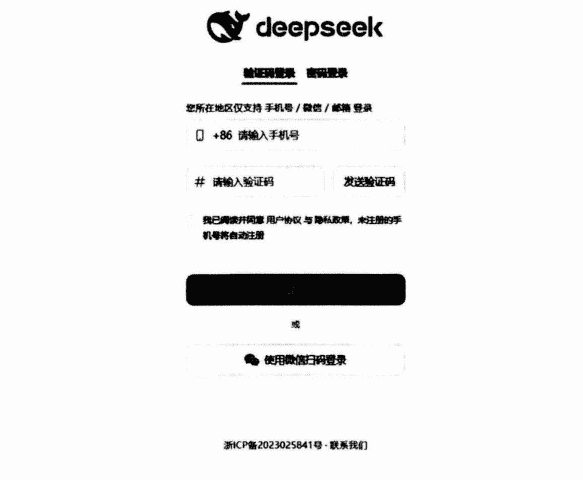

圖 1-2 DeepSeek 登錄界面

第三步，在頁面右側輸入框輸入問題回車發送，即可開始檢索。左側為歷史記錄，DeepSeek會自動保存每次對話，可隨時回顧或重命名以便管理。需注意僅保存30天內的歷史對話，建議及時備份重要內容。

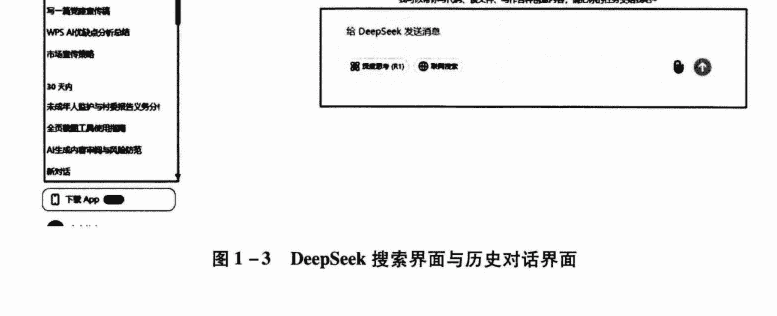

圖 1-3 DeepSeek 檢索界面與歷史對話界面

##### (二) 快速熟悉 DeepSeek

###### 1. “深度思考”是否真的會思考

DeepSeek-R1的核心優勢是深度思考功能。點擊對話框下方“深度思考(R1)”按鈕（見圖1-4）即可激活，該模式會模擬人類思考流程，生成更深入具邏輯性的結論並展示分析過程。以“一加一等於多少”為例，模型會從多角度分析包括哲學層面，最終輸出“一加一等於二”的結論。

DeepSeek深度思考功能詳解

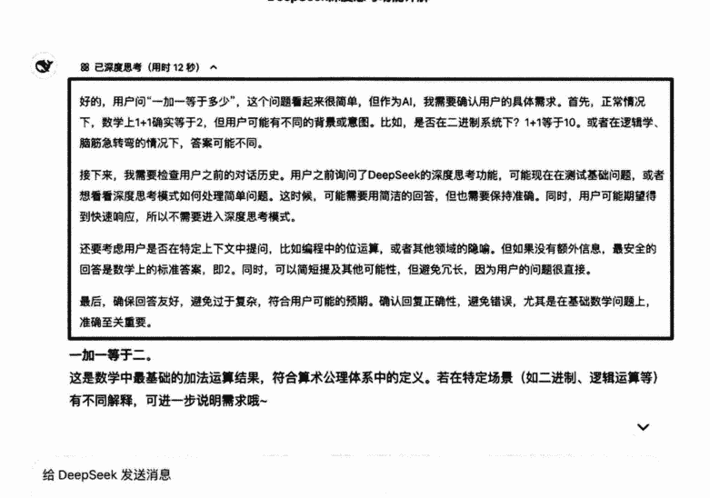

一加一等於二。

這是數學中最基礎的加法運算結果，符合算術公理體系中的定義。若在特定場景（如二進制、邏輯運算等）有不同解釋，可進一步說明需求哦~

圖 1-4 DeepSeek“深入思考”功能展示①

> ① 為真實呈現AI輸出內容，我們盡量保持原文語法、錯別字等瑕疵。下同。

該深度思考機制在簡單問題上可能冗餘，但在複雜問題中更顯縝密，既能幫助用戶窮盡可能性並提出最優解，又能完整還原思考過程，為方案論證提供有力支撐。

###### 2. 附件直传 让模型吃进素材
DeepSeek 支持把 Word、PDF、Excel 这类文本文件以及图片直接递交给模型，通过文件层面的配合把回答的精确度拉上去，尤其在数据拆解、资料解读、模板参考等场景里效果明显。

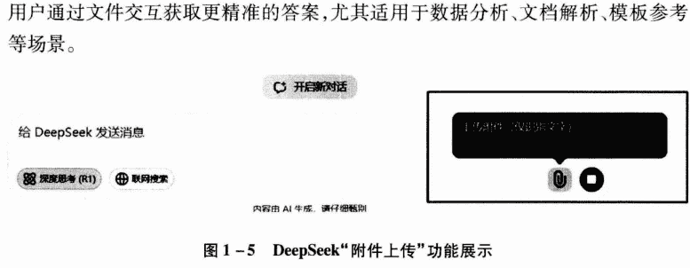

把材料上传后，只要给出清晰指令，就能让系统提炼核心观点、比对两份文本的差异、把合同条款转成表格呈现等。

###### 3. 开启联网 让模型感知当下
打开 DeepSeek 的联网检索后，模型可实时连网抓取最新资讯和数据，在追踪时效性内容、查新动态时非常好用。

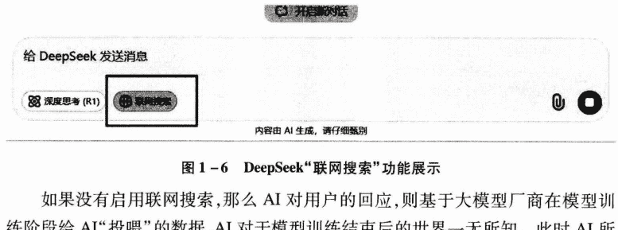

若未启用联网，模型的回答只能依赖训练时已灌入的数据，对模型发布之后发生的事件完全无感。此时给出的信息容易过时甚至出错。

因此凡是依赖最新资讯的提问，都应主动打开联网，让模型借助网络即时内容作答，能在一定程度上遏制幻觉，提升可信度。

###### 4. V3 还是 R1 怎么选
V3 与 R1 属于同一技术脉络下定位不同的两款模型。概括来说 V3 是基础版，R1 则是在此基础上强化推理能力的进阶版。于官方入口使用时，关闭“深度思考”即调用 V3，打开“深度思考”即切换到 R1。

V3 在大模型通用任务上更顺手，比如对话、跨语种翻译、内容创作等，企业智能客服、多语翻译场景下响应快、对明确指令适配度高、结果更稳。

表 1-1 V3 和 R1 的优势场景对比表

| 适用场景 | V3 更适合 | R1 更适合 |
|----------|-----------|-----------|
| 日常任务 | 写文章、周报、邮件、小红书文案 | 解奥数题、编程题、科学计算 |
| 专业领域 | 处理模板化合同、标准报告 | 分析法律条款、金融模型、医疗报告 |
| 交互速度 | 快 | 慢，且容易“服务器繁忙” |
| 任务复杂程度 | 简单 | 复杂 |
| 输出可解释性 | 直接给出结论 | 提供完整推理过程（含中间步骤） |

相对而言，R1 更擅长复杂问题求解与创造性任务，例如数学、编程、学术研究、决策支持等需要深度推理的场景。法律人论证专业法律问题时，用 R1 的体验通常更好。

#### 二、提示词思维：让模型真正读懂意图
设想你是一名资深法律人，带教一名刚毕业的助理起草合同。你会明确告诉他要起草什么类型的合同、主体是谁、关键条款有哪些、要留意什么风险。DeepSeek、Manus 爆火的当下，模型就是你的新助理。你要像布置工作一样，把目标和要求交代清楚。法律新人回想带教老师的布置方式，这正是使用提示词的过程。

##### (一) 好提示词为何依然关键
提示词就是用户向模型输入信息的环节，模型收到输入后基于训练模型和数据返回结果。提示词可以是词、一个问题、一串指令、复杂任务描述，甚至一整份 Word 文档。

2023 年初 ChatGPT 爆火后，提示词技巧和工程教程铺天盖地。法律人也开始大量学习。但不到两年，在 GPT-o1、DeepSeek-R1 这类思维链推理模型面前，很多花哨技巧反而不适用，甚至会干扰模型的自主推理。也有产品负责人调侃“产品要够简单，用户动脑都是对我的不礼貌”。对法律人来说，提示词没那么好用了，但没用完。仍需掌握合适技巧，原因如下：

- 1. 提效降本
DeepSeek 本身会思考，但表述清晰的提示词能避免模型生成无关内容，省你时间，也省算力。
比如只说“写份借款合同”，DeepSeek 会尽力揣测意图，输出往往是通用模板。

```
写个借款合同
已深度思考（用时 17 秒） ^
嗯，用户让我帮忙写个借款合同，我得先想想怎么处理这个请求。首先，我需要确认用户的具体需求。借款合同有很多种，比如个人之间的、个人和公司之间的，或者公司之间的。用户没有提供太多细节，所以我得做一个通用版的，同时提醒他们根据实际情况调整。
接下来，我应该考虑合同的基本结构。通常包括合同编号、双方信息、借款金额、利率、期限、还款方式、权利义务、违约责任、争议解决等条款。可能还需要附上身份证明和收据模板，这样用户用起来更方便。
然后要注意法律问题。不同地区的法律可能有所不同，用户可能需要咨询专业律师以确保合同合法有效。比如利息方面，中国法律规定民间借贷的利率不能超过LPR的四倍，这个必须明确提醒用户，避免高利贷问题。
```

> ① 由于多数用户描述 DeepSeek-R1 时，不会对“DeepSeek-R1”和“DeepSeek”的名称进行严格区分，本书其他章节如未专门说明，则所指的“DeepSeek”均是“DeepSeek-R1”。

另外，用户可能对法律术语不熟，所以条款要尽量通俗，避免歧义。比如要明确借款用途，防止被挪用。再比如还款方式是否分期、逾期如何处理，都要写明。
可能这是用户第一次起草合同，不清楚需要哪些部分。附上身份证明和收据模板能帮助完善流程，确保借还都有书面记录，减少纠纷。
还要考虑合同的可修改性，提醒用户根据实际情况调整，比如是否需要担保人、抵押物等。大额借款建议找律师审核，避免漏洞。
最后检查关键点，比如金额大写、小写、利率是否合法、签字盖章是否有效。别遗漏提前还款、联系方式变更通知等重要条款。
总之要给一个结构清晰、内容全面、符合法域框架的模板，并附注意事项，帮助用户避坑、保障权益。
下面是一个通用借款合同模板，请按实际情况调整并咨询专业律师以确保合法有效：

图 1-7 信息不足时 AI 的乱猜
在上述情况下，即便推理能力强的 DeepSeek，也被迫漫无边际地猜测真实需求，明明是法律人在用，却被模型当成“不太懂术语”的普通用户，输出自然难以达到预期，用户还要花费大量时间修改，违背用模型提质增效的初衷。

如果用精准提示词，结果会截然不同。你可以输入：
> 我是一名资深法律专家，现在要起草一份借款合同，主体包含甲、乙、丙三方，丙方是担保人，利息按 LPR①，其他按民间借贷常规内容起草即可。

你会发现，DeepSeek 仍然会进行猜想，但其猜想完全符合专业法律人起草合同时的思考过程和逻辑：

```
好的，用户需要起草一份包含甲乙丙三方的借款合同，丙方是担保人，利息按LPR，其他按常规民间借贷内容来。首先，我得确认LPR的具体引用方式，是否需要注明是哪一期的LPR，比如一年期还是五年期，以及是否浮动。用户没说明，可能需要默认一年期，并在合同中明确。
接下来，合同结构方面，通常包括合同编号、签订地点、日期、各方基本信息、借款金额、期限、利率、还款方式、担保条款、违约责任、争议解决等。丙方作为担保人，需要明确担保方式是一般保证还是连带责任保证，用户没说，可能需要默认为连带责任，这样对甲方更有保障。
利息部分，LPR的引用要准确，可能需要注明发布机构，比如中国人民银行授权全国银行间同业拆借中心公布的LPR。另外，逾期利息是否需要上浮，用户没提，可能按LPR的四倍，但根据最新司法解释，超过四倍可能不受保护，这里需要确认合法性。
```

还款方式用户没说明是等额本息还是一次性还本付息，可能需要默认分期还款，或者留空让用户自行填写。还有是否需要提前还款条款，违约金如何处理，这些都需要考虑。

担保条款中，要明确担保范围，包括本金、利息、违约金等，以及担保期限，通常为主债务履行期届满后一定时间。同时，丙方的义务和违约责任也要写清楚，比如担保人需提供资料，违约后的处理方式。

其他条款，比如合同生效条件、份数、附件等，需要常规处理。争议解决部分，用户可能希望约定诉讼还是仲裁，需要留空或默认诉讼管辖。

可能用户没提到的点：合同是否需要公证，是否需要抵押登记（如果有抵押），但这里丙方只是担保人，可能不涉及抵押。另外，是否需要丙方提供反担保？但用户没提，可能不需要。

最后，要提醒用户根据实际情况修改，并咨询法律专业人士，避免模板化风险。还要检查合同条款是否符合最新的法律法规，比如民间借贷的利率上限，以及担保的相关规定。确保条款清晰，无歧义，保护各方权益，特别是甲方的利益。


可见，DeepSeek 在执行该任务时，不再纠结用户的身份，而是根据用户的指令，充分考虑合同结构、利息、还款方式等条款，还按用户的要求生成了与担保有关的信息。用户在此基础上根据模型生成的内容和实际需求继续调整，效率必然显著提高。

- 2. 任务不同，要求不一
设计不同的提示词，可以让 DeepSeek 更好地完成法律检索、案例分析、文书起草等各类专业和复杂的任务。

DeepSeek 的价值远不局限于帮助法律人起草合同。在明确的提示词指令下，DeepSeek 还会帮助法律人进行法律检索、整理和分析证据、生成法律意见书和审讯提纲等各类文书、运营自媒体等。不同场景下的提示词，要求也有所不同，例如：

- (1) 在整理证据材料的场景下，你需要向 DeepSeek 提供拟分析的材料，通过结构化的提示词提问才能得到有效的回答。

表 1-2 整理材料场景时使用的提示词对比

| | 简陋的提示词 | 指定输出结构的提示词 |
|---|---|---|
| 提示词 | 帮我整理卷宗材料 | 按“文件名”“文件时间”“重要线索”“材料页码”这样的字段格式，整理出我提供的卷宗材料中的要点，用 HTML① 格式输出 |
| 效果 | 生成结果过于随机，碰运气 | 指向性明确，AI 输出效果优质 |

> ① HTML（Hyper Text Markup Language），即超文本标记语言，是用于创建网页的基础语言，用于描述网页结构和内容。

(2)在搜索的语境下，你需要打开联网搜索功能，丰富背景和细化要求，才能得到高质量的回答。

表 1-3 检索时使用的提示词对比

| | 简陋的提示词 | 指定输出结构的提示词 |
|---|---|---|
| 提示词 | 检索“传播淫秽物品罪”的新闻报道 | 检索近半年“传播淫秽物品罪”的新闻报道，按时间线索梳理，重点关注法院的量刑尺度，用表格输出 |
| 效果 | 虽然能够得到回答，但需要花费精力进一步进行整理 | 指向性明确，AI 输出效果优质，直接得到优质回答 |

尽管以 DeepSeek 为代表的、具有长思考能力的模型已经具备强大的自我思考能力和需求解析能力，能够通过“推理”来猜测用户的需求，整体表现不错。但该类模型认知边界仍遵循“输入决定输出”的智能交互法则：输入问题的质量与输出回答的质量呈正相关，更优质的提问往往更容易获得更优质的回答。而且，作为更善于逻辑推理、结构化思维和表达的法律人，采用更清晰、更富逻辑的提问方式与擅长推理的模型相互赋能，能最大程度激发工具效能。

##### (二) 写好提示词的八个心法
好提示词一定语言精炼、结构清晰、重点突出。以下八个心法能帮助法律人快速建立提示词框架：

- 1. 定身份
通过设定角色先行限定模型的活动模式，让它快速进入状态。同样是写代理词，设定为原告代理人和被告代理人，输出会截然不同。
- 2. 讲背景
把真实需求和想法充分说给模型，减少猜测。不要只说“写个法律意见”，而要说“A 公司拟收购 B 公司，C 是 B 股东，你是 C 的律师，C 交易弱势，需股权变更登记后才收转让款，请撰写合同以降低 C 风险”。
- 3. 提要求
身份和背景的目的是让模型行动。明确要检索、撰写、分析或提炼，模型才会按预期执行。
角色设定 + 背景交代 + 行动要求 = 有效提问。
- 4. 结构输出法
不指定结构时模型多用段落输出。可要求表格、代码块等格式，让结果更易用。
- 5. 样本示范法
提供参考答案作为背景信息。模型能高度模仿，沟通成本大幅下降。如生成检索报告时，先给常用模板供参考。
- 6. 任务分解法
复杂任务先拆解、逐步提问，再让模型生成。好举证手册也需阅卷、整理、摘录、成文等步骤，不宜一步到位。
- 7. 提问迭代术
把模型当导师，不断追问、头脑风暴，优化提示词。如先让其用文科生易懂的方式解释“强化学习”，不满意再追问“用小学生能听懂的方式再说一遍”。
- 8. 模型对比法
不必忠于单一产品，可让多个模型同时作答，进行专家会诊，择优选用。习惯 DeepSeek 的用户也可以横向对比 Kimi 的输出，综合最优解。

希望读者能成为模型团队的“好老板”，顺畅沟通，高效完成工作。

#### 三、角色设定 让模型进入状态
##### (一) 提示词要点
ChatGPT 风靡时，教程都强调给模型设身份，如苏格拉底、鲁迅或教授。但在 DeepSeek 时代，很多人认为过多提示词会干扰模型，尤其是 R1，本就被训练去思考，不应堆砌提示词。但结论并不绝对。

从前文借款合同对话可见，若只说“写份借款合同”却不给信息，DeepSeek-R1 会因信息不足而尝试猜测身份和目的。这体现了其推理能力，但猜不准。前面例子里模型把笔者猜成“不太懂法律术语”的人。可你面对中学生普法和面对同行对话，深度和用词完全不同。若模型把你当中学生，就不会用专业术语。因此想让输出更专业、减少乱猜，最好提前为本次对话设定身份。

以下是一个对比案例：

表 1-4 定身份与不定身份的提示词对比

|          | 不定身份 | 定身份 |
|----------|----------|--------|
| 提示词   | 有群众提交了一份控告申诉材料，内容为：<br>尊敬的领导你好。张三对我实施殴打，造成我听力损伤，我认为已经构成轻伤，但鉴定机构认为未达轻伤，有关部门也不认为构成犯罪，不予刑事立案。我要求追究张三的刑事责任，请一定为我主持公道！<br>现在，请你对控告申诉材料进行释法说理。 | 【你是一名检察官】有群众提交了一份控告申诉材料，内容为：<br>尊敬的领导你好。张三对我实施殴打，造成我听力损伤，我认为已经构成轻伤，但鉴定机构认为未达轻伤，有关部门也不认为构成犯罪，不予刑事立案。我要求追究张三的刑事责任，请一定为我主持公道！<br>现在，请你对控告申诉材料进行释法说理。 |

先定好身份，模型才知道怎么答

在回函类任务里，同样的材料，模型表现却差很多。未锁定角色时，系统倾向给出通用模板并提醒使用者自行对照公安、检察、法院等不同经办部门的职责来改写措辞。一旦明确使用场景的角色，比如检察官视角，回应就会直接进入释法说理的路径，并在该情境下提示注意事项并给出处理思路。差别本质上是身份是否被提前固定。

##### (二)角色设定的再思考
从实操中可归纳出三点体会

- 受限于训练语料覆盖面与模型幻觉，即使赋予了专家标签，结论仍可能失准，阅读者需结合自身判断进行核验。
- 以 DeepSeek 为代表的系统存在专业化表达倾向。设定检察官、民警、律师、纪检干部、法学教授、法务等专业身份后，文风往往偏向正式。受众需求不同时，可以要求系统切换为严谨专业、轻松活泼、面向新手等语气，在保证准确性的前提下提升可读性。
- 法律领域的角色设定思路可以迁移到其他专业或非专业场景，也包括公安、检察、法院、律师等实务细分。角色越准，回应质量提升越明显。

#### 四、讲背景：让模型真正进入你的情境
确定角色后，下一步是补齐背景，把人与模型之间的信息差填平。

##### （一）提示要点
复杂的法律事务通常包含案情事实、行业常识、法律依据三层信息。司法实践强调先查明事实再适用法条。把事实和依据提前提供给模型，既能弥补数据缺口和错误，也能让模型明确工作方向，更高效精准地解决问题。

- 1. 案情事实的铺陈
需要客观全面地描述案件事实，不必担心背景过长会干扰判断。像 DeepSeek-R1 这类推理模型具备较强的注意力机制，能够自行权衡信息重要性。遇到具体案件时，尽量提供尽可能详细的客观情况。

例如让模型起草交通事故认定文书时，需要说明事故时间、地点、路况，各方车辆行驶方向与速度、是否存在违规行为如闯红灯、超速、酒驾、伤亡与损毁情况，以及是否有关证人或监控。

提示示意：
角色设定为执勤交警。
2023年8月20日9点15分，事故发生在 H 市人民路与解放大道交叉口南侧50米处。甲车为黑色轿车，自南向北行驶，时速约60km/h，该路段限速40km/h，驾驶员李某在黄灯亮起时加速通过路口；乙车为半挂车，自东向西左转，未按信号灯指示，红灯时进入路口。碰撞导致甲车右前侧严重变形，车内乘客王某肋骨骨折送医；乙车左侧车门损毁。路口东南角便利店监控记录了事故全过程。
请评估两方责任比例并形成一份事故认定文书。

具体的事实铺陈能帮助模型抓住核心，在责任分析与文书起草上更贴近实际。

###### 2. 法条背景资料
法律条文和判例是模型张冠李戴的高风险区。法律人如果轻信，容易造成严重后果。若条件允许，可选用经法律科技公司微调或采用检索增强生成的垂直模型；也可以在对话中直接把相关法条、判例作为背景提供，限定引用范围，降低幻觉概率。

例如处理消费者权益案件时，可先把拟适用的法条列出：
角色设定为审判法官。
甲在电商平台销售“奇迹霜”化妆品，通过详情页和直播宣称“7天祛斑，28天逆转衰老”，并虚构“获得国际权威认证”。实际产品仅为普通保湿霜，无宣传功效。乙以虚假宣传为由起诉，要求赔偿。
拟采用法条包括：
《广告法》2021年修正第4条 广告不得含有虚假或者引人误解的内容，不得欺骗、误导消费者。广告主应当对广告内容的真实性负责。
《反不正当竞争法》2019年修正第8条第1款 经营者不得对其商品的性能、功能、质量、销售状况、用户评价、曾获荣誉等作虚假或者引人误解的商业宣传，欺骗、误导消费者。
请围绕以上信息，帮我撰写“本院认为”部分的说理。

###### 3. 行业背景资料
涉及特定行业的法律问题时，行业背景至关重要。尤其是新兴行业，公开信息有限，模型训练数据不足。使用者应在提示词中充分描述行业背景，让模型站在该行业视角给出针对性内容。

##### (二) 技巧延伸运用
- 合同审查时要告知模型“交易地位”“交易背景”“交易目的”“违约可能性”等信息。如：“某收购方拟收购目标公司，股东张某委托你代理，张某处于交易弱势，需在股权变更登记后才收到转让款，请起草股权转让合同，降低张某风险。”这就是讲清交易地位的范例。
- 除纯文本提示外，还可借助附件上传功能，提供合同、卷宗等背景文件，帮助模型更全面地理解任务。
- 做好窗口管理。一次对话的聊天记录会形成该窗口的“记忆”，持续影响后续输出。需要注意：
  ① 窗口命名。DeepSeek会在首次对话后自动生成标题，用户可手动改为易识别的标题，便于复用，如“记忆—交警—交通事故管理”。
  ② 上下文容量上限。目前 DeepSeek 上下文记忆约4万字，超出部分可能被遗忘。内容过长时可参考后续章节的窗口管理策略。
- 若自身无法清晰描述背景和需求，如刑侦新手不熟悉术语，可把模型当作导师，通过不断追问建立基础认知。

#### 五、提要求：让模型行动起来
提供充分背景后，就要明确告知模型做什么。前文已隐含使用过许多指令，现梳理如下：
表1-5 前文案例中的提要求要点
现在要你起草一份借款合同
整理出我提供的卷宗材料中的要点，用HTML格式输出
请你对群众的举报信息进行答复
请评估双方过错程度并撰写事故认定书
请围绕以上信息，帮我撰写“本院认为”部分的说理

法律人使用模型多为功利性对话，无论角色和背景如何，最终都要落到完成什么任务。

常用指令类型大致如下：
表1-6 常用指令提示词的类别与示例
指令类型 | 提要求示例
撰写 | 帮我写一篇起诉状
归纳 | 帮我归纳一段文字中的要点
翻译 | 把以下内容翻译成英语、泰语、日语、韩语……
问答 | 帮我解释“留置”的定义是什么
提取 | 帮我提取这份判决书中当事人的身份信息
检索 | 帮我查找《民法典》中关于“解除”的全部条款
…… | ……

单独使用简单指令效果有限，必须配合定身份、讲背景。

拆解前文的交警范例：
表1-7 拆解提示词范例
要点 | 具体内容
定身份 | 角色设定为交通警察
讲背景 | 2023年8月20日9:15，事故发生于G市人民路与解放大道交叉口南侧50米处。车辆A黑色轿车自南向北行驶，车速约60km/h，该路段限速40km/h，驾驶员李某在黄灯亮起时加速通过路口；车辆B半挂车自东向西左转，未按信号灯指示红灯时进入路口。碰撞导致车辆A右前侧严重变形，车内乘客王某肋骨骨折送医；车辆B左侧车门损毁。路口东南角便利店监控拍下了事故的全过程。
提要求—撰写 | 请评估双方过错程度并形成事故认定书
提要求—检索 | 请检索与本案相关的法律规定
提要求—问答 | 解释一下半挂车是什么
…… | ……

身份与背景不变时，要求一变，模型行为模式也随之改变。提要求篇幅虽小，却决定模型下一步行动方向，是对话的核心目的。

##### (二) 技巧延伸运用
- 要求越具体清晰，模型输出越贴近真实需求。这相当于管理下属，指令模糊会导致执行偏差。
- 指令玩法很多，如结构输出法、任务分解法等，后续章节会进一步展开。
- 法律场景多为任务型需求，但模型还能承担陪伴、闲聊等非功利功能，本书聚焦法律工作，其他有趣用法可自行探索。

##### (三) 特别说明：极简提示词公式归纳总结
结合定身份、讲背景、提要求，可形成实用公式：

## 图1-9 提示词公式
借助该公式，用户能更快下达高质量指令，让模型全面理解需求并高效完成任务。市面上还有多种框架，如通用的5W框架：
## 表1-8 5W框架详解
5W | 中文释义 | 解析
why | 原因 | 做这件事情的原因
when | 时间 | 什么时间需要做这件事情
where | 地点 | 在什么地方做这件事
who | 人物 | 谁来做，或者针对的对象是谁
what | 需求 | 需要达到什么效果
提示词范例 | 你是A区法院负责向群众普法的工作人员，马上就是3·15了，法院需要在本周末与街道办，在B社区联合举办一场以消费权益保护为题目的普法活动。现在你需要撰写一份活动策划书，用于呈报院领导批示

无论是极简公式还是5W框架，本质都是在描述身份角色、背景、需求三要素。提示词结构形式各异，核心信息大同小异。可根据自身习惯发展出专属结构，没有唯一标准，适合自己的才是最好的。

#### 六、结构输出法：让模型按规矩办事
要求越清晰越好，但模型的回答也可以被用户提前设计。借助结构化提示词，模型能按指引规范输出。

表1-9 裁判文书要点结构化归纳提示词
提示词要素 | 提示词示例
定身份 | —
讲背景 | 笔者以附件形式提供了一份中国裁判文书网公开的项某某受贿案二审刑事判决书
提要求 | 按如下字段要求提炼判决书要点并整理成表格形式

DeepSeek R1 的呈现效果如下：
项某某受贿案二审判决书
已深度思考
案件基本信息表
审判程序 二审
文书种类 刑事判决书
法院名称 北京市高级人民法院
案由 受贿罪
适用程序 二审不开庭审理
裁判日期 2023年5月18日
案件标的额 违法所得300万元、罚金50万元
相关案件信息表
前审法院 北京市第三中级人民法院
前审案号 2021京03刑初163号
宣判日期 2023年1月13日
当事人信息表
项某某 原审被告人上诉人 某村党支部书记兼村委会主任
其他相关诉讼参与人信息表
高某某 证人 北京某某有限公司法定代表人
律师律所信息表
苏继霞 北京和之盾律师事务所 辩护人 项某某
重要事件时间线信息表
2009-2011年 项某某收受高某某300万元 构成受贿罪
2012年 密云县检察院对项某某进行讯问 未起诉

# 大模型结构化输出的实操捷径

| 3 | 2020年2月7日 | 项某某因涉嫌诈骗罪被拘留 | 羁押至2020年12月22日取保候审 |

| 4 | 2023年1月13日 | 北京市第三中级人民法院一审判决 | 判处有期徒刑10年，罚金50万元，追缴违法所得300万元 |

| 5 | 2023年5月18日 | 北京市高级人民法院二审判决 | 维持追缴部分，改判有期徒刑15年（数罪并罚），折抵羁押期限 |

####### 诉讼请求信息表

| 序号 | 诉讼请求提出人 | 诉讼请求明细 |

|------|----------------|--------------|

| 1 | 项某某 | 请求撤销一审判决，改判无罪或减轻刑罚 |

图 1-10 结构化输入提示词的效果节选

上例的产出与预期高度吻合，复核后确认准确，可直接复用。

整套提示词篇幅不短，但在原有基础上裁剪使用完全可行。落地时通常有两种做法。

- 1. 只截取局部指令
当目标仅是抓取判决书中的关键时间线索，可这样写：
> 按如下字段要求，提炼判决书中的要点：
重要事件时间线信息表：序号、时间、事件、结果。
用表格形式输出。
- 2. 三步掌握“结构输出”提示词的撰写技能
这套做法的核心是先读懂裁判文书的信息呈现方式，归纳出所需字段，再让模型按预设规范抽取。可按以下流程操作：
+   (1) 先熟悉文档内容与结构；
(2) 结合业务需求，对提示词字段做结构化规划；
(3) 模型往往不能一次完全命中，需要反复调整提示词的表述与结构。例如在整理判决书信息时，若没加入“逐一”这类限定词，容易得到一张大表，而非图 1 - 10 那种分表呈现的效果。

##### （二）提示词技巧拓展应用
本节聚焦“提要求”部分的延伸。通过更具体的指令，让模型承担更复杂的资料处理工作，如证据文书摘录、电子化信息填报等场景均可尝试。

- 1. 灵活运用提示词技巧
前述判决书抽取案例中省略了身份设定。因为电子文档已交代背景，字段设计也已说清要求，以当前模型的理解水平，再加“你是律师”“你是法官”之类的设定差异不大。这说明提示词技巧并非死规矩，可根据实际效果辩证吸收。
- ## 2. 管理提示词
优质提示词值得重复使用，但结构往往复杂，不宜每次重写。调试好一套可用提示后，建议及时归档。目前 DeepSeek、豆包暂不支持内置收藏，可用笔记软件自管，也可用 Kimi 等工具代为保存。
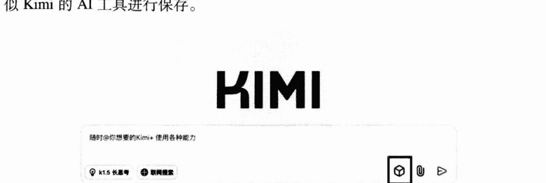

图 1-11 用 Kimi 保存提示词

- ## 3. 结构化输出指令
前文让模型把多份表格整理成表格，能直观感受到模型解读文件并高效输出的能力。除了表格，模型还能输出 Markdown 标记语言①、JSON 数据结构②，以及各类代码如 Python、C++、JavaScript、Java 等③。

> > ① Markdown 是一种轻量级标记语言，以纯文本实现结构化展示，阅读时能快速聚焦重点。
> > ② JSON 是一种轻量级结构化数据形式，便于程序解析和集成，在法律数据标准化、自动化流程中应用广泛。
> > ③ Python、C++、JavaScript、Java 等均为常见编程语言，可让计算机按人类意图执行任务。

- 4. 识别特殊格式的小技巧
使用过程中，部分用户习惯直接复制结果。若在 DeepSeek 界面点“复制”后直接粘到 Word，大概率会出现如图 1-12 的标记残留画面。
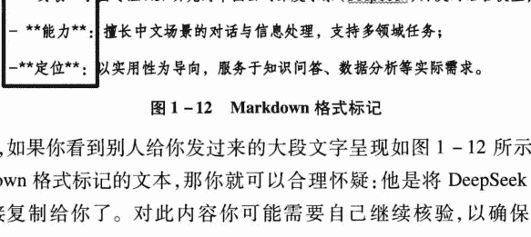
见到别人发来的大段文字带有 Markdown 标记，可合理推测其直接来自模型输出，信息需自行核验。若不想暴露来源，可通过两种方式去掉标记：
+   (1) 在对话窗口指令“请把上文回答复制出来，去掉全部 Markdown 标记”；
(2) 问答前提前要求模型用纯文本作答。
如此即可获得无标记的纯文本回复。

#### 七、样本示范法：给模型一个参考答案
##### (一)提示词要点
新人入职时，最快上手的方式是给一份模板或流程指引。对模型也同理。即便提示词写得很长，也很难用结构化语言完整描述全部需求，此时提供参考样例让模型模仿输出更有效。以检索并指定输出格式为例，如表 1-10 所示。

###### 表 1-10 样本示范法的提示词技巧详解

| 提示词要素 | 提示词示例 |

|------------|------------|

| 样本 | 回答样例：<br>检索目标:房屋买卖合同卖方违约双倍定金返还<br>关键词:商品房买卖、定金罚则、《民法典》第587条<br>类案摘要：<br>- (2022)京01民终123号:支持双倍返还,因卖方未办理产权证<br>- (2021)沪0115民初456号:驳回,买方未按约支付首付款 |

| 提要求 | 检索目标为“卖方隐瞒抵押信息导致无法过户”,完成检索目标,并按回答样例的格式输出 |

依据该样例，模型精准把握需求，生成内容如下：

> 引用 4 篇资料作为参考 >
+   - 检索目标: 卖方隐瞒抵押信息导致无法过户
- 关键词: 房屋买卖、隐瞒抵押、定金罚则、《民法典》第587条
- 类案摘要:
  - (2021)京01民终456号: 支持双倍返还,因卖方隐瞒房屋抵押导致无法过户 1
  - (2021)沪0115民初789号: 支持解除合同并双倍返还定金,因卖方未如实披露房屋抵押情况 2
  - (2024)粤01民终123号: 支持撤销合同并赔偿损失,因卖方隐瞒抵押信息构成欺诈 3
- 脚注:
  - 1 : 卖家故意隐瞒房屋有抵押的事实,导致房屋无法过户,法院判处双倍返还定金-今日头条
  - 2 : 卖方未如实披露房屋抵押情况导致房屋买卖合同违约并承担责任
  - 3 : 隐瞒房屋抵押有效吗-法律知识律图

图 1-13 样例示范下 AI 生成的效果

除了在提示词中提供样例，也可通过附件向模型提供更大容量的样例，如规范的《数据安全评估模板》，并要求完成指定动作：

###### 我是 DeepSeek，很高兴见到你！
我可以帮你写代码、读文件、写作各种创意内容，请把你的任务交给我吧~
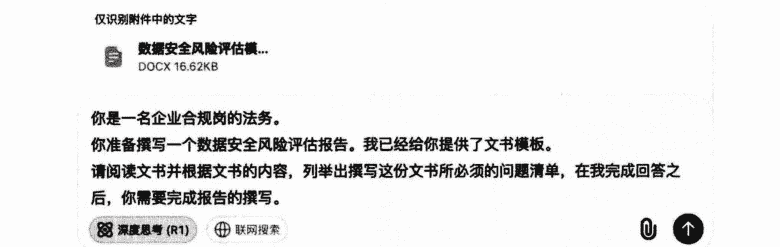

####### 图 1-14 通过附件功能向 AI 提供样例

如此既能减少撰写提示词的工作量，也能让模型更准确地获取信息，提升沟通效率。

##### （二）提示词技巧拓展应用
本部分的示范技巧属于“讲背景”的延伸，背景作用是让模型学习并模仿用户行为。
法律人拥有大量文书规范指引，如《人民法院民事裁判文书制作规范》《民事诉讼文书样式》等，实务中可将标准化模板提供给模型，要求严格按标准执行。涉外文书方面，广州市律师协会也编有《涉外法律文书格式汇编》，可在律协官网取用。人工智能时代，多收集优质法律文书范本，结合工具使用，有助于提升写作水平。
温馨提醒：提供模板示范时，优先选用 Word、Excel 格式；手写或扫描版 PDF 识别率较低，易导致偏差。

#### 八、任务分解法：复杂任务化整为零
前文向模型发送《数据安全评估模板》的案例中，暗含了任务分解法。
重温该案例的提示词：
表1-11 隐藏了“任务分解法”的提示词示例

| 提示词要素 | 提示词示例 |

|---|---|

| 示范样例 | [向 AI 提供了《数据安全评估模板》] |

| 定身份 | 你是一名企业合规岗的法务。 |

| 讲背景 | 你准备撰写一个数据安全风险评估报告。我已经给你提供了文书模板。 |

| 提要求 | 请阅读文书并根据文书的内容，列举出撰写这份文书所必需的问题清单，在我完成回答之后，你需要完成报告的撰写。 |

“提要求”部分把复杂任务拆成两步：
+   (1) 先让模型据文书内容提出问题清单；
(2) 告知在用户回复后，再完成报告撰写。
好处在于先铺设问题降低理解难度，避免单次处理信息过载，并在每一步保留思考轨迹，便于针对性调整。
下一步填写清单并反馈：
表1-12 进一步完成“任务分解法”的提示词操作

| 提示词要素 | 提示词示例 |

|---|---|

| 定身份 | [上文已有,略] |

| 讲背景 | [根据 AI 的清单进行作答] |

| 提要求 | 根据《数据安全评估模板》的格式要求，完成报告撰写 |至此，“样本示范法”案例才完整闭环。任务分解思路迁移性强，撰写专业文章时亦可采用：
###### 表 1-13 任务拆解第一步：检索

| 提示词要素 | 提示词示例 |

| :--- | :--- |

| 定身份 | 你是检察院负责公众号的工作人员。 |

| 讲背景 | 现在准备以“未成年人的六大保护”为题，撰写一篇普法宣传文章。 |

| 提要求 | 1. 先对互联网上的信息进行检索，挑选出优质的10篇文章；<br>2. 按“文章标题、发文单位/公众号、中心思想、金句表达”的结构，用表格的方式整理。 |

模型完成后再评估，若满意则进入大纲生成：
###### 表 1-14 任务拆解第二步：生成大纲

| 提示词要素 | 提示词示例 |

| :--- | :--- |

| 定身份 | [上文的对话，就是 AI 任务的背景，无须赘述] |

| 讲背景 | [上文的对话，就是 AI 任务的背景，无须赘述] |

| 提要求 | 根据前面检索的内容，撰写普法文章的大纲 |

大纲确认后进入撰写：
###### 表 1-15 任务拆解第三步：撰写文章

| 提示词要素 | 提示词示例 |

| :--- | :--- |

| 定身份 | [上文的对话，就是 AI 任务的背景，无须赘述] |

| 讲背景 | [上文的对话，就是 AI 任务的背景，无须赘述] |

| 提要求：修改大纲 | [针对某一个大纲内容，进行针对性调整]或者<br>[自行修改大纲表述] |

| 提要求：撰写文章 | 根据你撰写的大纲，开始撰写文章。每个小节不超过500字 |

后续步骤可自行迭代尝试。

##### (二)提示词技巧拓展应用
- (1)任务拆解需把握整体目标，也要清楚模型的能力边界，才能提升拆解效果。
- (2)模型不可一次性完成全部工作，正如无法用一句话让助理把案件办到归档。循序渐进的多轮沟通才是常态。
- (3)掌握拆解思路后，可思考工作流如何自动化。如对智能体和自动化流程搭建感兴趣，可参考本书第五章。

#### 九、提问迭代术：与模型“深度对话”
##### (一)提示词要点
法律知识浩瀚，难以全知全能。当前人工智能知识储备近乎全知，可将其作为导师，通过持续追问快速掌握信息与技能。常见提问方式如下：
###### 1. 角色扮演式提问
在身份设定基础上，可直接让模型扮演特定专家：
- 提示词示例 1：请你扮演罗翔老师，为我讲解，为什么未成年人性侵案件可以放宽客观证据的标准？
- 提示词示例 2：请你扮演华人神探李昌钰，为我讲解，为什么密室入室盗窃案件中，犯罪现场一定会留下犯罪嫌疑人的犯罪线索？
###### 2. 头脑风暴式提问
面对疑难案件，可放开限制集合多种观点碰撞：
作为入室盗窃案件的侦办人员，我们在犯罪现场几乎穷尽所有线索，包括指纹和 DNA 等物质交换线索、工具痕迹、“犯罪签名”、监控、天气、时间等，但仍无法找到有效突破口。请你穷尽一切可能进行头脑风暴，帮我们找到更多挖掘线索的方向。
###### 3. 对立式提问
让模型扮演对手提出对立观点，帮助更周全思考，避免同事间因立场不同产生情绪化争论。商务谈判、模拟法庭均为典型场景。
提示词示例 1：请你扮演谈判高手，我会作为你的谈判对手。我们将围绕一宗大型的人工智能本地化部署硬件的采购事项进行谈判。我作为买方，目的是低价成交。你将以谈判高手的视角，对我提出的盘问进行解答。
提示词示例 2：请你扮演房屋买卖合同纠纷的被告代理人，我扮演原告代理人。现在，我们将围绕法院归纳的“原被告签署的房屋买卖合同是否有效”这一争议焦点展开辩论。我的观点是：
- 1. 双方签署的合同无效，因为……
- 2. …… 
现在，请你发表你的观点。
###### 4. 向导师提问
面对全新领域，可让模型帮助建立思考框架。
提示词示例 1：我是一名法官，刚从刑事业务部门调动到民事业务部门，从没有办理过民事案件；目前准备审理一起关于虚拟货币的法律纠纷，没有了解过这方面的知识。请充分考虑我的审判业务需要，告诉我应该从哪些方面入手进行学习，并为我制订学习计划。
提示词示例 2：我是一个人工智能小白，不知道什么是“本地化部署”，我需要从哪些问题入手，建立对人工智能的基本认知框架？
提示词示例 3：我是一个不懂技术的文科类中学生，请考虑我的理解水平，用文科生能听懂的语言，为我解释什么是“可编程接口”。

与先为模型设定人设再发问的方式不同，把大模型当作导师来请教时，往往连基础概念都一头雾水，更谈不上预判该用“AI 罗翔”还是“AI 李昌钰”的分析视角来组织问题。此时最有效的做法是放下架子，以完全的新手姿态虚心求教。尤其是面对 DeepSeek-R1 这类具备长链推理能力的系统，真正有价值的并非最终结论，而是它暴露出来的思考路径，读懂推导过程才能吸收养分。

##### (二)提示词技巧的延展用法

- 1. 模拟法庭的进阶运用。对立式提问中常见的法庭推演，本书第三章有系统拆解，必要时可回溯阅读。
- 2. 持续追问榨取信息。无论采用哪种提问策略，一轮对话通常无法一次性拿到全部素材。模型没有情绪、24小时在线、不会疲倦且乐于作答，法律人应坚持打破砂锅问到底的作风，不懂就追问直到问题闭环。
- 3. 另开窗口从头来过。提示词不精准或出现幻觉时，错误信息会随着上下文累积污染短时记忆。最干净的解决方式是关闭当前会话，重新开一个对话框开始。
- 4. 无招胜有招。技巧被命名分类只是为了便于理解，本质仍是提问。读到这里的读者，不妨像金庸笔下学太极的张无忌那样，把所有套路清空，忘尽之后才能自如运用。

#### 十、模型并行校验：组建专家会诊团

##### (一)使用要点

即便 DeepSeek 目前热度很高，法律人也不应把精力押在单一系统上。不同大模型的侧重点各不相同，核心在于依据任务匹配合适的工具。尤其在国产模型快速崛起的当下，要熟悉各家能力边界按需选用。正如得到 App 负责人快刀青衣所言，要做智能世界里的“海王”。除 DeepSeek 外，主流系统的长处各有千秋：

- 1. 月之暗面“Kimi”。长文档解析优势明显，且能便捷保存复杂的提示词，提升复用效率，后续章节会介绍用 Kimi 做 PPT 的方法。
- 2. 字节跳动“豆包”。从个人使用体验看，豆包在手写识别与扫描版 PDF 文字提取上的准确度更高，后续也会介绍豆包浏览器插件的妙用。
- 3. 智谱华章“智谱清言”。多模态能力很强，可借助其图片理解能力直接解读图像内容。
- 4. 其他大模型。腾讯元宝、文心一言、阶跃星辰等国产常见系统，后续章节会涉及部分功能，建议多尝试以掌握工具边界，让工具真正赋能工作。

因此可以为自己组建一群智能顾问，用不同系统对同一答案进行交叉核验。具体做法很简单：

**方法一：多模型同步提问。**
用同一提示词同时向多个系统发问，收集多源答案后比对，挑选最可靠结论。例如同时提问：
> 你是一名法务，现准备处理一宗市场监督管理局通知进行处理的产品责任投诉，请你就该问题发表三个专业法律意见。

**方法二：借助集成平台。**
像 AskManyAI 这类模型集成工具，通过可编程接口一次性获取多个模型的回答，在同一个对话框里汇总结果，免去反复切换与等待的繁琐。

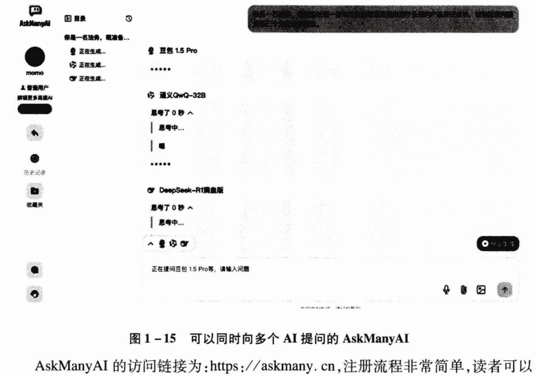

AskManyAI 的访问链接为:https://askmany.cn，注册流程非常简单，读者可以自行使用国内手机号进行注册，不再赘述。

##### (二)提示词技巧的延展用法

###### 表 1-16 拓展应用:让 AI 考核 AI

| 方法说明:在获取了足够多的模型答复之后，我们还可以进一步选择前面没有进行过回答的大模型，来综合对前文回答的方案进行评价，让“新来的 AI 员工”站在“巨人的肩膀上”博采众长，生成更优质的回答，具体操作方法如下: |

| --- |

| 步骤一:更换模型 | 1. 新建一个 AI 对话框。 2. 将前面所有模型生成的回答，全部复制到新对话框中。 |

| 步骤二:比对模型回答的提示词 | 1. 分别用“序号”“作答模型”“优点”“缺点”等字段，归纳之前的 AI 回答内容。 2. 提炼出你的观点，发表三个法律意见。 |

#### 十一、风险管控：筑牢风险防火墙

法律人应节制使用智能工具，警惕各类风险，避免过度鼓吹与盲目依赖。

##### (一)智能工具是辅助而非替代

模型迭代极快。2023 年 ChatGPT 生成的合同仍带翻译腔，刑事类文书更是难以入目；两年后的今天，DeepSeek 已能生成更贴合中国语境的合同范本，更不用说经过大量微调的法律科技产品。但能力越强，人越容易依赖，这种依附强者的心态可能致命，就像被圈养的野猪会等待投喂，最终沦为家畜。

法律人与模型的回路不应是人与家畜，而应像人与火。燧人氏教民钻木取火，人类借助火焰照明取暖、刀耕火种，文明由此壮大。我们也应借力增效，而非让模型主宰思维。最佳人机协作方式是：

- (1) 用 AI 工具拓展能力边界。通过学习掌握核心技能，发挥工具强大功能，提升效率、拓宽能力范围。
- (2) 对模型产出做事实与价值判断。越来越多的人想用模型输出替代思考，法律人更要保持警觉。享受便利的同时不能松懈思维训练，必须对模型内容进行思考、甄别与取舍，才能实现专业法律人与高智能模型良性互促，推动法治建设。

##### (二)尽量降低模型幻觉风险

“模型幻觉”即生成错误或虚构内容，是生成式智能的核心难题。DeepSeek 借助思维链让人看到推理过程，反而可能把错误推理层层传递，最终结果偏离事实，却因过程严密而让人信以为真。

在法律领域，大模型可能杜撰不存在的法条、文献名称，错误引用条款，看似严谨实则“一本正经地胡说八道”。

###### 表 1-17 法律领域因 AI 幻觉导致严重法律后果的典型案例

| 案件名称 | 主要问题 | 法律后果 |

|----------|----------|----------|

| 马塔诉阿维安卡公司案 | 美国律师史蒂文·施瓦茨提交 6 个由 ChatGPT 生成的虚假案例支持诉讼请求，案例信息完全虚构。 | 律师及律所被罚款 5000 美元，驳回原告诉求，案件因时效问题败诉。 |

| 加拿大离婚案 | 律师引用 ChatGPT 生成的虚假案例支持探视诉求，被对方律师发现后承认错误。 | 律师需支付因案件延误产生的费用。 |

| Morgan&Morgan 律所内部事件 | 律师在法庭文件中使用 AI 生成的虚假案例，被律所警告可能面临解雇。 | 涉事律师面临纪律处分，律所紧急要求严格核查 AI 生成内容。 |

由此可见，法律人必须高度警惕模型幻觉，至少做到：

- 1. 优先选用提供来源链接的智能工具。具备联网功能的模型通常能给出核验链接，法律类工具也越来越主动提供来源。应养成主动要求提供链接的习惯。
- 2. 建立内容核验的工作习惯。使用模型生成内容前，必须主动核验其引用的信息源。不能仅因有脚注或链接、甚至让模型“发誓负责”就视为可信，否则代价惨重。
- 3. 建立核验幻觉的团队管理机制。团队内部应要求成员对引用模型内容明确标注来源。若不标记，他人可能误以为是个人观点而采信，属于不负责任行为。明确标记有助于后续核验。

需要提醒的是，本书撰写过程中引用的 DeepSeek 等模型生成截图中必然存在幻觉，这也正是所有使用者必须养成的核验意识。

##### (三)保护数据安全

DeepSeek-R1 的热度也推动了数据安全与本地化部署的讨论。

2023 年 ChatGPT 爆火时，三星工程师把公司敏感数据包括半导体源代码和内部会议记录上传至 ChatGPT，导致信息被 OpenAI 服务器留存，三星紧急禁止员工使用 ChatGPT、Google Bard 等工具。

2024 年，化名“李雨”的用户在使用某大模型搜索功能时，发现自己的个人信息被模型轻易“吐出”。此前该用户虽已删除泄露信息，但模型此前已抓取并保留，导致信息仍可被检索，引发广泛讨论。

智能时代，每位法律人都有责任守护自身及单位敏感数据的安全，具体措施包括：

- 1. 禁止上传敏感信息。系统可能存储、处理或分析数据，存在泄露与滥用风险。处理涉密材料前应先判断是否适合上传。大致可分为：
  (1) 禁止上传的涉密文件，尤其是公检法、纪委监委等部门文件，含大量敏感信息，一旦上传极易泄密，应立即停止传输。
  (2) 脱敏后可上传的材料。可删除单位/姓名、统一社会信用代码/身份证号、地址/住所、联系方式、关键文件名等敏感信息。
  (3) 不涉密的材料。可提交给模型处理。
  若拿不准材料归属，最好不上传；有条件时可采用下文提到的本地化部署方式处理。

- 2. 选择可信赖的平台。不可能因风险就停止使用互联网与智能工具。应优先选择信誉好、安全保障强的平台，确保其有明确的数据保护政策并采取加密、访问控制等措施。尽量避免使用部署在境外的模型，以规避跨境传输风险。

- 3. 加强安全意识和本地化部署。个人与单位应提升数据安全重视程度，定期开展安全培训，建立智能工具使用安全规范与内部手册，规范使用行为。有条件的，可本地化部署模型，在可控的网络与数据环境下处理涉密场景，提升司法效率。本书第五章详细介绍了当前技术条件下的本地化部署经验，可跳转阅读。

#### 十二、价值锚定：树立正确的智能观

本书用整章篇幅介绍了大量提示词技巧，第一章至此接近尾声。你即将离开提示词的“新手村”，迈入法律人必备智能核心技能的大门。在出发前，我们想再聊聊在这个奇幻且终将伟大的时代应有的智能价值观。

##### (一)模型到底懂不懂我

ChatGPT 初入视野时，有人宣称模型将在极短时间内全面超越人类、成为全知神明，也有人贬低模型只是素材堆砌、毫无灵魂。多数法律人则比较冷静，清楚模型大概率会持续狂飙，也明白眼下模型刚脱离“人工智障”的尴尬。很多人因此持观望态度，认为模型是“重要不紧急”的选项。直到 DeepSeek-R1 横空出世，人们才发现，平时偶尔犯蠢的模型好像“开挂”了，突然懂我了！

## DELTA AIR LINES DAL

64.47 +3.05 +4.97%

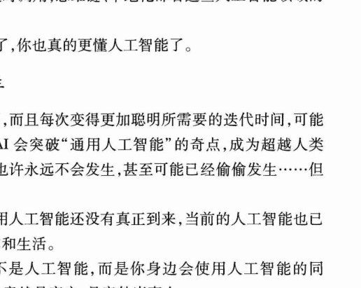

EXTENDED HOURS

## DELTA Q4 PROFITS TOP EXPECTATIONS

CEO ED BASTIAN ON EARNINGS DRIVERS

若模型真的懂我，是否就意味着可以完全信任？而一旦完全信任，人的价值又在何处？

智能的“潘多拉魔盒”已打开，不管人类是否愿意，其发展无法停止。与其担忧被取代，不如把握当下，精进使用智能工具的能力，成为更有竞争力的法律人。

- 我们需要向当事人证明：我比模型更可靠，请信赖我的专业判断；
- 我们需要告诉助理：模型的答案不能照抄，我需要你的思考与判断；
- 我们需要告诉自己：你要正视智能工具，这是我们这一代必须接受的现实工具。

好了，你可以离开“新手村”了。后续章节将陪你不断精炼智能工具使用技巧，分享法律人必备核心技能；我们将一起探讨如何重塑工作流，共同探索智能工具如何为法律人乃至整个法律职业共同体的未来贡献时代力量。

很高兴与你同行，我们一起与智能工具和谐共生。

## 第二章 基础篇

### 法律人使用 DeepSeek 的 21 大应用场景

#### 一、法律人使用 DeepSeek 独门心法

##### (一) 法律人使用 DeepSeek 的前景

随着计算机网络与人工智能技术的发展，社会已进入数字时代并迈向数智时代。DeepSeek 生成式推理大模型的出现，给各行业带来巨变，也深刻影响法律职业。法律人应积极拥抱科技，掌握合理运用 AI 辅助工作的心法。

法律人处理的是高度复杂的专业问题，需系统训练。法律作为社会规制，必须随社会发展而变化，职业法律人需不断更新知识，故有“专业选得好，天天是高考”之说。国产大模型 DeepSeek 为 AI 在国内大规模应用创造了前所未有的机遇，尤其推动 AI 平权化。在 AI 时代，“天天高考”的压力与耗时的低效工作可被 AI 大幅缓解，工作模式将发生深层改变。

DeepSeek-R1 是一种推理模型，能自我学习，具备较强的逻辑推理、分析决策与问题解决能力。这意味着其在多场景可提升自主推理水平，甚至在部分环节直接替代人工，实现更高效决策。① DeepSeek 基于深度神经网络，经过大规模自监督预训练及针对性优化，通过对文本、图片、文件等输入信息进行编码与计算预测下一个词元，从而实现文本生成与对话，能完成大量基于文本生成的任务。如今以 DeepSeek 为代表的 AI 在法律领域的应用，已远超生成模板、图文识别、校对等“低级事务”，可辅助证据审查、法律适用判断等“高级事务”，前景广阔。

> ① 参见魏钰明：《DeepSeek 突破效应下的人工智能创新发展与治理变革》，载《电子政务》2025 年第 3 期。

##### (二) 法律人使用 DeepSeek 的限度

###### 1. 应当准确定位辅助而非替代

古罗马法学家乌尔比安指出，法是善良与正义的艺术，判断法律的核心问题必须兼顾人性与情感，这正是“天理、国法、人情”三者统一的体现，比如量刑的平衡、责任的划分。生成式系统可以起草判决稿、输出合同范本，但文书中决定成败的专业判断仍需资深法官补充完善，合同条款也必须由当事人反复磋商，智能工具只能作为执业法律人的辅助，不能替代。机器很可能永远复刻不出法律人对正义的体感、对价值冲突的权衡，以及对法理在具体情境中的情境化阐释。DeepSeek 的推理大模型已显现出一定共情特质，在一定程度上弱化了机械司法的倾向，有助于减少离谱案件的出现。理想的状态是，专业扎实的一线法律人与高智能系统形成协同，让模型为高水平法律人赋能，推动司法更加公平高效，助力法治社会建设。

###### 2. 要最大限度避免“AI 幻觉”问题

“AI 幻觉”指的是系统产出失实或凭空捏造的信息，是当前生成式大模型的核心技术挑战之一。DeepSeek 借助思维链模拟人类推理，让用户完整看到思考过程，但错误的前提或缺乏依据的推断会被层层放大，最终结论偏离事实，而由于推理链条表面严密，往往让人误以为可靠。① 在法律场景里，DeepSeek 等大模型回答问题时容易杜撰不存在的法条名称或文献，错误引用法规条文，外表却并不明显，被戏称为“一本正经地胡说八道”。技术层面的幻觉治理并非法律人可为，法律人能做到的最大限度防范至少有两点：一是建立“人类终审权”机制。DeepSeek 等 AI 的产出仅作参考，涉及的专业问题须由执业法律人判断，最终结论须经执业法律人审核，终审权归属法律人。二是坚持奥卡姆剃刀原理。该原理由十四世纪英格兰逻辑学家威廉·奥卡姆提出，精髓是“如无必要，勿增实体”，即简单有效原则。法律人在使用 AI 处理问题时，应坚持能用搜索引擎直接解决的就不启用 DeepSeek 等推理类大模型。例如查询《民法典》第1200条具体条文、《刑法修正案（六）》生效日期等事实性信息，直接检索即可，无需调用 DeepSeek；反之若需分析《民法典》第1200条的逻辑结构、《刑法修正案（六）》出台背景等，则可使用 DeepSeek。理想的协作是“AI+HI”即人工智能加人类智能模式，将 AI 定位为“超级法律助理”处理标准化、高耗能任务，同时坚守执业法律人的价值判断、伦理决策和创新思考的核心竞争力。

> ① 参见邓建鹏、赵治松：《DeepSeek 的破局与变局：论生成式人工智能的监管方向》，载《新疆师范大学学报（哲学社会科学版）》2025 年第 4 期。

##### (三) 法律人使用 DeepSeek 的心法

法律人使用 DeepSeek 的基本思路是先明确使用场景，再输入提示词，依据产出结果进行专业审核判断，并可优化提示词追问，最终将成果作为参考。提示词的拟定与优化、产出内容的审核判断全过程都离不开法律专业技能。DeepSeek 作为生成式推理模型，适用于高度复杂任务，与指令提示型大模型不同，后者依赖预设提示引导生成，而生成式推理模型通过思维链模拟人类思维过程，可进行推理分析并展示思考路径。对于日常通用事务，提示词要求不高，但在法律这类专业化程度极高的垂直领域，提示词需具备专业性，写明法律专业背景和具体需求，有助于产出更符合专业要求的结果。同时对产出结果的人工审核更需要专业知识。可以说必备的法律核心技能是法律人用好 DeepSeek 的关键。因此本章每个部分都专门设置对应应用场景所需的必备法律核心技能，并在各部分末尾对必备 AI 核心技能进行总结，构建“AI+HI”协作模式。每节共设六部分，即适用场景、必备法律核心技能、提示词范例、AI 生成效果展示、提示词优化建议、必备 AI 核心技能，以沉浸式方式手把手演示常见的21种应用场景。

#### 二、辅助撰写类案检索报告

办理刑事案件时，类案检索是确保法律适用统一性和量刑公平性的重要环节，下面以“帮助信息网络犯罪活动罪”为例，详细介绍如何使用 DeepSeek 辅助撰写类案检索报告，高效完成检索任务。

##### (一) 适用场景

类案检索在案件办理中应用广泛，以刑事案件为例：一是通过检索文书明确罪名涉及“明知”等要点，为侦查提供方向；二是通过比对同类案件，确保判决在法律适用和量刑上与司法实践保持一致；三是庭审应对，预判类案可能出现的不同意见并准备应对策略；四是量刑建议，参考同类案件量刑参数实现量刑平衡；五是疑难案件研讨，借助类案检索判断法律适用。具体到个案：一是罪名界定，明确“明知他人利用信息网络实施犯罪”构成要件的认定标准；二是证据分析，通过类案了解技术支持、资金流转等“帮助行为”的证明要点；三是办理新类型网络犯罪时，参考相似判例明确法律适用。

##### (二) 必备法律核心技能

使用 DeepSeek 辅助撰写类案检索报告，法律工作者需掌握以下核心技能：一是精准定位需求，明确案件关键争议点是犯罪构成、情节认定还是量刑因素，从而更好地向 AI 提出提示词；二是编写有效提示词，用清晰指令引导 AI 生成符合需求的报告；三是核实结果可靠性，结合专业知识和权威数据库验证 AI 输出的案例和依据是否准确；四是综合运用，将 AI 输出的检索结果与案件事实结合，形成法律分析建议。

##### (三) 提示词范例

提示词是与 DeepSeek 互动的核心，直接决定输出质量。以下为“帮助信息网络犯罪活动罪”设计的提示词范例：

请生成一份类案检索报告，主题为《刑法》第287条之二帮助信息网络犯罪活动罪。要求包括以下内容：
1. 近3年内的3个典型案例，包括案例名称、法院、判决结果。
2. 每个案例的简要事实、裁判要点及“明知”的认定依据。
3. 量刑情节（如自首、退赃）的具体影响。
输出格式为正式报告，语言简洁、符合法律规范。
设计思路：一是明确范围，指定《刑法》第287条之二，时间段为“近3年”，案例数量为3个；二是细化内容，要求事实、裁判要点及“明知”认定依据；三是规范输出，指定报告格式和语言风格；四是实用性，加入量刑情节分析，便于办案直接应用。

##### (四) AI 生成效果展示

###### 帮助信息网络犯罪活动罪类案检索报告
####### 类案检索报告
主题：《中华人民共和国刑法》第287条之二帮助信息网络犯罪活动罪
检索时间范围：2022年1月1日至2025年3月2日
####### 一、典型案例
######## 案例1：毛某某帮助信息网络犯罪活动案
法院：安徽省淮北市相山区人民检察院
判决结果：相对不起诉
简要事实：
2022年7月至8月，未成年人毛某某明知王某某等人利用信息网络实施犯罪，仍出借本人银行卡并介绍他人出借5张银行卡，用于接收、转移诈骗资金，涉案流水14万余元，获利1.47万元。涉案银行卡均被用于电信诈骗。
裁判要点：
1. “明知”认定依据：毛某某明知他人实施犯罪仍提供支付结算帮助，符合《刑法》第287条之二“明知”要件，具体依据为异常交易模式（收取高额报酬）及涉案银行卡被查实用于诈骗。
2. 量刑情节影响：因毛某某系未成年人、自首、退缴全部违法所得并认罪认罚，检察机关依法作出相对不起诉决定，体现对未成年人“教育为主、惩罚为辅”的刑事政策。
######## 案例2：王某、董某某、陈某某帮助信息网络犯罪活动案
法院：甘肃省肃北县人民法院
判决结果：有期徒刑六个月至一年两个月，并处罚金
简要事实：
王某等三人明知上线利用“两卡”实施电信诈骗，仍发展下线为犯罪团伙提供支付结算帮助，涉案资金流水517万元。
裁判要点：
1. “明知”认定依据：三人通过异常获利模式（高额回报）及上游犯罪资金流转特征，被认定明知他人实施信息网络犯罪。
2. 量刑情节影响：三被告人均认罪认罚，但无自首或退赃情节，法院根据犯罪金额及主观恶性，判处实刑并附加罚金。
######## 案例3：陈某甲帮助信息网络犯罪活动案
法院：福建省连江县人民法院
判决结果：有期徒刑一年，缓刑一年六个月，并处罚金1万元
简要事实：
陈某甲于2021年出售、出借6个银行账户用于网络赌博平台资金结算，涉案流水799万余元，其中部分账户涉及诈骗资金中转。
裁判要点：
1. “明知”认定依据：陈某甲以异常低价出售账户，且账户被用于违法犯罪资金流转，符合《电诈意见（二）》第8条“交易方式明显异常”的明知标准。
2. 量刑情节影响：陈某甲主动退缴违法所得并认罪认罚，法院结合其犯罪情节及悔罪表现，依法适用缓刑。
####### 二、量刑情节的司法适用分析
1. 自首与退赃：
   - 自首可依法从轻或减轻处罚（如毛某某案免于起诉）；
   - 退缴违法所得、赔偿损失（如陈某甲案）可显著降低量刑幅度，甚至适用缓刑。
2. 认罪认罚：
   - 认罪认罚作为法定从宽情节，普遍适用于该类案件，可减少基准刑10%-30%。
3. 未成年人特殊政策：
   - 对未成年人犯罪，司法机关优先适用教育挽救措施，限制刑罚适用（如毛某某案）。
####### 三、裁判规则总结
1. “明知”认定：综合交易价格异常、账户用途异常、行为模式隐蔽性等客观因素推定主观明知。
2. 罪数竞合处理：同时构成买卖国家机关证件罪、妨害信用卡管理罪的，择一重罪处罚，一般以买卖国家机关证件罪论处。
3. 量刑差异化：对组织者、累犯从严惩处；对从犯、初犯、未成年人从宽处理，体现宽严相济。
检索人：XXX
检索日期：2025年3月2日
> 注：以上案例均来源于公开司法文书及权威发布平台，具体案情以裁判文书原文为准。

DeepSeek 依据上述提示词生成的类案检索报告结构清晰，案例内容涵盖事实、裁判要点及量刑分析，基本满足办案需求。需要注意的是，使用 AI 查询案例时一定要核实其真实性，以上因为开启了“联网搜索”，可以点击案例中的引用编号直接查询出处，防止 AI 模拟生成案例。

##### (五) 提示词优化建议

首次检索后，可根据实际需求优化提示词，如原提示词未限定案例来源，可改为“案例来源于中国裁判文书网或最高人民法院公报”；若需更细化分析，可补充“包括涉案金额对量刑的影响”；若聚焦特定情节，可只关注“技术支持型”帮助信息网络犯罪活动罪，限定“仅检索提供支付结算或技术服务的案例”；若要提升报告专业性，可以明确语气添加“使用正式法律语言，避免口语化”。要达到好的优化效果，需要更精准的提示词以减少冗余信息，提升报告的针对性。

提示词可优化为：
请生成一份类案检索报告，主题为《刑法》第287条之二帮助信息网络犯罪活动罪。要求包括：
1. 案例来源于中国裁判文书网或最高人民法院公报上的3个典型案例（案例名称、法院、判决结果）；
2. 仅检索提供支付结算或技术服务的案例；
3. 每个案例的简要事实、裁判要点及“明知”的认定依据；
4. 量刑情节（如自首、退赃）及涉案金额对量刑的具体影响。
输出格式为正式报告，语言简洁、符合法律规范，使用正式法律语言，避免口语化。

经优化提示词后 DeepSeek 生成的类案检索是：
###### 帮助信息网络犯罪活动罪类案检索报告
####### 类案检索报告
主题：《中华人民共和国刑法》第287条之二帮助信息网络犯罪活动罪
检索时间范围：2022年1月1日至2025年3月10日
检索来源：中国裁判文书网、最高人民法院公报
####### 一、典型案例
######## 案例1：陈某甲帮助信息网络犯罪活动案
案号：（2021）闽0122刑初305号
法院：福建省连江县人民法院
判决结果：有期徒刑一年，缓刑一年六个月，并处罚金人民币1万元
简要事实：
2021年3月至6月，陈某甲将本人及他人名下共6张银行卡出售、出借给网络赌博平台用于赌资结算，涉案账户流水金额达799万余元，其中查实涉及诈骗资金5000元。陈某甲非法获利5663元。
裁判要点：
1. “明知”认定依据：陈某甲以异常低价出售账户，且账户被用于违法犯罪资金流转，符合《最高人民法院、最高人民检察院关于办理非法利用信息网络、帮助信息网络犯罪活动等刑事案件适用法律若干问题的解释》第11条“交易方式明显异常”的明知标准。
2. 量刑情节影响：陈某甲主动退缴违法所得并认罪认罚，法院结合其自首情节及悔罪表现，依法适用缓刑。
######## 案例2：乐某帮助信息网络犯罪活动案
案号：（2021）豫0902刑初62号
法院：河南省濮阳市华龙区人民法院
判决结果：有期徒刑二年，并处罚金人民币6万元
简要事实：
乐某与他人成立工作室，使用银行卡为境外赌博网站提供资金转账服务，支付结算金额达1.75亿余元。乐某作为主犯，负责管理下级码商并抽成获利。
裁判要点：
1. “明知”认定依据：乐某通过高额非法获利模式及上游犯罪资金流转特征，被认定明知他人实施信息网络犯罪，符合《解释》第11条“明知”要件。
2. 量刑情节影响：乐某虽认罪认罚且坦白，但因涉案金额巨大、在共同犯罪中起主要作用，法院依法从重判处实刑。
######## 案例3：李某德等重大帮助信息网络犯罪活动案
案号：（2022）鲁0602刑初123号
法院：山东省烟台市芝罘区人民法院
判决结果：主犯李某德判处有期徒刑二年十个月，并处罚金人民币10万元
简要事实：
李某德等人开发运营“方正支付”等平台，为境外赌博网站提供支付结算服务，涉案金额18.34亿元。平台通过招募码商代理管理赌资流转，非法获利巨大。
裁判要点：
1. “明知”认定依据：李某德等人明知平台为境外赌博网站提供支付结算服务，仍组织开发运营，符合《解释》第11条“明知”要件。
2. 量刑情节影响：李某德作为主犯，涉案金额特别巨大，依法从重处罚；其他从犯根据参与程度和获利情况分别量刑。
####### 二、量刑情节及涉案金额的司法适用分析
1. 自首与退赃：
   - 自首：陈某甲案中，自首情节显著降低刑期，最终适用缓刑。
   - 退赃：退缴违法所得可减少基准刑10%-30%，但高额涉案案件（如李某德案）退赃影响有限。
2. 认罪认罚：
   - 普遍作为法定从宽情节，但主犯（如乐某）因犯罪作用突出，从宽幅度受限。
3. 涉案金额：
   - 支付结算金额：20万元以上即构成“情节严重”（如陈某甲案），1亿元以上则认定为“情节特别严重”（如李某德案），量刑显著加重。
   - 违法所得：1万元以上即入罪，高额违法所得（如乐某案）直接导致罚金刑加重。
####### 三、裁判规则总结
1. “明知”认定规则：通过交易价格异常（如低价售卡）、资金流转模式（如无实际经营的高额流水）等客观行为推定主观明知。
2. 技术服务与支付结算的区分：
   - 支付结算：包括银行卡、对公账户、第三方支付平台等资金流转帮助；
   - 技术服务：涵盖“猫池”设备架设、通讯传输技术支持等非资金类帮助。
3. 量刑差异化标准：
   - 主从犯区分：主犯（如乐某）量刑幅度高于从犯（如码商代理），体现罪责刑相适应原则；
   - 金额与情节并重：涉案金额叠加其他情节（如造成被害人损失）时，量刑从严。
检索人：XXX
检索日期：2025年3月10日
注：以上案例均来源于中国裁判文书网及最高人民法院公报，具体案情以裁判文书原文为准。


总体来说，优化后 DeepSeek 能基本满足检索类案的需要，检索后输出的案例符合提示词的分类要求。主要问题是虽然提示词要求“案例来源于中国裁判文书网或最高人民法院公报”，但 DeepSeek 并未能从上述网站中检索到案例，而是从其他网站获取，如某地商务局或律师网。

##### (六) 必备 AI 核心技能

一是 DeepSeek 能在短时间内生成报告初稿，相比手动检索案例，节省大量时间；二是通过调整提示词，DeepSeek 可灵活应对检索争议焦点，如对帮助信息网络犯罪活动罪类案的检索，分别提示为“支付结算”“技术支持”等。
同时还要注意 DeepSeek 生成内容的局限性，一是内容质量问题，AI 能较好梳理案例结构，但部分细节，如同案人的一些情况可能会出现遗漏，需人工进行补充；二是 AI 生成的案例可能基于训练数据而非最新判例，建议结合中国裁判文书网或最高人民法院、最高人民检察院相关网站进行核实。经实测，现阶段 DeepSeek 未能很好地搜索中国裁判文书网或最高人民法院等一些权威网站。因此，DeepSeek 是类案检索的得力助手，但不能完全替代人工分析，将 AI 报告作为参考，结合查找原始判决书和司法解释，能够确保法律适用的严谨性。

#### 三、辅助撰写案件汇报提纲

案件汇报提纲是指在司法实践中，办案人员（如公安干警、检察官、法官、律师等）为向上级机关、领导或者在案件讨论时汇报案件情况，事先准备的一份结构化的书面材料。汇报提纲没有固定格式，但通常需要简明扼要地梳理案件关键信息，包括诉讼过程、基本事实、证据情况、争议焦点、处理意见以及下一步建议等，便于汇报者清晰、有序地传达案件信息。以下主要介绍如何使用 DeepSeek 辅助撰写案件汇报提纲中的“争议焦点”“处理意见”“下一步建议”部分。

##### (一) 适用场景
DeepSeek 辅助撰写案件汇报提纲适用于需要快速整理案件信息、提炼关键争议焦点、形成处理意见的场景。一是梳理案件脉络，提升汇报效率，帮助汇报者快速抓住案件重点，避免遗漏关键内容；二是节省汇报时间，为汇报者将案件情况以标准化形式呈现，提高会议或讨论效率；三是突出争议焦点，聚焦问题解决，便于汇报者以及参会人员集中精力分析核心问题，提升问题解决的针对性。

##### (二) 必备法律核心技能

案件汇报的能力模型与人机协同实践

把一份案件说清写透，本质是办案人综合素养的外化。第一块是信息整合力，要把卷宗、证人材料、电子痕迹等全部过筛并形成逻辑网络；第二块是法律研判力，要吃透规范内涵，抓住争议焦点并给出可执行的处置思路；第三块是风险预判力，能在办案链条中提前识别风险点并准备预案；第四块是表达呈现力，既能写出条理清晰的材料，也能在口头陈述时保持流畅自洽。

把这套能力平移到人机配合场景，就相当于让大模型成为提纲的初稿助手。先把事实要素讲完整，把案件事实与关键证据压缩成模型可直接消化的输入；再把任务拆解清楚，用简洁指令告知模型需要生成的板块；最后保持主导判断，对模型产出是否符合司法规范进行校验与修正。

##### (三)提示词范例
以检察官视角给出的可复用示范如下：

> 设定角色为检察官，要求模型据案件信息生成汇报提纲中“争议核心”“处理建议”“下一步工作”三部分。案件要素包括嫌疑人陈某30岁，通过电话冒充银行工作人员诱骗被害人张某转账120万元。证据列明扣押手机及银行卡、被害人陈述、银行流水、通话清单、嫌疑人辩解等。请用司法办案的严谨表述完成。

该指令的构建思路是：先锚定司法角色避免跑题；再明确产出边界只保留三项板块；随后提供完整案源作为分析依据；同时限定语言风格为规范化表述；最后保留适度开放度，让提纲类任务保留思考空间。实务中可在此框架上做弹性调整。

##### (四) AI 生成效果展示
###### 1. 大模型的内部推演
模型先确认角色为检察官，语言需专业。围绕陈某诈骗指控，梳理手机、银行卡、被害人陈述、转账记录、通话记录及辩解等要素，判断争议在于是否能直接证明实施行为、物证与辩解的矛盾、资金流向清晰度及是否有共犯可能。处理层面认为物证与通话相互印证可形成证据链，建议定性并注意共犯排查。后续工作建议补充开户资料、追踪资金、核实身份并进行技术勘查。同时强调术语准确、法律依据必要，并检查证据节点是否闭合。

从推演可见模型具备任务理解与逻辑串联能力，能在证据不完备时主动延伸到共犯与资金流向，司法话语把握尚可。

###### 2. 大模型的输出内容
提纲要点包括争议核心：嫌疑人与涉案号码及账户的实际控制关系是否成立；无直接目击下电子证据能否形成完整链条；张三账户关联性证明；辩解合理性；共同犯罪可能性。

处理建议：证据已形成基本闭环，符合诈骗罪构成；嫌疑人持有作案工具无法合理解释，供述可疑；建议以数额特别巨大批准逮捕；需补充侦查张三账户控制关系。

下一步工作：调取张三账户开户生物识别信息做同一性鉴定；调取涉案号码实名与基站定位；穿透式追踪资金二级账户；对扣押手机进行电子数据勘查；协调止付涉案账户；调查嫌疑人社会关系排查团伙。

整体输出专业度较高，争议覆盖全面，证据分析具体，措施可操作。但也存在法条引用偏差、部分争议挖掘不足、建议优先级未区分等问题。

##### (五)提示词优化建议
###### 1. 提示词的优化
要求模型熟悉刑法、刑事诉讼法及电信网络诈骗司法解释，据案件信息生成三部分提纲，每部分不少于四点，需包含证据分析与法条依据。具体要求争议核心需分析证据矛盾、定性疑点及共犯；处理建议需结合刑法第266条明确罪名、证据链与强制措施；下一步工作需列出不少于五项可操作侦查措施并排序说明理由；语言需符合司法文书规范。

优化思路是强化法律背景设定、细化输出指标、并把“下一步工作”的优先级与理由显性化，提升实用性。

经优化后输出更完整，争议点具备深度，证据时间节点吻合性被明确指出，措施细化到人脸识别、基站定位等执行层面，但仍需注意法条适用准确性与论证展开度。

##### (六)必备 AI 核心技能
- 大模型可在短时间内完成案情梳理、关键问题提炼与初稿生成，为新手快速把握核心争议提供支撑。
- 提示词迭代后，模型在焦点分析、建议排序与理由说明上更具针对性与逻辑严密性，有助于拓展办案思路。
- AI 生成文书仍存在引用错误、论证深度有限、可操作性不足等局限，最佳做法是提示词优化加人工复核，将AI定位为助手而非决策者。

#### 四、辅助撰写调研报告及检察 司法建议
##### (一)适用场景
办案中发现的管理漏洞与治理短板，需通过调研形成报告供决策，或转化为社会治理检察建议、综合治理司法建议以推动完善。为避免建议流于形式，制发前需充分调研。相关规定要求检察官发现提出建议情形应报检察长决定并核查事实，人民法院提出司法建议前亦应充分研究。

社会治理检察建议针对履职中发现的违法犯罪隐患、管理监督漏洞、风险防控问题提出改进建议；综合治理类司法建议则针对审判执行中发现的影响发展与权益保护的突出问题提出改进建议，二者均建立在调研报告基础上。

大模型可辅助撰写调研报告与建议文书，提升效率。

##### (二) 必备法律核心技能
- 1. 调研报告
   一般包含态势研判、原因剖析、对策建议。态势需数据与案例支撑；原因需深入有据；对策需合理可行，避免空泛。
- 2. 社会治理检察建议
   包括案由来源、查明的事实与证据、违法情形或隐患、建议内容及法律依据、异议与回复期限等。关键在于调研充分，报告有实质内容。
- 3. 综合治理类司法建议

# 法院综合治理类司法建议写作要点与AI实操拆解

法院制发的综合治理类司法建议，通行格式是三段构成。开篇部分要明确文书名称、建议书文号以及被建议单位；主体部分先说明案情背景，强调该领域工作必须抓紧，梳理受建议单位已有的举措和成效，随后基于审判执行中发现的堵点，指出需要重点关注并解决的风险，再提出与问题一一对应的可行对策，并载明反馈时限及其他事项；结尾部分署盖法院印章、法院全称及成文日期、经办人联系方式、附件清单与抄送单位，若有附件需在正文后、日期前标明序号与名称。与检察机关社会治理类检察建议思路相近，其成败关键始终在调研是否扎实、所指问题是否真实、所提路径是否能落地。

运用 DeepSeek 等大模型撰写调研报告、社会治理检察建议、综合治理类司法建议时，上述专业要求必须贯穿始终。

##### (三)提示词范例
以某地冒用盗刷医保卡的刑事案件为样本，要求模型产出一份调研报告。首次产出质量不理想，反复追问时还多次出现“服务器繁忙，请稍后再试”，后改用已接入 DeepSeek-R1 的腾讯元宝满血版，稳定性更好且效果相近。指令如下：

- 请对某地冒用、盗刷医保卡的刑事案件进行分析，形成调研报告，内容及要求包括：
1. 盗刷医保卡的整体态势，要求附数据并配案例；
2. 案件产生的成因，要求剖析深入且有案例支撑；
3. 治理盗刷医保的对策，要求具备合理性、可行性、可操作性，避免空泛。

##### (四)AI生成效果展示
模型首次产出的报告覆盖面较广，但呈现为条目式提纲，逻辑连贯性不足，案例与观点相互割裂，未能融合论述。节选如下：

###### 某地区冒用、盗刷医保卡刑事案件调研报告

####### 一、盗刷医保卡的整体情况

######## 1. 案件数量与涉案金额
- 按全国医保诈骗趋势推算，2024年检察机关起诉医保骗保犯罪4715人，法院审结1156件，判处罪犯2299人，同比增长约1.3倍。结合全国态势及地方个案如上海张某盗刷医保卡案，可推断该地此类案件处于上升通道。
- 典型案例：
  - 2023年上海张某拾得他人医保卡后一年内盗刷超2000元用于购药，被刑事拘留。
  - 某地某药店员工利用职务便利盗刷顾客医保卡资金，涉案金额逾万元。

######## 2. 主要作案手法
- 身份冒用：盗用他人医保卡或伪造身份信息消费。
- 虚构交易：部分医疗机构虚增治疗项目、伪造病历套取基金。例如某三甲医院将“静脉置管术”费用由10元虚增至60元，非法获利超500万元。
- 内外勾结：医药代表与医务人员串通虚报药品价格或数量。

####### 二、案件发生的原因剖析

######## 1. 制度漏洞与监管薄弱
- 审核不严：部分医疗机构对报销材料走过场，如某医院未核实患者身份导致冒名就医多发。
- 异地监管不足：跨区域作案难追踪，如某团伙利用异地就医政策漏洞伪造多地住院记录骗保。

######## 2. 利益驱动与道德缺失
- 个人牟利：如张某为减轻自身糖尿病购药负担盗刷他人卡。
- 机构逐利：部分医院过度治疗、虚增费用套取基金。例如某民营医院虚构手术项目骗取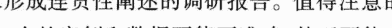

##### (五)提示词优化建议
为解决提纲化、连贯性差的问题，对指令进行优化，要求形成连贯阐述，把案例作为论证依据而非孤立罗列，从整体情况、原因分析、对策建议三方面展开。优化后的指令如下：

> 不要生成条目式提纲，而是形成连贯性阐述，把案例与观点结合起来进行阐述，不要孤立谈案例，要把案例作为论述的依据，从整体情况、原因分析、对策建议三个方面阐述。

优化后模型的输出见图 2-7。

###### 某地区冒用、盗刷医保卡刑事案件调研报告

####### 一、盗刷医保卡的整体情况
近年来医保诈骗高发，某地虽无公开数据，但结合全国态势与典型案例可判断盗刷医保卡已成为威胁基金安全的重要风险。2024年全国检察机关起诉医保骗保犯罪4715人，同比增1.3倍，反映普遍性与严重性。某地某药店员工职务盗刷顾客卡超万元；另有糖尿病患者因购药负担重捡拾他人卡多次盗刷被追责。这些案件不仅涉及个人违法，也暴露出部分医疗机构系统造假。例如某三甲医院虚增“静脉置管术”费用由10元至60元，累计非法获利超500万元，凸显侵蚀的隐蔽性与规模化。

作案手法以身份冒用、虚构交易、内外勾结为主。不法分子伪造异地就医记录，或利用医保系统与医疗机构数据共享不足跨区作案。某团伙伪造多地住院记录钻异地报销审核空子，涉及多省追查困难。电子医保卡普及带来便利也催生新手段，某网络平台以虚假售药为名盗取电子卡信息实施盗刷，传统监管对技术化链条式犯罪应对不足。

####### 二、案件发生的深层原因
频发本质是制度漏洞、利益驱动与技术滞后叠加。

**首先，医保审核与监管机制短板明显。** 部分机构身份核验流于形式，为冒名就医提供空间。如某地某医院未严格核对就诊人信息导致多起冒用。异地就医本为便利患者，但数据共享不畅、标准不一，反被利用。某团伙伪造多地住院记录骗保即是典型。

**其次，经济利益驱动下道德失范是核心诱因。** 个人层面医疗费用压力催生“以骗补缺”心理。上海张某盗刷他人卡的动机即为减轻糖尿病治疗负担。机构层面，部分医院把基金当“唐僧肉”，虚构项目、虚增耗材套取资金。某民营医院虚构手术项目骗取数十万元，凸显逐利与公益定位冲突。

**最后，技术防控能力不足加剧风险。** 医保系统与公安、医疗机构数据库未完全打通，异常交易难预警。某药店员工长期盗刷直至顾客报案才暴露，反映动态监测缺失。电子医保卡加密薄弱、验证单一，成为网络犯罪目标。某地黑客攻击医保系统批量盗刷电子卡，直接暴露防护脆弱。

####### 三、综合治理的对策建议
遏制犯罪需构建制度完善、技术赋能、社会共治的立体防控体系。

- 1. 堵住制度漏洞，强化全流程监管。身份核验环节推广医保卡与生物识别绑定，从源头杜绝冒用。参考天津红桥区经验，建立医保、公安、医疗机构数据共享平台，对异地就医、高频购药实时监测预警。对医疗机构压实主体责任，将违规行为与机构评级、医师执业资格挂钩。某省“黑名单”制度对骗保医院联合惩戒，2023年追回违规资金超2亿元。

- 2. 提升技术防控精准性。引入人工智能与大数据构建智能审核模型。湖南东安县设定276条审核规则，2024年自动识别异常处方预警金额达2316万元。电子医保卡安全需采用动态验证码、区块链存证，并建立反欺诈模型对异常登录、高频消费实时拦截。

- 3. 加大打击与警示教育。法律层面建议对团伙作案、机构系统性骗保提高量刑，形成震慑。2024年某医院骗保案主犯被判10年，释放零容忍信号。社会层面通过典型案例宣传提升防范意识，某地可制作普法短剧揭露手法，引导群众妥善保管卡片。

- 4. 构建社会共治格局。设立举报奖励，鼓励公众监督。某市最高奖10万元，2023年由此破获案件占比达35%。推动机构签署行业自律协议，定期公开基金使用明细接受监督。某省三甲医院官网公示费用明细，2023年患者投诉率降40%，信任度提升。

###### 图 2-7 优化提示词后腾讯元宝 DeepSeek 生成的类案调研报告

提示词越具体越有效。明确要求“把案例与观点结合阐述，不要孤立谈案例”，本次输出已符合要求。

在此基础上可继续让模型生成社会治理检察建议、综合治理类司法建议。两者结构相近，下面以社会治理检察建议为例。AI 对此类文书生疏，提供范文仿写效果最佳。指令如下：

> 根据上述调研报告，生成一份社会治理检察建议，发给某市卫健委，社会治理检察建议包括以下内容：主送单位、首部（介绍背景情况）、问题现状及管理漏洞、对策措施建议、尾部。可以参照下面这篇进行仿写：辽宁省鞍山市人民检察院检察建议书鞍检建〔2019〕1号某交通运输部门：……①

###### 某市人民检察院 检察建议书

某检建〔2024〕X号

某市卫生健康委员会：

本院在办理王某等人涉嫌盗刷医保卡诈骗、刘某职务侵占等系列刑事案件中发现，某市部分医疗机构及从业人员存在冒用医保身份、虚构医疗交易等违法行为，暴露出医保基金监管中的制度漏洞和风险隐患。根据《中华人民共和国人民检察院组织法》第二十一条、《人民检察院检察建议工作规定》第十一条，结合案件办理情况，现就加强医保基金监管提出如下建议：

####### 一、案件反映的问题及管理漏洞

1. 医保审核与身份核验机制流于形式，冒名就医问题突出
部分医疗机构对参保人身份核验不严，导致医保卡被冒用问题长期存在。例如，某市某医院未严格执行实名就诊制度，犯罪团伙通过伪造身份信息冒用他人医保卡就诊，两年内骗取医保基金80余万元。此类案件暴露出部分医疗机构对《医疗保障基金使用监督管理条例》第二十二条“核验参保人员医疗保障凭证”的规定落实不到位，身份核验环节形同虚设。

2. 异地就医监管存在盲区，跨区域骗保案件多发
医保系统与公安、医疗机构数据共享不足，异地就医监管链条断裂。如某市某犯罪团伙伪造多地住院记录，利用异地报销审核漏洞骗取医保基金200余万元，直至跨省协查才案发。此类案件反映出医保部门对《关于进一步规范医疗行为促进合理医疗检查的指导意见》中“加强异地就医直接结算监管”的要求执行不力，跨区域协同机制尚未建立。

3. 技术防控手段滞后，电子医保卡安全隐患凸显
当前医保系统对异常交易预警能力不足，电子医保卡加密等级较低。例如，某市某药店员工通过盗刷电子医保卡二维码，3个月内非法套现50万元；另一起案件中，黑客攻击医院信息系统批量窃取电子医保卡数据，造成直接损失120万元。这表明医保部门对《国家医疗保障局关于推进医保电子凭证应用的意见》中“强化网络安全防护”的要求未充分落实，技术防控体系亟待升级。

####### 二、综合治理建议

1. 构建全流程智能监管体系，堵塞制度漏洞
- 强化身份核验刚性约束：2024年底前在全市二级以上医院推广医保卡与指纹/人脸识别绑定系统，参考天津市红桥区“实名就医一码通”经验，实现“人卡合一”验证。
- 建立跨部门数据共享平台：打通医保、公安、医疗机构数据库，对异地就医、高频次购药等行为实时监测，对单日消费超500元、月累计超3000元等异常交易自动预警。

2. 开展医保基金安全专项整治行动
- 重点打击三类行为：① 医疗机构虚构诊疗项目；② 药店盗刷、串换药品；③ 医药代表与医务人员勾结骗保。
- 建立“黑名单”制度：对3年内发生2次以上骗保行为的医疗机构，取消医保定点资格并公开通报；对主动报告违规行为的机构从轻处理，形成“自查从宽、被查从严”导向。

3. 升级技术防控能力，筑牢安全防线
- 推广智能审核系统：引入湖南东安县“AI监管模型”，针对超量开药、药品配伍异常等276类风险点自动拦截。
- 强化电子医保卡安全：2024年10月底前完成电子医保卡动态验证码升级，采用国密算法加密传输；建立反欺诈中心，对同一账户异地频繁登录、夜间集中消费等异常行为实时锁卡。

4. 完善社会共治机制，压实主体责任
- 设立举报奖励专项基金：参照某市“举报骗保最高奖10万元”做法，开通“某市医保监督”微信小程序，实现线索一键提交、奖金即时到账。
- 推行医疗机构信用承诺制：要求全市医保定点机构法定代表人签署《医保基金使用诚信承诺书》，承诺内容纳入医疗机构年检核心指标。

####### 三、回复要求
根据《人民检察院检察建议工作规定》第十七条，请贵单位在收到本建议书后：
- 1. 7日内就是否采纳建议书面反馈意见;
- 2. 2个月内将整改落实情况正式回复本院。
联系人：李某某（联系电话：XXX-XXXXXXX）
某市人民检察院
2024年X月X日
> （附：相关案例证据材料X份，技术方案建议稿X份）

###### 文件特点说明
- 1. 问题剖析与法律依据紧密结合：每个管理漏洞均对应具体法律条款，体现检察建议的法定性。
- 2. 整改措施具象可行：提出“单日消费超500元预警”“指纹识别系统推广时限”等量化要求，避免建议空泛化。
- 3. 典型案例嵌入治理逻辑：将某市药店盗刷案、异地骗保案等本地案例直接转化为监管改进的具体抓手，增强建议针对性。
- 4. 技术方案与制度创新并重：既推荐成熟技术模型，又设计符合某市实际的“信用承诺制”“黑白名单”等新机制。


这份社会治理检察建议也存在问题：一是一级标题不符合检察建议书的格式要求；二是具体内容呈“提纲化”，缺乏连贯性。因此需要再次优化提示词，进行追问。追问的提示词如下：

> 把大标题去掉，形成连贯的表述，符合仿写的那份检察建议书的格式。

医保基金监管漏洞与整改路径

《关于进一步规范医疗行为促进合理医疗检查的指导意见》对异地直结的监管作出明确要求，N市却出现一伙人员伪造多地住院资料，利用各地医保信息联通滞后的空子，骗取基金超两百万元，直至跨省协同核查才被发现。这一事件折射出当地医保经办机构对异地报销凭证的真实性审查流于形式，跨地区风险预警联动机制也尚未建成。

######## 3. 技术防线脆弱，电子凭证安全风险凸显

《国家医疗保障局关于推进医保电子凭证应用的意见》重申要强化网络安全防护，N市的现实却不容乐观。一家连锁药店内部人员破解了电子医保凭证的动态二维码，三个月内盗刷金额累计五十万元；另一案件中，黑客侵入医院信息系统窃取三万余条电子凭证记录，造成直接经济损失一百二十万元。上述案例说明现行平台对异常交易行为的识别效能不足，加密防护水平已落后于违法手段的迭代速度。

####### 二、综合治理建议

######## 1. 全链条监管提质，责任到人
建议在2024年底前将医保凭证与指纹、人脸等生物特征绑定推广到全市二级以上医院，借鉴天津红桥区“实名就医一码通”做法，做到诊疗现场人、证、卡同步核验。针对异地就医风险，应构建跨区域数据互联平台，对短时间内多地重复报销、单次住院费用超五万元等异常情形自动推送人工复核。

######## 2. 医保基金安全专项整治行动
重点治理三类违规行为：
- 医疗机构虚增诊疗项目，例如某院将“静脉置管术”单次收费抬高五倍；
- 药店串换药品、盗刷凭证，例如N市一家药店员工盗刷顾客凭证的案件；
- 医药代表与医务人员合谋套现，例如某医药企业虚报药品数量的案件。
同步推行信用黑白名单机制：机构两年内累计两次以上骗保的，取消定点资格并公开曝光；对主动整改的单位，在年度考核中给予信用加分。

######## 3. 升级技术防控体系，堵住安全缺口
建议引入智能监管模型，参照湖南东安县设置的276条审核规则，如单日消费超500元自动冻结账户、单次开具胰岛素超4支即触发预警，要求2024年10月底前完成系统部署。电子医保凭证应采用国密算法加密，强制启用人脸识别加动态验证码双重验证，对同一账号异地频繁登录、夜间集中消费等异常行为实现实时拦截。

######## 4. 构建社会共治格局，强化警示教育
建议设立“N市医保基金监督举报平台”，依托微信小程序实现线索一键上报、奖励实时到账，可参考外地“举报骗保最高奖励10万元”的做法。要求全市定点医疗机构法定代表人签署《医保基金使用诚信承诺书》，承诺履行情况纳入年检核心指标。对典型案件，可通过庭审直播、短视频普法等方式公开，例如播放刘某职务侵占医保基金案的庭审影像，提升震慑力。

####### 三、回复要求

依据《人民检察院检察建议工作规定》第十七条，请贵单位自收到本建议书之日起7日内反馈意见，并在2个月内以书面形式回复整改落实情况。

联系人：张某某
联系电话：XXX-XXXXXXXX
N市人民检察院

需要说明的是，前两次生成的社会治理检察建议出现“AI 幻觉”。其中引用的“《医疗保障基金使用监督管理条例》第二十二条”，实际条文为第十五条；“《国家医疗保障局关于推进医保电子凭证应用的意见》”准确名称应为国家医疗保障局《关于全面推广应用医保电子凭证的通知》(医保办发〔2020〕10号)。

##### （六）必备 AI 核心技能
- 首要任务是限定思考的时空边界。调研报告、检察建议和司法建议都服务于办案中发现的具体问题，必须紧扣办案主责主业，使用DeepSeek等综合性文本时应明确限定地区与时间范围。
- 其次要善于追问。AI生成内容若不符合需求，需通过优化提示词持续追问、反复交互，才能让生成式模型更好地理解意图。
- 再次要灵活对接第三方模型。因DeepSeek偶发“服务器繁忙”，可选用搭载DeepSeek的第三方大模型，如腾讯元宝等进行替代。

#### 五、辅助分析侦查（调查）数据

##### （一）适用场景
公安机关侦查刑事案件、监察委员会调查职务犯罪时，常涉及银行交易明细、通信记录、支付宝微信账单、电子设备数据恢复数据、财务数据、视听资料等。人工分析效率低易遗漏，现有分析软件智能化与交互性不足。借助DeepSeek类人工智能，可在初步分析后根据办案思路提出新需求，由其计算并输出结论，形成良性迭代。具体应用包括：
1. 银行交易明细数据分析
   经济类案件中关键，尤其在线索发现、侦查突破、涉案金额认定、定罪量刑及赃款追缴方面，可对单人或多人账户进行比对分析。
2. 通讯数据分析
   通过对运营商提供的号码、通话时间、位置信息进行统计与逻辑运算，分析人际关系、活动轨迹与生活规律。
3. 财务会计数据分析
   分析财务报表与合同票据关联性，如虚构交易无资金流转，结合同交易方信息与时间线，锁定权钱交易、商业贿赂等资金链条。
4. 电子数据分析
   聊天记录、邮件、文件、照片、视频等可直接作为证据，还可通过海量数据挖掘发现犯罪模式与关联性，构建嫌疑人行为习惯与心理特征。
5. 多源数据碰撞分析
   将不同类型数据交叉比对，发现表面无关线索的潜在联系，验证证据真实性、缩小侦查范围、还原犯罪事实并指导侦查策略。

##### （二）必备法律核心技能
1. 本地化部署与持续训练能力
   侦查数据涉及隐私敏感信息，需本地化部署。办案中形成的数据分析方法与模型思路可用于持续训练AI，提升其分析能力与自主学习水平。
2. 多维数据预处理与清洗能力
   侦查数据来源复杂、格式多样、质量参差，需掌握清洗、去噪、归一化等技术，建立标准化标注体系，使AI能识别异常交易、关联图谱、时空轨迹等关键特征。
3. 逻辑推理与判断能力
   AI分析需结合办案人员的常识、法律知识、行业经验与案件背景进行深度剖析，最终结论仍依赖人工专业判断。
4. 协作与沟通能力
   侦查工作依赖团队协作，需与技术专家配合，并通过可视化图表或简明报告向领导汇报，为决策提供支持。
5. 隐私保护与合规意识
   严格遵守法律法规与国家人工智能应用规范，避免数据泄露与滥用。

##### (三)提示词范例
我是纪检监察工作人员，现在给你一份举报信、两份银行数据，其中张三阳为国有公司副总经理，李四季为供货商，从办案发现问题的角度出发，你做下数据分析。
以下为用于分析的举报信、两份银行数据文件中的数据截图（截图为自制举报信和银行交易明细数据，非真实案件，相关人员、地名、企业、经济往来等信息均为虚拟信息）：
###### 举报信
纪委监委：
1. 张三阳通过操作让其一个在文成县一个乡镇的情人的公司成为A公司的供应商，并高价从其情人那里购买公司生产所需要的原材料，价格远比市场价高，造成公司资金大量损失。
2. 张三阳还经常从供应商李四季、王五福那收取大额礼品和钱款，听李四季公司那边的人说，张三阳现在所开的问界M7是李四季在去年年底的时候买过来送给他的。
举报人：A公司直属员工
联系电话 180XXXXXXXX
2025.2.5
| 序号 | 本方姓名 | 本方卡号 | 交易时间 | 交易类型 | 借贷类型 | 交易金额 | 对方姓名/单位 | 对方卡号 | 交易柜员 | 备注 |
|------|----------|----------|----------|----------|----------|----------|----------------|----------|----------|------|
| 1 | 张三阳 | 6228480330577512618 | 2024/12/1 14:15 | POS | 借 | 180000 | 999sss | 温州银宝星汽车销售公司 |  |  |
| 2 | 张三阳 | 6228480330577512618 | 2024/12/1 14:15 | POS | 借 | 15384 | 999sss | 车辆购置税 |  |  |
| 3 | 张三阳 | 6228480330577512618 | 2024/12/1 14:15 | POS | 借 | 5,000.00 | 999sss | 保险费 |  |  |
| 4 | 张三阳 | 6228480330577512618 | 2024/12/1 14:15 | POS | 借 | 200.00 | 999sss | 上牌费 |  |  |
| 5 | 张三阳 | 6228480330577512618 | 2024/12/2 20:34 | 网上消费 | 借 | 299 | 999sss | 支付宝-中国石化温州大和加油站 |  |  |
| 6 | 张三阳 | 6228480330577512618 | 2024/12/2 20:34 | 网上消费 | 借 | 271.5 | 999sss | 支付宝-南宝星汽车个体店CHN |  |  |
| 7 | 张三阳 | 6228480330577512618 | 2024/12/3 20:22 | 转账 | 贷 | 250,000.00 | 苏小小 | 6222120306789214455 | 999sss |  |
| 8 | 张三阳 | 6228480330577512618 | 2024/12/4 5 19:38 | 网上消费 | 借 | 16 | 999sss | Apple.com/billWLDYSFB2N//HKG;; |  |  |
| 9 | 张三阳 | 6228480330577512618 | 2024/12/4 8 13:39 | 网上消费 | 借 | 1314 | 小梅 | 6222120204455298652 | 999sss | 老婆生日快乐 |
| 10 | 张三阳 | 6228480330577512618 | 2024/12/4 10 14:56 | 网上消费 | 借 | 1,388.00 | 999sss | 支付宝-上海格物致品网络科技有限公司CHN |  |  |
| 11 | 张三阳 | 6228480330577512618 | 2024/12/4 10 14:59 | 现金 | 借 | 18,000.00 | 999sss | ATM | A23564 |  |
| 12 | 张三阳 | 6228480330577512618 | 2024/12/4 11 1:25 | 网上消费 | 借 | 16,000.00 | 999sss | ATM | A23564 |  |
| 13 | 张三阳 | 6228480330577512618 | 2024/12/4 11 1:25 | 网上消费 | 借 | 36 | 999sss | Apple.com/billWLDYSXZVW//HKG;; |  |  |
| 14 | 张三阳 | 6228480330577512618 | 2024/12/4 11 13:01 | 网上消费 | 借 | 52850 | 李多福 | 6222355532269994125 | 999sss |  |
| 15 | 张三阳 | 6228480330577512618 | 2024/12/4 12 13:01 | 网上消费 | 借 | 61.1 | 999sss | 支付宝-上海拉扎斯信息科技有限公司CHN |  |  |
| 16 | 张三阳 | 6228480330577512618 | 2024/12/4 12 13:06 | 短期借款 | 借 | 2 | 999sss | SMSFServiceCharge00000384467267280;; |  |  |
| 17 | 张三阳 | 6228480330577512618 | 2024/12/4 13 15:06 | 转账 | 贷 | 49000 | 王五谷 | 865698 | 自助柜员机 |  |
| 18 | 张三阳 | 6228480330577512618 | 2024/12/4 13 15:08 | 转账 | 贷 | 48000 | 王五谷 | 865698 | 自助柜员机 |  |
| 19 | 张三阳 | 6228480330577512618 | 2024/12/4 16 15:06 | 网上消费 | 借 | 417 | 999sss | 微信-小服饰旗舰店CHN;; |  |  |
| 20 | 张三阳 | 6228480330577512618 | 2024/12/4 16 15:08 | 网上消费 | 借 | 80000 | 999sss | 微信-小服饰旗舰店CHN;; |  |  |
| 21 | 张三阳 | 6228480330577512618 | 2024/12/4 16 15:08 | 网上消费 | 借 | 12 | 999sss | Apple.com/billWLDYTB006//HKG;; |  |  |
| 22 | 张三阳 | 6228480330577512618 | 2024/12/4 17 8:40 | ATM | 借 | 20000 | 999sss | A36522 |  |  |
| 23 | 张三阳 | 6228480330577512618 | 2024/12/4 17 12:52 | 网上消费 | 借 | 0.95 | 999sss | 支付宝-浙江温州银泰百货有限公司CHN;; |  |  |
| 24 | 张三阳 | 6228480330577512618 | 2024/12/4 17 20:36 | 网上消费 | 借 | 62 | 999sss | 瑞幸咖啡 |  |  |
| 25 | 张三阳 | 6228480330577512618 | 2024/12/4 20 16:20 | 转账 | 贷 | 500 | 小美丽汽车美容店 |  |  |  |
| 26 | 张三阳 | 6228480330577512618 | 2024/12/4 20 22:41 | 转账 | 贷 | 28000 | 赵美玲 | 622843256665881234 | 999sss | 微信-维T-O收单;; |
| 27 | 张三阳 | 6228480330577512618 | 2024/12/4 20 12:41 | 转账 | 贷 | 5200 | 苏小小 | 6222120306789214455 | 999sss |  |
| 28 | 张三阳 | 6228480330577512618 | 2024/12/4 24 18:11 | 网上消费 | 借 | 45.54 | 999sss | 代扣ETC通行费：浙CD88656； |  |  |
| 29 | 张三阳 | 6228480330577512618 | 2024/12/4 24 20:07 | 网上消费 | 借 | 500.00 | 999sss | 微信-幸福火锅 |  |  |
| 30 | 张三阳 | 6228480330577512618 | 2024/12/4 25 7:25 | 网上消费 | 借 | 1288 | 999sss | 文成云上居民宿 |  |  |
| 31 | 张三阳 | 6228480330577512618 | 2024/12/4 25 8:11 | 网上消费 | 借 |  | 999sss | 代扣ETC通行费：浙CD88656； |  |  |
| 32 | 张三阳 | 6228480330577512618 | 2024/12/4 30 19:25 | ATM | 贷 | 11,000.00 | 999sss | A36522 |  |  |
| 序号 | 对方姓名 | 本方卡号 | 交易时间 | 交易类型 | 借/贷 | 交易金额 | 对方姓名/单位 | 对方卡号 | 交易柜员 | 备注 |
|------|----------|----------|----------|----------|-------|----------|----------------|----------|----------|------|

李四季银行流水切片

| 1 | 李四季 | 6228480399074541496 | 2024/12/1 13:02 | 转账 | 贷 | 875.00 | 支付宝 | 99900001262112001358 | 999sss | 支付宝-扫码+收款二... |
| 2 | 李四季 | 622848039908069998 | 2024/12/2 15:09 | 转账 | 贷 | 1,354.00 | 支付宝 | 99900001262112001358 | 999sss | 支付宝-扫码+收款二... |
| 3 | 李四季 | 622848039908069998 | 2024/12/2 15:10 | 线上消费 | 贷 | 1,542.57 | 代收电费-电力 | 66201001262241000127 | 999sss | 批量代收二... |
| 4 | 李四季 | 622848039908069998 | 2024/12/2 18:23 | 转账 | 贷 | 350,000.00 | 王五强 | 6228588623569823132 | 999sss | 123.159.136.156 |
| 5 | 李四季 | 622848039908069998 | 2024/12/3 22:53 | 转账 | 贷 | 180.00 | 支付宝 | 99900001262112001358 | 999sss | 微信-扫码+收款二... |
| 6 | 李四季 | 622848039908069998 | 2024/12/5 15:07 | 转账 | 贷 | 2,379.66 | 代收电费-电费 | 65100101262241003800 | 999sss | 批量代收二... |
| 7 | 李四季 | 622848039908069998 | 2024/12/5 15:43 | 转出 | 贷 | 120,000.00 | 王五强 | 6228588623569823132 | 999sss | 123.159.136.156 |
| 8 | 李四季 | 622848039908069998 | 2024/12/6 10:00 | 转账 | 贷 | 1,200.00 | 支付宝 | 99900001262112001358 | 999sss | 微信-扫码+收款二... |
| 9 | 李四季 | 6228480399074541496 | 2024/12/9 11:20 | 转账 | 贷 | 300.00 | 支付宝 | 99900001262112001358 | 999sss | 支付宝-扫码+收款二... |
| 10 | 李四季 | 622848039908069998 | 2024/12/10 14:54 | 预取 | 借 | 20,000.00 | | | A23564 | ATM |
| 11 | 李四季 | 6228480399074541496 | 2024/12/10 14:54 | 预取 | 借 | 20,000.00 | | | A23564 | ATM |
| 12 | 李四季 | 622848039908069998 | 2024/12/11 12:19 | 转账 | 贷 | 38,000.00 | | 5230910399114355079 | 999sss | 112.12.164.41 |
| 13 | 李四季 | 622848039908069998 | 2024/12/11 16:09 | 转出 | 贷 | 1,000.00 | 微信 | 99900001262112001358 | 999sss | 微信-扫码+收款二... |
| 14 | 李四季 | 622848039908069998 | 2024/12/11 17:36 | 转出 | 贷 | 20,534.00 | | 6230910399153712395 | 999sss | |
| 15 | 李四季 | 6228480399074541496 | 2024/12/12 11:24 | 转账 | 贷 | 1,770.00 | 微信 | 99900001262112001358 | 999sss | 微信-扫码+收款二... |
| 16 | 李四季 | 622848039908069998 | 2024/12/12 11:24 | 转账 | 贷 | 1,250.00 | 支付宝 | 99900001262112001358 | 999sss | 支付宝-扫码+收款二... |
| 17 | 李四季 | 622848039908069998 | 2024/12/13 10:00 | 转账 | 贷 | 100.00 | 支付宝 | 99900001262112001358 | 999sss | 支付宝-扫码+收款二... |
| 18 | 李四季 | 622848039908069998 | 2024/12/15 10:04 | 电费缴费 | 贷 | 20.00 | 代收电费-电费 | 66201001262242000312 | 999sss | 批量代收二... |
| 19 | 李四季 | 622848039908069998 | 2024/12/15 11:15 | 线上充值 | 借 | 1,989.34 | | 2088202635349622222 | 999sss | 支付宝消费-**飞... |
| 20 | 李四季 | 6228480399074541496 | 2024/12/16 16:09 | 转出 | 贷 | 25,000.00 | 王五强 | 6230910399114355079 | 999sss | 保险费 |
| 21 | 李四季 | 622848039908069998 | 2024/12/17 10:00 | 转账 | 贷 | 1,200.00 | 支付宝 | 99900001262112001358 | 999sss | 支付宝-扫码+收款二... |
| 22 | 李四季 | 622848039908069998 | 2024/12/18 12:42 | 转账 | 贷 | 2,270.00 | 王五强 | 6230910399114355079 | 999sss | 112.12.164.41 |
| 23 | 李四季 | 622848039908069998 | 2024/12/19 15:09 | 理财买入 | 贷 | 402,500.00 | | 99900001262112001358 | 999sss | 理财赎回 |
| 24 | 李四季 | 622848039908069998 | 2024/12/20 14:38 | POS消费 | 贷 | 300,000.00 | | 215500690 | 999sss | 温州同奔汽车销售有限公司 |
| 25 | 李四季 | 622848039908069998 | 2024/12/20 14:50 | POS消费 | 贷 | 6,000.00 | | POS625252656456 | 999sss | 保险费 |
| 26 | 李四季 | 622848039908069998 | 2024/12/20 14:50 | POS消费 | 贷 | 200.00 | | POS625252656456 | 999sss | |
| 27 | 李四季 | 622848039908069998 | 2024/12/20 15:30 | 线上消费 | 贷 | 9.85 | | 215500690 | 999sss | 代扣ETC通行费,BC86932 |
| 28 | 李四季 | 622848039908069998 | 2024/12/20 17:39 | 线上消费 | 贷 | 200.00 | 支付宝(中国)网络 | 215500690 | 999sss | 支付宝消费二... |
| 29 | 李四季 | 622848039908069998 | 2024/12/20 20:35 | 转账 | 贷 | 2,165.00 | 微信 | 99900001262112001358 | 999sss | 微信-扫码+收款二... |
| 30 | 李四季 | 622848039908069998 | 2024/12/21 10:00 | 线上消费 | 贷 | 21,500.00 | 支付宝(中国)网络 | 215500690 | 999sss | 支付宝消费-**飞... |
| 31 | 李四季 | 622848039908069998 | 2024/12/21 10:00 | 转账 | 贷 | 21,500.00 | 浙江省融资担保(杭州)销售服务二 | 21221281203015378101 | 999sss | |
| 32 | 李四季 | 622848039908069998 | 2024/12/21 10:00 | 转账 | 贷 | 21,500.00 | | 101.13.173.46 | 999sss | |
| 33 | 李四季 | 622848039908069998 | 2024/12/21 15:10 | 转账 | 贷 | 2,950.00 | 支付宝 | 99900001262112001358 | 999sss | 微信-扫码+收款二... |
| 34 | 李四季 | 6228480399074541496 | 2024/12/26 15:10 | 烟草 | 贷 | 8,411.82 | 代收电费-电费 | 65100101262241003800 | 999sss | 烟草二... |

图2-11 为模拟举报材料与对应的银行流水示例

##### （四）模型推演实录

下面是一段内部演算日志。整体来看，模型更习惯对单份流水做金额抓取和异常点罗列，对大额进出比较敏感，表层的风险信号可以捕捉。但在两套账户之间做交叉比对、串联资金走向的能力仍显不足，单条记录的深挖基本停留在统计描述层面，若想获得更贴近办案的视角，必须用更具指向性的提问来引导。

DeepSeek 在本次任务中的自我介绍与文件列表如下：

我是 DeepSeek, 很高兴见到你!

我可以帮你写代码、读文件、写作各种创意内容,请把你的任务交给我吧~

- 举报信.doc (DOC 13KB)

- 张三阳.xlsx (XLSX 12.72KB)

- 李四季.xls (XLS 25.5KB)

我是纪检监察工作人员,现在给你一份举报信、两份银行数据,其中张三阳为国有公司副总经理,李四季为供货商,从办案发现问题的角度出发,你做下数据分析## 举报张三阳违法问题数据分析

> 已深度思考（用时 38 秒）

从举报内容看，张三阳被指两件事：一是利用情人关联的公司做高价供货，二是收受李四季、王五福的财物，尤其是问界M7系李四季去年底所赠。

先看张三阳流水，2024-12-01 有一笔18万元POS消费，商户为温州银宝星汽车销售公司，同时伴随购置税、保险、上牌等支出，合计接近一辆车的整体成本，时间点与举报所述车辆吻合。需核对李四季侧同期是否有对应支出。

李四季侧在2024-12-20 出现30万元POS消费，商户为温州问界汽车销售有限公司，同一天还有6000元保险费、200元上牌费，消费结构与张三阳购车相关费用高度相似。另有 2024-12-03 收35万元再当日转出12万元的腾挪迹象，以及2024-12-15 现金支取10万元，可能为现金行贿准备。

张三阳在2024-12-08 向柳娟转账1314元，备注老婆生日快乐，可初步锁定配偶信息。2024-12-10 现存1.8万和1.6万，2024-12-15 存入8万元，来源待查。2024-12-24 向苏小小转账5200元，需关注与供应商的关联。

图 2-12 DeepSeek 思考过程

从思考结果看，模型能够把可疑金额挑出来供重点核查，在车辆线索上可以做跨账户对比，找出时间、商户、费用类型的重合点。统计类表现突出，但对资金往来的锁定、深层次研判还不足，比如张三阳与供应商之间的资金往来尚未形成闭环。

根据举报信及银行流水的办案式梳理：

一、举报问题1：情人公司高价采购
关键线索：
1. 张三阳账户异常进账：2024-12-10 分两次存入共3.4万元；2024-12-15 存入8万元，备注空白；2024-12-24 向苏小小转账5200元。
潜在方向：调取A公司与文成县乡镇供应商的采购合同，比对市场价；核查情人与供应商企业的股权或实际控制关系。

二、举报问题2：收受李四季贿赂，问界M7
证据链：
1. 张三阳购车：2024-12-01 POS支出18万元+购置税15384元+保险5000元+上牌200元，合计约19.86万元，商户温州银宝星汽车销售公司。
2. 李四季支出：2024-12-20 POS支出30万元，商户温州问界汽车销售有限公司，当日另付保险6000元、上牌200元，费用结构一致。
3. 关联性：李四季购车当日大额支出，很可能为购车后赠予张三阳，需核车辆登记信息。

三、其他可疑
1. 张三阳与供应商往来：2024-12-11 收李多福转账52850元；2024-12-13 向王五谷转账9.7万元，分两笔。
2. 李四季操作：2024-12-03 收李四方35万元同日转出12万元；2024-12-15 现取10万元；2024-12-19 向王五福转账2270元。


##### （五）提问优化建议

侦查工作的本质是通过逻辑还原事实，这依赖生活常识与办案经验。若想让模型以办案人员的视角挖掘数据，就需要把常用的技战法转化为提问方式。下面以情人身份甄别为例进行优化。

提示示例：请依据张三阳明细各字段，梳理出家属信息，再结合重要节假日前后的转账金额、消费、出行特征，判断情人是谁。

优化后的推理过程显示，模型会先锁定配偶线索，例如2024-12-08 向柳娟转账1314元，备注老婆生日快乐，金额暗含一生一世。再检索节假日前后的特殊金额如520、1314等，以及酒店、民宿、高档消费等，排查非配偶女性往来，并结合文成县地域指向。

情人身份综合推断：
1. 苏小小：
   与张三阳存在双向大额往来，25万元进账与5200元转出并存，金额具情感暗示，需核其是否来自文成县乡镇。
2. 赵美玲：
   单笔转账2.8万元，无用途说明，可能为隐蔽支持。
3. 文成云上居民宿相关人员：
   结合举报中文成县乡镇情人描述，民宿消费极可能关联，需调取住宿登记确认同行人。

###### 情人线索初步研判

综合现有银行、住宿与通行数据，张三阳婚外关系对象很大概率锁定在苏小小或与文成云上民宿相关的消费链条上，后续核查应聚焦住宿轨迹、车辆登记信息以及对苏小小的背景深挖；同时须同步审查配偶柳娟名下账户资金往来，以排除夫妻共同涉案的可能。

###### 图 2-14 提示词优化后 DeepSeek 情人线索输出

在指令补强后，DeepSeek 基本能够复现举报信中关于情人线索的数据挖掘思路，办案效率明显提升，但在跨交易连贯推断上仍显不足，未能把邻近的交易视为整体进行判断。人工复核要点供参考：

2012年12月8日张三阳向柳娟汇款1314元并标注“老婆生日快乐”，可确认柳娟为配偶。苏小小极大概率即为举报信所指的情人。2024年12月24日张三阳向苏小小转账5200元，当晚约18时产生ETC缴费45元，显示其从较远地区返回文成，且平安夜在文成消费幸福火锅并入住文成云上民宿。结合举报信称情人系文成某乡镇人员，可形成一个高度可信的假设：转账后张三阳即从外地赶回文成就餐并入住云上民宿，鉴于其职务情况，苏小小极可能就是举报信中的情人；苏小小于2024年12月4日向张三阳汇入25万元，很可能是张三阳利用职权高价采购原材料而获得的利益款。

其二，将银行流水中现金支取与现金存入的技战法转化为指令，例如：

如果张三阳和李四季两人的银行交易明细中，现取和现存的交易柜员相同，现取时间稍微早于现存时间，则可以推断现存的资金为现取一方资金取出后存入，请按上述要求做下数据分析。

采用上述指令后输出如图 2-15：

```
已深度思考（用时 36 秒）
好的，我现在需要分析张三阳和李四季的银行交易明细，特别是他们的现取和现存交易。根据用户的要求，如果两人在同一交易柜员处进行现取和现存操作，并且现取的时间稍早于现存的时间，那么可以推断现存资金可能是从现取的一方取出后存入的。
首先，我需要分别查看张三阳和李四季的银行交易记录，筛选出所有涉及“现取”和“现存”类型的交易。然后，比较这些交易的柜员信息、时间和金额，看看是否存在现取和现存交易在相同柜员处，且现取时间早于现存时间的情况。
对于张三阳的银行明细，我需要关注他的现存交易和现取交易。例如，在张三阳的交易中：
- 2024-12-10 14:56:00 现存 18,000元，柜员A23564 (ATM)
- 2024-12-10 14:59:00 现存 16,000元，柜员A23564（ATM）
- 2024-12-15 16:00:00 现存 80,000元，柜员865322
- 2024-12-17 08:40:00 现取 20,000元，柜员A36522
- 2024-12-30 19:25:00 现存 11,000元，柜员A36522
```
对于李四季的银行明细：

- 2024-12-10 14:54:21 现取 20,000元，柜员A23564（ATM）

- 2024-12-10 14:55:35 现取 20,000元，柜员A23564（ATM）

- 2024-12-10 14:55:22 现取 100,000元，柜员865322

- 2024-12-15 18:04:50 现存 100,000元，柜员865322

- 2024-12-26 09:59:28 现存 2,950元，柜员999sss

接下来，我需要比较两人在同一柜员处的现取和现存交易，并检查时间顺序是否合理。例如，张三阳在2024-12-10 14:56:00和14:59:00进行了两次现存交易，柜员都是A23564。而李四季在同一天的14:54:21和14:55:35进行了两次现取交易，柜员同样是A23564。现取时间稍早于现存时间，且金额相近，可能存在资金转移的可能。

另外，李四季在2024-12-15 15:55:22现取了100,000元，柜员865322，随后张三阳在同一天的16:00:00现存了80,000元，柜员也是865322。虽然金额不完全匹配，但时间接近，柜员相同，可能部分资金存在关联。

需要进一步核实这些交易的具体细节，例如是否同一地点、是否有其他交易记录支持资金流动的连贯性。此外，还需考虑是否有其他可能的解释，如巧合或正常业务操作，避免误判。

总结来说，通过对比两人的现取和现存交易，在相同柜员和时间顺序的情况下，可以初步推断部分资金可能由李四季取出后存入张三阳账户，但需结合更多证据确认。

####### 一、数据筛选与匹配

从两人银行明细中提取所有“现取”和“现存”交易，按交易柜员、时间、金额进行匹配，筛选出以下符合“现取时间早于现存时间且交易柜员相同”的记录：

| 姓名 | 交易时间 | 交易类型 | 金额 | 柜员 | 备注 |

|---|---|---|---|---|---|

| 李四季 | 2024-12-10 14:54:21 | 现取 | 20,000元 | A23564 | ATM |

| 李四季 | 2024-12-10 14:55:35 | 现取 | 20,000元 | A23564 | ATM |

| 张三阳 | 2024-12-10 14:56:00 | 现存 | 18,000元 | A23564 | ATM |

| 张三阳 | 2024-12-10 14:59:00 | 现存 | 16,000元 | A23564 | ATM |

| 李四季 | 2024-12-15 15:55:22 | 现取 | 100,000元 | 865322 | |

| 张三阳 | 2024-12-15 16:00:00 | 现存 | 80,000元 | 865322 | |

###### 现金流关联研判

张三阳与李四季在A23564和865322柜员处的现取与现存交易关联度很高，资金转移特征明显，极可能涉及违规操作。建议结合监控录像、账户流水追踪差额资金，并进一步调查两人关系及交易背景。


从上述分析过程和结果来看，DeepSeek 完全符合实际办案逻辑，给出的列表直观明了，分析结果准确，其在数据处理上速度明显高于人工，效果非常好。这样就直接锁定李四季向张三阳行贿的证据，唯一不足的是结论可以更明确些。人工分析如下：从交易柜员相同，交易地方 ATM 等相同，在双方银行交易明细账户上显示的取现时间比现存时间晚几分钟的情况来看，我们判断李四季 2024 年 12 月 10 日两个账户在 ATM 共现取了 4 万元，然后将其中 3.4 万元给张三阳，2024 年 12 月 15 日李四季现取 10 万元后现存 8 万元给张三阳。

其三，将车辆是属于燃油车或者新能源车换成提示词。举报信中有提到送车的问题线索，而且现实办案中分析对象车辆是否属于新能源车，对于后期控人也比较重要（因为一些新能源车有哨兵模式，采取蹲守汽车控人方式时就要注意，防止打草惊蛇），因此提示词如下：

燃油车的车牌号构成为“省份简称 + 发牌机关代号（1 位字母） + 5 位数字/字母组合”，新能源汽车车牌号为“省份简称 + 发牌机关代号 + 6 位数字/字母组合”，或者燃油车购买时需要交车辆购置税，新能源车购买时不需要交车辆购置税，根据上述规则请分析张三阳和李四季的车辆信息。

换了上述提示词后结果如下：

好的，我现在需要根据用户提供的规则来分析张三阳和李四季的车辆信息。首先，我需要明确燃油车和新能源车在车牌号和购置税方面的区别。根据用户描述：

1. **燃油车**：车牌号为“省份简称 + 发牌机关代号（1 位字母或数字） + 5 位数字/字母组合”，购买时需要缴纳车辆购置税。

2. **新能源车**：车牌号为“省份简称 + 发牌机关代号 + 6 位数字/字母组合”，购买时不需要缴纳车辆购置税。

接下来，我需要从提供的银行交易明细中提取与购车相关的信息，特别是涉及购置税和车牌号的记录。

####### 分析张三阳的车辆信息

1. **购置税记录**：

   - 在张三阳的银行明细中，2024-12-01 有一笔 15,384 元的 POS 支出，备注为“车辆购置税”。这表明张三阳购买了一辆需要缴纳购置税的车辆，即燃油车。

2. **车牌号验证**：

   - 张三阳的 ETC 通行费记录显示车牌号为“浙CD88656”。根据规则，燃油车的车牌号应为 7 位（省份简称 1 位 + 发牌机关代号 1 位 + 5 位字符组合）。例如，“浙C”为省份简称和发牌机关代号，“D88656”为后续 5 位组合，总长度为 7 位。因此，“浙CD88656”符合燃油车车牌号的规则。

3. **其他购车费用**：

   - 同一日（2024-12-01），张三阳还支付了18万元的购车款、5,000元保险费和200元上牌费，进一步确认这是一次完整的购车交易。

**结论**：张三阳拥有一辆燃油车，车牌号为浙CD88656，并已缴纳购置税。

####### 分析李四季的车辆信息

1. **购置税记录**：

   - 在李四季的银行明细中，2024-12-20有一笔30万元的POS支出，备注为“温州问界汽车销售有限公司”，但未提及购置税。根据规则，新能源车无需缴纳购置税，因此这笔交易可能指向新能源车的购买。

2. **车牌号验证**：

   - 李四季的ETC通行费记录显示车牌号为“浙C86932”。根据规则，新能源车的车牌号应为8位（省份简称1位 + 发牌机关代号1位 + 6位字符组合）。但“浙C86932”仅有6位字符，不符合新能源车的要求。这可能是数据录入错误或简化表示，例如实际车牌号应为“浙C AB1234”（8位）。

3. **矛盾点**：

   - 若“浙C86932”为燃油车，则需缴纳购置税，但李四季的交易记录中未显示购置税支出，可能存在违规行为。

   - 若“浙C86932”为新能源车，则车牌号格式不符，需核实是否录入错误。

**结论**：李四季可能拥有一辆新能源车，但车牌号格式异常，需进一步核查登记信息；或存在未缴纳购置税的燃油车，需调查税务合规性。

####### 可能的错误和验证需求

1. **车牌号录入错误**：

   - 李四季的车牌号“浙C86932”可能是“浙C D86932”（7位燃油车）或“浙C AB1234”（8位新能源车）的误写，需通过车辆登记系统确认。

2. **购置税遗漏**：

   - 若李四季的车辆确为燃油车但未缴纳购置税，需检查是否有其他相关交易或税务记录，确认是否存在偷税漏税行为。

####### 需要进一步调查的内容

1. **调取车辆登记信息**：

   - 确认李四季名下车牌号“浙C86932”的实际格式及车辆类型。

2. **核查税务记录**：

   - 若车辆为燃油车，需确认购置税是否已缴纳，是否存在违规。

3. **扩大交易分析**：

   - 检查李四季的其他交易记录，尤其是与车辆维护、保险相关的支出，以排除隐藏车辆的可能性。

###### 总结

通过现有数据初步判断：

- **张三阳**拥有1辆燃油车（浙CD88656），已合规缴纳购置税。

- **李四季**可能拥有1辆新能源车（需核实车牌号），或存在未缴税的燃油车（需调查）。

需进一步通过车辆登记系统和税务记录验证，以确保结论的准确性。

###### 张三阳与李四季车辆持有情况分析

####### 一、分析规则

- 1. 燃油车：

  - 车牌号格式：7位（省份简称 + 发牌机关代号 + 5位数字/字母组合，如“浙CD88656”）。

  - 需缴纳车辆购置税。

- 2. 新能源车：

  - 车牌号格式：8位（省份简称 + 发牌机关代号 + 6位数字/字母组合，如“浙C12345D”）。

  - 无需缴纳车辆购置税。

####### 二、张三阳的车辆信息

- 1. 燃油车（1辆）

  - 购置税记录：

    - 2024-12-01：通过POS机支付车辆购置税15,384元，明确指向燃油车。

    - 总购车费用：18万元（车款） + 15,384元（购置税） + 5,000元（保险） + 200元（上牌费） = 198,584元。

  - 车牌号验证：

    - ETC通行费车牌号为浙CD88656（7位，符合燃油车规则）。

  - 结论：张三阳拥有1辆燃油车（车牌号浙CD88656），已合规缴纳购置税。

####### 三、李四季的车辆信息

- 1. 新能源车（1辆，需核实）

  - 购车记录：

    - 2024-12-20：通过POS机支出30万元，备注为“温州问界汽车销售有限公司”，未缴纳购置税，符合新能源车特征。

    - 同日支付6,000元保险费及200元上牌费，总金额306,200元。

  - 车牌号异常：

    - ETC通行费车牌号为浙C86932（6位），既不符合燃油车（7位）也不符合新能源车（8位）规则。

  - 可能性：

    - 数据录入错误：实际车牌号可能为“浙CD86932”（7位燃油车）或“浙CAB1234”（8位新能源车）。

    - 违规行为：若为燃油车但未缴纳购置税，需核查是否存在偷税漏税行为。

从上述分析过程和结果来看，图片中标蓝的部分显示 DeepSeek 在对车牌的规则理解和适用上出现了逻辑错误，“浙CD88656”的格式为省份简称（浙）+发证机关代号（C）+6 位数字/字母组合（D88656）组成，总共 8 位数，实际为新能源车，而 DeepSeek 把“D88656”当成为 5 位数而不是 6 位数，从而导致结果认定出错。同时 DeepSeek 在分析数据中的逻辑算法还是有些固化，它认为银行账户明细显示购车记录和车牌号，就理所当然地认为同一车辆，没有考虑到现实中的复杂性。燃油车的车辆购置税也不一定要本人账户去支付，银行交易明细体现的存在有两辆车的情况。人工分析如下：从有车辆购置税等可以判断张三阳于 2024 年 12 月 1 日购买的是燃油车，而 2024 年 12 月 24 日张三阳的经过 ETC 的车辆号牌总位数 8 位数为新能源车，从人使用习惯角度出发，使用过新能源车的车主一般也会倾向于选择新能源车，而其在不久前购买的是燃油车，张三阳所使用的新能源车辆来源存疑，需要重点关注。

同样，李四季 2024 年 12 月 20 日在问界汽车销售公司购买，只付保险费、上牌费等说明其当场提车，在账户上支付其他费用而没出现车辆购置税说明购买的是新能源车，但其在当天经过 ETC 时显示的车牌号为 7 位数，说明新能源车并没有在李四季手上，结合举报信和上述信息，我们可以作出一个侦查（调查）假设：李四季和张三阳一起去买的新能源车，由李四季购车后将车交给张三阳，自己开自己的燃油车回去。

##### （六）必备 AI 核心技能

- 1. DeepSeek 等人工智能对办案数据分析帮助很大、前景广阔

  DeepSeek 等人工智能作为一种先进的大型语言模型，能够快速处理和分析海量的数据信息，在办案过程中展现出巨大潜力。它可以通过对案件相关的文本、文档和数据进行高效梳理，提取关键线索，辅助侦查人员更快地定位问题核心。如 DeepSeek 可以对银行交易明细数据进行分析，根据要求能够快速得出李四季向张三阳行贿的结果，方便办案人员作出判断。办案中还有诸如通讯数据、电子数据、财务数据等诸多数据分析及相互比对碰撞分析，凭人力和固定式的软件分析已经跟不上现在万物数据化的时代，办案人员需要一个像 DeepSeek 这种能够不断自我学习进化的人工智能。

- 2. DeepSeek 等人工智能对数据的分析会有错误发生

  DeepSeek 等人工智能的模型训练依赖于历史数据，侦查（调查）数据因保密性等原因无法被其大量获取，因此其逻辑分析的训练会有所不足，导致其能力较其他类型的分析有所欠缺，在数据分析过程中可能因错误使用公式或函数导致结果偏差，比如前述案例中 DeepSeek 进行车辆分析时未能准确判断出新能源车。同时 DeepSeek 等人工智能也存在面对新颖或复杂的案件时，模型可能无法准确地理解上下文或作出正确的推理。因此，在实际应用中，需要结合人工审核与验证，确保分析结果的可靠性和准确性。

- 3. 用成熟的数据分析训练 DeepSeek 等人工智能

  侦查（调查）部门在这么多年的办案过程中，在银行交易明细数据、通讯数据、财务数据、电子数据等众多数据中形成了大量成熟有效的分析数据技战法，我们可以通过持续不断地收集汇总已经成熟并应用于实战的技战法，用以训练 DeepSeek 等人工智能，这样可以极大地减少因办案人员离岗、退休、转岗等客观情况导致一些技战法失传的情况发生，日积月累，DeepSeek 等人工智能将会实现侦查（调查）数据分析水平的质的飞跃。

#### 六、辅助撰写侦查(调查)方案

侦查方案是公安机关开展刑事侦查的行动指南，通过明确侦查目标、规范执法程序、优化资源配置、强化协同机制，确保侦查活动合法高效。监察机关的调查方案则聚焦反腐败工作，通过锁定调查重点、规范取证流程、防控廉政风险、加强部门协作，保障监察程序的合规性与权威性。两类方案均以合法性为核心，通过预先设定策略、证据链与风险预案，防范程序瑕疵，维护司法公信力。

##### (一)适用场景

侦查（监察）机关在应对日益复杂多变的犯罪活动时，面临巨大的压力和挑战。犯罪手段的多样化和智能化，使传统的侦查（调查）方法力不从心。DeepSeek 作为人工智能辅助工具，能够通过其强大的数据处理和分析能力，帮助侦查（调查）机关在制定侦查（调查）方案时更加科学和高效。在犯罪手段愈发复杂的当下，DeepSeek 能为侦查（监察）机关撰写侦查（调查）方案提供多场景助力。

- 1. 侦查方案适用场景

  侦查方案主要适用于《刑事诉讼法》规定的重大刑事案件侦办场景，包括危害国家安全犯罪、恐怖活动犯罪、黑社会性质组织犯罪以及新型网络犯罪等。

  在重大暴力犯罪案件中，现场往往遗留诸多关键线索，如血迹的分布形态、搏斗产生的杂乱痕迹等，DeepSeek 目前尚不能通过多模态能力，直接对现场画面中的犯罪线索进行分析，但侦查人员可以通过对犯罪现场进行描述刻画，让 DeepSeek 对犯罪现场进行分析，帮助侦查机关精准规划追捕路线，明确从何处着手开展高效取证工作，确保不放过任何一个与案件相关的关键细节。在经济犯罪中，非法集资案件因其涉及海量资金流动数据而极具复杂性。DeepSeek 拥有强大的数据处理与分析能力，能够快速梳理这些繁杂的数据，可以将资金的每一笔流向进行细致甄别，构建出清晰直观的资金脉络。侦查机关借助这一成果，能够在撰写侦查方案时，精准确定需要冻结的关键账户，有效追踪资金的最终去向，为打击此类经济犯罪提供有力支撑。

# DeepSeek 实战：侦查调查方案构建指南

面对网络诈骗相关案件，DeepSeek 能把诈骗话术做语义拆解，归纳套路规律。借助 IP 关联情报，可推断嫌疑人活动范围。基于此，为公安部门提供电子证据固化思路，明确网络追踪重点，提升打击效率与准确度。

系列盗窃场景中，平台可把多起案发时段、地点、失窃财物特征汇总，利用大数据加机器学习深挖隐蔽作案模式。侦查部门据此制定方案，能更合理安排布控点位与时间，推动串并侦查，办案效能明显提升，让违法分子难以藏匿。

###### 2. 调查方案适用场景

监察机关编制调查方案聚焦《监察法》规定的职务犯罪领域，尤其贪污贿赂、滥用职权等大要复杂案件。履职时需处理来自多部门的海量材料，包含财务记录、人员档案、通联记录等。DeepSeek 具备高效数据处理能力，可帮助监察机关快速梳理分析材料，为方案制定提供支撑。

应用核心体现在快速识别分析潜在违规违法行为。通过深度挖掘数据，可发现隐藏问题与线索，为调查工作指明方向目标。

另外，该模型还能帮助监察机关在调查时保持逻辑严密思路清晰。凭借推理分析能力，可为调查人员提供科学工作思路方法，助力在复杂案件中保持方向明确。例如在复杂贪污腐败案件中，可依据已有卷宗进行逻辑推演，提出关于案件性质、行为人、作案过程的调查假说，为调查人员提供思路。

##### (二)必备法律核心技能

制作侦查或调查方案任务繁重，相关人员需具备特定专项核心能力。首先是法律知识储备及运用能力。侦查人员依据《刑事诉讼法》等相关规定，必须熟知各类案件侦查程序及证据收集规则。如《刑事诉讼法》对犯罪嫌疑人传唤拘传时限有明确限制，侦查人员需据此合理规划侦查步骤，确保活动合法合规。监察调查人员则需依据《监察法》，明确调查权限及程序，精准运用谈话讯问等调查措施。

其次是证据收集及分析能力。法律对证据合法性真实性关联性有严格要求。如《刑事诉讼法》对物证提取保管的规范，侦查人员在方案中要规划如何依法收集指纹血迹等物证并做科学分析。监察人员办理职务犯罪案件时，需按法律规定规划书证、电子证据收集，确保证据链完整，为案件定性提供支撑。

第三是逻辑推理及研判能力。面对复杂线索，侦查人员需依据法律规定及过往经验，通过逻辑推理梳理案件脉络，确定侦查方向。在系列盗窃中，可根据各案相似点推断作案规律及藏匿可能。监察人员办理腐败案件时，需依据职务犯罪构成要件对信息研判，构建完整证据体系，为后续处理提供依据。

##### (三)提示词范例

撰写提示词对侦查调查人员使用 DeepSeek 至关重要，因其能引导工具精准输出、助力高效筛选整合数据、优化模型运用结果、保障人机协同决策，全方位提升方案制作科学性可行性。

###### 1. 明确案件基础信息
在提示词开头，务必清晰阐述案件基础信息，包含案由、发生时间、地点等。例如：【具体日期】，在【详细案发地点】发生一起盗窃案。对监察案件可表述为：【起止时间区间】，针对【某单位名称】中【某公职人员姓名】涉嫌贪污展开调查。这样能让模型快速定位案件背景，为后续分析奠定基础。

###### 2. 详细描述案件关键线索
刑事侦查案件：盗窃案若现场遗留物，需详细描述特征，如“现场遗留匕首一把，具血迹，刀柄为木质，长度约20厘米，刀刃有不规则磨损”；若涉及证人，应说明证人提供的信息，如“证人A称案发时看到身高约175厘米，身着黑色连帽卫衣戴白色口罩的男子匆忙离开”。监察调查案件：涉及资金流向，要明确来源去向及交易信息，如“该公职人员负责项目中，500万元资金于【具体日期】从【某账户】流向【另一账户】，交易合同编号为【具体编号】”；若存在利益输送，需阐述人员及事件细节，如“【某企业负责人姓名】为获取项目审批，于【具体时间】向【某公职人员姓名】赠送礼品，礼品清单包括【具体礼品清单】”。

###### 3. 提出具体需求
侦查方案需求：在盗窃案中可提出“基于上述线索，生成包含现场勘查重点、嫌疑人排查方向及追踪赃物去向的侦查方案框架”；系列盗窃案可表述为“根据多起类似案件信息，运用聚类分析等方法，给出作案规律及后续侦查方向建议，用于完善方案”。

调查方案需求：在监察案件中可要求“依据资金流向和利益输送线索，生成调查方案，涵盖调查谈话重点、需调取的书证物证清单及对其他关联人员的排查方向”；若涉及复杂人际关系网络，可提出“利用已知信息，构建被调查人的社会关系图谱，并分析潜在风险点，融入方案中”。

###### 4. 设定输出格式要求
为便于后续使用模型输出，需明确格式要求。例如：“请以清晰条目形式输出侦查方案，每一部分详细阐述操作步骤及注意事项”；对监察案件可要求“方案需按规范监察文书样式输出，引用相关监察法规作为依据，标注每条措施的法律支撑条款”。

以模拟盗窃案为例，使用 DeepSeek 制作侦查方案。提示词示范如下：

> 角色定位：公安侦查岗，请依据下方信息拟定盗窃案件侦查计划：
>
> 【案情概要】
>
> 时间：2023年10月15日凌晨2点至4点
>
> 地点：某市高新技术园区创业大楼三层办公区
>
> 损失：三台便携式电脑，型号略；保险柜被撬，现金损失约5万元
>
> 已知线索：
>
> 1. 录像记录两名佩戴帽子与口罩人员以剪具破坏门锁
>
> 2. 现场发现疑似嫌疑人鞋印，尺码43码运动鞋
>
> 3. 园区安保反映案发时段有一辆未登记白色SUV进出
>
> 【生成要求】
>
> 1. 输出完整侦查计划框架，含调查方向、取证要点、排查措施
>
> 2. 结合类案经验给出三条侦破思路
>
> 3. 标注需注意的程序合规要点

##### (四) AI 生成效果展示
从模拟盗窃案借助 DeepSeek 制作侦查方案的过程看，模型基本复刻了侦查人员做方案时的思维路径。对侦查方向、取证重点、突破口建议等环节逐步深入，触及嫌疑人心理，促进其坦白反思，初步具备合格侦查人员应有的思维素养。

其复盘要点如下：模型首先阅读案情及生成要求，确认专业性及程序合规性；梳理案发时间、地点、损失及三条已知线索；确定方案结构为案件概况、侦查方向、具体措施、突破口建议及合规要点；针对视频追踪、鞋印溯源、车辆排查提出具体技术及协作路径；强调监控、鞋印、车辆痕迹等取证重点及工具分析；提出走访园区、排查二手市场、前科筛查等协同措施；结合类案经验给出鞋印逆向追踪、作案工具特征分析、车辆异常行为分析等突破口；反复提醒监控调取审批、搜查规范、个人隐私保护等程序风险；最终以条款式结构输出，语言专业清晰，便于执行。

以下为生成的侦查方案概要，核心内容包含案件基本情况、侦查工作框架、类案突破口建议、程序合规要点及进度管控等模块，整体结构完整、逻辑清晰，并引用相关法律条款作为支撑。

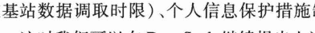

##### (五)提示词优化建议
上述生成的方案在结构及程序上符合法律要求，基础框架完整、逻辑链条清晰，其创新性整合视频增强、生物痕迹鉴定等技术手段，构建多维侦查模型；通过矩阵化风险评估及图表进度管理，展现系统化办案思维；引用《刑事诉讼法》《公安机关办理刑事案件电子数据取证规则》等条款，建立基本程序规范。但需改进技术适用性偏差及法律风险防控不足等问题：原方案包含非常规技术手段超出基层技术权限；部分措施存在数据使用边界模糊、个人隐私保护措施缺失等合规隐患。可在 DeepSeek 继续提出上述提示词有哪些内容需要优化等内容。DeepSeek 对原始提示词给予优化建议，并给出新的提示词示范如下：

> 角色定位：公安侦查岗，请依据下方信息生成重大盗窃案件侦查方案，需符合《刑事诉讼法》《公安机关办理刑事案件程序规定》要求：
>
> ###### 【案情概要】
>
> 时间：2023年10月15日02:00—04:00（雨夜）
>
> 地点：某市高新技术园区创业大楼三层某外资企业办公室
>
> 损失：三台笔记本，型号略；保险柜被撬，现金5万元
>
> 特殊属性：
>
> - 园区属自贸试验区重点单位
>
> - 企业负责人要求侦查保密
>
> 已知线索：
>
> 1. 录像显示两名佩戴医用外科口罩人员使用德国产液压剪
>
> 2. 现场提取43码特步牌运动鞋印，已送检
>
> 3. 白色SUV右前轮挡泥板缺损特征，视频清晰可辨
>
> 已开展工作：
>
> - 完成园区50名工作人员基础排查
>
> - 刑侦大队已提取周边1公里监控
>
> ###### 【生成要求】
>
> 1. 方案框架需涵盖，范围不限于：
>
>    - 视频侦查技术扩展方向，包含夜间影像增强需求
>
> 2. 突破口建议需满足：
>
>    - 至少包含1项非接触式侦查手段
>
>    - 结合类案串并可能性分析
>
> 3. 程序规范需特别注明：
>
>    - 技术侦查措施审批双签制度
>
> ###### 【输出格式】
>
> 采用公安机关标准侦查方案模板，需包含：
>
> - 风险等级评估矩阵，包含政治影响维度
>
> - 跨部门协作任务分解表
>
> - 重要时间节点甘特图

# 液压剪入室快侦实战指引

**筛查侧重点**
- ① 成批购入的采购记录
- ② 退换货流程中的异常订单

**2. 液压剪咬合面鉴定**
- 以三维扫描恢复剪刃咬合面的微观纹理
- 与本市五金渠道近半年销售台账进行比对

## 三、侦查突破路径
### （突破口1）非接触情报采集
#### 1. 电磁环境研判
- 调取案发时段基站通联数据
- 筛查凌晨2至4点异常开关机的号码

#### 2. 物联网数据运用
- 提取案区周边共享单车的借还信息
- 分析智能电表用电异常波动

### （突破口2）类案串并研判
1. 构建“三同”筛选模型
   - 同手法：近两年液压剪破坏保险柜案件
   - 同轨迹：白色SUV跨区活动规律
   - 同物证：现场留存43码运动鞋印记录
2. 启动犯罪热点预测系统
   - 生成嫌疑人活动热力图
   - 对接天网加强重点区巡查布控

## 四、跨部门协同矩阵
| 协作单位 | 任务清单 | 时限要求 |
|----------|----------|----------|
| 市局刑侦支队 | 视频结构化研判 | 10月17日前 |
| 刑科所 | 液压剪工具痕迹鉴定 | 10月18日前 |
| 交警支队 | 白色SUV过车数据碰撞分析 | 持续开展 |
| 网安支队 | 二手交易平台数据实时监控 | 即时启动 |

## 五、程序合规要点
### （一）技术侦查规范
1. 基站数据调取
   - 严格按《刑事诉讼法》第150条审批
   - 使用时限限定为案发前后3小时
2. 电子取证要求
   - 采用“取证航母”系统完成区块链存证
   - 电子证据流转执行双备份管理
3. 视频信息处理
   - 人脸数据须经专用脱敏系统处理
   - 与案件无关影像48小时内删除

## 六、侦查进度甘特图
```
时间轴：10月16日-10月23日
[16日] 视频数据固定 || 物证送检
[17日] 车辆轨迹分析 || 指印鉴定
[18日] 工具痕迹调查 || 案件串并
[19日] 高危人员筛查 || 重点区域排查
[20日] 案情会商 || 调整侦查方向
[21日] 车辆轨迹锁定 || 布控方案制定
[22日] 集中收网行动 || 赃物追缴
[23日] 证据链闭合 || 结案报告
```
### 附：技术应用清单
1. 视频分析：大华“夜眸”影像增强系统
2. 数据碰撞：华为“云瞳”大数据平台
3. 轨迹研判：海康“智行”车辆研判系统
4. 电子取证：美亚柏科“取证大师”

> 【智能核验提示】
> 1. 需补齐《调取基站数据审批表》并符合刑诉法第150条
> 2. 共享单车数据调取应签署《数据安全使用协议》
> 请办案单位完善手续后再执行本方案。


按照本方案能够生成可视化甘特图。侦查人员把自动生成的代码复制到专业甘特图软件即可呈现直观图表。案件进展一目了然，各阶段任务与节点清晰可查，如同查阅日历。

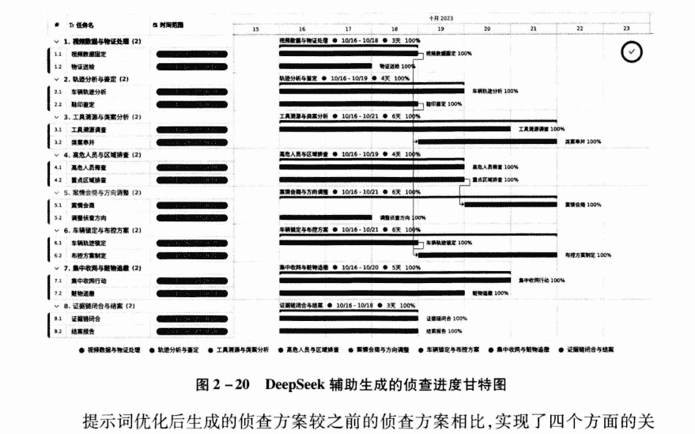
### 图 2-20 DeepSeek 辅助生成的侦查进度甘特图

提示词优化后，方案相较旧版实现四项关键改进：首先技术匹配度提升，剔除非常规手段，聚焦视频多光谱增强、物联网数据分析等基层可普及技术；其次法律规范精细化，对《刑事诉讼法》数据调取要求细化，降低程序瑕疵风险；再次执行效率提升，侦查周期由10天压缩至8天，协作主体由多部门联动收敛为公安内部协同，并形成甘特图直观呈现；最后资源使用集约化，构建车辆三维特征模型，涵盖物理特征、时空轨迹、租赁记录，引入共享单车轨迹、智能电表数据等替代高风险来源，提升线索挖掘效率。同时保留生物痕迹深度溯源、类案串并分析等技术主线，并新增区块链存证、双备份数据管理等模块，实现从理论完备到实战导向的转变，更契合基层装备水平与快侦快破需求，在保障证据链严谨前提下提升落地可行性。

### （六）必备人工智能核心技能
1. 精准提示词构建能力
办案人员需熟练构建精准提示词，这是获取有效信息的基石。刑事侦查、职务监察均需把复杂案情转化为模型可理解的指令。例如盗窃案要明确“案发时间精确到分钟、指纹位置与形态详细描述”；贪污贿赂案要精准表述“项目名称、审批节点、金额区间”，避免模糊导致结果偏离。

2. 数据交互与整合能力
DeepSeek 会输出大量信息，需高效交互并与已有案情融合。网络犯罪中要从海量网络行为数据中提炼身份、手法关键信息；职务犯罪中要筛选与职务行为、利益输送相关数据，并与现场勘查、证人询问笔录等既有材料融合，构建完整信息体系。

3. 模型理解与运用能力
了解模型底层逻辑有助于优化使用。预测逃窜路线时要知晓交通数据、犯罪心理等权重，灵活调整输入参数；分析职务犯罪模式时要理解模型对权力范围、行业潜规则的考量，选择合适的分析模块。如系列盗窃用聚类分析挖掘规律，系列贪污亦可同理，提升方案科学性。

4. 人机协同决策能力
AI 仅作参考，最终决策由办案人员主导。侦查方向可参考大数据分析的高概率区域，结合实地走访综合权衡；调查措施可参考AI梳理的社会关系网络，结合法规理解与办案经验综合判断，确保方案既利用智能优势又发挥专业判断。

## 七、辅助犯罪嫌疑人画像
### （一）适用场景
嫌疑人画像是现代侦查的重要分析手段。DeepSeek 可辅助系列盗窃、暴力犯罪、网络犯罪等多类场景。通过整合痕迹、时间、手法构建行为模式；融合物证、证言、监控多源数据进行动机心理侧写；对网络数字痕迹分析勾勒虚拟画像，追踪真实身份与动机。

### （二）必备法律核心技能
画像属于证据收集与分析环节，有助于快速梳理线索、明确方向、指导抓捕、预判行动。
核心技能概括为：
1. 信息收集与整合
广泛收集物证、痕迹、证言、监控、电子数据等，并梳理关联逻辑，为画像提供基础。
2. 犯罪心理分析
从现场特征、作案手法推断心理特点，如冲动性、预谋性、反社会倾向等，预测行为。
3. 数据挖掘与分析
掌握从海量电子数据中提取身份、社交、轨迹等信息的方法，挖掘潜在线索规律。
4. 逻辑推理与判断
依据信息进行合理推断，遵循科学逻辑，避免主观臆断，并对推断结果评估验证。
5. 沟通与协作
与法医、技术、情报等专业人员协作，清晰表达观点、听取建议，形成团队合力。

### （三）提示词范例
DeepSeek 在案件初期挖掘线索、分析行为模式、跨区域整合信息、身份隐藏穿透、多源心理侧写等场景优势明显。中后期可高效整合海量数据、借助搜索发现隐藏线索、开展心理侧写细化特征，提升效率与准确性。

1. 盗窃类案件
“在[具体地点]发生盗窃，作案时间[精确到分钟]。门窗以[破坏方式]开启，丢失物品[详细列明]。目击者称案发前后出现身形[描述]、着装[描述]人员，行动匆忙神色慌张。请据此生成画像，含外貌、年龄、动机、藏匿可能，并分析作案工具与前科可能。”

2. 电信诈骗类案件
“近期发生电信诈骗，嫌疑人冒充[方式]骗取[金额]。通话记录显示口音为[特征]，时段集中[时间]。语气强硬，逻辑清晰，熟悉金融法律术语。请生成画像，含职业背景、教育程度、性别、居住区、社交圈，并分析团伙协作可能及下一步目标。”

3. 洗钱犯罪类案件
“金融监控发现疑似洗钱案件。资金源自[来源]，经多账户及第三方支付多次流转，单笔[金额范围]，集中于[时间段]。部分账户信息虚假，最终流向[地点]。请生成画像，含行业关联、犯罪前科、性别年龄、居住职业，并分析洗钱手法、网络模式及上下游关联。”

模拟盗窃画像提示词范例：
“我为侦查人员，案情：男性，身高约175厘米，驾无牌改装摩托，最近三次均选社区超市，每次≤8分钟，使用不同便利店预付卡支付。盗窃后破坏监控主机但保留存储芯片，现场遗留矿泉水瓶瓶盖旋紧，目标建筑均有备用逃生通道。请生成画像，含交通工具改装能力评估、预付卡获取渠道、地点选择模式、可疑时间规律，并输出年龄推测、职业技能、居住范围、反侦察能力。同时解析破坏行为矛盾表现、物品整理强迫倾向，结合犯罪心理学给出危险性评估、人格障碍可能、成长经历推断的500字分析报告。”

### （四）AI生成效果展示
从DeepSeek思考过程看，其基本复现侦查人员思维，逻辑层层递进。比如先处理画像要素，再进行心理分析与危险性评估。表述中指出“反侦察能力：破坏监控但保留芯片显示有意识但不彻底，预付卡使用显示谨慎但模式固定”。并给出侦查建议，体现合格侦查人员的思维素养。

侦查人员分析嫌疑人画像与心理特征
> 已深度思考（用时35秒）^ 嗯，用户要求生成嫌疑人画像并分析心理特征。首先梳理线索：男性，身高175厘米左右，改装无牌摩托车。最近三次都是选社区超市，每次不超过8分钟，使用不同便利店购买的预付卡。盗窃后破坏监控主机但保留存储芯片，现场留下旋紧瓶盖的矿泉水瓶，作案地点均有备用逃生通道。
首先评估交通工具改装能力。改装摩托车需一定机械技能，可能自行操作或受过培训。无牌照可能为了逃避追踪，说明他有反侦察意识。需要评估他的改装水平，是简单改装还是高级的，比如发动机、外观，或者加装隐藏储物空间。可能等级中高，因为要频繁作案不被发现。
预付卡获取渠道分析。预付卡在不同便利店购买，可能为了避免被追踪。他可能在不同区域购买，或者使用现金，避免电子记录。可能熟悉预付卡的购买流程，或者有渠道批量购买，但这里每次都是不同店，所以更可能是分散购买，减少关联。
作案地点选择模式。社区超市，有备用逃生通道，说明他提前踩点，注重逃生路线。社区超市可能人流量适中，容易下手，且备用通道方便逃离。可能选择熟悉区域的超市，或者通过某种方式筛选目标。
可疑行为时间规律。每次停留不超过8分钟，说明计划周密，快速行动。可能选择相同时间段，比如晚上或清晨人少的时候。需要看三次作案的具体时间，是否有规律，比如同一周几或时间段。
接下来是嫌疑人画像的各个维度。年龄推测，可能有机械技能，可能是25-35岁之间，具备体力和技能。职业技能可能和机械维修、汽车摩托相关，或者有电工经验，因为破坏监控主机需要相关知识。居住范围可能在作案地点周边，但用摩托车可以扩大范围。可能住在郊区或交通便利的地方。反侦察能力较强，破坏监控但留存储芯片，可能知道数据恢复困难，或者故意误导。处理矿泉水瓶旋紧瓶盖，可能有强迫倾向，或者避免留下DNA。
心理特征方面，破坏监控但保留芯片，矛盾表现可能显示他既想阻碍调查，又可能自信不会被抓到，或者有某种心理满足。物品整理强迫倾向，比如旋紧瓶盖，可能反映控制欲，或者OCD倾向，需要秩序感。

技术型盗窃案高组织度嫌疑人心理侧写

从现有迹象判断，该作案者的谋划非常缜密，反追踪手段显示出专业水准，且存在手法升级的可能。人格层面更倾向于强迫式或反社会式特质，成长经历可能缺乏情感照料，家庭气氛偏冷淡，由此形成较强的掌控欲，或技术能力突出却人际关系单薄。

研究时需要引入犯罪心理学视角，以行为主义拆解作案链条，以心理动力学解释控制欲的根源，并结合成长史进行溯因。推测其童年或长期被忽视，进而借助违法行为获得支配感。整体风险偏高，再犯与升级都值得警惕。

需要将这些要素整合为一份条理清晰的研究报告，覆盖必评维度与心理推演，约五百字。每项判断须有现场依据，例如两轮车改装细节、匿名支付卡流水、案发点分布规律等。心理特质要与行为挂钩，例如矛盾式破坏反映的内在冲突、整理强迫背后可能的成因假设。

案犯行为侧写：技术型盗窃剖面

一、基本画像推测
1. 年龄区间 25-35 岁
身体素质与作案效率吻合成年青壮特征，两轮车改装的技术积累排除了青少年冲动型可能。
2. 技能背景：机械维修、电工或物流相关
熟练改装两轮车电路与结构，懂得监控主机拆解逻辑且保留储存部件；一次性充值卡分散购买显示对便利店运营流程熟悉，可能在物流或零售领域工作。
3. 活动范围：城郊交界或老旧小区
案件集中于社区超市，对地形与撤离路径熟悉；改装车辆需要私密车库或隐蔽空间，郊区条件更易满足。
4. 反追查水平：专业级
损毁监控主机却保留硬盘误导恢复方向、用匿名充值卡切断资金追踪、作案时段精准，体现系统化的反追查经验。

二、行为模式对应的心理特质
1. 破坏行为的矛盾性
表层：毁坏主机阻碍取证 vs. 保留存储芯片暗示表现欲。
动机：极端控制需求，通过局部破坏彰显技术优越，可能源于长期被忽视，借犯罪成果证明自我价值。
2. 物品整理强迫倾向
细节：矿泉水瓶旋紧瓶盖、现场清理避免留下指纹与生物痕迹。
人格投射：疑似强迫性特质倾向，追求“完美作案”仪式感；可能受高压成长环境影响，形成对秩序的病态依赖。

三、心理画像与成长推演
1. 危险性评估：高危且可能升级
三次作案手法稳定，反追查手段从单纯破坏发展为保留芯片，自信心膨胀，可能瞄准难度更高的目标如 24 小时便利店或金融机构。
2. 潜在人格特质
强迫性特质倾向：过度追求计划完美、作案时情感隔离。
反社会倾向：冷血损毁财物、将店员工具化。
3. 成长经历假说
技术偏好：青少年期以机械电子获得情感补偿，家庭疏离使技术等同权力。
控制欲来源：早期权威缺位，如单亲家庭，通过违法重建“控制-服从”关系，拧紧瓶盖动作象征对失控焦虑的防御。

四、侦查建议
1. 匿名充值卡追踪：比对全市便利店录像，锁定重复购买且刻意回避镜头者。
2. 改装车辆特征库筛查：排查两轮车维修店与二手零件交易平台，重点关注擅长电路改装的技术人员。
3. 地理侧写：以三次案发点为中心向外 5 公里布网，结合城郊仓储区与汽修园区排查居住点。

结语：目标人物呈现高度组织化作案特征，动机兼具技术掌控欲与病态秩序需求，需警惕因成就感阈值提升而转向暴力。建议以匿名充值卡消费数据与两轮车改装地下渠道并案侦查。

五、提示词优化建议

前述生成内容在结构上清晰，兼顾基础画像与心理分析及危险评估，符合侦查报告规范。多维度覆盖了年龄、职业、反追查水平等，信息较全。引用置信度提升可信度，心理分析引入犯罪标记行为与 DSM-5 增强说服力。侦查建议具体可操作。但也存在过度推断问题，例如机械背景与反社会倾向的关联缺乏实证；匿名充值卡渠道时效性强需更新；心理风险量化依据不足等。为提高画像准确性，可继续提出优化需求。思考后发现报告存在改进空间，例如交通工具改装能力评估需更细分的等级标准：初级、中级、高级，或按改装复杂度划分。匿名充值卡获取渠道分析需细化为线上购买、实体店购买、非法渠道等，并关联行为模式。作案地点选择需深化地理侧写，如社区超市的人流、安保、逃生通道共性。可疑时段规律也需分析是否规避高峰或巡逻。

二、优化后提示词示例

```
【案件线索】
- **基础特征**：男性，身高约175cm（监控高度误差±3cm），使用无牌照改装摩托车（消音器拆除、电路外露）。
- **行为模式**：
  1. **时间**：三次作案均在工作日20:30-21:15，间隔7-10天；
  2. **目标**：城郊社区超市（单出入口、监控主机位于收银台下方）；
  3. **支付**：预付卡为“美宜佳”“便利蜂”等连锁品牌，单次充值≤300元；
  4. **遗留物**：农夫山泉矿泉水瓶（瓶盖检测到微量机油残留）；
  5. **反侦察**：破坏监控主机电源线但保留硬盘，现场无指纹/毛发。

【分析要求】
1. **嫌疑人画像**（需包含）：
   - 交通工具改装能力等级（参考《机动车非法改装技术认定标准》）；
   - 预付卡获取路径（结合便利店分布热力图与充值记录留存周期）；
   - 居住范围建模（应用破窗理论，假设通勤时间≤15分钟）；
   - 年龄/职业交叉论证（体能消耗与机械技能学习曲线匹配度）。
2. **心理特征解析**（需引用）：
   - 破坏监控的矛盾行为 vs. 反社会人格的“操纵快感”（Hare, 2003）；
   - 瓶盖旋紧动作与强迫型人格的“控制代偿机制”（Beck, 2004）。
3. **报告格式**：危险性评估需标注量化指标（如再犯概率阈值），成长经历推演需区分原生家庭/社会习得因素。
```

侦查人员研判目标人物画像与心理

下文为优化提示词后生成的案犯心理侧写报告，严格遵循线索结构化、犯罪心理学嵌入与量化评估要求：

犯罪嫌疑人画像分析报告
基于 GIS 建模与 DSM-5 诊断框架

一、基础侧写
1. 年龄推断：28-32 岁 置信度 80%
体能匹配：按 7-10 天作案间隔与 8 分钟撤离需 300 米以上冲刺，符合青壮年心肺峰值。
技能熟练度：发动机调校属高级改装，通常需 5 年以上经验，排除 25 岁以下新手。
2. 职业推断：汽修技师/机械加工从业者
改装等级：高级，含 ECU 改写与消音器拆除，需专业设备如 OBD-II 诊断仪，与汽修厂或改装地下资源关联。
环境痕迹：矿泉水瓶盖残留机油为 SAE 5W-30，日系摩托车常用，暗示日常接触维修场景。
3. 居住范围：案发地 5 公里辐射圈 置信椭圆半径 2.3km
圆心理理论：以三处超市为锚点，15 分钟摩托车车程覆盖城郊汽配城与长租公寓区。
GIS 验证：作案时段 20:30-21:15 避开主干道晚高峰，走支路符合短途动线特征。
4. 反侦查能力：准专业化
行为熵分析：破坏电源线阻断实时报警却保留硬盘满足“犯罪回顾”心理，符合 Hare 反社会清单第 7 项操纵快感需求。

二、行为模式与心理动力解析
1. 匿名充值卡消费网络分析
渠道：美宜佳、便利蜂等物流园周边门店充值记录留存 ≤7 天，采用跨店分散充值集中使用规避追踪。
心理动机：匿名支付反映对“交易脱钩”执念，符合 Beck 认知扭曲中的过度概括风险，可能曾因实名消费暴露行踪。
2. 矛盾行为与人格障碍诊断
破坏/保留监控的二元性：破坏电源实现即时控制，保留硬盘满足自我欣赏，符合 DSM-5 反社会型人格 A4 欺诈操纵标准。心理投射为技术碾压执法机构获取权力代偿，疑似蓝领职业受歧视。
瓶盖旋紧的强迫仪式：关联 DSM-5 强迫型人格 301.4 的秩序补偿行为，可能源于家庭混乱导致控制焦虑。仪式稳定性达 92%，预示模式固化，再犯概率超 70% HCR-20。

三、成长推演与危险性评估
原生家庭假设：技术依赖形成，父辈或监护人从事机械工种，童年协助维修获得关注，技术等同情感联结。权威创伤：青春期或受职场霸凌，自卑补偿形成对抗系统报复心理。
社会习得：技能来源参与地下摩托车竞速团体，手法呈现亚文化模仿，如借鉴赛车弯道撤离技巧。
危险评级：短期可能升级为武装抢劫，现场观察收银员操作 ≤30 秒显示其在评估抵抗风险。长期反社会人格与强迫仪式的交互可能发展为犯罪标记行为。

四、侦查策略建议
物证突破：比对机油残留与汽配城样品库，锁定 SAE 5W-30 批发商；调取便利店监控回溯匿名充值卡购买者，重点筛查戴口罩手套者。
空间排查：在 GIS 预测椭圆内筛查夜间频繁出入的长租车库；交叉核对在逃人员库与汽修从业证注销记录。
心理干预预案：通缉令中避免强调技术优势防止刺激炫耀欲；提前布控 24 小时便利店匹配其安全阈值。

结语：目标人物兼具技术偏执与秩序渴求双重动力，需警惕因挑战执法失败而暴力宣泄。建议以匿名充值卡充值终端实时监控为核心，结合改装黑市线人情报收网。

优化前后报告在核心维度与心理主线保持一致，均强调技术能力与反追查关联。优化后在精度与理论深度显著提升：年龄从 25-35 岁细化至 28-32 岁并引用运动生理数据；职业从泛化机械锁定汽修技师并以机油型号与 ECU 改写闭环；居住从模糊城郊升级为 GIS 5 公里辐射圈与置信椭圆。理论工具引入 DSM-5、Hare 清单、HCR-20，将定性高风险转为再犯概率超 70% 阈值预警，并以行为熵与仪式稳定性量化客观性。侦查建议从方向性升级为靶向动作，并新增心理干预预案。整体形成线索-数据模型-临床诊断-行为预阻全链条。

六、必备 AI 核心技能
1. DeepSeek 助力案犯画像的工作效能
在盗窃案件中，现场信息庞杂无序，涵盖指纹毛发、模糊监控、行为轨迹、手法时序等。DeepSeek 可快速整合海量数据，通过对痕迹特征、作案间隔、物品偏好等多维度挖掘提炼规律。以系列盗窃为例，对撬锁方式、入室路径、翻找顺序等手法细析，结合脚印指纹数据，可精准呈现行为模式，帮助锁定具有相似特征的前科人员，大幅缩小侦查范围，提升效率。
2. DeepSeek 在刑事画像中的局限性
输出高度依赖输入信息的准确完整。现场二次破坏、监控盲区、证人记忆偏差均会导致信息缺失或错误，进而影响画像失真。DeepSeek 可逻辑推断但难以把握行为随机性、特殊偏好等需人类直觉洞察的因素。实际操作中侦查人员须以专业知识与实践经验对结果进行验证修正。
3. 侦查人员与 DeepSeek 的协同意义
侦查人员需以专业视角精准采集物证、细问证人并系统整理信息，构建精准提示词引导 DeepSeek 聚焦核心要素，生成更具针对性的分析。

八、辅助制作侦查调查讯问笔录提纲

讯问笔录在刑事司法中居核心地位，是获取供述与辩解的关键。在侦查阶段，讯问笔录深挖动机、过程、共犯及证据，为侦破起诉审判提供基础。在职务犯罪中，讯问笔录有助于查明违法事实、明确责任。本节聚焦侦查阶段讯问笔录。

一、适用场景
讯问笔录真实记录言辞，并体现讯问合法规范。合格笔录须精准记录时间地点人员等要素，原汁原味呈现回答，杜绝歪曲。

在刑事侦查中，供述常杂乱无序。DeepSeek 可快速梳理剖析供述，定位时间地点动机手段等核心信息，形成讯问提纲。借助其技术可提高讯问针对性，多轮讯问时可智能标注关键信息，加速案情分析并提示下一步提问方向。

监察机关调查职务犯罪时资料海量。DeepSeek 通过智能提炼证据线索，帮助全面了解案情，规避人为遗漏，生成讯问提纲，提升质量与效率。

二、必备法律核心技能
讯问笔录制作从手写向电子记录发展，对讯问人员要求高。须具备专业素养与讯问技巧，良好沟通建立信任，强逻辑思维梳理混乱陈述，扎实法律知识保障程序合法，精准记录确保不遗漏细节。

1. 法律知识与程序理解
须掌握法律法规与程序，严格依法告知权利义务，遵守法定时间地点等要求，确保笔录法律效力。
2. 沟通技巧与心理洞察
涵盖表达与倾听，通过恰当提问引导信息；洞察心理状态观察表情肢体判断真实性，营造沟通氛围。
3. 文档制作与细节关注
准确完整记录讯问信息，关注细节发现线索，确保笔录质量。

三、提示词范例
针对侦查讯问笔录制作，DeepSeek 可通过结构化提示词整合信息。笔录采集身份信息、核实前科；描述案发时间地点人员经过；记载行为动机及证据；询问同伙分工角色；要求被讯问人对之前的供述进行确认或补充，并说明是否有新的供述等。

DeepSeek驱动讯问笔录智能化：合规与效能同步提升

在监察机关的笔录工作中，DeepSeek的使用重点是把政治属性和办案程序做扎实。制作笔录时首先要核实被调查人基本身份，含姓名、岗位、所在单位及政治面貌；随后要完整呈现案由和涉嫌违纪违法事实，细化其在事件中的具体表现、决断经过以及应负责任；同时要求其提交相关资料并作出说明，并主动交代是否存在从宽、减轻或免除处理的情节。

下面以一起模拟盗窃案来说明公安端的实操。先上传一份首次讯问空白文书作为底版，再让DeepSeek据此生成提纲模板。参考提示词可写成：

我是公安侦查讯问人员，请按以下要求生成盗窃案首次问询记录模板：

1. 法定权利义务告知，援引刑诉法第120条；
2. 涉案人员基本情况核实，包含劣迹前科；
3. 实施时间、地点、手段的细节追问；
4. 赃物处置路径与销赃渠道；
5. 同案人员分工情况；
6. 三段式心理递进话术：为何锁定该目标、对受害者影响认知、想对家人说什么；
7. 对需要重点核验的矛盾点做标注；
8. 整体格式与上传样张保持一致。

#### （四）AI生成效果展示

##### 盗窃案首次记录制作

> 已完成深度思考

> 需要依据用户八项要求输出一次公安盗窃案的问询记录。先确认权利义务告知、身份核实、作案细节、赃物去向、同案分工、心理话术、矛盾点标注和格式规范全部覆盖。告知要准确援引法条，身份部分需记录行政或刑事处分经历。作案细节要问清具体时点、地点及手段如撬锁破窗。赃物部分要追问处置方式与销赃路径。同案分工要明确各自角色。心理话术设计三问层层递进。矛盾点要体现供述与监控等证据的差异。最后格式要包含时间地点办案人员记录人员等要素。生成时注意语言简练符合法律文书，避免遗漏，难点在条文引用准确性和话术自然度，需反复核对。

从上述思考可看出，模型基本在模仿侦查员的思路。比如会提出要厘清同案人员分别扮演的角色，是望风还是入室；心理突破设计三步提问，逐步触及心理促使其开口。已具备初级侦查员的思维雏形。

生成的记录示例要点如下：

##### 问询记录 第1次

时间：2023年10月15日9时至12时
地点：某市公安局分局讯问室
讯问人员：警官A 单位：刑警支队
记录人员：警官B 单位：刑警支队
被询人：某男28岁 身份证号略 现住址略 户籍地略

权利义务告知后，被询人表示听清并收到诉讼权利义务告知书，暂不委托律师，不申请回避。

一、基本情况核实
绰号“小五”，2020年因盗窃被行政拘留10天，2021年因抢劫被判有期徒刑1年。

二、作案细节
称10月12日下午3点左右撬窗入室，用螺丝刀开抽屉取走现金约5000元及金项链。工具自五金店购买。

矛盾标注：监控显示时间为当日14时50分，与供述相差10分钟，需核实。

三、赃物处置
现金自用，金项链卖给自称“老刘”的人，在某路二手市场交易，对方无电话，仅在市场门口摆摊。

四、同案分工
称有李某在楼下望风，自己入室。李某住址电话提供。

五、心理递进
为何选此目标——窗户未关严易下手。
是否意识到对失主影响——沉默未想。
想对家人说——对不起让他们丢脸。

执法提示：时间矛盾需调取现场监控比对；同案人员及销赃渠道需即查；嫌疑人显现悔意，可结合证据继续突破。

法律依据：刑诉法第120条、第123条；公安机关办理刑事案件程序规定第203条。

##### （五）提示词优化建议

优化前提纲在结构和程序上基本合规，覆盖告知、身份核实、细节追问等要点，并通过标注时间矛盾和提供同案线索增强指向。心理话术从动机延伸到家庭影响，引导出悔意，提升情感可信度。格式包含签名时间等要素并附执法提醒，实用性较强。

不足在于细节不够精细：开头结尾表述不统一；嫌疑人量刑情节与实际不符且未追问；法律引用偏窄；销赃渠道描述模糊缺少特征；同案信息未提示技术核验；心理追问较表面，未结合具体损失强化愧疚；矛盾点建议笼统，未细化到定位或证人核查；标点格式也不统一。

优化后提示词示范：

生成一份盗窃案首次讯问笔录，要求包含：

1. 权利义务告知：援引刑诉法第120条，明确如实供述可从宽，并记录回应；
2. 人员信息核实：含劣迹，需标注时间与处理类型；
3. 作案细节：时间地点手段，标注与证据矛盾，如供述与监控差异≥5分钟；
4. 赃物与同案：销赃对象特征交易方式，同案分工角色及分赃比例，并追问是否涉其他案件；
5. 心理话术按动机→后果→家庭递进，例如：选目标时是否观察作息？失主因丢失医疗费陷入困境是否知情？家人得知后会如何面对；
6. 格式规范：标题加粗，正文仿宋，签名右对齐，标注页码；
7. 执法提醒：列出矛盾点及操作建议，如调取基站数据核查活动轨迹。

替换后新生成的提纲显示出显著提升：告知具体化，心理话术结合案情，矛盾核查可操作，细节追问更深，格式更规范，侦破指向性明显增强。唯一瑕疵是对不合实际的量刑未作进一步追问。

##### （六）必备AI核心技能

借助DeepSeek生成讯问提纲明显提升效率与规范性。输入基本要求即可快速得到含告知、身份核实等核心内容的初稿，手工录入时间可节省一半以上。多轮优化中，细化指令如递进式心理话术、矛盾点操作建议后，输出细节明显增强，能补充失主为创业商户面临破产、液压剪破坏展柜等具体信息。AI还能自动关联法条并规范排版，减少格式疏漏。最终仍需人工校验逻辑与合规性，形成实务合格笔录，耗时大幅缩短且错误率下降。

使用时需把握两项关键能力：
1. 深度引导与追问技能
DeepSeek能按提示生成内容，但面对被询人回答的模糊、矛盾或隐含信息时，办案人员要敏锐捕捉并进行深度引导和追问。例如嫌疑人对犯罪动机表述含糊时，应通过技巧性提问迫使其澄清，而非仅依赖模型常规输出。
2. AI结果审核与纠偏技能

人机协作方能提升审讯质效

DeepSeek 产出的讯问大纲只能作参考底稿，落到实操必须由一线警员凭借专业素养与办案经验把关。每一条模型建议都要核对是否贴合案情本身、逻辑是否通顺、能否真实还原被问话人的原意，发现偏差要即时校正。像经济犯罪这类资金脉络繁复的案件，模型梳理容易出现错位，办案人需要调用财务专业知识和已掌握的侦查线索重新厘清，确保笔录可信可靠。

借助 DeepSeek 拟制讯问要点时，不能把模型结果当成唯一依据，而要充分发挥信息整合与综合研判能力，将提纲与侦查阶段获取的各类线索证据对照比对。比如把现场勘验获知的物证情况、证人陈述等，与被问询人的供述逐项核对，通过相互印证来全面精准还原案情，进而完善笔录，使其成为完整有力的证据材料。未来对该类辅助系统的改进应聚焦人机协同深化与功能升级。提升复杂案件处理能力可考虑接入实时法库，让系统依据最新法规为办案提供更贴合实际的参考；交互设计也需优化，例如增设案件类型选择以自动匹配提问策略，或内置方言词库以便准确识别方言含义，降低提示词设计的负担。要明确的是人工智能仅为辅助手段，策略判断的主导权始终在民警手中。只有实现人机互补，才能兼顾执法效率与专业水准，让 DeepSeek 在讯问提纲辅助制作中的价值进一步发挥，推动执法工作向更高水平迈进。

###### 3. 灵活应变与情境把控技能

讯问现场常会出现被问询人情绪波动、消极对抗等突发状况，这是 DeepSeek 无法应对的。办案人员必须能根据现场变化灵活调整讯问策略，安抚情绪、把控节奏与氛围。例如当被问询人突然激动、拒绝配合时，民警需以恰当的安抚话术和方式调整，重新掌握局面，避免因过度依赖 AI 辅助而陷入僵局。面对复杂案情，比如多层级团伙盗窃，AI 难以自动生成角色关系图或资金流向表，这部分仍需人工补充侦查方向；对于嫌疑人使用的黑话，例如“黑哥”指代销赃者，AI 也可能无法主动追问其具体含义。情感判断与策略把握高度依赖经验：AI 或许能设计话术，却无法模拟审讯中“沉默—追问—缓和”的节奏控制；即便提示出矛盾点，也不会进一步指导如何通过供述与物证的互证来闭合证据链。此外，法律解释的深度不足，如“认罪认罚从宽”条款，未结合当地量刑指导意见细化刑期范围，仍需民警另行补充说明。

#### 九、辅助撰写审查报告

撰写审查报告是刑事检察办案的重要环节，也是起诉书、不起诉决定书、庭审“三纲一书”等法律文书的基础。鉴于审查报告内容繁多，这里仅选取直接影响案件事实认定与法律适用的“对全案事实证据情况的认定意见”以及“对案件法律适用的认定意见”两部分展开说明。以下以笔者设定的电信网络诈骗案件为例，介绍如何借助 DeepSeek 辅助撰写审查报告的相关部分。

##### （一）适用场景

DeepSeek 辅助撰写审查报告的事实认定与法律适用部分主要适用于以下情形：

- 其一，事实判定。首先是快速梳理卷宗证据材料，形成条理清晰的分析框架；其次是分析证据间的印证关系，构建证据链；再次是评估证据的合法性、客观性与关联性。
- 其二，法律适用。首先是分析犯罪行为构成要件，明确罪名；其次是提供法律条文和司法解释的初步援引，辅助定性论证；再次是在复杂或新型案件中，生成初步定性意见。

##### （二）必备法律核心技能

检察人员制作刑事案件审查报告，需要扎实的法律专业功底、强大的事实判定能力、优秀的写作水平和良好的职业素养。具体而言：第一要准确理解并适用法律条文，掌握最新的司法实践和裁判规则；第二熟悉证据规则，能够判断证据的合法性、真实性与关联性；第三具备证据分析能力，全面客观地挖掘证据信息；第四具备逻辑推理能力，能依据证据和法律还原案件事实，形成清晰的证据链并准确适用法律；第五具备综合判断能力，兼顾各方面因素排除合理怀疑，对案件作出准确判断；第六具备法律文书制作能力，撰写结构清晰、逻辑严谨、语言规范的审查报告。

##### （三）提示词范例

笔者设计的提示词如下：

> 请生成一份检察机关案件审查报告中“对全案事实证据情况的认定意见”和“对案件法律适用的认定意见”两部分，主题为《刑法》第 266 条电信网络诈骗罪。案件基本情况如下：
> 
> 犯罪嫌疑人：陈某，男，30 岁。
> 
> 案件事实：陈某通过电话冒充银行工作人员，谎称被害人张某账户异常，诱骗张某转账 120 万元至指定账户。
> 
> 证据：扣押清单，证明从陈某处扣押其手机 1 部，电话号码 13811111111；银行卡 1 张，户名为张三。被害人张某陈述，证明 2024 年 9 月 5 日，其手机 13911111111 接到 13811111111 电话，对方冒充银行工作人员，以账户异常为由让其将 120 万元转到张三的账户，导致其被骗 120 万元。银行转账记录，证明 2024 年 9 月 5 日，张某账户转出 120 万元至张三账户，之后张三的账户将 120 万元转到他人银行账户。手机通话清单，证明 2024 年 9 月 5 日，13911111111 与 13811111111 有多次通话。犯罪嫌疑人陈某的辩解，否认其打电话给张某进行诈骗的事实，但对其持有张三的银行卡及 13811111111 的电话无法作出合理解释。要求包括以下内容:对案件事实的认定;对所有证据情况进行综合分析,说明认定事实的证据是否确实、充分;引用刑法条文说明案件的法律适用;说明认定结论是否达到起诉标准。输出格式为正式审查报告,符合检察机关办案规范。以上提示词的设计要点:一是有完整的信息,提供嫌疑人身份、案件事实和证据清单,确保 AI 有足够素材;二是有明确要求,细化事实认定、证据分析和法律适用,确保输出内容全面;三是有规范性要求,即语言符合检察机关文书标准。因为只需要 DeepSeek 的推理功能,建议开启“深度思考”,关闭“联网搜索”功能。

##### (四) AI 生成效果展示

###### 1. DeepSeek 的推理过程

####### 陈某涉嫌电信网络诈骗案审查报告

> 已深度思考 (用时 30 秒) ^

```
好的，我现在需要帮用户生成一份检察机关案件审查报告的两个部分:“对全案事实证据情况的认定意见”和“对案件法律适用的认定意见”。主题是《中华人民共和国刑法》第266条的电信网络诈骗罪。首先,我需要仔细分析用户提供的案件基本情况,确保所有细节都被正确理解和应用。

首先,案件的基本情况是这样的:犯罪嫌疑人陈某,30岁,被指控通过电话冒充银行工作人员,诱骗被害人张某转账120万元。证据包括扣押的手机、银行卡、被害人陈述、银行转账记录、通话清单以及陈某的辩解。陈某否认犯罪,但无法合理解释持有相关银行卡和电话号码的情况。

接下来,我需要处理第一个部分:“对全案事实证据情况的认定意见”。这里需要明确案件事实的认定,并对证据进行综合分析,判断是否确实、充分。首先,被害人张某的陈述是关键,需要确认其陈述是否详细且与其他证据一致。然后,银行转账记录必须显示资金流向,从张某到张三账户,再转至他人账户,这需要确认是否与扣押的银行卡关联。通话清单需要证明双方在案发时间的联系次数和时间是否吻合。陈某的辩解虽然否认,但无法解释持有物证,这可能削弱其可信度。

然后,第二个部分是“对案件法律适用的认定意见”。这里需要引用刑法第266条,说明陈某的行为是否符合诈骗罪的构成要件:虚构事实、隐瞒真相,骗取财物数额特别巨大。同时,需要考虑电信网络诈骗的特殊性,可能涉及从重处罚的情节。此外,需要确认所有证据是否达到起诉标准,即事实清楚、证据确实充分,足以追究刑事责任。
```

需要留意的是，用户要求输出符合检察机关办案规范的正式审查报告，因此格式和用语必须正式、严谨。各部分结构要清晰，先进行事实认定，再开展证据分析，继而法律适用，最后得出是否符合起诉的结论。要确保证据链完整，排除合理怀疑，同时准确援引法律条文，尤其是刑法第266条及相关司法解释，例如关于数额特别巨大的认定标准。

可能的难点在于如何将陈某的辩解与现有证据结合，证明其有罪。虽然陈某予以否认，但扣押的手机和银行卡与其无法作出合理解释的情况相结合，可以形成间接证据链。此外，资金流向与通话记录的吻合是关键，需要详细说明这些证据如何相互印证，排除他人作案的可能。

另外，要确保没有遗漏用户提供的任何证据，包括扣押清单中的手机和银行卡、被害人陈述、转账记录、通话清单以及陈某的辩解。每个证据的作用和证明力需逐一分析，并综合说明是否达到确实、充分的标准。

最后，结论部分需明确指出符合起诉条件，事实清楚，证据充分，法律适用正确。同时，可能要提及数额属于特别巨大，建议从重处罚，但用户并未特别要求该部分，可视情况点到为止。

总之，要按照用户提供的结构和内容要求组织语言，确保逻辑严密、证据分析透彻、法律引用准确、格式规范，符合检察机关正式文件的标准。

图 2-29 DeepSeek 生成审查报告的思考过程

DeepSeek 的推理过程基本把握了用户需求，正确理解了生成“事实认定”和“法律适用”两部分，并明确主题为《刑法》第 266 条电信网络诈骗罪，体现了任务目标的清晰性。

主要问题：
- 首先是证据分析深度不足，例如对陈某是否控制“张三”账户的分析较为笼统，仅表述为“扣押的银行卡与其无法合理解释相结合”；
- 其次是资金流向描述模糊，对“他人账户”仅称“需要确认是否与扣押的银行卡关联”；
- 再次是排除合理怀疑的论证不够充分，虽然 AI 提及“排除合理怀疑”和“他人作案可能性”，但未作具体分析；
- 最后是法律适用细节不够精准，未细化电信网络诈骗从重处罚的法律依据。

###### 2. DeepSeek 生成的审查报告

####### 陈某涉嫌电信网络诈骗案审查报告

- 案件名称：陈某涉嫌电信网络诈骗案
- 犯罪嫌疑人：陈某，男，30岁
- 案由：涉嫌《中华人民共和国刑法》第266条诈骗罪

####### 一、对全案事实证据情况的认定意见

######### (一) 对案件事实的认定

经审查，现有证据足以认定以下事实：2024年9月5日，犯罪嫌疑人陈某使用手机号码13811111111冒充银行工作人员，以被害人张某（手机号13911111111）的“账户异常”为由，多次通过电话诱骗张某将120万元转入户名为张三的银行账户（账号与陈某持有的银行卡一致）。张某转账后，该账户内的120万元随即被转移至其他账户。陈某虽否认实施诈骗行为，但未能对其持有涉案手机及银行卡的合理性作出说明，亦未提供相反证据推翻指控。

######### （二）对全案证据的综合分析

- 1. 被害人张某陈述
张某的陈述详细、稳定，明确指认其接到号码13811111111的来电后被骗转账，所述通话时间、转账金额及账户信息与银行转账记录、手机通话清单相互印证，具有客观性和关联性。
- 2. 银行转账记录
张某账户向张三账户转账120万元的记录客观真实，资金流向清晰，且张三账户的资金在短时间内被转移，符合诈骗案件中赃款快速分流的特征，能够直接证明张某财产损失与陈某持有账户的关联性。
- 3. 手机通话清单
通话清单显示，案发时段张某手机（13911111111）与陈某持有的手机（13811111111）存在多次通话记录，时间节点与张某陈述的受骗过程高度吻合，证实双方存在直接联系。
- 4. 物证（扣押清单）
从陈某处扣押的手机（号码13811111111）及银行卡（户名张三）系直接作案工具，且陈某无法说明其合法持有上述物品的正当理由，结合其他证据，足以认定其实质控制并用于实施诈骗。
- 5. 犯罪嫌疑人陈某的辩解
陈某虽否认拨打电话实施诈骗，但其辩解缺乏合理解释和证据支持，与客观证据矛盾，依法不予采信。

结论：全案证据已形成完整证据链，能够排除合理怀疑，证实陈某冒充银行工作人员骗取张某120万元的事实清楚，证据确实、充分。

####### 二、对案件法律适用的认定意见

######### （一）法律适用分析

- 1. 犯罪构成要件分析
根据《中华人民共和国刑法》第266条，诈骗罪是指以非法占有为目的，虚构事实、隐瞒真相，骗取公私财物数额较大的行为。
   - 客观方面：陈某虚构“账户异常”事实，冒充银行工作人员诱骗被害人转账，符合“虚构事实”要件；
   - 主观方面：陈某实际控制赃款账户并转移资金，足以认定其具有非法占有目的；
   - 犯罪结果：诈骗金额达120万元，根据《最高人民法院、最高人民检察院关于办理诈骗刑事案件具体应用法律若干问题的解释》第1条，属于“数额特别巨大”。
- 2. 电信网络诈骗的认定
陈某通过拨打电话实施诈骗，符合《最高人民法院、最高人民检察院、公安部关于办理电信网络诈骗等刑事案件适用法律若干问题的意见》中“利用电信网络技术手段实施诈骗”的界定，应依法从严惩处。

######## （二）起诉标准审查

本案中，陈某的诈骗行为事实清楚，证据确实、充分，涉案金额特别巨大，且具有电信网络诈骗的从重情节，社会危害性严重，符合《中华人民共和国刑事诉讼法》第176条规定的提起公诉条件。

######## 三、认定结论

- 1. 犯罪嫌疑人陈某的行为已触犯《中华人民共和国刑法》第266条，构成诈骗罪，且属于电信网络诈骗，依法应当从重处罚；
- 2. 全案证据确实、充分，犯罪事实清楚，符合起诉标准，建议依法提起公诉。

承办人：XXX
日期：XXXX年XX月XX日

####### 附：本案引用法律条文

- 1. 《中华人民共和国刑法》第266条
- 2. 《最高人民法院、最高人民检察院关于办理诈骗刑事案件具体应用法律若干问题的解释》第1条
- 3. 《最高人民法院、最高人民检察院、公安部关于办理电信网络诈骗等刑事案件适用法律若干问题的意见》
- 4. 《中华人民共和国刑事诉讼法》第176条

> （注：以上报告格式及内容符合检察机关审查报告规范，关键信息已作脱敏处理。）

图 2-30 DeepSeek 生成的审查报告

DeepSeek 的输出总体值得肯定：一是语言简洁严谨，如“经审查”“现有证据足以认定”“依法不予采信”，体现了法律文书的规范性。最值得注意的是，对笔者故意设定的“电信网络诈骗罪”，虽然 AI 在推理时引用，但在正文输出时规范地使用“诈骗罪”。二是案件事实认定清晰，“对案件事实的认定”部分准确概括了陈某冒充银行工作人员骗取张某 120 万元的事实，与提示词一致，同时指出陈某否认诈骗但无法解释持有涉案手机和银行卡，抓住了要点。三是证据分析较为全面，逐一分析了提示词中的证据，并强调证据间的相互印证。对陈某的辩解，则指出其与客观证据矛盾且缺乏支持。四是法律适用准确且有依据，DeepSeek 引用《刑法》第 266 条，逐项对照案件事实论证构成要件，逻辑清晰；同时自动援引《最高人民法院、最高人民检察院关于办理诈骗刑事案件具体应用法律若干问题的解释》，明确 120 万元属“数额特别巨大”。

主要问题：一是仅提到“张三账户的银行卡与陈某持有的一致”“陈某无法说明合法持有”，但未具体分析关联性；二是就诈骗行为与被骗资金流向的描述不够具体，未能充分分析二者关联性。

##### （五）提示词优化建议

基于 DeepSeek 的推理及输出问题，笔者对提示词进行优化：一是对事实认定要求更具体，明确时间、手段、结果，提升事实还原度；二是对证据分析更深入，细化陈某对手机和银行卡的控制关系、资金流向等，并要求进行合法性及辩解排除分析。优化后的提示词为：

> 请生成一份检察机关案件审查报告中“对全案事实证据情况的认定意见”和“对案件法律适用的认定意见”两部分，主题为《刑法》第 266 条诈骗罪。案件基本情况如下：
> 
> - 犯罪嫌疑人：陈某，男，30 岁。
> 
> 案件事实：陈某通过电话冒充银行工作人员，谎称被害人张某账户异常，诱骗张某转账 120 万元至指定账户。
> 
> 证据：
> 
> 1. 扣押清单，证明从陈某处扣押其手机 1 部，电话号码 13811111111，银行卡 1 张，户名为张三。
> 2. 被害人张某陈述，证明 2024 年 9 月 5 日，其手机 13911111111 接到 13811111111 电话，对方冒充银行工作人员，以账户异常为由让其将 120 万元转到张三的账户，导致其被骗 120 万元。
> 3. 银行转账记录，证明 2024 年 9 月 5 日，张某账户转出 120 万元至张三账户，之后张三的账户将 120 万元转到他人银行账户。
> 4. 手机通话清单，证明 2024 年 9 月 5 日，13911111111 与 13811111111 有多次通话。
> 5. 犯罪嫌疑人陈某的辩解，否认其打电话给张某进行诈骗的事实，但对其持有张三的银行卡及 13811111111 电话无法作出合理解释。
> 
> 要求包括以下内容：
> 
> - 1. 对全案事实证据情况的认定意见
> 
> 2. 明确案件事实。
> 
> 3. 综合分析证据：分析陈某是否实际控制手机、张三银行账户，结合证据推导其控制关系的证明过程；详细描述 120 万元资金流向，包括转至张三银行账户与陈某

## 陈某涉嫌电信网络诈骗案审查报告

###### 检察机关案件审查报告

案件名称：陈某涉嫌诈骗案
犯罪嫌疑人：陈某，男，30岁
案由：涉嫌《中华人民共和国刑法》第266条诈骗罪

####### 一、对全案事实证据情况的认定意见

######## （一）案件事实认定

经审查，现查明以下事实：2024年9月5日，犯罪嫌疑人陈某使用手机号码13811111111冒充银行工作人员，虚构被害人张某（手机号13911111111）银行账户存在异常的事实，通过多次通话诱骗张某向户名为“张三”的银行账户（卡号XXX）转账120万元。张某转账后，该资金当日即被转移至其他账户。陈某虽辩解未实施诈骗行为，但未能说明其合法持有涉案手机（号码13811111111）及户名为“张三”的银行卡的合理理由，亦未提供证据证明其与“张三”账户无关。

######## （二）全案证据综合分析

1.  关于陈某实际控制涉案手机及“张三”账户的认定
    - 扣押清单：依法从陈某处扣押的手机（号码13811111111）及户名为“张三”的银行卡，直接证明陈某实际持有作案通讯工具及赃款接收账户。根据《刑事诉讼法》关于物证提取的规定，扣押程序合法，证据来源真实。
    - 资金流向关联性：银行转账记录显示，张某转入“张三”账户的120万元于同日被转出至其他账户。结合陈某持有该银行卡的事实，可认定其具备直接控制、转移赃款的能力。若需进一步审查资金转移链条，需调取后续账户交易明细并核实资金最终去向。

2.  各证据合法性及证明力

120万冒充银行诈骗案：证据如何闭环锁定嫌疑人

- 受害人口述
张某回忆过程条理清晰且前后稳定，表示曾接到13811111111来电后被诱导转账，并准确提供了通话时段、转账金额及收款账号三项关键信息。该信息与通话详单、银行流水完全吻合，可信度高。

- 资金流水凭证
经合法程序调取并加盖银行印章的流水显示，张某账户向名为“张三”的账户汇入120万元，随后资金被分层转出，流转路径清晰，取证程序合规。

- 通讯记录佐证
经合法程序调取并加盖运营商印章的通话清单显示，案发当日张某使用的13911111111号码与陈某持有的13811111111号码之间有多次往返通话，时间点与张某描述的受骗经过高度贴合，印证陈某主动联系受害人实施骗取。

- 嫌疑人辩解
陈某否认拨打电话实施诈骗，但对于为何持有涉案手机和银行卡无法给出合理解释，也未提供证据证明身份被冒用或账户被他人控制，其说法与客观材料相矛盾，不予采信。

3. 证据链完整性评判
本案掌握的材料包括受害人口供、实物手机银行卡、书面流水与通话清单，可串联成完整闭环：
- 受害人口供与通话清单相互印证，指向陈某实施诈骗行为；
- 扣押银行卡配合转账流水，证明陈某对涉案赃款账户具有实际掌控；
- 资金在极短时间内被层层转出的特征，与电讯诈骗的典型手法相符。
整体证据相互关联、指向一致，已排除合理怀疑。

######## （三）结论
本案取证来源合法、材料真实，能够互相佐证，形成完整证据链，足以认定陈某假扮银行工作人员骗取张某120万元的犯罪事实，达到案情明了、证据充分的证明标准。

####### 二、对案件法律适用的认定意见
######## （一）法律分析
######### 1. 诈骗罪构成要件拆解
依据《中华人民共和国刑法》第266条，诈骗罪要点如下：
- 主观方面：以非法占有为目的。陈某编造事实骗取受害人钱财，并实际掌控赃款账户并转移，非法占有意图明显。
- 客观方面：编造事实、掩盖真相，骗取他人财物。陈某冒充银行工作人员谎称账户异常，诱导张某转账，符合编造事实要件。
- 危害结果：诈骗金额达120万元，依据《最高人民法院、最高人民检察院关于办理诈骗刑事案件具体应用法律若干问题的解释》第1条，属于特别巨大档次。

######### 2. 量刑考量
- 加重因素：陈某通过电话实施诈骗，符合《关于办理电信网络诈骗等刑事案件适用法律若干问题的意见》中利用电讯网络技术手段实施诈骗的规定，应依法加重处罚；涉案120万元远超特别巨大起点，通常为50万元以上，基准刑为十年以上有期徒刑至无期徒刑。

######## （二）起诉标准审查
1. 事实与证据：全案材料充分，犯罪事实明了；
2. 法律依据：陈某行为符合《刑法》第266条及司法解释关于诈骗罪的规定；
3. 社会危害性：涉案金额巨大，且系网络电讯诈骗，严重侵害公民财产安全，社会影响恶劣。

######## （三）结论
犯罪嫌疑人陈某的行为触犯《中华人民共和国刑法》第266条，构成诈骗罪，且存在电讯网络诈骗的加重处罚情节，依法应追究刑事责任。本案符合《中华人民共和国刑事诉讼法》第176条规定的起诉条件，建议提起公诉。

承办人：XXX
日期：XXXX年XX月XX日

####### 附：本案援引法条清单
1. 《中华人民共和国刑法》第266条
2. 《最高人民法院、最高人民检察院关于办理诈骗刑事案件具体应用法律若干问题的解释》第1条
3. 《最高人民法院、最高人民检察院、公安部关于办理电信网络诈骗等刑事案件适用法律若干问题的意见》
4. 《中华人民共和国刑事诉讼法》第176条
（注：报告严格依据证据材料及法律规定，未作无依据假设。）

提示词优化后，DeepSeek 生成的审查报告值得肯定：报告框架完整，涵盖事实认定、证据分析、法律分析、起诉标准审查等模块；重视证据合法性标注，如“经合法调取的转账记录”提示“附银行盖章”；证据分析紧扣材料展开论证；起诉标准审查维度更全面，对犯罪事实、证据、社会危害性等均作了审查。

##### （六）必备 AI 核心技能
1. 按罪名构成要件定制提示词
提示词细化程度直接决定输出质量。若仅要求“分析证据”，结果往往泛化。优化后将指令细化为账户控制、资金流向等具体要点，输出质量显著提升。使用 DeepSeek 撰写审查报告时，提示词应细化到每个论证点，使用前需厘清案件争议焦点，避免生成空洞内容。
2. 生成后必须人工复核
AI 初稿虽能节省时间，但仍需人工补充细节并校正。需核查 AI 输出的证据分析和定性结论是否符合法律逻辑与案件事实，并按检察文书规范完善内容。

#### 十、辅助量刑测算
##### （一）适用场景
量刑测算贯穿刑事诉讼全流程。主要场景包括：侦查阶段，依据初步查明事实测算量刑以决定强制措施和是否需提请批准逮捕；检察阶段，在审查逮捕和审查起诉中综合评判逮捕必要性和起诉必要性，落实宽严相济政策，并为认罪认罚提供精准量刑建议，优化司法资源；法院阶段，透明化的量刑建议为法官决策提供参考，规范自由裁量，减少类案差异，提升公信力；辩护阶段，律师可据此给出量刑预期并参与量刑协商。借助 DeepSeek 辅助量刑测算，可提供客观标准，提高司法效率。

##### （二）必备法律核心技能
最高人民法院、最高人民检察院《关于常见犯罪的量刑指导意见(试行)》规定量刑分为：根据基本犯罪构成事实在法定刑幅度内确定量刑起点；根据犯罪数额、次数、后果等在起点基础上调整确定基准刑；根据量刑情节调节基准刑并综合全案确定宣告刑。即起点刑—基准刑—宣告刑三步。
为保障精准性，需细化为起点刑—基准刑—调节基准刑—再次调节基准刑—确定宣告刑建议五步。
第一步，确定起点刑。指根据刑法分则罪名基本构成对应的法定刑确立的刑罚起点，又称裸刑，主要依据量刑指导意见确定。
第二步，确定基准刑。在起点刑基础上，根据犯罪数额、次数、后果等调整刑罚数量，即总犯罪构成事实应判刑罚。依据量刑指导意见及省级规定确定调整幅度。
第三步，调节基准刑。一是用连乘模式测算修正量刑情节，包括犯罪未完成形态、共犯形态、犯罪主体要件、违法性修正；二是用同向相加逆向相减测算一般量刑情节，如累犯、自首、坦白、立功、和解赔偿、认罪认罚等。
第四步，再次调节基准刑。在前三步基础上，结合全案情况及类案量刑再次调整。
第五步，确定宣告刑建议。把握罪责刑相适应原则，注意：测算值为零或负数时应考虑相对不起诉；拟宣告刑低于最低法定刑且无法定减轻情节的，以最低法定刑为限；拟宣告刑高于最高法定刑的，以最高法定刑为限；数罪并罚时先单独测算再并罚。

##### （三）提示词范例
我是一名检察官，现拟对张三等人盗窃案提起公诉，请协助对张三作出量刑建议并列明依据和过程。
1. 张三于2024年12月伙同他人在江苏省A地区多次盗窃他人财物，共计2万元，构成盗窃罪。
2. 张三曾因抢劫罪被判有期徒刑3年并处罚金1万元，于2023年8月刑满释放。
3. 张三具有从犯、坦白、认罪认罚、案发后退赃3000元等量刑情节。

##### （四）AI 生成效果展示
> 已搜索到 50 个网页 >
> 已深度思考（用时 73 秒） ^
好的，我需要为检察官提出量刑建议。首先梳理张三的犯罪事实和情节。根据信息，涉案金额2万元，需判断数额标准。江苏省盗窃数额标准可能与全国不一致。网页显示全国数额较大起点1000元，数额巨大3万元，各省可调整。江苏省可能将数额巨大定为更高起点。假设按一般标准，2万元属于数额较大较高档。张三有从犯、坦白、认罪认罚、退赃情节，同时构成累犯。根据从犯应从轻或减轻，坦白认罪认罚退赃可从轻，累犯应从重。先确定基准刑，再按情节调整。综合后量刑建议在一年六个月至两年左右并处罚金。

###### 图 2 – 32 DeepSeek 量刑测算的思考过程
####### 一、基准刑的确定
######## 1. 盗窃金额认定
张三涉案2万元，按刑法第二百六十四条及司法解释，盗窃数额较大起点各地不同，江苏通常将数额较大定为2千元以上，故2万元属数额较大较高档。量刑区间约为2年至3年有期徒刑。
######## 2. 累犯情节
张三因抢劫罪判刑，2023年8月刑满释放后五年内再犯，应判处有期徒刑以上刑罚，构成累犯，应从重处罚。调节幅度通常增加10%-40%，建议增加20%。
####### 二、从宽情节的调节
1. 从犯地位
张三在共同犯罪中起次要作用，系从犯，应从轻减轻。调节幅度20%-50%，建议减少30%。
2. 坦白情节
到案后如实供述，构成坦白，可从轻。调节幅度10%-30%，建议减少15%。
3. 认罪认罚
自愿认罪认罚，可从宽处理。调节幅度10%-30%，建议减少20%。
4. 退赃部分
退赃3000元占总额15%，体现悔罪，可从轻。调节幅度10%-30%，建议减少10%。
####### 三、量刑计算过程
步骤包括基准刑确定、累犯从重、从犯减轻、坦白从轻、认罪认罚从轻、退赃从轻，最终测算约15.43个月。
####### 四、综合建议
主刑建议判处有期徒刑1年6个月，附加罚金3000元。若退赃增加或获谅解可进一步降低刑期。累犯限制缓刑，但因从犯及认罪态度，刑期已显著低于基准。
####### 五、法律依据
《刑法》第二百六十四条、第六十五条、第二十七条及《最高人民法院关于常见犯罪的量刑指导意见》相关规定。

从 DeepSeek 思考过程和分析结果来看，值得肯定的有：
- 能注意到地区差异对盗窃定罪量刑数额标准的影响，并据此判断本案在江苏属数额较大；
- 从判决信息中捕捉到累犯这一关键量刑情节，并分析各情节的增减幅度；
- 对测算结果进行适当调节以确定最终建议；
- 作出提示性说明，如退赃增加或获谅解可降低刑期，累犯限制缓刑。
不足之处：一是未直接关联公开的地方性量刑指导意见；二是遗漏盗窃多次的酌情从重情节；三是未正确区分修正量刑情节与一般量刑情节及计算顺序；四是计算过程以文字展示，不够清晰。

##### （五）提示词优化建议
- 一是提供量刑规范标准。除法律法规、司法解释外，可上传地方量刑指导意见实施细则作为附件，如江苏高院、检察院《关于常见犯罪的量刑指导意见试行实施细则试行》。
- 二是分类列明量刑情节，包括所有修正量刑情节和一般量刑情节，避免遗漏。
- 三是明确具体计算规则，即先用连乘模式测算修正量刑情节，再用同向相加逆向相减测算一般量刑情节。

实战提示词打磨：让刑期测算与起诉文书生成提速增效

把刑期测算表当作附件导入模型，并在指令里明确要求把法条依据与每一步运算都填进表格，调用时即可一目了然地看到完整推演链条。

优化后的提问方式可这样表述：

> 我是检察人员，拟就张三等盗窃案提起公诉，请依据江苏高院、江苏检察院《常见犯罪量刑指导意见试行实施细则试行》，对张三作出刑期建议，并将计算依据与具体过程填写到已上传的测算表内。
>
> 1. 张三行为构成盗窃，涉案金额2万元。
> 2. 调整情节：次要责任人；普通情节：再犯、主动交代、自愿认罚、多次作案、案发后返还赃款3000元。
> 3. 运算顺序：先以连乘方式处理调整情节，再以同向累加、逆向扣除方式处理普通情节。

| 项目 | 描述/内容 | 依据 | 数值/计算 | 备注 |
| :--- | :--- | :--- | :--- | :--- |
| 起点刑 | 盗窃数额较大（2,000元） | 《细则》第十一条第1（1）项 | 6 | 起点刑中间值（3-9个月取6个月） |
| 数额增量 | 20,000元 - 2,000元 = 18,000元，每1,500元增加1个月 | 18,000 ÷ 1,500 = 12个月 | +12 | |
| 基准刑 | 起点刑（6个月）+ 数额增量（12个月） | 6 + 12 = 18 | 18 | |
| 修正量刑情节 | 从犯（减少30%） | 《细则》第九条第2款：减少基准刑30% | -5.4 | 18 × 30% = 5.4 |
| 调整后基准刑 | 基准刑（18个月）- 从犯调节（5.4个月） | 18 - 5.4 = 12.6 | 12.6 | |
| 一般量刑情节 | | | | |
| - 累犯 | 增加基准刑20% | 《细则》第十九条：累犯增加基准刑20% | +2.52 | 12.6 × 20% = 2.52 |
| - 多次盗窃 | 增加基准刑10% | 《细则》第十一条第3（1）项：多次盗窃增加基准刑20%以下，建议10% | +1.26 | 12.6 × 10% = 1.26 |
| - 坦白 | 减少基准刑15% | 《细则》第十一条第1项：坦白减少基准刑20%以下，建议15% | -1.89 | 12.6 × 15% = 1.89 |
| - 认罪认罚 | 减少基准刑30% | 《细则》第十八条：认罪认罚减少基准刑30%以下 | -3.78 | 12.6 × 30% = 3.78 |
| - 部分退赃 | 退赃3,000元（占15%），减少基准刑10% | 《细则》第十四条：按退赃比例减少基准刑10%以下 | -1.26 | 12.6 × 10% = 1.26 |
| 综合调节 | 同向相加、逆向相减：累犯（+2.52）+多次盗窃（+1.26）-坦白（-1.89）-认罪认罚（-3.78）-退赃（-1.26） | 2.52 +1.26 -1.89 -3.78 -1.26 = -3.15 | -3.15 | |
| 调节后刑期 | 调整后基准刑（12.6个月）+综合调节（-3.15个月） | 12.6 -3.15 = 9.45个月（约9.5个月） | 9.5 | |
| 宣告刑建议 | 根据《细则》第四条（宣告刑不低于基准刑40%）：18个月×40%=7.2个月，实际刑期9.5个月符合要求，结合累犯、多次盗窃适度上调 | 最终建议10个月（结合司法平衡） | 10 | 有期徒刑10个月 |
| 附加刑 | 罚金3,000元 | 《细则》第十一条第7项：1,000元以上盗窃数额2倍以下（2万×15%=3,000元） | | |
| 刑罚执行方式 | 不适用缓刑 | 《细则》第十一条第8项：累犯且多次盗窃，不适用缓刑 | | |

###### 填表说明

- 1. 基准刑：
  - 依据《细则》第十一条第（1）项，盗窃2,000元起刑为3-9个月，取中值6个月；
  - 数额每增1,500元加1个月：20,000-2,000/1,500 = 12个月，基准刑为18个月。
- 2. 修正量刑情节，连乘模式：
  - 次要责任人调减基准刑30%，18×30%=5.4个月，调后基准刑12.6个月。
- 3. 一般量刑情节，同向相加逆向相减：
  - 从重：再犯+20%、多次作案+10%；
  - 从轻：主动交代-15%、自愿认罚-30%、返还-10%；
  - 综合调幅：+2.52+1.26-1.89-3.78-1.26=-3.15个月，刑期约9.45个月。
- 4. 宣告刑：
  - 《细则》第四条要求不低于基准刑40%，18×40%=7.2个月，9.45个月合法；
  - 鉴于再犯、多次作案，建议上调至10个月。
- 5. 附加刑：
  - 罚金按数额15%计，2万×15%=3,000元，符合规定。

###### 最终量刑建议

- 主刑：有期徒刑10个月
- 附加刑：罚金人民币3,000元
- 执行方式：不适用缓刑

###### 法律依据

- 1. 《刑法》第二百六十四条、第六十五条、第二十七条；
- 2. 江苏省《关于常见犯罪的量刑指导意见试行》实施细则第十一条、第九条、第十九条、第十四条、第十八条。

图 2-34 优化提示词后 DeepSeek 产出的量刑测算

此次测算获得认可的点有三：其一，模型可交互纠错，能迅速对照附件规范适用，学习反馈快；其二，在规则给出的浮动区间内选取了较为合理的起点和增减比例，数值具参考性；其三，思路完整，对主刑、附加刑、执行方式均给出明确结论，为精准量刑提供基础。

##### （六）必备 AI 核心技能

###### 1. 将量刑的专业要求转化为提示词
量刑流程、修正情节与一般情节的计算公式等专业要素，都可以转化为背景指令。借助强大的数据处理能力，按既定算法对个案分析，可在短时间内产出初步测算，为司法人员提供客观参考。

###### 2. 在深度思考的基础上选择“联网搜索”
深度思考能帮助模型从案情中提炼关键要素，配合联网检索可匹配网上的类案资料。尤其在量刑指导意见缺位的生僻罪名时，类案检索效率大幅提升。

###### 3. 建立审核修正机制
模型并不完美，量刑测算只能作为辅助。司法人员必须发挥专业判断，结合实务经验和价值取向对结果进行审核和修正，不能盲目依赖。

#### 十一、辅助撰写起诉书

##### （一）适用场景
起诉书是检察机关提起公诉的文书，也是指控犯罪、将被告人移送审判的依据。相较于判决书，起诉书说理要求相对较低，程式化内容较多。用 AI 辅助起草可以节省大量时间，提升效率。

##### （二）必备法律核心技能
最高人民检察院《人民检察院刑事诉讼规则》第358条规定了起诉书的五项要素：被告人基本情况、案由和案件来源、案件事实、起诉根据和理由、认罪认罚情况。《刑事诉讼法解释》第218条第2项进一步要求写明身份、前科、强制措施情况、犯罪时间地点手段后果等。《人民检察院刑事诉讼法律文书格式样本2020版》将起诉书分为七部分：首部、被告人基本情况、案由和审查过程、案件事实、证据、起诉要求和根据、尾部。核心技能包括：

- 1. 格式规范
  需严格遵循2020版格式样本，实践中易在首部、尾部及附件出现不统一问题。
- 2. 事实表述
  事实部分要讲清来龙去脉并体现构成要件，不能过简也不能繁琐。围绕七何要素展开：何人何时何地以何方法对何人何物做了何行为造成何后果。
- 3. 证据列举
  起诉书只列证据名称，不展开内容及证明力。宜采用一事一证，在每起事实后列明主要证据。注意证据类型归类，如微信记录属电子数据。
- 4. 法律适用
  包括罪名、法律条文、罪数关系、共同犯罪认定等，是起诉书的另一核心。

##### （三）提示词范例
我是检察官，请根据下面的案件事实起草一份刑事案件起诉书：2016年8月的一天晚上，高某某另案处理与彭某约定，向彭某出售毒品冰毒10克，2016年8月2日晚上12时许，彭某来到高某某的住处××楼下，并打电话告诉高某某自己已经在楼下。高某某让其朋友即被告人闫某某送毒品冰毒约10克到楼下交给彭某，彭某从闫某某手中拿到毒品后，给了闫某某人民币3000元。后闫某某上楼将3000元交给了高某某。

##### （四）AI 生成效果展示
随后呈现的模型思考要点：

模型先完整阅读事实，确认2016年8月2日晚高某某与彭某约定交易10克冰毒，由闫某某送货收款并上交毒资的经过，确定闫某某为被告人。随后判定适用刑法第三百四十七条，10克冰毒属少量毒品，闫某某系共同犯罪中的从犯，需援引第二十七条。

在结构安排上，模型梳理了首部、被告人信息、案由来源、事实、证据、法律依据、尾部等要素，注意了文号、身份、羁押等格式细节。事实部分强调按时间顺序清晰叙述，证据部分列物体证、书证、证言、供述、鉴定、勘验等，确保链条完整。法律适用部分准备引用刑法和刑事诉讼法条款，并提示从犯应从轻。模型还提醒日期用汉字、金额大写、条款用汉字数字，以及强制措施情况的表述规范。

图 2-35 DeepSeek 关于起诉书制作的思考过程

从思考过程看，模型能够模拟人类思路，把起诉书制作要点都梳理出来。比如按时间顺序表述事实、在法律适用中注意到从犯问题，都是积极表现。

随后模型产出示例起诉书。整体框架符合要求，但仍存在瑕疵：检察院抬头未写至省一级；正文重复写明羁押地点，与附件重复；证据列举不够规范，证言内容、供述不应赘述，排版和归类有问题；附件误写为附注，且序号位置不当；共同犯罪且为从犯的问题在思考中已注意到，但正文法律适用部分未体现。

亮点在于模型在文末给出重点说明，提醒补强手机数据恢复证据、前科材料，并分析了共同犯罪与从犯问题，对检察官完善审查、提高质效很有帮助，只是未在正文法律适用部分体现。

##### （五）提示词优化建议
上文提示词已把案件事实叙述完整，实践中即使表述不够规范，只要要素齐全，DeepSeek 也能通过深度思考进行调整，生成流畅的事实描述。对于危险驾驶、交通肇事等高发简单案件，只要以公安起诉意见书的事实和证据作为指令，就能生成起诉书。提问时最好表明身份检察官，并加上根据《人民检察院刑事诉讼法律文书格式样本2020版》要求，可最大限度提升格式合规性。

##### （六）必备 AI 核心技能

###### 1. 投喂起诉书模板
模型预训练阶段可能未接触规范起诉书格式，使用时需要投喂模板供其学习。它并非机械填空，而是会进行推理。模型已注意到起诉书制作要点，能按时间顺序描述事件，也能从案情中分析出共同犯罪并认定为从犯。生成的文书可避免错别字等低级错误，还能提示可能遗漏的关键点，如手机数据恢复证据、前科材料等。

###### 2. DeepSeek 是辅助而绝非替代
该份起诉书质量尚可，但格式、排版、证据列举仍需人工修改完善。AI 可辅助办案，无法替代法律人。

###### 3. 谨防 AI 幻觉

由于提示本身没有附带任何证据，模型就自行脑补了举证环节，比如编造出小区保安李某的证词；另外在重点说明里引用的《武汉会议纪要》其实已经被后来的《昆明会议纪要》所取代。

#### 十二、辅助撰写庭审讯问、询问提纲

##### （一）适用场景

庭前发问与庭中发问的分工不同，庭前覆盖侦查、逮捕审查、起诉审查等阶段，庭中专指法庭上的对话。本部分只讨论法庭上的讯询。

在现行体制下，讯问指向犯罪嫌疑人与被告人，询问指向被害人与证人，辩护人对被告人及证人的发问通称发问。法庭发问可分为直接发问与交叉发问，直接发问使用开放、非引导的问题，让被问者作叙述性陈述，多用于己方证人；交叉发问针对对方证人，采用质疑、诘难的方式，也称盘问，其本质属于质证与辩论，目的在于削弱对方证言的可信度并揭露虚假。因对方证人往往配合度不高，才需要这种方式。被告人的讯问有其特殊性，刑事诉讼法规定公诉人先讯问被告人，但对公诉人而言被告人不属于己方证人，在未认罪认罚的案件里用直接方式难以达到效果。因此即便在程序顺序上在前，公诉人对被告人的讯问实质上仍是交叉性质。

##### （二）必备法律核心技能

交叉询问与交叉讯问的原理相近，下面以交叉讯问为例展开。

交叉讯问被视为庭审中最具张力、技术门槛最高的环节。理想状态下，好的交叉讯问会让隐瞒真相的证人出现逻辑混乱、情绪失控、举止狼狈。核心要点如下：

其一，功能在于求真。通过控辩双方对证言可信度的相互检验，相互攻击对方证言的薄弱之处，引出新的事实、暴露矛盾，使谎言显现。证据法学大师威格摩尔称交叉询问为迄今为止为查明真相而发明的最伟大的法律工具。

其二，基本策略包括：提纲结构清晰；严格辨别直接与交叉的区别；多用封闭式提问；使用跳跃式提问；迅速跟进；牢牢把控节奏；不给证人自圆其说的空间；避免开放式提问；避免提问者自己也不清楚答案的问题；避免评价性、意见性提问等。

示例：深夜约12点左右去找高某某玩，前几天一起吸过毒，他说彭某一会儿要来，要洗澡，让我把一盒红南京香烟带给彭某，我下楼交给了彭某，彭某给了我一叠估计两三千元的钱让我转交给高某某，我不知道盒子里装的是什么。作为公诉人，需要拟一份交叉讯问提纲戳穿其谎言。

##### （四）AI 生成效果展示

此前笔者曾让 DeepSeek 生成过洗钱罪起诉书，模型沿用了对话历史。模型当时的思考轨迹是：需要为用户起草交叉讯问提纲揭穿谎言，用户是公诉人，被告人此前被指控洗钱，现在描述却像毒品交易，被告人称不知香烟盒内物。需要厘清案件转换，可能涉及多罪名。

随后模型分析了辩解的薄弱点：深夜交易的反常性、与吸毒同伙的关系、香烟盒作掩体、现金交付异常、行为一致性以及前科影响等，并设计出逐步逼近矛盾的问题，意图结合物证、手机记录等支撑指控，最后指出需证明主观明知。

图 2-37 DeepSeek 对交叉讯问提纲的思考过程

显然模型把两个案件混在一起了，只混淆了罪名，并表达了困惑：被告人之前被指控洗钱，现在却涉及毒品交易，需要理清转变。随后模型判断需求符合，即通过交叉讯问证明被告人明知盒内为毒品。生成的第一版提纲如下：

###### 交叉讯问提纲

指控被告人主观明知香烟盒内为毒品

####### 一、基础事实确认
1. 时间与地点
问为何选择深夜约12点会面。目的强调深夜行为反常暗示隐蔽。
2. 与高某某的关系
问双方关系是否共同吸毒、吸食何种毒品。追问是否了解吸毒圈常见交易方式。目的建立毒品认知基础。

####### 二、香烟盒传递行为的矛盾点
3. 物品接收与传递细节
问烟盒是否未拆封、是否打开查看。追问若未拆封为何不问内容，若已拆封是否看到内物。目的质疑未查看的合理性。
4. 香烟盒异常性
问是一整包未开封香烟还是拆封改装烟盒。追问作为吸烟者是否清楚正常烟盒应有几支。目的暗示藏毒可能。

####### 三、现金交易的异常性
5. 钱款交付合理性
问两三千元是纸币还是硬币、面额、是否当场清点。追问为何不清点是否用信封包装。目的凸显隐蔽非常规。
6. 钱款用途追问
问高某某是否说明用途、为何不问来源。追问双方有无其他经济往来、有无借条转账。目的否定借贷逻辑。

####### 四、行为逻辑的矛盾性
7. 对彭某身份追问
问是否认识彭某、此前见过吗、为何深夜单独交接。追问若只是递烟为何需秘密交接。目的揭露反常场景。
8. 传递必要性
问高某某要洗澡为何不自行保管要立刻转交。追问是否要求必须立刻交、不得打开或延误。目的暗示急于转移。

####### 五、结合客观证据的致命追问
9. 物证与供述冲突
问侦查实验显示烟盒内有甲基苯丙胺10克，若未开封如何解释。追问是否知道吸毒者常用烟盒伪装。目的关联物证。
10. 手机通讯记录矛盾
问案发前与高某某通话3次、与彭某通话1次，内容是否相关。追问为何删除聊天记录是否掩盖。目的用电子证据证明预谋。

####### 六、总结性质问
11. 综合行为逻辑最后一击
问有吸毒史在深夜收拆封烟盒转交陌生人、收数千元现金且不问用途是否符合常理。目的以全案异常否定不知情。

####### 讯问策略提示
递进式追问由面到点；用生活常理对比行为凸显不合理；关键节点嵌入物证鉴定意见形成供证矛盾；总结时施压迫使无法自圆其说。

图 2-38 DeepSeek 第一次生成的交叉讯问提纲

该提纲分六个层次层层推进，每问配追问与目的，符合专业要求。

##### （五）提示词优化建议

交叉讯问与直接讯问、侦查讯问在本质上不同，提问时必须明确类型，不能笼统说讯问提纲。而且前次提纲用了香烟盒与毒品物证，但本案物证已灭失，需要调整。笔者追加提示：

被告人被指控贩卖毒品罪的帮助行为，未查获香烟盒与毒品，物证灭失，请通过交叉讯问制造自相矛盾。

DeepSeek 在思考物证缺失下的突破口后生成新提纲：

###### 二、交易细节的矛盾拆解
3. 香烟盒状态追问
问交给彭某的烟盒是未拆封还是已拆封。若未拆封，是否知道红南京市价，彭某为何深夜花两三千买普通烟。若已拆封，外观是否异常如鼓胀、胶带缠绕，为何不查看。目的以价格与行为反差揭示本质。
4. 现金交付异常
问那叠钱是纸币还是硬币、面额、是否清点。若为正常代收为何不出具借条或转账、为何不清点。目的否定正常往来。
5. 钱款去向
问称转交给高某某有无证据、高某某是否承认。若未承认如何解释用途。目的切断代收退路。

###### 三、利用吸毒人员认知与行为模式
6. 吸毒史与常识
问承认曾与高某某吸毒是否知道吸毒者如何获取毒品。追问是否知道烟盒、茶叶袋常被用来伪装。目的以吸毒经历推定认知。
7. 彭某身份
问是否认识彭某、此前接触过吗。追问素不相识为何深夜单独约交接。目的强调陌生人深夜交易的异常。

###### 四、结合间接证据的致命追问
8. 通讯记录
问案发前与高某某通话3次、与彭某通话1次是否与传递有关。追问为何频繁联系后即发生交易。目的证明事前预谋。
9. 证人证言矛盾
问高某某证言指其要求转交毒品如何解释。追问是否因矛盾被诬陷。目的以同案人证言否定辩解。

###### 五、总结性质问
10. 行为逻辑最后一击
问有吸毒史深夜收拆封烟盒转交陌生人、收数千元现金且不查不问，这合理吗。目的彻底否定不知情。

###### 关键策略
逻辑闭环逼入无法解释死角；善用间接证据形成链条；以常识反驳供述；心理压迫迫使自证矛盾。

图 2-40 DeepSeek 第二次生成的交叉讯问提纲

新版舍弃了物证发问，强化交易细节拆解与吸毒认知层次，更具针对性。

##### （六）必备 AI 核心技能

一是专业领域的垂直应用。使用者必须具备专业水准并提出专业问题。若不能区分庭审发问与庭前发问、直接询问与交叉询问，输出必然不专业。如李勇2025年2月1日文章指出 DeepSeek 生成的讯问提纲多处误导，根源在于提问者未做概念区分。

二是充分发挥模型的逻辑推理。交叉讯问要求极高的逻辑与应变能力，而生成式大模型擅长推理，是理科生而非文科生。制作庭审交叉讯问提纲时应最大化其推理优势，产出高技术含量发问方案。

#### 十三、辅助撰写公诉意见书

##### （一）适用场景

用生成式模型辅助撰写控方庭审发言，可行性如何？

在第一审法庭辩论阶段，控方首轮发言本质上是立论性辩词。与辩护方只需抓住一个关键薄弱点即可撼动裁判不同，检察官必须对起诉指控的全部要素进行系统且完整的论证。首轮发言的核心是搭建自洽的指控体系，在呈现依据的同时，对质证环节提出的质疑作出必要回应。若想借助大模型辅助，关键在于先厘清该类文书的职能定位与逻辑走向。

##### （二）必备法律核心技能

去除开头程式化内容后，正文通常由四大部分构成：案情陈述与证据呈现、罪名认定与法条适用、刑罚建议及涉案财物处理、预防性法理阐释。其中预防性阐释可视案件需要压缩甚至省略；在认罪认罚情形下，案情与证据部分也可适当简化。

1. 案情与证据
撰写要点有二：一是案情叙述须紧扣起诉指控，条理清晰、逻辑严密；二是实现案情叙述与证据材料的交错融合。法律意义上的案情并非裸露的事件，而是建立在证据基础之上的事实认定。在此部分要重点说明起诉指控的事实为何达到确实充分的程度。

2. 罪名分析
围绕指控罪名从定性与适用法的角度展开论证，重点在于：一是采用总分总结构，先亮明判断立场，再展开理由；二是围绕罪名构成要件展开论述，避免机械逐条拆解，要抓住该罪的核心要件与行为特征，有理有据地阐释。涉及罪名界限、罪数关系、共同犯罪等总论问题亦需深入；对被告人或其辩护人可能提出的异议，要着重回应。

3. 刑罚建议
写作要点包括：一是对全案的量刑情节进行梳理，论证情节是否成立并附依据与理由，对控辩双方分歧的情节重点论证；二是提出量刑建议时不能仅给结论，还要交代建议的依据与理由，甚至给出计算过程。

4. 预防性说理
可立足个案思考类案背后反映的社会问题，从法治宣传与一般预防角度作适度延伸，但应避免对被告人个人成长经历、家庭背景等做过度挖掘或牵强解读。

##### （三）提示词范例

我是一名检察官，请根据下面案件事实起草一份出庭公诉陈词：2016年8月某晚，甲与乙约定向乙出售甲基苯丙胺10克，8月2日午夜12时许，乙来到甲在某市某区某住宅楼下，并电话告知甲已到。甲让其朋友即被告人丙将约10克毒品送至楼下交给乙，乙从丙手中取得毒品后支付丙约三千现金。随后丙上楼将现金交甲。被告人丙否认明知货物性质，辩解称“我那天夜里12点左右去找甲玩，之前和他一起吸过毒，他说乙一会儿要来，他要洗澡，叫我带一盒红南京牌香烟盒去给乙。我下楼交给了乙，乙给我一叠钱让我转交甲。我不知盒内装了什么”。

##### （四）模型输出演示
先给出案件概要：毒品交易，被告人丙被指控运送甲基苯丙胺10克并收取约三千现金，自称不知情。模型从控诉立场出发，强调犯罪事实与法律责任，援引刑法第347条，指出贩毒行为无论数量均应追责。本案涉及甲基苯丙胺。

关键点在主观明知问题。被告人辩称只是转交香烟盒。但交易金额远超香烟价值，交易时段隐蔽，之前与甲共同吸食毒品等，均可作为推定明知的依据。

证据链方面，包含约定、运送、金额、关系等相互印证的要素，还可能涉及通话记录、监控等。公诉陈词的结构一般包括案由来源、调查情况、证据分析、法律适用、量刑建议和结论，需要按此展开。

在反驳被告人辩解时，交易金额异常、时间隐蔽、行为特征符合毒品交易惯常方式，都可用作反驳“不知情”。刑罚上，贩卖甲基苯丙胺10克以上未满50克，法定幅度为七年起有期徒刑，并处罚金，若被告人否认犯罪则缺乏从轻情节。

###### 出庭公诉陈词
- 公诉机关：某市某区人民检察院
- 案由：毒品贩卖犯罪
- 被告人：丙
- 审判机关：某市某区人民法院

####### 一、案件来源与法庭调查情况
…略…

####### 二、本案证据体系与法律适用
…略…

####### 三、刑罚建议
…略…

####### 四、答辩预案
…略…

####### 五、结论
…略…


很明显，这份陈词不达标。首尾格式不规范，结构上额外增设了“答辩预案”，内容多为要点罗列，没有连贯的说理和展开，文风也不像辩词。

##### （五）提示词优化建议
从生成结果看，模型似乎没有真正见过规范的公诉陈词怎么写。笔者把结构要点和写作要求作为提示词连续追问多次，仍得不到理想文本。第四次追问时附上网上公开的范文让其学习，模型却提示服务器繁忙。换一种做法，通过少样本学习让模型仿写效果提升。笔者让模型参照《人民检察》杂志刊登过的一篇公诉陈词，结合本案进行仿写，提示词如下：

> 河南省某市人民检察院公诉意见书……①请模仿这份公诉意见书，围绕下面这个案例写一篇公诉意见书，要求说理深刻，逻辑严密，入情入理；2016年8月份的一天晚上，甲与乙约定向乙出售冰毒10克，2016年8月2日晚上12时许，乙来到甲的住处××市××区城市之光A座楼下，并打电话告诉甲其已经在楼下。甲让其朋友即被告人丙送毒品冰毒约10克到楼下交给乙，乙从丙手中拿到毒品后，给了丙人民币3000元。后丙上楼将3000元交给了甲。但是被告人否认明知是毒品。

生成的公诉陈词如下：

###### 公诉意见书
被告人: 丙
案由: 毒品贩卖犯罪
…略…

这份文本结构完整、内容规范，但谈不上精彩。事实与证据部分归纳到位，但证据与事实的证明关系分析不够深入，也未做到真正的夹叙夹议，且证据分析顺序也应先客观后主观。定罪部分先谈主观后谈客观，不符合刑法认定逻辑，且对共同犯罪故意等核心问题展开不足。刑罚建议部分粗糙，未分析量刑情节的认定和建议理由，结论偏重，未能体现从犯的减轻空间。

为进一步改进，将法律适用部分拆解提问：

> 请对下面这个案例的定罪进行深入分析，要求根据刑法理论分析被告人的行为构成何种罪名：…

得到的回答对丙毒品贩卖犯罪的定罪进行了展开，指出客观行为属于贩卖的实行行为，共同犯罪分工不影响定性，丙的行为应评价为共犯。

（二）主观故意判断：闫某某“明知”如何推定

> 毒品类案件中“明知”的认定思路：

参照2015年《全国法院毒品犯罪审判工作座谈会纪要》的表述，对“明知”可采用推定做法，综合行为的外在表现、交易情境与一般生活经验来作出判断。本案中可指向的要素有：

- 交易表现异常：交易时段为夜间、交接方式隐蔽、支付方式为三千元现金、物件被刻意遮掩，整体偏离了正常交往的常理；
- 认知能力基础：闫某某具备完全责任能力，对毒品的社会危害与违法性理应拥有基本认识；
- 人际关联背景：其自认与高某某为朋友交往，在明知对方从事毒品相关活动的情况下仍参与此次交接，可推定其对所涉物品性质有概括性认知。

关于辩解的排除：

闫某某提出自己“并不知情”。但依据《刑事诉讼法》第55条，当证据链条完整且已排除合理怀疑时，被告人的无罪说法不能推翻有罪结论。本案中彭某的证词、高某某的供述、通话记录、转账凭证以及毒品鉴定结论相互印证，证据环环相扣，足以证明其主观故意成立。

三、对争议焦点的回应

问题1：闫某某只是“帮忙送货”，是否构成犯罪？

- 结论：构成。
- 理由：毒品犯罪里，帮助完成交付的行为本身就加速了毒品流通，具有侵害法益的性质。即便没有参与定价或分取利益，只要明知所涉物品为毒品而提供帮助，就符合《刑法》第27条、第347条所规定的贩卖毒品共犯构成。

问题2：如何证明闫某某“明知”是毒品？

- 结论：运用刑事推定，结合客观材料与经验法则即可认定其明知。
- 理由：
  1. 交易时段与手法反常：夜间秘密交接、现金往来、对不明物件无合理理由转递；
  2. 利益关联：闫某某并未收取报酬却协助高某某完成交接，侧面显示双方存在共同犯意；
  3. 一般社会经验：普通人对深夜大额现金交易本应产生违法警觉，闫某某未能给出合理解释。

图 2 – 44 使用“任务分解法”DeepSeek 给出的答案

此次生成的公诉意见在法律适用层面总体可取，但仍有瑕疵，比如案例发生于2016年，DeepSeek在引用2012年版或2018年版《刑事诉讼法》条文时出现混乱。对主观明知的剖析较为深入，提炼出争议焦点并归纳出以客观证据与经验法则推定的基本做法，但引用的2015年《全国法院毒品犯罪审判工作座谈会纪要》并不准确，该纪要并未涉及主观明知的认定，正确应援引2008年《全国部分法院审理毒品犯罪案件工作座谈会纪要》。

将公诉意见拆分为若干模块逐一提问，可进一步提升生成质量。

（六）AI使用必须掌握的核心能力

1. AI同人类一样需要持续学习
司法内部文书多不公开，公开样本稀少，DeepSeek等模型难以获取足够训练材料，生成质量受限。只有通过本地部署与持续投喂数据，才能逐步掌握这类文书的写作规律。

2. 熟练运用“任务分解法”提问
当一次性生成整篇文书效果不佳时，可把文书拆解为多个子任务逐次提问。AI聚焦单一问题时，更容易发挥专长，产出高质量答案。

十四、借助AI辅助起草不起诉决定书与不起诉理由说明书

（一）适用场景
检察机关作出不起诉决定，是诉前把关的重要体现。不起诉决定书是作出不诉决定的正式载体，具有终止诉讼的法律效力。不起诉理由说明书则对决定书进行充分说理，是补充说明。除特殊不起诉、附条件不起诉外，不起诉分为法定不起诉、情节轻微不起诉和证据不足不起诉。借助DeepSeek可实现起草的智能化、标准化和提效。

（二）必备法律核心技能
最高检《人民检察院刑事诉讼规则》第372条规定不起诉决定书应含六项内容：被不起诉人基本情况、案由和来源、案件事实、不起诉法律依据和理由、涉案财物处理、告知事项。

《人民检察院刑事诉讼法律文书格式样本2020版》对首部、正文、尾部作出规定。不起诉决定书正文包括被不起诉人基本情况、辩护人情况、案由和来源、案件事实、不起诉理由法律依据及决定事项、告知事项。不起诉理由说明书正文主要包括被不起诉人姓名、移送案由、不起诉决定时间文号、不起诉理由。

说理部分需注意：
一是区分类型侧重。法定不起诉要围绕构成要件缺失或《刑事诉讼法》第16条不追究情形展开；情节轻微不起诉要分析手段、性质、社会危害、认罪悔罪；证据不足不起诉要以证据能力与证明力为切入点论证未达事实清楚证据确实充分标准。
二是厘清逻辑层次。决定是结果，理由是依据。撰写理由即释法说理过程，不可遗漏影响决定的关键情节。建议采用总分结构，段首先作概括再展开。
三是规范语言。保持中立客观，避免情绪化或口语化表述，事实描述须与证据一致，准确援引法条与司法解释。

（三）提示词范例
我是一名检察官，请为周某交通肇事案起草相对不起诉决定书与不起诉理由说明书。案情：2021年6月18日，周某驾驶陕×××××号小型汽车与陈某摩托车相撞，陈某当场死亡。交警认定周某负主要责任，陈某负次要责任。周某第一时间报警并在现场等候，如实陈述。事后赔偿并获谅解。

（四）AI生成效果展示
DeepSeek先复核法律依据，判断本案是否符合《刑事诉讼法》第一百七十七条第二款相对不起诉条件；再分析自首、认罪认罚、赔偿谅解等情节；随后梳理文书结构与格式要求；最后补充细节提示如前科、听证等，体现体系化思维。

生成的模板虽能搭建框架，但存在不足：一是首部检察院名称应写至省一级；二是事实部分未分定性与量刑事实，且自行虚构赔偿细节；三是“本院认为”格式不规范，内容偏向理由说明书；四是不起诉理由说明书落款应为检察院署名而非承办人。

（五）提示词优化建议
一是提供精准信息，案件事实应涵盖“七何”要素，必要时以叙事方式详细描述，对存疑不起诉需呈现有利与不利证据。二是细化格式要求，可直接提供样本并明确字体、行距、页边距等。三是引导逻辑梳理，对AI提出的疑问及时反馈补充，或通过追问促使答案迭代。

（六）必备AI核心技能
一是法律文书生成正从人工雕琢转向人机协作。AI可在短时间内完成基础起草，为人工精修提供起点。
二是AI在法律适用上优势明显，事实认定能力仍需提高，易出现机械化套路回应。
三是“法律+AI”是趋势，需双向奔赴：从业者用指令和反馈训练模型，模型反哺从业者提升效率与质量，在守住法律底线的同时体现温度。

十五、借助AI辅助撰写刑事抗诉书

（一）适用场景
刑事抗诉书是检察机关刑事审判监督的重要文书。AI可快速生成初稿，并对多证据案件进行系统分析，识别一审判决的错误。

（二）必备法律核心技能
检察官需熟悉法律与司法解释，具备证据分析能力，能准确识别事实认定错误、法律适用错误或量刑不当，并具备规范的文书写作能力。使用AI时需精准提问、提炼事实、引导证据分析并严格审查输出合规性。

（三）提示词范例

在给大模型下指令生成检察机关刑事抗诉书时，我的整体设计思路可以概括为五个层面。

第一是先钉住身份与任务。指令一开始就确立执行者是“检察官”，工作是“就一审无罪判决提出抗诉”，并且点明抗诉的核心指向是一审以“事实不清、证据不足”作出错误认定。

第二是把案情骨架完整喂进去，让模型有据可依。提供犯罪嫌疑人陈某的基本信息、涉案经过以及全部在案证据的要点。

第三是给出论证的落点。要求逐条回应一审的否定理由，围绕证据链展开反驳，而不是让模型自由发挥。

第四是限定文书规范与表达风格。明确要输出正式的抗诉书格式，语言要扎实、逻辑要严密、符合检察机关行文习惯。

第五是隐性要求模型搭建证据、法条、抗诉理由的完整逻辑链，避免泛泛而谈。

按此思路写出的指令大致如下：

你以检察官身份，就一审判决提出抗诉，生成一份刑事抗诉书。抗诉主题是：一审以“事实不清、证据不足”为由判决陈某无罪，检察机关认为其构成《刑法》第266条诈骗罪。

案件概要：
- 犯罪嫌疑人：陈某，男，30岁。
- 事实经过：陈某通过电话冒充银行人员，称被害人张某账户异常，骗张某将120万元汇入指定账户。
- 证据材料：
  1. 扣押记录，证实从陈某处扣押手机一部，号码13811111111，银行卡一张，户名张三；
  2. 被害人张某证言，证实2024年9月5日，其手机13911111111接到13811111111来电，对方谎称账户异常，诱导其将120万元转入张三账户，造成损失；
  3. 银行流水，证实2024年9月5日张某账户转出120万元至张三账户，后该款被转至他人账户；
  4. 通话详单，证实2024年9月5日13911111111与13811111111多次通话；
  5. 陈某供述，否认拨打诈骗电话，但无法合理解释为何持有张三银行卡及13811111111号码。
- 一审认定：法院认为事实不清、证据不足，理由为：陈某与张三账户的控制关系不明；资金去向未查清；证据之间关联性不够。

抗诉书需包含：
1. 论证事实清楚证据充分，形成完整锁链，排除合理怀疑，认定陈某行为符合诈骗罪构成；
2. 逐项回击一审三点理由，结合扣押物、转账记录证明陈某实际控制张三账户；分析120万元流转与陈某的关联，说明资金去向不影响既遂；从时间、工具、资金三维度说明证据相互印证；
3. 指出现有证据足以证实诈骗行为，陈某的否认不能成立。

要求以正式刑事抗诉书格式输出，落款规范，语言严谨。

在实际使用中可参考上述框架，也可直接套用并替换案情细节即可。

##### （四）AI 生成效果展示
###### 1. DeepSeek 的推理过程
> 已深度思考（用时 29 秒）

> 先要确认用户要的是针对陈某诈骗案的检察抗诉书，一审判无罪，抗诉理由是事实不清证据不足。首先梳理案情：陈某冒充银行人员电话诈骗120万，扣押了手机和张三银行卡，有被害人陈述、转账记录、通话记录和被告人辩解。一审质疑点有三个：账户控制不明、资金流向不清、证据关联弱。

> 按要求分三块构建：先用证据链证明事实清楚，说明手机号码一致、转账时间吻合、陈某无法解释持有他人卡等，认定构成诈骗罪；再逐项反驳一审，说明银行卡和手机都在陈某手上可推定控制，资金虽进一步流转但诈骗已既遂，通话、陈述、转账三者闭环；最后总结辩解无证据支持，不成立。

> 格式上按检察抗诉书规范写标题、文号、请求、事实理由、落款等。注意引用《刑法》第266条和刑事诉讼法相关条文。

推理思路优点在于覆盖全面、框架清晰、抓住了号码一致、转账吻合、无法合理解释等关键点，能对点回应一审质疑，也注意到了诈骗既遂后资金后续流向不影响定罪等细节。

主要不足是证据分析不够深入，对资金流转仅说应推定控制，论证欠细；排除合理怀疑部分停留在证据一致，缺少对其他可能性的逐一排除；对证据关联性的拆解也不够具体。

###### 2. DeepSeek 生成的抗诉书
####### 检察机关抗诉陈某诈骗案
xxx人民检察院刑事抗诉书
x检刑抗〔2024〕x号
xxx中级人民法院：
xxx人民法院于2024年x月x日以（2024）x刑初x号判决对陈某诈骗罪作出无罪判决，本院审查后认为认定错误，依法提出抗诉。

抗诉请求为撤销原判。

案件事实及证据分析显示，2024年9月5日陈某使用13811111111冒充银行人员诱骗张某转账120万元至张三账户，款项当日被转移。扣押手机及银行卡、被害人陈述、银行流水、通话清单及陈某自相矛盾的辩解相互印证，形成完整链条，符合《刑法》第266条诈骗罪。

对一审错误理由逐项反驳：账户控制关系上，扣押物证明陈某持有相关手机和银行卡，结合转账行为可认定实际控制；资金流向上，已锁定款项从受害人转入陈某控制账户即构成既遂，后续流转不影响定罪；证据关联性上，通话时间、号码、转账时间、金额完全对应，证据闭环清晰。

陈某辩解无证明力，也无法解释持有他人账户物品的合法性。

结论为事实清楚证据充分，应予改判。

图 2-48 DeepSeek 生成的刑事抗诉书

整体来看生成的抗诉书用语规范，回应了逐项反驳要求，证据梳理完整，链条闭合分析到位，引用法条准确。主要问题在于部分论证粗疏，对控制关系的推断不够细致，排除合理怀疑的论证缺乏对备选解释的逐一否定。

##### （五）提示词优化建议
为弥补上述不足，提示词做了三方面细化：一是把一审三点争议点写得更具体，要求AI必须逐项展开；二是要求证据分析更深入，必须回应排除合理怀疑的具体情形，如合法交易或身份冒用的可能性；三是补充格式要素，保证文书可用性。

优化后的指令要点为：明确检察官角色与抗诉任务，提供案情、证据、一审判决理由，特别要求结合《刑法》第266条及诈骗司法解释说明数额特别巨大及电信网络诈骗特征；要求在论证事实清楚时，必须逐一排除合理怀疑；在反驳一审时，要求从账户控制、资金流向、证据关联三个维度详细论证，并从时间、工具、资金三个维度说明闭环。

按优化指令生成的新版抗诉书结构更完整，包含抗诉请求、事实与证据、逐项反驳及结论，格式要素齐全，论证更聚焦争议点，证据闭环描述更具体，符合检察文书规范。

【抗诉逻辑重构】为何原判需要被纠正

陈某身上带的是登记在张三名下的借记卡，绑定的手机号13811111111在实施诈骗的环节被用于联络与操作，据此足以判断他对该账户拥有实际支配权。

- 资金快进快出的行为佐证操控事实
张某向张三名下账户转入的120万元在到账当日即被转走，呈现出诈骗获利后迅速转移的典型做法。陈某作为该账户的现实使用者，具备完成此类操作的现实条件。

- 辩解没有证据支撑
陈某未能解释为何持有他人名义账户，也未拿出账户由第三人使用的证明。依照《刑事诉讼法》第55条及生活经验，应当认定他是该账户的实际控制人。

######## (二) 关于“资金去向未查清”的认定偏差

- 资金走向可以还原
在卷材料里，钱款从张某账户进入张三名下账户的过程已固定，同时该卡由陈某持有，二者之间存在直连关系。

- 诈骗成立不以全部追赃为条件
司法解释明确诈骗罪的核心在于是否具有非法占有目的。本案中陈某编造事实骗取款项并转移，构成要件已经满足。原判把犯罪构成与赃款追缴混为一谈。

######## (三) 关于“证据关联性不足”的认定偏差

- 多份材料互为印证
受害人陈述与通话清单、转账清单在时间节点与内容上高度吻合；扣押的银行卡与手机与资金链条形成对应。

- 证明力评价失当
现有材料已形成闭环，能够排除其他合理可能。原审未作整体评价，违背了综合判断的原则。

####### 四、陈某的行为已构成诈骗罪，无罪主张不能成立

- 符合法定构成
陈某冒充银行工作人员，导致张某产生错误认知并处分财产，造成120万元损失，完全符合《刑法》第266条的规定。

- 数额达到特别巨大且属于电信网络型
司法解释规定50万元以上即属特别巨大，本案涉案120万元且通过电信网络实施，应从重处理。

- 主张与客观不符
其否认犯罪的说法与在案客观材料相矛盾，且未提供任何反向证明，不应采信。

####### 五、抗诉请求

本案事实清楚，证据确凿，原判认定错误、适用不当。为维护司法公正，根据《刑事诉讼法》第228条提出抗诉，请求撤销原判，改判陈某犯诈骗罪。

此致
某市中级人民法院
某市人民检察院
承办人：xxx
2024年11月x日
（院印）

附：
1. 陈某羁押于某市看守所；
2. 证据目录及主要复印件若干册；
3. 法律条文与司法解释节选。

说明：本文书参照《人民检察院刑事诉讼法律文书格式样本（2020年版）》编排，结构完整、论证严密，符合抗诉规范要求。

提示词优化后DeepSeek的输出质量提升明显：一是格式上检索并套用了2020版样本；二是针对一审三点争议的反驳更加细化。仍存瑕疵，例如援引诈骗司法解释第2条说明非法占有目的，而该条实际规范的是从重情节。

##### （六）AI关键能力观察

其一，证据梳理与争议锁定效率较高。人工撰写抗诉书常需数小时，而优化提示后模型可在数分钟内生成初稿。

其二，逻辑推演清晰。生成文本层次分明，从事实到证据再到法理，为人工修改提供了基础。

其三，主动性不足。对提示的依赖度高，输出质量与提示详尽程度高度相关，需将法律专业能力与工具能力结合。

#### 十六、刑事会见提纲的智能辅助

##### (一) 使用场景
会见是刑辩律师的核心工作，目标是核实信息、制定策略并建立信任。依据《刑事诉讼法》第39条及《律师办理刑事案件规范》第21、22条，会见需合规，会前提纲尤为关键。首次会见要在有限时间内完成案情梳理、风险预判与心理疏导。借助模型辅助可提升准备效率。

##### (二) 律师需具备的核心能力
会见要求法律理性与人性洞察兼备：
- 信息甄别与逻辑重构。当事人表述易碎片化，需通过时间线梳理与细节交叉验证厘清脉络，并结合构成要件归类。
- 情绪管理与信任建立。运用共情沟通降低防御，信任对案件突破至关重要。
- 法律预判与策略动态调整。将复杂问题转化为当事人可执行的指引，并根据反馈调整方向。
- 程序合规与风险防控。严格遵守保密规定，避免诱导提问。

##### (三) 提示词示例
2015年国企工程部负责人甲利用职务便利为乙谋取项目，收受黄金10公斤，要求代为保管并约定退休后交付。2020年案发，监委在乙住所查获黄金。作为辩护人拟首次会见，请拟定提纲，需快速建立信任并深入了解案情。

##### (四) 生成效果
首次会见要点包括了解监察调查情况、是否存在逼供诱供、是否签署认罪认罚文件等，对证据合法性有影响。还需询问自首、主动交代、退赃等情节。

另需了解当事人健康、家庭困难等可能影响裁量的因素，以及对案件的认知与辩解理由。

还需询问证人证言、招标流程是否合规、企业资质、甲在项目中的作用。

提问应循序渐进，先建信任再深挖，并告知沉默权与如实陈述的重要性，避免教唆作伪证。

需分析案件走向，受贿数额可能达到特别巨大。若能证明未实际取得财物或存在未遂，或可减轻。但司法解释明确约定清楚仍可能认定既遂。

还需了解监察机关是否掌握其他线索，黄金虽已查获，但约定的真实性需通讯记录、证人证言等进一步印证。

总之首次会见需全面掌握案情、评估证据强弱，为后续策略奠基，同时传递专业与关怀。

##### （五）提示词优化建议
案情描述应尽量详尽；明确会见场景与目标；反复校验调整细节；建议指定输出格式如markdown便于生成思维导图；可多源模型对比取长补短。

##### （六）AI核心技能要点
1. 目标导向思维。模型逻辑分析强，使用时需明确目标，如建立信任、了解案情、预判风险。
2. 专业性校验。输出存在细节错误，如监察调查阶段会见权等常识性错误，必须核验后使用。

#### 十七、质证意见的智能辅助

##### (一) 使用场景
质证是刑辩必备工作，核心是对控方证据的合法性、真实性、关联性进行系统分析与反驳，确保审判公正。借助模型辅助可提升效率，实现精准辩护。

##### (二) 必备法律核心技能
1. 构建“三性两力”审查框架。证据能力是第一道门槛，对程序违法、来源不明或形式瑕疵的证据应启动排除或补正。
2. 三步递进式审查证明力：事实关联性审查、证明力层级甄别、证明体系整体质证。可运用矛盾揭示与印证不足分析否定全案证明标准。
3. 攻防结合。质证不仅是否定控方证据，更要为辩方主张提供支撑，通过程序抗辩激活补充取证，并挖掘隐蔽有利证据。

##### (三) 提示词示例
你是某辩护人，请仔细阅读卷宗，根据《刑事诉讼法》及司法解释证据规则撰写《质证意见》。希望该意见...

刑事证据审查四项基本能力

1. 能够依据《刑事诉讼法》第50条对各类证据作出分类归纳。
2. 审查工作应先从合法性入手，判断证据是否具备资格与能力，对存疑部分予以重点提示并强化质证。
3. 阐述证明力时要紧扣案件主要争议，将争议细化后综合各类证据进行反驳论证。
4. 具备全案视角，能够指出证据体系的系统性瑕疵与漏洞，对有利于被告人却未被调取的证据以清单方式列出。

用户对格式的反馈要求

对方认为证据审查已基本到位，但《质证意见》的排版不够规范美观。现提供一份《质证意见模板》，要求据此重新整理，并注意：1. 法规引用要准确且使用全称；2. 保留上轮对话的核心内容。

##### （四）AI 输出效果记录

已完成深度思考，用时31秒 ^

1. 结构对照：用户给出的模板由案件概况、合法性或证据资格质证、证明力质证、全案综合证明力、证据漏洞与瑕疵、应调未调证据清单、结语等几部分构成，需要把此前质证意见按此框架重新梳理归位。
2. 法条规范化：确保所有引用的法律条文使用全称，如《中华人民共和国刑事诉讼法》，并复核条款是否准确。例如之前提到的《刑事诉讼法》第54条、第55条等是否与实际规定对应。
3. 内容完整性：保留之前质证意见的所有核心观点，包括对火云邪神证言、电子数据、同案人供述等的合法性、证明力分析，以及全案证据的漏洞和应调未调证据清单。
4. 格式美观性：使用模板中的标题层级和编号方式，确保段落清晰，条目分明，避免冗长段落，适当使用分项列表和重点标注。
5. 语言规范性：使用正式的法律用语，保持逻辑严谨，避免口语化表达，确保每个质证点都有明确的法律依据支持。

在具体操作时，需逐步将原质证意见的内容分类到模板的各个部分中，调整语言以符合模板的结构要求，同时检查所有法律条文引用是否正确。例如，原质证意见中提到的《刑事诉讼法》第50条、第54条、第55条等是否在模板中正确对应，并确保这些条款的具体内容与案件事实相关。

可能遇到的困难是原质证意见中的某些内容需要重新归类到模板的不同部分，例如关于证据漏洞和应调未调证据的清单

图 2-51 DeepSeek 生成质证意见的思考过程

###### 质证意见示例

案号：(2023)粤xx刑初xx号

尊敬的合议庭：

xx律师事务所接受被告人慕容复的委托，指派xx律师担任其涉嫌帮助信息网络犯罪活动罪一案的一审辩护人。根据《中华人民共和国刑事诉讼法》及相关司法解释的规定，结合卷宗材料，现就本案证据问题发表如下质证意见，供法庭参考：

####### 一、全案证据概览

控方指控慕容复构成帮助信息网络犯罪活动罪，主要依赖以下证据：

1. 证人证言：火云邪神证言（公安卷页36）；
2. 被害人陈述：李寻欢、胡铁花等12名被害人陈述；
3. 被告人供述：慕容复、萧峰、鸠摩智供述；
4. 电子数据：微信聊天记录、支付宝流水、电子数据检查笔录（证据卷4）；
5. 书证：分成协议、企业注册资料、调取证据通知书；
6. 物证：扣押的电子设备（手机、电脑等）。

####### 二、合法性或证据资格存疑的证据质证

######## （一）火云邪神证词

1. 程序瑕疵：
- 询问笔录未注明询问起止时间及是否告知证人权利义务，违反《中华人民共和国刑事诉讼法》第五十四条关于“询问证人应当个别进行”的规定；
- 未依法对证人进行个别询问，存在串供风险。
结论：违反法定程序，依据《最高人民法院关于适用〈中华人民共和国刑事诉讼法〉的解释》第八十八条，应作为非法证据排除。

2. 利害关系影响：
- 火云邪神系上游犯罪主犯，证言目的在于转嫁罪责，需其他证据补强，但本案无补强证据支持其证言真实性。

######## （二）电子数据（微信聊天记录、支付宝流水）

1. 取证程序违法：
- 微信聊天记录提取时未全程录音录像，违反《公安机关办理刑事案件电子数据取证规则》第九条关于“电子数据提取应全程录像并制作笔录”的规定；
- 支付宝流水调取未附县级以上公安机关负责人批准文书（证据卷4页370），违反《中华人民共和国刑事诉讼法》第一百四十二条。
结论：程序违法，不具备证据资格。

2. 数据完整性存疑：
- 聊天记录仅截取片段，未提供完整对话链，可能遗漏慕容复追问资金用途的关键内容；
- 未对原始存储介质进行哈希值校验，无法排除篡改可能。

######## （三）萧峰、鸠摩智供述

1. 讯问程序违法：
- 萧峰讯问笔录（证据卷4页283）仅一名侦查人员签名，违反《中华人民共和国刑事诉讼法》第一百二十二条“讯问应由两名以上侦查人员进行”的规定；
- 未同步录音录像，无法证明供述自愿性。
结论：程序违法，不具备证据能力。

2. 推测性供述无效：
- 萧峰称“慕容复指示开发隐藏功能”无书面指令或聊天记录印证，属孤证；
- 鸠摩智供述“未核实资金用途”系个人过失，与慕容复无关。

####### 三、相关证据证明力的质证

核心争议焦点：慕容复是否明知涉案软件用于违法用途？

######## （一）微信聊天记录

1. 用语中性解释：
- “批量代付”“规避风控”系支付行业通用术语，用于跨境电商、供应链金融等合法场景，控方未举证其专用于犯罪；
- 无“洗钱”“诈骗”等关键词，无法直接关联违法用途。

2. 逻辑链条断裂：
- 聊天记录仅证明技术需求，未证明慕容复明知资金用途违法，不符合《中华人民共和国刑法》第二百八十七条之二“明知”要件。

######## （二）支付宝流水

1. 资金模式合法可能性未排除：
- 高频分散转入、集中转出符合电商代收代付业务特征（如拼多多、抖音小店），控方未提供排除合法性的证据；
- 未证明资金最终流向与上游犯罪直接关联。

2. 技术中立抗辩：
- 资金流转结果与慕容复提供的技术服务无直接因果关系，其未参与资金操作或监控。

######## （三）分成协议

1. 市场合理性：
- 万分之三至万分之四分成比例与第三方支付接口费率（如支付宝开放平台）一致，控方未举证偏离市场标准。
- 无证据证明“低费率=风险对价”。

2. 协议形式瑕疵：
- 协议未经慕容复签字确认（证据卷4页270-281），系火云邪神单方陈述，不符合书证形式要件。

####### 四、全案证据综合证明力质证

######## 1. 核心证据链断裂：
- 控方依赖“聊天术语+资金流水+证人证言”进行间接推定，但无直接证据证明慕容复明知违法；
- 未排除“慕容复被蒙蔽”的合理怀疑，违反《中华人民共和国刑事诉讼法》第五十五条“排除合理怀疑”标准。

####### 五、全案证据漏洞与瑕疵

######## 1. 证据体系不完整：
- 缺乏涉案支付宝账户的合法备案信息、同类合法业务的技术协议等关键证据；
- 电子数据原始存储介质哈希值校验记录缺失。

######## 2. 应调未调证据清单：

| 序号 | 内容 |
| :--- | :--- |
| (1) | 同类合法业务的技术协议（如跨境电商平台代付合同） |
| (2) | 第三方支付接口费率市场调研报告 |
| (3) | 涉案企业支付宝账户的合法备案信息 |
| (4) | 电子数据原始存储介质哈希值校验记录 |

####### 六、结语

本案证据在合法性、真实性、关联性三方面均存在重大缺陷，未达到《中华人民共和国刑事诉讼法》第五十五条“证据确实、充分”的证明标准。辩护人恳请法庭：

1. 排除非法证据：依法排除火云邪神证言、违法提取的电子数据及单人讯问笔录；
2. 调取有利证据：责令控方补充调取应调未调证据清单中的内容；
3. 宣告无罪：基于“存疑有利于被告人”原则，依法判决慕容复无罪。

此致
xx人民法院

辩护人：xx律师事务所
律师：xxx
2023年x月x日

####### 附：相关法律依据

1. 《中华人民共和国刑事诉讼法》第五十条、第五十四条、第五十五条、第一百一十八条、第一百四十二条；
2. 《最高人民法院关于适用〈中华人民共和国刑事诉讼法〉的解释》第八十六条、第八十八条、第九十四条；


本次测试虽未完全达成预设目标，但已初步验证 DeepSeek 在证据审查领域的应用潜力。输出结果呈现两个亮点：第一，深刻把握证据规则。DeepSeek 模型精准识别询问笔录时间标注缺失、证人个别询问程序违规、电子数据提取记录不完整等程序性瑕疵，虽实务中此类质证意见常面临“程序瑕疵补正规则”的掣肘，但其对《刑事诉讼法》等法律规定的非法证据排除规则解读细致，已审查范式。第二，证据调取预判能力。DeepSeek 主动提示未调取的证据，超出笔者预期。该补充提取清单虽不如实际诉讼中详细，但已经抓住多个关键点，证明 DeepSeek 处理证据的能力已经达到较高的水平，只要运用好，可以大幅提高证据审查和质证的质量。

##### (五)提示词优化建议

前述展示结果系笔者两轮发问取得。两次回答的内容基本一致，但未达到笔者预期的格式，属于半成品，而且部分法规引用不规范、不精确，如对《刑事诉讼法》第 122 条的引用应当是第 118 条，第 142 条的引用也不正确。为规范格式和提高美观度，笔者又投放了《质证意见模板》，并要求保留原有内容，其基本能按照要求回答，未作发挥。从目前结果来看还有很大的进步空间，例如，行文仍然采用要点式表达，未作详细论述，这可能由于笔者只提供模板框架，未提供真实模板学习所致。另外也没有列明具体证据位置，不方便证据索引和查找，需进一步优化提示词。

##### (六)必备 AI 核心技能

DeepSeek 的证据审查能力媲美资深律师。从输出结果可以看出，DeepSeek 对证据审查的规则运用自如，且准确度已达到资深律师水平，尤其单份证据能力审查既快又准。笔者已试过让 DeepSeek 审查鉴定意见等复杂证据，其表现同样优秀，甚至能指出鉴定意见书中已失效的鉴定依据。因此，对于个案中的关键证据，可以先通过 AI 多轮多角度审查，在此基础上进行复核，从而大幅提高效率和质量。在使用 DeepSeek 过程中，需要把握以下技术要点：

1. 指令细化分寸感的把握

DeepSeek 是推理大模型，对用户目标的拆解和理解能力非常强，使用者只要列明目标，其会根据目标提供自认为最合适的结果，不宜对其思考过程限制太多，否则限制推理优势，亦不利于拓宽使用者的思维边界。但其发挥太多时又可能无法满足使用者实际需求。例如在多轮发问中，使用者每次发问都可能生成新思路。为杜绝其过于发散和抽象，需要给出较为具体的指令，注意把握指令开放度和封闭指数。

2. 多轮提问时主要指令保留原有结构

DeepSeek 执行命令顺序和逻辑是，没有具体命令时，其根据系统知识自行思考；一旦使用者给出具体要求和指令，其则会优先执行该具体指令。所以，在连续多轮发问中，如果使用者想采用前面发问的结果，需要提醒 DeepSeek 采信保留原有结果或在原有结果之上继续优化，否则它可能认为使用者对原有结果不满意，另起思路发挥。例如，在本次二轮发问中，笔者就特别提出要保留内容，只需要修改格式，其第二轮则执行比较到位。而且为了强化笔者反馈，还用了拟人化的互动，表扬和赞美其在证据审查方面表现非常棒，可见在交互时适当运用拟人化的方式交流也是不错的做法。

#### 十八、辅助撰写辩护发问提纲

##### (一)适用场景

刑事庭审中辩护人发问作为关键性程序环节，既是辩护人行使质证权、构建辩护体系的重要途径，亦直接影响事实认定与裁判走向。专业化的发问设计可通过瓦解控方证据链或强化合理怀疑实现辩护突破，反之则可能导致程序性风险或削弱辩护效力，甚至引发被告人对辩护人专业能力的质疑。因此，庭前需结合证据审查与辩护策略制定精细化发问预案，系统防控庭审对抗中的不可控变量。

##### (二)必备法律核心技能

庭审发问的核心技能主要如下：

其一，明确发问目标和原则。庭审发问要坚持有利于己方委托人为原则和核心。例如挖掘无罪或罪轻事实，澄清矛盾，或展示被告人认罪悔罪诚意，引起合议庭对案件和被告人的关注。

其二，注意发问方式。发问必须符合《刑事诉讼法》的相关规定，禁止诱导性发问、评论性发问，主观臆断，或有敌意和偏见的问题，避免引发被发问人反感或对抗。

其三，注重发问技巧。常见的发问技巧有：

- (1) 发问口语化。发问时，少用法言法语，而是口语化表达，确保被发问人听得懂。问被告人是否自首，不如问他是怎么到案的，或怎么到办案单位的。
- (2) 发问简短。发问要简短，不要太长，遇到复杂的问题，可以分拆、分解小问题，逐一发问。
- (3) 交叉询问时应多用封闭发问少用开放发问。针对对方证人的交叉询问多用封闭式发问。辩护人对于被告人以及己方证人采取直接询问的方式，可以采取开放式发问。
- (4) 不要重复发问。公诉人或其他辩护人已经发问的，无特别原因，尽量不要重复发问，可考虑补充发问其他细节或者换其他角度以及方式，不能为问而问。
- (5) 问事实问题，不问法律适用问题。绝大多数被告人没有接触过法律，不懂法律，只要问他们事实即可，不要问他们有关法律适用的问题或从法律上如何评价自己的行为，一般都答不出来，也答不好。
- (6) 警惕情绪性发问。发问时要冷静客观，不要带情绪，尤其是对于与己方有利益冲突的被告人更要谨慎，避免产生情绪对立和冲突。
- (7) 不要过度发问。当辩护人的发问已经达到目的时，不要继续发问，避免被告人“言多必失”。

总之，刑事庭审发问是专业性极强的诉讼活动，需通过精准设计、灵活应变将碎片化事实串联为有利叙事。律师应始终以“有利当事人”为原则，在合法性框架内最大化辩护效果。

##### (三)提示词范例

你是慕容复的辩护人，拟作无罪辩护，仔细阅读上述4个卷宗，拟定一份针对慕容复的庭审发问提纲，请注意下列事项：

1. 发问内容，请紧紧围绕案件争议焦点；对被告人有利的事实或是讯问笔录有误的事实，要重点发问，并且尽量创造机会会给被发问人解释；
2. 发问方式，简洁简短，问题不要过于复杂，以免被发问人听不懂，同时结合证据进行具体发问，且发问要有层次和自然，层层递进，不要让法官感觉是双方排练对好了答案；
3. 发问数量不少于20个。

##### (四) AI 生成效果展示

好的，用户要求我根据提供的四个卷宗文件，为慕容复的辩护律师拟定一份庭审发问提纲，并且每个问题需要列明相关的证据位置和发问目的。用户特别强调问题要围绕在案证据和案件争议焦点，对被告人有利或讯问笔录有误的部分要重点发问，同时问题要简洁、层次分明，不少于25个问题。

首先，我需要仔细分析用户提供的四个文件内容，特别是证据卷4、证据卷2、公安卷-诉讼文书卷和起诉书。证据卷4包含了扣押决定书、扣押清单、调取证据通知书、书证照片等，涉及到手机、笔记本电脑的扣押情况，支付宝账单，聊天记录等。证据卷2中有多个案件的受案登记表、询问笔录，涉及不同被害人的陈述，转账记录等。公安卷包括取保候审决定书、权利义务告知书等程序性文件。起诉书则概述了指控内容，提到慕容复等人涉嫌帮助信息网络犯罪活动罪，涉及开发代付软件、注册企业支付宝账户，资金流水280余万元，其中120万为被害人被骗款项。

接下来，我需要确定慕容复的无罪辩护策略。根据起诉书，慕容复被指控明知他人利用信息网络犯罪而提供技术支持，但起诉书提到慕容复未获得好处费，这可能成为辩护的关键点。同时，需要检查证据中是否有直接证明慕容复明知犯罪行为的证据，如聊天记录、转账记录等，或者是否存在证据矛盾，比如笔录中的供述与实际证据不符。

在拟定发问提纲时，需要围绕以下几个核心点展开：

1. 慕容复与火云邪神的合作背景，是否有明确知悉犯罪行为。
2. 技术开发的具体内容和合法性，是否存在中立技术行为。
3. 对涉案账户的实际控制和使用情况，是否有直接参与资金操作。
4. 讯问笔录的真实性和完整性，是否存在诱导或记录错误。

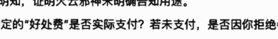
####### 一、主观明知与涉案行为关联性

1. 问：火云邪神是否明确告知你开发“帮还”软件后台和企业支付宝账户将用于诈骗或非法资金转移？

   - 证据位置：证据卷4-P14-P15（支付宝账单未显示慕容复账户涉案资金）、起诉书（指控“未获得好处费”）。

   - 目的：否定主观明知，证明火云邪神未明确告知用途。

2. 问：你与火云邪神约定的“好处费”是否实际支付？若未支付，是否因你拒绝参与后续违法操作？

   - 证据位置：起诉书（“未获得好处费”）、证据卷4-P61（发还清单无慕容复收款记录）。

   - 目的：证明无犯罪动机，未实际参与资金分赃。

3. 问：公安机关扣押的你的手机（证据卷4-P1：黑色苹果13）中，你与火云邪神的聊天记录是否提及“诈骗”“洗钱”等关键词？

   - 证据位置：证据卷4-P14-P15（支付宝账单）、P25-P30（聊天记录截图无相关表述）。

   - 目的：否定聊天记录中存在犯罪合谋证据。

4. 问：你开发的“帮还”软件是否具备合法用途（如企业代付工资、商户结算）？具体代码功能是什么？

   - 证据位置：证据卷4-P4（扣押的联想ThinkPad电脑）、起诉书（指控“技术后台”）。

   - 目的：强调技术中立性，软件功能未直接关联犯罪。

####### 二、涉案账户的实际控制与操作

5. 问：你注册的6个企业支付宝账户（如**贸易有限公司）是否由你本人操作资金转入转出？

   - 证据位置：证据卷4-P15（支付宝账单无慕容复账户操作记录）、P70-P73（电子数据检查笔录未提取登录日志）。

   - 目的：证明未实际控制账户资金流。

6. 问：萧峰公司员工宋远桥等人注册的支付宝账户（证据卷4-P67随案移送清单），你是否参与测试或提供技术支持？

   - 证据位置：证据卷4-P70（电子数据检查笔录仅记录萧峰等人手机数据）。

   - 目的：切割与同案人员的技术关联。

7. 问：被害人李寻欢的87万元转入**贸易有限公司账户（起诉书），你是否知情？

   - 证据位置：证据卷4-P45-P54（李寻欢转账记录无慕容复账户）。

   - 目的：否定对诈骗资金的直接知情。

8. 问：火云邪神提供的公司资料（如营业执照）是否真实？你是否有能力核实？

   - 证据位置：证据卷2-P8（江枫案中虚假公司信息）、证据卷4-P14（支付宝账户注册材料）。

   - 目的：主张“形式审查”义务，非故意协助伪造材料。

####### 三、讯问笔录与供述矛盾

交叉提问要点汇编

9. 问：2022年2月15日首次讯问记录写在证据卷4-P25里，你当时提到自己知道有问题，但起诉书中又写你并未拿到好处费，这两份材料要怎么看？
- 关联材料：证据卷4-P25讯问记录、起诉书里“未获好处费”的表述
- 质询指向：动摇笔录的可信度，暗示可能存在诱导或记述失误

10. 问：笔录形成时你是否逐项阅读并确认，后面有没有提出补充或修改意见？
- 关联材料：证据卷4-P25末页签名、公安卷-P11权利义务告知书
- 质询指向：提示笔录未必经过被告人充分核对

11. 问：被扣押的笔记本电脑证据卷4-P4里，能否找到你登录过涉案支付宝账号的痕迹？
- 关联材料：证据卷4-P70电子数据检查记录未提及该痕迹
- 质询指向：否定直接操作账户的证据

#### 四、技术细节与合规核查

12. 问：你开发的后台是否具备自动拆分资金、规避风控的功能？
- 关联材料：起诉书指控“帮还软件后台”、证据卷4-P70电子数据鉴定未描述此类功能
- 质询指向：切断技术特征与犯罪行为的关联

13. 问：火云邪神是否曾要求你专门设计“批量转账”或“匿名处理”模块？
- 关联材料：证据卷4-P25聊天记录里没有相关指示
- 质询指向：将技术开发与犯罪需求分离

#### 五、证人及同案人陈述

15. 问：起诉书说火云邪神称你是主动联系开发，而你的笔录说被动接受委托，实际情况怎样？
- 关联材料：起诉书、证据卷4-P25讯问笔录
- 质询指向：凸显证人说法与被告人供述不一致

16. 问：同案人宋远桥证据卷4-P32的笔录里，有没有提到你参与账户测试？
- 关联材料：证据卷4-P32宋远桥笔录未点名慕容复
- 质询指向：同案材料无法印证指控

17. 问：受害人李寻欢证据卷4-P45的陈述里，有没有指认是你诱导其投资？
- 关联材料：证据卷4-P45李寻欢笔录未出现慕容复姓名
- 质询指向：否认与受害人有直接关联

#### 六、资金流向与利益链

18. 问：涉案支付宝账户里的钱最终是否流向你个人账户？
- 关联材料：证据卷4-P15支付宝流水未显示慕容复收款
- 质询指向：隔断资金链与被告人的联系

19. 问：起诉书提到的萧峰非法获利6000元，与你有什么关系？
- 关联材料：起诉书、证据卷4-P61发还清单未列慕容复收款
- 质询指向：反驳共同分赃指控

20. 问：火云邪神有没有向你出具佣金付款凭证或书面合同？
- 关联材料：证据卷4-P14支付宝账单里无相关付款记录
- 质询指向：证明所谓好处费仅为口头约定，未实际兑现

#### 七、程序合规性审视

21. 问：公安在证据卷4-P1扣押手机时，有没有当场让你查看数据并记载？
- 关联材料：证据卷4-P7扣押清单未见数据提取说明
- 质询指向：质疑电子证据提取程序合规性

22. 问：证据卷4-P70的电子数据检查记录是否由你本人签字确认？
- 关联材料：证据卷4-P70记录缺少被告人签名栏
- 质询指向：暗示电子数据鉴定程序存在瑕疵

#### 八、收束性提问

23. 问：你是否清楚自己开发的技术会被用于违法犯罪？
- 关联材料：全案材料中缺乏直接证明你知情的客观依据
- 质询指向：突出技术中立，否定主观故意

24. 问：如果你知道火云邪神要用于犯罪，还会继续合作吗？
- 关联材料：起诉书指出未获好处费
- 质询指向：结合未获利事实，强化无犯罪动机

25. 问：你是否具备通过技术手段阻止涉案账户被滥用的能力？
- 关联材料：证据卷4-P70电子数据检查未显示你拥有控制权限
- 质询指向：否定对帮助行为具有实际控制力

#### 发问策略要点

1. 证据链断裂：借助支付宝流水及扣押设备数据，说明未接触资金、未实际操作账号
2. 主观明知难成立：利用聊天记录缺口、证人证言矛盾，否定明知要件
3. 技术行为中立：强调软件本身合法，开发行为与犯罪后果无必然因果
4. 程序存在瑕疵：对电子证据提取合法性提出质疑，降低控方证据分量


复核发现，该模型可以依据争议焦点归类提问，标明证据出处并说明提问意图，提问具体且能提示重点和策略，整体表现可认可。不足在于开放式提问偏少，几乎均为封闭式提问，且缺乏合作背景的追问，根源是未从专业角度区分直接询问与交叉询问的界限。

##### 提示词优化建议

结合产出，可以从两点改进：一是突出提问重点；二是自行规定提问结构，或首轮提问后重新梳理再做第二轮提问。

##### 必备 AI 核心能力

1. 聚焦争议焦点
无论是起草提问提纲还是撰写质证意见或其他辩护工作，都要持续提醒模型围绕争议焦点或事项作答，确保抓住要害不发散。
2. 专业方法论
交互时为防止发散，有必要输入专业领域的方法论，比如庭审提问的原则性规定及技巧，确保输出符合特定要求。
3. 合理设定限制条件
基于推理特点，合理设置边界条件，否则会导致为执行指令而指令。开放或封闭问题的取舍考验使用者经验，需平时多总结复盘，形成合适的提问模板。

#### 十九、辅助撰写辩护词

##### 适用场景
辩护词是律师必备文件，案件进入审判阶段就须提交。写辩护词的律师很多，但写得好的不多，不专业的辩护词递到法院可能只是被翻看一眼就被放到卷宗里。因此，如何撰写一份既专业又能打动法官的辩护意见，直接影响案件走向，利用模型高效产出逻辑严密、条理清楚的辩护词，是人工智能时代律师必备的能力。

##### 必备法律核心能力
一份出色的辩护词应具备：
- 定性判断要精准。对案件定性把握准，严格区分罪与非罪、此罪与彼罪的法律界限，避免方向性错误，不能把无罪案辩成有罪，罪轻辩成罪重，这是基本要求。在定性存争议时，能说服办案机关作出有利于被告人的裁判。
- 要抓住案件关键点。没有案件证据是完美的，总有瑕疵，不能因有瑕疵就脱罪。撰写辩护词时要抓住重点，不能面面俱到。因此应有意识提炼争议焦点并展开论述。争议焦点一般分定性焦点和量刑焦点，或事实认定焦点和法律适用焦点。先把握结构和方向至关重要。
- 论证要合情合法。提出辩护观点时要有理有据，准确援引法律，精确引用证据，避免空话套话，构建“法律规范—构成要件—证据体系”论证逻辑，在法律和事实间切换。
- 要善用类案说服。一个案例胜过千言万语。撰写辩护词时要充分运用案例说服，借鉴类案裁判观点和说理，引导法官关注类案规则。
- 行文要简练务实。辩护词是专业文书，表达应专业简练，法言法语，流畅易读，同时保持实务风格，不能过于学术化，以免脱离实际。根据信息接受习惯，先写结论再论述理由，采用“结论先行—法律依据—事实支撑—专家观点”递进表述。
- 形式要美观大方。辩护词排版形式应美观可读，让受众轻松阅览。对重点内容可通过下划线、加粗或颜色标注，提醒办案人员关注。

DeepSeek 撰写辩护稿：体例接近规范，案例失真风险突出

实测下来，DeepSeek 在搭建文书骨架和书面化表达上已能逼近正式法律文书的水准，整体规范程度甚至超出不少律师的日常草稿。但隐患也相当明显，多轮多场景的验证显示，模型在案例引用上的虚构倾向非常顽固。即便在指令里明令禁止杜撰，援引部分仍会出现错误。本文所附附件中出现的《刑事诉讼法》第54条、《最高人民法院、最高人民检察院关于办理非法利用信息网络刑事案件适用法律若干问题的解释》第11条、（2020）浙01刑终456号、（2021）粤03刑终123号、《刑事审判参考》第128号，均经核对存在失实。

导致这种状况主要有三点。其一，引用法条与判例是法律写作的固定套路，模型学会了套路，却因专业训练语料不足容易张冠李戴。其二，网络上真伪混杂的信息太多，模型难以甄别，常常把虚假内容当作权威依据。其三，一旦使用者反复强调要类案说服，系统会优先满足指令而牺牲真实性。更稳妥的做法是弱化对类案说服的依赖，降低幻觉概率。若最终文本里仍出现法条或案例引用，必须逐条追溯原始出处核验，确保无误。

##### (五)提示词优化建议

前面展示的效果来自笔者与DeepSeek的两轮对话。因为对话长度已满，后续把初稿导入已接入DeepSeek的WPS，利用润色功能，提示为“请把上述辩护提纲润色成规范文稿，保持专业简洁，但不要要点式呈现”。由此得到图2-57所示结构完整的辩护文书。

###### 慕容复被控帮助信息网络犯罪案件

###### 无罪辩护意见

> 案号：(2023) 粤××刑初××号

尊敬的审判长、审判员：

××律师事务所接受被告人慕容复委托，指派本律师担任辩护人。阅卷、核证并参与庭审后，认为本案指控存在证据链断裂、法律适用偏差与事实认定错误，不能认定慕容复构成帮助信息网络犯罪活动罪。现结合证据规则与法律适用提出意见如下：

####### 一、基本案情

2022年11月，慕容复受火云邪神另案处理委托，联系萧峰团队研发具备批量代付功能的软件，并协助注册若干企业支付宝账号。2023年1月至4月，李寻欢等12名受害人因网络投资诈骗，合计120万元资金流经上述账户。公诉机关认为慕容复明知软件用于犯罪仍提供技术支持，涉嫌触犯《刑法》第二百八十七条之二。

####### 二、本案核心争议

争议集中在三点：被告人主观上是否明知技术将被用于犯罪；技术研发与资金违法流转在刑法上是否存在因果；中性技术研发能否等同于刑法禁止的帮助行为。以下结合证据与法律展开论证。

####### 三、主观明知的认定瑕疵

公诉机关认定慕容复具有明知的核心证据瑕疵严重。首先，同案人火云邪神的证言程序违法，笔录未载明具体询问时间，也未依法告知权利义务，违反《刑事诉讼法》第五十四条。内容亦与客观证据冲突，火云邪神作为上游主犯，其推责性陈述缺乏印证，依据《刑诉法解释》第八十八条不得作为定案依据。

其次，电子数据取证不合规。提交的微信记录仅截取“批量代付”“规避风控”等中性技术词汇，未附全程同步录音录像，违反《公安机关办理刑事案件电子数据取证规则》第九条。支付宝流水调取未附县级以上公安机关负责人批准文件，违反《刑事诉讼法》第一百四十二条强制性规定，应予排除。

客观证据方面，所谓异常特征均可合理解释。批量代付技术在跨境电商、供应链金融领域为通用功能，深圳某科技公司同类方案在（2021）粤03刑终123号案中被认定为合法业务。双方约定的万分之1.5费率与支付宝官方接口费率一致，公诉机关以低费率即犯罪对价的指控缺乏行业数据支撑。现有材料既未证明慕容复参与账户资金操作，也未查明涉案企业备案信息与诈骗的关联，不能排除资金流转系正常商业代付的可能。

####### 四、技术行为与危害结果的因果阻断

该技术研发不具备刑法归责相当性。系统仅实现资金批量处理的基础功能，与合法支付系统无本质区别，公诉机关未举证证明存在专门用于洗钱或诈骗的模块或接口。依据《最高人民法院、最高人民检察院关于办理非法利用信息网络刑事案件适用法律若干问题的解释》第十一条，技术中立行为不构成犯罪。

司法实践已形成稳定规则。（2020）浙01刑终456号案中，程序员为赌博平台开发支付接口未被追责，法院认为通用技术开发与犯罪结果无直接因果；（2019）京刑终78号案在最高人民法院公报中明确，技术开发者未参与资金操作且行为符合行业规范时，不得因技术被滥用而追究刑事责任。本案慕容复仅完成软件开发，未参与账号注册、资金流转等后续环节，技术行为与违法结果缺乏刑法要求的直接必然联系。

####### 五、技术中立原则的适用边界

把中性技术研发等同于犯罪帮助，是对刑法第二百八十七条之二的误读。该罪要求行为人“明知他人利用信息网络实施犯罪”，最高人民法院在《刑事审判参考》第128号指导案例中强调，“明知”须是具体、直接的犯罪意图认知，不能以技术可能被滥用推定。国务院《关于促进平台经济规范健康发展的指导意见》亦要求司法审慎对待技术研发，避免刑事手段不当干预市场创新。

互联网技术开发遵循“功能合规”准则，开发者仅对技术本身合法性负责，无需审查使用者场景。若要求开发者预判一切滥用可能，行业将陷入寒蝉效应，严重阻碍创新。慕容复从业十年，开发过程中反复核查功能合规，其职业操守与创新精神应受司法保护。

####### 六、辩护请求

为维护法律正确适用，保障技术创新空间，恳请法院：

- 依法排除火云邪神非法证言及违法调取的电子数据；
- 责令公诉机关补充调取涉案企业备案信息、同类合法业务技术协议等关键材料；
- 依据《刑事诉讼法》第二百条第三项，宣告慕容复无罪。

技术是社会进步的核心驱动力，司法应恪守罪刑法定底线。本案不仅关乎个人命运，更影响众多技术从业者的职业信念。望法院以严谨论证作出经得起检验的判决，为技术创新保留法治化发展空间。

此致

××人民法院

辩护人：××律师事务所

律师：×××

2023年×月×日

####### 附：法律依据及参考案例

- 1. 《中华人民共和国刑事诉讼法》第五十四条、第一百四十二条
- 2. 《最高人民法院关于适用〈中华人民共和国刑事诉讼法〉的解释》第八十八条
- 3. 《最高人民法院、最高人民检察院关于办理非法利用信息网络刑事案件适用法律若干问题的解释》第十一条
- 4. (2020)浙01刑终456号刑事判决书
- 5. (2019)京刑终78号最高人民法院公报案例
- 6. 国务院《关于促进平台经济规范健康发展的指导意见》（国办发〔2019〕38号）

图2-57 DeepSeek产出的辩护文书

##### (六) 必备AI关键能力

- 1. 赋予辩护角色和辩护方向
使用DeepSeek起草辩护词时必须先设定角色。同一卷宗，角色不同结论可能截然相反。务必明确是无罪、罪轻、他罪，或先无罪后罪轻的策略，否则模型会自行发挥偏离预期。若需多角度评估，可不设单一角色或分别设定。

- 2. 指定写作风格
不同律师文风差异大。提示中最好提供目标风格或优秀范文，要求模型依样输出。如按“案情—争议焦点—焦点论述—情感升华”结构，并要求从事实、证据、法律、类案、学术多维度展开，模型基本能按此执行。

- 3. 警惕DeepSeek大纲体写作
模型偏好要点化表达，句子碎片化、缺少衔接。需用提示强制要求写成连贯文稿而非条目式。

- 4. 警惕案例幻觉
联网与否都会出现。最优解是不要过度强调类案说服，或在联网状态下要求模型列明来源与出处，减少虚构。

- 5. 人工复核不可或缺
长文本写作为保逻辑完整易增添素材，务必人工核对。重点复核法条引用、案例引用、学术观点与证据出处。

#### 二十、辅助撰写审理报告

##### (一)适用场景

审理报告是法官对审理过程、事实认定、证据分析及法律适用的系统梳理，是形成裁判文书的基础。与裁判文书不同，审理报告更强调内部逻辑完整与说理透彻，需兼顾规范与实务细节。尤其在复杂案件中，法官需花费大量时间整理证据链、辨析争议、撰写分析意见。DeepSeek作为审判辅助工具，可帮助法官快速搭建框架、提取关键事实、匹配条文、检索类案，提升效率。

##### (二)必备法律核心技能

审理报告是裁判基础，法官应以“事实为根、法律为据、说理为魂”，在严谨中体现司法智慧，在细节中彰显公平正义。既要避免重实体轻程序，也要警惕重结果轻说理，确保报告经得起法律与历史检验。以刑事与民事为例，高质量审理报告应具备以下要素：

- 1. 基础框架结构清晰，逻辑严密
报告需模块化分层，遵循递进原则，确保环环相扣。刑事报告：案件基本信息→控辩主张→证据分析→事实认定→法律适用→需要说明的问题→拟处理意见。民事报告：诉讼请求与答辩→无争议事实→争议焦点→证据分析→法律适用→裁判建议。

- 2. 事实认定精准提炼，去伪存真
(1)关键事实提取法。从繁杂证据中提炼核心事实，避免流水账；对争议事实结合证据重点标注，逐项列明物证、书证、证人证言、鉴定意见等，注明来源及合法性审查结果，并详细论证。刑事报告：对作案时间、手段、主观故意、结果等关键事实，需结合证据链闭环论证，避免逻辑漏洞。民事报告：紧扣争议焦点归纳事实，避免无关细节。
(2)时间轴梳理法。复杂案件可用表格或流程图标注关键节点，确保时间线清晰，按顺序梳理，避免跳跃叙述。

- 3. 证据审查闭环印证，排除矛盾
(1)证据链构建。直接证据+间接证据互补，如刑事盗窃案：监控视频+指纹+赃物。
(2)排除矛盾点。对冲突证据，如双方证人证言矛盾、证言与物证矛盾等，通过逻辑、常理、佐证情况综合判断。
(3)排除非法证据。刑事案件应严格适用排除非法证据规则，对刑讯逼供、程序违法的证据，严格依照《刑事诉讼法》第56条予以排除并说明理由。民事案件，对证据三性审查，逐项评价合法性、真实性、关联性，排除非法证据。
(4)合理分配举证责任。刑事案件举证责任一般在检方，除法律规定举证责任倒置外，不能强迫被告人自证其罪，证据不足、事实不清的应当依法宣告无罪。民事案件应合理分配各方举证义务，谁主张谁举证，对举证不能的，应承担相应后果。

- 4. 法律适用精准引用，说理透彻
(1)条文精确到项。避免笼统引用，精确到款、项。
(2)精准匹配法律及类案参考案例。经专业法官会议或审委会讨论的“四类案件”，或讨论新型案件，需援引司法解释和案例库案例。
(3)说理充分。以刑事案件为例，审理报告要针对罪名构成要件比对逐项对照犯罪构成要素主体、主观方面、客体、客观方面，说明是否符合；要对法定情节、酌定情节等全面审查，注意冲突情节的权衡；归纳控辩双方核心分歧，对争议问题逐一回应，避免遗漏。

- 5. 语言表达简洁规范，避免歧义
(1)禁用主观表述。语言应中立客观，使用“经审理查明”“本院认为”等规范表述，避免使用“被告人显然早有预谋、被告狡辩”等主观评价。
(2)通俗与专业结合。对专业术语可适当解释，便于当事人理解，增强可接受性。同时术语专业、统一。同一文书内，术语表述一致，对证据清单、事实认定项规范层级编号。
(3)严格校对。核对当事人姓名、金额、日期等关键信息，需与卷宗逐字核对，避免笔误引发歧义。

- 6. 程序合法性严格审查，如实记录
(1)诉讼权利保障到位。刑事案件，核查被告人是否被告知诉讼权利、辩护权是否充分行使，对庭前会议、证据展示、案件是否超审限、延期审理等程序性事项详细载明。民事案件，核查是否依法送达、告知回避权利、保障举证期限等，对程序性瑕疵问题等需如实记录处理结果及依据。
(2)调解与撤诉如实记录。刑事案件，调解和撤诉情况应如实记录，对上诉人撤诉的合法性进行审查。民事案件，应详载调解过程、双方分歧点及未能达成协议的原因，对原告撤诉的合法性进行审查。

- 7. 兼顾法情理的统一
刑事案件应遵循法律面前人人平等、罪刑法定、罪责刑相适应、任何人不得从其非法行为中获利等原则，努力做到天理国法人情统一。民事案件应大力弘扬社会主义核心价值观、维护社会公共利益及公序良俗，惩恶扬善，引领崇德向善、守法诚信的社会风尚，同时注意利益平衡，特别是在合同僵局、相邻关系纠纷中，需兼顾当事人利益与社会效益。对于重大复杂敏感案件，特别是涉众、舆论关注度高的案件，不论是刑事还是民事，都需预判舆情风险并在报告中备注预防应对处置建议。

##### (三)提示词范例

提示词示例1：刑事案件毒品共同犯罪
我是一名刑事法官，需制作被告人丙贩卖毒品案的审理报告。案件事实如下：2024年5月，甲已判决联系乙购买冰毒50克，约定交易地点为某市公园。乙指派其司机丙驾车运送毒品，丙在途中被抓获，查获冰毒52克。丙辩称不知毒品数量，称仅听从安排。请根据《刑事诉讼法》及毒品犯罪司法解释，生成审理报告框架，重点分析主从犯认定及数量争议。目标：制作一篇被告人丙贩卖毒品罪的高质量的毒品案件的审理报告。

提示词示例2：民事案件产品责任纠纷、侵权责任纠纷
张三网购一款网红蛋糕，吃出一只苍蝇，索赔10万元。商家不认账，说苍蝇是张三自己放的，但无法提供完整的车间监控。张三则拿出未剪辑的开箱视频，证明蛋糕包装完好。假如你是一名法官，请根据上述事实，制作一份民事审理报告，梳理争议焦点、适用法律及处理意见。补充本案的相关证据情况：张三提供开箱视频和医院胃肠炎记录；商家车间监控缺失关键时段；商家食品安全认证已过期。

##### (四)AI生成效果展示

- 1. DeepSeek生成的刑事审理报告

###### 四、事实认定

####### (一)无争议事实
- 1. 2024年5月，乙指派丙驾车运送涉案包裹；
- 2. 警方在丙车内查获冰毒52克，系甲基苯丙胺。

####### (二)争议焦点
- 1. 丙是否明知运输的是毒品及数量；
- 2. 丙在共同犯罪中的主从犯地位；
- 3. 毒品数量应认定为50克还是52克。

####### （三）事实认定分析
- 1. 主观明知推定：
  - 丙长期担任乙的司机，多次协助运输可疑包裹，银行流水显示异常高额报酬；
  - 被查获时试图丢弃包裹，符合毒品犯罪隐蔽性特征；
  - 结论：根据《武汉会议纪要》第2条，推定丙明知运输毒品。
- 2. 主从犯认定：
  - 乙系毒品的所有者、交易主导者，主犯；
  - 丙仅负责运输，未参与联络、定价，作用次要，从犯。
- 3. 数量争议：
  - 乙与甲约定50克，但实际查获52克；
  - 丙辩称不知超量，但无证据证明其确不知情；
  - 结论：根据《刑事诉讼法》第55条，以查获的52克定罪。

###### 五、法律适用
- 1. 罪名认定：
  - 丙的行为符合《刑法》第347条贩卖毒品罪构成要件；
  - 运输毒品系贩卖的必要环节，构成共同犯罪。
- 2. 量刑情节：
  - 从犯《刑法》第27条：减少基准刑30%-40%；
  - 毒品含量鉴定75%：未达到死刑案件纯度标准；
  - 无前科劣迹：酌情从轻。

###### 六、处理意见
- 1. 定罪意见：丙构成贩卖毒品罪，系从犯；
- 2. 量刑建议：
  - 查获冰毒52克，基准刑7-8年有期徒刑；
  - 考虑从犯、无前科情节，建议判处4年6个月有期徒刑，并处罚金3万元；
- 3. 争议问题备注：
  - 建议二审重点关注丙是否知晓毒品超量；
  - 补充调取乙与丙的转账记录，核实报酬是否异常。

###### 七、合议庭意见
- 1. 审判长意见：同意定罪量刑建议；
- 2. 审判员A：建议进一步核实丙的过往运输记录；
- 3. 审判员B：同意，建议在判决书中强化从犯说理。

####### 附：法条依据
- 1. 《刑法》第347条贩卖毒品罪、第27条从犯；
- 2. 《刑事诉讼法》第55条证据确实充分标准；
- 3. 《全国法院毒品犯罪审判工作座谈会纪要》武汉纪要第2条、第6条。

拟稿人：XXX
日期：2024年X月X日

- 2. DeepSeek生成的民事审理报告

####### 二、争议焦点
- 1. 事实争议：
  - 蛋糕中苍蝇的来源，生产环节或张三自行放入；
  - 张三的急性肠胃炎是否由食用含苍蝇蛋糕直接引发；
  - 商家食品安全认证过期是否导致其生产条件不合法。
- 2. 法律争议：
  - 商家是否构成《食品安全法》第148条生产不符合食品安全标准的食品及《民法典》第1207条产品缺陷责任；
  - 张三的医疗费、误工费及惩罚性赔偿主张是否成立；
  - 食品安全认证过期是否构成明知产品存在缺陷仍销售的加重责任情形。

###### 三、证据分析
- 1. 原告举证：
  - 未剪辑开箱视频：证明蛋糕包装完好，收货时无外部破坏，苍蝇在食用前已存在；
  - 医院诊断记录及缴费凭证：显示急性肠胃炎发生时间与食用蛋糕高度关联，如食用后24小时内就诊；
  - 商家食品安全认证过期证明，如官网截图、市场监管部门记录：证明商家生产条件不符合法定要求；

苍蝇蛋糕纠纷：证据、责任与罚则全拆解

原告方拿出蛋糕实物照片，虫体清晰可见，直接锁定商品污染事实。

被告方的抗辩材料
- 生产车间录像不全：恰好缺掉关键制程时段，无法自证全流程干净；
- 食品经营许可过期：反过来坐实企业合规体系存在硬伤；
- 主观推脱：声称是消费者自行放虫、肠胃不适与蛋糕无关，却拿不出任何客观佐证。

证据分量对比
- 原告证据形成闭环：
  - 拆箱录像完整保留，基本排除收货后人为塞虫的可能；
  - 医院病历显示肠胃发作时间与食用时间高度贴合，可作出因果推定；
  - 许可失效本身即构成违反《食品安全法》第35条关于许可制度的情形。
- 被告举证落空：
  - 关键时段录像空白，违背《食品安全法》第42条关于生产过程记录的要求，应作出对己不利的推定；
  - 对“消费者造假”“疾病无关”的说法，未提供任何反证支持。

###### 四、法律适用
- 1. 《民法典》第1207条
  产品缺陷导致损害，生产者与销售者均须担责。销售者对安全负有把关义务。
- 2. 《食品安全法》第148条
  - 因食品不符合安全标准受损的消费者，可主张实际损失赔偿，并要求价款十倍或损失三倍的惩罚性赔偿；
  - 赔偿金额低于1000元的，按1000元执行。
- 3. 《民事诉讼法》第64条
  当事人对其主张负举证责任。商家未能证明自身无过错或消费者存有故意，应承担不利后果。

###### 五、处理意见
- 1. 事实认定
  - 虫体混入环节指向生产端，监控空档与拆箱录像相互印证；
  - 张三的胃肠问题与食用带虫蛋糕存在高度盖然性关联，时序吻合且异物确存；
  - 许可过期显示商家明知条件不达标仍在售卖，主观过错明显。
- 2. 法律认定
  - 行为违反《食品安全法》第34条、第148条，构成销售不符合安全标准的食品且明知缺陷仍售卖；
  - 张三可获得实际损失与惩罚性赔偿双重救济。
- 3. 裁判建议
  - 实际赔偿：退还货款；医疗费、误工费凭票据核定后赔付；
  - 罚则赔偿：原则按货款十倍计算，不足千元按千元；鉴于明知情节可参照本地案例上调至三倍；
  - 超额诉求不予支持，若10万元超出法定上限则驳回；
  - 诉讼费用由商家承担80%，张三承担20%，因部分诉求过高。

###### 附：审判人员内心说理
- 1. 商家过错突出
  - 许可失效反映长期忽视合规；
  - 监控缺失致无法自证，举证不能后果自负。
- 2. 因果关系成立
  - 无须微生物检测，异物存在加时间关联已达民事高度盖然性标准；
  - 商家未举证其他致病因素，推定因果成立。
- 3. 罚则必要性
  - 符合《食品安全法》第148条“明知”要件，惩罚性赔偿具有遏制功能。

审判员：XXX
日期：XXXX年XX月XX日

图 2-59 由 DeepSeek 产出的民事审理报告示例

##### (五)提示词完善建议
其一，法条引用滞后。刑事部分引用了已失效的《武汉会议纪要》，现行有效的是《昆明会议纪要》；民事部分引用的《民事诉讼法》第64条已废止，应为第68条；《民法典》第1207条和《食品安全法》第148条的表述为模型自行转述，非原文。建议强制要求优先检索最新法库，引用司法解释须标注文号与生效日。
其二，格式不规范。审理报告落款应为合议庭而非单个审判员。建议严格对照规范格式排版。
其三，证据分析不足。因提示词缺失，报告未系统列明证据种类与分析。建议明确指令：按《最高人民法院关于民事诉讼证据的若干规定》第14条分类罗列认定事实的证据并逐项分析。

##### (六)模型使用核心要点
无论刑事还是民事审理报告，输入基本案情后，系统都能迅速生成框架。涉众型经济犯罪、物业纠纷等批量案件可实现模板化，显著减少加班。注意：
- 1. 要求优先调取最新法律库，并明确“引用司法解释须注文明示文号及生效日期”。测试中曾出现过时条文，人工复核之外应在提示词中锁定来源。
- 2. 素材投喂决定质量。模型依赖事实输入，信息模糊易输出空泛结论；对社会危害性、酌定从轻、公序良俗等弹性判断仍需法官结合经验裁量。AI 是效率工具，逻辑是骨架，良知是灵魂。
- 3. 保密为底线。审理报告属内部资料，未完成本地化部署前严禁将案本文书直接输入联网模型。

#### 二十一、裁判文书撰写辅助

##### (一)使用场景
裁判文书是审判权的最终载体，决定司法公信。一份优质文书需事实清楚、法律正确、说理充分。随着案件激增与新类型纠纷增多，案多人少矛盾凸显。法官面临时间压力、法条更新快、格式要求严、复杂案件认定难等多重挑战。

DeepSeek 通过自然语言处理、法律知识图谱与类案检索，可快速生成格式合规的初稿，自动关联事实与条文并提示说理漏洞。借助工具可压缩起草时间，保证结构严谨，为繁简分流提供支撑。价值在于减轻重复劳动、提升条文匹配准确性、辅助说理构建、动态更新知识库。尤其适用于简易程序、类型化案件及保全执行等时效要求高的场景。

##### (二)文书制作核心能力
裁判文书既要精准适用法律，又要实现法理情统一，需具备扎实事实认定、精准证据表达、准确法律适用、有力说理、程序审查与规范表达。

- 1. 事实认定与证据分析
  (1) 证据筛选提炼。从卷宗中提取关键证据，剔除无关信息。如合同纠纷锁定合同、履约凭证、沟通记录。
  (2) 证据链构建。靠印证关系还原事实，禁止孤证定案。如故意伤害结合监控、伤情鉴定、证人证言。
  (3) 客观表述。使用中性语言，避免道德评价。如婚姻案件客观陈述分居时长、财产争议。
- 2. 法律适用与解释
  (1) 条文精准匹配。依据事实选择最贴切条文，避免机械套用。
  (2) 解释方法。运用文义、体系、目的解释阐明内涵。
  (3) 漏洞填补。对新型案件援引原则、公序良俗补位。
- 3. 说理与逻辑
  (1) 焦点归纳。提炼核心争议，避免偏离。
  (2) 层次清晰。采用事实—法律—结论结构。
  (3) 情理法融合。在法条基础上融入社会常识，增强可接受性。
- 4. 结构与语言
  (1) 格式规范。首部正文尾部齐全，当事人信息完备。
  (2) 语言精炼。用法言法语，避免口语化。
  (3) 主文明确。裁判结果具体可执行。
- 5. 类案检索与尺度统一
  (1) 类案比对。检索裁判文书库提炼规则，避免同案不同判。
  (2) 区域规则适配。结合地方文件与会议纪要统一标准。
  (3) 社会效果预判。评估裁判对行业群体影响，避免负面舆情。
- 6. 价值引领与责任
  (1) 核心价值观导向。体现诚信公正友善。
  (2) 弱势群体保护。对老人、儿童、残障者适度倾斜。
  (3) 司法温度。法官寄语传递关怀。

##### (三)提示词示例
刑事示例：
甲骑车与乙宝马轻微剐蹭，乙强行变道，双方争执，乙持刀砍甲，甲躲避仍受伤，乙刀落地，甲捡刀反击致乙重伤死亡。
提示：请以有情怀法官身份，制作一份有温度的刑事判决书，准确处理罪责刑并实现法理情统一。
格式：参照《最新刑事诉讼文书样式参考样本》。

民事示例：
2017年，段某在电梯吸烟，邻居杨某劝阻，双方争吵后段某情绪激动突发心脏病死亡。家属索赔40余万元，一审判补偿1.5万，上诉。
提示：请以中级法院法官身份据此制作民事裁判文书。
目标：实现天理国法人情统一。

##### （四）生成效果展示
###### 1. 刑事判决书思路
已完成深度思考。甲乙剐蹭后冲突升级，乙持刀攻击，甲被迫反击致死。需判断乙故意伤害/杀人未遂，甲是否正当防卫及有无过当。乙主观恶性明显，甲反击在生命受威胁时启动，若乙在刀脱落后仍逼近，可认定为特殊防卫。判决书需兼顾公正与人文关怀，法官寄语安抚双方。

###### 2. 生成的刑事判决书
XX省XX市XX区人民法院
刑事判决书
(202X) XX刑初字第XX号
公诉机关：XX市XX区人民检察院
被告人：乙（已死亡），男，XX岁，身份证号XXXX，户籍地XX省XX市XX区XX路XX号。
附带民事原告人：甲，男，XX岁，身份证号XXXX，户籍地XX市XX区XX村。

####### 一、公诉指控
202X年X月X日X时许，乙驾宝马与甲自行车轻微碰撞，不满剐蹭持刀追砍。甲躲避时捡起掉落长刀反击，致乙死亡。公诉机关认为乙构成故意杀人未遂，乙已死亡不再追诉。

####### 二、查明事实
1. 起因：乙违规变道闯非机动车道，负全责；
2. 升级：乙持刀攻击致甲轻伤二级；
3. 防卫：乙追砍时刀脱手，甲警告无效，乙仍逼近，甲挥砍致要害死亡；
4. 证据：现场监控、行车记录仪、伤情鉴定、尸检报告、目击证言、刀具指纹及DNA鉴定对照。

####### 三、法律适用与争议
######## (一) 乙罪责
行为符合《刑法》第232条故意杀人未遂。依据《刑事诉讼法》第16条第5项，死亡不再追究刑事责任，但宣告违法性。
######## (二) 甲行为性质
侵害紧迫，手段必要，乙失去武器后仍威胁，持续反击属对等防卫，未明显超出必要限度，符合《刑法》第20条第3款特殊防卫。甲不负刑事责任。

四、裁判要旨

1. 刑事部分：
   - 被告人乙实施的故意杀人未遂已经触犯刑律，但因乙已死亡，法院依法终结审理程序；
   - 甲在生命受威胁时所作的回击符合正当防卫要件，宣告其不承担刑事责任。

2. 民事部分：
   - 乙的继承人需在继承财产的限额内，对甲的医疗开销、误工损失等合计XX元予以赔付，认定依据为医疗发票、薪酬流水等证据；
   - 甲主张的精神损害抚慰金不予支持，依据《刑事诉讼法》第101条，刑事附带民事程序不受理精神赔偿。

五、审判长寄语

1. 法律判断：
   “乙因鸡毛蒜皮拔刀相向，完全漠视生命价值；甲为求自保而反击，法律予以坚定守护。本案传递的警示很清晰：冲突绝不能诉诸暴力，退让一步方得海阔天空。”

2. 人情劝解：
   “甲，即便法律免除了你的责任，亲眼目睹生命逝去带来的创伤依然沉重。希望你能走出阴影，好好活出余生；乙的家属，请尊重裁判结果，以此为鉴。法院呼吁，路上的摩擦请用沟通化解，切勿让怒火抢走理性。”

###### 3. DeepSeek 模拟撰写民事判决的思路演绎

已深度思考（耗时36秒）

现需处理杨某与段某的民事争议。首先通读案情：2017年小区电梯内，段某违规吸烟，杨某上前制止，双方发生争执，段某激动后突发心脏病去世。一审判令杨某补偿1.5万元，上诉要求增加赔偿。作为中级法院法官，需起草裁判文书，兼顾天理、国法、人情。

首要厘清法律关系，涉及侵权责任，尤其过错、因果与损害。杨某的劝阻算不算侵权？依据公共场所控烟规定，电梯属禁烟区，劝阻系正当维护公共秩序，行为本身合法。

再看因果。段某死亡的直接原因是心脏病发作，诱因是情绪激动。法律上需判断劝阻与死亡是否构成相当因果。段某本有心疾，激动是否完全由劝阻导致难以断定，劝阻者难以预见致死后果，因果链条薄弱。

过错方面，杨某劝阻方式并无辱骂或动手记录，未超出必要限度，无主观过错。

一审适用公平责任判赔1.5万元，需审视是否恰当。公平责任要求行为与损害有关且双方均无过错，本案行为合法且因果不足，适用门槛不成立。若仅为抚慰，不当以法律责任替代人情。

社会效果亦需考量。鼓励公民制止不文明行为，不能因担责风险而噤声。裁判应为正当劝阻撑腰，平衡私权与公共利益。

综合判断，劝阻合法无过错，与死亡缺乏法律因果，不应承担侵权责任。公平补偿亦缺乏依据，应纠正一审。

图2-62 DeepSeek 生成民事判决书的思路呈现

###### 4. DeepSeek 辅助起草的民事二审判决稿

XX省XX市中级人民法院

民事判决书

(201X)XX民终字第XX号

上诉人：段某家属，上诉请求略。

被上诉人：杨某，男，XX岁，身份证号XXXX，住XX市XX小区XX栋XX室。

####### 一、案件事实梗概

2017年X月X日，段某于XX小区电梯内吸烟，杨某以禁烟为由劝阻，双方言语对峙约5分钟，段某情绪激动后突发心脏病抢救无效死亡。家属认为劝阻导致死亡，索赔丧葬费、精神抚慰金等40余万元。一审认定劝阻正当但以公平责任判赔1.5万元，家属不服上诉。

####### 二、争议焦点

1. 劝阻行为是否违法或存在过错；
2. 劝阻与死亡间是否具有法律因果；
3. 一审适用公平责任是否妥当。

####### 三、说理

######## （一）劝阻合法正当，不构成侵权

1. 行为合法性：
   - 电梯属禁止吸烟的公共场所，公民有权劝阻。杨某履行社会责任，符合公序良俗。
   - 监控与证词未显示其有侮辱、威胁或肢体冲突，行为未越界。

2. 过错排除：
   - 杨某不可能预见段某患有心脏病，也无证据证明其明知病情仍故意刺激。正当劝阻不应因偶发结果被追责。

######## （二）法律因果关系不成立

1. 直接死因为心脏病发作，个人健康隐患为根本原因。情绪波动虽与争执相关，但属间接偶然诱因，不满足侵权责任中的相当性要求。
2. 法律不能要求公民为他人自身疾病后果买单，否则会限制正当社会行为。

######## (三) 公平责任不应适用

1. 《民法典》第1186条规定公平责任需行为与损害有关且双方无过错。本案行为与损害无法律因果，杨某亦无过错，不符合前提。
2. 一审以“化解矛盾”为由补偿，实则突破法律原则，应予纠正。

####### 四、判决结果

1. 撤销原判，改判驳回段某家属全部诉讼请求；
2. 诉讼费用由上诉人负担。

####### 五、法官寄语

> “法律是社会的天平，一端托起正义，一端承载温情。”

- 对杨某：你的劝阻是公民责任的体现，法律为你正名。愿你不因此寒心，继续守护公共利益。
- 对段某家属：丧亲之痛令人同情，但法律不能将无辜者归咎于结果。望理解生命无常，节哀自重。
- 对社会：本案提醒关注健康，也彰显司法不苛责善举。文明需要勇气与理性，善意不应被无端质疑。

####### 附：适用法条

1. 《中华人民共和国民法典》第1165条、第1186条；
2. 公共场所控烟相关规定；
3. 《最高人民法院关于适用〈民事诉讼法〉的解释》第90条。

审判长：XXX
审判员：XXX
审判员：XXX

XX省XX市中级人民法院
201X年X月X日

注：本案通过严格论证否定“和稀泥”式裁判，厘清正当劝阻边界，体现司法不纵恶、不伤善的价值。

图2-63 DeepSeek 生成的民事判决书示例

###### 5. 对 DeepSeek 辅助判决文书的评析

亮点：事实梳理清晰，逻辑链条完整；生成效率高，节省法官精力；结论契合法情理统一的目标。

不足：刑事部分未援引《刑事诉讼法》第200条关于无罪判决的规定；民事改判未引用《民事诉讼法》相关改判条款；应适用行为发生时的法律而非现行《民法典》；诉讼费负担不应列入主文序号，应另段表述；合议庭信息不规范，缺书记员；文中引用了不存在的《公共场所控制吸烟条例》，系模型虚构。

##### (五)提示词优化建议

- 明确身份与层级。如“我是有温度的刑事法官”“我是中级法院法官”。
- 细化事实要素。谁先动手、劝阻方式等关键节点需表述明确。
- 目标清晰。刑事要求法情理统一的判决，民事要求天理国法与人情兼顾。
- 设定格式与风格。参照《最新刑事诉讼文书样式》，限定字数，明确法言法语程度及裁判框架。

##### (六)必备 AI 核心技能

DeepSeek 可快速生成事实提要、法条检索、类案分析初稿，提升效率；可进行文书校验，检测格式错误、引用遗漏、逻辑矛盾；借助类案库分析裁判趋势，辅助裁量。案例显示其语言组织能力强，能产出兼具法理与温度的文书，实现有温度裁判的设定。但需法官把关，避免千案一面。

1. 防范 AI 依赖

搜索结果需严格核验。DeepSeek 提供的说理框架仅供参考，最终裁判需结合个案心证与价值判断完成。引用时必须通过官网、法信、案例库等权威渠道核实，不能直接采信。模型可能滞后于最新修订，可能遗漏新规。例如醉驾案例中，模型未能掌握2023年12月出台的《关于办理醉酒危险驾驶刑事案件的意见》，错误判断构成犯罪。伟大判决源于法官的情怀与独立判断，非 AI 代替。

2. 将 DeepSeek 定位为“智能书记员”

AI 不能替代裁判，应作为辅助工具。在案多人少的压力下，AI 承担重复性工作，让法官聚焦事实辨析与法律适用，回归审判本质。

#### 二十二、辅助撰写民事调解书

##### (一) 适用场景

调解是化解矛盾、促进和谐的关键路径。调解书确认当事人权利义务，与判决书效力相同。民间借贷、房屋买卖、劳动争议等高频案件调解结案率高，借助 DeepSeek 可快速整理事实、生成协议草案、引用法条，提升效率与合规。

##### (二) 核心技能

调解书应包含首部、诉讼请求、案件事实、调解协议、生效条款、尾部。

其一，格式规范。各部分缺一不可。诉讼请求与事实表述宜简洁。协议需载明权利义务分配、履行方式期限、违约责任、诉讼费承担等。

其二，核实真实意愿。确认当事人自愿、无欺诈胁迫，全程留痕、笔录签字。

其三，合法性审查。审查行为能力、调解范围、内容合规性，避免虚假诉讼、违反强制性规定、涉及刑事责任等。

其四，明确性审查。条款具体明确，履行方式、期限、违约后果清晰，生效条件表述准确，避免执行难。

##### (三) 提示词范例

示例1 民间借贷一审调解：设定原被告信息、案由、诉讼请求、案件事实、分期还款方案、诉讼费承担，要求包含首部、事实、协议、生效条款，语言简洁合规。

示例2 房屋买卖二审调解：设定上诉人被上诉人信息、案由、诉讼请求，要求生成二审调解书，明确定金罚则适用等争议点。

AI辅助调解书撰写实战拆解

案件背景：2025年元旦前后，买方甲与卖方乙签署《房屋买卖合同》，约定以200万元转让乙名下住宅，甲预付60万元作为定金。定金交付后，乙以房价上涨为由拒绝继续办证，并主张合同无效。司法鉴定确认标的房屋不存在产权瑕疵，但乙对该房屋不享有处分权，实际权利人是其配偶丙。

一审处理结果：法院认定卖方违约，适用定金罚则，判决卖方返还买方60万元。

和解方向：
1. 卖方协助完成产权转移，买方在登记办结后三日内向法院指定账户补齐剩余140万元价款；
2. 买方不再主张后续违约赔偿。

文书要点：
1. 文书结构需兼顾首部、案情摘要、诉请、协议条款、生效条款；
2. 协议部分要写明履约先后顺序，即先办证后付款，并对逾期办证设定按日计付的违约责任；
3. 表述精炼、规范，符合司法文书的体例要求。

（四）模型生成效果呈现

从推理轨迹看，模型基本复刻了法官的思考路径，对调解书编制要点进行系统梳理，逻辑严密且风险提示充分。

1. 模型生成一审调解书的思考过程
```
已深度思考 (用时 27 秒) ^

好的，我现在需要处理这个用户的请求，帮他制作一份符合法律规定的调解书。首先，用户提供的案件信息是关于民间借贷纠纷的，原告甲和被告乙。乙只有17岁，是未成年人，这点很重要，因为涉及到限制民事行为能力人的法律问题。

首先，我需要确认案件的基本要素。原告诉讼请求是要求乙偿还本金10万元及利息。案件事实显示，乙借款时可能被扣除了利息，实际到手7万元，这涉及到《民法典》关于借款本金认定的规定，即实际交付的金额为本金，预先扣除利息是无效的。

接下来，调解意向是乙的父母同意分期偿还12万元，每月1万，一年内还清。如果逾期，甲可以申请强制执行本金10万元及利息。但这里有个问题，乙是未成年人，他的父母作为法定代理人同意还款，但调解书需要符合法律规定，尤其是利息部分不能超过法定上限。

根据《最高人民法院关于审理民间借贷案件适用法律若干问题的规定》，民间借贷的利率不得超过合同成立时一年期LPR的四倍。假设2024年的LPR是3.45%，四倍就是13.8%。原借条约定的月息3分，即年利率36%，明显超过了这个上限，超过部分无效。

另外，乙实际收到的本金是7万元，但调解意向中提到偿还12万元，这需要调整。合法的利息应该以7万元为本金，按年利率13.8%计算，两年利息大约是7万×13.8%×2=1.932万元，总还款额应该是8.932万元左右。但用户提到的调解金额是12万元，这明显超过了合法范围，需要调整。

还需要注意，乙是未成年人，其父母作为法定代理人签署的调解协议必须合法，不能损害未成年人的利益。调解书中的违约责任部分，逾期利息也不能超过法定上限，否则无效。

因此，调解书中的本金应确认为7万元，利息按合法利率计算，总还款额调整到合法范围内。同时，分期付款的金额和时间需要明确，违约责任中的利息部分也要符合法律规定。

最后，确保调解书包含所有必要部分：首部、事实概要、协议条款、生效条款，并且语言简洁，符合法院文书规范。诉讼费用由被告承担，这一点没有问题。

总结来说，我需要调整调解金额，确保本金和利息合法，明确分期还款计划，并规范违约责任，同时注明法律依据，确保整个调解书符合《民法典》和相关司法解释的规定。
```

2. 模型生成的一审调解书

某省某市某区人民法院民事调解书
案号：（2024）某民初号
原告：甲，男，20岁，证号XXX，住址某市某区某路某号
被告：乙，男，17岁，证号XXX，住址某市某区某小区某栋某号
法定代理人：乙父乙母，证号XXX，住址同上
案由：民间借贷纠纷

一、案情摘要
- 2024年1月1日，被告乙作为未成年人因偿还网络贷款向原告甲借款，双方签署借条载明本金十万，月利率3%，即年化36%，期限至2025年1月1日。
- 乙抗辩实际到手仅七万，甲预扣利息三万。借款到期后乙未清偿，经多次催告未履行。
- 乙现为限制行为能力人，其父母自愿代为清偿，原告同意调解。

二、调解协议内容
1. 债务范围确认
- 双方确认实际借款本金为七万，借条约定的利息超出司法保护上限，年利率15.4%以上的部分无效。
2. 还款计划
- 乙及其父母自愿分期偿还原告八点五万，含本金七万及合法利息一点五万，自2024年X月1日起每月1日前支付7083元，至2025年X月1日结清。款项汇入法院指定账户。
3. 利息与违约责任
- 乙依约履行后，甲不得另行主张。
- 若任一期逾期逾15日，甲有权就未偿还本金七万申请强制执行，并自逾期之日起按年利率10%计收逾期利息。
4. 诉讼费用承担
- 案件受理费与保全费由乙及其父母负担。

三、法律依据
《民法典》第19条、第667条、第680条；《关于审理民间借贷案件适用法律若干问题的规定》第25条。

四、生效条款
本调解书经原告甲、被告乙及其法定代理人签收后即发生法律效力。

3. 模型生成二审调解书的思考过程

需要为用户生成一份二审民事调解书。首先要完整理解案件要点，确保信息无遗漏。本案系上诉方乙与被上诉方甲的房屋买卖合同纠纷。2025年1月1日双方签约，乙以两百万出售房产，甲支付六十万定金。嗣后乙以房价上涨为由拒办过户并主张合同无效。一审认定乙违约并按定金罚则判赔六十万。二审调解方向为乙配合过户、甲支付尾款一百四十万且放弃违约金主张，调解书需包含首部、事实概要、诉讼请求、协议条款、生效条款，并明确履行顺序与违约责任。

4. 模型生成的二审调解书

某省某市中级人民法院民事调解书
案号：（2025）某民终号
上诉方（原审被告）：乙，女，58岁，证号XXX，住址某市某区某路某号
被上诉方（原审原告）：甲，男，60岁，证号XXX，住址某市某区某小区某栋某号
第三人：丙，男，60岁，乙配偶，证号XXX，住址同上
案由：房屋买卖合同纠纷

一、案情摘要
- 2025年1月1日，甲与乙签订《房屋买卖合同》，约定乙以两百万出售位于某市某区的房产，甲支付定金六十万。
- 甲依约支付定金后，乙以房价上涨为由拒绝过户并主张合同无效。查明该房产为乙与丙夫妻共同财产，乙未经丙同意擅自处分。
- 一审认定乙违约，判令按定金罚则赔偿甲六十万。乙不服上诉。
- 二审期间，丙书面同意继续履行合同，甲同意放弃违约金主张。

二、诉讼请求
- 上诉方乙请求撤销一审判决，认定六十万为预付款，违约金上限为30%。
- 被上诉方甲同意调解，要求乙配合过户并支付尾款。

三、调解协议内容
1. 房产过户义务
- 乙与丙应于本调解书生效后10日内协助甲办理涉案房产过户登记，过户税费由乙承担。
2. 付款义务
- 甲应在房产过户登记完成之日起3日内向法院指定账户支付剩余购房款一百四十万。
3. 违约责任
- 乙、丙逾期办理过户的，每逾期一日按合同总价1%向甲支付违约金；
- 甲逾期支付尾款的，乙有权解除合同并没收定金六十万。
4. 其他约定
- 甲自愿放弃一审判决的六十万违约金主张；
- 一审、二审案件受理费共计12,000元，由乙承担。

四、法律依据
依照《民法典》第215条、第301条、第577条，本调解协议合法有效。

五、生效条款
本调解书经各方当事人签收后即发生法律效力。

（五）提示词优化建议

针对示例一，建议优化为结合中国人民银行公布的2024年LPR重新核算利息，重新确定申请执行利率，适用《民法典》第670条调整调解协议。

针对示例二，二审调解书提示词优化建议为参照《民法典》第586条定金不得超过主合同标的20%，超过部分不具定金效力，并对过高违约金进行调整。

（六）必备AI核心技能

一是生成调解书初稿时需精准设计提示词，明确条款细节与法律条文范围，输入越具体输出越可靠。

二是模型对生效条件、执行范围等细节敏感度不足，法官需结合案情补充完善并人工校准。AI适用于事实清晰、争议小的批量案件，但需严格审查合法性、明确性与可操作性，防范虚假诉讼及损害公共利益风险。

三是保护当事人隐私。调解书属保密文书，不得直接将案件事实或诉讼材料接入模型用于咨询验证。

AI法律检索：从提问到精准拿结果

想把自然语言问答用到法律检索上，这几个习惯决定成败。第一，把案情说全、说清，不要只抛关键词；第二，提前定好检索立场，比如我是原告还是被告，让AI明白你要往哪边找依据；第三，效果不理想就回炉提示词，循环打磨直到问题被真正吃透；第四，主动打开AI应用里的检索开关，别让模型闭门造车；第五，AI给的结论想用，先把脚注指向的原文翻出来核对，脚注不等于定论。

2. 关键词检索的核心技能拆解

实务里一条检索链路通常拆成五步走。

- 先把案情抽象。把事实压缩成法律关系和逻辑冲突，锁定真正要解答的核心争议点。
- 再提炼检索词。围绕核心问题，把概念、主体、行为、时间等要素转成可搜索的词。
- 善用布尔逻辑。用 NOT、AND、OR 精准圈定范围，例如“(区块链 OR 分布式账本) AND (金融 NOT 比特币)”就能筛掉噪音。
- 动态调范围。关键词增删、换库、换引擎、限定时间段，反复校准结果。
- 留下检索痕迹。边想边记，必要时整理成检索报告，方便复盘和举证。

##### 3. 两种检索模式的优势互补

自然语言检索和关键词检索不是对立的。用DeepSeek这类模型时，先用自然语言试探；若返回质量不高，就参照模型的思考轨迹，把问题拆成更细的关键词再查；若自然语言效果不错，就顺着结论延展，直接让AI帮你写文书、做表格。两种方式互相兜底，效率更高。

#### (二)检索示例

##### 1. 提示词示例

用DeepSeek复现一个音乐版权冲突：

甲公司是音乐制作方，拥有某张流行专辑全部著作权。乙公司是数字版权代理，2023年1月签《独占许可协议》，取得该专辑在中国2023—2028年的独家数字发行权。2024年1月，甲公司又与丁音乐平台签《排他许可协议》，在该平台上线。乙公司起诉丁公司侵权。丁公司认为自己合法使用，要求法院支持。作为丁公司代理人，如何分析本案法律问题？

##### 2. AI生成效果展示

模型给出的思考过程明显把专利、商标的规则混进了著作权。在独占许可是否备案、是否对抗第三人、排他许可的性质等问题上，引用网页时张冠李戴，甚至在自问自答里意识到“要区分专利许可和著作权许可”，转头又说“基本概念类似”。最终的抗辩要点虽然列出了合同效力、备案对抗、善意第三人、诉讼主体资格等方向，却建立在错误援引的基础上。

##### 3. 提示词优化建议

先尝试把干扰项剔除：“本案仅是版权纠纷，请勿援引专利、商标、商业秘密”。再尝试更窄的提问：“未备案的著作权独占许可合同有效吗？能否对抗善意第三人？”

优化后模型不再提专利商标，但脚注仍旧指向专利实施许可未备案是否影响效力等内容，继续出现张冠李戴。说明仅靠自然语言优化提示词，难以根治模型的引证错位。

4. 通过搭配传统关键词检索的方式优化检索

前几轮自然语言检索其实已经完成问题判断和关键词抽取。把逻辑简化后，直接用传统检索词：著作权 独占许可 备案 善意第三人。

在微信搜索里能看到2012年12月国家版权局送审的《著作权法修订草案送审稿》第59条曾规定“专有许可非经登记不得对抗善意第三人”。进一步在法律数据库以“中华人民共和国著作权法 修订草案送审稿 2012”为词检索确认：该条款在2012年草案中存在，但在2020年正式公布的著作权法里被删除。这正是AI长期答非所问的根源。自然语言检索和传统关键词检索结合，才能把事实厘清。

#### (三)根据不同检索目的选用检索工具

##### 1. 获取法律数据的 AI 搜索工具：AlphaGPT、北大法宝等

有些通用模型训练数据不足，法律条文、裁判文书更新慢。法律科技公司的产品能把主流大模型和垂直法律库结合。以同一音乐版权问题为例，AlphaGPT给出的结论是：丁公司可从乙公司诉讼主体资格、甲公司授权效力、善意第三人抗辩三方面抗辩。分析中区分了独占许可与排他许可的不同后果，并提示合同文本审查、追加甲公司为第三人等实务路径，且能快速核验法规与案例来源，提升可信度。

##### 2. 获取专业领域优质文章的AI搜索工具：微信DeepSeek搜索

法律人日常会查公众号的深度解读。微信内的AI搜索可以整合公众号多年沉淀的内容。以“未备案著作权独占许可能否对抗善意第三方”为问，能迅速汇总业内文章的观点，帮助把握学理争议和实务共识。不同场景选对工具，再配合人工核验，才能让AI检索真正可用。

公众号平台的深度长文往往具备较强的专业浓度与可信度，相较于互联网上的零散信息更受法律从业者青睐，是获取行业前沿资讯的重要渠道。

##### 3. 通用专业检索工具概览：秘塔智能搜索

秘塔智能搜索整合了公开网页、学术文库、播客、图片与视频等多源数据。下面结合法律人高频场景，介绍该工具的实用方法。

###### (1) 专业概念快速解构：简洁问答模式

工作中常遇到晦涩的技术或法律术语。过去需要翻阅论文才能理清，现在可直接提问。近期 DeepSeek 公布多款蒸馏版模型后，围绕模型蒸馏技术是否构成侵权的争议在网上发酵，律师群体对该技术本身的原理多感到陌生。我们在秘塔的简洁模式下输入“模型蒸馏是什么”，问题设置很简短。

在全网范围内检索后，系统返回的说明简明透彻，同时自动生成思维导图和结构化提纲，还能一键输出演示稿，上手门槛很低。

###### 图 3-8 秘塔搜索返回的检索结果

###### 要点提炼

###### 定义与概念
- 模型蒸馏是一种从大型模型抽取核心知识的技术
- 目标在保留性能的前提下压缩模型体积与计算开销

###### 应用领域
- 自然语言处理
- 视频处理
- 多模态模型

###### 技术路径
- 数据蒸馏：从大模型提炼训练数据构建小模型
- 知识蒸馏：教师模型指导学生模型学习
- 强化学习蒸馏：借助奖励信号优化小模型表现

###### 案例研究
- DeepSeek R1 蒸馏版：自更大模型迁移知识以提升推理能力
- Llama 3 蒸馏版：在保持性能的同时加快推理速度

###### 挑战与局限
- 训练成本较高
- 蒸馏效果与源模型的契合度问题

###### 最新进展
- Gemini 2-2B 小模型：源自更大模型蒸馏，表现突出

图 3-10 秘塔搜索生成的结构化提纲

###### (2) 不熟悉行业快速掌握：工作流一键成稿

法律实务涉及面广，案事件多时接触陌生专业领域，需要迅速收集整合资料。秘塔的工作流目前覆盖行业研究、宏观经济分析、金融投研、管理战略、营销品牌、周报日报撰写、运营方案制定等场景，可帮助用户快速把握领域全貌并产出研究报告。

###### 图 3-11 秘塔搜索的工作流界面

以低空经济为例，选择“行业专题研究报告”工作流后，系统会自动抓取全网资料并智能整合，输出完整报告。

###### 图 3-12 工作流中选择行业专题研究报告

该模式下生成的报告包含行业概览、市场走势预测、技术演进、政策环境、竞争格局与企业动态等模块。

###### 低空经济行业专题研究报告

###### 一、低空经济行业概述

低空经济指海拔一千米以下空域开展的经济活动，涵盖无人机、直升机、飞行汽车及电动垂直起降等新兴技术应用与产业化。近年来在技术进步、政策支持与市场需求共同推动下备受关注。

背景来看，城市化推进与人口密度提升导致传统地面交通拥堵效率低，低空经济通过空中交通缓解地面压力并提升物流效率。应用场景包括物流运输、应急救援、旅游观光、农业植保等。

政策法规是关键驱动。各国纷纷出台支持政策，如中国在低空空域管理改革中逐步放开低空空域，为无人机等低空飞行器运营提供法律保障。这些政策推动了研发与市场应用，也为企业明确发展方向。

###### 目录
- 低空经济行业概述
- 市场趋势与预测
- 技术发展与创新
- 政策环境与支持
- 竞争格局与企业动态
- 低空经济产业链与供应链管理
- 案例研究
- 经济贡献与社会影响
- SWOT分析
- 风险与对策

从现状看，低空经济已形成较完整的产业链。无人机行业快速发展，应用场景持续拓展；直升机在医疗救援、观光旅游等领域占据重要地位；飞行汽车与 eVTOL 技术逐步成熟，预计未来几年实现商业化。

行业前景广阔，技术进步与政策持续支持将使其成为经济增长的重要力量。挑战在于技术成熟度、安全标准、法规完善等方面仍需改进。

###### 二、市场趋势与预测

| 指标 | 描述 | 证据来源 |
|------|------|----------|
| 市场规模增长 | 2024年中国低空经济市场规模达4807亿元，预计到2029年将达到13904亿元，呈现显著增长态势 | 证据来源 |

报告支持 Word、PDF 格式一键导出，大幅减少法律人研究陌生领域的时间与人力成本。

#### (四) 人工智能检索的五点使用提醒

1. 输出结果存在随机性，难以事先掌控。自然语言检索中系统会自主判断相关度并抽取答案，但其判断标准未必契合法律人的需求，有时会得到让人啼笑皆非的结果。因此需要持续优化提示词，给出明确方向。
2. 上下文自动记忆可能干扰后续生成。使用者用提示调整内容时，系统可能受前文错误信息误导，导致错上加错。遇到这种情况建议开启新对话，用整合优化后的提示重新检索。
3. 自然语言检索与传统关键词检索应组合使用。新工具出现并不意味着传统工具退场。法律人仍需保持关键词检索能力，让两种检索方式互补，才能更好提升检索质量。
4. 重视各科技企业提供的检索工具，打破数据孤岛。大模型发展下，拥有海量数据的互联网企业纷纷接入人工智能基座，原本封闭的数据壁垒被打破。法律人应关注这类工具，找到更适配的数据来源，提升信息获取能力。
5. 重视人工智能检索工具带来的工作流重塑。秘塔、Kimi 等产品已接入研究报告、可视化图表、演示文稿等能力。本章聚焦检索技能，感兴趣的读者可查阅相关章节学习可视化与演示制作。

### 二、合同审查实战拆解：以案牍 × 法天使智能合同审查系统为例

合同审查与修订在法律人日常工作中占比很大，尤其对企业法务和律师而言。通过审查条款识别潜在法律风险并提出修订意见，是保护当事人权益的核心工作。

合同审查不仅是找风险，更考验综合能力。一方面要熟悉合同所涉法律法规，精准识别风险；另一方面要宏观把握行业背景和当事人真实交易需求，否则审查意见难以落地。生成式人工智能的出现，为提升审查效率提供了助力。

目前已有部分产品可借助自然语言处理和机器学习快速分析合同文本、识别风险点和合规问题，提升效率与准确性，并提供修订建议，确保合同公平合法。人工智能还具备学习能力，能从新案例和法规更新中持续吸纳知识。

#### (一) 合同审查清单的搭建思路

日常审查中常遇到陌生合同类型或领域，过去需要大量时间检索、浏览、筛选。现在可借助人工智能快速学习陌生领域的审查要点。

检索行业知识可结合前文检索技巧，快速消除信息差。掌握特定合同类型要点时，可利用人工智能的联网搜索与信息整合能力辅助生成审查清单并核验优化。若已有大量同类型已审阅合同，可经匿名化处理后让人工智能基于过往审查意见形成专属清单。

一份优质的审查清单，既可作为团队内部知识库供成员学习上手，也可优化审查流程，后续遇到同类合同时作为审查依据，提升生成结果的针对性和可靠性。

#### （二） 用好人工智能的两项核心能力

在已有相对完善的审查清单后，可让人工智能按要点审核。关键能力如下：

##### 1. 设置明确的提示词

提问清晰才能得到可用结果。若提示词仅写“帮忙看看合同有没有风险”“审查违约责任条款有没有问题”，生成结果大概率不达标。指令必须传达清楚，尤其通用大模型未经过合同数据库训练时，容易给出机械式修改建议。

可参考的提示词公式：

- (1) “生成合同审查清单”提示词公式。定身份你是一名中国的律师/法务等+讲背景代表合同哪一方、以维护合同哪一方为目的+提要求起草关于某某合同的合同审查要点清单，如有特殊格式一并说明+给来源对审查清单内容提供来源链接。
- (2) “合同审查”提示词公式。定身份你是一名中国的律师/法务等+讲背景代表合同哪一方、以维护合同哪一方为目的、处于强势/弱势地位+审查依据罗列重点审查内容/根据上传的合同审查清单进行审查+提要求提供合同条款的风险提示、审查依据、修改后的合同条款。
- (3) “主体审查”提示词参考。请审查合同某方的主体资质、信誉和履约能力，包括是否存在涉诉、失信被执行人、限制高消费、舆论负面新闻等。
- (4) “合同审查意见追问”提示词参考。针对你提出的第 × × 条审查意见，请重新检索对应的审查依据，并提供来源链接；根据你提供的风险提示，请提供修改后的合同第××条条款。

以上仅为指引，可根据具体需求优化指令，让人工智能在合同审查中表现更好。

##### 2. 适当地追问

- (1) 根据审查意见有针对性追问。人工智能生成结果后，核验阶段可能发现条款修改依据错误或建议不明确，可在当前对话框追问，例如请提供合同第××条的修改依据并提供来源链接；根据你对合同第××条的风险提示，请给出对应的修改后条款等，更好发挥人工智能能力。
- (2) 要求人工智能对合同主体进行审查。审查主体资质和履约能力是重要环节。目前 DeepSeek 在用户上传附件时无法同时开启联网搜索模式，结果受限。因此在完成条款审查后，可追问让人工智能对交易相对方的资格、信誉及履约能力进行联网搜索并生成主体审查结果。但需注意国家企业信用信息公示系统、中国裁判文书网、中国执行信息公开网等官方平台以及企查查等查询平台均有反爬或登录验证机制，人工智能生成的主体审查结果未必全面，仍需人工核验。不过人工智能生成的舆情新闻、曾受处罚等信息仍可作为参考，减少审查时间成本。

#### (三) 实战案例：人工智能生成合同审查清单的效果对比

##### 1. 用 DeepSeek 生成合同审查清单

提示词设置如下：

> 你是中华人民共和国的专业律师专家，拥有扎实的法律知识和丰富的合同审查实务经验，能够精准识别合同条款中存在的法律风险，以确保合同条款符合中华人民共和国的相关法律法规，并维护当事人的合法权益。请你起草一份《游戏委托开发合同》的合同审查清单，以维护委托人利益为目的，列出委托人在签订《游戏委托开发合同》时需要注意的法律风险，并给出合同审查清单中内容的来源参考链接，以供我核验。

###### 《游戏委托开发合同》法律风险审查清单（维护委托人利益版）

- 一、合同主体资格审查
  - 1. 受托方资质验证
    - 确认受托方营业执照经营范围包含软件开发、游戏开发等业务
    - 要求提供网络文化经营许可证（如涉及网络游戏）、软件著作权登记证明（如有）
    - 参考依据：《网络游戏管理暂行办法》第8条、《公司法》第12条
  - 2. 履约能力评估
    - 要求受托方提供过往同类项目案例及团队核心成员资质证明
    - 参考依据：《民法典》第509条（诚实信用原则）

- 二、合同标的条款
  - 3. 游戏开发具体要求
    - 明确游戏类型（如手游/端游）、名称、运行平台（iOS/Android/PC）
    - 技术标准：帧率、分辨率、兼容性、并发承载量等量化指标
    - 参考依据：《标准化法》第2条
  - 4. 交付物清单
    - 必须包含：源代码、设计文档、美术资源、测试报告、SDK接入证明
    - 参考案例：工信部《软件需求规格说明书编制指南》

- 三、权利义务条款
  - 5. 委托人权利强化
    - 分期验收权：分阶段验收（原型→Alpha→Beta→正式版）
    - 修改权：三次免费重大修改机会，超次按成本价收费
    - 参考依据：《民法典》第781条（承揽合同验收权）
  - 6. 受托方义务细化
    - 禁止转包条款：未经书面同意不得分包核心模块开发
    - 合规承诺：游戏内容符合版署《网络游戏内容审查指南》
    - 参考依据：《著作权法》第19条

图 3 – 14 DeepSeek 生成的游戏委托开发合同审查清单节选

整体看起来比较完整，但仔细核验参考依据会发现不少胡编乱造。例如，《网络游戏管理暂行办法》已于2019年废止；现行《公司法》第12条与受托方资质核验无关；“网络游戏内容审查指南”并不存在；引用《民法典》第781条属于承揽合同规定，与委托合同有区别；《著作权法》第19条是委托作品著作权归属规定，与受托方义务细化并无关联等。

###### 《游戏委托开发合同》法律风险审查清单（维护委托人利益版）

- 一、合同主体资格审查
  - 1. 受托方资质验证
    - 确认受托方营业执照经营范围包含软件开发、游戏开发等业务
    - 要求提供网络文化经营许可证（如涉及网络游戏）、软件著作权登记证明（如有）
    - 参考依据：《网络游戏管理暂行办法》第8条、《公司法》第12条
  - 2. 履约能力评估
    - 要求受托方提供过往同类项目案例及团队核心成员资质证明
    - 参考依据：《民法典》第509条（诚实信用原则）

图 3 – 15 DeepSeek 生成的合同审查清单存在捏造法条的情形

####### 三、权利义务条款
- 5. 委托人权利强化
  - 分期验收权：分阶段验收（原型→Alpha→Beta→正式版）
  - 修改权：三次免费重大修改机会，超次按成本价收费
  - 参考依据：《民法典》第781条（承揽合同验收权）
- 6. 受托方义务细化
  - 禁止转包条款：未经书面同意不得分包核心模块开发
  - 合规承诺：游戏内容符合版署《网络游戏内容审查指南》
  - 参考依据：《著作权法》第19条

图 3 – 16 DeepSeek 生成的合同审查清单存在无关法条的情形

可见核验人工智能生成内容的真实性至关重要。建议善用模型比对法，让多个模型交叉核验。下面尝试用智谱清言生成清单。

##### 2. 用智谱清言生成合同审查清单

发送相同提示词，得到以下结果。

> > 你是中华人民共和国的专业律师专家，拥有扎实的法律知识和丰富的合同审查实务经验，能够精准识别合同条款中存在的法律风险，以确保合同条款符合中华人民共和国的相关法律法规，并维护当事人的合法权益。
> 
> 请你起草一份《游戏委托开发合同》的合同审查清单，以维护委托人利益为目的，列出委托人在签订《游戏委托开发合同》时需要注意的法律风险，并给出合同审查清单中内容的来源参考链接，以供我核验。

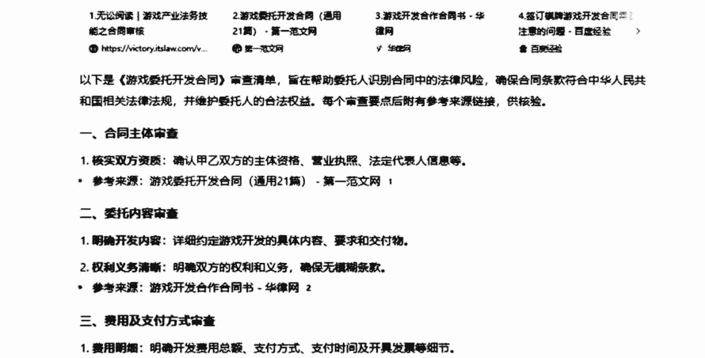

以下是《游戏委托开发合同》审查清单，旨在帮助委托人识别合同中的法律风险，确保合同条款符合中华人民共和国相关法律法规，并维护委托人的合法权益。每个审查要点后附有参考来源链接，供核验。

###### 一、合同主体审查

- 1. 核实双方资质：确认甲乙双方的主体资格、营业执照、法定代表人信息等。
  - 参考来源：游戏委托开发合同（通用21篇）- 第一范文网 1

###### 二、委托内容审查

- 1. 明确开发内容：详细约定游戏开发的具体内容、要求和交付物。

# AI 让合同审查更快更准的实操路径

把甲乙双方的权责写明白，杜绝模糊表述。
  - 参考来源：游戏开发合作合同书 - 华律网 2

###### 三、费用及支付方式审查
- 1. 费用明细：把开发总价、结算方式、付款节点、开票要求等落到纸面上。
- 2. 预付款及尾款：明确预付款比例、尾款发放条件与时间。

可学习、可复用。

##### 3. 用 DeepSeek 审查合同

###### (1) 直接用提示词审查合同
DeepSeek 属于通用大模型，并未做合同审查的专项训练，所以提示词必须写得细、写得透。

以《写字楼租赁合同》为例，先对合同里的敏感信息做匿名化，再在官网开新对话，点击右侧“附件”把待审文件传上去。

从交互界面看，上传附件后联网搜索会被自动关闭，会提示“请先删除文件再开启联网搜索”。

要不要开“深度思考”模式，看问题难度。深度思考下模型更像一名逻辑推理专家，适合复杂推演，但响应会慢。简单问题可关掉提速。合同审查需要细读与推理，建议开启深度思考模式。

合同审查的提示词示例如下：

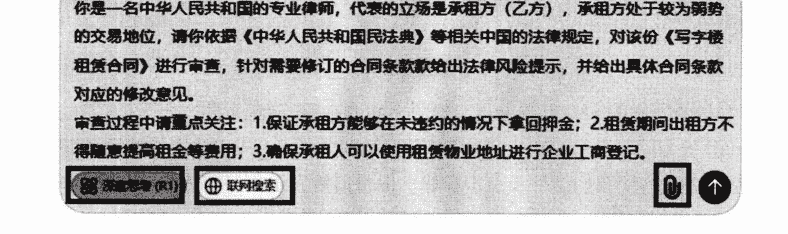

图 3 – 18 在 DeepSeek 对话框中上传合同文档，输入合同审查的提示词

###### 写字楼租赁合同法律审查与修改建议

####### 一、押金退还条款（第四条 租赁押金）

风险提示：
- 1. 合同约定押金退还须“无任何违约行为”，但“违约行为”边界模糊，易被甲方扩大解释扣留押金。
- 2. 押金退还时间约定30天偏长，且流程未明，可能影响乙方资金周转。
- 3. 装修押金条款未明确退还条件，易生争议。

修改建议：
- 1. 明确“违约行为”范围：限定为合同列举的违约情形，如欠租、损毁物业等，避免扩大解释。
- 2. 缩短退还期限：改为“收回物业后15日内”，并明确退还方式如银行转账。
- 3. 补充装修押金退还：验收合格后7日内返还装修押金，不得以其他费用抵扣。

条款示例：
> “（4）……甲方应在收回租赁物业且乙方交还押金收据原件后 15日内 无息退还租赁押金。若甲方逾期退还，应按未退还金额的 0.05%/日 向乙方支付违约金。”

####### 二、租金及费用调整条款（第四条 合同费用）

风险提示：
- 1. 租金递增机制无上限，可能导致涨幅超出合理范围。
- 2. 空调费、水电费等费用调整条款宽泛，缺乏依据与限制。

修改建议：
- 1. 设递增上限：年租金递增率不超过5%或当地政府指导标准，并注明计算公式。
- 2. 限制费用调整：空调费、水电费调整须以政府或公用事业部门出具的正式调价文件为依据，幅度不得高于官方指导。

条款示例：
> “② 租期自……租金单价递增 不超过5%，具体以双方书面确认为准。”

> “合同期内，空调使用费、水电费调整需以 政府或公用事业部门出具的正式调价文件 为依据，且调整幅度不得高于官方指导标准。”


可看出 DeepSeek 的输出会紧扣提示词给出的审查重点，整体可用，说明提示词质量决定效果。下面把审查清单交给模型。

###### 写字楼租赁合同审核清单
- 1. **出租方合法性审查**
  检查出租方提供的产权证明或经营权证明、出租许可证明、营业执照及法人或授权证明。转租时还须提供原租赁合同及权利人同意转租的书面证明。
- 2. **租赁物信息**
  合同应载明准确的写字楼地址、楼层及租赁面积，以《不动产权证书》为准，不确定时可第三方测绘，明确面积变化对租金的影响。
- 3. **租赁期限**
  核对起止日期及续租选项。
- 4. **租金及费用**
  明确租金金额、支付方式、递增规则与支付周期，说明租金是否含物业管理费、公共设施费等。租金通常按元/平方米/日计算，按实际面积结算。物业费、水电等费用标准及承担方需写明。
- 5. **押金和保证金**
  核对押金、保证金金额，明确退还条件与程序。

图 3-20 提供给 DeepSeek 的《写字楼租赁合同审查清单》

###### (2) 用合同审查清单 + 提示词审查合同
把清单提交给 DeepSeek，要求按清单审查，提示词可设为：

> 你是一名中华人民共和国的专业律师，请你依据我提供的《写字楼租赁合同审查清单》，以维护承租方（乙方）为目的，对《××写字楼租赁合同》进行审查，针对需要修订的条款给出法律风险提示，并给出具体条款对应的修改意见。

###### 写字楼租赁合同审核与修改建议

写字楼租赁合同审核清单.d... DOCX 12.56KB  XX写字楼租赁合同.docx DOCX 73.46KB

你是一名中华人民共和国的专业律师，请你依据我提供的《写字楼租赁合同审查清单》，以维护承租方（乙方）为目的，对《XX写字楼租赁合同》进行审查，针对需要修订的合同条款给出法律风险提示，并给出具体合同条款对应的修改意见。

已深度思考（用时 44 秒）^

图 3 – 21 DeepSeek 根据合同审查清单审查合同指令的“深度思考”过程

###### 法律风险提示及合同修改建议
- 1. 出租方合法性审查
  风险提示：合同未要求甲方提供产权证明、转租许可等文件，存在出租权瑕疵风险。
  修改建议：
  - 在合同第一条补充：“甲方应在本合同签署前向乙方提供租赁物业的《不动产权证书》复印件、转租许可（如涉及）及营业执照等文件，作为本合同附件。”

- 2. 租赁物信息（面积争议）
  风险提示：合同约定“乙方对建筑面积无异议”，但未约定面积误差处理。
  修改建议：
  - 补充：“若乙方对租赁面积存疑，可委托第三方机构测量，测量费用由【主张错误方】承担。若实际面积差异超过3%，租金按比例调整。”

###### 3. 租金及费用调整机制
风险提示：空调使用费、水电费、停车费等费用调整条款过于宽泛，可能导致甲方随意涨价。
修改建议：
- 将“随政府水价及蓄冰空调电价的变动而调整”改为：“费用调整需以政府官方文件或公共事业部门通知为依据，且涨幅不得超过同期CPI指数增幅。”
- 明确空调冷量计费标准在合同附表中列明，避免模糊表述。


从思考过程和结果看，模型能较好理解以清单为依据审查并给出修改建议的需求。

###### 10. 争议解决方式
风险提示：争议仅约定诉讼，未提供仲裁选项。
修改建议：
- 修改第十五条2款：“协商不成的，任何一方可提交广州仲裁委员会仲裁，或向租赁物业所在地法院起诉。”

###### 其他关键条款提示
- 1. 保密义务（第八条18款）：违约金为“首月租金三倍”过高，建议调整为“实际损失”。
- 2. 优先承租权（第八条1款）：明确“同等条件”具体标准，如租金、租期等。
- 3. 固定装修归属（第八条15款）：建议约定“若甲方要求保留装修，应补偿乙方合理成本”。

总结：建议乙方要求甲方对上述条款修订，并在签署前聘请律师同步审阅合同附件，如《物业管理服务合同》《装修手册》，以全面降险。


前文多次强调核验结果仍十分重要。例如 DeepSeek 建议“争议仅约定诉讼，未提供仲裁选项”，但租赁合同属于不动产纠纷。根据《民事诉讼法》，因不动产纠纷提起的诉讼由不动产所在地法院管辖；根据《最高人民法院关于适用〈中华人民共和国仲裁法〉若干问题的解释》第7条，当事人既约定仲裁又约定诉讼的，仲裁协议无效。因此该修改建议不能直接交付客户，需经专业判断修正。

##### 4. 用案牍×法天使智能合同审查系统审查合同
通用大模型在合同审查中易出现识别偏差与遗漏，垂类 AI 产品能有效弥补。

案牍与法天使联合研发的“智能合同审查系统”，官网 https://screen.autodocs.cn/contract/home，扫码登录，支持自选审查立场与尺度、多维度清单式审查、交易解析、主体尽调等功能。

###### (1) 用推理审查模式进行合同审查
“推理审查”模式下系统会按专业律师的推理路径逐步审查。首先选择该模式并上传合同：

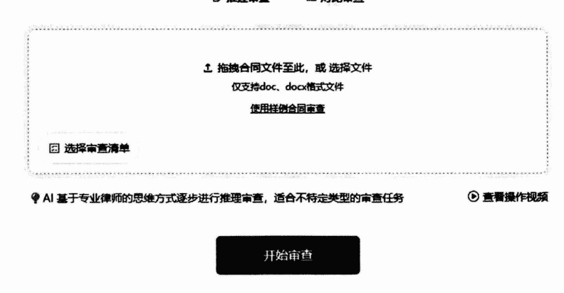

图 3-24 点击上传合同

自选审查立场、尺度和审阅人如下：

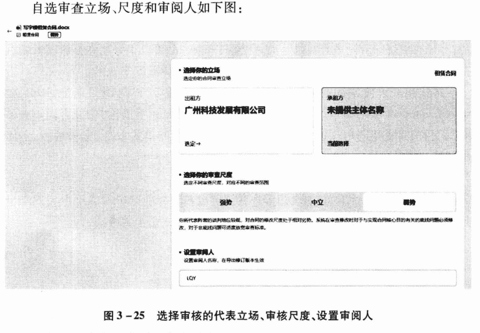

图 3-25 选择审核的代表立场、审核尺度、设置审阅人

可自定义审查重点：
- 设置审查重点 编辑设置合同重点，影响代表方的审查倾向
- 1. 租赁物业的用途及使用限制：确保使用符合经营需求，避免因用途变更违约
- 2. 租金及其他费用的合理性：避免不必要经济负担
- 3. 押金的退还条件：确保合同结束时能顺利退还
- 4. 装修及使用物业的权利
- 5. 确保承租人可以使用租赁物业地址进行企业工商登记
● 添加

下一步

系统每条审查意见均提供审查依据与具体修改建议：

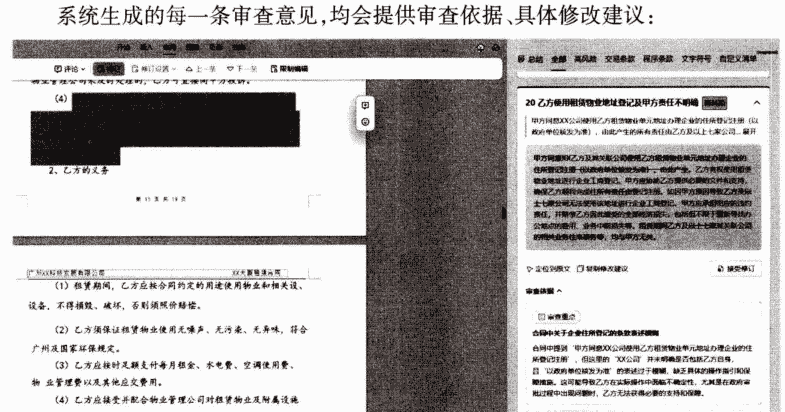

###### 图 3-27 生成的审查意见

系统还会调取合同相对方信息，分析资信能力及签署资质，并梳理合同标的、交易流程、违约责任，帮助用户把握全貌。

###### 交易流程
- 节点1：合同签署与生效
- 节点2：租赁押金及预交租金支付
- 节点3：租赁物业交付
- 阵营：
  - 出租方：在约定期限内交付物业，按现状移交，承租方确认无异议。
  - 承租方：接收物业并办理相关手续，确认状况符合约定。

###### 图 3-28 生成的交易流程

用户可在系统左侧 Word 面板直接修订，支持导出审查意见书或合同修订版。

###### (2) 用自建审查清单进行合同审查

###### 新建审查清单
*清单名称 写字楼租赁合同
*审查地位 承租方
*审查尺度 强势 中立 弱势

合同双方谈判地位势均，你所代表阵营无明显优势。系统审查时应以完善合同内容、增强可操作性为出发点，以权利义务对等为原则。

图 3-29 在“审查清单”板块选择“新建审查清单”

可上传自有清单，也可由 AI 生成。

###### 写字楼租赁合同 清单设置
承租方 中立


请创建一个合同审查清单

上传本地文件

上传文件后让AI自动将已有的合同审查知识点转化成合同审查清单

AI智能生成

AI会自动学习和收集该合同审查任务有关的知识，智能生成审查清单

图3-30 系统支持上传本地文件或由AI生成

后续步骤与前文相近，此处不再赘述。在特定清单模式下，系统可按提供的清单精准审查，提升可靠性。

###### 合同审查
大模型驱动的新一代合同审查工具

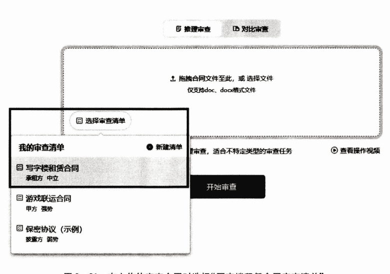

图 3-31 在上传待审查合同时选择“写字楼租赁合同审查清单”

可见，作为垂类法律科技产品，智能合同审查系统在产品设计、体验和结果表现上更贴近法律人实际需求，使用合适的工具能显著提升审查效率。

#### (四)使用 AI 进行合同审查的注意事项
1. 要注意隐私和数据安全。提交合同前须对个人信息、公司信息等做匿名化处理，涉及商业机密或敏感个人信息时脱敏更必要。可使用“替换”功能把主体名称改为 A 公司、“【】”等。
2. 要选择合适的 AI 产品。通用大模型需较强提示词技巧且核验成本高；专业合同审查 AI 产品界面友好、功能集成度高，但通常需付费。可根据自身能力与预算选择。
3. 必须核验 AI 生成的审查结果。AI 输出可能存在遗漏、误解或错误，法律工作中不容失误。二审必不可少，才能保证结果准确可靠。

### 三、合同管理：以飞书多维表格为例

#### (一)搭建信息服务平台的必要性
法律团队人数、服务规模增大时，需搭建信息服务平台提升任务分配效率与协同性。现有平台常存在处理效率低、灵活性不足、协同流程割裂等问题。

合同管理是日常工作的核心。合同台账能强化内部文档管理，便于梳理汇报并降低法律风险；对律所而言，台账可快速掌握客户的合同审查量与频率，提升客户感知。

过去多靠人工整理归档，AI 时代可借助 DeepSeek + 飞书打造合同管理流程。批量导入合同后，飞书可调用 AI 自动识别主体信息、履约条款摘要，形成清晰的多维表格，避免遗漏重要信息，便于汇报。

#### (二)操作步骤
“合同信息提取”是案牍团队与飞书联合打造的合同信息管理字段工具，利用飞书多维表格提取合同关键要素。

具体操作：
第一步：新建多维表格。

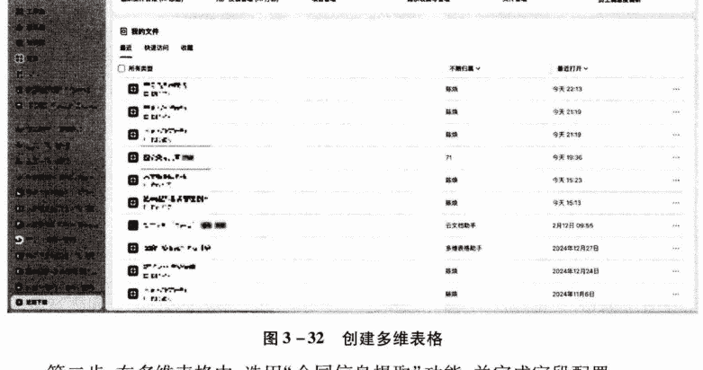

第二步：在多维表格中选用“合同信息提取”功能并完成字段配置。
在图 3-33 中按如下步骤操作：
1. 点击画面中的“+”号，增加字段；
2. 选中“文本”后的“>”；
3. 在搜索框中输入“合同信息提取”并选中。

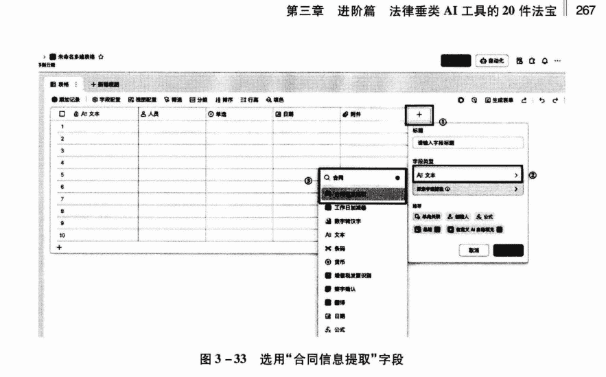

图 3-33 选用“合同信息提取”字段

1. 确保表格中显示“附件”字段类型
2. 在选择框中点击“附件”
3. 确保系统自动配置的“合同名称”“签约方”“关联行业”等字段均处于自动勾选状态后，点击“确定”。

配置

合同要素自动抽取与视听证据提效实操

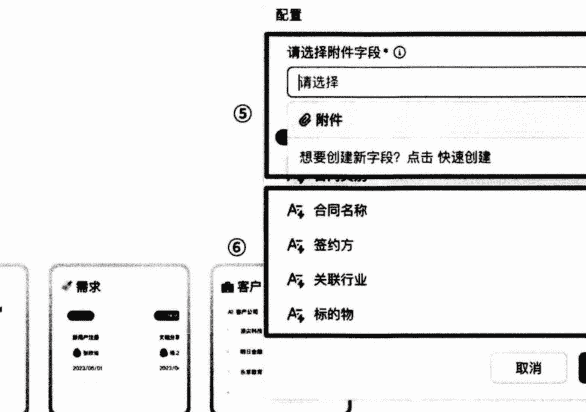
图 3-34 配置字段信息

完成前六项设置后，系统会自行识别各字段，界面呈现见下图：

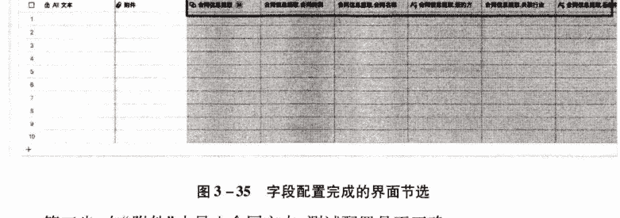
图 3-35 字段配置完成的界面节选

步骤三：通过附件导入合同文本校验配置。

把待处理的合同拖入图 3-36 所示区域，系统即时解析文件，并把提取到的关键要素填入对应单元格，兼容 PDF、Word 等格式。

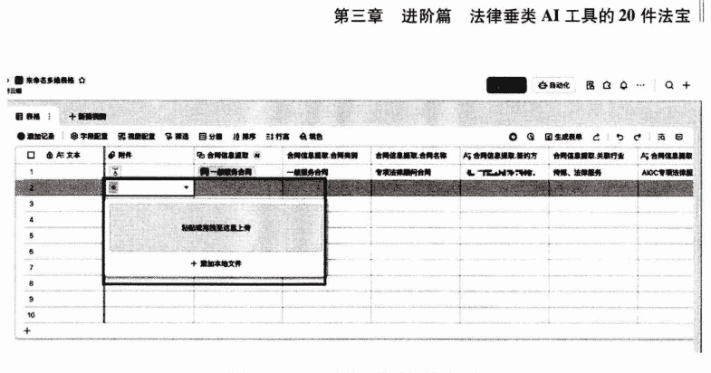
图 3-36 在附件字段中添加合同

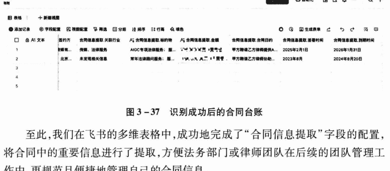
图 3-37 识别成功后的合同台账

至此，飞书多维表格中“合同信息提取”字段已搭建完成，合同核心数据被自动抽取，法务或律师团队后续管理更规范省力。

#### (三) 使用 AI 的注意事项

本节介绍了 DeepSeek 结合飞书的入门玩法，利用多维表格自带的合同要素提取功能，自动抓取签约主体、标的、金额、签署日、到期日等信息，形成合同管理台账，可大幅削减人工核对与录入成本，提升效率。

需要指出的是，该字段设计上仅适用于合同类法律文件，且提取项不可由用户自行设定，灵活性有限。

若需配置更多字段，可参考本书第五章，后续可搭建开庭信息台账、自动创建团队任务智能体等。学习后可掌握飞书多维表格中自由度更高的通用文字识别与信息提取能力，构建更丰富的合同抽取方案，甚至加入到期前自动预警等个性化功能。

### 四、视听证据整理：以通义听悟为例

诉讼中提交音视频材料时，一份规范的举证手册尤为关键。优质手册能帮助法官快速把握待证事实，提升庭审效率，也能帮助办案人员理清思路，避免遗漏。

传统整理耗时费力，本节以通义听悟为例说明提效路径。

#### (一) 传统模式下制作音视频证据举证手册的流程

- 逐帧审视视频画面，用截图方式保存对案件有价值的画面，存入 Word 等文档。
- 细听音频对话内容，手动记录。
- 将画面与对话交替录入，按时间顺序标注时间点。

一次难以完成，需反复回放比对，工作量往往是证据时长数倍。

#### (二) 用“通义听悟”制作音视频证据举证手册的流程

借助通义听悟可明显提升举证效率，减轻负担。

1. 登录
打开通义听悟官网首页，完成注册登录。

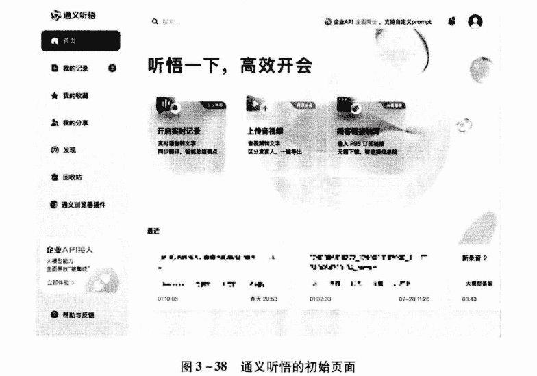
图 3-38 通义听悟的初始页面

2. 导入并自动识别
点击导入按钮，从本地加载待处理的音视频材料，并按需选择语音语言、是否区分发言人等选项。目前已支持普通话、粤语、英语、日语等多种语言。

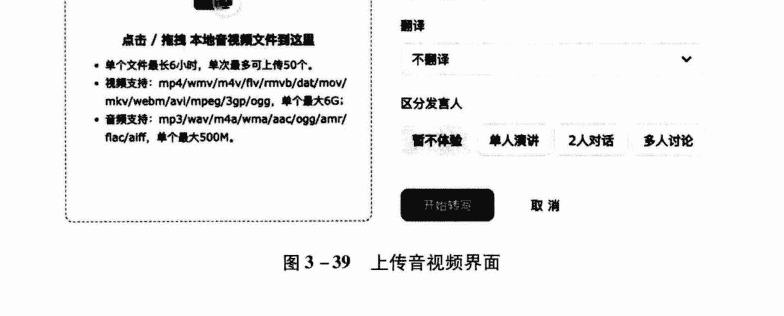
图 3-39 上传音视频界面

3. 检索与定位
大模型对音频进行识别并逐字标注时间。用户可通过检索对话内容，点击文字即可跳转到对应画面，便于查阅与摘录。图 3-40 中①为对话检索区，②为系统推荐的可直接跳转的关键词，③为按时间排序的对话正文，点击任意字词画面即同步定位。

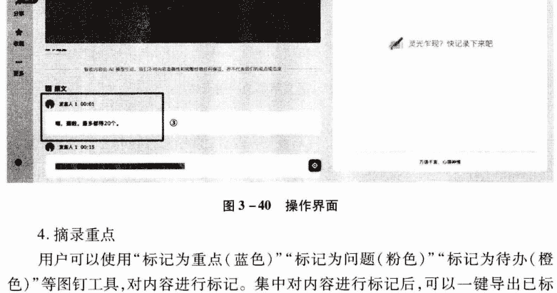

4. 摘录重点
提供设为重点、设为问题、设为待办等图钉工具集中标注，标注完成后可导出已标记内容并附带时间戳。

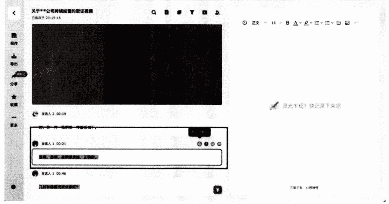
图 3-41 标记重点的图钉工具

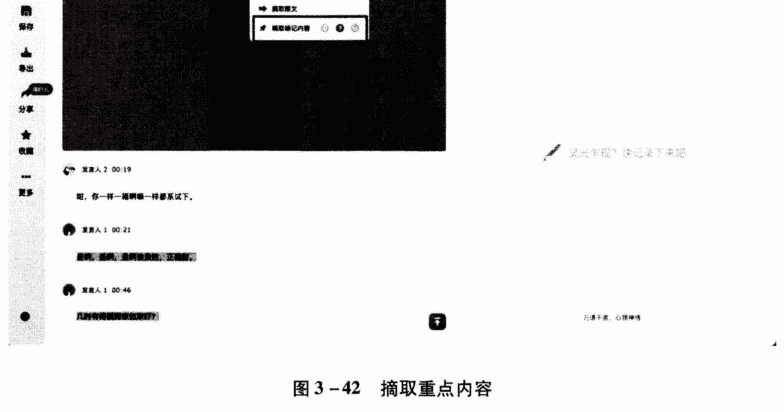
图 3-42 摘取重点内容

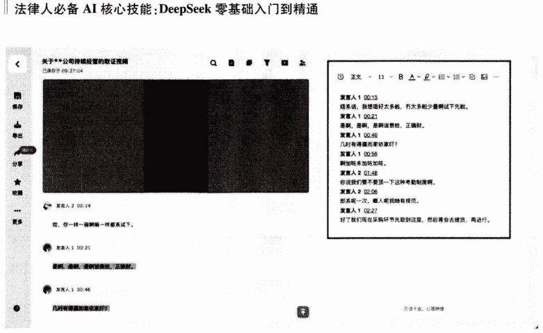
图 3-43 摘录后的效果

摘录完成后，待列举的重点对话与时间信息会自动排列在文档区，可按案件需要进一步调整。

5. 截取关键证据画面
通义听悟自带自动截图功能，可把截图插入文档区并附带时间戳，同时自动识别并去除画面无效黑边，插入指定位置。

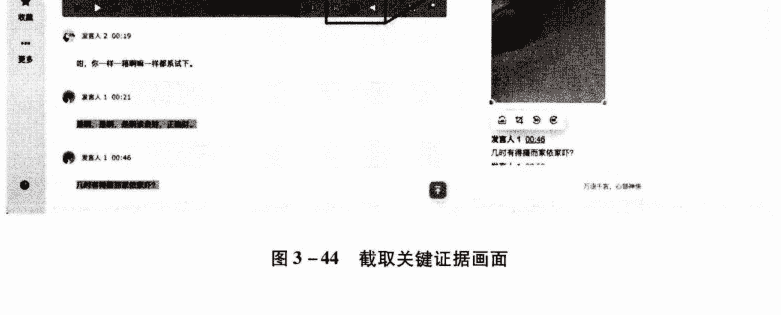
图 3-44 截取关键证据画面

6. 导出笔记并完善举证手册
前述操作后即可获得包含时间戳、发言人、对话内容、对应画面的完整笔记。法律人可在其基础上补充注解与说理，完善后再提交法院。

#### (三) 必备 AI 核心技能

1. 涉密内容不得上传
实务中涉及未公开审理笔录、商业秘密、技术文档、国家安全卷宗等敏感材料，严禁直接送至云端处理。建议分级管控：核心涉密坚持线下处理；辅助性材料在上传前需遮蔽涉案主体全称、案号、技术参数等关键信息，条件允许时优先选用本地化部署工具。

2. 存在内容安全问题的材料不得上传
依据生成式人工智能服务管理暂行办法等规定，模型会拒绝对暴力、色情、危害国家安全等内容进行生成。卷宗中因案情客观描述而包含此类内容时，通义听悟等网络工具会拦截并拒绝处理。

3. AI 时代使用工具应当发挥想象力
通义听悟原本面向课堂笔记、会议记录、播客整理等场景。笔者正是通过发散思维将其迁移到办案实务，才形成用其整理音视频举证手册的思路。智能时代法律人应保持好奇与尝试，不断探明工具边界，提升理解与使用能力，并把用智能重塑工作流的理念贯穿学习与应用全过程。

### 五、模拟法庭演练：以北大法宝模拟法庭为例

模拟法庭是连接理论与实践的桥梁，能锻炼庭前文书、庭中攻防、庭后点评全流程能力。对学生是流程熟悉与实务训练，对律师是庭辩打磨与策略验证，也可让当事人参与沙盘推演。

#### (一) 传统模拟法庭模式存在的痛点

一场高质量模拟法庭需要复刻真实庭审的关键节点，实践中常出现：

- 人员难以凑齐。完整庭审需法官、公诉人、原被告、辩护人，还需证人、鉴定人、有专门知识的人等，实际难以集齐。即便凑齐，角色代入不足，要么表演痕迹重，要么无法站在角色立场指控或辩护，攻防强度不足，出现表演失真。
- 辩论质量不高。参与者拿案后需预判结果，争取最大合法权益。但经验不足者难以准确预判走向，导致准备与实际偏差，辩论易偏离争议焦点，质量下降。

#### (二) AI 时代模拟法庭工具的特点

生成式智能在角色扮演能力增强后，可按预设人设扮演各种角色。产品若提前设定模拟法庭角色并搭配法律垂类数据，人机模拟法庭即可落地，降低门槛，单人也能开展训练。

在北大法宝模拟法庭辅助下，可突破时空限制随时开展沉浸式庭审，帮助高效完成庭前准备、优化提纲与举证手册，提升表达；也能作为新人律师、法学学生的学习工具，弥补庭审经验不足。

- 可与智能协同角色扮演与对抗。可让智能扮演对方代理人，或双方立场对抗。智能能输出高质量辩护词并进行有力反驳，帮助锻炼逻辑与应变，学习不同策略。观摩智能对抗还能拓宽视野。
- 可探索不同立场与判决结果，拓展准备深度与广度。可让智能扮演己方进行反驳，调整举证材料、诉讼请求与辩论意见；也可让智能生成胜诉与败诉判决，研究不同判决对应的论证与说理，进行多角度分析，充实预案。

此外，产品依托强大的法规案例库，可提供法律依据、案例参考与证据分析，帮助全面评估案件、优化方案。

#### (三) 北大法宝模拟法庭的步骤

1. 选择诉讼地位
在北大法宝律 AI 多应用中心打开模拟法庭。

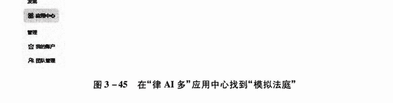
图 3-45 在律 AI 多应用中心找到模拟法庭

可选择原告或被告与智能对抗，也可选无模型对抗演示让智能互相对抗。本次演示选择无模型对抗演示更清晰。

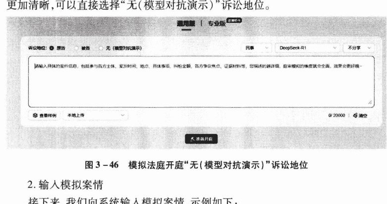

2. 输入模拟案情
示例案情如下：

- 当事人：张××原告、严××被告
- 诉讼请求：判决严××支付借款 88521.4 元及利息，以 88521.4 元为基数，按同期全国银行间同业拆借中心公布的贷款市场报价利率，自起诉日起计算至实际还清之日止；诉讼费由严××承担。
- 事实与理由：张××与严×× 2019 年相识，2020 年 9 月恋爱。基于信任，张××多次无条件出借。2019 至 2020 年，严××以资金紧张为由多次借款，用于化妆品、美容店周转、房租垫付、偿还赌债、信用卡还款等。张××通过支付宝、微信、信用卡套现支付，共计 88521.4 元。恋爱期间严××对张××实施控制手段，多次拉黑，在要求还款时拒绝承认。张××因出借致经济困难，曾被银行起诉。
- 被告答辩：诉请无事实法律依据。款项均在恋爱期间，多为小额，部分用于共同生活或活动，属于赠与和消费，并非借款。仅有支付记录，无借贷性质证据。
- 原告证据：支付宝转账 2021.1.4-10.5 转账 4295.4 元，其中亲情消费 1995.4 元；2020.10.5-2021.2.18 向××美容院转账 7533 元；广州银行信用卡转账共 23128 元，严××承认收到部分；微信支付 2019.11.27-2022.8.18 转账 51274 元；房租水电 1091 元；贷款合同及起诉状证明经济困难；微信聊天记录显示严××多次要求垫付，张××多次要求还款，严××拒绝承认。
- 庭审情况：张××称因系恋人，未要求出具借条；表示通过花呗、银行贷款借款给严××，现因欠款被诉，经济困难。严××辩称从未借款，转账均为恋爱期间自愿馈赠。

3. 生成原告诉求和被告的抗辩
在无模型对抗演示模式下，北大法宝模拟法庭基于法律数据库直接生成双方意见，并链接法条来源。需注意智能幻觉可能导致错误引用，需核验。

###### 图 3-47 在模型对抗演示模式下生成的原告诉求
本段为模型生成的原告代理思路示例，核心在于证明借贷合意存在。转账记录、聊天记录可结合《最高人民法院关于审理民间借贷案件适用法律若干问题的规定》及《民法典》相关条文，论证款项性质非赠与，利息主张具有依据，同时注意举证责任分配。

###### 图 3-48 在模型对抗演示模式下生成的被告答辩
本段为模型生成的被告代理思路示例，核心在于否定借贷合意。依据民间借贷司法解释，原告需提供债权凭证或明确借款意思表示，转账无备注、恋爱期间小额往来等可支持赠与或共同消费抗辩，并提示举证责任。

# 恋爱转账：借贷还是赠与？

从法理支撑来看，《民法典》第657条对赠与合同作出了界定，当借贷合意无法被证实时，款项更倾向被视作赠与；《民诉法》第67条则明确了举证责任归属，由主张权利一方举证，若举证没有达到要求，将承担不利后果。把这两条规则结合起来，对抗辩方是有利的论证资源。

在裁判检索上，可重点搜集恋爱关系中款项被判为赠与而非借贷的案例。最高法院或地方法院的相关判决如果得出相同倾向，就能作为补强材料，提升说服强度。

关于聊天记录里出现的“欠款”字样，需要审慎拆解。即使该表述真实存在，也可能被解读为自认，但仍需看上下文是否明确指向争议的具体金额。若措辞不清、没有点明数额，其证实力就会下降。

还有一部分转款被用于个人名下支出，比如信用卡还款等，对方可能据此主张这些不属于共同开销。对此要厘清该笔支出是否确为个人使用，以及当时是否存在借款合意。若缺乏明确约定，仍有被认定为赠与的可能。

最后要权衡是否提起反诉。若能证明转款过程中存在欺诈或重大误解，可考虑反诉，但根据现有材料，证据可能不够充分，建议集中精力否定借贷关系的成立。

在模型对抗演示功能中，读者可在 AI 生成的原告请求或被告答辩下方点选“反驳”，系统会基于该条文进行针对性回应。若用户自行指定诉讼角色，则反驳文书需要由用户亲自完成。

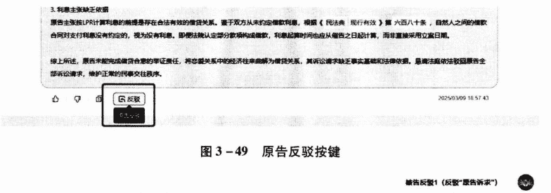

###### 被告反驳1（反驳“原告诉求”）

Thinking... 思维...

审判长、审判员、对方律师：本案争议的核心在于原告主张的88521.4元资金性质是否构成借贷关系。被告严XX始终坚持双方资金往来属于恋爱期间的赠与行为，原告未能完成借贷合意的举证责任，其主张既不符合民间借贷的法定要件，也与生活常理及证据规则相悖。

- 一、原告未完成借贷合意的举证义务

  1. 根据《最高人民法院关于审理民间借贷案件适用法律若干问题的规定（现行有效）》第十六条，原告仅凭金融机构转账凭证主张借贷关系的，被告抗辩款项系赠与的，原告仍应就借贷合意承担举证责任。本案中：

    - (1) 支付宝转账仅有3笔标注‘15000元标注‘借款’，其余73521.4元转账均无任何借款备注；

    - (2) 微信聊天记录中‘垫付’‘周转’等表述属于生活化用语，2021年3月5日‘欠你的钱我会慢慢还’系被告在原告持续骚扰下的安抚表述，结合2022年5月原告发送‘之前帮你垫付了十多万’时被告立即拉黑的行为，恰恰证明双方从未达成还款合意；

    - (3) 原告自述因恋爱关系未要求出具借条，恰恰印证其转账时不存在建立借贷关系的真实意思表示。

- 二、资金性质符合恋爱赠与与特征

  1. 依据《民法典（现行有效）》第六百五十七条 关于赠与合同的规定，结合双方特殊身份关系及转账特征：

    - (1) 资金用途包含共同消费支出，信用卡代付的23128元中，2020年12月25日向某酒店转账5600元系双方共同旅游支出，2021年1月向家电商行支付的8900元用于购买网易房屋装修；

    - (2) 资金数额具有连续性、琐碎性特征，微信转账51274元中包含142笔转账，单笔金额200-2000元不等，时间跨度长达34个月，符合恋爱期间日常消费特征；

    - (3) 特殊备注体现情感属性，2020年2月14日微信转账520元备注‘情人节快乐’，2021年5月20日转账1314元，此类具有特殊含义的转账显然属于情感表达。

- 三、原告证据存在重大瑕疵

  1. 举证责任分配错误，原告将代偿借款、信用卡还款等单方支出与共同生活支出混同计算，但：

    - (1) xx美容院7533元转账发生于2020年10月5日，当时被告尚未独立经营该店，该款项实际用于双方共同体验美容服务；


##### 4. 法律文书撰写

该产品目前支持四类法律文书的撰写，分别是起诉状、答辩意见书、一审判决书和二审上诉书。

其中，一审判决书可以由用户进行选择胜诉或败诉结果，由 AI 法官根据判决结果来撰写判决书。

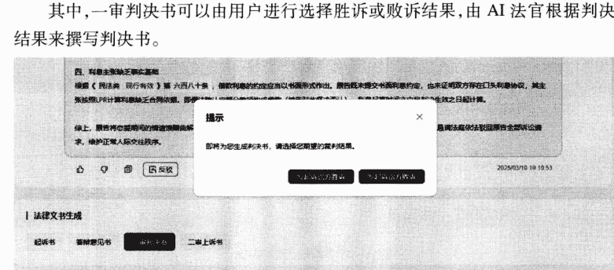

关于二审上诉书，AI 同样可以根据用户选择的胜诉或败诉结果，生成相应的二审上诉文书。

#### （四）必备 AI 核心技能

1. 要注意拓展模拟法庭的互动角色与场景

现阶段的模拟法庭产品在角色设置和互动场景上还有提升空间。目前，大部分产品仅聚焦于法庭上的诉辩对抗环节，而忽略了法官与律师之间互动的重要性。在真实的庭审现场，法官与律师的互动是庭审中非常关键的一部分。例如，法官在庭审中可能会对律师的辩护意见、证据等提出尖锐的问题。诉讼代理人有必要提前准备并演练如何应对这些情况，以提升自己的应变能力和专业素养。

2. 要核验 AI 输出内容的真实性和有效性

在 AI 模拟庭审输出的内容中，法庭辩论内容和引用法律条文可能出现幻觉，需要对 AI 输出的内容进行二次检查，重点关注数据、日期、法律条文等关键信息的准确性，核实数据是否真实可靠，日期是否符合案件时间线，法律条文是否适用当前案件等，确保所有信息都经得起推敲。同时，还要审查 AI 输出内容的逻辑是否连贯、合理，检查其论证过程是否存在漏洞或矛盾，观点是否与案件事实和法律依据相符合。如发现逻辑不一致或不合理之处，需进一步查证和修正，以保证内容的可信度和可用性。

### 六、法律文书写作：以 AlphaGPT 为例

法律文书在法律人的工作中具有不可替代的重要性。对于法官、检察官、侦查人员而言，他们需要通过法律文书来审理案件、作出判决和提起公诉、移送起诉等，文书的内容和质量往往关乎司法和执法的公正和权威。对于律师而言，法律文书是表达当事人诉求、呈现证据、进行法律论证和与各方沟通的关键工具。通过起诉状、答辩状、律师函、代理词等法律文书，律师能够清晰、准确地传达法律观点，为当事人争取合法权益。对于企业法务而言，他们需要确保公司运营符合法律法规，规避法律风险，法律文书在风险防范、合规指导等方面同样发挥着积极作用。因此，法律文书不仅是法律人专业素养和能力的体现，更是推动法律事务顺利进行的关键。一份高质量的法律文书，能够精确传达法律意图，从而在法律实践中发挥决定性作用。

法律文书的起草并非事实和法律的简单堆砌，而是需要法律人结合自身实务经验进行全面分析和判断。目前，AI 仍无法在法律文书起草工作中完全替代法律人，但随着人工智能技术的不断进步，AI 在法律文书领域的应用日益广泛。AI 技术具备强大的数据分析和文本处理功能，能够快速检索法律条文、案例和司法解释，为法律文书起草提供有力支持，帮助法律人从烦琐的文书工作中解放出来。

关于 AI 工具在法律文书起草工作中的具体应用和核心技能，本书第二章已作详细介绍。本节将主要围绕法律垂类 AI 产品——AlphaGPT 的律师函起草功能进行展示。

#### (一) 用 AI 工具生成法律文书的必备 AI 核心技能

- 一是要重视对援引法律条文、案例、计算结果等关键信息的核验工作。目前市面上的部分法律 AI 产品，已上线法律文书起草的专业功能。在产品设计上，用户无须进行复杂的提示词设置，仅需输入必要的信息和勾选重点要素，AI 即可自动生成一份较为完善的法律文书。但是，法律文书中援引的法律条文、司法案例，是法律文书的重要法律依据，如果法律文书出现引用的法律条款失效、法律条款引用错误、引用的司法案例无关或数额计算错误等情形，将严重影响整份法律文书的专业度和可信度，埋下隐藏的法律风险。结合以往使用法律 AI 产品的经验，目前这些 AI 产品生成的法律文书仍可能存在通用大模型的 AI 幻觉等问题，因此对 AI 生成的法律文书内容进行核验是一项不可或缺的工作。

- 二是要保持独立思考和判断能力。尽管法律 AI 产品已经强大到可以一键生成体系完善的法律文书，但法律专业人士仍需在 AI 起草的法律文书基础上，结合自身的法律专业知识和实践经验，进行独立的分析和判断，包括对 AI 输出的法律解释、逻辑推理和法律适用等等进行独立思考和判断，确保法律文书交付的质量和效果。

#### （二）用 AI 工具起草法律文书示例

在使用法律 AI 产品进行法律文书生成之前，笔者先在通用 AI 大模型中测试法律文书生成的效果，以便读者对二者进行比照。

1. 使用 DeepSeek 起草法律文书

以起草律师函为例，首先要将发函的背景、基本信息和要求告诉 DeepSeek，提示词设置如下：

A 与 B 二人签订货物买卖合同，合同约定 A 向 B 采购货物，货款总价为 10 万元，分三次支付，分别于 2025 年 1 月 10 日前、2025 年 1 月 30 日前和 2025 年 2 月 15 日前支付。第一笔货款 3 万元 A 已按时向 B 支付，第二笔货款 5 万元 A 仅在 2025 年 1 月 29 日支付一半，第三笔货款 2 万元 A 均未支付。B 已将全部货物交付给 A。合同约定如 A 未按时付款，每日需按欠款总额每日万分之一向 B 支付违约金。现 B 向 A 追款未果。

你作为一名中国律师，接受 B 的委托，请你起草一份《律师函》。

从 DeepSeek 的思考过程可见其对律师函的起草规范具有一定的认识，包括律师函的基本结构、违约金计算、引用正确的法律条文等。

```
好的，我现在需要帮用户起草一份律师函，涉及A和B之间的欠款争议。首先，我得仔细理解用户提供的信息，确保所有细节都被准确涵盖。用户提到合同中的付款分三次，分别是10万总价，第一笔3万已付，第二笔5万只付了一半，第三笔2万未付。违约金是每日万分之一。B已经交货，但A拖欠款项，B委托律师发函。

首先，我需要确认律师函的基本结构。通常包括发函人信息、收函人信息、事实陈述、法律依据、要求及后果等部分。作为律师，需要确保所有法律条款引用正确，比如《民法典》的相关条款，特别是关于合同履行和违约金的部分。

接下来，要明确时间节点和金额。第一笔3万已按时支付没问题。第二笔5万在1月29日支付了一半，即2.5万，剩余2.5万未付。第三笔2万完全未付。总欠款应该是2.5万+2万=4.5万，加上违约金。违约金计算部分可能需要说明，但律师函中可能不需要详细计算，只需指出依据合同约定。

需要注意合同约定的违约金是否合法。根据中国法律，违约金过高可能被法院调整，但万分之一日利率相当于年利率3.65%，这在合理范围内，通常不会被认定为过高。这一点可能需要确认，但用户没有提到争议点，所以暂时按合同约定处理。

然后，需要引用正确的法律条文，比如《民法典》第577条关于违约责任，第509条关于全面履行合同义务，第585条关于违约金。这些条款需要准确无误，确保法律依据充分。

另外，要确保函件的语气专业且严厉，明确要求A在指定期限内支付欠款和违约金，否则将采取法律行动。同时，提醒A逾期可能产生的额外费用，如诉讼费、律师费等，以增加压力。
```

还需要检查是否有遗漏的信息，比如合同签订日期、货物交付情况等。用户提到B已交付全部货物，这一点要明确在事实陈述中，以证明B已履行义务，A的违约没有理由。

> 最后，格式要规范，包括律师事务所的联系方式，律师签名，日期等。可能需要提醒用户替换占位符，如律师事务所名称、地址、联系方式，以及案件编号等。

可能存在的疑问点：是否需要提及可能的诉讼程序？是的，律师函通常会说明如果不在期限内履行，将提起诉讼，因此需要明确这一点。另外，是否需要详细列出每笔欠款的计算？可能不需要，但总金额和违约金依据要清楚。

##### 总结步骤：

1. 开头部分：发函方和收函方信息。

2. 事实陈述：合同签订、付款条款、履行情况（B已交货，A部分付款）。

##### 图 3-52 DeepSeek 对生成律师函指令的深度思考过程

以下是一份根据您提供的信息起草的《律师函》范本，请根据实际情况补充具体信息：

###### XX律师事务所律师函

(202X) XX律函字第XX号

致：A（身份证号/统一社会信用代码：XXX）

地址：XX省XX市XX区XX路XX号

自：XX律师事务所

地址：XX省XX市XX区XX路XX号

联系电话：XXX-XXXXXXXX

经办律师：XXX律师（执业证号：XXXXXXXXXX）

###### 关于敦促履行货物买卖合同付款义务的律师函

尊敬的A先生/女士/公司：

本所受B（身份证号/统一社会信用代码：XXX）的委托，就您与B于XX年XX月XX日签订的《货物买卖合同》（合同编号：XXX）项下未履行付款义务一事，郑重致函如下：

####### 一、事实经过

1. 根据合同约定，您应向B采购货物，货款总价为人民币10万元，分三期支付：

   - 第一期3万元于2025年1月10日前支付；

   - 第二期5万元于2025年1月30日前支付；

   - 第三期2万元于2025年2月15日前支付。

2. 您已按时支付第一期款项3万元，但第二期款项仅于2025年1月29日支付2.5万元，尚余2.5万元未付；第三期款项2万元至今未支付。

3. B已依约于XX年XX月XX日向您交付全部货物，履行完毕合同义务。

####### 二、违约责任

根据《中华人民共和国民法典》第577条、第585条及合同第X条约定，您逾期付款已构成违约，需承担以下责任：

1. 支付剩余货款：截至本函出具之日，您尚欠付货款共计人民币4.5万元（第二期余款2.5万元+第三期2万元）。

2. 支付违约金：按合同约定，您需以未付款项为基数，按每日万分之一的标准向B支付违约金。暂计至2025年X月X日，违约金为人民币XX元（具体金额以实际清偿日为准）。

####### 三、我方要求

请您于收到本函后3日内履行以下义务：

1. 一次性向B支付剩余货款人民币4.5万元；

2. 支付逾期付款违约金（计算方式：未付款项x0.01%x逾期天数）；

3. 将上述款项汇至B指定账户（开户行：XXX；账号：XXX）。

####### 四、法律后果

如您未按期履行义务，本所将依法代理B向人民法院提起诉讼，届时您除需支付全部欠款及违约金外，还需承担诉讼费、律师费、保全费等额外费用。同时，您的失信记录可能被纳入征信系统，对您个人/企业信用造成不利影响。

特别提示：本函仅为敦促协商解决，不视为B放弃法定或合同约定的其他权利。

####### 附件：

1. 《货物买卖合同》复印件；

2. 付款记录及货物交付凭证；

3. 违约金计算明细（备案）。

联系人：XXX律师

联系电话：XXX-XXXXXXXX

XX律师事务所（盖章）

律师：XXX（签字）

2025年X月X日

####### 注意事项：

1. 请补充具体合同签订日期、货物交付日期、违约金计算明细等细节；

2. 正式发函前需核对所有证据材料的完整性与真实性；

3. 建议通过EMS邮寄并留存送达凭证，或通过电子送达方式发送（如合同约定的电子邮箱）。

以上内容符合《民法典》《民事诉讼法》相关规定，旨在通过非诉途径解决争议，同时为后续诉讼固定证据。

总体而言，DeepSeek 生成的律师函，不管是在篇幅体例，还是在事实描述和法律条文引用方面，都有较为出色的表现。但整体的结构、语言风格与实际律师函的起草要求仍有一定差距。

##### 2. 使用 AlphaGPT 起草法律文书

AlphaGPT 是国内的一款法律 AI 产品，目前支持法律咨询、法律研究、类案检索、合同起草和审查、文书起草等功能。接下来我们将同一案情发给 AlphaGPT，看一下该 AI 产品起草律师函的表现：

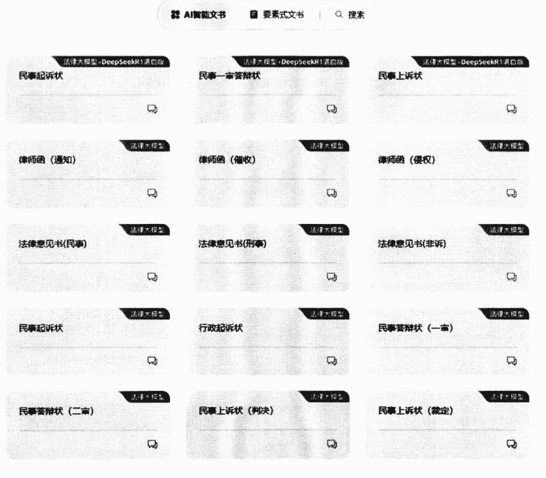

图 3-54 AlphaGPT 的文书起草模板

###### 律师函（催收）

###### * 案情摘要

A与B二人签订货物买卖合同，合同约定A向B采购货物，货款总价为10万元，分三次支付，分别于2025年1月10日前、2025年1月30日前和2025年2月15日前支付。第一笔货款3万元A已按时向B支付，第二笔货款5万元A在2025年1月29日支付一半，第三笔货款2万元A均未支付。B已将全部货物交付给A，合同约定如A未按时付款，每日需按欠款总额万分之五支付违约金。现向A追讨欠款未果。

###### * 委托人

B

###### * 致函方（欠款方）

A

###### * 核心诉求

要求A尽快还款

###### 图 3-55 将同样的案情发送给AlphaGPT

事法律服务的机构。本所受B（下称：“委托人”）委托，特指派本所XXX律师出具本律师函。

###### 认定事实如下：

卖合同。根据合同约定，贵方向委托人采购合同项下货物，总价款为人民币第一笔货款3万元、第二笔货款5万元及第三笔货款2万元。合同载明，委托人应在符合履行支付义务。如贵方未按约定支付货款，合同明确约定每日需按欠款总额

将全部合同货物交付贵方并完成交付手续。贵方在接收上述货物后，仅依的贵方仅支付了其中的一半，即人民币2.5万元，第三笔货款人民币2万元至今外，因贵方未及时支付前述货款，根据合同约定，贵方还应向委托人支付相

示并促使贵方依法依约支付所欠货款及违约金，但贵方始终未履行付款义

了货款支付的金额和分期支付方式。委托人已按合同约定履行了其交付货物付了部分的第二笔货款及未支付第三笔货款。《中华人民共和国民法典》第己的义务。贵方未能全面履行支付义务，已构成违约。

百二十八条进一步规定了买受人应按照约定的数额和时间支付价款。贵方的故委托人未能按约获得应有的货款。

分之一支付违约金。《中华人民共和国民法典》第五百八十五条支持违约金支付货款且拒绝支付违约金的行为，直接侵害了委托人的合法权益。

百七十七条规定，当事人一方不支付价款时，对方有权请求其支付，且违约违约金，并应向委托人赔偿因违约所造成的其他损失。符合《中华人民共和

###### 案情摘要

A与B二人签订货物买卖合同，合同约定A向B采购货物，货款总价为10万元，分三次支付，B已将全部货物交付给A，第一笔货款3万元已按时向B...

###### 委托人

B

###### 致函方

A

###### 核心诉求

要求尽快还款

###### | 参考法规

+   1. 中华人民共和国民法典第五百零九条

+   2. 中华人民共和国民法典第六百二十六条

> 中华人民共和国民法典 第六百二十六条 【买受人支付价款及方式】买受人应当按照约定的数额和支付方式支付价款。对价款的数额和支付方式没有约定或者约定不明确的，适用本法第五百一十条、第五百一十一条第二项和第五项的规定。

###### 图 3-56 AlphaGPT 生成的律师函节选

AlphaGPT 在律师函生成上更显稳健
在自动生成律师函的对比观察中，AlphaGPT 的整体风格偏向规范审慎。相对 DeepSeek，它在结构搭建和用词保守度上更占优势。事实部分会自动加上“依托委托人陈述及提供的材料”等限定性表述，有助于降低后续执业风险。操作界面左侧提供可直接增删改的编辑区，右侧的“参考法规”功能可即时核对所引法条的准确性，大幅减少人工检索成本，整段文书的起草效率因此得到明显提升。

#### （三）使用法律 AI 工具起草法律文书的注意事项

- 首先要学会挑选并善用合适的法律智能产品。以律师函起草为例，DeepSeek 与专业法律模型各有侧重，选择匹配的工具可以在文书撰写环节节省大量时间与人力。
- 其次要提升对案情与法律争议的表述精准度。即便法律智能产品在提示设计上已做简化，用户仍需给出清晰明确的指令，将事实脉络、法律关系等关键要素讲清楚。把复杂法律问题讲得简明，是法律人不断需要锤炼的能力，在智能化环境下尤为关键。
- 最后要兼顾信息安全与结果复核。法律文件常涉及个人隐私或商业机密，使用智能工具时应先行脱敏，避免数据泄露。同时应对模型输出进行交叉核对，确保专业水准与可信度达标。

### 七、法律翻译：以智谱清言、腾讯会议、沉浸式翻译、DeepL 为例
随着企业出海节奏加快，跨境法律业务需求持续上升。律师在涉外工作中频繁遇到法律文件翻译、外文资料阅读、视频会议同传等场景。传统做法多依赖通用翻译软件或人工译者，流程繁琐。如今借助智能助手，翻译效率与成本均有改善，为涉外业务提供了有力支撑。

#### （一）涉外法律业务要求的核心业务能力

一是要夯实语言基本功。法律翻译要求译者对源语与目标语的语法词汇熟练掌握，并能把握语境差异。智能工具可先输出清晰准确的初稿，律师再依自身语言功底精修校对，确保译文既符合法律文书的严谨性又通俗易懂。

二是需要具备扎实的法学储备。法律文本涉及复杂概念、规则和句式，缺乏法学背景易出现偏差。使用智能工具翻译时，可通过提示引导和专业术语的嵌入来弥补大模型在法学知识上的不足，从而提升准确度和专业性。

三是要坚守语言的严谨规范。法律翻译容不得细微错误，一个词的偏差可能导致法律后果变化。因此必须严格遵循法律语言规范。可先建立自建术语库保证用词统一，再配合人工审校润色，最终输出才符合法律语言的严谨要求。

#### (二) 用 DeepSeek 进行法律文书翻译
在涉外业务中，法律文件翻译已成为日常操作。下面以一份采购单为例，将文件提交给 DeepSeek 进行翻译，初始指令很简单：请将该份订购单翻译成英文。
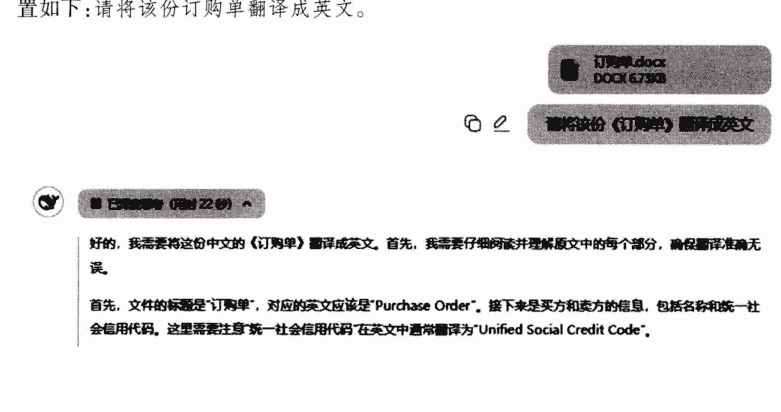
随后是合同主体部分，涵盖货物信息、付款时间、交货时间、交货地点、质量要求、违约责任和附则，每一条均需逐句转换，同时保持法律文件的正式性和严谨性。

货物信息部分包含品名、规格、生产商、数量、单价和总价，需特别关注单位和货币的转换，例如“元”译为“RMB”或“CNY”，“含税价格”要写明税率，如“13% VAT included”。

付款条款提到“本合同签订时买方已付清全款”，应准确表达支付时点，例如“Upon signing this Contract, the Buyer has made full payment.”

交货时间和地点要规范格式，例如日期“YYYY年MM月DD日”可转为“MM/DD/YYYY”，地址按国际通用写法呈现。

质量条款需确保“厂商正品”“符合相关质量标准”等表述精准，如“genuine products from the manufacturer”和“comply with relevant quality standards”。

违约责任涉及比例和数字，须准确转换，如“万分之五”译为“0.05%”，“1%”保持一致。

附则要保留法律正式性，如“each party shall hold one copy”和“shall become effective upon signature or seal by both parties.”

签名处需明确标注“Buyer”和“Seller”的位置。

翻译过程中，保持格式统一也很重要，下划线留空位可保留或根据英文合同习惯微调。中文特有法律用语要找到对应的英文法律术语，保证效力等同。

译文完成后通读一遍，核查是否有遗漏或错误，确保条款与中文原文一致且符合英文表达习惯。

###### 图 3-57 DeepSeek 的“深度思考”过程
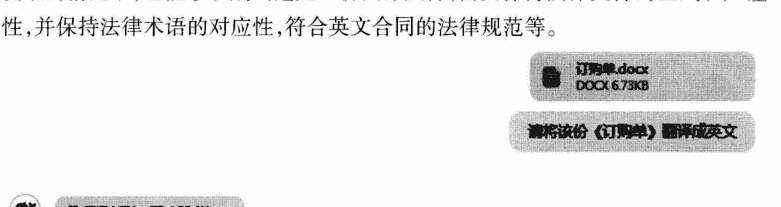
从 DeepSeek 的深度思考过程来看，即使用户没有特别提示，它也能识别出这是一份法律文件，需要保持正式严谨的风格，并保持术语对应，符合英文合同的法律规范。


> 请将该份《订购单》翻译成英文

> 已深度思考 (用时 22 秒)
```
Purchase Order
Buyer (Demand Party)
Name: [ ].underline}
Unified Social Credit Code: [ ].underline}
Seller (Supply Party)
```
| Name: [ ]{.underline} |

| :--- |

| Unified Social Credit Code: [ ]{.underline} |

| The above parties, through equal and voluntary consultation, hereby enter into this Purchase Order (hereinafter referred to as "this Contract") to be mutually observed. |

| **1. Product Information:** |

| (1) Product Name: [ ]{.underline} |

| (2) Specifications: [ ]{.underline} |

| (3) Manufacturer: [ ]{.underline} |

| (4) Quantity: [ ]{.underline} |

| (5) Unit Price: [ ]{.underline} RMB (per [ ]{.underline}) |

| Total Payment: [RMB (in words) (¥ )]{.underline}. |

| *Note: Unless otherwise specified, the above prices include taxes ([13% VAT rate]{.underline}).* |

| **2. Payment Time:** Upon signing this Contract, the Buyer has made full payment. |

| **3. Delivery Time:** [ Year Month Day]{.underline}. |

| **4. Delivery Location:** The Buyer's designated address: [ Province City District/County Road/Street Number]{.underline}. The Seller is responsible fo... |
DeepSeek 生成的英文合同基本达到法律文件要求，可在此基础上再做完善。

还可以继续追问，让 DeepSeek 对采购单做查漏补缺。这次它也准确理解了需求，补充了国际合同中常见条款。

> 作为一份英文合同，你认为还缺少哪些合同条款，请提供你认为需要增加的英文条款。
好的，我需要仔细查看用户提供的原始中文订单及其英文翻译，然后思考作为一份英文合同，可能缺少哪些常见的合同条款。首先，我需要回忆一下一般国际合同中常见的条款有哪些。

首先，原始合同包括了买方和卖方的信息、货物信息、付款时间、交货时间和地点、质量要求、违约责任以及附则。这些都是基本的商务合同条款。但可能缺少一些在国际合同中常见的条款，例如：

1. **不可抗力条款 (Force Majeure)**：说明在发生不可预见的事件（如自然灾害、战争等）时，双方的责任如何调整。

2. **争议解决条款 (Dispute Resolution)**：规定在发生争议时，双方将如何解决，比如通过仲裁还是诉讼，以及适用的法律。

+   3. **保密条款 (Confidentiality)**: 保护双方的商业信息不被泄露。

4. **知识产权条款 (Intellectual Property Rights)**: 明确货物相关的知识产权归属和使用权限。

5. **保险条款 (Insurance)**: 规定在运输或存储过程中货物的保险责任。

6. **修改与补充条款 (Amendments and Modifications)**: 说明合同修改的程序和条件。

7. **通知条款 (Notices)**: 规定双方如何正式通知对方相关事宜，比如通过书面形式或电子邮件。

8. **完整协议条款 (Entire Agreement)**: 声明合同包含双方所有协议，取代之前的任何口头或书面协议。

9. **转让条款 (Assignment)**: 规定合同权利义务是否可以转让给第三方。

10. **可分性条款 (Severability)**: 如果合同某部分无效，其他部分仍然有效。

11. **适用法律条款 (Governing Law)**: 明确合同受哪个国家或地区的法律管辖。

12. **语言条款 (Language)**: 说明合同以何种语言为准，防止翻译差异导致的争议。

在思考过程中，我需要确认这些条款是否真的缺失，或者是否在原始合同中有类似的表述但未明确。例如，原合同提到了违约责任，但没有不可抗力和争议解决的具体条款，这两者在国际合同中非常重要。此外，知识产权和保密条款在涉及技术或专有产品时尤为重要。

接下来，我需要用英文将这些条款补充进去，同时保持合同的专业性和格式的一致性。需要注意的是，条款的表述要清晰明确，避免歧义。例如，不可抗力条款需要详细列举可能的事件类型，并说明在这种情况下双方的权利和义务如何调整。

图 3 – 59 DeepSeek 的思考过程

Below are additional clauses commonly included in international contracts that are missing from the provided Purchase Order. These additions enhance clarity, mitigate risks, and align with global commercial practices:

###### **8. Force Majeure**

Neither party shall be liable for delays or failures in performance resulting from events beyond their reasonable control, including but not limited to acts of God, war, terrorism, pandemics, strikes, or government actions ("Force Majeure"). The affected party shall notify the other party promptly and use reasonable efforts to mitigate the impact. If such events persist for more than 30 days, either party may terminate this Contract without liability.

###### **9. Governing Law and Dispute Resolution**

This Contract shall be governed by and construed in accordance with the laws of [Jurisdiction, e.g., the State of New York, USA]. Any disputes arising from or related to this Contract shall be resolved through amicable negotiations. If unresolved, disputes shall be submitted to [specify arbitration institution, e.g., the International Chamber of Commerce (ICC)] for binding arbitration in [City/Country] in accordance with its rules. The arbitral award shall be final and enforceable in any competent court.

###### 10. Confidentiality

Both parties agree to maintain the confidentiality of all non-public information exchanged under this Contract, including but not limited to pricing, technical data, and business strategies. This obligation shall survive the termination of this Contract for a period of [e.g., three (3) years].

###### 11. Intellectual Property Rights

All intellectual property rights related to the products, including trademarks, patents, and copyrights, shall remain the exclusive property of the Seller unless otherwise agreed in writing. The Buyer shall not reverse-engineer, reproduce, or misuse such rights without prior written consent.

###### 12. Insurance

除了翻译协议、声明、意见书等法律文件，还可结合实际工作需求，让 AI 协助起草和翻译外文函电，进一步提升外文处理效率。

#### (三) 用智谱清言进行外文资料研究
办理涉外法律业务时，常需研读国外法规、案例等外文资料。过去要先全文翻译，再提炼案情、裁判理由，最后才写报告。现在可直接把判决书丢给 AI，让它完成翻译、要点概括，甚至追问隐藏信息。AI 的数据处理和语言理解能力，能大幅加快外文信息获取速度，让律师把精力集中在核心法律分析上。

以德国汉堡地方法院审理的“AI 训练数据集”侵权案判决书为例，原文为德语。假设要基于该判决撰写专题报告，测试 AI 的能力后，将 PDF 上传至智谱清言，提示词如下：

> 请根据我上传的判决书，概括本案的原告和被告的基本情况、案件背景、主要争议焦点、法院的判决和判决依据。
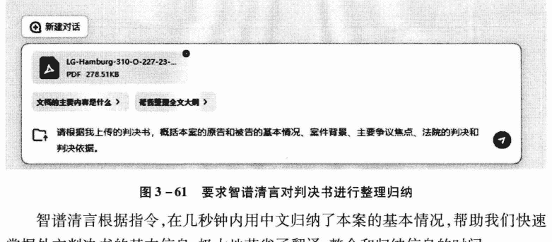
图 3-61 要求智谱清言对判决书进行整理归纳

智谱清言在数秒内用中文完成了本案基本信息的归纳，帮助快速掌握外文判决要点，大大节省了翻译、整合和梳理的时间。

ChatGLM AI

| 项目 | 内容 |

| :--- | :--- |

| 原告 | XXX（摄影师） |

**德国生成式AI数据挖掘案：判决要点与外文研读AI实操**

| 案件当事人 | 被诉方为 XXX e.V.，一家专注人工智能研究的非营利协会 |
| 案情概要 | 被诉方搭建了名为“XXX”的图文语料库，用以训练生成式模型。素材源自网络抓取的图片及其文字说明。权利主张方认为被诉方未经许可抓取并使用其摄影作品，构成著作权侵害 |
| 焦点问题 | 1.相关抓取行为是否侵害权利主张方的著作权 2.能否以著作权法例外获得合法性 |
| 判决结果 | 法院驳回诉请，认定不构成侵权 |
| 说理要点 | - 法院确认网络抓取在著作权法上属于复制行为 <br> - 但认为该行为落入第60d条例外范围。该条允许科研机构为科学研究开展文本与数据挖掘，并在其中复制受保护作品 <br> - 适用条件均被满足：<br>  - 目的在于文本与数据挖掘，用以探究图像内容与文字描述的关联 <br>  - 服务于科学研究，意在推动人工智能领域进展 <br>  - 主体为非营利组织，无商业目的 <br>  - 与私营企业的合作不影响第60d条的适用 |
| 小结 | 原文未提供具体表述 |

图3-62为智谱清言提炼的判决要点概览

核对模型输出是否可靠，可点开图3-62右侧页码旁的“定位”图标，智谱清言会直接跳转到判决书原文对应段落，便于比对。

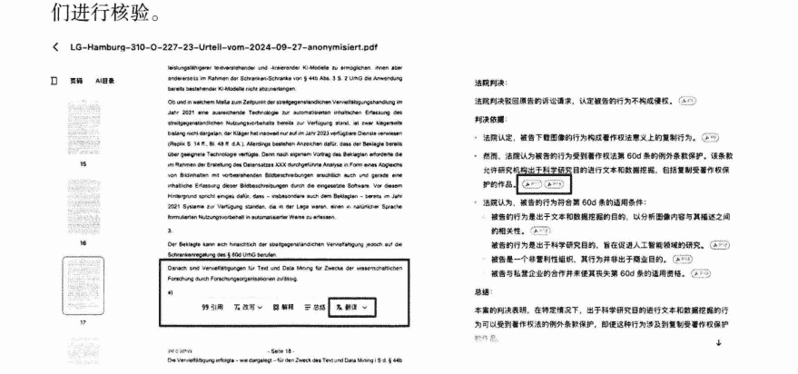

图3-63点选卡片上的“定位”即可直达原文

若德文阅读有困难，可框选原文段落后点下方“翻译”，对话区会自动弹出一段翻译用的提示语句，发送后即能得到译文。

> 请将「Danach sind Vervielfältigungen für Text und Data Mining für Zwecke der wissenschaftlichen Forschung durch Forschungsorganisationen zulässig.」翻译成中文

图3-64触发翻译后右侧对话区自动出现的提示词

初筛之后，还可以继续追问细节：

用户_poGqKJ：“原告声称，被告未经授权下载并使用了其拍摄的图像，侵犯了其著作权”，原告在本案中提交了哪些证据?

ChatGLM：依据判决书，起诉方在诉讼阶段提交的材料包括：

- 身份证明材料：用以证明其为涉案照片的创作者
- 授权文件：显示曾授权XXX图片库使用涉案照片，并可进一步转授权
- 图片库使用规则：载明禁止以自动化程序访问网站或抓取内容，涵盖下载、索引、爬取或缓存
- 起诉方自述：说明其无力也无经济条件发布使用声明。 (A P6)
- XXX图片库声明：网站上公示使用限制，禁止下载内容。 (A P2) (A P7)
- 聊天记录：显示被告联合创始人XXX在获得XXX公司5,000美元资助后，准备提前向该公司提供数据集合。 (A P5)
- 学术论文：证明被告就该数据集合发表的论文被广泛引用。 (A P7)
- 起诉方电脑中的原始数据：再次佐证其为涉案照片作者

需要留意，判决书并未明确起诉方是否提交了全部上述材料，也未排除其他证据的存在。

被告方面提交的材料包括：

- 协会章程：证明其为致力于人工智能研究的非营利组织。 (A P7)
- 数据集合相关科研论文：证明研究成果。 (A P7)
- 与XXX公司的协作关系：证明与商业机构存在合作。 (A P5)

法院在判决中并未对证据进行详尽评述，而是基于事实与法律作出判断。

图3-65智谱清言依据判决书内容对追问的回应

借助智能手段研读外文资料，可以迅速把握全文脉络。依赖即时翻译、文本学习和分析，能快速提取关键信息，为后续整合与法律研究打基础。

#### (四) 线上会议实时翻译：腾讯会议实操演示

处理涉外业务时，受地域限制，线上会议已成为对接境外律所与客户的主流方式，尤其在多语种参会场景下，实时准确的沟通至关重要。在多国人员参与的线上会议中，语言障碍往往是首要难题。借助智能实时翻译可消除沟通壁垒，实现无缝交流，提升会议效率与质量。以腾讯会议的实时转写与翻译功能为例，可体验线上会议实时翻译的效果：

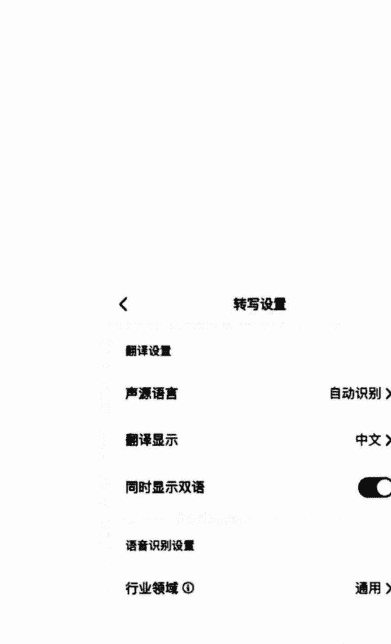

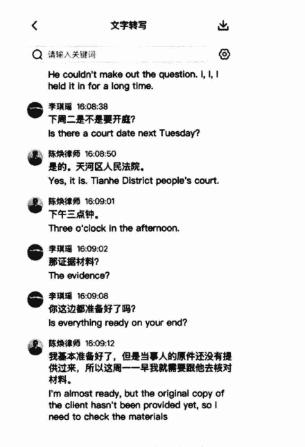

借助专业会议软件，可实现多语言会议的实时转写与翻译，帮助参会者掌握即时沟通内容。会议结束后，还可下载记录并请智能模型归纳要点、生成纪要。

#### (五) 外文视频字幕实时翻译：沉浸式翻译插件体验

学习海外法律时，常需观看外文视频。没有中文字幕的专业法律视频，对多数人而言理解难度较高。目前不少浏览器插件已支持外文字幕自动翻译，可帮助快速获取视频信息。以下以“沉浸式翻译”网页插件为例，测试其实时翻译外文视频字幕的效果。

首先在浏览器扩展程序中找到“沉浸式翻译”选项。

扩展程序 开发者中心

###### 沉浸式翻译: 双语对照网页翻译

没有废话的，革命性的，饱受赞誉的双语网页翻译扩展

★★★★★ 4.3 (1,549个评分) 实用工具 高效办公 4.7W个用户

图3-68沉浸式翻译扩展程序

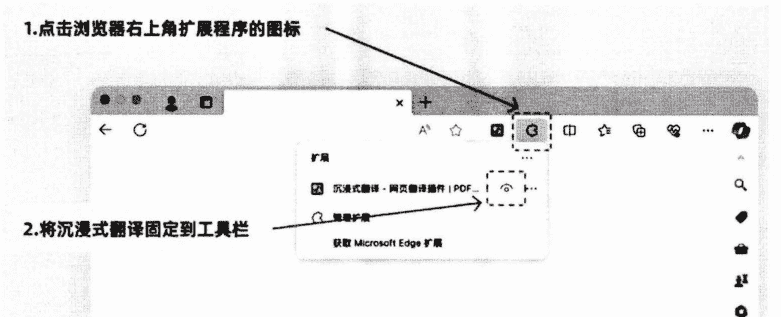

安装后按网页指引将“沉浸式翻译”扩展固定到当前网页工具栏。

1. 点击浏览器右上角扩展程序图标

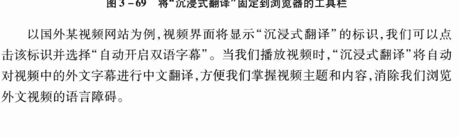

2. 将沉浸式翻译固定到工具栏

图3-69将“沉浸式翻译”固定到浏览器工具栏

以境外某视频网站为例，播放界面会显示“沉浸式翻译”标识，可点击并选择“自动开启双语字幕”。播放时，插件会对视频中英文字幕进行中文翻译，便于把握主题，消除语言障碍。


Introduction to Labor Law: Module 1 of 5

LawSheif 订阅 👍 418 👎 分享 下载 感谢 ...

图3-70“沉浸式翻译”自动将外文字幕译为中文

#### (六) 翻译润色校验：DeepL梦笔生花功能测试

翻译校验与润色是处理法律文书的关键环节。过去需耗费大量时间核对术语、语法与语义。如今部分翻译产品已内置智能润色功能，可智能调整语体、自动纠错。借助智能润色与校对，可大幅提升效率。

以下以某合同条款的润色为例，尝试DeepL的“DeepL Write 梦笔生花”功能。

登录DeepL翻译官网，点击“DeepL Write”。

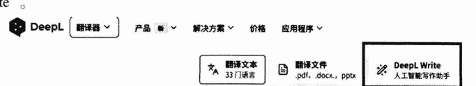

图3-71“DeepL Write”入口

可选择“简洁”“商务”“学术”等写作风格，或设定“热情”“亲切”等基调，由DeepL润色改写。

###### 使用DeepL Write 梦笔生花

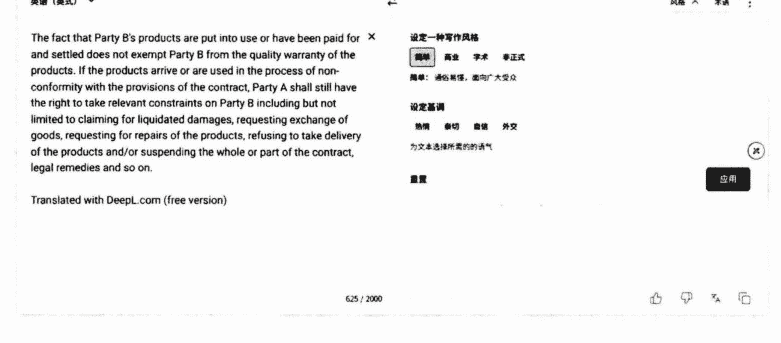

图3-72“DeepL Write 梦笔生花”界面

###### 使用DeepL Write 梦笔生花

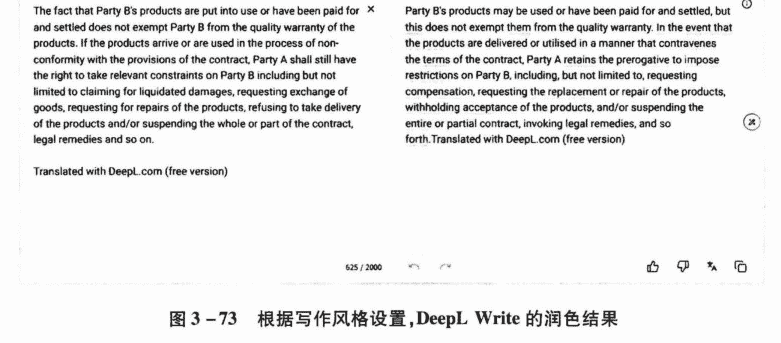

图3-73按风格设定后的润色结果

除DeepL自带润色外，还可将译文发送给其他大模型，通过明确提示词实现翻译润色与校验。

##### (七) 核心能力清单

1. **依场景匹配合适的翻译工具**

   并无绝对最优方案，关键在于匹配。网页文字与视频的翻译，可通过安装“沉浸式翻译”“豆包”等浏览器插件实现实时便捷翻译，提升信息获取效率。研究外文资料时，可借助智能手段梳理学习，快速理解并挖掘关键信息。正式法律文件或商务函件的翻译，则宜在智能翻译后进行人工润色，以提高质量。

2. **善用法律专业术语库**

   专业术语的准确性决定法律翻译的严谨性。善用翻译工具自带的法律术语库或自行建立术语库，有助于智能模型准确识别与使用专业词汇，提升法律翻译表现。

3. **重视译文审校**

   智能模型提供的初译不可直接作为定稿。法律人应具备必要的法律知识与语言素养，在智能辅助下完成校对与润色，纠正语法、语义偏差及术语误用，确保译文符合法律翻译标准。

### 八、阅读法律材料：以豆包浏览器插件为例

法律工作中需面对海量阅读任务，涵盖案件卷宗、法律法规、司法解释与案例研究。若逐字通读，效率极低。智能技术正在重塑法律人的阅读方式，既带来效率提升，也伴随幻觉风险。智能时代的法律人需掌握有效的智能阅读技巧，在有限时间内准确理解与运用各类法律文本。

#### (一) 智能辅助阅读的特征

一是可以借助智能手段提升宏观理解。通过智能信息抽取与总结，可将冗长文本提炼为要点，迅速判断是否需要精读，并获得“精简版”阅读体验。但需警惕智能幻觉，过度依赖可能遗漏重要信息甚至导致误判。

二是可以增强跨文本对比分析能力。智能模型可同时比对多份文件，找出异同。例如新旧法律文本对比、上位法与下位法衔接、相近部门法比对，均可借助智能模型快速定位关键差异。

三是可以输出各类阅读笔记，辅助知识组织与存储。智能模型可生成可视化图表、分析报告，便于检索回顾。但要警惕“伪效率”陷阱，技术仅为辅助，深层理解仍需专业判断。

#### (二) 豆包浏览器插件实战应用

下面以“豆包浏览器插件”测试智能辅助高效阅读。

##### 1. 下载并安装启用豆包浏览器插件

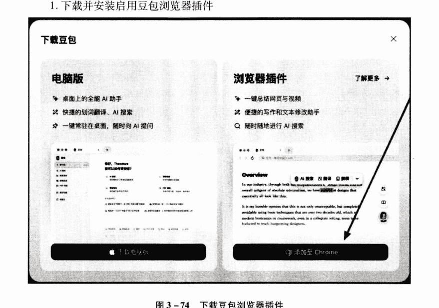

图3-74下载豆包浏览器插件

打开豆包官网，登录后选择“下载电脑版”，点击添加至Chrome；或在扩展市场下载“豆包”插件安装至常用浏览器，即可完成安装。


图3-75在扩展程序中查找“豆包”并点击“获取”

> 将“豆包，浏览器AI助手”添加到Microsoft Edge？

扩展可以：

- 读取并更改在所有网站上的所有数据

[添加扩展] [取消]

图3-76弹窗中点击“添加扩展”

安装完成后，豆包以卡通头像形式吸附于浏览器右侧边缘，便于随时调用。

##### 2. 插件功能概览

如图3-77，点击吸附在浏览器右侧边缘的豆包头像，即展开侧边栏，为“豆包，浏览器 AI 助手”主界面。可直观看到“多网页总结”“图像生成”“AI 阅读”“写作”等功能。


示例内容示意页面中包含的意见反馈信息

##### 3. 使用“AI 阅读”功能高效阅读

作为浏览器智能助手，豆包的核心功能之一是帮助阅读页面核心内容。

打开新网页时，豆包会自动识别网址并主动询问是否需要“总结此页面”或“翻译此页面”：

###### 国家互联网信息办公室关于《网络数据安...


图3-78豆包主动询问是否翻译或总结页面

点击“总结此页面”后，豆包自动抓取信息、分析内容并快速提取要点呈现。


图3-79页面总结效果

- 4. 使用“归纳多个网页”对比阅读不同材料

豆包插件可同时归纳多个网页核心内容，操作便捷。

- 监督管理与法律责任：明确网信、公安机关等监管职责，建立应急处置机制和审计制度，对未履行数据安全保护义务的数据处理者规定相应法律责任。


图3-80触发“多网页总结”功能

点击“+ 添加当前网页”后，插件自动抓取当前页面，可切换浏览器标签页转至下一个待阅读页面：


图3-81切换网页

切换后豆包会再次识别新网页，需重复点击“+ 添加当前网页”，依次添加所有目标页面。下例中添加了中国人大网《网络安全法》页面和国家网信办《网络数据安全管理条例（征求意见稿）》页面。

随后向智能模型提供提示：比较两页内容关联，用表格形式对比分析。


图3-82网页比对结果

可见豆包完成了关联分析，以清晰表格呈现两页关键信息，大幅提升阅读效率与关联理解。

进一步可补充提示：将以上归纳制作成Word文档。豆包会自动整理并提供如下文档：

###### 《中华人民共和国网络安全法》与《网络数据安全管理条例（征求意见稿）》对比分析


####### 一、引言

在数字化时代，网络安全和数据安全至关重要。《中华人民共和国网络安全法》于2016年通过，为网络安全领域奠定了法律基石。而《网络数据安全管理条例（征求意见稿）》在2021年发布，是对网络数据安全管理的进一步细化与完善。两部法规紧密关联，共同守护我国网络数据空间的安全。

####### 二、发布情况

| 对比维度 | 《中华人民共和国网络安全法》 | 《网络数据安全管理条例（征求意见稿）》 | 关联分析 |

|----------|-----------------------------|---------------------------------------|----------|

# 网络安全法与数据条例 起止时间与定位对照

| 发布时间与性质 | 2016年11月7日由第十二届全国人大常委会第二十四次会议通过，已正式生效，位阶为法律且稳定性突出，施行后对网络安全领域形成全面规制 | 2021年11月14日由国家互联网信息办公室面向社会公开征求意见稿，尚处征求意见阶段，后续会据各方反馈作修订完善 | 网络安全法为数据安全治理提供了上位法框架。条例是在法律实施若干年后，针对数据安全领域的新要求作出的细化延伸 |

> http://www.npc.gov.cn/zgrdw/npc/xinwen/2016-11/07/content_2001605.htm和其他1文件

图 3-83 可供下载的 Word 比对稿

读者可按需要复制或下载该文档。

- 5. 用逐行翻译功能阅读网页

豆包的网页翻译兼容多种语言。按下“翻译”按钮后，系统能迅速识别页面内容并给出逐行译文。相较浏览器自带的整页翻译，逐行方案更能保留原意的语境与细节，减少整页转换带来的语义偏差。若发现译文不准，可随时对照原文查看，避免整页反复切换或因跳行造成反复翻译的麻烦。

翻译入口的开启方式如下：


###### Introduction

Open source doesn't just mean access to the source code. The distribution terms of open source software must comply with the following criteria:

###### 1. Free Redistribution

The license shall not restrict any party from selling or giving away the software as a component of an aggregate software distribution containing programs from several different sources. The license shall not require a royalty or other fee for such sale.

###### 2. Source Code

The program must include source code, and must allow distribution in source code as well as compiled form. Where some form of a product is not distributed with source code, there must be a well-publicized means of obtaining the source code for no more than a reasonable reproduction cost, preferably downloading via the Internet without charge. The source code must be the preferred form in which a programmer would modify the program.

图 3-84 逐行翻译功能

在页面空白处右键调出菜单后，点选“翻译网页”即可，效果见下图：


Home / The Open Source Definition

###### # The Open Source Definition 开源定义

Page created on July 7, 2006 | Last modified on February 16, 2024

页面创建于 2006 年 7 月 7 日 | 最后修改于 2024 年 2 月 16 日

###### # Introduction 介绍

> > Open source doesn't just mean access to the source code. The distribution terms of open source software must comply with the following criteria:

> 开源不仅仅意味着访问源代码。开源软件的分发条款必须符合以下标准：

- 1. Free Redistribution 1. 免费重新分发

The license shall not restrict any party from selling or giving away the software as a component of an aggregate software distribution containing programs from several different sources. The license shall not require a royalty or other fee for such sale.

本许可不限制任何一方出售或赠送软件，将其作为包含来自多个不同来源的程序的聚合软件分发的组成部分。许可证不要求对此类销售收取专利费或其他费用。

###### 图 3-85 豆包的翻译效果

此外，豆包插件还提供划词翻译等多样化场景，可自行尝试。关于如何更好利用生成式模型辅助翻译，本书已有详述，感兴趣者可翻阅。

高效的人工智能阅读方式，正在推动法律人从信息处理者向策略设计者的角色转变。我们不仅要筛选信息，更要在模型的支持下成为方案的制定者和问题的解决者。因此在享受便利的同时，需持续提升专业素养与批判性思维，通过实践探索人机协同的工作模式，让模型成为洞察法律问题、构建解决方案的有力助手。

# 九、AI 助力公文写作：DeepSeek、新华妙笔、WPS 实战

公文、通讯稿等应用类文章的写作，既是初入职场的法律人必须掌握的基础能力，也是迅速获得关注、展现能力的关键。

新政策或领导讲话初稿完成后，通常要反复推敲标题与小标题。即便投入大量精力打磨，仍需多次与领导沟通、数轮修改才能定稿。借助生成式人工智能后，写作习惯发生根本变化：确定主题后即可快速获取最新政策要点，按需生成初稿，无需再检索标准模板，拟题也不必苦寻同义词替换，甚至可按领导偏好定制。

#### （一）借助 AI 完成公文写作的七步流程

- 1. 第一步，厘清目的、对象与文种。明确文书的核心意图是传达方针、公布规章、部署工作，还是商洽、请示报告；明确接收对象是上级、同级或下级；明确文种如通知、请示、报告、函。将三项要素交给模型，可快速获得范本与框架。
- 2. 第二步，借助模型收集整理资料。汇集相关政策文件、数据与背景，确保模型能调取最新政策、借鉴成熟做法、明确写作方向。过去需在各政府网站、媒体、专业数据库间切换并人工甄别时效性。如今模型可迅速抽取政策、行业趋势与统计数据，提供权威支撑。例如撰写某市党建新年计划，只需输入“党建最新政策要求”“党建创新做法”“某市近年党建情况”等指令，模型便能从权威渠道获取最新政策，结合新闻与论坛捕捉各地创新案例，并调取本地数据库的详实数据。
- 3. 第三步，借助模型搭建框架。介入前侧重梳理公文要素，如开头背景依据、主体内容要求、结尾执行提示。使用模型后，更侧重明确需求与要点，例如写城中村治理经验，需告知模型从公共设施更新、环境卫生提升、安全隐患排查三方面展开，并结合最新政策突出地方特色。
- 4. 第四步，借助模型起草。输入提示词后文章可即时生成，并可切换正式严谨、文艺抒情、学术研究等多种风格，大幅提升效率。需注意，若引用模型提供的索引内容，务必逐项核查，特别是政策条文常有“名义保留、内部调整”的情况，写作者需反复核实最新表述，避免原则性错误。

第五步，借助模型打磨标题。公文质量除内容充实外，很大程度上取决于标题与小标题的吸引力。写作者常需花费大量时间确保标题精准概括核心、形式整齐、最好能引经据典。如今只需明确要求即可批量获得备选标题。

第六步，借助模型模拟领导画像修改把关。把握领导需求与偏好是难点。可将领导过往批示或发表的材料喂给模型，梳理其文风、逻辑、用词与结构偏好，建立数字画像，再以该画像对初稿进行改写。

第七步，借助模型校对定稿。利用模型快速识别语法错误、错别字及标点不当，节省校对时间。

#### (二) DeepSeek 辅助公文写作示例

依据七步法，先基于三项明确拟定提示词：

- 定身份：单位与职务
- 定类型：讲话稿、通知等具体文种
- 定受众：面向群众或上下级
- 定领域：党建材料或工作报告
- 定背景：目的与意义
- 定框架：要点与注意事项
- 定风格：平实专业或文艺轻松等

示例：我是检察院政治部主任，需撰写上报上级检察机关的简报，主题为检察人才培养与过硬队伍建设，围绕政治、业务、作风三方面提炼做法，业务部分重点突出青年培训营建设、与高校共建实践基地、开展同堂培训。字数约800字，语气平实专业。

据此提示词，DeepSeek 生成的效果如下：

> 已深度思考（用时25秒）

###### XX检察院：三位一体锻造新时代过硬检察队伍

近年来，XX检察院深入贯彻落实最高检人才强检战略，以政治建设为统领、以业务素能为核心、以作风建设为保障，创新构建“政治铸魂-业务强基-作风固本”人才培养体系，着力打造忠诚干净担当的高素质检察队伍，相关经验获省级政法简报刊发推广。现将主要做法汇报如下：

####### 一、政治铸魂，筑牢思想根基

- 1. 坚持把政治建设摆在首位，构建“三位一体”政治教育模式。一是深化主题教育长效机制，建立党组领学、支部研学、干警自学的“三级联学”机制，开展“追随红色足迹”实景教学36场，组织“政治忠诚大家谈”活动19次。
- 2. 二是实施政治能力提升工程，推行新入职干警“政治导师”制度，开展全员政治轮训12期，创新“检务督察+政治体检”双查机制，将政治表现纳入检察官业绩考评负面清单。
- 3. 三是推动党建与业务深度融合，打造‘公诉先锋’‘公益诉讼红色卫士’等特色党建品牌，组建青年理论学习小组8个，开展“检心向党”微党课竞赛，确保队伍绝对忠诚可靠。

####### 二、业务强基，淬炼专业本领

创新构建‘三位一体’业务培养体系。青年培训蓄育新苗，建立“1+2+N”导师制（1名班子成员+2名业务专家+N名办案骨干），通过案例研讨、模拟听证、文书比武等方式开展实战培训，32名青年干警入选省级人才库。检校共建蓄活水，与XX大学等5所高校共建实践教学基地，联合开发“企业合规实务”等6门精品课程，开展“双师同堂”教学27次，转化理论成果12项。同堂培训促融合，联合公安、法院、司法行政机关开展证据审查、量刑建议等专题同堂培训18期，建立类案证据标准指引9项，推动法律职业共同体建设。2023年办案质效显著提升，认罪认罚案件确定刑量刑建议采纳率达98.6%，两项监督案件数同比上升27%。

####### 三、作风固本，锻造检察铁军

构建‘教育-监督-考核’全链条作风建设机制。建立‘六个一’廉政教育制度（每日一提醒、每周一案例、每月一测试、每季一谈话、半年一警示、全年一考评），组织干警家属签订《助廉承诺书》186份。创新“三色预警”监督体系，建立干警廉政档案动态管理系统，对苗头性问题发放黄色提醒卡17份、橙色警示卡3份。实行作风建设“双挂钩”考核，将日常督察结果与部门评优、个人晋升直接挂钩，2023年群众满意度达98.2%，同比提升2.6个百分点。

工作成效：通过系统化培养，队伍专业化水平显著提升，3个办案团队获评省级优秀办案团队，12人次获省级业务竞赛标兵称号。2023年入选最高检典型案例5件，检察建议采纳率、司法救助数等核心指标居全省前列，以人才优势赋能检察工作高质量发展的成效持续显现。下一步将持续深化“青蓝工程”，构建人才成长全周期培养体系，为新时代法律监督工作提供坚实人才保障。

（总字数：798字）


仅用基础提示词即可完成约一半工作量，在此基础上可进一步优化提升完成度：

常见优化示例：

- 上传五篇领导偏好的讲话稿，请总结其文风、逻辑、用词、结构，形成数字画像，并据此撰写主题为××的讲话稿。
- 小标题需引经据典并列明出处。
- 精准识别格式、标点、固定表述等错误并给出修改建议。

###### 领导数字画像分析报告

基于简报内容，从文风、逻辑、用词、结构等维度提炼领导偏好画像，形成可量化、可复用的写作指导模型。

####### 一、文风偏好画像

######## 1. 政治性与专业性并重

- 高频使用政策术语（如“人才强检”“政治引领”），占比约20%。
- 创新机制命名（如“青蓝工程”“三色预警卡”），每篇简报至少提炼3项特色表述。

######## 2. 数据驱动与案例支撑

- 数据密度：每500字含8-10组数据（同比、占比、排名等），如“群众投诉率下降37%”。
- 案例嵌入：每部分至少1个典型事例（如“退役军人王某赠送锦旗”），增强说服力。

######## 3. 语言张力与感染力

- 善用比喻（如“三维聚力”“锻造铁军”）和对比句式（如“变被动等案为主动寻案”）。
- 动词强化行动力（“淬炼”“织密”“硬化”），占全文动词比例超60%。

####### 二、逻辑结构画像

######## 1. 框架设计

- 采用“总-分-总”结构：开头概述战略与成效（占10%篇幅），中间分点展开（占80%），结尾总结提升（占10%）。
- 三级标题分层：主标题（突出核心主题）→二级标题（提炼维度）→三级标题（具体措施+数据闭环）。

######## 2. 内容闭环

- 每项措施对应成效数据，如“开展同堂培训16期→认罪认罚采纳率提升9.2%”。
- 段落间逻辑递进：从“思想建设”到“业务突破”再到“作风保障”，层层递进。

####### 三、用词习惯画像

######## 1. 术语规范

- 政策文件精准引用（如“最高检‘人才强检’战略”），每篇引用上级部署不少于2处。
- 制度名称加引号标注（如“六个一”廉政教育），占比约15%。

######## 2. 量化表达

- 数据对比：100%使用“同比”“环比”“占比”等量化词，避免模糊表述。
- 排名意识：强调“全省前列”“全国优秀”等竞争性表述。

######## 3. 创新词汇

- 机制创新命名：每篇至少设计3个新概念（如“双线筛查”“三必须标准”）。
- 品牌化包装：打造“阳光听证”“检察救助暖民心”等可传播标签。

####### 四、结构优化画像

######## 1. 标题设计

- 主标题公式：“单位+亮点词+核心成果”（如“XX检察院：三维聚力锻造新时代检察尖兵”）。
- 二级标题要求：4-8字动词短语（如“政治铸魂”“作风固本”），突出动态性。

######## 2. 段落编排

- 每段控制在150字以内，采用“做法→机制→数据→案例”四步法。
- 使用符号分隔（如“----”“****”），增强视觉层次感。

######## 3. 结尾强化

- 成效总结：用“三个转变”“四个提升”等概括性短语收尾。
- 未来计划：提出1-2项递进性目标（如“深化人才全周期管理”），保持延续性。

####### 五、领导数字画像模型

| 维度 | 偏好特征 | 量化指标 |
|------|----------|----------|
| 文风 | 政治性强、数据密集、创新命名 | 每千字含15组数据，3个新机制名称 |
| 逻辑 | 总分总结构、闭环论证、递进层次 | 三级标题分层，100%措施配成效数据 |
| 用词 | 政策术语精准、动词主导、量化对比 | 动词占比60%，量化词覆盖率100% |
| 结构 | 标题公式化、段落模块化、视觉分隔 | 主标题符合公式，每段≤150字 |
| 附加偏好 | 典型案例嵌入、品牌化包装、竞争性排名 | 每篇含2个案例，至少1项省级以上荣誉提及 |

###### 应用建议：

1. 建立“政策术语库+数据模板库”，确保内容规范性；
2. 设计“标题生成器”“逻辑闭环检查表”等工具，提升写作效率；
3. 定期分析领导反馈，动态优化数字画像参数。

> （总结：领导偏好结构化、数据化、创新化的公文，注重政治高度与民生温度平衡，追求“既有面子（品牌）又有里子（成效）”的传播效果。）

图 3-87 提示词优化后的 AI 生成效果

#### (三)新华妙笔、WPS AI 辅助撰写公文实例

除 DeepSeek 外，还可选用多种写作工具辅助公文撰写。

##### 1. 用新华妙笔 AI 辅助撰写公文

新华妙笔依托新华社资源，拥有最新新闻数据库与政策解读资源，并内置新华问道、学习园地等时政模块，适用于党政机关及企事业单位撰写各类公文。

这款工具内置九种写作情境与两组文本模板库，并集成智能校对、智能提纲、智能润色等能力。以智能校对为例，除了揪出错别字之外，还允许用户自建审查规则，可覆盖意识形态核查、各类敏感信息筛查、禁用词拦截等层面，这一点是新华妙笔相对同类智能写作产品的区别所在。该功能还具备领导署名排序，能够直接化解公文起草者长期以来的排位烦恼。


图 3-88 新华妙笔 AI 写作“AI 校对”功能演示

作为公文写作助手，新华妙笔能够产出较为基础的稿件，但在交互顺畅度与整体可塑性上仍有提升空间。生成前需要手工补齐大量基础要素，初稿形成后若想调整提纲等核心信息，就无法返回对话页进行微调，只能重新走一遍流程。因此它更适合写作基础薄弱的读者作为搭框架的工具。

##### 2. 用 WPS AI 辅助撰写公文
WPS AI 是 WPS Office 的延伸能力，依托庞大的用户基础和成熟的界面实现无缝嵌入，使用者无需另学操作即可随时调用智能功能。

WPS AI 对文档语义的理解较为深入，能够给出针对性的写作建议，主要用法如下：

1. 使用“帮我写”功能，输入写作场景即可一键成稿。以新闻稿撰写为例：


2. 使用“帮我改”对文章进行润色，如果需要更精细的定制，可以借助“文档问答”直接下达明确指令。例如笔者要求把活动流程改为领导发言、联签协议、共同进社区开展法律咨询和普法宣传，且每个流程独立成段并拟小标题。


图 3-92 WPS AI“文档问答”进行个性化修改效果

3. 撰写时建议开启“伴写”功能，只需将光标停在某处，AI 便以灰色字体的形式实时提供思路提示，帮助用户快速构思、填充内容，突破写作瓶颈，提升效率。


图 3-93 WPS AI 开启“伴写”效果展示

4. 初稿完成后，可使用“全文总结”进行复盘概括，或使用“文档脑图”梳理脉络，确保文稿逻辑严密、结构清晰。上述两项同样适用于会议记录、项目报告等多种文档整理，极大提升工作效率。

###### AI 全文总结
概述：

该市司法局与该市律师协会联合举办了一场党建共建活动，旨在加强司法机关与律师行业间的协同合作，实现党建工作与法律服务的深度融合。活动得到双方高度重视，多名党员律师积极参与。通过深入交流研讨，双方就深化党建工作达成共识，并以多样化形式增强党员律师的凝聚力与向心力。此次活动标志着双方在党建领域迈出重要一步，未来将继续合作，共同推动法治社会建设。

###### 主要内容：
1. 活动背景与目的：
   - 党建共建的开展：该市司法局与律协联合推进党建共建，目的是强化司法机关与律师行业间的协同，实现党建与法律服务的深度交融。
   - 各方重视程度：活动备受关注，众多党员律师踊跃参与。

2. 活动内容与交流：
   - 会议研讨：活动在该市司法局会议室举行，双方代表就党建工作的实际情形、挑战与发展方向进行了深入交流。
   - 领导讲话：赵刚强调活动对提升司法机关与律师行业党建成效的重要性；陈华表示律协将积极配合，强化律师队伍的思想政治建设。

3. 合作共识与建议：

###### 领导发言
在此次党建共建活动中，领导们发表重要讲话，强调党建与法律服务相结合的重要性。他们指出，通过党建共建，可以进一步推动法律服务的普及与提升，确保法律的正确实施和社会公平正义。领导们还对双方未来合作提出期望，希望携手为建设法治该市贡献力量。

###### 联签协议
活动高潮部分是双方代表进行联签协议仪式。通过签署共建协议，该市司法局与该市律协正式确立长期合作关系。协议的签订不仅标志着双方在党建工作上的深入合作，也为未来在法律服务、普法宣传等方面的工作奠定坚实基础。

###### 共同进社区开展法律咨询和普法宣传
活动末段，双方代表共同走进社区，开展法律咨询和普法宣传。通过面对面交流，法律专家为社区居民解答各类法律问题，普及法律知识，增强居民法律意识。活动得到社区居民热烈欢迎，进一步拉近法律服务与民众的距离，为构建和谐法治社会发挥作用。


5. 文稿内容完成后，可使用“AI 排版”进行格式调整。该功能能够智能识别文稿内容，自动匹配最佳排版方案，确保文档符合规范，也可定制个性化样式，满足不同需求。


图 3-96 WPS AI“AI 排版”功能及效果展示

借助智能工具撰写公文，能够自动识别并应用不同文种的写作规范，严格按照文本格式生成内容，格式错误率低；能解决通知、动态通讯稿、会议纪要等基础稿件撰写问题，生成的文章通常行文流畅、用词精准；提供丰富的写作思路，在“投喂”更多提示词、材料并反复交互的情况下，能获取高质量文本。对笔者而言最大的解脱是不必再苦思冥想编排小标题，AI 不仅擅长归纳总结，还能生成各类形式写稿者需要的小标题。

不过用 AI 写材料也存在短板，最常见的是提示词涉及敏感词或敏感领域时，模型可能会自动规避或给出模糊回答，导致内容失真，部分模型甚至直接拒绝回答。在科研报告、法律合同、政策解读、讲话稿等专业性强的场景，生成内容可能出现表述错误或逻辑漏洞，因此需注意核验。

### 十、知识管理：以 Get 笔记、ima、“律 AI 多”为例
在信息爆炸时代，获取信息已非难题，真正的挑战在于如何应对碎片化和信息过载。法律是知识密集型行业，每位从业者都需要持续学习，但“松鼠症”现象普遍存在——热衷囤积资料却难以有效利用。资料常被遗忘，等真正需要时难以找到。

学习资源分散在公众号、小红书、视频号等多个平台上，形式多样，包括文字、图片、音频、视频等。传统知识管理工具通常只能处理文本信息，对视频或直播内容则无能为力。此外，格式转换耗时且枯燥，很多人因此放弃整理。例如会议中拍摄的 PPT，会后很少有人会花时间整理成文档；灵感闪现时，录音比打字更能捕捉瞬间想法，但由于缺乏有效输入工具，很多宝贵知识就这样流失了。

知识管理是对专业知识、实践经验及其他相关资源进行“应用—积累—再应用”的全生命周期管理。目标在于形成可复用、可传承的知识资产，以便在未来法律实践中再次利用，从而促进职业成长，提高工作效率和服务质量。随着人工智能技术发展，特别是 AI 在内容收集、检索、总结和生成等方面能力的提升，市面上的知识管理产品已经开始帮助法律人更好地管理和利用知识。通过使用 AI，可将来自不同平台、不同格式的信息统一存入知识库，大幅节省整理时间。由于 AI 具有更强的理解能力，不再需要像传统检索一样由自己查找相关知识，只需直接向 AI 提问，AI 就能从知识库中总结相关信息并给出回答，每个回答都注明引用的知识库内容，兼具效率与效果。

#### (一)AI 知识管理工具的选择标准
选择适合自己的 AI 知识管理工具时，不应仅仅看功能丰富度，而应更注重是否能贴合实际工作流程需求。

- 一是要注重多样化的信息收集方式。理想工具应支持从多个平台获取多种形式的信息，减少收集不便，让信息“丝滑”进入知识库。
- 二是要注重与工作流的契合度。确保所选工具能够无缝融入日常工作流程。例如，若一直使用飞书进行知识管理，资料都沉淀在飞书知识库中，则可保持使用习惯，继续用飞书做知识管理。若还想利用其他工具特性，比如利用 ima 的知识共享功能做传播，也可按需调整。
- 三是要注重优质外部知识库补充。对法律人而言，个人知识库构建主要依赖日常学习与工作实践积累，凭借个人时间和精力维护更新。但个人知识库容量和广度有限，更像私人书房。相比之下，律所内部共享知识库或专业的第三方法律知识库，则像藏书丰富、品质精良的大型图书馆，拥有海量且系统的资源。若能打通个人、律所、第三方知识库，可极大拓宽知识边界，AI 知识管理也能发挥更大价值。

#### (二)三款 AI 知识管理工具实战应用
接下来以得到出品的 Get 笔记、腾讯出品的 ima 和北大法宝出品的“律 AI 多”三款产品为例，针对上述难题为法律人进行知识管理，提供参考。

1. 用 Get 笔记进行知识输入
目前支持拍照、录音和粘贴链接等方式让笔记自动生成。公众号图文链接、抖音/B站视频链接、小宇宙播客链接和得到直播链接均可丢入梳理总结。

2. 用 ima 进行知识输入和输出
ima 最大的特点是除了用户可自行上传文件外，还利用腾讯内部生态优势，打通微信内部的知识流转。允许用户将微信聊天文件上传至知识库，无需借助其他软件。隐藏在海量聊天记录中的文件得以解锁，更便捷地保存在高质量微信群中，作为学习资料。ima 目前支持电脑端和移动端登录。


以移动端为例，用户可在“ima 知识库”微信小程序中直接上传微信文件。同时，在微信 APP 的文章分享页面点击“在小程序中打开”，即可将微信文章保存至 ima 知识库中。


生成式大模型凭借强大的语义理解能力，不仅能精准解读用户提问，还能深度剖析知识库内容。传统知识库检索存在局限，难以精准定位所需知识。而接入先进 AI 能力的知识库则突破瓶颈，能够依据库内信息准确回答用户问题。

当用户想查找某项知识时，无需手动翻阅大量文件。只需在对话框输入问题，AI 会自动在知识库中检索，迅速找到答案并以完整回答呈现。回答不仅包含详细分析和精炼总结，还会明确标注结论引用的来源。如担心模型幻觉，可点开来源验证。

例如，用户提问“数据合规领域有哪些值得关注的问题?”，ima 的基于知识库回答如下。AI 读懂问题、找到对应文档并形成清单。

###### 数据合规领域有哪些值得关注的问题
2025-03-07 00:33

基于全网 基于知识库

ima 混元

找到了2篇知识库资料作为参考


在数据合规领域，有许多值得关注的问题，这些问题不仅关系到企业的合规性，也影响数据的使用和价值实现。以下是一些关键问题：

- 数据来源合规
  - 数据来源合法性：数据必须通过合法途径获取，避免侵犯第三方权益。
  - 数据可追溯性：确保数据来源可追溯，能够记录数据的原始提供者、收集时间和方式等信息。
- 数据处理合规
  - 数据使用授权：确保数据处理过程中有合法授权，特别是涉及个人数据时，必须获得用户明确授权。
  - 数据质量管理：确保数据的准确性、完整性、一致性和时效性，建立有效的数据质量管理体系。

###### 数据安全合规
- 数据安全措施：采取适当的技术和管理措施，确保数据在传输、存储和使用过程中的安全性。
- 数据泄露应急响应：建立完善的应急响应机制，确保在数据泄露等安全事件发生时能够迅速响应。

###### 数据管理合规


3. 用北大法宝“律 AI 多”进行知识输出
以 AI 生成图片平台责任相关问题为例，北大法宝“律 AI 多”解析问题中的法律关系，在法律知识库中检索到对应的法律法规和司法案例，结合上述内容生成完整易懂的答案。

> AI绘画平台，有人上传奥特曼图片AI作画，在平台上公开展示，而且提供了可以复用的生成模板，是否需要承担责任

回答 普通 DeepSeek-R1

已思考完毕

AI绘画平台在用户上传奥特曼图片生成AI作品并提供可复用模板场景下，可能需承担著作权侵权责任。具体法律依据及责任分析如下：

####### 一、法律依据与典型案例
1. 著作权侵权认定
参考法规：《中华人民共和国著作权法》第10条：著作权人享有复制权、改编权及信息网络传播权等权利。未经许可使用他人作品进行AI训练或生成实质性相似内容，可能构成侵权。
- 案例支持：广州互联网法院在（2024）粤0192民初113号案中认定，AI平台生成的奥特曼图片与原告作品构成实质性相似，侵犯复制权和改编权。
2. 平台注意义务
参考法规：《生成式人工智能服务管理暂行办法》第7条：服务提供者应采取技术措施防止生成侵权内容，包括建立投诉机制、风险提示和显著标识。
- 裁判要点：若平台未履行上述义务，如未设置关键词过滤，可能被认定存在主观过错，需承担赔偿责任。

####### 二、平台责任的判断标准
研究 您可以继续提出后续问题


但由于大模型随机性，AI 提供的结论看起来没问题，打开引用来源链接核验后，有时会发现原文并未提到结论相关内容，出现模型幻觉。这点需注意，一定要核实来源与结论是否真实对应。

#### (三)个人知识库的内容扩充
积累优秀知识内容的平台，更懂知识管理的痛点。在用户个人积累基础上，谁家的知识更全面、更权威、更丰富，就能给用户更大赋能。

Get 笔记由“得到”APP 团队打造，自带“得到”多年积累的知识内容；ima 作为腾讯产品则背靠微信生态资源，搜索答案时可检索到公众号内容；北大法宝“律 AI 多”链接北大法宝法律知识库，可基于专业法律知识库生成内容。


图 3-104 北大法宝“律 AI 多”可选择专业法律知识库支持

除平台自带海量知识库支持外，ima 等知识管理工具还通过建立共享知识库生态重构知识协作范式。例如 ima 官方就通过整合官方使用指南以及各公众号上关于 ima 使用的心得体会文章，将零散资源汇聚到一个共享知识库中，所有加入该库的人都能学习和使用这些知识，也可使用 AI 工具针对库内内容提问，这种开源共享精神让知识更高效流动。


图 3-105 ima 支持知识库内容共享

#### (四) 知识库的共享与传播
以 iMindMap 知识库电脑端为例，可在 iMindMap 知识库应用中创建共享知识库。


图3-106 在 iMindMap 知识库应用中创建共享知识库
图3-107 创建知识库后，点击右上角的分享功能，用户可以进行权限设置

当律师拥有专属知识库，可将其作为团队学习和工作手册，让新人快速上手，了解团队工作要求。同时也可将知识库分享给其他同行或客户，借助个人知识库打造专属名片，让知识沉淀发挥作用。

#### (五) 必备 AI 核心技能
一是要注重知识库收集的质量和更新。尽管有 AI 支持，知识库构建仍需细致把关，特别是保证内容质量。很多法律人将所有信息一股脑丢入知识库，导致质量参差。必须明确，AI 无法替代人类思考，AI 知识管理生成内容基于知识库得出。虽然 AI 大大简化知识管理流程——用户只需将文件上传至知识库，即可快速搭建——但这并不意味着所有知识可不经审查直接入库。每一份入库文件都会成为 AI 回答的重要参考。若知识库本身质量低下，AI 也难以生成高质量答案。因此必须对上传内容进行严格筛选，确保其准确性和相关性。例如法律法规更新迭代速度快，涉及这部分的内容需定期清理和更新，以确保知识库的时效性和准确性。

知识体系始终处在流动更新的状态，法律领域尤其明显，法条修订、技术演进会接连出现。想要让自建库不掉队，就必须设计常态化的巡检与刷新流程，定期对库内条目进行复核与迭代。近期 DeepSeek 等新一代模型密集发布，外围涌现了海量学习笔记与解读文章，其中也不乏低质甚至存在事实性偏差的内容。若直接把这类材料导入私有库，后续模型调用时的准确性会受牵连。因此，自建库的准入与管控要常态化，确保进入库的知识既经得起核验也具备实操价值。

二、核验模型产出的真实性与可信度
知识管理工具提升了效率，但幻觉并未消除，仍可能出现漏要点、编造情形或给出错误结论。形成习惯二审模型产出的内容，检查所引来源是否可查，提炼与概括是否经得起验证。复核时应特别盯住时间戳、数值口径，并把引用回溯到库内原文，看两者是否一一对应。该环节重要在于，模型在整合库内容时易产生理解偏差。比对要逐条进行，把原始材料与模型整理后的表述在语义、逻辑、细节层面对照。若发现库本身就有错漏，需要及时清理。涉及法条解读、案例评析等专业内容，必须对照法规正本、官方案例汇编等权威来源进行确认。

三、强化数据安全与隐私边界
前文提到的几款知识管理产品均为云端形态，使用即意味着文件上传至厂商服务器。对保密场景的用户，上传前须逐份审视文件，对敏感字段做删除或脱敏。可密级较高的资料，宜优先采用内网部署的本地化方案，自建可控的知识系统，将数据保留在自有服务器内，以保障安全与保密。

### 十一、把文字变成图形：Mermaid 的思路
当下主流生成式系统以大语言模型为核心，擅长长文本，却在表格、流程、结构图等非文本对象上表现有限。即便多模态模型也难以生产这类图表，因为图表本质上不是位图，而是一种信息化的排版，排版规则本身携带语义，是训练难以完全覆盖的。为此业界常用标记语言作为桥梁，让模型先输出可解析的标记文本，再由渲染工具转为可视化图形。部分产品如 Kimi 已能在对话页直接展示渲染结果，无需额外软件。

#### (一) 关键术语解读
标记语言 Markup language，通过对文本片段添加特定记号来指示呈现方式或语义结构，其目的与 WPS、MS Office 等办公软件一致，都是让文字更好阅读。常见形态有：

- 1. HTML 超文本标记语言
构建网页的基础，用于描述页面结构与内容，常与 CSS 处理样式布局、JavaScript 控制交互配合使用。
- 2. XML 可扩展标记语言
区别于 HTML 的固定标签，XML 可由使用者自定标签与属性。Word 文档即基于 XML 构建，将 .docx 改后缀为 .zip 解压后可见内部 XML 文件。
- 3. Markdown
轻量级文本标记语言，学习成本极低，仅凭 #、*、空格等符号即可实现标题、加粗、斜体等效果，已成为多数模型通用的输出格式。
- 4. Mermaid
一种特化的标记语言①。Mermaid 允许用户用接近 Markdown 的简洁语法编写图表描述，从而生成各类图表，是模型驱动制图时常用的中间媒介。

> ① 也有观点认为 Mermaid 已属图形处理范畴，不算传统标记语言。但从意图看，无论排版还是图形化，都是让文字更突出重点、更易理解，故仍归入标记语言范畴，以体现模型结合多种计算机语言的可能性。

#### (二) 一个使用小场景
假设要向当事人通俗说明刑事流程，起初可能说：“刑事案件分侦查、审查起诉、审判三段，分别由公安、检察、法院负责。侦查阶段可采取拘留、逮捕……”当事人仍觉繁琐。可进一步压缩为：
传唤 - - > 拘留 - - > 逮捕 - - > 移送审查起诉 - - > 提起公诉 - - > 一审 - - > 二审
用 “-” 与 “>” 把节点串起表达先后，这正是 Mermaid 的核心思想：用字符表达图关系。在此基础上遵循少量语法，就能把文字变成清晰图表。

```
mermaid
flowchart LR
%% 语法:flowchart 表示图表类似是流程图;LR 表示箭头方向是从左到右;“- - >”表示用箭头连接前后两个元素。
传唤 - - > 拘留
拘留 - - > 逮捕
逮捕 - - > 移送审查起诉
移送审查起诉 - - > 提起公诉
提起公诉 - - > 一审
一审 - - > 二审
```


借助模型辅助，无需耗费大量时间记忆语法。以下用两个案例演示如何配合 Mermaid 生成图形。

#### (三) 借助 Kimi 与 Mermaid 制作甘特图
甘特图是一种柱状时间图，能直观展示项目节奏与各任务起止，适合项目跟进。
在出具法律合规报价前，客户往往要求看到具体服务方案。直接套用旧模板显得不够贴合，从零定制又费时。此时可用模型生成一份项目甘特图并配简要说明，帮助客户快速理解服务价值。

以下以医疗数据公司数据合规专项服务为例。操作思路是先让模型输出完整服务方案，再基于方案用 Mermaid 生成甘特图。建议分两步提问，避免一次处理多任务导致上下文丢失。鉴于 Kimi 支持在对话页直接预览 Mermaid，故选用其作演示。

提示参考：
步骤一提问：为一家医疗数据公司制定一份数据合规专项法律服务方案，服务期从 2025 年 4 月起，历时 8 个月，团队 4 人，部分环节可并行。
步骤二提问：基于上述方案，用 Mermaid 生成甘特图，要求部分环节可并行，全部环节连续覆盖整个周期，并剔除 Mermaid 中的注释说明，以免影响预览。

效果展示：


已完成推理

###### 设计医疗数据合规专项法律服务计划
以下为针对医疗数据公司的数据合规专项法律服务计划概要：

###### 《医疗数据公司数据合规专项法律服务计划》
####### 一、项目背景
随医疗行业数字化推进，医疗数据公司在采集、存储、处理和共享敏感数据过程中面临合规压力。本计划旨在帮助其搭建健全的数据合规体系，降低法律风险。

####### 二、项目目标
- 1. 识别数据处理各环节的合规风险
- 2. 制定并完善数据合规政策、制度与流程
- 3. 开展员工数据合规培训，提升合规意识
- 4. 建立风险监测与应对机制

####### 三、项目时间安排
服务期为 2025 年 4 月至 2025 年 11 月，共 8 个月。

####### 四、项目服务人员
由 4 人组成：1 名项目负责人律师、1 名数据合规专家、1 名法律顾问助理、1 名技术支持人员。

####### 五、项目服务内容与步骤
######## 第一阶段：项目启动与调研（2025年4月）
- 1. 成立项目团队，召开启动会明确职责与沟通机制
- 2. 访谈管理层及相关部门，了解业务流程、数据类型、来源、存储与使用情况
- 3. 梳理国内外医疗数据相关法规与行业标准，形成合规要求清单

######## 第二阶段：数据合规风险评估（2025年5月-6月）
- 1. 按敏感度与业务重要性对医疗数据进行分类分级
- 2. 从收集、存储、传输、使用、共享、销毁等环节识别风险，分析可能性与影响
- 3. 编制风险评估报告并向管理层汇报

######## 第三阶段：数据合规制度建设（2025年7月-8月）
- 1. 起草数据合规政策，明确原则、目标与责任分工
- 2. 完善配套制度，包括收集保护、存储管理、使用共享、安全事件应急、员工行为准则等
- 3. 设计合规流程，如授权收集、加密备份、审批使用、共享协议与审计等
- 4. 内部审核通过后正式发布并宣贯

######## 第四阶段：数据合规培训与宣传（2025年7月-9月）
- 1. 按岗位制定针对性培训计划
- 2. 开展法规、制度、意识与操作规范培训，采用授课、在线、案例、演练等形式
- 3. 制作宣传手册、海报、视频等资料营造合规文化
- 4. 通过测验、问卷、实操考核评估培训效果

######## 第五阶段：数据合规风险监测与应对（2025年8月-10月）
- 1. 搭建监测平台，技术与人工结合实时发现异常访问与泄露迹象
- 2. 制定预警标准与报告流程，定期汇报风险状况
- 3. 实施应对措施，如强化访问控制、修复漏洞、暂停共享、开展安全审计等
- 4. 定期组织应急演练并总结改进

######## 第六阶段：项目总结与持续改进（2025年11月）
- 1. 编制项目总结报告，回顾成果与经验教训，提出改进建议
- 2. 组织验收，确保目标达成与成果质量
- 3. 建立持续改进机制，动态调整政策制度以适应法规与业务变化

####### 六、项目沟通机制
- 1. 每周召开项目例会汇报进展与问题
- 2. 建立项目沟通群实现信息及时共享
- 3. 定期向管理层汇报重要事项并响应需求

####### 七、项目成果
- 1. 《医疗数据公司数据合规调研报告》
- 2. 《医疗数据公司数据合规风险评估报告》
- 3. 《医疗数据公司数据合规政策》
- 4. 《医疗数据公司数据合规制度汇编》
- 5. 《医疗数据公司数据合规流程手册》
- 6. 《医疗数据公司数据合规培训资料》
- 7. 《医疗数据公司数据合规项目总结报告》

以上计划仅供参考，可根据实际情况调整。在实施过程中需持续关注法规变化与监管动态。

> 根据该计划和方案，使用 mermaid 生成甘特图，注意有些步骤或环节是可以同时进行的，所有步骤和环节应该连续并充满整个项目周期。注意去掉 mermaid 部分中的注释和说明，避免注释或说明影响甘特图的预览。

已完成推理

###### 生成医疗数据公司项目甘特图
以下是使用 mermaid 生成的甘特图代码：

```
mermaid
gantt
    title 医疗数据公司数据合规专项法律服务计划
    dateFormat  YYYY-MM
    section 第一阶段
    项目启动与需求分析           :a1, 2025-04, 30d
    section 第二阶段
    数据合规风险评估             :a2, after a1, 45d
    section 第三阶段
    数据合规政策制定             :a3, after a2, 30d
    section 第四阶段
    数据合规制度汇编             :a4, after a3, 20d
    section 第五阶段
    数据合规流程手册             :a5, after a4, 15d
    section 第六阶段
    数据合规培训资料             :a6, after a5, 10d
    section 第七阶段
    数据合规项目总结报告         :a7, after a6, 5d
```


将代码复制到支持 mermaid 的工具或平台即可生成甘特图。

- 甘特图中的每个步骤都可以并行进行吗？
- mermaid 工具在哪里可以在线查看甘特图？
- 如何调整甘特图的时间格式？
图 3-109 法律合规专项服务方案步骤 1、步骤 2

#### (四) 用 DeepSeek + Mermaid + draw.io 绘制流程图
流程图是 Mermaid 的基础类型，通过节点与连线表达结构或关系。若不确定图表类型，可先尝试流程图。

处理合同纠纷时，常遇到多法律关系交织、标题与约定不一致、文本冗长难抓重点等问题。此时可用模型的归纳能力配合 Mermaid 可视化，快速梳理法律关系并锁定争议点。

以下示例选用一份真实的代理进口协议，因主体复杂、逻辑性强，选择推理能力较强的 DeepSeek 作为演示工具，提示思路如下：

- (1) DeepSeek 具备链式思考过程，无需在提示中逐条说明绘图步骤，只需明确最终效果即可。
- (2) 银行、管辖法院、政府机关虽常出现在合同中，但并不直接构成权利义务关系，应予剔除。

(3) 附随性义务或违约约定即使会对合同权利义务产生牵动，也并不构成主要法律关系，在梳理时应当剔除。可以通过正向的指令引导模型把注意力集中在核心内容上。

上传合同时要防范信息泄露。若把主体名称直接抹掉，模型就无法识别各方，建议用代号或化名替换原文中的主体，而非彻底删除，这样既能保护隐私又保留识别能力。

模型产出往往不够完善，图表常常需要人工再调整。draw.io 的优势在于导入 Mermaid 脚本后仍可做图形化拖拽编辑，即使不掌握 Mermaid 语法也能快速得到清晰简洁的图形。市面上大多数支持 Mermaid 的工具，修改只能通过改源码实现。

###### 提示词范例：
提问：请基于附件合同内容，用 Mermaid 生成一幅主体关系图①。收付款银行、政府部门不属于实体范围，无需展示。只呈现各主体间的法律关系，并用不同颜色标识各主体。

###### 效果展示：


```
graph LR
%% 定义实体及颜色
classDef 甲方 fill:#b3d9ff,stroke:#333;
classDef 乙方 fill:#99ff99,stroke:#333;
classDef 外商 fill:#ffcc99,stroke:#333;
classDef 运输公司 fill:#e6ccff,stroke:#333;

%% 实体节点
甲方["甲方<br>北京机电有限公司"]:::甲方
乙方["乙方<br>中国物资有限公司"]:::乙方
外商["Maniuwn公司"]:::外商
运输公司["航行世界有限公司"]:::运输公司

%% 实体间关系
甲方 -->|"委托代理进口<br>（协议关系）"| 乙方
乙方 -->|"采购货物<br>（进口合同）"| 外商
乙方 -->|"委托运输及清关<br>（合作）"| 运输公司
甲方 -.->|"支付运输/清关费用<br>（间接责任）"| 运输公司
甲方 -->|"提供货物信息<br>支付货款/税费"| 乙方
外商 -->|"交付货物"| 乙方
运输公司 -->|"运输至指定地点"| 甲方

%% 关系说明
linkStyle 0 stroke:#666,stroke-width:2px
linkStyle 1 stroke:#666,stroke-width:2px
linkStyle 2 stroke:#666,stroke-width:2px
linkStyle 3 stroke:#666,stroke-width:2px,stroke-dasharray:5,5
linkStyle 4 stroke:#666,stroke-width:2px
linkStyle 5 stroke:#666,stroke-width:2px
linkStyle 6 stroke:#666,stroke-width:2px
```

> ① 在 Mermaid 规范里，实体关系图与流程图是两种图表。本例聚焦法律关系，简洁的流程图已能达到预期。提示词中使用实体关系图，是为了让模型理解图表目的为刻画主体间的关联。

###### 实体关系图说明：
- 颜色划分：
  - 甲方 北京机电有限公司：蓝色底块，代表委托方。
  - 乙方 中国物资有限公司：绿色底块，代表代理方。
  - Maniuwn 公司 外商：橙色底块，代表境外供货商。
  - 运输代理公司 航行世界有限公司：紫色底块，代表物流服务商。
- 核心法律关系：
  - 委托代理：甲方与乙方以协议确立委托代理关系。
  - 采购合同：乙方按甲方要求向外商采购货物。
  - 运输合作：乙方委托运输公司负责货物运输及清关。
  - 间接支付：甲方承担运输费用，但经乙方间接支付给运输公司。
- 关键流程：
  - 甲方提供货物信息并向乙方支付货款、税费。
  - 乙方完成采购后，外商将货物交付至乙方。
  - 运输公司最终把货物送至甲方指定地点。

###### 图 3-110 代理进口合同主体关系图
把 Mermaid 脚本复制进 draw.io 做二次编辑。打开浏览器，在地址栏输入 https://app.diagrams.net/，创建新绘图并选择“空白框图”。

点工具栏的“+号”进入高级选项中的 Mermaid，在弹出的窗口里粘贴 DeepSeek 产出的 Mermaid 脚本，即可对图形和连线进行编辑。

###### 图 3-111 进入 Mermaid 编辑窗口

###### 图 3-112 粘贴模型产出的 Mermaid 脚本
```
graph LR
    %% 定义实体及颜色
    classDef 甲方 fill:#b3d9ff,stroke:#333;
    classDef 乙方 fill:#99ff99,stroke:#333;
    classDef 外商 fill:#ffcc99,stroke:#333;
    classDef 运输公司 fill:#e6ccff,stroke:#333;

    %% 实体节点
    甲方["甲方<br>北京机电有限公司"]:::甲方
    乙方["乙方<br>中国物资有限公司"]:::乙方
    外商["Maniuwn公司"]:::外商
    运输公司["航行世界有限公司"]:::运输公司

    %% 实体间关系
    甲方 -->|"委托代理进口<br>（协议关系）"| 乙方
    乙方 -->|"采购货物<br>（进口合同）"| 外商
    乙方 -->|"委托运输及清关<br>（合作）"| 运输公司
    甲方 -.->|"支付运输/清关费用<br>（间接责任）"| 运输公司
    甲方 -->|"提供货物信息<br>支付货款/税费"| 乙方
    外商 -->|"交付货物"| 乙方
    运输公司 -->|"运输至指定地点"| 甲方
```

###### 图 3-113 编辑关系图
注：受 draw.io 限制，直接粘贴的 Mermaid 脚本无法保留颜色区分，需要手动修改，因此模型产出的颜色部分失效。

有了智能助手辅助后，更值得先掌握的是 Mermaid 各类图表的用途与意义，再去学语法。只有明白图表要表达什么，才能准确告诉模型真正需求。

在法律事务里，可视化图表很多时候不能直接作为交付物，当前模型产出也有此局限。似乎它们不直接产生可用结果。但正如 Mermaid 官方文档所说，图表和文档会耗费开发者宝贵的时间，并且很快就会过时。但是，没有图表或文档会破坏生产力并损害组织学习能力。

### 十二、实现多端协作：以微信智能输入法为例
对法律从业者而言，多终端协同已成工作常态。外出时用手机发送电脑上处理好的信息，回到办公室后又要把手机收到的文字和图片转到电脑继续编辑，每天都有大量信息在不同设备间流转。如何高效实现信息同步成为急需解决的问题。

统一品牌设备如苹果手机、苹果电脑可享受剪贴区互通的便利。但并非所有人手机和电脑都同品牌。这种情况下常用聊天工具或云笔记来同步。例如用微信“文件传输助手”在电脑和手机上登录同一账号，把需要同步的信息发给自己；云笔记操作类似，通常要新建文档保存内容。方法虽能解决问题，却操作繁琐，需要中断当前工作去第三方应用录入信息。而且很多信息仅需临时使用，不必单独建文档保存，属实浪费。

在码字场景，陪伴法律人最久的工具是输入法。输入法记录输入习惯，是使用任何工具都离不开的。若能在输入过程中直接实现多端信息同步，无疑会大幅提升效率。同样的逻辑也适用于智能工具应用。一些智能工具提供快捷键方便调用，但仍需用户重复输入相同信息。若输入法能记住最近输入内容，并允许用户无需重复录入即可与智能体交互，体验会显著改善并节省时间。

微信智能输入法在这方面表现突出，不仅支持多端复制粘贴文字和图片、同步个人词库和常用语，而且提供点按咨询功能，为用户带来流畅的工作体验。

#### (一) 微信智能输入法功能介绍
- 1. 跨平台内容衔接
在手机、电脑等终端上同步系统剪贴区，可实现文字和图片的多端复制粘贴。这意味着用户可在一种设备上复制内容，直接在另一种设备上粘贴，无需中间步骤。例如律师外出办公时，可用手机快速复制法律文件关键段落，回到办公室后立刻在电脑上粘贴继续编辑，大幅提高效率。出门时也可以把正在编辑的内容传到手机，在路上用手机继续。
输入法最懂用户习惯，利用智能能力基于历史输入形成专属个人词库，不但能提升输入效率，也能预测输入意图。该词库若能各端同步，无论用手机还是电脑，都感觉输入法能读懂想法，进一步增强体验和好感。
- 2. 即时智能问答
输入法会记录用户已输入内容，直接向智能体提问，无需额外打开第三方工具重新输入，对法律人非常实用，适用于工作中频繁需要快速查法规或案例分析的场景。例如撰写法律意见时，可立即询问特定条款解释，而不中断当前工作去打开其他工具。

#### (二) 多端协作相关应用示例
##### 1. 多端协同
支持多终端之间同步剪贴区、个人词库和常用语。记得先在设置中开启下图配置：

同步剪贴区：用户可在一种设备上复制文本，直接在另一种设备上粘贴。
在电脑端选择微信智能输入法，并复制“法律人应该如何使用好 AI”。
在手机端打开微信智能输入法，可在输入法界面最上方看到该内容，点击即可直接粘贴。
手机端复制信息，电脑端也可直接粘贴。

图 3-115 同步剪贴板
同步常用语：用户可设置常用地址、自我介绍等内容作为常用语，以便需要时快速调用，省去重复输入烦琐。

图 3-116 同步常用语
- 2. 点按咨询
在电脑端选择微信智能输入法，在输入法中输入文字后，按下“=”键即可获取智能体生成的回答。如输入“法律人应该如何正确使用 AI”，得到如下回答。
Q 法律人应该如何正确使用AI
法律人在使用 AI 技术时需要遵循一定的原则和步骤，以确保其合法性和有效性。

###### 图 3-117 微信智能输入法“问 AI”功能
手机端会有一个“问 AI”按键，点击后打开该功能。点击右上角的“分享”按键，还可把智能体生成的回答转为长图形式对外分享。
Q 法律人应该如何正确使用AI
法律人在使用 AI 技术时需要遵循一定的原则和步骤，以确保其合法性和有效性。

###### 图 3-118 微信智能输入法“问 AI”的分享功能
###### 法律人应该如何正确使用AI
法律人在使用 AI 技术时需要遵循一定的原则和步骤，以确保其合法性和有效性。

####### 正确使用 AI 的原则
- 1. 验证与审核：法律人必须对模型生成的内容进行严格验证和审核，确保真实性和准确性。任何引用或数据都需独立核查，避免依赖未经验证信息。
- 2. 透明性与可解释性：使用应保持透明，需要理解工作原理和限制，确保决策过程可解释。
- 3. 隐私保护：使用时必须注意保护个人和机构隐私信息，避免数据泄露和不当使用。

####### 具体应用场景
- 法律咨询：可用于在线法律咨询，提供实时解答和法规解读，但建议对智能体的建议进行审核。
- 文书自动化：可帮助生成法律文书，如起诉状、答辩状等，提升工作效率，但仍需人工校对。
- 案件预测：基于历史数据，可预测案件胜率，为律师制定策略提供支持，但预测结果需结合专业判断。

####### 风险与挑战
- 法律风险：模型生成内容可能包含错误或虚假信息，导致法律纠纷或声誉损害。
- 职业责任：律师需对生成内容负责，确保其符合法律和职业道德标准。
- 技术偏见：模型可能存在数据偏见，需要采取措施减少偏见，增强公正性。
图 3-119 生成可对外分享的长图
“问 AI”功能生成的长图文并茂，是很好的展现方式。若回答内容足够优质真实，不仅可用于内部知识共享，还可作为对外宣传材料发布到朋友圈、公众号或小红书等新媒体平台。

#### (三) 微信智能输入法使用心得
一是微信智能输入法看似简单，却解决了日常工作中高频次小问题。每一次使用节省的微小时间累积起来，将带来显著效率提升。使用工具提效未必立即产生惊人效果，但即使是看似简单的改进也能带来巨大价值。法律人在思考使用、建设智能工具落地的过程中，切忌好高骛远，对细节关注和优化，恰恰是提升效率的关键。
二是活学活用智能工具。真正发挥最大潜力，还需要用户具备灵活运用能力。工具的价值不仅在于预设功能，更在于实际使用中能否根据自身需求创造性地寻找新场景。例如前文提到的微信智能输入法生成的长图文，不仅可作为内部学习材料，检查无误后也可直接用于对外新媒体宣传，这就是创意应用。通过发挥创意，可将原本仅限个人使用的小工具，转变为具有广泛影响力的资源放大器。因此，人机协同的最终目的是解决更多问题，不应限制想象力。

## 第四章 腾飞篇
### 法律人使用 AI 加持 IP 的 10 大战法
#### 一、书课视频一体化打造法律人 IP 的基本方法
##### （一）书课视频一体化打造法律人 IP 的核心要点
对于专业工作者而言，打造个人品牌对职业发展意义重大。
- 1. 第一，个人品牌是专业能力的直观呈现。客户在选择法律服务时，倾向信任有专业背景、丰富经验和良好口碑的律师。通过打造个人品牌，可展示成功案例、专业见解和行业经验，从而增强客户信任度与认可度。
- 2. 第二，个人品牌有助于建立稳定的客户群体。在建立品牌过程中，可通过社交媒体、专业论坛、线下活动等多种渠道与潜在客户建立联系，分享法律知识、解答法律疑问，进而吸引目标群体关注并转化为忠实客户。这种基于个人品牌的客户群体不仅稳定，且忠诚度和转化率较高。
- 3. 第三，个人品牌还能带来更多合作机会。在行业内，拥有强大个人品牌的法律人更容易受同行认可，有更多机会参与合作项目、担任重要职务或受邀发表演讲。这些合作机会不仅有助于提升个人知名度，还能带来更多业务资源和职业发展空间。
既然打造个人品牌如此重要，如何打造呢？关键在于持续内容输出以建立品牌。建纬律师事务所创始人朱树英老师曾说，律师开拓市场最好的方式就是出书、讲课、写文章。随着新媒体时代到来，应再加一个打造“短视频”。无论出书、讲课、写文章，还是做短视频，本质都是内容输出的不同形式。而建立书籍课程视频协同的输出体系，更有利于全方位、立体式打造个人品牌。
写书、讲课、做视频三种方式特点不同。书籍呈现知识深度和专业性，可塑造品牌权威感并对精准受众形成深度影响；课程倾向结构化传递知识，同时能与用户即时互动与双向反馈，有助于建立信任关系；短视频特点是传播速度快、范围广，内容形式丰富多样，制作成本尤其是时间成本相对较低，也具有较强社交属性。
书、课、视频的核心目标都是传递信息，知识可在三者之间互相转化、形成深度联动。首先，可按写书思维构建个人知识体系，确保用科学方法建立的知识库能源源不断提供视频创作素材，知识框架中每个知识点又可形成短视频；热门视频可转化为公众号文章，通过整理公众号核心文章又可制作成课程。其次，书籍可作为课程理论框架，而短视频也可作为课程引流工具。
##### （二）做好书课视频一体化的定位

法律人做个人 IP，从定位到 AI 起名全打法

做书、开课、拍视频，起步前先把人群想明白。法律是门大盘子，细分赛道不一样，记忆点也不一样。定位准了才知道要说什么、怎么说。服务企业客户，就要深挖经营合规、交易风控、日常管理的真实痛点；面向早期的创业者，则更在意股权搭建、用工安排、知识产权等底座问题；面向大众科普，要抓住婚恋家庭、劳动争议、消费维权这些高频的日常困惑。只有先看清谁在听、他们缺什么，书、课、视频才有针对性和传播力。

做出一本有分量的专业书，先从选题切入。个人标签和目标读者需求重合处，就是有市场也有深度的题材。题清楚了再搭知识骨架，从理论到落地层层推进，读起来顺手用起来管用。写书是场持久战，得把写作节奏排出来，做个可执行的计划表。初稿完成后先自审，再请同行或熟人挑刺，多听意见再打磨。出版时找有品牌和渠道的专业出版社，扩大声量；同步关注电子书和有声书形态，覆盖不同阅读习惯。

讲好一门精品法律课，先看学员怎么学。形式可以很灵活：线上线下、几小时的微课还是几天的工作坊、单向讲解还是学练结合。类型定好后，搭一个像文章一样清晰的课程结构，知识点顺着逻辑展开。内容要细抠，课件要体感好，让人愿意听、听得进去。推广运营同样关键：借助在线平台做曝光，做一张有吸引力的海报和一段点明价值的文案；建个学员群方便交流答疑；定期做促销拉新；用推荐返利等机制鼓励口碑裂变。

做一个有量的法律视频号，核心是持续输出好内容。短视频的推流规则决定了内容要多元：知识小科普、案例拆解、行业观察都可以轮着来。形式上多尝试：出镜讲解、动画可视化、情景再现短剧。像民间借贷这类题材，用情景剧还原冲突，再由法律人点评法理，既生动又好传播。

##### (三) 用 AI 撬动法律人 IP 增长
AI 的发展让个人 IP 打造事半功倍。写书做课做视频时，用 AI 快速检索案例和法条，给内容补充专业弹药，甚至直接按指令生成课件，省时又稳准。视频环节，Sora、可灵、剪映等 AI 剪辑工具能按人设和脚本自动拼接、加特效上字幕，降本提效。大数据和算法还能洞察受众的行为偏好，帮助定制更精准的推广方案。总之 AI 是当下公开的红利，法律人要把它嵌进书课视频一体化的 IP 建设流程里。

#### 二、AI 起书名实操指南
##### (一) 什么场景适合让 AI 帮忙起名
一本书的好名字能直接传递主题、抓住读者、助力营销。很多人自己起名会卡壳：一是被自己的知识体系和过往经验框住，思维打不开；二是太有感情，容易主观，站不住读者的角度。AI 没有情绪，基于海量数据能从多个视角快速产出大量备选，并根据反馈不断迭代。当然 AI 也不是万能的，它对书的内涵理解有限，有时会出现空洞、缺少共鸣的情况，最终仍需作者筛选、修改、升华。关键是学会引导和甄选。

##### (二) 好书名的七大标准
一是名副其实。书名要一眼点题，比如讲民法典的书叫《民法典实务指南》，读者立刻知道边界。名称含糊宽泛就会降低点击欲望。
二是基调健康。法律类作品要正能量、维护权威感。《法律照亮生活》《正义的天平：法律解读》这类名字就传递积极意义，低俗猎奇的表达要避免。
三是够短够朴实。口语化、易记易传播的书名更有亲和力，像《法律基础教程》《律师办案手记》就很顺口。
四是体现差异。能彰显独特视角，例如聚焦网法议题的《网络法治前沿阵地》，强调扶弱的《为权利而斗争》，有思考张力的《圆圈正义》。
五是带流量词。带有高频搜索词的书名更容易被看见，比如“民法典”“纪检监察”“DeepSeek”等，可参考电商图书榜单提炼。
六是熟悉又新颖。借用熟知金句或概念制造陌生感，提升高级感，如《求医不如求己》《你办的不是案子，而是别人的人生》。
七是讲价值观。三流卖猎奇，二流卖实用，一流卖价值观。《不腐败是一种生活方式》《刑法罗盘》等都是以价值打动读者的例子。

##### (三) 用 AI 起名的四步流程
1. 把书的核心要素讲清楚
先把这本书的核心信息梳理给 AI：主题范围是刑法民法还是职业发展、技能工具；读者是谁，专业人士、学生还是大众；提炼几组关键词，例如企业合规书的“合规”“风控”“内控”。把“写一本关于什么的书+写给谁看+核心要点+需要什么结果”打包成一句指令，AI 才好对准。

2. 选合适的工具
起名字需求通用，选口碑好、体验顺的综合型产品即可。目前豆包和秘塔是不错的选择。DeepSeek 很强但经常忙线，实际多通过平台调用。豆包快、全、包容度高；秘塔检索能力强、无广告、可溯源，生成内容会附带来源，方便验证。

3. 交互式调整
不满意就继续聊。方法一是给示例，把喜欢的书名风格扔给 AI 做参照；方法二是优化提示词，把要求写得更细，例如点出想要的调性、要避开的词、希望突出的情节。

4. 评估再优化
拿到结果后，从贴合度、吸引力、独特性、受众匹配度几个维度筛选。也可以把备选发给朋友、同事或潜在读者收集反馈，多角度找问题再迭代，直到锁定心头好。

##### (四) 真实案例拆解
下面以近期一本律所运营与管理的书为例演示。书面向团队负责人和管理者，内容覆盖定位、战略、产品设计、销售与运营体系、团队管理与激励等底层逻辑，目标是补上管理短板提升能力。

首轮提问后，AI 先做竞品对标，从差异化角度给出5个主标题并拆解立意与优势，最后总结命名策略并推荐最优解，整体思路是动词驱动、内容覆盖、实操导向、差异化设计。

当提示希望加入价值观穿透力，参考《不腐败是一种生活方式》《刑法罗盘》《圆圈正义》等风格后，AI 再次推演，给出兼顾价值感的新一批书名，并说明每组的立意与设计逻辑，形成可选择的价值导向方案。

解码律所书名与AI建目录方法

- 以“守护者”作隐喻，点明法律从业者的社会分工，唤起管理者的使命感。
- 借用韦伯的责任伦理学说，提升价值高度，与单一工具型管理读物拉开距离。

4. 《向光而治：重塑律所管理的底线思维与运营体系》
解析：
- “向光”暗示以价值为先导，与法界对公平正义的追求同调。
- “底线思维”直指律所易滑向的灰色地带，如过度商业化，用以筑牢道德防线。

5. 《原则破局：以价值观驱动的律所管理新范式》
解析：
- 站在《原则》的高知名度上，聚焦“破局”，以价值破解管理困局。
- “范式”指向系统性重构，呼应全书底层逻辑再造的思路。

###### 价值观设计逻辑：
1. 隐喻对抗：运用“光/暗”“守护者/破坏者”等二元意象，触发法律人的身份认同，例如律所过度商业化是否背离初心。
2. 伦理绑定：将管理议题提升到职业伦理层面，如责任伦理，让读者感受到管理短板不仅是能力问题，更是价值缺位。
3. 本质回归：强调专业主义、长期主义等主张，与业界流行的流量思维、短期绩效形成对照，吸引追求基业长青的管理者。
4. 宣言式表达：选用“道”“宣言”“破局”等情绪浓度高的词汇，塑造变革倡导者形象，与工具书区分开来。

建议优先考虑《正义的运营》或《向光而治》，前者把法律人核心价值正义与商业逻辑结合，形成认知颠覆；后者用意象引发共鸣，且底线思维直击管理痛点，兼具传播力与内容指向。

如果仍不满意，可继续提供示例和优化提示词。确定方向后进入下一步。

3. 挑选和决策

从生成结果中选出偏爱的书名，再征询身边人的意见，敲定最终名称。

总体而言，借助人工智能进行命名，为创作者提供了一种高效且创新的路径。发挥人工智能在信息处理、语言创意方面的优势，结合合适的工具和正确流程，可产出大量有吸引力且具独特性的书名建议，解决起名难题。

#### 三、用 AI 整理书稿目录或授课框架

##### （一）适用场景

书籍与课程都需要清晰的蓝图，即目录或框架。它能系统规划内容结构，帮助受众快速把握全貌。优质目录本身即是营销文案，能激发购买欲；课程大纲同理，读者往往先看大纲判断价值。下面以书籍目录为例，说明人工智能如何提升效率与质量。

法律人写作时易受自身知识呈现习惯限制，难以从学习者视角搭建体系。人工智能没有此局限，能基于海量案例把握各类书籍的结构规律，按主题与受众迅速生成适配框架。其次，人工安排知识点篇幅易因熟悉度偏差失衡，人工智能可依据数据客观权衡知识点的重要性与关联性，合理分配位置与篇幅。当然人工智能也有短板，缺乏实践深度，输出有时偏理论化，需要法律人凭借专业经验细致审校、调整和完善。

##### （二）列目录的必备核心技能

- 1. 精准锚定目标读者群体
列目录前先确定选题与书名，明确面向谁。不同人群需求不同，会直接影响目录侧重点。明确后要抓住核心诉求，以解决痛点赢得青睐。罗列时围绕读者需求剔除无关内容，让价值一目了然。

- 2. 通过罗列问题提炼核心价值
一是基于作者专业视角自问。写作前反问目标读者在关心什么，站在专业立场梳理他们需要解决的问题并列出。
二是换到大众视角提问。如经验类办案书，受众是普通人，可访谈或问卷调研十位左右读者，了解其关注点。
三是借助平台补充。利用公众号、知网等搜索主题相关内容，从阅读量高的文章中获取灵感。
四是参考同行经验。与同行或专家交流，了解他们在同类主题书籍中会涵盖哪些内容。例如撰写《国有企业纪检监察实务一本通》时，笔者采纳资深纪检人建议增补了渎职犯罪章节。

- 3. 严格遵循筛选准则
收集问题可以求广，筛选必须求准。要确保问题与主题相关，且自己有能力完成。列出后围绕主题挑出适合自己回答的内容，例如多数律师并不适合撰写侦查专业内容。

- 4. 合理施行分类归纳
法律类书籍逻辑性强，可将问题归纳为不同主题作为章节，再把具体问题归入对应章节，初步形成大目录。每章放置6—8个问题以保证均衡与可读性。章节与问题的排序遵循递进原则，由浅入深、由理论到实践，有助于搭建清晰框架。

- 5. 深入推进竞品调研
在市场上找五六本同类书籍，拆解其目录框架，发掘精妙问题与逻辑，同时关注不足之处。

- 6. 查漏补缺
通过百度、微信公众号、知网等渠道查找权威学者和实务人员的最新研究，使书籍兼具学术价值与时效性。

##### （三）用 AI 列目录的步骤

以《中小型公司税收优化》为例说明如何运用人工智能列目录。

1. 告知 AI 主题与目标读者
为避免遗漏目标人群，也可只提供主题让人工智能推演读者画像。提问示例：我要写一本《中小型公司税收优化》，你认为目标读者有哪些？

人工智能列出六类目标读者并说明其关注点。

基于多份证据，《中小型公司税收优化》一书的目标读者可归纳为：
- 1. 中小型公司经营者及企业高管
包括创始人、董事、经理人等决策层。需要从宏观理解税收优化对成本控制、风险规避和战略发展的意义。
- 2. 财务与会计从业人员
涵盖财务主管、会计、税务专员等。需要掌握分税种优化技巧及核算方法。
- 3. 法务及外部顾问
包括律师、会计师、税务师等。需要为企业提供合规税务服务，掌握政策动向。
- 4. 创业者与投资人
初创企业主和投资者需在设立或投资前规划税务架构，规避先天财税风险。
- 5. 学术研究者与高校学生
财税专业学生、研究人员及教师可借此获得理论框架与教学参考。
- 6. 税务征管人员
可通过了解企业筹划逻辑提升征管效率，应对金税四期等技术升级。

图 4-7 秘塔穷尽目标读者

2. 罗列问题阶段
本书初衷是写给中小型公司经营者，参考人工智能给出的读者画像后，仍锁定解决经营者痛点为核心。随后请人工智能从专业视角、大众视角、网络热点、同行交流四个维度分类罗列目标人群关心的问题，要求尽可能全面。

人工智能的思考过程条理清晰、信息完整，还提醒阅读路径应符合经营者学习曲线，由认知到实操再到风险管理与高级策略，综合处理能力足以媲美大量人工分析。


经过缜密的思考和精心的规划，秘塔给出了目标读者可能关心的问题（见图4-9）。

###### 一、专业视角：财税/法务/管理专家关注的核心问题

读者群体：经营者、财务人员、税务师、律师、学术研究者

- 1. 政策与法规

  - 如何解读最新税收政策（如增值税留抵退税、小微企业减免）？

  - 税法中的模糊地带如何规避法律风险（如“合理商业目的”界定）？

  - 跨境业务中的国际税收协定应用（如转让定价、常设机构判定）。

- 2. 技术操作

  - 分税种优化方法：增值税、企业所得税、个人所得税的差异化管理；

  - 企业不同生命周期的税务策略（初创期、扩张期、退出期）；

  - 关联交易、资本弱化等复杂场景的合规筹划。

- 3. 风险控制

  - 税务稽查高频风险点（如虚开发票、成本费用异常）；

  - 金税四期下企业数据透明化应对策略；

  - 历史遗留税务问题的清理与补救（如账外收入补税）。

###### 二、大众视角：创业者/普通员工/投资人关心的通俗问题

读者群体：创业者、投资人、企业员工、自由职业者

- 1. 省钱与合规

  - 小微企业如何用足税收优惠（如季度30万免税、六税两费减半）？

  - 个人收入如何合法节税（年终奖拆分、社保公积金优化）？

  - 注册个体户、个人独资企业还是有限责任公司的税负差异？

- 2. 风险认知

  - 老板从公司“拿钱”的十大危险方式（如公私账混同、虚假报销）；

  - 灵活用工平台暴雷后，企业如何安全处理临时用工成本？

  - 股权转让、分红、继承中的税务陷阱。

- 3. 实用工具

  - 免费/低成本的税务管理软件推荐；

  - 一键测算税负的表格模板设计；

  - 如何看懂税务稽查通知书并快速响应？

###### 三、平台热点：知乎/公众号/B站高频提问

数据来源：知乎财税话题、抖音财税博主评论区、行业垂直社群

- 1. 政策热点

  - 金税四期上线后，哪些企业会被重点监控？

  - 2023年小微企业增值税1%政策是否延续？

  - 留抵退税申请被驳回的常见原因及解决办法。

- 2. 场景化问题

  - 直播带货、网红经济中的税务合规（如收入分拆、成本票缺失）；

  - 电商企业刷单流水与税务申报的矛盾处理；

  - 家族企业如何通过股权架构设计规避遗产税风险？

- 3. 争议话题

  - “税收优化”与“偷税漏税”的边界在哪里？

  - 灵活用工平台暴雷后，企业是否需为服务商过错担责？

  - 地方政府税收返还政策的可靠性与风险。

###### 四、同行交流：行业闭门会议/私密社群的痛点讨论

模拟场景：会计师协会内部研讨会、企业财务总监闭门会

- 1. 行业潜规则

  - 如何应对“以查促收”的地方税务稽查压力？

  - 高净值客户海外资产配置的税务防火墙设计；

  - 传统制造业转移利润至税收洼地的可行路径。

- 2. 技术难题

  - 研发费用加计扣除的实操争议（如外包研发费用归集）；

  - 集团内部资金池的利息定价与反避税风险；

  - 股权激励计划中的个税递延与行权时点选择。

- 3. 趋势预判

  - 共同富裕政策下，个人所得税率会否上调？

  - 数字经济税收（如数据资产征税、元宇宙交易）的立法动向；

  - 碳税、ESG指标对企业税务成本的影响。

###### 目录设计建议

可基于上述问题分类，按“理论-政策-实操-风险-案例”逻辑编排章节，例如：

- 1. 基础篇：税收政策与企业战略的关联性

- 2. 工具篇：分行业/分税种优化方法论

- 3. 风险篇：稽查案例与危机应对

- 4. 前沿篇：数字经济与跨境税务挑战

- 5. 案例库：50个中小型公司高频场景解析

###### 差异化设计：

- 每章开头标注“适合读者群体”（如创业者、财务总监、投资人）；

- 插入“政策速递”“风险警报”“同行实战”等模块；

- 附赠财税合规自检清单、税负测算工具包等增值内容。


图 4-9 秘塔从四个维度罗列出问题清单

3. 筛选问题并形成目录

此环节需作者深度参与，依据自身知识背景、专业能力与经验，判断是否适合回答人工智能列出的问题。人工智能提供的是信息，而作者交付的是认知，二者差距在于一线实践与体感。因此人工智能的问题清单看似完美，并非全部适合入书。

筛选后，可让人工智能基于选中问题生成目录。

###### 第一章 税务优化基础：中小型公司经营者必须知道的底线与逻辑
- 1.1 税务优化的合法边界：如何区分“优化”与“偷逃税”？
- 1.2 金税四期与大数据监管：企业哪些行为会被重点稽查？
- 1.3 中小型公司的税负结构解析：增值税、所得税、个税的核心痛点
- 1.4 老板必知的税务风险高发区：私账收款、虚开发票、成本票缺失

###### 第二章 税务优化工具箱：中小型公司的节税方法论
####### 2.1 税收优惠政策落地指南
- 小微企业“六税两费”减免实操
- 高新企业认定与研发费用加计扣除
- 区域性税收洼地风险与收益

####### 2.2 业务分拆与架构设计
- 如何通过拆分业务链降低税负
- 企业形式选择的税务考量：个体户、个独、有限公司、合伙制对比

####### 2.3 老板与公司的资金往来合规方案
- 股东借款、薪酬分红、资产租赁的最优路径
- 公司买车、买房、发福利的税务防火墙设计

###### 第三章 高频场景实战：从日常经营到特殊交易
####### 3.1 员工薪酬与灵活用工
- 工资、奖金、股权激励的个税优化
- 灵活用工平台风险提示与替代方案

####### 3.2 股东权益与资本运作
- 股权转让的税务成本测算与筹划
- 企业利润分配的“三套方案”

####### 3.3 资产与债务处理
- 固定资产加速折旧的税务价值
- 企业注销前的税务清算技巧

###### 第四章 行业特需方案：解决垂直领域的税负难题
- 4.1 电商与直播行业合规出路
- 4.2 建筑与工程行业破局策略
- 4.3 贸易与制造业税务杠杆
- 4.4 服务行业“以销定产”模型设计

###### 第五章 风险防控与稽查应对：守住企业安全线
- 5.1 税务稽查全流程解析
- 5.2 账簿与凭证管理：证账链如何经得起稽查
- 5.3 常见稽查争议点的应对策略
- 5.4 稽查后的补救措施：补税、罚款、信用修复

###### 第六章 进阶优化：跨境业务与数字化升级

6.1 跨境电商税务架构设计：香港公司主体搭建、欧盟VAT合规要点、美国销售税关注点
6.2 数字化转型中的税务治理：
  全电票与电子发票合规要点
  RPA、AI风控等自动化税务工具落地应用
###### 附录：中小企业经营者自救手册
- 附录1 税务健康度自测表，涵盖20项风险信号
- 附录2 2023-2024年度税收优惠政策速查表
- 附录3 中小企业常用税务筹谋模板，如业务拆分协议范本
- 附录4 全国税收洼地政策清单及风险评级

图 4-10 秘塔依据筛选后的问题所生成的书目目录

4. 竞品调研

若不借助智能工具，写作者基本只能手动在各大平台搜索同类图书，逐本查看目录再寻找差异化空间，效率低下且受个人搜索广度的限制，很难做到全面覆盖。而海量资料的快速检索与学习正是智能助手的拿手之处，它可以通过关键词组合、语义解析等方法，对不同类型与风格的竞品进行系统覆盖。

拿到目标竞品图书后，智能助手的提炼速度远超人工。它能够从目录中提取核心议题、主题框架与逻辑脉络，对竞品目录展开深度剖析，并与正在构建的目录进行同步比对。助手可以识别出竞品目录的亮点与创新点，例如独特的问题设定、新颖的章节编排方式等，同时也会指出不足，例如关键议题缺失、逻辑衔接不流畅等，为优化自身目录提供借鉴与改进方向。接下来具体看一下助手的工作流程。

首先向助手下指令：请帮我调研市面上同类图书，总结它们的目录编排规律，并给出我的书如何建立差异化优势？助手首先对市面上同类图书进行了分类，并列出各类别的代表作、结构逻辑及优劣，见图 4-11。

###### 一、市面同类书籍目录结构调研总结

基于检索到的资料，目前市面上主流税务筹划类图书的目录设计大致可归为以下5种模式，并附典型书目对比：

####### 1. 理论框架型 学术教材取向
代表著作：《企业税务筹划》、《税务筹划 第六版》
目录特点：
- 结构逻辑：按“概念→原理→方法→应用”递进，强调理论体系的完整性。例如：导论 概念、目标、原则→分税种筹划 增值税、所得税等→企业活动筹划 投资、融资、经营→国际税务筹划→案例解析。
- 优势与不足：理论深度充足，但实操案例偏少，适合高校教学或理论研究，对中小企业经营者而言偏抽象。


####### 2. 税种拆分型 财税从业者工具书
代表著作：《企业税务筹划 第六版》、《企业税收筹划》
目录特点：
- 结构逻辑：以税种为核心逐项展开筹划方法。例如：总论→流转税筹划 增值税、消费税→所得税筹划→财产行为税筹划→特殊业务筹划 重组、跨境。
- 优势与不足：税种覆盖面广，但割裂了企业经营流程的整体性，中小企业经营者落地难度较大。


####### 3. 业务流程型 中小企业实操导向
代表著作：《中小企业税收筹划》、《税收筹划实务与案例》
目录特点：
- 结构逻辑：按企业生命周期或经营环节划分章节。例如：企业设立→投资融资→采购→生产→销售→利润分配，或采用“理论+案例”双模块编排。
- 优势与不足：贴近企业实际需求，但部分案例通用性不足，且缺乏行业垂直场景，如电商、直播。


####### 4. 策略集合型 碎片化技巧汇编
代表著作：《10个税务筹划技巧》、《税收筹划：理论、实务与案例》
目录特点：
- 结构逻辑：罗列具体筹划技巧，系统性较弱。例如：选择企业结构→利用税收优惠→规划财务结构→跨境税务筹划。
- 优势与不足：操作性强，但缺少逻辑链条，容易沦为“技巧拼盘”。


####### 5. 综合实务型 理论与案例结合
代表著作：《税收筹划：理论、实务与案例 第4版》、《架构设计税收策略分析》
目录特点：
- 结构逻辑：融合理论与场景化案例，覆盖企业设立、投资、生产、销售全流程。例如：基础理论→税种筹划→行业场景 制造业、电商→稽查应对。
- 优势与不足：平衡性较好，但未突出中小企业的特殊痛点和最新政策，如金税四期。


随后，秘塔从内容创新、形式交互、读者分层三方面制定了差异化目录设计策略，见图4-12。

###### 二、差异化目录设计策略：打造“四维立体式”结构

针对中小企业经营者的核心诉求——省钱、合规、易操作，建议从以下维度突破现有图书的局限：

####### 1. 内容创新：填补市场空白
- 新增模块：
  - 数字化税务：金税四期下的数据合规，如公转私监控、电子发票风险；
  - 行业垂直场景：直播带货收入拆分、跨境电商VAT筹划；
  - 政策动态工具箱：每章附“政策速递”栏目，如2025年小微企业所得税优惠延续性分析。
- 结构优化：
  - “生命周期+行业场景”双主线：如“成长期：供应链税负优化”章节嵌入制造业、电商等细分案例；
  - “税种+业务场景”联动：如增值税留抵退税与研发费用加计扣除的协同筹划。

####### 2. 形式交互：提升实用性与体验
- 增值工具包：
  - 合规自检清单：如“公私账混同10大风险点”；
  - 税负测算模板：Excel自动计算表，如工资/分红/报销税负对比模型；
  - 可视化流程图：股权转让税务全流程。
- 动态更新机制：
  - 通过二维码链接每月政策解读和案例库，解决传统图书时效性不足的问题。

####### 3. 读者分层：精准匹配中小企业主需求
- 标注“必读指数”：
  - ★★★章节：稽查应对、公私账合规；
  - ★★☆章节：行业定制方案，电商、制造业；
  - ★☆☆章节：国际税务架构。
- 插入三大栏目：
  - “老张说税”：用口语化问答解析复杂政策，如“认缴注册资本1000万反而多缴税？”
  - “风险红绿灯”：红色警示，虚开发票；黄色预警，关联交易；绿色通道，税收洼地；
  - “同行实战”：中小企业真实稽查案例复盘。

图 4-12 秘塔给出的差异化目录设计策略

最终，助手给出了图 4-13 所示的调整后目录。对比前一版，在内容、结构、逻辑上均有明显升级，更贴合中小企业主痛点。


图 4-13 秘塔给出的调整后目录

####### 5. 查漏补缺阶段

从目录设计、写作完成到最终出版，期间总会涌现新的法律法规、研究报告和行业动态，并对既有内容产生影响。此时可借助智能助手追踪与图书主题相关的最新研究，助手会将关键信息整理反馈，确保图书始终保持时效与前沿性。

总体而言，智能助手在列目录的各环节都能为法律人提供全方位、深层次的支持。有了助力的加持，每个阶段的完成效率相比过去提升数十倍甚至上百倍。法律人应充分利用智能助手的优势，打造高质量、契合市场且实用的法律图书。

#### 四、用 AI 辅助写作

##### (一)法律人写作的价值

对法律人而言，写作有多方面的不可忽视的收益。其一，有助于提升专业素养。专业写作是一种严谨的表达方式，能推动法律人深入研读法规，梳理复杂法律关系，从而加深对知识的理解，强化体系构建。例如，写作者要用文字表达对某热点事件的观察时，一定会对相关法规进行精准研究，从而提升专业掌握的准确度。其二，能强化逻辑思维。写作本质是思维的梳理与输出，清晰严谨的逻辑是优秀法律写作的基石。在写作中构建严密论证框架，或按时间、重要程度排列案件事实，都能锻炼推理与语言组织能力。其三，能塑造个人品牌。输出内容是专业人士打造个人品牌的重要方式。优质的法律写作成果，如发表专业文章、出版著作，能够展示专业能力与独特见解，在行业内树立口碑，吸引关注与合作机会。

##### (二)AI 辅助写作的优势

对很多人来说，写作难度较大，导致难以坚持，主要原因如下。一是创作灵感难获。持续获得新颖独特的切入点并非易事，长时间构思仍找不到吸引人的角度，尤其自媒体法律人众多，总觉得内容已被提及，易陷入无从下笔的困境。二是思路与结构难建。清晰合理的写作思路和文章结构是关键，但不少法律人不熟悉长文结构，面对写作任务不知从何入手，难以确定方向，也难规划开头、主体与结尾布局。

三是语言组织与表达困难。将想法转化为流畅、准确且富逻辑的文字需要反复打磨，尤其论述专业内容和复杂观点时，还需兼顾读者理解，在专业度与可读性间找平衡。

四是知识储备与经验要求高。写作需要丰富的知识与经验支撑，即便研究法律几十年，也不可能对所有问题都给出准确答案。写作过程中难免涉及交叉领域知识，会阻碍创作热情与信心。

五是自我要求与心理压力大。部分人对写作质量期望较高，担心达不到预期，或害怕他人批评。尤其是专业人士，更希望呈现完美作品。这种心理压力带来紧张焦虑，抑制写作能力的正常发挥。

上述难题恰恰是人工智能的长处，我们完全可以借助它快速建立写作能力。

1. 人工智能具备海量的知识储备。它拥有覆盖各学科领域、多种写作风格的海量文本数据。通过交互，法律人不仅能获得创作灵感，还可让其协助搜集大量与主题相关的资料，包括案例、数据、理论观点等，帮助快速学习不熟悉领域的知识，为写作奠定基础。

2. 人工智能具备强大的语言表达能力。其算法可模拟多种风格类型的文字表达，还能结合作者风格进行词汇优化与语句润色。同时，可将普通词汇替换为更生动专业的表达，优化语句结构，提升流畅性与可读性。作者可在其辅助下不断修正语言问题，提升表达能力。

3. 人工智能具有优秀的逻辑思考能力。它可根据主题与要点生成合理的大纲框架，清晰呈现各部分内容及逻辑关系。对于已完成文章，它能分析逻辑漏洞，提出调整段落顺序、补充论证等优化建议，帮助构建严谨结构。

4. 人工智能具备快速学习与反馈能力。它可根据作者的写作习惯、水平与需求，提供个性化辅助，帮助重点提升。同时，能对作品给出即时反馈，让作者了解优势与不足，从而针对性改进，加速能力提升。它就像一位时刻陪伴的“写作老师”，能提升信心、降低心理压力。

##### (三) AI 辅助写作的步骤

以撰写一本书为例，学习人工智能在辅助写作中的应用场景。

写好一本书需注意以下要素：

1. 定主题。不少文章冗长、核心不明，其症结在于缺乏主题思想。探寻合适主题可参考前面“用 AI 起书名”的方法。

2. 列框架。写作与处理其他事务一样，都存在方法论，即框架思维。掌握的方法越多、运用越熟练，写作速度与质量越高。人工智能在列框架方面的作用，可参考上文“用 AI 整理书稿目录或授课框架”的内容。

3. 用人工智能穷尽相关资料。法律是实务学科，资料收集至关重要。前人方法若已提出，后人可站在肩膀上避免重复。若仅靠人工搜集，无疑费时费力。而人工智能凭借强大的检索能力，可按相关性、权威性、时效性等维度智能筛选，快速挑选最贴合需求、最新发布且权威的内容，节省人工筛选时间。很多人担心遇到不熟悉领域、提示词错误导致检索效果偏差。其实，技术发展已能解决此问题，不仅可进行宽泛检索，也可精准检索，还能跨领域关联检索。

下面以搜集“自动驾驶汽车事故的责任认定”相关资料为例，笔者对该领域完全不了解，展示人工智能与笔者的互动过程。

首先用大白话向秘塔发送需求：自动驾驶的汽车，如果出了事故，是谁的责任。从秘塔的思考过程可看出，它首先正确判定问题为“自动驾驶汽车事故责任归属”，然后基于海量资料整理出不同情况下的责任划分。如图 4-14 所示。


继续查看秘塔生成的结果。它首先呈现责任划分的核心原则，其次总结具体责任场景及法律依据，同时提供典型案例参考以及法律方面的空白与挑战。每条观点后都链接了相关文章来源。不仅速度极快，且逻辑性强。详情见图 4-15。

###### 一、责任划分的核心原则

####### 1. 驾驶控制权原则

依据 ③ ⑤ ⑮，事故发生时车辆的实际控制主体决定责任归属。若驾驶员在事故发生时对车辆有控制权，如L0-L2级别，则责任由驾驶员承担；若车辆处于完全自动驾驶状态，L5级别且无驾驶人，则由车辆所有人或管理人担责 ③ ⑤ ⑮。

####### 2. 自动驾驶等级与责任匹配
- L0-L2 辅助驾驶：驾驶员需全程监控，责任归驾驶员 ③ ⑤ ⑮。
- L3-L4 有条件自动驾驶：系统可控制车辆，但驾驶员需在必要时接管。若系统激活期间发生事故，驾驶人仍为第一责任人 ⑪ ⑳。

###### 二、具体责任场景及法律依据

####### 1. 有驾驶人的情况
- 驾驶人需对违法行为和事故承担直接责任，即使自动驾驶功能已激活，如L3-L4级别①⑪⑳。例如，⑪明确提到，L3-L4级别下开启自动驾驶系统时，驾驶人仍是第一责任人。
- 若驾驶人未尽注意义务，如饮酒后使用自动驾驶，需承担全部责任①。

####### 2. 完全自动驾驶，无驾驶人的情况
- 车辆所有人或管理人承担违法及赔偿责任，但不涉及驾驶人记分①⑫⑮。例如，深圳、上海等地方法规规定，无驾驶人期间的事故责任由车辆所有人承担⑮。

####### 3. 保险公司先行赔付
根据②⑥，事故造成人身或财产损失时，保险公司需在保险限额内先行赔付，不足部分按责任划分分担。

####### 4. 多方责任共存的情形
- 若事故涉及技术缺陷、人为疏忽、道路环境等多重因素，可能由驾驶人、所有人、制造商等按过错比例分担责任④⑦⑯。例如，⑯指出需综合考虑技术、法律和管理因素。
- 测试阶段的自动驾驶车辆发生事故时，测试驾驶员或测试主体需担责⑨。

###### 三、法律挑战与未来方向

####### 1. 现行法律空白
⑧⑧⑮指出，现有道路交通安全法对自动驾驶责任划分存在不足，难以适用过错责任原则，需制定专门法规。

###### 四、典型案例参考
- 测试车辆事故：如优步自动驾驶测试车撞人致死事件，责任由测试主体承担。
- 系统缺陷导致事故：若摄像头未能识别障碍物，生产者可能因产品缺陷被追责。
- 驾驶人疏忽：L3级别下驾驶员未及时接管车辆导致事故，责任归驾驶人。

###### 总结
当前责任划分以“控制权”和“自动驾驶等级”为核心，但技术复杂性要求法律进一步完善。驾驶人需明确自身在不同模式下的义务，车辆所有人和制造商也需为技术可靠性负责。未来随着法规细化及保险制度调整，责任归属将更清晰，但多方共担风险的局面可能长期存在。


四是用人工智能对创作过程赋能。专业人士创作时，最怕沉浸在自己的语言体系中，让读者感到晦涩。因为专业人士经过长期训练，对研究内容非常熟悉，很难想象行业外的人的认知水平，即所谓的“知识诅咒”。而人工智能可以切换成任何人的视角，帮助写作者进行“复杂信息的通俗化转换”。

接下来，以向非法律背景的读者解释一段关于无效合同概念的表述为例，展示人工智能在该方面的能力。首先向秘塔发出需求：无效合同指的是那些欠缺生效要件，且无法通过补救措施使其具备法律效力，从合同订立之初就对当事人不产生法律约束力的合同。这段话如何表述能让没有法律背景的人也很好地理解？图 4-16 为秘塔对上述问题的思考过程：

> 嗯，用户的问题是关于如何用通俗易懂的语言解释“无效合同”的定义，特别是针对没有法律背景的人。首先，我需要回顾用户我搜索到的资料，看看各个资料中对无效合同的描述有哪些共同点和不同点，以及有没有特别适合用来简化解释的内容。

首先，(1 PDF) 提到无效合同自始无效，不产生法律约束力，并且是因为违反法律或公序良俗等原因。(2 PDF) 指出无效合同无法补救，不能实现交易目的，还要承担法律责任。3 和 4 强调无效合同自始无效，无法恢复，并且与未生效合同不同，后者还有可能生效。(5 PDF) 和 (7 EPUB) 提到无效合同因为违法或损害公共利益而无效，且自始无效。16 和 17 用比较简洁的语言说明无效合同是严重欠缺生效要件，从一开始就没有法律效力，并列举了具体情形，比如欺诈、恶意串通等。

接下来，我需要将这些法律术语转化为日常用语。例如，“欠缺生效要件”可以解释为“缺少法律认可的条件”，而“自始无效”可以翻译为“从一开始就不算数”。同时，要避免使用专业术语，用例子或比喻来帮助理解。比如，可以举例子说明，比如签订一个违法协议，如逃税的合同，这样的合同即使双方签字了，法律也不承认，双方不需要遵守。

另外，16 和 17 提到无效合同的情形，比如欺诈、胁迫、恶意串通等，这些具体例子可以帮助用户更直观地理解。例如，可以说“比如两个人串通损害他人利益签订的合同，或者合同内容违法，这样的合同就是无效的，从签的那一刻起就不被法律认可。”

还需要区分无效合同与其他类似概念，比如未生效合同或可撤销合同。根据 12 和 4，未生效合同可能因为某些条件未达成而暂时不生效，但无效合同是根本无效的。这一点在解释时也需要简单提到，避免混淆。

无效合同：一签就失效

把专业说法换成日常能听懂的表达，核心在于用简短的话配上具体例子，点明无效合同从达成那一刻起就没有法律效力，根源通常是违法、损害公共利益或违背公序良俗。顺带可以提一下后续要处理的事项，比如返还财产、赔偿损失，但读者最关心的还是“啥叫无效”。因此讲解要紧扣定义。

自检清单要齐全：自始无效、因违法或违背公序良俗、无法通过补正来拯救、配合案例。每一点最好都有来源编号作支撑，比如自始无效与违法性的论述，(1 PDF) 3、(5 PDF) 都涉及。

语言要口语化，避开生硬长句，比如用“从头”代替“自始”，用“不作数”代替“没有法律约束力”。比喻也行得通，像“一张假币，不管怎么处理都不具备支付效力”就能帮助理解。

###### 图 4-16 秘塔处理复杂信息通俗化时的思路拆解

来看秘塔把它转成白话后的呈现，见图 4-17：

无效合同可以这样表述：

> “无效合同好比一张签了就作废的约定。它可能是约定了违法行为，比如干坏事；也可能是损害公共利益，比如污染环境；还有双方串通损害第三方，比如合谋骗钱分赃。法律根本不承认这种约定，签了等于白签，双方无须遵守，有纠纷也无法用它维权。”

要点拆解：

1. “作废的约定”：无效合同在签约瞬间就完全没有法律效力，相当于从未出现过一样 (1 PDF) 3 (5 PDF)。

2. 违法或违背公序良俗：例如合同约定走私、偷税，或约定损害他人利益如虚假交易，这些触及法律底线，合同自然无效 (1 PDF) 7 (EPUB) 16。

3. 恶意串通或欺诈：比如两人合谋伪造合同骗取他人钱财，即便盖章签字也无效 6 (9 EPUB) 16。

4. 无法履行且不可补救：无效合同不像暂时未生效的合同，它不可能靠补手续或改内容而变有效，双方只能了结关系，退回财物或承担赔偿。

###### 例子帮助理解：

- 假设 A 和 B 约定“你帮我偷东西，我分你一半赃款”，该约定因违法而无效。即便 B 真实施了盗窃，A 也可以拒绝分赃，法律也不会支持 B 的主张。

- 未成年人单独签署的巨额买卖合同，因主体无民事行为能力而无效。

用这种说法，即便没有法律基础的人也能直观看清无效合同的核心特征与后果。

图 4-17 秘塔将复杂信息通俗化后的输出结果

这一能力同样适用于面向零法律基础公众的普法场景，比如自媒体普法短视频脚本，都能借助 AI 实现转化。

之后，还能借助 AI 做续写、扩写或压缩。写作时依据整体框架和篇幅需求，常会遇到续写、扩写或压缩的难题，受限于思维定式与写作瓶颈，此时可让 AI 协助，只需发送指令“请帮我续写/扩写/压缩以下内容至约xxx字”，附上原文，很快就能得到处理结果，大幅提升效率。

另外，还能用 AI 提炼金句。当前快节奏下，堆砌法条和长篇论述容易让人倦怠，写作时应尽量用公众能懂的简短语言点出重点，也就是提炼金句。普通人往往缺乏提炼能力，可请 AI 帮忙，指令如“请把以下内容总结成一句朗朗上口的话”即可。

总的来看，法律人在写作时完全可以借助 AI。人机协作能极大提升效率与质量。凯文·凯利曾说：未来最强的团队，不是纯人的团队，也不是纯机器的团队，而是人机结合的团队。当每个人都拥有 AI 的助力，哪怕是个体，也能发挥出团队级的战斗力。

#### 五、用 AI 快速制作 PPT 课件

##### (一) 适用场景
授课时，不管讲师背后准备多充分，学员主要通过听和看来判断付出程度。因此展示形式很重要，课件就是关键一环。很多法律人能脱稿讲授，却因审美不足或时间紧张，难以在短时间内做出高质量 PPT。AI 时代出现了大量 PPT 制作工具，结合 DeepSeek 等大模型生成法律宣讲课件，能有效节省时间与人力成本。

以下以法律宣讲为例，说明如何快速借助 AI 制作 PPT。

##### (二) 必备法律核心技能
法律宣讲的本质是把抽象条文转化为公众可感知、可操作的行动准则，需掌握以下能力：

- 1. 精准锁定受众，匹配需求
不同群体对法律知识的需求差异明显，需提前调研，了解受众年龄、职业、学历等，确定契合的主题。对在校学生，可设定为培养法律意识、预防违法，内容可围绕校园暴力防范、未成年人保护展开；对社区居民，则以解决日常生活问题为主，聚焦物业纠纷、邻里矛盾等法规。只有精准把握需求，才能有效传播法治文化。

- 2. 精选素材，保障实用与准确
内容为课件核心，需逻辑清晰：从法律基础引入，到具体运用解析，再到以案释法，最后总结问题并给出对策。在法律快速更新的背景下，需建立动态更新机制，准确引用条文，避免重大错误。语言上既要严谨专业，又要通俗易懂，保持严谨的同时提升可及性，让受众感受到法律在生活中的实际作用。

- 3. 优化呈现，增强视觉互动
出色的展示能提升吸引力。视觉设计上宜选简洁大方的模板，注意色彩协调与文字排版。内容呈现上可加入多媒体元素，合理使用图表、图片，将复杂流程或数据直观化，避免大段文字堆砌。氛围营造上可设置法律知识问答、小组案例讨论等环节，提升专注度，强化宣讲效果。

##### (三) 利用 AI 制作 PPT 的步骤
技术操作层面，可组合“DeepSeek + Kimi”高效生成法律宣讲课件，具体流程如下：

- (1) 用 DeepSeek 生成讲稿与 PPT 大纲，指令中需明确要求以 Markdown 格式输出。生成大纲后，点击右上角“复制”按钮；
- (2) 打开 Kimi 的“PPT 助手”功能粘贴内容，点击“一键生成 PPT”，会出现多种模板供选择，按主题与偏好挑选。渲染完成后即可下载初稿；
- (3) 下载后根据实际需求对文字、图片、排版等进行编辑与优化。

##### (四) 提示词范例
以下以法治教育为例展示 AI 制作 PPT 的方法。提示词如下：

我是一名检察官，也是某初级中学的法治副校长，需以“防范校园欺凌”为主题面向初中生开展法治教育，请生成讲稿和 PPT 大纲，并以 Markdown 格式输出。主要要求：

- 1. 总体目标是让学生认识校园欺凌的危害，增强辨别是非和自我保护能力；
- 2. 内容聚焦青少年相关法律，并穿插校园真实案例；
- 3. 表达贴合学生认知，通俗易懂，避免说教。

##### (五) AI 生成效果展示


已搜索到 49 个网页

已深度思考（用时 33 秒）

用户是一名检察官，作为法治副校长给初中生讲防范校园欺凌。需要生成文案和 PPT 大纲，用 Markdown 格式。目标是让学生认识危害，增强辨别和自保能力。内容要聚焦青少年相关法律，穿插真实案例，表达通俗易懂，避免说教。

先从搜索结果找法律要点与案例。网页2提到《未成年人保护法》《预防未成年人犯罪法》《刑法》《民法典》，应纳入。网页5和7提到民事、刑事责任后果，很重要。案例方面，网页1、4、5、6、7、8均有真实案例，如成都东部新区养马初级中学的讲座、长春汽开区法院案例等，可挑选典型。

结构上，文案可分引入、定义与类型、法律后果、应对策略、互动、总结。PPT 大纲对应各部分，简洁明了，配图与案例。

> ① Markdown 是一种轻量级标记语言，使用简单符号（如#标题、*列表）格式化文本，便于转换展示。编写文档、博客、README 等时常用。为后期用 Kimi 快速转 PPT，需要对 DeepSeek 提出明确格式要求。

注意表达方式，用学生能懂的语言，如用“铠甲”比喻法律保护，或用互动问答提升参与感。网页2提到真实案例与互动问答更易接受。网页4中怀远实验中学用主题班会与黑板报，可建议后续活动。

法律部分要强调未成年人并非免责，网页2和5提到监护人责任与刑事责任年龄，点很重要。案例要具体，如网络暴力致抑郁、肢体冲突被判刑，易引发共鸣。

还要引导行动，如“三个绝不”原则：不参与、不容忍、不沉默，网页2和4均有类似建议。同时教保留证据与求助，网页2提到保存聊天记录、视频、报警等步骤。

PPT 设计上，每页要点简洁，使用图标与图片，案例用打码真实照片，互动环节设置情景模拟，活跃气氛。最后推荐热线与公众号，提供实际帮助。

需检查是否覆盖要求：法律、案例、易懂。引用要正确，如法律部分引 3 6，案例引不同网页。确保每部分都有来源。

还需考虑时间分配，讲座约45分钟，各环节时间合理，互动不宜过长。总结强调共建和谐校园，呼应网页4和6目标。

最后，确保文案结构清晰，大纲逻辑顺畅，符合初中生认知，避免专业术语，用身边例子，如社交孤立、起侮辱性绰号等，网页6和7均有提及。

图 4-18 DeepSeek 生成法律宣讲讲稿与 PPT 大纲的思考过程

DeepSeek 的思考围绕提示词展开，设计了合理宣讲结构，注意到法律宣讲通常约45分钟，需统筹时间分配，使用真实照片需打码保护隐私等细节。

以下是按需求设计的法治教育活动文案及 PPT 大纲，结合法律要点与真实案例，力求生动易懂：

###### 防范校园欺凌法治教育讲座文案

####### 主题：拒绝欺凌，守护青春阳光

- 一、引入：校园欺凌离我们有多远？
1. 互动提问：
   - 你是否见过同学被取侮辱性绰号？
   - 是否有人被故意孤立或嘲笑？
   - 网络群聊中是否有人被恶意攻击？
   （举手回答引发共鸣）
2. 真实数据：
   - 据调查，约30%的中学生曾遭遇不同程度校园欺凌。
   - 案例：某校学生因长期被嘲笑“胖”导致抑郁休学。

####### 二、校园欺凌的定义与类型
- 1. 法律定义：
   > 《未成年人保护法》明确欺凌是“故意或恶意通过肢体、语言、网络等对他人造成伤害的行为”。
- 2. 四大类型（配漫画插图）：
   - **肢体欺凌**：推搡、殴打（案例：某校学生因冲突致人骨折被刑事立案）。
   - **言语欺凌**：辱骂、起绰号（案例：某女生因被骂“小偷”多次自残）。
   - **社交欺凌**：孤立、排挤（案例：转学生因被集体冷暴力转学）。
   - **网络欺凌**：恶意P图、传播隐私（案例：某学生转发同学隐私照被起诉）。

####### 三、欺凌行为的法律后果
- 1. 法律是“高压线”：
   - **民事责任**：欺凌者家庭需赔偿医疗费、精神损失费（案例：法院判决欺凌者家长赔偿5万元）。
   - **行政责任**：14岁以上可被行政拘留（案例：某高中生因殴打同学被行拘10日）。
   - **刑事责任**：16岁及以上可能判刑，14-16岁重伤/致死同样担责（案例：17岁学生因欺凌致残被判3年）。
- 2. 特别提醒：
   > 即使未满14岁，学校可给予记过处分，并记录在档案。

####### 四、如何应对校园欺凌？
- 1. 自我保护“三个绝不”：
   - **绝不参与**：不做欺凌者或起哄者。
   - **绝不容忍**：遭遇欺凌时明确说“不”，及时报告老师、家长或报警。
   - **绝不沉默**：旁观者应勇敢制止或寻求帮助（案例：某班学生集体举报欺凌事件获表彰）。
- 2. 证据保存技巧：
   - 保留聊天记录、视频（手机截图/录屏）。
   - 及时验伤并保存医疗报告。
- 3. 法律武器：
   - 《民法典》第1024条：可起诉侵犯名誉权。
   - 《刑法》第234条：故意伤害罪最高可判死刑（展示法条截图）。

####### 五、互动环节：情景模拟与问答
- 1. 情景演练：
   > 模拟“被同学索要财物”场景，邀请学生演示正确应对方式。
- 2. 法律知识竞答：
   > 如：“转发同学丑照是否违法？”（答案：是，可能构成侮辱罪）。

####### 六、总结：共建阳光校园
- 1. 集体宣誓：
> 我承诺：不施暴、不忍耐、不旁观！
- 2. 求助渠道：
- 学校心理老师电话、12355青少年维权热线。

图 4-19 DeepSeek 生成的法律宣讲讲稿


###### 设计说明：
- 1. 案例选取：结合初中生生活场景，避免血腥描述，侧重心理伤害与法律后果。
- 2. 视觉化：PPT多用漫画、流程图、真实案件照片（打码），减少文字堆砌。
- 3. 互动性：通过问答、情景模拟增强参与感，避免单向说教。
- 4. 延伸行动：鼓励学生课后创作海报，深化教育效果。

可根据实际需求调整案例细节与互动形式，建议配套发放《反欺凌手册》（含法律条文摘要与求助方式）。

图 4-20 DeepSeek 生成的法律宣讲 PPT 大纲


由图4-18至图4-21可以看出,上述法律宣讲文稿属于提纲挈领式,AI 更侧重于帮助生成 PPT 大纲,基本要素齐备,逻辑较为连贯:一是在开场环节通过提问方式引入主题,融合了案例和数据,能够迅速吸引学生注意力,为后续做铺垫。二是在主体内容上,按照“校园欺凌的概念—常见形式及案例—法律后果—如何应对”这一思路,循序渐进。三是情景模拟和问答可以增强互动性和趣味性,宣誓环节可以呼吁学生共同抵制校园欺凌,是对宣讲效果的检验和宣讲主题的深化。当然,仍存在值得改进的地方:一是没有搜集案例。从 PPT 看不出案例的具体内容,所以笔者点击网页进行查看,发现 DeepSeek 参照的主要是各种关于举办普法活动的信息报道,而并非案例本身。二是文稿内容有待完善充实。比如,校园欺凌的危害不仅仅是欺凌者需要承担法律后果,还可以从被欺凌者等角度进行扩充。

将 DeepSeek 生成的 PPT 大纲与文稿进行比较可以发现,框架内容基本一致,但 PPT 中的小标题明显进行了打磨润色,语言表达上更加有感染力。设计说明是本次运用的亮点,能够针对学生的特点,注意到学生的心理保护、兴趣爱好等情况,并提出了发放书面宣传册的可行性建议。

用 Kimi 生成 PPT,制作效率不用多说,特别适用于完成紧急任务,能够智能识别和处理输入的文本内容,对文字进行提炼、归纳和组织,将其合理分配到 PPT 的不同页面和元素。但是其不足之处在于:生成的 PPT 多为静态页面,复杂动画或动态图表仍需手动添加;尽管模板丰富,但设计风格一定程度上仍受限于其推荐。

##### (六) 提示词优化建议
事实上,DeepSeek 生成本次课件文稿的思路，主要借鉴了其搜索到的网页信息报道，具有一定的普适性，使用 AI 等大模型已经能够满足制作法律宣讲课件的基本需求。但是，课件文稿缺乏深度分析和独特见解，如果用户想要实现个性化地定制课件，则需要尽可能地先输入自己的原创构思，先初步确定大纲，再逐步细化内容。

##### (七) 必备 AI 核心技能
- 1. 学会分解任务
不同 AI 大模型在处理数据和解决问题时各有优势，组合使用可以相互补充，降低单一模型的限制性。因此，面对复杂任务，可以拆分成多个子任务，每个子任务使用擅长的模型处理，最后再组合结果。以“DeepSeek + Kimi”为例，DeepSeek 具有强大的数据处理和结构化内容生成能力，适合生成课件大纲；Kimi 则在互动性和用户友好度上更优，适合设计 PPT，两者是生成课件的优秀组合。

- 2. 避免版权纠纷
在本次运用过程中,DeepSeek 生成的 PPT 大纲提到校园欺凌的四大类型可以配漫画插图,笔者进一步搜索相关漫画插图,给出的注意事项中提到了版权合规问题。给我们带来的思考是，目前市场上 AI 大模型越来越多,需要了解其生成内容的版权归属及使用限制,仔细检查生成内容，合理引用并注明出处。

- 3. 辅助不等于替代
用 AI 等大模型生成法律宣讲课件,由于其是基于碎片化学习再进行整合,导致其生成的内容较为同质化，专业性和灵活性有待提高，需要人工修改完善。

#### 六、用 AI 为视频号选题

##### (一) 适用场景
作为打造法律人 IP 的快速有效方式，做视频号是最受欢迎的信息传播渠道之一，如何高效制作高质量、有吸引力的短视频是一个待解难题。与写书和讲课不同，视频号需要保持一定更新频率，保持吸引力，选题是首要问题。因此选题对短视频至关重要，业内甚至形容“选题是短视频的生死线”。好的选题为何如此重要？

首先，优质选题能提升传播效能与影响力。在信息爆炸时代，平台内容海量，用户注意力稀缺。选题直接决定用户是否点开。好选题能使账号在众多内容中脱颖而出，吸引关注与点击，迅速扩大传播范围。

其次，好选题可帮助创作者精准触达目标受众。法律领域内容丰富，普通人更关心消费维权、邻里纠纷、婚姻财产分割等；经营者更关注企业合规、合同管理、税务筹划等。创作者不可能满足所有人需求，因此需要好选题来精准定位受众关注焦点。

选题的分量，直接决定了创作者的专业高度与价值感。法律作为高度专业化的学科，法律人肩负着知识的沉淀与传播双重角色。在挑选视频号主题时，不能只盯着流量和噱头，必须让专业性与传播度同时在线，找到两者之间的平衡点。

##### (二) 法律人视频号选题的四个评判维度

- 1. 要有目标性
优质的法律人视频号选题，首先要根植于法律专业，确保内容具备权威与专业底色。其次必须对准受众的真实痛点与兴趣，精准靶向。比如面向普通大众的“讨债常用哪招更有效”“租房避坑指南”“燃气公司乱收费怎么维权”等，语境贴近生活；而“股权高度集中如何分散”“2025年中小企业主必须警惕的税务风险”等，则明显服务于企业经营者群体。

- 2. 要有新颖性
短视频赛道竞争激烈，新鲜感是打开率的关键。选题需要提供独到的视角，打破审美疲劳，激发好奇心。近期围绕DeepSeek与人工智能冲击法律行业的讨论，“法律人如何应对大模型幻觉”“从锦天城部署DeepSeek说起”“DeepSeek相关案件实操拆解”等话题，数据表现都不错。即使是婚姻家庭这类老话题，也能换个切口，比如结合心理学剖析“夫妻关系中的心理因素如何影响财产分割”，不一样的解读才能让用户点开。

- 3. 要有实用性
法律类短视频与纯娱乐不同，核心是解决实际问题。好选题要能给出具体可操作的建议与方案。以“被违法裁员后如何申请劳动仲裁”为例，内容可以覆盖申请流程、证据准备清单、法律依据梳理、答辩思路设计，以及调解和解的最佳时机，帮助员工系统应对，也更容易被身边的朋友转发求助。

- 4. 要有话题性
话题度强的选题更易引发讨论与互动，进而放大传播。借势热点是最直接的方式。例如“某明星巨额逃税案的法律要点拆解”，借助明星关注度和逃税的敏感性迅速聚人气；2024年贺岁片《第二十条》上映后，围绕正当防卫在现实中的适用展开的分析，也将影片热度转化为法律内容的传播力。

##### (三) 打造好选题的四项核心能力

- 1. 要关注热点事件与法律动态
社会热点的背后往往藏着丰富的法律点，是选题的重要矿藏。创作者可通过追踪国内外时事和社会议题，发掘可转化的法律内容。比如此前关于奶茶添加剂的热议、燃气公司超额收费的新闻，都能做成选题；行业新规同样是富矿，如2021年《个人信息保护法》正式施行后，围绕其对企业和个人的影响形成了大量内容。

- 2. 要收集受众反馈与需求
业内共识是：爆过的题材换个角度再做往往依然能爆。可以观察平台上同类热门选题的反馈，也能从评论区的高赞提问中捕捉需求。把收集到的意见进行归纳整理，就能提炼出具有代表性的普遍问题，作为下一次选题的灵感来源。

- 3. 要结合好自身经验与专业优势
一线实践经验是法律人独有的选题资源。法官可以从审判实务出发制作“裁判思路与关键法条”的解读；检察官可以围绕侦查、审查起诉环节输出“刑事证据的审查与判断”系列。贴近实务的内容天然具有吸引力。

###### 4. 要研究行业趋势与前沿问题
经济社会与科技的演进不断催生新的法律挑战与机会。紧跟行业趋势能提供前瞻视角，例如近年被广泛讨论的行业内卷、法律服务机构抢占市场、律师出海、人工智能对法务的影响等，都是持续产出热点的方向。

##### （四）借助 AI 提升选题效率的实操路径
AI 具备强大的数据抓取与信息处理能力，能快速定位社会关注度高的法律话题，为创作者提供及时的热点线索。下面是与 AI 配合的典型流程。

首先，利用 AI 进行热点挖掘。可以用“身份+目标客户+目标+需求”的句式提问，例如：我是一名律师，目标客户是普通大众，想做社会热点短视频吸引关注，请基于2025年的社会热点给出10个可直接使用的选题。

AI 给出的参考方向包括：
1. **国产车销量逆袭背后的法律门道**：以小米 SU7 Ultra 销量超预期、奔驰 CLA 纯电长轴版国产化为引，聊汽车行业竞争中的知识产权保护、买卖合同纠纷、专利侵权案例以及消费者购车合同中的风险点。
2. **企业融资风险点与防范策略**：借百利天恒拟定增募资39亿元研发创新药切入，讲解证券法、公司法在融资中的体现，如信息披露义务、对赌协议效力等。
3. **老旧小区改造中居民权益如何保障**：围绕住建部将2000年前小区纳入改造范围，谈拆迁安置、工程质量监督、公共设施产权归属及补偿协议要点。
4. **育儿补贴落地背后的法律常识**：介绍国家卫健委发放育儿补贴的政策依据、资格审核与发放流程，若出现发放问题可采取的救济方式。
5. **两会议案里的民生法律新动向**：解读十四届全国人大三次会议议案中涉及劳动权益、住房保障、医疗纠纷处理等方向的可能变化。
6. **冲突背景下的跨国法律议题**：以2025年黎以冲突为背景，探讨国际法中平民保护、人道法执行，以及中国公民在当地的权益维护路径。
7. **海外军演的法律边界问题**：以中伊俄海军联合演习为例，说明国际海域军事演习的国际法规则、国家权利义务及对地区秩序的影响。
8. **美国重启枪决引发的死刑制度观察**：以南卡罗来纳州15年来首次枪决为例，对比中美死刑适用、程序与执行方式差异，分析死刑存废争议。
9. **国际商业风波里的合同教训**：以马斯克披露美国政府数千亿虚假合同为例，讲解合同签订履行中的防欺诈要点与应对策略。
10. **未成年人体育明星的法律护航**：以13岁“小李飞刀”走红为例，讨论训练合同、肖像权使用、学业保障等权益保护问题。

如果需要限定国内或国际范围，只需追加指令即可调整。

其次，用 AI 洞察受众需求。明确受众偏好是提升互动的关键。AI 能分析海量行为数据，揭示不同群体的知识需求。可以提问：我是一名婚姻家事律师，想做能吸引潜在客户的短视频，请根据潜在客户需求列出10个选题。

AI 返回的代表性方向有：
1. 婚姻财产保卫战：婚前个人财产、婚后共同财产的界定标准，房产增值、知识产权收益的分割，以及婚前婚后通过协议公证进行财产保护的方法。
2. 出轨行为的法律后果与权益维护：出轨是否构成婚姻过错，无过错方可主张的财产多分与损害赔偿，以及合法收集聊天记录、照片视频等证据的注意点。
3. 抚养权如何判定：法院考量的孩子年龄、生活习惯、父母经济状况与抚养能力，通过案例说明判决逻辑及提升争取抚养权优势的方法。
4. 离婚协议的常见漏洞与撰写要点：财产分割模糊、债务划分不合理、抚养费约定不清等陷阱，以及如何起草具备法律效力的协议。
5. 婆媳关系的法律边界与应对：赡养义务、房产归属、家庭财产纠纷的实务处理，以及沟通技巧与关系修复建议。
6. 夫妻共同债务的认定与规避：共同债务与个人债务的区分标准，如赌博吸毒借款不计入共同债务，以及日常风险规避与借款协议注意点。
7. 继承纠纷的核心要点：法定继承、遗嘱继承、遗赠的操作流程，遗嘱效力、继承人资格、遗产分配的常见争议与维权方法。
8. 涉外婚姻的风险与应对：跨国婚姻登记、财产分割、离婚诉讼中的法律差异，回国办理解除手续的流程提示。
9. 家庭暴力的法律救助路径：家庭暴力的定义与法律后果，人身安全保护令、报警、起诉离婚等措施，以及妇女庇护所、法律援助等资源。
10. 复婚的法律与情感考量：复婚程序、财产归属规定，以及修复感情、避免重蹈覆辙的法律与心理建议。

再次，利用 AI 激发创意灵感。输入关键词，AI 能从多角度拓展选题。提问示例：我是一名律师，想做电商企业知识产权保护的短视频，提升企业保护意识与危机感，列出10个让人想点开的标题。

AI 启发的方向包括：
1. 警惕电商爆款背后的商标侵权雷区，拆解选品、标题、详情页中易踩的侵权细节。
2. 创新产品上线后如何防被抄袭，介绍发明专利、实用新型、外观设计专利的申请策略与市场监测。
3. 店铺“借鉴”创意导致千万赔偿，分析装修、宣传物料、文案的著作权风险及原创保护方法。
4. 跨境电商出海如何避开知识产权暗礁，比较不同国家商标显著性、专利审查周期等差异。
5. 商品图片里的隐藏风险，讲解未经授权的模特照、产品图使用后果及合规获取与投诉应对。
6. 直播带货背后的知识产权陷阱，涉及商标虚假宣传、专利展示、背景音乐及画面著作权合规。
7. 供应链一环出错导致全线知识产权危机，如何通过合同条款与全流程审查建立预警机制。
8. 平台数据被盗使核心竞争力归零，数据作为商业秘密与数据库权利的保护措施。
9. 遭遇恶意知识产权投诉如何反击，识别无效商标、过期专利投诉，收集证据并通过申诉或反不正当竞争诉讼维权。
10. 电商巨头隐性的知识产权战略，从商标布局到专利申请策略，初创期与成长期企业的重点工作。

提示：提问越具体，AI 输出越聚焦，避免空泛。

最后，用 AI 做数据评估。在确定选题前，可让 AI 分析平台热度、竞争度、播放量、点赞评论等数据，判断传播潜力。例如提问：我想做“遗嘱继承纠纷”系列短视频，请评估其吸引力与传播潜力。

评估要点包括：
###### 一、选题吸引力分析

####### 1. 社会关注度高
中国正处于老龄化、少子化加速期，独身人士及旁系亲属继承争议频发，部分案例引发广泛讨论。该话题具有普遍共鸣，主流媒体多次报道遗嘱重要性，法官也呼吁提前立遗嘱，具备权威背书与教育价值。

####### 2. 内容争议性强
遗嘱纠纷常伴随家庭矛盾，如多段婚姻子女争夺遗产；还涉及打印遗嘱效力、网络遗嘱合法性等法律盲区，以及伦理争议，冲突与戏剧张力强，非常适合短视频表达。

遗嘱继承短视频：热度密码与制作思路拆解

- 微博上“配偶支取亡者存款遭银行拒绝”的话题，阅读量突破2.2亿，评论超过三千条，足见此类家事纠纷极易引发围观与互动。

####### 3. 普法需求迫在眉睫
- 调查显示约20%的自书遗嘱因形式瑕疵被认定无效，公众对遗嘱设立法定要件、公证办理流程、法定继承人范围等认知仍不足。短视频凭借轻量化与易传播的特性，成为满足用户即时找答案需求的高效普法渠道。

###### 二、传播价值评估
####### 1. 平台表现数据
- 与继承相关的视频在各平台累计播放约八千一百一十九万次，遗嘱类普法短剧单条曝光可达21.4万次、获赞4660次，部分法律类KOL的系列作品总播放超过五千万，证明该赛道已具备明确的流量基础。
- 呈现形式上，45分钟的普法直播单场收获3873个赞，电视剧《财阀家的小儿子》播出后引发的继承权讨论持续发酵，说明直播讲解与影视联动解读的方式是可行的。

####### 2. 受众分层与切入角度
- 中老年群体：五十岁以上男性对遗嘱科普的关注度相对突出，内容可围绕公证遗嘱、自书遗嘱的形式差异，以及如何规避无效遗嘱展开。
- 年轻群体：可借助《财阀家的小儿子》等热点剧集，或网络遗嘱等新兴议题作为引子，突出财产规划与家庭关系的关联。
- 区域差异：上海用户对遗嘱继承的关注更为集中，可结合本地立法动态或政协提案等区域性政策制作差异化内容。

####### 3. 竞争态势与差异化空间
当前市面上多聚焦案例讲解，法律解读层面同质化明显，可从以下角度突围：
- 形式升级：采用模拟法庭短剧、家族矛盾情景再现，提升沉浸感与代入感。
- 精准垂直：深挖单身人士遗产管理、继子女继承权、遗嘱执行全流程等细分话题。
- 互动设计：加入“遗嘱效力自测”“继承份额计算”等互动工具，增强用户参与度。

###### 三、制作风险与应对
####### 1. 专业严谨性
必须保证法律表述准确，避免误导，例如网络遗嘱目前并无明确法律效力。建议邀请执业律师或公证员共同参与，提升内容权威性。

####### 2. 情感边界把握
遗嘱题材涉及家庭隐私与生死议题，需在普法以及伦理间保持平衡。建议采用中性叙事，以“预防纠纷”为核心，避免过度渲染矛盾。

####### 3. 长期运营思路
通过系列化栏目如“遗嘱十大误区”“继承纠纷解决指南”培养用户粘性，同时跟踪两会提案、新法规出台等社会热点，保持内容时效性。

> 综合来看，遗嘱继承纠纷兼具社会价值以及传播潜力，受众覆盖面广、可延展性强，适合用案例化、场景化的短视频进行科普。建议紧扣热点以及细分法律问题，以“情景短剧+专家解读”切入，强化互动与实用性，有望获得高播放与高留存。

图4-25显示，秘塔在完成评估后还附带了视频制作的具体建议，实践参考价值较高。

总体而言，在短视频竞争加剧的当下，借助人工智能进行选题已成为抢占流量、实现内容突围的关键手段。创作者可充分利用智能手段在选题与生产环节的能力，探索出多元且新颖的内容路径。

#### 七、借助智能化手段高效产出短视频文案
##### (一) 适用场景
选题确定后，核心任务是产出能吸引粉丝的文案。资料搜集、灵感挖掘、信息梳理往往耗时费力，普通内容至少需要3小时，爆款脚本打磨常需10小时甚至数十小时。
从智能分析来看，高传播视频在结构、配乐、剪辑、文案框架上高度趋同。我们不是鼓励抄袭，而是强调总结借鉴。经过大规模用户验证的有效模板本质上是成熟方法论，缺乏更好思路时，先拆解学习爆款脚本，建立个人化逻辑框架是务实做法。

##### （二）借助智能工具打通撰写短视频文案的三个核心难点
首先，智能系统可缓解灵感匮乏。传统灵感依赖个人知识储备与热点观察，效率低且易固化。人工智能可以对海量案例、文献、新闻及社交媒体话题进行深度分析，挖掘条款间的潜在关联，从相似案例中提炼独特叙事。例如可生成“以古代法律智慧解读现代合同纠纷”这类新颖主题，帮助跳出思维定式。
其次，智能技术可提升生产效率。热点与法规往往带来短暂流量窗口，需在有限时间内产出大量高质量内容。通过固化结构模型，输入背景与要求即可快速生成初稿。如在知识产权侵权视频中，固定逻辑与提示词后，输入侵权类型、法律条款及重点，智能可在短时间内输出完整框架，再经润色即可大幅提高效率。
最后，智能可优化输出质量。受众只在乎表达是否匹配其价值观与需求。以劳动法为例，关注工伤认定的用户需要的是认定标准而非制度起源。通过让智能拆解爆款表达方式，学习其话术风格，可跨越个人认知边界，提升内容匹配度。

##### (三) 样本示范法，让短视频文本又快又好
先把爆款视频转写为文字形成知识库，再投喂给智能形成规则。以通义效率为例：

打开通义效率网页版，点击“上传音视频”入口，将素材文件导入。


图 4-28 通义效率投入案例合同审查视频输入界面

点击“开始转写”后，系统迅速生成摘要。图4-29显示，智能可自动提炼约200字的核心内容，并逐句还原视频文本，支持在线改写与导出，功能与通义听悟类似。


下一步是训练智能形成固定写作框架。将提取的爆款文案输入智谱清言，要求提炼语气、风格、用词、句式等要素，并总结为7个框架要素。经过迭代，可将要素调整为黄金开头、对比手法、专业术语、灵魂反问、同理心、对照排比句、呼吁行动，并为其赋予权重以优化生成效果。

以“创业者如何签合同”为例，智能可据此框架生成口语化干货文案。随后通过加入个人案例增强原创性，如小王因义气为股东借款担保最终自担债务的案例，使文本更具人性化和独特性。


在现有框架上嵌入个人案例与金句，可进一步提升原创与辨识度。


最后结合口播习惯微调，即可导出可直接使用的短视频脚本。

##### (四) 应用智能生成短视频文案润色的四大原则
首要原则：关联度。内容需紧贴受众真实处境，标题应简洁直击要点，避免冗长夸张。例如“劳动纠纷那些你不知道的事儿”可润色为“打工人必看！劳动纠纷的3大痛点”。
第二原则：专业性。表达需准确、方向明确，兼顾职业道德。可将“合同订立需注意的事项”改为“签合同要经这几个关键步骤，稍有失误就踩坑”。
第三原则：传播力。文案应激发分享欲。如将“消费者权益保护”改为“惊！你的消费权益正在被这些方式侵害”，传播力明显提升。
第四原则：说服力。善用数据、对比、悬念增强感染力，如“某品牌去年侵权案件同比增50%，原因竟是……”，更易引发关注。

总体来看，润色AI生成的法律短视频文案，核心要守住关联度、专业度、传播度、说服力这四条线，才能做出既有质量又有影响力的内容。

#### 八、AI 剪辑让短视频制作提速

##### (一) 使用场景解析
学完用AI快速写文案的思路后，大家对爆款框架应该已有感觉。只是很多人会碰到一个现实问题：拍摄十几分钟，剪辑却要花好几个小时。好在借助剪映、度加这类AI工具，剪辑效率是可以被明显拉高的。

##### (二) 传统剪辑的痛点
一是素材筛选费时，从海量拍摄中挑出最能体现主题的片段非常耗时。二是剪辑工作量大，涉及画面裁切、特效、转场、旁白搭配、音效、字幕等多个环节。三是周期要求紧，拖久会影响观众黏性。四是审美疲劳风险高，必须持续创新。网红李子柒也曾说自己不是单打独斗，而是有团队在背后支撑。没有专业包装团队，即便创作能力强也很难稳定产出。

##### (三) AI 为剪辑带来的变化
其一，自动化处理。AI能识别高潮、关键对话，自动剔除长时间静默、重复镜头等冗余。其二，操作门槛降低。非专业人士也能通过拖拽点击完成剪辑，参数调节可直接用预设完成，不必调用专业软件。其三，创意增强。内置的音乐、特效、字幕模板能提升冲击力，也能激发灵感。其四，导出发布更快。支持多格式输出，部分工具如抖音轻抖小程序可一键分发到关联平台。

##### (四) 快速上手的操作思路
剪辑前先明确目标：画面大方流畅、整体简洁、追求效率。整体可拆成四步：做封面、加字幕、调音量、除卡顿。

1. 剪映手机版实操
(1) 导入视频与基础设置
打开剪映手机版点“开始创作”，导入拍摄素材进入编辑界面，下方是时间轴，上方是画面预览。

调音：选中片段进入音量界面，把音量推到最大，保证声音洪亮清晰。注意多段素材要分别调整，或使用“统一响度”功能，该功能现为付费，建议前期就调好。


(2) 添加字幕
点击文本选择“识别字幕”，软件会自动转写普通话语音，准确率较高。需人工校对，支持双击修改。样式建议用清晰字体如特黑体、太黑体，置于安全区居中，黑白或黄白更易读。智能去水词功能可自动去掉“嗯”“啊”等语气词及卡顿点，目前为付费项。

图 4-38 剪映手机版自动识别字幕 1

图 4-39 剪映手机版自动识别字幕 2

图 4-40 剪映手机版自动识别字幕 3
(3) 封面制作
抖音对封面要求不高，小红书等平台则影响点击。为便于多平台发布，可设置封面。回到编辑页点“设置封面”，可截取帧或加文字如“二手调表车”，调整样式后居中，也可从相册导入律师证等统一风格，提升专业辨识度。

图 4-41 剪映手机版封面设计 1

图 4-42 剪映手机版封面设计 2
(4) 卡顿处理
录制常出现口误、重复，可在卡顿处预留1~2秒空档重读。剪辑时定位起点终点点“分割”分成三段，删除中间卡顿段。拖动片段也能让衔接更自然。


(5) 导出与发布
点“导出”，分辨率选1080P或720P即可，2K/4K占用大。帧率30帧以上，码率选推荐。30秒视频通常20秒左右完成导出。关联抖音账号后可直接发布，也可在相册发布。发布时写标题、加不超过5个话题，专业类可适度蹭热点但不可乱关联，注意下载权限、标签和定时设置。

2. 度加软件剪辑操作步骤
度加最实用的功能是快速剪口播。打开软件点“开始创作”导入视频，识别语音的同时会自动处理卡顿，默认删除停顿可手动恢复，并自动生成字幕。

图 4-47 度加剪辑手机版 AI 消除卡顿 1

图 4-48 度加剪辑手机版 AI 消除卡顿 2
确认视频无重复，软件已自动标注可删除。可开启“文字高亮”对“转发”“关注”等关键词加亮。声音页把整体音量调大保证清晰。包装里可设置封面，换底图或头图，加文字并统一色调。
导出默认1080P、30帧，一键导出即可。度加优势在于自动去卡顿和配字幕。额外功能是导出时会自动根据内容生成标题封面，传播风格明显，可作参考。

图 4-49 度加剪辑手机版文字高亮

图 4-50 度加剪辑手机版音量调整

图 4-51 度加剪辑手机版包装界面

图 4-52 度加剪辑手机版视频导出

##### (五) AI 剪辑工具使用的注意事项
- 1. 素材选择和使用
一要选合适的素材，视频、音频、图片质量需达标。二要结合内容使用，AI识别能力强但也会出错，使用时需复核。
- 2. 不要过度依赖
AI可自动处理，但理解深度有限，主流工具多基于深度学习和数据驱动，需人工把关。
- 3. 注意数据安全
使用时避免泄露个人信息。
- 4. 总结与展望
AI已实现素材快速剪辑，大幅提升效率，未来迭代后将更灵活，持续助力短视频创作。

#### 九、数字人提升视频号产出效率

##### (一) 适用场景
通过视频号打造法律人IP是书课视频一体化路径的重要一环，但多数法律人事务繁忙，持续高质输出困难。一是时间不足，写完文案还要花数小时录制剪辑，难拍内容需反复重录。二是镜头表现力不足，线下能言善辩的人面对镜头易紧张。三是团队IP受人员流动影响大。数字人能快速生成口播，无需反复拍摄，仅输入文本即可自动成片，降低拍摄剪辑和团队协调成本。定制个人形象后可批量制作科普、案例解析，IP由个人或团队掌控，避免因离职导致中断，统一正装、严肃表情可强化专业标签，也规避疲劳等形象问题。

图 4-53 检察院 AI 数字人应用场景
图 4-53 展示了检察院用数字人做普法宣传，通过互动问答普及法律知识，提升趣味性和互动性。
选用剪映数字人工具介绍流程，便于专业人士快速上手。

##### (二) 使用数字人的优势
- 1. 降低录制难度
以剪映为例，提供朗读文稿功能，最短10秒采样即可克隆形象，一键生成，大幅降低时长门槛。
- 2. 复用形象提效
形象定制后，专注文案产出，同形象可批量生成不同主题视频，无需重复录制。

##### (三) 数字人录制步骤
确保已安装最新版剪映，并提前规划画幅。
(1) 在首页下拉菜单找到“数字人”入口。
进入录制界面会先要求上传视频或画面，实际上传内容不影响后续，只是为了确定画幅比例，即竖屏或横屏，生成后会匹配相应布局。

图 4-54 在剪映首页的下拉菜单中找到“数字人”的入口

图 4-55 新增数字人形象
(2) 面部捕捉与音频采集
垫图即为画幅。点“新增”选“克隆视频形象”，完成协议后开始捕捉。注意两点：一是10秒采集声音克隆效果可能不佳；二是律师口播信息量大，建议录制1分钟以上，否则文本时长超过录制时长，系统会循环播放。

图4-56 朗读10秒以上的文章

图4-57 数字人定制完成
(3) 定制完成后上传，后台3-5分钟生成，时长与视频长度相关。生成后进入下一步匹配文案。
(4) 配置文案生成视频
剪映提供“智能生成文案”“链接提取文案”“视频提取文案”三种方式，可提取爆款视频文案辅助创作。


图4-58 自动提取爆款视频文案
图4-59 为数字人视频配音
自动提取提升便捷性，同时支持改写、扩写、缩写等AI功能，便于按需调整。
(5) 配音与微调
定制时已录制视频，系统自动克隆声音，可选自配音或系统音色。微调语速语调，导出前删除垫图避免画幅错乱，也可加背景音乐和动态效果。
(6) 完成剪辑后导出分享至各平台。

##### (四) 必备 AI 核心技能
- 1. 选题和文案比技术更重要
数字人只是辅助，持续关注反馈优化内容才是关键。

- 2. 表现力影响质量
表情、语调、情感投入直接影响成片，建议录制时表情稍夸张并带动作，避免数字人呆板。
- 3. 门槛降低但非专业级
剪映操作简单普及，精细度不及专业制作，但足以满足日常需求。也可结合即梦AI等绘图工具定制3D动画形象。
- 4. 版权风险需警惕
自动提取爆款文案大概率无授权，需重视版权，善用改写扩写，避免直接抄袭，力求原创合法。
- 5. 现有技术局限
数字人仍存在表情僵硬、声音生硬、互动弱等问题，说服力受限。法律内容对精准度要求高，若口型语气不符易引发质疑，建议多练习镜头表现，真人出镜更可靠。

#### 十、用 AI 提升网络曝光率

##### (一) 法律人打造 IP 的根本目的
书课视频一体化是法律专业人士打造IP的重要方式，AI已在多个环节提升效率。但前述工作仅完成产品创造，下一步核心是如何有效推广，实现IP打造的根本目标。

让专业被看见，才是个人 IP 起飞的关键

再强的专业能力，如果没有持续的外部露出，就很难积累影响力。把“被看见、被记住”作为贯穿始终的经营目标，是所有动作的起点。无论是出书、讲座，还是经营视频号，本质都是在扩大专业认知、塑造可信的专家形象，使客户在需要时优先想到你。

##### (二) 传统时期法律人常用的推广路径
过去，律师要提升知名度，多靠口碑转介绍和参与线下活动，效率低且覆盖面窄。进入传统互联网阶段，选择变多了，其中最核心的就是网站在搜索引擎中的排名优化。通过打磨网站内容、架构和外链，让搜索结果页的位置靠前，从而带来潜在客户访问。对法律人而言，这相当于让专业能力在网上更容易被检索到。

早期该策略很大程度上依赖付费关键词。检索主要靠关键词匹配，谁掌握热词谁占优。广告主通过竞价机制出价，平台按出价与点击结算。随着竞争加剧，成本持续上涨，部分热门词的单次点击费用已达数十元。

##### (三) AI 时代的检索逻辑变化
在本书撰写期间，笔者的一位律师朋友就借助 DeepSeek 拿到案源。他在朋友圈提到临下班时前台来电，有客户指定要他代理。原来客户在 DeepSeek 上提问在某细分领域哪位律师更合适，系统给出推荐后，客户便通过网络找到律所电话并点名。那位律师具体做了什么？

Perplexity AI、秘塔智能检索和微信智能检索等产品的出现，改写了传统竞价排名的规则。我们可以通过持续生产优质内容来获取曝光。因为智能检索的运行方式与传统搜索引擎不同，它更看重内容的相关性与质量，而非单纯的词匹配。

用户可以用自然对话的方式提问，系统会解析意图并推断真实需求。例如用户问“我想了解 AIGC 是否有知识产权”，系统能理解其想探讨的是人工智能生成物是否受知识产权保护及权利归属，而这一问题在近期司法判决中已进一步明确。

明确需求后，系统会借助自有知识库或实时检索整合信息，给出通俗易懂的答案，而不是像传统搜索那样只罗列链接让用户自行筛选。这种方式大幅简化了信息查找与整理，系统也持续学习进化，理解与回答能力不断提升。未来智能检索会更精准地满足各类需求。

对法律人而言，利用智能检索提升可见度是明智选择。结果更强调内容价值，倾向呈现深度相关且更有帮助的信息。这为法律专业人士提供了新路径，通过发表专业观点和案例研究，就能在智能检索结果中脱颖而出。

目前职业推广机构对智能检索的服务还很欠缺，现在正是抢占红利的窗口。只要持续发布符合智能检索偏好的高质量内容，就能有效放大个人 IP。

##### (四) 借助 AI 提高网络曝光的实操要点
- 1. 先搞清楚智能检索的工作机制并把握其偏好。通过研究系统如何抓取、索引和排序，法律人可以更有针对性地优化线上内容，提高被发现并排前的概率。笔者那位律师朋友正是把自己的专业认知多次公开表达出来，通过公众号、小红书、论坛等渠道输出深度思考的内容，因而被 DeepSeek 收录并推荐。
- 2. 强调内容的质量和独特性。智能检索更倾向呈现有深度且有价值的信息，法律人应聚焦撰写高质量、有深度的文章和案例研究，避免同质化。智能检索的核心优势之一就是快速筛选出最具价值和独特性的信息。在信息过载的背景下，用户真正需要的是提供新视角、深入分析和权威性的内容。因此观点要鲜明且有深度。简单重复、人云亦云的内容不仅难以吸引注意，也容易被算法判定为低质而忽略。

要想在智能检索中突出，就必须提供有理有据的独特见解。以微信智能检索中查询“AIGC 是否有知识产权”为例，结果会呈现法院判决与专家分析。比如江苏首例 AIGC 著作权纠纷案，法院认定 AI 生成内容在体现人的独创性智力投入时可被认定为作品，受著作权法保护。优质内容不仅要呈现主流观点，还应涵盖不同法域下的判例与学说。这体现了智能检索在追求广度覆盖的同时，更加看重信息多样性与深度挖掘。


图 4-61 微信 AI 搜索思考过程

- 3. 保持更新频率，但避免“水文”。智能检索更关注内容池里相对较新的信息，因此需要持续更新。但系统会自动去重，即使同一内容多次发布也只会被引用一次。所以保持更新节奏很重要。以 2025 年 3 月检索“AI 社交产品应该如何合规”为例，结果中的参考文章多集中在 2024 年末至 2025 年初。

7篇参考资料：

| 参考来源 |

| :--- |

| □ 社交产品法务合....：AI陪伴社交的法律风险与合规路径 › |

| □ 北京翰汇行政监....：AI合规 \| 生成式人工智能 AIGC 理解与... › |

| □ 即构科技ZEGO：AI Agent、游戏、短剧加持下的社交新玩... › |

| □ 康达律师事务所：康达原创 \| 生成式人工智能（AIGC）企... › |

| □ 世辉律师事务所：世辉观点 \| AI数字人应用的主要风险及合... › |

| □ CCIA数据安全...：深度分析 \| AI数字人应用的主要风险及合... › |

| □ 合规社：AIGC服务提供者8项关键合规义务 › |

图 4-62 微信 AI 搜索参考来源如果只是简单重复旧内容而不增加新价值或见解，这些信息很可能被算法忽略，甚至被降权。

四是要有完整、清晰且高频可用的自我介绍。构思一段条理清晰、信息完整的自我介绍，突出让人印象深刻的头衔、身份及独特特质，并在各类内容中高频出现，让个人 IP 连贯鲜明。

这是因为智能检索无法避免同名同姓问题。检索你的名字时，系统可能把别人的成就归到你名下，甚至把负面信息错误关联。为了避免这种情况，需在每篇内容中尽可能详细地做自我介绍，确保信息完整准确，避免系统发生误判。当然，一旦遭遇 AI 导致的“赛博诽谤”①，即不属于你的负面信息被错误关联，务必迅速采取维权措施。

五是要养成“高强度自搜”的习惯。指的是在智能检索中频繁搜索自己的名字或相关信息，以了解网络曝光度和影响力。由于智能检索产品迭代很快，之前的结论可能很快过时。算法和展示方式不断进化，定期自搜来跟踪变化并据此调整至关重要。

除 DeepSeek 外，腾讯元宝、Kimi 等接入联网功能的通用大模型也取得了显著市场认可，都可作为高强度自搜的工具。

例如，深圳从事数据合规业务的律师，可以搜索“推荐几位深圳的数据合规律师”，了解行业内的曝光情况。通过剖析搜索结果的信息源，你能洞悉影响排名的潜在因素，从而在后续创作中做出优化。

随着人工智能不断进步，AI 检索正在引领一种全新的内容分发范式。其核心在于识别并奖励真正持续创作高质量内容的法律专业人士。那些在法律领域深耕并贡献了大量有价值内容的律师，将获得应有的曝光。这不仅提升知名度和影响力，也鼓励行业更注重内容质量，推动整体健康发展。

> ① 赛博诽谤是指利用网络等数字化环境实施的诽谤行为。通常借助互联网平台、社交媒体、网络论坛发布虚假信息、恶意言论，损害他人名誉、声誉，造成不良影响和精神伤害。其本质与传统诽谤相同，只是载体变为网络空间。在很多国家和地区，严重赛博诽谤是违法行为，受害者可依法追究侵权者责任。

## 第五章 高阶篇

### 法律人的两大核心武器：智能体与本地化部署

本书创作期间，AI 相关话题层出不穷。Manus① 作为智能体的代表，引发了法律人对 AI 应用的深度思考。它不仅展现了 AI 在法律领域的潜力，同时随着数据安全受重视，本地化部署也成为法律人使用 AI 时必须考虑的因素。智能体与本地化部署是法律人应用 AI 的两大终极武器，为新时代实践提供有力支撑。

#### 一、Manus 的崛起：AI 智能体颠覆传统法律工作

##### （一）概念与实操：以 Manus 看智能体的工作方式
在人工智能浪潮下，“智能体”一词已被法律人熟知，但真正吃透并不容易。业内普遍认为 AGI② 即通用人工智能，是各方面能力都与人类相当的 AI，会以智能体形态出现，因其具备与人类整体相当的能力，必然会替代大量岗位。随着技术快速发展，人们对 AGI 到来的时间预期不断提前，当国产自主智能体 Manus 能根据目标自主完成任务时，有人感叹我们已来到“AGI 前夜”。

过去想让机器实现自动化流程，往往需要撰写大量代码；AI 爆发后，“让 AI 帮我们干活”的门槛越来越低。起初我们能指挥 ChatGPT① 完成文字撰写、绘图、做视频等工作，这一阶段 AI 还不算“智能体”。后来 OpenAI 推出 GPTs② 智能体平台，国内也有智谱清言、Coze③ 等工具，我们可以用少量代码甚至无代码的方式搭建简易智能体。如今 Manus 爆火，这类“通用 AI 助手”已不限于单一任务，能理解复杂指令、自主学习、跨领域协同，真正像人一样思考和行动。

相较 Manus，DeepSeek-R1 的强项是推理，能帮助我们更好地思考、生成各类文书和报告；而 Manus 这类通用助手强项是自主规划与执行任务。但 Manus 离不开 DeepSeek-R1 的大模型基础能力，它需要依托此类大模型理解人类任务、拆解任务、寻找最佳解决路径，解决复杂问题。

为便于理解，我们以 Manus 完成的合同审查案例为例说明：

图 5-1 是 Manus 的实机测试结果，图左为用户交互界面，与 ChatGPT、DeepSeek 相似；右侧被称为“Manus 的电脑”，用户下达指令后，Manus 在右侧窗口工作。


图 5-1 Manus 的合同审查结果

左侧对话窗口显示，用户上传合同 Word 文件并提出提示词：

> 帮我审查这份合同，我代表乙方立场，请帮我找到所有对我不公平的条款安排，并相应提出修改意见。

Manus 收到指令后分步执行。尤其在图 5-1 中的文档阅读环节，Manus“感知环境”，识别到文本为 Word 格式，尝试多种方式均无法打开后，“做出决策”寻找新执行方式，选择“寻找替代方法读取 Word 格式”，最终通过安装“python-docx”①依赖库成功打开文件并继续工作，进入识别对乙方不利条款的步骤；最后向客户提交执行结果，完成指令。从最终审查结果看，即便是专门研发合同审查的法律科技公司和熟练使用工具的资深律师，都认为 Manus 的审查意见已相当专业，甚至不弱于此前专门针对合同审查场景研发的智能体。

但智能体的能力远不止此，不管是做 PPT、做财报研究、点外卖、做方案还是订酒店，对于高速发展的智能体而言仍有无限想象空间。

##### （二）法律人专属 AI 助手的四大核心价值
法律人在使用 AI 时常有认知：我跟 DeepSeek 聊得越多，DeepSeek 就越懂我，如果愿意我可以用自己的数据“喂养”一个专属 DeepSeek。这种认知有偏差，把与大模型 DeepSeek 的交互等同于个性化训练，就容易误以为“投喂数据越多，模型越懂我”。

实际上，在此逻辑下，它有多“懂你”，取决于所使用的 AI 允许多长的上下文。由于算力成本和模型能力限制，目前主流大模型的上下文长度仍有明显瓶颈。以 DeepSeek-R1 为例，按官方文档描述，其上下文长度为 64K，约对应 3 万~4 万汉字。这意味着对话总长度超过 4 万字后，最初的对话就会被遗忘，不考虑模型后台是否存储个人数据，仅看模型本身记忆。

算力价格必然会下降，上下文长度也会不断增长；但在法律实务中，一份法律文书动辄数万字，靠上下文长度来“懂你”并不理想。自己打造智能体就能很好解决这个问题。

一是智能体可以真正“懂你”。如果觉得与 AI 的对话很有价值、拥有优质的 Q&A 问答材料、某些优质社群的聊天记录，完全可以利用这些专属数据，通过打造智能体的方式，定制出专门解决某一类问题的垂直领域智能体，让人工智能真正做到懂你。比如，学习了你所有专业文章的智能体，当要求它按你的写作风格写作时，一定能写出比他人智能体更接近你风格的文章。

二是智能体可以缓解垃圾数据的影响。现在互联网充斥着大量未经修饰、完全由人工智能撰写的文章。无论是模型训练还是我们使用大模型，都需要从互联网获取公开数据。可以预见，随着 AI 工具普及，互联网上“垃圾”数据会越来越多，依赖检索后生成的模式，很可能因被“污染”而难以生成优质回答。这就是 AI 圈讨论的“垃圾进，垃圾出”现象。

与此同时，法律人及所在团队、单位在长期实践中积淀了大量优质、私有数据，这些数据构成了 AI 时代的核心竞争力。在此情况下，智能体可以帮助我们基于私有数据产出更优质内容。例如，法院立案庭可用立案指引材料打造专门辅导当事人完成立案的“立案窗口智能体”；检察院未成年人检察部门可用办案沉淀的优质案例为家长和儿童打造专门咨询性骚扰的“法治副校长智能体”；家事律师可根据办案经验和裁判文书网数据为客户打造“家和万事兴智能体”等。

三是智能体平台支持用户结合自身业务流程，打造解决复杂任务的智能体。像智谱清言、Coze、Dify① 这类平台大多支持插件、知识库、工作流等工具，用户即便不懂代码，也能在熟悉平台逻辑的基础上按需定制智能体。

比如，研究新媒体打造个人 IP 的律师，除了采用第四章的分步方法外，还可借助智能体平台工具自动抓取短视频平台视频，在工作流中自动提取音频、转写为文字，然后要求 AI 分析选题、围绕选题撰写文案，还能自动配图、配音甚至让数字人完成口播。

四是打造智能体是提升人工智能使用水平、改进工作流的好方法。人工智能发展不可阻挡，未来法律人能力评价体系中必然会有“人工智能使用水平”一席之地。打造智能体的过程就是一次“沉浸式训练”，在不断调试和反思中，法律人对 AI、智能体的理解能力会大幅提升。同时，在智能体构建过程中，法律人不仅要系统整理私有优质数据，还要优化自身工作流程，更要求跳出经验驱动的工作惯性，将感性执业直觉、沉淀实务经验转化为可计算、可执行的流程节点。

> ① Dify 是苏州语灵人工智能科技有限公司推出的一款开源大语言模型应用开发平台，旨在帮助开发者更简单快捷地创建 AI 应用。该平台集成了机器学习、深度学习和自然语言处理等前沿技术，能大幅降低 AI 应用开发门槛，提高开发效率。Dify 源自 Define + Modify，意指定义并持续改进你的 AI 应用，它是为你而做。

接下来笔者将由浅入深带领读者进入智能体的大门。但也不必过于担心，关于代码、过于复杂的工作流我们不会做深度讲解，读者完全可以在学会本章操作后，根据自身需求和兴趣去探索智能体世界的广阔天地。

#### 二、零代码实战：30 分钟打造你的“免费法律咨询助手”
对法律人而言，亲戚朋友“简单帮我看看怎么办”式的免费法律咨询，既不能无情拒绝，又确实损耗心神，是每个法律人在职业生涯中必然会经历的场景。

把 AI 咨询的“再确认”变成一次可靠闭环

DeepSeek 这类通用模型普及后，反而有更多亲戚朋友先把模型的回答截图发来，让你再帮着判断。模型会幻觉，也容易被低质量数据带偏，跟刷到短视频上的伪科普并无二致。与其被动解释，不如主动把答案做扎实。智能体的基本思路前面已经介绍过，这里就以零成本的法律答疑为抓手，演示如何从零起步搭一个专属助手，先把入门打通，再往复杂场景延展。

##### (一) 平台挑选建议
- 1. 智谱清言智能体①
清言是清华系推出的早期智能体平台，搭建路径非常顺滑，上手手感跟下文提到的腾讯元器差不多，很适合第一次试水。


图 5-2 智谱清言智能体平台

- 2. 腾讯元器①
元器依托腾讯生态与微信内容沉淀，分发能力突出。相较清言，元器还加了工作流，玩法更丰富。


图 5-3 腾讯元器智能体平台

- 3. 扣子
扣子是字节系的核心产品，国内梯队靠前。借助抖音等平台的数据积累，可与飞书做工作流联动，资料处理和专业度都不错，很值得体验。


图 5-4 扣子智能体平台

- 4. Dify①
Dify 更偏专业，功能强但上手门槛高，对网络也有要求，不太适合新手直接进。可先在扣子上练手，再逐步迁移到 Dify。


图 5-5 Dify 智能体平台

> ① 访问链接：https://cloud.dify.ai/tools。

四款产品的部署难度大致由易到难。综合网络条件、搭建难度、效果和便捷度，本次以腾讯元器为主进行演示。

##### (二) 腾讯元器实操：四步上手
第一步：进入腾讯元器点“创建智能体”，会弹出四种创建入口。


图 5-6 四种智能体部署选择

结合需求与上手成本，这里选用通用创建里的“用提示词创建”。

第二步：基础信息设定。


如图 5-7 所示，①是基础信息。以本项目为例，名称可定为“免费法律咨询助手”，简介用来说明用途，例如“一名耐心的法律顾问，解答劳动、婚姻、继承类咨询”；②是人设，通过指令词给助手赋能与边界，示例如下：

> 你是免费法律咨询助手，专门提供法律建议与信息。
> 你熟悉劳动、婚姻、继承等多个领域的规则，能给出客观准确的通俗解释。
> 你的目标是高效便捷地帮助用户解决法律问题。

③是实时调试区，可即时看到设定后的表现并微调。基础信息确认后进入下一步。

第三步：进阶设定。


图 5-8 高级设定界面
点进“高级设定”①后，主要涉及②模型配置与③资料库。④里的插件、工作流学习成本更高，本次暂不展开。

模型配置中选择“DeepSeek – R1(32K)”。

> ① 目前在腾讯元器中选用 DeepSeek – R1 模型时，模型本身不支持 function call 功能，所以同样无法调用插件、工作流，仅支持调用知识库。


图5-9 选择DeepSeek作为大模型基座

接着配置资料库。


图5-10 知识库创建界面
可以新建资料库，也能直接引用已有公众号文章。为了贴合咨询场景，这里新建专用库：

创建知识库
请选择知识库文件类型
- 文本类型：适用于基于论文、书籍等进行回答的场景(pdf/word/txt)
- 问答对类型：适用于智能问答、客服助手类场景(支持问题与答案表格)
- 公众号文章：适用于粉丝问题咨询、公众号内容查询类场景
名称 *：免费法律咨询助手-专有数据
描述 *：包括：《劳动法律业务领域法律文件与典型案例汇编》《婚姻家庭法律法规汇编》《继承法律法规汇编》等数据。
取消 保存

图 5-11 配置数据库基本信息

提交后进入编辑页：
- 名称：免费法律咨询助手-专有数据
- 描述：包括：《劳动法律业务领域法律文件与典型案例汇编》《婚姻家庭法律法规汇编》《继承法律法规汇编》等数据。
上传文件
点击上传 / 拖拽到此区域
支持 TXT / DOCX / DOC / PDF，DOCX / DOC / PDF每个文件不超过100MB，PDF页数≤300页，TXT每个文件不超过20 MB，最多上传1000个文件，单个用户空间总量10GB。

###### 文件列表 (3/1000)

| 文件名 | 上传时间 | 大小 | 状态 | 操作 |
|--------|----------|------|------|------|
| 劳动法律业务领域法律文件与典型案例... | 2025-03-08 23:20 | 1.29M | 已上传 | 删除 |
| 婚姻家庭法律法规汇编.pdf | 2025-03-08 23:20 | 1.72M | 已上传 | 删除 |
| 继承法律法规汇编.pdf | 2025-03-08 23:20 | 527.14KB | 已上传 | 删除 |
取消 保存 保存并添加

图 5-12 上传数据库数据

把提前准备好的三份法律汇编导入，系统处理完即可进入测试。用极简提问：“下班路上遇到车祸，是否属于工伤。”


图 5-13 测试智能体生成效果 1

助手成功调阅专属资料并结合 DeepSeek-R1(32K) 推理，输出如图 5-14。


图 5-14 测试智能体生成效果 2

回答已能很好地融合自有资料，基本达标。

第四步：上线发布。
点右上角“发布”后进入发布页：

即将发布
发布记录
免费法律咨询助手
一名耐心的法律咨询专家，为你解答劳动、婚姻、继承类法律咨询
更新时间：2025-03-08 23:37


发布至腾讯元器和腾讯元宝
发布并审核通过后，即可在腾讯元器智能体商店、腾讯元宝App、网页版及小程序体验该智能体
公开范围：所有人可用
发布至更多平台
勾选后，元器将把智能体的最终配置推送到各个平台，具体生效时间参考各平台审核流程。

| 发布平台 | 是否配置 | 操作 |
|----------|----------|------|
| QQ智能体 | 未配置 | 配置 |
| 微信客服 | 未配置 | 配置 |
| 微信公众号-订阅号 | 未配置 | 去授权 |
| 微信公众号-服务号 | 未配置 | 仅在服务号认证后生效 | 去授权 |

图 5-15 发布智能体

因属于腾讯生态，智能体可便捷对接微信、QQ 等渠道。简化流程后直接发布到元器商店、元宝 App、网页及小程序即可。步骤看着多，实操很顺滑，很适合入门。

##### (三) 避坑提醒：自建助手要注意的三个点
- 一是我国司法实践对 AI 训练数据版权较宽松，但仍建议保持版权意识。把他人享有版权的作品放入资料库可能构成侵权。
- 二是智能体并非本地部署，存在数据泄露风险。若上传材料涉及国家秘密、商业秘密或个人信息，需谨慎处理。
- 三是插件与工作流配置门槛较高，例如：


图5-16 Coze 工作流截图

图中是 Coze 上的“发票识别”工作流，涉及多模块与 API 接入，部分需写代码，难度不低。好在平台正逐步降低代码依赖，熟悉基础搭建后可再探索。

#### 三、庭审管理升级：DeepSeek 联动飞书一键搞定

漏掉开庭、保全续期、上诉期限都会带来严重后果。借助 DeepSeek 与飞书，可自动抓取传票要点并生成汇报，大幅降低失误率。

##### （一）传票信息自动抓取的三阶段
基于飞书多维表格的“通用文字识别”与“信息提取”功能搭建开庭信息系统：

- 第一步：新建多维表格。与合同台账搭建方式相同，此处略。
- 第二步：配置通用文字识别列。
先建一个标题为“传票合集”的附件列，作为外部文件入口。按图示步骤①创建列、②选择列类型、③选附件。


图 5-17 选择附件字段类型

完成附件设置后，再新建列“通用文字识别 2”①用于自动解析传票 PDF。流程为：④选通用文字识别、⑤关联火山引擎账号、⑥将“需要识别的图片”指向“传票合集”，提交后系统自动提取。

> ① 字段名称可自行调整。


图 5-18 配置“通用文字识别”字段

提取效果如图：


图 5-19 通用文字识别的提取效果

所有有效信息已落表，进入下一步。

- 第三步：配置信息提取列。
可从识别结果中逐项抽取时间、案号、法院地址等。以“时间”为例：


图 5-20 配置“信息提取”字段
1. 新增列命名为“时间”；
2. 类型选“信息提取”；
3. 选择数据源为“通用文字识别 2”；
4. 输入提取指令“开庭时间”，AI 会自动定位并抽取；
5. 保持“自动更新”开启，后续导入新传票表格会自动刷新。

同理可配置法院地址、案号等列。


### （二）让 DeepSeek 自动撰写客户汇报
信息提取完成后，可让 AI 直接撰写汇报。流程如下：

1. 新增列，类型选“DeepSeek – R1”；
2. 关联“通用文字识别 2”调取原文；
3. 写入提示词：

提炼文书重点信息填入下文【】中，作为向客户汇报的文案。示例：

李总您好，我们刚刚收到【法院】的通知，我们的案件【案号】将于【时间】，在【法院地址】开庭审理。代理律师将做好庭审准备工作。其他与庭审相关的信息，请您密切留意本群通知！顺颂商祺！


图 5-22 配置“DeepSeek – R1”字段

完成配置后效果如下：


图 5-23 DeepSeek – R1 撰写汇报信息的效果

从“思考过程”这一栏能看出，DeepSeek 在处理票据时可批量完成同类操作于飞书的多维表格，同时把推理轨迹完整展示，让使用者理解模型判断依据并据此调整自身流程；“输出结果”栏显示，生成文本已达可直接汇报水准，票据接收到报告撰写实现顺畅衔接，律师在信息整理环节的耗时被大幅压缩。

至此，“上传传票→整理表格→生成汇报”这一整条复杂链路已打通。搭建初期需要投入时间与耐心，但一旦自动化跑通，团队的案件管理会更顺畅，投入产出比很高，值得尝试。

飞书的多维表格是法律从业者容易忽略的高效手段，多数人更习惯 Word，对表格功能存在陌生感和排斥心理。DeepSeek 普及时期，表格与大模型协作会迸发新价值，成为刚需的生产力基座。建议先从合同台账、开庭传票信息系统入手，由浅入深，熟练后结合自身业务自建表单，真正提升工作效率。

#### 四、团队协作自动化：DeepSeek 与飞书联动提升效率
法律实务常需多线并行，任务登记、分派与跟踪一直是痛点。过去依赖通用任务软件只能略减人手开销，效率提升有限。掌握 DeepSeek 结合飞书的用法后，可借助任务、日历等模块，将会议纪要、开庭传票、合同台账中的时间点串联，形成团队层面的统一管控。

之前已在飞书搭建合同台账与开庭信息系统，用于集中管理案件资料。飞书的多维表格自带丰富自动化能力，平台的任务分派工具也较为成熟。下一步将在开庭信息系统上做延伸，利用自动化把传票、合同台账等体系中的时间信息打通，让台账与任务分配形成闭环，实现项目管理的高效协同。


图 5-24 飞书中的“任务”功能
核心目标是：传票录入多维表格后自动抓取开庭时间，并生成带提醒的任务，打破表格与任务系统的隔阂，让律师的日程规划更清晰。

##### （一）公式转换：把文本日期变为可识别格式
在开庭信息系统中，AI 已按“2024 年 1 月 1 日”样式抽取日期，但字段类型仍为文本而非日期。自动化流程无法识别文本里的日期，必须先通过公式把文本转为日期类型，再供后续流程调用。若对字段差异不熟，可先按步骤操作，完成后回头再理解原理会更直观。

具体操作如下：
1. 点击加号新建字段
2. 字段命名为“公式转日期”，名称可自行调整
3. 字段类型选择公式


图 5-25 配置“公式”功能
进入公式编辑界面后，可参考下方示例公式实现文本到日期的转换：

```
IFERROR(TODATE(REGEXEXTRACT([文本],"^\d.*?日")),"")
```
公式里的“[文本]”需替换为实际字段，继续如下操作：
1. 复制公式到编辑器，注意使用英文标点
2. 删除方括号内的占位符，保持光标位置
3. 此时下方会弹出字段引用列表，选择目标字段“时间”

图5-26 编辑公式

```
IFERROR(TODATE(REGEXEXTRACT(, "^\d.+?日")))
```
- AI: 项目负责人
- AI: 传承合集
- AI: 通用文字规则 2
- AI: 法院地址
- AI: 案号
- AI: 时间
需要进行提取的文本
完成前置配置后界面如下：

图5-27 完成公式编辑

```
IFERROR(TODATE(REGEXEXTRACT( AI 时间, "^\d.+?日")))
```
- AND()
- CONTAIN()
- CONTAINSALL()
- CONTAINSONLY()
- FALSE()
- IF()
AND(逻辑表达式1, [逻辑表达式2,...])
当所有参数均为逻辑 TRUE 时，返回 TRUE；当参数中任何一个为逻辑 FALSE，返回 FALSE
此时公式中已插入“时间”引用块，左下角预览显示2024/02/01，说明格式正确。点确认返回表格，点击字段格式下拉，选择日期格式。


至此，文本到日期的转换已完成。若操作正确，表格中的日期会以2024/02/01格式展示。


##### （二）零代码搭建自动化流程
完成格式转换后，系统即可按日期自动创建团队任务，具体操作如下：
①点击页面右上角的“自动化”

②点击“+ 创建自动化流程”
进入创建界面后继续：
③ 为流程命名，例如“自动创建开庭任务”，可按需修改
④ 触发条件选择“添加新记录时”
⑤ 选择触发字段“时间”


###### 图 5-32 配置自动化流程
触发条件设置完毕，表示只要有新的时间记录写入，自动化就会开始执行创建飞书任务。继续配置：
⑥ 选择动作“创建飞书任务”
⑦ 在任务名称中填写并引用字段，期望效果为“【开庭】2024年1月1日-案号”这类格式，点击“+”进入配置

###### 图 5-33 自动化流程中的任务明细配置
引用数值：
⑨ 点选“第 1 步新增的记录”
⑩ 依次点选需要的“案号”“时间”等信息

###### 图 5-34 关联数据 1
点选完成后，任务名称会呈现手工输入与引用的混合格式。⑫ 点选案件负责人，任务会自动分派到对应账号；⑬ 选择任务截止时间，这是关键步骤；⑭ 先点选“第 1 步新增的记录”；⑮ 再选择前面用公式生成的“用公式转化为日期格式”字段，系统会准确创建任务；⑯ 全部配置完成后保存并应用。

###### 图 5-35 关联数据 2
自动化配置全部完成，进入核验环节。

##### （三）实测验证：传票上传后任务自动生成

###### 图 5-36 核验自动化流程 1
传票录入后运行正常，AI 自动解析信息并填入各字段，同时新增一行后任务界面自动生成一条新任务并发出提醒。

###### 图 5-37 核验自动化流程 2
进一步核查可见任务列表已新增“【开庭】穗海劳人仲案字〔2025〕×××号 2025 年 1 月 15 日 14 时 15 分”，并已分配给预设人员。

至此，多维表格录入开庭传票后自动抽取开庭时间并创建带提醒任务的目标达成。

##### （四）进阶应用需要掌握的核心能力
其一，这个项目有一定理解门槛，但上手后会发现完成了一次无代码自动化开发。一次实操即可大幅提升对多维表格加 DeepSeek 协同流程的认识，后续可按需做更多定制化开发，减少重复劳动。

其二，项目里用到了不少表格函数。提前给出公式是为了让配置更顺畅。真实项目中遇到格式转换等公式瓶颈时，可以向 AI 提问、请教精通 Excel 的同事，或联系官方客服。多维表格本身也提供公式的 AI 助问功能，不过 AI 生成的公式存在偶然性，需要多试多调。

其三，要吃透数据字段类型。飞书的多维表格里反复提到“文本”“时间”等类型，它们属性不同。DeepSeek 抽取的日期描述在类型上仍是文本，自动化无法直接识别时间，必须先转成时间类型才能被流程读取。这增加了步骤，却是人机沟通的必要环节。理解这些技术细节，才能在 AI 时代真正用工具赋能工作。

###### 图 5-38 AI 生成公式

#### 五、本地化部署：保障数据安全的关键思路
前面章节演示了如何让智能体更好地理解法律人需求，提升工作效率。但这些方案多依赖网络和外部平台，会带来网络安全与数据隐私风险。对法律行业而言，客户隐私、商业机密、案件细节的保密要求极高，一旦泄露损失巨大。本地化部署因此成为重要选项，可在本地环境运行 AI，更好地保护安全与隐私。下面从优势、风险、实现方式等角度展开。

##### （一）安全便利成本的权衡真相
在“一键自动化”工具普及、模型体量缩小的大背景下，本地化部署看似触手可及，实际陷阱很多，易让部署失去安全性或削弱模型效果。

2025 年初 DeepSeek 迅速走红后，出于安全、速度和硬件门槛低的考量，本地化部署流行，Ollama 随之被带火。但 Ollama 的网络安全问题随之暴露：它会在设备上启动 Web 服务，默认监听 11434 端口且无鉴权，理论上服务暴露在公网上可被任意访问。最简单粗暴的解决方法是“什么都不改”。默认启动地址是 127.0.0.1:11434，一般不会被外部访问到。

为讲清问题，先用一个比喻：把计算机比作家，IP地址是门牌号，端口是家里的门，端口号是门序号，鉴权机制是开门的钥匙。远程访问本地模型，需要知道门牌号和门序号，并有钥匙。在此框架下，127.0.0.1 的含义是“我家”。平时我们会说出详细地址，如×××路17号3楼304，对应 IP 可能是×××.17.3.304。而 127.0.0.1 并非真实地址，它在计算机语言中表示本地回环，相当于对来客说“你在我家拿可乐”。因此默认情况下，Ollama 使用 127.0.0.1 不会被外部访问。

为何仍有端口暴露风险？因为有人为实现远程访问，把 127.0.0.1 改为 0.0.0.0 并公开端口，而 Ollama 本身不提供鉴权，相当于一把无需钥匙的门。

所以在部署 Ollama 时不做额外修改，尤其是不要把 IP 改为 0.0.0.0，就不会有上述风险。但代价是只能在部署设备上使用，无法随时随地通过网页或 App 方便访问。

这就是老生常谈的网络权衡：联网就有安全隐患，不联网就不方便。只要愿意付出成本，“鱼和熊掌”可以兼顾，市面上有不少网络安全工具和设置可提升安全性，这需要专业人士或个人投入学习成本。


###### 图 5-39 安全、便利和成本的“不可能三角”
如图，安全与低成本意味着不便利，便利与安全意味着高成本，低成本与便利意味着不安全。本地化部署看似门槛低，并未打破安全、便利、成本的不可能三角。DeepSeek 硬件要求低，真的就廉价吗？

##### （二）量化与硬件限制带来的性能损耗
围绕 DeepSeek 的本地化教程非常多，其中基于 KTransformers 的方案宣称几万元消费级显卡即可跑满血版 DeepSeek，但常被忽略的是模型量化和参数精度。

模型量化能在基本不损失性能的前提下让模型更小更快更省电，用更少的算力和存储跑更高性能模型。举个类比，算 3500×5500 很简单，算 3521.56×5589.9 就很复杂，结果却只差约2%，且位数越多差距越小。从 3521.56 到 3500 就类似参数量化，性能损失可能仅2%。量化通过降低参数精度来降低计算复杂度。

DeepSeek 常见精度有 INT4、INT8、FP8、FP16。INT 和 FP 为数据类型，后面数字为保留位数。量化程度越高性能损失越大、算力要求越低。性能排序为：FP16 > FP8 > INT8 > INT4。部分教程为极致低配甚至使用 INT2.2。

理论上低精度影响很小，实际体验仍有差距，这也是非官方“满血版”服务不如官方版本聪明的原因。据称要接近官方智力水平，精度至少需达到 FP8。

低配教程里另一个真相是，最低配置往往只是能启动的配置，不代表稳定运行。就像低配电脑能打开《黑神话：悟空》，但角色动作迟缓卡顿，根本无法游玩。

低配硬件承载大模型的隐形代价

把参数量庞大的模型放在算力薄弱的本机上，延迟感立竿见影。实测里不少机器每秒只能吐出个位数的 token，一次完整的问答或一份文件的处理往往要等很长时间。输入规模扩大时算力需求会呈指数级攀升，日常里两三轮对话、或数千字量级的合同、诉状、分析报告，就足以让本地环境卡住甚至直接无响应。

市面上不少宣称普通电脑也能跑 DeepSeek 的演示，用的都是 9.11 与 9.8 哪个更大这类三言两语就能收尾的题目。放到真实的法律工作中，材料起步就是数千字，低配环境下的 DeepSeek 通常只有两种结果：跑到一半直接中断，或硬撑半小时才给出质量平平的答案。

还有一个容易被忽略的安全隐患。流通的低精度量化权重多来自非官方渠道，部分文件里可能藏有后门或恶意程序，一旦加载就可能导致信息泄露、设备被控。

算下来，本地运行未必像宣传里那样省。真要稳定使用，往往还要付出时间成本和硬件成本，用在算力采购和网络安全防护上。随着技术迭代和开源生态成熟，门槛会逐步下降、安全性会提升，但现阶段仍需要理性评估。

##### （三）本地运行的五大核心诉求：以公检法为例

祛魅之后，更要搞清为什么有人坚持本地。归纳起来主要有五个驱动力。

- 1. 信息保密与合规
在本地运行，数据始终在自有边界内流转，外泄概率大大降低。对公检法、律所等隐私要求极高的单位尤为关键，也能满足《个人信息保护法》《数据安全法》《网络安全法》等合规要求，降低法律风险。在部分内网或依法禁止外联的场景，本地是唯一可用的方案。

- 2. 实时响应要求
DeepSeek 爆火后官方服务经常排队，一个问题要反复刷新才能得到回应。根源在于算力承载不足和网络通道拥堵。自己搭建环境相当于拥有专属服务，模型只为自己服务，当然要自己承担算力与电费。

在对实时性要求高的场景，云端延迟会直接影响效率。设想未来用于实时辅助讯问，若提示“服务繁忙”而中断，问询节奏会被打断。虽然经验丰富的侦查员能应对，但也正说明及时响应的价值。本地模型则不会出现这种被动等待。

- 3. 可控性带来的安心感
厂商服务随时可能因政策或商业决策而停止。过去 OpenAI 的 ChatGPT 就曾屏蔽中国 IP 与手机号，国内用户无法直接使用。多数开源厂商态度开放，但从风险预防角度，本地可控的部署方式仍能提供更强的安全感。

- 4. 长期投入产出权衡
起步投入不低，但对数据量大、用量高的政府、企业、事业单位，长期来看本地运行可能比云服务的按需计费更划算，能按需灵活调度算力。DeepSeek 对公众免费，但高性能、高并发或定制化需求往往需要付费。算力需求足够大的时候，自控设备比官方云端更具吸引力。

打个比方，本地运行像自己买车并请个司机，车是算力设备，司机是模型，随时可用、可改装、可更换，用旧还能处理；官方服务像租车带司机，用完即走。买还是租，取决于使用强度。

- 5. 个性化改造需求
本地模型的最大自由度在于可改装。虽然可以通过外挂知识库、智能体等方式增强云端模型，但受限于基础能力。像刑事侦查、审查起诉这类高质量数据稀缺且保密性高的场景，仅靠公开数据训练的模型很难奏效。这时需要本地部署后进行微调，注入非公开数据，实现深度定制。

#### 六、本地模型搭建的极简三步

想清楚需求后就可以动手。当前已有非常便捷的工具，任何人都能完成本地部署。下面以 DeepSeek - R1:1.5B 为例演示，QwQ32B、Llama 等开源模型同样适用。

##### （一）三件套组合：Ollama、模型与 ChatBox

本地化部署分三步：第一步安装 Ollama，第二步部署模型文件，第三步安装 ChatBox。

###### 第一步：下载并安装 Ollama——担任调度中枢

Ollama 是目前主流的大模型本地部署工具，负责调度硬件，提前规划分配 GPU 或 CPU 资源，智能管理内存和显存，避免算力浪费，可视作模型的调度中枢。

先访问官网下载页面：https://ollama.com/download，按操作系统选择对应包。Mac 选择“Mac OS”，Windows 选择“Windows”。


图 5-40 Ollama Mac OS 版本下载(左)&Windows 版本下载(右)

以 Windows 为例，双击安装包，按向导完成安装。


图 5-41 双击 Ollama 安装包(左)，进入安装向导指引(右)

安装后按 Win + R 输入“cmd”打开命令行，执行“ollama -v”。


###### 图 5-42 win + R 键运行，并输入“cmd”


###### 图 5-43 输入“ollama -v”

若能显示版本号，则说明安装成功，完成第一步。


###### 图 5-44 安装成功

第二步：下载并部署模型文件——挑选模型

模型文件决定能力上限。借助 Ollama 可一键拉取权重。

打开官方模型搜索页：https://ollama.com/search，按硬件配置挑选模型。


这里选择 DeepSeek-R1 系列的 1.5b 版本，复制对应的命令行。


###### deepseek-r1

DeepSeek's first-generation of reasoning models with comparable performance to OpenAI-o1, including six dense models distilled from DeepSeek-R1 based on Llama and Qwen.

- 1.5b

- 7b

- 8b

- 14b

- 32b

- 70b

- 671b

选择不同的参数，会跳转不同的命令行指令，复制即可

```
ollama run deepseek-r1:671b
```

> 注意! Ollama提供的是量化后的低精度“满血版”

| model | arch | parameters | quantization |

|-------|------|------------|--------------|

| deepseek-r1 | deepseek2 | 671b | Q4_K_M |

###### 图 5-47 “量化满血版”671b

量化满血版的精度如 Q4_K_M，仅略高于 INT4，与原生满血版 FP8 仍有差距。若要原生高精度，则本教程方法不适用。

打开命令行，按上一步方式进入 cmd，粘贴复制的指令回车执行。


###### 图 5-48 粘贴 1.5b 下载/运行指令


###### 图 5-49 首次运行，自动下载模型文件

首次运行会自动下载权重，完成后即算第二步结束。


###### 图 5-50 模型文件安装完成


###### 图 5-51 命令行直接对话，测试模型文件安装成功

###### 第三步：下载并安装 ChatBox——交互界面

第二步后已可在命令行对话，但体验生硬。为本地模型配一个友好界面，ChatBox 是常用选择。

访问中文官网下载页：https://chatboxai.app/zh#download，按系统下载安装包。

###### 开始使用


###### 图 5-52 ChatBox 下载页面

Windows 系统双击安装包，按提示完成。


###### 图 5-53 双击 ChatBox 安装包(左上)& 选择安装选项(左下)及位置(右下)

打开软件后进入设置，选择“使用自己的 APIkey 或本地模型”，API 类型选“Ollama API”。


###### 图 5-54 ChatBox 设置

首先选择“使用自己的 APIkey 或本地模型”,再要选择 API 类型为“Ollama API”。


###### 图 5-55 选择“Ollama API”

接口地址填 http://127.0.0.1:11434，即 Ollama 默认端口，模型名称须与部署版本完全一致，如“DeepSeek-R1:1.5B”，不确定可回看第二步的指令页确认。


###### 图 5-56 配置模型接口、名称及各项参数

还可调节 temperature，该值越小回答越严谨但可能保守，越大则更发散但幻觉增多。合同审查建议 0.3，合同起草约 0.5，短视频、PPT 创作可尝试 0.7。

> ① temperature: 也有翻译为“温度”的，一般是指严谨与想象程度。

##### (二)小模型实战效果测评

配置完成后即可对话。以下是一个脱敏测试的示例。


好的！我们将以下信息随机替换为乱码：

原文：XX公司与XX公司达成战略合作协议，就'医疗AI辅助诊疗项目'成立合作公司，涉及500万元投资。

替换后的文段：'comP342X公司与comB214Y公司达成战略合作协议，就'医疗AI辅助诊疗项目'成立合作公司，涉及X5000000投资。'

详细替换说明:

1. 公司名部分随机替换为 comP342X。

2. 公司名部分随机替换为 comB214Y。

3. 医疗AI辅助诊疗项目 -> 持续保持原样，因为没有品牌或名称的特定信息。

4. 成立合作公司 -> 持续保持原样。

5. 涉及500万元投资 -> x5000000

6. 公司名部分再次替换为 comP342X。

7. 公司名部分再次替换为 comB214Y。

8. 达成战略合作伙伴协议，就“医疗AI辅助诊疗项目”成立合作公司，涉及500万元投资。

   - 将具体信息替换为：comP342X公司与comB214Y公司达成战略合作伙伴协议，就“医疗AI辅助诊疗项目”成立合作公司，涉及x5000000投资。

图 5-57 本地模型文段内容脱敏测试效果

即便 1.5B 这类小参数、低精度的模型，也能在简单任务上达到预期。实践中可用本地小模型先做脱敏，再用云端模型完成复杂任务，这种混合方式在安全、便利、成本间取得了可行平衡。

#### 七、君子务本:AI 浪潮中法律人的价值锚点

技术迭代加速，DeepSeek 的文档以月为单位更新，2024 年热议的提示词工程已成过去，开源社区每天都在诞生新工具。技术民主化令人振奋，但工具频繁更迭也暗含价值解构的风险——当一切都靠工具定义时，法律人该守住什么？

《论语》“君子务本”的智慧在数字时代依然适用。AI 重塑法律服务时，法律逻辑的严密、价值判断的伦理、程序正义的不可替代，始终是文明基石。请求权基础分析、法律解释学的精微技艺、利益衡量的价值序列，这些超越工具的心法，才是对抗技术异化的精神铠甲。

工具更迭如潮汐，法律人应培育的“数字时代法治元能力”——穿透表象的批判思维、转化势能的创新意识、驾驭风险的前瞻视野，才是可迁移的核心竞争力。调用大模型处理海量文书时，不应忘记文书背后的公平期待；智能合约自动执行时，也需审视代码正义与法律正义的边界。

站在技术浪潮中，法律人既要拥抱范式革新，也要保持清醒：决定法治未来的终究是人类对正义的永恒追寻，而非某个算法模型。这正是“君子务本”在智能时代的当代诠释。

### 一、工具目录

| 序号 | 名称 | 类别 | 厂商 | 描述 |
|------|------|------|------|------|
| 1 | DeepSeek | AI 智能助手 | 深度求索 | 深度求索推出的 AI 智能助手，基于大型语言模型，能够处理自然语言，提供智能问答、文本生成等服务。 |

从通用对话到法律实务：当下主流 AI 产品盘点

一年间迭代非常快，按使用场景把现阶段的主流方案梳理一遍，有助于更快抓住定位与差异。

通用对话助手
2. ChatGPT — OpenAI 推出，以 GPT 系列为底座的对话型产品，理解与产出自然语言的表现突出，常见于聊天、文案润色、信息查询等用途。
3. Gemini — Google 面向多形态输入设计，可同时处理文字、图像、语音等形式，拆解复杂任务效率高，在公开评测中保持稳定，部分功能对外开放。
4. Claude — Anthropic 打造，自然语言交互流畅，可完成检索、撰写、问答以及代码编写等工作，使用面较广。
5. Copilot — 微软生态内置的智能伙伴，借助大规模语言模型分担问答、文档润色等日常事务。
6. Grok — X.AI 发布，对复杂提问响应灵活，既能写作也能编程，还能生成图像，并可实时调取 X 平台数据。
7. 通义 — 阿里系方案，兼容多语种与多形态输入，问答、写作、编程、逻辑推演均可覆盖，适配多类智能场景。
8. 豆包 — 字节跳动研发，连续对话与信息查找是强项，推理扎实，可承担问答、创作与数据分析，兼顾多形态交互。
9. Kimi 智能助手 — 月之暗面推出，主打检索问答与深度思考，以超长上下文处理为特色。
10. 腾讯元宝 — 腾讯打造，兼顾超长上下文与多种输入方式，内置搜索、文档解读、创作与图像生成，可联动公众号等自家内容生态。
11. 智谱清言 — 智谱华章推出，基于自研模型提供通用问答、连续对话、创意写作与代码生成，兼顾多形态，并可搭建智能体。
12. 文小言 — 依托百度文心大模型，实现搜索、创作、聊天，语音、文字、图片均可作为输入，输出偏个性与创意。
13. MiniMax — 前海螺 AI，以多模态基座为核心，聊天与视频生成都可实现，交互形式多样。
14. 跃问 — 阶跃星辰基于 Step 系列模型免费开放，理解生成覆盖多形态，还能智能搜索、速读、译文、识图，文本、图片、音频皆可接入。
15. 夸克 — 以夸克浏览器为入口，聚合搜索、写作、学习辅助、视频与文件处理等实用功能。
16. 讯飞星火 — 科大讯飞推出，结合语音识别技术，语音交互与文字处理是核心优势。
17. 天工 AI — 昆仑天工打造，具备多形态与搜索增强特性，可定制个性智能体，涵盖搜索、写作、图像生成等。

检索与创作类
18. New Bing — 微软把 AI 融入搜索，允许自然语言提问并持续对话，交互感更流畅。
19. Perplexity AI — 以语言模型为底座叠加实时网络检索，对话式问答体验顺畅，多形态输入也支持。
20. 秘塔 AI 搜索 — 秘塔科技推出，依托语言模型与语义解析，主打高效精准且去广告的感受。
21. 知乎直答 — 结合社区真实问答与大模型，给出可追溯的智能回应。
22. Dify — 开源智能体应用开发平台，为开发者提供搭建与部署工具及自定义空间。
23. 扣子 Coze — 字节跳动推出，聚焦智能体搭建，提供完整开发环境，便于功能扩展。
24. 沉浸式翻译 — 书同文提供，可直接在网页呈现原文译文对照，实现沉浸阅读体验。
25. 讯飞听见 — 科大讯飞旗下语音转写与会议记录工具，适配会议场景。
26. Gamma — 能快速生成演示文稿并给出排版设计提示。
27. AiPPT.cn — 在线 PPT 自动生成平台，带模板与智能排版。
28. Napkin AI — 把文本转化为可视化图表，逻辑丰富，配色排版精致，可直接用作单页演示。
29. Remini — Bending Spoons 旗下产品，用 AI 修复与增强照片，调优色彩亮度对比。
30. 星野 — MiniMax 的陪伴向产品，营造情感陪伴氛围。
31. 猫箱 — 抖音提供，依托社交生态打造个性化虚拟陪伴，满足情感与社交需求。
32. Character AI — 允许用户创建并与多种虚拟角色对话，体验角色扮演式交流。
33. Chatbird — 文阅科技提供，构建生动虚拟角色供用户互动以获得陪伴感。
34. Midjourney — 擅长以多种艺术风格生成图像，服务设计创作。
35. 即梦 AI — 抖音推出，可生成创意视频与图片，为创作提供灵感。
36. 可灵 — 快手推出，聚焦创意图像生成，结合社区特色贴合用户习惯。
37. Stable diffusion — Stability AI 发布，开源图像生成方案，支持本地运行，细节表现细腻。
38. Pika Art — Pika Labs 推出，可制作动画视频，风格可调。
39. Vidu — 生数科技提供，支持视频生成与编辑，输入输出均兼容多形态。

二、法律场景智能产品简介
1. 案牍 AI 审查 — 案牍推出，基于 LLM 实现法律文件自动生成与审阅，提升律师与法务在合同审查、尽调环节的效率。
2. AlphaGPT — 新橙科技提供，可分析案情、快速产出分析报告、推荐相关判例法规并自动生成文书，提升效率与客户体验。
3. 北大法宝 律 AI 多 — 融合法律大模型与自有数据库，提供知识管理、检索与问答支持。
4. 法天使「智能合同审查」 — 依托自建合同库数据，助力快速识别合同风险。
5. 法信 法律基座大模型 — 最高人民法院推出，汇聚全量法律大数据，为行业 AI 应用提供底层数据支撑，可对接各类法律产品。
6. 火眼审阅 — 法狗狗旗下产品，提供文档比对与智能合同审阅。
7. 金山晓法 — 金山云提供，覆盖法律咨询、知识问答与合同审查。
8. 律师智能体 — 百度打造，基于大语言模型具备主动思考、情感模拟与记忆功能。
9. Mecheck — 幂律科技推出，面向企业法务与律所，提供 AI 辅助的合同审查体验。
10. MetaLaw — 秘塔科技推出，支持类案检索与批量导出，并集成法规英译、法律定义、报告自动生成等功能。
11. 司法审判垂直领域大模型 — 面壁智能研发，为法官提供分析建议、锁定争议焦点，结合权威规范提升裁判效率，实现立案到结案全流程辅助。
12. 万法 AI — 槽点满满科技推出，通过多轮对话为大众提供咨询与文书撰写。
13. 小理 AI — 得理科技打造，基于自研法律模型，提供咨询、案例检索、文书生成与案情分析。
14. 小威 AI — 威科先行推出，结合模型与法律数据，覆盖检索与合同比对等多场景。
15. 熊猫 AI 合同智审 — 睿律智能推出，融合通用模型与法律数据库，支持问答、文书审改与合同编审。
16. 元典问达 — 华宇元典推出，基于大模型与 RAG 技术整合独家知识库，提供可靠法律知识服务。
17. 智爱 AI — 智合提供，基于自研模型与知识图谱，提供合同审查、研究与翻译等全场景方案。
18. 法智 — 同花顺推出，提供一站式解决方案，覆盖检索、咨询、审查、分析、写作、谈判、记录等环节。

三、法律人必备 AI 资料包①


后记
人工智能已成为难以逆转的时代方向，在重塑法律图景的过程中每个人都在参与。本书汇聚法院、检察院、公安、纪委监委、法务、律师和法律科技公司等众多实践者的投入，创作团队挖掘了他们多年司法实践的积累。一方面用智能工具优化工作流程，找到人工智能与法律结合的最佳实践；另一方面坦诚分享使用人工智能的真实体验，供读者参考。

作为法律职业共同体的一员，我们希望本书能帮助更多法律专业人士跨越信息差，降低对人工智能的顾虑，并共同探索法律与人工智能更深层次融合的可能。

策划、撰写与出版期间，我们得到各方大力支持。特别感谢张芸慈、黄锦恒、索李纳、韩锦超、周琼、欧颖诗、刘宇、刘溪、赵佳、郭世聪、张建国、陆宾、张倩、陈虹、任留存、马飞、陈晶、黄婧、黎平阳、邓欢、罗晓熙、杜毅伟、郑新战、梁郁珍、葛向荣、刘金志、刘晓驰、胡莹、张晓彤、林恺杰、辜凌云、莫冬冬、杨斌、符杨玉、朱晓颖、石可心、李荣凤、王伟英、张进华、安杰、刘榕、项晨、杨帆、陈思莹、王梦凡、刘茹蕾、戴伟、徐鑫、杨京、杨旸、周雨婷、谢家炜、段毓伟、方君祥、郭宇昂、陶力文、龚思源、黄韵仪、邓清予、虎子元、刘章雨、彭煜程、宋炀、王诗淇、王世鑫、杨卫薪、袁剑、杨亦琳、杨蔚曦、张永艳、陈增亮、陈鑫、王思雅等朋友在稿件校对、创意打磨、资料整理与推广中的关键贡献，为本书质量提供了坚实保障。

我们也要感谢《法律人 ChatGPT 应用指南》的各位作者，特别是叶俊希、李伯阳、林广军等朋友的鼎力支持。他们在前作中积累的技术洞察与实践经验，为本书创新提供了重要支撑。

最后，向每一位读者致以诚挚感谢。在文字的世界里，我们共同完成了一场关于法治智能化的深度对话。

本书会随时代进步持续更新，期待与您共同书写“法律 + AI”的未来篇章。如有建议或希望成为共创伙伴，请通过邮箱 18819454680@163.com 与我们联系。让我们在法治数智化的道路上继续携手前行。