# 律师与 AI 实务操作手册

# 前言
PREFACE

ChatGPT 一经上线，人工智能的话题便迅速刷屏。公众直观感受到智能技术的冲击力，以及它对社会结构的深远影响。比尔·盖茨在德国《商报》的访谈里谈到，这轮技术的爆发与互联网、个人电脑诞生时的震撼相仿。

腾讯 2023 年股东大会上，马化腾被问及生成式智能时回应，最初以为是十年级别的风口，越深入思考越觉得这可能是数百年一遇、堪比电能普及那样的工业级变革。

法律圈内部也在流传若干信号：GPT-4 在美国律师资格考试的模拟中超过九成人类考生；高盛研报指出生成式智能可能让全球约三亿个岗位发生变化，其中律师与行政岗位暴露度最高。

从业者会不会被替代？顶级人物为何集体看好？智能浪潮对社会与法律服务意味着什么？

放眼身边，笔者团队服务的九零后客户从头部互联网企业离职创业，为企业做定制化智能应用以降本提效。他曾经为一家美妆电商搭建智能客服方案，仅凭一人便顶替过去二十人的客服班组，当年节省的人力成本接近两百万元。

在法律行业，变革同样在进行。OpenAI 针对律所推出了 HarveyAI 项目，并拿到红杉资本领投的 2100 万美元首轮融资。2023 年年初，该产品先后与安理国际律师事务所与普华永道达成全球合作，为旗下律师与法律专业人士提供合同解析、资料整理等能力。红杉官网披露，已有约一万五千家律所排队申请试用。

不管个人态度如何，趋势已经确立。

# 二、法律从业者为何要主动拥抱智能
一位资深法律人士曾被 ChatGPT 的效率震到。他刚花费两周打磨一篇论文，让助理把提纲丢进去试试，结果不到一分钟就得到一份完成度接近八成的初稿。这次体验促使他立刻投入学习，即便平时很少接触网络。

掌握智能工具对法律人的价值很明显，动机也各不相同。对三十五岁以下的年轻从业者而言，更应抓住职业黄金期尽早形成能力优势，完成弯道超越。三十五岁之后，育儿、赡养、收入等中年负担加重，很难再投入精力学习新事物。以执业律师为例，三十五岁是一个分水岭。若不能与时俱进建立差异化壁垒，前方是占据传统业务优势的老一辈，后方是已将智能融入专业实践的新一代。关键在于人机协作，而非人机对立。真正拉开差距的，是会用工具的人与不会用工具的人。

# 三、法律人学习智能真的困难吗
这类工具上手难吗？

面对新事物，法律人群体常出现两种极端反应：一是未使用前的焦虑，以为智能无所不能；二是浅尝辄止后的失望，因技巧不足体验糟糕便认定工具平庸。事实是，ChatGPT 完全可以辅助日常与专业工作，核心在于使用方法。

工具的上限取决于使用者，你输入什么水准，它就输出什么水准。它像一位极聪明的助理，你教什么它就学什么，甚至能反过来给出启发。用小学生水准提问，只能得到小学生水准答案；以法学博士的水准引导，则能逼出博士级的研究回复。差异只在提问方式。

不少法律人懂提问却不懂提问技巧，想把所有材料一次性塞入并要求“写一份完美辩护词”。没有精准指令，再强大的模型也难以命中需求。只要具备基本的法律素养，再补充一些工具使用知识，就能在不同场景下把智能用起来，提升质效。

# 四、本书写作缘起
ChatGPT 只是智能应用中的代表之一，却拥有庞大的用户基础。2023 年 4 月 18 日，笔者团队面向国内法律人举办了一场关于 ChatGPT 应用的分享，引发广泛关注。当时我们发现，市场上关于智能工具的书籍不少，却缺乏一部真正面向法律实践的操作手册，这促成了本书的编写。编写过程中结合法律工作的特点，把技术原理、典型场景与进阶方法做了系统梳理与梯度呈现。

全书分为三篇，采用循序渐进的实操指引，带读者从入门到进阶再到高阶。每完成一篇都能获得若干可直接使用的技能。具体而言，第一至第五章为入门篇，从工作原理、使用技巧、生活与工作场景切入，帮助快速上手。第六至七章为进阶篇，聚焦个人智能助理的搭建，其中第七章介绍 LangChain 库的使用，让读者把通用模型变为私有知识库。第八章为高阶篇，讲解接入国产大模型的路径，打造兼顾安全与实用的法律垂类模型。

# 五、本书的价值所在
本书面向律师、法务、司法工作人员、法学教师与学生，培养用智能提升专业能力的方法论与判断力，主要特点如下：

第一，适合零基础进入。语言通俗、解析深入、案例贴近实务，每读一章都能学会一至多项操作。既能让新手掌握基础技能，也能让有经验的读者通过进阶范例搭建合规且个性化的私人法律工具。

第二，既讲方法也讲审美，且具备时效性。先普及原理与技巧，再通过具体生活与办案场景做硬核演示，随后指导如何适配中国法律语境的定制模型，并给出提升办工效率的方法论，最后提供数据合规的离线使用攻略。可以说，本书既授人以鱼，通过高效阅卷、文书撰写、一秒批量生成起诉状等真实案例，甚至附带现成代码，让读者一看即会、拿来即用；也授人以渔，通过讲解大语言模型的工作机制、应用思路与逻辑延伸，帮助读者建立“法律加智能”的内在审美。

总体而言，本书兼具强实用性，在智能与法律交叉领域具有标杆意义，适合初学者入门，也可供专家参考。限于作者能力，书中难免疏漏，欢迎指正。编写过程中得到王思雅、李琪瑶律师、李霏律师等专家与同仁的帮助，在此致谢。

祝愿读者在法律道路上获得智能赋能，在智能创新道路上获得法律护航。

叶俊希 陈焕
2023 年 11 月 1 日
于隆安湾区人工智能法律研究中心

# 第一章 认识 ChatGPT
# --新时代的智能

# 第一节 智能技术的演进脉络

智能研究的源头可追溯至二十世纪五十年代初，研究者开始尝试让机器模拟人类学习与推理能力。学界普遍认为，达特茅斯会议是该领域的诞生标志。

# 一、达特茅斯会议——起
1956 年夏季，在新罕布什尔州汉诺威的达特茅斯学院召开的会议被视为智能诞生的里程碑，标志着该学科正式起步。

会议的初衷是探讨如何用计算机模拟人类智能。艾伦·图灵、约翰·麦卡锡、马文·明斯基、诺伯特·维纳等顶尖学者受邀参会，希望通过协作攻克核心难题。

会上讨论了逻辑推理、问题求解、自然语言处理等议题。与会者提出，智能是让机器行为表现出类人特征，并试图通过模拟思维的程序实现目标。

会议未能在数月内解决核心问题，智能研究充满挑战，需要更长期投入。尽管如此，会议奠定了思想基础，为后续探索指引方向。会后该领域迅速升温，约翰·麦卡锡随后提出“人工智能”这一术语，也标志着独立研究方向的确立。

# 二、符号主义与专家系统——承
达特茅斯会议是萌芽，符号主义则是早期的重要方法论。

符号主义的核心是将人类智能行为视为对符号及其关系的运算与推理，以实现推理与求解。

专家系统是该路线的典型应用，用于解决特定领域问题，多见于医疗、生物、法律等专业性强的行业。

专家系统依赖人工编码专家知识，因而局限逐步显现。人力有穷，处理与推理能力有限，难以应对不确定与模糊信息，且泛化能力弱。

即便如此，符号主义与专家系统为知识表示、推理与求解提供了有益思路。现代技术虽趋向融合多种范式，但在部分场景中符号方法仍具价值。

# 三、“深蓝”与统计路线——转
与专家系统瓶颈不同，基于统计的研发路线在九十年代取得突破，代表作是 IBM 的“深蓝”，是智能研发的重要转折。

深蓝是一款对弈国际象棋的计算系统，研发始于 1985 年，1997 年与卡斯帕罗夫进行六局历史对决。系统使用深度搜索与专业棋局评估函数，通过评估可能走法预测最佳策略，最终以 3.5 比 2.5 获胜，成为首个击败人类世界冠军的计算机程序。

其核心是统计主义，主要依赖统计建模与搜索算法。统计方法通过对数据分布、相关性与随机性的分析建模，推断未观测特征或做出决策。

深蓝的核心是极小化搜索的博弈树搜索，通过穷举可能走法再结合统计模型计算最优解。同时系统也融入连接主义思想，通过学习优化权重改善评估函数与搜索策略，利用大量历史对局训练并调整参数。

# 四、AlphaGo 与深度学习——合
智能技术曾长期停滞，被戏称“深蓝之后无智能”。2016 年的围棋对局让世人看到深度学习的质变。

AlphaGo 由 DeepMind 开发，在围棋领域取得惊人成绩。研发始于 2014 年，2016 年对阵韩国冠军李世石，以 4 比 1 获胜，引发全球关注。它采用深度学习与强化学习，通过自我对弈与海量训练数据提升棋局理解与决策能力。核心算法结合深度卷积神经网络与蒙特卡罗树搜索。

这次胜利不仅是围棋突破，也展示了智能在复杂战略博弈中的潜力。它点燃沉寂数十年的研究热潮，推动深度学习、强化学习与自适应搜索快速发展，激发人机协作探索。其思想被应用于医疗诊断、交通规划、金融预测等领域，进一步促进技术进步。

# 五、ChatGPT 与多层神经网络——终局？
智能发展的终点无人知晓，但 ChatGPT 的出现让人们开始思考智能是否会取代人类，以及基于多层神经网络的大模型是否代表终极形态。

ChatGPT 是 OpenAI 基于 GPT 系列开发的对话应用，使用多层神经网络实现自然语言理解与生成。多层网络用于处理输入文本、把握上下文并生成合适回复。

通过训练海量对话数据，模型学习人类对话模式与规律，能生成自然流畅的回复，可用于客服、虚拟助手、社交娱乐等实时交互场景。

GPT 系列高效融合了统计与连接两条路线，并以样本方式囊括了近乎全部知识，可视作过去半个世纪技术思想的集大成。在繁荣背后，技术也触及新瓶颈。ChatGPT 带来的爆发是否就是终极答案尚不可知，但它已是重要里程碑，并将带来更便利的工作与生活。

## 第一章 认识ChatGPT——新时代的智能

# 第一节 ChatGPT 和 GPT
严格来说，二者并非同一概念。

ChatGPT 是 OpenAI 开发的基于 Transformer 架构的语言模型，专用于生成自然对话。它是 GPT 系列的一个特定变体，目标是通过对话生成连贯响应。

GPT 是一种基于 Transformer 的预训练语言模型，旨在理解与生成自然语言文本。ChatGPT 可看作运行在 GPT 之上的应用。技术脉络可追溯至前几代 GPT，其中 GPT-2、GPT-3 较具代表性，当前主流为 GPT-4，GPT-5 也有研发或商标申请的消息传出。

日常中两者常被混用，严格意义上是不同事物。本书后续章节不做严格区分。

# 第二节 诞生的技术背景

## 一、ChatGPT 和 GPT
2017 年谷歌提出成熟的 Transformer 架构，OpenAI 于 2018 年起发布生成式预训练语言模型 GPT，每一代参数量呈爆炸式增长，遵循越大越好的原则。

GPT-1 于 2018 年发布，使用大量互联网文本训练，在多项自然语言处理任务上显示出预训练潜力。

GPT-2 于 2019 年发布，是系列重要里程碑，拥有 150 亿参数与更多预训练数据，在文本生成、翻译、阅读理解等任务上表现突出，引发关于文本生成伦理与安全的讨论。

GPT-3 于 2020 年发布，参数高达 1750 亿，成为当时最大的语言模型之一，在广泛 NLP 任务上表现优异，具备更强理解与生成能力，可生成类人写作、问答、翻译等复杂任务。

GPT-3.5 于 2022 年 3 月发布，亮点是对人类指令的良好理解，支持用日常语言指令模型完成任务甚至调整参数权重。在此思路下，ChatGPT 在 GPT-3.5 基础上研发，可理解并分析更复杂的语言、情感与语法结构。

# 第三节 诞生的企业背景
研发 GPT 的 OpenAI 是一家非营利性智能研究公司。由埃隆·马斯克、萨姆·阿尔特曼等人于 2015 年创立，使命是推动智能前沿研究并确保其造福人类。

成立以来，公司深耕深度学习、强化学习、自然语言处理等方向，强调开放合作并分享成果。

2015 年，其深度强化学习算法在雅达利游戏上达到超人类水平。2016 年，研究团队开发生成对抗网络，用于生成逼真图像与音频。2022 年发布的以 GPT-3.5 与 GPT-4 为基座的系统，成为当时应用效果最佳的模型之一。

OpenAI 从成立之初就把人工智能的社会后果和伦理边界放在议程之上。团队一直在推进负责任 AI 的实践，包括确立行为准则、控制模型的使用权限与访问范围、提升模型的透明度与可解释性，以及持续收集用户和公众的反馈。背后的终极指向是用人工智能服务人类，并确保技术始终朝着利好的方向发展。

# 第四节 ChatGPT 技术拆解
前面提到 ChatGPT 是在 GPT 系列基础上针对对话场景做优化的产品。要讲清它的工作原理，先得把 GPT 本身说清楚。借用法律人熟悉的名词解释方式来切入，是相对顺手的入口。

## 一、GPT 关键概念速览
模型：在 AI 语境里，模型可以理解为对数据的归纳与压缩。它通过捕捉数据中的模式、规律、分布和关联，能够对从未见过的新数据进行预测或生成。其具体形态取决于所采用的架构与算法。

架构与算法：严格来讲两者是不同层面，但因为高度耦合常被混用。

模型架构：指模型的整体构造与组织形式。包含层级设计、神经元之间的连接方式、参数的分布与数量等。它决定信息如何在模型内部流动与处理，从而决定模型能承载多少信息以及如何处理信息。GPT 强大的上下文理解力，很大程度上来自 Transformer 架构。

模型算法：指为解决特定问题或完成特定任务而设计的计算流程。它描述了如何用数据训练模型、如何优化参数、如何做推理。涉及损失函数的选择、参数更新策略、优化器等的选取。算法决定学习的方式、优化目标以及训练和推理的具体实现。

架构与算法相互依存。架构为算法提供运行的基础，算法决定模型在具体任务上的最终效果。因此架构设计时必须考虑算法的具体需求。

参数与节点：在更微观的层面，参数与节点的配合构成架构的基础，同时参数的变动也作用于算法，使算法运行更顺畅。

参数是模型中可调整的变量或权重，用来记录和表达模型的知识。参数控制模型行为，决定预测能力与性能。在神经网络里通常指神经元间连接权重和偏置。参数规模常被用来衡量大模型的能力，一般认为参数越多性能越好。但在 GPT 这类超大规模模型出现后，参数量对性能的边际效应开始被质疑，随着参数持续增加，性能提升幅度逐步放缓。

节点是神经网络的计算单元，也称神经元或单元。每个节点接收输入信号，按既定规则处理后产生输出，可做线性组合、激活函数等操作。每个节点对应一组参数，输入信号经加权求和后再经激活处理产生输出。这些参数值在训练过程中由优化算法不断调整更新。

## 二、把 ChatGPT 当作人看
上面以技术口吻解释了 ChatGPT 相关的概念，这些都是 AI 领域的通用语言。对有法律背景的读者来说，用更生动、更易懂的方式来转述会更友好。顺带也可以问问擅长润色和察言观色的 ChatGPT，自己会怎么解释。

让 ChatGPT 用通俗有趣的文字向律师说明其技术原理，它是这样回应的：

你可以把 ChatGPT 看作一位极聪明又多才多艺的律师助理，由人工智能打造出来。它的目标是帮助律师处理海量法律信息与问题，像拥有超强法律知识库和记忆力的助手。

ChatGPT 的大脑是一个深度学习神经网络，像一张庞大的法律知识图谱，收纳各种法律文件、案例、条款等。通过不断阅读学习，它能理解各类法律概念和规则。

当你提出问题或提供法律文本时，它会运用自然语言处理技术，像一位懂人话的法律专家，分析解释信息并尽力给出准确有用的回答。

它还能进行语言生成，像一位会说话的助理，可以流畅作答、提供建议、解释原则，甚至模拟法庭辩论。

这名助手并不只是执行预设规则，而是通过机器学习不断自我提升，从海量文本和对话中学习，优化回答和表达，随着时间推移会越来越精准。

当然它也有局限：不像人类律师拥有创造性思维、法律直觉和道德判断，有时回答受数据和训练限制，需要人工复核校验。

总的来说，ChatGPT 融合深度学习、自然语言处理和机器学习，为律师提供强大的支持，但其输出仍需律师审查评估，因为法律是复杂精细的领域，需要人类智慧与专业结合。

图 1-1 ChatGPT 对其自身技术原理的说明①

> ① 为真实还原回答，我们尽可能保留原文的语法瑕疵。下同。

ChatGPT 把自己比作“律师助理”，并称自己的大脑是深度学习神经网络。Wolfram Alpha 的发明者斯蒂芬·沃尔弗拉姆在著作中也指出，ChatGPT 的底层人工神经网络本质上是对理想化大脑的建模。人工神经网络的提出本就借鉴人脑神经元结构，因而在宏观层面，ChatGPT 的实现思路是通过模拟人脑结构与信息传递，实现类似人类的能力。

## 三、类法人视角看 ChatGPT
把 ChatGPT 说成“人”，从生物学角度类比对法律人并不友好。法律领域本身就有一种“拟制的人”——法人。作为人工产物，ChatGPT 与法人组织的相似性反而比与自然人更高。借此对照公司运营过程，有助于理解数据在 ChatGPT 内部的流动。

### （一）算力即资本
算力指计算机系统执行计算任务的能力，对机器而言是一种资源。ChatGPT 参数规模巨大，运行时需要庞大计算，必然消耗大量算力。

对计算机系统来说，算力类似于企业经营中的资金。“钱”是法人的根本目的，也是法人存在的基础与能力体现。法人依法享有权利能力和行为能力，根源在于可承担责任的财产，财产是能力基础，可说财产多少决定能力大小。同样，算力多少决定 ChatGPT 的能力上限。

### （二）治理与架构同构
治理结构深刻影响法人组织的经营效率与决策质量，并决定长期稳定与可持续发展。

模型架构决定 ChatGPT 能力的上限。其优秀的上下文对话能力，源于 Transformer 架构的多头自注意力机制，也正是基于对人类上下文理解能力的对齐，才使得人类反馈强化学习 RLHF 取得较好效果。

值得一提的是，Transformer 提出时并未优先考虑效率，但随着工程师不断改进，其运算效率与资源消耗都在优化。类似地，法人组织的治理结构也会随发展与规模扩大而调整。

### （三）员工与节点参数
在构成上，节点组成模型架构，是架构的最小单元。法人组织由员工构成。多个节点组成模型“层”，同层节点关联性强，通常功能与参数相近。层主要负责处理输入与生成输出，ChatGPT 采用多层神经网络结构，这与法人组织中由员工组成的部门相似。

不仅结构相似，员工与节点作为组织中的局部，对整体的作用也有共通之处。员工协作影响工作效率与质量；节点间数据流转中权重与偏置决定模型性能。这些权重与偏置即参数，连接节点。合适的参数选择决定模型在不同任务上的泛化适应与准确度。

总体看，ChatGPT 基于 GPT 模型处理输入并生成输出。其数据处理的本质仍是统计学原理，对文字、音频、图片、视频等内容的特征进行概率或频次计算。这些特征在模型中借助参数与节点表示，并统一为“向量”用于计算。把模型与法人类比不免有些不妥，但法人组织可能是法律人最熟悉的、与 GPT 类似的“结构体”。

## 四、沉溺统计的 G 法官寓言
法律教育与判例确立的原则皆由人制定，统计结果的合理性因此存在争议。以下故事是对 GPT 统计学原理与算法原理的虚构演绎。

故事里 G 法官与 M 博士始终未能得出结论，部分原因在于影响刑期的未知因素太多。法学解法是“自由心证”，GPT 的解法更粗暴，认为万物皆可计算。

对文字内容，GPT 不再对金额、次数、手段、对象做定性分类，而是把每个词都当作影响结果的因素，目标是预测下一个词。就像在盗窃罪中“预测”刑期一样。若既往判决无误，纳入的影响因素越多，预测越准。也正因如此，与 ChatGPT 对话时提示词越清晰明确，回答效果越好。设定角色、明确目的、拆分任务等提示技巧，皆基于此原理。

算法层面，GPT 使用更复杂的统计学方法，主要基于概率论与贝叶斯理论。受篇幅限制不展开数学细节，需强调的是，无论线性回归还是贝叶斯，目的都是通过统计发现因素与结果的关系。对看似纷乱的问题，法国数学家拉普拉斯曾言：生活中多数问题，不过是概率问题。

# 第四节 ChatGPT 的短板
ChatGPT 作为语言模型优点明显，得到了大量用户的验证。但随着使用深入，其不足也逐渐显现。

## 第一章 认识 ChatGPT：新时代 AI
### 一、数学总算不对
GPT 在自然语言任务上表现突出，但并非完美，会产生不准确、模糊甚至误导的回答。因为预测建立在统计模式匹配与训练数据分布上，而非真正理解与推理。

典型的弱点是数学计算，哪怕四则运算，数字变大时易出错。

> 你现在是一名数学家，请计算3478*2678等于多少
> 3478乘以2678等于9,310,444.

图1–2 ChatGPT 四位数乘法演示
正确答案应为 9,314,084。

这是模型原理的固有缺陷。ChatGPT 生成出现概率最大的文字。在数学场景中，它本质是在算“1+1最大概率等于几”。分母是总样本数，若正确样本足够多，1+1会无限接近2；但训练数据里也存在1+1=3的错误样本。若错误样本占比足够高，影响最大概率，答案就会出错。

这种不足同样体现在需要严谨推理或常识推理的领域，如法律场景中的“编造判例”或“杜撰法条”。

### 二、提示记忆的边界
ChatGPT 的独特优势之一是上下文理解，能在一定范围内记住先前对话...
### 三、答案说不清
我们介绍的原理只是浅显已知的一部分，ChatGPT 仍存在“黑盒”。即便研发者也难以完全解释某些能力。

GPT 是一种黑盒模型，决策过程与内部机制相对不透明，难以理解为何做出特定预测。缺乏可解释性阻碍深度分析和验证。在法律领域这难以接受，法律不仅要答案，更要说理过程。

说理论证缺失或偏离，导致回答往往不能直接使用，需人工监督。即使结果准确，严谨的法律人仍会自行复核。

此外还存在偏见歧视、数据安全、知识产权等问题，这里暂不展开。尽管不足不少，但 ChatGPT 仍是目前泛化能力与效果最强的生成式大模型之一，尤其是 GPT-4 持续迭代，部分缺陷有望被修复。

# 第五节 GPT 给法律人的冲击
## 一、这波 AI 能在法律落地吗
在部分领域答案是肯定的。每次 AI 浪潮，符号主义、统计主义、机器学习都有各自的用武之地。虽每次浪潮都讨论法律，但在法律领域至今尚未出现规模化应用或改变行业的案例。此次浪潮的生成式语言大模型似乎前所未有地贴近法律，成功预期强烈。

### （一）类先例的统计逻辑
如前述寓言所示，GPT 的算法思想与英美法遵循先例原则有相似处。区别在于，对未知部分 GPT 依赖统计计算，英美法依赖法官自由心证。基于“万物皆数”的毕达哥拉斯思想，可大胆想象，有足够算力，法官的“心”也可能被计算。GPT 已证明其在文案、情感识别、察言观色方面的“情商”可能超越部分人类，换言说，它善于计算人心。

从训练方式看，也契合英美法原则。英美法与生成式大模型训练都依赖海量数据或判例。英美法依历史案例判决，生成式模型需海量文本图像训练。

在学习能力上，两者皆具学习与适应能力。判例法通过解析历史案例学习并适应不同情境；生成式模型通过大规模训练理解并适应多种自然语言或视觉任务。模型训练时对数据的标注包括...

### （二）语言游戏的相似性
中国社科院赵汀阳曾评价 GPT 为维特根斯坦式的经验主义者。维特根斯坦研究逻辑学与语言哲学，主张语言边界即世界边界，并提出“语言游戏”理论。他未做严格定义，而是举例说明语言间存在总体与细节的相似性，可理解为语言与游戏一样受规则支配。

这种理论与 GPT 工作原理相近。它通过学习语言规则与模式生成文本，像语言游戏一样受规则支配。背后有复杂数学公式与统计原理帮助理解语言结构，但正如维特根斯坦所指，规则本质未必被完全理解。

尽管难以解释规则本质，我们仍在使用语言。类似地，虽难以完全理解 GPT 内部机制，仍能看到其实践成效。

德国法学家阿列克西在《法律论证理论》中总结：语言游戏...

## 二、大模型会取代律师吗
当前答案明确：短期内不会取代律师群体。对个体而言则值得思考。

### （一）论证才是法律核心
法律工作的价值在于说理与论证。没有严谨推理支撑，说理无用；合同、诉状、裁判文书、法律意见若无完整论证，不过是一张白纸。大模型基于数学统计原理，难以完成有效说理与论证。

有人向律师咨询租赁纠纷时，律师习惯先问交易细节。大模型目前很难准确提问。了解风险后，律师才有针对性说明原因与处置。

前提是律师足够优秀专业，而非只靠话术推销。毕竟在话术层面，律师大概率难赢大模型。不妨就“出租人不退押金”向大模型提问，自省自己是否答得更好，再思考个体是否会被替代。

租赁合同中, 出租人不退押金怎么办
如果租赁合同结束后出租人不退还押金，可以采取以下步骤：
- 检查租赁合同：细读押金条款，了解退还时间和条件。
- 联系出租人：沟通未退原因，以书面或邮件记录。
- 提供证据：准备合同副本、付款凭证、租赁期间的照片视频等。
- 发送正式要求：发送要求信，说明权益、附证据、设定合理期限。
- 寻求法律援助：若仍拒绝，可咨询当地法律专业人士了解可行途径。

需注意法律程序因地而异，以上为一般建议，最好咨询当地律师。

图1 - 3 ChatGPT 回答租赁押金法律问题

### （二）替代者可能另有其人

2022年11月以后，生成式系统的扩张几乎成了日常。数量上新品迭起几乎日更，质量上开源派的表现已紧贴OpenAI，而Claude、Bard等封闭方案的竞争同样白热化。

OpenAI如今的处境，法律从业者其实早有体感。对法律人来说，护城河在持续变薄，从劳动合规、IPO到数据合规，过去可称蓝海的业务被竞争迅速压成红海，周期越来越短。症结很直接：搜索引擎已让专业知识的差价被快速抹平。如今生成式系统会把这一均化进程进一步加速，甚至可以大胆设想：一个天赋尚可但未经法律专业训练的人，在模型加持下也能处置相对简易的案件。此类替代在AI之前并非没有影子，只是AI把“天赋很高”这道门槛显著拉低了。AI时代，“差不多优秀”就够用。对法官、律师乃至整个法律共同体，当法条层面的信息差消失后，价值锚点在哪里，是必须直面拷问。

# 三、大模型演进与法律行业的震荡
ChatGPT面世后，生成式系统的发展远超想象，进入狂奔期。除了通用新品不断涌现，未来最有可能重塑法律人工作方式的，大致集中在两条技术脉络。

## (一)两大技术走向
+   1. 自主代理AI：让AI指挥AI做法律分析。

自主代理以Auto-GPT和AgentGPT为代表，本质是通过一个中控代理调度大模型完成复杂任务。它能依据用户设定的总目标，对任务进行拆解、排序、执行并评估结果；在复核时若未达标，会自动回溯重拆，直至目标闭环。

这类代理还能融合多模型交叉验证，或按能力分工让更擅长的模型承担细分环节。例如A更在语义理解上占优，B的推理更稳，就能在一次实证研究里由A检索类案、B完成实证推演。

单一大模型在法律场景的短板，本质是多步骤复杂问题的处理不足。多数案件的流程都从事实认定走到法律适用，若能训练出遵循这一链条的自主代理系统，法律应用的效果会明显提升。

# 2. 垂直大模型：让AI真正懂法。

法律一向是AI技术观察的重点，每次技术跃迁几乎都会先在法律领域试水，法律的复杂性和社会性本身就是检验能力的标尺。此轮ChatGPT引发的浪潮中，法律依然是焦点。

ChatGPT发布后八个月内，高校、研究机构和法律科技公司纷纷抛出法律大模型。研究端有ChatLAW、LawGPT_zh獬豸、LaWGPT等，企业端如iLaw的“达芬奇”。

一方面，这些模型尚未大规模落地，市场检验不足，准确率和体验可能不理想；生成式模型固有的可解释性弱的问题也未突破。另一方面，在专业问题上，垂直法律模型相比通用模型明显更懂行，用户体验更好。随着关注度提升，投入持续加大，已暴露的问题有望逐步改善。

## (二)法律人的新工具与新考验
模型诞生与迭代之快，对法律界的渗透已相当深入

# 第二章 ChatGPT上手前的准备
正式用上ChatGPT前，需要先做点准备。如果你网络条件允许，可以按本节指引完成账号注册，亲身体验目前行业领先的ChatGPT；若暂无网络条件，本书的大部分技巧也能迁移到其他大语言模型，比如无障碍访问的Claude，以及文心一言等国产模型。

下面开始注册。

第一步：打开官网
通过可用网络访问ChatGPT官网 https://chat.openai.com，点击Sign up进入注册。

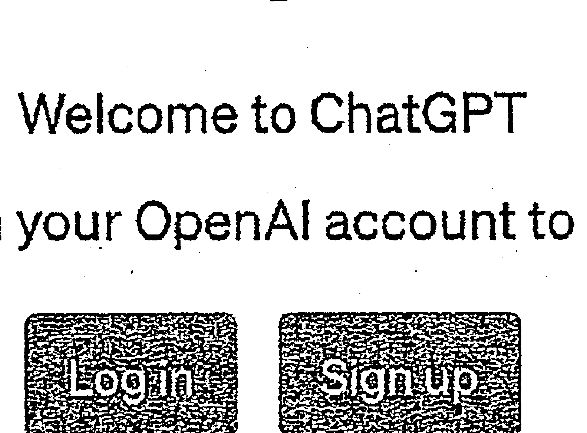

Welcome to ChatGPT\nLog in with your OpenAI account to continue\nLogin Sign up


# 第二步：挑选登录方式
注册页提供邮箱或第三方账号登录两种选择。笔者示范用微软账号登录，你可按自身情况决定。

# Create your account

Note that phone verification may be required for signup. Your number will only be used to verify your identity for security purposes.

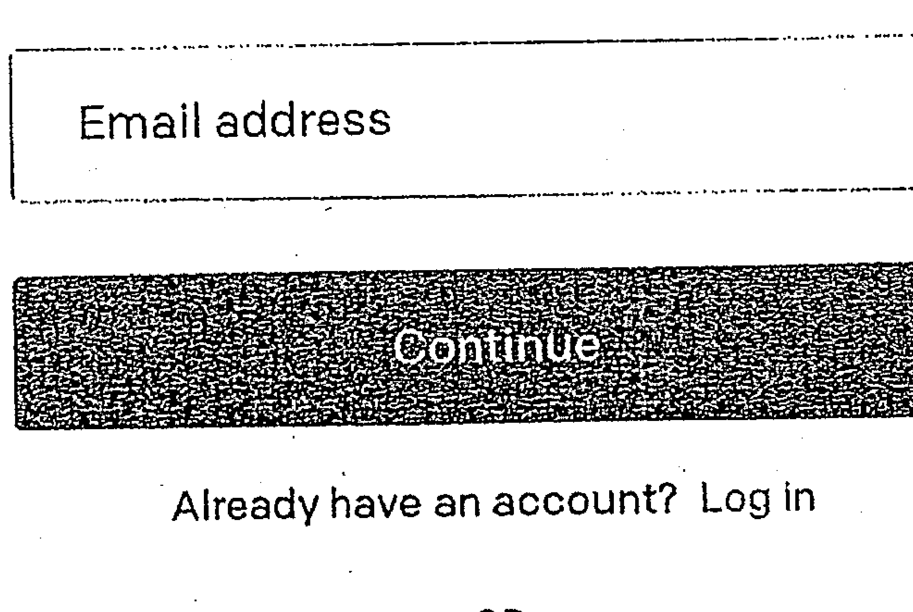

Already have an account? Log in

—— OR ——

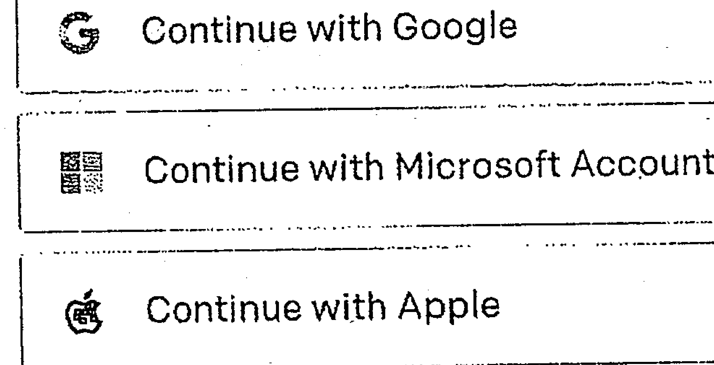

# 第三步：验证手机号
OpenAI注册需要海外手机号接收验证码。有境外号码可直接验证；没有的话请先保留当前页面，继续按后续指引操作。

# Verify your phone number


# 第四步：启动手机号验证
没有海外号码时，可借助sms-activate网站 https://sms-activate.org/cn 购买短信服务来收码。

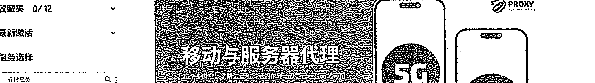

# 第五步：创建sms-activate账号
用国内邮箱正常注册该网站，注册完成后才能进行充值和购买验证码。


# 第六步：为账号充值
登录后需先充值，才能购买短信服务。点击右上角“+”进入充值页，选择支付宝充值，通常充值2美元已足够本次注册使用。

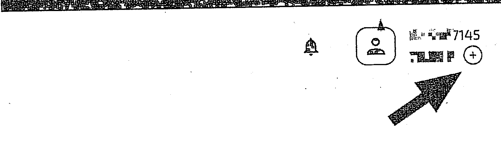

# 图 2 – 6 sms - activate 账号充值：点击“ + ”号进入充值页面

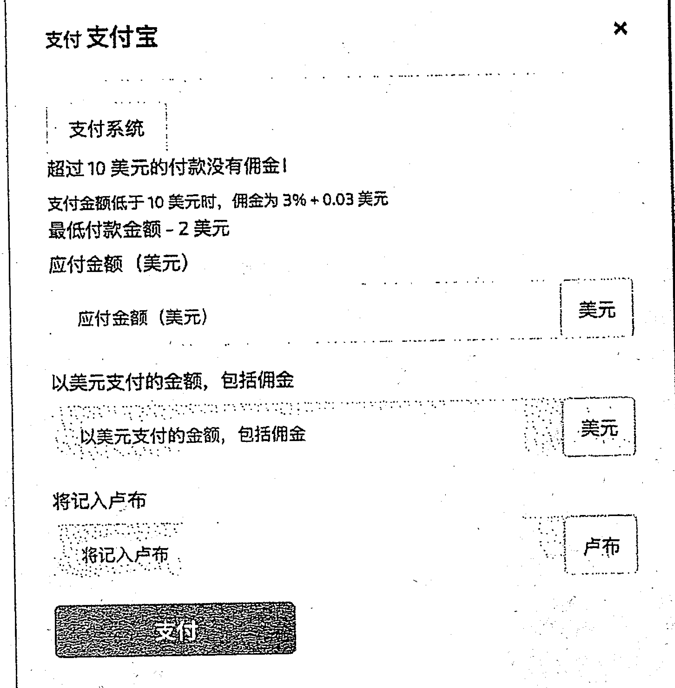

# 图 2 – 7 sms - activate 账号充值：支付充值金额

# 第七步：购买临时号码
充值成功后回到首页，在左下角下拉列表中找到OpenAI标签，选择一个国家或地区购买号码。

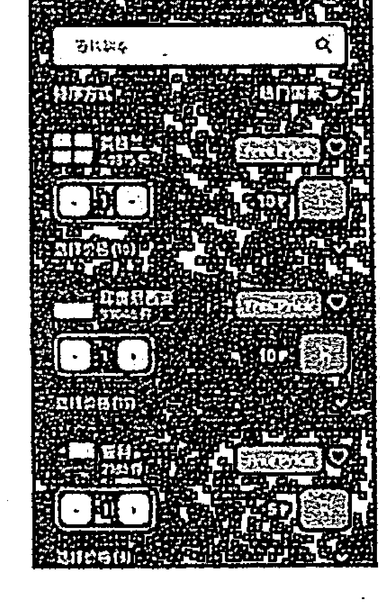

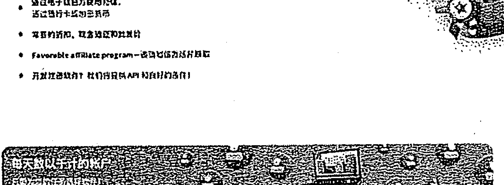

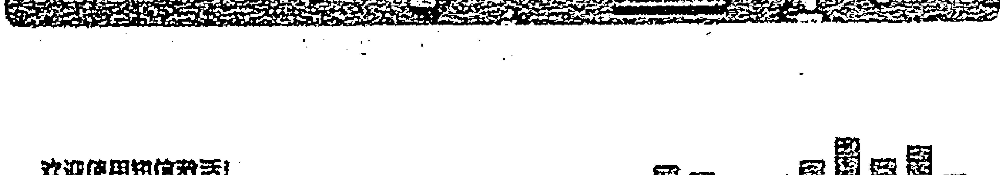


图 2 – 8 购买验证号码：选择标签、国家或地区

需要留意：
+   - 欧美区号码短信到达率较高，优先考虑；
- 若所选地区收不到短信，平台会把费用退回账户；
- 号码有效期约20分钟，过期平台会回收，费用也会退回。

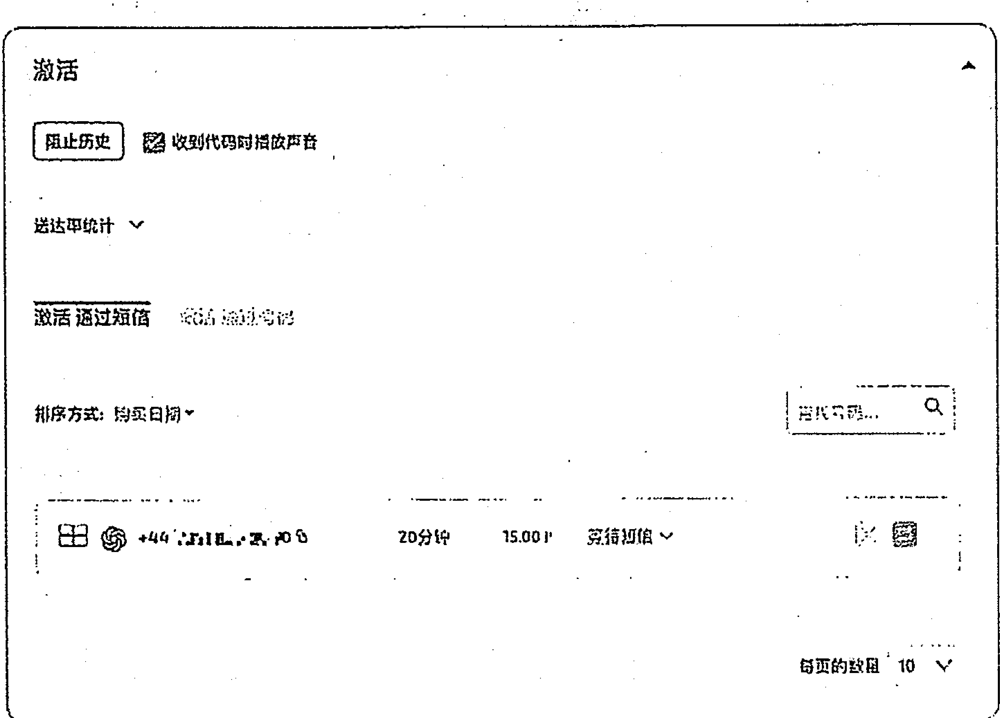

图 2 – 9 购买验证号码：购买成功页面

# 第八步：发送验证码请求
回到第三步的验证界面，选择第七步购买的国家或地区，将号码填入输入框，点击Send Code发送验证码。

# Verify your phone number

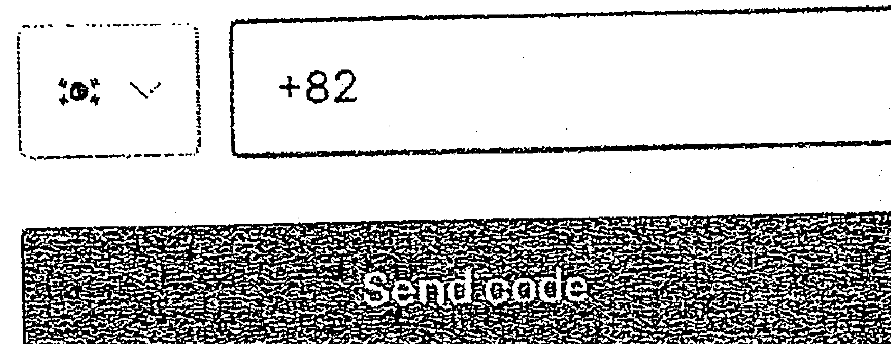

图 2 –10 发送验证码：点击“Send code”键

# 第九步：输入验证码完成注册
若操作顺利，第七步等待短信处会收到OpenAI发来的验证码，复制回注册页即可完成。长时间未收到，可能说明该地区号码无法正常接收，需要在sms-activate余额充足的前提下，重新操作第七、八步直至成功。

如确实无法访问OpenAI，也可以用Claude在Slack中添加使用、文心一言注册百度账号试用、讯飞星火认知大模型等，相近体验同样便捷。

------------------

# 第二节 ChatGPT界面初探
注册后即可开始对话。先熟悉一下基本界面和功能，会更快上手。

# 图2-11 ChatGPT的基本界面和功能

除了查阅官方文档，本节的介绍也能帮助你少走弯路。

# 一、免费版与付费版的差异
第一章已介绍过ChatGPT的发展脉络。目前官网 chat.openai.com 提供免费的GPT-3.5，完成注册即可使用。

训练数据和能力的提升让GPT-4在多方面明显强于GPT-3.5，笔者在写作过程中也反复验证了这一点。

GPT-3.5并非没有优势：它免费且无使用次数限制；GPT-4则需要每月20美元的ChatGPT Plus订阅，且有3小时50次对话的限制，不同账号可能略有差异。另有观察：在订阅Plus后，GPT-3.5的生成速度会显著提升，实测速度排序为：订阅后的GPT-3.5 > GPT-4 > 未订阅的GPT-3.5。

若需要处理更复杂问题、生成更自然的文本、降低“幻觉”、使用插件商店等，建议开通ChatGPT Plus。目前无法直接通过OpenAI订阅，需借助苹果账号购买礼品卡的方式完成。

# 二、“+ New Chat”与对话留存
点击左上角“+ New Chat”即可开启新对话。开始前必须选择GPT-3.5或GPT-4作为本次对话模型。一般而言，选择GPT-3.5后后续全程使用该模型；选择GPT-4则在3小时50次配额用完后，可等待配额恢复或临时切到GPT-3.5继续，不过切到GPT-3.5后通常无法再把同一对话切回GPT-4。

无论使用哪个模型，对话都会保存在“+ New Chat”下方的历史列表。你可以随时回看并续聊，只要不超过模型的token记忆上限，都能接续上下文。

清除对话有两种方式：单条删除，点击对应会话出现的垃圾桶图标即可；全部删除，点击左下角“…”选择Clear conversation清空历史。

# 三、token限制
GPT在处理文本时会把输入输出拆分为token编码，模型架构和计算资源决定了最大上限。

类比日常对话：聊天不可能无限进行，下班途中与同事闲聊，走到电梯口就可能结束。隔一段时间再聊同一话题，也会遗忘细节。

Token不一定等于字或单词。比如“work”与前置空格可能构成一个token，而“NLP”却会被拆成两个token，拆分逻辑往往反直觉。

```
Recent work has demonstrated substantial gains on many NLP tasks and benchmarks by pre - training on a large corpus of text followed by finetuning on a specific task. While typically task - agnostic in architect this method still requires task - specific fine - tuning datasets of thousands or tens of thousands of examples
```

# 图 2 - 12 文本被拆分为 token 示意

图片来源: https://leavn.microsoft.com

早期GPT-3输入上限约2048个token，输出上限约4096。超过输入限制需分段喂入；输出超限则旧内容会被逐渐覆盖。

据公开资料，一个汉字约等于2-2.5个token。GPT-3的4096 token约等于3072个英文单词；GPT-4上限提升至32768，随插件开放后宣称可突破10万token。

# 四、重生回答、停止生成与继续指令
对生成内容不满意时，可点对话框上方的“Regenerate response”让模型重新生成。若出现“<2/2>”标识，说明已生成多条分支，可在满意的分支下继续对话，也可回到原分支接着聊。


你有什么有趣的能力？


我是一个基于人工智能的聊天模型，有各种各样的能力，下面是一些有趣的例子：

+   - 1.问答系统：我可以回答各种问题，包括但不限于科学、历史、数学、艺术、技术、电影等领域的问题。你甚至可以让我帮你解决数学问题。

- 2.创作故事和诗歌：如果你希望听一个故事或者诗歌，我可以创作一个全新的故事或诗歌。

- 3.编写代码：我可以帮助你理解和编写各种编程语言的代码，例如 Python、Java、JavaScript 等。

- 4.提供新闻摘要：你可以向我提供一篇新闻文章，我可以提供一个简洁的摘要。

- 5.学习帮助：我可以帮助你学习新的技能或主题，例如学习一种新的编程语言，或者帮你准备考试。

- 6.语言翻译：我可以帮助你翻译多种语言。

- 7.游戏：我可以和你玩文字游戏，比如说猜谜语、填字游戏等。

这只是我的一些能力，实际上我的用途远不止这些。你可以问我任何你想知道的问题，我会尽力提供帮助。

# 图 2 - 13 指令 ChatGPT 重新生成后，存在 2 个以上回答

ChatGPT 的输出采用流式逐字呈现的逻辑，所以内容一旦出现明显偏离或完全不可用，直接点按“Stop generating”就能立刻中断，不必等它跑完。

□ Stop generating

# 图2-14 叫停生成的入口

当生成文本过长出现停顿或卡带般的中断时，只需在页面上点一下“Continue”按钮，模型就会继续把剩余内容补完。

# 第三节 插件功能的使用方法

2023 年 3 月，OpenAI 正式发布了插件能力。

在纯文本之外，借助插件 ChatGPT 能完成更多实际操作。例如通过浏览器类插件获取实时信息，这对降低本章第六节谈到的“幻觉”问题很有帮助。有了插件后，还能协助用户处理预订机票、安排餐厅等复合型任务。像 Wolfram 这类插件还能补强计算弱项，让算术与科学计算更可靠。

需要说明的是，插件商店目前仅向 ChatGPT Plus 订阅用户开放。

# 一、使用的步骤

开启插件功能需要按下面顺序操作：

+   1.  点左下角的“Settings”进入设置页，在“Beta features”里打开“Plugins”。

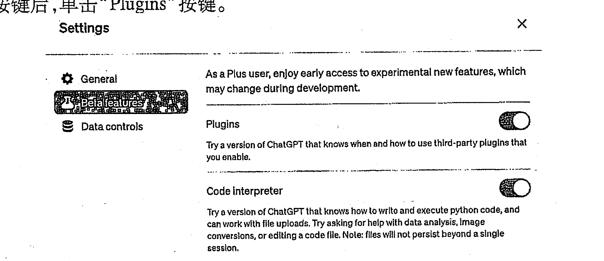

# 图2-15 插件入口位置

顺带说明，打开插件入口时可以同时启用“Code interpreter”。该功能在 2023 年 7 月上线，可实现自动写代码、生成图片、数据分析等更复杂操作。原本的官方浏览器“Browse with Bing”因版权争议被下架，待越权访问问题解决后有望重新回归 Plus 用户。

2.  新建一个 GPT-4 对话窗口，点击对话区的“Plugins”按钮。

+   

# 图2-16 对话界面中打开插件

3.  在“Plugins”下拉列表里选择“Plugin store”。

+   

# 图2-17 进入插件商店

[PAGE 49]

# 第二章 使用ChatGPT前的准备 | 037

4.  在“Plugin store”里挑选符合需求的插件，点击“install”，即可将插件保留在当前 GPT-4 窗口中使用。

 AskYourPDF

AskYourPDF 的核心是从 PDF 文档中提取信息。启用后把 PDF 链接丢进 GPT-4 对话框，插件会将内容写入向量数据库。后续针对文档提问时，答案会基于原文给出，并用加粗标注出页码。

提供可下载链接有两种做法：

+   1.  直接使用已有的 PDF 链接。
在网上找到链接后复制到 ChatGPT 直接提问即可。

+   2.  上传本地文件获取链接。
插件提供上传入口。先在 GPT-4 对话框中输入提示词“请给出 AskYourPDF 的上传链接”，会返回一个可点页面。

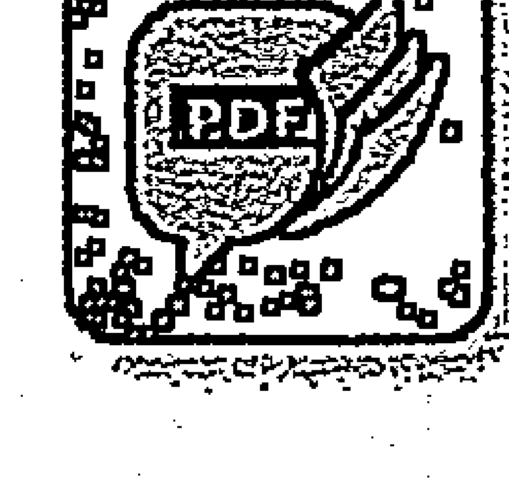

# Upload Your Document

Click here to upload your document and then paste your Doc ID in the chat box

# 图2-21 AskYourPDF上传页

点“蓝色云朵”图标跳转到上传页。将“.pdf”“ .txt”“ .ppt”“ .pptx”“ .csv”“ .epub”“ .rtf”等支持格式拖到“Upload Document Here”。上传成功后会生成 ChatGPT 可识别的“doc_id”，复制该编码到对话即可提问。

[PAGE 51]

# 第二章 使用ChatGPT前的准备 || 039

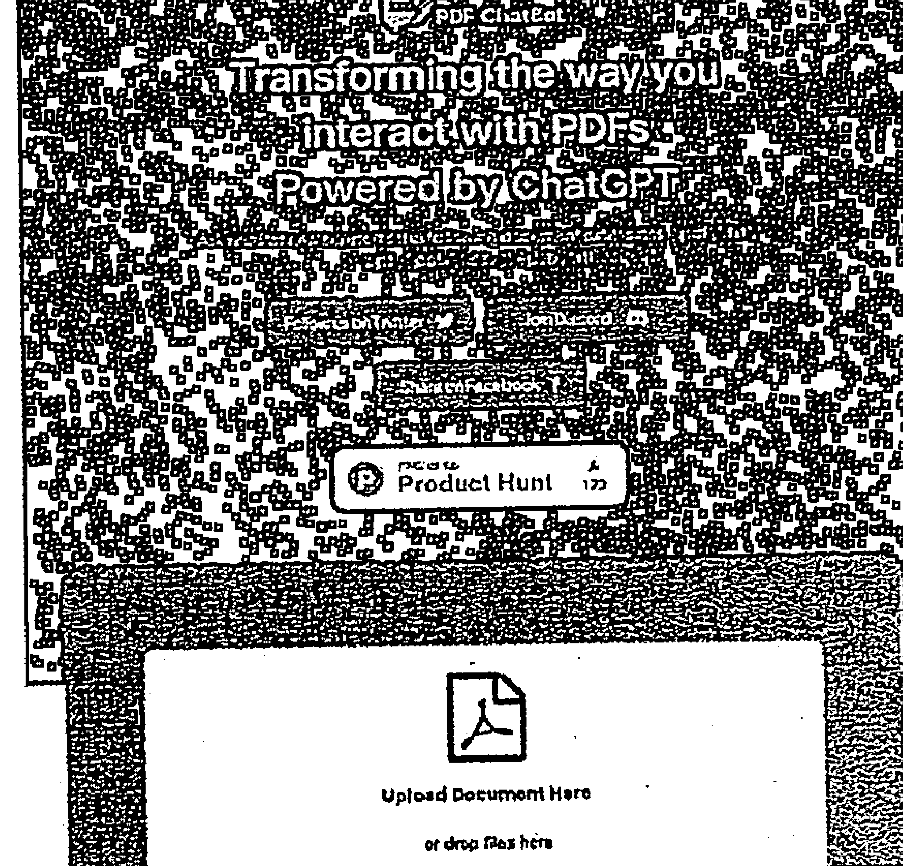

# 图2-22 拖拽上传文件

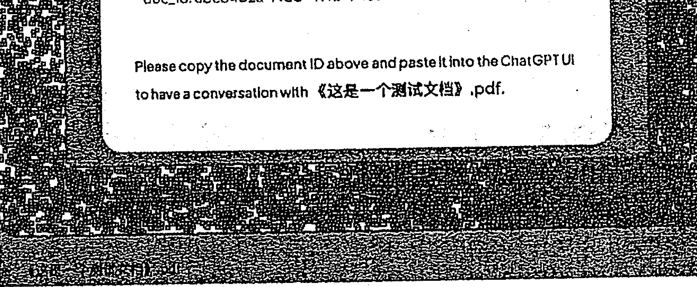

# 图2-23 上传后复制识别编码

(二) Prompt Perfect

Prompt Perfect 是一款提示词润色的轻量插件。


# Prompt Perfect

Type 'perfect' to craft the perfect prompt, every time.

# 图2-24 Prompt Perfect插件介绍

第三章会详细讲提示词技巧，如设定身份、少样本学习、用标点、任务分解、格式说明等。Prompt Perfect 能在对话中实时提升提示质量。触发方式很简单，在对话末尾加上“perfect”即可。例如：


我想知道如何烹饪意大利面 perfect


Using Prompt Perfect... ✦ ▼

# 图2-25 输入 perfect 启动插件

润色后的提示词不会直接展示给用户。指令发出后，插件会把请求交给 GPT-3.5-turbo 模型优化，再把优化结果传给 GPT-4，由 GPT-4 直接生成最终内容。


我想知道如何烹饪意大利面 perfect


Used Prompt Perfect

好的，你想了解意大利面的做法。下面是一种基础做法：

+   - 煮面：大锅水加盐煮沸，下面条。时间随种类厚度而定，通常 8 到 12 分钟，可尝一小段判断是否达到“al dente”。
- 备酱：同步准备喜爱的酱料，如番茄酱、奶油酱、蒜蓉橄榄油等。
- 拌合：面煮好后滤水，保留少量面汤。将面与酱混合，用面汤调节浓稠度。
- 调味装盘：按口味加入香草、奶酪或橄榄油，最后撒奶酪和香草点缀。

这只是基础做法，可按个人喜好加入蔬菜、肉类、海鲜或更换酱料。

# 图2-26 使用Prompt Perfect后的回答

若想确认提示词是否被改写，可在“我想知道如何烹饪任意意大利面 perfect”后追加一句：“回答前先把 perfect 插件改写后的提示词给我”，即可验证效果。

# (三) KeyMate.AI Search

此前官方的 Browse with Bing 已关闭，但并不代表 ChatGPT 完全离线。用第三方插件 KeyMate.AI Search 仍能让模型联网。


KeyMate.AI Search

Search & Browse the web by using Google

Search results with KeyMate.Al, your AI-powered web crawler.

# 图2-27 KeyMate.AI Search插件

使用前先在插件商店找到并下载。点击下载后会跳转到官网，需要用 Google 账号登录并授权，授权成功后插件会出现在列表中。

使用时无需手动激活，直接在 GPT-4 对话框提问即可。模型会自行判断是否需要联网搜索，并把结果用于作答。

[PAGE 55]

# 第二章 使用ChatGPT前的准备 043

查询“今日广州的台风天气预报”时，模型自动调用了插件：


请查询今日广州的台风天气预报


Using KeyMate.AI Search...

# 图2-28 调用KeyMate.AI Search过程

检索完成后开始作答：


请查询今日广州的台风天气预报


Used KeyMate.AI Search

根据最新信息，2023 年 7 月 16 日广州受台风影响，预计有强风大雨，请注意防范尽量避免外出。可能伴随暴雨、雷电和强风。广州市政府已发布台风预警，建议市民留在家中并关注最新预报。

以上信息来源于这里，情况会随台风变化，请持续关注。


# 图2-29 调用插件后给出答案

可点击答案中的“这里”验证来源。也可点击“Used KeyMate.AI Search”查看插件执行细节：

[PAGE 56]

```
REQUEST TO KEYMATE.AI SEARCH
{
  "q": "2023年7月16日广州台风天气预报",
  "percentile": "3", 
  "numofpages": "3"
}
```

```
RESPONSE FROM KEYMATE.AI SEARCH
{
  "results": [
    {
      "title": "首页—海口气象局信息网", 
      "link": "https://ln.keymate.ai/9AVuS1", 
      "summary": null,
      "full_content": ... (省略部分内容)
    }
  ]
}
```

# 图2-30 查看KeyMate.AI Search运行记录

# 第四节 配合Bing、Claude处理不同场景

ChatGPT 表现强劲，但 BingAI、Claude 等工具同样值得关注。

# 一、BingAI

BingAI，即 New Bing，是微软的搜索增强版。ChatGPT 爆火后不久微软便上线该产品，基于 GPT-4 模型并保持实时联网，相比 ChatGPT 姗姗来迟又下架的浏览器插件更受欢迎。

# (一)注册

通过搜索引擎页面的“聊天”入口访问。至少满足：

+   

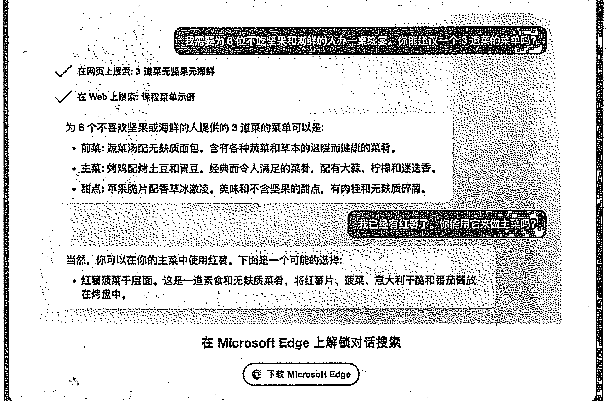

图2-31 在Microsoft Edge浏览器打开bing.com

2.点击页面右上角“登录”，用 Microsoft 账户注册或登录即可使用 BingAI。

[PAGE 58]

# 046 || 法律人ChatGPT应用指南

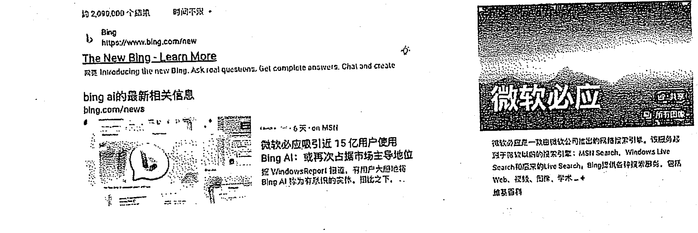

# 图2-32 注册或登录Microsoft账户

注册流程较为简单，读者可按微软指引操作。

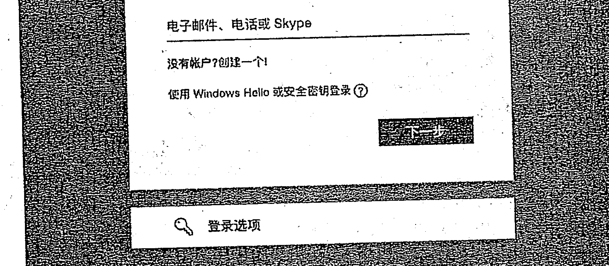

# 图2-33 账户注册登录页

注意，若无法在页面找到“聊天”或“Chat”按钮，可在个人设置中修改“国家/地区”，刷新后即可正常使用。

[PAGE 59]

# (二)使用

BingAI 有两种交互方式。一种是在搜索页向下滚动出现“聊天”界面：


# 图2-34 BingAI交互页

另一种是点击浏览器右上角图标打开侧边栏：

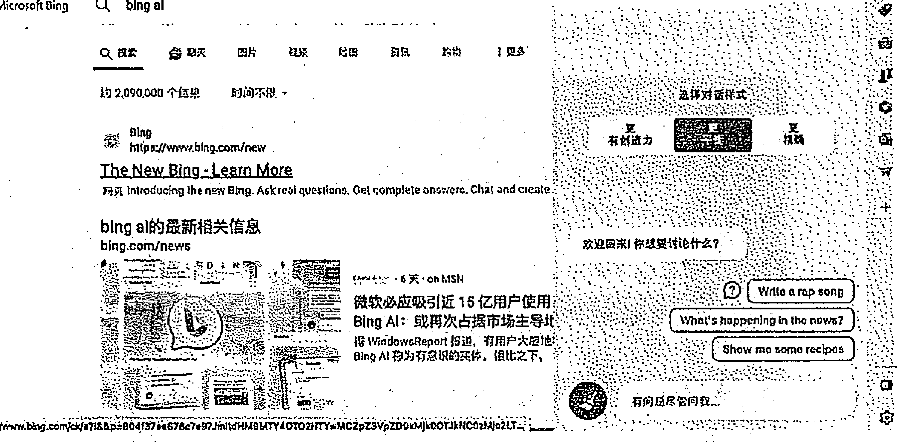

# 图2-35 右上角图标调出交互页

[PAGE 60]

两种模式下都提供三种对话风格：“更有创造力”、“更平衡”、“更精确”，由用户自选。侧边栏模式可同步读取当前网页内容，按网页信息执行指令，准确性和效率更高，后续章节会结合场景介绍技巧。

# (三)BingAI的特点

优点与缺点都很突出。它擅长搜索相关任务，但遇到无法处理的提问时，通常会提示“是时候开启一个新主题了”，强制结束当前话题。

# 二、Claude

由人工智能初创公司 Anthropic 发表的产品，使用体验与 ChatGPT 相近。一个优势是内网直连，无需翻墙访问。

# (一)注册

1. 访问 slack官网 slack.com，点击“创建一个新的工作区”。

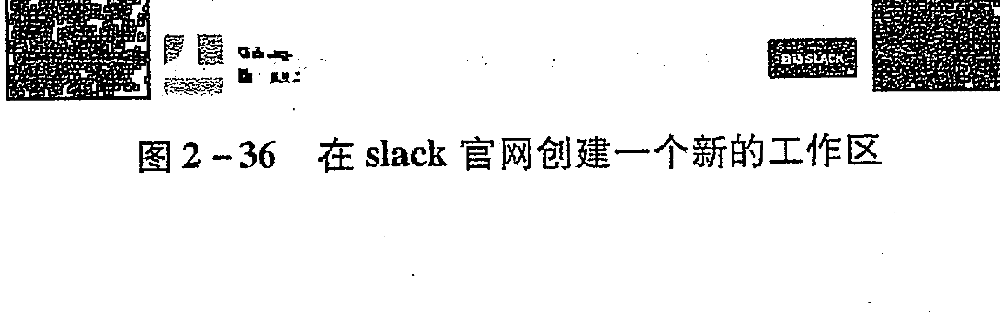

图2-36 在 Slack 官网搭建新工作区

[PAGE 61]

2. 开通 Slack 账号。

# 起步：填写邮箱

推荐使用企业邮箱进行注册。

或

G 使用 Google 账号登录

在筹备 PPT 材料时，也可以让 Claude 在线搜集符合主题且可免费商用的配图：

# 消息列 # 全体

chenhuan 2 个月前 @Claude 该需求可以，请帮我在网上找一批可免费商用的 PPT 配图。

Claude 应用 2 个月前

+   - 女医生工作特征：挑一张女性医生或助理在医院工作的照片，体现其职业场景。
+   - 女医生常见法律议题：用法官敲法槌的照片来暗示法律维权相关话题。
+   - 防范法律风险要点：选择“防火”示意类图，用以比喻风险防范。
+   - 工作与生活平衡：选用天平图，传达两者需要权衡。
+   - 沟通交流：挑选两名卡通人物对话的画面，突出沟通的重要性。
+   - 处理家务：选用洗碗用具与熨衣板的画面，作为家庭事务的具象意象。

以上均可免费商用，画面清晰简洁且契合课程主题。如需更多选择，我可以继续检索。请审阅这组素材，指出需要替换或补充的部分，我很乐意继续搜集更高质量资源。

另外，若需要 PPT 模板推荐或制作支持，我也能提供。我们可以进一步沟通内容与版式，按要求完成设计与编辑。（已编辑）

chenhuan 2 个月前

麻烦把这些图片的链接给我 @Claude

Claude 应用 2 个月前

+   1. 女医生工作环境图：https://stocksnap.io/photo/doctor-hospital-XQIZGLUYDY
+   2. 法官法槌敲击图：https://stocksnap.io/photo/judge-gavel-OO5AAYJM7X
+   3. 防火示意：https://stocksnap.io/photo/fire-extinguisher-Z3UMAB0BS2
+   4. 天平图：https://stocksnap.io/photo/scales-of-justice-GVW7GAKEUE
+   5. 漫画人物对话图：https://stocksnap.io/photo/conversation-talk-94VO6ED3YX
+   6. 洗碗用具图：https://stocksnap.io/photo/dishwashing-dishes-LLDDN1W30H
+   7. 熨衣板图：https://stocksnap.io/photo/ironing-board-iron-PU0Q40E3Q7

以上素材均来自 Stocksnap，该站提供高品质免费商用图，可自由使用与修改。如需更高分辨率，可在站内免费注册后下载。

# 图 2 –42 借助 Claude 实现团队协作中的 AI 应用

团队协作本身技术门槛不高，关键在于 Claude 接入 Slack 工作流后，AI 工具能够嵌入日常流程，显著提升协作效率。

# 第五节 国产大模型介绍

2023年8月31日，百度的“文心一言”、中科院的“紫东太初”、清华系 AI 公司智谱华章的“质谱清言”、抖音的“云雀”、百川智能的“百川大模型”等机构的大模型通过《生成式人工智能服务管理暂行办法》备案并面向公众开放体验。本节将择取几款国产大模型做简要介绍。

# 一、国产大模型简介

# (一)百度文心一言

文心一言 访问网址:https://yiyuan.baidu.com/ 是百度公司研发的大语言模型，对话形式与 ChatGPT 接近，采用一对一聊天。模型可进行互动问答、辅助创作，在文学创作、商业文案、数理逻辑推算、中文理解、多模态生成等场景中高效获取信息、知识与灵感。


# 图2-43 文心一言官网界面

# (二)抖音云雀

抖音云雀 访问网址: https://www.doubao.com/ 是字节跳动旗下抖音研发的大模型产品。2023 年 8 月 17 日，其开发的 AI 机器人 “豆包”开始小范围邀请测试。“豆包”提供聊天机器人、写作助手以及英语学习助手等功能，它可以回答各种问题并进行对话，帮助人们获取信息。


# (三)百川智能

百川智能 访问网址: https://www.baichuan-ai.com/home 是百川智能推出的大模型产品，融合了意图理解、信息检索以及强化学习技术，结合有监督微调与人类意图对齐，在知识问答、文本创作领域表现突出。

# 第二章 使用 ChatGPT 前的准备 | 055

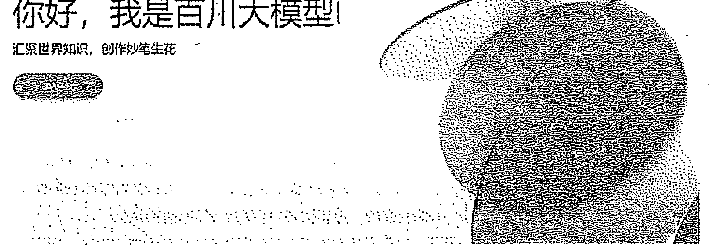

# 你好，我是百川大模型

汇聚世界知识，创作妙笔生花

# 图 2 - 45 百川大模型官网

# 二、国产大模型对比

我们向上述模型提出同一个“一词多义”题目，即“冬天：能穿多少穿多少；夏天：能穿多少穿多少。这句话中的‘多少’分别是什么意思？”看看它们的回答如何。

# (一)百度文心一言

冬天：能穿多少穿多少；夏天：能穿多少穿多少。

这句话中的“多少”的意思是“尽可能多的数量”。

+   - 对于“冬天：能穿多少穿多少”，意思是说在冬天，尽可能穿更多的衣服来保持温暖。
- 对于“夏天：能穿多少穿多少”，意思是说在夏天，尽可能穿更少量的衣服来保持凉爽。

这种表达方式是一种语言上的技巧，通过使用“多少”来表达相反的含义，使得句子更加生动有趣。


# 图 2-46 文心一言的回答

文心一言的回答能够说明“多少”在冬天和夏天语境下的不同含义，结尾还指出这句话传达了轻松幽默的语言风格。

# (二)百川智能


冬天：能穿多少穿多少；夏天：能穿多少穿多少。

这句话中的“多少”分别是什么意思？


这句话是一个有趣的双关语，其中的“多少”一词有两层含义。

+   - 1. 在冬天，由于天气寒冷，人们会穿上更多的衣物来保暖。所以，“冬天：能穿多少穿多少”意味着在冬天，你可以尽可能多地穿衣服，以保持温暖。这里的“多少”是指衣服数量的多少。
- 2. 在夏天，由于天气炎热，人们会选择穿较少的衣物以散热。所以，“夏天：能穿多少穿多少”意味着在夏天，你可以尽可能少地穿衣服，以保持凉爽。这里的“多少”是指衣服数量的多少。

这句话通过对比冬夏两个季节的穿着要求，既展示了人们对于温度变化的适应性，同时也传达了一种轻松幽默的语言风格。

# (三)抖音云雀


这句话中的“多少”有不同的含义。

第一个“多少”指数量的大小，意思是冬天可以尽可能多穿一些衣服来保暖，能穿多少就穿多少。

第二个“多少”指程度的深浅，意思是夏天可以尽可能少穿一些衣服来散热，能穿多少就穿多少。

因此，这句话的含义是，冬天要暖和一些，尽可能多穿衣服；而夏天则要穿得少一些，尽可能减少衣服的数量，以保持凉爽。

# 云雀的回答

云雀大模型的回答比较有逻辑性，能够解释“多少”在不同的季节下分别表示“数量的大小”和“程度的深浅”。

当然，这样的简单测试，不能完全说明这些大模型的能力。这些大模型也都仍在持续迭代，也必然会随着算力的提升、算法的优化而越来越好用，为我们创造更好的用户体验。读者可以根据自己的喜好和需求，来选用匹配自己需求的大模型。我们相信随着越来越多的国产大模型向社会公众开放，我们能够更加便捷地与大模型“对话”，调用它们的能力，为我们所用。

# 第六节 保护隐私，警惕幻觉

在我们正式开始使用 ChatGPT 之前，以及在使用 ChatGPT 的全过程，有两个重要的事情，是需要我们保持清醒认知的：(1) ChatGPT 可能会泄露我们的隐私信息；(2) ChatGPT 有严重的“幻觉”，“一本正经”地杜撰事实。

# 一、令人担忧的隐私泄露

我们查阅到 OpenAI 的隐私政策。在收集个人信息一项中看到，OpenAI 已经明确声明会自动收集用户的“日志数据”和“使用数据”。


# 1. 我们收集的个人信息

我们收集与您有关的个人信息（“个人信息”）如下：

+   - 帐户信息：当您在这里创建帐户时，我们将收集与您的帐户相关的信息，包括您的姓名、联系信息、帐户凭据、支付卡信息和交易历史记录（统称为“帐户信息”）。
- 用户内容：当您使用我们的服务时，我们会收集您向我们的服务提供的输入、文件上传或反馈中包含的个人信息（“内容”）。
- 通信信息：如果您与我们通信，我们会收集您的姓名、联系信息以及您发送的任何消息的内容（“通信信息”）。
- 社交媒体信息：我们在 Instagram、Facebook、Medlum、Twitter、YouTube 和 LinkedIn 等社交媒体网站上设有页面。当您与我们的社交媒体页面互动时，我们将收集您选择向我们提供的个人信息，例如您的联系方式（统称为“社交信息”）。此外，托管我们社交媒体页面的公司可能会向我们提供有关我们社交媒体活动的汇总信息和分析。

# 058 | 法律人 ChatGPT 应用指南

我们从您使用服务时自动收到的个人信息：当您访问、使用服务或与服务互动时，我们会收到有关您的访问、使用或互动的以下信息（“技术信息”）：

+   - 日志数据：当您使用我们的服务时，您的浏览器自动发送的信息。日志数据包括您的互联网协议地址、浏览器类型和设置、您提出请求的日期和时间以及您与我们网站互动的方式。
+   - 使用数据：我们可能会自动收集有关您使用服务的信息，例如您查看或参与的内容类型、您使用的功能和采取的操作，以及您的时区、国家/地区、日期和时间访问次数、用户代理和版本、计算机或移动设备类型以及您的计算机连接。
+   - 设备信息：包括设备名称、操作系统、设备标识符和您正在使用的浏览器。收集的信息可能取决于您使用的设备类型及其设置。
+   - Cookie：我们使用 Cookie 来操作和管理我们的服务，并改善您的体验。“Cookie”是您访问的网站发送到您的浏览器的一条信息。您可以将浏览器设置为接受所有 Cookie、拒绝所有的网站发送到您的浏览器的一条信息。您可以浏览器设置为接受所有 Cookie、拒绝所有 Cookie，或在提供 Cookie 时通知您，以便您每次决定是否接受。然而，在某些情况下，拒绝 Cookie 可能会阻止您使用网站或网站的某些区域或功能，或者对网站或网站的某些区域或功能的显示或功能产生负面影响。有关 Cookie 的更多信息，请访问关于 Cookie 的所有信息。
+   - 分析：我们可能会使用各种使用 Cookie 的在线分析产品来帮助我们分析用户如何使用我们的服务并增强您在使用服务时的体验。

图2-49 OpenAI 的隐私政策

此外，有新闻报道称，超过 10 万个 ChatGPT 用户的个人信息被黑客窃取并在暗网上进行交易。这些交易信息包括用户的聊天记录和人工智能的响应。OpenAI 也确认了这次数据泄露事件，并承认是因为代码漏洞被黑客攻击所致。

所以，我们可以很容易得出一个结论：当我们使用 ChatGPT 完成某项任务的时候，应当提前将该项任务所涉的包括身份信息、商业秘密等信息进行脱敏处理，才能提交给 ChatGPT 进行处理。尤其是，当我们使用“AskYourPDF”等插件时，更是会直接将整个文档提交给 OpenAI。否则，如果这份文档正好是一个涉及商业秘密的文件，那么因此产生的结果可能是灾难级的。因此，避免输入任何敏感或私密的信息，是避免数据泄露最直接的方法。

同时，在本书的第八章，我们也将探讨一些只在本地执行的人工智能对话方案，避免在网络传输中可能发生的数据泄露。

# 二、ChatGPT 那让人“哭笑不得”的幻觉

在 GPT-3.5 之前，我们经常取笑人工智能满嘴的“车轱辘话”和“胡说八道”。但随着大语言模型的进步，人工智能已经可以完全模仿人类的口吻与我们展开对话。有时候，它甚至在瞎编一些关键信息后，在面对人类用户的质疑时，还信誓旦旦地保证自己绝对没有瞎编。

美国的一名资深律师，就在使用 ChatGPT 时吃了大亏。拥有 30 多年从业经历的纽约律师 Steven Schwartz 在办理案件时，使用 ChatGPT“检索”了 6 个判例。

+   Varghese v. China Southern Airlines Co Ltd, 925 F.3d 1339 (11th Cir. 2019)
Shaboon v. Egyptair 2013 IL App (1st) 111279-U (Ill. App. Ct. 2013)
Petersen v. Iran Air 905 F. Supp 2d 121 (D.D.C. 2012)
Martinez v. Delta Airlines, Inc., 2019 WL 4639462 (Tex. App. Sept. 25, 2019)
Estate of Durden v. KLM Royal Dutch Airlines, 2017 WL 2418825 (Ga. Ct. App. June 5, 2017)
Miller v. United Airlines, Inc. 174 F.3d 366 (2d Cir. 1999)

# 图2-50. Steven Schwartz 律师使用 ChatGPT“检索”的案例

他将 6 个案例提交给法庭后，受到对方律师的质疑：在法律数据库中，无法找到这 6 个案例的记录。法官介入调查后，Steven Schwartz 承认那 6 个案例为 ChatGPT 提供，并表示在他看到这些案例信息后追问 Chat-GPT 信息是否属实，人工智能称“千真万确”，还给出了所谓的信息出处。

但遗憾的是，Steven Schwartz 没有进一步对信息进行核验，就将案例提交给法庭，最终酿成了大错。

目前，ChatGPT 在对话框的下方，加注了一行英文提醒：ChatGPT may produce inaccurate information about people, places, or facts. (ChatGPT 可能生成不准确的信息，包括人物、地点和事实)

> ChatGPT may produce inaccurate information about people, places, or facts. (ChatGPT 可能生成不准确的信息，包括人物、地点和事实)

# 图2-51 ChatGPT 在对话框下方的提醒

因此，当我们使用 Chat

由于我们输入的“床前明月光，疑是地上霜”不是一句完整的诗句，所以在 ChatGPT 看来，面对这样的“提问”，它极大概率会通过“接龙”完成作答。这就是“文本补全”。

# 2. 模型对提示词的敏感性。

我们输入不完整的诗词时，会因为诗句的固定搭配而得出相对稳定的答案；而如果你输入非常随机的、语义不完整的句子，ChatGPT 生成的回答就会变得五花八门。这是因为 ChatGPT 没办法根据上下文“猜”中你到底想要表达什么，所以只能基于预训练模型的权重来完成任务，被迫“胡说八道”。

因此，当我们需要使用 ChatGPT 来完成某项工作任务时，就需要一定的提示词技巧，给 ChatGPT 下达比较明确的指令，让 ChatGPT 读懂你的提问，你的需求才能有比较大的概率得到满足。

在接下来的篇幅里，我们将尽量为读者归纳在法律场景下的提示词使用技巧，并呈现提示词使用的实例。从本章的第二节到第八节，我们将在每一节中介绍一个提示词技巧，到了第九节和第十节，我们将给读者一些使用提示词的建议，并提供相对成熟的提示词示例以及提示词的通用公式。到了第四章和第五章，我们将在具体的实例中，与读者一起打磨提示词，将提示词的技巧运用在实际的场景中。

正如微软的官方文件所说：“提示词更像艺术而不是科学，通常需要经验和直觉来制作成功的提示词。” 我们无法保证所呈现的提示词和实例一定是唯一的、正确的、有效的，读者应该亲自动手尝试，归纳出适合自己的提示词技巧，在使用的过程中感受大语言模型的魅力。

# 第二节 设置指令

法律人在使用 ChatGPT 的时候，最离不开的 prompt，一定是“指令”类的提示词。指令的作用非常好理解，就是向 ChatGPT 提出需要执行的操作。常用的指令类型有以下几种：

| 指令类型 | 指令示例 |
| --- | --- |
| 撰写 | 帮我写一篇起诉状 |
| 归纳 | 帮我归纳一段文字中的要点 |
| 翻译 | 把以下内容翻译成英语/泰语/日语/韩语…… |
| 问答 | 帮我解释“留置”的定义是什么 |
| 提取 | 帮我提取这篇案例集中的全部判决金额 |
| 检索 | 帮我查找《民法典》中关于“解除”的全部条款 |
| …… | …… |

不过，单凭这些简单的指令，往往不能够得出我们想要的结果。在上一节我们就说过，如果我们提供给 ChatGPT 的信息，不足以让它充分理解我们的需求，那么它当然很难向我们提供令人满意的答案。我们以“帮我写一篇起诉状”这个指令为例，向 ChatGPT 提问，得到如下答复：

下面是一篇起诉状的例子。请注意，这仅供参考，具体起诉状应当根据实际案件的细节和相关法律制定。请咨询专业法律顾问以确保起诉状符合您所在的法域的法律规定。

起诉状

(插入法院名称)

原告：(插入原告名称)

被告：(插入被告名称)

原告(插入原告名称)，通过其律师，根据(插入适用的法规名称)向该法院起诉(插入被告名称)并声明如下：

一、事实和理由

（此处应完整叙述案件全貌、相关事实、当事人所主张的受损权益及所依据的规范依据。例如：原告为被告于某时段对外销售的某商品买受人，购得后发现商品存在特定瑕疵，反复向被告提出解决要求均被搁置。根据相关法规，出售方对其产品质量负有法定责任，故被告行为已属违法。）

二、请求

基于上述事实与理由，原告请求法院依法裁定：

1. 判决被告向原告支付 Regenerate response
2. 判决被告向原告支付……费用，包括但不限于

# 图3-3 零优化提示下 ChatGPT 输出的起诉状

[PAGE 76]

# 第三章 如何用好提示词 || 065

这份文书的框架与我国法院实务规范差距明显，几乎不具备使用价值。

要得到可用的结果，就需要对指令做精细化升级，让模型真正理解需求。我们把指令做了如下改进：

# 表3-2 优化前后的指令对比

| 指令类型 | 优化前 | 优化后 |
| --- | --- | --- |
| 撰写 | 帮我写一篇起诉状 | 帮我写一篇起诉状，包括以下内容: 1. 文书用于中国民事法院; 2. 原告张三，身份证号123; 3. 被告李四，身份证号456; 4. 张三诉请法院判令李四支付货款1万元; 5. 适用法律为《民法典》。 |

看看改进后的指令效果如何：

+ - 帮我写一篇起诉状，包括以下内容:
  - 1. 这份文书将用于中国的民事法庭;
  - 2. 原告是张三，身份证号是123;
  - 3. 被告是李四，身份证号是456;
  - 4. 张三请求法院判决李四支付货款1万元;
  - 5. 适用的法律是《民法典》。

（以下内容仅作参考，法律问题请咨询专业律师）

中华人民共和国民事起诉状

致：____人民法院

原告：张三，身份证号：123，住所地：_____
被告：李四，身份证号：456，住所地：_____

依据《民法典》有关规定，原告张三因货款纠纷向贵院提起诉讼，请求依法判令：

1. 被告李四支付原告张三货款1万元。
2. 被告李四负担本案诉讼费用。

事实与理由：

原告张三与被告李四之间存在货款争议。双方约定李四应向张三支付货款1万元，然至今未履行，致原告损失。

本案诉求系基于《中华人民共和国民事典》相关规定。按该法，李四作为买受方应按约支付货款，其未履行已侵害原告权益，故请求法院依法裁判。

证据清单：
1. 原告与被告间的购销合同或其他支付协议。
2. 证明李四未付货款的相关材料。

原告愿接受法院判决并遵守法律，期待公正处理。

原告：张三
日期：___年___月___日
（签字处）

提示：以上仅为示例，不代表具体情形，需结合实际情况调整。实务中还需补充双方详细住址、合同具体内容、履行情况、违约时间等。法律具有个案性，建议撰写时寻求专业律师协助。

# 图3-4 输入优化指令后模型的输出

[PAGE 77]

# 066 || 法律人ChatGPT应用指南

把优化后的提示交给模型，生成的文件虽仍显简陋，但与最初几乎不可用的状态相比，已非常接近法律从业者日常可用的水平。

值得注意的是，我们并未要求出具“证据清单”，模型却自行补充了该部分。清单虽简单，涵盖意思却正确。若非法律专业人士掌握到此提示水平，理论上也能在缺乏专业支持的情况下独立完成相对简单的法律文书。

这再次说明，合理的提示设计对非专业人士是能力放大器，对专业人士则是提效工具。本节介绍了“设定指令”思路，而这只是众多技巧之一，后续将逐一展开。

----------------------------------

# 第三节 设置特定身份

# 一、提示词要点：设置特定身份

设置特定身份即为模型指定一个明确角色。模型接收身份设定后，会以该角色的语言风格执行任务。

法律人借助ChatGPT办公时，设定身份几乎是必备环节。因为法律对话与文书强调专业性、实用性与严谨性。若不加限制，模型输出的不确定性会很大。

# 二、实操演示：假如你是一名警察

为体现身份设定的重要性，先尝试不设定身份直接提出需求：

根据某甲供述，其三次盗窃他人手机，请你根据他的犯罪情节，写一份起诉意见书。

根据某甲供述，其三次盗窃他人手机，请你根据他的犯罪情节，写一份起诉意见书

尊敬的法院：

我写此起诉意见书，针对被告某甲的犯罪行为，该被告涉嫌三次盗窃他人手机。根据提供的证词和相关证据，我认为某甲应当受到起诉并接受法律制裁。

+ 1. 盗窃行为：根据某甲的供述，他承认三次盗窃他人手机。盗窃行为是一种严重犯罪，侵犯了他人的财产权益和个人隐私。该行为不仅侵害了被害人的合法权益，还造成了经济损失和心理困扰。
+ 2. 重复犯罪：某甲的供述显示，他在不同的时间和地点多次实施了盗窃行为。这表明他对犯罪行为有重复的倾向，且持续不断地侵犯他人的财产。这种重复犯罪的行为应当受到法律的制裁，以保护社会秩序和他人的安全感。
+ 3. 社会危害：盗窃行为给社会带来了不安全感和恐惧，破坏了社会和谐。手机作为现代社会不可或缺的通信工具和个人信息存储媒介，被盗窃不仅给个人生活和工作带来了极大的不便，还可能导致个人隐私泄露和金融损失。某甲的盗窃行为严重威胁到社会的安宁和公共利益，必须予以严肃打击。

综上所述，基于某甲的供述以及与此相关的证据，我建议法院对某甲提起盗窃罪的起诉。某甲的犯罪行为严重侵犯了他人的财产权益，扰乱了社会秩序，对社会造成了危害。因此，我敦促法院依法审理此案，并依据相关法律对某甲做出公正的判决，以维护社会正义和法律的权威。

衷心感谢法院的审查与处理。


图3-5 要求模型写一份起诉意见书

可见，未对模型设定身份时，生成的文书角色模糊、用语主观随意，完全无法在法律场景使用。

为作对比，笔者做了两项控制：

1. 避免上下文干扰：在菜单中另起对话窗口，或在原对话输入提示词请遗忘前文全部内容；

[PAGE 79]

# 2. 控制变量：增加“假如你是中华人民共和国的一名人民警察”的身份设定，其他提示不变。

# 模型生成内容如下：

假如你是中华人民共和国的一名人民警察。现根据某甲供述，其三次盗窃他人手机，请你根据他的犯罪情节，写一份起诉意见书。

中华人民共和国人民警察

起诉意见书

案号：XXXX年XX月XX日XX号

被告人：某甲
性别：男
年龄：XX岁
身份证号：xxxxxxxxxxxxxxx

经审查查明：某甲在XX年XX月XX日、XX年XX月XX日和XX年XX月XX日三次盗窃他人手机，其行为已涉嫌犯罪。

# 一、案件事实及证据
+ - 被害人甲某的证言;
- 现场监控录像显示某甲出入被害人甲某住宅的时间和行动。
+ - 被害人乙某的证言;
- 目击证人丙某的证言。
+ - 被害人丙某的证言;
- 现场指纹鉴定结果确认某甲在被害人丙某住宅内留下了指纹。

# 二、法律认定
根据《中华人民共和国刑法》相关规定，盗窃他人财物数额较大的行为属于犯罪行为。某甲以非法占有为目的，三次盗窃他人手机，数额较大，已构成盗窃罪。

# 三、起诉意见
综上所述，根据上述事实和证据，本案中某甲的犯罪行为已经清楚、确凿。为维护社会公平正义，依法打击犯罪分子，建议对某甲提起公诉，依法追究其盗窃罪的刑事责任。

根据《中华人民共和国刑法》第XXX条的规定，盗窃罪的最高刑罚为有期徒刑X年，根据某甲的犯罪情节和社会危害程度，建议对某甲判处适当的有期徒刑刑，并追缴所盗手机并归还被害人。

以上为起诉意见。

中华人民共和国人民警察签字：
日期：XXXX年XX月XX日

# 图3-6 ChatGPT生成的起诉意见书

对比首次提问可知，增加身份设定后，第二次输出质量明显提升，已具备起诉意见书的基本格式。若要在实务中使用，可配合其他提示技巧交互后修订。文中出现的“×××”可通过补充信息让其完善。

除“人民警察”外，身份也可设为律师、检察官或法官，从而分别生成辩护词、起诉书及判决书。法律场景的思路可迁移至其他专业领域，只要身份设定准确，模型基本能给出有效回应。

[PAGE 80]

# 三、设置特定身份的提示词技巧

身份设定简单实用，掌握要点即可灵活运用。归纳如下：

+ 1. 根据实际需求设置身份。
如，“你是一名中华人民共和国的检察官/公安/律师……”
+ 2. 结合角色身份，设置完成具体工作任务的指令。
如“你是一名中华人民共和国的检察官/律师……我需要你根据某情形，撰写一份《起诉书》/《辩护词》……”

![](img/53521336fcceb

第三章 如何用好提示词

## 续表

| 符号 | 用法 | prompt |
|------------|----------------------------------------------------------------------|------------------------------------------------------------------------|
| 井号# | 在大量背景材料中，对重点问题的标记可使模型准确识别关键字或主题。 | #归纳：在以上100个判决主文中，盗窃罪通常被定多少年刑期？ |
| 分割线 -- -- | 分割线可帮助模型区分不同信息源或步骤，避免信息互相干扰导致误解需求。 | 有人在使用爬虫技术抓取我的网站信息。你需要为我写一个起诉状。- - -请分步骤完成任务：步骤1. ……；步骤2. …… |

实际上，模型能理解的标点远不止表格列举。不同符号组合可让模型完成特定任务。下面是一个灵活使用标点的实例。

我们需要对一家公司进行需求调研。经沟通，已初步确定调研清单。为了使清单格式更简洁，我们设计了如下提示：

把他们整理成三列格式给我，参照以下格式：
---
| 需求类型 | 调研问题 | 调研回复 |
----
另外，有两个格式要求：
1. 调研回复留空白
2. 需求类型中，同类可以合并单元格

对不起，我无法在文本模式中创建合并单元格的表格。但我可以按照你的要求将问题和需求类型列出来，只是没有合并单元格。以下是按照你要求的格式整理的调研问题：

| 需求类型 | 调研问题 | 调研回复 |
|-------------|------------------------------|----------|
| 公司基本信息 | 公司成立了多久？ 公司的规模如何？ | |
| | 公司的主要业务是什么？ | |
| | 公司的主要客户群体是谁？ 他们主要在哪些地方？ | |
| 知识产权法律服务 | 公司是否有跨国业务？ 如果有，主要在哪些国家或地区？ | |
| | 公司是否有自己的技术和产品？ | |
| | 公司是否已经对这些技术和产品进行了专利申请？ | |
| | 公司是否有自己的商标？ 是否已经进行了商标注册？ | |

## 图3-10 恰当使用标点符号，让模型为我们生成表格

本次交互使用了分割线、竖线和数字序号。尤其是分割线，将特殊格式需求上下分隔后，模型准确理解了使用者的意思，生成了表格。

## 第六节 分解任务

向模型提出需求时，若只提交复杂任务而不拆分，犯错概率更高。比如需求是：“请根据我提供的文本，写一篇发言稿，用于给公司法务做一次培训”。

即便是具备理解能力和撰写能力的自然人，收到此类指令也需完成“阅读→归纳→成文”等复杂步骤。相比而言，人工智能更依赖使用者关键词引导。仅凭一句简单提示，模型无法一步到位理解需求，输出质量不可控。

解决方法并不复杂，只需对任务进行拆分，即可让生成内容质量更接近预期。

### 一、学习
我们需要让模型学习提交的范文，借用第二章介绍的阅读文档插件 Ask YourPDF，让模型阅读整个文档。

### 二、归纳
上传文档后，将文件ID发给模型，要求其根据文章内容归纳要点，为下一步生成文书做好准备。

### 三、生成
通过前两步的学习和归纳，模型已可明确文章主要观点。接下来，可通过关键词合理设置，要求其生成所需文本。

### 表3-5 提示词示例

| prompt | 说明 |
| --- | --- |
| 我需要以此为基础，写一篇发言稿。要求：1. 用于在讲座中跟大家分享，要用平实、易懂的语言。2. 你归纳的这5个点，要逐一展开进行撰写，每点大概300字。3. 如果你有字数限制，可以先写3点，我会再重新提出要求写后面2点。 | 为了避免模型因token限制文本长度，特意提出第3点字数说明。供参考。 |

模型生成的内容如下：

## 第三章 如何用好提示词 | 075

Plugins • Enabled plugins:
我需要发送PDF文档给你阅读
当然，您可以通过以下链接上传PDF文档：
# Upload Your Document
Click here to upload your document and then paste your Doc ID in the chat box
www.twitter.com/AskYourPdf www.askyourpdf.com
上传完成后，请复制生成的文档ID并粘贴到此聊天窗口中，或者您也可以提供PDF的URL链接。然后我就可以帮助您查询文档中的信息了。

## 图3-11 通过ChatGPT的Ask YourPDF插件上传文档

## 二、归纳
上传文档后，将文件的ID发给模型，要求其根据文章内容归纳要点，为下一步生成文书做好准备。

## 076 || 法律人ChatGPT应用指南

这篇文章的主要内容涵盖以下几个方面：
+ 1. 稳定扩散模型（Stable Diffusion，简称SD）：文章介绍了Stability AI公司基于Diffusion模型开发的SD模型。Diffusion模型是一种深度学习模型，包括前向扩散和逆向扩散两个过程。SD模型通过潜空间扩散模型来减少数据计算量，生成速度更快，受到开发者追捧（见第2页）。
+ 2. LoRA和ROOP：文章还讨论了LoRA (Low-Rank Adaptation of Large Language Models) 和ROOP两种技术。LoRA用于模型微调，需要的训练数据较少，深受小型或个人开发者喜爱。ROOP是一款"一键换脸"插件，无需数据训练，可以快速上手（见第2-3页）。
+ 3. AI图片生成应用中的个人信息问题：文章探讨了AI图片生成应用中可能涉及的个人信息删除问题，包括用户提供的信息是否需要被删除，模型生成的图像是否需要被删除，以及使用用户数据训练的LoRA模型是否会被真正删除等问题（见第3-5页）。
+ 4. 用户隐私和合规性：文章还讨论了用户数据隐私保护、应用合规等问题，以及不同应用如妙鸭相机和45 AI写真在用户协议中对删除个人信息的不同约定。（见第3-6页）。
+ 5. 用户态度和感受：文章最后提出了一个有趣的问题，即用户是否愿意提交自己的照片给AI进行处理，特别是当这些图片可能被用于其他目的时（见第6页）。

总的来说，文章涵盖了AI图像生成领域的技术、隐私、合规性等多个方面的内容，提供了对当前技术和法规环境的深入分析。

## 图3-12 让ChatGPT为我们归纳文章要点

## 三、生成

完成最初两轮的阅读与提炼后，系统对文章的核心论点已有比较清晰的把握。下一步的要务是，通过对关键词的精细布局，驱动它按照我们的预期输出文本。

## 表3-5 提示词示例

| prompt | 说明 |
| --- | --- |
| 我需要以此为基础，写一篇发言稿。要求：<br>1. 用于在讲座中跟大家分享，要用平实、易懂的语言。<br>2. 你归纳的这5个点，要逐一展开进行撰写，每点大概300 字。<br>3. 如果你有字数限制，可以先写3 点，我会再重新提出要求写后面2 点。 | 为了避免 ChatGPT 因token 而限制所生成文本的长度，我们特意提出第3 点的字数说明。供参考。 |

下面是模型给出的示例输出：

## 第三章 提示词实战 || 077

我需要以此为基准，写一段发言稿。要求：

1.用于在讲座中跟大家分享，要用平实、易懂的语言。

2.你归纳的这5个点，要逐一展开进行撰写，每点大概300字。

3.如果你有字数限制，可以先写3点，我会再重新提出要求写后面2点。

## 前三点讲稿节选

各位听众，大家好！

今天想跟大家聊聊人工智能图像生成领域的一些现象。

我会尽量用大家都能听懂的方式来讲，并带出一些思考。

## 1. 稳定扩散模型 Stable Diffusion，简称SD

先说一个叫稳定扩散模型的新思路。可以把一张清晰的照片想象成起始点，然后不断加入噪声让它变得模糊不清，这个过程类似扩散。随后反向逐步去噪，让画面重新变清晰，这就是大致原理。

听起来很巧妙。Stability AI正是基于这一思路，推出了一种新一代学习模型。相较于传统方案，它在速度和效率上更具优势，发布后很快被大量开发者采用。

## 2.LoRA和ROOP

再介绍两个工具LoRA与ROOP。

LoRA像是一位善于举一反三的老师，只需少量学习材料就能让模型掌握新技能。个人开发者或小团队也能用有限资源实现较强效果。

ROOP更像个换脸魔术师，上传一张面部照片后，就能快速把这张脸替换到视频人物上，实现一键换脸。可以把自己的脸放到明星片段里，效果很有趣。

## 3.AI图片生成应用中的个人信息问题

接下来谈一个更严肃的议题：个人信息保护。

使用AI作图时会提供手机号、肖像照等私人信息，这些信息后续如何处置、是否会被删除或被挪作他用，都是需要关注的。

这个问题涉及法律、伦理与技术多层面。核心是要认识到个人信息的重要性，在享受技术乐趣的同时，不让隐私安全受损。

以上是前三点的分享。有兴趣的话，后续内容我会继续展开，谢谢聆听！

## 图3-13 ChatGPT在学习文章主要观点后，生成的发言稿

从结果看，我们提出的三项诉求都被满足了。受长度限制，模型只先输出了前三点，于是我们让它继续：

## 继续后面的内容

## 剩余两点讲稿续写

## 4. 用户隐私和合规性

朋友们，现在聊一个更贴近日常的话题：用户隐私与合规。

假设你用了一个AI写真应用并上传自拍，这些照片会被怎样处理？会不会被删除或被二次利用？

部分应用承诺服务结束后自动清除资料，部分则把删除权交给用户。这既关乎个人隐私权益，也关乎平台是否合规。

技术带来便利与乐趣，但隐私安全同样重要。挑选负责任、合规的服务提供方，是每个使用者都应关心的事。

## 5. 用户态度和感受

最后聊聊用户心态与体验。

AI正在改变生活，让很多过去难以实现的事变得可能。同时也带来了新挑战。

如果你知道私人照片可能被挪作他用，还会继续使用这些服务吗？这值得每个人自问。

技术发展应以人为本，尊重用户需求与感受。只有真正理解并尊重选择，这些新技术才可能成为生活的积极补充。

亲爱的朋友们，以上就是本次分享的全部内容。希望能帮助你对AI图像生成领域有更全面的认识，并思考它与生活的关联。

如有问题或想法，欢迎交流。谢谢聆听，祝生活愉快！

## 图3-14 让ChatGPT继续生成完整的发言稿

到这里，一个看似复杂的任务，通过拆解任务和逐步引导关键词，模型顺利完成了全部输出。

## 第七节 借助提示词调用 ChatGPT 的多种文案格式

ChatGPT本质上是文本生成模型。多数人只用到了纯文本功能，但它支持的输出形式远不止于此。

与其自己摸索边界，不如直接请它说明。

## 支持哪些文本格式?

## 作为一个AI模型，我能理解和生成多种文本格式，包括但不限于以下几种:

+   - 纯文本 Plain Text : 简单的、未经格式化的文本，比如.txt文件。

- Markdown: 一种轻量级的标记语言，可以转换为HTML、PDF等其他格式。

- HTML: 超文本标记语言，用于创建网页。

- LaTeX: 一种高质量排版系统，用于生成科学和数学文档。

- JSON: 一种轻量级的数据交换格式，常用于数据存储和网络通信。

- XML: 标准通用标记语言下的一个子集，用于编码文档。

- CSV: 一种简单的、通用的电子表格和数据库导入/导出格式。

- YAML: 一种人类可读的数据序列化语言。

请注意，尽管我可以解析并理解这些格式，但我的主要能力是处理和生成自然语言文本，而非进行复杂的文件格式转换或解析。如果你需要处理特定的文件或数据格式，可能需要使用专门的工具或库。

## # 图3 - 15 ChatGPT 支持的文本格式

除此之外，它还能处理多种编程语言，例如 SQL、Python、JavaScript、CSS、INI、TOML、BASH 等。法律人未必需要掌握这么多语言，第六章开始我们为法律人准备了入门编程技巧，可供查阅。即便不涉及编程，仅就上述文本格式而言，也能借助 ChatGPT 简化不少工作。

在本书第四节，我们曾用少样本方式让 ChatGPT 归纳多份判决主文要点。若再让它以可直接打开的 CSV 格式输出，就能更便利地进行数据管理。

## # 表3 - 6 调整前后的提示词对比

| 类型 | prompt |
| ---- | ---- |
| 第四节的prompt | 一、被告乙在本判决生效之日起十日内赔偿原告 6000 元(含维权合理开支)。<br>二、驳回原告其他诉讼请求。<br>重点:赔偿 6000 元,驳回其他<br>被告在本判决生效之日起十日内赔偿原告 12000 元;<br>驳回原告的其他诉讼请求。<br>重点:赔偿 12000 元,驳回其他<br>被告甲在本判决生效之日起五日内赔偿原告 70000 元(含维权合理费用); <br>驳回原告的其他诉讼请求。<br>重点: |
| 调整后的prompt | 一、被告乙在本判决生效之日起十日内赔偿原告 6000 元(含维权合理开支)。<br>二、驳回原告其他诉讼请求。<br>重点:赔偿 6000 元,驳回其他<br>一、被告在本判决生效之日起十日内赔偿原告 12000 元;<br>二、驳回原告的其他诉讼请求。<br>重点:赔偿 12000 元,驳回其他<br>一、被告甲在本判决生效之日起五日内赔偿原告 70000 元(含维权合理费用); <br>二、驳回原告的其他诉讼请求。<br>重点:<br>---<br>此外，你需要:<br>1. 用 CSV 格式生成以上重点;<br>2. 生成 CSV 时，额外补充案件 1,案件 2……这样的序号 |

## # 我们来看看效果：

根据您的需求，我理解您希望在CSV文件中按序号存储每个案件的重点信息。我为此编写了以下的CSV数据：

```

```

在这个CSV数据中，每一行代表一个案件，“案件编号”列存储的是案件的序号，“重点”列存储的是每个案件的重点信息。注意，CSV数据的每个字段通常都是用逗号分隔的，如果字段本身包含逗号，那么这个字段就需要用双引号包围，如上述例子中的“重点”列的数据。

这样一来，你就可以把这份CSV数据保存为一个.csv文件，或者导入到一个电子表格软件（如Excel）中进行查看和处理了。

## # 图3 - 16 ChatGPT生成CSV格式的内容

ChatGPT 并不能直接输出真正的 CSV 文件，而是生成可被识别的代码块以保留数据。利用它需要做少量手工操作，具体步骤如下：

+   1. 打开你的文本编辑器(Mac)或记事本(win)；
+   2. 点击上方显示的“copy code”，将CSV数据复制并粘贴到文本编辑器；
+   3. 使用快捷键(通常是 Ctrl + S 或 Cmd + S)，在文件名框中输入文件名，并确保文件扩展名为.csv，例如：“判决主文重点.csv”；
+   4. 点击“保存”按钮。

这样，你就成功创建并保存了一个CSV文件。这个文件可以被Excel或任何其他可以处理CSV格式的程序所

# 第三章 如何用好提示词 083

设想你是一名律师，因临时庭审安排无法出席客户会议，请你为客户写一条致歉短信。

尊敬的客户，

我写信是向您表示由于突发的庭审安排，我无法按照原定计划出席您的会议，对此我深感抱歉。我完全理解这对您而言可能带来了不便和困扰，我对此深表歉意。

作为您的律师，我一直以来都把您的利益放在首位，并竭尽全力为您提供优质的法律服务。然而，有时候一些不可预见的情况会发生，超出我们的控制范围。这次突发的庭审安排是一个例子，我对此事没有提前通知您，我深感歉意。

我向您保证，我已经采取了一切必要的措施来确保您的案件在我缺席的情况下得到妥善处理。我已经与我的团队进行了详细沟通，并提供了相关的文件和指示，以确保您的权益得到充分维护。

如果您有任何关于这次庭审安排变动的疑问或需要进一步了解，请随时与我联系。我会尽快回复您并为您提供解释和支持。

再次向您表示诚挚的抱歉。我将竭尽全力以确保您的案件得到应有的关注和处理。

真诚地，

[你的名字]

图3 - 18 设置“temperature =0.2”时，ChatGPT 生成的道歉简讯

前面两个范例，除了 temperature 参数不同外，提示词完全一致，但生成的文本风格差异明显。在 temperature = 1 的情境下，输出充斥情感化用语，如“失望和不满”“真诚地道歉”；而 temperature =0.2 时，语言更为专业克制。

因此在使用 ChatGPT 时，可根据所需文本的情感浓度、专业度与风格需求预先调整参数，并对结果进行审校，以保证内容合理准确。

需要留意的是，GPT-3.5 的 temperature 上限为1.0，通常在0.1到1.0之间选取；GPT-4 则无法在对话界面中直接调节，需通过 API 调用实现。相关调用方式详见第六、七章。

# 第九节 重要建议

在掌握基础提示技巧后，本节补充若干使用注意事项。

# 一、核查来源

还记得第二章提到的纽约律师 Steven Schwartz 吗？执业 30 年的他向法庭提交的文件中引用了 ChatGPT 生成的案例，经核查多为虚构。尽管他在交互时已“郑重”询问案例真实性，ChatGPT 仍坚称真实，最终导致道歉并可能受罚。

在使用 ChatGPT 生成与客观事实相关的文本时，必须对引用的来源进行核验。可用的提示是：

“请撰写某某文书，并提供文书中事实的链接来源”。

同时要亲手打开 ChatGPT 给出的链接，确认链接并非虚构，并在核验真实性后再使用。

# 二、给条“出路”

以当前人工智能水平，ChatGPT 并未具备类似人类的“意识”。ChatGPT 撒

# 三、多问几次

当输出不符合预期时，可尝试：

+   (1)点击页面底部的“Regenerate response”重新生成；
+   (2)重新审视提示词，运用前文技巧优化提问。为避免历史对话干扰，也可要求“忘记之前内容”或另开新对话。

# 四、注意 token 限制

“token”是模型处理的最小单元，可是一个词、标点、字母或字。token 与字数并非一一对应。

官方资料显示早期 GPT-3 约支持 2000 token，现已可处理约 20 页 Word 文档的量级。了解上限后需注意：

+   (1) 可用“只需要记住文档，不需要回答”之类提示，将长文档拆分喂入；
+   (2) 也可用“若有字数限制，可先生成一部分，我会继续交互完善”之类提示，将生成任务拆分。

相关做法可参考本章第六节。

# 第十节 法律人常用的 prompt 和万能公式

前文已系统介绍各类提示技巧。以下提供若干实用模板供参考。

# 表3 - 8 实用的提示词模板

| 类型 | 提示词 | 说明 |
| ---- | ------ | ---- |
| 撰写 | 请你撰写一篇《起诉状》的报告，要求: 1. 诉讼请求为:…… 2. 基本案件事实为:…… 3. 字数为 2000 字，如果有字数限制，可以分段生成。 | 如果提供适当的样本，ChatGPT 的完成度会更高。 |
| 撰写 | 假如你是一名公安/检察官/法官/律师，你需要在一个严肃、专业的场合做一个自我介绍。请你以自己的职业经历为话题，撰写一个自我介绍的文本，供我参考。 | 如有可能，尽量提供更多的职业生涯经历的背景。 |
| 撰写 | 你是一名资深的律师，你的客户需要你帮他撰写一份催款函，请你以客户的名义撰写一个简单的通知。 | 设置特定身份。 |
| 归纳 | 我将为你分段提供一篇文章，我需要在阅读文章的全部内容后，归纳文章的要点。由于这篇文章比较长，我会将文章分成 4 段，你每次读取内容后，只需要回答“已学习”，不需要生成其他内容。以下是文章第一段…… | 后续各段分别提供即可，并提示：这是第 X 段。 |
| 归纳 | 我将给你提供一个样本，你将通过这个样本，学会在“判决主文”中提取法院的判赔金额。然后我会给你很多判决主文，你需要提取全部的判赔金额，并以“案例一|赔偿【】元”这样的格式，生成一个列表。<br>样本:……<br>判决主文:…… | 该提示词使用了少样本学习、说明格式要求的技巧。 |

# 第三章 如何用好提示词 || 087

# 续表

| 类型 | 提示词 | 说明 |
| ---- | ---- | ---- |
| 审阅 | 这是我写的一篇文章，请你为我的文章提供审阅意见/请你修改我的文章，订正文章中的错误，使文章符合中文的表达习惯。以下是文章的内容:…… | 由于 ChatGPT 的中文能力确实相对弱于英文能力，最好仅把 ChatGPT 的生成结果作为参考范本。 |
| 审阅 | 我希望你能担任文章审稿人的角色。你需要批判地评估文章的逻辑、论据、论点，并提出合理化的修改建议。 | 注意设置特定身份。 |
| 咨询 | 你是一名资深法律顾问。我会描述我所遇到的法律问题，你告诉我如何处理这个问题。必要的情况下，你可以向我提问。我遇到的情况是…… | 注意设置特定身份。 |
| 咨询 | 我正处于职业规划的迷茫期，请你充当我的人生导师，使用苏格拉底的纠问式问答方法，帮我完成自己的头脑风暴。 | 注意设置特定身份。 |

第四、五章介绍了与法律人工作生活关联度高的提示技巧，可根据实际需求拆分组合。一个优秀的提示通常包含以下要素：


# 图3-19 好的提示词应包含的要素

各要素对应不同章节：

+   - 定身份: 可查阅第三节；
- 讲背景: 可查阅第四、五、六节；
- 提要求: 可查阅第二、七、八节。

# 088 || 法律人 ChatGPT 应用指南

提示词模板只是参考，不是让你照搬使用。每个人的需求不同，和人工智能的沟通方式自然也会不一样。法律分门别类、场景千变万化，真正合适的指令一定是因人因事制定的。把提示词练熟，更像是打磨一门手艺，得靠反复实操和不断试错才能找到最顺手的节奏。

ChatGPT 很强大，但最终的输出质量永远取决于提问者的输入。想拿到更专业、更有深度的回答，就必须持续提升自己的提问水平，才能体会到大模型的魅力并真正释放它的潜力。

最后要强调一点，无论模型生成的文本多么专业或惊艳，都不能因为过度依赖而丧失法律人赖以生存的独立思考能力。大模型是工具，不是思维和表达的替代品。希望大家都能理性善用，让它成为你的智能助手，一起探索法律的广阔天地。

# 第四章 让AI助推法律人技能升级

# 第一节 用AI打造随身学习导师

# 一、学习生态正在重塑

AI浪潮之下，学习的方式也在被彻底改写。ChatGPT 涵盖数学、科学、历史、文学等海量知识，能为终身学习者提供丰富的资料和即时答疑。

和传统资源相比，它的优势在于活的对话与互动。你可以随时提问、求解、讨论甚至辩论，就像有一位随时待命的私人教练。指令设计得当，还能一起头脑风暴，从多个角度拆解问题，培养独立思考与解决问题的能力。

需要提醒的是，模型偶尔会给出不准、模糊甚至凭空编造的答案。学习时保持批判性，把它当作辅助，结合权威资料交叉验证，才能获得更全面准确的知识。

# 二、和AI一起定制专属学习路线

借助ChatGPT，我们可以获得建议和个性化指导，按自身情况制定学习方案。

一种有效的做法是先让AI提问来摸底。让它先了解你的现状，再给出针对性计划：

你现在扮演一名忙碌成年人的学习规划师，先向我提问了解情况，再据此给出学习建议。

好的，我们开始吧。

作为一个很忙的成年人，请问你每天能挤出多少时间学习？

晚上大概有半小时

很好，半小时已经是很好的起点了。接下来想问，你打算学什么？是新技能、现有技能的提升，还是一门新学科？

我想学编程

不错的选择，编程在很多领域都很吃香。那我想问一下，你对编程了解多少？是零基础还是已有一定基础？

我会写Python，有点基础

# 图4-1 先让AI提问再定制方案

提示词的差异会直接影响AI的回应，方向偏了就要及时调整指令。聊得顺了，AI摸清需求后就会开始给建议：

# 第四章 让AI助推法律人技能升级 ||| 091

很好，Python语言灵活且功能强大，适用于数据分析、机器学习、Web开发等诸多项目。

结合你的情况，我给你以下建议：

+ 1. 明确目标：先想清楚你希望达到什么程度，或想用Python做什么。比如想做数据科学，就要聚焦pandas、numpy、scikit-learn等库；想做Web开发，可学Flask或Django框架。
+ 2. 选择资源：各大在线平台如Coursera、edX、Udemy都有相关课程，也可搭配书籍和技术博客。
+ 3. 安排计划：每天只有30分钟，要做务实可执行的安排。比如用5分钟回顾前一天内容，20分钟学新知识，最后5分钟预习明天内容。
+ 4. 重实践：理论是基础，编程靠练。可以挑小项目实操，边做边学。
+ 5. 借助社区：遇到问题别硬撑，去Python社区求助。StackOverflow就是个很好的平台。
+ 6. 持续投入：编程是长期积累的过程，保持开放学习的心态，不断突破。

希望对你有用！

# 图4-2 AI给出的初步学习计划

上面的建议比较泛。要的是可执行方案，就需要补充更具体的指令：

请帮我规划每天的学习内容，以21天为一个周期

可以的。下面是一个21天Python学习示例，每天约半小时：

第1-3天：复习Python基础，数据类型、控制结构、函数等，夯实根基。
第4-6天：学习Python标准库，如math、datetime等，提升编程效率。
第7-9天：练习面向对象编程，掌握更结构化、可维护的写法。
第10-12天：探索数据处理库NumPy和Pandas，为数据分析打基础。

# 092 || 法律人 ChatGPT 应用指南

第13-15天：学习数据可视化库Matplotlib和Seaborn，把数据画出来。
第16-18天：学习网络请求与数据抓取，用requests发起请求，用BeautifulSoup或Scrapy爬取网页。
第19-21天：做一个小项目，可以是数据分析或网页爬虫，把所学串起来实战。

这只是基础框架，可根据兴趣调整。每天坚持，你会越走越远。

# 三、把AI当成出题教练

ChatGPT 还有一个好玩的用法：让它当出题人和判题人，给你定制练习。

> 请根据《中华人民共和国民法典》相关规定，给我出3道选择题，等我作答后再解析并给出正确答案。

- 好的，请看下面三道题：

  依据《中华人民共和国民法典》，以下哪项不属于人格权类型？
    A. 身体权
    B. 财产权
    C. 健康权
    D. 隐私权

  2. 根据《中华人民共和国民法典》第五百七十七条，当事人不履行合同义务时，可能承担的违约责任包括：
    A. 仅赔偿损失
    B. 仅继续履行
    C. 继续履行、采取补救措施或赔偿损失等
    D. 仅采取补救措施

  3. 无民事行为能力或限制民事行为能力的成年人在确定监护人时的正确顺序是：
    A. 父母、子女 > 配偶 > 其他近亲属 > 其他愿意担任监护人的个人或组织
    B. 配偶 > 父母、子女 > 其他近亲属 >

## 094 || 法律人 ChatGPT 应用指南

享想法和追问与它互动，从而激发思考，帮助我们更深入地探究问题本质。对话中思路往往会逐渐清晰。先把角色设定好：

你扮演一位苏格拉底式的导师，不直接给答案，而是通过提问激发思考。依据学生的兴趣和认知水平调整问题，把复杂问题拆成小块，逐步引导学生达到能理解的深度。

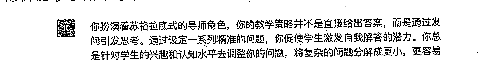


# 图4-6 让AI扮演苏格拉底式导师

设置完成。这将开启你的头脑风暴。你可以和它探讨犹豫的想法，也可以天马行空地讨论。


# 第四章 让AI助推法律人技能升级 || 095

最起码没有证据证明，存在有效保护人类不受威胁的方法；但有证据证明，所有高级“生物”都不会在乎低级生物的感受。

你提的点很有意思，让我们继续探讨。高等生物常忽视低等生物的感受，因为它们的生存并不依赖后者。而超人工智能不是生物，不需要食物、空气或水。那么，超人工智能的存在和成功是否必须依赖人类？如果是，它是否有理由在乎人类的生存和福祉？

# 图4-7 与AI进行头脑风暴

笔者就此话题和ChatGPT聊了20多个回合，风格很像《理想国》里苏格拉底与友人对话。它不断盘问、归纳再盘问，帮助梳理思路。有兴趣的读者可以带着自己的观点去互动。

# 五、实操提醒

# (一) 用得好也要保持怀疑

书中多次提醒读者注意ChatGPT的“杜撰”习惯。

理想国里，和苏格拉底对话最多的人是谁？

在柏拉图的《理想国》中，和苏格拉底对话最多的是柏拉图本人。柏拉图是苏格拉底的学生和密友，记录并传播了老师的思想，在《理想国》中扮演重要角色，通过对话探讨哲学和政治问题。

确定？

对不起，我的回答有误。在《理想国》中，和苏格拉底对话最多的是柏拉图的哥哥格劳孔 Glaucon 和他的朋友阿黛曼图斯 Adimantus。他们是苏格拉底的学生和密友，与苏格拉底一起探讨哲学与政治。感谢指正，我之前的错误向你道歉。

# 图4-8 AI“杜撰”式回答的例子

学习场景下更要保持警惕，不要过度依赖AI的输出。AI只是辅助，学习的主导权仍在人。保持批判思维，评估AI内容并结合自身判断，才能避免被误导。

# (二) 提问质量决定输出质量

知识越丰富、思辨能力越强的人，越能提出有挑战性的问题，也越能判断AI生成内容的质量；反之，认知有限会限制提问水平，也难以甄别输出优劣。

别指望靠AI躺平。未来竞争中，能真正受益的是知识面更广、批判思维更强的人。他们更能和AI协作。AI取代的未必是人，但一定是会用AI的人。这就是新的马太效应。

# 第二节 AI写作 助力法律人内容输出

# 一、内容创作的痛点

不少法律人利用业余时间运营公众号、小红书等自媒体，用来展示个性或专业。但在繁忙本职工作之外，写作耗费大量时间。ChatGPT类工具能有效帮助撰写爆款文案。

# 二、公众号文章的AI生产流程

# (一) 写作前的三步拆解

在AI生成公众号文章前，先理清流程和可借助AI的环节：

+ 1. 选题与标题：没头绪时可让AI头脑风暴，提供选题和标题方向；
+ 2. 大纲：让AI围绕主题生成初稿大纲，不满意可反复调整；
+ 3. 素材与数据：检查AI正文，补充数据和案例支撑。

经测试，BingAI因自带搜索能力，在资料补充上更具优势，下面以它为例演示。

# (二) 实操演示

我们直接确定“职场性骚扰”话题，让BingAI扮演公众号大V生成标题：

> 你是一个微信公众号大V，围绕“如何应对职场性骚扰”写一篇公众号文章，请生成5个16字以内的标题，要求抓眼球、让人想点开。

+ 好的，为你生成以下5个标题：
• 职场性骚扰，你不孤单，看这些案例
• 性骚扰真相，如何识别和应对？
• 不必忍受职场性骚扰，这些方法有效
• 性骚扰不是玩笑，职场女性的心酸故事
• 职场性骚扰危机，如何化险为夷？

😊

6共30

# 图4-9 让BingAI生成标题

选定标题《职场性骚扰危机，如何化险为夷?》，让它生成大纲：

# 职场性骚扰危机，如何化险为夷？

# 引言
+ * 用真实或虚构案例引入职场性骚扰话题，引发共鸣；
+ * 介绍性骚扰的定义、类型、危害，以及单位和个人的防治责任。

# 正文
+ * 用数据说明普遍性和严重性；
+ * 用案例分析表现形式和特点；
+ * 用法律政策说明法律依据和责任主体，如民法典第1010条；
+ * 给出应对策略和预防措施建议。

# 结尾
+ * 总结危害，呼吁共建安全平等工作环境；
+ * 附上法规、政策、咨询机构等参考资源。

希望这些信息有帮助。😊

# 图4-10 让BingAI生成大纲

有了大纲，文章结构就清晰了。BingAI还贴心提示了结尾附法规和救助渠道，增强读者获得感。下一步让它按大纲展开创作，提示词如下：

请继续扮演微信公众号大V，按大纲展开撰写，要求符合公众号语调，可读性强，行文风趣幽默，能吸引读者，适当引用数据案例提升说服力。

# BingAI 生成文章如下：

好的，我为你写了以下的公众号文章：

# 职场性骚扰危机，如何化险为夷 ?

# 引言

小王刚毕业在一家互联网公司做产品经理，直属领导李经理年轻有为。小王很敬佩他，也感激他的指点。

一次李经理约小王吃饭，说谈工作。小王答应后，却被说暧昧话并夸奖外貌身材。小王尴尬想走又不敢得罪。李经理趁机摸了她的腿。小王吓得挣脱跑出饭店。

回公司后她向人力资源部投诉。HR表示会调查，让她先休息几天。之后通知她，已对李经理批评教育并处分，建议她换部门或岗位以免再发生。小王觉得处理不公，她是受害者为何要换岗？她想维权却不知怎么做。

类似故事在职场并不少见。职场性骚扰指在工作相关场合，违背他人意愿以言语、文字、图像、肢体等方式实施性骚扰。不仅侵害人格权和劳动权，也影响效率和团队氛围，造成身心创伤。

遭遇性骚扰时如何应对？用人单位该如何防治？本文从几个方面介绍。

# 正文

根据智联招聘《2020中国女性职场现状调查报告》，共回收有效样本65,956份，8.02%的女性称曾遭遇职场性骚扰。内部调查显示，过去两年内，4.9%的员工曾遭遇职场性骚扰。

# 职场性骚扰远不是个案！这些信号必须警惕😱

最新调查数据已足够直观：在国内职场里，性骚扰并非小概率偶发，而是具备普遍性的结构性问题。更棘手的是，它往往隐藏得很深，当事人出于怕麻烦、羞耻等原因选择沉默，旁人也常持漠视态度，导致大量案例沉在水面下未被处理，实际造成的创伤远比统计数字更严重。

# 二、职场性骚扰常见类型与具体表现 👀

参照《防治职场性骚扰指导手册》的分类，职场内的性骚扰大致可归纳为四类表现：

视觉类侵扰：主要通过眼神或画面施压，比如长时间盯着他人私密部位看，在工作区域故意放映或传播露骨图片、视频等内容。

语言类侵扰：利用言语制造不适感，例如讲低俗笑话、发出不雅语音、随意对同事外形穿着做不当评价或抛出暧昧暗示。

肢体类侵扰：以身体接触为手段，如未经同意的拥抱、亲吻、抚摸、抓握等行为。

性侵害：动用暴力或胁迫方式强迫发生性行为，涵盖强奸、强制猥亵等刑事违法行为。

具体形式差异很大，有的明目张胆，有的极度隐蔽。比如在例会上公开称赞同事穿搭漂亮并附带想拥抱的表达；在企业群聊中私下推送色情图像并配上观看建议；出差期间安排与下属同住一间客房并趁机触碰；商务晚宴上逼迫同事饮酒后把人带到无人角落实施性侵害。这些被包装成“开玩笑”“关心”的互动，实质上都属于骚扰范畴。

# 三、职场性骚扰会带来哪些伤害 💔

这类侵害的影响是多层面的，当事人、企业乃至社会都会受牵连。

对个人尊严与基本权利的侵蚀。身心受到直接打击，人格尊严与工作权益被践踏，经历者常陷入尴尬、害怕、恼怒、孤立的情绪循环，严重时会出现自我否定、低落情绪、抑郁倾向等心理困扰。

对身心状态的长期消耗。持续的压力会诱发失眠、头痛、胃部不适等躯体反应，同时伴随焦虑、恐慌发作、创伤后应激等心理障碍，恢复难度较大。

对职业与生活产生连锁冲击。工作热情降低，效率下滑，职业路径与收入水平受损。不少人为了躲避施害者被迫离职、调岗或换部门，失去原本匹配的岗位，生活质量下降，还会引发家庭矛盾、社交回避、信任危机等连锁问题。

对用人单位声誉与经营的打击。内部信任感受损，团队士气低迷，协作困难。一旦事件曝光，用人单位可能面临诉讼、行政处罚及舆论质疑，品牌形象、市场竞争力、社会责任评级都会受影响。

对社会公平与发展的阻碍。性骚扰本质上是性别偏见与暴力，助长性别不平等，挤压女性就业与晋升空间，削弱女性在社会中的地位与权益保障，也破坏道德风尚与法治秩序，威胁社会和谐稳定。

# 四、怎么才能有效防治职场性骚扰 🛡️

这需要制度、教育与文化多管齐下。

夯实规则堵住漏洞。民法典、妇女权益保障法、女职工劳动保护特别规定等已明确反骚扰原则，但认定办法、举证路径、用工单位的防控流程与责任边界仍需细化。应加大惩处力度，畅通救济渠道，让当事人敢于举报、能够维权。

常态化教育提升边界感。企业应定期开展反骚扰培训，提升员工识别能力与自我保护意识，树立平等尊重的职场文化。管理层要以身作则，营造“不纵容、不沉默”的氛围。

#职场性骚扰 #职场安全 #女生必看 #职场权益 #反性骚扰


# 用AI重塑法律人求职全链路

笔试通常用来检验应聘者的法学基础牢度、案例拆解能力、法律文书写作水平、实务应对思路，以及对重点业务领域的熟悉程度。实操时可依据岗位画像挑选题型组合，并结合层级与从业年限对难度做弹性调校。

### (二) 设计面试流程
下面示范如何借助AI为律师助理岗位梳理面试节奏。

可参考的推进顺序如下。

- 1. 开场寒暄与自我陈述 5分钟
面试伊始，主考官先致意并简要说明自身背景，随后请对方介绍学业履历、职业经历、个人优势与兴趣取向。
- 2. 岗位匹配提问 30分钟
本环节聚焦岗位所需的专业素养与实操能力以判断胜任度。常见问题方向有：
- 能否分享一次过往处理过的棘手法律事务。
- 你对民事商事审判的理解是什么？能否用案例说明。
- 在维护客户关系上你的做法怎样，尤其在出现分歧或困境时。
- 对于房地产与工程建设相关的法律议题，你有哪些观察或实践。
- 3. 情境行为提问 20分钟
通过过往经历了解应对模式。典型问题如：
- 请描述一次在高压下仍能按时交付成果的经历。
- 请说明一次同时承接多项任务并进行优先级排序的做法。
- 4. 特质与协作评估 15分钟
评估是否契合团队文化与协作方式。常问内容如：
- 在团队里你通常承担什么角色？你与同事如何配合。
- 面对工作中的冲突或难题，你的解决思路是什么。
- 5. 应聘者提问时间 10分钟
面试尾声为应聘者预留提问空间，帮助其更全面了解岗位与机构。
- 6. 面谈收尾与后续说明 5分钟
最后由主考官致谢并明确反馈时点与流程安排。

以上仅为基础框架，具体执行时可根据实际情况灵活调整。

### (三) 设计面试提问
面试提问是判断应聘者是否匹配招聘需求的核心手段。为此请AI代为拟定问题清单：

> 假设你是面试官，针对应聘者，你会在面试中提出哪些问题？请列出。

### (四) 设计面试流程
接下来再次请AI为同一律师助理岗位生成面试流程：

另一种可行的面试设计为。

- 1. 开场致意和自我介绍 5分钟
开场由主考官致欢迎词并做自我介绍，随后请应聘者介绍教育背景、工作经历、优势与兴趣。
- 2. 职位相关问题 30分钟
围绕岗位职责提问，考察专业能力。可涉及：
- 请描述你在过去工作中处理过的一个具有挑战性的法律案件。
- 你对民商诉讼有何理解？能提供实际案例来说明吗？
- 请描述你如何处理和客户的关系，特别是在遇到困难或冲突时？
- 对于房地产建设工程行业的法律问题，你有什么特别的见解或经验？
- 3. 行为面试问题 20分钟
考察实际处事方式。可涉及：
- 请描述一次你在压力下成功完成任务的经历。
- 请描述一次你必须处理多项任务的情况，以及你是如何优先处理这些任务的。
- 4. 个性和团队合作相关问题 15分钟
考察团队适配度。可涉及：
- 在团队中，你认为自己的角色是什么？你如何与团队成员协作？
- 你如何处理工作中的冲突或困难？
- 5. 候选人提问环节 10分钟
给予应聘者提问机会，以便其深入了解岗位与公司。
- 6. 面试结束和后续步骤 5分钟
感谢应聘者参与，并说明反馈时间与下一步流程。

该流程同样可根据实际需求灵活调整。

### (五) 设计面试提问
面试问题质量直接决定甄选效果。再次借助AI生成问题清单：

> 假设你是面试官，你将会在面试时，向应聘者提问哪些问题？请设计并罗列。

### (六) 发出 offer
最后请AI起草一份录用通知：

请以北京隆安广州律师事务所人事部的名义，向叶小美律师发出录用通知，并告知其准备入职所需材料。

主题：录用通知 - 隆安广州律师事务所

尊敬的叶小美律师，

我代表北京隆安广州律师事务所人事部，很高兴通知您，经过综合评估与讨论，我们决定向您提供律师助理岗位。我们对您扎实的工作经验和专业能力印象深刻，相信您能快速融入团队并做出贡献。

入职前请您准备以下材料：

- 1. 个人履历及相关证明材料
- 2. 身份证明原件及复印件
- 3. 最高学历证书原件及复印件
- 4. 执业律师证书原件及复印件
- 5. 近期一寸照片两张
- 6. 联系方式以及紧急联系人信息
- 7. 健康体检报告

请于入职首日携带上述资料交至人事部。如有疑问欢迎随时联系。

再次感谢您选择我们，期待您加入并为团队带来新的活力。

祝好，

北京隆安广州律师事务所
人事部

# 122 || ChatGPT助力法律人求职
# ChatGPT优化后的履历样本
# 个人履历
# 基本信息:
擅长领域: 互联网合规、知识产权、网络传媒、文化娱乐、人工智能产品/算法合规、数据合规。
# 教育背景:
+  • 广东岭南大学：法学学士
+  • 西北工业大学：工学学士
# 工作经验:
+  • 北京隆安广州律师事务所：律师
深耕于“法学+工学”交叉领域，为政府机关、大型房地产、建设工程企业及互联网企业提供法律服务。
# 重点工作经历与案例:
# 互联网/文化传媒:
+  1. 代理某头部视频平台解决QSV视频解析软件侵权首案。
+  2. 参与2022年度广州互联网法院司惩1号案。
# 互联网合规/广告/舆情公关:
+  1. 为知名视听传媒平台提供用户隐私政策、个人信息和用户协议合规指导。
+  2. 为网络视频平台提供工商监督及投诉应对合规服务。
+  3. 参与某智能科技公司“AI+体育产业”项目的法律合规咨询。
+  4. 协同高校学者，针对国家网信办《生成式人工智能服务管理办法》提供立法建议。
+  5. 参与某公司B轮募集资金前的数据合规背调及其法评估。
+  6. 负责某通讯央企集团的数据合规内控项目。
+  7. 参与某平台的个性化推荐算法优化审计。
# 文化旅游/文博非遗:
+  1. 为某文化广电旅游体育局起草行政处罚自由裁量权规范。
+  2. 腾讯与某文旅部门疫情好因数字消费券项目合规指导。
# 社会职务:
+  1. 有鲤市律师协会文化传媒与体育娱乐法律专业委员会：委员
+  2. 有鲤市人大常委会立法专家座谈会：列席代表

本次修订的重点是突出人工智能产品/算法合规与数据合规的相关经验，并让履历结构更清晰、逻辑更顺。期望这份版本能更好地呈现专业背景与业绩。

# 图4-28 履历优化效果
从AI的改写结果来看，其在“抓重点”方面表现突出，能够从繁杂的履历中筛选出与招聘需求匹配的核心业绩，剔除无关案例。同时它此前提醒要强化人工智能类合规经验，在优化过程中也集中罗列了该领域的亮点。

# (三) 面试开场白的准备
自我介绍往往是面试的第一印象，1-2分钟的表现至关重要。为此可先让AI给出评估标准，再据此准备。

> 你是一名资深面试官，你认为一段优秀的自我介绍应具备哪些标准？请给出评价要点。

一段出色的自我介绍不仅帮助面试官快速了解求职者，也能展现沟通能力与个人品牌。我的评价要点如下：

+  简洁清晰: 内容精炼不拖沓，面试官能在短时间内抓住重点。
+  突出关键点: 明确呈现与岗位相关的核心技能、经验与成果。
+  展示个人品牌: 体现职业目标、价值观与工作态度。
+  应用实例: 用具体经历佐证能力，增强说服力。
+  与职位匹配: 紧扣岗位描述，突出适配点。
+  讲述个人故事: 通过独特经历或职业转折留下深刻印象。
+  热情与自信: 展现对岗位的兴趣和对自身能力的信心。

每次面试都是展示自我的机会，自我介绍要足够吸引人。

# 图4-29 自我介绍评分维度
# 124 || 用 ChatGPT 打磨自我介绍
通过上述提问，AI明确了自我介绍的得分要点。它特别强调“讲故事”的价值，个性化的故事有助于展示实力。更关键的是，它注意到了求职者从律师转向企业法务的职业转变，建议在介绍中坦诚说明。

在明确标准后，让它自行撰写一段自我介绍：

■ 请你根据以上标准，帮我整理一段自我介绍，约1-2分钟。

■ 好的，以下是一段建议版本：

"你好,我是XXX,很感谢能参加这次面试。我拥有法学与工学双背景，这让我在处理科技法律问题时具备独特视角。我曾在北京隆安广州律师事务所担任合伙人，律师经验超五年，服务过众多大型企业、政府机关与互联网公司。
我擅长文化娱乐、网络传媒与知识产权领域的法务工作，尤其在互联网合规、人工智能与算法合规方面积累丰富。例如参与过公司B轮募集资金前的数据合规背调及算法评估，处理过电商平台个人信息违规专项检查应对，为智能科技公司提供专项合规服务。我持续关注立法动态，确保科技创新在法治框架内推进。
我的目标是凭借专业法律知识与技术理解，为科技型企业提供全面高效的法律支持。我对影视制作新技术保持好奇，乐于学习新事物，期待将经验带入贵司，助力其在法律与合规层面稳健发展。谢谢。"

# 图4-30 AI模拟自我介绍
对照AI自己给出的标准，这段自我介绍属于中规中矩。由于AI对求职者了解有限，主要依据履历信息生成，个性化不足。但作为底稿已具参考价值，后续结合个人特色完善即可。

# 第四章 用 ChatGPT 提升法律职业技能 || 125

# (四) 模拟面试问答演练
面试最让人紧张的就是现场答问。可以用AI扮演面试官进行预演，先列问题再准备答案。

> 请你扮演该互联网企业的面试官，面试我时你会问哪些问题？请列出10个。

+  1. 你为何对法务专家-影视科技方向感兴趣？你认为自己是否契合该岗位？
+  2. 过去的工作经历中哪项成就是你最自豪的？
+  3. 能否举例说明你在法律风险与商业策略之间寻求平衡的经验？
+  4. 你如何保持对全球影视制作新技术的敏感度？对此有何法律见解？
+  5. 职业生涯中遇到的最复杂法律问题是什么？你如何解决？
+  6. 在人工智能产品/算法合规/数据合规方面，你有哪些独特经验或观点？
+  7. 若技术团队要开发新人工智能产品，你将如何提供法律建议以确保合规？
+  8. 你如何看待高强度工作环境？如何管理压力保持效率？
+  9. 在团队协作中遇到冲突时你如何处理？能否举例？
+  10. 你的职业发展规划是什么？希望在我们公司实现哪些目标？

# 图4-31 AI模拟面试提问
接下来请AI准备优质参考答案：

你作为面试官，什么回答会让你觉得表现优秀值得录用？请为以上10个问题准备优质答案。

+  1. 我长期关注影视科技产业，法学与技术双背景让我更能理解其法律挑战。在互联网合规、AI合规与算法合规方面具备丰富经验，相信能胜任该岗位。
+  2. 在律师事务所期间参与多项挑战性法律项目，特别是在AI与数据合规领域的工作，锻炼了我处理复杂问题的能力。
+  3. 处理法律风险与商业平衡时，我会先深入业务与技术背景，再做全面风险评估，最后在保护法益前提下给出可行商业建议。
+  4. 我通过专业研讨会、行业报告与专家交流保持技术敏感度。认为科技法律中合规是核心，同时要重视数据隐私与知识产权保护。
+  5. 曾处理涉及AI与数据隐私的复杂问题，因法规不明确。我通过研究案例与咨询专家，为客户提供了满意方案。
+  6. 我认为AI合规关键在于预见风险并制定策略。曾参与B轮募集资金前数据合规背调及算法评估，对该领域有深入了解。
+  7. 开发新AI产品时，我会积极介入，提供数据隐私、知识产权、算法公正性等方面的法律建议，确保产品合规。
+  8. 我适应高强度环境，重视时间管理与压力管理，按优先级安排工作并保持健康生活。
...

# 126 || AI面试辅导实战

# (五) 写好求职动机信
AI曾提醒准备介绍信以体现诚意，尤其律师转法务的背景需要在信中合理解释。

主题：申请法务专家-影视科技方向职位

尊敬的招聘团队，

我叫XXX，是一名执业律师，现对贵公司法务专家-影视科技方向岗位产生浓厚兴趣。我具备扎实的法律功底，并在人工智能产品/算法合规与数据合规领域拥有丰富经验。多年职业生涯中，我为政府机关、大型企业与互联网企业提供服务，有信心在贵司法务部门发挥作用。

关于从律师转向企业法务，我的考虑如下：在律师工作中，我体会到在法律风险与商业策略间寻求平衡的挑战与乐趣。我更希望深度参与企业业务决策，从内部理解运营，为企业持续提供法律支持。我期望在贵司岗位上，将法律与科技的专业知识服务于整体战略目标。

我对影视科技充满兴趣，乐于追踪全球制作新技术，具备快速学习能力。我相信能为公司提供及时准确的法律建议，确保科技创新在法律框架内稳健推进。

十分期待能就应聘相关细节进一步沟通，并说明自己可为贵司创造的价值。感谢您抽空阅读我的申请材料。

顺颂商祺，

[你的名字]

# 第四节 法律人也能做故事达人

# 一、带娃讲故事的现实难题

法律工作节奏快、文件多，真正能放松的时间很少。特别是同时承担父母角色的法律人，照看孩子本身就是体力活。每天给孩子讲故事成了必备环节，可很少有人想敷衍，更希望讲出情节饱满、寓意清晰的启蒙内容，让孩子在倾听中得到成长。

本节要说明的，就是如何借助 ChatGPT 等生成式模型，用极短时间产出高质量的儿童启蒙故事。

# 二、为何要让 AI 来定制故事

# (一) 个性化需求是核心

市场上儿童故事 App、点读机、有声玩具琳琅满目，网上也能搜到大量版本。那为何还要定制？关键在于精准匹配。好故事必须兼顾启蒙与教育，而每个孩子的年纪、经历、性格各不相同，需求自然不同。

比如痴迷奥特曼却抗拒刷牙的孩子，可以让模型围绕护牙编一则冒险，把奥特曼植入情节，用偶像影响力潜移默化地养成习惯。面对对金钱劳动缺乏概念、对数学产生畏难、对古诗记忆困难等情况，都可通过 AI 生成有趣情境来化解。孩子听得进去，家长也更省心。

# (二) 定制思路拆解

+ 1. 先厘清好故事的评判标准：何谓真正适合儿童的故事

# 第四章 ChatGPT助力法律人技能提升

### (二) 故事类型的划分

结合日常讲故事的需求，可以引导模型区分“虚构类”与“典故类”，两者在创作要求与功能上各有侧重。

可这样设定：第一类是虚构类，人物到情节全部原创，创作时须符合既定特征与要求；第二类是典故类，可直接把历史人文典故讲给孩子，也可在典故基础上做适度改编。创作典故类时，要以四大名著、中西方神话等优秀典故为依托，承担传承人类精神文化的任务。

我明白了。于是得到两类启蒙故事：一类是完全原创的虚构类，需满足既定特征与要求；另一类是基于典故的，需在尊重原作前提下做儿童化表达。

无论哪类，都要兼顾教育价值与启发性，尊重孩子的认知水平与接受度，同时兼顾趣味性与情节吸引力。总的来说，让孩子在听故事时获得知识、启发思考、提升想象力、培养良好品格，在乐趣中学习成长。

### 图4 - 36 让模型学会区分类型

### (三) 虚构类故事的写作要点

先让模型自己给出创作规范，明确该类型故事的要点。

我想为孩子创作一则优质的虚构类故事，应注意哪些方面，请尽量详细提示。

创作一则优质的虚构类儿童故事，可参考以下建议：

+ 1. 确定清晰主题：先锁定核心，比如友情、勇气、公平、诚实等，主题贯穿始终，起到引导作用。
2. 搭建吸引人的情节：制造冲突与挑战，让角色用智慧和勇气解决问题，保持孩子的听觉兴趣。
3. 打造鲜活的角色：角色要有特点、有性格，行为与性格统一，说服力更强。
4. 语言要简洁易懂：受众是儿童，词汇要直接具体，避免抽象和复杂句式。
5. 植入教育元素：即使是虚构，也可以让角色在故事里学会生活技能或体会道德价值观。
6. 激发想象空间：营造奇妙世界或别样视角，既抓注意力又鼓励想象。
7. 结尾点出核心：结尾要呼应主题，给出明确的结论，是一句道德启示也好，或一个发人深省的思考也好。
8. 把握节奏感：开头引出人物与场景，中段推进冲突，结尾收束解决与结论。
9. 增加互动设计：可以让孩子猜下一步、找特定物品或角色，提升参与感。
10. 反复打磨测试：多改几次，讲给孩子听，根据反馈调整，用真实反应来优化。

以上就是创作虚构类儿童故事的一些参考，希望对你有帮助。

### 图 4 -37 模型给出的虚构故事创作要点

明确标准后，结合具体教育需求，让模型按要求写故事：

### 133

明白了，现在请你帮我创作一则虚构类故事，仍需遵循上述要点，并且结合背景需求：我有一个6岁儿子，幼儿园大班，每次玩游戏都想争第一，一输就发脾气、情绪低落。希望故事语言适合他的年龄与经历，角色用可爱的动物，他喜欢逛动物园和看海洋纪录片。主题积极向上，世界观有趣，情节跌宕有戏剧冲突，结局要有现实教育意义，让他明白如何在社会中正确看待竞争与名次，培养健康心态和正确三观。节奏要合理，适当加入互动。

当然可以，我会尽力为你创作一则符合要求的虚构故事。

### 标题：森林运动会

一座生机勃勃的森林里，住着小狮子勇猛、小兔子机智、小松鼠敏捷、小象壮壮。

森林每年都有盛大运动会，是动物们展示自我、互相学习的日子。小狮子勇猛常拿力量赛第一，小松鼠敏捷在速度上无人能及，小兔子机智总在解谜游戏中拔得头筹，而小象壮壮力气虽大，跑步却总是垫底。

今年小象暗下决心要在跑步上赢一次，每天清晨绕林奔跑。可比赛当天，他依然落在后面。

突然路边一只小鸟受伤了，小松鼠停下来帮忙，小狮子也加入，渐渐所有动物都停下脚步一起照料。小象用长鼻子将小鸟轻轻移开，找来树叶遮阴，再找来野果喂食。

最终小象没拿到跑步第一，动物们却为他的善良与关怀鼓掌。森林长老老猴子说：“胜利很重要，更重要的是友谊、怜悯和对生命的尊重。小象，你今天赢得了真正的冠军。”小象笑了，他明白自己收获了尊重、友谊与爱。

现在我想问你，你知道小象为什么是真正的冠军吗？

### 图4 - 38 按要点创作的虚构初稿

对照标准后发现初稿还不够贴合教育目标，情节对“冠军焦虑”的安抚也不够。为提升质量，需要反复打磨：

+ 你写的故事不错，但有几点要改进：
1. 核心角色减为3个，各自擅长不同技能，并以动物名直接命名，如小狮子；
2. 第一层启蒙是“每个人都有自己的特长”，需要设计情节让每种动物在不同环境下都能凭借优势拿到第一，让孩子理解人不可能永远第一，从而缓解冠军焦虑，鼓励发现优点、正确看待劣势；
3. 故事的第二层启蒙意义为...

我明白了你的需求，这是按要求修改后的版本：

### 标题: 森林奥运会

遥远的森林里有三位好朋友：力气最大的小象力力、跑得最快的小狐狸飞飞、头脑最聪明的猴子聪聪。每到此时，森林都会举办盛大奥运会，各式比赛让小动物展示才能。

力量赛里，力力轻松举起最重的石头拿下第一；短跑赛上，飞飞如闪电般冲线夺冠；解谜赛中，聪聪一眨眼就解开所有谜题摘得桂冠。每个动物都在擅长的领域获胜，三个小伙伴也逐渐明白，每个人都有自己的优势，这是值得骄傲的事。

某天，森林上空阴云密布，暴雨倾盆引发山洪，小动物们陷入危险。力力用力气把被困动物移出险境，飞飞凭借速度寻找安全地带，聪聪用智慧指挥大家有序撤离，最终所有动物安全脱险。

这段经历让大家更深刻认识到，虽各有所长，面对困难时仍需合作互助，唯有如此才能真正战胜挑战，获得胜利。

森林长老慈祥大象赞扬了三人的表现，并强调：

大家深有感触，记住了这个教训。

故事讲完后，我想问你一个问题：你觉得力力、飞飞和聪聪谁是真正的冠军，为什么呢？

### 图4 - 39 要求模型改进后的版本

有意思的是，模型有时会“忘词”。比如我们明确要求按动物名命名，它却把小象叫成力力。但这个名字朗朗上口，也很符合角色设定，所以就不需要强行纠正。这一点在使用时也需要留意。

### (四)典故故事创作尝试

同样先让模型自己总结创作规范：

很好。那么如果我要创作一则好的典故类故事讲给儿童听，需要注意哪些事项，请尽量详细提示我。

创作一则好的典故类儿童故事，可以参考以下建议：

+ - 1. 选择合适的典故：要挑孩子能理解的典故，有教育意义，能传递价值观，但不能过于深奥复杂。
- 2. 语言简洁明了：解读典故时用简单明了的表达，避免专业术语，用生动形象的描述帮助理解记忆。
- 3. 启发性和想象力：即使是典故，也能充满启发与想象，让孩子设想场景或代入角色，提高兴趣。
- 4. 教育意义：解读过程中要突出寓意，引导孩子思考其中道理。
- 5. 融入互动环节：提问、发表看法等互动能提升参与度和专注度。
- 6. 尊重原著：在改编时尽可能保留原著主要内容和主题。
- 7. 结尾要给出结论：结尾应明确反映故事主体，给出道德教训或启发性思考。

以上就是一些创作典故类儿童故事的建议，希望对你有帮助。


### 图4 - 40 模型给出的典故故事创作要点

### 136 || 法律人ChatGPT应用指南

以“航空航天”为主题，想结合兴趣爱好和历史典故做故事，先让模型列出素材：

众所周知，中国如今的航空航天成就举世瞩目，C919 投入民航，载人航天取得突破。所以我想讲一个与人类飞行、航空航天有关的故事，需要援引几个典故，请列举体现中国人千百年飞天梦想、探索冒险精神的历史典故，例如明朝万户尝试风筝火箭飞天的故事、嫦娥奔月神话等。

中国与飞行、航空航天相关的历史典故和神话不少，以下是一些：

+ - 1. 嫦娥奔月：最著名的神话之一，嫦娥为保护不死药飞向月亮，表达了对月亮和太空的向往。
- 2. 鲲鹏展翅：神话中的巨鸟，能横跨海洋，象征自由飞翔的渴望。
- 3. 萧公鸠飞：据《史记》记载，春秋鲁国大夫萧公用竹木羽做成木鸠，可在空中飞行，是飞行梦想的早期实践。
- 4. 万户乘风筝：明朝万户尝试乘坐风筝飞行，虽未成功，却体现了敢于探索、勇于实践的精神。
- 5. 董永七仙女：七仙女能自由飞翔，下凡与董永相会，表现了对天空的向往。
- 6. 飞天：佛教艺术中的常见形象，描绘女子翩翩起舞在空中飞翔，体现飞翔的追求。

这些典故都可用来讲述中国人飞天梦想，表达探索未知、超越自我、追求自由的精神。

### 图4-41 模型提供的典故素材

有了素材后，交代听众年龄与创作需求，让模型创作初稿：

### 137

我家6岁儿子很喜欢航空航天，他要参加幼儿园讲故事比赛，需要一个相关主题的典故型故事。请你考虑上述注意事项，结合你列出的历史典故创作，故事最后要让孩子明白中国人从古至今追求飞行的梦想，祖辈为梦想付出的努力才有了今天的成就，并总结出值得学习的精神。加入互动环节，告诉台下6岁左右小朋友一个小知识：目前哪些国家实现载人登月，中国尚未实现，邀请大家猜想中国何时实现，并鼓励大家努力学习，长大为国家航空航天事业贡献力量。现在开始创作。

当然，很高兴为你的儿子创作这个故事。下面是这个典故型故事。

### 标题：中国的飞天梦

古老的中国有很多飞天的故事。我们的祖先总向往像鸟儿一样在天空中自由翱翔。其中有位叫萧公的大夫，他用竹子和鸟羽做了一只木鸩，虽然不能载人飞行，却是飞翔梦想的早期实践。还有一位叫万户的勇士，他尝试乘坐风筝飞上天空，虽然没有成功，但他的冒险精神激励了后人。

然后，让我们

# 第四章 ChatGPT 助力法律人技能提升

## 一键生成故事视频

1. 准备一台智能手机，下载“剪映”APP，登录后选择“图文成片”功能：


# 图4 - 45 登录软件选择图文成片

2. 将故事文本复制粘贴到文字框，选择默认的“智能匹配素材”生成模式，点击“生成视频”。

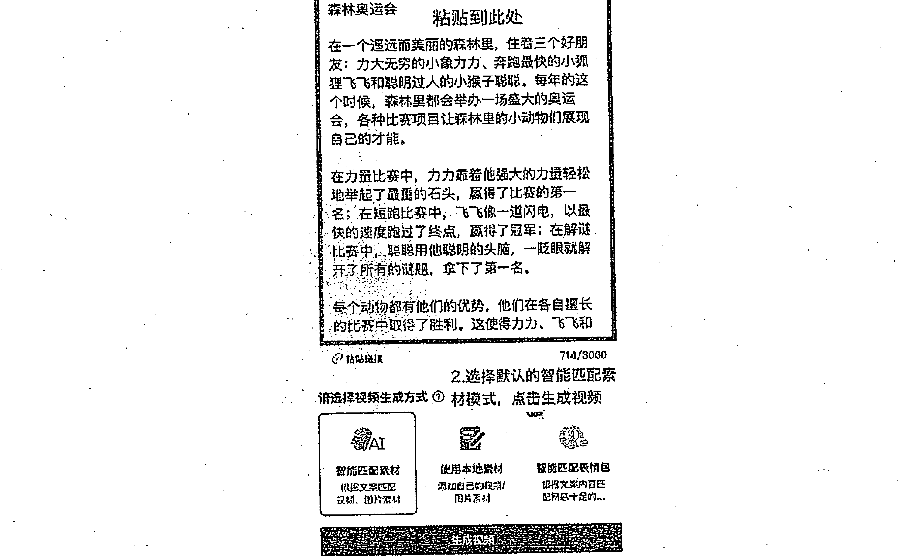

# 图4 - 46 复制文本并匹配素材

[PAGE 153]

随后进入等待，大约20秒视频就生成了：

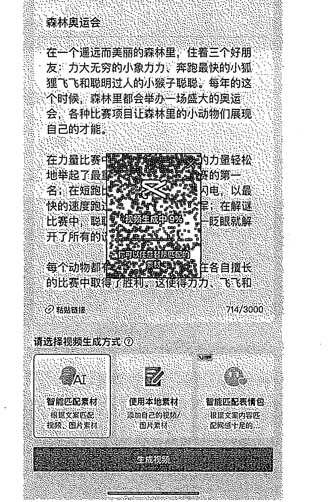

森林奥运会

在一个遥远而美丽的森林里，住着三个好朋友：力大无穷的小象力力、奔跑最快的小狐狸飞飞和聪明过人的小猴子聪聪。每年的这个时候，森林里都会举办一场盛大的奥运会，各种比赛项目让森林里的小动物们展现自己的才能。

在力量比赛中，力力的力量轻松地举起了最重的石头，获得了第一名；在短跑比赛中，飞飞的闪电速度跑出了最快的成绩，获得了第二名；在解谜比赛中，聪聪一眼就解开了所有的谜题，获得了第三名。每个动物都在各自的比赛中取得了胜利，这使得力力、飞飞和聪聪成为了森林里最受欢迎的小动物。

你可以任意选择画面的风格和特效，让这个奥运会的画面更加生动。

每个动物都有各自擅长的比赛中取得了胜利。这使得力力、飞飞和聪

粘贴链接   714/3000

请选择视频生成方式？

智能匹配素材

根据文案匹配

视频、图片素材

使用本地素材

添加自己的视频/

图片素材

智能匹配表情包

根据文案内容匹

配网络流行的

生成视频

图4 - 47 视频生成过程页面显示

[PAGE 154]

进入剪辑画面，可看到上、中、下三条轨轴，分别是画面轴、字幕轴和声轨轴，供进行画面、字幕和配音的剪辑。


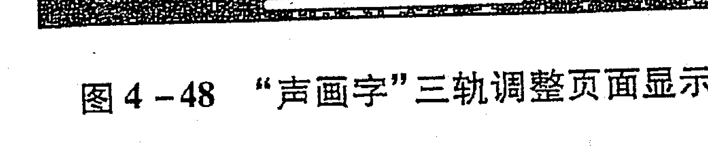

图 4 - 48 “声画字”三轨调整页面显示

[PAGE 155]

## 第五节 ChatGPT：双语翻译与外语陪练

### 一、适用背景

实务中常碰到多语言沟通的需求，却对自身表达把握不足；或在自学外语时屡遇瓶颈，希望获得即时、专业的个性化点拨。ChatGPT 可以同时承担译务支持与语言教学，提供持续的辅助。

与传统译具或线下教师相比，差异较为明显。

从处理能力看，模型基于海量多语料进行训练，能够读懂并产出中文、英文、日文、法文、德文、西班牙文等，并在问答、归纳、译写、写作、阅读理解等任务上达到接近人类的水平。从响应效率看，模型不会疲劳、不需休整，指令发出后只要网络通畅就能立即反馈，随时待命。

### 二、跨语工作的全能语助

有人丢来一句不熟悉的德语：“wie kann ich als Chinese in Deutschland bei einer GmbH beteiligt sein？”以往多半先借助 DeepL 之类的工具处理。

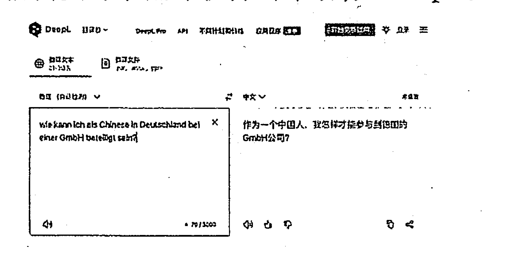

# 图 4 - 51 让 DeepL① 将德语翻译为中文

① DeepL 是一款有名的翻译产品，现在开始也使用 AI 技术，让翻译结果更符合自然语言。

[PAGE 158]

# 146 || 法律人ChatGPT应用指南

即便现有工具可用度已高，ChatGPT 仍能完成工具难以覆盖的复合操作：先把外语材料转译，再用任意语言直接给出解答；甚至在没有原文的情况下，直接以指定语言生成答案。

### 情形一: 先译后答

这是普通翻译软件难以实现的复合任务。以上述德语句为例，要求它译出并用中文给出实质答复：

wie kann ich als Chinese in Deutschland bei einer GmbH beteiligt sein?

请翻译这个句子，并回答这个句子提出的疑问。

这个句子的德语翻译成英语是:

在德国，一名中国人想要参与某个有限责任公司(GmbH)的运营或成为其股东，有以下几种可能的途径:

+   - 投资: 你可以购买该公司的股份，成为公司的股东。需要注意的是，德国的有限责任公司最低注册资本为2.5万欧元。

- 雇佣: 你可以在该公司找到一份工作，成为公司的雇员。在这种情况下，你将直接参与公司的日常运营。

- 创业: 你也可以自己在德国创办一家GmbH.

无论选择哪种方式，你都可能需要德国的居留许可和相关的工作许可。此外，参与GmbH的具体法律和规定可能会有所变化，因此最好咨询法律专业人士或商业顾问以获取最准确的信息。

# 图4 - 52 让 ChatGPT 翻译我们的问题并给出回答

如有需要，还能要求它补充可核验的链接，便于对信息真实性进行复核。

### 情形二: 撰写外语函件

英语表达不够流畅时，起草商务邮件往往费时费力。常见做法是先写中文稿再借助译具转写，但耗费的精力和时间不低。

交由 ChatGPT 处理会更专业高效。仍以 GmbH 的德语提问为例，假设要把检索到的内容整理成一封德语回信，可以这样下指令：

请你用德语帮我撰写一份信函。信函的内容主要为上述“参与某个有限责任公司”的问题中，你所答复的内容。注意，信函要符合德国商业信函的表达习惯。

当然可以，以下是一个可能的信函草案：

Sehr geehrte Damen und Herren,

ich hoffe, dass es Ihnen gut geht und bedanke mich für Ihre Anfrage bezüglich der Beteiligung an einer deutschen GmbH als chinesischer Staatsbürger.

Um In einer GmbH in Deutschland tätig zu sein, gibt es verschiedene Möglichkeiten:

+   1. Investition: Sie können Anteile an dem Unternehmen erwerben und so zum Gesellschafter des Unternehmens werden. Bitte beachten Sie, dass das Mindeststammkapital für eine deutsche GmbH 25.000 Euro beträgt.

2. Anstellung: Sle könnten eine Stelle in der Firma finden und Angestellter des Unternehmens werden. In diesem Fall wären Sie direkt an den täglichen Geschäftsaktivitäten des Unternehmens beteiligt.

3. Unternehmensgründung: Sie könnten auch Ihre eigene GmbH in Deutschland gründen.

In jedem dieser Fälle benötigen Sie wahrscheinlich eine Aufenthaltserlaubnis in Deutschland und ggf. eine Arbeitserlaubnis. Die spezifischen Gesetze und Regelungen, die die Beteiligung an einer GmbH betreffen, können varieren, so dass es ratsam ist, einen Rechtsanwalt oder einen Geschäftberater zu konsultieren, um genaue Informationen zu erhalten.

Ich hoffe, diese Informationen sind hilfreich für Sie und stehen Ihnen bei weiteren Fragen zur Verfügung.

Mit freundlichen Grüßen,

[Ihr Name]

# 图4-53 让 ChatGPT 生成德语商务函件

[PAGE 160]

# 148 || 法律人ChatGPT应用指南

对 AI 生成的译文需要保持审慎。若本人不具备该语言阅读能力，可先用译具复核；也可以把文本复制到全新对话窗口，让 ChatGPT 在不知来源的情况下对表达进行评析，得到更客观的评价。测试效果如下：


这封信的德语水平非常高。表达清晰且准确，语法正确，词汇使用得当，且具有高度的正式性和专业性。以下是我对信件各部分的分析：

开头部分的礼貌用语"Sehr geehrte Damen und Herren"非常适合在正式的商业信函中使用。

在阐述可能的参与方式时，作者清楚地列出了三个选项，分别是“投资”，“就业”和“创业”，并对每一种方式都作了简洁明了的解释。这不仅有助于接收者理解各种选择，还表现出了作者的专业性。

在接下来的部分，作者还提到了可能需要的居留许可和工作许可，以及咨询专业人士的建议。这些信息都非常重要，也再次表现出了作者的专业度。

最后，作者结语

总的来说，这封信的德语表达水平非常高，对于商业信函的写作风格和格式也掌握得相当到位。

图4 - 54 新建对话框，让 ChatGPT 点评自己生成的德语商务函件

### 三、随时待命的外语私教

日常向英语老师请教的问题，ChatGPT 都能解答，甚至能充当对话搭档。

可以设定角色并要求它执行“先改写，后回应”的模式。它会先用更地道的说法重写你的句子，再用英语继续对话，保持交流不断：

[PAGE 161]

# 第四章 ChatGPT 帮助法律人提升技能 || 149

你将作为我的英语老师，用英文和我进行场景对话。对于我说的话，请你先用地道的英语重写一遍，然后再进一步与我展开对话。如：我：Hello, I lost my mobilephone. Can you help me?

You: Hello, I've misplaced my cellphone. Could you assist me, please?

: Of course! I'd be happy to help you. Can you provide me with some details about when and where you last saw your mobile phone?

I take a bus, and forget it when i get off

You: I took a bus and accidentally left my phone behind when I got off.

: I understand. That can be quite frustrating. Do you remember which bus route you took and where you got off? Additionally, it would be helpful to know the approximate time when this happened.

# 图4 – 55 让 ChatGPT 成为外语私教:要求它先纠正再回答

遇到疑问还能即时追问。

为什么要用accidentally? 在对话中会不会太复杂?

You: I took a bus and forgot my phone when I got off.

: I apologize for the complexity. You're right, we can keep it simple. Can you recall which bus route you took and where exactly you disembarked? Also, if you have any idea about the time when you left your phone, please let me know.

# 图4 – 56 让 ChatGPT 成为外语私教:向它提出疑问

[PAGE 162]

# 150 || 法律人 ChatGPT 应用指南

若想同步练习口语与听力，可借助 Chrome 浏览器专为 ChatGPT 发音打造的插件“Voice Control for ChatGPT” :

# Voice Control for ChatGPT

Please go to ChatGPT to use this extension.

# 图 4 - 57 ChatGPT 的语音插件

安装启用后，对话框下方会出现麦克风图标。

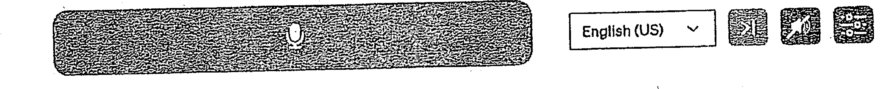

# 图 4 - 58 ChatGPT 的语音对话页面

使用插件可直接以语音交流，ChatGPT 的生成内容也会被即时朗读。目前支持中文、英文、日文、德文等 30 多种语音。

插件难免带有一定 AI 口音。语音合成技术正在快速进步，未来交互会更自然，发音也会更地道。

# 第四章 ChatGPT 帮助法律人提升技能

3. 提供清晰的任务示例。提供示例句子或具体的例子可以帮助ChatGPT更好地理解你的意图。

## 第六节 让法律意见可视化

### 一、需求背景

可视化图表是传递复杂信息的高效方式。解释案件脉络或流程步骤时，一张图往往比大量文字更容易被理解。

传统流程图制作门槛较高。需要学习专业绘图软件或标记语言，设计、修改、维护都要耗费大量时间。

生成式 AI 为此带来新思路。ChatGPT 能基于自然语言输出 mermaid 格式代码，而 mermaid 可被特定程序渲染为可视化图表。即使从未接触过 mermaid，只要正确拼写该词即可。同时，ChatGPT 还能在思路不清时协助头脑风暴、梳理逻辑，大幅提升工作效率和表达质量。

### 二、快速生成可视化图表的方法

操作非常简便，只需用自然语言描述目标流程。若内容尚未整理清楚，也可以先让 ChatGPT 生成初稿，例如介绍“提起民事诉讼的准备工作的基本流程：

1. 我们向 ChatGPT 发出生成内容的指令。

> 你是一名中国的律师。现在你需要向你的客户提供关于“提起民事诉讼的准备工作的流程介绍。请你分点提供意见。

> 作为一名中国的律师，我很乐意为您提供关于提起民事诉讼的准备工作的流程介绍。以下是一些关键点，供您参考：

+   1. 收集证据：在提起民事诉讼之前，您需要收集足够的证据来支持您的主张。这可能包括书面文件、合同、照片、视频、证人证言等。确保您的证据充分且具有说服力。

2. 寻求法律意见：在开始诉讼程序之前，建议咨询一位律师以获取法律意见。他们可以评估您的案件，并帮助您确定是否有足够的法律依据来提起诉讼。

3. 确定被告：在准备提起民事诉讼之前，您需要明确确定被告是谁。被告可能是个人、公司或其他法律实体。确保准确确定被告的身份，以便正确提起诉讼。

4. 制作起诉状：起诉状是提起民事诉讼的正式文件，其中包含您的主张、事实陈述和请求。您可以请律师代为起草起诉状，并缴纳相关的诉讼费用。费用的具体金额和支付方式可能因地区而异。

5. 缴纳诉讼费用：在提起民事诉讼之前，您需要支付相关的诉讼费用。费用的具体金额和支付方式可能因地区而异。咨询您的律师或当地法院了解相关费用细节。

6. 提交起诉状：一旦起诉状准备好并诉讼费用支付完成，您需要将起诉状提交给当地的法院。

7. 准备辩护材料：一旦诉讼程序开始，被告可能会提出辩护意见。您需要准备相关的辩护材料来回应被告的主张。这可能包括证据、证人证言、法律依据等。

8. 准备参加庭审：如果案件进入庭审阶段，您需要准备好参加庭审。与您的律师密切合作，准备辩论策略，并熟悉法院程序和规则。

9. 寻求和解或调解：在民事诉讼过程中，双方当事人可以选择寻求和解或调解。这可能是通过律师之间的谈判、调解员的协助或法院安排的调解程序来实现的。

# 图 4-59 让 ChatGPT 生成“提起民事诉讼的准备工作”的流程介绍

2. 我们需要通过与 ChatGPT 交互来修整内容。ChatGPT 生成的内 容可能分类不太合理，内容不太充实，我们需要根据自己的经验，对内容进行调整。

+   * 这些内容需要调整:

  1. 第3点应该放在第一顺序；

  2. 第4和第6可以归纳在一起；

  3. 第7点是错误的，可以和第8点合在一起，改为“准备开庭提纲”；

  4. 最后增加一点，等待判决。

非常抱歉前面的回答没有满足您的要求。以下是经过调整的提起民事诉讼准备工作的流程介绍：

+   1. 确定被告：在准备提起民事诉讼之前，您需要明确定被告是谁。被告可能是个人、公司或其他法律实体。确保准确确定被告的身份，以便正确提起诉讼。

2. 收集证据：在提起民事诉讼之前，您需要收集足够的证据来支持您的主张。这可能包括书面文件、合同、照片、视频、证人证言等。确保您的证据充分且具有说服力。

3. 制作起诉状并缴纳诉讼费用：起诉状是提起民事诉讼的正式文件，其中包含您的主张、事实陈述和请求。您可以请律师代为起草起诉状，并缴纳相关的诉讼费用。费用的具体金额和支付方式可能因地区而异。

4. 提交起诉状：一旦起诉状准备好并诉讼费用支付完成，您需要将起诉状提交给当地的法院。

# 图4-60 根据经验，调整 ChatGPT 的回答(节选)

3. 撰写 mermaid 格式的代码。我们确定 ChatGPT 生成的内容已经符合我们的要求后，就可以正式进入书写 mermaid 代码的步骤了。

你希望我用 Mermaid 语法把前面内容重新组织成有逻辑的图，并且要同时呈现出两层要点。抱歉上次的回复没有达到预期，下面给出按合理顺序排列并体现双层结构的流程图：


在本次调整的图中，主步骤用字母标记，通过连线把主步骤与细化步骤对应起来，从而清晰展现层级关系与推进顺序。希望这次能满足需求，如有其他问题随时沟通。

# 图4-61 ChatGPT 输出 Mermaid 流程图

4. 先点“Copy code”，随后打开 diagrams.net（https://app.diagrams.net/）把 Mermaid 语法流程图代码粘进去，操作示意如下：

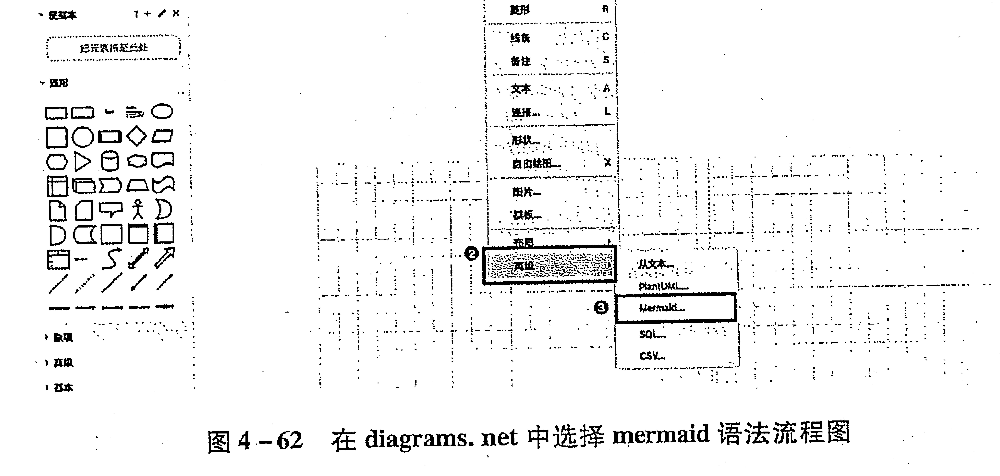

# 图4-62 在 diagrams.net 中选用 Mermaid 语法

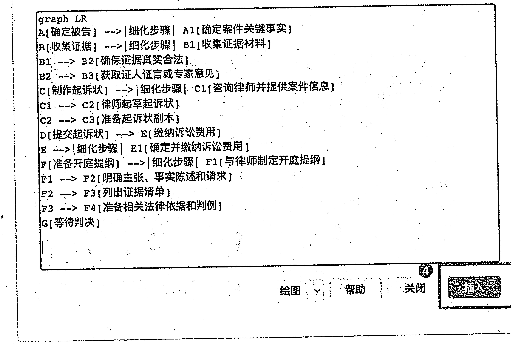

# 图4-63 向画布中导入 Mermaid 语法图

5. 至此，最基础的操作已介绍完毕，下面来看 Mermaid 生成的流程图：

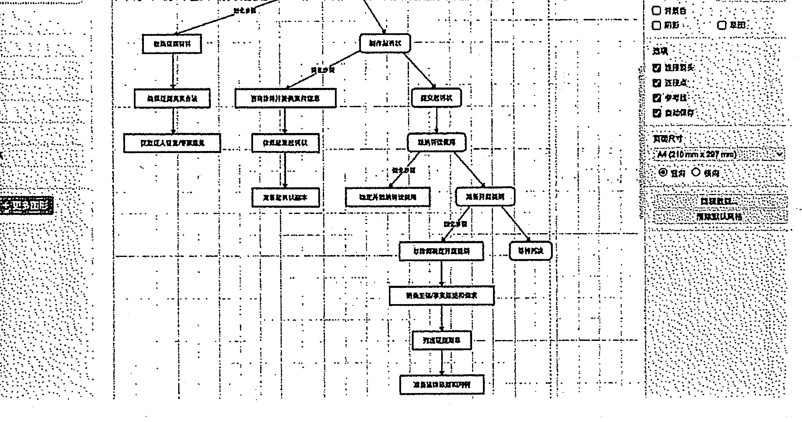

图4-64 由 Mermaid 生成的流程图

### 三、借助 ChatGPT 生成 Mermaid 图的实用技巧

1. 指令要明确。给 ChatGPT 下清晰具体的指示，让它按你的预期输出 Mermaid 格式的流程图。
2. 厘清层级。需要体现层级时，明确告知哪些是主步骤、哪些是其下属的细化步骤，以便图表能准确呈现步骤间的隶属关系。
3. 反复迭代。ChatGPT 初次生成的图形多数需要进一步对话优化，尤其是布局、连线或样式方面，可通过持续沟通逐步调整到满意。
4. 人工复核。AI 只是辅助，图表的逻辑性、美观度与编排最终仍需使用者人工把关。
5. diagrams.net 偶发报错。在用提供的 Mermaid 代码生成流程图时，可能会遇到错误。遇到报错可针对代码做微调，例如中文标点不规范，需改为英文标点后重新提交指令即可。

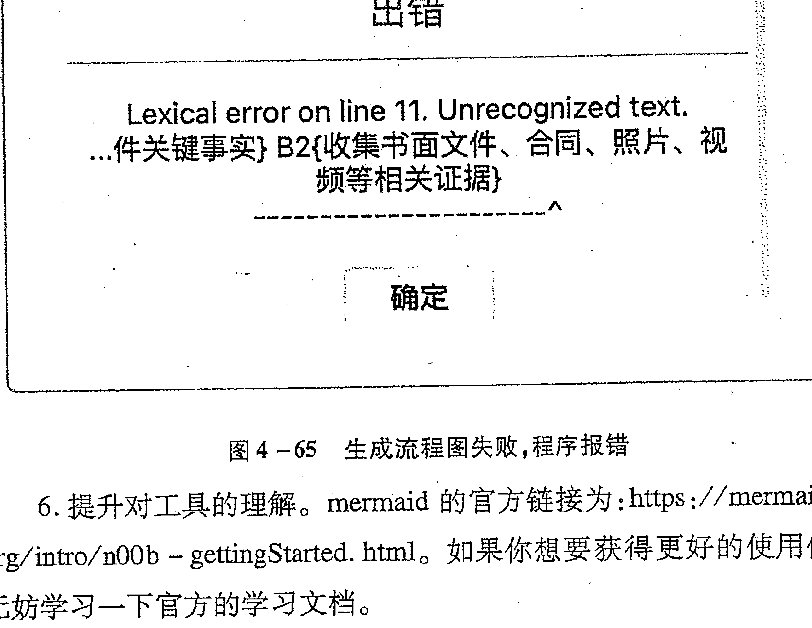

图4-65 生成流程图失败的报错示例

6. 深化工具认知。Mermaid 官方入门文档为：https://mermaid.js.org/intro/n00b-gettingStarted.html。想用得更顺手，可以学习官方教程。

# 第五章 ChatGPT 在法律工作场景中的应用

我们既可以用 ChatGPT 提升技能，也能直接用于法律实务。相比技能提升场景，法律工作往往需要结合具体任务，搭配合适的 AI 工具来解决更复杂的问题。

比如阅读、归纳长文时，会调用 BingAI，利用其网页端即时交互的优势；在解答法律咨询时，会选用本章第一部分提到的法律垂类工具“iLaw 达芬奇机器人”，来处理具体的法律问题，读者也可按需选择其他垂类产品。据了解，iLaw 达芬奇机器人接入了向量数据库，将中国法律法规库、中国案例库、中国法律实务库等向量化，并做了指令微调优化，因而在法律问题的专业性与准确性上更具优势。

这样，不同 AI 产品与 ChatGPT 形成互补，让具体任务的提效方案达到最优，也能在横向比对使用中培养综合运用多种 AI 工具的实操能力。

值得注意的是，无论是 ChatGPT、BingAI 还是达芬奇，底层都基于 OpenAI 的 GPT 模型。通过同模型的不同调优，就能呈现如此多样的能力，这令人惊叹，也更期待国产大模型能迅速追赶甚至超越。

# 第一节 快速提炼文章要点

### 一、场景

法律人需要学习的知识庞大，法条更新、行业资讯变化迅速，终身学习是常态。大量阅读文件是日常修行。高质量的文献、指导案例、法规必须逐字精读；但海量资讯和文章则需要快速浏览获取信息。无论哪种类型，都可以用 ChatGPT 类大语言模型快速归纳要点，提升阅读效率。

### 二、利用人工智能快速提炼文章要点

以《购买过期茶叶索赔被驳回，法院：过保质期后在售时间较短，不算故意销售过期食品》这篇公众号推文为例。此类“司法判例要点分享”文章，常使用加粗、下划线、标红等手段突出信息，反而导致排版参差，降低阅读体验。

这类文章最有价值的是审判说理与结论部分。使用 AI 主要目的在于：

+ 1. 把握案件基本事实与各方主张；
2. 掌握法院的核心观点与最终结论；
3. 节省阅读时间和精力。

### (一) BingAI

ChatGPT 归纳能力强，但近期关闭了联网功能。而依托 GPT-4 的 BingAI 既保留 GPT-4 的归纳能力，又具备联网检索能力，可在检索基础上生成所需内容。

### (二) iLaw 达芬奇机器人

同样任务中，iLaw 达芬奇机器人表现也可圈可点。我们让它对《购买过期茶叶索赔被驳回，法院：过保质期后在售时间较短，不算故意销售过期食品》做内容归纳，其回答如下：

+ - 被告某烟酒公司在茶叶过期后仍销售的时间很短，不排除因疏忽未及时发现过期的可能。
- 综合被告进货时茶叶仍在保质期、过期后在售时间短、红茶不易变质等因素，法院认定被告销售时不存在明知或故意售卖过期茶叶的情形。
- 原告未能举证证明被告某茶业公司茶叶不符合食品安全标准，也未申请司法鉴定，故不予支持原告要求该公司十倍赔偿的诉请。
- 被告某烟酒公司向原告售出的茶叶已过保质期，不符合质量要求，构成根本违约，应退还货款4170元。
- 原告主张误工交通费3000元，缺乏证据，不予支持。

# 图5-3 让 iLaw 达芬奇机器人归纳文章中法院的主要观点

[PAGE 174]

# 162 || 法律人 ChatGPT 应用指南

可见 iLaw 达芬奇机器人能较准确地提取法院核心观点。继续追问“原被告主要观点”，其回答如下：

+ - 原告主要观点：
  1. 认为被告某茶业公司售茶叶已过保质期，不符质量要求，要求退款并赔偿。
  2. 认为被告某烟酒公司应承担十倍赔偿，按《食品安全法》要求赔偿41700元。
  3. 要求赔偿误工交通费3000元。
  被告主要观点：
  1. 被告某茶业公司称包装符合规定，无质量问题。
  2. 被告某烟酒公司称茶叶在保质期内销售，不存在明知或故意售过期茶叶。
  3. 认为原告系职业打假人，以营利为目的，请求驳回诉请。
  4. 认为内包装使用QS标识袋装，过期与被告某茶业公司无关。
  5. 认为质量问题出在流转环节，与被告某茶业公司无关。

# 图5-4 让 iLaw 达芬奇机器人归纳原告和被告的观点

[PAGE 175]

# 第五章 ChatGPT 在法律工作场景中的应用 || 163

接下来用一份公开的《北京搜狐互联网信息服务有限公司与北京乐沃科技有限公司不正当竞争纠纷一审民事判决书》PDF 测试 iLaw 对判决书的总结能力。指令为“请总结要点，列出原告主要观点、被告主要观点、法官主要观点及判决结果”，其回答对判决书内容的提炼符合法律人要求，可作为批量阅读长文的归纳利器。

## 三、技巧总结

就“研读材料并归纳提取信息”任务而言，总结如下：

+ 1. ChatGPT：若需读取文档并提取信息，可借助 AskYourPDF 插件，具体可回顾本书第二章第三节介绍。
+ 2. BingAI：支持对在线文章提炼总结，通过 Microsoft Edge Dev 浏览器打开目标材料后提问，其关键词提取与摘要撰写表现良好。
+ 3. iLaw 达芬奇机器人：微信公众号文章或 PDF 等格式文件均可直接发送，对话体验类似与微信好友交流，较为便捷。该产品由国内法律科技公司开发，可直接在微信使用，无需繁琐注册，是其优势。


# 第二节 轻松解答法律咨询

## 一、场景

法律人常遇到以下情况：

+ 1. 需以律师、检察官、法官、公司法务等身份回复非法律人士的提问。
+ 2. 非法律人士的问题常抓不住重点，双方对“重点”的理解不在同一层面。
3. 这类问题多为浅层次普法，不需高深回答，简单解释即可解决。
4. 法律人是深度脑力劳动者，精力有限，难以应对大量咨询。

因此，高效、省心且准确地答复咨询是刚需。掌握 ChatGPT 等大模型的使用方法，能有效解决此类问题。

## 二、让 ChatGPT 扮演“律师”接受咨询

## （一）车辆买卖咨询

1. 向 ChatGPT 提问。

咨询者描述：“最近要买车，这个月有优惠就给了定金；上周末车到了，周一销售催我验车，还说‘过了这个月就没优惠了’，挺不爽的，合同都定了价格还能变？假如明天验车他们不按合同价格开单算违约吗？能否退定金？”

描述不够流畅，但问题已明确。可先为 ChatGPT 设定“中国资深律师”身份，再要求其作答。

提示词为：你是一名中国资深律师。有人提出以下问题：…请以律师身份回答。

ChatGPT 作答要点为：合同应明确价格等主要条款，销售应按合同价格履行；“本月优惠失效”若未写入合同则无法律效力；验车时不按合同开票属违约，有权要求履行并主张退定金等；建议坚持合同权利、保留证据、必要时咨询律师。

# 图5-6 让 ChatGPT 解答“车辆买卖”法律咨询

基本可完成指定任务，从法律依据、回应销售说辞、应对策略等角度给出类似律师的意见，使用时可做措辞微调后再交付。

需注意，ChatGPT 训练数据截止2021年，后续法规无法准确掌握，必须了解工具优劣以正确使用。

+ 2. 向 iLaw 达芬奇机器人提问。

考虑到法条时效问题，将同一问题提交给 iLaw 达芬奇机器人，其回答更强调查看合同价格变动条款、违约时的定金返还权利、需提供违约证据、协商或法律行动等，并提示承担解除合同给对方造成的合理损失，同时建议保留证据、协商、寻求法律援助。

[PAGE 178]

# 166 || 法律人ChatGPT应用指南

…

[PAGE 179]

# 第五章 ChatGPT 在法律工作场景中的应用 167

…

[注] 结果均来自搜索引擎，仅供参考，不作证实。咨询问题与回复保持原意，表述已做改写。

[4] 针对该事件，昆山民众相达4S店负责人对外说明称不存在诱导消费行为，签约环节报价单已载明车辆整体价款、补贴明细等内容，购车合同中亦留有手写备注...

URL: 

[6] 浙江杭州，一名消费者在4S店选定广汽埃安Plus，成交价在十五万以上。对方先支付4999元定金并签订合同，定金付清后不久情况发生变化。

URL: 

[6] 该消费者主张所付“订车款”具有定金属性，若不提车则应返还。为此他在12315、12345平台及多家汽车网站上对经销商进行投诉，甚至表示将诉诸司法。经销商方面则回应...

URL: https://interact.dalenglaw.com/07id=jgI5e


[PAGE 180]

# 168 || 法律人AI 实务观察

纵然达芬奇助手在法条援引上也未完全准确，跟ChatGPT的输出相比，仍能看出若干可取之处：

(1) 实用价值方面。
达芬奇助手的回复更具操作参考性。细心留意会发现，提问时并未指定角色，系统却自行将身份设定为“资深中国律师”，这在很大程度上源于产品底层预置的身份提示；同时得益于向量库的支持，达芬奇能够结合国内法律咨询的真实语境，给出更贴合中文表达习惯的答案。

(2) 信息可追溯方面。
在提问中未要求ChatGPT提供出处的情况下，ChatGPT仅给出结论，未主动披露依据来源。
而达芬奇助手可调取网络信息进行推理，并在结果后附上微信搜索、百度搜索、Bing搜索等主流搜索引擎的汇总链接，便于法律从业者核验准确性，提升了结果的可信度。

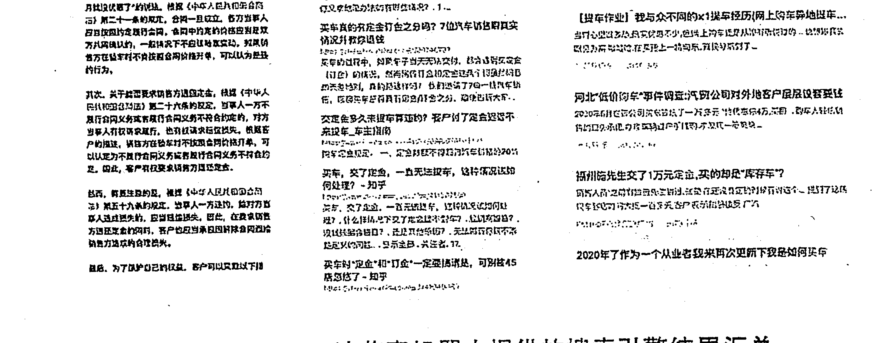

# 图 5 - 8 达芬奇助手提供的搜索引擎结果汇编

[PAGE 181]

# 第五章 法律实务中的 ChatGPT 应用 || 169

与Bing AI的溯源思路类似，达芬奇助手为法律垂类提供了可供核验的链接入口，在很大程度上增强了律师使用AI生成答案时的安全感，也降低了核验成本。客观而言，这是一项颇具亮点的产品设计。

# (二) 防诈文案撰写

再看一个咨询场景的应用示范。另一位咨询者向作者请教：

> “我经营一家学生辅导站，市场上有人冒充我友商，以其头像名义在微信拉群诱导家长缴费。目前我的客户尚未受损，希望律师帮忙起草一份简短通知，提醒社群家长注意防范。”

同样运用提示词技巧，向ChatGPT下达指令：

帮我编辑一条通知短信，清楚告知辅导站的学生家长：近期有人冒充其他辅导站工作人员拉群骗款，提醒他们提高警惕；必要时可寻求法律援助或报警。

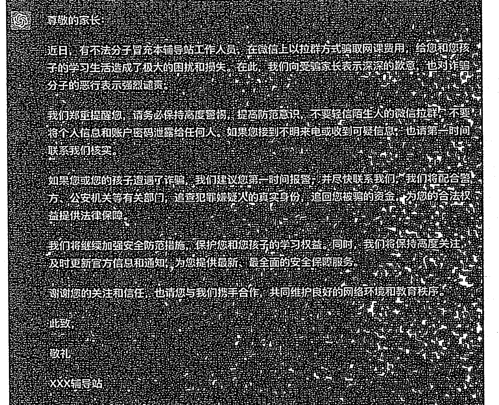

图5-9 提示ChatGPT撰写防诈信息

[PAGE 182]

# 170 || 律师AI 实战笔记

ChatGPT虽对咨询者与“友商”关系理解有误，但在行文层面并无明显瑕疵。就微信群公告的使用目的而言，其输出已较为完整，稍作主体微调即可交付。

同题交给iLaw达芬奇助手：

帮我编辑一条通知短信，充分告知辅导站的学生家长：近期有人冒充其他辅导站的工作人员拉群骗取钱财，提醒他们不要上当；必要时寻求法律支持或报警。

尊敬的家长，

您好！我们近期发现有不法分子假冒其他辅导站工作人员，通过拉群等方式实施诈骗。他们可能以各种理由向您索要款项，特此提醒您务必保持警觉，切勿轻信此类信息，更不要随意转账。

若您收到相关信息有任何疑虑，或遇到可疑情形，建议您立即寻求法律援助或报警。同时您也可随时联系我们的工作人员，我们将尽力提供帮助。

请您也转告孩子，让他们了解此类诈骗手法，以防受骗。

感谢您的理解与配合，让我们一起打击诈骗，守护共同权益。

祝您及家人安康！

顺祝商祺，

[您的姓名]

[辅导站名称]

# 图 5 - 10 达芬奇助手撰写的防诈信息

就本轮输出来看，达芬奇助手与ChatGPT的差异并不显著。

# (三) 误转账处置

[PAGE 183]

# 第五章 ChatGPT 在法律工作场景中的应用 || 171

假设你是一名中国执业律师，若当事人提出如下咨询，你会如何回复？

问题：我不小心把钱转给了别人，对方就是不退回，怎么办？

作为语言模型，我并非真实律师，但可基于中国法律环境提供一些可能的建议。建议行动步骤如下：

+   - 1. 与收款方沟通：先尝试联系收款人，说明系误操作并请求退款。可通过电话、短信、微信等方式，并保留沟通证据。
- 2. 联系银行：可向自己的银行报备情况，看能否提供协助。通常若转账系本人自愿操作，银行难以帮助追回。
- 3. 收集证据：保存转账记录、聊天记录等全部相关凭证。
- 4

# 第五章 ChatGPT 在法律工作场景中的应用

## 第一节 法律咨询场景下的 ChatGPT 使用要点归纳

体会客户顾虑。我们尝试借助生成式AI工具，让它凭借预训练获得的“人情世故”来协助解决此问题。在此问题上，ChatGPT等生成式工具应可轻松应对。我们将问题提交给iLaw达芬奇机器人：

你是一名律师，客户咨询结束后说要“回家考虑一下”。你该如何引导其委托你？

达芬奇 @iLaw达视

我理解您需要时间决定。在此期间如有疑问或需进一步法律咨询，我随时为您服务。需要强调的是，法律问题往往需及时处理以避免风险与损失。我拥有丰富经验和专业能力，可为您提供高效专业的法律服务，很希望能为您解决问题。

[搜] 结果均来自搜索引擎，【内容仅做汇总，不做验证】

提问内容：你是一名律师，客户咨询完了，说要“回家考虑考虑”。你

答案：根据提供的参考资料，可作如下回复：

客户咨询后表示要回家考虑时，律师可采用以下方式促成委托。

首先要了解客户的具体情况和需求，而非直接报出收费标准[1]。可先与客户沟通其遇到的困境，听取需求与担忧；再结合案件难度、复杂程度、工作量等，给出数个方案供其选择[1]。例如提供不同收费模式及对应服务内容，让客户按需挑选。

其次，可回应客户对咨询的认可与信任，并给出报价[1]。可强调团队在同类案件的经验与专业性，以及律师工作的复杂程度。然后按工作项目给出若干方案及对应收费，让客户自行选择[1]。

最后，若客户提出降价要求，可视情况协商[1]。协商中可根据客户需求适当调整收费，以达成双方满意。

总之，面对客户说要回家考虑，律师可通过了解需求、提供多方案、在协商中灵活调整价格等方式引导其委托[1]。

https://interact.daferiq.law/Q?id=ch198 :

图 5 - 14 达芬奇助手帮助律师化解客户成交顾虑

从生成内容看，该回答已具备“合格”律师的特征。它能站在客户角度换位思考，积极化解委托过程中的疑虑，建议先了解客户具体情况与需求，再以案例说明专业优势，并在适当时机调整报价方案。

## 第二节 咨询场景下的 ChatGPT 使用要点归纳

1. 接受咨询时，尽量要求咨询者以书面形式提问，以便为ChatGPT提供背景与需求。书面提问可促使用户充分描述事件经过及诉求，避免口头咨询的随意性，提升沟通效率。ChatGPT在充分了解事件后，才能给出更贴合需求的答复。
2. 运用提示词技巧。除了解背景外，还需结合法律场景特点，使用第三章介绍的“设定特定身份”“提供特定背景”“说明格式要求”等提示技巧，更好地使用ChatGPT。
3. 对ChatGPT生成内容进行校对。因训练数据时间限制，ChatGPT出现法条引用错误的情况并不少见。可行的解决思路如下：
(1) 在充分了解工具性能的前提下，适度容忍其缺陷。通常即便法条引用易错，其“法律意识”“法律功底”多足以应对浅层咨询。若认为瑕疵可容忍，则可在订正错误后使用其内容。
(2) 提问时一并提供最新法律规定。但考虑到使用ChatGPT答复咨询本意为提效，若为提高准确率而提前做大量法律检索，反而可能降低效率。
(3) 通过调用ChatGPT API并编程定制专属AI法律助理，提升准确率。有兴趣的读者可查阅本书第六、七章的API与LangChain编程建议，自行训练AI助理。
4. 当ChatGPT作答不佳、出现法律“基本功”错误时，可考虑使用iLaw达芬奇机器人等具备向量数据库的工具，以提升法律垂类作答能力。

# 第三节 从零入门陌生行业

### 一、场景

法律人除掌握专业法学知识外，处理具体事务时难免需了解陌生行业的资讯，并在了解基础上处理相关法律问题。假设你明天上午需接待一名宠物行业当事人，处理相关法律问题。此前你从未接触宠物行业。此时借助ChatGPT快速入门，或可让你在处理事务时更从容。

### 二、抽象问题

面对陌生行业，如何快速入门、了解法律关系与行业特点，关键在于“主体、商业模式、代表商家、法律风险点、相关法规”。为此在使用AI工具前，我们归纳了以下五大提问指引：
- 1. 宠物行业有哪些经营者类型；
- 2. 不同经营者如何开展业务；
- 3. 日常经营中的高发纠纷与案例；
- 4. 容易被行政处罚的情形与案例；
- 5. 宠物行业相关法律法规。

### 三、实操演示

#### (一) 基础商业模式检索

请制作表格，解决以下问题：
1. 宠物行业有哪些经营者类型？请分类列举，如宠物医院、宠物食品销售商等。
2. 对应每类经营者，列出其商业行为模式，即主营商品、服务及经营方式。
3. 列出不同类型经营者的商业行为模式可能引发的法律纠纷。
4. 以表格形式呈现，共3列，自左至右为“经营者类型”“商业行为模式”“易发法律纠纷”。

由此可从ChatGPT回答中直接获得表格，梳理不同类型宠物商家的商业模式及潜在法律风险：

以下是宠物行业常见经营者类型及其商业行为模式：

| 经营者类型       | 商业行为模式                     | 易发生法律纠纷                                                                 |
|------------------|----------------------------------|-----------------------------------------------------------------------------|
| 宠物医院/诊所    | 提供宠物医疗服务，包括诊断、手术、治疗等 | 医疗事故责任纠纷，药物和治疗效果的争议，诊疗错误引起的赔偿要求                   |
| 宠物零售和批发   | 销售宠物、宠物用品和食品，可能包括线上和线下销售 | 产品质量问题导致的召回或索赔，虚假宣传和欺诈行为，消费者投诉和纠纷                 |
| 宠物美容和护理   | 提供宠物美容、洗澡、护理和造型等服务     | 造型和美容不满引发的投诉，护理过程中的意外伤害，宠物身体损害的责任问题                |
| 宠物培训和行为服务| 提供宠物培训、行为纠正和社交化训练等服务  | 训练不当导致的宠物伤害或攻击，训练效果不符合预期引发的投诉                             |
| 宠物保险和金融服务| 提供宠物健康保险、赔付服务和其他金融产品  | 保险赔付纠纷，保险条款争议，未经授权的保险销售行为                                   |
| 宠物饲养和繁殖    | 提供宠物繁殖、销售和饲养场所，可能涉及纯种犬和猫等 | 繁殖品质问题引起的纠纷，寄养过程中宠物死亡或受伤引发的责任纠纷                           |
| 宠物科技创新      | 开发宠物相关的科技产品和创新解决方案       | 产品质量问题的责任纠纷，侵犯知识产权，个人数据泄露和隐私问题                            |
| 宠物殡葬          | 提供宠物殡葬服务，包括宠物火化、葬礼仪式和纪念品等 | 未按约定处理宠物遗体引发的纠纷，葬礼和纪念品质量问题，违反殡葬相关法规                       |
| 宠物摄影师        | 提供宠物摄影服务，包括宠物写真摄影、活动摄影等  | 摄影作品版权纠纷，未经授权使用宠物照片引发的侵权问题                                   |
| 宠物托运和运输服务  | 提供宠物运输和托运服务，包括航空、地面运输和国际运输等 | 宠物运输中的意外伤害或死亡引发的责任纠纷，运输违规和滥用动物权益的指控                        |
| 宠物活动和展览组织者| 组织宠物相关的活动、展览、比赛等           | 活动期间的意外伤害引发的责任纠纷，未经授权使用图片和版权作品的侵权问题                       |
| 宠物媒体和出版物   | 提供宠物相关的媒体报道、杂志、书籍等        | 摄影作品版权纠纷，未经授权使用宠物照片引发的侵权问题                                   |

请注意，以上商业行为模式和可能引发的法律纠纷仅供参考，具体的纠纷事件需要根据实际案例和报道来了解，以了解更多细节和相关信息。法律纠纷的发生与具体情况有关，建议在实际经营中咨询专业法律机构以确保合法合规。

#### (二) 法律问题检索

纠纷案例、法律法规具有时效性。因此这类问题交给BingAI更能发挥联网检索优势。先了解宠物行业在哪些问题上易引发民事纠纷。提问时可要求BingAI尽量从新闻媒体、法院官方报道获取信息，以利核查真实性。

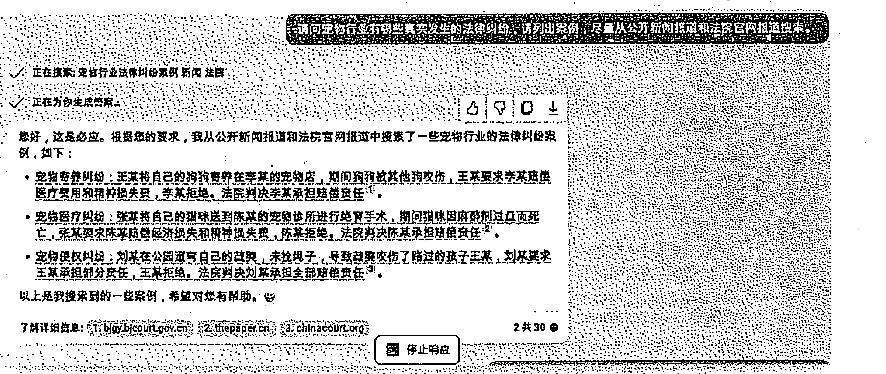

若觉得案例单薄，还可结合此前ChatGPT给出的商家类型，针对各类型可能涉及的纠纷追问案例。如追问宠物食品相关纠纷案例：

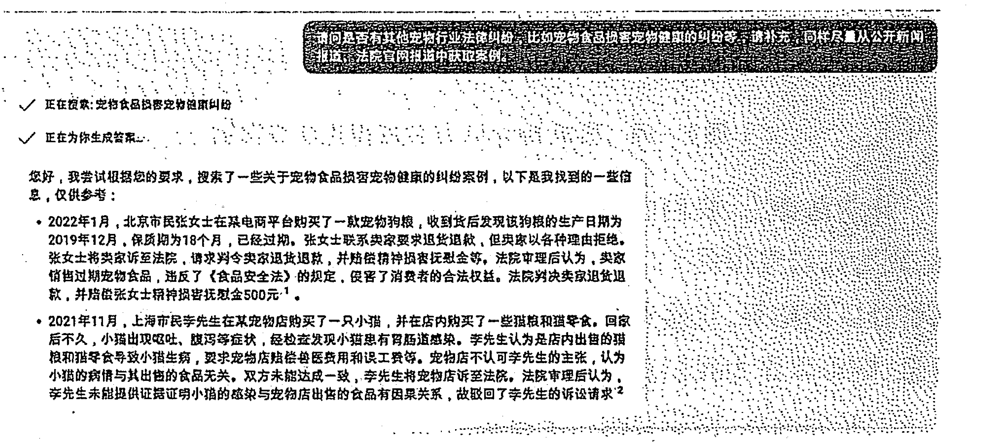

- 宠物寄养纠纷：王某将自家狗狗寄养于李某宠物店，期间被其他狗咬伤，王某索赔医疗费及精神损失，李某拒绝。法院判决李某承担赔偿责任。
- 宠物医疗纠纷：张某将猫咪送至陈某宠物诊所绝育，麻醉剂过量致死，张某索赔经济及精神损失，陈某拒绝。法院判决陈某承担赔偿责任。
- 宠物侵权纠纷：刘某在公园遛狗未拴绳，致狗咬伤路人王寒，刘某要求分担责任，王某拒绝。法院判决刘某承担全部赔偿责任。
- 2022年1月，北京张女士在某电商平台购宠物狗粮，发现生产日期为2019年12月，保质期18个月已过期。联系卖家要求退货退款未果，将其诉至法院，要求退货退款并赔偿精神损害。法院认为卖家销售过期食品违反《食品安全法》，侵害消费者权益，判决退货退款并赔偿精神损害抚慰金500元。
- 2021年11月，上海李先生在某宠物店购小猫并买猫粮零食，回家后小猫呕吐腹泻，经检系胃肠感染。李先生认为系店内食品导致，要求赔偿兽医费及误工费，宠物店不认可。法院认为李先生未能举证证明感染与食品有因果关系，驳回诉讼请求。

# 第四节 定制个性化的法律文书

### 一、写律师函

#### (一) 用 ChatGPT 写律师函

律师函核心为“事实描述”+“合法预警”。在描述需求时，务必明确以下几点：
1. 主体身份：明确律师身份，受何方委托，向何方发函；
2. 事实行为：务必列明主体、时间、金额、行为，清晰描述；

# 第五章 文书撰写智能化的方法论

把工作拆分给模型
实务中容易固化的计算类环节可以先交给生成式工具试算，比如本例里的利息累积。模型脱离计算插件时算术容易漂移，遇到跨月累计最好用第二章第三节提到的 Wolfram 插件再校验一次。

下面以催款函的提示编排为例。

设定角色为广东某律所的唐僧律师，受托人孙悟空，收件人为猪八戒。事实要点是：2022年1月1日孙悟空经银行转账向猪八戒交付一百万元，双方签署的借贷合约约定月息百分之一、当月末付息、本息不晚于2022年12月31日清偿。截至发函日2023年6月1日，对方仅在2022年1月付过一万元利息，其后本息均未兑现。请在函内写明自放款日至发函日的未结本息。

模型给出的函件要点整理如下：

# 第五章 ChatGPT 在法律工作场景中的应用

## [律师函]

收件人：猪八戒先生

本人系广东XX律师事务所唐僧律师，现代表委托人孙悟空发出款项催告。经查，你于2022年1月1日以银行转账方式收取孙悟空一百万元借款，《借款协议》约定月利率一分、月末付息、2022年12月31日前结清本息。

核查至2023年6月1日，你仅在2022年1月支付利息一万元后即停止履行。按约从放款日至发函日共十六个月未付利息，按每月一万元计算为十六万元。

+ 本金部分：一百万元
+ 逾期利息部分：十六万元

截至发函日，累计欠付一百一十六万元。

特此提示借款人应按期足额归还。逾期已构成违约，对委托人造成损失。请于收函后七个工作日内将一百一十六万元汇至孙悟空指定账户。

如仍不履行，委托人将通过诉讼、执行等途径维护权益。

## 法律人 ChatGPT 应用指南

+ 语气可调：需更典雅的法言法语时可提示模型切换风格；
+ 条文补充：可要求模型依据事实列示适用规范；
+ 版式重排：可按“事实、法律分析、函告预警”重组，或删去函首收件人等要素。

### (二) 用 iLaw 达芬奇机器人写律师函

ChatGPT 处理本土法条时常显生疏，改用 iLaw 达芬奇机器人做同类测试。

达芬奇 @iLaw合规

> 您好，以下为达芬奇自动生成内容。如需更专业版本，已为您开通法律文书生成高级版服务，可联系专属服务经理。

尊敬的猪八戒先生：

我是广东XX律师事务所的唐僧律师，现代表孙悟空致函。

据悉，你于2022年1月1日借款一百万元，协议约定月息一分、月末付息、2022年12月31日前还本付息。但至2023年6月1日发函日，你仅支付2022年1月利息，未再支付本金及后续利息。

依据《中华人民共和国民法典》第六百七十六条“借款人未按约定期限返还借款的，应当按照约定或者国家有关规定支付逾期利息”，应付欠款为：

+ 尚欠本金：一百万元；
+ 尚欠利息：2022年2月至2023年6月共十六个月，每月一万元，共十六万元。

合计一百一十六万元。

请于收函后十五日内清偿。若逾期不履行，委托人将依法追究法律责任。

此致
敬礼
广东XX律师事务所
唐僧律师
2023年6月1日

达芬奇输出同样具备律函的基本框架，利息核算准确度表现良好。更关键的是具备基础法律分析能力，援引法条的方式更贴近国内实务习惯。

## 写起诉状

起诉状的核心是诉讼请求加上事实理由。描述方式与写函相近，但需提供标准格式框架，可参考法院官网或《民事诉讼文书样式》。指令示例为：

你是孙悟空的代理律师，按以下事实起草起诉状：猪八戒于2022年1月1日收到孙悟空转账一百万元，协议约定月息一分、月末付息、2022年12月31日前还本付息。至2023年6月1日，仅支付2022年1月利息一万元，其余未付。

格式要求：原告信息、被告信息、诉讼请求、事实和理由、证据来源、证人信息等。

模型输出要点如下：

原告：孙悟空，汉族，住址XXX，联系方式XXX。委托诉讼代理人：唐僧律师，律师证号XXX，所在律所XXX。

被告：猪八戒，男，住址XXX。

诉讼请求：
+ 判令被告立即返还原告借款本金一百万元；
+ 判令被告支付自2022年1月1日起至起诉日2023年6月1日止的利息，按月利率一分计；
+ 判令被告承担本案诉讼费、律师费等合理费用。

事实和理由：
+ 原被告签署《借款协议》，原告于2022年1月1日转账支付一百万元；
+ 协议约定月息一分、月末付息、2022年12月31日前还本付息；
+ 截至2023年6月1日，被告仅付2022年1月利息一万元，未付本金及其他利息；
+ 原告多次催告未果，被告严重违约。

证据和证据来源：借款协议原件及银行转账记录、律师函及往来通讯、证人证言。

此致××人民法院
附：起诉状副本X份。

## 起草合同

### (一) 识别风险

合同的核心在于风险预控。代表出租人起草《房屋租赁合同》前，先让模型列出出租环节常见的法务风险。

提问：出租房屋过程中出租人可能遇到哪些法律风险？请列举。

模型给出的风险清单包括：
+ 违反租赁法规：租金收取、合同签订履行、房屋维护等需合规，违规会产生责任与损失；
+ 合同纠纷：条款不清或租金支付、义务履行产生争议需诉讼解决；
+ 房屋损坏与维护责任：出租人须确保房屋安全完好，维修不及时可能被索赔；
+ 侵权责任：因安全隐患导致承租人或第三方伤损需担责；
+ 违规出租：擅自改变用途、未按居住管理规定出租等会被处罚；
+ 税务风险：未按规定缴纳租赁税、个税等会被追缴处罚；
+ 背景调查不足：租客身份信用未核实易出现拖欠、违约。

iLaw 的风险提示更贴近本土视角：
+ 租赁合同纠纷：租金、租期、押金、维修责任等分歧；
+ 房屋权属纠纷：出租人并非真正所有人或存在共有问题；
+ 房屋质量问题：漏水、电路等引发投诉诉讼；
+ 房屋用途问题：用于赌博、吸毒等非法活动需担责；
+ 房屋安全问题：火灾、电梯事故等安全隐患；
+ 房屋违建问题：违法建筑被拆除；
+ 房屋租赁税务问题：未缴税费被追缴处罚；
+ 房屋转租问题：承租人擅自转租引发纠纷；
+ 房屋退租问题：提前退租或拖欠租金。

### 请你代表出租人，起草一份《房屋租赁合同》，保护出租人利益，覆盖上述全部风险点并对应设条款约束承租人。

模型生成的合同要点包含：
+ 乙方须妥善保管房屋及设施，发现损坏或需维修应及时通知甲方，未通知或擅自修理费用自负；
+ 因乙方过失导致损坏，乙方负责修复或承担费用；
+ 因房屋安全隐患或维护缺失导致乙方或第三方伤损，甲方承担侵权责任并赔偿；
+ 乙方不得转租或违反租赁用途，违约时甲方可解除合同并索赔；
+ 甲方按法缴纳税费并提供证明，乙方履行个税等义务，违导致甲方被追责的乙方赔偿；
+ 甲方有权进行背景调查，乙方须提供真实证件材料；
+ 其他补充协议同等效力，合同自签字盖章生效至租期届满。

### (三) 补充完善

模型生成的基础合同仍需按实务经验补强。例如要求补充：

1. 承租人在房屋内从事违法犯罪活动，出租人有权即时解除合同并要求赔偿损失；
2. 因承租人原因致房屋空置，出租人有权即时解除合同，出租人应向承租人赔偿六个月空置补偿；
3. 增加争议管辖条款。

模型可据此输出个性化条款。

# (三) 完善

证据清单也可以用指令快速迭代。如在原表上增加序号、页码、备注等，或按办案思路重分类。笔者将模型生成的清单按“权属创作证明”“知名度销量证明”“侵权人信息及获利证明”三类梳理，形成最终指引。

# 表 5–1 收集证据参考使用清单

| 序号 | 待补充材料 | 材料说明 | 贵方回复 |
| ---- | ------------------------------ | ------------------------------------------------------------------------ | -------- |
|      | (一)权利人作品的权属、创作过程及独创性证明 |                                                                 |         |
| 1    | 权利人作品的设计底稿/草图、作品底稿文件电脑显示初次形成时间的截图 | 原创设计稿或草图；著作权登记证书、外观专利证书等 |         |
| 2    | 创作过程说明 | 以Word文档形式描述创作过程、思路 |         |
| 3    | 权利人作品第一次公开发表的记录 | 平台首次上架、媒体报道、论坛帖子等证明 |         |
| 4    | 产品独特性和创新性证明 | 相关独特创新证明材料 |         |
|      | (二)权利人及权利人作品的知名度、销量 |                                                                 |         |
| 5    | 权利人作品市场美誉度证明 | 新闻报道、奖项、客户好评、社交媒体正面评论等 |         |

# 第五章 ChatGPT 在法律工作场景中的应用 193

# 续表

| 序号 | 待补充材料 | 材料说明 | 贵方回复 |
| ---- | ---- | ---- | ---- |
| 6 | 权利人作品的销售数据或其他收益证明 | 销售记录、订单量、销售额、单价、评论数；授权许可合同及支付证明等 |  |
|      | (三)侵权人身份信息、侵权行为及侵权获利证明 |  |  |
| 7 | 侵权人的身份信息 | 姓名、联系方式、店铺链接等；如无法掌握可先提供初步线索 |  |
| 8 | 侵权人销售侵权产品的证明 | 直播时间、销售额、观看人数、评论、销售记录、商品详情、粉丝群等；其他平台侵权证明 |  |
| 9 | 购买侵权人产品的记录 | 购买日期、渠道、订单截图、开箱视频、细节对比图、快递单等；未购买可不提供 |  |

# 三、本节场景下的 ChatGPT 使用要点归纳

# ( 一) 描述案情

需要给模型简要案情并给出清晰指令，比如本节...

# 194 | 大模型快速生成取证指引

近期处理了一起服装图案侵权纠纷，需要为当事人准备证据收集指引。笔者让模型扮演淘宝商家，描述对方抄袭图案并在抖音直播售卖的情形，随后明确提出“维权需要哪些证据”的需求，获取一份初稿。

# (二) 细节补强

先根据办案经验提示模型补齐遗漏项目，再要求把清单整理成带序号的表格，方便当事人阅读。操作熟练后，这类格式要求可以直接在首次对话中确定，省去反复调整。

# (三) 定稿输出

基于模型生成的初版，律师结合个案事实增删修改，形成可交付的终稿。既能系统化指导客户取证，也能在后续代理中快速拼装《证据清单》，提高效率。

# 第六节 高效助力合规审查

# 一、广告合规审查

# (一) 场景

法律人经常需要对经营者的行为进行合规判断。本节以广告文案审查为例，结合实务经历说明大模型如何提供支持。审查通常包括三方面：

+ 1. 合法性评估：判断文案是否违反法律，识别违法风险；
+ 2. 舆情预控：对文案进行舆论风险评估，排查敏感点，实现前置管控；
3. 创意保留：在确保安全的前提下提出修改建议，尽量保留传播力。

# 196 │ 法律人ChatGPT应用指南

# (二) 实操演示

1. 先测审阅能力

为了解模型处理极限词的表现，直接提问：

如果你是中国执业律师，客户咨询“某某二手车全国销量第一”这句广告语是否会有《广告法》风险，你建议怎样修改？

模型的回复为：

作为中国执业律师，针对该咨询，“某某二手车全国销量第一”可能违反《广告法》，建议修改为合规表述。

依据《广告法》，广告不得含有虚假或误导内容，不得欺骗消费者，且不得使用“国家级”“最高级”“最佳”等无法证实的用语。

我建议改为“某某二手车销售量遥遥领先于同行业竞争对手”，该表述不含虚假误导，不使用最高级用语，能降低违法风险。

综上，建议修改广告语以符合《广告法》，保障合法性。


# 图 5 - 29 让模型规避极限词广告语

模型确实识别出《广告法》禁止最高级用语，但把“遥遥领先于同行”也当成安全表述，属于误判。因为模型是预训练产品，对中国法律和司法实践的掌握有限，且多数情况下无法联网。它擅长通用问题，对法律垂直任务的输出很难被专业人士直接采信，因此不能当甩手掌柜，必须先进行调教。

2. 调教 1.0

先教会第一条规则：必须合法。明确告知基本法条并举例帮助理解。提示词如下：

广告需要传播效果，确实要突出品质。但法律有限制：《广告法》第九条禁止使用“国家级”“最高级”“最佳”等用语，不能用“最厉害”“第一”等形容。

处理方式：看到“这款手机简直吊打其他手机”，我会建议改成“这款手机简直是六边形战士”；看到“这瓶精华液是世界上最好的护肤品”，我会建议改成“这瓶精华液可谓护肤品里的资优生”。

你明白修改原因了吗？学会怎么改了吗？

模型的反馈：

> 我明白了。广告要突出品质，但受法律限制，不能用过度夸张的形容词。修改目的是在保证传播效果的同时避免违法。

> 修改思路大概有：

> + 利用隐喻和比喻：将产品与形象类比，体现特点。如“这款手机简直是六边形战士”“这瓶精华液可谓护肤品里的资优生”。
> + 使用客观数据和事实：用具体数据说明优点。如“这款手机处理器速度是目前市面上最快的”或“这款护肤品经临床试验验证”。
> + 引用第三方权威认证：借助权威评价背书。如“这款手机被国际权威机构评为最佳手机”或“这款护肤品获皮肤科医生推荐”。

> 总之要避免夸张不实，保持真实客观，同时兼顾创意与趣味。


# 图5 - 30 模型学习修改技巧后的回应

可见模型理解了示例并归纳出三条文案技巧，除隐喻比喻外，还额外补充了客观数据和第三方认证，有举一反三的表现。

# 第五章 ChatGPT 在法律工作场景中的应用 197

3. 调教 2.0

再教第二条规则：保留创意。在合规前提下，用文学修辞保留吸引力，并给出范例。

提示词为：

另外强调一点，当广告出现“最”“第一”等极限词时，尽量用文学化表达来改写。比如原文“这款面霜可以让你皱纹消失、逆龄生长”，违反了化妆品不得作医疗功效承诺或违背生命科学常识的规定。若改为“这款面霜被誉为皱纹小熨斗，抚平岁月痕迹”，风险降低且创意仍在。你明白了吗？

模型作答：

> 明白了。修改时若原文含极限词，应尝试以文学修饰方式改写，降低风险同时保留创意。例如用比喻、夸张等替代直接承诺，既能吸引消费者又不触碰广告法红线。


由此可看出，它理解了规则，认为可用比喻、夸张等修饰手段改写。

4. 测试

此时测试它是否学会审查，让它修改“某某二手车全国销量第一”“某某农药游戏是全世界最好玩的游戏”两句。

模型回答：

按照规则，“某某二手车全国销量第一”可改为“某某二手车畅销全国，深受广大消费者喜爱”。这样避免了“第一”等绝对用语，同时突出产品优势，降低法律风险。

同理，“某某农药游戏是全世界最好玩的游戏”建议改为“某某农药游戏备受玩家喜爱，独具特色”，既规避极限词，又保留创意与吸引力。


从修改结果看，合法性基本达标，但创意层面略显平淡。

5. 调教 3.0 与继续测试

继续教学第三条规则：舆情风控。提示词：

修改广告文案除合规、保留创意外，还要防范舆情风险，避免伤害特定群体尊严情感。比如某女明星微博晒“好嫁风”穿搭，“好嫁”二字被网友认为是物化女性、贬低女性。无需判断观点对错，但要站在客户立场，尽量避免文案卷入舆论风波。这种规避舆情风险的考量，也是今后修改时必须纳入的规则，你明白了吗？

# 第五章 ChatGPT 在法律工作场景中的应用 || 199

模型的回复：

是的，我明白了。文案修改不仅要合法合规、保留创意，还需注意避免冒犯特定群体尊严情感，防范舆情风险。要站在客户立场，减少卷入舆论风波的可能。

# 图 5 - 33 进阶技巧：教会模型规避舆情风险

现在把工程和食品行业的两句文案交给它修改：

一家施工企业为提醒农民工安全，在工地打出标语“亲爱的工友们：在外打工，注意安全，一旦发生事故，别人睡你媳妇、打你孩子、花你的抚恤金。”请问1.是否存在舆情风险？2.作为中国执业律师，你建议如何修改？

1. 我认为该标语存在较大舆情风险。首先涉及家庭伦理和价值观念问题，可能引起农民工...

解决方案：广告策划初期通常有大纲脚本，文本形式的内容模型即可识别。未来多模态能力完善后，可实现对图文视频广告的直接审查。

注意事项：不懂法。正如开头测试，面对中国法律这类垂直领域，直接提问往往得不到满意答案。

解决方案 1：持续优化Prompt。像本次调教那样设定身份、交代背景、细化规则、提供案例范本，让模型更懂需求。

解决方案 2：调用已内置中国法律案例的向量数据库工具，如iLaw达芬奇机器人，弥补通用模型对中国法的理解不足。

解决方案 3：结合第六、七章内容，自建高度定制化的向量数据库，满足个性化业务场景。

注意事项：记不住。若在一次对话中调教成功，但对话删除后，下次使用模型就像陌生人，技能丢失。

解决方案：可通过调用ChatGPT API、接入LangChain等方式搭建专属数据库，知识会保存在本地而非会话中。

模型类工具能力惊人。过去老律师靠多年经验做合规，现在可把经验沉淀为技能包存入数据库随时调用。单次调教后模型仅能避免冒犯特定群体；在专属数据库加持下，处理舆情时能同时兼顾涉政、涉黄、涉道德风俗、涉宗教、涉种族等更细致的隐患。

# 二、合同审查

### ( 一 ) 应用场景

合同审查是律师高频工作，全面细致的审阅能保障客户权益、规避风险。审查要求既懂法律又懂业务，借助AI可显著提升效率。

### ( 二 ) 实操演示

我们分别向ChatGPT和iLaw达芬奇机器人提出《直播推广服务合同》条款修改需求：

条款：‘甲方保证给到乙方的产品直播售价为该产品全网最低价，为期直播当日起前后30天内。’你代表甲方，该条款是否有不利？建议如何修改？

ChatGPT认为条款存在潜在不利：要求全网最低价会限制定价自由度，降低价格策略灵活性；若30天内其他渠道更低，需调价，会带来运营成本。

建议改为：‘甲方保证给到乙方的产品直播售价为该产品合理市场价，为期直播当日起前后30天内。’改为合理市场价可保留定价灵活性，兼顾市场变化。

## 图 5 - 36 ChatGPT 对直播合同条款的修改表现

达芬奇 @d...

该条款对甲方不利主要在于：

+ 价格保证期限过长；要求直播前后30天内保持全网最低，对甲方经济压力大，市场波动时难以持续。
+ 全网最低价定义不明确；合同未界定最低价标准，易引发争议，如他卖家促销，是否需跟降。

建议修改如下：

‘甲方保证给到乙方的产品直播售价为该产品全网最低价，为期直播当日起前后7天内。全网最低价定义为在同等条件下，不包括促销、优惠券、积分等特殊优惠活动的情况下，其他卖家的正常销售价格。 https://interact.dafenqi.law/search?id=eacg’

提问内容：合同条款：“甲方保证给到乙方的产品直播售…

经比较可看出，ChatGPT虽注意到最低价影响定价灵活性，但未能理解“全网最低价”是合作核心谈判条件，直接建议改为“合理市场价”过于粗暴。

而达芬奇更懂业务：

+ 1. 能识别这是直播带货价格约定。直播带货竞争优势在价格，主播签约常加入保价条款，若未限定保价时间、平台范围、最低价定义，易生纠纷。
+ 2. 能指出定义不明会致歧义。除了期限过长，还点出定义不清，并建议排除促销、优惠券、积分等特殊优惠，同时提供解释方便律师批注。

不同AI工具表现各异，选对工具能让律师得到类似优秀助理交付的工作成果。

# 第七节 一键搞定批量文书

# 一、场景

一位做批量维权的律师朋友很困扰。案件高度类型化，日均文书量大，需要反复复制粘贴当事人信息，稍有不慎就出错，核对耗时。有没有更快的方法？

Word和Excel本身有合并邮件、宏等方案。若掌握ChatGPT用法，甚至可借助编程解决。

# 二、实操演练

#### ( 一 )1.0 版本: 无代码完成任务

批量案件需处理的数据通常包括被告姓名、身份证号、居住地址等。此处简化说明。不借助工具时需逐一手动填入，费时易错。

尝试把身份信息提供给ChatGPT，再给一个模板，观察效果。

+ 将以下个人信息，依次填入后面的范文:

1.张三 身份证号1234567 天河区

2.李四 身份证号4569975 海珠区

3.王五 身份证号9595844 番禺区

4.赵六 身份证号5898596 白云区

5.陈七 身份证号1994567 南沙区

6.周八 身份证号4459975 荔湾区

7.钱九 身份证号9589044 增城区

8.黄十 身份证号5498596 花都区

9.十一 身份证号9090909 越秀区

10.十二 身份证号898989 从化区

以下为我给你提供的范文:

起诉状

批量生成诉状的入门思路：先用标记让模型代填

原始诉状里需要替换的地方被【】或【姓名】这类标记框起来，方便模型识别待填位。把模板交给模型后，得到的两份示范分别是针对张三和李四的完整起诉状，原告固定为某甲，被告信息、管辖法院随标记被填入，诉讼请求和事实理由也同步替换。一次性拿到多份稿子，比人工复制几十遍要省力不少。

这种做法只能算短期缓解。文书数量上去后，复制粘贴仍很耗时，格式校对还要手工处理。更关键的是，真实姓名、身份证号、住址等敏感信息直接送入模型，数据安全风险不可忽视。想彻底解决，就要把工作流推向自动化，用编程批量处理。

（二）2.0 思路：零基础也能实现编程批量

书中第六章建议法律人接触一点编程。有了本地环境，借助模型写脚本就能让电脑自动完成重复劳动。先用 Anaconda 在本机搭好 Python 环境，再让模型按需生成代码。

提示词拆解示例

| 维度 | 提示示例 | 说明 |
| :----- | :------------------------------------ | :------------------------------------------------------------------ |
| 总体目标 | 我在 Mac 上工作，请用 Python 实现 | 明确操作系统和语言，避免通用写法 |
| 步骤一 | 写一段从 Excel 读取数据并批量生成 Word 的脚本 | 说明数据来源和输出格式 |
| 步骤二 | 模板 Word、信息 Excel、输出文件夹都放在桌面文书生成器目录下 | 精确描述文件位置，减少歧义 |
| 步骤三 | 模板里用 {{ }} 标注待填字段，字段名与 Excel 表头一致 | 建立模板与数据表的映射关系 |
| 步骤四 | 生成文件保存到终稿文件夹，命名为《[原告姓名] - 起诉状初稿》 | 指定保存路径和命名规则 |

技巧核心：把模型当成完全不了解你需求的程序员，用自然语言把前置条件讲清楚。

示例模板与数据

诉状模板

原告：韩雷雷
身份证号：12345678
居住地：广州市天河区 XXXX
被告：{{被告姓名}}
身份证号：{{被告身份证号}}
居住地：{{原告居住地}}
诉讼请求：
{{诉讼请求}}
事实与理由：
{{事实与理由}}
此致
{{管辖法院}}
具状人：韩雷雷
日期：{{日期}}

对应 Excel 表头为 被告姓名、被告身份证号、被告居住地、诉讼请求、事实与理由、管辖法院、日期。示例行包括张三、李四、王五、赵六等不同被告的组合，模型按行逐一渲染即可得到多份初稿。

# 三、让模型写代码的实操心得

实际操作中几乎不用阅读代码本身，靠自然语言描述加复制粘贴就能跑通流程。即使零基础，只要掌握三点也能上手：先完成基础环境搭建；把模型视作不懂上下文的程序员，把需求描述透彻；报错是常态，继续让模型协助调试即可。熟练后工作效率会明显提升。

# 第八节 模拟法庭攻守辩论

# 一、常见使用场景

模拟法庭在以下情形有需求：
1. 案件实务准备：律师、检察官、法官都需要提前演练，提升胜诉把握；
2. 新人培养：帮助新入行者熟悉流程，锻炼证据整理和语言表达；
3. 教学训练：让法学生体验庭审，增强思辨与实务能力。

本节以民刑行三类案件演示如何用模型进行对抗演练。

# 二、使用 ChatGPT 演练庭审辩论的优势

相比传统模拟，用模型充当对手有明显好处：
1. 调动成本低：传统演练至少需要三名法律人，时间难凑。模型随时可用。
2. 书面对抗训练：中文庭审重书面记录，与模型进行实时文字交锋，能强化答辩书写能力。
3. 算力与语料优势：模型可提供多角度观点和反驳，帮助检验策略有效性。
4. 复盘对比空间：与模型辩论后可对照人工对抗，评估自身论点合理性并改进。

# 第五章 ChatGPT 在法律工作场景中的应用 || 215

# 三、民事案件辩论演练：假如你是一名律师

案情：原告张小帅用 AI 软件制图并发布在社交平台，被告陈小美未获授权将其用于淘宝店首页，原告主张侵权并索赔。

设定原告律师由模型担任，被告观点由提问者提供，要求每次反驳不少于三点，每点约 250 字。

首个被告观点：AI 生成物非人创作，不属于著作权法保护范围。

反驳一：张小帅在生成过程中挑选素材、设定参数、选择模型，发挥了决定性作用，作品具有独创性和唯一性，应认定其为指导创作者。
反驳二：著作权法第二条规定作品是公民法人创作并能有形复制的智力成果，核心在于创作和可复制性，未要求必须手写。AI 辅助生成仍满足要件。
反驳三：若否定保护，会打击 AI 辅助创作积极性，助长侵权风气，应确认作者身份维护权益。

# 四、刑事案件辩论演练：假如你是一名检察官

案情：被告人黄小帅伙同他人在河道私建浮桥和固定桥收费，共计五万元，公诉机关以寻衅滋事罪起诉，建议三年。

被告观点：依据水法第六十五条，私建桥梁最高只是行政处罚，无刑事责任。

反驳一：水法规定行政责任不排除并行刑事责任，行政与刑法可并存，行为同时触犯两者应受双重制裁。
反驳二：私建收费严重扰乱公共秩序，侵害他人权益，符合刑法第二百九十三条寻衅滋事构成要件。
反驳三：行为不仅是建桥，还涉及非法收费与公共安全隐患，已超出单纯行政违法范围，应追究刑责。

# 五、行政诉讼案件辩论演练：假如你是公安局委托的律师

案情：原告张小帅与卖淫中介沟通房间、人数、照片，被民警查获后被处行政拘留五日，原告认为未实施嫖娼不应处罚。

被告观点：仅等待未实施，不构成嫖娼违法。

反驳一：虽未发生性行为，但已完成选址、付费、查看照片等实质准备，治安管理处罚法对企图行为亦可处罚。
反驳二：行为具有预谋和连续性，已形成明确嫖娼意图和准备行为，处罚合法。
反驳三：嫖娼评价应看目的和结果，若仅以是否发生性行为为标准，将导致大量实际违法者逃避责任。

# 六、法官视角裁判演练：假如你是一名法官

法官庭前会阅读卷宗，归纳争议焦点和调查问题。可让模型扮演中立裁判角色辅助准备。

案例：2006 年 11 月 20 日上午，原告等公交车，约 9 时 30 分两车进站，原告欲乘后面一车，行至前车后门时被车内冲出的被告撞倒致左股骨颈骨折住院手术。因派出所调解未成，原告诉请赔偿医疗费、护理费、营养费、残疾赔偿金、精神损害抚慰金等。

被告在庭上解释称，自己系最先离开车辆者，离车之际车厢后方有人触碰到自己，落地之后与原告并无身体接触。目睹原告跌倒后即上前扶助，出于善意而非撞伤。原告未提供足以证明被告实施侵权的证据，被告主观上亦未侵害原告人身权益，因此不该被判担责。若好意施助反被追责，有悖于倡导社会正气。

[PAGE 231]

# 第五章 生成式模型在法务实务中的对比观察

两款工具的产出思路显示出较大相似性，均紧扣案情事实与证据呈现，均以法官视角提出举证要求，对原告诉求和被告抗辩都要说明依据。

值得注意的是，受益于向量检索，iLaw 达芬奇能迅速定位到提问所涉及的案型原型，并提供资料链接作参考，甚至补上了文心一言的参考答案。相比之下，iLaw 在作答的同时附带类案，帮助从业者把类案查找和庭审准备同步推进，效率提升明显。

# 七、庭审对练时用 ChatGPT 的几点经验

把 ChatGPT 当作辩论对手演练时，可参考以下做法以提升效果：

- 界定角色与目标：先把模型定位为虚拟对手，明确使用目的。常见提示句式为：“请你扮演某专业领域律师，代理原告××，我来代理被告××”，可快速让模型理解分工与演练意图。
- 约定输出样式：预设交互格式，便于模型条理化反驳。例如提示：“我将逐步抛出观点，请逐条反驳，每次至少三点，每点约二百五十字，请分条列出”，以此约束答复形式。
- 补充背景细节：提问时交代法律分境、案情要点与相关规范。像刑事演练中，除交代背景事实外，还会给出具体条文，指引模型给出更贴合的观点与反驳。
- 核验结论与依据：模型给出的观点与依据未必完全准确适用，法律人仍需保持专业判断，对其进行核实评估，确保引用可靠。

# 第六章 自建专属 AI 法务助手实操指南（上）

# 第一节 法务人员也能快速掌握编程

一、编程已深度融入工作生活
1995 年，苹果创始人史蒂夫·乔布斯在《乔布斯：遗失的访谈》里提到，每个人都应学习编程，因为它能教会人思考，就像法学院一样，未必人人要当律师，但法学院的思维训练很有价值。编程同样以不同方式训练思维，每个人都应学习一年编程。

多年过去，人类行为已被编程深刻改变。即便在法律职业圈，也处处被技术与算法包围，从侦查起诉审判辩护到智慧城市、天网系统，卷宗 OCR、类案检索法律大数据等，都与算法紧密相关。

涉计算机、算法的案件持续增多，“计算机”“算法”“编程”这些曾令文科生却步的话题，正快速进入工作范围。2013 年以来，关于提供侵入、非法控制计算机信息系统程序工具的案件逐年上升。

不管主观意愿如何，数字世界扩张速度惊人，元宇宙、人工智能、区块链、Web3 等概念正悄然融入现实，成为工作生活的一部分。

短期看懂不懂编程差距不大，靠封装工具或人工肉眼也能应付。但长远看，许多信息获取依赖算法能力，海量数据处理更适合用代码高效完成。

例如，懂爬虫能识别入侵行为并反向取证；用哈希比对可在上万照片中快速定位；用 Python 可自动抽取成千上万案件细节，大幅提高效率。好比不会英语可借助翻译，但仍难以获取一手资讯并把握先机，差距会慢慢拉开。

二、把编程视作与机器对话的外语
编程本质上是外语，用来与计算机交流。人类使用自然语言，计算机只能识别莱布尼茨提出的二进制。二进制只能由0和1构成，即便可读亦极低效，于是需要语言工具实现高效沟通，书中大量使用的 Python 便是其中一种。

人把思想转化为代码，计算机按规则转成二进制并执行，对话就此建立。

多数人的第一行代码都从“Hello World”开始，源自经典教程《The C Programming Language》。以 Python 为例，显示‘Hello World’只需输入 print('Hello World')。

拼写格式正确时，代码被转为二进制，计算机理解指令并在输出界面打印结果。

无论代码多复杂，本质与 print 交互相同，都是用有规律的语言让不懂人话的计算机执行任务。所以编程就是一门外语。

三、法律人的思维足以驾驭代码逻辑
很多法律人文科出身，看到代码会紧张。其实入门并不难，多数法律人已具备所需思维：

- 1. 最好懂一点英语，if、class、for 等词若不认识，学习会更吃力，但对大多数人并非障碍；
- 2. 最好懂一点逻辑学：定义、判断、循环在算法中常见；
- 3. 最好别忘中学数学：与或非、真假值都是常用工具……

# 图6-1 Python 语言的判断符号及其含义

| 运算 | 含义 |
| ---- | ---- |
| < | 小于 |
| <= | 小于等于 |
| > | 大于 |
| >= | 大于等于 |
| == | 等于 |
| != | 不等于 |
| is | 是对象 |
| is not | 不是对象 |

四、借助 ChatGPT 让编程门槛大幅降低
若仍觉复杂，完全可以理解，还有更简便的办法：

ChatGPT 能“翻译”编程这门外语。其出现让使用与学习编程的门槛被极大拉低。

还记得第五章第七节的例子吗？在批量起诉状任务中，通过自然语言对话即可让模型自动生成代码。我们一行代码未敲，仅靠复制粘贴，就学会了用代码完成工作。

# 第六章 手把手教你打造 AI 法律助理(上) || 227

执行该任务需用到若干 Python 库，包括：pandas（处理 excel 数据）、python-docx（操作 word 文档）、os（操作系统）。开始前请确认已安装这些库，未安装可通过下方命令安装：

```
pip install pandas\npip install python-docx
```

以下是一段Python代码，该代码可以满足你的需求：

```
import pandas as pd\nfrom docx import Document\nimport os\ndef generate_documents():\n    # 指定路径\n    base_path = os.path.expanduser("~/Desktop/文书生成器")\ntemplate_path = os.path.join(base_path, "文书模板.docx")\ndata_path = os.path.join(base_path, "待填写信息.xlsx")\noutput_folder = os.path.join(base_path, "终稿")\n    # ��入Excel文件\n    df = pd.read_excel(data_path)\nfor idx, row in df.iterrows():\n    # 载入模板文件
```

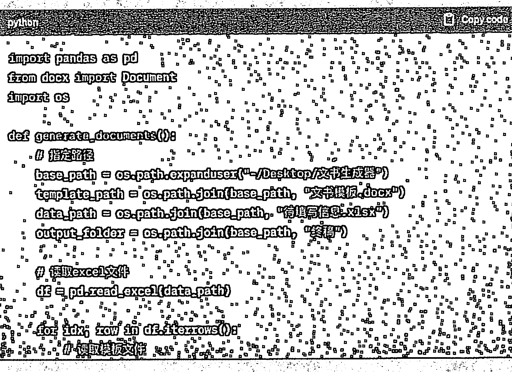

图6 - 2 利用 ChatGPT 自动生成代码

这已足够简单了。

不仅如此，ChatGPT 还能帮助优化代码、扩展功能、修正错误、逐行解释。若仍无法直观感受到能力扩充的乐趣，请跟上脚步，我们将用两章篇幅，和你一起用 AI 写代码，再用代码构建定制“法律小助手”。亲手操作后，你一定能体会到编程，甚至零基础编程的乐趣。

五、定制助手能为法务带来的价值
首先，让助手更懂法律。ChatGPT 生成能力强，但在我国法律实务中表现常有欠缺。可将法律法规导入数据库，让模型熟悉国内法规与案例，避免因数据不足而胡言乱语。

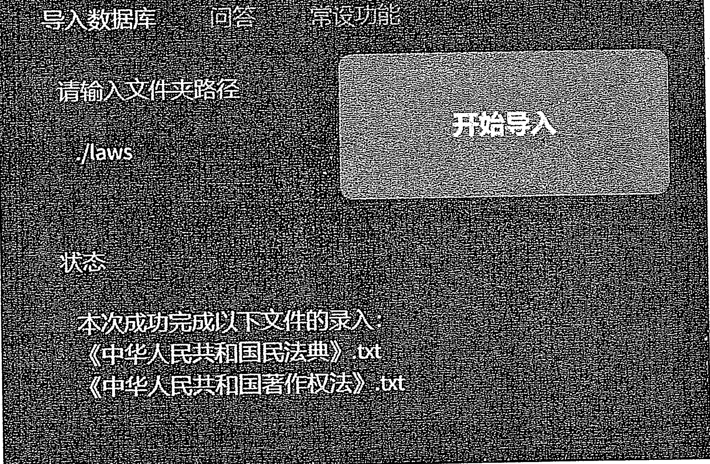

图6 - 3 在可供 ChatGPT 读取的法律数据库导入法律文本

其次，定制助手以满足个性化需求。可在定制时固定提示词，如设定身份、temperature 等，并赋予读取 PDF 或网页浏览能力，让助手更专业地扮演角色，完成交付任务。

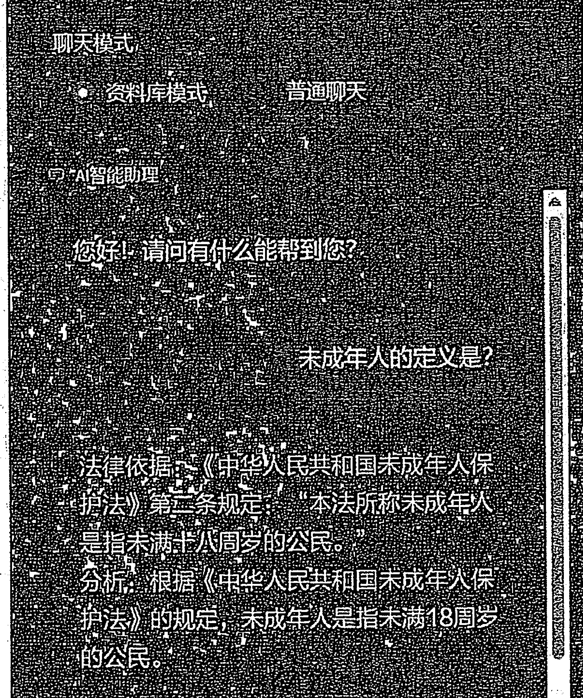

# 图6 - 4 自制ChatGPT工具功能示例——询问未成年人的定义

此外，还可将助手分享给同事。既能封装成本地程序如 exe 格式，也能做成网页应用供朋友使用，让大家通过浏览器即可获得专业法律助手的支持。

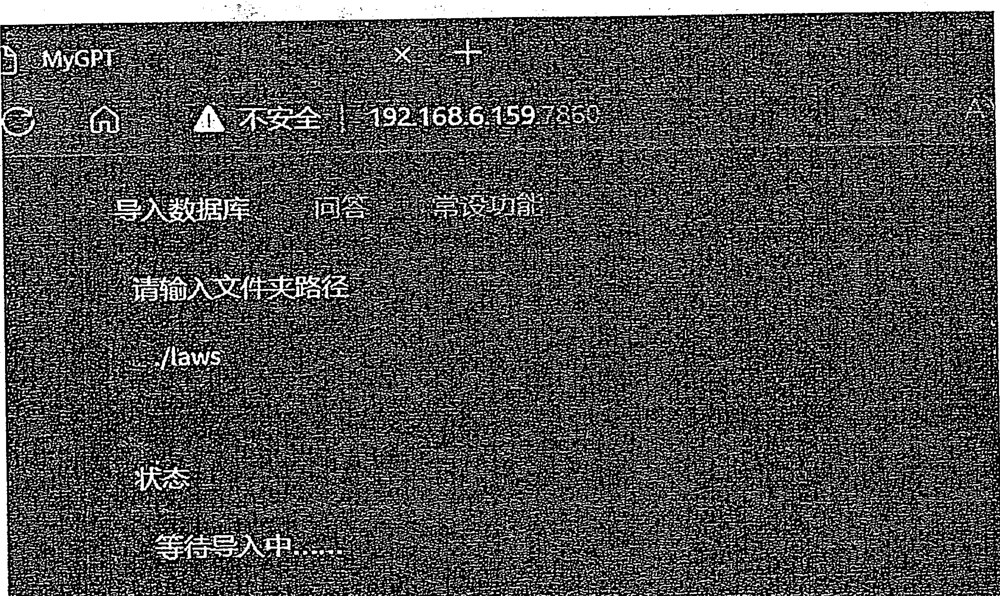

图6 - 5 同一网络的同事都可在浏览器访问自制的 ChatGPT 工具

最后，定制助手的過程，也是掌握编程这门“外语”的良机。写代码时会遇到困难，可向 ChatGPT 求助、查阅官方文档、在论坛检索资料。解决问题的过程即是提升实力的过程，也是探索求知的宝贵实践。

也许你已跃跃欲试想写几行代码。但请稍等，正式开始前还有些准备工作要做。

# ------------------ 第二节 打造 AI 小助理之前的准备工作 ------------------
俗话说“工欲善其事

前文提到，Python 是当下最流行的 AI 相关语言之一，易学且库丰富，功能强大。Python 在大数据处理、机器学习、人工智能等领域广泛应用，无论新手或资深开发者都能受益。而与 Python 搭配最方便的管理工具之一，便是 Anaconda。

# 一、准备一：用Anaconda搭建本地开发环境
Anaconda 是广泛使用的开源 Python 辅助软件，提供包管理器、环境管理器与代码编辑器等功能，帮助开发者更高效开发调试。在 Anaconda 中可方便安装管理各类 Python 包，避免手动下载安装之苦。此外，Anaconda 支持创建独立 Python 环境，使同一台电脑可运行多个 Python 版本与环境互不干扰。对开发者而言十分实用。

这些概念对初学者可能较难理解，可简单理解为：我们为每个案件建不同文件夹，每个案件材料可能相同或不同，Anaconda 就是管理这些文件夹的工具，避免 A 案用了 B 案材料。

第一步，在官网下载并安装 Anaconda：
1. 在浏览器地址栏输入 https://www.anaconda.com/ download 进入官方下载页。

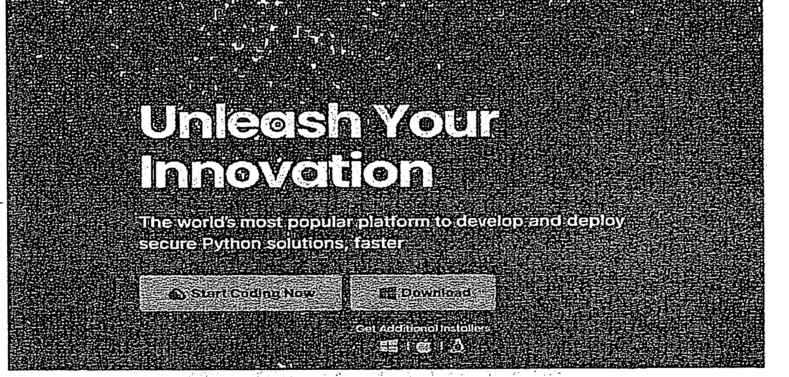

点击“下载（Download）”按钮下载安装包，保存到便于找到的位置。
2. 下载完成后点“打开”或双击安装包，连续点“下一步（Next）”即可安装。选择安装路径后会出现界面，建议全选以便使用。

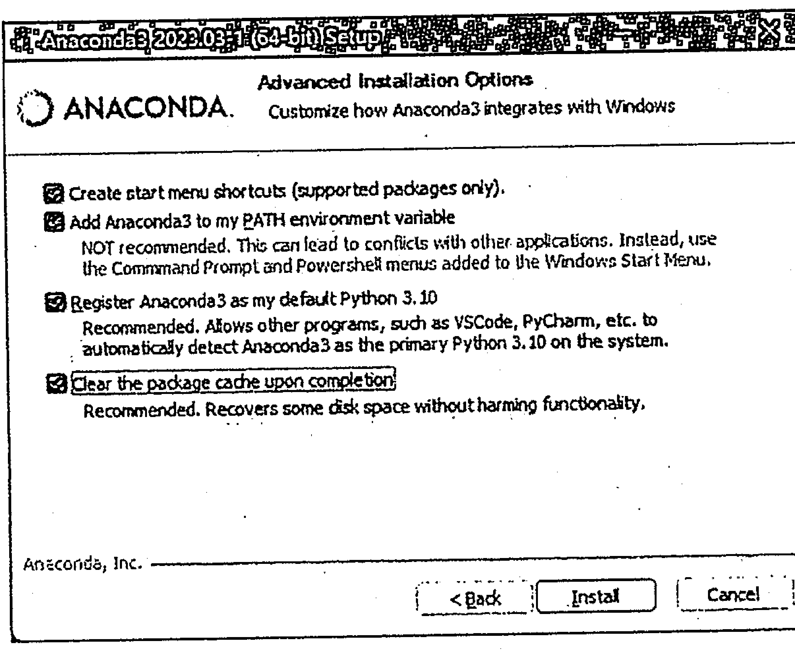

3. 安装完成后关闭窗口，在 Windows 开始菜单中找到 Anaconda3 文件夹。

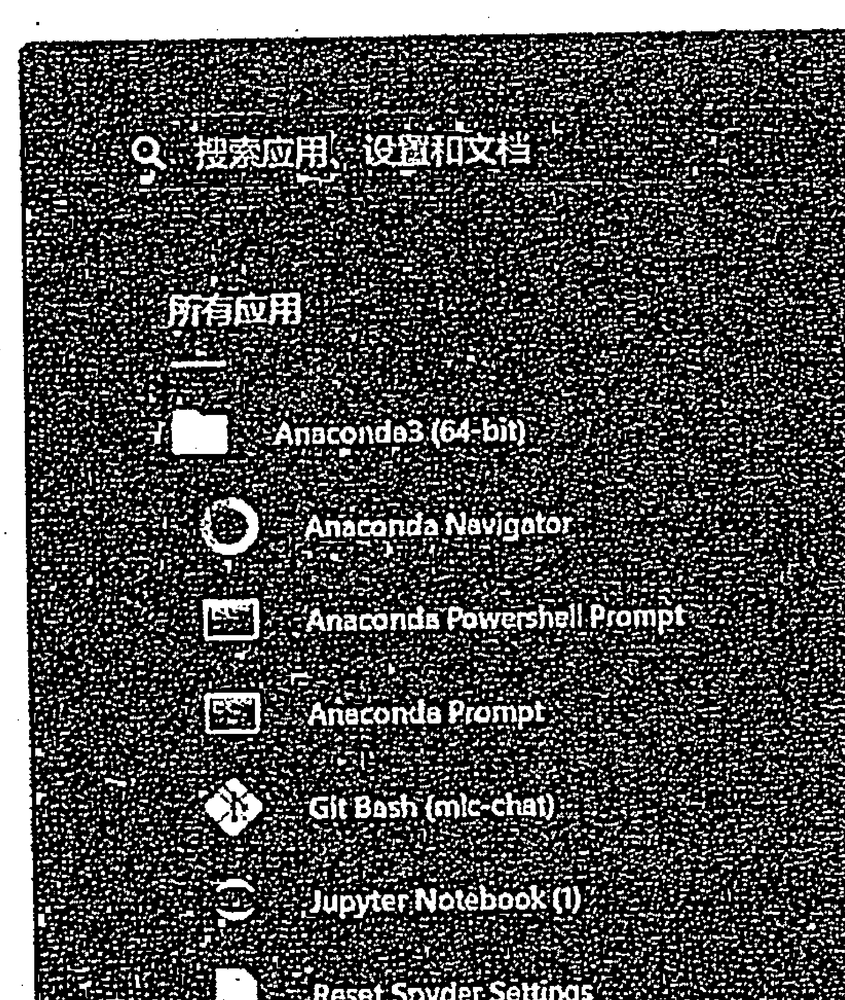

图 6 - 7 Anaconda3 安装界面

图 6 - 8 Windows11 系统“开始”菜单中的 Anaconda3 文件夹

4. 打开 Anaconda3 文件夹中的“Anaconda Navigator”，启动环境管理器。初始启动较慢，请耐心等待。成功后会看到如下界面：

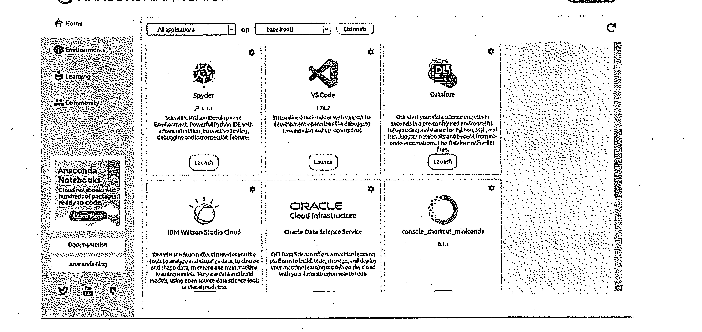

图 6 - 9 Anaconda3 软件主界面

5. 界面左侧有 4 个标签，主页（Home）展示 Anaconda3 支持的软件；环境（Environment）可查看当前“环境”情况。

Anaconda 中“环境”指拥有独立 Python 解释器和一组安装包的目录。同一环境内安装的包不影响其他环境，可在同一电脑运行多个不同 Python 版本与包集合，即前文所说的“文件夹”与不同“文书材料”。可通过 Anaconda Navigator 或 Conda 命令行创建、管理和删除环境，能提高效率并避免依赖冲突。

界面显示 Anaconda3 已配置两个通用环境，为更好打造 ChatGPT 助手，需要新建环境。

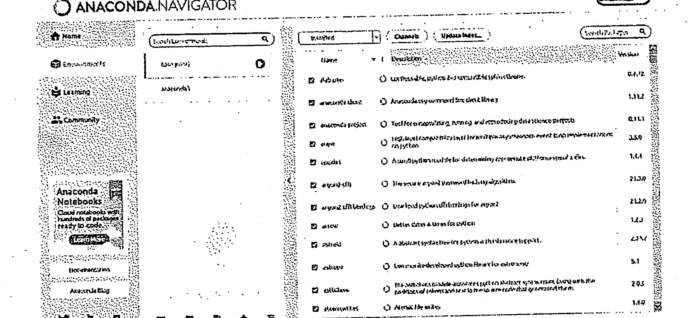

图 6 - 10 Anaconda3 环境页界面

第二步，点击几下按钮创建编程虚拟环境：
- 1. 在“环境”页左下方点“创建（Create）”按钮，在弹出的“创建新环境（Create new environment）”窗口中

# 236 │ 法律人 ChatGPT应用指南

支持多种操作系统，包括 Windows、MacOS 和 Linux。本流程将使用 VS Code 作为主要代码编辑器，完成编写与运行代码，它能更高效地编写 ChatGPT 助手代码。

再次点主页（HOME）标签，在右侧程序列表中找到 VS Code，点“启动（Launch）”按钮启动软件，若显示“安装（Install）”则先安装。

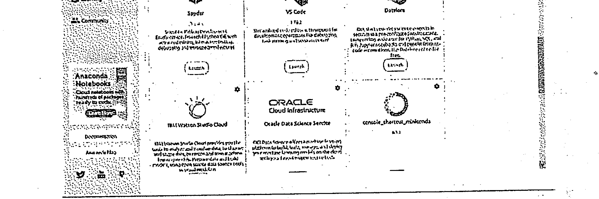

图6 - 14 VS Code 在 Anaconda3 主页中的位置示意

首次启动 VS Code 时会进行初始化，可能出现自动弹出又消失的黑色系统窗口，主界面可能为英文。等待初始化完成、黑色窗口不再弹出后，重启 VS Code 即可转为中文界面。

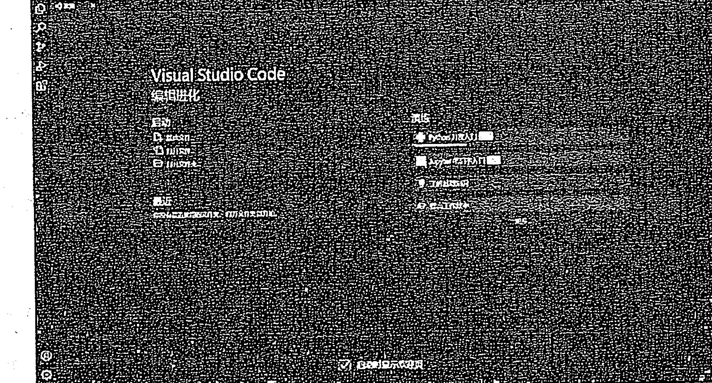

图6 - 15 VS Code 软件主界面

# 第六章 手把手教你打造 AI 法律助理(上) 237

至此，已用 Anaconda3 配置好本地编程环境，为后续编程做好第一项准备。

# 二、准备二：申请ChatGPT的API接口
让我们先来了解 API 是什么。

# ChatGPT API 实操：从接口调用到法律小助手搭建

API 是 Application Programming Interface 的缩写，本质上是一套让不同软件模块之间完成沟通的规范、规则与工具组合。它让开发者能够直接调用某个系统或应用已提供的能力，而不需要翻看底层源代码，也不必弄懂内部实现细节。借助这层封装，研发精力可以集中在产品差异化功能上，不必重复造轮子。

一个直观的例子是地图类产品。展示实时天气时，地图本身很少自建气象站，通常会接入天气预报服务或国家天文台对外开放的接口，把返回的数据清洗后叠加到地图画面上。地图厂商并不需要自己做预报或采集数据，通过调用第三方接口就能补齐能力。

简言之，API 让资源有限的团队能够借用顶尖技术方的能力，快速完成自己的任务。

2023 年 3 月 1 日，OpenAI 正式对外开放 ChatGPT 的调用接口。此后任何人都可以把 ChatGPT 融入自有产品、服务或工作流进行二次开发，无需从零训练同类模型，也不再局限于官网网页的体验方式。需要注意，官网的免费体验与接口调用是两套机制，后者按发送给模型的 prompt 与返回结果的 Token 数量计费。以目前最常用的 GPT-3.5-Turbo 为例，单价为每 1000 Token 收取 0.002 美元。

Token 并非等同于汉字或单词，而是可拆分的字符单元，不同语言的切分规则不同。OpenAI 提供了在线计算工具，实测“法律人”三个字里，“法”“律”各算 2 个 Token，“人”算 1 个 Token，说明并非简单按字符计数。粗略估算，1000 Token 大约对应 500 个中文汉字。

在代码层面调用 ChatGPT 的门槛很低。以 Python 为例，官方示例仅需数行即可完成一次提问。
```
import openai #导入openai的功能库
# 创建一个聊天对话，其中model参数指定使用的ChatGPT模型，messages参数指定对话中的消息列表.
openai.ChatCompletion.create(
    model="gpt-3.5-turbo", 
    messages=[{"role": "user", "content": "What is OpenAI?"}]
)
```


弄清上述背景后，下面进入获取调用权限的操作流程。

首要步骤，进入 OpenAI 的账户管理并准备专属密钥。

在浏览器访问 https://platform.openai.com/ 进入平台管理页，点击右上角“登入”完成登录，随后再次点开右上角的个人头像，从下拉菜单里选择“查看 API 密钥”。

# 第六章 手把手搭建 AI 法律助理（上）

+   - Personal
- Manage account
- View API keys
- Invite team
- Visit ChatGPT
- Visit DALL·E
- Help
- Pricing
- Terms & policies
- Log out

# 图 6-17 登录 OpenAI 官网后的个人信息栏

# API keys

Your secret API keys are listed below. Please note that we do not display your secret API keys again after you generate them.

Do not share your API key with others, or expose It in the browser or other client-side code. In order to protect the security of your account, OpenAI may also automatically rotate any API key that we've found has leaked publicly.

| NAME       | KEY         | CREATED      | LAST USED © |
|------------|-------------|--------------|--------------|
| Secret key | sk-...yDiR  | 2023年3月2日  | 2023年5月9日  |
| Secret key | sk-...V9p0  | 2023年3月30日 | 2023年3月30日 |

+ Create new secret key

# Default organization

If you belong to multiple organizations, this setting controls which organization is used by default when making requests with the API keys above.

Note: You can also specify which organization to use for each API request. See Authentication to learn more.

# 图 6-18 API 密钥页面

此页面可浏览已申请过的密钥，笔者已有两把，故显示两条记录。

在正式新建密钥前，有两点需先牢记：

+   1. 密钥与账号绑定且唯一，相当于账号密码的权限等级。所有基于该密钥产生的调用费用都会计入归属账号，由账号持有人结算。因此切勿外传，也不要写入浏览器或客户端代码中公开。
+   2. 密钥生成后仅展示一次，随后会被隐藏且无法再次显示。请在创建瞬间妥善备份，例如保存到本地文本文件，否则遗失就必须重新申请并在代码中替换。

其后，生成全新密钥。

点击“创建新密钥”按钮，在弹出的窗口为密钥起一个易记的名称，再点“创建密钥”即可完成。
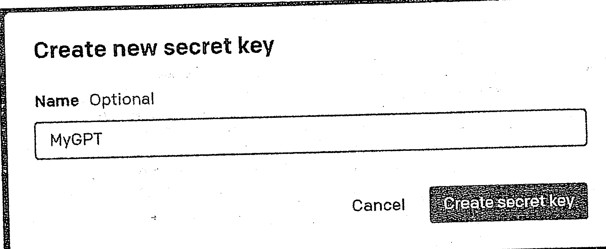
图6-19 新建密钥并命名为“MyGPT”

最后，保存密钥。

点击创建后会弹出以“sk-”开头、由大小写字母与数字混合组成的字符串，这就是刚申请到的密钥。它只出现这一次，请立即复制到安全位置保存。

鉴于保密要求极高，本书对密钥做了脱敏处理，看到打码请记得安全意识。
图6-20 仅展示一次的密钥
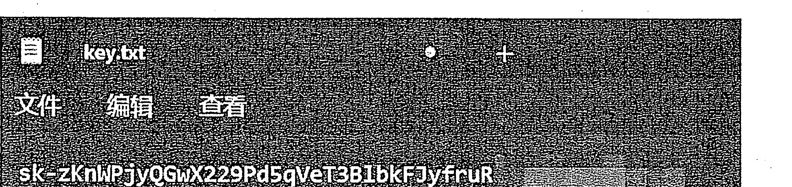
图6-21 在本地文档中记录并保存密钥
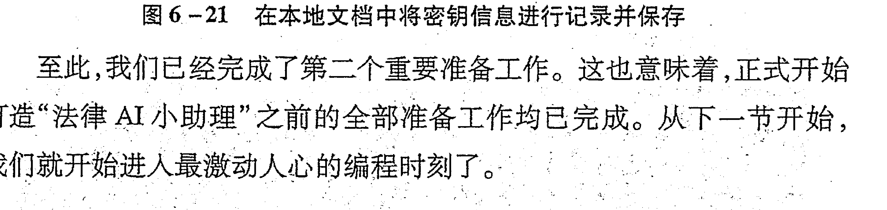

至此，第二项关键准备已完成。意味着打造“法律 AI 小助理”前的全部准备工作已就绪。下一节开始进入编程环节。

# 第三节 开始打造 AI 小助理

基础准备到位后，我们已具备制作小助手的条件。编程并非强项也无妨，前文已提到 ChatGPT 能辅助生成代码，可实现零基础起步。

# 一、用 ChatGPT 生成起始代码

在浏览器打开 https://chat.openai.com，向模型提出第一个问题：

问题：我已安装 Anaconda3 并申请到 OpenAI API Key，请问如何用 Python 调用 ChatGPT 的接口？

我已安装 Anaconda3 并申请到 OpenAI API Key，请问如何用 Python 调用 ChatGPT 的 API？

使用 Python 调用 OpenAI 接口，通常遵循以下流程：

+   1. 安装‘openai’ Python 包:

2. 在 Python 文件中导入‘openai’和‘os’模块，并设置 OpenAI API 密钥与模型 ID：
```
pip install openai
import openai
import os
openai.api_key = "YOUR_API_KEY"
model_engine = "davinci" # 或者其它你申请到的模型ID
```

# 第六章 手把手打造 AI 法律助理（上） || 243

# 3. 调用接口并获取回复：
```
def ask_question(prompt, model_engine):
    completions = openai.Completion.create(
        engine=model_engine,
        prompt=prompt,
        max_tokens=1024,
        n=1,
        stop=None,
        temperature=0.7
    )
    message = completions.choices[0].text
    return message.strip()
```
在这里， `prompt` 是要发送给 ChatGPT 模型的问题或输入。`model_engine` 是希望使用的模型引擎，例如"curle","davinci","davinc - codex"等。

# 4. 调用函数并获得回答：
```
prompt = "你好，我可以问你一些问题吗？"
response = ask_question(prompt, model_engine)
print(response)
```

# 图6-22 向 ChatGPT 询问如何编写调用接口的代码

ChatGPT 给出了四步：安装 openai 包；在文件中导入模块并配置密钥与模型 ID；发起调用获取回复；调用函数获得答案。

下面按此顺序操作：

# ChatGPT 给出的首要步骤：安装 ‘openai’ Python 包

1. 安装‘openai’ Python包:
```
pip install openai
```


先打开已安装的 Anaconda3，在环境标签页找到已激活的环境，点击右侧绿色按钮选择“启动终端”。
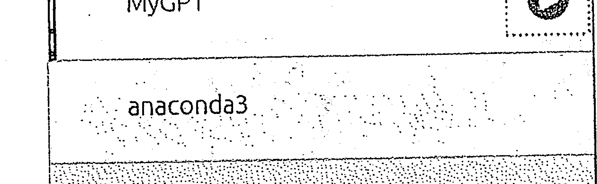

启动后会出现黑色窗口，左侧括号显示当前环境名称，右侧为本地用户路径。


把 ChatGPT 提供的指令“pip install openai”粘贴进终端后回车，窗口会滚动输出安装日志。
需要粘贴的代码：
```
pip install openai
```


# 图 6-26 环境中安装 openai 库

日志停止滚动并重新出现路径提示，即代表库安装成功。

# ChatGPT 给出的后续步骤：导入模块、配置密钥与模型 ID

1. 返回 Anaconda3 的 HOME 页面，启动 VS Code，未启动则切换到界面。


# 图6-27 在 VS Code 中新建 Python 文件

2. 在 VS Code 主界面点“启动”下方的“新建文件…”，在弹出框选择“Python”，即可新建一个名为“未命名 - 1”的文件。


# 图6-28 VS Code 中名为“Untitled - 1”的 Python 文件

# 第六章 手把手打造 AI 法律助理（上） || 247

3. 将 ChatGPT 第二步的代码复制到文件里。

2. 在Python文件中导入`openai`和`os`模块，并设置您的OpenAI API密钥和模型ID:
```
import openai
import os
openai.api_key = "YOUR_API_KEY"
model_engine = "davinci" # 或者其它你申请到的模型ID
```

注意，ChatGPT 的训练语料早于 API 发布，示例里模型 ID 仍为旧的“davinci”。按官方文档应改为“gpt-3.5-turbo”，并把 openai.api_key = " YOUR_API_KEY" 中的占位符替换成刚获取的密钥。

修改完成的大致样式如下，密钥已做打码，请自行妥善保管。
```
import openai
import os
openai.api_key = "sk-zKnWPjyQGwX229Pd5qVeT3B1bkFJyfruRFPsr"
model_engine = "gpt-3.5-turbo" # 或者其它你申请到的模型ID
```

## 第六章 手把手打造 AI 法律助理（上）

### 3. 调用接口并获取回复：
```python
def ask_question(prompt, model_engine):
    completions = openai.Completion.create(
        engine=model_engine,
        prompt=prompt,
        max_tokens=1024,
        n=1,
        stop=None,
        temperature=0.7,
    )
    message = completions.choices[0].text
    return message.strip()
```
在这里, `prompt`是你想要发送给ChatGPT模型的问题或输入。`model_engine`是你想要使用的模型引擎, 比如"curle","davinci","davinci-codex"等。

# 图6-31 步骤三

下面简要说明代码含义。若阅读困难可先跳过，继续按后续步骤完成小项目。

+   1. Python 中 def 是定义函数的关键字，用来创建可复用的功能块。
+   2. ask_question 是自定义函数，prompt 与 model_engine 为传入参数。
+   3. 逐行看 ChatGPT 给出的代码，# 开头的为注释，不会被执行。

```python
defask_question(prompt, model_engine): 
    # 调用OpenAI API,获取ChatGPT的回答 
    completions = openai.Completion.create(
        engine = model_engine, # ChatGPT模型引擎ID 
        prompt = prompt, # 用户的问题描述
        max_tokens = 1024, # 一次回答最大生成的字符数量.
        n = 1, # 返回结果数量
        stop = None, # 结束生成条件
        temperature = 0.7, # 生成多样性控制参数,0.1 最严谨,1 最具有创造性
    )
    message = completions.choices[0].text # 获取 Chat GPT 回答中的文本部分
    returnmessage.strip() # 去除多余空格并返回结果
```

### [PAGE 261]

### 第六章 实战搭建 AI 法律助理（上）|| 249

4. 概括来讲，这里实现的是一个名为 ask_question 的 Python 方法，接收 prompt 与 model_engine 两个入参，通过 OpenAI 接口驱动 ChatGPT 作答。内部调用的是 openai 库提供的 openai.Completion.create()，能够配置单次最大生成长度、返回条数、终止条件与温度等多样性参数。把待问内容传入后，程序会把所需信息打包发送，收到模型回传后再提取文本并清理空白，即可得到最终结果。

5. Python 按行解析，行首缩进决定层级结构。同一逻辑层必须保持缩进一致，否则解释器会抛出 IndentationError。作为示例，ask_question 的定义行顶格书写，而函数内部的 completions 变量则需要往里缩进。一般一次缩进等于一个 Tab 或四个空格，表示进入下一层；若函数内部再嵌套调用，则继续递增缩进。

6. 除字符串字面量外，Python 只接受英文标点。代码中出现的单引号、双引号、圆括号等符号都必须使用英文字符，否则会解析失败。

### [PAGE 262]

2. 重新对照上文提到的 OpenAI 官方示例，再审视 ChatGPT 给出的实现，就能发现偏差。因为模型训练数据采集时间早于 API 发布，输出的代码已经过时。

在 OpenAI 官方教程① 中可以找到规范写法。比对后可知，调用对话模型应使用库里的 openai.ChatCompletion.create()③，指定模型的参数名应为 model 而非 engine，传递问题的参数名应为 messages 而非 prompt。原先的 message = completions.choices[0].text 也不正确，标准形式是 message = completions.choices[0].message.content。

```python
1 # Note: you need to be using OpenAI Python v0.27.0 for the code below to work
2 import openai
3 openai.ChatCompletion.create(
4   model='gpt-3.5-turbo',
5   messages=[
6     {'role': 'system', 'content': 'You are a helpful assistant.'},
7     {'role': 'user', 'content': 'Who won the world series in 2020?'},
8     {'role': 'assistant', 'content': 'The Los Angeles Dodgers won the World Series'}
9     {'role': 'user', 'content': 'Where was it played?'}
10   ]
11 )
```

### 图 6 - 32 Open OpenAI 提供的官方示例代码

> ① OpenAI API 的官方教程网址为: https://platform.openai.com/docs/introduction。

> ② OpenAI 库是 OpenAI 推出的,集合了 OpenAI 全部开放功能的 Python 库,每个功能都可通过调用模块的形式供其他程序员使用。

> ③ 目前在 OpenAI 库中规定调用 ChatGPT API 的模块。

### [PAGE 263]

# 第六章 实战搭建 AI 法律助手（上）|| 251

# Response format

An example API response looks as follows:

```json
{
  "id": "chatcmpl-6p9XYVYSTRI0xEviKjjlqrMU2Ve',
  "object": "chat.completion',
  "created": 1677649420,
  "model": "gpt-3.5-turbo",
  "usage": {"prompt_tokens": 56,"completion_tokens": 31,"total_tokens": 87},
  "choices": [
    {
      "message": {
        "role": "assistant",
        "content": "The 2020 World Series was played in Arlington, Texas at the Globe Li
        'finish_reason': 'stop',
        'index': 0
      }
    }
  ]
}
```

### 图 6 - 33 OpenAI 官方教程文档中关于 API 响应后返回内容和格式的说明

依据官方文档，我们对 ask_question 重新调整实现：

```python
def ask_question(prompt, model_engine):
  # 调用OpenAI API，获取ChatGPT的回答
    completions = openai.ChatCompletion.create(
        model=model_engine, # ChatGPT模型引擎ID
        messages=[{"role":"user","content":prompt}], # 问题描述
        max_tokens=1024, # 最大生成字符数量
        n=1, # 返回结果数量
        stop=None, # 结束生成条件
        temperature=0.7, # 生成多样性控制参数,0.1最严谨, 1最具创造性
    )
    message = completions.choices[0].message.content # 获取ChatGPT回答中的文本部分
    return message.strip() # 去除多余空格并返回结果
```

### 图 6 - 34 修改后的 ask_question 函数代码

# ChatGPT给出的步骤四:调用函数并获得回答：

+   1. 把最后这部分步骤四的代码同样拷贝到 VS Code 中。

### [PAGE 264]

4. 调用函数并获得回答：

```python
prompt = "你好, 我可以问你一些问题吗?"
response = ask_question(prompt, model_engine)
print(response)
```

这将向ChatGPT模型发送"你好,我可以问你一些问题吗? "这个问题,并返回一个回答。

### 图 6 - 35 步骤四

该片段定义了待提问内容 prompt，其中 prompt 在程序里即为变量①，Python 采用等号 = 进行赋值。prompt = 

同理，response 变量保存的是上方 ask_question 方法被调用后的返回值，括号内的 prompt 与 model_engine 表示把这两个变量的值作为实参传入。

print() 是 Python 的基础打印功能，用于把内容输出到终端，此处输出的是 response 的值。

2. 若部分网络环境无法连通 OpenAI 服务器，可在代码中增加异常处理；网络正常时可省略：

视情况决定是否增加的代码：

```python
os.environ[ " http_proxy" ] = 
os.environ[ " https_proxy" ] = 
```

现在代码看起来应该是这样的：

> ① 在编程中,变量是用于存储数据值或引用信息的一个名字。它们就像标签,帮助我们跟踪和操作数据。

### [PAGE 265]

# 第六章 实战搭建 AI 法律助理( 上 ) || 253

```
import openai
import os
#如需设置网络代理，请删除前方的#号并设置具体的代理信息，如果没有网络问题可以不用修改：
os.environ['http_proxy'] = 'http://127.0.0.1:端口'
os.environ['https_proxy'] = 'https://127.0.0.1:端口'
openai.api_key = 'sk-zKnWPjyQGxk229Pd5qVeT3616kFjyfruREP'; # 设置用领到的OpenAI API Key
model_engine = "gpt-3.5-turbo"; # 或者其它你申请到的模型ID

def ask_question(prompt, model_engine):
    # 调用OpenAI API，获取ChatGPT的回答
    completions = openai.Completion.create(
        engine=model_engine, # ChatGPT模型引号ID
        prompt=prompt, # 问题描述
        max_tokens=1024, # 最大生成字符数量
        n=1, # 返回结果数量
        stop=None, # 结束生成条件
        temperature=0.7, # 生成多样性控制参数，0.1最严谨，1.0最具创造性
    );
    message = completions.choices[0].text # 获取ChatGPT回答中的文本部分
    return message.strip() # 去除多余空格并返回结果
prompt = "你好，我可以问你一些问题吗？"
response = ask_question(prompt, model_engine)
print(response)
```

### 图 6 - 36 ask_question 函数代码示例

3. 在 VS Code 中执行代码。

点击编辑器右上角的运行按钮或按下 F5 即可启动。


### 图 6 - 37 位于 VS Code 软件界面右上方的运行按钮

首次运行会弹出保存提示，建议新建独立文件夹并将文件名改为 main.py，如下：


### 图 6 - 38 选择Python文件保存位置,并修改文件名

保存完成后 VS Code 会自动继续，界面下方的终端将显示 ChatGPT 的回复：

```
PS D:\python\MyGPT> d; cd "d:\python\MyGPT"; & "d:\anaconda3\envs\MyGPT\python.exe" thon\debugpy\adapter/ /, /.\debugpy\launcher '51119' -- D:\python\MyGPT\main.py 当然,您可以问我任何问题。
```

### 图 6 - 39 成功调用ChatGPT API并返回了回答

终端输出：“当然,您可以问我任何问题。” 说明 API 调用第一次就成功了。

到此，我们借助 API 自行生成了一个“小助手”。但它本质上仍沿用 ChatGPT 的能力，固有缺陷同样存在，对中国法律这一垂直领域理解有限，相关改进将在第七章展开。

### [PAGE 267]

# 第六章 实战搭建 AI 法律助理(上) || 255

在此之前，为让小助手更符合工作场景，需要先帮助它适应办公环境。

# 第四节 让 AI 小助手融入办公场景

上一节已经实现了一个最基础的可对话程序，但实用性不足：

+   1. 问题被写死在源码里，每次更换提问都需要手动改动代码，操作繁琐；
2. 每次启动只能处理一个问题；
3. 依赖 Anaconda3 与 Python，未安装环境的机器无法使用。

在补充更多法条前，可先按下面步骤改造代码，使其能够脱离 Anaconda3 与 Python 独立运行。

### 步骤一:为 AI 小助手添加交互窗口

当前代码片段为：

```python
```

### 图6 - 40 未改造前的代码内容

### [PAGE 268]

目前第 25 行的提示词“你好，我可以问你一些问题吗”被硬编码。想问别的问题就必须修改源码，十分不便。

Python 提供 input() 用于收集用户输入。执行到该行时程序会暂停，等待用户输入并回车后继续。

修改很直接，将 prompt = “你好，我可以问你一些问题吗?” 改为 prompt = input()，即可在运行时输入问题。为了给出提示，可写成 prompt = input(“问题：”)，提示文字用英文引号包裹。

```python
prompt = input(“问题：
”）
response = ask_question(prompt, model_engine)
print(response)
```

### 图6- 41 创建一个可供用户输入文本的功能

修改后再次运行，效果如下：

用 input() 去接用户输入，就能把程序从“写死提问”变成“现场提问”。执行到这行时脚本会停下来等你打字，按下回车后输入内容才会传给程序，程序接着继续跑，完成预设的任务。

改动很简单。原本写死的提示语 prompt = “你好，我可以问你一些问题吗?” 改成 prompt = input() 就能让程序接收你想问 ChatGPT 的内容。为了让操作更直观，还可以在 input() 里面带上引导文字，例如 prompt = input(“问题：”)。

prompt = input(“问题：\n”）
response = ask_question(prompt, model_engine)
print(response)

图6-41 实现终端交互输入

改完后再次运行，界面就变成这样：

图6-42 终端中直接提问演示

从此直接在终端里提问，就能立刻拿到 ChatGPT 的回复。

步骤二：让助手支持连续对话

在 ChatGPT 官网，我们可以一直追问下去。但现在写的脚本一次只能问一个问题。为了达到同样的连贯体验，我把需求丢给 ChatGPT，请它给出让程序持续运行的办法。

问：怎么让 Python 程序一直跑，不断收问题并输出答案？

实现持续收问和回应的做法是加一个循环，比如 while 循环。示例代码如下：

```
# 图6 - 43 向 ChatGPT 询问如何让程序一直运行
# 主循环
while True:
    # 获取用户输入的问题
    prompt = input("请输入您的问题 (或输入'退出'结束). ")
    
    # 检查是否要退出程序
    if prompt.lower() == "退出":
        break
    
    # 调用函数获取回答
    response = ask_question(prompt, model_engine)
    
    # 输出回答
    print("回答: " + response)
```

循环里程序会一直等待输入，把问题交给 ask_question 函数拿到回答再打印出来。记得把 YOUR_API_KEY 换成你自己的 OpenAI 密钥。这样只要你不断输入问题，程序就会一直在线作答，直到你输入 “退出”。

图6-44 对循环方案的 ChatGPT 回复

把这段新增代码贴进 VS Code，马上就能验证效果。

```
13 def ask_question(prompt, model_engine):
14 # 调用 OpenAI API，获取 ChatGPT 的回答
15 completions = openai.ChatCompletion.create(
16 model=model_engine, # ChatGPT 模型引擎 ID
17 messages=[{'role':'user','content':prompt}], # 问题描述
18 max_tokens=1024, # 最大生成字符数
19 n=1, # 返回结果数量
20 stop=None, # 结束生成条件
21 temperature=0.7, # 生成多样性控制参数，0.1 最严谨，1 最具有创造性
22 )
23 
24 message = completions.choices[0].message.content # 获取 ChatGPT 回答中的文本部分
25 return message.strip() # 去除多余空格并返回结果
27 if __name__ == '__main__':
28 # 主循环
29 while True:
30 # 获取用户输入的问题
31 prompt = input('请输入您的问题(或输入“退出”结束): ')
32 # 检查是否要退出程序
33 if prompt.lower() == '退出':
34 break
35 # 调用函数获取回答
36 response = ask_question(prompt, model_engine)
37 # 输出回答
38 print('回答: ', response)
```

图6-45 添加循环代码后的示例

```
PS D:\python\MyGPT> d; cd d:\python\MyGPT; & d:\anaconda3\envs\MyGPT\python.exe "c:\thon\debugpy\adapters\//\debugpy\launcher" --debugger 61726 D:\python\MyGPT\main.py
请输入您的问题 (或输入“退出”结束)：你是谁？
回答：我是一名 AI 语言模型，被称为 OpenAI 的 GPT-3。我可以回答一些问题，提供一些建议和帮助。
请输入您的问题 (或输入“退出”结束)：退出
PS D:\python\MyGPT>"
```

图6-46 循环接收问题的运行效果

ChatGPT 在基础编程上的指导很到位。加上它给出的循环后，AI 小助理已经可以进行不间断的对话了。

步骤三：加入历史记录以支持追问

要让小助理记住上下文、支持多次追问，需要改造 “if __name__ == “__main__”” 里的执行逻辑：

+ ① 把主流程放在 if __name__ == “__main__” 下，有利于复用和扩展。

[PAGE 270]

# 第六章 手把手教你打造 AI 法律助理(上) || 257

```
def ask_question(history, model_engine):
    # 调用 OpenAI API，获取 ChatGPT 的回答
    completions = openai.ChatCompletion.create(
        model=model_engine, # ChatGPT 模型引擎 ID
        messages=history, # 传入 history
        max_tokens=1024, # 最大生成字符数量
        n=1, # 返回结果数量
        stop=None, # 结束生成条件
        temperature=0.7, # 生成多样性控制参数，0.1 最严谨， 1 最具有创造性
    )
    message = completions.choices[0].message.content # 获取 chatGPT 回答中的文本部分
    return message.strip() # 去除多余空格并返回结果
if __name__ == '__main__':
    # 创建一个名为 history 的列表
    history = []
    n = 0
    print('请输入您的问题（或输入“退出”结束）：')
    # 主循环
    while True:
        # 获取用户输入的问题
        prompt = input('问题：')
        # 把用户的问题作为 user 内容添加到 history 中
        history.append({'role': 'user', 'content': prompt})
        # 检查是否要退出程序
        if prompt.lower() == '退出':
            break
        # 调用函数获取回答
        response = ask_question(history, model_engine)
        # 把 ChatGPT 的回答作为 assistant 内容添加到 history 中
        history.append({'role': 'assistant', 'content': response})
        # 输出回答
        print('回答：', response)
```

图6-47 调整代码以保留对话上下文

原理简单讲一下，不感兴趣可以跳过，直接抄代码就行。核心是按 ChatGPT API 的格式建一个列表 history，把用户的每次提问和模型的每次回答依次追加进去，形成带历史的对话记录，再把这个 history 传给函数里的 messages 参数。模型就能读取过往问答，基于前后文作答。

[PAGE 271]

运行效果展示


图6-48 多次追问功能验证

小助理成功关联上下文，把“书山有路勤为径，学海无涯苦作舟”先后译成英文和日语，任务完成得很漂亮。

步骤四：打包成 Windows 程序共享

到目前为止对话还只能在 VS Code 里进行。经过几步封装，可以把 Python 脚本打包成 Windows 可执行程序，让同事也能用。

怎么把 Python 代码打包成 Windows 程序？

常用做法是用 PyInstaller 把脚本转成 exe。步骤如下：

+ 1. 安装 PyInstaller：

在 VS Code 终端执行 `pip install pyinstaller` 安装打包依赖。

```
PS D:\python\MyGPT> pip install pyinstaller
Looking in indexes: https://mirrors.aliyun.com/pypi/simple/
collecting pyinstaller
Downloading https://mirrors.aliyun.com/pypi/packages/96/9d/05268e5a11257f2236bd...
MB)
Collecting pefile>=2022.5.30
Downloading https://mirrors.aliyun.com/pypi/packages/55/26/d0ad8b448476d0a1e8d3ea...
B)
```


第二步：执行打包封装

在终端输入 `pyinstaller --onefile main.py` 即可开始打包。

```
PS D:\python\MyGPT> pyinstaller --onefile main.py
945 INFO: PyInstaller: 5.11.0
945 INFO: Python: 3.10.11 (conda)
1016 INFO: Platform: Windows-10-10.0.22621-SP0
1020 INFO: wrote D:\python\MyGPT\main.spec
1027 INFO: UPX is not available.
1030 INFO: Extending PYTHONPATH with paths ['D:\python\MyGPT']
1720 INFO: checking Analysis
1721 INFO: Building Analysis because Analysis-00.toc is non existent
1721 INFO: Initializing module dependency graph...
1726 INFO: Caching module graph hooks...
1756 INFO: Analyzing base_library.zip ...
4706 INFO: Loading module hook 'hook-heapq.py' from 'D:\anaconda3\en
4846 INFO: Loading module hook 'hook-encodings.py' from 'D:\anac...
```


终端出现 “completed successfully” 就表示打包成功。

[PAGE 274]

# 262 | 法律人 ChatGPT 应用指南

打开代码目录下的 `dist` 文件夹，找到名为 main 的程序包，双击即可启动。


图6-52 Windows 下运行打包后的主程序

把封装好的程序包发给同事，对方打开就能直接和 AI 小助理聊天。

从下一章起，我们将用一系列“法律特训”继续升级小助理的外脑，让它更懂中国法律，更好地服务法律人。

① 文件夹在代码同目录，例如代码在 X:/MyGPT 时，dist 在 X:/MyGPT/dist/。
② 后缀为 exe。

[PAGE 275]

# 第七章 手把手教你打造 AI 法律助理(下)

# 第一节 LangChain: 给 AI 小助理加装“外脑”

一、LangChain 是什么，有什么用？

上一章我们已经用 ChatGPT API 做出了一个简易智能助手。只调用基础能力已经够用，但如果想让它回答中国法律问题时能参照国内法规，就需要升级。

可以把 ChatGPT 原有的训练数据比作“大脑”，那么用 LangChain 库给它装上“外脑”，就是一个很合适的方案。LangChain 官方的说法是：大语言模型正在成为变革性技术，但单独使用往往不够强，真正强大的是把它们和其他计算或知识源结合起来。 https://github.com/hw-chase17/langchain

通俗讲，LangChain 主要提供连接各种外部资源的能力，比如读取本地文件、抓取网络信息、整合多源信息后做归纳总结等。

[PAGE 276]

# 264 || 法律人 ChatGPT 应用指南


图7-1 传统提问与 LangChain 提问流程对比

# 让法律 AI 摆脱幻觉：从外挂知识库开始

在没有 LangChain 加持时，所有的问答都只能依赖 ChatGPT 自身的训练语料，难免出现信息滞后、事实偏差、内容缺漏的问题。接入向量数据库之后，处理链路就变了：提问先被 LangChain 接手，去向量库里寻找最相关的参考资料，再把原始问题和检索到的材料一起交给 ChatGPT，由模型基于资料进行回应，最终结果更符合我们的使用意图。

在 AI 小助理的升级路线里，我们要利用 LangChain 的数据库连接能力，搭建专属的法条库和案例库，让助手在作答时既能调用我们提供的权威素材，又能借助 ChatGPT 的生成能力，从而杜绝胡乱生成法律意见的情况。

# 二、LangChain 安装与接入

1. 通过命令行完成 LangChain 安装。

操作方式与第六章第三节安装 openai 库类似，可在 VS Code 的命令行窗口，或在 Anaconda3 环境的终端里执行 `pip install langchain` 完成部署。

> ① 向量数据库是为保存和检索高维向量而设计的系统。相较于传统关系型数据库，它能高效处理海量向量，并支持相似度计算、聚类等操作，广泛用于自然语言处理、图像识别、推荐系统等场景。

[PAGE 277]

# 第七章 手把手教你打造 AI 法律助理(下) || 265

```
(MyGPT) C:\Users\Boyang Li>pip install langchain
Looking in indexes: https://mirrors.aliyun.com/pypi/simple/
Collecting langchain
  Downloading https://mirrors.aliyun.com/pypi/packages/dc/6e/6a982c6712/langchain-0.0.178-py3-none-any.whl (892 kB)
892.2/892.2 kB 1.0 MB/s
Collecting numexpr<3.0.0,>=2.8.4
  Downloading https://mirrors.aliyun.com/pypi/packages/d2/f8/3442d0b8df/numexpr-2.8.4-cp310-cp310-win_amd64.whl (92 kB)
92.7/92.7 kB 887.1 KB/s
Collecting numpy<2,>=1
  Downloading https://mirrors.aliyun.com/pypi/packages/65/5d/46da284b05/numpy-1.24.3-cp310-cp310-win_amd64.whl (14.8 MB)
4.9/14.8 MB 883.2 KB/s...
```

# 图7 - 2 在终端里安装 LangChain 库

2. 新建 `.py` 文件用于编写 LangChain 逻辑。

打开 VS Code 左侧的资源管理器，点击上方的打开文件夹按钮。


# 图7 - 3 “资源管理器” 标签位于 VS Code 界面左上方

在弹出的选择窗口中指定之前项目所在的目录，资源管理器里即可看到 main.py 等已有文件。

在 `main.py` 上右键改名为 MyGPT.py，随后在资源管理器空白处右键新建文件，命名为 MyGPT_langchain.py。目录结构应如下。


# 图7-4 MyGPT 文件夹中包含的文件示例

双击 MyGPT_langchain.py 即可开始编写相关代码。

3. 基于官方示例搭建基础功能。

LangChain 发布于 2022 年之后，未联网的 ChatGPT 无法获知其信息，因此难以借助它辅助编程。我们将以官方文档①( https://python.langchain.com/en/latest/ ) 为参考开展升级。

LangChain 主要提供两种运行形态，基础的链 Chain②和进阶的代理 Agents③，本项目采用链来实现。

在正式编码前，先梳理思路：期望系统在收到用户提问时，先从库中读取参考信息，再结合资料生成回复。

查阅官方文档后，问答示例①与需求高度契合，可直接把示例代码复制到 MyGPT_langchain.py 中。

```
MyGPT_langchain.py ● openai.py
MyGPT_langchain.py
1   from langchain.embeddings.openai import OpenAIEmbeddings
2   from langchain.text_splitter import CharacterTextSplitter
3   from langchain.vectorstores import Chroma
4   from langchain.docstore.document import Document
5   from langchain.prompts import PromptTemplate
6   from langchain.chains.question_answering import Load_qa_chain
7   from langchain.llms import OpenAIChat
```

图7 - 5 在 MyGPT_langchain.py 中导入所需的 LangChain 库功能函数

各模块说明：

*   OpenAIEmbeddings : 调用 OpenAI 的向量嵌入能力。
*   CharacterTextSplitter : 按字符对长文本做切分。
*   Chroma : 提供 Chroma 向量数据库的使用接口。
*   Document : 操作 LangChain 规范的 Document 片段。
*   PromptTemplate : 自定义提示词模板。
*   load_qa_chain : 使用 LangChain 的问答链。
*   OpenAIChat : 调用 ChatGPT API。

4. 补齐环境缺失的 Python 组件。

示例中使用了 Chroma 向量数据库②，因此还需安装 Chromadb。可在 VS Code 或 Anaconda3 的终端执行 `pip install chromadb` 完成安装，流程与此前一致。

若安装时出现报错，说明本地缺少相关组件，可通过微软提供的 Microsoft C++ 生成工具补充（下载地址: https://visualstudio.microsoft.com/zh-hans/visual-cpp-build-tools/）。


图7 - 6 通过点击“下载生成工具”按钮即可下载

安装后在 Visual Studio Installer 窗口切换至可用标签，选择 Visual Studio 生成工具 2022。进入单个组件页，在搜索框输入 MSVC 生成工具，按芯片选择对应版本，Windows 主流机型多选 X64/X86 生成工具(最新)。


图 7 - 7 搜索 MSVC 生成工具并在结果中选择“X64/X86 生成工具( 最新)”

Windows 用户还需搜索 Windows SDK，按系统版本选择 Windows10 或 Windows 11 SDK。


图 7 - 8 搜索 Windows SDK 并根据系统选择匹配的 SDK 工具

选完后点击右下角下载时安装，部署完成后回到 VS Code 或 Anaconda3 终端重新执行 `pip install chromadb` 即可。

# 第二节 为外脑注入中国法条

上一节已完成 LangChain 与向量数据库的部署并复制了基础调用代码。接下来要搜集法条并以嵌入形式写入向量库。

先简要说明嵌入 Embedding。

在人工智能领域，嵌入是指把高维对象映射到低维空间的技术，常用于 NLP 和 CV。通过嵌入，复杂对象被转为可计算形式，并利用向量语义完成分类、聚类、检索等任务。传统文本多以离散符号表示，难以直接用于机器学习。Embedding 将每个词映射到低维连续向量空间，使文本可被模型处理。

形象比喻，嵌入像一张二向箔，能把一段文字压缩成独特的向量数字，语义相近的文字压缩后数字也相近，于是可通过向量相似度判断文本是否相近。

下面将中国法条经嵌入方式压入向量数据库。

# 步骤一：法条数据准备

登录国家法律法规数据库( https://flk.npc.gov.cn/ )，在检索栏分别输入民法典与著作权法①，选择并打开现行有效版本，在页面点击下载保存到项目目录。

> ① 具体文本可按需选取，这里仅以两部法律为例。

[PAGE 283]

# 第七章 手把手教你打造 AI 法律助理(下)

# 国家法律法规数据库


# 图 7 - 9 在国家法律法规数据库中搜索《民法典》

为保持目录整洁，新建 laws 文件夹存放两部法律文本。


# 图 7 - 10 创建 laws 文件夹并放置下载好的法条文档

# 步骤二：法条文档切分

读取 docx 格式法条需引入 os 与 docx 两个库，前者为 Python 内置，后者需执行 `pip install python-docx` 安装。

LangChain 官方虽提供读取 docx 并转化的组件，实测会把法条随意切分，而非按法律阅读习惯以条为单位，导致 API 费用浪费且检索效果不佳。

可自行编写代码，按条拆分后入库。这里给出 docx2txt 函数示例，代码行内已附说明。


# 图 7 - 11 创建名为 docx2txt 的函数实现按条拆分文档的功能

按下 F5 或点击 VS Code 的运行按钮，观察终端输出：


# 图 7 - 12 正在处理法条文档

[PAGE 285]

# 第七章 手把手教你打造 AI 法律助理(下) || 273

+   - 《中华人民共和国民法典》.txt
- 《中华人民共和国著作权法》.txt
- 中华人民共和国民法典.docx
- 中华人民共和国著作权法.docx

# 图7–13 完成处理并生成对应的 txt 文本文档

运行过程中会显示当前处理的文件名。每完成一个文档，laws 文件夹下就会生成对应的 txt 文本。

打开《民法典》.txt 可查看处理结果。


# 图7–14 在 VS Code 浏览《民法典》.txt 内容

转成该格式后，法条传入 ChatGPT 参考时可明确来源，便于后续追溯。

[PAGE 286]

# 步骤三：把 txt 法条写入向量数据库

# (一)重写读取 txt 文档的功能

法条已按需求切分，下一步是将其压入数据库。需要取出 txt 内容并整理成向量库可接受的格式。

LangChain 自带文本整理功能，但不支持按行整理。为此需重写 Text-Loader 模块，利用 Python 的类继承①机制。

导入 LangChain 的 TextLoader，并新建子类 LawTextLoader，父类为 TextLoader。

实现代码如下：

```
from langchain.document_loaders import TextLoader
class LawTextLoader(TextLoader):
    def load(self):
        with open(self.file_path, encoding=self.encoding) as f:
            text = f.readlines() #逐行读取文字并保存到text列表中
            metadata = {'source': self.file_path} #创建metadata字典用于保存文本来源
            doc = []
            for t in text:
                #把text列表中保存的每一条法条以Document格式保存到doc列表中
                doc.append(Document(page_content=t, metadata=metadata))
        return doc
```

# 第七章 手把手教你打造AI法律助理(下)

至此法条格式转换与入库功能已完成，接下来研究如何从数据库提取参考法条并让 ChatGPT 基于参考内容作答。

# 第三节 让 AI 小助理回答中国法律问题

上一节已实现法条入库，本节将实现从库中取出参考并交由 ChatGPT 读取的功能。

### 一、创建问答函数

先创建一个 LawQA 函数，并输入以下代码①：

# 给模型装上法律检索外脑：LawQA 搭建实录

```
def LawQA(query):
    # 为ChatGPT设置模板Prompt
    PROMPT = PromptTemplate(
        input_variables=['context', 'question'],
        template='你是一名律师助理，请分析Question所含的法律事实并参考Context提供的法律条文进行回答。\nContext: {context},\nQuestion: {question}\n请用中文按以下格式回复:\n法律依据：\n分析：...\n')
    # 选择Embedding模型
    embedding = OpenAIEmbeddings()
    # embedding = HuggingFaceEmbeddings(model_name="GanymedeNLP/text2vec-large-chinese")
    # 载入数据库
    vectordb = Chroma(persist_directory='Law DB', embedding_function=embedding)
    k值为让数据库拿出来相似度最高的参考材料的数量，不宜太多，不然占用token会太多
    retriever = vectordb.as_retriever(search_kwargs={'k': 3})
    # 我们需要通过from langchain.chains import RetrievalQA引入RetrievalQA函数
    # 创建一个问答的链，并指定使用chatgpt作为模型
    qa = RetrievalQA.from_chain_type(llm=OpenAIChat(
        temperature:GPT的回复创作度，0-1，越低越严谨，max_tokens: 最大接受的tokens;
        chain_type:链的回答模式，stuff-直接分析，map_reduce - 多段分析，refine - 归纳
        temperature=0.1), retriever=retriever, chain_type=
```

图7-20 LawQA 函数的实现，利用 LangChain 完成提问交互

> ① 对细节感兴趣的读者可结合代码注释逐行拆解。

整个实现可以拆解为：先设定提示模板，选择向量嵌入模型，加载本地库，构造检索器，组合问答链，输入问题并返回结果。通过 Prompt 我们让模型进入法律助手的人设，并要求其必须基于检索到的参考文本来回应法律事实类问题。

### 二、搭建主程序入口让 LangChain 跑起来

这里可以直接借鉴第六章的示例结构，微调后执行即可直观体验：

```
if __name__ == "__main__":
    # 循环输入查询，直到输入 “退出”
    print("您好 我是您的AI法律助手 请输入问题 (或输入 ‘退出’ 结束): \n\n")
    while True:
        query = input("问题:")
        if query == "退出":
            print("再见!")
            break
        print("\n回答:\n" + LawQA(query) + "\n")
```

图7-21 主程序示例，调用 LawQA 函数进行问答

上一章第三节里那个测试是否记得？在未接入知识库前，问“中国法律中，‘著作权’包括哪些内容？”时，小助手的回复如下：

> 请输入您的问题 (或输入‘退出’结束)

问题：中国法律中，“著作权”包括哪些内容？

回答：中国法律中，“著作权”包括以下内容：

1. 文学作品，如小说、诗歌、戏剧、散文等；

2. 艺术作品，如绘画、雕塑、摄影、电影等；

3. 科学技术作品，如科技论文、计算机软件等；

4. 工程设计图纸、产品设计图纸等；

5. 民族传统文化的表现形式，如歌曲、舞蹈、戏曲等。

此外，著作权也包括与作品相关的权利，如署名权、修改权、发表权、复制权、发行权、展览权、表演权等。

图7-22 未连接法律数据库时的返回效果

为助手接入本地法库后，输出的质量明显提升：

```
问题: 中国法律中,"著作权"包括哪些内容?
回答:
法律依据: 中华人民共和国著作权法
分析: 根据中华人民共和国著作权法第二条规定，著作权是指作者对其所创作的文学、艺术和科学作品享有的财产权和人身权。根据该法第十条规定，著作权包括著作权人依法享有的复制权、发行权、出租权、展览权、表演权、放映权、广播权、信息网络传播权等权利。因此，中国法律中,"著作权"包括作者对其所创作的文学、艺术和科学作品享有的财产权和人身权，以及著作权人依法享有的复制权、发行权、出租权、展览权、表演权、放映权、广播权、信息网络传播权等权利。
```

图7-23 接入法律数据库后的返回效果

此时模型能够直接引用法条原文，并在此基础上展开分析与解答。

运行时终端会给出 LangChain 的兼容性提醒，提示 OpenAIChat() 已进入废弃期，建议改用 ChatOpenAI。依提示调整代码即可：

```
qa = RetrievalQA.from_chain_type(llm=ChatOpenAI( # temperature: GPT的回复创作度，0 - 1，越低越严谨; max_tokens: 最大接受的tokens; 
# chain_type:链的回答模式，stuff直接分析，map_reduce多段分析，refine归纳 
temperature=0.1), retriever=retriever, chain_type="stuff
```

图7-24 按 LangChain 新规范调整代码

需要说明的是，大模型与 LangChain 均在快速迭代，书中示例随着时间推移可能出现偏差。照着复现时遇到报错属于常态，可借助书中学习的方法向 ChatGPT 求助，也可查阅官方文档。排错本身就是能力成长的途径，也是探索过程中的宝贵经验。

拥有本地法库后，模型才具备了以中国法律为依据分析问题的能力：

```
您好，我是您的AI法律助手，请输入问题。（或输入‘退出’结束）

问题：合伙法人，其中一个合伙人死亡后，合伙企业应该如何处理？

回答：

法律依据：根据《中华人民共和国民法典》第九百七十七条规定，合伙人死亡、丧失民事行为能力或者终止的，合伙合同终止；但是，合伙合同另有约定或者根据合伙事务的性质不宜终止的除外。

分析：当合伙企业中的一个合伙人死亡后，根据《中华人民共和国民法典》第九百七十七条的规定，合伙合同终止。如果合伙合同中有约定或者根据合伙事务的性质不宜终止，则可以继续经营。合伙合同终止后，根据《中华人民共和国民法典》第九百七十八条的规定，合伙财产在支付因终止而产生的费用以及清偿合伙债务后有剩余的，依据本法第九百七十三条的规定进行分配。因此，合伙企业应该根据合伙合同的约定或者合伙事务的性质进行处理，如果合伙合同终止，则需要清算合伙财产并进行分配。

图 7 - 25 调用数据库后可以依据《民法典》回答法律问题

对于法律人来说，它已经是一个初步符合需求的助手了。经过这一系列的操作，我们成功让 AI 小助理摆脱了 ChatGPT 本身数据不足的困境，让 AI 小助理做到了原本 ChatGPT 不能做到的法律分析，更符合法律人的需求。

如果我们继续录入更多的法律法规和案例到数据库，AI 小助理就可以依靠更多的法条做出更精确的回答，以往一些查询法条和查询案例的工作都可以交给 AI 小助理完成，而且因为数据来源都是我们给的真实法条和案例，就不会出现编造法条和案例的问题。

如果我们再深入改写代码，我们还可以让 AI 小助理在对法律事实进行分析后，再根据法条和以往的案例编写起诉书、答辩状等诉讼材料，为法律人减轻大量重复工作。感兴趣的读者，可以结合 ChatGPT，通过阅读官方文档、在论坛中查阅资料等方式，继续定制自己的需求，让 AI 小助理更加好用。

# 第四节 升级 AI 小助理的操作界面

在上一节中，我们让 AI 小助理学会了中国法律，解决我们的法律问题的能力已经达到了“可用”的状态。

但法律人都是精益求精的。

# 第五节 升级 AI 小助理的操作界面

接下来我们将进行一些简单的编程，构造一个简单的网页端程序，让我们可以直接通过浏览器使用我们的程序，也可以更方便地分享给他人使用。

### 一、什么是 Gradio?

Gradio① 是一个强大而简单易用的 Python 库，可以帮助开发者快速创建、共享和部署人工智能模型交互式应用程序，并将其部署到本地或云端。它的目标是使机器学习模型的使用变得简单，开发者无须编写大量的代码或拥有网页开发的经验，即可创建一个网页应用。

以下是 Gradio 官方网站提供的一个模版，读者只需要几行代码就可以构建出一个简单的网页界面。效果如下 :

```

import gradio as gr

def question_answer(context, question):

    pass # Implement your question-answering model here...

    grngr.Interface(fn=question_answer, inputs=["text", "text"], outputs=["textbox", "text"]).launch()

```


图7 - 26 Gradio 官方问答功能界面示例

> ① 官方网站 : https://gradio.app/ 。

### 二、构建基础界面

接下来我们就利用Gradio库搭建我们AI助理的网页端。

### 步骤一:构建基础界面

通过VS code，在文件夹中新建一个app.py文件，安装①并引入Gradio库。


图7 - 27 导入Gradio库并另行命名为gr②

首先把我们之前制作的两个程序都导进来。Python支持我们导入自己的代码作为库使用。我们可以通过用“from xxx import xxx”的方式，把某个py文件中的某些函数导人到另一个py文件中使用。


图7 - 28 导入之前创建好的两个Python文件作为库使用

创建三个标签页(“gr. Tab”)，承载三个主要功能：


图7 - 29 编写代码创建三个标签页

① 需要在Anaconda3的终端中通过“pip install gradio”安装。

② Python导入库时可以用一个“as”来给库另外自行起一个名字，这可以在编程时少打一些字母，也更方便浏览代码。按官方的示例，我们将导入的gradio库另外命名为gr。

### 步骤二:编写导入数据库功能

#### 1. 编写网页组件。

在开始编写前，我们再次严谨地先设想一下具体需要什么功能：

#### (1)我们希望支持在默认的文件夹中寻找docx文件，也希望自行输入存放法条的文件夹路径，所以我们需要一个可以输入文件夹路径的地方；

#### (2)需要一个位置告知我们具体本次完成了哪些法条的导入；

#### (3)还需要一个按钮来开始执行程序。

因此我们需要用到两个文本框（Textbox）组件用于存放路径文案和输出结果，以及一个按钮（Button）组件用于运行程序。

有了思路后，先编写网页界面代码如下：

```

with gr.Tab('导入数据库'):

    def TextEmbedding(path):

        result.D2T = docx2txt(path)

        result.Emb = lawEmbedding(path)

        return result.Emb

    with gr.Column():

        with gr.Row():

            # 新建一个文本栏，用于输入文件夹路径，且给出默认值 /laws

            path = gr.Textbox(value='/', label='请输入文件夹路径', lines=1, interactive=True)

            button = gr.Button(value='开始导入', variant='primary') # 新建一个按钮，用于让程序开始运行

            with gr.Row():

                log = gr.Textbox(label='状态', value='等待导入中...') # 用于获取状态

            button.click(fn=TextEmbedding, inputs=path, outputs=log)

```

图7–32 编写程序“导入数据库”页面内容

运行后的效果为：


图7–33 再次访问网址浏览程序页面

### 步骤三:编写导入功能。

有了界面后，我们开始编写实现导入功能的代码：

```

with gr.Tab('导入数据库'):

    def TextEmbedding(path):

        result_D2T = docx2txt(path)

        result_Emb = lawEmbedding(path)

        return result_Emb

    with gr.Column():

        with gr.Row():

            # 新建一个文本栏，用于输入文件夹路径，且给出默认值 /laws

            path = gr.Textbox(value='/laws', label='请输入文件夹路径', lines=1, interactive=True)

            button = gr.Button('开始导入', variant='primary') # 新建一个按钮，用于让程序开始运行

            with gr.Row():

                log = gr.Textbox(label='状态', value='等待导入中...') # 用于获取状态

            button.click(fn=TextEmbedding, inputs=path, outputs=log)

```

图7-34 在“导入数据库”分页引入 docx2txt 函数和 lawEmbedding 函数

为了让“lawEmbedding”函数能返回我们需要的信息，我们还需要回到“MyGPT_langchain.py”中，对“lawEmbedding”函数补充返回信息代码。

通过创建一个“result”变量去记录本次录入的文件信息，利用返回（“return”）功能使其他函数能获得运行的结果。

```

# 把法条存入数据库

vectordb = Chroma.from_documents(

    documents=docs, embedding=embedding, persist_directory=persist_directory)

vectordb = None # 清除向量数据库的引用，释放内存

print(file + " 向量完成")

print("全部法条向盘保存完成！")

result = "本次成功完成以下文件的录入：\n" + ''.join(files)

return result

```

图7-35 返回程序运行结果

### 步骤四:通过浏览器导入文本。

编写完成后，我们重新回到 app.py 并运行代码，在浏览器中刷新网页，然后点击“开始导入”按钮。

# 286 || 法律人 ChatGPT 应用指南

当状态栏开始计时，说明我们的程序已经在执行转变文档格式和导入的进程了。只需要稍等片刻，完成后状态栏即会出现我们刚刚录入的文件的结果。


# 图 7 - 36 开始运行导入功能

# 图 7 - 37 程序提示导入完成

# 第七章 . 手把手教你打造 AI 法律助理( 下 ) || 287

我们再看看 VS code 中的文件夹情况，可以看到的确完成了相关流程。


图 7 – 38 成功创建 Law_DB 文件夹并导入了数据

导入数据库的功能就此编写完成。

# 步骤三:制作问答功能

+   1. 编写问答代码。

作为 AI 助理最核心的问答功能，只需要使用 gradio 自带的聊天机器人(chatbot)组件，就能轻松地完成一个类聊天界面的搭建。为了满足让我们选择是通过资料库问答还是让 ChatGPT 直接问答的功能，我们还需要一个单选框(radio)组件。

编写问答功能代码如下：

[PAGE 300]

# 288 || 法律人 ChatGPT 应用指南

```

with gr.Tab(“问答”):

#创建一个选项框，用于选择聊天模式

mode = gr.Radio(choices=[“资料库模式”

# 5 分钟搭起 Prompt 调试台 + LangChain 多格式文档读取

想把常用的身份模板和提问快速组合试跑，同时让模型能直接读取 PDF、网页和 PPT 的内容，下面是一套可直接复用的最小实现思路。先用 Gradio 搭建一个带着示例的常设功能面板，再用 LangChain 的加载器把外部资料变成可检索的文本。

先把界面和示例数据连起来，核心是读取本地 prompt.json 并映射到 Examples 组件，让模板一键填充。
```

# 图7 - 39 编写“问答”功能分页

编写完成后我们再次重启一下程序，并在浏览器中刷新网页，即可看到代码运行效果。

+   2. 在网页中体验聊天功能。

在问答标签页中，成功出现了我们需要的选择框等功能。我们选择好聊天模式后，只要在聊天框中输入问题并回车(换行可以按键盘上的 “Shift” 键 + 回车键)，就可以向 ChatGPT 进行提问。

[PAGE 301]

# 第七章 手把手教你打造 AI 法律助理(下) || 289

# 普通聊天模式：


图 7 – 40 普通聊天测试结果

# 资料库模式：


图 7 – 41 资料库模式测试结果

[PAGE 302]

# 步骤四：制作常设功能

在使用 ChatGPT 网页版时，如果有一些自己尝试过比较好的提示词，我们可能会选择找个文档或者做个笔记录下来，下次用的时候复制过去使用；但现在既然已经有了我们自己的程序，就把一些常用的功能都固定到程序中，方便以后调用。

我们可以通过 JSON 文件①来存放我们的 Prompt，并编写代码让程序可以读取。

+   1. 创建 JSON 文件。

在 VS code 中

[PAGE 303]

# 第七章 手把手教你打造 AI 法律助理(下) || 291

```
with gr.Tab('常设功能'):
import json
def read_json(file_path):	with open(file_path, 'r', encoding='utf-8') as file:		data = json.load(file) # 读取 JSON 文件内容	result = [] # 保存键值对的数组	for key, value in data.items(): # 遍历键值对		result.append([key, value]) # 将键值对添加到数组中，以列表形式保存	return result
def getAnswer(system,user):	if system or user == 
	anwer = '请输入身份模板和您的提问！'
	else:
	prompt = [{'role':'system','content':system}, {'role':'user','content':user}]
	anwer = ask_question(prompt,model_engine='gpt 3.5-turbo')
	return answer
promptList = read_json('./prompt.json') # 读取我们的 Prompt JSON 文件，并取出里面的值
with gr.Row():	usage = gr.TextArea(label='功能',lines = 2)
	systemPrompt = gr.TextArea(label='身份模板',lines = 2)
	userPrompt = gr.TextArea(label='提问',lines = 5)
	message = gr.TextArea(label=ChatGPT.,lines = 5)
	btn = gr.Button('提交',variant='primary')
	btn.click(getAnswer,[systemPrompt,userPrompt],message)
gr.Markdown('## 身份模板参考（点击可用）.')
examples = gr.Examples(promptList,[usage,systemPrompt])

面板搭建好后只需要启动服务即可本地访问。
```


3. 重启程序。

重新运行程序，刷新网页，点击“常设功能”标签页，即可看到代码的运行结果。

[PAGE 304]

# 292 || 法律人 ChatGPT 应用指南


# 图 7 - 44 成功在程序中创建模版库

现在我们只需要点击身份模版参考中的任意一个“功能”，就可以套用其提示词。如果对模版有微调，也可以在“身份模版”输入框中进行撰写。以下为使用效果：

[PAGE 305]

# 第七章 手把手教你打造 AI 法律助理(下) || 293


# 导入数据库、回答、常规功能

# 功能

# 身份模板

# 拟写邮件

# 你是一名律师，请帮我用符合律师身份的语气，按我需求拟定一封商务邮件。

# 提问

# 收件人 XX公司

# 内容: 询问其是否需要常年法律顾问服务。

# ChatGPT

# 尊敬的XX公司:

我是一名律师，专注于提供法律咨询和服务。我了解到贵公司在业务拓展和发展过程中，可能需要一位可靠的法顾回来帮助您解决相关法律问题。

因此，我想向您问问一下，是否需要一位常驻法律顾来为您的公司提供法律支持和建议。作为一名经验丰富的律师，我可以为贵公司提供全面的咨询服务，包括但不限于合同起草、商业纠纷解决、知识产权保护等方面的问题。

如果贵公司有相关需求，我很乐意为您提供服务，我们可以安排一次面谈，进一步探讨如何为贵公司提供定制化的法律服务。

谢谢您的阅读，期待您的回复。

# 出致

# 收礼

# [您的姓名]

# 身份模版参考（点击可用）

[PAGE 306]

如果我们需要调整、增加、减少身份模版，只需要在“prompt.json”文件中修改，然后重新启动程序即可，不需要另行编写代码。

# 步骤五:把网页分享给其他人使用

Gradio 提供了一个非常方便的分享功能，我们只需要增加一行参数代码。

```
#启动APP

app.launch(server_name='0.0.0.0')
启动后控制台会给出本地地址，默认监听 7860 端口。如果需要对外临时分享，记得在 launch 里打开 share。
```

图7 - 46 以服务器模式启动程序

重启程序，终端的网址就会显示成http://0.0.0.0:7860。

```
Running on local URL: http://0.0.0.0:7860

To create a public link, set `share=True` in `launch()`

接下来是让模型读取外部资料的能力。先安装 PDF 读取依赖，再用 PyPDFLoader 把文档切分成页面。
```

图7 - 47 终端中显示新的链接地址

不过我们需要在浏览器中把0.0.0.0修改成本电脑或程序所在电脑的IP地址①(例如笔者目前的内网IP地址就是192.168.6.159)，才能打开网站。


图7 - 48 在浏览器中输入本机或服务器地址以及端口信息

> ① 可在终端中输入“ipconfig”并按回车，查看结果中“IPv4 地址”字样信息来查询本机IP地址。

[PAGE 307]

# 第七章 手把手教你打造AI法律助理(下)

现在，跟我们同在一个局域网的朋友同事，都可以通过这个链接打开我们制作好的AI小助理了。

到这里为止，我们成功完成了AI小助理的全部制作了！因为篇幅问题，本书没有继续细化各个功能的代码。但笔者相信，在ChatGPT的辅助下，读者都能通过自己强大的动手能力，把自己的AI小助理优化得更好，更符合自己的需求。

# 第五节 探索更多可能性:LangChain 还能做什么

我们虽然已经完成AI小助理的基本搭建工作，但我们还是希望与各位读者分享LangChain奇妙的读取能力，也许能激发我们无穷的创意，在AI助理中研发、制作更多更符合我们需求的功能。

我们可以在LangChain关于读取模块的网页中，找到它目前支持读取的文件列表，网址如下: https://python.langchain.com/en/latest/modules/indexes/document_loaders.html。

我们将选取可能对法律工作者的工作有帮助的几种情形，简要地为读者介绍。

# 一、PDF 读取

PDF是非常常见的文件保存格式。打开PDF文件需要使用浏览器或者其他专用的阅读软件。与其他文本格式相比，PDF文件中的文本通常不是按照标准的文本流格式保存的，而是以页面或区块的方式存储。这可能使从PDF中复制和提取文本变得困难。如果PDF文件数量众多，从多个文件内搜索相关信息或整理归纳信息会变得更加困难。

LangChain提供了超过五种类型的PDF文件读取功能，以排第一的PyPDF为例，读取文件只需要以下几行代码：

[PAGE 308]

# 296 || 法律人ChatGPT应用指南

```
#!pip install pypdf 安装pypdf的库

from langchain.document_loaders import PyPDFLoader

loader = PyPDFLoader("我们需要读取的PDF的路径")

pages = loader.load_and_split()
得到页面列表后，可以直接构造向量库做语义检索。借助 FAISS 和 OpenAI 的嵌入模型建立索引，再用相似度搜索定位相关片段。
```

# 图7-49 LangChain 的读取 PDF 文件功能示例代码

"pages"变量里面就会以列表形式，按页存放 PDF 的内容。

提取的方法也非常简单，只需要以下几行就能快速制作一个提取内容的功能:

```
from langchain.vectorstores import FAISS

from langchain.embeddings.openai import OpenAIEmbeddings

faiss_index = FAISS.from_documents(pages, OpenAIEmbeddings())

docs = faiss_index.similarity_search("我们需要提取的内容", k=2)

for doc in docs:

    print(str(doc.metadata["page"]) + ":", doc.page_content[:300])
同样的读取思路也适用于网页。WebBaseLoader 能把指定 URL 的内容抓取下来转成文档对象。
```

# 图7-50 LangChain 的提取 PDF 内容功能示例代码

如果我们有大量的 PDF 需要归纳总结或者进行资料搜索，我们只需 把 PDF 都按之前的做法存到某个数据库中，再提取出来让 AI 小助理 进行解答或归纳即可，这也是本书撰写时网络上流行的一个名为“Auto PDF”软件的核心功能，实现方法其实就这么简单。

有了这样一个工具，就可以让 ChatGPT 或者其他大模型整理归纳大量的案例或材料，我们的工作必然会事半功倍，效率大大提升。

# 二、网页读取

OpenAI 先是宣布向购买了 ChatGPT Plus 的用户提供联网功能，又在 上线几个月后匆匆地将联网功能从官网下架。在没有联网功能的情况下，如果用户直接向 ChatGPT 发送网址，ChatGPT 会告知其无法联网。 然而，我们在实际使用 ChatGPT 的时候，有大量材料(例如新的案例、政 策公告、新闻等)，都是在互联网上发布的，如果要我们手动一一把网页内容复制到 ChatGPT 中，未免效率太低。

LangChain 提供了直接读取网页内容，并把读取的内容返回给程序的功能，实现代码同样非常简单：

```
from langchain.document_loaders import WebBaseLoader

loader = WebBaseLoader("我们想让它访问的网址")

data = loader.load()
PPT 资料同样可被结构化读取，UnstructuredPowerPointLoader 会把幻灯片内容解析为可处理的文档。
```

# 图7 - 51 LangChain 的访问网站功能示例代码

运行该代码后，LangChain 就会读取这个网页中的全部文字内容，并全部保存到"data"变量中。我们可以把这个"data"变量中的内容全部传输给 ChatGPT 归纳、提问或做我们希望做的功能。

配合其他代码，我们甚至可以做到让 ChatGPT 每天归纳最新的新闻并发送到我们的邮箱，或者定期检测最新的法律法规文本，让 ChatGPT 根据法律法规归纳核心要点并协助我们出具分析报告等。

# 三、PPT 读取

在 LangChain 中，实现读取 PPT 的代码与其他 Loader 也是完全一致的，这带给了我们极大的方便。

```
from langchain.document_loaders import UnstructuredPowerPointLoader

loader = UnstructuredPowerPointLoader("我们想要读取的ppt文件路径")

data = loader.load()
整套流程就是：Gradio 负责交互与示例复用，LangChain 负责把 PDF、网页、PPT 转成文本并做向量检索，两者结合就能快速验证 Prompt 并让模型基于外部知识回答。

Gradio 快速搭建 ChatGLM 对话界面

本示例演示如何基于 Gradio 搭建一个简易的 ChatGLM 交互页面，涵盖依赖安装、界面组件初始化以及消息中转与模型调用的完整流程。

```

# 图7 - 52 LangChain 的读取 PPT 功能示例代码

同样，PPT 中的文字内容都会存到"data"变量中，我们只要让 Chat GPT 读取，就能实现各种润色、归纳、扩写等功能了。

其实，LangChain 的功能远不止这些。但因篇幅有限，感兴趣的读者可以自行阅读官方的文档进行研究。

在第六章和第七章，我们一起完成了 AI 小助理的项目，根据自己的需求定制各种不同的功能。制作的过程一定是不容易的，很多报错可能

[PAGE 310]

# 298 || 法律人 ChatGPT 应用指南

也是本书中没有描述到的。不过我们相信，读者朋友们一定也尝试了很多解决问题的办法，并且借助 ChatGPT 这样的工具优化代码中的各种不足。

随着人工智能的发展，编程能力会越来越重要，但编程的难度却会越来越低，甚至“编程”这门技术活很可能不再需要依靠代码，生成式人工智能的存在让自然语言编程成为了可能。但我们仍建议读者朋友们重视编程的学习。正如史蒂夫·乔布斯在访谈中所说: “计算机编程教会你如何思考。”祝愿各位读者朋友在智能化的热潮中，善用编程知识，为自己创造更多的可能性，掌握主动，占尽先机。

[PAGE 311]

# 第八章 除了 ChatGPT,我们还有哪些选择

# 第一节 对法律人而言,使用大语言模型有什么风险

根据2023年8月15日生效的《生成式人工智能服务管理暂行办法》第二条的规定，利用生成式人工智能技术向中华人民共和国境内公众提供生成文本、图片、音频、视频等内容的服务，适用该办法。换言之，如果某个国外的大语言模型不面向中国公众提供有关服务，那么该大语言模型并不适用该办法。

相对国外的大语言模型而言，国产大模型几乎必然会向境内公众提供服务。也会受到更多来自国内监管部门的监督，所以在数据安全、算法安全等问题上，国产大模型比 ChatGPT 等国外模型更有优势。

然而，就目前的情况看来，无论是国产大模型还是国外大模型，只要该大语言模型选择闭源，那么意味着我们通常需要通过访问闭源模型的服务器，才能获得完整的服务，用户使用 AI 的数据就会被上传(或者存在被上传的可能性)，并极有可能被开发大模型的商业公司掌握。

在涉及法律工作的文件处理中，有些法律文件存在较高隐私信息和案件信息的保密需求。尤其是一些机关单位的内部文件，更是需要对文件信息进行严格的保密。除了制度保障外，我们需要对提供人工智能服务的商业公司提出更加严格的要求。商业公司应该主动承担责任，采取适当的保护措施来预防数据泄露和滥用的风险。同时，政府和监管机构也有责任制定更加严格的数据保护法规，提高执法能力、监管能力，以确保法律行业的敏感信息得到妥善保护。

当然，除了寄希望于商业公司和监管部门，我们也可以选择一种相对更为安全的、自主的、基本不会涉及数据安全问题的，甚至能够让不具有联网条件的企事业单位用上人工智能的选择——开源大模型。

# 第二节 当我们聊“开源”的时候,我们在聊什么

# 一、什么是“开源”和“闭源”？

“开源”这个词我们不陌生，我们在第六章和第七章提到了开源的Anaconda和一些开源的Python库。

开源，全称就是“开放源代码”，是一种软件开发和分发模式，它鼓励软件源代码的免费使用、研究、修改和分发。在开源模式下，软件的源代码对公众免费开放，并且允许个人或组织自由或附一定条件地使用、修改和定制软件。这种开放性和合作性的模式促进了技术社区的协作和创新，许多软件项目通过开源模式获得了广泛的应用，在计算机相关软件中，最有名的开源软件，或者说系统，就是Linux系统。类似的，还有手机Android系统、前文提及的Anaconda及Python库等。

相对而言，闭源是指软件就是“不开放源代码”，源代码掌握在开发者手中，但不会提供给其他个人或组织。开发者会将源代码开发成各种软件或系统等产品，有偿地向个人或组织提供这些产品。我们熟悉的Windows系统、苹果手机的iOS系统等。

只要理解了开源，也就能够理解什么是闭源，二者是一组语义相反的“反义词”。

# 二、什么是开源大模型?

在自然语言处理领域，开源大模型是指由开源社区共同开发和维护的大型语言模型。这些模型通常基于深度学习和神经网络技术，能够理解和生成自然语言文本。与传统的商业模型不同，开源大模型的源代码对公众开放，并且可以免费使用和训练。这使个人和组织可以根据自己的需求，通过训练和定制以及在本地上部署开源大模型来满足特定领域和行业的需求。

开源大模型的优势在于其灵活性和可定制性。用户可以使用自己的数据集对模型进行训练，以适应特定的应用场景和问题。在法律领域，使用开源大模型进行训练和定制，可以使模型更好地理解和处理法律术语、文本语境以及特定领域的知识。

简单来说，我们可以在自己

# 302 || 法律人ChatGPT应用指南

广泛的应用。LLaMA的多功能性使其成为研究人员和开发者的基础模型，可以针对特定的用途进行进一步调优。

为了确保负责任地使用LLaMA，虽然名义上开源，但META公司只允许LLaMA用于非商业用途。学术研究人员及与政府、公民、社会、与学术机构有关的个人，和工业研究实验室可以申请访问权，但需要由META公司逐案进行审批。

然而，2023年3月，在META公司发布LLaMA模型的几周后，就有人自行把模型文件发布到网上，这意味着LLaMA已经被迫完全“开源”，任何人都可以自行下载LLaMA 33B和LLaMA 7B模型进行使用。不过虽然如此，基于META公司所允许的使用方式，任何人使用LLaMA进行商业使用，仍会侵犯META公司的权利，因此只能用于自行研究学习之用。

LLaMA的官方Github网址: https://github.com/facebookresearch/llama。

# 二、MOSS

MOSS是由复旦大学邱锡鹏教授团队开发的一个大语言模型，支持中英双语和多种插件的开源对话。除了是国内为数不多的开源大模型外，其名字与发布时大热的电影《流浪地球》中的人工智能名称一致，故获得了大量关注。MOSS基座语言模型在约七千亿中英文以及代码的单词上预训练得到，后续经过对话指令微调、插件增强学习和人类偏好训练后，具备多轮对话能力及使用多种插件的能力。

MOSS允许免费商用。仅需要在其官网填写一份问卷进行信息记录，同时MOSS官方还要求，如使用该项目所含模型及其修改版本提供服务产生误导性或有害性言论，造成的不良影响，由服务提供方负责，与该项目无关。

MOSS的官方Github网址: https://github.com/OpenLMLab/MOSS。

# 第八章 除了ChatGPT,我们还有哪些选择 || 303

# 三、ChatGLM

ChatGLM-6B 是由清华大学的研究团队发布的一个开源的、支持中英双语的对话语言模型。该模型基于通用大模型架构 GLM ( General Language Model)，采用类似于 ChatGPT 的技术，并专门优化了中文问答和对话任务，经过了约 1 万亿个标识符的中英双语训练，并结合了监督微调、反馈自助和人类反馈强化学习等技术，在中文回答输出的情况下，有较好的水平。

2023 年 6 月 25 日，清华团队发布了第二代 ChatGLM2-6B 大模型。在原来 ChatGLM-6B 的基础能力上，拥有更强大的性能，更长的上下文理解能力以及更高效的推理，同时有了更开放的开源协议，ChatGLM2-6B 不仅对学术研究完全开放，在获得官方的书面许可后，亦允许商业使用。


# 图8-1 C-Eval所包含测试内容的官方说明

ChatGLM2-6B 在发布后迅速登榜至 C - Eval① 的榜首，成功打败了 GPT - 4，可见 ChatGLM2-6B 作为国产大模型，在中文能力上已经独领风骚，成功展现了国产大模型的最大优势——在中文上更符合我们的需求。

> ① C - Eval 是由上海交通大学、清华大学、爱丁堡大学共同完成，对大语言模型的中文能力进行测试的评测体系。

# 304 || 法律人 ChatGPT 应用指南

# 图 8 – 2 截至 2023 年 6 月 25 日的 C – Eval 排行榜

有趣的是，在程序员的圈子里，列表的顺序是由“0”而不是“1”开始计算的，因此这里的榜首是第 0 名。

ChatGLM2B 的官方 Github 网址: https://github.com/THUDM/ChatGLM2 – 6B。

# 第四节 接入国产开源大模型——以 ChatGLM 为例

国内大语言模型已经在自动问答、机器翻译、智能客服和文本生成等方面展现出了惊人的潜力，例如百度公司推出的“文心一言”，可以提供与人对话互动，回答问题，协助创作，高效便捷地帮助人们获取信息、知识和灵感的能力；又例如科大讯飞推出的新一代认知智能大模型“星火”，拥有跨领域的知识和语言理解能力，能够基于自然对话方式理解与执行任务，可以从海量数据和大规模知识中持续进化，实现从提出、规划到解决问题的全流程闭环。

国产模型虽然存在一些局限，但国产模型在语言适应性方面具有优势，在文化认知方面也具备优势。

此外，国产模型对于法律行业人士而言还具备合规性的优势。法律行业对于数据隐私、信息和互联网监管有着严格的要求。国外大语言模型的服务器都处于国外，无论是直接在网页使用还是调用 API，均需要把各类信息传输到国外，如缺少风险意识，可能不小心就违反《数据安全法》《个人信息保护法》等相关法律法规。使用国产模型则可以更好地遵守国内的法律法规和监管政策，也能避免不必要的数据风险。

在接下来的两节里，我们将以国产开源大模型 ChatGLM 为例，带领读者将国产开源大语言模型部署到自己的电脑上，并实际测试国产开源大语言模型在中文和法律语境下的理解和生成能力，解决我们的数据安全需求。

# —、ChatGLM 的官方部署——简单快速的使用

ChatGLM2 - 6B 官方提出了一个简单便捷的使用办法，可以让我们不用编写任何代码，就快速体验模型效果。

我们只需要把全部代码文件下载到电脑后，运行其中的 “web_demo.py”程序即可开始与 ChatGLM2 模型对话。

```

```

图8 - 3 调用 ChatGLM2 - 6B 模型的代码

# 306 || 法律人ChatGPT应用指南

# ChatGLM

| 你好

你好！我是人工智能助手ChatGLM - 6B，很高兴见到你，欢迎问我任何问题。

# | 晚上睡不着怎么办

以下方法是一些有助于在晚上入睡的方法：

+   - 保持规律的睡眠时间；每晚在相同的时间上床睡觉，即使在周末和假期也要尽量保持一致。
- 创建舒适的睡眠环境：保持房间安静、黑暗、凉爽和舒适，可能需要调整床垫、枕头和床单等方面来提高舒适度。
- 放松身心：尝试进行深呼吸、渐进性肌肉松弛、冥想或瑜伽等放松身心的活动，有助于减轻压力和焦虑。
- 避免刺激性物质：避免饮用咖啡、茶和碳酸饮料等带有刺激性的物质，也尽量少吃含有咖啡因的饮料。
- 避免在床上工作或使用电子设备：将手机和电子设备放在离床铺较远的地方，避免在床上使用电子设备干扰睡眠。
- 练习放松技巧：可以尝试进行冥想或渐进性肌肉松弛等放松技巧，有助于缓解身体的紧张情绪。
如果这些方法都无法帮助入睡，建议咨询医生或专业心理医生，获取更专业的建议和帮助。


# 图8–4 ChatGLM2–6B基于Gradio制作的官方网页程序

这个界面是不是很眼熟？还记得我们在第七章制作的软件吗？
ChatGLM的WebUI程序同样也是使用了我们使用过的Gradio库。因此我们如果想要把这个程序分享给同网络的其他人使用，除了让其他人也下载软件外，还能直接采用第七章中的分享办法，对“web_demo.py”文件进行修改即可。

如果想直接使用ChatGLM2的官方能力，只要运行这个程序就可以，不过善于挖掘能力的我们，肯定要让ChatGLM2也拥有更多的能力。

# 二、ChatGLM的私人部署——改造私人AI助理

ChatGLM的调用方式，与我们的AI小助理一致，同样是通过Python语言进行的，因此我们接下来要把ChatGLM2–6B也接入到我们在第六章和第七章创建的“AI助理”上，让我们的 AI 私人助理增加使用开源模型的能力，摆脱 ChatGPT 潜在的风险性，进一步符合法律规范。

要接入 ChatGLM2 非常简单，只需要把我们在第六、七章编写的代码简单增加一些代码即可。可以按以下步骤操作：

# 第一步:修改“MyGPT.py”代码。

1. 重新在 VS Code 中打开“MyGPT.py”文件①,在最上方输入下图下方两行代码,导入 Python 的“transformers”和“torch”库：

```

import os
import torch
import openai
from transformers import AutoTokenizer, AutoModel

```

图8 - 5 在程序中导入 transformers 和 torch 模块

细心的读者会发现，“transformers”字样是白色的，在图中与其他库的名字颜色不一致。这是因为我们还没有在我们的“MyGPT”环境中安装相应的库。为了方便一次性安装好 ChatGLM2 所需要的库文件，我们可以通过参考 ChatGLM2 官方代码中的“requirements.txt”文件来一次性补充安装所需的库。

2. 我们打开 ChatGLM2 的官方仓库网页②,双击页面中的“require-ment.txt”文件，并把文件中的内容进行复制。

复制完成后，在 VS Code 界面左上方“资源管理器”中找到并点击“新建文件”按钮，程序会创建一个待命名的文件，我们可以输入“requirements.txt”或者其他方便记忆的名字。

> 

> ① 如果曾经重启过电脑，请在 Anaconda3 的“环境”标签页中重新点击“MyGPT”激活环境。

> ② 网址:https://github.com/THUDM/ChatGLM2-6B。

# 308 || 法律人ChatGPT应用指南


# 图8 - 6 ChatGLM2 官网页面中的“requirements. txt”文件


# 图8 - 7 “requirements. txt”文件中的内容

# 309 || 法律人ChatGPT应用指南


# 图8 - 8 VS Code 中“新建文件”按钮位置以及待命名的文件


# 图8 - 9 创建“requirements.txt”的结果

3. 在 VS Code 中打开“requirements. txt”文件，并把刚刚在 Chat-GLM2 代码仓库中复制的内容粘贴进去，并按下键盘上的“Ctrl”与“S”键进行保存。

4. 接下来，只要在 VS Code 的终端中输入“pip install –r requirements.txt”并按下回车，即可安装运行或调用 ChatGLM2 所必要的 Python 库①。

> ① 通过单独复制代码仓库中“requirements.txt”文件方式，并不十分符合正常编程规范，但属于较为便捷的办法。

# 310 || 法律人ChatGPT应用指南


图 8 - 10 粘贴了文本后的 “requirements. txt” 文件

```

PS D:\python\MyGPT> pip install -r requirements.txt

Looking in indexes: https://pypi.tuna.tsinghua.edu.cn/s

Collecting gradio==4.1.1

```

图 8 - 11 通过 “requirements. txt” 文件一次性安装所需的库

# 311 || 法律人ChatGPT应用指南

[PAGE 323]

# 第八章 除了ChatGPT,我们还有哪些选择 || 311

在这个函数中，我们把问题作为一个参数传入函数中，并返回 Chat-GLM 的回复结果。考虑到读者的电脑配置可能有所不同，因此还加入了一行判断代码，增加程序的泛用性。

第三步：接入第七章制作好的网页程序中。

既然我们在第七章已经制作好了便捷易用的网页程序，接下来就让我们回到之前的“app.py”文件，新增一些代码来调用 ChatGLM。

我们只要新建一个标签页，然后直接复制之前“问答”功能的代码，略微修改即可。最终代码如下：

```

with gr.Tab("ChatGLM 问答"):
    # 初始化会话面板
    chatbot = gr.Chatbot(value=[[None, "欢迎使用，请输入内容"]], label="ChatGLM 智能助手")
    # 消息输入区
    msg = gr.Textbox(label="输入区")
    # 重置按钮
    clear = gr.Button("重置会话")
    # 隐藏缓存
    msg_cache = gr.TextArea(visible=False)

    # 中间处理函数
    def user(user_message, history):
        return "", history + [[user_message, None]], user_message

    # 模型回复函数
    def respond(message, chat_history):
        bot_message = ask.ChatGLM(message)
        chat_history.append([None, bot_message])
        return chat_history

    # 交互顺序：先调用 user 记录问题，再调用 respond 获取回复

聊天气泡提交与清空的实现要点

消息发送这一步，被设计成多阶段的状态流转。

msg.submit 以 user 触发为起点，先让当前的消息和模型对话处于初态，再把消息、模型、缓存三者一起挂载，一路推进到 respond 的响应阶段，随后状态收敛为缓存加模型，最后落到 chatbot 的输出端。整个链路把输入、推理、缓存、回显串成了可追踪的顺序。

清空操作则走极简逻辑。

clear.click 绑定了一个空的 lambda 作为回调，入参里放了两个占位 None 和 chatbot 对象，并把 queue 关掉。代码旁的注释明确它的作用是清空全部记录，用来一键重置对话上下文。

```

# 312 || 法律人ChatGPT应用指南

# 图8–13 创建并编写“ChatGLM 问答”分页

# 313 || 法律人ChatGPT应用指南

# 图8–14 首次运行会自动下载 ChatGLM2 –6B 模型文件

# 314 || 法律人ChatGPT应用指南

# 图8–15 询问GPT-4关于未成年人的定义

# 315 || 法律人ChatGPT应用指南

# 图8–16 ChatGLM2 的回答

# 316 || 法律人ChatGPT应用指南

# 图8–17 GPT-4 的回答

# 317 || 法律人ChatGPT应用指南

# 图8–18 ChatGLM2 的回答

# 318 || 法律人ChatGPT应用指南

# 图8–19 GPT-4 的回答

# 319 || 法律人ChatGPT应用指南

# 图8–20 ChatGLM2 的回答

# 320 || 法律人ChatGPT应用指南

# 图8–21 GPT-4 的回答

# 321 || 法律人ChatGPT应用指南

# 图8–22 ChatGLM2 的回答

# 322 || 法律人ChatGPT应用指南

# 图8–23 GPT-4 的回答

# 323 || 法律人ChatGPT应用指南

# 图8–24 ChatGLM2 的回答

# 324 || 法律人ChatGPT应用指南

# 图8–25 GPT-4 的回答

# 325 || 法律人ChatGPT应用指南

# 图8–26 ChatGLM2 的回答

# 326 || 法律人ChatGPT应用指南

# 图8–27 GPT-4 的回答

# 327 || 法律人ChatGPT应用指南

# 图8–28 ChatGLM2 的回答

# 328 || 法律人ChatGPT应用指南

# 图8–29 GPT-4 的回答

# 329 || 法律人ChatGPT应用指南

# 图8–30 ChatGLM2 的回答

# 330 || 法律人ChatGPT应用指南

# 图8–31 GPT-4 的回答

# 331 || 法律人ChatGPT应用指南

# 图8–32 ChatGLM2 的回答

# 332 || 法律人ChatGPT应用指南

# 图8–33 GPT-4 的回答

# 333 || 法律人ChatGPT应用指南

# 图8–34 ChatGLM2 的回答

# 334 || 法律人ChatGPT应用指南

# 图8–35 GPT-4 的回答

# 335 || 法律人ChatGPT应用指南

# 图8–36 ChatGLM2 的回答

# 336 || 法律人ChatGPT应用指南

# 图8–37 GPT-4 的回答

# 337 || 法律人ChatGPT应用指南

# 图8–38 ChatGLM2 的回答

# 338 || 法律人ChatGPT应用指南

# 图8–39 GPT-4 的回答

# 339 || 法律人ChatGPT应用指南

# 图8–40 ChatGLM2 的回答

# 340 || 法律人ChatGPT应用指南

# 图8–41 GPT-4 的回答

# 341 || 法律人ChatGPT应用指南

# 图8–42 ChatGLM2 的回答

# 342 || 法律人ChatGPT应用指南

# 图8–43 GPT-4 的回答

# 343 || 法律人ChatGPT应用指南

# 图8–

复可能更为优秀，不过考虑到 ChatGLM2 使用的只是 6B 级别的模型，以及本地算力限制，得出这个结果也未算太差。

从这个问题中也可以看到，ChatGLM2 使用了我国的法律条文进行训练，在没有借助 LangChain 引入条文数据库的情况下，也能回复准确的法律条文。对于我们来说，在不增加其他功能的情况下，使用 ChatGLM2 比起我们在第六、七章中结合使用 GPT-3.5 API 与 LangChain 才能输出国内法律条文而言，便捷度、准确度都会有所上升，无须自行准备条文材料进行录入就能获得基于法律原文的回复。不过考虑到法律条文时效性的问题，如果我们结合 LangChain 与法律本地数据库一起使用，将会得到更加准确的结果。

## 二、合同起草测试

我们选择使用撰写合同这一任务，来测试 GPT-4 与 ChatGLM2 的合同撰写水平。

问题二：你是一名律师。请写一份著作权转让（移动游戏）的合同模板。要求分 2 期，每期 50% 的方式支付。我是转让人，请尽量保障我的权益。

我们先看 GPT-4 拟写的合同内容。

> 你是一名律师。请写一份著作权转让（移动游戏）的合同模板。要求分 2 期，每期 50% 的方式支付。我是转让人，请尽量保障我的权益。

> 以下是一个基本的移动游戏著作权转让合同模板。请注意，这只是一个基本示例，具体的条款可能需要根据你的具体情况进行修改。并且，你应该寻求专业的法律建议以确保你的权益得到充分保障。

著作权转让合同

本合同由以下双方在____年____月____日签订：

## 第八章 除了ChatGPT，我们还有哪些选择 || 315

转让人（以下简称甲方）：

地址：

受让人（以下简称乙方）：

地址：

## 第一条：著作权明细

甲方确认，其对以下列出的移动游戏拥有完整的、独立的、未经转让或许可的著作权：

游戏名称：

## 第二条：著作权转让

甲方同意将上述移动游戏的著作权转让给乙方，并保证该著作权未受到任何形式的侵权或争议。

## 第三条：转让费用

乙方应按以下付款计划向甲方支付转让费：

+   1. 签订本合同时支付转让费的 50%;

+   2. 在甲方完成所有义务，且乙方确认接收到所有相关文件和资料后，支付剩余 50% 的转让费。

## 第四条：甲方的义务

甲方应将所有必要的文件和资料，包括但不限于源代码、图像、声音、音乐、动画等，以及可能涉及的所有技术支持，全部提供给乙方。

## 第五条：违约责任

如果任何一方违反本合同的任何条款，另一方有权要求违约方支付违约金，并有权要求违约方赔偿因违约行为而产生的所有损失。

## 第六条：争议解决

对本合同的解释和履行，以及与本合同有关的争议，应提交_____（指定地方）的有管辖权的法院解决。

## 第七条：其他

+   1. 本合同一式二份，甲乙双方各持一份，具有同等法律效力。

+   2. 本合同自签署之日起生效。

甲方（签字）：_____________日期：_________

## 这只是一个非常基础的示例，根据具体情况可能需要添加更多的条款，比如保密条款、争议解决方式、终止条件等。这份合同也没有考虑到一些可能的法律要求或限制，所以请务必寻求专业的法律建议。

## # 图8-17 要求 GPT-4 拟写著作权转让合同

正如 GPT-4 所述，这是一个非常基础的合同示例，合同符合基础条文格式，而也有基本的条款内容，但同时也有明显的缺漏。最为明显的一点是，GPT-4 了解到我们对于每期 50% 的支付要求，但在拟定条款的时候，并没有留空让我们填写标的物的转让费用，仅写了“转让费的 50%”，导致了出现对价不清的问题。

另外，GPT-4 的合同格式也与国内常规合同格式不完全接近，我们需要依据平时的合同习惯略微调整。

再来看清华团队的 ChatGLM2 拟定的合同。


## # 图8-18 要求 ChatGLM2-6B 拟写著作权转让合同

## [PAGE 329]

## # 第八章 除了ChatGPT，我们还有哪些选择 || 317

我们先不细究条款内容，光是从合同格式上，我们就能明显感受到 ChatGLM2 的确是‘自己人’。

这份 ChatGLM2 拟定的合同明显更为符合我们合同的格式习惯，开头有‘依据相关法律……达成以下合同’的开场白，合同最开始的几条也用于介绍标的物的基本情况。

再来细看条款内容，在双方的权利义务上，比起 GPT-4 的版本，更为贴合游戏行业的实际需求，例如第五条甲方承诺中的第二款，表明了转让后乙方有权对游戏进行修改、开发、发行、运营等行为，这些行为均为常见的游戏开发运营行为，说明了 ChatGLM2 的确了解到这是一份围绕‘移动游戏’这一标的物拟定的合同。同时，我们也可以看到，这份合同中对价部分留空了这次交易的转让价款让我们自行填写，并贴心地增加了大写的留空部分，与我们常见的对价条款格式一致。

不过仍有一些美中不足，例如第五条第四款，甲方在游戏转让后应无须再承担游戏的维护升级服务；以及第六条第二款，应为‘每期费用’而非‘共计’，且第三款也应该分别说明每期的付费期限，而非一概而论。

不过，对比 GPT-4 的版本，整体瑕不掩瑜，可见 ChatGLM2 应该使用了较多的国内合同模板进行训练，因此有着更好的合同格式与条款内容样式。

## 三、函件起草测试

最后我们对比函件的拟定水平。无论是法务还是律师，在日常工作中也会常常遇到需要发送法律函件给第三方的需求，我们来测试 GPT-4 和 ChatGLM2 是否能胜任这类工作。

问题三：你是一名中国的律师，请帮我写一份催款函。我是债权人，对方欠了我五十万元的商品销售尾款没有支付，根据合同已经违约了，需要向我按日息千分之三的方式支付滞纳金，并支付我一倍的违约金。

这次，我们先直接看完两者拟定的催款函内容。

GPT-4 拟定的版本：

[PAGE 330]

## # 318 || 法律人ChatGPT应用指南

你是一名中国的律师，请帮我写一份催款函。我是债权人，对方欠了我五十万元的商品销售尾款没有支付，根据合同已经违约了，需要向我按日息千分之三的方式支付滞纳金，并支付我一倍的违约金。

尊敬的[债务人的名字]:

我代表我的委托人[你的名字]，向您发送此封信。我方和贵方之间的销售合同（合同编号：____）约定的商品尾款人民币 50 万元，您至今仍未支付。

合同中约定，商品尾款应在货物交付后的___天内支付清。然而至今，我方未收到贵方的任何款项或关于延期付款的说明。这种情况已构成违约。

根据合同中的相关条款，由于您未能按照合同约定的时间支付尾款，您现在需要按照每日千分之三的比例支付滞纳金，自逾期付款的第一天起计算，直至所有欠款和滞纳金支付完毕。同时，根据合同的违约条款，贵方需要支付我方一倍的违约金。

我们在此要求贵方尽快支付全部应付款项，包括欠款的 50 万元，已产生的滞纳金，以及违约金。如果贵方不能立即全额支付这些款项，我们希望您能提供一个可行的还款计划。

如果在收到此信后的___天内（请根据具体情况设置日期），我们未收到贵方的回复或支付，我们将采取一切必要的法律手段保护我方的权益，包括但不限于诉诸法律途径。请注意，如果出现这种情况，贵方可能需要承担更多的法律费用。

我们期望能够友好解决这个问题，避免采取法律行动。如果贵方对此有任何疑问或需要进一步讨论，欢迎随时与我联系。

此致

敬礼

[你的名字]

[你的联系信息]

[日期]

请注意，这仅仅是一封催款信模板，你需要根据自己的具体情况进行修改。在发出催款信之前，你应该寻求法律建议，确保你的行动符合法律规定。


[PAGE 331]

## # ChatGLM2 拟定的版本：


## # 图8 - 20 要求 ChatGLM2 - 6B 拟写催款函

在我们使用 ChatGPT 的过程中可以明显看到，无论是 GPT3.5 还是 GPT-4，在拟定函件的时候很喜欢使用“尊敬的”和“此致敬礼”作为开头结尾，这与我们日常的催款函格式明显不同，显得过于“客气”了。而 ChatGLM2，也继承了这种过于客气的表述，而且一开头尊敬的“被告”，明显也与事实不符。

GPT-4 拟定的版本，除了语气略过于客气外，整体内容并没有明显的问题，有理有据，能说清楚问题，也能讲明后果，是一份符合需求的催款函。

但在 ChatGLM2 拟定的版本中，因未能了解“日息”的概念，而使用了错误的违约金计算方式；在开场直接以债权人身份表述后，在函件尾段又以“我们”作为自称，存在前后不一、身份不明的问题；整体函件格式也不够正式。

在这轮对比中，ChatGLM2-6B 对于函件的相关训练仍有不足，对比 GPT-4 有一定的差距。但令人惊喜的是，ChatGLM2 表现出了了一定的计算能力，在计算滞纳金的部分，起码乘法使用正确，结果也是对的，如果后续迭代中能进一步了解一些日常词语的用法，相信将有更好的表现。

## 总结：

第三方测评结果宣称 ChatGLM2 完整版能打败 GPT-4，但因为完整版没有开源，我们没法进行对比。如果只就以上三组问题对比，GPT-4 整体水平与 ChatGLM2-6B 平分秋色。考虑到 ChatGLM2-6B 不是完整模型，训练参数只有 6B，能达到现在的水平已经体现了清华团队的能力。

作为一个开源大模型，ChatGLM2-6B 最重要优势是可以本地部署。在生成能力方面，我们也能看到 ChatGLM2-6B 在法律领域的部分工作中，有自己的独到之处，尤其是在合同撰写上，ChatGLM2-6B 略胜一筹，明显更符合我们的需求。因此，利用开源大模型制作属于自己的私人 AI 助手，完全是可行之举。

## # 第六节 参数微调，法律垂类大模型可能性

## # 一、什么是参数微调

前文中，我们看到 ChatGLM2-6B 的效果还存在些许瑕疵，对此，还有手段可以对我们的私人 AI 助理进行优化升级，这个手段就是参数微调。并且，目前部分法律垂直领域的大模型也正是通过这种手段在开源大语言模型的基础上进行训练研发的。

我们可以想象有这么一辆自行车，它是一个已经制造好的通用产品，适用于大多数骑行需求。但是，有时候我们希望自行车能更符合我们的个人需求，比如更适合在山地骑行或者适应不同的地形。这时，我们可以对自行车进行微调。

我们前面提到的开源大语言模型，也是类似的道理。大语言模型就像是一个通用的智能文本处理工具，可以完成各种文本任务，如写作、翻译、问题回答等。但是，有时候我们希望这个模型更擅长某个特定的任务，比如法律用语的理解和生成。这时，我们可以对大语言模型进行参数微调。

参数微调就像对自行车进行调整，使其更符合特定需求。在参数微调过程中，我们会提供一些特定领域的数据，例如法律用语的样本文本，就像给自行车装上专门的山地骑行配件。模型会通过学习这些特定领域的数据，调整自身的参数，以更好地适应特定任务，就像自行车经过微调后在山地骑行时更灵活和稳定。

通过这样的参数微调，大语言模型就可以更准确地理解和生成法律领域的文本。这使得我们能够在法律文件起草、法律翻译等任务中获得更精确、专业的结果，就像经过微调的自行车在山地骑行时更适应复杂地形一样。

参数微调有很多种方式，我们主要介绍目前比较主流的、操作难度和成本较低的方式——指令微调（Instruction Tuning）。

## # 二、参数微调：指令微调

指令微调是一种方法，可以让计算机程序更好地理解和执行我们用自然语言书写的指令。

我们在前面章节制作的 AI 私人助理，通过 Langchain 连接资料数据库后，可以“查阅”到我们提供的法律资料，并进行问答。但一旦离开数据库，则会“一忘皆空”，无法再记起之前已经“查阅”过的资料；面对数据库没有的资料，大模型同样会“束手无策”，只能不断“胡说八道”，编写出虚假、错误的内容。

我们可以通过指令微调的方式，为大模型的“大脑”注入新的知识，让大模型学习到新的能力。

## # ( 一 ) 指令微调方法简述

在指令微调的过程中，我们首先会收集大量希望大模型“学习”的相关文本，例如法律法规、合同文本等，并按一定的格式对这些文本进行整理，制作成符合要求的训练文件( 训练集实例 )。

训练集实例通常包含了一组“问题”( 用户可能的“输入指令”) 与 “正确回答”( 我们对大模型“期望输出”的回答结果)，以下是一些常见的训练实例格式示例：

+   1. 文本生成任务。

输入指令①: 描述我们希望模型生成的文本内容、类型、要求等。例如: “请生成一份合同草案，涵盖租赁房产的基本条款和条件。”

期望输出②: 期望模型根据指令生成的文本内容。例如: “租赁协议 \n\n 本协议由以下各方于日期签署:”

+   2. 文本分类任务。

输入指令: 描述我们想要模型对输入文本进行分类的要求或准则。例如: “请根据给定的法律文件，判断其中是否存在约定了违约行为的合同。”

期望输出: 期望模型输出对输入文本的分类结果。例如: “存在约定了违约行为的合同。”

+   3. 问题回答任务。

输入指令: 提供一些常见问题，需要模型给出更为准确的答案。例如: “根据以下事实……判断在这种情况下，是否构成过失行为？”

期望输出: 期望模型给出针对问题的准确答案。例如: “是的，根据法律解释，这种情况下构成过失行为。”

> ① 输入指令: 是一个指令、命令或指示，它是用自然语言描述的对模型进行某类任务的具体要求。

> ② 期望输出: 是给模型的示例，即告诉模型，根据“输入指令”应该如何完成指令的任务，是给模型用于模仿和学习的示例。

> ③ “\n”在代码中通常表达“换行”。

## # 第八章 除了ChatGPT，我们还有哪些选择 323

## # 4. 法规解释任务。

输入指令: 提提供一个法规条款或具体问题，要求模型解释其含义或应用。例如: “请解释《劳动法》中关于工时计算的具体规定。”

期望输出: 期望模型给出对法规条款的解释或适用方法。例如: “根据《劳动法》第×条，工时应按照×××进行计算。”

为了得到可以用于进行微调的训练集内容，我们通常有几种办法进行收集:

+   (1) 完全由人工编写问题和回答。但这种办法耗费的时间和人工费用非常多；

+   (2) 通过爬虫等技术获取别人网站上的问答资料。但这种办法可能会构成侵权；

+   (3) 结合 ChatGPT 等人工智能模型等进行整理，例如通过我们之前的 API，把答案(资料)上传给 ChatGPT，让 ChatGPT 归纳答案信息的内容并拟定其相对应的问题，然后把输出的结果和答案结合成训练集文件。

按以上方式收集后，我们可以使用这些训练集来对大型语言模型进行微调训练，让它学会理解和生成符合法律要求的内容。

以 ChatGLM2 – 6B 为例，我们只需要把其用于训练的 Python 代码(官方仓库地址: https://github.com/THUDM/ChatGLM2 – 6B/blob/main/ptuning)下载到本地电脑，将数据集内容保存到指定文件夹后，运行指令“bash train.sh”就可以对 ChatGLM2 – 6B 的模型进行指令微调训练。考虑到指令微调需要的硬件配置非常高，各位读者只需要有大概印象即可。

一旦完成指令微调，我们就可以直接使用这个经过训练的语言模型。当再次下达类似的指令，比如“根据我提供的条件起草一个租赁合同”，语言模型会根据
```