# 10天小红书流量实战手册

# 内容概览

本书是专门为自媒体创业者准备的小红书实操指南，目标是帮助创作者系统性掌握平台运作方法，从零起步逐步搭建并放大个人品牌影响力。

全书分为两大部分。第一部分拆解小红书的流量底层逻辑。第二部分以10天为一个完整周期，每天锁定一个核心任务，循序渐进覆盖平台认知、内容生产、互动维护、数据复盘等关键环节。每块内容都配有可直接落地的操作步骤和实战打法，并穿插真实案例拆解，帮助读者看得懂、做得到、快见效。沿着这条学习路径，读者可以学会做出高吸引力的笔记、沉淀忠实粉丝圈层，并把个人品牌转化为可变现的商业价值。

这本书既是小红书运营的工具书，也是自媒体创业者加速成长的陪跑手册。读完之后，你将懂得如何生产吸睛内容、如何经营稳定的粉丝群体，以及如何利用小红书把个人品牌变现。

# 为什么流量决定成败

在信息过载、数字化高速发展的当下，流量已成为互联网尤其是自媒体和社交领域的核心命题。本书深入探讨这一趋势，并为小红书等社交平台的运营者提供可执行策略，助力在激烈竞争中脱颖而出。

数字时代，流量既是衡量平台或品牌影响力的标尺，也是商业成功的关键。谁能持续吸引并留住用户，谁就能占据竞争优势。本书详细说明在内容创作、品牌推广和电商环节，如何用优质内容吸纳用户，并借助平台的算法推荐与社交功能提升用户粘性。流量变现已成为创作者和品牌的首要目标。随着大数据和人工智能的成熟，获客变得更高效精准。本书分析这些技术如何帮助理解用户行为、预判需求，从而实现更精准的投放。

社交媒体已成为信息获取与消费的新入口，其地位持续上升。用户习惯迁移让社交平台变成品牌和创作者争夺流量的主战场。本书探讨如何在社媒上吸引并留住流量，以及如何借势提升品牌声量。

随着竞争加剧和监管收紧，内容的质量与合规性愈发重要。原创性、真实性、合法性成为留住流量的基础。本书给出实用建议，帮助创作者在合规前提下产出既符合规范又能打动用户的作品。

接下来，我们一起探索如何为小红书等平台搭建强劲的流量引擎，如何通过内容创新与用户互动提升品牌价值，并在合法合规范围内实现流量最大化与商业转化。

编 者

# 前言

数字化浪潮下，自媒体已是信息传播与个人品牌建设的核心渠道。小红书作为连接创作者与海量用户的桥梁，以其独特的社区氛围和强劲的流量势能，为自媒体创业者提供了广阔舞台。如何在同质化竞争中突围，实现流量增长与变现，是众多创作者的痛点。《流量为王：10天小红书运营法则》正是在此背景下推出，旨在帮助创作者吃透小红书的运营机制，掌握获流与转化的策略，在自媒体领域取得突破。

全书按10天拆解，每天聚焦一个运营要点，从基础到进阶系统梳理小红书的各个环节。每一天都针对具体问题提供可立即上手的工具，让理论快速落地。

本书不仅是操作指南，更是成长伙伴。希望读者能充分利用平台优势，实现流量增长与品牌塑造。需要明确的是，自媒体成功不仅靠方法论，更依赖创作者的创造力、洞察力与持续投入。熟练运用工具的同时，要发挥自身特质，产出独特价值。

编著团队已尽力打磨，但受限于时间与平台规则的迭代，书中难免存在不足之处，欢迎读者指正交流。

# 第1章

# 小红书流量底层逻辑

小红书像一个线上集市，每个账号都相当于一个品牌，每篇笔记就相当于一篇硬广或软文。当然，若暂时不考虑变现，也可纯做内容。但无论是硬广、软文还是干货，都希望被更多人看见。搞清楚流量逻辑是前提。

# 先搞懂这些流量指标

**流量密码**

在理解分发机制前，先厘清几个常用名词。

**阅读量**：笔记发布后平台会给予初始曝光，用户点击一次即计一次阅读量，俗称小眼睛。

**点赞、收藏**：互动量越高越容易被判定为优质笔记。常以千赞收藏为小爆款，万赞收藏为大爆款作为参考。

**评论**：评论数反映用户参与度和兴趣深度，通常代表内容引发共鸣或讨论，是受欢迎程度的重要信号。

**分享**：分享量高说明内容具备较强传播力和认同感，能触达更广的受众圈层。

# 发笔记后平台在做什么

**流量密码**

流量释放需要经过自动化审核与人工审核的双重校验。

发布后通常几分钟内完成AI初审即可上线。若长时间显示阅读量极低，可能仍在人工复核。可换小号查看是否能搜到，若能看见则耐心等待审核通过。

# 哪些笔记会被拒审

**流量密码**

未通过审核的笔记基本没有流量，甚至会被限制发布。

笔记中出现违禁词或高风险词汇容易被限流。发布前建议用零克查词、句易网、轻抖、词爪等工具检测，或对照高敏感词表自查。

# 通过审核后会怎样

**流量密码**

数据表现决定能否进入更大流量池。

审核通过后，大数据会根据点击率和互动率评估内容质量。质量判定优秀则会逐步放量，持续晋升流量池，直至数据无法支撑继续升级。提升点击率与互动率是运营的核心。若小眼睛长期低迷，通常说明选题或封面缺乏吸引力，无人愿意点开，自然无法后续引流。

# 怎么让更多人点进来

**流量密码**

点击越多，曝光就越多。

小红书信息流一屏展示约4条笔记，用户要在四分之一屏的信息里选中你。关键在于选题、封面、标题的整体优化。

这一部分的详细训练分布在10天运营表的DAY3、DAY4、DAY6。基础打牢后，才有被看见的机会，也才有爆款与可观流量的可能。

# 如何提升互动率

**流量密码**

互动越多，推荐越猛。

被看见只是开始，内容质量才是爆款核心。点击后需要关注以下环节。

**点赞、收藏**：与内容质量强相关。情感共鸣类笔记易获点赞，干货类笔记易获收藏。前提是初始流量推送精准，但系统初次分发对象不确定，后文会说明。

**评论、转发**：反映用户对话题的兴趣程度，系统对一条评论的权重高于点赞或收藏。用户随手可点赞收藏，但愿意评论或转发通常意味着内容触动了情绪，正负皆可。

可通过一些方法适度提升评论数，具体做法见第123页。

# 初始曝光由谁决定

**流量密码**

部分流量我们无法干预。

选题、封面、标题、内容都可通过练习优化，互动也有技巧可学。但系统的初始分发是不可控的。

# 1. 算法自动分发

小红书的推荐系统基于算法自动运行，会依据内容本身、关键词、用户标签等，将笔记推送给可能感兴趣的人群。创作者无法直接干预首批投放对象。

# 2. 用户行为数据

系统会结合用户的浏览历史、点赞收藏评论等互动行为做个性化推荐。数据实时变化且每个用户行为各异，创作者难以预测具体触达人群。

# 3. 平台策略

为保证内容多样性和公平性，平台会通过策略调节流量分配，避免过度集中。为维护生态健康，防止刷量刷粉等操纵行为，平台不会公开详细的分发规则，创作者更难把控初始曝光。

# 4. 去中心化

小红书采用去中心化分发，流量不集中于编辑或特定渠道，而是由算法根据内容质量和用户偏好动态分配。这种机制让创作者无法控制首批接收者。

总体而言，首批流量的投放对象由算法与用户行为共同决定，创作者无法直接操控。可做的是不断优化内容质量、提升点击与互动，确保内容合规且契合用户兴趣，从而提高被推荐的概率与效果。

# 新手别踩的坑

**流量密码**

流量虽不可控，但账号健康必须守护。

创作者无法决定初始分发，但保护账号健康同样重要。一旦账号被判定为异常，流量会持续避开。一个账号等同于真实用户，日常应避免以下行为。

**避坑点1：大批量删笔记**
切勿批量删除笔记清理账号，易被判定为非常规操作。想调整人设应逐步过渡，先隐藏笔记，再慢慢删除。

**避坑点2：频繁编辑**
写完不要急着发布，先预览或保存草稿确认无误再上线。频繁编辑会被视为异常操作。

**避坑点3：频繁刷新主页和笔记**
发布后不要反复刷新查看数据。很多博主想尽快看到点赞评论并回复，此时应克制，放下手机。频繁刷新易触发异常判定。

**避坑点4：频繁快速点赞**
与他人互动时，请至少浏览15秒后再点赞。频繁快速点赞是典型的刷流量行为，会被系统判定为无效甚至异常。

**避坑点5：频繁切换账号**
多账号操作建议做到一机一号，避免同一设备频繁切换，否则易被视为异常。

# 第2章

# 10天运营打法

小红书涉及知识点繁多，新手容易信息过载、顾此失彼。投入多却见效少。针对此痛点，本书设计10天运营法则，以10天为周期逐日推进，反复打磨，帮助你快速成为运营高手。

# ● 10天小红书运营表

| 时间 | 项目 | 内容 | 备注 |
| :--- | :--- | :--- | :--- |
| DAY1 | 人设定位 | 梳理出镜人设（擅长领域、性格特点） 明确差异化（对标竞品：凭什么选你） | 你是谁？用户喜欢什么类型的人 你的风格？对手偏弱你强专业，对手高冷你亲和，对手干货你走温情 |
| DAY1 | 赛道定位 | 用户画像（年龄、职业、收入等） 用户需求（攻略、干货、价值） | 为谁服务？他们关注什么 提供什么？他们需要的攻略、干货能否由你交付 |
| DAY2 | 调研 | 按人设与赛道收集对标账号 ● 10个同赛道5万~10万粉账号 ● 10个同赛道1万~5万粉账号 ● 10个相似赛道1万~10万粉账号 | 优先一年内新起号 相似赛道指人群相近，如教育与母婴、文化与读书 重点拆解对标账号 |
| DAY3 | 选题库 | 建立个人选题库 | 选题库是灵感来源与内容沉淀 |
| DAY4 | 内容准备 | 标题模板 撰写10条笔记标题 | 反复比对、持续优化 借鉴而非抄袭 |
| DAY5 | 内容创作 | 内容模板（开头+正文+结尾） 引流资料制作与引流方式思考 注意违禁词 | 多练多写  |

## DAY1 如何做人设定位和赛道定位

- 如何锁定人设
- 如何构建差异化
- 如何确定赛道
- 如何画用户画像
- 如何分析用户需求

自媒体时代，吸引人的形象是内容起量的关键。打造个人形象要点如下：明确专业领域与兴趣点，确定内容方向并构建故事，增强与观众的情感连接。产出高质量、有价值的内容，并结合不同平台特性优化呈现，提升吸引力和传播力。

## 如何定位你的人设

> ### 流量密码
人设不是你现在的状态，而是你未来想成为的样子。

在自媒体中，人设是个人品牌的核心，通过内容和互动不断强化。清晰的人设能建立独特识别度，赢得关注与信任，从而在职业发展、内容变现、品牌合作上获得优势。

## 解决方案
可用“三圈定位法”找到长期可投入的方向。只做喜欢的项目，若收益不佳易失去动力；只做擅长且有价值的项目，易感到疲惫像机器；只做喜欢却不擅长的项目易焦虑。把“我喜欢的”“我擅长的”“有价值的”三者重叠，找到甜蜜区，即最佳定位。

定位“三圈”示意图略。

## 举个例子
一位从业多年的美学教育者的人设定位如下。

**我喜欢的：** 文化艺术、旅行、写作、绘画。
**我擅长的：** 培训教学、写作、绘画。
**有价值的：** 文化艺术书籍选品、图书出版、艺术培训、研学、师资培养、课程研发。
**甜蜜区：** 写书的美学导师、讲课的美学作家。
**人设总结：** 文化艺术传播者，用艺术滋养更多人的美学作家。

可在一张纸上分别列出三项，再深度思考交集。

## 如何构建你的差异化

**流量密码**
如果你和别人无异，用户为何要关注你。

同赛道创作者众多，若内容高度同质，用户没有理由持续停留。差异化是留存的关键。

## 解决方案
可展示专业背书，如从业年限、奖项荣誉，增强信任。但仅靠专业只能吸引同行。要获取大众流量，还需打造鲜明个人风格。

例如同行走高冷路线，你可走亲和路线；同行只发干货，你可加入治愈情绪。扎实专业基础上注入个性，才是吸引点击与关注的核心。

## 举个例子
以美学作家为例。

**专业性：** 从业15年，学生遍布全球，美术院校外聘讲师，多部美学著作出版并获美育与出版大奖。
**独特性：** 以讲故事的方式讲艺术，有趣、有料、通俗易懂。

梳理后，IP更鲜活，既能引发情绪共鸣，又能带来认知与视觉双重收获。

## 如何确定赛道定位

**流量密码**
在小红书选赛道，先了解平台用户画像与偏好。

小红书用户以年轻人为主，女性占比较高，对美妆、时尚、旅游、美食、育儿等领域兴趣浓厚。

## 解决方案
结合人设梳理，再对照平台主流赛道，可快速找到定位。以下为当前主流板块，实际还有更多细分。

平台内容涵盖：美妆护肤的美妆护肤板块、服装搭配与时尚趋势的时尚穿搭板块、食谱教程与探店的美食分享板块、景点推荐与旅行攻略的旅行攻略板块、设计灵感与家居好物的家居家装板块、健身养生与健康饮食的健康生活板块等。

### 小红书赛道
- **美妆护肤**——化妆技巧、护肤心得、产品推荐
- **时尚穿搭**——服装搭配、时尚趋势、潮流单品
- **美食分享**——食谱教程、餐厅推荐、美食探店
- **旅行攻略**——景点推荐、旅行日记、实用攻略
- **家居家装**——室内设计、装修经验、家居好物
- **健康生活**——健身教程、养生知识、健康饮食
- **教育培训**——在线课程、学习技巧、教育心得
- **科技数码**——产品测评、使用技巧
- **母婴亲子**——育儿知识、母婴产品、亲子活动

## 举个例子
结合前述美学作家定位，最契合的是**教育培训赛道**，属于知识与文化博主。核心内容为视觉艺术、美学故事、成长心得。产品以美学书籍与课程为主，延伸至生活美学单品、穿搭品味、艺术研学旅游，均与作者美学体系相关，且高度契合小红书核心用户关注点。

## 如何绘制你的用户画像

> ### 流量密码
喊话具体的人，才能收获定制化的用户群。

很多创作者笔记量大但流量低，核心原因是用户看不出内容为谁而写。缺乏清晰画像就无法精准投喂。

## 解决方案
先明确内容服务的人群，包括年龄、性别、职业、收入、兴趣特征等。沿着思维导图逐项填写，内容方向会越来越清晰。

## 举个例子

美学创作者的受众拆解

沿着前面梳理的美学作家人设，我们先把目标用户画像拉出来。

基本盘：年龄跨度20到60岁，职业不设限，文化教育从业者占比会偏高。整体学历和收入水平偏上，也混杂着一部分普通大众。

共性：对美好事物有偏爱，热爱艺术，或想提升穿搭、家居陈设等审美能力的群体居多。普遍具备一定品位，对生活品质有要求。

## 如何分析你的用户群需求？

> 流量密码

一条笔记的本质是为了解决一类人的具体需求而存在。
不少运营者习惯记录自己的日常琐碎，可用户根本不关心这些。用户在意的只有自己的问题能不能被解决。所以锁定人群后，第一步必须是罗列他们的真实需求。

## 解决方案

先把目标人群想要的东西列出来，比如实操攻略、干货知识、能带来实际价值的信息，再对照思维导图去演练。这一环需要反复推敲。慢慢地，你就能摸到他们口中的“爽点”“痛点”“痒点”，这是电商运营里常用的说法。

## 举个例子

把之前的资料和用户需求结合起来，可以得出这样的结论。
依托美学作家15年的艺术教育沉淀和多部美学著作的创作优势，为20到60岁的职场人、宝妈、创业者提供美学书籍、美学课程、家庭美育读物、美学生活与旅行攻略等内容、产品、服务，帮助他们在想要感受美好、想提升审美、想让生活更有质感的场景下，缓解生活单调乏味、情绪低落、不懂艺术、不会搭配等困扰，让他们获得滋养心灵的满足感，提升审美力，体会艺术进入生活的美好。

把上文加粗的要素替换成你自己的信息，人设和赛道就清晰了。

## DAY2 如何做调研？

- 需要收集怎样的对标账号？
- 如何精准锁定对标账号？
- 如何拆解对标账号的元素？
- 调研完对标账号后需要做什么？

做自媒体切忌一上来就发笔记。10天运营法则里，正式发文安排在第9天，前面都是调研期。看似老套的工作方式，却是成败关键。很多人发了几十条没效果才回头梳理，最省事的做法是一开始就按法则踏实走。

## 需要收集怎样的对标账号？

> ### 流量密码

不要上来就原创，先找到可参考的对象

在运营中，找对标账号非常重要。它能帮你看清行业动向、读懂受众喜好，学到可复制的成功经验，也能照见自己忽略的短板和风险。同时，对标会倒逼你思考差异化和创新，优化策略，提升内容质量，最终助力品牌和市场影响力。简单说，**对标账号是账号成长的催化剂。**

### 🔍 解决方案

什么样的对标账号值得收？先看赛道同质和近似。先挑10个同赛道的账号，粉丝在5万到10万之间，不建议挑头部号，这类账号风格固化，很难模仿。接着再找10个同赛道粉丝1万到5万的账号，更贴近起号阶段的人设和调性。最后补10个相似赛道的账号，粉丝1万到10万。

相似赛道怎么界定？比如你是读书博主，教育、文化类博主即可归为相似，客群重叠度高。另外尽量以近一年内崛起的新号为主，互联网迭代快，老号的成功因素不一定适用当下。

## 举个例子

以文化艺术博主为例，可以在小红书搜索栏依次输入“艺术”“文化”等关键词，从点赞较高的笔记进入博主主页，筛选出上述不同粉丝区间的账号。这30个账号相当于起号的启动资金，起号期可以持续关注并观察。

## 如何精准锁定对标账号？

流量密码

在对标人群里，找到你想成为的样子

你自己都不认同的博主，很难为你的客户产生共鸣。筛选精准对标时，要挑一眼就喜欢的博主，他们代表你想要的方向，也可能是账号未来的形态。

## 解决方案

在30个对标里，锁定5个精准对标。除了一眼喜欢的标准，还要看近三个月流量稳定、粉丝量在1万到3万之间、变现路径清晰的博主。

## 举个例子

先从30个里筛出粉丝符合的，再到主页看近三个月的笔记表现，点赞保持稳定甚至上升的为佳，数据大起大落的可放弃。再从中挑出变现明确的，比如明显在卖书、卖课、卖旅行服务等。锁定5个精准对标，后续会事半功倍。

## 如何拆解对标账号的元素？

> 流量密码

人家为什么好，总得说得出来

收集和锁定之后，要做细拆。否则说不出好在哪里，对标就失去了意义。

## 解决方案

账号对标涉及大量可比项，已整理成思维导图供参考。新手起号不必全盘拆解，可先聚焦第一阶段的17个要素，熟练后再补第二阶段。

## 举个例子

建议逐条记录，拆解会在后续每天的内容中进一步展开。以下以摄影博主为例：

昵称：摄影师 × × ×
简介：一个用镜头记录生活瞬间的光影爱好者，2019年“城市之光”摄影大赛金奖，多次在《国家地理》发表作品，拥有10年以上专业经验，热爱旅行摄影，足迹遍布五大洲
背景图：旅行途中拍摄的风光大片自拍
选题：最美风景系列
封面主图：旅行途中风光大片自拍
标题导入语：最美的风景在这里
服化道：旅行服饰、越野车、专业相机
变现产品：旅行服务
引流方式：挂商品链接

## 调研完对标账号后需要做什么？

流量密码

调研结束才是运营的真正开始

很多人以为调研完就可以开写，其实调研只是信息收集的第一步，后续的深度分析更关键。调研完对标后，下一步要做什么？

## 解决方案

回到DAY1的环节，基于30个对标账号的整体情况做归纳，找到自己的差异化切入点。

## 举个例子

一位摄影博主在起号初期发现，大多数同行都在用高清风光大片加专业设备做内容。为了避开红海，他改变表现形式，改用手机摄影，教大家用几招把身边平常的画面拍出大片感。因为更独特、更贴近大众日常，账号迅速获得关注。这就是典型的避免竞争。

别人靠专业设备拍远方，我们没有持续投入的余地，反而陷入被动。用手机拍身边之美，就能走出另一条路。后续再叠加个人风格，IP差异度会更明显，在同类中脱颖而出。

## DAY3 如何建立自己的选题库？

- 什么样的选题是好选题？
- 如何确定选题？
- 为什么模仿爆款这么重要？

起号时总觉得内容很多，写着写着就卡壳。难的不是开头，是持续输出。优秀博主并非灵感不断，而是靠选题库支撑。建立选题库前，先判断好选题。

## 什么样的选题是好选题？

**流量密码**

选题不对，努力白费！

精准且有吸引力的选题能迅速点燃目标用户的兴趣，提升点击和互动，从而扩大曝光。选题就是“七寸”，找准就一击即中。

## 解决方案

好选题常被称作爆款，但判断潜力不能只看流量。

第一，先用行业关键词定位对标内容，跨赛道的爆款参考价值有限。看近半年内有没有多条同类爆款，分两步：一看时间，自媒体迭代快，半年前的爆款容易过时；二看数量，一个话题只被一两个账号爆过可能是运气，多个账号都爆说明有需求。但要注意，如果一个话题最近被大量创作，竞争激烈，除非有明显个人特色，否则难突围。反倒是创作量不超过两位数但篇篇数据稳定的选题更值得尝试。

第二，新手建议从收藏量高的内容入手。点赞多多为情绪共鸣，鸡汤类难模仿。收藏多代表干货，结构清晰、实用性强，更易上手。

第三，重点模仿低粉爆款。粉丝量与你相近却能爆的账号，做法更具借鉴性。超爆款10万赞以上可少量参考，但不建议盲目抄大V，他们的资源和人设难以复制。

第四，评论多的爆款要理性看。算法里评论权重高于点赞收藏，评论多的内容可能带争议或运气成分，不一定代表选题本身优质。

## 举个例子

以艺术博主为例，搜索关键词“艺术”。在筛选里切换“最新”“最热”。最新不一定流量高，最热更容易找到高赞内容，但未必在半年内。中间还能叠加细分赛道标签。

## 42 流量为王：10 天小红书运营法则

反复对比版面，找到同时满足上述条件的笔记，这类内容就是艺术博主的爆款选题参考。

## 如何确定选题？

**流量密码**

有了选题库，内容灵感才源源不断

还在为日更焦虑？一个优质的选题库就能解决大半问题。它不仅提供灵感，还能锻炼网感和内容表达能力。

## 解决方案

选题库可分为10个板块：

类型：图文还是视频，找对标时要对齐
封面图和封面标题：决定点击率的核心，快速传递内容要点和受众
URL网址：方便回查原文
优秀点：记录爆款的打动点，培养网感
发布时间：内容迭代快，老选题会失效，优先近半年
开头内容：起承作用，能快速点出利益点
点赞/收藏/评论数：判断爆款层级，但不必迷信数据
热评：评论区常是爆款原因的总结，也是选题灵感来源
分析：用自己的话复盘，相当于读书笔记
金句：沉淀打动你的句子和关键词

## 举个例子

先按找爆款的方法收集笔记，再填入表格逐条分析，选题库要持续扩充，随时查阅。

## 为什么模仿爆款这么重要？

**流量密码**

很多优秀博主都是从模仿开始的

有人觉得创作力强就可以跳过选题库和模仿，但自媒体是流量场，专业创作能力不等于能获得曝光。

## 解决方案

先找爆款建库，再用专业能力去模仿，事半功倍。爆款在封面、选题、结构上都有可复制的优势，能帮新手解决选题和标题难题。站在巨人肩上学习更高效。

更深层的原因是，模仿爆款容易被推给相似人群。用户A点赞过一篇笔记，你模仿同类选题，就有机会被推给A，从而获得互动和流量。**模仿提升精准推送概率**，带来更好的数据。

## 举个例子

从选题库里挑一篇易上手的爆款，分析优点后用自己的方式重写。注意是模仿不是抄袭。

例如原笔记为“提升审美，从这本书开始：世界名画鉴赏指南”，可改写为“艺术小白也能成为鉴赏家：世界名画的入门秘籍”。关键词保留，表达换新，用自己的经验讲故事。初期做得不完美也没关系，会越做越好。抄袭易被举报，模仿是学习和再创作，在借鉴基础上加入独特思考，才走出自己的叙事路径。

## DAY4 如何写一个好标题？

- 为什么标题那么重要？
- 标题模板有哪些？
- 如何用 AI 秒出爆款标题？

收集完对标和选题库后，就差临门一脚。准备充分，内容才会成精品。

## 为什么标题那么重要？

**流量密码**

选题定方向，标题定第一印象

很多新手内容质量不错，却因标题平淡导致点击低；也有文不对题导致互动差，都是标题问题。

## 解决方案

好标题的影响包括：

吸引注意力：在信息流中先被看到
提高点击率：推动用户点进去
展示内容价值：快速判断是否匹配兴趣
优化排名：植入关键词提升搜索曝光
引导情绪：用感叹、疑问等触发好奇和紧迫
差异化：在同质化中脱颖而出
传播和分享：易传播的标题利于二次分发

## 举个例子

这里有两条笔记标题，我们来拆解、比对一下。
第一条标题是：

标题改写，让触达人群直接放大

用平铺直叙的方式介绍一本收录名画的美育绘本，原文案写的是「推荐家庭美育书，涵盖103幅世界名作」。这种写法只会吸引原本就在搜美育资源的人，看到103这个数字既没有稀缺感也没有画面感，在信息流里很容易被划走。

换成「周末的亲子艺术时光，我全押在这套书上了」，效果立刻不同。表述把使用场景和情绪价值前置，读者能立刻代入。除了已有需求的家长，还会把那些想过高质量周末却缺乏带娃灵感的妈妈爸妈也拉进来。仅仅是表达方式的变化，覆盖范围就被打开数倍。

# 可直接借用的标题打法

标题本身就是一套成熟的传播逻辑，直接套用最省力。明白标题的权重后，往往写起来会卡壳，下面这八种套路可以直接拿去用。

## 解法说明

1. **数字型：上课被孤立？三招让孩子更难被欺负**
   数字让信息骨架清晰，用户一眼知道内容量。数字降低理解成本，便于快速抓住要点。数字标题多暗示步骤，行动指引明确。「三招」会让人期待用少量方法就能看到改变。

2. **利益前置：天啊，学会向上社交，我的生活直接开挂**
   把结果放在前面，直接点明用户能获得什么。像「开挂」这类强情绪词会点燃好奇。暗示错过就会落后，形成点击紧迫感。

3. **对比冲击：同款上衣，体脂掉了八个点实拍**
   数字对比带来直观的视觉差。先给结果，用数据说话。明显变化更有模仿冲力。

4. **埋悬念：提醒女儿，这四种情境下别轻易心软**
   「千万别」制造警示感，激发探究欲。利用担忧等情绪推动阅读。容易引发评论和转发的互动。

5. **风险提示：别踩让孩子跨越阶层的误区**
   击中家长对孩子未来的焦虑。用「陷阱」这类词敲响警钟。促使用户对教育议题做深度思考。

6. **设问开场：阅读高手｜用三十天读透一本书怎么做**
   像与读者对话，拉近距离。围绕成长的问题能激发求知欲。自然引导用户进入内容找答案。

7. **借势IP：安顺｜被国家地理评为最美小城是什么体验**
   借助知名IP的声量与权威。名牌背书提升可信度。大IP自带流量池，受众会被扩容。

8. **搭热点：三·一五晚会曝光八大黑幕，你怎么看**
   紧扣当下话题，满足获取新信息的需要。热点自带讨论度，易于社交传播。更容易被搜索与推荐。

## 模板清单

- **数字型**
  - 信息更具体
  - 门槛更低
  - 行动更清晰
  - 期待更高
  学校被孤立？教师亲授让孩子不被欺负

- **利益前置**
  - 效果前置
  - 好奇被点燃
  - 紧迫感增强
  不是吧？学会向上社交，我的人生开挂了

- **对比冲击**
  - 画面感强
  - 结果先行
  - 行动被激励
  120&85 同一件衣服体重下降8%的对比

- **埋悬念**
  - 吊胃口
  - 情绪牵引
  - 互动提升
  告诉女儿，这4种情况千万不要善良！

- **风险提示**
  - 击中焦虑
  - 敲响警钟
  - 促发思考
  千万别走捷径让孩子弯道超车的陷阱

- **设问**
  - 模拟对话
  - 激发求知欲
  - 引导探索
  读书高手！如何用1个月读透一本书？

## 实操范例

以售卖艺术书为目标，换种说法感受差异。

- 数字型：看不懂美术馆作品？三招让你秒变行家。
- 利益前置：天哪，学会色彩穿搭，我的生活开挂了！
- 对比冲击：从素人到穿搭博主，我到底改了什么？
- 埋悬念：提醒女儿，这类书务必别在睡前看！
- 风险提示：这四件丑事务必别让孩子做！
- 设问：我是怎么培养女儿审美力的？
- 借势IP：巴黎奥运会拒绝山寨审美。
- 搭热点：AI已至，你要教孩子什么？

相比平铺直叙，这样写更有抓取力。多练习几种套路，标题的吸力会越来越强。

# 用AI批量产出标题

AI是创意落地的强助攻。它的学习速度远超人脑，能节省时间精力。

AI不会自发总结爆款规律，需要先喂素材。可从下方这些爆款标题里挑一批与行业相关的交给模型学习。

指令方式：

> 我想给你一些小红书爆款标题，请你学习一下。

1. 救命！我真的会×××！
2. 居然有人会说×××，我真的会×××！
3. 女生一定要学会×××！格局炸裂
4. 人人都能学会！深扒×××的×××小心机
5. 后悔没有早点×××
6. 穿出门被问了很多次的×××，出门没输过！
7. 拒绝摆烂×××应该打卡的n件事！
8. 任何人错过这个×××我都会伤心的ok？
9. 90%小白都避不开的×××误区！后悔没早知道
10. 全网最×××的×××它才是我心目中的王炸！
11. 我宣布×××是×××的n个×××在这里！
12. 这个×××神器我怎么没早点发现！
13. 救命sos这是谁发明的×××！没想到这么好吃！
14. 只有1%知道的×××，却能让你×××！
15. ×××超10万的秘密，就是×××！
16. 学会这3点，保证让你×××！
17. 当你×××的时候，人家已经×××！
18. 同样的×××，比×××厉害在哪里？
19. 你是不是和我一样，×××！
20. 大家都是×××只是因为×××！
21. 别以为你×××，就可以×××！
22. ×××爆火的背后，是×××！
23. 当大家都在关心×××的时候，我们×××！
24. 从×××身上，可以学到的3件重要的事！
25. ×××的秘密在于×××？
26. 那些过目不忘的×××保证你会记一辈子！
27. 如何做出既×××又×××的×××？
28. 一定要收藏的×××条×××，也许哪天就用上了！
29. 24位宝藏博主｜×××学全靠它！

模型学会的特征

1. 情绪化表达：用救命、后悔、伤心等词引发共鸣。
2. 疑问引导：用居然有人会说×××这类提问吊好奇。
3. 指令感强：用一定要学会、应该打卡的n件事给出明确行动。
4. 数字加结构：用超10万、40个×××让信息清晰有量感。
5. 独家感营造：用只有1%知道、全网最×××制造稀缺。
6. 夸张幽默：用封神、白嫖教程增加记忆点。
7. 实用干货：给具体方法，如减脂干货、打造×××的n个技巧。
8. 社交互动：鼓励@好友一起看，提升传播。
9. 紧迫感营造：用紧急×××技巧、别以为你×××促使用户马上行动。

## 实操范例

继续指令：

> Q总结得真好。我现在需要给家长推荐一本适合成人涂色的解压书，请按上面方法帮我拟小红书笔记标题。

模型输出：

- 家长专属！这本涂色书是你的私人解压宝藏！
- 家长们，放下孩子的功课，这本涂色书是你的解压秘籍！
- 孩子入睡后，这本涂色书是你的成人解压时刻！
- 后悔没早点发现这本涂色书，成人解压新选择！
- 家长的私人时间：这本涂色书让你心情瞬间放松！
- 拒绝焦虑！这本涂色书是家长的专属解压神器！
- 这个涂色书神器我怎么没早点发现！成人解压新选择！
- 只有1%家长知道的成人解压秘籍，涂色书让你心情瞬间变好！
- 涂色书，成人的解压秘密武器，超10万家长的选择！
- 学会这3点，保证让你的涂色书体验成为完美的成人解压时刻！
- 当你还在为孩子教育焦虑时，这本涂色书已让无数家长找到宁静！

从中挑选适合自己的再做优化，最后形成最终标题。

# DAY5 内容怎么做才能让人看完

- 如何写开头？
- 如何写正文？
- 如何写结尾？
- 如何用金字塔写作法？

好内容不是辞藻华丽，而是真实、击中痛点、讲到心里。经典三段式：开头—正文—结尾，能套用到大多数笔记。

## 如何写好开头？

好的开头能让人多停留几秒。除了基础数据，还有完播率和5秒停留率。点进来是流量，留下来才是留住流量。

好的开头通常具备：

1. 制造好奇
抛问题或热点，激发想知道答案的欲望。
例：在斯坦福上学是什么体验？

2. 直戳痛点
点出普遍困扰，让人想找解决方案。
例：人类所有痛苦都源于能力与梦想不匹配。

3. 展示成果
用个人经历建立信任。
例：从丑小鸭到穿搭博主，我只用了1个月

4. 情绪共鸣
营造强情绪氛围。
例：她大雪天走了六千米，只为给我送一锅热包子，这就是我的妈妈。

5. 反常识
用常识外的说法吸引继续看。
例：越存钱越贫穷，我真信了。

6. 恐吓式
先放一个害怕的结果，让人必须看下去。
例：千万不要让孩子睡前读这本书……

开头和标题往往同源，很多人笔记跳出率高，就是开头不够抓人。

摄影博主推自拍杆的开头示范：

制造好奇：为什么审美不如你的人，照片反而更美？
直戳痛点：风景再美拍不到自己也很浪费。
展示成果：真没想到，拍出好看照片这么简单。
情绪共鸣：太气了！打扮漂漂亮亮去旅行，被男友拍成这样！
反常识：100多元就能请一个全程跟拍的摄影师。
恐吓式：千万别让闺蜜看到这个，不然她……

## 如何写好正文？

好的正文能延长停留。用户愿意把信息看完，你才有种草的时间。

正文常见两种结构：

并列式：把多个产品或要点并排呈现，适合攻略、种草、观点类。
递进式：按逻辑推进，是什么—为什么—怎么办—第一步—第二步—第三步……

摄影博主自拍杆的递进式示范：
想要旅行拍出好照片，这3件事一定要做。
第一，定妆散粉修饰妆面。一秒调自然，避免过度美颜变形。
第二，巧用自拍杆。可调角度、防抖动、一键快门，一个人也能拍好。
第三，加装补光灯。皮肤瞬间提亮，省去后期修图。

## 如何写好结尾？

结尾才是变现关键。开头正文决定停留时长，结尾决定是否转化，要么指向产品，要么引导关注。

常见两种写法：
第一种，总结观点，用金句升华，让人认同并产生购买冲动。
第二种，祝福式，用我希望……共情，提供陪伴感，促成关注。

## 如何用金字塔写作法？

金字塔写作法让内容更高级。它强调信息呈现的逻辑性和层次感，提升沟通效率和说服力。

特点如下：

1. 层级分明
- 顶端是核心结论，是全文精华。
- 由上到下逐步细化，从总到分、从抽象到具体。
- 每层子观点都直接支撑上一层。

2. 先给结论
开头就亮出观点，让读者迅速抓住重点。
后续用事实、数据、案例按重要程度依次论证。

3. 分类归纳与演绎
遵循归纳或演绎原则，保持连贯一致。
可用问题—答案模式，预设读者疑问逐步解答。

4. 简洁明了
去掉冗余，每段都有明确作用。
复杂概念先概述再展开。

摄影博主自拍杆的金字塔示范：
标题：旅行必备！超便携自拍杆，轻松记录每一刻
主题句：探索世界记录生活，这款自拍杆让旅行更轻松。
第一层：一键收缩，快速收纳，不占空间，随身无负担。
第二层：收缩后短小轻便，可放背包或口袋，旅行更自在。
第三层：旅行达人推荐：是我旅行的必备品，能轻松记录每个精彩瞬间。
结论：无论城市还是自然，这款自拍杆都是记录旅行故事的好伴侣，便捷让你更自在。
行动号召：立即购买：点击链接带回家；了解更多：关注我获取更多摄影灵感。

# DAY6 如何做出好封面？

- 为什么封面很重要？
- 怎么做出优质封面？

选题、文案都不错，流量还是上不去，大概率封面有问题。封面就像脸，没吸引力就没人想聊。

## 为什么封面很重要？

人是视觉动物。在同等条件下，人们更愿意看美的事物。优质视觉是强加分项，能立刻抓住注意力。

封面作用：

1. 视觉吸引力
第一印象决定是否停留，吸睛封面提升点击率。
2. 信息传递
封面配合标题快速传达核心内容，提升阅读兴趣。
3. 内容营销
好封面促进传播分享，提升账号影响力和粉丝增长。
4. 增强记忆点

**封面为何关键**

有辨识度的封面能够强化记忆，让用户在刷到大量内容后仍能回想起特定笔记或账号，慢慢沉淀品牌印象。

5. **形成差异化竞争**
在小红书同质化严重的环境里，创意且个性的封面能让笔记从一堆相似内容中跳出来，获得独特定位。

6. **放大推荐曝光**
推荐机制会兼顾封面吸引力与互动反馈，封面质量高，笔记更容易被推到更靠前的位置，曝光自然提升。

## 效果对比

用相同构图做两个版本，初次滑动时右侧更易被选中。画面质感更好，即便文字未读完也会产生点开欲望，点击表现也印证了这一点。

## 高点击封面怎么做？

封面并非凭感觉堆砌，自有可复制的思路。掌握下面六个提升视觉冲击力的要点，熟练后做爆款封面会更顺手。

## 六种常用打法

### 1. 真人主角 + 精简标题语
放真人入镜能快速抓住视线并建立情感共鸣。再配上一句简短的点题文案，核心信息直接传达，激发好奇与点击。

### 2. 四宫格/九宫格 + 重点文案
四宫格或九宫格带来视觉平衡感，显得专业整洁。叠加关键文案，能把想突出的信息一目了然。

### 3. 二分式排布
二分布局简洁直接，分界清晰引导视线聚焦。用强烈对比配合提示文字，冲击力更强。

### 4. 纪录片风格
纪录片类封面多用真实场景与人物，传递可信与真实感。观感接近电影片段，沉浸感足，画面里堆叠金句效果更好。

### 5. 备忘录手账风
手写笔记、清单或批注构成备忘录风格，亲切有温度。适合经验分享、心得感悟或教程类笔记，突出实用性与个人特色。

### 6. 评论区与聊天截图
展示真实评论区或微信聊天截图，直接呈现社群互动与用户反馈，增强社交背书。好奇心与参与感被点燃，用户想知道究竟引发了什么讨论。

## 10天运营法则速览

### 封面六大打法要点

- **真人出镜 + 一句点题**
  - 图：迅速吸睛并拉近情感距离
  - 文：核心信息快速传达

- **四分构图/九宫格构图 + 关键文案**
  - 图：视觉平衡美感 / 专业感
  - 文：强调重点内容

- **二分构图**
  - 图：简洁对比关系
  - 文：强化对比

- **纪录片式**
  - 图：真实可信
  - 文：金句叠加 / 沉浸观感

- **备忘录式**
  - 图：手写笔记、清单或批注
  - 文：实用且有独特性，适合个人经验、心得或教程

- **小红书评论区 & 微信聊天截图**
  - 图：社交证明与可信度
  - 文：提升好奇心与参与感，引发讨论

## 实践案例

以推广填色书为例，读书类博主可采用第一种打法。主角不必局限于人，书本本身也能当主体，配一句简洁标题即可。文字可用美图秀秀、醒图等制作，也可在发布时直接用小红书自带模板，操作便捷。成图参考右图。

## DAY7 口播短视频创作要点
### 如何做出差异化？
- 如何做出差异化？
- 如何做好口播短视频？
- 如何拍摄优质的口播短视频？

#### 流量密码
做个人IP，专业只是入场券，独特性才是加分项。平台上专业博主太多，用户难以分辨，千篇一律易被遗忘。需要制造一点小心机，用小独特让内容脱颖而出。相同主题换个表达形式，传播效果会明显不同。如今内卷严重，形式创新是突围关键。

## 执行方案
之前已梳理选题、标题、内容和封面，基础已具备。若想冲击爆款，还需升级。接下来从最容易上手的口播开始。
差异化本质是用不同形式承载相似内容。下面思维导图可供参考，按自身特点自由组合，再融入专业干货，内容自然更吸睛。简单说就是从身份、场景、表现形式、情绪四个维度寻找专属组合，改动其中一个细节也足以形成区分。

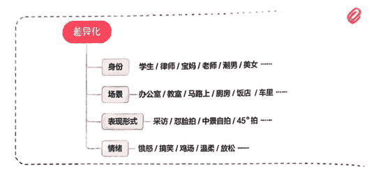

## 案例拆解
若要做育儿博主，坐在书柜前一本正经讲课，内容再好也难让人记住，因为大多数博主都这么做。

可尝试以下三种呈现：
**方案一：** 宝妈在国外陪读，背景是典型的海外住宅区，偶尔有路人经过。以日常聊天语气分享经验。
**方案二：** 妈妈与孩子在自然中玩耍，休息时席地而坐。丈夫在一旁采访式提问：“你为何这样教育孩子？” 她轻松自然地娓娓道来。
**方案三：** 父母因孩子教育产生争执，随后请孩子来“评理”，最终共同给出解决方案。通过家庭互动传递育儿观点。

相比端坐讲解，这三种方式显然更容易吸引注意。差异化核心就在于**与众不同**。

### 口播短视频怎么做？

#### 流量密码
口播是博主必备基本功。
口播视频是自媒体重要形式，小红书同样适用。比图文更生动，更易抓住注意力，实现有效链接，又没有长视频拍摄复杂。声音与画面结合，信息传递更清晰，帮助观众更快理解。博主可通过语调、表情、肢体展示个性，建立情感连接。时长通常较短，适配快节奏生活，便于分享传播。

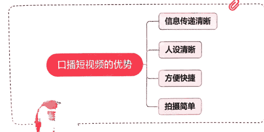

## 执行方案
口播视频大致可分为商品类与观点类。任何类型都需重视开头、正文、结尾。

##### 1. 商品类口播
**（开头）抓住兴趣：** 用有趣故事、一个提问或令人惊讶的结论开场。
**（正文）点燃欲望：** 突出产品特性及解决用户痛点，承接开头兴趣。
**（结尾）促成行动：** 直接引导转化。

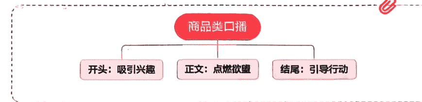

##### 2. 观点类口播
**（开头）抛出核心观点：** 一句话点明观点，也可作为金句。
**（正文）案例故事/个人经历：** 讲故事支撑观点。
**（结尾）核心干货：** 总结方案并引导互动。

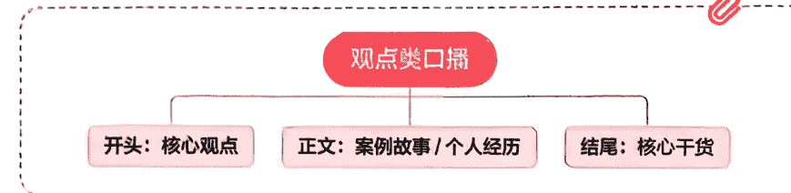

## 案例示范
**1. 商品类口播**
**开头：** 当你有个懂面料的好闺蜜，她提醒你百元以下外套要谨慎。
**正文：** 一分价钱一分货，低价衣物多用低价面料，可能甲醛超标。仔细查看标签成分，不懂就别乱买。选我筛选过的，对健康负责。
**结尾：** 点击左下角购物车，面料安全有保障。

**2. 观点类口播**
**开头：** 跳槽是实现薪资翻倍的最快路径。
**内文：** 我曾是高中辍学的学渣，毕业后做过不少工作，月薪最低2000。但我认真对待每份工作，每次跳槽都总结岗位要点，多年下来也成长不少。直到遇到现在的老板，我凭借积累与人品拿到9000薪资。机会留给有准备的人。
**结尾：** 关注我，持续更新职场干货。

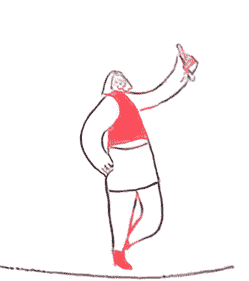

### 如何拍摄质感口播？

#### 流量密码
和封面一样，画面质感更易取胜。
有质感的口播画面更显专业亲切，赏心悦目同时建立好感信任。新手拍摄难免遇到问题，多练习即可。以下技巧可提升效果。

## 执行方案
##### 1. 构图
**中景拍摄：** 捕捉人物腰部以上，能展现表情与上半身动作，不显局促。
**人物位置：** 人物置于画面中心，上方留出约1/6到1/3空间，左右适当留白，避免拥挤。
**拍摄角度：** 主体正对镜头，便于观众建立直接视觉联系。

##### 2. 布景
**背景选择：** 用窗帘或素净规则的墙面，避免高对比色彩。
**道具运用：** 在角落或人物背后适度增加书本、盆栽等道具，提升丰富度。注意选择与摆放要得当，避免过多或遮挡主体。

##### 3. 打光
**面光：** 使用专用面光灯照亮主体，是关键光源。
**自然光：** 利用窗户等自然光源，让光线从侧前方打在人物上，避免过曝与阴阳脸。
**日常光：** 家中台灯、落地灯也可使用。主光源置于人物斜上方30°~45°，副光源置于斜后方，营造立体与深度。

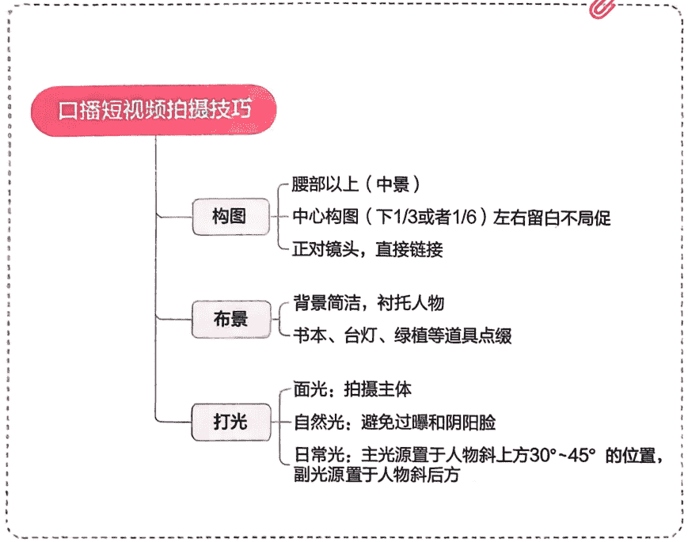

## 举个例子
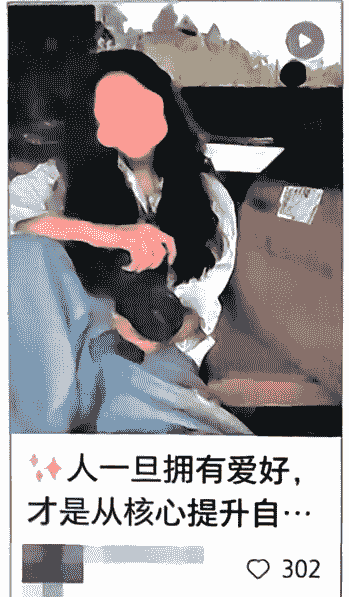
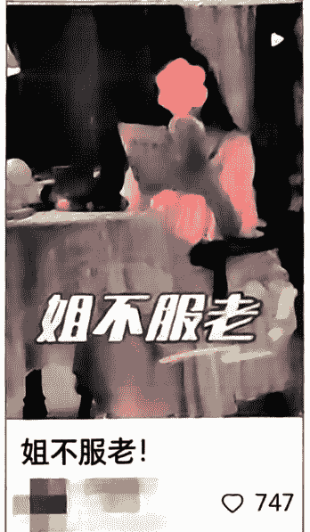
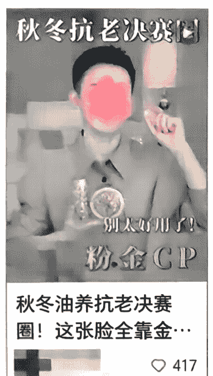
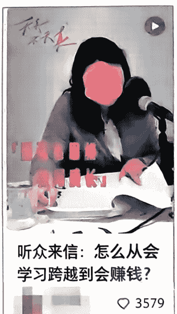

## DAY8 短视频内容创作指南
- 如何做出有内容的短视频？
- 如何使用剪辑模板？
- 如何做纪录片式图文笔记？

前面的准备是为了拍出更优质短视频。口播是入门形式，接下来讲如何创作更有内容感的短视频。

### 如何做出有内容的短视频？

**流量密码**
你在做内容创作，不是学生的流水账。
很多人拍日常，从起床、做饭、穿搭到工作、通勤、回家、刷剧。生活看似丰富，实则缺乏主题，散乱无章。拍得再好，内容空洞依然难传播。

## 执行方案
三个思路：贴标签、口播式、情感向。

##### 1. 贴标签
对小红书而言，点击率与跳出率是核心指标。标签能快速吸引感兴趣的观众，无论是羡慕生活方式还是状态相似，都更愿意点开。
标签一方面提升点击，精准吸粉；另一方面，开头点明个人标签或亮点，能明显降低前5秒跳出。停留时间变长，系统会判定质量高，给更多推荐。Vlog若能展现向往的生活状态或精神面貌，更易引发共鸣。

##### 2. 口播式
Vlog为呈现形式，内核却是口播表达。博主不面对镜头，而是拍摄生活日常画面配合旁白。很多博主笔记即此逻辑，视频多为办公、生活片段，本质是口播博主，只是用了Vlog形式。

##### 3. 情感向
若擅长此类内容可尝试，易出爆款。但需注意鸡汤质量决定笔记好坏。若把握不足，不建议从鸡汤起步，难度大，考验文案与拍摄，无法速成。

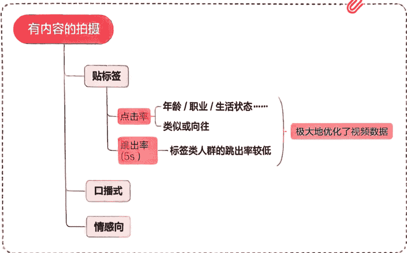

## 举个例子
**1. 贴标签**
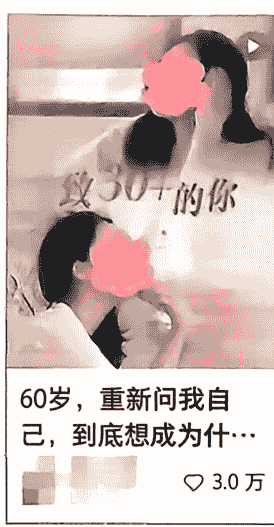
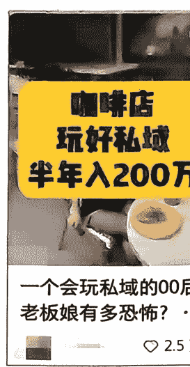
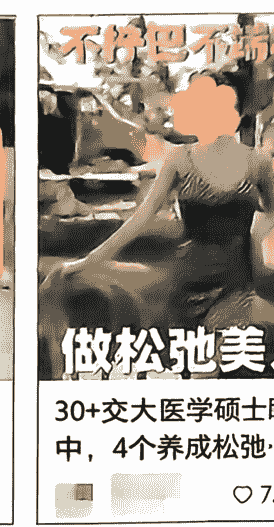
可提炼标签如：
- 60 岁致 30+
- 灵魂问答
- 名人
- “00 后”老板娘
- 开咖啡店
- 年入 200 万
- 30+
- 交大医学硕士
- 松弛美人

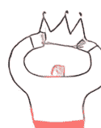

**2. 口播式**
该博主所有Vlog都是办公、生活片段，用Vlog形式讲干货。

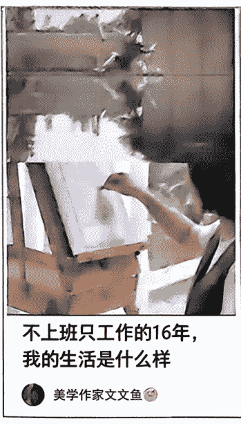

**3. 情感向**
近期治愈系内容很火，若文案与拍摄能力过关，或会画画，可尝试此路线。

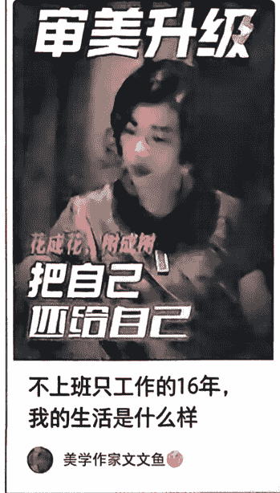

### 如何使用剪辑模板？

**流量密码**
素材好坏是一回事，剪辑技术能加分。
优质短视频前期拍摄与后期剪辑都重要。拍摄需长期练习，而剪辑新手易上手，多数软件自带模板可一键成片。建议先用模板起步，后续再提升拍摄。

## 执行方案
掌握简单剪辑，效率翻倍。以剪映为例。
打开剪映，点击底部“剪同款”。

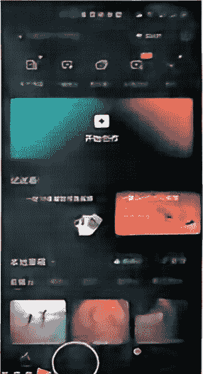
可设置视频时长与片段数量，选定参数后系统提供适配模板。

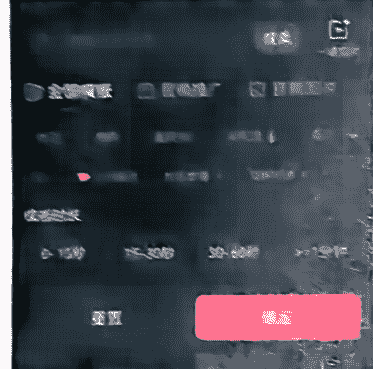
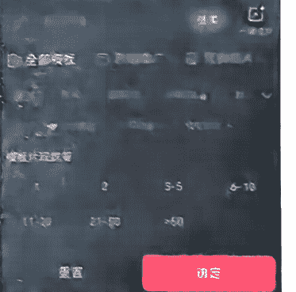
点击“确定”后，会展示大量同参数模板样片，依次预览选定心仪风格。

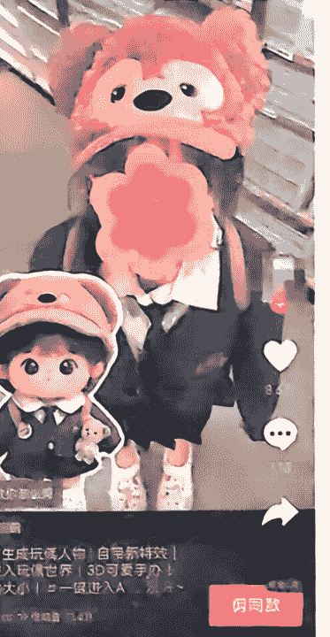
点击右下角“剪同款”，即可套用模板。

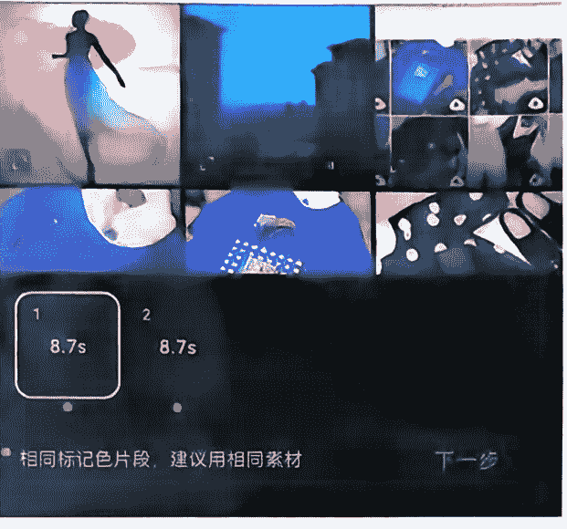
选择已拍摄素材片段，点击“下一步”，视频即制作完成。

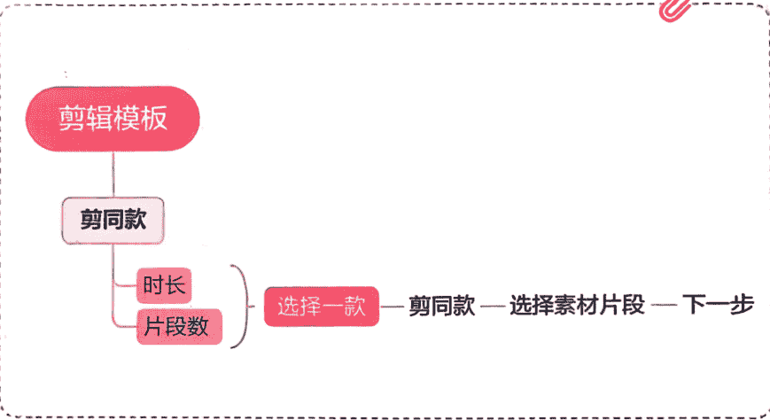
这只是基础功能，想自由创作需深入学习。拍摄与剪辑皆然。

### 如何做纪录片式图文笔记？

**流量密码**
图文模式更适合新手小白。
短视频时代已至，但小白最好先从图文起步。碎片化时间里，用户偏爱快速浏览、迅速抓取信息。精心撰写的图文笔记可在等车、排队时快速获取知识，便捷性视频难以比拟。

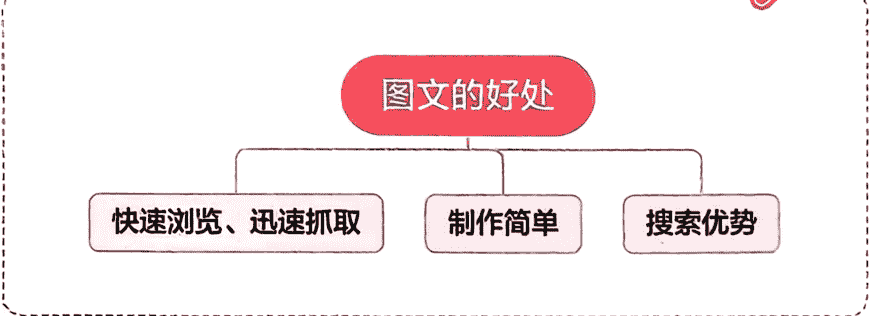

短视频信息顺序呈现，不便定位重复查看的细节，需反复播放。图文笔记无需专业拍摄设备和复杂剪辑，大幅降低门槛。小红书对图文内容的搜索也更精准。
但普通图文难获流量，下面介绍一种优质图文模式。

## 执行方案
纪录片式图文笔记制作方法：

##### 1. 拍摄
手机横屏拍摄照片，全程无需说话，只需对口型，并配合惊讶、喜悦等情绪与手势。每个动作保持3秒以上，便于对焦。

##### 2. 选图
从照片中挑选表情与手势合适的3~9张。一般3张可拼成一页，可根据页面数决定拍摄与选图量。

##### 3. 拼图
导入美图秀秀，可美颜也可直接拼图。点击“拼图”导入选中图片，3张一组，选择比例3：4，即小红书标准比例，再选上中下三层模板。

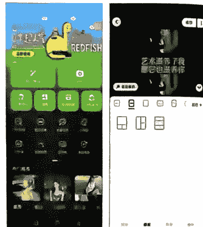
最后点击右上角“保存”，图片自动存入手机相册。

##### 4. 文字
回到美图秀秀首页，点击“图片美化”导入拼好图，点击底部“文字”图标添加文字，可调整样式与字体。建议添加描边提升清晰度。可按审美调整，但不建议字过细。

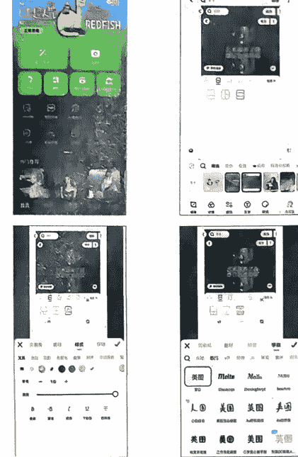

> 注意：此格式对文案要求较高，尤其是首屏，务必在首屏展示亮眼观点或金句。

## 举个例子
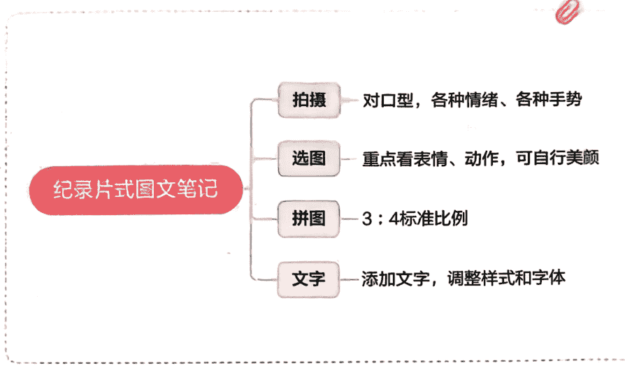

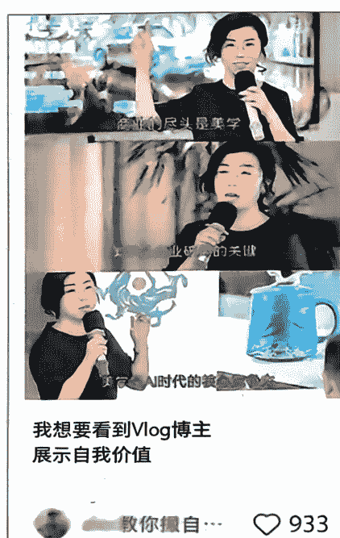

## DAY9 发笔记前的关键准备

- 五件套该怎么升级？
- 怎么带着流量发笔记？
- 什么时段发最合适？

前面八天的打磨，本来就是为今天的发布做铺垫。发布并不是点开小红书首页下方的红色“+”，编辑一下就发出去这么简单，真正要做的准备和细节远比这多，我们一件件梳理清楚。

### 起号五件套怎么升级？

**流量密码**

做号能不能涨粉，五件套决定成败。

头像、昵称、简介、标签、背景图合称为起号五件套。当爆款来临，流量涌入主页时，用户第一反应就是看这五项。五件套不够抓人，主页就留不住人，涨粉自然无望。

## 具体操作

**1. 头像**
用户看头像几乎就是一瞬间的事，但这瞬间决定第一印象。最好用真人照，可信度更高。角度不一定要正脸，但别用背影。卡通或风景头像除非和内容、产品关联极强，否则很难让人信任。

**2. 昵称**
昵称能不能被记住，直接影响传播。甚至你去别的博主评论区留言，也会因为昵称有趣而被关注。

常见写法有：昵称+行业、昵称+愿景+数字、昵称+独特性。小红书支持7天一换，运营中可以不断测试优化，并非一成不变。

**3. 简介**
简介要在极短文字里说明你是谁，值得反复打磨。可以回到DAY1做的人设和赛道定位资料来对照。

可以写一段有张力的人生经历勾起好奇；可以用关键经历做背书建立信任；也可以直接说清你能给用户什么价值。愿景也可以写，但必须和产品挂钩。DAY1的功课会在后面反复用到，今天写、明天改，天天迭代。

**4. 标签**
标签相对直接，平台已有分类可选。它是对博主的概括，也是人设的最直白定义，必须选最贴合自己的。

**5. 背景图**
背景图常被忽略，其实作用很大。它是你的“氛围感”，和昵称、简介、标签一起构成第一视觉印象。要选得能代表行业、专业度、能力甚至结果，比如工作场景、成就可以图、代表性产品。

## 实操参考

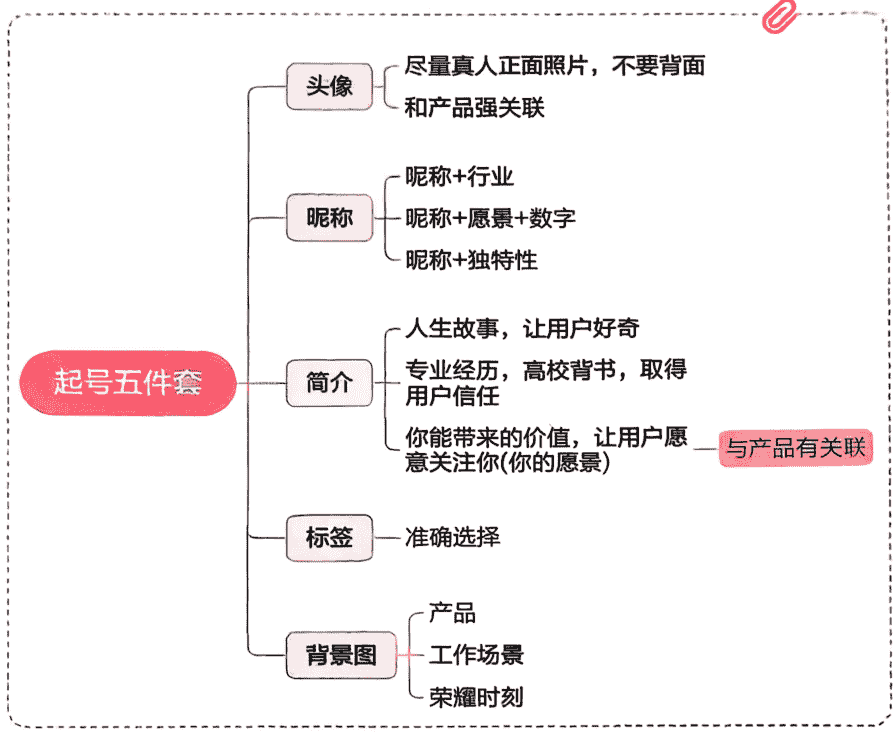

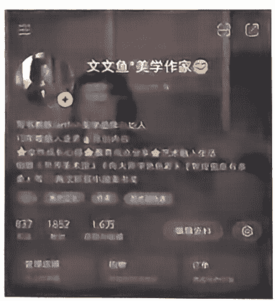

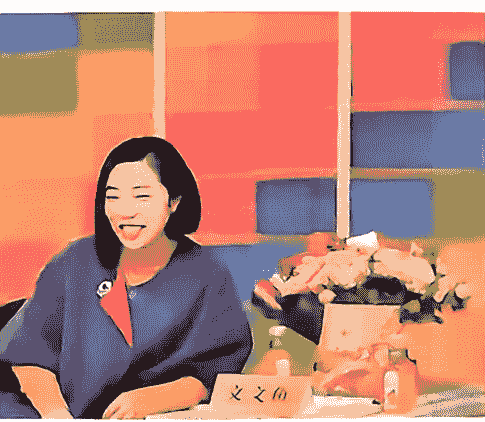

### 笔记怎么发？

**流量密码**

会用 # 话题带流，是吸收流量的关键。

发笔记不只是发布动作，更要学会合理带话题，相当于在平台上蹭热度。官方会给近期热度高的话题，发布时建议适度挂上相关话题。

## 具体操作
打开小红书页面，点击左上角“更多”按钮☰，弹出侧边菜单选第二项“创作者中心”。

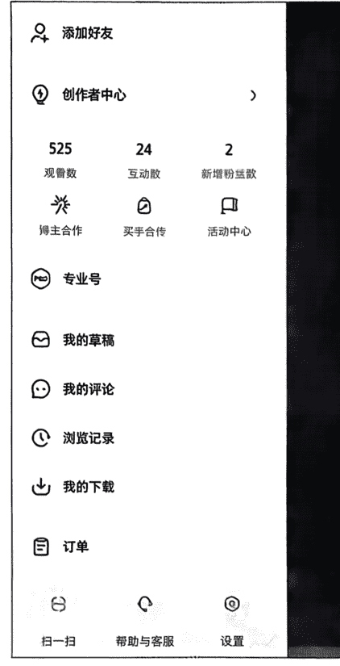

## 流量为王：10 天小红书运营法则

进入创作者中心后往下滑，就能看到官方整理的热门话题。这些话题都经过验证有流量有热度，挑一个适合自己的用即可。

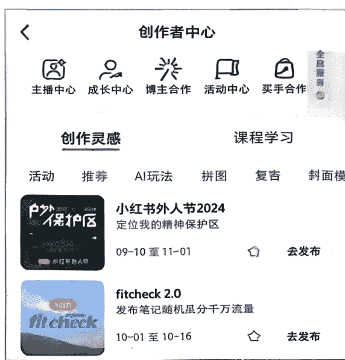
先定好赛道，再挑心仪的话题，可以看标题下的发布数据判断话题质量。能收藏也可以直接用，拿出在DAY3到DAY8期间准备好的笔记内容。

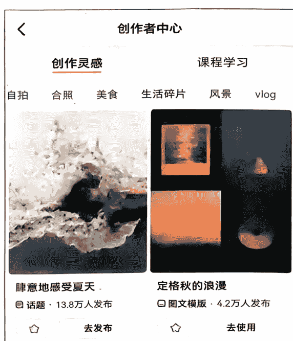
发布时还能再加其他相关话题，但不要自己造话题，要选已有话题里流量表现好的，一般选择时都会显示话题热度。注意话题数有上限，目前是10个。标签要精准，它是在信息海洋里帮你和精准用户连上的关键。封面标题是核心，话题是推一把的助推器。

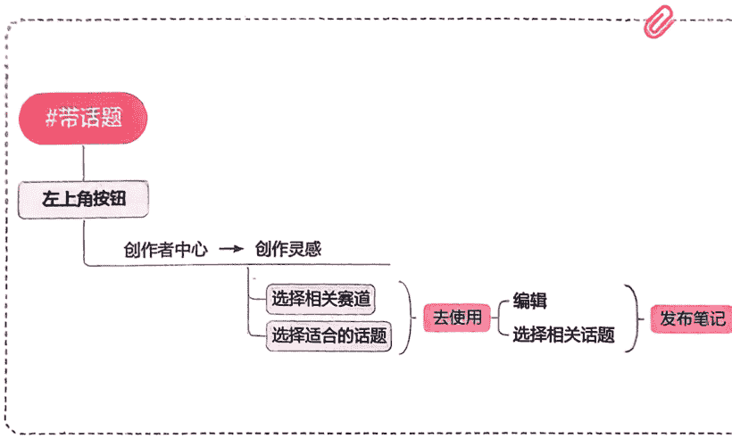

## 实操参考

发布设置完成后，点击右下角“发布笔记”即可。

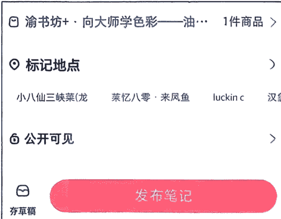

### 什么时候发最好？

> 流量密码

内容是地基，时间是杠杆。

很多新手想到就发。你的目标用户其实集中在特定时段，摸清使用习惯才能卡准曝光，错过就是错过。

## 具体操作

按使用习惯把一天拆成六个区块：

- ⏰ **6:00—8:00**
  起床时段，受众有限且未必有空刷手机。能刷的往往有学习需求，适合发学习思考类内容。

- ⏰ **8:00—9:00**
  吃早餐或通勤路上，碎片时间多，容易看资讯类、娱乐类。

- ⏰ **12:00—14:00**
  用餐午休时段，闲暇时会看社会热点、购物、美食、轻松娱乐。

- ⏰ **17:00—19:00**
  下班休息及路上，碎片流量集中，偏好轻松娱乐内容。

- ⏰ **19:00—21:00**
  黄金时段，大部分用户休闲，活跃度最高，属于**流量高峰**，娱乐、影视、学习、购物都合适。

- ⏰ **21:00—23:00**
  夜晚情绪主导，限制较大，**情感类内容**更吃香。

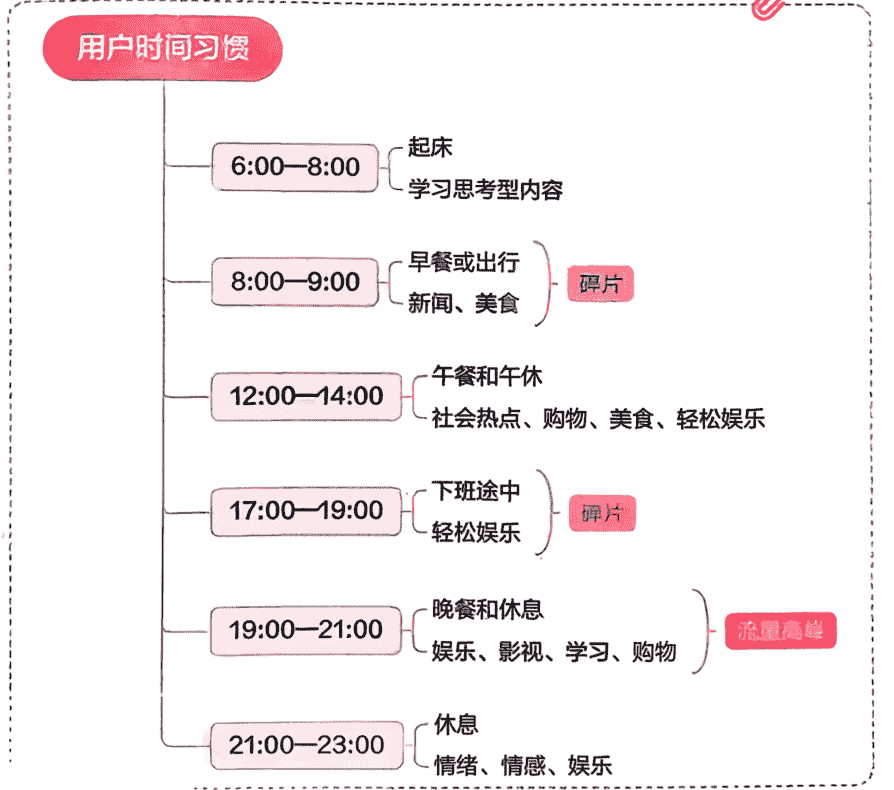

## 实操参考

想发美学相关信息，21点以后情绪主导期更合适，人们更愿意看美好画面。

想卖蛋糕，8:00—9:00和17:00—19:00通勤前后都是高点。早晨补没来得及吃的早餐，傍晚则是饥饿感最强的时间。

娱乐类信息几乎全天适用，因为用户上线大多就是为了放松，只要有碎片时间都会看。

## DAY10 发布后的运营动作

- 数据怎么深挖？
- 新手先抓哪几个点？
- 评论区怎么激活？
- 爆款来了怎么办？

笔记发出去后，第一反应是盯“小眼睛”吗？别只看这个，真正的后续工作才刚开始，每一步都有方法，需要系统记录。

### 数据怎么深挖？

> **流量密码**
> 不复盘总结，你就是在开盲盒。

很多人觉得准备好、发出去就算完成，后面隔天再发就好。实际上发布后才是关键。深度数据分析才能指导下一步。**无数据不运营**。所有优化都应基于账号数据的反馈。分析清楚做对了什么、错了什么、该加码还是转向，**数据就是自检系统**。

## 具体操作
小红书自带数据中心，数据已整理好可直接查。

入口：我→左上角按钮☰→创作者中心→数据中心

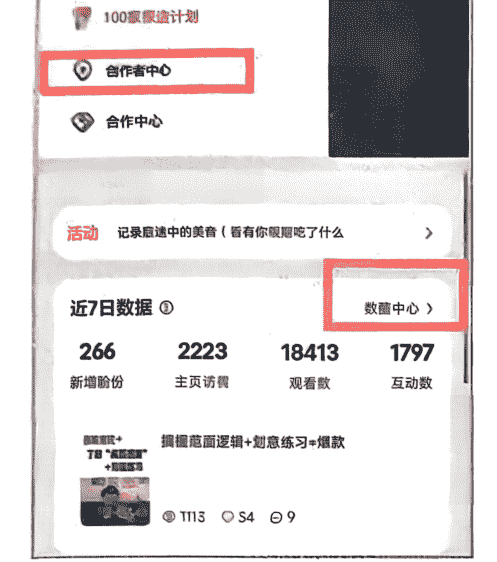

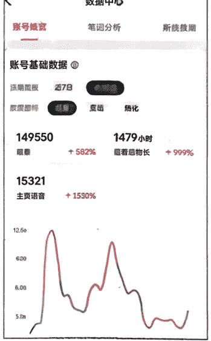
笔记发完次日15点会更新数据，可看到整体流量粉丝变化及单篇表现。

入口：我→左上角按钮☰→创作者中心→数据中心→笔记分析

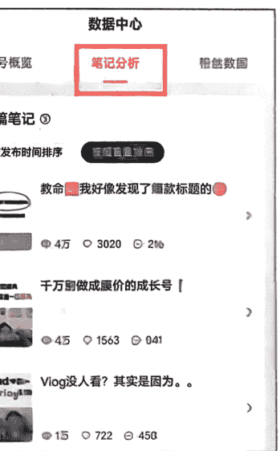
进入单篇分析页，点击任意笔记即可看详情。图文和视频图表形式不同。

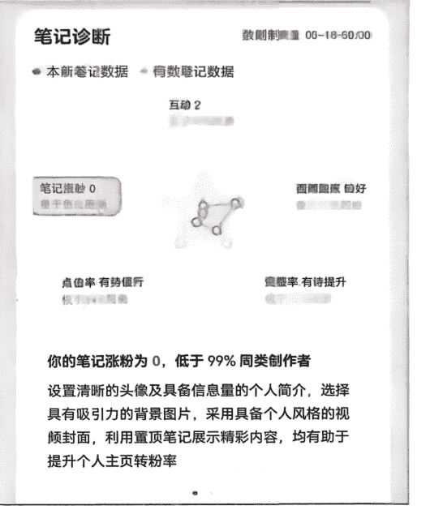
“观众画像”能看性别、年龄、城市、兴趣分布及来源。首页推荐占比越高，说明近期被推得越频繁，流量越大。

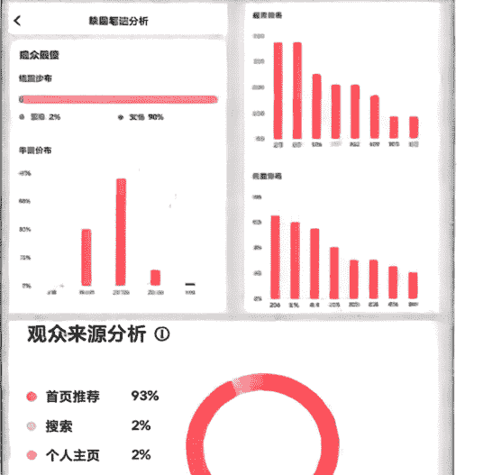
下面五个维度是重点。

### 1. 播放量 / 阅读量 = 点击率
阅读量即小眼睛数。曝光1万次点击1000次，点击率约10%。小红书只给定性评价：很好 / 一般 / 有待提升。若是一般或有待提升，就要优化标题和封面。

### 2. 互动数 / 阅读量 = 互动率
互动数 = 点赞数 + 收藏数 + 评论数 × 4 + 转发数 × 4 + 关注数 × 8
互动率超10%有爆款潜力。若长期偏低，说明选题或内容有问题。

### 3. 新增粉丝 / 主页访问 = 转粉率
有多少人看完主页后关注。主页访问多却不涨粉，要回头审视五件套，尤其是简介是否说清了能给用户的价值。

### 4. ( 点赞数 + 收藏数 ) / 粉丝数 = 赞粉比
正常区间约3%~8%。可据此估算有效流量。

### 5. 完播量 / 播放量 = 完播率（视频）
含5s完播率和整体完播率，是系统评判视频质量的重要指标，越高越好。

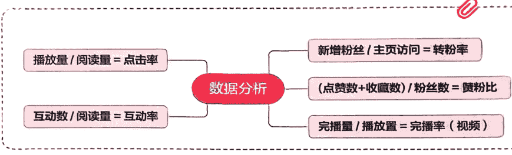

## 实操参考

以某篇笔记为例做复盘建议。

### 1. 点击率
若评级为有待提升，需优化标题和封面，参考DAY4~DAY6。

### 2. 互动率
互动数仅9，互动率极低，选题和内容要重磨，参考DAY1、DAY5。

### 3. 转粉率
笔记涨粉1个，虽少但在点击不佳的情况下仍有转化，说明仍有价值。五件套尤其是价值表达可再升级，参考DAY9。

### 4. 赞粉比
粉丝约2000，赞粉比在合理范围，无需过度调整。

### 5. 完播率
完播率一般，开头尚可，前半段能留人，后半段流失明显，正文和结尾需优化，参考DAY5。

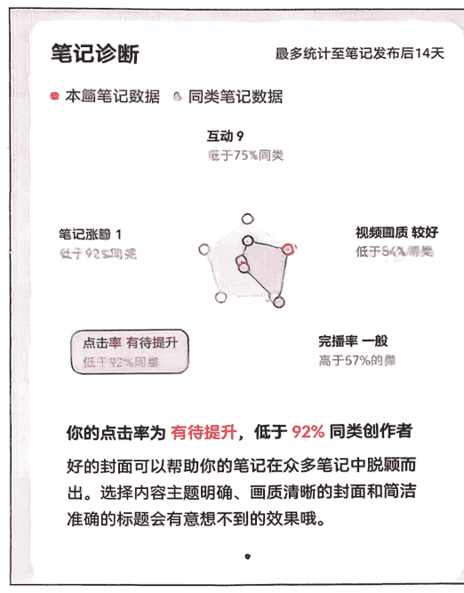

### 新手先抓哪几个点？

> 流量密码
> 新手先抓重点，再逐步扩展。

数据太多容易迷路，先抓住三个核心指标上手再说。

## 具体操作
新手可优先提升：

- **点击率**：调整封面和标题。
- **互动率**：提升笔记内容的实用价值。
- **转粉率**：优化主页呈现。

## 实操参考

可自建《小红书数据分析表》：

| 发布时间 | | | | | |
|---|---|---|---|---|---|
| 笔记标题 | | | | | |
| URL | | | | | |
| 阅读量（小眼睛） | | | | | |
| 点赞 | | | | | |
| 收藏 | | | | | |
| 评论 | | | | | |
| 分享 | | | | | |
| 涨粉 | | | | | |
| CES 评分（预估） | | | | | |
| CES/阅读量 | | | | | |
| 点击率（定性非定量） | | | | | |

把笔记填进去对照分析，持续练习反复优化。

### 评论区怎么激活？

**流量密码**

评论区绝对不能忽略。

很多人把评论区当成随意发言区。但小红书推荐算法看重点击率和互动率，点击靠选题封面标题，互动靠点赞收藏，而评论区运营是低投入高回报的策略。经营好评论能显著提升互动，还能带来额外推荐。评论区的高赞留言和热议话题，还能为下一个选题提供灵感。

## 具体操作

### 1. 设置争议话题
选题时可选有争议的方向，不论赞同与否都会引发评论甚至争论。成长伴随争议，在不同反馈中精进。

### 2. 评论区留资料
让用户留言需求，你提供干货资料，提升互动量。

### 3. 在评论区多互动
积极回复每条留言，保持活跃度。每一次回复都可能引发二次回复，提升算法权重。新手应尽可能回复全部评论。

### 4. 用评论引导访问主页
笔记发布后在评论区做引导，比如“见置顶笔记”，提升主页访问和其它笔记点击。

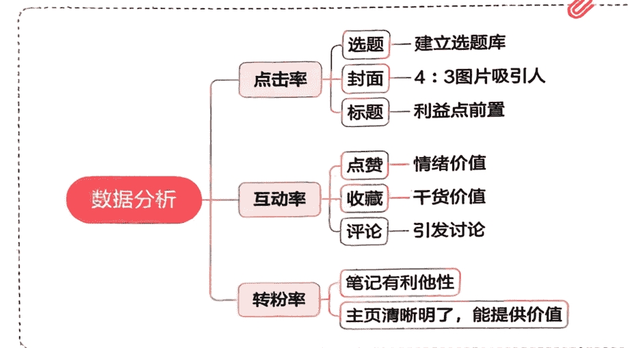

## 实操参考

1. 设置争议话题
例如笔记《30岁人生建议：别预设困难，大部分人都很水》，评论区围绕“世界是不是个草台班子”展开讨论，冲突带来互动。

2. 评论区留资料
例如《一招搞定PPT》写“需要方法的评论区告诉我，送给大家”，引导留言并兑现承诺，利他是核心。

3. 在评论区多互动
日常回复即可，重点是关注粉丝在问什么，了解需求。

4. 用评论引导主页
例如“这篇笔记提到的××，可以看我置顶笔记哦”，增加关注机会。

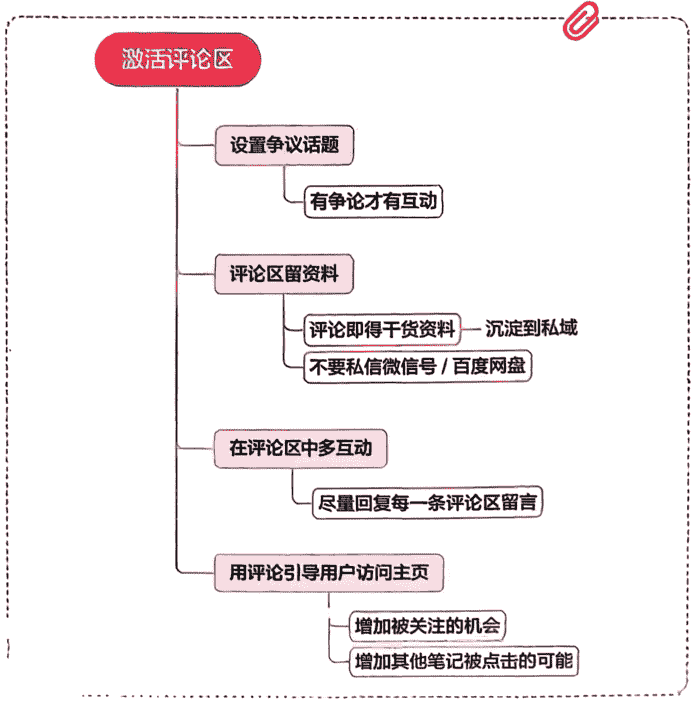

### 爆款来了怎么办？

> **流量密码**
> 爆款不是用来窃喜的，而是要乘胜追击。

十天努力后若有一条爆了，阅读、点赞、收藏、评论暴涨，别停在满足上，乘胜追击才是持续胜利的关键。

## 具体操作
爆款出现后先**置顶一条评论**，放大转化。可以引导关注主页，或留言领取干货。

然后**拆解这条笔记**，用DAY4~DAY6的方法总结选题、标题、封面、内容的特点。按同样逻辑继续创作，很可能后续几条也爆。坚持做并持续优化。

## 流量为王：10 天小红书运营法则

## 实操参考

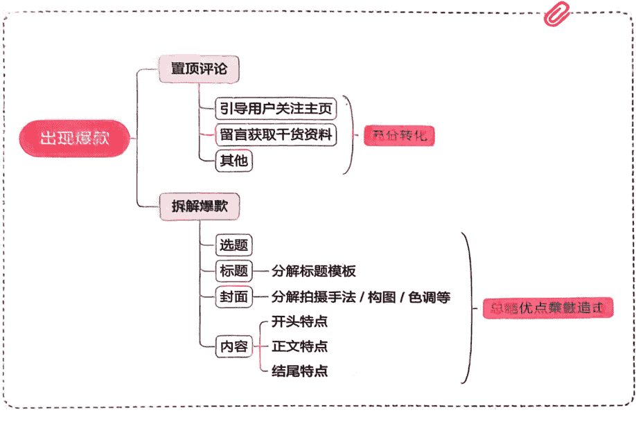

## 流量为王：10 天小红书运营法则

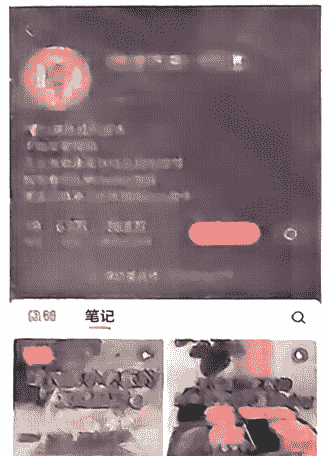

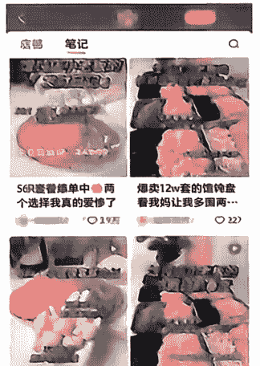
一个账号长期重复发布同类笔记，据说卖出超100万单的馄饨，它的打法是这样。

### 1. 看看选题、标题和封面
博主常用的封面素材有咸鸭蛋的明黄色、蟹籽加肉馅的红系、虾仁加肉的Q弹质感，这些色彩能刺激食欲。美食在平台上无法传香也无法品尝，只能靠“看上去好吃”取胜。

### 2. 看看内容

| 时间 | 内容 | 优点 |
|---|---|---|

400㎡馄饨店6个月100万单，爆款笔记是这么复制来的

一位95后博主的第四次创业，是家占地400平的馄饨店。她的视频开头几乎固定，先亮明人设标签——多次创业的年轻创业者，很有靠谱感，再点出店面面积远超普通几十平的小店，用体量感迅速建立信任。

6到10秒的段，镜头切到早上出货现场。她打招呼说最近天天加班赶单，每天至少要包200斤肉，配上现买现用的原材料画面，让人潜意识里觉得食材都是新鲜采购的。

11到28秒全是处理食材的特写。60斤藤椒鲜肉馅交给阿姨们开包，小哥刚切好的20斤虾块分装上架。蟹籽一天要消耗四五包，直接拌进肉馅里。皮蛋馅散发着臭香口感绵软，咸蛋黄馅咸香带沙，每一种馅料都提前备好，色彩鲜亮的画面专门用来刺激食欲。

29到40秒强调团队与品控。包馄饨的人手已经扩到20多位，新来的阿姨上手也很快。虽然订单量在持续拉大，但质量标准没有松动，每日原料都严格把关，就是为了让用户吃得安心放心。

最后几秒是固定的收尾感谢，表达对粉丝支持的感恩。

她每条笔记的骨架都长得差不多，这正是爆款的常态。早期试过很多内容，某一天一条意外爆了，她把开头人设、体量背书、现做现包的产量展示、食材特写、团队与品控、感谢收尾这几个要素拆解出来后就开始稳定复刻。半年时间，馄饨单量突破了100万。

推荐阅读

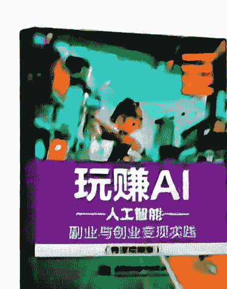

责任编辑：柯尊斌

从零起步，日更练习，步步夯实，助你快速吃透小红书爆款套路！

- ✓ 10天确立人设定位
- ✓ 打造选题池
- ✓ 爆款标题撰写技巧
- ✓ 高质封面制作方法
- ✓ 短视频操盘能力

### 1. 10天速成体系，结构清晰、节奏紧凑
整本书按10天来划分，每天聚焦一个核心点，从认知搭建到实操落地逐步推进。节奏紧凑，适合新手快速上手，也便于按计划每日学习并同步实操。

### 2. 以实操为导向，可参考性强
各章节围绕具体主题展开，涵盖选题库搭建、爆款标题写法、高点击封面设计、口播脚本框架、优质短视频制作等干货技巧，学完就能用，降低创作门槛。

### 3. 覆盖小红书运营全链路，紧扣“流量”核心
从账号定位、人设塑造、图文与短视频内容生产，到流量获取、数据复盘与初步变现，紧扣流量目标，把素人起号的关键环节串成完整路径。

### 4. 聚焦平台特性，深度适配小红书生态
结合小红书搜索加推荐的双流量机制、用户种草心理和对高颜值视觉的偏好，专门讲解封面点击率、标题关键词、标签运用等关键指标，提升内容曝光效率。

销售分类：个人成长/自媒体运营

定价：49.80元