# 流量为王：10天小红书运营法则

从0到1，快速掌握小红书的流量逻辑与运营之道

飞鱼◎编著

- 流量密码解析
- 人设和赛道定位、对标账号调研
- 构建差异化人设与内容风格
- 选题库搭建、优质内容撰写
- 短视频制作、数据分析
- 覆盖内容创作核心流程与后期运营思维

# AI时代

做懂流量
会定位
能产出
善运营的
自媒体达人

# 流量为王：

# 10天小红书运营法则

飞鱼◎编著

中国水利水电出版社
www.waterpub.com.cn
·北京·

# 内容提要

本书是一本专为自媒体创业者打造的小红书运营指南，旨在帮助创业者系统掌握小红书平台的运营策略，从零开始逐步构建和提升个人品牌影响力。

全书共分为两章：第1章介绍小红书的流量基础；第2章以10天为周期，每天围绕一个核心主题逐步深入，涵盖平台理解、内容创作、用户互动、数据分析等方面。每一部分均提供具体的操作步骤和实践策略，并结合真实案例解析，确保读者能够轻松理解、快速应用、及时见效。通过连贯的学习路径，读者将逐步学会打造高吸引力内容、建立忠实粉丝社群、并有效提升个人品牌的商业价值。

本书不仅是小红书运营的实操手册，而且是自媒体创业者实现加速成长的必备工具。通过阅读本书，读者将学会如何打造吸引人的内容，建立忠实的粉丝群体，以及如何通过小红书实现个人品牌的商业价值。

# 图书在版编目（CIP）数据

流量为王：10天小红书运营法则 / 飞鱼编著.
北京：中国水利水电出版社, 2026. 1.
-- ISBN 978-7-5226-3929-1
I. F713.365.2
中国国家版本馆CIP数据核字第2025BA4636号

| 书 名 | 流量为王：10 天小红书运营法则
LIULIANGWEIWANG : 10 TIAN XIAOHONGSHU YUNYING FAZE |
| 作 者 | 飞鱼 编著 |
| 出版发行 | 中国水利水电出版社
（北京市海淀区玉渊潭南路 1 号 D 座 100038）
网址：www.waterpub.com.cn
E-mail: zhiboshangshu@163.com
电话：（010）62572966-2205/2266/2201（营销中心） |
| 经 销 | 北京科水图书销售有限公司
电话：（010）68545874、63202643
全国各地新华书店和相关出版物销售网点 |
| 排 版 | 北京智博尚书文化传媒有限公司 |
| 印 刷 | 北京富博印刷有限公司 |
| 规 格 | 140mm × 210mm 32开本 4.25印张 88千字 |
| 版 次 | 2026年1月第1版 2026年1月第1次印刷 |
| 印 数 | 0001—3000册 |
| 定 价 | 49.80元 |

凡购买我社图书，如有缺页、倒页、脱页的，本社营销中心负责调换

版权所有·侵权必究

# 流量为王

在这个信息爆炸、数字化飞速发展的时代，“流量为王”已成为互联网行业，尤其是自媒体和社交媒体领域的一个核心命题。本书旨在深入探讨这一现象，并为小红书等社交平台的运营者提供策略和见解，帮助他们在激烈的市场竞争中脱颖而出。

在数字时代，流量不仅是衡量一个平台或品牌影响力的重要指标，更是其商业成功的关键因素。谁能吸引并维持更多的用户流量，谁就能在竞争中占据有利地位。本书将详细阐述如何在内容创作、品牌营销及电商领域中，通过高质量内容吸引用户流量，并利用平台的算法推荐、社交功能等策略增强用户黏性。流量的商业变现已成为自媒体和品牌的首要目标。随着技术的进步，尤其是大数据和人工智能的应用，流量获取变得更加高效和精准。本书将深入分析这些技术如何帮助平台和品牌更好地理解用户行为，预测用户需求，从而实现更精准的营销。

社交媒体作为信息获取和消费的新渠道，其重要性日益凸显。用户行为的转变使得社交媒体成为品牌和创作者争夺流量的新战场。本书将探讨如何在社交媒体平台上吸引和保持流量，以及如何利用这一趋势来提升品牌影响力。

随着市场竞争的加剧和监管需求的提升，平台和创作者也更加注重内容的质量和合规性。内容的原创性、真实性及合法性已成为吸引和保持流量的关键。本书将提供实用的建议，帮助创作者在遵守规则的同时，创造出既符合管理要求又能吸引用户的内容。

接下来，我们将一同探索如何在小红书等社交平台上构建强大的流量引擎，如何通过内容创新和用户互动来提升品牌价值，以及如何在遵守法律法规的前提下，实现流量的最大化和商业变现。

编 者

# 前言

在数字化时代，自媒体已成为信息传播和个人品牌建设的重要平台。小红书，作为连接创作者与亿万用户的桥梁，以其独特的社区氛围和强大的流量优势，为自媒体创业者提供了广阔的舞台。然而，如何在这个竞争激烈的领域中脱颖而出，实现流量的增长和变现，已成为许多自媒体创业者面临的挑战。《流量为王：10天小红书运营法则》这本书正是在这样的背景下诞生的，旨在帮助自媒体创业者深入了解小红书平台的运营机制，掌握流量获取和转化的策略，从而在自媒体领域取得成功。

本书分为10天的内容，每天聚焦不同的运营要点，逐步引导自媒体创业者从基础到进阶，系统地掌握小红书运营的各个方面。每一天的内容都旨在解决具体问题或提供实用工具，使自媒体创业者能够快速上手，将理论转化为实践。

《流量为王：10天小红书运营法则》不仅是自媒体创业者的操作指南，也是他们的成长伙伴。通过这本书，我们希望自媒体创业者能够充分利用小红书平台的优势，实现流量的增长和品牌的塑造。需要明确的是，虽然本书提供了丰富的运营策略和技巧，但自媒体的成功不仅仅依赖于对技术的掌握，更在于创业者的创造力、洞察力和持续的努力。自媒体创业者应在熟练运用这些工具和策略的基础上，充分发挥自身的特色和优势，创造出独特的内容和价值。

尽管本书的编著团队在创作与编写中倾尽全力，但受限于时间和平台政策的更新，书中仍可能存在不尽完善之处。希望读者朋友能给予理解，并欢迎您提供宝贵的意见，作为我们进步的方向。

# 目录

## 第1章 小红书的流量逻辑

- 与流量相关的基本名词有哪些？ 02
- 当你发布了一篇笔记之后，会发生什么？ 03
- 什么样的情况不会通过审核？ 04
- 笔记通过后会怎么样？ 05
- 如何提高点击率？ 06
- 如何提高互动率？ 06
- 系统的初始流量分发给谁？ 08
- 新手创作者避坑点有哪些？ 10

## 第2章 10天小红书运营法则

- 10天小红书运营表 14

### DAY1

### DAY2

#### 如何做人设定位和赛道定位？ 16

#### 如何做调研？ 27

- 如何定位你的人设？ 17
- 如何构建你的差异化？ 19
- 如何确定赛道定位？ 21
- 如何绘制你的用户画像？ 23
- 如何分析你的用户群需求？ 25

- 需要收集怎样的对标账号？ 28
- 如何精准锁定对标账号？ 32
- 如何拆解对标账号的元素？ 34
- 调研完对标账号后需要做什么？ 36

### DAY3

### 如何建立自己的选题库？ 38

- 什么样的选题是好选题？ 39
- 如何确定选题？ 43
- 为什么模仿爆款这么重要？ 47

### DAY4

### 如何写一个好标题？ 49

- 为什么标题那么重要？ 50
- 标题模板有哪些？ 53
- 如何用AI秒出爆款标题？ 58

### DAY5

### 如何写出好内容？ 62

- 如何写好开头？ 63
- 如何写好正文？ 66
- 如何写好结尾？ 68
- 如何运用金字塔写作法？ 70

### DAY6

### 如何做出好封面？ 73

- 为什么封面那么重要？ 74
- 制作优质封面的方法有哪些？ 77

### DAY7

### 如何创作口播短视频？ 82

- 如何做出独特性？ 83
- 如何做好口播短视频？ 85
- 如何拍摄优质的口播短视频？ 88

### DAY8

### 如何创作优质短视频？ 91

- 如何做出有内容的短视频？ 92
- 如何使用剪辑模板？ 96
- 如何做纪录片式图文笔记？ 99

### DAY9

### 如何发布内容？ 103

- 如何升级起号五件套？ 104
- 如何发布笔记？ 107
- 最佳发布时间是什么？ 110

### DAY10

### 运营期间要做哪些事？ 113

- 如何做深度数据分析？ 114
- 新手博主从哪里入手更好？ 120
- 如何激活评论区？ 122
- 出现爆款怎么办？ 125

# 第1章

# 小红书的流量逻辑

小红书就像一个线上大市场，每个账号就相当于一个品牌，而每条笔记就相当于一条“硬广”或者“软文”。当然，如果你暂时没有让小红书账号为你变现的想法，也可以只做“内容”。可是，无论笔记是“硬广”“软文”还是“内容”，我们都希望它能被更多人看到。那么，搞清楚小红书的流量逻辑就很重要了。

# 与流量相关的基本名词有哪些？

**流量密码**
了解小红书的流量逻辑前，首先要搞清楚几个基本名词。

**阅读量**：当你的笔记发布之后，平台会给予一定的曝光量，用户点击一次，就会记录一次阅读量，也就是我们俗称的“小眼睛”。

**点赞、收藏**：点赞、收藏量高，就意味着这篇笔记是一篇爆款笔记。一般来说，我们认为千赞（收藏）是一个小爆款，万赞（收藏）是一个大爆款。

**评论**：评论数量的多少代表了用户对笔记内容的参与度和兴趣程度，通常意味着内容引发了较多的用户共鸣或讨论，是衡量笔记受欢迎程度的重要指标之一。

**分享**：分享数量多通常意味着内容具有较高的传播价值和用户认同感，表明笔记或帖子能够引起广泛的共鸣，触及更广泛的受众群体。

# 当你发布了一篇笔记之后，会发生什么？

**流量密码**
通过平台的自动化审核和人工审核的双重核验，流量才能成功投放。

当笔记发布之后，一般情况下，通过很短时间的AI审核就能发布成功。如果发现长时间的阅读量很低，那么有可能是还在人工审核当中，可以用其他账号看看能否看到这篇笔记，如果能看到，就耐心等候审核通过。

# 什么样的情况不会通过审核？

**流量密码**
没有通过审核的笔记，基本没有流量甚至直接被限制发布。

如果笔记中含有违禁字或者高危字词，就会被平台限流。可以在笔记发布前用零克查词（免费好用）、句易网（可检测图片）、轻抖、词爪等软件检测一下，也可以先看看下面这张高敏感词表。

# 笔记通过后会怎么样？

**流量密码**
笔记数据是打开更大流量池的关键。

笔记通过审核之后，大数据会根据笔记数据（点击率和互动率）来评估笔记的内容质量。如果判断质量为优秀，则会继续升级流量池，直到数据表现无法再升至下一个流量池。既然笔记数据这么重要，那么提高点击率和互动率就是运营小红书的工作核心。如果笔记的“小眼睛”（阅读量）长期数据不佳，有可能是你的笔记没有吸引点，没有人想点进去看。笔记数据不好，当然也无法进一步引流。

# 如何提高点击率？

**流量密码**
点击越多，流量越多。

小红书的常规页面，一屏可以展示4则笔记。而用户为什么要在1/4屏的内容中选中你，并点击进去呢？
**记住这句话：一定要优化你的选题、你的封面、你的标题。**
这一部分在“10天运营表”（见P14）的DAY3、DAY4、DAY6里都有非常详细的讲解。这一部分做对了，你才能够被更多人看见，才有了成为爆款的可能，也才能真正获取可观的流量。

# 如何提高互动率？

**流量密码**
互动越多，流量越多。

被用户看见和选中只是开始，**好内容才是笔记成为爆款的核心要素**。下面来聊聊用户点击进去之后，如何提高互动率，要特别关注以下几个方面。

**点赞，收藏：** 这个和笔记内容质量强关联，内容质量越高，点赞、收藏数据就越好。一般情况下，心灵鸡汤类的笔记点赞量高，干货类的笔记收藏量多。实现这些的前提是基础流量推送精准，但是系统的初始流量分发给谁是未知的，这一点在后面会说明。

**评论，转发：** 评论和转发都反映了用户对这个话题感兴趣的程度，并且系统在计算这篇笔记的数据时，一条评论的重要程度是大于一个点赞或者收藏的。用户看到自己感兴趣的内容可能会随手点赞、收藏，可是如果要去评论或者转发，一定是触动了内心的某种情绪，无论正面或负面。

我们可以通过一些方法，在一定程度上人为地拉高评论的数量，详细方法请看第123页。

# 系统的初始流量分发给谁？

**流量密码**
总有些流量无法把控。

选题、封面、标题、内容，都是我们通过练习可以优化和提升的。点赞、评论等也有很多互动小技巧可以学习。一般来说，做好以上内容，就可以获取更多流量。然而，系统的初始流量是我们无法把控的。

# 1. 算法自动分发

小红书平台的内容推荐系统是根据算法自动进行的，它会根据笔记的**内容**、**关键词**、**用户标签**等信息，自动将内容推送给可能感兴趣的用户群体。这个过程是自动化的，内容创作者无法直接影响初始流量分发给谁。

# 2. 用户行为数据

系统会根据用户的**浏览历史**、**互动行为**（如点赞、收藏、评论）等数据进行个性化推荐。这些数据是实时变化的，且每个用户的行为都是独特的，因此创作者无法预测或控制系统将内容推荐给哪些具体用户。

# 3. 平台策略

小红书为了保证内容的多样性和公平性，会采取一定的策略来分配流量，从而避免流量过度集中在某些特定用户或内容上。此外，为了维护平台的健康生态，防止刷量、刷粉等操纵行为，小红书不会公开详细的流量分发机制，这样也使得创作者难以控制流量的初始分发。

# 4. 去中心化

小红书采用去中心化的流量分发方式，意味着流量不是集中在平台的编辑或特定渠道，而是通过算法根据内容质量和用户偏好进行分发。这种去中心化的特性使得创作者无法控制流量的初始接收者。

综上所述，内容创作者在小红书上发布的笔记，其初始流量的分发对象是由平台算法和用户行为数据共同决定的，创作者无法直接控制这一过程。

创作者能做的是优化内容质量，提高点击率和互动率，确保内容符合平台规则和用户兴趣，以提高内容被推荐的概率和效果。

# 新手创作者避坑点有哪些？

**流量密码**
平台流量虽难以把控，但不可放任自流。

尽管创作者无法直接控制初始流量的分发，但是“不伤号”也是一件很重要的事情。否则，流量会一直避开这些“残号”。要知道，一个账号等于一个真实的用户，一个真实的用户一般情况下尽量不要做下面几件事。

**避坑点1：大批量删笔记**
切记，千万不要批量删笔记清理账号！否则容易被判定为非常规操作。一位博主即便要改变风格，也要慢慢转变。如果遇到这种情况，可以先隐藏笔记，后续再慢慢删除，逐步达到目的。

**避坑点2：频繁编辑**
写完一篇笔记一定别急着发布，因为你可能会发现有些细节需要调整和优化。这个时候，应先预览或者保存草稿确认无误后再发布。因为频繁编辑也会被系统判定为非常规操作。

**避坑点3：频繁刷新主页和笔记**
发布笔记后千万别频繁刷新主页或笔记查看数据。许多博主在刚发布一条新内容时，便会特别希望看到点赞和评论，且迫不及待地想回复。这时你一定要忍住，并放下手机。因为频繁操作也容易让系统判定为异常。

**避坑点4：频繁、快速地点赞**

与其他博主互动时，一定要先浏览内容至少15s，再点赞。频繁、快速地点赞是非常明显的刷流量行为，系统也会判定为异常甚至无效。

**避坑点5：频繁切换账号**

如果有多个账号，不要在同一部手机上来回切换。次数太频繁，也会被认为是异常操作，尽量做到“一机一号”。

# 第2章

# 10天小红书运营法则

要运营好小红书，涉及的知识点非常多，新手很容易在庞杂的信息中迷失，顾此失彼。往往浪费了很多精力，却又没有效果，事倍功半。针对这一现象，我们特地做了10天小红书运营法则。以10天为一个周期，按每一天的内容逐步推进，再反复优化，相信你一定能成为一名小红书运营高手。

10天小红书运营表如下所示。

# ● 10天小红书运营表

| 时间 | 项目 | 内容 | 备注 |
| :--- | :--- | :--- | :--- |
| DAY1 | 人设定位 | 梳理你的出镜人设（你擅长的、你的性格等） 找到你的差异化（和竞争对手对比：凭什么是你？） | 你是谁？（你的用户喜欢什么样的人） 你的特点？（对手弱，你用专业度；对手酷，你温柔；对手是干货机器，你是鸡汤大师） |
| DAY1 | 赛道定位 | 用户人群画像（年龄、职业、收入等） 用户人群需求（攻略、干货、价值） | 你为谁？（吸引用户的是谁，他们关心什么？） 做什么？（他们需要的哪些攻略、干货、价值是你能提供的） |
| DAY2 | 调研 | 根据人设定位和赛道定位收集对标账号 ● 10个相同赛道账号（5万~10万粉） ● 10个相同赛道账号（1万~5万粉） ● 10个相似赛道账号（1万~10万粉） | 尽量收集1年以内新起账号 相似赛道 = 人群相似。如教育和母婴，文化和读书 分析对标账号 |
| DAY3 | 选题库 | 建立自己的选题库 | 选题库是选题灵感来源，也是内容和形式的积累 |
| DAY4 | 内容准备 | 标题模板 撰写10条笔记标题 | 反复对比，不断优化 模仿，而不是抄袭 |
| DAY5 | 内容创作 | 内容模板（开头 + 正文 + 结尾） 引流资料（用小资料或文件制作引流文字，并思考引流方式） 注意违禁词 | 多练习，越多越好 |

## DAY1 如何做人设定位和赛道定位？

- 如何定位你的人设？
- 如何构建你的差异化？
- 如何确定赛道定位？
- 如何绘制你的用户画像？
- 如何分析你的用户群需求？

在自媒体时代，打造一个吸引人的人设对于内容创作者来说至关重要。关于如何打造吸引人的自媒体人设的要点如下。

首先，明确自己的专业领域和兴趣点，这有助于确定内容方向和构建个人故事，与观众建立情感联系。其次，要创作高质量、有价值的内容，并针对不同自媒体平台的特点进行优化，以提高内容的吸引力和传播力。

## 如何定位你的人设？

> ### 流量密码
人设不是你现在是谁，而是你未来想成为谁。

在自媒体和社交媒体上，人设通常是个人品牌的一部分，要通过内容创作和互动来展现和加强。一个成功的人设可以帮助个人在网络空间中建立独特的识别度，让更多人关注和信任，从而在职业发展、内容创作、品牌合作等方面获得优势。

## 解决方案

可以通过定位“三圈”，找到自己有能力长期投资的项目。如果只做喜欢的和擅长的项目，长期没有好的收益，就会失去动力，久而久之也就没有了乐趣。如果做擅长又有价值的项目，虽然能有不错的收益，也感觉得心应手，但会缺乏快乐，觉得自己只是一台机器。如果非要用喜欢的项目赚钱，又很容易发现喜欢并不等于擅长，结果长期处于焦虑状态，心有余而力不足，长此以往容易失去信心。这三种情况都很难长久。但是，把“我喜欢的”“我擅长的”“有价值的”项目交织起来，并找到“甜蜜区”，那就是你最好的定位。

定位“三圈”图示如下。

## 举个例子

一位有着多年美学教育经验的美学作家做的人设定位如下。

**我喜欢的：** 文化艺术、旅行、写书、画画。

**我擅长的：** 培训、教学、写书、画画。

**有价值的：** 文化艺术类书籍选品、写书出版、艺术培训、艺术研学、师资培训、课程研发。

**甜蜜区：** 写书的美学导师、讲课的美学作家。

**人设：** 文化艺术传播者、希望艺术滋养更多人的美学作家。

你可以拿张纸，根据自己的情况分别列出上面三项，然后再深度思考。

## 如何构建你的差异化？

**流量密码**
如果你和别人一样，他为何还要关注你。

在小红书中，每个赛道都聚集了大量创作者，每个人都在竭尽全力争夺流量。但问题在于：如果你表现得和别人相差无几，用户为什么要特别关注你呢？如果你的内容与同行大同小异，他们为什么选择持续看你的笔记呢？

## 解决方案

你可以展示自己的专业背景，如从业年限、获得的奖项或荣誉——这些都能增强信任感。但请注意，只靠专业往往只能吸引同行；要想真正获取大众流量，你还需要打造独特的个人风格。

例如，如果别人走高冷路线，你不妨热情亲切；如果多数人只发干货，你可以尝试温暖治愈。总之，在扎实的专业基础上，注入鲜明的个性，让自己变得与众不同，这才是吸引用户点击和关注的核心。

## 举个例子

以前面的美学作家为例。
**她的专业性**：从业 15 年，学生遍布世界，美术院校外聘讲师，出版多部美学著作，并屡次获各项美育大奖和出版大奖。
**她的独特性**：擅长撰文的美学作家，用讲故事的方式讲艺术，有趣、有料、通俗易懂。
这样一梳理，这个文化艺术博主的 IP 就鲜活起来了，既能点燃用户的情绪，又能带来视觉与认识的双重收获。

## 如何确定赛道定位？

流量密码
在小红书上确定赛道定位，首先需要了解平台的用户群体和他们的偏好。

小红书的用户群体以年轻人为主，且女性用户占比很大，她们对美妆、时尚、旅游、美食、育儿等领域有较高的兴趣。

## 解决方案

根据前面的人设梳理，再对应下面的小红书内容赛道和主要笔记方向，可以较轻松地为自己找到一个赛道定位。我们仅仅是根据小红书目前的情况梳理了以下九个板块，实际上，还有很多细分领域没有涉及。而在参考时，相关领域都是需要对标的。

小红书平台的内容涵盖广泛，主要包括涵盖化妆技巧、护肤心得、产品试用与推荐等专业内容的美妆护肤板块；展示各类服装搭配、时尚潮流趋势、热门单品等时尚资讯的时尚穿搭板块；提供美食制作教程、餐厅推荐、特色美食探店等丰富内容的美食分享板块；精心推荐旅游景点、分享旅行日记与实用旅行攻略的旅行攻略板块；分享室内设计灵感、装修经验及高品质家居好物的家居家装板块；普及健身教程、养生知识、健康饮食等相关内容的健康生活板块；等等。

### 小红书赛道

- **美妆护肤** — 分享化妆技巧、护肤心得、产品推荐等
- **时尚穿搭** — 展示服装搭配、时尚趋势、潮流单品等
- **美食分享** — 食谱教程、餐厅推荐、美食探店等
- **旅行攻略** — 提供旅游景点推荐、旅行日记、旅行攻略等
- **家居家装** — 分享室内设计、装修经验、家居好物等
- **健康生活** — 包括健身教程、养生知识、健康饮食等
- **教育培训** — 涉及在线课程、学习技巧、教育心得等
- **科技数码** — 分享科技产品评测、数码使用技巧等
- **母婴亲子** — 提供育儿知识、母婴产品推荐、亲子活动等

## 举个例子

例如，根据前面梳理的美学作家的个人定位，再对照上面的表格，最符合的是**教育培训赛道**，属于**知识博主和文化博主**。输出的主要内容包括**视觉艺术**、**美学故事**、**成长心得**等。产品主要是**美学书**和**美学课**，还会涉及生活美学产品、穿搭衣品、艺术研学旅游，当然这些都和作者的美学书有关，并且这些内容都是小红书主要用户群的重点关注领域。

## 如何绘制你的用户画像？

> ### 流量密码
喊话具体的人，你才能收获特定的用户群。

有些运营者发布了很多笔记，但发现流量很少。一个很大的原因是，用户看不出这个内容是为谁而写的。如果对用户群没有清晰的画像，就无法做到有的放矢，自然就是白忙活。

## 解决方案

先弄清楚你的内容是为谁而写，包括他们的年龄、性别、职业、收入、特点等。根据下面这张思维导图，最好能把答案一一对应写下来，你就会越来越清楚你的内容是什么样子，也会越来越清楚你应该做什么样的内容。

## 举个例子

根据前面梳理的美学作家，来看看她的用户定位。

**基本特征**：年龄 20-60 岁，职业不限，从事文化教育类的人群可能会相对会多一些。

教育水平和收入水平较高，也有一定量的普通人群。

**普遍特征**：喜欢美好事物，热爱艺术，或者想要提升如穿衣搭配、家居装饰等方面审美能力的人群，等等。一般情况下，这类人群有一定的品位，对生活品质也有一定的追求。

## 如何分析你的用户群需求？

> 流量密码
你的每一条笔记，都是为了解决一个用户群的需求而生。

很多运营者的账号，就是随手记录自己的生活日常，但这些都不是用户关心的。用户关心的是自己的需求能否得到满足，所以，找到目标群体后，一定要先列出他们的需求。

## 解决方案

列出目标人群需要什么，如实用攻略、干货知识、能够带来实际价值的信息等，并对照下面的思维导图，尝试着写一写，这一部分需要深度思考，并且反复琢磨。慢慢地，你就能根据这些信息，精准捕捉目标人群的“爽点”“痛点”“痒点”等（电商运营中的常见说法）。

## 举个例子

根据前面梳理的所有资料，再加上目标用户的需求，得出以下结论。
基于美学作家的 15 年艺术教育积累和多部美学著作创作优势能力，我为 20~60 岁的职场人士、宝妈、创业者（用户）提供美学书 / 美学课系列、家庭美育书籍、美学生活、旅行攻略等（内容 | 产品 | 服务），让他们可以在想感受美好，想提升自己的审美能力，想让生活更有品质的情景下，解决他们的生活单调乏味，心情低落，不懂艺术，甚至不会穿搭等痛点问题，让他们获得滋养心灵的满足感，提升审美能力，感受将艺术融入生活的美好之处。

把上面红色的字换成你自己的内容，你的人设和赛道就会非常清晰了。

## DAY2 如何做调研？

- 需要收集怎样的对标账号？
- 如何精准锁定对标账号？
- 如何拆解对标账号的元素？
- 调研完对标账号后需要做什么？

新手做自媒体时，一定不要一开始就急着发笔记。在 10 天运营法则中，正式发布内容被发布在第 9 天——而在这之前有大量的调研工作要做。这些看上去像老掉牙的工作方式，但在做自媒体的过程中却非常重要。很多人都是在发布了很多条笔记没有效果之后，又返回来重新梳理。所以，最好一开始就能按照这个 10 天小红书运营法则，踏踏实实地做好每一天的内容。

## 需要收集怎样的对标账号？

> ### 流量密码
不要一开始就原创，你需要先找到合适的参考

在自媒体运营中，找到对标账号是非常重要的事情。它们为你提供了一个学习和借鉴的窗口。通过观察这些账号，你可以洞察行业趋势，了解受众喜好，并从中吸取成功经验。同时，对标账号也是一面镜子，反映了你可能忽略的问题和不足，让你有机会避免重蹈覆辙。此外，它们的存在促使你思考如何创新和差异化，以求在竞争中脱颖而出。通过对标分析，你还能优化运营策略，提高内容质量，最终提升品牌知名度和市场竞争力。简而言之，**对标账号是自媒体成长的催化剂。**

### 🔍 解决方案

你需要找到的对标账号是什么样子的呢？首先看一个基础要求，即相同赛道和相似赛道。先找到10个相同赛道的账号，比如你是读书博主，你要找读书博主的对标账号。注意，粉丝量要在5万~10万，不要找粉丝量太大的账号，这种账号是我们很难模仿的，它们一般都已经形成了自己非常独立的风格了。然后再找10个相同赛道、粉丝量大概在1万~5万的对标账号，这种账号更贴近我们自己的人设和风格。最后再找10个相似赛道的对标账号，粉丝量在1万~10万。

什么叫相似赛道？比如你是读书博主，那么教育博主和文化博主就可以算是你的相似赛道，也可以理解为，你们的客户群体比较相似。同时还要特别注意，尽量收集近 1 年内新起的账号。互联网变化太快，老号粉丝多有诸多原因，不一定适合我们现在拿来参考。

## 举个例子

比如，一个文化艺术博主，需要找对标账号。那么他需要在小红书的搜索栏里，依次输入“艺术”“文化”等关键词，然后在推送的笔记中，找到点赞较高的笔记，通过笔记点进博主的主页，找到上面提到的各种粉丝数的账号。这 30 个对标账号，可以说是小红书运营者的“启动资金”。在正式起号时，运营者可以依次关注，并时常查看这些对标账号。

## 如何精准锁定对标账号？

流量密码
在你的对标账号博主中，找到你想成为的样子

如果是你自己都无法认同的博主，又如何期望他能与你的客户建立共鸣？找精准对标账号时，一定要找你一眼就很喜欢的博主。他们是你想成为的样子，也可能是你的账号未来可能呈现的样子。

## 解决方案

在你找的 30 个对标账号中，找到 5 个精准锁定的对标账号。但除了上面说的“你想成为的样子”外，还有一些其他标准。比如近三个月流量稳定，粉丝数在 1 万～3 万，且变现产品清晰的博主。

## 举个例子

在你找的 30 个对标账号中，先选出粉丝数符合要求的博主。然后再到他们的主页查看近三个月的笔记，如果点赞量一直保持且有上升趋势，则为最佳；如果点赞数据时好时坏，就需要放弃。接下来在选出的账号中，进一步找到变现产品明确的博主，比如你能很快看出这个博主是在卖书，另一个博主是在卖课，还有的博主是在卖旅行服务，等等。找到 5 个精准对标账号，接下来会事半功倍。

## 如何拆解对标账号的元素？

> 流量密码
人家为什么好，总要能说得出来。

在做完对标账号的收集和锁定之后，接下来就要做更细致的工作。否则，如果不能详细地分析出对标账号好在哪里，那么对标的意义也就没有了。

## 解决方案

在进行账号对标时，有很多内容都是要反复比较和总结的。为此制作了下面这张思维导图，以方便大家查找。由于内容较多，新手起号时也不可能全部分析，可以将这 17 个对标元素分为两个阶段，新手只用对标第一阶段，熟练之后再来对标第二阶段。

## 举个例子

上面这些元素，建议一条条写下来，因为这里涉及的内容非常多，一开始未必能写对，在后面每一天的内容中，还会深入拆解。所以，先写下来，才会让你更清楚对标博主的优势。当然，这个对标不是一天就能完成的，而是需要在后面的运营中反复琢磨、反复思考的。

以一个摄影博主为例：

**昵称：** 摄影师 × × ×

**简介：** 一个用镜头捕捉生活瞬间的光影爱好者

- 2019 年“城市之光”摄影大赛金奖得主
- 多次在《国家地理》杂志发表作品
- 拥有超过 10 年的专业摄影经验

热爱旅行摄影，足迹遍布五大洲

**背景图：** 摄影师在旅行途中自拍的风光大片

**选题：** 最美的风景系列选题

**封面主图：** 摄影师在旅行途中自拍的风光大片

**标题导入语：** 最美的风景在这里

**服化道：** 旅行服饰，越野车，专业相机

**变现产品：** 旅行服务

**引流方式：** 挂商品链接

## 调研完对标账号后需要做什么？

流量密码
调研工作完成后，才是运营自媒体的开始

很多人觉得调研工作一旦做完，就可以马上开始创作笔记了。其实不然，调研只是我们收集信息的第一步。我们创作内容的每一步，都是基于调研和分析的结果。那么，在调研完这些对标账号后，要做的一件事是什么呢？接下来的**深度分析**才更重要。

## 解决方案

回到我们 DAY1 的部分，根据 30 个对标账号的情况详细分析，找到自己真正的差异化，可以从下面几个方面入手。

## 举个例子

一位摄影博主经营自己的账号，在账号运营初期，他观察了大量对标账号，发现多数摄影博主都是以美丽的风光大片和专业的摄影设备为表现形式。为了与他们拉开差距，脱颖而出，他一定要改变其中的一个或者几个要素。于是，他选择了切换设备，用手机摄影的方式，教大家如何通过简单几步就能把随处可见的日常画面拍出不输大片的水准。因为独特，且更贴近大家的日常生活，所以他受到很多粉丝的青睐。这就是典型的“避免竞争”。

别人用专业设备拍远方的风景，我们没有办法去持续配置更专业的设备，那会让我们陷入被动，且成本越来越高。而用手机拍身边的美，完全可以走出另一条路子。后面只要再慢慢加上自己的风格，IP 的差异化就会更明显，就能在众多摄影博主中脱颖而出了。

## DAY3 如何建立自己的选题库？

- 什么样的选题是好选题？
- 如何确定选题？
- 为什么模仿爆款这么重要？

很多博主一开始起号时，会觉得有好多内容想分享，可是写着写着，就不知道写什么了。做一件事并不难，难的是持之以恒地做下去。难道那些优秀的博主都有源源不断的选题灵感吗？当然不是。而是因为他们有自己的选题库。而在建立选题库之前，要找到好选题。

## 什么样的选题是好选题？

**流量密码**
选题不对，努力白费！

一个精准且有吸引力的选题能够迅速引起目标用户群体的兴趣，增加笔记的点击率和互动率，从而提高内容在平台上的曝光和传播。选题就像“七寸”，只要你找准了，保证一击即中。

## 解决方案

一个好的选题，常被称为“爆款”。但是在判断一个选题是否具备真正的爆款潜力时，不能只看流量，还要注意以下几个方面。

首先，通过搜索行业关键词，精准定位对标内容。赛道不同的爆款，对你参考意义不大。然后，看看近半年内是不是有多条相关内容的爆款。这里要分两步走：一是只看半年内的，因为自媒体内容迭代快，太早的爆款容易过时；二是看爆款的数量。如果一个话题只有一两个账号写爆了，那可能是运气；但如果很多人都爆过，说明这个话题确实有潜力。不过也要注意，如果搜索一个话题发现最近很多人都在写，就意味着有很多人在竞争这个话题的流量，除非你完全能写出个人特色，否则很难爆。反而那种没有很多人写（如不超过两位数）、但篇篇数据都不错的选题，才最值得尝试。

其次，建议新手先从收藏量高的内容开始模仿。用户点赞可能是因为情绪共鸣，像鸡汤这类内容新手短期很难写好。但收藏多往往代表“干货”——这类内容结构清晰、实用性强，更容易模仿上手。

再次，注意低粉爆款才是模仿的重点。如果对方账号的粉丝量跟你的差不多，内容却爆了，说明他一定做对了什么。这就是你该仔细分析学习的对象。当然，如果是超级爆款（比如10万赞以上），也可以适当突破这个限制。但一般不建议盲目模仿大V，他们的资源或人设你可能根本学不来。

最后，记住：评论多的爆款要理性看待。因为在推荐算法里，评论的权重大于点赞和收藏，所以这类内容能火，有时也带点运气或者争议成分，不一定代表选题本身足够优质。

## 举个例子

按照上面的几点，假设以艺术博主来搜索一条爆款选题。首先输入关键词“艺术”。

在“筛选”里面分别选择“最新”“最热”。一般情况，“最新”里面的笔记流量不一定好；在“最热”里面更容易找到点赞量高的内容，但不一定是半年内的。

此外，中间部分还有很多细分赛道可以叠加选择。

## 42 流量为王：10 天小红书运营法则

通过这些版面的反复比较，找到符合前面讲到的所有条件的内容。

这样的内容，就是符合艺术博主的爆款选题参考。

## 如何确定选题？

**流量密码**
有了选题库，才有源源不断的内容创作灵感。

还在为日更发愁的你，只要有一个优质的选题库就能解决所有的问题。选题库不仅是选题灵感的来源，还能锻炼自己的网感，积累自己内容和形式的创作能力。

## 解决方案

如何科学建立选题库？我们把选题库分为以下 10 个板块。

**类型：** 是图文还是视频，这个很重要，在找对标内容的时候要想清楚。你的图文内容和别人的视频内容不一定是可以直接对标的。因为有的爆款视频可能是因为博主的外貌、语气、剪辑等诸多元素，而图文类型很可能无法模仿。

**封面图和封面标题：** 封面图和标题是提升笔记点击率的核心。是你快速向用户传达你这篇内容在说什么，给谁看的重要方式。所以在选题库里，封面和标题能够让你快速分析这篇笔记的点击率为什么会好，是因为封面好还是标题好？

**URL 网址：** 方便快速回查原文。

**优秀点：** 这里请一定要好好总结，要去记录别人爆款内容的爆点在哪。哪怕一开始感觉是不准的也不要紧，因为这是一个培养网感的过程，不要太纠结于这个爆点写得对不对。当你的选题库充实到几百篇、几千篇的时候，你再回头看，你的网感一定会得到很大的提升。

**发布时间：** 这其实是一个非常重要的指标。因为自媒体内容的更新迭代是很快的，为什么很多博主都说，明明去年我的流量很好，但是今年就不行了？这是因为他们的内容质量并没有提升，但是观众的要求提升了，老调内容已经过时了。所以在选题原则里才一直强调，要找近半年的内容（越近越好）。

**开头内容：** 开头内容有时能起到一个提纲挈领的作用，它能迅速让人知道这篇内容在说什么，或者利益点是什么，从而引导用户看下去。很多时候，一个优秀的开头就能让用户持续地看完内容。把这个记录下来，有一天也可以成为你的金句。

**点赞/收藏/评论数：** 记录这篇笔记属于什么级别的爆款。但是请不要执着于这个数据，认为1万赞的内容就是比5000赞的好，并不是这样的。爆款的产生有很大的随机性，也就是运气成分，1万赞的内容并不一定比5000赞的好。所以这个就只是一个参考。但10万赞的内容会比1000赞的内容要好。这个“度”到底在哪里？没有人能说得清，这个也是网感的问题。点赞多的大多是鸡汤，收藏多的大多是干货。

**热评：** 记录热评很重要，因为当你不明白这篇内容为什么是爆款的时候，往往评论区已经给你指明了。如果你看到一个笔记有5000赞，你不明白为什么，但是这个笔记的评论第一名有1000赞，那么这个评论就是最好的总结。观众告诉了你为什么这会成为一个爆款内容。此外，很多**高赞的评论**往往也是做自媒体的**灵感来源**。无论是支持这个笔记的观点还是反对这个笔记的观点，都有可能成为未来的选题。

**分析**：这个就是把前面说的所有内容，用自己的话写出来，写出来之后就等于拥有了一篇“读书笔记”。这个笔记可以供你时常翻阅。

**金句**：找到这篇笔记里特别打动你的句子或关键词，积累你的内容素材。

## 举个例子

先按照之前找爆款的方式，将爆款笔记找出来。然后用下面的方式制成一张表格，依次填写并进行分析。选题库是选题灵感的来源，也是内容和形式的积累，一定要多多增加，随时查看。

| 类型 | 封面图 | 封面标题 | URL网址 | 优秀点 | 发布时间 | 开头内容 | 点赞数 | 收藏数 | 评论数 | 热评 | 分析 | 金句 |
|---|---|---|---|---|---|---|---|---|---|---|---|---|
| | | | | | | | | | | | | |
| | | | | | | | | | | | | |
| | | | | | | | | | | | | |
| | | | | | | | | | | | | |
| | | | | | | | | | | | | |
| | | | | | | | | | | | | |
| | | | | | | | | | | | | |
| | | | | | | | | | | | | |
| | | | | | | | | | | | | |
| | | | | | | | | | | | | |
| | | | | | | | | | | | | |

## 为什么模仿爆款这么重要？

**流量密码**
很多优秀的博主都是从模仿开始的。

有些人觉得自己的创作能力强，就想省略掉建立选题库和模仿爆款这两个步骤。但是，自媒体平台并不是专业竞技场，你在专业领域有创作能力，不代表可以在自媒体平台获取流量。

## 解决方案

找到爆款，建立选题库，再用自己的专业能力模仿选题库里的爆款，就能事半功倍。

要知道，既然能成为爆款，那么它在封面、选题、内容等方面都有它的优势。对于很多新手来说，爆款能直接帮你解决如何选题、如何写标题等问题。多学习成功者的经验，暂时不需要进行原创，而是**站在巨人的肩膀上**。

除此之外，还有一个深层的原因，模仿爆款会被推送给相似人群。假设用户 A 点赞了一篇笔记，而你正好模仿了这篇笔记，那么很有可能你模仿的这篇笔记也会被推送到 A 面前。A 很有可能点赞你的笔记，从而你的笔记能够获得更多的互动量，以获取更多流量。**模仿，让笔记更易精准推送**，获取更好的笔记数据，从而获得更多流量。

## 举个例子

从之前的选题库里找到一篇你觉得比较易上手的爆款。分析它的优点之后，用你自己的方式再写一遍。注意：是模仿，而不是抄袭！

比如，你模仿的这篇笔记叫：
“提升审美，从这本书开始：世界名画鉴赏指南”
你可以写成：
“艺术小白也能成为鉴赏家：世界名画的入门秘籍”

换个说法，意义相近，并且有相同的关键词出现。你需要用你自己的经验去讲述故事，哪怕一开始做得不好也没有关系。时间一长，你就会进步很多。毕竟，抄袭是很容易被发现的，会面临账号被举报作废的风险。“模仿”是一种学习、借鉴和再创作的行为，在汲取他人灵感的基础上，延续融入自身的独特思考、创意、表达形式或内容，走出属于自己的叙事路径。而“抄袭”则是一种窃取他人智力成果的行为，直接照搬套用别人的表达甚至故事内核，无实质性创新。

## DAY4 如何写一个好标题？

- 为什么标题那么重要？
- 标题模板有哪些？
- 如何用 AI 秒出爆款标题？

在完成了收集对标账号、建立选题库的一系列动作之后，你对自己要创作的内容应该已经有了很多想法。但别急，今天这个部分也很重要，属于临门一脚。这些准备工作做好了，你的内容出现便是精品。

## 为什么标题那么重要？

**流量密码**
选题只是内容的方向，标题才是给用户的第一印象。

许多新手创作的内容质量虽高，却因为标题平淡无奇。导致点击率很低，内容无法得到应有的关注。还有些内容文不对题，让很多不相关的用户点击了笔记，导致互动率很差。这些都是标题取得不好的问题。

## 解决方案

什么样的标题是好标题？标题到底影响了什么？下面来看看标题的重要性。

**吸引注意力：** 标题是用户在信息流中首先看到的内容。一个吸引人的标题能够快速抓住用户的眼球，促使他们点进笔记阅读详细内容。

**提高点击率：** 好的标题能够显著提升笔记的点击率。在小红书这样的平台上，用户的行为往往是冲动和即时的，一个具有吸引力的标题更容易促使用户采取行动。

**展示内容价值：** 标题能够概括和传达笔记的核心价值和内容亮点，让用户在短时间内判断这篇笔记是否符合他们的兴趣和需求。

**优化排名：** 通过在标题中植入关键词，可以提高笔记在小红书搜索结果中的排名，从而增加笔记的曝光率和可见度。

**引导情绪：** 标题中的情绪化词汇能够引发用户的情绪共鸣，如使用感叹号、疑问句等，可以激发用户的好奇心或紧迫感，促使他们进行互动。

**差异化：** 在内容高度同质化的小红书平台上，一个独特且富有创意的标题能够帮助笔记脱颖而出，与众多相似内容进行有效区分。

**传播和分享：** 用户在社交平台上分享小红书笔记时往往会保留笔记的原标题。一个易于传播的标题能够增加内容被分享的可能性，从而获得更多的流量和关注。

## 举个例子

这里有两条笔记标题，我们来拆解、比对一下。
第一条标题是：
家庭美育书推荐！讲述 103 幅世界名画。
第二条标题是：
我和孩子的周末艺术时光，都给了这本书。

第一条标题平铺直叙，除了本身奔着美育书来的人有点兴趣，其他人点击的可能性很小，对 103 这样的数字也不会有特别的兴趣点。在互联网中，这个数据既不算多，也不算独特，更没有反差，根本不会引起人们的注意。

第二条标题展示了内容的价值，更有代入感，让人更想点进去阅读。除了本身奔着美育书的人外，还有对亲子时光充满向往，但不知道周末怎么带娃的宝妈们，都会点进去看。你看，仅仅是换个说法，受众群体便拓宽了不止 3 倍！

## 标题模板有哪些？

**流量密码**
标题也是有模板的，建议直接抄作业。

了解了标题的重要性之后，你一定很想写出好标题吧？可是，一下笔又不知道怎么写了。标题确实很不好写，但是没关系，看下面这八个模板，直接抄作业吧！

## 解决方案

1. **数字式：在学校被欺负？教你 3 招让孩子不好惹**
   **清晰具体：** 数字提供了具体的信息量，让用户一目了然知道笔记内容的框架。
   **易于理解：** 数字简化了信息，使用户能够快速抓住重点。
   **行动指导：** 数字式的标题往往暗示着步骤或方法，给予用户明确的行动指南。
   **提高期待值：** 数字设定了成果预期，如“3 招”让人期待通过这 3 个简单的方法就能获得改变。

2. **利益点前置：不是吧，学会向上社交，我的人生“开挂”了**
   **直接突出效果：** 将改变或结果放在标题前半部分，直接告诉用户将获得的具体好处。
   **激发好奇心：** 通过“开挂”这样的强烈词汇激发用户的好奇心，促使他们点击笔记了解更多。
   **增加紧迫感**：暗示用户这是一个不容错过的机会，可以迅速改善他们的生活或状态。

3. **明显对比：同一件衣服体脂率下降 8% 的对比**
   **视觉冲击**：通过明显的对比（如体重变化），创造出强烈的视觉效果，吸引眼球。
   **结果导向**：直接展示成果，让用户对内容的效果有直观的认识。
   **激励行动**：展示了显著的变化，激励用户采取行动以获得类似的成果。

4. **设置悬念：告诉女儿，这 4 种情况下千万不要善良！**
   **引发好奇心**：通过“千万不要”这样的警示性语言设置悬念，使用户产生强烈的探究欲。
   **情感驱动**：利用用户的情感反应，如担忧或恐惧，驱使他们阅读全文以获得完整信息。
   **增强参与感**：用户可能因为关心话题而更愿意参与讨论或分享。

5. **警示劝诫：千万别走进“让孩子跨越阶级”的陷阱**
   **触动敏感神经**：利用用户对孩子未来的关心和担忧，引起他们的高度重视。
   **警示**：通过“陷阱”这样的词汇，传递出警示，促使用户思考和反省。
   **引导深思**：引发用户对教育和社会问题的深入思考，增加内容的讨论价值。

6. **设问：读书高手 | 如何用 1 个月读透一本书？**
   **直接对话**：设问的形式像是直接与用户对话，引发他们的思考和好奇心。
   **激发求知欲**：提出问题，尤其是与成长和提升相关的问题，能激发用户的求知欲。
   **引导探索**：设问式标题鼓励用户探索内容，寻找问题的答案。

7. **IP 联动：安顺 | 被《国家地理》评为最美圣地有多绝**
   **借助知名度**：通过提及知名 IP 如《国家地理》借助其知名度和权威性吸引用户。
   **增加信任感**：知名 IP 往往与高质量内容相关联，提及它们能增加用户对内容的信任。
   **扩大受众**：知名 IP 的受众基础广泛，蹭流量的标题能吸引更多潜在用户点击。

8. **抓热点：“3·15”晚会 8 个黑幕，你们看了有何感想**
   **时效性强**：紧扣热点事件，满足用户对最新信息的关注需求。
   **社交属性**：热点事件通常具有较高的讨论度，易于引发用户间的互动和分享。
   **提高曝光率**：热点话题更容易被搜索和平台推荐，增加内容的曝光率。

## 标题模板

- **数字式**
  - 清晰具体
  - 易于理解
  - 行动指导
  - 提高期待值

在学校被孤立？教师亲授让孩子不被欺负

- **利益点前置**
  - 直接突出效果
  - 激发好奇心
  - 增加紧迫感

不是吧？学会向上社交，我的人生“开挂”了

- **明显对比**
  - 视觉冲击
  - 结果导向
  - 激励行动

120&85 同一件衣服体重要下降 8% 的对比

- **设置悬念**
  - 引发好奇心
  - 情感驱动
  - 增强参与感

告诉女儿，这 4 种情况千万不要善良！

- **显示劝诫**
  - 触动敏感神经
  - 警示
  - 引导深思

千万别走捷径“让孩子弯道超车”的陷阱

- **设问**
  - 直接对话
  - 激发求知欲
  - 引导探索

读书高手！如何用 1 个月读透一本书？

## 举个例子

根据上面这些模板，我们来尝试改写一下。目标都是售卖艺术书，看看换个方式讲述，给人的感受是否不一样。

- **数字式**：看不懂美术馆的画？教你 3 招秒变行家。
- **利益点前置**：不是吧，学会色彩穿搭，我的人生“开挂”了！
- **明显对比**：从素人到穿搭博主，我做对了什么？
- **设置悬念**：告诉女儿，这种书千万不要在睡前看！
- **警示劝诫**：这 4 件丑事千万别让孩子做！
- **设问**：我是怎样培养女儿的审美力的？
- **IP 联动**：巴黎奥运会拒绝山寨审美。
- **抓热点**：AI 已来，你需要教孩子什么？

怎么样，是不是比平铺直叙的方式更能抓住眼球，吸引你的注意力？你也可以尝试着找出你最喜欢的方式，反复练习。久而久之，你的标题就能吸引更多用户了。

## 如何用 AI 秒出爆款标题？

**流量密码**
AI 是助力创意落地的卓越助手。

不要忽略 AI 的学习能力，它能比人类的大脑更快运转，能让我们更省时、省力。

## 解决方案

AI 无法自己研究出什么是爆款，它需要用户先给它一些学习资料。也可以在下面这些爆款标题中挑选一部分与你的行业、产品有关联的标题，然后发给 AI 学习。

你可以对 AI 说：

> 我想给你一些小红书爆款标题，请你学习一下。

1. 救命！我真的会 × × ×！
2. 居然有人会说 × × ×，我真的会 × × ×！
3. 女生一定要学会 × × ×！格局炸裂
4. 人人都能学会！深扒 × × × 的 × × × 小心机
5. 后悔没有早点 × × ×
6. 穿出门被问了很多次的 × × ×，出门没输过！
7. 拒绝摆烂 × × × 应该打卡的 n 件事！
8. 任何人错过这个 × × × 我都会伤心的 ok？
9. 90% 小白都避不开的 × × × 误区！后悔没早知道
10. 全网最 × × × 的 × × × 它才是我心目中的王炸！
11. 我宣布 × × × 是 × × × 的 n 个 × × × 在这里！
12. 这个 × × × 神器我怎么没早点发现！
13. 救命 sos 这是谁发明的 × × ×！没想到这么好吃！
14. 只有 1% 知道的 × × ×，却能让你 × × ×！
15. × × × 超 10 万的秘密，就是 × × ×！
16. 学会这 3 点，保证让你 × × ×！
17. 当你 × × × 的时候，人家已经 × × ×！
18. 同样的 × × ×，比 × × ×（类比物）厉害在哪里？
19. 你是不是和我一样，× × ×！
20. 大家都是 × × × 只是因为 × × ×！
21. 别以为你 × × ×，就可以 × × ×！
22. × × × 爆火的背后，是 × × ×！
23. 当大家都在关心 × × × 的时候，我们 × × ×！
24. 从 × × × 身上，可以学到的 3 件重要的事！
25. × × × 的秘密在于 × × ×？
26. 那些过目不忘的 × × × 保证你会记一辈子！
27. 如何做出既 × × × 又 × × × 的 × × ×？
28. 一定要收藏的 × × × 条 × × ×，也许哪天就用上了！
29. 24 位宝藏博主 | × × × 学全靠它！

## AI 的学习结果：

1. **情感化**：使用“救命”“后悔”“伤心”等词汇来吸引读者的情感共鸣。
2. **疑问句**：通过提问来激发读者的好奇心，如“居然有人会说 × × ×”。
3. **指令性**：使用“一定要学会”“应该打卡的 n 件事”等指令性语言，给读者明确的行动指南。
4. **数字和列表**：使用数字来组织内容，如“超 10 万的秘密”“40 个 × × × 专业术语大全”，让读者感到信息量丰富且易于理解。
5. **独家感**：通过“只有1%知道的”“全网最×××的×××”等表达方式，给读者一种独家、内部消息的感觉。
6. **幽默和夸张**：使用“封神”“白嫖教程”等幽默或夸张的词汇来吸引注意力。
7. **实用信息**：提供具体的操作指南或建议，如“减脂干货”“打造×××的n个技巧”。
8. **社交元素**：鼓励读者分享和讨论，如“艾特你的×××一起×××”。
9. **紧迫感**：通过“紧急×××技巧”“别以为你×××，就可以×××”等表达方式，营造一种紧迫感，促使读者立即行动。

## 举个例子

根据上面的学习结果，你可以接着对 AI 说：

> Q 总结得真好。我现在需要给家长们推荐一本适合成人涂色的解压书，请按上面的方法帮我拟一下小红书笔记的标题。

## AI 回复：

- “家长专属！ 这本涂色书是您的私人解压宝藏！”
- “家长们，放下孩子的功课，这本涂色书是您的解压秘籍！”
- “孩子入睡后，这本涂色书是您的成人解压时刻！”
- “后悔没早点发现这本涂色书，成人解压的新选择！”
- “家长的私人时间：这本涂色书让您的心情瞬间放松！”
- “拒绝焦虑！这本涂色书是家长的专属解压神器！”
- “这个涂色书神器我怎么没早点发现！成人解压的新选择！”
- “只有 1% 家长知道的成人解压秘籍，涂色书让您的心情瞬间变好！”
- “涂色书，成人的解压秘密武器，超 10 万家长的选择！”
- “学会这 3 点，保证让您的涂色书体验成为完美的成人解压时刻！”
- “当你还在为孩子的教育焦虑时，这本涂色书已经让无数家长找到了宁静！”

你可以通过之前介绍的标题模板，在 AI 给出的这些标题中进行选择和优化，最后梳理出适合你的标题。

## DAY5 如何写出好内容？

- 如何写好开头？
- 如何写好正文？
- 如何写好结尾？
- 如何运用金字塔写作法？

什么叫好内容？是文笔出众、用词华丽吗？当然不是。不管是视频文案还是图文文案，重点都不在文笔，那只是卖弄。自媒体需要真实，需要击中要害，需要讲到用户心里而不是流于表面。学会这个经典三段论的结构：开头—正文—结尾，绝大多数的内容都可以套用，且更能深入人心。

## 如何写好开头？

**流量密码**
好的开头能让用户多停留。

除了在第 1 章讲到的小红书的笔记数据外，还有这样一项考核标准：完播率和 5s 停留率。也就是一个用户点进你的笔记之后，能停留多久，甚至能不能把内容看完。让用户点击，只是抓住了流量，**让用户停留才是留住了流量。**

## 解决方案

好的开头具有以下特点。

1. **引起用户好奇**
   通过提出一个问题或者热点话题，激起用户想要了解答案的欲望。
   例子：在斯坦福上学是一种怎样的体验？

2. **戳中用户痛点**
   提及用户普遍存在的问题和痛点，用户会想要寻求解决问题或追求改善。
   例子：人类一切痛苦的根源，在于能力和梦想不成正比。

3. **展示成就**
   用个人的经历或成果展示，来取得用户信任并吸引他们继续看下去。
   例子：从“丑小鸭”到穿搭博主，我只用了一个月

4. **情绪共鸣**
   创造一种强烈的情绪氛围，如惊讶、震惊等，让用户立即投入情感。
   例子：她在大雪中艰难地走了六千米，只为给我送一锅热气腾腾的包子，这就是我的妈妈。

5. **反常识**
   通过反常识的开头吸引用户看下去。
   例子：越存钱越贫穷，我真的信了。

6. **“恐吓”**
   通过前置一个令人害怕的结果，让用户认为这个内容一定要看下去，否则就会失去什么。
   例子：千万不要让孩子在睡前读这本书……

好的开头可以吸引用户继续看下去。很多人的笔记数据，用户停留时间很短，可能刚点进去就划走了，就是因为开头不够吸引人。很多时候，开头和标题的内容是很相近的。

## 举个例子

我们用一个具体案例试试。比如一个摄影博主，需要推广一款自拍杆，可以这样来写开头。

**引起用户好奇：** 为什么那些审美不如你的人拍的照片比你好看？

**戳中用户痛点：** 在风景如画的地方，拍不了自己，简直是浪费。

**展示成就：** 真的没想到，拍出美美的照片这么简单。

**情绪共鸣：** 太气了，打扮得美美的去旅行，被男朋友拍成这样！

**反常识：** 100 多元钱就能找到一个全程跟拍的“摄影师”。

**“恐吓”：** 千万不要让你的闺蜜看到这个，不然她……

## 如何写好正文？

**流量密码**
好的正文能让用户停留更久。

好的正文内容能非常有效地**提高完播率**。想想看，用户能有耐心地把你要表达的信息看完，而不是点进来就划走，那么你就会获得更多的向用户种草的时间和机会。

## 解决方案

正文一般有两种形式：并列式和递进式。下面分别进行说明。

**并列式**：并列式一般用在攻略、产品推荐种草笔记之中，把不同的产品、内容以并列的形式放在一起。例如，种草类笔记、攻略类笔记、观点类笔记等。

**递进式**：递进式是以逻辑顺序推进你想要表达的内容，一般情况会用这样的逻辑顺序：是什么—为什么—怎么办—第一步—第二步—第三步……

## 举个例子

以之前说的摄影博主需要推荐自拍杆为例：
想要外出旅行拍的照片美美的，这 3 件事一定要做好。
第一，**定妆散粉修饰妆面**。一秒就能把妆面调整得更自然，还能规避过度美颜使人脸变形。
第二，**巧用自拍杆**。这款自拍杆可以任意控制角度，防抖动，随意控制快门，一个人也能拍出好看的照片。
第三，**安装补光灯**。只需往自拍杆上一放，皮肤瞬间提亮了几个层次，省掉后期修图的麻烦。

## 如何写好结尾？

**流量密码**
结尾才是流量变现的关键。

开头和正文内容的优质程度决定了用户停留的时长，而结尾有个重要的目标，要么直指产品，要么让用户愿意关注你。否则，你这篇笔记的数据不会可观。

## 解决方案

结尾一般用于总结笔记内容观点，常见的形式有两种。
第一种，总结全文观点，用金句升华主题，获得用户的认同感，觉得你提供的信息有价值，从而产生购买的冲动。
第二种，祝福观众，可以用“我希望……”这种句式与用户共情，提供陪伴和情绪价值，让用户愿意持续关注你。

## 如何运用金字塔写作法？

**流量密码**
金字塔写作法，让你的内容再升级。

金字塔写作法是一种结构化写作和思考的方法。它强调信息呈现的逻辑性和层次性，有助于提高沟通效率和文章的说服力。新手可以先略过这一部分，等到下一个 10 天周期的时候，再按这个方法优化内容。

## 解决方案

金字塔写作法的具体特点如下。

1. **结构层级分明**
   - 最顶端是核心观点或结论，也称作主题句或中心思想，它是整个内容的基础和精华所在。
   - 自上而下，每一层都是对上一层的详细说明和支持，从总体到局部、从抽象到具体、从概括到细分逐步展开。
   - 每一层的每个子观点都应当直接支持其上一层的主题，并且相互之间形成逻辑上的紧密联系。

2. **优先展示关键信息**
   - 开头部分就明确提出结论或主张，让读者第一时间抓住文章要旨。
   - 随后的内容是对这一结论的逐步论证，包括事实、数据、案例或其他证据，这些证据应按照重要程度和逻辑关系依次展现。

3. **分类归纳与演绎推理**
   - 内容的组织遵循分类归纳或演绎推理的原则，确保信息的连贯性和一致性。
   - 可以通过问题—答案的模式来构建文章，预设读者可能产生的问题，并用文章内容逐一解答。

4. **简洁明了**
   - 尽量减少冗余信息，保证每段内容都有明确的目的和作用。
   - 强调内容的精练，对于复杂的概念或论点，使用简洁的语言加以概述，随后再提供详尽的解析。

## 举个例子

仍以摄影博主推荐“自拍杆”为例，重点突出便捷的特点，运用金字塔写作法可以这样写。

**标题：**
旅行必备！超便携自拍杆，轻松记录每一刻

**主题句：**
探索世界，记录生活，这款自拍杆让你的旅行更轻松。

**第一层：**
一键收缩：快速收纳，不占空间，随身携带无负担。

**第二层：**
可收缩设计：收缩后长度短，重量轻，方便放入背包或口袋。旅行更轻松。

**第三层：**
旅行小达人推荐：“这款自拍杆是我旅行的必备品，它让我能够轻松记录旅途中的每一个精彩瞬间。”

**结论：**
无论是城市探索还是自然风光，这款自拍杆都是你记录旅行故事的完美伴侣。它的便捷性让你的旅行更加轻松自在。

**行动号召：**
立即购买：点击购买链接，让这款“自拍杆”成为你旅行的新伙伴。
了解更多：关注我的小红书账号，获取更多旅行摄影灵感和技巧。

## DAY6 如何做出好封面？

**为什么封面那么重要？**
**制作优质封面的方法有哪些？**

如果你的笔记选题不错，内容和文案也写得很好，但流量并没有提高太多，那么大概率是封面出了问题。封面就像一个人的脸面，如果长得不是你喜欢的样子，你可能就没有兴趣和他聊天。

## 为什么封面那么重要？

**流量密码**
人是视觉动物，这是视觉时代。

在其他条件相当的情况下，人们肯定是更愿意看美好的对象。而在自媒体领域，优秀的视觉表现是重要加分项，能够迅速吸引用户的注意力。

**解决方案**
封面有以下特点。

1. **视觉吸引力**
   封面作为笔记的第一印象，具有强烈的视觉吸引力，能够快速抓住用户的目光。一个吸引人的封面能够让用户在信息流中停下来，增加笔记的点击率。

2. **信息传递**
   封面图配合标题可以迅速传达笔记的核心内容和主题，能让用户在短时间内理解这篇笔记想要表达的信息，从而提高用户的阅读兴趣。

3. **内容营销**
   封面是内容营销的关键元素之一，好的封面能够更好地展示笔记的吸引力，促进内容的传播和分享，有助于提升账号影响力和粉丝的增长。

4. **增强记忆点**
   一个独特且有创意的封面能够增强用户的记忆点，使用户在浏览大量信息后仍能记住特定的笔记或账号，有助于建立品牌形象。

5. **差异化竞争**
   在内容高度同质化的小红书平台上，一个有创意和个性化的封面能够帮助笔记在众多内容中脱颖而出，实现差异化竞争。

6. **增加曝光度**
   小红书的推荐算法可能会考虑封面的吸引力和用户的互动反馈，一个优质的封面有助于笔记获得更好的推荐位置，增加曝光度。

## 举个例子

相同的图片结构，第一眼选择，肯定是右边这款。这个图片质量、就会让人有想点进去的想法，哪怕还没看完文字。看看这些笔记的点击率，你就明白了。

## 制作优质封面的方法有哪些？

**流量密码**
封面也是有模板的。

提高封面的视觉冲击力，以下 6 个方法一定要学会，并烂熟于胸。这样你就能做出高点击率的封面了。

## 解决方案

制作优质封面的 6 个方法如下。

### 1. 人物主体 + 一句话标题或关键词

人物主体能够快速吸引用户的注意力，建立情感联系。
一句话标题或关键词简洁明了，能够迅速传达核心信息，增强用户的好奇心和点击意愿。

### 2. 四分构图 / 九宫格构图 + 关键文案

四分构图或者九宫格构图能够创造视觉平衡和美感，使封面看起来更加专业和吸引人。
关键文案的加入可以强调重点内容，使用户一眼就能看到封面想要突出的信息。

### 3. 二分构图

二分构图简洁而有效，能够清晰地区分封面的对比关系，让用户的视线自然聚焦于重点信息。
这种格式可以制造出强烈对比，文字的提示更能加强对比。

### 4. 纪录片式

纪录片式封面通常包含真实的场景和人物，能够传递出内容的真实性和可信度。
这种格式可以创造一种仿佛在看电影或者纪录片的沉浸感。封面一定要有很多金句的堆叠。

### 5. 备忘录式

备忘录式封面通常包含手写笔记、清单或注释，给人一种亲切和个性化的感觉。
这种格式适合分享个人经验、心得或教程类的内容，让用户感到内容具有实用价值和独特性。

### 6. 小红书评论区 & 微信聊天截图

通过展示真实的评论区和聊天截图，可以展示社区互动和用户反馈，增加内容的社交证明和可信度。
这种格式能够激发用户的好奇心和参与感，促使他们想要了解引起热烈讨论的内容是什么。

## 流量为王：10 天小红书运营法则

### 制作优质封面六个方法

- **人物主体 + 一句话标题或关键词**
  - 图：能够快速吸引用户的注意力，建立情感联系
  - 文：迅速传达核心信息
- **四分构图/九宫格构图 + 关键文案**
  - 图：视觉平衡和美感 / 专业
  - 文：强调重点内容
- **二分构图**
  - 图：简洁有效的对比关系
  - 文：加强对比
- **纪录片式**
  - 图：真实性和可信度
  - 文：金句堆叠 / 沉浸式观感
- **备忘录式**
  - 图：手写笔记、清单或注释
  - 文：实用性和独特性(适合个人经验、心得或教程)
- **小红书评论区 & 微信聊天截图**
  - 图：社交证明和可信任度
  - 文：增加好奇心和参与感，热烈讨论

## 举个例子

读书博主要推广一本填色书，准备用第一种方法。除了人物主图外，主体物图片也可以做主图，再配上标题。

封面文字可以在美图秀秀、醒图等软件里制作。也可以在发布时，直接用小红书自带的文字和模板处理，都非常方便。
效果图如右图

## DAY7 如何创作口播短视频？

### 如何做出独特性？

- 如何做出独特性？
- 如何做好口播短视频？
- 如何拍摄优质的口播短视频？

#### 流量密码

每个独特性的人设，都是靠独特化的内容累积起来的。

在打造个人 IP 时，专业能力只是基础，独特性才是加分项。因为在自媒体平台上，专业的人真的是太多了。每个人都说自己在自己的领域很专业，用户根本没有办法一眼辨别。如果千人一面，更是可能一个都记不住。这时就需要你用点“小手段”，玩点“小独特”。同样的内容，换一种形式，可能会更吸引人、传播得更广。现在的自媒体环境越来越“内卷”，所以需要你从形式上做创新。

## 解决方案

前面我们学习了选题、标题、内容、封面的相关内容，相信你已经能写出不错的内容了。可是，要做成爆款，还需要再升级。接下来的内容，就是帮你在之前的基础上做升级。下面，我们从最容易入手的口播开始讲起。

差异化的本质是什么？是用不同的形式，做相似的内容。我们梳理了下面这张思维导图。你可以根据自己的特点任意组合，再融入你所在领域的专业干货——这样一来，你的内容自然就能吸引用户的注意。简单来说，就是从身份、场景、表现形式、情绪这几个通道中，找出属于你自己的独特组合。你甚至只需改变其中的一个小元素，就足够让你脱颖而出。

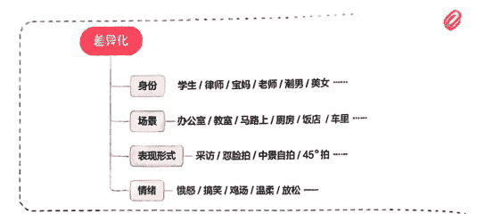

## 举个例子

如果你打算成为一名育儿博主，只是端坐在书柜前一本正经地讲解育儿知识——内容虽好，却很难让人记住。毕竟，大多数育儿博主都是这样做的。

不妨试试以下几种方案。

**方案一：** 一位宝妈在国外陪读，以典型的国外住宅区为背景，偶尔有路人经过。她采用日常聊天的语气，分享育儿经验。

**方案二：** 妈妈和孩子一同在大自然中玩耍，休息时随意坐在地上。她的丈夫在一旁以采访的形式提问：“你为什么选择这样教育孩子？” 她则娓娓道来，语气轻松自然。

**方案三：** 父母因孩子的教育问题发生争论，随后请孩子来“评理”，最终共同给出解决问题的方案。通过家庭互动与对话的形式，传递育儿观点。

这三种方案，是不是比端正地坐在书柜前讲述，更容易吸引用户的注意？

其实所谓差异化，并没有多么复杂——核心就在于**要和别人不同！**

### 如何做好口播短视频？

#### 流量密码

口播，是当个好博主的必备能力。

口播短视频是自媒体平台中的重要内容形式，小红书也不例外。它比图文更生动，更容易吸引用户的注意力，能与用户实现很好的链接。同时，又没有拍摄长视频那么复杂，需要考虑一系列专业的拍摄问题。口播短视频通过声音和视觉的结合，能够清晰地传递信息和讲解复杂概念，帮助观众更好地理解和吸收内容。

博主可以通过口播短视频展示自己的个性和特点，如语调、表情、肢体语言等，这样的个性化表达有助于建立与观众的情感连接。此外，口播短视频时长通常较短，观众可以快速获取信息，适应现代人快节奏的生活方式，同时也便于在社交媒体平台上分享和传播。

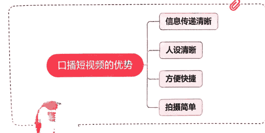

## 解决方案

口播短视频一般分为商品类和观点类。无论哪一类，都需在开头、正文和结尾处下功夫。

##### 1. 商品类口播

**（开头）吸引兴趣**：可以使用一个有趣的故事、一个问题或者一个令人震惊的结论来开始。
**（正文）点燃欲望**：突出产品的特点，以及如何解决用户的问题，承接上面开头的兴趣。
**（结尾）引导行动**：直接转化。

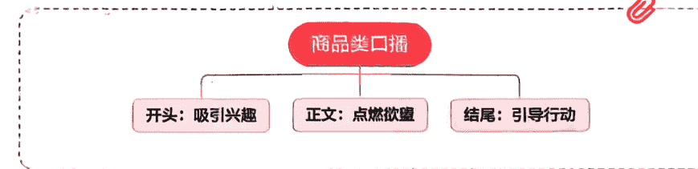

##### 2. 观点类口播

**（开头）核心观点**：一语道破观点，这里也可能是金句。
**（正文）案例故事/个人经历**：讲述故事，展示论证观点的素材展示。
**（结尾）核心干货**：总结解决方案，引导互动。

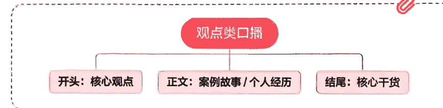

## 举个例子

**1. 商品类口播**

**开头：** 当你有个懂面料的好衣品闺蜜，她告诉你，低于 100 元的外套要谨慎选择。

**正文：** 一分钱一分货，低价衣服一般用低价面料，很有可能甲醛超标。认真看看标签成分，如果不懂，就不要乱买。选我给大家挑好的，对自己的健康负责。

**结尾：** 直接点击左下角购物车，面料安全有保障。

**2. 观点类口播**

**开头：** 跳槽是实现工资翻倍最好的手段。

**内文：** 我曾经是个高中辍学的学渣，毕业后做了很多工作，最低时月薪才 2000 元。但是我认真对待每一份工作，每次跳槽都把曾经工作过的职位要点总结下来，这些年我自己也成长了不少。直到有一次遇到现在的老板，我用我之前的成绩积累和人品拿到了 9000 元的薪水。机会只留给有准备的人。

**结尾：** 关注我，持续更新更多职场干货。

### 如何拍摄优质的口播短视频？

#### 流量密码

和封面一样，有质感的视觉效果更能取胜。

有质感的口播画面，会让人觉得更专业，更亲切，赏心悦目的同时还能建立起好感和信任。当然，新博主在做口播短视频的拍摄时可能会遇到很多问题，一定要多加练习。分享几个拍摄技巧，可以帮你做出效果更好的口播短视频。

## 解决方案

##### 1. 构图

**中景拍摄**：捕捉到人物腰部以上的部分，这样的构图既能展现人物的表情和上半身动作，又不会显得过于局促。
**人物位置**：将人物置于画面中心，上方留出适当的空间（约1/6到1/3），左右两侧也适当留空，以避免画面过于拥挤。
**拍摄角度**：确保拍摄主体正对镜头，以便于观众与人物建立直接的视觉联系。

##### 2. 布景

**背景选择**：选择窗帘或素净规则的墙面作为背景，避免使用对比太强的颜色。
**道具运用**：在画面的角落或人物背后适当增加道具，如书本、盆栽等，以增加画面的丰富性。注意道具的选择和摆放要恰到好处，避免过多或遮挡主体。

##### 3. 打光

**面光：** 使用专门的面光灯来照亮拍摄主体，这是让人物看起来更好看的关键光源。

**自然光：** 利用自然光源（如窗户），让光线从侧前方打在人物身上。注意避免过曝和阴阳脸的问题。

**日常光：** 家中的台灯、落地灯也可以作为有效的光源。将主光源置于人物斜上方 30° ~ 45° 的位置，副光源置于人物斜后方。营造立体感和深度。

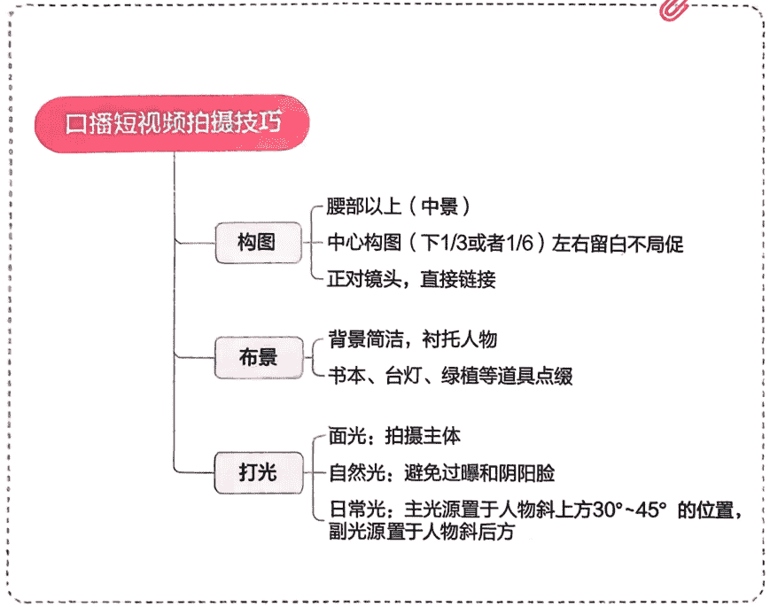

## 举个例子

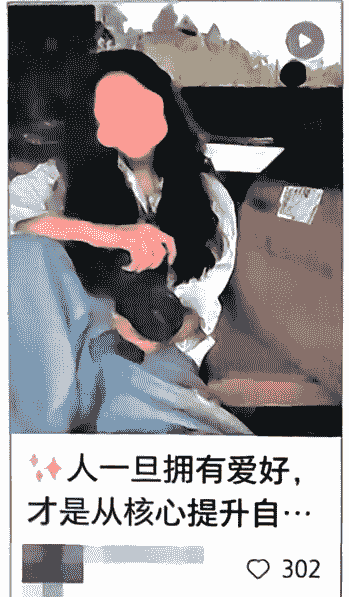

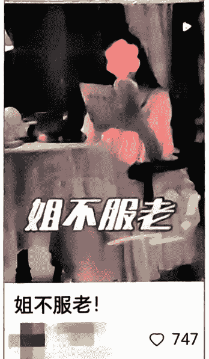

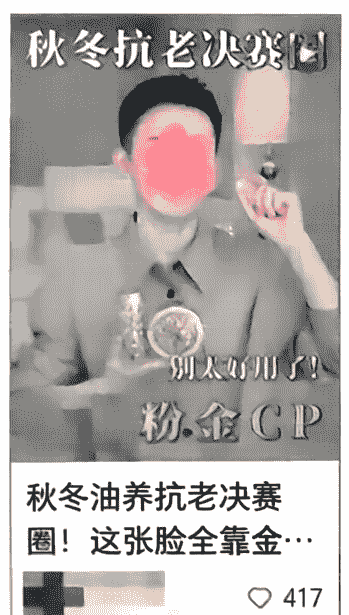

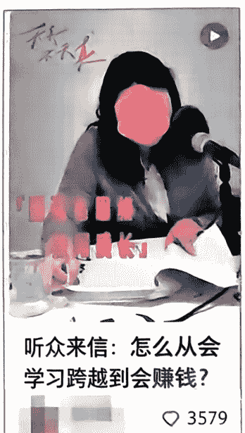

## DAY8 如何创作优质短视频？

- 如何做出有内容的短视频？
- 如何使用剪辑模板？
- 如何做纪录片式图文笔记？

前面做了那么多的准备工作，就是为了拍出更优质的短视频。之前说到口播短视频是入门级的形式，那么接下来就来说一说如何创作优质的短视频。

### 如何做出有内容的短视频？

**流量密码**

你做的是自媒体，不是小学生的流水账。

很多人喜欢拍自己的日常，从早上起床开始，做早饭，穿搭，出门，工作，午休，锻炼，乘坐交通工具；再到晚上回家，刷剧，做家务，等等。生活看似很丰富，其实什么内容都没有。这种 Vlog 就是流水账，无论你拍得有多好，都不会改变内容没有主题、非常散乱的事实。

## 解决方案

这里有三个方法：贴标签、口播式、情感向。

##### 1. 贴标签

对于小红书平台来说，视频内容的**点击率**和**跳出率**是重点考查数据。使用标签的好处在于，能快速吸引对你内容感兴趣的用户。无论是羡慕你的生活方式，还是和你有相似的状态，他们都更愿意点开你的笔记。
标签一方面有助于提升点击率，因为它能精准吸引相关受众；另一方面，如果在视频开头就点明个人标签或内容亮点，还能显著降低前 5s 的跳出率。当用户停留时间变长，系统会判定你的内容质量较高，从而给予更多推荐流量。
此时，如果你的 Vlog 能呈现出令人向往的生活状态或精神面貌，便更容易唤起用户的情绪共鸣，进一步强化内容的传播效果。

##### 2. 口播式

Vlog 为表现形式，实则采用了口播的核心表达方式。但是这种方式和前面讲到的口播不一样，博主不用面对镜头，而是通过拍摄生活日常的画面，配合博主的旁白画外音。很多博主的笔记都是这个逻辑。其实，她们的 Vlog 和口播的内容没太大关系，基本都是办公、生活的视频片段。而这类博主本质是口播博主，只是使用了 Vlog 的形式。

##### 3. 情感向

如果你很擅长写这类内容，可以试试，很容易出爆款。但是需要注意，鸡汤文写得好不好直接决定了你笔记的质量。如果没有十足的把握，不建议从鸡汤文开始，鸡汤文的难度很大，非常考验文案能力和拍摄能力，且无法速成。

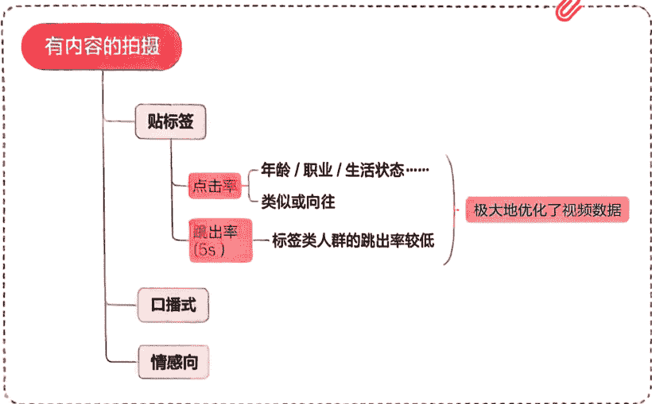

## 举个例子

**1. 贴标签**

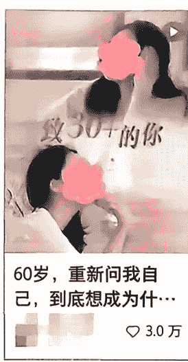

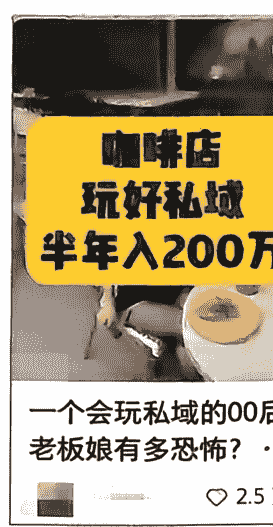

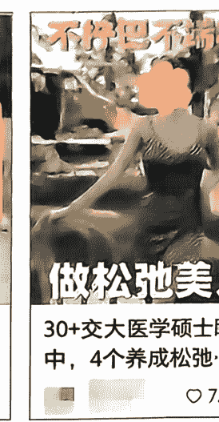

其中可以提炼的标签如：

- 60 岁致 30+
- 灵魂问答
- 名人
- “00 后”老板娘
- 开咖啡店
- 年入 200 万
- 30+
- 交大医学硕士
- 松弛美人

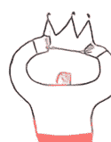

**2. 口播式**

这个博主的全部 Vlog 都是办公、生活的视频片段。她就是用 Vlog 的形式讲干货。

**3. 情感向**

最近“治愈系”的内容都特别火，如果你的文案和拍摄能力够强，或者你会画画，可以尝试走这个路线。

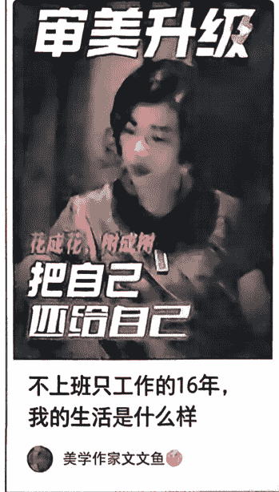

### 如何使用剪辑模板？

**流量密码**

素材拍得好不好是一回事、剪辑技术可以给你的短视频加分。

一则优质的短视频，单从技术层面讲，前期拍摄和后期剪辑都很重要。但是，拍摄能力需要长时间的努力练习，才能得以提升，而剪辑部分却是新手很容易上手的，并且很多软件自带剪辑模板、基本能做到一键成片。所以，建议先使用剪辑模板，后面再去提升拍摄能力。

## 解决方案

学会简单的剪辑方法，事半功倍。在这里我们以常用软件剪映为例。
打开剪映软件，点击最下面的“剪同款”按钮。

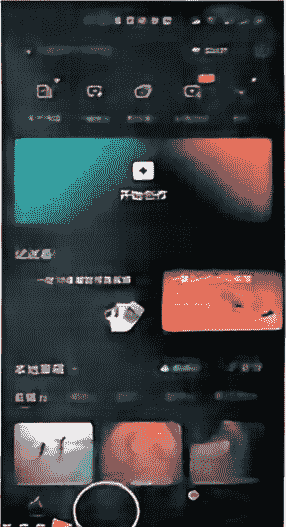

这里有关于短视频时长和短视频片段数量的选择。设置为需要的参数，然后系统会提供合适的模板。

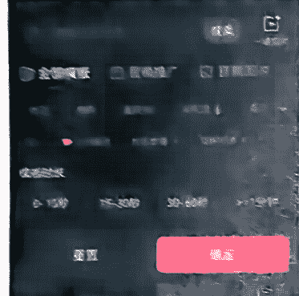

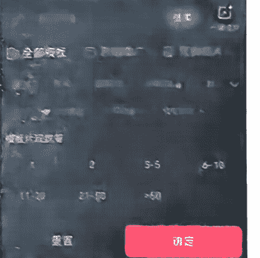

点击“确定”按钮后，系统会显示很多与你选择的时长和片段数相同的模板样片。可以依次点击，看看是不是你想要的感觉，最后选择一个你想要的视频片段。

点击右下角的“剪同款”按钮，即可直接套用模板。

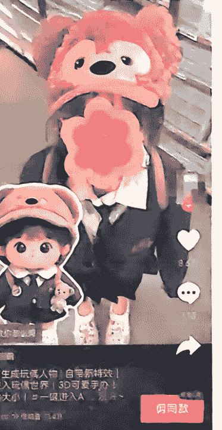

选择你之前拍摄的素材片段，再点击“下一步”按钮，一则短视频就制作完成了。

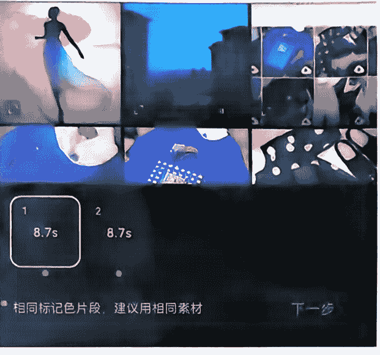

当然，这只是剪辑里面最基础的功能，如果想自由创作，则需要深入学习。无论是拍摄技巧还是剪辑技巧，都是如此。

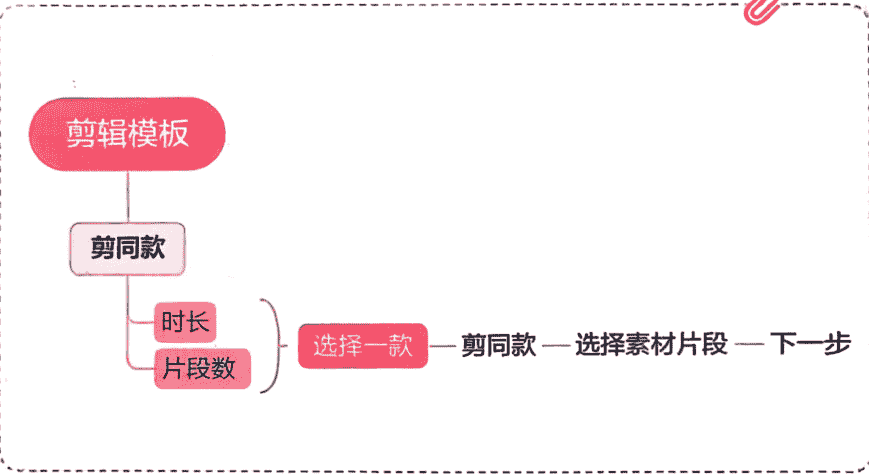

### 如何做纪录片式图文笔记？

**流量密码**

图文模式更适合新手小白。

虽然现在已经是短视频的时代，但是自媒体小白最好还是先从图文内容开始做起。
在碎片化的时间里，用户更倾向于快速浏览、迅速抓取信息。一篇精心编写的图文笔记，能够让用户在等车、排队的间隙迅速获取知识。这种便捷性是视频难以比拟的。

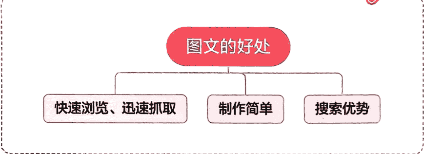

而短视频的信息是顺序呈现的，不太方便用户快速定位到需要重复查看的某个细节，通常需要重复播放整段视频。且图文笔记不需要专业的拍摄设备，也不需要复杂的剪辑技巧，大大降低了创作门槛。此外，小红书平台对于图文内容的搜索会更精准。
但是，普通的图文笔记太难获取流量，这里介绍一种优质的图文笔记模式。

## 解决方案

纪录片式图文笔记制作方法如下。

##### 1. 拍摄

使用手机横屏拍摄照片，请注意拍摄过程中不需要说什么实际的内容。只需要对口型，再加上各种情绪和各种手势，如惊讶、喜悦等。每个动作尽量保持 3s 以上，方便拍摄时聚焦。

##### 2. 选图

在拍摄的照片中选取比较适合的表情和手势 3~9 张。一般情况，3 张照片可以拼成一张页面，可以根据自己要做的页面数量考虑拍摄和选图的数量。

##### 3. 拼图

将选择的照片导入美图秀秀，可进行美颜，也可直接拼图。点击“拼图”按钮，导入刚才选中的图片，3 张一组，然后选择比例 3：4（小红书标准比例），再选择上中下三层的模板。

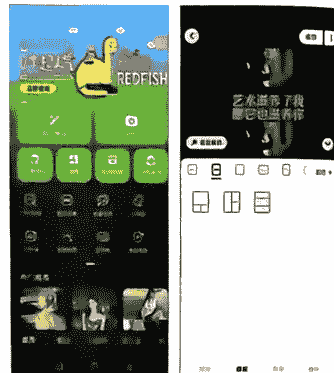

最后点击右上角的“保存”按钮即可，图片会自动保存到你的手机相册里。

##### 4. 文字

回到美图秀秀首页，点击“图片美化”按钮，导入刚才拼好的图片，然后点击底部“文字”图标，添加文字，可以调整样式和字体。添加文字后建议添加描边，让文字更清晰。可以根据自己的审美进行调整，但不建议太细。

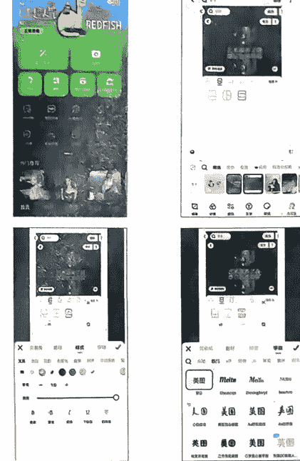

> 注意：此种格式对文案要求比较高，尤其是首屏，请务必在首屏中展现一些亮眼的观点或者金句。

## 举个例子

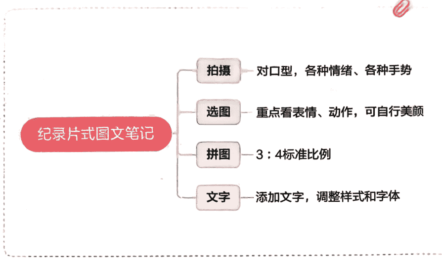

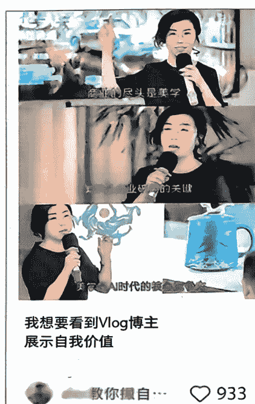

## DAY9 如何发布内容？

- 如何升级起号五件套？
- 如何发布笔记？
- 最佳发布时间是什么？

前面这些天所有的准备，都是为了今天的发布。但是，发布不是点击小红书首页下面的红色“+”按钮，然后编辑一篇笔记发送那么简单。在这之前，还有很多发布前的工作和注意事项，我们一步步来完成。

### 如何升级起号五件套？

**流量密码**

起号五件套，是涨粉的关键。

头像、昵称、简介、标签、背景图俗称起号五件套。要知道，当你制造了爆款，流量袭来后，用户会下意识地点进你的主页，首先看到的就是你的头像、昵称、简介、标签、背景图。如果起号五件套不够吸引人，用户就不会关注你，你也就不会涨粉了。

## 解决方案

**1. 头像**
用户的目光停留在头像上的时间，其实一秒都没有。但头像却是留给用户第一印象的关键。头像最好用真人照片，这样更有可信度。不一定是正面，但不建议是背面。有些博主喜欢选用卡通或者风景头像，除非这个头像照片和你的内容及产品关联度非常强，否则就很难让用户产生信任感。

**2. 昵称**
一个好昵称是至关重要的，这是人们能否记住你的重要标志。甚至有些时候，你仅仅是在其他博主的评论区留言，也会有用户因为你有意思的昵称来关注你。

昵称可以用这几种方式：昵称 + 行业、昵称 + 愿景 + 数字、昵称 + 独特性。小红书规定，每 7 天可以更换一次昵称。所以，你可以在运营过程中进行修改和调整，它并不是一成不变的。

**3. 简介**

简介要在尽可能精简的文字中，向用户传达你是谁。这一部分值得反复琢磨，我们可以回到 DAY1，看看之前我们做的关于人设、赛道定位等资料。

你可以写你跌宕的人生故事，让用户好奇；还可以写你的经历，做好高效背书，取得用户信任；还可以写你能带给用户的价值，让用户愿意关注你。当然，这一部分也可以是你的愿景，并且这一部分一定要和你的产品有关联。你看，DAY1 做的准备工作是很有用的，并且在后面的运营过程中，还会反复思考升级。所以一天一天地去改变，一天都不落下。

**4. 标签**

这一部分相对简单，小红书有专门的分类，你只能选择。但标签是对一个博主的归纳总结，是对你的人设最直接的定义。所以，一定要找到最适合自己的标签。

**5. 背景图**

很多人都会忽略背景图，其实背景图很重要。它相当于你的“氛围组”，配合你的昵称、简介和标签，给用户最直接的视觉呈现。所以，背景图要好好选，它是能代表你的行业、你的专业、你的能力甚至你的成果的。例如，你的工作场景，或者你的荣耀时刻，甚至你的产品。

## 举个例子

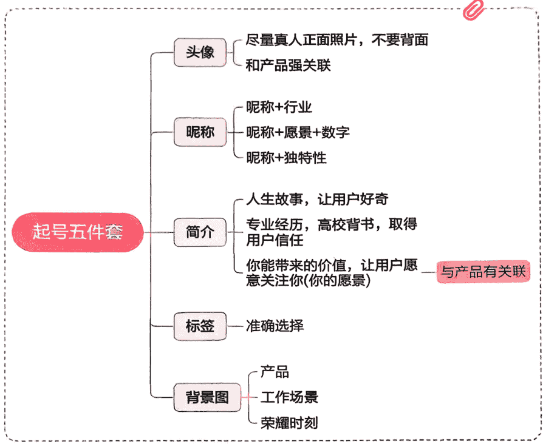

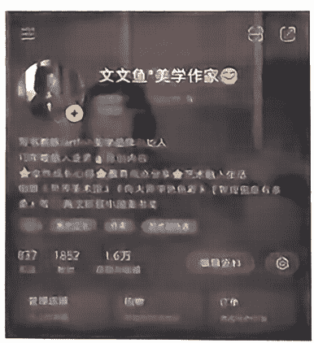

## 如何发布笔记？

**流量密码**
学会带 # 话题，是吸引流量的关键。

发笔记，不是只有简单的发布动作，还要学会带 # 话题，你可以理解为合理的“蹭流量”。在小红书平台，官方会给出一些近期比较热门的话题供你选择，在我们发布每篇笔记时，都建议适当地带些相关的话题。

## 解决方案

在小红书页面，点击左上角的“更多”按钮☰，会弹出侧边菜单栏，选择第二项“创作者中心”。

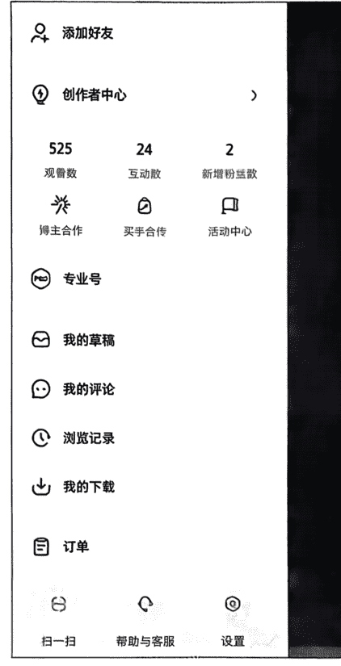

## 流量为王：10 天小红书运营法则

进入“创作者中心”页面，稍微往下划一划页面，就能看到官方推荐的很多热门话题。这些话题都是已经被验证过的有流量、有热度的话题，你只需要选择其中一个即可。

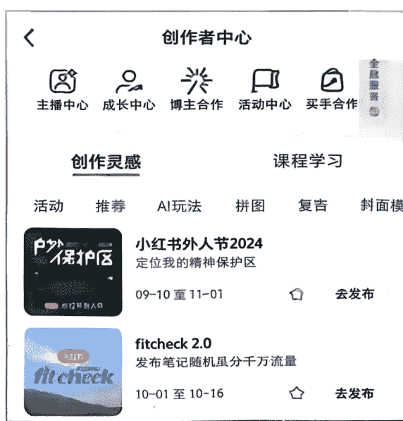

选择一个适合自己的赛道，再选择一个喜欢的话题，可以通过标题下面的发布数据评判这是否为你需要的优质话题。可以收藏，也可以直接去发布。这时要用到在 DAY3~DAY8 这几天中创作好的笔记内容了。

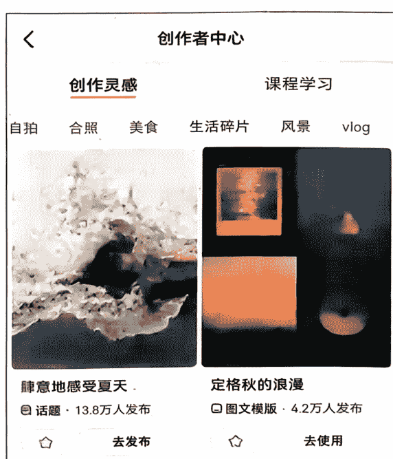

当然，在发布的过程中，还可以选择添加其他相关话题标签，但要注意，不要自己创建话题，你要选择的是相关话题中流量很好的，一般点选的时候都会选择这个话题的流量热度数量。不过，标签也不是可以无限选择的。目前，小红书有 10 个话题标签的上限。话题标签要精准添加，因为这也是你在自媒体的茫茫大海中，与精准的用户相互联通的重点。前面讲过，封面和标题是重中之重，而话题标签则是推波助澜的帮手。

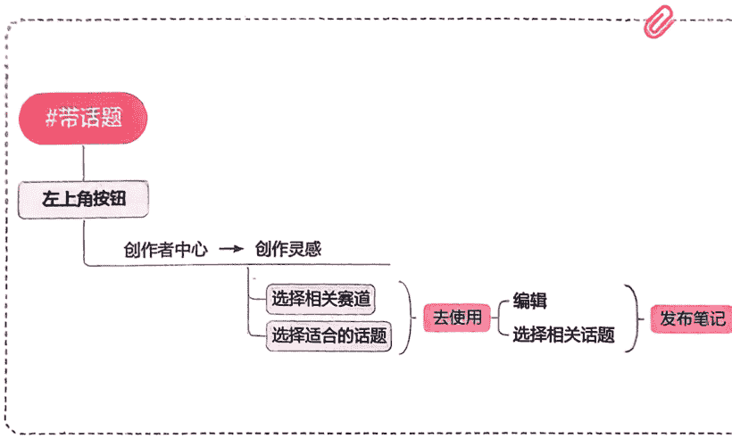

## 举个例子

完成上面的操作流程后，你就可以点击右下角的“发布笔记”按钮了。

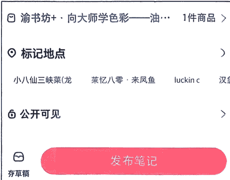

## 最佳发布时间是什么？

> 流量密码
内容是基石，时机是关键杠杆。

很多新手发笔记很随意，总是想起了就发一篇。要知道，你的目标客户一定是聚焦到每天的具体时段的。只有了解客户的使用时间习惯，才能知道自己适合在什么时候发笔记。否则可能会错过客户的阅览时间。

## 解决方案

我们按照时间段，把用户的使用时间习惯分为以下六个板块。

- ⏰ **6:00—8:00**
  用户的起床时间，局限性较大，且不一定有时间看手机。但看手机的可能是有一定学习需求的。建议本时间段发布学习思考类型内容。

- ⏰ **8:00—9:00**
  用户吃早餐或在出行的路上，有碎片时间，更容易关注资讯类、娱乐类内容。

- ⏰ **12:00—14:00**
  一般是用餐和午休的时间，闲暇时间容易关注社会热点包括购物、美食、轻松娱乐的内容。

- ⏰ **17:00—19:00**
  工作一天后的休息时间以及下班途中，碎片化流量较多，喜欢轻松娱乐的内容。

- ⏰ **19:00—21:00**
  黄金时间段，是大部分用户的休闲时间，用户活跃度高，属于**流量高峰期**，娱乐、影视、学习、购物等相关内容都很适合。

- ⏰ **21:00—23:00**
  进入夜晚，属于情绪主导时间。部分赛道可发，局限性较大，**情感类内容**更适合。

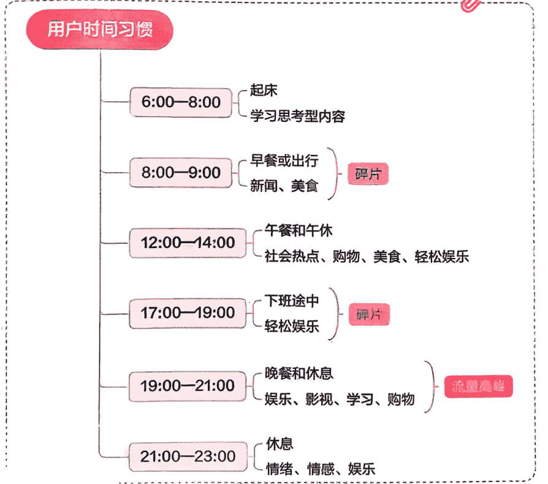

## 举个例子

如果想要发布一条关于美学的信息，那么最适合的时间段是在情绪主导的 21:00 以后。这个时间段的人们更想看到美好的事物和图片。

如果想要卖蛋糕，那么 8:00—9:00 和 17:00—19:00 的上下班时间都是最佳选择。早上是为了“卖早餐”，照顾那些匆忙上班没来得及吃早饭的人；而晚上的下班时间，则是饥肠辘辘的人们更想念美食的时间。

当然，我们还发现了一个重点，娱乐类的信息很多时段都适用，因为大多数用户在线上，就是想放松娱乐的。但凡有碎片时间，看看娱乐信息都是很好的选择。

## DAY10 运营期间要做哪些事？

- 如何做深度数据分析？
- 新手博主从哪里入手更好？
- 如何激活评论区？
- 出现爆款怎么办？

当你成功发布一条笔记后，是不是总是盯着“小眼睛”？千万别这样，“小眼睛”只是一个基础数据；而我们真正要做的事情还有很多，并且每件事都有特点和方法，一定要做好笔记。

## 如何做深度数据分析？

> **流量密码**
> 如果不及时复盘和总结，你就是在开盲盒。

很多博主都觉得，前面做了那么多准备，终于发布了笔记，这个工作就算完成了，接下来只需要每天或者隔 2 ~ 3 天发一次笔记就可以了。其实还真不是，发布笔记之后，最重要的工作才刚刚开始。

做好深度的数据分析工作，才是指导我们下一步行动的关键。**无数据，不运营**。所有的内容优化，都应该基于自己账号内容数据的反馈来做。做好深度的数据分析，才能明白自己做对了什么，做错了什么，哪些地方要优化，哪些地方可以趁热打铁，哪些地方该拐弯。**数据就是个强大的自检系统**，非常具有参考价值。

## 解决方案

小红书有专门的数据中心，已经帮我们统计好了重要的数据，可以直接查看。

入口：我→左上角按钮☰→创作者中心→数据中心

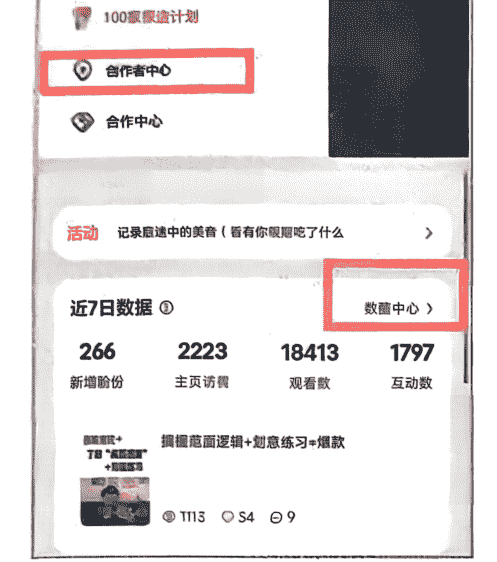

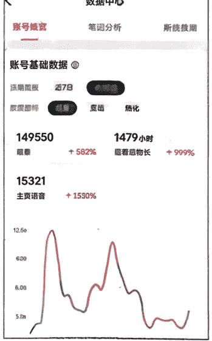

笔记发布后次日 15 点会更新数据，届时你可以看到整体流量粉丝的变化情况，以及单篇笔记的数据。

入口：我→左上角按钮☰→创作者中心→数据中心→笔记分析

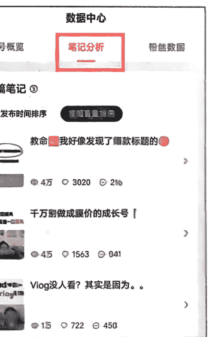

进入单篇笔记的分析页面后，点击任一笔记都可以看到详细的数据分析。图文和视频笔记的图表形式会有不同。

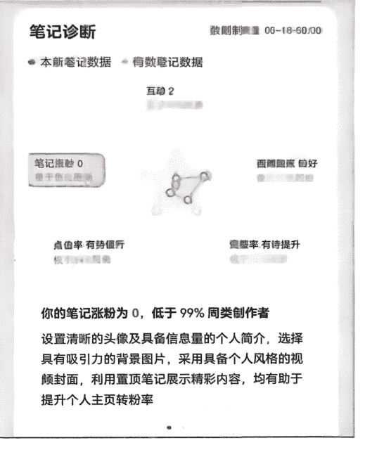

通过“观众画像”可以查看笔记观众的性别分布、年龄分布、城市分布、兴趣分布，以及你的观众来源。首页推荐占比越高，说明笔记最近被推送的频率越高，推送的流量越多。

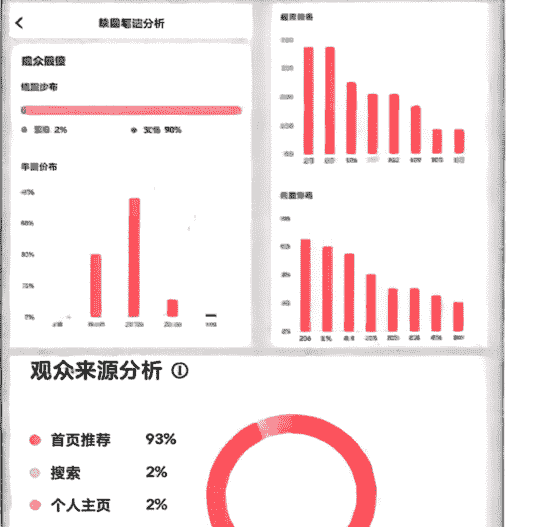

下面这五点，就是我们要分析的数据重点。

### 1. 播放量 / 阅读量 = 点击率

阅读量就是我们笔记的小眼睛数。例如，当一篇笔记被曝光 10000 次，其中 1000 个人点击了笔记，那么我们的点击率就是 10%。但是目前小红书没有开放此数据的具体指标，只能在笔记数据中看到点击率是很好 / 一般 / 有待提升。如果点击率是一般或者有待提升，则需要优化标题和封面，吸引用户的点击。

### 2. 互动数 / 阅读量 = 互动率

互动数 = 点赞数 + 收藏数 + 评论数 × 4 + 转发数 × 4 + 关注数 × 8

互动率如果超过 10%，就有成为爆款的潜力。反之，如果互动率一直较低，那么肯定是你的选题和内容哪里出了问题。

### 3. 新增粉丝 / 主页访问 = 转粉率

转粉率是指有多少人在看了你主页后选择关注你。如果有很多人看过你的主页，但是没有关注你，那一定要重新审视你的起号五件套。最重要的是修改你的简介，告诉用户你能给他们带来什么价值。

### 4. ( 点赞数 + 收藏数 ) / 粉丝数 = 赞粉比

赞粉比一般在 3% ~ 8% 比较正常。所以很多人也会根据自己的粉丝数，大致推算出自己的有效流量。

### 5. 完播量 / 播放量 = 完播率（视频）

完播率包括 5s 完播率和整体完播率，这个数据是系统评价你视频质量的重要指标。完播率越高，则说明你的视频质量越好。

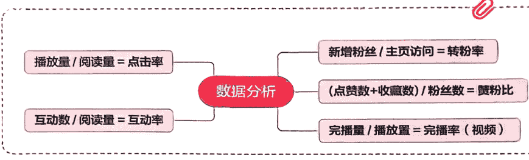

## 举个例子

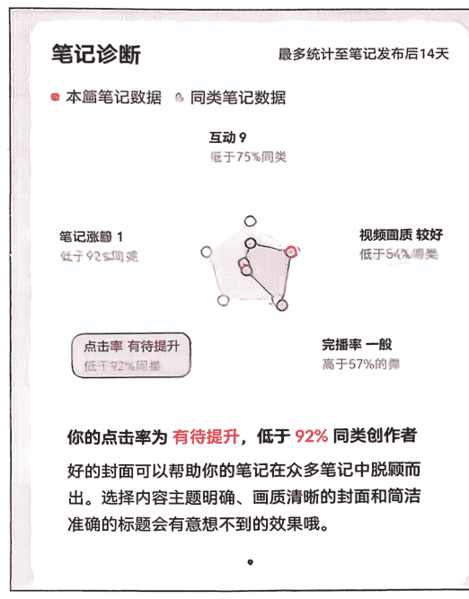

根据上面这个笔记数据，我们做如下分析和优化建议。

### 1. 点击率

如果点击率为有待提升，则需要优化笔记的标题和封面，吸引用户的点击。详细参考 DAY4~DAY6 的内容。

### 2. 互动率

互动数为 9，互动率非常低。那么你的选题和内容都要重新磨一磨。详细参考 DAY1、DAY5 的内容。

### 3. 转粉率

笔记涨粉 1，虽然数量非常少，但是在点击率不高的情况下还有涨粉，说明你还是能带给粉丝价值。详细参考 DAY9 的内容，尤其是起号五件套，你能带给用户的价值还能再优化。

### 4. 赞粉比

赞粉比这部分没有直接的数据统计，需要自己推算。就目前这个案例的情况看（粉丝数约 2000），赞粉比在合理范围。

### 5. 完播率

完播率为一般，说明开头做得不错，内容前半段还是能吸引一部分人。但后半段没有让人有看完的想法，正文和结尾都需要优化和调整。详细参考 DAY5 的内容，继续优化。

## 新手博主从哪里入手更好？

> 流量密码
> 新手博主要先抓重点，再循序渐进。

分析了这么多数据，新手博主可能会觉得千头万绪无从下手。接下来，我们帮新手博主梳理了三个重点数据，好上手才能循序渐进。

## 解决方案

新手博主可以重点提升以下三个数据。

- **点击率**：调整封面和标题。
- **互动率**：增加笔记内容的价值，给用户提供价值。
- **转粉率**：优化主页。

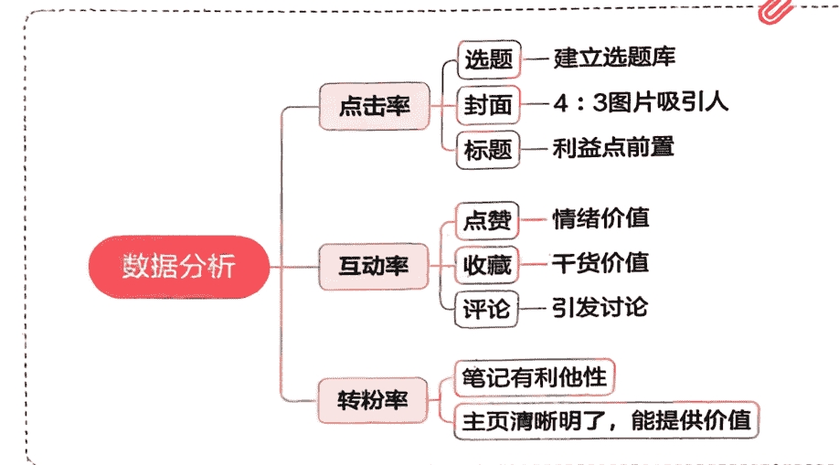

## 举个例子

新手博主还可以准备这个《小红书数据分析表》：

| 发布时间 | | | | | |
|---|---|---|---|---|---|
| 笔记标题 | | | | | |
| URL | | | | | |
| 阅读量（小眼睛） | | | | | |
| 点赞 | | | | | |
| 收藏 | | | | | |
| 评论 | | | | | |
| 分享 | | | | | |
| 涨粉 | | | | | |
| CES 评分（预估） | | | | | |
| CES/阅读量 | | | | | |
| 点击率（定性非定量） | | | | | |

把自己的笔记整理下来，对照查看，再对照上面的数据分析表，一一查找问题，优化笔记。这个过程也不是一天就能做完，持续练习，反复优化。

## 如何激活评论区？

**流量密码**
绝对不可忽略的评论区。

评论区常常是容易被忽略的地方，很多人仅仅将其视为用户随意发言的场所。但正如我们之前讨论的，小红书的推荐算法核心看重的两大指标就是点击率和互动率——点击率依赖选题、封面和标题的吸引力；而互动率，如点赞和收藏则更多反映内容本身的质量。

相比之下，评论区的运营，实际上是一个“低投入、高回报”的互动策略。积极而有效地经营评论，不仅能显著提升互动数据，还能借助平台推荐获得更多流量。

此外，你还可以从评论区挖掘用户的热议话题和高赞留言，这些真实的声音往往直击痛点，甚至能为你提供下一个爆款选题的灵感。

## 解决方案

### 1. 设置争议话题

在选题时选择一些有争议性的话题，无论用户喜欢或者不喜欢，他们都会评论，甚至会在评论区和其他人争论起来。不必过于在意他人的看法，有价值的成长往往伴随争议，真正的坚韧是在不同反馈中持续精进。

### 2. 评论区留资料

让用户在评论区留言需求，你可以提供一些干货资料，从而提升互动量。

### 3. 在评论区中多互动

积极回复用户的留言，通过回复来维持和增加评论区的活跃度。你每回复一条评论，都有可能会让用户再多回复你一条。这样，就增加了你在推荐算法中的权重。对于一个新手来说，你当然应该尽可能地回复每一条评论。

### 4. 用评论引导用户访问主页

笔记发布后，在评论区中做一些运营动作引导用户访问主页。

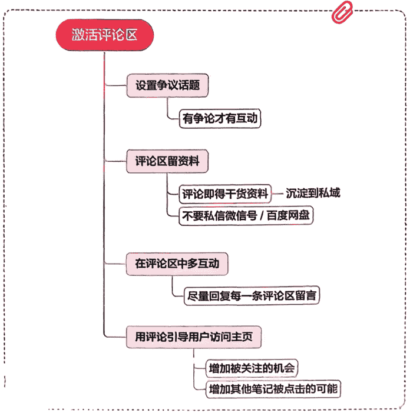

## 举个例子

1. 设置争议话题
   例如，一篇笔记《30 岁人生建议：别预设困难，大部分人都很水》，最终有 2.4 万赞。评论区就对“世界是不是个草台班子”这个话题进行了谈论。有了意见的冲突，就有了争论，也就有了讨论，于是就有了好的互动。

2. 评论区留资料
   例如，《一招搞定 PPT》笔记内容中提到：“需要这个方法的在评论区告诉我，送给大家。”引导用户留言，当然你也要兑现承诺，把资料送给留言的人。利他，是运营自媒体的重点。

3. 在评论区中多互动
   在评论区中多互动这部分没有太多好举例的，日常回复就好。但更重要的是，多关注你的粉丝在想什么、问什么，便于你更了解他们想要什么。

4. 用评论引导用户访问主页
   例如，“关于这篇笔记中提到的 × ×，可以看我置顶笔记哦”。以此增加被关注的机会及其他笔记的点击量。

## 出现爆款怎么办？

> **流量密码**
> 爆款的出现，不是让你暗自窃喜，而是要乘胜追击。

这 10 天你很辛苦，但是功夫不负有心人，你有一条笔记成了爆款。你看到阅读量猛涨，点赞、收藏和评论也络绎不绝。这时你可能很开心，但是千万别觉得这就是成功，**乘胜追击才是持续胜利的关键**。

## 解决方案

如果有一条笔记成了爆款，你需要首先**置顶一条评论**，这条评论的内容是可以**放大你的转化率**的。你可以根据笔记内容，考虑是引导用户关注主页，还是留言获取干货资料。

然后，你要**拆解这条笔记**，用 DAY4~DAY6 练习的内容，分别总结出笔记的选题、标题、封面、内容等等的特点。根据这些特点，继续创作后面的内容。很有可能你最近发布的几条都会是爆款。持续做下去，再持续优化。

## 流量为王：10 天小红书运营法则

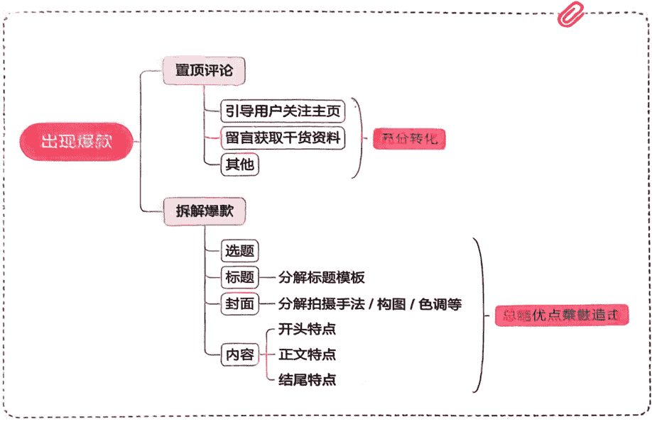

## 举个例子

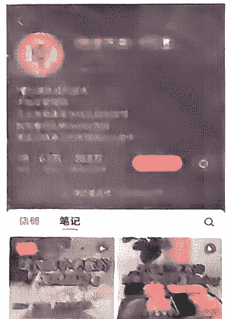

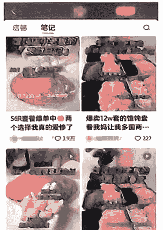

一个账号一直重复发布同一类笔记，据说一共卖出超 100 万单的馄饨，它是怎么做到的。

### 1. 看看选题、标题和封面

博主主要使用的封面素材有咸鸭蛋（明黄色）、蟹籽 + 肉馅（红色系）、虾仁 + 肉（Q 弹质感），这些封面素材的选择，能勾起人的食欲，所谓“色香味俱全”，最重要的就是色。在自媒体平台中，美食内容既不能传递香味，也不能品尝味道，只能传达色。所以美食类内容要突出“看上去很好吃”。

### 2. 看看内容

| 时间 | 内容 | 优点 |
|---|---|---|
| 0—5s | “95 后”第 4 次创业，开 400 平方米的馄饨店开店日常 | 每一篇的开头都一样，设定好人设，“95 后”年轻人经过多次创业，给人靠谱的感觉，并且馄饨店有 400 平方米，远超一般的几十平方米的小馄饨店，增加用户的信任感 |
| 6—10s | 哈喽，宝子们早上好！最近一直在没日没夜地赶货，每天至少要包 200 斤肉 | 表达出货量巨大，每天都是新鲜采购的食材，让用户潜意识中认定是新鲜食材 |
| 11—28s | 先来 60 斤藤椒鲜肉的给阿姨们包着，咱小哥刚刚切好的 20 斤虾块。这样的蟹子每天要用四五包，给他搅拌到肉里，还有皮蛋和咸蛋黄的臭香臭香且口感软糯的皮蛋馅，咸香沙沙的咸蛋黄馅都准备好等会儿包 | 这部分的画面全部是处理食材的内容，你能看到把蟹籽和肉进行混合，虾块被切好分装在不同的盒子中，等等，都是刺激用户食欲的鲜艳画面 |
| 29—40s | 我的包馄饨军团已经拓展到 20 多号人了，新来的阿姨也很快就能上手。虽然数量在不断增多，但我们的质量不会下降，每天的食材都严格把控，只为了让各位宝子们吃得健康放心 | 这里不断强调自己产品的质量有保障，破除用户下单前的最后一点顾虑 |
| 41—46s | 非常感谢各位宝子们的支持，我们会继续努力的 | 最后的感谢 |

她的每一篇笔记、视频内容结构都大致相似，这是典型的，爆款是相似的。或许博主之前也尝试发过很多笔记，忽然有一天发布了一条爆款，然后她拆解了上面这些元素，找到了底层逻辑，然后持续复制，6 个月卖出了 100 万单的馄饨。

## 推荐阅读

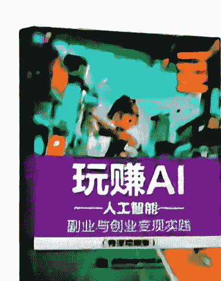

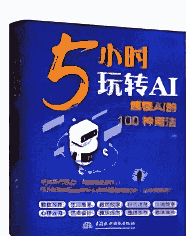

责任编辑：柯尊斌

## 从0到1，每日一练，步步为营，带你快速掌握小红书爆款逻辑！

- ✓ 10天明确人设
- ✓ 建立选题库
- ✓ 爆款标题写作
- ✓ 制作优质封面
- ✓ 掌握短视频创作

### 1. 10天速成体系，结构清晰、节奏紧凑

全书按“10天”划分章节，每天聚焦一个核心主题，从认知建立到实操落地，层层递进。适合新手快速上手，也便于读者按计划每日学习、同步实践。

### 2. 以实操为导向，可参考性强

每章都围绕具体主题展开，涵盖选题库搭建、爆款标题写作、高点击封面设计、口播脚本结构、优质短视频制作等具体技巧，可即学即用，降低创作门槛。

### 3. 覆盖小红书运营全链路，紧扣“流量”核心

从账号定位、人设打造、内容生产（图文+短视频）到流量获取、数据复盘和初步变现，紧扣“流量”目标，完整打通素人起号的关键环节。

### 4. 聚焦平台特性，深度适配小红书生态

针对小红书特有的“搜索+推荐”双流量机制、用户“种草”心理、高颜值视觉偏好，并对封面点击率、标题关键词、标签使用等平台关键指标进行有针对性讲解，提升内容曝光效率。

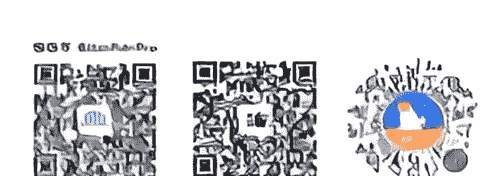

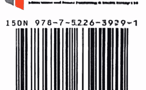

销售分类：个人成长/自媒体运营

定价：49.80元