# 智能算法通览

# 随时随地阅读

当当云阅读

## 书籍概览
本书由浅入深把理论与实践结合，梳理智能算法的入门路径，帮助读者打开算法之门。全书共八章，涵盖算法诞生背景与核心概念、支撑计算的数学基础、信息学算法与数据结构的通用知识、业界主流的机器学习方法；同时拆解算法工程的构成，并以一个典型实战案例带领读者亲身感受算法价值，并点出智能算法的三大研究方向，为后续进阶做准备。

各章皆采用总分总的写法，末尾归纳关键词便于查阅与回顾。第 2 章至第 7 章配备若干代表性思考题，巩固所学。本书适合从事智能相关技术工作的从业者、高校相关专业的在校学生，以及在 AI 领域工作一至两年内的职场人士阅读。

## 推荐序
进入21世纪后，伴随大数据与软硬件技术的快速演进，机器学习的研究与应用在全球持续升温。语音识别、图像识别、自动驾驶、虚拟现实、机器人等前沿进展都离不开机器学习的驱动。与历次工业革命相类，机器学习是一种能够释放巨大生产力的变革力量。它致力于让计算机模仿或实现人类行为，通过不断调参与配置，使模型在对话、翻译、游戏、驾驶等任务上的表现持续提升。它是当前人工智能发展的主线，也是赋予计算机智能的核心路径。如今谈及 AI 算法，多指代机器学习算法。

机器学习是典型的交叉学科，涉及概率论、统计学、组合数学、最优化等多个分支，入门门槛不低。如何降低门槛，让更多人理解、掌握并改进相关方法，进而落地到工作中，是亟待解决的课题。本书正是这一探索的有益尝试。

全书共八章，内容充实，对常用机器学习方法作了通俗而深入的解读。围绕机器学习算法展开理论与实践，在保证完整性的前提下突出各环节的关键问题。从广度看，既关照偏逻辑的信息学算法，也兼顾偏数据类型的机器学习算法；从深度看，覆盖相关数学原理、算法原理与工程实战。

作者吕磊曾师从笔者于山东大学攻读硕士，毕业后先后在京东、阿里巴巴、亚马逊、微软的 AI 部门任职，具备较为丰富的工业界算法应用经验。

本书可作为对人工智能与机器学习感兴趣的本科生、研究生及程序开发人员的入门参考。

禹晓辉

加拿大约克大学信息技术学院副教授

山东大学计算机科学与技术学院兼职教授、博士生导师

## 前言

### 这本书的缘起
笔者在算法相关岗位工作后，身边常有人询问“算法究竟指什么”“如何理解人工智能”等问题。他们在电视、网络自媒体与新闻中频繁接触到 AI 相关信息，保持高度兴趣。

交流后大致可分为两类。第一类希望从事或转入 AI 算法岗位；第二类不打算学习算法，却想弄清其原理、项目运作方式与规律。无论是入门需求还是宏观需求，市场上已有不少资源，如吴恩达在 Coursera发布的机器学习课程、斯坦福大学的 CS 在线课程系列、周志华的《机器学习》以及各类网络教程，都是优质材料。可惜的是，对多数人而言，一方面 Coursera 与斯坦福课程门槛较高，零基础难以起步；另一方面，大多数资源在某一方向讲解扎实，却很少以算法为主线串联整体内容，很少同时满足入门与鸟瞰。学习者往往需要整合多源信息，才能形成较为完整的认知。

与朋友讨论时还发现一个现象：大家常提到两类算法，一类是信息学算法，一类是 AI 算法。二者同名，却缺乏权威的划分标准。常见说法是，信息学算法有确定答案、准确率可达 100%，而 AI 算法的答案不确定，结果准确率通常也达不到 100%。从此角度看，信息学算法的运算过程与简单数学运算并无本质差异，每一步都有明确结果，最终得到确定答案。AI 算法在每次训练后准确率并不固定，正体现了智能高低的差异。尽管人工智能摆脱人工尚需时日，但 AI 围棋、语音助手、自动驾驶等已出现令人惊叹的人工奇迹。

在《樊登读书》中得到另一种视角：世界上有简单科学，也有复杂科学。简单科学可拆分为多步，每步输入输出清晰，因果可追溯，如建造大楼或飞船。复杂科学则混沌，因果不明，如蝴蝶效应、群智涌现等。借此灵感可发现，信息学算法步骤与结果明确，AI 算法因果混沌，二者恰可对应简单科学与复杂科学的范畴，这一分法更富启发。

为兼顾入门与鸟瞰，一方面本书在内容取舍上必须大刀阔斧，同时保持结构完整；另一方面将两类算法并列呈现，帮助读者清晰认识异同。

本书也是笔者温故知新的成果。好记性不如烂笔头，通过归纳总结与再学习，笔者在 AI 算法层面有了新的体会与收获。

### 读者定位
AI 算法博大精深，任何一个分支都足以成书。本书作为概览性质的读物，内容难以构成完整系统的学习体系。加之个人信息采样的偏差，所选知识点未必具有绝对普适性。

目标读者包括但不限于与 AI 算法工作属性相关的人士、传统行业工程师、应届毕业生、职场新人等，前提是对 AI 算法感兴趣。爱因斯坦曾言兴趣是最好的老师。笔者希望读者读完后能对 AI 算法形成清晰整体认识，并据此深入感兴趣的环节。

### 内容与风格
本书从算法是什么起步，介绍发展简史与当前相关岗位与领域，逐步打开算法之门。首先甄选算法相关的数学基础，包括线性代数、排列组合、高等数学、概率与统计，为正式接触算法奠基。其次从信息学算法与数据结构切入，讲解常用概念与知识点，培养算法逻辑思维与数据结构观念。随后进入 AI 算法主题，从宏观视角将其分为两类，并挑选业界常见的机器学习模型，兼顾整体把握与具体原理。接着介绍算法工程的组成，并手把手完成一个简易工程项目，通过实践加深理解。最后挑选 AI 算法的三大研究方向，为进阶学习铺垫，并分享笔者对行业的思考与展望。全书由基础走向进阶，由理论走向实践，层层递进。

学习算法对数学基础与逻辑要求较高。本书尽量用贴近生活的例子直观解释概念，如向量、矩阵、数组、链表。并非所有知识点都能如此，如导数与梯度、概率统计中的各类术语等。对真正想入门的读者，需下功夫；只想了解的读者遇到难懂公式时，知晓其在 AI 中的作用即可，可跳过细节。

章节标题借用武侠小说中的内力、招式、武功秘籍，分别对应数学基础、信息学算法、机器学习算法。有人认为信息学算法与机器学习算法无关，其实不然。正如武侠作品中内力与招式是修炼武功秘籍的前提，数学基础与信息学算法不仅是学习机器学习算法的基础，更有助于思维模式的养成。

每章均采用总分总结构，末尾提炼核心关键词。第 2 章至第 7 章末尾配有思考题，帮助巩固理解。关于动脑时刻的答案，可关注对半独白微信公众号并回复动脑时刻获取。

### 局限性说明
本书局限。与同类机器学习入门书相比，本书 AI 算法篇幅较少，以帮助读者构建相对完整的算法基础知识体系为目的。作为约 200 多页的书，选择整体性就需舍弃部分性，这是最大局限。但知识体系持续迭代，真正面面俱到的书并不存在。授人以鱼不如授人以渔，本书的内容局限或许会成为目标读者的优先选择。

笔者局限。用一个词概括就是偏见。数据有偏见，写作也有偏见。AI 模型中需减少数据偏见带来的不良后果。写作偏见指作者既往经历与所处环境对写作的影响，包括认知水平、表达水平、专业水平、职业惯性乃至个人素养与品质。如有表达不当或失偏之处，敬请海涵。

吕磊

## 致谢
首先感谢阅读本书的读者朋友，你们的认可与支持是我坚持写作的动力。若本书带来收获，是我莫大荣幸。

其次感谢本书责任编辑电子工业出版社宋亚东先生。从对半独白公众号初次联系至今近三年，从立项到完稿过程不易，感谢一路帮助与鼓励。没有您的支持与鞭策，本书难以顺利完成，您是我旅途中的伯乐。

最后感谢我的妻子魏金璐。从校园恋爱至今，感谢你一路的付出与陪伴，无论工作还是生活，你的倾听与支持都给予我无穷动力。

吕磊

# 第 1 章 算法入门
在掌握一门技能前，先了解其需求与功能，学习目标会更明确，动力也更强。随着计算机硬件飞速发展，各类互联网数据、交通数据、气象数据等得以大量采集与保存。基于不同场景的数据，可归纳出规律，进而制定、调整、优化相应策略。归纳规律的方法正是我们要讲的算法。

互联网大厂中与算法相关的招聘不断增加。除典型的算法工程师外企中常称数据科学家外，还有数据分析工程师、数据挖掘工程师、机器学习工程师等。它们既有重叠也有差异。算法与数据分析、数据挖掘、机器学习有何联系与区别？算法与人工智能又是什么关系？带着这些问题，本章为你开启算法之门。

## 1.1 打开算法之门

### 1.1.1 算法简史
算法存在的前提是数据。最早记录数据的例子可追溯至约公元前 18 000 年的符木。旧石器时代的部落人群在树枝上刻凹痕记录物资供应与简单交易，并能通过比较凹痕进行基本计算，进而做简单预测，如食物可保存多久。

约公元前 4000 年，在幼发拉底河与底格里斯河畔的苏美尔人创造了璀璨的苏美尔文明，即美索不达米亚文明的开端。

在气候恶劣的地区，准确把握播种与收获时间至关重要。最简便的方法是利用月亮盈亏循环。由初亏到下一次初亏约 29 天半，被视为一个月；累积 12 个周期后一年过去，便是播种时节。殊不知一年实为地球公转一周，12 个月比太阳年短约 11 天。约 900 年后，苏美尔人才在年历中加入闰月以校准季节。

通过观察季节与天象，苏美尔人历经 900 年数据积累，形成人类首个算法模型太阴历。此后他们创制了 12 进制与 60 进制度量，即人类最早的十二进制与六十进制。如今世界通用的 24 小时制、60 分钟、60 秒、12 小时钟盘以及打等计量，都源于此。约公元前 2500 年，苏美尔人已掌握加减乘除，并形成早期几何与代数方法论。

时间推移至约公元前 300 年，古希腊数学家欧几里得提出辗转相除法，又称欧几里得算法。用以求两正整数 a 与 b a 大于 b 的最大公约数，等于 a 除以 b 的余数与 b 的最大公约数。步骤如下：
1. 输入两正整数 a 与 b；
2. 计算 a 除以 b 的余数 r；
3. 若 r 为 0，最大公约数为当前 b，算法结束；
4. 若 r 不为 0，则令 a 等于 b、b 等于 r，返回步骤 2。

约公元 100 年，我国古代张苍与耿寿昌撰写九章算术。该书总结了春秋战国至秦汉的数学成就，以问题集形式收录 246 个生产生活相关应用题并给出解法。缺点在于缺乏概念定义，也无理论推导与证明，直至三国时期刘徽作注才予以弥补。

总体而言，早期算法研究聚焦计算与日常生活相关数学问题。随着理论发展与科技进步，研究重心转向数据本身的规律与价值，尤其是生产生活大数据带来的预测与决策价值。

20 世纪上半叶数理统计学蓬勃发展。数理统计研究随机数据的收集、汇总与分析，并据此预测与推断。期间诞生两大统计学派：频率学派与贝叶斯学派。20 世纪初，Fisher 与 Pearson 为代表的频率学派推动数理统计成为成熟学科。他们从自然视角建模，认为概率即频率，参数固定可经估计获得。但这种上帝视角难以解决所有实际问题。20 世纪中期，曾被压制的贝叶斯统计迅速壮大，与频率学派分庭抗礼。贝叶斯学派不从事物本身出发，而是从观察者角度构建概率体系，对不确定性进行推断。两大学派各有贡献并沿用至今，如频率学派的最大似然估计在神经网络中广泛应用；贝叶斯学派的蒙特卡罗方法在强化学习的探索中发挥关键作用。两者都很重要，互为补充。

20 世纪下半叶，感知机学习、统计学习、归纳学习、浅层学习等相继萌芽，这类研究数据规律与价值的算法即机器学习算法。80 年代起，机器学习逐渐成为独立研究方向，涌现大量相关算法，部分典型算法将在后续章节介绍。

注意：为避免混淆，本书将特定数学问题的算法前言提及的信息学算法，见第 3 章统称为基础算法；研究数据规律与价值的算法见第 4 章统称为机器学习算法或 AI 算法。

### 1.1.2 算法与人工智能
不少读者因对人工智能的好奇而阅读本书。在更大的语境中，人们谈论更多的是人工智能而非算法。二者究竟怎样关联？

人工智能的概念提出已逾半个世纪，但其定义仍存争议。我们可先拆解人工智能一词，它由人工与智能构成。

从“智能”切入，其本义指向智慧与能力。自然界里，智能常被归为两种形态：个体形态与群体形态。除人类之外，普遍被认为具备个体形态的典型是倭黑猩猩、海豚、章鱼；体现群体形态的典型则是蜂群、蚁群、沙丁鱼群。个体层面，人脑神经元仅能呈现兴奋或抑制两种反应，却能组合出繁复的思维；群体层面，蚂蚁凭借信息素交流，能形成分工明确、秩序井然的蚁群。由此可见，无论是单体还是群体，本质都是大量简易行为的衔接与转化。

20世纪中期，冯·诺依曼受此启发提出元胞自动机 Cellular Automata，CA。CA中每个单元的规则极其简约，其状态演化只受直接相邻单元状态制约。若单元取值仅0与1，规则可设为追随邻居多数取值。令人惊讶的是，由如此简约规则构成的系统竟能复现蚂蚁、大雁、洄游鱼类等群体的部分行为特征。

再审视“人工”二字，即人类所造。人工智能即人类所造的智能。上述由规则驱动的CA所呈现的群体行为，便是典型的人造智能示例。

由此可得，人工智能的基石离不开算法，算法是其直接的生产手段。

### 1.1.3 什么是数据分析
数据分析直译是对数据做剖析，即对收集到的数据进行汇总统计并提炼有价值信息。常规流程先明确统计指标，例如总和、均值等，再选用相应计算方法与工具求得结果，最后以合适形式呈现。

数据分析是算法研究的开端，自古未变。天文历法研究的第一步便是长期观测记录。从岗位分工看，数据分析工程师主要聚焦数据分析环节，与算法工程师职责不同。

以“大学生手机使用情况调研”为例，目标之一是统计各类数量的总和与平均值，涵盖年级、性别等维度下大学生购置与使用不同品牌机型的总量与均值等。呈现方式可用条形图展示“男生最青睐机型排序”“销量最高大学生机型排序”“大学生偏好品牌排序”，用折线图展示“大学生月度新购机数量”“一周内每日平均通话时长”。

### 1.1.4 什么是数据挖掘
数据挖掘是对数据的深层探究，其目的超越统计结论，更在于揭示数据间的内在关联。其精髓在于探索，即挖掘数据背后隐藏的模式、规律与规则，属于更高层次的数据分析。数据挖掘既包含统计导向方法，也包含模型导向方法，与机器学习存在交集，但侧重点各异。

在机器学习研究链条中，数据挖掘承上启下，比单纯分析更深入，且不完全依赖模型。因此数据挖掘工程师对数据模式、规律、规则的敏感度要求更高。

在同一课题中，统计型挖掘可研究标签共现，例如“视频”“游戏”“聊天”“拍摄”等使用标签，结合性别、年级、专业等人群标签进行关联度分析。模型型挖掘可研究相似群体，例如“使用习惯相近的大学生”可划分为几类，各类人群各自具备何种共性特征。

### 1.1.5 什么是机器学习
机器学习即让机器自行习得规律。为此需人工预先设定学习准则，这套准则即算法模型。从此角度看，机器学习的要义是优化，即基于样本数据不断优化模型参数。

机器学习是算法研究的最后一环，狭义上更强调模型选择与参数优化。因此与算法工程师相比，机器学习工程师工作重心在模型层面。

在大学生手机调研场景中，机器学习可整合所有可提取特征，完成特定场景的预测或决策任务。例如为电商平台推荐更契合大学生群体的手机品牌与机型，为手机厂商决策大学生市场的投资回报率 Return on Investment，`ROI`。

## 1.2 如何学习算法
前文已阐明数据分析、数据挖掘、机器学习的定义，并说明其对应岗位与算法工程师在职能上的差异。总体来看，算法工程师要求更全面，既需懂数据分析，也需懂模型。

算法概念宽泛，AI算法的知识至少涵盖数据分析、数据挖掘、机器学习等。每个方向的理论、方法、工具都能独立成书。书籍繁多且学习路径不清，常让初学者无从下手。将全部内容压缩至两百余页亦不现实。

更合理的入门方式是，先把握领域核心，厘清整体脉络与主要组成，再逐步向外延展、填充细节。好处有二：一是早有整体认知，可降低倦怠；二是便于宏观把控进度，使学习更具针对性。

基于此，本书的意图是帮助读者搭建算法认知的骨架。基础数学、基础算法、模型算法、工程实战各自展开都远超本书篇幅。本书主旨很单纯，即呈现AI算法世界的全貌。希望能起到抛砖引玉的作用。本书覆盖面广，部分细节未及之处，读者可按兴趣自行查阅延伸。

## 1.3 本书结构
本书从算法相关数学基础讲起，到竞赛常用基础算法，再到工业界常用机器学习算法，随后是算法工程全貌，手把手构建首个算法工程，然后介绍三大热门进阶方向，最后对行业进行思考与展望。

第 1 章，算法入门。主要介绍算法发展简史、算法与人工智能的关系、相关概念，以及岗位间差异，帮助建立第一印象。

第 2 章，算法之内力。主要介绍算法中重要的数学知识点。

第 3 章，算法之招式。主要介绍常见的几种基础算法。

第 4 章，算法之武功秘籍。主要介绍常见的几种机器学习算法。

第 5 章，算法工程的组成部分。主要介绍算法工程的组成。

第 6 章，算法工程实战。主要介绍算法工程的开展方式并附带实操。

第 7 章，进阶学习。主要介绍 AI 算法的三大进阶内容，包括深度学习、强化学习和迁移学习。

第 8 章，思考与展望。内容是作者对算法行业的思考。

## 关键词回顾
算法
人工智能
数据分析
数据挖掘
机器学习
元胞自动机
辗转相除法

# 第 2 章 算法之内力
数学涵盖面极广，本章按重要程度筛选出与算法相关的知识点，包括线性代数、排列组合、高等数学、概率与统计、最优化原理；每个知识点拆分为概念说明与具体用法，按由易到难顺序，用通俗语言讲解，帮助读者修炼算法世界的“内力”。

算法是个抽象概念。广义上，所有涉及运算的方法都可称为算法；狭义上，在信息技术 Information Technology，`IT` 领域，算法可以是解决数学问题的技巧，也可以是描述机器学习或数据挖掘的相关方法，本书从这两个角度展开。

讲清楚算法并不容易，讲得完整又易懂更难。算法牵涉众多学科的基础概念，名词解释较为生涩，容易降低兴趣。作为普及类图书，本书各部分不必太深，但要尽量全面。如何兼顾趣味性、完整性和连贯性，曾困扰很久。重温《天龙八部》后才恍然，算法与金庸笔下的武功体系颇有相似之处。

金庸武侠体系主要分内力和招式。《天龙八部》中聚贤庄一战，萧峰不用降龙十八掌，仅以太祖长拳就击退众高手，靠的是深厚内力。可知内力足，普通招式也能发挥大威力。在算法世界里，数学功底就是“内力”，唯有把数学打扎实，算法才能在实战中真正发力。

## 2.1 线性代数
线性代数是研究线性空间中函数问题的一门分支。“线性”指代数关系为一次关系，无复杂运算；“代数”指用符号代替数字以便研究。

对于关系 `f(x+y)=f(x)+f(y)`，线性代数并不关心 x、y 的具体含义，只研究具备这种线性映射特性的函数 f。

函数通常是单入单出。随着问题复杂，可能需要多入多出，这正是线性代数要解决的问题。

### 2.1.1 名词解释
线性代数中，单一数值称为标量，用中括号括起的多个数称为向量或矩阵。标量、向量、矩阵是算法工程的核心基础。

• 标量：一个简单的数，如 29、31。
• 向量：一组有序标量，可写成一行或一列。
• 矩阵：一组有序向量，可用二维数组表示。

举例。某包子铺周一卖出 50 个肉包，这里的 50 就是标量；如果一周每天肉包销量依次是 `[50, 51, 52, 53, 52, 48, 45]`，这就是一个向量；再加上豆沙包、咸菜包的销量，就构成一个矩阵。

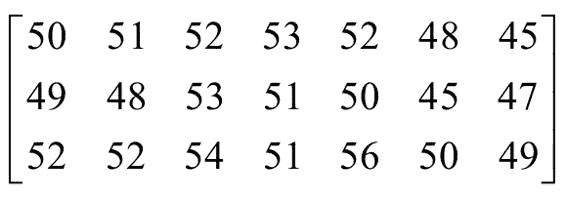

### 2.1.2 向量和矩阵
标量概念简单，下面重点讲向量和矩阵。样本的所有特征构成向量，多样本的特征构成矩阵。几乎所有算法公式都可写成向量或矩阵形式，机器学习中的批训练底层也是向量矩阵运算。掌握它们对修炼“内力”至关重要。

向量分行向量和列向量，本质相同，运算时有区别。

假设某公司有 `n` 名员工，月工资向量为 `[a1, a2, …, an-1, an]`，`ai` 为第 i 个员工工资。

情形一：给每位员工涨薪 20%，可用向量与标量的乘法计算，`k` 为倍数 1.2。

表 2-1　员工涨薪情况（一）

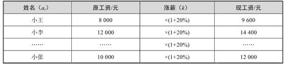

数学表达如下，结果仍为向量。向量与标量的除法可视为乘以倒数。

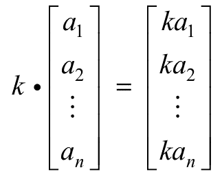

情形二：按完成业绩给不同涨幅，绝对值涨幅为例，第 i 位员工每月增加 `bi` 元，可用行列向量加法计算。

表 2-2　员工涨薪情况（二）

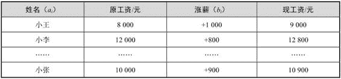

数学表达如下，结果仍为向量。

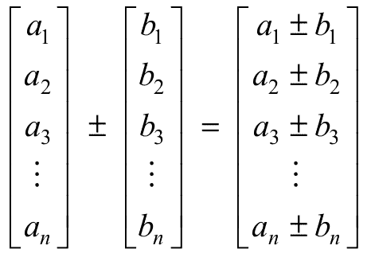

向量减法与加法类似。

情形三：想知道总工资开支，可用行向量与列向量的乘法。

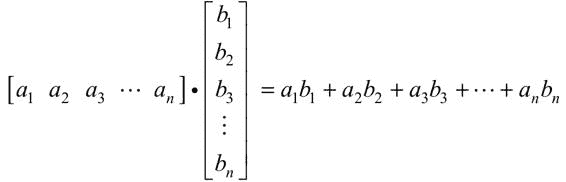

行向量与列向量相乘结果为标量。成立条件是行向量的列数等于列向量的行数。列向量与行向量相乘可得矩阵。

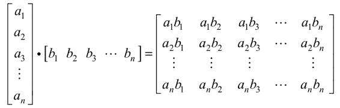

在机器学习中，向量常用于表示特征空间的特征值，也称特征向量。例如二维特征向量 `[1, 2]` 表示两个特征，取值分别为 1 和 2。同一空间里不同向量存在关系，如 `[2, 4]` 与 `[1, 2]` 在各维度上相差一倍，特征表现相似但程度不同。实际工程中还常用相似度、相关系数等更复杂度量。

矩阵运算与向量类似。标量与矩阵的加减乘，只需对每个元素分别运算，结果仍为矩阵。

标量与矩阵乘法示例。

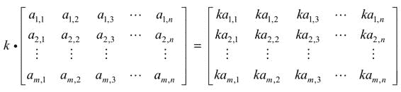

矩阵与向量只有乘法。矩阵乘行向量，行向量列数需等于矩阵行数，且行向量在左。

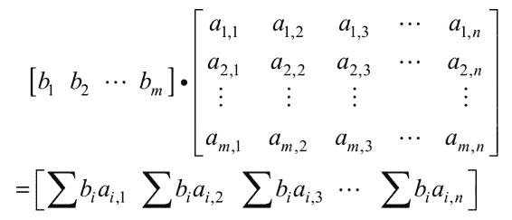

矩阵乘列向量，列向量行数需等于矩阵列数，且列向量在右。

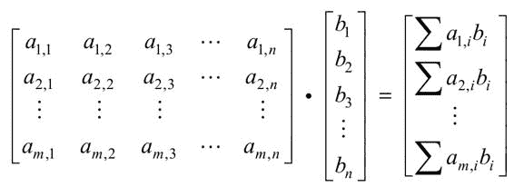

矩阵乘矩阵，左矩阵列数需等于右矩阵行数。

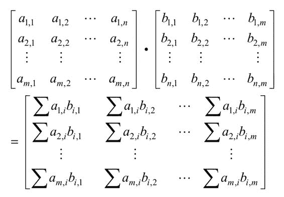

记 `A`、`B`、`C` 为矩阵。

矩阵加法满足交换律。

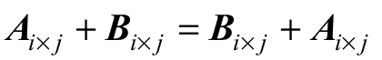

矩阵乘法满足结合律。

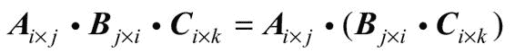

线性代数中还有单位矩阵、对角矩阵、对称矩阵等，在 PCA 降维、协同过滤和矩阵分解等算法中常见，下面做简要介绍。

单位矩阵是方阵，主对角线元素为 1，其余为 0。

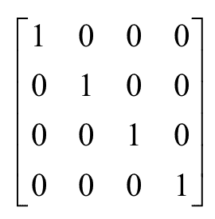

对角矩阵也是方阵，除主对角线外元素为 0，主对角线元素可不为 1。单位矩阵是其特例。

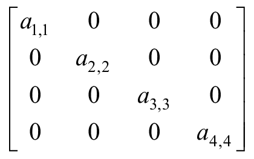

对称矩阵是方阵，以主对角线为轴两边元素相等。单位矩阵和对角矩阵都属于对称矩阵。

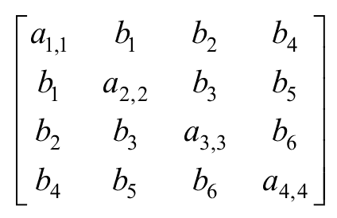

## 2.2 排列组合
排列组合在高中数学中常见，公式简洁直观。

包含排列和组合两个概念。假设小组有 5 人。

① 选出 3 人站成一排，有多少种排法？
② 选出 3 人打扫卫生，有多少种选法？

问题①需考虑顺序，问题②不需考虑顺序。这就是区别。排列用 `P` 或 `A` 表示，组合用 `C` 表示。组合种类是排列种类的子集。

形式化描述 `n` 人中取 `m` 人排列。先从 5 人中选第 1 位有 5 种，再选第 2 位有 4 种，再选第 3 位有 3 种，共 60 种。排列计算公式。

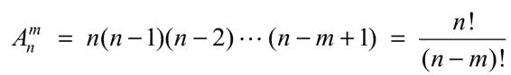

组合不考虑顺序，需除以 `m!`。全排列总数为 `n!`。对本例组合数为 10 种。组合公式。

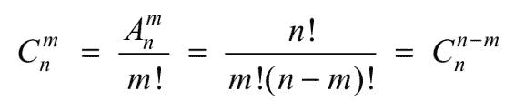

在 AI 算法中，排列组合主要用于计算特征交叉后的特征总数。

## 2.3 高等数学
做 AI 算法是否需要高等数学？本书只讲与 AI 最相关的两个点——导数和梯度。它们在公式推导中很关键，有助于理解模型为何起作用。

### 2.3.1 导数
简单说，导数描述函数图像在某点切线的倾斜程度，即斜率。连续函数随 `x` 连续变化时 `y` 也连续。连续不一定处处可导，可导函数图像必处处连续。

## 2.3 导数
导数主要用于刻画函数图像上某一点切线的倾斜程度，这个倾斜程度也被称为斜率。所谓连续函数，就是当 `x` 值连续变化时，`y` 的变化也是连续的。连续函数不一定处处可导，而可导函数的图像一定是处处连续的。

三角函数在整个定义域上都是连续且可导的。拿正弦函数 y=sin x 来说，图像通篇平滑，每一个点都能确定切线的倾角，见图 2-1。

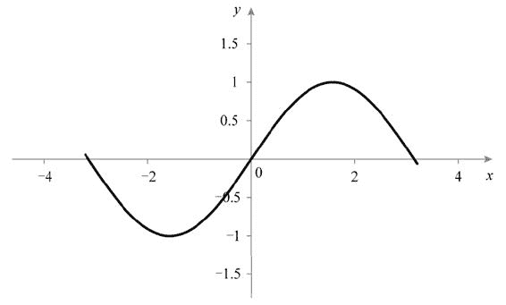

图 2-1　正弦函数`y=sin x`的图像

把绝对值函数 y=|x| 放在一起看，如图 2-2。整体来看函数是连续的，但在原点 (0,0) 处出现尖角，切线方向不唯一，因此在该点导数不存在。

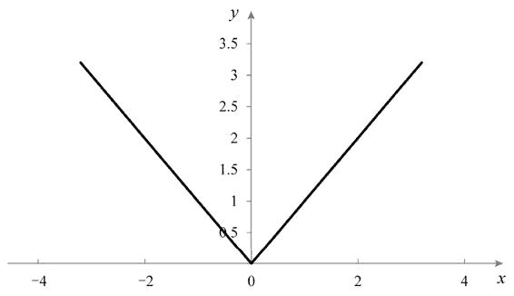

图 2-2　线性绝对值函数`y=|x|`的图像

中学教材里求导多走极限的严谨路线，AI 实践中更看重本质。第一，弄清楚导数的含义。导数就是切线的斜率，用来描述函数值的变化快慢与趋势，是上升还是下降、增速如何等。第二，把算法里常用到的求导公式和运算法则熟记。下面列出在 AI 中高频使用的公式。

常数求导公式如下。

`(C)'=0`

幂函数求导公式如下。

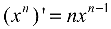

指数函数求导公式如下。

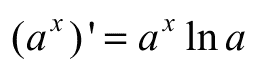

对数函数求导公式如下。

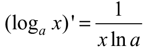

自然对数函数求导公式如下。

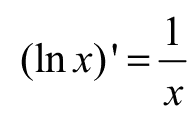

设两个函数为 u 和 v，四则运算的求导规则如下。

函数加减法的求导法则如下。

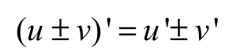

函数乘法的求导法则如下。

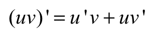

函数除法的求导法则如下。

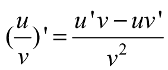

神经网络通常有多层，相邻层的输出是下一层的输入，即一个函数的输出成为另一个函数的输入，这时需要复合函数的链式求导。复合函数 f(x)=g[h(x)] 的链式法则是：

`f'(x)=g'[h(x)]h'(x)`

另外，AI 中的特征一般是多维的，涉及多个自变量的函数称为多维函数，对其中一个自变量求导得到偏导。求偏导时把其他自变量视作常数即可。

### 2.3.2 梯度

多维情形下的导数常被称为梯度，它是一个有方向的向量，每个维度对应一个方向。AI 里的特征通常是多维的，每个维度都有偏导，偏导大小不同，梯度大小也不同。训练时说某个特征学得快，正是因为该维度上的梯度较大。梯度在网络中的传递是训练的关键，梯度消失和梯度爆炸会严重影响最终效果，具体将在第 4 章展开。

## 2.4 概率与统计

### 2.4.1 名词解释

先把常用名词厘清，就像做菜前先认识调料，有助于理解流程，也更显专业。

1\. 概率统计

研究自然界随机现象统计规律的数学分支，称为概率统计，也叫数理统计。其研究对象主要是随机事件、随机变量和随机过程。

2\. 随机事件

概率统计关注的就是事件发生的可能性。随机事件是指在大量重复试验中呈现稳定规律的现象。例如抛硬币，“正面朝上”就是典型例子。事件间基本关系见表 2-3。

表 2-3　事件之间的基本关系

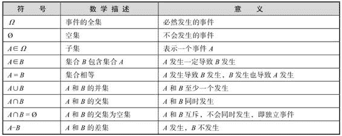

事件运算与集合运算类似，满足下面三条性质。

• 交换律：`A∪B=B∪A`，`A∩B=B∩A`。
• 结合律：`A∪B∪C=A∪(B∪C)`，`A∩B∩C=A∩(B∩C)`。
• 分配律：`A∩(B∪C)=(A∩B)∪(A∩C)`，`A∪(B∩C)=(A∪B)∩(A∩C)`。

3\. 随机变量

事件发生后有结果，可用随机变量来刻画随机事件的可能结果，比如抛十次硬币正面向上的次数、某地铁站每日上下车人数、灯管寿命、班级学生的身高体重等。

4\. 离散型随机变量和连续型随机变量

抛硬币正面次数、地铁站上车人数等取值可数，最小单位为 1，数学上称为离散，这类变量为离散型随机变量。灯管寿命、人的身高体重的取值是连续的，没有最小单位，称为连续型随机变量。

5\. 随机过程

简单说，随机过程就是随机变量随某个参数变化的过程，该参数通常是时间，如周一到周五某地铁站随时间变化的候车人数。

6\. 数学期望

抛掷一枚质地均匀的硬币，正反面概率各半，足够多次试验后，正反面实际出现次数会接近 50%，这个 50% 就是数学期望。数学期望反映随机变量的平均水平，计算方式是用事件概率乘以重复试验总次数，常用字母 `μ` 或 `E` 表示。

7\. 方差

方差用来衡量随机变量的实际取值与其数学期望的偏离程度，计算公式如下。

`E{[X–E(X)]2}`

8\. 标准差

标准差是方差的算术平方根。

9\. 协方差

协方差是方差的多变量推广，用来衡量两个随机变量 X 与 Y 的总体误差，计算公式如下。

`E{[X–E(X)][Y–E(Y)]}`

10\. 概率分布

概率分布用来描述随机变量在随机事件中呈现的状态，是概率关于随机变量的函数。

11\. 概率密度

概率密度可以理解为事件结果落在随机变量某个取值区间内的概率。数学上就是概率分布函数在该区间的积分。注意，只有连续型随机变量才有概率密度，离散型对应的概念是概率质量。

12\. 条件概率

条件概率是指在一定条件下事件发生的概率。设事件 A、B，`P(A | B)` 表示在事件 B 发生的前提下事件 A 发生的概率。

### 2.4.2 概率分布

日常生活中随处可见概率分布的身影，本节由浅入深介绍几种常见分布。

1\. 伯努利分布

伯努利分布是最简单的分布，随机变量只能取两种离散值，成功取 1，失败取 0。生活中例子很多，比如明天是否下雨、雷霆队下一场能否赢勇士等。

伯努利分布的数学期望如下。

`μ=p`

伯努利分布的概率质量函数如下。

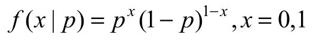

2\. 均匀分布

均匀分布的随机变量可以是离散也可以是连续，各取值出现的概率相同，掷骰子就是典型例子。

数学期望如下。

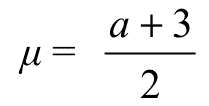

连续型均匀分布的概率密度函数如下。

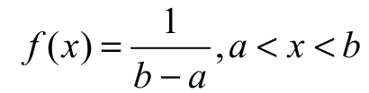

取 b=2、a=1 时，概率密度图像如图 2-3 所示。

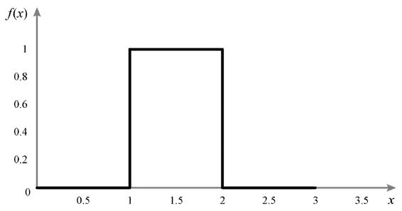

图 2-3　均匀分布的连续型随机变量的概率密度函数图像

3\. 二项分布

二项分布只取正负两种结果，随机变量只能是离散型。数学上描述的是 n 个独立二值试验中有多少次为正的离散概率分布。

典型例子是抛硬币，抛 n 次硬币正面 k 次的数学期望如下。

`μ=np`

概率质量函数如下。

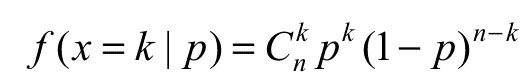

当 p=0.5、n=12 时，概率质量函数图像如图 2-4 所示。

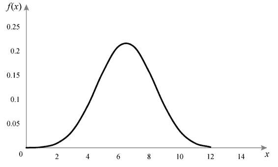

图 2-4　二项分布的概率质量函数图像（`p=0.5`，`n=12`）

4\. 几何分布

几何分布的随机变量也只能是离散型。与二项分布不同，它关注的是第 x 次试验才取得成功的概率。典型例子是打靶，在 n 次射击中第一次命中的概率。数学期望如下。

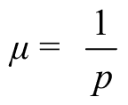

概率质量函数如下。

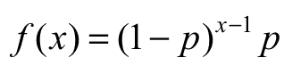

当 p=0.5 时，概率质量函数图像如图 2-5 所示。

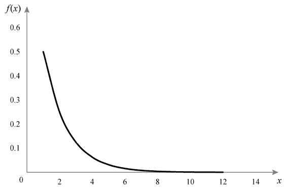

图 2-5　几何分布的概率质量函数图像（`p=0.5`）

5\. 泊松分布

计算二项分布的概率时，若要求 k 次发生的概率，就必须事先知道全局的 n。实际问题中往往难以预知总数，比如潜在乘坐公交的乘客数、潜在去银行办事的客户数、潜在包子铺顾客数等。

总数未知就没办法算概率吗？取 n 的极限求解正是泊松分布的推导思路。

根据二项分布的数学期望 `μ=np` 可得

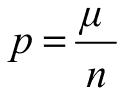

推导过程如下。

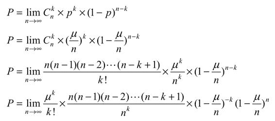

把上式拆开计算，按指数 e 的极限方法代入，P 最终只与 k、μ 相关。

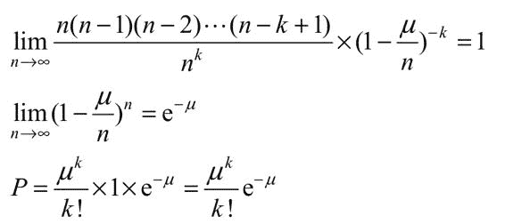

由推导可知，泊松分布是二项分布的极限形式，随机变量也只能是离散型。概率质量函数如下。

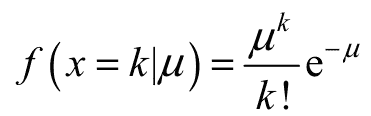

当 μ=0.9 时，概率质量函数图像如图 2-6 所示。

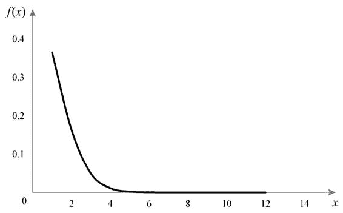

图 2-6　泊松分布的概率质量函数图像（`μ=0.9`）

已知均值 μ，无需知道总数 n，就能求得 k 对应的概率。

6\. 指数分布

若把时间长度纳入泊松分布的考虑，就能描述某段时间内事件发生的概率，而指数分布主要用于描述事件的时间间隔概率，比如医院婴儿出生间隔、网站访问间隔等。因此指数分布的随机变量是离散型随机变量，数学期望如下。

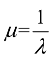

指数分布的概率质量函数可以通过泊松分布推导而来，具体如下。

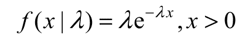

当 λ=0.8 时，概率质量函数图像如图 2-7 所示。

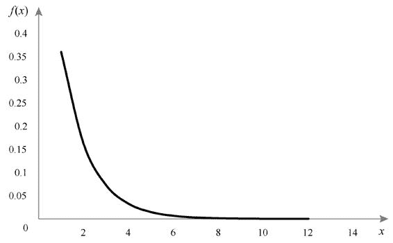

图 2-7　指数分布的概率质量函数图像（`λ=0.8`）

7\. 高斯分布

高斯分布即正态分布，是现实中出现频率很高的一种分布，比如全校学生的身高体重、某科考试分数等都近似服从高斯分布。虽然叫高斯分布，但并非高斯首创，只是高斯率先将其用于天文学研究，影响较大，故得此名。概率密度函数如下。

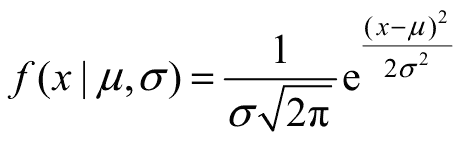

概率密度函数图像如图 2-8 所示。

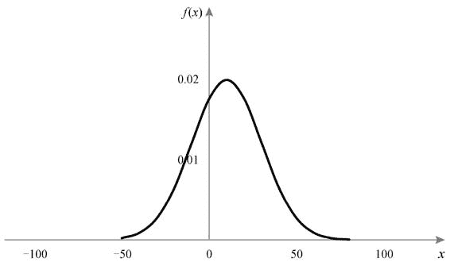

图 2-8　高斯分布的概率密度函数图像

## 2.5 最优化原理

最优化原理是应用数学的一个分支，研究最优设计、最优控制、最优管理问题的理论与方法。AI 要解决的大部分问题本质上都是寻找一组适配模型的最优参数解，都可以归结为最优化问题。先用最优化的方法建立数学模型，再以最优方式求解。

最优化问题分为有约束和无约束两类。有约束问题又分等式约束和不等式约束，这类问题通常用拉格朗日乘数法和 KKT 条件解决；无约束问题又分全局最优和局部最优，这类问题可以用牛顿法和最小二乘法解决。

最优化还有一个分支叫凸优化，凸优化的局部最优解就是全局最优解。大部分 AI 问题本质上都是凸优化问题。解决凸优化问题常用梯度下降法，大致步骤如下：首先初始化模型的参数权重，然后依据样本数据计算误差和梯度，最后根据梯度下降法优化各参数权重，直到误差下降到可接受范围，训练结束。

本章不深入学术理论，感兴趣的读者可自行学习。

## 2.6 动脑时刻

1\. 小石头在家自制果汁，常使用 5 种原材料：芒果、草莓、香蕉、牛奶和木瓜。他常用的 4 种配方如表 2-4 所示，5 种原材在不同超市的价格如表 2-5 所示。用矩阵运算的形式计算这 4 种果汁配方的成本各是多少。

表 2-4　石头在榨果汁时常用的 4 种配方（单位：份）

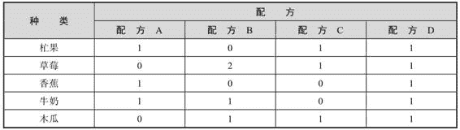

表 2-5　5 种原材料在不同超市的售卖价格（单位：元/份）

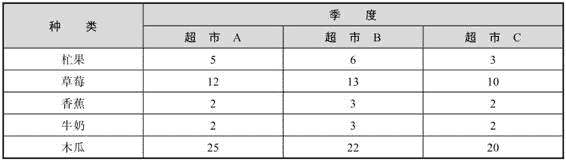

2\. 假设模型中有 5 个特征，通过特征之间的任意交叉组合，最多可以增加多少个特征？

3\. 5 个人围成一圈做游戏，一共有多少种不同的围法？

4\. 在概率统计中，标准差是方差的算术平方根，既然有了方差，为什么还需要标准差？

5\. 已知包子铺历史每天平均卖出 `μ=100` 个包子，为了保证未来每天不够卖的概率低于 10%，每天最少需要准备多少个包子？（已知服从泊松分布）

6\. 某医院平均每小时出生 3 个婴儿，在接下来的第 15～30 分钟，有婴儿出生的概率是多少？（已知服从指数分布）

## 2.7 本章小结

本章首先介绍了线性代数中的向量和矩阵，这两者是 AI 算法最基本的数据载体。随后讲解了与 AI 有关的排列组合及高等数学相关知识点。紧接着详细阐述了概率与统计。如果从业者具备良好的概率统计素养，就能在解决实际问题时更深刻、更全面地运用模型。最后简要介绍了最优化原理。

本章内容都是算法相关的数学基础，表述难免晦涩。考虑到数学在 AI 中的实际使用频率以及本书的受众，本章只讲最核心的知识点，动脑时刻也尽量避开了生僻公式。目的只有一个，让读者尽快掌握算法世界的数学基础，以便进入算法工程实战。

## 关键词回顾

标量

向量

行向量

列向量

矩阵

单位矩阵

对角矩阵

对称矩阵

排列组合

导数

梯度

随机事件

随机变量

离散型随机变量

连续型随机变量

随机过程

数学期望

方差

标准差

协方差

概率密度

条件概率

概率分布

伯努利分布

均匀分布

二项分布

几何分布

泊松分布

指数分布

高斯分布

凸优化

# 第 3 章 算法之招式

在《倚天屠龙记》中，九阳神功是上乘的内功心法。若张无忌只会九阳神功而不会乾坤大挪移等招式，充其量只能护体，难以与人交锋。算法世界亦然，数学再好没有合适的应用场景也无用武之地。本章要讲的就是以数学为内力驱动的算法招式。反之，若数学基础薄弱，就很难自如运用这些招式，后续算法学习也会吃力。

在解决实际问题时常会遇到：数据如何存储？哪种结构效率更高？数据有哪些高效的查询和排序方法？特定问题是否有巧妙算法可解？如何衡量算法的运行时间和存储空间？学完本章招式后，相信这些问题都能找到答案。所谓算法招式，即数据结构和基础算法，本章的基础算法与机器学习算法区分开来。先讲数据结构，再讲常用基础算法，按从易到难的顺序，用通俗易懂的语言帮助读者修炼。

## 3.1 数据结构

如果把数据结构比作土壤，基础算法就是生长在这片土壤上的植物。

### 3.1.1 数组与链表

数组与链表是最简单的两种结构，在不同场景下各有优势，性能表现也不同。

1\. 数组

数组 Array 是一种顺序存储结构，元素以相邻连续的方式存放。因为是连续存储，只要知道元素在数组中的编号及数组起始位置，通过计算偏移就能访问该元素的值。按空间维度可分为一维、二维、多维数组，一维数组存储图例如图 3-1 所示。

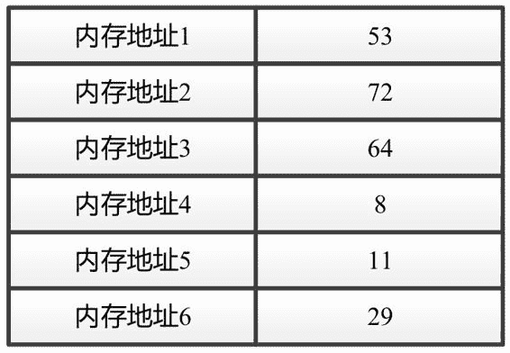

图 3-1　一维数组的存储图例

用电影院选座来说明。小王、小李、小张一起看电影，希望选同一排连号座位，这种分配方式就是一维数组的存储方式。假设三人按从左到右顺序入座，编号分别为 0、1、2。由于挨着坐，只需知道最左边小王的座位号，通过编号相加就能得出另外两人座位号。一个影厅的座位可理解为由一维数组组成的二维数组，“几排几号”就是二维数组的索引。若影厅有多层，可理解为三维数组，座位索引为“几层几排几号”。

这种分配方式有一个明显问题：在插入新元素时，即使相邻空间足够，也需要从插入位置整体向后移动元素；若相邻空间不够，则需在其他空闲位置申请空间，因不在同一连续区域，新元素的添加和查询会变慢。最直观的解决办法是一开始就分配足够大的数组空间，但存在两个缺点：

• 额外申请的存储空间可能永远用不上，占用后无法供其他程序使用。
• 无法保证分配足够，因为总有不够的时候。

针对这两个缺点，链表这一数据结构形式出现了。

2\. 链表

### 3.1.1.1 链表

仍以电影院选座为例。小王、小李、小张一起看电影，小王是小李的朋友，有小李联系方式，小李是小张的朋友，有小张联系方式。到了电影院发现最近场次已无连号三座，于是三人买了分散的座位。这种入座方式就是链表 List 的存储方式，不要求数据存储连续，有位置即可。在放映过程中，小王接到老板紧急消息需立刻返公司，于是小王将消息通知小李，小李再通知小张，这种传递方式就是链表的数据访问方式，即链式访问，小王只能联系小李，不能直接联系小张，只能由小李联系小张。

从前面示例可以判断，链表是靠指针把分散的存储单元串起来的结构，节点在内存里不必挨着放。往里面加新数据时，只要在任意空闲位置申请一块空间，再让当前尾节点的指针指向这块新空间即可。相比数组，少了大量元素的整体搬移，扩展时更省事。链表同样可以做成多维形式，也能做成支持双向移动的结构。单链表的示意图见

图 3-2　单链表的存储结构图例

结构都有取舍。链表在插入删除上很有优势，却做不到直接定位任意位置。节点之间是靠指针连接的，要读取某个序号的数据，必须从头节点开始逐个顺藤摸瓜，直到找到目标。数组占据一段连续区间，用下标就能瞬间命中。做随机取数这类操作时，数组的速度明显更占优。

小结：数组查找快、扩容慢；链表查找慢、扩容快。

### 3.1.2 队列和栈
队列与栈和数组、链表一样属于顺序存储的范畴。除存储之外，它们各自提供不同的访问规则，用来适配不同的场景。

#### 3.1.2.1 队列
队列 `Queue` 的处理方式是先来后到，也就是 `FIFO`。这种先来后到的思想在计算机里很常见，例如内存页置换、网络路由器的流量调度等。生活里最直观的就是排队。出站后打车要排队，先来的先上车；食堂窗口前排队也是先来后到。

因此可以把队列看作提供先来后到能力的一维结构，既能往队尾添加数据，也能移走队首的数据。

#### 3.1.2.2 栈
弄懂队列后，栈 `Stack` 就容易理解。栈的处理方式是后进先出，也就是 `LIFO`。`LIFO` 在编程中无处不在，最典型的就是函数调用。除此之外，递归类问题也常借助栈。

因此可以把栈看作提供后进先出能力的一维结构，既能往栈顶添加数据，也能移走栈顶的数据。

### 3.1.3 树
掌握链表后，树 `Tree` 的概念就不难。讨论数据结构时常提到二叉树、三叉树、多叉树，下面用情报组织做个直观说明。

敌后潜伏的情报网里，每级成员都带若干下线，相邻两级互称上线和下线。为避免暴露连累整体，上线可以联系下线，下线无法联系上线，而且信息通道不会形成环，换句话说下线的下线不会再变成自己的上线。若每级最多带两人，就是二叉树结构；最多带三人就是三叉树，依此类推。信息只能从顶端往底端流动。

无论几叉，每个节点都以链表的形式指向若干子节点，且树内不会出现环。以最常见的二叉树为例，从根节点出发，每个节点可指向两个新节点，分别称为左孩子和右孩子，本身称为父节点。二叉树的存储结构图例如图 3-3 所示。

图 3-3　二叉树的存储结构图例

树有高度，从根往下累加的层数即为高度，图 3-3 中的二叉树高度为 3。二叉树被广泛使用，因为它简单且具有代表性。二叉树的种类很多，如完全二叉树、满二叉树、平衡二叉树、霍夫曼树、B 树等，不同种类性质和用途各异，可自行深入了解。遍历二叉树不像链表那样线性，因为每个节点最多有两个孩子，共有四种遍历方式：前序、中序、后序和层序。前序口诀是中左右，先访问父节点再左后右；中序口诀是左中右，后序口诀是左右中；层序则是逐层从左到右访问。下面以图 3-4 的二叉树为例演示四种遍历。

图 3-4　二叉树的遍历

前序遍历：1→2→4→5→3→6→7。

中序遍历：4→2→5→1→6→3→7。

后序遍历：4→5→2→6→7→3→1。

层序遍历：1→2→3→4→5→6→7。

补充一句，多棵树合在一起称为森林 `Forest`，该概念在后续算法中会用到。前面提到树不允许成环，若允许成环，就得到下一节要讲的图。

### 3.1.4 图
图 `Graph` 由节点和表达节点间关系的边构成。前面讲的链表和树其实都是图的特例，链表只能单向链接，树中节点间不允许成环。图没有这些限制，节点间的连接称为边。图可分为有向图和无向图。顾名思义，有向图的边带方向，如图 3-5（a）；无向图的边不带方向，如图 3-5（b）。无向图可以看作每条边都双向的有向图。

图 3-5　有向图和无向图

边的意义不仅是连通，还可携带权重等信息，进一步刻画节点间关系。例如以城市为节点，城市间距离可作为边的权重。

图是非常实用的结构，在工作生活中随处可见。若把每个人作为节点，人际关系作为边，就能构成数十亿节点的社交网络图。著名的小世界现象——你和任何陌生人间隔不超过六人，正是基于社交网络图的猜想。在计算机领域，图常用于描述任务状态转换与调度关系，例如节点代表待执行任务，边代表相关性或依赖顺序。

图的存储有两种方式，一种是邻接链表，每个节点及其邻居用一个链表表示；另一种是邻接矩阵，用一维数组记录所有节点，用二维数组记录所有边。邻接链表与邻接矩阵的优劣与链表和数组的对比类似。以图 3-5 中的有向图为例，具体存储形式如图 3-6 所示。

图 3-6　邻接链表和邻接矩阵的具体存储形式

### 3.1.5 散列表
散列表 `Hash Table` 又称哈希表。先看一个实际问题：在全国范围内如何较快地按姓名查身份证号？若用数组或链表存储，需从头到尾查找，时间复杂度都是 `O(N)`；若用二叉排序树，复杂度只能降到 `O(log2N)`，通常写作 `O(logN)`。

补充一下时间复杂度。`O(N)` 与 `O(logN)` 都是描述算法复杂度的符号，算法复杂度包含空间复杂度和时间复杂度。空间复杂度定性描述内存用量数量级，时间复杂度定性描述运行时间数量级。通常优先考虑时间复杂度。`O(N)` 表示基本运算次数随数据量线性增长；`O(logN)` 表示对数增长。`O(logN)` 比 `O(N)` 更优，例如 `N=1024` 时，`logN` 只有 10。

`O(logN)` 已很低，但散列表可进一步降到 `O(1)` 常数级。核心技术是散列函数，利用函数把 `key` 值如姓名字符串映射到有限的数值空间。例如长度十亿的数组，用合适的散列函数可使映射值均匀分布。查询时计算姓名的散列值，就能直接取出对应下标的身份证号。姓名重复会产生键冲突，常见做法是在对应散列值后追加链表存储重复 `key`。

冲突存储方式与邻接链表类似，重复 `key` 会归到同一散列值生成的链表中。散列函数质量直接影响冲突程度，不均匀的函数会造成链表倾斜，使访问退化为顺序遍历。应对措施一方面是选用合适的散列函数，另一方面在冲突后采用二次散列或公共溢出区等手段。

## 3.2 基础算法
算法是对一类数学问题制订的完整准确解法，用系统方法描述解决问题策略。对符合要求的输入，算法必须在有限时间内给出输出。不同算法在时间效率与空间效率上各异，性能可用时间复杂度与空间复杂度衡量。算法作为数据结构的产物，其实现离不开数据结构支持。

基于数组、链表、树和图的算法很多，下面介绍几种常用且有趣的算法，帮助开启 AI 算法的思维之门。

### 3.2.1 排序
基础算法中最常用的是排序。现实中处处可见排序，如人群按身高排队、考试分数排序、卷子编号整理等。常用排序按时间复杂度从慢到快可分为九种。

`O(N2)`：选择排序、插入排序、冒泡排序。

`O(NlogN)`：快速排序、堆排序、归并排序。

`O(N)`：计数排序、桶排序、基数排序。

#### 3.2.1.1 选择排序
选择排序 `Selection Sort` 的基本思路是每次从剩余序列中选出最值并按顺序排列。要求升序时每次挑最小值，降序时挑最大值。

对长度为 `N` 的待排序列，第一轮从 `N` 个元素中选最值需 `N-1` 次比较；第二轮从剩下的 `N-1` 个元素中选最值需 `N-2` 次比较，依此类推，最后两元素需一次比较。总比较次数为

复杂度看最高数量级，舍去常数系数，选择排序时间复杂度为 `O(N2)`。

以升序为例，执行过程如图 3-7 所示。

图 3-7　选择排序的执行过程

#### 2. 插入排序
插入排序 `Insertion Sort` 的基本思路是依次取出元素并插入到已有有序序列中。

对长度为 `N` 的待排序列，初始有序序列为空。第一轮取一个元素插入空序列需零次比较；第二轮插入长度为一的序列需一次比较；第 `N` 轮插入长度为 `N-1` 的序列需 `N-1` 次比较。总比较次数为

因此时间复杂度与选择排序相同，为 `O(N2)`。

以升序为例，执行过程如图 3-8 所示。

图 3-8　插入排序的执行过程

#### 3. 冒泡排序
冒泡排序 `Bubble Sort` 的基本思路是循环比较相邻元素，将最值像气泡般冒到水面。与选择、插入排序相比，冒泡排序无需额外存储空间，结束后原序列即有序。

对长度为 `N` 的待排序列，升序时每轮从末尾开始向前比较。若前者大于后者则交换。第一轮需 `N-1` 次比较，第二轮需 `N-2` 次，末轮一次。总比较次数为

时间复杂度同样为 `O(N2)`。

以升序为例，执行过程如图 3-9 所示。

图 3-9　冒泡排序的执行过程

#### 4. 快速排序
快速排序 `Quick Sort` 简称快排，是面试常见考点。基本思路是每次确定一个元素的最终排序位置。

对长度为 `N` 的待排序列，升序时第一轮选定一个基准，两个指针自两端向中间遍历，通过交换确保基准落位，并把序列分为左右两部分，左部不大于基准，右部不小于基准。随后对左右子序列递归处理，直至所有元素定位。采用折半操作，时间复杂度为 `O(NlogN)`。

以升序为例，第一轮执行过程如图 3-10 所示。

图 3-10　快速排序第 1 轮排序的执行过程

需注意，若原序列已有序，折半会退化为线性，复杂度变为 `O(N2)`。快速的关键在于让基准尽量靠近中部。常用做法是在每轮开始时随机选取基准并与待排元素交换，形成随机快速排序。

#### 5. 堆排序
堆排序 `Heap Sort` 的基本思路是先把序列构建成最大二叉堆或最小二叉堆。二叉堆是二叉树的一种。最大堆中每个节点值大于其左右孩子，最小堆则相反。

执行时每次取出堆顶元素并把末尾元素移至堆顶，再调整结构维持堆性质。构建最大堆得到降序序列，最小堆得到升序序列。维持堆结构是二分查找过程，时间复杂度为 `O(NlogN)`。

以升序为例，第一轮执行过程如图 3-11 所示。二叉堆可用数组存储，下标从一开始，父节点下标为 `i` 时左右孩子下标分别为 `2i`、`2i+1`。

图 3-11　堆排序第 1 轮排序的执行过程

#### 6. 归并排序
归并排序 `Merge Sort` 采用递归与分治思想，先保证局部有序再合并为整体，故得名。

对长度为 `N` 的待排序列，升序时第一轮把每个元素视作局部有序序列，两两合并成长度为二的序列，局部比较最多一次；第二轮合并长度为二的序列成长度为四的序列，局部比较最多三次，依此类推。总轮次数为 `logN`，时间复杂度为 `O(NlogN)`。

以升序为例，执行过程如图 3-12 所示。

图 3-12　归并排序的执行过程

#### 7. 计数排序
计数排序 `Count Sort` 用更多存储空间换取更高时间效率，无需比较。只需创建 `count` 数组，其长度大于待排序列元素值的极差。

对长度为 `N`、值域为 `[0, K-1]` 的序列，初始化长度为 `K` 且全为零的数组，遍历序列并在 `count` 中对应下标加一。升序时按下标从小到大输出每个下标对应的次数，降序则反向。时间复杂度为 `O(N+K)`，对取值范围小的序列优势明显。

以升序为例，执行过程如图 3-13 所示。

图 3-13　计数排序的执行过程

#### 8. 桶排序

## 计数排序与桶排序

随着待排序数据的取值范围拉大，计数排序的内存消耗会成倍膨胀。桶排序作为计数排序的改进思路，并非建立一一对应的下标映射，而是借助映射函数把数值相近的元素批量分进同一个桶，再对每个桶内部单独排序。若每个桶内排序代价为`O(Ni log Ni)`，整体代价可表示为`∑O(Ni log Ni)`。

### 9. 基数排序
计数排序与桶排序在处理混合类型数据，例如字符串比较时显得力不从心。基数排序在桶排序之上再进一步，其做法是从最低位起逐轮按位分桶，用逐位大小来决定顺序，从而摆脱了类型限制。时间开销为`O(dN)`，`d`代表最大位数。

在实际选型时，除了效率，还要关注稳定性。稳定性指排序过程中相等元素间的先后关系是否被保留，保留则为稳定，否则不稳定。

为便于记忆，下面将前述九种排序按时间复杂度和稳定性做汇总对比，详见表 3-1　9 种排序算法对比

### 3.2.2 递归与分治
### 3.2.2.1 递归
通俗地讲，程序自己调用自己就是递归。学术上，凡是在自身定义里直接或间接引用自身的函数、过程、概念或结构，都可视为递归定义。

递归通常包含递推与回归两个阶段。递推是把问题层层推向前，回归是把子问题的结果逐层汇总回原问题，二者交替构成完整递归。

一个直观的例子是校团委收取团费。校团委通知年级团委，年级团委通知班团委，班团委通知到每位团员，这是一条逐层下传的递推链。待各层把钱收齐后再逐级上报：班团委收齐后向年级汇报，年级汇总后再向校团委汇报，这就是回归链。整套流程就是递归的体现。

递归之外还有非递归。非递归把层级任务拍平成线性流程来表达。相比之下，有递归支撑的实现往往更直观易读。以求长度为`n`的斐波那契数列和为例，递归写法与非递归写法的代码分别如下。

两者对比可见，递归代码结构清晰、可读性好，实现门槛也更低。但递归也容易因重复计算而低效，抽象度高、易出错难调试。比如斐波那契求和就不适合用递归。总体而言，只有问题本身或所用数据结构具备递归特性时，递归才是最优选择。典型例子有八皇后、汉诺塔、全排列。

### 2. 分治
分治即分而治之，把原问题拆成若干个规模更小且结构相似的子问题，递归求解后再合并。分治更强调同层子问题的并行治理，而递归更强调层与层之间的递进与回归。

生活中随处可见分治。某学院要选出乒乓球代表，先选出各班第一，再在班第一里选出年级第一，最后在年级第一里选出学院第一。把“选学院第一”拆成“选年级第一”，再拆成“选班级第一”，就是典型的分治过程。

分治可用的条件有两条：一是原问题能分解为若干独立子问题；二是子问题的求解方式与原问题一致。这要求必须明确递归终止条件和每层逻辑，因此适用面比纯递归窄。经典分治问题包括快速排序、归并排序和地毯填补。

### 3.2.3 贪婪算法和动态规划
贪婪只顾眼前收益，动态规划则追求全局最优。

### 1. 贪婪算法
贪婪算法每一步都挑选当前看来最好或最有利的选择，期望累计结果最优。可否使用贪婪，可用无后效性判断：即未来收益只取决于当前状态，与历史路径无关。换句话说，当下最优能带来整体最优时，贪婪才成立。下面以经典的超级书架为例。

问题描述：有`N`件物品，第`i`件高度为`Hi`，书架高度为`B`，且总高度不小于`B`。求最少取多少件物品叠起来的高度不低于`B`。

策略很直接：每次从剩余物品里挑最高的，直到累计高度超过`B`为止，被挑的件数即为答案。

### 2. 动态规划
动态规划用于求解多阶段最优化。与贪婪不同，它不保证当前最优就等于全局最优。下面用与超级书架类似的背包问题说明。

问题描述：背包容量为`M`，有`N`件物品，第`i`件体积为`Ni`，如何装载使利用率最大。

贪婪装填未必最优。例如容量 10，物品体积为 6、5、3、3、2，贪婪按降序取 6+3=9，利用率 90%。而最优方案是 5+3+2=10，利用率 100%。

动态规划如何得到最优解？先考虑容量 2、3、5、6 的背包，最优装填即为对应体积。随后加入容量 7、8、9 的背包，7 可在 5 的基础上加 2，8 可在 6 的基础上加 2 或在 5 的基础上加 3，9 可在 6 的基础上加 3。最后容量 10 的最优方案可在 7 的基础上加 3，也可在 8 的基础上加 2，实现 100% 利用。这就是多阶段最优决策的体现，过程如图 3-14 所示。

图 3-14　背包问题的动态规划过程

物品逐轮遍历。第 1 轮放入后可在空背包得到容量 2、3、5、6 四种状态。第 2 轮在此基础上新增容量 7、8、9。第 3 轮即可填满容量 10。

从上述过程可以看出，动态规划是从局部最优逐步推向整体最优：先求最小规模的局部最优，再在此基础上求次小规模的局部最优，层层递进得到全局最优。可使用递推公式描述，例如背包问题`f(n)=f(n–c[i])`，其中`f(n)`表示容量`n`能否装满，`c[i]`为第`i`件物品体积。该式即动态转移方程。背包实现如下。

这属于 01 背包，即每个物品只能取或不取。其变种有多重背包和完全背包，均可用动态规划求解。其他典型问题还有导弹拦截、字符串编辑距离、最长公共子序列等。

### 3.2.4 搜索
搜索是有纪律的枚举。枚举是在有限范围内穷举所有可能，搜索则更有针对性。常见分为深度优先搜索和广度优先搜索。

深度优先搜索`Depth First Search`，`DFS`，即每次从当前节点沿一条路径一直探到底，直到走完所有分支或满足条件为止。图 3-15 为示例，起点`A`，遍历顺序为`ABDECFG`。

图 3-15　深度优先搜索示例

广度优先搜索`Breadth First Search`，`BFS`，又称宽度优先遍历。每轮先处理与当前节点距离最近的所有节点，按层级依次扩展直至遍历结束。图 3-16 为示例，`BFS`序列为`ABCDEFG`。

图 3-16　宽度优先搜索示例

### 3.2.5 最短路径
最短路径问题在交通规划、路线选择中常见。按规模可分为全局最短路径和单源最短路径。全局算法有弗洛伊德算法`Floyd's Algorithm`，单源算法有迪杰斯特拉算法`Dijkstra's Algorithm`和贝尔曼-福特算法`Bellman-Ford's Algorithm`。

### 3.2.5.1 弗洛伊德算法
弗洛伊德算法由斯坦福大学的罗伯特·弗洛伊德提出，基于动态规划，可求图内任意两点间的最短距离。思路是每轮固定一对节点，枚举中间节点，若经中间节点路径更短则更新。`f`表示两点间距离，时间复杂度为`O(V3)`。代码如下。

### 2. 迪杰斯特拉算法
迪杰斯特拉算法由荷兰科学家迪杰斯特拉于 1959 年提出，用于有向图的单源最短路径。以起点为中心，每次取出距离起点最近的未访问节点，更新其邻居距离，直至所有节点处理完毕。算法不支持负权边，时间复杂度`O(V2)`。流程如图 3-17 所示。

图 3-17　迪杰斯特拉算法示例流程

解读如下：
（a）以`a`为起点，距离初始化为 0。
（b）更新邻居`b`、`c`的距离。
（c）以最优节点`c`更新`b`、`d`、`e`的距离。
（d）以最优节点`e`更新`d`的距离。
（e）以最优节点`b`再次更新`d`的距离。
（f）与`d`相连节点无需更新，结束。

### 3. 贝尔曼-福特算法
贝尔曼-福特算法由理查德·贝尔曼与莱斯特·福特提出。迪杰斯特拉是点扩边，贝尔曼-福特是边扩点。它能处理负权边并检测负权环。时间复杂度为`O(VE)`。流程如图 3-18 所示。

图 3-18　贝尔曼-福特算法示例流程

解读如下：
（a）以`a`为起点，距离置 0。
（b）用与`a`相连的边更新`b`、`c`。
（c）用`b`、`c`相连的边更新`b`、`d`、`e`。
（d）用`b`相连的边更新`d`。
（e）各边不再能改进，结束。

### 3.2.6 最小生成树
最小生成树`Minimal Spanning Tree`，`MST`是树结构且总边权最小。“生成”强调构造过程。举例：城市`A`、`B`、`C`、`D`间铺设光缆，费用`AB=8`、`AC=1`、`AD=6`、`BC=3`、`BD=2`、`CD=5`，要求全网连通，求最小花费。

把城市抽象为节点，费用为边权，求最小花费等价于求最小生成树。常用算法为普里姆算法`Prim's Algorithm`和克鲁斯卡尔算法`Kruskal's Algorithm`。

### 1. 普里姆算法
普里姆可从任意节点出发。每次向当前生成树中加入一条连接树内外且最短且不形成环的边，直至所有节点纳入。以上例以`A`为起点，先加入`AC`，再依次加入`BC`、`BD`，总花费 6。时间复杂度`O(V2)`，推进图见图 3-19。

图 3-19　普里姆算法的推进步骤示意图

### 2. 克鲁斯卡尔算法
克鲁斯卡尔是边扩点的思路。每次从候选边集中挑选最短且不产生环的边加入森林，直到形成一棵树。该方法必须从最短边开始。例中先加入`AC`，再加入`BD`、`BC`，花费同样为 6。需先排序边，若用快速排序，复杂度为`O(ElogE)`。推进图见图 3-20。

图 3-20　克鲁斯卡尔算法的推进步骤示意图

稠密图更适合普里姆，稀疏图更适合克鲁斯卡尔。

### 3.2.7 树状数组
以下算法难度提升，建议精选阅读。

树状数组`Binary Indexed Tree`利用二进制特性，在`O(logN)`内维护序列并求任意前缀和，实现简洁巧妙。以二进制最低位变换为核心逐步讲解。

例如二进制数 0011、0101、0110、0111，每次把非零最低位加 1 可得到 0011→0100→1000→10000 等序列，均能跃迁到比原数大且最近的 2 的幂。设 8 个位置编号 1～8，构建树状数组如图 3-21，灰色为原数组，黑色为树状数组。

图 3-21　树状数组结构示例

黑色单元的连接关系即“加 1 变换”：`B1→B2→B4→B8` 等。对偶操作是“减 1 变换”，可在`O(logN)`内定位核心子段，便于求和。例如`B7`经减 1 变换得到`B7→B6→B4`，即可求`A1～A7`之和。

以原数组`[3,5,1,9,2,4,8,7]`为例，遍历并通过加 1 变换累加到树状数组，构建代价`O(NlogN)`，结果如图 3-22。

图 3-22　树状数组求和

构建完成后求前 7 项和，经减 1 变换访问到 0111、0110、0100，对应值 8、6、18，相加得 32。原数组需 6 次加法，树状数组仅需数次。随着规模增大优势更明显。原数组元素增减`d`时，也可通过加 1 变换局部更新。

加 1 与减 1 变换的核心都是定位最低位。最低位可表示为`lowbit(x)=x and (x xor (x-1))`，利用补码可简化为`lowbit(x)=x and -x`，为常数操作。查询与更新均为`O(logN)`，构建为`O(NlogN)`。

### 3.2.8 线段树

线段树这个名字就点出了它的构造思路——节点是以区间，也就是数组的连续一段，点可以看作退化的区间，来组织的树。上一部分介绍的树状数组在求任意子数组之和时效率很高，可一旦需求变成区间最大值、最小值，树状数组就无能为力了，这正是线段树登场的场景。线段树能处理树状数组能干的所有区间问题，只是实现上要复杂得多。下面用一个例子把它的样子讲清楚。

问题是这样的：已知一个长度为 N 的数列，反复询问任意一段区间的最大值。最笨的办法是每次把区间扫一遍，时间是 O(N)。当数据量变大时显然扛不住。线段树利用二叉树的层次结构，把单次查询压到 O(log N)。比如序列 [3, 2, 6, 5, 1, 9]，建成线段树后的形态如图 3-23 所示。

图 3-23　线段树结构示例

通常采用递归建树。叶子节点用数组保存，对应原序列，用灰色标出；内部节点用链表保存，表示管辖区间的最大值，用黑色标出。查询时从根往下走，区间若完全落在左右子树之一就继续下探，若横跨两边就分裂继续匹配，匹配成功后再回溯比较最大值，这样一次查询的代价就是 O(log N)。

前面只是基本用法，真正让线段树好用的精髓是延迟标记。没有它，区间更新会拖慢很多。举例来说，原序列某段同时加上常数 d，暴力更新是 O(N)，而线段树借助懒标记可以做到 O(log N)，思路是给每个节点挂一个标记，初始全为 0。

比如把区间 [0, 2] 全部加 4。从根 [0, 5] 开始匹配，发现它覆盖目标区间，于是继续往左子节点找，左节点恰好是 [0, 2]，就把它的懒标记加 4，节点值也同步变成 10。此时无需再深入，直接回溯把根的值更新为左右子节点中的最大值 10，如图 3-24。

图 3-24　线段树的更新

图里三角形的数字就是懒标记。后续做最大值查询时，只要当前节点的标记大于 0，就在向下查找的过程中把标记带下去，重复延迟操作直至完全命中。沿用前文，[0, 2] 上的标记在查询 [0, 1] 最大值时会被带到左子树，更新该区间节点的值，最终得到结果。更新后的结构如图 3-25。

图 3-25　更新后的线段树

更新后 [0, 1] 的最大值为 7。这里有个细节：为了保持左右子节点的正确性，标记带下去时至少要同时作用到两个孩子上，图 3-25 中虽然目标在左子树，右子树也需要同步带标记。

#### 3.2.9　平衡二叉树

平衡二叉树即 AVL 树，由 G.M.Adelson-Velsky 与 E.M.Landis 于 1962 年提出。它首先是二叉搜索树，所以先说清楚二叉搜索树是什么。

二叉搜索树能保持元素的顺序，沿根向下可以二分查找，平均情况下查找是 O(log N)。但如果插入顺序不佳，树会退化成一条链，最坏达到 O(N)。

平衡二叉搜索树就是为了解决高度失衡的问题而提出来的，它保证任意节点的左右子树高度差不超过 1。在表达相同大小关系时，普通二叉搜索树与平衡二叉树的形态差异如图 3-26。

图 3-26　二叉搜索树与平衡二叉树之间的区别

可见平衡二叉树的查找时间稳定在 O(log N)。如何维持高度差 ≤1？先看高度差大于 1 的情形，一共只有 4 种，如图 3-27。

图 3-27　左、右子树高度差大于 1 的 4 种情况

经镜像归类，图 3-27（a）和（d）一类，（b）和（c）一类。把失衡调回平衡主要靠旋转。

• 单旋。以图 3-27（a）为例，把 B 提为根，A 变为 B 的右孩子，E 变为 A 的左孩子，就恢复平衡，操作如图 3-28。同理可处理图 3-27（d）。左右对称，所以单旋分为左旋与右旋。

图 3-28　单旋

• 双旋。即两次单旋。以图 3-27（b）为例，先旋转 A 的左子树使 B 的左右高度相等并把 E 提到 A 左子树的根，再把 E 提为根、A 变为 E 的右孩子，操作如图 3-29。图 3-27（c）同理。

图 3-29　双旋

从叶子往上逐层单旋或双旋，就能保证整棵树的高度差不超过 1。建树耗时 O(N log N)。常见的变种有红黑树、SBT、Treap、伸展树等，可自行深入。

#### 3.2.10　并查集

并查集并非最常用的基础结构，却非常有趣，它能快速判断两个元素是否同属一个集合。下面用家族关系举例。

问题设定：有 N 个人，血缘关系具有传递性，若 X 与 Y 是亲人、Y 与 Z 是亲人，则 X 与 Z 也是亲人。给出 M 对血缘关系，保证 N 个人全部出现，求家族数，并回答 T 次“两人是否同族”的询问。暴力做法是把有关系的两人家族编号统一，N、M、T 大时不可行。

并查集常用森林实现。先把 N 个人各自分成 N 棵树，每棵代表一个家族；再按给出的 M 对关系把两人所在的树合并。例：5 对关系 (a,b) (b,c) (d,e) (d,f) (d,b)，构建过程如图 3-30。

图里字母后的数字是家族编号。先把 b 的树根指向 a 的树根形成新家族，随后按规则依次处理其余关系。处理 (d,b) 时需要先找到 b 当前家族的根 a，再把 a 指向 d。为避免退化成链，通常把浅树的指针接到深树的根上，于是图 3-30（f）的结构需要调整为平衡形态，如图 3-31。

图 3-30　并查集的构建步骤

图 3-31　并查集的平衡结构

家族数就是最后森林中树的棵数。查询两人是否同族，只需比较它们所在树的根是否相同。为便于理解，构建过程中可把子树所有节点的编号都更新为根编号。

即便平衡，仍有两个隐患：合并时若节点到根的距离不是最长，平衡会失效；分支本身可能依然过长。真正有效的改进是路径压缩：找根时把途经的所有节点直接指向根，把长链压成星形。经路径压缩优化后，构建复杂度约 O(M log N)，单次查询趋近常数 O(C)。优化后的构建步骤如图 3-32，第（c）步体现了压缩。

图 3-32　并查集的路径压缩构建步骤

#### 3.2.11　匈牙利算法

匈牙利算法解决二分图最大匹配问题。二分图 G=(V,E) 的顶点集可划分为 A、B 两个不相交集合，每条边都横跨两集合。最大匹配即在不相交的前提下连边数最多的情况。

该算法核心是找增广路。从未匹配点出发，若能走到对侧的未匹配点就完成一次增广，否则沿交替路走至终点或死路。每次增广都更新配对，可能新增也可能替换。

案例：8 人化装舞会，男生 A B C D，女生 a b c d。相识关系为 A 与 a b c，B 与 a d，C 与 c d，D 仅与 b，关系图如图 3-33。

图 3-33　二分图中的熟人关系

按 A B C D 顺序匹配的执行过程如图 3-34。

图 3-34　匈牙利算法的执行步骤

加粗虚线是当前增广路，加粗实线是当前配对。先找到 A→a 配对，再找到 B→a→A→b 把 A 换成 b、B 配 a。接着 C→c 配对，随后 D→b→A→a→B→d 进行连环调整，最终得到 A-a、B-d、C-c、D-b 的完整匹配。最坏情况下每次增广会遍历全部边，时间复杂度为 O(N M)，N 为单侧点数，M 为边数。

## 3.3　在线评测系统

在线评测系统 Online Judge 是编程竞赛常用的自动判题平台，也可用于日常练习，部分平台还面向求职面试。很多 OJ 会自办比赛，并以通过题数或运行时间设立排名。

提交后后台运行程序，用题目输入得到输出并评测，只有返回 Accepted 才算正确。不同系统的状态命名略有差异，大致可分为三类，如表 3-2。

表 3-2　OJ 的评测状态分类

比较有名的国外 OJ 有 LeetCode、Topcoder，国内有北大 POJ、浙大 ZOJ，以及胡伟栋的 Tsinsen 清橙网络自动评测系统。

#### 3.3.1　LeetCode

LeetCode 不仅提供题库，还形成了社区与竞赛的生态，并打通了通往大厂的求职通道，还推出了中文官网。

题库按类型分 System Design、OO Design、Operating System、Algorithms、Database、Shell；按难度分 Easy、Medium、Hard。每题显示通过率并提供讨论区。专题标签覆盖数组、图、动态规划等算法方向，以及谷歌、Facebook 等公司的热题集合。

#### 3.3.2　POJ 与 ZOJ

以高校为代表的 OJ 主要服务竞赛培训，如 IOI、ACM。

POJ 即北京大学程序在线评测系统，收录 3000 多道题目，大多来源于 ACM 及各地竞赛，部分反映实际问题。

ZOJ 即浙江大学程序在线评测系统，同样提供 3000 多道算法竞赛题目，来源包括 ACM、各赛区及知名高校竞赛。

#### 3.3.3　Tsinsen

Tsinsen 清橙网络自动评测系统背后的开发者是两届 IOI 金牌得主、清华大学毕业的胡伟栋。对作者而言并不陌生，高一时参加信息学兴趣小组，正是在清橙上练习 DIY 题目，避免手工评测的麻烦。该系统后来搬到网上，2019 年 9 月 1 日起停止对外服务。

## 3.4　动脑时刻

1. 为什么斐波那契数列不适合使用递归算法求解？

2. 如何使用递归算法解决汉诺塔问题？

3. 背包问题有很多变种与升级版本，本书讲解的是 01 背包问题，也是最基础的背包问题。如果同一种物品可以无限装包，这样的背包问题称为完全背包问题。那么，动态规划如何解决完全背包问题？

4. 导弹拦截问题，每次的导弹拦截高度都不能高于前一次，现在连续有 N 枚导弹袭击，高度分别为 Hi（i 为 1～N 的整数），最多能拦截多少枚导弹？写出动态转移方程即可。

5. 为什么迪杰斯特拉算法无法计算带负边的图，而贝尔曼-福特算法可以？

6. 从算法原理上解释为什么普里姆算法适合稠密图，而克鲁斯卡尔算法适合稀疏图。

7. 如何计算树状数组中任意子序列中的所有元素之和？

8. 为什么说树状数组对计算任意子序列中的最大值和最小值束手无策？

## 3.5　本章小结

本章先介绍了数组、链表、队列、栈、树、图、散列表等数据结构的特性与用法，再讲解了排序、递归、分治、贪心、动态规划、搜索、最短路径、最小生成树等常用基础算法，最后简要介绍了主流在线评测系统，便于在实战中练习。

数据结构与基础算法是后续进阶的内功心法，掌握它们才能更顺畅地学各种进阶技巧。

## 关键词回顾

数据结构

数组

多维数组

链表

多维链表

队列

先进先出 FIFO

栈

后进先出 LIFO

树

二叉树

森林

图

有向图

无向图

邻接链表

邻接矩阵

散列表/哈希表

排序

选择排序

插入排序

冒泡排序

快速排序

堆排序

归并排序

计数排序

桶排序

基数排序

递归

分治

贪婪算法

动态规划

背包问题

动态转移方程

搜索

深度优先搜索

宽度优先搜索

最短路径

弗洛伊德算法

迪杰斯特拉算法

贝尔曼-福特算法

最小生成树

普里姆算法

克鲁斯卡尔算法

树状数组

线段树

二叉搜索树

平衡二叉树

单旋和双旋

并查集

路径压缩

匈牙利算法

在线评测系统

LeetCode

POJ 与 ZOJ

Tsinsen

# 第 4 章 机器学习

算法之武功秘籍

从招式到秘籍：机器学习算法全景

说白了，算法存在的意义就是帮我们把现实世界的难题拆解解决。第 2 章和第 3 章已经铺垫了算法所需的数学底座，以及常见的数据结构和基础手法。光靠这些，处理日常里比较简单的问题足够应付。一旦问题升级，比如社交平台要给用户画像、抓热点话题，电商要做商品推荐排序，或是预测股价、交通拥堵、商品销量，乃至让机器学会自动驾驶、下棋、聊天这类强 AI 任务，仅靠底座和手法就捉襟见肘，必须调用更精妙的算法体系。招式只能解决局部小块，或是大问题中的一个切片，像武当梯云纵只管上跃这件事。真刀真枪时，还得靠太极拳、太极剑这种成套套路才能制胜。

本章将梳理机器学习的流派分类，并且展开各类方法背后的机理，帮大家建立对算法秘籍的全局观。

## 4.1　类别划分
机器学习的方法非常多，覆盖场景极广。本节从两个角度做总览，一个是样本是否自带标签信号，另一个是模型想实现什么目标。

#### 4.1.1　按是否有监督信号划分
所有机器学习都依赖样本。有标签的样本相当于师傅提前给出正确答案，这个标签就是监督信号。带有这类信号的学习叫监督学习（`Supervised Learning`），没有则叫无监督学习（`Unsupervised Learning`）。两者之间还有半监督学习（`Semi-Supervised Learning`），即训练集里只有部分样本带标签。

## 1. 监督学习
具体说，监督学习是用带标签样本训练模型并调参，直到性能达标，这过程也称监督训练或教师学习。名称源自老师讲课、学生作答的类比。举个简单的例子。

问题描述：若干张画有猴子、老虎、狮子、大象、长颈鹿等动物的卡片，每种都有多张，如何让幼儿园小朋友学会辨认。常规做法是拿出猴子卡片就告知这是猴子，拿出狮子卡片就告知这是狮子，反复数轮后孩子就能区分。事先给出的卡片与动物对应关系就是样本标签，也就是监督信号，孩子的记忆过程对应监督学习算法。

常见的监督方法有线性回归（`Linear Regression`）、逻辑回归（`Logistic Regression`）、K-近邻（`K-Nearest Neighbor`，`KNN`算法）、决策树（`Decision Tree`）、朴素贝叶斯（`Naive Bayes`）、神经网络（`Neural Network`），以及用于降维的线性判别分析（`Linear Discriminant Analysis`，`LDA`）。无论选用哪一种，核心都是“所教即所得”，让模型输出尽量贴近指定的标签值。

## 2. 无监督学习
无监督学习不依赖监督信号，它利用无标签样本调整参数，挖掘特征、规律、趋势或既定模式，从而达成目标。从原始社会到现在，人类文明的进步处处伴随无监督学习。仍以动物卡片为例，最初人们并不知道猴子叫猴子、狮子叫狮子，只是注意到某些动物外形与行为相近，比如总爱用手挠头、活泼好动、喜欢在树上穿梭；另一类体格健壮、颈部有厚鬃毛、食肉。久而久之，具备相同特征的群体被命名为猴子和狮子，这就是无监督学习的过程，其中归类的方法即典型的聚类算法。图 4-1 所示为一个无监督学习示例。

图 4-1　无监督学习示例

除聚类（`Clustering`）外，常见的无监督方法还有降维算法主成分分析（`Principal Component Analysis`，`PCA`）。聚类可再细分为划分聚类、层次聚类、密度聚类和模型聚类四类。

## 3. 半监督学习
半监督学习融合监督与无监督，同时使用大量无标签样本和少量有标签样本来学习特征、规律、趋势或模式。现实中标注样本耗时费力，半监督学习的主要价值之一是提升效率。但它依赖三个前提假设。

• 平滑假设，同一度量空间中距离很近的两个样本，标签倾向于相似。
• 聚类假设，落在同一聚类类别中的两个样本，标签倾向于相似。
• 流形假设，当两个样本从高维映射到低维的同一个局部邻域时，标签倾向于相似。

若上述假设不成立，无标签数据不仅无法改善模型，反而会损害性能，导致半监督失效。即便假设成立，实验也显示无标签样本有时仍会拖累模型。因此开展半监督学习前需做好充分的数据调研。

常见的半监督算法有半监督聚类（`Semi-Supervised Clustering`）、生成对抗网络（`Generative Adversarial Nets`，`GAN`）、半监督分类（`Semi-supervised Classification`）及一些基于图的算法等。

### 4.1.2 按学习目标划分
除监督信号外，还可按模型最终想要达到的目的来划分。识别动物卡片的目标是区分类别，回答“是或否”类问题；销量或股价预测的目标是估算数值大小，回答“多少”类问题。据此，机器学习模型可分为四大类：回答是/否的分类（`Classification`），回答多少的回归（`Regression`），聚类（`Clustering`）和降维（`Dimensionality Reduction`）。

分类与回归的直观区别在于输出形式：最终预测值是离散的二值如 0 和 1，为分类；是连续取值空间，为回归。分类和回归都使用有标签样本训练，故属于监督学习范畴。

分类和回归已涵盖大部分热门模型，如近年来流行的神经网络及其变种卷积神经网络、循环神经网络等。常规聚类属于无监督学习，也有半监督聚类。降维中既有无监督的主成分分析 PCA，也有监督的线性判别分析 LDA。

## 4.2 线性回归模型与逻辑回归模型
在监督学习里，线性回归与逻辑回归是最经典的两个模型，逻辑回归可处理大部分监督问题。掌握它们对理解神经网络很有帮助。

#### 4.2.1 线性回归模型
线性回归是最直观的模型之一。线性指特征值与输出值满足一次函数关系，例如 `f(x)=ωx+b`，其中 `x` 为特征，`f(x)` 为输出。回归指通过调整一次函数参数使其尽可能拟合数据的过程。

从单特征模型讲起。单特征指预测目标只与一个因素相关，例如预测北京房价，只考虑建筑面积。假设房价与面积的关系如图 4-2 所示，横轴为建筑面积，纵轴为每平方米价格。

图 4-2　建筑面积与房价关系图

目标是在图上找到一条直线使各点尽量靠近。单特征公式为 `f(x)=a x + b`，`x` 为面积，`f(x)` 为每平米价格，`a` 与 `b` 为权重参数，`b` 俗称偏置，单特征下 `a` 为标量，多特征下为向量。如何找到合适直线，依赖模型训练方法，目前最常用的是梯度下降法（`Gradient Descent`）。

为便于理解，假设拟合直线经过原点，只考虑样本点 `(1, 4)`，训练过程如下。

（1）初始化权重 `a`，设初值为 2，`b` 固定为 0，步长 `s=0.1`，终止阈值 `threshold=0.01`。
（2）把 `x=1` 带入 `f(x)=a x`，计算实际输出与真实值的差 `Δ=f(x)-y`，`Δ` 即 `loss`。若 `|loss| ≤ threshold` 则结束。
（3）用步长与 `loss` 的乘积作为梯度，从 `a` 中减去该梯度更新 `a`，回到步骤（2）继续。

按此流程，每轮迭代的 `a` 与梯度依次为 `(2,-0.2)`，`(2.2,-0.18)`，`(2.38,-0.162)`，`(2.542,-0.1458)`，……直至 `loss` 小于阈值。此时 `a` 接近 4，梯度接近 0，得到回归函数 `f(x)=4x`。迭代次数与 `loss` 的变化如图 4-3 所示，这一逐步逼近目标的过程称为收敛（`Convergence`）。

图 4-3　训练迭代次数与 `loss` 值之间的变化关系

实际中房价受多因素影响，特征通常不止一维。一般用向量 `x` 表示多特征，用向量 `ω` 表示权重，用标量 `b` 表示偏置，公式写作 `f(x)=ωx+b`。偏置使回归函数可以不经过原点，常把偏置并入 `ωx`，令特征向量从下标 1 开始，偏置作为权重 `ω0` 与构造的特征值 `x0=1` 一起参与乘积，简化为 `f(x)=ω0～n x0～n`。

#### 4.2.2 逻辑回归模型
线性回归公式 `f(x)=ωx` 的值域不确定，后续直接用线性激活 `y=x` 输出，这也是名称的由来。若换成非线性激活，就能把未知值域映射到已知区间。最知名的非线性激活之一是 `Sigmoid` 函数，使用它的回归模型称为逻辑回归。`Sigmoid` 公式为

`Sigmoid` 函数的图像如图 4-4 所示。

图 4-4　`Sigmoid` 函数的图像

`Sigmoid` 的值域为 `(0, 1)`。把输出映射到该区间，便于设定阈值做二分类。无论特征维度多少，逻辑回归都可利用阈值把样本集分成两部分，如二维用直线，三维用平面，以此类推。

除 `Sigmoid` 外，常见的激活函数还有 `Sgn`、`Tanh` 和 `ReLU`，其中 `ReLU` 在神经网络中应用广泛。

阶跃函数 `Sgn` 是二值输出，如 -1 和 1，其图像如图 4-5 所示。

图 4-5　`Sgn` 函数的图像

由于不连续、不光滑且输出固定，它不适合作为神经网络的激活函数传递信息。

双曲正切函数 `Tanh` 可解决 `Sigmoid` 输出恒大于 0 的问题，值域为 `(-1, 1)`，相当于 `Sigmoid` 沿纵轴拉伸一倍后下移一个单位。公式为

`Tanh` 函数的图像如图 4-6 所示。

图 4-6　`Tanh` 函数的图像

在深度网络里使用 `Tanh` 和 `Sigmoid` 可能出现梯度消失，后文会详细说明。

`ReLU` 函数很简单：输入小于 0 输出 0，否则输出等于输入。值域为 `0, +∞)`，图像如图 4-7 所示。

![图 4-7　`ReLU`函数的图像在神经网络中使用`ReLU`函数能有效缓解梯度消失问题，尤其在深度神经网络中非常实用。`ReLU`函数的变种有`LReLU`函数、`PReLU`函数和`RReLU`函数等。### 4.3 人工神经网络在 20 世纪 40 年代，心理学家 W.S.McCulloch 和数理逻辑学家 W.Pitts 在分析、总结人类大脑神经元基本特性的基础上，提出了相应的数学模型。随着计算机硬件技术的飞速发展，神经网络从最初的单层感知结构发展成了如今流行的多层感知结构。那么，神经网络为何如此流行，具体又是如何工作的？#### 4.3.1 初识人工神经网络根据生物学研究结论，人脑神经细胞数量的数量级大约为`10¹⁰`，这些神经细胞之间通过突触（轴突和树突）相连。一种对于神经细胞运作的通俗理解为，神经细胞将所有树突传进来的信号相加，如果信号之和高于或低于某个阈值，那么细胞状态会相应地变为兴奋状态或抑制状态，由于大脑的神经细胞在不同时期的激活状态不同，因此在不同时期会表现出不同的大脑行为。机器学习中神经网络的灵感来源于人脑神经细胞的这种信号传递现象。由于是人工模拟，因此这类机器学习算法的准确称呼为人工神经网络（`Artificial Neural Network`，`ANN`）。与人脑神经网络类似，人工神经网络由多个人工神经元相连组成，人工神经元的数学描述如图 4-8 所示。

图 4-8　人工神经元的数学描述

人工神经元用求和函数 `SUM` 接收信息，类似神经细胞的树突。图 4-8 中 `x1～xn` 代表输入信号，`w1～wn` 代表权重，偏置 `b` 可理解为神经元自身的信号弹性。随后用激活函数输出信号 `y`。神经网络常以 `Sigmoid` 为激活，与之相比 `ReLU` 运算快且能缓解梯度消失，常用于深度网络的隐层。

单层模型名称取决于激活函数。线性回归和逻辑回归都属于人工神经网络范畴。单层网络使用线性激活 `f(x)=x` 即为线性回归；使用非线性激活 `Sigmoid` 即为逻辑回归；使用阶跃函数作为激活的单层神经元学术名称为感知机（`Perceptron`）。

举例说明单层神经元：假设一人男一人女，身高体重分别是 1.8m、70kg 和 1.6m、50kg，用这两个样本训练可判断性别的单层模型。

使用 `Sigmoid` 激活，表达式为

其中 `x` 为特征输入，身高 `x2`、体重 `x1`、偏置 1，`w` 为待学习的权重。把两人的特征数据（1.8,70,1）和（1.7,50,1）反复输入，用前文的梯度下降法学习参数向量 `w`，直至 `f(x=(1.8,70,1))` 趋向 0 且 `f(x=(1.7,50,1))` 趋向 1，训练结束。

在此基础上，人工神经网络衍生出深度神经网络、卷积神经网络、递归神经网络、图神经网络等多种结构。

#### 4.3.2 深度神经网络
深度神经网络（`Deep Neural Network`，`DNN`）的神经元层数较多，输入输出经过较深的结构，中间层称为隐层。业界对“深”没有统一标准，通常三五层到上千层都可称为深度网络。该思想诞生于 20 世纪 60 年代，因计算能力限制沉寂多年，随着硬件发展和深度学习兴起，21 世纪初才逐步流行。常规结构如图 4-9 所示。

图 4-9　常规的深度神经网络结构

神经网络与决策树的核心逻辑

机器学习的核心任务就是找到一套让输入合理映射到输出的函数关系。如果把深度网络里所有神经元的激活都换成恒等映射 y=x，那么无论网络堆叠多少层，最终得到的也只是输入经过一次线性叠加，威力跟单层感知机差不多。线性变换的表达天花板很低，而引入非线性变换后，模型能刻画的模式会丰富很多。深度网络之所以强，既在于层数带来的抽象，也在于每一层激活时发生的非线性。只是深度训练并不轻松，梯度消失和梯度爆炸是常见痛点。

结构直观、抽象能力强，让深度神经网络的适用面非常广。后面会讲到的各种变体，本质上都能嵌入深度框架，实现更抽象、更细致的特征学习。

#### 4.3.3 卷积神经网络
从婴儿睁眼开始，视觉就是人类理解世界的主要通道之一。我们通过形状、颜色不断在大脑里积累带标签的图像记忆，进而靠外貌区分事物。神经网络在计算机视觉`Computer Vision`，`CV`里的深度应用，加上图形处理器`Graphics Processing Unit`，`GPU`的普及，让机器也能像人脑一样感知绚丽图像。能从上千万张照片里挑出猫的`Google Brain`，以及战胜围棋世界冠军的人工智能`AlphaGo`，背后都依赖同一类图像识别技术——卷积神经网络`Convolutional Neural Network`，`CNN`。

## 卷积神经网络
要弄懂卷积神经网络，先弄懂卷积本身。把“卷积”拆开看，“卷”指翻转和平移，“积”指累加相乘，本质是一种数学操作。它常被视作加权滑动平均法的推广。使用了卷积操作的网络层叫卷积层`Convolutional Layer`，由卷积核构成。卷积核的计算思路类似人工神经元的 `y=ωx+b`，区别在于输入不只是标量 `xi`，可以是图像里的二维像素 `xi,j`，也可以是三维空间某点的描述 `xi,j,k`。每个卷积核学习不同的参数，就能感知局部视野并提取不同局部特征。举个例子，3×3 的图像配 2×2 的卷积核，核内权重初值全为 1，计算方式如图 4-10 所示。

图 4-10　卷积操作的计算方法示例

图 4-10 的具体计算如下。

左上：`3×1+2×1+4×1+1×1=10`。

左下：`4×1+1×1+7×1+9×1=21`。

右上：`2×1+6×1+1×1+5×1=14`。

右下：`1×1+5×1+9×1+3×1=18`。

卷积神经网络除了卷积层，还包含池化层`Pooling Layer`。池化分最大池化和均值池化两种，前者取感受野的最大值，后者取平均值。池化通常接在卷积后，用来压缩参数、加快训练并提升泛化。以最大池化为例，池化窗口 2×2，基于图 4-10 的图像，计算过程如图 4-11 所示。

图 4-11　池化操作的计算方法示例

图 4-11 的具体计算如下。

左上：`max{3, 2, 4, 1}=4`。

左下：`max{4, 1, 7, 9}=9`。

右上：`max{2, 6, 1, 5}=6`。

右下：`max{1, 5, 9, 3}=9`。

完整 CNN 除了卷积层和池化层，还包含输入层、全连接层和输出层这类常规组件。CNN 在视觉和图像识别上作用关键，比如经典的 `AlexNet` 架构，详见第 7 章图 7-1。`AlexNet` 由 2012 年 `ImageNet` 冠军团队 `Hinton` 与学生 `Alex Krizhevsky` 设计，此后催生了更深的网络如 `VGGNet` 和 `GoogLeNet`。

### 4.3.4　递归神经网络
深度网络和卷积网络都是在空间维度上逐层展开衔接。爱因斯坦的时空观里，空间与时间并列构成四维时空。既然有沿空间展开的网络，自然也有沿时间展开的网络，这就是递归神经网络。

递归神经网络`Recursive Neural Network`，`RNN` 又称循环神经网络`Recurrent Neural Network`，它把网络单元在上一时刻的输出作为下一时刻的输入，所有层间连接在时间轴上铺开。一个典型结构如图 4-12 所示。

图 4-12　典型的递归神经网络结构

图 4-12 中，隐层不仅向输出层传递信息，还把信息传给下一时刻的自己，从而在时间上形成“记忆”。RNN 的典型场景是人机交互、机器翻译、文本补全等自然语言任务。像深度网络一样，RNN 训练时也会遇到梯度消失，具体表现为“健忘”。因为是时间展开的结构，要解决健忘就需要升级模型，这就有了长短时记忆`Long-Short Term Memory`，`LSTM` 模型。

LSTM 在时间轴上加入若干特殊单元，用来强化关键信息的记忆能力。网络结构如图 4-13 所示。

图 4-13　长短时记忆模型的网络结构

图 4-13 中，大长方形框住的部分为记忆单元，实线箭头是当前时刻的信息流，虚线箭头是上一时刻的信息流。较标准 RNN，LSTM 多了三层结构，学术上称输入门`Input Gate`、遗忘门`Forget Gate`和输出门`Output Gate`。箭头进入单元的是输入，从单元出去的是输出。

总体来看，LSTM 比普通 RNN 更复杂，可调空间更大。例如加入 `peephole`，把 `Cell` 状态连向各门。LSTM 还可简化为门控循环单元`Gated Recurrent Unit`，`GRU`。在 LSTM 中引入注意力`Attention`机制，能衍生出多种变体。LSTM 在语音识别、图像识别、疾病预测等领域表现突出，是当前最流行的神经网络之一。

### 4.3.5　图神经网络
图神经网络`Graph Neural Network`，`GNN` 是一种面向关系建模的网络。先回顾图的基本概念：图由顶点和边构成，边可是有向边也可无向。现实中超链接引用、社交好友、论文引用都可用图表示。社交网络中把用户作节点、好友关系作边，就能用监督分类对用户兴趣、转发、评论等行为做分析和预测。

不同于深度网络和递归网络，图神经网络由多层明确的神经网络层组成，直接运行在图结构上。用于节点分类时，每层聚合的信息既包含节点自身特征，也包含邻边和邻节点的特征。按距离可分为一度邻居、二度邻居及多度邻居。一个常规结构如图 4-14 所示。

图 4-14　常规的图神经网络结构

图神经网络一般不直接做分类或回归，而是作为图的表征学习嵌入到其他模型特征中。图的表征学习就是把图信息映射为 N 维向量，机器学习里称特征嵌入`Feature Embedding`。整体统称为图嵌入`Graph Embedding`，常见用法有节点嵌入`Node Embedding`和边嵌入`Edge Embedding`。输出节点就用点嵌入向量，输出边就用边嵌入向量。节点信息的应用很常见，比如从聊天网、电商网里揪出欺诈用户，或从设备网里识别异常设备。图 4-14 为方便展示只标了节点的输出，未标边的输出。

嵌入后的向量可与其他特征拼接，也可直接进全连接层继续学习。除点嵌入和边嵌入，还有整图嵌入`Whole-Graph Embedding`，在化学分子、蛋白质结构分析中应用广泛。

## 4.4　决策树
回归和神经网络类模型都依赖纯数学变换和层层公式，过程不够直观，尤其深度网络，即便效果很好，隐层到底学了什么、如何逼近最优，目前仍缺乏清晰解释，这就是可解释性问题。决策树`Decision Tree` 是机器学习里可解释性最强的模型之一，近年也有研究用它来解释深度网络。

### 4.4.1　概念与方法
决策树是一种树形分类与回归模型，每个非叶子节点都相当于一个 `IF` 条件判断，模型通过逐层判定特征类别对样本进行分类。它既可解释性强，又贴近人类判断方式，直观易懂。以西瓜为例，有 10 条样本数据如表 4-1，要学习如何判断好瓜。

表 4-1　西瓜样本数据集

表中西瓜有色泽、敲声、纹理三个特征。决策树会按某种顺序依次考察特征，逐层缩小范围。特征考察顺序直接决定分类效果。按色泽→敲声→纹理建树得到模型 A，如图 4-15 所示。

图 4-15　决策树模型 A

按敲声→色泽→纹理建树得到模型 B，如图 4-16 所示。

图 4-16　决策树模型 B

对比可知，顺序不同结果不同。如何选顺序，涉及信息论中的信息增益`Information Divergence`。先要说熵`Entropy`，熵衡量数据混乱程度，本质是香农信息量 `p·log(1/p)`，0<p≤1 的期望。信息量可度量，有时话多却没信息，有时一语中的。

信息增益直观理解为，按当前特征顺序划分后，若能大幅降低数据混乱度，则该顺序是好的。

举例，全是好瓜的数据集信息量为

`-log1= 0`

混乱度最低；而一半好一半坏的信息量为

若某特征正好能区分好坏，则用该特征划分后的信息增益为

`ID3` 算法每次挑信息增益最大的特征作父节点，递归扩展直到无法继续。

计算中发现，取值多的属性信息增益容易偏高，极端时每个取值对应一个样本，增益必然为 1。这样的树泛化能力最差。于是 `C4.5` 提出信息增益率，即信息增益除以该特征在数据集中的总信息量。思路是先筛出高于平均的信息增益特征，再从中选增益率高的特征分裂。`CART` 算法则用基尼指数选特征，也能增强泛化。

### 4.4.2　剪枝
树变复杂后，分支多，训练集中局部特征会被当成全局规律，导致过拟合。解决办法是剪枝，分预剪枝和后剪枝。

1. 预剪枝
节点按信息增益和增益率扩展子节点时，若扩展导致验证集准确率下降则放弃该节点。预剪枝降低过拟合风险，也减少建树时间。但因用贪心策略决定是否分裂，无法权衡全局，容易欠拟合。

2. 后剪枝
先完整建树，再自下而上检查各非叶子节点，若扩展未提升验证集准确率则剪掉。后剪枝兼顾过拟合和欠拟合，但训练时间成本更高。

### 4.4.3　梯度提升决策树
决策树因简单有效、可解释性强，常被包装成更高效算法，如梯度提升决策树和随机森林。二者关系类似串行与并行，本节先讲梯度提升决策树。

梯度提升决策树`Gradient Boosting Decision Tree`，`GBDT` 是一个基于梯度对决策树进行提升的模型，可作分类树也可作回归树。从后往前拆解 DT、B、G 有助于理解精髓。

`DT`，决策树。分分类树和回归树。分类树叶子返回唯一类别，回归树每个节点通常返回该节点样本的平均值。

`B`，提升。提升是在已有模型基础上继续优化。提升决策树`BDT` 用多棵树串行建模，每棵新树基于前一棵的预测结果二次建模，逐步修正。

`G`，梯度。梯度大小反映预测值与目标值的差距。除了首棵树用原始数据训练，其余树用前一棵预测值与真实值的差，即负梯度，可理解为残差或增量，来建树。这样对分错的样本有针对性地继续拟合，使总体残差趋近于零。因除首棵外的树都拟合残差，最终预测要把所有树的输出相加。

下面用“预测年龄”为例说明。假设有 4 个样本：

• 样本 A，消费较高、经常被学弟问问题，27 岁。

• 样本 B，消费较高、经常问学长问题，23 岁。

• 样本 C，消费较低、经常被学弟问问题，17 岁。

• 样本 D 的消费水平偏低，提问对象多为学长，年龄 13 岁。

图 4-17 呈现了梯度提升决策树的串行建模思路。

图 4-17　梯度提升决策树串行建模的过程

在该图中，整体预测是各棵树的预测值之和。以年龄为例，A 的最终预测为 27 岁，对应基线 25 岁加上 2 岁的修正；B 为 23 岁，对应 25 岁减去 2 岁；C 为 17 岁，对应 15 岁加上 2 岁；D 为 13 岁，对应 15 岁减去 2 岁。

核心思路概括为：连续训练多棵决策树，数量 n 大于 2，第 i 棵树，i>1，学习前一棵树的负梯度，可视为残差或增量，n 棵树的输出累加得到最终结果。

### 4.4.4 随机森林
Random Forests，RF 由多棵决策树构成，既可做分类也可做回归。相较于梯度提升，其原理更直观简洁，效果同样强劲。核心有两点：抽样和完全分裂。抽样分行抽样和列抽样，对应样本与特征。完全分裂指节点扩展时只要能分就必须分，依据可为信息增益或增益率。

行抽样是从 M 条记录中随机抽取 m 条作为单棵树的训练数据，通常 m 取 M 的平方根。不同树使用不同训练数据，在一定程度上缓解过拟合。

列抽样是每棵树从 M 个特征里随机挑 m 个用于分裂，通常 m 也是 M 的平方根。列抽样有全局和局部两种，全局即整棵树共享同一批特征，局部即每次分裂都重新随机挑选。与行抽样相比，列抽样进一步降低过拟合风险。

建模方式为并行，最终预测由各棵树投票或平均决定，分类用投票，回归用均值。

Random Forests 与 Gradient Boosting 均属于 Ensemble Learning，即多子模型协同建模。集成学习的精髓常被概括为“三个臭皮匠，顶个诸葛亮”。

## 4.5 聚类
日常中超市货架、商场专柜、社团分组都在做归类。机器学习里把性质相近、功能相似的事物归到一起的过程称为 Cluster。

### 4.5.1 距离度量
样本由特征构成，特征分连续型和离散型。样本间距离本质是特征间距离。

连续型常用闵可夫斯基距离 Minkowski Distance，公式如下。

该式先对每个特征差值取 p 次幂求和，再开 p 次方根。i 为特征序号，p 决定距离含义。p=1 为曼哈顿距离 Manhattan Distance，p=2 为欧氏距离 Euclidean Distance，p 趋于无穷为切比雪夫距离 Chebyshev Distance。

闵可夫斯基距离有两点不足：一是不同量纲的特征被同等对待，通常不合理；二是未考虑特征值分布规律，如长尾分布时效果下降。第一点可用加权或归一化统一量纲解决，第二点可用标准化或离散化解决。

除此之外，连续型还常用马氏距离 Mahalanobis Distance、余弦相似度 Cosine Similarity、皮尔逊相关系数 Pearson Correlation Coefficient。

离散型最直接的度量是 0/1 匹配法，取值相同计 1，不同计 0，累加反映相似程度。在此基础上可用杰卡德相似系数 Jaccard Similarity Coefficient。设两个集合 A、B，系数定义为交集元素数除以并集元素数。

系数越大相似度越高，A、B 同时为空时系数为 1。

离散型还可采用值差分度量法 Value Difference Metric，VDM。前提是样本带类别标签。原理是通过比较不同离散取值在同一类别中的占比来推断特征间相似度。

### 4.5.2 划分聚类
划分聚类按既定距离规则把每个样本归类，目标是类内紧凑、类间分离。

k-Means 是典型代表，流程如下。

1）随机挑 k 个样本作为初始 k 个簇中心。
2）把每个样本分配到距离最近的中心之一。
3）用该簇所有样本特征的均值更新中心坐标。
4）重复 2）3），直至中心不再移动或达到最大迭代次数。

因中心由均值更新，k-Means 对噪声和离群点敏感。远离的离群样本会大幅拉偏中心。为此出现 k-Medoids 和 k-Medians。

k-Medoids 更新中心时，会在簇内枚举每个数据点，计算其到簇内其它点的距离之和，选距离和最小的点作为新中心，中心一定是真实样本点。k-Medians 则把中心更新为簇内样本的中位数，直至中位数稳定。

这两种方法在一定程度上缓解噪声问题，但更新不再是简单平均，时间复杂度上升。k-Medians 若遇到离散特征，需要使用离散型距离度量。此时可选用 k-Modes，其距离度量可用交集元素数、杰卡德相似系数等。

### 4.5.3 层次聚类
划分聚类需要事先指定簇数，人为指定往往非最优。层次聚类无需预设数量，更关注簇内样本相似性。

层次即树状展开与回溯。逐层合并是自底向上的凝聚法，先每个样本自成一簇，再按相似度不断合并；逐层拆分是自顶向下的分裂法，先全部样本为一簇，再逐层拆分。

本节重点讲凝聚法，其执行过程与哈夫曼树构建类似。哈夫曼树每次挑权值最小的节点合并成新树，直到所有节点合成权值路径最短的树。凝聚法则按样本间最小距离合并，具体步骤：

1）每个样本单独成簇，计算两两簇间最小距离。
2）把距离最小的两个簇合并成新簇。
3）重新计算新簇与剩余簇之间的距离。
4）重复 2）3），直到只剩一个簇或簇间距离超过阈值。

簇间距离可采用最小距离法，即取两簇最近样本的距离；或平均法，先算两簇间所有样本两两距离再取平均，平均法应用最广。

层次聚类能解决簇数预设问题，还能揭示簇间的层次关系，并能聚出各种形状。但簇间距离计算复杂度很高，且容易形成链状簇。

### 4.5.4 密度聚类
层次聚类可能产生链状簇，密度聚类不存在该问题。密度聚类基于样本密度，像地图上的人口密度图，密集区即为聚类中心。密度聚类关注高密度区域，能形成任意形状，且在参数合理时不会出现链状，也不受噪声和离群点影响。

密度聚类会涉及邻域和邻域内样本数。DBSCAN Density-Based Spatial Clustering of Application with Noise 是代表算法，用半径 R 表示邻域大小，用 N 表示邻域内样本数。根据 R 和 N，样本分为三类：

• 核心点：邻域 R 内样本数不小于 N 的点。
• 边界点：邻域 R 内样本数小于 N，但落在其他核心点邻域内的点。
• 噪声点：既不是核心点也不是边界点的点。

DBSCAN 流程如下：
1）把所有点标记为核心点、边界点或噪声点。
2）剔除所有噪声点。
3）把邻域 R 范围内的核心点连边，形成连通图 G。
4）计算连通图 G 中的连通分量 GCCi，得到初步聚类。
5）把边界点划分到关联的核心点所在类别。

完成聚类后，每个簇内部有如下特征：簇内不同核心点之间总能画出一条经过所有核心点的路径；不同边界点之间可通过直接或间接相连的核心点关联。这里涉及密度直达、密度可达、密度相连三个概念。

如图 4-18 所示，从核心点 p 直接连到 q，称 p 密度直达 q；若经过若干次密度直达间接到达 q，则称 p 密度可达 q；若 p 能分别密度可达边界点 q 和 s，则 q 与 s 密度相连。密度直达属于密度可达，密度可达属于密度相连，每个簇内的任意两点都是密度相连的。

图 4-18　密度概念区分

密度聚类优点明显，但时间复杂度高，通常借助数据索引来加速。

### 4.5.5 模型驱动聚类
模型聚类是用既定算法模型衡量样本间差异，进而分组。主要有基于概率模型的聚类和基于神经网络模型的聚类，其中概率模型更流行。高斯混合模型聚类 Gaussian Mixture Models，GMM 是最典型的一种。

高斯混合模型由多个高斯模型叠加构成，高斯模型即正态分布。GMM 的流程与 k-Means 类似：

1）随机生成 k 个高斯分布作为初始簇。
2）对每个样本计算其在各高斯分布下的概率。
3）对每个高斯分布，以样本在该分布下的概率为权重，加权更新均值和方差。
4）重复 2）3），直到均值方差稳定或达到迭代次数。

单特征 GMM 的流程图例如图 4-19 所示。

图 4-19　单特征的高斯混合模型聚类算法的执行流程图例

多维数据需要计算协方差以刻画维度关联。GMM 和 k-Means 都受初始簇数影响较大，但 GMM 允许样本同时属于多个类别，这类聚类称为软聚类。其他模型聚类还有基于 PageRank的软聚类、基于神经网络的自组织映射 Self-Organizing Maps，SOM 聚类等。

## 4.6 贝叶斯分类
托马斯·贝叶斯 Thomas Bayes，1702—1761，是 18 世纪英国神学家、数学家、数理统计学家和哲学家，概率论奠基人之一，创立贝叶斯统计。贝叶斯分类 Bayesian Classification 基于统计学，用概率表示不确定性，学习和推理都依赖概率规则。

### 4.6.1 概率基础
概率 Probability 度量事件发生可能性大小。投均匀骰子，1 到 6 点各为 1/6。

1. 先验概率
在检验前根据经验推测的概率，如均匀骰子各面概率 1/6。

2. 后验概率
实验结果出来后对先验概率的修正。

3. 加法公式
`P(A∪B)=P(A)+P(B)-P(A∩B)`
A∪B 表示 A 或 B 发生，A∩B 表示同时发生。直观上是两者发生概率之和减去重复部分。对任意两事件成立，不要求 A 与 B 之间是条件独立的。示意图如图 4-20。

图 4-20　加法公式示意图

4. 乘法公式/条件概率公式
`P(A∩B)=P(A)P(B|A)=P(B)P(A|B)`
P(B|A) 为 A 发生前提下 B 发生的条件概率。示意图如图 4-21。

图 4-21　乘法公式示意图

5. 贝叶斯公式

机器学习中常写为

其中 D 为样本集，P(h) 为训练前对目标 h 的初始概率，即先验概率，反映先验认知；而 P(h|D) 为后验概率，即在训练集 D 下目标 h 成立的条件概率。

6. 全概率公式

Bi 为两两不相容事件，P(A|Bi) 为 Bi 下 A 发生的概率。Bi 两两不相容时，P(A) 可视为加法公式的推广。

### 4.6.2 朴素贝叶斯分类
如何用上述概率和公式做分类，就是朴素贝叶斯要解决的问题。贝叶斯分类根据已分类样本的先验概率估计待分类样本的后验概率。目标函数为

其中 c 为类别，x 为样本。

当样本有多特征时，直接估计条件概率 P(x|c) 困难。朴素贝叶斯在此做出条件独立假设，即特征两两不相关，于是可用乘法公式：

d 为特征总数。

由此得到朴素贝叶斯目标函数：

P(c) 可直接统计训练样本中各类别比例。对条件概率 P(xi|c)，若 x 为离散特征，则统计 c 类中第 i 个属性取值为 xi 的比例；若 x 为连续特征，则先假设其服从某种分布，如二项分布、高斯分布、泊松分布、伯努利分布等，再计算对应条件概率。最终选择概率最大的类别作为预测结果。

在求条件概率的连乘式时，一旦某项概率为零，整个连乘结果就会坍塌为零。常见的规避手段是使用拉普拉斯平滑，给分子与分母同时加上一个常数项，从而避免零概率出现。可以证明，随着训练样本规模增大，经平滑后的估计会逐渐逼近真实概率。

## 4.7 支持向量机

SVM，即 Support Vector Machine，是一种以几何理论为支撑、泛化能力较强的分类方法。与逻辑回归、神经网络相比，它更依赖数学推导，学习门槛相对更高。

拆分名称可知，“支持向量”指决定决策边界的关键样本，“机”是机器学习中对算法模型的习惯称呼，如感知机、玻尔兹曼机。最终模型参数的取值实质上由这些支持向量所主导。

4.2 节曾以房价与建筑面积为例。给每个样本加上是否成交标签后作散点图，用线性回归做划分得到的示意图为图 4-22。横轴为房价，纵轴为建筑面积，黑色点表示已成交，灰色点表示未成交。

图 4-22　线性回归模型的分类结果

从图中可看出线性回归已能把已成交与未成交分离。把图 4-22 中的虚线稍作平移，或绕原点做一个极小角度的旋转，仍可实现同样的划分。那么哪条分界线最合适？直观判断上，分界线到两侧样本的平均间隔越大，泛化能力越好。支持向量机要寻找的正是两侧平均间隔最大的那条直线。

形式上 SVM 与线性回归一致，都是 `f(x)=wx+b`。其最优划分示意如图 4-23 所示。

图 4-23 中，两条灰色虚线与中间的黑色实线保持等距。落在两条灰色边界上、撑起最优划分的样本即为支持向量，优化目标就是把该垂直间隔最大化。

图 4-23　支持向量机的分类结果

先回顾点到直线的距离。直线 `Ax+By+C=0`，点坐标为 (`x0`, `y0`)，距离公式如下：

将正负样本标签分别记为 1、-1，并把 SVM 模型 `y=wx+b` 嵌入上式，可得距离表达：

由此可见，距离的最大化等价于权重向量 `w` 的 `L2` 范数最小化。在最简单的情形下，SVM 与带 `L2` 正则的线性回归非常接近，训练思路可以类比。借助拉格朗日乘数法 `Lagrange Multiplier Method` 与 `KKT` 条件 `Karush-Kuhn-Tucker Conditions` 可以更优雅地求解，感兴趣的读者可自行查阅。

## 4.8 动脑时刻

1. 与线性回归相比，逻辑回归中 Sigmoid 的非线性映射在特征表达上带来了哪些增益？提示：特征表达
2. 阶跃函数能否用作神经网络的激活函数？理由是什么？提示：导数
3. 针对如图 4-24 所示的深度神经网络结构，试用链式法则推导反向传播的参数更新公式。

图 4-24　深度神经网络结构示例
4. ReLU 在何种机制下缓解了梯度消失问题？
5. 图 4-25 给出了卷积神经网络某一层的结构，尝试推导该层卷积核的参数更新公式。

图 4-25　卷积神经网络某一层的图例
6. 尝试推导出 4.3.4 节中递归神经网络的参数更新公式。
7. 尝试推导出 4.3.4 节中长短时记忆模型的参数更新公式。
8. 列举图神经网络中可能使用的聚合算子类型。
9. 在密度聚类中，两个点在何种条件下可被判定为密度相连？

## 4.9 本章小结

本章从算法分类切入，依次介绍了线性回归、逻辑回归、人工神经网络、聚类、贝叶斯分类、决策树等主流机器学习方法，帮助建立整体认知。机器学习算法宛如武功秘籍，各自都有更深的细节与前沿进展，本书以普及为目的点到为止，供后续深入。

掌握主流方法的基础后，面对不同问题场景，大致能够判断出合适的模型方向。

## 关键词回顾

监督信号
监督学习
无监督学习
半监督学习
线性回归
逻辑回归
K-近邻算法
决策树
朴素贝叶斯
神经网络
线性判别分析
主成分分析
聚类
划分聚类
层次聚类
密度聚类
模型聚类
半监督聚类
生成对抗网络
半监督分类
分类
回归
降维
线性回归
偏置
梯度下降法
收敛
逻辑回归
激活函数
Sigmoid
Sgn
Tanh
ReLU
人工神经网络
深度神经网络
递归神经网络
卷积神经网络
图神经网络
隐层
卷积层
池化层
长短时记忆模型
嵌入
图嵌入
决策树
信息增益
熵
ID3 算法
C4.5 算法
CART 算法
剪枝
预剪枝
后剪枝
梯度提升决策树
随机森林
集成学习
距离度量
闵可夫斯基距离
曼哈顿距离
欧氏距离
切比雪夫距离
马氏距离
余弦相似度
皮尔逊相关系数
杰卡德相似系数
值差分度量法
划分聚类
k 均值算法
k 中心点算法
k 中值算法
k\-Modes 算法
层次聚类
凝聚层次法
分裂层次法
密度聚类
DBSCAN
密度直达
密度可达
密度相连
模型聚类
高斯混合模型
软聚类
贝叶斯分类
概率
先验概率
后验概率
条件概率公式
贝叶斯公式
全概率公式
朴素贝叶斯分类
拉普拉斯平滑系数
支持向量机
拉格朗日乘数法
KKT 条件

# 第 5 章 算法工程全流程

武侠中内力、招式、秘籍若不串成完整实战体系，便难分高下。算法亦然，能力、技巧与理论若不落地整合，实际效果会大打折扣。本章讲述的就是把要素串联起来的完整流程——算法工程。

从原始数据预处理到模型验收，本章逐步展开算法工程全流程，主要包含数据分析、特征工程、建模与调参、效果评估、模型托管五部分。

## 5.1 数据分析

《三国演义》里诸葛亮分兵前必已摸清己方兵力粮草地形。“量体裁衣”亦强调从实际出发。算法工程同理，做到知己知彼、因地制宜的关键是数据分析。

无论是数据挖掘比赛还是工业界的推荐排序，若缺乏扎实的数据分析支撑，结果往往不理想。数据分析为何关键？常用方法有哪些？在工程中如何发挥作用？

### 5.1.1 宏观把握数据

拿到数据切勿急着套模型，先统计各类指标与特征的数量，把握全局。需要统计样本总量、各类别样本量、特征个数、缺失值数目及分布等。先做宏观盘点能避免低级错误，在建模前判断目标是否合理，可少走弯路、提升效率。

例如单机训练场景下，估算训练时长可用样本总量除以 `batch size`，再乘单批耗时，得出一轮 `epoch` 的时间，最后乘 epoch 数。没有样本总量就只能盲等。

一份 512 条样本、1000 维特征的数据集，若 `batch size` 为 128，则一轮约含 4 个 batch，epoch 与 batch 的关系如图 5-1 所示。

图 5-1　epoch 和 batch 之间的关系

另外，若验证集或测试集中某类样本极少，例如仅一个正例，就应提前终止无意义训练。极端比例下训练与评估都会失效。提前统计类别分布可发现样本不均衡，并据此合理划分训练验证测试集，或做重采样处理。样本不均衡问题将在 5.2.3 节进一步讨论。

在动物分类数据集中，不同类别的数量统计如图 5-2 所示。

图 5-2　动物分类数据集中不同动物类别的数量统计结果

对于缺失或非法值，事先统计可掌握关键字段的缺失程度。若缺失比例很低，通常 1% 以下可忽略，直接丢弃即可；若比例很高，则很可能是数据源采集环节出问题，需溯源排查，避免后续训练受干扰。

总之，建模前先对数据集做一次宏观盘点，有助于对目标形成更清晰的认知，实施更有针对性。

### 5.1.2 微观感受数据

机器学习无法做到百分百精确，再好的回归也难以把误差归零，再强的分类器也不可能永远正确。我们能做的就是不断逼近真相。除了调参优化模型，从数据侧出发，一方面宏观发现问题，另一方面微观感受单个样本行为是否合理，对工程推进很有帮助。例如在用户行为序列场景，抽样观察真实序列，换位思考，能更好地指导建模。

以电商为例，理解用户数据需要充分观察，常见抽样方式有两种。

其一，抽样观察用户个体维度的行为序列。行为数据是用户在时间轴上的连续动作，如曝光、输入、点击、滑动等。图 5-3 展示了一段完整的购物行为序列。实践中，直觉判断常与真实行为不一致，比如以为用户会先点 A 再点 B，实际可能因运营规则、前端逻辑或用户偏好而相反。

图 5-3　用户网上购物行为序列示例

其二，抽样观察用户个体维度的统计指标。并非所有场景都需要复杂模型，有时规则方法更有效。笔者曾参与一个保险返利反作弊项目，目标是揪出违规获利用户，清洗拉新指标。初期用人工标记的作弊订单训练逻辑回归，效果很差。后来重新理解业务，统计整体指标，提炼出几条非正常用户规则，筛选出疑似订单并电话回访，发现大量手机号为空号，确认作弊。规则方法简单、可解释性强，也体现了微观感受数据带来的价值。

### 5.1.3 分析方法

宏观或微观分析都可以归纳为两步：计数与展示。

1. 计数
围绕特定维度，按特定方法计算统计量。统计量可以是绝对值，如人数、金额，也可以是相对值，如占比、点击率、转化率。

举例一，样本数量。维度可以是总体或各标签，可统计总样本数、各标签样本数，如电商每日订单总量、Top10 商品销量、各品类订单量等。

举例二，特征分布。维度为特征。离散特征直接统计各取值频次；连续特征先做等频或等宽离散化，再统计区间频次。例如以年龄为维度，可得到各年龄段客数与订单量；以历史消费额为维度，可得到不同消费层级分布。

举例三，用户行为。维度为用户唯一 ID。关联该用户一段时间内的所有行为，按时间排序还原完整动作序列。例如用账户 ID 追溯一次完整购物路径，包括展现、点击、下单、支付等。

举例四，商品访问量。维度为商品唯一 ID。可统计商品在不同时段的访问次数，去重后得到访客数。

2. 展示
将统计结果直观呈现，常见方式有表格、图形、文本。

1）表格。当需呈现多维度数据时，表格实用且便于对比，可用加粗或变色突出关键指标。
2）图形。最直观的方式。折线图看趋势，散点图看分布，柱形图看高低，饼图看占比。
3）文本。当指标只有一两个时，用总结性观点描述更直接，虽然信息量不如表格，视觉效果不如图形，但能传达数据背后的含义。

## 5.2 特征工程

数据和特征决定机器学习的上限，算法只是逼近上限的工具。在样本空间固定时，特征质量尤为关键。特征工程正是提升特征质量的工程化手段，涵盖对特征数据的处理与加工。一方面把非结构化数据转为模型可读格式，另一方面从海量特征中挑选、融合、创造更有效表达，为模型铺路。

### 5.2.1 数据预处理

提取特征前需先做预处理，保证可用性。重点检查缺失值和错误值。若比例可接受，可用均值、中位数、众数填补，或直接删除含错误值的行列。若比例过高，则需怀疑数据源本身。

### 5.2.2 特征分类

总体分为离散型和连续型两类。离散型多为文本类特征，如姓名、性别、邮编、城市，取值之间无顺序大小关系。连续型多为数值类特征，如年龄、时间戳、价格、销量，取值间存在顺序或大小关系。

### 5.2.3 工程技巧
1. 缺失值处理
是否丢弃含缺失值的样本会带来不同结果，如表 5-1 所示。左边为含缺失值样本集及其丢弃后的计算结果，右边为无缺失值样本集的计算结果。

表 5-1　是否丢弃包含缺失值的样本集的计算结果对比

从表可知，丢弃后女生喜欢打篮球的比例从 75% 变为 50%，变化很大，因此不宜轻易丢弃含缺失值的样本。对离散特征，常见做法是用空字符串填充；对连续特征，常见做法是补零。

处理标准上，对训练集而言，若含缺失值的样本超过一半，说明数据采集整体有问题，需重新收集；若比例不高，可结合业务判断是删除样本还是删除特征列。对测试集和验证集，若为连续特征，通常用训练集该特征的均值或中位数填补；若为离散特征，通常用训练集该特征的众数填补。

2. 特征变换

常用特征改造手段可归纳为三大类：把连续值离散化、给类别特征编码、以及对数值做缩放。

1）连续特征离散化。

最普及的做法是分箱，又称分桶。连续变量取值无限且微小波动往往对结果影响不大，分箱正是利用这一点，把线性信号转为非线性表达，从而增强区分力。分箱主要有三种实现。第一种是等频分箱，按特征大小排序后把样本按数量均分成 N 组，每组即一箱，箱内值通常用同一标识表示，例如把样本按某特征排序后均分 4 个箱，如图 5-4 所示。第二种是等宽分箱，在取值区间内按数值大小等距切成 N 段，落入同一段的样本归为同一箱，箱内向量结果一致，示例如图 5-5 所示。第三种是聚类分箱，不预设频数或宽度，而是借助聚类算法把相似样本聚集为一箱。相比人工指定的等频、等宽，聚类分箱更灵活也更贴合数据。

图 5-4　等频分箱示例

图 5-5　等宽分箱示例

离散化后特征对异常点更鲁棒，模型更稳。离散化本质引入非线性，提升表达力；同时离散后的特征便于与其它离散特征做交叉等后续处理。

2）特征编码（`Feature Encoding`）。

原始数据若为文本类型，通常需先编码成数值才能被模型使用。常见编码方式有三类。第一类是手工建映射字典，依业务知识和任务目标为离散特征建立数字索引。第二类是`label encoding`，只适用于有序特征，把 m 个类别映射到 0 到 m-1 的整数。第三类是独热编码，即`One-hot`编码，一个类别有 m 种取值时，编码后会变成长度为 m 的 0-1 向量，仅对应位置为 1。值得注意，分箱本质上也是一种独热编码的实现形式。

## 特征工程

独热编码的具体做法是先按顺序列出离散特征所有可能取值，再生成一个全 0 的等长向量；随后把样本对应取值所在位置置为 1。以图 5-2 中的动物类别为例，编码结果如表 5-2 所示。

表 5-2　独热编码示例

### 特征缩放（Feature Scaling）

特征缩放就是把取值范围宽大的特征按规则压缩到更小的区间。在机器学习里，若原始特征量级差异悬殊，未缩放前模型可能无法正常运行，甚至因空间过大而无法载入内存。一方面量纲差异会让距离计算失去意义；另一方面取值过大易使优化算法如梯度下降收敛缓慢甚至失效。

常用缩放手段有三种。第一种是对数变换（Log Transformation）。对数变换把大范围值压到较窄区间，显著改变分布形态，能削弱波动影响，降低噪声，使分布更均匀。如图 5-6 所示，销量预测中销量波动剧烈，取自然对数可平滑冲击。因取对数需对零值或负值做特殊处理，常统一设为 0。

图 5-6　对数变换的作用

第二种是归一化（Normalization）。先求出特征最大值和最小值，再用原始值减最小值除以两者之差，最后映射到`[0, 1]`区间。

第三种是标准化（Standardization）。先计算特征均值和标准差，再用原始值减均值除以标准差，最终映射到标准正态分布中。

特征缩放有两个主要收益：一是让梯度下降更平稳、收敛更快，如图 5-7 所示；二是为基于距离的模型统一量纲。

图 5-7　不同量纲下梯度下降的对比

### 特征嵌入

特征嵌入利用神经网络把原始特征映射为指定维度的向量。严格说它也属于特征变换，但不像上面那样直接操作数据，而是通过模型训练完成。不同网络结构可得到不同嵌入表示。对距离度量下本就相近的样本，嵌入后仍能在新空间保持近似距离。自然语言中的词嵌入就是典型例子，单字或词被映射为高维向量，语义相近的词如“漂亮”与“美丽”、“英俊”与“帅气”、“中国人”与“炎黄子孙”等，在嵌入空间中依然邻近。

### 特征交叉

特征交叉是融合多特征的手段。可对同时出现的离散特征做独热编码，也可通过公式把多个连续特征合成新抽象特征。例如性别和兴趣两个离散特征，性别 2 类，兴趣 4 类，对二者联合做独热编码，结果如表 5-3 所示。

表 5-3　特征交叉编码示例

### 特征选择

特征选择是在预处理后挑选真正有价值特征的过程。过滤法是常见做法。过滤法分两类：一类是方差筛选法，设定方差阈值剔除方差过小的特征；另一类是依据目标相关性，计算特征与标签的相关度，主要有四种方法。

• 皮尔逊相关系数法：取值范围为(-1, 1)，0 表示无关，负值负相关，正值正相关。局限是要求特征和标签均为数值，且只能捕捉线性关系。

• 卡方检验法：用于推断两组数据差异，以 0.01 或 0.05 为显著性水平阈值，返回的 p 值小于阈值则认为相关，大于则不相关。仅适用于离散特征。

• F 检验法：捕捉特征与标签间的线性关系，可用于离散或连续特征。p 值使用规则与卡方检验一致。

• 互信息法：捕捉特征与标签间任意关系，包括线性和非线性。可输出互信息量估计值，取值范围`[0,1]`，0 表示独立，1 表示完全相关。互信息比 F 检验更强，后者只能检测线性关系。

除过滤法外，还可用模型法获取特征重要性权重，常用模型有`GBDT`模型和`XGBoost`模型。

### 样本不均衡

样本不均衡指带标签分类样本中各类别数量不一致。例如二分类中正负例比例失衡，多分类中存在长尾类别等。该问题很常见，既可能源于采集偏差，也可能源于业务本身特性，如欺诈检测、癌症筛查。若不处理，模型优化方向易被带偏，倾向于多数类，效果失真。

并非所有不均衡都必须干预。

第一种情形：类别绝对样本量足够大，只是相对较少。由于少数类样本仍充足，模型能充分学习，无需视为不均衡处理。电商中点击量远小于曝光量，但点击和订单的绝对值足够大，通常不需处理。

第二种情形：类别比例差异不大，如二分类正负例不低于 1∶4。样本充足时，可在评估阶段选用适合不均衡的指标如`AUC`、`F1`值等。

常见处理手段有四种。

• 收集更多样本。通过整体扩充使少数类样本充足。

• 数据增强。基于现有样本做变换扩充同类样本，在图像领域常用如平移、裁剪、旋转、镜像等。

• 策略采样。对少数类做过采样即随机复制，对多数类做欠采样。

• 基于模型的方法，如基于`K-近邻算法`的`SMOTE`合成少数类过采样算法。

## 5.3　建模与调参

完成数据分析和特征工程后进入建模与调参。若把算法工程比作做菜，数据分析和特征工程相当于备料，建模相当于容器，调参相当于练厨艺。

#### 5.3.1　建模

函数是数学基础，核心是输入数据输出计算值。建模即构建以样本特征为输入、以对应预测结果为输出的函数。分类模型输出类别，回归模型输出数值。

第 4 章已介绍多种常用算法可直接使用。需强调，建模不必拘泥于现成算法，现成算法也不一定最优。可结合数据分析结果因地制宜。建模是迭代过程，没有固定不变的数据和模型。合理流程是从简到繁、增量迭代。既能快速取得前期效果，也能基于现有结果有针对性地优化结构或参数。

#### 5.3.2　调参

调参技术含量不高但不可或缺。通俗说就是人工调整机器学习模型的超参数以提升效果。不同算法超参数不同。例如随机森林有学习率、子模型数、采样率、最大深度、分裂特征数、叶节点最小样本数等；神经网络有学习率、层数、神经元数等。

超参数较少时可用网格搜索（`Grid Search`）。即枚举各超参数所有可能组合逐一试验，择优。也可以借助自动调参工具如 Amazon 的`SageMaker Autopilot`、Google 的`AutoML`、开源替代品`Auto-Keras`等自动寻找最优组合。

## 5.4　效果评估

调参需要模型反复训练以得到评估结果指导优化。评估要满足两点：合理划分数据集，选择合适的指标。

#### 5.4.1　数据集划分

常规做法：先对数据集随机打乱（`shuffle`），保证各部分同质。再按比例划分为训练集、验证集、测试集。训练集占大头，用于训练；验证集用于每轮训练结束后的效果检验，训练中反复使用，可设不同验证频率；测试集最后使用一次，用于检验泛化能力，若特征含时间维度，建议单独取最新一段作为测试集。常见比例为 4∶1∶1。验证集不宜过大，以免延长训练时间；训练集和验证集也不可过小，尤其正例占比低时，样本不足会导致波动不可信。

另一种流行做法是 K 折交叉验证。先把打乱后的数据分为训练集和测试集，再把训练集均分为 K 份，每次用 K-1 份训练，1 份验证，轮换进行。K 折交叉验证在`K-近邻算法`中表现突出。图 5-8 为 5 折交叉验证的划分示意。

图 5-8　5 折交叉验证的数据集划分形式

#### 5.4.2　评估指标

评估指标直观反映分类或回归优劣。常用分类指标有精确率、准确率、召回率、`F1`值、`AUC`和`K-S`。常用回归指标有`MSE`、`RMSE`、`MAE`、`MAPE`。

介绍分类指标前先明确四个概念。

• 真阳性（True Positive，`TP`）：判为正例且真实为正例。

• 伪阳性（False Positive，`FP`）：判为正例但真实非正例。

• 真阴性（True Negative，`TN`）：判为负例且真实为负例。

• 伪阴性（False Negative，`FN`）：判为负例但真实为正例。

概念示例如表 5-4 所示。

表 5-4　四个概念的表格示例

分类指标围绕上述概念构建。

• 精确率（Precision）：预测为正例中真正例的比例，又称查准率，计算公式如下。

• 准确率（Accurary）：所有预测中正确的比例，计算公式如下。

• 召回率（Recall）：真实正例中被正确预测的比例，计算公式如下。

• `F1`值（`F1 Score`）：兼顾精确率和召回率时使用，计算公式如下。

使用以上四指标前需先把模型输出二值化为正负例，二值化会模糊原始评分能力，故这些指标无法衡量排序性能。好的二分类应使两类样本的分数尽量分开。

`AUC`（Area Under the Curve）是`ROC`曲线下方面积，用于判断二分类模型优劣，可直接评估打分排序效果并量化整体性能，在分类中应用广泛但理解较难。

`K-S`（Kolmogorov-Smirnov）衡量真阳性样本和伪阳性样本累计分布的差异，评估风险区分能力。与`AUC`类似，但`AUC`仅评估整体打分，未指出最佳阈值，而`K-S`可给出最优划分阈值。

回归指标更直观，衡量预测值与真实值的距离。

• `MSE`（Mean Square Error，均方误差）：计算各样本预测值与真实值差的平方求平均，计算公式如下。

• `RMSE`（Root Mean Square Error，均方根误差）：在均方误差上开方，对预测值域大时更稳定，计算公式如下。

• `MAE`（Mean Absolute Error，平均绝对误差）：计算各样本绝对误差求平均，计算公式如下。

• `MAPE`（Mean Absolute Percentage Error，平均绝对误差百分比）：计算各样本误差百分比求平均，计算公式如下。

#### 5.4.3　直观理解 AUC

`AUC`是二分类模型好坏的常用评判指标，核心含义是正例样本排在负例样本之前的整体概率。分类器给出的是概率分数，若要算准确率必须人工设定一个阈值把概率映射为类别，这个阈值的取法会显著拉动准确率的结果。举个极端情况：10个样本里有9个正例1个负例，全判为正的准确率能到90%，但这显然不是想要的结论。更糟的是当唯一的负例得分最高时，模型的判别能力其实极差，用`AUC`衡量这类情况得分会是0，当然通过取反可以处理小于50%的情形，这里暂不展开。

为了把`ROC`及其下方面积讲清楚，沿用`TP`、`FP`、`TN`、`FN`的定义，先说明四个比率。

• 真阳性率（True Positive Rate，`TPR`）：实际为正例的样本里，被正确判为正例的比例。
• 伪阳性率（False Positive Rate，`FPR`）：实际为负例的样本里，被错误判为正例的比例。
• 真阴性率（True Negative Rate，`TNR`）：实际为负例的样本里，被正确判为负例的比例。
• 伪阴性率（False Negative Rate，`FNR`）：实际为正例的样本里，被错误判为负例的比例。

`ROC`由`TPR`与`FPR`共同绘制，横坐标为`FPR`，纵坐标为`TPR`。曲线越贴近右下角，下方面积越小，说明区分力越弱；越靠近左上角，下方面积越大，说明区分力越强。那么这条曲线以及它下面的面积在数学上怎么理解呢？

先看曲线是怎样生成的。曲线由点构成，结合横纵坐标，`ROC`上任一点对应一对`FPR`和`TPR`。起点必定是原点(0, 0)，即`FPR`和`TPR`都为0；终点必定是(1, 1)，即两者都为1。显然(0, 0)表示一个样本也不判定，(1, 1)表示全部判定为正例。两点之间的数据随阈值不同而变化。

把问题进一步简化，不按阈值划分，直接按样本级别走。设有一个已训练的二分类模型，测试集包含10个样本，其中正例5个负例5个。把模型分数从高到低排序后得到的真实标签序列为`[1, 1, 1, 1, 1, 0, 0, 0, 0, 0]`，即5个正例全部排在5个负例前面。此时纵轴最小步长取`1/正例数`、横轴最小步长取`1/负例数`，绘制`ROC`。除原点外共需10个点，得到如图5-9所示的曲线。

图 5-9　ROC 示例一

图5-9中按得分从左到右遍历。从原点出发，每遇到1就沿纵轴正向移动一步，这里步长为`1/5=0.2`；每遇到0就沿横轴正向移动一步，步长同样为0.2。可以看出该图的`AUC`为1，意味着正例排在负例前面的概率是100%。

把真实标签序列改为`[1, 1, 1, 1, 0, 1, 0, 0, 0, 0]`，新的`ROC`如图5-10。

该`ROC`下方的面积为 `(1-0.2)×1+0.2×0.8=0.96`，`AUC`为0.96。左上角阴影面积为`0.2×0.2=0.04`，对应负例排在正例前面的概率0.04。

图 5-10　ROC 示例二

再举一个例子，序列改为`[1, 1, 1, 0, 1, 0, 1, 0, 0, 0]`，对应的`ROC`如图5-11。

图 5-11　ROC 示例三

图5-11中下方面积为 `(1–0.4)×1+(0.4-0.2)×0.8+0.2×0.6=0.88`，`AUC`为0.88。左上角阴影面积为`0.2×0.2×3=0.12`，即负例排在正例前面的概率0.12。

随阈值从小到大，判为正例的样本越来越多。`ROC`从(0, 0)出发，每多判定一个真正例就向上走一步，每多判定一个假正例就向右走一步，直到阈值让全部样本为正，走到(1, 1)。总步数等于样本总数。要让排序效果好，就要尽量早、尽量多地向上走，也就是尽早判定真正例。因此`ROC`下方面积越大，分类效果越好。

## 5.5　模型托管

模型评估通过后，下一步就是上线使用。机器学习模型在生产中的落地形式主要有两种：离线批量预测和在线实时预测。离线批量预测靠定时任务调度，加载保存好的模型对整批样本进行推理并记录结果。实时预测若每次来一条数据就加载一次模型，性能开销会非常大，于是出现了模型托管。

模型托管本质上是把训练好的模型常驻内存后台运行，并对外提供访问接口，以`Web`服务形式供调用。调用方通过`HTTP`等请求把待测数据发给托管服务端，即可获得即时预测结果。这种“挂机”式的自动化服务对熟悉网络游戏的人来说并不陌生。

并非所有工程都需要托管，只有对实时性要求高的场景才有必要，比如电商推荐、广告投放、在线交易等。对于个人学习和简单验证，一般不需要搭建托管服务来测试效果。

## 5.6　动脑时刻

1. 在模型训练前，对特征值的分布进行统计分析能带来哪些好处？
2. 已知用户编号、商品编号、用户访问日期、用户是否购买商品四个字段，能挖掘出哪些有价值的统计信息，请尽量列出。
3. 请举例说明表格、图形、文本各自适合呈现哪类数据？可结合使用。
4. 某分类模型对不同类别的预测明细如表5-5所示，请据表计算精确率、准确率、召回率和F1值。

表 5-5　某分类模型针对不同类别的预测结果明细

## 5.7　本章小结

本章梳理了算法工程的完整链条：数据分析、特征工程、建模调参、效果评估、模型托管。每个环节都不可或缺，掌握这些关键步骤能在实际项目中少走弯路。

## 关键词回顾

算法工程

数据分析

batch size

epoch

宏观把握数据

微观感受数据

计数和展示

特征工程

缺失值处理

特征变换

离散化

分箱

等频分箱

等宽分箱

特征编码

独热编码

特征缩放

对数变换

归一化

标准化

特征嵌入

词嵌入

特征交叉

特征选择

过滤法

方差筛选法

皮尔逊相关系数法

卡方检验法

F 检验法

互信息法

样本不均衡

网格搜索

K 折交叉验证

精确率

准确率

召回率

F1 值

AUC

K-S

MSE

RMSE

ROC

MAE

MAPE

模型托管

离线批量预测

在线实时预测

# 第 6 章 算法工程实战

前面从数学基础到机器学习算法，再到算法工程的各部分，层层展开，逐步揭示AI算法世界的脉络。读到这里，想必已迫不及待亲手感受机器学习的魅力。本章手把手带你完成第一个算法工程，涵盖设备配置、环境搭建、开源库选用、数据准备、数据分析、特征工程、模型训练、模型保存与加载等。

与传统软件开发相比，算法工程对系统能力的要求相对较低，入门者不必担心编程基础不足。同时，市面上已有大量成熟的开源实现，不必从零造轮子。

## 6.1　环境准备

“巧妇难为无米之炊”。在动手之前，需要先搞定设备、语言和运行环境等前期准备。下面逐一说明。

#### 6.1.1　设备配置

得益于硬件发展，一台普通的个人计算机`Personal Computer`，`PC`即可满足大多数算法工程的运行需求。若数据量达到TB甚至PB级，就需要大规模并行计算`Parallel Computing`的支持，普通PC难以胜任。

并行计算是提升算力和效率的重要手段，可分为时间并行与空间并行。时间并行类似流水线，同时启动多个计算任务；空间并行则是多台机器通过网络协同计算。支撑大规模并行通常需要分布式集群，可自行搭建小型集群，也可租用云服务如亚马逊云服务`Amazon Web Services`，`AWS`和阿里云`Alibaba Cloud`，对初学者操作要求较高。

回到个人场景，普通PC上中央处理器`Central Processing Unit`，`CPU`足以支撑小型项目。面对深度神经网络时，可用图形处理器`Graphics Processing Unit`，`GPU`、张量处理器`Tensor Processing Unit`，`TPU`或神经网络处理器`Neural Network Processing Unit`，`NPU`加速。其中`TPU`由谷歌为深层网络定制，`NPU`的代表如寒武纪，价格不菲，可按需选购或租赁。

#### 6.1.2　环境搭建

除了硬件，还需软件环境，包括操作系统、编程语言和开发环境。

主流操作系统有微软`Windows`、苹果`macOS`和`Linux`，本章以`macOS`为例。不同系统运行算法工程差异很小，仅在必要时说明。

编程语言方面，机器学习常用`Java`、`C/C++`和`Python`。`Python`门槛低、语法简洁清晰，非常适合初学者，因此本章以`Python`为例。`Python`官网首页如图6-1。

图 6-1　Python 官方网站的首页

`Python`分2和3两个主流版本，官方建议初学者直接学`Python 3`，`Python 2`已于2020年停止维护。`Python 3`可在`Windows`、`macOS`、`Linux`上安装。`Python 3`官网下载页如图6-2，提供了三类系统的安装包。注意官网及后续开源库多为英文，具备一定英文阅读能力会有帮助，可借助有道词典、谷歌翻译等工具辅助理解。

图 6-2　Python 3 的官方网站下载页面

#### 6.1.3　开发工具

“工欲善其事，必先利其器”。好的集成开发环境`Integrated Development Environment`，`IDE`能大幅提升效率。本书推荐`PyCharm`。它提供调试、语法高亮、项目管理、代码跳转、智能提示、自动补全、单元测试、版本控制等功能。

`PyCharm`官网首页如图6-3，下载页如图6-4，提供三大系统的安装包。偏好中文界面可自行安装中文插件。

图 6-3　PyCharm 官方网站的首页

图 6-4　PyCharm 官方网站下载页面

#### 6.1.4　基础调试

安装好`Python`和`PyCharm`后，先做一次简单测试确认环境可用。

第一步，打开`PyCharm`，点“`Create New Project`”，在“`New Project`”窗口左侧选“`Pure Python`”，如图6-5。将项目解释器设为已安装的`Python`版本，若列表中没有则手动输入安装目录，项目命名为“`hello`”。

图 6-5　PyCharm 新建项目

注意：项目解释器仅影响`PyCharm`内代码的编译运行。若不使用`PyCharm`执行，需确认所用`Python`版本与代码匹配，因`Python 3`与`Python 2`存在差异。

第二步，右键项目名，选择“`New`”→“`Python file`”，在“`New Python file`”窗口输入文件名“`helloAI`”，如图6-6。

图 6-6　“New Python file”窗口

第三步，在`helloAI.py`中输入代码并保存，使其在控制台输出“hello AI”。

第四步，右键空白处选“`Run 'helloAI'`”，运行结果如图6-7，说明代码成功执行。

图 6-7　Python 代码测试的运行结果

## 6.2　开源算法库

前期准备就绪后即可实现第4章的各类机器学习算法。若编码能力强且想深入原理，可从零实现神经网络、决策树、聚类等，对理解更深刻。当然本章并非强求从零造轮子。

本章选用`scikit-learn`和`TensorFlow`两个流行开源库。`scikit-learn`适合单机学习，若需分布式需配合其他组件；`TensorFlow`由谷歌大脑`Google Brain`维护，规模更大，支持分布式，在工业界应用广泛。两者均提供易读的`Python`接口，下面分别介绍安装与使用。

#### 6.2.1　scikit-learn

`scikit-learn`，简称`sklearn`，是基于`Python`的数据挖掘与数据分析工具，提供回归、聚类、决策树、神经网络等常见模型。官网针对三大系统给出安装方法，同时提供中文站点方便汉语使用者参考学习。

部署 scikit-learn 最省心的途径是使用 pip 包管理器。若未配置别名，Python 3 下请采用 pip3 写法。图 6-8 列出了各平台的步骤，依据系统选择对应命令执行即可。

图 6-8　sklearn 的安装方法

部署完成后，在 PyCharm 底部点击 Terminal 终端，执行如下校验语句。

或

执行成功会打印出带版本号的 scikit-learn 信息，对照图 6-9 即可确认。

图 6-9　sklearn 安装成功标志

#### 6.2.2　TensorFlow

TensorFlow，简称 TF，是 Google 内部孵化并开源的工业级机器学习框架，原型为 DistBelief。DistBelief 由 Geoffrey Hinton 团队开发，实现了广义反向传播，被广泛用于 Google 内部科研和产品。随后 Google 将其改造成更稳健、更高效、更通用的方案，多位工程师与科学家参与，其中包括 Jeff Dean。

TF 以计算图描述模型。把数据比作水，计算图就好比一套连通的管道，模型运行相当于水流经管道。该设计对分布式训练很友好，可把同一张图复制多份分发到不同机器并行训练。TF 同时支持多平台，PC 上训练，iOS 或 Android 上即可推理。

安装依旧通过 pip 完成。官网提供多语言切换，右上角可手动更换语言，对非英语使用者友好。TF 支持三大主流系统。进入中文官网首页点击 安装，进入安装页后按右下角给出的指令执行，如图 6-10 所示。

图 6-10　TF 中文官方网站的“安装”页面

安装结束后，在 PyCharm 底部打开 Terminal，运行：

成功时会输出带版本号的 TF 信息，与图 6-11 相同。

图 6-11　`TF`安装成功标志

## 6.3　算法实践

scikit-learn 与 TensorFlow 安装好后即可开展建模工作。本节演示两种常用任务：线性回归与神经网络。

### 6.3.1　线性回归模型

#### 1. sklearn 版本

用 scikit-learn 实现线性回归非常简洁。先从已安装的包中导入线性模块，代码如下。from...import... 是 Python 中常用的导入写法。

再实例化线性回归类，得到模型对象。

一行代码即可完成模型构造，能直观感受到开源库的便利。接下来用构造的样本测试。假设只有一个特征 x 与回归目标 y，共三条数据：(x=0, y=1)、(x=1, y=2)、(x=2, y=3)。目标是拟合二维直线 y = w x + b。先用 fit 学习这三条样本，再输出学到的 w、b。

训练完成后可预测。对 x=5、10、20、100 分别调用 predict 输出结果。

scikit-learn 实现线性回归的完整代码如下。

在 PyCharm 中新建 Python 文件粘贴运行，得到预测结果如下。

#### 2. TF 版本

TF 不像 scikit-learn 那样提供现成模型，需要自行搭建数据流图再训练预测。

先导入 TF 与用于存储数据的 NumPy。

再用 TF 搭建计算图。x、y_true 分别表示特征与标签，w、b 为权重与偏置，y_pred 为输出。因为是图，数据尚未输入，所以 x、y_true 使用 placeholder 声明占位。shape 用 [None, 1] 表示可接受任意行单列输入，dtype 指定数据类型。

损失函数选用回归常用的均方误差，优化器采用随机梯度下降的改进版 AdamOptimizer，并设定学习率。

图构建完成后构造样本。为方便对照，使用前面 scikit-learn 用过的三条数据，通过 NumPy 生成。

有了管道和水，下一步是把数据注入图运行。sess 是 TF 的运行环境，run 执行初始化、训练与预测；feed_dict 把真实样本像水一样注入计算图，以 x、y_true 为入口。循环最多迭代 200 步，用 old_loss、curr_loss 判断收敛，提前退出以提高效率。

训练结束后可获得 w、b，把待测样本代入公式即可完成预测。

TF 实现线性回归的完整代码如下。

在 PyCharm 中运行，尾部输出如下。

在精度保留范围内，TF 的预测结果与 scikit-learn 保持一致。

### 6.3.2　神经网络模型

#### 1. sklearn 版本

scikit-learn 的 neural_network 模块基于多层感知机 MLP  提供了回归 MLPRegressor 与分类 MLPClassifier。下面用 MLPClassifier 做一次简单二分类。假设只有特征 x 与类别 y，四条样本：(x=6, y=1)、(x=8, y=1)、(x=12, y=0)、(x=15, y=0)。最合适的分割点在 x=10 附近。

完整代码如下，hidden_layer_sizes 控制隐层神经元数量。

预测输出如下。

#### 2. TF 版本

神经网络的隐层可复用，先编写一个隐层函数。其中 ReLU 在 4.2.2 节已介绍。Dropout 在训练时以一定概率临时丢弃神经元，有助于缓解过拟合。

完整代码如下。

运行后的预测结果如下。参数值会有差异，实际输出也不完全相同，但二分类靠阈值划分，效果基本一致。

## 6.4　工程实战

熟悉库的使用后可在真实数据上实战。数据无处不在，社交、电商等平台每天产生大量数据，但一般不对外开放。爱好者可用开源研究数据集。本章使用美国人口普查开源数据，按第 5 章流程完整走一遍。

### 6.4.1　数据准备

数据集官网见附录，首页点 Data Folder 可找到下载。该数据含 14 个特征，共 48 842 条样本。adult.data 为训练集 32 561 条，adult.test 为测试集 16 281 条。目标是预测个人年收入是否超过 5 万美元。

特征分为离散型与连续型。表 6-1 列出了 14 个特征的名称、含义及类型，便于后续处理。

表 6-1　14 个特征的名称、含义及类型

其中年龄、体重、受教育次数、资本收益、资本损失、每周工作小时数 6 个为连续型，其余 8 个为离散型。收入标签在每行末尾，>50k 表示超过 5 万，<=50k 表示未超过。

先把训练文件 adult.data 按列读入程序。注意文件内列间用逗号分隔，且逗号后有空格需去掉。

用 strip() 去掉每行首尾回车符和字段前后空格，再逐条存入 list。

### 6.4.2　数据分析

第 5.1 节提到数据分析核心是计数与展示。

先统计缺失值。按逗号切分后数据类型都是字符串，检查空字符串即可。NumPy 的 argwhere 可定位空字符串。

该方法返回满足条件的下标数组，长度即缺失总数。若缺失样本存在，可用均值填充或直接删除；若缺失比例过大，例如超过 1%，可能源数据有问题。

为方便分析作图引入 Pandas。Pandas 基于 NumPy 并提供索引，查询筛选更像操作数据库表。

读取方式如下。

headers 存列名，read_csv 用逗号和空格 '\s' 做分隔符，na_values 把字符串 'null'、问号、空格转为缺失值 NaN，便于清洗。可按实际情况增减无效字符。

shape 查看数据集形状，iloc 按序号取值，0:3 表示看第 0、1、2 条数据。

读取后先清洗异常值。na_values 已把自定义异常转为 NaN，可用 dropna 删除含缺失的行。删除前后各打印一次形状观察变化。inplace=True 直接在原表上修改，False 则生成副本。

清洗完进入分析。以单特征为例，用 matplotlib 和 seaborn 作图。先看正负例比例，即收入是否超过 5 万的人数占比。

analysis 存放标签 predclass，fig 是 20in 高 3in 的画布，countplot 统计并绘制条形图，savefig 保存到磁盘。结果如图 6-12。

图 6-12　正、负例样本比例的统计结果

样本整体未明显失衡，暂不需要采样。

再以 age 为例做单特征分析。年龄是连续型，先分箱。等宽分箱用 cut，等频用 qcut。这里把年龄等距切成 10 段并绘图，再分别看正负例的年龄分布。

age_bucket 存分箱标签，subplot 生成子图，countplot 画分箱分布，distplot 画正负例的年龄拟合曲线，如图 6-13。

图 6-13　分箱后的年龄分布条形图和正、负例样本标签下的年龄曲线拟合图

图 6-13　分箱后的年龄分布条形图和正、负例样本标签下的年龄曲线拟合图（续）

可看出 30 岁左右人群最多，高收入群体年龄整体偏大。该特征对目标有区分度，其他特征同理。

### 6.4.3　特征工程

特征工程与分析紧密相连，分箱即为工程。独热编码是常用手段。Pandas 的 get_dummies 能自动把非连续特征转为独热编码。

直接调用并打印新列名，抽样看特征值。

注意 age 这类连续特征经 get_dummies 后会原样保留，若需编码先分箱再调用。

按打印的列名从新表里分离特征 x 与标签 y。

不同分析结果对应不同工程手段，核心是让特征更好表达，方便模型学习。

### 6.4.4　模型训练

特征与标签准备好后搭建模型调参。用 scikit-learn 的逻辑回归训练，并输出测试集准确率与 AUC。

执行前面脚本后可看到，测试集上逻辑回归的正确率和 AUC 都偏低，AUC 约在 0.6 附近。先做一次轻量的超参数微调即可。在 PyCharm 的代码追溯里定位到 LogisticRegression 的初始化，发现控制收敛精度的 tol 默认是 1e-4，对本案例的数据偏宽松。于是把初始化参数改动如下。

改动后重新运行，测试集 AUC 从约 0.6 提升到 0.76，正确率也从 0.78 升到 0.84，说明这次调参效果明显。工程实践中调优空间很大，既有超参数也有结构层面的调整，这里仅作引子不展开。

### 6.4.5 模型保存与加载
训练完成后可用 Pickle 把模型写入磁盘。Pickle 是 Python 的标准序列化工具，本质上实现对象与文件的相互转换。将训练好的逻辑回归写盘再读回使用，示例如下。

重新载入后预测结果与原结果一致，说明保存恢复正常。除 Pickle 外，scikit-learn 还提供 joblib 作为持久化方案，更适合大模型，样例如下。

至此算法工程全流程已介绍完毕。本章源码可参考配套 GitHub 仓库。

## 6.5 算法竞赛介绍

### 6.5.1 Kaggle
Kaggle 由联合创始人兼 CEO 安东尼·高德布卢姆于 2010 年在墨尔本创立，为数据从业者提供竞赛举办、数据托管与代码分享的平台。其核心是 Data Mining 竞赛，与偏重模型算法的 Machine Learning 不同，Data Mining 更强调从问题与数据本身出发，按特性定制方案，对数据直觉要求更高。Kaggle 金牌含金量很高。

### 6.5.2 KDD Cup
除 Kaggle 外，另一项高含金量赛事是被称作数据挖掘世界杯的 KDD Cup。KDD Cup 由美国计算机协会 ACM  下属数据挖掘与知识发现专委会 SIGKDD 主办，每年一届，是数据挖掘人才的顶级聚会。

## 6.6 动脑时刻
1. 参考 6.4.2 节关于 age 特征的分析流程，再挑选两项特征完成分析。
2. 基于 6.4.3 节的结论，设计一种有效的特征交叉。
3. 用 TensorFlow 重新实现 6.4.4 节的模型训练过程。

## 6.7 本章小结
本章从零起步，手把手演示了一个简易算法工程落地。不同项目各环节细节可更丰富。学完本章，对算法工程的开展思路应已清晰，不会再无从下手。

## 关键词回顾
个人计算机、并行计算、中央处理器、图形处理器、张量处理器、神经网络处理器、操作系统、高级程序设计语言、开发环境、Python 3、PyCharm、scikit-learn、TensorFlow、随机梯度下降算法、AdamOptimizer、Dropout、模型保存、模型载入、Kaggle、KDD Cup

# 第7章 进阶学习
前六章为 AI 算法打下基础。随着算力提升、模型创新和新需求涌现，研究方向不断扩展。本章介绍机器学习三大进阶视角：深度学习、强化学习与迁移学习。这三者恰好能勾勒出人类智能的闭环。

深度学习用于刻画大脑数十亿神经元的兴奋或抑制状态，深度连接形成了思维与创造。

强化学习用于刻画人类适应外部环境的学习过程，通过趋利避害、追求累计回报、延迟满足与强交互，人类占据食物链顶端。

迁移学习用于刻画知识迁移、模仿与举一反三，最典型的仿生学如按鲸鱼流线设计潜艇外形、借蝙蝠回声定位原理制造雷达、受野猪启发发明防毒面具等。

## 7.1 深度学习

### 7.1.1 起源
深度学习 Deep Learning 即深层次学习。可联想到第 4 章神经网络中的隐层，Deep 指的就是多层隐层。于是深度学习可视为深度神经网络。

相对的是浅层学习 Shallow Learning，如线性回归、逻辑回归等。浅层学习萌芽于 20 世纪 80 年代末，随反向传播 Back Propagation，BP 算法的出现，线性回归与逻辑回归等浅层模型相继提出，掀起一波热潮。当时已发现利用 BP 让网络从大量样本中学习统计规律，可用于预测未知事件概率。这种基于统计规律的网络又称感知机 Perceptron。相比手工规则系统，感知机在不少场景表现更好。

图灵奖得主、多伦多大学教授 Geoffrey Hinton 及其学生在 2006 年于 Science 发表关于深度学习的论文，由此在学界工业界掀起浪潮。自此深度学习在图像识别、语音识别、自动驾驶等领域取得突破。图像识别常用卷积神经网络，语音识别常用递归神经网络。

深度学习依赖大数据。以语音识别为例，训练样本常达百亿到千亿规模。Google 的一次实验发现，训练后的 DNN 在训练集与测试集误差几乎相同，这与常识相悖。唯一解释是大数据信息维度丰富，即便 DNN 也仅处于欠拟合，更不用说浅层网络。

本质上，深度学习通过构建多隐层网络，在海量数据中学习更有价值的特征，提升分类预测精度。DNN 只是手段，挖掘深层特征才是目的。相对浅层学习有两点差异：
- 更强调结构深度，通常 5 层以上，甚至十余层隐节点。
- 更强调特征学习，通过逐层非线性变换改变特征空间，使分类更易。

因此深度学习既可直接用于分类回归，也可作为特征向量输入其它模型训练，后者常称为特征嵌入。

### 7.1.2 难点与方法
看过《快乐大本营》的读者可能知道多人游戏“快乐传真”。回顾规则：5~8 人排成一列，首位面向出题人，其余背对。出题词通常是可用肢体表达的成语。首位看完后，主持人收起题目，首位拍第二位肩膀示意转身，用肢体表达含义，第二位理解后同样用肢体传给第三位，如此往后，最后一位说出理解的词。

游戏趣味在于中间的肢体传递，这类似于深度学习中层间信息传递。若前一位表演不足，信息过少；若表演过度，信息过量，后续理解都会失真。若把每个传递者看作一层神经网络，整体可视为深度神经网络。该游戏的两种失真对应深度学习中的梯度消失 与梯度爆炸。

深度网络通过反向传播的梯度更新参数，梯度如同游戏中传递的词。信息过少导致消失，过量导致爆炸。常见对策如下：

1. 梯度裁剪
梯度裁剪 Gradient Clipping 又称梯度剪切，主要针对爆炸。设定最大阈值，在链式法则求导时，若梯度超阈则以阈值替代。

2. 参数权重正则化
这是缓解爆炸的常用手段。L1 与 L2 正则在损失中加入惩罚项。以均方差损失为例，加入 L1 的 Loss 如下。

式中  为范数符号，。直观上加入各权重的绝对值之和，抑制权重过大。

加入 L2 的 Loss 如下。

式中 。L2 直观上加入权重平方和，也能抑制过大。

进一步看，L1 会使权重稀疏，训练后出现大量零值，主要用于特征筛选；L2 则达不到。取两参数为例，二维坐标系中 x、y 分别代表权重。L1 等高线呈菱形，L2 呈圆形或椭圆。原损失等高线与菱形相切时稳定点必在坐标轴上，即必有权重为零；与圆形相切时稳定点可能落在第一象限任意处。故 L1 可提取稀疏特征，L2 主要抑制爆炸与过拟合。

3. 选择合适的激活函数
可在求梯度前从激活函数入手。若激活函数导数为常数如 1，则不存在消失或爆炸，各层更新速度更一致。满足条件的是 ReLU 及其变种，详见 4.2.2 节。

4. 批规范化
梯度裁剪粗暴且阈值难定，正则化仅间接缓解，激活函数只能让导数不过大过小。对深度网络梯度问题，批规范化 Batch Normalization，BN 更对症。自深度学习发展以来，BN 是训练深度网络最重要的成果之一，既解决反向传播梯度问题，也加快收敛、提升稳定性。

BN 操作：对每个 batch 的数据，以特征神经元 为维度，通过标准化 处理，将每层激活前输出分布调整为均值 0、方差 1 的标准正态，再送入激活函数。这样各层各维特征输出均符合标准正态，保证反向传播稳定性。

5. 加入残差网络
对深度卷积网络发展而言，残差网络 ResNet 是神来之笔。ResNet 由微软亚洲研究院何凯明团队提出，2015 年 ImageNet 首次亮相即夺冠。此后几乎所有深度网络都离不开它，可谓必备良药。有了它可轻松构建上百甚至上千层而不怕消失。思路直观，相较普通网络它加入大量跨层捷径 shortcut。灵感在于：若增加一层不能改进，至少别变差。当反向传播梯度在某层消失时，该层可原封不动保留上一层梯度，这种恒等映射 Identity Mapping 能保证梯度不消失。

### 7.1.3 经典模型：AlexNet
本节介绍经典模型 AlexNet。选择它不仅因 2012 年 ImageNet 竞赛它以低于第二名 10.8 个百分点的误差夺冠，更因它首次使用的 ReLU 与 Dropout 至今仍是必备手段。AlexNet 由 Geoffrey Hinton 学生 Alex 在 NIPS 2012 论文提出，结构如图 7-1。

图 7-1 AlexNet 网络结构

首层由卷积、ReLU、LRN Local Response Normalized 与最大池化组成。图中卷积含 96 个 11×11 核，分两部分各 48 个，表示由两块 GPU 计算。输入为 224×224 RGB 三通道。步长 4，卷积后输出 55×55，计算为 (224-1)/4=55.75，第 56 步核中心超出原图，故长宽为 55。卷积后经 ReLU，再经 LRN 构建局部竞争，增强泛化。最大池化 3×3 步长 2，首层最终输出 27×27×96。

第二层由卷积、ReLU、LRN、最大池化组成。卷积含 256 个 5×5 核，分两部分各 128 个。输入为上一层 27×27×96。步长 1，形状不变。经 ReLU 与 LRN 后，最大池化 3×3 步长 2，输出 13×13×256。

第三、第四层均为卷积加 ReLU，无 LRN 与池化。均含 384 个 3×3 核，步长 1，输出均为 13×13×384。

第五层由卷积与最大池化组成。卷积含 256 个 3×3 核，直接接步长 2 最大池化，输出 6×6×256。

第六、七层均为全连接、ReLU 与 Dropout，神经元数均为 4096。

最后一层为 Softmax，含 1000 个神经元，输出 1000 个分类概率，对应 ImageNet 的 1000 类。

## 7.2 强化学习

### 7.2.1 起源
强化学习 Reinforcement Learning 又称增强学习。概念首次由 Minsky 于 1954 年提出，核心是通过奖惩学习。1957 年 Bellman 提出求解最优控制问题的马尔可夫决策过程 Markov Decision Process，MDP 动态规划方法，使 MDP 成为定义强化学习问题的通用形式。1989 年 Watkins 提出的 Q Learning 推动应用，为 DQN Deep Q Network 的出现奠定基础。此后二十余年监督学习主导，强化学习沉寂。

直至 2013 年，DeepMind 发表利用强化学习玩 Atari 游戏的论文，开启新纪元。2015 年 10 月，DeepMind 开发的 AlphaGo 战胜职业棋手樊麾，成为首个无需让子即可在 19 路棋盘上击败职业棋手的围棋 AI，论文发表于当年 Science。2016 年 3 月，经自我对弈强化的 AlphaGo 与李世石对战，以 4∶1 获胜。

同年 12 月，AlphaGo Master 版本现身弈城围棋网与腾讯野狐围棋网，以 60 连胜震动棋界。此后 DeepMind 在 Nature 公布最新版论文。随后推出的 AlphaGo Zero 采用纯强化学习，仅训练 3 天就以 100∶0 战胜前版，充分证明深度强化学习的潜力。

深度强化学习与迁移学习核心拆解

深度强化学习本质上是深度学习与强化学习两条线的融合。要聊起这个方向绕不开一位关键人物，AlphaGo 项目的领军人、强化学习圈里的权威 David Sliver，有兴趣的同学可以直接去看他关于强化学习的公开课。

### 7.2.2 流派与分类

强化学习在方法上大致可以分成 `Value-based` 和 `Policy-based` 两个阵营。`DeepMind` 是 `Value-based` 的典型代表，`OpenAI` 则是 `Policy-based` 的代表。`DeepMind` 侧重游戏模拟类智能的研究，`OpenAI` 更关注机器人模拟方向。两者的做法差异明显：`Value-based` 先学习每个动作的价值函数，再据此换算成行动概率形成策略，代表作是 `DQN`；`Policy-based` 直接学习动作的概率分布，不必先拟合价值函数，代表作是 `PG` 即 `Policy Gradient`。

在实现层面，强化学习又分为 `Model-free` 和 `Model-based` 两类。在区分之前先厘清强化学习的基本面。跟监督学习、无监督学习一样，它属于机器学习分支，但不像前两者必须依赖海量标注样本，而是通过不断试错累积长期收益，更像从零起步靠“自相博弈”提升能力。强化学习有四条鲜明特征：

- 没有标注标签，只有奖励信号。
- 奖励反馈未必是即时的。
- 时间序列的重要性很高。
- 当前决策会牵动后续的状态演进。

强化学习里有两个核心角色：个体 `Agent` 和环境 `Environment`。个体从环境获得观察 `Observations`，据此产生行为动作 `Actions`，环境据此给出奖励信号 `Rewards` 并随之改变。个体与环境以此反复交互，就构成了强化学习的闭环。

训练小狗的流程就是一个直观例子。小狗扮演个体，主人扮演环境。小狗观察主人的举动做出反应，然后从主人处获得奖励。这个互动过程完全符合强化学习的范式。

图 7-2　训练小狗的过程

了解基本概念后，再看 `Model-free` 与 `Model-based` 的分界。这里的 Model 指的是对环境的建模，而非对个体的建模。`Model-free` 不建立环境模型，`Model-based` 会对环境建模。若环境信息完全透明且反馈可预知，就能用规划类算法如动态规划、贪心算法直接求出最优策略。但现实中环境规律复杂难以精确建模。`Model-free` 则转而对个体建模，学习从动作到奖励的映射，间接逼近最优策略。

### 7.2.3 Model-free 与 Model-based

`Model-free` 内部又可细分为策略最优化类和基于 Q 学习的类。前者归入 `Policy-based` 流派，后者归入 `Value-based` 流派。策略最优化类包括 `PG`、`A3C` 即 `Asynchronous Advantage Actor-Critic`、`PPO` 即 `Proximal Policy Optimization`、`TRPO` 即 `Trust Region Policy Optimization` 等。基于 Q 学习的类包括 `DQN`、`Double DQN`、`Dueling DQN` 等。两者结合的典型有 `DDPG` 即 `Deep Deterministic Policy Gradient` 和 `TD3` 即 `Twin Delayed Deep Deterministic Policy Gradient`。

`Model-based` 的代表作大家都很熟悉，比如围棋顶尖系统 `AlphaGo` 和 `AlphaGo Zero`。围棋棋盘被完整建模，规则对系统透明，于是每下一步前都可用蒙特卡罗树搜索近似估算奖励信号即胜负概率。下一节会详细拆解这个 `Model-based` 案例。

判断一个算法是 `Model-free` 还是 `Model-based` 有个简单标准：如果模型能预测出下一步环境状态和对应的奖励，那就是 `Model-based`，否则就是 `Model-free`。

### 7.2.3 经典案例：AlphaGo

本节以 `AlphaGo` 为例说明强化学习如何落地。网上多数文章把 `AlphaGo` 简化成策略网络和价值网络两个部分，显得过于抽象。下面从工程视角拆解初版 `AlphaGo` 的内部构造，它至少包含特征提取、模型训练、模型预测三块。

#### 1. 特征提取

对围棋来说，特征提取就是把每一步棋局数值化、结构化。`AlphaGo` 的原始数据来自 KGS 围棋服务器 6~9 段的对局，共 16 万盘、约 3000 万步。根据子模型需求，团队从原始棋局中抽取了两套特征。

最直接的棋盘特征是落子情况。棋盘为 `19×19`，如图 7-3 所示，每个格子有黑子、白子、空三<|message|> 种可能。于是每个样本的落子特征就是 3 个 `19×19` 的矩阵，分别对应三种状态。

图 7-3　围棋棋盘

除落子之外，棋盘状态本身还能衍生大量特征，如当前轮到黑棋还是白棋、每个落子的轮次、落子后预估的吃子数、落子是否合法等。以落子轮次为例，用 8 位二进制足以表示整盘棋的轮数，该特征可表示为 28 个 `19×19` 的矩阵。落子特征的矩阵形式如图 7-4 所示，其他特征类推。

图 7-4　落子情况的特征矩阵形式

叠加落子情况后，`AlphaGo` 共提取了 48 种特征，形成 `19×19×48` 的特征空间。为方便叙述，这批数据记作 `SetA`，相当于图片数据集，供卷积神经网络使用。除此之外，团队还基于围棋领域知识提取了另一批局部特征喂给 `Softmax` 回归网络，记作 `SetB`，主要为快速走棋服务，为后续蒙特卡罗树搜索做准备。论文中只给出这些局部特征的数目统计，具体构造未详述，统计图见图 7-5。

图 7-5　特征数目统计

#### 2. 模型训练

`AlphaGo` 的子模型共有 4 个：卷积策略网络、增强策略网络、`Softmax` 回归网络和卷积价值网络。

##### 1）卷积策略网络

自 Hinton 2006 年重启深度学习浪潮以来，卷积神经网络在图像识别领域长期占据主导。`DeepMind` 团队因此选用 CNN 来训练 `AlphaGo` 的基础模型。网络结构如图 7-6 所示。

图 7-6　`AlphaGo`的卷积策略网络模型的网络结构

输入为 `setA`，网络共有 13 个卷积层和 1 个 `Softmax` 全连接层。`Stride` 为步长，`Pad` 表示边界补零数。第 1 个卷积层用 192 个 `5×5` 卷积核在 `Pad=2` 下做同尺寸 `ReLU` 输出；第 2~12 层均用 `3×3` 卷积核做同尺寸 `ReLU` 输出；第 13 层用 `1×1` 核做线性加权后接 `Softmax` 全连接，预测下一步落子位置的概率。该网络已能达到很高的围棋水平，基本学会了人类高手的下法，但对 `AlphaGo` 整体而言仍不足。

##### 2）增强策略网络

如果把卷积策略网络看作学习他人并超越他人的阶段，增强策略网络就是自我学习、自我超越的阶段，背后就是强化学习的试错激励机制。通俗讲，两个不会下棋的人随机落子直至分出胜负，胜者据此优化策略，再继续对弈、优化，循环往复，最终也能分辨好坏。

增强策略网络用强化学习训练，起始参数复制自卷积策略网络。胜负标签设为和棋 0、赢棋 1、输棋 -1，然后网络与自身反复对弈，按输赢结果反向传播更新参数。迭代若干轮后把参数更新到对手网络，满足条件即停止。该网络单打独斗已达 KGS 3d 水准。但 `AlphaGo` 最终系统未采用它，原因是走棋风格变化不足，对后续蒙特卡罗树搜索不利。

##### 3）Softmax 回归网络

既然已有强力走棋网络，为何还要 `Softmax` 回归网络？主要两点：

- 该网络只有一个隐层，比 13 层的卷积策略网络快得多，蒙特卡罗树搜索对搜索时间极敏感，卷积策略网络无法满足时效要求。
- 数据集为 `setB`，与 `setA` 处于不同特征空间，能提升策略多样性，增加落子可能性。单独使用也能达到 KGS 3d 水准。

##### 4）卷积价值网络

`AlphaGo` 的另一大亮点是能评估当前局面胜率。卷积价值网络的训练思路是：随机选取对局轮次 `T`，第 1 到 `T-1` 步由卷积策略网络生成，第 `T` 步随机落子，第 `T+1` 步到终局由增强策略网络生成，最后按输赢 1/0 反向传播调整参数。网络结构如图 7-7 所示。

图 7-7　卷积价值网络的结构

可见输出层把 `Softmax` 全连接换成了 256 个全连接加 1 个 `Tanh` 激活，其余结构与卷积策略网络一致。输入数据全部由卷积策略网络和增强策略网络生成。为避免相同对局不同输入却结局相同导致的过拟合，每轮对局只取一个样本训练，这也是需要采集近 3000 万样本的原因。

#### 3. 模型预测

四件“兵器”打造完毕，`AlphaGo` 上阵对抗顶尖棋手，采用的核心战术是蒙特卡罗树搜索，示意图如图 7-8 所示。

图 7-8　蒙特卡罗树搜索算法示意图

基本思路是多次模拟未来棋局，选择模拟次数最多且胜率最高的落子。具体步骤：先用卷积策略网络生成未来 `T` 步落子方案，再用卷积价值网络评估胜率，用 `Softmax` 回归网络快速走完至终局得到输赢结果，综合算出该 `T` 步方案的胜率；结合胜率用卷积策略网络重新生成未来方案，重复走法则取平均胜率；循环多次后，选取模拟次数最多、胜率最高的方案作为当前手。

若把 `AlphaGo` 简化为策略网络和价值网络，策略网络即卷积策略网络，价值网络则是卷积价值网络与 `Softmax` 回归网络的结合。策略网络负责算落子位置，价值网络负责评估该位置的最终胜率，蒙特卡罗树搜索据此给出最终决策。

与柯洁对战的 `AlphaGo Master` 版本明显强于战胜李世石的版本，三局未出现像对李世石第四局的“昏招”。推测原因有二：一是优化了搜索节点，结合快速走棋搜索而非仅用卷积策略网络，避免短视陷入局部而忽略人类神来之笔；二是数据集完全弃用人类棋局，改用 `AlphaGo` 自弈筛选的样本，策略更强。只用卷积策略网络搜索节点的缺陷在于卷积核通常较小，不同位置的局部视野需多轮后才能互相影响，因而易出现短视失误。

## 7.3 迁移学习

迁移学习的含义很直观，就是把已学知识迁移到新问题上以便快速解决。迁移学习同样是机器学习的分支之一。从 20 世纪 90 年代起逐渐受到关注，初衷是节省人工标注成本，让模型把在已标注样本上学到的预测能力迁移到未标注样本空间。随着机器学习落地，新业务早期往往样本不足，而相似的老业务拥有大量训练数据，只是特征分布可能不同。迁移学习正是利用老业务数据快速训练出适配新业务模型的手段，即从源领域 `Source Domain` 学习经验并应用到目标领域 `Target Domain` 的过程。

### 7.3.1 简介

### 7.3.2 方法与研究方向

迁移学习主要有四种迁移方式。

1. 样本迁移
直接把源领域所有样本用于目标领域效果较差。通过衡量样本相似度，可在源领域筛选出对目标领域有用的相似样本。例如源领域有大量动物图片，目标任务是识别小狗且样本稀缺，就可从动物图片中挑出最像小狗的图片补充训练。

2. 特征迁移
挑选源领域代表性特征，通过特征变换把源领域和目标领域的特征映射到同一空间，使两类样本在该空间呈现一致分布。

3. 模型迁移
又称参数迁移。若源领域与目标领域共享部分参数或超参数先验分布，就可在目标领域复用老模型。预训练 `Pre-training` 加微调 `Fine-tuning` 就是最常用的模型迁移方法。

4. 关系迁移
可迁移的数据关系，如师生与上下级关系、生物病毒传播与网络病毒传播等。

迁移学习领域知名方向有两个：多任务学习 `Multi-task Learning` 和领域自适应 `Domain Adaptation`。

传统算法通常只优化单一目标，多任务学习则同时优化多个目标。从广义看，损失函数含多个目标计算即属于多任务学习。它与迁移学习不同在于：迁移学习有学习先后顺序，多任务学习是多任务并行；多任务学习追求所有任务整体提升而非单一任务。代表应用有 Google 的 `MMoE` 即 `Multi-gate Mixture-of-Experts` 和阿里巴巴的 `ESMM` 即 `Entire Space Multi-Task Model`。

机器学习通常假设源领域和目标领域样本服从独立同分布 `IID`。当该假设被破坏时，分类器易过拟合。领域自适应正是为解决此问题而生，它在相似任务、同一任务不同类别样本间频繁出现。同一任务下的领域自适应直观表现为把相关性误认为因果性，这类问题归入因果推断 `Causal Inference` 研究。流行算法有 `DaNN` 即 `Domain Adaptive Neural Network`、`DDC` 即 `Deep Domain Confusion`、`DAN` 即 `Deep Adaptation Network` 等。

### 7.3.3 经典模型：TrAdaBoost

在常规建模中，人们往往默认训练样本与评估样本来自同一分布。现实里，这种单一分布的假设容易失效。当新收集的数据与旧训练数据存在分布偏移时，模型表现会明显下滑。若直接丢弃旧数据只用新数据重训，也会碰到两个现实困难：新样本体量通常不足；旧样本并非毫无价值，全部弃用会造成浪费。`TrAdaBoost` 由戴文渊于2007年提出，正是为缓解这一矛盾而设计的经典迁移方案。它能从历史数据里筛选出仍有参考价值的样本，与少量新样本联合训练，得到比单独用新样本更稳健的结果。设旧域 `d` 有 `n` 条样本，新域 `s` 有 `m` 条样本，流程大致如下。

（1）为全部样本赋予初始权重。
（2）把新旧样本合并，用弱学习器进行训练，做法与 `AdaBoost` 类似。
（3）统计新域样本的整体错误率。
（4）分别算出新域与旧域样本权重的调整幅度。
（5）更新权重。新域样本若被误分则提升其权重，旧域样本若被误分则降低其权重，因为误分说明该旧样本与新分布差异较大。最后取最后 50% 弱分类器的投票作为最终输出。

## 7.4 动脑时刻

1. 深度学习、强化学习、迁移学习各自聚焦的根本问题有何不同？三者之间是如何配合的？
2. 在神经网络里引入 `Dropout` 的主要目标是什么？其作用机制是怎样的？
3. 第四章提到梯度消失在深度训练中很常见，工程实践中常采用哪些缓解手段？

## 7.5 本章小结

创造性、交互式学习与知识迁移共同撑起了人类智能的闭环。本章围绕对应这三类能力的深度学习、强化学习和迁移学习展开，从发展脉络到代表性算法进行梳理，目的是抛砖引玉，帮助感兴趣的读者形成初步认知，为后续深入学习提供抓手。

## 关键词回顾

深度学习

强化学习

迁移学习

浅层学习

反向传播

感知机

梯度消失

梯度爆炸

梯度裁剪

批规范化

残差网络

马尔可夫决策过程

动态规划

`Value-based`

`Policy-based`

`DQN`

`Policy Gradient`

`Model-free`

`Model-based`

`Agent`

奖励信号

策略最优化

`Q-Learning`

`AlphaGo`

源领域

目标领域

样本迁移

特征迁移

模型迁移

关系迁移

多任务学习

领域自适应

独立同分布

因果推断

# 第 8 章 思考与展望

面对大量培训资料与学习资源，本书试图用相对简明完整的方式勾勒一条入门路径。不少读者会对第 3 章产生疑问，入门是否必须夯实基础算法。笔者认为有必要，其一，算法工程前期的数据校验环节，具备基础算法功底有助于写出更高效的分析程序；其二，熟悉常见基础算法思路能锻炼逻辑思维，这在模型落地时尤为关键。本章并非逐章论证必要性，而是分享对 AI 算法行业的思考与展望。

## 8.1 思考

### 8.1.1 人工智能感悟

人工智能被定义为模拟、延伸和扩展人类智能的理论、方法、技术与应用体系。算法、数据、算力常被视作三大驱动要素，而决定智能高低的关键在算法。若把数据比作知识，把算力比作精力，算法相当于学习方法。不愿投入精力也不使用合适方法的人，很难达到较高智能水平。可见算法在推动人工智能中起核心作用。

不过当前水平与真正智能仍有距离。坊间有句“有多少人工，就有多少智能”，主要讽刺那些造假的同声传译和人机交互。即便 AlphaGo 在围棋上取得压倒性优势，也谈不上真正智能。AlphaGo 的出现更多说明人类围棋水平仍有提升空间。我在《AlphaGo 技术剖析：揭开围棋大脑的神秘面纱》一文中写道：智能所体现的思维与认知并无统一标准。真正的智能体至少应具备想象力和创造力。由此可见，AlphaGo 只是对既定目标进行训练学习，目标改变就无所适从，需要重新建模训练。

怎样才能减少人工干预？可以从人类学习方式出发。设两位运动天赋相同的 A、B 都想学网球，A 会羽毛球，B 毫无运动基础，谁学得更快、最终水平更高？第一个问题的直觉答案是 A，因为羽毛球与网球有诸多共通之处。第二个问题的答案取决于学习深度。把这两个问题映射到算法世界，对应的是迁移学习与强化学习。迁移学习能举一反三，快速获取未知领域的知识；强化学习则通过持续试错练习，深度掌握特定领域的技能。

从这一视角看，迁移学习与强化学习可能是迈向真正人工智能的重要路径。但要让机器像人一样思考，拥有自主意识、想象力和创造力，仅靠算法、数据、算力是不够的，对人脑神经元的深入研究也必不可少。总之算法是实现人工智能的重要因素，但若只提升算法能力，距离真正的智能依然遥远。

### 8.1.2 万物数据化

电影《黑客帝国》中，主角尼奥与史密斯对决时，眼前世界化为一片绿色数字信号，如图 8-1 所示。笔者印象深刻。现实并非电影里那样完全由程序构成，但作为 AI 发展的重要基础，一切皆可量化确实在稳步推进。

图 8-1 影片《黑客帝国》片段

只要有数据，就能训练出机器学习模型。若世间万物都被转化为数据形态保存，那么认知、理解、推断等原本属于智慧生物的能力，是否也能在人工智能身上出现？先从人的角度模拟这一过程。

清晨出门上班，你望向窗外，晴空万里，“是否下雨”这一特征值记为 0，与“是否带伞”目标强相关，因此大概率不带伞。当然不是 100%，因为可能存在相反方向的强相关事件，如“归还同事的伞”或“担心下班返程下雨”。不同人对这类事件的触发概率实时变化，遗忘也随时可能发生。

走出单元门，下一个动作以接近 100% 的概率是持续前行。这个过程至少包含两类数据。一类是自身数据，包括通勤路径规划、情绪值、定时任务等，如九点前在家庭群发送早安问候、疫情期间十点前完成健康打卡等。这些任务都以概率触发，可能延期，并附带对应的处理规则。另一类是实时接收的数据，包括出门前未注意到的衣着形体、道路状况，以及周遭的人、事、物。根据这两类数据，你会实时调整下一刻各动作发生的概率。

例如，走向地铁站时，“沿规划路径前行”概率最高。此时眼睛捕捉到路边有人售卖小动物，CNN 识别出是小猫小狗。随后匹配到个人动物兴趣库，小猫得分较高。于是“沿规划路径前行”不再是最高概率动作，“驻足撸猫”的概率迅速升高。你停在小猫旁抚摸拍照，兴趣指数从高点缓慢下降，上班迟到指数缓慢上升，“沿规划路径前行”概率回升，“驻足撸猫”概率下降。超过阈值后你恢复前行，因撸猫的正向加成，情绪中的开心指数有所提升。

进地铁安检，触发“是否背包”判断；过安检后到闸机口，最高概率动作是刷卡进站，如用手机刷卡。早高峰人潮拥挤，以一定概率挤进车厢，情绪值波动不大，因为已加载了稳定版的北京早高峰模型。上车后以一定概率拿出耳机打开音频 App。此时后台生成临时倒计时任务，即下车站数或换乘站数。

到站后临时任务触发下车，步行至公司。大路无突发，你以高概率沿规划路径前行，最终开启新一天工作。

这就是一次简易的量化模拟。不同数据对应一个或多个目标事件，结合个人特征数据，每个事件或动作都有发生概率，触发后又会实时改变部分特征值，进而改变下一步动作的概率，形成连贯的序列行为。

由此可见，人类行为是一个极其复杂的序列建模过程。难点有两点：第一，非结构化数据量巨大且实时变化，让结构化时间维度的量化几乎不可完成；第二，常规样本收集手段行不通，目前并无能像日志一样完整记录所见所闻的人脑芯片。即便实现量化并训练出相应智能模型，该模型也只是按概率不断完成一个个目标，仍无自主意识，无法想象和创造。

笔者理解的量化，最终只能让人类更便捷地与世界交互，无法达成真正智能。就像科幻电影中的智能眼镜，戴上后能将事物的详细信息投递到大脑，方便人类利用数据思考、想象后做出反应。

## 8.2 展望

### 8.2.1 人工智能最终能做什么

未来无论 AI 发展到何种程度，其宗旨都应是服务人类。若换个角度思考人类需要什么，就能推断 AI 的边界。

人类需要安全感。安全是其他需求的前提。AI 可以承担人类不愿或不能从事的高危工作，如消防、矿采等。

人类需要时间。生命有限，繁琐的家务如做饭、洗碗、洗衣、清扫等，都可以交给 AI。

人类需要享受。在这方面 AI 已做得不错，可穿戴设备、虚拟现实、增强现实、电子游戏等都属于其范畴。科技造福社会，AI 的终极价值或许就在于此。

### 8.2.2 人类最终能做什么

同样反过来想，AI 做不了什么，人类就能继续做。

AI 没有感情。这是人与机器的本质区别，也是机器无法完全替代人的根本。人的同情心、共情能力、亲情、爱情、友情等会一代代传递。

AI 无法替代人类运动。“流水不腐，户枢不蠹”，生命在于运动，运动是生物本能，也是保持身体健康的基础。只有健康的身体，才足以驾驭更先进的 AI。

## 8.3 本章小结

本章对 AI 算法的未来进行了思考与展望，阐述了人工智能发展的三大重要基础。一方面，笔者对 AI 抱有希望，相信它会在更多领域普及并服务人类；另一方面，也强调理性对待，即使未来到来，AI 也并非无所不能，人类需要坚守作为人的姿态。希望本章内容能激发读者对算法与人工智能更深层次的理解。谢谢大家的阅读，再见！

## 反侵权盗版声明

电子工业出版社依法对本作品享有专有出版权。任何未经权利人书面许可，复制、销售或通过信息网络传播本作品的行为；歪曲、篡改、剽窃本作品的行为，均违反《中华人民共和国著作权法》，其行为人应承担相应的民事责任和行政责任，构成犯罪的，将被依法追究刑事责任。

为了维护市场秩序，保护权利人的合法权益，我社将依法查处和打击侵权盗版的单位和个人。欢迎社会各界人士积极举报侵权盗版行为，本社将奖励举报有功人员，并保证举报人的信息不被泄露。

举报电话：（010）88254396；（010）88258888

传 真：（010）88254397

E-mail：dbqq@phei.com.cn

通信地址：北京市万寿路 173 信箱

电子工业出版社总编办公室

邮 编：100036

