# 图神经网络 入门指南

# Preface

## Why Write This Book

In recent years, as an emerging graph data learning technology, Graph Neural Networks (`GNN`) have received extensive attention. At the end of 2018, a very interesting event occurred: three survey papers in this field were published simultaneously. This "coincidence" reflects the academic community's recognition of this technology. In fact, at major top-tier academic conferences in 2019, papers related to graph neural networks also accounted for a considerable proportion. It is believed that in the coming years, this popular trend will only increase.

The emergence of graph neural network technology has its inevitability and importance. In the first few years of the rise of deep neural network technology, data in forms such as images, speech, and text could all be well applied in deep learning, achieving very good results. This has driven a large number of related applications into the practical stage, such as face recognition, voice assistants, machine translation, etc. Despite this, deep learning has long been unable to effectively adapt to another form of data—graph data (also known as network data). As a general data representation method mainly used to describe relationships, graph data has broader application scenarios in the industry. In scenarios such as social networks, e-commerce, the Internet of Things, and biopharmaceuticals, the presence of graph data can be found. Transferring the successful experience of deep learning technology to the learning of graph data is a very natural and necessary demand.

Against this background, the emergence of graph neural networks effectively filled the aforementioned technical gap, achieving an effective combination of graph data and deep learning technology, allowing deep learning to continue to make inroads in graph data-related application scenarios. In fact, looking back over these three years, the related applications and research of graph neural network technology have expanded into extremely wide fields. From visual reasoning to open reading comprehension problems, from drug molecule development to 5G chip design, from traffic flow prediction to 3D point cloud data learning, this technology has demonstrated extremely important and highly permeable application capabilities. This capability will inevitably bring extremely high application value to the industry.

The author's company, Geetest, has long been on the front lines of network offense and defense in business risk control scenarios. In this context, whether actively or passively, it has driven us to continuously strive to improve our data analysis and modeling capabilities. We have always hoped for an end-to-end model to efficiently learn the relationships or structural information in the data. Geetest encountered graph neural network technology in mid-2017, which provided just such an opportunity. After repeated demonstrations of this technology and its deployment in Geetest's actual business, results exceeding expectations were achieved, which greatly enhanced our enthusiasm for this technology. At the same time, to better discuss and learn this new technology, we organized a corresponding learning community, and everyone showed high enthusiasm. This enthusiasm motivated the author to invest more energy into this technology, and thus the idea of writing a book about graph neural networks was born. It is hoped that through this book, readers will have a clearer and more comprehensive understanding of the ins and outs of this technology. If it can produce greater knowledge-sharing results, the value of this book will be even higher, which will be the best reward for us.

## Target Audience

- Readers who want to learn and initially practice graph neural network technology
- Readers who want to systematically and deeply understand graph neural network technology

## Main Content of This Book

This book is divided into three main parts:

**Part I: Fundamentals**, including Chapters 1–4. Chapter 1 is written by the author (Liu Zhongyu), and Chapters 2–4 are written by Li Yanlin. It mainly introduces the basic knowledge required to learn graph neural networks, including basic concepts of graphs, convolutional neural networks, and representation learning, helping beginners more clearly recognize that graph neural network technology and deep learning technology share the same lineage.

**Part II: Advanced**, including Chapters 5–9. This part is the focus of this book. It mainly explains the theoretical foundations and properties of graph convolutional neural networks, various variants and framework paradigms of graph neural networks, graph classification, and graph representation learning based on `GNN`. Each chapter in this part has relevant practical cases, planning a complete learning path from theory to practice for readers, helping them systematically and comprehensively learn graph neural networks. This part has two authors: the theoretical part is written by the author (Liu Zhongyu), and the code for practical cases is provided by Li Yanlin.

**Part III: Applications**, i.e., Chapter 10. It mainly introduces some current applications of graph neural networks. The applications of graph neural networks are very extensive, and there are many real-world application scenarios. However, given the planning of this book, only a brief introduction is provided here, aiming to throw a brick to attract jade, allowing readers to have a certain understanding of application scenarios. This part is written by Zhou Yang.

Finally, each chapter is accompanied by relevant references.

## Features of This Book

This book has the following features:

1.  It details the origin of the graph convolution model, as well as what spectral-domain graph convolution and spatial-domain graph convolution are. This is the first "stumbling block" for many beginners learning this technology.
2.  It centrally elaborates on the properties of the graph convolution model. The interpretation of these properties plays an important role in readers' deep understanding of graph neural network technology.
3.  It provides code for key parts, hoping to assist readers in clearly understanding the specific meaning of variables in some formulas in the book.
4.  To help readers understand the relevant concepts and technologies of graph neural networks, this book provides many schematic diagrams.

## Errata and Support

Due to the limited level of the authors and the rushed writing schedule, there may inevitably be some errors or inaccuracies in the book. We sincerely request readers to criticize and correct them. If you encounter any problems, you can visit the technical homepage we created specifically for this book: [`github.com/FighterLYL/GraphNeuralNetwork`](https://github.com/FighterLYL/GraphNeuralNetwork). We will try our best to provide satisfactory answers to readers. If you have more valuable opinions, you are also welcome to send an email to yfc@hzbook.com. We look forward to receiving your sincere feedback.

## Acknowledgments

First of all, thanks to this open era. The explosion of deep learning technology is inseparable from the close integration of industry, academia, and research. Against the background of information openness and knowledge sharing, every one of us is a beneficiary.

Thanks to the author's company, Geetest Technology, for providing strong support for the writing of this book, especially colleague Xie Yongfen, who completed the initial typesetting of all chapters of the manuscript, devoting much energy to the numerous formulas and illustrations therein.

Thanks to editors Yang Fuchuan and Zhang Xipeng of the Huazhang Company of China Machine Press. During this period, they always supported our writing. Their patience and professionalism guided us to successfully complete the writing work.

Finally, thanks to my wife. She understood and supported my late-night writing during this period. Family care is the driving force for my progress!

Liu Zhongyu

# Chapter 1　Overview of Graphs

A **Graph** is an object with extensive connotations. In mathematics, graphs are the primary object of study in graph theory; in computer engineering, a graph is a common data structure; in data science, graphs are widely used to describe various types of relational data. Many graph learning theories focus on tasks related to graph data.

Typically, graphs are used to represent relationships between objects. This corresponds to many real-world systems in life, such as chemical molecules, communication networks, social networks, etc. In fact, any system containing binary relations can be described using a graph. Therefore, researching and applying graph-related theories has significant practical significance.

In this chapter, we mainly provide a basic introduction to graph-related concepts, including the basic definition of graphs, storage representation methods and traversal methods of graphs in computers, graph data and its common application scenarios, and a brief description of deep learning on graph data.

## 1.1　Basic Definition of Graphs

In mathematics, a graph consists of **Vertices** (or **Nodes**) and **Edges** connecting the vertices. Vertices represent the objects of study, and edges represent specific relationships between two objects.

A graph can be represented as a set of vertices and edges, denoted as `G=(V,E)`, where `V` is the vertex set and `E` is the edge set. Simultaneously, we denote the number of vertices of graph `G` as `N` and the number of edges as `M` (unless otherwise specified, graphs in this book are represented in this way). An edge connecting vertices `v[i]` and `v[j] ∈ V` is denoted as `(v[i],v[j])` or `e[ij]`. As shown in Figure 1-1, `V={v[1],v[2],v[3],v[4],v[5]}`, `E={(v[1],v[2]),(v[1],v[3]),(v[2],v[4]),(v[2],v[3]),(v[3],v[4]),(v[4],v[5])}`.

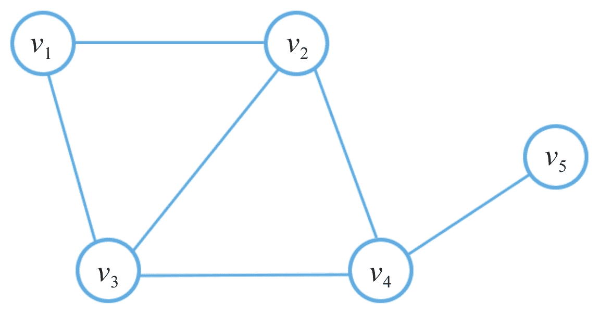

Figure 1-1　Definition of Graph `G`

### 1.1.1　Basic Types of Graphs

**1. Directed and Undirected Graphs**

If the edges in a graph have directionality, such edges are called **directed edges** `e[ij]=<v[i],v[j]>`, where `v[i]` is the start point (tail) of this directed edge, and `v[j]` is the end point (head). A graph containing directed edges is called a **directed graph**, as shown in Figure 1-2. Corresponding to the directed graph is the **undirected graph**. Edges in an undirected graph are all undirected. We can consider an undirected edge to be symmetric, containing both directions simultaneously: `e[ij]=<v[i],v[j]>=<v[j],v[i]>=e[ji]`.

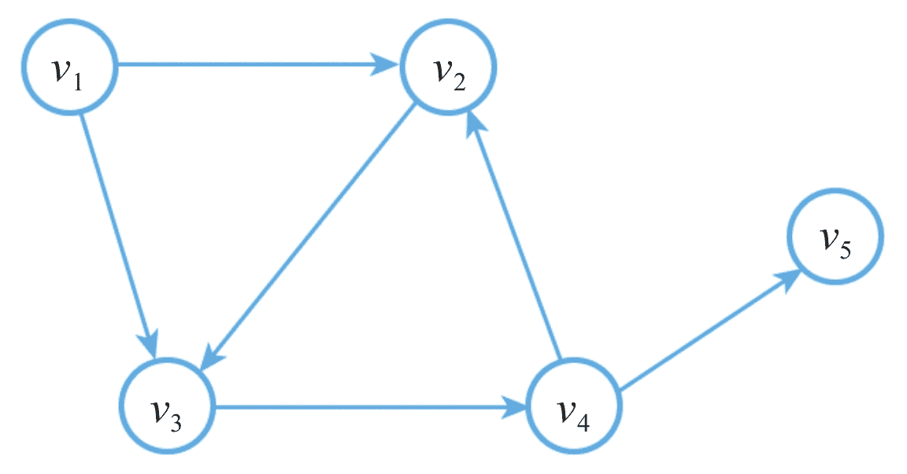

Figure 1-2　Directed Graph

**2. Unweighted and Weighted Graphs**

If each edge in a graph has a corresponding real number, we call such a graph a **weighted graph**, as shown in Figure 1-3. This real number is called the **weight** on the corresponding edge. In practical scenarios, weights can represent the distance or transportation cost between two places. Generally, we are accustomed to abstracting weights as the connection strength between two vertices. The opposite is an **unweighted graph**; we can consider the weights on all edges of an unweighted graph to be the same.

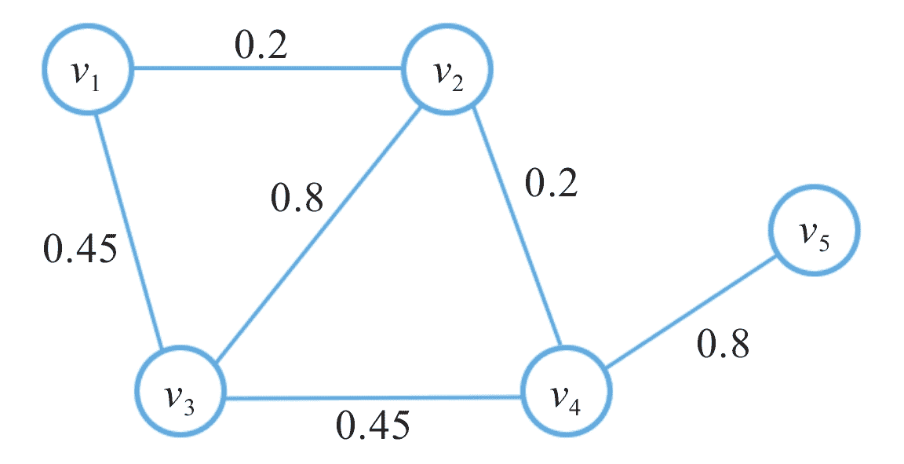

Figure 1-3　Weighted Graph

**3. Connected and Disconnected Graphs**

If there are isolated vertices in a graph that have no edges connected to them, such a graph is called a **disconnected graph**, as shown in Figure 1-4. Conversely, a graph without isolated vertices is called a **connected graph**.

**4. Bipartite Graphs**

A **bipartite graph** is a special class of graphs. We split the vertex set `V` in `G` into two subsets `A` and `B`. If for any edge `e[ij]` in the graph, `v[i]∈A`, `v[j]∈B` or `v[i]∈B`, `v[j]∈A` holds, then graph `G` is called a bipartite graph, as shown in Figure 1-5. A bipartite graph is a very common graph data object that describes the interaction relationships between two types of objects, such as users and items, authors and papers.

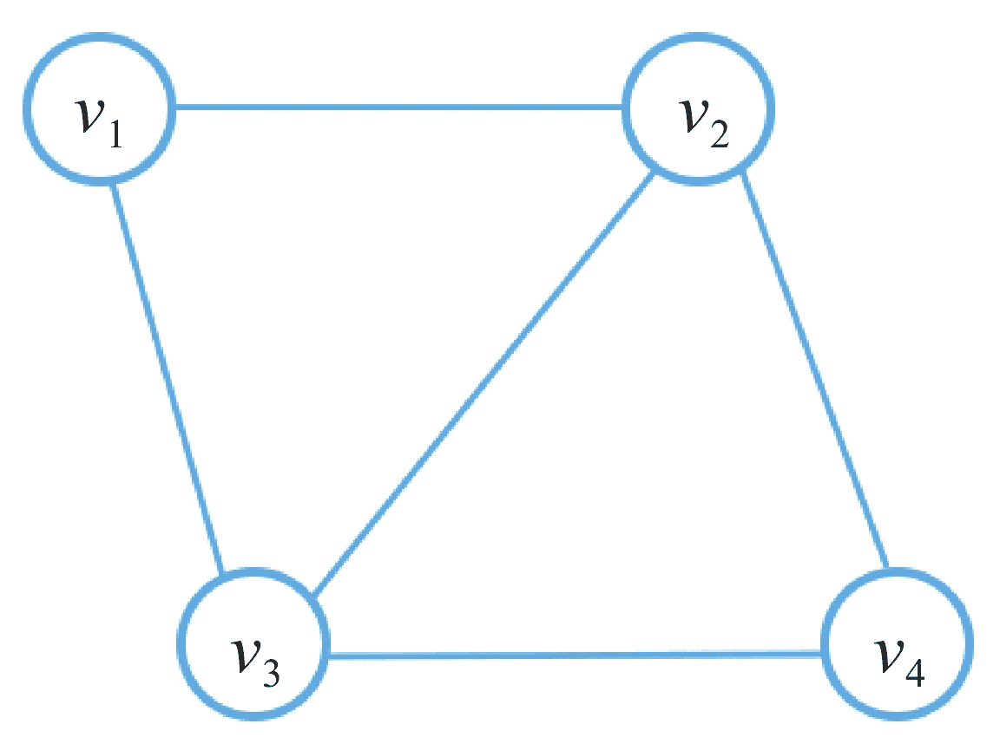

Figure 1-4　Disconnected Graph

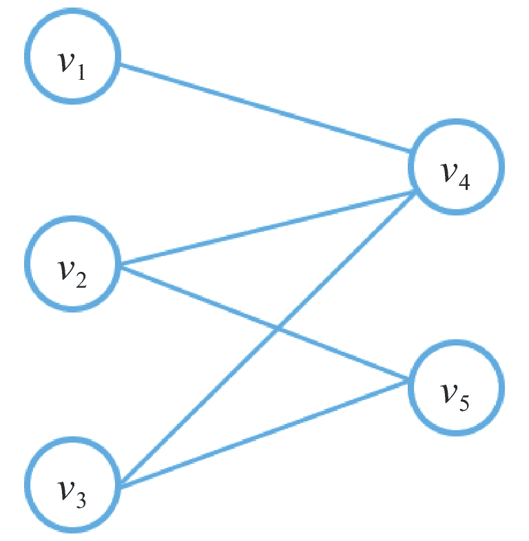

Figure 1-5　Bipartite Graph

### 1.1.2　Neighbors and Degree

If there exists an edge connecting vertices `v[i]` and `v[j]`, then `v[j]` is called a **neighbor** of `v[i]`, and vice versa. We denote the set of all neighbors of `v[i]` as `N(v[i])`, i.e.:

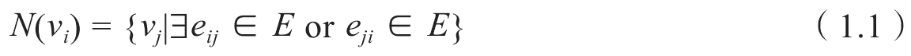

The number of edges having `v[i]` as an endpoint is called the **Degree** of `v[i]`, denoted as `deg(v[i])`:

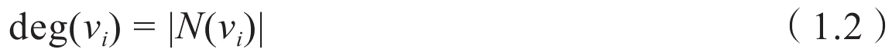

In a graph, the sum of the degrees of all nodes has the following relationship with the number of edges:

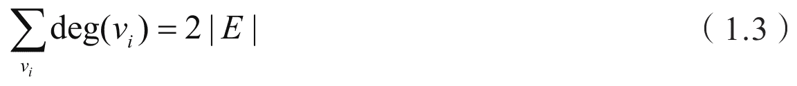

In a directed graph, we simultaneously define **Outdegree** and **Indegree**. The degree of a vertex equals the sum of its outdegree and indegree. Among them, the outdegree of vertex `v[i]` is the number of directed edges starting from `v[i]`, and the indegree of vertex `v[i]` is the number of directed edges ending at `v[i]`.

### 1.1.3　Subgraphs and Paths

If the vertex set and edge set of graph `G'=(V',E')` are subsets of the vertex set and edge set of another graph `G=(V,E)` respectively, i.e., `V'⊆V` and `E'⊆E`, then graph `G'` is called a **subgraph** of graph `G`.

In graph `G=(V,E)`, if starting from vertex `v[i]`, along some edges passing through some vertices `v[k1],v[k2],...,v[kn]`, reaching vertex `v[j]`, then the edge sequence `e[i,k1],e[k1,k2],...,e[kn,j]` is called a **path** (also called a walk) from vertex `v[i]` to vertex `v[j]`, where `e[...]` are edges in graph `G`.

**Path Length**: The number of edges in a path is usually called the length of the path `L(P[ij])=|P[ij]|`.

**Vertex Distance**: If there exists at least one path from vertex `v[i]` to vertex `v[j]`, the distance from `v[i]` to `v[j]` is defined as:

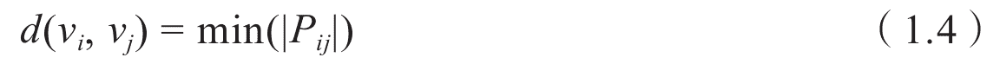

That is, the distance between two vertices is determined by the length of their shortest path. We set `d(v[i],v[j])=0`, meaning the distance from a node to itself is 0.

**k-hop Neighbors**: If `d(v[i],v[j])=k`, we call `v[j]` a **k-hop neighbor** of `v[i]`.

**k-hop Subgraph (`k-subgraph`)**: We call the **k-hop subgraph** of a vertex `v[i]`:

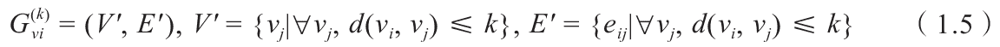

Sometimes, a k-hop subgraph is also called `k-hop`. The shaded part in Figure 1-6 is the 2-hop subgraph of vertex `V[1]`.

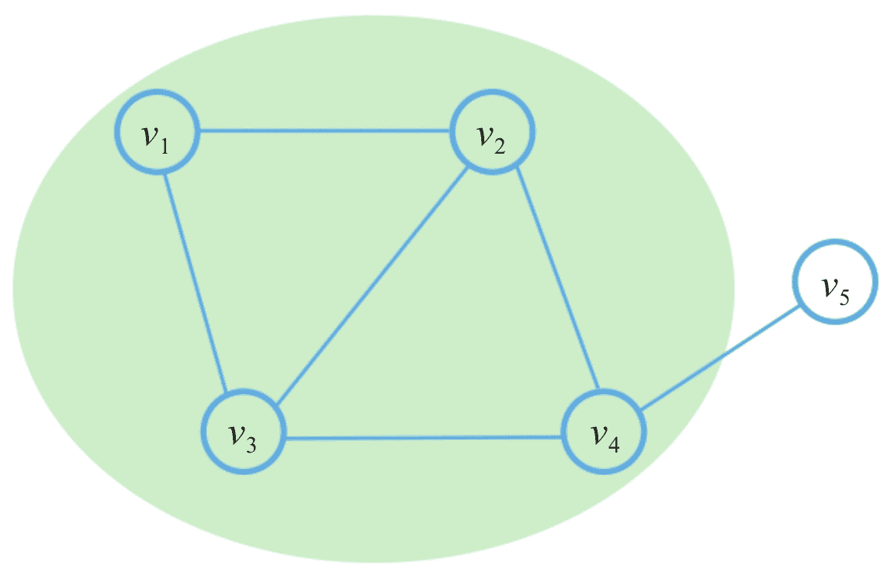

Figure 1-6　2-hop Subgraph of Graph `G`

## 1.2　Graph Storage and Traversal

### 1.2.1　Adjacency Matrix and Incidence Matrix

As a common data structure, there are many storage representation methods for graphs in computers. This section focuses on two methods: the **Adjacency Matrix** and the **Incidence Matrix**.

Let graph `G=(V,E)`. Here we have renumbered the edges as `e[1],e[2],...,e[M]`, as shown in Figure 1-7. We use the adjacency matrix `A` to describe the association between vertices in the graph, `A∈R^(N×N)`, defined as:

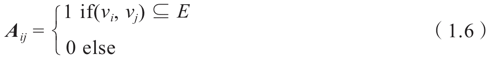

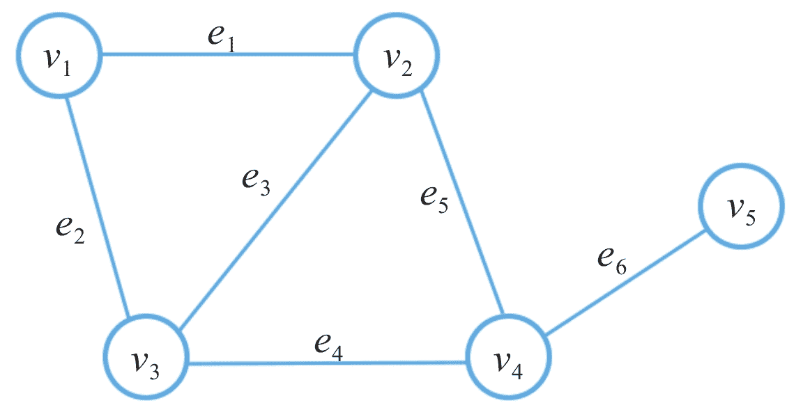

Figure 1-7　Example of Graph `G`

When storing a graph using an adjacency matrix, we need a one-dimensional array to represent the vertex set and a two-dimensional array to represent the adjacency matrix. It is particularly noteworthy that in actual graph data, the adjacency matrix often contains a large number of zero values. Therefore, the sparse matrix format can be used to store the adjacency matrix, which can control the space complexity of the adjacency matrix within `O(M)`. Figure 1-8(a) shows the adjacency matrix storage representation of graph `G`. From this figure, it can be seen that the adjacency matrix of an undirected graph is symmetric along the main diagonal, i.e., `A[ij]=A[ji]`.

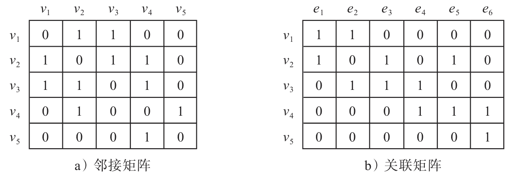

Figure 1-8　Adjacency Matrix and Incidence Matrix of Graph `G`

Besides the adjacency matrix, we sometimes use the incidence matrix `B∈R^(N×M)` to describe the association between nodes and edges, defined as follows:

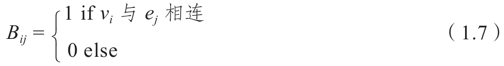

When storing a graph using an incidence matrix, we need two one-dimensional arrays to represent the vertex set and edge set respectively, and a two-dimensional array to represent the incidence matrix. Similarly, the incidence matrix can also be stored using a sparse matrix, because any column of `B` has only two non-zero values. Figure 1-8(b) shows an example of storing a graph using an incidence matrix.

### 1.2.2　Graph Traversal

**Graph traversal** refers to starting from a certain vertex in the graph, visiting all vertices in the graph once and only once along the edges of the graph according to a certain search algorithm. There are two main algorithms for graph traversal: **Depth-First Search (DFS)** and **Breadth-First Search (BFS)**. Graph traversal is an important graph retrieval method, and depth-first search and breadth-first search provide the corresponding algorithmic foundations.

**Depth-First Search** is a recursive algorithm with a backtracking process. Its algorithmic idea is: start from a certain vertex `v[i]` in the graph, depart from `v[i]`, and visit an arbitrary neighbor `w[1]` of it; then depart from `w[1]`, and visit an unvisited vertex `w[2]` among all neighbors of `w[1]`; then depart from `w[2]`, and visit sequentially until a vertex appears that no longer has unvisited neighbors. Next, backtrack one step, backtrack to the vertex just visited last time, and see if there are other unvisited neighbors. If so, visit that neighbor, and then depart from that neighbor to perform a visit similar to the previous one; if not, backtrack one more step for a similar visit. Repeat the above process until all vertices in the graph have been visited. Taking Figure 1-7 as an example, we can obtain the following depth-first search sequence: `v[1]→v[2]→v[4]→v[5]→v[3]`.

**Breadth-First Search** is a hierarchical search process with no backtracking. Its algorithmic idea is: start from a certain vertex `v[i]` in the graph, depart from `v[i]`, and sequentially visit all unvisited neighbors `w[1],w[2],...,w[n]` of `v[i]`; then sequentially visit all still unvisited neighbors of `w[1],w[2],...,w[n]`, and so on, layer by layer, until all vertices in the graph have been visited. Taking Figure 1-7 as an example, we can obtain the following breadth-first search sequence: `v[1]→v[2]→v[3]→v[4]→v[5]`.

## 1.3　Application Scenarios of Graph Data

We mention graphs, which often carry a theoretical color of mathematics. In actual data scenarios, we usually refer to graphs as **Networks**. Correspondingly, the two elements of a graph (vertices and edges) are also called **Nodes** and **Links** (or Edges), such as the familiar concepts of social networks, logistics networks, etc. To achieve unification and distinguish from the "network" concept in **Neural Networks** (although neural networks are also a kind of network), this book refers to network data as **graph data**.

Graph data is a relatively complex data type with many categories. Here we introduce the four most important categories: **Homogeneous Graphs**, **Heterogeneous Graphs**, **Property Graphs**, and **Non-explicit Graphs (Graphs Constructed from Non-relational Data)**.

1.  **Homogeneous Graph**: A homogeneous graph refers to a graph where there is only one type of node and one type of relationship (edge). A homogeneous graph is the most simplified case of actual graph data, such as the World Wide Web constituted by hyperlink relationships. The information of this type of graph data is entirely contained in the adjacency matrix.
2.  **Heterogeneous Graph**: Opposite to homogeneous graphs, a heterogeneous graph refers to a graph where there is more than one type of node or relationship. In real-world scenarios, the graph data objects we usually study are multi-typed, and the interaction relationships between objects are also diversified. Therefore, heterogeneous graphs can better fit reality.
3.  **Property Graph**: Compared to heterogeneous graphs, a property graph adds additional attribute information to the graph data, as shown in Figure 1-9. For a property graph, both nodes and relationships have **Labels** and **Properties**. Here, labels refer to the types of nodes or relationships, e.g., a node type is "User". Properties are additional descriptive information of nodes or relationships, e.g., a "User" node can have properties like "Name", "Registration Time", "Registration Address", etc. A property graph is the most common representation of industrial-grade graph data and can be widely applied to data expression in various business scenarios.

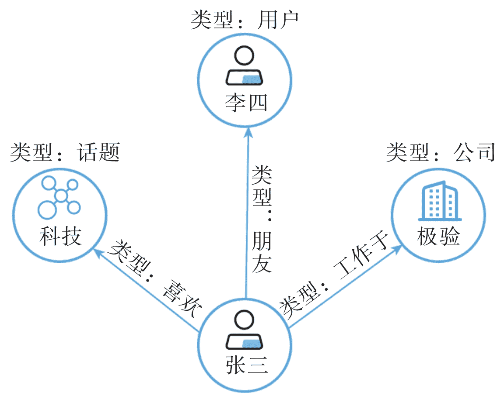

Figure 1-9　Property Graph

4.  **Non-explicit Graph**: A non-explicit graph refers to data where relationships are not explicitly defined. It requires expressing the relationships between data based on certain rules or calculation methods, and then treating the data as a kind of graph data for study. For example, point cloud data in 3D computer vision: if we convert the spatial distances between nodes into relationships, the point cloud data becomes graph data.

When studying diversified object systems, a graph is a very important perspective. In the real world, graph data has extremely wide application scenarios. Below we give a few examples for illustration, as shown in Figure 1-10.

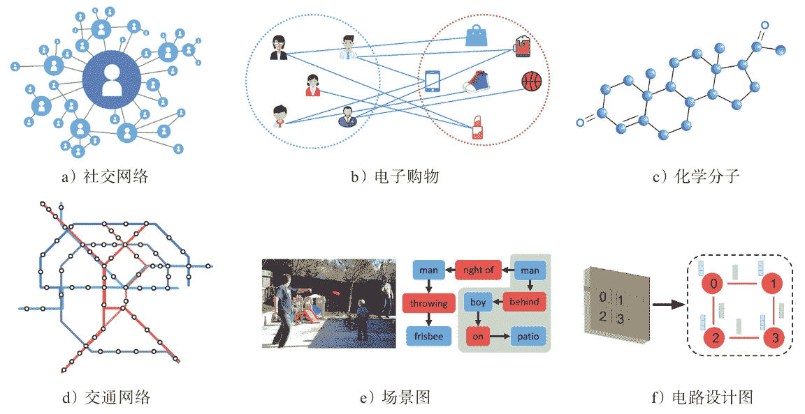

Figure 1-10　Examples of Graph Data Applications[¹][¹⁹]

**Social Networks**: Social networks are a very common type of graph data, representing various social relationships between individuals or organizations. Figure 1-10(a) shows a user follow network in an online social network: nodes are users, and edges are follow relationships between users. This is a typical homogeneous graph, generally used to study user importance ranking and related user recommendation problems. With the continuous deepening of mobile internet technology, more diversified media objects have been added to social networks, such as short texts, videos, etc. The heterogeneous graphs thus formed can accomplish more diversified tasks.

**E-commerce**: E-commerce is a core business on the internet. In such scenarios, business data can usually be described by a user–item bipartite graph. In the example shown in Figure 1-10(b), nodes are divided into two categories: users and items. Existing relationships include browsing, collecting, purchasing, etc. There can be multiple relationships between a user and an item, such as both a collecting relationship and a purchasing relationship. Such complex data scenarios can be easily described by a property graph. E-commerce has spawned a well-known technical application—**recommender systems**. The interaction relationships between users and items reflect users' shopping preferences. For example, the classic "beer and diapers" story: people who buy beer usually also tend to buy diapers.

**Chemical Molecules**: Taking atoms as nodes and chemical bonds between atoms as edges, we can regard molecules as a type of graph data for study. The basic composition and internal connections of molecules determine their various physicochemical properties. Usually, we use them to guide research tasks for new materials and new drugs, as shown in Figure 1-10(c).

**Transportation Networks**: Transportation networks have various forms. For example, in a subway network, each station is a node, and the connectivity between stations forms a graph, as shown in Figure 1-10(d). Usually, in transportation networks, we are more concerned with path planning related problems: such as the shortest path problem. Another example is taking traffic flow as an attribute of nodes in the network to predict future changes in traffic flow.


### Scene Graph

A scene graph is a method for describing image semantics. It treats objects in an image as nodes and the mutual relationships between objects as edges, forming a graph. A scene graph can simplify an image with complex relationships into a semantic graph with explicit relationships. Scene graphs have powerful application scenarios, such as image synthesis, image semantic retrieval, and visual reasoning. Figure 1-10(e) shows an example of synthesizing a semantic image from a scene graph. In this scene graph, five objects are described: two men, a child, a frisbee, a courtyard, and the relationships among them. It can be seen that the scene graph has strong semantic representation capabilities.

### Circuit Design Diagram

We can abstract electronic components, such as resonators, as nodes, and the wiring between components as edges, thereby representing circuit design as a form of graph data. In reference [^([\[1\]](#chapter8.xhtml#ch1_back))], circuit design is abstracted in this way, as shown in Figure 1-10(f). Then, based on Graph Neural Network technology, the electromagnetic characteristics of the circuit are simulated and fitted. Compared to rigorous electromagnetic formula simulation, this can greatly accelerate the design of high-frequency circuits within an acceptable error range.

The application scenarios of graph data go far beyond these. There are also computation graphs describing the computational processes of neural networks, sensor array networks, and the Internet of Things composed of various smart sensors. In fact, if one wants to find a most representative data description language corresponding to real-world data, graphs should be the most competitive candidate. In summary, graph data applications have a wide span and diverse scenarios; researching graph data has broad and significant practical significance.

[\[1\]](#chapter8.xhtml#ch1) Zhang G, He H, Katabi D. Circuit-GNN: Graph Neural Networks for Distributed Circuit Design[C]//International Conference on Machine Learning. 2019: 7364-7373.

## 1.4 Deep Learning on Graph Data

As an important data type, the demand for analysis and learning of graph data is increasingly prominent. Many Graph Learning theories focus on task learning related to graph data. Spectral Graph Theory[^(\[2\])](../Text/chapter10.xhtml#aa-2) is a theory combining graph theory and linear algebra. Spectral clustering algorithms[^(\[3\])](../Text/chapter10.xhtml#aa-3) developed based on this theory can be used to solve graph partitioning or node clustering problems. Statistical Relational Learning (SRL)[^(\[4\])](../Text/chapter10.xhtml#aa-4) is a machine learning theory combining relational representation and likelihood representation. Unlike traditional machine learning algorithms that assume data is Independent and Identically Distributed (i.i.d., meaning data objects are of the same class and independent/uncorrelated), SRL breaks these two assumptions about data, making it a better fit for learning on graph data. To better fit heterogeneous graph data in real-world scenarios, Heterogeneous Information Network (HIN) analysis[^(\[5\])](../Text/chapter10.xhtml#aa-5) was proposed to mine more comprehensive structural information and rich semantic information in heterogeneous graphs. Due to the tremendous achievements of deep learning in practical application fields in recent years, the concepts of representation learning and end-to-end learning have gained increasing attention. To learn vectorized representations containing sufficient information from complex graph data, a large number of Network Embedding[^(\[6\])](../Text/chapter10.xhtml#aa-6) methods have emerged. However, network embedding struggles to provide an end-to-end system combining representation learning and task learning. Based on this, end-to-end learning systems for graph data remain an important research topic.

Due to the complexity of the structure of graph data itself, it is not intuitive to directly define a set of differentiable computational frameworks supporting it. Data corresponding to graph data include images, speech, and text. These data are regularized structural data defined in Euclidean space. The tensor computation system based on these data is relatively natural and efficient. Figure 1-11 gives a comparison between graph data and several other common data types. Image data exhibits a regular 2D grid structure, which corresponds well with the operating mechanism of Convolutional Neural Networks. Text data is a regular sequence data, and this sequential structure corresponds to the operating mechanism of Recurrent Neural Networks.

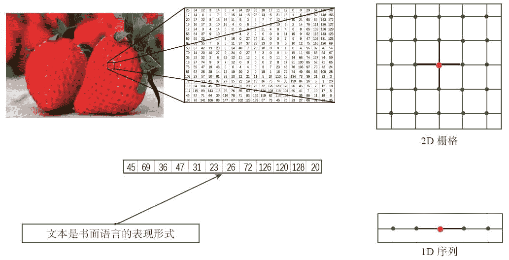

Figure 1-11　Image, Speech, and Text Data Types[^(\[1\])](#chapter9.xhtml#ch1_back)

Inspired by the definition of graph signal convolution filtering in Graph Signal Processing[^(\[7\])](../Text/chapter10.xhtml#aa-7), a neural network theory based on graph convolution operations and continuously derived has been developed in recent years. This book collectively refers to this class of methods as Graph Neural Networks (GNN[^(\[8\])](../Text/chapter10.xhtml#aa-8)[^(\[9\])](../Text/chapter10.xhtml#aa-9)[^(\[10\])](../Text/chapter10.xhtml#aa-10)). Below we briefly describe its development history.

In 2005, Marco Gori et al. published a paper[^(\[11\])](../Text/chapter10.xhtml#aa-11), proposing the concept of Graph Neural Networks for the first time. Before this, methods for processing graph data converted graphs into a set of vectors during the data preprocessing stage. The biggest problem with this processing method is that structural information in the graph may be lost, and the results obtained would heavily depend on the preprocessing of the graph. The proposal of GNNs was to enable the learning process to be directly architected on graph data.

Subsequently, in two papers in 2009[^(\[12\])](../Text/chapter10.xhtml#aa-12)[^(\[13\])](../Text/chapter10.xhtml#aa-13), they further elaborated on Graph Neural Networks and proposed a supervised learning method to train GNNs. However, these early studies all used an iterative approach, propagating neighbor information through Recurrent Neural Networks until a stable fixed state was reached to learn node representations. This computation method consumes significant resources, and related research began to focus on how to improve this method to reduce computational cost.

Around 2012, Convolutional Neural Networks began to achieve remarkable results in the vision field, prompting people to consider how to apply convolution to Graph Neural Networks. In 2013, Bruna et al. first introduced convolution into Graph Neural Networks. In reference [\[14\]](../Text/chapter10.xhtml#aa-14), a Graph Convolutional Network model was developed based on the concept of spectral convolution operations, applying learnable convolution operations to graph data for the first time. Since then, many have proposed improvements and extensions to this spectral-based graph convolutional neural network model. However, spectral convolution methods require processing the entire graph simultaneously during computation and bear the high time complexity of matrix decomposition, making it difficult to scale the learning system to large-scale graph data learning tasks. Therefore, spatial-based graph convolution was proposed and gradually became popular.

In 2016, Kipf et al.[^(\[15\])](../Text/chapter10.xhtml#aa-15) simplified the definition of spectral graph convolution, enabling graph convolution operations to be performed in the spatial domain. This greatly improved the computational efficiency of graph convolution models. Simultaneously, benefiting from the efficiency of convolution filtering, graph convolution models achieved remarkable results on multiple graph data-related tasks.

In recent years, more variants of neural network models based on spatial graph convolution[^(\[16\])](../Text/chapter10.xhtml#aa-16)[^(\[17\])](../Text/chapter10.xhtml#aa-17)[^(\[18\])](../Text/chapter10.xhtml#aa-18) have been developed. We collectively refer to this class of methods as GNNs. The emergence of various GNN models has greatly enhanced the adaptability of learning systems to various types of graph data, laying a solid foundation for task learning on various graph data.

Since then, graph data and deep learning have had their first truly meaningful combination. The emergence of GNNs realized end-to-end learning for graph data, providing a highly competitive learning solution for tasks in numerous application scenarios of graph data.

Below, we give a classification of graph data-related tasks.

### 1. Node-Level Tasks

Node-level tasks mainly include classification and regression tasks. Although these tasks predict properties at the node level, the model should obviously not be built on individual nodes alone; the relationships between nodes also need to be considered. There are many node-level tasks, including the academically common classification of paper nodes in citation networks, and in industry, user tag classification and malicious account detection in online social networks.

### 2. Link-Level Tasks

Link-level tasks mainly include edge classification and prediction tasks. Edge classification refers to predicting a certain property of an edge; link prediction refers to predicting whether an edge will form between two given nodes. A common application scenario is in social networks, where users are modeled as nodes and follow relationships between users as edges. Link prediction is used to implement social user recommendations. Currently, link-level tasks are mainly concentrated in recommendation business.

### 3. Graph-Level Tasks

Graph-level tasks do not rely on the attributes of a specific node or edge, but start from the overall structure of the graph to achieve classification, representation, and generation tasks. Currently, graph-level tasks are mainly applied in the field of natural science research, such as classification of drug molecules, classification of enzymes, etc.

[\[1\]](#chapter9.xhtml#ch1) Image source: http://helper.ipam.ucla.edu/publications/dlt2018/dlt2018_14506.pdf.

## 1.5 References

[\[1\]](../Text/chapter8.xhtml#a1)　Zhang G, He H, Katabi D. Circuit-GNN: Graph Neural Networks for Distributed Circuit Design[C]//International Conference on Machine Learning. 2019: 7364-7373.

[\[2\]](../Text/chapter9.xhtml#a2)　F.R. Chung. Spectral Graph Theory. American Mathematical Society, 1997.

[\[3\]](../Text/chapter9.xhtml#a3)　Von Luxburg U. A tutorial on spectral clustering[J]. Statistics and computing, 2007, 17(4): 395-416.

[\[4\]](../Text/chapter9.xhtml#a4)　Koller D, Friedman N, Džeroski S, et al. Introduction to statistical relational learning[M]. MIT press, 2007.

[\[5\]](../Text/chapter9.xhtml#a5)　Shi C, Li Y, Zhang J, et al. A survey of heterogeneous information network analysis[J]. IEEE Transactions on Knowledge and Data Engineering, 2016, 29(1): 17-37.

[\[6\]](../Text/chapter9.xhtml#a6)　Cui P, Wang X, Pei J, et al. A survey on network embedding[J]. IEEE Transactions on Knowledge and Data Engineering, 2018, 31(5): 833-852.

[\[7\]](../Text/chapter9.xhtml#a7)　Shuman D I, Narang S K, Frossard P, et al. The emerging field of signal processing on graphs: Extending high-dimensional data analysis to networks and other irregular domains[J]. IEEE signal processing magazine, 2013, 30(3): 83-98.

[\[8\]](../Text/chapter9.xhtml#a8)　Zhou J, Cui G, Zhang Z, et al. Graph neural networks: A review of methods and applications[J]. arXiv preprint arXiv:1812.08434, 2018.

[\[9\]](../Text/chapter9.xhtml#a9)　Zhang Z, Cui P, Zhu W. Deep learning on graphs: A survey[J]. arXiv preprint arXiv:1812.04202, 2018.

[\[10\]](../Text/chapter9.xhtml#a10)　Wu Z, Pan S, Chen F, et al. A comprehensive survey on graph neural networks[J]. arXiv preprint arXiv:1901.00596, 2019.

[\[11\]](../Text/chapter9.xhtml#a11)　Gori M, Monfardini G, Scarselli F. A new model for learning in graph domains[C]//Proceedings. 2005 IEEE International Joint Conference on Neural Networks, 2005. IEEE, 2005, 2: 729-734.

[\[12\]](../Text/chapter9.xhtml#a12)　Micheli A. Neural network for graphs: A contextual constructive approach[J]. IEEE Transactions on Neural Networks, 2009, 20(3): 498-511.

[\[13\]](../Text/chapter9.xhtml#a13)　Scarselli F, Gori M, Tsoi A C, et al. The graph neural network model[J]. IEEE Transactions on Neural Networks, 2008, 20(1): 61-80.

[\[14\]](../Text/chapter9.xhtml#a14)　Bruna J, Zaremba W, Szlam A, et al. Spectral networks and locally connected networks on graphs[J]. arXiv preprint arXiv:1312.6203, 2013.

[\[15\]](../Text/chapter9.xhtml#a15)　Kipf T N, Welling M. Semi-supervised classification with graph convolutional networks[J]. arXiv preprint arXiv:1609.02907, 2016.

[\[16\]](../Text/chapter9.xhtml#a16)　Hamilton W, Ying Z, Leskovec J. Inductive representation learning on large graphs[C]//Advances in Neural Information Processing Systems. 2017: 1024-1034.

[\[17\]](../Text/chapter9.xhtml#a17)　Veličković P, Cucurull G, Casanova A, et al. Graph attention networks[J]. arXiv preprint arXiv:1710.10903, 2017.

[\[18\]](../Text/chapter9.xhtml#a18)　Gilmer J, Schoenholz S S, Riley P F, et al. Neural message passing for quantum chemistry[C]//Proceedings of the 34th International Conference on Machine Learning-Volume 70. JMLR.org, 2017: 1263-1272.

[\[19\]](../Text/chapter8.xhtml#a19)　Johnson J, Gupta A, Fei-Fei L. Image generation from scene graphs[C]//Proceedings of the IEEE Conference on Computer Vision and Pattern Recognition. 2018: 1219-1228.

# Chapter 2 Neural Network Fundamentals

In recent years, with the improvement of algorithms, the explosion of data volume, and the enhancement of computing power, machine learning and deep learning have developed rapidly. This chapter starts from the basic concepts of machine learning, introducing what machine learning is and how to obtain machine learning models. Then it introduces the basic building units of deep learning models—the neuron model and the Multi-Layer Perceptron (MLP) model built upon it. We will also take the Multi-Layer Perceptron as an example to introduce the backpropagation algorithm and optimization methods in deep learning.

## 2.1 Basic Concepts of Machine Learning

### 2.1.1 Classification of Machine Learning

Machine learning is an interdisciplinary field involving probability theory, statistics, approximation theory, convex analysis, computational complexity theory, and many other disciplines. Machine learning theory mainly focuses on designing and analyzing algorithms that allow computers to automatically "learn". In layman's terms, machine learning enables computers to mine valuable information from data.

From different dimensions, machine learning can have different classifications. Below we briefly introduce several common classification methods.

Based on whether training data has labels, machine learning can be divided into **Supervised Learning**, **Semi-Supervised Learning**, and **Unsupervised Learning**.

**Supervised Learning**: Refers to the scenario where every sample in the training data has a label. Labels guide the model training to learn discriminative features, thereby enabling prediction on unknown samples. For example, in the ImageNet image classification competition, a model is trained using existing labels for each image, allowing the model to predict unknown images and obtain corresponding classification results.

**Unsupervised Learning**: Refers to the scenario where training data has no labels at all. Algorithms discover constraint relationships between data, such as associations, distance relationships, etc. A typical unsupervised algorithm is clustering, which groups samples with similar "distances" together based on certain metrics.

**Semi-Supervised Learning**: Refers to a learning method between supervised and unsupervised learning. Its training data contains both labeled and unlabeled data. Assuming labeled and unlabeled data are sampled from the same distribution, the unlabeled data contains some information related to the data distribution, which can serve as a supplement to labeled data. This situation is very common in reality. For example, in the internet industry, massive amounts of data are generated daily. Some of this data may carry labels, but more data is unlabeled. If manual labeling is relied upon for these unlabeled data, the cost is considerable, while semi-supervised learning can provide some solutions.

From the perspective of algorithm output form, it can be divided into classification problems and regression problems, both of which belong to the category of supervised learning.


#### Classification Problems and Regression Problems

**Classification Problem**: Refers to the model output being discrete values. For example, in risk control scenarios, the model usually outputs two categories: normal/anomalous; in image classification tasks, the model outputs the specific category to which the image belongs.

**Regression Problem**: Refers to the model output being continuous values. For example, in e-commerce ad recommendation, the model often outputs the probability of a user clicking on a certain product; the higher the probability, the more the model believes the user is inclined to click on that product.

### 2.1.2 Overview of Machine Learning Workflow

A complete machine learning workflow usually involves multiple stages, which are interdependent. Below, a concrete example is used to intuitively illustrate the entire workflow, followed by a mathematical description of the whole process.

#### 1. Example

In the e-commerce domain, we need to classify products. To simplify the problem, assume there is only a batch of product image data, categorized into down jackets, wool coats, dresses, hoodies, etc. We need to build a model, use this batch of product image data to train the model, and obtain a predictive model that can classify unknown images. For example, correctly predicting the category of a new style down jacket as "down jacket". To achieve the above functions, the following steps are typically required in machine learning.

##### (1) Extract Product Image Features

In computers, images are stored discretely as pixels. The information carried by a single pixel makes it difficult for the model to learn directly. To enable the computer to accurately recognize and classify, some discriminative features need to be extracted, such as the color and style of the clothes. These features can be manually defined, a process called **Feature Engineering**, or automatically extracted using algorithms. The former is a necessary step in traditional machine learning and holds a pivotal position; a typical method of the latter is **Deep Learning**, and readers can learn how to use deep learning methods to solve this problem in Chapter 3.

##### (2) Build Model

After defining features, a suitable model needs to be selected for modeling. Traditional machine learning models include `Logistic Regression`, `Random Forest`, etc.; deep learning-based methods include `Multi-Layer Perceptron`, `Convolutional Network`, etc. The model can be viewed as a complex function `y = f(X; W)`, whose purpose is to establish a mapping from input to label `y`, where `X` is the features defined earlier, and `W` are the parameters defining the model.

##### (3) Determine Loss Function and Perform Optimization Solving

Selecting a model only determines a model form, e.g., using `Logistic Regression`, which still contains weights. Before these weights are determined, it cannot be used for correct prediction. So how to adjust the model so it can make meaningful predictions? First, a numerical value is needed to quantify the correctness of the model's prediction. The **Loss Function** measures the degree of difference between the model output and the label. When the prediction result differs greatly from the label, the loss function value increases; conversely, it decreases. Based on the value given by the loss function, optimization methods can be used to adjust the model to continuously reduce the loss value.

#### 2. Mathematical Model

Taking the classification model represented by the above example as an example, the mathematical model for classification is given. Assume there is a training set containing `N` samples, represented by the set `X = {(x[i], y[i]) | i = 1, 2, ..., N}`. Each sample `x[i]` has a corresponding label `y[i]`, where `x[i] ∈ R^d` indicates each sample is a `d`-dimensional vector, and the label `y[i]` is a series of discrete values `y[i] ∈ Y = {0, 1, 2, ..., K}`, representing the category to which sample `x[i]` belongs, and `K` is the number of categories. Our goal is to build a model capable of performing classification, i.e., we need a model: `f: R^d → R^K`, where the input is a `d`-dimensional vector, mapped through `f`, outputting the probability distribution `P(Y|x[i]) = f(x[i]; θ)` on each category, so that the category with the maximum probability can be taken as the result, i.e., `argmax_k P(Y = c[k] | x[i])`.

Then the question is, how to evaluate the quality of a classification model? A relatively direct method is to focus on the model's results on the training data, evaluating the model's quality by comparing whether `argmax_k P(Y = c[k] | x[i])` is the same as the sample's true label `y[i]`. If the model can correctly predict most samples in the training set, it might be a good model; otherwise, it might be a poor model. Such qualitative description is not intuitive; we need a method to quantify this difference, and that method is the **Loss Function**.

**Loss Function** (loss function) is used to measure the degree of difference between the model's predicted value `ŷ` and the true value `y`. It is a non-negative real-valued function, usually denoted as `L(y, f(x; θ))`. In machine learning, the model is trained by minimizing the loss function on the training set `X`, adjusting the parameters `θ` of `f` to reduce the loss function value. When the loss function reaches its minimum value, a good model is found. This process is called **Optimization Solving**. The entire process can be represented by Equation (2.1):

```
θ* = argmin_θ (1/N Σ_{i=1}^N L(y[i], f(x[i]; θ)) + λΦ(θ))
```

Here, the preceding mean function represents the **Empirical Risk Function**, `L` represents the **Loss Function**, and the following `Φ` is the **Regularization Term** (regularizer) or **Penalty Term** (penalty term), which can be `L1`, `L2`, or other regularization functions. The above formula represents finding the `θ` value that minimizes the objective function. The loss function aims to represent the degree of difference between the model output `f(x)` and the true value `Y`. Different loss functions have different representational meanings, meaning that in the process of minimizing the loss function, the way `f(x)` approaches `Y` differs, and the results obtained may also differ.

In actual optimization, it is often impossible to find suitable parameters in one step. Therefore, in machine learning, iterative methods are usually used to gradually approach the optimal value. The entire process is shown in Figure 2-1: use model `f(X; θ[0])` to predict on training set `X`, where `θ[0]` represents initial parameters; then calculate the loss value using the loss function on the predicted results and the sample's true labels; the optimization method adjusts parameters based on the current loss value to obtain `θ[1]`; then repeat the above process, continuously iterating, until the algorithm finds the model parameters where the loss might be the lowest. Usually, iteration continues until the overall loss no longer changes or changes extremely slowly. At this point, we can say the model has converged.

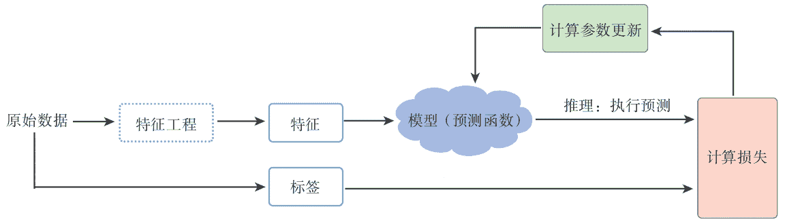

It should be noted that the purpose of training a model is not to achieve good results on the training set, but to hope the model learns from the training set to face unknown samples and make predictions on new samples. An extreme case is obtaining a model that perfectly fits the training data, correctly predicting all training samples, i.e., its loss value is 0, but performs poorly on new sample prediction. This phenomenon in machine learning is called **Overfitting**. Another situation is where the model "tries its best" but cannot achieve satisfactory results on the training samples. This phenomenon is called **Underfitting**.

The loss function and optimization algorithm are two important components of machine learning. Next, we will first introduce several commonly used loss functions, then introduce a class of widely used optimization methods—Gradient Descent.

### 2.1.3 Common Loss Functions

The loss function is the foundation for guiding the model to learn effectively. Based on different tasks, different loss functions can be selected or designed so that the model can mine valuable information from data. Below we introduce several common loss functions.

#### 1. Squared Loss Function

The definition of squared loss is shown in Equation (2.2):

```
L = 1/N Σ_{i=1}^N (y[i] - f(x[i]; θ))²
```

Where `N` is the number of samples. It measures the squared difference between the model's predicted results and the labels, commonly used for regression problems.

#### 2. Cross-Entropy Loss

**Cross-Entropy** loss is commonly used in classification problems. Classification models usually output a probability distribution of categories. Cross-entropy measures the degree of difference between the true distribution of data labels and the probability distribution predicted by the classification model. The smaller the loss value, the smaller the difference between them, and the more accurately the model can predict. Its discrete form is as follows:

```
H(p, q) = - Σ_i p(y[i]|x[i]) log q(y[i]|x[i])
```

Where `p` and `q` represent the true distribution of data labels and the distribution given by the model prediction, respectively. `p(y[i]|x[i])` represents the true distribution of the label of sample `x[i]`. Generally, sample `x[i]` belongs to only one category `c[k]`, so `p(y[i] = c[k]|x[i]) = 1`, and the probability on other categories is 0. `q(y[i]|x[i])` represents the probability distribution predicted by the model on each category given sample `x[i]`. If the label of sample `x[i]` is `c[k]`, then Equation (2.3) can be simplified to Equation (2.4):

```
L = - log q(y[i] = c[k]|x[i])
```

It can be seen that in this case, minimizing the cross-entropy loss is equivalent to maximizing the likelihood probability of the sample label.

For binary classification `y[i] ∈ {0, 1}`, using `Logistic Regression` can obtain the probability `q(y[i] = 1|x[i])` of sample `x[i]` belonging to category 1. Then the probability of the sample belonging to category 0 is `1 - q(y[i] = 1|x[i])`. Using Equation (2.4), the loss function of `Logistic Regression` can be obtained, as shown in Equation (2.5), which is also called **Binary Cross-Entropy Loss**.

```
L = - [y[i] log q(y[i] = 1|x[i]) + (1 - y[i]) log (1 - q(y[i] = 1|x[i]))]
```

### 2.1.4 Gradient Descent Algorithm

#### 1. Principle of Gradient Descent Algorithm

Many problems in machine learning are essentially optimization problems—finding suitable parameters to minimize the loss function value. There are many mature methods for solving such optimization problems. **Gradient Descent** is a classic method. It uses gradient information to iteratively adjust parameters to find a suitable solution.

For a multivariate function `f(x)`, the gradient is defined as the vector composed of partial derivatives with respect to each independent variable, denoted as `f'(x)`, as shown in Equation (2.6):

```
f'(x) = [∂f/∂x_1, ∂f/∂x_2, ..., ∂f/∂x_n]^T
```

Examine the Taylor expansion of `f(x + Δx)` at `x`, as shown in Equation (2.7):

```
f(x + Δx) ≈ f(x) + f'(x)^T Δx
```

To make `f(x + Δx) < f(x)`, ignoring higher-order terms, we need `f'(x)^T Δx < 0`. That is, satisfying this condition can reduce the function value. Further, `f'(x)^T Δx = ||f'(x)^T|| · ||Δx|| · cosθ`. Taking `Δx = -α f'(x)` ensures that the updated `x` reduces the function value. Here `α` is a hyperparameter used to adjust the step size of each update, called the **Learning Rate**.

The optimization goal in machine learning is to minimize the loss function. The process of solving using the gradient descent method is divided into the following steps, as shown in Code Listing 2-1. First, randomly initialize the parameters to be solved as initial values, serving as the starting point of optimization; next, use the model to predict on all samples and calculate the overall loss value; then, differentiate the loss value with respect to the model parameters to obtain the corresponding gradient; finally, adjust parameters based on the gradient to obtain the parameters after iteration. Repeat the above process until the stopping condition is met.

An analogy: The gradient descent algorithm is like a person going down a mountain. He is at the top and wants to reach the foot, but the fog on the mountain is thick, and he cannot distinguish the path down. He must use the information around him to find the path down. This is where the gradient descent algorithm can be used. Specifically, based on his current position, find the steepest direction at this position, then walk down the mountain in this direction. After walking a segment, repeat the above steps, and eventually he will successfully reach the foot of the mountain.

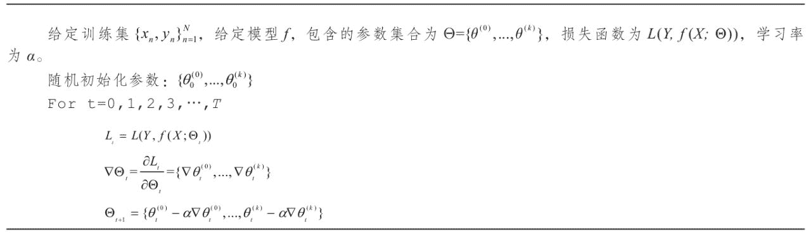

#### 2. Stochastic Gradient Descent Algorithm

The gradient descent algorithm introduced earlier needs to first calculate the loss value on all data, then perform gradient descent. This method is relatively inefficient when the data scale is large. This is mainly reflected in three aspects: first, when the data scale is large, the time for the model to compute all samples increases; second, as the data dimension increases, the complexity of gradient calculation also increases; third, although an accurate gradient value can be obtained based on all samples, only one parameter update is performed. We call such a gradient descent algorithm **Batch Gradient Descent** (Batch Gradient Descent).

If the gradient is not calculated using the full set of samples, but a single sample is used to approximate the gradient estimation, the computation amount can be greatly reduced, and computational efficiency improved. But can this method guarantee convergence? It can be proven that the convergence of this algorithm is guaranteed. This method is called **Stochastic Gradient Descent** (Stochastic Gradient Descent, SGD).

Specifically, each time a sample is randomly selected from the training set, its corresponding loss and gradient are calculated, and parameters are updated. This process is repeated iteratively. This method can reduce computational complexity when the data scale is large. From a probabilistic perspective, the gradient of a single sample is an unbiased estimate of the gradient of the entire data, but it has certain uncertainty. Therefore, its convergence rate is slower compared to Batch Gradient Descent.

An improved method is to use multiple samples to estimate the gradient each time. This can reduce uncertainty and improve the convergence rate. This method is called **Mini-batch Stochastic Gradient Descent** (mini-batch SGD), where the number of samples selected in each iteration is called the **Batch Size** (batch size). The algorithm steps are shown below.

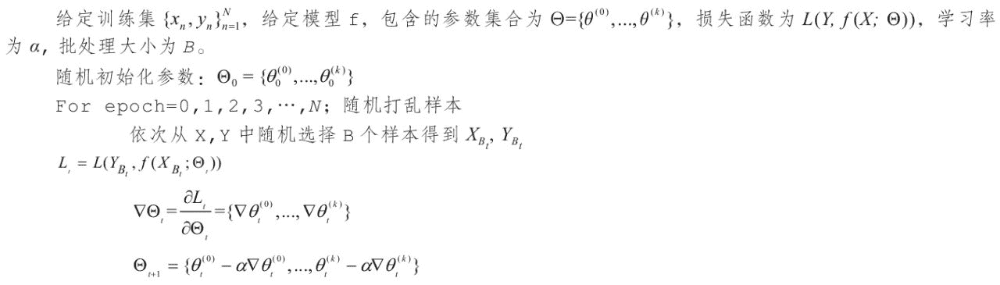

## 2.2 Neural Networks

With the development of neuroscience and cognitive science, we know that human intelligent behaviors are related to brain activity. The human brain is an organ capable of producing consciousness, thought, and emotion. Inspired by the human brain's nervous system, early neuroscientists constructed a mathematical model mimicking the human brain's nervous system, called the **Artificial Neural Network**, or **Neural Network** for short. In the field of machine learning, a neural network refers to a network structure model composed of many artificial neurons. The connection strengths between these artificial neurons are learnable parameters.

### 2.2.1 Neuron

The **Neuron** is the basic unit of information processing in a neural network. It mainly simulates the structure and characteristics of biological neurons, receiving input signals and producing outputs.

Biologists discovered the structure of biological neurons in the early 20th century, as shown in Figure 2-2. A typical biological neuron usually has multiple dendrites and one axon. Dendrites receive information, and the axon sends information. When the input signals accumulated by the neuron exceed a certain threshold, it enters an excited state and generates electrical pulses. The end of the axon has many terminals that can connect with the dendrites of other neurons (synapses) and transmit electrical pulse signals to other neurons.

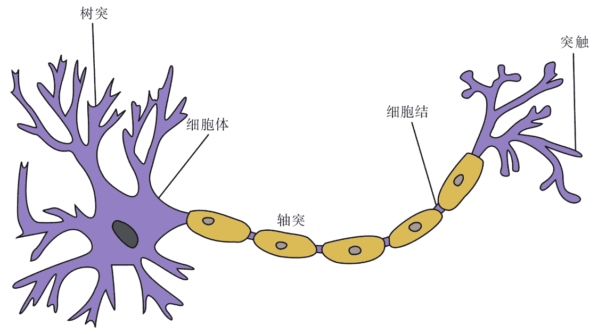

In 1943, psychologist McCulloch and mathematician Pitts proposed a very simple neuron model based on the structure of biological neurons—the **MP Neuron**[¹].

A basic neuron includes three basic components: input signals, linear combination, and non-linear activation function. We can use Equations (2.8) and (2.9) to describe the computation of the neuron in Figure 2-3.

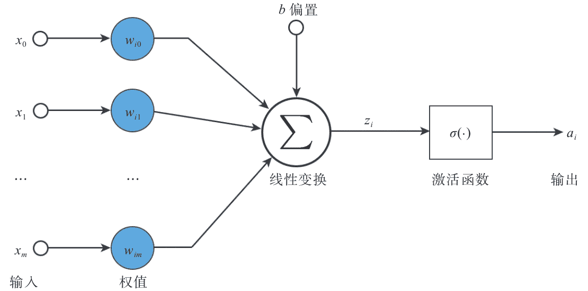

```
z[i] = Σ_{j=0}^m w[ij] x[j] + b
a[i] = σ(z[i])
```

Where `x[0], x[1], ..., x[m]` are input signals, `w[i0], w[i1], ..., w[im]` are the neuron's weights, `z[i]` is the linear combination of input signals, `b` is the bias, the activation function is `σ(·)`, and `a[i]` is the neuron's output signal.

[¹]: Image source: https://commons.wikimedia.org/wiki/File:Neuron_Hand-tuned.svg.

### 2.2.2 Multi-Layer Perceptron

#### 1. Single Hidden Layer Perceptron

The typical structure of a single hidden layer perceptron is shown in Figure 2-4. It is obtained by stacking neurons. We can view it as a mapping: `f: R^{D_in} → R^{D_out}`, where `D_in` represents the number of neurons in the input layer, i.e., the dimension of the input vector; `D_out` represents the number of neurons in the output layer, i.e., the dimension of the output vector. The computation process can be represented by Equation (2.10):

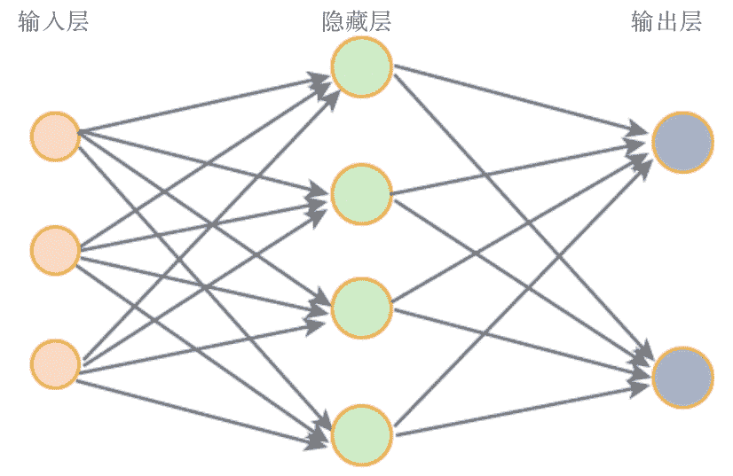

```
h(x) = f_1(W¹ x + b¹)
y = f_2(W² h(x) + b²)
```

Where `b¹`, `b²` represent biases, `W¹`, `W²` represent weight vectors, `f_1`, `f_2` represent activation functions. `h(x) = f_1(W¹ x + b¹)` is the output of the hidden layer. It can be seen that the hidden layer's output is a linear transformation and non-linear transformation of the input. `W¹` is the transformation matrix that transforms the input vector into the hidden layer vector. Each column of `W¹` represents the weight vector connecting the input to a neuron in the hidden layer. `f_1` represents the activation function, which transforms each neuron in the hidden layer to obtain the corresponding output. This computation method is called **Element-wise Operation** (Elementwise Operator). Section 2.3 will introduce some typical activation functions.

#### 2. Information Propagation in Perceptron

**Multi-Layer Perceptron** (Multi-Layer Perceptron, MLP), also known as **Feedforward Neural Network**. A typical multi-layer perceptron is shown in Figure 2-5. The single-layer perceptron introduced earlier is a special form of it. It has the following characteristics.

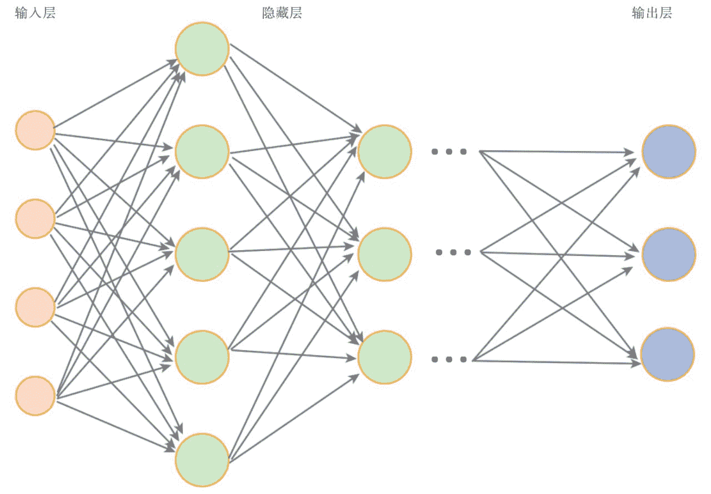

A multi-layer perceptron can be divided into three parts: input layer, hidden layer(s), and output layer, where the hidden layer can include one or more layers. Each layer consists of several neurons. Each neuron undertakes computational functions including linear weighting and non-linear transformation. Layers are connected through weights. Each neuron in the subsequent layer is connected to every neuron in the previous layer.

Input signals are gradually passed to the next layer through continuous linear transformations (linear weighting) and non-linear transformations (activation functions) until the output layer. The number of neurons in the input and output layers is often determined by prior knowledge, while the number of neurons in each hidden layer and the number of layers used are hyperparameters.

More generally, we use the form of Equations (2.11) and (2.12) to represent the information propagation process of the multi-layer perceptron:

```
z^(l) = W^(l) a^(l-1) + b^(l)
a^(l) = σ_l(z^(l))
```

Where `W^(l) ∈ R^{D_l × D_{l-1}}` is the transformation parameter from layer (l-1) to layer l. `D_{l-1}` represents the number of neurons in layer (l-1), `D_l` represents the number of neurons in layer l. `b^(l) ∈ R^{D_l}` represents the bias term. `{W^(l), b^(l)}` are the trainable parameters in a layer of the network. `σ_l` is the activation function of layer l. `z^(l)` and `a^(l)` represent the output of the linear transformation and the output of the activation function, respectively.

The multi-layer perceptron passes information layer by layer to obtain the output `y`. The entire network can be viewed as a complex composite function `φ(X; W, b)`, where `W`, `b` represent the collection of parameters `{W^(l), b^(l) | l = 1, 2, 3, ...}`.

## 2.3 Activation Functions

The **Activation Function** is a very important concept in neural networks. Its non-linearity enables neural networks to approximate almost any non-linear function. If activation functions are not used, no matter how many layers the neural network has, the output of each layer is a linear combination of the previous layer's input. Such a neural network is still a linear model with limited expressive power.

The choice of activation functions can be diverse. A basic requirement is that they are continuously differentiable, allowing non-differentiability at a few points. Common activation functions include **Sigmoid-shaped Activation Functions** and **ReLU and its Variants**.

### 2.3.1 Sigmoid-shaped Activation Functions

Typical sigmoid-shaped activation functions are **Sigmoid** and **Tanh**. The characteristic of this type of activation function is that it is bounded, i.e., `σ(x) ∈ [a, b]`, and the larger the absolute value of the input, the smaller the corresponding gradient, approaching 0.

The definition of the **Sigmoid Function** is Equation (2.13):

```
σ(x) = 1 / (1 + e^{-x})
```

The Sigmoid function compresses inputs of any magnitude into the range between 0 and 1. The larger the input value, the closer the compressed value is to 1; the smaller the input value, the closer the compressed value is to 0. When `x ∈ [-1, 1]`, it can be approximately regarded as a linear function, and when `x = 0`, the function value is 0.5.

It is often used in neural networks as the activation function for the last layer of a binary classifier, converting arbitrary real values into probabilities. Another application scenario is that because its value range is `(0, 1)`, it can act as a switch-like regulator to modulate other information.

Another function is **Tanh**, defined as Equation (2.14):

```
tanh(x) = (e^x - e^{-x}) / (e^x + e^{-x})
```

Compared to Sigmoid, Tanh has a slightly larger value range, `(-1, 1)`. The function graphs of Sigmoid and Tanh are shown in Figure 2-6. Tanh can also be used as a "switch" to regulate input information.

### 2.3.2 ReLU and its Variants

#### 1. ReLU

The **Rectified Linear Unit** (ReLU)[²] is an activation function frequently used in deep learning models currently. Its definition is: when `x ≥ 0`, output `x` unchanged; when `x < 0`, output 0, as shown in Equation (2.15):

```
ReLU(x) = max(0, x)
```

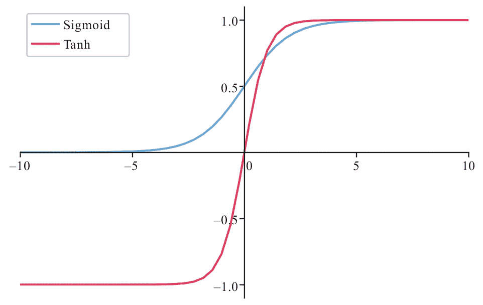

It can be seen that ReLU handles positive and negative values completely differently. When the input is negative, it is all set to zero; when the input is positive, it remains unchanged. This characteristic is called **Unilateral Inhibition** (or One-sided Inhibition). In the hidden layer, this feature brings a certain degree of sparsity to the hidden layer's output. At the same time, because the output remains unchanged when the input is positive, the gradient is 1, which can alleviate the vanishing gradient problem. Its gradient is shown in Equation (2.16), which is very simple to compute and has high computational efficiency.

```
ReLU'(x) = 1, if x > 0; 0, if x < 0
```

Additionally, unilateral inhibition may cause a neuron to "die" in certain cases. The reason is that if a neuron's output is always negative, then during backpropagation, its corresponding gradient is always 0, leading to an inability to update effectively.

In actual use, to avoid the above situation, several variants of ReLU are also widely used.

#### 2. LeakyReLU

[²]: See Appendix for references.


## 2.4 Training Neural Networks

How to train neural networks efficiently was one of the difficulties encountered in early neural network research. The proposal of the backpropagation method[⁶] solved this problem. It rapidly computes parameter gradients based on the chain rule, then uses gradient descent algorithms for parameter updates. This section will introduce the operation process of neural network models, then detail the backpropagation algorithm, and finally introduce the challenges faced in neural network optimization with large-scale parameters.

### 2.4.1 Operation Process of Neural Networks

The operation process of neural networks is divided into three steps: forward propagation, backpropagation, and parameter updates. Model parameters are updated through continuous iteration to mine valuable information from data, as shown in Figure 2-8.

1. **Forward Propagation**: Given inputs and parameters, compute layer by layer forward, finally outputting prediction results;
2. **Backpropagation**: Based on the prediction results obtained from forward propagation, obtain the loss value using the loss function, then compute the gradients of relevant parameters. This computation method is called backpropagation (`back-propagation`), specific details will be introduced later;
3. **Parameter Update**: Use the gradient descent algorithm to update parameters, repeat the above process, iterate gradually, until the model converges.

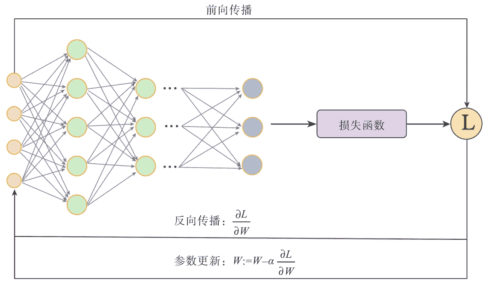

Figure 2-8 Operation Process of Neural Networks

### 2.4.2 Backpropagation

We take the Multilayer Perceptron (MLP) as an example to introduce the backpropagation algorithm. Given a sample `(x, y)`, forward propagation can be performed using the message passing formula of the MLP, this process can be represented by Figure 2-9.

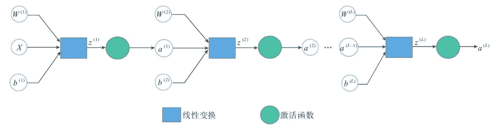

Figure 2-9 Schematic Diagram of MLP Computation

Given sample `(x, y)`, forward propagation yields output `ŷ`, the corresponding loss value is `L`. Next, we seek the gradient of the parameter matrix `W^(l)`, `∂L/∂W^(l)`. Using the chain rule, we can obtain Equation (2.21).

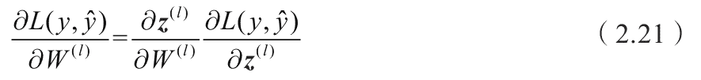

We define `δ^(l) = ∂L/∂z^(l)` as the error term, which measures the influence of `z^(l)` on the loss value. Further using the chain rule, we can obtain Equation (2.22).

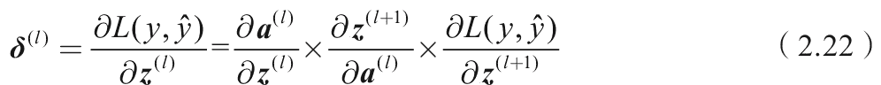

Based on the formulas `z^(l+1) = W^(l+1)a^(l) + b^(l)` and `a^(l) = σ(z^(l))`, transformation yields Equation (2.23).

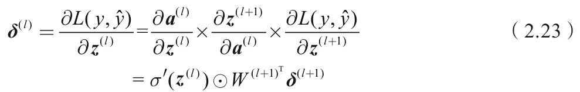

Where `σ'(z^(l))` is the derivative of the activation function, `⊙` denotes the Hadamard product, a binary operator for element-wise multiplication. From Equation (2.23), it can be seen that the error of layer `l` is related to the error of layer `l+1`, which is the origin of backpropagation.

Then for `∂L/∂W^(l)`, Equation (2.24) can be obtained:

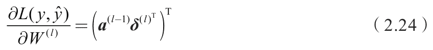

The derivative of the bias term `b^(l)` is shown in Equation (2.25):

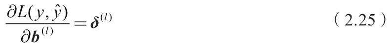

### 2.4.3 Optimization Dilemmas

For deep neural networks, although backpropagation can efficiently compute gradients, as the number of stacked layers and model parameter scale increase, it also brings some severe problems to model optimization.

#### 1. Vanishing Gradients

From Equation (2.23), it can be seen that the error of layer `l` is obtained by weighting the error of layer `l+1` with the weights between the two layers, and then multiplying by the derivative of the activation function. If the activation function uses `Sigmoid`, its derivative is `σ'(x) = σ(x)(1-σ(x))`. Since `σ(x) ∈ (0, 1)`, the maximum value of its derivative is `σ'(x) = 0.25`. As the number of layers increases, the error of the last layer will decay rapidly in the preceding layers. This causes the gradient values near the input layer to be very small, making parameters almost unable to update effectively. In the next forward propagation, since the parameters of the preceding layers cannot effectively obtain valuable information from the data for use by subsequent layers, the model becomes difficult to train effectively. This phenomenon is called the vanishing gradient problem.

The cause of vanishing gradients lies in the saturation of activation functions. For example, `Sigmoid`, `Tanh`, etc., all bring this problem. When their function values approach the upper and lower boundaries, the gradients are usually small. Multiplying them with the error term makes them even smaller. Multiple backpropagations will cause the gradient values to continuously decrease. Figure 2-10 shows the 2-norm of the weights `W` of each layer during the training process of a 5-layer MLP. It can be seen that the closer to the input layer, the smaller its value. This is the manifestation of vanishing gradients. Therefore, current neural networks usually use the `ReLU` activation function.

#### 2. Local Optima and Saddle Points

Due to the complex non-linear relationships and high parameter dimensions of neural networks, although loss functions are usually convex, the relationship between the loss function and parameters is non-convex, as shown in Figure 2-11a. Deep neural models have a very large number of local optima. When falling into a local optimum, model optimization becomes very difficult. However, deep neural network models usually have many local optima, and often these local optimal solutions can guarantee model performance[⁷].

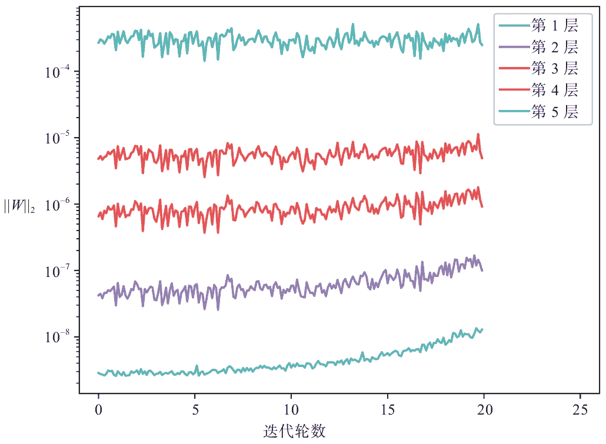

Figure 2-10 Schematic Diagram of Vanishing Gradients

Another problem is that due to excessively high dimensions, deep neural network models also often have many saddle points. A saddle point refers to a point where the gradient is 0 (as shown in Figure 2-11b), but it is neither a minimum nor a maximum. Usually, the challenge brought by saddle points is much greater than that of local optima. When in a saddle point region and the error is large, because this region is relatively "flat", the gradient value is small, the model convergence speed will be greatly affected, creating an illusion of falling into a local optimum.

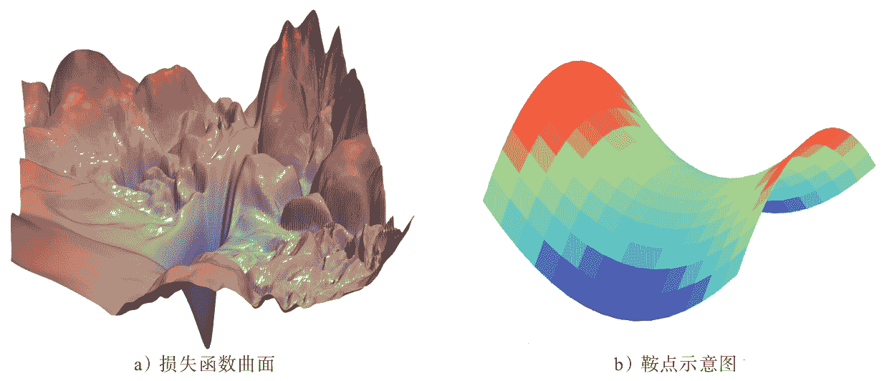

Figure 2-11 Visualization Results of Loss Function[⁸]

## 2.5 References

[1] McCulloch W S, Pitts W. A logical calculus of the ideas immanent in nervous activity[J]. The bulletin of mathematical biophysics, 1943, 5(4): 115-133.

[2] Nair V, Hinton G E. Rectified linear units improve restricted boltzmann machines[C]//Proceedings of the 27th international conference on machine learning (ICML-10). 2010: 807-814.

[3] Maas A L, Hannun A Y, Ng A Y. Rectifier nonlinearities improve neural network acoustic models[C]//Proc. icml. 2013, 30(1): 3.

[4] He K, Zhang X, Ren S, et al. Delving deep into rectifiers: Surpassing human-level performance on imagenet classification[C]//Proceedings of the IEEE international conference on computer vision. 2015: 1026-1034.

[5] Clevert D A, Unterthiner T, Hochreiter S. Fast and accurate deep network learning by exponential linear units (elus)[J]. arXiv preprint arXiv:1511.07289, 2015.

[6] Rumelhart D E, Hinton G E, Williams R J. Learning representations by back-propagating errors[J]. Cognitive modeling, 1988, 5(3): 1.

[7] Kawaguchi K. Deep learning without poor local minima[C]//Advances in neural information processing systems. 2016: 586-594.

[8] Li H, Xu Z, Taylor G, et al. Visualizing the loss landscape of neural nets[C]//Advances in Neural Information Processing Systems. 2018: 6389-6399.

# Chapter 3 Convolutional Neural Networks

Convolutional Neural Networks (`Convolutional Neural Network`, `CNN` or `ConvNet`) are a type of deep feedforward neural network with characteristics such as local connectivity and weight sharing. They have achieved significant results in the fields of image and video analysis, such as image classification, object detection, image segmentation, and other visual tasks, and are currently one of the most widely used models.

## 3.1 Convolution and Pooling

Convolution and pooling are two core operations in convolutional neural networks. Most neural network structures are obtained by combining them. This section will elaborate on the origin and principle of convolution, as well as the basic concepts of pooling.

### 3.1.1 Convolution in Signal Processing

The term "convolution" originates from the field of signal processing. It is a technology widely used in signal processing, image processing, and other engineering science fields. A typical application of convolution is: for a certain linear time-invariant system, given the input signal `f(τ)` and system response `g(τ)`, find the system output.

The mathematical definition of convolution is shown in Equation (3.1):

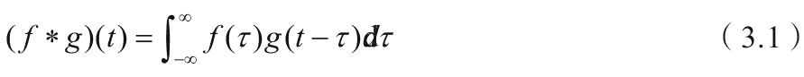

If we intuitively understand this calculation process according to Figure 3-1, it is that the function `g(τ)` is flipped and shifted by `t` to obtain `g(t-τ)`, and then the integral of the product with function `f(τ)` is sought.

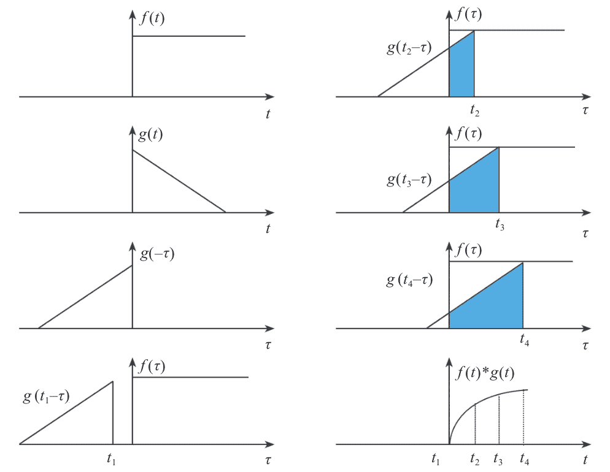

Figure 3-1 The Process of Convolution

#### 1. Convolution in Images

We take images as an example to intuitively understand convolution. Images in computers are usually stored in discrete form according to pixels, and can be represented by a two-dimensional or three-dimensional matrix. Assuming a two-dimensional image `X ∈ R^(H×W)`, the convolution kernel is `G ∈ R^(k×k)`, usually `k` is an odd number. The calculation method of two-dimensional discrete convolution is shown in Equation (3.2):

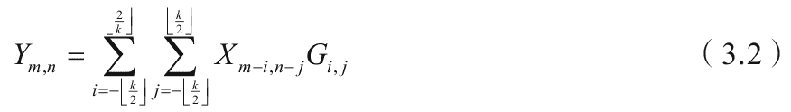

Intuitively understanding the above convolution process: first rotate the convolution kernel by 180°, then extract a `k×k` region at the corresponding position in the input, compute the inner product with the rotated convolution kernel, and obtain the output at the corresponding position.

In traditional image processing, convolution kernels are usually manually set. Different convolution kernels can extract certain features from the input, yielding different outputs. Figure 3-2 shows two different convolution kernels `Sobel` and `Laplacian`. Both can be used to extract image edges, but `Laplacian` is a second-order operator, while `Sobel` is a first-order operator. Therefore, the edge detection effects obtained by applying them have obvious differences. That is, different convolution kernels can extract different features.

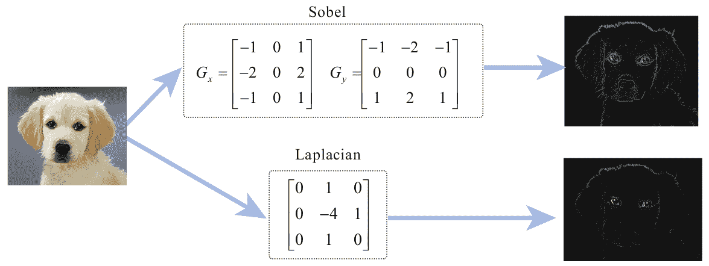

Figure 3-2 Using Convolution for Image Edge Detection

#### 2. The Significance of Convolution

In signal processing, convolution has an important theorem—the Convolution Theorem. This theorem is widely used and holds a pivotal position in signal processing. Its significance lies in converting complex convolution operations in the time domain into simple multiplication operations in the frequency domain, i.e.,

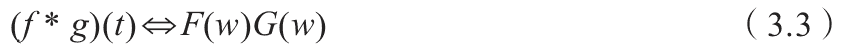

To understand the Convolution Theorem, one must first know the Fourier Transform. The Fourier Transform is a method to convert data from the time domain to the frequency domain. It decomposes a function into a superposition of a series of trigonometric functions of different frequencies. It can be understood as observing data from another dimension. Someone once analogized the Fourier Transform: if an image is compared to a cooked dish, the Fourier Transform can find the specific ingredients and their quantities, regardless of the specific cooking process, it can clearly distinguish them.

Transforming both the image and the convolution kernel into the frequency domain, the transformed convolution kernel acts as a filter to process the transformed frequency domain image. When the filter corresponding to the convolution kernel is a low-pass filter, during image processing it will filter out some higher frequencies. If the filtered frequency domain image is transformed back to the pixel space, we will see that some details are lost. This is because high frequencies correspond to drastically changing regions, i.e., image edges, details, etc.

### 3.1.2 Convolution Operations in Deep Learning

The convolution operation in deep learning differs slightly from the convolution concept in signal processing. This section will introduce the convolution calculation process using single-channel convolution as an example, then extend it to multi-channel convolution, which is the foundation of convolutional networks.

#### 1. Single-Channel Convolution

First, take single-channel input as an example to introduce the convolution used in deep learning. Slightly different from the definition in Equation (3.2), in deep learning, the convolution kernel does not need to be explicitly flipped, as shown in Equation (3.4). This definition is called cross-correlation in signal processing, but since the convolution kernels in convolutional networks are obtained through automatic learning, such a definition does not affect the output. The following content of this book uses this definition.

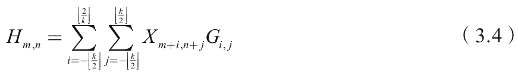

Below, a concrete example illustrates this process. As shown in Figure 3-3, assume the input `X` is a `5×5` matrix, and convolution is performed with a `3×3` convolution kernel to obtain the output result. Taking the element at row 1, column 1 of `X` as the center, the corresponding result is calculated, as shown in Equation (3.5):

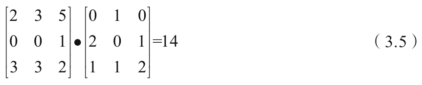

The convolution kernels used in image processing are manually determined. The convolution kernel parameters in deep learning are trainable. By using the backpropagation and optimization algorithms introduced in Chapter 2, the convolution kernel parameters can be dynamically adjusted. This issue will be discussed in detail in Section 3.2.

As introduced in Section 3.1, each convolution kernel extracts a certain feature of the input. To increase the richness of features, we often use multiple convolution kernels, i.e., `G^(c')`, concatenating the multiple results obtained from the input with each convolution kernel. For the local region centered at `X[m, n]`, the convolution yields the vector `H[m, n] = [H[m, n, 0], H[m, n, 1], …, H[m, n, C'-1]]`, where each element is the result computed with the corresponding convolution kernel. Concatenating the results, the convolution kernel can be represented by a three-dimensional tensor, i.e., `G ∈ R^(k×k×C')`, and the output result is `H ∈ R^(H'×W'×C')`. We call the output obtained by convolution the feature map (`feature map`).

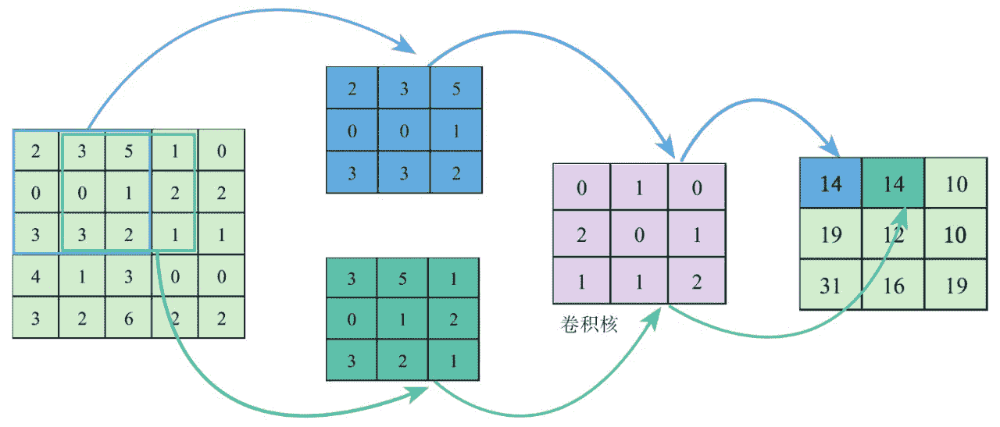

Figure 3-3 Schematic Diagram of Single-Channel Convolution

In the example shown in Figure 3-3, the input dimension decreases after convolution. This problem is caused by the input boundary. The starting position of the convolution cannot reach every position of the input. This brings the following two problems:

- After multiple convolution operations, the output size becomes smaller and smaller;
- The closer to the edge the pixel is, the smaller its influence on the output, because the convolution operation ends when it moves to the edge. Central pixels participate in multiple calculations, but edge pixels may only participate in one operation, leading to the loss of edge information.

To solve the above problems, the edges are usually padded with 0 values (`padding`), so that pixel values at the edges can also be calculated, thereby keeping the input dimension consistent with the output dimension. The padding size refers to the amount of padding. For example, `padding=1` means padding a circle of 0s on the outer layer of the input, as shown in Figure 3-4a. Thus the input dimension actually becomes `(W+2, H+2)`. Generally, when `padding=p`, the input dimension actually becomes `(W+2P, H+2P)`.

How many 0 values need to be padded to keep the feature map after convolution consistent with the input's height and width? The amount of 0 values is actually related to the shape of the convolution kernel. For a convolution kernel with both height and width as `k`, `P = k/2` is needed to make the input shape consistent with the output height and width.

The size of the output feature map is related not only to `padding` but also to the convolution method. The above discussion covers standard convolution operations, where every position in the input participates in the calculation. Sometimes it is not necessary to calculate every position; one can calculate every few positions. This interval is called stride (`stride`). For example, Figure 3-4b is a schematic diagram of a convolution with a stride of 2.

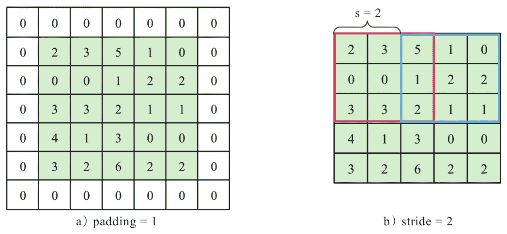

Figure 3-4 `Padding` and `stride` Schematic Diagram

#### 2. Multi-Channel Convolution

The previous section introduced single-channel convolution. Extending it yields multi-channel convolution. Assume the input `X ∈ R^(H×W×C)`, where `C` represents the number of channels. The convolution kernel has height and width `k`. Since the input has multiple channels, we assign a `k×k` convolution kernel to each channel. These convolution kernels constitute `G^(c') ∈ R^(k×k×C)`. Thus, multi-channel convolution can be defined as Equation (3.6):

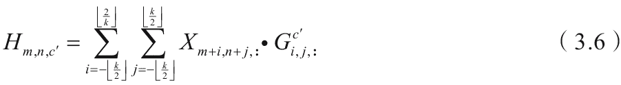

Where `G^(c')[:, :, c]` represents the weight of the `c'`-th convolution kernel on the `c`-th channel.

The process of multi-channel convolution is shown in Figure 3-5. This process can be viewed as a 3D convolution kernel sliding over the input layer. It is particularly important to note that the input layer and the convolution kernel have the same depth. Thus, the convolution kernel only needs to move in the height and width directions. This is why this operation is called 2D convolution, despite using a 3D filter. At each sliding position, a value at the corresponding position on the feature map is obtained through tensor dot product operation, finally yielding a single-channel output.

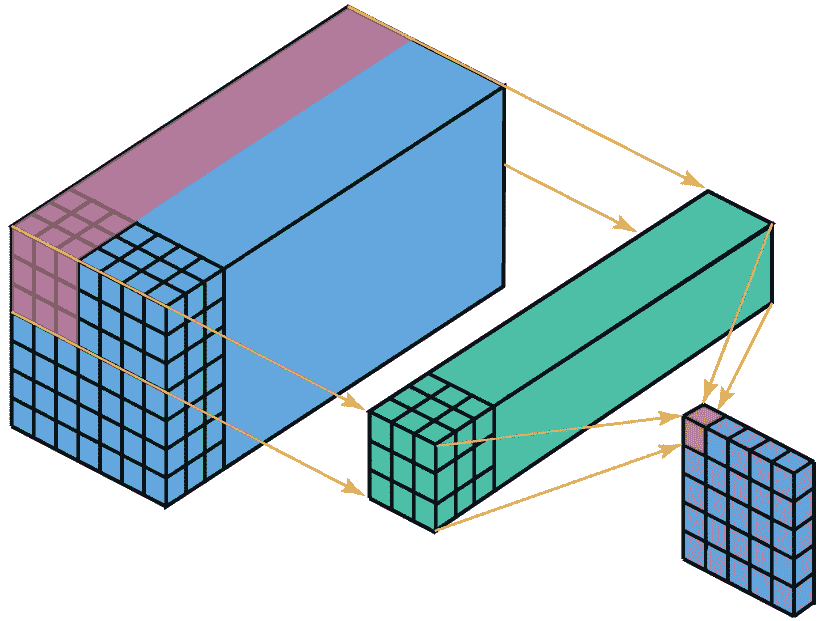

Figure 3-5 Multi-Channel Convolution Process

Like single-channel convolution, multi-channel convolution uses multiple convolution kernels to extract richer features. Thus, the dimension of the convolution kernel `G` is `R^(k×k×C×C')`, where `C'` represents the number of convolution kernels. Concatenating the results of the input with each convolution kernel yields the multi-channel convolution output `H ∈ R^(H'×W'×C')`.


### Convolutional Neural Networks

After convolution, a bias is typically added to each feature map, as shown in Equation (3.7):

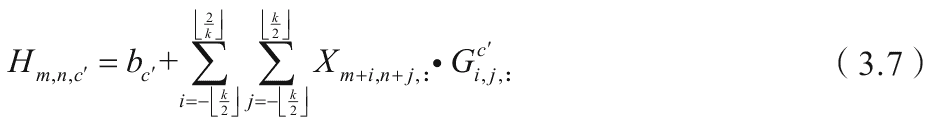

This is the complete process of convolution in deep learning. To summarize, for an input `H∈R^(H×W×C)`, performing a convolution operation with a kernel `R^(k×k×C×C')` and adding a bias yields an output `H∈R^(H'×W'×C')`. The parameters introduced in this process are the kernel and the bias, with a total parameter count of: `k²×C×C'+C'`.

In single-channel convolution, we discussed how kernel size, padding, and stride affect the output dimensions of the convolution. Assuming the input dimension is `H×W×C`, the kernel size is `k`, the padding value is `p`, the stride is `s`, and the output feature map is `H'×W'×C'`, the relationship between them can be given by Equation (3.8), and the calculation for `W'` is the same:

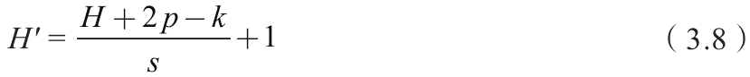

### 3.1.3 Pooling

The primary purpose of the pooling operation is dimensionality reduction to reduce computational cost, and to provide some translation invariance[¹] in the early stages of training. The two commonly used pooling operations are average pooling and max pooling.

The pooling operation uses a fixed-size sliding window that moves across the input; each time, the elements within the window are aggregated into a single value as the output. Depending on the aggregation method, it can be divided into average pooling and max pooling, as shown in Figure 3-6.

The window size `k` (assuming the window length and width are equal) and the sliding stride `s` both affect the final output. Typically, `k=2×2` is chosen, with the stride equal to the window size, `s=2`. For multi-channel inputs, pooling is performed channel by channel, so it does not change the number of input channels. For an input `X∈R^(H×W×C)`, after the above pooling operation, the output is `R^(H/2×W/2×C)`, with its height and width halved. Generally, for sliding windows and strides of arbitrary sizes, Equation (3.8) can be used for calculation.

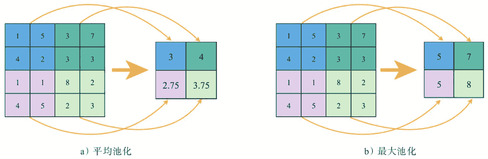

**Figure 3-6** Schematic diagram of average pooling and max pooling process

## 3.2 Convolutional Neural Networks

A Convolutional Neural Network (CNN) is obtained by stacking convolutional layers and pooling layers. This section will explain the structure of a CNN using a concrete example, then introduce the characteristics of CNNs and how to understand them.

### 3.2.1 Structure of Convolutional Neural Networks

We use AlexNet[²] as an example to introduce the structure of a CNN. AlexNet was designed by deep learning pioneer Hinton and his student Alex Krizhevsky. It won the ImageNet competition in 2012, reducing the error rate by more than 10% compared to the runner-up, causing a sensation and ushering in the explosive phase of deep learning. AlexNet can be considered the progenitor of deep convolutional neural networks; compared to previous CNNs, its most significant features are its deeper architecture and larger parameter scale.

AlexNet consists of 5 convolutional layers, 2 pooling layers, and 3 fully connected layers. Limited by the hardware conditions at the time, a single GPU could not run a model of this scale, so the authors split the model and ran it on two separate GPUs. For ease of explanation, we have merged the structure, as shown in Figure 3-7. Let's look at the specifics of each layer.

- **Input Layer**: An image of size `224×224×3`.
- **Layer 1**: Convolutional layer, kernel size `11×11`, outputting 96 feature maps. The input has 3 channels, so the kernel dimension is `R^(11×11×3×96)`. The sliding stride `stride=4`, padding `padding=2`. The output feature map size can be calculated using Equation (3.8), as shown in Equation (3.9). Therefore, the output feature map is `H¹∈R^(55×55×96)`. A ReLU activation function is used after the convolution.

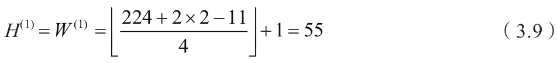

- **Layer 2**: Pooling layer, using max pooling. The pooling window size is `3×3`, stride is 2. Using a calculation method similar to convolution, the output size is calculated as `(55–3)/2+1=27`. Therefore, the pooling layer output is `H²∈R^(27×27×96)`.
- **Layer 3**: Convolutional layer, kernel size `5×5`, outputting 256 feature maps. The kernel dimension is `R^(5×5×96×256)`, stride `stride=1`, padding `padding=2`. The output feature map is `H³∈R^(27×27×256)`. Again, a ReLU activation function is used after the convolution.
- **Layer 4**: Max pooling, window size `3×3`, stride 2. Output is `H⁴∈R^(13×13×256)`.
- **Layers 5 to 7**: All are convolutional layers with kernel size `3×3`. The output feature maps are 384, 384, and 256 respectively. Stride `stride=1`, padding `padding=1`. Therefore, Layer 7 outputs `H⁷∈R^(13×13×256)`. As with the previous structure, a ReLU activation function is used after each convolution.
- **Layer 8**: Pooling layer, window size `3×3`, stride 2. Output is `H⁸∈R^(6×6×256)`.
- **Last Three Layers**: Fully connected layers. The convolutional output `H⁸∈R^(6×6×256)` is flattened to obtain the fully connected layer input dimension `R⁹²¹⁶`. The three fully connected layers have 4096, 4096, and 1000 neurons respectively. A 1000-dimensional output is finally obtained for image classification.


**Figure 3-7** AlexNet architecture diagram[³]

Besides designing this structure, AlexNet proposed two important improvements: first, using ReLU as the activation function to solve the vanishing gradient problem, which was introduced in Chapter 2; second, using the Dropout mechanism to prevent overfitting. Dropout works by randomly zeroing out parts of the feature map during training, equivalent to discarding some information, forcing the model to make correct inferences based on the remaining features, thereby learning more robust and discriminative features.

The structure of a CNN can generally be divided into two parts: one part is the backbone network formed by alternately stacking convolutional and pooling layers, which is mainly used to extract rich features from the input; the other part is the fully connected layers, which flatten the feature maps obtained from convolution, discarding the spatial information of the feature maps. Its main role is to aggregate global information and map it to the output space—for example, AlexNet uses it for classification. General convolutional structures are also composed of these two parts. More improved structures will be introduced in Section 3.4.

[³]: The image was generated via https://github.com/HarisIqbal88/PlotNeuralNet.

### 3.2.2 Characteristics of Convolutional Neural Networks

CNNs possess the following three characteristics: local connectivity, weight sharing, and hierarchical representation.

#### (1) Local Connectivity

Since images usually exhibit local correlation, convolution computation is performed only on the region corresponding to the kernel size each time. That is, the input and output are locally connected. If a Multi-Layer Perceptron (MLP) were used to process images, a simple approach would be to transform the multi-dimensional input image into a vector as the MLP input. For an image of size `224×224×3`, flattening it into a vector would require 150,528 input neurons. If the first hidden layer has 32 neurons, it would introduce 4.8 million parameters. Such a large parameter count brings two problems: first, high computational complexity; second, risk of overfitting. If a `3×3` kernel is used with 32 output channels, the introduced parameter count is below 1,000, far fewer than the parameters required by an MLP.

The convolution operation is very similar to certain concepts in biology. In the nervous system, neurons typically respond only to a portion of stimulus signals. For example, when the retina receives light stimulation and transmits signals to the visual cortex, usually only a portion of the visual cortex neurons respond to this signal. This mechanism is called local receptive field. The same applies to convolution: using two consecutive `3×3` convolutional layers, the output is only related to a `5×5` input region, as shown in Figure 3-8. This region is called the receptive field, which refers to the size of the input region relevant to an output on the feature map. In deep CNNs, the effective receptive field is usually smaller than this theoretical region.


**Figure 3-8** Schematic diagram of receptive field

#### (2) Weight Sharing

The second characteristic of convolution is weight sharing. In an image, different regions use the same kernel parameters. On one hand, this reduces the parameter count; on the other hand, it brings translation invariance. Translation invariance means that regardless of how the input is translated, the same output can always be obtained. For example, for two identical left and right eyes, using the same kernel to convolve the corresponding eye regions yields the same output, which is brought about by the weight sharing mechanism. Additionally, pooling also brings some translation invariance. For instance, max pooling aggregates information in the receptive field using the maximum value; when the input changes within the receptive field, the output of the pooling layer remains unchanged.

#### (3) Hierarchical Representation

The third characteristic of a convolutional network is its ability to learn hierarchical representations. A convolutional network is formed by stacking convolutional layers, where each layer transforms the previous one. The extracted features progress from low-level to high-level, becoming increasingly abstract. As shown in Figure 3-9, low-level convolutions generally extract simple features such as colors, edges, and corners. They have relatively small receptive fields and correspond to local features. Mid-level convolutions yield more abstract features, such as texture structures. High-level convolutions yield even more abstract features related to image semantics and specific objects contained. Because they have larger receptive fields, they represent more global features. High-level features are built upon low-level features. Generally, low-level features are more generic, while high-level features are more strongly associated with specific tasks.


**Figure 3-9** Schematic diagram of hierarchical representation[⁴]

## 3.3 Special Forms of Convolution

Besides the standard convolution method introduced in Section 3.1, some special convolutions have been proposed for various tasks. This section introduces several commonly used alternative convolution forms.

### 3.3.1 1×1 Convolution

As the name suggests, the kernel size of a 1×1 convolution is 1. It was proposed in a paper[⁵] and adopted by subsequent models. The process of 1×1 convolution is shown in Figure 3-10, which is essentially no different from the convolution operation introduced earlier.

Readers may wonder: is 1×1 convolution useful? Typically, 1×1 convolution serves the following functions: first, for information aggregation while increasing non-linearity. A 1×1 convolution can be viewed as a linear weighting of information across all channels (i.e., information aggregation). Meanwhile, a non-linear activation can be used after the convolution, which can increase the model's expressive power to a certain extent. Second, for transforming the number of channels, which can increase or decrease the number of output feature map channels.


**Figure 3-10** Schematic diagram of 1×1 convolution

### 3.3.2 Transposed Convolution

Transposed convolution[⁶] is an indispensable module in semantic segmentation tasks. Semantic segmentation refers to classifying an image at the pixel level; pixels belonging to the same category usually correspond to a specific object, as shown in Figure 3-11, where pixels belonging to a person need to be classified into the same category, and pixels belonging to the deer need to be classified into the same category.


**Figure 3-11** Semantic segmentation[⁷]

CNN-based semantic segmentation models usually consist of two parts: an encoder, which maps the original input image to a low-dimensional feature space. It needs to encode both the target's feature information and positional information to correctly predict the category of each pixel location. The other part is the decoder, which maps the encoded low-dimensional features back to the pixel space to determine the specific category of each pixel. The standard convolution introduced earlier cannot be used for the decoder part because the previous convolution operations do not increase the height and width dimensions of the feature map. Transposed convolution, on the contrary, can increase the height and width dimensions, gradually mapping the encoded low-dimensional features back to the pixel space.

As shown in Figure 3-12(a), assuming the input is `2×2` and the kernel size is `3×3`, transposed convolution is equivalent to padding the input with two layers of zeros around the border, then performing a standard convolution, resulting in a `4×4` output. Similar to convolution, transposed convolution can also set `padding` and `stride`, but their meanings differ slightly from those in standard convolution. For a transposed convolution with stride `s` and kernel size `k`, the calculation defaults to padding the input surroundings with `k–1` layers of zeros. The set `padding` affects the final padding size, specifically given by `k–1–p`. For stride `s`, it inserts `s–1` zeros between convolution elements, as shown in Figure 3-12(b). With an input of `2×2`, `p=0`, stride `s=2`, the output after convolution is `5×5`.


**Figure 3-12** Transposed convolution examples

The relationship between input dimensions, kernel size, padding, stride, and output dimensions in transposed convolution can be determined by Equation (3.10):


[⁷]: Image source https://ccvl.jhu.edu/datasets/.

### 3.3.3 Dilated Convolution

Dilated convolution[⁸] "expands" the kernel by inserting gaps between kernel elements. A hyperparameter controls the degree of expansion, called the dilation rate `r`, which refers to inserting `r–1` zeros between kernel elements. Therefore, for an original kernel of size `k`, the actual kernel size becomes `k+(k–1)(r–1)` when using dilated convolution. Because the kernel expands, the receptive field also expands. Thus, dilated convolution is an effective way to rapidly expand the receptive field without increasing the parameter count.


**Figure 3-13** Dilated convolution kernels

For a `k=3` kernel, when the dilation rate `r` is 2 and 3 respectively, the actual kernel sizes are 5 and 7, as shown in Figure 3-13. For an output region of size `3×3`, the receptive field sizes corresponding to the three kernels above are:

- When `r=1`, the receptive field is 3.
- When `r=2`, the receptive field is 7.
- When `r=3`, the receptive field is 11.

When stacking multiple layers composed of dilated convolutions, the receptive field expands rapidly to capture more local information.

### 3.3.4 Grouped Convolution

Grouped convolution first appeared in AlexNet. At that time, the convolution operations for training AlexNet could not all be processed on a single GPU, so the authors split the feature maps across multiple GPUs for processing and then fused the results from multiple GPUs. This is essentially grouped convolution. We illustrate this below with an example.

As shown in Figure 3-14, the input is divided into `g` groups along the depth dimension, each group consisting of `C₁/g` channels. Similarly, the output channels are split into `g` groups, each having `C₂/g` output channels. The input groups are paired with the output groups, and convolution is computed separately for each pair. Thus, for each group of convolution, the required kernel dimension is `R^(k×k×C₁/g×C₂/g)`, meaning the kernel depth per group changes from the original `C₁` to `C₁/g`, and the number of kernels becomes `C₂/g` instead of the original `C₂`. Each group's kernels convolve with its corresponding input group; after obtaining the outputs, they are concatenated, and the final output channels remain `C₂`. In other words, we can compute `g` identical convolution processes in parallel. The parameter count used becomes `k²×C₁×C₂/g`, i.e., the parameter count is reduced by `g` times compared to standard convolution.


**Figure 3-14** Grouped convolution processing flow

### 3.3.5 Depthwise Separable Convolution

Depthwise separable convolution consists of two parts[⁹]: one part is depthwise convolution along the channel dimension; the other part is 1×1 convolution. Depthwise convolution is a special case of grouped convolution when `g=C₁=C₂`. It is equivalent to assigning a separate kernel to each input channel for convolution. Since this convolution only utilizes information from a single input channel (i.e., only spatial position information) and does not use inter-channel information, a 1×1 convolution is typically used afterward to increase inter-channel information.

Compared to standard convolution, depthwise separable convolution not only reduces the parameter count but also lowers computational cost and improves operational efficiency. Therefore, this type of convolution is often used in convolutional structure designs where speed is a requirement, and it has been applied in models such as MobileNet[¹⁰] and ShuffleNet[¹¹].

## 3.4 Application of Convolutional Networks in Image Classification

In just a few years, deep learning has achieved remarkable results in the field of computer vision. Various image classification models have been proposed one after another, from AlexNet to VGG, from GoogleNet v1 to v4, and later to ResNet, DenseNet, etc., constantly evolving and refreshing records. In this section, we introduce several typical image classification frameworks.

### 3.4.1 VGG

VGG[¹²] was proposed by the Visual Geometry Group at the University of Oxford in 2014, achieving second place in the ImageNet 2014 classification task and first place in the localization task.

VGG made some improvements based on AlexNet, mainly reflected in the adoption of small `3×3` convolutional kernels with a convolution stride of 1. Two such convolutional layers yield a receptive field of 5, but with fewer parameters compared to directly using a single `5×5` convolutional layer. Additionally, it removed the LRN (Local Response Normalization) layer, as the authors found in experiments that LRN's effect was not significant. Another structural feature of VGG is the repeated use of simple convolutional blocks stacked to form the model. Its basic convolutional block consists of two or more convolutional layers followed by a pooling layer.

VGG has two commonly used models: VGG16 and VGG19. The difference between VGG16 and VGG19 lies in the number of convolutional layers in some basic blocks. The structure of VGG16 is shown in Figure 3-15. Due to its concise structure and good performance, VGG is still often used as a backbone network for other tasks.


**Figure 3-15** VGG16 network architecture

### 3.4.2 Inception Series

The best result in the ImageNet 2014 classification task was achieved by GoogleNet, proposed by Google. The core structure of this network is the Inception block. Unlike the basic blocks constructed by VGG, the Inception block uses a multi-branch structure with kernels of different scales. The Inception structure has undergone several optimizations, resulting in several different versions.

#### 1. Inception V1

Inception V1[¹³] first used a parallel structure. As shown in Figure 3-16, each Inception block uses multiple kernels of different sizes. This is completely different from the traditional stacked network structure where each layer uses only one kernel size. The multiple different kernels in an Inception block can extract different types of features. Simultaneously, each kernel has a different receptive field, allowing the extraction of multi-scale features, which are finally concatenated.

If multiple kernel sizes are simply introduced, it would bring a large number of parameters and consume significant computational resources. To reduce computational cost, an improvement is to introduce `1×1` convolutions before the `3×3` and `5×5` convolutions to reduce the number of input channels. Additionally, a `1×1` convolution is used for dimensionality reduction after the pooling layer. The improved Inception block is shown in Figure 3-17. Let's compare the parameter count changes before and after the improvement. Ignoring bias terms, with input/output channel numbers as shown in Figure 3-17, the parameters required before improvement are shown in Equation (3.11), and after improvement in Equation (3.12). It can be seen that the parameters before improvement are 2.3 times those after improvement. Moreover, before improvement, the pooling layer's output channel count equals the input channel count; after concatenation with other convolution results, the output channel count would increase dramatically.


**Figure 3-16** Initial Inception module

GoogleNet stacks Inception blocks. Additionally, to alleviate the vanishing gradient problem, auxiliary classifiers were added in the middle of the network.

#### 2. Inception V2

Inception V2[¹⁴] mainly improves the kernel design of Inception V1 by decomposing large-sized convolutions to reduce parameter count and computational complexity.


**Figure 3-17** Improved Inception V1 module

[¹]: [^(\[1\])](../Text/chapter45.xhtml#cc-1)
[²]: [^(\[2\])](../Text/chapter45.xhtml#cc-2)
[⁴]: [^(\[3\])](../Text/chapter45.xhtml#cc-3)
[⁵]: [^(\[4\])](../Text/chapter45.xhtml#cc-4)
[⁶]: [^(\[5\])](../Text/chapter45.xhtml#cc-5)
[⁸]: [^(\[6\])](../Text/chapter45.xhtml#cc-6)
[⁹]: [^(\[7\])](../Text/chapter45.xhtml#cc-7)
[¹⁰]: [^(\[8\])](../Text/chapter45.xhtml#cc-8)
[¹¹]: [^(\[9\])](../Text/chapter45.xhtml#cc-9)
[¹²]: [^(\[10\])](../Text/chapter45.xhtml#cc-10)
[¹³]: [^(\[11\])](../Text/chapter45.xhtml#cc-11)
[¹⁴]: [^(\[12\])](../Text/chapter45.xhtml#cc-12)


### 3.4.3 ResNet

The proposal of the Residual Network (`ResNet`) [¹³] was another major leap for deep learning. It achieved excellent results on ILSVRC 2015 and COCO 2015, and once again rewrote the history of ImageNet. It was the first to increase the depth of deep networks to hundreds of layers and train them successfully; many subsequent network structures were inspired by it. `ResNet` can be considered one of the most popular network architectures currently.

Network depth is crucial for model performance. As the number of network layers increases, the model can extract more complex feature patterns, so intuitively we might think the deeper the model, the better the effect. However, experiments show that as the network deepens, the training accuracy actually decreases, as shown in Figure 3-19. On both the training set and test set, the 56-layer network performs worse than the 20-layer network. This is not because the model is overfitting; this problem is called the **degradation problem**, and it is caused by optimization difficulty.


Figure 3-19 Error rates of 20-layer and 56-layer networks on CIFAR-10 [¹]

The Residual Network improves the network structure to solve the above problem. It introduces a direct path between the input and output of a block, which is called a **skip connection**. A typical residual block is shown in Figure 3-20.

The input is `H[i-1]`, the output is `H[i]`. Assuming the transformations such as convolutions are represented by `F`, the relationship between input and output is shown in Equation (3.13):


Figure 3-20 `ResNet` network model

The introduction of skip connections makes information flow more smoothly, manifested in two aspects: first, during forward propagation, the input and output information are fused, enabling more effective utilization of features; second, during backpropagation, a portion of the gradient always backpropagates to the input through the skip connection, which alleviates the **vanishing gradient problem**.

Furthermore, research [¹⁴] shows that deep residual network structures can be viewed as ensembles of relatively shallow structures. Research [¹⁵] indicates that networks with skip connections have smoother loss function surfaces, making training optimization easier and resulting in models with better generalization performance, as shown in Figure 3-21.


Figure 3-21 Loss landscape with skip connection structure [²]

Based on the idea of residual networks, many improved models have emerged, such as `DenseNet` [¹⁶] which takes skip connections to the extreme, and `Inception-ResNet` [¹⁷] which fuses residual structures.

[¹³]: He K, Zhang X, Ren S, et al. Deep residual learning for image recognition [C] // Proceedings of the IEEE conference on computer vision and pattern recognition. 2016: 770-778.
[¹⁴]: Veit A, Wilber M J, Belongie S. Residual networks behave like ensembles of relatively shallow networks [C] // Advances in neural information processing systems. 2016: 550-558.
[¹⁵]: Li H, Xu Z, Taylor G, et al [C] // Advances in Neural Information Processing Systems. 2018: 6389-6399.
[¹⁶]: Huang G, Liu Z, Van Der Maaten L, et al. Densely connected convolutional networks [C] // Proceedings of the IEEE conference on computer vision and pattern recognition. 2017: 4700-4708.
[¹⁷]: Szegedy C, Ioffe S, Vanhoucke V, et al. Inception-v4, inception-resnet and the impact of residual connections on learning [C] // Thirty-First AAAI Conference on Artificial Intelligence. 2017.

## 3.5 References

[1] Ruderman A, Rabinowitz N C, Morcos A S, et al. Pooling is neither necessary nor sufficient for appropriate deformation stability in CNNs [J]. arXiv preprint arXiv: 1804.04438, 2018.

[2] Krizhevsky A, Sutskever I, Hinton G E. Imagenet classification with deep convolutional neural networks [C] // Advances in neural information processing systems. 2012: 1097-1105.

[3] Zeiler M D, Fergus R. Visualizing and understanding convolutional networks [C] // European conference on computer vision. Springer, Cham, 2014: 818-833.

[4] Lin M, Chen Q, Yan S. Network in network [J]. arXiv preprint arXiv: 1312.4400, 2013.

[5] Zeiler M D, Krishnan D, Taylor G W, et al. Deconvolutional networks [C] // 2010 IEEE Computer Society Conference on computer vision and pattern recognition. IEEE, 2010: 2528-2535.

[6] Yu F, Koltun V. Multi-scale context aggregation by dilated convolutions [J]. arXiv preprint arXiv: 1511.07122, 2015.

[7] Chollet F. Xception: Deep learning with depthwise separable convolutions, arXiv preprint (2016) [J]. arXiv preprint arXiv: 1610.02357, 2016.

[8] Howard A G, Zhu M, Chen B, et al. Mobilenets: Efficient convolutional neural networks for mobile vision applications [J]. arXiv preprint arXiv: 1704.04861, 2017.

[9] Zhang X, Zhou X, Lin M, et al. Shufflenet: An extremely efficient convolutional neural network for mobile devices [C] // Proceedings of the IEEE Conference on Computer Vision and Pattern Recognition. 2018: 6848-6856.

[10] Simonyan K, Zisserman A. Very deep convolutional networks for large-scale image recognition [J]. arXiv preprint arXiv: 1409.1556, 2014.

[11] Szegedy C, Liu W, Jia Y, et al. Going deeper with convolutions [C] // Proceedings of the IEEE conference on computer vision and pattern recognition. 2015: 1-9.

[12] Szegedy C, Vanhoucke V, Ioffe S, et al. Rethinking the inception architecture for computer vision [C] // Proceedings of the IEEE conference on computer vision and pattern recognition. 2016: 2818-2826.

[13] He K, Zhang X, Ren S, et al. Deep residual learning for image recognition [C] // Proceedings of the IEEE conference on computer vision and pattern recognition. 2016: 770-778.

[14] Veit A, Wilber M J, Belongie S. Residual networks behave like ensembles of relatively shallow networks [C] // Advances in neural information processing systems. 2016: 550-558.

[15] Li H, Xu Z, Taylor G, et al [C] // Advances in Neural Information Processing Systems. 2018: 6389-6399.

[16] Huang G, Liu Z, Van Der Maaten L, et al. Densely connected convolutional networks [C] // Proceedings of the IEEE conference on computer vision and pattern recognition. 2017: 4700-4708.

[17] Szegedy C, Ioffe S, Vanhoucke V, et al. Inception-v4, inception-resnet and the impact of residual connections on learning [C] // Thirty-First AAAI Conference on Artificial Intelligence. 2017.

# Chapter 4 Representation Learning

What is representation? In simple terms, it refers to features. In the machine learning workflow mentioned in Chapter 2, the first step of machine learning is to extract features from data, and the quality of the extracted features largely determines the quality of the model results. If there exists a class of methods that can automatically learn "useful" features from data and use them directly for subsequent specific tasks, these methods are collectively called **representation learning**.

## 4.1 Representation Learning

### 4.1.1 The Significance of Representation Learning

The performance of machine learning algorithms heavily depends on data features. Therefore, in traditional machine learning, most of the work lies in data processing and transformation, hoping to obtain good features that make machine learning algorithms more effective. Such **feature engineering** is extremely time-consuming and laborious, which also exposes the problems existing in traditional machine learning methods: these methods lack the ability to acquire useful knowledge from data, and the purpose of feature engineering is to convert human prior knowledge into features recognizable by machine learning algorithms to compensate for their own shortcomings.

If there exists a method to obtain discriminative features from data, it would reduce the dependence of machine learning algorithms on feature engineering, thereby enabling faster and better application of machine learning to more fields. This is the value of representation learning. For representation learning, the following three questions need to be answered:

1.  How to judge whether one representation is better than another?
2.  How to discover these representations?
3.  What kind of objective should be used to obtain a good representation?

What is a good representation? There is no fixed standard for this question. Generally speaking, a good representation should first contain as much essential information of the data as possible, and this representation should be able to directly serve subsequent specific tasks. What computers "see" is different from what the human eye sees. For example, for images, computers see individual pixels, which is the most raw data; focusing on these pixels alone yields very little information. Humans, when judging image content, use high-level abstract semantic features. The gap between these two is called the **semantic gap**, which refers to the discrepancy between low-level features and high-level abstract features, as shown in Figure 4-1. A good representation needs to describe high-level abstract features as much as possible so that subsequent models can efficiently utilize these features, reducing the "burden" on subsequent models. Otherwise, using raw data or low-level features as input for subsequent models would make them very difficult to run. Therefore, a good representation should minimize this semantic gap and provide valuable high-level features.


Figure 4-1 Schematic diagram of the semantic gap

### 4.1.2 Discrete Representation and Distributed Representation

In machine learning, there are two common ways to represent an object. The simplest way, which requires no learning, is **one-hot encoding** (`one-hot`). It represents the object of study as a vector where the value is 1 in only one dimension and 0 in all others. One can imagine that the length of this vector equals the number of categories. For example, to vectorize Chinese characters using this method, assuming there are N Chinese characters, each character would need an N-dimensional vector, requiring a total matrix of size N×N to cover all characters. In Natural Language Processing (NLP), the **bag-of-words model** is built on this basis.

**Distributed representation** [¹] is different. It represents the object of study using a low-dimensional dense vector obtained through some method. The most typical example is color. We know any color can be obtained by mixing three primary colors: red, yellow, and blue (or RGB in computers). Computers usually use the `RGB` method to represent color as a triplet. The `RGB` color space can be represented as in Figure 4-2. For example, pink, light pink, and deep pink are represented in `RGB` as `(255, 182, 193)`, `(255, 192, 203)`, `(255, 20, 147)` respectively. If one-hot encoding were used to represent these colors, for 256-level `RGB`, there are about 16.78 million colors (`256³ = 16777216`), so the one-hot vector would need 16,777,216 dimensions, with only one position having a value of 1. The data would be extremely high-dimensional and sparse.


Figure 4-2 Color space

One-hot encoding is very simple; it only requires listing all possible values, with no learning process required. However, its disadvantages are also very obvious: it assumes all objects are independent of each other. In the vector space, the vectors of all objects are orthogonal to each other, so the similarity between any two is 0, meaning these objects have no relationship whatsoever. But real life is not like this. For example, pink and light pink both belong to the pink family, so their similarity should be higher than that between pink and black. However, one-hot encoding cannot reflect this; it loses a large amount of semantic information. Additionally, one-hot vectors can have very high dimensions and be very sparse, making them difficult to use directly.

Distributed representation, on the other hand, exhibits excellent properties. On one hand, the dimension of distributed representation can be very low; three dimensions can represent 16.78 million colors, effectively solving the data sparsity problem. On the other hand, it can retain some semantic information. For example, the cosine similarity between pink and light pink and deep pink can be calculated as 99.97% and 89.39% respectively, while the similarity with black (`RGB` `(0, 0, 0)`) is 0. This is consistent with our cognition, meaning distributed representation can contain semantic features, which is why it is applied in many fields.

[¹]: Reference link: ../Text/chapter55.xhtml#dd-1

### 4.1.3 End-to-End Learning is a Powerful Representation Learning Method

Deep learning models differ from traditional machine learning models. For example, for an image classification task, traditional machine learning requires manual extraction of descriptive features, such as `SIFT` features (the feature engineering mentioned earlier), and then uses a classifier to determine the image category. The model performance largely depends on the quality of the extracted features. Using Convolutional Neural Networks (CNNs) can solve this problem. For instance, `AlexNet` takes raw images as input, not features obtained from feature engineering, and the output is directly the predicted category. This learning method is called **end-to-end learning** (`end-to-end learning`). For the above example, we can understand it this way: the front part of the convolutional network mainly performs automatic feature extraction, then feeds the extracted features into the classifier for classification. In other words, the front part of the convolutional network can be seen as performing representation learning. That is, `end-to-end learning` can be viewed as a combination of representation learning and task learning, but they are not completely separated. Specifically, they are **jointly optimized**. The backpropagation algorithm propagates the error from the output layer forward to the input layer, and the optimization algorithm dynamically adjusts model parameters, allowing the model to automatically extract discriminative features relevant to the task. This demonstrates the superiority of deep learning models compared to other methods.


Another advantage of deep learning models is their ability to learn hierarchical representations of data, which is also a property that a good representation should possess. As introduced in Section 3.2, layers at different depths in a convolutional neural network can extract representations at different levels; lower-level convolutions mainly extract low-level features, while higher-level convolutions mainly extract abstract, task-relevant features. Deep learning models are stacks of layers, each of which is trainable. They transform input features into more abstract features. Transformations at lower layers yield basic features, which form the foundation for high-level abstract features. This is analogous to the relationship between characters, sentences, and articles: characters form words, words form sentences, and sentences form articles. Therefore, for low-level features, they are more general (`general feature`), while high-level features are specific to particular tasks. Transfer learning can be based on this property of deep learning. Transfer learning refers to transferring learned knowledge to new problems. A typical application of deep learning in this area is fine-tuning, i.e., using a model pre-trained on another dataset as a basis and further adjusting it on a new dataset. For example, many vision-related tasks use models pre-trained on `ImageNet`, freezing some convolutional layers without performing gradient updates on them because they extract general features; only the high-level structures are modified, such as changing the output layer dimension to adapt to classification problems with different numbers of categories, and then adjusting the model using new data.

The task of representation learning is usually to learn such a mapping: `f: X→R^d`, i.e., mapping the input to a dense low-dimensional vector space. In the next two sections, we will introduce two typical representation learning methods: one based on reconstruction loss, and the other based on contrastive loss.

## 4.2 Methods Based on Reconstruction Loss—Autoencoders

The advantage of deep learning lies in automatic feature learning. Convolutional neural networks use image labels for supervision to learn discriminative features for image classification; they combine representation learning with task learning and are a form of supervised learning. Autoencoders are also representation learning models, but they do not use label information for supervision; instead, they use the input data itself as the reference, making them an unsupervised learning model. They can be used for dimensionality reduction and feature extraction.

### 4.2.1 Autoencoders

Autoencoders are a typical method for representation learning based on deep learning models. Their idea is very simple: map the input to a certain feature space, and then map it back from this feature space to the input space for reconstruction. Structurally, they consist of an encoder and a decoder. The encoder extracts features from the input data, and the decoder reconstructs the input data based on the extracted features. After training is complete, the encoder is used for feature extraction. This encode-decode idea is reflected in many deep learning models.

The simplest autoencoder consists of 3 layers: 1 input layer, 1 hidden layer, and 1 output layer, as shown in Figure 4-3. The part from the input layer to the hidden layer output is called the encoder, and the part from the hidden layer output to the output layer is called the decoder. Given an input `x∈R^n`, assuming the transformation matrix from the input layer to the hidden layer is `Wenc∈R^(d×n)`, where `d` is the number of neurons in the hidden layer, the encoder is shown in Equation (4.1), and the encoded feature is `h∈R^d`. The decoder maps the encoded feature `h` back to the input space to obtain the reconstructed input `x̂`. Assuming the encoding matrix from the hidden layer to the output layer is `W[enc]∈R^(n×d)`, it is shown in Equation (4.2):


Autoencoders do not require additional label information for supervised learning; they are trained by continuously minimizing the reconstruction error between input and output. Based on the loss function (4.3), gradients are computed via backpropagation, and the gradient descent algorithm is used to continuously optimize parameters `W[enc]`, `W[dec]`, `b[enc]`, `b[dec]`.


The structure of an autoencoder is not limited to a fully connected network with only one hidden layer. Generally, the encoder and decoder can be more complex models, denoted by `f` and `g` respectively, and the loss function can be expressed as Equation (4.4), where `N` is the number of samples.


Figure 4-3 Schematic Diagram of Autoencoder Structure

We hope to obtain some useful features in the data by training the encoder. The most common method is to constrain the dimension of `h` to be smaller than the dimension of `x`, i.e., `d<n`. An encoder meeting this condition is called an undercomplete autoencoder. Under certain conditions, this autoencoder can achieve effects similar to Principal Component Analysis (PCA). Using non-linear encoders and decoders can yield more powerful results.

### 4.2.2 Regularized Autoencoders

If we relax the above constraint on the encoder dimension, allowing the encoder dimension to be greater than or equal to the input dimension, i.e., `d≥n`, such an encoder is called an overcomplete autoencoder. If no restrictions are placed on an overcomplete autoencoder, it may fail to learn any useful information from the data and simply copy the input to the output. The essential cause of this problem is not the change in dimensionality constraint, but rather that when we endow the encoder and decoder with overly powerful "capabilities," the autoencoder tends to directly copy the input to the output without extracting valuable features from the data. Therefore, we often impose some regularization constraints on the model. Below we introduce several common regularized autoencoders.

#### 1. Denoising Autoencoder

Unlike the vanilla autoencoder introduced above, the improvement of the denoising autoencoder[^([2])](../Text/chapter55.xhtml#dd-2) lies in adding some noise to the original input as the encoder's input. The decoder needs to reconstruct the original input `x` without noise. By imposing this constraint, the encoder is forced not to simply learn an identity transformation but to extract useful information from the noisy data to recover the original data.

The specific approach is to randomly set a portion of the input `x` values to 0, thus obtaining the noisy input `x[δ]` as the encoder's input. The decoder needs to reconstruct the noise-free data `x`; therefore, the loss function is:


#### 2. Sparse Autoencoder

Besides adding noise to the input, we can also make the model learn useful features by adding a regularization term to the loss function. Assuming the hidden layer uses the `Sigmoid()` activation function, we consider a neuron to be relatively "active" when its output is close to 1, and "inactive" when its output is close to 0. The sparse autoencoder constrains the model by limiting the activity of neurons, trying to keep most neurons in an inactive state.

We define the activity of a neuron as the average of its values across all samples, denoted by `ρ[i]`. We constrain `ρ[i]` to be close to a hyperparameter `ρ`, representing the desired activity level, usually a value close to 0. By penalizing neurons that deviate significantly from `ρ`, sparse encoded features can be obtained. Here we choose to use relative entropy (KL divergence) as the regularization term, as shown in Equation (4.6).


Relative entropy can quantitatively represent the difference between two probability distributions. The greater the difference between the two distributions, the larger the relative entropy value; when the two distributions are identical, the relative entropy value is 0. After adding the sparse penalty term, the loss function becomes:


Where `λ` is the weight balancing the reconstruction term and the sparse regularization term.

### 4.2.3 Variational Autoencoder

The variational autoencoder[^([3])](../Text/chapter55.xhtml#dd-3) can be used to generate new sample data. It differs significantly from traditional autoencoders. This section will introduce the principle of the variational autoencoder and compare it with traditional autoencoders.

#### 1. Principle of Variational Autoencoder

The essence of the variational autoencoder is a generative model. It assumes that the samples we obtain all follow a certain complex distribution `P(x)`, i.e., `x~P(X)`. The purpose of the generative model is to model `P(X)` so that we can sample from the distribution to obtain new sample data. For example, for images, each pixel can be regarded as a random variable; these pixels may be interdependent. The goal of the generative model is to model these dependencies to generate samples.

Generally, each sample may be controlled by certain factors. For instance, for handwritten digits, one needs to decide which digit to write, the size of the digit, the thickness of the strokes, etc. These factors are called latent variables. Assuming there are multiple latent variables, represented by vector `z`, with probability density function `p(z)`. Simultaneously, there exists a function `f(z; θ)` that can map the data `z` sampled from `p(z)` to sample data similar to `X`, i.e., the probability `p(X|z)` is higher. Introducing latent variables, the distribution `p(X)` is solved via Equation (4.8). There are two issues to consider here: how to determine the latent variable `z`, and how to compute the integral.


For the selection of latent variable `z`, the variational autoencoder assumes that each dimension of `z` has no explicit meaning but only requires `z` to be easy to sample; therefore, it assumes `z` follows a standard normal distribution `z~N(0, I)`. The choice of `p(x|z)` is also often a normal distribution, with its mean as `f(z; θ)` and variance as `σ²I`, where `σ` is a hyperparameter.


Why are the above assumptions reasonable? In fact, any `d`-dimensional complex distribution can be obtained by applying a complex transformation to a `d`-dimensional normal distribution. Therefore, given a function with sufficient expressive power, the latent variable `z` following a normal distribution can be mapped to the latent variable required by the model, and then these latent variables can be mapped to `x`.

However, for most `z`, they cannot generate samples similar to `x`, i.e., `p(x|z)` is usually close to 0, which is meaningless for estimating `p(X)`. We need to obtain those `z` that can generate samples resembling `x` with high probability. How to obtain these `z`? If we know the posterior distribution `p(z|x)` of `z`, we can infer them through `x`. The variational autoencoder introduces another distribution `q(z|x)` to approximate the posterior distribution `p(z|x)`. Now the question is: what is the relationship between `E[z~q(z|x)][p(x|z)]` and `p(x)`? Below we calculate the KL distance between `q(z|x)` and `p(z|x)`, as shown in Equation (4.10):


Then, using Bayes' theorem to expand, we can obtain Equation (4.11), and after slight rearrangement, we get Equation (4.12).


Equation (4.12) is the core of the entire variational autoencoder. The left side contains our optimization target `p(x)`. When the chosen `q(z|x)` has sufficient expressive power, it can approximately express `p(z|x)`, meaning `D_KL[q(z|x)||p(z|x)]` is a number approaching 0. The first term on the right is essentially a decoder, which samples the latent variable most likely to generate a similar sample based on input `x` and obtains the generated sample through the decoder. The second term on the right is a regularization term.

Previously we assumed `p(x|z)` is a normal distribution. Then for the first term on the right side of Equation (4.13), the calculation yields the first part of the loss function: the reconstruction loss. Note the negative sign here is because gradient descent is used for optimization, so the objective becomes minimizing `–p(x)`. `f(z; θ)` can be implemented using a neural network.


For the choice of `q(z|x)`, we also assume it follows a normal distribution, with its components mutually independent, as shown in Equation (4.15). Then the second part of the loss function, the regularization term, can be obtained.


Based on the above principles, the structure of the variational autoencoder can be derived, as shown in Figure 4-4.


Figure 4-4 Schematic Diagram of Variational Autoencoder Structure

There is still a problem: the latent variable `z` is obtained by sampling, and the sampling operation is non-differentiable, preventing backpropagation. We use a technique called reparameterization to solve this problem. Specifically, we first sample `ε` from the normal distribution `N(0, I)`, and the latent variable `z` is obtained by calculation: `z = ε * μ(x) + σ(x)`, thus solving the backpropagation problem.

#### 2. Comparison with Autoencoder

From the structure and loss function of the variational autoencoder, it looks quite similar to the traditional autoencoder, but essentially they are different. The autoencoder introduced earlier is an unsupervised representation learning method, while the variational autoencoder is essentially a generative model. Although traditional autoencoders have a decoder part, we cannot arbitrarily give a hidden layer feature and obtain a meaningful output through the decoder. The reason is that the latent space of a traditional autoencoder is not continuous; it consists of the encodings of individual sample points. For places without sample encodings, since the decoder has never seen such hidden layer features, it cannot give meaningful outputs when arbitrary hidden layer vectors are given. The variational autoencoder is different; its starting point is to model the sample distribution `p(x)`. Therefore, after training is complete, the decoder alone can be used to generate samples.

## 4.3 Methods Based on Contrastive Loss—Word2vec

In natural language processing, how to represent a word is very important. Before Word2vec appeared, commonly used methods, such as one-hot encoding, bag-of-words models, and co-occurrence matrices built based on word context, inevitably suffered from problems like excessively high dimensionality and sparsity. The Word2vec model embeds words into a vector space, using a low-dimensional vector to represent each word. Semantically related words are closer in distance, solving the problems of high dimensionality and data sparsity inherent in traditional methods. This section will introduce the motivation for word vectors and derive the Skip-gram model from the perspective of contrastive loss.

### Word Vector Model—Skip-gram

Word2vec[^([4])](../Text/chapter55.xhtml#dd-4) was proposed by Tomas Mikolov in 2013. Its core idea is to characterize a word using its context. From this idea, we can derive two different models. One is to predict the center word given its context, called CBow (Continuous Bag-of-Words); the other is to predict its context words given a center word, called Skip-gram. Below we take Skip-gram as an example to introduce how to model to obtain the word vectors we need.

Given a corpus, it can consist of multiple documents. For simplicity, assume the corpus can be represented as a sequence `C={w_1, w_2, ..., w_N}`, with corpus length `N`. The vocabulary is `V`, `w_i∈V`. The Skip-gram model uses the center word to predict its context words. Here, context words are defined as words within a certain window centered on the center word. Assume the window size is `2m+1`. Given a center word, we want to correctly predict the context words, i.e., we hope that given a certain center word, the probability of the output word being a context word is maximized.

Taking the sentence shown in Figure 4-5 as an example, choose `m=2`, and examine the center word "network" (网络). Its context is {"graph" (图), "neural" (神经), "has" (有), "very" (非常)}. We can construct such word pairs: [("graph", "network"), ("neural", "network"), ("has", "network"), ("very", "network")]. We call word pairs composed of a center word and its context words positive samples, denoted as `D`. Word pairs composed of a center word and its non-context words are negative samples, denoted as `D'`, e.g., ("network", "application").


Figure 4-5 Schematic Diagram of Positive and Negative Samples

To correctly predict context words based on the center word, we can maximize the probability of word pairs in positive samples appearing as context, while minimizing the probability of word pairs in negative samples appearing as context, thereby constructing the objective function. Specifically, labels are defined for positive and negative samples, as shown in Equation (4.16), where `w_c` represents the center word.


Our goal is to find parameters `θ` that maximize the conditional probabilities `p(y=1|(w_c, w))` and `p(y=0|(w_c, w))`, as shown in Equation (4.17).


This problem transforms into a binary classification problem: given any two words, determine whether they are context words. Therefore, logistic regression can be used to model this problem. Two matrices `U∈R^(|V|×d)` and `V∈R^(|V|×d)` are introduced; each row in them represents a word. After model training, they are the word vectors containing semantic expressions. `U` and `V` correspond to different representations of a word under two roles: center word and context word. For a word `w`, `U[w]` denotes its corresponding word vector. Then the probability in Equation (4.17) can be expressed as Equation (4.18), where `σ(x)` denotes the Sigmoid function:


Combining Equations (4.17) and (4.18) and taking the logarithm, we obtain Equation (4.19), which is the objective function of Skip-gram:


This equation increases the probability of positive samples on one hand and decreases the probability of negative samples on the other. We notice that increasing the probability of positive samples essentially increases `U[w_c]^T V[w]`, i.e., the dot product of the center word and context word, which is their similarity. In other words, minimizing Equation (4.19) actually makes the distance between the center word and context words smaller, and the distance between the center word and non-context words larger. This method serves as a supervisory signal to guide model learning. After convergence, the parameter matrices `U` and `V` are the word vectors we need; usually, we use `U` as the final word vector.

This approach of constructing positive and negative samples, maximizing the similarity between positive samples, and minimizing the similarity between negative samples is a common idea for constructing loss functions in representation learning. This type of loss is collectively called contrastive loss (`contrastive loss`)[^([5])](../Text/chapter55.xhtml#dd-5). It preserves the neighbor relationships of data and its neighbors in the input space within the feature space. In the above Skip-gram model, neighbors are defined as context words of a word. In other tasks, definitions may differ. For example, in face recognition, positive samples can be defined as face images of the same individual under different conditions, and negative samples as face images of different individuals. Optimization via contrastive loss learns discriminative features for face recognition.

### Negative Sampling

Usually, the number of negative samples is far greater than the number of positive samples. For example, for a center word, only a few words in the vocabulary can form positive samples with it. Therefore, when computing Equation (4.19), when the vocabulary size reaches millions, the latter term computing negative samples becomes a bottleneck. Negative sampling[^([6])](../Text/chapter55.xhtml#dd-6)[^([7])](../Text/chapter55.xhtml#dd-7)[^([8])](../Text/chapter55.xhtml#dd-8) technology uses sampling to reduce computational complexity. It provides a method to reduce computational complexity when we cannot compute all negative samples or the computational cost is too high. After using negative sampling technology, for the center word `w_c`, the loss function becomes Equation (4.20):


Where `NEF(w_c)` denotes the set of words sampled to form negative samples with `w_c`. Negative sampling reduces the computation of negative samples from `O(|V|)` to `O(n)`, where `n<<|V|`. During sampling, uniform sampling is not used; instead, weighted sampling based on word frequency is adopted. It can be proven that this sampling method optimizes not only the dot product of word vectors but also the mutual information of word vectors[^([9])](../Text/chapter55.xhtml#dd-9)[^([10])](../Text/chapter55.xhtml#dd-10). Therefore, word vectors obtained this way usually perform better.

### Word Vector Visualization

We visualize the learned word vectors by reducing their dimensionality to a 2D space. We can see that semantically related or similar words are closer in distance, while words with larger semantic differences are farther apart, as shown in Figure 4-6a. Additionally, we discover an interesting phenomenon: there exists a certain translational invariance between some word vectors, as shown in Figure 4-6b. They can perform approximate arithmetic operations, e.g., `Man - Woman ≈ King - Queen`. These phenomena all indicate that word vectors capture the semantic information of words.


Figure 4-6 Word Vector Visualization

## 4.4 References

[[1]](../Text/chapter48.xhtml#d1) Bengio Y, Courville A, Vincent P. Representation learning: A review and new perspectives[J]. IEEE transactions on pattern analysis and machine intelligence, 2013, 35(8): 1798-1828.

[[2]](../Text/chapter52.xhtml#d2) Vincent P, Larochelle H, Bengio Y, et al. Extracting and composing robust features with denoising autoencoders[C]//Proceedings of the 25th international conference on Machine learning. ACM, 2008: 1096-1103.

[[3]](../Text/chapter53.xhtml#d3) Kingma D P, Welling M. Auto-encoding variational bayes[J]. arXiv preprint arXiv:1312.6114, 2013.


[\[4\]](../Text/chapter54.xhtml#d4) Mikolov T，Chen K，Corrado G，等. 向量空间中词表示的高效估计[J]. arXiv 预印本 arXiv：1301.3781，2013.

[\[5\]](../Text/chapter54.xhtml#d5) Hadsell R，Chopra S，LeCun Y. 通过学习不变映射进行降维[C]//2006 IEEE 计算机协会计算机视觉与模式识别会议（CVPR'06）. IEEE，2006，2：1735-1742.

[\[6\]](../Text/chapter54.xhtml#d6) Gutmann M，Hyvärinen A. 噪声对比估计：非归一化统计模型的新估计原则[C]//第十三届人工智能与统计国际会议论文集. 2010：297-304.

[\[7\]](../Text/chapter54.xhtml#d7) Mnih A，Kavukcuoglu K. 利用噪声对比估计高效学习词嵌入[C]//神经信息处理系统进展. 2013：2265-2273.

[\[8\]](../Text/chapter54.xhtml#d8) Mikolov T，Sutskever I，Chen K，等. 词和短语的分布式表示及其组合性[C]//神经信息处理系统进展. 2013：3111-3119.

[\[9\]](../Text/chapter54.xhtml#d9) Melamud O，Goldberger J. Skip-gram 负采样目标函数的信息论解释[C]//第 55 届计算语言学协会年会论文集（第 2 卷：短文）. 2017：167-171.

[\[10\]](../Text/chapter54.xhtml#d10) Hjelm R D，Fedorov A，Lavoie-Marchildon S，等. 通过互信息估计与最大化学习深度表示[J]. arXiv 预印本 arXiv：1808.06670，2018.

# 第 5 章 图信号处理与图卷积神经网络

图信号处理（Graph Signal Processing，GSP）[^(\[1\])](../Text/chapter65.xhtml#ee-1)是离散信号处理（Discrete Signal Processing，DSP）理论在图信号领域的应用，其通过对傅里叶变换、滤波等信号处理基本概念的迁移，来研究对图信号的压缩、变换、重构等信号处理的基础任务。

图信号处理与图卷积模型密不可分：一方面，理解图信号处理对于了解图卷积模型的定义和演变有十分重要的帮助；另一方面，图信号处理也为图卷积模型的理论研究提供了十分实用的工具。

本章的脉络十分自然，我们将看到图信号处理的基本理论是如何延伸到图卷积神经网络中去的。首先，我们给出了图信号的基本定义，紧接着介绍图傅里叶变换，并由此引出图信号频率的定义。然后，我们介绍图信号上的滤波操作，紧接着介绍卷积滤波与图卷积模型的关系。其中还穿插了比较重要的两部分内容：一是对图信号的频域与空域的理解；二是对图信号处理的频域与空域的理解。另外，由于本章的定义和公式较多，为了帮助读者更好地理解这些内容，在本章的第一节和最后一节分别准备了矩阵计算的前置知识和图卷积神经网络的实战内容。

## 5.1 矩阵乘法的三种方式

由于本章的公式以矩阵乘法为主，为了帮助大家更好地理解公式的推导过程，我们介绍下矩阵乘法的其他两种计算方式。

设两个矩阵`A∈R^(K×M)`，`B∈R^(M×P)`，对于`C=AB`，我们有如下 3 种计算方式：

（1）内积视角：将`A`视作一个行向量矩阵，将`B`视作一个列向量矩阵，则：


（2）行向量视角：将`B`视作一个行向量矩阵，将`A`视作系数矩阵，则：


（3）列向量视角：将`A`视作一个列向量矩阵，将`B`视作系数矩阵，则：


举例来说，设`C`的计算过程（原文公式见图），运用我们熟知的内积视角，可得结果（原文公式见图）。

如果用行视角进行计算，我们以`C`的第一行计算过程为例：


如果用列视角进行计算，我们以`C`的第一列计算过程为例：


上述两种新的矩阵计算视角除了对理解本章的公式推导大有益处之外，行视角的计算方式对理解空域图卷积的计算逻辑与意义也将有很大帮助，请读者留意。

## 5.2 图信号与图的拉普拉斯矩阵

给定图`G=(V, E)`，`V`表示图中的节点集合，假设其长度为`N`，图信号是一种描述`V→R`的映射，表示成向量的形式：`x=[x[1], x[2], ..., x[N]]^T`，其中`x[i]`表示的是节点`v[i]`上的信号强度，如图 5-1 所示，其中竖线长度表示节点上信号值的大小：


图 5-1 图信号示例

与离散时间信号不同，图信号是定义在节点上的信号，而节点之间有自己固有的关联结构。在研究图信号性质的时候，除了要考虑图信号的强度之外，还需要考虑图的拓扑结构，不同图上同一强度的信号，具有截然不同的性质。

拉普拉斯矩阵（Laplacian Matrix）是研究图的结构性质的一个非常核心的研究对象，拉普拉斯矩阵的定义如下：`L=D-A`，`D`是一个对角矩阵，`D[i,i]`（原文公式见图）表示的是节点`v[i]`的度。拉普拉斯矩阵的元素级别定义如下：


拉普拉斯矩阵还有一种正则化的形式（symmetric normalized laplacian）`L[sym]=D^(-1/2)LD^(-1/2)`，元素级别定义如下：


拉普拉斯矩阵的定义来源于拉普拉斯算子，拉普拉斯算子是 n 维欧式空间中的一个二阶微分算子：`∇² = ∂²/∂x_1² + ... + ∂²/∂x_n²`（原文公式见图）。如果将该算子的作用域退化到离散的二维图像空间，就成了我们非常熟悉的边缘检测算子，其作用原理如下：


在处理图像的时候，式（5.6）中的算子会被表示成模板的形式：


从模板中我们可以直观地看到，拉普拉斯算子描述了中心像素与局部上、下、左、右四邻居像素的差异，这种性质通常被用来当作图像上的边缘检测算子。

同理，在图信号中，拉普拉斯算子也被用来描述中心节点与邻居节点之间的信号的差异，这从式（5.7）中可以看出：


由此可知，拉普拉斯矩阵是一个反映图信号局部平滑度的算子。更进一步来说，拉普拉斯矩阵可以让我们定义一个非常重要的二次型：


令`TV(x) = x^T L x`（原文公式见图），我们称`TV(x)`为图信号的总变差（Total Variation）。

总变差是一个标量，它将各条边上信号的差值进行加和，刻画了图信号整体的平滑度。

## 5.3 图傅里叶变换

傅里叶变换是数字信号处理的基石，傅里叶变换将信号从时域空间转换到频域空间，而频域视角给信号的处理带来了极大的便利。围绕傅里叶变换，信号的滤波、卷积等操作都有了完备的理论定义，这为一些实际的工程应用，如信号的去噪、压缩、重构等任务提供了理论指导。

类比傅里叶变换，我们给出图信号傅里叶变换的定义，即将图信号由空域（spatial domain）视角转化到频域（frequency domain）视角，便于图信号处理理论体系的建立。

假设图`G`的拉普拉斯矩阵为`L∈R^(N×N)`，由于`L`是一个实对称矩阵，根据实对称矩阵都可以被正交对角化[^(\[2\])](../Text/chapter65.xhtml#ee-2)，可得：


`V∈R^(N×N)`是一个正交矩阵，即`VV^T=I`。`V=[v[1], v[2], ..., v[N]]`表示`L`的`N`个特征向量，由于`V`是一个正交矩阵，这些特征向量都是彼此之间线性无关的单位向量。`λ[k]`表示第`k`个特征向量对应的特征值，我们对特征值进行升序排列，即`λ[1]≤λ[2]...≤λ[N]`。

对于任意给定的向量`x`，拉普拉斯矩阵的二次型：`x^T L x ≥ 0`（原文公式见图），因此拉普拉斯矩阵是一个半正定型矩阵，其所有的特征值均大于等于 0。进一步，由式（5.7）可知：`LI=0`，因此拉普拉斯矩阵具有最小的特征值 0，即`λ[1]=0`。另外可以证明[^(\[3\])](../Text/chapter65.xhtml#ee-3)，对于`L[sym]`，其特征值存在一个上限：`λ[N]≤2`。

图傅里叶变换（Graph Fourier Transform，GFT）：对于任意一个在图`G`上的信号`x`，其图傅立叶变换为：`x̂ = V^T x`（原文公式见图）。

我们称特征向量为傅里叶基，`x̂[k]`（原文公式见图）是`x`在第`k`个傅里叶基上的傅里叶系数。从定义式上可以看到，傅里叶系数本质上是图信号在傅里叶基上的投影，衡量了图信号与傅里叶基之间的相似度。用矩阵形式可计算出所有的傅里叶系数：


由于`V`是一个正交矩阵，对上式左乘`V`，则：`x = V x̂`（原文公式见图），即：


于是我们可以将逆图傅立叶变换（Inverse Graph Fourier Transform，IGFT）定义为：


式（5.11）是一种矩阵形式的逆图傅里叶变换，如果将其展开成向量形式，则：


由此可知，从线性代数的角度来看，`v[1], v[2], ..., v[N]`组成了`N`维特征空间中的一组完备的基向量，图`G`上的任意一个图信号都可以被表征成这些基向量的线性加权。具体来说，权重就是图信号在对应傅里叶基上的傅里叶系数，这种对图信号的分解表示方法，给了我们一种全新的看待图信号的视角。这样的分解思路与离散信号处理中所定义的傅里叶变换如出一辙，如图 5-2 所示：


图 5-2 傅里叶变换

其中 a 图为图信号被分解到两个傅里叶基上的示意图，b 图为时域信号被分解成两个正弦信号的加和示意图。

图傅里叶变换与图信号的频率有什么关系呢？要理解这个问题，我们必须回到总变差的定义式上，有了图傅里叶变换的定义之后，我们可以对总变差进行改写：


从式（5.14）中可以看出，图信号的总变差与图的特征值之间有着非常直接的线性对应关系，总变差是图的所有特征值的一个线性组合，权重是图信号相对应的傅里叶系数的平方。那么，我们需要思考以下问题：在一个给定的图上，什么样的图信号具有最小的总变差？

我们将图信号限定在单位向量上来考虑。由于图的各个特征向量是彼此正交的单位向量，且特征值`λ[1], λ[2], ..., λ[N]`是从小到大依次排列的，因此总变差取最小值的条件是图信号与最小的特征值`λ[1]`所对应的特征向量`v[1]`完全重合，此时仅有`x̂[1]≠0`，其他项的傅里叶系数为 0，总变差`TV(v[1])=λ[1]`。事实上，若`x=v[k]`，则`TV(v[k])=λ[k]`，可以进一步详细证明^([\[1\]](#chapter59.xhtml#ch1_back))，如果要选择一组彼此正交的图信号，使得各自的总变差依次取得最小值，那么这组图信号就是`v[1], v[2], ..., v[N]`，如式（5.15）所示：


结合总变差代表着图信号整体平滑度的实际意义，我们可以发现，特征值依次排列在一起，对图信号的平滑度作出一种梯度刻画，因此可以将特征值等价成频率。特征值越低，频率越低，对应的傅里叶基就变化得越缓慢，相近节点上的信号值趋于一致；特征值越高，频率越高，对应的傅里叶基就变化得越剧烈，相近节点上的信号值则非常不一致。

下面我们来看一个具体的计算示例（见图 5-3）：


图 5-3 图 G 和拉普拉斯矩阵

如图 5-3 中的 b 图所示，根据公式（5.9），计算得到该图的拉普拉斯矩阵的特征矩阵与特征值：


`diag()`表示将向量对角化成矩阵形式。图 5-4 为将`v[1], v[2], v[5]`作为图信号时的示意图：


图 5-4 将特征向量作为图信号的示意图

通过图 5-4 我们可以直观地看到，3 组信号中`v[1]`变化得最缓慢，事实上`v[1]`的信号值处处相等，`v[5]`变化得最剧烈，而`v[2]`的效果居中。

同时，我们也可以定义图信号的能量：


即图信号的能量可以同时从空域和频域进行等价定义。单位向量的图信号能量为 1。

有了频率的定义，傅里叶系数就可以等价成图信号在对应频率分量上的幅值，反映了图信号在该频率分量上的强度。图信号在低频分量上的强度越大，该信号的平滑度就越高；相反，图信号在高频分量上的强度越大，该信号平滑度就越低。

定义好图傅里叶变换之后，我们就可以从频域视角去研究图信号了。我们把图信号所有的傅里叶系数合在一起称为该信号的频谱（spectrum）。在一个给定的图中，图信号的频谱等价于一种身份 ID，给定了频谱，我们就可以运用逆图傅里叶变换，完整地推导出空域中的图信号。同时，频谱完整地描述了图信号的频域特性，为接下来的图信号的采样、滤波、重构等信号处理工作创造了条件。

当然，需要特别注意的是，频域视角是一种全局视角，图信号频谱上的任意一个傅里叶系数，都是对图信号的某种低频或高频特征的定量描述，这种描述既考虑了图信号本身值的大小，也考虑了图的结构信息。图 5-5 给出了从空域和频域视角看到的图信号的示意图：


图 5-5 空域与频域中的图信号^([\[2\]](#chapter59.xhtml#ch2_back))

在图 5-5 中，第一排画出了在空域中的图信号，3 组图信号的能量是一样的，但是由于`G[1]`、`G[2]`、`G[3]`的图结构不同，使得信号在视觉上给人不同的平滑度感受。具体来讲，`G[1]`上图信号在相近的节点上的信号值很相似；`G[3]`上的图信号在相近的节点上的信号值差异比较大；`G[2]`上图信号的情况介于二者之间。

第二排画出了对应图信号的频谱图，从图 5-5 中可以看到，`G[1]`上图信号的傅里叶系数在小于 0.5 的低频上取得最大值，且非常集中；`G[2]`上图信号的傅里叶系数在等于 1 的频率上取得最大值；`G[3]`上图信号的傅里叶系数在大于 1 的频率上取得最大值，且在中高频分量上有着更高的强度。上下两排图分别从空域和频域描述了 3 组信号的平滑度，当然这种比较也可以从总变差的计算中得出：`x^T L[1] x = 0.14`，`x^T L[2] x = 1.31`，`x^T L[3] x = 1.81`。

[\[1\]](#chapter59.xhtml#ch1) Shuman D I，Narang S K，Frossard P，等. 图上信号处理的新兴领域：将高维数据分析扩展到网络和其他不规则域[J]. IEEE 信号处理杂志，2013，30（3）：83-98.

[\[2\]](#chapter59.xhtml#ch2) Shuman D I，Narang S K，Frossard P，等. 图上信号处理的新兴领域：将高维数据分析扩展到网络和其他不规则域[J]. IEEE 信号处理杂志，2013，30（3）：83-98.

## 5.4 图滤波器

有了 5.3 节中图信号的频率定义之后，接下来我们就可以对图滤波器（Graph Filter）进行定义了。类比于离散信号处理，在图信号处理中，我们将图滤波器定义为对给定图信号的频谱中各个频率分量的强度进行增强或衰减的操作。假设图滤波器为`H∈R^(N×N)`，则`H: R^N→R^N`，令输出图信号为`y`，则：


对比公式（5.13），我们可以清楚地看到增强还是衰减是通过`h(λ)`项来控制的。为了进一步看清楚`H`的形式，我们需要对上式进行变换：


于是得到：


### 图滤波器与图卷积神经网络

### 5.4 图滤波器

相较于拉普拉斯矩阵，`H` 仅仅改动了对角矩阵上的值，因此，`H` 具有以下形式：`H[i][j] = 0`，如果 `i ≠ j` 或者 `e[i][j] ∉ E`。也就是说，`H` 矩阵只在对角与边坐标上时才有可能取非零值。从算子的角度来看，`Hx` 描述了一种作用在每个节点一阶子图上的变换操作。一般来说，我们称满足上述性质的矩阵为 `G` 的图位移算子，拉普拉斯矩阵与邻接矩阵都是典型的图位移算子。事实上，本章讲解的所有图信号处理的相关理论，都可以被拓展到图位移算子上，并不局限在拉普拉斯矩阵上。

图滤波器具有以下性质：

1. **线性**：`H(x + y) = Hx + Hy`；
2. **滤波操作是顺序无关的**：`H₁(H₂x) = H₂(H₁x)`；
3. 如果 `h(λ) ≠ 0`，则该滤波操作是可逆的。

我们称 `Λ[h]` 为图滤波器 `H` 的频率响应矩阵，对应的函数 `h(λ)` 为 `H` 的频率响应函数，不同的频率响应函数可以实现不同的滤波效果。在信号处理中，常见的滤波器有 3 类：低通滤波器、高通滤波器、带通滤波器（见图 5-6）。


图 5-6 所示为 3 类滤波器的频率响应函数：从 a 图中可以看出，低通滤波器只保留信号中的低频成分，更加关注信号中平滑的部分；从 b 图中可以看出，高通滤波器只保留信号中的高频成分，更加关注信号中快速变化的部分；从 c 图中可以看出，带通滤波器只保留信号特定频段的成分。

理论上，我们希望实现任意性质的图滤波器，也就是实现任意类型函数曲线的频率响应函数。通过逼近理论，我们可以用泰勒展开—多项式逼近函数去近似任意函数。下面，我们将目光聚焦在拉普拉斯矩阵多项式拓展形式的图滤波器上：

```
H = Σ(k=0 to K) h_k L^k
```

其中 `K` 是图滤波器 `H` 的阶数。和图信号一样，对于图滤波器，我们也可以同时从空域视角和频域视角来理解。

### 5.4.1 空域角度

对于 `H = Σ(k=0 to K) h_k L^k`，如果我们设定：

```
x^(k) = L x^(k-1)
```

则：

```
y = Σ(k=0 to K) h_k x^(k)
```

通过上式，将输出图信号变成了 `(K+1)` 组图信号的线性加权。对于式（5.21），由于 `L` 是一个图位移算子，因此，`x^(k-1)` 到 `x^(k)` 的变换只需要所有节点的一阶邻居参与计算。总的来看，`x^(k)` 的计算只需要所有节点的 `k` 阶邻居参与，我们称这种性质为图滤波器的局部性。

从空域角度来看，滤波操作具有以下性质：

1. 具有局部性，每个节点的输出信号值只需要考虑其 `K` 阶子图；
2. 可通过 `K` 步迭代式的矩阵向量乘法来完成滤波操作。

我们以图 5-7 为例来看图信号滤波操作在空域的计算过程：


根据图 5-3 中的 a 图，将图 `G` 的邻接矩阵作为图滤波器：

```
H = A
```

给定图信号 `x = [1 0 0 -1 -1]^T`，系数向量 `h = [1 0.5 0.5]^T`，根据公式（5.22），我们可以得到滤波输出的图信号为：

```
y = h_0 x⁰ + h_1 x¹ + h_2 x²
```

其中 `x⁰ = x = [1 0 0 -1 -1]^T`，`x¹ = Hx = [0 0 0 -1 -1]^T`，`x² = Hx¹ = [0 -1 -1 -1 -1]^T`。代入数据，得到 `y`：

```
y = 1×[1 0 0 -1 -1]^T + 0.5×[0 0 0 -1 -1]^T + 0.5×[0 -1 -1 -1 -1]^T
```

`x¹`、`x²` 的计算在图 5-7 中已给出，由于空域滤波操作的局部性，`H` 等价于一个聚合邻居的操作算子，如 a 图、b 图中的箭头所示，从 a 图、b 图、c 图中可以清楚地看出，`x⁰ → x¹ → x²` 的计算是一个迭代式的过程。

### 5.4.2 频域角度

由于 `L = VΛV^T`，则：

```
H = V (Σ(k=0 to K) h_k Λ^k) V^T
```

通过式（5.23），我们可以清楚地看出 `H` 的频率响应函数为 `λ` 的 `K` 次代数多项式，如果 `K` 足够大，我们可以用这种形式去逼近任意一个关于 `λ` 的函数。

如果我们用该滤波器进行滤波，则：

```
y = Hx = V (Σ(k=0 to K) h_k Λ^k) V^T x
```

式（5.24）即为频域视角下的滤波操作，其变换过程由以下 3 步组成：

1. 通过图傅里叶变换，即 `x̂ = V^T x` 将图信号变换到频域空间；
2. 通过 `ĥ = Σ(k=0 to K) h_k Λ^k` 对频率分量的强度进行调节，得到 `ŷ = ĥ ⊙ x̂`；
3. 通过逆图傅里叶变换，即 `y = V ŷ` 将 `ŷ` 反解成图信号 `y`。

我们假设所有的多项式系数 `h` 构成向量 `h`，则 `H` 的频率响应矩阵为：

```
Λ[h] = V^T H V = Σ(k=0 to K) h_k Λ^k
```

其中 `V_K` 为范德蒙矩阵，我们可以反解得到多项式系数：

```
h = V_K^(-1) diag(Λ[h])
```

其中 `diag^(-1)` 表示将对角矩阵变成列向量。式（5.26）说明给定我们想要的频率响应矩阵，可以通过上式反解得到多项式系数。显然，这个式子对于特定性质的图滤波器的设计具有十分重要的意义。

图 5-8 是对图信号进行低通滤波的操作示意图。从中可以看到，相较于原始图信号，对其进行低通滤波后，图信号变得更加平滑了。


从频域角度来看，我们可以对图滤波操作出以下性质总结：

1. 从频域视角能够更加清晰地完成对图信号的特定滤波操作；
2. 图滤波器如何设计具有显式的公式指导；
3. 对矩阵进行特征分解是一个非常耗时的操作，具有 `O(N³)` 的时间复杂度，相比空域视角中的矩阵向量乘法而言，有工程上的局限性。

## 5.5 图卷积神经网络

在学习了图滤波器定义的基础之上，本节我们来看看图信号处理中的卷积操作是如何定义的。给定两组 `G` 上的图信号 `x₁`、`x₂`，其图卷积运算定义如下：

```
x₁ * x₂ = V ((V^T x₁) ⊙ (V^T x₂))
```

其中 `⊙` 表示哈达玛积。这里的定义与我们在离散时间信号处理中的卷积的定义是一样的—时域中的卷积运算等价于频域中的乘法运算。

我们对式（5.27）继续进行推导：

```
x₁ * x₂ = V (diag(V^T x₁) V^T x₂) = H x₂
```

令 `H = V diag(V^T x₁) V^T`，显然 `H` 是一个图位移算子，其频率响应矩阵为 `x₁` 的频谱，于是可得：

```
x₁ * x₂ = H x₂
```

从式（5.29）可知，两组图信号的图卷积运算总能转化为对应形式的图滤波运算，从这个层面上来看，图卷积等价于图滤波。后文中提到的图卷积运算都是特指式（5.29）右边的滤波形式，至于相对应的卷积信号，一般并不需要显式地表达出来。

需要特别说明的是，前面所有的图信号处理的相关概念里的图信号都能被拓展到矩阵形式。设矩阵 `X ∈ R^(N×d)`，我们可以将 `X` 视为 `d` 组定义在图 `G` 上的图信号，于是我们称 `X` 为图信号矩阵，`d` 为图信号的总通道数，`X[:, j]` 表示第 `j` 个通道上的图信号。例如，对 `Y = HX`，我们可以理解成用图滤波器 `H` 对信号矩阵 `X` 每个通道的信号分别进行滤波操作，`X[:, j]` 对应的输出为图信号矩阵 `Y` 第 `j` 个通道上的图信号 `Y[:, j]`。

借鉴卷积神经网络在计算机视觉中的成功，将上述定义的图卷积运算推广到图数据的学习中去就成了一种自然而然的想法。接下来，我们将介绍这其中具有代表性的一些工作。

### 1. 对频率响应矩阵进行参数化

既然图卷积操作等价于图滤波操作，而图滤波算子的核心在于频率响应矩阵，那么我们自然想到对频率响应矩阵进行参数化，这样我们就可以定义如下神经网络层：

```
X' = σ(V diag(θ) V^T X)
```

其中 `σ(·)` 是激活函数，`θ = [θ₁, θ₂, …, θ_N]` 是需要学习的参数，`Θ` 是对应的需要学习的图滤波器，`X` 是输入的图信号矩阵，`X'` 是输出的图信号矩阵。基本上这个思路可以按照图滤波操作的空域视角与频域视角去理解：

1. 从空域视角来看，该层引入了一个自适应的图位移算子，通过学习的手段指导该算子的学习，从而完成对输入图信号的针对性变换操作。
2. 从频域角度看，该层在 `X` 与 `X'` 之间训练了一个可自适应的图滤波器，图滤波器的频率响应函数是怎样的，可以通过任务与数据之间的对应关系来进行监督学习。

上述思路虽然简单易懂，但是也存在一个较大的问题：引入的学习参数过多，需要学习的参数量与图中的节点数一致，这在大规模图数据，比如上亿节点数规模的图中，极易发生过拟合问题。

另外，在真实的图数据中，数据的有效信息通常都蕴含在低频段中（参考第 6 章第 3 节的相关内容），因此为图滤波器设置 `N` 个维度的自由度，且对每个频率都进行学习是没必要的。

### 2. 对多项式系数进行参数化

同样，为了拟合任意的频率响应函数，我们也可以将拉普拉斯矩阵的多项式形式转化为一种可学习的形式，该思路在引文 [6] 中被提出，具体如下：

```
H = Σ(k=0 to K) θ_k L^k
```

其中 `θ = [θ₁, θ₂, …, θ_K]` 是多项式系数向量，也是该网络层真正需要学习的参数，与前述方法不同的是，这个方法的参数量 `K` 可以自由控制。`K` 越大，可拟合的频率响应函数的次数就越高，可以对应输入图信号矩阵与输出图信号矩阵之间复杂的滤波关系；`K` 越小，可拟合的频率响应函数的次数就越低，可以对应输入图信号矩阵与输出图信号矩阵之间简单的滤波关系。总的来说，一般设 `K << N`，这将大大降低模型过拟合的风险。

### 3. 设计固定的图滤波器

前述方法虽然大大降低了参数量，但却由于对矩阵特征分解比较依赖而给计算带来了极高的复杂度。为了解决这个问题，在引文 [7] 中，作者对上式进行了限制，设 `K = 1`，则：

```
H = θ₀ I + θ₁ L
```

令 `θ₀ = θ₁ = θ`，则：

```
H = θ(I + L)
```

需要注意的是，这里的 `θ` 是一个标量，相当于对 `I + L` 的频率响应函数做了一个尺度变换，通常这种尺度变换在神经网络模型中会被归一化操作替代，因此，这个参数是不必要引入的，我们设 `θ = 1`，然后就得到了一个固定的图滤波器 `I + L`。

为了加强网络学习时的数值稳定性，作者仿照正则拉普拉斯矩阵，对 `I + L` 也做了归一化处理。令 `L̃ = D^(-1/2) (I + L) D^(-1/2)`，我们称 `L̃` 为重归一化形式的拉普拉斯矩阵。`L̃` 的特征值范围为 `(-1, 1]`，可以有效防止多层网络优化时出现的梯度消失或爆炸的现象（参考第 6 章第 3 节的内容）。

为了加强网络的拟合能力，作者设计了一个参数化的权重矩阵 `W` 对输入的图信号矩阵进行仿射变换，于是得到：

```
X' = σ(L̃ X W)
```

如果没有其他说明，我们特称式（5.34）为图卷积层，以此为主体堆叠多层的神经网络模型称为图卷积模型。

图卷积层是对频率响应函数拟合形式上的极大简化，最后相应的图滤波器退化成了 `L̃`，图卷积操作变成了 `L̃ X W`。如果将 `X` 由信号矩阵的角色切换到特征矩阵上，由于 `L̃` 是一个图位移算子，依据矩阵乘法的行向量视角，`L̃ X` 的计算等价于对邻居节点的特征向量进行聚合操作，于是图卷积层在节点层面的计算公式如下：

```
x'_i = σ(Σ(j∈N(i)∪{i}) (1/√(d_i d_j)) x_j W)
```

图 5-7 即为这种聚合邻居节点操作的示意图。实际在工程上，`L̃` 可以用稀疏矩阵来表示，这可以进一步降低图卷积层的计算复杂度。相较于频域图卷积中矩阵分解时 `O(N³)` 的时间复杂度，这种空域图卷积计算的时间复杂度可以降至 `O(|E|d)`。

至于在实际任务中设计固定图滤波器的做法是否有效，我们从以下两点进行说明：

1. `L̃` 本身所具有的滤波特性是比较符合真实数据的特有性质的（参考第 6 章第 3 节的相关内容），能对数据实现高效的滤波操作；
2. 虽然 GCN 层是由对频率响应函数的线性近似推导得出来的，但是和深度学习中深度网络给模型带来的强大拟合能力一样，堆叠多层 GCN 层，在某种程度上，可以达到高阶多项式形式的频率响应函数的滤波能力。这种简化单层网络的学习能力，通过增加深度来提升模型表达能力的做法，在之前介绍的 CNN 模型中表现出了极强的工程优越性。事实证明，这种设计所带来的优越性也在 GCN 后续的多项相关论文中得到了充分展示，以 GCN 为代表的模型俨然成为各类图数据学习任务的首选。

总的来说，正是由于有了图信号处理中对图卷积操作的定义与理解，神经网络模型中的图卷积层才能得到非常直观的设计。一般来说，对于只能从频域出发进行矩阵特征分解从而执行图卷积计算的模型，我们称之为频域图卷积模型。相应地，对于图卷积计算不需要进行矩阵特征分解，能在空域视角执行矩阵乘法计算的模型，我们称之为空域图卷积模型。需要特别说明的是，虽然空域图卷积模型具有工程上的优越性，但是这类模型也都可以从频域视角进行理解，从本书后续的相关章节中，我们也可以看到频域视角对于图卷积模型的设计也是十分重要的。

## 5.6 GCN 实战

本节我们通过一个完整的例子来理解如何通过 GCN 来实现对节点的分类。

我们使用的是 Cora 数据集，该数据集由 2708 篇论文，及它们之间的引用关系构成的 5429 条边组成。这些论文被根据主题划分为 7 类，分别是神经网络、强化学习、规则学习、概率方法、遗传算法、理论研究、案例相关。每篇论文的特征是通过词袋模型得到的，维度为 1433，每一维表示一个词，1 表示该词在这篇文章中出现过，0 表示未出现。

首先我们定义类 `CoraData` 来对数据进行预处理，主要包括下载数据、规范化数据并进行缓存以备重复使用。最终得到的数据形式包括如下几个部分：

- `x`：节点特征，维度为 `2808×1433`；
- `y`：节点对应的标签，包括 7 个类别；
- `adjacency`：邻接矩阵，维度为 `2708×2708`，类型为 `scipy.sparse.coo_matrix`；
- `train_mask`、`val_mask`、`test_mask`：与节点数相同的掩码，用于划分训练集、验证集、测试集。如代码清单 5-1 所示：

### 代码清单 5-1 CoraData 类定义

```python
#### 代码内容待补充
```


### Cora 数据处理与 GCN 模型实现

#### 导入依赖与数据结构定义

```python
import scipy.sparse as sp
import torch
import torch.nn as nn
import torch.nn.functional as F
import torch.nn.init as init
import torch.optim as optim
import matplotlib.pyplot as plt

##### 用于保存处理好的数据
Data = namedtuple('Data', ['x', 'y', 'adjacency',
                           'train_mask', 'val_mask', 'test_mask'])
```

#### `CoraData` 类实现

`CoraData` 类包含数据下载、处理、加载等功能。当数据的缓存文件存在时，将使用缓存文件，否则将下载、处理，并缓存到磁盘。

```python
class CoraData(object):
    download_url = "https://github.com/kimiyoung/planetoid/raw/master/data"
    filenames = ["ind.cora.{}".format(name) for name in
                 ['x', 'tx', 'allx', 'y', 'ty', 'ally', 'graph', 'test.index']]
    
    def __init__(self, data_root="cora", rebuild=False):
        """
        Args:
            data_root: string, optional
                存放数据的目录，原始数据路径: {data_root}/raw
                缓存数据路径: {data_root}/processed_cora.pkl
            rebuild: boolean, optional
                是否需要重新构建数据集，当设为 True 时，如果缓存数据存在也会重建数据
        """
        self.data_root = data_root
        save_file = osp.join(self.data_root, "processed_cora.pkl")
        if osp.exists(save_file) and not rebuild:
            print("Using Cached file: {}".format(save_file))
            self._data = pickle.load(open(save_file, "rb"))
        else:
            self.maybe_download()
            self._data = self.process_data()
            with open(save_file, "wb") as f:
                pickle.dump(self.data, f)
            print("Cached file: {}".format(save_file))
    
    @property
    def data(self):
        """返回 Data 数据对象，包括 x, y, adjacency, train_mask, val_mask, test_mask"""
        return self._data

    def maybe_download(self):
        save_path = os.path.join(self.data_root, "raw")
        for name in self.filenames:
            if not osp.exists(osp.join(save_path, name)):
                self.download_data(
                    "{}/ind.cora.{}".format(self.download_url, name), save_path)

    @staticmethod
    def download_data(url, save_path):
        """数据下载工具，当原始数据不存在时将会进行下载"""
        if not os.path.exists(save_path):
            os.makedirs(save_path)
        data = urllib.request.urlopen(url)
        filename = os.path.splitext(url)

        with open(os.path.join(save_path, filename), 'wb') as f:
            f.write(data.read())

        return True
```

#### 数据处理逻辑

根据下载得到的原始数据进行处理得到规范化的结果，使用矩阵来存储结果，代码定义在类 `CoraData` 中。

```python
    def process_data(self):
        """
        处理数据，得到节点特征和标签，邻接矩阵，训练集、验证集以及测试集
        """
        print("Process data ...")
        _, tx, allx, y, ty, ally, graph, test_index = [self.read_data(
            osp.join(self.data_root, "raw", name)) for name in self.filenames]
        train_index = np.arange(y.shape[0])
        val_index = np.arange(y.shape[0], y.shape[0] + 500)
        sorted_test_index = sorted(test_index)

        x = np.concatenate((allx, tx), axis=0)
        y = np.concatenate((ally, ty), axis=0).argmax(axis=1)

        x[test_index] = x[sorted_test_index]
        y[test_index] = y[sorted_test_index]
        num_nodes = x.shape[0]

        train_mask = np.zeros(num_nodes, dtype=np.bool)
        val_mask = np.zeros(num_nodes, dtype=np.bool)
        test_mask = np.zeros(num_nodes, dtype=np.bool)
        train_mask[train_index] = True
        val_mask[val_index] = True
        test_mask[test_index] = True
        adjacency = self.build_adjacency(graph)
        print("Node's feature shape: ", x.shape)
        print("Node's label shape: ", y.shape)
        print("Adjacency's shape: ", adjacency.shape)
        print("Number of training nodes: ", train_mask.sum())
        print("Number of validation nodes: ", val_mask.sum())
        print("Number of test nodes: ", test_mask.sum())

        return Data(x=x, y=y, adjacency=adjacency,
                    train_mask=train_mask, val_mask=val_mask, test_mask=test_mask)

    @staticmethod
    def build_adjacency(adj_dict):
        """根据邻接表创建邻接矩阵"""
        edge_index = []
        num_nodes = len(adj_dict)
        for src, dst in adj_dict.items():
            edge_index.extend([src, v] for v in dst)
            edge_index.extend([v, src] for v in dst)
        # 由于上述得到的结果中存在重复的边，删掉这些重复的边 
        edge_index = list(k for k, _ in itertools.groupby(sorted(edge_index)))
        edge_index = np.asarray(edge_index)
        adjacency = sp.coo_matrix((np.ones(len(edge_index)), 
                                   (edge_index[:, 0], edge_index[:, 1])),
                    shape=(num_nodes, num_nodes), dtype="float32")
        return adjacency

    @staticmethod
    def read_data(path):
        """使用不同的方式读取原始数据以进一步处理"""
        name = osp.basename(path)
        if name == "ind.cora.test.index":
            out = np.genfromtxt(path, dtype="int64")
            return out
        else:
            out = pickle.load(open(path, "rb"), encoding="latin1")
            out = out.toarray() if hasattr(out, "toarray") else out
            return out
```

#### `GraphConvolution` 层定义

根据 GCN 的定义来定义 GCN 层，代码直接根据定义来实现，需要特别注意的是邻接矩阵是稀疏矩阵，为了提高运算效率，使用了稀疏矩阵的乘法。

```python
class GraphConvolution(nn.Module):
    def __init__(self, input_dim, output_dim, use_bias=True):
        """图卷积：L*X*\theta

        Args:
            input_dim: int
                节点输入特征的维度
            output_dim: int
                输出特征维度
            use_bias : bool, optional
                是否使用偏置
        """
        super(GraphConvolution, self).__init__()
        self.input_dim = input_dim
        self.output_dim = output_dim
        self.use_bias = use_bias
        self.weight = nn.Parameter(torch.Tensor(input_dim, output_dim))
        if self.use_bias:
            self.bias = nn.Parameter(torch.Tensor(output_dim))
        else:
            self.register_parameter('bias', None)
        self.reset_parameters()

    def reset_parameters(self):
        init.kaiming_uniform_(self.weight)
        if self.use_bias:
            init.zeros_(self.bias)

    def forward(self, adjacency, input_feature):
        """邻接矩阵是稀疏矩阵，因此在计算时使用稀疏矩阵乘法
        
        Args: 
            adjacency: torch.sparse.FloatTensor
                邻接矩阵
            input_feature: torch.Tensor
                输入特征
        """
        support = torch.mm(input_feature, self.weight)
        output = torch.sparse.mm(adjacency, support)
        if self.use_bias:
            output += self.bias
        return output
```

#### `GcnNet` 模型定义

有了数据和 `GraphConvolution` 层，就可以构建模型进行训练了。定义一个两层的 GCN，其中输入的维度为 1433，隐藏层维度设为 16，最后一层 `GraphConvolution` 将输出维度变为类别数 7，激活函数使用的是 ReLU。

```python
class GcnNet(nn.Module):
    """
    定义一个包含两层 GraphConvolution 的模型
    """
    def __init__(self, input_dim=1433):
        super(GcnNet, self).__init__()
        self.gcn1 = GraphConvolution(input_dim, 16)
        self.gcn2 = GraphConvolution(16, 7)
    
    def forward(self, adjacency, feature):
        h = F.relu(self.gcn1(adjacency, feature))
        logits = self.gcn2(adjacency, h)
        return logits
```

#### 模型构建与数据准备

模型构建与数据准备见后续代码。


### GCN Model Training and Property Analysis

### 5.6 Model Training Code Implementation

```python
def normalization(adjacency):
    """Calculate L=D^-0.5 * (A+I) * D^-0.5"""
    adjacency += sp.eye(adjacency.shape[0])    # Add self-loops
    degree = np.array(adjacency.sum(1))
    d_hat = sp.diags(np.power(degree, -0.5).flatten())
    return d_hat.dot(adjacency).dot(d_hat).tocoo()

#### Hyperparameter definitions
learning_rate = 0.1
weight_decay = 5e-4
epochs = 200

#### Model definition, including model instantiation, loss function, and optimizer definition
device = "cuda" if torch.cuda.is_available() else "cpu"
model = GcnNet().to(device)

#### Loss function uses Cross Entropy
criterion = nn.CrossEntropyLoss().to(device)

#### Optimizer uses Adam
optimizer = optim.Adam(model.parameters(), lr=learning_rate, weight_decay=weight_decay)

#### Load data and convert to torch.Tensor
dataset = CoraData().data
x = dataset.x / dataset.x.sum(1, keepdims=True)  # Normalize data so that each row sums to 1
tensor_x = torch.from_numpy(x).to(device)
tensor_y = torch.from_numpy(dataset.y).to(device)
tensor_train_mask = torch.from_numpy(dataset.train_mask).to(device)
tensor_val_mask = torch.from_numpy(dataset.val_mask).to(device)
tensor_test_mask = torch.from_numpy(dataset.test_mask).to(device)
normalize_adjacency = normalization(dataset.adjacency)   # Normalize adjacency matrix
indices = torch.from_numpy(np.asarray([normalize_adjacency.row, 
                                       normalize_adjacency.col])).long()
values = torch.from_numpy(normalize_adjacency.data.astype(np.float32))
tensor_adjacency = torch.sparse.FloatTensor(indices, values, 
                                            (2708, 2708)).to(device)
```

With all preparations complete, we can proceed with model training according to the neural network execution flow, as shown in Listing 5-6. Through continuous iterative optimization, we record the changes in loss values during training and the accuracy on the validation set. After training is complete, we test the model's performance on the test set.

#### Listing 5-6 Model Training and Testing

```python
def train():
    loss_history = []
    val_acc_history = []
    model.train()
    train_y = tensor_y[tensor_train_mask]
    for epoch in range(epochs):
        logits = model(tensor_adjacency, tensor_x)  # Forward propagation
        train_mask_logits = logits[tensor_train_mask]   # Select only training nodes for supervision
        loss = criterion(train_mask_logits, train_y)    # Calculate loss value
        optimizer.zero_grad()
        loss.backward()     # Backpropagation to compute parameter gradients
        optimizer.step()    # Perform gradient update using optimizer
        train_acc = test(tensor_train_mask)     # Calculate current model accuracy on training set
        val_acc = test(tensor_val_mask)     # Calculate current model accuracy on validation set
        # Record changes in loss and accuracy during training for plotting
        loss_history.append(loss.item())
        val_acc_history.append(val_acc.item())
        print("Epoch {:03d}: Loss {:.4f}, TrainAcc {:.4}, ValAcc {:.4f}".format(
            epoch, loss.item(), train_acc.item(), val_acc.item()))
    
    return loss_history, val_acc_history

def test(mask):
    model.eval()
    with torch.no_grad():
        logits = model(tensor_adjacency, tensor_x)
        test_mask_logits = logits[mask]
        predict_y = test_mask_logits.max(1)[1]
        accuracy = torch.eq(predict_y, tensor_y[mask]).float().mean()
    return accuracy
```

Using the above code for model training, we can see the log output shown in Listing 5-7:

#### Listing 5-7 Log Output

```
Using Cached file: cora/processed_cora.pkl
Epoch 000: Loss 1.9370, TrainAcc 0.3857, ValAcc 0.3520
Epoch 001: Loss 1.8605, TrainAcc 0.4929, ValAcc 0.2760
Epoch 002: Loss 1.7644, TrainAcc 0.7786, ValAcc 0.5120
Epoch 003: Loss 1.6127, TrainAcc 0.7214, ValAcc 0.4600
……
Epoch 197: Loss 0.1151, TrainAcc 1.0, ValAcc 0.7980
Epoch 198: Loss 0.1136, TrainAcc 1.0, ValAcc 0.7960
Epoch 199: Loss 0.1136, TrainAcc 1.0, ValAcc 0.7900
Test accuracy:  0.8050000071525574
```

Visualizing the trends of loss values and validation set accuracy (as shown in Figure 5-9a), we perform t-SNE dimensionality reduction on the output obtained from the last layer, yielding the result shown in Figure 5-9b.


**Figure 5-9** Accuracy Changes and t-SNE Dimensionality Reduction Visualization

## 5.7 References

[1] Shuman D I, Narang S K, Frossard P, et al. The emerging field of signal processing on graphs: Extending high-dimensional data analysis to networks and other irregular domains[J]. IEEE signal processing magazine, 2013, 30(3): 83-98.

[2] Strang G, Strang G, Strang G, et al. Introduction to linear algebra[M]. Wellesley, MA: Wellesley-Cambridge Press, 2006.

[3] F.R. Chung. Spectral Graph Theory. American Mathematical Society, 1997.

[4] Tremblay N, Gonçalves P, Borgnat P. Design of graph filters and filterbanks[M]//Cooperative and Graph Signal Processing. Academic Press, 2018: 299-324.

[5] Bruna J, Zaremba W, Szlam A, et al. Spectral networks and locally connected networks on graphs[J]. arXiv preprint arXiv:1312.6203, 2013.

[6] Defferrard M, Bresson X, Vandergheynst P. Convolutional neural networks on graphs with fast localized spectral filtering[C]//Advances in neural information processing systems. 2016: 3844-3852.

[7] Kipf T N, Welling M. Semi-supervised classification with graph convolutional networks[J]. arXiv preprint arXiv:1609.02907, 2016.

# Chapter 6 Properties of GCN

This chapter deepens the reader's understanding of GCN through a centralized interpretation of some of its properties. In Section 6.1, we introduce the connection between GCN and CNN, both being convolutional models, from which we can see they have very high transferability; in Section 6.2, we focus on elaborating the mechanism of GCN for end-to-end learning on graph data; in Section 6.3, from the perspective of low-pass filters, the effectiveness of GCN's graph data learning capability is explained, and it can be seen that this frequency-domain interpretation has significant theoretical significance for guiding the specific design of GCN models; in Section 6.4, we introduce a typical problem faced by GCN models—over-smoothing—which points out a clear direction for the diagnosis and optimization of GCN models.

## 6.1 Connection between GCN and CNN

In Chapter 5, we introduced the graph convolution operation from the spatial domain perspective; under this perspective, the GCN model and the CNN model have a very close common connection. Essentially, both are operations that aggregate neighborhood information, merely acting on different data objects. Below, we will summarize in more detail several points of difference and connection between the two (see Figure 6-1).


**Figure 6-1** Differences and Connections between CNN and GCN

1. **Images are a Special Type of Graph Data**

   The biggest difference between convolution computation in CNN and that in GCN is that the adjacency matrix is not explicitly expressed in CNN; however, during actual computation, we still need to consider the structural relationships between data. If we regard each pixel in an image as a node, then under the action of a common 3×3 convolution kernel, the pixels within the 3×3 grid around the central node can be equated to its neighbors. From this perspective, we treat pixels as nodes and the lines connecting their spatial coordinates as edges between them; thus, image data becomes a type of graph data with a very regular structure, and the convolution computation in CNN is used to process this type of graph data with a fixed 2D grid structure. In contrast, generally speaking, graph data often has vastly different neighborhood structures around individual nodes, and the relationships between data are more complex and diverse; the convolution computation in GCN is used to process more general unstructured graph data.

2. **From the Perspective of Network Connectivity, Both are Locally Connected**

   From the computation process of a single node, GCN's computation is: `H^(l+1) = σ(D^-0.5 * A * D^-0.5 * H^(l) * W^(l))`, acting on its first-order subgraph; CNN's computation is: `Y = σ(W * X + b)`, acting on the 3×3 grid around the central pixel. This way, where the feature computation of the next layer of a node depends only on its own neighborhood, manifests as a locally connected structure in network connectivity. Compared to fully connected structures, local connectivity greatly reduces the computational complexity of a single network layer. However, there is a certain difference in weight setting: due to the fixed grid structure in image data, CNN's convolution kernel designs 9 sets of weight parameters, whereas to adapt to different graph data structures, GCN's convolution kernel weight parameters degrade to a single set; this difference can be intuitively seen in Figure 6-1. In terms of fitting capability, CNN has the advantage.

3. **The Weights of Both Convolution Kernels are Shared Across All Locations**

   Like CNN, the convolution kernel in GCN also acts on all nodes of the entire graph, and the weight parameters are shared in the computation at each node; this treatment greatly reduces the parameter count of a single network layer and can effectively avoid the occurrence of overfitting.

4. **From the Model Perspective, the Receptive Field Expands as Convolutional Layers Increase**

   With each additional layer of convolution computation, the central node can integrate information from one more outer "ring". As shown in Figure 6-2, in CNN, the center's receptive field expands continuously from 3×3 in the first layer to 5×5 in the second layer. In GCN, the information the central node can integrate expands from first-order neighbors to second-order neighbors; the receptive fields of both expand as convolutional layers increase. At the same time, we can see that in both types of models, the update of the node's own features is strongly coupled with the convolution operation; the addition of each new convolutional layer enables the node to obtain more abstract feature representations.

   

   **Figure 6-2** Receptive Fields of CNN and GCN

Additionally, from the perspective of learning tasks, CNN and GCN also have very strong analogy. Figures 6-3a and 6-3b show two mainstream tasks in computer vision: image classification and image segmentation. Image classification is a task that requires learning global information of data, which corresponds to the graph classification task at the whole-graph level; as shown in Figure 6-3c, researchers construct graphs using brain signals to classify brain signal graphs of healthy individuals, Alzheimer's patients, and patients with mild cognitive impairment.


**Figure 6-3** Task Comparison between CNN and GCN[[1]](#chapter67.xhtml#ch1_back)[[2]](#chapter67.xhtml#ch2_back)

Image segmentation, as shown in Figure 6-3b, is a task requiring integrated learning of pixels and their local information; the model finally needs to classify each pixel, which corresponds to the node classification task at the node level in graph data; Figure 6-3d shows how GCN classifies each node (representing a paper) in the graph into subject categories based on the citation dataset. As an important graph data learning model, the tasks of GCN and its derived models mainly include graph classification and node classification.

This strong correlation between GCN and CNN gives them high analogy in many aspects, which points the direction for the design and development of GCN; in Chapter 8 of this book when we discuss graph classification models, we will once again see the effect of this borrowing.

[1] Image source: https://ccvl.jhu.edu/datasets/.

[2] Image source: https://www.frontiersin.org/articles/10.3389/fncom.2018.00031/full.

## 6.2 GCN Enables End-to-End Learning on Graph Data

In recent years, with the development of deep learning, end-to-end learning has become increasingly important; it is widely believed that the success of deep learning is inseparable from the mechanism of end-to-end learning. End-to-end learning implements a mechanism for automated efficient learning from data. However, the achievement of this highly automated characteristic of end-to-end learning often relies on a large amount of adaptation work behind the scenes for learning tasks on specific types of data; this adaptation is reflected in the design of various popular network layers or block structures (blocks), such as the well-known `Conv2D` layer for learning image data, `LSTM` layer for learning sequential data, `Global Pooling` layer for extracting global information, etc. The computation process of these layers must adapt to the intrinsic regular patterns of data in the way we expect as much as possible. A large amount of practical experience tells us that deep learning's ability to achieve extremely excellent results in a certain scenario task is largely due to the customized design of such network layers or network blocks built from them.

Therefore, if we want to achieve end-to-end learning on graph data, the learning system must be able to adapt to the intrinsic patterns of graph data.

In Chapter 1, we introduced that attributed graphs are a most widely used form of graph data representation. In an attributed graph, each node has its own attributes. As shown in Figure 6-4a, in a social network scenario, user nodes have attributes such as gender and age; these attributes are very important for characterizing user identity. At the same time, we can see two nodes with very high in-degree in the graph; to a large extent, these nodes represent the "Big V" users (influencers) in the social network. Figure 6-4b shows the molecular formulas and structures of ethanol and dimethyl ether; although both have the molecular formula C₂H₆O, they have different physicochemical properties due to different molecular structures.

Summarizing the above two examples, we can find that graph data simultaneously contains two parts of information: attribute information and structural information. Attribute information describes the inherent properties of objects in the graph; structural information describes the relational properties between objects. This structure arising from associations not only greatly helps characterize nodes in graph data but also plays a key role in characterizing the whole graph. An excellent learning system for graph data must be able to perform end-to-end learning on both attribute information and structural information.


**Figure 6-4** Graph Data Examples

Next, let's look at how GCN's design adapts to the intrinsic patterns of graph data. To more vividly illustrate GCN's end-to-end learning capability on graph data, we compare the two very typical graph data learning methods mentioned earlier—hand-crafted feature-based methods and random walk-based methods. Generally, the processing of attribute information in graph data is relatively simple: design corresponding encoding according to attribute types, then concatenate them into a feature vector representing node attributes; however, structural information is embedded in the relationships between nodes and is relatively difficult to process. The core of the two methods we compare lies in how to process the graph's structural information, as shown in Figures 6-5 and 6-6.


**Figure 6-5** Hand-crafted Feature-based Method


### GCN 方法对比与分析

#### 基于手工特征的方法

图 6-5 所示的方法是基于手工特征的方法，该方法对于图数据的处理方式非常依赖人工干预。具体来说，就是将图中节点的结构信息以一些图的统计特征进行替代，常见的如节点的度、节点的中心度、节点的`PageRank`值等，然后将这个代表节点结构信息的特征向量与代表节点属性信息的特征向量拼接在一起，送到下游进行任务的学习。这种方法的最大问题在于，表示结构信息的特征向量需要人为定义，因此很难确定这些统计特征是否对学习后面的任务有效。


#### 基于随机游走的方法

图 6-6 所示的方法是基于随机游走的方法。随机游走[¹]是网络表示学习中最具代表性的方法之一，其基本思想是将图中节点所满足的关系与结构的性质映射到一个新的向量空间去，比如在图上距离更近的两个节点，在新的向量空间上的距离也更近。通过这样的优化目标将图里面的数据转化成向量空间里面的数据，这样处理起来就会更加方便。接下来，该方法和基于手工特征的方法的思路一样，将代表节点结构信息的特征向量与代表节点属性信息的特征向量进行拼接，然后进行下游的任务学习。所不同的是，其节点的结构信息是通过随机游走类方法进行学习的，并不依赖人为定义，因此相比之下会更加高效。

#### 基于 GCN 的方法

图 6-7 是基于 GCN 的方法，从图中可以看到，GCN 对于图数据的学习方式比较符合端对端的要求：一端是数据，另一端是任务。


GCN 对于属性信息和结构信息的学习体现在其核心计算公式上：``，这一计算过程可以被分拆成两步：

1. `XW`是对属性信息的仿射变换，学习了属性特征之间的交互模式；
2. ``从空域来看是聚合邻居节点的过程，代表了对节点局部结构信息的编码。

为了更进一步说明 GCN 对于图中的结构信息的学习能力，我们来看一个经典的图论问题—图的同构问题（`graph isomorphism problem`），即给定两个图，判断这两个图是否完全等价。


从图 6-8 中我们可以发现，即使看上去并不相似的两个图，也有可能是完全等价的。从同构图的定义中我们可以看到，要想解决这个问题，需要考量的是算法对图结构信息的分辨能力。一个经典的解法就是`Weisfeiler-Lehman 算法`[²]，`Weisfeiler-Lehman 算法`是一个迭代式的算法，其算法流程如下所示：

对于图上任意一个节点`v[i]`：

1. 获取邻居节点`v[i] ∈ N(v[i])`的标签`h[j]`；
2. 更新`v[i]`的标签``，其中`hash(.)`是一个单射函数（一对一映射）。

我们可以看到，上述过程与节点层面的 GCN 计算过程基本一致：迭代式地聚合邻居节点的特征，从而更新当前节点的特征。从这个角度来看，GCN 近似于一种带参的、支持自动微分的`Weisfeiler-Lehman 算法`。在引文[3]中介绍了一种 GCN 的衍生模型—`Graph Isomorphism Network（GIN）`，实验证明，其在判断图同构的问题上，能力近乎等价于`Weisfeiler-Lehman 算法`。

在 GCN 模型中，通过堆叠图卷积层，上述属性信息的编码学习与结构信息的编码学习被不断地交替进行，从而完成对图数据中更加复杂的模式学习。GCN 相较于上述两种方法，有如下两点优势：

1. GCN 对表示学习和任务学习一起进行端对端的优化。在前述两种方法中，节点的特征向量一旦被拼接起来就会被固化下来，下游任务学习中产生的监督信号并不能有效指导图数据的表示学习，这可能会使节点的特征表示对于下游的任务不是最高效的。相反，GCN 对于图数据的建模并没有切分成两步来完成，对于节点的表示学习与下游的任务学习被放到一个模型里面进行端对端学习，整个模型的监督信号同时指导着任务层（如分类层）和 GCN 层的参数更新，节点的特征表示与下游任务之间具有更好的适应性。
2. GCN 对结构信息与属性信息的学习是同时进行的，并没有进行分拆和解构。通常来说，属性信息与结构信息具有很好的互补关系，对于一些结构稀疏的图来说，属性信息的补充可以很好地提高模型对节点表示学习的质量，另外，结构信息蕴含着属性信息中所没有的知识，对节点的刻画具有十分重要的作用。GCN 将结构信息与属性信息放进一个网络层里面同时进行学习，使二者能够协同式地去影响最终节点的表示。

总的来说，GCN 模型将学习过程直接构架于图数据之上，为图数据的学习提供了一套端对端的框架，对相关的任务学习具有更好的适应性。

[¹]: 图片来源：https://zh.wikipedia.org/wiki/。

## 6.3　GCN 是一个低通滤波器

在图的半监督学习任务中，通常会在相应的损失函数里面增加一个正则项，该正则项需要保证相邻节点之间的类别信息趋于一致，一般情况下，我们选用拉普拉斯矩阵的二次型作为正则约束：

``

其中`L`表示模型的总损失，`L[0]`表示监督损失，`L[reg]`表示正则项。从学习的目标来看，这样的正则项使得相邻节点的分类标签尽量一致，这种物以类聚的先验知识，可以指导我们更加高效地对未标记的数据进行学习。从图信号的角度来看，我们知道该正则项也表示图信号的总变差，减小该项表示我们期望经过模型之后的图信号更加平滑，根据前面第 5 章中所学的知识，从频域上来看，相当于对图信号做了低通滤波的处理。

在 GCN 的损失函数中，我们通常并不会设计这样的正则项。但是有研究表明，引文[4]中将 GCN 视为一种低通滤波器，下面阐述具体的过程：

回到 GCN 的核心计算式``上，体现图滤波的地方就在于左乘了一个重归一化形式的拉普拉斯矩阵``，根据第 5 章的相关内容可知，要确定是否为低通滤波，我们就必须去研究``对应的频率响应函数`p(λ)`的性质。

``

由于``可以被正交对角化，我们设``的特征值，可以证明``[⁵]。

因此式（6.2）变为：

``

显然，其频率响应函数为``，该函数是一个线性收缩的函数，因此能起到对图信号进行低通滤波的作用。

如果将信号矩阵`X`不断左乘`K`次``，则对应频率响应函数为``，图 6-9 所示为该函数的图像：


从图中可以看到，随着`K`的增大，频率响应函数在低频段上有着更强的缩放效果，因此是一种更强效应的低通滤波器。这种堆叠式的滤波操作，在一定程度上解释了多层 GCN 模型对于信号的平滑能力。事实上，为了更好地突出这种能力、减少模型的参数量，在引文[6]中直接将多层 GCN 退化成``。

为什么要突出对数据的低通滤波呢？或者说，多层 GCN 的这种滤波效果对于图数据的任务学习会更加高效吗？在引文[3]中，作者论证了一个关于图数据的假设—输入数据的特征信号包括低频信号与高频信号，低频信号包含着对任务学习更加有效的信息。

为此，作者在`Cora`、`Citeseer`、`Pubmed`数据集上做了实验，这 3 个数据集都是论文引用网络，节点是论文，边是论文之间的引用关系。作者设计了一个实验，通过低通滤波截掉数据中的高频信息，然后使用剩下的低频信息进行分类学习，具体过程如下：

1. 对数据集的``进行正交对角化，得到傅里叶基`V`。
2. 对输入的信号矩阵增加高斯噪声`X ← X + N(0, σ²)`，其中`σ = (0, 0.01, 0.05)`。
3. 计算输入的信号矩阵在前`k`个最小频率上的傅里叶变换系数``。
4. 利用逆傅里叶变换重构信号``。
5. 将重构后的信号送到一个两层的`MLP`网络进行分类学习，并记录准确率。

图 6-10 所示为重构信号用的频率分量的比例（前`k`个最小频率占总频率数的比例）与分类准确率之间的关系图。作为对比实验，使用完整的原始信号矩阵在`gfNN`模型（引文[4]中的一种 GCN 的变体模型）与双层`MLP`上的分类准确率（3 组图中的上部`gfNN`与中部`MLP`水平虚线）来进行对比。从该图中可以看出，在 3 个数据集上，最高的分类准确率集中在仅用最小的前 20%的频段恢复信号的实验中，增加高频信息参与信号重构，模型的分类效果会下降。同时，增加高斯噪声会造成分类准确率下降，这种效应随着重构所用的频率分量的比例的增加而增强，这说明了使用低通滤波对数据进行去噪的有效性。作为对比实验，我们可以看到，即使在原始的输入数据上，`gfNN`也能取得所有实验中的最好效果，这说明`gfNN`本身就具有低通滤波的作用。


从本节的介绍中可以看到，从频域去理解图数据以及 GCN 都具有十分重要的价值。对数据有效频率成分的分析可以指导我们发现数据的内在规律，从而更好地设计符合特定需求的滤波器，让 GCN 对于任务的高效学习做到有的放矢。

### 参考文献

[1] Maehara T. Revisiting Graph Neural Networks: All We Have is Low-Pass Filters[J]. arXiv preprint arXiv:1905.09550, 2019.

[2] Wu F, Zhang T, Souza Jr A H, et al. Simplifying graph convolutional networks[J]. arXiv preprint arXiv:1902.07153, 2019.

[3] Maehara T. Revisiting Graph Neural Networks: All We Have is Low-Pass Filters[J]. arXiv preprint arXiv:1905.09550, 2019.

[4] Maehara T. Revisiting Graph Neural Networks: All We Have is Low-Pass Filters[J]. arXiv preprint arXiv:1905.09550, 2019.

[5] Maehara T. Revisiting Graph Neural Networks: All We Have is Low-Pass Filters[J]. arXiv preprint arXiv:1905.09550, 2019.

## 6.4　GCN 的问题—过平滑

引文[7][8]都指出了 GCN 模型无法像视觉任务中的 CNN 模型一样堆叠很深，一旦使用多层 GCN 进行学习，相关的任务效果就会急剧下降。这使得在某些场景中，GCN 的学习能力将非常有限。

在引文[1]中，作者在`Cora`数据集上做了一个实验，直观地展示了多层 GCN 所遇到的这个问题，如图 6-11 所示。


图 6-11 是`Cora`数据集分别经过一个 1 至 5 层的 GCN 后节点的表示向量的散点图，数据的原始输入是 16 维，最后模型的输出层是 2 维。观察该图，我们可以发现，在一层 GCN 模型下，两类节点并不能很好地区分，在二层 GCN 模型下，两类节点已经能够很好地区分，如果继续加深模型的层数，两类节点会逐渐混合在一起，区分度将大大降低。

通过上面这个例子，我们可以发现，在使用多层 GCN 之后，节点的区分性变得越来越差，节点的表示向量趋于一致，这使得相应的学习任务变得更加困难。我们将这个现象称为多层 GCN 的过平滑（`Over-Smooth`）问题。

在 6.3 节中我们论证过，GCN 相当于对输入信号做了一个低通滤波的操作，这会使信号变得更加平滑，这也是 GCN 模型的一个内在优势。但是，过犹不及，多次执行这类对信号不断平滑的操作之后，信号会越来越趋同，也就丧失了节点特征的多样性。下面我们分别从频域和空域视角去理解过平滑问题。

### 1. 频域视角

事实上，我们可以从 GCN 的频率响应函数``中更清楚地看到这一点。

``

由于``，且当且仅当`i=1`时，``，由于其他的特征值都大于 0（这里假设图是全连通图，仅存在一个特征值为 0），因此取极限之后的结果为：

``

如果设图信号为`x`，则有：

``

其中`v[1]`是``的最小频率``对应的特征向量，``表示信号`x`在对应频率``的傅里叶系数。

由于``，即``（这里使用到了一个性质—拉普拉斯矩阵`L`存在值全为 1 的特征向量，其对应特征值为 0）。

因此，``是``在``处的特征向量，该向量是一个处处相等的向量。所以，如果对一个图信号不断地执行平滑操作，图信号最后就会变得处处相等，也就完全没有可区分性了。

### 2. 空域视角

在引文[2]中，作者从空域角度解释了为什么多层 GCN 会出现效果不好的现象。从空域来看，GCN 的本质是在聚合邻居信息，对于图中的任意节点而言，节点的特征每更新一次，就多聚合了更高一阶邻居节点的信息。如果我们把最高邻居节点的阶数称为该节点的聚合半径，我们可以发现，随着 GCN 层数的增加，节点的聚合半径也在增长，一旦到达某个阈值，该节点可覆盖的节点几乎与全图节点一致。同时，如果层数足够多，每个节点能覆盖到的节点都会收敛到全图节点，这与哪个节点是无关的。这种情况的出现，会大大降低每个节点的局部网络结构的多样性，对于节点自身特征的学习十分不利。

图 6-12 所示为对方块节点的邻居信息进行聚合的结果，不同的是 a 图中的方块节点处于图的中心，而 b 图中的方块节点处于图的边缘。在 4 层 GCN 之后，a、b 两图的方块节点的聚合半径虽然一致，但是覆盖的节点却是非常不一样的，如图中的蓝色节点所示。如果继续增加一层 GCN，b 图中的节点可覆盖的节点会迅速扩大，从而覆盖图中中心区域的节点，如 c 图中的蓝色节点所示。这种突变现象导致两个方块节点聚合的节点网络趋于一致，模型对于 a 图、b 图中两个节点的区分将会变得十分困难。


关于如何应对过平滑，上文基于聚合半径与模型层数的关系，提出了自适应性聚合半径的学习机制，其实现的方式十分直观，就是通过增加跳跃连接来聚合模型的每层节点的输出，聚合后的节点特征拥有混合性的聚合半径，上层任务可对其进行选择性的监督学习，这样对于任意一个节点而言，既不会因为聚合半径过大而出现过平滑的问题，也不会因为聚合半径过小，使得节点的结构信息不能充分学习（见图 6-13）。


图 6-13 说明了这种层级聚合的学习机制，在图 6-13 中，4 层图模型的输出都会通过跳跃连接与最终的聚合层相连，聚合操作可以取如拼接、平均池化、最大池化等，聚合层的输出会作为整个模型的输出送到相应的监督任务中进行学习。

另一种方法是回到频率视角去调节图滤波器的值，在引文[9]中，使用了重新分配权重的方式来增加``中节点自连接的权重：

``

如公式（6.7）所示，可以通过调节`p`的值对节点自身的权重进行重新分配。当`p`接近 1 时，模型趋向于不使用自身的信息，从频域来看，这加速了模型低通滤波的效应；当`p`接近 0 时，模型趋向于不聚合邻居的信息，从频域来看，这减缓了模型低通滤波的效应。

### 参考文献

[1] Li Q, Han Z, Wu X M. Deeper insights into graph convolutional networks for semi-supervised learning[C]//Thirty-Second AAAI Conference on Artificial Intelligence. 2018.


[\[2\]](#chapter70.xhtml#ch2) Xu K，Li C，Tian Y，et al. 基于跳跃知识网络的图表征学习\[J\]. arXiv 预印本 arXiv：1806.03536，2018 年。

[\[3\]](#chapter70.xhtml#ch3) Xu K，Li C，Tian Y，et al. 基于跳跃知识网络的图表征学习\[J\]. arXiv 预印本 arXiv：1806.03536，2018 年。

[\[4\]](#chapter70.xhtml#ch4) Xu K，Li C，Tian Y，et al. 基于跳跃知识网络的图表征学习\[J\]. arXiv 预印本 arXiv：1806.03536，2018 年。

## 6.5 参考文献

[\[1\]](../Text/chapter68.xhtml#f1) Perozzi B，Al-Rfou R，Skiena S. Deepwalk：社交表征的在线学习\[C\]//第 20 届 ACM SIGKDD 知识发现与数据挖掘国际会议论文集。ACM，2014：701-710。

[\[2\]](../Text/chapter68.xhtml#f2) Boris Weisfeiler and AA Lehman. 将图归约为规范形式及该归约过程中产生的代数。Nauchno-Technicheskaya Informatsia，2（9）：12–16，1968。

[\[3\]](../Text/chapter68.xhtml#f3) Xu K，Hu W，Leskovec J，et al. 图神经网络有多强？\[J\]. arXiv 预印本 arXiv：1810.00826，2018 年。

[\[4\]](../Text/chapter69.xhtml#f4) Maehara T. 重访图神经网络：我们拥有的只是低通滤波器\[J\]. arXiv 预印本 arXiv：1905.09550，2019 年。

[\[5\]](../Text/chapter69.xhtml#f5) Wu F，Zhang T，Souza Jr A H，et al. 简化图卷积网络\[J\]. arXiv 预印本 arXiv：1902.07153，2019 年。

[\[6\]](../Text/chapter69.xhtml#f6) Li Q，Wu X M，Liu H，et al. 通过图滤波实现标签高效的半监督学习\[C\]//IEEE 计算机视觉与模式识别会议论文集。2019：9582-9591。

[\[7\]](../Text/chapter70.xhtml#f7) Li Q，Han Z，Wu X M. 深入理解用于半监督学习的图卷积网络\[C\]//第 32 届 AAAI 人工智能会议。2018 年。

[\[8\]](../Text/chapter70.xhtml#f8) Xu K，Li C，Tian Y，et al. 基于跳跃知识网络的图表征学习\[J\]. arXiv 预印本 arXiv：1806.03536，2018 年。

[\[9\]](../Text/chapter70.xhtml#f9) Chen Z M，Wei X S，Wang P，et al. 基于图卷积网络的多标签图像识别\[C\]//IEEE 计算机视觉与模式识别会议论文集。2019：5177-5186。

# 第 7 章 GNN 的变体与框架

作为深度学习与图数据结合的代表性方法，GCN 的出现带动了将神经网络技术运用于图数据的学习任务中去的一大类方法，为了给出一个涵盖更广范围的定义，一般我们统称这类方法为图神经网络，即 Graph Neural Networks（GNN）。

在之前的章节我们提到从空域视角看 GCN，本质上就是一个迭代式地聚合邻居的过程，这启发了一大类模型对于这种聚合操作的重新设计，这些设计在某些方面大大加强了 GNN 对于图数据的适应性。基于对这些设计的解构，一些 GNN 的通用表达框架也相继被提出，这些框架从更加统一的层面抽象出了 GNN 的一般表达方式，为 GNN 的模型设计工作提供了统一范式。

在本章中，我们就上述两个方面的内容进行讲解来加强读者对 GNN 的认识。本章的前三节分别介绍了 3 种 GNN 的典型变体模型。在 7.4 节，我们同时介绍了 3 种 GNN 的通用表达框架。7.5 节针对 GraphSAGE 模型，准备了相应的实战内容。

## 7.1 GraphSAGE

本节介绍的 GraphSAGE[^(\[1\])](../Text/chapter89.xhtml#gg-1)从两个方面对 GCN 做了改动，一方面是通过采样邻居的策略将 GCN 由全图（full batch）的训练方式改造为以节点为中心的小批量（mini batch）训练方式，这使得大规模图数据的分布式训练成为可能；另一方面是该算法对聚合邻居的操作进行了拓展，提出了替换 GCN 操作的几种新的方式。

### 7.1.1 采样邻居

在之前的 GCN 模型中，训练方式是一种全图形式，也就是一轮迭代，所有节点样本的损失只会贡献一次梯度数据，无法做到 DNN 中通常用到的小批量式更新，这从梯度更新的次数而言，效率是很低的。另外，对于很多实际的业务场景数据而言，图的规模往往是十分巨大的，单张显卡的显存容量很难达到一整张图训练时所需的空间，为此采用小批量的训练方法对大规模图数据的训练进行分布式拓展是十分必要的。GraphSAGE 从聚合邻居的操作出发，对邻居进行随机采样来控制实际运算时节点`k`阶子图的数据规模，在此基础上对采样的子图进行随机组合来完成小批量式的训练。

在 GCN 模型中，我们知道节点在第`k+1`层的特征只与其邻居在`k`层的特征有关，这种局部性质使得节点在第`k`层的特征只与自己的`k`阶子图有关。对于图 7-1 中的中心节点（橙色节点），假设 GCN 模型的层数为 2，若要想得到其第 2 层特征，图中所有的节点都需要参与计算。


图 7-1 采样邻居^([\[1\]](#chapter74.xhtml#ch1_back))

虽然根据上述阐述，我们只需要考虑节点的`k`阶子图就可以完成对节点高层特征的计算，但是对于一个大规模的图数据来说，我们直接将此思路迁移过来仍然存在以下的两个问题：

（1）子图的节点数存在呈指数级增长的问题。假设图中节点度的均值为`d`，执行`k`层 GCN，则`k`阶子图平均出现`d^k`个节点，如果`d=10`，`k=4`，那么就有 11111 个节点要参与计算，这会导致很高的计算复杂度。

（2）真实世界中图数据节点的度往往呈现幂律分布，一些节点的度会非常大，我们称这样的节点为超级节点，在很多图计算的问题中，超级节点都是比较难处理的对象。在这里，由于超级节点本身邻居的数目就很大，再加上子图节点数呈指数级增长的问题，这种类型节点高层特征计算的代价会变得更加高昂。

对于上述两种情况的出现，遍历子图的时间代价、模型训练的计算代价与存储代价都会变得十分不可控。为此，GraphSAGE 使用了非常自然的采样邻居的操作来控制子图发散时的增长率。具体做法如下：设每个节点在第`k`层的邻居采样倍率为`S[k]`（该参数为 GraphSAGE 算法的超参数，由用户自行设计与调节），即每个节点采样的一阶邻居总数不超过`S[k]`，那么对于任意一个中心节点的表达计算，所涉及的总节点数将在`∏_{i=1}^k S[i]`这个级别。对于一个两层的模型来说，如果设`S[1]=3`，`S[2]=2`，则总的节点数不会超过`1+3+3×2=10`个。这里对节点采样，GraphSAGE 选择了均匀分布，事实上根据工程效率或者数据的业务背景，我们可以采用其他形式的分布来替代均匀分布[^(\[2\])](../Text/chapter89.xhtml#gg-2)[^(\[3\])](../Text/chapter89.xhtml#gg-3)[^(\[4\])](../Text/chapter89.xhtml#gg-4)。

GraphSAGE 通过采样邻居的策略，使得子图节点的规模始终维持在阶乘级别以下，同时也从工程上给模型层数的增加节省出了相应空间。

[\[1\]](#chapter74.xhtml#ch1) Hamilton W，Ying Z，Leskovec J. 大规模图上的归纳式表征学习\[C\]//神经信息处理系统进展。2017：1024-1034。

### 7.1.2 聚合邻居

GraphSAGE 研究了聚合邻居操作所需的性质，并且提出了几种新的聚合操作（aggregator），需满足如下条件：

（1）聚合操作必须要对聚合节点的数量做到自适应。不管节点的邻居数量怎么变化，进行聚合操作后输出的维度必须是一致的，一般是一个统一长度的向量。

（2）聚合操作对聚合节点具有排列不变性。对于我们熟知的 2D 图像数据与 1D 序列数据，前者包含着空间顺序，后者则包含着时序顺序，但图数据本身是一种无序的数据结构，对于聚合操作而言，这就要求不管邻居节点的排列顺序如何，输出的结果总是一样的。比如`Agg(v[1], v[2]) = Agg(v[2], v[1])`。

当然，从模型优化的层面来看，该种聚合操作还必须是可导的。有了上述性质的保证，聚合操作就能对任意输入的节点集合做到自适应。比较简单的符合这些性质的操作算子有：

（1）平均/加和（`mean/sum`）聚合算子。逐元素的求和与取均值是最直接的一种聚合算子，这类操作是 GCN 中图卷积操作的线性近似，下面给出了求和的聚合公式，`W`和`b`是聚合操作的学习参数：


（2）池化（`pooling`）聚合算子。该算子借鉴了 CNN 里的池化操作来做聚合，常见的如最大池化操作，即逐元素取最大值：


原则上我们可以套用任意一种 DNN 模型对邻居进行最大池化操作之前的特征变换，在上面的例子中，选用了最简单的单层全连接网络对节点的特征进行加工学习。

### 7.1.3 GraphSAGE 算法过程

在了解了上述两个机制之后，我们来看看 GraphSAGE 实现小批量训练形式的具体过程。

输入：图`G=(V, E)`；输入特征`{x[v], ∀v∈B}`；层数`K`；权重矩阵`W^(k)`，`∀k∈{1, …, K}`；非线性函数`σ`；聚合操作`Agg^(k)`，`∀k∈{1, …, K}`；邻居采样函数`N^(k): v→2^v`，`∀k∈{1, …, K}`。

输出：所有节点的向量表示`z[v]`，`v∈B`。


```
代码清单 7-1 所示算法的基本思路是先将小批集合 B 内的中心节点聚合操作所要涉及的 k 阶子图一次性全部遍历出来，然后在这些节点上进行 K 次聚合操作的迭代式计算。算法的第 1～7 行就是描述遍历操作的。我们可以这样来理解这个过程：要想得到某个中心节点第 k 层的特征，就需要采样其在第（k–1）层的邻居，然后对第（k–1）层的每个节点采样其第（k–2）层的邻居，依此类推，直到采样完第 1 层的所有邻居为止。需要注意的是，每层的采样函数可以单独设置，具体可以参考本节采样邻居部分的内容。

代码清单 7-1 的第 9～15 行是第二步—聚合操作，其核心体现在第 11～13 行的 3 个公式上面。第 11 行的式子是调用聚合操作完成对每个节点邻居特征的整合输出，第 12 行是将聚合后的邻居特征与中心节点上一层的特征进行拼接，然后送到一个单层网络里面得到中心节点新的特征向量，第 13 行对节点的特征向量进行归一化处理，将所有节点的向量都统一到单位尺度上。对这 3 行操作迭代 K 次就完成了对 B 内所有中心节点特征向量的提取。
```

值得一提的是，GraphSAGE 算法的计算过程完全没有拉普拉斯矩阵的参与，每个节点的特征学习过程仅仅只与其`k`阶邻居相关，而不需要考虑全图的结构信息，这样的方法适合做归纳学习（Inductive Learning）。归纳学习是指可以对在训练阶段见不到的数据（在图数据中，可以指新的节点，也可以指新的图）直接进行预测而不需要重新训练的学习方法，与之相对的是转导学习（Transductive Learning），指所有的数据在训练阶段都可以拿到，学习过程是作用在这个固定的数据上的，一旦数据发生改变，需要重新进行学习训练，典型的比如图上的随机游走算法，一旦图数据发生变动，所有节点的表示学习都需要重新进行。对于 GraphSAGE 算法而言，对于新出现的节点数据，只需要遍历得到`k`阶子图，就可以代入模型进行相关预测。这种特性使得该算法具有十分巨大的应用价值。

总结一下，GraphSAGE 对空域视角下的 GCN 作了一次解构，提出了几种邻居的聚合操作算子，同时通过采样邻居，大大提升了算法的工程价值。在引文[\[5\]](../Text/chapter89.xhtml#gg-5)中，通过该方法完成了对工业级大规模推荐系统的应用，且效果十分显著。

## 7.2 GAT

本节要介绍的是图注意力网络（Graph Attention Network，GAT）[^(\[6\])](../Text/chapter89.xhtml#gg-6)，它通过注意力机制（Attention Mechanism）来对邻居节点做聚合操作，实现了对不同邻居权重的自适应分配，从而大大提高了图神经网络模型的表达能力。

### 7.2.1 注意力机制

DNN 中的注意力机制是受到认知科学中人类对信息处理机制的启发而产生的。由于信息处理能力的局限，人类会选择性地关注完整信息中的某一部分，同时忽略其他信息。例如，我们在看一幅画时，通常会把视觉关注焦点放到语义信息更丰富的前景物体上，而减少对背景信息的关注，这种机制大大提高了人类对信息的处理效率。

如图 7-2 所示，我们的视觉会更加关注画面上的猫，这种对视觉信息集中处理的机制在视觉问答场景中被发挥得淋漓尽致。比如，如果要确定上图中的猫在做什么，人类会把视觉信息快速集中在猫的前爪以及面部上，而忽略对其他视觉信息的辨识，从而准确得出图中的猫在睡觉的答案。


图 7-2 注意力机制的处理过程

可见，注意力机制的核心在于对给定信息进行权重分配，权重高的信息意味着需要系统进行重点加工。下面来进一步阐述神经网络中注意力机制的数学表达形式（见图 7-3）：


图 7-3 注意力机制的数学表达形式

如图 7-3 所示，`Source`是需要系统处理的信息源，`Query`代表某种条件或者先验信息，`Attention Value`是给定`Query`信息的条件下，通过注意力机制从`Source`中提取得到的信息。一般`Source`里面包含有多种信息，我们将每种信息通过`Key-Value`对的形式表示出来，注意力机制定义如下：


公式（7.3）中的`Query`、`Key`、`Value`、`Attention Value`在实际计算时均可以是向量形式。`similarity(Query, Key[i])`表示`Query`向量和`Key`向量的相关度，最直接的方法是可以取两向量的内积`<Query, Key[i]>`（用内积去表示两个向量的相关度是 DNN 里面经常用到的方法，对于两个单位向量，如果内积接近 1，代表两向量接近重合，相似度就高）。式（7.3）清晰地表明，注意力机制就是对所有的`Value`信息进行加权求和，权重是`Query`与对应`Key`的相关度。

我们可以继续通过上述视觉问答的例子来说明注意力机制是怎样运用的。

首先，显然`Query`应该是代表问题句子“小猫在做什么？”的语义向量表达，一般我们用 LSTM 模型进行提取。`Source`表示整张图像在经过 CNN 模型后得到的特征图张量`H∈R^(H'×W'×C')`，`H'`、`W'`、`C'`分别代表特征图的高度、宽度和通道数。通过前面所学的知识我们知道，人类的视觉系统分配给图里不同位置的信息的注意力是不同的。所以很自然地，我们将特征图`H`转化成`H∈R^(L×C')`，`L=H'×W'`表示空间位置的长度，`h_l`表示特征图上某个空间位置的向量表达。在这个例子中，由于没有明显的`Key`、`Value`之别，所以我们令`Key_l = Value_l = h_l`，则在给定`Query`问题的条件下，注意力机制下的输出为：


通过上述例子，我们可以很清晰地看到 DNN 是如何利用注意力机制在视觉问答的任务中从图里更加有效地抽取出内容信息的。事实上，在 DNN 中，注意力机制已经被看作一种更具表达力的信息融合手段，其在计算机视觉与自然语言处理中得到了广泛的应用，如在视觉问答、视觉推理、语言模型、机器翻译、机器问答等场景中，注意力机制得到了长足的应用与发展。

### 7.2.2 图注意力层


### 7.2 Graph Attention Networks (GAT)

In this section, we introduce how to apply the attention mechanism to the neighbor aggregation operation in Graph Neural Networks. Based on the three elements of the attention mechanism: `Query`, `Source`, and `Attention Value`, we can naturally set the `Query` as the feature vector of the current central node, the `Source` as the feature vectors of all neighbors, and the `Attention Value` as the new feature vector of the central node after the aggregation operation.

The formal definition is as follows: Let the feature vector corresponding to any node `v[i]` in the graph at layer `l` be  where  represents the feature length of the node. After an aggregation operation centered on the attention mechanism, the output is the new feature vector of each node  where  represents the length of the output feature vector. We call this aggregation operation the **Graph Attention Layer** (`Graph Attention Layer`, `GAL`) (see Figure 7-4).


Figure 7-4　Graph Attention Layer^([\[1\]](#chapter79.xhtml#ch1_back))

Assume the central node is `v[i]`. We denote the weight coefficient from neighbor node `v[j]` to `v[i]` as:


 is the weight parameter for node feature transformation in this layer. `a(·)` is the function for computing the relevance between two nodes. In principle, here we can compute the weight coefficient from any node in the graph to node `v[i]`, but to simplify computation, we restrict it to first-order neighbors. It is worth noting that in `GAT`, the author treats each node as its own neighbor as well. Regarding the choice of `a`, we previously introduced that the inner product of vectors can be used to define a parameter-free form of relevance calculation <`Wh[i]`, `Wh[j]`>, or it can be defined as a parameterized neural network layer, as long as it satisfies , i.e., outputs a scalar value representing the relevance between the two. Here, the author chose a single-layer fully connected layer:


Its weight parameter is  and the activation function is designed as `LeakyReLU`. To better distribute weights, we need to uniformly normalize the relevance computed with all neighbors. The specific form is `softmax` normalization:


`α` is the weight coefficient. Through the processing of Equation (7.7), it is ensured that the sum of weight coefficients of all neighbors equals 1. Figure 7-4 shows a schematic diagram of the computation process. Equation (7.8) gives the complete calculation formula for the weight coefficient:


Once the calculation of the above weight coefficients is completed, following the idea of weighted summation in the attention mechanism, the new feature vector of node `v[i]` is:


[\[1\]](#chapter79.xhtml#ch1) Veličković P, Cucurull G, Casanova A, et al. Graph attention networks[J]. arXiv preprint arXiv:1710.10903, 2017.

### 7.2.3 Multi-Head Graph Attention Layer

To further enhance the expressive power of the attention layer, the multi-head attention mechanism (`multi-head attention`) can be introduced. That is, `K` independent attention mechanisms are called on the above formula, and the output results are concatenated:


Where `||` denotes the concatenation operation.  is the weight coefficient computed by the `k`-th attention mechanism, and `W^(k)` is the corresponding learning parameter. Of course, to reduce the dimensionality of the output feature vector, the concatenation operation can also be replaced by an averaging operation.

Introducing multiple independent attention mechanisms allows the multi-head attention mechanism to distribute attention across multiple relevant features between the central node and neighbor nodes, making the system's learning capability more powerful. The computation flow of the multi-head attention mechanism is shown in Figure 7-5, where different colors represent different attention computation processes. In the figure `K=3`. After computation, the above results are concatenated or averaged.


Figure 7-5　Schematic Diagram of Multi-Head Attention Mechanism^([\[1\]](#chapter80.xhtml#ch1_back))

Compared to the graph convolutional layer in `GCN`, the Graph Attention Layer adds a dimension of adaptive edge weight coefficients. Returning to the core process of `GCN` , we can split  into two parts, introduce a weight matrix `M∈R^(N×N)`, and then the core process becomes . Thus, it can be seen that compared to `GCN`, the Graph Attention Model adds a new learnable dimension—the weight coefficients on edges. In previous models, this weight coefficient matrix was the graph Laplacian matrix, while the Graph Attention Model can learn it adaptively, and avoids introducing excessive learning parameters by utilizing the attention mechanism. This gives the Graph Attention Model highly efficient expressive power. From the perspective of graph signal processing, this mechanism is equivalent to learning an adaptive graph shift operator, corresponding to an adaptive filtering effect. Of course, like the `GraphSAGE` model, the computation of the Graph Attention Model also retains complete locality and can perform inductive learning.

[\[1\]](#chapter87.xhtml#ch1) Battaglia P W, Hamrick J B, Bapst V, et al. Relational inductive biases, deep learning, and graph networks[J]. arXiv preprint arXiv:1806.01261, 2018.

## 7.3 R-GCN

In all the `GNN` variant models introduced previously, the differences in relationships between nodes were not explicitly considered. Compared to homogeneous graphs, graph data in real life is often heterogeneous, meaning there exists more than one type of relationship in the graph. The `R-GCN` introduced in this section extends Graph Convolutional Networks to such graph data scenarios.

### 7.3.1 Knowledge Graph

A most typical graph data containing multiple relationships is the **Knowledge Graph**. A Knowledge Graph is a large-scale semantic network whose main function is to describe the associative relationships between entities in general or specific scenarios. Its main application scenarios include search engines, voice assistants, intelligent question answering, etc.

Take a simple example: when we search for "Euler" on Google, a card appears on the right sidebar of the results page. As shown in Figure 7-6, besides an introduction to the mathematician Euler's achievements, it categorically lists some basic information: birth and death years, family, education, etc. The search engine's ability to list relevant knowledge about a figure in such a clear and concise form is inseparable from the support of Knowledge Graph technology. The right image of Figure 7-6 presents some information from the card in the form of a Knowledge Graph.


Figure 7-6　Google Search Results for "Euler"^([\[1\]](#chapter82.xhtml#ch1_back))

[\[1\]](#chapter82.xhtml#ch1) Image Source: https://zh.wikipedia.org/wiki/莱昂哈德·欧拉.

### 7.3.2 R-GCN

`R-GCN`[^(\[7\])](../Text/chapter89.xhtml#gg-7) builds upon `GCN`'s neighbor aggregation operation by adding a dimension of relation aggregation, turning the node aggregation process into a dual aggregation process. Its core formula is as follows:


`R` represents the set of all relations in the graph.  represents the set of neighbors that have relation `r` with node `v[i]`. `c[i,r]` is used for normalization, e.g., taking . `W[r]` is the weight parameter corresponding to neighbors with relation `r`, and `W[o]` is the weight parameter corresponding to the node itself.

Since `GCN` considers homogeneous graph modeling where only one type of relationship exists between nodes, `GCN` only needs one set of weight parameters to transform node features. `R-GCN` considers heterogeneous graph modeling. When processing neighbors, it classifies neighbors by considering the relation factor: for each type of relation, different weight parameters are introduced to aggregate neighbors belonging to the same relation type separately, and then a total aggregation is performed again, as shown in Figure 7-7.

Figure 7-7 shows a schematic diagram of the `R-GCN` neighbor aggregation operation. We can clearly see this is a two-layer aggregation operation: first, neighbors of the same relation are aggregated separately. Here, for each relation, both forward and backward directions are considered simultaneously. At the same time, a self-loop relation is added for the node itself. After aggregating all neighbors of different relations above, a final total aggregation is performed.


Figure 7-7　R-GCN Neighbor Aggregation Operation^([\[1\]](#chapter83.xhtml#ch1_back))

As mentioned earlier, a typical multi-relational graph data—Knowledge Graph—often contains a large number of relations. If we design a set of weights for each relation, the number of parameters to be learned in a single-layer `R-GCN` will be huge. Meanwhile, since the number of nodes for different relations varies, for some uncommon relations, the learning data corresponding to their weight parameters is very scarce, which greatly increases the risk of overfitting. To avoid the above situation, `R-GCN` proposes a **basic decomposition** (`basic decomposition`) scheme for `W[r]`, i.e.:


We call  the bases. `a[rb]` is the decomposition coefficient of `W[r]` on `V[b]`. `B` is a hyperparameter controlling the number of `V[b]`. `V[b]` and `a[rb]` are the parameters to be learned replacing `W[r]`. Through the above basic decomposition, we transform `W[r]` into a linear combination of a set of bases. And for `|R|` groups of `W[r]`, they can be repeatedly represented by linear combinations of `|B|` groups of bases. The benefits of this are twofold: first, the parameters to be learned are reduced to the original . In actual training, we can set a small `B` value, making `B<<min（|R|，d^(l+1)×d^(l)）`; second, the optimization of bases `V[b]` is shared by all common or uncommon relations. This shared optimization of parameters can effectively prevent overfitting on uncommon relation data. Basic decomposition is a very common data transformation representation (this idea is also reflected in the Fourier transform of graph signals). In machine learning, it has been widely used as an important data processing technique.

[\[1\]](#chapter83.xhtml#ch1) Schlichtkrull M, Kipf T N, Bloem P, et al. Modeling relational data with graph convolutional networks[C]//European Semantic Web Conference. Springer, Cham, 2018: 593-607.

## 7.4 General Framework of GNN

After introducing several variants of `GNN`, in this section we look at the general framework of `GNN`. The so-called general framework is a generalized summary of the network structures of multiple variant `GNN`s, and also the general programming paradigm for `GNN`. Studying it helps us more clearly compare various `GNN` models horizontally, while also providing directions for the flexible extension of `GNN` models.

Below we introduce three categories of general frameworks: **Message Passing Neural Network** (`Message Passing Neural Network`, `MPNN`), **Non-Local Neural Network** (`Non-Local Neural Network`, `NLNN`), and **Graph Network** (`Graph Network`, `GN`). `MPNN` summarizes `GNN` model variants from the perspective of aggregation and update. `NLNN` is a generalized summary of `GNN` models based on attention mechanisms. On top of these two frameworks, `GN` achieves a more comprehensive summary of `GNN` models.

### 7.4.1 MPNN

Reference [\[8\]](../Text/chapter89.xhtml#gg-8) proposed `MPNN`, which generalized multiple `GNN` models through a message passing mechanism. Its basic idea is: the representation vectors of nodes are obtained after `K` rounds of iteration of the message passing mechanism through the message function `M` (`Message`) and the update function `U` (`update`). The message passing process is as follows:


Where `e[ij]` represents the feature vector on edge <`v[i]`, `v[j]`>. `k` represents the `k`-th message passing. In actual programming, this is generally equivalent to the concept of layers in the model.

The input of the message function consists of the edge itself and the nodes on both sides. For ease of description, we borrow the `RDF` (`Resource Description Framework`) triple to represent such input:


`Source` represents the source node, `Object` represents the target node, and `Predicate` represents the relation from the source node to the target node. This description framework naturally corresponds to the Subject-Predicate-Object triple phrases in Chinese. For example, "`GNN` belongs to `Deep Learning`" describes the relationship between "`GNN`" and "`Deep Learning`". Represented in `RDF` as follows:


Under the action of the message function, all `RDF`s in the graph broadcast messages outward. Afterwards, these messages propagate along the edge direction to the nodes on both sides of the `RDF` for aggregation. The aggregated messages then update the node features under the action of the update function. Figure 7-8 shows a schematic diagram of `MPNN` computation:


Figure 7-8　MPNN Computation Schematic

It is particularly necessary to note that the above `MPNN` does not iteratively update the representation vectors of edges. The author of the paper pointed out that if necessary, for example, in some scenarios where edges have explicit significant meaning in the graph data, a state variable can be maintained for the edge representation vector just like for nodes. The specific approach can refer to the `GN` approach below.

The core of `MPNN` lies in the message function and the update function. In principle, they can be designed as any `DNN` model. Next, let's see how to determine the message functions and update functions in `GCN`, `R-GCN`, `GraphSAGE`, `Interaction Network`[^(\[9\])](../Text/chapter89.xhtml#gg-9), and other `GNN` models from the perspective of message passing, as shown in Table 7-1:

Table 7-1　Message Functions and Update Functions in Models


Since the message function of `MPNN` acts on `RDF` triples, it has certain adaptability to various types of graph data. Below are methods for processing common homogeneous graphs, heterogeneous graphs, attributed graphs, and other types of graph data using the `MPNN` framework. The processing methods are not limited to these; readers may consider their own:

(1) **Homogeneous Graph**: Homogeneous graphs are inherently easy to process. The only special case is directed weighted graphs. For this type of graph data, the forward and backward directions of edges can be regarded as two relations, processed by borrowing the `R-GCN` idea. Meanwhile, the weights on edges can be considered into the adjacency matrix as normalization terms for joint processing.

(2) **Heterogeneous Graph**: The `R-GCN` approach can be considered. Additionally, if there are few relations, the relations can be encoded into `one-hot` vectors as edge features for processing.

(3) **Attributed Graph**: We previously introduced that attributed graph is a widely used form of graph data expression. In attributed graphs, factors to consider include node heterogeneity and edge attributes. For the former, if we pursue engineering simplification, we can send different types of nodes into separate transformation functions (these functions can be arbitrary `NN` models) before calling `MPNN`, transforming heterogeneous nodes into the same feature space of the same dimension, and then process them as a node-homogeneous graph. For the latter, the processing method for relational graphs can be referenced. Here, if edges possess some attribute information, according to the message function mechanism, feature encoding is needed (e.g., `one-hot` encoding or `embedding` encoding for categorical attribute features).

### 7.4.2 NLNN

The **Non-Local Neural Network** (`NLNN`)[^(\[10\])](../Text/chapter89.xhtml#gg-10) is a generalization of the attention mechanism. The `GAT` introduced above can be regarded as a special case of it. `NLNN` computes the output response at any position as a weighted sum of features at all positions through the `non-local` operation. The position can be spatial coordinates in an image, temporal coordinates in sequential data, and in graph data, the position can be directly represented by nodes.

The definition of the general `non-local` operation is as follows:


Here `i` is the index of the output position, and `j` is the index enumerating all possible positions. `f(h[i], h[j])` is the relevance function between elements at positions `i` and `j`. `g(h[j])` represents the transformation function performing transformation on input `h[j]`. The factor  is used to normalize the result.

Same as `MPNN`, the core of `NLNN` also lies in two functions: `f` and `g`. For simplicity, we can use a linear transformation as function `g`: `g(h[j]) = W[g]h[j]`, where `W[g]` is the weight parameter to be learned. Below we focus on listing some choices for function `f`:

1.  **Inner Product**

    The simplest form of function `f` is the inner product:

    

    Here `θ(h[i]) = W[θ]h[i]`, `φ(h[j]) = W[φ]h[j]`, representing a linear transformation of the input respectively. `C(h) = |h[j]|`.

2.  **Fully Connected**

    Use a fully connected layer with a one-dimensional scalar output to define `f`:

    

    Here `w[f]` is the weight parameter projecting the vector to a scalar. `C(h) = |h[j]|`.

3.  **Gaussian Function**

    Use an extended form of Gaussian function:

    

    Where . For a given `i`,  represents the value normalized along dimension `j`. At this point . If the exponent term of the natural logarithm e is changed to a fully connected form, it becomes the approach in `GAT`.

### 7.4.3 GN

`Graph Network`[^(\[11\])](../Text/chapter89.xhtml#gg-11) provides a more general summary of `GNN` compared to `MPNN` and `NLNN`. Its basic computational unit contains three elements: node state `h[i]`, edge state `e[ij]`, and graph state `u`. Around these three elements, `Graph Network` designs three update functions `φ` and three aggregation functions `ρ`, specifically as follows:


The computation process of `GN` is shown in Figure 7-9. Blue indicates the element being updated, and black indicates the element participating in the update computation. The update idea of `GN` is very natural: nodes update edges, edges aggregate to update nodes, nodes aggregate and edges aggregate to update the graph. Of course, each element also needs to consider its own state from the previous round when updating. It should be noted that the above update steps are not fixed; they can also proceed from the global level to each node, then to each edge. Additionally, the initial value of the global graph state `u` can be regarded as an encoding vector of some inherent property or prior knowledge of the graph. If the maintenance of this global graph state value is removed, `GN` degrades into an `MPNN` that maintains edge states.


Figure 7-9　GN Computation Process^([\[1\]](#chapter87.xhtml#ch1_back))

`GN` maintains corresponding states for nodes, edges, and the whole graph. These three can correspond to node-level tasks, edge-level tasks, and graph-level tasks respectively. Of course, in actual scenarios, `GN` can be simplified accordingly based on the actual situation of the graph data and related tasks.

[\[1\]](#chapter87.xhtml#ch1) Battaglia P W, Hamrick J B, Bapst V, et al. Relational inductive biases, deep learning, and graph networks[J]. arXiv preprint arXiv:1806.01261, 2018.

## 7.5 GraphSAGE in Practice


### 7.5 GraphSAGE Code Implementation

In this section, we introduce `GraphSAGE` through code to deepen the reader's understanding of the relevant knowledge. As introduced in Section 7.1, `GraphSAGE` includes two aspects: one is neighbor sampling; the other is the neighbor aggregation operation.

#### Neighbor Sampling Method

First, let's look at the neighbor sampling method. To achieve more efficient sampling, the nodes and their neighbors can be stored together, i.e., maintaining a table mapping nodes to their corresponding neighbors. We can implement the specific sampling operations through two functions: `sampling()` and `multihop_sampling()`. Among them, `sampling()` performs first-order sampling, sampling a specified number of neighbor nodes based on source nodes; `multihop_sampling()` utilizes `sampling()` to implement multi-hop sampling functionality. As shown in Code Listing 7-1:

#### Code Listing 7-1 Multi-hop Sampling of Neighbor Nodes

```python
def sampling(src_nodes, sample_num, neighbor_table):
    """Sample a specified number of neighbor nodes based on source nodes, note that sampling is with replacement;
    When a node's neighbor count is less than the sample number, duplicate nodes appear in the sampling result
    
    Arguments:
        src_nodes {list, ndarray} -- List of source nodes
        sample_num {int} -- Number of nodes to sample
        neighbor_table {dict} -- Mapping table from node to its neighbor nodes
    
    Returns:
        ndarray -- List composed of sampling results
    """
    results = []
    for sid in src_nodes:
        # Sample with replacement from the node's neighbors
        res = np.random.choice(neighbor_table[sid], size=(sample_num, ))
        results.append(res)
    return np.asarray(results).flatten()


def multihop_sampling(src_nodes, sample_nums, neighbor_table):
    """Perform multi-hop sampling based on source nodes
    
    Arguments:
        src_nodes {list, np.ndarray} -- Source node IDs
        sample_nums {list of int} -- Number of nodes to sample at each hop
        neighbor_table {dict} -- Mapping from node to its neighbors
    
    Returns:
        [list of ndarray] -- Sampling results for each hop
    """
    sampling_result = [src_nodes]
    for k, hopk_num in enumerate(sample_nums):
        hopk_result = sampling(sampling_result[k], hopk_num, neighbor_table)
        sampling_result.append(hopk_result)
    return sampling_result
```

The sampling results obtained this way are only node IDs; it is still necessary to query the features of each node based on the node IDs to perform aggregation operations to update features.

#### Neighbor Aggregation Operation

Below, we implement the neighbor aggregation operation according to Equations (7.1)–(7.2). The computation process is defined in the `forward()` function. The input `neighbor_feature` represents the features of neighbor nodes to be aggregated, with dimensions `N[src]`×`N[neighbor]`×`D[in]`, where `N[src]` denotes the number of source nodes, `N[neighbor]` denotes the number of neighbor nodes, and `D[in]` denotes the input feature dimension. These neighbor node features undergo a linear transformation to obtain hidden features, allowing aggregation operations along the first dimension (dimension 1), including sum, mean, and max, yielding an output of dimension `N[src]`×`D[in]`. As shown in Code Listing 7-2:

#### Code Listing 7-2 Neighbor Aggregation

```python
class NeighborAggregator(nn.Module):
    def __init__(self, input_dim, output_dim, 
                 use_bias=False, aggr_method="mean"):
        """Implementation of neighbor aggregation method
        
        Arguments:
        ----------
            input_dim {int} -- Dimension of input features
            output_dim {int} -- Dimension of output features
        
        Keyword Arguments:
        -----------------
            use_bias {bool} -- Whether to use bias (default: {False})
            aggr_method {string} -- Aggregation method (default: {mean})
        """
        super(NeighborAggregator, self).__init__()
        self.input_dim = input_dim
        self.output_dim = output_dim
        self.use_bias = use_bias
        self.aggr_method = aggr_method
        self.weight = nn.Parameter(torch.Tensor(input_dim, output_dim))
        if self.use_bias:
            self.bias = nn.Parameter(torch.Tensor(self.output_dim))
        self.reset_parameters()
    
    def reset_parameters(self):
        init.kaiming_uniform_(self.weight)
        if self.use_bias:
            init.zeros_(self.bias)

    def forward(self, neighbor_feature):
        if self.aggr_method == "mean":
            aggr_neighbor = neighbor_feature.mean(dim=1)
        elif self.aggr_method == "sum":
            aggr_neighbor = neighbor_feature.sum(dim=1)
        elif self.aggr_method == "max":
            aggr_neighbor = neighbor_feature.max(dim=1)
        else:
            raise ValueError("Unknown aggr type, expected sum, max, or mean, but got {}"
                             .format(self.aggr_method))
        
        neighbor_hidden = torch.matmul(aggr_neighbor, self.weight)
        if self.use_bias:
            neighbor_hidden += self.bias

        return neighbor_hidden
```

#### Node Feature Update

Based on the neighbor aggregation results, the features of the central node are updated. The update method sums or concatenates the aggregated neighbor node features with the linearly transformed central node features, then passes them through an activation function to obtain the updated features. As shown in Code Listing 7-3:

#### Code Listing 7-3 SageGCN Definition

```python
class SageGCN(nn.Module):
    def __init__(self, input_dim, hidden_dim, 
                 activation=F.relu,
                 aggr_neighbor_method="mean", 
                 aggr_hidden_method="sum"):
        super(SageGCN, self).__init__()
        assert aggr_neighbor_method in ["mean", "sum", "max"]
        assert aggr_hidden_method in ["sum", "concat"]
        self.aggr_neighbor = aggr_neighbor_method
        self.aggr_hidden = aggr_hidden_method
        self.activation = activation
        self.aggregator = NeighborAggregator(input_dim, hidden_dim,
                                            aggr_method=aggr_neighbor_method)
        self.weight = nn.Parameter(torch.Tensor(input_dim, hidden_dim))
    
    def reset_parameters(self):
        init.kaiming_uniform_(self.weight)

    def forward(self, src_node_features, neighbor_node_features):
        neighbor_hidden = self.aggregator(neighbor_node_features)
        self_hidden = torch.matmul(src_node_features, self.weight)
        
        if self.aggr_hidden == "sum":
            hidden = self_hidden + neighbor_hidden
        elif self.aggr_hidden == "concat":
            hidden = torch.cat([self_hidden, neighbor_hidden], dim=1)
        else:
            raise ValueError("Expected sum or concat, got {}"
                             .format(self.aggr_hidden))
        if self.activation:
            return self.activation(hidden)
        else:
            return hidden
```

#### GraphSage Model Example

Based on the previously defined sampling and node feature update methods, the method for computing node embeddings introduced in Section 7.1.3 can be implemented. Below, a two-layer model is defined with 64 hidden layer nodes. Assuming the number of sampled nodes per hop is 10, the computation of the central node's output can be implemented with the following code. The parameter `node_features_list` passed during forward propagation is a list where the 0th element represents the source node features, and subsequent elements represent the node features obtained from each hop of sampling. As shown in Code Listing 7-4:

#### Code Listing 7-4 GraphSage Model Example

```python
class GraphSage(nn.Module):
    def __init__(self, input_dim, hidden_dim=[64, 64], 
                 num_neighbors_list=[10, 10]):
        super(GraphSage, self).__init__()
        self.input_dim = input_dim
        self.num_neighbors_list = num_neighbors_list
        self.num_layers = len(num_neighbors_list)
        self.gcn = []
        self.gcn.append(SageGCN(input_dim, hidden_dim[0]))
        self.gcn.append(SageGCN(hidden_dim[0], hidden_dim[1], activation=None))
    
    def forward(self, node_features_list):
        hidden = node_features_list
        for l in range(self.num_layers):
            next_hidden = []
            gcn = self.gcn[l]
            for hop in range(self.num_layers - l):
                src_node_features = hidden[hop]
                src_node_num = len(src_node_features)
                neighbor_node_features = hidden[hop + 1] \
                    .view(src_node_num, self.num_neighbors_list[hop], -1)
                h = gcn(src_node_features, neighbor_node_features)
                next_hidden.append(h)
            hidden = next_hidden
        return hidden[0]
```

## 7.6 References

[[1]](../Text/chapter73.xhtml#g1)　Hamilton W，Ying Z，Leskovec J.Inductive representation learning on large graphs[C]//Advances in Neural Information Processing Systems.2017：1024-1034.

[[2]](../Text/chapter74.xhtml#g2)　Chen J，Ma T，Xiao C.Fastgcn：fast learning with graph convolutional networks via importance sampling[J].arXiv preprint arXiv：1801.10247，2018.

[[3]](../Text/chapter74.xhtml#g3)　Huang W，Zhang T，Rong Y，et al.Adaptive sampling towards fast graph representation learning[C]//Advances in Neural Information Processing Systems.2018：4558-4567.

[[4]](../Text/chapter74.xhtml#g4)　Chen J，Zhu J，Song L.Stochastic training of graph convolutional networks with variance reduction[J].arXiv preprint arXiv：1710.10568，2017.

[[5]](../Text/chapter76.xhtml#g5)　Ying R，He R，Chen K，et al.Graph convolutional neural networks for web-scale recommender systems[C]//Proceedings of the 24th ACM SIGKDD International Conference on Knowledge Discovery&Data Mining.ACM，2018：974-983.

[[6]](../Text/chapter77.xhtml#g6)　VeličkovićP，Cucurull G，Casanova A，et al.Graph attention networks[J].arXiv preprint arXiv：1710.10903，2017.

[[7]](../Text/chapter83.xhtml#g7)　Schlichtkrull M，Kipf T N，Bloem P，et al.Modeling relational data with graph convolutional networks[C]//European Semantic Web Conference.Springer，Cham，2018：593-607.

[[8]](../Text/chapter85.xhtml#g8)　Gilmer J，Schoenholz S S，Riley P F，et al.Neural message passing for quantum chemistry[C]//Proceedings of the 34th International Conference on Machine Learning-Volume 70.JMLR.org，2017：1263-1272.


# Chapter 8 Graph Classification

Graph classification is an important graph-level learning task. Unlike node-level tasks, graph classification requires attention to the global information of graph data, encompassing both the structural information of the graph and the attribute information of individual nodes. Given a set of graphs and their corresponding labels, the graph classification task aims to learn a graph classification model mapping graphs to their respective labels; the core of the model lies in how to learn an excellent whole-graph representation vector through learning.

The graph classification task is similar to classification tasks in visual images; both require the fusion and learning of global information. In `CNN` models, the common approach is to gradually extract global information through a **Hierarchical Pooling** mechanism. Thanks to the regular grid structure in image data, fixed-size and fixed-stride sliding windows enable simple operations like max pooling or average pooling to efficiently extract high-order information. However, for irregularly structured graph data, the direct transfer of such pooling operations becomes infeasible. Implementing a hierarchical pooling mechanism in graph classification tasks is a fundamental problem that `GNN`s need to solve.

This chapter consists of three parts: graph classification based on one-shot global pooling, graph classification based on hierarchical pooling, and a practical implementation of a graph classification model based on `SAGPool`.

## 8.1 Graph Classification Based on Global Pooling

In the `MPNN` introduced in Chapter 7, besides proposing a general framework for node representation learning in graphs, the authors also designed a **readout** mechanism to perform a one-shot aggregation of all nodes after `K` rounds of iteration, thereby outputting a global graph representation:


The readout mechanism is exactly analogous to the **Global Pooling** operation commonly used in `CNN` models, which typically follows the last convolutional layer. Both obtain a global expression through a one-shot aggregation of all inputs. Similar to common pooling types, the readout mechanism can also adopt functions of types such as `Sum`, `Mean`, `Max`, etc.

A method very similar to the readout mechanism is introduced in Reference [\[1\]](../Text/chapter97.xhtml#hh-1), which introduces a virtual node connected to all nodes, equating the representation of the whole graph to the representation of this virtual node. This idea is also reflected in the update process of the global representation `u` in `GN`.

Obviously, the readout mechanism's processing loses the rich structural information within the graph data. Essentially, it treats the input data as a flat, regular structured dataset where all nodes are treated equally, which contradicts the nature of graph data itself. From this perspective, the readout mechanism is more suited for learning on small graph data: on one hand, because structural information in small graphs is relatively simple; on the other hand, after `K` rounds of message passing iteration, the representations of nodes in the graph become closer to the global representation, at which point the readout mechanism can also extract global information relatively well. Additionally, from a practical engineering perspective, the readout mechanism is easy to implement and serves well as a baseline model for graph classification.

## 8.2 Graph Classification Based on Hierarchical Pooling

This section introduces three different approaches for implementing hierarchical pooling on graph data.

(1) **Pooling Mechanism based on Graph Coarsening**: Graph coarsening partitions the graph into different subgraphs, then treats subgraphs as supernodes to form a coarsened graph. These methods precisely utilize this approach to achieve hierarchical learning of global graph information.

(2) **Pooling Mechanism based on TopK**: A score is learned for each node in the graph, and low-scoring nodes are discarded based on the ranking of these scores. This type of method borrows the idea of the max pooling operation in `CNN`s: filtering out more important information. The difference lies in the difficulty of implementing local sliding window operations on graph data; therefore, global selection based on scores is required.

(3) **Pooling Mechanism based on Edge Contraction**: Edge contraction refers to removing edges in the graph in parallel and merging the two nodes of the removed edge, while preserving the connectivity of the removed nodes. This approach is a method for gradually learning global graph information through merging operations.

### 8.2.1 Pooling Mechanism Based on Graph Coarsening

#### 1. Graph Coarsening

Assume for graph `G`, a partitioning strategy yields `K` subgraphs `G^(k)`. `N[k]` denotes the number of nodes in subgraph `G^(k)`, and `Г^(k)` denotes the node list in subgraph `G^(k)`.


Figure 8-1 Graph Coarsening Example

Below we present two important matrices in graph coarsening:

The first is the **cluster assignment matrix** `S∈R^(N×K)`, defined as follows: `S[ij]=1` if and only if `v[i]∈Г^(j)`.

For example, in the graph coarsening example shown in Figure 8-1, we partition graph `G` into two clusters. These two clusters correspond to the two supernodes after coarsening, where `Г¹={v[1],v[2],v[3]}`, `Г²={v[4],v[5],v[6]}`. Therefore:


Next, let us examine the significance of `S^TAS`: since the `i`-th row of `S^T` represents all nodes belonging to the `i`-th cluster, according to matrix multiplication, `(S^TA)[ij]` represents the sum of connection strengths of all nodes in the `i`-th cluster associated with node `v[j]` (the `j`-th node in the whole graph). Similarly, `((S^TA)S)[ij]` reflects the connection strength between the `i`-th cluster and the `j`-th cluster. As in the example in Figure 8-1:


If we define:


`A[coar]` describes the connection strengths between supernodes after graph coarsening, including the internal connection strengths within supernodes. If only inter-supernode connection strengths are considered, we can set `A[coar][i,i]=0`.

The second is the **sampling operator** `C∈R^(N×Nk)`, defined as: `C[ij]=1` if and only if `v[i]=Г^(k)[j]`.

Here, `Г^(k)[j]` denotes the `j`-th element in the list `Г^(k)`. `C` is an indicator matrix for the sequential relationship of nodes in the original graph and subgraphs. For instance, the `C` in the above example.

Assuming a 1D graph signal defined on `G` is `x∈R^N`, the following two equations perform downsampling and upsampling operations on the graph signal, respectively:


The left equation above performs the sampling (slicing) function of the graph signal on subgraph `G^(k)`; the right equation performs the upsampling function of the subgraph signal `x^(k)` on the whole graph, keeping the signal values of nodes in the subgraph unchanged while setting the values of other nodes not belonging to the subgraph to `0`. Obviously, this sampling operator also applies to multi-dimensional signal matrices `X∈R^(N×d)`.

With the definition of the sampling operator, the adjacency matrix `A^(k)` of subgraph `G^(k)` can be obtained by the following formula (in fact, `A^(k)` can also be obtained by performing a bidirectional matrix slicing operation on `A`):


According to Equation (8.4), the adjacency matrix within the first cluster in the above example can be obtained:


Through the above two matrices, the adjacency relationships within clusters and between clusters can be determined. Furthermore, if the fusion method for intra-cluster signals can be determined and the result represented as signals on supernodes, then by iteratively repeating the above process, increasingly global graph signals can be obtained. Figure 8-2 shows the process of combining graph coarsening with `GNN`: the figure illustrates a `GNN` model that undergoes 3 pooling layers and finally coarsens into a single supernode, followed by a graph classification task. Nodes of the same color in the figure are partitioned into one cluster, forming a supernode in the next layer. After obtaining the feature vector of the final supernode, a three-layer `MLP` network is immediately used for the graph classification learning task.


Figure 8-2 Process of Combining Graph Coarsening with GNN[^(\[2\])](../Text/chapter97.xhtml#hh-2)

#### 2. DIFFPOOL

`DIFFPOOL`^([\[1\]](#chapter93.xhtml#ch1_back)) is the first algorithm to combine the graph coarsening process with `GNN` for graph-level task learning. `DIFFPOOL` proposes a **learnable cluster assignment matrix**. Specifically, a `GNN` first performs feature learning for each node, and then another `GNN` learns the probability distribution of each node belonging to each cluster:


Here `S^(l)∈R^(n^(l)×n^(l+1))`, `n^(l)` denotes the number of nodes in layer `l`, and `n^(l+1)` denotes the number of nodes (clusters) in layer `l+1`. Unlike the hard assignment of the `S` matrix in the example above, the learned `S` matrix here is a **soft assignor**; its values represent the probability of a node being assigned to any cluster. Since probability values are non-zero, this forms a fully connected structure between lower-layer supernodes and all upper-layer nodes. `GNN[l,embed]` and `GNN[l,pool]` are two independent `GNN` layers; they share the same input but have different parameters and learning objectives. It is worth emphasizing that for the cluster assignment matrix of the last layer, we need to fix this matrix directly as an all-"1" matrix. This is because at this point the graph needs to be coarsened into a single supernode to obtain the global representation of the graph.

With the output results of the above two equations, we can coarsen the graph:


This paper refers to the above two formulas as the `DIFFPOOL` layer (`(A^(l),Z^(l))→(A^(l+1),H^(l+1))`). Equation (8.7) performs a fusion operation on intra-cluster information; according to the row-vector calculation method of matrix multiplication, it is clear that `H^(l+1)[i]` represents the sum of feature vectors of all nodes within the cluster. Equation (8.8) is the calculation of the inter-cluster adjacency matrix.

`DIFFPOOL` possesses **permutation invariance**: Assume `P∈{0,1}^(n×n)` is an arbitrary permutation matrix; as long as the `GNN` layers used previously are permutation invariant, the `DIFFPOOL` layer possesses permutation invariance, i.e.:


The function of a permutation matrix is to reorder nodes in the graph. For example, for a graph with only two connected nodes, if we need to swap the indices of the two nodes, the corresponding permutation matrix is `P=[[0,1],[1,0]]`. A permutation matrix is orthogonal, i.e., `P^TP=I`. We can obtain the reordered feature matrix and adjacency matrix through `PX` and `PAP^T`, respectively.

Proof: Assume the `GNN` model used is the `GCN` model, which satisfies permutation invariance. Let the `GCN` output be `Z=GCN(A,X)`. Now use `P` to reorder the input:


Here the property `P^TP=I` is used. Thus, reordering the input nodes of `GCN` results in a corresponding reordering of output nodes, but the output representation vectors of the nodes do not change. Therefore, `GCN` possesses permutation invariance (also referred to as permutation equivariance by some, due to the permutation invariance of the aggregation operation used by `GCN`; see Section 7.1 for details).

Substituting the `GCN` outputs at this point into Equations (8.7) and (8.8) of `DIFFPOOL` yields:


From the results obtained, it can be seen that this reordering operation does not change the two output results of `DIFFPOOL`. Thus, Equation (8.9) is proven.

In summary, if we view `GCN` and `DIFFPOOL` together as a layer, arbitrary renumbering of the input graph data will not change the feature matrix and adjacency matrix output to the next layer. This property is highly intuitive: node reordering should not affect the result of node aggregation into clusters.

With the definition of the `DIFFPOOL` layer above, we can mimic the structural design of `CNN` classification models, continuously combining and stacking `GNN` layers and `DIFFPOOL` layers to implement a differentiable, hierarchical pooling learning mechanism, gradually obtaining global graph representations. A possible graph classification model structure has been given in Figure 8-2 and will not be repeated here.

[\[1\]](#chapter93.xhtml#ch1) Ying Z, You J, Morris C, et al. Hierarchical graph representation learning with differentiable pooling[C]//Advances in Neural Information Processing Systems. 2018: 4800-4810.

#### 3. EigenPooling

`EigenPooling`[^(\[3\])](../Text/chapter97.xhtml#hh-3) is also a pooling mechanism based on graph coarsening, but unlike other methods introduced in this chapter, `EigenPooling` does not introduce any learnable parameters into the graph classification model. This non-parametric pooling mechanism bears a high analogy to various pooling layers in vision models, as shown in Table 8-1:

Table 8-1 Comparison of EigenPooling with Pooling in Vision Models


From Table 8-1, we can once again see that `GNN` models and `CNN` models are essentially different paths leading to the same goal. Returning to the specific process of `EigenPooling`, its core steps lie in the selection of the receptive field and the pooling operation. The receptive field is obtained by partitioning the graph into subgraphs, which is equivalent to the graph coarsening process. Through this step, the adjacency matrix between new supernodes can be obtained. The pooling operation needs to consider the fusion of information within the receptive field, through which the feature matrix of the new supernodes can be obtained. Notably, in vision models, the receptive fields of pooling operations are regular grid structures, e.g., a `2×2` sliding window, with no structural differences between windows. However, on the subgraphs of graph coarsening, the information within the receptive field contains both structural and attribute information, particularly structural information, which differs significantly between different subgraphs. Therefore, the extraction of structural information is also a key issue. `EigenPooling` simultaneously considers and fuses both types of information. The two steps above are explained in detail below.

(1) Graph Coarsening

Unlike `DIFFPOOL`, which learns a cluster assignment matrix for subgraph partitioning, the graph coarsening in `EigenPooling` does not introduce any learnable parameters into the graph classification model. Its approach is to borrow graph partitioning algorithms to achieve graph partitioning, such as using the **Spectral Clustering** algorithm[^(\[4\])](../Text/chapter97.xhtml#hh-4). Spectral clustering is a class of typical clustering algorithms; its basic idea is to first transform data into a feature space to highlight better separability, then perform a clustering operation (e.g., using the `Kmeans` algorithm for clustering). The algorithm inputs are the adjacency matrix and the number of clusters `K`; the output is the cluster assignment of each node. Notably, if the `Kmeans` algorithm is used for clustering, the cluster assignment is a **hard assignment**, where each node belongs to only one cluster. This hard assignment mechanism maintains the sparsity of connections between supernodes after graph coarsening. In contrast, `DIFFPOOL` uses a **soft assignment** mechanism, where nodes are assigned to every cluster probabilistically, causing supernodes to be fully connected to each other, greatly increasing the model's spatial and time complexity.

After partitioning the graph, we can call Equation (8.2) to obtain the adjacency relationships between supernodes. Of course, `EigenPooling` does not consider the intra-cluster connection strength of supernodes in this step.

(2) Pooling Operation

After determining the subgraph partitioning and the corresponding adjacency matrix, we need to integrate and extract information within each subgraph. In `DIFFPOOL`, node features are summed, a processing method that loses the structural information of the subgraph itself. `EigenPooling`, however, uses the Graph Fourier Transform of the signal on the subgraph to represent the integrated output of structural and attribute information. From the study in Chapter 5, we know that the spectrum of a graph signal shows the strength of the signal on various frequency components; it is a kind of identification information about the graph signal obtained by uniformly considering the graph's structural information and the signal's own information. Therefore, `EigenPooling` selects spectral information to represent the unified integration of subgraph information. The specific calculation process is given below:

Assume the Laplacian matrix of subgraph `G^(k)` is `L^(k)`, and the corresponding eigenvectors are `U^(k)`. Then, the upsampling operator `C^(k)` is used to upsample the eigenvectors (Fourier basis on the subgraph) to the whole graph:


To convert the above operation into matrix form to obtain the pooling operator `Θ[l]∈R^(N×K)`, we organize the `l`-th eigenvectors of all subgraphs row-wise to form the matrix `Θ[l]`, i.e.:


Note that the number of nodes in subgraphs differs, so the number of eigenvectors also differs. Let `N[max]` denote the maximum number of nodes in a subgraph. Then, if the number of nodes in subgraph `G^(k)` is less than `N[max]`, `U^(k)[l]` can be set to `0`. With the matrix form of the pooling operator, the pooling process can be described as follows:


`X[l]∈R^(K×d)` is the pooling result. The `k`-th row of `X[l]` represents the representation vector of the `k`-th supernode under the action of `Θ[l]`. Following this mechanism, we need to design `N[max]` pooling operators in total. To combine the information collected by different pooling operators, we can use column-wise concatenation to connect the results:


Where `X_EigenPooling` is the final pooling result of `EigenPooling`. As argued in Section 6.3, the author also argues in this paper the effectiveness of low-frequency information in real-world graph data. Therefore, to improve computational efficiency, we can choose to use the pooling results corresponding to the first `H` eigenvectors, generally `H《N[max]`:


The above calculations are performed at the matrix level. If we revert the calculation to the vector form, we can more clearly see how `EigenPooling` uses the Graph Fourier Transform to integrate subgraph information. Without loss of generality, let the signal on the whole graph be `x`; then Equation (8.15) can be described as:


Its output represents the Fourier coefficient of the signal on the subgraph corresponding to the `l`-th eigenvector on the subgraph. The operation process of Equation (8.16) is shown in Figure 8-3:


Figure 8-3 Graph Fourier Transform on Subgraph in EigenPooling

In Figure 8-3, the original graph is partitioned into blue and red subgraphs. Since `N[max]=4`, the output matrix is `R^(2×4)`, where each row represents the first 4 Graph Fourier coefficients on the signal of that subgraph.

Same as `DIFFPOOL`, if the preceding `GNN` layer of `EigenPooling` uses `GCN`, `EigenPooling` as a whole will also possess permutation invariance. The specific proof can start from the three processes of `GCN`, graph coarsening, and pooling operation; the proof process is similar to that of `DIFFPOOL` and will not be repeated here.

In summary, as a pooling mechanism without any learnable parameters, `EigenPooling` can be very conveniently integrated into general `GNN` models to achieve hierarchical extraction and learning of graph information. Compared with `DIFFPOOL`, its main advantages lie in maintaining the sparsity of connections between supernodes, improving computational efficiency, and simultaneously considering both structural and attribute information within subgraphs during the pooling operation, which is obviously more reasonable.

### 8.2.2 Pooling Mechanism Based on TopK


#### 8.2.2 TopK-based Pooling Mechanism

The graph collapse-based pooling mechanism introduced in Section 8.2.1 is a process where nodes continuously aggregate into clusters, while the TopK-based pooling mechanism introduced in this section is a process of continuously discarding nodes, which captures information at different scales of the graph. Unlike the pooling operation based on local sliding windows in CNNs, TopK pooling applies its scope to all nodes in the graph. Specifically, first set a hyperparameter `k` representing the pooling ratio, `k∈(0,1)`, then learn a value `z` representing node importance and sort it in descending order, then downsample the `N` nodes in the whole graph to `kN` nodes. The formula is as follows:


`X[i, :]` denotes row slicing of the feature matrix according to the values of vector `i`, `A[i, i]` denotes simultaneous row and column slicing of the adjacency matrix according to the values of vector `i`. Unlike `DIFFPOOL`, if `N` nodes are assigned to `kN` clusters, the model would require `kN²` space complexity to assign cluster information, whereas the TopK-based pooling mechanism only needs to discard `(1–k)N` nodes from the original graph each time.

Regarding how to learn node importance, references `[5]` and `[6]` provide different methods respectively. In reference `[1]`, the authors set a global basis vector `p` for the graph classification model, using the projection of the node feature vector on this basis vector as importance:


Such a projection mechanism has the following dual roles:

1.  The magnitude of the projection can determine the TopK ranking;
2.  The projection magnitude also acts as a gradient gate: nodes with smaller projections receive only smaller gradient updates, while nodes with larger projections receive more sufficient gradient information.

All details are expressed in the formula below:


In the feature matrix update, a `tanh(z)` is multiplied pointwise, which is equivalent to using node importance to perform a shrinkage transformation on node features, further enhancing gradient learning for nodes with high importance. The paper refers to the above process as the `gpool` layer.

Compared to the process of continuous fusion learning of all nodes in the graph by the graph collapse-based pooling mechanism, the `gpool` layer adopts a layer-by-layer node discarding approach to improve the fusion efficiency of distant nodes, but this approach lacks effective means of information fusion for all nodes. Therefore, to achieve the above purpose, the authors choose to follow each `gpool` layer with a readout layer to achieve a one-time aggregation of global graph information at that scale. The specific implementation of the readout layer is to concatenate global average pooling with global max pooling:


Finally, to obtain the representation of the whole graph, the `s` from each layer are summed:


Figure 8-4 shows a possible model architecture:


Figure 8-4  Graph Classification Model Architecture Based on TopK Pooling

The model in Figure 8-4 uses two `gpool` layers, and correspondingly sets two readout layers, then sums the outputs of the two readout layers to obtain the vector representation of the whole graph, and then feeds it into an `MLP` for graph classification task learning.

Regarding the node-discarding pooling mechanism, reference `[2]` proposes a new method: Self-Attention Graph Pooling (`SAGPool`). This method uses a `GNN` to learn node importance. Compared to the global basis vector design of `gpool`, this `GNN`-based approach better utilizes graph structural information to learn node importance. In this paper, the authors also designed two efficient graph classification models based on `SAGPool` layers and readout layers. The details of this part will be explained in the corresponding practical session, and will not be elaborated here.

[1] Cangea C, Veličković P, Jovanović N, et al. Towards sparse hierarchical graph classifiers[J]. arXiv preprint arXiv:1811.01287, 2018.

[2] Lee J, Lee I, Kang J. Self-Attention Graph Pooling[J]. arXiv preprint arXiv:1904.08082, 2019.

### 8.2.3 Edge Contraction-based Pooling Mechanism

In this section, we introduce the edge contraction-based pooling mechanism—`EdgePool`. This method combines the important graph transformation operation of edge contraction with an end-to-end learning mechanism to achieve hierarchical pooling of graph data. In summary, this method iteratively merges pairs of nodes on each edge to form a new node, while preserving the connection relationships of the two nodes before merging onto the new node. There is a problem here: each node has multiple edges, but each node can only belong to one edge for edge contraction. How then to select the edge to which each node belongs? For this, `EdgePool` designs a score for each edge, and performs non-repetitive selection and merging based on this score. The specific operations are as follows:

For each edge, calculate the raw score `r`:


Since the choice of which edge a node selects needs to be considered from its local neighbors, we normalize the raw scores along neighbor nodes:


After obtaining the above scores, next sort all `s[ij]`, and sequentially select the two nodes with the highest score that have not been selected for contraction. Details are shown in Figure 8-5:


Figure 8-5  `EdgePool` Process

In Figure 8-5, figure (a) calculates the raw score `r` for each edge in the graph. For this undirected graph, we duplicate the direction bidirectionally; for directed graphs, only subsequent operations along the direction are needed. Figure (b) calculates `e^r`. Figure (c) performs normalization along the incoming edge direction for each node. The bolded edges in the figure represent the selected edges for contraction. Note that when determining the `<v[2], v[1]>` edge, although the `<v[2], v[3]>` edge has a higher score of 0.8, node `v[3]` has already been selected to merge with node `v[4]`, so the edge with the second highest score `<v[2], v[1]>` is selected for contraction. Figure (d) shows the result after merging.

The merged node features can be represented using summation:


Where `h[ij]` denotes the feature vector of the new node merged from nodes `v[i]` and `v[j]`. In calculating this value, similar to the many previous methods, the score `s` is also used to perform shrinkage processing on node features. If edge features need to be processed, the calculation of `s[ij]` and `h[ij]` can be established on `RDF` triples; readers can think about the specific form themselves.

`EdgePool`, like `DIFFPOOL`, continuously performs fusion learning on all nodes in the graph. The difference is that `DIFFPOOL` requires manually setting the number of cluster centroids, while `EdgePool` strictly controls the node merging ratio at 0.5 using edge contraction. Moreover, precisely because it utilizes the principle of edge contraction, `EdgePool` only merges neighboring nodes that are close. This approach has the following advantages: node fusion starts from edges, which conforms to graph structural information and is more reasonable; simultaneously, this operation preserves the sparsity of connections in the fused graph, resulting in lower space complexity. As an end-to-end pooling mechanism, `EdgePool` can also be widely integrated into various `GNN` models to complete graph classification task learning.

[1] Diehl F. Edge Contraction Pooling for Graph Neural Networks[J]. arXiv preprint arXiv:1905.10990, 2019.

## 8.3 Graph Classification Practice

In this section, we implement the self-attention-based pooling mechanism (`Self-Attention Pooling`) through code. The idea of this method is to adaptively learn the importance of nodes from the graph through graph convolution. Specifically, using the graph convolution method defined in Chapter 5, an importance score can be assigned to each node, as shown in Equation (8.31).


Where `σ` denotes the activation function, `A+I` denotes the adjacency matrix with added self-connections, `X` denotes node features, `Θ[att]∈R^(N×1)` is the weight parameter, which is also the only parameter introduced in the self-attention pooling layer. For the implementation of the above graph convolution, refer to the specific code implementation in Section 5.4, which will not be repeated here.

Based on node importance scores and topology, pooling operations can be performed, as shown in Equation (8.19), discarding some less important nodes, updating the adjacency matrix and node features to obtain pooling results. First, let's see how to implement node selection according to Equation (8.19). The code snippet is shown in Code Listing 8-1:

### Code Listing 8-1 Pooling Operation Based on Node Importance Scores

```
import os
import urllib
import torch
import torch.nn as nn
import torch.nn.init as init
import torch.nn.functional as F
import torch.utils.data as data
import numpy as np
import scipy.sparse as sp
from zipfile import ZipFile
from sklearn.model_selection import train_test_split
import pickle

def top_rank(attention_score, graph_indicator, keep_ratio):
    """基于给定的 attention_score, 对每个图进行 pooling 操作
    为了直观地体现 pooling 过程，我们将每个图单独进行池化，最后再将它们级联起来进行下一步计算
    
    Arguments:
    ----------
        attention_score：torch.Tensor
            使用 GCN 计算出的注意力分数，Z = GCN(A, X)
        graph_indicator：torch.Tensor
            指示每个节点属于哪个图
        keep_ratio: float
            要保留的节点比例，保留的节点数量为 int(N * keep_ratio)
    """
    graph_id_list = list(set(graph_indicator.cpu().numpy()))
    mask = attention_score.new_empty((0,), dtype=torch.bool)
    for graph_id in graph_id_list:
        graph_attn_score = attention_score[graph_indicator == graph_id]
        graph_node_num = len(graph_attn_score)
        graph_mask = attention_score.new_zeros((graph_node_num,),
                                                dtype=torch.bool)
        keep_graph_node_num = int(keep_ratio * graph_node_num)
        _, sorted_index = graph_attn_score.sort(descending=True)
        graph_mask[sorted_index[:keep_graph_node_num]] = True
        mask = torch.cat((mask, graph_mask))
    return mask
```

The function `top_rank` accepts 3 parameters: first, the node importance scores `attention_score` obtained by `GCN`; second, the parameter `graph_indicator` indicating which graph each node belongs to. Here we batch multiple graphs needing classification together to improve computation speed. The data in `graph_indicator` is `[0, 0, ..., 0, 1, 1, ..., 1, 2, 2, ..., 2...]`. Note that the identifier values in `graph_indicator` need to be sorted in ascending order, and nodes belonging to the same graph need to be arranged consecutively; third, the hyperparameter `keep_ratio`, representing the proportion of nodes to retain in each pooling, which is per single graph, not all data in the entire batch. The implementation logic traverses each graph sequentially according to `graph_indicator`, extracts the corresponding attention scores for that graph, sorts them to obtain the indices of nodes to retain, sets these index positions to `True` to obtain the mask vector for each subgraph's nodes. The masks of all graphs are concatenated to obtain the mask for all nodes in the batch, as the return value of the function.

Next, update the graph structure and features based on the obtained node mask. The graph structure update indexes the adjacency matrix according to the mask vector to obtain the adjacency matrix between retained nodes, then normalizes it as input for the subsequent `GCN` layer. Therefore, we define two utility functions `normalization(adjacency)` and `filter_adjacency(adjacency, mask)`. Where `normalization(adjacency)` receives a `scipy.sparse.csr_matrix`, normalizes it and converts it to `torch.sparse.FloatTensor`. The other function `filter_adjacency(adjacency, mask)` receives two parameters: one is the adjacency matrix `adjacency` before pooling, its type is `torch.sparse.FloatTensor`; the other is the node mask `mask` output by the function `top_rank`. To utilize the slice indexing provided by `scipy.sparse`, here the `adjacency` before pooling is converted to `scipy.sparse.csr_matrix`, then sliced by the mask `mask` to obtain the adjacency relationship between pooled nodes, subsequently normalized using the function `normalization` as input for the next graph convolution layer. As shown in Code Listing 8-2:

### Code Listing 8-2 Graph Structure Update

```
def normalization(adjacency):
    """计算 L=D^-0.5 * (A+I) * D^-0.5, 
    输入为 scipy.sparse, 输出为 torch.sparse.FloatTensor"""
    adjacency += sp.eye(adjacency.shape[0])    # 增加自连接
    degree = np.array(adjacency.sum(1))
    d_hat = sp.diags(np.power(degree, -0.5).flatten())
    L = d_hat.dot(adjacency).dot(d_hat).tocoo()
    # 转换为 torch.sparse.FloatTensor
    indices = torch.from_numpy(np.asarray([L.row, L.col])).long()
    values = torch.from_numpy(L.data.astype(np.float32))
    tensor_adjacency = torch.sparse.FloatTensor(indices, values, L.shape)
    return tensor_adjacency

def filter_adjacency(adjacency, mask):
    device = adjacency.device
    mask = mask.cpu().numpy()
    indices = adjacency.coalesce().indices().cpu().numpy()
    num_nodes = adjacency.size(0)
    row, col = indices
    maskout_self_loop = row != col
    row = row[maskout_self_loop]
    col = col[maskout_self_loop]
    sparse_adjacency = sp.csr_matrix((np.ones(len(row)), (row, col)),
                                     shape=(num_nodes, num_nodes), dtype=np.float32)
    filtered_adjacency = sparse_adjacency[mask, :][:, mask]
    return normalization(filtered_adjacency).to(device)
```

Using the utility functions introduced above, the self-attention pooling layer can be implemented. The output of this layer is the pooled features, the identifier of which subgraph the node belongs to, and the normalized adjacency matrix. As shown in Code Listing 8-3:

### Code Listing 8-3 Pooling Layer Based on Self-Attention Mechanism

```
```


### SelfAttentionPooling 类实现

```python
class SelfAttentionPooling(nn.Module):
    def __init__(self, input_dim, keep_ratio, activation=torch.tanh):
        super(SelfAttentionPooling, self).__init__()
        self.input_dim = input_dim
        self.keep_ratio = keep_ratio
        self.activation = activation
        self.attn_gcn = GraphConvolution(input_dim, 1)
    
    def forward(self, adjacency, input_feature, graph_indicator):
        attn_score = self.attn_gcn(adjacency, input_feature).squeeze()
        attn_score = self.activation(attn_score)
        # 获得节点掩码向量
        mask = top_rank(attn_score, graph_indicator, self.keep_ratio)
        # 更新特征矩阵
        hidden = input_feature[mask] * attn_score[mask].view(-1, 1)
        mask_graph_indicator = graph_indicator[mask]
        # 更新图结构
        mask_adjacency = filter_adjacency(adjacency, mask)
        return hidden, mask_graph_indicator, mask_adjacency
```

---

要进行图分类，还需要全局的池化操作，它将节点数不同的图降维到同一维度。常见的全局池化方式包括取最大值或者均值。下面是这两种方式的实现代码，如代码清单 8-4 所示：

### 代码清单 8-4　图读出机制

```python
#### 图全局平均和最大值池化的实现
import torch_scatter

def global_max_pool(x, graph_indicator):
    num = graph_indicator.max().item() + 1
    return torch_scatter.scatter_max(x, graph_indicator, dim=0, dim_size=num)[0]

def global_avg_pool(x, graph_indicator):
    num = graph_indicator.max().item() + 1
    return torch_scatter.scatter_mean(x, graph_indicator, dim=0, dim_size=num)
```

---

这里我们使用包`torch_scatter`来简化实现的过程，其中用到的两个函数`scatter_mean`和`scatter_max`的原理如图 8-6 所示。

至此，我们就可以定义图分类的模型了。接下来我们定义如图 8-7 所示的两套 SAGPool 模型，其中 a 图仅用了一个池化层，这套模型称为 SAGPool[g]，“g”代表 global，如代码清单 8-5 的实现；b 图使用了多个池化层，这套模型称为 SAGPool[h]，“h”表示 hierarchical，如代码清单 8-6 的实现。在论文的实验部分，可以发现 SAGPool[g]比较适合小图分类，SAGPool[h]更适合大图分类。


图 8-6　`scatter_mean`和`scatter_max`原理示意图


图 8-7　图分类模型

### 代码清单 8-5　SAGPool[g]模型实现

```python
class ModelA(nn.Module):
    def __init__(self, input_dim, hidden_dim, num_classes=2):
        """图分类模型结构 A
        
        Arguments:
        ----------
            input_dim {int} -- 输入特征的维度
            hidden_dim {int} -- 隐藏层单元数
        
        Keyword Arguments:
        ----------
            num_classes {int} -- 分类类别数 (default: {2})
        """
        super(ModelA, self).__init__()
        self.input_dim = input_dim
        self.hidden_dim = hidden_dim
        self.num_classes = num_classes
        
        self.gcn1 = GraphConvolution(input_dim, hidden_dim)
        self.gcn2 = GraphConvolution(hidden_dim, hidden_dim)
        self.gcn3 = GraphConvolution(hidden_dim, hidden_dim)
        self.pool = SelfAttentionPooling(hidden_dim * 3, 0.5)
        self.fc1 = nn.Linear(hidden_dim * 3 * 2, hidden_dim)
        self.fc2 = nn.Linear(hidden_dim, hidden_dim // 2)
        self.fc3 = nn.Linear(hidden_dim // 2, num_classes)

    def forward(self, adjacency, input_feature, graph_indicator):
        gcn1 = F.relu(self.gcn1(adjacency, input_feature))
        gcn2 = F.relu(self.gcn2(adjacency, gcn1))
        gcn3 = F.relu(self.gcn3(adjacency, gcn2))
        
        gcn_feature = torch.cat((gcn1, gcn2, gcn3), dim=1)
        pool, pool_graph_indicator, pool_adjacency = self.pool(adjacency, gcn_feature,
                                                           graph_indicator)
        
        readout = torch.cat((global_avg_pool(pool, pool_graph_indicator),
                             global_max_pool(pool, pool_graph_indicator)), dim=1)
        
        fc1 = F.relu(self.fc1(readout))
        fc2 = F.relu(self.fc2(fc1))
        logits = self.fc3(fc2)
        
        return logits
```

---

模型 SAGPool[h]实现如代码清单 8-6 所示。

### 代码清单 8-6　模型 SAGPool[h]实现

```python
class ModelB(nn.Module):
    def __init__(self, input_dim, hidden_dim, num_classes=2):
        """图分类模型结构 B
        
        Arguments:
        ----------
            input_dim {int} -- 输入特征的维度
            hidden_dim {int} -- 隐藏层单元数
        
        Keyword Arguments:
        ----------
            num_classes {int} -- 分类类别数 (default: {2})
        """
        super(ModelB, self).__init__()
        self.input_dim = input_dim
        self.hidden_dim = hidden_dim
        self.num_classes = num_classes
        
        self.gcn1 = GraphConvolution(input_dim, hidden_dim)
        self.pool1 = SelfAttentionPooling(hidden_dim, 0.5)
        self.gcn2 = GraphConvolution(hidden_dim, hidden_dim)
        self.pool2 = SelfAttentionPooling(hidden_dim, 0.5)
        self.gcn3 = GraphConvolution(hidden_dim, hidden_dim)
        self.pool3 = SelfAttentionPooling(hidden_dim, 0.5)
        
        self.mlp = nn.Sequential(
            nn.Linear(hidden_dim * 2, hidden_dim),
            nn.ReLU(),
            nn.Linear(hidden_dim, hidden_dim // 2),
            nn.ReLU(), 
            nn.Linear(hidden_dim // 2, num_classes))
    
    def forward(self, adjacency, input_feature, graph_indicator):
        gcn1 = F.relu(self.gcn1(adjacency, input_feature))
        pool1, pool1_graph_indicator, pool1_adjacency = \
            self.pool1(adjacency, gcn1, graph_indicator)
        global_pool1 = torch.cat(
            [global_avg_pool(pool1, pool1_graph_indicator),
             global_max_pool(pool1, pool1_graph_indicator)],
            dim=1)
        
        gcn2 = F.relu(self.gcn2(pool1_adjacency, pool1))
        pool2, pool2_graph_indicator, pool2_adjacency = \
            self.pool2(pool1_adjacency, gcn2, pool1_graph_indicator)
        global_pool2 = torch.cat(
            [global_avg_pool(pool2, pool2_graph_indicator),
             global_max_pool(pool2, pool2_graph_indicator)],
            dim=1)

        gcn3 = F.relu(self.gcn3(pool2_adjacency, pool2))
        pool3, pool3_graph_indicator, pool3_adjacency = \
            self.pool3(pool2_adjacency, gcn3, pool2_graph_indicator)
        global_pool3 = torch.cat(
            [global_avg_pool(pool3, pool3_graph_indicator),
             global_max_pool(pool3, pool3_graph_indicator)],
            dim=1)
        
        readout = global_pool1 + global_pool2 + global_pool3
        
        logits = self.mlp(readout)
        return logits
```

---

## 8.4 参考文献

[\[1\]](../Text/chapter91.xhtml#h1)　Pham T，Tran T，Dam H，et al. Graph classification via deep learning with virtual nodes[J]. arXiv preprint arXiv：1708.04357，2017.

[\[2\]](../Text/chapter93.xhtml#h2)　Ying Z，You J，Morris C，et al. Hierarchical graph representation learning with differentiable pooling[C]//Advances in Neural Information Processing Systems. 2018：4800-4810.

[\[3\]](../Text/chapter93.xhtml#h3)　Ma Y，Wang S，Aggarwal C C，et al. Graph Convolutional Networks with EigenPooling[J]. arXiv preprint arXiv：1904.13107，2019.

[\[4\]](../Text/chapter93.xhtml#h4)　Von Luxburg U. A tutorial on spectral clustering[J]. Statistics and computing，2007，17（4）：395-416.

[\[5\]](../Text/chapter94.xhtml#h5)　Cangea C，Veličković P，Jovanović N，et al. Towards sparse hierarchical graph classifiers[J]. arXiv preprint arXiv：1811.01287，2018.

[\[6\]](../Text/chapter94.xhtml#h6)　Lee J，Lee I，Kang J. Self-Attention Graph Pooling[J]. arXiv preprint arXiv：1904.08082，2019.

[\[7\]](../Text/chapter95.xhtml#h7)　Diehl F. Edge Contraction Pooling for Graph Neural Networks[J]. arXiv preprint arXiv：1905.10990，2019.

# 第 9 章 基于 GNN 的图表示学习

图数据有着复杂的结构、多样化的属性类型，以及多层面的学习任务，要想充分利用图数据的优势，就需要一种高效的图数据表示方法。与表示学习在数据学习中的重要位置一样，图表示学习也成了图学习领域中十分热门的研究课题。

作为近几年深度学习的新兴领域，GNN 在多个图数据的相关任务上都取得了不俗的成绩，这也显示出了其强大的表示学习能力。毫无疑问，GNN 的出现给图表示学习带来了新的建模方法。表示学习本身具有十分丰富的内涵和外延，在建模方法、学习方式、学习目标、学习任务等方面都有所涵盖。这些内容在前面章节中均有阐述，所以本章我们主要就基于 GNN 的无监督图表示学习进行讲解。这也是出于另一方面的考虑，在实际的应用场景里面，大量的数据标签往往具有很高的获取门槛，研究如何对图数据进行高效的无监督表示学习具有十分重要的价值。

本章内容分 3 节，9.1 节主要从 3 种建模方法上对图表示学习进行对比阐述。9.2 节分别从两类无监督学习目标—重构损失与对比损失，对基于 GNN 的无监督表示学习进行阐述。9.3 节为应用实战，介绍了图数据表示学习的一个典型应用场景—推荐系统。

## 9.1 图表示学习

在前面我们通常用邻接矩阵`A∈R^(N×N)`表示图的结构信息，一般来说，`A`是一个高维且稀疏的矩阵，如果我们直接用`A`去表示图数据，那么构筑于`A`之上的机器学习模型将难以适应，相关的任务学习难以高效。因此，我们需要实现一种对图数据更加高效的表示方法。而图表示学习的主要目标正是将图数据转化成低维稠密的向量化表示，同时确保图数据的某些性质在向量空间中也能够得到对应。这里图数据的表示可以是节点层面的，也可以是全图层面的，但是作为图数据的基本构成元素，节点的表示学习一直是图表示学习的主要对象。一种图数据的表示如果能够包含丰富的语义信息，那么下游的相关任务，如点分类、边预测、图分类等，就都能得到相当优秀的输入特征，通常在这种情况下，我们直接选用线性分类器对任务进行学习。图 9-1 所示为图表示学习的过程：


图 9-1　图表示学习的过程


Just like representation learning, the core of graph representation learning is also the study of data representations. The difference lies in the object of study: graph representation learning focuses on graph data. We know that graph data contains rich structural information, which essentially corresponds to a non-linear structure arising from intrinsic associations within the graph data. While this non-linear structure supplements the depiction of data, it also poses significant challenges to data learning. Therefore, against this background, graph representation learning becomes particularly important, serving two crucial roles:

(1) Representing graph data as vectors in a linear space. From an engineering perspective, this vectorized representation provides great convenience for computer systems that excel at processing linearly structured data.

(2) Laying the foundation for subsequent learning tasks. Graph data learning tasks are diverse, including node-level, edge-level, and graph-level tasks. A good graph representation learning method can uniformly and efficiently assist the relevant design and learning of these tasks.

In terms of methodology, graph representation learning can be categorized into factorization-based methods, random walk-based methods, and deep learning-based methods, with Graph Neural Network (`GNN`) related methods being the typical representatives of the deep learning category. Below, we review the first two categories.

In the early stages, graph node embedding learning generally relied on factorization-based methods. These methods perform matrix factorization on matrices describing the structural information of graph data (such as the adjacency matrix[^(\[1\])](../Text/chapter104.xhtml#ii-1), Laplacian matrix[^(\[2\])](../Text/chapter104.xhtml#ii-2), node similarity matrix[^(\[3\])](../Text/chapter104.xhtml#ii-3)) to transform nodes into a low-dimensional vector space while preserving structural similarity. Generally, these methods have analytical solutions; however, because the results depend on the factorization computation of the relevant matrices, these methods possess high time and space complexity.

In recent years, word vector methods have achieved great success in language representation. Inspired by this, some methods began to treat sequences generated by random walks on graphs as sentences and nodes as words, thereby learning node representations by analogy with word vector methods. Typical methods include `DeepWalk`[^(\[4\])](../Text/chapter104.xhtml#ii-4) and `Node2Vec`[^(\[5\])](../Text/chapter104.xhtml#ii-5). Figure 9-2 shows a schematic diagram of the `DeepWalk` algorithm:


Figure 9-2　Schematic Diagram of the DeepWalk Algorithm

`DeepWalk` transforms the graph into node sequences via random walks, setting nodes within a distance `w` to the left and right of a center node as the **context** (as shown in Figure 9-2b). Like word vector methods, `DeepWalk` essentially models the co-occurrence relationship between the center node and context nodes. The learning of this relationship also employs the optimization technique of **negative sampling** (as shown in Figure 9-2d). `DeepWalk` shares highly consistent algorithmic details with word vector methods; specific formulas can be referred to in the word vector section of Chapter 4.

Compared to factorization-based methods, the greatest advantage of random walk-based methods is the realization of representation learning on large-scale graphs by transforming graphs into sequences. However, these methods have two drawbacks: first, converting the graph into a collection of sequences fails to fully utilize the graph's inherent structural information; second, this learning framework struggles to naturally integrate attribute information within the graph for representation learning.

Regarding the modeling details of `GNN` methods, this book has elaborated on them as important content in previous chapters, so we will not repeat them here. Through previous study, we can know that `GNN`-based graph representation learning possesses the following advantages:

(1) It **very naturally integrates the graph's attribute information for learning**, whereas previous methods mostly processed structural information and attribute information separately.

(2) As a **differentiable module**, `GNN` can be embedded into any system supporting end-to-end learning. This property enables it to organically combine with supervised learning tasks at various levels (or in the form of fine-tuning), learning data representations more suited to the specific task.

(3) Many `GNN` models, such as `GraphSAGE` and `MPNN`, support **inductive learning**. In most cases, representation learning for new data can be predicted directly without the need to retrain, as required by most previous methods.

(4) Compared to factorization-based methods that only adapt to small graph learning, `GNN` ensures **algorithmic feasibility in engineering** and can also adapt to large-scale graph learning tasks.

In summary, `GNN`-based methods possess powerful learning capabilities and broad adaptability, making them an important representative method in graph representation learning.

## 9.2　Graph Representation Learning Based on GNN

Leveraging powerful end-to-end learning capabilities, `GNN` models can very friendly support supervised learning approaches. However, `GNN` itself, as an important framework for representation learning on graph data, can achieve unsupervised graph representation learning as long as it is combined with appropriate unsupervised loss functions. The core of unsupervised learning lies in the design of the loss function. Here, we introduce two categories of loss functions: `GNN`s based on reconstruction loss and `GNN`s based on contrastive loss.

### 9.2.1　GNN Based on Reconstruction Loss

Analogous to the idea of autoencoders, we can perform reconstruction learning on the adjacency relationships between nodes. To this end, we can define the following **Graph Autoencoder (GAE)**:


Here, `Z` represents the representations of all nodes, where the `GNN` model simultaneously encodes and learns both the attribute information and structural information of the graph. `Â` is the reconstructed adjacency matrix, where the inner product of vectors is used to represent the adjacency relationship between nodes. The reconstruction loss of the graph autoencoder is defined as follows:


Due to the **over-smoothing** problem, `GNN` can easily learn similar representations for adjacent nodes. This causes the decoded adjacency matrix `Â` to quickly approach the original adjacency matrix `A`, making it difficult for model parameters to be effectively optimized. Therefore, to enable `GNN` to learn more effective distributed data representations, just like with autoencoders, we must add some constraint objectives to the loss function. For instance, we can adopt the approach of denoising autoencoders by perturbing the input data, forcing the model to extract useful information from the noisy data to recover the original data. Such noising methods include, but are not limited to, one or more of the following:

(1) Adding appropriate random noise or performing zero-masking on the feature matrix `X` of the original graph data;

(2) Deleting an appropriate proportion of edges from the adjacency matrix `A` of the original graph data, or modifying the weight values on the edges.

Additionally, design ideas from other autoencoders can be borrowed. Next, let's look at the more important **Variational Graph Autoencoder (VGAE)**[^(\[6\])](../Text/chapter104.xhtml#ii-6). The basic framework of `VGAE` is the same as that of the Variational Autoencoder (`VAE`), except that `GNN` is used to encode and learn the graph data. Below, we introduce its basic framework in three aspects: the inference model (encoder), the generative model (decoder), and the loss function.

#### 1. Inference Model


Unlike `VAE`, here we use two `GNN`s to fit `μ` and `σ`:


#### 2. Generative Model


Here, the inner product of two node representation vectors is also simply used to fit the adjacency relationship.

#### 3. Loss Function


Similarly, the prior distribution of the latent variable `z` is chosen as the standard normal distribution:


The combination of `VAE` and `GNN` can not only be used to learn graph data representations; its more unique role is providing a framework for graph generative models, which can be applied in related graph generation tasks, such as references [\[7\]](../Text/chapter104.xhtml#ii-7)[\[8\]](../Text/chapter104.xhtml#ii-8), where it is used to guide the design of chemical molecules.

### 9.2.2　GNN Based on Contrastive Loss

Contrastive loss is another very common loss function in unsupervised representation learning. Typically, contrastive loss sets up a scoring function `D(.)` that increases the scores of "true" (or positive) samples (pairs) and decreases the scores of "false" (or negative) samples (pairs).

Drawing an analogy to word vectors, we place the focus of contrastive loss on words and contexts. The word is the subject of representation learning, naturally representing nodes in graph data; the context represents objects corresponding to the nodes. Usually, contexts in a graph range from small to large: a node's neighbors, the subgraph where the node resides, and the whole graph. As an inherent relationship existing between nodes and contexts, we hope the scoring function increases the score of node-context pairs while decreasing the score of node-non-context pairs. This can be expressed as Equation (9.11):


Where `c` denotes the context representation vector, and `c_neg` denotes the non-context representation vector. Below, we examine the specific forms of this loss function under different contexts.

#### 1. Neighbors as Context

If neighbors are treated as context, the above contrastive loss models the co-occurrence relationship between nodes and neighbor nodes. The `GraphSAGE` paper describes such an unsupervised learning method. Like `DeepWalk`, we can regard nodes `v[j]` that appear within a fixed-length window alongside the center node `v[i]` during random walks as neighbors, while using **negative sampling** to treat nodes not conforming to this relationship as negative samples. The difference from `DeepWalk` is that the node representation learning model still uses `GNN`:


Here, `p[n]` is a negative sampling distribution based on node occurrence probability. The scoring function uses vector inner product plus a `sigmoid` function to constrain scores within `[0, 1]`. This method is essentially equivalent to the graph autoencoder in optimization objective, but this contrastive optimization in the form of negative sampling does not need to explicitly decode the adjacency matrix `Â` like the graph autoencoder. Since `Â` destroys the sparsity of the original adjacency matrix, this method does not bear the `O(N²)` space complexity.

#### 2. Subgraph as Context

When using neighbors as context, the emphasis is on the co-occurrence relationship between nodes, which reflects the distance between nodes in the graph but lacks the capture of node structural similarity. Usually, local structural similarity of nodes is a key factor in node classification tasks[^(\[9\])](../Text/chapter104.xhtml#ii-9). For example, if two distant nodes in a graph have identical subgraph structures, modeling methods based on co-occurrence relationships struggle to effectively capture this structural equivalence. Therefore, the paper[^(\[10\])](../Text/chapter104.xhtml#ii-10) proposes directly using the subgraph as a context for contrastive learning. The specific definition of the subgraph is shown in Figure 9-3:


Figure 9-3　Prediction with Subgraph as Context^([\[1\]](#chapter102.xhtml#ch1_back))

For a center node (the red node in Figure 9-3), we use a `GNN` to extract its representation vector on its `K`-hop subgraph. Simultaneously, we define nodes located between `r[1]–hop` and `r[2]–hop` from the center node as **context anchor points** for that center node, as shown in Figure 9-3. Setting `K=2`, `r[1]=1`, `r[2]=4`, we use another `GNN` to extract the representation vector of each node when acting as a context anchor point. To obtain a total, fixed-length context representation vector, we use a **readout mechanism** to aggregate the representation vectors of the context anchor points. Formulated as follows:


#### 3. Whole Graph as Context

Reference^([\[2\]](#chapter102.xhtml#ch2_back)) proposes the **Deep Graph Infomax (DGI)**[^(\[11\])](../Text/chapter104.xhtml#ii-11) method for unsupervised representation learning on graph data. This method implements a learning mechanism for contrastive loss between nodes and the whole graph. The specific procedure is as follows:


First, to obtain negative samples, the graph data needs to be perturbed to get (`X_corrupt`, `A_corrupt`); specific noising methods have been summarized above. Then, these two sets of graph data are fed into the same `GNN` model for learning. To obtain a global graph representation, we use a **readout mechanism** to aggregate local node information. In the final loss function, the authors fix the whole graph representation and perform contrastive learning with negative sampling on the nodes. This is done to facilitate subsequent node classification tasks. From the perspective of **Mutual Information**[^(\[12\])](../Text/chapter104.xhtml#ii-12)[^(\[13\])](../Text/chapter104.xhtml#ii-13), maximizing the mutual information between the whole graph and nodes through a unified global representation establishes a more direct connection among all node representations. For instance, the problem of learning structural similarity between distant nodes mentioned above can be efficiently guaranteed by this design. Figure 9-4 is a schematic diagram of the above process:


Figure 9-4　Node-Graph Contrastive Loss Learning Mechanism^([\[3\]](#chapter102.xhtml#ch3_back))

Meanwhile, in unsupervised learning at the whole graph level, the negative samples in the above loss function are exactly the opposite: representations of other graphs `G_neg` need to be sampled as substitutes:


At this point, since it is a whole-graph-level task, we hope to achieve mutual information maximization between the whole graph and all its local nodes through the above formula, thereby obtaining the most effective and representative features of the whole graph, which is highly beneficial for graph classification tasks.

[\[1\]](#chapter102.xhtml#ch1) Weihua Hu, Bowen Liu, Joseph Gomes, Marinka Zitnik, Percy Liang, Vijay S. Pande and Jure Leskovec. Pre-training Graph Neural Networks. arXiv preprint arXiv:1905.12265, 2019.

[\[2\]](#chapter102.xhtml#ch2) Veličković P, Fedus W, Hamilton W L, et al. Deep Graph Infomax[J]. arXiv preprint arXiv:1809.10341, 2018.

[\[3\]](#chapter102.xhtml#ch3) Veličković P, Fedus W, Hamilton W L, et al. Deep Graph Infomax[J]. arXiv preprint arXiv:1809.10341, 2018.

## 9.3　Recommendation System Based on Graph Autoencoder

Below we explain an example of a simple recommendation task[^(\[14\])](../Text/chapter104.xhtml#ii-14) implemented based on a graph autoencoder. A recommendation system aims to establish relationships between users and items. Here we take simplified user ratings of items as an example. As shown in Figure 9-5, assume the interaction behavior between users and items only exists as ratings, with scores ranging from 1 to 5. If user `u` rates item `v` with score `r`, it means there is an edge between user `u` and item `v`, with the edge type being `r`, where `r∈R`. Recommending items to users based on this interaction relationship is essentially predicting which items might have edges with the user; such a problem is called a **link prediction** (or edge prediction) problem. For this link prediction problem, we treat it as a **matrix completion** problem. The interaction behaviors between users and items form a **bipartite graph**, which can be represented by the user-item adjacency matrix `A`, where the matrix values are the ratings. Recommendation is then to predict the unrated positions in the matrix.


Figure 9-5　Recommendation Based on Graph Autoencoder^([\[1\]](#chapter103.xhtml#ch1_back))

Figure 9-5 shows the architecture of the recommendation system based on the graph autoencoder. As shown, the user-item matrix is first transformed into a user-item bipartite graph, then the graph autoencoder models the bipartite graph. Here, `GCN` is used as the encoder, and the decoder reconstructs the edge information in the adjacency matrix, thereby completing the link prediction task. For the adjacency matrix `A`, decomposition by different ratings `r` yields an adjacency matrix `A[r]` corresponding to each rating `r`, where the value is 1 at positions with rating `r` and 0 otherwise. Note that here different ratings are treated as different **relations** rather than as edge attributes for prediction. Next, the `R-GCN` dual aggregation idea is used to learn node representations: first aggregate neighbors of the same relation, then aggregate all neighbors. Expressed formulaically as (9.21):


Where `W[r]` is the weight parameter corresponding to each rating category, and `c[ij]` is a normalization parameter, which can be `|N[i]|` or `√(|N[i]|·|N[j]|)`. The function for the second aggregation is `Agg`, which can be concatenation, summation, or more complex aggregation functions. Code Listing 9-1 is the encoder implementation based on concatenation, and Code Listing 9-2 is the encoder implementation based on summation.

### Code Listing 9-1　Encoder Based on Concatenation

```
#### Code content to be supplemented
```


### GCN 编码器与解码器实现

#### 代码清单 9-1：StackGCNEncoder（级联聚合编码器）

```python
class StackGCNEncoder(nn.Module):
    def __init__(self, input_dim, output_dim, num_support, 
                 use_bias=False, activation=F.relu):
        """对得到的每类评分使用级联的方式进行聚合
        
        Args:
            input_dim (int): 输入的特征维度
            output_dim (int): 输出的特征维度，需要 `output_dim % num_support == 0`
            num_support (int): 评分的类别数，比如 1~5 分，值为 5
            use_bias (bool, optional): 是否使用偏置. Defaults to False.
            activation (optional): 激活函数. Defaults to `F.relu`.
        """
        super(StackGCNEncoder, self).__init__()
        self.input_dim = input_dim
        self.output_dim = output_dim
        self.num_support = num_support
        self.use_bias = use_bias
        self.activation = activation
        assert output_dim % num_support == 0
        self.weight = nn.Parameter(torch.Tensor(input_dim, output_dim))
        if self.use_bias:
            self.bias = nn.Parameter(torch.Tensor(output_dim, ))
        self.reset_parameters()
        self.weight = self.weight.view(input_dim, output_dim // 5, 5)

    def reset_parameters(self):
        init.kaiming_uniform_(self.weight)
        if self.use_bias:
            init.zeros_(self.bias)

    def forward(self, user_supports, item_supports, user_inputs, item_inputs):
        """StackGCNEncoder 计算逻辑
        
        Args:
            user_supports (list of `torch.sparse.FloatTensor`): 
                归一化后每个评分等级对应的用户与商品邻接矩阵
            item_supports (list of `torch.sparse.FloatTensor`):
                归一化后每个评分等级对应的商品与用户邻接矩阵
            user_inputs (`torch.Tensor`): 用户特征的输入
            item_inputs (`torch.Tensor`): 商品特征的输入
        
        Returns:
            [`torch.Tensor`]: 用户的隐层特征
            [`torch.Tensor`]: 商品的隐层特征
        """
        assert len(user_supports) == len(item_supports) == self.num_support
        user_hidden = []
        item_hidden = []
        for i in range(self.num_support):
            tmp_u = torch.matmul(self.weight[..., i], user_inputs)
            tmp_v = torch.matmul(self.weight[..., i], item_inputs)
            tmp_user_hidden = torch.sparse.mm(user_supports[i], tmp_v)
            tmp_item_hidden = torch.sparse.mm(item_supports[i], tmp_u)
            user_hidden.append(tmp_user_hidden)
            item_hidden.append(tmp_item_hidden)
        
        user_hidden = torch.cat(user_hidden, dim=1)
        item_hidden = torch.cat(item_hidden, dim=1)
        
        user_outputs = self.activation(user_hidden)
        item_outputs = self.activation(item_hidden)
        
        if self.use_bias:
            user_outputs += self.bias
            item_outputs += self.bias_item  # 注意：此处代码原文为 `self.bias_item`，可能为笔误，应为 `self.bias`
        
        return user_outputs, item_outputs
```

#### 代码清单 9-2：SumGCNEncoder（基于求和的编码器）

```python
class SumGCNEncoder(nn.Module):
    def __init__(self, input_dim, output_dim, num_support, 
                 use_bias=False, activation=F.relu):
        """对得到的每类评分使用求和的方式进行聚合
        
        Args:
            input_dim (int): 输入的特征维度
            output_dim (int): 输出的特征维度，需要 `output_dim % num_support == 0`
            num_support (int): 评分的类别数，比如 1~5 分，值为 5
            use_bias (bool, optional): 是否使用偏置. Defaults to False.
            activation (optional): 激活函数. Defaults to `F.relu`.
        """
        super(SumGCNEncoder, self).__init__()
        self.input_dim = input_dim
        self.output_dim = output_dim
        self.num_support = num_support
        self.use_bias = use_bias
        self.activation = activation
        self.weight = nn.Parameter(torch.Tensor(input_dim, output_dim * num_support))
        if self.use_bias:
            self.bias = nn.Parameter(torch.Tensor(output_dim, ))
        self.reset_parameters()
        self.weight = self.weight.view(input_dim, output_dim, 5)

    def reset_parameters(self):
        init.kaiming_uniform_(self.weight)
        if self.use_bias:
            init.zeros_(self.bias)

    def forward(self, user_supports, item_supports, user_inputs, item_inputs):
        """SumGCNEncoder 计算逻辑
        
        Args:
            user_supports (list of `torch.sparse.FloatTensor`): 
                归一化后每个评分等级对应的用户与商品邻接矩阵
            item_supports (list of `torch.sparse.FloatTensor`):
                归一化后每个评分等级对应的商品与用户邻接矩阵
            user_inputs (`torch.Tensor`): 用户特征的输入
            item_inputs (`torch.Tensor`): 商品特征的输入
        
        Returns:
            [`torch.Tensor`]: 用户的隐藏层特征
            [`torch.Tensor`]: 商品的隐藏层特征
        """
        assert len(user_supports) == len(item_supports) == self.num_support
        user_hidden = 0
        item_hidden = 0
        for i in range(self.num_support):
            tmp_u = torch.matmul(self.weight[..., i], user_inputs)
            tmp_v = torch.matmul(self.weight[..., i], item_inputs)
            tmp_user_hidden = torch.sparse.mm(user_supports[i], tmp_v)
            tmp_item_hidden = torch.sparse.mm(item_supports[i], tmp_u)
            user_hidden += tmp_user_hidden
            item_hidden += tmp_item_hidden
        
        user_outputs = self.activation(user_hidden)
        item_outputs = self.activation(item_hidden)
        
        if self.use_bias:
            user_outputs += self.bias
            item_outputs += self.bias_item  # 注意：此处代码原文为 `self.bias_item`，可能为笔误，应为 `self.bias`
        
        return user_outputs, item_outputs
```

### 非线性变换层

上面得到的 GCN 编码特征需要再经过一个非线性变换以得到最终的特征，如式（9.22）所示。用户与商品可以共享相同的参数 `W`，也可以使用不同的变换参数，具体实现见代码清单 9-3。


#### 代码清单 9-3：FullyConnected（非线性变换）

```python
class FullyConnected(nn.Module):
    def __init__(self, input_dim, output_dim,
                 use_bias=False, activation=F.relu,
                 share_weights=False):
        """非线性变换层
        
        Args:
            input_dim (int): 输入的特征维度
            output_dim (int): 输出的特征维度
            use_bias (bool, optional): 是否使用偏置. Defaults to False.
            activation (optional): 激活函数. Defaults to `F.relu`.
            share_weights (bool, optional): 用户和商品是否共享变换权值. Defaults to False.
        
        """
        super(FullyConnected, self).__init__()
        self.input_dim = input_dim
        self.output_dim = output_dim
        self.use_bias = use_bias
        self.activation = activation
        self.share_weights = share_weights
        self.linear_user = nn.Linear(input_dim, output_dim, bias=use_bias)
        if self.share_weights:
            self.linear_item = self.linear_user
        else:
            self.linear_item = nn.Linear(input_dim, output_dim, bias=use_bias)

    def forward(self, user_inputs, item_inputs):
        """前向传播
        
        Args:
            user_inputs (`torch.Tensor`): 输入的用户特征
            item_inputs (`torch.Tensor`): 输入的商品特征
        
        Returns:
            [`torch.Tensor`]: 输出的用户特征
            [`torch.Tensor`]: 输出的商品特征
        """
        user_outputs = self.linear_user(user_inputs)
        item_outputs = self.linear_item(item_inputs)
        if self.activation:
            user_outputs = self.activation(user_outputs)
            item_outputs = self.activation(item_outputs)

        return user_outputs, item_outputs
```

### 解码器实现

这样就得到了用户和商品的表达。下面我们根据用户与商品的表达，通过解码器重构邻接矩阵。由于有多种评分等级，需要对每种评分等级进行重构，这里将这个重构转换为一个分类问题来实现。具体来说，就是根据用户和商品的特征得到条件概率 $P(r|u,v)$，这个值通过 Softmax 归一化得到，如式（9.23）所示，其中 $Q[r] \in \mathbb{R}^{d \times d}$，其中 $d$ 为编码特征维度：


损失函数选择交叉熵，每类评分的损失通过求和得到，如式（9.24）所示：


下面根据式（9.23）来实现解码器。为了便于实现，将用户与商品之间的邻接矩阵转换为 `(id(u[i]), id(v[j]), r)` 的 RDF 形式，其中的 `user_indices` 就是所有 RDF 的起点，如代码清单 9-4 所示。

#### 代码清单 9-4：解码器

*(注：原文在此处截断，代码清单 9-4 的具体代码未提供)*


```python
class Decoder(nn.Module):
    def __init__(self, input_dim, num_classes):
        """解码器
        
        Args:
            input_dim (int): 输入的特征维度
            num_classes (int): 评分级别总数，eg. 5
        """
        super(Decoder, self).__init__()
        self.input_dim = input_dim
        self.num_classes = num_classes
        weights = []
        for i in range(self.num_classes):
            weight = nn.Parameter(torch.Tensor(input_dim, input_dim))
            weights.append(weight)
        self.reset_parameters()
        
    def reset_parameters(self):
        for weight in self.weights:
            init.kaiming_uniform_(weight)
    
    def forward(self, user_inputs, item_inputs, user_indices, item_indices):
        """计算非归一化的分类输出
        
        Args:
            user_inputs (torch.Tensor): 用户的隐藏层特征
            item_inputs (torch.Tensor): 商品的隐藏层特征
            user_indices (torch.LongTensor): 
                所有交互行为中用户的 id 索引，与对应的 item_indices 构成一条边,shape= (num_edges, )
            item_indices (torch.LongTensor): 
                所有交互行为中商品的 id 索引，与对应的 user_indices 构成一条边,shape= (num_edges, )
        
        Returns:
            [torch.Tensor]: 未归一化的分类输出，shape=(num_edges, num_classes)
        """
        user_inputs = user_inputs[user_indices]
        item_inputs = item_inputs[item_indices]
        outputs = []
        for weight in self.weights:
            tmp = torch.matmul(user_inputs, weight)
            out = tmp * item_inputs
            outputs.append(out)
        
        outputs = torch.cat(outputs, dim=1)
        return outputs
```

---

[1] Berg R，Kipf T N，Welling M. Graph convolutional matrix completion[J]. arXiv preprint arXiv：1706.02263，2017.

## 9.4 参考文献

[1] S.T. Roweis，L.K. Saul，Nonlinear dimensionality reduction by locally linear embedding，Science 290（5500）（2000）2323–2326.

[2] M. Belkin，P. Niyogi，Laplacian eigenmaps and spectral techniques for embedding and clustering，in：NIPS，Vol.14，2001，pp.585–591.

[3] M. Ou，P. Cui，J. Pei，Z. Zhang，W. Zhu，Asymmetric transitivity preserving graph embedding，in：Proc. of ACM SIGKDD，2016，pp.1105–1114.

[4] Perozzi B，Al-Rfou R，Skiena S. Deepwalk：Online learning of social representations[C]//Proceedings of the 20th ACM SIGKDD international conference on Knowledge discovery and data mining. ACM，2014：701-710.

[5] Grover A，Leskovec J. node2vec：Scalable feature learning for networks[C]//Proceedings of the 22nd ACM SIGKDD international conference on Knowledge discovery and data mining. ACM，2016：855-864.

[6] Kipf T N，Welling M. Variational graph auto-encoders[J]. arXiv preprint arXiv：1611.07308，2016.

[7] Simonovsky，Martin and Komodakis，Nikos. Graphvae：Towards generation of small graphs using variational autoencoders. arXiv preprint arXiv：1802.03480，2018.

[8] Samanta，Bidisha，De，Abir，Ganguly，Niloy，and Gomez-Rodriguez，Manuel. Designing random graph models using variational autoencoders with applications to chemical design. arXiv preprint arXiv：1802.05283，2018.

[9] Claire Donnat，Marinka Zitnik，David Hallac，and Jure Leskovec. Learning structural node embeddings via diffusion wavelets. In International ACM Conference on Knowledge Discovery and Data Mining（KDD），volume 24，2018.

[10] Weihua Hu，Bowen Liu，Joseph Gomes，Marinka Zitnik，Percy Liang，Vijay S. Pande and Jure Leskovec. Pre-training Graph Neural Networks. arXiv preprint arXiv：1905.12265，2019.

[11] Veličković P，Fedus W，Hamilton W L，et al. Deep graph infomax[J]. arXiv preprint arXiv：1809.10341，2018.

[12] Hjelm R D，Fedorov A，Lavoie-Marchildon S，et al. Learning deep representations by mutual information estimation and maximization[J]. arXiv preprint arXiv：1808.06670，2018.

[13] Melamud O，Goldberger J. Information-theory interpretation of the skip-gram negative-sampling objective function[C]//Proceedings of the 55th Annual Meeting of the Association for Computational Linguistics（Volume 2：Short Papers）. 2017：167-171.

[14] Berg R，Kipf T N，Welling M. Graph convolutional matrix completion[J]. arXiv preprint arXiv：1706.02263，2017.

# 第 10 章 `GNN`的应用简介

由于图数据具有极其广泛的使用场景，`GNN`这项技术的相关应用近年来也得到了长足发展。作为全书的结尾，本章就以`GNN`的应用来阐述其研究现状与未来趋势。

10.1 节对`GNN`的应用作出了一个概括性的简述；10.2 节以 3 个具体的应用案例来说明`GNN`的相关优势；10.3 节我们对`GNN`研究的未来展望进行讨论。

## 10.1 `GNN`的应用简述

`GNN`的适用范围非常广泛，既可以处理具有显式关联结构的数据，如药物分子、电路网络等，也可以处理具有隐式关联结构的数据，如图像、文本等。近年来，`GNN`被用于解决各行各业的问题，如生物化学领域中的分子指纹识别、药物分子设计、疾病分类等，交通领域中对交通需求的预测、对道路速度的预测，计算机图像处理领域中的目标检测、视觉推理等，自然语言处理领域中的实体关系抽取、关系推理等。在引文[1]中分成 6 个方向：自然语言处理、计算机视觉、自然科学研究、知识图谱、组合优化、图生成，对`GNN`的应用做出了较为全面且细致的归纳总结。

纵观`GNN`的各类应用，`GNN`表现出了如下 3 个优势：

（1）`GNN`具有强大的图数据拟合能力。作为一种建立在图上的端对端学习框架，`GNN`展示出了强大的图数据拟合能力。图数据是科学与工程学领域中一种十分常见的数据研究对象，因此，`GNN`也被应用到了很多相关场景下，并且都取得了不错的效果。通常这些应用均会利用`GNN`去拟合研究对象的一些理化性质，从而指导或加速相应的科研与开发工作。比如引文[2]利用`GNN`去拟合两图中节点对的组合性质，从而提升蛋白质相互作用点预测的精度，而蛋白质相互作用点预测是药物分子发现与设计工作的重要构成部分；引文[3]将高频电路抽象成图数据，利用`GNN`去拟合其电磁学性质，相较于严格的电磁学仿真计算，该方法能极大地加速高频电路（比如 5G 芯片）的设计工作。

（2）`GNN`具有强大的推理能力。计算机要完成推理任务，离不开对语义实体的识别以及实体之间关系的抽取，`GNN`理所当然地被应用到了很多推理任务的场景中去。相较于之前大多基于关系三元组的建模方式，`GNN`能够对表征语义关系的网络进行整体性的建模，习得更加复杂与丰富的语义信息，这对提升推理任务的效果大有裨益。深度学习经过近几年的发展，在许多识别相关的任务上都取得了前所未有的成果，基于此，需要更深程度地理解数据的推理任务被提出，比如计算机视觉中的视觉问答（`Visual Question Answering`）、视觉推理（`Visual Reasoning`），自然语言处理中的多跳推理（`Multi-hop Reasoning`）等。随着`GNN`的流行，很多工作也尝试将`GNN`以一种端对端的形式嵌入到学习系统中去，以提升相关任务的效果。我们举两个例子来说明：一是在基于事实的视觉问答（`Fact-based Visual Question Answering`）中，问题中不再直接包含答案内容，需要学习系统经过推理将问题中的事实关系正确映射到答案中的实体上。在引文[4]中通过引入`GCN`同时建模多条事实来提高对答案推理的正确性，这一方法在相关数据集上取得了极大的效果提升。二是多跳推理，相比于之前的阅读理解任务，多跳推理需要跨越多个段落甚至多个文档来寻找实体之间的多跳关系，这是一个更加开放、更加复杂的推理任务。在引文[5]中通过嵌入`GNN`，构造了一个抽取加推理的双线学习框架，使得学习系统在可解释性提升的同时也在相关数据集上获得了极大的效果提升。

（3）`GNN`与知识图谱结合，可以将先验知识以端对端的形式高效地嵌入到学习系统中去。人类在学习后习得的知识，会被大脑神经系统进行系统的加工并存储起来，作为之后相关活动发生时的一种先验知识高效地提升人类的应对表现，并且往往知识之间会产生各种关联，形成“知识地图”。这种机制对应着数据科学领域中一些技术如知识图谱的广泛应用。从数据建模的层面来看，这些知识（或者规则、经验、常识、事实等）为模型提供了额外的相关信息，可以有效提升学习系统的效果。作为一种端对端的图数据学习模型，`GNN`结合知识图谱，可以将先验知识高效地嵌入到任意一种学习系统中去，从而提升任务效果。比如引文[6]在零样本学习任务中利用`GCN`对词汇网络（`WordNet`）进行建模，实现了类别之间的语义关系到其视觉表示上的迁移，从而大大提升视觉模型在一些完全不提供训练样本的类别上的分类准确率。引文[7]通过补充额外的知识图谱信息，将知识图谱与用户–商品二部图构成一种合成的图结构，然后利用`GNN`进行推荐任务建模，同时增强了推荐系统的准确率、多样性与可解释性。

总的来说，正是由于`GNN`强大而灵活的特性，使得其不管是在图数据本身的学习任务上，还是被以端对端的形式融合到其他的学习任务中，都能表现出自己独特的优势。当然，上面一以概之的优势需要与实际场景进行深度耦合，在具体的应用中寻找精确的定位，只有这样才能在相关场景中获得最优的效果。

## 10.2 `GNN`的应用案例

本节将从 3D 视觉、基于社交网络的推荐系统、视觉推理 3 个方面介绍`GNN`的应用案例，希望借由这 3 个应用场景能够为大家深入而具体地展示`GNN`的技术特点及优势。

### 10.2.1 3D 视觉

继卷积神经网络在 2D 视觉上获得前所未有的成功之后，近几年，如何让计算机理解 3D 世界，特别是如何延续深度学习技术在 3D 视觉问题上的表现受到了越来越多的研究人员的关注。3D 视觉数据的表示方式有多种，如`Point Cloud`、`Mesh`等。每种类型的数据都有其自身的结构特性，这些结构特性给深度模型的架构设计带来了挑战。本节我们来介绍其中最具代表性的`Point Cloud`数据的学习。`Point Cloud`数据是一种有效的三维物体的表示方法，它随着深度感知技术，比如微软的`Kinect`以及激光探测与测量技术的发展而流行起来。`Point Cloud`数据由一组点组成，每个点都记录有三维坐标（`x`，`y`，`z`），除此之外，还可以记录采集点的颜色、强度等其他丰富的信息，因此，高精度的`Point Cloud`数据可以很好地还原现实世界，被广泛应用于无人驾驶、体感游戏、文化数字遗产保护、医疗、城市规划、农林业等各个领域。

对`Point Cloud`数据的理解包含几个关键步骤，即点云分类、点云语义分割、点云场景分析。点云分类很好理解，即给定一组点云，计算机需要识别这组点云到底描绘的是什么物体，是台灯、桌子还是椅子？点云语义分割就要求理解得更细致，比如桌子由哪些部分构成，如何分割出桌面、桌腿等，如图 10-1 所示。点云场景分析需要更进一步的学习和分析，给定一个场景，比如某个房间内的点云数据，如何自动识别或匹配出墙面、灯、桌子、椅子、窗户等不同物体，甚至进一步通过这些物体摆放的空间位置，推断出这个房间到底是办公室还是教室。


图 10-1 点云分割示意图[⁸]

`Point Cloud`数据同图数据一样，是一种非规则结构的数据，点与点之间的排列也没有顺序，这导致在视觉领域取得巨大成功的卷积网络无法直接复制到`Point Cloud`数据的处理中来，不过与图数据的相似性也启发了`GNN`模型在其中的应用。


### 10.2 Typical Application Scenarios of GNN

### 10.2.1 Point Cloud Data Processing

Before `GNN` was applied to point cloud data processing, one approach was to forcibly represent point clouds as `voxel`s, thereby obtaining a three-dimensional regular structure similar to images, facilitating convolution and pooling operations. However, this processing method causes a dramatic increase in data volume and generates significant data redundancy, resulting in very high computational overhead. Another approach is to convert point clouds into `Multi-view Images`, i.e., a set of virtual 2D snapshots, generating RGB and synthetic views containing geometric features, and then projecting the semantic segmentation back to the original point cloud data after image processing[^([9])](../Text/chapter112.xhtml#jj-9). This method cannot capture the intrinsic structure of 3D point clouds, thus limiting recognition performance. In fact, both of these roundabout methods result in information loss or data redundancy, and the conversion process has high complexity, making them unsuitable for large-scale point cloud data processing and understanding.

The development of graph convolution technology has greatly advanced point cloud processing methods. Researchers have proposed many `GNN`-based methods, demonstrating excellent performance in point cloud classification, segmentation, and other problems. Here, taking typical `GNN` models proposed in recent years as examples, we elaborate on the key steps of `GNN` technology when applied to unstructured data like point clouds.

Points in point cloud data exist discretely, and the distance `d` between points is the basis for determining their mutual relationships. Euclidean distance based on point coordinates (`x`, `y`, `z`) is a common choice; other non-Euclidean distance choices such as `geodesic` distance and shape-aware distance can handle non-rigid features well and are also used by many researchers, such as the `PointNet++` algorithm proposed by `Charles R. Qi` et al. (2017)[^([10])](../Text/chapter112.xhtml#jj-10).

With distance, the adjacency relationship between points can be determined. How to convert distance into adjacency relationships becomes a key point in applying `GNN` technology. Usually, we need to define a neighborhood; each point connects to points within its neighborhood range and has no adjacency relationship with points outside. The neighborhood range can be determined by `KNN` (K-Nearest Neighbors) or by `ball query` (all points within a spherical region of a certain radius). Notably, the adjacency relationships between points are not fixed in the graph of each layer. The `PointNet++` algorithm adopts a strategy of using fixed neighborhood points for convolution in each layer, while in the `Edge-Conv` algorithm[^([11])](../Text/chapter112.xhtml#jj-11), the graph in each layer can dynamically adjust the adjacency relationships between nodes; points within the `K` neighborhood change as the network updates, enabling adaptive capture and update of local geometric features of point clouds, achieving good results in point cloud classification and segmentation.

Another key step after determining adjacency relationships is how to implement convolution based on adjacency edges. As shown in Figure 10-2, define `e[ij]=hΘ` as the edge between point `v[i]` and point `v[j]`, where `h[Θ]` is a nonlinear function with learnable parameters `Θ`.


Figure 10-2 Schematic diagram of edge convolution

The convolution calculation centered on node `v[i]` is shown in Equation (10.1):


`PointNet++` and the `PCNN` method proposed by `Atzmon` et al. (2018)[^([12])](../Text/chapter112.xhtml#jj-12) adopt the approach `hΘ=hΘ`, i.e., the convolution value is obtained by aggregating neighbors. If `Θ=(θ[1],…,θ[m])` represents the weights of the convolution filter matrix, taking the `PCNN` algorithm as an example, the convolution calculation is shown in Equation (10.2):


Where `g` represents the Gaussian kernel function, `d(x[i],x[j])` represents the distance between point `v[i]` and `v[j]`, which is related to node features. In the `Edge-Conv` algorithm, the asymmetric equation  is used.

It can be seen that the convolution definition in point cloud data is exactly the same as `GNN`. Usually, the model input is the 3D coordinate values (`x`, `y`, `z`) of the point cloud data, so the input matrix is `N×3`, where `N` represents the number of point clouds (users can add other attribute information as needed). For point cloud classification, the focus is on identifying the category of the entire dataset, so the output value is the label regarding the category, which is a graph-level output. Assuming the dataset has `K` categories, the output is a `K`-dimensional score vector. For point cloud segmentation, it is necessary to know which part each point cloud belongs to. Assuming `P` is the number of object sub-parts, the model output is an `N×P`-dimensional score matrix, which is a node-level output. Point cloud classification focuses on learning global features of the dataset, while point cloud segmentation needs to combine local geometric features in addition to learning global features. Therefore, in segmentation, the definition of local relationships (adjacency relationships) in the point cloud network is more important. We can see that through different convolution strategies and model architectures, graph-based deep learning methods provide efficient solutions for processing and analyzing point clouds, a data format more complex than images.

### 10.2.2 Recommendation Systems Based on Social Networks

Logging into online communities, such as Weibo, WeChat, Douban, Dianping, and other websites, has become an important part of modern people's daily lives. On these network platforms, users can view or post information, follow friends, comment on articles of interest, etc. Recommending content of interest to users can, on the one hand, increase the activity of the website, and on the other hand, help users discover potential information of interest and enhance user stickiness. Of course, advertising recommendations based on user characteristics are also one of the important profit models for websites. Therefore, establishing an effective recommendation model is very important for the operation and development of social websites.

Unlike recommendation applications in other scenarios, online communities have explicit user social network information. How to encode this information into the recommendation system is a critical issue. In general, there are the following difficulties in modeling recommendation systems for online communities: First, user interests are divided into long-term and short-term interests. Short-term interests are inherently dynamic; a user may be obsessed with celebrity gossip news for a period, then become interested in literature or movies later. Second, users are influenced by friends in their online social circles (for simplicity, people with whom users have established social relationships, such as following, in the social network are collectively referred to as "friends"). If user A's friends are sports fans who often post information about sports events and stars, user A is likely to also check out sports-related news. Third, the influence of the social network on user interests is not fixed or constant, but changes dynamically according to the user's `context`. For example, a user is more easily influenced by friends who usually love music when listening to music, and more easily influenced by audiophile friends when buying electronic products.

Below, taking the `DGR[EC]` model proposed in literature[[13]](../Text/chapter112.xhtml#jj-13) as an example, we explain how it integrates social network information to build a recommendation system. As shown in Figure 10-3, this method consists of 4 parts:


Figure 10-3 `DGR[EC]` Model^([\[1\]](#chapter109.xhtml#ch1_back))

(1) A Recurrent Neural Network `RNN` — used to model users' dynamic interest preferences. Dynamic interest preferences can be obtained from the sequence of items consumed by the user in the current `session`. For example, when a user consecutively purchases boots, coats, and other items in a session, it is obvious that the user's current shopping preference is for clothing, and this dynamic interest preference will greatly influence the user's next consumption behavior.

(2) Users' friends' interest preferences consist of their long-term and short-term interest preferences. Long-term interests reflect a user's stable interests and can be represented by user embedding; short-term interests reflect a user's interest drift in the recent period (in one or more sessions) and can be represented by modeling the sequence of recently consumed items using `RNN`.

(3) A Graph Attention Network `GAT` — used to model the interaction pattern between users' dynamic interest preferences and friends' interest preferences. This is the most critical part of this method, which adaptively learns the representation vector of the social network's influence on user consumption behavior. As mentioned above, a user's actual consumption behavior is not only influenced by friends but also influenced by different friends with different weights depending on the user's context. Therefore, using a `GAT` model based on the attention mechanism can well capture the above two layers of influencing factors, achieving an adaptive characterization of social network information.

(4) The user's next consumption behavior is jointly determined by the user's dynamic interest preferences and social network influence. By combining the outputs of parts (1) and (3), the user's representation is obtained, and then, like other recommendation methods, the `DGR[EC]` model is trained end-to-end using user-item pair information. In the experimental section of this paper, the author conducts experiments on datasets from network platforms such as Douban^([\[2\]](#chapter109.xhtml#ch2_back)), `Delicious`^([\[3\]](#chapter109.xhtml#ch3_back)), `Yelp`^([\[4\]](#chapter109.xhtml#ch4_back)), all achieving state-of-the-art results. Meanwhile, the author also designed experiments to prove the necessity of `GAT` for performance improvement.

It is worth mentioning that some researchers have pointed out that not only do relationships between users play a significant role in recommendation effectiveness, but relationships between recommended items also have an impact. For example, the relationship between coats and shoes is stronger than that between coats and flower pots. This intrinsic relationship between items also works for recommending user consumption behavior. Based on this, literature[[14]](../Text/chapter112.xhtml#jj-14) proposes using a dual graph attention network model to simultaneously model the dual network effects between users and between items, thereby capturing more comprehensive relationship information to improve the recommendation system's effectiveness.

[[1]](#chapter109.xhtml#ch1) Song W，Xiao Z，Wang Y，et al.Session-based social recommendation via dynamic graph attention networks\[C\]//Proceedings of the Twelfth ACM International Conference on Web Search and Data Mining.ACM，2019：555-563.

[[2]](#chapter109.xhtml#ch2) `https://www.douban.com/`。

[[3]](#chapter109.xhtml#ch3) `https://grouplens.org/datasets/hetrec-2011/`。

[[4]](#chapter109.xhtml#ch4) `https://www.yelp.com/dataset`。

### 10.2.3 Visual Reasoning

Reasoning is a high-level ability possessed by humans and is a very important part of human intelligence. How to enable computers to have reasoning capabilities is an important topic in the field of artificial intelligence.

Taking the visual domain as an example, although models such as Convolutional Neural Networks have achieved great success, they still lack complex reasoning capabilities. For instance, in Figure 10-4, it is necessary to determine what the object in the blue box is. When humans see this image, based on the baseball bat and the character's posture, they first conclude that the image describes playing baseball. Then, based on this, for the blue target region, judging from the person's posture and hand posture that they are in a state of catching a baseball, it can be inferred that the blue region is a baseball glove. Methods based on convolutional networks for recognition, apart from obtaining hierarchical features within a larger receptive field, cannot accurately reason out the target in the blue region through the semantic information of the image.

To solve the above limitations, literature[[15]](../Text/chapter112.xhtml#jj-15) proposes an iterative visual reasoning system that integrates spatial and semantic information. The entire system has two core modules: one is a local reasoning module that introduces a memory mechanism on the basis of a convolutional network; the other is a global reasoning module that integrates spatial and semantic information. The overall reasoning framework is shown in Figure 10-5.


Figure 10-4 What is the target in the blue box?^([\[1\]](#chapter110.xhtml#ch1_back))


Figure 10-5 Reasoning framework structure diagram^([\[2\]](#chapter110.xhtml#ch2_back))

The local reasoning module makes predictions with the memory module `S` as input, where the memory module `S` stores the location features and image features of the target region extracted through the convolutional network.

The global reasoning module mainly performs reasoning based on spatial features and semantic features. Spatial refers to establishing connections between spatially non-adjacent regions; semantic refers to establishing connections between categories using external knowledge bases. To comprehensively utilize these two aspects of information, `GNN` is used as the reasoning module. The graph construction uses two types of nodes: one is region nodes composed of all regions; the other is entity nodes with all entities corresponding to regions as nodes. Edges between nodes are established through the following 3 relationships: The first is the association between regions through their distance relationships, with edge weights determined by the normalized value of the pixel distance kernel function; additionally, for overlapping regions, their relationship is established through `IoU` values. The second is the relationship between regions and entities, establishing relationships with entities based on the predicted probability distribution of regions (`softmax` output), with edge weights being the corresponding probability values. The third is the relationship between entities, which comes from external knowledge graphs, allowing multiple entity relationships to be considered, such as category affiliation, part-whole relationships (legs and chairs), singular-plural relationships, horizontal symmetry relationships, etc.

Based on the graph constructed above, `GNN` is used for reasoning. Region node features come from the convolutional network, and entity node features come from pre-trained word vectors. `GNN` reasoning aims to integrate spatial and semantic information to reason about regions, so two reasoning paths are used. One is region-region, which aggregates features of multiple regions to obtain spatial features; the other is region-entity-entity, which is divided into two steps: first aggregating region features to entity nodes and fusing them with entity node features, then aggregating different types of entity relationships to obtain entity features, corresponding to semantic relationships. To obtain the final features of regions, through the entity-region relationship, the semantic features carried by entities are aggregated to region nodes and fused with the spatial features obtained in the first reasoning path. The entire process is shown in Figure 10-6.


Figure 10-6 Schematic diagram of global reasoning module^([\[3\]](#chapter110.xhtml#ch3_back))

Reasoning is usually not achieved in one step but is iterative. To pass information from the previous round to the next, memory modules can be used. Local reasoning and global reasoning use different memory modules `S` and `M`, and the output obtained from each iteration is used to update the memory modules. In addition, the model introduces an attention mechanism to facilitate the fusion of the current predicted value with predicted values generated from other iterative processes. The model was tested on different training datasets, and the recognition effect improved by 3.7% to 8.4% compared to Convolutional Neural Networks.

[[1]](#chapter110.xhtml#ch1) Image source: `https://es.calcuworld.com/cuantos/cuanto-dura-un-partido-de-beisbol/`。

[[2]](#chapter110.xhtml#ch2) Chen X，Li L J，Fei-Fei L，et al.Iterative visual reasoning beyond convolutions\[C\]//Proceedings of the IEEE Conference on Computer Vision and Pattern Recognition.2018：7239-7248.

[[3]](#chapter110.xhtml#ch3) Chen X，Li L J，Fei-Fei L，et al.Iterative visual reasoning beyond convolutions\[C\]//Proceedings of the IEEE Conference on Computer Vision and Pattern Recognition.2018：7239-7248.

## 10.3 Future Prospects of GNN

As an emerging neural network technology, the rapid development of `GNN` is inseparable from the important accumulation of deep learning in various aspects in recent years. Combined with `GNN`, deep learning systems can be empowered to succeed in broader fields and more levels of scenario tasks. We are very confident that in the next few years, `GNN` will be applied in more and more scenarios.

Next, we summarize the prospects for future research on `GNN` from three aspects. Of course, the following views are for reference only; readers should also have their own thoughts.

1.  **Fully Adapt to Complex and Changing Graph Data**
    On the one hand, the types of graph data are extremely diverse, such as dynamic graphs where relationships change frequently, hypergraphs where an edge connects more than two nodes; these graph data have more complex structures, requiring targeted design by `GNN`. On the other hand, `GNN` needs more thorough research and design for heterogeneous graphs and attributed graphs to learn the rich and diverse semantic information therein.

2.  **Application in More Reasoning Tasks and Research Improvement of Learning Mechanisms**
    Reasoning tasks have become one of the core tasks facing current deep learning systems. Although `GNN` has shown unique advantages in related tasks, the internal mechanism of action still needs thorough research. By continuously improving and developing its learning mechanism, `GNN` can be promoted to achieve better performance in more and more complex reasoning tasks.

3.  **Support for Modeling Ultra-Large-Scale Graphs**
    Most existing Graph Neural Networks cannot scale to graph data of huge scale. `GNN` training is a collaborative learning method; in one iteration, a node's inherent context causes its state update to involve the hidden states of a large number of neighbor nodes, with extremely high complexity, making it difficult to apply mini-batch training methods to improve computational efficiency. Although some research has proposed sampling and partitioning methods to solve such problems, these methods are still insufficient to extend to the learning of industrial-grade ultra-large-scale attributed graphs.

## 10.4 References

[[1]](../Text/chapter106.xhtml#j1)　Zhou J，Cui G，Zhang Z，et al.Graph neural networks：A review of methods and applications\[J\].arXiv preprint arXiv：1812.08434，2018.

[[2]](../Text/chapter106.xhtml#j2)　Fout A，Byrd J，Shariat B，et al.Protein interface prediction using graph convolutional networks\[C\]//Advances in Neural Information Processing Systems.2017：6530-6539.

[[3]](../Text/chapter106.xhtml#j3)　Zhang G，He H，Katabi D.Circuit-GNN：Graph Neural Networks for Distributed Circuit Design\[C\]//International Conference on Machine Learning.2019：7364-7373.

[[4]](../Text/chapter106.xhtml#j4)　Narasimhan M，Lazebnik S，Schwing A.Out of the box：Reasoning with graph convolution nets for factual visual question answering\[C\]//Advances in Neural Information Processing Systems.2018：2654-2665.

[[5]](../Text/chapter106.xhtml#j5)　Ding M，Zhou C，Chen Q，et al.Cognitive Graph for Multi-Hop Reading Comprehension at Scale\[J\].arXiv preprint arXiv：1905.05460，2019.


**6** Wang X，Ye Y，Gupta A. 基于语义嵌入和知识图谱的零样本识别[C]//IEEE 计算机视觉与模式识别会议论文集. 2018：6857-6866.

**7** Wang H，Zhao M，Xie X，等. 用于推荐系统的知识图谱卷积网络[C]//万维网大会. ACM，2019：3307-3313.

**8** Te G，Hu W，Zheng A，等. Rgcnn：用于点云分割的正则化图 CNN[C]//2018 ACM 多媒体会议. ACM，2018：746-754.

**9** Boulch A，Le Saux B，Audebert N. 使用深度分割网络的非结构化点云语义标注[J]. 3DOR，2017，2：7.

**10** Qi C R，Yi L，Su H，等. Pointnet++：度量空间中点集的深度层次特征学习[C]//神经信息处理系统进展. 2017：5099-5108.

**11** Wang Y，Sun Y，Liu Z，等. 用于点云学习的动态图 CNN[J]. arXiv 预印本 arXiv：1801.07829，2018.

**12** Atzmon M，Maron H，Lipman Y. 通过扩展算子的点卷积神经网络[J]. arXiv 预印本 arXiv：1803.10091，2018.

**13** Song W，Xiao Z，Wang Y，等. 基于动态图注意力网络的基于会话的社会推荐[C]//第十二届 ACM 国际网络搜索与数据挖掘会议论文集. ACM，2019：555-563.

**14** Wu Q，Zhang H，Gao X，等. 用于推荐系统中多面社会效应深度潜在表示的双图注意力网络[C]//万维网大会. ACM，2019：2091-2102.

**15** Chen X，Li L J，Fei-Fei L，等. 超越卷积的迭代视觉推理[C]//IEEE 计算机视觉与模式识别会议论文集. 2018：7239-7248.

# 附录 A 符号声明


