# 图神经网络入门指南

# 前言

## 缘起：为何要写这本书

回溯至 2018 年底，学术界发生了一件颇具标志性的小插曲：三篇聚焦图神经网络（GNN）的综述论文几乎同时面世。这种“撞车”式的现象，绝非巧合，而是学术圈对这项新兴图数据学习技术高度认可的集中体现。紧接着，2019 年各大顶级会议上，GNN 相关论文占比显著攀升，预示着未来数年内，这股热潮只会愈演愈烈。

GNN 的崛起，有其必然性与战略价值。深度学习早期在图像、语音、文本等欧几里得数据上大获全胜，催生了人脸识别、语音助手、机器翻译等成熟应用。然而，长期以来，深度学习始终难以高效处理另一类核心数据形态——图数据（网络数据）。作为描述实体间关系的通用表达，图数据在社交网络、电商推荐、物联网、生物医药等工业场景中无处不在。将深度学习的成功范式迁移至图数据学习，是顺应技术演进的必然选择。

GNN 的出现，精准填补了这一技术空白，实现了图数据与深度学习的深度融合，让深度学习的版图得以持续向图相关领域拓展。回顾过去三年，GNN 的应用版图已极其广袤：从视觉推理、阅读理解，到药物分子研发、5G 芯片设计，再到交通流预测、三维点云学习，其强渗透力与高价值在工业界已成定局。

极验科技长期深耕业务风控的网络攻防一线。无论主动求变还是被动应战，我们都在不断打磨数据分析与建模能力，渴望一种端到端的模型来高效捕捉数据中的关系与结构信息。2017 年中，我们邂逅了 GNN 技术，它恰如其分地回应了这一诉求。经过反复论证与实战部署，GNN 交出了超预期的答卷，极大地点燃了团队的技术热情。为沉淀交流，我们组建了学习社区，成员踊跃参与、热情高涨。这股氛围倒逼作者投入更多精力系统化梳理，最终萌生了写书的念头。愿本书能为读者勾勒清晰全景的 GNN 知识图谱；若能激发更多知识共享与传承，便是对我们最大的回馈。

## 适读人群

- 渴望快速上手并落地实践 GNN 技术的入门者
- 追求系统性、深度化理解 GNN 核心原理的进阶学习者

## 内容架构一览

全书共分三大板块，循序渐进：

**第一篇：基石篇（第 1–4 章）**  
第 1 章由刘中宇执笔，第 2–4 章由李彦林撰写。夯实入门必备的图基础概念、卷积神经网络精髓与表征学习范式，助你一眼看穿 GNN 与深度学习的一脉相承。

**第二篇：进阶篇（第 5–9 章）** —— **全书核心**  
深度剖析图卷积神经网络的理论基石与性质，系统梳理 GNN 变体模型与框架范式，覆盖图分类与基于 GNN 的图表征学习。每章配套实战案例，串联“理论→代码→落地”完整学习闭环。理论部分由刘中宇撰写，实战代码由李彦林提供。

**第三篇：应用篇（第 10 章）**  
由周阳撰写。GNN 应用场景星罗棋盘，受限于篇幅仅作抛砖引玉式介绍，旨在拓宽读者视野，建立场景直觉。

各章末均附参考文献，便于深究溯源。

## 本书鲜明特色

1.  **直击痛点，拆解“频谱 vs 空间”双域卷积本源** —— 这是无数初学者跨不过的第一道坎，本书逐层拆解，化繁为简。
2.  **聚焦核心，系统阐释图卷积模型关键性质** —— 深度解读背后的数学直觉，助你构建坚实的理论内核。
3.  **代码对标，消除公式与变量的理解鸿沟** —— 关键环节提供代码实现，让抽象符号落地为可视、可调试的逻辑。
4.  **图解优先，以可视化思维降低认知负荷** —— 大量示意图贯穿始终，将晦涩概念转化为直观图景。

## 勘误与支持

受限于作者水平与赶工期，书中难免有疏漏谬误，恳请读者批评指正。如有疑问，欢迎前往本书技术主页 [`github.com/FighterLYL/GraphNeuralNetwork`](https://github.com/FighterLYL/GraphNeuralNetwork) 提交 Issue，我们将竭力回复。珍贵建议也可邮件发送至 yfc@hzbook.com，静候您的真知灼见。

## 致谢

首谢开放时代。深度学习的爆发离不开产学研的深度融合，信息开放与知识共享让每个人都成为受益者。

谢极验科技对本书创作的全力托底，特别感谢同事谢永芬完成全书初排重任，在海量公式与插图中倾注了大量心血。

谢中国机械工业出版社华章分社编辑杨福川、张锡鹏。撰稿期间，二位始终给予耐心专业的指导与支持，护航本书顺利完稿。

最后，特别感谢我的妻子。在这段日日夜夜的写作时光里，她给予了我无条件的理解与支持。家人的温情，是我持续前行的最大动力！

刘中宇

# 第 1 章　图结构导论

**图** 是一个内涵极其丰富的概念。在数学领域，它是图论研究的核心对象；在计算机工程中，它是常见的数据结构；而在数据科学里，它则被广泛用于刻画各类关系型数据。众多图学习理论的核心，均聚焦于图数据相关的任务。

通常而言，图被用来建模对象间的关联。这与现实生活中的诸多系统高度契合，如化学分子结构、通信网络拓扑、社交网络关系等。事实上，凡是包含二元关系的系统，均可借助图来描述。因此，深入研究并应用图相关理论，具有极其重要的现实意义。

本章将重点对图相关的基础概念进行入门级介绍，涵盖图的基本定义、计算机中的存储表示与遍历策略、图数据及其典型应用场景，以及图深度学习的简要概述。

## 1.1　图的基本定义

在数学定义中，图由**顶点**（亦称**节点**）以及连接顶点的**边**构成。顶点代表研究对象，边则表示两两对象间的具体联系。

图可表示为顶点集与边集的组合，记作 `G=(V,E)`，其中 `V` 为顶点集，`E` 为边集。同时，我们规定图 `G` 的顶点数为 `N`，边数为 `M`（除非特别说明，本书均遵循此表示法）。连接顶点 `v[i]` 与 `v[j] ∈ V` 的边，记为 `(v[i],v[j])` 或 `e[ij]`。如图 1-1 所示，`V={v[1],v[2],v[3],v[4],v[5]}`，`E={(v[1],v[2]),(v[1],v[3]),(v[2],v[4]),(v[2],v[3]),(v[3],v[4]),(v[4],v[5])}`。

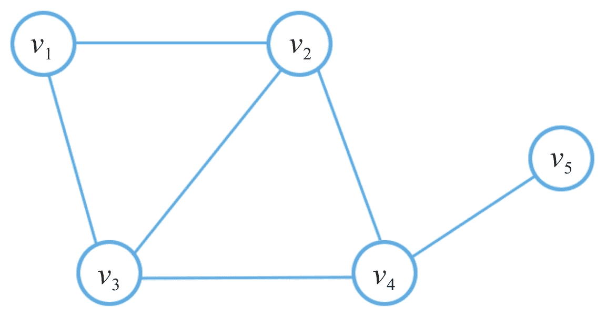

图 1-1　图 `G` 的定义示意

### 1.1.1　图的基本类型

**1. 有向图与无向图**

若图中的边具有方向性，此类边称为**有向边** `e[ij]=<v[i],v[j]>`，`v[i]` 为尾（起点），`v[j]` 为头（终点）。包含有向边的图称为**有向图**，如图 1-2 所示。与之对应的是**无向图**，其边均无方向。我们可将无向边视为对称的，即同时包含两个方向：`e[ij]=<v[i],v[j]>=<v[j],v[i]>=e[ji]`。

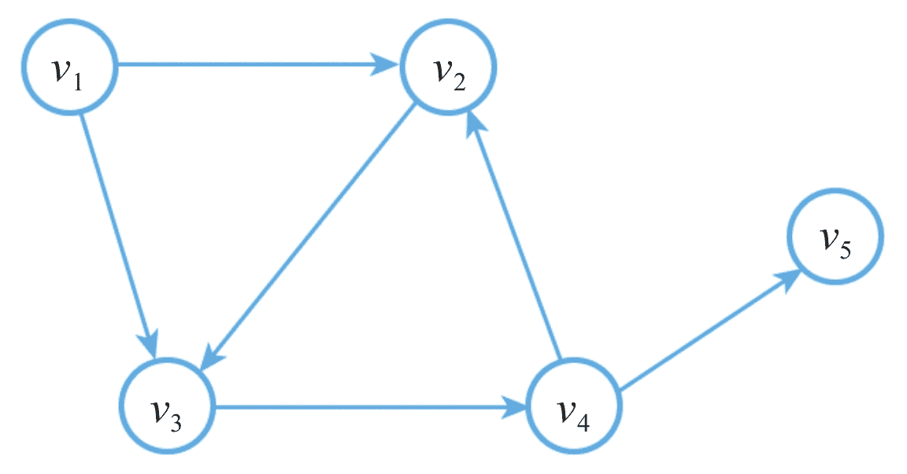

图 1-2　有向图示意

**2. 无权图与加权图**

若图中每条边均关联一个实数，则称该图为**加权图**，如图 1-3 所示。该实数称为边的**权重**。在实际场景中，权重可表示两地间的距离或运输成本。通常，我们习惯将权重抽象为两顶点间连接的强弱。反之，则为**无权图**，可视为所有边权重相同。

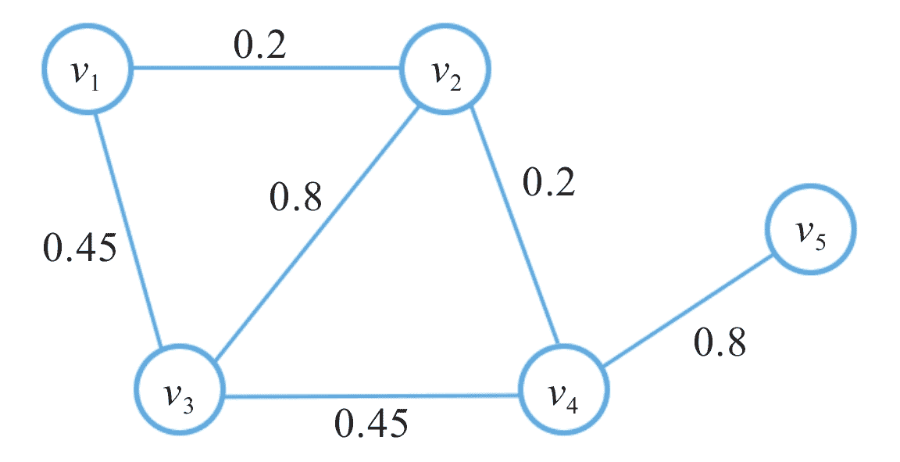

图 1-3　加权图示意

**3. 连通图与非连通图**

若图中存在孤立顶点（无边相连），则称该图为**非连通图**，如图 1-4 所示。反之，无孤立顶点的图称为**连通图**。

**4. 二分图**

**二分图** 是一类特殊的图。将图 `G` 的顶点集 `V` 划分为两个子集 `A` 和 `B`。若图中任意边 `e[ij]` 均满足 `v[i]∈A, v[j]∈B` 或 `v[i]∈B, v[j]∈A`，则称 `G` 为二分图，如图 1-5 所示。二分图是描述两类对象交互关系（如用户-商品、作者-论文）的常见数据对象。

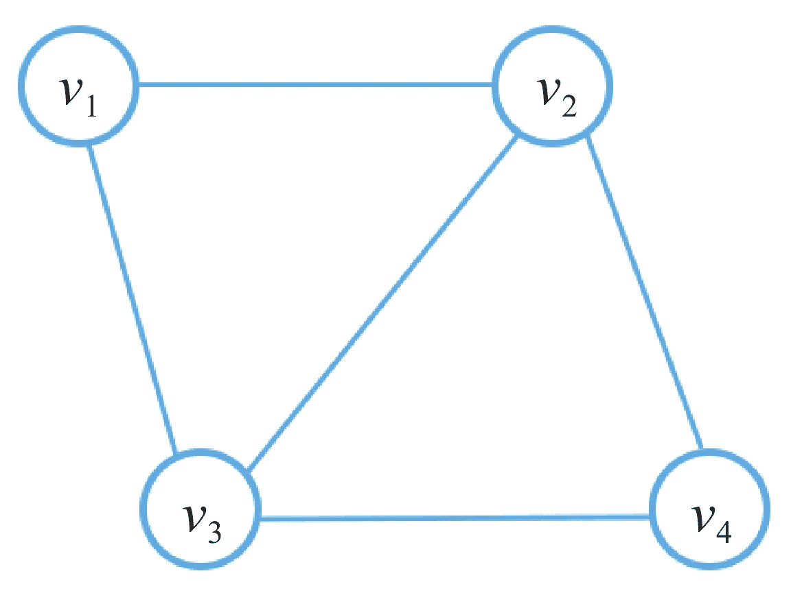

图 1-4　非连通图示意

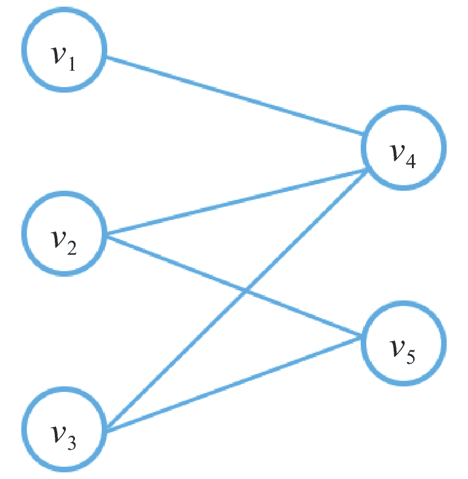

图 1-5　二分图示意

### 1.1.2　邻居与度

若存在边连接顶点 `v[i]` 与 `v[j]`，则称 `v[j]` 是 `v[i]` 的**邻居**，反之亦然。我们用 `N(v[i])` 表示 `v[i]` 的所有邻居集合，即：

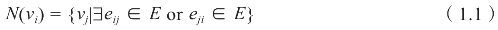

以 `v[i]` 为端点的边数，称为 `v[i]` 的**度**，记作 `deg(v[i])`：

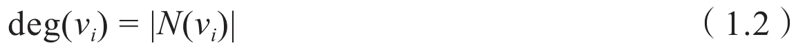

在图中，所有节点度数之和与边数存在如下关系：

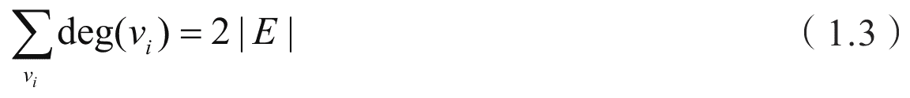

在有向图中，我们同步定义**出度**与**入度**。顶点度数等于其出度与入度之和。其中，顶点 `v[i]` 的出度是以 `v[i]` 为起点的有向边数量，入度是以 `v[i]` 为终点的有向边数量。

### 1.1.3　子图与路径

若图 `G'=(V',E')` 的顶点集与边集分别是另一图 `G=(V,E)` 的顶点集与边集的子集，即 `V'⊆V` 且 `E'⊆E`，则称 `G'` 为 `G` 的**子图**。

在图 `G=(V,E)` 中，若从顶点 `v[i]` 出发，沿边经过顶点 `v[k1],v[k2],...,v[kn]` 到达顶点 `v[j]`，则边序列 `e[i,k1],e[k1,k2],...,e[kn,j]` 称为从 `v[i]` 到 `v[j]` 的一条**路径**（亦称游走），其中 `e[...]` 均为图 `G` 中的边。

**路径长度**：路径包含的边数，通常称为路径长度 `L(P[ij])=|P[ij]|`。

**顶点距离**：若从 `v[i]` 到 `v[j]` 至少存在一条路径，两者距离定义为：

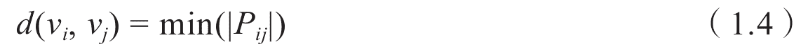

即两顶点间的距离由其最短路径长度决定。我们规定 `d(v[i],v[j])=0`，即节点到自身的距离为 0。

**k 跳邻居**：若 `d(v[i],v[j])=k`，则称 `v[j]` 为 `v[i]` 的 **k 跳邻居**。

**k 跳子图**：我们称顶点 `v[i]` 的 **k 跳子图** 为：

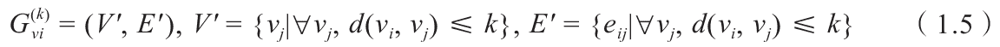

有时 k 跳子图也简称为 `k-hop`。图 1-6 中阴影部分即为顶点 `V[1]` 的 2 跳子图。

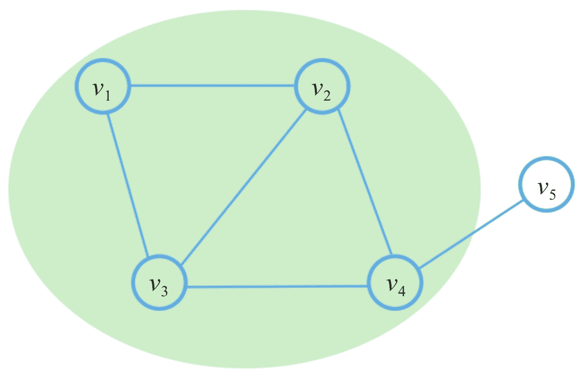

图 1-6　图 `G` 中顶点 `V[1]` 的 2 跳子图

## 1.2　图的存储与遍历

### 1.2.1　邻接矩阵与关联矩阵

作为常用数据结构，图在计算机中有多种存储表示方式。本节重点介绍**邻接矩阵**与**关联矩阵**两种方法。

设图 `G=(V,E)`。此处我们将边重新编号为 `e[1],e[2],...,e[M]`，如图 1-7 所示。我们用邻接矩阵 `A` 刻画图中顶点间的关联关系，`A∈R^(N×N)`，定义如下：

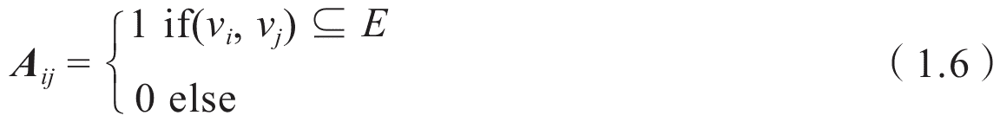

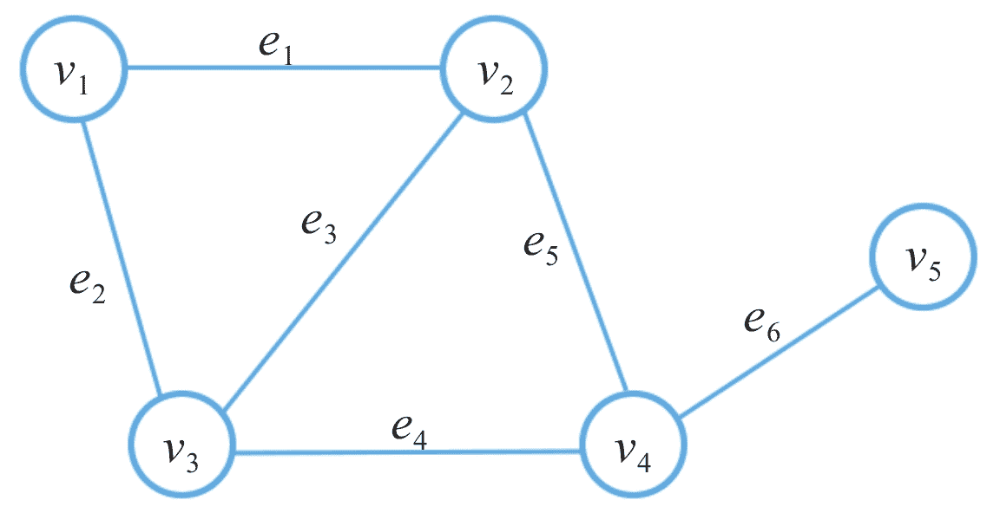

图 1-7　图 `G` 示例

采用邻接矩阵存储图时，需用一维数组存顶点集，二维数组存邻接矩阵。特别值得注意的是，实际图数据的邻接矩阵往往包含大量零元素。因此，可采用稀疏矩阵格式存储，将空间复杂度控制在 `O(M)` 以内。图 1-8(a) 展示了图 `G` 的邻接矩阵存储示意。可见，无向图的邻接矩阵沿主对角线对称，即 `A[ij]=A[ji]`。

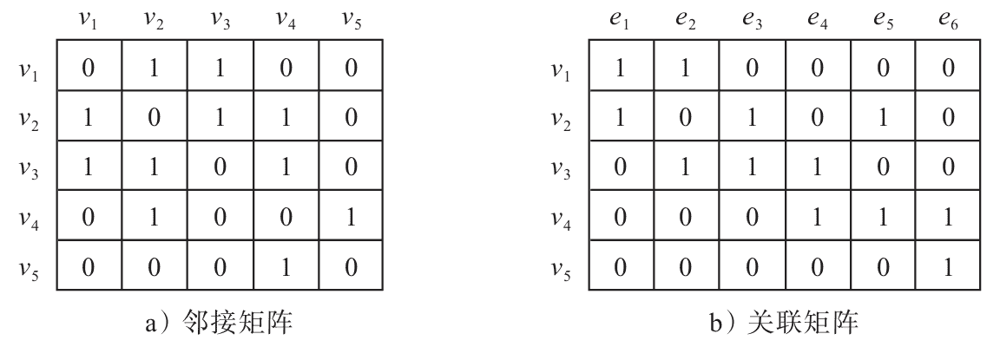

图 1-8　图 `G` 的邻接矩阵与关联矩阵

除邻接矩阵外，有时也用关联矩阵 `B∈R^(N×M)` 描述节点与边的关联，定义如下：

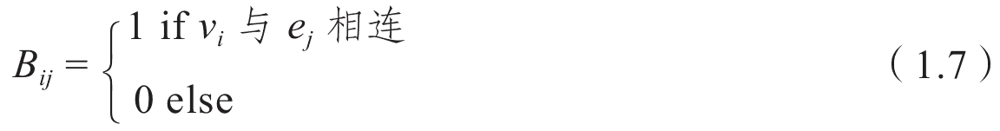

### 1.2.2 图的遍历策略

**图遍历**的核心任务是：从图中的某个顶点出发，依托边的连接关系，按照特定的搜索策略，对图中所有顶点进行**一次且仅一次**的访问。这属于图检索的基础操作，主要由两大核心算法支撑：**深度优先搜索（DFS）**与**广度优先搜索（BFS）**。

**深度优先搜索（DFS）** 本质是一个带有回溯机制的递归过程。其执行逻辑如下：选定起始顶点 `v[i]`，随机访问其一个邻居 `w[1]`；随后以 `w[1]` 为新起点，在其未被访问的邻居中继续挑选一个 `w[2]` 前行；如此顺藤摸瓜，一路深入，直到抵达一个“死胡同”——当前顶点不再有未访问的邻居。此时算法启动**回溯**，退回上一层顶点，检查是否还有遗漏的邻居。若有，则访问该邻居并重复上述深入过程；若无，继续向上回溯。这一循环往复，直至图中所有顶点均被访问完毕。以图 1-7 为例，其 DFS 访问序列为：`v[1]→v[2]→v[4]→v[5]→v[3]`。

**广度优先搜索（BFS）** 则采取**分层推进**的策略，全程无回溯动作。其核心思路是：从起始顶点 `v[i]` 出发，优先将其所有未访问的邻居 `w[1], w[2], ..., w[n]` 逐一访问完毕（完成第一层）；接着按顺序处理这些邻居节点，访问它们各自尚未被触达的邻居（推进至第二层）；以此类推，像水波扩散般层层向外，直到覆盖全图。同样以图 1-7 为例，BFS 访问序列呈现为：`v[1]→v[2]→v[3]→v[4]→v[5]`。

---

## 1.3 图数据的落地应用场景

提及“图”，往往带有浓厚的数学理论色彩。但在工程与业务实践中，我们习惯将其称为**网络**。相应地，图的两大核心要素——顶点与边，也被称为**节点**与**链接**（或边）。诸如社交网络、物流网络等耳熟能详的概念，皆属此列。为避免与“神经网络”中的“网络”概念混淆（虽神经网络本质上也是一种网络结构），本书统称此类网络数据为**图数据**。

图数据结构复杂、分类繁多，此处重点梳理四大核心范式：**同构图**、**异构图**、**属性图**与**非显式图（由非关系型数据构建的图）**。

1.  **同构图**  
    定义最为纯粹：图中仅存在**单一类型**的节点与**单一类型**的关系。它是现实图数据的最简模型。例如，由超链接关系编织而成的万维网。此类图的所有信息均浓缩于邻接矩阵之中。

2.  **异构图**  
    与同构图截然不同，异构图包含**多种类型**的节点或关系。现实业务中，研究对象往往类别多元，实体间的交互方式也呈现多样化。因此，异构图能更精准地贴合真实世界的复杂面貌。

3.  **属性图**  
    可视为异构图的进阶形态：在节点与关系之上，附加了丰富的**属性信息**（如图 1-9 所示）。在属性图中，节点与关系均拥有**标签**与**属性**双重描述。标签界定类型（如节点类型为“用户”）；属性则承载具体描述信息（如“用户”节点包含“姓名”、“注册时间”、“注册地址”等）。属性图是工业级图数据最主流的表达形式，广泛适配各类业务场景的数据建模需求。

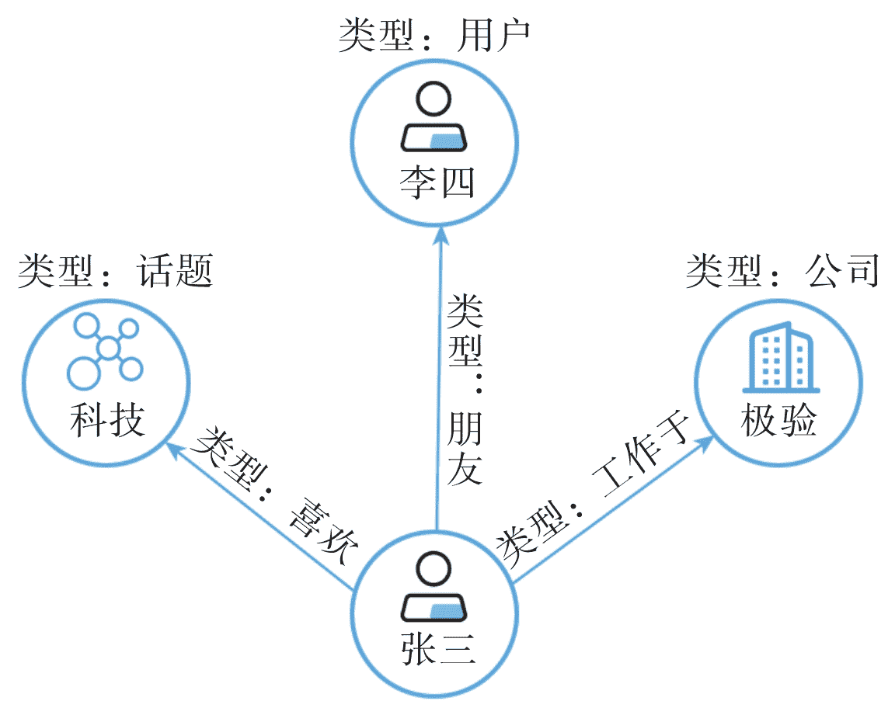

图 1-9　属性图示意

4.  **非显式图**  
    此类数据原本**不显式包含关系**。需要依据特定规则或计算逻辑（如空间距离、相似度阈值）推导实体间的关联，进而将其转化为图结构进行分析。典型案例为 3D 计算机视觉中的**点云数据**：若将节点间的空间距离转化为边关系，点云即刻化身为图数据。

作为审视多元实体系统的关键视角，图数据在现实世界的应用版图极为广阔。以下结合图 1-10，选取四大典型领域展开说明。

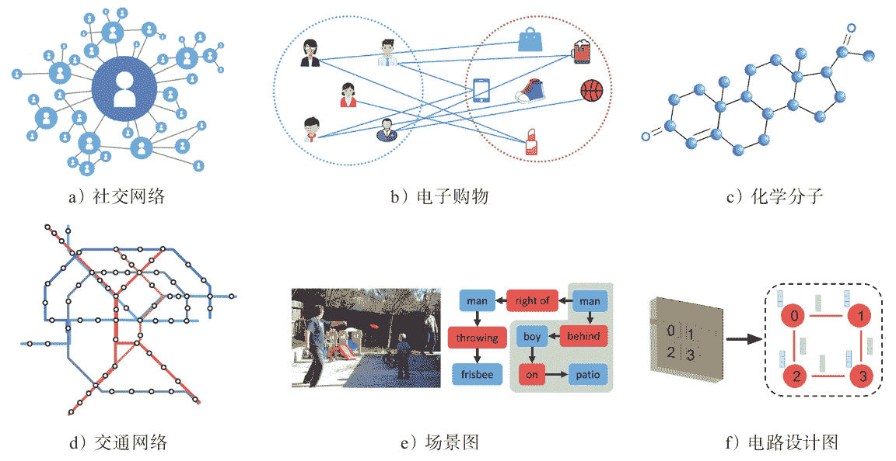

图 1-10　图数据应用案例集锦

**社交网络**  
图数据的经典主场，用于刻画个体或组织间的多元社交联结。图 1-10(a) 展示了在线社交平台的用户关注网络：节点代表用户，边表示关注关系。这属于典型同构图，常用于用户重要性排序、关联用户推荐等任务。随着移动互联深化，短视频、短文本等多媒体对象接入，催生出异构图结构，进而支撑更丰富的业务目标。

**电商领域**  
互联网核心业务阵地。此类场景下，业务数据常以**用户-商品二部图**形式呈现。如图 1-10(b) 所示，节点分为用户与商品两大阵营；关系涵盖浏览、收藏、购买等多维交互，且用户与商品间可并存多种关系（如同时存在收藏与购买边）。这种复杂度，属性图可轻松驾驭。电商衍生出的明星应用——**推荐系统**，正是挖掘用户-商品交互背后的偏好逻辑。经典的“啤酒与尿布”关联规则，便揭示了购买啤酒的用户往往倾向于同单购买尿布。

**化学分子**  
以原子为节点，化学键为边，分子结构即刻转化为图数据研究对象。分子的基础组成与内部连接拓扑，决定了其理化性质。该范式常用于指导新材料研发、新药发现等前沿任务，如图 1-10(c) 所示。

**交通网络**  
形态多样。以地铁网为例，站点为节点，站间连通关系构建图结构（图 1-10(d)）。交通网络中，核心关注点多聚焦于**路径规划**（如最短路径求解）。另一典型应用是将客流量作为节点属性，以此预测未来流量走势。

### Scene Graph

### 场景图：图像语义的结构化表达

场景图是一种描述图像语义的有效手段。它将画面中的实体视为节点，实体间的交互关系视为边，从而构建成一张语义网络。这种方式能将错综复杂的图像内容，转化为关系明确的语义拓扑图。其应用前景广阔，涵盖图像合成、语义检索及视觉推理等领域。图 1-10(e) 即展示了一个由场景图驱动的语义图像合成案例：图中标注了两名男子、一名儿童、一只飞盘及一个庭院共五个对象及其关联，直观证明了场景图强大的语义刻画能力。

### 电路设计的图谱化建模

我们可以将谐振器等电子元器件抽象为节点，元件间的导线连接抽象为边，进而把电路设计建模为图数据。文献 [^([\[1\]](#chapter8.xhtml#ch1_back))] 便采用了此抽象策略（见图 1-10(f)），并结合图神经网络（GNN）技术对电路的电磁特性进行仿真拟合。与严谨但耗时的电磁公式仿真相比，该方法在可容忍误差范围内，大幅提升了高频电路的设计效率。

图数据的用武之地远不止于此。描述神经网络计算流程的计算图、传感器阵列网络、以及由各类智能传感器构成的物联网，皆属于图数据范畴。若要寻找一种最能对应现实世界数据特征的表达语言，图结构无疑是最具竞争力的候选者。总之，图数据应用跨度极大、场景极其多元，深入研究其具有广泛且深远的现实意义。

[\[1\]](#chapter8.xhtml#ch1) Zhang G, He H, Katabi D. Circuit-GNN: Graph Neural Networks for Distributed Circuit Design[C]//International Conference on Machine Learning. 2019: 7364-7373.

## 1.4 面向图数据的深度学习

作为一种关键数据形态，对图数据进行分析与学习的需求日益凸显。众多图学习理论聚焦于图数据相关的任务求解。谱图理论[^(\[2\])](../Text/chapter10.xhtml#aa-2) 融合了图论与线性代数，基于此衍生出的谱聚类算法[^(\[3\])](../Text/chapter10.xhtml#aa-3) 可用于图划分或节点聚类。统计关系学习（SRL）[^(\[4\])](../Text/chapter10.xhtml#aa-4) 结合了关系表示与似然表示，它打破了传统机器学习“独立同分布”（i.i.d.，即样本同类且互不相关）的两大前设假设，因此更契合图数据学习。为更好适配现实中的异构图数据，异构信息网络（HIN）分析[^(\[5\])](../Text/chapter10.xhtml#aa-5) 应运而生，旨在挖掘异构图中更全面的结构信息与丰富的语义信息。近年来深度学习在落地应用中取得巨大成果，使得表征学习与端到端学习理念备受瞩目。为从复杂图数据中学习到包含充分信息的向量化表征，大量网络嵌入[^(\[6\])](../Text/chapter10.xhtml#aa-6) 方法涌现。然而，网络嵌入难以将表征学习与任务学习融合为一体的端到端体系，因此，面向图数据的端到端学习系统依然是核心研究课题。

受限于图数据结构本身的复杂性，直接构建一套支持其运算的可微分计算框架并不直观。与之对应的图像、语音、文本等数据，均是在欧几里得空间中定义的规则结构数据，基于此的张量计算体系相对天然且高效。图 1-11 直观对比了图数据与几类常见数据的差异：图像呈现规则的二维网格结构，完美契合卷积神经网络（CNN）的运作机制；文本属于规则序列数据，其顺序结构则对应循环神经网络（RNN）的处理逻辑。

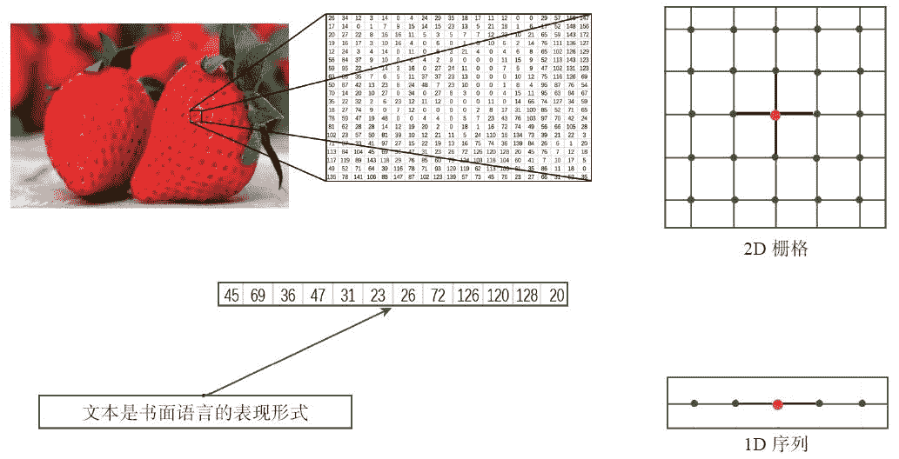

图 1-11　图像、语音与文本数据类型对比[^(\[1\])](#chapter9.xhtml#ch1_back)

受图信号处理[^(\[7\])](../Text/chapter10.xhtml#aa-7) 中图信号卷积滤波定义的启发，近年发展出一系列基于图卷积运算及其衍生变体的神经网络理论。本书统称这类方法为图神经网络（GNN[^(\[8\])](../Text/chapter10.xhtml#aa-8)[^(\[9\])](../Text/chapter10.xhtml#aa-9)[^(\[10\])](../Text/chapter10.xhtml#aa-10)）。下文将简述其演进脉络。

2005 年，Marco Gori 等人发表论文[^(\[11\])](../Text/chapter10.xhtml#aa-11)，首次提出了图神经网络概念。此前，处理图数据的主流范式是在预处理阶段将图转化为一组向量。该做法的最大弊端在于图的结构信息易丢失，且结果高度依赖预处理质量。GNN 的提出，旨在让学习过程直接架构在原始图数据之上。

随后，他们在 2009 年的两篇论文[^(\[12\])](../Text/chapter10.xhtml#aa-12)[^(\[13\])](../Text/chapter10.xhtml#aa-13) 中深化了 GNN 理论，并提出了监督学习训练范式。但这些早期研究均采用迭代机制，通过循环神经网络传播邻域信息直至收敛到稳定定态以获取节点表征。此计算模式资源消耗巨大，后续研究随即聚焦于如何优化以降低计算开销。

2012 年前后，卷积神经网络在视觉领域大放异彩，激发了学界将卷积引入 GNN 的探索。2013 年，Bruna 等人首创性地将卷积操作引入 GNN。文献 [\[14\]](../Text/chapter10.xhtml#aa-14) 基于谱卷积概念构建了图卷积网络模型，首次实现了可学习卷积在图数据上的应用。此后，基于谱的图卷积网络改进层出不穷。然而，谱卷积要求全图同步计算，且背负矩阵分解的高时间复杂度，难以支撑大规模图学习任务。因此，基于空域的图卷积应运而生并逐渐成为主流。

2016 年，Kipf 等人[^(\[15\])](../Text/chapter10.xhtml#aa-15) 简化了谱图卷积的定义，使图卷积运算可在空域高效执行，显著提升了模型计算效率。得益于卷积滤波的高效特性，图卷积模型在多项图数据任务上取得了卓越表现。

# GNN崛起：图深度学习的新纪元与任务全景

近些年来，基于空间图卷积的神经网络变体层出不穷[^(\[16\])][^(\[17\])][^(\[18\])]，学界统称这类方法为图神经网络（GNN）。各类GNN模型的涌现，极大地拓展了学习系统对多样化图数据的适应性，为各类图数据上的任务学习奠基立柱。

自此，图数据与深度学习迎来了首次真正深度的融合。GNN的诞生实现了图数据的端到端学习，为图数据在海量应用场景下的任务提供了极具竞争力的解决方案。

下面，我们系统梳理与图数据相关的任务分类。

### 1. 节点级任务

节点级任务以分类与回归为主。虽说预测目标落在单个节点上，但建模时绝不能孤立看待单节点，节点间的关联关系必须纳入考量。此类任务广泛存在：学术界常见引文网络中的论文节点分类；工业界则覆盖在线社交网络中的用户标签画像、恶意账号识别等。

### 2. 链接级任务

链接级任务聚焦于边分类与链接预测。边分类旨在预测边自身的属性；链接预测则推断给定两节点间是否会形成连接。典型应用如社交网络：用户建模为节点，关注关系建模为边，通过链接预测落地“可能认识的人”推荐。目前此类任务主要集中在推荐业务领域。

### 3. 图级任务

图级任务不依赖特定节点或边的属性，而是从图的整体拓扑结构出发，完成分类、表征学习与生成任务。当前应用重心多在自然科学研究，如药物分子分类、酶分类等。

[\[1\]](#chapter9.xhtml#ch1) 图片来源：http://helper.ipam.ucla.edu/publications/dlt2018/dlt2018_14506.pdf.

## 1.5 参考文献

[\[1\]](../Text/chapter8.xhtml#a1)　Zhang G, He H, Katabi D. Circuit-GNN: Graph Neural Networks for Distributed Circuit Design[C]//International Conference on Machine Learning. 2019: 7364-7373.

[\[2\]](../Text/chapter9.xhtml#a2)　F.R. Chung. Spectral Graph Theory. American Mathematical Society, 1997.

[\[3\]](../Text/chapter9.xhtml#a3)　Von Luxburg U. A tutorial on spectral clustering[J]. Statistics and computing, 2007, 17(4): 395-416.

[\[4\]](../Text/chapter9.xhtml#a4)　Koller D, Friedman N, Džeroski S, et al. Introduction to statistical relational learning[M]. MIT press, 2007.

[\[5\]](../Text/chapter9.xhtml#a5)　Shi C, Li Y, Zhang J, et al. A survey of heterogeneous information network analysis[J]. IEEE Transactions on Knowledge and Data Engineering, 2016, 29(1): 17-37.

[\[6\]](../Text/chapter9.xhtml#a6)　Cui P, Wang X, Pei J, et al. A survey on network embedding[J]. IEEE Transactions on Knowledge and Data Engineering, 2018, 31(5): 833-852.

[\[7\]](../Text/chapter9.xhtml#a7)　Shuman D I, Narang S K, Frossard P, et al. The emerging field of signal processing on graphs: Extending high-dimensional data analysis to networks and other irregular domains[J]. IEEE signal processing magazine, 2013, 30(3): 83-98.

[\[8\]](../Text/chapter9.xhtml#a8)　Zhou J, Cui G, Zhang Z, et al. Graph neural networks: A review of methods and applications[J]. arXiv preprint arXiv:1812.08434, 2018.

[\[9\]](../Text/chapter9.xhtml#a9)　Zhang Z, Cui P, Zhu W. Deep learning on graphs: A survey[J]. arXiv preprint arXiv:1812.04202, 2018.

[\[10\]](../Text/chapter9.xhtml#a10)　Wu Z, Pan S, Chen F, et al. A comprehensive survey on graph neural networks[J]. arXiv preprint arXiv:1901.00596, 2019.

[\[11\]](../Text/chapter9.xhtml#a11)　Gori M, Monfardini G, Scarselli F. A new model for learning in graph domains[C]//Proceedings. 2005 IEEE International Joint Conference on Neural Networks, 2005. IEEE, 2005, 2: 729-734.

[\[12\]](../Text/chapter9.xhtml#a12)　Micheli A. Neural network for graphs: A contextual constructive approach[J]. IEEE Transactions on Neural Networks, 2009, 20(3): 498-511.

[\[13\]](../Text/chapter9.xhtml#a13)　Scarselli F, Gori M, Tsoi A C, et al. The graph neural network model[J]. IEEE Transactions on Neural Networks, 2008, 20(1): 61-80.

[\[14\]](../Text/chapter9.xhtml#a14)　Bruna J, Zaremba W, Szlam A, et al. Spectral networks and locally connected networks on graphs[J]. arXiv preprint arXiv:1312.6203, 2013.

[\[15\]](../Text/chapter9.xhtml#a15)　Kipf T N, Welling M. Semi-supervised classification with graph convolutional networks[J]. arXiv preprint arXiv:1609.02907, 2016.

[\[16\]](../Text/chapter9.xhtml#a16)　Hamilton W, Ying Z, Leskovec J. Inductive representation learning on large graphs[C]//Advances in Neural Information Processing Systems. 2017: 1024-1034.

[\[17\]](../Text/chapter9.xhtml#a17)　Veličković P, Cucurull G, Casanova A, et al. Graph attention networks[J]. arXiv preprint arXiv:1710.10903, 2017.

[\[18\]](../Text/chapter9.xhtml#a18)　Gilmer J, Schoenholz S S, Riley P F, et al. Neural message passing for quantum chemistry[C]//Proceedings of the 34th International Conference on Machine Learning-Volume 70. JMLR.org, 2017: 1263-1272.

[\[19\]](../Text/chapter8.xhtml#a19)　Johnson J, Gupta A, Fei-Fei L. Image generation from scene graphs[C]//Proceedings of the IEEE Conference on Computer Vision and Pattern Recognition. 2018: 1219-1228.

# 第2章 神经网络基础

近年来，算法迭代、数据爆发与算力跃升三驾马车并进，推动机器学习与深度学习高速发展。本章从机器学习核心概念切入，阐释其本质与模型获取路径；继而拆解深度学习模型的基石——神经元模型，及其堆叠构建的多层感知机（MLP）；最后以MLP为例，讲解深度学习中的反向传播算法与优化方法。

## 2.1 机器学习基本概念

### 2.1.1 机器学习分类

机器学习是一门融合概率论、统计学、逼近理论、凸分析、计算复杂性理论等多学科的交叉领域。其理论核心在于设计并分析让计算机自动“学习”的算法。通俗而言，即让计算机从数据中挖掘有价值的信息。

换个维度看，机器学习可按不同标准分类。以下简述几种常见划分方式。

依据训练数据是否带标签，可分为**监督学习**、**半监督学习**与**无监督学习**。

**监督学习**：训练集中每个样本均带标签。标签指引模型学习判别性特征，进而对未知样本做预测。以ImageNet图像分类为例，利用现有图片标签训练模型，使其能对未知图片输出正确分类。

**无监督学习**：训练数据完全无标签。算法挖掘数据内在的约束关系，如关联性、距离关系等。典型代表是聚类算法，依据某种度量将“距离”相近的样本归为一类。

# 半监督学习：标注稀缺时的破局之道

**半监督学习**处于有监督与无监督学习的中间地带。其训练集同时包含带标签与不带标签的样本。基于一个核心假设——两类数据源自同一分布，未标注数据虽无显式标签，却隐含分布结构信息，可作为有标签数据的有力补充。这在工业界极为常见：互联网每日产出海量数据，人工标注成本高昂且效率低下，半监督学习恰好提供了一条低成本利用海量未标注数据的路径。

从模型输出形态看，监督学习任务主要分为**分类**与**回归**两大类。

### 分类与回归：输出维度的本质区别

*   **分类问题**：模型输出离散类别。如风控场景中的“正常/异常”二分类，或图像识别中的具体类别标签（猫、狗、汽车等）。
*   **回归问题**：模型输出连续数值。典型如电商广告推荐中预测用户点击概率（CTR），概率值越大，代表用户点击意愿越强。

---

## 2.1.2 机器学习全流程复盘

一个完整的 ML 项目并非单步完成，而是由多个紧密咬合的阶段串联。下面先通过一个电商商品分类的实战案例串联全流程，再从数学视角抽象建模。

### 实战案例：电商商品图片分类

**场景**：给定一批商品图片（羽绒服、羊毛大衣、连衣裙、卫衣等），训练一个模型，能自动判定新上架商品（如新款羽绒服）的类目。

#### 步骤 1：特征提取——让机器“看懂”图片
计算机眼中图片只是离散像素矩阵，单个像素信息稀疏，难以直接建模。必须提取判别性特征：
*   **特征工程**：人工定义颜色、款式、纹理等规则特征。这是传统 ML 的核心环节，地位举足轻重。
*   **深度学习**：通过神经网络自动学习层级化特征表达（详见第 3 章）。

#### 步骤 2：模型构建——建立输入到标签的映射
特征就绪后，需选定模型架构：
*   传统算法：逻辑回归、随机森林等。
*   深度架构：多层感知机（MLP）、卷积神经网络（CNN）等。
本质上，模型是一个参数化函数 $y = f(X; W)$，旨在拟合从特征 $X$ 到标签 $y$ 的映射，$W$ 为待学参数。

#### 步骤 3：损失函数与优化——让模型“自我进化”
确定模型结构仅是定下骨架，参数 $W$ 未定时模型无法预测。核心在于：
1.  **量化误差**：引入**损失函数** $L(y, \hat{y})$，度量预测值 $\hat{y}$ 与真实标签 $y$ 的偏离程度。预测越错，损失越大。
2.  **迭代优化**：基于损失值，用优化算法（如梯度下降）反向调整参数 $W$，使损失持续下降，直至收敛获得最优模型。

---

### 数学建模视角：分类任务的形式化定义

以上面的分类任务为例，给出数学抽象。

**设定**：
*   训练集 $X = \{(x^{(i)}, y^{(i)})\}_{i=1}^N$，共 $N$ 个样本。
*   样本 $x^{(i)} \in \mathbb{R}^d$ 为 $d$ 维特征向量。
*   标签 $y^{(i)} \in \mathcal{Y} = \{0, 1, \dots, K\}$ 为 $K+1$ 个离散类别之一。
*   目标：学习映射 $f: \mathbb{R}^d \to \mathbb{R}^K$，输出条件概率分布 $P(Y|x^{(i)}) = f(x^{(i)}; \theta)$，最终取概率最大的类别：$\arg\max_k P(Y=c_k|x^{(i)})$。

**如何评价模型优劣？**
最直观的方式是看训练集准确率：预测类别 $\arg\max_k P(Y=c_k|x^{(i)})$ 是否等于真实 $y^{(i)}$。但定性描述不够严谨，需引入**损失函数**量化差异。

**统一优化目标：经验风险 + 正则化**
训练过程即最小化目标函数 $J(\theta)$：

```
θ* = argmin_θ (1/N Σ_{i=1}^N L(y[i], f(x[i]; θ)) + λΦ(θ))
```

其中：
*   **经验风险**：$\frac{1}{N}\sum_{i=1}^N L(y^{(i)}, f(x^{(i)}; \theta))$，反映模型在训练集上的拟合能力。
*   **正则项/惩罚项 $\Phi(\theta)$**：如 $L_1$、$L_2$ 正则，防止过拟合，增强泛化性。

不同损失函数（如交叉熵、Hinge Loss、MSE）定义了 $f(x)$ 逼近 $y$ 的不同几何路径，直接影响最终解的性质与模型表现。

# 2.1 模型训练的核心逻辑：迭代、损失与优化

在实际建模中，很难一步到位找到完美参数，因此机器学习通常采用**迭代策略**，逐步逼近最优解。整个流程如图 2-1 所示：首先用初始参数 `θ[0]` 构建模型 `f(X; θ[0])` 对训练集 `X` 进行预测；接着引入损失函数，对比预测值与真实标签，量化误差；优化算法依据当前误差调整参数，得到 `θ[1]`；如此循环往复，直到整体损失不再下降或变化微乎其微，此时称模型已**收敛**。

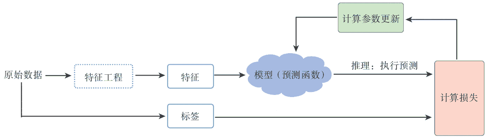

> **核心提醒**：训练的终极目标**不是**在训练集上“刷高分”，而是让模型从中学会泛化规律，从而应对未见样本。一个极端的反面教材是：模型在训练集上完美拟合（损失为 0），却在新数据上惨败，这便是**过拟合**；另一种情况是模型“竭尽全力”仍无法在训练集达标，被称为**欠拟合**。

损失函数与优化算法是机器学习的“双引擎”。下面我们先盘点几类常用损失函数，再深入讲解最主流的优化手段——梯度下降。

## 2.1.3 常用损失函数速览

损失函数是指引模型高效学习的“指南针”。针对不同任务，选用或设计合适的损失函数，能帮模型从数据中挖掘出最大价值。

### 1. 平方损失函数

平方损失的定义见公式 (2.2)：

```
L = 1/N Σ_{i=1}^N (y[i] - f(x[i]; θ))²
```

其中 `N` 为样本量。它度量预测值与标签的平方差，是**回归任务**的标配。

### 2. 交叉熵损失

**交叉熵**主攻**分类任务**。分类模型通常输出类别概率分布，交叉熵衡量真实标签分布与模型预测分布的差异——损失越小，差异越小，预测越精准。其离散形式如下：

```
H(p, q) = - Σ_i p(y[i]|x[i]) log q(y[i]|x[i])
```

此处 `p`、`q` 分别代表真实标签分布与模型预测分布。`p(y[i]|x[i])` 为样本 `x[i]` 的真实标签分布。通常样本仅属单一类别 `c[k]`，即 `p(y[i]=c[k]|x[i])=1`，其余类别概率为 0。`q(y[i]|x[i])` 为模型给出的各类概率。若样本标签为 `c[k]`，公式 (2.3) 可简化为 (2.4)：

```
L = - log q(y[i] = c[k]|x[i])
```

可见，此时最小化交叉熵等价于**最大化样本标签的似然概率**。

针对二分类 `y[i] ∈ {0, 1}`，用 `Logistic Regression` 得到样本属类别 1 的概率 `q(y[i]=1|x[i])`，则属类别 0 概率为 `1 - q(y[i]=1|x[i])`。代入公式 (2.4) 即得 Logistic 回归损失，即**二元交叉熵损失**，见公式 (2.5)：

```
L = - [y[i] log q(y[i] = 1|x[i]) + (1 - y[i]) log (1 - q(y[i] = 1|x[i]))]
```

## 2.1.4 梯度下降算法详解

### 1. 核心原理

机器学习的许多问题本质是**优化问题**——寻找参数使损失最小。**梯度下降**是经典求解器，利用梯度信息迭代更新参数。

对多元函数 `f(x)`，梯度定义为各自变量偏导数组成的向量，记为 `f'(x)`，见公式 (2.6)：

```
f'(x) = [∂f/∂x_1, ∂f/∂x_2, ..., ∂f/∂x_n]^T
```

观察 `f(x + Δx)` 在 `x` 处的泰勒展开，公式 (2.7)：

```
f(x + Δx) ≈ f(x) + f'(x)^T Δx
```

欲使 `f(x + Δx) < f(x)`，忽略高阶项，需满足 `f'(x)^T Δx < 0`。进而 `f'(x)^T Δx = ||f'(x)^T|| · ||Δx|| · cosθ`。令 `Δx = -α f'(x)` 即可保证函数值下降。其中 `α` 为控制步长的超参数，称作**学习率**。

机器学习优化目标是最小化损失函数，梯度下降求解流程见代码清单 2-1：随机初始化参数作为起点 → 全量样本预测计算总损失 → 对参数求导得梯度 → 按梯度反向更新参数 → 循环至停止条件。

**直观类比**：梯度下降如同**登山者下山**。大雾弥漫看不见路，只能感知脚下最陡峭的方向，沿此方向迈步；走一段再感知、再迈步，最终抵达山脚（极值点）。

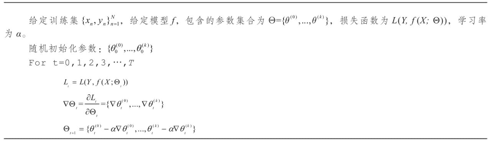

### 2. 随机梯度下降（SGD）

前文提到的标准梯度下降需先遍历全量数据计算损失再更新，数据量大时效率低，痛点有三：全量前向耗时、高维梯度计算复杂、一次更新仅用一次精确梯度。此即**批量梯度下降（BGD）**。

若改用**单个样本**近似梯度估计，计算量骤降，效率大增。理论可证此法依然收敛。这就是**随机梯度下降（Stochastic Gradient Descent, SGD）**。

# 随机梯度下降与神经网络基础

## 随机梯度下降的迭代机制

具体操作上，每轮从训练集中随机抽取单个样本，计算其损失与梯度并据此更新参数，如此循环往复。面对大规模数据时，此法能显著降低计算开销。从概率角度看，单样本梯度虽是全量数据梯度的无偏估计，但伴随固有随机性，导致收敛速度不及批量梯度下降。

改进方案是每次迭代选取多个样本联合估计梯度，以此削减方差、加速收敛。该变体称为**小批量随机梯度下降**，单次迭代所用样本数即为**批量大小**。算法流程详见下图。

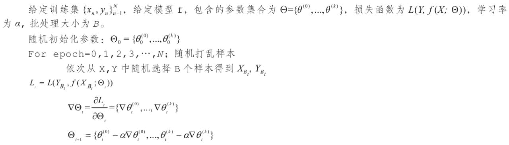

## 2.2 神经网络

得益于神经科学与认知科学的进步，人类智能行为与大脑活动的关联已成共识。大脑作为产生意识、思维与情感的器官，其神经系统结构启发早期科学家构建数学模型——**人工神经网络**，简称**神经网络**。机器学习领域中，神经网络指由海量人工神经元组成的网络模型，神经元间的连接强度即为可学习参数。

### 2.2.1 神经元

**神经元**是神经网络的信息处理基元，模拟生物神经元的结构特性，接收输入信号并产出输出。

生物学家于20世纪初揭示生物神经元结构（如图2-2所示）。典型神经元拥有多条树突与单一轴突：树突接收信息，轴突发送信息。当累积输入信号超阈值，神经元进入兴奋状态发放电脉冲；轴突末梢通过突触与他神经元树突相连，传递电信号。

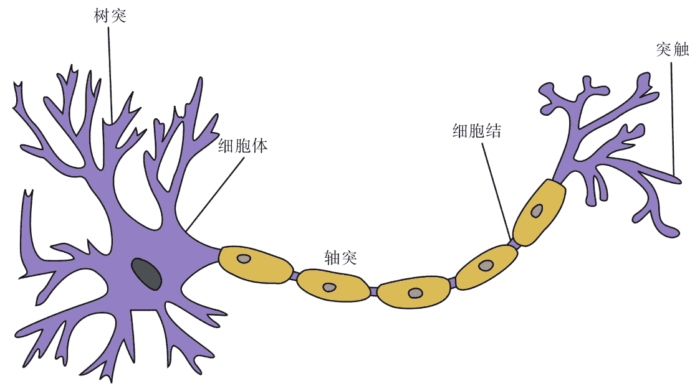

1943年，心理学家McCulloch与数学家Pitts依托生物神经元结构，提出极简神经元模型——**MP神经元**[¹]。

基础神经元包含三大核心组件：输入信号、线性组合、非线性激活函数。图2-3的神经元计算可用公式(2.8)与(2.9)描述。

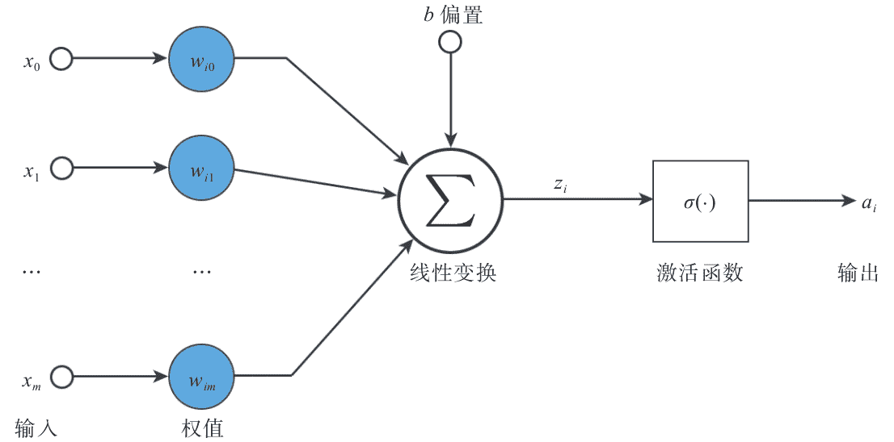

```
z[i] = Σ_{j=0}^m w[ij] x[j] + b
a[i] = σ(z[i])
```

式中，`x[0]...x[m]`为输入信号，`w[i0]...w[im]`为权重，`z[i]`为线性组合结果，`b`为偏置，`σ(·)`为激活函数，`a[i]`为输出信号。

[¹]: 图片来源：https://commons.wikimedia.org/wiki/File:Neuron_Hand-tuned.svg.

### 2.2.2 多层感知机

#### 1. 单隐层感知机

单隐层感知机典型结构（图2-4）通过堆叠神经元构建。可视为映射 `f: R^{D_in} → R^{D_out}`，其中 `D_in` 为输入层神经元数（输入向量维度），`D_out` 为输出层神经元数（输出向量维度）。计算流程对应公式(2.10)：

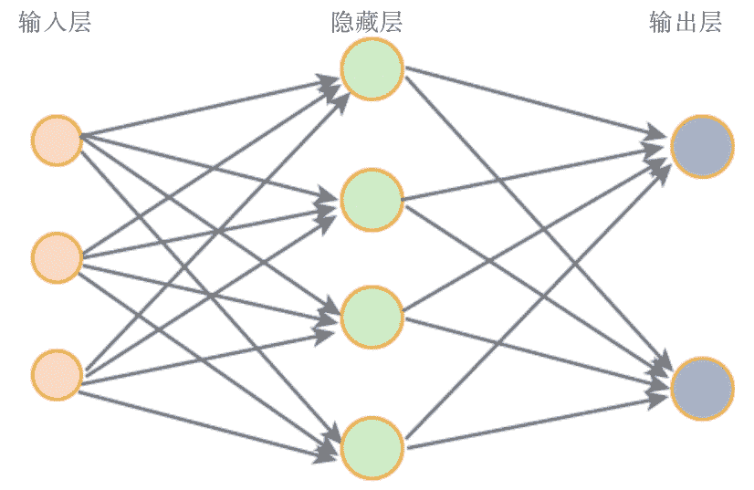

```
h(x) = f_1(W¹ x + b¹)
y = f_2(W² h(x) + b²)
```

其中 `b¹、b²` 为偏置，`W¹、W²` 为权重矩阵，`f_1、f_2` 为激活函数。隐层输出 `h(x) = f_1(W¹x + b¹)` 实现了输入的线性变换与非线性变换。`W¹` 将输入向量映射为隐层向量，其每列对应连接输入层至某隐层神经元的权重向量。`f_1` 逐元素作用于隐层神经元，此即**逐元素运算**。典型激活函数详见2.3节。

#### 2. 感知机中的信息传播

**多层感知机**（MLP），又称**前馈神经网络**。典型结构见图2-5，单层感知机是其特例。核心特征如下：

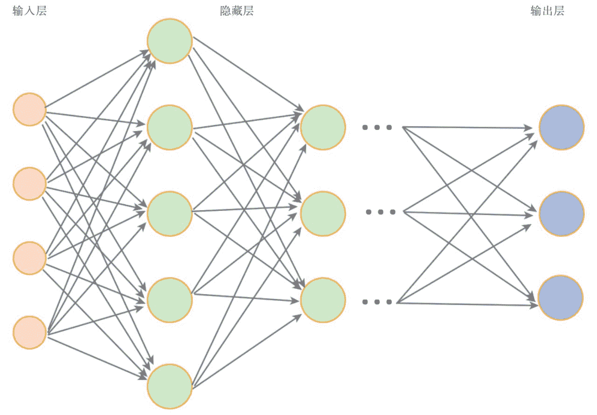

MLP由输入层、隐层（可多层）、输出层三部分组成。各层含若干神经元，每神经元执行线性加权与非线性变换。层间全连接：后层每个神经元均与前层所有神经元相连。

输入信号经连续的线性变换（加权求和）与非线性变换（激活函数）逐层传递至输出层。输入/输出层神经元数常由先验知识决定，而隐层层数与各层神经元数属超参数。

普适地，用公式(2.11)与(2.12)表征MLP信息传播：

```
z^(l) = W^(l) a^(l-1) + b^(l)
a^(l) = σ_l(z^(l))
```

式中 `W^(l) ∈ R^{D_l × D_{l-1}}` 为第l-1层至第l层的变换参数，`D_{l-1}、D_l` 分别为两层神经元数，`b^(l) ∈ R^{D_l}` 为偏置项。`{W^(l), b^(l)}` 为该层可训练参数，`σ_l` 为第l层激活函数，`z^(l)、a^(l)` 分别为线性变换输出与激活后输出。

MLP逐层传递信息得出输出 `y`，整网络可视为复杂复合函数 `φ(X; W, b)`，其中 `W、b` 汇集所有层参数 `{W^(l), b^(l) | l=1,2,3...}`。

## 2.3 激活函数

**激活函数**是神经网络的关键组件。其非线性特性赋予网络逼近任意非线性函数的能力。若无激活函数，无论网络多深，各层输出均为前层输入的线性组合，模型本质仍是线性模型，表达力极受限。

激活函数选择多样，基本要求为连续可导（允许极少数不可导点）。常用类别包括**S型激活函数**与**ReLU及其变体**。

### 2.3.1 S型激活函数

典型代表为**Sigmoid**与**Tanh**。此类函数有界，即 `σ(x) ∈ [a, b]`，且输入绝对值越大，梯度越小趋近于零。

**Sigmoid函数**定义见公式(2.13)：

```
σ(x) = 1 / (1 + e^{-x})
```

# 激活函数与网络训练核心机制深度解析

## Sigmoid：概率压缩器与门控开关

Sigmoid 函数的核心作用是将任意幅度的输入「压缩」到 (0, 1) 区间：输入越大，输出越逼近 1；输入越小，越趋近 0。在 [-1, 1] 区间内它近似线性，且过原点 (0, 0.5)。

在工程落地中，它常担任二分类器输出层的激活函数，把实数映射为概率；同时，得益于输出范围严格限定在 (0, 1)，它也能充当「门控开关」，对其他信息流进行调制。

## Tanh：零中心化的升级版

Tanh 定义见公式 (2.14)：

```
tanh(x) = (e^x - e^{-x}) / (e^x + e^{-x})
```

与 Sigmoid 相比，Tanh 的取值范围扩展为 (-1, 1)，且以零为中心，收敛往往更快。两者函数图像对比见图 2-6。Tanh 同样可作为「门控单元」调节信息流向。

## ReLU 及其变体族

### 1. ReLU：深度学习的「标配」激活函数

ReLU (Rectified Linear Unit) 当前是深度模型的首选激活函数。定义极简：输入非负则原样输出，输入负则归零，见公式 (2.15)：

```
ReLU(x) = max(0, x)
```

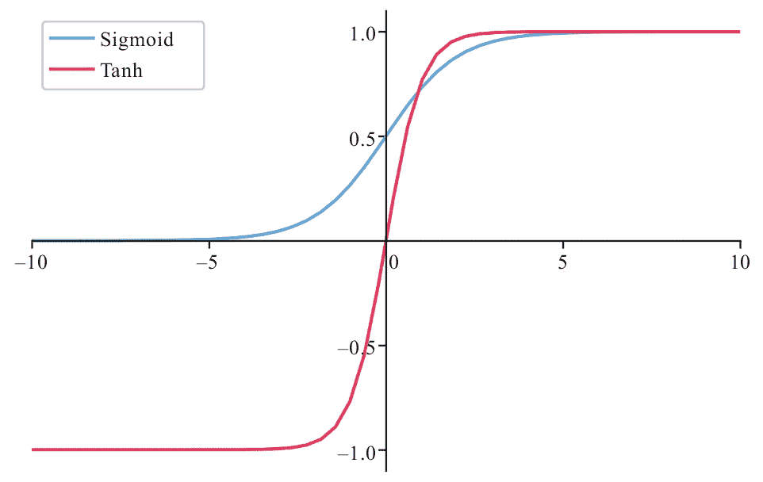

这种**单侧抑制**特性带来三大红利：
- **隐层稀疏性**：负值全置零，天然产生稀疏表示；
- **缓解梯度消失**：正区梯度恒为 1，梯度回传无衰减；
- **极致计算效率**：梯度公式 (2.16) 仅含 0/1 判断，无需乘除运算。

```
ReLU'(x) = 1, if x > 0; 0, if x < 0
```

**隐患**：若神经元长期处于负区，梯度永为 0，参数无法更新——即「神经元死亡」。为规避此问题，工程界衍生出多个变体。

### 2. LeakyReLU：给负区「留条缝」

[²]: 参考文献见附录。

# 神经网络训练：从前向到反向的完整闭环

早期神经网络难以高效训练，反向传播算法[⁶]基于链式法则快速求梯度，配合梯度下降更新参数，彻底破局。本节先梳理训练三部曲，再深入反向传播推导，最后剖析大规模参数下的优化难题。

## 训练三部曲：迭代挖掘数据价值

神经网络训练分三步走，循环迭代至收敛，流程见图 2-8：

1. **前向传播**：给定输入与参数，逐层计算至输出预测值；
2. **反向传播**：用损失函数评估预测偏差，按链式法则回传梯度；
3. **参数更新**：梯度下降修正参数，进入下一轮迭代。

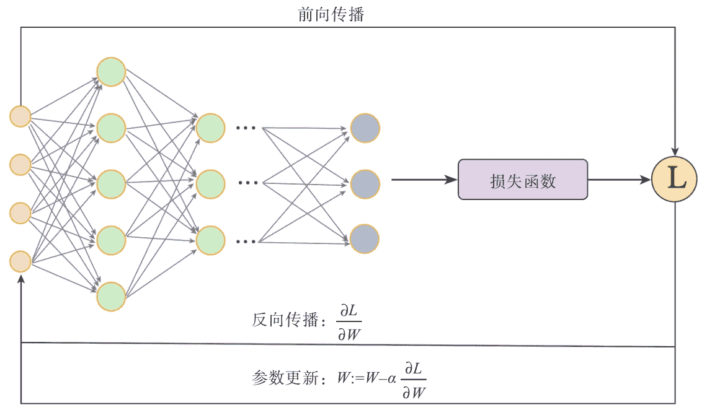

图 2-8 神经网络训练流程示意

## 反向传播算法：以 MLP 为例的逐层推导

以多层感知机 (MLP) 为例。给定样本 (x, y)，前向计算过程见图 2-9。

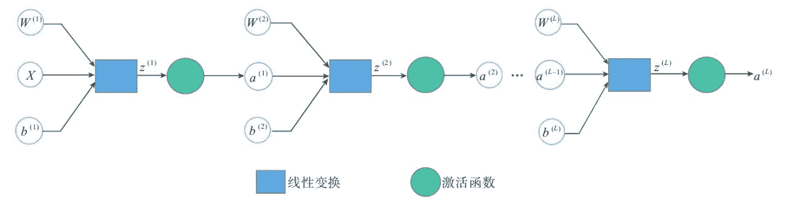

图 2-9 MLP 计算流程图

前向得到输出 ŷ 及损失 L。目标求参数矩阵 W^(l) 的梯度 ∂L/∂W^(l)。链式法则展开得公式 (2.21)：

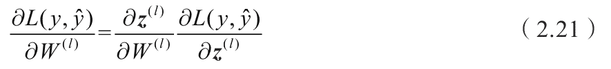

定义误差项 δ^(l) = ∂L/∂z^(l)，量化第 l 层线性输出 z^(l) 对损失的影响。再次应用链式法则得公式 (2.22)：

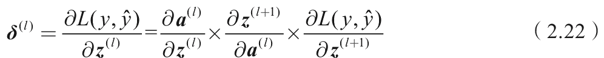

代入 z^(l+1) = W^(l+1)a^(l) + b^(l) 与 a^(l) = σ(z^(l))，化简得公式 (2.23)：

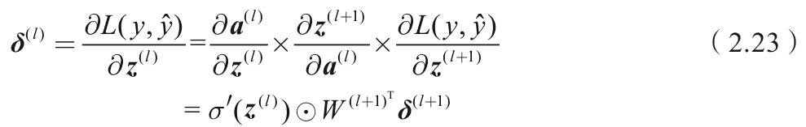

式中 σ'(z^(l)) 为激活函数导数，⊙ 为 Hadamard 积（逐元素乘法）。**公式 (2.23) 揭示核心机制：第 l 层误差由第 l+1 层误差经权重回传、再乘激活函数导数获得——这正是「反向传播」名字的由来。**

进而求得权重梯度公式 (2.24)：

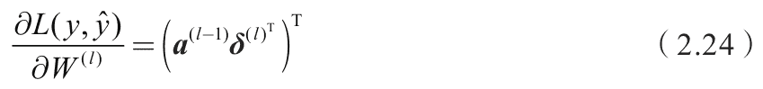

偏置项 b^(l) 梯度公式 (2.25)：

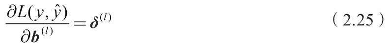

## 优化困境：深层网络的「拦路虎」

尽管反向传播高效求梯度，但层数加深、参数量爆炸时，优化面临严峻挑战。

### 1. 梯度消失：信号在回传中「蒸发」

由公式 (2.23)，误差回传需乘以层间权重与激活函数导数。若用 Sigmoid，其导数 σ'(x) = σ(x)(1-σ(x)) 最大仅 0.25。层数加深时，末层误差经多次「<1 乘法」呈指数级衰减，浅层梯度趋近于 0，参数几乎不动——**梯度消失**发生。

**根因在于激活函数饱和**：Sigmoid、Tanh 等在边界区导数极小，连乘使梯度指数级缩水。图 2-10 展示 5 层 MLP 训练中各层权重 2-范数演变：越靠近输入层，范数越小，直观印证梯度消失。因此现代网络多改用 ReLU 规避该问题。

### 2. 局部最优与鞍点：高维非凸地形的「陷阱」

神经网络引入非线性后，损失函数对参数呈高度非凸（图 2-11a）。海量局部极小值遍布，优化易陷入其中。但实证表明：深网往往存在大量「性能相当」的局部最优，落入其中未必伤害泛化[⁷]。

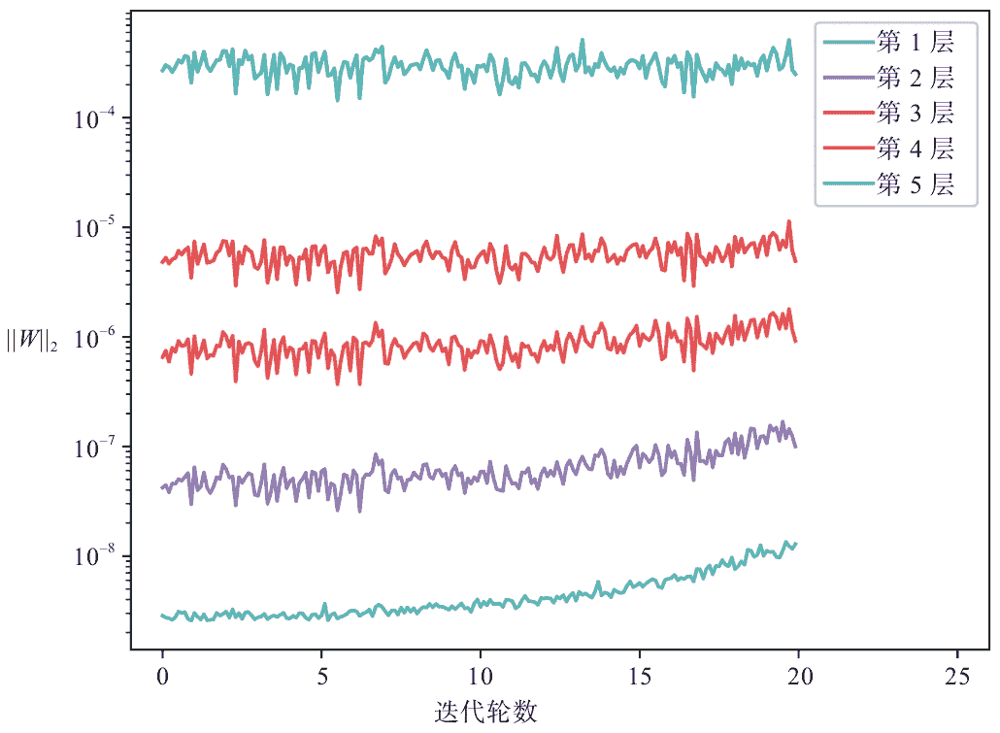

图 2-10 梯度消失现象示意

另一个棘手的问题是，维度过高往往导致深度神经网络模型充斥着大量鞍点。所谓鞍点，即梯度为零的点（如图 2-11b 所示），但它既非极小值也非极大值。通常情况下，鞍点带来的困扰远超局部最优。一旦陷入鞍点区域且误差较大，因该区域相对“平坦”，梯度数值极小，模型收敛速度会大幅受阻，极易产生陷入局部最优的假象。

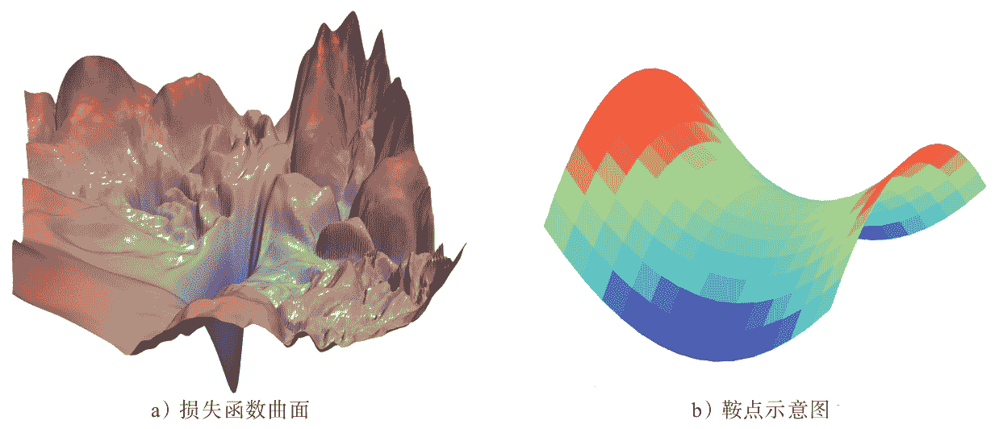

图 2-11 损失函数可视化示意图[⁸]

## 2.5 参考文献

[1] McCulloch W S, Pitts W. A logical calculus of the ideas immanent in nervous activity[J]. The bulletin of mathematical biophysics, 1943, 5(4): 115-133.

[2] Nair V, Hinton G E. Rectified linear units improve restricted boltzmann machines[C]//Proceedings of the 27th international conference on machine learning (ICML-10). 2010: 807-814.

[3] Maas A L, Hannun A Y, Ng A Y. Rectifier nonlinearities improve neural network acoustic models[C]//Proc. icml. 2013, 30(1): 3.

[4] He K, Zhang X, Ren S, et al. Delving deep into rectifiers: Surpassing human-level performance on imagenet classification[C]//Proceedings of the IEEE international conference on computer vision. 2015: 1026-1034.

[5] Clevert D A, Unterthiner T, Hochreiter S. Fast and accurate deep network learning by exponential linear units (elus)[J]. arXiv preprint arXiv:1511.07289, 2015.

[6] Rumelhart D E, Hinton G E, Williams R J. Learning representations by back-propagating errors[J]. Cognitive modeling, 1988, 5(3): 1.

[7] Kawaguchi K. Deep learning without poor local minima[C]//Advances in neural information processing systems. 2016: 586-594.

[8] Li H, Xu Z, Taylor G, et al. Visualizing the loss landscape of neural nets[C]//Advances in Neural Information Processing Systems. 2018: 6389-6399.

# 第 3 章 卷积神经网络

卷积神经网络（`Convolutional Neural Network`，简称 `CNN` 或 `ConvNet`）属于深度前馈神经网络的一种，具备局部连接与权值共享等特性。在图像与视频分析领域，如图像分类、目标检测、图像分割等视觉任务中，CNN 斩获显著成果，当前是应用最为广泛的模型之一。

## 3.1 卷积与池化

卷积和池化构成了卷积神经网络的两大核心算子，绝大多数网络架构均由二者组合构建而成。本节将详细阐述卷积的由来与原理，以及池化的基本概念。

### 3.1.1 信号处理中的卷积

“卷积”概念源自信号处理领域，是该领域、图像处理及工程科学中广泛应用的一项技术。卷积的典型应用场景是：针对某线性时不变系统，已知输入信号 `f(τ)` 与系统响应 `g(τ)`，求解系统输出。

卷积的数学定义参见公式 (3.1)：

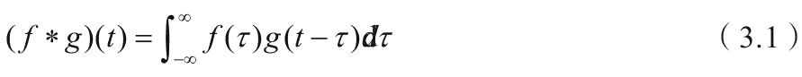

若结合图 3-1 直观理解该计算过程：函数 `g(τ)` 经翻转并平移 `t` 后得到 `g(t-τ)`，随后求其与函数 `f(τ)` 乘积的积分。

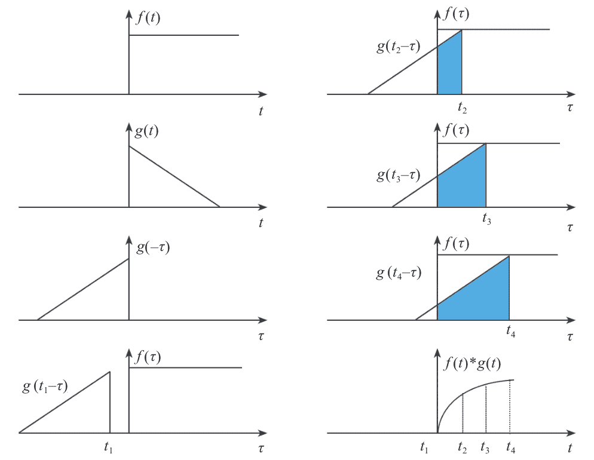

图 3-1 卷积运算过程示意

#### 1. 图像中的卷积

以图像为例直观感受卷积。计算机中图像通常按像素离散存储，可用二维或三维矩阵表示。假设二维图像 `X ∈ R^(H×W)`，卷积核为 `G ∈ R^(k×k)`，通常 `k` 为奇数。二维离散卷积的计算方式见公式 (3.2)：

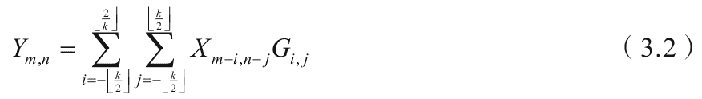

直观而言，上述过程为：先将卷积核旋转 180°，再在输入对应位置提取 `k×k` 区域，与旋转后的卷积核做内积，得到对应位置的输出。

传统图像处理中，卷积核多为人工设定。不同卷积核能从输入中提取特定特征，产出不同输出。图 3-2 展示了 `Sobel` 与 `Laplacian` 两种不同卷积核，二者均可用于图像边缘提取，但 `Laplacian` 属二阶算子，`Sobel` 属一阶算子，因此二者应用后的边缘检测效果差异明显。换言之，不同卷积核能提取不同特征。

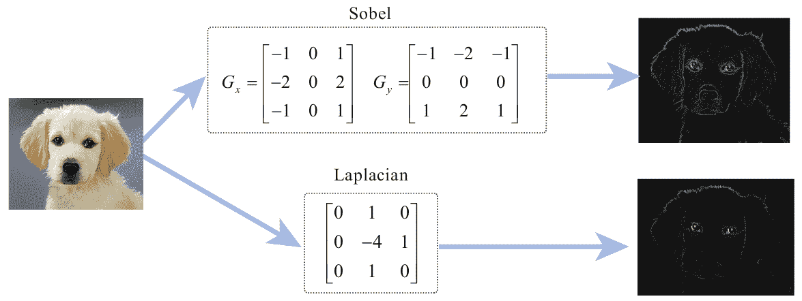

图 3-2 利用卷积进行图像边缘检测

#### 2. 卷积的深层含义

在信号处理中，卷积有一个关键定理——卷积定理。该定理应用极广，地位举足轻重，其核心在于将时域中复杂的卷积运算转化为频域中的简单乘法运算，即：

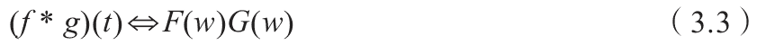

理解卷积定理，首先需了解傅里叶变换。傅里叶变换是将数据从时域映射到频域的方法，它将函数分解为不同频率三角函数的叠加，可理解为从另一维度观测数据。曾有人打比方：若将图像比作一道熟菜，傅里叶变换能精准拆解出具体食材及其用量，无论烹饪过程如何，都能清晰辨别。

将图像与卷积核同步变换至频域，变换后的卷积核作为滤波器处理频域图像。若卷积核对应的滤波器为低通滤波器，处理时会滤除部分高频分量。将滤波后的频域图像变回像素空间，会发现部分细节丢失。因为高频对应剧烈变化区域，即图像边缘、纹理等细节。

### 3.1.2 深度学习中的卷积运算

深度学习里的卷积运算与信号处理中的定义略有差异。本节以单通道卷积为例介绍计算流程，再延伸至多通道卷积，这是卷积网络的基石。

#### 1. 单通道卷积

首先以单通道输入为例，介绍深度学习采用的卷积。与公式 (3.2) 定义略异，深度学习中卷积核无需显式翻转，见公式 (3.4)。在信号处理中此定义称为互相关，但因卷积网络的核通过自动学习获得，该定义不影响最终输出。本书后续均沿用此定义。

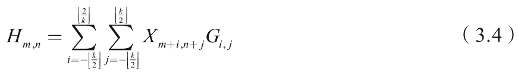

下面通过具体例子说明该过程。如图 3-3 所示，假设输入 `X` 为 `5×5` 矩阵，使用 `3×3` 卷积核进行卷积以获得输出。以 `X` 第 1 行第 1 列元素为中心计算对应结果，如公式 (3.5) 所示：

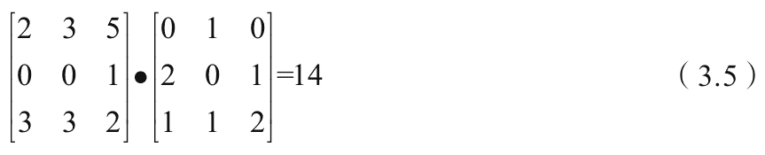

# 深度解析：卷积神经网络核心机制与架构演进

在传统图像处理领域，卷积核参数通常由人工经验设定；而步入深度学习阶段，这些参数变成了可学习的变量。借助第二章介绍的反向传播与优化算法，卷积核能够在训练过程中动态迭代更新，第 3.2 节将对此展开深度剖析。

正如 3.1 节所述，单个卷积核仅能捕捉输入的某种特定特征。为丰富特征表达，实践中常部署多个卷积核（记为 `G^(c')`），将输入分别与各核卷积后的结果拼接起来。以位于 `X[m, n]` 中心的局部区域为例，卷积运算输出向量 `H[m, n] = [H[m, n, 0], H[m, n, 1], …, H[m, n, C'-1]]`，每个分量对应一个卷积核的计算结果。拼接后，卷积核本质上形成一个三维张量 `G ∈ R^(k×k×C')`，输出则为 `H ∈ R^(H'×W'×C')`，我们习惯称这层卷积输出为**特征图**。

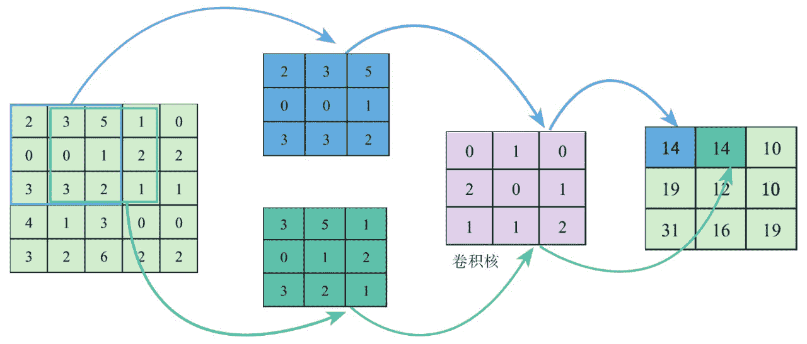

**图 3-3 单通道卷积示意图**

观察图 3-3 可知，卷积后特征图尺寸缩小，根源在于输入边界限制了卷积核的滑动起始位置。这引发两大痛点：
- 随网络加深，连续卷积导致特征图尺寸急剧收缩；
- 边缘像素参与运算次数远少于中心像素（边缘仅一次，中心多次），造成边缘信息严重流失。

主流解法是**填充** 零值（`padding`），使边缘像素也能参与完整计算，从而维持输入输出尺寸一致。填充量 `P` 即外围补零圈数。例如 `padding=1` 即在输入外围包裹一圈零（见 Figure 3-4a），实际输入尺寸变为 `(W+2, H+2)`；一般情况下 `padding=p` 时，尺寸扩展为 `(W+2P, H+2P)`。

要保持卷积后特征图与原始输入高宽一致，需填充多少零值？这取决于卷积核形状。对于 `k×k` 的方形核，只需设 `P = k/2` 即可实现等尺寸映射。

输出特征图大小不仅受 `padding` 影响，还取决于卷积采样策略。上述讨论的是标准卷积（全位置遍历计算）。若采用间隔采样，即每隔几个位置计算一次，这个间隔称为**步长**（`stride`）。Figure 3-4b 即展示了步长为 2 的卷积示意。

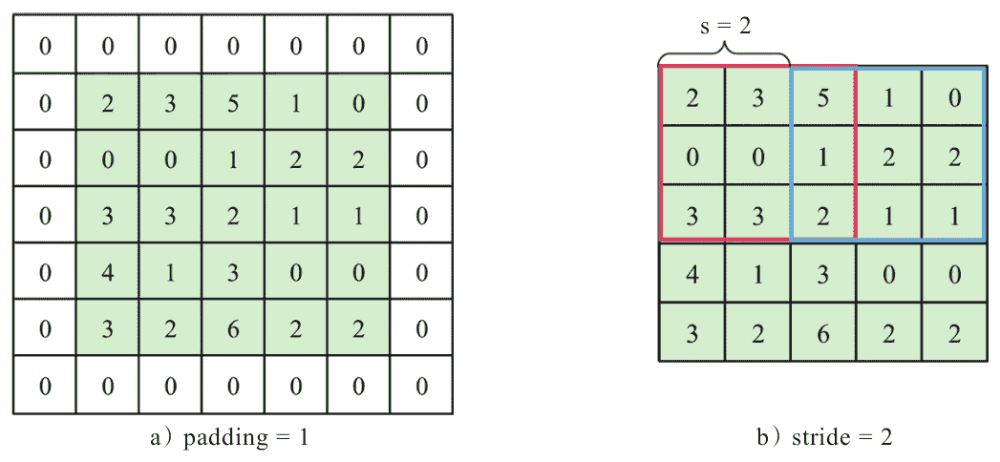

**图 3-4 `Padding` 与 `Stride` 示意图**

#### 2. 多通道卷积

前节覆盖单通道场景，推广至多通道自然形成多通道卷积。假设输入 `X ∈ R^(H×W×C)`，`C` 为通道数。卷积核空间维度为 `k×k`，针对每个输入通道分配一个同尺寸核，这些核堆叠成 `G^(c') ∈ R^(k×k×C)`。多通道卷积的数学定义见公式 (3.6)：

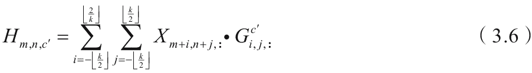

其中 `G^(c')[:, :, c]` 表示第 `c'` 个卷积核在第 `c` 个输入通道上的权重。

Figure 3-5 直观呈现了该过程：可视为一个三维卷积核在输入体上滑动。关键点在于**输入与卷积核深度（通道数）严格对齐**，因此核仅在高宽二维平面移动——这正是“二维卷积”名称的由来，尽管滤波器本身是三维的。每个滑动位置通过张量点积得到特征图上对应位置的单一数值，最终输出单通道特征图。

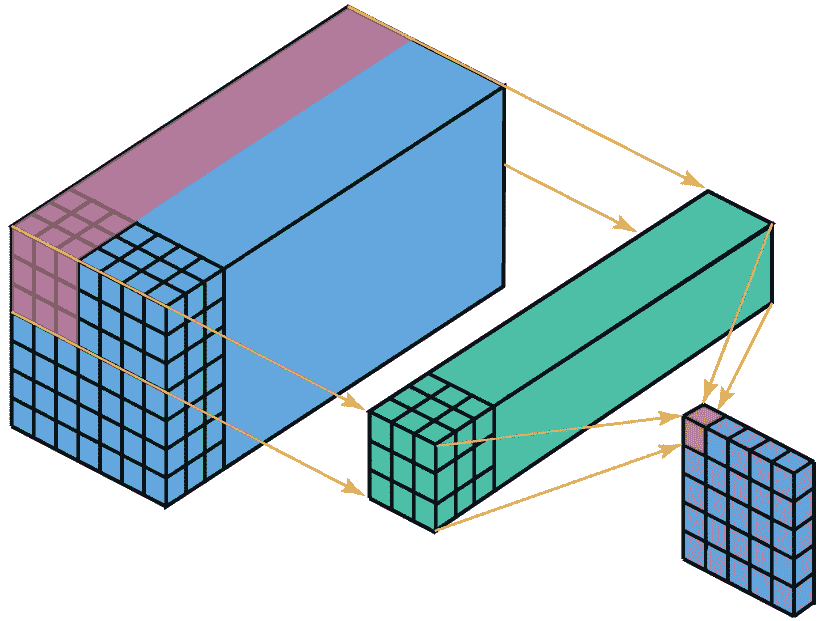

**图 3-5 多通道卷积过程示意**

同单通道逻辑，多通道亦通过堆叠多个卷积核（`C'` 个）提取多维特征。此时卷积核张量维度升为 `R^(k×k×C×C')`，将输入与各核计算结果拼接，得到多通道输出 `H ∈ R^(H'×W'×C')`。

### 卷积神经网络完整流程

卷积运算后，通常对每张特征图加入偏置项（公式 3.7）：

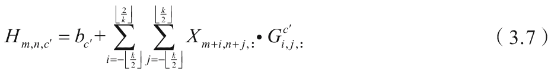

以上即构成深度学习中卷积操作的全貌。总结一下：输入 `H∈R^(H×W×C)`，经卷积核 `R^(k×k×C×C')` 运算并加偏置，输出 `H∈R^(H'×W'×C')`。此过程引入的可学习参数包含核权重与偏置，总量计算为：`k²×C×C' + C'`。

在单通道卷积中我们已分析核尺寸、填充、步长对输出尺寸的影响。设输入 `H×W×C`，核大小 `k`，填充 `p`，步长 `s`，输出 `H'×W'×C'`，其尺寸关系由公式 (3.8) 给出（`W'` 同理）：

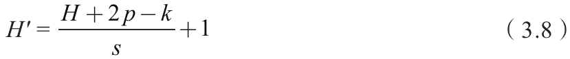

### 3.1.3 池化操作

池化层的核心使命是**降维压缩算力**，并在训练初期赋予模型一定的**平移不变性**。主流手段为平均池化与最大池化。

池化采用固定窗口在输入上滑动，将窗口内元素聚合为单一值输出。聚合方式不同，分为平均池化与最大池化，流程对比见图 3-6。

窗口大小 `k`（假设为正方 `k×k`）与步长 `s` 共同决定输出规模。常规配置为 `k=2×2` 且 `s=2`（步长等于窗口）。对多通道输入，池化逐通道独立进行，**通道数不变**。输入 `X∈R^(H×W×C)` 经标准池化后输出 `R^(H/2×W/2×C)`，高宽减半。任意窗口与步长组合下，输出尺寸仍可套用公式 (3.8) 计算。

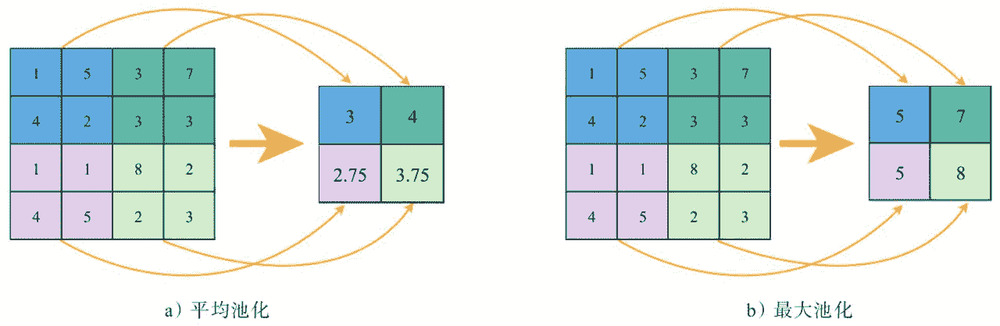

**图 3-6 平均池化与最大池化流程示意**

## 3.2 卷积神经网络架构

卷积神经网络（CNN）本质上是卷积层与池化层的级联堆叠。本节将通过经典案例拆解 CNN 架构，并阐述其核心特性与理解视角。

### 3.2.1 CNN 架构剖析：以 AlexNet 为例

选取 **AlexNet** 作为范式。该模型由深度学习泰斗 Hinton 及其门生 Alex Krizhevsky 设计，2012 年 ImageNet 大赛上以超越亚军 10% 以上的误差率夺冠，震惊学界，正式开启深度学习爆发纪元。AlexNet 可视为现代深度 CNN 的鼻祖，其里程碑式突破在于：**架构大幅加深、参数规模空前庞大**。

### AlexNet 架构深度拆解

AlexNet 由 5 个卷积层、2 个池化层以及 3 个全连接层构成。受限于当时的硬件算力，单块 GPU 难以承载如此规模的模型，因此作者将网络拆分为两路，分别在两块 GPU 上并行跑通。为便于讲解，此处将结构合并呈现（见 Figure 3-7），下面逐层解析细节。

- **输入端**：接收尺寸为 `224×224×3` 的图像。

- **Layer 1（卷积层）**：采用 `11×11` 大小的卷积核，输出 96 个特征图。输入通道数为 3，故卷积核张量维度为 `R^(11×11×3×96)`。步长 `stride=4`，填充 `padding=2`。依据公式 (3.8) 推导得公式 (3.9)，输出特征图尺寸为 `H¹∈R^(55×55×96)`。卷积后接 ReLU 激活。

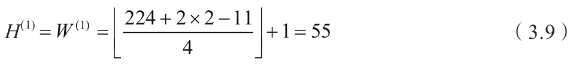

- **Layer 2（池化层）**：采用最大池化，窗口 `3×3`，步长 2。沿用卷积的尺寸计算逻辑：`(55–3)/2+1=27`。输出 `H²∈R^(27×27×96)`。

- **Layer 3（卷积层）**：卷积核缩小为 `5×5`，输出通道数增至 256，核张量维度 `R^(5×5×96×256)`。步长 `stride=1`，填充 `padding=2`。输出 `H³∈R^(27×27×256)`，同样后接 ReLU。

- **Layer 4（池化层）**：最大池化，窗口 `3×3`，步长 2。输出 `H⁴∈R^(13×13×256)`。

- **Layer 5 至 7（卷积层组）**：均为 `3×3` 卷积核，输出通道数依次为 384、384、256。步长 `stride=1`，填充 `padding=1`。最终 Layer 7 输出 `H⁷∈R^(13×13×256)`。每层卷积后均跟随 ReLU 激活。

- **Layer 8（池化层）**：最大池化，窗口 `3×3`，步长 2。输出 `H⁸∈R^(6×6×256)`。

- **最后三层（全连接层）**：将卷积输出 `H⁸∈R^(6×6×256)` 展平为 `R⁹²¹⁶` 维向量。三层全连接神经元数分别为 4096、4096、1000，最终得到 1000 维分类向量。


**Figure 3-7** AlexNet 网络架构示意图[³]

除架构设计外，AlexNet 还引入了两大关键创新：一是引入 ReLU 激活函数缓解梯度消散（详见第二章）；二是采用 Dropout 机制抑制过拟合。Dropout 在训练期随机将部分特征图置零，相当于丢弃部分信息，强迫模型依靠残余特征做出正确推断，从而学到更鲁棒、判别力更强的特征表示。

CNN 的整体架构通常可划分为两大模块：由卷积与池化交替堆叠形成的**骨干网络**，负责从输入中提取丰富特征；以及**全连接模块**，将卷积输出的特征图展平（丢弃空间位置信息），聚合全局语义并映射至输出空间（如 AlexNet 中的分类头）。后续改进网络均遵循此范式，3.4 节将详细展开。

[³]: 图片生成来源：https://github.com/HarisIqbal88/PlotNeuralNet.

### 3.2.2 卷积神经网络的三大核心特性

CNN 具备局部连接、权值共享、层级表征三大鲜明特质。

#### (1) 局部连接

图像数据天然具有局部相关性。卷积操作每次仅作用于卷积核覆盖的局部区域，实现输入与输出的局部连接。若改用多层感知机（MLP）处理图像，常规做法是将多维图像拉伸为向量。以 `224×224×3` 图像为例，展平后需 150,528 个输入神经元；若首隐层仅 32 个神经元，参数量即高达 480 万。参数爆炸带来算力压力与过拟合风险双重隐患。反之，若使用 `3×3` 卷积核、32 个输出通道，参数量不足 1,000，较 MLP 大幅精简。

卷积机制与生物视觉系统颇为神似。神经元通常仅对特定区域的刺激产生响应——视网膜接收光信号传至视皮层时，仅部分皮层神经元被激活，这一机制称为**局部感受野**。卷积亦同理：两层连续的 `3×3` 卷积，其输出仅与输入侧 `5×5` 区域相关（Figure 3-8）。该关联区域即为感受野，指特征图上某输出点对应的输入有效区域。深层 CNN 中，有效感受野往往小于理论计算值。


**Figure 3-8** 感受野示意图

#### (2) 权值共享

卷积的第二大特性是权值共享。同一卷积核在图像不同位置滑动时复用参数。这不仅大幅压缩参数量，更赋予了模型**平移不变性**——无论输入如何平移，相同模式经卷积核处理后输出一致。例如识别左右眼，同一卷积核在对应区域卷积产出相同响应，即得益于权值共享。池化层（如最大池化）同样贡献了平移不变性：感受野内取最大值聚合，输入微小位移不改变输出。

#### (3) 层级表征

CNN 通过层层堆叠实现**层级化特征学习**。每层卷积在上层特征基础上变换，抽象程度逐级递增。如 Figure 3-9 所示：浅层卷积提取颜色、边缘、角点等低级特征，感受野小，对应局部细节；中层形成纹理结构等中级特征；深层则提取语义级、物体级的高级特征，感受野大，表征全局信息。高级特征构建于低级特征之上。通常低级特征通用性强，高级特征则与具体任务强相关。


**Figure 3-9** 层级表征示意图[⁴]

## 3.3 卷积的特殊变体

除 3.1 节介绍的标准卷积外，针对不同任务衍生出多种变体。本节梳理几种常见形式。

### 3.3.1 1×1 卷积

顾名思义，卷积核尺寸为 `1×1`。该形式最早见于文献[⁵]，后被众多经典模型采纳。Figure 3-10 演示了其计算流程，本质上与标准卷积无异，仅核尺寸退化为单点。

读者或许会疑惑：1×1 卷积究竟有何用处？它主要扮演两大角色：其一是**跨通道信息融合并引入非线性**。从本质上看，1×1 卷积对所有通道的信息进行线性加权组合，实现了特征聚合；若在其后接入非线性激活函数，便能在一定程度上增强模型的表达能力。其二是**调节通道维度**，可灵活扩增或压缩输出特征图的通道数。


**图 3-10** 1×1 卷积示意图

### 3.3.2 转置卷积

转置卷积[⁶]是语义分割任务中不可或缺的核心模块。语义分割的目标是对图像进行像素级分类——同一类别的像素通常对应同一实例，如图 3-11 所示，行人像素归为一类，鹿的像素归为另一类。


**图 3-11** 语义分割示例[⁷]

基于 CNN 的语义分割网络通常由编码器与解码器两部分构成：编码器将原始图像映射至低维特征空间，需同时保留目标的特征与位置信息，以便精准预测每个像素位置的类别；解码器则负责将压缩的低维特征还原至像素空间，逐点判定类别。常规卷积无法胜任解码器工作，因其无法扩大特征图的高宽尺寸。转置卷积恰好相反，它能逐步放大高宽维度，将编码后的低维特征“上采样”回像素空间。

以图 3-12(a) 为例，假设输入为 `2×2`、卷积核为 `3×3`，转置卷积等效于在输入周围填充两圈零值，再执行标准卷积，最终得到 `4×4` 的输出。转置卷积同样支持 `padding` 与 `stride` 设置，但含义与标准卷积略有差异：对于步长 `s`、核大小 `k` 的转置卷积，默认在输入四周填充 `k–1` 层零；设定的 `padding` 值 `p` 会修正最终填充量，公式为 `k–1–p`；步长 `s` 则会在卷积元素间插入 `s–1` 个零（见图 3-12(b)）。若输入 `2×2`、`p=0`、`s=2`，卷积后输出尺寸变为 `5×5`。


**图 3-12** 转置卷积示例

转置卷积的输入尺寸、核大小、填充、步长与输出尺寸之间的数学关系，可由公式 (3.10) 确定：


[⁷]: 图片来源 https://ccvl.jhu.edu/datasets/.

### 3.3.3 空洞卷积

空洞卷积[⁸]（Dilated Convolution）通过在卷积核元素间插入间隙来“膨胀”核的感受野。一个名为膨胀率 `r` 的超参数控制扩张程度，具体表现为在核元素间插入 `r–1` 个零。因此，原本大小为 `k` 的卷积核，在空洞卷积下的实际覆盖范围变为 `k+(k–1)(r–1)`。得益于核的扩张，感受野随之扩大。这使得空洞卷积成为**在不增加参数量的前提下，快速扩大感受野的有效手段**。


**图 3-13** 空洞卷积核示意

以 `k=3` 为例，当膨胀率 `r` 分别为 2 和 3 时，实际核尺寸分别达到 5 和 7（见图 3-13）。对于同一 `3×3` 的输出区域，三种设置下的感受野大小对比如下：

- `r=1` 时，感受野为 3。
- `r=2` 时，感受野扩至 7。
- `r=3` 时，感受野达 11。

堆叠多层空洞卷积，感受野将呈指数级增长，从而捕获更广泛的局部上下文信息。

### 3.3.4 分组卷积

分组卷积最早现身于 AlexNet。受限于当时单张 GPU 显存不足以承载 AlexNet 全部卷积运算，作者将特征图沿通道维度拆分至多张 GPU 并行计算，最后融合结果——这便是分组卷积的雏形。下面通过实例解析其机制。

如图 3-14 所示，输入特征图在深度维度被切分为 `g` 组，每组含 `C₁/g` 个通道；输出通道同理分为 `g` 组，每组 `C₂/g` 个。输入组与输出组一一对应，各自独立完成卷积运算。这意味着单组卷积所需核张量维度为 `R^(k×k×C₁/g×C₂/g)`：核深度由 `C₁` 降为 `C₁/g`，核数量由 `C₂` 降为 `C₂/g`。各组并行计算后，将结果在通道维拼接，最终输出通道数仍为 `C₂`。简而言之，分组卷积将标准卷积拆解为 `g` 个独立的小卷积并行执行，参数量降为原来的 `1/g`（即 `k²×C₁×C₂/g`）。


**图 3-14** 分组卷积处理流程

### 3.3.5 深度可分离卷积

深度可分离卷积由两部分串联构成[⁹]：**逐通道深度卷积** 与 **1×1 点卷积**。深度卷积是分组卷积的极端情况（`g=C₁=C₂`），相当于为每个输入通道单独分配一个卷积核。由于此操作仅利用单通道内的空间位置信息，未建模通道间关联，因此通常紧随 1×1 卷积以融合跨通道信息。

与标准卷积相比，深度可分离卷积**大幅削减参数量与计算量，显著提升推理效率**。故而它成为追求轻量化、高速度的卷积网络设计首选，广泛应用于 MobileNet[¹⁰]、ShuffleNet[¹¹] 等经典模型中。

## 3.4 卷积网络在图像分类中的演进与应用

短短数载，深度学习在计算机视觉领域硕果累累。图像分类模型迭代飞速，从 AlexNet 到 VGG，从 GoogleNet v1 迭代至 v4，继而 ResNet、DenseNet 等接力刷新纪录。本节将剖析几个里程碑式的分类框架。

### 3.4.1 VGG

牛津大学视觉几何组于 2014 年提出 VGG[¹²]，在 ImageNet 2014 挑战赛中斩获分类亚军、定位冠军。

VGG 在 AlexNet 基础上做出关键改良：核心在于**全面采用 `3×3` 小卷积核且步长为 1**。两层 `3×3` 卷积串联的感受野等效于 `5×5`，却能用更少参数量实现；同时摒弃了 LRN（局部响应归一化）层，实验证明其增益微乎其微。VGG 的另一结构特征是**通过重复堆叠简单的卷积块构建深层网络**——基础块由两层或多层卷积加一层池化组成，结构极简却极具扩展性。

VGG 系列常用的有两个版本：VGG16 与 VGG19。二者的区别仅在于部分基础模块中卷积层的数量差异。VGG16 的网络架构如图 3-15 所示。得益于结构简洁且表现优异，VGG 至今仍常被选作其他任务的骨干网络。


**图 3-15** VGG16 网络架构图

### 3.4.2 Inception 系列

ImageNet 2014 分类任务的冠军由 Google 提出的 GoogleNet 夺得，其核心在于 Inception 模块。与 VGG 的顺序堆叠模式不同，Inception 采用了多路并行、多尺度卷积核的设计理念。该结构经过多轮迭代，衍生出多个版本。

#### 1. Inception V1

Inception V1[¹³] 首创并行架构。如图 3-16 所示，单个模块内部融合了多种尺寸的卷积核，打破了传统网络“单层单核”的固有模式。这种设计使得模块能同时捕获不同类型的特征，且因感受野各异，可实现多尺度特征的提取与拼接。

若直接引入多尺度卷积核，会导致参数量与算力激增。为缓解此问题，改进方案在 `3×3` 与 `5×5` 卷积前插入 `1×1` 卷积压缩输入通道，池化层后也接 `1×1` 卷积降维。优化后的模块结构见图 3-17。对比参数量变化（忽略偏置，按图 3-17 通道数设定），未优化前的参数量（公式 3.11）是优化后（公式 3.12）的 2.3 倍。此外，原结构池化层输出通道数等于输入，拼接后通道数会剧增，优化版有效抑制了这一问题。


**图 3-16** 初始 Inception 模块

GoogleNet 通过堆叠 Inception 模块构建而成。此外，为缓解梯度消失，网络中间还接入了辅助分类器。

#### 2. Inception V2

Inception V2[¹⁴] 的核心改进聚焦于卷积核设计：将大尺寸卷积分解为更小的组合，从而在减少参数量与计算复杂度的同时保持性能。


**图 3-17** 改进型 Inception V1 模块

[¹]: [^(\[1\])](../Text/chapter45.xhtml#cc-1)

[²]: [^(\[2\])](../Text/chapter45.xhtml#cc-2)

[⁴]: [^(\[3\])](../Text/chapter45.xhtml#cc-3)

[⁵]: [^(\[4\])](../Text/chapter45.xhtml#cc-4)

[⁶]: [^(\[5\])](../Text/chapter45.xhtml#cc-5)

[⁸]: [^(\[6\])](../Text/chapter45.xhtml#cc-6)

[⁹]: [^(\[7\])](../Text/chapter45.xhtml#cc-7)

[¹⁰]: [^(\[8\])](../Text/chapter45.xhtml#cc-8)

[¹¹]: [^(\[9\])](../Text/chapter45.xhtml#cc-9)

[¹²]: [^(\[10\])](../Text/chapter45.xhtml#cc-10)

[¹³]: [^(\[11\])](../Text/chapter45.xhtml#cc-11)

[¹⁴]: [^(\[12\])](../Text/chapter45.xhtml#cc-12)

### 3.4.3 ResNet

残差网络的提出，是深度学习史上又一里程碑。它在 ILSVRC 2015 与 COCO 2015 上大放异彩，再次刷新 ImageNet 纪录，首次将可训练网络深度推至百层级别，深刻影响了后续架构设计，堪称当前最主流的网络范式之一。

网络深度对性能至关重要。理论上层数越多，特征表达越复杂，效果应越好。然而实验表明（图 3-19），加深网络反而导致训练集准确率下降：56 层网络在训练集和测试集上均不如 20 层网络。这非过拟合所致，而是**退化问题**，本质源于优化困难。


图 3-19 CIFAR-10 上 20 层与 56 层网络的错误率对比 [¹]

ResNet 通过结构创新破解难题：在模块输入输出间建立直连通路，即**跳跃连接**。典型残差块如图 3-20 所示。

设输入为 `H[i-1]`，输出为 `H[i]`，卷积等变换记为 `F`，则输入输出关系满足公式 (3.13)：


图 3-20 `ResNet` 网络模型示意

跳跃连接让信息流动更顺畅，体现在两方面：前向传播时，输入特征与输出直接融合，利用率更高；反向传播时，梯度可经短路直达浅层，有效缓解**梯度消失**。

进一步研究[¹⁴]揭示，深层残差网络可视为浅层网络集成；研究[¹⁵]指出，跳跃连接使损失函数曲面更平滑（图 3-21），优化更容易，泛化性能更优。


图 3-21 带跳跃连接结构的损失地貌 [²]

基于残差思想，衍生出诸多改进模型，如将跳跃连接推向极致的 `DenseNet`[¹⁶]，以及融合残差结构的 `Inception-ResNet`[¹⁷]。

[¹³]: He K, Zhang X, Ren S, et al. Deep residual learning for image recognition [C] // Proceedings of the IEEE conference on computer vision and pattern recognition. 2016: 770-778.

[¹⁴]: Veit A, Wilber M J, Belongie S. Residual networks behave like ensembles of relatively shallow networks [C] // Advances in neural information processing systems. 2016: 550-558.

[¹⁵]: Li H, Xu Z, Taylor G, et al [C] // Advances in Neural Information Processing Systems. 2018: 6389-6399.

[¹⁶]: Huang G, Liu Z, Van Der Maaten L, et al. Densely connected convolutional networks [C] // Proceedings of the IEEE conference on computer vision and pattern recognition. 2017: 4700-4708.

[¹⁷]: Szegedy C, Ioffe S, Vanhoucke V, et al. Inception-v4, inception-resnet and the impact of residual connections on learning [C] // Thirty-First AAAI Conference on Artificial Intelligence. 2017.

## 3.5 参考文献

[1] Ruderman A, Rabinowitz N C, Morcos A S, et al. Pooling is neither necessary nor sufficient for appropriate deformation stability in CNNs [J]. arXiv preprint arXiv: 1804.04438, 2018.

[2] Krizhevsky A, Sutskever I, Hinton G E. Imagenet classification with deep convolutional neural networks [C] // Advances in neural information processing systems. 2012: 1097-1105.

[3] Zeiler M D, Fergus R. Visualizing and understanding convolutional networks [C] // European conference on computer vision. Springer, Cham, 2014: 818-833.

[4] Lin M, Chen Q, Yan S. Network in network [J]. arXiv preprint arXiv: 1312.4400, 2013.

[5] Zeiler M D, Krishnan D, Taylor G W, et al. Deconvolutional networks [C] // 2010 IEEE Computer Society Conference on computer vision and pattern recognition. IEEE, 2010: 2528-2535.

[6] Yu F, Koltun V. Multi-scale context aggregation by dilated convolutions [J]. arXiv preprint arXiv: 1511.07122, 2015.

[7] Chollet F. Xception: Deep learning with depthwise separable convolutions, arXiv preprint (2016) [J]. arXiv preprint arXiv: 1610.02357, 2016.

[8] Howard A G, Zhu M, Chen B, et al. Mobilenets: Efficient convolutional neural networks for mobile vision applications [J]. arXiv preprint arXiv: 1704.04861, 2017.

[9] Zhang X, Zhou X, Lin M, et al. Shufflenet: An extremely efficient convolutional neural network for mobile devices [C] // Proceedings of the IEEE Conference on Computer Vision and Pattern Recognition. 2018: 6848-6856.

[10] Simonyan K, Zisserman A. Very deep convolutional networks for large-scale image recognition [J]. arXiv preprint arXiv: 1409.1556, 2014.

[11] Szegedy C, Liu W, Jia Y, et al. Going deeper with convolutions [C] // Proceedings of the IEEE conference on computer vision and pattern recognition. 2015: 1-9.

[12] Szegedy C, Vanhoucke V, Ioffe S, et al. Rethinking the inception architecture for computer vision [C] // Proceedings of the IEEE conference on computer vision and pattern recognition. 2016: 2818-2826.

[13] He K, Zhang X, Ren S, et al. Deep residual learning for image recognition [C] // Proceedings of the IEEE conference on computer vision and pattern recognition. 2016: 770-778.

[14] Veit A, Wilber M J, Belongie S. Residual networks behave like ensembles of relatively shallow networks [C] // Advances in neural information processing systems. 2016: 550-558.

[15] Li H, Xu Z, Taylor G, et al [C] // Advances in Neural Information Processing Systems. 2018: 6389-6399.

[16] Huang G, Liu Z, Van Der Maaten L, et al. Densely connected convolutional networks [C] // Proceedings of the IEEE conference on computer vision and pattern recognition. 2017: 4700-4708.

[17] Szegedy C, Ioffe S, Vanhoucke V, et al. Inception-v4, inception-resnet and the impact of residual connections on learning [C] // Thirty-First AAAI Conference on Artificial Intelligence. 2017.

# Chapter 4 表征学习

究竟什么是表征？通俗来说，它就是特征。正如第二章所述，机器学习流程的起点是从数据中提取特征，提取质量的高低直接决定了模型的最终表现。如果有一类方法能从数据中自动习得“有用”的特征，并直接服务于下游任务，这类方法统称为**表征学习**。

## 4.1 表征学习

### 4.1.1 表征学习的价值所在

机器学习算法的效能高度依赖数据特征。因此，在传统机器学习范式中，大量精力耗费在数据处理与特征构造上，旨在获取优质特征以提升算法效果。这种**特征工程**极其耗时费力，同时也暴露了传统方法的短板：它们缺乏从数据中自主获取知识的能力，特征工程的本质是将人类先验知识转化为算法可识别的特征，以此弥补自身不足。

若存在一种从数据中自动获取判别性特征的方法，便能降低算法对人工特征工程的依赖，从而更快、更好地将机器学习推广至更广阔领域——这正是表征学习的核心价值。围绕表征学习，需解答三个关键问题：

1.  如何判定一种表征优于另一种？
2.  如何发掘这些表征？
3.  应采用何种目标函数以获得优质表征？

何为优质表征？并无固定标准。一般而言，优质表征应最大程度保留数据的本质信息，且能直接适配后续任务。计算机的“视觉”与人类截然不同：计算机看到的是像素点等原始数据，单凭这些低级信息难有作为；人类则依赖高层语义特征理解图像。两者之间的鸿沟称为**语义鸿沟**，即低级特征与高级抽象特征的错位，如图 4-1 所示。优质表征需致力于描述高层语义，以便后续模型高效利用，减轻其负担；若直接输入原始数据或低级特征，模型将难以运行。因此，优质表征的关键在于缩小语义鸿沟，提供高价值的高层特征。


图 4-1 语义鸿沟示意图

### 4.1.2 离散表征与分布式表征

机器学习中表示对象常见的有两种路径。最简单、无需学习的是**独热编码**（`one-hot`）。它将对象映射为仅在单一维度取值为 1、其余全为 0 的向量。向量长度等于类别总数。例如用此法向量化汉字，若共 N 字，每字需 N 维向量，覆盖全字集需 N×N 矩阵。自然语言处理（NLP）中的**词袋模型**即构建于此。

**分布式表征**[¹]则另辟蹊径：通过某种机制，用低维稠密向量刻画对象。最典型的例子是颜色。任意颜色皆可由三基色（红黄蓝，或计算机中的 RGB）混合得出，计算机常用 `RGB` 三元组表示。`RGB` 色彩空间如图 4-2 所示。粉红、浅粉红、深粉红对应的 `RGB` 值分别为 `(255, 182, 193)`、`(255, 192, 203)`、`(255, 20, 147)`。若改用独热编码，256 级 `RGB` 下约有 1677 万种颜色（`256³`），向量维度将达 16,777,216，且仅一处为 1，数据极度高维稀疏。


图 4-2 色彩空间

独热编码虽简便（仅需列举所有可能值，无需学习），但缺陷显著：它预设所有对象相互独立。向量空间中任意两向量正交，相似度恒为 0，暗示对象间毫无关联。现实并非如此。例如粉红与浅粉红同属粉色系，相似度理应高于粉红与黑色，但独热编码无法体现，丢失了大量语义信息。加之独热向量维度极高、极度稀疏，难以直接应用。

分布式表征则展现出了优异的特性。首先，其维度可极度压缩——仅用三个维度便能编码 1678 万种色彩，从根本上缓解了数据稀疏的难题。其次，它能保留语义关联。以颜色为例，粉色与浅粉、深粉的余弦相似度分别高达 99.97% 和 89.39%，而与黑色（RGB 0,0,0）的相似度则为 0。这种表现与人类直觉高度吻合，证明分布式表征能内嵌语义特征，因此在众多领域得到广泛应用。

[¹]: 参考链接：../Text/chapter55.xhtml#dd-1

### 4.1.3 端到端学习：强大的表征学习范式

深度学习模型与传统机器学习模型截然不同。以图像分类为例，传统流程需人工提取描述性特征（如 SIFT 特征，即前述的特征工程），再送入分类器；模型上限很大程度上取决于特征质量。卷积神经网络（CNN）打破了这一局面。以 AlexNet 为例，它直接吞吐原始图像而非手工特征，直接输出预测类别，这种范式称为 **端到端学习**。可这样理解：卷积网络前段自动完成特征提取，后段接入分类器；即前段实质上在做表征学习。端到端学习可视为表征学习与任务学习的融合，但二者并非割裂，而是 **联合优化**。反向传播将误差从输出层传回输入层，优化算法动态调参，使模型自动挖掘对任务有判别力的特征，彰显了深度学习相较他法的优势。

深度模型的另一长处是能学习数据的层级化表征，这也是优良表征应具备的素质。正如 3.2 节所述，CNN 不同深度的层提取不同层级特征：浅层卷积捕捉低级特征，深层卷积抽象出任务相关的高级语义。深度模型由可训练层堆叠而成，逐层将输入变换为更抽象的特征。低层变换产出基础特征，支撑高层抽象特征的形成，这仿佛字、句、篇的关系：字成词，词成句，句成篇。故低级特征通用性强（general feature），高级特征则面向具体任务。迁移学习正是建立在此特性之上——将已习得的知识迁移至新问题。典型做法是微调：以他集预训练模型为基座，在新数据上进一步调整。如视觉任务常用 ImageNet 预训练模型，冻结提取通用特征的卷积层（不更新梯度），仅修改高层结构（如调整输出层维度以适配不同类别数），再用新数据微调。

表征学习的目标通常是学习映射 $f: X \to R^d$，将输入投射到稠密低维向量空间。接下来两节将介绍两类典型方法：基于重构损失与基于对比损失。

## 4.2 基于重构损失的方法——自编码器

深度学习的核心优势在于自动特征学习。CNN 借助图像标签监督，学习分类用的判别性特征，将表征学习与任务学习合二为一，属监督学习。自编码器虽也是表征学习模型，却不依赖标签，而是以输入数据自身为监督信号，属无监督学习，可用于降维与特征提取。

### 4.2.1 自编码器

自编码器是基于深度模型的典型表征学习手段。思路极简：将输入映射至特征空间，再从该空间解码重构回输入空间。结构上由编码器与解码器组成：编码器从输入抽取特征，解码器据此重构输入。训练完成后，编码器即作为特征提取器使用。这种 “编码-解码” 思想贯穿许多深度模型。

最简自编码器含 3 层：输入层、隐藏层、输出层（见图 4-3）。输入层到隐藏层输出为编码器，隐藏层输出到输出层为解码器。给定输入 $x \in R^n$，设输入到隐层的变换矩阵为 $W_{enc} \in R^{d \times n}$（$d$ 为隐层神经元数），编码过程见式 (4.1)，编码特征为 $h \in R^d$。解码器将 $h$ 映射回输入空间得重构值 $\hat{x}$，设隐层到输出层矩阵为 $W_{dec} \in R^{n \times d}$，见式 (4.2)：


自编码器无需标签监督，通过最小化输入输出重构误差训练。依据损失函数 (4.3)，经反向传播求梯度，再用梯度下降持续优化参数 $W_{enc}, W_{dec}, b_{enc}, b_{dec}$。


自编码器结构不限于单隐层全连接网络。一般而言，编码器与解码器可为更复杂模型，分别记为 $f$ 与 $g$，损失函数可写作式 (4.4)，$N$ 为样本数。


图 4-3 自编码器结构示意图

我们期望通过训练编码器获得数据的有用特征。最常用的手段是限制隐层维度 $d$ 小于输入维度 $n$（即 $d < n$），此称欠完备自编码器。特定条件下，其效果近似主成分分析（PCA）；引入非线性编解码器则能获得更强表达力。

### 4.2.2 正则化自编码器

### 当维度不再受限：过完备自编码器与正则化家族

如果放宽编码器维度的限制，允许其大于或等于输入维度（即 $d \ge n$），模型就进化成了**过完备自编码器**。但这并非免费的午餐：若缺乏约束，强大的编解码能力会让模型走“捷径”——直接复制输入到输出，而非提取特征。问题的核心不在于维度变了，而在于模型“能力过剩”导致的偷懒。为此，我们必须引入正则化手段，逼迫模型学到真本事。下面盘点几位“正则化家族”的核心成员。


#### 1. 去噪自编码器：在混乱中重建秩序

区别于标准版自编码器，去噪自编码器（DAE）的改良思路极具巧思：它在原始输入上**人为加噪**，让编码器吞下带噪版本 $x_{\delta}$，却强要求解码器还原干净的原始输入 $x$。

这一招“庖丁解牛”式的操作，直接堵死了模型学习恒等映射的退路。编码器被迫从噪声中分辨信号、捕捉数据的内在结构，才能完成复原任务。具体实操上，常采用随机置零策略破坏输入，损失函数依然锚定在重构无噪数据上：


#### 2. 稀疏自编码器：逼迫神经元“懒惰”出特征

除了动输入手脚，我们还能从损失函数下手。假设隐藏层用 Sigmoid 激活，输出接近 1 视为“激活”，接近 0 则“静默”。稀疏自编码器（SAE）的核心逻辑是：**强迫大多数神经元保持“静默”，仅让极少数关键神经元响应特定模式。**

量化上，我们定义神经元平均激活度 $\hat{\rho}_i$，并设定一个极小的目标稀疏度超参数 $\rho$（接近 0）。通过惩罚 $\hat{\rho}_i$ 与 $\rho$ 的偏离，迫使模型学到稀疏表达。此处选用 KL 散度（相对熵）作为惩罚项，它能精准度量两个分布的差异——分布越异，值越大；完全重合则为 0。


加入稀疏惩罚后，总损失函数变身为重构误差与稀疏正则的加权和：


其中 $\lambda$ 负责平衡“还原保真度”与“特征稀疏性”这对矛盾。

---

### 4.2.3 变分自编码器：从“压缩”到“生成”的范式跃迁

变分自编码器（VAE）不是传统自编码器的改良版，而是**彻底的生成模型**。它不满足于压缩重构，野心在于建模数据分布 $P(X)$，进而实现**从无到有地生成新样本**。本节将拆解其核心原理，并与传统范式划清界限。

#### 1. VAE 的生成逻辑：隐变量与证据下界

**生成故事的主角是隐变量 $z$**。以手写数字为例，生成一张图受“写哪个数字”、“笔画粗细”、“倾斜角度”等因子控制，这些就是 $z$ 的分量。假设 $z \sim p(z)$，存在生成函数 $f(z; \theta)$ 将 $z$ 映射为似真样本 $x$，即最大化 $p(x|z)$。边缘似然 $p(x)$ 需对所有可能的 $z$ 积分求和：


两大难点随之而来：$z$ 怎么选？积分怎么算？

VAE 给出的标准答案是：**让 $z$ 服从标准正态分布 $N(0, I)$，且各维度独立易采样**；$p(x|z)$ 也设为高斯分布，均值由神经网络 $f(z; \theta)$ 输出，方差 $\sigma^2 I$ 固定为超参数。


**为什么这合理？** 理论上，任意复杂分布皆可由标准正态分布经非线性变换得到。只要网络表达力足强，$z$ 就能被“扭”成模型需要的任何潜在因子。

但现实骨感：绝大多数 $z$ 采样出的 $p(x|z) \approx 0$，对估计 $p(x)$ 毫无贡献。我们需要找到那些**高概率生成真实样本的 $z$**。若知后验 $p(z|x)$，即可由 $x$ 反推 $z$。VAE 引入变分分布 $q(z|x)$ 逼近真后验，随即推导两者的 KL 散度：


利用贝叶斯公式展开并整理，得到 VAE 的灵魂公式——**证据下界（ELBO）**：


看清公式右侧的两项：
1.  **重构项**：$E_{z \sim q}[\log p(x|z)]$。本质是解码器，输入 $x$ 推断 $z$ 再重构，最大化似然等价于**最小化重构误差**（注意梯度下降需取负）。
2.  **正则项**：$D_{KL}[q(z|x) \| p(z)]$。强迫近似后验 $q(z|x)$ 贴近先验 $p(z)=N(0,I)$，防止隐空间崩塌、保证生成连续性。

**具体落地时**：
- $q(z|x)$ 设为对角协方差高斯分布，均值与方差由编码器网络输出；
- 重构项化为均方误差（或交叉熵）；
- KL 项因共轭性有解析解，极易计算。


基于此，VAE 标志性的“编码器输出分布参数 $\to$ 重参数化采样 $z \to$ 解码器生成 $\hat{x}$”架构呼之欲出：


**图 4-4 变分自编码器架构示意图**

### 解决采样不可导难题：重参数化技巧

还有一个棘手问题：潜变量 `z` 是通过采样获得的，但采样操作本身不可导，会阻断反向传播。为此，我们引入**重参数化技巧**来破局。具体做法是：先从标准正态分布 `N(0, I)` 中采样噪声 `ε`，再通过确定性运算 `z = ε * σ(x) + μ(x)` 来得到 `z`。如此一来，随机性被剥离到 `ε` 上，`z` 关于参数的梯度便能顺利回传。

#### 2. VAE 与传统自编码器的本质区别

乍看结构与损失函数，变分自编码器（VAE）与传统自编码器（AE）颇为神似，实则内核截然不同。

*   **定位不同**：早期的自编码器本质是**无监督表征学习**工具；而 VAE 的核心身份是**生成模型**。
*   **解码器用法不同**：虽然 AE 也有解码器，但我们无法随意喂入一个隐层向量就指望得到有意义的输出。原因在于 AE 的潜在空间是**离散、稀疏**的——它仅包含训练样本编码后的孤立点。对于从未“见过”的隐向量区域，解码器自然无法给出合理重构。
*   **VAE 的优势**：VAE 的出发点是建模数据分布 `p(x)`。训练完成后，**单独拿解码器即可直接生成新样本**，这得益于其构建的连续、平滑的潜在空间。

---

### 4.3 基于对比损失的方法——Word2vec

在自然语言处理中，词的表示至关重要。Word2vec 横空出世前，One-hot、词袋模型、共现矩阵等传统手段，无一例外地深陷**维度灾难**与**稀疏性**的泥沼。Word2vec 将词映射到低维稠密向量空间，让语义相近的词在几何距离上靠拢，一举化解了上述顽疾。本节将从对比损失的视角，推导 Skip-gram 模型的来龙去脉。

#### Word2vec 核心模型——Skip-gram

Word2vec 由 Tomas Mikolov 于 2013 年提出，核心信条是**“上下文定义词义”**。由此衍生出两条建模路径：CBOW（根据上下文预测中心词）与 Skip-gram（根据中心词预测上下文）。下文以 Skip-gram 为例展开。

**1. 问题建模与样本构造**

给定语料序列 `C={w_1, ..., w_N}`，词表 `V`。设窗口大小为 `2m+1`，Skip-gram 的目标是：给定中心词 `w_c`，最大化其真实上下文词出现的概率。

以图 4-5 为例，设 `m=2`，中心词为“网络”，其上下文为 {“图”, “神经”, “有”, “非常”}。我们可构造如下样本对：
*   **正样本 `D`**：中心词与真实上下文词组成的对，如 (`图`, `网络`), (`神经`, `网络`)……
*   **负样本 `D'`**：中心词与非上下文词组成的对，如 (`网络`, `应用`)。


*图 4-5 正负样本示意图*

**2. 目标函数：二分类视角**

为让模型分清“上下文”与“非上下文”，我们定义标签（公式 4.16），并寻找参数 `θ` 最大化条件概率 `p(y=1|...)` 与 `p(y=0|...)`（公式 4.17）。


这本质上是一个**二分类任务**：判断任意词对是否构成上下文关系。故而引入逻辑回归建模。准备两个嵌入矩阵 `U, V ∈ R^(|V|×d)`，行向量即词向量，分别对应词作为“中心词”与“上下文词”时的两种角色表征。记词 `w` 的中心词向量为 `U[w]`，上下文词向量为 `V[w]`。则公式 4.17 中的概率可写为 Sigmoid 形式（公式 4.18）：


联立取对数，得 Skip-gram 目标函数（公式 4.19）：


**3. 几何直觉：拉近正样本，推开负样本**

该目标函数双管齐下：增大正样本概率，压低负样本概率。观察可知，提升正样本概率等价于增大中心词与上下文词向量的点积 `U[w_c]^T V[w]`——即**拉近它们的相似度（距离）**。反之，则是推远中心词与噪声词的距离。这种**“引同推异”**的监督信号，指引模型收敛。训练完成后，`U` 或 `V` 即为所需词向量（通用取 `U`）。

这种构造正负样本、最大化正样本相似度、最小化负样本相似度的范式，正是表征学习中**对比损失**的共性思想。它旨在保持输入空间的邻域关系在特征空间中依然成立。在 Skip-gram 中，邻域定义为上下文词；在人脸识别中，正样本可定义为同一人不同姿态照片，负样本为不同人照片，同理可学到判别性特征。

#### 负采样：破解计算瓶颈

现实中，负样本数量远超正样本（词表动辄百万级）。公式 4.19 中对全量负样本求和的计算量成了性能瓶颈。**负采样**技术应运而生：通过采样策略近似全量计算，大幅降低复杂度。引入负采样后，中心词 `w_c` 的损失函数简化为公式 4.20：


### 负采样：词向量训练的“减负”智慧

在构建负样本集 `NEF(w_c)` 时，负采样策略将计算复杂度从原本的 `O(|V|)` 大幅压缩至 `O(n)`（其中 `n` 远小于词表规模 `|V|`）。这一过程并非简单的均匀随机抽取，而是依据词频加权采样。理论研究表明，这种机制不仅优化了词向量的点积运算，更在最大化词向量间的互信息层面发挥作用，从而令训练出的词向量质量更优。

### 词向量可视化：语义的几何映射

将高维词向量降维投射至二维平面，语义结构便一目了然：语义相近的词汇在空间上紧密聚集，差异较大的则相距甚远（见图 4-6a）。更令人着迷的是，词向量空间中隐藏着“平移不变性”这一代数特质（见图 4-6b），使得向量能支持类似 `Man - Woman ≈ King - Queen` 的类比推理运算。这些现象有力佐证了词向量深层编码了语义信息。


**图 4-6 词向量可视化示意**

## 4.4 参考文献

[[1]](../Text/chapter48.xhtml#d1) Bengio Y, Courville A, Vincent P. Representation learning: A review and new perspectives[J]. IEEE transactions on pattern analysis and machine intelligence, 2013, 35(8): 1798-1828.

[[2]](../Text/chapter52.xhtml#d2) Vincent P, Larochelle H, Bengio Y, et al. Extracting and composing robust features with denoising autoencoders[C]//Proceedings of the 25th international conference on Machine learning. ACM, 2008: 1096-1103.

[[3]](../Text/chapter53.xhtml#d3) Kingma D P, Welling M. Auto-encoding variational bayes[J]. arXiv preprint arXiv:1312.6114, 2013.

[[4]](../Text/chapter54.xhtml#d4) Mikolov T，Chen K，Corrado G，等. 向量空间中词表示的高效估计[J]. arXiv 预印本 arXiv：1301.3781，2013.

[[5]](../Text/chapter54.xhtml#d5) Hadsell R，Chopra S，LeCun Y. 通过学习不变映射进行降维[C]//2006 IEEE 计算机协会计算机视觉与模式识别会议（CVPR'06）. IEEE，2006，2：1735-1742.

[[6]](../Text/chapter54.xhtml#d6) Gutmann M，Hyvärinen A. 噪声对比估计：非归一化统计模型的新估计原则[C]//第十三届人工智能与统计国际会议论文集. 2010：297-304.

[[7]](../Text/chapter54.xhtml#d7) Mnih A，Kavukcuoglu K. 利用噪声对比估计高效学习词嵌入[C]//神经信息处理系统进展. 2013：2265-2273.

[[8]](../Text/chapter54.xhtml#d8) Mikolov T，Sutskever I，Chen K，等. 词和短语的分布式表示及其组合性[C]//神经信息处理系统进展. 2013：3111-3119.

[[9]](../Text/chapter54.xhtml#d9) Melamud O，Goldberger J. Skip-gram 负采样目标函数的信息论解释[C]//第 55 届计算语言学协会年会论文集（第 2 卷：短文）. 2017：167-171.

[[10]](../Text/chapter54.xhtml#d10) Hjelm R D，Fedorov A，Lavoie-Marchildon S，等. 通过互信息估计与最大化学习深度表示[J]. arXiv 预印本 arXiv：1808.06670，2018.

# 第 5 章 图信号处理与图卷积神经网络

图信号处理（GSP）将经典离散信号处理（DSP）的理论框架——如傅里叶变换、滤波等核心概念——迁移至图结构数据上，旨在解决图信号的压缩、变换与重构等基础任务。

GSP 与图卷积模型（GCN）渊源极深：透过 GSP 的视角，能深刻洞察 GCN 定义与演进的底层逻辑；同时，GSP 也为 GCN 的理论分析提供了一套实用的数学工具箱。

本章脉络循序渐进，展示 GSP 理论如何自然延伸至 GCN 领域。我们将从图信号定义切入，推演图傅里叶变换、图频率定义，进而引入图滤波，揭示卷积滤波与 GCN 的内在联系。重点穿插讲解“频域与空域的双重视角”这一核心认知。鉴于公式推导密集，第一章节与末章节分别配套矩阵运算前置知识与 GCN 实战代码，助力读者跨越理解障碍。

## 5.1 矩阵乘法的三重视角

本章推导多基于矩阵乘法，掌握其三种计算视角将极大降低理解门槛。

设 `A∈R^(K×M)`，`B∈R^(M×P)`，求 `C=AB`：

1.  **内积视角**：把 `A` 视为行向量堆叠，`B` 视为列向量堆叠，`C` 的元素即对应行列向量内积。
    
2.  **行向量视角**：把 `B` 视为行向量矩阵，`A` 作为系数矩阵，`C` 的每一行是 `B` 行向量的线性组合。
    
3.  **列向量视角**：把 `A` 视为列向量矩阵，`B` 作为系数矩阵，`C` 的每一列是 `A` 列向量的线性组合。
    

**实例对比**：以 `C` 的计算为例，内积法按元素逐个算；行视角下，`C` 第一行由 `A` 首行系数加权 `B` 的各行得出：

列视角下，`C` 首列由 `B` 首列系数加权 `A` 的各列得出：


后两种视角不仅利于推导公式，更是理解空域图卷积计算逻辑的关键钥匙，请务必内化。

## 5.2 图信号与拉普拉斯矩阵

给定图 `G=(V, E)`，节点数 `N`。图信号定义为映射 `V→R`，向量化表示为 `x=[x[1], ..., x[N]]^T`，`x[i]` 为节点 `v[i]` 上的信号强度（见图 5-1，竖线长度表征强度）。


**图 5-1 图信号示意**

区别于定义在规则时间轴上的离散信号，图信号依附于拓扑不规则的节点。研究其性质，必须兼顾信号强度与图拓扑结构——同一强度分布在不同拓扑上，性质截然不同。

**拉普拉斯矩阵** 是刻画图结构性质的核心算子，定义为 `L = D - A`。`D` 为度矩阵（对角线 `D[i,i]` 为节点 `v[i]` 度），元素级定义见：


其对称归一化形式 `L_sym = D^(-1/2) L D^(-1/2)` 定义为：


**溯源拉普拉斯算子**：源自 n 维欧氏空间的二阶微分 `∇² = Σ ∂²/∂x_i²`。退化到离散二维图像，即为经典边缘检测算子，核心是捕捉中心像素与四邻域差异：

算子常以卷积模板形式呈现：

模板直观揭示了“中心与邻居差异”这一边缘检测本质。

同理，在图域中，拉普拉斯矩阵量化中心节点与邻居节点信号的差异：


由此，`L` 实质是**图信号局部平滑度的算子**。进一步可构造关键二次型：


定义 `TV(x) = x^T L x` 为图信号**总变差（TV）**。该标量累加全图边上的信号差值，宏观刻画信号整体平滑程度。

## 5.3 图傅里叶变换：从空域到频域

傅里叶变换是 DSP 基石，将信号从时域映射至频域，赋能滤波、卷积等完备理论。类比之下，**图傅里叶变换（GFT）** 将图信号从空域转至频域，奠定 GSP 理论大厦。

设图 `G` 的拉普拉斯矩阵 `L∈R^(N×N)`。因 `L` 实对称，可正交对角化：


`V` 为正交矩阵（`VV^T=I`），列向量 `v[1]...v[N]` 为 `L` 的 `N` 个单位正交特征向量。特征值 `λ[1]≤λ[2]...≤λ[N]` 升序排列。

因 `x^T L x ≥ 0`，`L` 半正定，特征值非负。且 `L1=0`，故最小特征值 `λ[1]=0`。经证明，归一化拉普拉斯 `L_sym` 特征值上界 `λ[N]≤2`。

**GFT 定义**：图信号 `x` 的图傅里叶变换为 `x̂ = V^T x`。
特征向量 `v_k` 称作**傅里叶基**，`x̂[k]` 为 `x` 在第 `k` 基上的**傅里叶系数**，本质是信号在基上的投影，度量相似度。矩阵形式批量计算：


因 `V` 正交，左乘 `V` 得逆变换（IGFT）：`x = V x̂`，即：

展开向量形式：


**线性代数视角**：`v[1]...v[N]` 构成 `N` 维特征空间一组标准正交基，任意图信号可唯一分解为基向量的线性加权，权重即傅里叶系数。这与经典傅里叶变换将时域信号分解为正弦波叠加异曲同工（见图 5-2）。


**图 5-2 傅里叶变换类比**：(a) 图信号分解至两基；(b) 时域信号分解为两正弦波。

### 频率的几何本质：特征值即频率

理解频率需回归总变差。利用 GFT 改写 TV：


式显示 TV 是特征值的线性组合，权重为傅里叶系数平方。若约束 `x` 为单位向量，因特征向量正交且特征值升序，TV 最小化要求 `x` 与 `v[1]` 完全对齐（仅 `x̂[1]≠0`），此时 `TV(v[1])=λ[1]`。推而广之，`TV(v[k])=λ[k]`。若寻一组正交信号使 TV 依次取极小，该组信号正是 `v[1]...v[N]`：


结合 TV 表征平滑度的物理意义：**特征值序列构成了图信号平滑度的梯度刻度**。故**特征值等价于频率**：
-   **低特征值 = 低频**：对应基向量变化缓慢，邻居节点信号趋同。
-   **高特征值 = 高频**：对应基向量剧烈振荡，邻居节点信号差异大。

**算例直观感受**（见图 5-3）：


**图 5-3 示例图 G 及其拉普拉斯矩阵**

计算特征矩阵与特征值：


图 5-4 可视化 `v[1], v[2], v[5]` 作为信号的分布：


**图 5-4 特征向量信号可视化**

直观可见：`v[1]` 恒常（零频/直流分量），最平滑；`v[5]` 剧烈震荡，最粗糙；`v[2]` 介于两者之间。

### 能量守恒与频谱身份证

图信号能量可在空域、频域等价定义：


单位向量能量归一。有了频率，傅里叶系数即频谱上对应频率分量的**幅值**，反映该频率成分强度。低频能量集中 → 信号平滑；高频能量集中 → 信号剧变。

**频谱 = 信号的“身份证”**。给定频谱，通过 IGFT 可完美复原空域信号。频谱完整描述频域特性，为后续采样、滤波、重构铺路。

**注意**：频域是**全局视角**。任一傅里叶系数融合了信号幅值与图拓扑，定量描述某种全局频率特征。图 5-5 对比展示空域与频域视角下的图信号：


**图 5-5 空域与频域视角下的图信号**

# 图信号处理进阶：滤波器机制与 GCN 架构深度解析

## 5.4 图滤波器：从频谱定义到空域计算

### 直观感知：拓扑结构如何塑造信号平滑度

观察图 5-5 上半部分的三组图信号，它们在空域中的总能量完全一致，但由于底层拓扑 `G[1]`、`G[2]`、`G[3]` 结构迥异，呈现出截然不同的视觉平缓程度。具体而言：`G[1]` 上相邻节点取值高度一致，展现强平滑特性；`G[3]` 上邻域节点数值跳变剧烈，表现为高频震荡；`G[2]` 处于二者中间态。

下半部分频谱图揭示了本质差异：`G[1]` 的傅里叶系数高度聚焦于 0.5 以下的低频带；`G[2]` 能量峰值落在频率 1 处；`G[3]` 则在 1 以上的中高频段展现更强能量分布。空域与频域的双重视角印证了同一结论，这亦可通过总变差量化验证：`x^T L[1] x = 0.14`，`x^T L[2] x = 1.31`，`x^T L[3] x = 1.81`，数值越大平滑度越低。

[\[1\]](#chapter59.xhtml#ch1) Shuman D I，Narang S K，Frossard P，等. 图上信号处理的新兴领域：将高维数据分析扩展到网络和其他不规则域[J]. IEEE 信号处理杂志，2013，30（3）：83-98.

[\[2\]](#chapter59.xhtml#ch2) Shuman D I，Narang S K，Frossard P，等. 图上信号处理的新兴领域：将高维数据分析扩展到网络和其他不规则域[J]. IEEE 信号处理杂志，2013，30（3）：83-98.

### 核心定义：何为图滤波器

基于 5.3 节确立的图频率概念，图滤波器的定义便水到渠成。借鉴离散信号处理范式，图滤波器本质上是对图信号频谱中各频率分量强度进行选择性增强或抑制的算子。设滤波器为 `H∈R^(N×N)`，映射关系为 `H: R^N→R^N`，输出信号记为 `y`，则有：


对比公式（5.13）可知，增强与衰减的关键控制因子在于 `h(λ)` 项。为进一步剖析 `H` 的矩阵结构，需对上式变换：


推导得出：


### 矩阵特性与算子视角

与拉普拉斯矩阵仅差异于对角元值，`H` 遵循稀疏性约束：`H[i][j] = 0`，当 `i ≠ j` 或 `e[i][j] ∉ E`。即 `H` 仅在对角线及边对应位置可能取非零值。从算子维度看，`Hx` 实现了作用于各节点一阶子图的局部变换。这类矩阵被称为**图位移算子**，拉普拉斯矩阵与邻接矩阵均属典型代表。本章理论体系均可推广至任意图位移算子，不局限于拉普拉斯矩阵。

图滤波器具备三大基本特性：
1. **线性叠加**：`H(x + y) = Hx + Hy`；
2. **顺序无关性**：`H₁(H₂x) = H₂(H₁x)`；
3. **可逆条件**：若 `h(λ) ≠ 0`，滤波操作可逆。

我们称 `Λ[h]` 为频率响应矩阵，`h(λ)` 为频率响应函数。不同函数形态对应不同滤波效果，经典分类见图 5-6。


图 5-6 展示三类典型响应曲线：低通滤波器（a）保留低频平滑分量；高通滤波器（b）提取高频突变细节；带通滤波器（c）仅通过特定频带。

理论上，我们期望实现任意频率响应曲线。借助逼近理论，泰勒展开——多项式逼近可逼近任意函数。聚焦于拉普拉斯矩阵多项式形式的图滤波器：

```
H = Σ(k=0 to K) h_k L^k
```

其中 `K` 为滤波器阶数。同图信号一样，滤波器亦可从空域与频域双视角理解。

#### 5.4.1 空域视角：局域性与迭代计算

针对 `H = Σ(k=0 to K) h_k L^k`，若引入中间变量迭代定义：

```
x^(k) = L x^(k-1)
```

则有：

```
y = Σ(k=0 to K) h_k x^(k)
```

输出信号转化为 `(K+1)` 组信号的线性加权组合。因 `L` 为图位移算子，`x^(k-1)` 到 `x^(k)` 的迭代仅需一阶邻居参与，故 `x^(k)` 仅依赖 `k` 阶邻域，此即**局域性**。空域滤波核心特点：
1. 计算局限于 `K` 阶子图范围；
2. 可通过 `K` 步矩阵-向量乘法迭代完成。

以图 5-7 为例演示空域计算流程：


依据图 5-3(a) 邻接矩阵作为滤波器 `H`：

```
H = A
```

给定输入 `x = [1 0 0 -1 -1]^T`，系数 `h = [1 0.5 0.5]^T`，按公式（5.22）计算输出：

```
y = h_0 x⁰ + h_1 x¹ + h_2 x²
```

中间量 `x⁰ = x`，`x¹ = Hx = [0 0 0 -1 -1]^T`，`x² = Hx¹ = [0 -1 -1 -1 -1]^T`。代入求得 `y`：

```
y = 1×[1 0 0 -1 -1]^T + 0.5×[0 0 0 -1 -1]^T + 0.5×[0 -1 -1 -1 -1]^T
```

图 5-7 直观展示了 `x⁰ → x¹ → x²` 的邻域聚合迭代过程，`H` 等价于邻域聚合算子。

#### 5.4.2 频域视角：显式设计与工程权衡

利用 `L = VΛV^T` 谱分解：

```
H = V (Σ(k=0 to K) h_k Λ^k) V^T
```

式（5.23）显式给出频率响应函数为 `λ` 的 `K` 次多项式。若 `K` 足够大，可逼近任意 `λ` 函数。若使用该滤波器处理信号，则：

```
y = Hx = V (Σ(k=0 to K) h_k Λ^k) V^T x
```

式（5.24）即为频域视角下的滤波操作，其变换过程由三步组成：
1. **图傅里叶变换**：`x̂ = V^T x` 将信号映射至频域；
2. **频域调制**：`ĥ = Σ(k=0 to K) h_k Λ^k`，逐点相乘 `ŷ = ĥ ⊙ x̂` 调节分量强度；
3. **逆变换重构**：`y = V ŷ` 映射回空域。

设系数向量为 `h`，频率响应矩阵为：

```
Λ[h] = V^T H V = Σ(k=0 to K) h_k Λ^k
```

引入范德蒙矩阵 `V_K`，可反解多项式系数：

```
h = V_K^(-1) diag(Λ[h])
```

式（5.26）为目标滤波器设计提供了显式解析解，工程指导意义重大。

图 5-8 演示低通滤波使信号变平滑的效果。


频域视角总结：
1. 能清晰执行特定频带选择；
2. 滤波器设计有公式指导；
3. **痛点**：特征分解 `O(N³)` 复杂度，大规模图工程落地受限。

---

## 5.5 图卷积神经网络：从信号处理到深度学习

### 代数定义与等价性

给定图上信号 `x₁`、`x₂`，图卷积定义为：

```
x₁ * x₂ = V ((V^T x₁) ⊙ (V^T x₂))
```

其中 `⊙` 为哈达玛积。这与经典时域卷积等价于频域乘法的对偶关系一致。

推导演变：

```
x₁ * x₂ = V (diag(V^T x₁) V^T x₂) = H x₂
```

令 `H = V diag(V^T x₁) V^T`，`H` 为图位移算子，频率响应即 `x₁` 频谱，得：

```
x₁ * x₂ = H x₂
```

**核心洞见**：图卷积等价于图滤波。后续提及图卷积均指式（5.29）右侧滤波形式，无需显式给出卷积核信号。

**矩阵形式延拓**：设 `X ∈ R^(N×d)` 为 `d` 通道图信号矩阵，`Y = HX` 即对各通道独立滤波。

借鉴 CNN 成功范式，将图卷积引入图数据学习成自然演进。下述介绍三条代表性技术路线。

### 路线一：频率响应矩阵直接建模

最直观思路：参数化频率响应矩阵，构建网络层：

```
X' = σ(V diag(θ) V^T X)
```

`σ` 为激活函数，`θ ∈ R^N` 为可学习参数，对应滤波器 `Θ`。
- **空域看**：引入自适应图位移算子，数据驱动学习针对性变换。
- **频域看**：训练自适应图滤波器，频率响应由任务监督决定。

**弊端**：参数量 `O(N)`，大规模图（亿级节点）极易过拟合；且实证表明有效信息多集中低频，全频段学习冗余。

### 路线二：多项式系数参数化

利用多项式逼近任意响应函数，参数化多项式系数（引文 [6] 提出）：

```
H = Σ(k=0 to K) θ_k L^k
```

`θ ∈ R^K` 为学习参数，`K` 可控。`K` 越大拟合能力越强，越小越平滑。通常 `K << N`，大幅降低过拟合风险。

### 路线三：固定滤波器设计——GCN 的诞生

上法仍依赖特征分解，计算昂贵。引文 [7] 提出极简限制：设 `K=1`。

```
H = θ₀ I + θ₁ L
```

令 `θ₀ = θ₁ = θ`，化简得：

```
H = θ(I + L)
```

`θ` 为标量，等价于对 `I+L` 做尺度变换，后续常被归一化层吸收，故可省去，设 `θ=1`，得固定滤波器 `I+L`。

为数值稳定，仿正则拉普拉斯归一化：`L̃ = D^(-1/2) (I + L) D^(-1/2)`，特征值落入 `(-1, 1]`，缓解深层梯度消失/爆炸（详见第 6 章 3 节）。

引入权重矩阵 `W` 做仿射变换，增强拟合：

```
X' = σ(L̃ X W)
```

**定义**：式（5.34）即**图卷积层**（GCN Layer），堆叠形成**图卷积模型**（GCN）。

节点级计算视角（切换 `X` 为特征矩阵）：`L̃` 为位移算子，`L̃X` 等价于邻居特征聚合：

```
x'_i = σ(Σ(j∈N(i)∪{i}) (1/√(d_i d_j)) x_j W)
```

图 5-7 即此聚合示意。工程上 `L̃` 稀疏存储，复杂度从频域 `O(N³)` 降至 `O(|E|d)`。

**为何固定滤波器有效？**
1. `L̃` 自带低通特性，契合实测数据低频主导规律（参第 6 章 3 节）；
2. 单层线性近似受限，但**深度堆叠**赋予高阶多项式拟合能力，这与 CNN 以深度换宽度的工程智慧异曲同工。GCN 及其变体已成图学习任务首选基线。

**术语界定**：需特征分解的称**频域图卷积**；仅需空域矩阵乘法的称**空域图卷积**。虽空域工程优越，但频域视角对模型设计指导依然关键。

---

## 5.6 GCN 实战：Cora 数据集节点分类全流程

### 任务与数据概览

Cora 数据集：2708 篇论文（节点），5429 条引用关系（边），7 个主题类别（神经网络、强化学习、规则学习、概率方法、遗传算法、理论研究、案例相关）。节点特征为 1433 维词袋向量（0/1 表示词出现与否）。

### 数据预处理：`CoraData` 类设计

封装下载、规范化、缓存逻辑，输出核心数据结构：
- `x`：节点特征 `2708×1433`；
- `y`：7 类标签；
- `adjacency`：邻接矩阵 `2708×2708`（`scipy.sparse.coo_matrix`）；
- `train_mask`/`val_mask`/`test_mask`：数据集划分掩码。

#### 代码清单 5-1 `CoraData` 类实现

```python
#### 代码内容待补充
```

### 模型构建与依赖导入

#### 核心依赖与数据结构定义

```python
import scipy.sparse as sp
import torch
import torch.nn as nn
import torch.nn.functional as F
import torch.nn.init as init
import torch.optim as optim
import matplotlib.pyplot as plt

##### 用于保存处理好的数据
Data = namedtuple('Data', ['x', 'y', 'adjacency',
                           'train_mask', 'val_mask', 'test_mask'])
```

#### `CoraData` 类完整实现细节

`CoraData` 类集成了数据获取、预处理与加载全流程。程序启动时会优先检测本地缓存：若缓存文件已存在则直接读取，否则自动触发下载、清洗并持久化存储至磁盘。

```python
class CoraData(object):
    download_url = "https://github.com/kimiyoung/planetoid/raw/master/data"
    filenames = ["ind.cora.{}".format(name) for name in
                 ['x', 'tx', 'allx', 'y', 'ty', 'ally', 'graph', 'test.index']]
    
    def __init__(self, data_root="cora", rebuild=False):
        """
        Args:
            data_root: string, optional
                存放数据的目录，原始数据路径: {data_root}/raw
                缓存数据路径: {data_root}/processed_cora.pkl
            rebuild: boolean, optional
                是否需要重新构建数据集，当设为 True 时，如果缓存数据存在也会重建数据
        """
        self.data_root = data_root
        save_file = osp.join(self.data_root, "processed_cora.pkl")
        if osp.exists(save_file) and not rebuild:
            print("Using Cached file: {}".format(save_file))
            self._data = pickle.load(open(save_file, "rb"))
        else:
            self.maybe_download()
            self._data = self.process_data()
            with open(save_file, "wb") as f:
                pickle.dump(self.data, f)
            print("Cached file: {}".format(save_file))
    
    @property
    def data(self):
        """返回 Data 数据对象，包括 x, y, adjacency, train_mask, val_mask, test_mask"""
        return self._data

    def maybe_download(self):
        save_path = os.path.join(self.data_root, "raw")
        for name in self.filenames:
            if not osp.exists(osp.join(save_path, name)):
                self.download_data(
                    "{}/ind.cora.{}".format(self.download_url, name), save_path)

    @staticmethod
    def download_data(url, save_path):
        """数据下载工具，当原始数据不存在时将会进行下载"""
        if not os.path.exists(save_path):
            os.makedirs(save_path)
        data = urllib.request.urlopen(url)
        filename = os.path.splitext(url)

        with open(os.path.join(save_path, filename), 'wb') as f:
            f.write(data.read())

        return True
```

#### 数据处理逻辑

针对获取的原始语料执行标准化转换，最终以矩阵形式落地存储，核心实现封装于 `CoraData` 类内部。

```python
    def process_data(self):
        """
        处理数据，得到节点特征和标签，邻接矩阵，训练集、验证集以及测试集
        """
        print("Process data ...")
        _, tx, allx, y, ty, ally, graph, test_index = [self.read_data(
            osp.join(self.data_root, "raw", name)) for name in self.filenames]
        train_index = np.arange(y.shape[0])
        val_index = np.arange(y.shape[0], y.shape[0] + 500)
        sorted_test_index = sorted(test_index)

        x = np.concatenate((allx, tx), axis=0)
        y = np.concatenate((ally, ty), axis=0).argmax(axis=1)

        x[test_index] = x[sorted_test_index]
        y[test_index] = y[sorted_test_index]
        num_nodes = x.shape[0]

        train_mask = np.zeros(num_nodes, dtype=np.bool)
        val_mask = np.zeros(num_nodes, dtype=np.bool)
        test_mask = np.zeros(num_nodes, dtype=np.bool)
        train_mask[train_index] = True
        val_mask[val_index] = True
        test_mask[test_index] = True
        adjacency = self.build_adjacency(graph)
        print("Node's feature shape: ", x.shape)
        print("Node's label shape: ", y.shape)
        print("Adjacency's shape: ", adjacency.shape)
        print("Number of training nodes: ", train_mask.sum())
        print("Number of validation nodes: ", val_mask.sum())
        print("Number of test nodes: ", test_mask.sum())

        return Data(x=x, y=y, adjacency=adjacency,
                    train_mask=train_mask, val_mask=val_mask, test_mask=test_mask)

    @staticmethod
    def build_adjacency(adj_dict):
        """根据邻接表创建邻接矩阵"""
        edge_index = []
        num_nodes = len(adj_dict)
        for src, dst in adj_dict.items():
            edge_index.extend([src, v] for v in dst)
            edge_index.extend([v, src] for v in dst)
        # 由于上述得到的结果中存在重复的边，删掉这些重复的边 
        edge_index = list(k for k, _ in itertools.groupby(sorted(edge_index)))
        edge_index = np.asarray(edge_index)
        adjacency = sp.coo_matrix((np.ones(len(edge_index)), 
                                   (edge_index[:, 0], edge_index[:, 1])),
                    shape=(num_nodes, num_nodes), dtype="float32")
        return adjacency

    @staticmethod
    def read_data(path):
        """使用不同的方式读取原始数据以进一步处理"""
        name = osp.basename(path)
        if name == "ind.cora.test.index":
            out = np.genfromtxt(path, dtype="int64")
            return out
        else:
            out = pickle.load(open(path, "rb"), encoding="latin1")
            out = out.toarray() if hasattr(out, "toarray") else out
            return out
```

#### `GraphConvolution` 层定义

严遵 GCN 理论定义构建图卷积层，代码直译数学公式。关键优化点在于：邻接矩阵采用稀疏格式存储，并调用稀疏矩阵乘法加速前向传播，有效规避稠密运算的资源浪费。

```python
class GraphConvolution(nn.Module):
    def __init__(self, input_dim, output_dim, use_bias=True):
        """图卷积：L*X*\theta

        Args:
            input_dim: int
                节点输入特征的维度
            output_dim: int
                输出特征维度
            use_bias : bool, optional
                是否使用偏置
        """
        super(GraphConvolution, self).__init__()
        self.input_dim = input_dim
        self.output_dim = output_dim
        self.use_bias = use_bias
        self.weight = nn.Parameter(torch.Tensor(input_dim, output_dim))
        if self.use_bias:
            self.bias = nn.Parameter(torch.Tensor(output_dim))
        else:
            self.register_parameter('bias', None)
        self.reset_parameters()

    def reset_parameters(self):
        init.kaiming_uniform_(self.weight)
        if self.use_bias:
            init.zeros_(self.bias)

    def forward(self, adjacency, input_feature):
        """邻接矩阵是稀疏矩阵，因此在计算时使用稀疏矩阵乘法
        
        Args: 
            adjacency: torch.sparse.FloatTensor
                邻接矩阵
            input_feature: torch.Tensor
                输入特征
        """
        support = torch.mm(input_feature, self.weight)
        output = torch.sparse.mm(adjacency, support)
        if self.use_bias:
            output += self.bias
        return output
```

#### `GcnNet` 模型定义

数据管线与卷积层就绪后，即可组装网络开启训练。本示例搭建双层 GCN 架构：输入维度对应特征数 1433，隐层压缩至 16 维，末层 `GraphConvolution` 映射至 7 个类别标签，非线性激活选用 ReLU。

```python
class GcnNet(nn.Module):
    """
    定义一个包含两层 GraphConvolution 的模型
    """
    def __init__(self, input_dim=1433):
        super(GcnNet, self).__init__()
        self.gcn1 = GraphConvolution(input_dim, 16)
        self.gcn2 = GraphConvolution(16, 7)
    
    def forward(self, adjacency, feature):
        h = F.relu(self.gcn1(adjacency, feature))
        logits = self.gcn2(adjacency, h)
        return logits
```

#### 模型构建与数据准备

具体的模型实例化与数据装载细节，请参考后续章节示例。

### GCN Model Training and Property Analysis

### 5.6 Model Training Code Implementation

```python
def normalization(adjacency):
    """Calculate L=D^-0.5 * (A+I) * D^-0.5"""
    adjacency += sp.eye(adjacency.shape[0])    # Add self-loops
    degree = np.array(adjacency.sum(1))
    d_hat = sp.diags(np.power(degree, -0.5).flatten())
    return d_hat.dot(adjacency).dot(d_hat).tocoo()

#### Hyperparameter definitions
learning_rate = 0.1
weight_decay = 5e-4
epochs = 200

#### Model definition, including model instantiation, loss function, and optimizer definition
device = "cuda" if torch.cuda.is_available() else "cpu"
model = GcnNet().to(device)

#### Loss function uses Cross Entropy
criterion = nn.CrossEntropyLoss().to(device)

#### Optimizer uses Adam
optimizer = optim.Adam(model.parameters(), lr=learning_rate, weight_decay=weight_decay)

#### Load data and convert to torch.Tensor
dataset = CoraData().data
x = dataset.x / dataset.x.sum(1, keepdims=True)  # Normalize data so that each row sums to 1
tensor_x = torch.from_numpy(x).to(device)
tensor_y = torch.from_numpy(dataset.y).to(device)
tensor_train_mask = torch.from_numpy(dataset.train_mask).to(device)
tensor_val_mask = torch.from_numpy(dataset.val_mask).to(device)
tensor_test_mask = torch.from_numpy(dataset.test_mask).to(device)
normalize_adjacency = normalization(dataset.adjacency)   # Normalize adjacency matrix
indices = torch.from_numpy(np.asarray([normalize_adjacency.row, 
                                       normalize_adjacency.col])).long()
values = torch.from_numpy(normalize_adjacency.data.astype(np.float32))
tensor_adjacency = torch.sparse.FloatTensor(indices, values, 
                                            (2708, 2708)).to(device)
```

一切就绪后，我们依照神经网络的执行流程启动模型训练，具体实现请参考代码清单 5-6。在持续的迭代优化过程中，我们追踪记录了训练阶段损失函数的变化趋势以及验证集上的准确率表现。训练结束后，再在测试集上对模型性能进行最终评估。

#### 代码清单 5-6 模型训练与测试流程

```python
def train():
    loss_history = []
    val_acc_history = []
    model.train()
    train_y = tensor_y[tensor_train_mask]
    for epoch in range(epochs):
        logits = model(tensor_adjacency, tensor_x)  # Forward propagation
        train_mask_logits = logits[tensor_train_mask]   # Select only training nodes for supervision
        loss = criterion(train_mask_logits, train_y)    # Calculate loss value
        optimizer.zero_grad()
        loss.backward()     # Backpropagation to compute parameter gradients
        optimizer.step()    # Perform gradient update using optimizer
        train_acc = test(tensor_train_mask)     # Calculate current model accuracy on training set
        val_acc = test(tensor_val_mask)     # Calculate current model accuracy on validation set
        # Record changes in loss and accuracy during training for plotting
        loss_history.append(loss.item())
        val_acc_history.append(val_acc.item())
        print("Epoch {:03d}: Loss {:.4f}, TrainAcc {:.4}, ValAcc {:.4f}".format(
            epoch, loss.item(), train_acc.item(), val_acc.item()))
    
    return loss_history, val_acc_history

def test(mask):
    model.eval()
    with torch.no_grad():
        logits = model(tensor_adjacency, tensor_x)
        test_mask_logits = logits[mask]
        predict_y = test_mask_logits.max(1)[1]
        accuracy = torch.eq(predict_y, tensor_y[mask]).float().mean()
    return accuracy
```

运行上述训练代码，控制台将输出如代码清单 5-7 所示的日志信息：

#### 代码清单 5-7 训练日志输出

```
Using Cached file: cora/processed_cora.pkl
Epoch 000: Loss 1.9370, TrainAcc 0.3857, ValAcc 0.3520
Epoch 001: Loss 1.8605, TrainAcc 0.4929, ValAcc 0.2760
Epoch 002: Loss 1.7644, TrainAcc 0.7786, ValAcc 0.5120
Epoch 003: Loss 1.6127, TrainAcc 0.7214, ValAcc 0.4600
……
Epoch 197: Loss 0.1151, TrainAcc 1.0, ValAcc 0.7980
Epoch 198: Loss 0.1136, TrainAcc 1.0, ValAcc 0.7960
Epoch 199: Loss 0.1136, TrainAcc 1.0, ValAcc 0.7900
Test accuracy:  0.8050000071525574
```

通过绘制损失值与验证集准确率的变化曲线（见图 5-9a），并对最后一层的输出特征施行 t-SNE 降维可视化（见图 5-9b），我们可以直观地洞察模型的学习动态与特征分布情况。


**图 5-9** 准确率变化趋势与 t-SNE 降维可视化对比

## 5.7 参考文献

[1] Shuman D I, Narang S K, Frossard P, 等. 图信号处理这一新兴领域：将高维数据分析拓展至网络及其他非规则域[J]. IEEE 信号处理杂志, 2013, 30(3): 83-98.

[2] Strang G, Strang G, Strang G, 等. 线性代数导论[M]. Wellesley, MA: Wellesley-Cambridge Press, 2006.

[3] F.R. Chung. 谱图理论[M]. 美国数学学会, 1997.

[4] Tremblay N, Gonçalves P, Borgnat P. 图滤波器与滤波器组的设计[M]//协作与图信号处理. Academic Press, 2018: 299-324.

[5] Bruna J, Zaremba W, Szlam A, 等. 图上的谱网络与局部连接网络[J]. arXiv 预印本 arXiv:1312.6203, 2013.

[6] Defferrard M, Bresson X, Vandergheynst P. 基于快速局部谱滤波的图卷积神经网络[C]//神经信息处理系统进展. 2016: 3844-3852.

[7] Kipf T N, Welling M. 基于图卷积网络的半监督分类[J]. arXiv 预印本 arXiv:1609.02907, 2016.

# 第 6 章 GCN 的核心特性解析

本章将从多个维度集中阐释 GCN 的关键特性，以加深读者对该模型的理解。第 6.1 节将剖析 GCN 与 CNN 这两类卷积模型之间的内在联系，揭示其极高的可迁移性；第 6.2 节聚焦于 GCN 在图数据上实现端到端学习的机制；第 6.3 节则从低通滤波器的视角，论证 GCN 处理图数据的有效性，该频域视角对指导 GCN 模型的具体设计具有重要理论意义；第 6.4 节将介绍 GCN 面临的典型难题——过度平滑问题，为模型的诊断与优化指明方向。

## 6.1 GCN 与 CNN 的内在关联

在第 5 章中，我们从空间域角度剖析了图卷积操作；在此视角下，GCN 与 CNN 模型存在着紧密的共性联系。本质上，两者均为聚合邻域信息的操作，仅作用的数据对象不同。下面我们将结合图 6-1，从几个关键维度详细梳理二者的异同。


**图 6-1** CNN 与 GCN 的差异与联系对照

1. **图像本质上是一种特殊的图结构数据**

   CNN 与 GCN 卷积计算的最大分野在于：CNN 中邻接矩阵未显式表达，但在实际运算中仍需考量数据间的结构关系。若将图像中的每个像素视为一个节点，常见的 3×3 卷积核作用下，中心节点周围 3×3 网格内的像素即可等价为其邻居节点。基于此视角，以像素为节点、空间坐标连线为边，图像数据便构成了拥有极其规则的二维网格结构的图数据；CNN 的卷积运算正是针对这类固定拓扑结构的图数据。反观一般图数据，各节点的邻域结构往往差异巨大，数据关联更为复杂多变；GCN 的卷积运算则旨在处理这类更为通用的非结构化图数据。

## 2. 网络连通性视角：同属局部连接范式

审视单节点的计算流程，GCN 遵循公式 `H^(l+1) = σ(D^-0.5 * A * D^-0.5 * H^(l) * W^(l))`，聚合一阶邻域信息；CNN 则依据 `Y = σ(W * X + b)`，作用于中心像素周围 3×3 的网格区域。二者均呈现出“下一层特征仅依赖邻域”的局部连接拓扑。相较于全连接架构，这种机制显著压缩了单层计算开销。不过，权重配置策略存在差异：受限于图像固定的网格拓扑，CNN 卷积核配置 9 组独立参数；而为兼容多变的图结构，GCN 将卷积核参数简化为单组共享权重，这一区别在图 6-1 中直观体现。从拟合能力维度看，CNN 占据优势。


**图 6-2** CNN 与 GCN 的感受野对比

## 3. 卷积核权重全域共享

与 CNN 同理，GCN 的卷积核作用于图中所有节点，且在各节点计算中复用同一组权重参数。这种策略大幅削减了单层参数量，并有效抑制过拟合风险。

## 4. 模型视角：感受随层深递进

每增加一层卷积，中心节点便能融合更外层一圈的信息。如图 6-2 所示，CNN 首层感受野为 3×3，次层扩至 5×5；GCN 则从一阶邻域延伸至二阶邻域。两者感受野均随层数加深而扩展。同时可见，节点特征更新与卷积操作深度耦合，每新增一层，节点便能获得更高阶的抽象表达。

此外，从学习任务维度审视，二者亦存在深度映射关系。图 6-3a、b 展示了计算机视觉两大核心任务：图像分类与语义分割。图像分类侧重全局信息建模，对标图层面的图分类任务；图 6-3c 即以脑信号构图，实现健康脑、阿尔茨海默症及轻度认知障碍脑图谱的分类。


**图 6-3** CNN 与 GCN 任务对照[[1]](#chapter67.xhtml#ch1_back)[[2]](#chapter67.xhtml#ch2_back)

语义分割（图 6-3b）要求像素级预测，融合局部上下文，对应图数据中的节点分类任务；图 6-3d 演示 GCN 基于引用网络将论文节点归类学科。作为图学习基石模型，GCN 及其衍生体主要聚焦图分类与节点分类两大任务族。

这种强关联性为 GCN 架构设计与演进提供了明确参照；本书第 8 章探讨图分类模型时，将再现这种借鉴范式的实效。

[1] 图片来源：https://ccvl.jhu.edu/datasets/。

[2] 图片来源：https://www.frontiersin.org/articles/10.3389/fncom.2018.00031/full。

## 6.2 GCN 赋能图数据端到端学习

近年来深度学习蓬勃发展，端到端学习地位日益核心，公认深度学习的突破离不开这一机制。它实现了从数据到模型的自动化高效映射。然而，这种高度自动化在特定数据类型上的落地，往往仰赖大量针对性的“幕后适配”——体现为各类经典网络层或模块的设计，如服务图像的 `Conv2D`、处理序列的 `LSTM`、提取全局信息的 `Global Pooling` 等。这些层的计算逻辑须最大程度契合数据内在规律。实践证明，深度学习在特定场景的卓越表现，很大程度上源于此类网络层或模块的定制化设计。

因此，欲在图数据上实现端到端学习，学习系统必须具备适配图数据内在模式的能力。

第 1 章已述及，属性图是图数据最通用的表达形式。其中每个节点携带属性特征。图 6-4a 社交网络案例中，用户节点包含性别、年龄等属性，刻画身份特征；高入度节点则隐喻“大V”意见领袖。图 6-4b 对比乙醇与二甲醚：同分子式 C₂H₆O，因结构差异致使理化性质迥异。

归纳上述案例，图数据蕴含双重信息：属性信息描绘节点本质特征，结构信息刻画节点间关联拓扑。这种关联衍生的结构，不仅强化节点表征，更是整图表征的关键。优秀的图学习系统，必然能对属性与结构双重信息实施端到端联合建模。


**图 6-4** 图数据实例

接下来剖析 GCN 如何适配图数据内在模式。为直观展现其端到端建模力，引入两类典型传统范式对比：基于手工特征的方法与基于随机游走的方法。属性信息处理相对直观——按类型编码拼接成向量；难点在于结构信息隐匿于节点关系之中。上述两法的核心分歧，正是结构信息的处理路径，详见图 6-5 与 6-6。


**图 6-5** 手工特征工程范式

### GCN 与传统范式对比分析

#### 手工特征工程路径

图 6-5 展示的该路径高度依赖人工干预。核心做法是用图统计指标代替节点结构信息，常见指标包括度、中心性、PageRank 值等，将结构特征向量与属性特征向量拼接后送入下游任务。其致命短板在于：结构特征需人为定义，难以保证选定的统计量对后续任务真正有效。


#### 随机游走建模路径

# 深度剖析 GCN：从随机漫步到谱域视角，揭秘特征同质化成因与破局之道

## 随机漫步：以概率捕捉拓扑骨架

图 6-6 演示的路径属于随机漫步派系。作为网络嵌入学习的奠基之作，其核心逻辑在于把节点间的拓扑关联与结构属性，投射至新的向量空间。简而言之，令图上距离邻近的节点，在嵌入空间亦保持邻近。借由该优化靶标，将图结构数据转化为便于计算的向量形式。

后续流程与手工特征法异曲同工：结构向量与属性向量拼接，输入下游任务。关键差异在于结构向量由随机漫步自动习得，免去人工设计，效率显著跃升。

## GCN：一体化建模范式

图 6-7 展示 GCN 架构。其处理图数据的模式完美契合一体化范式：数据入口，任务出口，全程无人工介入。


GCN 融合属性与拓扑的奥秘，藏于核心公式 ``。该计算可拆为两步：

1.  **`XW`**：属性侧的仿射映射，捕捉特征交互模式；
2.  **``**：顶点域视角下的邻域信息融合，编码局部拓扑结构。

### 为何 GCN 擅长理解拓扑？—— 视角：同构识别与 WL 测试

欲验 GCN 结构建模之能，可观经典难题——**拓扑等价判定**：给定两图，能否确认其本质相同？


图 6-8 显示，貌异实同者有之。破解关键在于算法对拓扑的分辨力。**Weisfeiler-Lehman (WL) 测试**给出迭代方案：
1.  收集节点 $v_i$ 邻域标签 $h_j$；
2.  更新 $v_i$ 标签：``（`hash` 为单射）。

此过程与 GCN 节点级运算如出一辙：迭代融合邻域特征以更新自身。故可视 GCN 为**可微分、带参数的 WL 测试**。文献 [3] 提出的 **GIN** 实验证实：其判别同构能力逼近 WL 理论上限。

### GCN 的双重优势：联合优化 + 协同融合

堆叠卷积层使属性编码与拓扑编码交替进行，捕捉高阶模式。较前两法，GCN 擅长二事：

1.  **联合优化，表征为任务定制**  
    传统两阶段法中，拼接特征一经固化，后续监督梯度难回传指导表征学习，致特征可能不适配目标。GCN 打破界限，表征与任务同模型、同反传。监督梯度直达卷积层，节点嵌入天然贴合下游目标。

2.  **同步建模，属性拓扑协同互补**  
    以往割裂处理，实则二者互补：稀疏图中属性补拓扑短板，拓扑提供属性缺失的结构知识。GCN 将二者置于同层同步学习，实现**协同式表征**，非简单拼接。

**小结**：GCN 将学习过程直建图数据之上，确立一体化图学习范式，任务适配性大增。

---

## 6.3 GCN 的另一重身份：低通滤波器

半监督节点分类中，常引入正则项 ``（拉普拉斯二次型），强制邻域标签一致（同质性先验）。图信号视角下，此即最小化总变分，促信号平滑——谱域即**低通特性**。

GCN 显式损失虽无此项，但研究（文献 [4]）揭示：GCN **本质即低通滤波器** 。

### 数学溯源：频响函数 $p(\lambda)$

回溯核心公式 ``，滤波动作源于左乘重归一化拉普拉斯算子 ``。判定滤波性质，需考察 `` 对应的频响函数 $p(\lambda)$。


利用 `` 正交相似对角化，设谱值为 ``，可证 ``。代入得：


可见，**响应函数为 ``——线性缩放函数**，标准低通特性。

### 层数加深 = 滤波叠加 = 更强低通

若信号矩阵 $X$ 连乘 $K$ 次 ``，响应函数变为 ``。图 6-9 曲线显示：**$K$ 越大，低频段衰减越强，高频抑制越猛**。


这解释了多层 GCN 强平滑能力之由来。为极致追求此效果并减参，文献 [6] 甚至将多层 GCN 退化为 ``。

### 为何低通有效？—— 低频假设与实证铁证

文献 [3] 假设：**任务相关信息主要蕴于低频分量**。实验设计（Cora/Citeseer/Pubmed 文献网）极具说服力：
1.  对角化拉普拉斯算子 `` 得谱基 $V$；
2.  输入信号 $X$ 加高斯扰动；
3.  仅保前 $k$ 个最小谱值分量 `` 逆变换重建信号 ``；
4.  送入双层 MLP 分类，记精度。

**图 6-10 结果关键**：
*   **最佳精度集中于“仅用前 20% 低频”重建时**；引入高频反而拖累性能。
*   加噪伤害随高频比例上升而放大，佐证**低通即降噪**。
*   对比组中，**gfNN（GCN 变体）在原始数据上直接 SOTA**，自带低通去噪优势。


**启示**：谱域视角不仅能解释 GCN，更能指导我们**按需设计滤波器**，让图学习精准发力。

---

## 6.4 GCN 的阿喀琉斯之踵：特征同质化

文献 [7][8] 直指痛点：GCN **难深层堆叠**。层数一多，性能断崖式下跌，严重限制表达上限。

文献 [1] 在 Cora 上的可视化实验（图 6-11）直击本质：
*   1 层：两类难分；
*   2 层：分离度佳；
*   3~5 层：节点嵌入逐渐**混成一团**，判别力蒸发。


这就是 **过度平滑**——节点特征趋同，多样性消失。

### 视角一：谱域—— 低通滤波的“副作用”

6.3 节已证 GCN 为低通滤波。频响 `` 随层数 $K$ 增大：


因 ``，仅当 $i=1$ 时 ``（假设连通拓扑仅有一 0 谱值）。极限态下：


设信号为 $x$，最终输出：


其中 $v_1$ 是 `` 的最小谱值 `` 对应的模态向量。`` 表示信号 $x$ 在对应谱值 `` 的傅里叶系数。

因 ``，即 ``（全 1 向量为谱值 0 对应模态向量）。

因此，`` 是 `` 在 `` 处的模态向量，该向量各分量一致。

**结论：极限平滑后，信号退化为常数向量，节点彻底不可分。**

### 视角二：顶点域—— 感受野的“无差别扩张”

文献 [2] 从融合机制切入：每层 GCN = 融合 1 阶邻域。**$K$ 层 = 感受野半径 $K$。**

层数加深 $\rightarrow$ 感受野半径增大 $\rightarrow$ 节点“视野”覆盖全图。一旦所有节点看到的邻域集合趋于**全图节点集**，局部结构差异被抹平，特征自然趋同。

图 6-12 生动对比：中心节点（a）与边缘节点（b），4 层时融合范围尚有差异；第 5 层，边缘节点视野骤变覆盖中心，**两者融合邻域骤然趋同**，模型彻底“认不清”谁是谁。


### 破局之道：自适应感受野 + 滤波强度调控

**对策一：跨层连接 —— 混合感受野（文献 [2]）**  
如图 6-13，将各层输出经跨层连接送入融合层（拼接/均值/最大值池化），再接任务头。  
  
**效果**：节点拥有“混合半径”，任务监督自主筛选最优尺度——既避免过大半径导致特征同质化，又保留小半径捕捉的局部细节。

**对策二：调节自连接权重 —— 谱域调控滤波强度（文献 [9]）**  
修正归一化算子，引入参数 $p$ 控制自连接权重：  
``  
``  
通过调节 $p$ 重分配节点自权重：
*   $p \to 1$：弱自环，强邻域融合 $\rightarrow$ **加速低通**，平滑更猛；
*   $p \to 0$：强自环，弱邻域融合 $\rightarrow$ **减缓低通**，保留高频细节。

通过学习或搜索 $p$，实现滤波强度**自适应调节**。

---

## 6.5 核心参考文献

[1] Perozzi B, Al-Rfou R, Skiena S. DeepWalk: Online Learning of Social Representations. *KDD 2014*.  
[2] Weisfeiler B, Lehman A A. A reduction of a graph to a canonical form and an algebra arising during this reduction. *Nauchno-Technicheskaya Informatsia, 1968*.  
[3] Xu K, Hu W, Leskovec J, et al. How Powerful are Graph Neural Networks? *arXiv:1810.00826, 2018*.  
[4] Maehara T. Revisiting Graph Neural Networks: All We Have is Low-Pass Filters. *arXiv:1905.09550, 2019*.  
[5] Li Q, Han Z, Wu X M. Deeper Insights into Graph Convolutional Networks for Semi-Supervised Learning. *AAAI 2018*.  
[6] Wu F, Zhang T, Souza Jr A H, et al. Simplifying Graph Convolutional Networks. *arXiv:1902.07153, 2019*.  
[7] Xu K, Li C, Tian Y, et al. Representation Learning on Graphs with Jumping Knowledge Networks. *arXiv:1806.03536, 2018*.  
[8] （文献 [9] 对应上文谱域调控方法，原文引用编号有重复，此处按内容归属标注）。

# 第 7 章 GNN 变体与统一框架解析

作为深度学习与图结构数据融合的里程碑之作，GCN 的问世催生了一个庞大的方法家族——即图神经网络（Graph Neural Networks，GNN），专门致力于用神经网络技术解决图数据上的学习任务。

前文已从空间域角度剖析过 GCN：其本质是一个不断迭代、聚合邻居信息的过程。这一视角激发了大量后续模型对“聚合操作”进行深度重构，显著增强了 GNN 对图数据的建模适应力。同时，学界通过拆解这些设计，抽象出了多套 GNN 通用表达框架，从统一视角勾勒出 GNN 的范式蓝图，为模型研发提供了标准化范式。

本章将围绕“变体模型”与“通用框架”两大维度展开，深化读者对 GNN 的认知。前三节重点剖析三种经典变体；第 7.4 节集中介绍三大通用框架；第 7.5 节则附带 GraphSAGE 的实战演练。

## 7.1 GraphSAGE

GraphSAGE 对 GCN 实施了两项关键革新：一是引入邻居采样机制，将原本的全图（Full-batch）训练重构为以节点为中心的小批量（Mini-batch）模式，打通了大规模图分布式训练的路径；二是拓展了邻居聚合算子，提供了多种替代标准 GCN 卷积的新选择。

### 7.1.1 邻居采样策略

原版 GCN 采用全图训练：每轮迭代中，所有节点损失仅贡献一次梯度更新，从梯度迭代频次看效率低下。更关键的是，工业级图数据往往规模庞大，单卡显存难以支撑全图训练，因此小批量分布式训练势在必行。GraphSAGE 正是从聚合操作切入，通过随机采样邻居来控制节点 $k$ 阶子图的计算规模，进而实现小批量训练。

GCN 具有局部性：节点第 $k+1$ 层特征仅依赖其邻居第 $k$ 层特征，故节点第 $k$ 层特征仅与其 $k$ 阶子图相关。以图 7-1 为例，若 GCN 为 2 层，欲得中心节点（橙色）的第 2 层特征，理论上全图节点均需参与计算。


图 7-1 邻居采样示意^([\[1\]](#chapter74.xhtml#ch1_back))

虽说只需关注 $k$ 阶子图，但直接迁移该思路仍面临两大难题：

1.  **子图节点指数级爆炸**。设平均度为 $d$，跑 $k$ 层 GCN，平均子图节点数达 $d^k$。若 $d=10, k=4$，节点数超 1 万，计算开销极大。
2.  **超级节点（幂律分布）**。真实图中度分布常呈幂律，极少数节点度极大。超级节点邻居基数大，叠加指数增长，其高层特征计算代价更是高昂。

上述情况会导致遍历耗时、训练算力及存储均失控。GraphSAGE 引入自然的采样机制抑制子图发散。具体而言：设第 $k$ 层每节点采样上限为 $S[k]$（超参数），则任意中心节点计算涉及的总节点数上界为 $\prod_{i=1}^k S[i]$。如两层模型设 $S[1]=3, S[2]=2$，总节点数不超 $1+3+3\times2=10$。采样默认用均匀分布，工程上可按效率或业务换用其它分布[^(\[2\])](../Text/chapter89.xhtml#gg-2)[^(\[3\])](../Text/chapter89.xhtml#gg-3)[^(\[4\])](../Text/chapter89.xhtml#gg-4)。

通过采样，GraphSAGE 将子图规模锁定在阶乘级以下，同时为加深模型层数预留了工程空间。

[\[1\]](#chapter74.xhtml#ch1) Hamilton W，Ying Z，Leskovec J. 大规模图上的归纳式表征学习\[C\]//神经信息处理系统进展。2017：1024-1034。

### 7.1.2 邻居聚合算子

GraphSAGE 定义了聚合算子需满足的核心性质，并给出多种实现：

1.  **自适应基数**：无论邻居数量如何变化，输出维度固定（通常为定长向量）。
2.  **排列不变性**：图数据无序，聚合结果不随邻居顺序改变，即 $Agg(v_1, v_2) = Agg(v_2, v_1)$。
3.  **可导性**：保障端到端优化。

满足上述性质的典型算子包括：

*   **均值/求和聚合**：逐元素求和或取均值，是 GCN 图卷积的线性近似。求和公式如下，$W,b$ 为可学习参数：
    
*   **池化聚合**：借鉴 CNN 池化思想，如最大池化（逐元素取最大）。原则上可接任意 DNN 做池化前的特征变换，示例中用单层全连接网络：
    

### 7.1.3 GraphSAGE 算法流程

结合采样与聚合，GraphSAGE 小批量训练流程如下：

**输入**：图 $G=(V, E)$；批次节点初始特征 $\{x[v], \forall v\in B\}$；层数 $K$；各层权重 $W^{(k)}$；非线性函数 $\sigma$；各层聚合函数 $Agg^{(k)}$；各层邻居采样函数 $N^{(k)}: v\to 2^V$。
**输出**：批次节点向量表示 $z[v], v\in B$。


```
代码清单 7-1 所示算法的基本思路是先将小批集合 B 内的中心节点聚合操作所要涉及的 k 阶子图一次性全部遍历出来，然后在这些节点上进行 K 次聚合操作的迭代式计算。算法的第 1～7 行就是描述遍历操作的。我们可以这样来理解这个过程：要想得到某个中心节点第 k 层的特征，就需要采样其在第（k–1）层的邻居，然后对第（k–1）层的每个节点采样其第（k–2）层的邻居，依此类推，直到采样完第 1 层的所有邻居为止。需要注意的是，每层的采样函数可以单独设置，具体可以参考本节采样邻居部分的内容。

代码清单 7-1 的第 9～15 行是第二步—聚合操作，其核心体现在第 11～13 行的 3 个公式上面。第 11 行的式子是调用聚合操作完成对每个节点邻居特征的整合输出，第 12 行是将聚合后的邻居特征与中心节点上一层的特征进行拼接，然后送到一个单层网络里面得到中心节点新的特征向量，第 13 行对节点的特征向量进行归一化处理，将所有节点的向量都统一到单位尺度上。对这 3 行操作迭代 K 次就完成了对 B 内所有中心节点特征向量的提取。
```

值得注意的是，GraphSAGE 全程不依赖拉普拉斯矩阵，节点特征学习仅取决于 $k$ 阶邻域，无需全图结构，天然适配**归纳学习**。归纳学习指模型能直接预测训练期未见数据（新节点/新图），无需重训；相对的是转导学习（如随机游走），数据固定、变动即重训。GraphSAGE 面对新节点，只需取 $k$ 阶子图送入模型即可推理，极大拓展了应用边界。

综上，GraphSAGE 从空间视角解构 GCN，引入多元聚合算子，配合邻居采样大幅提升工程落地价值。文献[\[5\]](../Text/chapter89.xhtml#gg-5) 已验证其在工业级大规模推荐系统中的卓越表现。

## 7.2 GAT：图注意力网络

本节主角图注意力网络（Graph Attention Network，GAT）[^(\[6\])](../Text/chapter89.xhtml#gg-6)，引入注意力机制作为聚合核心，实现对邻居权重的自适应分配，大幅跃升模型表达力。

### 7.2.1 注意力机制溯源

注意力机制源自认知科学：人类受限于处理带宽，会选择性聚焦关键信息、忽略噪声。如观画时视线聚焦语义丰富的前景而非背景，极大提升处理效率。

图 7-2 所示，视觉焦点天然落在猫身上。视觉问答任务中，判断“猫在做什么”时，人会迅速聚焦猫爪与面部，忽略其它区域，从而精准推断“睡觉”。


图 7-2 注意力机制处理示意

核心在于**依据重要性分配权重**，高权重信息获深度加工。下面给出神经网络中注意力的数学范式（见图 7-3）：


图 7-3 注意力机制数学形式

如图，$Source$ 为待处理信息源，$Query$ 为条件/先验，$Attention Value$ 为在 $Query$ 引导下从 $Source$ 提取的信息。$Source$ 内含多元信息，以 $Key-Value$ 对表示。注意力计算定义为：


其中 $Query, Key, Value, Attention Value$ 均可为向量。$similarity(Query, Key_i)$ 衡量相关度，最简取内积 $\langle Query, Key_i \rangle$（单位向量内积近 1 表示高度相似）。式（7.3）清晰揭示：注意力本质是对所有 $Value$ 的加权求和，权重由 $Query$ 与对应 $Key$ 相关度决定。

以视觉问答为例：
*   $Query$：问题“小猫在做什么？”的语义向量（如 LSTM 编码）。
*   $Source$：CNN 提取的图像特征张量 $H\in\mathbb{R}^{H'\times W'\times C'}$。展平为 $H\in\mathbb{R}^{L\times C'}$ ($L=H'\times W'$)，$h_l$ 为空间位置 $l$ 的向量。
*   无显性 $Key/Value$ 区分，令 $Key_l = Value_l = h_l$。
*   给定 $Query$ 条件下的注意力输出为：
    

可见，DNN 借注意力机制在视觉问答中高效提炼内容。事实上，注意力已成信息融合的利器，在视觉问答、推理、语言建模、机器翻译、阅读理解等领域广泛落地并持续演进。

### 7.2.2 图注意力层

将注意力三要素映射到 GNN：以中心节点特征为 $Query$，邻居特征集为 $Source$，聚合后的新特征为 $Attention Value$。

形式化定义：设图中任意节点 $v_i$ 第 $l$ 层特征为 ，其中  为特征维度。经注意力聚合后，输出节点新特征 ， 为输出维度。该聚合操作称为**图注意力层**（Graph Attention Layer, GAL）（见下图 7-4）。


图 7-4 图注意力层示意^([\[1\]](#chapter79.xhtml#ch1_back))

设中心节点为 $v_i$，邻居 $v_j$ 指向 $v_i$ 的注意力系数记为：


### 核心机制剖析：GAT 单层计算与多头扩展策略

在图注意力网络（GAT）的单层结构中，节点特征变换依赖的权重矩阵记作 。函数 `a(·)` 用于度量任意两节点间的关联强度。理论上支持全图范围的权重计算，但为控制复杂度，实际仅在一阶邻域内进行。特别值得注意的是，GAT 将节点自身纳入邻居集合参与计算。

针对关联函数 `a` 的设计，既可采用无参数的向量内积形式 <`Wh[i]`, `Wh[j]`>，也可构建为含参数的神经网络层，唯一约束是满足 ——输出标量表征关联度。原论文采用单层全连接网络实现：


该层权重为 ，激活函数选用 `LeakyReLU`。为使权重分配合理，需对节点与所有邻居的关联分数做归一化，采用 `softmax` 处理：


其中 `α` 即归一化后的权重系数。经公式 (7.7) 处理后，全体邻居权重之和恒等于 1。图 7-4 直观演示了该流程，公式 (7.8) 给出了权重系数的完整闭式表达：


权重系数确定后，遵循注意力机制的加权求和思想，节点 `v[i]` 的更新特征向量为：


参考文献[1]。

### 7.2.3 多头注意力：拓宽特征表达的维度

为进一步提升层表达能力，引入多头注意力机制（`multi-head attention`）是有效途径。其核心在于并行运行 `K` 个独立的注意力计算，并将输出特征拼接：


符号 `||` 表示拼接操作。 为第 `k` 个头计算出的权重系数，`W^(k)` 为对应可学习参数。若需压缩输出维度，拼接操作可替换为求平均。

多头机制的优势在于：允许模型从不同表示子空间捕捉中心节点与邻居间的多样化关联特征，显著增强学习能力。图 7-5 绘制了计算流程（`K=3`），不同颜色区分各头计算过程，最终经拼接或平均输出。


Figure 7-5　多头注意力机制示意图^([\[1\]](#chapter80.xhtml#ch1_back))

对比 GCN 的图卷积层，GAT 核心创新在于引入**自适应边权重系数**这一维度。回顾 GCN 核心传播公式 ，可将其拆解为两步，并引入权重矩阵 `M∈R^(N×N)`，得到中间形式 ，进而重写为 。对比可见，GCN 依赖固定的拉普拉斯矩阵，而 GAT 通过注意力机制实现边权重的**自适应学习**，且未引入过多额外参数，赋予模型高效表达力。从图信号处理视角看，这等价于学习自适应图移位算子，实现自适应滤波。此外，同 GraphSAGE 一样，GAT 保留完全局部性，天然支持归纳式学习。

参考文献[1]。

## 7.3 R-GCN：构建异构图上的关系感知卷积

前文介绍的 GNN 变体多未显式区分节点间关系差异。然而现实图数据多为异构，即同一图中存在多种关系类型。本节介绍的 `R-GCN`，将图卷积网络扩展至此类场景。

### 7.3.1 知识图谱：多关系图的典型范例

包含多关系的图数据中，最典型的是**知识图谱**。它是大规模语义网络，核心功能是描述实体间的关联关系，广泛应用于搜索引擎、语音助手、智能问答等。

以搜索“欧拉”为例，结果页侧边栏会呈现知识卡片（如图 7-6 左），除简介外，还分类列出生卒年份、家庭成员、教育背景等结构化信息。搜索引擎能清晰呈现相关知识，离不开知识图谱支撑。图 7-6 右侧以图结构形式展示卡片部分信息。


Figure 7-6　搜索引擎“欧拉”查询结果展示^([\[1\]](#chapter82.xhtml#ch1_back))

[\[1\]](#chapter82.xhtml#ch1) 图片来源：维基百科。

### 7.3.2 R-GCN 的双重聚合机制

`R-GCN`[^(\[7\])](../Text/chapter89.xhtml#gg-7) 在 GCN 邻域聚合基础上增加关系聚合维度，将单一节点聚合升级为**双重聚合**过程。核心公式如下：


其中，`R` 表示图中所有关系类型集合。 表示与节点 `v[i]` 存在关系 `r` 的邻居集合。`c[i,r]` 用于归一化（例如取 ）。`W[r]` 为关系 `r` 对应的邻居特征变换权重，`W[o]` 为节点自身的变换权重。

GCN 面向同构图，节点间仅单一关系，一套权重即可完成特征变换。R-GCN 面向异构图，处理邻居时引入关系因子分组：针对每种关系类型，分配独立权重参数分别聚合同类邻居，最后再进行总聚合，如图 7-7 所示。

图 7-7 直观呈现了 R-GCN 的邻域聚合操作。清晰可见两阶段结构：首阶段，同一关系类型的邻居（同时考虑正反方向）单独聚合，同时为节点添加自环关系；次阶段，对不同关系的聚合结果进行最终融合。


Figure 7-7　R-GCN 邻域聚合操作示意图^([\[1\]](#chapter83.xhtml#ch1_back))

## 7.4 GNN通用框架全景解析

前文提到，典型的多关系图数据——知识图谱——往往包含海量关系。若为每个关系单独设计权重矩阵，单层 `R-GCN` 面临的参数量将极其庞大。更棘手的是，不同关系对应的节点数量差异巨大，对于罕见关系而言，其权重参数对应的训练样本极度稀缺，严重加剧了过拟合风险。为化解这一困境，`R-GCN` 引入了针对 `W[r]` 的**基础分解**机制，具体形式如下：


其中，我们称  为基矩阵。`a[rb]` 表示 `W[r]` 在 `V[b]` 上的分解系数。`B` 作为控制基矩阵数量的超参数，`V[b]` 与 `a[rb]` 共同替代 `W[r]` 成为待学习参数。通过这种分解，`W[r]` 转化为一组基矩阵的线性组合。对于 `|R|` 组 `W[r]`，均可复用这 `|B|` 组基矩阵通过线性组合来表示。此举优势显著：一是将待学习参数量压缩至原始规模的 ；实战中可设定较小的 `B` 值，使 `B<<min（|R|，d^(l+1)×d^(l)）`；二是基矩阵 `V[b]` 的优化过程被所有常见及罕见关系共享，这种参数共享机制能有效抑制罕见关系数据上的过拟合。基础分解是一种通用的数据变换表达（图信号傅里叶变换亦体现此思想），在机器学习领域广泛作为核心数据处理技术被采用。

[\[1\]](#chapter83.xhtml#ch1) Schlichtkrull M, Kipf T N, Bloem P, et al. Modeling relational data with graph convolutional networks[C]//European Semantic Web Conference. Springer, Cham, 2018: 593-607.

在详细剖析了多个 `GNN` 变体后，本节将聚焦 `GNN` 的通用框架。所谓通用框架，实则是对多种变体网络结构的抽象概括，也是 `GNN` 的通用编程范式。深入研究它，有助于我们横向对比各类 `GNN` 模型，同时为模型的灵活扩展指明方向。

下文将介绍三大主流框架：**消息传递神经网络** (`Message Passing Neural Network`, `MPNN`)、**非局部神经网络** (`Non-Local Neural Network`, `NLNN`) 以及 **图网络** (`Graph Network`, `GN`)。`MPNN` 从聚合与更新视角统一了 `GNN` 变体；`NLNN` 基于注意力机制给出了广义总结；而 `GN` 则在前二者基础上实现了更全面的涵盖。

### 7.4.1 MPNN：消息传递视角的统一范式

文献 [\[8\]](../Text/chapter89.xhtml#gg-8) 提出的 `MPNN`，通过消息传递机制对多种 `GNN` 模型进行了泛化。其核心思想是：节点表示向量经由消息函数 `M` 与更新函数 `U` 进行 `K` 轮迭代传递后获得。消息传递流程如下：


式中，`e[ij]` 表示边 <`v[i]`, `v[j]`> 上的特征向量，`k` 标识第 `k` 次消息传递，工程实践中通常对应模型的层数。

消息函数的输入包含边本身及其两端节点。为便于描述，我们借用 `RDF` (`Resource Description Framework`) 三元组来表征该输入：


`Source` 为源节点，`Object` 为目标节点，`Predicate` 表示从源指向目标的关系。该描述框架天然契合中文“主谓宾”三元语结构。例如“`GNN` 属于 `深度学习`”描述了两者关系，其 `RDF` 表示为：


在消息函数驱动下，图中所有 `RDF` 向外广播消息，随后沿边方向传播至 `RDF` 两端节点处聚合，聚合后的消息经更新函数作用刷新节点特征。图 7-8 展示了 `MPNN` 计算示意：


图 7-8　MPNN 计算示意图

需特别注意的是，上述 `MPNN` 未对边的表示向量进行迭代更新。论文作者指出，若特定场景下边在图数据中具有显式重要含义，可像节点一样为边维护状态变量，具体实现可参考下文 `GN` 方案。

`MPNN` 的核心在于消息函数与更新函数的设计，原则上二者可采用任意 `DNN` 架构。接下来，我们从消息传递视角审视 `GCN`、`R-GCN`、`GraphSAGE`、`Interaction Network`[^(\[9\])](../Text/chapter89.xhtml#gg-9) 等模型如何确定这两类函数，详见表 7-1：

表 7-1　各模型中的消息函数与更新函数


鉴于 `MPNN` 的消息函数作用于 `RDF` 三元组，其对各类图数据具备良好适应性。下面列举利用 `MPNN` 框架处理常见同构图、异构图、属性图等数据的典型范式（不限于此，读者可自行拓展）：

(1) **同构图**：处理天然简便。特殊情况在于有向加权图，可将边的正反向视为两种关系，借鉴 `R-GCN` 思路处理；边权重则可作为归一化项融入邻接矩阵联合计算。

(2) **异构图**：可采用 `R-GCN` 方案；若关系类型较少，亦可将关系编码为 `one-hot` 向量作为边特征接入。

(3) **属性图**：这是一种极通用的图数据表达。需重点考量节点异构性与边属性。前者若追求工程简化，可先将不同类型节点分别送入独立变换函数（任意 `NN` 模型）映射至同维特征空间，再按同构节点图处理；后者可参考关系图处理方式，根据消息函数机制对边属性进行特征编码（如离散属性用 `one-hot` 或 `embedding` 编码）。

### 7.4.2 NLNN：非局部神经网络与注意力机制的泛化

**非局部神经网络** (`NLNN`)[^(\[10\])](../Text/chapter89.xhtml#gg-10) 可视为注意力机制的广义推演。前文介绍的 `GAT` 即属于其特例。`NLNN` 通过 `non-local` 操作，将任意位置的输出响应建模为所有位置特征的加权求和。位置可指图像中的空间坐标、序列数据中的时间坐标，在图数据中则直接由节点表示。

通用 `non-local` 操作定义如下：


### NLNN 核心机制：聚焦相关性函数 f 与变换函数 g

在 NLNN 架构中，`i` 代表输出位置的索引，`j` 则遍历所有候选位置。`f(h[i], h[j])` 定义了位置 `i` 与 `j` 之间的关联强度，`g(h[j])` 负责对输入 `h[j]` 进行特征变换。最后引入归一化因子  对结果进行缩放。

与 MPNN 类似，NLNN 的核心同样构建在 `f` 与 `g` 这两个函数之上。为简化设计，`g` 可采用线性映射：`g(h[j]) = W[g]h[j]`，其中 `W[g]` 为待学习的权重矩阵。接下来重点梳理函数 `f` 的几种主流设计选项：

1.  **内积形式**
    最直观的 `f` 函数即内积运算：
    
    此处 `θ(h[i]) = W[θ]h[i]` 与 `φ(h[j]) = W[φ]h[j]` 分别对输入进行线性投影，`C(h) = |h[j]|` 表示归一化系数。

2.  **全连接层形式**
    引入输出为单标量的全连接层来建模 `f`：
    
    其中 `w[f]` 为将向量映射为标量的投影权重，归一化项 `C(h) = |h[j]|` 保持不变。

3.  **高斯核形式**
    采用广义高斯函数构建相关性：
    
    其中 。针对固定的 `i`， 表示在维度 `j` 上归一化后的数值。此时 。若将自然对数底 `e` 的指数部分替换为全连接结构，便演变成了 GAT 的注意力机制。

---

### 7.4.3 GN：图网络的统一框架

相较于 MPNN 与 NLNN，**Graph Network (GN)** [^([11])](../Text/chapter89.xhtml#gg-11) 提供了更具普适性的 GNN 理论框架。其基本计算单元包含三大核心状态：节点状态 `h[i]`、边状态 `e[ij]` 以及全图状态 `u`。围绕这三要素，GN 设计了三组更新函数 `φ` 与三组聚合函数 `ρ`，具体定义如下：


图 7-9 直观展示了 GN 的计算流程。蓝色标识正在更新的对象，黑色标识参与计算的上下文。GN 的更新逻辑极为自然：节点驱动边更新，边聚合反哺节点，节点与边的聚合信息共同更新全图状态。当然，每个实体在更新时也会保留上一轮的自身状态。值得注意的是，上述更新顺序非强制固定，亦可采用“全图 → 节点 → 边”的自顶向下流程。此外，全图状态 `u` 的初始值可视为图固有属性或先验知识的编码向量。若移除对全图状态 `u` 的维护，GN 即退化为保持边状态的 MPNN 变体。


图 7-9　GN 计算流程示意图^([\[1\]](#chapter87.xhtml#ch1))

GN 为节点、边、全图三个层面均维护了独立状态，这天然对应节点级、边级、图级三类下游任务。实际落地时，可根据图数据特性与任务需求对 GN 进行灵活裁剪。

[\[1\]](#chapter87.xhtml#ch1) Battaglia P W, Hamrick J B, Bapst V, et al. Relational inductive biases, deep learning, and graph networks[J]. arXiv preprint arXiv:1806.01261, 2018.

---

### 7.5 GraphSAGE 落地实战：从采样到聚合的代码级解析

本节通过工程化代码视角深度剖析 GraphSAGE，助力读者巩固前文理论认知。正如 7.1 节所述，GraphSAGE 两大支柱分别为**邻居采样**与**邻居聚合**。

#### 邻居采样工程实现

为实现高效采样，工程上常将节点与其邻居集合绑定存储，构建“节点 → 邻居列表”的映射表。采样逻辑封装于两个核心函数：`sampling()` 与 `multihop_sampling()`。前者执行一阶采样，依据源节点抽取指定数量的邻居；后者通过迭代调用前者实现多跳扩展。详见代码清单 7-1：

#### 代码清单 7-1 多跳邻居采样实现
```python
def sampling(src_nodes, sample_num, neighbor_table):
    """Sample a specified number of neighbor nodes based on source nodes, note that sampling is with replacement;
    When a node's neighbor count is less than the sample number, duplicate nodes appear in the sampling result
    
    Arguments:
        src_nodes {list, ndarray} -- List of source nodes
        sample_num {int} -- Number of nodes to sample
        neighbor_table {dict} -- Mapping table from node to its neighbor nodes
    
    Returns:
        ndarray -- List composed of sampling results
    """
    results = []
    for sid in src_nodes:
        # Sample with replacement from the node's neighbors
        res = np.random.choice(neighbor_table[sid], size=(sample_num, ))
        results.append(res)
    return np.asarray(results).flatten()


def multihop_sampling(src_nodes, sample_nums, neighbor_table):
    """Perform multi-hop sampling based on source nodes
    
    Arguments:
        src_nodes {list, np.ndarray} -- Source node IDs
        sample_nums {list of int} -- Number of nodes to sample at each hop
        neighbor_table {dict} -- Mapping from node to its neighbors
    
    Returns:
        [list of ndarray] -- Sampling results for each hop
    """
    sampling_result = [src_nodes]
    for k, hopk_num in enumerate(sample_nums):
        hopk_result = sampling(sampling_result[k], hopk_num, neighbor_table)
        sampling_result.append(hopk_result)
    return sampling_result
```

上述采样仅返回节点 ID 序列，后续仍需通过 ID 检索各节点的特征向量，方可开展聚合操作完成特征更新。

#### 邻居聚合算子实现

依据公式 (7.1)–(7.2) 实现聚合逻辑，核心计算封装于 `forward()` 函数。输入张量 `neighbor_feature` 形状为 `N[src]`×`N[neighbor]`×`D[in]`，分别对应源节点数、邻居节点数、输入特征维度。流程为：先对邻居特征施加线性变换得到隐含表征，继而沿维度 1（邻居维度）执行聚合（求和/均值/最大值），最终输出形状为 `N[src]`×`D[in]` 的聚合特征。具体实现参考代码清单 7-2：

#### 代码清单 7-2 邻居聚合操作

```python
class NeighborAggregator(nn.Module):
    def __init__(self, input_dim, output_dim, 
                 use_bias=False, aggr_method="mean"):
        """Implementation of neighbor aggregation method
        
        Arguments:
        ----------
            input_dim {int} -- Dimension of input features
            output_dim {int} -- Dimension of output features
        
        Keyword Arguments:
        -----------------
            use_bias {bool} -- Whether to use bias (default: {False})
            aggr_method {string} -- Aggregation method (default: {mean})
        """
        super(NeighborAggregator, self).__init__()
        self.input_dim = input_dim
        self.output_dim = output_dim
        self.use_bias = use_bias
        self.aggr_method = aggr_method
        self.weight = nn.Parameter(torch.Tensor(input_dim, output_dim))
        if self.use_bias:
            self.bias = nn.Parameter(torch.Tensor(self.output_dim))
        self.reset_parameters()
    
    def reset_parameters(self):
        init.kaiming_uniform_(self.weight)
        if self.use_bias:
            init.zeros_(self.bias)

    def forward(self, neighbor_feature):
        if self.aggr_method == "mean":
            aggr_neighbor = neighbor_feature.mean(dim=1)
        elif self.aggr_method == "sum":
            aggr_neighbor = neighbor_feature.sum(dim=1)
        elif self.aggr_method == "max":
            aggr_neighbor = neighbor_feature.max(dim=1)
        else:
            raise ValueError("Unknown aggr type, expected sum, max, or mean, but got {}"
                             .format(self.aggr_method))
        
        neighbor_hidden = torch.matmul(aggr_neighbor, self.weight)
        if self.use_bias:
            neighbor_hidden += self.bias

        return neighbor_hidden
```

#### 中心节点特征更新机制

依据邻居聚合的输出结果，中心节点的特征向量得以刷新。该更新策略将聚合后的邻居特征与中心节点经线性变换后的特征进行求和或拼接，随后通过激活函数处理，最终产出更新后的特征表示。具体实现请参考代码清单 7-3：

```python
class SageGCN(nn.Module):
    def __init__(self, input_dim, hidden_dim, 
                 activation=F.relu,
                 aggr_neighbor_method="mean", 
                 aggr_hidden_method="sum"):
        super(SageGCN, self).__init__()
        assert aggr_neighbor_method in ["mean", "sum", "max"]
        assert aggr_hidden_method in ["sum", "concat"]
        self.aggr_neighbor = aggr_neighbor_method
        self.aggr_hidden = aggr_hidden_method
        self.activation = activation
        self.aggregator = NeighborAggregator(input_dim, hidden_dim,
                                            aggr_method=aggr_neighbor_method)
        self.weight = nn.Parameter(torch.Tensor(input_dim, hidden_dim))
    
    def reset_parameters(self):
        init.kaiming_uniform_(self.weight)

    def forward(self, src_node_features, neighbor_node_features):
        neighbor_hidden = self.aggregator(neighbor_node_features)
        self_hidden = torch.matmul(src_node_features, self.weight)
        
        if self.aggr_hidden == "sum":
            hidden = self_hidden + neighbor_hidden
        elif self.aggr_hidden == "concat":
            hidden = torch.cat([self_hidden, neighbor_hidden], dim=1)
        else:
            raise ValueError("Expected sum or concat, got {}"
                             .format(self.aggr_hidden))
        if self.activation:
            return self.activation(hidden)
        else:
            return hidden
```

#### GraphSage 模型实战示例

结合前文确立的采样策略与节点特征更新逻辑，第 7.1.3 节介绍的节点嵌入计算流程可落地为可执行代码。此处构建一个双层架构，隐藏层维度设为 64，假设每跳采样 10 个邻居，中心节点的输出计算如下所示。前向传播时传入的参数 `node_features_list` 为一个列表：索引 0 处存放源节点特征，后续位置依次存放各跳采样得到的节点特征。详见代码清单 7-4：

```python
class GraphSage(nn.Module):
    def __init__(self, input_dim, hidden_dim=[64, 64], 
                 num_neighbors_list=[10, 10]):
        super(GraphSage, self).__init__()
        self.input_dim = input_dim
        self.num_neighbors_list = num_neighbors_list
        self.num_layers = len(num_neighbors_list)
        self.gcn = []
        self.gcn.append(SageGCN(input_dim, hidden_dim[0]))
        self.gcn.append(SageGCN(hidden_dim[0], hidden_dim[1], activation=None))
    
    def forward(self, node_features_list):
        hidden = node_features_list
        for l in range(self.num_layers):
            next_hidden = []
            gcn = self.gcn[l]
            for hop in range(self.num_layers - l):
                src_node_features = hidden[hop]
                src_node_num = len(src_node_features)
                neighbor_node_features = hidden[hop + 1] \
                    .view(src_node_num, self.num_neighbors_list[hop], -1)
                h = gcn(src_node_features, neighbor_node_features)
                next_hidden.append(h)
            hidden = next_hidden
        return hidden[0]
```

## 7.6 参考文献

[[1]](../Text/chapter73.xhtml#g1)　Hamilton W，Ying Z，Leskovec J.Inductive representation learning on large graphs[C]//Advances in Neural Information Processing Systems.2017：1024-1034.

[[2]](../Text/chapter74.xhtml#g2)　Chen J，Ma T，Xiao C.Fastgcn：fast learning with graph convolutional networks via importance sampling[J].arXiv preprint arXiv：1801.10247，2018.

[[3]](../Text/chapter74.xhtml#g3)　Huang W，Zhang T，Rong Y，et al.Adaptive sampling towards fast graph representation learning[C]//Advances in Neural Information Processing Systems.2018：4558-4567.

[[4]](../Text/chapter74.xhtml#g4)　Chen J，Zhu J，Song L.Stochastic training of graph convolutional networks with variance reduction[J].arXiv preprint arXiv：1710.10568，2017.

[[5]](../Text/chapter76.xhtml#g5)　Ying R，He R，Chen K，et al.Graph convolutional neural networks for web-scale recommender systems[C]//Proceedings of the 24th ACM SIGKDD International Conference on Knowledge Discovery&Data Mining.ACM，2018：974-983.

[[6]](../Text/chapter77.xhtml#g6)　VeličkovićP，Cucurull G，Casanova A，et al.Graph attention networks[J].arXiv preprint arXiv：1710.10903，2017.

[[7]](../Text/chapter83.xhtml#g7)　Schlichtkrull M，Kipf T N，Bloem P，et al.Modeling relational data with graph convolutional networks[C]//European Semantic Web Conference.Springer，Cham，2018：593-607.

[[8]](../Text/chapter85.xhtml#g8)　Gilmer J，Schoenholz S S，Riley P F，et al.Neural message passing for quantum chemistry[C]//Proceedings of the 34th International Conference on Machine Learning-Volume 70.JMLR.org，2017：1263-1272.

# 第 8 章 图分类任务解析

图分类是一项关键的图级学习任务。与节点级任务不同，它要求关注图数据的整体信息，涵盖拓扑结构特征与节点属性特征两大维度。给定一组图及其对应标签，图分类旨在学习一个从图到标签的映射模型；模型的核心竞争力在于能否通过学习获得高质量的全图表征向量。

# 图分类任务：从全局池化到层次池化的演进

图分类任务与计算机视觉中的图像分类有着异曲同工之妙，核心都在于如何有效融合并学习全局信息。在卷积神经网络（`CNN`）中，得益于图像规则的网格结构，我们习惯用**层次化池化**机制，通过固定窗口和步长的滑动操作（如最大/平均池化）轻松提取高阶特征。然而，面对结构不规则的图数据，这种范式难以直接迁移。如何在图神经网络（`GNN`）中构建层次池化机制，便成了图分类领域亟待攻克的基础难题。

本章将分三个维度展开：基于一次性全局池化的图分类、基于层次池化的图分类，以及基于 `SAGPool` 的图分类模型实战。

## 8.1 基于全局池化的图分类

在第 7 章介绍的消息传递神经网络（`MPNN`）框架中，作者不仅确立了节点表征学习的通用范式，还设计了 **Readout（读出）** 机制：经过 `K` 轮迭代传播后，一次性聚合所有节点，输出图级的全局表征。


Readout 机制本质上等同于 `CNN` 中常用的**全局池化**操作（通常置于最后一层卷积之后），二者皆通过单次聚合获取全局表达。同池化类型一样，Readout 也支持 `Sum`、`Mean`、`Max` 等多种聚合函数。

文献 [[1]](../Text/chapter97.xhtml#hh-1) 提出了一种极具相似性的思路：引入一个与所有节点相连的虚拟节点，将整图表征等价为该虚拟节点的表征。这一思想在 `GN`（图网络）的全局表征 `u` 更新过程中亦有体现。

显而易见，Readout 机制的代价是丢弃了图数据内部丰富的拓扑结构信息。它实质上将输入视为扁平化、结构规则的数据集，平等对待所有节点，这与图数据的本质相悖。因此，该机制更适配**小规模图数据**的学习：一方面小图结构相对简单；另一方面，`K` 轮消息传递后，节点表征已逼近全局表征，此时 Readout 效果尚可。此外，从工程落地看，Readout 实现简便，常作为图分类任务的基线模型。

## 8.2 基于层次池化的图分类

本节将梳理三类在图数据上实现层次池化的主流路径。

**(1) 基于图粗化的池化机制**：将图划分为若干子图，以子图为超节点构建粗化图，借此实现全局信息的层次化学习。

**(2) 基于 TopK 的池化机制**：为每个节点学习评分，按分值排名丢弃低分节点。此法借鉴了 `CNN` 最大池化“筛选关键信息”的思想，但受限于图数据难以实现局部滑动窗口，故转而采用基于评分的全局选择策略。

**(3) 基于边收缩的池化机制**：并行移除边并合并其两端节点，同时保持连通性。通过反复合并操作，逐步习得全局图信息。

### 8.2.1 基于图粗化的池化机制

#### 1. 图粗化原理

假设图 `G` 经划分策略得到 `K` 个子图 `G^(k)`。记 `N[k]` 为子图 `G^(k)` 的节点数，`Г^(k)` 为其节点列表。


图 8-1 图粗化示例

图粗化涉及两个关键矩阵：

首先是**簇分配矩阵** `S∈R^(N×K)`，定义为：当且仅当 `v[i]∈Г^(j)` 时 `S[ij]=1`。

以图 8-1 为例，将图 `G` 划为两簇，对应粗化后的两个超节点：`Г¹={v[1],v[2],v[3]}`，`Г²={v[4],v[5],v[6]}`。此时矩阵 `S` 如下：


再看 `S^TAS` 的物理意义：`S^T` 的第 `i` 行代表第 `i` 簇的所有节点，矩阵乘法显示 `(S^TA)[ij]` 为第 `i` 簇所有节点与节点 `v[j]` 的连接强度之和；同理 `((S^TA)S)[ij]` 反映第 `i` 簇与第 `j` 簇间的连接强度。仍以图 8-1 为例：


若定义：


则 `A[coar]` 描述了粗化后超节点间的连接强度（含超节点内部强度）。若仅关注超节点间连接，令 `A[coar][i,i]=0` 即可。

其次是**采样算子** `C∈R^(N×Nk)`，定义为：当且仅当 `v[i]=Г^(k)[j]` 时 `C[ij]=1`。此处 `Г^(k)[j]` 表示列表 `Г^(k)` 的第 `j` 个元素。`C` 标识了原图节点与子图节点的序列对应关系（如上例所示的 `C`）。

假设定义在 `G` 上的 1 维图信号为 `x∈R^N`，下式分别实现图信号的下采样与上采样：


左式完成子图 `G^(k)` 上信号的切片采样；右式将子图信号 `x^(k)` 上采样回全图，保留子图节点信号值，其余置零。该算子同样适用于多维信号矩阵 `X∈R^(N×d)`。

有了采样算子，子图 `G^(k)` 的邻接矩阵 `A^(k)` 可由下式获得（也可通过对 `A` 双向切片得到）：


按公式 (8.4) 可求得上例中第一簇内部的邻接矩阵：


通过上述两矩阵，簇内与簇间邻接关系明确。若能确定簇内信号融合方式并将其表示为超节点信号，迭代重复该过程即可获得越来越全局的图信号。图 8-2 展示了图粗化与 `GNN` 的结合流程：模型经 3 层池化最终粗化为单一超节点，继而接三层 `MLP` 完成图分类。图中同色节点归为一簇，形成下一层超节点。


图 8-2 图粗化与 GNN 结合流程[^(\[2\])](../Text/chapter97.xhtml#hh-2)

#### 2. DIFFPOOL

### DiffPool：首创可微分层级池化的图表示学习

**DiffPool** 是首个将图粗化过程与图神经网络（`GNN`）深度融合、用于图级任务学习的算法。其核心创新在于提出了一种 **可学习的簇分配矩阵**。

具体机制上，模型采用双 `GNN` 分支协同工作：第一个 `GNN`（`GNN[l,embed]`）负责节点特征的深度学习；第二个 `GNN`（`GNN[l,pool]`）则基于相同输入，输出每个节点隶属于各个簇的概率分布。这两个网络层参数独立、优化目标各异。


在此公式中，`S^(l) ∈ R^(n^(l)×n^(l+1))`，其中 `n^(l)` 表示第 `l` 层的节点数，`n^(l+1)` 为下一层的超节点（簇）数量。与硬分配方式不同，此处学习到的 `S` 矩阵属于 **软分配器**，其元素值表征节点属于某簇的概率。由于概率值非零，底层超节点与上层所有节点间形成了全连接拓扑。特别需注意：最后一层的簇分配矩阵需固定为全 “1” 矩阵，旨在将图粗化为单一超节点，从而获取图的全局表征。

基于上述两式输出，图粗化操作通过以下两步完成：


论文将此两式定义为 **DiffPool 层**（`(A^(l),Z^(l)) → (A^(l+1),H^(l+1))`）。式（8.7）执行簇内信息融合，依据矩阵乘法行向量运算规则，`H^(l+1)[i]` 即对应第 `i` 个簇内所有节点特征向量的求和；式（8.8）则计算簇间邻接矩阵。

#### 排列不变性保证

DiffPool 具备 **排列不变性**。设 `P ∈ {0,1}^(n×n)` 为任意排列矩阵，若前序 `GNN` 层满足排列不变性，则 DiffPool 层亦满足，即：


排列矩阵的作用是重排图节点顺序。例如双节点连通图交换索引，对应矩阵 `P=[[0,1],[1,0]]`。此类矩阵正交（`P^T P = I`），通过 `PX` 与 `PAP^T` 可得重排后的特征矩阵与邻接矩阵。

**证明**：以满足排列不变性的 `GCN` 为例，输出 `Z = GCN(A,X)`。对输入施加排列 `P`：


利用 `P^T P = I` 性质可知，输入节点重排仅导致输出节点同步重排，节点表征向量本身不变，故 `GCN` 具备排列不变性（因聚合操作不变性，亦称排列等变性，详见 7.1 节）。

将此时的 `GCN` 输出代入 DiffPool 的式（8.7）与（8.8）：


推导结果显示，节点重排操作未改变 DiffPool 的两项输出，从而证得式（8.9）。

综上，将 `GCN` 与 `DiffPool` 视为整体层时，输入图数据的任意重编号均不会改变传递给下一层的特征矩阵与邻接矩阵。此特性极符合直觉：节点顺序调整不应影响节点聚类聚合的结果。

有了 DiffPool 层的定义，即可借鉴 `CNN` 分类模型的结构设计，交替堆叠 `GNN` 与 `DiffPool` 层，构建可微分的层级池化学习机制，逐步提取全局图表征。图 8-2 给出了一种可行的图分类模型架构，此处不再赘述。

[\[1\]](#chapter93.xhtml#ch1) Ying Z, You J, Morris C, et al. Hierarchical graph representation learning with differentiable pooling[C]//Advances in Neural Information Processing Systems. 2018: 4800-4810.

---

### EigenPooling：无参数的谱聚类池化视角

**EigenPooling** 同样基于图粗化实现池化，但与本章其他方法截然不同：**它未向图分类模型引入任何可学习参数**。这种非参数化池化机制与视觉模型中的各类池化层有着高度类比关系，如表 8-1 所示：

表 8-1 EigenPooling 与视觉模型池化的对比


表 8-1 再次印证：`GNN` 与 `CNN` 模型虽路径不同，殊途同归。回到 EigenPooling 具体流程，其核心在于 **感受野选择** 与 **池化操作** 两步。感受野通过将图划分为子图获得，等同于图粗化过程，由此可得超节点间邻接矩阵；池化操作则聚焦感受野内的信息融合，产出超节点特征矩阵。

值得注意的是，视觉模型池化的感受野为规则网格（如 `2×2` 滑动窗），窗口间结构同质；而图粗化子图的感受野同时包含结构与属性信息，且不同子图间结构差异显著。因此，**结构信息的提取成为关键难题**。EigenPooling 的特点在于同步考量并融合这两类信息。下面详细拆解这两步。

#### (1) 图粗化阶段

区别于 DiffPool 通过学习簇分配矩阵完成子图划分，EigenPooling 的图粗化**不引入可学习参数**，而是借用成熟的图划分算法，典型如 **谱聚类算法** [\[4\]](#hh-4)。谱聚类基本思路是先将数据映射至特征空间增强可分性，再执行聚类（常用 `Kmeans`）。算法输入为邻接矩阵与簇数 `K`，输出各节点的簇归属。

关键点在于：若采用 `Kmeans`，簇分配为 **硬分配**，每节点仅隶属单一簇。此机制保持了粗化后超节点连接的稀疏性。反观 DiffPool 的软分配机制，节点以概率归属所有簇，导致超节点间全连接，显著推高时空复杂度。

完成图划分后，可调用式（8.2）获取超节点间邻接关系。需留意，EigenPooling 此步不考虑超节点内部连接强度。

#### (2) 池化操作阶段

### EigenPooling：借助频谱视角实现子图信息的深度融合

在完成子图划分与邻接矩阵构建后，核心任务转向如何高效整合子图内部信息。`DIFFPOOL` 采用简单的节点特征求和，这种方式难以保留子图固有的拓扑结构。`EigenPooling` 则另辟蹊径，引入子图信号的图傅里叶变换，将结构拓扑与节点属性统一编码到频谱域中。根据前文第五章的研究，图信号的频谱分布反映了各频率分量的能量强度，它综合考量了图结构与信号本身，堪称一种独特的“指纹式”识别信息。因此，`EigenPooling` 选取谱信息作为子图融合的统一表征。

#### 核心计算流程解析

假设子图 $G^{(k)}$ 的拉普拉斯矩阵为 $L^{(k)}$，对应的特征向量矩阵为 $U^{(k)}$。首先利用上采样算子 $C^{(k)}$ 将子图的特征向量（即傅里叶基）映射回全图空间：


为构建矩阵形式的池化算子 $\Theta^{[l]} \in \mathbb{R}^{N \times K}$，我们将所有子图的第 $l$ 个特征向量按行拼接组成 $\Theta^{[l]}$：


考虑到子图节点数不一，特征向量数量也随之不同。令 $N_{\text{max}}$ 为最大子图节点数，节点数不足者对应的特征向量补零处理。有了矩阵形式的算子，池化过程可简述为：


其中 $X^{[l]} \in \mathbb{R}^{K \times d}$ 为池化输出，其第 $k$ 行即为第 $k$ 个超级节点在 $\Theta^{[l]}$ 作用下的表征向量。该机制需构建 $N_{\text{max}}$ 个池化算子，最终通过列拼接融合多视角信息：


$X_{\text{EigenPooling}}$ 即为最终结果。鉴于低频分量在真实图数据中主导信息能量（详见6.3节论证），为平衡效率与效果，可仅保留前 $H$ 个特征向量对应的结果（通常 $H \ll N_{\text{max}}$）：


#### 从矩阵运算到向量视角的直观理解

将矩阵运算还原为向量形式，能更清晰地揭示 `EigenPooling` 如何借助图傅里叶变换融合信息。设全图信号为 $x$，公式 (8.15) 等价于：


其输出正是子图信号在该子图第 $l$ 个特征向量（频率分量）上的傅里叶系数。图 8-3 直观展示了这一过程：


**图 8-3 EigenPooling中的子图图傅里叶变换**

图中原始图被划分为红蓝两个子图。因 $N_{\text{max}}=4$，输出矩阵形状为 $\mathbb{R}^{2 \times 4}$，每行记录了对应子图信号的前 4 个图傅里叶系数。

#### 排列不变性与模块化优势

同 `DIFFPOOL` 一样，若前置 GNN 层采用 `GCN`，`EigenPooling` 整体亦具备排列不变性。证明路径可从 `GCN` 传播、图粗化、池化操作三环节入手，逻辑与 `DIFFPOOL` 同构，此处不赘述。

**总结来看，`EigenPooling` 作为一种零可学习参数的池化机制，极易集成进通用 GNN 框架，实现层次化的图信息提取。相较于 `DIFFPOOL`，其核心优势三点：保持超级节点间连接的稀疏性、显著提升计算效率、池化阶段同步建模拓扑结构与节点属性，物理意义更合理。**

---

### 8.2.2 基于 TopK 的池化机制：通过节点筛选捕捉多尺度特征

第 8.2.1 节介绍的图聚类池化本质是“节点持续聚合成簇”，而本节主角 **TopK 池化** 走的是“节点逐层筛选”路线，通过丢弃冗余节点来捕获图的多尺度表征。不同于 CNN 局部滑动窗口，TopK 池化的作用域覆盖全图节点。流程如下：设定池化比例超参数 $k \in (0,1)$，学习节点重要性分数 $z$ 并降序排列，将 $N$ 个节点下采样至 $kN$ 个。数学表达为：


其中 $X[i, :]$ 按索引向量 $i$ 切片特征矩阵行，$A[i, i]$ 同步切片邻接矩阵行列。对比 `DIFFPOOL` 需 $O(kN^2)$ 空间存储聚类分配矩阵，TopK 仅需每轮丢弃 $(1-k)N$ 个节点，空间开销大幅降低。

#### 节点重要性如何学习？

文献 [5]、[6] 提供了不同方案。文献 [1] 引入全局基向量 $p$，以节点特征在 $p$ 上的投影长度量化重要性：


该投影机制双重发力：
1. **排序依据**：投影模长直接决定 TopK 排名；
2. **梯度闸门**：投影大的节点获得充分梯度更新，投影小的节点梯度被抑制。

完整公式细节见下：


特征更新时逐元素乘以 $\tanh(z)$，相当于用重要性分数对节点特征做收缩变换，进一步强化高价值节点的梯度学习。该模块被称为 `gpool` 层。

#### 补全信息融合：Readout 机制的引入

`gpool` 层通过逐层丢弃节点加速远距离信息融合，但缺乏对全体节点的有效聚合手段。为此，作者在每个 `gpool` 后接入 **Readout 层**，实现该尺度下的全局信息一次性聚合。具体实现为全局平均池化与全局最大池化的拼接：


最终图级表征由各层 Readout 输出求和获得：


#### 模型架构示例

图 8-4 展示了典型架构：


**图 8-4 基于 TopK 池化的图分类模型架构**

该模型堆叠两层 `gpool`，对应配置两层 Readout，将两层输出求和得到图向量，最后接入 `MLP` 完成分类任务。

针对节点丢弃式池化机制，文献 `[2]` 提出了一种名为**自注意力图池化**（`SAGPool`）的新范式。该方法借助 `GNN` 学习节点的重要性权重。相较于 `gpool` 依赖全局基向量的设计，这种基于 `GNN` 的路径能更充分地挖掘图拓扑结构信息来评估节点价值。论文中还基于 `SAGPool` 层与读出层构建了两个高效的图分类模型，具体细节将在后续实战环节拆解，此处不再赘述。

[1] Cangea C, Veličković P, Jovanović N, et al. Towards sparse hierarchical graph classifiers[J]. arXiv preprint arXiv:1811.01287, 2018.

[2] Lee J, Lee I, Kang J. Self-Attention Graph Pooling[J]. arXiv preprint arXiv:1904.08082, 2019.

### 8.2.3 基于边收缩的池化机制

本节介绍一种基于边收缩的池化策略——`EdgePool`。它将图变换中的核心操作“边收缩”引入端到端学习框架，从而实现图数据的层级池化。简单来说，该方法通过迭代方式将每条边上的节点对合并为新节点，并将合并前两个节点的连接关系保留至新节点上。这里存在一个冲突：每个节点通常连接多条边，但收缩操作要求一个节点仅能归属于一条边。`EdgePool` 通过为每条边设计打分机制，实现了基于分数的不重复选择与合并。具体流程如下：

首先计算每条边的原始分数 `r`：


考虑到节点选择边的决策依赖于其局部邻域，我们对邻居节点维度的原始分数进行归一化：


获得分数后，将所有 `s[ij]` 排序，按分数从高到低依次选取未被纳入收缩的节点对进行合并。详见图 8-5 示意：


**图 8-5 `EdgePool` 执行流程**

图 (a) 展示了无向图中每条边的原始分数 `r` 计算（双向复制），有向图则仅沿方向处理；图 (b) 为 `e^r` 结果；图 (c) 沿入边方向对各节点归一化，粗体边即为被选中的收缩边。值得注意的是，判定 `<v[2], v[1]>` 边时，尽管 `<v[2], v[3]>` 分数更高 (0.8)，但 `v[3]` 已与 `v[4]` 配对，故退而选择次高分的 `<v[2], v[1]>`；图 (d) 为合并后的拓扑结构。

合并后的节点特征可通过求和融合表示：


其中 `h[ij]` 为节点 `v[i]` 与 `v[j]` 融合生成的新节点特征向量。计算时沿用前文通用策略，利用分数 `s` 对节点特征进行收缩处理。若需处理边特征，可基于 `RDF` 三元组构建 `s[ij]` 与 `h[ij]` 的计算形式，留待读者自行探索。

`EdgePool` 与 `DIFFPOOL` 同属全节点融合学习范式。二者差异在于：`DIFFPOOL` 需人工设定聚类中心数，而 `EdgePool` 通过边收缩硬性限制节点合并比率为 0.5。得益于边收缩原理，`EdgePool` 仅融合邻近节点，这带来双重优势：一是融合从边出发，符合图结构先验，更合理；二是保持融合后图的连接稀疏性，降低空间复杂度。作为端到端机制，`EdgePool` 可灵活嵌入各类 `GNN` 完成图分类任务。

[1] Diehl F. Edge Contraction Pooling for Graph Neural Networks[J]. arXiv preprint arXiv:1905.10990, 2019.

## 8.3 图分类实战演练

本节通过代码落实基于自注意力的池化机制（`Self-Attention Pooling`）。核心思路是利用图卷积从图结构中自适应学习节点重要性。具体而言，沿用第 5 章定义的图卷积方式，为每个节点分配重要性分数，公式见式 (8.31)：


式中 `σ` 为激活函数，`A+I` 为加自环邻接矩阵，`X` 为节点特征，`Θ[att]∈R^(N×1)` 为权重参数，亦是自注意力池化层引入的唯一参数。上述图卷积的实现细节请参考 5.4 节代码，此处不再重复。

有了节点重要性分数与拓扑结构，即可执行池化操作（式 8.19）：剔除低价值节点，更新邻接矩阵与节点特征以获得池化结果。先看如何按式 (8.19) 实现节点筛选，代码片段见代码清单 8-1：

### 代码清单 8-1 基于节点重要性分数的池化操作

```
import os
import urllib
import torch
import torch.nn as nn
import torch.nn.init as init
import torch.nn.functional as F
import torch.utils.data as data
import numpy as np
import scipy.sparse as sp
from zipfile import ZipFile
from sklearn.model_selection import train_test_split
import pickle

def top_rank(attention_score, graph_indicator, keep_ratio):
    """基于给定的 attention_score, 对每个图进行 pooling 操作
    为了直观地体现 pooling 过程，我们将每个图单独进行池化，最后再将它们级联起来进行下一步计算
    
    Arguments:
    ----------
        attention_score：torch.Tensor
            使用 GCN 计算出的注意力分数，Z = GCN(A, X)
        graph_indicator：torch.Tensor
            指示每个节点属于哪个图
        keep_ratio: float
            要保留的节点比例，保留的节点数量为 int(N * keep_ratio)
    """
    graph_id_list = list(set(graph_indicator.cpu().numpy()))
    mask = attention_score.new_empty((0,), dtype=torch.bool)
    for graph_id in graph_id_list:
        graph_attn_score = attention_score[graph_indicator == graph_id]
        graph_node_num = len(graph_attn_score)
        graph_mask = attention_score.new_zeros((graph_node_num,),
                                                dtype=torch.bool)
        keep_graph_node_num = int(keep_ratio * graph_node_num)
        _, sorted_index = graph_attn_score.sort(descending=True)
        graph_mask[sorted_index[:keep_graph_node_num]] = True
        mask = torch.cat((mask, graph_mask))
    return mask
```

### SAGPool 核心组件：`top_rank` 筛选函数解析

`top_rank` 函数接收三个关键输入：一是 GCN 输出的节点重要性评分 `attention_score`；二是批次图指示器 `graph_indicator`，它标记每个节点归属的图编号。为提升计算效率，我们将多张待分类图打包成一个批次处理，因此 `graph_indicator` 数据呈现为 `[0, 0..., 1, 1..., 2, 2...]` 这种连续分块的升序排列——**注意：图编号必须按升序排列，同一图的节点必须连续存放**；三是超参数 `keep_ratio`，表示单张图保留的节点比例，而非整个批次的整体比例。

函数执行逻辑为：依据 `graph_indicator` 顺序遍历每张子图，切片提取对应节点的注意力分数，排序后获取需保留节点的索引，将这些位置标记为 `True` 生成子图掩码，最后将所有子图掩码拼接，形成批次级的完整节点掩码并返回。

### 图结构与特征的动态更新

拿到节点掩码后，需同步更新图拓扑与特征。拓扑更新的核心是：根据掩码对邻接矩阵切片，保留被选中节点间的连接关系，并对其归一化以供下一层 GCN 使用。为此，我们封装了两个工具函数 `normalization(adjacency)` 与 `filter_adjacency(adjacency, mask)`。

*   **`normalization`**：接收 `scipy.sparse.csr_matrix`，完成归一化并转为 `torch.sparse.FloatTensor`。
*   **`filter_adjacency`**：接收池化前的邻接矩阵（`torch.sparse.FloatTensor`）及 `top_rank` 输出的掩码。为利用 SciPy 切片特性，内部先将邻接矩阵转为 CSR 格式，按掩码切片得到池化后的邻接关系，再经 `normalization` 处理输出。

具体实现见下方代码：

### 代码清单 8-2 图结构更新逻辑

```
def normalization(adjacency):
    """计算 L=D^-0.5 * (A+I) * D^-0.5, 
    输入为 scipy.sparse, 输出为 torch.sparse.FloatTensor"""
    adjacency += sp.eye(adjacency.shape[0])    # 增加自连接
    degree = np.array(adjacency.sum(1))
    d_hat = sp.diags(np.power(degree, -0.5).flatten())
    L = d_hat.dot(adjacency).dot(d_hat).tocoo()
    # 转换为 torch.sparse.FloatTensor
    indices = torch.from_numpy(np.asarray([L.row, L.col])).long()
    values = torch.from_numpy(L.data.astype(np.float32))
    tensor_adjacency = torch.sparse.FloatTensor(indices, values, L.shape)
    return tensor_adjacency

def filter_adjacency(adjacency, mask):
    device = adjacency.device
    mask = mask.cpu().numpy()
    indices = adjacency.coalesce().indices().cpu().numpy()
    num_nodes = adjacency.size(0)
    row, col = indices
    maskout_self_loop = row != col
    row = row[maskout_self_loop]
    col = col[maskout_self_loop]
    sparse_adjacency = sp.csr_matrix((np.ones(len(row)), (row, col)),
                                     shape=(num_nodes, num_nodes), dtype=np.float32)
    filtered_adjacency = sparse_adjacency[mask, :][:, mask]
    return normalization(filtered_adjacency).to(device)
```

---

### 基于自注意力的池化层封装

有了上述工具函数，自注意力池化层即可组装。该层输出三元素：池化后的节点特征、节点所属子图标识、归一化后的邻接矩阵。

### 代码清单 8-3 自注意力机制池化层

```
```

### `SelfAttentionPooling` 类完整实现

```python
class SelfAttentionPooling(nn.Module):
    def __init__(self, input_dim, keep_ratio, activation=torch.tanh):
        super(SelfAttentionPooling, self).__init__()
        self.input_dim = input_dim
        self.keep_ratio = keep_ratio
        self.activation = activation
        self.attn_gcn = GraphConvolution(input_dim, 1)
    
    def forward(self, adjacency, input_feature, graph_indicator):
        attn_score = self.attn_gcn(adjacency, input_feature).squeeze()
        attn_score = self.activation(attn_score)
        # 获得节点掩码向量
        mask = top_rank(attn_score, graph_indicator, self.keep_ratio)
        # 更新特征矩阵
        hidden = input_feature[mask] * attn_score[mask].view(-1, 1)
        mask_graph_indicator = graph_indicator[mask]
        # 更新图结构
        mask_adjacency = filter_adjacency(adjacency, mask)
        return hidden, mask_graph_indicator, mask_adjacency
```

---

### 全局池化：异构图尺寸的统一降维

图分类任务还需全局池化（Readout），将不同节点数的图映射为定长向量。主流方案为最大池化与均值池化，实现如下：

### 代码清单 8-4 图读出机制

```python
#### 图全局平均和最大值池化的实现
import torch_scatter

def global_max_pool(x, graph_indicator):
    num = graph_indicator.max().item() + 1
    return torch_scatter.scatter_max(x, graph_indicator, dim=0, dim_size=num)[0]

def global_avg_pool(x, graph_indicator):
    num = graph_indicator.max().item() + 1
    return torch_scatter.scatter_mean(x, graph_indicator, dim=0, dim_size=num)
```

实现上借助 `torch_scatter` 包简化流程，其核心 `scatter_mean` 与 `scatter_max` 原理示意见图 8-6。

图 8-6 `scatter_mean` 与 `scatter_max` 原理示意图


---

### 两种 SAGPool 模型架构

至此可构建图分类模型。参照图 8-7，我们定义两套架构：

*   **SAGPool[g] (Global)**：仅单层池化，适合**小尺度图**分类。
*   **SAGPool[h] (Hierarchical)**：堆叠多层池化，适合**大尺度图**分类。

图 8-7 图分类模型架构对比


论文实验证实了两者的适用场景差异。具体代码实现如下：

### 代码清单 8-5 SAGPool[g] 模型实现

```python
class ModelA(nn.Module):
    def __init__(self, input_dim, hidden_dim, num_classes=2):
        """图分类模型结构 A
        
        Arguments:
        ----------
            input_dim {int} -- 输入特征的维度
            hidden_dim {int} -- 隐藏层单元数
        
        Keyword Arguments:
        ----------
            num_classes {int} -- 分类类别数 (default: {2})
        """
        super(ModelA, self).__init__()
        self.input_dim = input_dim
        self.hidden_dim = hidden_dim
        self.num_classes = num_classes
        
        self.gcn1 = GraphConvolution(input_dim, hidden_dim)
        self.gcn2 = GraphConvolution(hidden_dim, hidden_dim)
        self.gcn3 = GraphConvolution(hidden_dim, hidden_dim)
        self.pool = SelfAttentionPooling(hidden_dim * 3, 0.5)
        self.fc1 = nn.Linear(hidden_dim * 3 * 2, hidden_dim)
        self.fc2 = nn.Linear(hidden_dim, hidden_dim // 2)
        self.fc3 = nn.Linear(hidden_dim // 2, num_classes)

    def forward(self, adjacency, input_feature, graph_indicator):
        gcn1 = F.relu(self.gcn1(adjacency, input_feature))
        gcn2 = F.relu(self.gcn2(adjacency, gcn1))
        gcn3 = F.relu(self.gcn3(adjacency, gcn2))
        
        gcn_feature = torch.cat((gcn1, gcn2, gcn3), dim=1)
        pool, pool_graph_indicator, pool_adjacency = self.pool(adjacency, gcn_feature,
                                                           graph_indicator)
        
        readout = torch.cat((global_avg_pool(pool, pool_graph_indicator),
                             global_max_pool(pool, pool_graph_indicator)), dim=1)
        
        fc1 = F.relu(self.fc1(readout))
        fc2 = F.relu(self.fc2(fc1))
        logits = self.fc3(fc2)
        
        return logits
```

---

### 代码清单 8-6 SAGPool[h] 模型实现


```python
class ModelB(nn.Module):
    def __init__(self, input_dim, hidden_dim, num_classes=2):
        """图分类模型结构 B
        
        Arguments:
        ----------
            input_dim {int} -- 输入特征的维度
            hidden_dim {int} -- 隐藏层单元数
        
        Keyword Arguments:
        ----------
            num_classes {int} -- 分类类别数 (default: {2})
        """
        super(ModelB, self).__init__()
        self.input_dim = input_dim
        self.hidden_dim = hidden_dim
        self.num_classes = num_classes
        
        self.gcn1 = GraphConvolution(input_dim, hidden_dim)
        self.pool1 = SelfAttentionPooling(hidden_dim, 0.5)
        self.gcn2 = GraphConvolution(hidden_dim, hidden_dim)
        self.pool2 = SelfAttentionPooling(hidden_dim, 0.5)
        self.gcn3 = GraphConvolution(hidden_dim, hidden_dim)
        self.pool3 = SelfAttentionPooling(hidden_dim, 0.5)
        
        self.mlp = nn.Sequential(
            nn.Linear(hidden_dim * 2, hidden_dim),
            nn.ReLU(),
            nn.Linear(hidden_dim, hidden_dim // 2),
            nn.ReLU(), 
            nn.Linear(hidden_dim // 2, num_classes))
    
    def forward(self, adjacency, input_feature, graph_indicator):
        gcn1 = F.relu(self.gcn1(adjacency, input_feature))
        pool1, pool1_graph_indicator, pool1_adjacency = \
            self.pool1(adjacency, gcn1, graph_indicator)
        global_pool1 = torch.cat(
            [global_avg_pool(pool1, pool1_graph_indicator),
             global_max_pool(pool1, pool1_graph_indicator)],
            dim=1)
        
        gcn2 = F.relu(self.gcn2(pool1_adjacency, pool1))
        pool2, pool2_graph_indicator, pool2_adjacency = \
            self.pool2(pool1_adjacency, gcn2, pool1_graph_indicator)
        global_pool2 = torch.cat(
            [global_avg_pool(pool2, pool2_graph_indicator),
             global_max_pool(pool2, pool2_graph_indicator)],
            dim=1)

        gcn3 = F.relu(self.gcn3(pool2_adjacency, pool2))
        pool3, pool3_graph_indicator, pool3_adjacency = \
            self.pool3(pool2_adjacency, gcn3, pool2_graph_indicator)
        global_pool3 = torch.cat(
            [global_avg_pool(pool3, pool3_graph_indicator),
             global_max_pool(pool3, pool3_graph_indicator)],
            dim=1)
        
        readout = global_pool1 + global_pool2 + global_pool3
        
        logits = self.mlp(readout)
        return logits
```

---

## 8.4 参考文献

[\[1\]](../Text/chapter91.xhtml#h1)　Pham T，Tran T，Dam H，et al. Graph classification via deep learning with virtual nodes[J]. arXiv preprint arXiv：1708.04357，2017.

[\[2\]](../Text/chapter93.xhtml#h2)　Ying Z，You J，Morris C，et al. Hierarchical graph representation learning with differentiable pooling[C]//Advances in Neural Information Processing Systems. 2018：4800-4810.

[\[3\]](../Text/chapter93.xhtml#h3)　Ma Y，Wang S，Aggarwal C C，et al. Graph Convolutional Networks with EigenPooling[J]. arXiv preprint arXiv：1904.13107，2019.

[\[4\]](../Text/chapter93.xhtml#h4)　Von Luxburg U. A tutorial on spectral clustering[J]. Statistics and computing，2007，17（4）：395-416.

[\[5\]](../Text/chapter94.xhtml#h5)　Cangea C，Veličković P，Jovanović N，et al. Towards sparse hierarchical graph classifiers[J]. arXiv preprint arXiv：1811.01287，2018.

[\[6\]](../Text/chapter94.xhtml#h6)　Lee J，Lee I，Kang J. Self-Attention Graph Pooling[J]. arXiv preprint arXiv：1904.08082，2019.

[\[7\]](../Text/chapter95.xhtml#h7)　Diehl F. Edge Contraction Pooling for Graph Neural Networks[J]. arXiv preprint arXiv：1905.10990，2019.

# 第 9 章：GNN 驱动下的图表示学习实战

图数据凭借其复杂的拓扑结构、多元的属性特征以及多层次的任务需求，蕴含着巨大的价值。要释放这些价值，高效的图数据表示方法是关键。正如表示学习在通用数据科学中的核心地位，图表示学习也迅速成为图学习领域最炙手可热的研究方向。

作为深度学习近年的新星，图神经网络（GNN）在各类图任务中交出了亮眼答卷，充分证明了其强大的表达能力。GNN 的登场，为图表示学习注入了全新的建模范式。表示学习涵盖建模策略、学习范式、优化目标与任务场景等丰富维度，前文已做铺垫，因此本章将聚焦于**基于 GNN 的无监督图表示学习**。这不仅是理论延伸，更源于工程实践的痛点：现实业务中，高质量标签往往稀缺且昂贵，如何在无监督条件下高效挖掘图数据价值，具有极高的应用前景。

本章共分三节：9.1 节从三大建模流派横向对比图表示学习；9.2 节深度剖析重构损失与对比损失两大无监督目标；9.3 节实战演示，带你复现推荐系统这一经典落地场景。

## 9.1 图表示学习：从稀疏矩阵到稠密向量

此前，我们习惯用邻接矩阵 $A \in \mathbb{R}^{N \times N}$ 刻画图结构。然而，$A$ 通常是高维且极度稀疏的，若直接喂给模型，不仅难以收敛，计算效率也极低。因此，**图表示学习的核心使命，就是将高维稀疏的图数据“压缩”成低维稠密的向量，且必须最大程度保留原图的结构与语义特性**。

这种向化既可针对节点，也可面向全图。但作为图的最小构成单元，节点表示学习始终是重中之重。一旦节点向量编码了丰富语义，下游任务——无论是节点分类、链路预测还是图分类——往往只需接一个简单的线性分类器即可达标。图 9-1 直观展示了这一编码流程：


图 9-1　图表示学习流程示意

正如通用表示学习一样，图表示学习的本质也是探究数据表达。区别在于研究对象锁定在图数据。我们清楚，图数据蕴含丰富的拓扑结构，这本质上源于数据内部关联衍生出的非线性结构。这种非线性虽丰富了数据画像，却给学习带来了巨大挑战。在此背景下，图表示学习显得至关重要，它扮演着双重关键角色：

1.  **线性化降维，赋能工程落地**。将图数据映射为线性空间中的向量，完美契合计算机擅长处理线性结构数据的特性，极大降低工程实现难度。
2.  **夯实任务地基，统一多任务入口**。图学习任务繁杂（节点级、边级、图级），优秀的表示方法能为这些任务提供统一、高效的特征底座。

从方法谱系看，图表示学习主要分为**矩阵分解**、**随机游走**与**深度学习**三大派系，GNN 正是深度学习路线的集大成者。下面我们先复盘前两类经典路径。

### 早期主流：矩阵分解视角

早期节点嵌入多依赖矩阵分解。核心思路是对刻画结构的矩阵（邻接矩阵[^(\[1\])](../Text/chapter104.xhtml#ii-1)、拉普拉斯矩阵[^(\[2\])](../Text/chapter104.xhtml#ii-2)、节点相似度矩阵[^(\[3\])](../Text/chapter104.xhtml#ii-3)等）做分解，将节点投射到低维空间，同时保持结构相似性。此类方法通常存在解析解，但受限于矩阵运算的时空复杂度，难以应对大规模图。

### 语言学启发：随机游走流派

Word2Vec 等词向量方法在 NLP 大获成功，启发研究者将图上的随机游走序列视为“句子”，节点视为“词”，借用词向量框架学习节点表达。`DeepWalk`[^(\[4\])](../Text/chapter104.xhtml#ii-4) 与 `Node2Vec`[^(\[5\])](../Text/chapter104.xhtml#ii-5) 即是代表作。图 9-2 展示了 `DeepWalk` 的核心流程：


图 9-2　DeepWalk 算法流程图

`DeepWalk` 通过随机游走将图转化为节点序列，设定窗口大小 $w$，将中心节点左右各 $w$ 个节点定义为**上下文**（见 9-2b）。本质上，它在建模中心节点与上下文节点的**共现模式**。优化时引入**负采样**技术（见 9-2d）加速收敛。其算法细节与词向量高度同构，具体数学推导可参考第 4 章词向量专节。

## 9.2　基于 GNN 的图表征学习

凭借强大的端到端学习能力，`GNN` 模型能极其友好地兼容监督学习范式。但 `GNN` 本身作为图数据表征学习的核心框架，只需搭配合适的无监督损失函数，即可实现无监督图表征学习。无监督学习的关键在于损失函数的设计，此处我们重点介绍两大类：基于重构损失的 `GNN` 与基于对比损失的 `GNN`。

### 9.2.1　基于重构损失的 GNN

借鉴自编码器的思想，我们可以对节点间的邻接关系进行重构学习。为此，定义**图自编码器**如下：


其中，`Z` 为全体节点的表征，`GNN` 模型同步对图的属性与结构信息进行编码学习。`Â` 为重构的邻接矩阵，通过向量内积来刻画节点间的邻接关系。图自编码器的重构损失定义如下：


受限于**过度平滑**问题，`GNN` 容易让相邻节点学到高度相似的表征。这导致解码出的邻接矩阵 `Â` 迅速逼近原始邻接矩阵 `A`，使得模型参数难以有效优化。因此，要让 `GNN` 学到更有效的分布式数据表征，必须像自编码器一样，在损失函数中引入约束目标。例如，可采用去噪自编码器的思路，对输入数据施加扰动，迫使模型从噪声中提取有用信息以恢复原始数据。这类加噪手段包括但不限于以下一种或多种组合：

(1) 在原始图数据的特征矩阵 `X` 上叠加适度随机噪声，或实施零掩码操作；
(2) 从原始图数据的邻接矩阵 `A` 中按比例删除边，或修改边上的权重数值。

此外，还可借鉴其他自编码器的设计思路。接下来重点看**变分图自编码器** [^(\[6\])](../Text/chapter104.xhtml#ii-6)。`VGAE` 的基础架构与变分自编码器 (`VAE`) 如出一辙，核心差别在于用 `GNN` 对图数据进行编码学习。下面从推断模型（编码器）、生成模型（解码器）与损失函数三个维度展开介绍。

#### 1. 推断模型


区别于 `VAE`，此处引入两个 `GNN` 分别拟合 `μ` 与 `σ`：


#### 2. 生成模型


这里同样采用两个节点表征向量的内积，来简单拟合邻接关系。

#### 3. 损失函数


同理，潜变量 `z` 的先验分布选取标准正态分布：


`VAE` 与 `GNN` 的结合，不仅能用于学习图数据表征，其更独特的价值在于提供了图生成模型的框架，可应用于相关图生成任务，如参考文献 [\[7\]](../Text/chapter104.xhtml#ii-7)[\[8\]](../Text/chapter104.xhtml#ii-8) 所示，用于指导化学分子的设计。

### 9.2.2　基于对比损失的 GNN

对比损失是无监督表征学习中另一常见的损失函数。通常做法是设定一个打分函数 `D(.)`，拉高“真实”（正）样本（对）的分数，压低“虚假”（负）样本（对）的分数。

类比词向量，将对比损失的关注点置于“词”与“上下文”。词是表征学习的主体，自然对应图数据中的节点；上下文则代表与节点对应的对象。图中的上下文层级由小到大依次为：节点的邻居、节点所在的子图、整张图。作为节点与上下文间内生的关系，我们期望打分函数升高节点-上下文对的分数，降低节点-非上下文对的分数，可形式化为公式 (9.11)：


其中 `c` 表示上下文表征向量，`c_neg` 表示非上下文表征向量。下面分别考察不同上下文视角下该损失函数的具体形态。

#### 1. 邻居作为上下文

若以邻居为上下文，上述对比损失即在建模节点与邻居节点的共现关系。`GraphSAGE` 论文即描述了此类无监督学习方法。同 `DeepWalk` 一样，可将随机游走固定窗口长度内与中心节点 `v[i]` 共现的节点 `v[j]` 视为邻居，并通过**负采样**将不符合该关系的节点作为负样本。不同之处在于，节点表征学习模型依然沿用 `GNN`：


此处 `p[n]` 为基于节点出现概率的负采样分布。打分函数采用向量内积加 `sigmoid` 将分数约束在 `[0, 1]` 区间。本质上，该方法的优化目标等价于图自编码器，但这种基于负采样的对比优化形式，无需像图自编码器那样显式解码邻接矩阵 `Â`。由于 `Â` 会破坏原始邻接矩阵的稀疏性，此法规避了 `O(N²)` 的空间复杂度开销。

#### 2. 子图作为上下文

采用邻居节点作为上下文时，核心在于建模节点间的共现关系，这虽能反映图中的节点距离，却难以捕捉节点的结构相似性。通常而言，节点的局部结构相似性是节点分类任务的关键决定因素[^(\[9\])](../Text/chapter104.xhtml#ii-9)。例如，图中两个相距甚远的节点若拥有同构的子图结构，基于共现关系的建模方法往往难以有效识别这种结构等价性。因此，文献[^(\[10\])](../Text/chapter104.xhtml#ii-10) 提出直接将子图作为对比学习的上下文。子图的具体定义如图 9-3 所示：


图 9-3　基于子图上下文的预测^([\[1\]](#chapter102.xhtml#ch1_back))

针对中心节点（图 9-3 中的红色节点），我们利用 `GNN` 在其 `K` 跳子图上提取表示向量。同时，将距离中心节点介于 `r[1]` 跳到 `r[2]` 跳之间的节点定义为该中心节点的**上下文锚点**，如图 9-3 所示。设定 `K=2`、`r[1]=1`、`r[2]=4`，我们用另一个 `GNN` 提取各节点作为上下文锚点时的表示向量。为获得固定长度的总体上下文表示，我们采用**读出机制**聚合这些锚点的表示向量。公式化表达如下：


#### 3. 整图作为上下文

参考文献^([\[2\]](#chapter102.xhtml#ch2_back)) 提出了 **Deep Graph Infomax (DGI)**[^(\[11\])](../Text/chapter104.xhtml#ii-11) 方法，用于图数据的无监督表示学习。该方法实现了节点与整图之间的对比损失学习机制。具体流程如下：


首先，为获取负样本，需对图数据施加扰动以获得 (`X_corrupt`, `A_corrupt`)，具体的加噪方式前文已归纳。随后，将这两组图数据输入同一 `GNN` 模型进行学习。为获得全局图表示，我们使用**读出机制**聚合局部节点信息。在最终损失函数中，作者固定整图表示，并对节点进行带负采样的对比学习，旨在服务于后续的节点分类任务。从**互信息**[^(\[12\])](../Text/chapter104.xhtml#ii-12)[^(\[13\])](../Text/chapter104.xhtml#ii-13) 视角看，通过统一的全局表示最大化整图与节点间的互信息，能在所有节点表示间建立更直接的联系。例如，上文提到的远距离节点结构相似性学习难题，即可由该设计高效解决。图 9-4 为上述过程的示意图：


图 9-4　节点-图对比损失学习机制^([\[3\]](#chapter102.xhtml#ch3_back))

而在整图层面的无监督学习中，上述损失函数中的负样本恰好相反：需采样其他图 `G_neg` 的表示作为替代：


此时，因属于整图级任务，我们通过上述公式最大化整图与其所有局部节点间的互信息，从而获取最具代表性的整图特征，这对图分类任务极具裨益。

[\[1\]](#chapter102.xhtml#ch1) Weihua Hu, Bowen Liu, Joseph Gomes, Marinka Zitnik, Percy Liang, Vijay S. Pande and Jure Leskovec. Pre-training Graph Neural Networks. arXiv preprint arXiv:1905.12265, 2019.

[\[2\]](#chapter102.xhtml#ch2) Veličković P, Fedus W, Hamilton W L, et al. Deep Graph Infomax[J]. arXiv preprint arXiv:1809.10341, 2018.

[\[3\]](#chapter102.xhtml#ch3) Veličković P, Fedus W, Hamilton W L, et al. Deep Graph Infomax[J]. arXiv preprint arXiv:1809.10341, 2018.

## 9.3　基于图自编码器的推荐系统

下面我们通过一个简例[^(\[14\])](../Text/chapter104.xhtml#ii-14)，讲解基于图自编码器的推荐任务实现。推荐系统旨在建立用户与物品的关联。此处以简化的用户评分为例。如图 9-5 所示，假设用户与物品的交互仅以评分形式存在，分值 1-5 分。若用户 `u` 对物品 `v` 打分 `r`，即表示两者间存在一条类型为 `r` 的边（`r∈R`）。基于此交互推荐物品，本质上是预测用户与哪些物品可能建立边，即**链接预测**（边预测）问题。针对该问题，我们将其视为**矩阵补全**任务。用户-物品交互构成**二部图**，可用邻接矩阵 `A` 表示，矩阵元素为评分值。推荐即预测矩阵中未评分的位置。


图 9-5　基于图自编码器的推荐^([\[1\]](#chapter103.xhtml#ch1_back))

图 9-5 展示了基于图自编码器的推荐系统架构。流程上，用户-物品矩阵先转为二部图，再由图自编码器建模。此处 `GCN` 作为编码器，解码器重构邻接矩阵的边信息，从而完成链接预测。对邻接矩阵 `A`，按不同评分 `r` 分解可得各评分对应的邻接矩阵 `A[r]`，评分为 `r` 处值为 1，其余为 0。注意，此处将不同评分视为不同**关系**而非边属性进行预测。接着，采用 `R-GCN` 双重聚合思想学习节点表示：先聚合同关系邻居，再聚合全体邻居。公式表达为 (9.21)：


其中 `W[r]` 为各评分类别对应的权重参数，`c[ij]` 为归一化参数，可取 `|N[i]|` 或 `√(|N[i]|·|N[j]|)`。二次聚合函数为 `Agg`，可为拼接、求和或更复杂的聚合函数。代码清单 9-1 为基于拼接的编码器实现，代码清单 9-2 为基于求和的编码器实现。

### 代码清单 9-1　基于拼接的编码器

```
#### Code content to be supplemented
```

### GCN 编码器与解码器实现

#### 代码清单 9-1：StackGCNEncoder（级联聚合编码器）

```python
class StackGCNEncoder(nn.Module):
    def __init__(self, input_dim, output_dim, num_support, 
                 use_bias=False, activation=F.relu):
        """对得到的每类评分使用级联的方式进行聚合
        
        Args:
            input_dim (int): 输入的特征维度
            output_dim (int): 输出的特征维度，需要 `output_dim % num_support == 0`
            num_support (int): 评分的类别数，比如 1~5 分，值为 5
            use_bias (bool, optional): 是否使用偏置. Defaults to False.
            activation (optional): 激活函数. Defaults to `F.relu`.
        """
        super(StackGCNEncoder, self).__init__()
        self.input_dim = input_dim
        self.output_dim = output_dim
        self.num_support = num_support
        self.use_bias = use_bias
        self.activation = activation
        assert output_dim % num_support == 0
        self.weight = nn.Parameter(torch.Tensor(input_dim, output_dim))
        if self.use_bias:
            self.bias = nn.Parameter(torch.Tensor(output_dim, ))
        self.reset_parameters()
        self.weight = self.weight.view(input_dim, output_dim // 5, 5)

    def reset_parameters(self):
        init.kaiming_uniform_(self.weight)
        if self.use_bias:
            init.zeros_(self.bias)

    def forward(self, user_supports, item_supports, user_inputs, item_inputs):
        """StackGCNEncoder 计算逻辑
        
        Args:
            user_supports (list of `torch.sparse.FloatTensor`): 
                归一化后每个评分等级对应的用户与商品邻接矩阵
            item_supports (list of `torch.sparse.FloatTensor`):
                归一化后每个评分等级对应的商品与用户邻接矩阵
            user_inputs (`torch.Tensor`): 用户特征的输入
            item_inputs (`torch.Tensor`): 商品特征的输入
        
        Returns:
            [`torch.Tensor`]: 用户的隐层特征
            [`torch.Tensor`]: 商品的隐层特征
        """
        assert len(user_supports) == len(item_supports) == self.num_support
        user_hidden = []
        item_hidden = []
        for i in range(self.num_support):
            tmp_u = torch.matmul(self.weight[..., i], user_inputs)
            tmp_v = torch.matmul(self.weight[..., i], item_inputs)
            tmp_user_hidden = torch.sparse.mm(user_supports[i], tmp_v)
            tmp_item_hidden = torch.sparse.mm(item_supports[i], tmp_u)
            user_hidden.append(tmp_user_hidden)
            item_hidden.append(tmp_item_hidden)
        
        user_hidden = torch.cat(user_hidden, dim=1)
        item_hidden = torch.cat(item_hidden, dim=1)
        
        user_outputs = self.activation(user_hidden)
        item_outputs = self.activation(item_hidden)
        
        if self.use_bias:
            user_outputs += self.bias
            item_outputs += self.bias_item  # 注意：此处代码原文为 `self.bias_item`，可能为笔误，应为 `self.bias`
        
        return user_outputs, item_outputs
```

#### 代码清单 9-2：SumGCNEncoder（求和式编码器实现）

```python
class SumGCNEncoder(nn.Module):
    def __init__(self, input_dim, output_dim, num_support, 
                 use_bias=False, activation=F.relu):
        """对得到的每类评分使用求和的方式进行聚合
        
        Args:
            input_dim (int): 输入的特征维度
            output_dim (int): 输出的特征维度，需要 `output_dim % num_support == 0`
            num_support (int): 评分的类别数，比如 1~5 分，值为 5
            use_bias (bool, optional): 是否使用偏置. Defaults to False.
            activation (optional): 激活函数. Defaults to `F.relu`.
        """
        super(SumGCNEncoder, self).__init__()
        self.input_dim = input_dim
        self.output_dim = output_dim
        self.num_support = num_support
        self.use_bias = use_bias
        self.activation = activation
        self.weight = nn.Parameter(torch.Tensor(input_dim, output_dim * num_support))
        if self.use_bias:
            self.bias = nn.Parameter(torch.Tensor(output_dim, ))
        self.reset_parameters()
        self.weight = self.weight.view(input_dim, output_dim, 5)

    def reset_parameters(self):
        init.kaiming_uniform_(self.weight)
        if self.use_bias:
            init.zeros_(self.bias)

    def forward(self, user_supports, item_supports, user_inputs, item_inputs):
        """SumGCNEncoder 计算逻辑
        
        Args:
            user_supports (list of `torch.sparse.FloatTensor`): 
                归一化后每个评分等级对应的用户与商品邻接矩阵
            item_supports (list of `torch.sparse.FloatTensor`):
                归一化后每个评分等级对应的商品与用户邻接矩阵
            user_inputs (`torch.Tensor`): 用户特征的输入
            item_inputs (`torch.Tensor`): 商品特征的输入
        
        Returns:
            [`torch.Tensor`]: 用户的隐藏层特征
            [`torch.Tensor`]: 商品的隐藏层特征
        """
        assert len(user_supports) == len(item_supports) == self.num_support
        user_hidden = 0
        item_hidden = 0
        for i in range(self.num_support):
            tmp_u = torch.matmul(self.weight[..., i], user_inputs)
            tmp_v = torch.matmul(self.weight[..., i], item_inputs)
            tmp_user_hidden = torch.sparse.mm(user_supports[i], tmp_v)
            tmp_item_hidden = torch.sparse.mm(item_supports[i], tmp_u)
            user_hidden += tmp_user_hidden
            item_hidden += tmp_item_hidden
        
        user_outputs = self.activation(user_hidden)
        item_outputs = self.activation(item_hidden)
        
        if self.use_bias:
            user_outputs += self.bias
            item_outputs += self.bias_item  # 注意：此处代码原文为 `self.bias_item`，可能为笔误，应为 `self.bias`
        
        return user_outputs, item_outputs
```

### 非线性映射层

先前获取的 GCN 编码向量还需经由非线性映射进一步处理，以产出最终特征表达，对应公式（9.22）。用户端与商品端既可共用同一组权重矩阵 `W`，亦可各自采用独立的变换参数，详细代码实现请参考代码清单 9-3。


#### 代码清单 9-3：FullyConnected（全连接非线性变换）

```python
class FullyConnected(nn.Module):
    def __init__(self, input_dim, output_dim,
                 use_bias=False, activation=F.relu,
                 share_weights=False):
        """非线性变换层
        
        Args:
            input_dim (int): 输入的特征维度
            output_dim (int): 输出的特征维度
            use_bias (bool, optional): 是否使用偏置. Defaults to False.
            activation (optional): 激活函数. Defaults to `F.relu`.
            share_weights (bool, optional): 用户和商品是否共享变换权值. Defaults to False.
        
        """
        super(FullyConnected, self).__init__()
        self.input_dim = input_dim
        self.output_dim = output_dim
        self.use_bias = use_bias
        self.activation = activation
        self.share_weights = share_weights
        self.linear_user = nn.Linear(input_dim, output_dim, bias=use_bias)
        if self.share_weights:
            self.linear_item = self.linear_user
        else:
            self.linear_item = nn.Linear(input_dim, output_dim, bias=use_bias)

    def forward(self, user_inputs, item_inputs):
        """前向传播
        
        Args:
            user_inputs (`torch.Tensor`): 输入的用户特征
            item_inputs (`torch.Tensor`): 输入的商品特征
        
        Returns:
            [`torch.Tensor`]: 输出的用户特征
            [`torch.Tensor`]: 输出的商品特征
        """
        user_outputs = self.linear_user(user_inputs)
        item_outputs = self.linear_item(item_inputs)
        if self.activation:
            user_outputs = self.activation(user_outputs)
            item_outputs = self.activation(item_outputs)

        return user_outputs, item_outputs
```

### 解码器构建

至此，我们已获得用户与商品的向量表示。接下来，解码器将依据这些表达来重建邻接矩阵。考虑到评分等级的多样性，模型需针对各等级分别重构，该过程被建模为分类任务。换言之，通过用户与商品特征计算条件概率 $P(r|u,v)$，经 Softmax 归一化后输出，详见公式（9.23），其中 $Q[r] \in \mathbb{R}^{d \times d}$，$d$ 代表编码特征的维数：


损失函数采用交叉熵，将各评分类别的损失累加求和，具体形式参照公式（9.24）：


依据公式（9.23）即可落地解码器。为简化工程落地，将用户-商品邻接矩阵转化为 `(id(u[i]), id(v[j]), r)` 这种 RDF 三元组结构，其中 `user_indices` 对应所有三元组的头实体，具体实现详见代码清单 9-4。

#### 代码清单 9-4：解码器模块

*(注：原文至此结束，代码清单 9-4 的完整代码未给出)*

```python
class Decoder(nn.Module):
    def __init__(self, input_dim, num_classes):
        """解码器
        
        Args:
            input_dim (int): 输入的特征维度
            num_classes (int): 评分级别总数，eg. 5
        """
        super(Decoder, self).__init__()
        self.input_dim = input_dim
        self.num_classes = num_classes
        weights = []
        for i in range(self.num_classes):
            weight = nn.Parameter(torch.Tensor(input_dim, input_dim))
            weights.append(weight)
        self.reset_parameters()
        
    def reset_parameters(self):
        for weight in self.weights:
            init.kaiming_uniform_(weight)
    
    def forward(self, user_inputs, item_inputs, user_indices, item_indices):
        """计算非归一化的分类输出
        
        Args:
            user_inputs (torch.Tensor): 用户的隐藏层特征
            item_inputs (torch.Tensor): 商品的隐藏层特征
            user_indices (torch.LongTensor): 
                所有交互行为中用户的 id 索引，与对应的 item_indices 构成一条边,shape= (num_edges, )
            item_indices (torch.LongTensor): 
                所有交互行为中商品的 id 索引，与对应的 user_indices 构成一条边,shape= (num_edges, )
        
        Returns:
            [torch.Tensor]: 未归一化的分类输出，shape=(num_edges, num_classes)
        """
        user_inputs = user_inputs[user_indices]
        item_inputs = item_inputs[item_indices]
        outputs = []
        for weight in self.weights:
            tmp = torch.matmul(user_inputs, weight)
            out = tmp * item_inputs
            outputs.append(out)
        
        outputs = torch.cat(outputs, dim=1)
        return outputs
```

---

**参考文献**

[1] Berg R, Kipf T N, Welling M. Graph convolutional matrix completion[J]. arXiv preprint arXiv:1706.02263, 2017.

[1] S.T. Roweis, L.K. Saul, Nonlinear dimensionality reduction by locally linear embedding, Science 290(5500)(2000)2323–2326.

[2] M. Belkin, P. Niyogi, Laplacian eigenmaps and spectral techniques for embedding and clustering, in: NIPS, Vol.14, 2001, pp.585–591.

[3] M. Ou, P. Cui, J. Pei, Z. Zhang, W. Zhu, Asymmetric transitivity preserving graph embedding, in: Proc. of ACM SIGKDD, 2016, pp.1105–1114.

[4] Perozzi B, Al-Rfou R, Skiena S. Deepwalk: Online learning of social representations[C]//Proceedings of the 20th ACM SIGKDD international conference on Knowledge discovery and data mining. ACM, 2014:701-710.

[5] Grover A, Leskovec J. node2vec: Scalable feature learning for networks[C]//Proceedings of the 22nd ACM SIGKDD international conference on Knowledge discovery and data mining. ACM, 2016:855-864.

[6] Kipf T N, Welling M. Variational graph auto-encoders[J]. arXiv preprint arXiv:1611.07308, 2016.

[7] Simonovsky, Martin and Komodakis, Nikos. Graphvae: Towards generation of small graphs using variational autoencoders. arXiv preprint arXiv:1802.03480, 2018.

[8] Samanta, Bidisha, De, Abir, Ganguly, Niloy, and Gomez-Rodriguez, Manuel. Designing random graph models using variational autoencoders with applications to chemical design. arXiv preprint arXiv:1802.05283, 2018.

[9] Claire Donnat, Marinka Zitnik, David Hallac, and Jure Leskovec. Learning structural node embeddings via diffusion wavelets. In International ACM Conference on Knowledge Discovery and Data Mining (KDD), volume 24, 2018.

[10] Weihua Hu, Bowen Liu, Joseph Gomes, Marinka Zitnik, Percy Liang, Vijay S. Pande and Jure Leskovec. Pre-training Graph Neural Networks. arXiv preprint arXiv:1905.12265, 2019.

[11] Veličković P, Fedus W, Hamilton W L, et al. Deep graph infomax[J]. arXiv preprint arXiv:1809.10341, 2018.

[12] Hjelm R D, Fedorov A, Lavoie-Marchildon S, et al. Learning deep representations by mutual information estimation and maximization[J]. arXiv preprint arXiv:1808.06670, 2018.

[13] Melamud O, Goldberger J. Information-theory interpretation of the skip-gram negative-sampling objective function[C]//Proceedings of the 55th Annual Meeting of the Association for Computational Linguistics (Volume 2: Short Papers). 2017:167-171.

[14] Berg R, Kipf T N, Welling M. Graph convolutional matrix completion[J]. arXiv preprint arXiv:1706.02263, 2017.

# 第 10 章 GNN落地实战：从核心优势到典型场景

得益于图数据在现实世界中无处不在的分布特性，图神经网络（GNN）近年迎来了爆发式的应用增长。作为全书的收官之作，本章将系统梳理GNN的落地版图，剖析其核心竞争力，并展望未来演进方向。

第十章大纲一览：10.1节宏观勾勒GNN应用全景；10.2节深度复盘三大实战案例，直击技术落地细节；10.3节则站在更高维度探讨前沿趋势与挑战。

## 10.1 GNN应用全景扫描

GNN的适用边界极其宽广：它既能驾驭分子结构、电路拓扑这类**显式图结构**数据，也能挖掘图像像素、文本语义中隐含的**隐式关联关系**。当前，GNN已渗透至生物医药、智能交通、计算机视觉、自然语言处理等核心赛道。例如在生化领域，它助力分子指纹识别、新药研发与疾病分型；在交通预测中，它精准捕捉路网时空依赖；在视觉与NLP任务中，它成为目标检测、视觉推理、实体关系抽取的利器。参考文献[1]更将其应用归纳为自然语言处理、计算机视觉、自然科学、知识图谱、组合优化、图生成六大板块，构建起较为完备的应用知识图谱。

透过纷繁复杂的落地案例，GNN展现出三大核心竞争力：

**1. 极致的图数据拟合能力，加速科研工程闭环**  
作为建立在图拓扑上的端到端学习范式，GNN天然契合科工领域普遍存在的图结构数据。大量实践证明，利用GNN拟合研究对象的理化特性，能显著提研发效率。  
*案例佐证*：文献[2]引入GNN建模蛋白质对间节点组合性质，大幅跃升相互作用位点预测精度，直击新药发现痛点；文献[3]将高频电路抽象为图，用GNN替代传统电磁仿真拟合电磁特性，使5G芯片等高频电路设计周期大幅压缩。

**2. 原生的复杂推理能力，突破三元组建模瓶颈**  
推理任务的核心在于实体识别与关系抽取。传统方法多依赖孤立的关系三元组，难以捕捉全局语义拓扑。GNN凭借对语义网络的整体建模能力，能习得更深层、更丰富的关联特征。随着深度学习在感知层面的成熟，视觉问答（VQA）、视觉推理、多跳阅读理解等高阶推理任务成为新高地，GNN的端到端嵌入特性恰逢其时。  
*案例佐证*：文献[4]在基于事实的视觉问答（FVQA）中引入GCN同步建模多条事实链，实现从问题事实到答案实体的精准映射，刷新数据集SOTA；文献[5]针对跨文档多跳推理，构建“抽取+推理”双流GNN框架，在大幅增强可解释性的同时实现性能跃迁。

**3. 知识图谱融合范式，端到端注入先验经验**  
人类认知依赖大脑构建的“知识地图”，数据科学中知识图谱（KG）扮演同类角色。GNN作为原生图学习模型，能将KG中的规则、常识、事实等先验知识，以端到端形式无损注入任意下游任务，打破数据孤岛。  
*案例佐证*：文献[6]在零样本学习中用GCN建模WordNet语义网，实现类别语义关系向视觉特征空间的迁移，让模型识别未见类别成为可能；文献[7]融合外部KG与用户-商品二部图构建异构图，经GNN建模后同时推升推荐系统的准确率、多样性与可解释性三大指标。

**小结**：GNN之所以能在原生图任务与异构任务融合中均表现卓越，源于其“强表达力+灵活耦合”的双重特质。但技术落地无银弹，唯有将上述优势与具体业务场景深度耦合、精准定位，方能释放最大价值。

## 10.2 三大典型落地场景深度复盘

本节精选**3D视觉理解、社交推荐系统、视觉推理**三大代表性赛道，通过技术细节拆解，立体呈现GNN的实战逻辑与技术红利。

### 10.2.1 3D视觉：点云学习的“图”变之路

CNN在2D视觉的统治地位已成定局，但如何让机器理解真实的3D世界，成为近年学术界与工业界共同攻关的硬骨头。3D数据表达形式多元（点云Point Cloud、网格Mesh等），各有结构特性，对模型架构提出全新挑战。本节聚焦最具代表性的**点云数据**处理。

**点云为何成主流？**  
点云由离散三维坐标（x,y,z）组成，常携带颜色、强度等属性。随着Kinect深度相机、LiDAR激光雷达的普及，高精度点云能高保真还原物理世界，已成自动驾驶、体感交互、数字孪生、医疗影像、智慧城市、精准农林的标配数据源。

**核心任务三部曲**：  
- **点云分类**：识别物体类别（椅子/桌子/台灯）；  
- **语义分割**：细粒度划分部件（桌面/桌腿），如图10-1所示；  
- **场景分析**：多目标检测+空间推理（推断房间功能为办公室/教室）。


**图 10-1 点云分割示意图[⁸]**

**痛点与破局**：点云与图数据同构——**非欧几里得、无序、不规则**。这导致依赖规则网格卷积的CNN“水土不服”。但这种同构性恰恰为GNN提供了天然切入点：将点视为节点，以K近邻或半径构建边，点云即刻转化为图结构，GNN的消息传递机制便能原生处理几何拓扑与特征聚合，成为点云深度学习的主流范式基石。

### 10.2 Typical Application Scenarios of GNN

### 10.2.1 Point Cloud Data Processing

在图神经网络（`GNN`）介入点云处理之前，主流路径主要有两条：一是将点云强行量化为 `voxel`（体素），构建出类似图像的三维规则网格，以便套用卷积与池化操作；但这会导致数据量激增、冗余度极高，算力开销巨大。二是将点云投影为 `Multi-view Images`（多视角图像）集合，生成包含几何特征的 RGB 与合成视图，经二维图像处理后再将语义分割结果映射回原始点云。这种方式难以捕捉三维点云的内在拓扑结构，导致识别性能受限。总而言之，这两种“曲线救国”的手段都伴随着信息损耗或数据冗余，且转换流程复杂，难以胜任大规模点云的处理与理解任务。

图卷积技术的兴起，彻底改变了这一局面。基于 `GNN` 的方法层出不穷，在点云分类、分割等核心任务上展现出卓越性能。下文选取近几年典型的 `GNN` 模型为例，深度解析该技术处理非结构化点云数据的关键环节。

点云数据呈离散分布，点与点间的距离 `d` 是判定关联关系的基石。基于坐标（`x`, `y`, `z`）的欧氏距离是常规选择；针对非刚性特征，测地距离、形状感知距离等非欧氏度量也被广泛采用，如 `Charles R. Qi` 等人 2017 年提出的 `PointNet++` 算法[^([10])](../Text/chapter112.xhtml#jj-10)。

有了距离度量，接下来便是确定邻接关系——这是落地 `GNN` 的关键一步。通常做法是划定邻域范围：落在范围内的点建立连接，范围外则无关联。邻域的确定主流有两种：`KNN`（K近邻）或 `ball query`（定半径球查询）。值得注意的是，各层图结构中的邻接关系并非一成不变。`PointNet++` 采用逐层固定邻域卷积的策略；而 `Edge-Conv` 算法[^([11])](../Text/chapter112.xhtml#jj-11) 则允许各层图动态调整节点邻接关系，`K` 邻域随网络迭代实时更新，从而自适应地捕捉并刷新点云的局部几何特征，在分类与分割任务中均取得优异成果。

确定拓扑后，核心在于如何基于邻接边实施卷积。如图 10-2 所示，定义点 `v[i]` 与 `v[j]` 间的边为 `e[ij]=hΘ`，其中 `h[Θ]` 为带可学习参数 `Θ` 的非线性函数。


图 10-2 边卷积示意图

以节点 `v[i]` 为中心的卷积计算公式如公式 (10.1) 所示：


`PointNet++` 与 `Atzmon` 等人 2018 年提出的 `PCNN` 方法[^([12])](../Text/chapter112.xhtml#jj-12) 均采用 `hΘ=hΘ` 的聚合邻域策略。以 `PCNN` 为例，若 `Θ=(θ[1],…,θ[m])` 代表卷积滤波器权重矩阵，其计算细节见公式 (10.2)：


式中 `g` 为高斯核函数，`d(x[i],x[j])` 表示点 `v[i]` 与 `v[j]` 的距离，该距离与节点特征相关。而在 `Edge-Conv` 算法中，则采用了非对称公式 。

可见，点云数据的卷积定义与 `GNN` 核心范式高度一致。模型输入通常为点云的三维坐标（`x`, `y`, `z`），输入矩阵维度为 `N×3`（`N` 为点数，可按需扩展其他属性）。任务层面上，点云分类聚焦全局类别识别，输出为 `K` 维得分向量（图级输出）；点云分割需细分到每个点归属的部件，假设有 `P` 个子部件，输出为 `N×P` 维得分矩阵（节点级输出）。分类侧重全局特征学习，分割则必须融合局部几何特征，因此邻接关系的定义在分割网络中显得更为关键。通过差异化的卷积策略与架构设计，基于图的深度学习为这一比图像更复杂的数据格式提供了高效解法。

### 10.2.2 社交网络驱动的推荐系统

登录微博、微信、豆瓣、大众点评等在线社区，已融入现代人的日常生活。用户在这些平台浏览发帖、关注好友、评论互动。精准推荐既能提升平台活跃度，帮助用户发掘潜在兴趣、增强粘性，也是变现广告业务的核心模型。因此，构建高效推荐模型关乎社交平台的生死存亡。

区别于其他场景，在线社区拥有显性的用户社交网络数据。如何将这份关系图谱编码进推荐系统，是核心难题。建模时主要面临三大挑战：首先，用户兴趣分长短期，短期兴趣极具动态性——用户可能前期沉迷娱乐八卦，后期转攻文学影视；其次，社交圈层影响显著——若用户 A 的好友多为体育迷，频繁发布赛事资讯，A 也极易被带动关注体育新闻；最后，社交影响力非恒定，随用户 `context`（上下文场景）动态变化——听歌时易受乐评好友影响，买数码产品时则更听从发烧友建议。

下文以文献[[13]](../Text/chapter112.xhtml#jj-13) 提出的 `DGR[EC]` 模型为例，剖析其融合社交网络信息的机制。如图 10-3 所示，该模型由四大模块构成：


图 10-3 `DGR[EC]` 模型架构^([\[1\]](#chapter109.xhtml#ch1_back))

# 基于动态图注意力的会话社交推荐模型解析

在会话化推荐场景中，捕捉用户转瞬即逝的兴趣偏好至关重要。DGR 模型巧妙地拆解了这一问题，通过四大核心模块协同作业，实现了对用户下一步消费行为的精准预判。

**第一，引入循环神经网络（RNN）建模动态兴趣。**  
用户在当前会话内的物品交互序列，折射出其即时的购物意图。比如某用户连续浏览靴子、大衣，系统便能敏锐捕捉到“服装类”是其当下的核心偏好，这种动态信号将直接主导后续推荐决策。

**第二，拆解好友兴趣为长短期双维度。**  
社交圈的影响力并非铁板一块。长期兴趣由用户嵌入向量承载，代表稳定画像；短期兴趣则通过 RNN 编码近期会话的消费序列，反映近期的兴趣漂移。双轨并行，勾勒出好友更立体的兴趣图谱。

**第三，图注意力网络（GAT）自适应融合双重偏好——这是模型的灵魂所在。**  
用户决策同时受动态自偏好与社交影响驱动，且不同好友在不同上下文中的权重截然不同。GAT 依托注意力机制，动态学习社交网络对用户行为的表征向量，精准捕捉“用户-上下文-好友”三元交互中的两层关键因素，实现社交信息的自适应建模。

**第四，双塔融合输出，端到端优化。**  
将动态兴趣表征与社交影响表征拼接，得到用户最终画像，随后引入用户-物品交互对，以端到端方式训练 DGR 模型。实验表明，在 Douban、Delicious、Yelp 等多个公开数据集上，该模型均刷新了 SOTA 纪录；消融实验进一步佐证了 GAT 模块对性能提升的必要性。

值得注意的是，学界已敏锐发现：不仅用户间关系关键，物品间的内在关联同样不容忽视。譬如“大衣”与“靴子”的关联度远高于“大衣”与“花盆”，这种商品层面的拓扑结构同理可用于推理消费行为。据此，文献[[14]](../Text/chapter112.xhtml#jj-14) 提出双图注意力网络，同步建模用户侧与物品侧的双重网络效应，挖掘更全面的关系信息以增强推荐效能。

> [[1]](#chapter109.xhtml#ch1) Song W，Xiao Z，Wang Y，et al.Session-based social recommendation via dynamic graph attention networks\[C\]//Proceedings of the Twelfth ACM International Conference on Web Search and Data Mining.ACM，2019：555-563.  
> [[2]](#chapter109.xhtml#ch2) `https://www.douban.com/`。  
> [[3]](#chapter109.xhtml#ch3) `https://grouplens.org/datasets/hetrec-2011/`。  
> [[4]](#chapter109.xhtml#ch4) `https://www.yelp.com/dataset`。

---

### 视觉推理：赋予机器“由见及思”的高阶能力

推理是人类智能的高级形式，赋予计算机推理能力始终是 AI 领域的核心命题。以视觉领域为例，尽管卷积神经网络（CNN）在感知层面大获全胜，但在复杂逻辑推理上却显乏力。

以图 10-4 为例，判断蓝框内物体身份。人类会先结合球棒与人物姿态，推断场景为“棒球比赛”；继而依据接球姿势与手型，锁定蓝框区域为“棒球手套”。而纯 CNN 方法仅能在更大感受野内提取层级特征，难以借助图像语义完成上述跨区域的逻辑闭环。


为突破这一瓶颈，文献[[15]](../Text/chapter112.xhtml#jj-15) 设计了一套融合空间与语义的迭代视觉推理体系，包含两大核心引擎：

*   **局部推理模块**：在 CNN 基座上植入记忆机制 `S`，存储目标区域的位置与图像特征，作为预测的直接依据。
*   **全局推理模块**：统筹空间几何与语义知识，以图神经网络（GNN）为推理核心。整体框架架构如图 10-5 所示。


**图构建策略：双节点三关系**  
图中设置两类节点：**区域节点**（覆盖所有候选区域）与 **实体节点**（对应区域预测的实体类别）。边的建立遵循三大原则：
1.  **区域-区域空间关联**：非邻近区域依像素距离核函数归一化加权；重叠区域则采用 IoU 量化几何关系。
2.  **区域-实体语义映射**：依据区域预测的概率分布建立连接，边权即为对应 Softmax 概率值。
3.  **实体-实体知识先验**：引入外部知识图谱，涵盖隶属、部分-整体（如腿-椅）、单复数、水平对称等多元关系。

**双路推理机制：空间与语义的深度交融**  
区域节点特征源自 CNN，实体节点特征来自预训练词向量。GNN 推理设计双路径并行：
*   **空间路径（区域→区域）**：聚合多区域特征，提取空间几何表征。
*   **语义路径（区域→实体→实体）**：分两步走——先将区域特征汇聚至实体节点并融合词向量，再聚合不同类型实体关系获取语义表征。

最终，通过实体→区域的反向传递，将语义特征回流至区域节点，与空间特征融合，输出增强后的区域表征。完整推理流程如图 10-6 所示。


**图 10-6 全局推理架构示意**^([\[3\]](#chapter110.xhtml#ch3_back))

推理非一次完成，乃迭代渐进之过程。为实现跨轮信息流转，必须引入记忆组件。局部与全局推理分设存储器 `S` 与 `M`，每轮迭代输出均用于更新对应记忆。同时，模型引入注意力机制，融合当前预测与其他迭代路径的预测值。经多训练集验证，识别精度较卷积神经网络（CNN）提升 3.7% 至 8.4%。

[[1]](#chapter110.xhtml#ch1) 图片来源：`https://es.calcuworld.com/cuantos/cuanto-dura-un-partido-de-beisbol/`。

[[2]](#chapter110.xhtml#ch2) Chen X，Li L J，Fei-Fei L，et al.Iterative visual reasoning beyond convolutions\[C\]//Proceedings of the IEEE Conference on Computer Vision and Pattern Recognition.2018：7239-7248.

[[3]](#chapter110.xhtml#ch3) Chen X，Li L J，Fei-Fei L，et al.Iterative visual reasoning beyond convolutions\[C\]//Proceedings of the IEEE Conference on Computer Vision and Pattern Recognition.2018：7239-7248.

## 10.3 GNN 发展前瞻

作为新兴网络范式，GNN 的崛起得益于深度学习多年的厚积薄发。深度系统若融入 GNN，将胜任更广阔领域与更深层级的任务。展望未来数年，GNN 必将渗透至更多场景。下文从三个维度勾勒研究蓝图，仅供参考，读者宜自主判断。

1.  **全面适配多变复杂的图数据**
    图数据形态万千：拓扑频变的动态图、超边连接多节点的超图等，结构极度复杂，亟需 GNN 专项设计；异构图与属性图亦需深度挖掘，以捕获其中蕴含的丰富语义。

2.  **深耕推理任务与革新学习机制**
    推理已成深度学习核心课题。虽 GNN 展现独特优势，但内在机理尚待透彻解析。持续打磨学习范式，可推动其在更高阶、更复杂的推理任务中释放潜能。

3.  **破解超大规模图建模瓶颈**
    现有 GNN 难以支撑海量图数据。训练采协作式学习，单轮迭代中节点更新需聚合海量邻居隐状态，计算开销巨大，制约小批量训练落地。虽有采样、分区等手段，但面向工业级超大规模属性图仍显无力。

## 10.4 参考文献

[[1]](../Text/chapter106.xhtml#j1)　Zhou J，Cui G，Zhang Z，et al.Graph neural networks：A review of methods and applications\[J\].arXiv preprint arXiv：1812.08434，2018.

[[2]](../Text/chapter106.xhtml#j2)　Fout A，Byrd J，Shariat B，et al.Protein interface prediction using graph convolutional networks\[C\]//Advances in Neural Information Processing Systems.2017：6530-6539.

[[3]](../Text/chapter106.xhtml#j3)　Zhang G，He H，Katabi D.Circuit-GNN：Graph Neural Networks for Distributed Circuit Design\[C\]//International Conference on Machine Learning.2019：7364-7373.

[[4]](../Text/chapter106.xhtml#j4)　Narasimhan M，Lazebnik S，Schwing A.Out of the box：Reasoning with graph convolution nets for factual visual question answering\[C\]//Advances in Neural Information Processing Systems.2018：2654-2665.

[[5]](../Text/chapter106.xhtml#j5)　Ding M，Zhou C，Chen Q，et al.Cognitive Graph for Multi-Hop Reading Comprehension at Scale\[J\].arXiv preprint arXiv：1905.05460，2019.

**6** Wang X，Ye Y，Gupta A. 基于语义嵌入和知识图谱的零样本识别[C]//IEEE 计算机视觉与模式识别会议论文集. 2018：6857-6866.

**7** Wang H，Zhao M，Xie X，等. 用于推荐系统的知识图谱卷积网络[C]//万维网大会. ACM，2019：3307-3313.

**8** Te G，Hu W，Zheng A，等. Rgcnn：用于点云分割的正则化图 CNN[C]//2018 ACM 多媒体会议. ACM，2018：746-754.

**9** Boulch A，Le Saux B，Audebert N. 使用深度分割网络的非结构化点云语义标注[J]. 3DOR，2017，2：7.

**10** Qi C R，Yi L，Su H，等. Pointnet++：度量空间中点集的深度层次特征学习[C]//神经信息处理系统进展. 2017：5099-5108.

**11** Wang Y，Sun Y，Liu Z，等. 用于点云学习的动态图 CNN[J]. arXiv 预印本 arXiv：1801.07829，2018.

**12** Atzmon M，Maron H，Lipman Y. 通过扩展算子的点卷积神经网络[J]. arXiv 预印本 arXiv：1803.10091，2018.

**13** Song W，Xiao Z，Wang Y，等. 基于动态图注意力网络的基于会话的社会推荐[C]//第十二届 ACM 国际网络搜索与数据挖掘会议论文集. ACM，2019：555-563.

**14** Wu Q，Zhang H，Gao X，等. 用于推荐系统中多面社会效应深度潜在表示的双图注意力网络[C]//万维网大会. ACM，2019：2091-2102.

**15** Chen X，Li L J，Fei-Fei L，等. 超越卷积的迭代视觉推理[C]//IEEE 计算机视觉与模式识别会议论文集. 2018：7239-7248.

# 附录 A 符号声明

