## NLP任务驱动的深度学习实践

## 书籍概览

本书以NLP典型任务为线索，梳理深度学习与大模型在当下各任务中的落地方式。采用场景化视角，就是围绕具体业务问题展开，让读者能快速积累实战经验。每章都配有核心模型的知识链条，帮助读者构建对NLP模型的系统认知。

全书共9章，对应9类NLP任务。第1章讲分词与词性标注。第2章讲文本分类，如情感判断、文章归类与打标签等。第3章讲命名实体识别，比如从文本中抽取人名、机构名等，在知识图谱构建、内容结构化与智能对话等场景中均有应用。第4章讲神经机器翻译，这是NLP最早实现独立商用的方向。第5章讲文本纠错，凡涉及用户输入的场景基本都需要纠错，否则体验会明显下降。第6章讲机器阅读理解，偏学术研究，实践中多作为大任务的子模块出现。第7章讲句法分析，属于传统任务，深度学习落地的场景目前仍有限。第8章讲文本摘要，在新闻类业务中需求旺盛。第9章讲信息检索与问答系统，凡需要搜索或输入后等待回复的场景都会用到。

内容体系完整、表述平实，适合具备一定机器学习基础的NLP初学者与进阶者阅读，也可作为从业人员解决业务问题的参考书，以及高校人工智能相关专业的教学用书。

## 作者履历

**宋文峰** 中山大学计算机专业硕士。曾任百度、联想、趣头条等公司算法团队负责人，对自然语言处理算法与模型有深入理解，拥有多年算法研发、推荐系统研发与NLP项目经验。业余担任NLP讲师，长期从事相关课程教学，积累了丰富的教学实践。

## 前言

人工智能快速演进，NLP领域正在经历深层次变化。2022年之前，研究与应用主要集中在规则方法、统计模型和传统机器学习算法上。这些方法取得过一定成效，但在面对复杂多样的自然语言时仍存在明显瓶颈。

进入近几年，随着深度学习技术成熟和算力提升，大模型在NLP任务中的价值逐步凸显。通过大规模语料预训练，这些模型具备了更强的语言知识和上下文理解能力，在多项任务上表现突出。BERT、GPT等代表性大模型的出现，推动了文本生成、问答与对话等方向的跃升。

业界的智能助手就是典型例证。小米的小爱同学现名“超级小爱”、阿里巴巴的天猫精灵、微软的小冰等，均基于大模型构建，能够进行自然流畅的交互，理解用户意图并完成天气查询、音乐播放、提醒设置等任务。它们不仅提升了用户体验，也加速了NLP技术的普及。

除助手外，大模型在翻译、文本分类、分词、命名实体识别等任务中同样取得突破。翻译领域尤其明显，机器翻译的准确度大幅提升。如今专业译者也常先用大模型工具进行初翻，再人工润色，效率显著提高。

与此同时，行业对NLP工程师的要求也在抬升。未来从业者既要掌握经典NLP方法，也要熟悉深度学习与大模型，才能应对更复杂多样的任务需求。掌握深度学习与大模型已成为进入NLP领域的核心能力之一。

市面上系统讲解NLP任务的专著并不多。多数图书以算法为纲，如朴素贝叶斯、隐马尔可夫模型、条件随机场等，最后才略涉深度学习。这种由浅入深的铺排降低了学习门槛，却容易让读者失去方向感，因为在没有具体场景前很难理解算法的用途。编程类项目书已不乏其数，但聚焦算法场景的项目化讲述仍属稀缺。即便采用项目方式，也高度依赖业务数据，容易陷入清洗细节。

基于此，笔者选择另辟路径，以任务为轴编写本书，而非围绕真实项目展开。厘清各任务的思路后，读者在真实项目中能更快上手。此时，读者与资深算法工程师的差距更多体现在特征工程、业务理解与参数调优上，而非像工程开发那样，因缺乏实战项目而出现巨大鸿沟。

宋文峰
2025年1月

## 核心亮点

内容围绕9大NLP任务展开，每项任务可视为独立实战项目，任务间耦合度低，读者可按兴趣取用，或直接查阅当前问题对应的方案思路。

既介绍传统实现路径，也重点展开深度学习方案，每章末均提供基于ChatGPT或BERT等大模型完成该任务的示例，覆盖面完整。

对实现任务的多种模型进行系统梳理，结合200余幅原理图，帮助读者直观看懂模型机理。

按深度学习演进逻辑展开，剖析每种模型的创新点，便于读者快速把握核心思想并获得前人总结的先验知识。

有助于建立对NLP任务的清晰认知，也为阅读相关论文提供坚实基础。

## 全书结构

本书共9章，每章对应一类NLP任务。

第1章分词和词性标注，先用Python常用工具包jieba演示分词流程，再介绍深度学习在分词上的应用，最后给出ChatGPT实现分词与词性标注的例子。分词是基础性工作，工程师应了解其内部原理。

第2章文本分类，重点讲解词向量与深度学习两类方法，并分别给出ChatGPT和BERT实现的示例。文本分类应用极广，情感分析、文章分类、标签体系等均可归为此类。

第3章命名实体识别，先介绍工具包HanLP的实现方式，再探讨深度学习探索，最后给出基于ChatGPT提示词和API的实体识别示例。最常见用途是抽取人名、机构名等，知识图谱、内容结构化、智能对话等场景均有需求。

第4章神经机器翻译，详细介绍当前热门的Transformer模型，并给出BERT与ChatGPT在神经机器翻译上的示例。这是NLP最早商用的独立任务，也是编码器-解码器架构的起源场景。

第5章文本纠错，主要介绍工程化的纠错流程，并分别给出ChatGPT提示词和API的纠错示例。凡涉及用户输入的场景基本都需要纠错，否则用户体验受损。

第6章机器阅读理解，以Match-LSTM模型为例讲解深度学习应用，并分别给出BERT与ChatGPT的实现示例。该任务学术性较强，实践中多作为子任务存在。

第7章句法分析，先介绍短语结构分析和依存句法分析，再结合深度学习，最后给出ChatGPT API与提示词的句法分析示例。这是传统NLP任务，目前深度学习落地场景仍不多，但未来潜力仍在。

第8章文本摘要，涵盖传统摘要、抽取式模型与生成式模型，并分别给出ChatGPT API与提示词的摘要示例。新闻类业务需求集中，模型结构与翻译类似。

第9章信息检索和问答系统，重点讲解表征式、交互式与混合式模型，并给出ChatGPT在问答与信息检索上的示例。该类任务使用频率高，所有需要搜索或输入后触发回复的场景都可归入。

## 适合人群

- 希望系统学习NLP任务与模型的人员
- 具备机器学习与深度学习基础的NLP入门者与进阶者
- 从事NLP开发的工程人员
- 对NLP感兴趣的爱好者
- 对大模型应用感兴趣的人员
- 培训机构学员
- 高校人工智能相关专业的学生

## 学习资源获取

配套教学PPT可通过两种方式获取：一是关注微信公众号“方大卓越”，回复数字“41”获取下载链接；二是在清华大学出版社官网www.tup.com.cn搜索本书，进入书目页面，点击“资源下载”栏目下的“网络资源”或“课件下载”按钮进行下载。

## 读者支持

书中难免存在疏漏，恳请读者批评指正。阅读过程中如有疑问，可发送邮件至bookservice2008@163.com寻求帮助。

# 第1章 分词与词性标注详解

分词是NLP的基础环节，与词性标注和命名实体识别同属序列标注范畴。词性标注与NER通常在分词之后进行，部分NER模型为避免分词误差传播，会直接在字符层面完成识别。无论是传统机器学习还是深度学习，分词与词性标注的性能已较为成熟，可投入商用，过度复杂的模型提升有限。

本章聚焦分词，先交代背景，再介绍传统方法，随后展开深度学习在分词上的应用，最后讨论中文场景下分词与不分词的利弊。

## 1.1 分词为何必要

分词多为中文特有问题，英文因空格天然分隔，教材与论文中几乎不涉及分词。

那么研究中文NLP就必须学分词吗？后面会有专门讨论。深度学习时代，特别是BERT字向量普及后，许多任务用字向量效果反超词向量，似乎分词已非必备。但并非所有模型都采用字向量，字向量尚未完全取代词向量。而且信息检索等任务并不需要向量化嵌入，知识图谱、词性标注、句法分析等仍依赖词向量，若不分词则无法运行。

若想精通自然语言处理，分词仍需掌握。当前主流分词工具实现并不复杂，如jieba、hanlp等，代码量看似庞大，核心逻辑却清晰，其中大量代码实为分词后的词性标注与命名实体识别等后续工作。

## 1.2 经典分词算法概览

当前主流分词工具多基于词典的最短路径分词，即正反向最大匹配，下面逐一说明。

### 1.2.1 正向最大匹配原理

最简做法是先建词表，再在待分句子中查找匹配词。如“我们一起去吃饭”，可匹配出“我们”“一起”“吃饭”。

词表可采用通用汉语词表，也可自建专业领域词表，如电商、医药等。

给定句子，如何基于词表切分？随意查找会把长词拆短。如“中华人民共和国成立了”被切为“中华”“人民”“共和国”“成立了”，长词独立语义会减弱。

最大匹配法正是为避免此类问题。正向最大匹配在查找时优先取最长匹配词，若找到更长匹配则舍弃短词。

“正向”指从左向右扫描。以“中华人民共和国”为例，先尝试“中华”，记录后继续尝试“中华人”“中华人民”……直到匹配到“中华人民共和国”为止。若找不到最长，则回退到次长。

若直接用词表在句子中匹配，词表达50万量级时效率极低。为此常用Trie树，也称字典树。

### 1.2.2 Trie树

Trie树以树形组织词表，用有限空间换取查找速度，如图1.1所示。

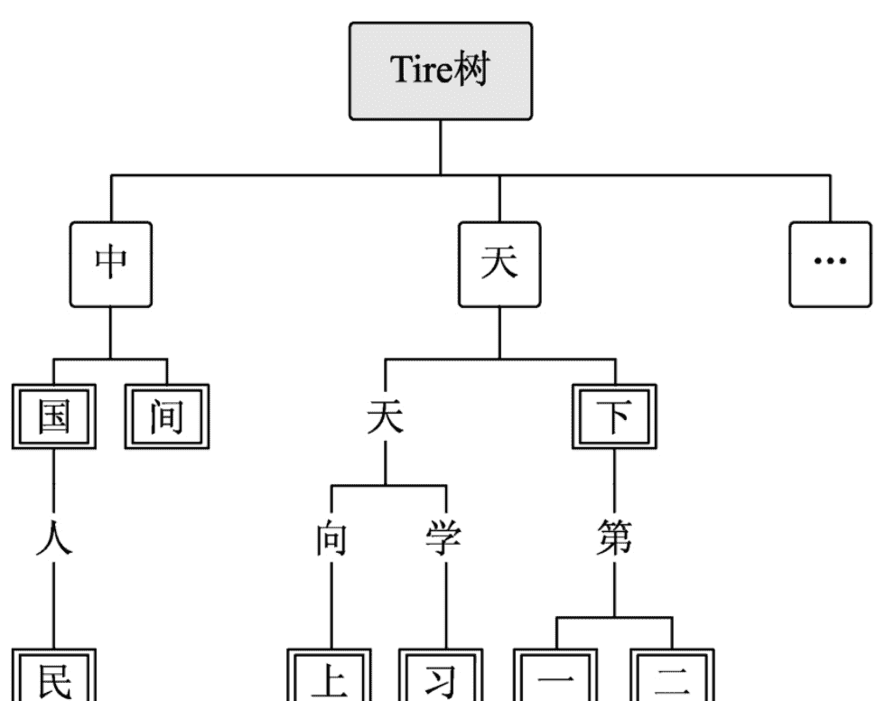
图1.1 Trie树

根节点仅起承接作用，从第一层开始每节点保存一个字。如“天天向上”，路径为“天”-“天”-“向”-“上”。词表中的词首字在第一层共享父节点，如“中国”与“中间”共享“中”。

图1.1中双框字表示词结束，可据此判断是否终止查找。

以“中国人民无条件支持你”为例，从“中”开始查找，“中”无结束标记，继续向下。根节点下所有词首字可排序，使用二分查找提升效率，也有变体转为二叉树或用Hash表实现O(1)查找，但内存开销更大。继续查找，“中国”节点有结束标记，若后字不是“人”可直接返回；此处后字为“人”，继续向下得到“中国人民”，该节点有结束标记，故以长词为准完成分词。

### 1.2.3 反向最大匹配

正向最大匹配实现简单，但错分率较高。如“有意见分歧”“市场中国企业才能发展”，正向结果为“有意/见/分歧”和“市场/中国/有/企业/才能/发展”，均不准确。正确切分为“有/意见/分歧”和“市场/中/国有企业/才/能/发展”，反向匹配可得到。

反向最大匹配把匹配方向改为从右向左，词的末字作为第一层，首字作为叶子节点，其余流程相同。

反向匹配更优并无严谨理论支撑，仅为实验统计结果。正向错误率约1/150，反向约1/250，反向仅降低错误率，并未根除。

### 1.2.4 最短路径

前两种方法属工程手段，未引入机器学习。下面用概率统计求解分词结果。

最短路径分词将所有可能切分列出，选择概率最大路径。概率相乘不便计算，通常取对数转为加法，对数小于0，去负号后最小值对应原概率最大值，故称最短路径，如图1.2所示。

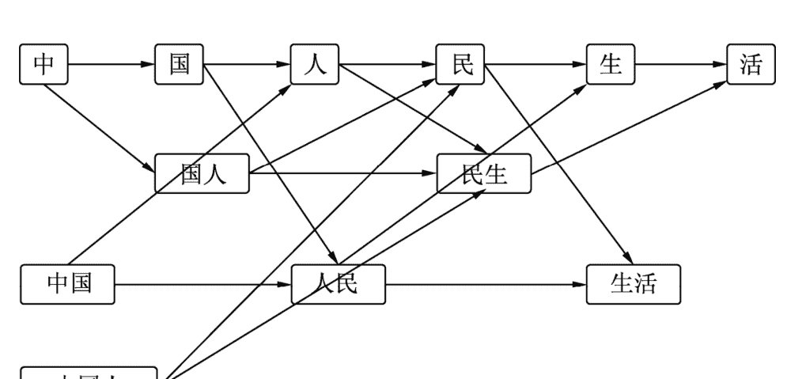
图1.2 最短路径的词网

以“中国人民生活”为例，先做全匹配得到“中/国/人/民/生/活/中国/国人/人民/民生/生活/中国人”等，再按组成原句的原则连成词网，如图1.2。词网节点间权重常用二元语法，统计P(后词|前词)，如count("中国人")/count("中国")。罕见组合需平滑处理，避免概率为零。

确定图结构与权重后，可用Dijkstra等最短路径算法求解，常用的是Viterbi算法，该算法本用于HMM解码。分词后常需基础NER，避免人名、机构名被拆成单字。很多工具同时实现HMM，兼顾分词与NER，复用算法更高效。

HMM其实就是在普通马尔可夫模型的基础上额外加了一个看不见的状态变量。普通马尔可夫的思路是当前状态的概率只由上一时刻的状态决定，比如今天的天气会受昨天天气影响，昨天晴今天仍晴的大概有60%几率。n-gram也遵循同一套逻辑。

HMM则把直接观测到的现象和产生它的隐含状态拆开了。以温度和天气为例，我们关心的是温度数值，而温度是由天气决定的，天气本身又具有马尔可夫性质，于是今天的温度由今天的天气驱动，而今天的天气又依赖前一天的天气，这样就构成了一个HMM。用于求解最优隐状态序列的Viterbi算法，本质上是动态规划在找全局最优路径。

如果还没接触过HMM，以上解释看不懂也没关系，后续内容并不依赖它。可以先把它当成一个黑盒，知道喂进去什么、输出代表什么即可。

**注意：** 想系统了解HMM，可以先看李航《机器学习方法》里对应的章节，再配合网上《通俗理解HMM》这类文章会更顺畅。因为本篇主题是深度学习，传统方法这里不会展开。后面涉及NLP的传统算法都会做简化甚至略过，相关书籍资料很多，感兴趣的同学自行补充。

很多知识点是互相牵制的，容易让人想把所有前置概念全部啃透再继续，这会降低效率。知识依赖并不完全按教材顺序排列，容易卡在某一点就停滞。用黑盒思维，先把模块封装，只关注输入输出，先把整体框架跑通，再回头拆解内部，通常事半功倍。

分词的传统做法就先讲到这儿，这并非重点，所以介绍比较精简。后面会进入深度学习相关的分词方法。

## 1.2.5 jieba分词的实现全景

Python生态里常用的分词包jieba，准确率并非最高，但速度与效果比较均衡，用起来也方便。下面拆解它的运行流程，帮助理解分词的思路。

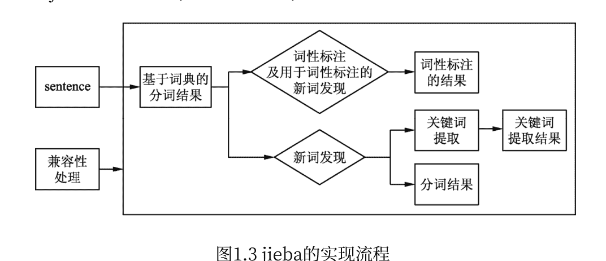

jieba拿到一句话后，会先基于内置词典做切分，需要词性标注就标注，不需要就只返回词表。分词结束后，还可选是否开启新词发现。新词发现本质上是一种NER，专门捕捉词典里没有的连续单字形成的命名实体。关键词抽取则对应TF-IDF和TextRank。

具体流程见图1.4。以句子“早！今天天气真好啊”为例，先按标点拆成“早”和“今天天气真好啊”。前半部分只有一个字，直接跳过。后面进入正常分词，先依据词典把所有可能切法列出来，构成一个有向无环图，也就是常说的词网。图中的边权重来自词典自带的词频，依据权重挑出得分最高的路径，就得到一次分词结果，这里是“今天天气”“真”“好”“啊”。

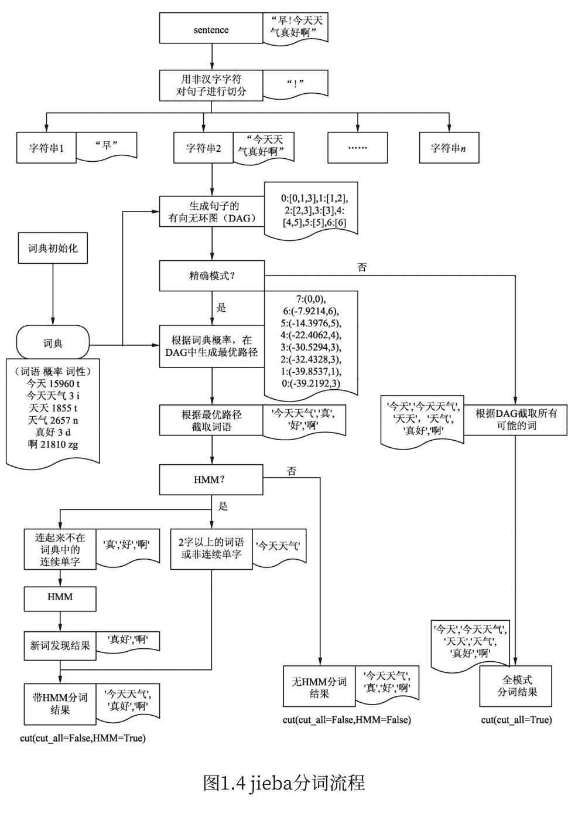
### 图1.4 jieba分词流程

到此结束了吗？没有。默认还会做新词识别，这里的NER不是全句扫描，因为分词场景对NER需求不大，全句做会影响速度。新词识别用的是HMM，jieba内置了一套预训练的新词发现转移概率矩阵，用同样的方式找最佳概率路径，如图1.5所示。

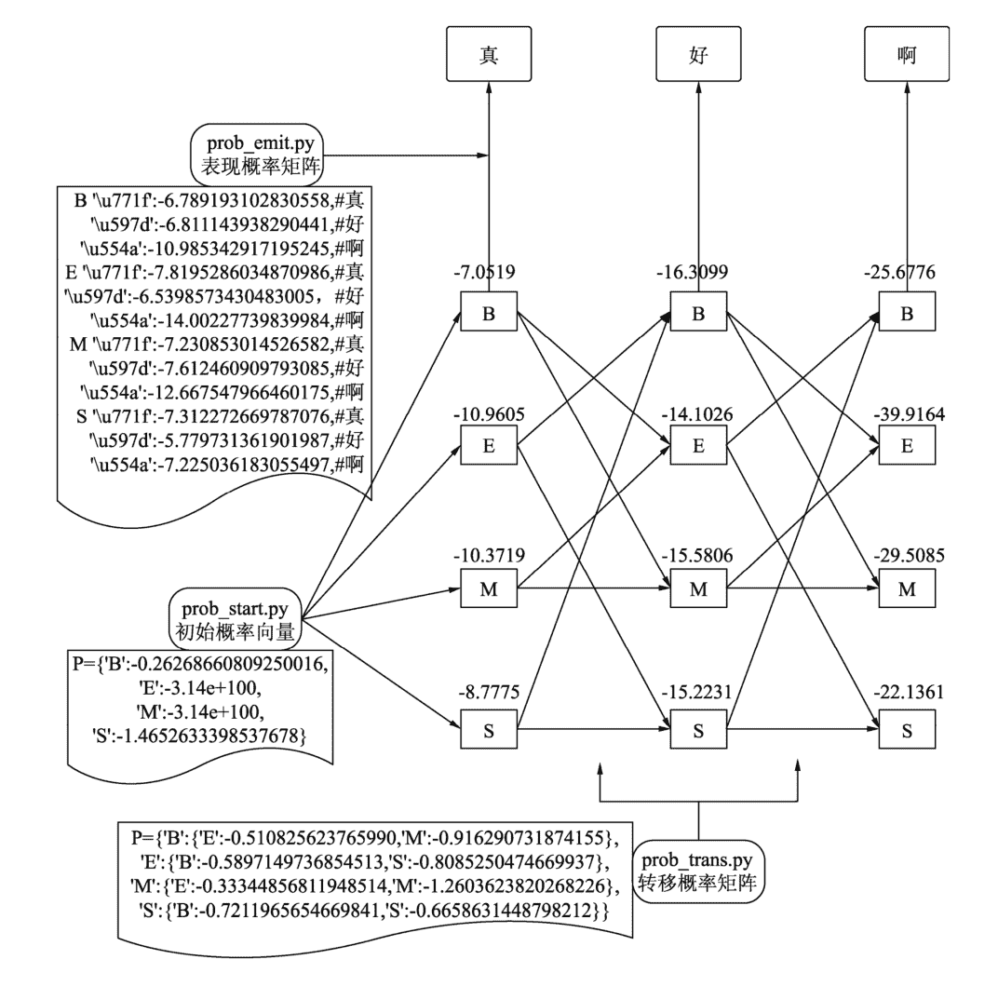
### 图1.5 HMM的路径求解演示

最终新词部分得到“真好”“啊”。汇总后整体结果是“早／！／今天天气／真好／啊”，如图1.4所示。

词性标注POS就是给切好的词打上名词、动词、形容词等标签。大多数词只有一种词性，部分词虽有多义但高频义占绝对优势，因此jieba直接查表取频率最高的词性作为结果。对于未开启HMM新词发现的标注，以及开启HMM后非连续单字的标注，都采用查表策略。只有开启新词发现且出现连续单字时，才会先按新词发现逻辑枚举所有可能的组合，再用另一套预训练的词性HMM转移概率求最优路径，得到新词及其词性。

因为分词和词性标注用的转移矩阵不同，有时两者的切分结果会不一致，如图1.6所示。

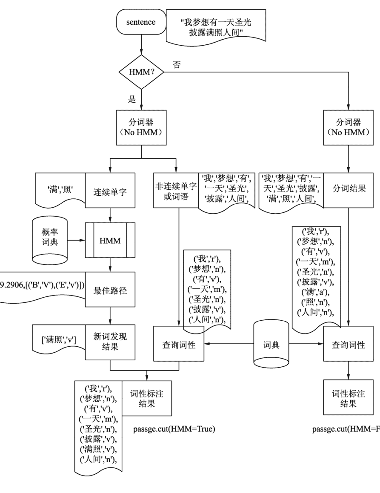
### 图1.6 词性标注流程

最后，jieba词典自带词频，因此可以统计TF-IDF和TextRank信息，也因此支持关键词抽取，如图1.7所示。

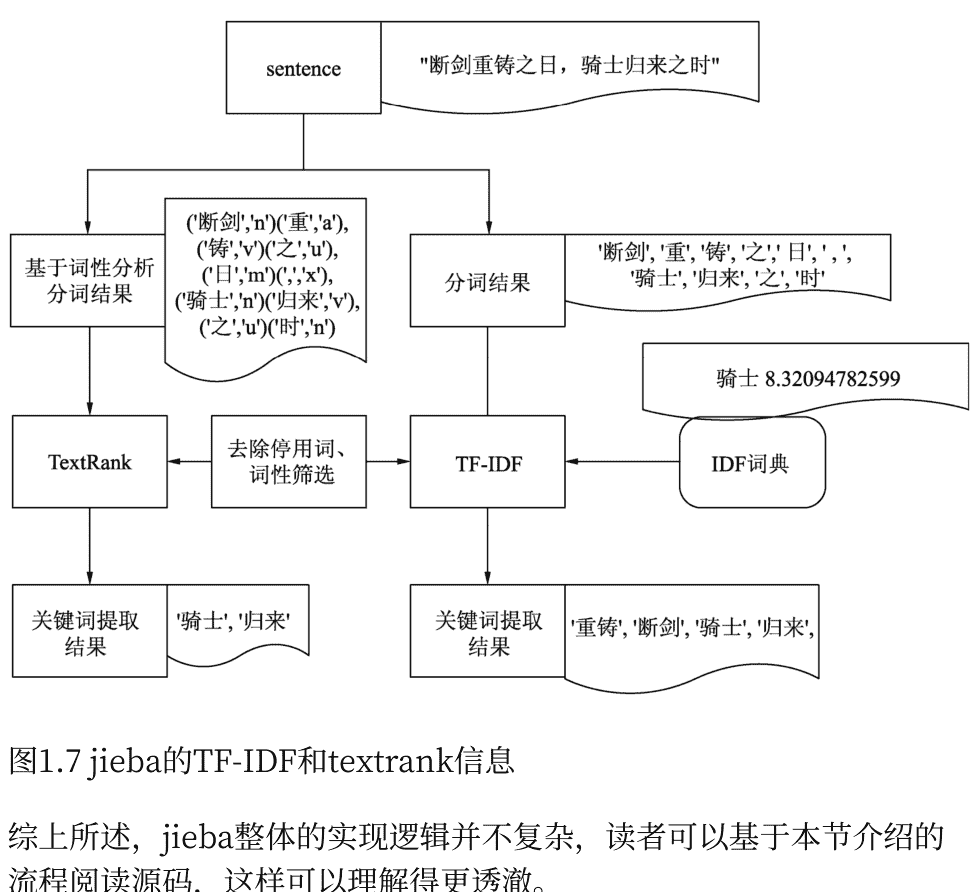
### 图1.7 jieba的TF-IDF和textrank信息

总体来看，jieba的逻辑并不复杂，按上面的流程阅读源码会更容易吃透。

## 1.3 深度学习在分词里的应用

深度学习在分词上的探索并不算热门，原因主要是BERT出现后不少任务可用字向量直接处理，其次在分词上深度模型的提升有限而速度却明显下降。虽不热门但仍有价值，下面按时间线和关注度介绍相关模型。

### 1.3.1 Bi-LSTM模型

Google的Ji Ma、Kuzman Ganchev和David Weiss在2018年论文State-of-the-art Chinese Word Segmentation with Bi-LSTMs中提出了一个用于分词的模型，结构很简洁，是一个变形的Bi-LSTM。

中文分词的标注标准在不同语料间并不统一，比如“宝马公司”，有的语料视作一个词，有的拆成“宝马”+“公司”。训练集和测试集的标注不一致也会带来难题，论文里举的“抽象概念”就是例子，训练集中只出现“抽象”“概念”，测试集却出现合并词。这类情况很难靠算法完全克服，后续工作开始尝试跨语料联合学习。

Bi-LSTM可算作深度学习在分词领域最早被广泛验证的结构，虽然此前也有神经网络尝试，但基本未能全面超越HMM、CRF、最短路径等传统方法。

#### 1. 模型结构

先看结构，如图1.8所示。

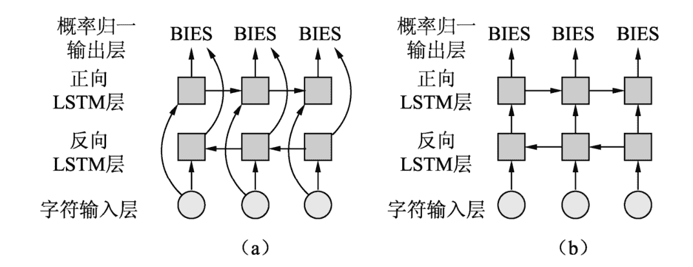
Bi-LSTM模型是典型的序列标注框架，输入一句话后每个字对应一个标签，分词常用B、M、E、S。B表示词首，M表示词中，E表示词尾，S表示单字词，如“我”“是”。

有了标签就能还原分词，S单独成词，BE是双字词，BME是三字词，BMME是四字词，以此类推。图1.8中中间标识用的是I，与M含义相同。图1.8(a)是标准Bi-LSTM，正向与反向LSTM输出合并后进入下一层。这里用的是Stack-LSTM，如图1.8(b)，先跑反向LSTM，其输出直接喂给正向LSTM，正向输出作为下一层输入，这相当于一层反向加一层正向的双层结构。

序列标注最后常接CRF，用来找最佳序列组合，这跟最短路径分词的逻辑相似，都是求全局概率最高而非贪心逐步取最大。贪心计算快但不一定最优。这里的模型没有使用CRF。

序列标注最后层常见三种做法。

第一种是贪心算法，简单但容易次优。

第二种是Beam Search，仍属贪心变体，每步保留Top K个候选，比如5个，再分别扩展下一步，最后保留Top 5。计算量上升，不保证最优但结果接近。

第三种是CRF，可理解为打分层加动态规划求最优。求最优仍然用Viterbi。传统CRF的打分层是人工特征工程，现在多用神经网络自动学习特征。简单理解，CRF就是一个全连接层，对每个字输出4个BMES得分。

想深入了解CRF，可参考李航《机器学习方法》CRF章节，以及网上《通俗易懂理解——条件随机场CRF》等文章。

#### 2. bi-gram输入
输入采用uni-gram和bi-gram两个Embedding的拼接，受Hao Zhou、Zhenting Yu、Yue Zhang等人论文Word-Context Character Embeddings for Chinese Word Segmentation启发，如图1.9所示。

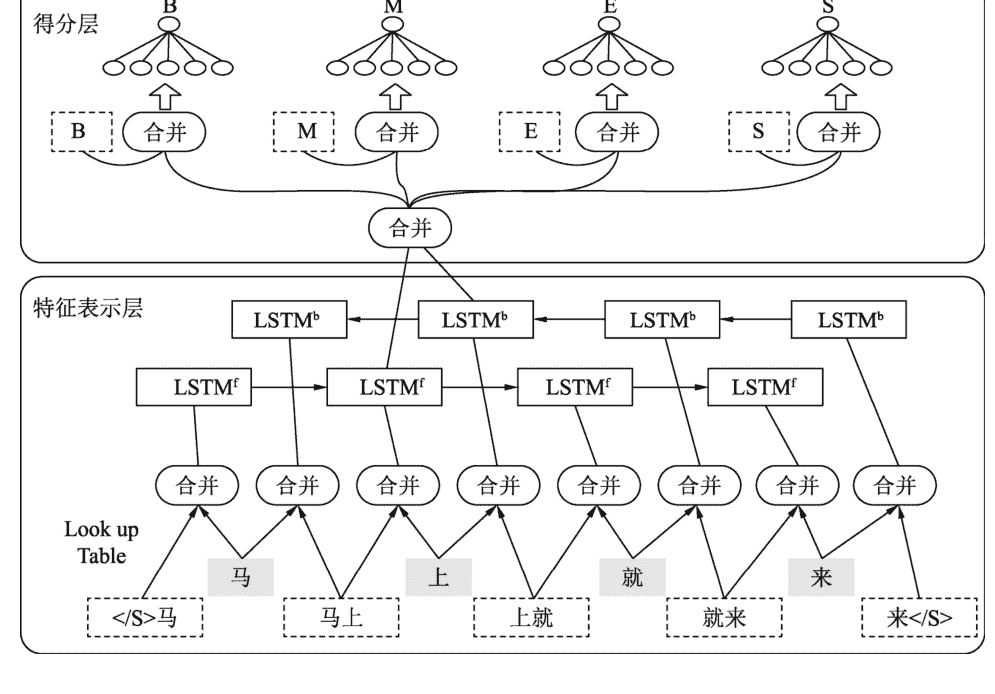
### 图1.9 uni-gram和bi-gram特征输入
uni-gram即字向量，bi-gram即双字向量，双字可能是词也可能不是词。两者都用Word2vec方式预训练。也做过随机初始化不预训练的对比实验。

bi-gram特征后来在不少模型里被沿用，对多项NLP任务都有提升。

各语料库的结果如图1.10所示。

| | AS | CITYU | CTB6 | CTB7 | MSR | PKU | UD |

|---|---|---|---|---|---|---|---|

| Liu et al. (2016) | — | — | 95.9 | — | 97.3 | **96.8** | — |

| Yang et al. (2017) | 95.7 | 96.9 | 96.2 | — | 97.5 | 96.3 | — |

| Zhou et al. (2017) | — | — | 96.2 | — | 97.8 | 96.0 | — |

| Cai et al. (2017) | — | 95.6 | — | — | 97.1 | 95.8 | — |

| Kurita et al. (2017) | — | — | — | 96.2 | — | — | — |

| Chen et al. (2017) | 94.6 | 95.6 | 96.2 | — | 96.0 | 94.3 | — |

| Qian and Liu (2017) | — | — | — | — | — | — | 94.6 |

| Wang and Xu (2017) | — | — | — | — | 98.0 | 96.5 | — |

| Ours (fix embedding) | **96.2** | **97.2** | **96.7** | **96.6** | 97.4 | 96.1 | **96.9** |

| Ours (update embedding) | 96.0 | 96.8 | 96.3 | 96.0 | **98.1** | 96.1 | 96.0 |

### 图1.10 各语料库的实验结果
当时除PKU外，其余语料均超过以往最好结果。有趣的是，预训练后固定词向量的效果在多数语料上优于微调。MSR除外，其余微调后均下降，可能因过拟合。按经验微调有益但幅度不宜过大，需提前停止作为正则。语料标注不一致也是原因之一，需要更细致的研究。

#### 3. 其他优化手段
Bi-LSTM虽简单，但达到当时SOTA用了不少调参手段，如RNN Dropout、超参数网格搜索、基于动量的平均SGD等。

| 参数 | 值 |

|---|---|

| 字符嵌入向量的长度 | [64] |

| bi-gram 双字向量的长度 | [16, 32, 64] |

| 学习率 | [0.04, 0.035, 0.03] |

| 训练多少次衰减 | [32K, 48K, 64K] |

| 输入的 dropout 率 | [0.15, 0.2, 0.25, 0.3, 0.4, 0.5, 0.6] |

| LSTM 内部流转的 dropout 率 | [0.1, 0.2, 0.3, 0.4] |

### 图1.11 网格搜索的范围
网格搜索是在高维空间里多起点找最优。低维时一阶导零二阶导正就能确定最小值，高维则很难全部方向同时为正，鞍点更常见。优化器容易卡在鞍点。降低鞍点维度的办法之一是多起点搜索。

具体做法就是用不同超参组合训练模型，如图1.11所示，组1、组2分别换参数，最后挑指标最好的。

| 不同模型搭配 | 经过网格搜索后的平均得分 | 不使用网格搜索的平均得分 |

| :--- | :--- | :--- |

| This work | 97.69 | 97.49 |

| -Stacked | 97.41 | 97.16 |

| -Pretraining | 96.90 | 96.81 |

### 图1.12 网格搜索的结果
网格搜索虽大幅增加训练时间，但提升幅度有限，如图1.13所示。

| System | AS | CITYU | CTB6 | CTB7 | MSR | PKU | UD | Average |

|---|---|---|---|---|---|---|---|---|

| This work | 98.03 | 98.22 | 97.06 | 97.07 | 98.48 | 97.95 | 97.00 | 97.69 |

| -LSTM dropout | +0.03 | -0.33 | -0.31 | -0.24 | +0.04 | -0.29 | -0.76 | -0.35 |

| -stacked bi-LSTM | -0.13 | -0.20 | -0.15 | -0.14 | -0.17 | -0.17 | -0.39 | -0.27 |

| -pretrain | -0.13 | -0.23 | -0.94 | -0.74 | -0.45 | -0.27 | -2.73 | -0.78 |

### 图1.13 消融实验对比
Ji Ma等人对关键模块做消融，发现预训练影响较大，Stacked Bi-LSTM和LSTM Dropout去掉后影响不大，说明二者有正向贡献，如图1.14所示。

| | AS | CITYU | CTB6 | CTB7 | MSR | PKU | UD |

|---|---|---|---|---|---|---|---|

| OOV % | 4.2 | 7.5 | 5.6 | 5.0 | 2.7 | 3.6 | 12.4 |

| Recall % (random embedding) | 65.7 | 75.1 | 73.4 | 74.1 | 71.0 | 66.0 | 81.1 |

# 中文分词的隐痛与破局：从OOV到多语料融合

### 图1.14 OOV召回率实测

| Recall % (pretrain embedding) | 70.7 | 87.5 | 85.4 | 85.6 | 80.0 | 78.8 | 89.7 |

Ji Ma 等人在做错误剖析时，特别提到了 OOV 这个老难题，也就是训练集里压根没见过的词，却在测试集里冒出来。图1.14 就是这部分召回表现。笔者观感是结果并不差，哪怕用随机初始化的字向量，也能稳定超过 65% 的召回。没见过的词为什么还能被挑出来？很大程度上靠的是上下文的搭配规律。比如“ 我要去吃××。” 里面的××大概率是一个词，模型靠这种固定搭配的信号就能猜出来。换成预训练的嵌入向量后，OOV 整体召回大约再涨 10 个点，说明外部预训练的信息确实有用。

### 1.3.2 用词向量来做切分

上一节讲到预训练字向量和双字 bi-gram 切分，那能不能直接用词向量来切呢？乍听很悖论，词向量不是切好后才有的吗？阿里巴巴的 Yuxiao Ye、Weikang Li 和 Yue Zhang 在 2018 年的 Improving Cross-Domain Chinese Word Segmentation with Word Embeddings 里就验证了可行性。下面只做思路梳理。

做法很直接：先用任意分词器把语料全部分一遍，类似 jieba 的全模式，把所有可能出现的词都列出来。比如“中国人民生活”会同时得到“中国人民生活”“中国、人民、生活、中国人、国人、民生”等候选。核心假设是，基于语言模型训练的词向量里，同一句话中正确分出来的词彼此向量距离会更近。这个很直观，Word2vec 的目标就是让上下文词靠近目标词。

有了这个假设，就在整句范围内找词向量距离总和最小的切分路径。本质和最短路径分词一样，只是把边的权重从 bi-gram 换成了相邻两个词向量的距离。也可以不先做预分词，直接遍历所有字符组合，只要在预训练词表里存在就保留，不存在就跳过，逻辑类似，只是省掉了一步候选生成。

## 1.3.3 轻量多语料融合

汉语分词受困于语料少，而多个语料库的分词标准又不一致。表1.1 就很典型：

表1.1 分词语料库的标准

| 语料库 | Li | Le | reaches | Benz | Inc |

| :--- | :--- | :--- | :--- | :--- | :--- |

| pku | 李 | 乐 | 到达 | 奔驰 | 公司 |

| msr | 李乐 | | 到达 | 奔驰公司 | |

| as | 李樂 | | 到達 | 賓士 | 公司 |

| cityu | 李樂 | | 到達 | 平治 | 公司 |

怎么用好这些标准不一的语料？最粗暴的是先统一标准：繁简转换、 建立映射把“奔驰 / 宾士 / 平治”统一，再做大量人工规则清洗，最后合并训练。代价是人工成本高，而且容易引入新的不一致。

受多语言翻译模型启发，有人给每条句子加上语料专属标记联合训练。表1.2 就是思路：

表1.2 不同语料库的处理

| Corpora | Li Le reaches Benz Inc |

| :--- | :--- |

| PKU | <pku> 李乐 到达 奔驰 公司 </pku> |

| MSR | <msr> 李乐 到达 奔驰公司 </msr> |

| AS | <as> 李樂 到達 賓士 公司 </as> |

| CityU | <cityu> 李樂 到達 平治 公司 </cityu> |

序列标注里损失本质是最大似然估计 MLE，和交叉熵等价。

$$L(\theta) = \sum_{m=1}^{M} \sum_{n=1}^{N} \log p(Y_n^m \mid X_n^m)$$

这里的 m 代表句子数，n 代表每句字数，Y 是正确标签序列。后续未特别说明，损失函数都指这个通用形式。

融合效果如图1.15。网络是普通的 Bi-LSTM+CRF，CRF 的核心是 Viterbi 能拿到全局最优解，加了 CRF 后指标普遍会升。baseline 是各语料单独训练，+naive 是直接合并但不加标记，+multi 是加上语料标记。

| Models | PKU | MSR | CityU | AS |

| :--- | :--- | :--- | :--- | :--- |

| Tseng et al. (2005) | 95.0 | 96.4 | - | - |

| Zhang and Clark (2007) | 95.0 | 96.4 | - | - |

| Zhao and Kit (2008) | 95.4 | **97.6** | 96.1 | **95.7** |

| Sun et al. (2009) | 95.2 | 97.3 | - | - |

| Sun et al. (2012) | 95.4 | 97.4 | - | - |

| Zhang et al. (2013)♣ | 96.1 | 97.4 | - | - |

| Chen et al. (2015a)♣ | 94.5 | 95.4 | - | - |

| Chen et al. (2015b)♣ | 94.8 | 95.6 | - | - |

| Chen et al. (2017) | 94.3 | 96.0 | - | 94.8 |

| Cai et al. (2017)◇ | 95.8 | 97.1 | 95.6 | 95.3 |

| baseline | 95.2 | 97.3 | 95.1 | 94.9 |

| +naive | 90.5 | 92.1 | 91.3 | 94.3 |

| +multi | **95.9** | 97.4 | **96.2** | 95.4 |

图1.15 融合分词的训练结果

可见不做处理直接合并指标会大幅掉点，加了标记后 PKU、CityU 等都有肉眼可见的提升。模型本身不是重点，关键是这种简单标记融合是有效的。

## 1.3.4 多标准集成学习

和上一节不同，这里依然是多语料联合，但不再用一套共享权重加标记，而是为每个语料建一个专属网络层。

分词领域受标注数据限制，论文多在研究怎么榨干现有语料。标准差异让协同更麻烦。到目前为止，单纯堆网络更新很难超 SOTA，接近 SOTA 的多是 Transformer 的改动。更多工作都落在联合语料上，因为标注太少，深度网络吃不饱，合并是刚需。

另一个思路是用领域词典 + 大量无标注语料做半监督，理论上可行，实际效果目前仍不理想。

蚂蚁金服的 W Huang、X Cheng 和 K Chen 在 Toward Fast and Accurate Neural Chinese Word Segmentation with Multi-Criteria Learning 里提出的模型如图1.16。分词被当成序列标注：输入字符序列 C1 C2 … Cn，输出 BMES 标签 y1 y2 … yn。

第一层是嵌入，把 one-hot 字向量压缩到低维，可用预训练或从零训练。
第二层是 Transformer 模块，本质是 BERT，原版 12 层，这里只取底部几层作为超参调速。
BERT 权重保留，利用大量语料的先验知识。图里嵌入和 Transformer Blocks 分开画，实际嵌入是 BERT 内部的，否则向量不匹配。

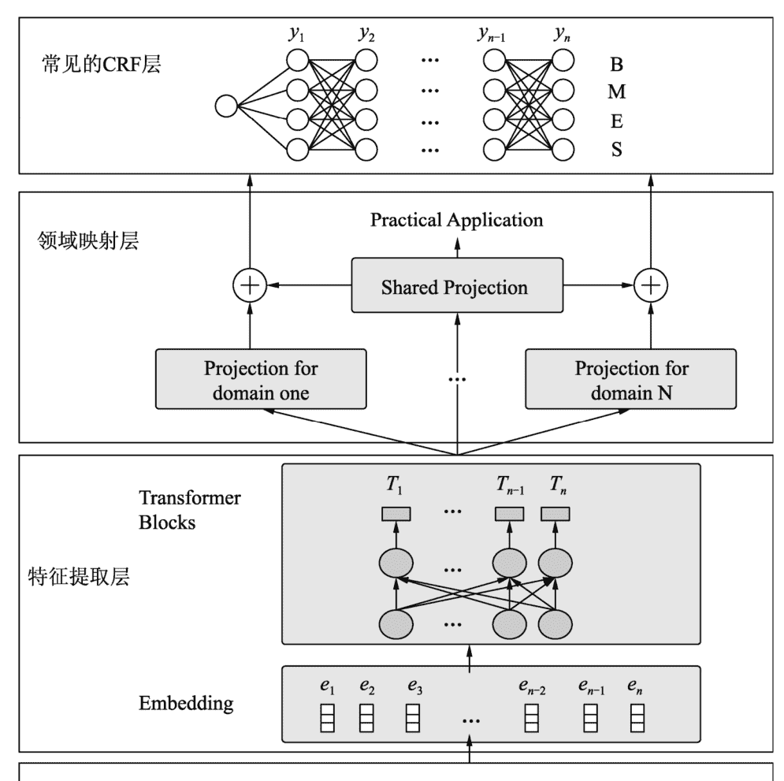

图1.16 分词模型结构

过 BERT 后，每个字符得到一个向量，再分别流向两条路：语料相关的专属网络和全语料共享的通用网络。两者都是线性映射：

$$h_i^s = \text{ReLU}(W_s h_i + b_s)$$

$$h_i^p = \text{ReLU}(W_p h_i + b_p)$$

h_i^s 为共享层输出，h_i^p 为专属层输出。图中多条箭头对应不同语料，实际只走对应的专属 + 共享两条路。

共享层提炼跨语料共性，专属层捕捉各自标准差异。两者按位相加：

$$h_i' = h_i^s + h_i^p$$

最上层是 CRF。推导形式为：

$$P(Y|X) = \frac{\prod_{i=2}^{n} \exp(s(X,i)_{y_i} + b_{y_{i-1}y_i})}{\sum_{y'} \prod_{i=2}^{n} \exp(s(X,i)_{y'_i} + b_{y'_{i-1}y'_i})}$$

$$Y^* = \arg\max P(Y|X)$$

s(X,i)_{y_i}   W ∈ R^{4×D}   X ∈ R^{D×n}

对分词 y 取值为 {B,M,E,S}。s 最简单就是 sum(WX)，得到 4 维分数对应 BMES。b ∈ R^{4×4} 不是普通偏置，而是转移打分，参数只依赖前一时刻和当前标签，得到一个标量后再与 s 相加。

这里不是逐位置 softmax 取最大，而是序列上的连乘 Π，CRF 的关键就是找全局最优路径而非贪心。原始公式可穷举，实际用 Viterbi 加速。

工业上分词常在 200ms 内的请求链路上，分词占 100ms 以上就不可接受。传统线上方案多是最短路径 + HMM/CRF。W Huang 等人针对速度做了三件事：

1. BERT 层数。分词属于低层任务，不需要理解全局语义和长距离依赖。图1.17 显示：

| | 精确率 | 召回率 | F1值 |

|---|---|---|---|

| Ours(12 layer) | 97.2 | 97.0 | 97.1 |

| Ours(6 layer) | 97.0 | 97.0 | 97.0 |

| Ours(3 layer) | 96.7 | 96.9 | 96.8 |

| Ours(1 layer) | 95.6 | 96.1 | 95.9 |

图1.17 BERT层数的影响

层数增加收益递减，最终选 3 层平衡速度效果。

2. 用 float16 代替 float32 做推理，基础量化手段。
3. 使用 XLA 硬件加速，细节略过。

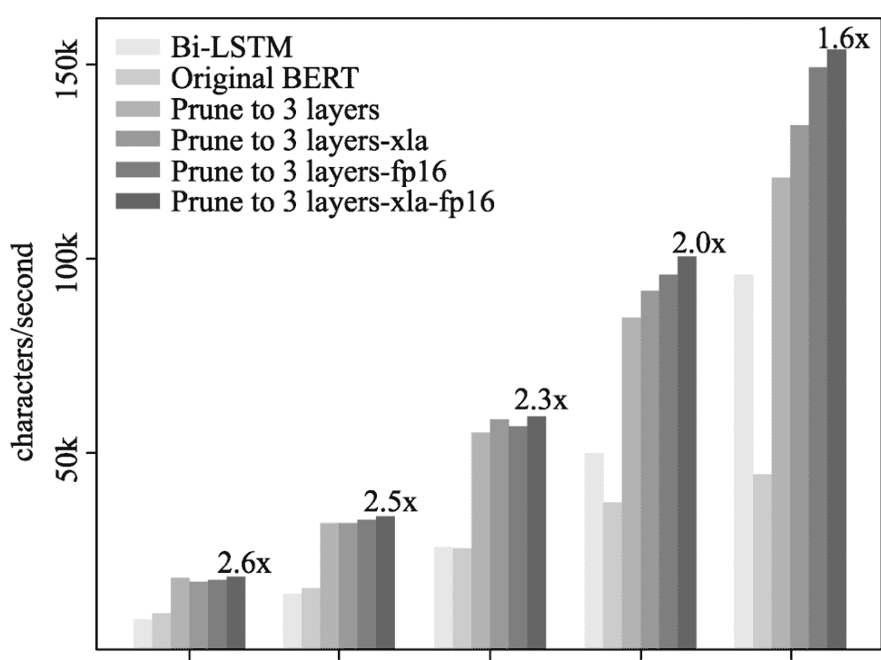

图1.18 下面的数字表示 batch，即同时推理的句子数。可见即使叠加优化，相对 Bi-LSTM 速度提升有限，最大约 2.6 倍。更有趣的是随 batch 增大，BERT 相对于 LSTM 的速度优势在下降，batch=256 时 BERT 速度只剩 LSTM 的一半左右。这符合预期：Transformer 在单样本内已高度并行，GPU 容易饱和；RNN 单样本并行差，但增大 batch 后能更好地利用 GPU。

实验最终在多个语料上对比如图1.19 所示，说明多标准集成在保持效果的同时，对速度的考量是必要的工程方向。

| | PKU | MSR | AS | CITYU | CTB6 | SXU | UD | CNC | WTB | ZX |

|---|---|---|---|---|---|---|---|---|---|---|

| Zhou et al. (2017) | 96.0 | 97.8 | - | - | 96.2 | - | - | - | - | - |

| Yang et al. (2017) | 96.3 | 97.5 | 95.7 | 96.9 | 96.2 | - | - | - | - | - |

# 十个语料全覆盖的分词新纪录

| Chen et al. (2017) | 94.3 | 96.0 | 94.6 | 95.6 | 96.2 | 96.0 | - | - | - | - |

| Xu and Sun (2017) | 96.1 | 96.3 | - | - | 95.8 | - | - | - | - | - |

| Yang et al. (2018) | 95.9 | 97.7 | - | - | 96.3 | - | - | - | - | - |

| Ma et al. (2018) | 96.1 | 97.4 | 96.2 | 97.2 | 96.7 | - | 96.9 | - | - | - |

| Gong et al. (2018) | 96.2 | 97.8 | 95.2 | 96.2 | 97.3 | 97.2 | - | - | - | - |

| He (2019) | 96.0 | 97.2 | 95.4 | 96.1 | 96.7 | 96.4 | 94.4 | 97.0 | 90.4 | 95.7 |

| Ours (3 layer) | **96.6** | **97.9** | **96.6** | **97.6** | **97.6** | **97.3** | **97.3** | **97.2** | **93.1** | **97.0** |

| Ours (3 layer+FP16) | 96.5 | **97.9** | 96.4 | 97.5 | 97.5 | **97.3** | **97.3** | 97.1 | 92.7 | **97.0** |

图1.19 实验结果

这份表现相当少见，十个公开集全部拿下第一。跨语料的改进往往只求多数集领先，已足够撑起一篇论文，而这里做到了全胜。图1.19里对应的配置是三层BERT自注意力。改成float16压缩数值后，各项分数只出现了轻微回落，推理耗时基本没变，模型体积却直接减半，对存储或边端部署这类资源吃紧的场景还是很有实用价值。

由此可以判断，把多个分词语料堆在一起训练是奏效的。表面看像是把语料量放大了，1倍和10倍的效果自然不一样。但作者认为提升不仅仅是数据量的功劳。不同分词语料的标注规范、来源场景、书写习惯都各有偏好，跨语料的互相学习因此产生了互补。语料增多往往伴随样本多样性的提升，可多样性与语料规模并非严格正相关，而分词任务里，多套标准带来的多样性与语料数量的相关度明显更高。

分词里占比最大的失误还是OOV，即训练时没见过、测试时出现的词。下面把单语料训练和融合训练的OOV召回做了对比，如图1.20所示。

| | PKU | MSR | AS | CITYU | CTB6 | SXU | UD | CNC | WTB | ZX |

|---|---|---|---|---|---|---|---|---|---|---|

| OOV | 3.6 | 2.7 | 4.2 | 7.5 | 5.6 | 4.6 | 12.4 | 0.7 | 14.5 | 5.4 |

| Recall (single-criteria learning) | 74.6 | 78.0 | **78.1** | 83.6 | 61.6 | 79.4 | 73.4 | **64.0** | 73.3 | 79.1 |

| Recall (multi-criteria learning) | **80.1** | **84.0** | 76.9 | **89.7** | **88.8** | **86.0** | **92.9** | 62.7 | **83.7** | **86.9** |

图1.20 OOV召回实验

数据很直观，多语料之间确实能互相弥补。

到这里我们已经聊过特殊标记和共享+私有网络两种融合思路，还没结束。还有一类值得深挖的方向，就是为不同语料单独开辟私有网络。

### 1.3.5 分词的多标准融合学习1

上一小节提到的工作创新幅度有限，本质是在共享底座上为每个语料加一层专用层，用来捕捉标准差异。接下来要讲的，是多语料多标准融合的第三种尝试，如图1.21所示。

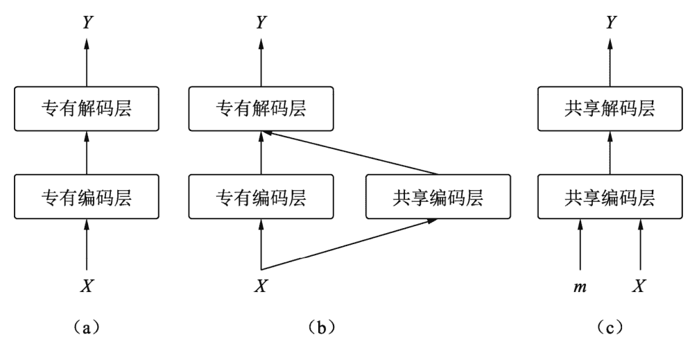

图1.21 分词模型的三种结构

单语料模型可以看成私有编码器加私有解码器，如图1.21（a）。多语料融合主要有两种结构：前面讲过的共享层叠加专用层，如图1.21（b）；另一种是全共享，编码器和解码器都共用，如图1.21（c）。

前面章节的简易融合也属于全共享做法，通过在句首句尾加语料标识来区分，底层是常见的Bi-LSTM+CRF。有趣的是，本节模型同样采用了这种思路，如图1.22所示。

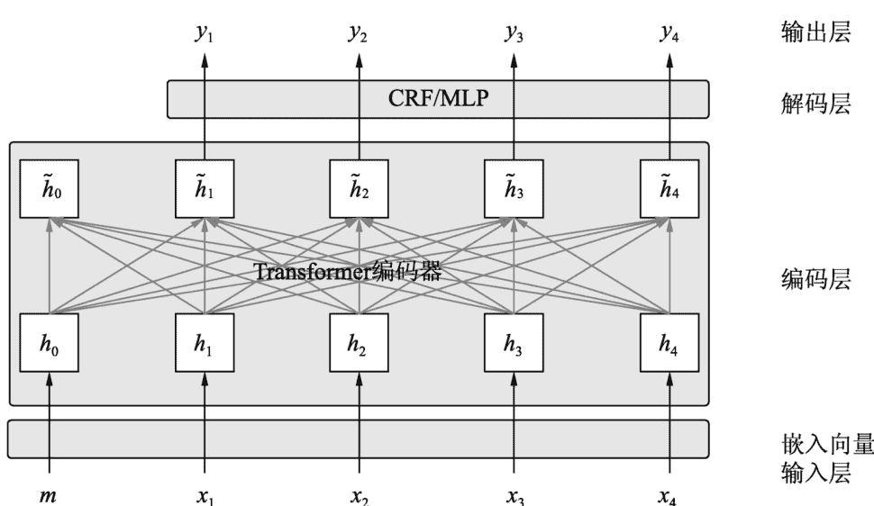

与之前的区别在于底层从LSTM换成了Transformer编码器，本质上就是BERT式的结构，再配上几项手工特征，最终的分数接近SOTA水平。

### 1. 嵌入层

输入一个句子 $X=x,\cdots, x$，先把每个字映射成向量，这个字向量可以是Word2vec或BERT Embedding等预训练表示，也可以随机初始化。随后叠加三项手工特征。

（1）语料库标识 $m$，放在句子最前面，如图1.21所示。以PKU为例就在开头插入一个 $m$。若共有10个语料库，词表大小为 $k$，则字符的one-hot维度变为 $k+10$。与1.3.3节的做法不同，这里只在开头加标识，末尾的重复标识被去掉了，感觉是多余的。

（2）bi-gram信息，之前提到过不少模型会加入并且有效。具体做法是用Word2vec单独训练双字向量，注意这里不是做分词，只是相邻两个字的组合。训练好后与字向量拼接，作为补充信息：

$$e'_t = e_{x_t} \oplus e_{x_{t-1}x_t}$$

（3）位置编码，采用与Transformer类似的方案。

$$PE_{t,2i} = \sin(t / 10000^{2i/d})$$

$$PE_{t,2i+1} = \cos(t / 10000^{2i/d})$$

$i$ 表示字向量的第 $i$ 维，$d$ 为向量维度，$t$ 为时间步。最终 $X$ 的嵌入可以表示为：

$$X = e_m + PE_0; e'_1 + PE_1; \cdots; e'_T + PE_T$$

### 2. 编码层

编码部分就是Transformer编码器，即多层多头自注意力。公式如下：

$$Q_i, K_i, V_i = XW_i^Q, XW_i^K, XW_i^V$$

式中 $W$ 为可训练参数，$i$ 对应第 $i$ 个头的计算。

$$head_i = Attn(Q_i, K_i, V_i) = \text{softmax}\left(\frac{Q_i K_i^T}{\sqrt{d_k}}\right) V_i$$

单头自注意力的计算如下，可通过不同初始化训练出多个头，最后拼接：

$$H = \text{MultiHead}(X) = \text{head}_1; \cdots; \text{head}_k W^O$$

$$Z = \text{LN}(\text{resnet}(X, H))$$

LN 指 layer-norm，resnet 指残差结构，其作用与LSTM内部门控类似，用来调节两路信号的融合比例：

$$H' = \text{LN}(\text{resnet}(Z, \text{MLP}(Z)))$$

$H'$ 是第一层完整自注意力的输出，作为下一层的输入。

### 3. 解码层

解码采用常规的CRF。实验对比见图1.23。

| Models | MSRA | AS | PKU | CTB | CKIP | CITYU | NCC | SXU | Avg. |

| :--- | :--- | :--- | :--- | :--- | :--- | :--- | :--- | :--- | :--- |

| **Single-Criterion Learning** | | | | | | | | | |

| Bi-LSTMs[12] | P: 95.7, R: 95.99, F: 95.84, OOV: 66.28 | P: 93.64, R: 94.77, F: 94.2, OOV: 70.07 | P: 93.67, R: 92.93, F: 93.3, OOV: 66.09 | P: 95.19, R: 95.42, F: 95.3, OOV: 76.47 | P: 92.44, R: 93.69, F: 93.06, OOV: 72.12 | P: 94, R: 94.15, F: 94.07, OOV: 65.79 | P: 91.86, R: 92.47, F: 92.17, OOV: 59.11 | P: 95.11, R: 95.23, F: 95.17, OOV: 71.27 | P: 93.95, R: 94.33, F: 94.14, OOV: 68.4 |

| Stacked Bi-LSTM[12] | P: 95.69, R: 95.81, F: 95.75, OOV: 65.55 | P: 93.89, R: 94.54, F: 94.22, OOV: 71.5 | P: 94.1, R: 92.66, F: 93.37, OOV: 67.92 | P: 95.2, R: 95.4, F: 95.3, OOV: 75.44 | P: 92.4, R: 93.39, F: 92.89, OOV: 70.5 | P: 94.13, R: 93.99, F: 94.06, OOV: 66.35 | P: 91.81, R: 92.62, F: 92.21, OOV: 57.39 | P: 94.99, R: 95.37, F: 95.18, OOV: 69.69 | P: 94.03, R: 94.22, F: 94.12, OOV: 68.04 |

| Switch-LSTMs [13] | P: 96.07, R: 96.86, F: 96.46, OOV: 69.9 | P: 93.83, R: 95.21, F: 94.51, OOV: 77.8 | P: 95.92, R: 95.56, F: 95.74, OOV: 72.7 | P: 97.13, R: 97.05, F: 97.09, OOV: 81.8 | P: 92.02, R: 93.76, F: 92.88, OOV: 71.6 | P: 93.69, R: 93.73, F: 93.71, OOV: 59.8 | P: 91.81, R: 92.43, F: 92.12, OOV: 55.5 | P: 95.02, R: 96.13, F: 95.57, OOV: 67.3 | P: 94.44, R: 95.09, F: 94.76, OOV: 69.55 |

| Transformer | P: 98.14, R: 98, F: 98.07, OOV: 73.75 | P: 96.61, R: 95.51, F: 96.26, OOV: 73.05 | P: 96.06, R: 96.73, F: 96.39, OOV: 72.82 | P: 96.26, R: 96.57, F: 96.43, OOV: 82.82 | P: 95.97, R: 95.35, F: 95.66, OOV: 79.05 | P: 96.44, R: 96.2, F: 96.32, OOV: 83.72 | P: 95.56, R: 96.59, F: 95.57, OOV: 71.81 | P: 97.08, R: 97.09, F: 97.08, OOV: 77.95 | P: 96.52, R: 96.51, F: 96.47, OOV: 76.87 |

| **Multi-Criteria Learning** | | | | | | | | | |

| MTL [12] | P: 95.95, R: 96.14, F: 96.04, OOV: 71.6 | P: 94.17, R: 95.11, F: 94.64, OOV: 73.5 | P: 94.86, R: 93.78, F: 94.32, OOV: 72.67 | P: 96.02, R: 96.33, F: 96.18, OOV: 82.48 | P: 93.82, R: 94.7, F: 94.26, OOV: 77.59 | P: 95.39, R: 95.7, F: 95.55, OOV: 81.4 | P: 92.46, R: 93.19, F: 92.83, OOV: 63.31 | P: 96.07, R: 96.01, F: 96.04, OOV: 77.1 | P: 94.84, R: 95.12, F: 94.98, OOV: 74.96 |

| Switch-LSTMs [13] | P: 97.69, R: 97.87, F: 97.78, OOV: 64.2 | P: 94.42, R: 96.03, F: 95.22, OOV: 77.33 | P: 96.24, R: 96.05, F: 96.15, OOV: 69.88 | P: 97.09, R: 97.43, F: 97.26, OOV: 83.89 | P: 94.53, R: 95.45, F: 94.99, OOV: 77.69 | P: 95.85, R: 96.59, F: 96.22, OOV: 73.58 | P: 94.07, R: 94.17, F: 94.12, OOV: 69.76 | P: 96.88, R: 97.62, F: 97.25, OOV: 78.69 | P: 95.85, R: 96.4, F: 96.12, OOV: 74.38 |

| Transformer | P: 98.03, R: 98.06, F: 98.05, OOV: 78.92 | P: 96.84, R: 96.05, F: 96.44, OOV: 76.39 | P: 95.88, R: 96.95, F: 96.41, OOV: 78.91 | P: 96.79, R: 97.18, F: 96.99, OOV: 87 | P: 96.92, R: 96.11, F: 96.51, OOV: 82.89 | P: 97.03, R: 96.78, F: 96.91, OOV: 86.91 | P: 95.85, R: 96.24, F: 96.04, OOV: 79.3 | P: 97.52, R: 97.69, F: 97.61, OOV: 85.08 | P: 96.86, R: 96.88, F: 96.87, OOV: 81.92 |

图1.23 实验结果对比

只看Transformer，单语料和多标准融合在准确率、召回率、F1上的差距并不大，OOV的提升更明显。对比1.3.4节带专有层的方案，本节分数略高，但OOV却退了一截。结论是多标准融合里，共享网络加专有网络的组合更稳。若在1.3.4的模型里再加上bi-gram特征，表现会反超这里，如图1.24所示。

消融实验也印证了这一点。去掉bi-gram后整体下滑，跌破了1.3.4节的水平。同时对Transformer而言，CRF带来的提升可以忽略，训练和推理成本却明显更高，很多场景下直接用MLP替代更划算。

| Models | MSRA | AS | PKU | CTB | CKIP | CITYU | NCC | SXU | Avg. |

| :--- | :--- | :--- | :--- | :--- | :--- | :--- | :--- | :--- | :--- |

| Full Model | 98.05 | 96.44 | 96.41 | 96.99 | 96.51 | 96.91 | 96.04 | 97.61 | 96.87 |

| w/o CRF | 98.02 | 96.42 | 96.41 | 96.9 | 96.59 | 96.87 | 95.96 | 97.5 | 96.83 |

| w/o bigram | 97.41 | 96 | 96.25 | 96.71 | 96 | 96.31 | 94.62 | 96.84 | 96.27 |

| w/o pretrained emb. | 97.51 | 96.06 | 96.02 | 96.47 | 96.22 | 95.99 | 94.82 | 96.76 | 96.23 |

图1.24 模块消融实验

### 1.3.6 分词的多标准融合学习2

为什么还要继续讲多标准融合？因为实效好。近几年中文分词论文里，单语料训练和多语料训练的差距常在1%到2%之间。原因前面已分析过，假使真有海量单一标准的语料，结论可能不同，但目前并不存在这样的资源。充分利用现有的多套语料仍是当下最现实的研究方向。

由复旦大学与小米公司联合完成的《Unified Multi-Criteria Chinese Word Segmentation with BERT》一文，作者署名有 Zhen Ke、Liang Shi 以及 Erli Meng 等人。前面介绍过多种让模型区分不同分词标准的做法，比如给不同数据加专属网络层、或在句首句尾加上专属标记。本作的尝试在于，除了在输入端加上专属标识，还在输出端额外挂一个分支，去判断当前句子来自哪个语料集，本质上就是对那个独有标识做预测。

其实让某条信息 K 对任务 T 起作用，常规思路只有两种。一是把 K 当作输入 X 的一部分一起送进网络，若 K 与 T 相关，模型自然会学到联系；二是输入时不显式提供 K，而要求模型仅凭 X 反推出 K。训练时 K 是已知的，相当于一种隐式监督，同样能让网络学会相关规律。

对本文的做法，笔者看法不同。同一条信息既进输入又成预测目标时，模型完全可以走捷径，直接把输入抄到输出。例如在有监督图像分类里，若把“猫”“狗”的标签同时作为输入喂给网络，网络完全可以无视图像特征而靠输入标签就能得到很高准确率，但这样学到的根本不是有价值的知识。

先看整体结构，如图1.25所示。

该架构沿用了全共享的设计，所有语料集共用同一套网络。为让模型分辨来源，输入句子时必须在开头加上唯一标识，这一点与前几篇工作保持一致。

第一层并没有直接用 Embedding，而是调用了 BERT。相当于把 BERT 当作预训练的字向量提取器使用，因为 BERT 的向量是动态生成的，没法一次性取出：

$$H = \text{Bert}(X) \in R^{(T+1) \times d_h}$$

其中 T 代表句子长度，+1 对应额外加入的数据集标识，d_h 为字向量输出维度。

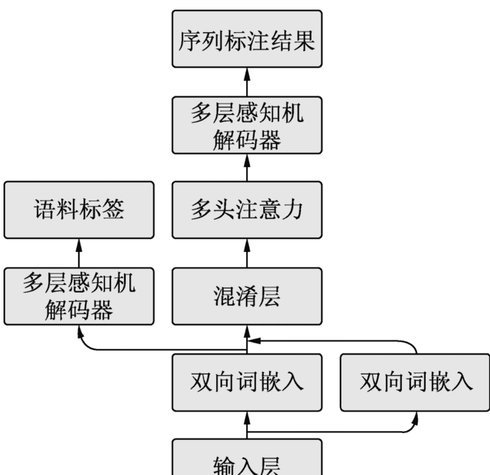

图1.25 模型整体结构

中文多标准分词历来会引入 bi-gram 特征，这里也用了，但没有简单拼接，而是先过一层混淆式融合：

$$E = \text{BigramEmbed}(B) \in R^{T \times d_e}$$

其中 E 表示 bi-gram 的双字向量。

融合过程如下：

$$

h'_t = \tanh(W_h h_t + b_h)

$$

$$

e'_t = \tanh(W_e e_t + b_e)

$$

$$

g_t = \sigma(W_{fh} h_t + W_{fe} e_t + b_f)

$$

$$

f_t = g_t \odot h'_t + (1 - g_t) \odot e'_t

$$

$$

h'_t, e'_t, g_t, f_t \in R^{d_h}

$$

前两行是线性变换加 tanh，后面部分像是一个门控结构，与 GRU 的做法相近，用来决定字向量和双字向量各自的贡献比例，再相加得到融合结果。从本质上看，这类似残差网络，也可理解为 LSTM 式的门控输出，目的是保留有效信息、过滤无用信息，避免计算浪费。

之后接上多头自注意力、残差与归一化，实际上就是 Transformer 编码器里完整的一个多头自注意力块：

$$

O = \text{LayerNorm}(\text{MultiHead}(F) + F)

$$

$$

F \in \mathbb{R}^{T \times d_h}, O \in \mathbb{R}^{T \times d_h}

$$

残差网络没有单独标注，中间的加号即为残差连接。

解码分两路。第一路是分词常用的序列标注解码，这里采用 MLP，即一层全连接，再用贪婪取每步最大值或 Beam Search 求序列最优：

$$

P(y_t \mid X, c) = \text{softmax}(W_o o_t + b_o)_{y_t}; W_o \in \mathbb{R}^{4 \times d_h}

$$

下标表示从输出向量中挑选对应标签 y 的位置。

$$

P(Y \mid X, c) = \sum_{t=1}^{T} P(y_t \mid X, c)

$$

第二路就是前面提到的语料集标识预测。

$$

P(c \mid X, c) = \text{softmax}(W_c h_0 + b_c)_c; W \in \mathbb{R}^{C \times d_h}

$$

其中 h 取自第一层 BERT 输出的第一个单元，C 为语料集总数。

损失函数定义为：

$$

L = -\sum_{i=1}^{N} \log P(Y_i \mid X_i, c_i) + \log P(c_i \mid X_i, c_i)

$$

N 为训练句子的数量。

下面看效果对比，如图1.26。

| Method | MSRA | AS | PKU | CTB | CKIP | CITYU | NCC | SXU | Avg. |
| :--- | :--- | :--- | :--- | :--- | :--- | :--- | :--- | :--- | :--- |
| Bi-LSTM | 95.84 | 94.20 | 93.30 | 95.30 | 93.06 | 94.07 | 92.17 | 95.17 | 94.14 |
| Adversarial | 96.04 | 94.64 | 94.32 | 96.18 | 94.26 | 95.55 | 92.83 | 96.04 | 94.98 |
| Multi-Task BERT | 97.9 | 96.6 | 96.6 | - | - | **97.6** | - | 97.3 | - |
| Unified Bi-LSTM | 97.35 | 95.47 | 95.78 | 95.84 | 95.73 | 95.60 | 94.34 | 96.49 | 95.73 |
| Switch-LSTMs | 97.78 | 95.22 | 96.15 | 97.26 | 94.99 | 96.22 | 94.12 | 97.25 | 96.12 |
| Transformer | 98.05 | 96.44 | 96.41 | 96.99 | 96.51 | 96.91 | 96.04 | 97.61 | 96.87 |
| Unified BERT | 98.45 | **96.90** | 96.89 | **97.20** | 96.83 | 97.07 | 96.48 | **97.81** | **97.204** |
| - Bigram | 98.38 | 96.88 | 96.87 | 97.14 | 96.72 | 97.05 | 96.33 | 97.74 | 97.139 |
| - CLS | **98.48** | 96.86 | **96.92** | 97.13 | **96.84** | 97.07 | **96.55** | 97.72 | 97.196 |
| - CLS - Bigram | 98.41 | 96.83 | 96.83 | 97.13 | 96.76 | 97.05 | 96.33 | 97.67 | 97.126 |

图1.26 实验结果对比

同时做了模块消融。全模块的成绩基本达到 SOTA，比前面两篇略高。结构变化并不大，笔者认为主要收益来自把 BERT 作为字向量引入。而数据集预测这一分支，从图1.26 中 -CLS 的结果可见，效果几乎没有提升，去掉 CLS 与保留 CLS 在各语料上的分差很小。原因正如前面所说，信息同时出现在输入和目标时，网络很容易记住规则，很难学到真正有用的特征。

再看 OOV 实验，如图1.27。这里主要对照的是 SOTA 模型 Multi-Task BERT，该模型未在此详细展开，但思路与本节类似，收益也主要来自 BERT 的引入。

| Method | MSRA | AS | PKU | CTB | CKIP | CITYU | NCC | SXU | Avg. |
| :--- | :--- | :--- | :--- | :--- | :--- | :--- | :--- | :--- | :--- |
| Bi-LSTM | 66.28 | 70.07 | 66.09 | 76.47 | 72.12 | 65.79 | 59.11 | 71.27 | 68.40 |
| Adversarial | 71.60 | 73.50 | 72.67 | 82.48 | 77.59 | 81.40 | 63.31 | 77.10 | 74.96 |
| Switch-LSTMs | 64.20 | 77.33 | 69.88 | 83.89 | 77.69 | 73.58 | 69.76 | 78.69 | 74.38 |
| Transformer | 78.92 | 76.39 | 78.91 | 87.00 | 82.89 | 86.91 | 79.30 | 85.08 | 81.92 |
| Multi-Task BERT | **84.0** | 76.9 | **80.1** | - | - | **89.7** | - | 86.0 | - |
| Unified BERT | 83.35 | **79.26** | 79.71 | **87.77** | **84.36** | 87.27 | **81.03** | **86.05** | **83.60** |

图1.27 OOV实验结果对比

到这里，分词模型的主线基本走完。若不用 BERT 而换成 ERNIE、XLNET 等优化版预训练模型，指标或许还能再涨一点，但提升主要来源于上游预训练，而非分词结构本身的创新。

## 1.4 为什么要学习已经过时的模型

是否常有这种感觉：查资料、读论文、翻教材，总会先看到一批已被淘汰的模型与算法介绍，然后才进入正题。笔者也遵循这种习惯，每讲一个主题都会先回溯历史。为什么要这样做？直接讲最新成果不更高效吗？学那些已经被淘汰的技术不算浪费时间吗？

实际上，没有任何技术是凭空出现的，技术的发展是有路径依赖的。如先有火才炼青铜，有高温才炼铁，有铁才造机床，有机床才实现精密加工。布莱恩·阿瑟在《技术的本质》里对此有深入讨论。

算法亦然。神经网络的每个模型都是先验的叠加，大先验套小先验，小先验又套更小的先验，比如特征工程。这些先验有的来自对人视觉、语言处理方式的模拟，属于新先验；更多则是建立在已被验证有效的旧先验之上，如 RNN、CNN、LSTM。

CNN 的先验是什么？即图像具有平移与尺度不变性。无论人脸在左还是右、放大或缩小，都应被视为同一类。卷积核逐行逐列扫描，正是为了让不同位置的目标用同一特征函数处理。没有这一先验，若用全连接 DNN，像 abc 这样的人脸需要在每个位置都大量出现才能训练充分，否则在未见过的左下角出现时模型就会失效。正是 CNN 的出现让 CV 迎来爆发，而 DNN 时代的神经网络长期沉寂。

RNN 的先验呢？当前时刻的概率依赖于先前所有时刻的信息。比如“我要去”后面大概率接“吃饭”“睡觉”等动词，而不会接“爆炸”“电脑”等。RNN 同样具备类似的平移不变性，“×××我要去”与“我要去”后面的延续大概率一致，除非×××包含关键信息。

语言等序列长度不一，不像图像有固定分辨率。为此采用循环单元以适应可变长度。训练时为便于批量处理，需要统一长度，长截断、短补零。推理时单条输入可不限制长度，但若用批量，注意力机制的权重范围固定后，长度往往也被限定，RNN 处理动态长度的能力便受损。

之后所有基于 RNN 的模型都是在这一先验之上演进。每一篇论文、每一种新模型，本质上都是在前人先验上做删除、增加或修改。最终模型是一个历史先验的集合，再加上作者的创新，而创新本身也是一种新的先验。

于是所有论文构成了一棵巨大的先验树。新模型都是从既有分支延伸出来的。若只看最新进展，获得的知识是片面的，忽略了支撑它的历史先验，也难以真正理解创新点与思想。没有先验树的链路，就无法把握创作者的思考方式，更谈不上在此基础上做出自己的创新。

反之，若从历史演进中理清脉络，把每个先验对应到模型模块，面对新模型就能迅速看出其来龙去脉，理解更轻松，也更容易预判其发展方向或改进点。那些已被证伪或淘汰的尝试也是宝贵经验，能帮我们避开重复探索，节省时间。

笔者始终认为，传授知识不是目的，知识是死的。关键在于如何使用知识，如何思考与创新。

## 1.5 BERT之后的中文分词还有必要用吗

中英文体系不同。英文天然有空格作词边界，虽然部分词组被空格切开会损失搭配信息，但占比不高，且深层模型如 LSTM、Transformer 已能部分学习。中文多字词比例高，固定搭配拆开后语义会严重偏离，如成语、网络用语。因此中文 NLP 通常先分词再处理，分词质量直接影响下游任务，例如基于分词的命名实体识别，若前面切错，后续正确率会显著下降。

分词的上限仍非完美，而工程任务对速度要求高，若每步都用 BERT 这类重模型，后续流程可能无暇运行，这也限制了分词精度。

近年来预训练词向量的流行，让中文分词显得有些尴尬。

其一是 OOV 问题。因为预训练使用稠密低维向量替代 one-hot，词表必须预先确定，规模受显存与算力限制，通常选 1 万或 10 万高频词。无论选多大，推理时仍会遇到未登录词。英文可用字符拼接或 Pointer Network 缓解，但无法根治。对中文而言，若不分词而直接用字向量，常用汉字仅约一万左右，OOV 压力小得多，这也是中文 BERT 选择字向量的原因。

其二是长尾问题。即使无 OOV，低频词在小规模预训练下仍学得不充分。中文词频服从 Zipf 定律，即 2-8 定律，高频词极集中。以 Chinese Treebank 为例，用 jieba 分词后语料总计约 60 万词，去重后约 5 万词，其中 2.4 万词只出现一次，3.8 万词出现次数少于 4 次。扩充语料主要增加高频词，长尾词增长有限。

若不用分词，字总数大幅下降，字频分布虽仍服从 Zipf，但因基数小，低频问题缓解很多。正因 BERT 证明字向量在 NLP 上同样有效，才引出本节问题：BERT 之后，中文分词还有意义吗？

X Li、Y Meng、Q Han 等人发表的 *Is Word Segmentation Necessary for Deep Learning of Chinese Representations?* 做了初步对比。实验范围有限，仅用数个较小数据集、几种简单模型、四类任务：语言模型、翻译、文本分类、语义匹配。下面先看具体情形。

### 1. 语言模型

中文 NLP 里字和词到底该怎么选？用一批公开实验来看结论。

本次语言模型测试的底座是 CTB6.0 语料，分词环节用 jieba，建模思路是标准自回归：用前面已出现的单位去预测下一个单位，底层网络是 LSTM，如图1.28 所示。

图里 model 代表字、词以及不同组合的输入形态，dimension 是向量维度，PPL 是最后的困惑度。word 表示先分词再以词为单位喂进 LSTM，char 表示直接以字为单位输入。

有意思的是，实验组里特意安排了混合模型对照，思路是以词为主干，每个词向量后面再挂上词内字符的向量，中文里就是字符向量。

| model | dimension | PPL |

|---|---|---|

| word | 512 | 199.9 |

| char | 512 | 193.0 |

| word | 2048 | 182.1 |

| char | 2048 | 170.9 |

| hybrid (word+char) | 1024+1024 | 175.7 |

| hybrid (word+char) | 2048+1024 | 177.1 |

| hybrid (word+char) | 2048+2048 | 176.2 |

| hybrid (char only) | 2048 | 171.6 |

图1.28 语言模型对比

PPL 也就是困惑度，粗略理解就是模型对下一个字出现的信心程度。比如看到“开天辟”，模型几乎肯定下一个字是“地”，PPL 接近 1；如果完全没把握，词表里每个字都可能，那数值就会飙高。

结果很清晰，同样条件下字模型的 PPL 一直低于词模型，维度越大优势越明显。加入词的混合结构后并没有带来提升，反而在多个配置下回落。把分词器换成 Stanford CWS 或 LTP，趋势也一样。

机器翻译的训练材料是基于 LDC 扩增的 125 万对中英句子。中文译英的成绩如图1.29。

| TestSet | Mixed RNN | Bi-Tree-LSTM | PKI | Seq2Seq +Attn (word) | Seq2Seq +Attn (char) | Seq2Seq (word) +Attn+BOW | Seq2Seq (char) +Attn+BOW |

|---|---|---|---|---|---|---|---|

| MT-02 | 36.57 | 36.10 | 39.77 | 35.67 | 36.82 (+1.15) | 37.70 | 40.14 (+0.37) |

| MT-03 | 34.90 | 35.64 | 33.64 | 35.30 | 36.27 (+0.97) | 38.91 | 40.29 (+1.38) |

| MT-04 | 38.60 | 36.63 | 36.48 | 37.23 | 37.93 (+0.70) | 40.02 | 40.45 (+0.43) |

| MT-05 | 35.50 | 34.35 | 33.08 | 33.54 | 34.69 (+1.15) | 36.82 | 36.96 (+0.14) |

| MT-06 | 35.60 | 30.57 | 32.90 | 35.04 | 35.22 (+0.18) | 35.93 | 36.79 (+0.86) |

| MT-08 | – | – | 24.63 | 26.89 | 27.27 (+0.38) | 27.61 | 28.23 (+0.62) |

| Average | – | – | 32.51 | 33.94 | 34.77 (+0.83) | 36.51 | 37.14 (+0.63) |

图1.29 中文翻译为英文的结果

Mixed Rnn、Bi-Tree-LSTM、PKI 三组数据直接来自原文，未重跑。评测用 BLEU，衡量生成译文与参考译文在词层面重合的比例，重合越多分数越高。

英文译中成绩如图1.30。

| TestSet | Seq2Seq +Attn (word) | Seq2Seq +Attn (char) | Seq2Seq +Attn+BOW | Seq2Seq (char) +Attn+BOW |

|---|---|---|---|---|

| MT-02 | 42.57 | 44.09 (+1.52) | 43.42 | 46.78 (+3.36) |

| MT-03 | 40.88 | 44.57 (+3.69) | 43.92 | 47.44 (+3.52) |

| MT-04 | 40.98 | 44.73 (+3.75) | 43.35 | 47.29 (+3.94) |

| MT-05 | 40.87 | 42.50 (+1.63) | 42.63 | 44.73 (+2.10) |

| MT-06 | 39.33 | 42.88 (+3.55) | 43.31 | 46.66 (+3.35) |

| MT-08 | 33.52 | 35.36 (+1.84) | 35.65 | 38.12 (+2.47) |

| Average | 39.69 | 42.36 (+2.67) | 42.04 | 45.17 (+3.13) |

图1.30 英文翻译为中文的结果

一个明显的差异是，两种翻译方向字模型都优于词模型，但英译中的提升幅度明显更大，平均约 +2.67，而中译英只有约 +0.83。

差别只在中文一侧，英文只有词没有字。中译英里字词的选择影响编码侧，英译中影响解码侧。推测是稀疏与 OOV 问题在编码时主要影响潜在语义的表达，只要核心实体不缺失，整体语义还能撑住。而在解码时，稀疏与 OOV 不仅影响后续语义的展开，还直接冲击核心词的生成，所以英译中的收益更突出。

## 2. 语义相似度实测
这里用了 BQ 和 LCQMC 两个语料。BQ 大约有 12 万对中文句子，如图1.31。

| Dataset | description | char valid | word valid | char test | word test |

| :--- | :--- | :--- | :--- | :--- | :--- |

| LCQMC | 238.7K/8.8K/12.5K | 84.70 | 83.48 | **84.43 (+1.34)** | 83.09 |

| BQ | 100K/10K/10K | 82.59 | 79.63 | **82.19 (+2.90)** | 79.29 |

图1.31 语义相似度结果

文本分类的验证集与测试集表现如图1.32。

| Dataset | description | char valid | word valid | char test | word test |

| :--- | :--- | :--- | :--- | :--- | :--- |

| **ChinaNews** | 1260K/140K/112K | 91.81 | 91.82 | 91.80 | **91.85 (+0.05)** |

| **dianping** | 1800K/200K/500K | 78.80 | 78.47 | **78.76 (+0.36)** | 78.40 |

| **Ifeng** | 720K/80K/50K | 86.04 | 84.89 | **85.95 (+1.09)** | 84.86 |

| **jd_binary** | 3600K/400K/360K | 92.07 | 91.82 | **92.05 (+0.16)** | 91.89 |

| **jd_full** | 2700K/300K/250K | 54.29 | 53.60 | **54.18 (+0.81)** | 53.37 |

图1.32 文本分类的测试集和验证集结果

ChinaNews 有 7 类，Ifeng 有 5 类，jd_binary 是京东评论的正负情感二分类，jd_full 是 1 到 5 分的评分分类，dianping 也是评分相关。

词频与词表的对应关系如图1.33 所示。

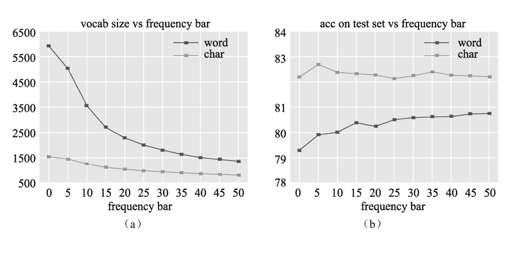

图1.33（a）展示了词频阈值与词表大小的关系，图1.33（b）展示了提高词频阈值与准确率的关系，图1.34 为去掉 OOV 样本后的结果。

综合来看，在中文 NLP 这几类任务上，不分词的字模型已经全面压过了词模型。原因可以拆成下面几块。

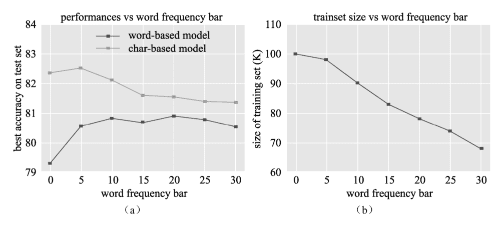

图1.34 在训练集中去掉 OOV 样本后的结果

## 1. 数据稀疏问题
字库在提高频次门槛时，规模会缩小，但下降的曲线相对平缓。词库一旦抬高阈值，规模骤降，说明词的长尾比字的长尾更严重。图1.33（b）也印证了这一点：提高词频阈值降低稀疏性后，词模型的成绩会缓慢爬升，而字模型基本稳住。分词带来的长尾让大量低频词向量训练不足，最终拖累表现。

## 2. OOV 现象
OOV 本质上是稀疏的延续。设定词表后，尾部的词会因为数据不足而表现差，词表外的词以及语料里没出现但现实存在的情况就成了 OOV。把测试集里含有 OOV 的样本剔除后，字词对比会更公平，如图1.14 所示。随着词频阈值上调、词表变小并同步剔除含 OOV 的样本，词模型的成绩会明显回升。继续抬升阈值导致效果回落，是因为剔除样本太多，整体训练量不足。

## 3. 过拟合风险
过拟合与稀疏同源。样本不足时局部参数容易记死。用极少样本去训一个全连接分类器，无论怎么加正则都容易过拟合。词模型因为稀疏更易陷入这种状态。

X Li、Y Meng、Q Han 等人曾提出一个常见疑问：有了 BERT 以后是否还值得研究分词。实验本身有几处局限：

### 1）数据规模不足
从 BERT 开始，常规 NLP 任务不再用几百兆甚至几十兆数据训练，除非是基于预训练模型微调。几百兆级别的从零训练很难让字词表示充分学习。

### 2）未使用预训练字词向量
为了保持对照，他们字模型和词模型都用任务内从零训练的向量。现实中字词预训练动辄几十上百 TB，任务内不足 1GB 的数据根本训不充分。更合理的流程是先在更大语料上预训练字词向量，再在下游任务上微调，这样能缓解词模型的稀疏困境。

### 3）字词混合设计随意
随意拼接字与词向量未必代表混合的有效性。Yue Zhang 和 Jie Yang 提出的 Lattice LSTM 就是一个更系统的例子，用来在命名实体识别中融合字词信息。

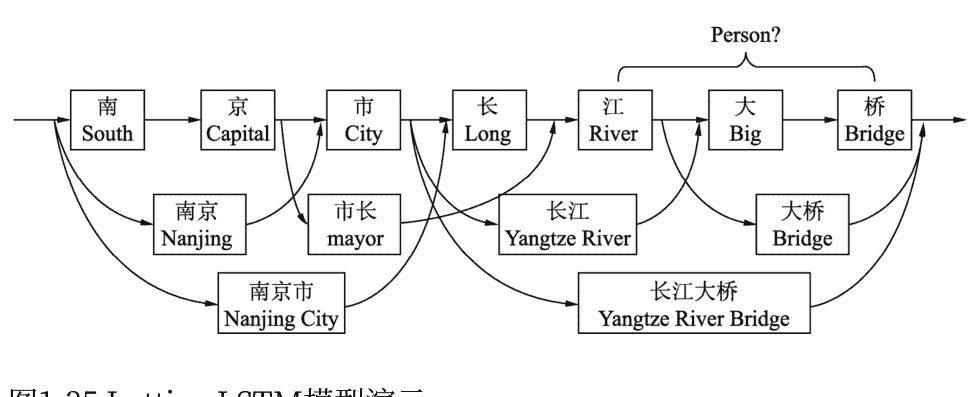

图1.35 Lattice LSTM模型演示

Lattice LSTM 在 OntoNotes 上的结果如图1.36。

| Input | Models | P | R | F1 |

|---|---|---|---|---|

| Gold seg | Yang et al. (2016) | 65.59 | 71.84 | 68.57 |

| | Yang et al. (2016)*† | 72.98 | **80.15** | **76.40** |

| | Che et al. (2013)* | 77.71 | 72.51 | 75.02 |

| | Wang et al. (2013)* | 76.43 | 72.32 | 74.32 |

| | Word baseline | 76.66 | 63.60 | 69.52 |

| | +char+bichar LSTM | **78.62** | 73.13 | 75.77 |

| Auto seg | Word baseline | 72.84 | 59.72 | 65.63 |

| | +char+bichar LSTM | 73.36 | 70.12 | 71.70 |

| No seg | Char baseline | 68.79 | 60.35 | 64.30 |

| | +bichar+softword | 74.36 | 69.43 | 71.81 |

| | Lattice | **76.35** | **71.56** | **73.88** |

图1.36 Lattice LSTM在OntoNotes数据集上的结果

MSRA 数据集上的表现如图1.37。

| Models | P | R | F1 |

| :--- | :--- | :--- | :--- |

| Chen et al. (2006a) | 91.22 | 81.71 | 86.20 |

| Zhang et al. (2006)* | 92.20 | 90.18 | 91.18 |

| Zhou et al. (2013) | 91.86 | 88.75 | 90.28 |

| Lu et al. (2016) | – | – | 87.94 |

| Dong et al. (2016) | 91.28 | 90.62 | 90.95 |

| Word baseline | 90.57 | 83.06 | 86.65 |

| +char+bichar LSTM | 91.05 | 89.53 | 90.28 |

| Char baseline | 90.74 | 86.96 | 88.81 |

| +bichar+softword | 92.97 | 90.80 | 91.87 |

| Lattice | **93.57** | **92.79** | **93.18** |

图1.37 Lattice LSTM在MSRA数据集上的结果

Lattice LSTM 说明，只要模型先验设计得当，字词混合可以进一步提升整体效果。同时也再次确认，单纯字模型在 NER 上通常优于单纯词模型。

总结来看，分词后的词模型确实容易因稀疏产生过拟合和 OOV。字模型的字频分布也是指数型、遵循 2-8 定律，但字总量远小于词总量，问题幅度小很多。增大训练语料或用无标签数据做无监督预训练可以缓解差距。即使在大数据预训练下，词模型的表现也多半只是逼近字模型，很少明显超越，超越也是微弱的。这并不意味着分词没有价值。

### 1) 分词的先验价值
分词本身就是一种强先验，类似于句法分析。模型设计不合理时，直接让字模型去学习隐含的词句结构往往更稳健，这与 RNN、CNN 相比 DNN 的优势逻辑相通。万能模型拟合能力越强，过拟合风险越大，需要更精准的先验去贴合真实数据分布。分词提供的结构先验就是这种匹配。Lattice LSTM 也证明，好的先验能让字词信息协同发挥作用。

### 2）计算成本考量
字模型的节点数平均比词模型多一倍，计算量自然更高。实验室里容易忽略计算，但在工程落地时这是关键限制。若公司拥有充足语料且字词效果接近，选择词模型以降低算力消耗是常见权衡。

### 3）模型外的工程收益
很多场景并不走嵌入和模型。搜索相关性召回、知识图谱检索、Elasticsearch 的语义相似检索等，都依赖分词来控制索引规模。不分词会导致索引暴涨、检索效率下降。

## 1.6 如何做词性标注

工程实践里词性标注通常与分词绑定，很少单独做。以 jieba 为例，常见的实现路径大致有三种。

词性标注在实际工程里常见的解法大致可以归纳为三类思路。

第一类比较直接粗暴的做法，是在做词典统计词频时顺便把每个词的词性出现次数也记下来，分词完成后直接查这个词出现次数最多的词性给它贴上。这种做法对多义词并不友好，频率最高的词性之外的其他词性基本会被永久忽略，标注错误率因此会抬高。不过它的优点也很明显，执行速度快，而且多义词在语料里的占比本来就不大，整体准确率仍在可接受范围。

第二类思路引入上下文约束，也就是n-gram。做法是利用前面1个或2个词的词性来限制当前词可能的词性，比如2-gram、3-gram。

第三类就是HMM或CRF，和命名实体识别的原理相近。也是为词性建立转移概率，根据前面词性来决策当前词性，更准确地说是在整句话范围内找一条概率最大的词性链作为最终标注。对HMM来说，待标注的词性是隐藏状态，看到的词语是观测值，词性到词的对应是发射概率，词性到词性的跳转是转移概率。词性到词的发射概率可以借助贝叶斯公式从词的各个词性条件概率推导出来。

归根结底，词性标注本质上也是序列标注问题，所以分词时用的深度学习模型基本都能迁移过来做标注，常见做法是把分词和词性标注作为两个联合目标一起输出，这里不再展开。

### 1.7 大模型重塑分词与词性标注

随着NLP技术持续演进，尤其是BERT、GPT等大模型爆发式发展，中文分词与词性标注这类基础任务迎来了新的窗口。本节聚焦大模型在这两项工作上的表现，并用实例来体现其能力。

以GPT-3、ChatGPT为代表的大模型都基于Transformer架构，在超大规模语料上预训练，学到了丰富的上下文表征和语言规律，因此在多语言任务上表现突出，分词和词性标注的准确率也随之提升。下面用一个具体例子说明ChatGPT处理中文分词和词性标注的效果。

假设输入句子：
我喜欢吃苹果。

给出提示：
请帮我分词上面的句子并标注词性。
ChatGPT会基于预训练知识和上下文给出结果：

- 我（代词）
- 喜欢（动词）
- 吃（动词）
- 苹果（名词）

大规模预训练让模型具备一定的歧义纠正能力。比如句子“他是中国人民银行的职员”，模型能正确切分为“他／是／中国／人民／银行／的／职员”，并给出词性：

- 他（代词）
- 是（动词）
- 中国（名词）
- 人民（名词）
- 银行（名词）
- 的（助词）
- 职员（名词）

大模型在分词和词性标注上的优势主要体现在三方面。

其一，上下文感知强。模型能捕捉长距离依赖和上下文信息，在复杂句和歧义处表现更好，理解和解析文本更到位。

其二，少样本适配快。通过预训练加微调的方式，具体任务所需标注数据量大幅减少。先在大规模无标注语料上学习语言规律，再在目标任务上快速调优，对资源受限的垂直领域尤其有价值。

其三，一体化处理。同一模型可以同时承担多个NLP任务，无需为每个任务单独设计架构，简化了系统设计与维护，也提升了整体可靠性。

随着大模型持续优化，中文分词和词性标注有望迎来更多创新。本章的学习既能帮助理解传统与深度学习方法的核心，也能对大模型在这些基础任务中的应用建立初步认知，为后续实践提供思路。

### 1.8 本章小结

本章先讲了分词的传统方案，虽然年代久远但效果扎实，目前线上NLP服务只要涉及分词，基本仍在使用传统算法，简单NER也多靠HMM来解决，核心诉求都是响应速度。只有在NER需求更复杂时，才会在线上分词基础上再接专门的NER模型。

随后详细介绍了中文分词在深度学习时代的发展。主流研究集中在多标准、多数据集的联合训练上，因为单一数据集的规模很难提供充足样本。不同地区中文使用习惯存在差异，例如港台与新加坡的用语习惯各有特点，多源融合既能互相补充，也在实验中证明优于单数据集。实验还表明bi-gram这类双字特征对分词有效，预训练字向量有价值，而BERT等动态字向量明显优于Word2vec等静态向量。

最后通过实例简要介绍了ChatGPT在分词和词性标注中的表现。下一章将进入文本分类任务。

# 第2章 文本分类

文本分类可以说是NLP里最古老也最核心的任务之一，几乎所有NLP任务最终都能映射为某种分类形式。分词里的序列标注是对每个单元做一次分类；翻译和摘要在每次生成时都要在候选词表里做选择；抽取式阅读理解把原文长度当作候选集合做分类，生成式阅读理解则与翻译摘要类似。

本章谈的文本分类偏狭义，指判断文本属于二分类或多分类，有时还存在层级类别，比如商品的一级类目时装、数码，二级类目女装、男装、手机、电脑等。

本章先补词汇表征的基础，再介绍一些经典的文本分类模型。

## 2.1 文本分类的应用

即便限定在狭义的文本分类，落地场景也非常广泛。

### 1. 信息提取和信息过滤

信息提取 Information Retrieval 和信息过滤 Information Filtering 放在一起讲，是因为分开讲读者容易混淆二者边界。

信息提取最典型的例子是搜索。依据查询条件在海量文档中找出相关内容并排序展示。

这和文本分类有什么关系？相关性打分本质上就是一种分类。熟悉Elasticsearch的读者知道其内部的相关性评分BM25，本质是TF-IDF的扩展。可以理解为相关性分数，若对所有文档归一化就能得到0~1的概率，变成多分类问题；若按文档做sigmoid归一化则更接近二分类。实际排序场景并不需要最后一步归一化，为节省计算直接用分数排序即可。深度学习推理中，排序场景也会去掉训练时必须的softmax，目的都是减少计算。

正统的分类任务输入是一串非结构化文本，输出类别。而这里的相关性计算有两个输入：用户查询和文档文本。

信息过滤的逻辑相近，只是场景反过来。信息提取是有明确目标找相关内容，信息过滤是目标范围模糊，只想长期追踪最新信息，先剔除不感兴趣的内容，留下值得进一步浏览的。这就是二者的区别。

### 2. 情感分析

情感分析本质上是文本分类的特例，目标限定为正面、负面、中性，且问题场景典型，于是被单独拎出来。

情感分析包含三个子问题。

- 文档级情感分析：判断整篇文档的情绪倾向。
- 句子级情感分析：判断单个句子的情绪倾向。
- 对象级情感分析：一个句子可能对多个对象发表不同评价。如“这个手机外观还是很漂亮的，只是电池待机不行，玩游戏时还发烫”。句中包含“手机外观、电池、玩游戏状态”三个实体，对应“漂亮、不行、发烫”三种情绪。实际文本里一个对象可能被多句描述，一个句子也可能涉及多个对象，因此对象级情感分析已超出纯文本分类范畴，需要先识别实体再关联情绪词。

### 3. 文本摘要和阅读理解

在抽取式摘要和阅读理解里，选择哪个词或哪句话作为输出，本质上也是分类。摘要有时选择句子而非单个词，原理一致。

以上都是业务问题的抽象，真实场景是：分析用户评论态度属于对象级情感分析；把抓取的文章归入不同类别属于典型文本分类。

在企业NLP需求中，文本分类是最常遇到的类型之一。

## 2.2 文本分类的词向量方法

文本分类的方法很多，传统有朴素贝叶斯、LDA、SVM等，几乎所有通用分类算法都可用，差别主要在特征工程。相关教材很多，如李航《统计学习方法》、周志华《机器学习》。本节聚焦深度学习相关内容，传统方法不再展开。

工业界受性能限制，传统方法并未被淘汰，依然有重要作用。具体到文本分类，基于词向量的方案已优于传统方法，例如fastText表现突出。

下面先介绍词向量训练，再基于其做分类。

### 2.2.1 Word2vec模型

在介绍Doc2vec和fastText前，先讲Word2vec，两者与其关系紧密。

Word2vec的第一种模型是CBOW，名字里的C指Continuous。BOW是词袋模型，把一篇文章或一句话的所有词作为特征，没有顺序。TF-IDF、LDA、SVM在文本分类里用的特征也是词袋。也可以通过特征工程加入局部顺序，如分词里的bi-gram、fastText分类时的n-gram，但加入的仍是少量局部顺序信息。

连续词袋模型即词向量。传统词表征要么是one-hot，要么直接用词本身，都是离散的，语义相近的词在特征空间距离相同。词向量打破了离散性，语义相近的词在向量空间距离也更近。

CBOW模型可视为无隐藏层，每个词先做Embedding再求平均，然后预测中心词。

训练时用中心词前后c个词作为输入，目标是中心词本身，c为超参数。

数学上：

输入层 映射层 输出层

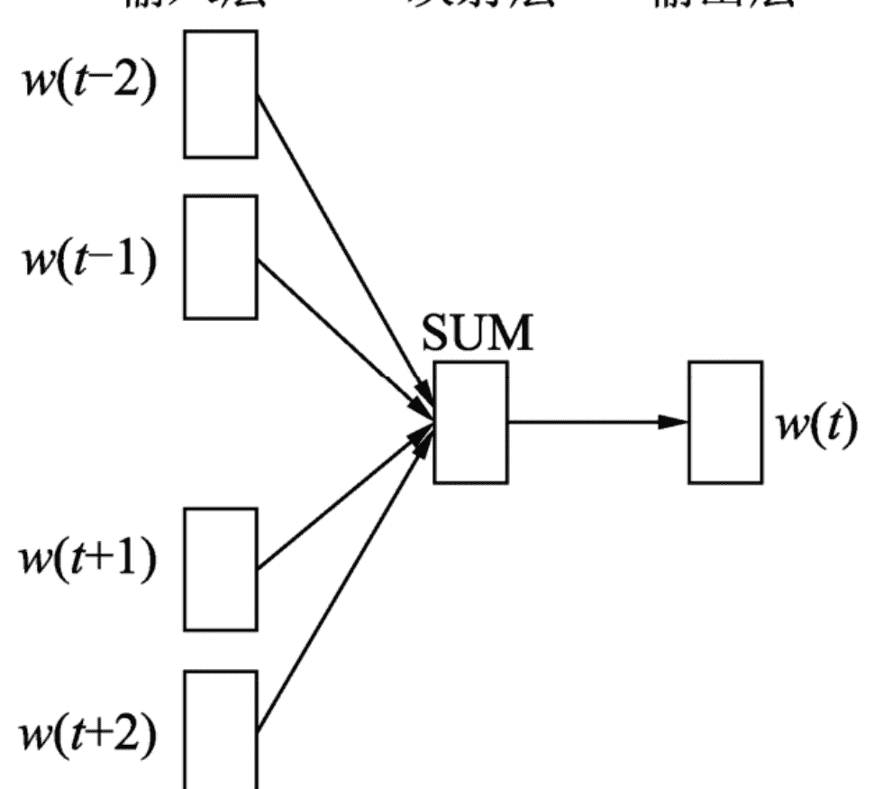

$$h = \frac{1}{2c} \sum_{i=1}^{2c} x_i$$

$$p(y_i | \text{context}(y_i)) = \text{softmax}(h) = \frac{\exp w_j h}{\sum_i \exp w_i h}$$

为优化softmax计算，CBOW把最后一层改为层级结构，即树形softmax。计算量下降，对效果影响不大，后面讲fastText时会再提。

损失函数为交叉熵。训练是有监督的，但样本由语料自动构建，也常被称为无监督或自监督。训练得到的词向量会携带部分词的特性，虽然不一定完整对应语义，但对下游NLP任务帮助很大。例如机器翻译，即使只有位置信息，也能借助上下文推测当前位置更可能出现的词。

Skip-gram的思路与CBOW相似，都可看作超浅层网络。区别在于训练方式：Skip-gram以一个词为输入，预测其前后c个上下文词，c同样为超参数，如图2.2所示。

CBOW的projection是求平均，Skip-gram的projection则直接使用输入。

Skip-gram同样面临softmax计算量问题，但没有采用层级方案，而是使用负采样，用采样估计softmax值而非精确计算。

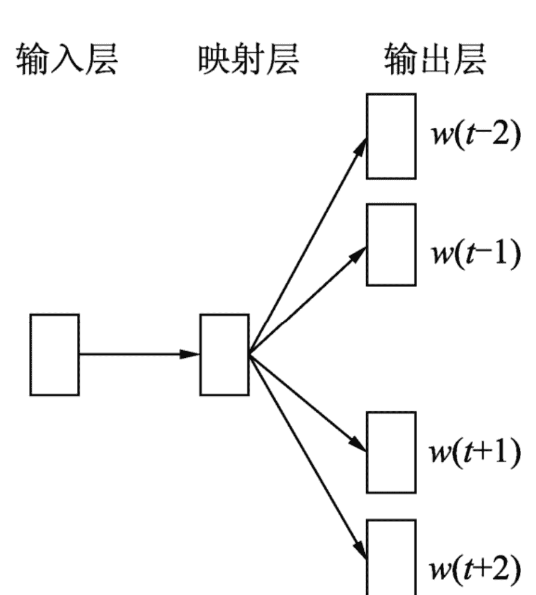

从softmax公式可看出，词表很大时分母需要对所有词求和，计算代价高。

$$\frac{1}{8} = \frac{1}{2} \times \frac{1}{2} \times \frac{1}{2}$$

层级softmax的核心是基于树形结构逐步计算概率贡献，而非逐项相加再归一化。例如8个球中选中b的概率，可先算a~d的1/2，再算a、b的1/2，最后算b的1/2，相乘得到最终概率。

负采样可理解为用少量代表性样本估计整体概率，再做缩放即可。

下面给出softmax负采样的推导，需要微积分与期望知识。

$$P(x) = \text{softmax}(x) = \frac{\exp(-f(x))}{\sum_{x' \in X} \exp(-f(x'))}$$

这一步统一softmax公式没有问题，关于f(x)，很多场景就是权重与输入h相乘，这里h即x。f(x)未展开，可视为任意函数。

两边取对数，把连乘变连加。交叉熵也包含对数。

log P(x) softmax的导数可拆为两部分，对分母求导后得到：

$$\log P(x) = -f(x) - \log \sum_{x' \in X} \exp(-f(x'))$$

再求导以获得梯度用于反向传播。

$$\nabla(-\log P(x)) = \nabla f(x) - \frac{\sum_{x' \in X} [\exp(-f(x')) \nabla f(x')]}{\sum_{x' \in X} \exp(-f(x'))}$$

最后一项每个分子分母配对后可化为P(x')：

$$\nabla(-\log P(x)) = \nabla f(x) - \sum_{x' \in X} P(x') \nabla f(x')$$

因为P(x')是概率分布，最后这一项相当于对∇f(x)关于P(x')的期望。

为避免计算P，采用近似分布Q代替P：

$$E_p \nabla f(x) = E_Q \frac{P(x)}{Q(x)} \nabla f(x)$$

但此时仍需计算P的分母，未减少计算量。继续观察，分母是和式，可看作均匀分布的期望：

$$Z = \sum_x \exp(f(x)) = M \sum_x \frac{1}{M} \exp(f(x))$$

再用Q分布代替均匀分布，形成基于Q(x)的期望：

$$Z' = \frac{M}{N} \sum_{x \in Q} \frac{1}{MQ(x)} \exp(f(x))$$

这里N是基于Q分布采样的样本数，为降低计算量，N需小于原词表规模M。

为平衡权重，采样需除以项数N：

$$E_p \nabla f(x) = \frac{1}{N} \sum_{x \in Q} \frac{\exp(f(x))}{Q(x)Z'}$$

与Z'类似，采样引入1/N平衡项，可与分母Z约掉：

$$E_p \nabla f(x) = \frac{\sum_{x \in Q} \nabla f(x) \exp(f(x)) / Q(x)}{\sum_{x \in Q} \exp(f(x)) / Q(x)}$$

最终得到可基于Q分布采样计算的期望近似，从而用负采样近似softmax。极端情况下N取1也可行。

理解Word2vec后，便可进入fastText和Doc2vec的学习。

一个自然的问题是：有了Word2vec，能否直接用于文本分类？

当然是可以的，关键是怎么用。只要文本被转成词向量集合，分类就变得很直接。最粗暴的做法是把一句里所有词向量加总，再做一次线性映射，最后过 sigmoid 就能得到二分类概率。fastText 在这个思路上做了工程化封装，效果类似。

### 2.2.2 fastText模型
fastText 是 Facebook 2016 年开源的词向量与文本分类工具，从学术创新角度看并不惊艳，但工程价值很突出。分类精度能跟深度网络打平，训练与推理速度却快上几个数量级。单机多核环境下，训练十亿词规模的词向量约十分钟；对五十多万条句子做三十万类别的分类，约一分钟完成。乍看很像 XGBoost，核心也是把工程难点解决好，拿效果说话。

容易被误解的是 fastText 并不是单一模型，而是两套思路。n-gram 特征有两种用法：一种是服务于词向量训练，用 subword 缓解低频词和 OOV 的问题；另一种是服务于文本分类，通过一些加速技巧提升训练与推理效率。训练词向量时指第一种用法，Skip-gram 与 CBOW 都可选择。

#### 1. n-gram特征
这里的 n-gram 指字符层面的子词，与分词时常用的 bi-gram 不一样。以 n 取 3 为例，apple 会被拆成 5 个 subword，每个 subword 都有自己的向量。

不加 subword 时以 Skip-gram 为例：

$$p(w_c | w_t) = \frac{\exp(s(w_c, w_t))}{\sum_{j=1}^{W} \exp(s(w_t, j))}$$

**w** 用来预测目标上下文词，**w** 是前后若干词向量之和。

tc

$$s(w_c, w_t) = u_t^T v_c$$

s 为打分函数，本质是两个向量的内积。

引入 subword 并不是把词向量完全替换，也不是简单拼接。输入侧 **w** 用 subword 向量之和，输出侧 **w** 仍用词向量。

tc

$$s(w, c) = \sum_{g \in G_w} z_g^T v_c$$

**z** 表示 subword 向量，共 G 个，apple 的情况就是 5 个。

gw

通俗讲就是用输入词的 subword 之和去预测上下文词的词向量。CBOW 的做法相反，用上下文词的 subword 之和去预测中心词。注意上下文侧不再使用词向量，全部换成 subword。这样词向量与 subword 向量就能联合训练出来。

中文场景 fastText 依然基于分词的词向量，而不是字向量，所以 n-gram 其实是字组合。英文字母只有 26 个，组合种类有限，常规语料基本能覆盖大部分情况。中文汉字数量大，即便 2-gram 也很难完全覆盖，所以 OOV 改善有限。也可以直接用字向量跳过 n-gram，但效果需要重新验证。

fastText 的词向量只做 n-gram 优化，分类模型里用的 n-gram 是另一层含义，后面会讲。

fastText 的分类模型与 CBOW 架构相近：输入层把词向量送入网络，加权平均得到 h，再据此预测类别。不同点在于 CBOW 输入是中心词的上下文，fastText 输入是整段文本；CBOW 输出是中心词的概率，fastText 输出是文本所属类别。

另外 fastText 在分类时也加入了 n-gram 信息，这里更像分词里的 bi-gram。举例 “he is a car engineer”，加入 bi-gram 后会变成 “he/he is/is/is a/a/a car…”，tri-gram 则会是 “he/he is/he is a/is/…”。

这种 n-gram 对中文同样有效，本质是双字向量或双词向量。但 Embedding 空间会迅速膨胀。fastText 用哈希索引压缩空间，让部分组合共享同一个 Embedding。语义冲突不可避免，若哈希桶设计合理，对最终结果的影响能控制得很小。

对特征空间做哈希压缩并非 fastText 独有，当特征空间过大且分布不均时，哈希相当于把低频向量合并，让它们训练成多个低频向量的平均值，既保留一定语义又省空间。哈希的先验是高频特征占比不高，随机哈希更可能撞到低频特征。若担心风险，可先统计特征频率，只对低频特征做哈希，进一步降低对指标的干扰。

#### 2. 分层softmax
CBOW 做语言模型训练时本质是分类任务，预测位置上的词属于词表中的哪一个。最后一层通常用 softmax：

$$softmax = p(w_t | h_t) = \frac{\exp(-f(w_t, h_t))}{\sum_{w'} \exp(-f(w', h_t))} = \frac{\exp(-w_t^T h_t)}{\sum_{c=1}^C \exp(-w_c^T h_t)}$$

它模拟不同类别的概率分布。可问题是类别数动辄数万上十万，softmax 计算负担很重。目前主流的缓解办法是分层 softmax 与随机负采样，这里先讲分层 softmax，其结构如图 2.3 所示。

### 2.2.3 Doc2vec模型
Doc2vec 由 Tomas Mikolow 与 Quoc Le 于 2014 年提出，论文为 Distributed Representation of Sentences and Documents，Tomas Mikolow 也是 Word2vec 的作者之一。

### 1. Doc2vec文本分类
分布记忆段落向量 PV-DM 的结构与 Word2vec 的 CBOW 几乎一致，如图 2.4 所示。唯一的区别是多了一个 Paragraph ID 向量，也就是文档 ID，这正是 Doc2vec 的核心。该向量与另外三个上下文向量的拼接或平均用于预测第四个词，整体训练方式与 CBOW 接近。

上下文长度固定，如图中的 3 个词。段落向量由同一段落产生的训练样本共享，不同段落不共享。而词向量矩阵 W 是跨段落共享的，每个段落或文章只有自己的段落向量，词向量保持全局一致。

分布词袋段落向量 PV-DBOW 与 Skip-gram 类似，如图 2.5 所示。它直接用段落向量预测窗口内的词，通过每篇文章的向量预测整篇文章所有窗口的词。段落向量与窗口词构成训练样本。

这种方式让段落向量在训练中保留更重要的全文信息，类似注意力机制，而简单加权平均容易被大量无意义词稀释。有人认为段落向量包含顺序信息，但训练机制难以证实。PV-DM 用前后词预测中间词，可能会带一点顺序信息，PV-DBOW 则完全不考虑顺序。

Doc2vec 在斯坦福情感分析树库上的表现如图 2.6 所示。当时尚未有 BERT 等深层模型，Doc2vec 继承了 Word2vec、fastText 的易训高效优点。与 BERT 对比不算公平。

粗粒度二分类与精细五分类上，朴素贝叶斯、SVM、bi-gram 朴素贝叶斯、词向量平均、RNN 等均弱于 Doc2vec。PV-DBOW 训练上看似是词向量加权平均得到段落向量，但效果明显优于直接对词向量求平均。

| Model | Error rate (Positive/Negative) | Error rate (Fine-grained) |
| :--- | :---: | :---: |
| Naïve Bayes (Socher et al., 2013b) | 18.2 % | 59.0% |
| SVMs (Socher et al., 2013b) | 20.6% | 59.3% |
| Bigram Naïve Bayes (Socher et al., 2013b) | 16.9% | 58.1% |
| Word Vector Averaging (Socher et al., 2013b) | 19.9% | 67.3% |
| Recursive Neural Network (Socher et al., 2013b) | 17.6% | 56.8% |
| Matrix Vector-RNN (Socher et al., 2013b) | 17.1% | 55.6% |
| Recursive Neural Tensor Network (Socher et al., 2013b) | 14.6% | 54.3% |
| Paragraph Vector | **12.2%** | **51.3%** |

图2.6 情感分析技术对比

### 2. Doc2vec的其他应用
Doc2vec 除分类外，还可用于文本相似度、打标签等。打标签本质也是分类，但做法不同：在训练段落向量的同时，把当前段落的标签也加入输入序列，与窗口前三个词一起预测下一个词。标签来自预先标注，所以看似无监督实则带监督。训练结束后每个标签变成一个向量，推理时用段落向量与标签向量算距离，距离最近的即为该段落的标签。

该做法源于公司内部实践，打标签准确率高于直接用 Word2vec 等做分类。打标签常需批量执行，如今日头条日均新闻几十万条，二三线 App 也在几万量级。选择 BERT 这类重模型指标可能提升，但容易导致线上队列积压，积压过久就是事故。

因此评估模型不能只看指标，还要看计算量、推理速度、手工特征依赖度等。部分大厂只负责提指标，工程团队负责压缩优化，但即使优化后的 BERT 在同配置节点上也难以达到 fastText 的推理速度。模型压缩是扩大重模型使用范围的重要手段，在对推理性能要求不高的场景下，可以兼顾指标与效率。

介绍了两个轻量高效的模型，下面进入重模型相关的内容。

## 2.2.4 softmax加速
本节展开 CBOW 与 Skip-gram 的 softmax 技术，涉及公式推导。

### softmax为什么需要加速?
语言模型输出层的 softmax 公式为：

$$p(y|h) = \frac{\exp(-w_y h)}{\sum_{i=1}^{N} \exp(-w_i h)}$$

h 为用于 softmax 的向量，w 均为词向量。推理时分母相同可省略，只比较分子；训练时交叉熵需要概率分布，分母不可省。推理时若无特殊设计，需要遍历全部词计算分子，也就顺带得到分母。当 N 很大时计算量不可忽略，N 代表词表大小，1 万词即每步 1 万次计算。为此提出两种降本方法。

### 1. 层级softmax (Hierarchical softmax)
基于层级结构的 softmax，把最后一层改为层级预测。可把 softmax 层想象成一棵平衡二叉树，非叶子节点负责分类，叶子节点确定词。

Morin 与 Bengio 2005 年提出把输出层改造为层级二叉树，词表作为叶子节点，基于 WordNet 词义相似性自下而上合并形成父节点，最后到根节点。等价于基于 WordNet 做层次聚类生成二叉树。

所有词在叶子节点，非叶子节点无词只有聚类语义。计算时像二分查找，从上到下一级级选择。例如第一级区分 “生物” 子树与 “物品” 子树，概率分别为 0.6 与 0.4；第二级在 “生物” 下区分 “动物” 与 “植物”，概率 0.7 与 0.3；第三级再区分 “人类” 与 “非人类”。最终单词概率可表示为各层条件概率的乘积。

标准公式为：

$P(v | w_{t-1}, \cdots, w_{t-n+1}) = \prod_{j=1}^{m} P(b_j(v) | b_1(v), \cdots, b_{j-1}(v), w_{t-1}, \cdots, w_{t-n+1})$

每个节点的概率可通过 sigmoid 计算：

$P(b(v)) = \text{sigmoid}(b + Wh + UN)$

其中 W、U 为训练权重，b 为偏置，h 为 softmax 层输入，N 为当前节点向量，可由子节点向量加权求和或直接训练得到。训练时已知标签，最大化对应路径概率；推理时沿最大概率路径向下，最终得到概率最高的词。

注意中间节点如 “物品”“生物”“动物”“植物” 都是语义聚类生成的中间表示，并非最终单词，单词在叶子节点。

普通 softmax 需要遍历所有节点，1 万词要 1 万次计算。二叉树查找只需约 $\log_2 10000 \approx 13.3$ 次，平衡树下约 14 次即可出结果，速度提升显著。缺点是分层 softmax 计算的语言模型 PPL 通常比标准 softmax 差，即使引入 WordNet 专家知识也难以完全弥补。

WordNet 的层级并不是模型从语料里自己长出来的，而是靠外部知识提前写死的。于是层级 Softmax 在每一层都挑概率最大的分支往下走，这种贪心策略往往捡不到全局最优。举个极端情况，走到“生物”这条路的概率是0.6，“物品”是0.4，于是先走0.6。假设0.6下面最好的子节点只有0.5，而0.4下面最好的子节点有0.9，那么实际联合概率是 0.4×0.9=0.36，已经超过了 0.6×0.5=0.3，选错分支就不可避免。Mnih 和 Hinton 希望树能够从数据里自动长出来，并且比人工树的表现更好。他们在2008年用了启发式的建树思路：先随机构造一棵二叉树，用它训练，训练结束后依据得到的词向量对树进行调整，反复迭代直到结构稳定，最后得到一棵比较均衡的二叉树。

Le 等人在2013年提出了一种基于类别的NNLM，输出层做成结构化形式，称为结构化输出层NNLM。给定历史 h，条件概率可以写成：

$$P(w_t | h) = P(c_1(w_t) | h) \prod_{d=2}^{D} P(c_d(w_t) | h, c_1, \cdots, c_{d-1})$$

从形式上看跟之前的二叉树Softmax并无本质区别，条件概率的写法也没有显露出差异，只是树不再是严格的二叉，也不再强制平衡。

真正的区别在于层级是怎么建出来的。做法是先做一次预训练，把词向量的维度压得非常小。目标模型可能是200维，预训练时先用20维甚至更低。预训练阶段的Softmax仍是全量计算，但因为维度低、权重也小，计算量是可以接受的。

随后基于这20维的向量做聚类，一层层往上合并直到收敛到一个或几个根。这里得到的不再是单棵树，而是一片森林：多棵树并存，中间节点可能拥有若干子节点，也可能一个子节点都没有，没有子节点时它就成为叶子，直接对应词向量本身。

层级建好后，再进行正式训练。虽然预训练多花了一些时间，整体耗时没有指数级下降，但相比全量Softmax仍快很多。而且聚类依据的是预训练后的向量，直观且稳定，困惑度PPL的劣化相对较少。

无论是平衡二叉树、固定层级树还是非二叉的森林，层级Softmax最终都要落到一棵固定的树上做硬分类。硬分类会让NNLM的性能受损，PPL数值上扬。所以有必要探索软分类的方案，在降低训练成本的同时保持甚至改善PPL。

### 2. 基于采样的评估

用NNLM计算下一个词的条件概率时，Softmax的分母需要归一化，成本极高。一种思路是只随机或启发式地挑输出里的一小部分，用它来估计概率。

Bengio 和 Senecal 在2003年提出了重要抽样和自适应重要抽样，用来加速NNLM训练。

Softmax的表达式为：

$$p(w_t | h_t) = \frac{\exp(-f(w_t, h_t))}{\sum_{w'} \exp(-f(w', h_t))}$$

这里的历史 h 对推导没有影响，可以先忽略，公式相应简化。

## 2.3 文本分类的深度学习方法

2.2 节讲了词向量在文本分类里的作用，可以说词向量是所有NLP神经网络、深度学习模型的基础第一步，后续模型都建立在它之上。词向量既可以预训练，也可以为任务重新训练，实践中迁移预训练词向量效果通常更好。

接下来先介绍RNN里最核心的概念LSTM。

### 2.3.1 LSTM简介

本节聚焦基于RNN的文本分类。

人脑处理图像时是并行的，其它信息处理基本是串行的，比如语言的听和说。现实世界里序列事件也很常见，像天气、股价波动等。

SVM、DNN、朴素贝叶斯处理序列样本时往往把内部特征拆散，如果想建模先后顺序，就得手工加入位置信息，比如Transformer的位置编码或n-gram。这些做法不够直接，是否有像马尔可夫链那样专门处理序列的模型？RNN就是。原始RNN的公式是：

$$h_t = \tanh(W_{x_t} + Uh_{t-1} + b)$$

x 是当前时刻输入，h 是上一时刻输出，如图2.8所示。

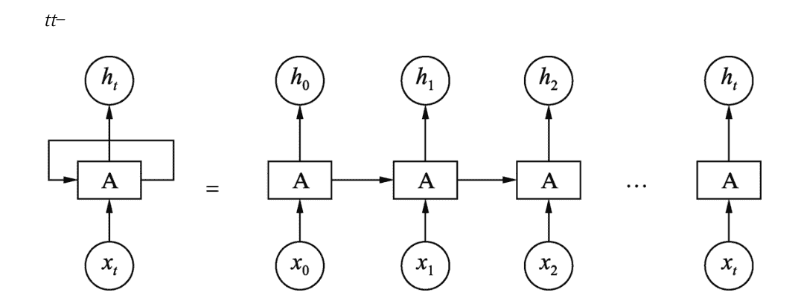

把上一步结果作为下一步输入的递推逻辑，和大量现实过程、人脑运行方式相符。

但原始RNN拟合能力有限，远期依赖在迭代里很容易消散，也就是记不住远期的关联。看公式可知每一步都固定乘一个权重，很难学到特定关系。比如“我从小在法国长大……我会说法语”。人很容易联想到法国。模型若不依赖前一句的“法国”，用n-gram预测，后续语言几乎都可能。RNN的弱点就在此，前一句的“法国”离要预测的词太远，即使信息曾留在权重里，经过多次循环也难以保留。这就是长期依赖问题，在NLP里始终是难点，后来的LSTM、Transformer也只是缓解了“不太远”的依赖。原始RNN见图2.9，效果基本和n-gram相当，除非依赖长度固定，否则学不到。

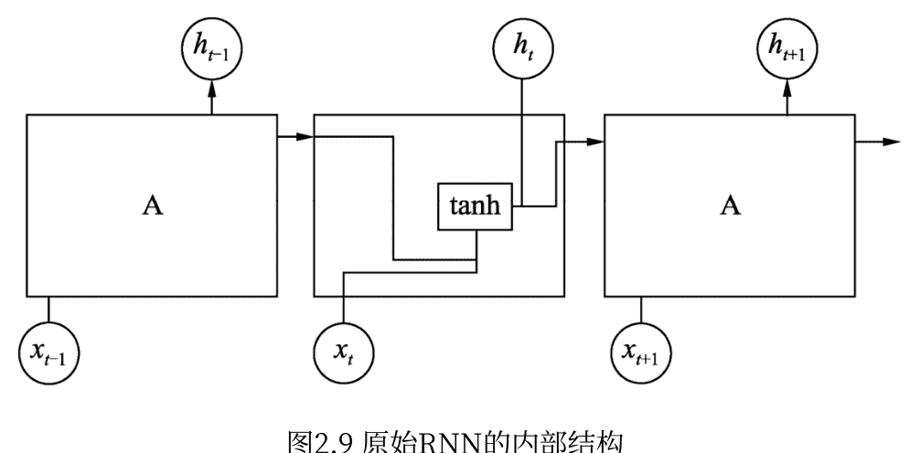

还有严重的梯度消失和梯度爆炸。梯度爆炸可粗暴截断，梯度消失则难处理。

梯度消失/爆炸的本质是权重在迭代中反复自乘，起始值小于1则N次方后趋近零，大于1则爆炸。于是提出LSTM，其内部结构如图2.10所示。

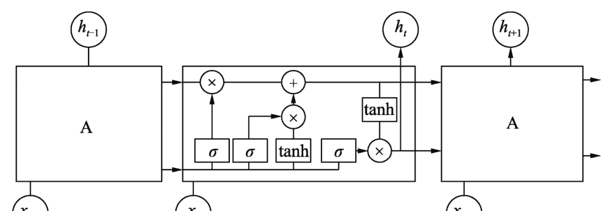

原始RNN无法拟合远依赖的原因在于上一步输出必然被当前输入干扰，信息无法直接流到真正需要它的时刻。解决思路之一是开一条高速通道，让信息绕过当前输入直接传递下去。LSTM结构图的图标说明如图2.11所示。

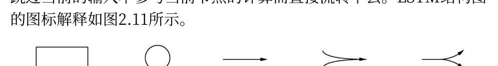

图中圆圈里是加号则按位相加，是乘号则按位相乘。

LSTM有两条通道，下层延续了RNN的思路，上一输出与当前输入结合产生下一步输出。上层则让上一输出可以直接流转。信息是否流转需要判断，否则所有信息都往下走就等于没走，如图2.12和图2.13所示。

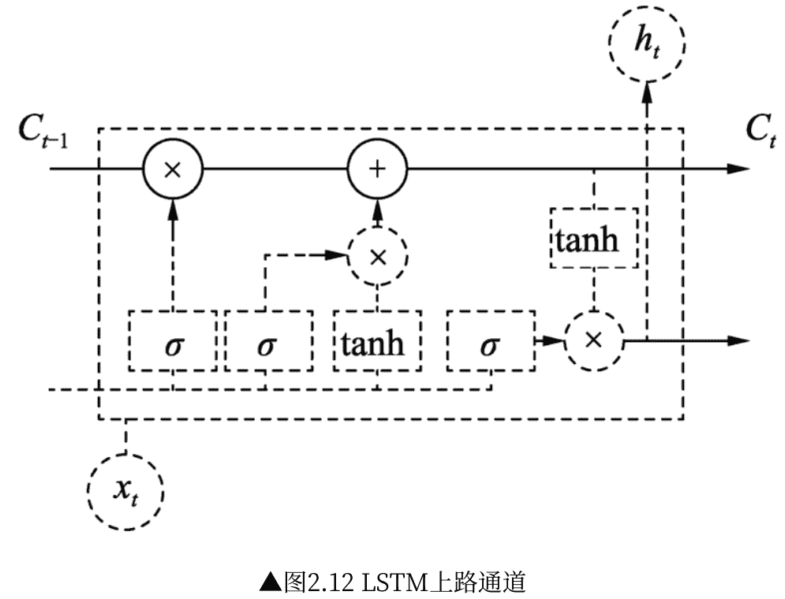

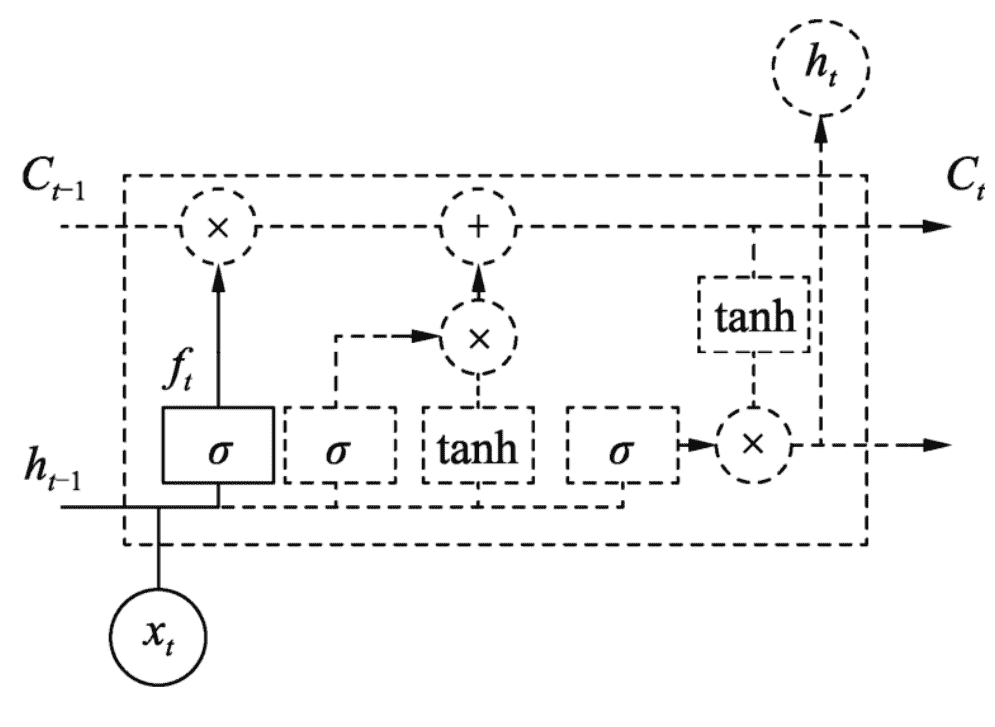

判断依据是把上一步下路信息与当前信息拼接激活，得到一个比率，用来决定上一步上路信息向下流动的量。比率为0就相当于清除，为100%就完全保留。这个比率就是遗忘门。

$$f_t = \sigma(W_f h_{t-1}; x_t + b_f)$$

x 是当前输入，h 是上一步状态输出，W 和 b 是遗忘门的权重，训练得到。

不要把遗忘门想成只能0或1。sigmoid仍是激活函数，取值0到1，常被视作概率，更多时候是中间值。

有了保留旧信息的方法，如何保留当前信息？输出时又该如何合并旧信息和新信息？

当前信息先要处理。h 与 x 拼接会让维度变大，为保持兼容需要降回与 h 相同维度。最简单的做法是线性变换：

$$C'_t = W_c h_{t-1}; x_t + b_c$$

W、b 同样由训练决定。

再加上tanh激活：

$$C'_t = \tanh(W_c h_{t-1}; x_t + b_c)$$

这些信息是否全部保留并送入下行通道？不一定。全保留会持续干扰向后传递的信息。于是设置输入门来控制保留比例，如图2.14所示。

$$i_t = \sigma(W_i h_{t-1}; x_t + b_i)$$

$$C_t = f_t \cdot C_{t-1} + i_t \cdot C'_t$$

C 就是上一步与当前步需要传递下去信息的融合，即两项相加，如图2.15所示。

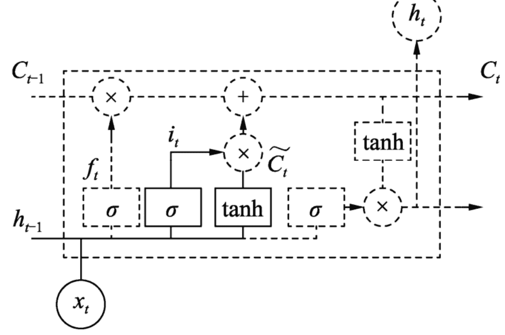

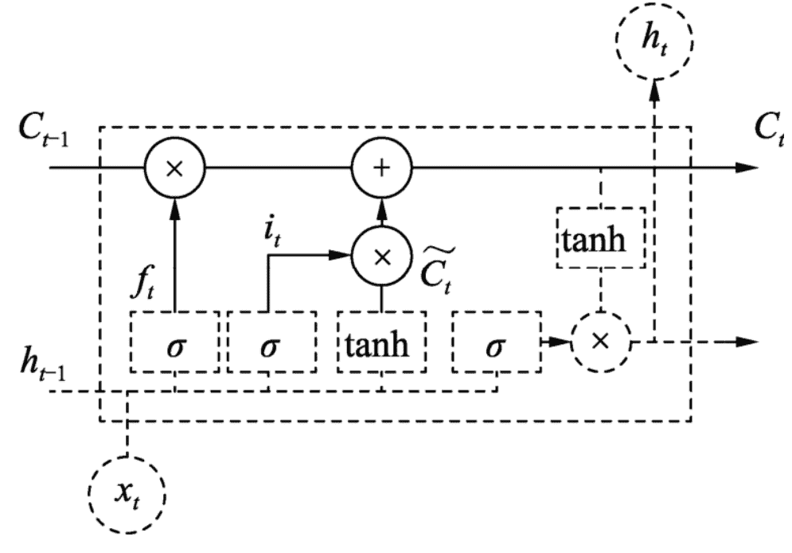

可向下流转的有价值信息也可用于当前输出。不过C里包含很多对当前输出无用的、但后面可能依赖的信息，需要做删减。于是LSTM再用输出门控制输出比例，如图2.16所示。

从数值上看也有必要，C由两项之和产生，不控制会让某类信息反复累加导致偏置。

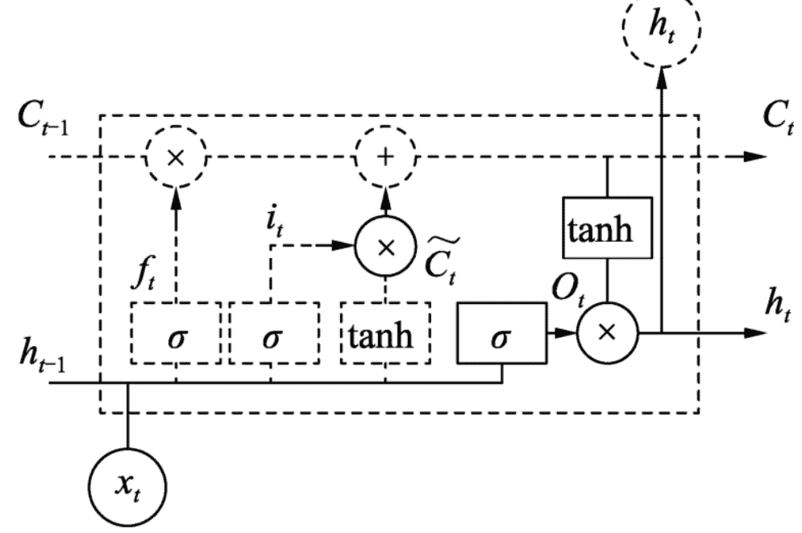

$$o_t = \sigma(W_o h_{t-1}; x_t + b_o)$$

$$h_t = o_t \cdot \tanh(C_t)$$

以上就是LSTM为解决原始RNN问题而设计的思路，理解思路最关键。

整理后的公式如下：

$$f_t = \sigma(W_f h_{t-1}; x_t + b_f)$$

$$C'_t = \tanh(W_c h_{t-1}; x_t + b_c)$$

$$i_t = \sigma(W_i h_{t-1}; x_t + b_i)$$

$$C_t = f_t \cdot C_{t-1} + i_t \cdot C'_t$$

$$o_t = \sigma(W_o h_{t-1}; x_t + b_o)$$

$$h_t = o_t \cdot \tanh(C_t)$$

明白思路后，拟合长期依赖不只有LSTM一种。GRU把遗忘门和输入门合并，用1减遗忘门值来替代输入门。

$$f_t = \sigma(W_f h_{t-1}; x_t + b_f)$$

$$C'_t = \tanh(W_c h_{t-1}; x_t + b_c)$$

$$C_t = f_t \cdot C_{t-1} + (1 - f_t) \cdot C'_t$$

$$o_t = \sigma(W_o h_{t-1}; x_t + b_o)$$

$$h_t = o_t \cdot \tanh(C_t)$$

上式的逻辑是下行总线和当前输出的总线宽度固定，上一信息量大且对后续更重要，遗忘就少、保留就多，当前保留就只能少；反之亦然。若两边信息都重要，则各自按比例减小后再合并。因为输入门与遗忘门之和为1，不会出现信息反复累加偏置的问题，所以输出门也可以去掉以减少计算。实践中GRU在很多场景与LSTM效果相近，计算量更小、训练更快，因而更受欢迎。

基于LSTM或GRU的文本分类实现很简单：分词后按词顺序输入RNN单元，再取最后单元输出或把所有时间步输出拼接，最后做Softmax分类。

若用Bi-LSTM双向方案，正向输入一次、反向输入一次，把每个词的正反输出拼接，最后取第一个词的输出做分类也是可行做法。虽然人类处理是单向的，但思考时可正反来回，实践中双向RNN多数情况下优于单向。

LSTM天然包含词序信息，无需额外特征工程就能较易超过词袋模型。Word2vec、fastText、Doc2vec都忽略词序，属于词袋模型。fastText和Doc2vec虽带少量局部词序信息，对只需关键词就能判断类别的任务如“火炮-军事”“婴儿-母婴”，LSTM未必能显著超越。同时RNN顺序执行无法并行，推理效率偏低，模型选择需结合场景。

RNN和LSTM如何分类？处理后的词向量仍是向量，可全部求和后线性变换激活。也可用最后一个词的输出代表整段文本，因为理论上它已包含前面所有信息。

### 2.3.2 Tree-LSTM简介

LSTM只能处理序列，虽然RNN初衷是序列，但自然语言本身有结构，且以序列形式保存使用，后续句法分析会看到树状结构。主谓宾、修饰语等都是对主体语义的修饰。

LSTM名义上是长短时记忆，实际可识别的长期依赖仍不够远，容易被中间的形容词、副词把关键信息洗掉，导致效果不佳。

这里不是否定LSTM。后续会讲句法分析的树形结构在深度学习时代是否仍有意义，对比LSTM与Tree-LSTM，在多数NLP任务中LSTM效果更好，因为Tree-LSTM更擅长拟合远的核心信息，而多数任务只需局部短期依赖即可，fastText只加一个bi-gram就能表现不错也是同理。

Tree-LSTM的句子结构是树型，网络结构也做成树型，从下往上逐级合并到根，展开后与LSTM的线性流向逻辑一致，如图2.17所示。

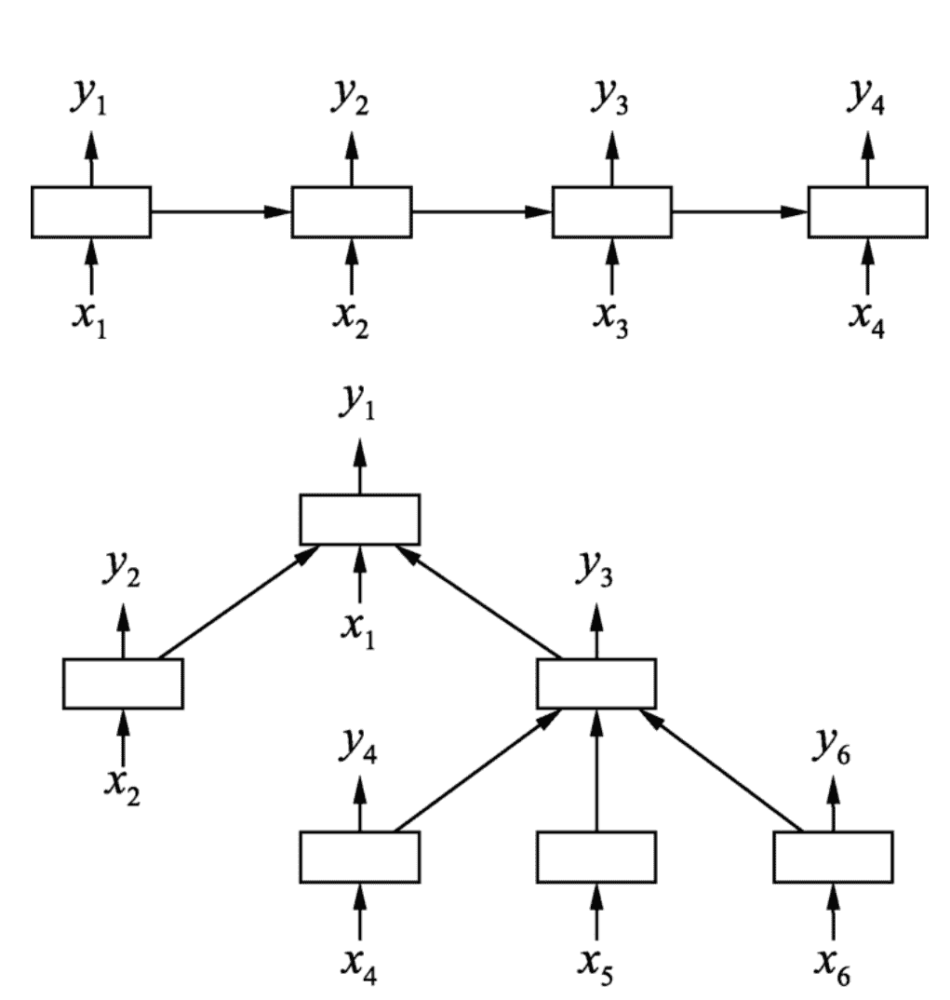

图中有6个输入 x1~x6，每个是字向量或词向量。结构可任意，只要符合先验逻辑即可，常见做法按句法或语义分析构建。如何得到结构后面章节会讲。

正向传播公式如下。

$$h'_j = \sum_{k \in C(j)} h_k$$

C(j)表示j节点的所有子节点，h表示子节点输出，与LSTM类似，前面单元有两个输出输入当前单元c和h。

这里对所有子节点输出直接求和，把子节点视作一个整体。

$$i_j = \sigma(W^i x_j + U^i h'_j + b^i)$$

$$o_j = \sigma(W^f x_j + U^f h'_k + b^f)$$

输入门和输出门的计算方式与LSTM相同。

$$f_{jk} = \sigma(W^f x_j + U^f h_k + b^f)$$

因存在多个子节点，存在多个c输入，遗忘门也需要多个，每个c对应一个遗忘门。也可像h一样求和后用统一遗忘门，但各子节点信息权重不等。

$$u_j = \tanh(W^u x_j + U^u h'_j + b^u)$$

$$c_j = i_j \bullet u_j + \sum_{k \in C(j)} f_{jk} \bullet c_k$$

$$h_j = o_j \bullet \tanh(c_j)$$

后续数据输出仍与LSTM一致，只有c的计算是用多个遗忘门加权求和，相当于对各子节点信息做加权合并。

Tree-LSTM 的设计空间和 LSTM 本身一样宽泛，业界已经出现不少分支做法。论文里重点演示的两类结构中，先前讲到的属于 Dependency Tree-LSTM。它不对子节点的个数做限制，树形可以相当自由，因此传到父节点的隐藏状态个数是可变的，只能做简单累加，无法按位置区分重要性。

要克服这种无差别累加的限制，论文引入了另一个变体 Constituency Tree-LSTM，核心思路是把子节点数量钉死，例如二叉或三叉结构，因而也被称为 N 叉 Tree-LSTM。这样每一个位置的隐藏状态都能获得独立的权重参与聚合。

假设结构为 N 叉，则有：

$$i_j = \sigma(W^i x_j + \sum_{l=1}^N U_l^i h_{jl} + b^i)$$

$$o_j = \sigma(W^o x_j + \sum_{l=1}^N U_l^o h_{jl} + b^o)$$

$$u_j = \tanh(W^u x_j + \sum_{l=1}^N U_l^u h_{jl} + b^u)$$

输入门、输出门以及当前记忆单元的更新方式和标准 LSTM 基本一致，唯一的不同在于多路隐藏状态先做加权汇总再进入计算。

$$f_{jl} = \sigma(W^f x_j + U_l^f h_{jl} + b^f)$$

遗忘门的计算仍然遵循 LSTM 的常规公式，由于每个子节点各自独立求解，节点之间不会相互干扰。

$$c_j = i_j \cdot u_j + \sum_{l=1}^{N} f_{jl} \cdot c_{jl}$$

$$h_j = o_j \cdot \tanh(c_j)$$

其余步骤的处理与 Dependency Tree-LSTM 保持相同。

在分类任务里，最终的预测输出为：

$$\hat{p}_{\theta}(y | \{x\}_j) = \text{softmax}(W^s h_j + b^s)$$

$$\hat{y}_j = \arg \max_y \hat{p}_{\theta}(y | \{x\}_j)$$

训练目标以交叉熵为主：

$$J(\theta) = -\frac{1}{m} \sum_{k=1}^{m} \log \hat{p}_{\theta}(y^k | \{x\}^k) + \frac{\lambda}{2} \|\theta\|_2^2$$

并额外加上一个 L2 正则项进行约束。

与普通 LSTM 类似，Tree-LSTM 不仅能做分类，也可迁移到相似度等任务，例如文本或语义匹配。

文本相似度常见做法分为双塔和单塔。双塔是准备两套相同结构，分别编码句子对的两个成员，再用最后的向量做运算得到分数，常见运算有点积即余弦距离，和差值平方和即 L2 距离。单塔则只用一个模型同时接收两句话，从输入阶段就开始交叉融合，最终直接给出得分。经验上，单塔在语义相似度评测中往往更优，但工程部署的便捷性远逊于双塔，所以实际落地较少。

Tree-LSTM 同样可以套用双塔范式，给两句话分别得到向量后用余弦或 L2 距离打分。论文里采用了折中方案：

$$h_{\oplus} = h_{L} \odot h_{R}$$

$$h_{\ominus} = |h_{L} - h_{R}|$$

$$h_{S} = \sigma(W^{\oplus}h_{\oplus} + W^{\ominus}h_{\ominus} + b^{h})$$

单就相似度评估而言到此已足够。论文进一步希望输出 1～K 的整数评分，因为语料标签本身就是 1～K 的离散分数，硬转成 0～1 的概率分布会显得不自然。

$$\widehat{p_{\theta}} = \text{softmax}(W^{p}h_{s} + b^{p})$$

此时损失改用 KL 散度，其本质与交叉熵等价。

$$J(\theta) = \frac{1}{m} \sum_{k=1}^{m} \text{KL}(p^{k} \parallel \widehat{p_{\theta}^{k}}) + \frac{\lambda}{2} \|\theta\|_{2}^{2}$$

接下来看实验。第一个实验仍在斯坦福情感分析树库上进行，包含二分类的正负向判断和细粒度的五类情绪预测，如图2.18所示。

| Method | Fine-grained | Binary |
| :--- | :--- | :--- |
| RAE (Socher et al., 2013) | 43.2 | 82.4 |
| MV-RNN (Socher et al., 2013) | 44.4 | 82.9 |
| RNTN (Socher et al., 2013) | 45.7 | 85.4 |
| DCNN (Blunsom et al., 2014) | 48.5 | 86.8 |
| Paragraph-Vec (Le and Mikolov, 2014) | 48.7 | 87.8 |
| CNN-non-static (Kim, 2014) | 48.0 | 87.2 |
| CNN-multichannel (Kim, 2014) | 47.4 | **88.1** |
| DRNN (Irsoy and Cardie, 2014) | 49.8 | 86.6 |
| LSTM | 46.4 (1.1) | 84.9 (0.6) |
| Bidirectional LSTM | 49.1 (1.0) | 87.5 (0.5) |
| 2-layer LSTM | 46.0 (1.3) | 86.3 (0.6) |
| 2-layer Bidirectional LSTM | 48.5 (1.0) | 87.2 (1.0) |
| Dependency Tree-LSTM | 48.4 (0.4) | 85.7 (0.4) |
| Constituency Tree-LSTM | | |
| &nbsp;&nbsp;&nbsp;&nbsp;– randomly initialized vectors | 43.9 (0.6) | 82.0 (0.5) |
| &nbsp;&nbsp;&nbsp;&nbsp;– Glove vectors, fixed | 49.7 (0.4) | 87.5 (0.8) |
| &nbsp;&nbsp;&nbsp;&nbsp;– Glove vectors, tuned | **51.0 (0.5)** | 88.0 (0.3) |

图2.18 Tree-LSTM的情感分析实验结果

两种 Tree-LSTM 的结构均来自句法分析得到的树。结果显示词向量随机初始化时表现最差，这符合直觉。采用固定 Glove 后提升明显，允许微调后效果最好，也在预期之内。有趣的是，即便使用微调的 Glove，在二分类上仍未超过多通道 CNN。说明对相对简单的二分类任务，远距离的长期依赖贡献有限，局部信息已足够获得不错效果，这一结论在后续句法章节还会再次出现。

各类 RNN 变体还有很多，这里不展开，后续会介绍 CNN 在文本分类上的模型。

## 2.3.3 DCNN模型

CNN 起初为图像的平移不变性而设计，但语言序列同样具备类似特性。比如一个词或词组的语义，通常不会因为在段首还是段尾就发生大幅改变。少数位置敏感的情形即使用复杂网络也很难稳定识别，先暂时忽略。基于此，短期依赖可用浅层卷积捕捉，长期依赖则交给深层网络，CNN 因而也能用于自然语言处理，效果相当可观，同时兼具并行计算优势，能充分利用 GPU。

下面介绍首次将 CNN 用于文本分类的 DCNN，Dynamic-CNN。

DCNN 采用了不少如今少见的手段，正因效果有限才逐渐被淘汰。学习深度学习时要有先验验证意识：每个小改动都是一种先验，需先经大脑判断其合理性，再放到模型里并通过消融实验检验正负贡献。不能只学已被证明有效的明星模型，否则难以分辨模型中众多先验的真实作用。以 BERT 为例，它刷新了大量 SOTA，但并非所有创新都有正贡献。例如 NSP 任务，从理论上看有价值，但负样本仅仅换成别篇文章的句子，差异过大，模型学到的更多是文章风格而非句子顺序。ERNIE 修改了 BERT 的 mask 机制，面对人名等实体时下一个词可被上文直接推断，上下文辅助意义不大，学到的信息也有限。若只追逐最先进模型，很难发现问题并据此创新。

DCNN 的结构如图2.19所示。第一层是标准的词嵌入，

$$s \in \mathbb{R}^{d \times s}$$

每个词映射为向量，整句形成一个 d 维、长度为 s 的矩阵。

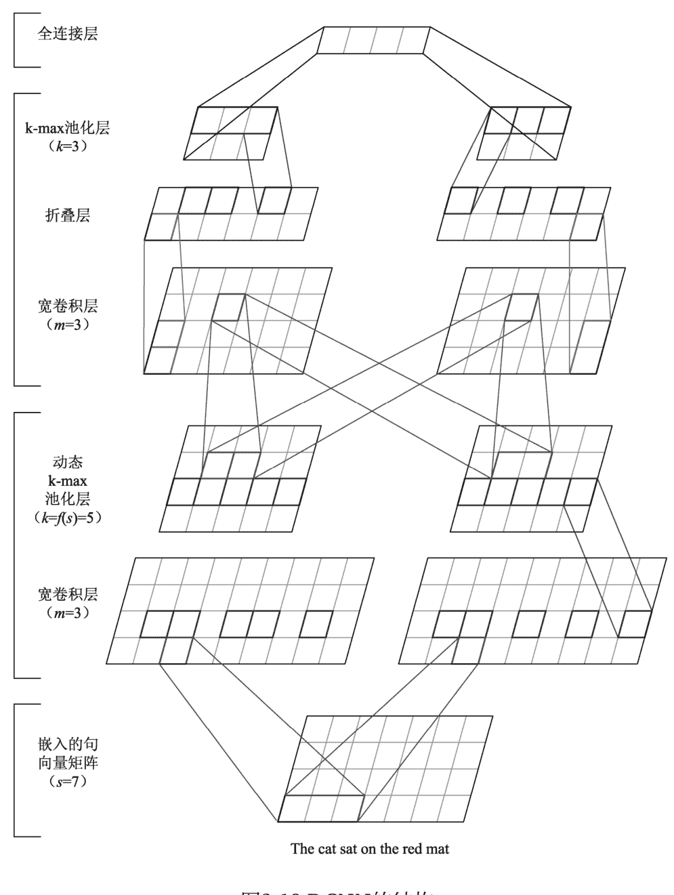

The cat sat on the red mat

图2.19 DCNN的结构

### 1. 宽卷积

第二层为卷积层，称为宽卷积，如图2.20所示。

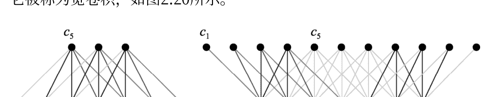

图2.20 正常的卷积与宽卷积示意

图示展示宽度为 5 的核做普通卷积与宽卷积的区别。普通卷积需要 5 个输入才开始计算，步长为 1 时输出长度为 s-5+1，图中 7 个输入对应 3 个输出。宽卷积则允许边缘位置只要有部分输入就开始计算，逐步补齐至核宽，输出数量与普通卷积相同，但总长度变成 s+5-1，图中 7 个输入对应 11 个输出。

这与为保持宽度的 padding 不同，padding 是在边缘补 0 维持形状，宽卷积是真正计算出来的，且长度会增加。

这种反直觉改进的动机是改善边缘信息的利用。普通卷积中两端的词参与计算次数少，中间词被反复使用。宽卷积强化了边缘。不过笔者认为价值有限，因为边缘输出多为单一词的直接映射，信息重复，且增加了后续计算负担。对于日常闲聊语料，句首多为连词，句尾多为语气词，关键信息往往不在两端。若需保持形状，改为不增加长度的宽卷积可能比补零更合理。

### 2. 动态topK最大池化

宽卷积后接池化，采用动态 topK 最大池化。普通 Max-Pooling 在窗口内取最大值，容易漏掉局部非最大但整体靠前的数值，例如序列 9,8,9,6,5,4，宽度 3 时 8 会被两个 9 掩盖。topK 池化直接全局排序取前 K 个，规避了这个问题。

动态 topK 的目的是随网络加深句子长度不断缩短，K 值需相应减小。论文采用基于层数和总层数预先计算的自适应公式：

$$k_l = \max(k_{\text{top}}, \frac{L - l}{L} s)$$

其中 l 为当前层序号，L 为总层数，s 为当前输入长度，k 为基础超参数，公式保证 K 随层数递减并设置下限。

随后接一个常见非线性变换。

### 3. 折叠

折叠操作把相邻的两个向量直接相加。注意相加维度是词向量的内部维度，而非词的顺序。相加本质上相当于全连接权重全为 1 的降维，参数减少但伴随信息损失。

### 4. 特征映射

特征映射即多套权重并行。Transformer 的多头注意力原理类似，同时训练多组参数从不同视角挖掘信息。虽然可多次训练取最优，但并行训练相当于扩大参数空间，增加模型容量又带来正则化效果。若只有一套权重，容易像普通池化一样丢弃非最优信息，多套权重则更可能保留。

实践中多套权重多数情况下有正面贡献，代价是计算量上升。

| Classifier | Fine-grained (%) | Binary (%) |
| :--- | :---: | :---: |
| NB | 41.0 | 81.8 |
| BiNB | 41.9 | 83.1 |
| SVM | 40.7 | 79.4 |
| RECNTN | 45.7 | 85.4 |
| MAX-TDNN | 37.4 | 77.1 |
| NBoW | 42.4 | 80.5 |
| DCNN | **48.5** | **86.8** |

图2.21 实验结果

多套权重的计算在前段并行，最后通过全连接合并所有输出。

## 2.3.4 TextCNN模型

TextCNN 比 DCNN 简洁得多，本质是把最原始的 CNN 应用到文本分类，并加入少量技巧，如图2.22所示。

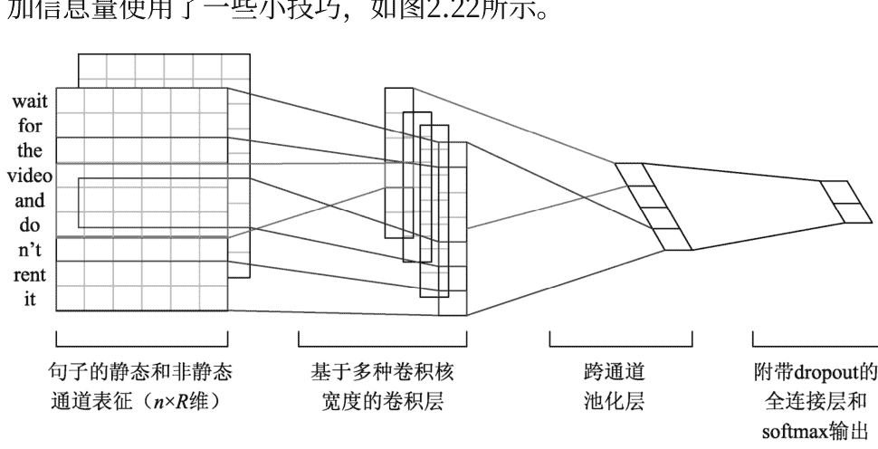

词向量使用上，每个词拥有两套 Word2vec 预训练向量，一套在训练中固定，另一套允许微调。经验上，面对多任务场景，固定一套可防止精调覆盖原有知识；对于长期增量训练，也能避免反复微调导致预训练信息偏离。若反复精调，可能逐渐退化为随机初始化的效果，失去预训练的价值。

**多通道 TextCNN 真的更强吗**

在只做单一分类任务且不反复调优的设定下，额外补上一套固定不变的词向量，对最终成绩的帮助很有限。

卷积部分和常规一维卷积本质上没区别，差别是同时开了两路核宽。对每条句子的每个输入分别做两次卷积，先用核宽 2 再用核宽 3 来处理。目的就是从不同视角去挖掘信息，这个思路和前面用多套权重参数做特征提取是一样的。

做完卷积后接一个普通的 Max-Pooling，然后把两路词向量输入以及两种核宽的卷积结果全部拼接，直接送进全连接层得到类别概率。

TextCNN 的展开结构见图 2.23，对照着看会更清晰。

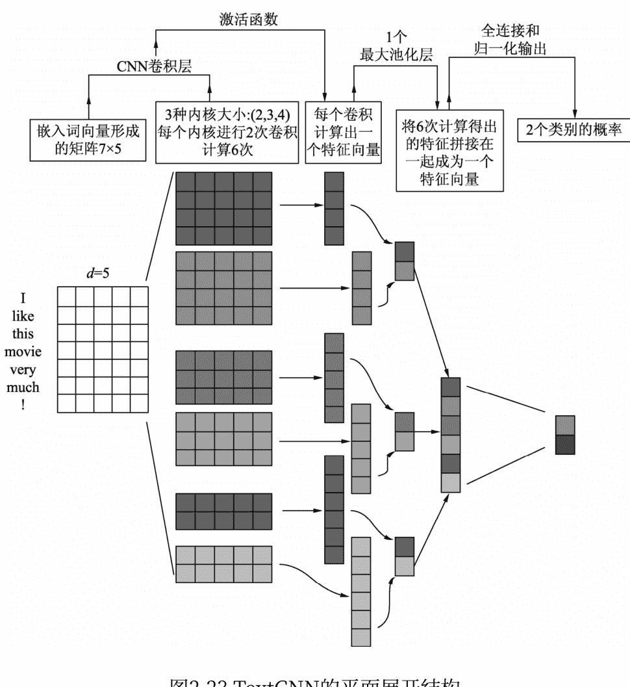

下面看实测表现，如图 2.24。MR、SST-1 等代表不同测试集。

CNN-rand 指词向量随机初始化，CNN-static 指用 Word2vec 预训练向量并在训练中冻结，CNN-non-static 指词向量可被微调。这三类都只用单通道词向量，并非多通道。

| Model | MR | SST-1 | SST-2 | Subj | TREC | CR | MPQA |
| :--- | :--- | :--- | :--- | :--- | :--- | :--- | :--- |
| CNN-rand | 76.1 | 45.0 | 82.7 | 89.6 | 91.2 | 79.8 | 83.4 |
| CNN-static | 81.0 | 45.5 | 86.8 | 93.0 | 92.8 | 84.7 | **89.6** |
| CNN-non-static | **81.5** | 48.0 | 87.2 | 93.4 | 93.6 | 84.3 | 89.5 |
| CNN-multichannel | 81.1 | 47.4 | **88.1** | 93.2 | 92.2 | **85.0** | 89.4 |
| RAE (Socher et al., 2011) | 77.7 | 43.2 | 82.4 | – | – | – | 86.4 |
| MV-RNN (Socher et al., 2012) | 79.0 | 44.4 | 82.9 | – | – | – | – |
| RNTN (Socher et al., 2013) | – | 45.7 | 85.4 | – | – | – | – |
| DCNN (Kalchbrenner et al., 2014) | – | 48.5 | 86.8 | 93.0 | – | – | – |
| Paragraph-Vec (Le and Mikolov, 2014) | – | **48.7** | 87.8 | – | – | – | – |
| CCAE (Hermann and Blunsom, 2013) | 77.8 | – | – | – | – | – | 87.2 |
| Sent-Parser (Dong et al., 2014) | 79.5 | – | – | – | – | – | 86.3 |
| NBSVM (Wang and Manning, 2012) | 79.4 | – | – | 93.2 | – | 81.8 | 86.3 |
| MNB (Wang and Manning, 2012) | 79.0 | – | – | **93.6** | – | 80.0 | 86.3 |
| G-Dropout (Wang and Manning, 2013) | 79.0 | – | – | 93.4 | – | 82.1 | 86.1 |
| F-Dropout (Wang and Manning, 2013) | 79.1 | – | – | **93.6** | – | 81.9 | 86.3 |
| Tree-CRF (Nakagawa et al., 2010) | 77.3 | – | – | – | – | 81.4 | 86.1 |
| CRF-PR (Yang and Cardie, 2014) | – | – | – | – | – | 82.7 | – |
| SVM_S (Silva et al., 2011) | – | – | – | – | **95.0** | – | – |

图2.24 多通道CNN的效果

CNN-multichannel 就是前面提到的结构，同时用一套冻结的 static 向量和一套可训练的向量。

和上一节的 DCNN 做个对比。DCNN 的向量是随机生成的，完全靠下游任务训练。随机初始化的情况下，DCNN 要比这里的模型更好。TextCNN 引入预训练向量后即便不微调也基本追平 DCNN，允许微调后基本持平。再做多通道，7 个集合里 5 个变差，2 个变好且达到了表里最佳，但 2/7 的提升很难说明问题。

这和最初的直觉是一致的，多通道对整体指标的贡献很小。

## 2.3.5 胶囊网络在文本分类里的用法

Wei Zhao、Jianbo Ye、Zeyang Lei 等在论文 Investigating Capsule Networks with Dynamic Routing for Text Classification 中把胶囊网络搬到了文本分类。

胶囊网络是 Hinton 提出的概念，最早用在图像识别。语言和图像有不少共同特性，比如平移不变性，所以图像里的网络经过改造也能用于 NLP。胶囊网络同样可以改造迁移。

下面直接讲文本分类的版本，内容不依赖最初的 CV 论文，有兴趣再去补原版即可。

NLP 版胶囊网络结构如图 2.25 所示，光看图很难理清数据流。下面逐层拆解，涉及胶囊特有的概念，步骤不少但理解后并不复杂。

$x \in \mathbb{R}^{L \times V}$

最底层和所有 NLP 模型一样是词嵌入，把 one-hot 的高维表示压成低维稠密向量。设句子长度为 $L$，嵌入维为 $V$，输入形状为。

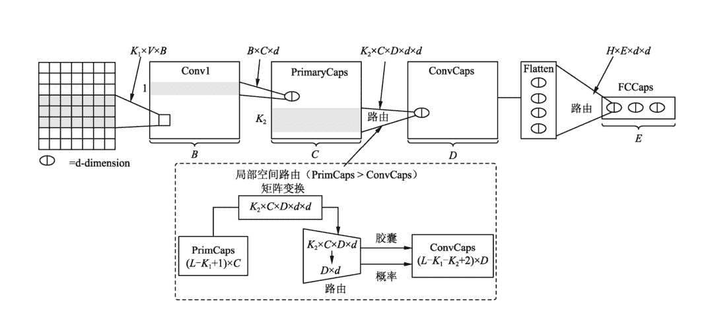

第二层是常规的 CNN 卷积 Conv1，区别在于不是做一次而是做 $B$ 次，先看一次卷积：

$$m_i^a = f(x_{i:i+K_1-1} \circ W^a + b_0)$$

$W^a \in \mathbb{R}^{K_1 \times V}$，$m^a \in \mathbb{R}^{L-K_1+1}$

其中 $f$ 为非线性激活如 ReLU；是卷积核参数；$b$ 为偏置；$K$ 为一维核长。因为是一维单向卷积，另一维必然与嵌入维相同，为 $V$。假设核长为 3，则 3 个词向量一起参与运算，输出一个标量 $m^a$。完整扫描后输出为。

$01i:i+2$

$M = [m^1, m^2, \cdots, m^B] \in \mathbb{R}^{(L-K_1+1) \times B}$

做 $B$ 次后最终得到。

做 $B$ 次的动机和 DCNN 的多套特征提取、TextCNN 的多核一致：从多个角度抽取特征，避免信息丢失。

从纵向看是词维度的理解，为了说明胶囊概念也可以横向看。

同一输入的每一次卷积其实产生了 $B$ 个结果：

$$M_i = m_i^1, m_i^2, \cdots, m_i^B \in \mathbb{R}^B$$

原本的单值输出被转成了向量输出。转为向量正是胶囊的核心思想，和前面保留信息多样性的逻辑相同。经过 $B$ 次卷积生成的向量可视为初始胶囊，后续都是向量到向量的映射，向量被聚合为概念，即胶囊。

第三层才是真正的胶囊操作 PrimaryCaps。前两层只是为了引入胶囊，最小单位还不是胶囊。词向量虽是向量，但不视作胶囊。

$$p_i = g(W^b M_i + b_1)$$

$W^b \in \mathbb{R}^{d \times B}$

$d$

其中 $g$ 为非线性激活；$b$ 为偏置向量，这里输出是向量所以偏置也是向量；$M$ 是上一层第 $i$ 步卷积输出的 $B$ 维向量，共 $L-K+1$ 个，于是输出胶囊也有 $L-K+1$ 个；是把一个胶囊向量映射为另一个胶囊向量的变换参数，$d$ 为目标胶囊的维度。

1011/11

$$p^b \in \mathbb{R}^{(L-K_1+1) \times d}$$

这里同样不只做一次而是做 $C$ 次。目的仍是反复挖掘并保留特征。

$$P = [p^1, p^2, \cdots, p^C] \in \mathbb{R}^{(L-K_1+1)C \times d}$$

这是该层的最终输出，对应图 2.25 中的 PrimaryCaps。这是第一次胶囊变换，实质上仍是把普通向量转为真正胶囊的准备。

$W^{h_1} \in \mathbb{R}^{D \times d \times d}$ $W^{h_2} \in \mathbb{R}^{H \times D \times d \times d}$

×

下面是胶囊变换的两种实现，即图 2.25 中的局部空间路由和矩阵变换。路由分为共享权重和非共享权重。这里的 $D$ 与上一步的 $C$ 含义相同，表示要生成多少个目标胶囊，取值没有特殊讲究。权重带两个 $d$ 是因为简化后输入 $d$ 维、输出 $d$ 维，权重自然是 $d \times d$。保持输出为 $D$ 个胶囊、每个 $d$ 维，所以权重是 $D \times d \times d$。非共享权重中的 $H$ 即输入胶囊个数，可用 $C$ 表示，论文里用的是更大的 $H=K \times C$，$K$ 相当于卷积核宽，对胶囊矩阵 $(L-K+1) \times C$ 做一维卷积。

221

$$\hat{u}_{j|i} = W_j^{t_1} u_i + \hat{b}_{j|i} \in \mathbb{R}^d$$

$W_j^{t_1} \in \mathbb{R}^{d \times d}$  $\{\hat{u}_{ij} \in \mathbb{R}^d\}_{i=1,\dots,C,j=1,\dots,D}$  $\{v_j \in \mathbb{R}^d\}_{j=1}^D$

dt

$u \in R$ 为第 $i$ 个胶囊，此处 $i$ 与前文不同，前文遍历词维度，这里遍历 $C$ 个胶囊向量，即 $i=1,2,\dots,C$，也可取 $K \times C$ 上限，$K$ 为超参，为方便用 $C$ 讲解，$j=1,2,\dots,D$。是当前层共享权重的第 $j$ 维。这是共享权重的公式，每个输入胶囊经 $W$ 相乘后得到 $D$ 个 $d$ 维输出，即 $D$ 个胶囊输出，形成 $C \times D$ 胶囊矩阵。但不能保留全部维度，需要把上一层的 $C$ 合并，目标为 $\{v_j \in \mathbb{R}^d\}_{j=1}^D$，最简单的方式是求和或最大池化。

i22

共享权重的做法如上，非共享权重公式稍复杂但原理相同。

$$\hat{u}_{j|i} = W_{ij}^{t_2} u_i + \hat{b}_{j|i} \in \mathbb{R}^d$$

为保持连贯，这里仅在权重上加上下标 $i$。

$W^{l_2} \in \mathbb{R}^{K_2 \times C \times D \times d \times d}, W^{l_2}_i \in \mathbb{R}^{D \times d \times d}, W^{l_2}_{ij} \in \mathbb{R}^{d \times d}, i = 1, \cdots, K_2 \times C$

另外，共享权重计算时长度保持 $L-K+1$，使用非共享权重则相当于对胶囊矩阵做卷积，输出长度降为 $L-K-K+2$。这就是胶囊卷积的含义。

112

胶囊变换之后进行动态路由。

动态路由可理解为加权求和，也可看作一种 pooling。

具体形式为：

$c_{j|i} = \hat{a}_{j|i} \bullet \text{leakysoftmax}(b_{j|i})$

$\hat{a}_{j|i} = a_i$

leaky-softmax 与 softmax 基本一致；$b_{j|i}$ 为迭代参数，初始全为 0；$\hat{a}_{j|i}$ 为上一层动态路由计算得到的值，第一层可全部置 1。注意 $a$ 与 $b$ 不同，$a$ 在第一层后都有确定值，$b$ 是每层动态路由的迭代变量，初始为 0，迭代次数为超参数 $r$。

$v_j = g(\sum_i c_{j|i} \hat{u}_{j|i}), a_j = |v_j|$

$v$ 为输出胶囊，先加权求和再激活。每个输出胶囊都有一个 $a$，供下一层路由使用。

jj

$$b_{j|i} = c_{j|i} + \hat{u}_{j|i} \bullet v_j$$

$b$ 的更新迭代见上。用伪代码表达见图 2.26。

```
**Algorithm 1: Dynamic Routing Algorithm**
1 **procedure** ROUTING($\hat{u}_{j|i}$, $\hat{a}_{j|i}$, $r$, $l$)
2 Initialize the logits of coupling coefficients
   $b_{j|i} = 0$
3 **for** $r$ iterations **do**
4 &nbsp;&nbsp;&nbsp;&nbsp;for all capsule $i$ in layer $l$ and capsule $j$ in layer $l + 1$:
&nbsp;&nbsp;&nbsp;&nbsp;&nbsp;&nbsp;&nbsp;&nbsp;$c_{j|i} = \hat{a}_{j|i} \cdot \text{leaky-softmax}(b_{j|i})$
5 &nbsp;&nbsp;&nbsp;&nbsp;for all capsule $j$ in layer $l + 1$:
&nbsp;&nbsp;&nbsp;&nbsp;&nbsp;&nbsp;&nbsp;&nbsp;$v_j = g(\sum_i c_{j|i} \hat{u}_{j|i})$, $a_j = |v_j|$
6 &nbsp;&nbsp;&nbsp;&nbsp;for all capsule $i$ in layer $l$ and capsule $j$ in layer $l + 1$: $b_{j|i} = b_{j|i} + \hat{u}_{j|i} \cdot v_j$
7 **return** $v_j, a_j$
```

图2.26 伪代码

这就构成了一个完整的胶囊操作：先胶囊变换，再动态路由。对应卷积就是先卷积再池化。

为何要如此复杂的动态路由？与前面 Top-k 最大池化的思路类似。多角度提取特征后需要保留有用信息。直接平均会让无用信息淹没有用信息，直接取最大也依赖“大值即关键”的假设，不一定成立。加权求和更合理，类似于自注意力，根据向量间的相关性加权，于是出现了动态路由。简化后它与自注意力非常接近。

第四层把所有得到的胶囊矩阵拉平 Flatten，再做一次胶囊变换，随后把胶囊内部的向量打散拉平为一个大向量，计算最终分类概率，如图 2.27。

关于卷积核宽度，实验尝试了两种方案：固定宽度为 3，以及同时使用 3、4、5 三种宽度。

## 2.3.6 层级注意力网络 HAN 的实验

多宽度方案的思路与多通道 TextCNN 完全相同，实验结果见图 2.28。

| | MR | SST2 | Subj | TREC | CR | AG's |
|---|---|---|---|---|---|---|
| LSTM | 75.9 | 80.6 | 89.3 | 86.8 | 78.4 | 86.1 |
| BiLSTM | 79.3 | 83.2 | 90.5 | 89.6 | 82.1 | 88.2 |
| Tree-LSTM | 80.7 | 85.7 | 91.3 | 91.8 | 83.2 | 90.1 |
| LR-LSTM | 81.5 | **87.5** | 89.9 | - | 82.5 | - |
| CNN-rand | 76.1 | 82.7 | 89.6 | 91.2 | 79.8 | 92.2 |

# 文本分类里胶囊网络的表现

| CNN-static | 81.0 | 86.8 | 93.0 | 92.8 | 84.7 | 91.4 |

| CNN-non-static | 81.5 | 87.2 | 93.4 | **93.6** | 84.3 | 92.3 |

| CL-CNN | - | - | 88.4 | 85.7 | - | 92.3 |

| VD-CNN | - | - | 88.2 | 85.4 | - | 91.3 |

| Capsule-A | 81.3 | 86.4 | 93.3 | 91.8 | 83.8 | 92.1 |

| Capsule-B | **82.3** | 86.8 | **93.8** | 92.8 | **85.1** | **92.6** |

图2.28 胶囊文本分类网络的实验结果

表中中间那三行 CNN-rand、static、non-static 对应 TextCNN。单通道胶囊结构在每层都试图保留更多信息，整体指标却未能超过双通道 TextCNN，仅三通道设计的 Capsule-B 在少数数据集上略有领先。

总体来看，胶囊网络在 NLP 文本分类上的收益有限，这也是它在 CV 与 NLP 均不常见的缘由。

实验结果与作者的先验一致。信息最集中的位置是第一层的原始输入，挖掘更多信号需要在首层做更多处理，比如多通道或后来的自注意力。深层更适合提取高层表征而非持续发掘新特征，让每层每个信息源都做大量重复操作，效用并不高。

# HAN 的工作方式与瓶颈

HAN 即 Hierarchical Attention Networks，名字已说明其采用层级结构并引入注意力。整体结构如图2.29所示。

图2.29 HAN的整体结构

HAN 借用了语言的天然先验：用句号划分句子。语法正常时，一句话语义相对独立。先提炼句子含义，再按句子序列聚合为文档，流程更顺畅，文档级语义也自然得到。

先验有价值，但在 NLP 里作用有限，因其存在先天缺陷：句子长短差异很大，有的只有数个字，有的很长。按句号切分后，词级输入需确定统一长度，短句要补全，长句要截断。句子级输入也需确定合适的句子数。

切分后填充开销比顺序输入更大，在算力与模型规模受限时，层级结构能并行处理的词数会少于顺序结构，天然的信息损失会抵消句子先验带来的增益。理论上合理，实践中难以达预期。

HAN 之后沿用该先验的模型不算少，但远不及注意力流行。比如长文摘要需提取特征时，逐词处理受限，先把每句话压缩成句向量再处理句向量会更可行。在具体业务场景里仍有参考意义。

下面逐步说明模型。

首步是词嵌入，把 one-hot 编码映射为稠密向量。

$$x_{it} = W_e w_{it}, t \in 1, T$$

$i$ 对应第 $i$ 句话，$t$ 为该句话里第 $t$ 个词。$W$ 为词嵌入矩阵。

$$h_{it}^l = \text{GRU}^l(x_{it}), t \in 1, T$$

$$h_{it}^r = \text{GRU}^r(x_{it}), t \in 1, T$$

随后以句子为单元，同一句子里的词进入双向 GRU 层，未选用当时流行的 LSTM。GRU 与 LSTM 差异不大，这里沿用论文公式，读者可自行变形，两侧等价。

$$r_t = \sigma(W_r x_t + U_r h_{t-1} + b_r)$$

此为遗忘门，$x$ 与 $h$ 分别是当前步输入与前一步状态输出。

$$\hat{h}_t = \tanh(W_h x_t + r_t \odot (U_h h_{t-1}) + b_h)$$

这是遗忘门处理后的前一步信息与当前信息的融合。

$$z_t = \sigma(W_z x_t + U_z h_{t-1} + b_z)$$

输入门与输出门的计算方式与遗忘门一致。

$$h_t = (1 - z_t) \odot h_{t-1} + z_t \odot \hat{h}_t$$

经输入门与输出门整合后的最终输出。

上述属于常规操作，下面介绍词级注意力。

模型诞生于 2015 年，自注意力尚未流行，故未使用 BERT 时代的自注意力。但注意力需以某个词为参照计算相关度才能得到概率。文本分类这类非生成任务，注意力基准该如何选取？

论文使用一个随机初始化的词向量 $u$ 专用于句子内词的注意力计算，该向量随任务训练而更新。

$$u_{it} = \tanh(W_w h_{it} + b_w)$$

$$h_{it} = h_{it}^l, h_{it}^r$$

$$\alpha_{it} = \frac{\exp(u_{it} u_w)}{\sum_t \exp(u_{it} u_w)}$$

$$s_i = \sum_t \alpha_{it} h_{it}$$

同一篇文档的每句话在计算注意力时都使用同一个 $u$。$s$ 可视作该句的句向量。

句子级处理与词级处理结构一致。

$$h_i^l = \text{GRU}^l(s_i), i \in 1, L$$

$L$ 表示文档共含多少句话。

$$h_i^r = \text{GRU}^r(s_i), i \in 1, L$$

$$h_i = h_i^l, h_i^r$$

$$u_i = \tanh(W_s h_i + b_s)$$

$$\alpha_i = \frac{\exp(u_i u_s)}{\sum_i \exp(u_i u_s)}$$

$$v = \sum_i \alpha_i h_i$$

此时的 $v$ 即文档向量，基于它进行分类。

$$p=\text{softmax}(W_c v + b_c)$$

损失函数：

$$L = -\sum_{d} \log p_{dj}$$

其中 $d$ 为训练语料文档数，$j$ 为该文档的标签，实验结果如图2.30所示。

| Methods | Yelp'13 | Yelp'14 | Yelp'15 | IMDB | Yahoo Answer | Amazon |

| :--- | :---: | :---: | :---: | :---: | :---: | :---: |

| **Zhang et al., 2015** | | | | | | |

| BoW | - | - | 58.0 | - | 68.9 | 54.4 |

| BoW TFIDF | - | - | 59.9 | - | 71.0 | 55.3 |

| ngrams | - | - | 56.3 | - | 68.5 | 54.3 |

| ngrams TFIDF | - | - | 54.8 | - | 68.5 | 52.4 |

| Bag-of-means | - | - | 52.5 | - | 60.5 | 44.1 |

| **Tang et al., 2015** | | | | | | |

| Majority | 35.6 | 36.1 | 36.9 | 17.9 | - | - |

| SVM + Unigrams | 58.9 | 60.0 | 61.1 | 39.9 | - | - |

| SVM + Bigrams | 57.6 | 61.6 | 62.4 | 40.9 | - | - |

| SVM + TextFeatures | 59.8 | 61.8 | 62.4 | 40.5 | - | - |

| SVM + AverageSG | 54.3 | 55.7 | 56.8 | 31.9 | - | - |

| SVM + SSWE | 53.5 | 54.3 | 55.4 | 26.2 | - | - |

| **Zhang et al., 2015** | | | | | | |

| LSTM | - | - | 58.2 | - | 70.8 | 59.4 |

| CNN-char | - | - | 62.0 | - | 71.2 | 59.6 |

| CNN-word | - | - | 60.5 | - | 71.2 | 57.6 |

| **Tang et al., 2015** | | | | | | |

| Paragraph Vector | 57.7 | 59.2 | 60.5 | 34.1 | - | - |

| CNN-word | 59.7 | 61.0 | 61.5 | 37.6 | - | - |

| Conv-GRNN | 63.7 | 65.5 | 66.0 | 42.5 | - | - |

| LSTM-GRNN | 65.1 | 67.1 | 67.6 | 45.3 | - | - |

| **This paper** | | | | | | |

| HN-AVE | 67.0 | 69.3 | 69.9 | 47.8 | 75.2 | 62.9 |

| HN-MAX | 66.9 | 69.3 | 70.1 | 48.2 | 75.2 | 62.9 |

| HN-ATT | **68.2** | **70.5** | **71.0** | **49.4** | **75.8** | **63.6** |

图2.30 实验结果

注意力提出较早，对比工作也偏早期，且语料与前面情感分析不同，难以直接横向比较。读者可用该模型在情感语料上测试，再与前述模型对照。

## 2.4 分类任务数据集

分词主要面向中文，中文分词词库多为 PKU、MSRA、CTB 等，故未单独展开数据集介绍。文本分类标签相对容易，相关子任务数据集较多，下文详述。

### 1. 情感分析数据集

#### 1) Yelp

Yelp 在情感分析里使用广泛。定义两种任务：检测细粒度情绪的 Yelp-5，共五类；预测消极与积极情绪的 Yelp-2。二分类 Yelp-2 训练 56 万条、测试 3.8 万条，正负各有。五分类 Yelp-5 每类训练 65 万条、测试 5 万条。

#### 2) IMDB

IMDB 用于影评二分类，正负评论数量相同。训练集与测试集各 25000 条，平分。

#### 3) Movie Review

MR 数据集是二分类电影评论语料，共 10662 条句子，正负各半。常用做法是对随机划分为 10 份的子集做交叉验证。

#### 4) SST

Stanford Sentiment Treebank 是 Movie Review 的扩充。有 SST-1 五分类版和 SST-2 二分类版。SST-1 包含 11855 条评论，训练 8544、开发 1101、测试 2210。SST-2 同样划分为训练、开发、测试三部分。

#### 5) MPQA

MPQA 来自多视角问题回答，是双类语料，共 10606 条句子，源自各类新闻文章。不平衡，正样本 3311 条，负样本 7293 条。

#### 6) Amazon

Amazon 为亚马逊产品评论语料，含二分类与五分类标签。二分类版本训练 360 万条、测试 40 万条；五分类 Amazon-5 训练 300 万条、测试 65 万条。

### 2. 新闻分类数据集

#### 1) AG News

AG News 由 ComeToMyHead 学术新闻搜索引擎从 2000 多个来源采集。包含 12 万训练样本、7600 测试样本，每条带四分类标签，文本较短。

#### 2) 20 Newsgroups

20 Newsgroups 涵盖 20 个主题的新闻组文档。流行版本之一有 18821 篇，主题间大致均衡，每类约 940 篇，可用于分类与聚类。

#### 3) Sogou News

搜狗新闻语料为 SogouCA 与 SogouCS 的混合。分类标签由 URL 域名决定，如 http://sports.sohu.com 归为体育。

#### 4) Reuters-21578

Reuters-21578 是经典文本分类语料，1987 年自路透社金融新闻专线收集。ApteMod 为其多类版本，共 10788 篇。Reuters-21578 含 90 类，训练 7769 篇、测试 3019 篇。R8、R52、RCV1、RCV1-v2 等均源于其子集。

### 3. 主题分类数据集

#### 1) DBpedia

DBpedia 基于 Wikipedia 信息框构建的大型多语知识库，每月更新。流行版本训练 56 万样本、测试 7 万样本，14 类标签。

#### 2) Ohsumed

Ohsumed 是 MEDLINE 的子集，含 7400 篇医学摘要。标签非唯一，可同时属于 23 种心血管疾病类别之一或多个。

#### 3) EUR-Lex

EUR-Lex 涵盖多类欧盟法律文档，按若干正交分类方案索引。常用版本关于欧盟法律不同方面，共 19314 篇，分 3956 类。

#### 4) 科学网络

WOS 数据集收录科学网络上已发表论文的数据与元数据，是独立于出版商的全球引文库。已发布 WOS-46985、WOS-11967、WOS-5736 三个版本。前者为完整集，后两者为其子集。

#### 5) PubMed

PubMed 为美国国家医学图书馆的医学与生物科学论文搜索引擎。文档以 MeSH 标签集标注，摘要每句话会被标注为背景、目的、方法、结果或结论之一。

## 2.5 大模型时代的文本分类

文本分类是 NLP 的经典任务。本节探讨大模型在该任务上的应用。

以新闻分类为例，需将文本划分为体育、财经、娱乐等类别，可借助预训练大模型完成。

### 2.5.1 使用BERT进行文本分类

- (1) 数据准备。需准备标注好的新闻语料，每条包含新闻文本与对应类别。
- (2) 模型加载与微调。可选用预训练 BERT 模型，在目标新闻分类数据上进行微调。下面给出一个简化的 Python 示例，展示 BERT 用于文本分类微调的流程。

```python
from transformers import BertTokenizer, BertForSequenceClassification
from transformers import Trainer, TrainingArguments
from datasets import load_dataset

# 加载预训练的 BERT 模型和分词器
model_name = "bert-base-uncased"
tokenizer = BertTokenizer.from_pretrained(model_name)
model = BertForSequenceClassification.from_pretrained(model_name,
num_labels=3) # 3 个类别

# 加载数据集（以 IMDB 评论数据集为例）
dataset = load_dataset("imdb")

# 准备数据
def encode(examples):
    return tokenizer(examples['text'], truncation=True, padding=
'max_length', max_length=128)

# 对数据进行编码
encoded_dataset = dataset.map(encode, batched=True)

# 将数据集分为训练集和验证集
train_dataset = encoded_dataset['train']
eval_dataset = encoded_dataset['test']

# 设置训练参数
training_args = TrainingArguments(
    output_dir='./results',
    num_train_epochs=3,
    per_device_train_batch_size=8,
    per_device_eval_batch_size=8,
    warmup_steps=500,
    weight_decay=0.01,
    logging_dir='./logs',
)

# 创建 Trainer 对象并开始训练
trainer = Trainer(
    model=model,
    args=training_args,
    train_dataset=train_dataset,
    eval_dataset=eval_dataset,
)

trainer.train()
```

## 2.5.2 ChatGPT文本分类实战

除了BERT之外，GPT系列模型尤其是ChatGPT同样能胜任文本分类工作。下面给出一个典型的操作流程。

- (1) 数据准备。先准备好已标注的新闻语料，文本内容与类别标签一一对应。
- (2) 调用ChatGPT API。通过OpenAI提供的接口，借助预训练的ChatGPT模型完成分类。

```python
import openai

openai.api_key = 'your-api-key'

def classify_text(text):
    response = openai.Completion.create(
        engine="text-davinci-003",
        prompt=f"请将以下新闻文本分类为体育、财经或娱乐：{text}",
        max_tokens=10
    )
    return response.choices[0].text.strip()

# 示例文本
news_text = "判断下面新闻的类别是什么："
category = classify_text(news_text)
print(f"分类结果：{category}")
```

按上述方式即可让ChatGPT对新闻进行判类。其语言理解能力较强，对新闻文本的归类较为准确。

大模型持续迭代，文本分类的创新空间在扩大。学完本章，读者既能掌握传统深度学习的核心理念，也能初步了解大模型在分类上的应用，为后续落地提供思路。

## 2.6 本章回顾

本章先介绍了文本分类的典型场景，随后讲解了词向量概念和高效模型fastText，再回顾了LSTM、CNN等经典深度结构，最后以BERT和ChatGPT为例演示分类实操。本章聚焦工程实践而非最新模型，重点在于处理海量文章对速度的高要求。纯文本分类目前并非研究热点，除动态词向量如BERT外创新有限。掌握本章模型后可进一步阅读前沿论文。

文本分类中多级分类也很常见，比如商品分类与文章分类。分类体系本身分层，第一级较粗如服装、数码，第二级在此基础上细化，如服装下分男装、女装、上衣、裤子等。这类任务通常做成多目标预测，同一模型输出多层结果。设计上可先预测父类再预测子类，也可父子类并行预测。一般类别越多准确率越低，下降主因多为类别定义不清，如“养生”与“健康”边界模糊，连标注者也易混淆。因此数据定义比模型更关键。

下一章将进入序列标注另一任务——命名实体识别。

# 第3章 命名实体识别

命名实体识别NER在中文和英文上的难度差异很大，中文明显更难。下面从定义、难点、应用、评测、资源等方面逐一说明。

## 3.1 NER是什么

命名实体简单说就是从句子中抽取出专有词。实体具体指什么不必过度纠结，例如人名、地名、公司名等即可理解。

比如输入“张三出生在周村”，模型需标出“张三”即人名，“周村”即地名。这就是NER。常见实体是人名、地名、机构名，但技术类文章中的专业术语也可算命名实体。

### 3.1.1 中文NER的难点

NER可算中文特有难题，英文NER难度相对较小。英文中新词如google出现时，因不在词表且结合上下文即可判断为公司名。

中文人名变化复杂：
- 常规姓+名，如张华平、西门吹雪。
- 有名无姓，如春花点点头、杰，你好吗？
- 有姓无名，如刘称赵已离开江西。
- 姓加前后缀，如刘总、张老、小李、邱某。
- 夫姓+父姓+名，如范徐丽泰、彭张青。

人名用字多为常用词，如王国维、高峰、汪洋、张朝阳。统计8万人名，内部可成词比例达8.49%。

人名还常与上下文粘连成词，如这里有关天培的壮烈、费孝通向人大常委会提交书面报告。

人名本身易歧义，如河北省刘庄中刘庄兼具人名地名歧义，周鹏和同学中周鹏与周鹏和边界不清。

地名相对固定，可靠词表辅助，但细粒度地名难以覆盖。

组织名更难，人名尚有姓作线索，机构名形式随意，可能由人名、常用词构成。

英文数据集模型常达80%以上正确率甚至90%以上，中文微博语料50%以上已算不错，可见难度。

NER之外还有关系抽取、事件抽取等信息抽取任务，原理相近，因NER最常见，故以此入手。

### 3.1.2 NER的核心应用

NER常作预处理，为信息检索、问答、机器翻译、商品搜索、对话等下游任务服务。

语义搜索中约71%的查询含命名实体，识别实体有助于理解意图，提升结果。

商品搜索中，用户搜“iPhone手机”，需识别出商品iPhone和品类手机。品类识别可限定返回范围，如搜“iPhone手机壳”应返回壳而非手机。文本分类有时也能实现类似效果。

机器翻译需NER保护专名。人名地名应保持一致，概率模型易导致同一英文名被译成不同中文，如benz在大陆译奔驰，港台译宾士、平治。缺乏NER保护会导致一文中同一专名译法不一。实际使用可验证此现象。

### 3.1.3 NER的评测方式

NER结果形式不同于分类，但评测指标相通，均用准确率、召回率、F1，因任务形式差异计算方式略有不同。

二分类中模型输出0-1小数，取阈值如0.5划分：
- TP：标签1模型判1，也称真正例。
- TN：标签0模型判0，真负例。
- FP：标签0模型判1，假正例。
- FN：标签1模型判0，假负例。

$$acc = \frac{TP + TN}{TP + TN + FP + FN}$$

acc为准确率，反映整体分对比例。

精确率易与准确率混淆：

$$precision = \frac{TP}{TP + FP}$$

precision衡量被判为1的样本中真实为1的比例。

召回率：

$$recall = \frac{TP}{TP + FN}$$

召回率表示真实正样本被找出的比例，对不均衡场景很重要。

例如疾病诊断，100人中9人患病，模型结果TP=1 TN=90 FP=1 FN=8。准确率91%，召回率仅11%，实际价值有限。

F1综合两者：

$$F1 = 2 \times \frac{precision \times recall}{precision + recall}$$

NER中公式相同，只是含义映射不同。
- FP：识别出的实体与标注不符，如例中小明喜欢吃米饭，标注小明，模型给米饭。
- FN：标注有实体但模型未识别，如未识别出小明。
- TP：识别与标注一致。
- TN：样本无实体且模型未识别，NER数据中较少。

## 3.2 传统NER方法

NER属序列标注，与分词同类，故HMM、CRF等分词算法可迁移。分词中的正反向最大匹配是词典检索，不属序列标注，不适用于NER。

jieba用HMM做新词发现，本质也是NER。若直接用HMM统计转移概率做纯人名识别效果不佳：人名上下文复杂，同上下文可能对应人名也可能非人名，易歧义；中文字词繁多，训练不足易过拟合。

HanLP采用多层HMM，效果更好。

### 3.2.1 HanLP中文人名识别实现

HanLP起初是Java分词包，准确率与NER指标优于jieba，但Java实现在Python机器学习环境推广受限。现已更新为HanLP 2.0支持Python扩展，但2.0为深度学习分支，研究可用，工程化困难。

其人名识别并非复杂，基于两次HMM。

第一步粗分：先分词并词性标注。基于词性做角色观察，角色指人名构成部件，如表3.1。假设“张”词性为量词，对应角色可能是B或X。每种词性对应多种角色且有概率，形成类似词网的有向图。对应函数roleObserve()。

表3.1 中文人名的构成角色

| 编码 | 代码 | 意义 | 例子 |
|---|---|---|---|
| B | Pf | 姓氏 | 张华平先生 |
| C | Pm | 双名的首字 | 张华平先生 |
| D | Pt | 双名的末字 | 张华平先生 |
| E | Ps | 单名 | 张浩说：“我是一个好人” |
| F | Ppf | 前缀 | 老刘、小李 |
| G | Plf | 后缀 | 王总、刘老、肖氏、吴妈、叶帅 |
| K | Pp | 人名的上文 | 又来到于洪洋的家 |
| L | Pn | 人名的下文 | 新华社记者黄文摄 |
| M | Ppn | 两个中国人名之间的成分 | 编剧邵钧林和嵇道青说 |
| U | Ppf | 人名的上文和姓成词 | 这里有关天培的壮烈 |
| V | Pnw | 人名的末字和下文成词 | 龚学平等领导、邓颖超生前 |
| X | Pfm | 姓与双名的首字母 | 王国维 |
| Y | Pfs | 姓与单名成词 | 高峰、汪洋 |
| Z | Pmt | 双名本身成词 | 张朝阳 |
| A | Po | 以上之外其他的角色 | |

第二步，用HMM的Viterbi解码求最佳角色序列，再用模式匹配判断人名，如张华平被标为BCD即为人名，张浩标为BE亦为人名。

示例句：签约仪式前，李光荣、秦纪恒、钱和等一同会见了参加签约的企业家。

粗分结果：签约/vi，仪式/n，前/f，，/w，李/tg,光荣/a，、/w，秦/ng，纪/ng，恒/ag，、/w，钱/n，和/cc，等/udeng，一同/d，会见/v，了/ule，参加/v，签约/vi，的/ude1，企业家/nnt，。/w

角色观察输出略...

Viterbi后角色：签约/L，仪式/L，前/K，/K，李/B，光荣/Z，、/M，秦/B，纪/C，恒/D，、/M，钱/B，和/E，等/L，一同/L，会见/L，了/K，参加/L，签约/L，的/L，企业家/K，。/L，/A

最终识别出BZ即李光荣、BCD即秦纪恒、BE即钱和。

### 3.2.2 HanLP的其他NER识别

HanLP 传统 NER 与深度 NER 的演进路径

HanLP 在中文人名之外，还把音译人名、日韩人名、地名与机构名纳入识别范围，整体思路与中文人名处理相近，差异主要落在 HMM 的层数编排和触发时机上。

音译人名的抽取大致可以拆成三步：

- 粗略分词先行。
- 以 nrf 标注作为触发信号。
- 将触发点之后连续出现的新词全部归入人名。

示例：

> “世界上最长的姓名是简森·乔伊·亚历山大·比基·卡利斯勒·达夫·埃利奥特·福克斯·伊维鲁莫·马尔尼·梅尔斯·帕特森·汤普森·华莱士·普雷斯顿。”

粗分结果：

> “世界/n，上/f，最长/d，的/ude1，姓名/n，是/vshi，简/ag，森/ag，·/w，乔/ag，伊/b，·/w,亚历山大/ns，·/w，比/p，基/ng，·/w，卡利/nz，斯/b，勒/v，·/w，达夫/nrf，·/w，埃利奥特/nrf，·/w，福克斯/nrf，·/w，伊/b，维/b，鲁/b，莫/d，·/w，马尔/nrf，尼/b，·/w，梅/ng，尔/Rg，斯/b，·/w，帕/ng，特/ag，森/ag，·/w，汤普森/nrf，·/w，华莱士/nrf，·/w，普雷斯顿/nrf，。/w”

最终的音译人名识别结果如下：

> “达夫·埃利奥特·福克斯·伊维鲁莫·马尔尼·梅尔斯·帕特森·汤普森·华莱士·普雷斯顿”

可以看出识别并不准确。机构名称是四类任务中最难的，因为组织名可能是人名、地名，也可能是随意拼接的字符组合，如表3.2所示。

表3.2 机构名称构成角色

| 角色 | 意义 | 例子 |
|---|---|---|
| A | 上文 | 参与亚太经合组织的活动 |
| B | 下文 | 中央电视台报道 |
| X | 连接词 | 北京电视台和天津电视台 |
| C | 特征词的一般性前缀 | 北京电影学院 |
| F | 特征词的译名性前缀 | 美国摩托罗拉公司 |
| G | 特征词的地方性前缀 | 交通银行北京分行 |
| H | 特征词的机构名前缀 | 中共中央顾问委员会 |
| I | 特征词的特殊性前缀 | 中央电视台 |
| J | 特征词的简称性前缀 | 巴政府 |
| D | 机构名的特征词 | 国务院侨务办公室 |
| Z | 非机构名成分 |  |

HanLP 的做法是继续叠加 HMM 层：先粗分，再分别完成人名和地名抽取，之后依据前述结果去匹配机构名的构成角色，再用 HMM 的 Viterbi 做全局择优，最后辅以模式规则。

不必把 HanLP 当成唯一范式，它凭借传统方法已取得不错指标，速度损耗有限，工程上完全可用。若要追求更高精度，便需要引入有监督的模型训练。

## 3.3 深度学习在NER中的应用

在介绍深度方案前，先厘清一个问题：为何要把深度学习引入 NER？

### 3.3.1 使用深度学习处理NER问题的原因

传统机器学习同样存在演进脉络，和深度学习相似，只是更依赖严谨的数学推导，旧方法的缺陷难以快速弥补，融合多种优点也很慢。

以序列预测举例，天气预报最直观的想法是马尔可夫模型，也称马氏链，用上一时刻状态估计下一时刻概率并取最大。真实天气远比这复杂，单靠该做法效果很差，因为大量信息未能编码成特征输入，模型自然忽略了信号。

序列标注能否用马尔可夫，靠前后两个字判断词或实体？可以。NLP 中的马尔可夫本质是 n-gram。若只看前一时刻，就是 bi-gram，统计前后两字共现概率并设阈值，高于阈值则判定为词或实体，低于则切断。这种利用信息过于粗糙。

于是引入状态变量，把当前字处于词首、词中、词尾作为隐藏状态加入模型。类似把一元函数升级为多元函数或提高次数，拟合能力随之增强。机器学习更倾向增维而非增次，因为增次会让求解变得困难。

为解决序列标注，在马尔可夫上加入需求解的隐藏状态，就得到隐马尔可夫模型 HMM。HMM 仍假设当前隐藏状态只受前一时刻影响，观测只受当前隐藏状态影响，但有了隐藏变量后拟合能力明显提升。

HMM 的两个假设偏紧，能否放宽？最简单是让当前隐藏状态不仅依赖前一时刻，还依赖前前一时刻，即从 bi-gram 变 tri-gram，转移矩阵从二维变三维张量，部分场景有效，但规模会爆炸。

另一种放宽是 CRF，让当前隐藏状态依赖全局所有时刻，前后皆相关；观测也不再只依赖当前隐藏状态，而是依赖全部观测和隐藏变量。CRF 中两类变量记作 X 与 Y。可利用特征范围被极大扩展，效果通常最好。

CRF 的全局特征并非自动学习，而是靠手工特征工程，在大规模语料下人力成本很高。能否让模型自行学习特征？可以，决策树、各类 boosting、神经网络都能做到。

最简的自动特征版是单层 DNN 加 CRF，先把字向量送入 DNN，输出作为 CRF 的 X，同时限制 Y 只与全局 Y 相关，不再直接与 X 相关，最终特征工程化为两个权重表，一个打分 X-Y 组合，一个打分 Y 组合，相加得到最终得分。

DNN 的问题在于平移不变性差。比如“我们”无论在句首还是句尾都应被识别，但 DNN 需为每个位置重新学习，效率低下。

因此考虑 RNN。原始 RNN 难训练，通常直接到 LSTM，即 LSTM 加 CRF。LSTM 设计初衷是缓解长时依赖，实际远距离特征学习仍弱，单向 LSTM 最终保留的信息偏向句尾，所以多用双向 LSTM，于是出现双向 LSTM 加 CRF。

LSTM 本身仍有远期依赖问题，即使双向，信息保留也集中在首尾，中间会损失。加入注意力可在一定程度上缓解。非语言模型场景下注意力的触发源是什么？基于 Transformer 的 BERT 直接抛弃触发问题，采用自注意力，即两两注意，加强有效信息。之后主要是深度神经网络本身的优化，与序列标注关联不深。

以上是传统到深度学习的一个演进链条，每个模型都在解决前辈问题，同时也会带来新问题。是否存在一个完美模型不再引入新问题？原理上不会。任何模型适用范围越大能力越差，不存在万能模型。机器学习或深度学习都是用一个函数拟合样本标签分布，再用学到的函数预测同分布样本，这要求分布一致，即训练样本与真实场景分布要一致。分布一致的限定意味着只能处理单一场景，多场景分布空间必须分开，否则混在一起难以形成稳定分布。

例如围棋和象棋，AI 已超越人类，但两类数据分布是分离的。若强制合并规则，无法明确何时用哪套规则，随机切换会导致混乱，模型难以学习。

算法若限定场景，就必然有先验假设，前提就是限制，有时为求解方便前提会较严格，所以完美无瑕的算法很难出现。未来强人工智能是否颠覆这一结论尚不明确，至今可商用的算法都是强场景限定的，无论语音识别还是人脸识别，都不可能通用。

### 3.3.2 Bi-LSTM+CRF模型

双向 LSTM 加 CRF 是序列标注的经典结构，分词部分也提到过，NER 作为典型序列标注任务同样适用。

目前主流分词工具大多基于最短路径分词，分词后的人名、地名、公司名等识别多基于 HMM 模型和预训练转移概率矩阵，再用 Viterbi 解码。差异在于有的工具只用一层 HMM，如 Jieba，HanLP 则按识别类型使用多层 HMM 以提升准确率。大多数工具并未使用更复杂的深度模型，甚至单纯 CRF 也不是默认选项，核心考量是推理速度。

对分词而言，深度模型更多具有学习价值，只有在强调分词准确性且不介意推理较慢的场景，如离线预分词，才有实用价值。

NER 在分词之外独立使用的场景很多。例如搜索优化时的查询分析，需要识别品类、品牌、型号、名称等核心词；任务型对话中需要抽取用户问题里的关键信息；知识图谱建设同样依赖 NER 才能识别句子实体并建立关系。

双向 LSTM 加 CRF 的结构如图3.1所示。

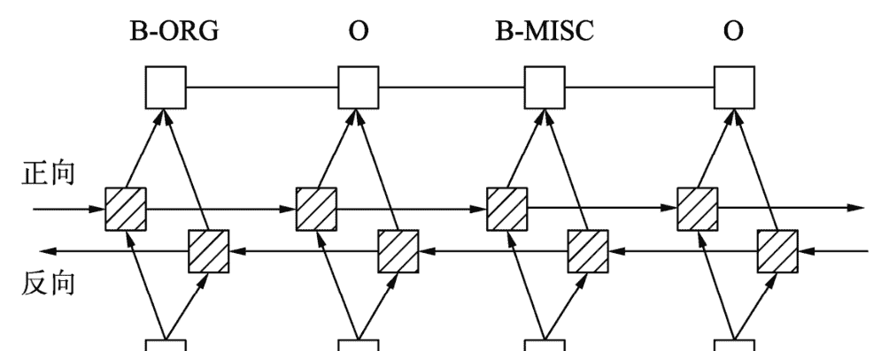

图3.1 Bi-LSTM+CRF的结构

分词模型也有相似结构，可相互参考。双向 LSTM 加 CRF 结构简洁，是一个双向 LSTM，输出接入 CRF 层，图3.1中最下方方框即为 CRF 层，相当于 Viterbi 全局最优求解层，比贪婪取最大值更好。

下面是 Zhiheng Huang、Wei Xu 和 Kai Yu 在论文 Bidirectional LSTM-CRF Models for Sequence Tagging 中给出的消融测试结果，检验前面关于为何要用深度模型配合 CRF 以及算法迭代链条的先验是否成立。

阅读论文要抓住关键，所有新模型大多是多种先验的混合体，需通过消融实验判断各模块的真实贡献，如图3.2所示。

|  |  | POS | CoNLL2000 | CoNLL2003 |
|---|---|---|---|---|
| Senna | LSTM | 94.63(-2.66) | 90.11(-2.88) | 75.31(-8.43) |
|  | Bi-LSTM | 96.04(-1.36) | 93.80(-0.12) | 83.52(-1.65) |
|  | CRF | 94.23(-3.22) | 85.34(-8.49) | 77.41(-8.72) |
|  | LSTM+CRF | 95.62(-1.92) | 93.13(-1.14) | 81.45(-6.91) |
|  | Bi-LSTM+CRF | **96.11(-1.44)** | **94.40(-0.06)** | **84.74(-4.09)** |

图3.2 Bi-LSTM+CRF的消融实验结果

图3.2 中 POS 为词性标注任务，后两列为 NER 任务。

结果显示，LSTM 不如双向 LSTM，符合先验。单层 CRF 略逊于双向 LSTM，同样有价值。LSTM 加 CRF 比单独 CRF 好，但仍不及双向 LSTM。最佳的是双向 LSTM 加 CRF，符合先验。

到此，双向 LSTM 加 CRF 的出现是自然的迭代链条。当然 BERT 和 BERT 加 CRF 也是发展方向，但这属于预训练模型 PTM 的推动，BERT、GPT2、RoBERTa、Albert、ERNIE1/2、XLNet 等轮番刷新指标，对学习思路帮助有限，故暂时不展开。

关于词向量，NER 任务中字母大小写是有价值的信息，正常小写句子中突然出现全大写或首字母大写的词，实体概率会上升。但为什么词向量训练仍普遍转小写？因为效果不好。有对比实验显示，保留大小写使“apple”“APPLE”“Apple”变成三个不同词，词表膨胀，模型变大，指标反而下降。原因在于含大写字母词在语料中频率很低，尤其是区分首字母大写与全大写，即使合并也难以解决样本不足，最终导致词向量训练不充分，效果变差。

如何既避免这个问题又利用该先验？可自行思考，后续章节会介绍思路。

### 3.3.3 CharNER模型

英文中实体名往往是一个单词，如 Apple、Mike。若完全依赖词向量识别，遇到罕见词很可能被标记为 UNK，识别概率大幅下降。当然借助上下文仍可识别，但识别率必然降低。能否利用词本身信息提升概率？

思路是拆字符，采用字符向量方式识别。CharNER 并非全新想法，Klein 等人 2003 年就引入过带字符级输入的隐马尔可夫模型，以缓解字级输入的数据稀疏问题，其错误率比词级 HMM 降低 30%。但 HMM 本身缺陷限制了性能，有时收集前人尝试的先验比自己研发更重要。

CharNER 本质仍是双向 LSTM 加 CRF，区别在于输入不再是词向量而是字符向量，标签也有不同，原来标签与词对应，如图3.3所示。

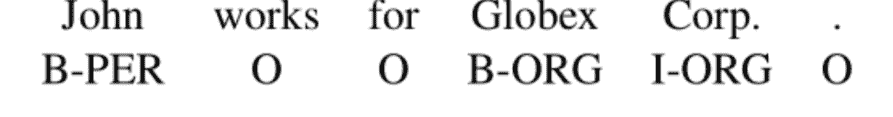

针对字符，需要把字符所在词的标签复制下来，如图3.4所示。

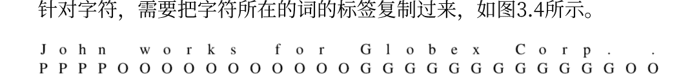

即每个字符的标签等于其所在词的标签，图3.4 因空间限制做了简写，实际与图3.3 相同。

此外，CharNER 的字符向量远少于词向量，参数量小，计算和存储压力都低，为提升效果把双向 LSTM 层数提高了。在 NLP 领域尤其是 RNN 结构，层数一般不会太多，一是前后依赖计算随层数增加变慢，二是实验显示层数过多并不能提升效果。层数较多的 NLP 模型多为 BERT 这类十几层的重模型，与 CV 领域几十上百层差距较大。笔者认为语言层面深层语义需要更多上下文，而非十几二十个字就能挖掘，所以仅靠增加 RNN 层数效果并不突出。

CharNER 的结构如图3.5所示，层数增加到5层，最后仍是 CRF 中的 Viterbi 解码。

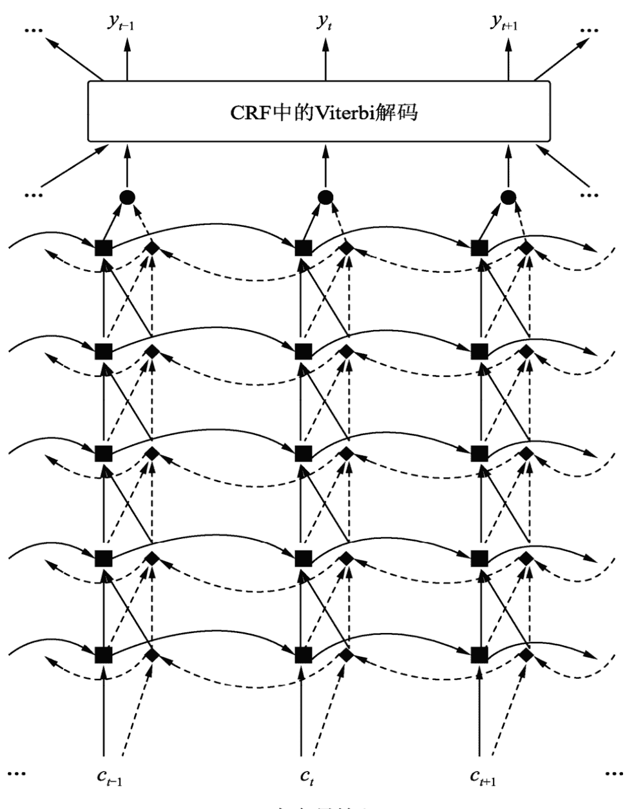

图3.5 CharNER的结构

为适应字符输入，把本来对应词的标签复制后与字符对应，每个字符经过模型后会得到一个标签输出，最终判断时仍需恢复为词级标签，即一个词对应一个标签，而不是一个词对应多个标签。

字符级NER里最省心的场景，是一个词内部所有字符被模型打上的标签都一样。只要统一，直接合并就行。麻烦的是同一词内部出现多种标签，该怎么定夺？最直觉的做法是投票，占比最高的标签胜出；如果平票，比如四字符里有两个P两个O，就把概率之和更大的那一类挑出来。这种做法简单粗暴，却是首选的基线。

Klein 等人也走了一条粗暴的路。他们给词内字符的转移建了一个概率表，分成三种情形：字符到字符记作c→c，词尾字符到标点记作c→s，标点或空格后进入词首记作s→c。表3.6展示的就是这个转移概率矩阵。乍看合理，实际非常僵硬——首字符理论上可以是任意标签，而后续字符的标签必须与前一个保持一致，否则概率直接为0。Viterbi解码时，这些被置零的路径自然会被舍弃，灵活性几乎没有。

英文字符本身就只有26个，再算上标点也上百不到，想靠这么小的字符集拿到理想指标本就困难。实验里把26个字符向量分别训练，最终效果差距并不大。

把CharNER放到当时的SOTA对照表里更有意思。表3.7显示，借用Word2vec预训练词向量的最佳结果在阿拉伯语、捷克语、荷兰语、英语、德语、西班牙语、土耳其语上分别达到84.30、75.61、82.84、91.21、78.76、85.75、91.94。而不使用外部预训练、完全任务内训练的最好成绩是81.00、68.38、78.08、84.57、72.08、81.83、89.73。CharNER没有预训练字符向量，全靠NER任务自己学习，得到78.72、72.19、79.36、84.52、70.12、82.18、91.30。与不靠预训练的基线差距很小，这说明字符级路线还有挖掘空间。

到这里，字符级的RNN思路已经说清，换成CNN也是自然的延伸。结构只是把序列编码器从RNN换成CNN，效果规律类似。

## 3.3.4 Bi-LSTM+CNN混合架构

Jason P.C. Chiu和Eric Nichols在《Named Entity Recognition with Bidirectional LSTM-CNNs》里提出了一套词向量与字符特征融合的方案。

词向量的强项是抓上下文，擅长发现实体出现的固定语境；弱点是对词内部的形态学信息挖掘不足。字符向量恰好相反，对前缀、后缀、造词规律很敏感，却把序列长度从十几个词拉长到几十上百个字符，学习配对变得困难。把两者优势拼在一条线上就成了动机。

实现方式是先用CNN抽字符特征，再和词向量拼接，整体送入双向LSTM。很多人看到名字会以为CNN是来替代CRF的，其实并非如此。最后的判别层直接去掉了CRF。作者的判断是，前端特征足够强时，CRF带来的增益有限；只有前端很浅，比如单层DNN时，加CRF才明显有效。

字符抽取部分很简洁，图3.11、图3.12展示的流程是卷积加最大池化再接全连接。层数的尝试没有深入，卷积宽度则用网格搜索来挑。字符向量是随机初始化的，和几乎所有字符模型一致。因为英文字符总量很小，加标点也不过几十到上百，即使小语料也能覆盖充分，完全可以在NER任务里联合训练，没必要额外预训练。

长度对齐靠padding，以词中最长的字符长度为标准，不足的两侧补零向量。

字符层面还补了一个轻量特征，标记是不是大写、是不是标点。训练时字符本身统一转小写，大小写信息单独作为特征保留。原因很现实，大写样本远少于小写，且分布极不均匀，直接混在词表里学习容易产生偏差，分离出来更稳。

词层面也有补充信号。先在DBpedia上统计四类实体：人名Person、地名Location、组织名Organization、其他Misc。对每个词做匹配，回溯它在词典中的位置。图3.13的例子里，Hayao在人名类别中以开头形式出现，对应标记为B；Miyaza以结尾形式出现，对应标记为E。若未匹配则置空。若完全匹配则标记为S。这套BIES信息本质上是外部词典提示。

大小写还在词级保留，分为全大写、首字母大写、全小写、混合大小写、未知五档，用于标点等非字符。

输出层做了小改动。不是把正向和反向LSTM的输出直接拼接后softmax，而是各自先做线性变换得到概率，再把两边相加作为最终决策，如图3.14、图3.15所示。

效果在CoNLL-2003和OntoNotes 5.0上都有体现。表3.14的消融表明，BLSTM-CNN加上预训练词嵌入后F1从83.38提升到90.91，再加入词典词典特征后达到91.62；OntoNotes上从82.53提升到86.17、86.28。表3.15的消融进一步说明，词级的大小写信息比字符级的大小写信息更有效，但两者并非完全重复，同时存在时在OntoNotes上能带来额外提升。带星号的数值代表同一配置在不同列重复出现。

调参用了网格搜索，表3.16列出CoNLL-2003和OntoNotes 5.0上最终收敛的参数。卷积宽度两套数据都停在3，CNN输出维度分别为53和20，LSTM隐层维度275和200，层数1和2，学习率0.0105和0.008，丢弃率0.68和0.63等。网格搜索的思路很直接，把超参数空间切块遍历，逐个维度跳跃探索，取最优组合。虽然不如梯度优化高效，却能避免启发式随机搜索的盲目性。

字符特征用CNN只是一种选择，用Bi-LSTM同样可行。字符与词的拼接也可以更精细，比如用门控加权而非直接拼接。字符向量若完全在单一NER任务上训练容易过拟合，给字符特征提取加一点正则约束，限定探索范围，往往更稳。

图3.17展示了用Bi-LSTM做字符编码的思路。先基于词向量$x$和字符向量$m$计算一个类似门控的权重比例。

$$z = \sigma(W_z^3 \tanh(W_z^1 x + W_z^2 m))$$

然后得出合并的字符+词向量。

$$\tilde{x} = zx + (1-z)m$$

最后在损失函数中加上一个限制字符向量探索空间的正则项。

$$L' = L + \sum_{t=1}^{T} g_t (1 - \cos(m_t, x_t))$$

$$g_t = \begin{cases} 0, & \text{若 } x_t = \text{OOV} \\ 2, & \text{其他} \end{cases}$$

基础损失 $L$ 采用常见形式，例如交叉熵。随后附加的正则项含义是：只要词非 OOV 且词向量可得，就约束字符编码产生的向量与词向量的余弦值逼近 1，几何上让两者在语义空间趋于一致。词向量依托大规模语料训练，蕴含大量语义；若字符向量完全由 NER 标签单独驱动学习，最多只能获得零散的实体线索。把字符向量约束朝向对应的词向量，等于借助字符组成来推断词义，使得每个字母的向量也带上语义色彩，最终表现往往更可靠。

得到 $\tilde{x}$ 后，可直接送入常规的词级 NER 模型进行预测。

## 3.3.5 ID-CNN模型

ID-CNN 本质上是 CNN 架构下的命名实体识别方案。作者的判断是池化会损失细节，而不使用池化时感受野扩张缓慢，必须堆叠较多层级，参数与模型容量随之膨胀，过拟合风险升高。

为此把计算机视觉里的膨胀卷积迁移到 NLP 的 NER 任务上。真正的难点不在数学本身，而在概念的表述与示意图容易产生误读。

简言之，膨胀卷积让有效感受野随层数指数增长。例如第 1 层有效宽度为 3，第 2 层变为 5，第 3 层变为 9。宽度变大并不意味着参与计算的权重与输入同步增多，权重始终保持 3，真正被采样的输入也只有 3 个，超出部分为空洞，计算变为跳跃式而非稠密式。

$$c_t = W_c \bigoplus_{k=0}^{r} x_{t\pm k}$$

$\bigoplus$表示向量拼接，当$r$为1时，$x_t, x_{t-1}, x_{t+1}$就组成了一个三维向量，将它们拼接到一起与卷积核权重进行DNN计算。这其实就是一个正常的卷积操作。

$$c_t = W_c \bigoplus_{k=0}^{r} x_{t\pm k\delta}$$

上面就是膨胀卷积公式，只是多了一个$\delta$，这个值一般为$2^L$，$L$为层数。当$L$为1时，$\delta$为1就是正常的卷积。当$L$大于1时，卷积核就膨胀开了。例如，当$L$为2时，$\boldsymbol{x}, \boldsymbol{x}, \boldsymbol{x}$这3个非连续的向量组成了一个三维矩阵与$W$进行计算。当$L$为3时，输入就变为$\boldsymbol{x}, \boldsymbol{x}, \boldsymbol{x}$。

$t-2tt+2ct-4tt+4$

ID-CNN 处理数据的示意图如图3.18所示。

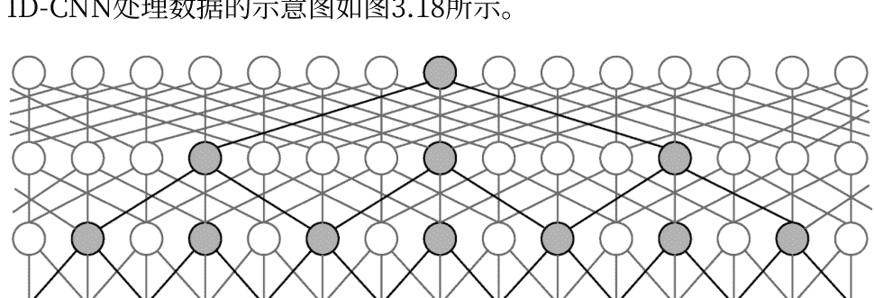

图3.18 ID-CNN处理数据的示意

仅凭图示很容易产生误解。作者初看时也以为只是把一维卷积步长从 1 改为 2。实际上图 3.18 中灰色圆圈每颗都代表一次卷积操作节点，移动步长仍为 1，只是核本身随层数膨胀。黑线连接的部分标示了膨胀的跳跃。

Jason P.C. Chia 与 Eric Nichols 还引入了迭代的思想，形成迭代膨胀卷积。

由于核是膨胀的，感受野指数级打开，4 层即可达到宽度 31，而 Penn 树库句子平均长度仅约 23。对文档而言 31 仍不足，继续加深层数又易过拟合。于是他们复用同一套膨胀卷积结构进行循环：上一轮的输出不直接送入打分层，而是再次作为输入进入同一套 4 层膨胀卷积。一次 4 层覆盖 31 个位置，再跑一遍又可叠加 31。反复迭代可以在不增加参数的前提下汇聚更广的全局信息，比直接加层更稳健。

公式表达如下：

$$c_t^0 = i_t = D_1^0 x_t$$

表示第一层的卷积操作。

$$c_t^j = r(D_{2^{L-1}}^{j-1} c_t^{j-1})$$

-1

表示第j层的膨胀卷积，$2^L$表示卷积核随层数的增加而加倍，$r$为激活函数。

最后一层的公式：

$$c_t^{L+1} = r(D_1^L c_t^L)$$

上述可视为膨胀卷积的另一种写法，将整套操作记为 $B(\cdot)$，迭代形式为

$b_t^1 = B(i_t)$

迭代从一次普通卷积之后开始。

$b_t^k = B(b_t^{k-1})$

经过 $k$ 次迭代，$k$ 为超参数。每次迭代都走同一套膨胀卷积 $D$ 的流程。

$h_t = W_o b_t^k$

最终的 $h_t$ 用于计算标签概率。

实验在 CoNLL-2003 上进行，图3.19 上半部分未加 CRF，下半部分加入了 CRF。加入 CRF 能小幅提升指标，但推理速度明显下降。

对比了 4 层膨胀卷积、5 层膨胀卷积以及迭代膨胀卷积，5 层视野更大指标也更好，说明视野扩展有收益。迭代版本比 5 层更优，说明限制容量可降低过拟合，同时靠迭代扩大视野更有效，如图3.20所示。

在 CNN 类 NLP 模型里，相对于 RNN，指标提升往往不如推理速度关键。ID-CNN 亦然。速度对比如图3.20 所示，相对于基线 Bi-LSTM+CRF 可达 14 倍提升，但主要功劳来自去掉了 CRF。ID-CNN+CRF 只比基线快 28%，而同样去掉 CRF 的 Bi-LSTM 能快 9.92 倍，单纯看模型本身的速度优势就不明显了。

| Model | F1 |

| :--- | :--- |

| Ratinov and Roth (2009) | 86.82 |

| Collobert et al. (2011) | 86.96 |

| Lample et al. (2016) | 90.33 |

| **Bi-LSTM** | **89.34 ± 0.28** |

| **4-layer CNN** | **89.97 ± 0.20** |

| **5-layer CNN** | **90.23 ± 0.16** |

| **ID-CNN** | **90.32 ± 0.26** |

| Collobert et al. (2011) | 88.67 |

| Passos et al. (2014) | 90.05 |

| Lample et al. (2016) | 90.20 |

| **Bi-LSTM+CRF (re-impl)** | **90.43 ± 0.12** |

| **ID-CNN+CRF** | **90.54 ± 0.18** |

▲图3.19 实验结果

| Model | Speed |

|---|---|

| Bi-LSTM+CRF | 1× |

| Bi-LSTM | 9.92× |

| ID-CNN+CRF | 1.28× |

| 5-layer CNN | 12.38× |

| ID-CNN | 14.10× |

图3.20 推断速度对比

## 3.3.6 序列标注的半监督多任务模型

对 SOTA 模型继续提分，大致有三条思路：修补原模型缺陷，例如 BERT 的 NSP 任务；引入新的先验，例如预训练词向量、大小写信息；或扩充语料、精细调参、集成学习。对于分词这类语料稀缺的任务，多语料联合学习也很有潜力。

本节介绍 Hui Li、Xuejun Liao 和 Lawrence Carin 在论文 Semi-supervised Multitask Learning for Sequence Labeling 中提出的半监督多任务框架。思路是在序列标注模型上额外挂一个语言模型任务，多任务联合训练以提升效果，多任务 NER 结构如图3.21 和图3.22。

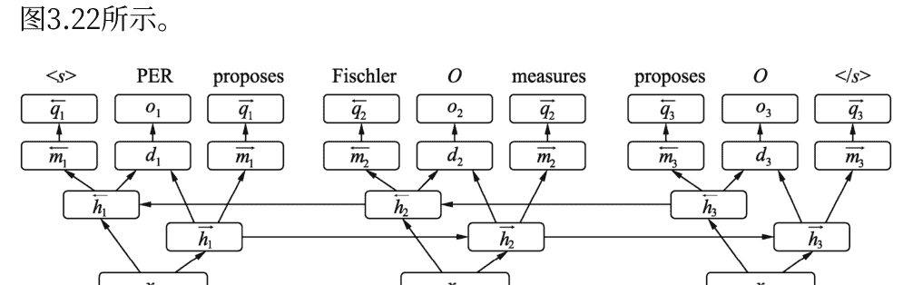

图3.21 多任务NER结构1

两个图表达的是同一套结构：NER 主干用 Bi-LSTM，并额外做前后词预测。

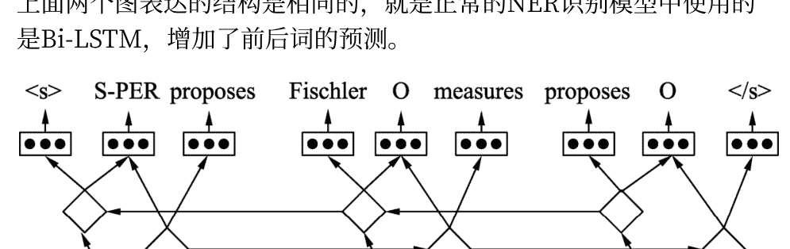

图3.22 多任务NER结构2

在每个词上最终有三个预测目标：第一个基于反向 LSTM，利用当前词之后的信息预测前一个词；第二个基于双向 LSTM 的全部信息预测当前词标签；第三个基于正向 LSTM，利用当前词之前的信息预测下一个词。

```
$h_t^l = \text{LSTM}(x_t, h_{t-1}^l)$
$h_t^r = \text{LSTM}(x_t, h_{t-1}^r)$
$h_t = h_t^l ; h_t^r$
$d_t = \tanh(W_d h_t)$
$P(y_t \mid d_t) = \text{softmax}(W_o d_t)$
```

损失函数依然可以使用常见的多类别交叉熵。

```
$E = -\sum_{t=1}^{T} \log(P(y_t \mid d_t))$
```

上面的是 NER 部分，这里没有加任何提升指标的先验模块，就是一个单纯的 Bi-LSTM，所以表现可预期比较一般，论文里也没有与其他模型横向对比，只是对比了是否使用额外语言模型任务的效果。

```
$m_t^l = \tanh(W_m^l h_t^l)$
$m_t^r = \tanh(W_m^r h_t^r)$
$P(w_{t+1} \mid m_t^r) = \text{softmax}(W_q^r m_t^r)$
$P(w_{t-1} \mid m_t^l) = \text{softmax}(W_q^l m_t^l)$
```

这部分是语言模型，前后词预测各自只用单侧 LSTM。

各自的损失函数还是多分类交叉熵。

```
$E^r = -\sum_{t=1}^{T-1} \log(P(w_{t+1} \mid m_t^r))$
$E^l = -\sum_{t=2}^{T} \log(P(w_{t-1} \mid m_t^l))$
```

最终多任务联合的损失函数如下：

$$\tilde{E} = E + \gamma(E^l + E^r)$$

$\gamma$是一个跟其他正则项一样的权重超参数。

消融实验如图3.23 所示，四个数据集在加上 LM 作为第二任务正则后指标都有提升，说明语言模型式的辅助任务确实能帮到 NER。

| | CoNLL-00 | CoNLL-03 | CHEMDNER | JNLPBA |

|---|---|---|---|---|

| | DEV | TEST | DEV | TEST | DEV | TEST | DEV | TEST |

| Baseline | 92.92 | 92.67 | 90.85 | 85.63 | 83.63 | 84.51 | 77.13 | 72.79 |

| + dropout | 93.40 | 93.15 | 91.14 | 86.00 | 84.78 | 85.67 | 77.61 | 73.16 |

| + LMcost | **94.22** | **93.88** | **91.48** | **86.26** | **85.45** | **86.27** | **78.51** | **73.83** |

图3.23 消融实验结果

预训练词向量本就来自大规模语料，训练方式类似语言模型，已经带有语义信息。理论上额外在有限 NER 语料上再做语言模型，不应带来超出词向量的额外信息。

怎么理解这个提升？作者的解释是词向量虽是预训练的，但模型权重不是，NER 标签只有 4 类，训练信号太稀少，容易过拟合。加入语言模型任务能让权重学到更多结构化信息，起到了正则作用。

提升幅度其实不大，说明标签稀缺导致的过拟合问题并不尖锐。该先验的有效性建立在模型比较简陋的基础上，对于已经大量优化的复杂 NER 模型，额外加 LM 是否仍有帮助还不确定。

## 3.3.7 Lattice LSTM模型

前面讲的以英文为主，英文不需要分词，实体要么是词的组合，要么是 OOV 新词，于是有词基、字符基和混合方案。

中文 NER 也可分为词基和字基。汉字组词模式与英文差异很大，但本质仍是字组成词，所以混合模式也能搬过来，只是效果一般，先验合理性也打折。

词基中文 NER 的好处是可以利用词的先验，很多已成词的字段可以直接排除在实体候选外，降低误报，对公司名、组织名等固定匹配也更友好。

缺点是存在错误传播，必须先分词，分错了后面的 NER 基本救不回来。比如“这里有关天培的壮烈”，正确是“这里／有／关天培／的／壮烈”，若误分为“有关”，结果就变成“这里／有关／天培／的／壮烈”，实体必然错。

实践中也会做妥协，如先分词，对分不出来的连续单字再做 NER，jieba 就是这种思路。但这只是权衡，无法根除分词错误，也无法识别由已有词组成的专名。

字基中文 NER 没有错误传播，汉字种类相对词少，稀疏性好，训练更充分，过拟合风险降低。

但词的先验仍有价值，完全忽略词信息等于让模型从标签里重新学习本可预知的知识，容易出现“南京市长江大桥”被拆成“南京／市长／江大桥”这类明显错误。

如图3.24 所示：

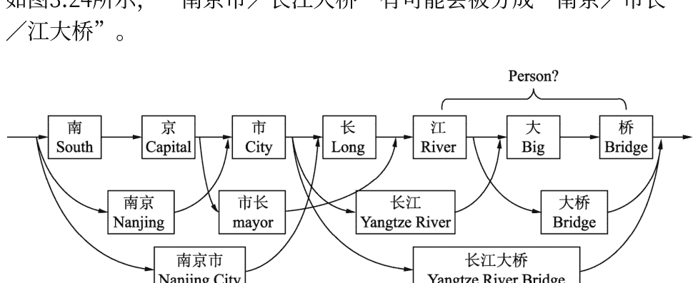

图3.24 分词和NER示例

能不能把词信息用起来，同时避免硬分词的错误？Yue Zhang 和 Jie Yang 在论文 Chinese NER Using Lattice LSTM 中提出了 Lattice LSTM，结构如图3.25。

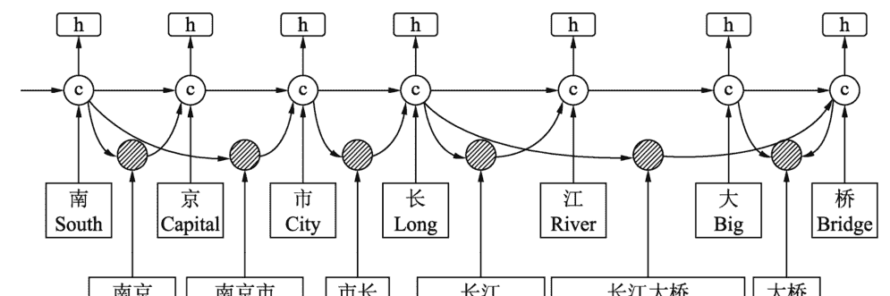

图3.25 lattice LSTM结构示意

直观理解是在字基 LSTM 的基础上，把词的信息以词向量的形式作为额外先验接入。

词与字不是一对一的关系，可能是二字一词，也可能是多字一词，所以连接关系是动态的。

首先采用全分词策略，不是取最高概率的分法，而是把句子中所有可能的分词都保留下来作为额外信息，如“南京”“南京市”“市长”“长江”“长江大桥”“大桥”，这些词大量重叠。

在连接方式上，字处理的主线仍是标准的 LSTM，上一个字的输出作为下一个字状态的输入。

```
$$i_j^c = \sigma(W^c x_j^c; h_{j-1}^c + b^c)$$
$$o_j^c = \sigma(W^c x_j^c; h_{j-1}^c + b^c)$$
$$f_j^c = \sigma(W^c x_j^c; h_{j-1}^c + b^c)$$
```

这是LSTM的3个门控：

```
$$\tilde{c}_j^c = \tanh(W^c x_j^c; h_{j-1}^c + b^c)$$
$$c_j^c = f_j^c \odot c_{j-1}^c + i_j^c \odot \tilde{c}_j^c$$
$$h_j^c = o_j^c \odot \tanh(c_j^c)$$
```

LSTM对应的流程如图3.26所示。

词信息怎么接进去呢？词不只是词向量，而是一个单独的 LSTM 单元，经过改造：以词首字输出作为该词单元的输入，再把该词单元的输出作为词尾字后一个字的 LSTM 单元输入，如图3.27所示。

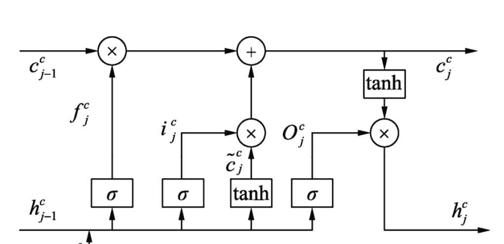

▲图3.26 标准LSTM

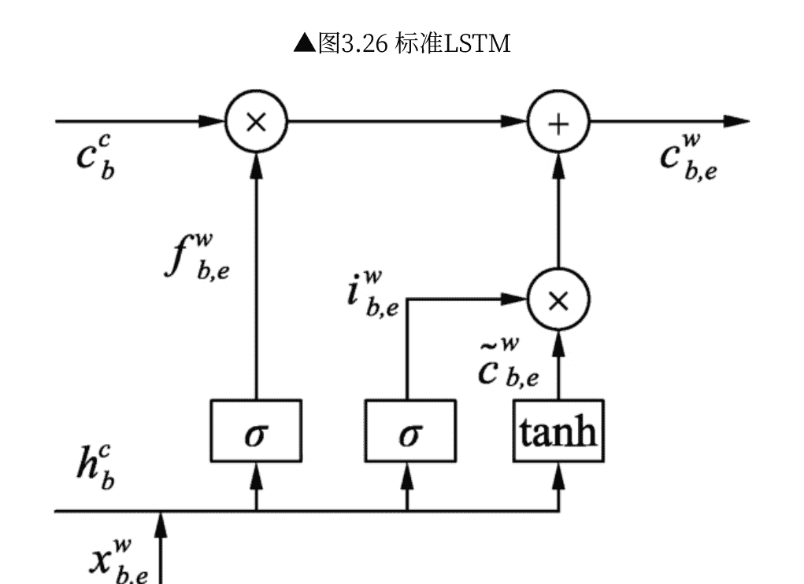

▲图3.27 词信息的LSTM

字词融合的效率跃迁：Lattice 到 PLTE 的演进路径

中文命名实体识别同时受益于字符层面的覆盖面与词语层面的先验信息，把两者纳入同一序列建模而不打乱计算图是核心难题。Lattice LSTM 提供了一种可行的融合范式，也暴露出结构随分词波动带来的计算代价。下面先复盘该范式的瓶颈，再说明 PLTE 如何在保持判别力的同时把推理效率拉回。

```
$i_{b,e}^w = \sigma(W^w x_{b,e}^w; h_b^c + b^w)$
$f_{b,e}^w = \sigma(W^w x_{b,e}^w; h_b^c + b^w)$
$\tilde{c}_{b,e}^w = \tanh(W^w x_{b,e}^w; h_b^c + b^w)$
$c_{b,e}^w = f_{b,e}^w \odot c_b^c + i_{b,e}^w \odot \tilde{c}_{b,e}^w$
```
这里有一个问题，首字的输出既输给下一个字单元，又输给对应的词单元，这没有什么问题，在上面的公式中，词单元的输入 $h_b^c$, $c_b^c$ 就是首字的LSTM输出，但尾字之后的字接受两个输入，这一点LSTM单元是不支持的，所以这两个输入需要做一次合并操作。

```
$i_{b,e}^c = \sigma(W^l x_e^c; c_{b,e}^w + b^l)$
$\alpha_{b,j}^c = \frac{\exp(i_{b,j}^c)}{\exp(i_j^c) + \sum_{b' \in \{b^* | w_{b',j} \in D\}} \exp(i_{b',j}^c)}$
$\alpha_j^c = \exp(i_j^c) / (\exp(i_j^c) + \sum_{b' \in \{b^* | w_{b',j} \in D\}} \exp(i_{b',j}^c))$
$b' \in \{b^* | w_{b',j} \in D\}$
```
注意，这两个$\alpha$公式的分母是相同的，用两种写法是为了让读者看得更清楚一些。分母中的表示所有以$j$为词尾的词。$i_{b,j}^c$就是$i_{b,e}^c$，只是为了与后面的计算保持统一，把尾词标识改了一下。$i_j^c$就是前面标准LSTM的输入门的值，不过这里的$j$是词尾字，所以$i_j^c$也是词尾字的LSTM单元内的输入门。

```
$c_j^c = \sum_{b \in \{b' | w_{b',j} \in D\}} \alpha_{b,j}^c \odot c_{b,j}^w + \alpha_j^c \odot \tilde{c}_j^c$
```
注意，这里的$\tilde{c}_j^c$是词尾的字单元的上下文输出，不是最终的输出，而是经过输入门之前的信息。这样，$\tilde{c}_j^c$就作为词尾字后一个字的输入。这里只改变了$c$，$h$还是词尾字单元本身的输出。

图3.28 把多种建模策略在 OntoNotes 上的 P/R/F1 并排呈现。

| Input | Models | P | R | F1 |
| :--- | :--- | :--- | :--- | :--- |
| Auto seg | Word baseline | 73.20 | 57.05 | 64.12 |
| | +char LSTM | 71.98 | 65.41 | 68.54 |
| | +char LSTM' | 71.08 | 65.83 | 68.35 |
| | +char+bichar LSTM | 72.63 | 67.60 | 70.03 |
| | +char CNN | 73.06 | 66.29 | 69.51 |
| | +char+bichar CNN | 72.01 | 65.50 | 68.60 |
| No seg | Char baseline | 67.12 | 58.42 | 62.47 |
| | +softword | 69.30 | 62.47 | 65.71 |
| | +bichar | 71.67 | 64.02 | 67.63 |
| | +bichar+softword | 72.64 | 66.89 | 69.64 |
| Lattice | | **74.64** | **68.83** | **71.62** |

图3.28 模块对比实验

该表对照了纯词、纯字及各类混合方案。Word baseline 以词为单位做 NER，依赖外部分词器。+char LSTM 在词表征上叠加词内字符序列经 LSTM 编码后的特征。

```
$x_i^c = h_{i, len(i)}^l ; h_{i, 1}^r$
```
这分别是正向LSTM和反向LSTM最后一步的输出，拼接后作为当前词的字向量表达。

$$x_i^w = w_i; x_i^c$$
然后与原始词向量拼接成最终的词向量。

+char LSTM' 是对编码方式的小幅改动；+char CNN 用卷积提取字符特征；+char+bichar LSTM/CNN 则在字符特征后额外拼接双字 bi-gram，近似 fastText 的思路。Char baseline 为纯字符模型；+softword 则在字符向量上附加词侧信号。

$$x_j^c = c_j; seg(c_j)$$
c是字向量，seg(c)是当前字在分词时的标签，对应于BMES，就是标示出这个字在当前句子中的分词结果是开头、结尾，或者单独成字。这其实也是一种字词混合的方式，比硬搬英文的混合方式要精巧一些。

+bichar 即双字 bi-gram 信息。

从数值可看出若干规律：纯字符基线低于纯词基线，62.47 对 64.12，说明词语先验对 NER 更强。直接移植英文字词混合约 68.54，优于借助 BMES 软词的 65.71，主要因词语本身先验与 BMES 仅能标明是否成词、缺乏语义。bi-gram 对召回有稳定增益。

Lattice 的综合表现仍居前列。跨模型对照见图3.29。

| Input | Models | P | R | F1 |
|---|---|---|---|---|
| Gold seg | Yang et al. (2016) | 65.59 | 71.84 | 68.57 |
| | Yang et al. (2016)*† | 72.98 | **80.15** | **76.40** |
| | Che et al. (2013)* | 77.71 | 72.51 | 75.02 |
| | Wang et al. (2013)* | 76.43 | 72.32 | 74.32 |
| | Word baseline | 76.66 | 63.60 | 69.52 |
| | +char+bichar LSTM | **78.62** | 73.13 | 75.77 |
| Auto seg | Word baseline | 72.84 | 59.72 | 65.63 |
| | +char+bichar LSTM | 73.36 | 70.12 | 71.70 |
| No seg | Char baseline | 68.79 | 60.35 | 64.30 |
| | +bichar+softword | 74.36 | 69.43 | 71.81 |
| | Lattice | **76.35** | **71.56** | **73.88** |

图3.29 在OntoNotes上的实验对比

Gold seg 使用语料库标准切分以消除分词噪声。带 * 的工作引入外部词典做半监督，部分还加入手工特征。Lattice 完全自动分词且不依赖特征工程与词典，分数仍可与精调模型媲美。

MSRA 对比见图3.30，该集无标准分词，故不设 Gold seg。

| Models | P | R | F1 |
|---|---|---|---|
| Chen et al. (2006a) | 91.22 | 81.71 | 86.20 |
| Zhang et al. (2006)* | 92.20 | 90.18 | 91.18 |
| Zhou et al. (2013) | 91.86 | 88.75 | 90.28 |
| Lu et al. (2016) | – | – | 87.94 |
| Dong et al. (2016) | 91.28 | 90.62 | 90.95 |
| Word baseline | 90.57 | 83.06 | 86.65 |
| +char+bichar LSTM | 91.05 | 89.53 | 90.28 |
| Char baseline | 90.74 | 86.96 | 88.81 |
| +bichar+softword | 92.97 | 90.80 | 91.87 |
| Lattice | **93.57** | **92.79** | **93.18** |

图3.30 在MSRA上的实验对比

Lattice 开创了新的字词融合范式，但拓扑随分词结果变化，计算图不固定。RNN 本身逐时序迭代，加上每句结构不同，句子间并行度受限，训练与推理都很缓慢。

## 3.3.8 PLTE模型

本节介绍 2019 年 Xue Mengge、Yu Bowen、Liu Tingwen 等提出的 Porous Lattice-based Transformer Encoder for Chinese NER，即 PLTE，是在 Lattice LSTM 上的演进。

Lattice LSTM 判别力不错，但推理慢。网络结构随句子分词动态生成，不稳定，难以并行，只能逐条执行。

因此工作把 LSTM 换成 Transformer 自注意力。

**注意：** 后续章节会专门讲解 Transformer。它是编码器-解码器结构，最初为机器翻译设计，BERT 等变体多只用编码器完成 NER 等任务。建议不熟悉者先补基础。

速度瓶颈的核心是结构不标准。曾尝试把分词标记嵌入字向量以保持图简单，但效果不佳，标记信息量少且难以被充分利用。

PLTE 保留词向量输入，但不再把词注入 LSTM 词尾导致结构不统一，而是利用自注意力的特性，用 position 嵌入标识位置，将词向量与字向量排成一列输入，网络除长度外保持统一。同时字词向量携带对 Lattice 感知的位置信息，即词位置采用其首字在句中的绝对位置。

图3.31 为整体结构，示例“南京市长江大桥”中词被拼接到字后，位置编码使用首字位置。

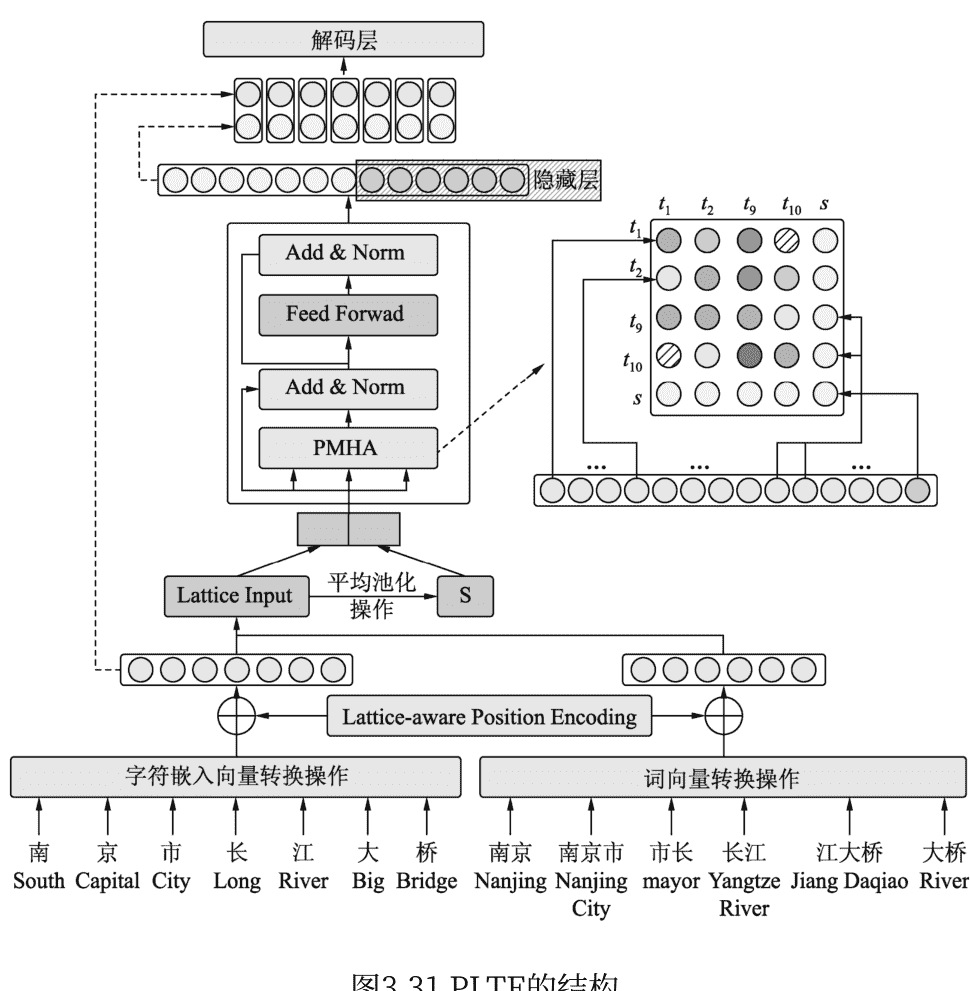
如果到此为止，只是使用了词向量+位置向量+Transformer自注意力的结构，最终效果会不会达到Lattice LSTM的效果呢？答案是并不会，说明模型仍然是有问题的，这里先不展开，最后在讲消融实验的时候再介绍。

核心创新为 Lattice-Aware Self-Attention 与 Porous Multi-Head Attention。

### 1. LASA

先看 LASA。LA 位置编码是绝对位置，但自注意力依赖相对位置，绝对编码存在冗余，易过拟合。Transformer-XL、XLNet 等已转向相对位置。

PLTE 在保留绝对位置的同时引入相对位置编码，即 LASA。

| | 条件 | | 关系 |
|---|---|---|---|
| $r_1$ | $q = k - 1$ | [image] | $e_{p:q}$ is left adjacent to $e_{k:l}$ |
| $r_2$ | $l = p - 1$ | [image] | $e_{p:q}$ is right adjacent to $e_{k:l}$ |
| $r_3$ | $p < k \leqslant q < l$ | [image] | $e_{p:q}$ is left intersected with $e_{k:l}$ |
| $r_4$ | $k < p \leqslant l < q$ | [image] | $e_{p:q}$ is right intersected with $e_{k:l}$ |
| $r_5$ | $p \leqslant k \leqslant l < q$ | [image] | $e_{p:q}$ includes $e_{k:l}$ |
| $r_6$ | $k \leqslant p \leqslant q < l$ | [image] | $e_{p:q}$ is includes in $e_{k:l}$ |
| $r_7$ | $q < k - 1$ or $l < p - 1$ | [image] | $e_{p:q}$ is non-neighboring to $e_{k:l}$ |

▲图3.32 相对位置的分类

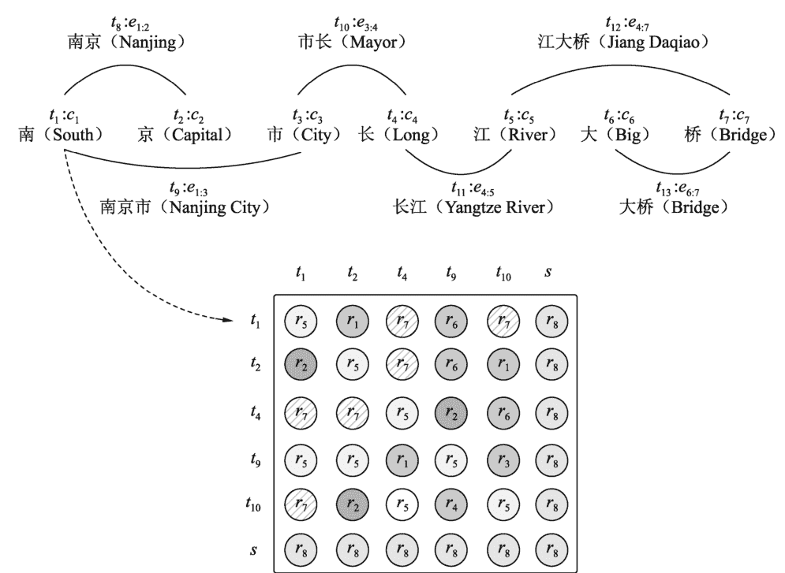
图3.33 LASA示意

相对位置不仅限于字符，还覆盖字与词之间的交互。为此给字分配 $t_1\cdots t_7$，词续接 $t_8$ 起，并额外加入 $s$。

相对编码强调包含关系而非单纯距离。

标准自注意力计算如下：

```
Att(Q, K, V) = softmax(QK^T / sqrt(d_k)) V
```
每两个字、词或字词之间都包含这种关系，为了可以训练，每种关系都可以用嵌入向量来表示。

在注意力计算时将相对位置信息叠加：

$$\text{Att}(\boldsymbol{Q}, \boldsymbol{K}, \boldsymbol{V}) = \text{softmax}\left(\frac{\boldsymbol{Q}\boldsymbol{K}^\top + R}{\sqrt{d_k}}\right)V$$
这里的$R$就是相对位置编码，具体的定义如下：

$$\alpha = \text{softmax}\left(\frac{\boldsymbol{Q}\boldsymbol{K}^\top + \text{einsum}("ik,ijk \rightarrow ij", \boldsymbol{Q}\boldsymbol{R}^K)}{\sqrt{d_k}}\right)$$

乍看之下 R 这个项计算起来很绕，其实可以折叠成 QR 的形式来处理，借助 einsum 只是为了点明它并不是一次普通的矩阵乘法。Q 的维度是 N×d，R 的维度是 N×N×d，形状上根本没法直接相乘，硬算的话 RQ 会变成 N×N×N 的张量，可前面的 QK 已经是 N×N，而且最终想要的输出也必须是 N×N，所以只能按下面这种方式去做：

$$\sum_{k=1}^{d_k} Q_{ik} R_{ijk}^K$$

更具体地说，Q 里第 i 个词向量会和 R 在第 i 个位置上、与所有相对位置 j 配对的信息做运算，得到的是一个 N 维的向量，把所有 i 都算完就拼出了 N×N 的结果。换个说法，QK 的作用是评估每个词和其它所有词在语义上的关联强度，QR 则是把词自身的语义向量和相对位置编码相乘，用来衡量词与词之间的位置关联强度。两者相加再过激活，就变成了类似百分比的注意力权重。

自注意力的完整输出写成：

$Att(Q,K,V)=\alpha V+\text{einsum}("ik,ijk \rightarrow ij",\alpha R^V)$

相对位置信息先被注意力权重加权，再叠加到最终输出上，这样能够避免它在多次累加中逐渐被稀释掉。

### 2. PMHA

继续看 PMHA，这其实是对前面自注意力的一种针对性改造。NER 任务里，一个字对周围邻近字的依赖明显更强，对远距离字的依赖则相对弱很多，而标准 Transformer 的自注意力是全连接、两两都算，没有先验的重要性区分。

为了更贴合 NER，这里做了限制：每个字不再和整句话里所有字都算相关度，只和与自己有关系的那部分字计算。关系怎么判定，就靠前面定义的 r1 到 r6。

设 E 为全部字词的集合，X 为对应的嵌入向量集合。给定 $e \in E, x \in X$，若 e 是一个字，则……

定义 $e_{i,j}^r$ 为与 e 关系为 r 的所有字词，$x_{i,j}^r$ 为这些词向量的拼接。

$\{e_{i,j}^1; e_{i,j}^2; e_{i,j}^3; e_{i,j}^4; e_{i,j}^5; e_{i,j}^6\}$

于是每个 e 最多对应 6 类相关字词。最终多头注意力的计算为：

$h_{i,j} = z_{i,j}^1; \cdots; z_{i,j}^H W^O$

$z_{i,j}^h = Att(x_{i,j} W_h^Q, c_{i,j} W_h^K, c_{i,j} W_h^V), h \in 1, H$

这里的 Att 就是前面 LASA 给出的形式，只是输入被改动了。

$c_{i,j} = x_{i,j}^1; x_{i,j}^2; x_{i,j}^3; x_{i,j}^4; x_{i,j}^5; x_{i,j}^6; s$

$s = \frac{1}{N} \sum_{i,j} x_{i,j}$

s 就是图 3.33 里额外加上的那个平均向量，相当于整句话的平均表征，用来在强化局部邻近关系挖掘的同时保留一点全局远距离的信息。

在输出端，词是被拼接到句尾的，所以词也会产生对应的输出，但在 NER 任务里不需要词的预测，因此直接被屏蔽丢弃。最终只保留字对应的输出来做标签解码。解码层采用双向 GRU 加 CRF，而且为了防止内部处理导致信息衰减，在算最终标签时，自注意力的输出会和原始的字向量一起参与。作者认为即使把双向 GRU+CRF 去掉，指标也不会掉很多，只是论文里没有做这部分的消融。

实验结果如下图 3.34。

| Input | Models | P | R | F1 |

|---|---|---|---|---|

| Gold seg | Che et al. (2013) | 77.71 | 72.51 | 75.02 |

| | Wang et al. (2013) | 76.43 | 72.32 | 74.32 |

| | Yang et al. (2016) | 72.98 | 80.15 | **76.40** |

| No seg | Lattice LSTM (2018) | 76.35 | 71.56 | 73.88 |

| | LR-CNN (2019a) | 76.40 | 72.60 | 74.45 |

| | CAN-NER(2019) | 75.05 | 72.29 | 73.64 |

| | PLTE | 76.78 | 72.54 | **74.60** |

| | BERT-Tagger | 78.01 | 80.35 | 79.16 |

| | Lattice LSTM[BERT] | 79.79 | 79.41 | 79.60 |

| | LR-CNN[BERT] | 79.41 | 80.32 | 79.86 |

| | PLTE[BERT] | 79.62 | 81.82 | **80.60** |

图3.34 在OntoNotes数据集上的结果

Gold seg 表示使用数据集提供的标准分词结果，这类设置在真实场景里不现实，研究价值已经很低。在不依赖标准分词的组别里，PLTE 取得了最佳表现。

加入预训练 BERT 作为底层特征提取后，各方法都有明显提升，说明 NER 数据集和分词数据集一样都偏小，单靠从头训练难以充分学习。基于 BERT 的模型里，PLTE 依然是最优，如图 3.35 和图 3.36 所示。

| Models | P | R | F1 |

|---|---|---|---|

| Zhou et al. (2013) | 91.86 | 88.75 | 90.28 |

| Lu et al. (2016) | - | - | 87.94 |

| Cao et al. (2018) | 91.73 | 89.58 | 90.64 |

| Lattice LSTM (2018) | 93.57 | 92.79 | 93.18 |

| CAN-NER(2019) | 93.53 | 92.42 | 92.97 |

| LR-CNN (2019a) | 94.50 | 92.93 | **93.71** |

| PLTE | 94.25 | 92.30 | 93.26 |

| BERT-Tagger | 94.43 | 93.86 | 94.14 |

| Lattice LSTM[BERT] | 93.99 | 92.86 | 93.42 |

| LR-CNN[BERT] | 94.68 | 94.03 | 94.35 |

| PLTE[BERT] | 94.91 | 94.15 | **94.53** |

图3.35 在MSRA上的结果

MSRA 和 Weibo 在不使用 BERT 时未达最优，但借助 BERT 后均达到最佳，如图 3.37 所示。

解决 Lattice LSTM 推断速度慢的问题后，看一下速度对比图 3.38。因为 Lattice LSTM 不支持批处理，Batch Size 只能为 1，而 PLTE 设为 16，速度大约是前者的 10 倍左右。加上 BERT 后两边都变慢，提升倍数下降到约 1/6。

| Models | P | R | F1 |

| :--- | :--- | :--- | :--- |

| Peng and Dredze (2016) | 66.47 | 47.22 | 55.28 |

| He and Sun (2017a) | 61.68 | 48.82 | 54.50 |

| Cao et al. (2018) | 59.51 | 50.00 | 54.43 |

| Lattice LSTM (2018) | 52.71 | 53.92 | 53.13 |

| LR-CNN (2019a) | 65.06 | 50.00 | **56.54** |

| PLTE | 62.21 | 49.54 | 55.15 |

| BERT-Tagger | 67.12 | 66.88 | 67.33 |

| Lattice LSTM[BERT] | 61.08 | 47.22 | 53.26 |

| LR-CNN[BERT] | 64.11 | 67.77 | 65.89 |

| PLTE[BERT] | 72.00 | 66.67 | **69.23** |

▲图3.36 在Weibo上的结果

| Models | Word2vec | | | BERT | | |

| :--- | :--- | :--- | :--- | :--- | :--- | :--- |

| | Lattice LSTM | LR-CNN | PLTE | Lattice LSTM | LR-CNN | PLTE |

| OntoNotes | 1× | 2.23× | 11.4× | 1× | 1.96× | 6.21× |

| MSRA | 1× | 1.57× | 8.48× | 1× | 1.97× | 7.11× |

| Weibo | 1× | 2.41× | 9.12× | 1× | 2.02× | 6.48× |

| Resume | 1× | 1.44× | 9.68× | 1× | 1.46× | 5.57× |

▲图3.37 推断速度对比

| Models | OntoNotes | MSRA | Weibo | Resume |

| :--- | :--- | :--- | :--- | :--- |

| PLTE | 74.60 | 93.26 | 59.76 | 95.40 |

| -LASA | 70.97 | 92.27 | 56.95 | 94.82 |

| -PM | 70.17 | 91.84 | 50.08 | 94.40 |

| -LASA-PM | 70.58 | 92.48 | 56.52 | 94.69 |

图3.38 消融实验对比

消融实验显示，去掉 LASA 后指标明显下滑，说明基于字词位置和包含关系的相对位置信息对 NER 很关键。去掉 LASA 的做法是只保留字向量，去掉词向量，从而失去相对位置编码，但仍保留多头注意力的局部化改动。

去掉 PM 则退化为标准的全部注意力。两者都去掉则等同于标准 Transformer。有趣的是，只去掉 PM 的效果比同时去掉 PM 和 LASA 更差，这说明 LASA 设计的相对位置编码并不适合直接套在标准自注意力上，强行结合反而会干扰正常的注意力。

## 3.4 大模型时代的命名实体识别

命名实体识别是 NLP 的基础任务，目标是从文本里抽取出人名、地名、组织名等实体。下面聊聊大模型在 NER 上的用法，并用例子说明其能力。

### 3.4.1 使用ChatGPT提示词进行实体识别

举个例子，输入句子：张三出生在北京，后来去了百度工作。

随后再给一个提示：“请帮我识别上面句子中的命名实体”。

ChatGPT 给出的结果：

- 张三（人名）

- 北京（地名）

- 百度（组织名）

可以看到大模型能把多个 NLP 能力整合在一个统一框架里，高效完成实体抽取。

### 3.4.2 使用ChatGPT API进行实体识别

通过 API 调用能更方便地实现 NER，示例代码如下：

```python
import openai

openai.api_key = 'your-api-key'

def identify_entities(text):
    response = openai.Completion.create(
        engine="text-davinci-003",
        prompt=f"请识别下面句子中的命名实体：{text}",
        max_tokens=50
    )
    return response.choices[0].text.strip()

# 示例文本
sentence = "张三出生在北京，后来去了百度工作。"
entities = identify_entities(sentence)
print(f"命名实体识别结果：\n{entities}")
```

借助这段代码，可以直接调用 ChatGPT 对文本进行命名实体识别，操作简单无需训练。

大模型在 NER 上展现出很强的泛化能力，处理复杂文本时效果稳定。掌握这些用法，能为后续深入学习打下基础。

## 3.5 小结

NER 在知识图谱、搜索、对话等场景都有广泛应用。本章先回顾了传统 NER 方法，再介绍了英文和中文的经典深度学习模型，最后演示了如何用 ChatGPT 的提示词和 API 做实体识别。下一章将进入深度学习在 NLP 上最早取得突破的任务——神经机器翻译。

# 第4章 神经机器翻译

本章介绍深度学习在 NLP 上最早实现突破的任务——神经机器翻译 NMT。翻译之所以率先被攻破，并不是因为问题简单或模型更强，而是因为跨语言的平行语料最丰富。人类长期以来一直在做翻译，尤其是汉语和英语等大语言，积累了海量书籍和资料的翻译数据。

## 4.1 神经机器翻译的发展

人工智能研究最早关心的其实就是自然语言理解，因为当时的目标是造出拥有类人思维的机器，图灵测试就是评判标准。

图灵测试的大致玩法是机器藏在门后，和人多次对话，若人分辨不出对方是人还是机器就算通过。为了作弊，可以事先收集海量问答对，建立巨大的问答库，机器只要检索就能应付大部分日常开场白。这类手段被视为缺乏真正的智能。为此测试被升级为跨语言对话：提问者用英语，机器必须用中文或法文回复，这样就不能靠语义相似检索，必须完成真正的句子翻译。

早期的翻译思路和早期 AI 设计类似，都依赖已有的规则链条。翻译就是基于语言规则的机械推演。理论上可行，实践中却很难。世界的规则在抽象层面看似简洁，具体层面却无穷无尽；语言也是如此，虽然有“主谓宾”这类框架，实际使用却随意、口语化、常带错误，难以用规则完全覆盖。因此纯规则的翻译尝试全部失败。

最早意识到问题的人是李开复，他转向统计概率的方法。n-gram 就是典型做法，利用源句前几个词和已译出前几个词来预测下一个词的出现频率，这一时期称为统计机器翻译 SMT。

SMT 把翻译等价为求条件概率，给定源语言 s，求目标语言 t 的 p(t|s)。在双语平行语料上学习模型参数，推理时选择使条件概率最大的译文。相比规则方法有明显进步，但很快遇到瓶颈。2014 年前的 Google 翻译就是这一阶段的顶尖水平。

后来人们尝试用神经网络即神经机器翻译 NMT 来替代统计模型。由于算力限制，早期神经网络的学习能力还不及经过大量特征工程的 SMT，所以 NMT 并未流行。

机器翻译在很长一段时间里进展缓慢，直到深度学习开始普及才出现转折。转折并非源于建模思想的根本革命，底层仍延续统计学派的思路，关键变量是2013年前后算力的集中爆发。算力上去后，海量平行语料才能真正被模型吃下。算力受限的阶段，神经网络只能做得很浅，结构也比较保守。随着硬件持续增强，设计者把原本需要手工注入的先验知识和特征工程，逐渐交给更深更复杂的网络自行挖掘，减少了对图模型等人工干预的依赖，翻译质量因此实现大幅跃迁。如今市面上常见的翻译产品，基本都建立在这一套深度学习框架之上。

## 4.2 评估指标

在介绍具体建模方法前，先厘清如何衡量翻译好坏。神经网络里的翻译任务属于序列生成问题，考核对象不是单个词的对错，而是整句的表达效果。每个训练样本都附带参考译文，但自然语言表达多样，同一语义可有多种写法，因此模型输出不必与参考句完全一致才算正确。训练阶段以参考句为目标是合理的，评估阶段则应更宽松，采用相似度打分，越接近参考分数越高，小范围用词差异不应直接判定为错误。为量化这种相似性，研究者提出了多种指标，BLEU 与 Rouge-L 是其中最常被引用的两种。

### 4.2.1 BLEU指标

BLEU 用来估算模型生成句与参考句的重合程度，核心是比较 uni-gram、bi-gram、tri-gram 的共现频率。下面以一个例子说明。

中文：那个猫在垫子上。
参考翻译1：The cat is on the mat.
参考翻译2：There is a cat on the mat.
MT：the cat the cat on the mat.

从中可见翻译数据具有多对多特性，一个源句对应多个合理译文，这也说明翻译没有唯一标准答案，训练与评估都不宜死守单一参考。

BLEU 的基本思路是统计模型输出与参考句在不同 n-gram 层级上的重合，并取平均。先看 uni-gram 的计算演示。

表4.1 uni-gram词频

| MT中的uni-grams | count | count（参考翻译1） | count（参考翻译2） | count(clip)截取计数 |
| :--- | :--- | :--- | :--- | :--- |
| the | 3 | 2 | 1 | 2 |
| cat | 2 | 1 | 1 | 1 |
| on | 1 | 1 | 1 | 1 |
| mat | 1 | 1 | 1 | 1 |

先统计模型输出的词频，第2列为结果。第3、4列为两个参考译文的词频统计，注意两个参考译文中总词数分别是6和7，这里只保留共现词。最后一列为 clip 操作，即取参考译文中该词的最大出现次数与模型中出现次数的最小值。例如 the 在参考1出现2次，参考2出现1次，取2次；模型中出现3次，最终 clip 为2，其余词同理。

uni-gram 分数的分子是所有 clip 频次之和，分母是模型输出的总词数。

$$p1 = \frac{\text{count(clip)}}{\text{count}} = \frac{2+1+1+1}{3+2+1+1} = \frac{5}{7}$$

接着统计 bi-gram，做法与 uni-gram 相同，只是单位变为两个词的组合。结果如表4.2所示，clip 规则不变。

表4.2 bi-gram词频

| MT中的bi-gram | count | count（参考翻译 1） | count（参考翻译 2） | count(clip)截取计数 |
| :--- | :--- | :--- | :--- | :--- |
| the cat | 2 | 1 | 0 | 1 |
| cat the | 1 | 0 | 0 | 0 |
| cat on | 1 | 0 | 1 | 1 |
| on the | 1 | 1 | 1 | 1 |
| the mat | 1 | 1 | 1 | 1 |

由此可得到 bi-gram 分值：

$$p2 = \text{count(clip)} / \text{count} = \frac{(1+0+1+1+1)}{(2+1+1+1+1)} = 4/6 = 2/3$$

再统计 tri-gram，原理一致，只是单位变为三词组合，如表4.3所示。

表4.3 tri-gram词频

| MT中的tri-gram | count | count（参考翻译 1） | count（参考翻译 2） | count(clip)截取计数 |
| :--- | :--- | :--- | :--- | :--- |
| the cat the | 1 | 0 | 0 | 0 |
| cat the cat | 1 | 0 | 0 | 0 |
| the cat one | 1 | 0 | 0 | 0 |
| cat one the | 1 | 0 | 1 | 1 |
| one the mat | 1 | 1 | 1 | 1 |

tri-gram 分值：
$p3 = \text{count(clip)} / \text{count} = \frac{1+1}{1+1+1+1+1} = 2/5$

取平均：
$BLEU(avg) = (p1+p2+p3)/3 = (5/7+2/3+2/5)/3 = 0.594$

该分数仅反映重合度，未考虑参考句中出现而模型未生成的词，容易被投机策略利用，例如只输出 the 就能得到 1/3 分，输出 the cat 分数更高。为此引入长度惩罚系数。

$BP = \begin{cases} 1, & \text{如果 } c > r \\ e^{1-r/c}, & \text{如果 } c \leqslant r \end{cases}$

$c$ 为模型输出长度，$r$ 为预设的参考长度。当 $c$ 小于 $r$ 时，最终分数会乘以小于1的系数进行惩罚。

最终指标为：
$BLEU(total) = BP \times BLEU(avg)$

### 4.2.2 Rouge-L指标

评估指标本身也在伴随技术演进不断调整，Rouge-L 便是其中的代表之一，这里不展开其细节，仅作了解。

## 4.3 神经机器翻译概述

前文介绍了发展脉络与评测方式，下面聚焦神经机器翻译的建模思路，以及它与统计机器翻译的差异。

与统计派使用的离散表示不同，神经机器翻译采用连续空间表示来编码词、短语和句子。建模时无需词对齐、规则抽取等传统步骤，直接用神经网络实现源语到目标语的映射。主流做法大致分为两类，一是 Google 提出的端到端翻译模型，二是蒙特利尔大学提出的编码器-解码器模型，二者在原理上非常接近。第一种结构如图4.1所示，模型输入“A”“B”“C”，在条件驱动下依次生成输出“W”“Y”“Z”，“<EOS>”为人工加入的句子结束标志。翻译场景下，输入为源语，输出为目标语，故称端到端。

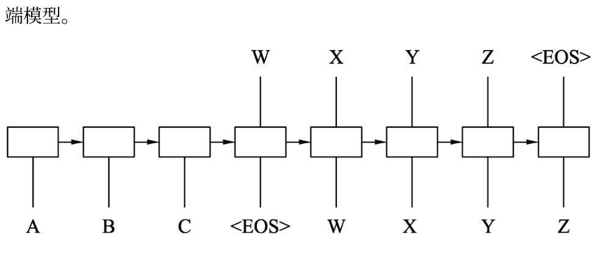

图4.1 端到端的翻译模型结构

在编码器-解码器中，编码器把源语句子压缩成固定维度的向量，解码器基于该向量逐词生成目标语序列。这种结构在 Autoencoder、Transformer 等模型里也很常见。

两种结构本质区别不大，第一种也能视为编码器-解码器，只是源语经 RNN 编码后，再与译文开头结合处理时形成中间表示。编码器-解码器通常使用相同的 RNN 单元与参数，后续统一用编码器-解码器表述。

编码器-解码器由输入 $x$、隐藏状态 $h$ 及输出 $y$ 三部分构成。编码器读取输入：

$$x=(x_1, x_2, \cdots, x_I)$$

将其编码为隐藏状态：

$$h=(h_1, h_2, \cdots, h_I)$$

当使用循环神经网络时：
$$h_i=f(x_i, h_{i-1})$$

$$c=q(h_1, \cdots, h_I)$$

$c$ 是编码器对输入的整体表示，$f$ 与 $q$ 为非线性函数。

解码器在已知编码表示 $c$ 和已生成的前缀 $\{y_1, y_2, \cdots, y_{t-1}\}$ 条件下，生成当前词 $y_t$：

$$p(y_t) = \prod_{t=1}^{T} p(y_t \mid y_1, \cdots, y_{t-1}, c)$$

编码器与解码器可联合训练，损失函数为：

$$L(\theta) = \arg \max \frac{1}{N} \sum_{n=1}^{N} \log p_{\theta}(y_n \mid x_n)$$

$\theta$ 为全部参数，通过梯度下降优化，$x$ 与 $y$ 分别是双语语料的句子对。

该框架通用，可由 LSTM、门控循环神经网络等不同单元实现。

神经机器翻译仅需句子级平行语料，用纯神经网络完成翻译，便于在大规模数据上训练，实用价值很高。

把翻译看作概率求解是统计机器翻译的核心，这一点神经机器翻译也沿用，只是实现方式不同。

统计机器翻译基于贝叶斯原理对 $p(t|s)$ 做扩展：

$$p(t \mid s) = \frac{p(t) p(s \mid t)}{p(s)}$$

分母是源语句子的概率，句子固定后该值恒定，可忽略，简化为求解：

$$\hat{t} = \arg \max p(t) p(s \mid t)$$

其中 $p(t)$ 是语言模型，$p(s|t)$ 是翻译模型，可进一步拆分为语言模型、翻译模型、调序模型等，通过对数线性模型融合完成翻译。

神经机器翻译用神经网络直接实现源到目标的映射，整体像个黑箱，词对齐、语言模型、翻译模型等必要成分都在其中，只是以隐式方式完成。

两者对比如下：
词对齐建模：词对齐是统计机器翻译的重要环节，用来刻画源目标词的对应。多数神经机器翻译模型不再显式做词对齐，基于注意力机制的模型在解码时能动态获取与当前生成词相关的源语信息。虽然能得到对齐线索，但信息量和精度相比统计方法仍有限。
翻译效果对比：神经机器翻译在生成时同时利用源语信息和已生成的译文信息，相当于把多个模块无缝融合。实验显示其译文流畅度通常优于统计方法，对复杂调序、长距离调序的处理也更好，但在翻译忠实度上略逊一筹。

最简单的编码器-解码器 NMT，编码器和解码器都用 LSTM 单元。LSTM 内部结构与文本分类时相同，只是这里有编码器和解码器两个 LSTM，具体细节在讲注意力时再展开。

## 4.4 注意力机制

最经典的神经机器翻译模型就是编码器-解码器架构，也称 seq2seq，内部常用 LSTM。它省去大量特征工程，但效果仍难超过 SMT。直到从计算机视觉借鉴注意力机制后，性能才迎来长足进步。注意力并非全新模型，通常叠加在 seq2seq 这类基础结构上使用。

### 4.4.1 注意力机制简介

注意力机制顾名思义类似人脑注意方式。人眼看图时无法一次性捕捉全部细节，只能焦点跳动，一秒多次扫视拼凑全貌。回答问题时注意力还会自动落在相关物体上。CV 里的注意力也类似，生成描述词时隐藏状态会聚焦到对应实体上。

NLP 里的逻辑一样，比如机器翻译，生成一个目标词时就会关注源语中最相关的词。

注意力模型 AM 最初用在机器翻译，后来成为 NLP、统计学习、语音、计算机视觉等领域的常用组件，在 AI 里非常流行。

这种相关性让模型能动态只看输入的局部，对当前任务有帮助的部分。它不仅提升性能，还增强了可解释性，让黑箱模型更透明，也更符合对公平、问责和透明度的需求。同时能缓解 RNN 随输入变长性能下降、顺序处理效率低等问题。

seq2seq 由编码器-解码器组成，如图4.3(a)所示。编码器是 RNN，接受 $x_1, x_2, \cdots, x_T$，编码为 $h_1, h_2, \cdots, h_T$。解码器也是 RNN，以 $h_T$ 为输入逐个生成 $y_1, y_2, \cdots, y_T$。每个位置 $t$ 上，$h_t$ 和 $s_t$ 分别代表编码器和解码器的隐藏状态。

#### 1. 传统编解码器的挑战
编码器需把所有输入信息压缩成固定长度向量 $h_T$ 传给解码器，输入长度可变时长序列信息会大量丢失。其次它无法显式建模输入输出序列的对齐关系，而对齐对翻译、摘要等结构化任务很重要。直观上，每个输出词更容易受输入的特定部分影响，但传统解码器缺乏在生成每个词时选择性聚焦相关输入的机制。

#### 2. 注意力机制的关键思想
AM 旨在通过允许解码器访问整个编码输入序列 $h_1, h_2, \cdots, h_T$，为每个输入位置赋予权重，从而强化与下一个输出相关的信息。

#### 3. 注意力的使用
对应结构如图4.3(b)所示。注意力模块自动学习注意力权重 $\alpha_{ij}$，它衡量编码器隐藏状态 $h_i$ 即候选状态，与解码器隐藏状态 $s_j$ 即查询状态之间的相关性。利用这些权重构建上下文向量 $c_j$ 输入解码器。每个解码位置 $j$ 的上下文向量是所有编码器隐藏状态按权重加权求和，例如：

$$c_j = \sum_{i=1}^{T} \alpha_{ij} h_i$$

该上下文向量让解码器能够访问整个输入并聚焦相关位置。

注意力权重的学习通过额外前馈网络完成，该网络以 $h_i$ 和 $s_{j-1}$ 为输入输出 $\alpha_{ij}$。注意力网络与编码器-解码器一起联合训练。

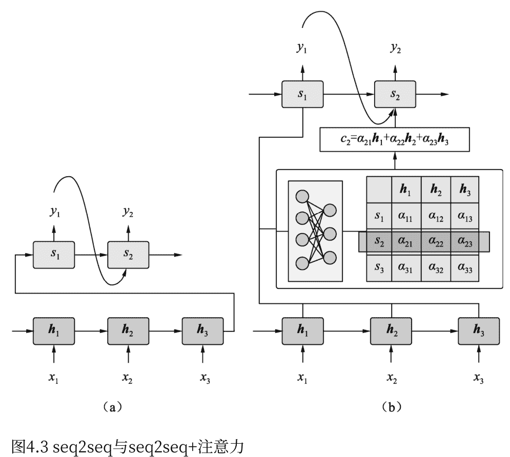

图4.3 seq2seq与seq2seq+注意力

使用 AM 对 Yelp 点评进行情绪分类的例子如图4.2所示。在这个例子中，AM 学习到在五个句子中，第一个和第三个句子更相关。

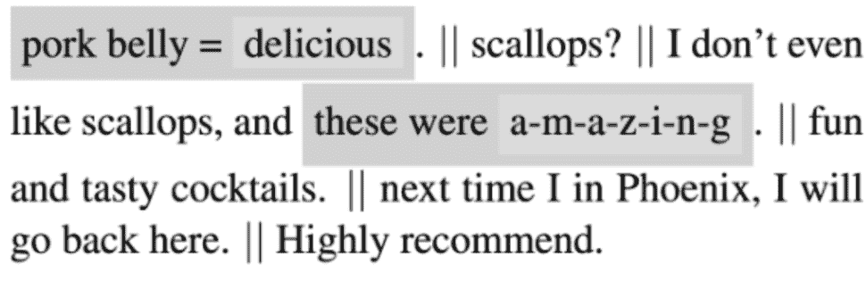

图4.2 使用Yelp应用注意力模型进行情感分析的示例

### 4.4.2 注意力机制的具体应用
4.4.1 节是对注意力做了总体介绍，本节来看一个落地模型。早期将注意力引入 NMT 的先驱之一是 Dzmitry Bahdanau 等人提出的 Neural Machine Translation by Jointly Learning to Align and Translate，如图4.4所示。

# 从 Seq2Seq 注意力到 Transformer 的演进脉络

整体仍沿用编码器协同解码器的范式，只是外形做了调整。上部负责生成译文，下部负责接收源句，中间分支负责注意力。最核心的变化是编码器改用双向 GRU 而非单向 LSTM。GRU 与 LSTM 的机制相近，只是少了一个门控，因此训练与推理速度更快。双向编码在实践中非常稳健，因为单向编码习惯把最后一步的隐状态当作整句表示，前面信息容易丢失。即便引入注意力，某位置的表征也只能承载其之前的内容，信息损失不可避免，双向结构正好补足了这一缺陷。

下面以数学形式呈现。

输入、输出序列分别如下，这里默认输入和输出都经过了词嵌入转换的操作：

$$X = (x_1, \cdots, x_{T_x}), x_i \in R^K$$

$$Y = (y_1, \cdots, y_{T_y}), y_i \in R^K$$

编码器的计算：

$$r_i = \sigma(W_r x_i + U_r h_{i-1})$$

$$z_i = \sigma(W_z x_i + U_z h_{i-1})$$

$$h'_i = \tanh(W x_i + U r_i \circ h_{i-1})$$

$$h_i = (1 - z_i) \circ h_{i-1} + z_i \circ h'_i$$


图4.4 注意力结构

上述四组式子实质就是 GRU 内部的运算，r 与 z 为两个门控，W 与 U 均为可训练参数，$\circ$ 表示逐元素相乘，此处省略所有偏置 b。

对照此前介绍的 GRU 会发现细节略有差异，本质仍相同，都是对信息传递做门控调控，且比 LSTM 少一个门控。

因采用双向循环，前面仅给出一个方向的计算，两个方向拼接后才是完整的隐藏状态输出：

$$h_i = [\overrightarrow{h_i};\overleftarrow{h_i}]$$

解码器的计算：

$$f_i = \sigma(W_f y_{i-1} + U_f s_{i-1} + C_f c_i)$$

$$o_i = \sigma(W_o y_{i-1} + U_o s_{i-1} + C_o c_i)$$

$$s'_i = \tanh(W y_{i-1} + U f_i \circ s_{i-1} + C c_i)$$

$$s_i = (1 - o_i) \circ s_{i-1} + o_i \circ s'_i$$

这依然是一个 GRU 单元，这里并非双向，所以没有拼接操作。

对初始的 $s_0$ 采用的是编码器首个时间步反向过程的隐藏状态：

$$s_0 = \tanh(W_s \overleftarrow{h_1})$$

整体看解码流程与常规的编码器-解码器基本一致，差别在于多出了 $c_i$。该 $c_i$ 正是注意力机制的核心，它为解码带来全局信息。下面看其生成方式。

$$c_i = \sum_{j=1}^{T_x} \alpha_{ij} h_j$$

$T_x$ 为源序列长度，$h_j$ 表示编码器第 $j$ 步的隐藏状态输出，对应双向输出的拼接，$\alpha_{ij}$ 为注意力系数。

$$\alpha_{ij} = \text{softmax}(e_{ij})$$

$$e_{ij} = v_a^T \tanh(W_a s_{i-1} + U_a h_j)$$

$s_{i-1}$ 为解码器前一时刻的隐藏状态输出，$v_a \in R^n$，$W_a \in R^{n \times n}$，$U_a \in R^{n \times 2n}$。这里的 $e_{ij}$ 可视为对每个位置打分，再经 softmax 归一化得到 $\alpha$。$e$ 的计算并非唯一，可按任务尝试多种形式：

$$e_{ij} = \text{score}(s_{i-1}, h_j) = \begin{cases} s_{i-1}^T h_j \\ s_{i-1}^T W h_j \\ v_a^T \tanh(W_a [s_{i-1}; h_j]) \end{cases}$$

可见此处选用的是第三种。前两种属乘法式相关度计算，第三种属加法式计算。三种方法并无绝对优劣，各有模型在使用。

训练完成后的一对译句注意力分布如图4.5所示，可见注意力的可解释性，输出某词时权重更高的位置更亮。这是一个最原始的带注意力机制的编码器-解码器，内部使用 GRU，换成 LSTM 亦可。基于此结构的变体很多，但都属早期，参考价值有限，直接跳到 Transformer 结构，后续再结合前沿 NMT 问题介绍相关变体。


图4.5 注意力权重

## 4.5 NMT经典模型——Transformer

Transformer 由 Google 团队的 Ashish Vaswani、Noam Shazeer、Niki Parmar 等人在 2017 年论文 Attention Is All You Need 中提出，当前热度很高的 BERT 也建立于此。正如论文名所示，Transformer 依赖 Attention 机制，且主要是 Self-Attention，即自注意力，通俗讲是句内词与词之间的注意力，而非句间注意力，后文会详述。其提出初衷是为了解决 RNN 的顺序计算限制 GPU 并行的弊端，从而提升并行训练与推理效率。因此 Transformer 抛弃了 RNN 的时序结构。

需要澄清的是，RNN 的并行性并非完全不存在。单条记录前向时无法并行，导致推理速度难快，但训练可使用 batch，并行效率受单记录等待影响。RNN 的关键瓶颈在推理，推理本质是一次前向，因而并行受限，速度偏低。

实验表明，在多条记录同时推理、参数量相近的条件下，RNN 的推理速度与 Transformer 相差不大。

下面开始讲解 Transformer 的结构，如图4.6所示。

## 图4.6 Transformer的结构

Transformer 仍使用 NMT 经典的编码器-解码器，也称 seq2seq。

有人会问 NMT 是否只能用编解码结构。并非如此，例如单独的 LSTM。生成式任务本质是分类，与序列标注类似，每生成一个词都是在词表上做分类。于是可把序列打散：输入源句，输出目标句首词；再把已生成词接在源句后，预测第二词。以“abc”→“xyz”为例，先输入“abc”输出“x”，再输入“abcx”输出“y”，如此循环。此时同一模型兼具编码与解码功能。Transformer 若只用编码器部分即为 BERT，也可单独用于 NMT。但 NMT 涉及跨语言，需要中间语义表征，seq2seq 效果更好；文本摘要、对话生成等场景单独使用编码器更常见。

Transformer 的编码器与解码器各有 6 层相同结构，层数是超参数，可调为 12 层或 1 层，先看编码器一层，如图4.7所示。

## 图4.7 输入

(1) 输入词由两部分构成，第一部分是词义嵌入，向量随任务训练，可随机初始化，也可用预训练 Word2vec。第二部分是位置嵌入，由位置函数初始化，不再训练，如图4.7所示。

(2) 把词表示为矩阵 $X \in R^{n \times d}$，$n$ 为句长，$d$ 为向量维数，论文中为 512。每一行对应一个词记为 $x$，送入编码器。经 6 个编码器模块后得到句子的编码矩阵 $C$，如图4.8所示。各模块输入输出维度一致。

## 图4.8 编码器的输出表示

(3) 编码器输出的矩阵 $C$ 送入解码器，解码器逐词翻译，如图4.9所示。训练时 Transformer 输入可一次性给出，不同于 RNN 的逐步输入，因此需防信息泄露，即下一步待预测词不应提前进入输入。否则模型可直接复读，学习无意义，故需对当前词及之后词做 Mask。

## 图4.9 解码器

解码器接收编码表征 $C$，在目标语开头加入起始标识，预测首词 I，再把预测词送回预测下一词 have。可看出 Transformer 可一次性接收全部输入，无需像 RNN 那样迭代，但推理仍需逐步生成，每步只能产一个词。贪心取最大概率是常用策略，也可改用 Beam Search。若任务为序列标注且标签数少，可加 CRF 层。

以上是对结构的大致说明，下面介绍细节，如图4.10所示。

## 1. 输入

Transformer 的编码由词义嵌入与位置嵌入相加得到。词义向量可随机初始化并训练，也可用 Word2vec、GloVe，或接 BERT、emmo 等动态词向量。重点讲位置嵌入。

## 2. 位置嵌入

Transformer 出现前多用 RNN，RNN 自带时序位置信息。转为并行输入后位置信息丢失，而位置对 NLP 很重要，如“你喜欢我”与“我喜欢你”意义迥异。补救方法有固定位置编码、可训练位置编码、相对位置编码等，这里采用固定位置编码。位置编码主要服务于自注意力计算，通常只需相对位置。绝对位置各不相同，如位置 1 与 4、2 与 5 在语言上可能相近，但在固定编码中差异明显，易陷入全连接网络需大量样本学习每个位置的问题。

位置编码公式如下：

```
PE_{pos,2i} = sin(pos/10000^{2i/d})
PE_{pos,2i+1} = cos(pos/10000^{2i/d})
```

其中 pos 为词在句中的绝对位置，d 为向量维数，i 为维度偏移，2i 为偶数维，2i+1 为奇数维。注意公式直接计算每维值，并非各维相同。选择此形式的好处：

- PE 可外推到训练集最长句之外的长度，训练集最长 20 时也能计算第 21 位嵌入。
- 便于模型学习相对位置，对固定间隔 k，有 PE(pos+k) 可由 PE(pos) 推导。因为：

```
sin(A+B) = sin(A)cos(B) + cos(A)sin(B)
cos(A+B) = cos(A)cos(B) - sin(A)sin(B)
```

词义嵌入与位置嵌入相加即得输入向量 x。

图4.11 为论文中 Transformer 的内部结构，左侧编码器模块，右侧解码器模块。Multi-Head Attention 由多个 Self-Attention 构成，编码器含一个 Multi-Head Attention，解码器含两个，其中一个带 Mask。上方还有 Add & Norm 层，Add 为残差连接防退化，Norm 为归一化。

Self-Attention 是核心，下面聚焦 Multi-Head Attention 与 Self-Attention。先看 Self-Attention 的内部逻辑，如图4.12所示。

## 缩放的点乘注意力

## 图4.11 Transformer的内部结构

## 图4.12 Self-Attention的内部逻辑

图4.12 中的 $Q$、$K$、$V$ 如何得到，流程如图4.13所示。

$$Q=W_qX$$

$$K=W_kX$$

$$V=W_vX$$

$Q$、$K$、$V$ 均由输入 $X$ 乘对应权重得到，三者权重均可训练。下面逐步分析。

首先是 MatMul，即自注意力的计算，公式与后续操作合并，先写出，如图4.14所示。

$$Attention(Q,K,V) = softmax\left(\frac{QK^T}{\sqrt{d_k}}\right)V$$

## 图4.13 Q、K、V的计算过程

## 图4.14 $QK^T$的计算过程

第一步 MatMul 为 $QK^T$，如图4.14所示。图中 1、2、3、4 代表不同词，结果为各词与自身及其他词的相关打分，即注意力权重的依据。

随后计算注意力权重：

$$\text{softmax}\left(\frac{QK^T}{\sqrt{d_k}}\right)$$

需注意 softmax 前除以 $\sqrt{d_k}$，$d_k$ 为 $K$ 的向量维数，与 $Q$ 相同。论文解释为：注意力函数将查询 $Q$ 与键值对 $K,V$ 映射为输出，输出为值的加权和，权重由查询与键的相关性决定。计算 $Q$ 与所有键的点积，除以 $\sqrt{d_k}$ 后做 softmax 得到权重。

常用注意力函数有加法与点积两种。点积除缩放因子外与加法相同。加法使用单层前馈网计算相关性。两者理论复杂度相近，但点积可利用高度优化的矩阵乘法，速度更快、空间更省。

$$q \cdot k = \sum_{i=1}^{d_k} q_i k_i$$

当 $d_k$ 不大时两者表现相近，$d_k$ 较大时未缩放的点积表现不如加法。原因在于点积幅度随 $d_k$ 增大而增大，将 softmax 推入梯度极小区。假设 $q,k$ 各维独立均值为 0、方差为 1，则点积均值为 0、方差为 $d_k$。为抵消此影响，点积缩放为 $1/\sqrt{d_k}$。

前面提到的加法注意力即三种打分方式中的第三种：

$$score = tanh(W[q; k])$$

$q$ 与 $k$ 先拼接再乘权求和，因而称加法注意力。乘法注意力即点积，除以 $\sqrt{d_k}$ 是为了抑制方差累积导致的 softmax 偏移。其他注意力因维数不大，方差累积影响有限，缩放与否差异不大，如图4.15所示。

## 图4.15 注意力权重与 $V$ 相乘得到输出

得到权重后与值矩阵 $V$ 相乘，即得一次自注意力的输出 $Z$，如图4.16所示。

图4.16 中 softmax 矩阵第 1 行表示词 1 与其他词的注意力分布，词 1 的输出为各词值按权重加权求和，如图4.16所示。

## 图4.16 输出演示

这一步把原本逐步计算的注意力并行化。不同句子间计算为互注意力，同一句子内计算为自注意力。

下面介绍多头的概念。

如图4.17所示，多头即并行执行多次自注意力。Multi-Head Attention 含多个 Self-Attention，先把输入 $X$ 分发到 $h$ 个 Self-Attention，各自用不同的 $W_Q^h,W_K^h,W_V^h$ 计算 $h$ 个输出 $Z$。$h$ 取 8 时得到 8 个 $Z$，如图4.18、图4.19所示。

得到 $Z_1\sim Z_8$ 后拼接，再经 Linear 层得到最终输出。输出矩阵长度与输入 $X$ 相同，经过大量变换后仍以每个词一个向量表示。

## Multi-Head Attention

# Transformer 编解码机制与多语翻译进展

## 图4.17 多头注意力

## 图4.18 当h为8时的Self-Attention计算过程

## 图4.19 8个输出矩阵Z直接拼接再进行线性变换

编码器右侧展示的就是经典的 Transformer 编码器堆叠：多头自注意力随后接上残差加法与层归一化，再经过位置无关的前馈网络后再做一次残差加法与层归一化。前面的章节已解释多头运算，这里集中讲加法归一化与前馈部分。

加法归一化层的结构如图4.20，计算式为：

```
$Z' = \text{LayerNorm}(X + \text{MultiHeadAttention}(X))$
$\text{LayerNorm}(Z' + \text{FeedForward}(Z'))$
```

表面看很简洁，背后集合了多个先验假设。

多头模块的输出记作 Z，加法项即公式里的 +X，也就是 X 与 Z 相加。为什么要把原始输入 X 加回来？这来自视觉领域 ResNet 中的残差思想，Transformer 将其迁移到序列建模中，需要单独说明。

X 代表最原始的输入，信息保留最完整。Z 是经过特征抽取后的增量，相对于 X 可以视作残差。把残差加回原输入，核心目的是对抗深度网络训练中的退化现象。退化表现为网络加深时损失先下降后趋稳，再加深反而上升。

为何会出现退化，残差结构如何遏制它，残差单元是什么？先回顾 ResNet。

假设最优深度为 18 层，却按“越深越好”构建了 32 层，其中 14 层是冗余的。要让 32 层达到 18 层的效果，这多出的 14 层必须实现恒等映射，即输入等于输出，可写成 F(X)=X。只有恒等映射，多余层才不会破坏最优解。

实际中参数靠学习获得，让学习后的参数精确实现 F(X)=X 很困难。若冗余层数少，影响有限；若过多，效果明显变差。ResNet 就是为解决此问题提出的方案。

再看残差单元的构造。图4.21 显示，X 为本单元输入，可把经过一次线性变换加激活的输出记为 F(X)。在第二层线性变换后激活前，F(X) 与本层输入 X 相加，再激活输出。该绕行路径称为捷径连接。

加入残差后，恒等映射的要求被改写。原本需要 h(X)=X，现在变成 h(X)=F(X)+X。只要让 F(X)=0，就能得到 h(X)=X。让网络学到零输出，比逼它精确复现输入容易得多，因为初始化参数通常围绕零分布，变换后更易接近零。示例见图4.22。

## 图4.21 残差块

## 图4.22 残差示例

图4.22 假设网络只有线性变换，无偏置无激活。随机初始化权重偏向零，经过该网络的输出大约是 0.6、0.6，明显更接近零而非原始值 2、1。相比学习 F(X)=X，模型更快学会 F(X)=0。ReLU 还能把负数置零，进一步加速 F(X) 趋零。这样网络可自行判断冗余层，通过学习残差为零实现恒等映射，而非强行学习复制输入，从而大幅缓解退化。

Transformer 中被加回的 X 正是多头注意力的输入，作用是防止层数增加导致退化。

## 3. 归一化

为何要做 Normalize？神经网络训练前对数据做归一化有两个基本作用：一是加快收敛，二是提升稳定。

这是基础先验。归一化使各维度的梯度分布更均匀。若损失面是狭长山谷，梯度常指向两侧，下降过程易在两边振荡，学习变慢。若损失面是规则圆形山谷，则更容易快速到达谷底。

以上即加法归一层的含义。

接下来是前馈加归一层。前馈公式如下：

$$FFN(x)=ReLU(xW+b)W+b$$

全连接实质是一个两层网络：先线性变换，再 ReLU 非线性，最后再线性变换。

x 指多头注意力输出 Z 经过加法归一后的结果，随后再次归一化。最终输出记为 O，维度与 Z 相同，也与初始输入 X 相同，都是 n×d，n 为最大句长，d 为词向量维。

多头自注意力、加法归一、前馈归一共同构成一个编码器单元。一个单元的输出 O 作为下一单元的输入 X，如此循环直至第六个单元。六个单元参数各不相同，后续如 ALBERT 尝试参数共享，在指标不降的前提下减少权重与计算。

六单元后的表征记为 C，后续送入解码器。

## 4. 解码器

右侧是 Transformer 解码器结构，与编码器相似但有差异。

解码器包含两层多头注意力。第一层使用 Mask，防止模型看到未来词。第二层的 K、V 由编码器输出 C 计算，Q 来自上一解码单元输出。最后用 softmax 预测下一个词的概率。

### 1) 解码器的第一个Multi-Head Attention

解码单元的第一层多头注意力采用 Masked 操作，因翻译是顺序进行的，第 i 个词译出后才能译第 i+1 个词。Mask 可避免当前词窥探未来信息。以 “我是中国人” 译为 “I am a Chinese” 为例，如图4.23。

解码时依据已译部分推断最可能的当前词。先由空输入预测首词 “I”，再由 “I” 预测 “am”。

训练阶段可用 Teacher Forcing 并行化，即把标准序列 “I am a Chinese” 与对应输出一起喂入解码器。预测第 i 个输出时遮住 i+1 之后部分。注意 mask 操作在 Self-Attention 的 softmax 之前进行，下面用 0、1、2、3、4、5 表示 “I am a Chinese”。

Teacher Forcing 的原因：推理时结构显示用上一时刻预测结果循环生成整句，训练时我们已知正确答案，故每步使用真实上一步结果而非模型自预测。相比整句生成后再对比标签，Teacher Forcing 收敛更快。

图4.24 Mask矩阵

1）计算解码器输入矩阵与 Mask 矩阵。输入矩阵包含 “I am a Chinese” 五个词的向量，Mask 矩阵为 5×5，如图4.24。如图4.25，词 0 只能用自身信息，词 1 可用词 0、1 信息，即只能看历史。

2）由输入矩阵 X 得到 Q、K、V，计算 QK，如图4.26。

3）得到 QK 后需算注意力权重，若直接算会用到未来信息，故需 Mask。Mask 即把 Mask 矩阵与 QK 按位相乘，被遮盖位置置零，过程如图4.27。

图4.27 Mask的注意力权重与$V$相乘得到的最终结果

对 Mask 后的 QK 做 softmax，每行和为 1。词 0 在词 1、2、3、4 上的注意力分数为 0，如图4.28。

图4.28 输出Z的分析

4）用 Mask QK 与 V 相乘得到输出 Z，则词 1 的输出向量 Z1 只包含自身及之前信息，如图4.2。

5）如此得到 Mask Self-Attention 输出矩阵 Z，再经多头拼接与线性映射得到第一层多头注意力的输出 Z，维度与输入 X 相同。

### 2）解码器的第二个Multi-Head Attention

第二层多头注意力的变化不大，主要区别是 Self-Attention 的 K、V 不由上一解码单元输出计算，而是由编码器表征 C 计算。

由 C 得到 K 与 V，再由上一解码单元输出 Z 得到 Q，若为首个解码单元则用输入矩阵 X。后续计算与前文一致，不再赘述。这样每个词在解码时都能利用编码器全部词的信息，无需遮盖。

## 5. 利用softmax预测输出单词

解码单元最后一部分是用 softmax 预测下一个词。经前序网络可得到最终输出 Z，因 Mask 存在，词 0 的输出 Z0 仅含自身信息，如图4.28。

softmax 依据最终输出矩阵的每一行预测下一个词。

与编码器相同，解码器由多个解码单元串联。

## 6. Transformer 概览

Transformer 最大的创新是使用全并行的、加入位置信息的 DNN 结构替代 NLP 中常见的 RNN。其余如注意力、残差连接、归一化、深层网络、编解码结构等，都是已有先验模块的组合。核心贡献在于发扬自注意力的价值，自注意力之后的网络近似于自动化学习后的图模型 GNN。

Transformer 很火，但不如仅用其编码器的预训练模型 BERT 热门。因为 Transformer 是 seq2seq 结构，适用任务有限，而 BERT 更像语言模型，基本覆盖全部 NLP 任务。

## 4.6 NMT前沿研究

NMT 经典的 seq2seq 方案已相当普及，不仅用于机器翻译，也用于神经纠错、文本摘要等序列到序列任务。最经典的两类模型是双向 LSTM+Attention 和 Transformer，前者已讲过，变体限于篇幅不展开，下面介绍 NMT 研究热点。

### 4.6.1 NMT的新方向1：多语言交叉翻译

4.5 节详细讲解了自提出以来持续受关注的 Transformer 模型，它其实是一个通用框架，可用于多种 NLP 任务，并非仅限 NMT。

双语翻译因缺乏外部、领域和上下文知识，已进入瓶颈。准确率虽大幅提升，却很难仅靠双语语料继续进步。很多时候需要源语言与目标语言所在环境或领域的背景知识，而深度学习取得不错效果，本质是利用了人工翻译语料中译者的背景知识。模型只能基于频率做选择，无法反推语料背后的知识。

因此引入外部知识库是有意义的方向，但涉及定义、设计与收集，目前仍属研究，未出现里程碑成果。外部知识不足的问题在多数 NLP 任务中也存在。

在不过度增加复杂度前提下，还有什么办法提升性能？

主流方向有两个，一是全文翻译，不再逐句翻译。文章有主题，新闻、论文等每类主题自带领域知识，逐句翻译拼凑常出现不通顺。全文一起翻译有可能解决。

二是多语言翻译 MNMT。MNMT 可视为交叉迁移学习或多目标学习，提升多数语言对效果；也能处理少语料场景。例如冷门语言 A 与英文语料较多，中文与英文语料充足，A 与中文语料稀缺，就可利用英文作桥梁提升 A 到中文效果。不用 MNMT 也可以先译成英文再译成中文，但必然有信息损失，效果难最优。

MNMT 还可设计为统一模型处理所有语言对，便于部署到低资源环境如手机。

在本文编写期间，Facebook 公布多语言翻译模型 M2M-100。该模型相比以英文为中间语言的翻译，在 BLEU 指标上平均提升 10%。M2M-100 共用 2200 种语言训练，比之前最好的以英语为中心的多语模型多 10 倍，对低资源语言提升更明显。

构建多对多 MNMT 的最大障碍是训练数据，即不同语言之间直接翻译的高质量数据，而非以英语为中介。现实中，法语与中文直接数据远少于中文-英文和英文-法语数据。此外，所需数据量随语言数成比例增长，例如每种语言需 1000 万句对，10 种语言需 1 亿句对，100 种语言需 10 亿句对。

多语言翻译在应用中也很常见，例如翻译机就是多语言场景。出行不一定只去英语国家，日本、泰国、韩国等都是热门目的地，中文到多种语言、多种语言到中文的需求是刚需，即使外语专业人才也难以掌握太多外语。

下面介绍 MNMT 的技术方案。先回顾 NMT。

给定并行语料 C，由一系列双语句子对组成 (x, y)，训练目标是对数极大似然：

$$L_{\theta} = \sum_{(x,y) \in C} p(y \mid x; \theta)$$

x={x1,x2,…,xn} 是输入句子，y={y1,y2,…,ym} 是 x 对应的译文。θ 是需训练的参数集，在给定输入句 x 的条件下输出 y 的概率为：

$$p(y \mid x; \theta) = \prod_{j=1}^{m} p(y_j \mid y_{<j}, x_{1:n}; \theta)$$

m 是译文 y 的词数，yj 是当前生成的词，y<j 是 j 之前生成的结果。

网络结构是编码器-解码器，先分词，把词转为 one-hot 向量，再转为 Embedding 向量后输入网络，若为 RNN 结构则有注意力机制，若为 Transformer 结构则是自注意力。最终基于 Encoder 计算的上下文信息，结合解码器预测的上一个词或之前所有词的信息预测当前词。

定义 MNMT 的训练语料。一个 MNMT 模型的目标是让一个模型同时翻译 S 种源语言到 T 种目标语言，即有 L=S×T 种翻译组合。第一个语言对为 (src_l, tgt_l); l∈L。X 与 Y 的语言应不同，同一种语言自身无需翻译，即 X 与 Y 包含某些语言，但最终组合数会少于 L。

MNMT 的训练目标是最小化全部语言对翻译损失的平均值，如图4.29 所示。

$$L_{\theta} = \frac{1}{L} \sum_{l=1}^{L} L^{C(src_l), C(tgt_l)}(\theta)$$

下面介绍 MNMT 的模型设计。MNMT 模型主要按参数共享程度归类，基于共享程度可分为 3 类，如表4.4 所示。

表4.4 3种MNMT模型设计框架对比

| 最小参数共享 | 全参数共享 | 可控参数共享 |

| :--- | :--- | :--- |

| 编码器和解码器分开，只共享注意力权重 | 共享编码器、解码器、注意力权重 | 可控分享 |

| 参数量巨大，与语言对成正比 | 模型简单，参数量非常少 | 模型设计比较复杂 |

| 不同的编码器、解码器适配不同的语言 | 语言标记用来指示目标语言 | |

| 缺乏zero-shot翻译能力 | 有zero-shot能力 | 适用于zero-shot |

| 可分解 | 不可分解 | |

多语翻译与篇章建模的演进路径

| 自由度最高 | 能力受限 | 多属数据驱动范式 |
| 接受度偏低 | 当下主流 | 正逐步升温 |

### 1. 极致分散式共享
最松散的做法是为每种语言单独配置编码侧和解码侧单元。源语走专属编码，目标语走专属解码，连词嵌入也做语言隔离。唯一共用的只有注意力计算核，所有语言复用同一套打分参数，见图4.29(a)。

$$e_{ji}^{vu} = a(s_{j-1}^{v}, h_{i}^{u})$$
这里 u 对应编码器第 u 步的隐向量，v 对应解码器生成第 v 个词时的隐向量。式子仅给出单项分数，完整注意力需把 s_{j-1}^{v} 与全部 h 配对后做 softmax 归一，再与对应 h 点乘，即对 h 加权求和得到上下文 C。

**说明：** 默认编码解码内部使用 RNN。若换成 Transformer，思想一致。内部自注意不共享，仅解码器第二阶段的自注意可共用。讨论的是交叉注意，RNN 是逐步计算，Transformer 是并行计算。

参数量随语言数线性增长。新增一种源语只需添一个编码器，新增一种目标语只需添一个解码器，比纯双语模型省很多。双语模型里增一源语要复制 T 个模型，增一目标语要复制 S 个模型，是几何级膨胀。

当语言规模到数十上百时，堆叠这么多编解结构明显臃肿，训练部署成本高，因而实际并不流行。研究重心随后转向下面两种更集中的共享方式。

### 2. 统一共享式架构
完全共享把参数压到最小，一套编码器处理全部 S 种源语，一套解码器生成全部 T 种目标语，注意力也只有一套。结构上等价于双语翻译，只是覆盖语言更多。

让同一编码器分辨输入语言，最直接的做法是做超大词表，把各语言词汇合并编号，多语言问题被折叠成伪双语。输出语言则通过在每条输入前加语言标签来指定，见图4.29(b)。

问题在于词表变大后推理时 softmax 矩阵会爆炸，显存与算力压力都很大。

应对有粗暴版与温和版。粗暴版是各语言保留独立词表，输入按各自词表做嵌入，编码器只关心语义不必显式知道语言身份，输出再按目标语言词表做 softmax。部分实验也会额外喂入语言标签。温和版是用子词或字符向量替代词向量，比如英文 26 个字符就能大幅缩小表征，用子串如 pre/post 能在压缩的同时保留更多语义。输出时也是按子串生成，偶尔会出现拼合错误，需要额外校验。

合并词表或独立词表的实验上并无明显优劣。

编码解码内部组件的对比里，RNN 如双向 LSTM、CNN 与自注意力 Transformer 中，后者多数场景更优，这主要归功于 Transformer 的全局建模能力。自注意力能直接捕捉全局关联，信息损耗少；RNN、CNN 逐层都有衰减，位置信息也依赖反复学习，不够直接。

全共享像黑盒，却能在最少参数下拿到尚可的翻译质量，部分语言对甚至超过双语模型，部分接近，并非全面超越。

对语料充足的双语对，提升有限甚至下降；对语料稀缺的语言，提升很明显，尤其是冷门译到热门的增益大于反向。当混合模型使用的语言超过 50 种，整体质量会逐步走低。

### 3. 可调节共享策略
前两种都偏极端，全共享硬压参数，语言差异大时易造成信息损失；极致分散连注意力都不共用就等价于 N 个双语模型，参数臃肿。

中间地带是按相似度调节共享粒度，相似语言可共词表与编码器，差异大的则分开。学界普遍接受编码器只负责把源语映射到统一隐空间，具体是哪种语言并不关键。共享能降低过拟合、减少参数、提升小语种表现。

解码器因直接产生目标语，完全共享会相互干扰，所以常采用分离策略。注意力同理，解码器不共享时，注意力共享也会带来干扰。Graeme Blackwood 等人比较了共享与不共享注意力，结果显示目标语言专用的注意力优于全共享和完全不共享，设计强解码器至关重要。目标语言专用注意力即注意力层数等于目标语言数 T，所有源语复用这 T 套；完全不共享则是 S×T 对双语；全共享则回到前文方案。

Sachan 和 Neubig 在自注意力 MNMT 上探索了多种共享组合，发现对相似度不高的语言，共享解码器自注意力和编码解码交叉注意力模块是有益的，这有助于学习更好的目标表示并与源语对齐。也有工作提出用统一表示替代独立编码解码，并引入语言感知的嵌入、注意力和识别器，间接控制共享程度。

本节简要介绍了多语言翻译模型的情况，多语言翻译对语料的依赖太大，模型设计也非常麻烦，下一节介绍翻译问题的另一个热点——全文翻译，即整篇文章翻译。

## 4.6.2 NMT的新方向2：全文翻译
目前大多数 MT 模型都依赖强独立性假设，基于短语的统计模型假设句内局部无关，流行的 NMT 假设句间无关。实际语言并不如此，文本的存在正是为了贯通表达。而忽略篇章结构，单句翻译很难达到令人满意的连贯性。机器翻译中全文通畅的问题由来已久，但真正着力研究的时间并不长。

SMT 中常用多阶段流程，先单句翻译再基于篇章顺序和结构重排词序用词。NMT 在单句上取得突破后，篇章问题被延迟，直到单句进入瓶颈才成为热点。

NMT 解决前后连贯的思路通常是端到端地改动网络，让模型在训练时自行学习前后呼应，而非像 SMT 那样显式后处理。

常见做法是扩大输入长度，把整篇投入网络，但文章长度无上限，网络小说可达千万字，现有算力内存一次只能处理数千字。

类似 XLNET 的输入增强思路是保留上一句得到的隐藏状态，与下一句词向量一起再输入，形成句子级 RNN 的效果。理论上可看到很远的前文，实际上迭代会带来信息损耗，且内部仍是单句翻译结构，信息传递不足。

记忆网络或缓存也常被使用，处理前文时把中间结构存到网络里，后文每处理一句就去检索提取有用信息。本质上仍是把前文信息传递给后文。

核心诉求一致：在计算和内存可承受范围内，让模型辐射到更长的篇章。目前所有方案能顾及的长度仍有限，超过阈值的内容就会被忽略。

下面介绍几个具体的全文翻译模型。

## 4.6.3 层级RNN
腾讯 AI 实验室的 Longyue Wang、Zhangpeng Tu 和 Andy Wang 等人在 2017 年发表的论文 Exploiting Cross-Sentence Context for Neural Machine Translation 中提出层级 RNN。思路与 RNN 类似，句子级是常规 RNN，之上再叠一个文档级 RNN 负责句子间信息传递，见图 4.30。


给定一个句子 x_m 等待被翻译，现在想办法将同文档该句子之前 K 个句子的信息提取为一个上下文向量 C，C 的输入是 {x_{m-K}, …, x_{m-1}}。

### 1. 句子层网络
对于句子 x_k，句子层网络接受这个句子的词向量序列作为输入 {x_{1,k}, …, x_{N,k}}，然后生成隐藏状态：

$$h_{n,k} = f(h_{n-1,k}, x_{n,k})$$
f() 是激活函数，h_{n,k} 是第 n 时刻的隐藏状态。最后一个隐藏状态 h_{N,k} 保存着 x_k 整句话的信息，可以代表整句话的概括向量 S_k = h_{N,k}。

把全部 x_m 之前的 K 个句子处理完之后就可以得到 K 个句子的概括向量，作为文档级 RNN 的输入。

### 2. 篇章层网络
把上面生成的 K 个概括向量的序号改为 {S_1, …, S_k, …, S_K} 并输入网络里。

$$h_k = f(h_{k-1}, S_k)$$
h_k 表示第 k 刻时间的隐藏状态，这个状态包含之前所有句子的信息，与句子级别的 RNN 类似，最后一个时刻的隐藏状态也包含全部 K 个句子的信息。

$$D = h_K$$
此时，我们就可以使用这 K 个句子的信息作为下一句话 x_m 翻译时的上下文信息输入。

具体如何使用这个前文信息 D，Longyue Wang 等人在论文中设计了 3 种方法。

#### 1) 作为初始化向量
把 D 作为当前处理 x_m 句子的编码器和解码器的初始化向量，在没有前文 D 向量时，处理第一个词之前的编码器是没有信息的，state 只能使用随机初始化，有了 D 就可以直接把 D 作为 state 输入编码器中。

对于解码器的初始化 state，没有 D 时的计算方式是：

$$s_0 = \tanh(Wh_N)$$
h_N 就是编码器最终的一个隐藏状态输出。

有了 D 就改为：

$$s_0 = \tanh(Wh_N + WD)$$
3 种使用 D 的方案见图 4.31。


#### 2) 作为附加输入
见图4.31(a)。在正常的解码器的第 t 时刻的隐藏状态的计算是：

$$s_i = f(s_{i-1}, y_{i-1}, c_i)$$
y_{i-1} 是上一时刻解码器的预测输出值，也就是翻译的上一个词，c_i 是用注意力计算出来的当前句子的上下文全局信息。现在有了前文的信息 D，计算公式修改为：

$$s_i = f(s_{i-1}, y_{i-1}, c_i, D)$$
c_i 随时间步的改变而改变，而 D 是不变的，这样解码器就有 4 个输入，适配起来比较简单，直接把 c_i 和 D 合并，即只需要修改与其相乘的参数矩阵大小即可，见图4.31(b)。

#### 3) 门控附加输入
上一种方案虽然设计简单，但是信息太多可能会带来较多的干扰。例如 LSTM 就不是把所有信息都累积起来往下传播，而是每一步都会过滤一些信息。为了减少这些干扰，可以像 LSTM 一样加上一个门控，用当前的信息计算出一个与 D 的某些信息的相关度，然后过滤一下信息再进行正常的解码操作。

$$z_i = \sigma(Us_i + Wy_{i-1} + Cc_i)$$
这就是一个门值：

$$s_i = f(s_{i-1}, y_{i-1}, c_i, z_i \otimes D)$$
经过门值过滤之后再输入信息进行正常计算，整个流程见图4.31(c)。

我们再来看一下最后的实验结果，MT0x 是 3 个数据集，评估指标是 BLEU。MOSES 是一个得分最高的 SMT 模型，NEMATUS 则几乎全方位超过了 MOSES 的 NMT 模型，当然这是 2017 年发表的论文数据，现在基于 Transformer 或 BERT 的句子级 NMT 模型的指标应该会更高一些，但这篇论文的设计依然有价值，实验结果见图4.32。

| # | System | MT05 | MT06 | MT08 | Ave. | Δ |
|---|---|---|---|---|---|---|
| 1 | MOSES | 33.08 | 32.69 | 23.78 | 28.24 | |
| 2 | NEMATUS | 34.35 | 35.75 | 25.39 | 30.57 | |
| 3 | +Init<sub>enc</sub> | 36.05 | 36.44<sup>†</sup> | 26.65<sup>†</sup> | 31.55 | +0.98 |
| 4 | +Init<sub>dec</sub> | 36.27 | 36.69<sup>†</sup> | 27.11<sup>†</sup> | 31.90 | +1.33 |
| 5 | +Init<sub>enc+dec</sub> | 36.34 | 36.82<sup>†</sup> | 27.18<sup>†</sup> | 32.00 | +1.43 |
| 6 | +Auxi | 35.26 | 36.47<sup>†</sup> | 26.12<sup>†</sup> | 31.30 | +0.73 |
| 7 | +Gating Auxi | 36.64 | 37.63<sup>†</sup> | 26.85<sup>†</sup> | 32.24 | +1.67 |
| 8 | +Init<sub>enc+dec</sub>+Gating Auxi | **36.89** | **37.76<sup>†</sup>** | **27.57<sup>†</sup>** | **32.67** | +2.10 |

图4.32 实验结果

Init 就是把前文信息 D 作为初始化使用，Init<sub>enc</sub> 是给编码器初始化，Init<sub>dec</sub> 是给解码器初始化，Init<sub>enc+dec</sub> 是对编码器和解码器都进行初始化。

Auxi 是作为第二种方案，Gating Auxi 是第三种方案。可以看到，门控方案比非门控方案的指标稍稍高一点，说明我们前面描述的先验是正确的，过滤一些噪音信息可以提升准确率。

初始化方案和门控方案两者可以互相配合，达到最高的指标，见图 4.33。

单纯看指标其实看不出来单句翻译和全文翻译的区别，下面举个例子对比一下，见图 4.33。

| Hist. | 这不等于明着提前告诉贪官们赶紧转移罪证吗？ |
| Input | 能否遏制和震慑腐官？ |
| Ref. | Can it inhibit and deter corrupt officials? |
| NMT | Can we contain and deter the *enemy*? |
| Our | Can it contain and deter the **corrupt officials**? |

图4.33 翻译示例

图4.34 中输入的是我国台湾地区使用的繁体字语句，Hist 是前文，Ref 是参考的人工翻译标签，NMT 是基于单句的翻译，完全没考虑前文信息，把“腐官”翻译为了 enemy，而在 Longyue Wang 等人的论文中则可以正确地翻译为 corrupt officials。

## 4.6.4 记忆网络
由 Sameen Mauf 和 Gholamreza Haffari 发表的 Document Context Neural Machine Translation with Memory Networks 论文就用了我们提到过的另一种方法——记忆网络，用记忆网络来保存前文的信息，以供下文进行关联提取。

记忆网络的核心作用可以理解成一个存放历史信息的仓库。按照名字就可以猜到，它擅长把过去的内容留下来，在模型里实现这一点的办法就是开辟一块矩阵，形式上很像嵌入表，每一行对应一个记忆单元，比方说一句话的向量表示，这块矩阵的规模就决定了最多能保存多少条记忆。

句子本身怎么变成向量并不是它关心的重点，真正关键的是记忆矩阵在不同任务里会不会被改写。在很多现有的应用里，比如阅读理解，矩阵是固定的，里面装的就是整篇文章所有句子的编码，提问的时候反复从这块固定的记忆里抽取所需信息。以文档翻译里的一个经典用法举例，矩阵长度设为K，就能存下前文K句的表示。算当前句翻译时这块记忆不做改动，算下一句时再照样用，事先把要译句子之前K句的表示 Representation，通常是一个一维向量 放进去即可。

往下看论文的设计，和前面提到的思路有了分歧。上一节的做法本质还是句到句的翻译，只是把源语言上下文提取出来的特征向量带进目标生成的计算。这里的模型同时借用了源端和目标端的上下文。

设一篇文档 d 包含 |d| 句，记作 {x1, …, x|d|}，译文同样有 |d| 句，记作 {y1, …, y|d|}。

为了让整篇译文读起来通顺，模型不再只看前面几句，而是把整篇源端的其他句子都考虑进来。定义如下：

$$f_\theta(y_t; x_t, x_{-t})$$

x_{-t} 指的是文档里除去 xt 之外的全部句子集合。目标端句子之间的关联也被单独建模，形式是一个另外的函数：

$$g_\theta(y_t; y_{-t})$$

对当前要译的目标句 yt，剩余的译文也被用来衡量当前译句是否流畅。训练时目标上下文很容易拿到，因为标签是已知的；推理时常用的两种做法，一是只用已经翻译好的句子，二是先不依赖这个打分函数，用 f 把译文先生成，再回头做一次调整。

于是整篇文档的联合概率写成：

$$P(y_1, \cdots, y_{|d|} | x_1, \cdots, x_{|d|}) = \exp \sum_i f_\theta(y_i; x_i, x_{-i}) + g_\theta(y_i; y_{-i})$$

这个表达式和 CRF 的写法很像，包含两部分打分：观测到隐藏状态的打分函数 fθ(yt; xt, x_{-t})，以及前后隐藏状态到当前隐藏状态的打分函数 gθ(yt; y_{-t})。传统做法是先做特征工程再用因子分解估计概率，这里直接让神经网络学习打分函数，再用 softmax 得到最终概率。

优化目标是：

$$L = \arg \max_\theta \prod_{d \in D} \prod_{t=1}^{|d|} P_\theta(y_t | x_t, y_{-t}, x_{-t})$$

$$d = \{(x_i, y_i)\}_{i=1}^{|d|}$$

D 代表全部文档集合，d 是其中一篇，且为双语对齐。这里的两个打分函数没有分开训练，而是共用同一套网络。

对于输入 y_{-t}，推理阶段它是不完整的。即便训练阶段信息齐全，直接把正确的 y_{-t} 喂进去也会产生信息泄露，未来信息用于预测现在的问题。因此作者采用了前面提到过的多次计算策略，先把它当成一个单纯基于句子的双语翻译 P(yt|xt) 生成初稿，再基于生成结果计算 P(yt|xt, y_{-t}, x_{-t})。

从原理上看这个过程可以反复进行，和推荐系统里的重排序思路很像。先用独立假设算出分数排序，实际上独立假设并不成立，例如用户偏爱小米手机，相关商品分数会很高，但整页都是小米甚至同一款手机，用户未必会买，后续展示位就浪费了。所以要重排，把已排好的顺序喂回模型，排完后顺序又会变化，需要再排。大多数情况下过程会收敛，工程上也会设阈值判断稳定，同时前几次变化往往比较大，不能省略。

网络结构如图 4.34 所示，左侧上下两块就是记忆网络，分别缓存预先生成的源端上下文信息和目标端上下文信息。

翻译依然是逐词生成：

Pθ(yt | xt, y¬t, x¬t) = ∏_{j=1}^{|yt|} Pθ(yt,j | yt,<j, xt, y¬t, x¬t)

yt,j 是第 t 句的第 j 个词，yt,<j 是该句 j 之前的所有词。这里的 y、x 都是用记忆网络表示的。

记忆网络本质上就是一个矩阵，部分实现会加入索引，最终形成键值对 key-value 结构。即使是键值结构，也不会像 NoSQL 那样做精确匹配，而是用检索向量的注意力机制计算每个 value 的权重再加权合并。没有单独 key 的设计时 key 与 value 相同。运行中对所有 key 与检索向量做相似度打分，归一化成注意力权重，再与 value 点乘求和，得到一个聚合的相关信息向量。

c_t^{src}=MemNet(M[x¬t], h_t)

M[x¬t] 表示源语言记忆网络中去掉 x 这句话后的向量集合，整体是一个矩阵。h 是在翻译 x 这句话时编码器输出的隐藏状态，可能是单向 RNN 的最后输出，也可能是 Transformer 自注意力后的合并向量。MemNet 的过程完全可以用注意力机制替代，计算逻辑基本一致。

c_t^{trg}=MemNet(M[y¬t], s_t + W_{at}h_t)


图4.34 网络结构

M[y¬t] 表示目标语言记忆网络中除去 y 这句话外的其他向量，同样是一个矩阵。s 是解码第 t 句时的隐藏状态，计算方式与 h 对应，且都是提前算好而非在解码时临时生成。这两个相关向量可以替代概率计算中的 x 和 y。

Pθ(yt | xt, y¬t, x¬t) = ∏_{j=1}^{|yt|} Pθ(yt,j | yt,<j, xt, c_t^{src}, c_t^{trg})

这两个相关向量有两种接入方式。

其一是在解码器下一步隐藏状态的计算中参与：

s_{t,j}=tanh(W_s·s_{t,j-1}+W_{sj}E_T y_{t,j}+W_{sc}·c_{t,j}+W_{sm}·c_t^{src}+W_{st}·c_t^{trg})

E 是词嵌入矩阵，E y 为目标语言第 t 句第 j 个词的向量。s 用来预测下一个词。因为论文里公式的时间步写法不完全统一，需要自行校对理解。

其二是参与最终词的输出计算：

y_{t,j}=arg max softmax(W_y r_{t,j}+W_{ym}c_t^{src}+W_{yt}c_t^{trg}+b_r)

此处省略一步，r 是由 s 与编码器输出 h 计算出的注意力上下文 c 得到的中间结果。

以上主体已说明，剩下的就是记忆网络里每条句子的向量怎么来。最简单是用一个 RNN 处理每句话，把最后一个时间步的输出当作句子表示。更进一步可用双向 RNN，甚至自注意力的 Transformer。这里采用类似双层 RNN 的做法，每层都是双向的。第一层在词层面处理，把双向 RNN 的最后两个隐藏状态拼接后作为第二层 RNN 的输入；第二层在句层面处理，也是双向的，然后把每个时间步的双向输出拼接，作为对应句子的最终表示。也就是说词层面只保留最后一个时间步作为句子向量，句层面则保留每个时间步的输出，让每句都带上整篇文档的信息。

因为模型用到了未来信息，一次性完成不可行，理论上需要多次迭代。论文中只用了两次，先用非全文的句句模式训练一个编码解码器，再用它作为提取记忆网络句向量及解码器最终隐藏状态 s 的工具，最后基于这些结果训练带记忆网络的新模型。

实验结果如图4.35所示。

| | Memory-to-Context | | | | | | Memory-to-Output | | | | | |

|---|---|---|---|---|---|---|---|---|---|---|---|---|

| | BLEU | | | METEOR | | | BLEU | | | METEOR | | |

| | Fr→En | De→En | Et→En | Fr→En | De→En | Et→En | Fr→En | De→En | Et→En | Fr→En | De→En | Et→En |

| | NC-11 | NC-16 | | NC-11 | NC-16 | | NC-11 | NC-16 | | NC-11 | NC-16 | |

| S-NMT | 20.85 | 5.24 | 9.18 | 20.42 | 23.27 | 10.90 | 14.35 | 24.65 | 20.85 | 5.24 | 9.18 | 20.42 | 23.27 | 10.90 | 14.35 | 24.65 |

| +src | 21.91† | 6.26† | 10.20† | 22.10† | 24.04† | 11.52† | 15.45† | 25.92† | 21.80† | 6.10† | 9.98† | 21.50† | 23.99† | 11.53† | 15.29† | 25.44† |

| +trg | 21.74† | 6.24† | 9.97† | 21.94† | 23.98† | 11.58† | 15.32† | 25.89† | 21.76† | 6.31† | 10.04† | 21.82† | 24.06† | 12.10† | 15.75† | 25.93† |

| +both | 22.00† | 6.57† | 10.54† | 22.32† | 24.40† | 12.24† | 16.18† | 26.34† | 21.77† | 6.20† | 10.23† | 22.20† | 24.27† | 11.84† | 15.82† | 26.10† |

图4.35 实验结果

主要实验集中在法英互译。Memory-to-Context 表示从记忆网络提取的全文信息参与解码器下一步隐藏状态的计算：

s_{t,j}=tanh(W_s·s_{t,j-1}+W_{sj}E_T y_{t,j}+W_{sc}·c_{t,j}+W_{sm}·c_t^{src}+W_{st}·c_t^{trg})

Memory-to-Output 表示全文信息参与最终输出的计算：

y_{t,j}=arg max softmax(W_y r_{t,j}+W_{ym}c_t^{src}+W_{yt}·c_t^{trg}+b_r)

METEOR 是另一种评估指标。

+src 只用源端记忆网络，+trg 只用目标端记忆网络，+both 两端都用。结果显示源端和目标端全文信息没有明显优劣，这也符合直觉。句句翻译的短板是缺了全文依赖，而翻译两端携带的信息量本质相近，所以区别不大。两端一起使用时指标又有小幅提升，原因在于句向量提取相对粗暴，可能丢失部分信息。目标端信息虽来源于源端，但翻译在词粒度进行，保留的信息更完整，在某些场景下能对源端全文信息起到补充作用。

## 4.7 大模型时代的神经机器翻译

神经机器翻译在近年发展很快，特别是大模型的出现让翻译质量实现质的飞跃。接下来介绍大模型在这一领域的典型用法。

### 4.7.1 使用BERT进行神经机器翻译

BERT 本身偏向理解任务，经过适当改造后也能用于翻译。下面是一个利用 BERT 做翻译任务的示例代码：

```python
from transformers import BertTokenizer, EncoderDecoderModel
from transformers import Trainer, TrainingArguments

# 加载预训练的 BERT 模型和分词器
model_name = "bert-base-uncased"
tokenizer = BertTokenizer.from_pretrained(model_name)
model = EncoderDecoderModel.from_encoder_decoder_pretrained(model_name, model_name)

# 准备数据
def encode(examples):
    inputs = tokenizer(examples['input_text'], truncation=True, padding='max_length', max_length=128)
    targets = tokenizer(examples['target_text'], truncation=True, padding='max_length', max_length=128)
    return {'input_ids': inputs['input_ids'], 'attention_mask': inputs['attention_mask'], 'labels': targets['input_ids']}

# 省略了加载和预处理数据的部分代码

# 设置训练参数
training_args = TrainingArguments(
    output_dir='./results',
    num_train_epochs=3,
    per_device_train_batch_size=8,
    per_device_eval_batch_size=8,
    warmup_steps=500,
    weight_decay=0.01,
    logging_dir='./logs',
)

# 创建 Trainer 对象并开始训练
trainer = Trainer(
    model=model,
    args=training_args,
    train_dataset=train_dataset,
    eval_dataset=eval_dataset,
)

trainer.train()
```

加载预训练 BERT 模型后在翻译数据上微调，训练完成后模型可以高效完成文本互译。

### 4.7.2 使用ChatGPT进行神经机器翻译

下面用一个具体例子说明 ChatGPT 在神经机器翻译中的表现。

输入句子：

“The quick brown fox jumps over the lazy dog.”

给出提示：“请将以上英文句子翻译成中文。”

ChatGPT 给出的译文：“敏捷的棕色狐狸跳过了懒惰的狗。”

这个例子体现了大模型在翻译任务上的优势，统一的框架下能产出准确且自然的译文。

同样也可以通过代码调用进行机器翻译，示例如下：

```python
import openai

openai.api_key = 'your-api-key'

def translate_text(text, target_language):
    response = openai.Completion.create(
        engine="text-davinci-003",
        prompt=f"请将以下文本翻译成{target_language}: {text}",
        max_tokens=100
    )
    return response.choices[0].text.strip()

# 示例文本
input_text = "The quick brown fox jumps over the lazy dog."
translated_text = translate_text(input_text, "中文")
print(f"翻译结果: {translated_text}")
```

通过一段简短的代码调用，就能让 ChatGPT 参与文本的翻译工作。得益于强大的生成式语言能力，它输出的译文往往质量很高，也更贴近自然表达。

大模型在神经机器翻译这一任务上，展现出对复杂句法结构的理解力以及生成流畅译文的能力。学完本节后，你可以掌握借助大模型完成翻译的实操方法，让翻译效率明显提升。

## 4.8 小结
本章梳理了 NMT 的编码器-解码器架构，并介绍了经典的 GRU 加注意力模型以及目前主流的 Transformer。

NMT 是自然语言处理领域最早实现商业落地的模型，关键并不在于架构多精妙，而在于可用于训练的语料规模足够大。若想把 NLP 的发展边界像 CV 那样不断推前，更值得思考的是如何以低成本扩充标注语料，或充分利用海量非标注数据，而不是一味追求更巧妙的模型设计。

随后介绍了 NMT 里的两个前沿方向，即整篇文档翻译和多语言翻译。句子级翻译已进入瓶颈，单靠句内信息很难继续提升，扩展上下文是顺理成章的进阶；多语言翻译既契合实际业务需求，也能缓解部分语言对之间平行语料匮乏的难题。

最后给出两个实操示例，演示如何用 BERT 与 ChatGPT 进行机器翻译。

下一章将讲解文本纠错，这在工业界非常常见。只要涉及用户输入，搜索、对话、输入法等场景都很容易出现错误，若不做自动修正，用户体验会大打折扣。

# 第5章 文本纠错
本章聚焦文本纠错的相关问题。工业界的纠错实现更偏工程化，本章不会只谈深度学习，因为纠错的深度学习思路与翻译高度相似，近年的纠错竞赛获奖模型大多源自神经机器翻译的迁移。纠错的工程落地需要多环节协同，学习价值较高。

## 5.1 纠错概述
纠错位于分词、命名实体识别之后，更偏向中文特有的 NLP 任务。当然英文也有纠错，只是错误类型相对少、情形也更简单。英文最常见的错误是字母拼写错误，多一个、少一个或写错一个字母。例如把 bag 写成 bcg，这类称作非词拼写错误，词不在词表里即可判定为异常，然后尝试修正。但在写文章这类场景不会自动替换，因为存在新词与缩写，贸然替换会更糟，通常只做标记提示。

英文里还有真词拼写错误，即拼错后恰好形成另一个真实存在的词，如 sun glasses 被写成 son glasses，判断难度更高，纠正思路与非词错误一致。还有词本身正确但搭配或用法错误的情况，处理复杂度进一步上升，与中文情形相似，英文出现的频率相对较低，因此本文以中文为主进行讲解，理解中文逻辑后英文拼写问题也容易处理。

中文纠错为何更复杂？中文不存在“写错字”的概念，只要在字表里都是合法字符。常见错误是同音字、同形字，以及方言带来的混淆音和混淆字。另外主流输入法为拼音，输入过程本身就会引入错误。用笔画或五笔输入则更多表现为同形字的错误。

总体而言，中文构词复杂，输入方式与方言多样，错误形态也就异常丰富。

### 5.1.1 中文错误的主要类型
1. 词本身的错误
同音字词混淆，如“配副眼睛-配副眼镜”。
拼音输入失误，如“拼风pinfeng-屏风pingfeng”。
形似字错误，涉及笔画、五笔、二笔，如“高梁-高粱”。
混淆音字词与方言，如“流浪织女-牛郎织女，打战片-打仗片，晚良-晚娘”。
2. 语法错误
多字、少字或词序颠倒，如“周伦杰-周杰伦”，“想象难以→难以想象”，属于用词不当。
3. 知识错误
人名、专有名词等事实性错误，如名人姓名、数值信息错误等，此处不展开。

### 5.1.2 纠错的应用场景
纠错在哪些场景刚需？为什么要做？

1. 输入法
对纠错需求最强的是输入法。拼音输入占据主流，而拼音只能表达读音，读音重复度高、同音词众多，重码率很高。再加上手误、方言等因素，准确率受限。好用的输入法核心在于语言模型能力和纠错能力。
2. 通用搜索
只要用户参与输入，就会出现拼音、输入法、方言、手误或不识字引发的错误。搜索对查询纠错的依赖很强。
3. 垂直领域搜索
垂直搜索同样存在此问题，电商搜索对纠错的依赖高于通用搜索。通用搜索结果不满意可换词或翻页，电商搜索若不满意用户可能直接流失到别的店铺，直接影响收入。
4. 智能问答
智能问答是搜索的变体，由返回结果列表变为直接给出答案。问答系统常加入聊天式个性化，以提升用户粘性。

## 5.1.3 纠错的两类方案和噪声信道模型
凡涉及用户输入的场景都或多或少依赖纠错，部分场景可不纠错，但体验会下降。

纠错主要有两类解决思路。

第一类是分模块流水线，先做错误识别，再召回候选集，最后排序纠正。该方案偏工程，效果可控，每个环节都能加入人工规则以避免极端情况。缺点是上游错误会向下游累积，且无法端到端训练，缺乏中间样本难以评估各模块表现。

第二类类似 NMT 的统一建模，给定可能含错的句子直接输出修正后的句子。优点缺点与前者相反，最大的风险是不可控，容易把原本正确的词也改写，例如“学习使我快乐”→“学习让我快乐”。修改错误是可以接受的，但把正确内容改动会让用户反感，甚至恶化结果。

工业界对纠错较为保守，在尽可能少改动用户原输入的前提下提升体验。因此 NMT 式的纠错模型虽有研究，实际落地比例并不高。

整体上，纠错可视为噪声信道模型：用户大脑中的正确意图经过输入法等通道传输后带上噪声形成可观测输出。

$$I = \arg\max P(I|O) = \arg\max \frac{P(O|I)P(I)}{P(O)} = \arg\max P(O|I)P(I)$$
I=Input, O=Output

图5.1 噪声信道模型

推导使用贝叶斯公式，P(O) 已确定不影响比较。P(I) 本质是语言模型，P(O|I) 是正确输入被转为错误输出的概率。对常用词可以统计各类错误概率，但需要同时标注错误与正确答案，成本极高，难以全面覆盖。实践中更多借助先验知识替代。英文常用编辑距离召回相似词再用语言模型排序；中文则常用混淆集，按同音同形召回候选字后排序。

下面先介绍英文纠错，中文拼音纠错与之很像。

## 5.2 英文纠错
先看非词拼写错误。发现某个词在词表里检索不到，就可认为有一定误写概率。若同时需要做 NER，需与实体识别联合判断，例如 NER 模型给出人名地名概率，纠错侧召回相似词，两边概率比较后取优。也可联合训练或融合模型，但高质量语料稀缺，目前探索有限。

对词表外的词如何纠正？

5.1 节已提到，一类是偏工程的流程化处理，先识别错误再召回候选集并排序，排序依据即噪声信道模型。另一类是 NMT 统一模型。下面先讲流程化方案。

英文拼写错误识别很简单，OOV 即视为可疑。英文单词拼写召回最常用的是编辑距离。

为什么识别后不直接改，而要召回？看噪声信道公式：

$$I=\arg \max P(O|I)P(I)$$
要最大化正确输入的可能性，必须先知道候选的正确输入集合，才能计算语言模型概率 P(I) 与错误转换概率 P(O|I)。候选集就是召回的结果。

什么是编辑距离？

### 5.2.1 编辑距离
最小编辑距离由俄罗斯学者 Vladimir Levenshtein 于 1965 年提出。定义为把一个字符串变为另一个字符串所需的最少修改次数。例如 abc→abd 改最后一位，距离为1；abc→afg 改后两位，距离为2。

修改包含四种情况：
- 插入，漏输字符，如 hello→hllo。
- 删除，多输字符，如 hello→helloo。
- 替换，字符写错，如 hello→hallo。
- 顺序错，如 hello→ehllo，定义不统一，有认为是1次交换，也有认为是2次先后修改。

纠错场景中编辑距离大于2的概率极低，统计显示约80%的错误距离为1，19%为2，大于2仅约1%，可忽略。

计算属于动态规划问题。设 ld(a,b) 为 a、b 的编辑距离，a[-1] 为末字符，a[:-1] 为去掉末字符的部分。若末字符相同，则距离等于去掉末字符后的距离。

```
ld(a,b)=ld(a[:-1], b[:-1]); if a[-1] is b[-1]
```
若末字符不同则有三种可能：替换、a 少一个字符、a 多一个字符，取最小值加1。

```
ld(a,b)=min(ld(a[:-1], b[:-1]), ld(a, b[:-1]), ld(a[:-1],b))+1; if a[-1]!=b[-1]
```
不断递推至空串，空串与剩余串的距离即剩余长度。可暴力穷举但重复计算多。用矩阵记录中间结果可避免重复。以 xxc 与 xyz 为例记录过程，最终右下角值为2。

### 5.2.2 编辑距离的使用
基于编辑距离的召回主要有两种做法。

#### 1) 使用暴力枚举法
枚举所有编辑距离为1的写法。例如词 hallo 是 OOV，尝试在7个间隙插入 a~z，尝试删除每个字符，尝试替换每个位置的字符。每发现词表内的词就加入候选集。通常不处理距离2，因为组合数爆炸，例如替换型 26×6=156，距离2则达 26²×6×5=20280。

只处理距离1够用吗？基本够用。先验认为错一个字符的概率高于错两个字符，统计也支持：1字符错误占80%，2字符占19%，合计99%。若追求更好体验需兼容距离2，此时方案2更合适。

#### 2）使用BK-Tree搜索
用 BK-Tree 直接检索与错误词编辑距离在2以内的正确词。具体结构下一节介绍，先看示例。

假设发现 OOV 单词 acress，通过暴力枚举或 BK-Tree 召回了7个候选词及对应的错误类型与字符。

表5.1 错误单词的候选集

| 错误 | 候选词 | 纠正字符 | 错误字符 | 错误类型 |

|---|---|---|---|---|

| acress | actress | t | - | deletion |

| acress | cress | - | a | insertion |

| acress | caress | ca | ca | transposition |

| acress | access | c | r | substitution |

| acress | across | o | e | substitution |

| acress | acres | - | s | insertion |

| acress | acres | - | s | insertion |

要给这些候选一个靠谱的先后顺序，就得用噪声信道模型来算。先看每个候选词本身出现的可能性 P(I)，这里用到了 unigram 的词频概率，表 5.2 里的数值如果换成 bigram 或 trigram，效果还能再上一个台阶。

表5.2 不同词的词频概率

| 词 | 词频 | $P(word)$ |

|---|---|---|

| actress | 9321 | .0000230573 |

| cress | 220 | .0000005442 |

| caress | 686 | .0000016969 |

| access | 37 038 | .0000916207 |

| across | 120 844 | .0002959314 |

| acres | 12 874 | .0000318463 |

再看错误是如何产生的 P(O|I)。表5.3 给出了从正确词到错误词的条件概率，实际业务里很难拿到精确统计，通常只能结合先验经验和编辑距离给出近似值。比方说首字母的删除错误且编辑距离为 2 的发生概率，往往会低于编辑距离为 1 的常规错误。

表5.3 正确词发生对应错误的概率

| 候选词 | 纠正字符 | 错误字符 | x | w | P(x \| word) |

|---|---|---|---|---|---|

| actress | t | - | a | ct | .000117 |

| cress | - | a | a | # | .00000144 |

| caress | ca | ac | ac | ca | .00000164 |

| access | c | r | r | c | .00000209 |

| across | o | e | e | o | .0000093 |

| acres | - | s | es | e | .0000321 |

| acres | - | s | ss | s | .0000342 |

最终的决策公式是

$I=\arg \max P(O|I)P(I)$

把词频和错误概率相乘就能得到排序，表5.4 的结果显示输入 acress 最有可能是 across，在搜索场景里可以直接按这个置信度给出猜测结果。

表5.4 最终的排序结果

| 候选词 | 纠正字符 | 错误字符 | x | w | P(word) | P(x \| word) | 10^9*P(z \| w)P(w) |

|---|---|---|---|---|---|---|---|

| actress | t | - | c | ct | .000117 | .0000231 | 2.7 |

| cress | - | a | a | # | .00000144 | .00000544 | .00078 |

| caress | ca | ac | ac | ca | .00000164 | .00000170 | .0028 |

| access | c | r | r | c | .00000209 | .0000916 | .019 |

| across | o | e | e | o | .0000093 | .000299 | 2.8 |

| acres | - | s | es | e | .0000321 | .0000318 | 1.0 |

| acres | - | s | ss | s | .0000342 | .0000318 | 1.0 |

### 5.2.3 BK-Tree结构

BK-Tree 名字里就有树，是一种为编辑距离检索而生的树形结构。B+Tree 之类的索引常用于加速查找，MySQL 的索引就是 B+Tree，BK-Tree 同样是树，但它专门服务于相似字符串的查找，本质仍是编辑距离。

BK-Tree 由节点和带权边构成，每个节点都存一个字典词，节点总数等于词表大小。和某些只在叶子才有数据的索引不同，BK-Tree 的中间节点同样保存词，边上的整数权重表示两个词之间的编辑距离。设 u 到 v 的边权为 w，那么 w 就是把 u 变成 v 所需的最小编辑步数。

以 {"help", "hell", "hello"} 为例，其 BK-Tree 如图 5.6。

插入总是从根开始，根可以是词表里的任意一个词。因为是范围搜索，命中中间节点也不会立刻停止，通常要一路探到叶子，基于词频来重排树的优化效果有限，所以根的选取相对随意。

每个节点下最多只有一个编辑距离相同的子节点。若新词与根的距离与已有子节点冲突，就把冲突的子节点当成新的子树根，重新计算编辑距离再往下放，直到找到不冲突的父节点。

比如在 help/hell/hello 的树里再加入 shell。shell 与根 help 的编辑距离为 2，和已有的 hello 冲突，于是把 hello 当作新根，shell 作为 hello 的子节点挂上，边权为 2，如图 5.7。


▲图5.6 三个节点的BK-Tree


图5.7 加入shell之后的BK-Tree

构建完之后，怎么在 BK-Tree 里找到离拼写错误最近的正确词？先整理几个编辑距离的性质：

$ld(x,y)=0$当且仅当$x=y$

$ld(x,y)=ld(y, x)$

$ld(x, y)+ld(y, z)>=ld(x, z)$

后者直观上就是三角不等式，绕路永远不比直达少。

搜索时把待查词记作 err，并设定一个编辑距离上限 T，纠错场景一般取 2。若没有上限，一个长度约 6 的词经 6 步就能变成本词表里的任意词，范围会失控。

在遍历时，记当前节点为 root，其子节点为 sub，已知的 root 到 sub 的边权为 L，err 到 root 的距离为 D，err 到 sub 的距离为 t。利用三角不等式可得：

$ld(err, root)+ld(root, sub)\geqslant ld(err, sub)=>t\leqslant D+L$

$ld(err, sub)+ld(sub, root)\geqslant ld(err, root)=>t\geqslant D-L$

$ld(root, err)+ld(err, sub)\geqslant ld(root, sub)=>t\geqslant L-D$

综合后得到 $t\geqslant |D-L|$，即 $t\in [D-L, D+L]$。若限定 $t=T$，则子节点的边权需满足

$L\in [D-T, D+T]$

于是只需遍历落在 $[D-T, D+T]$ 区间的子节点，复杂度大幅下降，如图5.8。


图5.8 示例BK-Tree

演示一下，查 err = oop，T = 2。

第 1 步：LD(oop, help)=3，需要检查 help 的子节点在 [1,5] 范围内。

第 2 步：树中与 help 距离最大的子节点是 loop，距离 4。LD(oop, loop)=1，D=1≤T，loop 入选候选，再探其子节点，范围 [1,3]。

第 3 步：到节点 troop，LD(oop, troop)=2，D≤T，troop 入选。

第 4 步：loop 子树遍历完，继续检查 hello、hell 等。

最后只得到 {"loop","troop"} 这两个编辑距离 ≤2 的词，再回到上一节的概率模型挑选置信度最高的作为纠正结果。

对于 non-word 错误，因为能定位到错误位置，召回和语言模型计算都可以只针对该词。但 real-word 错误更麻烦。

一种做法是怀疑每个词都有错，对每个词做编辑距离召回，再用 Viterbi 或最短路径找出整句概率最大的链条，如图5.9。这种方式召回率高，但容易把不常用的正确词改成常用词，且计算量大。


图5.9 real-word error纠错

另一种做法是先用局部语言模型，如 bigram/trigram，找出整句概率骤降的位置，认为此处可疑，再只对该局部的一到几个词做召回。若只涉及一个词，直接算局部概率挑最大；若涉及多个词，再用最短路径求全局最优。

表5.5～表5.7 就是一个演示，不必算完整噪声信道，只要看 bigram 词频就能发现异常。前 6 个词的搭配都正常，后 3 个词 “food lunch spend” 两两搭配的词频都是 0，明显有问题，于是只针对后段做召回即可。

表5.5 一句话中每个词的词频

| i | want | to | eat | chinese | food | lunch | spend |

|---|---|---|---|---|---|---|---|

| 2533 | 927 | 2417 | 746 | 158 | 1093 | 341 | 278 |

表5.6 一句话中两个词的词频

| | i | want | to | eat | chinese | food | lunch | spend |

|---|---|---|---|---|---|---|---|---|

| i | 5 | 827 | 0 | 9 | 0 | 0 | 0 | 2 |

| want | 2 | 0 | 608 | 1 | 6 | 6 | 5 | 1 |

| to | 2 | 0 | 4 | 686 | 2 | 0 | 6 | 211 |

| eat | 0 | 0 | 2 | 0 | 16 | 2 | 42 | 0 |

| chinese | 1 | 0 | 0 | 0 | 0 | 82 | 1 | 0 |

| food | 15 | 0 | 15 | 0 | 1 | 4 | 0 | 0 |

| lunch | 2 | 0 | 0 | 0 | 0 | 1 | 0 | 0 |

| spend | 1 | 0 | 1 | 0 | 0 | 0 | 0 | 0 |

表5.7 一句话中的bi-gram

| | i | want | to | eat | chinese | food | lunch | spend |

|---|---|---|---|---|---|---|---|---|

| i | 0.002 | 0.33 | 0 | 0.0036 | 0 | 0 | 0 | 0.00079 |

| want | 0.0022 | 0 | 0.66 | 0.0011 | 0.0065 | 0.0065 | 0.0052 | 0.0011 |

| to | 0.00083 | 0 | 0.0017 | 0.28 | 0.00083 | 0 | 0.0025 | 0.087 |

| eat | 0 | 0 | 0.0027 | 0 | 0.021 | 0.0027 | 0.056 | 0 |

| chinese | 0.0063 | 0 | 0 | 0 | 0 | 0.52 | 0.0063 | 0 |

| food | 0.0014 | 0 | 0.014 | 0 | 0.00092 | 0.0037 | 0 | 0 |

| lunch | 0.0059 | 0 | 0 | 0 | 0 | 0.0029 | 0 | 0 |

| spend | 0.0036 | 0 | 0.0036 | 0 | 0 | 0 | 0 | 0 |

这种方法避免了大范围改词和计算爆炸，但阈值不好把握，概率下降也可能是另类用法而非错误。

## 5.3 拼音纠错

英文拼写纠错的思路在中文上也有借鉴价值，真词错误的处理和中文纠错很像，都是先按形似音似召回，再用语言模型衡量通顺度排序。具体的展开可另行讨论。

拼音纠错与英文拼写有相似也有差异。拼音很少作为最终输出，主要出现在输入法里，搜索场景偶尔会出现但不是主流。拼音错误也很难像英文单词那样用词表做 non-word 判断，因为拼音本身就是辅助工具，重码率极高，错了不一定能发现。

### 5.3.1 拼音输入法

先说说拼音输入法的演进。搜狗出现前，智能 ABC、紫光拼音之类的实现比较朴素：有一个中文词表和对应的拼音索引，比如你好对应 nihao。用户敲一串拼音，系统就把所有匹配的词一起列出来让用户挑。

例如输入 nanjingshichangjiangdaqiao，会弹出 南、南京、南京市、难 等选项，选了 南京市 之后再继续弹出 长、长江 等，选了 南京 则会弹出 市、市长 等。这种方式要靠记忆编号盲打才能快，曾经报道过有人能达到每分钟 200 字以上的速度。

更智能的做法是基于 unigram 词频先给出一个默认词，命中就直接上，不命中再让用户挑选。如果只用 unigram，遇到多词拼接时分词就容易出错，所以当时大家习惯词词输入，不爱打长句。

搜狗输入法出现之前，拼音输入的习惯一直没有太大变化。真正让大家感觉不一样的，恰恰是搜狗早期那点看似不起眼的改动——它把类似 HMM 的 Viterbi 解码思路搬到了拼音断词上，如图5.10 所示。


图5.10 拼音断词

从原理上看，拼音断词就是把所有可能的切分方式都先列出来，每个切分对应的词都作为召回对象，再用 bi-gram 的词频给每种切分打分，最后挑出概率最高的切分及其词序列作为默认结果。

这套逻辑在本地客户端里跑。放到远程云端，存储和算力都不受限，就可以用 tri-gram、4-gram 甚至神经网络语言模型来做概率打分。现阶段的百度、搜狗输入法在你敲完一串拼音后，常会出现一个与本地默认不一样的候选，并且旁边会带云标签，那正是云端的结果。

云端能聚拢海量用户语料，算力也充足，所以体验和准确率都被拉高。尤其是高频短语，全句概率推测能让 80% 到 90% 的情况直接命中，用户基本不用再改，感受提升非常明显。

回到拼音纠错。移动互联网下手机拼音输入是高频 App，大致有两种形态：PC 式的全键盘 26 字母，和 9 宫格拼音。9 宫格多数输入法不做纠错，原因很直观：一个键位本身就对应 3~4 个字符，重码率已经很高，召回量很大，再加纠错会让候选失控，体验反而下降。而且 9 宫格本身敲错的概率就不高。

26 键场景触发纠错的概率也有限，需要满足一定条件。对用户输入串先做断词猜测，因为很多人打拼音不会写全，声母就进来了。支持这种不完整输入后，几乎各种奇怪写法都能猜出一句话。除非是方言之类的常见错误，否则一般不会进入纠错流程。

拼音纠错更多出现在搜索这类场景，或基于同音、近音的反向拼音召回。

### 5.3.2 拼音的错误类型

拼音输入的错误和英文很像，比如 nihao 误成 nuhao，候选召回会用到编辑距离。受声母韵母结构的限制，拼音的可变性远小于英文，于是有了专用的拼音编辑距离，思路同英文，只是限定了可产生的错误类型。英文里 sin 可来自 son、sun、din 等，拼音里 han 只可能由 hao、hang 等单字符偏差而来，不会变成 hin、hoo 这种。

还有混淆音字词，主要是方言带来的 l-n、f-h、yie-ye、iou-iu、u-v 等混淆。例如：

gu|a→ai|wu 挂物（怪物）攻城奖励、s|en→un|zi 森子兵法→孙子兵法；

前后鼻音：打战片→打仗片；

u-v 不分：鲁政俏佳人→律政俏佳人；

l-n 不分：晚良→晚娘；

平翘舌：甄（zèng）嬛传→甄嬛传；

多音字、同音字：迟暮刚宪→赤木刚宪，豌豆夹→豌豆荚，徐铮→徐峥。

总的说，拼音纠错本质上仍是中文纠错的一部分，是基于拼音出错可能性的候选召回，并非独立的纠错种类。

## 5.4 中文纠错

前面提到过，中文的错误全是真词错误，单靠字词本身是否合法无法定位，只能像英文拼词错误那样，要么把整句都当成可疑对象召回纠错，基于全句最短路径找最大概率链条，要么借助语言模型工具先判断可能出错的位置。前者计算量大且结果不可控，类似 NMT 纠错，应用不多。后者涉及错误检测，方法很多，各有取舍。

### 5.4.1 错误检测

最常用的是 n-gram 方法，优点是实现简单易懂，缺点是阈值难定，只能处理局部组合，远距离依赖和前后不匹配的错误发现不了。

比如“在那次火灾中，他身上的皮肤很多部分都‘浇’了。”，“浇”应为同型字错误“烧”。bi-gram 会发现“都浇”“都烧”都不常见，也不是从未出现，于是无法判断。

这类情况需要更传统的句法分析或依存句法分析。

句法分析在纠错里常起分词作用。错误句“女人比那人爱吃零食”分词后是“女人／比／那／人／爱／吃／零食”，散串有 5 个，散串即未匹配上词关系的单字。正确句“女人比男人爱吃零食”分词后是“女人／比／男人／爱／吃／零食”，散串只有 3 个。有散串就提示可能出错，可据此召回尝试纠正。

句法分析和分词同样有错误传播问题，分词错了后面就难救。比如“王青水你好”被写成“王青水泥好”，分词可能变成“王青／水泥／好”，“水泥”是词，不会被判定错误。

因此句法分析一般要配合其他检测方法使用，不能单独用。它也解决不了远距离匹配，依存句法分析可以，如图5.11 所示。


“在那次火灾中，他身上的皮肤很多部分都‘浇’了。”做依存句法分析后可发现，“浇”的修饰词是皮肤，皮肤与“浇”的搭配统计概率接近 0，而皮肤与“烧”搭配更常见，于是能完成纠正。

依存句法分析与 n-gram 类似，只是统计对象从前后词双字改为解析出的语法树搭配，比如“皮肤”常与哪些词搭配，基于搭配频率做错误检测。

此外还有机器学习模型作为错误检测器，如 MaxEnt 最大熵模型、SVM 等。做法是基于语句特征训练分类器，特征工程需人工构建。

不想做特征工程时可选用神经网络如 RNN 作为识别器。神经网络能减轻细粒度特征工程，但要提升效果仍需先验特征，如常用的 bi-gram 信息。

神经网络做错误检测有两种用法：一是作为语言模型，基于前后字词预测当前位置最高概率的字；二是像序列标注那样直接预测该位置是否为错字。最终效果相近，若当前字词不在高概率列表中，就认为可能出错，继续后续处理。

还有一种常见做法是模式匹配。把常见错误整理成词典，输入命中表内错误就直接判定。优点是简单易行，缺点是局部匹配，覆盖面有限。

### 5.4.2 候选字词召回

检测出可疑字词后，下一步是找正确的字词。为什么不直接遍历所有字？中文常见汉字 3000 多，可输出上万，若每处错误都全量排序，计算不可行。基于语言习惯先验可排除 99% 的不可能选项。

先验筛选如同音字、同形字难以覆盖全部，必然遗漏。解决思路是扩大候选集覆盖率，而非全量召回。

每个字都有对应的错误词集合，也叫混淆集或困惑集，用来在发现错误时召回，如图5.12 所示。


每个汉字都有一个同音字困惑集，如“你：泥、呢、妮……”。每个汉字还有一个同形字困惑集，如“己、已、巳……”。同音同形之外还有近似音召回，如前面提到的拼音编辑距离，也用于候选召回。用户常见误用也会被整理进困惑集。

词的困惑集逻辑与模式匹配类似，都是基于统计和用户行为收集错误映射。如“你好”→“泥好”的例子，常用词常被前后字拆散，所以词困惑集只用于检测后的候选召回，不直接替换。

### 5.4.3 错误纠正

检测、召回后，需要从候选里挑一个替换。实质是基于概率分值的排序。

概率计算仍基于噪声信道模型，但由于缺乏足够含错误且带正确标注的语料，召回候选集中没有可靠的错误到正确的条件概率统计。于是排序主要靠语言模型概率。

方法一是 n-gram 模型，用候选替换后再算 n-gram 概率，选最大者。只考虑局部信息，远距离依赖处理不了。

方法二是 PPL 困惑度，与 n-gram 相关，但与困惑集无关。

```
PPL(S) = P(w_1w_2\cdots w_n)^{-1/N} = \sqrt[N]{1 / P(w_1w_2\cdots w_n)} = \sqrt[N]{\prod_{i=1}^{N} \frac{1}{P(w_i | w_{i-1})}} = -\frac{1}{N} \sum_{i=1}^{N} \log P(w_i | w_{i-1})
```
P(w|w) 通常用 bi-gram，也可 tri-gram。这比单纯 n-gram 好一点，当字数变化时，n-gram 直接比较困难，PPL 计算全句概率，可比。但内部仍是 n-gram，远距离依赖仍受限。

方法三是用神经网络给全句通畅度打分，逻辑类似 PPL，优点是模型调好后可建模远距离依赖，如 LSTM+注意力。

方法四是 HMM。当一句话错误多于一个时，n-gram 难以兼顾整体流畅，PPL 可行但组合会爆炸，类似 Viterbi 解码对应的暴力穷举，此时用最短路径或 Viterbi 算法更合适。

其他非神经方法如 SVM 等机器学习算法也能为句子流畅度打分，效果好坏关键在特征工程，NLP 特征构建繁琐，所以深度学习之前研究过一阵，后来使用不多。

总结，纠错三步：错误检测、基于可疑字词的候选集召回、基于召回候选的概率计算排序得到最优组合。

## 5.5 中文纠错实践

5.4 节讲了流程和思路，下面用具体例子加深理解。

### 5.5.1 pycorrector的纠错实现

pycorrector 是 Python 纠错包，目的不是直接商用，而是供学习参考，代码偏学术。

- 1. 直接基于常见错误库查找，找到就按映射替换，可设置直接替换或作为候选。
- 2. 分词，分词后连续单字可作为错字候选。
- 3. 基于 n-gram 语言模型查找错误。为平衡阈值难定问题，用 bi-gram 与 tri-gram 平均值作为位置得分，求所有位置得分方差，基于方差大小和正负偏差来判断是否触发阈值。

以上三步都是错误检测。

- 4. 生成候选，为疑似错字找同音字、同形字召回，未使用拼音编辑距离。
- 5. 用 PPL 给全句流畅度打分，取最高分作为结果。

流程清晰，效果只能算一般，高要求场景不堪用。检测、召回、纠正三块都有优化空间，如引入机器学习检测、高频输入挖掘错误模式等。

### 5.5.2 拼音编辑距离召回及纠错示例

用户输入“视屏”，词表里没有，字 bi-gram 概率也低，可判定错误。这是典型的搜索场景输入。

纠错时仅用同音、同形召回无法纠正，必须用拼音编辑距离召回，如表5.8。

表5.8 拼音编辑距离的召回

| 拼 音 | 错 误 推 测 | 对 应 的 词 |
|---|---|---|
| shuiping | ui→i | 水平 |
| chiping | ch→sh | 持平 |
| shiping |  | 时评 |
| shipin | in→ing | 视频 |
| siping | s→sh | 四平 |
| sipin |  | 四品 |

前 5 个词 4 个编辑距离为 1，“时评”同音距离 0，最后一个距离 2。为演示过滤了部分 n-gram 概率低的组合，同音同形召回可能性更多。

最终基于词频或字 bi-gram 得语言模型概率 P(I)，再用编辑距离降权，相当于先验条件概率 P(O|I)，距离越小权重越高。“视频”得分最高，正确结果即“视频”。

其余编辑距离为 1 的词词频明显不如“视频”，“时评”虽距离 0、P(O|I) 最高，但本身词频太低，P(O|I)P(I) 不如“视频”，被排除。

### 5.5.3 一个句子的纠错示例

5.5.2 是单词纠正，这里看句子“中山公园浓好蛙。”是否错误，正确应是什么。

先分词：“中山、公园、浓、好、蛙”，前两个成词默认正确，后三个单字召回排序，如表5.9。注意是针对词召回计算 n-gram，而非单纯字。做法是尝试把单字组合成词召回，如“浓好”召回“弄好、侬好”，“侬好”是上海话“你好”。“浓好蛙”召回“侬好蛙”，“好蛙”召回“好哇”。

计算全句 n-gram 得分，表5.9 中值取负 log，越小概率越大，最终“中山、公园、侬好蛙”概率最大。细看第二条和第三条结果相同但 n-gram 值不同，因分词不同：第二条分词“中山、公园、侬好、蛙”，第三条分词“中山、公园、侬好蛙”，基于词的 n-gram 自然不同。若基于字 n-gram 则相同。

表5.9 分词后召回并排序

|  | n-gram(中山公园浓好蛙) = 9414 |
|---|---|
| 浓好→弄好 | n-gram(中山公园弄好蛙) = 11589 |
| 浓好→侬好 | n-gram(中山公园侬好蛙) = 8743 |
| 浓好蛙→侬好蛙 | n-gram(中山公园侬好蛙) = 8443 |
| 好蛙→好哇 | n-gram(中山公园浓好哇) = 8793 |

### 5.5.4 错误模式的挖掘

模式匹配是检测和纠正的重要手段，限定条件后识别率和正确率都高，实现简单成本低。唯一问题是错误模式的建立。基于语料库统计需要大量标注，且缺乏可靠的 P(O|I) 统计来源。最新用词和对应错误也难以实时跟上，收集语料耗时，人工提取成本高。

解决方案是自动学习用户错误输入模式。以搜索场景为例，Web 端可通过 cookie 收集，关闭 cookie 则无法收集，国内用户关闭比例不高。App 端更容易记录用户历史行为上传服务端。国家隐私法规要求 App 不能随意收集数据，需与用户解耦。例如手机号注册，用户历史行为“abcdef…”，保存时只能存在客户端，不上传；若要上传服务端，需与手机号解绑，即知道用户特征分布，但不知道具体哪个用户对应哪些特征。

做个性化推荐离不开用户过往行为的参考，而要用到这类数据，系统必须先取得用户的明确同意。

举个例子，假设“甄嬛传”刚成为热点，搜索引擎词表里还没收录。用户误打成“甄环传”或“真环传”，检索几乎搜不到，体验就会受损。用户如果还想找，就会自行把输入改成正确的“甄嬛传”，这时才有可用结果。整个搜索闭环里，系统就能从这种改写行为中学习到错误规律。

真实场景里输入轨迹往往没那么清晰。同一名用户的三段记录如下：

A：
甄环传
孙俪
甄嬛传
孙茜

B:
哪里有甄环传普通话版下载
甄嬛传温太医扮演者
哪里有甄嬛传普通话版下载

C:
长痘痘怎吗办
痘立消膏
痘痘
长痘痘怎么办

思路大体是先汇总历史输入，再做模式比对，尽量还原真实意图。

从这三段里各归纳出一组错对，如表5.10。

- 甄环传→甄嬛传；
- 哪里有甄环传普通话版下载→哪里有甄嬛传普通话版下载；
- 长痘痘怎吗办→长痘痘怎么办。

表5.10 发掘的错误对

| 甄 环 传 | 甄 嬛 传 |
| --- | --- |
| 哪里有甄环传普通话版下载 | 哪里有甄嬛传普通话版下载 |
| 长痘痘怎吗办 | 长痘痘怎么办 |

如何判定哪个写法更可信，主要看点击。理想情况下，错的写法很少被点，等用户改对后才出现有效结果并被点击。统计上看，正确表述的点击率明显高于错误表述，选准的可靠性因此提升。

随后做差异对比，定位前后输入的不同点，如图5.13所示。

下一步是依据前后文贡献的词来拼凑错误模式。比如图5.13里，只有“甄环”→“甄嬛”这两个同音字的字形发生变化。模式匹配必须建立在用户高频输入习惯上，并且带上限定性上下文，不能只孤立标记错误字。

举个例子，有人使用五笔输入法，习惯把“已经”敲成“己经”。若只挖掘“己”→“已”的映射，就可能把所有“己”都改成“已”，这显然不合理。把“己经”整体替换为“已经”才相对可控。

上下文的取舍也棘手。若把“哪里有甄嬛传普通话版下载”整句当成一个模式，适用面会非常窄，其他用户几乎不可能完全复现，建模价值就很低。

既不能不带上下文，也不能全盘带上，需要筛选候选集。如图5.13会产生多组候选，比如“甄嬛／甄嬛、里有甄嬛／里有甄嬛、甄嬛传／甄嬛传、有甄嬛传／有甄嬛传”。

有了候选集后要选优，在程序里就是打分排序。排序依据是对比用户最终点击页面的分词结果，寻找共现频率最高且长度最长的词。

用户点开的页面大多包含“甄嬛传”，虽然“甄嬛传普通话版下载”也会出现，但频次不如“甄嬛传”。作为子串，“甄嬛”的频次天然更高，但我们要在频次和长度上兼顾，所以“甄嬛传”才是最佳目标词，错误模式也就确定下来。

类似挖掘出的模式还有模拟考试→模拟考试、angle→angela、扑鱼达人→捕鱼达人，做法相同。

图5.13 用户输入的模式挖掘

上面是精细挖掘思路，还有一种更粗暴的做法：查询在全词库匹配不到，就拆分后再匹配。比如“哪里有甄环传普通话版下载”，完整匹配找不到，分词后可能命中“哪里有××传普通话版下载”，页面因热度展示出“哪里有甄嬛传普通话版下载”，用户会直接点开。此时可基于查询和点击页面建立映射。流程是先匹配错对，再做差异识别，第三步召回错误模式，第四步选优，最终也能归纳同类错误。

另外还有不完全属于纠错的模式挖掘，比如基于搜索推荐点击率找映射。搜索推荐即用户输入前缀时，系统把高频完整词提示出来，类似输入法联想，如图5.14所示。

图5.14 搜索词推荐

对拼音、英文或冷门字词组合，有时用户没等推荐就直接搜，这时可用错误模式匹配。例如，diany→电影、迪迦奥→迪迦奥特曼。

还有拼音缩写，靠点击率建立映射，如tbw→淘宝网、xlwb→新浪微博。

## 5.6 NMT 视角的纠错
本节简要介绍纠错里的神经机器翻译模型。NMT多用编码器-解码器结构。几乎所有NMT都能迁移到纠错任务，竞赛获奖方案基本都是这些常见架构，差别主要在训练方式和额外手工特征上。

把纠错视作翻译，所有翻译模型都可用。输入是可能带错的语句，输出是修正后的语句。

好处在于端到端结构，省去大量特征工程，也避开n-gram阈值这类超参数。理论上前文的三段式流程对多字、少字、语法类问题处理吃力，而NMT可以覆盖。

缺点是结果难以控制。句子经模型后会出现两种倾向：一是不愿改动。因为纠错任务中错误只占很小比例，正负样本比例可能像1:10，模型即使什么都不学，把全部预测为负，正确率也有90%。输入X和Y绝大多数相同，只有少量差异，很容易让模型习惯不动。二是过度改动。正确的句子被改后可能只是换成同义词或相近表述，但在用户可见输入的场景里，莫名其妙被修改是无法接受的。

## 5.7 大模型时代的文本纠错
文本纠错是自然语言处理的基础任务，目标是发现并改正拼写、语法错误。下面介绍大模型在该任务上的应用，并用具体例子展示能力。

### 5.7.1 用提示词让 ChatGPT 纠错
下面用两个例子说明ChatGPT在纠错上的表现。

输入句子：他去上学的路上看到了一个美丽的公园。
提示语：“请帮我纠正上面句子中的错误。”
ChatGPT输出：原文正确。

例子表明句子本身无误时，模型能正确识别并确认，体现了可靠性。

再输入：我喜欢吃苹裹。
提示语：请帮我纠正上面句子中的错误。
纠错结果：我喜欢吃苹果。

模型成功把苹裹改成苹果，展现了对拼写错误的识别与改正能力。

### 5.7.2 调用 API 实现纠错
也可以通过调用API更高效地利用ChatGPT做纠错，下面是示例代码：
```python
import openai

openai.api_key = 'your-api-key'

def correct_text(text):
    response = openai.Completion.create(
        engine="text-davinci-003",
        prompt=f"请纠正下面句子中的错误：{text}",
        max_tokens=50
    )
    return response.choices[0].text.strip()

# 示例文本 1
sentence1 = "他去上学的路上看到了一个美丽的公园。"
corrected_sentence1 = correct_text(sentence1)
print(f"文本纠错结果：\n{corrected_sentence1}")

# 示例文本 2
sentence2 = "我喜欢吃苹裹。"
corrected_sentence2 = correct_text(sentence2)
print(f"文本纠错结果：\n{corrected_sentence2}")
```
通过上述代码，可以调用ChatGPT对文本进行纠错。大模型在处理复杂文本时展现出明显优势。

## 5.8 小结
本章先讲了英文的non-word error纠错，判断依据很简单：不在词表里的就认为是错的，召回策略常用编辑距离。词表内的错误属于real-word error，纠正方式与中文类似。

拼音纠错的思路和英文相似，主要依赖拼音编辑距离。

随后介绍了中文纠错。中文错误形式多样，没有普适解法，多字、少字、语法错误等纠正难度很大，整体上更依赖流程化的模块协作来尝试修正简单错误。

理论上NMT式的纠错可以覆盖全部错误类型，但受限于训练样本稀缺、训练困难以及模型本身缺陷，进展一直不明显。训练样本不足是关键，中文分词也是因为语料不够才需要融合多种语料学习。

最后通过两个示例演示了如何用ChatGPT提示词和ChatGPT API进行文本纠错。

# 第6章 机器阅读理解
本章进入NLP里知名度高但工业界不算常见的任务——机器阅读理解。先介绍MRC的概念及常见语料库，再讲解深度学习模型，并在其中穿插相关知识。

## 6.1 MRC综述
MRC与分词、纠错、命名实体识别不同，后者多是其他任务的前置或辅助，而MRC被视为人工智能阶段性的终极任务。因为人工智能的评判标准之一是与人沟通的能力，而沟通的前提是理解人类表达，听和读对机器而言只是传感器不同，核心都是MRC。当然这只是定义层面的设想，当前被称为阅读理解的任务本质上并没有理解过程，即便复杂的神经网络也只是基于训练数据学习一种映射，根据文章和问题定位答案位置。所以现阶段的MRC仍可看作信息检索和对话等任务的一部分。

## 6.2 MRC数据集
每个任务都需要专属数据集，阅读理解也不例外。下面介绍英文领域知名的斯坦福问答数据集SQuAD，以及百度发布的中文语料DuReader。

### 6.2.1 SQuAD数据集
先看SQuAD 1.0的一个样本，如图6.1所示。
```
<|Context ->
Architecturally, the school has a Catholic character. Atop the Main Building's gold
dome is a golden statue of the Virgin Mary. Immediately in front of the Main
Building and facing it, is a copper statue of Christ with arms upraised with
the legend "Venite Ad Me Omnes". Next to the Main Building is the Basilica
of the Sacred Heart. Immediately behind the basilica is the Grotto, a Marian
place of prayer and reflection. It is a replica of the grotto at Lourdes,
France where the Virgin Mary reputedly appeared to Saint Bernadette Soubirous
in 1858. At the end of the main drive (and in a direct line that connects
through 3 statues and the Gold Dome), is a simple, modern stone statue of Mary.,
Question ->To whom did the Virgin Mary allegedly appear in 1858 in Lourdes France?,
Answer ->
Saint Bernadette Soubirous,
AnswerPosition ->516|>
```
图6.1 SQuAD的一篇文章+问题示例

SQuAD 1.0是常见阅读理解语料，包含10万个问题，覆盖500多篇维基百科文章，每个问题的答案都能在给定文章中找到。同时设有模型排行榜。

关于排名，维基百科保留了一部分未公开测试集，参与者提交模型后由维基百科用该测试集评估，分数高的进入榜单。

因为SQuAD 1.0里所有问题都有答案，模型要高分有很多技巧，但对阅读理解能力的提升意义不大。所以SQuAD 2.0做了增强：

- 增加约5万个在原文中找不到答案的问题，这些问题由人工设计，具有实际意义。
- 执行SQuAD 2.0任务的模型不仅要能在可回答时给出答案，还要判断哪些问题在文本中无依据，并拒绝回答。

### 6.2.2 DuReader数据集
DuReader是百度发布的一个阅读理解数据集，也有排行榜。SQuAD两版偏学术，多为人造问答且问题相对简单，在工业场景难以直接使用。

因此百度基于自有资源收集了大量真实问题，如搜索场景的查询及点击、百度知道里的问题及用户回答。同时问题类型更复杂，不再是简单的是有答案还是无答案。DuReader整理了三类问题，如图6.2所示。

| | 事实型 | 观点型 | 总计 |
|---|---|---|---|
| Entity | 14.4% | 13.8% | 28.2% |
| Description | 42.58% | 21.0% | 63.8% |
| YesNo | 2.9% | 5.1% | 8.0% |
| Total | 60.1% | 39.9% | 100.0% |

图6.2 DuReader的问题类型和比率

Entity是实体类问题，答案是一个对象，不一定是名词。例如iPhone 11是哪天发布的，答案是具体日期。Fact即事实型问题，指已发生的事件。若问题是你认为iPhone 18会哪天发布，此时无定论，属于Opinion观点型。

Description是描述类问题，答案是一段文字，通常是how/why类。例如，消防车为什么是红色的。若存在官方答案，就是事实型；若问你为什么喜欢红色，则是个人的观点型。

YesNo是非题，答案为Yes或No。按同样逻辑，有统一确定答案的就是事实型，无确定答案的就是观点型。有时事实与观点界限模糊，如39.5℃算高烧吗，基本都答Yes，可算事实型。若问37.8℃算发烧吗，这个问题有人说是有人说不是，属于观点型，但温度是连续值，并非离散，Fact和Opinion的分界并不绝对，如图6.3所示。

| Question | 学士服颜色/ What are the colors of academic dresses? |
| --- | --- |
| Question Type | Entity-Fact |
| Answer 1 | [绿色, 灰色, 黄色, 粉色]: 农学学士服绿色, 理学学士服灰色, 工学学士服黄色, 管理学学士服灰色, 法学学士服粉色, 文学学士服粉色, 经济学学士服灰色。/ [green, gray, yellow, pink] Green for Bachelor of Agriculture, gray for Bachelor of Science, yellow for Bachelor of Engineering, gray for Bachelor of Management, pink for Bachelor of Law, pink for Bachelor of Art, gray for Bachelor of Economics |
| Document 1 | 农学学士服绿色, 理学学士服灰色, ..., 确定为文、理、工、农、医、军事六大类, 与此相应的饰边颜色为粉、灰、黄、绿、白、红六种颜色。 |
| ... | ... |
| Document 5 | 学士服是学士学位获得者在学位授予仪式上穿戴的表示学位的正式礼服, ..., 男女生都应着深色皮鞋。 |

| Question | 迈腾和帕萨特哪个好? / Which car is better, MAGOTAN or PASSAT? |
| Question Type | Description-Opinion |
| Answer 1 | 迈腾稍微好点, 具体看配置吧/ PASSAT may be better, but it actually depends on your custom options |
| Answer 2 | 两车性能基本一致, 只是外形不同/ almost the same, just different in appearance |
| Document 1 | 虽然从审美的角度来看,帕萨特不见得有多落伍,但和采用了全新设计的迈腾相比... |
| ... | ... |
| Document 5 | 迈腾稍微好点,但是迈腾那个变速箱真不如帕萨特。具体看配置吧,配置高的帕萨特感觉还是... |
| Question | 智齿一定要拔吗/ Do I have to have my wisdom teeth removed |
| Question Type | YesNo-Opinion |
| Answer 1 | [Yes]因为智齿很难清洁的原因, 比一般的牙齿容易出现口腔问题, 所以医生会建议拔掉/ [Yes] The wisdom teeth are difficult to clean, and cause more dental problems than normal teeth do, so doctors usually suggest to remove them |
| Answer 2 | [Depend]智齿不一定非得拔掉, 一般只拔出有症状表现的智齿, 比如说经常引起发炎.../ [Depend] Not always, only the bad wisdom teeth need to be removed, for example, the one often causes inflammation ... |
| Document 1 | 为什么要拔智齿? 智齿好好的医生为什么要建议我拔掉?主要还是因为智齿很难清洁... |
| ... | ... |
| Document 5 | 根据我多年的临床经验来说, 智齿不一定非得拔掉。智齿阻生分好多种... |

图6.3 DuReader的样例

从组织方式上看，DuReader和SQuAD并不相同。SQuAD把一篇全文置顶，再为它构造多条问句，这正是典型的阅读理解构造方式。现实里几乎不会先准备好一篇材料再反向出题，除了课堂教学的场景。

DuReader的编排更贴近检索：先出现一个真实的用户提问，随后给出5篇来源不一的文档，其中部分包含答案，部分为空。严格归类的话这更接近QA而非纯MRC，但两类任务在机制上高度重叠，数据也可以互通。

随后会介绍一种静态嵌入——GloVe。与Word2vec相比，两者在很多基准上的表现相近，甚至在个别任务上GloVe更优。关键区别在于训练思路，本章以此为例说明算法演进的思路。

为何基础概念不集中成章，而是分散在各节中？这涉及两种教学策略。一种是先把所有基础一次性讲完再做应用，前后依赖清晰，但大量纯理论容易让人失去兴趣。另一种是先抛出真实场景的问题，再顺势引出所需知识，理解更自然，案例式、项目式教学多采用后者。

## 6.3 常见的MRC模型

在词嵌入普及之前，MRC的传统做法选择有限，多依赖问题词与文本词的匹配完成再叠加手工特征，效果有限，因而这里直接进入基于深度学习的方案。

### 6.3.1 词向量训练方法——GloVe

GloVe提供了一种基于整体共现统计的嵌入学习思路。Word2vec的CBOW、Skip-gram均以局部窗口的邻近关系为依据，容易丢失长距离依赖。GloVe则利用语料级的共现计数来学习表示。

GloVe属于静态表示，同一词在不同语境下向量不变，这会让一词多义的语义被平滑，上下文特异信息受限，所以上下文感知的动态表示如BERT得到广泛应用。动态表示计算成本较高，静态表示在不少工业场景仍有价值。GloVe的设计初衷是弥补Word2vec的不足，最终两者各有优势，没有绝对优劣，下面展开说明。

Word2vec的先验是上下文能够预测中心词，例如“_____亲了小明一下”，空格处大概率是人名或代词。因此用上下文预测中心词，或中心词预测上下文，都是基于这一直觉。

GloVe的先验类似。若词a与词b共现频繁，则关系紧密，可记作p；若a与词c共现稀少，则关系疏远，也记作p。针对a、b、c，若a更靠近b而远离c，则p/p会偏大。

多数讲解忽略了一个点，为何不用p、p两两量化，而要用p/p这种三元比例？因为仅用两两关系无法区分相对远近。若ab、ac都显示密切，却不能体现谁更密切，向量的区分能力会下降。用三个词做相对比较能更好地刻画关系，让向量捕获更多信息。理论上也可以量化四词、五词，但公式会极难设计，而三词关系已能近似表达四词间的两两关系，多一个词带来的边际增益远小于从二到三的提升。

如何度量亲疏？采用共现频率，设定窗口如5，同一窗口内的词两两计一次共现，在整套语料上累加。

定义x表示词汇j出现在词汇i周围的次数总和。
$x_{ij}$
$X_i = \sum_k x_{ik}$
表示所有出现在词汇i前后的词的总和。
$p_{ij} = p(j|i) = \frac{x_{ij}}{X_i}$
亲密度即可得到，表示j出现在i上下文的概率，即亲疏程度。

最终要训练词向量，$\mathbf{w}_i$、$\mathbf{w}_j$和$\mathbf{w}_k$分别为i、j、k这3个词的词向量。
$i, j, k$
前面的共现概率来自统计，现在希望向量运算能重现统计结果，于是需要一个函数$f$使得
$f(\mathbf{w}_i, \mathbf{w}_j, \mathbf{w}_k) = \frac{p_{ik}}{p_{jk}}$
为使等式成立，目标是最小化平方误差：
$J = \sum_{i,j,k}^N \frac{p_{ik}}{p_{jk}} - f(\mathbf{w}_i, \mathbf{w}_j, \mathbf{w}_k)^2$
寻找合适的$f$时，等式右侧是标量比例，向量间没有除法，可先用差代替：
$$f(\boldsymbol{w}_i - \boldsymbol{w}_j, \boldsymbol{w}_k) = \frac{p_{ik}}{p_{jk}}$$
因为右边是比例标量而非向量，所以向量最终要做点乘。
$$f((\boldsymbol{w}_i - \boldsymbol{w}_j)^T \boldsymbol{w}_k) = f(\boldsymbol{w}_i^T \boldsymbol{w}_k - \boldsymbol{w}_j^T \boldsymbol{w}_k) = \frac{p_{ik}}{p_{jk}}$$
指数函数可把差转化为比：
$$\exp(\boldsymbol{w}_i^T \boldsymbol{w}_k - \boldsymbol{w}_j^T \boldsymbol{w}_k) = \frac{\exp(\boldsymbol{w}_i^T \boldsymbol{w}_k)}{\exp(\boldsymbol{w}_j^T \boldsymbol{w}_k)} = \frac{p_{ik}}{p_{jk}}$$
这样分子分母可对应，分别令分子等于分子、分母等于分母：
$$\exp(\boldsymbol{w}_i^T \boldsymbol{w}_k) = p_{ik}; \exp(\boldsymbol{w}_j^T \boldsymbol{w}_k) = p_{jk}$$
有读者会疑惑，为何不直接令$g(\boldsymbol{w},\boldsymbol{w})=p$量化两词关系，而是先量化三词再化为两词？逻辑在于三词关联提供的信息量大于两词，基于三词关系推导出的两两关系比直接拟合更有意义。
$\boldsymbol{w}_i^T \boldsymbol{w}_k = p_{ik}$
若只量化两词关系，点乘即可，为何还要指数？
继续推导：
$$\exp(\boldsymbol{w}_i^\top \boldsymbol{w}_k) = p_{ik}$$
$$\boldsymbol{w}_i^\top \boldsymbol{w}_k = \log(p_{ik})$$
$\boldsymbol{w}_i^\top \boldsymbol{w}_k = \boldsymbol{w}_k^\top \boldsymbol{w}_i$, $\log(p_{ik}) \neq \log(p_{ki})$
问题在于分母不同，分子相同。说明映射$f$需修正分母差异。
$$\exp(\boldsymbol{w}_i^\top \boldsymbol{w}_k) = p_{ik} = x_{ik} / X_i$$
$$\boldsymbol{w}_i^\top \boldsymbol{w}_k = \log(x_{ik}) - \log(X_i)$$
$$\boldsymbol{w}_i^\top \boldsymbol{w}_k = \log(x_{ik}) - \log(X_i) + b_i + b_k$$
$b$是与词$i$相关的偏置，$\log(X)$也只依赖$i$，二者可合并。直观上用两个分母的平均来统一。
代回损失：
$$J = \sum_{i,k}^N \boldsymbol{w}_i^\top \boldsymbol{w}_k - \log(x_{ik}) + b_i + b_k^2$$
为防止高频词主导损失，引入权重函数$g(x)$做调节。
$g(x)$需满足：
$g(0)=0$，共现次数为0时权重为0。
$g(x)$为非减函数，共现越多权重不下降。
对极高频词，$g(x)$可非线性增长，避免过度加权。
综合上述，研究者给出：
$$g(x) = \begin{cases} (x / x_{\text{max}})^{\alpha}, & \text{当} x < x_{\text{max}} \\ 1, & \text{其他} \end{cases}$$
$x$为预设阈值，频率超过后权重固定为1不再增长。
最终损失为：
$$J = \sum_{i,k}^{N} g(x_{ik}) \mathbf{w}_i^{\text{T}} \mathbf{w}_k - \log(x_{ik}) + b_i + b_k^2$$
于是每个词都可得到一个向量，可作为预训练嵌入用于下游NLP任务。

### 6.3.2 Match-LSTM模型

本节介绍MRC中具代表性的Match-LSTM。它的价值不在于指标领先，而在于首次提出了可复用的先验模块和整体架构，其思路延续至今。

阅读理解模型与机器翻译类似，均有通用结构，如图6.4所示。

Match-LSTM的结构类似编码器-解码器，但模块更多，不是各一个编码器解码器，而是针对原文和问题各设一个编码器，并增加交互模块。该交互本质是注意力变体，先对编码后的原文与问题做交互，再由答案层基于交互信息生成结果，可视作解码层，如图6.5所示。

图6.5 Match-LSTM的网络结构
输出层有两种形式，一种是序列生成，如图6.5（a），另一种是边界定位，如图6.5（b）。
序列模式与NMT类似，逐词生成答案，可输出目标词序列或原文位置序列。
边界模式给出起止位置，对应原文片段。假设答案必在原文中，SQuAD1.0较符合此假设，现实中答案可能不在原文，边界模式则失效。
因此Match-LSTM提供了两种输出结构，分别如图6.5（a）和图6.5（b）。下面说明细节。

无论是SQuAD的一文多问，还是DuReader的一问多文，模型每次只处理一对原文与问题，即输入只有一个Passage和Query。
$P \in \mathbb{R}^{d \times P} \quad Q \in \mathbb{R}^{d \times Q}$
假设输入一篇文档和一个问题。$d$为词向量维度，表示$P$、$Q$已做词嵌入。$P$、$Q$后的维度分别代表文档与问题的长度。

第一层为预处理层，即MRC通用框架的编码器，选用单向LSTM。
$$H^p = \overrightarrow{\text{LSTM}}(P), H^q = \overrightarrow{\text{LSTM}}(Q)$$
$$H^p \in \mathbb{R}^{l \times P}, H^q \in \mathbb{R}^{l \times Q}$$
这里的$l$表示隐状态的维度。

第二层为Match-LSTM层。功能是对文档的每个词计算其与问题所有词的注意力权重，再用该权重聚合问题信息，形成该词对应的问题上下文。
$$G_i = \tanh(W^q H^q + (W^p h_i^p + W^r h_{i-1}^r + b^p) \otimes e_Q)$$
$$G_i \in \mathbb{R}^{l \times Q}$$
$\otimes e_Q$
表示复制$Q$列，tanh内部两项需维度一致，前者是矩阵，后者是向量，故需统一。这正是注意力的计算，常见做法有乘法式点乘$sWh$和加法式$\text{vtanh}(Ws; h)$。此前是词对词的注意力，这里是词对矩阵的注意力，原理相同，只是写法不同，把矩阵展开即为$Q$个向量与当前词计算。
$$\alpha_i = \text{softmax}(\boldsymbol{w}^\top G_i + b \otimes e_Q); \alpha_i \in \mathbb{R}^Q$$
注意$\alpha$的维度为$l$。
$$W^q \in \mathbb{R}^{l \times l}, W^p \in \mathbb{R}^{l \times l}, W^r \in \mathbb{R}^{l \times l}; b^p \in \mathbb{R}^l, \boldsymbol{w} \in \mathbb{R}^l; b \in \mathbb{R}$$
$\overrightarrow{h_{i-1}^r} \in \mathbb{R}^l$
是当前Match-LSTM层上一时刻的输出，即前一个文档词与问题词生成的上下文。$h_i^p$为当前处理的文档词。$H^q$为问题经编码器后的全部输出。

从 Match-LSTM 到 DCN：指针解码与双向共注意的演进

$$z_i = h_i^p; \alpha_i H^q \in \mathbb{R}^{2l}$$

$$\overrightarrow{h_i^r} = \overrightarrow{\text{LSTM}}(z_i, \overrightarrow{h_{i-1}^r}) \in \mathbb{R}^l$$

Match-LSTM 的匹配层本身就是双向的，一条路径自左向右推进，另一条则反向回溯，整体思路与 Bi-LSTM 如出一辙，详细的推导过程这里就不再展开。

$$\overleftarrow{h_i^r} = \overleftarrow{\text{LSTM}}(z_i, \overleftarrow{h_{i+1}^r})$$

$$\overleftarrow{H^r} = \overleftarrow{h_1^r}, \cdots, \overleftarrow{h_p^r}; \overrightarrow{H^r} = \overrightarrow{h_1^r}, \cdots, \overrightarrow{h_p^r}$$

$$H^r = \overleftarrow{H^r}; \overrightarrow{H^r}$$

把双向计算在每个时间步的结果汇总拼接，最终形成的 $H^r$ 会直接喂给下一阶段的答案层。

答案层即解码层，选用了指针网络 Pointer Network，习惯上叫做 Ans-Ptr。不同于传统解码在完整词表上做分布预测，指针网络的每个输出位置对应输入句子中某个位置的概率，换句话说，生成结果是直接从源文本中摘取。

比如输入“她是个漂亮的女孩。”，常规模型会根据上下文在全词表里挑选下一个词，而指针网络只会给出位置编号，若模型输出 7、8，就等价于抽取原文中的“女孩”。

下面先来看序列式答案生成的推导：

$$F_k = \tanh(VH^r + (W^a h_{k-1}^a + b^a) \otimes e_{(p+1)})$$

$$\beta_k = \text{softmax}(v^T F_k + c \otimes e_{(p+1)})$$

序列式解码的长度是可变的，所以必须引入结束符。实际操作中会在原文末尾额外加上一个结束标识，一旦指针指向它就认为生成结束。可选范围于是从 $P$ 扩展到 $P+1$，这与普通序列生成的习惯相同：单句可借助标点判断，多句则需显式的终止标记。

$V \in \mathbb{R}^{l \times 2l} \quad W^a \in \mathbb{R}^{l \times l} \quad v \in \mathbb{R}^l \quad c \in \mathbb{R}$

这几组都是可学习的参数。其中 $h_{k-1}^a$ 代表答案层前一时刻的隐藏状态，具体计算见下：

$$h_k^a = \text{LSTM}(\beta_k H^r, h_{k-1}^a)$$

转成概率表达后如下：

$$p(a^m | H^r) = \prod_k p(a_k | a_1, \cdots, a_{k-1}, H^r)$$

$a^m$ 代表一组位置标号序列，$a_k$ 的取值在 $1$ 到 $P+1$ 之间，由前面 $k-1$ 个已生成的标号来预测下一个。

$$p(a_k|a_1, \cdots, a_{k-1}, H^r) = \beta_{k,j}$$

由上式得到的 $\beta$ 就是该步的概率分布，$\beta_k$ 是一个 $P+1$ 维向量，最终选择其中概率最高的那一维的下标作为当前输出。

$$j = \text{argmax} \beta_{k,j}$$

损失函数：

$$J = -\sum_{n=1}^{N} \log p(a_n^m \mid p_n, Q_n)$$

式中 $n$ 表示一个文档与问题的配对，$N$ 为全部训练样本的数量。$a^m$ 指序列形式的标号序列，并非单个位置。

序列式的生成逻辑到此结束，接下来看边界式。边界式的大致流程与序列式相似，区别在于只需预测起点与终点各一次，因而无需补加结束符。

$$p(a^m \mid H^r) = p(a_s \mid H^r) p(a_e \mid a_s, H^r)$$

若需要输出多个片段，其公式写法与序列式保持一致。

Match-LSTM 在 SQuAD 上的表现如表 6.6 所示。

| | $l$ | $|\theta|$ | Exact Match | | F1 | |
|---|---|---|---|---|---|---|
| | | | Dev | Test | Dev | Test |
| Random Guess | - | 0 | 1.1 | 1.3 | 4.1 | 4.3 |
| Logistic Regression | - | - | 40.0 | 40.4 | 51.0 | 51.0 |
| DCR | - | - | 62.5 | 62.5 | 71.2 | 71.0 |
| Match-LSTM with Ans-Ptr (Sequence) | 150 | 882K | 54.4 | - | 68.2 | - |
| Match-LSTM with Ans-Ptr (Boundary) | 150 | 882K | 61.1 | - | 71.2 | - |
| Match-LSTM with Ans-Ptr (Boundary+Search) | 150 | 882K | 63.0 | - | 72.7 | - |
| Match-LSTM with Ans-Ptr (Boundary+Search) | 300 | 3.2M | 63.1 | - | 72.7 | - |
| Match-LSTM with Ans-Ptr (Boundary+Search+b) | 150 | 1.1M | 63.4 | - | 73.0 | - |
| Match-LSTM with Bi-Ans-Ptr (Boundary+Search+b) | 150 | 1.4M | **64.1** | **64.7** | **73.9** | **73.7** |
| Match-LSTM with Ans-Ptr (Boundary+Search+en) | 150 | 882K | **67.6** | **67.9** | **76.8** | **77.0** |

图6.6 Match-LSTM的实验结果

Match-LSTM 是较早把标准深度学习框架引入机器阅读理解的模型之一，因此基线里保留了 LR。表中 Sequence 指序列式解码，Boundary 指边界式解码。

## 6.3.3 DCN 模型解析

DCN 即 Dynamic Coattention Networks，首次提出于 ICLR 2017，时间点落在 Match-LSTM 与 Bi-DAF 之间。Match-LSTM 前面已讲过，Bi-DAF 留到后面再介绍。

回顾 Match-LSTM，边界模式往往比序列模式更好，因为逐词生成容易导致连贯性不足，而正确答案通常就是原文里的一句或几句。

不过边界模式也有缺陷：如果起点选错，终点再怎么调整也很难纠正。

原则上可以用 Beam Search 改善，即在起点和终点上联合寻找概率最高组合，而非贪心地单独取起点最大概率，但当时并未做验证，效果未知。集成带来的提升也部分来源于此。

DCN 则换了一种思路：用多次迭代代替一次性决策。

另一个改进是注意力机制。Match-LSTM 在文档与问题的交互中只做了基于文档的单向注意力，信息利用不充分；DCN 引入了双向注意力计算。

从此之后，后续的 MRC 模型基本都采用了双向注意力。

DCN 的整体结构如图 6.7，乍看与标准 MRC 框架不太一样，其实只是视角不同。它的双向共注意层实际上包含了标准框架的编码与交互两部分，如图 6.8，动态解码层对应答案层。


▲图6.7 DCN的结构


图6.8 DCN交互层的结构

$x_1^P, \cdots, x_m^P \in \mathbb{R}^{d \times m} \quad x_1^Q, \cdots, x_n^Q \in \mathbb{R}^{d \times n}$

先做词嵌入。文档的词向量维度为 $d$，长度为 $m$；问题的长度为 $n$。

编码器采用单向 LSTM：

$d_t = \text{LSTM}(d_{t-1}, x_t^P)$

$D = d_1, \cdots, d_m \in \mathbb{R}^{l \times m}$

由此得到文档表示 $D$，$l$ 为隐藏维度。

同样得到问题表示 $Q' = q_1, \cdots, q_n \in \mathbb{R}^{l \times n}$。

随后对问题表示做一个非线性变换，

$Q = \tanh(W^Q Q' + b^Q) \in \mathbb{R}^{l \times n}$

目的是让文档和问题的编码空间对齐。

下面开始文档与问题的交互。

首先计算相互注意力，Match-LSTM 用的是加法注意力，这里改用最基础的点乘。

$$L = D^T Q \in \mathbb{R}^{m \times n}$$

该过程与 Transformer 的自注意力很像：先点乘得到注意力矩阵，再 softmax，最后与 value 相乘得到上下文。自注意力中 query 和 key 来源相同，归一化方向可互换；而这里不同方向代表不同的注意力。

问题到文档的注意力基于查询方向归一化：

$$A^Q = \text{softmax}(L)$$

文档到问题的注意力基于文档方向归一化：

$$A^D = \text{softmax}(L^T)$$

问题的上下文表示：

$$C^Q = D A^Q \in \mathbb{R}^{l \times n}$$

文档的上下文表示融合了问题的上下文：

$$C^D = Q; C^Q A^D \in \mathbb{R}^{2l \times m}$$

再计算交互层的输出：

$u_t = \text{BiLSTM}(u_{t-1}, u_{t+1}, d_t; c_t^D) \in \mathbb{R}^{2l}$

这里的双向 LSTM 只是写法上的简化，内部仍是两个单向 LSTM，分别用到前一时间步和后一时间步的状态，不必因同时出现前后状态而困惑。

接下来介绍动态解码层，采用 Highway Maxout Network。该名字与后面的 Highway Network 相近，思路类似但并不完全相同。高速路最大输出网络和动态解码层的结构分别见图 6.9、图 6.10。


▲图6.9 高速公路最大输出网络结构


图6.10 动态解码层的结构

其公式如下：

$$r = \tanh(W^D h_i; u_{s_{i-1}}; u_{e_{i-1}}) \in \mathbb{R}^l$$

$W^D \in \mathbb{R}^{d \times 5d}$，其中 $s$ 表示答案起始位置的序号，范围在文档长度内，$e$ 为结束位置。$u_{s_{i-1}}$ 是上一轮迭代中起点对应的向量，$u_{e_{i-1}}$ 为终点对应的向量。$i$ 为迭代次数，$h$ 为当前解码步的状态，如图 6.10。

$$m_t^1 = \text{maxout}(W^1 u_t; r + b^1) \in \mathbb{R}^l$$

$$W^1 \in \mathbb{R}^{k \times l \times 3l}$$

$u$ 来自上一层，下标 $t$ 表示要对文档所有位置都做此计算，范围即文档长度，与注意力权重的计算类似。maxout 本质上就是一个 max 操作，类似 CNN 的最大池化。$k$ 是一个超参数，类似多头注意力，把权重复制 $k$ 份后取最大值。

$$m_t^2 = \text{maxout}(W^2 m_t^1 + b^2) \in \mathbb{R}^l$$

$$W^2 \in \mathbb{R}^{k \times l \times l}$$

$$\alpha_t = \text{maxout}(W^3 m_t^1; m_t^2 + b^3) \in \mathbb{R}$$

$$W^3 \in \mathbb{R}^{k \times 2l}$$

$$s_i = \arg \max(\alpha_1, \cdots, \alpha_m)$$

$s$ 即当前迭代步预测的答案起点，$m$ 为文档长度，每个位置的 $u$ 都会对应一个 $\alpha$。

终点位置的计算与起点类似，只要把公式里的 $s$ 替换成 $e$，同样会得到 $m$ 个分数。

$$e_i = \arg \max(\beta_1, \cdots, \beta_m)$$

上面迭代 $h$ 的是单向 LSTM：

$$h_i = \text{LSTM}_{\text{dec}}(h_i, u_{s_{i-1}}; u_{e_{i-1}})$$

$h$ 可以随机初始化，$s,e$ 的初始值可以随机指定，也可以先用无信息的方式算出。

迭代何时结束？一种做法是等到结果收敛，即前后两次的 $s,e$ 相同；另一种是固定迭代次数，实践中通常两者结合。

实验结果见图 6.11 与图 6.12。

| Model | Dev EM | Dev F1 | Test EM | Test F1 |
| :--- | :--- | :--- | :--- | :--- |
| *Ensemble* | | | | |
| DCN (Ours) | **70.3** | **79.4** | **71.2** | **80.4** |
| Microsoft Research Asia * | – | – | 69.4 | 78.3 |
| Allen Institute * | 69.2 | 77.8 | 69.9 | 78.1 |
| Singapore Management University * | 67.6 | 76.8 | 67.9 | 77.0 |
| Google NYC * | 68.2 | 76.7 | – | – |
| *Single model* | | | | |
| DCN (Ours) | 65.4 | **75.6** | **66.2** | **75.9** |
| Microsoft Research Asia * | 65.9 | 75.2 | 65.5 | 75.0 |
| Google NYC * | **66.4** | 74.9 | – | – |
| Singapore Management University * | – | – | 64.7 | 73.7 |
| Carnegie Mellon University * | – | – | 62.5 | 73.3 |
| Dynamic Chunk Reader (Yu et al., 2016) | 62.5 | 71.2 | 62.5 | 71.0 |
| Match-LSTM (Wang & Jiang, 2016b) | 59.1 | 70.0 | 59.5 | 70.3 |
| Baseline (Rajpurkar et al., 2016) | 40.0 | 51.0 | 40.4 | 51.0 |
| Human (Rajpurkar et al., 2016) | 81.4 | 91.0 | 82.3 | 91.2 |

▲图6.11 实验结果

| Model | Dev EM | Dev F1 |
| :--- | :---: | :---: |
| **Dynamic Coattention Network (DCN)** | | |
| pool size 16 HMN | **65.4** | **75.6** |
| pool size 8 HMN | 64.4 | 74.9 |
| pool size 4 HMN | 65.2 | 75.2 |
| DCN with 2-layer MLP instead of HMN | 63.8 | 74.4 |
| DCN with single iteration decoder | 63.7 | 74.0 |
| DCN with Wang & Jiang (2016b) attention | 63.7 | 73.7 |

图6.12 消融实验结果

这里主要与 Match-LSTM 对比，可以看出提升明显。双向共注意、多次迭代以及 Highway Maxout Network 都贡献了性能，最后一行把双向交互换成了 Match-LSTM 的单向交互，但保留了 HMN 和迭代，成绩依然高于 Match-LSTM，见图 6.13。


## 图6.13 答案计算演示

图 6.13 中 Question 2 的第一次预测是 66-66，完全错误，但并未阻碍后续搜索到正确答案，说明初始位置可以随机选取。

## 6.3.4 Highway Network 工作机理

Bi-DAF 内部直接调用了 Highway Network，先把这个模块的来龙去脉理清会更顺。

Highway Network 和 ResNet 几乎同期出现，解决的问题相近：让很深的网络能够被稳定训练，最早的验证场景在计算机视觉。NLP 后来吸收了很多 CV 的经验，注意力、CNN、胶囊网络也都是先在图像领域成熟再迁移过来的。

AlexNet 2012 年之后到 GoogLeNet 之前，社区的主流做法基本上是两条线：把层数堆更深、把每层神经元堆更宽。坊间戏称那是“深度调参”。网络变大之后付出的代价也很明显：

- 可训练参数激增，数据不足时极易过拟合。
- 计算与存储开销上升，落地部署变得困难。
- 层数越深，梯度回传越容易衰减，优化会变困难。

梯度消失在讲 LSTM 时已经提过，RNN 中是循环相乘导致系数小于 1 时趋向于零、大于 1 时爆炸。非循环的深层网络只要层数足够多，也会产生同类现象，如图6.14所示。


图6.14 sigmoid函数

再加上 sigmoid 在两端饱和，局部梯度本身就很小，反向传播时可学习的信息被压缩。层数累加后，小于 1 的连乘效应会进一步放大。业界常见的对策包括：

- 用 ReLU 等激活函数替代 sigmoid。
- 引入 BatchNormalization 等归一化手段。
- 仔细设计参数初始化，操作难度较高。
- 改动网络结构本身。

这里聚焦第四类思路，Highway Network 是其中一种，ResNet 是另一条路径。

Highway Network 的设计可看作受到 LSTM 门控的启发，用门控来减轻梯度消失。

普通前向网络一层的表达为：

$$y = H(Wx + b)$$

Highway Network 的一层增加了两路门控：

$$y = H(W_h x + b_h) \cdot T(W_t x + b_t) + x \cdot C(W_c x + b_c)$$

直观理解是本层要么允许输入 x 直接跨层传递，要么保留本层变换并削弱原始输入。训练时门控值很少是 0 或 1，多为中间值。双门控写法偏向 LSTM，也可以只用一个门控控制两路，像 GRU 的风格：

$$g = T(W_t x + b_t)$$

$$y = H(W_h x + b_h) \cdot g + x \cdot (1 - g)$$

其缓解梯度消失的原理与 LSTM 类似，每层额外提供一条直达下一层的捷径。网络过深容易过拟合时，模型会自适应地跳过冗余层，避免过拟合并提升收敛速度。

效果如图6.15所示。层数增加后普通网络的损失难以再降，Highway Network 仍能保持有效训练，但层数过少时反而可能成为负担。


图6.15 Highway Network与正常的深度网络训练对比

残差连接在 Transformer 中也常见，每个自注意力块之后都会接残差，如图6.16所示。


图6.16 残差网络

表述上两者差异较大，实质都是对跳跃的控制：要么让原始输入 x 原路流下，要么由本层对 x 做增量补充和修正。

## 6.3.5 Bi-DAF 双向注意流拆解

Bi-DAF 在思想上受 Match-LSTM 启发，全称 Bi-Directional Attention Flow，中文可译为双向注意流。DCN 里已经实现过双向注意力，所以 Bi-DAF 并非全新原创，整体框架如图6.17所示。


模型共 6 层，但仍可归纳为通用框架的 4 层。

第一层是字符级嵌入，属于嵌入层。每个字符先映射为向量，再借助 CNN 抽取出词级表示。加入字符信息在 NLP 中很普遍，甚至可以用字符完全替代词表，最大的好处是基本没有 OOV，也能降低过黏合。

设 MRC 任务的文章为 $\{d_1, ..., d_T\}$，问题为 $\{q_1, ..., q_J\}$。

$D^{char} \in \mathbb{R}^{c \times T} \quad Q^{char} \in \mathbb{R}^{c \times J}$

每个词经字符向量形成矩阵，再经 CNN+Max-Pooling 得到字符表征的词向量 $d^{char}$，整篇合并为 $D^{char}$，c 为字符向量维度，问题对应 $Q^{char}$。

$D^{GloVe} \in \mathbb{R}^{d \times T} \quad Q^{GloVe} \in \mathbb{R}^{d \times J}$

第二层是词向量嵌入，也是嵌入层。这里直接采用预训练的 GloVe。文章和问题向量分别为 $D^{GloVe}$ 和 $Q^{GloVe}$。

一个词有两种表示，如何融合？最简做法是拼接，这里选用 Highway Network。注意此处的跳跃连接不是重点，核心等价于线性变换。

$D^{wrd} = HW(D^{char}; D^{GloVe}) \in \mathbb{R}^{d \times T}$

$Q^{wrd} = HW(Q^{char}; Q^{GloVe}) \in \mathbb{R}^{d \times J}$

第三层是上下文嵌入，即编码器，采用双向 LSTM。

$H = BiLSTM(D^{wrd}) \in \mathbb{R}^{2d \times T}$

$U = BiLSTM(Q^{wrd}) \in \mathbb{R}^{2d \times J}$

隐藏状态维度设为 d，可作为超参调整。

第四层是交互层，命名为注意力流层，比 DCN 更复杂。

同样先算文章与问题的词对词相关矩阵，但计算方式融合了加法注意力和乘法注意力。

$$s_{tj} = w_s^T [h_t; u_j; h_t \circ u_j] \in \mathbb{R}$$

$w_s \in \mathbb{R}^{6d}$，$h$ 为编码后文章第 $t$ 个输出，$u$ 为问题第 $j$ 个输出。“$\circ$”表示按位相乘，非点乘，输出为向量。“;”表示拼接。前半部分拼接后线性变换属于加法注意力，后半按位相乘再聚合带有乘法注意力的特征，整体是加权求和。

得到相关矩阵：$S \in \mathbb{R}^{T \times J}$。

随后计算 context-to-query attention，C2Q。Match-LSTM 的交互层只有这一方向。

$$a_{t:} = \text{softmax}(S_{t:}) \in \mathbb{R}^J$$

上式给出文章第 $t$ 个词相对于问题的注意力权重向量，所有词组成矩阵。

$$u'_t = U'_{:t} = \sum_j a_{tj} U_{:j} \in \mathbb{R}^{2d}$$

$U' \in \mathbb{R}^{2d \times T}$

表述上用注意力权重与问题向量相乘再求和，得到融合全部问题信息的上下文向量 $v'_t$，对每个词重复。

再反向计算 query-to-context attention，Q2C。

$$b = \text{softmax}(\max_{\text{col}}(S)) \in \mathbb{R}^T$$

$\max_{\text{col}}(S)$ 取 $S$ 每列的最大值，Q2C 并未使用完整权重，只保留最大值。

$$h' = \sum_t b_t H_{:t} \in \mathbb{R}^{2d}$$

由于 $b$ 来自列向最大相关得分，不同问题词对应的 $b$ 在本层相同，因而 $h'$ 也是共享的。

本层最终输出：

$$G_{:t} = \text{MLP}(h_t; u'_t; h_t \circ u'_t; h_t \circ h') \in \mathbb{R}(8d \times T)$$

$h$ 为编码层未交互的文章第 $t$ 个词输出，$u'$ 为前面 C2Q 的结果，MLP 为简单的全连接线性变换，也可以直接拼接。

第五层是模型层，第六层是输出层，均属于答案层。

$$M_1 = \text{BiLSTM}(G) \in \mathbb{R}^{2d \times T}$$

$$M_2 = \text{BiLSTM}(M_1) \in \mathbb{R}^{2d \times T}$$

$$p^1 = \text{softmax}(\mathbf{w}_1^\top [G; M_1]) \in \mathbb{R}^T$$

$$p^2 = \text{softmax}(\mathbf{w}_2^\top [G; M_2])$$

$p^1, p^2$ 分别对应起始和结束位置的概率，取最大值即为答案。损失函数：

$$L(\theta) = -\frac{1}{N} \sum_{i}^{N} (\log p_{y_i^1}^1 + \log p_{y_i^2}^2)$$

$y^1, y^2$ 为真实的开始和结束位置，$p$ 下标指向对应元素。以上即为 Bi-DAF 的完整流程，实验结果如图6.18所示。

| | Single Model | | Ensemble | |

| :--- | :---: | :---: | :---: | :---: |

| | **EM** | **F1** | **EM** | **F1** |

| Logistic Regression Baseline<sup>a</sup> | 40.4 | 51.0 | - | - |

| Dynamic Chunk Reader<sup>b</sup> | 62.5 | 71.0 | - | - |

| Fine-Grained Gating<sup>c</sup> | 62.5 | 73.3 | - | - |

| Match-LSTM<sup>d</sup> | 64.7 | 73.7 | 67.9 | 77.0 |

| Multi-Perspective Matching<sup>e</sup> | 65.5 | 75.1 | 68.2 | 77.2 |

| Dynamic Coattention Networks<sup>f</sup> | 66.2 | 75.9 | 71.6 | 80.4 |

| R-Net<sup>g</sup> | **68.4** | **77.5** | 72.1 | 79.7 |

| BiDAF (Ours) | 68.0 | 77.3 | **73.3** | **81.1** |

图6.18 Bi-DAF的实验结果

数据集为 SQuAD 1.0，效果超过 Match-LSTM 和 DCN。

消融实验如图6.19所示。集成模型虽有提升，但推理计算量随模型数线性增长，训练时间也同步增加，工程中较少采用。

| | EM | F1 |

|---|---|---|

| No char embedding | 65.0 | 75.4 |

| No word embedding | 55.5 | 66.8 |

| No C2Q attention | 57.2 | 67.7 |

| No Q2C attention | 63.6 | 73.7 |

| Dynamic attention | 63.5 | 73.6 |

| BiDAF (single) | 67.7 | 77.3 |

| BiDAF (ensemble) | 72.6 | 80.7 |

图6.19 消融实验结果

去掉字符嵌入影响最小，说明字符向量主要缓解 OOV 并帮助低频词。去掉词向量指标大幅下降。C2Q 的贡献大于 Q2C，符合“带着问题找答案”的直觉。Q2C 贡献偏小的原因是它只用了最大相关度而非加权平均。

## 6.3.6 Ruminating Reader 深度增强思路

Ruminating Reader 在 Bi-DAF 基础上做了扩展，骨架未变，只是额外加入一个融合计算层，如图6.20和图6.21所示。

Bi-DAF 的顶层仍是标准 MRC 结构，最后一层分为模型层和输出层。Ruminating Reader 多了一个交互模块，内部包含注意力流层、特征提取层和交互层，注意力流层的操作与前面一致。


图6.21 Ruminating Reader的顶层结构

核心思路是通过加深网络获得更抽象的理解，与 Transformer 做多次自注意力循环的逻辑相近，细节结构见图6.22所示。


### 图6.22 Ruminating Reader的细节结构

该模型前三层与 Bi-DAF 完全一致：

文章：$\{d_1, \cdots, d_T\}$。

问题：$\{q_1, \cdots, q_J\}$。

字符嵌入后经 CNN+Max-Pooling 得到：

$D^{char} \in \mathbb{R}^{c \times T}$

文章，c 为字符向量维度，T 为词数。

$Q^{char} \in \mathbb{R}^{c \times J}$

问题。

$D^{GloVe} \in \mathbb{R}^{d \times T} \quad Q^{GloVe} \in \mathbb{R}^{d \times J}$

文章和问题的词向量嵌入分别为。

经 Highway Network 合并：

$$D^{wrd} = HW(D^{char}; D^{GloVe}) \in \mathbb{R}^{d \times T}$$

$$Q^{wrd} = HW(Q^{char}; Q^{GloVe}) \in \mathbb{R}^{d \times J}$$

$$H = \text{BiLSTM}(D^{\text{wrd}}) \in \mathbb{R}^{2d \times T}$$

$$U = \text{BiLSTM}(Q^{\text{wrd}}) \in \mathbb{R}^{2d \times J}$$

接下来是交互层，操作与 Bi-DAF 完全一致：

$$s_{tj} = w_S^T [h_t ; u_j ; h_t \circ u_j] \in \mathbb{R}, \quad w_S \in \mathbb{R}^{6d}$$

得到相关矩阵 $S$：

$$S \in \mathbb{R}^{T \times J}$$。

context-to-query attention C2Q

$$a_{t:} = \text{softmax}(S_{t:}) \in \mathbb{R}^J$$

得到注意力权重矩阵：

$$a \in \mathbb{R}^{T \times J}$$。

合并为上下文向量：

$$u'_t = U'_{:t} = \sum_j a_{tj} U_{:j} \in \mathbb{R}^{2d}$$

$$U' \in \mathbb{R}^{2d \times T}$$。

query-to-context attention Q2C：

$$b = \text{softmax}(\max_{\text{col}}(S)) \in \mathbb{R}^T$$

$$h' = \sum_t b_t H_{:t} \in \mathbb{R}^{2d}$$

最后输出：

$g_t = G_{:t} = \text{MLP}(h_t; u'_t; h_t \circ u'_t; h_t \circ h') \in \mathbb{R}(8d \times T)$

Ruminating Reader 在原有结构上追加的，最核心的就是一个全局归纳再反复推敲的流程。先看最上层的归纳模块：

$\overrightarrow{s_T} = \overrightarrow{\text{LSTM}}(G_{:T}, \overrightarrow{s_{T-1}})$

$\overleftarrow{s_1} = \overleftarrow{\text{LSTM}}(G_{:1}, \overleftarrow{s_2})$

本质上是针对交互表示 $G$ 的双向 LSTM，把正向最后一个时刻的状态和反向第一个时刻的状态拼接起来得到一个整体向量：

$\boldsymbol{s} = [\overrightarrow{s_T}; \overleftarrow{s_1}] \in \mathbb{R}^{2d}$

这个 $s$ 在下面两轮 Ruminate 里会被反复使用。先看 Query Ruminate 的部分：

$z_i^q = \tanh(W_{qz}^1 s + W_{qz}^2 u_i + b_{qz})$

$\boldsymbol{u}=U$ 指的就是第二层编码层输出的问题表示，对应文章侧就是 $H$。

$W_{qz}^1, W_{qz}^2 \in R^{2d \times 2d}; b_{qz} \in \mathbb{R}^{2d}$

$f_i^q = \sigma(W_{qf}^1 s + W_{qf}^2 u_i + b_{qf})$

$Q'_{:i} = f_i^q \circ u_i + (1 - f_i^q) \circ z_i^q; Q' \in \mathbb{R}^{2d \times J}$

整体看上去与 LSTM 的门控思想一致，用门来平衡原始信息和经过多次交互后的信息，兼具残差与高速公路网络的味道。

再看 Context Ruminate，为了让位置信息更充分，先对 $s$ 做一次双向 LSTM 的再处理。

由于 Query Ruminate 在计算每个 $z$ 和 $f$ 时用的 $s$ 都是同一个，这里把 $s$ 复制 $T$ 次，相当于把 $s$ 扩展成一个矩阵：

$$S \in \mathbb{R}^{2d \times T}$$

$$S' = \text{BiLSTM}(S) \in \mathbb{R}^{2d \times T}$$

这里因为$s_i \in \mathbb{R}^{2d}$，所以双向LSTM的隐藏状态维度是$d$。

$$z_i^d = \tanh(W_{dz}^1 s_i' + W_{dz}^2 h_i + b_{dz})$$

$s_i'$就是刚才经过Bi-LSTM处理的$S$的第$i$个向量。$h$就是前面编码层文章的第$i$个向量。

$$f_i^d = \sigma(W_{df}^1 s_i' + W_{df}^2 h_i + b_{df})$$

$$D_i' = f_i^d \circ h_i + (1 - f_i^d) \circ z_i^d \in \mathbb{R}^{2d}; D' \in \mathbb{R}^{2d \times T}$$

拿到新的 $Q$ 与 $C$ 之后，再跑一次 Attention Flow 得到 $G'$，这一步与前面一次完全一致，公式就不再重复写出。

最后的模型层与输出层为：

$$M_s = \text{BiLSTM}(G') \in \mathbb{R}^{2d \times T}$$

$$M_e = \text{BiLSTM}(M_s) \in \mathbb{R}^{2d \times T}$$

$$p_s = \text{softmax}(w_1^T [G'; M_s])$$

$$p_e = \text{softmax}(w_2^T [G'; M_e])$$

$$w_1, w_2 \in \mathbb{R}^{10d}$$

实验上如图6.23所示。

可以看到，Ruminate Reader 相比 Bi-DAF 的 F1 与 EM 都继续上扬，但这个想法提出的时间点已经偏晚，市场上已经冒出不少更强的方案，DCN+ 就是在 DCN 基础上的进一步优化。

| Model | Test F1 | Test EM |
| :--- | :--- | :--- |
| Match-LSTM<sup>a</sup> | 73.743 | 64.744 |
| **Bidirectional Attention Flow<sup>b</sup>** | **77.323** | **67.974** |
| Multi-perspective Matching<sup>c</sup> | 77.771 | 68.877 |
| FastQAExt<sup>d</sup> | 78.857 | 70.849 |
| Document Reader<sup>e</sup> | 79.353 | 70.733 |
| ReasoNet<sup>f</sup> | 79.364 | 70.555 |
| DCN+<sup>g</sup> | 83.081 | 75.087 |
| Reinforced Mnemonic Reader<sup>h</sup> | 86.654 | 79.545 |
| R-Net<sup>i</sup> | 88.170 | 81.391 |
| **QANet<sup>j</sup>** | **88.608** | **82.209** |
| **Human Performance<sup>k</sup>** | **91.221** | **82.304** |
| Ruminate Reader | 79.456 | 70.639 |

图6.23 实验结果

## 6.3.7 FastQA模型

FastQA 的提出思路很有意思。作者认为近年的模型越来越臃肿，为极小的指标提升付出大量计算，最终很难落到工业产品里，所以另辟蹊径，追求计算开销小、指标仍可逼近 SOTA。

对“模型复杂就难上线”这个问题，笔者看法稍有不同。模型越重，上线门槛自然越高，但要看影响力大小。Transformer、BERT 虽然笨重，却因使用面广而催生了大量压缩、蒸馏、专用优化方案。还有一种情况是复杂度体现在层数堆叠上，只要做底层通用优化，收益也很明显。哪怕是 BERT，在工业实时场景的渗透率依然有限，能用更轻量模型解决问题的才是最务实的工程目标。

下面看 FastQA 的具体设计。

首先给出一个基于特征工程的词袋模型 BoW 作为基线。

问题：$x_1^q, \cdots, x_Q^q$

文章：$x_1^d, \cdots, x_D^d$

随后做词向量嵌入和字符向量嵌入：

$$x_w^d = Ex^d$$

$E$就是Embedding矩阵。

$x_c^d = C(x^d)$

$C$是用卷积核宽度为5的CNN把字符向量提取为词向量的操作。

$d = [x_w^d; x_c^d] \in \mathbb{R}^d$

$q = [x_w^q; x_c^q] \in \mathbb{R}^d$

与之前模型不同，这里没有用高速公路网络或门控来融合，直接拼接。拼接的好处是简单、信息不丢，代价是维度翻倍，后续计算量随之变大。门控融合则能挑选有效信息、丢弃冗余，虽然本身也有开销，但在后续环节可省不少算力。

Type Matching类型匹配层:
先把问题压缩成一个向量，由三部分拼接而成。核心是问题类型，如 who、when、why、how、how many 等，对 what、which 这类问题再带上其后的第一个名词，例如 what year did… 就把 year 保留下来，这就是 LAT。先验上答案与问题类型强相关。

再加上问题的首词和尾词。

$u = q_1; q_Q; q_{\text{avg}}$

$q_1$ 是首词向量，$q_Q$ 是尾词，$q_{\text{avg}}$ 是上述类型词向量的平均，若只有一个词则平均即其本身。个人觉得也可再附带一次全词平均，以减少信息损失。

文章侧处理范围很窄，仅限于 SQuAD 1.0 这类答案必须出现在原文中的任务。原文被切成若干块，每块对应一个可能的答案位置。作者没有给出明确切分策略，只是限定块长上限 10 个词。直觉上每句话就是一块，超过 10 词才拆成前 10、后 10。

$h = d_1^i; d_D^i; d_{avg}^i$

$d_1^i$ 为第 $i$ 块首词，$d_D^i$ 为尾词，$d_{avg}^i$ 为块内平均。

答案周边信息也有帮助，比如 “… president obama …” 与 “…obama, president of…” 前后语境价值不同，于是再额外加入块前、后各 5 词的平均：

$h = d_{pre}^i; d_1^i; d_D^i; d_{avg}^i; d_{next}^i$

随后做简单的非线性变换求范围：

$u' = \tanh(\text{FC}(u))$

$h' = \tanh(\text{FC}(h))$

$g(s,e) = \text{softmax}(\text{FC}(h'; u'; u' \circ h'))$

FC 为全连接层：$\text{FC}(u) = Wu + b$，“$\circ$” 为按位相乘。$g$ 表示该原文块包含答案的概率，$s$、$e$ 对应起止位置。仅靠此概率不够，于是引入下面特征做补充。

Context Matching上下文匹配：
包含两个特征：当前词是否在问题中出现，以及词义相似度。

$\text{wiq}_j^b = 1 \left( \exists i : x_j^d = x_i^q \right)$

文章第 $j$ 个词与问题中任一词完全相同时置 1。

第二个特征处理同义词或表达变化：

$\text{sim}_{i,j} = v_{\text{wiq}}(d_j \circ q_i), v_{\text{wiq}} \in \mathbb{R}^d$

这里还是乘法相似度。

$$wiq_j^w = \sum_i softmax(sim_{i,j})$$

对文章第 $j$ 个词与问题所有词的相似度求和，softmax 先在当前块内归一化，得到概率化后的相似度再累加。块长不一，用固定窗口统计均值来统一，这里用了块左右 5、10、20 个词的均值特征。每个块因此多出 12 个特征，用于补充前面类型匹配的信息。

$$g_{ctx}(s,e) = softmax(w^T[wiq_{l5}^b; wiq_{l5}^w; \cdots; wiq_{r20}^b; wiq_{r20}^w]), w \in \mathbb{R}^{12}$$

$$g(s,e) = g_{type}(s,e) + g_{ctx}(s,e)$$

这就是一个纯特征工程的轻量模型，参数与计算量都非常小。

正式的 FastQA 结构如图6.24所示。


图6.24 FastQA结构

看不出什么特别之处正说明模型足够简洁：双向 LSTM 接答案层结束。初衷是在指标可接受的前提下尽量轻量化。当然前面 BoW 更简单，但词袋会丢失句法语义，且答案范围完全依赖硬切分，切得不对就找不到答案。

FastQA 正是为了克服基线的这些缺陷，用 Bi-LSTM 提取语义，并用答案层避免硬划分带来的遗漏。

编码层最前面的嵌入与基线一致，词向量 + CNN 提取的字符向量。基线的编码层是全连接加 tanh，很朴素。

FastQA 的编码层改用高速公路网络。

```
$d' = Pd, P \in \mathbb{R}^{n \times d}$
$g_e = \sigma(\text{FC}(d'))$
$d'' = \tanh(\text{FC}(d'))$
$\hat{d} = g_e d' + (1 - g_e) d''$
```

$D = \hat{d}_1, \dots, \hat{d}_D$

得到。

$Q = \hat{q}_1, \dots, \hat{q}_Q$

问题也经过同样的高速公路网络，但这个结果暂不使用，等到答案层计算时再启用。

FastQA 没有显式的交互层，交互靠特征近似。这里复用了基线的 $wiq^b, wiq^w$ 两类特征，这两个特征是逐词计算的，而基线把候选块压成一个向量，只能做求和平均，这里就不再使用。

```
$D' = \left\{ \left[ \hat{d}_1; \text{wiq}_1^b; \text{wiq}_1^w \right], \dots \left[ \hat{d}_D; \text{wiq}_D^b; \text{wiq}_D^w \right] \right\}, D' \in \mathbb{R}^{(d+2) \times D}$
```

问题侧没有对应的 wiq 特征，为保持编码层维度一致，把问题词向量的 $wiq^b, wiq^w$ 均置为 1。

```
$Q' = \{\hat{q}_1; 1; 1, \dots, \hat{q}_Q; 1; 1\}$
```

随后经过双向 LSTM。

```
$H' = \text{BiLSTM}(D'), H' \in \mathbb{R}^{2d \times D}$
$U' = \text{BiLSTM}(Q'), U' \in \mathbb{R}^{2d \times Q}$
$H = \tanh(BH'), B \in \mathbb{R}^{d \times 2d}$
$U = \tanh(B'U')$
```

这里矩阵 $B$ 用两个单位矩阵拼接初始化。

```
$B = [I_d; I_d], I_d \in \mathbb{R}^d$
```

这样初始阶段 $H$ 相当于把双向 LSTM 两个方向的输出简单相加。$B$ 可训练，后续能学到加权方式以保留更多信息。$B$ 对问题和文章不共享，但初始化方式相同。

然后是答案层。

```
$\alpha = \text{softmax}(v_q U), v_q \in \mathbb{R}^d$
$z = \sum_i \alpha_i u_i$
```

$u_i$ 就是 $U$ 的第 $i$ 个向量。计算方式类似注意力，但没有查询向量，而是基于键值自洽得到一个统一的问题上下文向量 $z$。

```
$s_j = \text{ReLU}(\text{FC}(h_j; z; h_j \circ z))$
$p_s = \text{softmax}(v_s s_j), v_s \in \mathbb{R}^d$
$e_j = \text{ReLU}(\text{FC}(h_j; h_s; z; h_j \circ z; h_j \circ h_s))$
```

这里 $h_s$ 为上一步得到的起始位置向量。

$p_e = \text{softmax}(v_e e_i), v_e \in \mathbb{R}^d$

并用上了 Beam-search。

FastQA 没有显式交互层，仅靠特征近似交互。为了验证交互层是否必需，文中还设计了一个带交互的变体，包含两部分：一是文章内部自交互，类似自注意力；二是文章与问题的交互。

$\beta_{j,k} = v_\beta(h_j \circ h_k)$

先做相似度计算，乘法形式，且不计算自相似 $\beta_{j,j}$。

$\beta_j = \text{softmax}(\beta_{j,.})$

$h_j^{co} = \sum_k \beta_{j,k} h_k$

得到基于 $h$ 的上下文表示。

$h_j^* = \text{FUSE}(h_j, h_j^{co}) = g_\beta h_j + (1 - g_\beta) h_j^{co}$

$g_\beta = \sigma(\text{FC}(h_j, h_j^{co}))$

该FUSE可视作一种门控式融合。$h_j$ 是文章经Bi-LSTM编码后第 $j$ 个位置的输出，每个词都会得到一个对应的融合表征 $h_j^*$。

$h_j^{bw} = \text{FUSE}(h_j^*, h_{j+1}^{bw})$

此处的FUSE近似于一个RNN单元，从后往前对前面得到的 $h_j^*$ 做一次累积处理。

$\hat{h}_j = \text{FUSE}(h_j^{bw}, \hat{h}_{j-1})$

再把后向得到的 $h_j^{bw}$ 从前往后走一遍，形成 $\hat{h}_j$。

随后是文章与问题的交互，流程相对简洁：

$\gamma_{i,j} = v_\gamma(u_i \circ \hat{h}_j)$

与问题向量 $u_i$ 做交互的已不是原始词向量，而是经过文章内部交互层后的输出。

$\gamma_i = \text{softmax}(\gamma_{i,\cdot})$

$\hat{h}_j^{co} = \sum_i \gamma_{i,j} u_i$

基于上述向量送入原答案层即可定位答案。加入内部交互的模型被命名为FastQAExt。

下面是反向操作后的效果，如图6.25和图6.26所示。

| Model | Test F1 | Test Exact |

| :--- | :---: | :---: |

| Logistic Regression$^1$ | 51.0 | 40.4 |

| Match-LSTM$^2$ | 73.7 | 64.7 |

| Dynamic Chunk Reader$^3$ | 71.0 | 62.5 |

| Fine-grained Gating$^4$ | 73.3 | 62.5 |

| Multi-Perspective Matching$^5$ | 75.1 | 65.5 |

| Dynamic Coattention Networks$^6$ | 75.9 | 66.2 |

| Bidirectional Attention Flow$^7$ | 77.3 | 68.0 |

| r-net$^8$ | 77.9 | 69.5 |

| FastQA w/ beam-size $k=5$ | 77.1 | 68.4 |

| FastQAExt $k=5$ | **78.9** | **70.8** |

▲图6.25 FastQA实验结果

| Model | Dev F1 | Dev Exact |

| :--- | :---: | :---: |

| Logistic Regression¹ | 51.0 | 40.0 |

| Neural BoW Baseline | 56.2 | 43.8 |

| BiLSTM | 58.2 | 48.7 |

| BiLSTM + wiqᵇ | 71.8 | 62.3 |

| BiLSTM + wiqʷ | 73.8 | 64.3 |

| BiLSTM + wiqᵇ⁺ʷ (FastQA*) | 74.9 | 65.5 |

| FastQA* + intrafusion | 76.2 | 67.2 |

| FastQA* + intra + inter (FastQAExt*) | 77.5 | 68.4 |

| FastQA* + char-emb. (FastQA) | 76.3 | 67.6 |

| FastQAExt* + char-emb. (FastQAExt) | 78.3 | 69.9 |

| FastQA w/ beam-size 5 | 76.3 | 67.8 |

| FastQAExt w/ beam-size 5 | **78.5** | **70.3** |

图6.26 消融实验结果

把主结果和消融结果对照来看，单独的Bi-LSTM基线效果有限，而加入 wiqᵇ 特征后指标跃升明显，wiqʷ 再进一步，符合直觉但增幅有限，可能因为SQuAD 1.0 的答案多能在原文直接定位且语料多为自动生成，用词变化不大。双特征的Bi-LSTM即FastQA，表现已超过Match-LSTM和DCN，仅次于Bi-DAF和r-net。

在FastQA上叠加内部交互，先只做文章内交互就能带来提升。举例：

Where is Brittanee Drexel from?

The mother of a 17-year-old Rochester, New York high school student ... says she did not give her daughter permission to go on the trip. Brittanee Marie Drexel’s mom says.

粗略理解，LSTM对远距离依赖的保留能力薄弱，因而自注意力机制流行。此处思路相近，原模型里后文的 mom 很难保留前文 mother 的信息，而借助类似自注意力的内部交互即可保留，对答案定位帮助很大。

字符向量与Beam-Search对最终效果的额外贡献并不显著。

自深度学习以来，特征工程常被低估。人们倾向让模型自行提炼特征，认为手工设计的成本高昂。但这有两点问题：一是自动抽取特征的计算开销很大，即便经压缩也难及手工特征的精简；二是若完全依赖通用的大模型设计，竞争就沦为算力与数据的比拼，算法本身的创造性被弱化。

模型设计本身也是一种先验。全连接网络理论上万能，却几乎不被使用，正是因为缺乏针对性的先验。反之，手工特征工程难以替代模型设计：模型负责细碎细节的自动提取，手工特征与模型先验更适合捕捉大粒度、显著的先验知识。

## 6.4 大模型催生的阅读理解跃迁

机器阅读理解是让计算机像人一样读懂文本并作答的核心任务。大模型的出现大幅提升了MRC的准确率和泛化能力。本节介绍大模型在该任务中的应用，并以示例展示其能力。

### 6.4.1 BERT 在阅读理解上的实践

BERT在阅读理解上表现突出，能够深入理解文本并给出精确答案。下面是基于BERT的实现示例：

from transformers import BertTokenizer, BertForQuestionAnswering

import torch

# 加载预训练的 BERT 模型和分词器

model_name = "bert-base-uncased"

tokenizer = BertTokenizer.from_pretrained(model_name)

model = BertForQuestionAnswering.from_pretrained(model_name)

# 示例文本和问题

text = "床前明月光，疑是地上霜。举头望明月，低头思故乡。"

question = "诗人为什么低头思故乡？"

# 编码输入

inputs = tokenizer.encode_plus(question, text, add_special_tokens=True,

                               return_tensors="pt")

input_ids = inputs["input_ids"].tolist()[0]

# 获取模型输出

outputs = model(**inputs)

answer_start_scores = outputs.start_logits

answer_end_scores = outputs.end_logits

# 获取答案的开始和结束位置

answer_start = torch.argmax(answer_start_scores)

answer_end = torch.argmax(answer_end_scores) + 1

# 解码答案

answer = tokenizer.convert_tokens_to_string(tokenizer.convert_ids_to_tokens(input_ids[answer_start:answer_end]))

print(f"答案: {answer}")

通过以上代码，可用预训练BERT回答文本问题，实现机器阅读理解。

### 6.4.2 ChatGPT 服务机器阅读理解

ChatGPT在生成类任务中优势明显，也可用于机器阅读理解。示例代码如下：

```python
import openai

openai.api_key = 'your-api-key'

def answer_question(text, question):
    response = openai.Completion.create(
        engine="text-davinci-003",
        prompt=f"请根据以下文本回答问题:\n\n 文本:{text}\n\n 问题:{question}\n\n 答案: ",
        max_tokens=100
    )
    return response.choices[0].text.strip()

# 示例文本和问题
text = "床前明月光，疑是地上霜。举头望明月，低头思故乡。"
question = "诗人为什么低头思故乡？"
answer = answer_question(text, question)
print(f"答案: {answer}")
```

调用ChatGPT的API能够快速完成阅读理解，得到准确回答。其强大的理解与生成能力使其在MRC任务中表现优异。

大模型在阅读理解中的应用不仅提升了准确率和效率，还拓展了应用场景。随着模型持续优化，该技术将更智能实用，被广泛落地。

## 6.5 本章要点

本章先以GloVe词向量和Highway Network作铺垫，随后梳理了多个经典MRC模型，最后通过BERT和ChatGPT演示了句法分析的使用方式。

MRC本质上与中文阅读理解相同：给出文章，根据文章作答。现实中它很少独立使用，多作为搜索、对话等任务中的一个模块，例如在QA流程的最后一步抽取答案，后续章节会进一步展开。

# 第7章 句法分析

句法分析是自然语言处理的关键技术之一，其任务是对输入句子进行结构解析。句法分析既是理解语言本身的需求，也为机器翻译、语义分析等任务提供支撑。

## 7.1 句法分析总览

下面从常见类型、作用与使用场景三个维度简要介绍句法分析。

### 7.1.1 三大主流句法分析范式

句法分析借用了语言学的定义，算法层面常见三种：短语句法分析、依存句法分析和语义依存分析。依存句法分析因标注简单、面向语义、准确率高且词间关系直接，更受算法社区青睐，后续将逐一展开。

### 7.1.2 深度学习前后句法分析的价值演变

在深度学习普及前，机器翻译常借助句法分析调整源结构到目标结构；阅读理解和人机交互中也常先做句法分析再抽取关键词。句法分析本身不构成最终任务，多作为辅助手段。

当前深度学习偏好端到端：从原始数据自动学习特征并映射到标签。好处是摆脱繁琐手工工作，专注模型设计。但通用模型如全连接理论上万能，实践中几乎不用，因通用性与专业性矛盾：越通用越难精专。专项任务需要先验设计与特征工程。

AutoML等方法也在探索自动设计模型，但搜索空间必须加入先验候选，否则难以达到最优。分词和句法结构是语言的天然先验，忽略它们等同于用全连接硬解NLP。利用先验不等于把先验作为任务目标，例如Transformer的自注意力就隐含句法结构信息。

### 7.1.3 句法分析的典型落地场景

- 1. 文本相似度
相似度仍是未完全解决的问题。BERT使用下，“他把狼吃了”与“他被狼吃了”仍易混淆，词向量难以区分主宾差异，而句法分析可明确主语宾语的不同。
- 2. 电商搜索
电商搜索需识别主体。 “绿色连衣裙”中，绿色与连衣裙的重要性不同，若仅分词召回，可能返回大量“绿色”相关结果，句法成分识别可避免此问题。
- 3. 关系抽取
抽取句子的主语、宾语及其关系，用于构建知识图谱。例如abc是def的父亲，可抽取出实体与父子关系。
- 4. 纠错
句法分析也是纠错手段之一。

此外，是否可将句法结构关系作为词向量的补充特征，类似FastQA的做法，以提升下游效果，有兴趣可自行尝试。

## 7.2 短语句法分析

短语句法分析也称成分句法分析，其目标是识别句子中的短语结构及层级关系。

先看一个示例，如图7.1所示为序列化存储格式。结构化数据在可视化时会以树或图呈现，带连接线表示父子或边关系，如图7.2所示。实际存储需序列化，例如二叉树可用连续地址表示，以节省空间并便于处理。

```
(IP-HLN (NP-SBJ (NP-PN (NR 上海)
                    (NR 浦东))
              (NP (NN 开发)
                  (CC 与)
                  (NN 法制)
                  (NN 建设)))
        (VP (VV 同步)))
```

▲图7.1 短语分析语料

图7.2 短语句法分析的结构

一棵语法树包含词性、短语类型如名词短语动词短语，以及主谓宾等结构化信息，这些都是有用的先验，统计机器翻译即依赖其调整语序。

如何得到分析结果？常见方法有规则法、统计法和神经网络法。规则法是手工设定条件，例如谓语是“是”则构成abc是def的结构。短语分析并非热门方向，神经网络方法较少，这里仅介绍统计方法PCFG。

PCFG可理解为树型n-gram，也近似用于计算短语结构概率的语言模型。

PCFG的构成如下：

概率上下文无关文法把一句话拆成一棵分层树，用的符号体系是这样的。

非终结符号集 N 指树干上的节点，像 S、NN、VP 这类表示短语的抽象标签，叶子节点的直接父亲通常是初级节点，而初级节点的父亲往往是更高层的短语节点。终结符号集 Σ 就是树叶，落到具体字词上，比如我、吃、肉。开始符号 S∈N 是整棵分析树的根。产生式集 R 描述从上层到下层的展开，比如动词短语 VP 可以展开为动词 Vt 加名词 NN 的组合。

对任意产生式 r∈R，都有概率 p(r)。形式写作 X→Y，其中 X∈N，Y∈N∪Σ，且在同一个父节点下，所有可能的子展开概率之和为 1。每种状态都有转移概率，比如 VP→Vt+NN 有一个统计值，若一个状态能展开成多种子状态，这些概率加起来必然为 1。表7.1 就是这种概率分布的示意。

PCFG 在思路上和 HMM 非常接近，都对应三类核心任务。

HMM 的三问是：
- 求概率：已知观测序列和转移概率矩阵，求序列整体概率。
- 训练：若只有语料而没有隐藏状态标注，用 EM 学习矩阵；若有标注则直接计数统计。
- 解码：已知概率矩阵和观测序列，求最可能隐藏状态序列。

PCFG 的三问对应为：
- 概率计算：句子已知其短语结构树，求该结构的概率，常用内向和外向算法。
- 训练：同样基于语料估计节点间的连接概率。有标注语料时直接计数，例如统计 VP→Vt NN 出现的次数除以 VP 总次数；无标注时需要 EM。
- 求解：给定句子和节点连接概率，求概率最大的短语结构树。

拿 “Astronomers saw stars with ears” 来看，表7.1 的概率下，这句话存在两种不同的短语划分。以 t 为例说明计算过程。若结构和每一步转移概率都确定，概率就是逐层相乘。根节点概率视为 1，可忽略。S→NP 的概率是 0.1，S→VP 的概率是 0.7，再往下 VP→V 的概率是 1.0，VP→NP 的概率是 0.4，依此类推相乘即得最终值。

```
P(t)=1.0×0.1×0.7×1.0×0.4×0.18×1.0×1.0×0.18=9.072E-4
```

这种相乘方式与 n-gram 有相似之处，但依赖三个简化假设：位置无关、上下文无关、祖先无关。正因为有这些假设，才能把各步概率直接相乘。

短语结构概率最直接的用途是消歧。图7.3 的两种结构对应两种语义，第一种核心是“看”，意思是宇航员看见带耳朵的星球；第二种核心是后面的动宾整体，意思是宇航员用耳朵看星球。我们直觉上第二种不成立，算法通过概率判断。

计算结果：
P(t)=9E-4
P(t)=1.0×0.1×0.3×0.7×1.0×0.18×1.0×1.0×0.18=6.8E-4
第一种概率更大，因而被选为合理结构。演示用的数值很粗糙，真实统计会更小。

另一个经典歧义是“咬死了猎人的狗”，结构一是狗咬死猎人，结构二是咬死猎人的狗。即使概率给出唯一结构，也不保证语义绝对正确。

## 7.3 依存句法分析
依存句法分析也称依存关系分析，简称依存分析，目标是找出句子中词与词之间的支配关系。

法国语言学家 L. Tesniere 最先提出这一思路，他把句子表示为依存树，用来刻画词与词的句法搭配，这种搭配与语义紧密相关。在自然语言处理中，用词间依存关系来描述语言结构的框架称为依存语法或从属关系语法，是理解句子的重要手段。

在该理论里，依存指支配与被支配的关系，有方向性。支配方称为支配者、核心词、Governor；被支配方称为从属者、修饰词、Dependent。依存语法本身不规定关系类型，实际应用中会在依存弧上加标记以丰富信息。

基本假设是句法结构本质上是词与词的修饰关系。一个依存关系连接两个词：核心词 Head 和依存词 Dependent，可细分为主谓、动宾等具体类型，如图7.6、图7.7 所示。分析后的结果仍是一棵树，根节点是句子的唯一核心词。

依存句法成立需要满足五条限制：
一个句子只有一个成分是独立的。
其余成分都从属于某个成分。
任何成分不能同时依存于两个或两个以上成分。
若成分 A 直接从属 B，而 C 位于 A、B 之间，则 C 必从属于 A、B 或 A、B 之间的某成分。
中心成分左右两侧的成分互不发生直接关系。

这五条限制保证结构是一棵树，每个节点只连向父节点，没有额外连边。

## 7.3.1 依存分析器的性能评价
依存分析的评估与命名实体识别类似，需要专门指标。常用指标有无标记依存正确率 UAS、带标记依存正确率 LAS、依存正确率 DA、根正确率 RA 和完全匹配率 CM。

无标记依存正确率 UAS 指测试集中正确找到支配词，包括根节点，在总词数中的比例。
带标记依存正确率 LAS 指支配词正确且依存关系类型也标注正确的词，在总词数中的比例，包含根节点。
依存正确率 DA 指在非根节点中，支配词正确的比例。
根正确率 RA 有两种说法，一种是正确根节点数占句子数的比例，另一种是根节点完全正确的句子数占句子总数的比例。
完全匹配率 CM 指无标记依存结构完全正确的句子占句子总数的比例。

## 7.3.2 依存分析数据库及其工具
常见的资源与工具包括：
Penn Treebank，语料标注项目，提供词性标注与句法分析。
SemEval-2016 Task 9，中文语义依存图数据。
StanfordCoreNLP，斯坦福工具包，支持依存句法分析。
HanLP，国内 NLP 工具包，提供中文依存分析功能。
SpaCy，工业级 NLP 工具，暂不支持中文。
FudanNLP，复旦实验室工具包，涵盖中文分词、词性标注、实体识别、关键词抽取、依存句法分析和时段识别等。

## 7.3.3 依存树库
句法分析的标注语料称为树库，依存句法的树库即依存树库。表7.2 给出了关键标记定义，如主谓 SBV、动宾 VOB、间宾 IOB、前置宾语 FOB、兼语 DBL、定中 ATT、状中 ADV、动补 CMP、并列 COO、介宾 POB、左附加 LAD、右附加 RAD、独立结构 IS 等。

依存分析不仅生成树，还为每条父子边标注关系类型。表7.3 示意了哈工大树库的字段：序号、词语、原型、粗粒度词性、细粒度词性、句法特征、中心词、依存关系。示例句“城建成为外商投资青海新热点”对应的标注展示了 relevant、ROOT、agent、d-restrictive 等关系。

清华大学树库的标记体系也有差异，表7.10 显示了 限定、连接依存、存现体、核心成分 等标签。图7.8 至图7.12 展示了哈工大与清华树库的句法结构和序列形式。由于标记系统不统一，实际使用时要么做规则转换统一体系，要么让模型适配多语料训练。

## 7.4 依存句法分析方法
依存分析主要有两条技术路线：一类是把句子当作序列处理，类似 NER，需要精巧设计来生成树；另一类是直接基于目标树的图结构进行建模。

### 1. 基于图的依存句法分析
处理流程类似 PCFG 的解码，先依据词性生成所有可能的树，再按概率选出最大概率结构，后续会专门展开，不再赘述。

### 2. 基于转移的依存句法分析
基于转移的方法类似状态机，把线性观测序列逐步转换为树形结构。不同于 NER 每一步都能直接预测，依存关系需要中间缓存。未关联的节点先放入缓存队列等待关联。

以“人吃鱼”为例。读到“人”时单独无法关联，先入缓存；读到“吃”时与“人”构成主谓关系，且“吃”为核心，从“吃”指向“人”；再读到“鱼”，构成动宾关系，从“吃”指向“鱼”。整个过程可归纳为四类动作：入队、左节点为主的连边、右节点为主的连边、结束。

Arc-Eager 转移系统把动作标准化。系统 S=(C,T,Cs,Ct)，C 为状态集合，T 为可执行动作集合，Cs 为初始化函数，Ct 为终止状态集合。四个动作如表7.4 所示：Shift 把队首词压栈；LeftArc 把栈顶词的支配词设为队首词，即栈顶作为队首的子节点；RightArc 把队首词的支配词设为栈顶词，即队首作为栈顶的子节点；Reduce 把已有支配词的栈顶词出栈。

状态 C=(σ,β,A)，σ 为栈，β 为队列，A 为已确定的依存弧集合。以“人吃鱼”为例的标准化转移在表7.13 中展示。

更复杂的例子“Happy children like to play with their friends”也遵循同一机制，只是栈队变化更丰富。评估时，Gold 为正确解析，Parsed 为算法结果。若只看连边，UAS 可达 80%；若同时要求边类型正确，LAS 降至 40%，说明连边相对容易，类型判断更难。

依存句法解析：从转移系统到深度联合模型

表7.14 另一个例句的解析示例

| | α | β | A |

|---|---|---|---|

| | [ROOT] | [Happy,children,...] | ∅ |

| Shift | [ROOT,Happy] | [children,like,...] | ∅ |

| LAamod | [ROOT] | [children,like,...] | {amod(children,happy)}=A1 |

| Shift | [ROOT,children] | [like,to,...] | A1 |

| LAsubj | [ROOT] | [like,to,...] | A1 ∪ {nsubj(like,children)}=A2 |

| RAroot | [ROOT,like] | [to, play,...] | A2 ∪ {root(ROOT,like)}=A3 |

| Shift | [ROOT,like,to] | [play,with,...] | A3 |

| LAaux | [ROOT,like] | [play,with,...] | A3 ∪ {aux(play,to)}=A4 |

| RAxcomp | [ROOT,like,play] | [with their,...] | A4 ∪ {xcomp(like,play)}=A5 |

| RAprep | [ROOT,like,play,with] | [their,friends,...] | A5 ∪ {prep(play,with)}=A6 |

| Shift | [ROOT,like,play,with,their] | [friends,..] | A6 |

| LAposs | [ROOT,like,play,with] | [friends,..] | A6 ∪ {poss(friends,their)}=A7 |

| RAobj | [ROOT,like,play,with,friends] | [.] | A7 ∪ {pobj(with,friends)}=A8 |

| Reduce | [ROOT,like,play,with] | [.] | A8 |

| Reduce | [ROOT,like,play] | [.] | A8 |

| Reduce | [ROOT,like] | [.] | A8 |

| RApunc | [ROOT,like,.] | [] | A8 ∪ {punc(like,.)}=A9 |

Acc = # correct deps / # of deps

UAS = 4 / 5 = 80%

LAS = 2 / 5 = 40%

表7.15 句法分析评估示例

| Gold | | | |

|---|---|---|---|

| 1 | 2 | She | nsubj |

| 2 | 0 | saw | root |

| 3 | 5 | the | det |

| 4 | 5 | video | nn |

| 5 | 2 | lecture | dobj |

| Parsed | | | |

|---|---|---|---|

| 1 | 2 | She | nsubj |

| 2 | 0 | saw | root |

| 3 | 4 | the | det |

| 4 | 5 | video | nsubj |

| 5 | 2 | lecture | ccomp |

从方法学的角度看，先前提到的两类实现只是粗分。若换成是否使用深度学习的维度，则更清晰地呈现出三条技术脉络。

规则驱动的解析：高度依赖专家手工撰写规则，建设成本高昂且泛化能力弱，如今基本退化为教学史料。

传统机器学习范式：解析的最终产物是树，但转移式流程里每一步本质仍是分类决策，所以SVM、最大熵、逻辑回归等分类器都能直接套用。若采用图式思路，则转化为最优路径搜索问题，可借鉴词性标注里的最短路径或PCFG短语分析的思路。

深度神经网络范式：从下一部分开始会展开几类有代表性的神经句法分析架构。

## 7.5 深度学习与依存解析的融合

在自然语言处理全景中，直接依赖句法分析的下游任务其实并不多。因此深度学习与句法解析的结合，并不是为了解决解析本身，而是把解析结果作为先验特征去增强其他任务，比如语言建模。

### 7.5.1 转移式神经网络解析器

本节介绍一个相对轻量级的神经网络解析实现，其底层仍然沿用7.4节讲过的Arc-Eager转移系统。

整体网络非常简洁，如图7.16所示，只有一个隐藏层，输入经一次线性映射后直接进入输出层做概率估计。因为要配合Arc-Eager动作，输入形式需要特意设计，本质上是一套手工特征工程。

7.4节提到，转移系统与命名实体识别类似，都是在当前状态下预测下一步动作的分类问题，只不过具体采用SVM、最大熵还是神经网络都可以，这里选择了神经网络。

设计的核心在于输入特征如何组织。这里引入Configuration的概念，指每次决策时所包含的全部特征集合。

```
S={lc1(s2), s2, rc1(s2), s1}
```
S即当前时刻的Configuration；lc1(s2)表示s2节点的第一个左子节点；rc1(s2)表示s2节点的第一个右子节点；s1对应栈顶第一个元素，也就是刚入栈的最外层项；s2是下一个节点；S由{s2的左子节点、s2本身、s2的右子节点、s1}组成，对应图7.17例子，S={he, has, good, control }，control为无对应节点时的占位状态。

节点标识不能直接喂给网络，必须先向量化，这里采用词向量、词性向量和弧向量三类。词向量可自行随机初始化训练，也可使用Word2vec、GloVe等预训练向量。词性向量是对每个词的词性做嵌入，图7.16例子中“he, has, good, control”对应的词性为t(PRP、VBZ、JJ、NN)。弧向量则是对s2的两个子节点关系做嵌入后的表示。

$E^w \in \mathbb{R}^{d \times N_w}$

词向量e的维度为d维，词向量矩阵，N为字典大小。

$E^t \in \mathbb{R}^{d \times N_t}$ $E^l \in \mathbb{R}^{d \times N_l}$

词性向量e与弧标签向量e同为d维，N分别为词性数与弧标签数。

厘清输入状态后，网络其余部分就很简单，如图7.16所示，先做线性变换后接三次方非线性激活，再通过softmax得到动作概率。

$$h = (W_1^w x^w + W_1^t x^t + W_1^l x^l + b_1)^3$$

$$p = \text{softmax}(W_2 h), W_2 \in \mathbb{R}^{T \times d_h}$$
$d$为隐藏层的维度，可按需设定。$T$为目标类别数，若仅标注结构不标注关系类型，则只有4个动作；若同时标注关系，则类别数为$|R| \times 2 + 2$。$|R|$即关系类型的数量。

另外，这个三次方激活有专用名称cube，其设计意图是刻意挖掘$w$、$t$和$l$之间的交互。


| 转移 | 堆栈 | 缓冲区 | A |

| :--- | :--- | :--- | :--- |

| SHIFT | [ROOT] | [He has good control.] | ∅ |

| SHIFT | [ROOT He] | [has good control.] | |

| LEFT-ARC (nsubj) | [ROOT has] | [good control.] | A ∪ nsubj(has,He) |

| SHIFT | [ROOT has good] | [control.] | |

| SHIFT | [ROOT has good control] | [.] | |

| LEFT-ARC (amod) | [ROOT has control] | [.] | A ∪ amod(control,good) |

| RIGHT-ARC (dobj) | [ROOT has] | [.] | A ∪ dobj(has,control) |

| ... | ... | ... | ... |

| RIGHT-ARC (root) | [ROOT] | [.] | A ∪ root(ROOT,has) |

图7.17 转移过程演示

### 7.5.2 分词与句法分析的图结构联合建模

本节介绍一种非转移式而是图式的建模思路，由Hang Yan、Xipeng Qiu与Xuanjing Huang在论文A Unified Model for Joint Chinese Word Segmentation and Dependency Parsing中提出。该工作把分词与依存句法分析合并到同一训练目标里。为什么要合并？

经验上看，相关性强的任务做联合多目标训练，往往能提升隐藏表示的表达力，对最终效果有正向作用。分词与句法分析属于典型的上下游关系，前面讲解NER时已指出，上游分词一旦出错会连锁影响下游。句法分析同样受分词质量制约。理想情况当然是把分词准确率推到近乎完美，但更实用的做法是借鉴NER的字级建模思路，直接在字层面做解析，同时把分词任务融进来以获得协同增益。

转移系统与图系统各有利弊。转移系统的优点是准确率通常更高，但关系类型增多时类别数爆炸，计算负担加重，且高度依赖特征工程，设计不当则效果不佳。图系统在探索结构时计算量可能更高，但最大的好处是不需要繁复的特征手工设计。学术探索的终极方向就是让模型自动学习关键特征。

具体做法是，句法分析本质上是为句子成分建立关系，如主谓、动宾等；分词也可以看作字与字之间的关系，诸如“上”“海”连续出现就构成“上海”这个词。于是对未分词的句子做解析时，字间既可产生“组词”关系，也可产生句法关系。最终效果如图7.18所示，每个词以最后一个字作为核心，“组词”关系用“app”标记。


图7.18 分词与句法分析合并样本示例

模型结构如图7.19，先做嵌入层，再接双向LSTM，随后是全连接MLP，最后是用双线性转换分类器做输出，其计算形式与注意力机制相似。

表面看结构简单，图结构体现在哪里？模型并不像PCFG那样预先构造图，而是让每个字与所有其他字都计算一次相关性得分，得分最高的即为父节点。可观察图7.18，每个字无论是“组词”还是句法关系，最终都只有一个父节点指向，而子节点可通过父指针回溯关联到当前节点。因此只做一次父节点打分就足以恢复整张依存图，权重矩阵本身就是图的边。


图7.19 模型结构

嵌入层细节如下：字级模型使用字向量而非词向量。额外加入了常见的bi-gram双字向量，以及较少见的tri-gram三字向量，三字组合远多于常用词，训练可能不足，但作为补充信息仍具价值。三类向量直接拼接，未采用高速公路或残差式的合并方式。

$$x_i = [x_i; x_{i:i+1}; x_{i:i+2}]$$
随后是双向LSTM：

$$h_i = \text{BiLSTM}(x_i)$$
双向LSTM的内部状态省略，前后向拼接后得到最终的表示$h$。

每个$h$再经过两个MLP，分别生成作为父节点和作为子节点的两个向量，对应图7.19中左右两侧的输出。

$$r_i^{\text{arc-head}} = \text{MLP}^{\text{arc-head}}(h_i)$$
MLP即全连接层，常规地会配一个激活函数。

$$r_j^{\text{arc-dep}} = \text{MLP}^{\text{arc-dep}}(h_j)$$

$$s_{ij}^{\text{arc}} = r_i^{\text{arc-head}} U^{\text{arc}} r_j^{\text{arc-dep}} + r_i^{\text{arc-head}} u^{\text{arc}}$$
式中$U$均为可训练参数，这里的操作即为Biaffine，能高效捕捉两元素间的关联。

对第$j$个字与其它字做上述计算，最终得到一个向量：

$$s_j^{\text{arc}} = s_{1j}^{\text{arc}}; \cdots s_{Tj}^{\text{arc}}$$
归一化后即可预测第$j$个字的父节点及对应关系。

直接计算复杂度很高。转移式模型与词数呈线性关系，$T$个词只需$T$次预测；图式模型则需$T^2$次。为降低成本，Hang Yan等人采用分层策略，先判断是否存在关系而不判断关系类型，确认有关系后再基于两节点信息预测具体类型。

$$r_i^{\text{label-head}} = \text{MLP}^{\text{label-head}}(h_i)$$

$$r_j^{\text{label-dep}} = \text{MLP}^{\text{label-dep}}(h_j)$$

$$r_{ij}^{\text{label}} = r_i^{\text{label-head}}; r_j^{\text{label-dep}}$$

$$s_{ij}^{\text{label}} = r_i^{\text{label-head}} U^{\text{label}} r_j^{\text{label-dep}} + W^{\text{label}} r_{ij}^{\text{label}} + u^{\text{label}}$$
$s_{ij}^{\text{arc}}$为一个标量，而$s_{ij}^{\text{label}}$为向量，用来区分具体关系。

关系类型预测可再乘一个权重矩阵并做归一化得到。

该模型在切换关系定义后也能用于纯分词，如图7.20所示，seg即表示分词。分词关系类型只有两种，无需分层即可直接得到结果；且分词不会跨越，因此相关性计算只需在相邻字之间进行。

实验结果如图7.21所示。


图7.20 分词示例

| Models | CTB-5 | | CTB-7 | | CTB-9 | |

| :--- | :--- | :--- | :--- | :--- | :--- | :--- |

| | $F1_{seg}$ | $F1_{udep}$ | $F1_{seg}$ | $F1_{udep}$ | $F1_{seg}$ | $F1_{udep}$ |

| Hatori et al. (2012) | 97.75 | 81.56 | 95.42 | 73.58 | - | - |

| Zhang et al. (2014) STD | 97.67 | 81.63 | 95.53 | 75.63 | - | - |

| Zhang et al. (2014) EAG | 97.76 | 81.70 | 95.39 | 75.56 | - | - |

| Zhang et al. (2015) | 98.04 | 82.01 | - | - | - | - |

| Kurita et al. (2017) | 98.37 | 81.42 | 95.86 | 74.04 | - | - |

| Joint-Binary | 98.45 | 87.24 | 96.57 | 81.34 | 97.10 | 81.67 |

| Joint-Multi | **98.48** | **87.86** | **96.64** | **81.80** | **97.20** | **82.15** |

| Joint-Multi-BERT | 98.46 | **89.59** | 97.06 | **85.06** | 97.63 | **85.66** |

图7.21 实验结果

$F1_{seg}$对应分词的F1，$F1_{udep}$对应无标签依存解析的表现，也就是常说的UAS。STD和EAG属于基于转移的建模范式。Binary只做分词和依存是否存在二分类，不区分依存类型。Multi则同时做分词和依存类型的联合预测，只是本表并未给出LAS。加了BERT的版本是指用BERT来生成字向量的前端表示。

下面先看分词的对比，见图7.22。

| Models | Tag Set | CTB-5 | | | CTB-7 | | | CTB-9 | | |

| :--- | :--- | :--- | :--- | :--- | :--- | :--- | :--- | :--- | :--- | :--- |

| | | $F1_{seg}$ | $P_{seg}$ | $R_{seg}$ | $F1_{seg}$ | $P_{seg}$ | $R_{seg}$ | $F1_{seg}$ | $P_{seg}$ | $R_{seg}$ |

| LSTM+MLP | $\{B, M, E, S\}$ | 98.47 | 98.26 | 98.69 | 95.45 | 96.44 | 96.45 | 97.11 | 97.19 | 97.04 |

| LSTM+CRF | $\{B, M, E, S\}$ | 98.48 | 98.33 | 98.63 | 96.46 | 96.45 | 96.47 | 97.15 | 97.18 | 97.12 |

| LSTM+MLP | $\{app, seg\}$ | 98.40 | 98.14 | 98.66 | 96.41 | 96.53 | 96.29 | 97.09 | 97.16 | 97.02 |

| Joint-SegOnly | $\{app, seg\}$ | **98.50** | **98.30** | 98.71 | 96.50 | 96.67 | 96.34 | 97.09 | 97.15 | 97.04 |

| Joint-Binary | $\{app, dep\}$ | 98.45 | 98.16 | 98.74 | 96.57 | 96.66 | 96.49 | 97.10 | 97.16 | 97.04 |

| Joint-Multi | $\{app, dep_1, \cdots, dep_K\}$ | 98.48 | 98.17 | **98.80** | **96.64** | **96.68** | **96.60** | **97.20** | **97.31** | **97.19** |

| Joint-Multi-BERT | $\{app, dep_1, \cdots, dep_K\}$ | 98.46 | 98.12 | **98.81** | 97.06 | 97.05 | 97.08 | 97.63 | 97.68 | 97.58 |

图7.22 分词结果对比

这组实验没有引入SOTA对标，仅用LSTM+MLP和LSTM+CRF做基准。分词层面的差异整体很小，指导意义有限。总体来看，多目标联合训练确实能让部分指标小幅提升。

再看消融实验，见图7.23。本次没有单独拆分bi-gram和tri-gram，而是把它们合并为n-gram一起考察，走势与预期一致。

| Models | CTB-5 | | | | | CTB-7 | | | | | CTB-9 | | | | |

| :--- | :--- | :--- | :--- | :--- | :--- | :--- | :--- | :--- | :--- | :--- | :--- | :--- | :--- | :--- | :--- |

| | $F1_{seg}$ | $F1_{udep}$ | UAS | $F1_{ldep}$ | LAS | $F1_{seg}$ | $F1_{udep}$ | UAS | $F1_{ldep}$ | LAS | $F1_{seg}$ | $F1_{udep}$ | UAS | $F1_{ldep}$ | LAS |

| Joint-Multi | 98.48 | 87.86 | 88.08 | 85.08 | 85.23 | 96.64 | 81.80 | 81.80 | 77.84 | 77.83 | 97.20 | 82.15 | 82.23 | 78.08 | 78.14 |

| -pre-trained | 97.72 | 82.56 | 82.70 | 79.8 | 70.93 | 95.52 | 76.35 | 76.22 | 72.16 | 72.04 | 96.56 | 78.93 | 78.93 | 74.35 | 74.37 |

| -n-gram | 97.72 | 83.44 | 83.60 | 80.24 | 80.41 | 95.21 | 77.37 | 77.11 | 72.94 | 72.69 | 95.85 | 78.55 | 78.41 | 73.94 | 73.81 |

图7.23 消融实验结果

接下来要讲一个很有意思的无监督依存分析模型。

7.5.3 DIORA模型

DIORA是无监督依存句法诱导模型，由Andrew Drozdov、Patrick Verga、Mohit Yadav等人于论文Unsupervised Latent Tree Induction with Deep Inside-Outside Recursive Autoencoders中提出。监督学习需要大量人工标注，句法解析更要逐词标注，成本极高。完全采用监督范式就会浪费大量无标注语料。当前流行的预训练词向量正是基于海量无标注语料的无监督训练。有人认为DIORA谈不上严格无监督，因为模型仍有监督，只是标签由系统自动生成而非人工给出。我们的诉求是降低人工成本并提升效果，未必非要死守严格无监督的定义。

现在很火的方向是半监督学习，它兼顾监督的高效和无监督的数据规模。简单说，就是在大量无标注样本中掺入少量有标注样本，既能学得快，又能利用大数据。人类学习也类似半监督，小孩区分猫狗不需要看几千张图，几张图或现实对照就能归纳出特征。

半监督并非把两种范式简单拼接，需要专门的设计，目前仍是研究热点，还没全面超过纯监督。因此在难以获取标注的场景，无监督仍是必要的补充。

DIORA的核心是Inside-Outside思想。对树结构，自底向上称为Inside，自顶向下称为Outside，如图7.24所示。


两种计算方式的意义在于让它们最终收敛到同一结果，从而实现无监督训练。

先把词转成向量，再自底向上聚合得到一句的整体表示，这是Inside过程；随后以该整体表示为起点自顶向下重建每个词，这是Outside过程。

可以类比自编码器：编码得到隐藏表示，解码再还原输入。传统降维如PCA会损失信息，自编码器在合适维度下可实现近无损。这里的Inside-Outside类似自编码，只是中间学到的不是低维表示，而是句法结构。

从直觉看，降维目标明确，中间表示必须保留关键信息。而句法结构事先并未告知模型，模型如何学会呢？

Inside和Outside并非像自编码那样全连接随意算，而是遵循树形逐层组合的计算逻辑，因此学到的关系天然偏向树形。同时，固定搭配反复出现时，模型会像Word2vec那样把近似结构拉近，最终能识别出搭配并解析出树。

先看Inside的计算：

$$x_k = \sigma(U_x v_k + b)$$

$$o_k = \sigma(U_o v_k + b)$$

$$u_k = \tanh(U_u v_k + b)$$

v是词向量，U和b是参数。

$$a_k = o_k + \tanh(x_k \odot u_k)$$

⊙为逐位相乘。a即节点的Inside向量，相当于特征表示。叶子节点的a由词向量经公式得到，非叶子节点的a则由子节点的Inside向量合成。

非叶子节点的向量计算如下：

$$e_k = 0$$

e是节点的Inside得分，类似注意力权重。叶子节点的e初始化为0，非叶子节点的e由子节点的Inside向量和得分推导。

$$\hat{e}_{i,j} = a_i^T S_{\alpha} a_j + e_i + e_j$$

$$e_{i,j} = \frac{\exp(\hat{e}_{i,j})}{\sum_{i',j' \in \{k\}} \exp(\hat{e}_{i',j'})}$$

$S$为权重矩阵。e是中间量，不是最终得分。$\{k\}$表示k节点的所有子节点配对，$i,j$也是k的子节点。

$a_{i,j}$

子节点组合可参考图7.24a，“the cat”的子节点是“the”“cat”，“the cat drank”的组合为((the cat), drank)和(the, (cat drank))。“the cat drank milk”的组合为((the cat drank), milk)、((the cat), (drank milk))、(the,(cat drank milk))。核心是每次只合并两个连续节点，不会出现三元组合，且合并必须保持局部连续，不能跳跃。

$$a = \text{Compose}_{\alpha}(a, a)$$

$$i, j$$

Compose函数采用此前提过的Tree-LSTM，公式为：

$$x = \sigma(U_x h_i; h_j + b_x)$$

$$f_i = \sigma(U_i h_i; h_j + b_i + \omega)$$

$$f_j = \sigma(U_j h_i; h_j + b_j + \omega)$$

$$o = \sigma(U_o h_i; h_j + b_o)$$

$$u = \tanh(U_u h_i; h_j + b_u)$$

$$c = c_i \odot f_i + c_j \odot f_j + x \odot u$$

$$h = \tanh(c)$$

$h, h, c, c$为两个输入节点，$\omega$在Inside阶段为1，Outside阶段为0。

$ijij$

$$e'_k = \sum_{i,j \in \{k\}} e_{i,j} \cdot \hat{e}_{i,j}$$

$$a'_k = \sum_{i,j \in \{k\}} e_{i,j} \cdot a_{i,j}$$

至此得到各非叶子节点的得分和Inside向量，直至根节点。Inside结束于根向量的生成。

下面是Outside过程。

$$\hat{f}_{i,j} = a_i^T S_p b_j + e_i + f_j$$

$$f_{i,j} = \frac{\exp(\hat{f}_{i,j})}{\sum_{i',j' \in \{k\}} \exp(\hat{f}_{i',j'})}$$

$$b_{i,j} = \text{Compose}_p(a_i, b_j)$$

$$f_k = \sum_{i,j \in \{k\}} f_{i,j} \cdot \hat{f}_{i,j}$$

$$b_k = \sum_{i,j \in \{k\}} f_{i,j} \cdot b_{i,j}$$

Compose仍用Tree-LSTM，只是参数不同。$f$是节点$k$的Outside得分，$b$是节点$k$的Outside向量。

kk

Outside的组合逻辑与Inside一致，均需连续两个节点。但$j$对应$k$的父节点，唯一；$i$对应$k$的兄弟节点，即除$k$外的其他子节点。例如图7.24b中，(The cat)的兄弟是drank；“The cat drank milk”中，(The cat)的兄弟是(drank milk)。

目标函数为：

$$L_x = \sum_{i=0}^{T-1} \sum_{i^*=0}^{N-1} \max(0, 1 - \boldsymbol{b}_i \cdot \boldsymbol{a}_i + \boldsymbol{b}_i \cdot \boldsymbol{a}_{i^*})$$

*

$\boldsymbol{b} \cdot \boldsymbol{a}$为点乘，向量越接近点乘越大。若为单位向量则接近1。最小化目标函数促使$\boldsymbol{b}$与$\boldsymbol{a}$贴近，而$i^*$为负采样，推动$\boldsymbol{b}$远离其他向量。

iiiii

训练完成后如何解码出句子的依存结构？监督的转移或图模型在训练时有真实结构指导，推理与训练一致。DIORA无监督，训练时并不生成结构，但学到了节点间的两两关系。解码时计算所有可能配对的概率，取使整棵树概率最大的结构，类似PCFG求解，采用CKY算法，伪代码见图7.25。

实验结果见图7.26。

DIORA为无监督，这里列的基线也都是无监督。LB把所有节点挂到左子，形成左倾链条；RB挂到右子；Random随机组合；Balanced按平衡性半随机组合。RL-SPINN和ST-Gumbel是基于策略的专家特征方法，这四种提升都不明显。

PRPN由Yikang Shen、Zhouhan Lin、Chin-Wei Huang在Neural Language Modeling by Jointly Learning Syntax and Lexicon提出，思路是在有监督训练语言模型的同时无监督预测句法结构。对语言模型得分有帮助，句法得分较弱，但整体明显优于随机。

```
1: **procedure** CKY(chart)
    *Initialize terminal values.*
2: **for each** $k \in$ chart | SIZE($k$) = 1 **do**
3:     $x_k \leftarrow 0$
    *Calculate a maximum score for each span, and record a backpointer.*
4: **for each** $k \in$ chart **do**
5:     $x_k \leftarrow \max_{i,j \in \{k\}} [x_i + x_j + e(i, j)]$
6:     $\pi_k^i, \pi_k^j \leftarrow \arg\max_{i,j \in \{k\}} [x_i + x_j + e(i, j)]$
    *Backtrack to get the maximal tree.*
7: **procedure** BACKTRACK($k$)
8:     **if** SIZE($k$) = 1 **then**
9:         **return** $k$
10:    $i \leftarrow$ BACKTRACK($\pi_k^i$)
11:    $j \leftarrow$ BACKTRACK($\pi_k^j$)
12:    **return** ($i, j$)
13: **return** BACKTRACK($k \leftarrow$ root)
```

▲图7.25 CKY算法的伪代码

| Model | F1$_\mu$ | F1$_{\max}$ | $\delta$ |

| :--- | :--- | :--- | :--- |

| LB | 13.1 | 13.1 | 12.4 |

| RB | 16.5 | 16.5 | 12.4 |

| Random | 21.4 | 21.4 | 5.3 |

| Balanced | 21.3 | 21.3 | 4.6 |

| RL-SPINN$^\dagger$ | 13.2 | 13.2 | - |

| ST-Gumbel - GRU$^\dagger$ | 22.8 $\pm$1.6 | 25.0 | - |

| PRPN-UP | 38.3 $\pm$0.5 | 39.8 | 5.9 |

| PRPN-LM | 35.0 $\pm$5.4 | 42.8 | 6.2 |

| ON-LSTM | 47.7 $\pm$1.5 | 49.4 | 5.6 |

| DIORA | 48.9 $\pm$0.5 | 49.6 | 8.0 |

| PRPN-UP$^{+\text{PP}}$ | - | 45.2 | 6.7 |

| PRPN-LM$^{+\text{PP}}$ | - | 42.4 | 6.3 |

| DIORA$^{+\text{PP}}$ | **55.7** $\pm$0.4 | **56.2** | 8.5 |

图7.26 DIORA的实验结果

+PP 指的是先借助标点做一次粗切分，等子句内部结构解析完后再把这些基于标点得到的树状片段拼起来。依托句子本身的自然边界，拼接后的结果通常比不做切分的版本更稳。

上面介绍的就是一种面向句法分析的无监督建模思路。因为没有人工标注，模型学不出具体的依存关系类型，解析出来的骨架也无法归入传统的短语结构范畴，仍然停留在依存式的层面，只能视作某种句法形态。

既然无监督的句法模型存在这些局限，为什么还要投入研究？前面也提到过，NLP语料的人工标注成本极高。即便相对简单的依存标注，其花费也远高于分词或命名实体识别，真正能拿来训练的数据非常稀缺。如果不做无监督探索，海量未标注文本就难以被利用。另外句法结构本身就是一类语言先验，和分词地位相似。实践中常把它作为多目标联合训练的辅助目标，用来带动主任务的表现。

## 7.6 评论场景里依存句法怎么用

句法分析除了作为先验提装其它任务，本身还能直接落地。拿评论分析举例，最常见的需求是情感极性判断，正向还是负向，或者更细的开心、激动、沮丧等。更进一步的需求是子句级情感分析，比如一条影评里提到多个演员，对A是褒，对B是贬。

子句级情感很难做，难点在于准确切分出独立的情感表达。不能直接靠标点切，有时一两个标点间包含多重情感，也可能标点隔开的短句情感其实一致。

看一个例子。

> “电池非常棒，机身不长，长的是待机，但是屏幕分辨率不高。”

人工拆一下，这条评论涉及电池、待机、机身、屏幕四个属性，电池和待机其实是同义，暂不合并。然后分别给出了正反评价。

怎么比较稳地把四个对象的情感抓出来？

最直观的是正则或专家规则，比如出现电池就怎么处理，出现屏幕就怎么处理。这种做法需要大量特征工程，而且迁移性很差，每个任务都要重做。评论场景里用户表述差异大，同一个品类的特征库就会膨胀，手机一套、衣服一套，几乎无穷无尽。数码产品迭代快，特征库还要持续维护。

改用分类模型呢？效果未知是一回事，更关键的是需要标注样本，工作量和专家法类似，而且子句级任务还得先把句子切分好，否则把两种情感混在一起分类必然出错。

那试试依存句法？

评论的依存解析示例如图7.27所示。虽然结构有点乱，但骨架已经出来了，能直接读出的关联有：电池——棒、机身——长、分辨率——高。


机身和分辨率的情感方向是相反的，于是需要加入否定修饰：电池——棒、机身——不长、分辨率——不高。

还差一个属性，补上间接关系后得到完整解读：电池——棒、机身——不长、待机——长、分辨率——不高。

可见效果相当理想。真实环境里准确率会下降，依存解析仍能提供帮助，但不会总这么完美。

## 7.7 树结构在深度学习里到底值不值

前文一直在渲染句法分析的价值，但现实中大量NLP任务根本不用它。就像分词，BERT出现后很多场景直接用字级别就够了。

Jiwei Li、Thang Luong、Dan Jurafsky 等人在 EMNLP 2015 发表《When Are Tree Structures Necessary for Deep Learning of Representations?》，和讨论中文分词必要性类似，他们探讨了句法树结构在何种场景下才值得用。

论文里对比了基于树形结构的递归神经网络和基于序列的循环神经网络在若干任务上的表现，讨论深度学习何时需要树。从现在的视角实验不算复杂，但参考意义仍很大。

先说论文里的树定义。

依据标注树库不同，句法树主要有两类：短语结构树和依存结构树。以 “My dog likes eating sausage.” 为例，Stanford 分析工具得到的结果如图7.28所示。

### Parse

```
(ROOT
  (S
    (NP (PRP$ My) (NN dog))
    (VP (VBZ likes)
      (S
        (VP (VBG eating)
          (NP (NN sausage)))))
    (. .)))
```

### Universal dependencies

```
nmod:poss(dog-2, My-1)
nsubj(likes-3, dog-2)
root(ROOT-0, likes-3)
xcomp(likes-3, eating-4)
dobj(eating-4, sausage-5)
```

图7.28 短语结构树

可视化后短语树和依存树分别如图7.29和图7.30。


▲图7.29 短语结构树可视化


图7.30 依存树可视化

两者与前面讲的短语分析和依存分析本质一致。论文不区分句法流派，这两种都算树。语义依存分析严格说不完全是树，可能成网，但多数句子仍呈树形，也可归入此范畴。

对比模型共6个，分两组三类：

$S=\{w_1, w_2, \cdots, w_N\}$

$N$ 为序列长度，所有模型的目标都是把输入映射为语义向量 $e$，再送下游。

第一组是标准序列模型，即原始 RNN：

Standard Sequence models（RNN）结构如图7.31所示。


▲图7.31 RNN结构

$h_t = f(W \cdot h_{t-1} + V \cdot e_t)$

$e_t$ 为当前词向量，$h_{t-1}$ 为上一时刻状态。

Standard Bi-Directional Sequence Models（BiRNN）结构如图7.32所示。


图7.32 双向RNN结构

Standard Tree models 则是树形版双向融合，每个节点的输出由前后向拼接，如图7.33所示。


图7.33 树形结构

基于 RNN 的树模型怎么算？

$$e_k = f(W \cdot e_{k_{left}} + V \cdot e_{k_{right}})$$

做法很简单，把左右子节点线性变换后相加再激活，如图7.33所示。

LSTM sequence models 和 LSTM bi-directional sequence models 是常见原版结构。Tree-LSTM 在文本分类章节已讲过，公式重列如下：

$$h'_j = \sum_{k \in C(j)} h_k$$

$C(j)$ 表示 $j$ 节点的所有子节点，$h$ 为子节点输出，和 LSTM 一样，前一单元有两个输出送入当前单元 $c,h$。

这里把所有子节点输出直接求和，等价于把子节点堆在一起看成一个节点。

$$i_j = \sigma(W^i x_j + U^i h'_j + b^i)$$

$$o_j = \sigma(W^o x_j + U^o h'_j + b^o)$$

$$f_{jk} = \sigma(W^f x_j + U^f h_k + b^f)$$

$$u_j = \tanh(W^u x_j + U^u h'_j + b^u)$$

$$c_j = i_j \bullet u_j + \sum_{k \in C(j)} f_{jk} \bullet c_k$$

$$h_j = o_j \bullet \tanh(c_j)$$

实际上三个 RNN 和单向 LSTM 没对比必要，已有大量实验证明 LSTM 在多数 NLP 任务上优于 RNN，双向优于单向。这里只聚焦 Bi-LSTM 与 Tree-LSTM，如表7.5所示。

表7.5 Bi-LSTM和Tree-LSTM对比

| | Bi-LSTM | Tree-LSTM |

|---|---|---|

| 细粒度情感分类 | 49.8/50.7（以标点符号分割） | 50.4 |

| 二元情感分类 | 79.0 | 77.4 |

| 问答对匹配 | 56.4 | 55.8 |

| 语义关系分类 | **75.2** | **76.7** |

| Discourse分析 | 57.5 | 56.4 |

论文共用 4 类 5 个任务做实验。

## 1. 细粒度情感分类

依据斯坦福句法树库为每个节点标注情感，实验分句子级和短语级。直接用原始句子输入时，Tree-LSTM 50.4 略高于 Bi-LSTM 49.8；若先按标点切分再输入，Bi-LSTM 提升到 50.7。

## 2. 二元情感分类

该任务仅在句子级标注，且句子偏长。结果显示 Tree-LSTM 未起作用，可能因为长句和缺乏短语级监督导致长距离信息丢失。

## 3. 问答对匹配

输入一段 4~6 句的描述，匹配短语级答案如地名人名。Tree-LSTM 也未体现优势。

## 4. 语义关系分类

给定两个名词判断语义关系。Tree-LSTM 提升明显，是唯一显著优于 Bi-LSTM 的任务。举例：

> “哈尔滨工业大学本科生院成立典礼上，校长周玉表示……”

这类场景名词距离很远，即使是 LSTM 也难捕捉关系。

## 5. Discourse分析

Discourse Parsing 为分类任务，输入单元很短。Tree-LSTM 并未带来收益。

综合来看，简单任务里树结构一般无正面作用。所谓简单就是远距离依赖不强的任务，如文本分类、情感分析，人类先验足以从情绪词判断极性，复杂句法对指标帮助有限。序列 RNN 能忽略噪音保留重点，而树形输入更复杂，不易选择性丢弃。

当任务存在较长距离依赖且样本充足，或序列模型换成 Transformer 自注意力，树结构的可替代性更强。长文本、长距离依赖场景如语义关系分类，树结构仍有价值。

当前多数 NLP 处理仍在句子级，句内最远依赖也不算远，加之现代语言偏短句，树形优势被压制。

语言本质是结构化的，从句子到段落、文章乃至书籍都是结构化的。双向 LSTM 或 Transformer 都未显式使用句法结构，表现好有两个原因：一是主流任务是句子级，句内结构相对简单；二是黑盒网络在一定程度上学到了句内结构。理论上若输入无限长、数据无限多、模型足够完善，就能自学结构。

现实不可能。即使硬件无限，训练样本始终有限。模型本质是样本的组合，GPT2 写不出真正原创小说，只能在局部学习，难以掌握更大尺度结构。

所以语言的树形先验极强，作者认为未来是研究热点。现在句法树被“压制”，是因为句子级结构易被覆盖，但段落级、篇章级的结构分析潜力更大。

## 7.8 大模型时代的句法分析

句法分析仍是自然语言处理的基石，随着 BERT、ChatGPT 等大模型出现，其效果与效率大幅提升。下面介绍大模型在句法分析中的应用。

### 7.8.1 使用ChatGPT API进行句法分析

下面用 Python 示例演示如何通过 OpenAI API 让 ChatGPT 做句法分析：

```python
import openai

openai.api_key = 'your-api-key'

def parse_syntax(text):
    prompt = f"请对以下句子进行句法分析：{text}"
    response = openai.Completion.create(
        engine="text-davinci-003",
        prompt=prompt,
        max_tokens=150
    )
    return response.choices[0].text.strip()

# 示例句子
sentence = "小明在学校里吃了一个苹果。"
syntax_analysis = parse_syntax(sentence)
print(f"句法分析结果：\n{syntax_analysis}")
```

请求中明确要求对句子进行句法分析，模型基于预训练知识和上下文给出结构化解析。

### 7.8.2 使用ChatGPT提示语进行句法分析

假设需要分析的句子为：

向ChatGPT输入句子：“小明在学校里吃了一个苹果。”

假设我们向模型发出指令：请对下面这个句子做句法解析。ChatGPT返回的拆解结果大致可以这样呈现：

- [小明]（主语）
- [在学校里]（状语）
- [吃了]（谓语）
- [一个苹果]（宾语）

得益于大规模预训练，ChatGPT已内化了海量语言规律，所以在句法分析这类任务上能够自动完成结构拆解。比如句子“他在公园里看书”，模型就会给出：

- [他]（主语）
- [在公园里]（状语）
- [看书]（谓语）

句法分析在大型模型里的价值在于，它不仅能帮助系统更精准地理解复杂句子的内部构成，还大幅提升了解析的速度与准确度。随着技术演进，句法分析的应用边界会继续扩大，为自然语言处理带来更多可能性。

## 7.9 本章回顾

本章共梳理了三类常见的句法分析范式，并在依存句法分析的框架下介绍了传统转移式方法的定义。随后分别阐述了一种基于转移的神经网络方案和一种基于图的神经网络方案。鉴于句法标注语料比分词语料更为稀缺，还补充介绍了一种无监督的分析模型。最后探讨了句法结构在深度神经网络时代的潜在意义，并通过两个案例演示了如何借助ChatGPT API以及ChatGPT提示词来执行句法分析。

# 第8章 摘要技术全景

本章围绕文本摘要展开。倘若采用生成式方案，其思路与神经机器翻译高度相似；倘若采用抽取式方案，则与机器阅读理解比较接近。文本摘要在今日头条等信息流产品中十分常见，通过为一篇文章生成浓缩版，让用户快速定位兴趣点。若列表页仅展示配图和标题，即便用户想看摘要也无从下手，这也催生出了“标题党”现象。

## 8.1 摘要任务入门

文本摘要的核心就是从长文本中提炼出关键信息，帮助用户迅速把握要点。这类NLP任务的需求非常普遍，凡是涉及信息阅读的场景都想用到。在神经摘要技术普及前，摘要基本靠作者手工提炼，这过程相当费劲。写过文章的人都懂，写完后再归纳一段摘要很痛苦，所以现实中大量文章的摘要都写得很随意。部分产品为了补齐这一环节，采用了比较粗糙的办法，比如直接截取首段，或用TextRank等简易手段挑出信息量较大的句子拼接。

当然，让无监督方法达到有监督的水平并不现实，但无监督的优势是成本低，因此在很多场景仍在使用。后面会详细讲解基于TextRank的提取流程。

目前主流的摘要方案可归为两大类，与MRC的思路类似。

第一类是生成式，基本沿用经典神经机器翻译的编码器-解码器架构。编码器接收原文，解码器输出一段更短的文本。常见的NMT模型多以句子为单位，句子长度相对可控，模型处理起来比较顺畅。但文章长度远大于句子，处理长文本会遇到瓶颈，常见的适配做法有：

- 按段抽取，每段压缩为一句，再把多句合并成摘要段落。如此拼凑的段落连贯性往往较差。
- 借鉴NMT的全文处理思路，用层级RNN让编码器能够覆盖整篇文档，再生成一段摘要。

第二类是抽取式。这里的抽取与MRC不同，摘要抽取通常是抽句子，再拼接成段落输出。若像MRC那样抽词，生成式与抽取式的差异就很小了。

MRC目前更偏向抽取式，多是从原文中抽取一小段文字作为答案，比如一句话。因为生成式稳定性不足，结果准确性也受限。

相对而言，摘要任务更青睐生成式。因为一篇文章的组织是基于上下文形成的整体结构，硬性抽取一句话完成任务尚可，但抽取多句拼接成一段话就显得勉强。

所有无监督方法都属于抽取式，但抽取式不全是无监督，后续会介绍有监督的抽取方案。

现在的摘要研究已不限于纯文本，如pic2text的图片描述、mv2text的视频摘要等，都是热门方向。

下面先简要介绍基于TextRank的文本摘要，随后重点讲解神经网络方法。

## 8.2 经典摘要方法盘点

传统摘要方法操作比较生硬，效果也有限，但优点是无需标注数据，实现门槛低。最常见的代表是TF-IDF，即依据句子中词的信息量对句子排序，取分值最高的部分即可，这里不再展开。接下来重点介绍TextRank方法，整体思路与TF-IDF相近，但在底层原理上差异较大。

### 8.2.1 PageRank原理拆解

在讲TextRank前，先厘清PageRank，因为TextRank的计算逻辑完全建立在PageRank之上。

PageRank最初是为对抗搜索引擎作弊而设计的。早期搜索引擎采用目录法，即人工分类整理网页，Yahoo和国内的hao123就属于此类。

随着网页数量爆炸式增长，人工分类不再可行。搜索引擎转向文本检索，通过计算查询词与网页内容的相关度来返回结果。这种方式摆脱了数量限制，但排序质量不佳。

Google的联合创始人佩奇和布林受学术论文引用次数这一评价方式启发，认为网页的重要性也可以用类似思路衡量。于是PageRank的核心思想形成，主要包含两点：

- 若一个网页被其他网页链接，说明它具有一定重要性，PageRank值相对较高。
- 若一个高PageRank值的网页链接到另一网页，被链接网页的PageRank值也会随之提升。

#### 1. 核心机制

PageRank的大致流程分为两步：

1. 为每个网页初始化一个PR值，用来表示PageRank值。
2. 通过投票式的迭代计算，直到分布趋于稳定。

互联网的众多网页可以抽象为一个有向图，如图8.1所示。

由于PR值在物理意义上代表网页被访问的概率，初始值通常设为1/N，N为网页总数。理想状态下所有网页的PR值之和为1。若总和不为1，网页之间的相对大小关系依然成立，只是无法直接解释为概率，公式也会有所不同。


图8.1 4个网页的关系

如图8.1所示，A、B、C三个页面均链向D页面，则D的PR值是A、B、C三个页面PR值之和：

PR(D)=PR(A)+PR(B)+PR(C)

继续假设，A除链向D外还链向C和B，用户访问A时可能跳转到B、C或D，概率各为1/3。计算D的PR值时，A只能贡献1/3的票，B只能贡献1/2的票，C只链向D，可投出全部票数，于是D的PR值总和为：

PR(D)=PR(A)/3+PR(B)/2+PR(C)

由此可得单个网页的PR值计算公式为：

$$PR(u) = \sum_{v \in B_u} \frac{PR(v)}{L(v)}$$

其中，$B_u$为所有链向网页$u$的网页集合，$v$属于该集合，$L(v)$表示网页$v$的出链数量，即出度。

如表8.1所示，经过多次迭代后，PR值逐步收敛。

表8.1 根据图8.1计算的PR值

| | PR(A) | PR(B) | PR(C) | PR(D) |
|---|---|---|---|---|
| 初始值 | 0.25 | 0.25 | 0.25 | 0.25 |
| 一次迭代 | 0.125 | 0.333 | 0.083 | 0.458 |
| 二次迭代 | 0.166 | 0.499 | 0.041 | 0.291 |
| $n$次迭代 | 0.199 | 0.399 | 0.066 | 0.333 |

#### 2. 排名泄露

如图8.2所示，若网页没有出链，如节点A，则会出现排名泄露，经过多次迭代后所有网页的PR值都趋近于0。

原因何在？

这其实是PR公式的一个缺陷，$PR(B)=PR(D)$，$PR(D)=PR(C)$，$PR(C)=1/2 \times PR(B)$，每次迭代计算$PR(C)$时，B要分流一半，A又没有出链，PR值永远流不出。于是每次迭代都会损失一部分PR值，最终所有值都接近0，如表8.2所示。

## 3. 解决策略

图8.2问题的根源在于存在无出链的网页，对其他网页没有PR贡献。为保证Markov链的收敛性，强制让所有无出链网页都向全部页面投一票。对图8.2而言，就相当于A链接到ABCD，则BC的PR值可表示为：

$$PR(B) = \frac{PR(A)}{4} + PR(D)$$

$$PR(C) = \frac{PR(A)}{4} + \frac{PR(B)}{2}$$

这也符合实际场景，真实用户不会因页面无链接而停留，肯定会通过输入网址等方式跳转到其它页面。

## 4. 排名下沉与排名上升

如果网页没有入链，如图8.3节点A所示，经过多次迭代后A的PR值会趋向于0，如表8.3所示。

表8.3 根据图8.3计算PR值

| | PR(A) | PR(B) | PR(C) | PR(D) |
|---|---|---|---|---|
| 初始值 | 0.25 | 0.25 | 0.25 | 0.25 |
| 一次迭代 | 0.0 | 0.375 | 0.25 | 0.375 |
| 二次迭代 | 0.0 | 0.375 | 0.375 | 0.25 |
| n次迭代 | 0.0 | ? | ? | ? |

若一个网页只链向自身，或若干网页互相形成闭环且没有向外链出，经过迭代后这些网页的PR值只增不减，如图8.4中的C网页所示。

这一逻辑与排名泄露相似，排名泄露是因无出链导致整体分值趋零，而这类自链或闭环的情况会让内部分值累积，外部分值逐渐衰减。

解决思路相同，假设用户有一定概率直接输入网址跳转到随机网页，且跳转到每个页面的概率相等。

于是图8.4中C的PR值可表示为：

$$PR(C) = \alpha \left( \frac{PR(D)}{2} + PR(B) \right) + \frac{(1-\alpha)}{4}$$

一般情况下，网页PR值的计算公式为：

$$PR(p_i) = \alpha \sum_{p_j \in M_{p_i}} \frac{PR(p_j)}{L(p_j)} + \frac{(1-\alpha)}{N}$$

其中，$M_{p_i}$是所有对$p$网页有出链的网页集合，$L(p)$是网页$p$的出链数目，$N$是网页总数，$\alpha$通常取0.85。公式看似复杂，本质与处理排名泄露一致，即把自链的出度取消，转为平均分发到其他页面。

反复迭代直至趋于平稳，即为最终结果。如何判定平稳，后续PR值计算方法中会详细说明。

下面证明PageRank算法必然收敛且存在极值。

## 5. 算法证明

PageRank正确性的证明包含两点。

(1) $\lim_{n \to \infty} P$是否成立？

(2) 若极限存在，是否与$P$的初始取值无关？

为便于证明，先对PR计算进行转换，如图8.5所示。

每次迭代中节点X的PR值相当于其他节点对其出度贡献之和，本质是矩阵乘法，初始向量是各节点初始值，转移矩阵S记录出度和入度比例。

以图8.3为例，可用矩阵表示其出入链关系，S=0表示j网页没有向i网页出链：

$$S = \begin{pmatrix} 0 & 0 & 0 & 0 \\ 1/2 & 0 & 0 & 1 \\ 0 & 1 & 0 & 0 \\ 1/2 & 0 & 1 & 0 \end{pmatrix}$$

$S$列向量表示节点$j$的出度分布到哪些节点，比例之和为1。$S$行向量表示节点$i$的入度来源。冒号代表全部，$:j$代表列，$i:$代表行。

设$E$为全1列向量，定义矩阵：

$$A = \alpha S + \frac{(1-\alpha)}{N} EE^T$$

后半部分是为了规避前述问题，理论上只需对缺陷节点处理，为简化起见对所有节点统一加乘。这在原理上合理，因为浏览任一网页时都可能跳出当前链接范围，跳转到任意页面，无论目标页面是否有出度及出度数量。

基于前式，PR值的计算为，其中$P$为第$n$次迭代时各网页PR值构成的列向量：

$$P_{n+1} = A P_n$$

于是PR计算转化为Markov过程，PageRank的证明即为Markov过程收敛性的证明。

若Markov过程收敛，则$\lim_{n \to \infty} P$存在且与初始$P$无关。

Markov过程收敛需满足状态转移矩阵A的三个条件：

- A为随机矩阵；
- A不可约；
- A非周期。

第一点，随机矩阵即概率矩阵或Markov矩阵，满足：

令$a_{ij}$为矩阵A第i行第j列元素，则

$$\forall i=1,\cdots,n, j=1,\cdots,n, a_{ij} \geq 0, \text{ 且 } \forall i=1,\cdots,n, \sum_{j=1}^{n} a_{ij} = 1$$

显然A中所有元素非负，且每列元素之和为1，故A为左随机矩阵。

第二点，不可约矩阵要求对应的有向图强连通。

有向图G=(V, E)强连通，当且仅当任意节点对u, v∈V，存在u到v的路径。

由于我们假设用户有一定概率通过输入网址访问随机网页，A矩阵满足强连通，也满足不可约条件。

第三点，要求A非周期。

周期性体现在Markov链中经历转移后必然回到某位置并循环。若A的幂具有周期性，则链的状态呈周期变化。

因A为素矩阵，即存在某个次幂为正矩阵，故A为非周期。

至此，PageRank算法的正确性得到证明。

## 6. PR值计算方法

### 1）幂迭代法

首先为每个页面赋予随机PR值，随后通过$P_{n+1}=AP_n$不断迭代。当满足以下不等式时停止迭代，得到各页面PR值：

$$|P_{n+1} - P_n| < \theta$$

### 2）特征值法

当Markov链收敛时，必有：

$$P=AP \Rightarrow P\text{为矩阵A特征值1对应的特征向量，随机矩阵必有特征值1，并且其特征向量的所有分量全为正或全为负。}$$

### 3）代数法

同理，当Markov链收敛时，必有：

$$P = AP$$

$$\Rightarrow P = \alpha S P + \frac{(1-\alpha)}{N} EE^T P$$

又因$\boldsymbol{E}$为全1列向量，$\boldsymbol{P}$列向量之和也为1：

$$\Rightarrow \boldsymbol{P} = \alpha \boldsymbol{S} \boldsymbol{P} + \frac{(1-\alpha)}{N} \boldsymbol{E}$$

$$\Rightarrow (\boldsymbol{E} \boldsymbol{E}^\mathrm{T} - \alpha \boldsymbol{S}) \boldsymbol{P} = \frac{(1-\alpha)}{N} \boldsymbol{E}$$

$$\Rightarrow \boldsymbol{P} = (\boldsymbol{E} \boldsymbol{E}^\mathrm{T} - \alpha \boldsymbol{S})^{-1} \frac{(1-\alpha)}{N} \boldsymbol{E}$$

## 8.2.2 TextRank算法

8.2.1节介绍了PageRank。TextRank的基本思想源自PageRank。TextRank可用于多种NLP任务，若用于关键词抽取，会为文章中每个词计算分值；若用于文本摘要，则用于句子排序。

无论应用于何种任务，其计算方式与PageRank完全一致，差异在于有向图的构建方式，即如何基于一段文本构建类似网页跳转的有向图。

### 1. 基于TextRank的关键词抽取

关键词抽取的目标是从给定文本中自动挑出最具价值的词语。主要流程如下。

- (1) 将文本$T$按完整句子切分，得到$T=S_1, \cdots, S_m$。
- (2) 对每个句子$S_i \in T$做分词和词性标注，过滤停用词，仅保留指定词性如名词、动词、形容词，即$S_i= t_{i1}, \cdots, t_{in_i}$，其中$t_{ij}$为第$i$个句子中保留下来的第$j$个词。
- (3) 构建词图$G=(V,E)$，其中$V$由第(2)步得到的所有词构成，采用共现关系构造边。若两个节点对应的词在长度为$K$的窗口中共现，则存在边，$K$为窗口大小，即最多共现$K$个词。此处可依据词的先后顺序定义边的方向。
- (4) 依据PageRank计算公式求得分值。

之后即可选取分值最高的前几个词作为关键词。

### 2. TextRank如何抽取摘要

之前提到过，TextRank做摘要属于抽取式范式，思路和找关键词很像：把一篇文章信息量最大的几句话拼在一起，就能得到概括。

具体流程大致如下：

- (1) 先把整篇材料切分成单句单元。
- (2) 为每句话生成向量表示。实现方式很多，最朴素的是把句中词向量相加取均值，也可以用Doc2vec，或直接套用预训练的语义相似模型。
- (3) 逐对计算句子向量的相似度，形成相似度矩阵。
- (4) 把矩阵转成图，句子是节点，相似度是边权重，用来做句子级的TextRank打分。
- (5) 按得分排序，挑出前若干句组成摘要。

边的方向仍遵循原文前后顺序，但权重分配和PageRank不同，不按出度均分，而是直接等于两句话的相似度。

从原理上看，TextRank抽取其实就是把文章里语义重复出现最频繁的句子找出来，认为它们承载核心意思。通俗讲，重点内容作者会反复强调，而一笔带过的句子通常不是主干。

这和TF-IDF的逻辑有相通之处，TF-IDF也可以做摘要，它是把句子里每个词的信息含量累加排序，取靠前的句子作为结果。

## 8.3 抽取式摘要模型盘点

用神经网络做抽取式摘要大致分两步：第一步用向量更好地刻画句子，第二步在这些句向量里挑出最合适的若干句输出。下面介绍几类代表模型。

### 8.3.1 CNNLM：卷积抽取框架

CNNLM的句子表征部分比较简洁，是CBOW的一种演进，和Doc2vec思路相近。区别在于它训练的是一个可复用的提取器，而非为每个句子单独训练一个固定向量。训练完成后只要语料分布没有发生剧烈漂移，比如从数码文章切换到养生文章，就能持续使用。

具体做法：

输入采用常规的静态词向量，即用CBOW、GloVe等得到的固定表征。理论上可换成上下文相关的动态词向量，但那样会让模型头重脚轻，计算开销大幅上升而收益有限，所以静态向量仍有不少应用场景。

$$S=W_1, W_2, \cdots, W_s$$

如图8.6所示，第一层是标准的词嵌入，把one-hot转为稠密预训练向量。随后接卷积处理，卷积核长度是超参数，图中设为3，后面跟激活函数。

$$c_i=CNN(w_{i-1}, w_i, w_{i+1})$$

$$u_i=tanh(Wc_i+b)$$

再接一个覆盖全句的Max-Pooling：

$$x=max(u_1, \cdots, u_{s-l+1})$$

$l$代表卷积核长度。$x$即整句语义的向量，之后配合CBOW式的训练目标，如图8.6中用the、cat、sat三个词预测下一个词on。既可以全新训练，也可以在预训练词向量上微调，目的都是训练CNN参数。

如此在无监督方式下就能得到句子语义提取器。

下一步是句子选择，这里不依赖训练好的选择器，而是借助一个目标函数。

$$\arg \max_{|C|=k} Q(C) = \alpha \sum_{i \in C} p_i^2 - \sum_{i,j \in C} p_i S_{i,j} p_j$$

$C$表示被选入摘要的句子集合，$k$是预设的摘要句数，$\alpha$为权衡系数。$S$是$n \times n$的句子相关度矩阵，由前面提取的句向量与余弦距离得到。前面用TextRank时已提到，可凭相关度矩阵建PageRank网络求节点得分，这里$p$即该得分。

观察目标函数，第一项倾向于挑选得分高的句子，第二项对句子间的相似度施加惩罚，因为$S$乘以两句向量得到的是它们的相似度，负号意味着希望被选句子两两语义不要太像。

于是该目标的含义是：选出语义得分高且彼此不冗余的句子。回看TextRank，它没有加入去冗余的限制，容易把同一语义重复选出。稍作改进，在TextRank挑选时加上类似的去重约束，其逻辑与CNNLM并无本质差异。

### 8.3.2 PriorSum：有监督打分思路

PriorSum同样是抽取式方法，由句子打分排序和句子选择两部分组成。

#### 1. 打分排序机制

打分方式与TextRank、CNNLM不同，这里采用有监督训练，即每篇文章需配一段人工摘要作为标准。抽取式任务把标签用在生成式上很直观，输入原文输出摘要；而抽取式本质是序列分类，最简单做法是对原文每句标记是否属于摘要，属于为1，不属于为0。模型可只输入当前待判句，也可带上全文作为参考，后者信息更全效果更好。

模型内部设计空间很大。训练目标明确后，可把整篇原文输入并依次判断各句，标签为1的句子拼接即为摘要。若想像CNNLM那样减少同义重复，可加入惩罚项或负采样，并把已选句子作为额外信息输入。

该方案可行性存疑，因为实际人工摘要多为生成式，阅读全文后重写，很难做到与原文句子一一对应，因而难以得到可靠的0/1标签。

PriorSum采用ROUGE-2打分。我们在介绍机器翻译时提到过ROUGE-L，ROUGE-2属于同一族指标，计算方式不同但都是衡量两段文字相似度的粗暴高效手段。

$$ROUGE\text{-}N = \frac{\text{count}_{\text{match}}(\text{gram}_n)}{\text{count}(\text{gram}_n)}$$

$N$为n-gram阶数，ROUGE-2即2-gram。分子是匹配上的2-gram数，分母是标准摘要中的2-gram总数。计算很直接，类似BLEU的一部分，BLEU会同时计算1到3-gram，可靠性更高。

做法是对文章每句话与整段参考摘要分别算ROUGE-2得分，该得分作为句子的标签，然后用CNN学习句子到ROUGE-2的映射。

CNN采用多核并行，常见于文本分类，每路后接Max-Pooling，再对所有路做一次Max-Pooling。

$$x_p = \max(\max(C^1), \cdots, \max(C^m))$$

$C$为第一个CNN核的卷积输出，共$m$个。

直接用ROUGE-2会带来问题：句子本身语义与原文上下文相关，同一句话在不同文章里可能得到不同得分，容易干扰学习。作者因此在计算ROUGE-2前加入几项手工特征与文章相关：

位置信息，即句子在文章中的序号；AVG-TF，即句中各词在全文的平均词频；AVG-CF，即词组在全文的平均频率。这三项特征加在第二次Max-Pooling之后。

$$x_e = \text{pos, tf, cf}$$

$$x = x_p, x_e$$

$$y = w_r^T \times x$$

目标是连续分值，属于回归问题。这样构建了一个有监督的打分模型，给每句输出一个分数。

## 2. 去重择句策略

基于上述训练，每句都有ROUGE-2评估分，按分排序后取前若干句即可。去重方面，这里采用更粗暴的新词量策略：先去停用词，去掉少于8个词的句子，然后按序考察，若当前句中超过一半的词未出现在已选摘要里，就收入摘要。初始摘要为空，第一句必然被选中，第二句需与第一句有足够新词，以此类推直至达到预设句数。

### 8.3.3 NN-SE：端到端序列标注

PriorSum提到人工摘要往往不是抽取式，难以标注每句0/1。NN-SE则能做到，它的有监督标签完全基于抽取逻辑，可为每句打上是否入选的标记。

由此得到DailyMail数据集，包含20万句样本。

有了0/1标签，模型不采用原文+单句输入的结构，而是用LSTM捕捉上下文来替代全文输入。

### 1. 句子表征构建

句子选择不做排序，而是直接用表征向量。先用类似CNNLM的CNN层加Max-Pooling得到句向量，再在句子序列上叠一层单向LSTM作为最终表征。

经过CNN的句子序列：

$$s_1, \cdots, s_T$$

再经过RNN：

$$h_1, \cdots, h_T$$

### 2. 选择层设计

由于是分类预测句子是否属于摘要，表征层可视为编码层，这里为解码层，也是一个LSTM。

$$d_t = \text{LSTM}(p_{t-1}, d_{t-1})$$

解码层输入直接来自CNN输出。$p_{t-1}$是上一句被判定为摘要的概率。

$$p(y_t=1|D) = \sigma(\text{MLP}(d_t; h_t))$$

MLP为全连接层。该模型本质上是端到端，表征与选择界限不明显，语料充足时可以用大规模数据训练。

### 8.3.4 SummaRuNNer：双层RNN方案

SummaRuNNer由Ramesh Nallapati、Feifei Zhai和Bowen Zhou提出，整体流程和NN-SE相似，具体实现不同。

### 1. 句子表征层

模型用两层RNN分别提取句子表征和文档表征。第一层在句子内部使用双向GRU，输入词向量，输出各时间步表示后求平均得到句表征。第二层在文档层面，输入前一步得到的句表征，仍用双向GRU，再经非线性变换得到文档表征。

$$u_t = \text{BiGRU}(u_{t-1}, u_{t+1}, w_t)$$

$$h_t = \text{avg}(u_1, \cdots, u_T)$$

$$e_t = \text{BiGRU}(e_{t-1}, e_{t+1}, h_t)$$

$$d = f(e_1, \cdots, e_T)$$

### 2. 选择层设计

选择方式与NN-SE类似，把抽取转为序列标注，使用纯抽取式标注。

这里不使用解码层，而是直接基于句子和文档表征计算入选概率。

$$P(y_t = 1 | h_t, s_t, d) = \sigma(w_c h_t + h_t^T W_1 d - h_t^T W_2 \tanh(s_t) + b)$$

$b$为偏置，也包含句子在文档中的位置信息。$s_t$是对前面已选摘要信息的加权求和。

$$s_t = \sum_{i=1}^{t-1} h_i P(y_i = 1)$$

因此该模型同样是端到端，可直接在大量样本上训练。

下面是四种抽取式模型的效果对比，如表8.4所示。

### 表8.4 四大抽取模型ROUGE对比

| 模型 | 辅助数据 | ROUGE-1 | ROUGE-2 | ROUGE-L |

| :--- | :--- | :--- | :--- | :--- |

| CNNLM | 预训练的Word2vec向量 | 51.0 | 27.0 | |

| PriorSum | 预训练词向量 | 36.6 | 8.97 | |

| NN-SE | DailyMail | 47.4 | 23.0 | 43.5 |

| SummaRuNNer | 预训练GloVe词向量、DailyMail | 46.6 | 23.1 | 43.0 |

可以看到，尽管CNNLM出现较早、设计相对粗糙，效果却是最好。ROUGE-1和ROUGE-2未必能完全反映真实水平，BLEU可能更合适，ROUGE-L也更有参考价值，可惜CNNLM缺少这两个指标。

## 8.4 生成式摘要模型

生成式摘要理论上也分为编码与解码，和NMT结构相同。为了处理较长输入，多需要做全文表征来辅助生成。

## 8.4.1 ABS：早期抽象生成模型

ABS由Alexander M.Rush、Sumit Chopra和Jason Weston于2015年提出。

### 1. 编码层设计

ABS用三种方式提取全文表征。

#### 1) 词袋平均法

把文档所有词向量相加再平均。

$$d_1 = \frac{1}{T} \sum_{i=1}^{T} x_i$$

问题在于丢失词序，且当词数很多时，平均向量会趋向语料整体均值，区分度下降。类比身高采样，样本越多均值越接近总体平均。

#### 2) 多层卷积池化

做法与抽取式CNN相似，先卷积再宽度为2的Max-Pooling，多层堆叠后接全时间步Max-Pooling输出文档表征。

$$u_i = \text{CNN}(w_{i-k}, \cdots, w_{i+k})$$

$$\widehat{u}_i = \max(u_{2i-1}, w_{2i})$$

$$d_2 = \max(\widehat{u}_1, \cdots, \widehat{u}_t)$$

这里只写一层，多层公式近似，不再赘述。

#### 3) 注意力上下文

基于已生成的若干词计算注意力上下文。

$$X=x_1, \cdots, x_m$$

$$y_C^{t-1} = y_{t-C}; \cdots; y_{t-1}$$

采用concat拼接多个向量成一个向量，而非拼接成矩阵，因为最终要输出单一文档表征。$C$个查询向量可在计算相关度前合并，也可在得到$C$个上下文后合并，甚至不合并直接作为解码输入均可行，这里选择前者。

$$p = softmax(XWy_C^{t-1}) \in \mathbb{R}^m$$

$$d_3^t = p^T X$$

在神经机器翻译里，解码器在预测下一个词时，几乎只依赖刚产生的上一个词做注意力计算。摘要模型 ABS 的情况则不同，它在生成时要回顾最近连续 C 个词的上下文。翻译任务中编码器和解码器之间的交互往往已经把整条源句的状态保存下来，注意力的工作只是对当前词做聚焦，提升即可，不需要额外累积历史。ABS 对整篇文档的把握，除了注意力机制之外，另外两部分只是做基础的特征提取，保留的信息并不充分。摘要的输出通常是一段话，既要流畅可读，又要防止意思重复，所以把更长的历史带进注意力计算是合理且必要的。

### 2. 解码层
解码过程从编码层给出的文档表征出发，按时间步逐步推导出生成内容。
$$d^t = concat(d_1, d_2, d_3^t)$$
$d_3^t$ 完全由前一时刻产生的 C 个词决定，而 $d_1$、$d_2$ 始终固定，所以每一步只要更新 $d_3^t$。
$$h^t = \tanh(W_3 y_C^{t-1})$$
$$p(y_t \mid y_C^{t-1}, d^t) = \text{softmax}(W_1 h^t + W_2 d^t)$$
训练时使用的目标是负对数似然损失 NLLLoss。
$$\text{NLL}(\theta) = -\sum_{j=1}^{J} \log p(y^j \mid x^j; \theta) = -\sum_{j=1}^{J} \sum_{t=1}^{T} \log p(y_t^j \mid x^j; \theta)$$
不同模型的最终结果会在后文统一列出作对比。

## 8.4.2 RAS-LSTM模型
RAS-LSTM 是 Alex Alifimov 在 2016 年提出的模型，对应的论文题目是 Abstractive sentence summarization with attentive recurrent neural networks。

### 1. 编码层
编码部分把 CNN 与注意力结合起来，先用卷积核把长文本浓缩成更紧凑的表示。
$$z_1, \cdots, z_T = \text{CNN}(x_1, \cdots, x_T)$$
$$\alpha_t = \text{softmax}(z \cdot h_t)$$
$$d_t = \sum_{j=1}^{T} \alpha_{j, t-1} x_j$$
需要留意的是，CNN 处理完之后向量维度通常仍与原始输入相同，为此可以左右补零，也可以采用 Wide CNN 不做边界填充，或者直接裁掉多余部分。
核的宽度和堆叠层数都是超参数。用经过 CNN 精炼的向量来做注意力，可以理解为一种范围注意力，因为摘要任务既要预测下一个词，也要避免前后语句意思重复。
若上下文向量 $d$ 是基于 $z$ 而不是 $x$ 得到，就不需要保持维度一致，这样还能顺带压缩文档长度，适当调整层数和核宽甚至能把篇幅压到任意大小，计算开销随之下降。
这里的 $h_t$ 表示解码器在第 $t$ 步的输出，用作注意力查询。

### 2. 解码层
解码阶段用 RNN 展开序列，再计算词的输出概率。
$$h_t = \sigma(W_1 y_{t-1} + W_2 y_{t-1} + W_3 d_t)$$
$y$ 代表上一时刻产生的词，当前设计只参考这一个历史。生成单句话时仅靠前一个词往往够用，生成多句段落时则容易出现前后内容重复。即使是 Transformer 或 GPT1/2 这类利用多词历史的模型，文本越长重复现象仍会冒出来。Transformer 的解码器本质上也是把前面 $N$ 个已生成词作为条件，感兴趣的读者可以尝试把更多 $y$ 并入输入，看指标是否改善。
之后会算出每个候选词的概率分布。
$$p_t = softmax(W_4 h_t + W_5 d_t)$$
整体来看，RAS-LSTM 的框架与经典的 NMT 编码-解码器很相似。

## 8.4.3 HierAttRNN模型
HierAttRNN 由 Ramesh Nallapati、Bowen Zhou 与 Cicero dos Santos 于 2017 年提出，论文名为 Abstractive text summarization using sequence-to-sequence RNNs and beyond。

### 1. 编码层
HierAttRNN 在预训练词向量之上额外加入了手工特征：
- 词性标注 POS；
- 命名实体 NER 标签，常见的人名、地名、公司名等；
- TF 与 IDF 统计，这两项是连续值，需要先按分布离散化成 one-hot，再像前面两项一样通过嵌入矩阵映射为稠密向量。
这三类特征向量与词向量拼接，形成更长的输入表示。
为什么要引入这三项？从先验看，摘要倾向于挑选信息密度高的词，TF-IDF 的思路与 TextRank 相近；人名地名等实体也是信息浓度的候选，NER 正好捕捉这一类；词性则有助于刻画主谓宾等核心句法结构。拼接后的输入示意如图 8.7。
该模型提出了一种层级注意力机制，过去的注意力多为单层使用，这里在词级和句级构建了层级。查询仍是解码层前一时刻的输出 $h_{t-1}^d$，value 为词向量经 RNN 后的状态 $h_1^e,\cdots,h_n^e$，key 则分层使用。单词注意力的 key 与 value 相同，句子注意力的 key 改为句子表征向量：


层级注意力结构如图 8.8 所示，查询仍为 $h_{t-1}^d$，value 为 $h_1^e\cdots h_n^e$。先根据句子表征计算句子级权重，再在句子内部逐词计算权重：
$$s_1, \cdots, s_n$$
先是基于句子的表征计算句子的注意力权重，然后逐一计算句子内部单词的注意力权重。
$$P_s^a(s(j)) = \text{softmax}(s_{s(j)} W_s h_{t-1}^d)$$
这是句子的权重，$s(j)$ 是第 $j$ 个词所在的句子序号。
$$P_w^a(j) = \text{softmax}(h_j^e W_w h_{t-1}^d)$$
这是单词的权重。单词注意力的归一化有两种做法。
一种是分母只在当前句子内部求和，最终权重为：
$$\alpha(j) = P_s^a(s(j)) P_w^a(j)$$
另一种是基于整篇文档的所有词计算，再归一化：
$$\alpha(j) = \frac{P_s^a(s(j)) P_w^a(j)}{\sum_{k=1}^m P_s^a(s(k)) P_w^a(k)}$$
最终的上下文向量为：
$$c_t = \sum_{k=1}^m \alpha_t(k) h_k^e$$
思路很直观，重要句子里的词更值得关注，不重要句子里的词权重自然下降。

### 2. 解码层
生成式模型普遍面临 OOV 问题，常见做法是设一个特殊标记，或者在训练时把 OOV 换成标记向量，使用时同理，生成过程不会出现词表外的词。但 OOV 多为专有名词或专业术语，忽略会让语义丢失。
比如‘雷军是小米公司的创始人’，若词典里没有‘雷军’，结果必然错误；摘要若因 OOV 缺失 Java 等关键术语，就与原文不匹配。
为此引入指针网络，无法生成的 OOV 直接从原文复制。指针网络输出的是原文位置的概率而非词概率，取概率最高的位置的词复制过来，这就是指针生成网络 PGN。先判断是复制还是生成，如图所示。
$P(s_t = 1) = \sigma(v^s \cdot (W_1^s h_t^d + W_2^s y_{t-1} + W_3^s c_t + b^s))$
$y$ 为上一时刻的输出。
t-1
$P_a^t(j) \propto \exp(v^a \cdot (W_4^a h_{t-1}^d + W_5^a y_{t-1} + W_6^a h_j^e + b^a))$
$p_t = \arg\max_j (P_t^a(j)), j \in \{1, \cdots, m\}$
$p$ 为指针网络最终输出，对应原文的某个位置。
$t$
生成部分为常规解码器
$y_t = \arg\max_j \exp(V \cdot (W_7 h_t^d + W_8 y_{t-1} + W_9 c_t + b))$
$V$ 为词表权重，常直接用词嵌入矩阵。
损失函数为：
$\log P(y|x) = \sum_i (g_i \log P(y_i | y_{i-1}, X) P(s_i) + (1-g_i) \log P(y_p | y_{i-1}, X) (1-P(s_i)))$
以上即为层级注意力模型的介绍。


## 图8.9 指针生成网络

## 8.4.4 PGN模型
PGN 在 8.4.3 节已经出现，指针生成网络的用途并不局限于摘要，更多任务也能用上，使用思路类似但不能简单等同于摘要模型。

### 1. 编码层
编码端仅采用单层双向 LSTM，文档表示 $d$ 由注意力权重加权的上下文向量构成，属于典型的单层注意力。
$t$

### 2. 解码层
解码方式与 Hierarchical Attentive RNN 保持一致。生成任务容易出现重复，常用做法是把已生成内容再喂回去，让模型学会规避。ABS 是把已输出词拼接后与全文做注意力以减小语义重复。PGN 则采用基于注意力权重的累积上下文向量来缓解重复：
$c^t = \sum_{k=0}^{t-1} a^k$
$k$
$a$ 为生成前面每个词时的注意力权重。
损失函数中加入惩罚项：
$$L_t = -\log p(w_t^*) + \lambda \sum_i \min(a_i^t, c_i^t)$$
仔细看惩罚项，若当前词的注意力权重与此前某个词重复，对应维度的 $a$ 与 $c$ 都会变大，取 min 后仍大，最终得分升高。惩罚项的作用就是避免新注意力权重与历史权重冲突，从而变相减少生成词的重复，语义重复是否完全避免则不一定。
下面给出前面几个生成式摘要模型的效果对比，如表 8.5 所示。

### 表8.5 生成式文本摘要模型效果对比
| 模型 | ROUGE-1 | | ROUGE-2 | | ROUGE-L | |
|---|---|---|---|---|---|---|
| | G | C | G | C | G | C |
| ABS (2015) | 29.78 | — | 11.89 | — | 26.97 | — |
| RAS-LSTM (2016) | 33.78 | — | 15.97 | — | 31.15 | — |
| HierAttRNN (2017) | 35.3 | 35.46 | 16.64 | 13.3 | 32.62 | 32.65 |
| PGN (2017) | — | 39.53 | — | 17.28 | — | 36.38 |

表中 G 对应 Gigaword 数据集，C 对应 DailyMail 数据集。ROUGE-1 只统计单词重合，不看顺序和语义；ROUGE-2 以二元组匹配为主，评估会更严格些；ROUGE-L 基于最长公共子序列，相对更贴近人工判断。整体指标差距不大，能做大致排序。
ABS 效果最弱，主要原因是没有指针机制处理 OOV，这对翻译和摘要都很致命；另外全文表征的抽取能力也弱于常规编码器。
PGN 比层级注意力 RNN 更好，可能得益于惩罚项对重复生成的抑制作用。

## 8.5 大模型时代的文本摘要
文本摘要始终是自然语言处理的重点。随着大模型技术成熟，摘要质量有了明显提升，模型可以更深入地把握内容和结构，输出更精准流畅的概括。本节将介绍大模型在摘要任务中的应用，并辅以案例说明其能力。

### 8.5.1 使用ChatGPT API进行文本摘要
为演示 ChatGPT 在摘要上的应用，可以用下面的 Python 代码调用 OpenAI API：
```python
import openai

openai.api_key = 'your-api-key'

def generate_summary(text):
    response = openai.Completion.create(
        engine="text-davinci-003",
        prompt=f"请为下面的文本生成一个简短的摘要：{text}",
        max_tokens=50
    )
    return response.choices[0].text.strip()

# 示例文本
input_text = (
    "最近，人工智能技术取得了显著进展，尤其是在自然语言处理领域。"
    "大规模预训练模型如 BERT 和 GPT-3 展示了强大的能力，可以在多个任务中表现出色。"
    "这些进展不仅推动了学术研究，也为商业应用打开了新的大门。"
)

summary = generate_summary(input_text)
print(f"摘要: {summary}")
```
代码会向 ChatGPT 发出请求，要求对指定文本做概括，模型依托预训练知识和上下文给出高质量结果。

### 8.5.2 使用ChatGPT提示语进行文本摘要
假设有一段新闻需要概括：
最近，人工智能技术取得了显著进展，尤其是在自然语言处理领域。大规模预训练模型如BERT和GPT-3展示了强大的能力，可以在多个任务中表现出色。这些进展不仅推动了学术研究，也为商业应用打开了新的大门。
输入提示：请为上面的文本生成一个简短的摘要。
ChatGPT 的输出如下：
> 摘要：人工智能技术在自然语言处理领域取得了显著进展，大模型展示了强大的功能，推动了学术研究和商业应用的发展。
掌握大模型的使用技巧，读者可以在实际场景中更快产出高质量摘要，降低工作量并提升质量，为 NLP 带来新机会。

## 8.6 小结
本章先介绍了基于 TextRank 的无监督摘要方法，虽然效果一般，但不需要标注数据。随后分别讨论了深度学习中的抽取式和生成式摘要。抽取式可控且可追溯，但通顺度有限；生成式语言更流畅，但偶发异常难以完全避免。最后通过两个例子说明如何借助 ChatGPT API 和提示词完成文本摘要。

# 第9章 信息检索和问答系统
在 NLP 任务里，文本检索的使用频率非常高。若只是关键词精确匹配，就不算 NLP 范畴，用倒排或正排索引即可搞定。如今百度、谷歌等通用搜索，电商搜索，以及论文、社区、微信等垂直搜索，都需要基于语义的相关度匹配，而非简单的等值匹配。
语义相关度看似直观，语言的复杂性却让准确率难以大幅提升，而且检索对响应延迟极其敏感，几秒等待用户就难以接受。因此该问题至今仍高度依赖传统工程化方案。
下面将从传统检索方法讲起。

## 9.1 传统的检索方法

# BM25与问答检索：从经典到神经

在面对百度这类检索场景时，背后往往是数十亿甚至上百亿网页的筛选压力。这个体量下，实时用深度学习完成检索在成本和时延上都不现实，传统检索方法因此长期占据主流。本节聚焦全文检索引擎 Elasticsearch 中最常用的检索逻辑——BM25。它源自 TF-IDF 的演进，先把 TF-IDF 的思想理清，再看 BM25 如何改进。

### 9.1.1 TF-IDF方法

TF-IDF 并非复杂模型，本质是两次统计。检索时不能把所有词一视同仁，信息量大的词和信息量小的词需要区别对待。判断依据很直观：一个词在当前文档里出现的次数越多、在整体语料里出现的次数越少，它就越有区分度。

TF-IDF 由 TF 与 IDF 组成。

TF 即 Term Frequency，词频，表示该词在文档中的出现频次。词在文档内反复出现通常意味着重要性高。但仅用词频会出现问题，统计出的高频词往往是“的”“是”这类无意义的停用词。停用词表可以剔除一部分，但语义价值是连续的，介于有用与无用之间的词无法完全删掉，所以需要 IDF 来做约束。

举例来说，若“中国”“蜜蜂”“养殖”三词在同一篇文章里的出现次数相同，能否认为重要性相同？并不成立。“中国”属于通用高频词，“蜜蜂”“养殖”则相对稀有。出现次数相同的情况下，后两者更能刻画主题，应该排在前面。

因此引入一个调节系数来衡量词的常见程度。稀有词在当前文档多次出现时，更可能反映文档特性，这正是我们想要的关键词。

统计上讲就是在词频基础上为每个词赋权。像“的”“是”“在”这类最常见的词给予最小权重，像“中国”这种相对常见给予较小权重，像“蜜蜂”“养殖”这种少见给予较大权重。这个权重就是逆文档频率 Inverse Document Frequency，IDF，其大小与词的常见程度成反比。

#### 1. 计算词频TF

TF(i,j)=count(i,j)

TF 表示词 i 在文章 j 中出现的次数

文档长短不一，直接计数会产生偏差。短文里词最多出现 2、3 次，长文里可能出现几十次，所以需要归一化。

$$TF(i, j) = \frac{count(i, j)}{Len(j)}$$

分母为文章 j 的长度。

为防止 SEO 刻意堆砌关键词，有时分母改成文档中最频繁词的出现次数。

$$TF(i, j) = \frac{count(i, j)}{count(m, j)}$$

m 表示出现频次最高的词的数量。

#### 2. 计算逆文档频率IDF

IDF 的计算需要一个语料库。

$$IDF(i) = \log(\frac{N}{count(i) + 1})$$

这里 N 是文档总数，分母是包含词 i 的文档数，+1 用来避免除零。若按语料分词计算，每个词至少出现在一篇文档中，只有基于独立词库时才可能出现零文档。对数的作用是压制 IDF 对最终分数的过度影响，避免某个词只出现在一篇文章时分数被放大。

#### 3. TF-IDF

TFIDF(i, j)=TF(i, j)×IDF(i)

可见 TF-IDF 与词在文档内的出现次数正相关，与该词在整体语言中的出现频率负相关。

### 9.1.2 Elasticsearch的BM25算法

Elasticsearch 简称 ES，基于 Lucene 构建的全文检索数据库，在商业搜索里使用广泛。这里只讲它在相关性召回环节的核心算法 BM25。

早年的网页搜索大量依赖类似 BM25 的思路，只是 BM25 本身不处理作弊，后期才叠加 PageRank 等反作弊策略。如今 SEO 优化师的本质就是利用排名规则提升目标网页，这是一种作弊，所以搜索引擎不会公开完整排名逻辑。过去常见的作弊就是在页面里大量重复目标关键词来抬高排名，正好利用了类 BM25 的特性。

BM25 是在 TF-IDF 基础上改进的排序模型。其假设是：查询关键词在文档中出现越多、频次越高，相关性越强；若这些词在其他文档中也很常见，则信息量低，相关性下降。

回顾 TF-IDF 的表达形式：

$$TF_iIDF_i = \frac{f_i}{f_m} \times \log \frac{N}{1+n(i)}$$

$f$ 为词 $i$ 在文档中的出现次数，$f_m$ 为文档中出现次数最多的词的次数，$n(i)$ 为包含该词的文档数。

BM25 的计算式为：

$$score(Q, d) = \sum_{i}^{n} W_i R(q_i, d)$$

该得分近似等于查询词在该文档上的 TF-IDF 之和。$Q$ 表示全部查询词，$q_i$ 表示其中一个查询词，$d$ 表示文档。

$$W_i = IDF(q_i) = \log \frac{N - n(q_i) + 0.5}{n(q_i) + 0.5}$$

$N$ 为全部文档数，$n(q_i)$ 为包含 $q_i$ 的文档数，分子分母各加 0.5 主要为避免出现 0。

$$R(q_i, d) = \frac{f_i \times (k_1 + 1)}{f_i + k_1 \times (1 - b + b \times dl / avgdl)} \times \frac{qf_i \times (k_2 + 1)}{qf_i + k_2}$$

$k_1$、$k_2$ 和 $b$ 均为可调超参数。

$f_i$ 是 $q_i$ 在 $d$ 中的出现次数，$qf_i$ 是 $q_i$ 在查询中的出现次数，$dl$ 为文档长度，$avgdl$ 为所有文本的平均长度。

实际查询通常很短，词频多为 1，后半部分往往可以忽略。前半部分与 IDF 的差异主要是归一化参数，整体逻辑保持一致。

检索前必须先建倒排索引，所有入库文档都要经过这一步。常见做法是对文档分词后合并去重、过滤停用词，以剩余词作为索引 key，value 存放文档 ID 及其他信息。若一个词被多篇文档包含，倒排时会把该词映射到所有包含它的文档 ID 集合。

倒排相对正排而言，正排以文章 ID、作者等作为索引，内容作为查找对象；以内容作为索引则称为倒排。类比图书馆，以书名找书是正排，以作者找书也是正排，以章节名或书中内容找书就是倒排。

检索流程先对查询文本分词，然后在倒排索引里逐词查找，召回全部匹配文档。召回后需要排序，这时用到 BM25，文档中每个词的词频、包含文档数等统计信息在建索引时已计算好，直接取值计算得分即可。

业务上常会在打分阶段叠加自有的加权或降权参数，与 BM25 得分合并形成最终排序分数。

纯粹基于相关性尤其是 BM25 的结果有时难以完全满足用户体验，因此它主要承担召回任务。召回之后还需要更精细的排序，涉及文档属性、用户特征等，这部分属于推荐范畴，这里不再展开。

## 9.2 QA概述

QA 是 Question Answering 的缩写。对熟悉 QA 与 MRC 的人来说，常会问两者区别。技术实现上很接近，主要差异在应用场景。MRC 更偏理论研究，还没有完美对应的现实场景，多作为 QA 解决方案的一环。

MRC 是给定一篇特定文章，让机器基于它回答问题；QA 是给出一个问题，让机器在资料库中搜寻答案。

因此 QA 最大的应用场景是搜索与问答。对于网页 QA，若已找到包含答案的文章，剩下的就是从该文章中抽取出具体答案，通常是一段或一句话，这就属于 MRC 问题了。

基于网页的 QA 只是文本 QA 的一种，另一种是基于知识库的 QA，先构建结构化知识库，如人物身高体重、亲属关系等，回答的是事实类问题。若事先构建的是问答库，相当于问题与答案配对的数据库，也算一种知识库，但使用场景限制在该库范围内，例如电商客服问答库只能用于电商场景。

前面提到的百度 DuReader 数据集严格来说属于 QA 数据集。对于 QA 问题，第一步关键是判断哪些文档包含答案，之后再做类似 MRC 的答案抽取。DuReader 已把候选答案文档限定为 5 篇，搜索问题被简化，更适合直接作为 MRC 数据集使用。

接下来主要介绍基于文本的 QA 技术。基于知识库的 QA 核心在于知识库构建，流程系统化，涉及基于语义相似度合并问答、基于开源语料或已有数据库构建知识图谱等，需要较大篇幅，这里省略。

## 9.2.1 QA数据集

下面列举几个常见 QA 数据集。

### 1. WikiQA

WikiQA 是一个开放域 QA 数据集。该数据采自 Bing 查询日志，包含 3047 个问题和 1473 个答案。其显著特点是并非所有问题都有正确答案。

### 2. Trec QA

Trec QA 数据来自文本检索会议 TREC 8-13 的 QA 数据集。以 TREC 8-12 的问题作为训练集，以 TREC 13 的问题作为开发和测试集。

### 3. MovieQA

MovieQA 数据来源多样，这是其特点之一。共包含 14944 道题，每题配 5 个候选答案，其中 1 个为正确答案，其余 4 个为干扰项。

### 4. Yahoo!DS

雅虎数据集从 Yahoo 的 QA 系统中抽取，与百度的 DuReader 类似。包含 142627 个问题／回答对。基于该数据集做知识库 QA 比较直接，若做文本 QA 则需要额外加入干扰答案来训练系统的检索能力。

## 9.2.2 QA评估方法

MRC 评估相对简单，使用精确匹配判断输出答案是否与标准答案一致。若是生成式也可使用 ROUGE 指标，但 MRC 主流是抽取式，ROUGE 不常见。

QA 问题涉及判断文档是否包含答案以及答案排序是否靠前，因此需要额外指标。

第一个指标是 Mean Reciprocal Rank，MRR：


Q 表示样本中问题的总数，rank_i 是第 i 个问题包含答案的文档在结果序列中的排名。若搜索页每页 10 条，部分包含答案，部分不包含，则第一个包含答案的位置即为 rank_i。若结果页中无文档包含答案，则 rank_i 为无穷大，1/rank_i 为 0。

若每个问题的答案都能在第一条文档中找到，MRR 达到满分 1。

第二个指标是 MAP，Mean Average Precision：

$$p_k = \frac{c}{k}$$

$c$ 表示在答案序列前 $k$ 个结果中包含正确答案的数量。

$$\text{AP}(q) = \frac{1}{k} \times \sum_{k=1}^{K} p_k$$

$$\text{MAP} = \frac{1}{Q} \sum_{q=1}^{Q} \text{AP}(q)$$

该指标衡量的是包含正确答案的整体排名情况，主要适用于结果数量较多的场景，如百度搜索至少返回 10 条结果。若是对话式 QA，通常只返回排名第一的结果，此时 MRR 更合适。

## 9.2.3 QA系统的结构

与 NMT、文本摘要、MRC 类似，QA 也有相对通用的处理架构。

### 1. 问题处理

问题处理包含两个主要步骤：文本改写和类型检测。改写步骤利用技术手段把问题规范化、信息更完整，使其更适合搜索引擎，纠错技术也会在此环节发挥作用。类型检测步骤使用分类器根据预期答案类型对问题进行分类，可采用神经或特征分类器。这一步相当于粗筛，即使是同一领域的 QA 系统，如客服对话系统内部也包含售前、售后、投诉等子系统，目的是减少后续召回的计算量，提升召回效果，降低召回不相关回答的概率。

### 2. 文档召回

文档召回与百度、谷歌搜索类似，基于文本查询出一批相关文档。但 QA 需要给出最终答案，为降低答案选择的计算成本，通常只返回相关度最高的一批文档，如第一页结果，而不是全部返回。

### 3. 段落筛选

文档通常较长，直接在全文上做答案抽取计算量很大，因此在抽取前先从文档中筛选出可能包含答案的段落。若答案跨越多句，则可能提取整段或文章范围。

### 4. 答案提取

答案提取是在给定的若干段落中抽取出可能的答案。

## 9.3 用神经网络计算问题与答案的相关性

相关性计算的目的是为了召回文档，前文介绍的 BM25 是一种传统且有效的方法。下面介绍深度学习的相关性计算方式。

深度学习相关性计算大致有三种做法。

表征式：问题和文档各自通过提取模型得到固定维度的向量，之后用余弦、欧氏等距离度量两个向量的相似度来表示相关性。这种方式准确性相对较差，但使用场景很多，原因是文档的表征向量可以提前离线计算，线上只需计算问题向量，而问题通常较短，系统性能较好。

交互式：类似 MRC 模型，在模型内部对问题和文档做交叉计算，最终输出相关性打分。从经验和实验结果看，效果通常较好。

混合式：前端仍做表征提取，但提取的表征不局限于单一固定向量，可以是多个向量组成的矩阵等。目标是在提升相关性正确率的同时降低交互式模型的计算开销。因为文档表征可离线计算，后续混合层层数较少，计算量远小于纯交互式，最终指标通常优于纯表征式。

也有部分混合式模型在表征-交互-表征-交互之间反复，纯粹为了提升指标，由于内部表征无法离线计算，按作者的定义应归类为交互式而非混合式，但业界仍按通行分类讲解。

## 9.4 表征式模型

接下来看几种表征式模型的设计。虽然细节差异较大，整体结构基本一致：先做表征提取，再计算相关打分。

### 9.4.1 CNNQA模型

CNNQA 由 Aliaksei Severyn 与 Alessandro Moschitti 于 2015 年在论文 Learning to rank short text pairs with convolutional deep neural networks 中提出，结构如图 9.1 所示，比较简洁：查询 Query 和文档 Document 各自经过一层卷积加池化提取出表征向量。

展开各层公式：

```
x_q = CNN(query)
x_d = CNN(doc)
```

随后交叉计算相关度打分。

```
sim(q, d) = x_d^T M x_d
```

之后将 $x_q$、$x_d$、$\text{sim}(q, d)$ 映射到一个长向量，加入手工特征如文档词数、文档类型等，经过一层全连接后输出。

这里的相关性并不直接用距离计算，而是采用更复杂的组合方式，计算量增加有限，仍属于表征式结构。至于要复杂到何种程度才算混合式并无严格界定，这类划分主要是为了学习和引用方便，对解决问题本身影响不大。


图9.1 CNNQA的模型结构

CNNQA 在 TREC-QA 数据集上的实验结果为：MAP=0.746，MRR=0.808。

### 9.4.2 HDLSTM模型

HDLSTM 由 Yi Tay、Minh C. Phan 和 Luu Anh Tuan 等人于 2017 年在论文 Learning to rank question answer pairs with holographic dual lstm architecture 中提出，结构如图 9.2 所示，与 CNNQA 思路相似，计算方式不同。

第一层是词向量嵌入层，词向量采用 Skip-Gram 预训练。问题和答案使用同一套预训练词向量。

随后分别进入多层单向 LSTM 网络，处理问题的称为 Q-LSTM，处理答案的称为 A-LSTM。内部单元结构相同但不共享权重，以最后一层 LSTM 的最后一个时间步输出作为问题和答案的表征。

下一步不直接拼接两个向量，而是采用特征合并方式：

$$q \times a_k = \sum_{i=0}^{d-1} q_i a_{(k+i) \mod d}$$

合并后得到的表征长度保持与单一方向量一致。下标 k 指示该向量第 k 维，mod 为取余符号。具体做法是先把查询表征的每一维与答案表征的每一维做逐元素内积并累加，形成首个输出维；随后把答案表征的维序循环平移一次，再次内积累加得到下一维，如此轮转直至完成全部维度。


图9.2 HDLSTM模型结构

$$sim(q,a)=qMa$$

评分方式与 CNNQA 完全相同。

$$h = [q \times a; sim(q,a); X_{feat}]$$

随后进行向量拼接，并在拼接结果上附加手工特征。具体而言，手工特征用于标记问句中的词项是否出现在答句里。

最后一层就是输出层：

$$P = softmax(W h + b)$$

HDLSTM 可视作前述模型的精细调优，在 WikiQA 上的表现是 MAP 0.749、MRR 0.815。

### 9.4.3 ImpRrepQA模型

ImpRrepQA 来自 Ming Tan、Cicero dos Santos 与 Bing Xiang 等人在 2016 年提出的论文 Improved representation learning for question answer matching。

整体架构相当轻量：问句与答句各自通过一个双向 LSTM 编码，将该 LSTM 在每个时间步产生的隐藏状态全部送入 Max-Pooling，得到各自的句子级向量，再依据余弦相似度给出相关性分数，详见图 9.3。

在此框架下，表征提取部分存在较多可拓展空间。相对卷积，LSTM 在捕捉长距离依赖方面更具优势，这里所说的“长距离”是相对于卷积而言的。LSTM 同样能感知局部词邻域信息，只是在局部感受范围的丰富度上逊于卷积，因为卷积仅关注数个相邻词的窗口。

论文据此提出了两类变体。

首个变体在池化之前插入一层卷积，用以增强局部信息的保留，如图 9.4 所示。

在 TrecQA 上的测试结果为 MAP 0.742、MRR 0.819，见图 9.5。


▲图9.3 ImpRrepQA模型结构1


▲图9.4 ImpRrepQA模型结构2


另一类变体先对词嵌入应用 CNN 卷积，再接入双向 LSTM，最后通过 Max-Pooling 压缩为固定长度的向量表征。

该变体在 TrecQA 的实验数值为 MAP 0.737、MRR 0.827。

与最初的 CNNQA 相比，这两个变体简化了最终的相关性计算，转而在前期表征学习上加大挖掘力度，且均在 TrecQA 上验证，效果均有提升。

### 9.4.4 ABCNN模型

Wenpeng Yin、Hinrich Schütze 与 Bing Xiang 等人于 2016 年在论文 Abcnn: Attention(-?)based convolutional neural network for modeling sentence pairs 中提出基础版 BCNN 与进阶版 ABCNN。ABCNN 属于混合范式，下面先看 BCNN，结构见图 9.6。

首层为词嵌入，采用预训练向量分别对问句和答句编码，如图 9.7 所示。

第二层为卷积，采用宽卷积 Wide Convolution。宽卷积与常规卷积在原理上相近，差异主要在边界处理。常规卷积要求输入长度满足核宽，例如图 9.7 中核宽为 5 时，首个输出需 $s_1,\cdots,s_5$，末个输出需 $s_3,\cdots,s_7$，7 个输入经卷积后仅剩 3 个输出。而宽卷积无此限制，可使用单个输入完成计算。这样：

$$c_1 = CNN(s_1)$$

$$c_2 = CNN(s_1, s_2)$$

$$c_5 = CNN(s_1, s_2, \cdots, s_5)$$

7 个输入最终可产生 11 个输出，如图 9.7 右图所示。

宽卷积的直接作用是强化序列两端信息的处理强度。

$$c_i \in \mathbb{R}^{w \times d}, i \in 0, \cdots, s+w$$

$$P_i = \tanh(Wc_i + b)$$

以上属于该卷积层的非线性映射。

第三层接平均池化 Average Pooling，随后再次使用宽卷积加平均池化。此处池化与前不同，前者核宽固定，而后者位于网络末端，为便于计算其输出仅为一个向量，左右两侧池化的结果分别代表问句与答句表征。

最后将两个向量拼接，经线性变换后通过 sigmoid 输出相关性。该计算方式与注意力中的加法式注意力相似，本质上等价于点乘或其它距离度量。

DCNN 在 WikiQA 上的结果为 MAP 0.663、MRR 0.681，表现偏弱，说明若不采用多通道，DCNN 的表征能力相对单薄，且宽卷积的贡献有限。


▲图9.6 BCNN模型结构


图9.7 宽卷积

接下来看混合式 ABCNN，如图 9.8 所示。


图9.8 混合式ABCNN模型1

ABCNN 共设计三种变体，前两种交互形式不同各算一种，第三种为两者结合。

ABCNN 模型 1 的结构见图 9.8。论文表述较繁琐，实质是交叉注意力的变体，数据流如图 9.8 所示，先构建相关矩阵，再据此衍生两个辅助矩阵。

词嵌入后先完成交互计算，得到相关矩阵 A。对问句中每个词与答句中每个词分别计算相关分数，最终形成矩阵，与自注意力类似。

$$A_{ij} = ms(q_i, d_j)$$

ms 可视为相关打分函数，采用了少见的方式：

$$ms = \frac{1}{1+|x-y|}$$

随后基于该矩阵推导两个辅助矩阵：

$$Q^f = W_0 A^T$$

$$D^f = W_1 A$$

这与常规注意力不完全相同，常规做法是把相关分数与 value 相乘得到上下文向量，而这里直接对相关分数做线性变换，将其映射到与两句话相同维度，形成补充信息。

之后的操作与 BCNN 保持一致，先宽卷积再池化等。该宽卷积的输入是两个矩阵，可简要理解为在词向量维度上合并，即拼接。

$$q'_i = [q_i; q^f_i]$$

$$d'_j = [d_j; d^f_j]$$

该步可理解为交互计算对原始输入信息的增强。

后续网络结构与 BCNN 完全相同。

再看 ABCNN 模型 2，如图 9.9 所示。

结构见图 9.9，此次交互不在输入层，而是在宽卷积之后的第二层进行。交互方式与模型 1 相同，同样得到相关矩阵 $A$。


与模型 1 不同，这里不再生成辅助特征矩阵，而是作为下一层池化的权重。

$$a_i^q = \sum_j A_{ij}$$

$$a_j^d = \sum_i A_{ij}$$

这两个权重分别对应问句与文档两个卷积矩阵的每个词单元。池化时依据该权重做加权求和，而非简单平均。

$$q_j^p = \sum_{k=j}^{j+w} a_k^q q^c_{:,k}$$

其余部分与 BCNN 保持一致。

第三种是前两种的组合，结构见图 9.10。

## 9.5 交互式模型

交互式结构的特点是全程问句与答句共同参与计算，彼此交织，而非表征式那样各自独立提取后才合并计算相关性。

### 9.5.1 CubeQA模型

CubeQA 由 Hua He 与 Jimmy Lin 于 2016 年在论文 *Pairwise word interaction modeling with deep neural networks for semantic similarity measurement* 中提出。

CubeQA 结构见图 9.11。首层为词嵌入，两侧各自经一层 Bi-LSTM，这一步与表征式相同，之后开始交互计算。

交互方式类似自注意力，即问句的每个词经过 Bi-LSTM 的隐藏输出 $h$ 与答句的每个词计算相关性。ABCNN 也做过类似交互。

这里的相关性计算并非只得一个分数，而是共计算 12 个分数。

$$CoU(h, h) = cos(h, h); L2Euclid(h, h); h \cdot h$$

上式右侧三项为常见的余弦、欧氏距离与点乘。12 个分数由这三种函数与 Bi-LSTM 前向后向的四种组合构成。

$$h^{\text{add}}=h^{f}+h^{b}$$

$$h_{\text{bf}}=h^{f}; h_{b}$$

$$simCube 1:3 \ ts = \text{CoU}(h_{t}^{bf}, h_{s}^{bf})$$

$$simCube 4:6 \ ts = \text{CoU}(h_{t}^{f}, h_{s}^{f})$$

$$simCube 7:9 \ ts = \text{CoU}(h_{t}^{b}, h_{s}^{b})$$

$$simCube 10:12 \ ts = \text{CoU}(h_{t}^{\text{add}}, h_{s}^{\text{add}})$$

结果是一个三维张量，各维长度为 $R$、$q$ 与 $a$，$q$、$a$ 分别是问句与答句长度，$13=3\times4+1$，多出的一维为 padding 维，论文未详述其作用，推测用于记录手工特征，例如两个词完全相同时的标记。

下一层为 focus 层，处理过程较繁琐但思想简单，simCube 中保存了计算好的相关权重，相关度低的词对对结果影响不大，为避免干扰，用 Mask 把不重要位置置零。换言之，先计算问句与答句所有词对的相关性，再只保留高相关部分，相当于注意力计算后丢弃权重低的数据。具体伪代码可参考图 9.12。

获得 focusCube 后，可将其视作一张三通道图像，长宽与色深对应三维，如图 9.11 所示。再用多层 CNN 处理，最终输出两句话的相关分数。由于句子长度不一，采用 padding 策略，不足补零向量，超出截断。

focus 层把低分值置零，相当于把 cube 当作图像时形成一种形状。同时最终计算并非基于权重与词向量相乘得到上下文，而是 focusCube 表面的图形模式对最终分数更关键，整体更像模式识别。

CubeQA 在 WikiQA 上的实验得分 MAP 0.709、MRR 0.723。尽管提出较早且包含不少非常规操作，结果仍优于前文的 ABCNN。推测原因在于表征提取，ABCNN 仅使用简单 CNN，而 ImpRrepQA 使用 LSTM，未经多通道加强的 CNN 在 NLP 任务上先天弱于 LSTM。

### 9.5.2 BERTSel模型

介绍 BERTSel 前先介绍 BERT。Jacob Devlin、Ming-Wei Chang 与 Kenton Lee 等人在 2019 年论文 *BERT: Pre-training of deep bidirectional transformers for language understanding* 中提出 BERT，接 QA 任务后进行微调。

如图 9.13 所示为 BERT 的训练结构图，QA 任务与 MRC 类似，如图 9.13 的 SQuAD 部分。输入为问句与答句拼接，问句前加 cls 标记，问句与答句之间加 sep 标记。输出为最后一层 cls 位置的向量，经线性变换加 sigmoid 输出相关分数。

BERTSel 由 Dongfang Li、Yifei Yu 与 Qingcai Chen 等人在 2019 年论文 *BERTSel: Answer selection with pre-trained models* 中提出，该模型基于 BERT 微调，主体仍是 BERT，只是针对 QA 任务调整了训练方式，如图 9.14 所示。

样本由问句 $q$、错误答案 $n$ 与正确答案 $p$ 构成的三元组 $(q,n,p)$。训练时交替使用正确与错误答案，输出仍是 cls 位置经线性变换后加 sigmoid。

### 9.5.3 MCAN模型

MCAN 由 Yi Tay、Luu Anh Tuan 与 Si-Chung Hui 在论文 *Multi-cast attention networks for retrieval-based question answering and response prediction* 中提出。该模型并非专为 QA 设计，凡是输入两句话输出分数的任务都可使用，如语义相似度。MCAN 结构见图 9.15。

整体设计颇为新颖，包含不少不常见处理。图中 Question 与 Answer 为输入，Intra-Attention、Alignment-Pooling、Max-Pooling 与 Mean-Pooling 分别为四种特征提取操作，Compression 为压缩层，Attention Features 为提取的特征，Multi-Cast Attention 表示把前述特征与词向量拼接，Word Embedding Layer with Attention Features 为拼接注意力特征后的词向量，MeanMax Pooling+Highway Layer 表示平均池化与最大池化后再接高速公路网络，Softmax 为最后输出层。

首层为标准词嵌入，随后使用高速公路网络代替 LSTM 处理问句与答句。

$$y = H(x, W_H) \cdot T(x, W_T) + (1 - T(x, W_T)) \cdot x$$

这是高速公路网络公式，内部包含门控，若用于替代 LSTM 单元，相当于仅保留一个门的简化版 LSTM。

第二层为交互注意层，使用四种交互方法。

前三种均基于类似注意力的相关矩阵。

$$s = F(q)^T F(d)$$

$F$ 为多层感知机，即多层全连接。相关分数的计算方式多样，例如：

$$s_{ij} = q_i^T W d_j$$

$$s_{ij} = F(q_i; d_j)$$

效果差异不大，后文未给出消融实验也说明这一点，若某一种明显更优则不会保留多种。

由此得到相关矩阵 $S$。

#### 1. Alignment-Pooling（对齐池化）

$$d'_i = \sum_{j=1}^{O} \frac{\exp(s_{ij})}{\sum_{k=1}^{O} \exp(s_{ik})} q_j$$

$$q'_j = \sum_{i=1}^{D} \frac{\exp(s_{ij})}{\sum_{k=1}^{D} \exp(s_{kj})} d_i$$

看似复杂，内部为 softmax，外层为求和：

$$d'_i = \text{softmax}(s_{i:})^T Q$$

$$q'_j = \text{softmax}(s_{:j})^T D$$

即用第 $i$ 个文档词与全部问句词计算相关权重，再与问句词矩阵相乘得到上下文向量。$q'_j$ 为问句词视角的上下文向量。

#### 2. Max-Pooling（最大池化）

名称虽为 Max-Pooling，但与 CNN 中的最大池化不同。

$$q' = \text{softmax}(\text{max}_{col}(S))^T Q$$

$$d' = \text{softmax}(\text{max}_{row}(S))^T D$$

与注意力计算相似，只是未使用全部词，而是取相关矩阵中值最大的部分，即对 $S$ 做 Max-Pooling。以问句为视角，就是提取与文档词相关度最大的问句词作为权重，再对问句词向量加权求和。

#### 3. Mean-Pooling（平均池化）

Mean-Pooling 的思路与最大池化一致，只是把最大改为平均。

$$q' = \text{softmax}(\text{mean}_{\text{col}}(S))^T Q$$

$$d' = \text{softmax}(\text{mean}_{\text{row}}(S))^T D$$

#### 4. Intra-Attention（自注意力）

$$x'_i = \sum_{j=1}^{N} \frac{\exp(s_{ij})}{\sum_{k=1}^{N} \exp(s_{ik})} x_j$$
自注意力机制负责生成中间的相关性矩阵S。符号x是个通用占位符，可指代问题q或文档d。参照图9.15第二层的结构，中间三种交互路径同时接收q和d的输入，而左右两侧的路径各自仅接受单一输入。

随后进入压缩层，核心任务是降低维度。多种交互方式叠加后输出会急剧膨胀，若不压缩计算开销会失控。纯研究场景下可暂时忽略压缩，直接用向量运算堆指标是常见做法；但落地到工业级模型里，即便已经压缩，资源消耗仍显不足。

$$f_c = F_c(x'; x)$$

$$f_m = F_c(x' \odot x)$$

$$f_s = F_c(x' - x)$$
分号“;”用来做向量拼接，符号⊙代表逐元素相乘不做求和。x依旧是q或d的通用写法。设计上引入三种交互样式，让经过处理的x'能够回连原始x，防止信息在处理链路中被稀释。压缩函数F一共尝试了三种变体。

直接求和：

$$F_{sm}(x) = \sum_{i}^{n} x_i$$

全连接：

$$F_{nn}(x) = \text{ReLU}(W(x) + b)$$

因子分解机FM：

$$F_{fm}(x) = w_0 + \sum_{i=1}^{n} w_i x_i + \sum_{i=1}^{n} \sum_{j=i+1}^{n} w_{ij} x_i x_j$$
$w_0 \in R$是一个值，相当于偏置，$w_i, w_{ij} \in R$都是权重。

本质上这一步是对词向量进行信息增益，为后续计算保留原始词向量的再输入。

经过压缩后每个词会产出3个数值，3套压缩函数互为并行，不会同时启用。进入压缩前词向量经历了4种变换：Max池化、Mean池化、对齐池化以及自注意力。其中Max和Mean的结果是共享的，问题侧所有词共用一个输出，文档侧同样共用；自注意力和交互注意力则保持词级差异。综合下来每个词可得到一个12维的增强表征z。

把增强向量与原始词向量拼接，即构成下一阶段的输入。

$$w'_i = w_i; z_i$$
接下来接一个单向LSTM做序列编码。

编码结果不取末尾步，而是对全时序做最大池化和平均池化，两个向量拼接作为最终表征。

$$h=\text{MeanMax}(h_1, \cdots, h_N)$$
问题侧和答案侧分别独立执行上述流程。

随后依次通过两层高速公路网络。

$$y_{out}=H(H( h_q; h_d; h_q \odot h_d; h_q-h_d))$$
然后输出最终值：

$$y' = \text{softmax}(W_F \cdot y_{out} + b_F)$$
预测范围落在0到1之间，用sigmoid激活亦可。

训练仍采用交叉熵损失：

$$J(\theta) = -\sum_{i=1}^{N} y_i \log y'_i + (1 - y_i) \log(1 - y'_i) + \lambda \| \theta \|_{L2}$$
实验对比见图9.16。

发表时该模型成绩最优，但各组件的先验假设仍值得商榷。压缩方式里FM表现更突出。细看FM结构可知，单层全连接本质等价于逻辑回归，对应FM的前半段，仅能捕捉浅层线性关联；FM后半段的逐元素二阶交互则能挖掘更深的特征关系。FM在排序和推荐中应用广泛，若需更深的交互，可升级到FFM或多层网络。

消融结果详见图9.17。

## 9.6 混合式
混合式架构兼具表征学习与交互计算，交互式模型内部也常包含表征环节，二者界限并不绝对，主要用于方便归类理解。

### 9.6.1 CompQA模型
CompQA由Weijie Bian、Si Li、Zhao Yang等人于论文《A compare-aggregate model with latent clustering for answer selection》中提出，结构示意图在图9.18。混合式模型同时包含表征与交叉计算，但交叉时机并无统一标准。

模型目标还是$f(y|Q, A)$，其中：

$$Q = \{q_1, \cdots, q_n\} \in \mathbb{R}^{d \times n}$$

$$A = \{a_1, \cdots, a_m\} \in \mathbb{R}^{d \times m}$$
首层采用动态词向量ELMo，因此底层其实是ELMo编码。未选用BERT主要因其多层自注意力开销较大；ELMo虽也要额外计算，但整体负担更轻。


第二层负责上下文表征。

$$Q' = \sigma(W^Q Q) \odot \tanh(W^u Q)$$

$$A' = \sigma(W^i A) \odot \tanh(W^u A)$$
$W \in \mathbb{R}^{l \times d}$ $Q' \in \mathbb{R}^{l \times n}$ $A' \in \mathbb{R}^{l \times m}$

$\odot$是按位相乘。$\sigma$是sigmoid函数。

表面复杂，本质与自注意力相近：先自生成权重再作用于value，但不做后续求和归并。换句话说，这里是加权保留高分位置的信息，并未进行信息融合。

下一层改为完整的互注意力。

$$H^Q = Q' \cdot \text{softmax}\left((W^q Q')^T A'\right), H^Q \in \mathbb{R}^{l \times m}$$

$$H^A = A' \cdot \text{softmax}\left((W^a A')^T Q'\right), H^A \in \mathbb{R}^{l \times n}$$
一次以Q为key/value、A为Query，另一次角色互换。

再往后又叠加一层交互。

$$C^Q = A' \odot H^Q, C^Q \in \mathbb{R}^{l \times m}$$

$$C^A = Q' \odot H^A, C^A \in \mathbb{R}^{l \times n}$$
交互完成后用CNN抽取特征，采用k种不同宽度的卷积核，最后将各核的输出拼接起来。

$$\mathbb{R}^Q = \text{CNN}(C^Q), \mathbb{R}^Q \in \mathbb{R}^{kl}$$

$$\mathbb{R}^A = \text{CNN}(C^A), \mathbb{R}^A \in \mathbb{R}^{kl}$$

$$\text{score} = \sigma(\mathbb{R}^Q, \mathbb{R}^{A^T} W), W \in \mathbb{R}^{2kl \times 1}$$
#### 1. 排序
QA任务通常有两种范式：一对一模式评估单个问题答案对的匹配度，一对多模式从多候选答案中挑选最优解。

$$\text{score}_i = \text{model}(Q, A)$$
为保持通用性，模型每次只接收一个问题和一个答案，输出匹配分数。

$$S = \text{softmax}(\text{score}_1, \cdots, \text{score}_i)$$
分数输出后做归一化，其中i表示对应问题的候选答案总数。

$$loss = \sum_{n=1}^{N} \text{KL}(S_n \parallel y_n)$$
损失选用KL散度，N为一个批次的问题数。此策略被称为Listwise学习。

本文采用更常见的逐点交叉熵训练。

$$loss = -\sum_{n=1}^{N} y_n \log(\text{score}_n)$$
该范式即Pointwise学习。

给定问题后，本质是从候选集中排序选优。训练好的相关度分数可直接用于排序，分数最高者最可能正确。在对话场景中，还需判断最高分的绝对高低，高分才直接返回，阈值以下如0.5以下则视为无匹配答案，转入兜底流程。

常规QA假设答案本身干净，而检索场景中文档常混杂噪音。此时代理模型先挑出最可能含答案的文档，再交由MRC模型精确定位答案片段。

上述结构为基础版，后续通过若干增强手段提升效果。

#### 2. 语言模型
词向量层选用ELMo动态表示而非静态词表，实验对比也验证了动态表示的增益。

#### 3. 迁移学习
增大训练数据通常能提升指标。本工作先在更大规模的QNLI上预训练，再在WikiQA和TrecQA上微调。

#### 4. 聚类信息 (LC, Latent Clustering Method)
先看LC操作：

$$p_{1:n}=s^T WM_{1:n}$$

$$p'_{1:k} = \max_k(p_{1:n})$$

$$\alpha_{1:k} = \text{softmax}(p'_{1:k})$$

$$M_{LC} = \sum_k \alpha_k M_k$$
$s \in \mathbb{R}^d$

变量看起来多，实则为记忆网络读取操作。M是基于全量样本预先计算的句子表征，问题和答案各自维护一套记忆库，作为后续内容检索的源。

$$s_q = \sum_i q'_i / n, q'_i \subset Q'_{1:n}$$

$$s_a = \sum_i a'_i / m, a'_i \subset A'_{1:m}$$
$Q, A'$就是表征层计算出来的问题矩阵和答案矩阵。

向量s先与全部记忆向量计算相关性，取Top-k后归一化，权重加权求和得到一个类注意力记忆上下文向量，见图9.18右侧。

该记忆上下文如何融合？

$$M_{LC}^Q = f(s_q)$$

$$M_{LC}^A = f(s_a)$$
$f$就是刚才定义的LC操作。

$$C_{new}^Q = C^Q; M_{LC}^Q$$

$$C_{new}^A = C^A; M_{LC}^A$$
此处分号“;”并非普通向量拼接，因C为矩阵，拼接在每个向量上进行。信息插入点位于CNN特征抽取前。图中仅展示答案侧的LC，问题侧同样存在。

#### 5. 实验
实验及消融结果见图9.19。

| Model | WikiQA MAP dev | WikiQA MAP test | WikiQA MRR dev | WikiQA MRR test | TREC-QA MAP dev | TREC-QA MAP test | TREC-QA MRR dev | TREC-QA MRR test |

|---|---|---|---|---|---|---|---|---|

| Compare-Aggregate (2017) [15] | 0.743* | 0.699* | 0.754* | 0.708* | - | - | - | - |

| Comp-Clip (2017) [1] | 0.732* | 0.718* | 0.738* | 0.732* | - | 0.821 | - | 0.899 |

| IWAN (2017) [9] | 0.738* | 0.692* | 0.749* | 0.705* | - | 0.822 | - | 0.899 |

| IWAN + sCARNN (2018) [12] | 0.719* | 0.716* | 0.729* | 0.722* | - | 0.829 | - | 0.875 |

| MCAN (2018) [11] | - | - | - | - | - | 0.838 | - | **0.904** |

| Question Classification (2018) [5] | - | - | - | - | - | **0.865** | - | 0.904 |

| **Listwise Learning to Rank** | | | | | | | | |

| Comp-Clip (our implementation) | 0.756 | 0.708 | 0.766 | 0.725 | 0.750 | 0.744 | 0.805 | 0.791 |

| Comp-Clip (our implementation) + LM | 0.783 | 0.748 | 0.791 | 0.768 | 0.825 | 0.823 | 0.870 | 0.868 |

| Comp-Clip (our implementation) + LM + LC | 0.787 | 0.759 | 0.793 | 0.772 | 0.841 | 0.832 | 0.877 | 0.880 |

| Comp-Clip (our implementation) + LM + LC +TL | 0.822 | **0.830** | 0.836 | **0.841** | 0.866 | 0.848 | 0.911 | 0.902 |

| **Pointwise Learning to Rank** | | | | | | | | |

| Comp-Clip (our implementation) | 0.776 | 0.714 | 0.784 | 0.732 | 0.866 | 0.835 | 0.933 | 0.877 |

| Comp-Clip (our implementation) + LM | 0.785 | 0.746 | 0.789 | 0.762 | 0.872 | 0.850 | 0.930 | 0.898 |

| Comp-Clip (our implementation) + LM + LC | 0.782 | **0.764** | 0.785 | **0.784** | 0.879 | **0.868** | 0.942 | **0.928** |

| Comp-Clip (our implementation) + LM + LC +TL | 0.842 | **0.834** | 0.845 | **0.848** | 0.913 | **0.875** | 0.977 | **0.940** |

图9.19 实验结果对比

总体Pointwise优于Listwise，可能因为Listwise难以打散样本。ELMo带来稳定但有限的提升，LC增益更弱，最有效的是迁移学习TL，即扩充训练数据。

基础模型已介绍完毕，下面汇总各模型横向对比。

### 9.6.2 所有模型的实验对比
前文模型在WikiQA和TrecQA上的成绩汇总于表9.1和表9.2。

表9.1 WiKiQA数据集上的实验结果

| 模型 | MAP | MRR |

|---|---|---|

| BCNN | 0.663 | 0.681 |

| ABCNN-1 | 0.685 | 0.702 |

| ABCNN-2 | 0.688 | 0.707 |

| ABCNN-3 | 0.682 | 0.710 |

| CubeQA | 0.709 | 0.723 |

| BERTSel-base | 0.770 | 0.753 |

| BERTSel-large | 0.875 | 0.860 |

| CompQA+LM | 0.746 | 0.762 |

| CompQA+LM+LC | 0.764 | 0.784 |

| CompQA+LM+LC+TL | 0.834 | 0.848 |

表9.2 TrecQA数据集上的实验结果

| 模型 | 设置 | MAP | MRR |

|---|---|---|---|

| CNNQA(2015) | TRAIN-ALL | 0.746 | 0.808 |

| HDLSTM(2017) | TRAIN-ALL | 0.749 | 0.815 |

| ImpRrepQA(2016) | Conv-pooling-LSTM | 0.742 | 0.819 |

| ImpRrepQA(2016) | Conv-based LSTM | 0.737 | 0.827 |

| BERTSel | large | 0.961 | 0.904 |

| MCAN | sm | 0.827 | 0.880 |

| MCAN | nn | 0.827 | 0.890 |

| MCAN | fm | 0.838 | 0.904 |

| CompQA | +LM | 0.850 | 0.898 |

| CompQA | +LM+LC | 0.868 | 0.928 |

| CompQA | +LM+LC+TL | 0.875 | 0.940 |

## 9.7 大模型重塑检索与问答

检索和问答一直是自然语言处理里的关键赛道。随着人工智能持续演进，特别是大模型的加入，这个赛道迎来明显跃迁。这些模型依托海量语料的深度训练，能更精准地理解用户意图并给出回应。本部分会梳理大模型在检索问答里的落地方式，并用实例说明其能力边界。

### 9.7.1 直连对话式问答

像 ChatGPT 这类大模型本身就内置了检索与问答能力。下面用一个极简的问答演示其原生效果。

假设用户向 ChatGPT 提问，可以直接发起。

问：请解释一下量子计算的基本原理？

ChatGPT回答：量子计算是依托量子力学规律实现的计算范式。传统计算机的信息单元是比特 bit，而量子计算机的信息单元是量子比特 qubit。

问：能用简单易懂的例子再解释一下吗？

ChatGPT回答：设想一个普通灯泡开关，它只有开 1 或关 0 两种状态。这就相当于传统计算机里的比特 bit。再设想一个魔法开关，它不仅能是开 1 或关 0，还能同时处于开和关的叠加状态。这就很像量子计算机中的

### 9.7.2 本地文档检索与问答

除开直接对话，大模型借助 API 还能读取本地文件夹中的文件，并在这些文档的基础上完成检索与问答。面对海量资料的场景，这种方式尤其实用。

假定一个目录下存放着 n 个相关材料，比如 document1.pdf、document2.pdf 和 document3.pdf，就能基于这些内容进行问答。

```python
import openai
import os

openai.api_key = 'your-api-key'

def read_files(folder_path):
    file_contents = {}
    for filename in os.listdir(folder_path):
        if filename.endswith(".pdf"):
            with open(os.path.join(folder_path, filename), 'r', encoding='utf-8') as file:
                file_contents[filename] = file.read()
    return file_contents

def ask_question_based_on_files(question, file_contents):
    combined_text = "\n".join(file_contents.values())
    prompt = f"{combined_text}\n\n基于以上内容，请回答以下问题：{question}"
    response = openai.Completion.create(
        engine="text-davinci-003",
        prompt=prompt,
        max_tokens=150
    )
    return response.choices[0].text.strip()

# 示例文件夹路径
folder_path = 'path_to_your_folder'

# 读取文件内容
file_contents = read_files(folder_path)

# 示例问题
question = "根据这些文件，什么是机器学习的主要应用领域？"
answer = ask_question_based_on_files(question, file_contents)
print(f"回答：\n{answer}")
```

在该示例里，流程是先把本地文件夹里的所有文件内容读取出来，合并成一个整体文本，再把这段文本与用户的问题一起送入 ChatGPT 处理。模型据此生成基于文档的回答。

大模型的应用让检索问答的效率和准确度都得到明显提升。掌握这些前沿做法，不仅有助于理解大模型的工作逻辑，也能在实际项目中解决复杂的信息检索难题。

## 9.8 小结

本章聚焦 QA 任务中候选答案的打分策略。传统方案以基于 TF-IDF 的 BM25 为代表。深度学习方向大致分为三类：表征式、交互式和混合式。综合来看，交互式和混合式的效果更靠前。例如 BERTSel，只是在 BERT 上做少量改造，就能取得不错的成绩。混合式和交互式在本质上差别不大，都依赖大量交互。不同点在于交互式在交互过程中会把问题和答案融合在一起，而混合式虽也交互频繁，但问题和答案的两条线索始终保留。工程实践中，表征式的使用频率更高，主要是性能方面的考量。本章最后通过案例演示了如何用 ChatGPT 实现直接作答，以及如何基于本地文件做检索问答。

QA 的形态很多，有基于知识库的、基于文本的、也有基于文档的。上述打分方法具有通用性，并不局限于文本 QA。例如基于问答库的 QA，在召回答案的环节里同样可以使用 BM25 或 BERTSel。

在对话式 QA 场景下，打分后不能直接返回得分最高的结果，还需要判断分数区间。若最高分的分数仍然偏低，比如低于 0.5，就可判定知识库中很可能没有匹配答案，于是需要做其他处理，比如反问用户以缩小范围。

在类搜索的 QA 场景下，面对海量候选文档，即使是表征式打分也不可能直接全量使用。必须先用 BM25 等基于倒排索引的工程方法做初筛，过滤掉答案概率极低的文档，再用模型打分挑出最可能包含答案的少数文档，最后再借助 MRC 等模型精确定位最终答案。