# 深度学习500问——AI工程师面试宝典


# 谈继勇 主编

南方科技大学和哈尔滨工业大学联合培养博士（在读），现任瀚维智能医疗技术总监，深圳工信局专家库专家，兼任南方科技大学、四川大学研究生企业导师，南方科技大学和瀚维智能医疗联合实验室副主任，北京探工所特聘技术专家，曾先后在中科院信工所、香港中文大学（深圳）、FOXCONN机器人与人工智能实验室、顺丰科技等单位任职。主要专注于智能感知与控制、实时智能与计算机视觉方向的研究，主持/主研国家自然科学基金、省重点研发计划、深圳战略性新兴产业计划等项目20余项，发表SCI/EI论文20余篇，申请发明专利40余项，获全国发明金奖。

# 郭子钊 副主编

四川大学计算机科学专业博士，硕士毕业于四川大学自动化系，主要从事AI芯片、深度学习、行为检测识别、人脸检测识别等相关研究工作。

# 李剑 副主编

同济大学计算机科学专业博士，浙江农林大学副教授、硕士生导师，主要从事推荐系统、排序学习、凸优化等机器学习领域的科研和教学工作，发表SCI论文10余篇，曾获浙江省科技进步二等奖等多项省部级奖项。

# 佃松宜 副主编

日本东北大学博士，四川大学电气工程学院教授、自动化系系主任，四川省信息与自动化技术重点实验室主任。主要专注于先进控制理论与人工智能算法研究、嵌入式计算与实时智能系统的研究与开发、机器人与智能装备的智能感知与控制技术的研究、工业测控与智能物联的研究。近5年来主持包括国家重点研发计划、基金、国网总部项目等各类科研项目近30项，累计总经费近2200万元；发表论文100多篇，其中SCI/EI检索近40篇，ESI高引论文1篇。参与编撰专著3部（其中英文专著1部），参编国家九五规划教材1部。

# 王晋东 特邀编委

中科院计算所博士，微软亚洲研究院机器学习研究员，主要从事迁移学习和机器学习方向的研究工作，在IJCAI、CVPR、ICDM、UbiComp、ACMMM、PERCOM、IJCNN、PRICAI、IEEETNNLS、NEUNET、PRL、PMCJ、IMWUT、IJMLC、ICME、ACM TIST等国际权威期刊和会议上发表论文20余篇，多次获得“最佳论文”奖。作品有《迁移学习简明手册》等。

# 内容简介

本书系统地描述了深度学习的基本理论算法及应用。全书共14章，第1~3章论述了数学基础、机器学习基础和深度学习基础；第4~7章介绍了一些经典网络及计算机视觉领域中常用的CNN、RNN、GAN等网络结构技术；第8~9章介绍了深度学习在计算机视觉领域的目标检测及图像分割两大应用；第10~14章介绍了计算机视觉领域主要的优化方法及思路等，包括迁移学习、网络架构及训练、网络优化技巧、超参数调整及模型的压缩和加速等。本书凝聚了众多一线科研人员及工程师的经验，旨在培养读者发现问题、解决问题、扩展问题的能力。

本书内容取材于编者在日常学习过程中总结的知识点及各大公司常见的笔试、面试题。本书可为高等院校计算机科学、信息科学、人工智能、控制科学与工程、电子科学与技术等领域的研究及教学人员提供参考，也可为相关专业本科生及研究生提供思考方向，还可为深度学习及计算机视觉领域的初、中级研究人员和工程技术人员提供参考，尤其适合需要查漏补缺的应聘者及提供相关岗位的面试官阅读。

# 推荐序1

计算机技术的加速发展推动了人工智能领域的进步。这几年，人工智能技术蓬勃发展，相信多数人都会思考人工智能技术是否会对自己的工作产生影响。人们关心人工智能什么时候以什么方式改变我们现在的工作。这些问题的答案取决于人工智能技术本身的发展。

从1956年人工智能元年开始算起，这项技术至今已有64年的历史。不同于以前采用的技术，现在的人工智能是以模拟人类大脑工作方式的人工神经网络和海量数据为驱动力而发展起来的。

这些创新性的人工智能技术的发展给我们带来了新的机遇，但同时也对这个行业的从业者提出了新的挑战。用计算机科学家艾兹格·迪科斯彻的话来说：“机器是否能够思考，与潜水艇是否能够游泳的问题很像。”识别人脸的人工智能不需要和人类采用相同的方法，却会以我们永远无法达到的速度、准确率，以及更低的成本来完成相同的工作。

以人工神经网络为主的技术路线相当于授机器以“渔”，人类工作的主要目的是教会机器如何从数据（经验）中学习，形成机器判断、处理的逻辑，并且从学习中不断进步。相比之下，从前的技术采用的是授机器以“鱼”的方法，直接用编程的方式将判断的逻辑教授给机器。

授机器以“渔”无疑要比授机器以“鱼”困难很多。我们不仅要确保机器能够像人类一样进行判断，还要确保机器能够根据环境变化不断学习。这意味着人工智能从业者不仅要对数据和其背后的行业知识有深刻的理解，同时还要对人工智能技术相关的各种知识有全面的了解。只有这样，才能针对具体问题，选择和开发解决问题的工具。

本书给广大读者提供了系统地学习人工智能相关技术的平台。从必须具备的数学基础、机器学习基础、深度学习基础开始，逐步深入到人工智能技术中各种热门的人工神经网络算法，然后结合实际问题，介绍目标检测、图像分割等使用的具体技术。不仅如此，本书还深入讲解了在模型创建和训练过程中，算法优化和参数调整的细节。可以说，本书囊括了深度学习所需要的所有知识体系，是一本行业从业者必备的百科全书。

本书作者谈继勇是南方科技大学和哈尔滨工业大学联合培养的博士。他从2011年就开始对人工智能进行研究，是这个领域的一员老兵。他在深圳瀚维智能医疗科技公司带领团队研发的多款智能机器人及人工智能产品都已经或即将进入量产阶段。从这些成绩中可以看出作者扎实的理论基础和实现技术转化的能力。相信阅读本书的小伙伴在实际工作中可以从本书获得许多帮助，让我们一同为人工智能技术的发展做贡献。

周德标
IBM Watson健康大中华区首席运营官

# 推荐序2

春秋战国时期，思想家荀子就在《荀子·正名》中提出了智能的概念。今天，在快速发展的数据、算法和算力驱动下，以深度学习为代表的人工智能技术在很多方面都取得了巨大的突破，人工智能技术的应用随处可见。通过语音助手，我们能够进行预约服务；通过摄像头人脸识别，我们能够进行身份的安全验证；通过增强现实游戏，我们能够与虚拟世界中的物体进行互动；通过对采集的图像视频进行智能选择与美化，我们能够进行更为友好的网络社交。人们不禁会问，是什么在推动着人工智能技术的发展呢？毫无疑问，其根本是人。历史上每个阶段的每个突破都要归功于众多优秀的学者和研发人员的不懈努力。

当前，人工智能技术的普及和教育已经引起社会各界的极大重视。2017年，国务院印发了《新一代人工智能发展规划》，明确指出：人工智能成为国际竞争的新焦点，应逐步开展全民智能教育项目，培养复合型人才。

《深度学习500问——AI工程师面试宝典》一书的问世无疑能给广大人工智能从业者和技术研发人员带来福祉。本书全面、系统地对深度学习技术进行了讲解，从深度学习涉及的数学基础和机器学习基础开始，到基础的卷积神经网络、循环神经网络和当前热门的生成对抗网络，再到以目标检测、图像分割两类常用任务来介绍深度学习的应用，内容非常丰富。另外，本书还从面向实际部署的角度，系统讲解了模型迁移、开发工具、网络优化和调参、模型压缩与加速等技术。

希望本书的读者能够学有所成！

葛仕明
中国科学院博士生导师

# 前言

## 为什么要写这本书

人工智能学科自诞生以来，技术理论不断发展，应用领域不断延伸。深度学习是机器学习和人工智能研究的最新趋势之一，可以使具有多个处理层的计算模型实现对多层次抽取数据表征的学习，在智能机器人、图像处理、自然语言处理及语音识别等领域产生了众多应用成果。

随着人工智能技术的发展及国家政策的支持，人工智能人才需求井喷。大量的研究者将深度学习方法作为首要的研究内容。从事与深度学习相关的工作是一件令人自豪的事情，同时，理解深度学习也是一件神秘和令人兴奋的事情。但深度学习的理论性较强、门槛较高，要理解该领域的知识，读者需要具有一定的数学基础，需要学习统计分析、模式识别等专业领域的知识。很多读者想深入研究又望而却步，因为他们缺乏必要的知识，在知识的深入及迁移上有难以跨越的鸿沟。

在学习深度学习相关知识的时候，我经常通过反复思考某个问题来指导自己，查阅资料并且记录成文，经过一段时间后发现整理的内容越来越丰富，从问题集开始，逐渐形成了有序且关联的篇章，我将其命名为《深度学习500问》。2018年6月，我陆续将整理的内容上传到GitHub，方便自己远程更新。意外的是，在2018年10月的时候，这些内容突然引起众多阅读者的极大反响，在CSDN、AI科技大本营、量子位、知乎、雷锋网、知识星球等众多一线人工智能类公众号及网站上相互传开。在最开始的两周内，累计星标就超过1万，在GitHub趋势榜的全球月、周排名中多次居首，这些内容成为一份火爆的深度学习方面的资料，可以作为面试秘籍，也可以作为工程实践的辅助查询手册。随后全球有超过万名的老师、学生、研究者及工程师参与到项目中来，通过广大研究者的集思广益，这些内容最终形成了一个更充实、更全面的AI相关知识库。截至2020年7月，《深度学习500问》在GitHub上的累计星标超过4万。我们本着将内容统一化、精细化、准确化的初衷，联合众多读者一起将其完善、修改并成书。参与成书的很多朋友基本都素未谋面，正是对知识的渴望和坚持技术开源的精神，让我们走到了一起，也正是大家的共同努力，才有了本书的出版。

在本书的撰写过程中，我们力求深入浅出，从基础到入门，从进阶到拓展，尽量定性地进行描述，并较为全面地给出思路和阐释。本书旨在向读者介绍知识的同时培养读者的思维方法，通过不断地刨根问底，使读者在实际的研究与开发过程中快速定点、查漏补缺。书中给出了很多经验性的总结，希望可以帮助读者快速解决问题。

## 读者反馈

为了尽可能满足读者的需要，本书的电子版同步在GitHub上免费发布，感谢在GitHub上提交内容和建议的朋友们。本书的内容参考了大量的论文、博客，感谢这些开源贡献者。由于本书涉及的数学公式比较复杂、内容涵盖面广且编者水平有限，如发现任何问题，欢迎读者通过以下方式联系编者，以便做出改进。

邮箱：scutjy2015@163.com

## 致谢

首先要感谢中科院葛仕明教授、香港中文大学（深圳）张家铭研究员及四川大学佃松宜教授，他们引导我进入深度学习、计算机视觉研究领域。感谢鸿海科技集团首席技术官及首席投资官陈杰良博士及富士康机器人与人工智能实验室负责人蒋祖力博士，他们为我提供了很多在外交流学习的机会，写这本书的最初想法是在富士康机器人与人工智能实验室里萌生的。

同时，感谢CSDN的创始人蒋涛，感谢谢工、谷磊、周翔、许爱艳、王金许等，感谢电子工业出版社的符隆美和其他编辑老师们，他们在我写作的过程中给予我的指点和教诲确保了本书的权威性和严谨性。感谢电子工业出版社组织的作译者交流活动，让我得以认识各领域的专家，例如IBM Watson健康大中华区首席运营官周德标、阿里巴巴高级专家阮威等，我向他们学习了许多专业知识和职业发展的成功奥秘。感谢顺丰科技计算机视觉总工程师宋翔及熊君君等前辈在工作中曾给予我技术指导。

感谢四川大学的师弟师妹们，马丛俊、杨沐杰、覃寓媛、王秋爽、张月龄、税懿、李振阳、何贵为本书制作了很多图表；感谢高日强、刘帅伟、孙洪卫、刘元德、黄钦建、刘畅、李骁丹、杨国峰、梁志成、程泽华、张达峰、乔成磊、徐武民、刘鹏、崔永明、白德乾、袁笛、熊楚原、周迎威、明杰、何建宏、盛泳潘、钟申俊、廖文彤、琚兆学等众多硕士、博士及很多在GitHub上默默贡献的科研工作者和工程师为本书的编写提出了很多宝贵的意见和建议。

感谢每一位为本书做出贡献的朋友，我谨以此书作为回礼。

谈继勇

# 第1章 数学基础

深度学习通常涉及哪些数学基础知识？深度学习里的数学到底难在哪里？初学者通常会有这些问题。网络推荐及书本推荐里经常会列出一系列数学科目，比如微积分、线性代数、概率论、复变函数、数值计算、优化理论、信息论等。这些数学知识固然与深度学习相关，但如果按照这样的知识范围来学习，学习成本会很高，而且会很枯燥。本章将选取数学基础里容易混淆的一些概念进行介绍，帮助大家理清这些概念之间的关系。

## 1.1 向量和矩阵

在深度学习中，向量和矩阵都是最基本的数据结构，神经网络的输入是向量，接着每个矩阵对向量进行线性变换，然后通过不断的计算，最终达到损失函数的最小化，完成模型的优化，而高效的向量和矩阵运算是深度学习计算中的关键。

### 1.1.1 标量、向量、矩阵和张量

下面分别介绍一下标量、向量、矩阵和张量，以及它们之间的联系。

标量（scalar）

一个标量表示一个单独的数，它不同于线性代数中研究的其他大部分对象（通常是由多个数构成的数组）。我们通常用斜体的小写字母表示标量。

向量（vector）

一个向量表示一组有序排列的数。通过次序中的索引，可以确定每个单独的数。通常赋予向量粗体的小写变量名称，比如 $\boldsymbol{x}$。向量中的元素可以通过带脚标的斜体字母表示。例如向量 $\boldsymbol{x}$ 的第一个元素是 $x_1$，第二个元素是 $x_2$，以此类推。我们也会注明存储在向量中的元素的类型（实数、虚数等）。

矩阵（matrix）

矩阵是具有相同特征和维度的对象的集合，表现为一张二维数据表。其意义是，一个对象表示为矩阵中的一行，一个特征表示为矩阵中的一列，每个特征都有数值型的取值。通常用加粗加斜的大写字母来表示矩阵，比如 $\boldsymbol{A}$。

张量（tensor）

在某些情况下，我们会讨论超过两维的数组。一般来说，如果一个数组中的元素分布在若干维坐标的规则网格中，则称之为张量。张量 $\boldsymbol{A}$ 中坐标为 $(i,j,k)$ 的元素记作 $A_{(i,j,k)}$。

相关联系

标量是零阶张量，向量是一阶张量。可以通过下面的类比来理解。

- 标量：知道棍子的长度，但是不知道棍子指向哪儿。
- 向量：不仅知道棍子的长度，还知道棍子指向前还是后面。
- 张量：不仅知道棍子的长度，知道棍子指向前还是后面，还知道棍子向上/下和左/右偏转了多少。

### 1.1.2 张量与矩阵的区别

张量和矩阵之间的区别如下。

（1）从代数角度讲，矩阵是向量的推广。向量可以看成一维的“表格”（即分量按照顺序排成一排），矩阵可以看成二维的“表格”（分量按照纵横位置排列），$n$ 阶张量可以看成 $n$ 维的“表格”。张量的严格定义是利用线性映射来描述的。

（2）从几何角度讲，矩阵是一个真正的几何量。也就是说，它是一个不随参照系坐标变换而变化的量。向量也具有这种特性。

（3）某些条件下，张量可以用矩阵形式来表达。

（4）表示标量的数和表示向量的三维数组也可分别看作1×1、1×3的矩阵。

### 1.1.3 矩阵和向量相乘的结果

若使用爱因斯坦求和约定（Einstein Summation Convention），矩阵 $A$、$B$ 相乘得到矩阵 $C$ 可以用下式表示：

$a_{ik} \times b_{kj} = c_{ij}$ (1-1)

其中，$a_{ik}$、$b_{kj}$、$c_{ij}$ 分别表示矩阵 $A$、$B$、$C$ 中的元素，$k$ 出现两次，是一个哑变量（Dummy Variable），表示对该参数进行遍历求和。矩阵和向量相乘可以看成矩阵相乘的一个特殊情况，例如当矩阵 $B$ 是一个 $n \times 1$ 的矩阵时的情况。

### 1.1.4 向量和矩阵的范数归纳

#### 向量的范数

定义一个向量为 $a = [-5,6,8,-10]$。将任意一组向量设为 $x = [x_1, x_2, ..., x_N]$。其不同范数的含义如下。

- 向量的1范数：向量中各个元素的绝对值之和，如下式所示。上述向量 $a$ 的1范数是29。

$\|x\|_1 = \sum_{i=1}^{N} |x_i|$ (1-2)

- 向量的2范数：向量中每个元素的平方和的平方根，如下式所示。上述向量 $a$ 的2范数是15。

$\|x\|_2 = \sqrt{\sum_{i=1}^{N} |x_i|^2}$ (1-3)

- 向量的负无穷范数：向量中所有元素的绝对值中最小的，如下式所示。上述向量 $a$ 的负无穷范数是5。

$\|x\|_{-\infty} = \min_{1 \le i \le N} |x_i|$ (1-4)

- 向量的正无穷范数：向量的所有元素的绝对值中最大的，如下式所示。上述向量 $a$ 的正无穷范数是10。

$\|x\|_{+\infty} = \max_{1 \le i \le N} |x_i|$ (1-5)

- 向量的 $p$ 范数：可以看成向量2范数的扩展，向量元素绝对值的 $p$ 次方和的 $1/p$ 次幂。

$L_p = \|x\|_p = \left( \sum_{i=1}^{N} |x_i|^p \right)^{\frac{1}{p}}$ (1-6)

其中，正整数 $p \ge 1$，并且。

#### 矩阵的范数

定义一个矩阵 $\mathbf{A} = [-1, 2, -3; 4, -6, 6]$。任意矩阵定义为 $\mathbf{A}_{m \times n}$，其元素为 $a_{ij}$。

矩阵的范数定义如下式所示：

$\|\mathbf{A}\|_p = \sup_{\|\mathbf{x}\|_p \neq 0} \frac{\|\mathbf{A}\mathbf{x}\|_p}{\|\mathbf{x}\|_p} \quad (1-7)$

当向量取不同范数时，会对应得到不同的矩阵范数。

- 矩阵的1范数（列范数）：对矩阵每一列上的元素绝对值先求和，再从中取一个最大的（列和最大），如下式所示。上述矩阵 $\mathbf{A}$ 的1范数先得到[5,8,9]，再取其中最大的，最终结果是9。

$\|\mathbf{A}\|_1 = \max_{1 \le j \le N} \sum_{i=1}^{M} |a_{ij}| \quad (1-8)$

- 矩阵的2范数：矩阵 $\mathbf{A}^T\mathbf{A}$ 的最大特征值的平方根（这里假设 $\mathbf{A}$ 是实矩阵），如下式所示。上述矩阵 $\mathbf{A}$ 的2范数是10.0623。

$\|\mathbf{A}\|_2 = \sqrt{\lambda_{\max}(\mathbf{A}^T\mathbf{A})} \quad (1-9)$

其中，为 $\mathbf{A}^T\mathbf{A}$ 的特征值绝对值的最大值。

- 矩阵的无穷范数（行范数）：对矩阵每一行的元素绝对值先求和，再从中取最大的（行和最大），如下式所示。上述矩阵 $\mathbf{A}$ 的行范数先得到[6;16]，再取其中最大的，最终结果是16。

$\|\mathbf{A}\|_{\infty} = \max_{1 \le i \le M} \sum_{j=1}^{N} |a_{ij}| \quad (1-10)$

- 矩阵的核范数：矩阵的奇异值之和，这个范数可以用低秩表示（因为最小化核范数，相当于最小化矩阵的秩，即低秩）。上述矩阵 $\mathbf{A}$ 的核范数是10.9287。

- 矩阵的 $L_0$ 范数：矩阵的非0元素的个数，通常用它来表示稀疏度，$L_0$ 范数越小，0元素越多，矩阵就越稀疏。上述矩阵 $\mathbf{A}$ 的 $L_0$ 范数是6。

- 矩阵的 $L_1$ 范数：矩阵中的每个元素的绝对值之和，它是 $L_0$ 范数的最优凸近似，因此它也可以表示稀疏。上述矩阵 $\mathbf{A}$ 的 $L_1$ 范数是22。

- 矩阵的 $F$ 范数：矩阵的各个元素平方之和再开平方根，通常也叫矩阵的 $L_2$ 范数，如下式所示。它的优点在于它是一个凸函数，可以求导求解，易于计算。上述矩阵 $\mathbf{A}$ 的 $F$ 范数是10.0995。

$\|A\|_F = \sqrt{\sum_{i=1}^{M} \sum_{j=1}^{N} |a_{ij}|^2}$ (1-11)

- 矩阵的 $L_{21}$ 范数：矩阵先以每一列为单位，求每一列的 $F$ 范数（也可认为是向量的2范数），然后再将得到的结果求 $L_1$ 范数（也可认为是向量的1范数），很容易看出它是介于 $L_1$ 和 $L_2$ 之间的一种范数。上述矩阵 $A$ 的 $L_{21}$ 范数是17.1559。

### 1.1.5 判断一个矩阵是否为正定矩阵

判定一个矩阵是否为正定矩阵，通常考察是否满足以下几个条件之一。

1. 顺序主子式全部大于0。
2. 存在可逆矩阵 $C$ 使 $C^T C$ 等于该矩阵。
3. 正惯性指数等于 $n$。
4. 该矩阵与单位矩阵合同。
5. 标准形中主对角元素全为正。
6. 特征值全为正。
7. 是某基的度量矩阵。

## 1.2 导数和偏导数

### 1.2.1 导数偏导计算

#### 导数定义

导数（derivative）代表在自变量变化趋于无穷小的时候，函数值的变化与自变量的变化的比值。几何意义是这个点的切线，物理意义是该时刻的（瞬时）变化率。

注：在一元函数中，只有一个自变量，也就是说只存在一个方向的变化率。这也是一元函数没有偏导数的原因。

在物理学中，有平均速度和瞬时速度之分，平均速度的公式如下：

$$v = \frac{s}{t}$$

$$\lim_{\Delta x \to 0} \frac{f(x_0 + \Delta x, y_0) - f(x_0, y_0)}{\Delta x} = A \qquad (1-16)$$

函数的极限 $A$ 存在，称 $A$ 为函数 $z=f(x,y)$ 在点 $(x_0, y_0)$ 处关于自变量 $x$ 的偏导数，记作

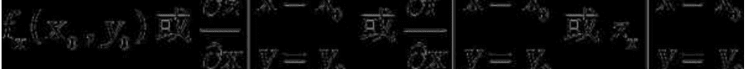

。

在求解偏导数时，可以将另外一个变量看作常数，利用普通的求导方式求解，比如 $z=3x^2+xy$ 关于 $x$ 的偏导数为 $z_x=6x+y$，这时 $y$ 相当于 $x$ 的系数。

某点 $(x_0, y_0)$ 处的偏导数的几何意义为曲面 $z=f(x,y)$ 与面 $x=x_0$ 或面 $y=y_0$ 的交线在 $y=y_0$ 或 $x=x_0$ 处的切线的斜率。

### 1.2.2 导数和偏导数的区别

导数和偏导数没有本质区别。如果极限存在，就都是当自变量的变化量趋于0时，函数值的变化量与自变量变化量比值的极限。对于一元函数，一个 $y$ 对应一个 $x$，导数只有一个。对于二元函数，一个 $z$ 对应一个 $x$ 和一个 $y$，因而有两个导数：一个是 $z$ 对 $x$ 的导数，一个是 $z$ 对 $y$ 的导数，称之为偏导数。求偏导数时要注意，当对一个变量求导时，将另一个变量视为常数，只对改变量求导，从而将偏导的求解转化成对一元函数的求导。

## 1.3 特征值和特征向量

### 1.3.1 特征值分解

特征值分解可以得到特征值和特征向量。特征值表示的是这个特征到底有多重要，而特征向量表示这个特征是什么。

如果说一个非零向量 $\mathbf{v}$ 是矩阵 $\mathbf{A}$ 的特征向量，则一定可以表示成下面的形式：

$$\mathbf{A}\mathbf{v} = \lambda\mathbf{v}$$

## 1.4 概率分布与随机变量

### 1.4.1 机器学习为什么要使用概率

事件的概率是对该事件发生的可能性的量度。虽然在一次随机试验中某个事件是否发生是带有偶然性的，但那些可在相同条件下大量重复的随机试验，其结果往往呈现出明显的数值规律。

机器学习除了要处理不确定量，也需处理随机量。不确定性和随机性可能来自多个方面，我们使用概率论来量化不确定性。

概率论在机器学习中扮演着一个核心角色，因为机器学习算法的设计通常依赖于对数据的概率假设。

在机器学习的课中，例如Andrew Ng公开课，有一个朴素贝叶斯假设就是条件独立的例子。该学习算法对内容做出假设，用来分辨电子邮件是否为垃圾邮件。假设无论邮件是否为垃圾邮件，单词1出现在邮件中的概率条件都独立于单词2出现在邮件中的概率。很明显，这个假设并不是一般性的，因为某些单词几乎总是同时出现。然而，最终结果是，这个简单的假设对结果的影响并不大，依据其他情况都可以让我们快速分判垃圾邮件。

### 1.4.2 变量与随机变量的区别

随机变量（Random Variable）是表示随机现象的各种结果的变量。例如，某段时间内公共汽车站等车乘客人数、电话交换台在一定时间内收到的呼叫次数等，都是随机变量。

变量与随机变量的区别在于，当变量取某个值的概率不是1时，变量就变成了随机变量；当随机变量取某个值的概率为1时，随机变量就变成了变量。

例如，如果变量 $x$ 的值为100的概率为1，那么 $x=100$ 就是确定的，不会再有变化，除非做进一步运算。如果变量 $x$ 的值为100的概率不为1，比如为50的概率是0.5，为100的概率是0.5，那么这个变量就是会随不同条件而变化的，是随机变量，取50或者100的概率都是0.5，即50%。

### 1.4.3 随机变量与概率分布的联系

一个随机变量仅仅表示一个可能取得的状态，还必须给定与之相伴的概率分布来确定每个状态的可能性。用来描述随机变量或一簇随机变量的每一个可能状态的可能性大小的概率规律，就是概率分布（Probability Distribution）。

随机变量可以分为离散型随机变量和连续型随机变量。相应的描述其概率分布的函数如下。

（1）概率质量函数（Probability Mass Function，PMF）：描述离散型随机变量的概率分布，通常用大写字母 $P$ 表示。

（2）概率密度函数（Probability Density Function，PDF）：描述连续型随机变量的概率分布，通常用小写字母 $p$ 表示。

### 1.4.4 离散型随机变量和概率质量函数

概率质量函数是将随机变量能够取得的每个状态映射到随机变量取得该状态的概率。

一般而言，$P(x)$ 表示 $X=x$ 的概率。有时为了防止混淆，要明确写出随机变量的名称，如 $P(X=x)$。有时需要先定义一个随机变量，然后说明它遵循的概率分布 $X$ 服从 $P(X)$。

如果一个函数 $P$ 是随机变量 $X$ 的概率质量函数，那么它必须满足如下三个条件。

- （1）$P$ 的定义域必须是所有可能状态的集合。
- （2）$\forall x \in X$，$0 \le P(x) \le 1$。
- （3）$\sum_{x \in X} P(x) = 1$。

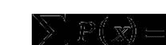

### 1.4.5 连续型随机变量和概率密度函数

如果一个函数 $p$ 是 $x$ 的概率密度函数，那么它必须满足如下几个条件。

- （1）$p$ 的定义域必须是 $x$ 的所有可能状态的集合。
- （2）$\forall x \in X$，$p(x) \ge 0$。注意，我们并不要求 $p(x) \le 1$，因为此处 $p(x)$ 不表示对应此状态的具体概率，而是概率的一个相对大小（密度）。具体的概率需要用积分去求。
- （3）$\int p(x) dx = 1$，求积分，总和还是1，概率之和还是1。

注：概率密度函数 $p(x)$ 并没有直接对特定的状态给出概率，而是给出了密度，即概率的相对大小，它给出了落在面积为 $\sigma(x)$ 的无限小区域内的概率为 $p(x)\sigma(x)$。由此无法求得具体某个状态的概率，但可以求得某个状态 $x$ 落在某个区间 $[a, b]$ 内的概率，为

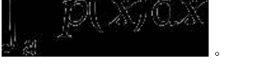

### 1.4.6 举例理解条件概率

条件概率公式如下：

$$P(A|B) = P(A \cap B) / P(B) \quad (1-22)$$

说明：在同一个样本空间 $\Omega$ 中的事件或子集 $A$、$B$，如果从 $\Omega$ 中随机选出的一个元素属于 $B$，那么下一个随机选择的元素属于 $A$ 的概率就定义为，在 $B$ 的前提下 $A$ 的条件概率。条件概率的文氏图如图1-1所示。

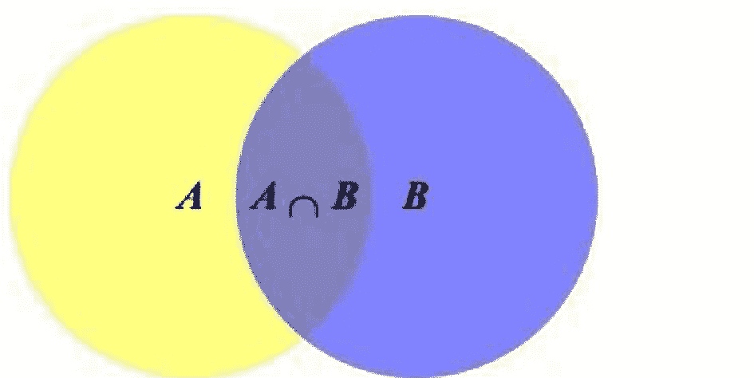

图1-1 条件概率的文氏图

根据文氏图可以很清楚地看到在事件 B 发生的情况下，事件 A 发生的概率就是 P（A ∩ B）除以 P（B）。

举例 一对夫妻有两个小孩，已知其中一个是女孩，则另一个是女孩的概率是多少？（面试、笔试都见过这道题。）

穷举法：已知其中一个是女孩，那么样本空间为男女、女女、女男，则另外一个仍然是女孩的概率就是1/3。

条件概率法：P(女|女) = P(女女)/P(女)，夫妻有两个小孩，那么它的样本空间为女女、男女、女男、男男，则 P(女女) 为1/4，P(女) = 1 - P(男男) = 3/4，所以最后1/3。

这里大家可能会认为男女和女男是同一种情况，实际上这两者类似姐弟和兄妹，是不同情况。

### 1.4.7 联合概率与边缘概率的区别和联系

**区别**

联合概率：指在多元的概率分布中多个随机变量分别满足各自条件的概率。类似于 P（X = a，Y = b），包含多个条件且所有条件同时成立的概率就是联合概率。

边缘概率：边缘概率是某个事件发生的概率，与其他事件无关。类似于 P（X = a），P（Y = b），仅与单个随机变量有关的概率就是边缘概率。

**联系**

知道联合概率可求边缘概率；但若只知道边缘概率，无法求得联合概率。

### 1.4.8 条件概率的链式法则

由1.4.6节中条件概率的定义可直接得出下面的乘法公式。

设 $A$、$B$ 是两个事件，并且 $P(A) > 0$，则有

$$P(AB) = P(B|A)P(A) \quad (1-23)$$

拓展到三个事件，公式为

$$P(ABC) = P(C|AB)P(B|A)P(A) \quad (1-24)$$

一般地，用归纳法可证明可得：

$$P(A_1A_2\cdots A_n) = P(A_n|A_1A_2\cdots A_{n-1})P(A_{n-1}|A_1A_2\cdots A_{n-2})\cdots P(A_2|A_1)P(A_1)$$
$$= P(A_1)\prod_{i=2}^{n} P(A_i|A_1A_2\cdots A_{i-1}) \quad (1-25)$$

任何多维随机变量的联合概率分布，都可以转换成只有一个变量的条件概率相乘的形式。

### 1.4.9 独立性和条件独立性

**独立性**

两个随机变量 $x$ 和 $y$，概率分布表示成两个因子乘积的形式，一个因子只包含 $x$，另一个因子只包含 $y$，两个随机变量相互独立。

条件的存在有时可以将不独立的事件变为独立事件，有时也会把本来独立的事件变为不独立事件，从而失去独立性。

举例 $P(XY) = P(X)P(Y)$，事件 $X$ 和事件 $Y$ 独立。此时给定 $Z$，则

$$P(X,Y|Z) \neq P(X|Z)P(Y|Z) \quad (1-26)$$

事件独立时，联合概率等于概率的乘积。这是一个非常好的数学性质，然而不幸的是，无条件的独立是十分罕见的，因为大部分情况下，事件之间都是互相影响的。

**条件独立性**

在给定 $Z$ 的情况下，$X$ 和 $Y$ 条件独立，当且仅当

$$X \perp Y | Z \Leftrightarrow P(X,Y|Z) = P(X|Z)P(Y|Z) \quad (1-27)$$

$X$ 和 $Y$ 的关系依赖于 $Z$，而不是直接产生的。

举例 定义如下事件：

$X$：明天下雨。

$Y$：今天的地面是湿的。

$Z$：今天下雨。

$Z$ 事件是否成立，对 $X$ 和 $Y$ 均有影响，然而，在 $Z$ 事件成立的前提下，今天的地面情况对明天是否下雨没有影响。

## 1.5 常见概率分布

### 1.5.1 伯努利分布

伯努利分布（Bernoulli Distribution）是单个二值随机变量分布，它由参数 $\varphi$ 控制，其中 $\varphi \in [0,1]$，$\varphi$ 给出随机变量等于1的概率。主要性质有：

$$P(X=1) = \varphi$$
$$P(X=0) = 1 - \varphi$$
$$P(X=x) = \varphi^x (1-\varphi)^{1-x}$$

其期望和方差为：

$$E_x[X] = \varphi$$
$$\text{Var}_x(X) = \varphi(1-\varphi)$$

Multinoulli分布也叫范畴分布、分类分布（Categorical Distribution），是伯努利分布从两个取值状态到多个取值状态的扩展，Multinoulli分布是单个 $k$ 值随机分布，经常用来表示对象分类的分布，其中 $k$ 是有限值。

伯努利分布适用于对离散型随机变量建模的场景。

### 1.5.2 高斯分布

高斯分布也叫正态分布（Normal Distribution），概率密度函数如下：

$$N(x; \mu, \sigma^2) = \sqrt{\frac{1}{2\pi\sigma^2}} \exp\left(-\frac{1}{2\sigma^2}(x-\mu)^2\right)$$

其中，$\mu$ 和 $\sigma$ 分别是均值和方差，中心峰值 $x$ 的坐标由 $\mu$ 给出，峰的宽度受 $\sigma$ 控制，最大点在 $x = \mu$ 处，拐点为 $x = \mu \pm \sigma$。

在正态分布中，$\pm 1\sigma$、$\pm 2\sigma$、$\pm 3\sigma$ 下的概率分别是68.3%、95.5%、99.73%，这三个概率为常用的概率值，建议读者记住这三个数。

此外，令 $\mu=0$，$\sigma=1$，高斯分布即简化为标准正态分布：

$$N(x; \mu, \sigma^2) = \sqrt{\frac{1}{2\pi}} \exp\left(-\frac{1}{2}x^2\right)$$

对概率密度函数高效求值：

$$N(x; \mu, \beta^{-1}) = \sqrt{\frac{\beta}{2\pi}} \exp\left(-\frac{1}{2}\beta(x-\mu)^2\right)$$

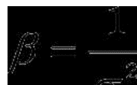

其中，通过参数 $\beta \in (0, \infty)$ 来控制分布精度。

### 1.5.3 何时采用正态分布

何时采用正态分布？实际上，如果缺乏分布规律的先验知识，不知选择何种形式，那么默认选择正态分布总是不会错的，理由如下。

- （1）中心极限定理告诉我们，很多独立随机变量均近似服从正态分布，现实中很多复杂系统都可以被建模成正态分布的噪声，即使该系统可以被结构化分解。
- （2）在具有相同方差的所有概率分布中，正态分布是不确定性最大的分布。换句话说，正态分布是对模型加入先验知识最少的分布。

正态分布可以推广到 $\mathbb{R}^n$ 空间，此时称为多维正态分布，其参数是一个正定对称矩阵 $\Sigma$，如下式所示：

$$N(\mathbf{x}; \boldsymbol{\mu}, \Sigma) = \sqrt{\frac{1}{(2\pi)^n \det(\Sigma)}} \exp\left(-\frac{1}{2}(\mathbf{x}-\boldsymbol{\mu})\Sigma^{-1}(\mathbf{x}-\boldsymbol{\mu})\right) \quad (1-33)$$

对多维正态分布概率密度高效求值：

$$N(\mathbf{x}; \boldsymbol{\mu}, \beta^{-1}) = \sqrt{\det(\beta)(2\pi)^n} \exp\left(-\frac{1}{2}(\mathbf{x}-\boldsymbol{\mu})^\top \beta (\mathbf{x}-\boldsymbol{\mu})\right) \quad (1-34)$$

此处，$\beta$ 是一个精度矩阵。

### 1.5.4 指数分布

在深度学习中，指数分布用来描述在 $x=0$ 点处取得边界点的分布，指数分布定义如下：

$$p(x; \lambda) = \lambda I_{x \geqslant 0} \exp(-\lambda x) \quad (1-35)$$

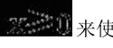

指数分布用指示函数来使 $x$ 取负值时的概率为零。

### 1.5.5 Laplace分布

一个联系紧密的概率分布是Laplace分布（Laplace Distribution），它允许我们在任意一点 $\mu$ 处设置概率质量的峰值：

$$\text{Laplace}(\mathbf{x}; \boldsymbol{\mu}; r) = \frac{1}{2r} \exp\left(-\frac{|\mathbf{x}-\boldsymbol{\mu}|}{r}\right) \quad (1-36)$$

### 1.5.6 Dirac分布和经验分布

Dirac分布可保证概率分布中的所有质量都集中在一个点上。Dirac分布的Dirac $\delta$ 函数（也称为单位脉冲函数）定义如下：

$$p(x) = \delta(x - \mu), x \neq \mu \quad (1-37)$$

$$\int_{a}^{b} \delta(x - \mu) \mathrm{d}x = 1, a < \mu < b \quad (1-38)$$

Dirac分布经常作为经验分布（Empirical Distribution）的一个组成部分出现：

$$\hat{p}(x) = \frac{1}{m} \sum_{i=1}^{m} \delta(x - x^{(i)}) \quad (1-39)$$

其中，$m$ 个点 $x^{(1)}, x^{(2)}, \dots, x^{(m)}$ 是给定的数据集，经验分布将概率密度 $\frac{1}{m}$ 赋给了这些点。

当我们在训练集上训练模型时，可以认为从这个训练集上得到的经验分布指明了采样来源。

Dirac $\delta$ 函数适用于连续型随机变量的经验分布。

## 1.6 期望、方差、协方差、相关系数

### 1.6.1 期望

在概率论和统计学中，数学期望（简称期望或均值）等于试验中每次可能结果的概率乘以其结果的总和，用 $E$ 表示。它反映随机变量平均取值的大小。

- 线性运算：

$$E(ax+by+c) = aE(x) + bE(y) + c \quad (1-40)$$

- 推广形式：

$$E(\sum_{i=1}^{n} a_i x_i + c) = \sum_{i=1}^{n} a_i E(x_i) + c \quad (1-41)$$

- 函数期望：设 $f(x)$ 为 $x$ 的函数，则 $f(x)$ 的期望为

- 离散函数：

$$E(f(x)) = \sum_{k=1}^{n} f(x_k) p(x_k) \quad (1-42)$$

- 连续函数：

$$E(f(x)) = \int_{-\infty}^{+\infty} f(x) p(x) dx \quad (1-43)$$

关于期望，请注意以下几点。

（1）函数的期望大于等于期望的函数（Jensen不等式），即

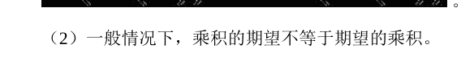

。

（2）一般情况下，乘积的期望不等于期望的乘积。

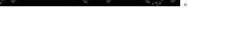

（3）如果 $x$ 和 $y$ 相互独立，则

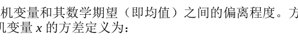

。

### 1.6.2 方差

在概率论中，方差用来度量随机变量和其数学期望（即均值）之间的偏离程度。方差是一种特殊的期望，用Var表示，离散型随机变量 $x$ 的方差定义为：

$$Var(x) = E((x - E(x))^2) \quad (1-44)$$

也可表示为：

$$Var(x) = E(x^2) - E(x)^2 \quad (1-45)$$

方差的性质如下：

- 常数的方差为0。
- 方差不满足线性性质。
- 如果 $x$ 和 $y$ 相互独立，则

$$\text{Var}(ax+by) = a^2\text{Var}(x) + b^2\text{Var}(y) \qquad (1\text{-}46)$$

### 1.6.3 协方差

协方差是衡量两个变量线性相关性程度及变量尺度，用Cov表示，两个随机变量 $x$ 和 $y$ 的协方差定义为：

$$\text{Cov}(x, y) = E((x - E(x))(y - E(y))) \qquad (1\text{-}47)$$

方差是一种特殊的协方差。当 $x=y$ 时，

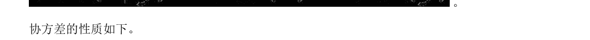

协方差的性质如下。

- (1) 独立变量的协方差为0。
- (2) 协方差的计算公式为：

$$\text{Cov}\left(\sum_{i=1}^{m} a_i x_i, \sum_{j=1}^{m} b_j y_j\right) = \sum_{i=1}^{m} \sum_{j=1}^{m} a_i b_j \text{Cov}(x_i, y_j) \qquad (1\text{-}48)$$

- (3) 特殊情况下，利用方差及协方差的性质可证得：

$$\text{Cov}(a + bx, c + dy) = bd\text{Cov}(x, y) \qquad (1\text{-}49)$$

### 1.6.4 相关系数

相关系数是研究变量之间线性相关程度的量，用Corr表示。两个随机变量 $x$ 和 $y$ 的相关系数定义为：

$$\text{Corr}(x, y) = \frac{\text{Cov}(x, y)}{\sqrt{\text{Var}(x)\text{Var}(y)}} \qquad (1\text{-}50)$$

相关系数的性质如下。

- (1) 有界性。相关系数的取值范围是[-1,1]，可以看成无量纲的协方差。
- (2) 相关系数的值越接近1，说明两个变量正相关性（线性）越强；越接近-1，说明负相关性越强；当值为0时，表示两个变量没有相关性。

# 第2章 机器学习基础

机器学习起源于20世纪50年代。1959年，在IBM工作的Arthur Samuel设计了一个下棋程序，这个程序具有学习的能力，它可以在不断的对弈中提高自己。由此“机器学习”这个概念被提出，它结合了多个学科，如概率论、优化理论、统计学等，最终在计算机上实现自我获取新知识，学习改善自己。机器学习是人工智能的一个子集，目前已经发展出许多有用的方法，比如支持向量机、回归、决策树、随机森林、强化方法、集成学习、深度学习等，在一定程度上可以帮助人们完成一些数据预测、自动化、自动决策、最优化等初步替代脑力的任务。本章主要介绍机器学习的基本概念、监督学习、分类算法、逻辑回归、代价函数、损失函数、线性判别分析、主成分分析、决策树、支持向量机、最大期望算法、聚类和降维，以及模型评估的方法、指标等。

## 2.1 基本概念

### 2.1.1 大话机器学习本质

机器学习（Machine Learning，ML），顾名思义，就是让机器去学习。这里，机器指的是计算机，是算法运行的物理载体，也可以把各种算法本身当作一个有输入和输出的机器。那么到底让计算机去学习什么呢？对于一个任务及其表现的度量方法，设计一种算法，让算法能够提取数据中所蕴含的规律，这就叫机器学习。如果输入机器的数据是带有标签的，就称作监督学习；如果数据是无标签的，就是无监督学习。

### 2.1.2 什么是神经网络

神经网络就是按照一定规则将多个神经元连接起来的网络。不同的神经网络，具有不同的连接规则。我们以全连接（Full Connected，FC）神经网络为例，全连接层是指第 N 层的每个神经元和第 N-1 层的所有神经元相连，第 N-1 层神经元的输出就是第 N 层神经元的输入。它的特点如下。

- （1）有三种层：输入层（Input Layer）、隐含层（Hidden Layer）和输出层（Output Layer）。
- （2）同一层的神经元之间没有连接。
- （3）每个连接都有一个权值。

神经网络架构
图2-1就是一个神经网络系统，它由很多层组成。输入层负责接收信息，比如一只猫的图片。输出层显示计算机对这个输入信息的判断结果——它是不是猫。隐含层负责对输入信息的传递和加工处理。

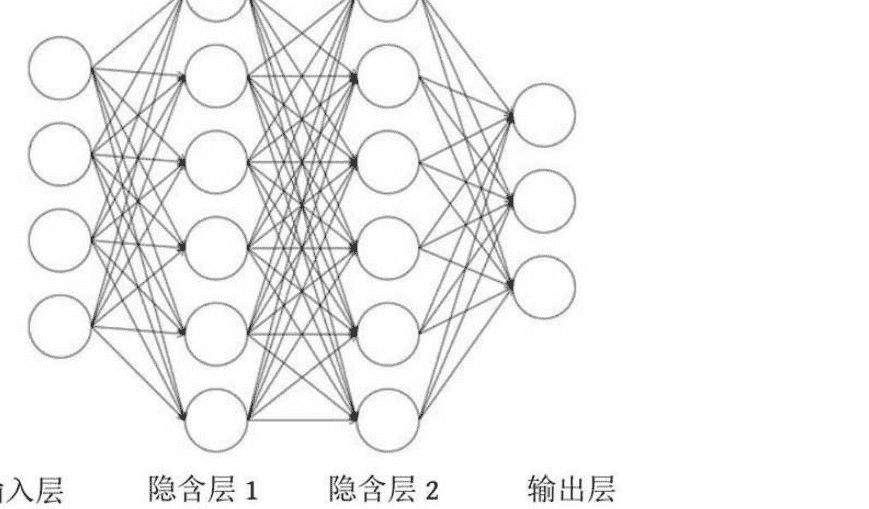

图2-1 神经网络系统

### 2.1.3 各种常见算法图示

在日常使用机器学习的任务中，我们经常会遇见各种算法，图2-2是各种常见算法的图示。

### 2.1.4 计算图的导数计算

计算图（Computational Graph）的导数计算采用反向传播的方法，利用链式法则和隐式函数求导。

假设 $z = f(u, v)$ 在点 $(u, v)$ 处的偏导数连续，$u$ 和 $v$ 是关于 $t$ 的函数，在 $t$ 点可导，求 $z$ 在 $t$ 点的导数。

根据链式法则有：

$$\frac{dz}{dt} = \frac{\partial z}{\partial u} \frac{du}{dt} + \frac{\partial z}{\partial v} \frac{dv}{dt} \quad (2-1)$$

链式法则可以用文字描述：由两个函数凑起来的复合函数，其导数等于里边函数代入外边函数的值之导数，乘以里边函数的导数。

为了便于理解，下面举例说明：

$$f(x) = x^2, g(x) = 2x + 1 \quad (2-2)$$

则：

$$f[g(x)]' = 2[g(x)] \times g'(x) = 2[2x+1] \times 2 = 8x + 4 \quad (2-3)$$

| 回归算法 | 分类算法 | 正则化方法 |
| :---: | :---: | :---: |
|  |  |  |
| 决策树学习 | 贝叶斯方法 | 基于核的算法 |
|  |  |  |
| 聚类算法 | 关联规则学习 | 人工神经网络 |
|  |  |  |
| 深度学习 | 降低维度算法 | 集成算法 |
|  |  |  |

图2-2 各种常见算法的图示

### 2.1.5 理解局部最优与全局最优

柏拉图有一天问老师苏格拉底，什么是爱情？苏格拉底叫他到麦田走一次，摘一株最大的麦穗回来，不许回头，只可摘一次。柏拉图空着手出来了，他的理由是，看见不错的，却不知道是不是最大的，一次次侥幸，走到尽头时，才发现还不如前面的，于是放弃。苏格拉底告诉他：“这就是爱情。”这个故事让我们明白了一个道理，因为生命的一些不确定性，所以全局最优解是很难寻找到的，或者说根本就不存在，我们应该设置一些限定条件，然后在这个范围内寻找最优解，也就是局部最优解——有所斩获总比空手而归强，哪怕这种斩获只是一次有趣的经历。

柏拉图有一天又问，什么是婚姻？苏格拉底叫他到树林走一次，选一棵最好的树做圣诞树，也是不许回头，只许选一次。这次他一身疲惫地拖了一棵看起来直挺、翠绿，却有点稀疏的杉树回来，他的理由是，有了上回的教训，好不容易看见一棵看似不错的，又发现时间、体力已经快不够用了，也不管是不是最好的，就拿回来了。苏格拉底告诉他：“这就是婚姻。”

可见，优化问题一般分为寻找局部最优解和全局最优解。寻找局部最优解，就是在函数值空间的一个有限区域内寻找最小值；而寻找全局最优解，就是在函数值空间整个区域内寻找最小值。函数局部最小点的函数值小于或等于附近点的值，但是有可能大于较远点的值。全局最小点的函数值小于或等于所有点的值。

### 2.1.6 大数据与深度学习之间的关系

首先来看大数据、机器学习及数据挖掘三者简单的定义。

大数据通常被定义为“超出常用软件工具捕获、管理和处理能力”的数据集。

机器学习关心的问题是研究计算机怎样模拟或实现人类的学习行为，以获取新的知识或技能，重新组织已有的知识结构使之不断改善自身的性能。

数据挖掘是从数据中提取模式的特定算法的应用，在数据挖掘中，重点在于算法的应用，而不是算法本身。

数据挖掘是一个过程，在此过程中机器学习算法被用作提取数据集中潜在有价值模式的工具。

大数据与深度学习之间的关系如下。

- （1）深度学习是一种模拟大脑的行为，可以从所学习对象的机制及行为等很多相关联的方面进行学习，模拟或实现人类行为及思维。
- （2）深度学习对于大数据的发展有帮助。不管是数据的分析、挖掘还是建模，深度学习对于大数据技术开发的每一个阶段均有帮助。
- （3）深度学习转变了解决问题的思维。很多时候从发现问题到解决问题，走一步看一步不是一个主要的解决问题的方式，在深度学习的基础上，我们从开始到最后都要基于一个目标，为了需要优化的那个最终目标去处理数据，以及将数据放入数据应用平台，这就是端到端。
- （4）大数据的深度学习需要一个框架。在大数据方面的深度学习都是从基础的角度出发的，深度学习需要一个框架或者一个系统。总而言之，将你的大数据通过深度分析变为现实，这就是深度学习和大数据的最直接关系。

## 2.2 机器学习的学习方式

根据数据类型的不同，对一个问题的建模也有不同的方式。依据不同的学习方式和输入数据，机器学习主要分为监督学习、非监督学习、半监督学习和弱监督学习。

### 2.2.1 监督学习

监督学习是使用已知正确答案的示例训练网络的过程。它已知数据和其一一对应的标签，然后训练一个预测模型，将输入数据映射到标签。

常见应用场景：分类和回归。

算法举例：支持向量机（Support Vector Machine，SVM）、朴素贝叶斯（Naive Bayes）、逻辑回归（Logistic Regression）、K近邻（K-Nearest Neighborhood，KNN）、决策树（Decision Tree）、随机森林（Random Forest）、AdaBoost，以及线性判别分析（Linear Discriminant Analysis，LDA）等。深度学习（Deep Learning）也多以监督学习的方式呈现。

### 2.2.2 非监督学习

在非监督学习中，数据并不被特别标识，因此非监督学习适用于具有数据集但无标签的情况。学习模型是为了推断出数据的一些内在结构。

常见应用场景：关联规则的学习及聚类等。

算法举例：Apriori算法及k-Means算法。

### 2.2.3 半监督学习

半监督学习的特点是，输入数据部分被标记，部分没有被标记，通过对已标记数据建模，在此基础上对未标记数据进行预测。

常见应用场景：分类和回归。

算法举例：图论推理算法（Graph Inference）、拉普拉斯支持向量机（Laplacian SVM）等，也包括一些对常用监督学习算法的延伸算法。

### 2.2.4 弱监督学习

弱监督学习可以看作多个标记数据的集合，此集合可以是空集、单个元素或包含多种情况（没有标记、有一个标记和有多个标记）的多个元素。数据集的标签是不可靠的，这里的不可靠可能是标记不正确、多种标记、标记不充分、局部标记等。弱监督学习的学习过程是：已知数据和其一一对应的弱标签，训练一个智能算法，将输入数据映射到一组更强的标签。标签的强弱指的是标签蕴含的信息量的多少，比如相对于分割的标签来说，分类的标签就是弱标签。

算法举例：给出一张包含气球的图片，需要得出气球在图片中的位置及气球和背景的分割线，这就是已知弱标签学习强标签的问题。

在企业数据应用的场景下，人们最常用的可能就是监督学习和非监督学习的模型。在图像识别等领域，由于存在大量的非标识的数据和少量的可标识数据，目前半监督学习是一个很热的话题。

### 2.2.5 监督学习模型的搭建步骤

监督学习是指使用已知正确答案的示例来训练网络，每组训练数据有一个明确的标识或结果。想象一下，我们可以训练一个网络，让其从照片库中（其中包含气球的照片）识别出气球的照片，下面是监督学习模型的搭建步骤。

#### （1）数据集的创建和分类

首先，浏览你的照片（数据集），确定所有包含气球的照片，并对其进行标注。然后，将所有照片分为训练集和验证集。目标是在深度网络中找一个函数，这个函数的输入是任意一张照片，当照片中包含气球时，输出1，否则输出0。

#### （2）数据增强

当原始数据搜集和标注完毕，一般搜集的数据并不一定包含目标在各种扰动下的信息。数据的好坏对于机器学习模型的预测能力至关重要，因此一般会进行数据增强。对于图像数据来说，数据增强一般包括图像旋转、平移、颜色变换、裁剪、仿射变换等。

#### （3）特征工程

一般来讲，特征工程包含特征提取和特征选择。常见的手工特征（Hand-Crafted Feature）有尺度不变特征变换（Scale-Invariant Feature Transform，SIFT）、方向梯度直方图（Histogram of Oriented Gradient，HOG）等。由于手工特征是启发式的，其算法设计背后的出发点不同，将这些特征组合在一起的时候有可能会产生冲突，因此将组合特征的效能发挥出来，使原始数据在特征空间中的判别性最大化，就需要用到特征选择的方法。在深度学习方法大获成功之后，对特征工程本质概念的关注度就明显降低。因为最常用到的卷积神经网络（Convolutional Neural Network，CNN）本身就是一种特征提取和选择的引擎。研究者提出的不同网络结构、正则化、归一化方法实际上就是深度学习背景下的特征工程。

#### （4）构建预测模型和损失函数

将原始数据映射到特征空间之后，也就意味着我们得到了比较合理的输入。下一步就是构建合适的预测模型，得到对应输入的输出。而保证模型的输出和输入标签的一致性，就需要构建模型预测和标签之间的损失函数，常见的损失函数（Loss Function）有交叉熵、均方差等。通过优化方法不断迭代，使模型从最初的初始化状态一步步变化为有预测能力的模型的过程，实际上就是学习的过程。

#### （5）训练

选择合适的模型和超参数进行初始化，其中超参数如支持向量机中的核函数、误差项惩罚权重等。当模型初始化参数设定好后，将处理好的特征数据输入到模型，通过合适的优化方法不断缩小输出与标签之间的差距，当迭代结果满足截止条件，就可以得到训练好的模型。优化方法最常见的就是梯度下降法及其变种，使用梯度下降法的前提是优化目标函数对于模型是可导的。

#### （6）验证和模型选择

训练完训练集图片后，需要进行模型测试，即利用验证集来验证模型是否可以准确地挑选出含有气球的照片。

在此过程中，通常会通过调整和模型相关的各种事物（超参数）来重复步骤（2）和（3），诸如里面有多少个节点，有多少层，使用怎样的激活函数和损失函数，如何在反向传播阶段积极有效地训练权值等。

#### （7）测试及应用

当有了一个准确的模型之后，就可以将该模型部署到应用程序中。我们可以将预测功能发布为API（Application Programming Interface，应用程序编程接口）调用，并且可以从软件中调用该API，从而进行推理并给出相应的结果。

## 2.3 分类算法

分类算法和回归算法是对真实世界建模的不同方法。分类模型的输出是离散的，例如大自然的生物被划分为不同的种类，是离散的。回归模型的输出是连续的，例如人的身高变化过程是一个连续过程，而不是离散的。

因此，在实际建模过程时，采用分类模型还是回归模型，取决于你对任务（真实世界）的分析和理解。

### 2.3.1 常用分类算法的优缺点

接下来介绍常用分类算法的优缺点，如表2-1所示。

表2-1 常用分类算法的优缺点

| 算法 | 优点 | 缺点 |
|---|---|---|
| Bayes（贝叶斯分类法） | 1. 所需估计的参数少，对于缺失数据不敏感。2. 有着坚实的数学基础，以及稳定的分类效率 | 1. 需要假设属性之间相互独立，这往往并不成立（例如，喜欢吃番茄、鸡蛋，却不喜欢吃番茄炒鸡蛋）。2. 需要知道先验概率。3. 分类决策存在错误率 |
| Decision Tree（决策树） | 1. 不需要任何领域知识或参数假设。2. 适合高维数据。3. 简单、易于理解。4. 能够在短时间内处理大量数据，得到可行且效果较好的结果。5. 能够同时处理数据型和常规性属性 | 1. 对于各类别样本数量不一致的数据，信息增益偏向于那些具有更多数量的样本。2. 容易发生过拟合。3. 忽略属性之间的相关性。4. 不支持在线学习 |
| SVM（支持向量机） | 1. 可以解决小样本下机器学习的问题。2. 提高泛化性能。3. 可以解决高维、非线性问题。超高维文本分类仍受欢迎。4. 避免神经网络结构选择和局部极小的问题 | 1. 对缺失数据敏感。2. 内存消耗大，难以解释。3. 运行速度较慢，调参复杂 |
| KNN（K近邻） | 1. 核心思路简单，理论成熟，既可以用来做分类也可以用来做回归。2. 可用于非线性分类。3. 训练时间复杂度为 O(n)。4. 准确度高，对数据没有假设，对离群值不敏感 | 1. 计算量太大。2. 对于样本分类不均衡的问题，会产生误判。3. 需要大量的内存。4. 输出的可解释性不强 |
| Logistic Regression（逻辑回归） | 1. 速度快。2. 简单、易于理解，直接看到各个特征的权重。3. 能容易地更新模型，吸收新的数据。4. 想要一个概率框架，能够动态调整分类阈值 | 特征处理过程复杂，需要进行归一化等特征工程 |
| Neural Network（神经网络） | 1. 分类准确率高。2. 并行处理能力强。3. 分布式存储和学习能力强。4. 鲁棒性较强，不易受噪声影响 | 1. 需要大量参数（网络拓扑、阈值、阈值）。2. 结果难以解释。3. 训练时间过长 |
| Adaboosting（自适应增强算法） | 1. 有很高精度。2. 可以使用各种方法构建子分类器，Adaboosting 提供的是框架。3. 当使用简单分类器时，计算出的结果是可以理解的，而且弱分类器构造极其简单。4. 流程简单，不用做特征选择。5. 不用担心过拟合 | 对离群值比较敏感 |

### 2.3.2 分类算法的评估方法

分类评估方法的主要功能是用来评估分类算法的好坏，而评估一个分类算法的好坏又包括许多项指标。了解各种评估方法，在实际应用中选择正确的评估方法是十分重要的。

#### 几个常用术语

这里首先介绍几个常见的模型评价术语，现在假设我们的分类目标只有两类，即正例（Positive）和负例（Negative）。

- （1）True Positives（TP）：被正确地划分为正例的个数，即实际为正例且被分类器划分为正例的实例数。
- （2）False Positives（FP）：被错误地划分为正例的个数，即实际为负例但被分类器划分为正例的实例数。
- （3）False Negatives（FN）：被错误地划分为负例的个数，即实际为正例但被分类器划分为负例的实例数。
- （4）True Negatives（TN）：被正确地划分为负例的个数，即实际为负例且被分类器划分为负例的实例数。

表2-2是这4个术语的混淆矩阵，下面是相应的说明。

- （1）P = TP + FN 表示实际为正例的样本个数。
- （2）True、False描述的是分类器是否判断正确。
- （3）Positive、Negative是分类器的分类结果，如果正例计为1、负例计为-1，即Positive=1、Negative=-1。若用1表示True，用-1表示False，那么实际的类标 = TF × PN，TF为True或False，PN为Positive或Negative。

例如True Positives（TP）的实际类标 = 1 × 1 = 1，为正例，False Positives（FP）的实际类标 = (-1) × 1 = -1，为负例，False Negatives（FN）的实际类标 = (-1) × (-1) = 1，为正例，True Negatives（TN）的实际类标 = 1 × (-1) = -1，为负例。

表2-2 4个术语的混淆矩阵

| 预测类别 | Yes | No | 总计 |
| :--- | :--- | :--- | :--- |
| 实际类别 | Yes | TP | FN | P（实际为Yes） |
| | No | FP | TN | N（实际为No） |
| 总计 | P'（被划分为Yes） | N'（被划分为No） | P+N |

#### 二分类算法评价指标

- （1）正确率（accuracy）

正确率是最常见的评价指标，accuracy = (TP + TN) / (P + N)。正确率是被分对的样本数在所有样本数中的占比，通常来说，正确率越高，分类器越好。

- （2）错误率（error rate）

错误率则与正确率相反，描述被分类器错分的比例，error rate = (FP + FN) / (P + N)。对某一个实例来说，分对与分错是互斥事件，所以accuracy = 1 - error rate。

- （3）灵敏度（sensitivity）

sensitivity = TP / P，表示的是所有正例中被分对的比例，衡量了分类器对正例的识别能力。

- （4）特异性（specificity）

specificity = TN / N，表示的是所有负例中被分对的比例，衡量了分类器对负例的识别能力。

#### （5）精度（precision）

precision=TP/（TP+FP），精度是精确性的度量，表示被分为正例的实例中实际为正例的比例。

#### （6）召回率（recall）

召回率是对覆盖面的度量，度量有多少个正例被分为正例，recall=TP/（TP+FN）= TP/ P =sensitivity，可以看到召回率与灵敏度是一样的。

#### （7）其他评价指标

- 计算速度：分类器训练和预测需要的时间；
- 鲁棒性：处理缺失值和异常值的能力；
- 可扩展性：处理大数据集的能力；
- 可解释性：分类器预测标准的可理解性，像决策树产生的规则就是很容易理解的，而神经网络的一堆参数就不好理解，我们只好把它看成一个黑盒子。

#### （8）精度和召回率反映了分类器分类性能的两个方面。如果综合考虑精度与召回率，可以得到新的评价指标F1分数，也称为综合分类率：

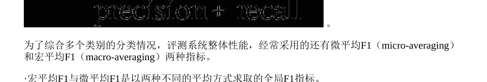

为了综合多个类别的分类情况，评测系统整体性能，经常采用的还有微平均F1（micro-averaging）和宏平均F1（macro-averaging）两种指标。

- 宏平均F1与微平均F1是以两种不同的平均方式求取的全局F1指标。
- 宏平均F1的计算方法是先对每个类别单独计算F1值，再取这些F1值的算术平均值作为全局指标。
- 微平均F1的计算方法是先累加计算各个类别的值，再由这些值求出F1值。
- 由两种平均F1的计算方式不难看出，宏平均F1平等对待每一个类别，所以它的值主要受到稀有类别的影响，而微平均F1平等考虑样本集中的每一个样本，所以它的值受到常见类别的影响比较大。

如图2-3所示，ROC曲线（Receiver Operating Characteristic Curve，受试者工作特征曲线）是以灵敏度（真正例率）为纵坐标，以1减去特异性（假正例率）为横坐标绘制的性能评价曲线。可以将不同模型对同一数据集的ROC曲线绘制在同一笛卡儿坐标系中，ROC曲线越靠近左上角，说明其对应模型越可靠。也可以通过ROC曲线下面积（Area Under Curve，AUC）来评价模型，AUC越大，模型越可靠。

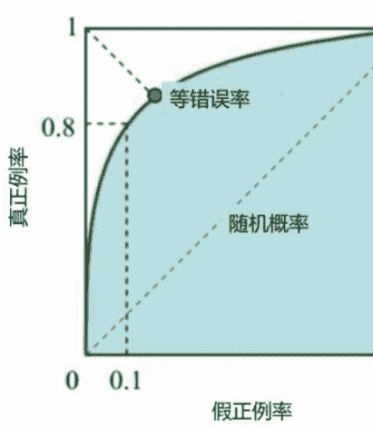

图2-3 ROC曲线

PR曲线是Precision Recall Curve的简称，描述的是precision和recall之间的关系，以recall为横坐标，precision为纵坐标。该曲线所对应的面积（AUC）实际上是目标检测中常用的评价指标平均精度（Average Precision，AP）。AP越高，说明模型性能越好。

### 2.3.3 正确率能否很好地评估分类算法

不同算法有不同特点，在不同数据集上有不同的表现效果，因此要根据特定的任务选择不同的算法。如何评价分类算法的好坏，要具体任务具体分析。对于决策树，主要用正确率去评估，但是其他算法，只用正确率能很好地评估吗？答案是否定的。

正确率确实是一个很直观、很好的评价指标，但是有时候正确率高并不能完全代表一个算法就好。比如对某个地区进行地震预测，地震分类属性分为：0代表不发生地震、1代表发生地震。我们都知道，不发生的概率是极大的。对于分类器而言，如果分类器不加思考，对每一个测试样例的类别都划分为0，达到99%的正确率。那么，问题来了，真的发生地震时，这个分类器毫无察觉，带来的后果将是巨大的。很显然，99%正确率的分类器并不是我们想要的。出现这种现象的原因主要是数据分布不均衡，类别为1的数据太少，错分了类别1达到了很高的正确率却忽视了研究者本身最为关注的情况。

### 2.3.4 什么样的分类器是最好的

对某一个任务，某个具体的分类器不可能同时满足或提高所有上面介绍的指标。

如果一个分类器能正确分对所有的实例，那么各项指标都已经达到最优，但这样的分类器往往不存在。比如之前说的地震预测，虽然不能百分百预测地震的发生，但实际情况中能容忍一定程度的误报。假设在1000次预测中，共有5次预测发生了地震，真实情况中有一次发生了地震，其他4次则为误报。正确率由原来的999/1000=99.9%下降为996/1000=99.6%。召回率由0/1=0%上升为1/1=100%。对此可解释为，虽然预测失误了4次，但真的地震发生前，分类器能预测对，没有错过，这样的分类器实际意义更大，正是我们想要的。在保证一定正确率的前提下，要求分类器的召回率尽量高。

## 2.4 逻辑回归

回归问题在机器学习中按照目的的不同可以分为回归和分类两大类。本节主要介绍回归的种类、逻辑回归有哪些方面的应用，以及逻辑回归和朴素贝叶斯、线性回归有什么区别。

### 2.4.1 回归的种类

依据因变量不同，广义线性模型可以有如下划分。

（1）如果是连续的，就是多重线性回归。
（2）如果服从二项分布，就是逻辑回归。
（3）如果服从泊松（Poisson）分布，就是泊松回归。
（4）如果服从负二项分布，就是负二项回归。
（5）逻辑回归的因变量可以是二分类的，也可以是多分类的，但是二分类的更常用，也更容易解释。所以实际中最常用的就是二分类的逻辑回归。

### 2.4.2 逻辑回归适用性

逻辑回归可用于以下几个方面。

（1）用于概率预测。在可能性预测时，得到的结果有可比性。比如根据模型进而预测在不同的自变量情况下，发生某事或某种情况的概率。
（2）用于分类。实际上跟预测有些类似，也是根据模型预测某人属于某种情况的概率。进行分类时，仅需要设定一个阈值即可，可能性高于阈值的是一类，低于阈值的是另一类。
（3）寻找危险因素。寻找某一疾病的危险因素等。
（4）仅能用于线性问题。只有当目标和特征是线性关系时，才能用逻辑回归。在应用逻辑回归时要注意两点：一是当知道模型是非线性时，不适合用逻辑回归；二是当使用逻辑回归时，应注意选择和目标为线性关系的特征。
（5）各特征之间不需要满足条件独立假设，但各个特征的贡献独立计算。

### 2.4.3 逻辑回归与朴素贝叶斯的区别

逻辑回归与朴素贝叶斯的区别有以下几个方面。

（1）逻辑回归是判别模型，朴素贝叶斯是生成模型，所以生成和判别的所有区别它们都有。
（2）朴素贝叶斯最核心的部分是贝叶斯法则，逻辑回归的本质是极大似然估计。
（3）朴素贝叶斯需要假设各个自变量之间满足条件独立。
（4）逻辑回归要求特征参数间的关系是线性的。

### 2.4.4 线性回归与逻辑回归的区别

线性回归与逻辑回归的区别有以下两个方面。

（1）因变量不同。线性回归的因变量是连续的，逻辑回归的因变量是离散的，通常是0和1。
（2）对于拟合函数也有本质上的差别。

线性回归：

$$f(\mathbf{x}) = \boldsymbol{\theta}^T \mathbf{x} = \theta_1 x_1 + \theta_2 x_2 + ... + \theta_n x_n$$

逻辑回归：

$$f(\mathbf{x}) = P(y=1|\mathbf{x}; \boldsymbol{\theta}) = g(\boldsymbol{\theta}^T \mathbf{x}), \text{其中}, g(z) = \frac{1}{1+e^{-z}}$$

可以看出，线性回归的拟合函数，是对$f(\mathbf{x})$的输出变量$y$的拟合，而逻辑回归的拟合函数是对1类样本的概率的拟合。

那么，为什么要以1类样本的概率进行拟合呢？为什么可以这样拟合呢？

$\boldsymbol{\theta}^T \mathbf{x} = 0$就相当于是1类样本和0类样本的决策边界。

若$\boldsymbol{\theta}^T \mathbf{x} > 0$，则$y > 0.5$；若$\boldsymbol{\theta}^T \mathbf{x} \to +\infty$，则$y \to 1$，即$y$为1类样本。

若$\boldsymbol{\theta}^T \mathbf{x} < 0$，则$y < 0.5$；若$\boldsymbol{\theta}^T \mathbf{x} \to -\infty$，则$y \to 0$，即$y$为0类样本。

这个时候就能看出区别，在线性回归中，$\boldsymbol{\theta}^T \mathbf{x}$为预测值的拟合函数；而在逻辑回归中，$\boldsymbol{\theta}^T \mathbf{x}$为决策边界。

表2-3为线性回归和逻辑回归的区别。

#### 表2-3 线性回归和逻辑回归的区别

| | 线性回归 | 逻辑回归 |
|---|---|---|
| 目的 | 预测 | 分类 |
| $y^{(i)}$ | $(-\infty, +\infty)$ | $(0,1)$ |
| 函数 | 拟合函数 | 预测函数 |
| 参数计算方式 | 最小二乘法 | 极大似然估计 |

拟合函数和预测函数有什么关系？简单来说就是将拟合函数做了一个逻辑函数的转换，转换后使得

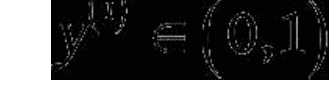

。

对于最小二乘法，最合理的参数估计量应该使得模型能最好地拟合样本数据，使得估计值和观测值之差的平方和最小；对于极大似然估计，最合理的参数估计量应该使得从模型中抽取该$n$组样本观测值的概率最大，也就是使概率分布函数或似然函数最大。

## 2.5 代价函数

代价函数（Cost Function）是定义在整个训练集上的，是所有样本误差的平均，也就是损失函数的平均。本节主要介绍代价函数的作用及其原理、常见代价函数、代价函数为什么需要非负及用交叉熵代替二次代价函数的原因。

### 2.5.1 为什么需要代价函数

为了得到训练逻辑回归模型的参数，需要一个代价函数，通过训练代价函数来得到参数，用于找到最优解的目的函数。

### 2.5.2 代价函数作用原理

在回归问题中，通过代价函数来求解最优解，常用的是平方误差代价函数。假设函数图像如图2-4所示，当参数发生变化时，假设函数状态也会随着变化。

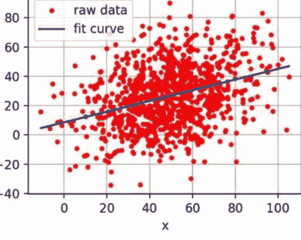

图2-4 函数图像

想要拟合图中的离散点，我们需要尽可能找到最优的参数来使这条直线更能代表所有数据。如何找到最优解呢？这就需要使用代价函数来求解，以平方误差代价函数为例，假设函数为 $h(x) = \theta_0 x$，图中代表函数为 $y = Ax + B$。

平方误差代价函数的主要思想就是将实际数据给出的值与拟合出的线的对应值作差，求出拟合出的直线与实际的差距。在实际应用中，为了避免因个别极端数据产生的影响，要采用类似方差再取1/2的方式来减小个别数据的影响。因此，引出代价函数：

$$J(\theta_0, \theta_1) = \frac{1}{m} \sum_{i=1}^{m} (h(x^{(i)}) - y^{(i)})^2 \quad (2-4)$$

最优解即为代价函数的最小值 $\min J(\theta_0, \theta_1)$。如果是1个参数，代价函数一般通过二维曲线便可直观看出。如果是2个参数，那么通过三维图像可看出代价函数的效果，参数越多，越复杂。

当参数为2个时，代价函数是三维图像，如图2-5所示。

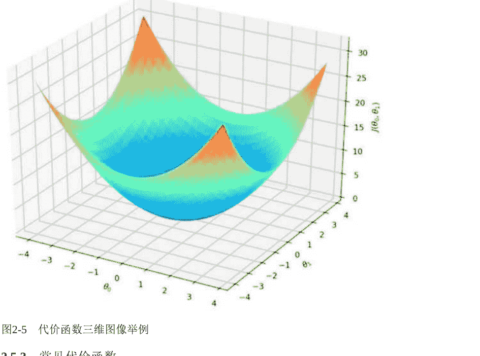

图2-5 代价函数三维图像举例

### 2.5.3 常见代价函数

二次代价函数（Quadratic Cost）

$$J = \frac{1}{2n} \sum_{x} \|y(x) - a^L(x)\|^2 \quad (2-5)$$

其中，$J$ 表示代价函数，$x$ 表示样本，$y$ 表示实际值，$a$ 表示输出值，$n$ 表示样本的总数，$L$ 表示整个神经网络的层数。使用一个样本为例简单说明，此时二次代价函数为：

$$J = \frac{(y - a)^2}{2} \quad (2-6)$$

假如使用梯度下降法（Gradient Descent）来调整权值参数的大小，权值 $w$ 和偏置 $b$ 的梯度推导如下：

$$\frac{\partial J}{\partial w} = (a - y)\sigma'(z)x, \quad \frac{\partial J}{\partial b} = (a - y)\sigma'(z) \quad (2-7)$$

其中，$z$ 表示神经元的输入，$\sigma$ 表示激活函数。权值 $w$ 和偏置 $b$ 的梯度跟激活函数的梯度成正比，激活函数的梯度越大，权值 $w$ 和偏置 $b$ 的大小调整得越快，训练收敛得就越快。

注：神经网络常用的激活函数为sigmoid函数，该函数的曲线如图2-6所示。

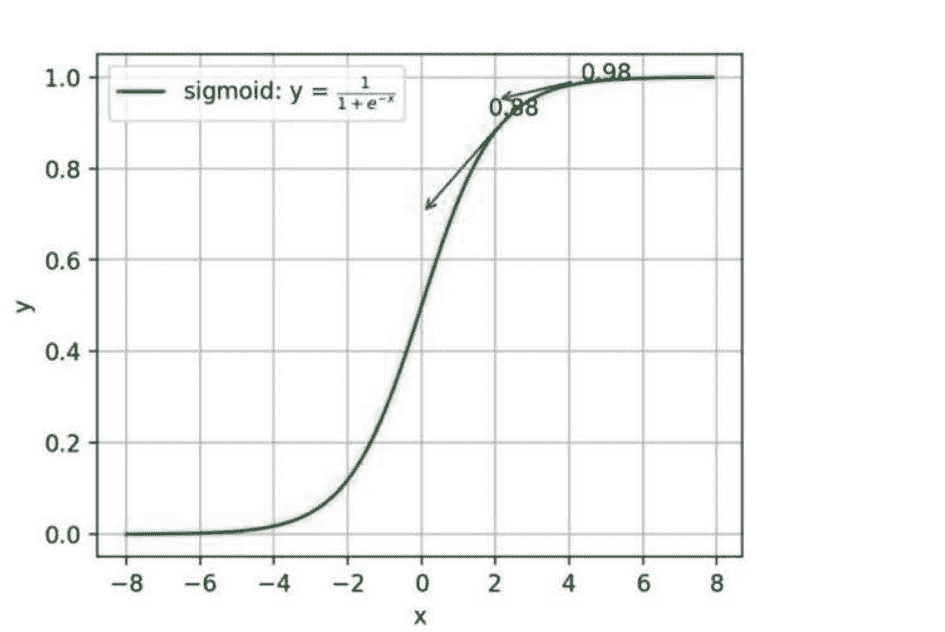

图2-6 sigmoid函数曲线

对0.88和0.98两个点进行比较：

假设目标收敛到1.0。0.88离目标1.0比较远，梯度比较大，权值调整比较大。0.98离目标1.0比较近，梯度比较小，权值调整比较小。调整方案合理。

假如目标收敛到0。0.88离目标0比较近，梯度比较大，权值调整比较大。0.98离目标0比较远，梯度比较小，权值调整比较小。调整方案不合理。

原因：在使用sigmoid函数的情况下，初始的代价（误差）越大，训练越慢。

交叉熵代价函数（Cross-Entropy）

$$J = -\frac{1}{n}\sum_{x}[y\ln a + (1-y)\ln(1-a)] \quad (2-8)$$

其中，$J$ 表示代价函数，$x$ 表示样本，$y$ 表示实际值，$a$ 表示输出值，$n$ 表示样本的总数。

权值 $w$ 和偏置 $b$ 的梯度推导如下：

$$\frac{\partial J}{\partial w_j} = \frac{1}{n}\sum_{x}x_j(\sigma(z)-y), \frac{\partial J}{\partial b} = \frac{1}{n}\sum_{x}(\sigma(z)-y) \quad (2-9)$$

当误差越大时，梯度就越大，权值 $w$ 和偏置 $b$ 调整就越快，训练的速度也就越快。

二次代价函数适合输出神经元是线性的情况，交叉熵代价函数适合输出神经元是S型函数的情况。

对数似然代价函数（Log-likelihood Cost）

对数似然代价函数常用来作为softmax回归的代价函数。深度学习中普遍的做法是将softmax作为最后一层，此时常用的代价函数是对数似然代价函数。

对数似然代价函数与softmax的组合和交叉熵与sigmoid函数的组合非常相似。对数似然代价函数在二分类时可以化简为交叉熵代价函数的形式。

在TensorFlow中，与sigmoid搭配使用的交叉熵函数是tf.nn.sigmoid_cross_entropy_with_logits()；与softmax搭配使用的交叉熵函数是tf.nn.softmax_cross_entropy_with_logits()。

在PyTorch中，与sigmoid搭配使用的交叉熵函数是torch.nn.BCEWithLogitsLoss()；与softmax搭配使用的交叉熵函数是torch.nn.CrossEntropyLoss()。

### 2.5.4 为什么代价函数要非负

目标函数存在一个下界，在优化过程中，如果优化算法能够使目标函数不断减小，根据单调有界准则，这个优化算法就能证明是收敛有效的。

只要设计的目标函数有下界，基本上都可以，代价函数非负时优化过程更为方便。

### 2.5.5 为什么用交叉熵代替二次代价函数

此问题分为两个方面：为什么不用二次方代价函数和为什么要用交叉熵。

为什么不用二次方代价函数

假设权值 w 和偏置 b 的偏导数分别为

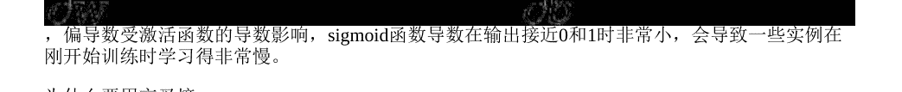

，偏导数受激活函数的导数影响，sigmoid函数导数在输出接近0和1时非常小，会导致一些实例在刚开始训练时学习得非常慢。

为什么要用交叉熵

交叉熵函数权值 w 和偏置 b 的梯度推导为：

$$\frac{\partial J}{\partial w_j} = \frac{1}{n} \sum_x x_j (\sigma(z) - y), \frac{\partial J}{\partial b} = \frac{1}{n} \sum_x (\sigma(z) - y) \quad (2-10)$$

由以上公式可知，权重学习的速度受到σ（z）-y影响，误差更大，就有更快的学习速度，避免了二次代价函数方程中因σ'（z）导致的学习缓慢的情况。

## 2.6 损失函数

损失函数（Loss Function）和代价函数的概念很容易混淆。损失函数是定义在单个样本上的，算的是一个样本的误差，而代价函数计算的是整个训练集上所有样本误差的平均误差。

### 2.6.1 什么是损失函数

损失函数又叫作误差函数，用来衡量算法的运行情况，估量模型的预测值与真实值的不一致程度，是一个非负实值函数，通常使用 $L(Y, f(x))$ 来表示。损失函数越小，模型的鲁棒性就越好。

### 2.6.2 常见的损失函数

机器学习通过对算法中的目标函数进行不断求解优化，得到最终想要的结果。在分类和回归问题中，通常使用损失函数或代价函数作为目标函数。

损失函数可以用来评价预测值和真实值不一样的程度。

损失函数可分为经验风险损失函数和结构风险损失函数。经验风险损失函数只预测结果和实际结果的差别，结构风险损失函数是在经验风险损失函数上加上正则项。

下面介绍常用的损失函数。

（1）0-1损失函数

如果预测值和目标值相等，值为0，如果不相等，值为1。

$$L(Y, f(x)) = \begin{cases} 1, & Y \neq f(x) \\ 0, & Y = f(x) \end{cases}$$

一般在实际使用中，相等的条件过于严格，可适当放宽条件：

$$L(Y, f(x)) = \begin{cases} 1, & |Y - f(x)| \geqslant T \\ 0, & |Y - f(x)| < T \end{cases}$$

（2）绝对值损失函数

和0-1损失函数相似，绝对值损失函数表示为：

$$L(Y, f(x)) = |Y - f(x)|$$

（3）平方损失函数

平方损失函数的标准形式为：

$$L(Y, f(x)) = (Y - f(x))^2$$

（4）对数损失函数

对数损失函数的标准形式为：

$$L(Y, P(Y|X)) = -\log P(Y|X) \quad (2-15)$$

常见的逻辑回归使用的就是对数损失函数，很多人认为逻辑回归的损失函数是平方损失函数，其实不然。逻辑回归假设样本服从伯努利分布（0-1分布），进而求得满足该分布的似然函数，接着取对数求极值等。逻辑回归推导出的经验风险损失函数是最小化负的似然函数，从损失函数的角度看，就是对数损失函数。

（5）指数损失函数

指数损失函数的标准形式为：

$$L(Y, f(x)) = \exp(-Yf(x)) \quad (2-16)$$

例如AdaBoost就是以指数损失函数为损失函数的。

（6）Hinge损失函数

Hinge损失函数的标准形式如下：

$$L(y) = \max(0, 1 - ty) \quad (2-17)$$

统一的形式为：

$$L(Y, f(x)) = \max(0, Yf(x)) \quad (2-18)$$

其中 $y$ 是预测值，范围为（-1,1），$t$ 为目标值，其为-1或1。

在线性支持向量机中，最优化问题可等价于：

$$\arg \min_{w,b} \sum_{i=1}^{N} (1 - y_i(wx_i + b)) + \lambda \|w\|^2 \quad (2-19)$$

上式相似于下式：

$$\frac{1}{m} \sum_{i=1}^{N} l(wx_i + by_i) + \|w\|^2 \quad (2-20)$$

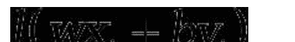

其中 $l(wx_i + by_i)$ 是Hinge损失函数，$\|w\|^2$ 可看作正则项。

### 2.6.3 逻辑回归为什么使用对数损失函数

假设逻辑回归模型为：

$$P(y=1|x; \theta) = \frac{1}{1 + e^{-\theta^T x}} \quad (2-21)$$

假设逻辑回归模型的概率分布是伯努利分布，其概率质量函数为：

$$P(X=n) = \begin{cases} 1-p, & n=0 \\ p, & n=1 \end{cases} \quad (2-22)$$

其似然函数为：

$$L(\theta) = \prod_{i=1}^{m} P(y=1|x_i)^{y_i} P(y=0|x_i)^{1-y_i}$$

对数似然函数为：

$$\ln L(\theta) = \sum_{i=1}^{m} [y_i \ln P(y=1|x_i) + (1-y_i) \ln P(y=0|x_i)]$$
$$= \sum_{i=1}^{m} [y_i \ln P(y=1|x_i) + (1-y_i) \ln(1-P(y=1|x_i))]$$

对数函数在单个数据点上的定义为：

$$Cost(y, p(y|x)) = -y \ln p(y|x) - (1-y) \ln(1-p(y|x))$$

则全局样本损失函数为：

$$Cost(y, p(y|x)) = -\sum_{i=1}^{m} [y_i \ln p(y_i|x_i) + (1-y_i) \ln(1-p(y_i|x_i))]$$

由此可看出，对数损失函数与极大似然估计的对数似然函数本质上是相同的。所以逻辑回归直接采用对数损失函数。

### 2.6.4 对数损失函数如何度量损失

例如，在高斯分布中，我们需要确定均值和标准差，如何确定这两个参数？

极大似然估计是比较常用的方法。极大似然的目标是找到一些参数值，这些参数值对应的分布可以最大化观测到数据的概率。

因为需要计算观测到所有数据的全概率，即所有观测到的数据点的联合概率，所以考虑如下简化情况。

1. 假设观测到每个数据点的概率和其他数据点的概率是独立的。
2. 对联合概率取自然对数。

假设观测到单个数据点 $x_i (i=1,2,\cdots,m)$ 的概率为：

$$P(x_i; \mu, \sigma) = \frac{1}{\sigma\sqrt{2\pi}} \exp\left(-\frac{(x_i-\mu)^2}{2\sigma^2}\right)$$

其联合概率为：

$$P(x_1, x_2, \cdots, x_n; \mu, \sigma) = \frac{1}{\sigma\sqrt{2\pi}} \exp\left(-\frac{(x_1-\mu)^2}{2\sigma^2}\right)$$
$$\times \frac{1}{\sigma\sqrt{2\pi}} \exp\left(-\frac{(x_2-\mu)^2}{2\sigma^2}\right) \times \cdots \times \frac{1}{\sigma\sqrt{2\pi}} \exp\left(-\frac{(x_n-\mu)^2}{2\sigma^2}\right)$$

对上式取自然对数，可得：

$$\ln(P(x_1, x_2, \cdots, x_n; \mu, \sigma)) = \ln\left(\frac{1}{\sigma\sqrt{2\pi}}\right) - \frac{(x_1 - \mu)^2}{2\sigma^2} + \ln\left(\frac{1}{\sigma\sqrt{2\pi}}\right) - \frac{(x_2 - \mu)^2}{2\sigma^2} + \cdots + \ln\left(\frac{1}{\sigma\sqrt{2\pi}}\right) - \frac{(x_n - \mu)^2}{2\sigma^2}$$

(2-29)

根据对数定律，上式可以化简为：

$$\ln(P(x_1, x_2, \cdots, x_n; \mu, \sigma)) = -n\ln(\sigma) - \frac{n}{2}\ln(2\pi) - \frac{1}{2\sigma^2}\left[(x_1 - \mu)^2 + (x_2 - \mu)^2 + \cdots + (x_n - \mu)^2\right]$$

(2-30)

然后求导得：

$$\frac{\partial \ln(P(x_1, x_2, \cdots, x_n; \mu, \sigma))}{\partial \mu} = \frac{n}{\sigma^2}\left[\mu - (x_1 + x_2 + \cdots + x_n)\right]$$

(2-31)

上式左半部分为对数损失函数。损失函数越小越好，因此我们令等式左半的对数损失函数为0，可得：

$$\mu = \frac{x_1 + x_2 + \cdots + x_n}{n}$$

(2-32)

同理，可计算 $\sigma$。

## 2.7 梯度下降法

梯度下降法（Gradient Descent，GD）是一个最优化算法，常用于机器学习和人工智能中递归性逼近最小偏差模型。

### 2.7.1 梯度下降法的作用

梯度下降法是机器学习中常见的优化算法之一，梯度下降法有以下几个作用。

1. 梯度下降法是迭代法的一种，可以用于求解最小二乘问题。
2. 在求解机器学习算法的模型参数，即无约束优化问题时，主要有梯度下降法和最小二乘法。
3. 在求解损失函数的最小值时，可以通过梯度下降法来一步步迭代求解，得到最小化的损失函数和模型参数值。
4. 如果需要求解损失函数的最大值，可通过梯度上升法来迭代。梯度下降法和梯度上升法可相互转换。

### 2.7.2 梯度下降法的直观理解

梯度下降法经典图示如图2-7所示。

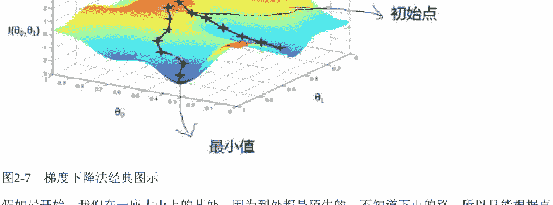

假如最开始，我们在一座大山上的某处，因为到处都是陌生的，不知道下山的路，所以只能根据直觉摸索着，走一步算一步。在此过程中，每走到一个位置的时候，都会求解当前位置的梯度，沿着梯度的负方向，也就是当前最陡峭的位置向下走一步，然后继续求解当前位置的梯度，向这一步所在位置沿着最陡峭最易下山的方向走一步。不断循环求梯度，就这样一步步地走下去，一直走到我们觉得已经到了山脚。当然这样走下去，有可能我们不能走到山脚，而是到了某一个局部的山势低处。

由此，从上面的解释可以看出，梯度下降不一定能够找到全局的最优解，有可能是一个局部的最优解。当然，如果损失函数是凸函数，梯度下降法得到的解就一定是全局最优解。

梯度下降法的核心思想可以归纳为以下几点。

1. 初始化参数，随机选取取值范围内的任意数。
2. 进行如下迭代操作。
    - 计算当前梯度。
    - 修改新的变量。
    - 计算，朝最陡的下坡方向走一步。
    - 判断是否需要终止，如果不是，则返回计算当前梯度。
3. 得到全局最优解或者接近全局最优解。

### 2.7.3 梯度下降法算法描述

下面是梯度下降法的算法步骤。

（1）确定优化模型的假设函数及损失函数

对于线性回归，假设函数为：

$h_{\theta}(x_1, x_2, \cdots, x_n) = \theta_0 + \theta_1 x_1 + \cdots + \theta_n x_n$ (2-33)

其中，$\theta_i, x_i (i=0,1,2,\cdots,n)$ 分别为模型参数、每个样本的特征值。

对于假设函数，损失函数为：

$J(\theta_0, \theta_1, \cdots, \theta_n) = \frac{1}{2m} \sum_{j=0}^{m} (h_{\theta}(x_0^j, x_1^j, \cdots, x_n^j) - y_j)^2$ (2-34)

（2）相关参数初始化

主要初始化 $\theta_i$、算法迭代步长 $\alpha$、终止距离 $\zeta$。初始化时可以根据经验，将 $\theta$ 初始化为0，步长 $\alpha$ 初始化为1。当前步长记为 $\varphi_i$。当然，也可随机初始化。

（3）迭代计算

计算当前位置损失函数的梯度，对于 $\theta_i$，其梯度表示为：

$\frac{\partial}{\partial \theta_i} J(\theta_0, \theta_1, \cdots, \theta_n) = \frac{1}{2m} \sum_{j=0}^{m} (h_{\theta}(x_0^j, x_1^j, \cdots, x_n^j) - y_j)^2$ (2-35)

计算当前位置下降的距离：

$\varphi_i = \alpha \frac{\partial}{\partial \theta_i} J(\theta_0, \theta_1, \cdots, \theta_n)$ (2-36)

判断是否终止。

确定是否所有 $\theta_i$ 的梯度下降距离 $\varphi_i$ 都小于终止距离 $\zeta$，如果都小于 $\zeta$，则算法终止，此时 $\theta_i$ 的值为最终的结果，否则进入下一步。

更新所有的 $\theta_i$，更新后的表达式为：

$$\theta_i = \theta_i - \alpha \frac{\partial}{\partial \theta_i} J(\theta_0, \theta_1, \cdots, \theta_n)$$ (2-37)

$$\theta_i = \theta_i - \alpha \frac{1}{m} \sum_{j=0}^{m} (h_\theta(x_0^j, x_1^j, \cdots, x_n^j) - y_j) x_i^j$$ (2-38)

令上式的 $x_0^j = 1$，更新完毕后转入步骤（1）。

由此可看出，当前位置的梯度方向由所有样本决定，上式 $\frac{1}{m} \sum_{j=0}^{m} (h_\theta(x_0^j, x_1^j, \cdots, x_n^j) - y_j) x_i^j$ 的目的是便于理解。

### 2.7.4 梯度下降法的缺点

梯度下降法有以下几个缺点。

1. 靠近极小值时收敛速度减慢。
2. 直线搜索时可能会产生一些问题。
3. 可能会以“之”字形下降。

梯度概念也有以下几个需注意的地方。

1. 梯度是一个向量，即有方向有大小。
2. 梯度的方向是最大方向导数的方向。
3. 梯度的值是最大方向导数的值。

### 2.7.5 如何对梯度下降法进行调优

实际使用梯度下降法时，各项参数指标不能一步就达到理想状态，对梯度下降法调优主要体现在以下几个方面。

1. 算法迭代步长 $\alpha$ 的选择：在算法参数初始化时，有时根据经验将步长初始化为1。实际取值取决于数据样本。可以从大到小，多取一些值，分别运行算法查看迭代效果，如果损失函数在变小，则取值有效。如果取值无效，说明要增大步长。但步长太大，有时会导致迭代速度过快，错过最优解。步长太小，迭代速度慢，算法运行时间长。
2. 参数的初始值选择：初始值不同，获得的最小值也有可能不同，梯度下降有可能得到的是局部最小值。如果损失函数是凸函数，则该值一定是最优解。由于有局部最优解的风险，因此需要多次用不同初始值运行算法，最终选择使损失函数最小化的初值。
3. 标准化处理：由于样本不同，特征取值范围也不同，导致迭代速度慢。为了减小特征取值的影响，可对特征数据标准化，新的数学期望为0，新方差为1，可节省算法运行时间。

### 2.7.6 随机梯度下降和批量梯度下降的区别

随机梯度下降（Stochastic GD，SGD）和批量梯度下降（Batch GD，BGD）是两种主要的梯度下降法，其目的是增加某些限制来加速运算求解过程。

下面通过介绍两种梯度下降法的求解思路，对其进行比较。

假设函数为：

$h_{\theta}(x_0, x_1, \cdots, x_n) = \theta_0 x_0 + \theta_1 x_1 + \cdots + \theta_n x_n$ (2-39)

损失函数为：

$J(\theta_0, \theta_1, \cdots, \theta_n) = \frac{1}{2m} \sum_{j=0}^{m} (h_{\theta}(x_0^j, x_1^j, \cdots, x_n^j) - y^j)^2$ (2-40)

其中，$m$ 为样本个数，$j$ 为参数个数。

**随机梯度下降法的求解思路**

随机梯度下降法中损失函数对应的是训练集中每个样本的粒度。

损失函数可以写成如下形式：

$J(\theta_0, \theta_1, \cdots, \theta_n) = \frac{1}{m} \sum_{j=0}^{m} (y^j - h_{\theta}(x_0^j, x_1^j, \cdots, x_n^j))^2 = \frac{1}{m} \sum_{j=0}^{m} \text{Cost}(\theta, (x^j, y^j))$ (2-41)

对每个参数 $\theta$ 按梯度方向更新 $\theta_i$：

$\theta_i = \theta_i + (y^j - h_{\theta}(x_0^j, x_1^j, \cdots, x_n^j)) x_i^j$ (2-42)

随机梯度下降法通过每个样本来迭代更新一次。

随机梯度下降法伴随的一个问题是噪声较批量梯度下降法要多，使得随机梯度下降法并不是每次迭代都向着整体最优化方向。

**批量梯度下降法的求解思路**

首先得到每个 $\theta$ 对应的梯度：

$\frac{\partial}{\partial \theta_i} J(\theta_0, \theta_1, \cdots, \theta_n) = \frac{1}{m} \sum_{j=0}^{m} (h_{\theta}(x_0^j, x_1^j, \cdots, x_n^j) - y^j) x_i^j$ (2-43)

由于是求最小化风险函数，所以接下来按每个参数 $\theta$ 的梯度负方向更新 $\theta_i$：

$\theta_i = \theta_i - \frac{1}{m} \sum_{j=0}^{m} (h_{\theta}(x_0^j, x_1^j, \cdots, x_n^j) - y^j) x_i^j$ (2-44)

从上式可以看到，它得到的虽然是一个最优解，但每迭代一步，都要用到训练集所有的数据，如果样本数据很大，这种方法迭代速度就很慢。

相比而言，随机梯度下降法可避免这种问题。

随机梯度下降法、批量梯度下降法相对来说都比较极端，其简单对比如表2-4所示。

**表2-4 随机梯度下降法和批量梯度下降法对比**

| 方法 | 特点 |
| :--- | :--- |
| 随机梯度下降 | 1. 采用所有数据来进行梯度下降。2. 在样本量很大的时候，训练速度慢 |
| 批量梯度下降 | 1. 用一个样本来进行梯度下降。2. 训练速度很快。3. 仅仅用一个样本决定梯度方向，得到的值有可能不是全局最优解。4. 就收敛速度来说，一次迭代一个样本，导致迭代方向变化很大，不能很快地收敛到局部最优解 |

下面介绍能结合两种方法优点的小批量梯度下降法。

#### 小批量（Mini-Batch）梯度下降法的求解思路

对于总数为 $m$ 的样本数据，选取其中的 $n$（$1<n<m$）个子样本来迭代。其参数 $\theta$ 按梯度方向更新 $\theta_i$：

$$\theta_i = \theta_i - \alpha \sum_{j=t}^{t+n-1} \left( h_\theta(x_0^j, x_1^j, \cdots, x_n^j) - y^j \right) x_i^j \quad (2-45)$$

### 2.7.7 各种梯度下降法性能比较

表2-5简单对比了批量梯度下降法（BGD）、随机梯度下降法（SGD）、小批量梯度下降法（Mini-batch GD）和在线梯度下降法（Online GD）的区别。

**表2-5 不同梯度下降法性能比较**

| | BGD | SGD | Mini-batch GD | Online GD |
| :--- | :--- | :--- | :--- | :--- |
| 训练集 | 固定 | 固定 | 固定 | 实时更新 |
| 单次迭代样本数 | 整个训练集 | 单个样本 | 训练集的子集 | 根据具体算法定 |
| 算法复杂度 | 高 | 低 | 一般 | 低 |
| 时效性 | 低 | 一般 | 一般 | 高 |
| 收敛性 | 稳定 | 不稳定 | 较稳定 | 不稳定 |

这里介绍一下Online GD。

Online GD与Mini-batch GD、SGD的区别在于，所有训练数据只用一次，然后丢弃。这样做的优点在于可预测最终模型的变化趋势。

Online GD在互联网领域用得较多，比如搜索广告的点击率（CTR）预估模型，网民的点击行为会随着时间改变。用普通的BGD算法（每天更新一次）一方面耗时较长（需要对所有历史数据重新训练）；另一方面，无法及时反馈用户的点击行为迁移。而Online GD算法可以实时地依据网民的点击行为进行迁移。

## 2.8 线性判别分析

线性判别分析（Linear Discriminant Analysis，LDA）是一种经典的降维方法。和2.9节将介绍的主成分分析（PCA）不考虑样本类别输出的无监督降维技术不同，LDA是一种监督学习的降维技术，数据集的每个样本都有类别输出。

### 2.8.1 LDA思想总结

在多维空间中，数据处理分类问题较为复杂，LDA算法将多维空间中的数据投影到一条直线上，将 $d$ 维数据转化成一维数据进行处理。训练数据设法将多维数据投影到一条直线上，同类数据的投影点尽可能接近，异类数据点尽可能远离。对数据进行分类时，将其投影到同一条直线上，再根据投影点的位置来确定样本的类别。

如果用一句话概括LDA思想，即“投影后类内方差最小，类间方差最大”。

### 2.8.2 图解LDA核心思想

假设有两类数据，这些数据特征均为二维，如图2-8所示。我们的目标是将这些数据投影到一维，让每一类相近数据的投影点尽可能接近，不同类别的数据尽可能远离，即图中两类数据中心之间的距离尽可能大。

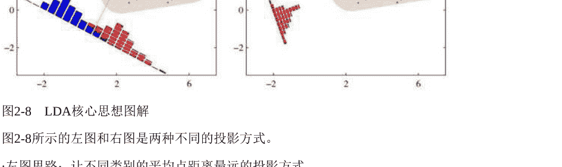

图2-8 LDA核心思想图解

图2-8所示的左图和右图是两种不同的投影方式。

- 左图思路：让不同类别的平均点距离最远的投影方式。
- 右图思路：让同类别的数据挨得最近的投影方式。

右图中两类数据在各自的区域相对集中，根据数据分布直方图也可看出，右图的投影效果好于左图，左图中间直方图部分有明显交集。

以上例子是基于数据是二维的，分类后的投影是一条直线。如果原始数据是多维的，则投影后的分类面是一个低维的超平面。

### 2.8.3 二类LDA算法原理

输入：数据集

定义：
$N_j$ ($j=0,1$) 为第 $j$ 类样本个数；
$X_j$ ($j=0,1$) 为第 $j$ 类样本的集合；
$\boldsymbol{u}_j$ ($j=0,1$) 为第 $j$ 类样本的均值向量；
$\boldsymbol{\Sigma}_j$ ($j=0,1$) 为第 $j$ 类样本的协方差矩阵。
其中：

$$\boldsymbol{u}_j = \frac{1}{N_j} \sum_{\boldsymbol{x} \in X_j} \boldsymbol{x} (j=0,1), \boldsymbol{\Sigma}_j = \sum_{\boldsymbol{x} \in X_j} (\boldsymbol{x} - \boldsymbol{u}_j)(\boldsymbol{x} - \boldsymbol{u}_j)^T (j=0,1) \quad (2-46)$$

假设投影直线是向量 $\boldsymbol{w}$，对任意样本 $\boldsymbol{x}_i$，它在直线 $\boldsymbol{w}$ 上的投影为 $\boldsymbol{w}^T \boldsymbol{x}_i$，两个类别的中心点 $\boldsymbol{u}_0$、$\boldsymbol{u}_1$ 在直线 $\boldsymbol{w}$ 的投影分别为 $\boldsymbol{w}^T \boldsymbol{u}_0$、$\boldsymbol{w}^T \boldsymbol{u}_1$。

LDA的目标是让两个类别的数据中心间的距离 $\|\boldsymbol{w}^T \boldsymbol{u}_0 - \boldsymbol{w}^T \boldsymbol{u}_1\|_2^2$ 尽量大，与此同时，希望同类样本投影点的协方差 $\boldsymbol{w}^T \boldsymbol{\Sigma}_0 \boldsymbol{w}$、$\boldsymbol{w}^T \boldsymbol{\Sigma}_1 \boldsymbol{w}$ 尽量小，最小化 $\boldsymbol{w}^T \boldsymbol{\Sigma}_0 \boldsymbol{w} + \boldsymbol{w}^T \boldsymbol{\Sigma}_1 \boldsymbol{w}$。

定义类内散度矩阵为：

$$\boldsymbol{S}_w = \boldsymbol{\Sigma}_0 + \boldsymbol{\Sigma}_1 = \sum_{\boldsymbol{x} \in X_0} (\boldsymbol{x} - \boldsymbol{u}_0)(\boldsymbol{x} - \boldsymbol{u}_0)^T + \sum_{\boldsymbol{x} \in X_1} (\boldsymbol{x} - \boldsymbol{u}_1)(\boldsymbol{x} - \boldsymbol{u}_1)^T \quad (2-47)$$

定义类间散度矩阵为：

$$\boldsymbol{S}_b = (\boldsymbol{u}_0 - \boldsymbol{u}_1)(\boldsymbol{u}_0 - \boldsymbol{u}_1)^T \quad (2-48)$$

据上分析，优化目标为：

$$\arg \max_{\boldsymbol{w}} J(\boldsymbol{w}) = \frac{\|\boldsymbol{w}^T \boldsymbol{u}_0 - \boldsymbol{w}^T \boldsymbol{u}_1\|_2^2}{\boldsymbol{w}^T \boldsymbol{\Sigma}_0 \boldsymbol{w} + \boldsymbol{w}^T \boldsymbol{\Sigma}_1 \boldsymbol{w}} = \frac{\boldsymbol{w}^T (\boldsymbol{u}_0 - \boldsymbol{u}_1)(\boldsymbol{u}_0 - \boldsymbol{u}_1)^T \boldsymbol{w}}{\boldsymbol{w}^T (\boldsymbol{\Sigma}_0 + \boldsymbol{\Sigma}_1) \boldsymbol{w}} = \frac{\boldsymbol{w}^T \boldsymbol{S}_b \boldsymbol{w}}{\boldsymbol{w}^T \boldsymbol{S}_w \boldsymbol{w}} \quad (2-49)$$

根据广义瑞利熵（Generalized Rayleigh Quotient），矩阵 $\boldsymbol{S}_w^{-1} \boldsymbol{S}_b$ 的最大特征值为 $J(\boldsymbol{w})$ 的最大值，矩阵 $\boldsymbol{S}_w^{-1} \boldsymbol{S}_b$ 的最大特征值对应的特征向量即为 $\boldsymbol{w}$。

### 2.8.4 LDA算法流程总结

输入：数据集 $D = \{(x_1, y_1), (x_2, y_2), \dots, (x_m, y_m)\}$，其中样本 $x_i$ 是 $n$ 维向量，$y_i \in \{C_1, C_2, \dots, C_k\}$，降维后的目标维度是 $d$。

输出：降维后的数据集 $\bar{D}$。

步骤：

- 1. 计算类内散度矩阵 $S_w$。
- 2. 计算类间散度矩阵 $S_b$。
- 3. 计算矩阵 $S_w^{-1}S_b$。
- 4. 计算矩阵 $S_w^{-1}S_b$ 的最大的 $d$ 个特征值。
- 5. 计算 $d$ 个特征值对应的 $d$ 个特征向量，记投影矩阵为 $W$。
- 6. 转化样本集的每个样本，得到新样本 $p_i = W^T x_i$。
- 7. 输出新样本集 $\bar{D} = \{(p_1, y_1), (p_2, y_2), \dots, (p_m, y_m)\}$。

### 2.8.5 LDA和PCA的异同

LDA和PCA的异同如表2-6所示。

表2-6 LDA和PCA的异同

| | LDA | PCA |
|---|---|---|
| 相同点 | 均可以对数据进行降维；在降维时均使用了矩阵特征分解的思想；都假设数据符合高斯分布 | 均可以对数据进行降维；在降维时均使用了矩阵特征分解的思想；都假设数据符合高斯分布 |
| 不同点 | 有监督的降维方法；降维最多降到 k-1 维；可以用于降维，还可以用于分类；选择分类性能最好的投影方向；更明确、更能反映样本间差异 | 无监督的降维方法；降维多少没有限制；只用于降维；选择样本点投影具有最大方差的方向；目的较为模糊 |

### 2.8.6 LDA的优缺点

LDA的优缺点如表2-7所示。

表2-7 LDA的优缺点

| | 简要说明 |
|---|---|
| 优点 | 可以使用类别的先验知识；<br>以标签、类别衡量差异性的有监督降维方式，相对于 PCA 的模糊性，其目的更明确，更能反映样本间的差异 |
| 缺点 | 不适合对非高斯分布样本进行降维；<br>降维最多降到 k-1 维；<br>在样本分类信息依赖方差而不是均值时，降维效果不好；<br>可能过度拟合数据 |

## 2.9 主成分分析

主成分分析（Principal Component Analysis，PCA）是一种统计方法。通过正交变换将一组可能存在相关性的变量转换为一组线性不相关的变量，转换后的这组变量叫作主成分。

### 2.9.1 图解PCA核心思想

PCA可解决训练数据中存在数据特征过多或特征累赘的问题。核心思想是将 m 维特征映射到 n 维（n < m），这 n 维形成主元，是重构出来最能代表原始数据的正交特征。

假设数据集中包含 m 个 n 维数据 $X^{(1)}, X^{(2)}, ..., X^{(m)}$，如果 n=2，需要降维到 n'=1，现在想找到某一维度方向代表这两个维度的数据。图2-9中有 $u_1$、$u_2$ 两个向量方向，哪个向量才是我们所想要的，可以更好地代表原始数据集？

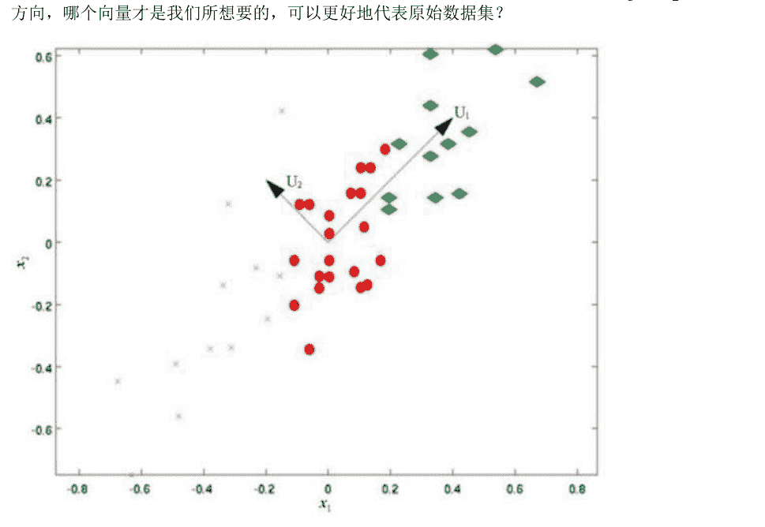

从图中可以看出，$u_1$ 比 $u_2$ 好，为什么？有以下两个主要评价指标。

- （1）样本点到这个直线的距离足够近。
- （2）样本点在这个直线上的投影能尽可能分开。

如果需要降维的目标维数是其他任意维，则：

- （1）样本点到这个超平面的距离足够近。
- （2）样本点在这个超平面上的投影能尽可能分开。

### 2.9.2 PCA算法推理

下面基于最小投影距离为评价指标推理。

假设数据集中包含 $m$ 个 $n$ 维数据 $\{x^{(1)}, x^{(2)}, \dots, x^{(m)}\}$，且数据进行了中心化。经过投影变换得到的新坐标为 $\{w_1, w_2, \dots, w_n\}$，其中 $\mathbf{w}$ 是标准正交基，即 $\|w_i\|_2 = 1, w_i^T w_j = 0$。

如果我们将数据从 $n$ 维降到 $n'$ 维，经过降维后，新坐标为 $\{w_1, w_2, \dots, w_{n'}\}$。样本点 $x^{(i)}$ 在新坐标系下的投影为 $z^{(i)} = (z_1^{(i)}, z_2^{(i)}, \dots, z_{n'}^{(i)})$，其中 $z_j^{(i)} = w_j^T x^{(i)}$ 是 $x^{(i)}$ 在低维坐标系里第 $j$ 维的坐标。

如果用 $z^{(i)}$ 去恢复 $x^{(i)}$，则得到的恢复数据为 $\hat{x}^{(i)} = \sum_{j=1}^{n'} z_j^{(i)} w_j = W z^{(i)}$，其中 $\mathbf{W}$ 为标准正交基组成的矩阵。

考虑到整个样本集，要想使样本点到超平面的距离足够近，目标是最小化 $\sum_{i=1}^m \|\hat{x}^{(i)} - x^{(i)}\|_2^2$。对此式进行推理，可得：

$$\sum_{i=1}^{m}\|\hat{\mathbf{x}}^{(i)}-\mathbf{x}^{(i)}\|_{2}^{2}=\sum_{i=1}^{m}\|\mathbf{W}\mathbf{z}^{(i)}-\mathbf{x}^{(i)}\|_{2}^{2}$$

$$=\sum_{i=1}^{m}\left(\mathbf{W}\mathbf{z}^{(i)}\right)^{\top}\left(\mathbf{W}\mathbf{z}^{(i)}\right)-2\sum_{i=1}^{m}\left(\mathbf{W}\mathbf{z}^{(i)}\right)^{\top}\mathbf{x}^{(i)}+\sum_{i=1}^{m}\left(\mathbf{x}^{(i)}\right)^{\top}\mathbf{x}^{(i)}$$

$$=\sum_{i=1}^{m}\left(\mathbf{z}^{(i)}\right)^{\top}\left(\mathbf{z}^{(i)}\right)-2\sum_{i=1}^{m}\left(\mathbf{z}^{(i)}\right)^{\top}\mathbf{x}^{(i)}+\sum_{i=1}^{m}\left(\mathbf{x}^{(i)}\right)^{\top}\mathbf{x}^{(i)}$$

$$=-\sum_{i=1}^{m}\left(\mathbf{z}^{(i)}\right)^{\top}\left(\mathbf{z}^{(i)}\right)+\sum_{i=1}^{m}\left(\mathbf{x}^{(i)}\right)^{\top}\mathbf{x}^{(i)} \quad (2-50)$$

$$=-\operatorname{tr}\left(\mathbf{W}^{\top}\left(\sum_{i=1}^{m}\mathbf{x}^{(i)}\left(\mathbf{x}^{(i)}\right)^{\top}\right)\mathbf{W}\right)+\sum_{i=1}^{m}\left(\mathbf{x}^{(i)}\right)^{\top}\mathbf{x}^{(i)}$$

$$=-\operatorname{tr}\left(\mathbf{W}^{\top}\mathbf{X}\mathbf{X}^{\top}\mathbf{W}\right)+\sum_{i=1}^{m}\left(\mathbf{x}^{(i)}\right)^{\top}\mathbf{x}^{(i)}$$

在推导过程中，分别用到了 $\mathbf{z}^{(i)}=\mathbf{W}^{\top}\mathbf{x}^{(i)}$，矩阵转置公式 $(\mathbf{A}\mathbf{B})^{\top}=\mathbf{B}^{\top}\mathbf{A}^{\top}$，$\mathbf{W}^{\top}\mathbf{W}=\mathbf{I}$，$\mathbf{z}^{(i)}=\mathbf{W}^{\top}\mathbf{x}^{(i)}$，以及矩阵的迹，最后两步是将代数和转为矩阵形式。

由于 $\mathbf{W}$ 的每一个向量 $\mathbf{w}_{j}$ 是标准正交基，$\sum_{i=1}^{m}\mathbf{x}^{(i)}\left(\mathbf{x}^{(i)}\right)^{\top}$ 是数据集的协方差矩阵，$\sum_{i=1}^{m}\left(\mathbf{x}^{(i)}\right)^{\top}\mathbf{x}^{(i)}$ 是一个常量。最小化 $\sum_{i=1}^{m}\|\hat{\mathbf{x}}^{(i)}-\mathbf{x}^{(i)}\|_{2}^{2}$ 又可等价于：

$$\underset{\mathbf{W}}{\arg \min }-\operatorname{tr}\left(\mathbf{W}^{\top}\mathbf{X}\mathbf{X}^{\top}\mathbf{W}\right) \text { s.t. } \mathbf{W}^{\top}\mathbf{W}=\mathbf{I} \quad (2-51)$$

利用拉格朗日函数可得到：

$$J(\mathbf{W})=-\operatorname{tr}\left(\mathbf{W}^{\top}\mathbf{X}\mathbf{X}^{\top}\mathbf{W}\right)+\lambda\left(\mathbf{W}^{\top}\mathbf{W}-\mathbf{I}\right) \quad (2-52)$$

对 $\mathbf{W}$ 求导，可得 $-\mathbf{X}\mathbf{X}^{\top}\mathbf{W}+\lambda\mathbf{W}=0$，即 $\mathbf{X}\mathbf{X}^{\top}\mathbf{W}=\lambda\mathbf{W}$。$\mathbf{X}\mathbf{X}^{\top}$ 是由 $n^{\prime}$ 个特征向量组成的矩阵，$\lambda$ 为 $\mathbf{X}\mathbf{X}^{\top}$ 的特征值。$\mathbf{W}$ 即为我们想要的矩阵。

对于原始数据，只需要 $Z^{(i)} = W^T X^{(i)}$，就可把原始数据集降维到最小投影距离的 $n'$ 维数据集。

基于最大投影方差的推导，这里就不再赘述，有兴趣的读者可自行查阅资料。

### 2.9.3 PCA算法流程总结

输入：$n$ 维样本集 $D = (x^{(1)}, x^{(2)}, \dots, x^{(m)})$，目标降维维数为 $n'$。

输出：降维后的新样本集 $D' = (z^{(1)}, z^{(2)}, \dots, z^{(m)})$。

主要步骤如下。

- 1. 对所有的样本进行中心化，$x^{(i)} = x^{(i)} - \frac{1}{m} \sum_{j=1}^{m} x^{(j)}$。
- 2. 计算样本的协方差矩阵 $XX^T$。
- 3. 对协方差矩阵 $XX^T$ 进行特征值分解。
- 4. 取出最大的 $n'$ 个特征值对应的特征向量 $\{w_1, w_2, \dots, w_{n'}\}$。
- 5. 标准化特征向量，得到特征向量矩阵 $W$。
- 6. 转化样本集中的每个样本 $z^{(i)} = W^T x^{(i)}$。
- 7. 得到输出新样本集 $D' = (z^{(1)}, z^{(2)}, \dots, z^{(m)})$。

注：在降维时，有时不明确目标维数，而要指定降维后的主成分比重阈值 $k$（$k \in (0, 1]$）。假设 $n$ 个特征值为 $\lambda_1 \ge \lambda_2 \ge \dots \ge \lambda_n$，则 $n'$ 可从

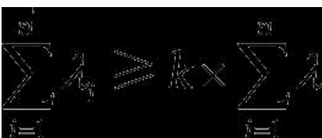

得到。

### 2.9.4 PCA思想总结

PCA就是将高维数据通过线性变换投影到低维空间的过程。去除可以被其他向量代表的线性相关向量，去除较小特征值对应的特征向量，找出最能代表原始数据的投影方法。

完成PCA的关键是求解协方差矩阵。协方差矩阵，能同时表现不同维度间的相关性及各个维度上的方差。协方差矩阵度量的是维度与维度之间的关系，而非样本与样本之间的关系。对角化后的协方差矩阵、对角线上较小的新方差对应的就是那些该去掉的维度，所以取那些含有较大能量（特征值）的维度即可，其余的就舍掉，即去冗余。

### 2.9.5 PCA算法的优缺点

PCA算法的优缺点如表2-8所示。

表2-8 PCA算法的优缺点

| 优缺点 | 简要说明 |
| --- | --- |
| 优点 | 仅仅需要以方差衡量信息量，不受数据集以外的因素影响；各主成分之间正交，可消除原始数据成分间相互影响的因素；计算方法简单，主要运算是特征值分解，易于实现 |
| 缺点 | 主成分各个特征维度的含义具有一定的模糊性，不如原始样本特征的解释性强；方差小的非主成分也可能含有样本的重要信息，因降维丢弃可能对后续数据处理有影响 |

### 2.9.6 降维的必要性及目的

降维的必要性如下。

- （1）避免多重共线性和预测变量之间相互关联。多重共线性会导致解空间的不稳定，从而可能导致结果的不连贯。
- （2）高维空间本身具有稀疏性。一维正态分布有68%的值落于正负标准差之间，而在十维空间上只有2%。
- （3）避免过多的变量对查找规律造成冗余麻烦。
- （4）仅在变量层面上分析可能会忽略变量之间的潜在联系。例如几个预测变量可能落入仅反映数据某一方面特征的一个组内。

降维的目的如下。

- （1）减少预测变量的个数。
- （2）确保这些变量是相互独立的。
- （3）提供一个框架来解释结果。相关特征，特别是重要特征更能在数据中明确显示出来；如果只有二维或者三维的话，就更便于可视化展示。
- （4）数据在低维下更容易处理、使用。
- （5）去除数据噪声。
- （6）降低算法运算开销。

### 2.9.7 KPCA与PCA的区别

KPCA用到了核函数思想，使用了核函数的主成分分析一般称为核主成分分析（Kernelized PCA，KPCA）。

应用PCA算法的前提是假设存在一个线性超平面，进而投影。如果数据不是线性的，该怎么办？这时候就需要用到KPCA，数据集从 $n$ 维映射到线性可分的高维 $N$（$N > n$），然后再从 $N$ 维降维到一个低维度 $n'$（$n' < n < N$）。

假设高维空间数据由 $n$ 维空间的数据通过映射 $\phi$ 产生。

$n$ 维空间的特征分解为：

$$\sum_{i=1}^{m} \mathbf{x}^{(i)} \left( \mathbf{x}^{(i)} \right)^{\mathrm{T}} \boldsymbol{W} = \lambda \boldsymbol{W} \quad (2-53)$$

其映射为：

$$\sum_{i=1}^{m} \phi\left(\mathbf{x}^{(i)}\right) \phi\left(\mathbf{x}^{(i)}\right)^{\mathrm{T}} \boldsymbol{W} = \lambda \boldsymbol{W} \quad (2-54)$$

KPCA通过在高维空间进行协方差矩阵的特征值分解，然后用和PCA一样的方法进行降维。由于KPCA需要核函数的运算，因此它的计算量要比PCA大很多。

## 2.10 模型评估

当我们在评估模型的性能时，有哪些常用方法，判断某个模型在新数据集上的表现如何。模型评估看似简单却隐藏着诸多难题和陷阱，即使是经验丰富的机器学习用户也不免陷入其中。本节将介绍机器学习里的一些常用模型评估方法，重点理解误差、偏差和方差有什么区别和联系，介绍过拟合和欠拟合出现的原因及解决办法，以及一些常见的模型评价指标。

### 2.10.1 模型评估常用方法

一般来说，单一评分标准无法完全评估一个机器学习模型。只用good和bad偏离真实场景去评估某个模型，也是一种欠妥的评估方式。下面介绍常用的分类模型和回归模型评估方法。

常用的分类模型评估方法如表2-9所示。

表2-9 常用的分类模型评估方法

| 指标 | 描述 |
|---|---|
| Accuracy | 正确率 |
| Precision | 精度/查准率 |
| Recall | 召回率/查全率 |
| PR 曲线 | 查准率为纵轴，查全率为横轴 |
| F1 分数 | F1 值 |
| Confusion Matrix | 混淆矩阵 |
| ROC | ROC 曲线 |
| AUC | ROC 曲线下的面积 |

常用的回归模型评估方法如表2-10所示。

表2-10 常用的回归模型评估方法

| 指标 | 描述 |
|---|---|
| Mean Square Error (MSE) | 均方误差 |
| Root Mean Square Error (RMSE) | 均方根误差 |
| Mean Absolute Error (MAE) | 平均绝对误差 |
| R-Squared | R 平方值 |

### 2.10.2 误差、偏差和方差的区别和联系

在机器学习中，误差（Error）、偏差（Bias）和方差（Variance）存在以下区别和联系。

误差

一般我们把学习器的实际预测输出与样本的真实输出之间的差异称为“误差”。误差 = 偏差 + 方差 + 噪声，误差反映的是整个模型的准确度。

噪声

噪声描述了在当前任务上任何学习算法所能达到的期望泛化误差的下界，即刻画了学习问题本身的难度。

偏差

偏差用于衡量模型拟合训练数据的能力，偏差反映的是模型在样本上的输出与真实值之间的误差，即模型本身的精度。

偏差越小，拟合能力越强（可能产生过拟合）；反之，拟合能力越差（可能产生欠拟合）。偏差越大，越偏离真实数据，如图2-10所示。

#### 方差

方差公式为：

$$S_N^2 = \frac{1}{N} \sum_{i=1}^{N} (x_i - \bar{x})^2 \quad (2-55)$$

方差描述的是预测值的变化范围，离散程度，也就是离其期望值的距离。方差越大，数据分布得越分散，模型的稳定程度越差。方差反映的是模型每一次的输出结果与模型输出期望之间的误差，即模型的稳定性。

方差越小，模型的泛化能力越强；反之，模型的泛化能力越差。如果模型在训练集上拟合效果比较优秀，但是在测试集上拟合效果比较差，则方差较大，说明模型的稳定程度较差，出现这种现象可能是由于模型对训练集过拟合，如图2-10右列所示。

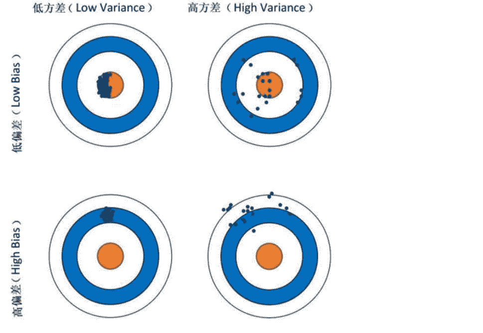

### 2.10.3 为什么使用标准差

首先来看方差、标准差及样本标准差的数学公式。

方差公式为：

$$S_N^2 = \frac{1}{N} \sum_{i=1}^{N} (x_i - \bar{x})^2 \quad (2-56)$$

标准差公式为：

$$S_N = \sqrt{\frac{1}{N} \sum_{i=1}^{N} (x_i - \bar{x})^2} \quad (2-57)$$

样本标准差公式为：

$$S_N = \sqrt{\frac{1}{N-1} \sum_{i=1}^{N} (x_i - \bar{x})^2} \quad (2-58)$$

与方差相比，使用标准差来表示数据点的离散程度有以下好处。

- （1）表示离散程度的数字与样本数据点的数量级一致，更适合对数据样本形成感性认知。
- （2）表示离散程度的数字单位与样本数据的单位一致，更方便做后续的分析运算。
- （3）在样本数据大致符合正态分布的情况下，标准差具有方便估算的特性：68%的数据点落在平均值前后1个标准差的范围内、95%的数据点落在平均值前后2个标准差的范围内，而99%的数据点将会落在平均值前后3个标准差的范围内。

### 2.10.4 经验误差与泛化误差

经验误差（Empirical Error）也叫训练误差（Training Error），是模型在训练集上的误差。

泛化误差（Generalization Error）是模型在新样本集（测试集）上的误差。

### 2.10.5 图解欠拟合与过拟合

根据不同的坐标方式，欠拟合与过拟合的图解不同。

- （1）横轴为训练样本数量，纵轴为误差

欠拟合与过拟合示意图如图2-11所示。我们可以直观地看出欠拟合和过拟合的区别。

- 模型欠拟合：在训练集及测试集上同时具有较大的误差，此时模型的偏差较大。
- 模型过拟合：在训练集上具有较小的误差，在测试集上具有较大的误差，此时模型的方差较大。
- 模型正常：在训练集及测试集上，同时具有相对较小的偏差及方差。

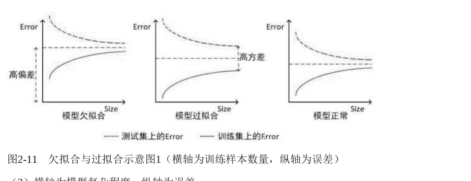

- （2）横轴为模型复杂程度，纵轴为误差

欠拟合与过拟合示意图如图2-12所示。其中上面的曲线表示测试集上的Error，下面的曲线表示训练集上的Error，此时欠拟合与过拟合的区别如下。

- 模型欠拟合：模型在点A处，在训练集及测试集上同时具有较大的误差，此时模型的偏差较大。
- 模型过拟合：模型在点C处，在训练集上具有较小的误差，在测试集上具有较大的误差，此时模型的方差较大。
- 模型正常：模型复杂程度控制在点B处为最优。

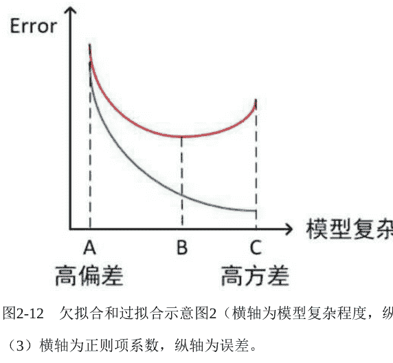

图2-12 欠拟合和过拟合示意图2（横轴为模型复杂程度，纵轴为误差）

- （3）横轴为正则项系数，纵轴为误差。

欠拟合与过拟合示意图如图2-13所示。其中上面的曲线表示测试集上的Error，下面的曲线表示训练集上的Error，此时欠拟合与过拟合的区别如下。

- 模型欠拟合：模型在点C处，在训练集表示及测试集上同时具有较大的误差，此时模型的偏差较大。
- 模型过拟合：模型在点A处，在训练集上具有较小的误差，在测试集上具有较大的误差，此时模型的方差较大。它通常发生在模型过于复杂的情况下，如参数过多等，会使模型的预测性能变弱，并且增加数据的波动性。虽然模型在训练时的效果可以表现得很完美，基本上记住了数据的全部特点，但这种模型在未知数据上的表现能力会大打折扣，因为简单的模型泛化能力通常都是很弱的。
- 模型正常：模型复杂程度控制在点B处为最优。

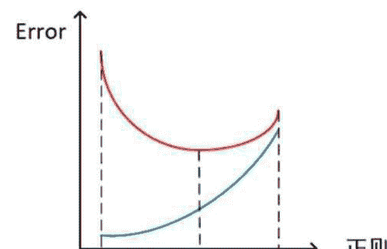

图2-13 欠拟合和过拟合示意图3（横轴为正则项系数，纵轴为误差）

### 2.10.6 如何解决欠拟合与过拟合

- （1）如何解决欠拟合

- 添加其他特征项。常见的比如添加组合、泛化、相关性、上下文特征、平台特征等特征项，有时候特征项不够会导致模型欠拟合。
- 添加多项式特征。例如，将线性模型添加二次项或三次项使模型泛化能力更强。例如，FM（Factorization Machine）模型、FFM（Field-aware Factorization Machine）模型，其实就是线性模型，增加了二阶多项式，保证了模型一定的拟合程度。
- 可以增加模型的复杂程度。
- 减小正则化系数。正则化的目的是用来防止过拟合的，但是现在模型出现了欠拟合，则需要减少正则化参数。

- （2）如何解决过拟合

- 重新清洗数据，数据不纯会导致过拟合，此类情况需要重新清洗数据。
- 增加训练样本数量。
- 降低模型复杂程度。
- 增大正则项系数。
- 采用丢弃法（Dropout）方法。Dropout方法，通俗地讲就是在训练的时候让神经元以一定的概率不工作。这样可以使模型泛化性更强，因为它不会太依赖某些局部的特征。
- 使用早停法（Early Stopping）。
- 减少迭代次数。
- 增大学习率。
- 添加噪声数据。
- 在树结构中，可以对树进行剪枝。
- 减少特征项。

解决欠拟合与过拟合的这些方法，需要根据实际问题、实际模型进行选择。

### 2.10.7 交叉验证的主要作用

交叉验证（Cross Validation）主要用于如主成分回归（Principal Component Regression，PCR）和偏最小二乘回归（Partial Least Squares Regression，PLS）等建模应用中。在给定的建模样本中，拿出大部分样本进行建模，留一小部分样本用刚建立的模型进行预报，并求这一小部分样本的预报误差，记录它们的平方加权和。

交叉验证的主要作用是为了得到更为稳健可靠的模型，对模型的泛化误差进行评估，得到模型泛化误差的近似值。当有多个模型可以选择时，我们通常选择“泛化误差”最小的模型。

交叉验证的方法有许多种，但是最常用的是留一交叉验证和 K 折交叉验证。

### 2.10.8 理解 K 折交叉验证

在训练数据的过程中常常会遇到数据量不够大的情况，此时 K 折就是将数据集切分成 K 份，验证集和测试集相互形成补集，循环交替。

- （1）K 折交叉验证的一般步骤如下。

- 将含有 N 个样本的数据集，分成 K 份，每份含有 N / K 个样本。选择其中一份作为测试集，另外 K -1份作为训练集，测试集就有 K 种情况。
- 在每种情况中，用训练集训练模型，用测试集测试模型，计算模型的泛化误差。
- 交叉验证重复 K 次，每份验证一次，平均 K 次的结果或者使用其他结合方式，最终得到一个单一估测，得到模型最终的泛化误差。

- （2）下面是 K 折交叉验证的特点。

- 一般2≤ K ≤10。K 折交叉验证的优势在于，同时重复运用随机产生的子样本进行训练和验证，每次的结果验证一次，10折交叉验证是最常用的。
- 训练集中样本数量要足够多，一般至少大于总样本数的50%。
- 训练集和测试集必须从完整的数据集中均匀取样。均匀取样的目的是希望减少训练集、测试集与原数据集之间的偏差。当样本数量足够多时，通过随机取样，便可以实现均匀取样的效果。

### 2.10.9 理解混淆矩阵

混淆矩阵也称误差矩阵，是表示精度评价的一种标准格式，下面介绍两种混淆矩阵。

- （1）第一种混淆矩阵，如表2-11所示。

表2-11 第一种混淆矩阵

| 真实情况 T 或 F | 预测为正例 1, P | 预测为负例 0, N |
| :--- | :--- | :--- |
| 本来 label 标记为 1，预测结果真为 T、假为 F | TP（预测为 1，实际为 1） | FN（预测为 0，实际为 1） |
| 本来 label 标记为 0，预测结果真为 T、假为 F | FP（预测为 1，实际为 0） | TN（预测为 0，实际为 0） |

- （2）第二种混淆矩阵，如表2-12所示。

表2-12 第二种混淆矩阵

| 预测情况 P 或 N | 实际 label 为 1，预测对了为 T | 实际 label 为 0，预测对了为 T |
| :--- | :--- | :--- |
| 预测为正例 1，P | TP（预测为 1，实际为 1） | FP（预测为 1，实际为 0） |
| 预测为负例 0，N | FN（预测为 0，实际为 1） | TN（预测为 0，实际为 0） |

### 2.10.10 理解查准率与查全率

将算法预测的结果分成正确肯定（True Positive，TP）、正确否定（True Negative，TN）、错误肯定（False Positive，FP）和错误否定（False Negative，FN）4种情况。查准率和查全率的计算和含义如下。

查准率（Precision）=TP /（TP+FP）

查准率含义：在预测出为阳性的样本中，正确的有多少。注意和准确率的区别，准确率是正确预测出的样本，包括正确预测为阳性和阴性所占总样本的比例。

例如，我们想预测人群中的恶性肿瘤情况，查准率等于实际上有恶性肿瘤的病人除以所有我们预测有恶性肿瘤的病人，查准率越高越好。

查全率（Recall）=TP /（TP+FN）

查全率含义：正确预测为阳性的数量占总样本中阳性数量的比例。

例如，我们想预测人群中的恶性肿瘤情况，查准率等于成功预测有恶性肿瘤的病人除以所有实际上有恶性肿瘤的病人，查全率越高越好。

### 2.10.11 理解ROC与AUC

ROC全称是受试者工作特征（Receiver Operating Characteristic）。

AUC用于衡量“二分类问题”机器学习算法性能（泛化能力）。2.3.2节简要介绍了用ROC曲线和PR曲线作为评估二分类算法的指标，在本节和接下来的几个小节中，将详细介绍ROC和AUC相关的原理和计算过程。

ROC曲线，通过对连续变量设定出多个不同的临界值，从而计算出一系列真正例率和假正例率，再以假正例率为横坐标，以真正例率为纵坐标绘制成曲线，曲线下面积越大，推断准确性越高。在ROC曲线上，最靠近坐标图左上方的点为假正例率和真正例率均较高的临界值。

对于分类器，或者说分类算法，评价指标主要有Precision、Recall、F1分数。图2-14是一个ROC曲线的示例。

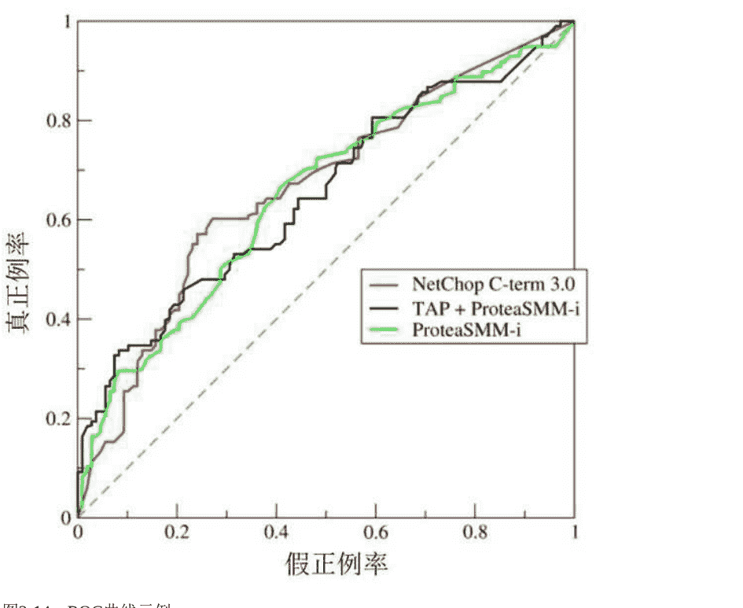

图2-14 ROC曲线示例

ROC曲线的横坐标为假正例率（False Positive Rate，FPR），纵坐标为真正例率（True Positive Rate，TPR）。其中：

$$TPR = \frac{TP}{TP + FN} , FPR = \frac{FP}{FP + TN}$$

下面着重介绍ROC曲线图中的4个点和1条线。

- 第1个点（0,1），即FPR=0，TPR=1，即FN（False Negative）=0，并且FP（False Positive）=0。这意味着这是一个完美的分类器，它将所有的样本都正确分类。
- 第2个点（1,0），即FPR=1，TPR=0。这意味着这是一个最糟糕的分类器，因为它成功避开了所有的正确答案。
- 第3个点（0,0），即FPR=TPR=0，即FP（False Positive）=TP（True Positive）=0。可以发现该分类器预测所有的样本都为负样本（Negative）。
- 第4个点（1,1），即FPR=TPR=1。分类器实际上预测所有的样本都为正样本。

经过以上分析，ROC曲线越接近左上角，该分类器的性能越好。

ROC曲线所覆盖的面积称为AUC（Area Under Curve），可以更直观地判断学习器的性能，AUC越大，性能越好。

### 2.10.12 如何绘制ROC曲线

绘制ROC曲线的步骤如下。

- （1）假设已经得出一系列样本被划分为正例的概率，按照大小排序，表2-13中共有20个测试样本，Inst#表示样本序号，Class表示每个测试样本真正的标签（P表示正样本，N表示负样本），Score表示每个测试样本属于正例的概率。

表2-13 测试样本

| Inst# | Class | Score | Inst# | Class | Score |
|---|---|---|---|---|---|
| 1 | P | 0.9 | 11 | P | 0.4 |
| 2 | P | 0.8 | 12 | N | 0.39 |
| 3 | N | 0.7 | 13 | P | 0.38 |
| 4 | P | 0.6 | 14 | N | 0.37 |
| 5 | P | 0.55 | 15 | N | 0.36 |
| 6 | P | 0.54 | 16 | N | 0.35 |
| 7 | N | 0.53 | 17 | P | 0.34 |
| 8 | N | 0.52 | 18 | N | 0.33 |
| 9 | P | 0.51 | 19 | P | 0.30 |
| 10 | N | 0.505 | 20 | N | 0.1 |

- （2）从高到低，依次将Score值作为阈值，当测试样本属于正例的概率大于或等于这个阈值时，我们认为它为正例，否则为负例。举例来说，对于表2-13中的第4个样本，其Score值为0.6，那么样本1~4都被认为是正例，因为它们的Score值都大于等于0.6，而其他样本则都认为是负例。

- （3）每次选取一个不同的阈值，得到一组FPR和TPR，即ROC曲线上的一点。以此共得到20组FPR和TPR的值。

- （4）根据上一步中的每个坐标点画图，如图2-15所示。

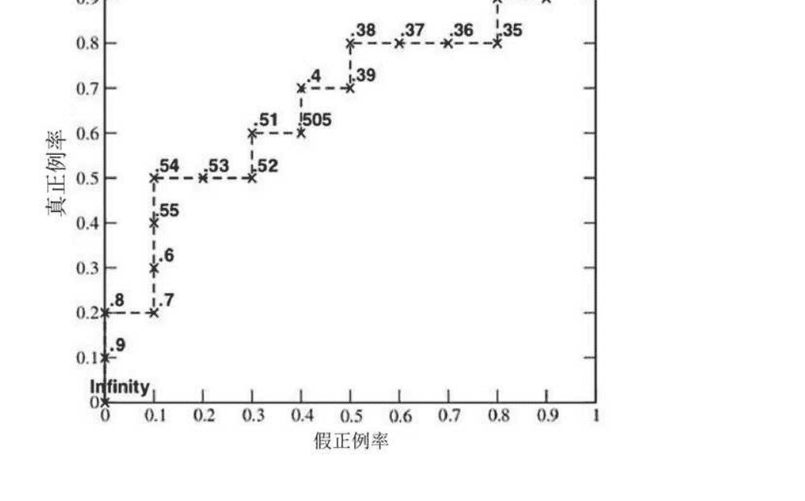

图2-15 表2-13的ROC曲线

### 2.10.13 如何计算TPR和FPR

在绘制ROC曲线的第3步中，每次选取一个不同的阈值，得到一组FPR和TPR，那TPR和FPR究竟是怎样计算的？如何画ROC曲线上的一点？举例如下。

- （1）分析数据

样本数据ytrue= [0, 0, 1, 1]；每个测试样本属于正例的概率分别为Score= [0.1, 0.4, 0.35, 0.8]；

- （2）列表，如表2-14所示。

表2-14 样本概率及类别数据列表

| 样 本 | 预测属于 P 的概率（Score） | 真实类别 |
| :--- | :--- | :--- |
| y[0] | 0.1 | N |
| y[1] | 0.4 | N |
| y[2] | 0.35 | P |
| y[3] | 0.8 | P |

- （3）将截断点值依次取Score值，计算TPR和FPR。

当截断点为0.1时：

说明只要Score≥0.1，它的预测类别就是正例。因为4个样本的Score都大于等于0.1，所以，所有样本的预测类别都为正例。

Score=[0.1, 0.4, 0.35, 0.8]；ytrue=[0, 0, 1, 1]；ypred=[1, 1, 1, 1]；

正例与负例信息如表2-15所示。

表2-15 截断点为0.1时的正例与负例信息

| 正 例 | 负 例 |
| :--- | :--- |
| TP=2 | FN=0 |
| FP=2 | TN=0 |

由此可得：

TPR = TP/（TP+FN）= 1；FPR = FP/（TN+FP）= 1

当截断点为0.35时：

Score = [0.1, 0.4, 0.35, 0.8]；ytrue = [0, 0, 1, 1]；ypred = [0, 1, 1, 1]

正例与负例信息如表2-16所示。

表2-16 截断点为0.35时的正例与负例信息

| 正 例 | 负 例 |
| :--- | :--- |
| TP=2 | FN=0 |
| FP=1 | TN=1 |

由此可得：

TPR = TP/（TP+FN）= 1；FPR = FP/（TN+FP）= 0.5

当截断点为0.4时：

### 2.10.14 如何计算AUC

计算出ROC曲线下面的面积，即AUC（Area Under Curve）的值，计算AUC的一般步骤如下。

- （1）将坐标点按照横坐标FPR排序。
- （2）计算第 i 个坐标点和第 i +1个坐标点的间距d x 。
- （3）获取第 i 或者 i +1个坐标点的纵坐标 y 。
- （4）计算面积微元d s = y d x 。
- （5）对面积微元进行累加，得到AUC。

### 2.10.15 直观理解AUC

AUC是衡量二分类模型优劣的一种评价指标，表示正例排在负例前面的概率。其他评价指标有精度、正确率、召回率，而AUC比这三者更为常用。

一般在分类模型中，预测结果都是以概率的形式表现，如果要计算准确率，通常都会手动设置一个阈值来将对应的概率转化成类别，这个阈值也就很大程度上影响了模型正确率的计算。

图2-16中展现了三种AUC的值。

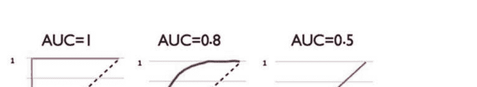

图2-16 不同的AUC值示意图

下面举例说明AUC计算原理。

现在假设有一个训练好的二分类器对10个正负例样本（正例5个，负例5个）进行预测，得分由高到低排序，得到的最好预测结果为[1, 1, 1, 1, 1, 0, 0, 0, 0, 0]，即5个正例均排在5个负例前面，正例排在负例前面的概率为100%。然后绘制其ROC曲线，由于有10个样本，除去原点我们需要描10个点，如图2-17所示。

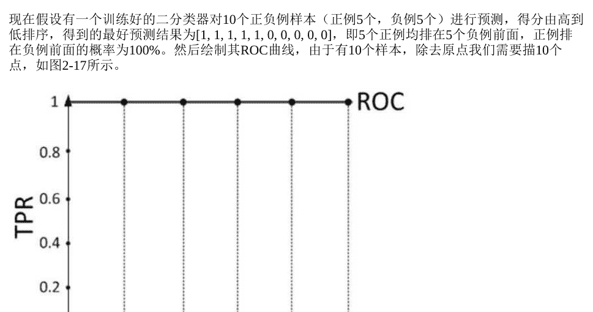

图2-17 ROC曲线示例1

描点方式按照样本预测结果的得分高低从左至右开始遍历。从原点开始，每遇到1便向y轴正方向移动最小步长1个单位，这里是1/5=0.2；每遇到0则向x轴正方向移动最小步长1个单位，这里也是0.2。不难看出，图2-17中的AUC等于1，印证了正例排在负例前面的概率的确为100%。

假设预测结果序列为[1, 1, 1, 1, 0, 1, 0, 0, 0, 0]，其ROC曲线如图2-18所示。

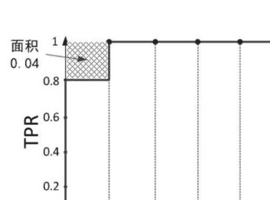

图2-18 ROC曲线示例2

计算图2-18的AUC为0.96，计算得到正例排在负例前面的概率0.8 × 1 + 0.2 × 0.8 = 0.96，与AUC的值相等，左上角阴影部分的面积则是负例排在正例前面的概率0.2 × 0.2 = 0.04。

假设预测结果序列为[1, 1, 1, 0, 1, 0, 1, 0, 0, 0]，其ROC曲线如图2-19所示。

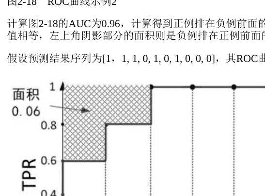

图2-19 ROC曲线示例3

计算图2-19的AUC为0.88，计算得到正例排在负例前面的概率0.6 × 1 + 0.2 × 0.8 + 0.2 × 0.6 = 0.88，与AUC的值相等，左上角阴影部分的面积则是负例排在正例前面的概率0.2 × 0.2 × 3 = 0.12。

### 2.10.16 ROC评估分类器

模型有很多评估方法，为什么还要使用ROC？

因为ROC曲线有一个很好的特性：当测试集中的正负样本的分布变换的时候，ROC曲线能够保持不变。在实际的数据集中经常会出现样本类不平衡，即正负样本比例差距较大，而且测试数据中的正负样本也可能随着时间变化。

### 2.10.17 代价敏感错误率与代价曲线

#### 代价矩阵

不同的错误会产生不同代价。以二分法为例，代价矩阵如表2-19所示。

表2-19 代价矩阵

| 真实类别 | 预测类别 | |
| :--- | :--- | :--- |
| | 第0类 | 第1类 |
| 第0类 | 0 | Cost₀₁ |
| 第1类 | Cost₁₀ | 0 |

当判断正确的时候，值为0；不正确的时候，分别为Cost₀₁和Cost₁₀。

- Cost₁₀：实际为负例但预测成正例的代价。
- Cost₀₁：实际为正例但预测为负例的代价。

#### 代价敏感错误率

代价敏感错误率=样本中由模型得到的错误值与代价乘积之和/总样本。

其数学表达式为：

$$E(f;D;Cost) = \frac{1}{m} ( \sum_{x_i \in D^+} (f(x_i) \neq y_i) \times Cost_{01} + \sum_{x_i \in D^-} (f(x_i) \neq y_i) \times Cost_{10} )$$ (2-59)

$D^+$，$D^-$分别代表样例集的正例子集和负例子集，$x$ 是预测值，$y$ 是真实值。

#### 代价曲线

在均等代价时，ROC曲线不能直接反映出模型的期望总体代价，而代价曲线可以。

代价曲线横轴为[0,1]的正例函数代价：

$$P(+)Cost = \frac{p \cdot Cost_{01}}{p \cdot Cost_{01} + (1-p) \cdot Cost_{10}}$$ (2-60)

其中 $p$ 是样本为正例的概率。

代价曲线纵轴为[0,1]的归一化代价：

$$Cost_{norm} = \frac{FNR \cdot p \cdot Cost_{01} + FPR \cdot (1-p) \cdot Cost_{10}}{p \cdot Cost_{01} + (1-p) \cdot Cost_{10}}$$ (2-61)

其中FPR为假阳性率，FNR=1-TPR为负例性率。

注：ROC每个点，可以对应代价平面上一条线。例如，已知ROC曲线上的点（TPR,FPR），先计算出FNR=1-TPR，在代价平面上绘制一条从（0,FPR）到（1,FNR）的线段，面积则为该条件下期望的总体代价。所有线段下界面积，即为所有条件下学习器的期望总体代价，如图2-20所示。

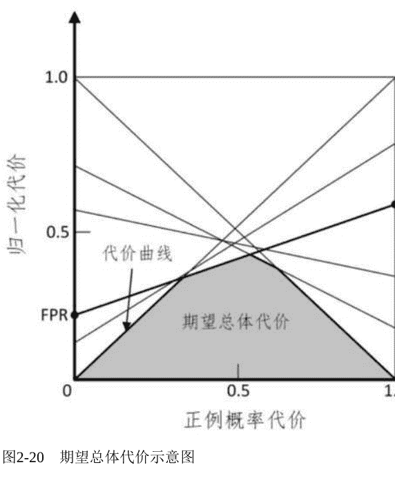

图2-20 期望总体代价示意图

### 2.10.18 比较检验方法

常见的比较检验方法如下。

- （1）正确性分析：模型稳定性分析、稳健性分析、收敛性分析、变化趋势分析和极值分析等。
- （2）有效性分析：误差分析、参数敏感性分析和模型对比检验等。
- （3）有用性分析：关键数据求解，极值点、拐点、变化趋势分析，用数据验证动态模拟等。
- （4）高效性分析：时空复杂度分析等。

## 2.11 决策树

在机器学习中，决策树（Decision Tree）是一个预测模型，它代表的是对象属性与对象值之间的一种映射关系。本节主要介绍决策树的基本原理、生成过程、算法描述、算法优缺点、决策树中的熵及信息增益等。

### 2.11.1 决策树的基本原理

决策树是一种分而治之的决策过程。一个困难的预测问题，通过树的分支节点，被划分成两个或多个较为简单的子集，从结构上划分为不同的子问题。依照规则对数据集进行递归分割（Recursive Partitioning）。随着树的深度不断增加，分支节点的子集越来越小，所需要提的问题数也逐渐简化。当分支节点的深度或者问题的简单程度满足一定的停止规则（Stopping Rule）时，该分支节点会停止分裂，此为自上而下的停止阈值（Cutoff Threshold）法；有些决策树也使用自下而上的剪枝（Pruning）法。

### 2.11.2 决策树的生成过程

决策树的生成过程如下。

- （1）特征选择：从训练数据众多的特征中选择一个特征作为当前节点的分裂标准，如何选择特征有很多不同量化的评估标准，从而衍生出不同的决策树算法。
- （2）决策树生成：根据选择的特征评估标准，从上至下递归地生成子节点，直到数据集不可分时，决策树停止生长。
- （3）剪枝：决策树容易过拟合，一般需要剪枝，缩小树结构规模以缓解过拟合。剪枝技术有预剪枝和后剪枝两种。

### 2.11.3 决策树学习基本算法步骤

决策树学习基本算法步骤如下。

```
机器学习算法 1 决策树学习基本算法
输入：训练集$D = \{(x_1, y_1), (x_2, y_2), ..., (x_m, y_m)\}$；属性集$A = \{(a_1, a_2, ..., a_d)\}$
输出：以node为根节点的一棵决策树
1: function TreeGenerate ($D, A$)
2:     生成节点node
3:     if $D$中的样本全属于同一类别$C$ then
4:         将node标记为$C$类叶节点;return
5:     end if
6:     if $A = \varnothing$ OR $D$中样本在$A$上取值相同 then
7:         将node标记为叶节点，其类别标记为$D$中样本类最多的类;return
8:     end if
9:     从$A$中选择最优划分属性$a_*$
10:    for $a_*$的每一个值$a_*^v$ do
11:        为node生成一个分支;令$D_v$表示$D$中在$a_*$上取值为$a_*^v$的样本子集;
12:        if $D_v$为空 then 将分支节点标记为叶节点，其类别标记为$D$中样本最多的类;return
13:        else 以 TreeGenerate($D_v, A \setminus \{a_*\}$)为分支节点
14:        end if
15:    end for
16: end function
```

### 2.11.4 决策树算法的优缺点

决策树算法的优点如下。

- （1）易理解，机理解释起来较简单。
- （2）可以用于小数据集。
- （3）时间复杂度较小，为用于训练决策树的数据点的对数。
- （4）相比于其他算法，决策树算法在智能分析一种类型变量时可处理数字和数据的类别。
- （5）可以处理多输出的问题。
- （6）对缺失值不敏感。
- （7）可以处理不相关特征数据。
- （8）效率高，决策树只需要一次构建，就可以反复使用，每一次预测的最大计算次数不超过决策树的深度。

决策树算法的缺点如下。

- （1）对连续性的字段比较难预测。
- （2）容易出现过拟合。
- （3）当类别太多时，错误可能会增加得比较快。
- （4）在处理特征关联性比较强的数据时表现得不太好。
- （5）对于各类别样本数量不一致的数据，在决策树当中，信息增益的结果偏向于那些具有更多数值的特征。

### 2.11.5 决策树和熵的联系

熵在决策树中起到了绝对作用，贯穿决策树的中心。决策树最重要的就是最优属性选择，这个最优属性选择的标准就得依靠熵。

### 2.11.6 熵的概念及定义

熵用于度量随机变量的不确定性。

假设随机变量 $X$ 的可能取值有 $x_1, x_2, \dots, x_n$，对于每一个可能的取值 $x_i$，其概率为 $P(X = x_i) = p_i, i = 1, 2, \dots, n$。随机变量的熵为：

$$H(X) = -\sum_{i=1}^{n} p_i \log_2 p_i \quad (2-62)$$

对于样本集合，假设样本有 $k$ 个类别，每个类别的概率为 $\frac{|C_k|}{|D|}$，其中，$|C_k|$ 是类别为 $k$ 的样本个数，$|D|$为样本总数。样本集合$D$的熵为：

$H(D) = -\sum_{k=1}^{K} \frac{|C_k|}{|D|} \log_2 \frac{|C_k|}{|D|}$

### 2.11.7 理解信息增益

信息增益指以某特征划分数据集前后的熵的差值。

熵可以表示样本集合的不确定性，熵越大，样本的不确定性就越大。因此可以使用划分前后集合熵的差值来衡量使用当前特征对于样本集合$D$划分效果的好坏。

假设划分前样本集合$D$的熵为$H(D)$。使用某个特征$A$划分数据集$D$，计算划分后的数据子集的熵为$H(D|A)$。

则信息增益为：

$g(D, A) = H(D) - H(D|A)$

注：在决策树构建的过程中，我们总是希望集合往最快到达纯度更高的子集合方向发展，因此我们总是选择使得信息增益最大的特征来划分当前数据集$D$。

计算所有特征划分数据集$D$，得到多个特征划分数据集$D$的信息增益，从这些信息增益中选择最大的，因而当前节点的划分特征便是使信息增益最大的划分所使用的特征。

另外这里提一下信息增益比相关知识：

信息增益比=惩罚参数×信息增益

信息增益比的本质是在信息增益的基础之上乘上一个惩罚参数。当特征个数较多时，惩罚参数较小；当特征个数较少时，惩罚参数较大。

惩罚参数是数据集$D$以特征$A$作为随机变量的熵的倒数。

### 2.11.8 决策树中熵、条件熵和信息增益的联系

首先来看熵、条件熵及信息增益三者的基本概念。

- （1）熵：表示一个随机变量的复杂性或者不确定性。
- （2）条件熵：表示在知道某一条件后，某一随机变量的复杂性或不确定性。
- （3）信息增益：表示在知道某一条件后，某一随机变量的不确定性的减少量。

假如我想买一件衣服，一直犹豫着要不要买，我决定买这件事的不确定性（熵）为2.8。

我在网上看了这件衣服的评价后，决定买衣服这件事的不确定性（条件熵）是1.2。

我在线下实体店试穿衣服后，决定买衣服这件事的不确定性（条件熵）是0.9。

看了网上的评价后，此时的信息增益为2.8减1.2，等于1.6。

线下试穿了衣服，此时的信息增益为2.8减0.9，等于1.9。

显然在线下试穿衣服之后对于决定买这件衣服的不确定性下降更多，也就是试穿衣服之后买这件衣服的可能性更大了。所以看网上评价和线下试穿两个属性，首先应该选择线下试穿来构建内部节点。

### 2.11.9 决策树算法中剪枝的作用及策略

剪枝处理是决策树算法用来解决过拟合问题的一种办法。

在决策树算法中，为了尽可能正确地分类训练样本，节点划分过程不断重复，有时候会导致决策树分支过多，以至于将训练样本集自身特点当作泛化特点，从而导致过拟合。因此可以采用剪枝处理来去掉一些分支来降低过拟合的风险。

剪枝的基本策略有预剪枝（Pre-Pruning）和后剪枝（Post-Pruning）。

- （1）预剪枝：在决策树生成过程中，在每个节点划分前先估计其划分后的泛化性能提升与否，如果不能提升，则停止划分，将当前节点标记为叶结点。
- （2）后剪枝：生成决策树以后，再自下而上对非叶结点进行考察，若将此节点标记为叶结点可以带来泛化性能提升，则修改之。

## 2.12 支持向量机（SVM）

支持向量机（Support Vector Machine，SVM）是一种分类算法，它在解决小样本、非线性及高维模式识别中表现出许多特有的优势，并能够推广应用到函数拟合等机器学习问题中。

### 2.12.1 什么是SVM

支持向量是指在求解的过程中，会发现只根据部分数据就可以确定分类器，这些数据称为支持向量。

SVM是通过支持向量运算的分类器。

在一个二维环境中，其中点R、S、G和其他靠近中间g线的点都可以看作为支持向量，它们可以决定分类器，即g线的具体参数。SVM示意图如图2-21所示。

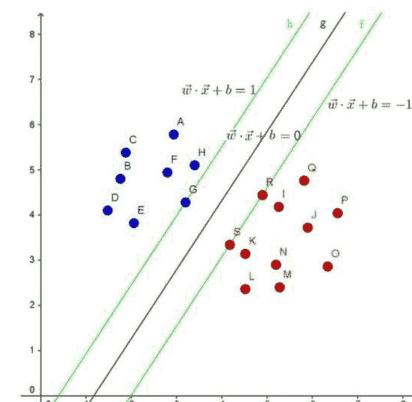

图2-21 SVM示意图

SVM是一种二分类模型，它的目的是寻找一个超平面来对样本进行分割。分割的原则是边界最大化，最终转化为一个凸二次规划问题来求解。其由简至繁的模型包括以下几点。

- （1）当训练样本线性可分时，通过硬边界（Hard Margin）最大化，学习一个线性可分支持向量机。
- （2）当训练样本近似线性可分时，通过软边界（Soft Margin）最大化，学习一个线性支持向量机。
- （3）当训练样本线性不可分时，通过核技巧和软边界最大化，学习一个非线性支持向量机。

### 2.12.2 SVM能解决的问题

SVM能解决的问题可分为两类。

（1）线性分类

在训练数据中，每个数据都有 $n$ 个属性和一个二分类类别标志，我们可以认为这些数据在一个 $n$ 维空间里。我们的目标是找到一个 $n-1$ 维的超平面，这个超平面可以将数据分成两部分，每部分数据都属于同一个类别。

这样的超平面有很多，假如我们要找到一个最佳的超平面。此时，增加一个约束条件：要求这个超平面到每边最近数据点的距离是最大的，成为最大边距超平面。这个分类器即为最大边距分类器。

（2）非线性分类

支持向量机的一个优势是支持非线性分类。它可以结合使用拉格朗日乘子法（Lagrange Multiplier）、KKT（Karush Kuhn Tucker）条件，以及核函数可以生成非线性分类器，进而支持非线性数据的分类。

### 2.12.3 核函数特点及其作用

引入核函数的目的是把原坐标系里线性不可分的数据用核函数Kernel投影到另一个空间，尽量使得数据在新的空间里线性可分。

核函数方法的广泛应用，与其特点是分不开的。

- （1）核函数的引入避免了“维数灾难”，大大减少了计算量。而输入空间的维数 $n$ 对核函数矩阵无影响。因此，核函数方法可以有效处理高维输入。
- （2）无须知道非线性变换函数的形式和参数。
- （3）核函数的形式和参数的变化会隐式地改变从输入空间到特征空间的映射，进而对特征空间的性质产生影响，最终改变各种核函数方法的性能。
- （4）核函数方法可以和不同的算法相结合，形成多种不同的基于核函数技术的方法，且这两部分的设计可以单独进行，并可以为不同的应用选择不同的核函数和算法。

### 2.12.4 SVM为什么引入对偶问题

在SVM中引入对偶问题，主要有以下几个方面的原因。

- （1）对偶问题将原始问题中的约束转为对偶问题中的等式约束，对偶问题往往更加容易求解。
- （2）可以很自然地引用核函数（拉格朗日表达式里面有内积，而核函数也是通过内积进行映射的）。
- （3）在优化理论中，目标函数 $f(x)$ 会有多种形式：如果目标函数和约束条件都为变量 $x$ 的线性函数，则称该问题为线性规划；如果目标函数为二次函数，约束条件为线性函数，则称该最优化问题为二次规划；如果目标函数或者约束条件均为非线性函数，则称该最优化问题为非线性规划。每个线性规划问题都有一个与之对应的对偶问题，对偶问题有非常良好的性质，以下列举几个。

- 对偶问题的对偶是原问题。
- 无论原始问题是否是凸的，对偶问题都是凸优化问题。
- 对偶问题可以给出原始问题一个下界。

### 2.12.5 如何理解SVM中的对偶问题

在硬边界支持向量机中，问题的求解可以转化为凸二次规划问题。

假设优化目标为，则

s.t. $y_i(\mathbf{w}^T \mathbf{x}_i + b) \geqslant 1, \quad i = 1, 2, \cdots, m$ (2-65)

其中$\mathbf{w}$、$b$是模型参数。SVM中的对偶问题求解步骤如下。

（1）转化问题。

$\min_{\mathbf{w},b} \max_{\alpha_i \geqslant 0} \{\frac{1}{2}\|\mathbf{w}\|^2 + \sum_{i=1}^{m} \alpha_i (1 - y_i(\mathbf{w}^T \mathbf{x}_i + b))\}$ (2-66)

上式等价于原问题，若满足（2-65）中不等式约束，则（2-66）在求max时，

必须取0，与（2-65）等价；若不满足（2-65）中不等式约束，则（2-66）在求max时，会得到无穷大。交换min和max获得其对偶问题：

$\max_{\alpha_i \geqslant 0} \min_{\mathbf{w},b} \{\frac{1}{2}\|\mathbf{w}\|^2 + \sum_{i=1}^{m} \alpha_i (1 - y_i(\mathbf{w}^T \mathbf{x}_i + b))\}$ (2-67)

交换之后的对偶问题和原问题并不相等，上式的解小于或等于原问题的解。

（2）如何找到（2-65）的最优值中最好的下界？

$\frac{1}{2}\|\mathbf{w}\|^2 < v$ (2-68)

$1 - y_i(\mathbf{w}^T \mathbf{x}_i + b) \leqslant 0$ (2-69)

若（2-68）、（2-69）无解，则$v$是问题（2-65）的一个下界。若（2-68）、（2-69）有解，则

$\forall \alpha > 0, \min_{\mathbf{w},b} \{\frac{1}{2}\|\mathbf{w}\|^2 + \sum_{i=1}^{m} \alpha_i (1 - y_i(\mathbf{w}^T \mathbf{x}_i + b))\} < v$ (2-70)

根据逆否命题，若

$\exists \alpha > 0, \min_{\mathbf{w},b} \{\frac{1}{2}\|\mathbf{w}\|^2 + \sum_{i=1}^{m} \alpha_i (1 - y_i(\mathbf{w}^T \mathbf{x}_i + b))\} \geqslant v$ (2-71)

则（2-68）、（2-69）无解。

$$\max_{\alpha_i \geq 0} \min_{\mathbf{w},b} \{\frac{1}{2}\|\mathbf{w}\|^2 + \sum_{i=1}^{m} \alpha_i(1 - y_i(\mathbf{w}^T \mathbf{x}_i + b))\}$$ (2-72)

（3）令

$$L(\mathbf{w},b,\alpha) = \frac{1}{2}\|\mathbf{w}\|^2 + \sum_{i=1}^{m} \alpha_i(1 - y_i(\mathbf{w}^T \mathbf{x}_i + b))$$ (2-73)

$p^*$ 为原问题的最小值，对应的 $\mathbf{w}$，$b$ 分别为 $\mathbf{w}^*$，$b^*$，则对于任意的 $\alpha > 0$：

$$p^* = \frac{1}{2}\|\mathbf{w}^*\|^2 \geq L(\mathbf{w}^*,b,\alpha) \geq \min_{\mathbf{w},b} L(\mathbf{w}^*,b,\alpha)$$ (2-74)

那么 $\min_{\mathbf{w},b} L(\mathbf{w}^*,b,\alpha)$ 是问题（2-65）的一个下界。

此时，取最大值即可求得好的下界，即

$$\max_{\alpha_i \geq 0} \min_{\mathbf{w},b} L(\mathbf{w},b,\alpha)$$ (2-75)

### 2.12.6 常见的核函数

常见的核函数如表2-20所示。

表2-20 常见的核函数

| 核函数 | 表达式 | 备注 |
| :--- | :--- | :--- |
| Linear Kernel（线性核） | $k(x,y) = x^T y$ | |
| Polynomial Kernel（多项式核） | $k(x,y) = (ax^T y + c)^d$ | $d \geq 1$ 为多项式的次数 |
| Exponential Kernel（指数核） | $k(x,y) = \exp(-\frac{\|x-y\|}{2\sigma^2})$ | $\sigma > 0$ |
| Gaussian Kernel（高斯核） | $k(x,y) = \exp(-\frac{\|x-y\|^2}{2\sigma^2})$ | $\sigma$ 为高斯核的带宽，$\sigma > 0$ |
| Laplacian Kernel（拉普拉斯核） | $k(x,y) = \exp(-\frac{\|x-y\|}{\sigma})$ | $\sigma > 0$ |
| ANOVA Kernel（方差分析核） | $k(x,y) = \exp(-\sigma(x^k - y^k)^2)^d$ | |
| sigmoid Kernel（sigmoid 核） | $k(x,y) = \tanh(ax^T y + c)$ | $\tanh$ 为双曲正切函数，$a > 0, c < 0$ |

### 2.12.7 SVM的主要特点

SVM的主要特点如下。

- （1）SVM算法的理论基础是非线性映射，SVM利用内积核函数向高维空间进行非线性映射。
- （2）SVM的目标是对特征空间划分得到最优超平面，SVM算法的核心是最大化分类边界。
- （3）支持向量是SVM的训练结果，在SVM分类决策中起决定作用的是支持向量。
- （4）SVM是一种有坚实理论基础的新颖的适用小样本学习方法。它基本上不涉及概率测度及大数定律等问题，也简化了通常的分类和回归等问题。
- （5）SVM的最终决策函数只由少数的支持向量所确定，计算的复杂性取决于支持向量的数目，而不是样本空间的维数，这在某种意义上避免了“维数灾难”。
- （6）少数支持向量决定了最终结果，这不但可以帮助我们抓住关键样本、“剔除”大量冗余样本，而且注定了SVM算法简单，具有较好的“鲁棒性”。这种鲁棒性主要体现在：
    - 增删非支持向量样本对模型没有影响。
    - 支持向量样本集具有一定的鲁棒性。
    - 在有些成功的应用中，SVM对核的选取不敏感。
- （7）SVM学习问题可以表示为凸优化问题，因此可以利用已知的有效算法发现目标函数的全局最小值。而其他分类方法（如基于规则的分类器和人工神经网络）都采用一种基于贪心学习的策略来搜索假设空间，这种方法一般只能获得局部最优解。
- （8）SVM通过最大化决策边界的边缘来控制模型的能力。尽管如此，用户必须提供其他参数，如使用核函数类型和引入松弛变量等。
- （9）SVM在小样本训练集上能够得到比其他算法好很多的结果。SVM优化目标是结构化风险最小，而不是经验风险最小，避免了过拟合问题，通过得到对数据分布的结构化描述，降低了对数据规模和数据分布的要求，有优秀的泛化能力。
- （10）SVM是一个凸优化问题，因此具有局部最优解一定是全局最优解的优点。

### 2.12.8 SVM的主要缺点

SVM主要有以下缺点。

- （1）SVM算法对大规模训练样本难以实施。SVM的空间消耗主要是存储训练样本和核矩阵，由于SVM是借助二次规划来求解支持向量的，而求解二次规划将涉及m阶矩阵的计算（m为样本的个数），当m数目很大时，该矩阵的存储和计算将耗费大量的机器内存和运算时间。如果数据量很大，SVM的训练时间就会比较长，如垃圾邮件的分类检测没有使用SVM分类器，而是使用简单的朴素贝叶斯分类器，或者是使用逻辑回归模型分类。
- （2）用SVM解决多分类问题存在困难。经典的SVM算法只给出了二类分类的算法，而在实际应用中，一般可以通过多个二类SVM的组合来解决多类的分类问题，主要有一对多组合模式、一对一组合模式和SVM决策树；再就是通过构造多个分类器的组合来解决多类的分类问题。
- （3）对缺失数据敏感，对参数和核函数的选择敏感。SVM性能的优劣主要取决于核函数的选取，目前比较成熟的核函数及其参数的选择都是人为根据经验来选取的，带有一定的随意性。在不同的问题领域，核函数应当具有不同的形式和参数，所以在选取时应该引入领域知识，但是目前还没有好的方法来解决核函数的选取问题。

### 2.12.9 逻辑回归与SVM的异同

逻辑回归与SVM有以下几个相同点。

- （1）逻辑回归和SVM都是分类算法。
- （2）逻辑回归和SVM都是监督学习算法。
- （3）逻辑回归和SVM都是判别模型。
- （4）如果不考虑核函数，那么逻辑回归和SVM都是线性分类算法，也就是说它们的分类决策面都是线性的。

注：逻辑回归也是可以用核函数的，但逻辑回归通常不采用核函数的方法。

逻辑回归与SVM有以下几个不同点。

- （1）逻辑回归采用log损失，SVM采用合页（Hinge）损失。

逻辑回归的损失函数：

$$J(\theta) = -\frac{1}{m} \sum_{i=1}^{m} [y^i \log h_{\theta}(x^i) + (1 - y^i) \log(1 - h_{\theta}(x^i))]$$ (2-76)

SVM的目标函数：

$$L(\mathbf{w}, b, \alpha) = \frac{1}{2} \|\mathbf{w}^*\|^2 - \sum_{i=1}^{n} \alpha_i (y_i (\mathbf{w}^T \mathbf{x}_i + b) - 1)$$ (2-77)

逻辑回归方法基于概率理论，假设样本为1的概率可以用sigmoid函数来表示，然后通过极大似然估计的方法估计出参数的值。

SVM基于几何边界最大化原理，认为存在最大几何边界的分类面为最优分类面。

- （2）逻辑回归对异常值敏感，SVM对异常值不敏感。

SVM只考虑局部的边界线附近的点，而逻辑回归考虑全局。LR模型找到的那个超平面，是尽量让所有点都远离它，而SVM找到的那个超平面，只是让最靠近中间分割线的那些点尽量远离，即只用到那些支持向量的样本。

SVM改变非支持向量样本并不会引起决策面的变化。在逻辑回归中改变任何样本都会引起决策面的变化。

- （3）计算复杂度不同。对于海量数据，SVM的效率较低，逻辑回归效率比较高。

当样本较少，特征维数较低时，SVM和LR的运行时间均比较短，SVM的运行时间更短一些。逻辑回归的准确率明显比SVM高。当样本稍微增加时，SVM的运行时间开始增长，但是准确率赶超了逻辑回归。SVM的运行时间虽长，但在可接受范围内。当数据量增长到20000，特征维数增长到200时，SVM的运行时间剧烈增加，远远超过了逻辑回归的运行时间，准确率却和逻辑回归相差无几，这其中主要原因是大量非支持向量参与计算，造成SVM的二次规划问题。

- （4）对非线性问题的处理方式不同。

逻辑回归主要靠特征构造，必须组合交叉特征，特征离散化。SVM也可以这样，还可以通过核函数。利用核函数，SVM可以通过对偶求解高效处理。逻辑回归则在特征空间维度很高时，表现较差。

- （5）SVM的损失函数自带正则。

SVM损失函数中的 $\frac{1}{2}\|\mathbf{w}\|^2$ 项，认为SVM是结构风险最小化算法的主要原因，而逻辑回归必须另外在损失函数上添加正则项。

- （6）SVM自带结构风险最小化，逻辑回归则是经验风险最小化。
- （7）SVM会用核函数，逻辑回归一般不用核函数。

## 2.13 贝叶斯分类器

贝叶斯分类器是各种分类器中分类错误概率最小，或者在预先给定代价的情况下平均风险最小的分类器。

### 2.13.1 贝叶斯分类器的基本原理

贝叶斯决策论在相关概率已知的情况下，利用误判损失来选择最优的类别分类。

假设有 $N$ 种可能的分类标记，记为 $Y = \{c_1, c_2, \dots, c_N\}$，那么样本 $x$ 属于哪一类？

计算步骤如下。

- （1）算出样本 $x$ 属于第 $i$ 个类的概率，即 $P(c_i|x)$。
- （2）通过比较所有的 $P(c_i|x)$，得到样本 $x$ 所属的最佳类别。
- （3）将类别 $c_i$ 和样本 $x$ 代入到贝叶斯公式中，得到：

$$P(c_i|x) = \frac{P(x|c_i)P(c_i)}{P(x)} \quad (2-78)$$

一般来说，$P(c_i)$ 为先验概率，$P(x|c_i)$ 为条件概率，$P(x)$ 是用于归一化的证据因子。对于 $P(c_i)$ 可以通过训练样本中类别为 $c_i$ 的样本所占的比例进行估计；此外，因为只需要找出最大的 $P(x|c_i)$，所以并不需要计算 $P(x)$。

为了求解条件概率，我们基于不同假设提出了不同的方法，接下来将介绍朴素贝叶斯分类器和半朴素贝叶斯分类器。

### 2.13.2 朴素贝叶斯分类器

假设样本 $X$ 包含 $d$ 个属性，即 $X = \{x_1, x_2, \dots, x_d\}$。于是有：

$$P(x|c_i) = P(x_1, x_2, \dots, x_d|c_i) \quad (2-79)$$

这个联合概率难以从有限的训练样本中直接估计得到。于是，朴素贝叶斯（Naive Bayesian，简称 NB）采用了“属性条件独立性假设”：对已知类别，假设所有属性相互独立。于是有：

$P(x_1, x_2, \cdots, x_d | c_i) = \prod_{j=1}^{d} P(x_j | c_i)$ (2-80)

这样就可以很容易地推导出相应的判定准则，得到样本所属的最佳类别：

$h_{nb}(x) = \arg \max_{c_i \in Y} P(c_i) \prod_{j=1}^{d} P(x_j | c_i)$ (2-81)

如果 $x_j$ 是标签属性，那么结合贝叶斯公式，可以通过计数的方法估计条件概率

$P(x_j | c_i) = \frac{P(x_j, c_i)}{P(c_i)} \approx \frac{\#(x_j, c_i)}{\#(c_i)}$ (2-82)

其中，$\#(x_j, c_i)$ 表示在训练样本中 $x_j$ 与 $c_i$ 共同出现的次数。

如果 $x_j$ 是数值属性，那么通常假设类别中 $c_i$ 的所有样本第 $j$ 个属性的值服从正态分布。首先估计这个分布的均值 $\mu$ 和方差 $\sigma$，然后计算 $x_j$ 在这个分布中的概率密度。

### 2.13.3 举例理解朴素贝叶斯分类器

本节将通过一个例子来帮助读者理解朴素贝叶斯分类器，首先看一下经典的西瓜训练集，如表2-21所示。

表2-21 经典的西瓜训练集

| 编号 | 色泽 | 根蒂 | 敲声 | 纹理 | 脐部 | 触感 | 密度 | 含糖率 | 好瓜 |
|---|---|---|---|---|---|---|---|---|---|
| 1 | 青绿 | 蜷缩 | 浊响 | 清晰 | 凹陷 | 硬滑 | 0.697 | 0.460 | 是 |
| 2 | 乌黑 | 蜷缩 | 沉闷 | 清晰 | 凹陷 | 硬滑 | 0.774 | 0.376 | 是 |
| 3 | 乌黑 | 蜷缩 | 浊响 | 清晰 | 凹陷 | 硬滑 | 0.634 | 0.264 | 是 |
| 4 | 青绿 | 蜷缩 | 沉闷 | 清晰 | 凹陷 | 硬滑 | 0.608 | 0.318 | 是 |
| 5 | 浅白 | 蜷缩 | 浊响 | 清晰 | 凹陷 | 硬滑 | 0.556 | 0.215 | 是 |
| 6 | 青绿 | 稍蜷 | 浊响 | 清晰 | 稍凹 | 软粘 | 0.403 | 0.237 | 是 |
| 7 | 乌黑 | 稍蜷 | 浊响 | 稍糊 | 稍凹 | 软粘 | 0.481 | 0.149 | 是 |
| 8 | 乌黑 | 稍蜷 | 浊响 | 清晰 | 稍凹 | 硬滑 | 0.437 | 0.211 | 是 |
| 9 | 乌黑 | 稍蜷 | 沉闷 | 稍糊 | 稍凹 | 硬滑 | 0.666 | 0.091 | 否 |
| 10 | 青绿 | 硬挺 | 清脆 | 清晰 | 平坦 | 软粘 | 0.243 | 0.267 | 否 |
| 11 | 浅白 | 硬挺 | 清脆 | 模糊 | 平坦 | 硬滑 | 0.245 | 0.057 | 否 |
| 12 | 浅白 | 蜷缩 | 浊响 | 模糊 | 平坦 | 软粘 | 0.343 | 0.099 | 否 |
| 13 | 青绿 | 稍蜷 | 浊响 | 稍糊 | 凹陷 | 硬滑 | 0.639 | 0.161 | 否 |
| 14 | 浅白 | 稍蜷 | 沉闷 | 稍糊 | 凹陷 | 硬滑 | 0.657 | 0.198 | 否 |
| 15 | 乌黑 | 稍蜷 | 浊响 | 清晰 | 稍凹 | 软粘 | 0.360 | 0.370 | 否 |
| 16 | 浅白 | 蜷缩 | 浊响 | 模糊 | 平坦 | 硬滑 | 0.593 | 0.042 | 否 |
| 17 | 青绿 | 蜷缩 | 沉闷 | 稍糊 | 稍凹 | 硬滑 | 0.719 | 0.103 | 否 |

测试用例如表2-22所示，先将测试例进行如下分类。

表2-22 对测试例“测1”进行分类

| 编号 | 色泽 | 根蒂 | 敲声 | 纹理 | 脐部 | 触感 | 密度 | 含糖率 | 好瓜 |
| :--- | :--- | :--- | :--- | :--- | :--- | :--- | :--- | :--- | :--- |
| 测1 | 青绿 | 蜷缩 | 浊响 | 清晰 | 凹陷 | 硬滑 | 0.697 | 0.460 | ? |

首先，估计类先验概率 $P(c_j)$。

$P(好瓜 = 是) = \frac{8}{17} = 0.471$

$P(好瓜 = 否) = \frac{9}{17} = 0.529$

然后，为每个属性估计条件概率（对于连续属性，假定它们服从正态分布）。

$P_{\text{青绿|是}} = P(\text{色泽}=\text{青绿}|\text{好瓜}=\text{是}) = \frac{3}{8} = 0.375$

$P_{\text{青绿|否}} = P(\text{色泽}=\text{青绿}|\text{好瓜}=\text{否}) = \frac{3}{9} = 0.333$

$P_{\text{蜷缩|是}} = P(\text{根蒂}=\text{蜷缩}|\text{好瓜}=\text{是}) = \frac{5}{8} = 0.625$

$P_{\text{蜷缩|否}} = P(\text{根蒂}=\text{蜷缩}|\text{好瓜}=\text{否}) = \frac{3}{9} = 0.333$

$P_{\text{浊响|是}} = P(\text{敲声}=\text{浊响}|\text{好瓜}=\text{是}) = \frac{6}{8} = 0.750$

$P_{\text{浊响|否}} = P(\text{敲声}=\text{浊响}|\text{好瓜}=\text{否}) = \frac{4}{9} = 0.444$

$P_{\text{清晰|是}} = P(\text{纹理}=\text{清晰}|\text{好瓜}=\text{是}) = \frac{7}{8} = 0.875$

$P_{\text{清晰|否}} = P(\text{纹理}=\text{清晰}|\text{好瓜}=\text{否}) = \frac{2}{9} = 0.222$

$P_{\text{凹陷|是}} = P(\text{脐部}=\text{凹陷}|\text{好瓜}=\text{是}) = \frac{6}{8} = 0.750$

$P_{\text{凹陷|否}} = P(\text{脐部}=\text{凹陷}|\text{好瓜}=\text{否}) = \frac{2}{9} = 0.222$

$P_{\text{硬滑|是}} = P(\text{触感}=\text{硬滑}|\text{好瓜}=\text{是}) = \frac{6}{8} = 0.750$

$P_{\text{硬滑|否}} = P(\text{触感}=\text{硬滑}|\text{好瓜}=\text{否}) = \frac{6}{9} = 0.667$

$P_{\text{密度:0.697|是}} = \rho(\text{密度}=0.697|\text{好瓜}=\text{是}) = \frac{1}{\sqrt{2\pi} \times 0.195} \exp\left(-\frac{(0.697-0.574)^2}{2 \times 0.129^2}\right) \approx 1.959$

$P_{\text{密度:0.697|否}} = \rho(\text{密度}=0.697|\text{好瓜}=\text{否}) = \frac{1}{\sqrt{2\pi} \times 0.195} \exp\left(-\frac{(0.697-0.496)^2}{2 \times 0.195^2}\right) \approx 1.203$

$P_{\text{含糖:0.460|是}} = \rho(\text{密度}=0.460|\text{好瓜}=\text{是}) = \frac{1}{\sqrt{2\pi} \times 0.101} \exp\left(-\frac{(0.697-0.279)^2}{2 \times 0.101^2}\right) \approx 0.788$

$P_{\text{含糖:0.460|否}} = \rho(\text{密度}=0.460|\text{好瓜}=\text{否}) = \frac{1}{\sqrt{2\pi} \times 0.108} \exp\left(-\frac{(0.460-0.154)^2}{2 \times 0.108^2}\right) \approx 0.066$

于是有

$P(\text{好瓜}=\text{是}) \times P_{\text{青绿}|\text{是}} \times P_{\text{蜷缩}|\text{是}} \times P_{\text{浊响}|\text{是}} \times P_{\text{清晰}|\text{是}} \times P_{\text{凹陷}|\text{是}} \times P_{\text{硬滑}|\text{是}} \times P_{\text{密度}:0.697|\text{是}} \times P_{\text{含糖}:0.460|\text{是}} \approx 0.063$

$P(\text{好瓜}=\text{否}) \times P_{\text{青绿}|\text{否}} \times P_{\text{蜷缩}|\text{否}} \times P_{\text{浊响}|\text{否}} \times P_{\text{清晰}|\text{否}} \times P_{\text{凹陷}|\text{否}} \times P_{\text{硬滑}|\text{否}} \times P_{\text{密度}:0.697|\text{否}} \times P_{\text{含糖}:0.460|\text{否}} \approx 6.80 \times 10^{-5}$

由于$0.063 > 6.80 \times 10^{-5}$，因此，朴素贝叶斯分类器将测试样本“测1”判别为“好瓜”。

### 2.13.4 半朴素贝叶斯分类器

朴素贝叶斯采用了“属性条件独立性假设”，半朴素贝叶斯分类器的基本想法是适当考虑一部分属性间的相互依赖信息。独依赖估计（One-Dependence Estimator，ODE）是半朴素贝叶斯分类器最常用的一种策略。顾名思义，独依赖是假设每个属性在类别之外最多依赖一个其他属性，即：

$P(\mathbf{x}|c_i) = \prod_{j=1}^{d} P(x_j|c_i, pa_j)$  (2-83)

其中$pa_j$为属性$x_j$所依赖的属性，称为$x_j$的父属性。假设父属性$pa_j$已知，那么可以使用下面的公式估计

$P(x_j|c_i, pa_j) = \frac{P(x_j, c_i, pa_j)}{P(c_i, pa_j)}$  (2-84)

### 2.13.5 极大似然估计和贝叶斯估计的联系与区别

极大似然估计和贝叶斯估计是设计贝叶斯分类器的两种参数估计方法。两者的区别如下。

（1）极大似然估计和贝叶斯估计最大区别在于估计的参数不同。最大似然估计要估计的参数被当作固定形式的一个未知变量，然后结合真实数据通过最大化似然函数来求解这个固定形式的未知变量。贝叶斯估计则是将参数视为有某种已知先验分布的随机变量。

（2）计算复杂度不同。极大似然估计只需要使用简单的微分运算即可，而在贝叶斯估计中则需要用到非常复杂的多重积分。

（3）准确性不同。当采用的样本数据很有限时，贝叶斯估计误差更小，贝叶斯估计有很强的理论和算法基础。

### 2.13.6 极大似然估计原理

极大似然估计的目的是利用已知的样本结果，反推最有可能（最大概率）导致这种结果的参数值。

极大似然估计是建立在极大似然原理的基础上的一个统计方法。极大似然估计提供了一种给定观察数据来评估模型参数的方法，即“模型已定，参数未知”。通过若干次试验，观察其结果，利用试验结果得到某个参数值能够使样本出现的概率最大，则称为极大似然估计。

由于样本集中的样本都是独立同分布的，可以只考虑一类样本集$D$，来估计参数向量$\theta$。记已知的样本集为：

$$D = x_1, x_2, \cdots, x_n$$

联合概率密度函数 $p(D|\theta)$ 称为相对于 $x_1, x_2, \cdots, x_n$ 的 $\theta$ 的似然函数（Likelihood Function）。

$$l(\theta) = p(D|\theta) = p(x_1, x_2, \cdots, x_n) = \prod_{i=1}^{n} p(x_i|\theta)$$

如果 $\hat{\theta}$ 是参数空间中能使似然函数 $l(\theta)$ 最大的值，则 $\hat{\theta}$ 应该是“最可能”的参数值，那么 $\hat{\theta}$ 就是 $\theta$ 的极大似然估计量。它是样本集的函数，记作：

$$\hat{\theta} = d(D) = \arg \max_{\theta} l(\theta)$$

$\hat{\theta}(x_1, x_2, \cdots, x_n)$ 称为极大似然函数估计值。

### 2.13.7 图解极大似然估计

我们用图来说明极大似然估计的原理，如图2-22所示。

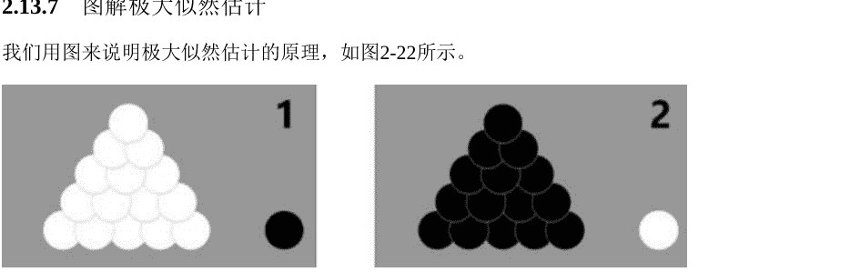

图2-22 极大似然估计原理示例图

如图2-22所示，有两个外形完全相同的箱子，1号箱中有99只白球，1只黑球；2号箱中有1只白球，99只黑球。在一次实验中取出黑球，请问是从哪个箱子中取出的？

人们通常会猜测这只黑球最像是从2号箱取出的，此时描述的“最像”就有“极大似然”的意思，这种想法常称为“极大似然原理”。

## 2.14 EM算法

最大期望算法（Expectation-Maximization Algorithm，EM算法），是一类通过迭代进行极大似然估计的优化算法，通常作为牛顿迭代法的替代，用于对包含隐变量或缺失数据的概率模型进行参数估计。

### 2.14.1 EM算法的基本思想

EM算法的基本思想经过两个步骤交替计算。

- （1）计算期望（下文称为“E步”），利用对隐藏变量的现有估计值，计算其极大似然估计值。
- （2）最大化（下文称为“M步”），最大化在E步上求得的极大似然值来计算参数的值。

M步上找到的参数估计值被用于下一个E步计算中，这个过程不断交替进行。

### 2.14.2 EM算法推导

对于 $m$ 个样本观察数据 $X = (x^{(1)}, x^{(2)}, \dots, x^{(m)})$，现在想找出样本的模型参数 $\theta$，其极大化模型分布的对数似然函数为：

$$\theta = \arg \max_{\theta} \sum_{i=1}^{m} \log P(x^{(i)}; \theta) \quad (2-88)$$

如果得到的观察数据有未观察到的隐含数据 $Z = (z^{(1)}, z^{(2)}, \dots, z^{(m)})$，那么极大化模型分布的对数似然函数则为：

$$\theta = \arg \max_{\theta} \sum_{i=1}^{m} \log P(x^{(i)}; \theta) = \arg \max_{\theta} \sum_{i=1}^{m} \log \sum_{z^{(i)}} Q_i(z^{(i)}) \frac{P(x^{(i)}, z^{(i)}; \theta)}{Q_i(z^{(i)})} \quad (2-89)$$

因为上式不能直接求出 $\theta$，所以采用缩放技巧：

$$\sum_{i=1}^{m} \log \sum_{z^{(i)}} P(x^{(i)}, z^{(i)}; \theta) = \sum_{i=1}^{m} \log \sum_{z^{(i)}} Q_i(z^{(i)}) \frac{P(x^{(i)}, z^{(i)}; \theta)}{Q_i(z^{(i)})} \geq \sum_{i=1}^{m} \sum_{z^{(i)}} Q_i(z^{(i)}) \log \frac{P(x^{(i)}, z^{(i)}; \theta)}{Q_i(z^{(i)})} \quad (2-90)$$

上式用到了Jensen不等式：

$$\log \sum_{j} \lambda_j y_j \geq \sum_{j} \lambda_j \log y_j, \lambda_j \geq 0, \sum_{j} \lambda_j = 1 \quad (2-91)$$

并且引入了一个未知的新分布 $Q_i(z^{(i)})$。

此时，如果需要满足Jensen不等式中的等号，所以有：

$$\frac{P(x^{(i)}, z^{(i)}; \theta)}{Q_i(z^{(i)})} = c, c\text{为常数}$$ (2-92)

由于 $Q_i(z^{(i)})$ 是一个分布，所以满足

$$\sum_{z} Q_i(z^{(i)}) = 1$$ (2-93)

综上，可得：

$$Q_i(z^{(i)}) = \frac{P(x^{(i)}, z^{(i)}; \theta)}{\sum_{z} P(x^{(i)}, z^{(i)}; \theta)} = \frac{P(x^{(i)}, z^{(i)}; \theta)}{P(x^{(i)}; \theta)} = P(z^{(i)} | x^{(i)}; \theta)$$ (2-94)

如果 $Q_i(z^{(i)}) = P(z^{(i)} | x^{(i)}; \theta)$，则式（2-90）是我们的包含隐藏数据的对数似然的一个下界。如果能极大化这个下界，则也在尝试极大化对数似然。即需要最大化下式：

$$\arg \max_{\theta} \sum_{i=1}^{m} \sum_{z^{(i)}} Q_i(z^{(i)}) \log \frac{P(x^{(i)}, z^{(i)}; \theta)}{Q_i(z^{(i)})}$$ (2-95)

简化得：

$$\arg \max_{\theta} \sum_{i=1}^{m} \sum_{z^{(i)}} Q_i(z^{(i)}) \log P(x^{(i)}, z^{(i)}; \theta)$$ (2-96)

以上即为EM算法的M步。此外，注意到上式中 $Q_i(z^{(i)})$ 是一个分布，因此 $\sum_{z^{(i)}} Q_i(z^{(i)}) \log P(x^{(i)}, z^{(i)}; \theta)$ 可理解为 $\log P(x^{(i)}, z^{(i)}; \theta)$ 基于条件概率分布 $Q_i(z^{(i)})$ 的期望，即为E步。

### 2.14.3 图解EM算法

考虑到式（2-89）中存在隐变量，直接找到参数估计比较困难，我们通过EM算法迭代求解下界的最大值到收敛为止。EM算法求解示意图如图2-23所示。

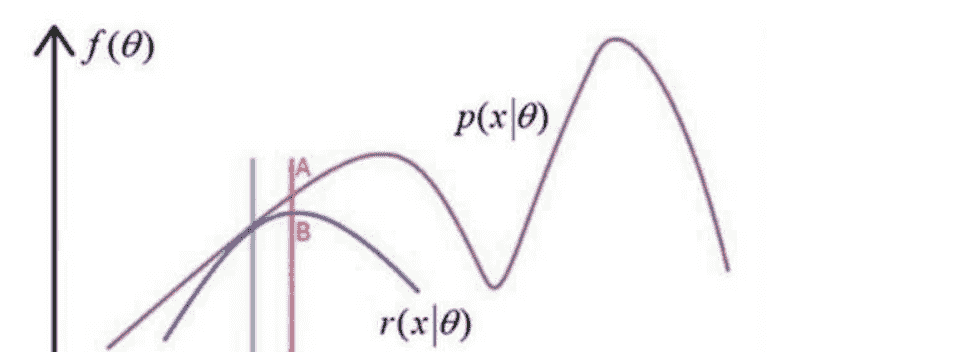

图2-23 EM算法求解示意图

在图2-23中，目标模型 $p(x|\theta)$ 复杂，难以求解析解，为了消除隐变量 $z$ 的影响，可以选择一个不包含 $z$ 的模型 $r(x|\theta)$，使其满足条件 $r(x|\theta) \leq p(x|\theta)$。

求解步骤如下。

- （1）选取 $\theta_1$，使得 $r(x|\theta) = p(x|\theta)$，然后对此时的 $r$ 求取最大值，得到极值点 $\theta_2$，实现参数的更新。
- （2）重复以上过程到收敛为止，在更新过程中始终满足 $r \leq p$。

### 2.14.4 EM算法流程

输入：观察数据 $X = (x^{(1)}, x^{(2)}, ..., x^{(m)})$，联合分布 $p(x, z; \theta)$，条件分布 $p(z|x; \theta)$，最大迭代次数 $J$。

- （1）随机初始化模型参数 $\theta$ 的初值 $\theta^0$。
- （2）设当前迭代次数为 $j$，$j$ 从1到 $J$ 进行迭代：
    - E步。计算联合分布的条件概率期望：

$Q_i(z^{(i)}) = P(z^{(i)}|x^{(i)}; \theta^j)$ (2-97)

$L(\theta, \theta^j) = \sum_{i=1}^{m} \sum_{z^{(i)}} \log P(z^{(i)}|x^{(i)}; \theta^j) \log P(x^{(i)}, z^{(i)}; \theta)$ (2-98)

- M步。极大化 $L(\theta, \theta^j)$，得到 $\theta^{j+1}$

$$\theta^{j+1} = \arg\max_{\theta} L(\theta, \theta^j)$$

(2-99)

- 如果 $\theta^{j+1}$ 收敛，则算法结束，否则继续进行E步迭代。

输出：模型参数 $\theta$。

## 2.15 降维和聚类

降维和聚类是两种无监督学习任务中的算法，聚类（Clustering）是将数据按相似度聚成不同的分组，降维（Reducing Dimensionality）是在保留数据结构和有用性的同时对数据进行压缩。本节主要针对降维和聚类一些常见的问题点进行总结。

### 2.15.1 图解为什么会产生维数灾难

假如数据集包含10张照片，照片中包含三角形和圆形两种形状。现在来设计一个分类器进行训练，让这个分类器对其他的照片进行正确分类（假设三角形和圆形的总数无限大），我们简单用一个特征进行分类，示意图如图2-24所示。

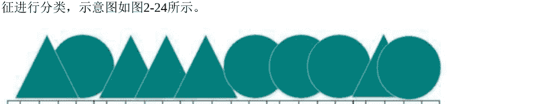

从上图可看到，如果只有一个特征进行分类，那么三角形和圆形几乎均匀分布在这条线段上，很难将10张照片线性分类。那么，增加一个特征后的情况会怎么样？其示意图如图2-25所示。

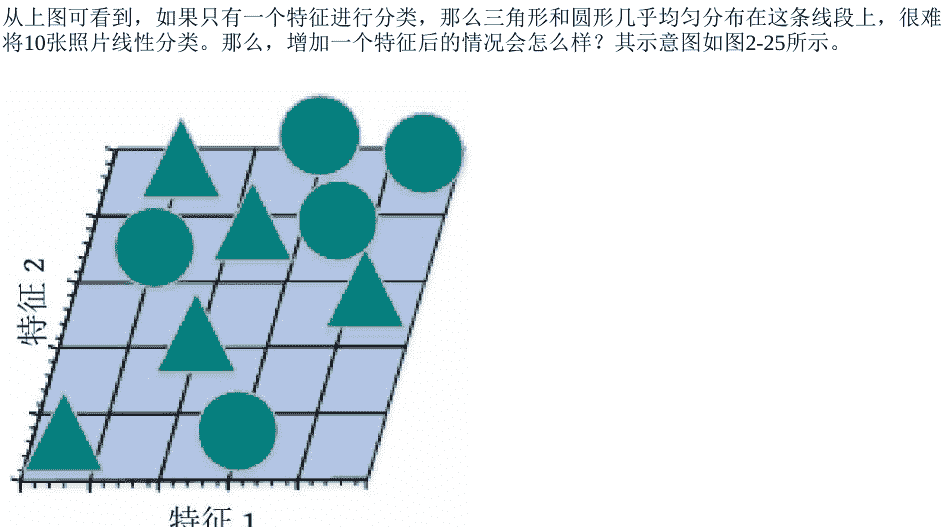

增加一个特征后，我们发现仍然无法找到一条直线将三角形和圆形分开。所以，考虑需要再增加一个特征，其分类效果如图2-26所示。

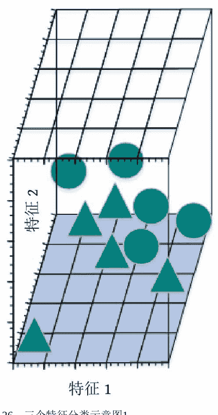

图2-26 三个特征分类示意图1

此时，可以找到一个平面将三角形和圆形分开，如图2-27所示。

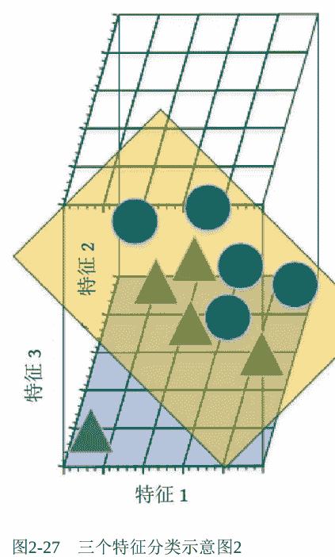

图2-27 三个特征分类示意图2

现在计算一下不同特征数量时的样本密度。

- 当有一个特征时，假设特征空间是长度为5的线段，则样本密度为10÷5=2。
- 当有两个特征时，特征空间大小为5×5=25，样本密度为10÷25=0.4。
- 当有三个特征时，特征空间大小为5×5×5=125，样本密度为10÷125=0.08。

以此类推，如果继续增加特征数量，样本密度就会越来越稀疏，此时，更容易找到一个超平面将训练样本分开。当特征数量增至无限大时，样本密度就变得非常稀疏。

下面看一下将高维空间的分类结果映射到低维空间时，会出现什么情况？图2-28是将三维特征空间映射到二维特征空间后的结果。

### 2.15.2 怎样避免维数灾难

虽然在高维特征空间时训练样本线性可分，但是映射到低维空间后，结果正好相反。事实上，增加特征数量使得高维空间线性可分，相当于在低维空间内训练一个复杂的非线性分类器。不过，这个非线性分类器太过“聪明”，仅仅学到了一些特例。如果将其用来辨别那些未曾出现在训练样本中的测试样本，那么通常结果不太理想，会造成过拟合问题。图2-29所示的是采用2个特征的线性分类器分错了一些训练样本示意图。

图2-29中的分类准确率似乎没有图2-28中的高，但是采用2个特征的线性分类器的泛化能力比采用3个特征的线性分类器要强。因为采用2个特征的线性分类器学习到的不只是特例，而是一个整体趋势，对于那些未曾出现过的样本也可以比较好地辨别开来。换句话说，通过减少特征数量，可以避免出现过拟合问题，从而避免“维数灾难”。

图2-30从另一个角度诠释了维数灾难。

假设只有一个特征，特征的值域是0到1，那么每一个三角形和圆形的特征值都是唯一的。如果我们希望训练样本覆盖特征值值域的20%，那么就需要三角形和圆形总数的20%。我们增加一个特征后，为了继续覆盖特征值值域的20%，就需要三角形和圆形总数的45%（0.45^2 ≈ 0.2）。继续增加一个特征后，需要三角形和圆形总数的58%（0.58^3 ≈ 0.2）。随着特征数量的增加，为了覆盖特征值值域的20%，就需要更多的训练样本。如果没有足够的训练样本，就可能会出现过拟合问题。

通过上述例子，可以看到特征数量越多，训练样本就会越稀疏，分类器的参数估计就会越不准确，更加容易出现过拟合问题。维数灾难的另一个影响是训练样本的稀疏性并不是均匀分布的，处于中心位置的训练样本比四周的训练样本更加稀疏。

假设有一个二维特征空间，如图2-31所示的矩形，在矩形内部有一个内切的圆形。

从图2-31中可看出，越接近圆心的样本越稀疏，因此，相比于圆形内的样本，那些位于矩形四角的样本更加难以分类。当维数变大时，特征超空间的容量不变，但单位圆的容量会趋于0，在高维空间中，大多数训练数据驻留在特征超空间的角落。散落在角落的数据要比处于中心的数据难分类。

理论上，如果训练样本的数量无限大，那么就不会存在维数灾难，我们可以采用任意多的特征来训练分类器。但实际上，训练样本的数量是有限的，所以不应该采用过多的特征。

避免维数灾难的一种思路是降维处理。许多高维空间中的数据集可削减至低维空间数据，而不必丢失重要信息。降维的常用方法有投影、流形学习、主成分分析、核主成分分析、局部线性嵌入、小波分析法等。

此外，自动编码利用神经网络产生的低维来代表高维输入，克服了传统降维方法（比如主成分分析）对提取特征维度有限制的缺点。

### 2.15.3 聚类和降维

聚类和降维都可以作为分类等问题的预处理步骤。

下面是聚类和降维的区别。

聚类用于找寻数据内在的分布结构，既可以作为一个单独的过程，比如异常检测等，也可作为分类等其他学习任务的前驱过程。聚类是标准的无监督学习。在一些推荐系统中需确定新用户的类型，但定义用户类型可能不太容易，此时往往可先对原有的用户数据进行聚类，根据聚类结果将每个簇定义为一个类，然后再基于这些类训练分类模型，用于判别新用户的类型。聚类的示意图如图2-32所示。

降维则是为了缓解维数灾难的一个重要方法，就是通过某种数学变换将原始高维属性空间转变为一个低维“子空间”。其基于的假设就是，虽然人们平时观测到的数据样本是高维的，但是实际上真正与学习任务相关的是低维度的分布。从而通过最主要的几个特征维度就可以实现对数据的描述，对于后续的分类很有帮助。比如，对于Kaggle上的泰坦尼克号生还问题。通过给定一个乘客的许多特征如年龄、姓名、性别、票价等，来判断其是否能在海难中生还。这就需要首先进行特征筛选，从而能够找出主要的特征，让学习到的模型有更好的泛化性。

虽然都能实现对数据的约减，但是二者适用的对象不同，聚类针对的是数据点，而降维针对的是数据的特征。另外它们有着很多种实现方法，聚类中常用的方法有k-means、层次聚类、基于密度的聚类等；降维中常用的方法则有PCA、Isomap、LLE等。

### 2.15.4 聚类算法优劣的衡量标准

不同聚类算法的优劣可从以下方面进行衡量判断。

- （1）算法的处理能力：处理大的数据集的能力，即算法复杂度；处理数据噪声的能力；处理任意形状，包括有间隙的嵌套的数据的能力。
- （2）算法是否需要预设条件：是否需要预先知道聚类个数，是否需要用户给出领域知识。
- （3）算法的数据输入属性：算法处理的结果与数据输入的顺序是否相关，也就是说算法是否独立于数据输入顺序；算法处理有很多属性数据的能力，也就是对数据维数是否敏感，对数据的类型有无要求。

### 2.15.5 聚类和分类

聚类：简单地说就是把相似的东西分到一组，聚类的时候，我们并不关心某一类是什么，我们需要实现的目标只是把相似的东西聚到一起。一个聚类算法通常只需要知道如何计算相似度就可以开始工作了，因此聚类通常并不需要使用训练数据进行学习，在机器学习中属于无监督学习。

分类：对于一个分类器，通常需要你告诉它“这个东西被分为某某类”。在一般情况下，一个分类器会从它得到的训练集中进行学习，从而具备对未知数据进行分类的能力，在机器学习中属于监督学习。

### 2.15.6 聚类算法的性能比较

不同聚类算法的性能比较如表2-23所示。

表2-23 不同聚类算法的性能比较

| 算法名称 | 可伸缩性 | 适合的数据类型 | 高维性 | 异常数据抗干扰性 | 聚类形状 | 算法效率 |
| :--- | :--- | :--- | :--- | :--- | :--- | :--- |
| WAVECLUSTER | 很高 | 数值型 | 很高 | 较高 | 任意形状 | 很高 |
| ROCK | 很高 | 混合型 | 很高 | 很高 | 任意形状 | 一般 |
| BIRCH | 较高 | 数值型 | 较低 | 较低 | 球形 | 很高 |
| CURE | 较高 | 数值型 | 一般 | 很高 | 任意形状 | 较高 |
| K-PROTOTYPES | 一般 | 混合型 | 较低 | 较低 | 任意形状 | 一般 |
| DENCLUE | 较低 | 数值型 | 较高 | 一般 | 任意形状 | 较高 |
| OPTIGRID | 一般 | 数值型 | 较高 | 一般 | 任意形状 | 一般 |
| CLIQUE | 较高 | 数值型 | 较高 | 较高 | 任意形状 | 较低 |
| DBSCAN | 一般 | 数值型 | 较低 | 较高 | 任意形状 | 一般 |
| CLARANS | 较低 | 数值型 | 较低 | 较高 | 球形 | 较低 |

### 2.15.7 4种常用聚类方法比较

主要的聚类算法可以划分为如下几类：划分方法、层次方法、基于密度的方法、基于网格的方法，以及基于模型的方法。下面主要介绍k-means聚类算法、层次聚类算法、神经网络自组织映射（Self-Organizing Maps，SOM）聚类算法，以及模糊C均值（Fuzzy C-means，FCM）聚类算法，并通过通用测试数据集进行聚类效果的比较和分析。

#### k-means聚类算法

k-means算法以 $k$ 为参数，把 $n$ 个对象分成 $k$ 个簇，使簇内具有较高的相似度，而簇间的相似度较低。

k-means算法的处理过程如下：首先，随机地选择 $k$ 个对象，每个对象初始地代表了一个簇的平均值或中心；其次，对剩余的每个对象，根据其与各簇中心的距离，将它赋给最近的簇；然后重新计算每个簇的平均值。

这个过程不断重复，直到准则函数收敛。通常，采用平方误差准则，其定义如下：

$$E = \sum_{i=1}^{k} \sum_{p \in C_i} \|p - m_i\|^2 \quad (2-100)$$

这里的 $E$ 是数据中所有对象的平方误差的总和，$p$ 是空间中的点，$m_i$ 是簇 $c_i$ 的平均值。该目标函数使生成的簇尽可能紧凑独立，使用的距离度量是欧几里得距离，当然也可以用其他距离度量。

算法流程：

输入：包含 $n$ 个对象的数据和簇的数目 $k$。

输出：$n$ 个对象到 $k$ 个簇，使平方误差准则最小。

步骤：

1. 任意选择 $k$ 个对象作为初始的簇中心。
2. 根据簇中对象的平均值，将每个对象（重新）赋予最类似的簇。
3. 更新簇的平均值，即计算每个簇中对象的平均值。
4. 重复步骤（2）、（3）直到簇中心不再变化。

#### 层次聚类算法

根据层次分解的顺序是自底向上的还是自上向下的，层次聚类算法分为凝聚型层次聚类算法和分裂型层次聚类算法。凝聚型层次聚类的策略是先将每个对象作为一个簇，然后合并这些原子簇为越来越大的簇，直到所有对象都在一个簇中，或者某个终结条件被满足。绝大多数层次聚类属于凝聚型层次聚类，它们只是在簇间相似度的定义上有所不同。

以采用最小距离的凝聚型层次聚类算法为例。

算法流程：

1. 将每个对象看作一类，计算两两之间的最小距离。
2. 将距离最小的两个类合并成一个新类。
3. 重新计算新类与所有类之间的距离。
4. 重复（2）、（3），直到所有类最后合并成一类。

#### SOM聚类算法

SOM神经网络假设在输入对象中存在一些拓扑结构或顺序，可以实现从输入空间（$n$ 维）到输出平面（二维）的降维映射，其映射具有拓扑特征保持性质，与实际的大脑处理有很强的理论联系。

SOM神经网络包含输入层和输出层。输入层对应一个高维的输入向量，输出层由一系列组织在二维网格上的有序节点构成，输入节点与输出节点通过权重向量连接。在学习过程中，找到与之距离最短的输出层单元，即获胜单元，对其更新。同时，将邻近区域的权值更新，使输出节点保持输入向量的拓扑特征。

算法流程：

1. 网络初始化，对输出层每个节点权重赋初值。
2. 从输入样本中随机选取输入向量并且归一化，找到与输入向量距离最小的权重向量。
3. 定义获胜单元，在获胜单元的邻近区域调整权重使其向输入向量靠拢。
4. 提供新样本、进行训练。
5. 收缩邻域半径，减小学习率，并不断重复，直到输出节点值小于允许值，输出聚类结果。

#### FCM聚类算法

用模糊数学的方法进行聚类分析，就是模糊聚类分析。FCM算法是一种以隶属度来确定每个数据点属于某个聚类程度的算法。该聚类算法是传统硬聚类算法的一种改进。

设数据集 $X = \{x_1, x_2, \dots, x_n\}$，它的模糊 $c$ 划分可用模糊矩阵 $U = [u_{ij}]$ 表示，矩阵 $U$ 的元素 $u_{ij}$ 表示第 $j$ ($j=1,2, \dots, n$) 个数据点属于第 $i$ ($i=1,2, \dots, c$) 类的隶属度，$u_{ij}$ 满足如下条件：

$$
\begin{cases}
\sum_{i=1}^{c} u_{ij} = 1, \forall j \\
u_{ij} \in [0,1], \forall i,j \\
\sum_{j=1}^{n} u_{ij} > 0, \forall i
\end{cases} \quad (2-101)
$$

目前被广泛使用的聚类准则是取类内加权误差平方和的极小值。即：

$$\min J_m(U,V) = \sum_{j=1}^{n} \sum_{i=1}^{c} u_{ij}^m d_{ij}^2(x_j, v_i) \quad (2-102)$$

其中 $V$ 为聚类中心，$m$ 为加权指数，$d_{ij}^2(x_j, v_i) = \|v_i - x_j\|^2$。

算法流程：

1. 标准化数据矩阵。
2. 建立模糊相似矩阵，初始化隶属矩阵。
3. 算法开始迭代，直到目标函数收敛到极小值。
4. 根据迭代结果，由最后的隶属矩阵确定数据所属的类，显示最后的聚类结果。

#### 4种聚类算法试验

选取专门用于测试分类、聚类算法的国际通用的UCI数据库中的IRIS数据集，在数据集上执行不同的聚类算法，可以得到不同精度的聚类结果。基于前面描述的各算法原理及流程，可初步得如表2-24所示的聚类结果。

表2-24 4种聚类算法比较

| 聚类算法 | 聚错样本数 | 运行时间（s） | 平均准确率（%） |
| :--- | :--- | :--- | :--- |
| k-means 聚类算法 | 17 | 0.146001 | 89 |
| 层次聚类算法 | 51 | 0.128744 | 66 |
| SOM 聚类算法 | 22 | 5.267283 | 86 |
| FCM 聚类算法 | 12 | 0.470417 | 92 |

注：

- 聚错样本数：总的聚错的样本数，即各类中聚错的样本数的和。
- 运行时间：即聚类整个过程所耗费的时间，单位为s。
- 平均准确度：设原数据集有 K 个类，用 $c_i$ 表示第 $i$ 类，$n_i$ 为 $c_i$ 中样本的个数，$m_i$ 为聚类正确的个数，则 $m_i/n_i$ 为第 $i$ 类中的精度，则平均精度为：

# 第3章 深度学习基础

深度学习是目前最成功的表示学习方法，深度学习把表示学习的任务划分成几个小目标：先从原始的数据形式中学习比较低级的表示，再从低级表示中学习比较高级的表示。深度学习是机器学习的分支。本章旨在解释深度学习中的一些基础知识，对常见的疑难点进行讲解，主要涵盖神经网络的基本概念和计算原理，以及网络中重要参数的作用和选取经验技巧，包含激活函数、归一化、初始化、微调、超参数、学习率和正则化等。

## 3.1 基本概念

深度学习是机器学习研究中的一个新的领域，其目的在于建立模拟人脑进行分析学习的神经网络，它模仿人脑的机制来解释数据，如图像、声音和文本。下面将介绍深度学习的一些基本概念，比如神经网络的类型、常用的神经网络模型结构、深度学习和机器学习的区别与联系，以及在实际应用中如何选择深度学习开发平台的一些建议等。

### 3.1.1 神经网络的类型

神经网络类型众多，其中最为重要的是多层感知机。为了详细地描述神经网络，我们先从最简单的神经网络说起。

#### 感知机

多层感知机中的特征神经元模型被称为感知机，由Frank Rosenblatt于1957年发明。简单的感知机如图3-1所示。

其中 $x_1$、$x_2$、$x_3$ 为感知机的输入，其输出为：

$$output = \begin{cases} 0, & \text{if } \sum_i w_i x_i \leqslant \text{threshold} \\ 1, & \text{if } \sum_i w_i x_i > \text{threshold} \end{cases} \quad (3-1)$$

假如把感知机想象成一个加权投票机制，比如3位评委给一个歌手打分，打分分别为4分、1分、-3分，这3个评分的权重分别是1、3、2，则该歌手最终得分为4×1+1×3+（-3）×2=1。按照比赛规则，选取的threshold为3，说明只有歌手的综合评分大于3时，才可顺利晋级。对照感知机，该选手被淘汰，因为：

$$\sum_i w_i x_i < \text{threshold} = 3, output = 0 \quad (3-2)$$

用 $-b$ 代替threshold，输出变为：

$$output = \begin{cases} 0, & \text{if } \mathbf{w} \cdot \mathbf{x} + b \leqslant 0 \\ 1, & \text{if } \mathbf{w} \cdot \mathbf{x} + b > 0 \end{cases} \quad (3-3)$$

设置合适的 $\mathbf{w}$ 和 $b$，一个简单的感知机单元的与非门如图3-2所示。

当输入为0、1时，感知机输出为0×（-2）+1×（-2）+3=1。

更为复杂的感知机由简单的感知机单元组合而成，如图3-3所示。

#### 多层感知机

多层感知机由感知机推广而来，它最主要的特点是有多个神经元层，因此也叫深度神经网络，其示意图如图3-4所示。

输出层可以不止有一个神经元。隐含层可以只有一层，也可以有多层。输出层为多个神经元的神经网络如图3-5所示。

### 3.1.2 神经网络的常用模型结构

图3-6中包含了大部分常用的神经网络模型结构。

### 3.1.3 深度学习和机器学习的区别与联系

首先来看两者的基本概念。机器学习（Machine Learning）利用计算机、概率论、统计学等知识，输入数据，让计算机学会新知识。机器学习的过程，就是训练数据去优化目标函数。深度学习（Deep Learning）是一种特殊的机器学习，具有强大的能力和灵活性。它通过学习将世界表示为嵌套的层次结构，每个表示都与更简单的特征相关，而抽象的表示则用于计算更抽象的表示。

两者的区别如下。

（1）传统的机器学习需要定义一些手工特征，从而有目的地去提取目标信息，非常依赖任务的特异性，以及设计特征的专家的经验。

（2）深度学习可以从大数据中先学习简单的特征，并从中逐渐学习更为复杂、抽象的深层特征，不依赖人工的特征工程。这也是深度学习在大数据时代受欢迎的一大原因。

机器学习和深度学习之间的联系如图3-7所示。

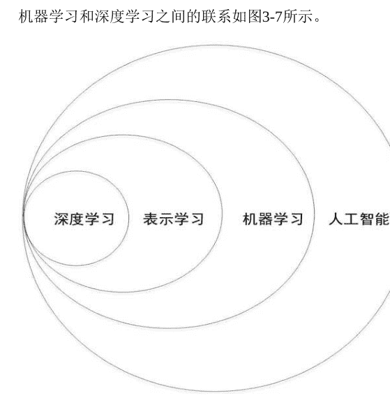

图3-7 机器学习和深度学习之间的联系

### 3.1.4 为什么使用深层表示

深度神经网络能解决好多问题，其实并不需要很大的神经网络，但是得有深度，得有比较多的隐含层，这是为什么呢？主要有以下两个原因。

- （1）深度神经网络是一种特征递进式的学习算法，浅层的神经元直接从输入数据中学习一些低层次的简单特征，如边缘、纹理等。而深层的特征则基于已学到的浅层特征继续学习更高级的特征，从计算机的角度学习深层的语义信息。
- （2）深层的网络隐含单元数量相对较少，隐含层数目较多，如果浅层的网络想要达到同样的计算结果，则需要指数级增长的单元数量才可以。

### 3.1.5 深度学习架构分类

根据深度学习结构、技术和应用领域的不同，我们可以大致把深度学习架构分为3类。

- （1）无监督的或生成式学习的深度架构：针对模式分析和合成任务，用于在没有目标类标签信息的情况下捕捉观测到的或可见数据的高阶相关性。人们所熟知的无监督特征或表达学习指的就是这一类深度网络。无监督或生成式学习的代表网络有深度玻尔兹曼机（Deep Boltzman Machine，DBM）、受限玻尔兹曼机（Restricted Boltzman Machine，RBM）、广义除噪自编码器和积网络（Sum-Product Network，SPN）等。
- （2）有监督学习的深度网络：直接提供用于模式分类目的的判别能力，它的特点是描述了可见数据条件下的后验分布。这种有监督的学习，目标类别标签总是以直接或间接形式给出，所以它们也被称作判别式深度网络。
- （3）混合深度网络：目标是判别式模型，往往以生成式或无监督深度网络的结果作为重要辅助，常见的实现方式是通过优化和正则化类别中的深度网络，或者通过使用判别式准则对第一个类别所述的深度生成式或无监督深度网络的参数进行估计。

### 3.1.6 如何选择深度学习开发平台

现有的开源深度学习平台主要有Caffe、PyTorch、MXNet、CNTK、Theano、TensorFlow、Keras和Fastai等。如何选择一个适合自己的平台？下面列出一些参考依据。

- （1）与现有编程平台、技能整合的难易程度。
主要是前期积累的开发经验和资源，比如编程语言、前期数据集存储格式等。

- （2）与相关的机器学习、数据处理生态整合的紧密程度。
深度学习研究离不开各种数据处理、可视化、统计推断等软件包。建模之前，要考虑是否具有方便的数据预处理工具；建模之后，要考虑是否具有方便的工具进行可视化、统计推断、数据分析。

- （3）对数据量及硬件的要求和支持。
深度学习在不同应用场景下的数据量是不一样的，这也导致我们可能需要考虑分布式计算、多GPU计算的问题。例如，对计算机图像处理研究的人员往往需要将图像文件和计算任务分布到多台计算机节点上去执行。当下每个深度学习平台都在快速发展，每个平台对分布式计算等场景的支持也在不断演进。

- （4）深度学习平台的成熟程度。
成熟程度是一个比较主观的考量因素，这些因素包括：社区的活跃程度、和开发人员进行交流的难易度，以及当前应用的发展势头。

- （5）平台利用的多样性。
有些平台是专门为深度学习研究和应用而开发的，有些平台对分布式计算、GPU等架构有强大的优化，能否用这些平台/软件做其他事情？比如有些深度学习软件是可以用来求解二次型优化的；有些深度学习平台很容易被扩展，可以被运用在强化学习的应用中。

## 3.2 神经网络计算

神经网络计算主要有前向传播和反向传播，本节将通过一些实例介绍具体计算过程。

### 3.2.1 前向传播和反向传播

前向传播（Forward Propagation，FP）作用于每一层的输入，通过逐层计算得到输出结果。

反向传播（Backward Propagation，BP）作用于网络的输出，通过计算梯度由深到浅更新网络参数。

接下来参照图示来理解其计算过程。

前向传播示意图如图3-8所示。

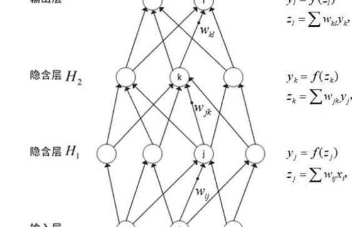

图3-8 前向传播示意图

假设上一层的 i，j，k，...等节点与本层的节点 w 有连接，那么节点 w 的值怎么计算呢？就是通过上一层的 i，j，k，...等节点及其对应的连接权重进行加权和运算，其结果再加上一个偏置项（图中省略了），然后再通过一个非线性函数（即激活函数），如Relu、sigmoid等，最后得到的结果就是本层结点 w 的输出。

最终不断地通过这种方法一层层地运算，得到输出层结果。

反向传播示意图如图3-9所示。

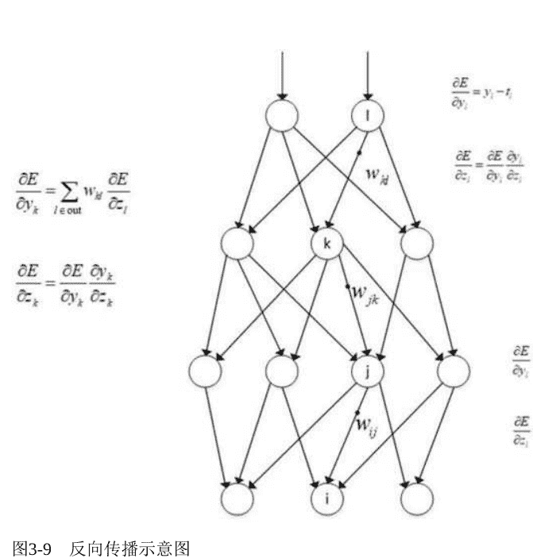

图3-9 反向传播示意图

以分类为例，由于前向传播最终得到的结果，最终总是有误差的，那么怎么减少误差呢？当前应用广泛的一个算法就是梯度下降算法，但是求梯度就要求偏导数，下面以图中字母为例讲解一下。

假设最终误差为 $E$ 且输出层的激活函数为线性激活函数，那么 $E$ 对于输出节点 $y_l$ 的偏导数是 $y_l - t_l$，其中 $t_l$ 是真实值，$\frac{\partial y_l}{\partial z_l}$ 是指上面提到的激活函数，$z_l$ 是上面提到的加权和，那么这一层的 $E$ 对于 $z_l$ 的偏导数为 $\frac{\partial E}{\partial z_l} = \frac{\partial E}{\partial y_l} \frac{\partial y_l}{\partial z_l}$。同理，下一层也这么计算，只不过 $\frac{\partial E}{\partial y_k}$ 计算方法变了，梯度值一直反向传播到输入层，最后有 $\frac{\partial E}{\partial x_i} = \frac{\partial E}{\partial y_j} \frac{\partial y_j}{\partial z_j}$。然后调整反向传播过程中的权重，再不断进行前向传播和反向传播，最终得到一个比较好的结果。

### 3.2.2 如何计算神经网络的输出

神经网络输出计算示意图如图3-10所示。

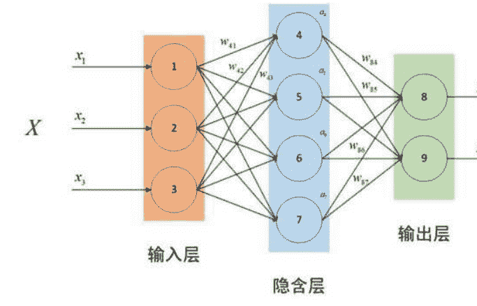

图3-10 神经网络输出计算示意图

如上图所示，输入层有3个节点，编号依次为1、2、3；隐含层有4个节点，编号依次为4、5、6、7；最后输出层的2个节点编号为8、9。比如，隐含层的节点4，它和输入层的3个节点1、2、3之间都有连接，其连接上的权重分别为w₄₁、w₄₂、w₄₃。

为了计算节点4的输出值，必须先得到其所有上游节点（也就是节点1、2、3）的输出值。节点1、2、3是输入层的节点，所以，他们的输出值就是输入向量本身。按照图3-10画出的对应关系，可以看到节点1、2、3的输出值分别是x₁、x₂、x₃。

**a₄ = σ(wᵀa) = σ(w₄₁x₁ + w₄₂x₂ + w₄₃x₃ + w₄b) (3-4)**

其中w₄b是节点4的偏置项。

同样，可以继续计算出节点5、6、7的输出值a₅、a₆、a₇。

计算输出层的节点8的输出值y₁：

**y₁ = σ(wᵀa) = σ(w₈₄a₄ + w₈₅a₅ + w₈₆a₆ + w₈₇a₇ + w₈b) (3-5)**

其中w₈b是节点8的偏置项。

同理，我们还可以计算出y₂。这里我们也看到，输出向量的维度和输出层神经元个数相同。

### 3.2.3 如何计算卷积神经网络输出值

假设有一个5×5的图像，使用一个3×3的滤波器（Filter）进行卷积，想得到一个3×3的特征图，如图3-11所示。

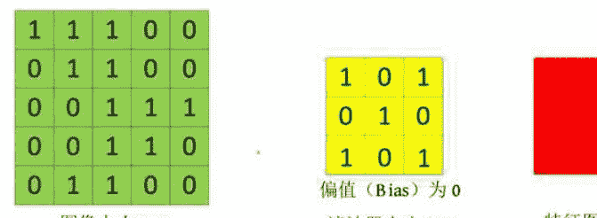

图3-11 待计算图像和卷积核

假设 $x_{i,j}$ 表示图像第 $i$ 行第 $j$ 列元素。$w_{m,n}$ 表示滤波器第 $m$ 行第 $n$ 列权重。$w_b$ 表示滤波器的偏置项。$a_{i,j}$ 表示特征图第 $i$ 行第 $j$ 列元素。$f$ 表示激活函数，这里以Relu函数为例。

卷积计算公式如下：

$$a_{i,j} = f(\sum_{m=0}^{2}\sum_{n=0}^{2} w_{m,n} x_{i+m,j+n} + w_b)$$ (3-6)

当步长为1时，计算特征图元素 $a_{0,0}$：

$$a_{0,0} = f(\sum_{m=0}^{2}\sum_{n=0}^{2} w_{m,n} x_{0+m,0+n} + w_b) = relu(w_{0,0}x_{0,0} + w_{0,1}x_{0,1} + w_{0,2}x_{0,2} + w_{1,0}x_{1,0} + w_{1,1}x_{1,1} + w_{1,2}x_{1,2} + w_{2,0}x_{2,0} + w_{2,1}x_{2,1} + w_{2,2}x_{2,2})$$ (3-7)
$$= 1+0+1+0+1+0+0+0+1 = 4$$

其计算过程如图3-12所示。

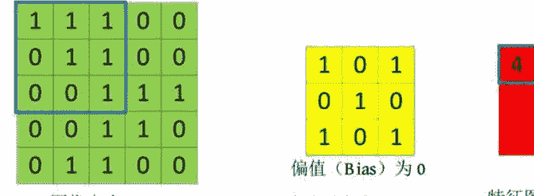

图3-12 当步长为1时，特征图元素 $a_{0,0}$ 过程图示

以此类推，计算出全部的特征图，结果如图3-13所示。

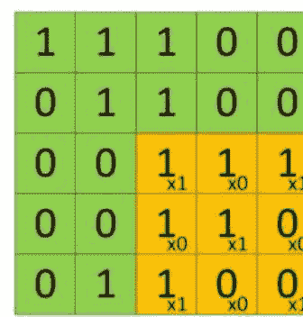

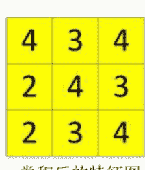

图3-13 当步长为1时，全部的特征图计算结果

当步长为2时，特征图计算如图3-14所示。

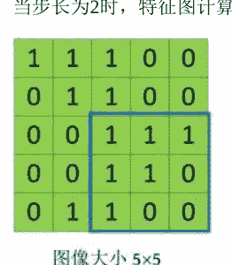


图3-14 当步长为2时，全部的特征图计算结果

注：图像大小、步长和卷积后的特征图大小是有关系的。它们满足下面的关系：

$$W_2 = (W_1 - F + 2P) / S + 1$$
$$H_2 = (H_1 - F + 2P) / S + 1$$

其中，$W_2$是卷积后特征图的宽度；$W_1$是卷积前图像的宽度；$F$是滤波器的宽度；$P$是Zero Padding的数量，Zero Padding是指在原始图像周围补几圈0，如果$P$的值是1，那么就补1圈0；$S$是步长；$H_2$是卷积后特征图的高度；$H_1$是卷积前图像的高度。

举例：假设图像宽度$W_1=5$，滤波器的宽度$F=3$，Zero Padding的数量$P=0$，步长$S=2$，卷积后特征图的宽度$W_2$为：

$$W_2 = (W_1 - F + 2P) / S + 1 = (5 - 3 + 0) / 2 + 1 = 2$$

说明特征图宽度是2。同样，我们也可以计算出特征图高度也是2。

如果卷积前的图像深度为$D$，那么相应的滤波器的深度也必须为$D$。深度大于1的卷积计算公式为：

$$a_{d,i,j} = f(\sum_{d=0}^{D-1} \sum_{m=0}^{F-1} \sum_{n=0}^{F-1} w_{d,m,n} x_{d,i+m,j+n} + w_b)$$

其中，$D$ 是深度；$F$ 是滤波器的大小；$w_{d,m,n}$ 表示滤波器的第 $d$ 层第 $m$ 行第 $n$ 列权重；$a_{d,i,j}$ 表示特征图的第 $d$ 层第 $i$ 行第 $j$ 列像素。

每个卷积层可以有多个滤波器。每个滤波器和原始图像进行卷积后，都可以得到一个特征图。卷积后特征图的深度（个数）和卷积层的滤波器个数相同。图3-15显示了包含两个滤波器的卷积层的计算示意图。输入为$7\times7\times3$，经过两个$3\times3\times3$滤波器的卷积（步长为2），得到了$3\times3\times2$的输出特征图。图中的Zero Padding是1，也就是在输入元素的周围补了一圈0。

以上就是卷积层的计算方法。这里面体现了局部连接和权重共享：每层神经元只和上一层的部分神经元相连（卷积计算规则），且滤波器的权重对于上一层所有神经元都是一样的。对于包含两个$3\times3\times3$的滤波器的卷积层来说，其参数数量仅有（$3\times3\times3+1$）$\times2=56$个，且参数数量与上一层神经元个数无关。与全连接神经网络相比，其参数数量大大减少了。


### 3.2.4 如何计算池化层输出值

池化层主要的作用是下采样，通过去掉特征图中不重要的样本，进一步减少参数数量。池化的方法很多，最常用的是最大池化。最大池化实际上就是在$n \times n$的样本中取最大值，作为采样后的样本值。$2\times2$最大池化计算示意图如图3-16所示。


图3-16 2×2最大池化计算示意图

计算池化层输出值除了最大池化，常用的还有平均池化，即取各样本的平均值。需要注意的是，对于深度为 $D$ 的特征图，各层独立做池化，池化后的深度仍然为 $D$。

### 3.2.5 反向传播实例

一个典型的三层神经网络如图3-17所示。


图3-17 典型的三层神经网络示意图

其中 $L_1$ 层是输入层，$L_2$ 层是隐含层，$L_3$ 层是输出层。

假设输入数据集为 $D = x_1, x_2, x_3, ..., x_n$，输出数据集为 $y_1, y_2, ..., y_n$。

如果输入和输出一样，即为自编码模型。如果原始数据经过映射，就会得到不同于输入的输出。

假设有如图3-18所示的网络层。


图3-18 网络层示意图

输入层包含神经元 $i_1$、$i_2$，偏置 $b_1$；隐含层包含神经元 $h_1$、$h_2$，偏置 $b_2$，输出层为 $o_1$、$o_2$，$w_i$ 为层与层之间连接的权重，激活函数为sigmoid函数。对以上参数取初始值，即初始化图3-18所示的网络层，如图3-19所示。


图3-19 初始化图3-18所示的网络层

其中：

输入数据 $i_1=0.05$，$i_2=0.10$；

输出数据 $o_1=0.01$，$o_2=0.99$；

初始权重 $w_1=0.15$，$w_2=0.20$，$w_3=0.25$，$w_4=0.30$，$w_5=0.40$，$w_6=0.45$，$w_7=0.50$，$w_8=0.55$。

目标：给出输入数据 $i_1=0.05$、$i_2=0.10$，使输出尽可能与原始输出 $o_1=0.01$、$o_2=0.99$ 接近。

首先来看前向传播是如何计算的。

（1）从输入层计算输出层

计算神经元 $h_1$ 的输入加权和：

$\text{net}_{h_1} = w_1 \cdot i_1 + w_2 \cdot i_2 + b_1 \cdot 1$
$\text{net}_{h_1} = 0.15 \times 0.05 + 0.2 \times 0.1 + 0.35 \times 1 = 0.3775$ (3-11)

神经元 $h_1$ 的输出 $o_1$（此处用到的激活函数为sigmoid函数）：

$\text{out}_{h_1} = \frac{1}{1+e^{-\text{net}_{h_1}}} = \frac{1}{1+e^{-0.3775}} = 0.593269992$ (3-12)

同理，可计算出神经元 $h_2$ 的输出 $o_2$：

$\text{out}_{h_2} = 0.596884378$ (3-13)

（2）从隐含层计算输出层。

计算输出层神经元 $o_1$ 和 $o_2$ 的值：

$\text{net}_{o_1} = w_5 \cdot \text{out}_{h_1} + w_6 \cdot \text{out}_{h_2} + b_2 \cdot 1$ (3-14)
即 $\text{net}_{o_1} = 0.4 \times 0.593269992 + 0.45 \times 0.596884378$ (3-15)

$\text{out}_{o_1} = \frac{1}{1+e^{-\text{net}_{o_1}}} = \frac{1}{1+e^{-1.105905967}} = 0.75136079$ (3-16)


同理计算可得 $\text{out}_{o_2}$，这样前向传播的过程就结束了，我们得到输出值为 $[0.75136079, 0.772928465]$，与实际值 $[0.01, 0.99]$ 相差还很远，现在我们对误差进行反向传播，更新权重，重新计算输出。

再来看反向传播是如何计算的。

（1）计算总误差。

总误差（这里使用平方误差）：

$E_{\text{total}} = \sum \frac{1}{2}(\text{target} - \text{output})^2$ (3-17)

因为有两个输出，所以分别计算 $o_1$ 和 $o_2$ 的误差，总误差为两者之和：

$E_{o_1} = \frac{1}{2}(\text{target}_{o_1} - \text{out}_{o_1})^2 = \frac{1}{2}(0.01 - 0.75136507)^2 = 0.274811083$

$E_{o_2} = 0.023560026$

$E_{\text{total}} = E_{o_1} + E_{o_2} = 0.274811083 + 0.023560026 = 0.298371109$

（2）进行隐含层输出层的权重更新。

以权重参数 $w_5$ 为例，如果想知道 $w_5$ 对整体误差产生了多少影响，可以用整体误差对 $w_5$ 求偏导得出（链式法则）：

$\frac{\partial E_{\text{total}}}{\partial w_5} = \frac{\partial E_{\text{total}}}{\partial \text{out}_{o_1}} \cdot \frac{\partial \text{out}_{o_1}}{\partial \text{net}_{o_1}} \cdot \frac{\partial \text{net}_{o_1}}{\partial w_5}$  (3-18)

通过图3-20可以更直观地看清楚误差是怎样反向传播的。


图3-20 误差反向传播示意图

### 3.2.6 神经网络更“深”的意义

首先说一下此命题的前提是：在一定范围内。在一定范围内，使用更“深”的网络表达，主要有以下原因。

- （1）在神经元数量相同的情况下，深层网络结构具有更大容量，分层组合带来的是指数级的表达空间，能够组合成更多不同类型的子结构，这样可以更容易地学习和表示各种特征。
- （2）隐含层增加则意味着只要由激活函数带来的非线性变换的嵌套层数更多，就能构造更复杂的映射关系。

## 3.3 激活函数

激活函数（Activation Function），是在神经网络的神经元上运行的函数，负责将神经元的输入映射到输出端。

### 3.3.1 为什么需要激活函数

深度学习网络中引入激活函数，主要有以下几个作用。

- （1）激活函数对模型学习、理解非常复杂和非线性的函数具有重要作用。
- （2）激活函数可以引入非线性因素。如果不使用激活函数，则输出信号只是一个简单的线性函数。线性函数是一个一级多项式，线性方程的复杂度有限，从数据中学习复杂函数映射的能力很小。没有激活函数，神经网络将无法学习和模拟其他复杂类型的数据，例如图像、视频、语音等。
- （3）激活函数可以把当前特征空间通过一定的线性映射转换到另一个空间，让数据能够更好地被分类。

### 3.3.2 为什么激活函数需要非线性函数

为什么通常使用的激活函数是非线性的？主要有以下两个原因。

- （1）假设网络中全部是线性部件，那么线性的组合还是线性的，与一个单独的线性分类器无异。这样就做不到用非线性来逼近任意函数了。
- （2）使用非线性激活函数，以便使网络更加强大，增强它的能力，使它可以学习复杂的事物、复杂的表单数据，并表示输入/输出之间非线性的复杂的任意函数映射。使用非线性激活函数，能够从输入/输出之间生成非线性映射。

### 3.3.3 常见的激活函数及其图像

常见的激活函数及其图像如下。

（1）sigmoid激活函数。


函数的定义为：$f(x) = \frac{1}{1+e^{-x}}$，其值域为（0,1）。

sigmoid激活函数图像如图3-21所示。


图3-21 sigmoid激活函数图像

（2）tanh激活函数


函数的定义为：$f(x) = \tanh(x) = \frac{e^x - e^{-x}}{e^x + e^{-x}}$，值域为(-1,1)。

tanh激活函数图像如图3-22所示。


图3-22 tanh激活函数图像

（3）Relu激活函数。

函数的定义为：$f(x) = \max(0, x)$，值域为$(0, +\infty)$。

Relu激活函数图像如图3-23所示。


图3-23 Relu激活函数图像

（4）Leaky Relu激活函数。


函数定义为：$f(x) = \begin{cases} ax, & x < 0 \\ x, & x \geq 0 \end{cases}$，值域为$(-\infty, +\infty)$。

Leaky Relu激活函数图像如图3-24所示（$a=0.05$）。


图3-24 Leaky Relu激活函数图像

（5）Softplus激活函数。

函数的定义为：$f(x) = \ln(1+e^x)$，值域为$(0, +\infty)$。

Softplus激活函数图像如图3-25所示。


图3-25 Softplus激活函数图像

（6）softmax函数。


函数定义为：。

softmax函数多用于多分类神经网络输出。

### 3.3.4 常见激活函数的导数计算

常见激活函数的导数计算如表3-1所示。

表3-1 常见激活函数的导数计算

| 原函数 | 函数表达式 | 导数 | 备注 |
| :--- | :--- | :--- | :--- |
| Sigmoid 激活函数 | $f(x) = \frac{1}{1+e^{-x}}$ | $f'(x) = \frac{1}{1+e^{-x}}(1-\frac{1}{1+e^{-x}}) = f(x)(1-f(x))$ | 当 x=10 或 x=-10 时，$f'(x) \approx 0$；当 x=0 时，$f'(x)=0.25$ |
| tanh 激活函数 | $f(x)=\tanh(x) = \frac{e^x-e^{-x}}{e^x+e^{-x}}$ | $f'(x)=1-(\tanh(x))^2$ | 当 x=10 或 x=-10 时，$f'(x) \approx 0$；当 x=0 时，$f'(x)=1$ |
| Relu 激活函数 | $f(x)=\max(0, x)$ | $c(u) = \begin{cases} 0, x<0 \\ 1, x>0 \\ \text{undefined}, x=0 \end{cases}$ | 通常当 x=0 时，给定其导数为 1 和 0 |

### 3.3.5 激活函数有哪些性质

激活函数主要有以下性质。

- （1）非线性：当激活函数是非线性的，一个两层的神经网络就基本上可以逼近所有的函数。但如果激活函数是恒等激活函数，即 $f(x)=x$，那么就不满足这个性质，而且如果多层感知机使用的是恒等激活函数，那么其实整个网络与单层神经网络是等价的。
- （2）可微性：当优化方法基于梯度时，就会体现出该性质。
- （3）单调性：当激活函数是单调的时候，单层网络能够保证是凸函数。
- （4）$f(x) \approx x$：当激活函数满足这个性质的时候，如果参数的初始化是随机的较小值，那么神经网络的训练将会很高效；如果不满足这个性质，那么就需要详细地去设置初始值。
- （5）输出值的范围：当激活函数输出值有限时，基于梯度的优化方法会更加稳定，因为特征的表示受有限权重的影响更显著；当激活函数的输出无限时，模型的训练会更加高效，不过在这种情况下，一般需要更小的学习率（Learning Rate）。

### 3.3.6 如何选择激活函数

选择一个合适的激活函数并不容易，需要考虑很多因素。通常的做法是，如果不确定哪一个激活函数效果更好，可以逐一尝试，然后在验证集或测试集上进行评价，选择表现最好的，就去使用它。

以下是常见的选择建议。

- （1）如果输出值是0、1（二分类问题），则输出层选择sigmoid激活函数，其他的所有单元都选择Relu激活函数。
- （2）如果在隐含层上不确定使用哪个激活函数，则通常会使用Relu激活函数。有时，也会使用tanh激活函数，但Relu激活函数的一个优点是：当它是负值时，导数等于0。
- （3）sigmoid激活函数：除了输出层是一个二分类问题的情况，基本不会用它。
- （4）tanh激活函数：它非常优秀，几乎适合所有场合。
- （5）Relu激活函数：最常用的默认函数，如果不确定用哪个激活函数，就先使用Relu或Leaky Relu，再去尝试其他的激活函数。
- （6）如果遇到了一些死的神经元，则可以使用Leaky Relu函数。

### 3.3.7 为什么tanh收敛速度比sigmoid快

首先看如下两个函数的求导：

$$tanh'(x) = 1 - tanh(x)^2 \in (0,1)$$

$$sigmoid'(x) = s(x)(1 - s(x)) \in (0, \frac{1}{4}]$$

由上面两个公式可知tanh（x）梯度消失的问题比sigmoid（x）轻，所以tanh收敛速度比sigmoid快。

### 3.3.8 Relu激活函数的优点

Relu激活函数的优点如下。

（1）在区间变动很大的情况下，Relu激活函数的导数或激活函数的斜率都会远大于0，程序里用一个简单的if-else语句即可实现，而sigmoid函数需要进行浮点四则运算。在实践中，使用Relu激活函数的神经网络通常会比使用sigmoid或tanh激活函数的神经网络学习得更快。

（2）sigmoid和tanh激活函数的导数在正负饱和区的梯度都会接近于0，这会造成梯度弥散，而Relu和Leaky Relu激活函数大于0的部分都为常数，不会产生梯度弥散现象。

注：Relu进入负半区的时候，梯度为0，神经元此时不会训练，产生所谓的稀疏性，而Leaky Relu不会产生这个问题。

### 3.3.9 理解Relu激活函数的稀疏激活性

Relu激活函数图像如图3-23所示。根据图像可看出其具有如下特点：单侧抑制、相对宽阔的兴奋边界，以及稀疏激活性。

Relu函数从图像上看，是一个分段线性函数，把所有的负值都变为0，而正值不变，这样就成为单侧抑制。因为有了单侧抑制，才使神经网络中的神经元也具有了稀疏激活性。

稀疏激活性是指从信号方面来看，神经元同时只对输入信号的少部分进行选择性响应，大量信号被刻意屏蔽了，这样可以提高学习的精度，更好、更快地提取稀疏特征。当x<0时，Relu硬饱和，而当x>0时，则不存在饱和问题。Relu能够在x>0时保持梯度不衰减，从而缓解梯度消失问题。

### 3.3.10 什么时候可以用线性激活函数

大多数情况下，深度学习网络建议使用非线性激活函数，但是有些情况也可以使用线性激活函数。

（1）在输出层大多使用线性激活函数时。

（2）在隐含层可能会使用一些线性激活函数时。

### 3.3.11 softmax函数的定义及作用

softmax是一种形如下式的函数：

$$P(i) = \frac{\exp(\theta_i^T x)}{\sum_{k=1}^K \exp(\theta_k^T x)}$$ (3-19)

其中，$\theta_i$ 和 $x$ 是列向量，$\theta_i^T x$ 可能被换成函数关于 $x$ 的函数 $f_i(x)$。

通过softmax函数，可以使得 $P(i)$ 的范围在[0,1]之间。在回归和分类问题中，通常 $\theta$ 是待求参数，通过寻找使得 $P(i)$ 最大的 $\theta_i$ 作为最佳参数。

但是，使得范围在[0,1]之间的方法有很多，为何要在前面加上e的幂函数的形式？请参考Logistic函数：

$$P(i) = \frac{1}{1 + \exp(-\theta_i^T x)}$$ (3-20)

这个函数的作用就是使 $P(i)$ 在负无穷到0的区间上趋向于0，在0到正无穷的区间上趋向1。同样，softmax函数加入了e的幂函数正是为了两极化：正样本的结果将趋近于1，而负样本的结果趋近于0。这样为多类别提供了方便，可以说，softmax函数是logistic函数的一种泛化。

softmax函数可以把它的输入值，处理成（0,1）区间内，并且能够把输出归一化到和为1。这意味着softmax函数与分类的概率分布等价。它是一个网络预测多分类问题的最佳输出激活函数。

### 3.3.12 softmax函数如何应用于多分类

softmax函数在多分类过程中，将多个神经元的输出，映射到（0,1）区间内，可以看成概率来理解，从而来进行多分类。

假设有一个数组，$V_i$ 表示 $V$ 中的第 $i$ 个元素，那么这个元素的softmax值为：

$$S_i = \frac{e^{V_i}}{\sum_j e^{V_j}}$$ (3-21)

图3-26所示为神经网络softmax分类示意图，从中可见，神经网络中包含了输入层，然后通过两个特征层处理，最后通过softmax分析器就能得到不同条件下的概率。这里需要分成3个类别，最终会得到 $y=0$，$y=1$，$y=2$ 的概率值。


图3-26 神经网络softmax分类示意图

图3-27所示为softmax计算示意图，3个输入通过softmax函数后，得到一个数组[0.88,0.12,0]。


图3-27 softmax计算示意图

softmax更形象的映射过程示意图如图3-28所示。


图3-28 softmax更形象的映射过程示意图

图中三个输入的值分别为3、1、-3，权重分别为20、2.7、0.05，再分别除以累加和得到最终的概率值，分别为0.88、0.12、0，而这些概率值的累加和为1，在最后选取输出节点的时候，可以选取概率最大的节点，作为我们的预测目标。

## 3.4 Batch Size

Batch Size指的是一次训练所选取的样本数。Batch Size的大小影响模型的优化程度和速度。在理解Batch Size之前，我们先区分一下Epoch、Batch和Iteration这3个概念的差异。

- （1）Epoch使用训练集的全部数据对模型进行一次完整训练，被称为“一代训练”。
- （2）Batch使用训练集中的一小部分样本对模型权重进行一次反向传播的参数更新，这一小部分样本被称为“一批数据”。
- （3）Iteration是使用一个Batch数据对模型进行一次参数更新的过程，被称为“一次训练”。

### 3.4.1 为什么需要Batch Size

在没有使用Batch Size时，网络在训练时会一次性把所有的数据输入网络中，计算得到的梯度方向更为准确，但与此同时，计算得到不同的梯度值差别巨大，难以使用一个全局的学习率，并且对于内存来说是非常大的挑战，会引起内存的爆炸。

### 3.4.2 如何选择Batch Size值

Batch Size的选择，会影响梯度下降的方向。

如果数据集比较小，那么可以采用全数据集的形式，好处如下。

- （1）由全数据集确定的方向能够更好地代表样本总体，从而更准确地朝向极值所在的梯度方向。
- （2）由于不同权重的梯度值差别巨大，因此选取一个全局的学习率很困难。

对于更大的数据集，假如采用全数据集的形式，坏处如下。

- （1）由于内存的限制，随着数据集的海量增长，一次性载入所有的数据变得越来越不可行。
- （2）如果以弹性反向传播（Rprop）的方式迭代，会由于各个Batch Size之间的采样差异性，各次梯度修正值相互抵消，无法修正。这才有了后来均方根反向传播（RMSprop）的妥协方案。

下面是深度学习关于Batch Size值的选择的一些建议：假如每次只训练一个样本，即Batch Size=1。线性神经元在均方误差代价函数的错误面是一个抛物面，横截面是椭圆。对于多层神经元、非线性网络，在局部依然近似一个抛物面。此时，每次修正以各样本的梯度方向修正，横冲直撞各自为政，难以达到收敛的效果。

既然Batch Size为全数据集或Batch Size=1都各有缺点，可不可以选择一个适中的Batch Size值呢？

此时，可采用批梯度下降法（Mini-batches Learning）。因为如果数据集足够充分，那么用一半（甚至少得多）的数据训练算出来的梯度与用全部数据训练出来的梯度是几乎一样的。

### 3.4.3 调节Batch Size对训练效果的影响

当Batch Size太小时，模型表现效果极其糟糕，误差飙升。随着Batch Size不断增大，处理相同数据量的速度变快，但是达到相同精度所需要的Epoch数量变多。

由于上述两种因素的矛盾，当Batch Size增大到某个值时，会达到时间上的最优。最终收敛精度会陷入不同的局部极值，因此当Batch Size增大到一定程度时，会达到最终收敛精度上的最优。

### 3.4.4 在合理范围内增大Batch Size的好处

在合理范围内增大Batch Size有以下几个好处。

- （1）内存利用率提高，大矩阵乘法的并行化效率提高。
- （2）跑完一次Epoch所需的迭代次数减少，对于相同数据量的处理速度进一步加快。
- （3）在一定范围内，一般来说Batch Size越大，其确定的下降方向越准，引起的训练震荡越小。

### 3.4.5 盲目增大Batch Size的坏处

在合理范围内增大Batch Size有好处，但不能盲目增大，原因如下。

- （1）内存利用率得到提高，但是内存容量可能撑不住。
- （2）跑完一次Epoch所需的迭代次数减少，要想达到相同的精度，其所花费的时间大大增加了，从而对参数的修正也就显得更加缓慢。
- （3）Batch Size增大到一定程度，其确定的下降方向已经基本不再变化。

## 3.5 归一化

在训练模型之前，对训练数据集进行标准化和归一化处理，可以加快模型的收敛速度，而且更重要的是在一定程度上缓解了深层网络中梯度弥散的问题，从而使训练深层网络模型更加容易。归一化处理是深度神经网络训练常用的技巧。

### 3.5.1 理解归一化含义

下面通过归一化的数学含义及其在深度学习中的应用来理解归一化。

归一化的具体作用是归纳统一样本的统计分布性，归一化在[0,1]之间是统计的概率分布，归一化在[-1, 1]之间是统计的坐标分布。

为了建模或计算方便，首先要保持度量单位的同一性，在深度学习中，当所有样本的输入信号都为正值时，与第一隐含层神经元相连的权重只能同时增加或减小，从而导致学习速度很慢。为了避免出现这种情况并方便后面数据的处理，加快网络学习速度，可以对输入信号进行归一化，使所有样本的输入信号均值接近于0或与其均方差相比很小。神经网络中sigmoid激活函数的取值在0到1之间，网络最后一个节点的输出也是如此。

归一化处理并不适用于所有情况，在实际使用中根据输出值的分布情况，标准化等其他统计变换方法有时可能更好。

### 3.5.2 归一化和标准化的联系与区别

（1）两者的联系：它们都能取消由于量纲不同引起的误差，都是一种线性变换，都是对向量按照比例压缩再进行平移。

（2）两者的区别：归一化是将样本的特征值转换到同一量纲下，把数据映射到[0,1]或[-1,1]区间内，仅由变量的极值决定，区间放缩法是归一化的一种。标准化是将样本依照特征矩阵的列处理数据，通过求z-score的方法，将其转换为标准正态分布，使其和整体样本分布相关，每个样本点都能对标准化产生影响。

### 3.5.3 为什么要归一化或标准化

总结起来，主要有以下原因。

（1）应用层面需要统一量纲，因为样本数据的评价标准不一样，需要对其量纲化，统一评价标准。

（2）在使用梯度下降的方法求解最优化问题时，归一化或标准化后可以加快梯度下降的求解速度，即提升模型的收敛速度。

（3）应用归一化可以避免神经元饱和，当神经元的激活在接近0或1时会饱和，在这些区域，梯度几乎为0。这样，在反向传播过程中，局部梯度就会接近0，此时应用归一化可以有效地减少梯度消失。

（4）避免输出数据中小的数值被吞食，也避免太大的数值引发数值问题。

这样会导致在搜索过程中更偏向于 $w_1$ 的方向，结果是走出了“L”形，或者“之”字形，图3-29所示为未归一化的最优解搜索过程，这导致需要迭代很多次才能收敛。


图3-29 未归一化的最优解搜索过程

### 3.5.5 为什么归一化能提高求最优解速度

如图3-30所示为归一化的最优解寻解过程（圆圈可以理解为等高线）。左图表示未经归一化操作的寻解过程，右图表示经过归一化后的寻解过程。


图3-30 归一化的最优解寻解过程

当使用梯度下降法寻求最优解时，很有可能走“之”字形路线（其特点是垂直于等高线进行下降），从而导致需要迭代很多次才能收敛；而右图对两个原始特征进行了归一化，其对应的等高线显得很圆，在梯度下降进行求解时能较快地收敛。

因此，如果机器学习模型使用梯度下降法求最优解时，归一化往往非常有必要，否则很难收敛，甚至不能收敛。

### 3.5.6 归一化有哪些类型

#### 线性归一化

$$x' = \frac{x - \min(x)}{\max(x) - \min(x)}$$

线性归一化比较适用于数值比较集中的情况。缺点是如果max（x）和min（x）不稳定，很容易使归一化结果不稳定，后续使用效果也不稳定。

#### 标准差标准化

$$x' = \frac{x - \mu}{\sigma}$$

标准差标准化是让经过处理的数据符合标准正态分布，即均值为0，标准差为1。其中$\mu$为所有样本数据的均值，$\sigma$为所有样本数据的标准差。

#### 非线性归一化

非线性归一化经常用在数据分化比较大的场景，有些数值很大，有些很小。通过一些数学函数，将原始值进行映射，这些方法包括log、指数、正切等。

### 3.5.7 局部响应归一化作用

局部响应归一化（Local Response Normalization，LRN）是一种提高深度学习准确度的技术方法。LRN一般是在激活、池化函数后使用的一种处理方法。

在AlexNet中，提出了LRN层，对局部神经元的活动创建竞争机制，使其中响应比较大的值变得相对更大，并抑制其他反馈较小的神经元，增强了模型的泛化能力。

### 3.5.8 局部响应归一化原理

局部响应归一化原理是仿造生物学上活跃的神经元对相邻神经元的抑制现象（侧抑制），其公式如下：

$$b_{x,y}^i = a_{x,y}^i / \left( k + \alpha \sum_{j=\max(0, i-n/2)}^{\min(N-1, i+n/2)} (a_{x,y}^j)^2 \right)^\beta$$

其中：

- $a$ 表示卷积层后的输出结果，是一个四维数组[batch,height,width,channel]。batch代表批次数，height代表图片高度，width代表图片宽度，channel代表通道数。可以理解成一批图片中的某一张图片经过卷积操作后输出的神经元个数，或者理解为处理后的图片深度。


- $a_{x,y}^i$ 表示在这个输出结构中的一个位置$[a, b, c, d]$，可以理解成在某一张图中的某一个通道下的某个高度和某个宽度位置的点，即第$a$张图的第$d$个通道下的高度为$b$、宽度为$c$的点。

- $N$ 表示通道数。

- $k$、$n$、$\alpha$、$\beta$ 分别表示函数中的bias、depth_radius、alpha、beta。参数$k$、$n$、$\alpha$、$\beta$都是超参数，一般设置$k=2$、$n=5$、$\alpha=e^{-4}$、$\beta=0.75$。

- $\sum$叠加的方向沿着通道方向，即每个点值的平方和是沿着$a$中的第三维通道方向的，也就是一个点同方向的前面$n/2$个通道（最小为第0个通道）和后$n/2$个通道（最大为第$d-1$个通道）的点的平方和（共$n+1$个点）。而函数的英文注解中也说明了把输入当成$d$个三维的矩阵，即把输入的通道数当作三维矩阵的个数，叠加的方向也是在通道方向。

局部响应归一化简单示意图如图3-31所示。


图3-31 局部响应归一化简单示意图

### 3.5.9 什么是批归一化

以前在神经网络训练中，只是对输入层数据进行归一化处理，却没有在中间层进行归一化处理。虽然我们对输入数据进行了归一化处理，但是输入数据经过 $\sigma ( WX + b )$ 这样的矩阵乘法及非线性运算之后，其数据分布很可能被改变，而随着深度网络的多层运算，数据分布的变化将越来越大。如果我们能在网络的中间也进行归一化处理，是否对网络的训练起到改进作用呢？答案是肯定的。

这种在神经网络中间层也进行归一化处理，使训练效果更好的方法，就是批归一化（Batch Normalization，BN）。

### 3.5.10 批归一化的优点

- （1）减少了对人为选择参数的依赖。在某些情况下可以取消Dropout方法和 $L_2$ 正则项参数，或者采用更小的 $L_2$ 正则项约束参数。
- （2）减少了对学习率的要求。使用批归一化后可以使用初始很大的学习率或选择较小的学习率，算法也能够快速训练收敛。
- （3）可以不再使用局部响应归一化，批归一化本身就是归一化网络。
- （4）破坏原来的数据分布，在一定程度上缓解过拟合，防止每批训练中某一个样本经常被挑选到，有助于提高精度。
- （5）减少梯度消失，加快收敛速度，提高训练精度。

### 3.5.11 批归一化算法流程

下面给出批归一化算法在训练时的过程。

输入：上一层输出结果 $X = X_1, X_2, \dots, X_m$，学习参数 $\gamma$ 和 $\beta$。
算法流程如下。

（1）计算上一层输出数据的均值：

$$\mu_{\beta} = \frac{1}{m} \sum_{i=1}^{m} (x_i)$$

其中，$m$ 是此次训练样本Batch的大小。

（2）计算上一层输出数据的标准差：

$$\sigma_{\beta}^2 = \frac{1}{m} \sum_{i=1}^{m} (x_i - \mu_{\beta})^2$$

（3）进行归一化处理，得到：

$$\hat{x}_i = \frac{x_i - \mu_{\beta}}{\sqrt{\sigma_{\beta}^2 + \varepsilon}}$$

其中 $\varepsilon$ 是为了避免分母为0而加进去的接近于0的很小的值。

（4）重构，对经过上面归一化处理得到的数据进行重构，得到：

$$y_i = \gamma \hat{x}_i + \beta$$

其中，$\gamma$ 和 $\beta$ 为可学习参数。

注：上述是批归一化训练时的过程，但是当投入使用时，往往只是输入一个样本，没有所谓的均值 $\mu_{\beta}$ 和标准差 $\sigma_{\beta}^2$。此时，均值 $\mu_{\beta}$ 是从计算所有批次 $\mu_{\beta}$ 值的平均值得到的，标准差 $\sigma_{\beta}^2$ 是根据每个批次 $\sigma_{\beta}^2$ 的无偏估计得到的。

### 3.5.12 批归一化和组归一化比较

批归一化（Batch Normalization，BN），可让各种网络并行训练。但是，批量维度进行归一化会带来一些问题，比如批量统计估算不准确导致当批量变小时，批归一化的误差会迅速增加。在训练大型网络和将特征转移到计算机视觉任务中（包括检测、分割和视频），内存消耗限制了只能使用小批量的批归一化。

组归一化（Group Normalization，GN），组归一化将通道分成组，并在每组内计算归一化的均值和方差。组归一化的计算与批量大小无关，并且其准确度在各种批量大小下都很稳定。

在ImageNet上训练的ResNet-50上，组归一化使用批量大小为2时的错误率比批归一化的错误率低10.6%；当使用典型的批量时，组归一化与批归一化相当，并且优于其他归一化变体。而且，组归一化可以自然地从预训练迁移到微调。在进行COCO中的目标检测和分割及Kinetics中的视频分类比赛中，组归一化可以胜过其竞争对手，表明组归一化可以在各种任务中有效地取代强大的批归一化。

### 3.5.13 权重归一化和批归一化比较

权重归一化（Weight Normalization，WN）和批归一化（Batch Normalization，BN）都属于参数重写（Reparameterization）的方法，只是采用的方式不同。

权重归一化是对网络权重 $W$ 进行归一化；批归一化是对网络某一层输入数据进行归一化。

权重归一化与批归一化相比有以下3点优势。

- （1）权重归一化通过重写深度学习网络的权重 $W$ 的方式来加速深度学习网络参数收敛，没有引入mini-batch的依赖，适用于RNN（LSTM）网络。批归一化不能直接用于RNN进行归一化操作，原因在于：①RNN处理的队列是变长的；②RNN基于时间状态计算，如果直接使用批归一化处理，需要保存每个时间状态下mini-batch的均值和方差，效率低且占内存较多。
- （2）批归一化基于一个mini-batch的数据计算均值和方差，而不是基于整个训练集来做，相当于在进行梯度计算时引入噪声。因此，批归一化不适用于对噪声敏感的强化学习、生成模型等使用。相反，权重归一化通过标量 $g$ 和向量 $v$ 对权重 $W$ 进行重写，因此，权重归一化可以比批归一化引入更少的噪声。
- （3）权重归一化不需要额外的存储空间来保存mini-batch的均值和方差，正向和反向传播实现时额外的计算开销也更小。

但是权重归一化不具备批归一化把网络每一层的输出固定在一个变化范围内的能力，因此采用权重归一化时需要注意参数初始化策略的选择。

### 3.5.14 批归一化适用范围

在CNN中，批归一化应作用在非线性映射前。在神经网络训练时遇到收敛速度很慢，或梯度爆炸等无法训练的状况时可以尝试使用批归一化来解决。另外，在一般使用情况下也可以加入批归一化来加快训练速度，提高模型精度。

批归一化比较适用于每个mini-batch比较大、数据分布比较接近的场景。另外，由于批归一化需要在运行过程中统计每个mini-batch的一阶统计量和二阶统计量，因此不适用于动态的网络结构和RNN网络。

### 3.5.15 BN、LN、IN和GN的对比

主流归一化方法有批归一化（Batch Normalization，BN）、层次归一化（Layer Normalization，LN）、实例归一化（Instance Normalization，IN）及组归一化（Group Normalization，GN）。下面就根据一组示意图对它们进行比较。

深度网络中的数据维度一般是 $[N, C, H, W]$ 或 $[N, H, W, C]$ 格式，$N$ 是Batch Size，$H / W$ 是特征图的高/宽，$C$ 是特征图的通道数，压缩 $H / W$ 至一个维度。图3-32所示为BN、LN、IN和GN的工作方式对比。假设单个方格的长度是1，那么其表示的是 $[6, 6, , ]$。


图3-32形象地表示了4种归一化的工作方式。

- BN：对批次方向做归一化，归一化维度为 $[N, H, W]$。
- LN：在通道方向上做归一化，归一化的维度为 $[C, H, W]$，主要对RNN作用明显。
- IN：在一个图像像素内做归一化，归一化的维度为[H, W]，主要用于风格化迁移。
- GN：将通道方向分组，然后在每个组内做归一化，先将特征的维度由[N, C, H, W]变换为[N, G, C//G, H, W]，归一化的维度为[C//G, H, W]。

还有一种归一化方式，可切换归一化（Switchable Norm，SN），是将BN、LN、IN结合，赋予权重，让网络自己去学习归一化层应该使用的方法。

## 3.6 参数初始化

为了让神经网络在训练过程中学到有用的信息，参数梯度不为0，在深度学习中参数初始化非常重要。良好的初始化可以加快梯度下降的收敛速度，降低训练错误的概率。本节主要针对权重初始化、偏差初始化等进行介绍。

### 3.6.1 参数初始化应满足的条件

为了保证参数更新时的梯度不为0，而参数更新的梯度和反向传播得到的状态梯度及输入激活值有关。总结起来参数初始化应该尽量满足以下几个条件。

- （1）各层激活值不会出现饱和现象。
- （2）各层激活值不为0。
- （3）尽量使各个层的激活值的方差保持一致。
- （4）尽量使各个层对状态的梯度的方差保持一致。

### 3.6.2 常用的几种初始化方式

常见的初始化方式主要有以下几种。

- （1）预训练：早期训练神经网络的有效初始化方法。在预训练阶段，参数得以更新，形成初始值；在微调阶段，利用预训练得到的参数初始值和训练数据对模型进行整体调整。在这一过程中，参数进一步被更新，形成最终模型。
- （2）随机初始化：将权重进行随机初始化，使其服从标准正态分布，在训练深度神经网络时可能会造成梯度消失和梯度爆炸的问题。
- （3）xavier初始化：基本思想是保持输入和输出的方差一致，这样就避免了所有输出值都趋向于0。
- （4）kaiming初始化：何恺明提出的一种针对Relu的初始化方法，其思想是在Relu网络中，假定每一层有一半的神经元被激活，另一半为0。所以，要保持方差不变，只需要在xavier的基础上再除以2。

### 3.6.3 全0初始化带来的问题

在深度学习中，不建议将所有的权重都初始化为0，因为并不知道在训练神经网络中每一个权重最后的值，但是如果进行了恰当的数据归一化，我们有理由认为有一半的权重是正的，另一半是负的。令所有权重都初始化为0，如果神经网络计算出来的输出值是一样的，神经网络在进行反向传播算法计算出来的梯度值也一样，并且参数更新值也一样，这样的神经网络和一个线性模型的效果差不多。

在神经网络中考虑梯度下降的时候，设想你在爬山，但身处直线形的山谷中，两边是对称的山峰。由于对称性，你所在之处的梯度只能沿着山谷的方向，不会指向山峰。你走了一步之后，情况依然不变。结果就是你只能收敛到山谷中的一个极大值，而走不到山峰上去。

### 3.6.4 全都初始化为同样的值

全都初始化为一样的值也是深度学习中不建议的，以一个三层网络为例。


图3-33 三层网络示意图

其表达式为：

$$a_1^{(2)} = f(W_{11}^{(1)} x_1 + W_{12}^{(1)} x_2 + W_{13}^{(1)} x_3 + b_1^{(1)})$$ (3-29)
$$a_2^{(2)} = f(W_{21}^{(1)} x_1 + W_{22}^{(1)} x_2 + W_{23}^{(1)} x_3 + b_2^{(1)})$$ (3-30)
$$a_3^{(2)} = f(W_{31}^{(1)} x_1 + W_{32}^{(1)} x_2 + W_{33}^{(1)} x_3 + b_3^{(1)})$$ (3-31)
$$h_{W,b}(x) = a_1^{(3)} = f(W_{11}^{(2)} a_1^{(2)} + W_{12}^{(2)} a_2^{(2)} + W_{13}^{(2)} a_3^{(2)} + b_1^{(2)})$$ (3-32)

如果每个权重都一样，那么在多层网络中，从第二层开始，每一层的输入值都是相同的，也就是：

$$a_1^{(2)} = a_2^{(2)} = a_3^{(2)}$$ (3-33)

既然都一样，所以全都初始化为一样的值，就相当于一个输入。

如果是反向传递算法，其中的偏置项和权重项的迭代的偏导数计算公式为：

$$\frac{\partial}{\partial W_{ij}^{(l)}} J(W, b; x, y) = a_j^{(l)} \delta_i^{(l+1)} \quad \frac{\partial}{\partial b_i^{(l)}} J(W, b; x, y) = \delta_i^{(l+1)}$$ (3-34)

$\delta$ 的计算公式为：

$$\delta_i^{(l)} = (\sum_{j=1}^{s_{l+1}} W_{ji}^{(l)} \delta_j^{(l+1)}) f'(z_i^{(l)})$$ (3-35)

如果用的是sigmoid函数，则：

$$f'(z_i^{(l)}) = a_i^{(l)} (1 - a_i^{(l)})$$ (3-36)

把后两个公式代入计算，所得到的梯度下降法的偏导相同，经过多次迭代，最终的权重和截距是相同的，此时神经网络的效果和一个线性模型的效果差不多，提取特征的能力不佳。

### 3.6.5 初始化为小的随机数

将权重初始化为很小的数字是一个普遍的打破网络对称性的解决办法。其思想是：神经元在一开始都是随机的，所以它们会计算出不同的更新，并将自己整合到整个网络的各个部分。一个权重矩阵的实现可能看起来像 $w = 0.01 \times np.random.randn(D, H)$，其中randn是从均值为0的单位标准高斯分布进行取样的。通过这个函数，每个神经元的权重向量初始化为一个从多维高斯分布取样的随机向量。

通过乘以0.01使 $w$ 变小，因为当 $w$ 很大时，通过计算 $w \cdot x + b = a$ 得到的 $a$ 很大，此时sigmoid（$a$）中的 $a$ 会趋向正无穷或负无穷，函数值sigmoid（$a$）趋向于一个平缓的趋势，在梯度下降的时候计算的梯度很小，会导致学习很慢，故使得 $w$ 取一个很小的值。$w$ 在某些情况下不取0.01，会取其他的比较小的值。

注：并不是数字越小就会表现得越好。如果一个神经网络层的权重非常小，那么反向传播算法就会计算出很小的梯度（因为梯度是与权重成正比的），在网络不断地反向传播过程中将极大地减少梯度值，可能引起梯度消失。


## 3.6.6 用 $1/\sqrt{n}$ 校准方差

随机初始化神经元的输出的分布有一个随输入量增加而变化的方差，可以通过将其权重向量按其输入的平方根进行缩放，从而将每个神经元的输出的方差标准化到1。将每个神经元的权重向量按


进行初始化，其中 $n$ 表示输入的数量。这可以保证网络中所有的神经元最初的输出分布大致相同，并在经验上提高收敛速度。

## 3.7 预训练与微调

### 3.7.1 什么是预训练和微调

预训练

假如你需要搭建一个网络模型来完成一个特定的图像分类的任务。首先，你需要随机初始化参数，然后开始训练网络，不断调整，直到网络的损失越来越小。在训练的过程中，一开始初始化的参数会不断变化。当你对结果满意时，就可以将训练模型的参数保存下来，以便训练好的模型可以在下次执行类似任务时获得较好的结果。这个过程就是预训练（Pre-Training）。

微调

在完成上面的模型训练后，你又接收到一个类似的图像分类的任务。这时候，你可以直接使用之前保存下来的模型的参数来作为这一任务的初始化参数，然后在训练的过程中，依据结果不断进行一些修改。这时候，你使用的就是一个预训练模型，而过程就是微调（Fine Tuning）。

总结起来，预训练就是指预先训练的一个模型或预先训练模型的过程；微调就是指将预训练过的模型作用于自己的数据集，并使参数适应自己数据集的过程。

### 3.7.2 预训练和微调的作用

深度网络存在网络越深，需要的训练样本越多的问题，如果采用普通的监督学习方式，则需要大量的标注样本，不然小数据样本会很容易造成过拟合。此时一般的解决办法主要有采用参数初始化的无监督学习方式和采用预训练的监督学习方式，通常经过无监督预训练最终能得到比较好的局部最优解。

比如你想训练一个识别猫的模型，但是你的数据只有100张图片，怎么办呢？此时可以考虑ImageNet数据集，ImageNet有120万张图片，我们可以在ImageNet上训练一个模型，然后使用该模型作为类似任务的初始化或特征提取器。比如VGG、Inception等模型都提供了自己的训练参数，以便人们可以拿来微调。这样既节省了时间和计算资源，又能很快地达到较好的效果。

### 3.7.3 预训练模型的复用

在根据需要重用预训练模型时，首先要删除原始的分类器，然后添加一个适合的新分类器，最后必须根据以下的三种策略之一对模型进行微调。

- （1）训练整个模型。即利用预训练模型的体系结构，根据数据集对其进行训练。如果从零开始学习模型，那么就需要一个大数据集和大量的计算资源。
- （2）训练一些层而冻结其他的层。较低层适用的是通用特征，而较高层适用的是特殊特征。通过选择要调整的网络的权重来协调高层特征和底层特征。通常，如果有一个较小的数据集和大量的参数，会冻结更多的层，以避免过拟合。相比之下，如果数据集很大，并且参数的数量很少，那么可以通过给新任务训练更多的层来完善模型，因为此时过拟合的概率很低。
- （3）冻结卷积基。卷积基由卷积层和池化层的堆栈组成。这种情况适用于训练/冻结平衡的极端情况。其主要思想是将卷积基保持在原始形式，然后将其输出提供给分类器。

### 3.7.4 预训练和迁移学习

迁移学习过程主要包含选择预训练模型、根据大小相似性矩阵进行分类及微调模型三个环节。

（1）选择预训练模型。从大量的预训练模型中，可以选择一个适合你要解决的问题的模型，如VGG、Inception v3、MaskRCNN和ResNet-5。

（2）根据大小相似性矩阵进行分类。相似性矩阵表示为象限形式。

象限1：大数据集，但不同于预训练模型的数据集。

象限2：大数据集，类似于预训练模型的数据集。

象限3：小数据集，不同于预训练模型的数据集。

象限4：小数据集，但类似于预训练模型的数据集。

根据大小相似性矩阵进行分类就是根据以上四象限特征进行选择。根据经验，如果每个类的图像少于1000个，则认为是小数据集。就数据集的相似性而言，常识占了上风。例如，如果是识别猫和狗，那么ImageNet将是一个类似的数据集，因为它有猫和狗的图像。然而，如果是识别癌细胞，ImageNet就不行了。

（3）微调模型。这里可以使用大小和相似性矩阵来指导你的选择，然后参考前面提到的重用预训练模型的三个策略进行微调。

### 3.7.5 微调时网络参数是否更新

微调时网络参数会更新，主要原因如下。

（1）微调的过程相当于继续训练，跟直接训练的区别在于初始化时是否有初始参数。

（2）直接训练是按照网络定义指定的方式初始化，微调是用你已经有的参数文件来初始化。

### 3.7.6 微调模型的三种状态

微调模型状态总结如下。

（1）状态一：只预测，不训练。特点是相对快、简单，针对那些已经训练好，现在要实际对未知数据进行标注的项目，非常高效。

（2）状态二：训练，但只训练最后分类层。特点是微调模型最终的分类已经符合要求，现在只是在它们的基础上进行类别降维。

（3）状态三：完全训练，分类层和之前卷积层都训练。特点是比较耗时和耗费GPU资源，不过非常适合迁移到自己想要的模型里面，预测精度与状态二相比提高很多。

### 3.7.7 为什么深层神经网络难以训练

深层网络训练主要存在以下问题。

（1）梯度消失问题。梯度消失是指通过隐含层从后向前看，梯度会变得越来越小，说明前面层的学习会显著慢于后面层的学习，所以学习会卡住，除非梯度变大。梯度消失的原因受到多种因素影响，例如学习率的大小，网络参数的初始化，激活函数的边缘效应等。在深层神经网络中，每一个神经元计算得到的梯度都会传递给前一层，较浅层的神经元接收到的梯度受到之前所有层梯度的影响。如果计算得到的梯度值非常小，随着层数增多，求出的梯度更新信息将会以指数形式衰减，就会发生梯度消失。

（2）梯度爆炸问题。在深度网络或循环神经网络等网络结构中，梯度可在网络更新的过程中不断累积，变成非常大的梯度，导致网络权重值的大幅更新，使网络不稳定；在极端情况下，权重值甚至会溢出，变为NaN值，再也无法更新。

（3）权重矩阵的退化导致模型的有效自由度减少。参数空间中学习的退化速度减慢，导致模型的有效维数减少，网络的可用自由度对学习中梯度范数的贡献不均衡，随着相乘矩阵的数量（即网络深度）的增加，矩阵的乘积变得越来越退化。在有硬饱和边界的非线性网络中（例如Relu网络），随着深度增加，退化过程会变得越来越快。Duvenaud等人在2014年展示了关于该退化过程的可视化，图3-34所示为权重矩阵的退化。


图3-34 权重矩阵的退化

随着深度的增加，输入空间（如图3-34的左上角所示）会在输入空间中的每个点处被扭曲成越来越细的单丝，只有一个与细丝正交的方向影响网络的响应。沿着这个方向，网络对变化非常敏感。

## 3.8 超参数

在机器学习的上下文中，超参数是在开始学习过程之前设置值的参数，而不是通过训练得到的参数数据。通常情况下，需要对超参数进行优化，给学习机选择一组最优超参数，以提高学习的性能和效果。本节主要介绍有哪些超参数，参数和超参数有什么区别，有哪些超参数寻优办法等。更多关于超参数的详细知识将在后续章节单独展开讨论。

### 3.8.1 超参数有哪些

超参数通常存在于以下几个场景。

- （1）定义关于模型的更高层次的概念时，如复杂性或学习能力。
- （2）不能直接从标准模型培训过程中的数据中学习，需要预先定义的场景。
- （3）可以通过设置不同的值，训练不同的模型和选择更好的测试值来决定的场景。

超参数通常有算法中的学习率（Learning Rate）、梯度下降法迭代的数量（Iteration）、隐含层数目（Hidden Layer）、隐含层单元数目、激活函数（Activation Function）等，这些数字的值都需要根据实际情况来设置，并且它们控制并影响最后的参数和输出值，所以它们被称作超参数。

### 3.8.2 参数和模型的关系

参数作为模型从历史训练数据中学到的一部分，是机器学习算法的关键。根据经典的机器学习文献，可以将模型看作假设，而参数是根据特定的数据集对假设进行的具体调整。模型是否具有固定或可变数量的参数，决定了模型是“参数”模型或“非参”模型。

### 3.8.3 参数和超参数的区别

参数
参数就是模型内部的配置变量，可以用数据估计它的值。参数有以下特征。

- （1）进行模型预测时需要参数。
- （2）参数值可以定义模型功能。
- （3）参数用数据估计或数据学习得到。
- （4）参数一般不由实践者手动设置。
- （5）参数通常作为学习模型的一部分被保存。

通常使用优化算法估计参数，优化算法是对参数的可能值进行的一种有效搜索。参数的一些例子包括神经网络中的权重、支持向量机中的支持向量、线性回归或逻辑回归中的系数等。

超参数
超参数是模型外部的配置，其值不能从数据估计得到。超参数有以下特征。

- （1）超参数常应用于估计参数的过程。
- （2）超参数通常由实践者直接指定。
- （3）超参数通常可以使用启发式方法来设置。
- （4）超参数通常根据给定的预测建模问题而调整。

通常对于给定的问题，一般使用经验法、复制用于其他问题的值、反复试验的方法来探寻其最优值。超参数的一些例子包括训练神经网络的学习速率、支持向量机的 C 和sigma超参数、k 邻域中的 k 等。

怎么区分参数和超参数？我们可以用一句话概括：如果你必须手动指定一个参数，那么它可能就是一个超参数。

### 3.8.4 如何寻找超参数的最优值

在使用机器学习算法时，总有一些难调的超参数。例如权重衰减大小、高斯核宽度等。这些参数需要人为设置，设置的值对结果产生较大影响。下面是常见的设置超参数的方法。

- （1）猜测和检查：根据经验或直觉，选择参数，一直迭代。
- （2）网格搜索：让计算机尝试在一定范围内均匀分布的一组值。
- （3）随机搜索：让计算机随机挑选一组值。
- （4）贝叶斯优化：使用贝叶斯优化超参数，会遇到贝叶斯优化算法本身就需要很多参数的困难。
- （5）MITIE方法：在初始猜测的前提下进行局部优化。
- （6）LIPO的全局优化方法：这个方法没有参数，而且经验证比随机搜索方法好。

### 3.8.5 超参数搜索的一般过程

超参数搜索的一般过程如下。

- （1）将数据集划分成训练集、验证集及测试集。
- （2）在训练集上根据模型的性能指标对模型参数进行优化。
- （3）在验证集上根据模型的性能指标对模型的超参数进行搜索。
- （4）过程（2）和过程（3）交替迭代，最终确定模型的参数和超参数，在测试集中验证评价模型的优劣。

其中，搜索过程需要搜索算法，一般有网格搜索、随机搜索、启发式智能搜索和贝叶斯搜索。

## 3.9 学习率

在机器学习中，学习率在迭代过程中会控制模型的学习进度。本节主要介绍学习率的作用、学习率衰减常用参数，以及常见的学习率衰减方法。

### 3.9.1 学习率的作用

在梯度下降法中，都是给定统一的学习率，整个优化过程中都以确定的步长进行更新，在迭代优化的前期，学习率较大，则前进的步长就会较长，这时便能以较快的速度进行梯度下降；而在迭代优化的后期，逐步减小学习率的值，减小步长，这样将有助于算法的收敛，更容易接近最优解。如何确定学习率方式及大小对控制模型的学习进度非常重要，也是后续研究的重点方向。

在模型优化中，常用的几种学习率衰减方法有：分段常数衰减、多项式衰减、指数衰减、自然指数衰减、余弦衰减、线性余弦衰减和噪声线性余弦衰减。

### 3.9.2 学习率衰减的常用参数

学习率衰减的常用参数如表3-2所示。

表3-2 学习率衰减的常用参数

| 参数名称 | 参数说明 |
| --- | --- |
| learning_rate | 初始学习率 |
| global_step | 用于衰减计算的全局步数，非负，用于逐步计算衰减指数 |
| decay_steps | 衰减步数，必须是正值，决定衰减周期 |
| decay_rate | 衰减率 |
| endlearningrate | 最低的最终学习率 |
| cycle | 学习率下降后是否重新上升 |
| alpha | 最小学习率 |
| num_periods | 衰减余弦部分的周期数 |
| initial_variance | 噪声的初始方差 |
| variance_decay | 衰减噪声的方差 |

### 3.9.3 常用的学习率衰减方法

下面将介绍常用到几种学习率衰减方法。

分段常数衰减

分段常数衰减需要事先定义好的训练次数区间，在对应区间设置不同的学习率的常数值，一般情况下刚开始的学习率要大一些，之后要越来越小。要根据样本量的大小设置区间的间隔大小，样本量越大，区间间隔要小一点。图3-35即为分段常数衰减的学习率变化图，横坐标代表训练次数，纵坐标代表学习率。


图3-35 分段常数衰减的学习率变化图

指数衰减

以指数衰减方式进行学习率的更新，学习率的大小和训练次数指数相关，其更新规则为：

```
decayed_learning_rate = learning_rate · decay_rate^(global_step / decay_steps)    (3-37)
```

这种衰减方式简单直接，收敛速度快，是最常用的学习率衰减方式，图3-36所示即为指数衰减的学习率变化图。曲线为学习率随训练次数的指数衰减方式，阶梯状的线为分段常数衰减，它在一定的训练区间内保持学习率不变。


图3-36 指数衰减的学习率变化图

自然指数衰减

它与指数衰减方式相似，不同之处在于它的衰减底数是e，故而其收敛的速度更快，一般用于相对比较容易训练的网络，便于较快地收敛，其更新规则如下：

```
decayed_learning_rate = learning_rate · e^(-decay_rate / global_step)  (3-38)
```

图3-37为分段常数衰减、指数衰减、自然指数衰减三种方式的对比图，阶梯状的线为分段常数衰减图；最上方的曲线为指数衰减图；最下方的曲线为自然指数衰减图，可以看到自然指数衰减方式下的学习率衰减程度要大于一般指数衰减方式，有助于更快收敛。


多项式衰减

应用多项式衰减的方式进行更新学习率，这里会给定初始学习率和最低学习率取值，然后将会按照给定的衰减方式将学习率从初始值衰减到最低值，其更新规则如下式所示：

```
global_step = min(global_step, decay_steps)  (3-39)
decayed_learning_rate = (learning_rate - end_learning_rate) · (1 - global_step / decay_steps)^power + end_learning_rate  (3-40)
```

需要注意的是，有两个机制，降到最低学习率后，到训练结束可以一直使用最低学习率进行更新，另一个是再次将学习率调高，使用decay_steps的倍数，取第一个大于global_step的结果，如下式所示。它是用来防止神经网络在训练的后期由于学习率过小而导致网络一直在某个局部最小值附近震荡，这样可以通过在后期增大学习率跳出局部极小值。

```
decay_steps = decay_steps · ceil(global_step / decay_steps)  (3-41)
```

图3-38所示为多项式衰减的学习率变化图，虚线代表学习率降低至最低后，一直保持学习率不变，帆船状的线代表学习率衰减到最低后，又会再次循环往复地升高/降低。


图3-38 多项式衰减的学习率变化图

余弦衰减

余弦衰减就是采用余弦的相关方式进行学习率的衰减，衰减图和余弦函数相似。其更新机制如下式所示：

```
global_step = min(global_step, decay_steps)  (3-42)

cosine_decay = 0.5 × (1 + cos(π · global_step / decay_steps))  (3-43)

decayed = (1 - α) · cosine_decay + α  (3-44)

decayed_learning_rate = learning_rate · decayed  (3-45)
```

图3-39所示为余弦衰减的学习率变化图，最下方的曲线即为标准的余弦衰减曲线，学习率从初始值下降到最低学习率后保持不变。看起来有毛刺波动的曲线是噪声线性余弦衰减方式的曲线。和毛刺波动曲线相交的曲线是线性余弦衰减方式曲线，它是学习率从初始学习率以线性的方式下降到最低学习率值。


图3-39 余弦衰减的学习率变化图

## 3.10 正则化

正则化技术令参数数量多于输入数据量的网络，以避免产生过拟合现象。正则化通过避免训练完美拟合数据样本的系数而有助于算法的泛化。

### 3.10.1 为什么要正则化

深度学习可能存在过拟合问题，有两个解决方法，一个是正则化，另一个是准备更多的数据。这是非常可靠的方法，但你可能无法时时刻刻准备足够多的训练数据，获取更多数据的成本很高，但正则化通常有助于避免过拟合或减少网络误差。

### 3.10.2 常见正则化方法

常见的机器学习算法的正则化方法有 $L_1$ 正则化、$L_2$ 正则化、输出丢弃法（Dropout）、权重丢弃法（Drop Connect）、最大范数约束正则化、随机池化（Random Pooling）、早停法（Early Stop），还有对抗训练（Adversarial Training）、批归一化（Batch Normalization）、实例归一化（Instance Normalization）、组归一化（Group Normalization）、层次归一化（Layer Normalization）、可切换归一化（Switchable Normalization）、位置归一化（Positional Normalization）等。下面介绍几种最熟悉的正则化方法。

$L_1$ 和 $L_2$ 正则化

正则化，就是在原来损失函数的基础上，加了一些正则化项（或者叫作模型复杂度惩罚项）。$L_1$ 和 $L_2$ 正则化是最常用的正则化方法。$L_1$ 正则化公式是直接在原来的损失函数基础上加上权重参数的绝对值。$L_2$ 正则化公式是直接在原来的损失函数基础上加上权重参数的平方和。

Dropout

Dropout指暂时丢弃一部分神经元及其连接。对于某层的每个神经元，在训练阶段以一定的概率 $p$ 随机将该神经元重置为0，测试阶段所有神经元呈激活状态，但其权重乘以（1-$p$），以保证训练和测试各阶段各自的权重拥有相同的期望。Dropout显著降低了过拟合，同时通过减少在训练数据上的训练节点提高了算法的学习速度。

Drop Connect

Drop Connect是Dropout的一般化的正则化方式。Drop Connect改变了在Dropout中对每个层随机选择激活函数的子集设置为0的做法，将网络架构权重的一个随机选择子集设置为0。Drop Connect和Dropout的不同之处在于它引入的是权重的稀疏性而不是层的输出向量的稀疏性。

最大范数约束正则化

最大范数约束正则化方法是通过约束参数范数对网络实施正则化。

解决过拟合的方式，除了上述的一些常见正则化方法，还有数据增强、早停法（Early Stopping）等，其中早停法根据合理的停止标准，限制模型最小化代价函数所需的训练迭代次数。早停法不需要对特定值进行手动设置就可以解决迭代次数过多或太少的问题。

$$J(w) = \frac{1}{2m} \sum_{i=1}^{n} (h_w(x^{(i)}) - y^{(i)})^2 \quad (3-46)$$

加上 $L_1$ 正则化后的优化目标为：

$$\min \frac{1}{2m} \sum_{i=1}^{n} (h_w(x^{(i)}) - y^{(i)})^2 + \lambda \sum_{j=1}^{2} |w_j| \quad (3-47)$$

加上 $L_2$ 正则化后的优化目标为：

$$\min \frac{1}{2m} \sum_{i=1}^{n} (h_w(x^{(i)}) - y^{(i)})^2 + \lambda \sum_{j=1}^{2} w_j^2 \quad (3-48)$$

使用等高线图来表示原目标函数的图像如图3-40所示。


图3-40 原目标函数的图像

当参数 $w_1$ 和 $w_2$ 取值为图像中最里面那个圆圈上的值时，可以使原目标函数最小。

当加上 $L_1$ 正则项之后，目标函数图像如图3-41所示。


图3-41 加上 $L_1$ 正则化后目标函数的图像

当加上 $L_2$ 正则项之后，目标函数图像如图3-42所示。


图3-42 加上 $L_2$ 正则化后目标函数的图像

图3-41中菱形即为 $\sum_{j=1}^{2} |w_j| = F$，图3-42中圆形即为 $\sum_{j=1}^{2} w_j^2 = F$。若要使目标函数最小，就需要满足以下两个条件。

- 参数值在等高线上的圆圈越来越接近中心的圆圈。
- 菱形或圆形越小越好。在图3-41和图3-42中，等值线与 $F$ 图形首次相交的地方就是最优解。

### 3.10.4 Dropout具体工作流程

Dropout在前向传播的时候，让某个神经元的激活值以一定的概率停止工作，这样可以使模型泛化性更强，因为它不会太依赖某些局部的特征。假设我们要训练这样一个标准的神经网络，如图3-43所示。


图3-43 标准的神经网络

假设输入是 $x$，输出是 $y$。正常的流程是：首先把 $x$ 通过网络前向传播，然后把误差反向传播以决定如何更新参数让网络进行学习。使用Dropout之后，流程如下。

- （1）随机（临时性的）删掉网络中一半的隐藏神经元，输入输出神经元保持不变（图3-44所示为部分临时被删除的神经元，其中虚线为部分临时被删除的神经元）。
- （2）把输入 $x$ 通过修改后的网络前向传播，把得到的损失结果通过修改的网络反向传播。当一小批训练样本执行完这个过程后，在没有被删除的神经元上按照随机梯度下降法更新对应的参数（$w$，$b$）。
- （3）继续重复以下过程。
    - 恢复被删掉的神经元。
    - 从隐含层神经元中随机选择一个一半大小的子集临时删除。
    - 对一小批训练样本，先进行前向传播，然后进行反向传播损失值，并根据随机梯度下降法更新参数（$w$，$b$）。


图3-44 部分临时被删除的神经元

### 3.10.5 为什么Dropout可以解决过拟合问题

我们从以下三个方面理解为什么Dropout可以解决过拟合。

- （1）取均值的作用：标准的模型用相同的训练数据去训练5个不同的神经网络，一般会得到5个不同的结果，含有Dropout的模型中可以采用5个结果取均值或用多数取胜的投票策略去决定最终结果。综合起来取均值的策略通常可以有效防止过拟合问题。因为不同的网络可能产生不同的过拟合，取均值则有可能让一些“相反的”拟合互相抵消。
- （2）减少神经元之间复杂的共适应关系：Dropout导致两个神经元不一定每次都在一个Dropout网络中出现。这样权重的更新不再依赖于有固定关系的隐含节点的共同作用，阻止了某些特征仅仅在其他特定特征下才有效果的情况，迫使网络去学习更加复杂的特征，这些特征在其他的神经元的随机子集中也存在。
- （3）Dropout类似于性别在生物进化中的角色：物种为了生存往往会倾向于适应这种环境，环境突变则会导致物种难以做出及时反应，性别的出现可以繁衍出适应新环境的变种，有效地阻止过拟合，即避免环境改变时物种可能面临的灭绝。

### 3.10.6 Dropout的缺点

Dropout是一种正则化方法，它有助于预防过拟合，但是使用Dropout也有一些需要注意的地方。

- （1）算法过拟合可以使用Dropout，没有过拟合的时候一般不用Dropout。
- （2）使用Dropout后，代价函数不再被明确定义，导致每次迭代损失函数值可能不会总体上单调递减。
- （3）训练时间是没有Dropout网络的2~3倍。

# 第4章 卷积神经网络的经典网络

1998年，Yann LeCun提出的用于手写数字识别的卷积神经网络LeNet-5，是早期卷积神经网络中最有代表性的实验系统之一。虽然LeNet-5是第一个典型的CNN网络结构，但引起众多学者注意的网络结构式AlexNet。后续研究在AlexNet的基础上，提出了诸多经典的网络，主要分为5个方向。

- 1. 网络结构加深方向，代表网络有VGG16、VGG19、MSRANet等。
- 2. 加强卷积功能方向，代表网络有NIN、GoogLeNet、Inception v3、ResNet、DenseNet等。
- 3. 从分类任务到检测任务的发展方向，代表网络有SPP-Net、R-CNN、Fast R-CNN等。
- 4. 新增功能模块方向，代表网络有Inception v2、FCN等。
- 5. 模型压缩加速方向，代表网络有SqueezeNet、MobileNet、ShuffleNet等。

本章主要解析LeNet-5、AlexNet、ZFNet、NIN、VGGNet、GoogLeNet等经典网络，其他网络及进化网络将在后续章节进行分析。

## 4.1 LeNet-5

### 4.1.1 模型介绍

LeNet-5是由LeCun提出的一种用于识别手写数字和机器印刷字符的卷积神经网络（Convolutional Neural Network，CNN），其命名来源于作者LeCun的名字，5则是其研究成果的代号，在LeNet-5之前还有LeNet-4和LeNet-1鲜为人知。LeNet-5阐述了图像中像素特征之间的相关性能能够由参数共享的卷积操作所提取，同时使用卷积、下采样（池化）和非线性映射这样的组合结构，是当前流行的大多数深度图像识别网络的基础。

### 4.1.2 模型结构

图4-1所示为LeNet-5网络结构图，LeNet-5一共包含7层（输入层不算作网络结构），分别由2个卷积层、2个下采样层和3个连接层组成，LeNet-5网络的参数配置如表4-1所示。其中下采样层和全连接层的核尺寸分别代表采样范围和连接矩阵的尺寸（如卷积核尺寸中的“5×5×1/1，6”表示核大小为5×5×1、步长为1且核个数为6的卷积核）。


图4-1 LeNet-5网络结构图

表4-1 LeNet-5网络的参数配置

| 网络层 | 输入尺寸 | 核尺寸 | 输出尺寸 | 可训练参数量 |
| :--- | :--- | :--- | :--- | :--- |
| 卷积层 $C_1$ | $32\times32\times1$ | $5\times5\times1/1, 6$ | $28\times28\times6$ | $(5\times5\times1+1)\times6$ |
| 下采样层 $S_2$ | $28\times28\times6$ | $2\times2/2$ | $14\times14\times6$ | $(1+1)\times6^*$ |
| 卷积层 $C_3^*$ | $14\times14\times6$ | $5\times5\times6/1, 16$ | $10\times10\times16$ | 1516 |
| 下采样层 $S_4$ | $10\times10\times16$ | $2\times2/2$ | $5\times5\times16$ | $(1+1)\times16$ |
| 卷积层 $C_5^*$ | $5\times5\times16$ | $5\times5\times16/1, 120$ | $1\times1\times120$ | $(5\times5\times16+1)\times120$ |
| 全连接层 $F_6$ | $1\times1\times120$ | $120\times84$ | $1\times1\times84$ | $(120+1)\times84$ |
| 输出层 | $1\times1\times84$ | $84\times10$ | $1\times1\times10$ | $(84+1)\times10$ |

> * 在LeNet中，下采样操作和池化操作类似，但是在得到采样结果后会乘以一个系数并加上一个偏置项，所以下采样的参数个数是（1+1）×6而不是0。

* 卷积层 $C_3$ 可训练参数并未直接连接 $S_2$ 中所有的特征图（Feature Map），而是采用如图4-2所示的 $S_2$ 与 $C_3$ 之间的特征图稀疏连接的采样特征方式进行连接（稀疏连接），生成的16个通道特征图中分别按照相邻3个特征图、相邻4个特征图、非相邻4个特征图和全部6个特征图进行映射，得到的参数个数计算公式为6×（25×3+1）+6×（25×4+1）+3×（25×4+1）+1×（25×6+1）=1516。在原论文中解释了使用这种采样方式的原因：限制了连接数，使之不至于过大（当年的计算能力比较弱）；强制限定不同特征图的组合可以使映射得到的特征图学到不同的特征模式。


图4-2 $S_2$ 与 $C_3$ 之间的特征图稀疏连接

* 卷积层 $C_5$ 在图4-1中显示为全连接层，原论文中解释这里实际采用的是卷积操作，只是刚好在 $5\times5$ 卷积后尺寸被压缩为 $1\times1$，输出结果看起来和全连接很相似。

### 4.1.3 模型特性

LeNet-5的模型特性总结如下。

- 1. 卷积网络使用一个3层的序列组合：卷积、下采样（池化）、非线性映射（LeNet-5最重要的特性，奠定了目前深层卷积网络的基础）。
- 2. 使用卷积提取空间特征。
- 3. 使用映射的空间均值进行下采样。
- 4. 使用tanh或sigmoid函数进行非线性映射。
- 5. 使用多层神经网络作为最终的分类器。
- 6. 层间的稀疏连接矩阵可以减少计算开销。

## 4.2 AlexNet

### 4.2.1 模型介绍

AlexNet是由Alex Krizhevsky提出的首个应用于图像分类的深层卷积神经网络，该网络在2012年ILSVRC（ImageNet Large Scale Visual Recognition Competition）图像分类竞赛中以15.3%的Top5测试错误率赢得第一名。AlexNet使用GPU代替CPU进行运算，使其在可接受的时间范围内模型结构能够更加复杂，它的出现证明了深层卷积神经网络在复杂模型下的有效性，使CNN在计算机视觉中流行开来，直接或间接地引发了深度学习的热潮。

### 4.2.2 模型结构

图4-3所示为AlexNet网络结构图，除去下采样（池化层）和局部响应规范化操作（Local Responsible Normalization, LRN），AlexNet一共包含8层，前5层为卷积层，而剩下的3层为全连接层。网络结构分为上下两层，分别对应两个GPU的操作过程，除了中间某些层（$C_3$卷积层和$F_{6-8}$全连接层会有GPU间的交互），其他层两个GPU分别计算结果。最后一层全连接层的输出作为softmax的输入，得到1000个图像分类标签对应的概率值。除去GPU并行结构的设计，AlexNet网络结构与LeNet-5十分相似，其网络的参数配置如表4-2所示。


表4-2 AlexNet网络的参数配置

| 网络层 | 输入尺寸 | 核尺寸 | 输出尺寸 | 可训练参数量 |
| :--- | :--- | :--- | :--- | :--- |
| 卷积层 $C_1$ | 224×224×3 | 11×11×3/4, 48(×2_GPU) | 55×55×48(×2_GPU) | (11×11×3+1)×48×2 |
| 下采样层 $S_{max}$ | 55×55×48(×2_GPU) | 3×3/2(×2_GPU) | 27×27×48(×2_GPU) | 0 |
| 卷积层 $C_2$ | 27×27×48(×2_GPU) | 5×5×48/1, 128(×2_GPU) | 27×27×128(×2_GPU) | (5×5×48+1)×128×2 |
| 下采样层 $S_{max}$ | 55×55×128(×2_GPU) | 3×3/2(×2_GPU) | 13×13×128(×2_GPU) | 0 |
| 卷积层 $C_3$ | 13×13×128(×2_GPU) | 3×3×256/1, 192(×2_GPU) | 13×13×129(×2_GPU) | (3×3×256+1)×192×2 |
| 卷积层 $C_4$ | 13×13×129(×2_GPU) | 3×3×192/1, 128(×2_GPU) | 13×13×192(×2_GPU) | (3×3×192+1)×192×2 |
| 卷积层 $C_5$ | 13×13×192(×2_GPU) | 3×3×192/1, 128(×2_GPU) | 13×13×128(×2_GPU) | (3×3×192+1)×128×2 |
| 下采样层 $S_{max}$ | 13×13×128(×2_GPU) | 3×3/2(×2_GPU) | 6×6×128(×2_GPU) | 0 |
| 全连接层 $F_6$ | 6×6×128(×2_GPU) | 9216×2048(×2_GPU) | 1×1×2048(×2_GPU) | (9216+1)×2048×2 |
| 全连接层 $F_7$ | 1×1×2048(×2_GPU) | 4096×2048(×2_GPU) | 1×1×2048(×2_GPU) | (4096+1)×2048×2 |
| 全连接层 $F_8$ | 1×1×2048(×2_GPU) | 4096×1000 | 1×1×1000 | (9216+1)×1000×2 |

* 卷积层 $C_1$ 的输入为224×224×3的图片数据，分别在两个GPU中经过核为11×11×3、步长（stride）为4的卷积进行卷积计算后，分别得到两条独立的55×55×48的输出数据。

* 下采样层 $S_{max}$ 实际上是嵌套在卷积中的最大池化操作，但是为了和没有采用最大池化方法的卷积层进行区分，所以这里单独列出来进行描述。在 $C_{1-2}$ 卷积层中的池化操作之后（Relu激活操作之前），还有一个LRN操作，用于对相邻特征点的归一化处理。

* 卷积层 $C_3$ 的输入与其他卷积层不同，$13\times13\times192\times2_{GPU}$ 表示汇聚了上一层网络在两个GPU上的输出结果作为输入，所以在进行卷积操作时通道上的卷积核维度为384。

* 全连接层 $F_{6-8}$ 中输入数据尺寸也和 $C_3$ 类似，都是融合了两个GPU流向的输出结果作为输入。

### 4.2.3 模型特性

AlexNet模型特性总结如下。

- （1）所有卷积层都使用Relu作为非线性映射函数，使模型收敛速度更快。
- （2）在多个GPU上进行模型的训练，不但可以提高模型的训练速度，还能提升数据的使用规模。
- （3）使用LRN对局部的特征进行归一化，结果作为Relu激活函数的输入能有效降低错误率。
- （4）重叠最大池化（Overlapping Max Pooling），即池化范围 z 与步长 s 存在关系 z>s（如 $S_{max}$ 中核尺度为3×3/2），避免平均池化（Average Pooling）的平均效应。
- （5）使用随机丢弃技术选择性地忽略训练中的单个神经元，避免模型的过拟合。

## 4.3 ZFNet

### 4.3.1 模型介绍

ZFNet是由Matthew D.Zeiler和Rob Fergus在AlexNet的基础上提出的大型卷积网络，在2013年ILSVRC图像分类竞赛中以11.19%的错误率获得冠军。ZFNet实际上是微调了的AlexNet，并通过转置卷积（Deconvolution）的方式可视化各层的输出特征图，进一步解释了卷积操作在大型网络中效果显著的原因。

### 4.3.2 模型结构

图4-4所示为ZFNet网络结构图，ZFNet与AlexNet类似，都是由8层网络组成的卷积神经网络，其中包含5层卷积层和3层全连接层。两个网络结构最大的不同在于，ZFNet第一层卷积采用的7×7×3/2的卷积核替代了AlexNet中第一层11×11×3/4的卷积核。图4-5所示为ZFNet和AlexNet输出层特征图对比，可以看到ZFNet与AlexNet相比在第一层输出的特征图中包含更多中间频率的信息，AlexNet第一层输出的特征图大多是低频或高频的信息，对中间频率特征的缺失导致后续网络层次如图4-5（c）所示（ZFNet和AlexNet输出层特征图对比）的能够学习到的特征不够细致，而导致这个问题的根本原因在于AlexNet在第一层中采用的卷积核和步长过大，表4-3是ZFNet网络的参数配置。


图4-5 ZFNet和AlexNet输出层特征图对比

表4-3 ZFNet网络的参数配置

| 网络层 | 输入尺寸 | 核尺寸 | 输出尺寸 | 可训练参数量 |
| :--- | :--- | :--- | :--- | :--- |
| 卷积层 $C_1^*$ | 224×224×3 | 7×7×3/2, 96 | 110×110×96 | (7×7×3+1)×96 |
| 下采样层 $S_{max}$ | 110×110×96 | 3×3/2 | 55×55×96 | 0 |
| 卷积层 $C_2^*$ | 55×55×96 | 5×5×96/2, 256 | 26×26×256 | (5×5×96+1)×256 |
| 下采样层 $S_{max}$ | 26×26×256 | 3×3/2 | 13×13×256 | 0 |
| 卷积层 $C_3$ | 13×13×256 | 3×3×256/1, 384 | 13×13×384 | (3×3×256+1)×384 |
| 卷积层 $C_4$ | 13×13×384 | 3×3×384/1, 384 | 13×13×384 | (3×3×384+1)×384 |
| 卷积层 $C_5$ | 13×13×384 | 3×3×384/1, 256 | 13×13×256 | (3×3×384+1)×256 |
| 下采样层 $S_{max}$ | 13×13×256 | 3×3/2 | 6×6×256 | 0 |
| 全连接层 $F_6$ | 6×6×256 | 9216×4096 | 1×1×4096 | (9216+1)×4096 |
| 全连接层 $F_7$ | 1×1×4096 | 4096×4096 | 1×1×4096 | (4096+1)×4096 |
| 全连接层 $F_8$ | 1×1×4096 | 4096×1000 | 1×1×1000 | (4096+1)×1000 |

* 卷积层 $C_1$ 与AlexNet中的 $C_1$ 有所不同，它采用7×7×3/2的卷积核代替11×11×3/4的卷积核，使第一层卷积输出的结果可以包含更多的中间频率特征，为后续网络层中多样化的特征组合提供更多选择，有利于捕捉更细致的特征。

* 卷积层 $C_2$ 采用了步长为2的卷积核，区别于AlexNet中 $C_2$ 的卷积核步长，所以输出的维度有差异。

### 4.3.3 模型特性

ZFNet与AlexNet在结构上几乎相同，ZFNet在原论文中最大的贡献是提出了可视化技术。ZFNet模型特性总结如下。

- （1）可视化技术揭露了激发模型中每层单独的特征图。
- （2）可视化技术允许观察在训练阶段特征的演变过程中诊断出模型的潜在问题。
- （3）可视化技术用到了多层解卷积网络，即由特征激活返回输入像素空间。

（4）可视化技术进行了分类器输出的敏感性分析，即通过阻止部分输入图像来揭示哪部分对于分类是重要的。

（5）可视化技术提供了一个非参数的不变性，用其揭露来自训练集的哪一块激活哪个特征图。

（6）可视化技术依赖于解卷积操作，即卷积操作的逆过程，将特征映射到像素上。

## 4.4 NIN

### 4.4.1 模型介绍

Network In Network（NIN）由Minlin等人提出，在CIFAR-10和CIFAR-100分类任务中达到当时的最好水平，因其网络结构由三个多层感知机堆叠而被称为NIN。NIN以一种全新的角度审视了卷积神经网络中的卷积核设计，通过引入子网络结构代替纯卷积中的线性映射部分，这种形式的网络结构激发了更复杂的卷积神经网络的结构设计，其中4.5节中介绍的GoogLeNet的Inception结构就是来源于这个思想。

### 4.4.2 模型结构

图4-6所示为NIN网络结构图，NIN由三层的多层感知卷积层（MLPConv Layer）构成，每一层多层感知卷积层内部由若干层的局部全连接层和非线性激活函数组成，代替了传统卷积层中采用的线性卷积核。在进行网络推理时，这个多层感知器会对输入特征图的局部特征进行滑窗计算，并且每个滑窗的局部特征图对应的乘积的权重是共享的，这两点是和传统卷积操作完全一致的。最大的不同在于多层感知器对局部特征进行了非线性的映射，而传统卷积的方式是线性的。NIN的网络参数配置如表4-4所示（原论文并未给出网络参数，表中参数为编者结合网络结构图和CIFAR-100数据集以3×3卷积为例给出的）。


表4-4 NIN的网络参数配置（结合原论文NIN结构和CIFAR-100数据给出）

| 网络层 | 输入尺寸 | 核尺寸 | 输出尺寸 | 参数个数 |
| :--- | :--- | :--- | :--- | :--- |
| 局部全连接层 $L_{11}$ | 32×32×3 | (3×3)×16/1 | 30×30×16 | (3×3×3+1)×16 |
| 全连接层 $L_{12}$ | 30×30×16 | 16×16 | 30×30×16 | (16+1)×16 |
| 局部全连接层 $L_{21}$ | 30×30×16 | (3×3)×64/1 | 28×28×64 | (3×3×16+1)×64 |
| 全连接层 $L_{22}$ | 28×28×64 | 64×64 | 28×28×64 | (64+1)×64 |
| 局部全连接层 $L_{31}$ | 28×28×64 | (3×3)×100/1 | 26×26×100 | (3×3×64+1)×100 |
| 全连接层 $L_{32}$ | 26×26×100 | 100×100 | 26×26×100 | (100+1)×100 |
| 全局平均采样 GAP | 26×26×100 | 26×26×100/1 | 1×1×100 | 0 |

* 局部全连接层 $L_{11}$ 实际上是对原始输入图像进行滑窗式的全连接操作，因此滑窗得到的输出特征尺寸为 $30 \times 30 \left( \frac{32-3+1}{1} = 30 \right)$。

* 全连接层 $L_{12}$ 是紧跟 $L_{11}$ 后的全连接操作，输入的特征是滑窗后经过激活的局部响应特征，因此仅需连接 $L_{11}$ 和 $L_{12}$ 的节点即可，而每个局部全连接层和紧接的全连接层构成代替卷积操作的多层感知卷积层（MLPConv）。

* 全局平均采样层或全局平均池化层GAP（Global Average Pooling）将 $L_{32}$ 输出的每一个特征图进行全局的平均池化操作，直接得到最后的类别数，可以有效地减少参数量。

### 4.4.3 模型特点

NIN模型特点总结如下。

- （1）使用多层感知机结构来代替卷积的滤波操作，不但有效地减少了卷积核数过多而导致的参数量暴涨问题，还能通过引入非线性的映射来提高模型对特征的抽象能力。
- （2）使用全局平均池化来代替最后一个全连接层，能够有效地减少参数量（没有可训练参数），同时池化用到了整个特征图的信息，对空间信息的转换更加鲁棒，最后得到的输出结果可直接作为对应类别的置信度。

## 4.5 VGGNet

### 4.5.1 模型介绍

VGGNet是由牛津大学视觉几何小组（Visual Geometry Group, VGG）提出的一种深层卷积网络结构，他们以7.32%的错误率赢得了2014年ILSVRC分类任务的亚军（冠军由GoogLeNet以6.65%的错误率夺得）和25.32%的错误率夺得定位任务（Localization）的冠军（GoogLeNet错误率为26.44%），网络名称VGGNet取自该小组名的缩写。VGGNet是首批把图像分类的错误率降低到10%以内的模型，同时该网络所采用的3×3卷积核的思想是后来许多模型的基础。该模型发表在2015年国际学习表征会议（International Conference On Learning Representations, ICLR）后至今被引用的次数已经超过1.4万余次。

### 4.5.2 模型结构

在原论文中的VGGNet包含了6个版本的演进，分别对应VGG11、VGG11-LRN、VGG13、VGG16-1、VGG16-3和VGG19，不同的后缀数值表示不同的网络层数（VGG11-LRN表示在第一层中采用了LRN的VGG11，VGG16-1表示后三组卷积块中最后一层卷积采用的卷积核尺寸为1×1，相应地VGG16-3表示卷积核尺寸为3×3），本节介绍的VGG16为VGG16-3。图4-7所示的VGG16网络结构图体现了VGGNet的核心思路，使用3×3的卷积组合代替大尺寸的卷积（两个3×3卷积即可与5×5卷积拥有相同的感受野），其网络参数设置如表4-5所示。


图4-7 VGG16网络结构图

表4-5 VGG16网络参数配置

| 网络层 | 输入尺寸 | 核尺寸 | 输出尺寸 | 参数个数 |
| :--- | :--- | :--- | :--- | :--- |
| 卷积层 $C_{11}$ | $224\times224\times3$ | $3\times3\times64/1$ | $224\times224\times64$ | $(3\times3\times3+1)\times64$ |
| 卷积层 $C_{12}$ | $224\times224\times64$ | $3\times3\times64/1$ | $224\times224\times64$ | $(3\times3\times64+1)\times64$ |
| 下采样层 $S_{max1}$ | $224\times224\times64$ | $2\times2/2$ | $112\times112\times64$ | 0 |
| 卷积层 $C_{21}$ | $112\times112\times64$ | $3\times3\times128/1$ | $112\times112\times128$ | $(3\times3\times64+1)\times128$ |
| 卷积层 $C_{22}$ | $112\times112\times128$ | $3\times3\times128/1$ | $112\times112\times128$ | $(3\times3\times128+1)\times128$ |
| 下采样层 $S_{max2}$ | $112\times112\times128$ | $2\times2/2$ | $56\times56\times128$ | 0 |
| 卷积层 $C_{31}$ | $56\times56\times128$ | $3\times3\times256/1$ | $56\times56\times128$ | $(3\times3\times128+1)\times256$ |
| 卷积层 $C_{32}$ | $56\times56\times256$ | $3\times3\times256/1$ | $56\times56\times256$ | $(3\times3\times256+1)\times256$ |
| 卷积层 $C_{33}$ | $56\times56\times256$ | $3\times3\times256/1$ | $56\times56\times256$ | $(3\times3\times256+1)\times256$ |
| 下采样层 $S_{max3}$ | $56\times56\times256$ | $2\times2/2$ | $28\times28\times256$ | 0 |
| 卷积层 $C_{41}$ | $28\times28\times256$ | $3\times3\times512/1$ | $28\times28\times512$ | $(3\times3\times256+1)\times512$ |
| 卷积层 $C_{42}$ | $28\times28\times512$ | $3\times3\times512/1$ | $28\times28\times512$ | $(3\times3\times512+1)\times512$ |
| 卷积层 $C_{43}$ | $28\times28\times512$ | $3\times3\times512/1$ | $28\times28\times512$ | $(3\times3\times512+1)\times512$ |
| 下采样层 $S_{max4}$ | $28\times28\times512$ | $2\times2/2$ | $14\times14\times512$ | 0 |
| 卷积层 $C_{51}$ | $14\times14\times512$ | $3\times3\times512/1$ | $14\times14\times512$ | $(3\times3\times512+1)\times512$ |
| 卷积层 $C_{52}$ | $14\times14\times512$ | $3\times3\times512/1$ | $14\times14\times512$ | $(3\times3\times512+1)\times512$ |
| 卷积层 $C_{53}$ | $14\times14\times512$ | $3\times3\times512/1$ | $14\times14\times512$ | $(3\times3\times512+1)\times512$ |
| 下采样层 $S_{max5}$ | $14\times14\times512$ | $2\times2/2$ | $7\times7\times512$ | 0 |
| 全连接层 $FC_1$ | $7\times7\times512$ | $(7\times7\times512)\times4096$ | $1\times4096$ | $(7\times7\times512+1)\times4096$ |
| 全连接层 $FC_2$ | $1\times4096$ | $4096\times4096$ | $1\times4096$ | $(4096+1)\times4096$ |
| 全连接层 $FC_3$ | $1\times4096$ | $4096\times1000$ | $1\times1000$ | $(4096+1)\times1000$ |

### 4.5.3 模型特性

VGGNet模型特点总结如下。

- （1）整个网络都使用了同样大小的卷积核尺寸3×3和最大池化尺寸2×2。
- （2）1×1卷积的意义主要在于线性变换，而输入通道数和输出通道数不变，没有发生降维。
- （3）两个3×3的卷积层串联相当于一个5×5的卷积层，感受野大小为5×5。同样地，三个3×3的卷积层串联的效果则相当于一个7×7的卷积层。这样的连接方式使网络参数量更小，而且多层的激活函数令网络对特征的学习能力更强。
- （4）VGGNet在训练时有一个小技巧，先训练浅层的简单网络VGG11，再复用VGG11的权重来初始化VGG13，如此反复训练并初始化VGG19，能够使训练时收敛的速度更快。
- （5）在训练过程中使用多尺度的变换对原始数据做数据增强，使得模型不易过拟合。

## 4.6 GoogLeNet

### 4.6.1 模型介绍

GoogLeNet作为2014年ILSVRC在分类任务上的冠军，以6.65%的错误率力压VGGNet等模型，在分类的准确率上，与过去两届的冠军ZFNet和AlexNet相比有很大的提升。从名字GoogLeNet可以知道这是来自谷歌工程师所设计的网络结构，而名字中的LeNet更是致敬了LeNet。GoogLeNet中最核心的部分是其内部子网络结构Inception，该结构灵感来源于NIN，至今已经经历了4次版本迭代（Inception v1- v4），不同Inception结构的性能比较图如图4-8所示。


图4-8 不同Inception结构的性能比较图

### 4.6.2 模型结构

GoogLeNet与以前的卷积神经网络结构相比，除了在深度上进行了延伸，还对网络的宽度进行了扩展，图4-9为GoogLeNet网络结构图。

GoogLeNet的整个网络由许多块状子网络堆叠而成，这个子网络构成了Inception结构，研究者随后参考Inception结构提出了多种优化方法，Inception v1在同一层中采用不同的卷积核，并对卷积结果进行合并；Inception v2组合不同卷积核的堆叠形式，并对卷积结果进行合并；Inception v3则在Inception v2基础上进行深度组合的尝试；Inception v4结构与前面的版本相比更加复杂，子网络中嵌套着子网络。图4-10为Inception v1- v2的改进历程。

通过设计一个稀疏网络结构，也能产生稠密的数据，既能增加神经网络的表现，又能保证计算资源的使用效率。谷歌提出了最原始Inception的基本结构，如图4-10（a）所示。

该结构将CNN中常用的卷积（1×1，3×3，5×5）、池化操作（3×3）堆叠在一起（卷积、池化后的尺寸相同，将通道相加），一方面增加了网络的宽度，另一方面也增加了网络对尺度的适应性。

然而Inception原始版本所有的卷积核都在上一层的输出上，5×5的卷积核所需的计算量太大，导致特征图的厚度很大，为了避免这种情况发生，在3×3卷积前、5×5卷积前、最大池化后分别加上了1×1的卷积核，以起到减小特征图厚度的作用，这也就形成了Inception v1的网络结构，图4-10（b）所示为其结构示意图。


图4-9 GoogLeNet网络结构图


(a) 最原始 Inception 的基本结构


(b) Inception v1 结构示意图

图4-10 Inception v1- v2的改进历程

表4-6是GoogLeNet中Inception v1的网络参数配置。

表4-6 GoogLeNet中Inception v1的网络参数配置

| 网络层 | 输入尺寸 | 核尺寸 | 输出尺寸 | 参数个数 |
| :--- | :--- | :--- | :--- | :--- |
| 卷积层 $C_{11}$ | $H \times W \times C_1$ | $1 \times 1 \times C_1 / 2$ | $\frac{H}{2} \times \frac{W}{2} \times C_1$ | $(1 \times 1 \times C_1 + 1) \times C_1$ |
| 卷积层 $C_{21}$ | $H \times W \times C_2$ | $1 \times 1 \times C_1 / 2$ | $\frac{H}{2} \times \frac{W}{2} \times C_1$ | $(1 \times 1 \times C_1 + 1) \times C_1$ |
| 卷积层 $C_{22}$ | $H \times W \times C_2$ | $3 \times 3 \times C_2 / 1$ | $H \times W \times C_2 / 1$ | $(3 \times 3 \times C_2 + 1) \times C_2$ |
| 卷积层 $C_{31}$ | $H \times W \times C_3$ | $1 \times 1 \times C_1 / 2$ | $\frac{H}{2} \times \frac{W}{2} \times C_1$ | $(1 \times 1 \times C_1 + 1) \times C_1$ |
| 卷积层 $C_{32}$ | $H \times W \times C_2$ | $5 \times 5 \times C_2 / 1$ | $H \times W \times C_2 / 1$ | $(5 \times 5 \times C_2 + 1) \times C_2$ |
| 下采样层 $S_{41}$ | $H \times W \times C_1$ | $3 \times 3 / 2$ | $\frac{H}{2} \times \frac{W}{2} \times C_1$ | 0 |
| 卷积层 $C_{42}$ | $\frac{H}{2} \times \frac{W}{2} \times C_2$ | $1 \times 1 \times C_1 / 1$ | $\frac{H}{2} \times \frac{W}{2} \times C_1$ | $(3 \times 3 \times C_1 + 1) \times C_1$ |
| 合并层 M | $\frac{H}{2} \times \frac{W}{2} \times C_1 \times 4$ | 拼接 | $\frac{H}{2} \times \frac{W}{2} \times C_1 \times 4$ | 0 |

大尺寸的卷积核可以带来更大的感受野，但也意味着会产生更多的参数，比如5×5卷积核的参数有25个，3×3卷积核的参数有9个，前者大约是后者的2.78倍。因此，GoogLeNet团队提出可以用2个连续的3×3卷积层组成的小网络来代替单个的5×5卷积层，即在保持感受野范围的同时又减少了参数量。那么这种替代方案会造成表达能力的下降吗？大量实验表明，这种替代方案并不会造成表达能力的下降，所以大卷积核完全可以由一系列的3×3卷积核来替代。那么，能不能再分解得更小一点呢？GoogLeNet团队又考虑了n×1的卷积核，图4-10（c）为3×3卷积核替代5×5卷积核的示意图，图4-10（d）为1×n卷积核和n×1卷积核替代5×5卷积核的示意图，即为Inception v2结构示意图。


图4-10 （c）3×3卷积核替代5×5卷积核的示意图


图4-10 (d) 1×n卷积核和n×1卷积核替代5×5卷积核的示意图（Inception v2结构示意图）

Inception v3最重要的一个改进是分解操作，将7×7分解成两个一维的卷积，分别是1×7卷积和7×1卷积，3×3也一样，分解为1×3卷积和3×1卷积，这样既可以加速计算，又可以将1个卷积拆成2个卷积，增加了网络的深度和网络的非线性（每增加一层都要进行Relu操作）。

Inception v4研究了Inception模块与残差连接的结合，Inception v4主要利用残差连接（Residual Connection）来改进Inception v3结构。

### 4.6.3 模型特性

GoogLeNet的模型特性总结如下。

- （1）采用不同大小的卷积核意味着不同大小的感受野，最后拼接意味着不同尺度特征的融合。
- （2）卷积核大小之所以采用1、3和5，主要是为了方便对齐。设定卷积步长stride=1之后，只要分别设定Pad=0、1、2，那么卷积之后便可以得到相同维度的特征，然后这些特征就可以直接拼接在一起了。
- （3）网络越到后面，特征越抽象，而且每个特征所涉及的感受野也会更大，因此随着层数的增加，3×3和5×5卷积的比例也要增加。但是，使用5×5的卷积核仍然会带来巨大的计算量。为此，GoogLeNet也采用了1×1卷积核来进行降维。

## 4.7 ResNet

### 4.7.1 模型介绍

ResNet是He-Kaiming等人提出的用于图像识别的深度残差网络（Deep Residual Neural Network），该网络模型在ILSVRC 2015的图像分类、检测和定位任务中获得冠军，同时也是MS COCO 2015检测和语义分割任务的冠军。该模型对应的论文《Deep Residual Neural Network for Image Recognition》发表在CVPR 2016会议上，至今引用次数已超过25 000次，是卷积神经网络发展史中极具代表性的模型之一。ResNet中开创性地引入了残差连接，解决了深层网络在训练过程中梯度弥散的问题，使深层模型更容易训练，并且验证了随着网络层次的加深模型能够获得更好的性能。

### 4.7.2 模型结构

图4-11展示了34层残差网络、34层原始卷积网络和19层VGG网络的网络结构图对比。

ResNet-34是只添加了直连通路（Skip/Short-cut Connection）的原始卷积网络，因此与34层原始卷积网络相比参数量没有任何变化（参数量不到VGG19的1/5），直连通路的引入使ResNet解决了梯度弥散的问题，与后者相比更加容易收敛。在ResNet之前并非没有处理梯度消失的方法，在中间层添加辅助损失（Auxiliary Loss）就是比较有代表性的方法，但直连通路的方式使模型仅需拟合层间输出的差值（而无须直接拟合网络输出），比计算辅助损失更加简单、高效。以图4-11中非BottleNet的残差块（仅由两层3x3卷积和一条直连通路组成的残差块）的原始ResNet-34为例，其前10层卷积层参数配置如表4-7所示。


图4-11 34层残差网络（右）、34层原始卷积网络（中）和19层VGG网络（左）的网络结构图对比

表4-7 原始ResNet-34前10层卷积层参数配置

| 网络层 | 输入尺寸 | 核尺寸 | 输出尺寸 | 参数个数 |
| :--- | :--- | :--- | :--- | :--- |
| 卷积层 $C_0^*$ | $H \times W \times 3$ | $7 \times 7 \times 64 / 2$ | $\frac{H}{2} \times \frac{W}{2} \times 64$ | $(7 \times 7 \times 3 + 1) \times 64$ |
| $B_1^*$-卷积层 $C_{11}$ | $\frac{H}{2} \times \frac{W}{2} \times 64$ | $3 \times 3 \times 64$ | $\frac{H}{2} \times \frac{W}{2} \times 64$ | $(3 \times 3 \times 64 + 1) \times 64$ |
| $B_1$-卷积层 $C_{12}^*$ | $\frac{H}{2} \times \frac{W}{2} \times 64$ | $3 \times 3 \times 64$ | $\frac{H}{2} \times \frac{W}{2} \times 64$ | $(3 \times 3 \times 64 + 1) \times 64$ |
| $B_1$-直连通路 $SC_1$ | $\frac{H}{2} \times \frac{W}{2} \times 64$ | 相加 | $\frac{H}{2} \times \frac{W}{2} \times 64$ | 0 |
| $B_2$-卷积层 $C_{21}$ | $\frac{H}{2} \times \frac{W}{2} \times 64$ | $3 \times 3 \times 64$ | $\frac{H}{2} \times \frac{W}{2} \times 64$ | $(3 \times 3 \times 64 + 1) \times 64$ |
| $B_2$-卷积层 $C_{22}$ | $\frac{H}{2} \times \frac{W}{2} \times 64$ | $3 \times 3 \times 64$ | $\frac{H}{2} \times \frac{W}{2} \times 64$ | $(3 \times 3 \times 64 + 1) \times 64$ |
| $B_2$-直连通路 $SC_2$ | $\frac{H}{2} \times \frac{W}{2} \times 64$ | 相加 | $\frac{H}{2} \times \frac{W}{2} \times 64$ | 0 |
| $B_3$-卷积层 $C_{31}$ | $\frac{H}{2} \times \frac{W}{2} \times 64$ | $3 \times 3 \times 64$ | $\frac{H}{2} \times \frac{W}{2} \times 64$ | $(3 \times 3 \times 64 + 1) \times 64$ |
| $B_3$-卷积层 $C_{32}$ | $\frac{H}{2} \times \frac{W}{2} \times 64$ | $3 \times 3 \times 64$ | $\frac{H}{2} \times \frac{W}{2} \times 64$ | $(3 \times 3 \times 64 + 1) \times 64$ |
| $B_3$-直连通路 $SC_3$ | $\frac{H}{2} \times \frac{W}{2} \times 64$ | 相加 | $\frac{H}{2} \times \frac{W}{2} \times 64$ | 0 |
| $B_4$-卷积层 $C_{41}^*$ | $\frac{H}{2} \times \frac{W}{2} \times 64$ | $3 \times 3 \times 128 / 2$ | $\frac{H}{4} \times \frac{W}{4} \times 128$ | $(3 \times 3 \times 64 + 1) \times 128$ |
| $B_4$-卷积层 $C_{42}$ | $\frac{H}{4} \times \frac{W}{4} \times 128$ | $3 \times 3 \times 128$ | $\frac{H}{4} \times \frac{W}{4} \times 128$ | $(3 \times 3 \times 128 + 1) \times 128$ |
| $B_4$-直连通路 $SC_4^*$ | $\frac{H}{2} \times \frac{W}{2} \times 64$ | $(1 \times 1 \times 128 / 2 \text{ 卷积后})$ 相加 | $\frac{H}{4} \times \frac{W}{4} \times 128$ | $(3 \times 3 \times 128 + 1) \times 128$ |

* $C_0$ 中 $7 \times 7 \times 64 / 2$ 表示卷积核尺寸为 $7 \times 7$、输出通道数 64、卷积步长为 2，因此输出尺度的长与宽压缩一半。

* $C_{12}$ 为第一个残差块中第二层卷积操作，此层输出结果在与直连通路相加后才做激活处理，而同块第一层卷积操作后直接进行激活操作。

* $B_1$ 表示第一个残差块，原始 ResNet-34 中每一个残差块由两层卷积层和一个直连通路相加组成。

* $C_{41}$ 与其他卷积层不同（与 $C_0$ 相似），增大通道数的同时缩小数据的长宽尺度，在增强网络输出表达能力的同时控制模型参数量。

* $SC_4$ 与其他直连通路不同，需要在上一个残差块输出基础上适应 $C_{41}$ 引起的维度变化，原作中包含两种处理方式：一种是进行零填充，对不足的通道数进行扩充以实现像素点对齐，这种方式不会引入额外的参数；另一种就是表中列出的采用 $1 \times 1$ 卷积的方式。

### 4.7.3 模型特性

ResNet的模型特性如下。

- （1）引入直连通路，使深层模型能够保持原始数据信息且训练过程不易梯度弥散，尽管比高速通路网络（Highway Network）中的理论解空间要小（高速通路网络在直连连接中加入激活函数以控制是否使用直连通路），但是在实践中发现性能要比后者更好，ResNet的作者给出的解释是保持直连通路比关闭直连通路更有利于模型的学习。
- （2）直连通路与卷积层进行合并时采用元素点相加（Element-wise Addition）的方式代替直接拼接（Concatenate），使模型在训练过程中只需要拟合不同层网络中输出值与输入值的残差值，而无须直接拟合网络输出值，大大降低了模型学习的难度，有助于深层模型的快速收敛。
- （3）可以通过堆叠（Stacking）的方式加深网络层次，并且验证了在一定层数内（原作中的探索范围在1000层左右）随着网络加深可以有效提升模型的性能，过于深的网络不仅训练效率很低，还会出现性能下降的情况。
- （4）残差块中采用瓶颈式网络（Bottleneck）设计，模仿 Inception 将 $3 \times 3$ 卷积拆分为两个 $1 \times 1$ 和一个 $3 \times 3$ 的卷积组合，有效减少模型参数量，在随着深度加深时控制模型规模不至于过大。
- （5）与过去的模型相比，不但可以达到很深的网络层次，在模型稳定性上也更强，ResNet中的ResNet残差块拓扑连接图后如图4-12所示，其展开图如图4-13所示。由于直连通路的存在，即使存在中间某些层的网络未被激活，也不会对后续网络层次造成太大影响。与VGG相比，随机剔除某些网络层次（Drop Layer）时，ResNet的性能下降得更少，因为ResNet更像是由许多小网络集成的复合网络结构，这也从另一方面说明了ResNet存在大量冗余连接。


图4-12 ResNet残差块拓扑连接图


图4-13 ResNet残差块拓扑连接展开图

## 4.8 DenseNet

### 4.8.1 模型介绍

DenseNet是由Huang等人发表在CVPR 2017的论文中提出的模型，该论文获得了当年的最佳论文奖，至今被引用次数超过4 000次。DenseNet主要借鉴了ResNet和Inception的思想，网络由若干子网络块组成，网络块内高效密集连接的方式是其最主要的特点，在减少模型参数量和降低其复杂度的同时，提升了深层网络中层间特征流通性，让模型能够更高效地学习。该模型在CIFAR、SVHN和ImageNet数据集上的性能超过了当时十分流行的ResNet。

### 4.8.2 模型结构

DenseNet中的密集连接块如图4-14所示。


DenseNet由若干密集连接块（Dense Block）组成，密集连接块之间通过转换层（Transition Layer）连接，每一个密集连接块又由若干个卷积层组成，每一个卷积层（与ResNet中残差块连接方式对应）与前面的卷积层（同一个密集连接块内）都存在直连通路，将输入层与这些卷积层的输出合并，然后作为当前卷积块的输入，可以保留所有过去的特征映射，使每一层的输入输出方差足够大。卷积层之间通过拼接的方式合并通道上的特征信息，可以有效地复用过去的特征信息，与ResNet中残差连接的方式（残差块间的输入输出相比求和）相比，DenseNet保持了不同层次网络的信息流通性，并且后者在每次进行卷积操作时无须过多的特征映射（卷积输出通道较小），就能使模型获得更好的准确性和效率。

表4-8列举了DenseNet中第一个密集连接块参数配置的情况。

表4-8 DenseNet中第一个密集连接块参数配置的情况（增长率 $k^* = 4$）

| 网络层 | 输入尺寸 | 核尺寸 | 输出尺寸 | 参数个数 |
| :--- | :--- | :--- | :--- | :--- |
| $B_1$-卷积层 $C_1$ | $H \times W \times 3$ | $3 \times 3 \times 4$ | $H \times W \times 4$ | $(3 \times 3 \times 3 + 1) \times 4$ |
| 合并层* | $[H \times W \times 3, H \times W \times 4]$ | 合并 | $H \times W \times 7$ | 0 |
| $B_1$-卷积层 $C_1$ | $H \times W \times 7$ | $3 \times 3 \times 4$ | $H \times W \times 4$ | $(3 \times 3 \times 7 + 1) \times 4$ |
| 合并层 | $[H \times W \times 3, H \times W \times 4 \times 2]$ | 合并 | $H \times W \times 11$ | 0 |
| $B_1$-卷积层 $C_1$ | $H \times W \times 7$ | $3 \times 3 \times 4$ | $H \times W \times 4$ | $(3 \times 3 \times 11 + 1) \times 4$ |
| 合并层 | $[H \times W \times 3, H \times W \times 4 \times 3]$ | 合并 | $H \times W \times 15$ | 0 |
| $B_1$-卷积层 $C_1$ | $H \times W \times 7$ | $3 \times 3 \times 4$ | $H \times W \times 4$ | $(3 \times 3 \times 15 + 1) \times 4$ |
| 合并层 | $[H \times W \times 3, H \times W \times 4 \times 4]$ | 合并 | $H \times W \times 19$ | 0 |
| 转换层 $T_{11}$-卷积* | $H \times W \times 19$ | $1 \times 1 \times C_1$ | $H \times W \times C_1$ | $(3 \times 3 \times 19 + 1) \times C_1$ |
| 转换层 $T_{11}$-下采样 $avg^*$ | $H \times W \times C_1$ | $2 \times 2 / 2$ | $\frac{H}{2} \times \frac{W}{2} \times C_1$ | 0 |

* 增长率 $k$ 表示密集连接块中的卷积核通道数，因为密集连接的特点，每增加一层卷积输出，特征通道数增加 $k$。

* 合并层需要将密集连接块的输入与前面各卷积层的输出进行特征维度（通道上）的合并，无须额外参数。

* $T$ 表示密集连接块之间的转换层，由卷积操作和平均下采样（池化）操作组成。

### 4.8.3 模型特性

DenseNet的模型特性如下。

- (1) 在模型训练过程中，由于密集连接的存在，梯度反向传递非常容易，模型更容易收敛。
- (2) 在密集连接块中使用增长率 $k$ 代替较大的特征映射维度，可以有效减少模型的参数，提升计算的效率。
- (3) 不同层间的输出特征进行合并，使在前向传播中网络层次的输入更加多样化。ResNet通过残差块之间的输出求和操作，若层间的特征分布不一致，会阻碍模型的学习。
- (4) 与传统卷积层相比，DenseNet模型的每一层筛选出的特征数量更多，DenseNet卷积层采用高维输入低维输出的方式，使DenseNet尽可能排除无用特征，并筛选出每一层中最有用的特征，有效整合了不同层次的特征集合，在训练不充分的情况下也能表现得足够好。

## 4.9 CNN模型在GoogLeNet、VGGNet或AlexNet上调整的原因

CNN模型在GoogLeNet、VGGNet或AlexNet上调整的原因如下。

- （1）评测对比：为了让自己的结果更有说服力，在发表成果时将GoogLeNet、VGGNet或AlexNet等基础网络作为参考网络，或在基础网络上进行改进和比较，常见的如各种检测分割的问题都会将VGG或ResNet-101这样的基础网络作为比较评测对象。
- （2）时间和精力有限：在科研压力和工作压力下，时间和精力只允许大家在有限的范围内探索。
- （3）模型创新难度大：进行基本模型的改进需要大量的实验和尝试，并且需要大量的实验积累和强大的灵感，很有可能投入产出比比较小。
- （4）资源限制：创造一个新的模型需要大量的时间和计算资源，往往在学校和小型商业团队不可行。
- （5）在实际的应用场景中，有大量的非标准模型的配置。

# 第5章 卷积神经网络

卷积神经网络（Convolutional Neural Network，CNN）是一种包含卷积计算且具有深度结构的前馈神经网络（Feedforward Neural Network，FNN），被广泛应用在图像识别、自然语言处理和语音识别等领域。本章主要介绍卷积神经网络基本结构、不同类型卷积、CNN可视化及参数设置等优化问题。

## 5.1 CNN的结构

CNN受到生物处理过程的启发，模拟动物的视觉皮层组织进行神经元之间的连接，下面将介绍CNN和人类视觉的关系，以及CNN的网络基本结构组成。

### 5.1.1 CNN和人类视觉的关系

首先来了解人类的视觉原理，以图5-1所示的大脑人脸识别为例：从原始信号摄入开始（瞳孔获取像素，如pixel），接着做初步处理（大脑皮层某些细胞发现边缘和方向，如edge），然后抽象（大脑初步判定眼前物体的形状，如对象信息部分的眼睛、鼻子、躯干等），然后进一步抽象（大脑进一步判定该物体是什么，如对象模型部分中判断是谁的脸）。


由图5-1可以看到，大脑人脸识别由底层特征的简单边缘信息到越来越复杂的高级特征信息，最终能让人类准确地区分不同的物体。卷积神经网络就是模仿人类大脑的这个特点，构造多层的神经网络，较低层的识别初级的图像特征，若干底层特征组成更上一层特征，最终通过多个层级的组合，在顶层做出分类。

### 5.1.2 CNN的结构组成

以图像分类任务为例，在卷积神经网络中一般包含5种类型的网络层次结构，表5-1所示为卷积神经网络的组成。

表5-1 卷积神经网络的组成

| CNN层次结构 | 输出尺寸 | 作用 |
| :--- | :--- | :--- |
| 输入层 | $W_1 \times H_1 \times 3$ | 卷积网络的原始输入，可以是原始或预处理后的像素矩阵 |
| 卷积层 | $W_1 \times H_1 \times K$ | 参数共享、局部连接，利用平移不变性从全局特征图提取局部特征 |
| 激活层 | $W_1 \times H_1 \times K$ | 将卷积层的输出结果进行非线性映射 |
| 池化层 | $W_2 \times H_2 \times K$ | 进一步筛选特征，可以有效减少后续网络层次所需的参数量 |
| 全连接层 | $(W_2 \times H_2 \times K) \times C$ | 将多维特征展平为二维特征，通常低维度特征对应任务的学习目标（类别或回归值） |

$W_1 \times H_1 \times 3$对应原始图像或经过预处理的像素值矩阵，3对应RGB图像的通道；$K$表示卷积层中卷积核（滤波器）的个数；$W_2 \times H_2$为池化后特征图的尺度，在全局池化中的尺度对应$1 \times 1$；$W_2 \times H_2 \times K$是将多维特征压缩到一维之后的大小，$C$对应的则是图像类别个数。

## 5.2 输入层

输入层（Input Layer）是卷积网络的原始输入，下面将介绍输入层的具体作用机理。

### 5.2.1 输入层作用

输入层通常是输入卷积神经网络的原始数据或经过预处理的数据，可以是图像识别领域中原始三维的多彩图像，也可以是音频识别领域中经过傅里叶变换的二维波形数据，甚至是自然语言处理中一维表示的句子向量。以图像分类任务为例，输入层输入的图像一般包含R、G、B三个通道，是一个由长、宽分别为 H 和 W 组成的三维像素值矩阵 H × W × 3，卷积网络会将输入层的数据传递到一系列卷积、池化等操作进行特征提取和转化，最终由全连接层对特征进行汇总和结果输出。根据计算能力、存储大小和模型结构的不同，卷积神经网络每次可以批量处理的图像个数不尽相同，若指定输入层接收到的图像个数为 N，则输入层的输出数据为 N × H × W × 3。

### 5.2.2 数据预处理

该层要做的处理主要是对原始图像数据进行预处理。

- （1）去均值：把输入数据各个维度都中心化为0，图5-2所示为去均值与归一化效果，其目的就是把样本的中心拉回到坐标系原点上。
- （2）归一化：幅度归一化到同样的范围，图5-2所示为去相关与白化效果，即减少各维度数据因取值范围的差异而带来的干扰。比如，我们有两个维度的特征 A 和 B，A 范围是0到10，而 B 范围是0到10000，如果直接使用这两个特征是有问题的，好的做法就是归一化，即将 A 和 B 的数据都变为0到1的范围。
- （3）PCA/白化：用PCA降维；白化是对数据各个特征轴上的幅度归一化。


图5-2 去均值与归一化效果

去相关与白化效果如图5-3所示。


图5-3 去相关与白化效果

## 5.3 卷积层

卷积层（Convolution Layer）通常用于对输入层输入数据进行特征提取，是通过卷积核矩阵对原始数据中隐含关联性的一种抽象。下面将介绍卷积层的具体作用机理、不同卷积类型的作用及其原理。

### 5.3.1 卷积原理

卷积原理其实是对两张像素矩阵进行点乘求和的数学操作，其中一个矩阵为输入的数据矩阵，另一个矩阵则为卷积核（滤波器或特征矩阵），求得的结果表示原始图像中提取的特定局部特征。图5-4表示卷积操作过程中的不同填充策略，上半部分采用零填充，下半部分采用有效卷积（舍弃不能完整运算的边缘部分）。


### 5.3.2 卷积在图像中的作用

在卷积神经网络中，卷积常用来提取图像的特征，但不同层次的卷积操作提取到的特征类型是不同的。卷积提取的特征类型如表5-2所示。

表5-2 卷积提取的特征类型

| 卷积层次 | 特征类型 |
| :--- | :--- |
| 浅层卷积 | 边缘特征 |
| 中层卷积 | 局部特征 |
| 深层卷积 | 全局特征 |

图像与不同卷积核的卷积可以用来执行边缘检测、锐化和模糊等操作。表5-3为一些常见卷积核的作用，显示了应用不同类型的卷积核（滤波器）后的各种卷积图像。

表5-3 一些常见卷积核的作用

| 卷积作用 | 卷积核 | 卷积后图像 |
| :--- | :--- | :--- |
| 输出原图 | $\begin{bmatrix} 0 & 0 & 0 \\ 0 & 1 & 0 \\ 0 & 0 & 0 \end{bmatrix}$ |  |
| 边缘检测（突出边缘差异） | $\begin{bmatrix} 1 & 0 & -1 \\ 0 & 0 & 0 \\ -1 & 0 & 1 \end{bmatrix}$ |  |
| 边缘检测（突出中间值） | $\begin{bmatrix} -1 & -1 & -1 \\ -1 & 8 & -1 \\ -1 & -1 & -1 \end{bmatrix}$ |  |
| 图像锐化 | $\begin{bmatrix} 0 & -1 & 0 \\ -1 & 5 & -1 \\ 0 & -1 & 0 \end{bmatrix}$ |  |
| 方块模糊 | $\begin{bmatrix} 1 & 1 & 1 \\ 1 & 1 & 1 \\ 1 & 1 & 1 \end{bmatrix} \times \frac{1}{9}$ |  |
| 高斯模糊 | $\begin{bmatrix} 1 & 2 & 1 \\ 2 & 4 & 2 \\ 1 & 2 & 1 \end{bmatrix} \times \frac{1}{16}$ |  |

### 5.3.3 卷积层的基本参数

卷积层中需要用到卷积核（滤波器或特征检测器）与图像特征矩阵进行点乘运算，利用卷积核与对应的特征感受野进行滑窗式运算时，需要设定卷积核对应的大小、步长、个数及填充的方式，表5-4所示为卷积层的基本参数。

表5-4 卷积层的基本参数

| 参数名 | 作用 | 常见设置 |
| :--- | :--- | :--- |
| 卷积核大小（Kernel Size） | 定义了卷积的感受野 | 在过去常设为 5，如 LeNet-5；现在多设为 3，通过堆叠 3×3 的卷积核来达到更大的感受野 |
| 卷积核步长（Stride） | 定义了卷积核在卷积过程中的步长 | 常见设置为 1，表示滑窗距离为 1，可以覆盖所有相邻位置特征的组合；当设置为更大值时相当于对特征组合降采样 |
| 填充方式（Padding） | 在卷积核尺寸不能完美匹配输入的图像矩阵时，需要借助一定的填充策略让总面积和输入的图像匹配 | 设置为 SAME 表示对不足卷积核大小的边界位置进行某种填充（通常零填充）以保证卷积输出维度与输入维度一致；设置为 VALID 则对不足卷积尺寸的部分进行舍弃，输出维度就无法保证与输入维度一致 |
| 输入通道数（In Channel） | 指定卷积操作时卷积核的深度 | 默认与输入的特征矩阵通道数（深度）一致；在某些压缩模型中会采用通道分离的卷积方式 |
| 输出通道数（Out Channel） | 指定卷积核的个数 | 若设置为与输入通道数一样的大小，可以保持输入输出维度的一致性；若采用比输入通道数更小的值，则可以减少整体网络的参数量 |

卷积操作维度变换公式：


其中，$I_d$ 为输入维度，$O_d$ 为输出维度，$k_{size}$ 为卷积核大小，$s$ 为步长。

### 5.3.4 卷积核的类型

常见的卷积主要是由连续紧密的卷积核对输入的图像特征进行滑窗式点乘求和操作，除此之外还有其他类型的卷积核在不同的任务中会用到，卷积核具体分类如表5-5所示。

表5-5 卷积核具体分类

| 卷积类别 | 示意图 | 作用 |
| :--- | :--- | :--- |
| 标准卷积 |  | 最常用的卷积核，连续紧密的矩阵形式可以提取图像区域中的相邻像素之间的关联关系，3×3 的卷积核可以获得 3×3 像素范围的感受视野 |
| 扩张卷积（带孔卷积或空洞卷积） |  | 引入一个称作扩张率（Dilation Rate）的参数，使同样尺寸的卷积核可以获得更大的感受视野，相应地，在相同感受视野的前提下比普通卷积采用更少的参数。同样是 3×3 的卷积核尺寸，扩张卷积可以提取 5×5 范围的区域特征，在实时图像分割领域广泛应用 |
| 转置卷积 |  | 先对原始特征矩阵进行填充，使其维度扩大到适配卷积目标输出维度，然后进行普通的卷积操作的一个过程，其输入到输出的维度变换关系恰好与普通卷积的变换关系相反，但这个变换并不是真正的逆变换操作，通常称为转置卷积（Transposed Convolution）而不是反卷积（Deconvolution）。转置卷积常见于目标检测领域中对小目标的检测和图像分割领域中还原输入图像的尺度 |
| 可分离卷积 |  | 标准的卷积操作是同时对原始图像 H×W×C 三个方向的卷积运算，假设有 K 个相同尺寸的卷积核，这样的卷积操作需要用到的参数为 H×W×C×K 个；若将长、宽与深度方向的卷积操作进行分离操作，变为先与 H×W 方向卷积，再与 C 方向卷积的两步卷积操作，则同样有 K 个相同的尺寸的卷积核，只需要 (H×W×C)×K 个参数，便可得到同样的输出尺度。可分离卷积（Separable Convolution）通常应用在模型压缩或一些轻量的卷积神经网络中，如 MobileNet、Xception 等 |

### 5.3.5 1×1卷积的作用

NIN（Network in Network）是第一篇探索1×1卷积核的论文，这篇论文通过在卷积层中使用MLP替代传统线性的卷积核，使单层卷积层内具有非线性映射的能力，也因其网络结构中嵌套MLP子网络而得名NIN。NIN将不同通道的特征整合到MLP子网络中，让不同通道的特征能够交互整合，使通道之间的信息得以流通，其中的MLP子网络恰恰可以用1×1的卷积进行代替。

GoogLeNet则采用1×1卷积核来减少模型的参数量。在原始版本的Inception模块中，由于每一层网络采用了更多的卷积核，大大增加了模型的参数量。此时在每一个较大卷积核的卷积层前引入1×1卷积，可以通过分离通道与宽高卷积来减少模型参数量。以图5-5（Inception模块示意图）为例，在不考虑参数偏置项的情况下，若输入和输出的通道数为 C₁ = 16，则左半边网络模块所需的参数为（1×1+3×3+5×5+0）× C₁ × C₁=8960；若右半边网络模块采用的1×1卷积通道数为 C₂=8（满足 C₁ > C₂），则右半部分的网络结构所需参数量为（1×1×（3 C₁ + C₂）+3×3× C₂ +5×5× C₂）× C₁ =5248，可以在不改变模型表达能力的前提下大大减少所使用的参数量。


图5-5 Inception模块示意图

综上所述，1×1卷积的作用主要为以下两点。

- （1）实现信息的跨通道交互和整合。
- （2）对卷积核通道数进行降维和升维，减小参数量。

### 5.3.6 卷积核是否越大越好

在早期的卷积神经网络中（如LeNet-5、AlexNet），用到了一些较大的卷积核（11×11和5×5），受限于当时的计算能力和模型结构的设计，无法将网络叠加得很深，因此卷积网络中的卷积层需要设置较大的卷积核以获取更大的感受野。但是这种大卷积核反而会导致计算量大幅增加，不利于训练更深层的模型，相应的计算性能也会降低。后来的卷积神经网络（VGG、GoogLeNet等），发现通过堆叠2个3×3卷积核可以获得与5×5卷积核相同的感受视野，同时参数量会更少（3×3×2+1 < 5×5×1+1），3×3卷积核被广泛应用在许多卷积神经网络中。因此可以认为，在大多数情况下，通过堆叠较小的卷积核比直接采用单个更大的卷积核会更加有效。

但是，这并不表示更大的卷积核就没有作用，在某些领域应用卷积神经网络时仍然可以采用较大的卷积核。譬如在自然语言处理领域，由于文本内容不像图像数据可以对特征进行很深层的抽象，往往在该领域的特征提取只需要较浅层的神经网络即可。在将卷积神经网络应用在自然语言处理领域时，神经网络通常都是由较为浅层的卷积层组成的，但是文本特征有时又需要有较广的感受野让模型能够组合更多的特征（如词组和字符），此时直接采用较大的卷积核将是更好的选择。

综上所述，卷积核的大小并没有绝对的优劣，需要视具体的应用场景而定，但是极大和极小的卷积核都是不合适的，单独的1×1极小卷积核只能用作分离卷积而不能对输入的原始特征进行有效的组合，极大的卷积核通常会组合过多的无意义特征，从而浪费大量的计算资源。

### 5.3.7 每层卷积是否只能用一种尺寸的卷积核

经典的神经网络一般都属于层叠式网络，每层仅用一个尺寸的卷积核，如VGG结构中使用了大量的3×3卷积层。事实上，同一层特征图可以分别使用多个不同尺寸的卷积核，以获得不同尺度的特征，再把这些特征结合起来，得到的特征往往比使用单一卷积核的要好。如GoogLeNet、Inception系列的网络，均是每层使用了多个卷积核结构。图5-6所示为同层多卷积核结构示意图，输入的特征在同一层分别经过1×1、3×3和5×5三种不同尺寸的卷积核，再将分别得到的特征进行整合，得到的新特征可以看作不同感受野提取的特征组合，与单一卷积核相比，会有更强的表达能力。


图5-6 同层多卷积核结构示意图

### 5.3.8 如何减少卷积层参数量

减少卷积层参数量的方法可以简要地归纳为以下几种。

- （1）使用堆叠小卷积核代替大卷积核：VGG网络中2个3×3的卷积核可以代替1个5×5的卷积核。
- （2）使用分离卷积操作：将原本 $K \times K \times C$ 的卷积操作分离为 $K \times K \times 1$ 和 $1 \times 1 \times C$ 的两部分操作。
- （3）添加1×1的卷积操作：与分离卷积类似，但是通道数可变，在 $K \times K \times C_1$ 卷积前添加 $1 \times 1 \times C_2$ 的卷积核（满足 $C_2 < C_1$）。
- （4）在卷积层前使用池化操作：池化可以降低卷积层的输入特征维度。

### 5.3.9 在标准卷积中同时考虑通道和区域的优缺点

在标准卷积中，同时采用区域与通道处理的操作，如图5-7所示。


图5-7 在标准卷积中，同时采用区域与通道处理的操作

那么问题在于，为什么一定要同时考虑图像区域和通道？为什么不能把通道和空间区域分开考虑？

在标准卷积中，采用区域与通道同时处理的操作可以简化卷积层内部的结构，每一个输出的特征像素都由所有通道的同一个区域提取而来。

但是这种方式缺乏灵活性，并且在深层的网络结构中使运算变得相对低效，更为灵活的方式是使区域和通道的卷积分离开来，通道分离（深度分离）卷积网络由此诞生。图5-8为深度可分离卷积的实现过程。

### 5.3.10 采用宽卷积的好处

与宽卷积相对应的是窄卷积，实际上它们不是卷积操作的类型，而是指卷积过程中的填充方法，宽卷积和窄卷积对应的是SAME填充和VALID填充。

SAME填充通常采用零填充的方式对卷积核不满足整除条件的输入特征进行补全，以使卷积层的输出特征维度与输入特征维度保持一致。

VALID填充的方式则相反，它实际并不进行任何填充，在输入特征边缘位置若不足以进行卷积操作，则对边缘信息进行舍弃，因此在步长为1的情况下该填充方式的卷积层输出特征维度可能会略小于输入特征的维度。

此外，由于SAME填充通过补零来进行完整的卷积操作，可以有效地保留原始的输入特征信息。如图5-9（左）所示为窄卷积。可以注意到越在边缘的位置被卷积的次数越少。宽卷积可以看作在卷积之前在边缘用0补充，有两种常见情况，一个是全补充，如图5-9（右）所示为宽卷积，这样输出的维度大于输入的维度。另一种常用的方法是补充一部分0值，使输出与输入的维度一致。


图5-9 窄卷积与宽卷积

## 5.4 激活层

下面介绍激活层（Activation Layer）的作用及搭建网络时最优的位置选择技巧。

### 5.4.1 激活层的作用

激活层负责对卷积层抽取的特征进行激活，由于卷积操作是由输入矩阵与卷积核矩阵进行相乘的过程，是线性变化关系，需要激活层对其进行非线性的映射。激活层主要由激活函数组成，即在卷积层输出结果的基础上嵌套一个非线性函数，让输出的特征图具有非线性关系。卷积网络中通常采用Relu来充当激活函数（还包括tanh和sigmoid等）Relu的函数形式如公式（5-1）所示，能够限制小于0的值为0，同时大于等于0的值保持不变。

$$f(x) = \begin{cases} 0 & \text{if } x < 0 \\ x & \text{if } x \geq 0 \end{cases} \quad (5-1)$$

更多关于激活函数的内容详见3.3节。

### 5.4.2 BN层和激活层的位置顺序选择

BN层放在非线性函数的前面还是后面，取决于需要正则化的对象和使用的激活函数。

如果我们想对输入的数据进行正则化，就放在激活函数前面，将传入输入层的数据正则化。

有一种情况是，假如我们把网络中的某一个隐含层前面的网络层全部砍掉，那么这个隐含层就变成了输入层，传给它的输入需要正则化，从这方面来说，BN层放在非线性函数之后。

BN层的作用机制也许是通过平滑隐含层输入的分布，帮助随机梯度下降的进行，缓解随机梯度下降权重更新对后续层的负面影响。因此放在非线性激活函数之前或之后，也许都能发挥这个作用。如果在tanh或sigmoid函数之前进行正则化处理，就可以防止某一层的激活值全部被抑制，以缓解梯度衰减的问题。而对于Relu而言，BN层的平滑作用经Relu函数“扭曲”之后也许有所衰弱。

把BN层放到激活函数前面可以把卷积的权重和BN的参数进行合并，有利于网络在做前向推理的时候进行加速。

所以BN层放到Relu函数之前的好处可以这样理解：BN层可以防止某一层的激活值全部被抑制，从而防止从这一层往前传的梯度全都变成0，也就是防止梯度消失。

## 5.5 池化层

下面将介绍池化层（Pooling Layer）的作用及不同的池化类型方法。

### 5.5.1 池化层作用

池化层又称为降采样层（Downsampling Layer），作用是对感受野内的特征进行筛选，提取区域内最具代表性的特征，能够有效地减小输出特征尺度，进而减少模型所需要的参数量。

池化操作可以降低图像的维度，本质上是因为图像具有一种“静态性”的属性，这个意思是在一个图像区域内有用的特征极有可能在另一个区域内同样有用。因此，为了描述一个大的图像，很直观的想法就是对不同位置的特征进行聚合统计。例如，可以计算图像在固定区域上特征的平均值（或最大值）来代表这个区域的特征。

按操作类型通常分为最大池化（Max Pooling）、平均池化（Average Pooling）和求和池化（Sum Pooling），它们分别提取感受野内最大、平均与总和的特征值作为输出，最常用的是最大池化。

### 5.5.2 池化方法

常见的池化方法如表5-6所示。

表5-6 常见的池化方法

| 池化类型 | 示意图 | 作用 |
| :--- | :--- | :--- |
| 一般池化<br>(General Pooling) |  | 通常包括最大池化（Max Pooling）和平均池化（Mean Pooling）。以最大池化为例，池化范围（2×2）和滑窗步长（stride = 2）相同，仅提取一次相同区域的范化特征 |
| 重叠池化<br>(Overlapping Pooling) |  | 与一般池化操作相同，但是池化范围 $P_{size}$ 与滑窗步长 stride 关系为 $P_{size} > stride$，同一区域内的像素特征可以参与多次滑窗提取，得到的特征表达能力更强，但计算量更大 |
| 空间金字塔池化<br>(Spatial Pyramid Pooling) |  | 在进行多尺度目标的训练时，卷积层允许输入的图像特征尺度是可变的，紧接着的池化层若采用一般的池化方法会使不同的输入特征输出相应变化尺度的特征，而卷积神经网络中最后的全连接层则无法对可变尺度进行运算，因此需要对不同尺度的输出特征采样到相同输出尺度 |

SPPNet引入了空间池化的组合，对不同输出尺度采用不同的滑窗大小和步长，以确保输出尺度相同，同时用如金字塔式叠加的多种池化尺度组合，以提取更加丰富的图像特征。SPPNet常用于多尺度训练和目标检测中的区域提议网络（Region Proposal Network）的兴趣区域（Region of Interest）提取。

### 5.5.3 卷积层和池化层的区别

卷积层和池化层在结构上具有一定的相似性，都是对感受野内的特征进行提取，并且根据步长设置获取到不同维度的输出，但是其内在操作是有本质区别的，表5-7所示即为卷积层和池化层的区别。

表5-7 卷积层和池化层的区别

| | 卷积层 | 池化层 |
|---|---|---|
| 结构 | 零填充时输出维度不变，而通道数改变 | 通常特征维度会降低，通道数不变 |
| 稳定性 | 输入特征发生细微改变时，输出结果会改变 | 感受野内的细微变化不影响输出结果 |
| 作用 | 感受野内提取局部关联特征 | 感受野内提取泛化特征，降低维度 |
| 参数量 | 与卷积核尺寸、卷积核个数相关 | 不引入额外参数 |

### 5.5.4 NetVLAD池化

局部聚合向量（Vector of Locally Aggregated Descriptors，VLAD）是广泛应用在示例检索与图像分类中的一种描述池化的方法。它能够抓取图像中局部特征在图像中聚合的统计信息。与词袋模型（bag-of-feature，BoF）相比，VLAD能够更准确地表达图像，得到更具有判别能力的特征，并且便于降维（PCA），同时降维对准确率的影响也较小。视觉词袋聚合是记录每个词的数目，而VLAD是记录每个词的残差和。

文章《NetVLAD: CNN Architecture for Weakly Supervised Place Recognition》提出了一个带有VLAD层的卷积神经网络模型NetVLAD，如图5-10所示。


由图5-10可看出，NetVLAD层可以直接接在卷积网络的最后一层上，最后一层的大小为 $H \times W \times D$，把最后一层的特征图看作 $N$ 个密集的 $D$ 维局部描述。此外，NetVLAD可以很容易地运用到其他任何的CNN结构中，并且可以使用BP优化。基于NetVLAD，后续相继又提出了ActionVLAD、GhostVLAD等改进方法。

## 5.6 全连接层

全连接层（Full Connected Layer）负责对卷积神经网络学习提取到的特征进行汇总，将多维的特征输入映射为二维的特征输出，高维表示样本批次，低维常常对应任务目标。

### 5.6.1 全连接如何把二维特征图转化成一个一维向量

在图5-11所示的卷积神经网络示意图中，最后一层卷积结束后进行池化，输出20个12×12的图像，然后通过一个全连接层变成了1×100的向量，具体过程是：对于这20个12×12的图像，我们用100个12×12×20的卷积核进行卷积，那么每个卷积核卷积的输出结果就是一个数字，总共有100个这样的数字，所以最后的输出结果是100×1的向量。


图5-11 卷积神经网络示意图

### 5.6.2 全卷积神经网络取代全连接层

CNN网络在卷积层之后通常会接上若干个全连接层，将卷积层产生的特征图映射成一个固定长度的特征向量，继而进行分类等操作。全卷积网络（Fully Convolutional Networks，FCN）对图像进行像素级的分类，解决了语义级别的图像分割问题。与经典的CNN不同，FCN可以接收任意尺寸的输入图像，采用转置卷积层对最后一个卷积层的特征图进行上采样，使它恢复到与输入图像具有相同的尺寸，对每个像素都产生一个预测，同时保留了原始输入图像中的空间信息，最后在上采样的特征图上进行逐像素分类。

简单来说，FCN与CNN的主要区别在于FCN将CNN最后的全连接层换成卷积层，输出的是一张带有标签的图片。

CNN转化为FCN的示意图如图5-12所示。FCN采用转置卷积层对最后一个卷积层的特征图进行上采样，最终得到一张带有标签的图片。


图5-12 CNN转化为FCN的示意图

### 5.6.3 图像分类中全连接层对卷积神经网络性能的影响

为了自动化探索CNN架构的过程，论文《Impact of Fully Connected Layers on Performance of Convolutional Neural Networks for Image Classification》中研究了全连接层与数据集的某些特征之间的关系。主要探索了下面3个方面的内容。

- （1）更深/浅层架构对CNN和全连接层性能的影响是什么？
- （2）更深/更宽的数据集如何影响CNN与全连接层的性能？
- （3）哪种架构（更深/更浅）更适合哪种（更深/更宽）数据集？

经过验证，得出如下结论。

- （1）浅层网络结构需要在全连接层中呈现大量节点，在更深的网络结构中全连接层需要数量更少的节点，而与数据集的类型无关。
- （2）与较深的数据集相比，浅层模型需要更多的全连接层，并且全连接层中需要更多的节点数以用于更宽的数据集，反之亦然。
- （3）更深的网络架构比浅层架构在较深的数据集上表现更好。相比之下，浅层架构比更深层次的架构对更广泛的数据集表现更好。

## 5.7 二维卷积与三维卷积

在多通道卷积中，不同的通道上的卷积核的参数是不同的，根据输出是否需要二维或三维的特征向量，可以选择二维卷积或三维卷积。

### 5.7.1 二维卷积与三维卷积的区别

二维卷积

二维卷积操作示意图如图5-13所示。示意图中分别展示了在单通道和多通道输入的情况下单通道输出的卷积操作。在单通道输入的情况下，若输入卷积核尺寸为（$k_h, k_w, 1$），卷积核在输入图像的空间维度上进行滑窗操作，对每次滑窗和（$k_h, k_w$）窗口内的值进行卷积操作，则得到输出图像中的一个值。在多通道输入的情况下，假定输入图像特征通道数为3，则卷积核尺寸为（$k_h, k_w, 3$），每次滑窗与3个通道上的（$k_h, k_w$）窗口内的所有值进行卷积操作，得到输出图像中的一个值。


图5-13 二维卷积操作示意图

三维卷积

三维卷积操作示意图如图5-14所示。同样分为单通道和多通道，且假定只使用一个卷积核，即输出图像仅有一个通道。单通道输入与二维卷积的不同之处在于，输入图像多了一个深度维度，卷积核也多了一个$k_d$维度，因此三维卷积核的尺寸为（$k_h, k_w, k_d$），每次滑窗与（$k_h, k_w, k_d$）窗口内的值进行相关操作，得到输出三维图像中的一个值。对于多通道输入，则与二维卷积的操作一样，每次滑窗与三个通道上的（$k_h, k_w, k_d$）窗口内的所有值进行相关操作，得到输出三维图像中的一个值。


图5-14 三维卷积操作示意图

### 5.7.2 图解三维卷积

图5-15所示为三维卷积操作示意图，是一个3×3×3的卷积核在立方体上进行卷积，得到输出。其中需要注意的是三维卷积的卷积核本身是三维的，所以这个由于“深度”造成的看似在不同通道上实际用的是同一个卷积。


图5-15 三维卷积操作示意图

### 5.7.3 RGB图不使用三维卷积的原因

首先需要说明的是二维卷积和三维卷积指的是输出维度，不是指卷积核的维度。二维卷积是在RGB的三个通道上做点乘然后相加，类似于全连接，而不在第三个维度做类似于前两个维度的卷积运算。RGB图像之所以不用三维卷积是因为R、G、B三个通道没有相关性，即对RGB图像来说，在深度维度上做卷积没有意义。所以判断是否使用二维卷积或三维卷积，需要判断输出是否为二维或三维的特征向量。

## 5.8 理解转置卷积与棋盘效应

转置卷积（Transposed Convolution）又称为反卷积（Deconvolution），常常在CNN中用于对特征图进行上采样，比如语义分割和超分辨率任务。之所以叫转置卷积，是因为它把我们平时所用的普通卷积操作中的卷积核做了一个转置，把普通卷积的输出作为转置卷积的输入，而转置卷积的输出，就是普通卷积的输入。

在理解转置卷积之前，需要先理解标准卷积的运算方式。

### 5.8.1 标准卷积

首先给出一个输入输出结果，如图5-16所示为标准卷积输出计算。


那是怎样计算的呢？卷积的时候需要对卷积核进行180°的旋转，同时卷积核中心与需要计算的图像像素对齐，输出结构为中心对齐像素的一个新的像素值，其中一个卷积值的计算过程如图5-17所示。


这样就可以计算出左上角（即第1行第1列）像素的卷积后像素值了。给出一个更直观的卷积值计算过程示意图，如图5-18所示。从左到右看，原像素经过卷积由1变成-8，通过滑动卷积核，就可以得到整张图片的卷积结果。


图5-18 更直观的卷积值计算过程示意图

### 5.8.2 转置卷积

首先来看图像的转置卷积过程，如图5-19所示。输入图像大小：2×2，卷积核大小：4×4，滑动步长：3，输出图像大小：7×7。其计算过程如下。

- （1）输入图片每个像素进行一次全卷积，每个像素的卷积后大小为1+4-1=4，即4×4大小的特征图，输入4个像素，所以得到4个4×4的特征图。
- （2）将4个特征图进行步长为3的相加，注意输出的位置和输入的位置相同，如图5-19中箭头所示。步长为3是指每隔3个像素进行相加，重叠部分进行相加，即输出的第1行第4列是由特征图C的第1行第4列与特征图D的第1行第1列相加得到的，以此类推。


图5-19 图像的转置卷积过程

可以看出转置卷积的大小由卷积核大小与滑动步长决定，总结出计算公式：假设in是输入大小，k是卷积核大小，s是滑动步长，out是输出大小，其输出out = （in-1）× s + k。

所以图5-19最终输出的单边大小为（2-1）×3 + 4 = 7。

### 5.8.3 棋盘效应

当过滤器大小无法被卷积步长整除时，转置卷积就会出现不均匀重叠，这种不均匀重叠会导致图像中某个部位的颜色比其他部位更深，因而会带来棋盘效应。棋盘效应示意图如图5-20所示。


图5-20 棋盘效应示意图

在图5-21中，顶部是输入层，底部是操作转置卷积后的输出层。


图5-21 输入层经转置卷积映射到输出层

在图5-21（a）中，其卷积步长为1，过滤器尺寸为2。图中最左侧实线所标出的是输入图像上的第1个像素，映射为输出图像上的第1个和第2个像素。图中虚线标出的则是输入图像上的第2个像素，映射为输出图像上的第2个和第3个像素。由图中可看到，输出图像上的第2个像素就收到了输入图像上的第1个和第2个像素的双重信息，而在整个卷积过程中，输出图像中间部分的像素都从输入图像中接收到了同样多的信息，这样就导致了卷积核重叠的区域。

在图5-21（b）中，当过滤器尺寸增加到3时，这个时候接收到最多信息的中间部分缩小了，但因重叠部分是均匀的，所以输出图像中间部分的像素从输入图像中可以接收到同样多的信息。

图5-22所示为卷积步长改为2时，棋盘效应示意图。


图5-22 卷积步长改为2时，棋盘效应示意图

在图5-22（a）中，过滤器尺寸为2，输出图像上的所有像素从输入图像中接收到同样多的信息，它们都从输入图像中接收到1个像素的信息，就不存在转置卷积带来的重叠区域。

在5-22图（b）中，当过滤器尺寸增至4时，均匀的重叠区域缩小了，但依旧可以将输出图像的中间部分用作有效的输出，其中每个像素从输入图像中接收到的信息是同样多的。

然而，在图5-22（c）和图5-22（d）中，当过滤器尺寸变成3或5时，输出图像上的每个像素与其毗邻的像素所接收到的信息量都不相同，此时在输出图像上无法找到一个连续并均匀的重叠区域。

由以上现象得知，当过滤器尺寸无法被卷积步长整除时，转置卷积就会出现不均匀重叠，造成图像中某个部位的颜色比其他部位更深，因而会带来棋盘效应。那有没有办法避免或解决呢？以下有两种途径来减轻这种效应。

- （1）确认使用的过滤器的大小是能够被卷积步长整除的，从而来避免重叠问题。
- （2）可以采用卷积步长为1的转置卷积来减轻棋盘效应。

## 5.9 卷积神经网络凸显共性的方法

下面将介绍三种卷积神经网络凸显共性的方法：局部连接、权重共享和池化操作。

### 5.9.1 局部连接

我们首先了解感受野的概念，感受野是每个神经元仅与输入神经元相连接的一块区域。在图像卷积操作中，神经元在空间维度上是局部连接，但在深度上是全连接。局部连接的思想受到生物学里视觉系统结构的启发，视觉皮层的神经元就是仅用局部接收信息。对于二维图像，局部像素关联性较强。这种局部连接保证了训练后的滤波器能够对局部特征有最强的响应，使神经网络可以提取数据的局部特征。

图5-23（全连接和局部连接示意图）是一个经典图示，左边是全连接，右边是局部连接。


图5-23 全连接和局部连接示意图

对于一个1000×1000的输入图像而言，如果下一个隐含层的神经元数目为10^6个，采用全连接则有1000×1000×10^6 = 10^12个权重参数，如此巨大的参数量几乎难以训练；而采用局部连接，隐含层的每个神经元仅与图像中10×10的局部图像相连接，那么此时的权重参数数量为10×10×10^6 = 10^8，将直接减少4个数量级。

### 5.9.2 权重共享

权重共享，即计算同一深度的神经元时采用的卷积核参数是共享的。权重共享在一定程度上是有意义的，这是因为在神经网络中，提取的底层边缘特征与其在图中的位置无关。但是在另一些场景中是无意义的，如在人脸识别任务中，我们期望在不同的位置学到不同的特征。

需要注意的是，权重只是对同一深度切片的神经元共享。在卷积层中，通常采用多组卷积核提取不同的特征，即对应的是不同深度切片的特征，而不同深度切片的神经元权重是不共享的。相反，偏置这一权重对于同一深度切片的所有神经元都是共享的。

权重共享带来的好处是大大降低了网络的训练难度。图5-24所示为权重共享示意图，假设在局部连接中隐含层的每一个神经元连接的是一个10×10的局部图像，因此有10×10个权重参数，将这10×10个权重参数共享给剩下的神经元。也就是说隐含层中10^6个神经元的权重参数相同，那么此时不管隐含层神经元的数目是多少，需要训练的参数就是这10×10个权重参数（也就是卷积核的大小）。


图5-24 权重共享示意图

这里就体现了卷积神经网络的奇妙之处，使用少量的参数，却依然能有非常出色的性能。上述仅仅是提取一种图像特征的过程。如果要多提取出一些特征，可以增加多个卷积核，不同的卷积核能够得到图像不同尺度下的特征。

### 5.9.3 池化操作

池化操作与多层次结构一起，实现了数据的降维，将低层次的局部特征组合成较高层次的特征，从而对整个图片进行表示，即通过池化操作实现数据降维，如图5-25所示。


图5-25 通过池化操作实现数据降维

在图5-25中，如果每一个点的处理使用相同的滤波器，则为全卷积；如果使用不同的滤波器，则为局部卷积。

## 5.10 局部卷积

大多数神经网络中高层网络通常会采用全连接层，通过多对多的连接方式对特征进行全局汇总，以有效地提取全局信息。

但是全连接的方式需要大量的参数，是神经网络中最占资源的部分之一，因此就需要局部连接仅在局部区域范围内产生神经元连接，这能够有效地减少参数数量。下面介绍全连接、局部连接、全卷积与局部卷积四种不同连接方式。

### 5.10.1 全连接、局部连接、全卷积与局部卷积对比

根据卷积操作的作用范围可以分为全卷积和局部卷积。实际上这里所说的全卷积就是标准卷积，即在整个输入特征维度范围内采用相同的卷积核参数进行运算，全局共享参数的连接方式可以使神经元之间的连接参数大大减少；局部卷积又叫平铺卷积（Tiled Convolution）或非共享卷积（Unshared Convolution），是局部连接与全卷积的折中。卷积网络中连接方式的对比如表5-8所示。

表5-8 卷积网络中连接方式的对比

| 连接方式 | 示意图 | 说明 |
| :--- | :--- | :--- |
| 全连接 | (示意图) | 层间神经元完全连接，每个输出神经元可以获取所有输入神经元的信息，有利于信息汇总，常置于网络末层；层间神经元连接之间的参数是独立的，大量的连接大大增加模型的参数规模 |
| 局部连接 | (示意图) | 层间神经元只有局部范围内的连接，在这个范围内采用全连接的方式，超过这个范围的神经元则没有连接；层间神经元连接之间的参数是独立的，与全连接相比减少了感受野的连接，有效减小了参数规模 |
| 全卷积 | (示意图) | 层间神经元只有局部范围内的连接，在这个范围内采用全连接的方式，连接所采用的参数在不同感受野之间共享，有利于提取特定模式的特征；与局部连接相比，共用感受野之间的参数可以进一步减少参数量 |
| 局部卷积 | (示意图) | 层间神经元只有局部范围内的连接，感受野内采用全连接的方式，而感受野之间间隔采用局部连接与全卷积的连接方式；与全卷积成倍引入额外参数相比，有更强的灵活性和表达能力；与局部连接相比，可以有效控制参数量 |

### 5.10.2 局部卷积的应用

并不是所有的卷积都会进行权重共享，在某些特定任务中，会使用非权重共享的卷积。下面通过人脸识别这一任务来进行讲解。做人脸识别时会发现通常都会在最后加入一个局部卷积，不采用权重共享的全卷积，其作用是使用三维模型来将人脸对齐，从而使CNN发挥最大的效果。如图5-26所示（人脸识别中的局部卷积），经过三维对齐以后，得到的图像大小均是152×152，输入到下述的网络结构中。


图5-26 人脸识别中的局部卷积

图5-26中该结构的参数如下。

- （1）C1，卷积：32个11×11×3的卷积核；M2，最大池化3×3，步长=2；C3，卷积：16个9×9的卷积核。
- （2）L4，局部卷积：16个9×9的卷积核；L5，局部卷积：16个7×7的卷积核；L6，局部卷积：16个5×5的卷积核。
- （3）F7，全连接：4096维；softmax：4030维。

C1、M2、C3三层用于提取低层次的特征，比如简单的边和纹理。最后使用softmax层用于人脸分类。需要注意的是，中间L4、L5、L6三层都是使用局部卷积，即使用参数不共享的卷积核，原因如下。

- （1）在对齐的人脸图片中，不同的区域会含有不同的统计特征，不存在特征的局部稳定性，如果使用相同的卷积核会导致信息的丢失。
- （2）不共享的卷积核并不增加推理时特征的计算量，只会增加训练时的计算量。使用不共享的卷积核，由于需要训练的参数量大大增加，因此往往需要增加数据集的样本量达到较好的效果。

## 5.11 CNN可视化

利用转置卷积网络可以对网络的每一层的特征图进行查看，查看每层学到了什么。接下来将从以下几个方面进行分析。

### 5.11.1 特征层学到了什么

如图5-27所示的某一网络的特征可视化结果。从可视化的结果中可看出，不同的层学习到的是不同的特征。对于Layer1和Layer2来说，网络学习到的基本上是边缘、颜色等图像中底层的特征；Layer3则开始稍微变得复杂，学习到的是纹理特征，比如上面的一些网格纹理；Layer4可以学习到更高维的特征，比如狗头、鸟类的脚、同心环等；Layer5则更加具有辨识性和完整性的关键特征。


图5-27 某一网络的特征可视化效果

### 5.11.2 特征层随训练而演化

在网络训练过程中，每一层学习到的特征是随着训练步数而变化的，特征层跟随训练演化的过程如图5-28所示。


图5-28是网络的某一层特征图，每一行有8张小图片，分别表示网络epoch（epoch指训练过程中数据将被轮回训练的次数）次数为：1、2、5、10、20、30、40、64的特征图。对于较低的特征层其特征很快就能学到并达到稳定状态。通过对比发现，像Layer5这样具有比较高维的特征层，则需要学习30个epoch后才能学习到比较有辨识性的关键特征。根据以上可视化结果，可得知训练步数的增加能较好地提升网络的学习和收敛能力。

### 5.11.3 消融分析

《Visualizing and Understanding Convolutional Networks》一文的作者用消融分析对三张图片进行了分析，如图5-29所示。通过将遮挡块在原图像上滑动，得到正确分类概率关于遮挡块位置的函数，用热量图的形式来可视化这个过程，热量高表示正确分类的概率高，反之则表明此处正确分类概率低。


结果发现当遮挡掉图片中的关键部位后，相关卷积核卷出来的特征响应热量区域会大幅变小（第2列）。同时发现遮挡掉关键部位后，网络很容易将图片放入错误的分类中去，而遮挡一些背景部位则不会（第5列），说明卷积网络需要更加明确要识别的类别。

### 5.11.4 常见的网络可视化方法

TensorFlow、PyTorch等每一个主流的深度学习框架都提供了相对应的可视化模板，那有没有一种方法更加具有通用性呢？下面是常见的网络可视化方法。

- 1. Netron，支持主流各种框架的模型结构可视化工作。
- 2. Netscope。
- 3. ConvNetDraw。
- 4. PlotNeuralNet。
- 5. NN-SVG。
- 6. Python + Graphviz，针对节点较多的网络，用Python编写一个简单的dot脚本生成工具（MakeNN），可以很方便地输入参数生成nn结构图。
- 7. Graphviz – dot。
- 8. NetworkX。
- 9. DAFT。

## 5.12 卷积神经网络的优化及应用

卷积神经网络广泛应用于图像识别分类、文本识别分类，以及视频类数据识别等场景中，下面介绍几种在实际使用过程中卷积神经网络参数设置的技巧和提高模型泛化能力的方法。

### 5.12.1 卷积神经网络的参数设置

卷积神经网络中常见的参数与其他类型的神经网络中是类似的，但是参数还得结合具体的任务才能设置在合理的范围，卷积神经网络常见参数如表5-9所示。

表5-9 卷积神经网络常见参数

| 参数名 | 常见设置 | 参数说明 |
| :--- | :--- | :--- |
| 学习率 (Learning Rate) | 0~1 | 在反向传播网络中更新权重矩阵的步长，在一些常见的网络中会在固定迭代次数或模型不再收敛后对学习率进行指数下降（如 lr=lr*0.1）。学习率的值越大计算误差差对权重矩阵的影响越大，容易在某个局部最优解附近震荡；越小的学习率的值对网络权重的更新越精细，但是需要花费更多的时间去迭代 |
| 批次大小 (Batch Size) | 1~N | 批次大小指定一次性流入模型的数据样本个数，根据任务和计算性能限制判断实际取值，在一些图像任务中往往由于计算性能和存储容量限制只能选取较小的值。在相同迭代次数的前提下，数值越大模型越稳定，泛化能力越强，损失值曲线越平滑，模型也更快地收敛，但是每次迭代需要花费更多的时间 |
| 数据轮次 (Epoch) | 1~N | 数据轮次指定所有训练数据在模型中训练的次数，根据数据集规模和分布情况会设置为不同的值。当模型较为简单或训练数据规模较小时，通常轮次不宜过高，否则模型容易过拟合；模型较为复杂或训练数据规模足够大时，可适当提高数据的训练轮次 |
| 权重衰减系数 (Weight Decay) | 0~0.001 | 在模型训练过程中反向传播权重更新的权重衰减值 |

### 5.12.2 如何提高卷积神经网络的泛化能力

卷积神经网络与其他类型的神经网络类似，在采用反向传播进行训练的过程中比较依赖输入的数据分布。在数据分布较为极端的情况下容易导致模型欠拟合或过拟合。常见的提高卷积网络泛化能力的方法如表5-10所示。

表5-10 提高卷积网络泛化能力的方法

| 方法 | 说明 |
| --- | --- |
| 使用更多数据 | 在有条件的前提下，尽可能多地获取训练数据是最理想的方法，更多的数据可以让模型得到充分的学习，也更容易提高泛化能力 |
| 使用更大数据 | 在相同迭代次数和学习率的条件下，每次采用更多的数据将有助于模型更好地学到正确的模式，模型输出结果也会更加稳定 |
| 调整数据分布 | 大多数场景下的数据分布是不均匀的，模型过多地学习某类数据容易导致其输出结果偏向于该类型的数据，此时通过调整输入的数据分布可以在一定程度上提高泛化能力 |
| 调整目标函数 | 在某些情况下，目标函数的选择会影响模型的泛化能力，如目标函数 $f(y, y') = |y - y'|$ 在某类样本已经识别较为准确而其他样本误差较大的情况下，不同类别在计算损失结果时距离权重是相同的，若将目标函数改成 $f(y, y') = (y - y')^2$ 则可以使误差小的样本计算损失的梯度比误差大的样本更小，进而有效地平衡样本作用，提高模型泛化能力 |
| 调整网络结构 | 在浅层卷积神经网络中，参数量较少往往使模型的泛化能力不足而导致欠拟合，此时通过叠加卷积层可以有效地增加网络参数，提高模型表达能力；在深层卷积网络中，若没有充足的训练数据则容易导致模型过拟合，此时通过简化网络结构减少卷积层数可以起到提高模型泛化能力的作用 |
| 数据增强 | 数据增强又叫数据增广，在有限数据的前提下通过平移、旋转、加噪声等一系列变换来增加训练数据，同类数据的表现形式也变得更多样，有助于模型提高泛化能力，需要注意的是数据变化应尽可能不破坏原始数据的主体特征（如在图像分类任务中对图像进行裁剪时不能将分类主体目标裁出边界） |
| 权重正则化 | 权重正则化就是通常意义上的正则化，一般是在损失函数中添加一项权重矩阵的正则项作为惩罚项，用来惩罚损失值较小时网络权重过大的情况，此时往往是网络权重过拟合了数据样本（如 $Loss = f(WX + b, y) + \frac{\lambda}{\eta} \sum |W|$） |
| 屏蔽网络节点 | 该方法被认为是网络结构上的正则化，通过随机地屏蔽某些神经元的输出，可以激活剩余神经元，使模型的容错性更强 |

### 5.12.3 卷积神经网络的区域不变性和组合性

卷积神经网络有两个主要特点，分别是区域不变性（Location Invariance）和组合性（Compositionality）。

（1）区域不变性：滤波器在每层的输入向量（图像）上滑动，检测的是局部信息，然后通过池化取最大值或均值。池化这一步综合了局部特征，失去了每个特征的位置信息。这很适合基于图像的任务，比如要判断一幅图里有没有猫这种生物，你可能不会去关心这只猫出现在图像的哪个区域。但是在自然语言处理中，词语在句子或是段落里出现的位置、顺序都是很重要的信息。

（2）组合性：在卷积神经网络中，每个滤波器都把较低层的局部特征组合生成较高层的更全局化的特征。这在计算机视觉中很好理解，就是像素组合成边缘，边缘生成形状，最后把各种形状组合起来得到复杂的物体表达。在自然语言里，当然也有类似的组合关系，但是远不如图像来得直接。而且在图像里，相邻像素必须是相关的，相邻的词语却未必相关。

### 5.12.4 卷积神经网络在不同领域的应用

卷积神经网络中的卷积操作是其关键组成，而卷积操作只是一种数学运算方式，实际上对不同类型的数值表示数据都是通用的，尽管这些数值可能表示的是图像像素值、文本序列中单个字符或语音片段中单字的音频。只要使原始数据能够得到有效的数值化表示，卷积神经网络就能够在不同的领域中得到应用，要关注的是如何将卷积的特性更好地在不同领域中应用，表5-11所示为卷积神经网络在不同领域的应用。

表5-11 卷积神经网络在不同领域的应用

| 应用领域 | 输入数据图示 | 说明 |
| :--- | :--- | :--- |
| 图像处理 |  | 卷积神经网络在图像处理领域有非常广泛的应用，这是因为图像数据本身具有非常好的局部完整性 |
| 自然语言处理 |  | 在图像中，卷积核通常对图像的一小块区域进行计算，而在文本中，以一句话所构成的词向量作为输入，每一行代表一个词的词向量 |
| 语音处理 |  | 将整个语音信号分析得到的时频谱当作一张图像来处理，采用图像中广泛应用的深层卷积网络对其进行识别 |

# 第6章 循环神经网络

循环神经网络（Recurrent Neural Network，RNN）是自然语言处理、语音识别等序列数据处理的基本网络框架。近年来，RNN与CNN结合十分密切，用于处理多维的序列数据。针对不同的应用场景，许多研究者对基本的RNN框架进行了改良，并在不同任务中取得了性能和效果的提升。在运用和改进RNN的框架时，需要对特定任务和RNN的基本运作原理有深刻的理解，才能有效地将数据和算法结合起来。

## 6.1 为什么需要RNN

时间序列数据是指在不同时间点上收集到的数据，这类数据反映了某一事物、现象等随时间的变化状态或程度。一般的神经网络在训练数据足够、算法模型优越的情况下，给定特定的 x，就能得到期望值 y。其一般处理单个的输入，前一个输入和后一个输入完全无关，但在实际应用中，某些任务需要能够更好地处理序列的信息，即前面的输入和后面的输入是有关系的。

比如，当我们在理解一句话的意思时，孤立地理解这句话的每个词不足以理解整体意思，我们通常需要处理这些词连接起来的整个序列。当我们处理视频时，也不能只单独地去分析每一帧，而要分析这些帧连接起来的整个序列。为了解决这些类似的问题，更好地处理序列的信息，RNN就诞生了。

## 6.2 图解RNN基本结构

本节将以图解的方式，分析RNN的基本结构。

### 6.2.1 基本的单层网络结构

在进一步了解RNN之前，先给出最基本的单层网络结构，如图6-1所示（本章图片的图中若有圆圈、矩形，则表示向量）。输入是 $x$，经过变换 $Wx + b$ 和激活函数 $f$ 得到输出 $y$。


图6-1 最基本的单层网络结构

### 6.2.2 图解经典RNN结构

在实际应用中，我们还会遇到很多序列形的数据。

- （1）自然语言处理问题。可以把 $x_1$ 看作第1个单词，把 $x_2$ 看作第2个单词，以此类推。
- （2）语音处理。此时，$x_1$，$x_2$，$x_3$...是每帧的语音信号。
- （3）时间序列问题。例如每天的股票价格、天气预测。
- （4）图像问题。视频中的图像、符合时间序列的医学图像等。

其单个序列数据示例如图6-2所示。


图6-2 单个序列数据示例

前面介绍了诸如此类的序列数据用原始的神经网络难以建模，基于此，RNN引入了隐状态 $h$（Hidden State），$h$ 可对序列数据提取特征，接着再转换为输出。

为了便于理解，先计算 $h_1$，图6-3所示为第1个隐状态 $h_1$ 的计算。图中的圆圈表示向量，箭头表示对向量做变换。

### 6.2.3 Vector-to-Sequence结构

有时网络输入的是一个单独的数据，输出的是一个序列，我们把这种结构称为Vector-to-Sequence。此时，有如下两种主要的建模方式。

（1）可以只在其中的某一个序列进行计算，比如在第1个序列进行输入计算，输入为X，其建模方式如图6-6所示。


图6-6 RNN输出计算示意图（把输入信息 X 作为某个阶段的输入）

（2）把输入信息 X 作为每个阶段的输入，其建模方式如图6-7所示。


图6-7 RNN输出计算示意图（把输入信息 X 作为每个阶段的输入）

### 6.2.4 Sequence-to-Vector结构

有时，输入是一个序列，输出是一个单独的数据，此时通常在最后的一个序列上进行输出变换，我们把这种结构称为Sequence-to-Vector。其建模方式如图6-8所示。


图6-8 Sequence-to-Vector结构建模方式

### 6.2.5 Encoder-Decoder结构

原始的Sequence-to-Sequence结构的RNN要求序列等长，然而我们遇到的大部分问题序列都是不等长的，如机器翻译中，源语言和目标语言的句子往往没有相同的长度。

其建模步骤如下。

步骤1：将输入数据编码成一个上下文向量 **c**，这部分被称为Encoder，有多种方式得到 **c**，最简单的方法就是把Encoder的最后一个隐状态赋值给 **c**，还可以对最后的隐状态做一个变换得到 **c**，也可以对所有的隐状态做变换，如图6-9所示为RNN的Encoder示意图。


图6-9 RNN的Encoder示意图

步骤2：用另一个RNN网络（我们将其称为Decoder）对其进行编码。

可以将步骤1中的 **c** 作为初始状态输入到Decoder，如图6-10所示。


图6-10 RNN的Encoder-Decoder整体示意图（上下文向量作为某一步的输入）

也可以将 c 作为Decoder每一步的输入，如图6-11所示。


图6-11 RNN的Encoder-Decoder整体示意图（上下文向量作为每一步的输入）

### 6.2.6 3种基本结构的应用场景

6.2.3至6.2.5节讲述了Vector-to-Sequence、Sequence-to-Vector及Encoder-Decoder这3种结构的基本原理，每种结构又具有怎样的应用场景呢？表6-1（不同RNN结构的应用场景举例）对其进行了对比。

表6-1 不同RNN结构的应用场景举例

| 网络结构 | 结构图示 | 应用场景举例 |
| :--- | :--- | :--- |
| Vector-to-Sequence，<br>单输入多输出结构 |  | 1. 从图像生成文字，输入为图像的特征，输出为一段句子<br>2. 根据图像生成语音或音乐，输入为图像特征，输出为一段语音或音乐 |
| Sequence-to-Vector，<br>多输入单输出结构 |  | 1. 输出一段文字，判断其所属类别<br>2. 输入一个句子，判断其情感倾向<br>3. 输入一段视频，判断其所属类别 |
| Encoder-Decoder，<br>多输入多输出结构 |  | 1. 机器翻译，输入一种语言文本序列，输出另外一种语言的文本序列<br>2. 文本摘要，输入文本序列，输出这段文本序列摘要<br>3. 阅读理解，输入文章，输出问题答案<br>4. 语音识别，输入语音序列信息，输出文字序列 |

### 6.2.7 图解RNN中的注意机制

在上述通用的Encoder-Decoder结构中，Encoder把所有的输入序列都编码成一个统一的语义特征 c 再解码，因此，c 中必须包含原始序列中的所有信息，它的长度就成了限制模型性能的瓶颈。如机器翻译问题，当要翻译的句子较长时，一个 c 可能存不下那么多信息，这就会造成翻译精度的下降。注意机制通过在每个时间输入不同的 c 来解决此问题。

在引入了注意机制的Decoder中，有不同的 c ，每个 c 会自动选择与当前输出最匹配的上下文信息，其示意图如图6-12所示。


图6-12 注意机制示意图

比如输入序列是“我爱中国”，要将此输入翻译成英文。

假如用 $a_{ij}$ 衡量Encoder中第 $j$ 阶段的 $h_j$ 和Decoder中第 $i$ 阶段的相关性，$a_{ij}$ 与Decoder的第 $i-1$ 阶段的隐状态和Encoder第 $j$ 个阶段的隐状态有关。注意机制的计算过程示意图如图6-13所示。


图6-13 注意机制的计算过程示意图

最终Decoder中第 $i$ 阶段输入的上下文信息 $c_i$ 来自所有 $h_j$ 对 $a_{ij}$ 的加权和。注意机制翻译示意图如图6-14所示。


图6-14 注意机制翻译示意图

在Encoder中，$h_1$、$h_2$、$h_3$、$h_4$ 分别为“我”“爱”“中”“国”所代表的信息。在翻译的过程中，$c_1$ 会选择与“我”最相关的上下文信息——$a_{11}$，以此类推，$c_2$ 会优先选择相关性较大的 $a_{22}$，$c_3$ 会优先选择相关性较大的 $a_{33}$，这就是注意机制。

## 6.3 RNN的性质

### 6.3.1 RNN的典型特点

RNN主要用于处理序列数据。对于传统神经网络模型，从输入层到隐含层再到输出层，层与层之间一般为全连接，每层之间神经元是无连接的。但是传统神经网络无法处理数据间的前后关联问题。例如，为了预测句子的下一个单词，一般需要该词之前的语义信息。这是因为一个句子中前后单词是存在语义联系的。

RNN中当前单元的输出与之前步骤的输出也有关，因此被称为循环神经网络。具体的表现形式为当前单元会对之前步骤的信息进行存储并应用于当前输出的计算中。隐含层之间的节点连接起来，隐含层当前输出由当前时刻的输入向量和之前时刻的隐含层状态共同决定。

在标准的RNN结构图中，每个箭头代表做一次变换，也就是说箭头连接带有权重。隐含层的神经元之间也是带有权重的，且权重共享。

理论上，RNN能够对任何长度的序列数据进行处理。但是在实践中，为了降低复杂度，往往假设当前的状态只与之前某几个时刻的状态相关。

图6-15为RNN的展开示意图。RNN可以被看成向前传播的网络，每一层参数共享。

RNN的展开示意图包括：

输入单元（Input Unit）：输入集 $\{x_0, x_1, \dots, x_t, x_{t+1}, \dots\}$；

隐含单元（Hidden Unit）：输出集 $\{s_0, s_1, \dots, s_t, s_{t+1}, \dots\}$；

输出单元（Output Unit）：输出集 $\{y_0, y_1, \dots, y_t, y_{t+1}, \dots\}$。


图6-15中信息传递的特点如下。

- （1）从输入单元到隐含单元是一条单向流动的信息流。
- （2）从隐含单元到输出单元是一条单向流动的信息流。
- （3）在某些情况下，RNN会打破后者的限制，引导信息从输出单元返回隐藏单元，这些被称为“反向投影”。
- （4）在某些情况下，隐含层的输入还包括上一时刻隐含层的状态，即隐含层内的节点可以自连，也可以互连。
- （5）单元输出由当前时刻输入和上一时刻隐含层状态共同决定。

### 6.3.2 CNN和RNN的区别

CNN和RNN的区别如表6-2所示。

表6-2 CNN和RNN的区别

| 类别 | 特点描述 |
| :--- | :--- |
| 相同点 | 1. 传统神经网络的扩展<br>2. 前向计算产生结果，反向计算模型更新<br>3. 每层神经网络横向可以有多个神经元共存，纵向可以有多层神经网络连接 |
| 不同点 | 1. CNN是空间维度扩展，主要操作是神经元与特征进行卷积；RNN是时间维度扩展，主要操作是神经元与多个时间输出进行计算<br>2. RNN可以用于描述时间上连续状态的输出，有记忆功能，CNN用于静态输出 |

### 6.3.3 RNN和FNN的异同

RNN和FNN相同点如下。

- （1）RNN与前馈神经网络（Forward Neural Network，FNN）都使用误差反向传播算法（Back Propagation，BP）。
- （2）都能扩展成深度网络，用于监督学习、半监督学习和无监督学习等。

RNN和FNN的不同点如下。

- （1）RNN的网络参数W、U、V是共享的（具体已在6.2节中介绍），而FNN的各层参数没有直接联系。
- （2）对于RNN，在使用梯度下降算法中，每一步的输出不仅依赖当前步的网络，还依赖之前若干步的网络状态。
- （3）不同于FNN，RNN引入了定向循环，能够处理输入之间的前后关联问题。
- （4）RNN可以记忆之前步骤的训练信息。

### 6.3.4 为什么RNN训练的时候损失值波动很大

由于RNN特有的记忆机制会影响后期其他RNN的特点，梯度时大时小，学习率没法进行个性化的调整，导致RNN在训练的过程中损失值会震荡起伏。为了解决RNN的这个问题，在训练的时候可以设置临界值，当梯度大于某个临界值时，直接截断，用这个临界值作为梯度的大小，防止大幅震荡。

## 6.4 RNN的后向传播

### 6.4.1 BPTT算法推导

BPTT（Back-Propagation Through Time）算法是常用的训练RNN的方法，其本质还是BP算法，只不过RNN处理时间序列数据，所以要基于时间反向传播，故叫作随时间反向传播。BPTT的中心思想和BP算法相同，沿着需要优化的参数的负梯度方向不断寻找更优的点直至收敛。需要寻优的参数有3个，分别是 $U$、$V$、$W$。与BP算法不同的是，其中 $W$ 和 $U$ 两个参数的寻优过程需要追溯之前的历史数据，参数 $V$ 相对简单，只需关注目前即可，那么我们就先来求解参数 $V$ 的偏导数：

$$\frac{\partial L^{(t)}}{\partial V} = \frac{\partial L^{(t)}}{\partial o^{(t)}} \cdot \frac{\partial o^{(t)}}{\partial V} \quad (6-1)$$

RNN的损失也会随着时间累加，所以不能只求 $t$ 时刻的偏导：

$$L = \sum_{t=1}^{n} L^{(t)} \quad (6-2)$$

$$\frac{\partial L}{\partial V} = \sum_{t=1}^{n} \frac{\partial L^{(t)}}{\partial o^{(t)}} \cdot \frac{\partial o^{(t)}}{\partial V} \quad (6-3)$$

$W$ 和 $U$ 的偏导的求解由于需要涉及历史数据，其偏导求起来相对复杂。为了简化推导过程，我们假设只有3个时刻，那么在第3个时刻 $L$ 对 $W$、$L$ 对 $U$ 的偏导数分别为：

$$\frac{\partial L^{(3)}}{\partial W} = \frac{\partial L^{(3)}}{\partial o^{(3)}} \frac{\partial o^{(3)}}{\partial h^{(3)}} \frac{\partial h^{(3)}}{\partial W} + \frac{\partial L^{(3)}}{\partial o^{(3)}} \frac{\partial o^{(3)}}{\partial h^{(3)}} \frac{\partial h^{(3)}}{\partial h^{(2)}} \frac{\partial h^{(2)}}{\partial W} + \frac{\partial L^{(3)}}{\partial o^{(3)}} \frac{\partial o^{(3)}}{\partial h^{(3)}} \frac{\partial h^{(3)}}{\partial h^{(2)}} \frac{\partial h^{(2)}}{\partial h^{(1)}} \frac{\partial h^{(1)}}{\partial W} \quad (6-4)$$

$$\frac{\partial L^{(3)}}{\partial U} = \frac{\partial L^{(3)}}{\partial o^{(3)}} \frac{\partial o^{(3)}}{\partial h^{(3)}} \frac{\partial h^{(3)}}{\partial U} + \frac{\partial L^{(3)}}{\partial o^{(3)}} \frac{\partial o^{(3)}}{\partial h^{(3)}} \frac{\partial h^{(3)}}{\partial h^{(2)}} \frac{\partial h^{(2)}}{\partial U} + \frac{\partial L^{(3)}}{\partial o^{(3)}} \frac{\partial o^{(3)}}{\partial h^{(3)}} \frac{\partial h^{(3)}}{\partial h^{(2)}} \frac{\partial h^{(2)}}{\partial h^{(1)}} \frac{\partial h^{(1)}}{\partial U} \quad (6-5)$$

可以观察到，在某个时刻对 $W$ 或 $U$ 的偏导数，需要追溯这个时刻之前所有时刻的信息。根据上面两个式子得出 $L$ 在 $t$ 时刻对 $W$ 和 $U$ 偏导数的分式：

$$\frac{\partial L^{(t)}}{\partial W} = \sum_{k=0}^{t} \frac{\partial L^{(t)}}{\partial o^{(t)}} \frac{\partial o^{(t)}}{\partial h^{(t)}} (\prod_{j=k+1}^{t} \frac{\partial h^{(j)}}{\partial h^{(j-1)}}) \frac{\partial h^{(k)}}{\partial W} \quad (6-6)$$

$$\frac{\partial L^{(t)}}{\partial U} = \sum_{k=0}^{t} \frac{\partial L^{(t)}}{\partial o^{(t)}} \frac{\partial o^{(t)}}{\partial h^{(t)}} (\prod_{j=k+1}^{t} \frac{\partial h^{(j)}}{\partial h^{(j-1)}}) \frac{\partial h^{(k)}}{\partial U} \quad (6-7)$$

整体的偏导公式就是将其按时刻一一加起来。

### 6.4.2 RNN中为什么会出现梯度消失

tanh函数及其导数的示意图如图6-16所示。


图6-16 tanh函数及其导数的示意图

sigmoid函数及其导数示意图如图6-17所示。

sigmoid函数的导数范围是（0,0.25]，tanh函数的导数范围是（0,1]，它们的导数最大值都不大于1。


图6-17 sigmoid函数及其导数示意图

结合6.4.1节的内容，RNN的激活函数是嵌套在里面的，如果选择激活函数为tanh或sigmoid，则把激活函数放进去，拿出中间累乘的那部分，可得：

$$\prod_{j=k+1}^{t} \frac{\partial h^{j}}{\partial h^{j-1}} = \prod_{j=k+1}^{t} \tanh' \cdot W_{s}$$

$$\prod_{j=k+1}^{t} \frac{\partial h^{j}}{\partial h^{j-1}} = \prod_{j=k+1}^{t} \text{sigmoid}' \cdot W_{s}$$

基于上式，会发现累乘会导致激活函数导数的累乘，如果取tanh或sigmoid函数作为激活函数，那么必然是一堆小数在做乘法，结果就是越乘越小。随着时间序列的不断深入，小数的累乘会导致梯度越来越小，直到接近于0，这就是“梯度消失”现象。

在实际使用中，会优先选择tanh函数，原因是tanh函数相对于sigmoid函数来说梯度较大，收敛速度更快且引起梯度消失更慢。

### 6.4.3 如何解决RNN中的梯度消失问题

上节描述的梯度消失是由于无限利用历史数据而造成的，但是RNN的特点本来就能利用历史数据获取更多的可利用信息，解决RNN中的梯度消失方法如下。

+   1. 选取更好的激活函数，如Relu函数。Relu函数的左侧导数为0，右侧导数恒为1，这就避免了梯度消失的发生。但恒为1的导数容易导致梯度爆炸，设定合适的阈值可以解决这个问题。
2. 加入BN层，其优点包括可以加速收敛、控制过拟合，可以少用或不用丢弃法和正则、使网络对初始化权重不敏感，且能允许使用较大的学习率等。
3. 改变传播结构，LSTM结构可以有效解决这个问题。6.5节将介绍与LSTM相关的内容。

## 6.5 长短期记忆网络（LSTM）

长短期记忆网络（Long Short-Term Memory，LSTM）是为了解决长依赖问题而设计的一种特殊的RNN网络。在很多问题上，LSTM都取得了巨大的成功，并得到了广泛的应用。

### 6.5.1 LSTM的产生原因

RNN在处理长期依赖（时间序列上距离较远的节点）时会遇到巨大的困难，因为计算距离较远的节点之间的联系会涉及雅可比矩阵的多次相乘，会造成梯度消失或梯度膨胀的现象。为了解决该问题，研究人员提出了许多办法，例如ESN（Echo State Network），增加有漏单元（Leaky Unit）等。其中最成功、最广泛的应用就是门限RNN（Gated RNN），而LSTM就是门限RNN中最著名的一种。有漏单元通过设计连接间的权重系数，从而允许RNN累积距离较远节点之间的长期联系；而门限RNN则泛化了这样的思想，允许在不同时刻改变该系数，且允许网络忘记当前已经累积的信息。

### 6.5.2 标准的RNN和LSTM的区别

所有RNN都具有一种重复神经网络模块的链式的形式。在标准的RNN中，这个重复的模块只有一个非常简单的结构，例如一个tanh层，如图6-18所示（标准RNN示意图）。


图6-18 标准RNN示意图

LSTM同样是这样的结构，但是重复的模块拥有一个不同的结构。不同于单一神经网络层，这里有4个，以一种非常特殊的方式进行交互，其示意图如图6-19所示。


图6-19 LSTM示意图

本部分LSTM示意图中的图标解释如图6-20所示。


图6-20 本部分LSTM示意图中的图标解释

上图中，每一条黑线传输着一整个向量，从一个节点的输出到其他节点的输入。圆形代表逐点的操作，诸如向量的和，而矩形就是学到的神经网络层。合在一起的线表示向量的连接，分开的线表示内容被复制，然后分发到不同的位置。

### 6.5.3 LSTM核心思想

理解LSTM核心思想的关键在于理解细胞状态，细胞状态类似于传送带，在图中以水平线表示，直接在整个链上运行，只有一些少量的线性交互，信息很容易在上面流转保持不变，图6-21所示为细胞状态传送示意图。


图6-21 细胞状态传送示意图

LSTM通过精心设计的门的结构来去除或增加信息到细胞状态。门是一种让信息选择性通过的方法。门结构包含一个sigmoid神经网络层和一个逐点乘法操作。门结构示意图如图6-22所示。


图6-22 门结构示意图

LSTM拥有3个门，分别是忘记层门（Forget Gate）、输入层门（Input Gate）和输出层门（Output Gate），来保护和控制细胞状态。

**忘记层门**

作用对象：细胞状态。

作用：将细胞状态中的信息选择性地遗忘。

操作步骤：该门会读取 $h_{t-1}$ 和 $x_t$，输出一个在0到1之间的数值给每个在细胞状态 $C_{t-1}$ 中的数字。1表示“完全保留”，0表示“完全舍弃”。

忘记层门示意图如图6-23所示。


图6-23 忘记层门示意图

**输入层门**

作用对象：细胞状态。

作用：将新的信息选择性地记录到细胞状态中。

操作步骤：

步骤1：sigmoid层（又称输入门层）选择决定哪些值需要更新。

步骤2：tanh层创建一个新的候选值向量 $\tilde{C}_t$ 加入到状态中。

输入层门示意图如图6-24所示。


图6-24 输入层门示意图

步骤3：将 $C_{t-1}$ 更新为 $C_t$。将旧状态与 $f_t$ 相乘，丢弃掉确定需要丢弃的信息。接着加上 $i_t \times \tilde{C}_t$ 得到新的候选值，根据我们决定更新每个状态的程度进行变化。

记忆更新示意图如图6-25所示。


图6-25 记忆更新示意图

**输出层门**

作用对象：隐含层 $h_t$。

作用：确定输出什么值。

操作步骤：

步骤1：通过sigmoid层来确定将输出细胞状态的哪个部分。

步骤2：把细胞状态通过tanh层进行处理，并将它和sigmoid层的输出相乘，最终仅仅会输出我们确定输出的那部分。

输出层门示意图如图6-26所示。


图6-26 输出层门示意图

### 6.5.4 LSTM流行的变体

基于LSTM，主要的变体方法有以下几种。

（1）增加窥视孔连接（Peephole Connection）。

Gers FA等人提出在正常的LSTM结构中增加窥视孔连接，可以让门层接收细胞状态的输入。Peephole LSTM示意图如图6-27所示。


图6-27 Peephole LSTM示意图

（2）对忘记层门和输入层门进行同时确定。

与LSTM基本结构中通过分开确定忘记什么信息和需要添加什么新的信息不同，这里是一同绑定做出决定。忘记层门和输入层门绑定示意图如图6-28所示。


图6-28 忘记层门和输入层门绑定示意图

（3）门控循环单元（Gated Recurrent Unit，GRU）。

由Kyunghyun Cho等人提出的门控循环单元，将忘记层门和输入层门合成一个单一的更新门，同样还混合了细胞状态和隐藏状态，以及其他一些改动。GRU示意图如图6-29所示。


图6-29 GRU示意图

GRU模型比标准的LSTM模型要简单，也是非常流行的变体。

### 6.5.5 LSTM与GRU的区别

LSTM与GRU的区别如图6-30所示。


图6-30 LSTM与GRU的区别

从上图可以看出，二者结构十分相似，下面分析一下它们的不同之处。

+   1. 新的记忆都是根据之前状态及输入进行计算的，但是GRU中有一个重置门（Reset Gate）控制之前状态的进入量，而在LSTM中没有类似的门。
2. 产生新的状态的方式不同，LSTM有两个不同的门，分别是忘记门（Forget Gate）和输入门（Input Gate），而GRU只有一种更新门（Update Gate）。
3. LSTM对新产生的状态可以通过输出门（output gate）进行调节，而GRU对输出无任何调节。

总的来说，LSTM已经成了一种较为标准的RNN结构。对于大部分能运用在普通RNN的性质和变体，都能直接推广到LSTM。在绝大部分关于RNN的应用中，LSTM都能取得优于普通RNN的效果。

## 6.6 常见的RNN结构上的扩展和改进

下面介绍几种常见的基于RNN结构上的扩展和改进。

### 6.6.1 简单循环神经网络（SRN）

SRN的网络结构示意图如图6-31所示，其特点如下。

（1）SRN是一个三层网络，其在隐含层增加了上下文单元。图6-31中的y是隐含层，u是上下文单元。上下文单元节点与隐含层中节点的连接是固定的，并且权重也是固定的。上下文节点与隐含层节点一一对应，并且值是确定的。


图6-31 SRN的网络结构示意图

（2）在每一步中，使用标准的前向反馈进行传播，然后使用学习算法进行学习。上下文每一个节点保存其连接隐含层节点的上一步输出，即保存上文，并作用于当前步对应的隐含层节点状态，即隐含层的输入由输入层的输出与上一步的自身状态所决定。因此SRN能够解决标准多层感知机（MLP）无法解决的对序列数据进行预测的问题。

### 6.6.2 双向循环神经网络（BRNN）

BRNN将两层RNN叠加在一起，当前时刻输出（第t步的输出）不仅与之前序列有关，还与之后序列有关。例如，为了预测一个语句中的缺失词语，就需要该词汇的上下文信息。BRN相对较简单，输出由前向RNN和后向RNN共同决定，图6-32所示为双向循环神经网络示意图。


图6-32 双向循环神经网络示意图

### 6.6.3 深度循环神经网络（Deep RNN）

Deep RNN与BRN相似，也是由多层RNN叠加的，因此每一步的输入都有多层网络。该网络具有更强大的表达和学习能力，但是复杂性也随之提高，同时需要更多的训练数据。Deep RNN结构示意图如图6-33所示。


图6-33 Deep RNN结构示意图

### 6.6.4 回声状态网络（ESN）

ESN的特点如下。

+   （1）ESN的核心结构为一个随机生成且保持不变的储备池。储备池是大规模随机生成稀疏连接（储备池稀疏程度通常保持在1%～5%，储备池稀疏程度表示储备池中互相连接的神经元占总神经元个数 $N$ 的比例）的循环结构。
+   （2）从储备池到输出层的权重矩阵是唯一需要调整的部分。
+   （3）简单的线性回归便能够完成网络训练。

ESN的基本思想如下。

使用大规模随机连接的循环网络取代经典神经网络中的中间层，从而简化网络的训练过程。

网络主要有如下参数。

+   （1）$\boldsymbol{W}$：储备池中节点间的连接权重矩阵。
+   （2）$\boldsymbol{W}_{\text{in}}$：输入层到储备池之间的连接权重矩阵，表明储备池中的神经元之间是相互连接的。
+   （3）$\boldsymbol{W}_{\text{back}}$：输出层到储备池之间的反馈连接权重矩阵，表明输出层的一些信息会反馈到储备池。
+   （4）$\boldsymbol{W}_{\text{out}}$：输入层、储备池、输出层到输出层的连接权重矩阵，表明输出层不仅与储备池连接，还与输入层和自己连接。
+   （5）$\boldsymbol{W}_{\text{outbias}}$：输出层的偏置项。

ESN结构示意图如图6-34所示。


图6-34 ESN结构示意图

### 6.6.5 时钟频率驱动RNN（CW-RNN）

CW-RNN是RNN的改良版本，其使用时钟频率来驱动。它将隐含层分为几个块/组（Group/Module），每一组按照自己规定的时钟频率对输入进行处理。为了降低RNN的复杂度，CW-RNN减少了参数数量，并提高了网络性能，以加速网络训练。CW-RNN通过不同隐含层模块在不同时钟频率下工作来解决长时依赖问题。将时钟时间进行离散化，不同的隐含层组将在不同时刻进行工作。因此，所有的隐含层组在每一步不会全部同时工作，这样便会加快网络的训练，并且时钟周期小的神经元不会连接到时钟周期大的神经元，只允许周期大的神经元连接到周期小的神经元（组与组之间的连接及信息传递是有向的）。周期大的速度慢，周期小的速度快，因此速度慢的神经元可连接到速度快的神经元，反之则不成立。

CW-RNN的网络结构示意图如图6-35所示。


图6-35 CW-RNN的网络结构示意图

CW-RNN与SRN网络结构类似，也包括输入层、隐含层、输出层，它们之间存在前向连接、输入层到隐含层连接、隐含层到输出层连接。但是与SRN不同的是，隐含层中的神经元会被划分为若干个组，设为 $g$，每一组中的神经元个数相同，设为 $k$，并为每一个组分配一个时钟周期 $T_1 \le T_2 \le \dots \le T_g$，每一组中的所有神经元都是全连接，但是组 $j$ 到组 $i$ 的循环连接则需要满足 $T_j$ 大于 $T_i$。如图6-35所示，将这些组按照时钟周期递增从左到右进行排序，即 $T_1 < T_2 < \dots < T_g$，那么连接便是从右到左。例如：隐含层共有256个节点，分为4组，周期分别是[1,2,4,8]，那么每个隐含层组有256/4=64个节点，第1组隐含层与隐含层的连接矩阵为64×64的矩阵，第2组的矩阵则为64×128的矩阵，第3组为64×（3×64）=64×192的矩阵，第4组为64×（4×64）=64×256的矩阵。这就解释了上一段中速度慢的神经元可连接到速度快的神经元，反之则不成立的原因。

### 6.6.6 包含时间间隔的RNN

在RNN的某些应用中，输入的是与时间相关的序列数据。然而，在标准的RNN中，是没有把时间间隔信息包含进去的。于是，研究者提出了一系列的RNN变种来将时间信息包含在网络中，下面是两个例子。

（1）Time-LSTM：这来自发表于2017年顶级会议IJCAI的论文。作者认为，在推荐系统中，用户行为之间的时间间隔对于捕获用户行为的关系具有重要意义，而传统的RNN架构并不擅长对其进行建模。在此项研究中，研究者将LSTM扩张，增加了与时间间隔相关的门。文章一共提出了3种不同的时间门方式，如图6-36所示。


图6-36 3种不同的时间门方式

（2）医学图像中的Longitudinal数据。在医疗图像中，一个病人可能有多个医疗图像记录。而且，对于临床诊断来说，时间间隔十分重要。与Time-LSTM不同，研究者提出在原有的LSTM中加入时间这一项，而不是加入新的门，如图6-37所示为修改后的用于捕捉医疗数据的时间间隔LSTM。


图6-37 用于捕捉医疗数据的时间间隔的LSTM

## 6.7 RNN在NLP中的典型应用举例

以下是RNN在NLP中的典型应用。

（1）语言模型与文本生成（Language Modeling and Generating Text）。
给定一组单词序列，需要根据前面单词预测每个单词出现的可能性。语言模型能够评估某个语句正确的可能性，可能性越大，语句越正确。另一种应用便是使用生成模型预测下一个单词的出现概率，从而利用输出概率的采样生成新的文本。

（2）机器翻译（Machine Translation）。
机器翻译是将一种源语言语句变成意思相同的另一种源语言语句，如将英语语句变成同样意思的中文语句。与语言模型关键的区别在于，需要在将源语言语句序列输入后，才进行输出，即输出第1个单词时，便需要从完整的输入序列中进行获取。

（3）语音识别（Speech Recognition）。
语音识别是指给定一段声波的声音信号，预测该声波对应的某种指定源语言语句及计算该语句的概率值。

（4）图像描述生成（Generating Image Descriptions）。
同卷积神经网络一样，RNN已经在对无标图像描述自动生成中得到应用。CNN与RNN结合也被应用于图像描述自动生成，其描述生成示意图如图6-38所示。


图6-38 图像描述生成示意图

## 6.8 RNN与图像领域的结合举例

### 6.8.1 卷积循环神经网络

基本的循环神经网络RNN是针对一维数据提出来的。然而，在许多领域如计算机视觉领域，数据是二维甚至是三维的。如果用RNN处理二维或三维的数据，就需要对基本的RNN做一些修改。

在2015年的NurIPS中，有研究人员提出了卷积LSTM，来解决降水预测问题。之后，卷积循环神经网络被广泛地用于二维和三维的序列数据。图6-39是三维的卷积LSTM示意图。


其中，$x_t$是序列输入数据，$h_t$是隐含层，$C_t$是细胞层，用来存储长时间记忆信息。

### 6.8.2 网格循环神经网络

2015年，有研究者提出网格循环神经网络（Grid Recurrent Neural Network，Grid RNN），最典型的就是网格LSTM（Grid LSTM）。与普通的LSTM不同的是，Grid LSTM可以适应多维的数据输入，从多个方向进行LSTM训练，如在二维的Grid LSTM中将对时间和深度两个维度进行LSTM训练，图6-40所示为二维Grid LSTM示意图。


图6-40 二维Grid LSTM示意图

训练的大致步骤如下。

+   - 对其中一个维度如时间维度进行训练，得到训练参数和输出。
+   - 对另一深度维度进行训练，将第1步得到的隐含层作为深度维度的输入，并与深度维度的隐含层相加。
+   - 对前面两个步骤进行反复迭代。

### 6.8.3 像素循环神经网络

像素循环神经网络（Pixel Recurrent Neural Network，Pixel RNN）来源于顶级会议ICML2016发布的最佳论文，它将RNN运用到生成模型。文章提出的深度网络能够沿着两个空间维度来预测图片中的像素，降低了离散原始像素值的可能性，同时编码保证了整个图片的完整性。如图6-41所示为Pixel RNN工作效果图，Pixel RNN能将遮挡的图片通过补全获得与原图相近的图片。


## 6.9 RNN与条件随机场的结合

在Vector-to-Sequence和Sequence-to-Sequence的任务中，输出是一个时间序列而不是一个单独的数据，这些时间序列之间通常被认为有内在的关联。而如果只是将时间序列中每个单独的点独立对待，我们有可能损失其内在的关联性。所以，条件随机场（Conditional Random Field，CRF）就变得有意义了。

在序列标注任务中，目前主流的深度学习框架是BiLSTM+CRF。其中BiLSTM融合了两组学习方向（一个按句子顺序，一个按句子逆序）的LSTM层，能够在理论上实现当前词既包含历史信息，又包含未来信息，更有利于对当前词进行标注。

图6-42是典型的Bi-LSTM-CRF结构示意图。


图6-42 典型的Bi-LSTM-CRF结构示意图

从图中可以看出，在LSTM的输出加了CRF之后，输出时间序列的各个元素之间便有了关联。

# 第7章 生成对抗网络

生成对抗网络（Generative Adversarial Network，GAN）自从2014年被Ian Goodfellow提出以来，就掀起了一股研究热潮。本章主要讲述GAN的基本概念、生成模型评价、改进及优化，以及GAN的应用等内容。

## 7.1 GAN的基本概念

GAN由生成器和判别器组成，生成器负责生成样本，判别器负责判断生成器生成的样本是否为真。生成器要尽可能迷惑判别器，而判别器要尽可能区分生成器生成的样本和真实样本。

### 7.1.1 如何通俗地理解GAN

在GAN的原作中，作者将生成器类比为印假钞票的犯罪分子，判别器则类比为警察。犯罪分子努力让钞票看起来逼真，警察则不断提升对假钞的辨识能力。随着时间的推移，二者都会越来越强。以图像生成任务为例，生成器不断生成尽可能逼真的假图像，判别器则判断图像是真实的图像还是生成的图像，二者不断博弈优化，最终生成器生成的图像使得判别器完全无法判别真假。

### 7.1.2 GAN的形式化表达

上面只是简要介绍了一下GAN的思想，下面对GAN做一个形式化的，更加具体的定义。在通常情况下，无论是生成器还是判别器，都可以用神经网络来实现。那么，我们可以把GAN通俗化的定义用如图7-1所示的模型来表示。

图7-1的左边是生成器（简称 G），其输入是由高斯分布随机采样得到的噪声，噪声通过生成器 G 得到了生成的假样本。

生成的假样本与真实样本放到一起，被随机抽取送入判别器（简称 D），由判别器 D 去区分输入的样本是生成的假样本还是真实的样本。整个过程简单明了，GAN中的“生成对抗”思想主要体现在生成器和判别器之间的对抗。


图7-1 GAN的思想模型

### 7.1.3 GAN的目标函数

如果想要学习上述模型的参数，那么首先需要一个目标函数，有了目标函数，就可以用常用的梯度下降法去优化。GAN的目标函数定义如下：

$$\min_{G} \max_{D} V(D, G) = \mathbb{E}_{x \sim p_{data}(x)} [\log D(x)] + \mathbb{E}_{z \sim p_{z}(z)} [\log(1 - D(G(z)))]$$

这个目标函数可以分为两个部分来理解。

第一部分：判别器的优化通过 $\max_{D} V(D, G)$ 来实现。$V(D, G)$ 为判别器的目标函数，$\mathbb{E}_{x \sim P_{data}(x)} [\log D(x)]$ 表示，对于从真实数据分布中采样的样本，其被判别器判定为真实样本概率的对数的数学期望。预测为正样本的概率越接近1越好，因此 $\mathbb{E}_{x \sim P_{data}(x)} [\log D(x)]$ 这一项通过 $\max_D V(D, G)$ 来实现。

$\mathbb{E}_{z \sim P_z(z)} [\log(1 - D(G(z)))]$ 表示，对于从噪声 $P_z(z)$ 分布中采样得到的样本，经过生成器生成之后得到生成图片，然后送入判别器。其预测概率的负对数的数学期望，这个值越大，越接近0，也就代表判别器越好。

第二部分：生成器的优化通过 $\min_G \max_D V(D, G)$ 来实现。注意，生成器的目标不是 $\min_G V(D, G)$，即生成器不是最小化判别器的目标函数 $V(D, G)$，而是最小化判别器目标函数的最大值，判别器目标函数的最大值代表的是真实数据分布与生成数据分布的JS散度，JS散度可以度量分布的相似性，两个分布越接近，JS散度越小。

### 7.1.4 GAN的目标函数和交叉熵损失的联系和区别

将判别器目标函数写成离散形式，即：

$V(D, G) = -\frac{1}{m} \sum_{i=1}^{m} \log D(x^i) - \frac{1}{m} \sum_{i=1}^{m} \log(1 - D(z^i))$ (7-2)

可以看出，这个目标函数和交叉熵是一致的，即判别器的目标是最小化交叉熵损失，生成器的目标是最小化生成数据分布和真实数据分布的JS散度。

### 7.1.5 GAN的损失值为什么降不下去

很多GAN的初学者在实践过程中可能会纳闷，为什么GAN的损失值一直降不下去。GAN到底什么时候才算收敛？其实，作为一个训练良好的GAN，其损失值就是降不下去的。衡量GAN是否训练好了，只能用肉眼去看生成的图片质量是否足够好。不过，针对没有合适的因子评价GAN是否收敛的问题，也有许多学者做了一些研究，后文提及的WGAN就提出了一种新的损失函数设计方式，较好地解决了难以判断收敛性的问题。下面先分析一下GAN的损失值为什么降不下去。

首先看一下GAN的损失函数：

$\min_G \max_D V(D, G) = \mathbb{E}_{x \sim P_{data}(x)} [\log D(x)] + \mathbb{E}_{z \sim P_z(z)} [\log(1 - D(G(z)))]$ (7-3)

从 $\min_G \max_D V(D, G)$ 可以看出，判别器需要最大化 $V(D, G)$，生成器则最小化 $V(D, G)$ 的上界，生成器和判别器的目的近乎相反。也就是说，生成器网络和判别器网络互为对抗，此消彼长，损失值不可能一直降到一个收敛的状态。

- 对于生成器，其损失值下降快，很有可能是判别器太弱，导致生成器很轻易地就“愚弄”了判别器。所以此时模型无法判断收敛。
- 对于判别器，其损失值下降快，很有可能是生成器生成效果太差，才使得判别器轻易判别，导致损失值下降很快。此时模型也无法判断是否收敛。

也就是说，无论是判别器，还是生成器。损失值的高低不能代表生成器的好坏，生成器好坏无法判断，生成图像的质量也就无法判断。因此，一个好的GAN网络，其损失值往往是不断波动的。

看到这里可能有点让人绝望，似乎判断模型是否收敛就只能看生成的图像质量了。实际上，后文探讨的WGAN，提出了一种新的损失值度量方式，让我们可以通过一定的手段来判断模型是否收敛。

### 7.1.6 生成式模型和判别式模型的区别

对于机器学习模型，可以根据模型对数据的建模方式分为生成式模型和判别式模型。如果要训练一个关于猫狗分类的模型，那么对于判别式模型，只需要学习二者差异即可。比如说猫的体型会比狗小一点，那么就以此为依据，把体型小的直接判定为猫。而生成式模型则不一样，需要学习猫长什么样，狗长什么样。有了二者的长相以后，再根据长相去区分。

- 生成式模型：由数据学习联合概率分布 $P(X, Y)$，然后由 $P(Y|X) = P(X, Y) / P(X)$ 求出概率分布 $P(Y|X)$ 作为预测的模型。表示给定输入 $X$ 与产生输出 $Y$ 的生成关系。
- 判别式模型：由数据直接学习决策函数 $Y=f(X)$ 或条件概率分布 $P(Y|X)$ 作为预测模型。关心的是对于给定的输入 $X$，应该预测什么样的输出 $Y$。

我们以性别分类问题来举例。

如果用生成式模型，那么可以训练一个模型，学习输入人的特征 $X$ 和性别 $Y$ 的关系。比如现在有如表7-1所示的一批数据。

表7-1 数据举例

| Y（性别） | 0 | 1 |
|---|---|---|
| X（特征） | 0 | 1/4 | 3/4 |
| | 1 | 3/4 | 1/4 |

根据这个数据可以统计得到人的特征与性别的联合概率分布 $P(X, Y)$，接着就可以学习一个模型。比如让二维高斯分布去拟合上述数据，这样就学习到了 $X$、$Y$ 的联合分布。在预测时，如果希望给一个输入特征 $X$ 预测类别，则需要通过贝叶斯公式得到条件概率分布，然后进行推断：

$$P(Y|X) = \frac{P(X,Y)}{P(X)} = \frac{P(X,Y)}{P(X|Y)P(Y)} \quad (7-4)$$

如果用判别式模型，那么可以训练一个模型，输入人的特征 $X$，这些特征包括人的五官、穿衣风格、发型等。输出则是对于性别的判断概率，这个概率服从一个分布，分布的取值只有两个，要么男，要么女，即这个分布为 $Y$。上述过程是一个求条件概率分布 $P(Y|X)$ 的过程，即在已知输入特征 $X$ 的分布条件下，求 $Y$ 的概率分布。

从上面的分析可以看出，为了学习 $X$、$Y$ 的联合分布，生成式模型往往需要很多数据，而判别式模型需要的数据相对更少，因为判别式模型更关注输入特征的差异性。不过生成式模型既然使用了更多数据来生成联合分布，自然也能够提供更多的信息。比如，如果有一个样本 $(X, Y)$，其联合概率 $P(X, Y)$ 经过计算特别小，那么可以认为这个样本是异常样本。

### 7.1.7 模式崩塌和模式丢弃

**模式崩塌（Mode Collapsing）**

模式崩塌即某个模式（Mode）出现大量重复样本，如图7-2所示。


图7-2中深色五角星表示真实数据，浅色五角星表示生成的数据。生成的数据缺乏多样性，存在大量重复。比如在图7-2右侧中，方框里面人物反复出现，这个现象就是模式崩塌。

**模式丢弃（Mode Dropping）**

模式丢弃即没有某些模式，同样也缺乏多样性。如图7-3中的人物，除了肤色变化，其他没有任何变化。


### 7.1.8 为什么会出现模式崩塌

GAN出现模式崩塌的原因有多个方面，其中一个是由实际优化过程导致的。

GAN的优化目标是求解极小极大值，即 $\min_G \max_D V(D,G)$。也就是说，优化生成器的时候，最小化的是 $\max_D V(D,G)$。因为是通过迭代进行优化的，所以要保证 $V(D,G)$ 最大化，就需要迭代非常多次，这就导致训练时间很长。如果我们只先迭代一次判别器和一次生成器，然后不断循环迭代判别器和生成器，这样原先的极小极大问题，就容易变成极大极小问题，可二者是不一样的，即：

$\min_G \max_D V(D,G) \neq \max_G \min_D V(D,G)$ (7-5)

如果变化为极大极小问题，那么迭代就是生成器先生成一些样本，然后判别器判别出假样本，并惩罚生成器，于是生成器就会调整生成的概率分布。可是，这样往往导致生成器变“懒”，只生成一些简单重复的样本，即缺乏多样性，也就出现了模式崩塌。

### 7.1.9 如何解决模式崩塌问题

主要有以下3种方法解决模式崩塌问题。

**（1）针对目标函数的改进方法**

Metz等人提出的UnrolledGAN采用修改生成器的损失函数来解决由于优化极大极小值导致的问题。具体而言，UnrolledGAN在更新生成器时会更新 $k$ 次生成器，参考的损失值不是某一次的损失值，而是判别器 $k$ 次迭代后的损失值。注意，判别器后面 $k$ 次迭代不更新自己的参数，只计算损失值用于更新生成器。这种方式使得生成器考虑到了后面 $k$ 次判别器的变化情况，以避免在不同模型之间切换导致模式崩溃问题。此处务必和迭代 $k$ 次生成器、迭代1次判别器区分开。

此外，Naveen Kodali等人提出的DRAGAN则引入博弈论中的无悔算法，改造其损失函数以解决模式崩塌问题。Yann LeCun等人提出的基于能量的生成对抗网络（Energy-Based Generative Adversarial Network，EBGAN）则是加入VAE的重构误差以解决模式崩塌问题。

**（2）针对网络结构的改进方法**

多智能自主体对抗生成网络（Multi Agent Diverse GAN，MAD-GAN）采用多个生成器、一个判别器以保障样本生成的多样性，具体结构如图7-4所示。

相比于普通GAN，MAD-GAN多了几个生成器，且在设计损失函数的时候，加入一个正则项。正则项中使用余弦距离来惩罚3个生成器生成样本的一致性。


图7-4 MAD-GAN网络结构示意图

MR-GAN则添加了一个判别器来惩罚生成样本的模式崩塌问题，具体结构如图7-5所示。


图7-5 MR-GAN结构示意图

输入样本 $x$ 通过一个编码器编码为隐变量 $E(x)$，然后隐变量被生成器重构，训练时有3个损失函数。$D_M$ 和 $R$（重构误差）用于指导生成真实想要（Real-Like）样本。而 $D_D$ 则对 $E(x)$ 和 $z$ 生成的样本进行判别，$G(E(x))$ 和 $G(z)$ 显然都是伪样本（Fake Sample），所以这个判别器主要用于判断生成的样本是否出现模式崩塌。

**（3）小批量判别**

小批量判别在判别器的中间层建立一个小批量层用于计算基于 $L_1$ 距离的样本统计量，通过建立该统计量去计算一个批次内某个样本与其他样本的接近程度。这个信息可以被判别器利用，从而甄别出那些缺乏多样性的样本。

## 7.2 GAN的生成模型评价

最常见的评价GAN的方法就是主观评价。主观评价需要耗费大量人力物力，并且存在以下问题。

- （1）评价带有主观色彩，每个人对于一张图片的好坏往往看法不一。因此，对于人工主观评价，需要大量实验评测才有统计意义。
- （2）如果一个GAN过拟合了，那么生成的样本会非常真实，人类主观评价得分会非常高，可是这并不是一个好的GAN。
- （3）如果GAN出现模式崩塌问题，那么其生成图片尽管可能非常真实，但是缺乏多样性。这种情况下往往主观评价得分会比较高，但并不代表这是一个好的GAN。

基于上面几个问题，就有许多学者提出了GAN的客观评价方法。接下来我们会对这些方法做简要介绍。这里先介绍一下本节用到的一些符号的含义。

- $P_g$：生成数据分布，$P_r$表示真实数据分布。
- $E$：数学期望。
- $x$：输入样本，$x \sim P_g$表示$x$为生成样本的采样，$x \sim P_r$表示$x$为真实样本的采样。
- $y$：样本标签。
- $M$：分类网络，通常选择Inception网络。

### 7.2.1 Inception Score

对于一个在ImageNet训练良好的GAN，其生成的样本丢给Inception网络进行测试的时候，得到的判别概率应该具有如下特性。

- （1）对于同一类别的图片而言，其输出的概率分布应该趋向于一个脉冲分布，这样才能保证生成样本的准确性。
- （2）对于所有类别的图片而言，其输出的概率分布应该趋向于一个均匀分布，这样才不会出现模式丢弃等问题，可以保证生成样本的多样性。

因此，可以设计如下指标：

$$\mathrm{IS}(P_g) = e^{E_{x \sim P_g} [\mathrm{KL}(p_M(y|x) \| p_M(y))]}$$

根据前面的分析可知，如果是一个训练良好的GAN，那么$p_M(y|x)$会趋近于脉冲分布，$p_M(y)$会趋近于均匀分布，二者KL散度会很大，Inception Score会较高。

该方法虽然可以在一定程度上衡量生成样本的多样性和准确性，但是无法检测过拟合。由于Inception模型在ImageNet上训练，所以不推荐在和ImageNet数据集差别比较大的数据上使用。

### 7.2.2 Mode Score

Mode Score作为Inception Score的改进版本，添加了关于生成样本和真实样本预测的概率分布相似性度量一项。具体公式如下：

$$\mathrm{MS}(P_g) = e^{E_{x \sim P_g} [\mathrm{KL}(p_M(y|x) \| p_M(y)) - \mathrm{KL}(p_M(y) \| p_M(y^*))]}$$

Mode Score使用了真实数据，评测效果比Inception Score稍好，但和Inception Score存在同样的问题。

### 7.2.3 Kernel MMD

核最大均值差异（Maximum Mean Discrepancy，Kernel MMD）计算公式如下：

$$\text{MMD}^2(P_r, P_g) = E_{x_r \sim P_r, x_g \sim P_g} \left[ \left\| \sum_{i=1}^{n_1} k(x_r) - \sum_{i=1}^{n_2} k(x_g) \right\| \right] \quad (7-8)$$

对于Kernel MMD值的计算，首先需要选择一个核函数 $k$，这个核函数把样本映射到再生希尔伯特空间（Reproducing Kernel Hilbert Space，RKHS），然后计算生成样本和真实样本的距离。RKHS相比于欧几里得空间有许多优点，比如对于函数内积的计算是完备的。将上述公式展开可得：

$$\text{MMD}^2(P_r, P_g) = E_{x_r, x_r' \sim P_r, x_g, x_g' \sim P_g} \left[ k(x_r, x_r') - 2k(x_r, x_g) + k(x_g, x_g') \right] \quad (7-9)$$

MMD值越小，两个分布越接近。

该方法可以在一定程度上衡量模型生成图像的优劣性，计算代价小，推荐使用。

### 7.2.4 Wasserstein Distance

Wasserstein Distance在最优传输问题中通常也叫作推土机距离。这个距离的介绍在WGAN中有详细讨论。公式如下：

$$\text{WD}(P_r, P_g) = \min_{\omega \in \mathbb{R}^{m \times n}} \sum_{i=1}^{n} \sum_{j=1}^{m} \omega_{ij} d(x_i^r, x_j^g) \quad (7-10)$$

$$\text{s.t.} \sum_{i=1}^{m} w_{i,j} = p_r(x_i^r), \forall i; \sum_{j=1}^{n} w_{i,j} = p_g(x_j^g), \forall j; \quad (7-11)$$

Wasserstein Distance可以衡量两个分布之间的相似性。距离越小，分布越相似。

如果特征空间选择合适，就会有一定的效果，但是计算复杂度为 $O(n^3)$，复杂度太高。

### 7.2.5 Fréchet Inception Distance（FID）

FID计算真实样本、生成样本在特征空间之间的距离。首先利用Inception网络来提取特征，然后使用高斯模型对特征空间进行建模。根据高斯模型的均值和协方差来进行距离计算。具体公式如下：

$$\text{FID}(P_r, P_g) = \|\mu_r - \mu_g\| + \text{tr}(C_r + C_g - 2(C_r C_g)^{1/2}) \quad (7-12)$$

$\mu$、$C$ 分别代表协方差和均值。

该方法尽管只计算了特征空间的前两个阶矩，但是鲁棒性高且计算高效。

### 7.2.6 1-NN分类器（1-Nearest Neighbor Classifier）

使用留一法，结合1-NN分类器计算真实图片，生成图像的预测准确率。如果生成图片和真实图片接近，则准确率应当接近50%，否则接近0%。对于GAN的评价问题，可以用正样本和生成样本的分类精度去衡量生成样本的真实性、多样性。

- （1）对于真实样本 $x_r$，在进行1-NN分类的时候，如果生成的样本很真实，真实样本空间被生成的样本 $x_g$ 包围，那么真实样本 $x_r$ 的分类精度会很低。
- （2）对于生成的样本 $x_g$，在进行1-NN分类的时候，如果生成的样本多样性不足，由于生成的样本聚在几个固定的模式，则 $x_g$ 很容易和 $x_r$ 区分，导致生成样本的分类精度会很高。

### 7.2.7 其他评价方法

该方法是理想的度量指标，并且可以检测过拟合。

其他方法比如AIS、KDE也可以用于评价GAN，但这些方法需要利用模型来计算。也就是说，这些评价指标的计算无法只利用生成的样本和真实样本来计算。

## 7.3 其他常见的生成模型

生成模型可以显示密度模型和隐式模型，PixelRNN与PixelCNN、变分自动编码器（Variational Auto-encoder，VAE）属于显式密度模型，生成对抗网络（GAN）属于隐式密度估计模型。

### 7.3.1 自回归模型：pixelRNN与pixelCNN

自回归模型通过对图像数据的概率分布 $p_{\text{data}}(x)$ 进行显式建模，并利用极大似然估计优化模型。具体如下：

$$p_{\text{data}}(x) = \prod_{i=1}^{n} p(x_i / x_1, x_2, \cdots, x_{i-1}) \quad (7\text{-}13)$$


上述公式很好理解，在给定 $x_1, x_2, \cdots, x_{i-1}$ 条件下，所有 $p(x_i)$ 的概率乘起来就是图像数据的概率分布。如果使用RNN对上述似然关系建模，就是pixelRNN。如果使用CNN对上述似然关系建模，则是pixelCNN。

不论是pixelCNN还是pixelRNN，由于其像素值是一个个生成的，所以速度会很慢。在语音领域流行的WaveNet就是一个典型的自回归模型。

### 7.3.2 变分自动编码器（VAE）原理

VAE同GAN一样，是目前无监督复杂概率分布学习最流行的方法。VAE的最大特点是模仿自动编码机的学习预测机制，在可测函数之间进行编码、解码。同GAN类似，对于一个目标概率分布，给定任何一种概率分布，总会存在一个可微可测的函数将其映射到另一种概率分布，使得这种概率分布与目标的概率分布任意接近。

VAE原理图如图7-6所示。


图7-6 VAE原理图

在VAE中，真实样本 $X$ 通过神经网络计算出均值方差（假设隐变量服从正态分布），然后通过采样得到采样变量 $Z$ 并进行重构。VAE和GAN均是学习了隐变量 $Z$ 到真实数据分布的映射，但是也存在不同。GAN的思路比较粗暴，使用一个判别器去度量分布转换模块（即生成器）生成分布与真实数据分布的距离；VAE则没有那么直观，VAE通过约束隐变量 $Z$ 服从标准正态分布以及重构数据实现了分布转换映射 $X = G(Z)$。

## 7.4 GAN的改进与优化

### 7.4.1 如何生成指定类型的图像（CGAN）

条件生成对抗网络（Conditional Generative Adversarial Network，CGAN）作为一个GAN的改进，其在一定程度上解决了GAN生成结果的不确定性。如果在Mnist数据集上训练原始GAN，那么GAN生成的图像是完全不确定的，具体生成的数字是1，是2，还是多少，根本不可控。为了让生成的数字可控，可以把数据集做一个切分，把数字0~9的数据集分别拆分开9个模型训练。不过这样太麻烦了，也不现实。因为数据集拆分不仅仅分类麻烦，更主要在于，每一个类别的样本少，拿去训练GAN很有可能导致欠拟合。因此，CGAN就应运而生了。CGAN的网络结构如图7-7所示。


从网络结构图可以看到，对于生成器，其输入不仅仅是随机噪声的采样z，还有预生成图像的标签信息。比如对于Mnist数据生成，就是一个one-hot向量，维度为1则表示生成某个数字的图片。同样地，判别器的输入也包括样本的标签。这样就使得判别器和生成器可以学习到样本和标签之间的联系。损失函数如下：

$$\min_G \max_D V(D, G) = E_{x \sim p_{data}(x)} [\log D(x|y)] + E_{z \sim p_z(z)} [\log(1 - D(G(z|y)))]$$ (7-14)

损失函数设计和原始GAN基本一致，只不过生成器、判别器的输入数据是一个条件分布。在具体编程实现时只需要对随机噪声采样z和输入条件y做一个级联即可。

### 7.4.2 CNN与GAN的结合（DCGAN）

前面所述的GAN都是基于简单的神经网络构建的。可是对于视觉问题，如果使用原始的基于DNN的GAN，则会出现许多问题。如果输入GAN的随机噪声为100维的随机噪声，则输出图像大小为256×256。也就是说，要将100维的信息映射为65 536维。如果单纯用DNN来实现，那么整个模型参数会非常巨大，而且学习难度很大（低维度映射到高维度需要添加许多信息）。因此，DCGAN就出现了。具体而言，DCGAN将传统GAN的生成器、判别器均采用CNN实现，并且使用了以下技巧。

- （1）用卷积层替代池化层，其中，在判别器上用跨步卷积（Strided Convolution）替代，在生成器上用分数步长卷积（Fractional-strided Convolution）替代。
- （2）在生成器和判别器上都使用批正则化（Batch Normalization，BN）。
- （3）移除全连接层、全局池化层，增加了模型的稳定性。
- （4）在生成器中除输出层外的所有层上使用Relu，输出层使用tanh。
- （5）在判别器的所有层上使用Leaky Relu。

上述技巧通过大量实验以及经验分析得出，并被许多GAN模型所参考。DCGAN网络结构如图7-8所示。


### 7.4.3 GAN为什么容易训练崩溃

GAN训练崩溃，指的是在训练过程中，生成器和判别器存在一方压倒另一方的情况。比如说判别器太强，对于生成器生成的图片可以轻易区分，此时判别器、生成器损失值为0，参数将不再更新。

GAN原始判别器的损失函数在判别器达到最优的时候，等价于最小化生成分布与真实分布之间的JS散度，由于随机生成分布很难与真实分布有不可忽略的重叠，以及JS散度的突变特性，使得生成器面临梯度消失的问题。可是如果不把判别器训练到最优，那么生成器优化的目标就失去了意义。因此需要我们小心地平衡二者，要把判别器训练得不好也不坏才行。否则就会出现训练崩溃，得不到想要的结果。

### 7.4.4 WGAN如何解决训练崩溃问题

WGAN（Wasserstein GAN）的作者提出使用Wasserstein距离，以解决GAN网络训练过程难以判断收敛性的问题。Wasserstein距离的定义如下：

$$L = E_{x \sim P_{data}(x)} [f_w(x)] - E_{x \sim P_g(x)} [f_w(x)]$$  (7-15)

通过最小化Wasserstein距离，得到了WGAN的损失函数。

- WGAN生成器损失函数：


- WGAN判别器损失函数：


- 从公式上看GAN似乎总是让人摸不着头脑，在代码实现上来说，其实就以下几点。

- 判别器最后一层去掉sigmoid。
- 生成器和判别器的损失函数不取log。
- 每次更新判别器的参数之后把它们的绝对值截断到不超过一个固定常数 $c$。

### 7.4.5 带有梯度正则的WGAN（WGAN-GP）

在实际实验过程中，WGAN没有那么好用，主要原因在于WAGN会进行梯度截断。梯度截断将导致判别网络趋向于一个二值网络，造成模型容量的下降。

于是作者提出使用梯度惩罚来替代梯度裁剪。公式如下：

$$L = -E_{x \sim P_{data}(x)}[f_w(x)] + E_{x \sim P_g(x)}[f_w(x)] + \lambda E_{x \sim P_x(x)}[\|\nabla_x(D(x))\|_p - 1]^2$$ (7-16)

由于上式是对每一个梯度进行惩罚，所以不适合使用BN，因为BN会引入同个批量中不同样本的相互依赖关系。如果需要的话，就可以选择Layer Normalization。在实际训练过程中，可以通过Wasserstein距离来度量模型收敛程度，如图7-9所示。


图7-9 通过Wasserstein距离来度量模型收敛程度

图7-9中纵坐标是Wasserstein距离估算，横坐标是生成器迭代次数。可以看出，随着迭代的进行，Wasserstein距离趋于收敛，生成图像也趋于稳定。

### 7.4.6 最小二乘GAN（LSGAN）

最小二乘GAN（Least Squares GAN，LSGAN）主要针对标准GAN的稳定性和图片生成质量不高的情况做了一个改进，将原始GAN的交叉熵损失采用最小二乘损失替代。LSGAN的损失函数为：

$$\min_D J(D) = \min_D \left[ \frac{1}{2} E_{x \sim P_{data}(x)} [D(x) - a]^2 + \frac{1}{2} E_{z \sim P_z(z)} [D(G(z)) - b]^2 \right] \quad (7-17)$$
$$\min_G J(G) = \min_G \frac{1}{2} E_{z \sim P_z(z)} [D(G(z)) - c]^2 \quad (7-18)$$

实际实现的时候非常简单，最后一层去掉sigmoid，并且计算损失函数的时候用平方误差即可。基于交叉熵损失以及最小二乘损失的损失函数图像如图7-10所示。


图7-10中横坐标代表损失函数的输入，纵坐标代表输出的损失值。可以看出，随着输入的增大，sigmoid交叉熵损失很快趋于0，容易导致梯度饱和。如果使用右边的损失函数设计，则只在x=0点处饱和。因此使用LSGAN可以很好地解决交叉熵损失的问题。

### 7.4.7 如何尽量避免GAN的训练崩溃问题

下面总结了一些如何尽量避免GAN训练崩溃问题的解决方法。

- 1. 归一化图像输入到（-1,1）之间，生成器最后一层使用tanh激活函数。
- 2. 生成器的损失函数采用min（log1- D）。因为原始的生成器损失函数存在梯度消失问题，在训练生成器的时候，考虑反转标签，real变为fake，fake变为real。
- 3. 不要在均匀分布上采样，应该在高斯分布上采样。
- 4. 一个Mini-batch里面必须只有正样本或者负样本，不要混在一起。如果用不了批正则化，就用实例正则化。
- 5. 避免稀疏梯度，即少用Relu、最大池化方法，可以用Leaky Relu替代Relu。下采样可以用平均池化或者卷积+步长替代。上采样可以用PixelShuffle、逆卷积+步长的方式。
- 6. 平滑标签或者给标签加噪声，平滑标签，即对于正样本，可以使用0.7~1.2的随机数替代；对于负样本，可以使用0~0.3的随机数替代。给标签加噪声，即训练判别器的时候，随机翻转部分样本的标签。
- 7. 如果可以，就用DCGAN或者混合模型：KL+GAN、VAE+GAN。
- 8. 使用LSGAN、WGAN-GP。
- 9. 生成器使用Adam，判别器使用SGD。
- （10）尽快发现错误。比如：如果判别器损失值为0，就说明训练失败了；如果生成器损失值稳步下降，就说明判别器没发挥作用。
- （11）不要试着通过比较生成器、判别器损失值的大小来解决训练失败问题。
- （12）如果有标签，就尽量利用标签信息来训练。
- （13）给判别器的输入加一些噪声，给生成器的每一层加一些人工噪声。
- （14）多训练判别器，尤其是加了噪声的时候。
- （15）对于生成器，在训练和测试的时候使用Dropout。

## 7.5 GAN的应用：图像翻译

### 7.5.1 什么是图像翻译

GAN作为一种强有力的生成模型，其应用十分广泛。最为常见的应用就是图像翻译。图像翻译指从一幅图像到另一幅图像的转换，就像机器翻译中一种语言转换为另一种语言。常见的图像翻译任务有图像去噪、图像超分辨、图像补全、风格迁移等。

本节将介绍一个经典的图像翻译网络及其改进。图像翻译可以分为以下两种。

- （1）有监督图像翻译：原始域与目标域存在一一对应数据。
- （2）无监督图像翻译：原始域与目标域不存在一一对应数据。

### 7.5.2 有监督图像翻译（pix2pix）

如图7-11所示为使用pix2pix得到的一些转换示例。


上面展示了许多有趣的结果，比如分割图→街景图，边缘图→真实图。对于这类图像翻译问题，最简单的做法就是设计一个CNN网络，直接建立输入-输出的映射，就像图像去噪问题一样。可是对于上面的问题，这样做会带来生成图像质量不清晰的问题。

以图7-11左边的街景分割图为例，语义分割图的每个标签比如“汽车”可能对应不同样式和颜色的汽车。那么模型学习到的会是所有不同汽车的平均信息，这样会造成模糊，如图7-12所示。


如何解决生成图像的模糊问题？作者想了一个办法，即加入GAN的损失函数去惩罚模型。GAN相比于传统生成式模型可以较好地生成高分辨率图片。思路也很简单，在上述想法的基础上加入一个判别器，判断输入图片是否是真实样本。pix2pix模型的训练示意图如图7-13所示。


图7-13 pix2pix模型训练示意图

上图中的模型和CGAN类似，pix2pix模型的输入只有一个，这个输入就是条件信息。

训练大致过程如图7-13所示。$x$ 作为此CGAN的条件，需要输入到 $G$ 和 $D$ 中。$G$ 的输入是 $x$、$z$（其中，$x$ 是需要转换的图片，$z$ 是随机噪声），输出是生成的图片 $G(x, z)$。$D$ 则需要分辨出 $x$、$G(x, z)$ 和 $x$、$y$。

最终的损失函数由两部分构成。

- （1）输出和标签信息的 $L_1$ 损失函数。
- （2）GAN损失函数。

测试阶段使用Dropout，以使输出多样化：

$$G^* = \arg \min_G \max_D \Gamma_{CGAN}(G, D) + \lambda \Gamma_{L_1}(G) \quad (7-19)$$

采用 $L_1$ 损失函数而不是 $L_2$ 损失函数的理由很简单，$L_1$ 损失函数相比于 $L_2$ 损失函数更能保护边缘信息。因为 $L_2$ 损失函数基于高斯先验，$L_1$ 损失函数基于拉普拉斯先验。

GAN损失函数为LSGAN的最小二乘损失函数，并使用PatchGAN（进一步保证生成图像的清晰度）。PatchGAN将图像划分成很多个Patch，并对每一个Patch使用判别器进行判别，将所有Patch的损失值求平均作为最终的损失值。

总之，pix2pix提出了一个较好的通用图像翻译框架。但是对于高分辨率的图像生成以及高分辨率的视频生成，则需要利用更好的网络结构以及更多的先验。比如，pix2pixHD提出了多尺度的生成器以及判别器等方法，从而生成高分辨率图像。Vid2Vid则在pix2pixHD的基础上利用光流，时序约束生成了高分辨率视频。

### 7.5.3 有监督图像翻译的缺点

许多图像翻译算法如前面提及的pix2pix模型，需要一一对应的图像。可是在许多应用场景下，往往没有这种一一对应的强监督信息，如图7-14所示的应用场景。


图7-14 图像翻译的一些应用场景举例

以第一排第一幅图为例，要找到这种一一配对的数据是不现实的。因此，无监督图像翻译算法就被引入了。

### 7.5.4 无监督图像翻译（CycleGAN）

CycleGAN和pix2pix的区别在于，pix2pix模型必须要求成对数据，而CycleGAN利用非成对数据也能进行训练。CycleGAN的原理可以概述为：将一类图片转换成另一类图片。也就是说，现在有两个样本空间：$A$ 和 $B$，我们希望把 $A$ 空间中的样本转换成 $B$ 空间中的样本。因此，实际的目标就是学习从 $A$ 到 $B$ 的映射（设这个映射为 $F$），$F$ 就对应着GAN中的生成器，$F$ 可以将 $A$ 中的图片 $a$ 转换为 $B$ 中的图片 $F(a)$。对于生成的图片，我们还需要GAN中的判别器来判别它是否为真实图片，由此构成对抗生成网络。但需注意映射 $F$ 完全可以将所有 $a$ 都映射为 $B$ 空间中的同一张图片，使损失无效化。对此，作者又提出了“循环一致性损失”（Cycle Consistency Loss）。此时我们再假设一个映射 $G$，它可以将 $B$ 空间中的图片 $b$ 转换为 $A$ 中的图片 $G(b)$。CycleGAN同时学习 $F$ 和 $G$ 两个映射，也就是说，将 $A$ 的图片转换到 $B$ 空间后，应该还可以转换回来。这样就杜绝了模型把所有 $A$ 的图片都转换为 $B$ 空间中的同一张图片。


图7-15 CycleGAN网络结构图

CycleGAN的生成器采用U-Net，判别器采用LS-GAN。

总的损失函数就是 $A$ 域和 $B$ 域的GAN损失函数及循环一致性（Cycle Consistency）损失函数。

### 7.5.5 多领域的无监督图像翻译（StarGAN）

CycleGAN模型较好地解决了无监督图像转换问题，可是这种单一域的图像转换还存在一些问题。

要针对每一个域训练一个模型，效率太低。举例来说，我们希望可以将橘子转换为红苹果和青苹果。对于CycleGAN而言，需要针对红苹果和青苹果分别训练一个模型。

还是以橘子转换为红苹果和青苹果为例。不管是红苹果还是青苹果，都是苹果，只是颜色不一样而已。这两个任务信息是可以共享的，没必要分别训练两个模型。而且针对红苹果和青苹果分别去搜集大量数据太费事。

StarGAN则提出了一个多领域的无监督图像翻译框架，其网络结构如图7-16所示。

## 7.6 GAN的应用：文本生成

### 7.6.1 传统GAN为什么不适合文本任务

GAN在2014年被提出之后，在图像生成领域取得了广泛的研究应用。然而在文本领域却一直没有很惊艳的效果。主要原因在于文本数据是离散数据，而GAN在应用于离散数据时存在以下几个问题。

- （1）GAN的生成器梯度来源于判别器对于正负样本的判别。然而，对于文本生成问题，RNN输出的是一个概率序列，然后取argmax。这会导致生成器损失函数不可导。还可以从另一个角度理解，由于是argmax，所以参数更新一点点并不会改变argmax的结果，这也使得GAN不适合离散数据。
- （2）GAN只能评估整个序列的损失函数，但是无法评估半个序列的损失函数，比如半句话或者是当前生成单词对后续结果好坏的影响。
- （3）如果不加argmax，那么由于生成器生成的都是浮点数值，而真实场景都是one-hot编码，那么判别器只要判别生成的结果是不是由0/1序列组成的就可以了。这容易导致训练崩溃。

### 7.6.2 SeqGAN用于文本生成

SeqGAN在传统GAN的框架下，结合强化学习来做文本生成。其模型示意图如图7-17所示。


图7-17 seqGAN模型示意图

GAN用于文本生成任务与图像生成任务的差别主要在于判别器设计不同。以SeqGAN为例，生成器生成的文本送入判别器，判别器计算奖赏信息，根据奖赏使用策略梯度下降优化模型。SeqGAN和普通GAN的区别如下。

- （1）生成器不取argmax。
- （2）每生成一个单词，则根据当前的词语序列进行蒙特卡洛采样生成完整的句子，然后将句子送入判别器计算奖赏。
- （3）根据得到的奖赏进行策略梯度下降优化模型。

## 7.7 GAN在其他领域的应用

### 7.7.1 数据增广

GAN的良好生成特性近年来也开始被用于数据增广。以行人重识别为例，有许多GAN用于数据增广的工作。行人重识别问题的一个难点在于不同摄像头下拍摄的人物环境、角度差别非常大，导致存在较大的Domain Gap（多个数据集间的差异）。因此，可以考虑使用GAN来产生不同摄像头下的数据进行数据增广。如图7-18所示是CycleGAN用于数据增广的例子。


对于每一个摄像头都训练一个CycleGAN，这样就可以实现将一个摄像头下的数据转换成另一个摄像头下的数据，同时内容（人物）保持不变。

### 7.7.2 图像超分辨与图像补全

图像超分辨与图像补全均可以作为图像翻译问题，该类问题的处理办法也大都是训练一个端到端的网络，输入的是原始图片，输出的是超分辨率后的图片，或者是补全后的图片。Ledig C等人利用GAN作为判别器，使得超分辨率模型输出的图片更加清晰，更符合人眼主观感受。日本早稻田大学研究人员提出一种全局+局部一致性的GAN实现图像补全，使得修复后的图像不仅细节清晰，而且具有整体一致性。图7-19是其具体的网络结构。


上述模型和经典的GAN网络结构基本一致，生成器作为图像补全网络生成修复后的图片，修复后的图片送入全局和局部判别器提取特征，并将特征级联后进行打分，判断输出的图像是否为真实图片。

### 7.7.3 语音领域

GAN在语音领域的应用相对在图像领域的应用少了很多。这里零碎地找一些GAN在语音领域进行应用的例子作为介绍。Donahue利用GAN进行语音增强，提升了ASR系统的识别率。VAW-GAN（Variational autoencoding Wasserstein GAN）结合VAE和WGAN实现了一个语音转换系统。编码器用于编码语音信号的内容，解码器则用于重建音色。由于VAE容易导致生成结果过于平滑，所以使用WGAN来生成更加清晰的语音信号。

# 第8章 目标检测

目标检测是很多计算机视觉任务的基础，为识别精细类别、分割及场景理解等都提供了可靠的信息。

本章首先介绍了目标检测的基本概念，包含目标检测的本质、算法分类及应用领域等。

其次介绍了目前主流的基于深度学习模型的目标检测算法，将其分成two-stage目标检测算法和one-stage目标检测算法两大类。two-stage目标检测算法包含了R-CNN、Fast R-CNN、Faster R-CNN、R-FCN、FPN、Mask R-CNN等，one-stage目标检测算法包含了YOLO系列、SSD、DSSD、RetinaNet、RFBNet、M2DNet等，它们都是每个阶段最具代表性的方法。在介绍每个算法模型时，分别介绍了其创新点、网络核心结构、基本原理等。

最后介绍了目标检测在人脸检测中的应用，并给出了目前检测常用的数据集介绍，包含VOC、COCO、ImageNet等。

## 8.1 基本概念

目标检测是计算机视觉领域的重要研究内容，具有巨大的实用价值和应用前景。下面将介绍计算机视觉中常见概念（分类、定位、检测和分割）的联系及区别，并介绍目标检测的算法分类及应用领域。

### 8.1.1 目标检测

目标检测（Object Detection）的任务是找出图像中所有感兴趣的目标（物体），确定它们的类别和位置，是计算机视觉领域的核心问题之一。由于各类物体有不同的外观、形状和姿态，加上成像时光照、遮挡等因素的干扰，目标检测一直是计算机视觉领域最具有挑战性的问题。

计算机视觉中有以下几个常见的基础任务。

- （1）分类（Classification）解决“是什么”的问题，即给定一张图片或一段视频，判断里面包含什么类别的目标。
- （2）定位（Location）解决“在哪里”的问题，即定位出这个目标的位置。
- （3）检测（Detection）解决“是什么、在哪里”的问题，即定位出这个目标的位置并且知道目标物是什么。
- （4）分割（Segmentation）分为实例分割和场景分割，解决“每一个像素属于哪个目标物或场景”的问题。

图8-1为以上4种计算机视觉任务举例。


### 8.1.2 目标检测要解决的核心问题

图像分类要区分图像所属的类别，每个图像都是有所属标签的，希望达到给出一幅图像，就能得出这幅图像的类别的效果。目标检测不但要识别出图像里的元素，还要用矩形框把目标框出来，并且一幅图里往往不止一个目标，因此，在图像分类的基础上，目标检测还面临以下挑战。

- （1）目标可能出现在图像的任何位置。
- （2）目标可能有各种不同的大小。
- （3）目标可能有各种不同的形状。

### 8.1.3 目标检测的算法分类

基于深度学习的目标检测算法主要分为两类。

- （1）two-stage目标检测算法
  主要思路：先进行区域（Region Proposal，RP）生成，再通过卷积神经网络进行样本分类。
  任务路线：特征提取→生成目标候选区域→分类/定位回归。
- （2）one-stage目标检测算法
  主要思路：不用进行区域生成，直接在网络中提取特征来预测物体分类和位置。
  任务路线：特征提取→分类/定位回归。

图8-2是目标检测算法分类思维导图。


图8-2 目标检测算法分类思维导图

### 8.1.4 目标检测的应用领域

目标检测具有巨大的实用价值和应用前景。应用领域包括人脸检测、行人检测、车辆检测、飞机航拍或卫星图像中道路的检测、车载摄像机图像中的障碍物检测、医学影像的病灶检测等。还有在安防领域中，可以实现比如安全帽、安全带等的动态检测，移动侦测、区域入侵检测、物品看护等功能。

## 8.2 two-stage目标检测算法

前一节提到了基于深度学习的目标检测算法根据不同的任务处理思路和路线主要分为two-stage和one-stage两大类。卷积神经网络在早期更多围绕图像分类展开相关研究。这是因为相较于其他领域，分类问题相对简单且具有一定的普适性。而当深度学习在分类问题上得到不错的应用时，研究人员也开始研究目标检测和深度学习的结合。

### 8.2.1 R-CNN

R-CNN是最早将目标检测和深度学习结合的算法。

**R-CNN介绍**

R-CNN作为R-CNN系列的第一代算法，没有过多使用“深度学习”思想，而是将“深度学习”和传统的“计算机视觉”的知识相结合。R-CNN算法框架如图8-3所示。


R-CNN算法流程大致可分为5个步骤，以下是详细阐述。

- （1）预训练模型。选择一个预训练神经网络（如AlexNet、VGG）。
- （2）重新训练全连接层。使用需要检测的目标重新训练最后全连接层。
- （3）提取目标候选区域并计算CNN特征。利用选择性搜索算法提取所有目标候选区域（约2000个区域），调整它们成固定大小，以满足CNN输入要求，利用CNN提取每个区域的特征。其示意图如图8-4所示。


- （4）训练SVM。利用提取到的特征训练SVM来对目标和背景进行分类（每个类一个二分类SVM）。
- （5）边界框回归（Bounding Box Regression）。对于每一个分类类别，使用含有校正因子的线性回归分类器精细修正候选框位置，并训练一个线性回归模型去判定这个候选框的位置及大小是否合理。通过校正因子的线性回归分类边界框回归示意图如图8-5所示。


图8-5 通过校正因子的线性回归分类边界框回归示意图

**R-CNN实验结果**

R-CNN在VOC 2007测试集上的最高平均精度（mAP）达到58.5%，打败当时所有传统的目标检测算法。表8-1为R-CNN在VOC 2007测试集上与当时最优秀的DPM算法的效果对比。

表8-1 R-CNN在VOC 2007测试集上与DPM算法的对比

| VOC 2007 test | aero | bike | bird | boat | bottle | bus | car | chair | cow | table | dog | horse | mbike | person | plant | sheep | sofa | train | tv | mAP |
| :--- | :--- | :--- | :--- | :--- | :--- | :--- | :--- | :--- | :--- | :--- | :--- | :--- | :--- | :--- | :--- | :--- | :--- | :--- | :--- | :--- |
| R-CNN pool5 | 51.8 | 60.2 | 36.4 | 27.8 | 23.2 | 52.8 | 60.6 | 49.2 | 18.3 | 47.8 | 44.3 | 40.8 | 56.6 | 58.7 | 42.4 | 23.4 | 46.1 | 36.7 | 51.3 | 55.7 | 44.2 |
| R-CNN fc6 | 59.3 | 61.8 | 43.1 | 34.0 | 25.1 | 53.1 | 60.6 | 52.8 | 21.7 | 47.8 | 42.7 | 47.8 | 52.5 | 58.5 | 44.6 | 25.6 | 48.3 | 34.0 | 53.1 | 58.0 | 46.2 |
| R-CNN fc7 | 57.6 | 57.9 | 38.5 | 31.8 | 23.7 | 51.2 | 58.9 | 51.4 | 20.0 | 50.5 | 46.0 | 51.6 | 55.9 | 43.3 | 23.3 | 48.1 | 35.3 | 51.0 | 57.4 | 44.7 |
| R-CNN FT pool5 | 58.2 | 63.3 | 37.9 | 27.6 | 26.1 | 54.1 | 66.9 | 51.4 | 26.7 | 55.5 | 43.4 | 43.1 | 57.7 | 59.0 | 45.8 | 28.1 | 50.8 | 40.6 | 53.1 | 56.4 | 47.3 |
| R-CNN FT fc6 | 63.5 | 66.0 | 47.9 | 37.7 | 29.6 | 62.5 | 70.2 | 60.2 | 32.0 | 57.9 | 47.0 | 53.5 | 60.1 | 64.2 | 52.2 | 31.3 | 55.0 | 50.0 | 57.7 | 63.0 | 53.1 |
| R-CNN FT fc7 | 64.2 | 69.7 | 50.0 | 41.9 | 32.0 | 62.6 | 71.0 | 60.2 | 32.7 | 58.5 | 46.5 | 56.1 | 60.6 | 66.8 | 54.2 | 31.5 | 52.8 | 48.9 | 57.9 | 64.7 | 54.2 |
| R-CNN FT fc7 BB | 68.1 | 72.8 | 56.8 | 43.0 | 36.8 | 66.3 | 74.2 | 67.6 | 34.4 | 63.5 | 54.5 | 61.2 | 68.6 | 58.7 | 33.4 | 62.9 | 51.1 | 62.5 | 64.8 | 58.5 |
| DPM+v5 [30] | 33.2 | 60.3 | 10.2 | 16.1 | 27.3 | 54.3 | 58.2 | 23.0 | 20.0 | 24.1 | 26.7 | 12.7 | 58.1 | 48.2 | 43.2 | 12.0 | 21.1 | 36.1 | 46.0 | 43.5 | 33.7 |
| DPM ST [29] | 23.8 | 58.2 | 10.5 | 8.5 | 27.1 | 50.4 | 52.0 | 7.3 | 1.3 | 22.8 | 18.1 | 8.0 | 55.9 | 44.8 | 32.4 | 13.3 | 15.9 | 22.8 | 46.2 | 44.9 | 29.1 |
| DPM HSC [31] | 32.2 | 58.3 | 11.5 | 16.3 | 30.6 | 49.9 | 54.8 | 23.5 | 21.5 | 27.7 | 34.0 | 13.7 | 58.1 | 51.6 | 39.9 | 12.4 | 23.5 | 34.4 | 47.4 | 45.2 | 34.3 |

**R-CNN的创新点**

R-CNN有以下两个创新点。

- （1）使用CNN对目标候选区域计算特征向量。从经验驱动特征（SIFT、HOG）到数据驱动特征，提高所选取的特征对样本的表示能力。
- （2）采用大样本下有监督预训练和小样本微调的方法，来解决小样本难以训练甚至过拟合等问题。

**R-CNN的缺点**

目标检测模型的主要性能指标是检测准确度和速度，R-CNN有以下缺点。

- （1）多个目标候选区域对应的图像需要预先提取，占用较大的磁盘空间。
- （2）针对传统CNN需要固定尺寸的输入图像，裁剪（crop）、变形（warp）等操作会产生物体截断或拉伸现象，导致输入CNN的信息丢失。
- （3）每一个目标候选区域都需要进入CNN网络计算，上千个区域存在大量的范围重叠，重复的特征提取带来巨大的计算浪费。
- （4）CNN提取图像特征、分类器预测类别、边界框的边界坐标的回归模型是分别训练的，这也导致流程不易训练。

### 8.2.2 Fast R-CNN

Fast R-CNN是为了解决R-CNN的速度瓶颈问题而诞生的。

**Fast R-CNN介绍**

Fast R-CNN是基于R-CNN和SPPNet进行的改进。SPPNet可以不用考虑图像大小，输出图像固定长度的网络结构，具有较好的稳定性。

Fast R-CNN将候选区域直接应用于特征图，并使用RoI池化将其转化为固定大小的特征图块。图8-6是Fast R-CNN的流程图。


这里对RoI池化层做一个详细说明。

**（1）RoI池化层详解**

因为Fast R-CNN使用全连接层，所以应用RoI池化层可将不同大小的RoI转换为固定大小。RoI池化是池化层的一种，而且是针对RoI的池化，其特点是输入特征图尺寸不固定，但是输出特征图尺寸固定。

**（2）什么是RoI**

RoI是Region of Interest的简写，一般是指图像上的区域框，这里指的是由选择性搜索（Selective Search）提取的候选框。图8-7是Fast R-CNN提取RoI示意图。


注：在上图中，输入目标图片经过候选区域网络（Region Proposal Network, RPN）后输出的往往不止一个矩形框，所以这里对多个RoI进行池化。

**（3）RoI池化的输入**

RoI池化的输入有两部分。

- 特征图：在Fast R-CNN中，它位于RoI池化之前，与RPN共享，通常我们称之为“share_conv”。
- RoI：表示所有RoI的 $N \times 5$ 的矩阵。其中 $N$ 表示RoI的数量，第一列表示图像索引，其余4列表示左上角和右下角坐标。

RoI在Fast R-CNN中，指的是选择性搜索的输出；RoI在Faster R-CNN中指的是RPN的输出，一堆矩形候选框，形状为1×5×1×1（4个坐标+索引）。值得注意的是：坐标的参考系不针对特征图这张图，针对的是原图（神经网络最开始的输入）。我们已知原图的大小和由选择性搜索算法提取的候选框坐标，那么根据“映射关系”可以得出特征图的大小和候选框在特征图上的映射坐标。所以这里把RoI理解为原图上的各个候选框也是可以的。

**（4）RoI的具体操作**

图8-8为RoI池化的计算操作流程示意图，下面是其具体操作步骤。

- （1）输入的特征图如图8-8（a）所示。


图8-8 RoI池化的计算操作流程示意图

- （2）根据输入的图像，将RoI映射到特征图的对应位置。
  图8-8（b）为目标候选区域投影之后的位置，其中左上角和右下角坐标分别为：（0，3），（6，7）。映射规则比较简单，就是把各个坐标除以“输入图片与特征图的大小的比值”，得到特征图上的矩形框坐标。
- （3）将映射后的区域划分为相同大小的切片（切片数量与输出的维度相同）。
  将其划分为（2×2）个切片（因为输出大小为2×2），通过步骤（2），我们可以发现，所得到的矩形框大小为5×7，输出为2×2，所以在5×7的特征图划分成2×2的时候不是等分的，总行数是5，分为2行，第一行得到2，剩下的那一行是3，总列数是7，分为2列，第一列得到3，剩下那一列是4。因此，我们矩形划分结果如图8-8（c）所示。
- （4）对每个切片进行最大池化操作，如图8-8（d）所示。

这样我们就可以从不同大小的方框得到固定大小的相应的特征图。值得一提的是，输出的特征图的大小不取决于RoI和卷积特征图大小。RoI池化最大的好处就在于极大地提高了处理速度。

（5）RoI池化的输出

RoI池化输出一批特征向量，其中特征向量的数量等于RoI的个数，向量的大小为channel×w×h；RoI池化的过程就是将一个个大小不同的矩形框，都映射成大小固定（w×h）的矩形框。步骤（4）的输出结果如图8-8（e）所示。

#### Fast R-CNN的创新点

Fast R-CNN有以下4个创新点。

- （1）只对整幅图像进行一次特征提取，避免R-CNN中的冗余特征提取。
- （2）用RoI池化层替换最后一层的最大池化层，此外，将选择性搜索提取的候选框在特征图上的对应特征作为候选特征。
- （3）Fast R-CNN网络末尾丢弃了R-CNN中的SVM模块，采用并行的不同的全连接层，可同时输出分类结果和窗口回归结果，实现端对端的多任务训练（建议框提取除外），也不需要额外的特征存储空间。
- （4）采用SVD对Fast R-CNN网络末尾并行的全连接层进行分解，减少了计算复杂度，加快了检测速度。

### 8.2.3 Faster R-CNN

Faster R-CNN对Fast R-CNN做了进一步改进，具体介绍如下。

#### Faster R-CNN和Fast R-CNN的区别

Fast R-CNN依赖于外部候选区域方法，如选择性搜索。但这些算法在CPU上的运行速度很慢。在测试中，Fast R-CNN需要2.3秒来进行预测，其中2秒用于生成2000个RoI。Faster R-CNN采用与Fast R-CNN相同的设计，只是它用内部深层网络代替了候选区域方法。新的候选区域网络（RPN）在生成RoI时效率更高，并且每幅图像在GPU上以10毫秒的速度运行。

Fast R-CNN的流程图如图8-9所示，Faster R-CNN的流程图如图8-10所示。Faster R-CNN的流程图与Fast R-CNN基本相同，区别在于Faster R-CNN采用内部深层网络进行候选区域提取。


图8-9 Fast R-CNN的流程图


图8-10 Faster R-CNN的流程图

Fast R-CNN和Faster R-CNN流程图中的候选区域网络将第一个卷积网络的输出特征图作为输入，在特征图上滑动一个3×3的卷积核进行卷积，构建与类别无关的候选区域。以ZF网络为例，ZF网络最后的全连接层，会预测边界框和两个对象性分数，这两个对象性分数度量了边界框是否包含目标。图8-11为ZF网络示意图。


图8-11 ZF网络示意图

在ZF网络中，对于特征图中的每一个位置，候选区域网络会做k次预测。因此，候选区域网络将输出4×k个坐标和每个位置上2×k个得分。图8-12的左图展示了8×8的特征图，且有一个3×3的卷积核执行运算，它最后输出8×8×3个RoI（其中k=3）。图8-12的右图展示了单个位置的三个候选区域。


图8-12 8×8的特征图和单个位置的三个候选区域

假设候选区域涵盖不同的形状和大小。因此，Faster R-CNN不会创建随机边界框。相反，它会预测一些与左上角名为锚点的参考框相关的偏移量（如δx、δy）。

图8-13为每个锚点边界框预测示意图。


图8-13 每个锚点边界框预测示意图

要对每个位置进行 k 个预测，需要有以每个位置为中心的 k 个锚点，每个预测与特定锚点相关联，但不同位置共享相同形状的锚点。图8-14为每个位置进行 k 个预测示意图。


图8-14 每个位置进行 k 个预测示意图

这些锚点是精心挑选的，因此它们是多样的，且覆盖具有不同比例和宽高比的现实目标。这使得我们可以根据数据集的实际情况选择合适的锚点。图8-15是Faster R-CNN候选区域网络示意图，Faster R-CNN使用更多的锚点。


图8-15 Faster R-CNN候选区域网络示意图

### 8.2.4 R-FCN

在Fast R-CNN中，利用RoI池化解决了不同尺寸候选区域的特征提取问题，在其升级版Faster R-CNN中进一步提出了RPN，通过共享输入图像的卷积特征，快速生成候选区域。纵观整个R-CNN系列的发展过程，我们可以发现，Fast R-CNN中之所以引进RoI池化，是因为网络中全连接层的存在。一些顶级的图片分类网络均为全卷积网络，如ResNet、GoogLeNet等。那么是否可以将目标检测的网络也用全卷积网络来实现？事实证明，如果简单地丢弃全连接层，检测的效果就会很差。这中间存在一对矛盾。

- （1）图像分类：要求图像具有平移不变性，更关注高层特征。
- （2）目标检测：要求图像具有位置敏感性，更关注低层特征。

R-FCN的提出即是为了解决这对矛盾。

图8-16所示为R-FCN的网络结构。和Faster R-CNN一样，R-FCN也是基于候选区域的两级检测架构。


图8-16 R-FCN的网络结构

#### R-FCN的创新点

R-FCN是Faster R-CNN的改进型，其速度提升了至少2.5倍，并略微提高了准确度。R-FCN提出位置敏感得分图（Position-sensitive Score Map）来解决目标检测的位置敏感性问题，R-FCN仍属于two-stage目标检测算法。其中位置敏感性包含以下两个方面。

（1）分类网络的位置不敏感性

对于分类任务而言，我们希望网络有一个很好的分类性能，随着某个目标在图片中不断地移动，我们的网络仍然可以准确地将其区分为对应的类别。实验表明，深层全卷积网络能够具备这个特性，如ResNet-101等。

（2）检测网络的位置敏感性

对于检测任务而言，我们希望网络有一个好的检测性能，可以准确地输出目标所在的位置值。随着某个目标的移动，希望网络能够和它一起移动，能够准确地检测到它，即我们对目标位置的移动很敏感。我们需要计算对应的偏差值、重合率等。但是，深层全卷积网络不具备这个特征。

分类网络的位置不敏感性和检测网络的位置敏感性是一对矛盾问题，而我们的目标检测中不仅要分类也要定位，位置敏感得分图可以解决这个问题。

#### 图解R-FCN的位置敏感得分图和位置敏感RoI池化

假设我们只有一个特征图用来检测右眼，那么我们可以使用它定位人脸吗？应该可以。因为右眼应该在人脸图像的左上角，所以我们可以利用这一点定位整个人脸。如果我们还有其他用来检测左眼、鼻子或嘴巴的特征图，那么我们可以将检测结果结合起来，更好地定位人脸。在Faster R-CNN中，检测器使用了多个全连接层进行预测，如果有2000个RoI，那么成本非常高。R-FCN通过减少每个RoI所需要的工作量实现加速。图8-17为人脸检测及检测右眼示意图。


图8-17 人脸检测及检测右眼示意图

图8-18为特征图检测示例，其中5×5特征图内部包含一个方块（如图8-18左图所示）。我们将方块平均分成3×3个区域，在5×5特征图中创建了一个新的特征图，来检测方块的左上角（TL）。新的特征图如图8-18（右）所示，图中只有一个网格单元[2，2]处于激活状态。


图8-18 特征图检测示例

我们将方块分成9个部分，由此创建了9个特征图，每个特征图用来检测对应的目标区域，这些特征图就是位置敏感得分图。图8-19是特征图生成9个得分图示意图。


图8-20是RoI区域得分示意图。图中虚线框内的虚线矩形是建议的RoI。我们将其分割成3×3个区域，并询问每个区域包含目标对应部分的概率，例如，左上角RoI区域包含左眼的概率。我们将结果存储成3×3的投票数组（vote_array），如图8-20（右）所示，其中vote_array [0][0]代表左上角区域是否包含目标对应部分的得分。


将RoI应用到特征图上，输出一个3×3数组。将得分图和RoI映射到投票数组的过程叫作位置敏感RoI池化（Position-Sensitive RoI-Pool）。该过程与前面讨论的RoI池化非常接近。图8-21是位置敏感RoI池化示意图。


图8-21 位置敏感RoI池化示意图

将RoI的一部分叠加到对应的得分图上，计算vote_array [i][j]。在计算出位置敏感RoI池化的所有值后，类别得分就是其所有元素得分的平均值。图8-22是RoI池化计算得分平均值示意图。


图8-22 RoI池化计算得分平均值示意图

假如我们有 $C$ 个类别要检测，我们将其扩展为 $C+1$ 个类别，这样就为背景（非目标）增加了一个新的类别。每个类别有 $3\times3$ 个得分图，因此一共有 $(C+1)\times3\times3$ 个得分图。使用每个类别的得分图可以预测出该类别的类别得分，然后我们对这些得分应用softmax函数，计算出每个类别的概率。

### 8.2.5 FPN

当利用网络对物体进行检测时，浅层网络分辨率高，学到更多的是图片的细节特征，深层网络分辨率低，学到更多的是语义特征。通常CNN都会使用分辨率低的最后一层特征图进行预测，这就会造成低分辨率特征上小物体的丢失。考虑到单层检测会丢失细节特征，我们就利用图像的各个尺度进行训练和测试。将图片缩放成多个比例，每个比例单独提取特征图进行预测，这样可以得到比较理想的结果，但是比较耗时，不太适合在实际中应用。图8-23为图像多尺度处理方法。为了节约时间，我们直接使用卷积网络中产生的各层特征图分别进行预测，产生了特征金字塔网络（Feature Pyramid Network，FPN）。


图8-23 图像多尺度处理方法

在物体检测里有限计算量的情况下，网络的深度与步长（stride）通常是一对矛盾的概念，常用的网络结构对应的步长一般会比较大（比如stride = 32），而图像中的小物体会小于步长，导致的结果就是小物体的检测性能急剧下降。下面是传统解决这个问题的思路。

- （1）图像金字塔（Image Pyramid），即多尺度训练和测试。该方法计算量大，耗时较长。
- （2）特征分层，即每层分别预测对应尺度分辨率的检测结果，如SSD算法。该方法强行让不同层学习同样的语义信息，但实际上不同深度对应不同层次的语义特征，浅层网络分辨率高，学到更多的是细节特征，深层网络分辨率低，学到更多的是语义特征。

因而，目前多尺度的物体检测主要面临的挑战如下。

- （1）如何学习具有强语义信息的多尺度特征表示？
- （2）如何设计通用的特征表示来解决物体检测中的多个子问题？如对象区域、边界框定位、实例分割等。
- （3）如何高效计算多尺度的特征表示？

#### FPN的创新点

FPN网络直接在Faster R-CNN网络上做修改，每个分辨率的特征图引入后与分辨率缩放两倍的特征图做元素求和的操作。通过这样的连接，每一层预测所用的特征图都融合了不同分辨率、不同语义强度的特征，融合的不同分辨率的特征图分别做对应分辨率大小的物体检测。这样保证了每一层都有合适的分辨率以及强语义特征。同时，由于此方法只是在原网络基础上加上了额外的跨层连接，在实际应用中几乎不增加额外的时间和计算量。

FPN算法结构主要由一个自底向上（bottom-up）网络、一个自顶向下（top-down）网络和横向连接（Lateral Connection）构成。图8-24为FPN整体架构。


图8-24 FPN整体架构

自底向上其实就是网络的前向过程。在前向过程中，特征图的大小经过某些层后会改变，而经过其他一些层的时候不会改变，作者将不改变特征图大小的层归为一个阶段，因此每次抽取的特征都是每个阶段的最后一个层输出，这样就能构成特征金字塔。

自顶向下的过程采用上采样进行，而横向连接则是将上采样的结果和自底向上生成的相同大小的特征图进行融合，图8-24中的放大部分即为横向连接。在融合之后还会再采用3×3的卷积核对每个融合结果进行卷积，目的是消除上采样的混叠效应（Aliasing Effect）。

#### 利用FPN构建Faster R-CNN检测器步骤

结合图8-24，利用FPN构建Faster R-CNN检测器步骤如下。

- （1）选择一张需要处理的图片，然后对该图片进行预处理操作。
- （2）将处理过的图片送入预训练的特征网络中（如ResNet等），即构建所谓的bottom-up网络。
- （3）构建对应的top-down网络，即对层④进行上采样操作，先用1×1的卷积对层②进行降维处理，然后将两者相加（对应元素相加），最后进行3×3的卷积操作。
- （4）在图中的④、⑤、⑥层上面分别进行RPN操作，即一个3×3的卷积后面分两路，分别连接一个1×1的卷积用来进行分类和回归操作。
- （5）将上一步获得的候选RoI分别输入到④、⑤、⑥层上面进行RoI池化操作（固定为7×7的特征）。
- （6）在上一步的基础上连接两个1024层的全连接网络层，然后分两个支路，连接对应的分类层和回归层。

图8-25为FPN处理小目标示意图。


图8-25 FPN处理小目标示意图

FPN能够很好地处理小目标，主要原因如下。

- （1）FPN可以利用经过top-down模型后的那些上下文信息（高层语义信息）。
- （2）对于小目标而言，FPN增加了特征映射的分辨率，即在更大的特征图上进行操作，这样可以获得更多关于小目标的有用信息。

### 8.2.6 Mask R-CNN

Mask R-CNN是基于Faster R-CNN架构提出的算法。该方法在进行目标检测的同时完成了对目标的高质量分割。文章的主要思路是把原有的Faster R-CNN进行扩展，添加一个分支使用现有的检测对目标进行并行预测。同时，将RoI池化层替换成了RoI Align；网络结构比较容易实现和训练，速度为5fps，可以很方便地应用到其他的领域，像目标检测、分割和人物关键点检测等。接下来介绍Mask R-CNN的主要贡献和算法步骤，有关Mask R-CNN作为目标分割的原理及应用，可查阅9.10节的相关内容。

#### Mask R-CNN介绍

Mask R-CNN主要贡献点如下。

- （1）强化的基础网络，用ResNet-101+FPN作为特征提取网络，达到当前最高水平（state-of-the-art）的效果。
- （2）将RoI池化替换成了RoI Align，很大程度上解决了仅通过池化直接采样带来的区域不匹配问题。
- （3）增加了$L_{mask}$的损失函数。Mask R-CNN的损失函数为$L = L_{cls} + L_{box} + L_{mask}$，分别对应预测物体分类、边界框、像素分割的损失函数。

图8-26是Mask R-CNN网络架构图。


图8-26 Mask R-CNN网络架构图

下面是Mask R-CNN算法步骤。

- （1）输入一幅待处理的图片，然后进行对应的预处理操作。
- （2）将其输入到一个预训练好的神经网络中（ResNet等）获得对应的特征图。
- （3）对这个特征图中的每一点设定一个RoI，从而获得多个候选RoI。
- （4）将这些候选的RoI送入RPN网络进行二值分类（前景或背景）和BB回归，过滤掉一部分候选的RoI。
- （5）对这些剩下的RoI进行RoI Align操作（即先将原图和特征图的像素对应起来，然后将特征图和固定的特征对应起来）。
- （6）对这些RoI进行分类、BB回归和Mask生成（在每一个RoI里面进行FCN操作）。

#### RoI池化和RoI Align的区别

RoI Align是在Mask-RCNN中提出的一种区域特征聚集方式，很好地解决了RoI池化操作中两次量化造成的区域未对齐（mis-alignment）的问题。实验显示，在检测任务中将RoI池化替换为RoI Align可以提升检测模型的准确性。

在常见的两阶段检测框架（比如Fast-RCNN，Faster-RCNN，RFCN）中，RoI池化的作用是根据预选框的位置坐标在特征图中将相应区域池化为固定尺寸的特征图，以便进行后续的分类和包围框回归操作。由于预选框的位置通常是由模型回归得到的，一般来讲是浮点数，而池化后的特征图要求尺寸固定，故RoI池化这一操作存在两次量化的过程。

第一次量化，将候选框边界量化为整数点坐标值。

第二次量化，将量化后的边界区域平均分割成 $k \times k$ 个单元，对每一个单元的边界进行量化。

事实上，经过上述两次量化，此时的候选框已经和最开始回归出来的位置有一定的偏差，这个偏差会影响检测或者分割的准确度，这就是未对齐问题。

下面我们用直观的例子具体分析一下上述区域不匹配问题。

如图8-27所示，这是一个Faster-RCNN检测框架。输入一张800×800的图片，图片上有一个665×665的包围框（框着一只狗）。图片经过主干网络提取特征后，特征图缩放步长为32。因此，图像和包围框的边长都是输入时的1/32。800正好可以被32整除为25。但665除以32以后得到20.78，带有小数，于是RoI池化直接将它量化成20。接下来需要把框内的特征池化成7×7的大小，即将上述包围框平均分割成7×7个矩形区域。显然，每个矩形区域的边长为2.86，也带有小数。于是RoI池化再次把它量化到2。经过这两次量化，候选区域已经出现了较明显的偏差。更重要的是，该层特征图上0.1个像素的偏差，缩放到原图就是3.2个像素。而0.8的偏差，在原图上就是接近30个像素点的差别，这一差别不容小觑。


图8-27 Faster-RCNN检测框架

为了解决RoI池化的上述缺点，作者提出了RoI Align的改进方法，如图8-28为使用RoI Align替换RoI池化的示意图。


图8-28 使用RoI Align替换RoI池化的示意图

RoI Align的思路很简单：取消量化操作，使用双线性内插的方法获得坐标为浮点数的像素点上的图像数值，从而将整个特征聚集过程转化为一个连续的操作。值得注意的是，在具体的算法操作上，RoI Align并不是简单地补出候选区域边界上的坐标点，然后将这些坐标点进行池化，而是重新设计了一套比较优雅的流程，如图8-29所示。


图8-29 RoI Align流程

其流程解释如下。

- （1）遍历每一个候选区域，保持浮点数边界不做量化。
- （2）将候选区域分割成 $k \times k$ 个单元，每个单元的边界也不做量化。
- （3）在每个单元中计算固定4个坐标位置，用双线性内插的方法计算出这4个位置的值，然后进行最大池化操作。

这里对第三点作一些说明：这个固定位置是指在每一个矩形单元中按照固定规则确定的位置。比如，如果采样点数是1，那么就是这个单元的中心点。如果采样点数是4，那么就是把这个单元平均分割成4个小方块以后它们分别的中心点。显然这些采样点的坐标通常是浮点数，所以需要使用插值的方法得到它的像素值。在相关实验中，作者发现将采样点设为4会获得最佳性能，甚至直接设为1在性能上也相差无几。事实上，RoI Align在遍历取样点的数量上没有RoI池化那么多，但可以获得更好的性能，这主要归功于解决了未对齐的问题。值得一提的是，RoI Align在VOC 2007数据集上的提升效果并不如在COCO上明显。经过分析，造成这种区别的原因是COCO上小目标的数量更多，而小目标受未对齐问题的影响更大，比如，同样是0.5个像素点的偏差，对于较大的目标而言显得微不足道，但是对于小目标，误差的影响就要大很多。

## 8.3 one-stage目标检测算法

8.2节对R-CNN、Fast R-CNN、Faster R-CNN、R-FCN、FPN、Mask R-CNN等two-stage检测算法进行了分析。本节将对YOLO系列、SSD和DSSD等one-stage检测算法进行综述。

### 8.3.1 YOLO

YOLO算法，其全称是You Only Look Once: Unified, Real-Time Object Detection，这个标题概括了YOLO算法的特点：You Only Look Once表明只需要一次CNN运算，Unified表明这是一个统一的框架，提供端对端的预测，而Real-Time体现YOLO算法速度快。YOLO的创新点如下。

- （1）将整张图作为网络的输入，直接在输出层回归包围框的位置和所属的类别。
- （2）速度快。

**YOLO介绍**

YOLO是one-stage目标检测算法的开山之作。之前的物体检测首先需要产生大量可能包含待检测物体的先验框，然后用分类器判断每个先验框对应的边界框里是否包含待检测物体，以及物体所属类别的概率或者置信度，同时需要处理修正边界框，最后基于一些准则过滤掉置信度不高和重叠度较高的边界框，进而得到检测结果。这种基于先产生候选区再检测的方法虽然有相对较高的检测准确率，但运行速度较慢。

YOLO创造性地将物体检测任务直接当作回归问题（Regression Problem）来处理，将候选区和检测两个阶段合二为一。一眼就能知道每张图像中有哪些物体及物体的位置。图8-30展示了R-CNN、Fast R-CNN、Faster R-CNN及YOLO物体检测系统的流程图。


事实上，YOLO并没有真正去掉候选区，而是直接将输入图片划分成7×7=49个网格，每个网格预测两个边界框，一共预测49×2=98个边界框。可以近似理解为在输入图片上粗略选取98个候选区，这98个候选区覆盖了图片的整个区域，进而用回归预测这98个候选区对应的边界框。

**（1）YOLO的网络结构**

YOLO网络借鉴了GoogLeNet分类网络结构，不同的是YOLO使用1×1卷积层和3×3卷积层替代inception模块。如图8-31所示，整个检测网络包括24个卷积层和2个全连接层。其中，卷积层用来提取图像特征，全连接层用来预测图像位置和类别概率值。


图8-31 YOLO网络结构图

**（2）YOLO的输入、输出、损失函数**

前面说到YOLO将输入图像分成7×7的网格，最后输出7×7×k的张量。因为YOLO网络最后接了两个全连接层，全连接层要求输入图像是固定大小的，所以YOLO要求输入图像有固定大小。

YOLO将输入图像分成7×7的网格，每个网格预测2个边界框。若某物体的标注框的中心落在该网格，则该网格中标注框IOU最大的边界框负责预测该物体。对每个边界框会预测5个值，分别是边界框的中心x，y（相对于所属网格的边界），边界框的宽高w，h（相对于原始输入图像的宽高的比例），以及这些边界框的置信度（边界框与标注框的IOU值）。同时每个网格还需要预测c类条件概率（是一个c维向量，表示某个目标对象在这个网格中，且该目标对象分别属于各个类别的概率，这里的c类物体不包含背景）。

为了让边界框坐标损失、分类损失达到很好的平衡，YOLO损失函数如下图8-32所示。


图8-32 YOLO损失函数

不同大小的边界框对预测偏差的敏感度不同，小的边界框对预测偏差的敏感度更大。为了均衡不同尺寸边界框对预测偏差的敏感度的差异，YOLO作者巧妙地对边界框的w，h取均值再求L2 Loss。YOLO中更重视坐标预测，赋予坐标损失更大的权重。

某边界框的置信度=该边界框存在某类对象的概率（$p_{object}$）×该边界框与该对象的正确的标注（ground truth）的IOU值。

若该边界框中存在某个对象，则（$p_{object}$）=1，否则（$p_{object}$）=0。由于一幅图中大部分网格中是没有物体的，这些网格中的边界框的置信度为0，相比于有物体的网格，这些不包含物体的网格更多，对梯度更新的贡献更大，会导致网络不稳定。为了平衡上述问题，YOLO损失函数中对没有物体的边界框的置信误差赋予较小的权重，记为noobj，对有物体的边界框的置信误差赋予较大的权重。在PASCAL VOC训练中，noobj=0.5，有物体的边界框的置信误差的权重设为1。

**（3）YOLO的预测**

YOLO最后采用非极大值抑制（NMS）算法从输出结果中提取最有可能的对象和其对应的边界框。

输入一张图片到YOLO网络，将输出一个7×7×30的张量，表示图片中每个网格对应的两个边界框以及每个边界框的置信度和包含的对象属于各个类别的概率。由此可以计算某对象i属于哪个类别以及同时在第j个边界框中的得分：

$$Score_{ij} = p_r(class_i | object) \cdot confidence_j$$

每个网格有20个类条件概率和2个边界框置信度，相当于每个网格有40个得分，7×7的网格有1960个得分，每类对象有1960/20=98个得分，即98个候选框。

YOLO最后采用了非极大值抑制（NMS）算法，其算法步骤如下。

- 设置一个置信度的阈值，一个IOU的阈值。
- 对于每类对象，遍历属于该类的所有候选框：
  - ①过滤掉置信度低于置信度阈值的候选框；
  - ②找到剩下的候选框中最大置信度对应的候选框，添加到输出列表；
  - ③进一步计算剩下的候选框与②中输出列表中每个候选框的IOU，若该IOU大于设置的IOU阈值，则将该候选框过滤掉，否则加入输出列表中；
  - ④最后输出列表中的候选框即为图片中该类对象预测的所有边界框。
- 返回上一步继续处理下一类对象。

**YOLO的优缺点**

YOLO将识别与定位合二为一，结构简便，检测速度快。相对于R-CNN系列，在YOLO的整个流程中都能看到整张图像的信息，因此它在检测物体时能很好地利用上下文信息，从而不容易在背景上预测出错误的物体信息。同时YOLO可以学习到高度泛化的特征，能将一个域上学到的特征迁移到不同但相关的域上，如在自然图像上做训练的YOLO，在艺术图片上可以得到较好的测试结果。

由于YOLO网格设置比较稀疏，且每个网格只预测2个边界框，其总体预测精度不高，略低于Fast R-CNN。其对小物体的检测效果较差，尤其是对密集的小物体。

### 8.3.2 YOLOv2

虽然YOLO检测速度快，但在定位方面不够准确，并且召回率较低。为了提升定位准确度，改善召回率，YOLOv2在YOLO的基础上提出了几种改进策略。

YOLOv2在YOLO的基础上提出的改进策略如图8-33所示。

| | YOLO | | | | | | | | YOLOv2 |
|---|---|---|---|---|---|---|---|---|---|
| 批归一化 | | ✓ | ✓ | ✓ | ✓ | ✓ | ✓ | ✓ | ✓ |
| 高分辨率的分类器 | | | ✓ | ✓ | ✓ | ✓ | ✓ | ✓ | ✓ |
| 卷积 | | | | ✓ | ✓ | ✓ | ✓ | ✓ | ✓ |
| 锚框 | | | | | ✓ | ✓ | ✓ | ✓ | ✓ |
| 新的网络 | | | | | | ✓ | ✓ | ✓ | ✓ |
| 维度聚类 | | | | | | | ✓ | ✓ | ✓ |
| 直接位置预测 | | | | | | | | ✓ | ✓ |
| 转移层 | | | | | | | | | ✓ |
| 多尺度训练 | | | | | | | | | ✓ |
| 高分辨率探测器 | | | | | | | | | ✓ |
| VOC2007 mAP | 63.4 | 65.8 | 69.5 | 69.2 | 69.6 | 74.4 | 75.4 | 76.8 | **78.6** |

图8-33 YOLOv2在YOLO的基础上的几种改进策略

我们看到，这些改进策略能有效提高模型的均值平均精度（Mean Average Precision，mAP）。下面详细介绍各个改进策略。

**（1）批归一化（Batch Normalization，BN）**

在每个卷积层后加BN层，去掉Dropout层。BN层可以起到一定的正则化效果，能提升模型收敛速度，防止模型过拟合。YOLOv2通过使用BN层使得mAP提高了2%。

**（2）高分辨率的分类器（High Resolution Classifier）**

目前的大部分检测模型都会使用主流分类网络（如VGG、ResNet）在ImageNet上的预训练模型作为特征提取器。

而这些分类网络大部分都是以小于256×256分辨率的图片作为输入进行训练的，低分辨率会影响模型检测能力。YOLOv2将输入图片的分辨率提升至448×448，为了使网络适应新的分辨率，YOLOv2先在ImageNet上以448×448的分辨率对网络进行预训练，让网络适应高分辨率的输入。通过高分辨率的输入，YOLOv2的mAP提升了约4%。

**（3）与锚框进行卷积（Convolutional With Anchor Box）**

YOLO利用全连接层直接对边界框进行预测，导致丢失较多空间信息产生定位不准的问题。YOLOv2去掉了YOLO中的全连接层，使用锚框预测边界框，同时为了得到更高分辨率的特征图，YOLOv2还去掉了一个池化层。由于图片中的物体都倾向于出现在图片的中心位置，若特征图恰好有一个中心位置，那么可以利用这个中心位置预测中心点落入该位置的物体，对这些物体的检测会更容易。当特征图的宽高都为奇数时，则更容易找到中心的位置及预测的中心点。YOLOv2通过缩减网络，使用416×416分辨率的输入，模型下采样的总步长为32，最后得到13×13分辨率的特征图，然后对13×13分辨率的特征图的每个单元预测5个锚框，对每个锚框预测边界框的位置信息、置信度和一套分类概率值。使用之后，YOLOv2可以预测13×13×5=845个边界框，模型的召回率由原来的81%提升到88%，mAP由原来的69.5%降低到69.2%，召回率提升了7%，准确率下降了0.3%。

**（4）新的网络（New Network）：Darknet-19**

YOLOv2采用Darknet-19，其网络结构如表8-2所示，包括19个卷积层和5个最大池化层，主要采用3×3卷积和1×1卷积，这里1×1卷积可以压缩特征图通道数以降低模型计算量和参数，每个卷积层后使用BN层以加快模型收敛同时防止过拟合。最终采用全局池化做预测。采用YOLOv2后，模型的mAP值没有显著提升，但计算量减少了。

**表8-2 Darknet-19网络结构**

| 类型 | 滤波器 | 大小/步长 | 输出 |
| :--- | :--- | :--- | :--- |
| Convolutional | 32 | 3 × 3 | 224 × 224 |
| Maxpool | | 2 × 2/2 | 112 × 112 |
| Convolutional | 64 | 3 × 3 | 112 × 112 |
| Maxpool | | 2 × 2/2 | 56 × 56 |
| Convolutional | 128 | 3 × 3 | 56 × 56 |
| Convolutional | 64 | 1 × 1 | 56 × 56 |
| Convolutional | 128 | 3 × 3 | 56 × 56 |
| Maxpool | | 2 × 2/2 | 28 × 28 |
| Convolutional | 256 | 3 × 3 | 28 × 28 |
| Convolutional | 128 | 1 × 1 | 28 × 28 |
| Convolutional | 256 | 3 × 3 | 28 × 28 |
| Maxpool | | 2 × 2/2 | 14 × 14 |
| Convolutional | 512 | 3 × 3 | 14 × 14 |
| Convolutional | 256 | 1 × 1 | 14 × 14 |
| Convolutional | 512 | 3 × 3 | 14 × 14 |
| Convolutional | 256 | 1 × 1 | 14 × 14 |
| Convolutional | 512 | 3 × 3 | 14 × 14 |
| Maxpool | | 2 × 2/2 | 7 × 7 |
| Convolutional | 1024 | 3 × 3 | 7 × 7 |
| Convolutional | 512 | 1 × 1 | 7 × 7 |
| Convolutional | 1024 | 3 × 3 | 7 × 7 |
| Convolutional | 512 | 1 × 1 | 7 × 7 |
| Convolutional | 1024 | 3 × 3 | 7 × 7 |
| Convolutional | 1000 | 1 × 1 | 7 × 7 |
| Avgpool | | Global | 1000 |
| Softmax | | | |

**（5）维度聚类（Dimension Cluster）**

在Faster R-CNN和SSD中，先验框都是手动设定的，带有一定的主观性。YOLOv2采用k-means聚类算法对训练集中的边界框做了聚类分析，选用锚框之间的IOU值作为聚类指标。通过对比实验，发现用聚类分析得到的先验框比手动选择的先验框有更高的平均IOU值，这使得模型更容易训练学习。

**（6）直接位置预测（Direct Location Prediction）**

Faster R-CNN使用锚框预测边界框相对先验框的偏移量，由于没有对偏移量进行约束，每个位置预测的边界框可以落在图片任何位置，会导致模型不稳定和训练时间加长。YOLOv2沿用YOLO的方法，根据所在网格单元的位置来预测坐标，标注框的值介于0到1之间。网络中将得到的网络预测结果再输入sigmoid函数中，让输出结果介于0到1之间。假设一个网格相对于图片左上角的偏移量是 $c_x$，$c_y$，先验框的宽度和高度分别是 $p_w$ 和 $p_h$，则预测的边界框相对于特征图的中心坐标（$b_x$，$b_y$）和宽高 $b_w$、$b_h$ 的计算示例如图8-34所示。


图8-34 边界框位置与大小的计算示例图

YOLOv2结合维度聚类，通过对边界框的位置预测进行约束，使得模型的mAP值提升了约5%。

**（7）细粒度特征（Fine-Grained Feature）**

YOLOv2借鉴SSD使用多尺度的特征图做检测，提出转移层（Passthrough Layer）将高分辨率的特征图与低分辨率的特征图联系在一起，从而实现多尺度检测。YOLOv2提取Darknet-19最后一个最大池化层的输入，得到26×26×512分辨率的特征图。经过1×1×64的卷积以降低特征图的维度，得到26×26×64分辨率的特征图，然后经过转移层的处理变成13×13×256分辨率的特征图，再与13×13×1024分辨率的特征图连接，变成13×13×1280分辨率的特征图，最后在这些特征图上做预测。使用细粒度特征，使得YOLOv2的性能提升了1%。

**（8）多尺度训练（Multi-Scale Training）**

YOLOv2中使用的Darknet-19网络结构中只有卷积层和池化层，所以其对输入图片的大小没有限制。YOLOv2采用多尺度输入的方式训练，在训练过程中每隔10个批次，重新随机选择输入图片的尺寸，由于Darknet-19下采样总步长为32，输入图片的尺寸一般选择32的倍数{320，352，...，608}。采用多尺度训练，可以适应不同大小的图片输入，当采用低分辨率的图片输入时，mAP值略有下降，但速度更快，当采用高分辨率的图片输入时，能得到较高mAP值，但速度有所下降。

**（9）高分辨率探测器（Hi-res Detector）**

YOLOv2调整网络结构后能够适应多种尺寸的输入图像，具有适应较高分辨率图像的探测器。通常是使用416×416大小的输入图像，若采用较高分辨率的输入图像，比如608×608的高分辨率图像，则mAP可以达到78.6，提升了1.8%。

YOLOv2借鉴了很多其他目标检测方法的技巧，如Faster R-CNN的锚框，SSD中的多尺度检测。除此之外，YOLOv2在网络设计上做了很多技巧，使它能在保证速度的同时提高检测准确率，多尺度训练更使得同一个模型适应不同大小的输入，从而可以在速度和精度上进行自由权衡。

**YOLOv2的训练**

YOLOv2的训练主要包括三个阶段。

1. 先在ImageNet分类数据集上预训练Darknet-19，此时模型输入大小为224×224，共训练160个轮次。
2. 将网络的输入调整为448×448，继续在ImageNet数据集上微调分类模型，训练10个轮次，此

### 8.3.3 YOLO9000

YOLO9000是在YOLOv2的基础上提出的一种联合训练方法，可以检测超过9000个类别的模型。

#### YOLO9000介绍

接下来，我们从组织数据、联合训练及预测来介绍YOLO9000。

（1）组织数据

YOLO9000根据各个类别之间的从属关系建立一种树结构（WordTree），将COCO数据集和ImageNet数据集组织起来。WordTree的生成方式如下。

- 遍历ImageNet中的类别名词。
- 在WordNet（一种结构化的概念及概念之间关系的语言数据库）上找到从每个名词所在位置到根节点（假设根节点为实体对象）的最短路径。
- 迭代检查剩下的名词，取其到根节点的最短路径，将该最短路径上还没出现在层次树中的词加入树中。

混合后的数据集形成一个有9418类的WordTree。用WordTree生成的数据集模型如图8-35所示。另外考虑到COCO数据集相对于ImageNet数据集而言数据量太少了，为了平衡两个数据集，进一步对COCO数据集过采样，使COCO数据集与ImageNet数据集的数据量比例接近1:4。

对于物体的标签，采用one-hot编码的形式，数据集中的每个物体的类别标签被组织成1个长度为9418的向量，在WordTree中，从该物体对应的名词到根节点的路径上出现的词对应的类别标号处为1，其余位置为0。

（2）联合训练

YOLO9000采用YOLOv2的结构，锚框由原来的5调整到3，对每个锚框预测其对应边界框的位置信息x，y，w，h和置信度，以及所包含的物体分别属于9418类的概率，所以每个锚框需要预测4+1+9418=9423个值，每个网格需要预测3×9423=28269个值。在训练的过程中，当网络遇到来自检测数据集的图片时，用完整的YOLOv2损失进行反向传播计算，当网络遇到来自分类数据集的图片时，只用分类部分的损失进行反向传播。


图8-35 用WordTree生成的数据集模型

（3）预测

WordTree中每个节点的子节点都属于同一个子类，分层次地对每个子类中的节点进行一次softmax处理，以得到同义词集合中每个词的下义词的概率。当需要预测属于某个类别的概率时，就要预测该类别节点的条件概率，即在WordTree上找到该类别名词到根节点的路径，计算路径上每个节点的概率之积。在预测时，YOLOv2得到置信度，同时会给出边界框位置以及一个树状概率图，沿着根节点和置信度最高的分支向下，直到某个阈值，最后到达的节点类别即预测物体的类别。

YOLO9000使用WordTree混合目标检测数据集和分类数据集，并在其上进行联合训练，使之能实时检测出超过9000个类别的物体，其强大令人赞叹不已。YOLO9000对动物的识别效果尤其好，但是对于衣服或者设备等类别的识别效果不是很好，可能与目标检测数据集中的数据偏向有关。

### 8.3.4 YOLOv3

YOLOv3总结了在YOLOv2的基础上做的一些尝试性改进，有的尝试取得了成功，而有的尝试没有提升模型性能。其中有两个值得一提的亮点，一个是使用残差模型，进一步加深了网络结构；另一个是使用FPN架构实现多尺度检测。

#### YOLOv3的创新点

YOLOv3的创新点如下。

- （1）采用新网络结构DarkNet-53。
- （2）融合了FPN。
- （3）用逻辑回归替代softmax作为分类器。

#### YOLOv3对网络结构做的改进

YOLOv3在Darknet-19的基础上引入了残差块，并进一步加深了网络，改进后的网络有53个卷积层，取名为Darknet-53，网络结构如图8-36所示（以256×256分辨率的图片输入为例）。

| 类型 | 滤波器大小 | 输出 |
| :--- | :--- | :--- |
| Convolutional | 32 3×3 | 256×256 |
| Convolutional | 64 3×3/2 | 128×128 |
| 1× | Convolutional | 32 1×1 |
| | Convolutional | 64 3×3 |
| | Residual | 128×128 |
| Convolutional | 128 3×3/2 | 64×64 |
| 2× | Convolutional | 64 1×1 |
| | Convolutional | 128 3×3 |
| | Residual | 64×64 |
| Convolutional | 256 3×3/2 | 32×32 |
| 8× | Convolutional | 128 1×1 |
| | Convolutional | 256 3×3 |
| | Residual | 32×32 |
| Convolutional | 512 3×3/2 | 16×16 |
| 8× | Convolutional | 256 1×1 |
| | Convolutional | 512 3×3 |
| | Residual | 16×16 |
| Convolutional | 1024 3×3/2 | 8×8 |
| 4× | Convolutional | 512 1×1 |
| | Convolutional | 1024 3×3 |
| | Residual | 8×8 |
| Avgpool | Global | |
| Connected | 1000 | |
| Softmax | | |

图8-36 Darknet-53网络结构

为了比较Darknet-53与其他网络结构的性能，YOLOv3作者在TitanX上采用相同的实验设置，将256×256分辨率的图片分别输入以Darknet-19、ResNet-101、ResNet-152和Darknet-53为基础网络的分类模型中，相比较而言，Darknet-53比ResNet-101的性能更好，而且速度是后者的1.5倍，Darknet-53与ResNet-152性能相似，但速度几乎是其2倍。注意，Darknet-53相比于其他网络结构实现了每秒最高的浮点计算量，说明其网络结构能更好地利用GPU。

#### YOLOv3中的多尺度检测

YOLOv3借鉴了FPN的思想，从不同尺度提取特征。相比YOLOv2，YOLOv3提取网络最后3层特征图，不仅在每个特征图上分别独立做预测，还通过将小特征图上采样到与大的特征图相同的大小，然后与大的特征图拼接做进一步预测。用维度聚类的思想聚类出9种尺度的锚框，将9种尺度的锚框均匀分配给3种尺度的特征图。

从YOLO到YOLOv2，再到YOLO9000、YOLOv3，YOLO经历了三代变革，在保持速度优势的同时，不断改进网络结构，同时汲取其他优秀的目标检测算法的各种技巧，先后引入锚框机制、FPN实现多尺度检测。

### 8.3.5 YOLOv4

2020年4月，YOLO的官方GitHub更新了YOLOv4的arXiv链接与开源代码链接，YOLO v4在速度和准确率上都有显著优势，在COCO数据集上，YOLOv4的精度达到了43.5%的平均精确度（AP）。与YOLOv3相比，新版本的AP和fps分别提高了10%和12%。

我们知道许多特征可以提高CNN的准确率，然而真正实行起来，还需要在大型数据集上对这些特征组合进行实际测试，并且对测试结果进行理论验证。有些特征仅在某些模型上运行，并且仅限于特定的问题，或是只能在小型数据集上运行；还有些特征（如批归一化和残差连接）则适用于大多数模型、任务和数据集。如何利用这些特征组合来提高CNN的准确率？YOLOv4在尝试了多种组合后，使用了包含加权残差连接（WRC）、跨阶段部分连接（CSP）、跨小批量标准化（CmBN）、自对抗训练（SAT）、Mish激活、Mosaic数据增强、DropBlock正则化和CIoU损失等组合技巧，得到了新的结果。

YOLOv4包含骨干网络CSPDarknet53、颈部网络SPP和PAN，以及头部网络YOLOv3三大部分。

用于骨干网络的Bag of Freebies（BoF）有CutMix和Mosaic数据增强、DropBlock正则化和类标签平滑。

用于骨干网络的Bag of Specials（BoS）有Mish激活、CSP和多输入加权残差连接（MiWRC）。

用于检测器的Bag of Freebies（BoF）有CIoU-loss、CmBN、DropBlock正则化、Mosaic数据增强、自对抗训练、消除网格敏感性（Eliminate grid sensitivity）、针对一个真值使用多个锚、余弦退火调度器、优化超参数和随机训练形状。

用于检测器的Bag of Specials（BoS）有Mish激活、SPP块、SAM块、PAN路径聚合块和DIoU-NMS。

YOLOv4的主要贡献如下。

- （1）建立了一个高效强大的目标检测模型。它使得每个人都可以使用1080Ti或2080Ti的GPU来训练一个快速准确的目标检测器。
- （2）验证了当前最优Bag of Freebies和Bag of Specials目标检测方法在检测器训练过程中的影响。
- （3）修改了多特征组合的方法，使之更加高效，更适合单GPU训练。这些方法包括交叉迭代批归一化（CBN）、点注意力机制（PWA）等。

### 8.3.6 SSD

SSD，全称Single Shot MultiBox Detector，是Wei Liu在ECCV 2016（机器视觉顶级大会计算机视觉欧洲大会）上提出的一种目标检测算法，是当前主要的检测框架之一，相比Faster R-CNN有明显的速度优势，Single Shot指明了SSD算法属于one-stage目标检测算法，MultiBox指明了SSD是多框预测。

#### SSD的创新点

不同于前面的R-CNN系列，SSD属于one-stage目标检测算法。

- （1）SSD是一种直接预测目标类别和包围框的多目标检测算法。与传统的Fast R-CNN相比，该算法没有生成候选区域的过程，极大提高了检测速度。
- （2）基于Faster R-CNN中的锚点，SSD提出了相似的先验框（Default Box）。
- （3）加入基于特征金字塔的检测方式，从不同尺度的特征图（多尺度特征）中产生不同比例的预测。

#### SSD网络结构

SSD网络结构分为以下4个部分。

- （1）特征提取。SSD使用VGG16网络作为特征提取器，和Faster R-CNN中使用的CNN一样，将后面的全连接层替换成卷积层，并在之后添加自定义卷积层，最后直接采用卷积进行检测。
- （2）检测。在多个特征图上设置不同缩放比例和不同宽高比的先验框以融合多尺度特征图进行检测，靠前的大尺度特征图可以捕捉到小物体的信息，而靠后的小尺度特征图能捕捉到大物体的信息，从而提高检测的准确性和定位的准确性。
- （3）损失计算。在训练过程中不断计算、更新网络损失函数值。损失函数包括分类损失函数和定位损失函数。
- （4）后处理。该环节主要用于验证过程，通过非极大值抑制筛选出置信度最高、存在目标的区域。

图8-37是SSD的网络结构图。


#### 如何设置先验框（Default Box）

SSD中先验框的概念类似于Faster R-CNN中的锚框。不同于Faster R-CNN只在最后一个特征层取锚框，SSD在多个特征层上取先验框，可以得到不同尺度的先验框。

在特征图的每个单元上取不同宽高比的先验框，一般宽高比在{1，2，3，1/2，1/3}，有时还会额外增加一个宽高比为1、具有特殊尺度的包围框。如图8-38所示，在8×8的特征图和4×4的特征图上，每个单元取4个不同的先验框。比如对于300×300的输入，分别在conv4_3、conv7、conv8_2、conv9_2、conv10_2、conv11_2的特征图上的每个单元取4、6、6、6、4、4个先验框。由于以上特征图的大小分别是38×38，19×19，10×10，5×5，3×3，1×1，所以一共得到38×38×4+19×19×6+10×10×6+5×5×6+3×3×4+1×1×4=8732个先验框。对一张300×300的图片输入，网络会针对这8732个先验框预测8732个边界框。


#### 先验框的匹配

SSD在训练的时候只需要输入图像和图像中每个目标对应的标注框，先验框与标注框的匹配遵循以下两个原则。

（1）如果在先验框中找到与图片中的每个标注框的IOU最大的先验框，那么该先验框对应的预测边界框与标注框匹配。

（2）对于（1）中剩下的没有与任何标注框匹配到的先验框，找到与其IOU最大的标注框，若其与该标注框的IOU值大于某个阈值（一般设为0.5），则该先验框对应的预测边界框与该标注框匹配。

按照这两个原则进行匹配，匹配到标注框的先验框对应的预测边界框作为正样本，没有匹配到标注框的先验框对应的预测边界框作为负样本。尽管一个标注框可以与多个先验框匹配，但是标注框的数量相对先验框还是很少，按照上面的原则进行匹配还是会造成负样本远多于正样本的情况。为了使正负样本尽量均衡（一般保证正负样本比例约为1：3），SSD采用难例挖掘（Hard Negative Mining）的方法，即对负样本按照其预测背景类的置信度进行降序排列，选取置信度较小的top-k作为训练的负样本。

#### 如何得到预测的检测结果

首先在所选的特征层上使用3×3卷积核预测不同先验框所属的类别分数及其预测的边界框位置。每个包围框需要预测该包围框属于具体类别的置信度和该包围框对应的预测边界框的位置，需要预测c+4个值。对于某个所选的特征层，该层的卷积核个数为（c+4）×该层的先验框个数。然后将每个层得到的卷积结果进行拼接。

对于得到的每个预测框，取其类别置信度的最大值，若该最大值大于置信度阈值，则最大值所对应的类别即为该预测框的类别，否则过滤此框。对应的先验框根据保留的预测框进行解码，得到其真实的位置参数（注意要防止预测框位置超出图片），然后根据所属类别置信度进行降序排列，取top-k个预测框，最后进行非极大值抑制，过滤掉重叠度较大的预测框，最后得到检测结果。

#### SSD优缺点

优点：SSD的速度比较快，先在图片不同位置按照不同尺度和宽高比进行密集抽样，再利用CNN提取特征后直接进行分类与回归，整个过程只需要一步。

缺点：均匀密集采样会造成正负样本不均衡的情况，使得训练比较困难，从而导致模型准确度有所降低。另外，SSD对小目标的检测没有大目标好，因为随着网络的加深，在高层特征图中小目标的信息丢失了，适当增大输入图片的尺寸可以提升小目标的检测效果。

### 8.3.7 DSSD

DSSD（Deconvolutional Single Shot Detector）是SSD算法改进分支中最著名的改进算法，SSD的其他改进算法还包括RSSD、FSSD等。

#### DSSD的创新点

DSSD有以下创新点。

- （1）将ResNet替换SSD中的VGG网络，增强了特征提取能力。为了解决SSD算法检测小目标困难的问题，DSSD算法将SSD算法基础网络从VGG-16更改为ResNet-101，增强网络特征提取能力。
- （2）添加了反卷积（Deconvolution）层，增加了大量上下文信息。参考FPN算法思路，利用反卷积结构将图像深层特征从高维空间传递出来，与浅层信息融合，联系不同层级之间的图像语义关系，设计预测模块结构，通过不同层级特征之间的融合特征输出预测物体类别信息。
- （3）DSSD算法中有两个特殊的结构，分别是预测模块和反卷积模块。前者利用提升每个子任务的表现来提高准确性，并且防止梯度直接流入ResNet主网络。后者则增加了三个BN层和三个3×3卷积层，其中卷积层起到了缓冲的作用，防止梯度对主网络影响太剧烈，保证网络的稳定性。图8-39为SSD和DSSD的网络模型。

接下来，分别介绍预测模块和反卷积模块。

#### 预测模块（Prediction Module）

SSD直接从多个卷积层中单独引出预测函数，预测量多达7000多，梯度计算量也很大。MS-CNN方法将Faster R-CNN进行多尺度化，从而提高对小目标的判断能力，详细参考论文《A Unified Multi-scale Deep Convolutional Neural Network for Fast Object Detection》，该方法通过改进每个任务的子网络，从而提高准确性。图8-40是预测模块的几种结构，根据上述思想，图8-40（b）、图8-40（c）、图8-40（d）均是在SSD的基础上将原有的结构改成ResNet模块，目的是提取更深维度的特征用于分类和回归。残差模块添加的位置在反卷积结构之后、分类和回归之前，在增加残差预测模块后，高分辨率图片的检测精度比原始SSD有明显提升。


#### 反卷积模块（Deconvolution Module）

为了整合浅层特征图和反卷积层的信息，研究人员引入反卷积模块，如图8-41所示。研究人员受到论文《Learning to Refine Object Segments》的启发，认为用于精细网络的反卷积模块的分解结构达到的精度可以和复杂网络一样，并且更有效率，所以对其进行了以下修改：

- （1）在每个卷积层后添加批归一化层。
- （2）使用基于学习的反卷积层而不是简单地双线性上采样。
- （3）研究人员测试了不同的结合方式，分别是元素求和（Element-wise Sum）与元素点积（Element-wise Product）方式，实验证明元素点积方式能得到更好的精度。


图8-41 反卷积模块

### 8.3.8 RetinaNet

two-stage目标检测算法（如Faster R-CNN、FPN）效果好，但速度相对慢；one-stage目标检测算法（如YOLO系列、SSD）速度快，但效果一般。RetinaNet的研究人员发现one-stage目标检测算法在训练过程中会遇到前景和背景类别极度不平衡的问题，他们建议通过重新设计标准的交叉熵损失来解决这种类别不平衡问题，提出了焦点损失函数（Focal Loss）。

#### 背景分析

（1）类别不均衡及可能带来的问题

类别不均衡是指负样本的数量大于正样本的数量，比如包含物体的区域（正样本）很少，而不包含物体的区域（负样本）很多。检测算法在早期会生成许多检测框，而在一幅常规的图片中，一般只有几个需要检测的对象。这意味着，绝大多数的检测框属于背景。

由于大多数样本都是简单易分的负样本（属于背景的样本），所以训练过程不能充分学习到属于那些有类别样本的信息。比例，简单易分的负样本太多，可能掩盖了其他有类别样本的作用，这些简单易分的负样本仍产生一定幅度的损失。

简单来说，因为检测框数量爆炸，检测框中属于背景的检测框太多了，所以如果分类器把所有检测框统一归类为背景，其精度也可以达到很高。那么分类器的训练就失败了。分类器训练失败，检测精度自然就低了。

（2）在two-stage目标检测算法中，没有出现类别不均衡问题

two-stage的第一个阶段生成一个候选目标位置组成的稀疏样本集，即RPN简单地对检测框进行二分类，这样，属于背景类别的检测框会大量减少。虽然其数量依然远大于前景的检测框（例如3:1），但已不像最初生成检测框的差别那么大了，这一阶段最终结果从“类别极不平衡”到“类别较不平衡”转变。

因为one-stage目标检测算法直接在“类别极不平衡”的检测框中进行难度极大的细分类，直接输出检测框和标签，而原有的交叉熵损失作为分类任务的损失函数，无法抗衡“类别极不平衡”，容易导致分类器训练失败。因此，one-stage目标检测算法虽然速度快，但检测精度低。

#### RetinaNet的创新点

RetinaNet提出了新的损失函数Focal Loss解决样本类别不均衡问题，Focal Loss损失函数如下所示：

$$FL(p_t) = -\alpha_t(1-p_t)^\gamma \log(p_t)$$

Focal Loss通过调整损失函数计算公式使单级结构达到和Faster R-CNN一样的准确度，公式中$p_t$是不同类别的分类概率，$\gamma$是个大于0的值，$\alpha_t$是[0，1]间的小数，$\gamma$和$\alpha_t$都是固定值，不参与训练。从表达式可以看出：

- （1）无论是前景类还是背景类，$p_t$越大，权重（1-$p_t$）$^\gamma$就越小，类别可以通过权重进行抑制，乘上了该权重，量大的类别所贡献的损失值被大幅削减，量少的类别所贡献的损失值几乎没有多少降低。虽然损失值总量减少了，但是在训练过程中量少的类别拥有了更大的话语权，更加被模型关心。
- （2）$\alpha_t$用于调节正例和负例的比例，前景类别使用$\alpha_t$时，对应的背景类别使用1-$\alpha_t$；
- （3）$\gamma$和$\alpha_t$的最优值是相互影响的，所以在评估准确度时需要把两者组合起来调节。

为此，FAIR专门写了一个简单的one-stage检测算法来验证Focal Loss的强大，并将该网络结构起名RetinaNet，RetinaNet网络结构如图8-42所示。


RetinaNet由ResNet、FPN和两个FCN子网络组成，设计思路是骨干网络选择VGG、ResNet等有效的特征提取网络，主要尝试了ResNet50、ResNet101；FPN针对ResNet形成的多尺度特征进行强化，利用多尺度特征获得表达力更强、包含多尺度目标区域信息的特征图；最后在FPN的特征图集合上分别使用两个结构相同但是不共享参数的FCN子网络，从而完成目标框类别分类和边界框位置回归的任务。

#### RetinaNet网络结构注意事项

RetinaNet网络结构需要注意以下几点。

- （1）训练时FPN每一级的所有边界框都被用于计算Focal Loss，损失值加到一起用来训练。
- （2）测试时FPN每一级只选取取得分最大的1000个边界框来做非极大值抑制。
- （3）整个结构不同层的头部分（图8-42中的（c）和（d）部分）共享参数，但分类和回归分支间的参数不共享。
- （4）分类分支的最后一级卷积的Bias初始化成-log（（1-π）/π）。

### 8.3.9 RFBNet

当前最好的一些目标检测器依赖于非常深的CNN主干网络，例如ResNet-101和Inception，它们具有强大的特征表现能力，但是耗时严重。而一些基于轻量级模型的检测器满足实时处理需求，但是精度不够。在ECCV2018中，研究者提出了RFB Net网络用于目标检测，可以在兼顾速度的同时达到良好的效果。

#### RFB介绍

RFB是一个类似Inception模块的多分支卷积模块，它的内部结构可分为两个组件：多分支卷积层和膨胀卷积层（Dilated Convolution）。图8-43为RFB结构示意图。


下面分别介绍多分支卷积层和膨胀卷积层。

##### （1）多分支卷积层

根据感受野结构（Receptive Fields，RFs）的定义，用多种尺寸的卷积核来实现比固定尺寸更好。具体设计如下。

- 在瓶颈结构中，1×1卷积减少通道特征，然后加上一个 n × n 卷积。
- 替换5×5卷积为两个3×3卷积去减少参数，然后加入更深的非线性层。
- 卷积操作中经常有步长为2或者减少通道的处理方式，所以直连层用一个不带非线性激活的1×1卷积层。

##### （2）膨胀卷积层

设计灵感来自Deeplab，在保持参数量和同样感受野的情况下，用来获取更高分辨率的特征。图8-44展示两种RFB结构：RFB和RFB-s。每个分支都是一个正常卷积后面加一个膨胀卷积，主要是尺寸和膨胀因子不同。


图8-44 两种RFB结构

其中：

- RFB整体结构上借鉴了Inception的思想，主要不同点在于引入3个膨胀卷积层（比如3×3conv，rate=1），这也是RFBNNet增大感受野的主要方式之一。
- RFB-s、RFB-s和RFB相比主要有两个方面的改进，一方面用3×3卷积层代替5×5卷积层，另一方面用1×3和3×1卷积层代替3×3卷积层，主要目的是为了减少计算量，类似Inception后期版本对Inception结构的改进。

#### RFBNet的创新点

RFBNet提出了新奇的RFB模块。RFBNet主要想利用一些技巧使得轻量级模型在速度和精度上达到很好效果。RFBNet是以主干网络为VGG16的SSD构建的，在Inception的基础上加入了膨胀卷积层，从而有效增大了感受野。因为基于SSD网络进行改进，所以检测速度比较快，同时精度也有一定的保证。

#### RFB网络结构

融合RFB模块的RFBNet300的网络结构沿用了SSD的结构，如图8-45所示。RFB网络探测器重用了SSD的多尺度和单级框架，其中RFB模块被嵌入以改善从轻量级主干提取的特征，使得探测器更准确且仍然足够快。因为RFB的特性可以轻松集成到CNN中，所以尽可能地保留了SSD架构。

#### RFBNet和SSD区别

RFBNet和SSD的区别如下。

- （1）主干网上用两个RFB结构替换原来新增的两层。
- （2）conv4_3和conv7_fc在接预测层之前分别接RFB-s和RFB结构。


### 8.3.10 M2Det

研究者提出一种更有效的特征金字塔网络结构（MLFPN），用于检测不同尺度的对象，以更好地解决目标检测中尺度变化带来的问题，如图8-46中间部分所示。

为了评估所提出的MLFPN的有效性，研究者设计并训练了一种功能强大的端到端单级目标检测器（M2Det），该检测器的检测性能优于当前最先进的单级检测器，M2Det架构如图8-46所示。


图8-46 M2Det架构

#### M2Det的核心模块

M2Det中的三个核心模块分别是FFM（特征融合模块）、TUM（简化的U形模块）和SFAM（基于尺度特征的聚合模块），下面是其详细介绍。

（1）FFM

FFM融合了M2Det中不同层次的特征，这对于构建最终的多级特征金字塔至关重要。它们使用1×1卷积层来压缩输入特征的通道，并使用连接操作来聚合这些特征图。因为FFMv1以骨干网络中不同比例的两个特征图作为输入，所以它采用一个上采样操作，在连接操作之前将深度特征重新缩放到相同的尺度。同时，FFMv2将上一个TUM的特征和最大的输出特征图作为输入，这两个特征是相同尺度的，并产生下一个TUM的融合特征。FFMv1和FFMv2的结构细节分别如图8-47（a）和图8-47（b）所示。

（2）TUM

TUM不同于FPN和RetinaNet，TUM采用简化的U形结构，如图8-47（c）所示。编码器是一系列大小为3×3、步长为2的卷积层，并且解码器将这些层的输出作为其参考特征集，而原始FPN选择ResNet主干网络中每个阶段的最后一层的输出。此外，在解码器分支的上采样层后添加1×1卷积层和按元素求和的操作，以增强学习能力并保持特征的平滑性。每个TUM的解码器中的所有输出形成当前级别的多尺度特征。整体而言，堆叠TUM的输出形成多层次多尺度特征，而前TUM主要提供浅层特征，中间TUM提供中等特征，后TUM提供深层特征。图8-47为FFM及TUM结构细节。


图8-47 FFM及TUM结构细节

（3）SFAM

SFAM旨在将由TUM生成的多级多尺度特征聚合成多级特征金字塔，如图8-48所示。SFAM的第一阶段沿着信道维度将等效尺度的特征连接在一起。聚合特征金字塔可以表示为

$$X = [X_1, X_2, \dots, X_i, \dots, X_L]$$，其中，$$X_i = \text{Concat}(X_{1i}, X_{2i}, \dots, X_{Li}) \in \mathbb{R}^{H_i \times W_i \times C}$$，指的是尺度第 $i$ 个最大的特征。这里，聚合金字塔中的每个比例都包含来自多级深度的特征。但是，简单的连接操作不太适合。第二阶段引入了通道注意模块，以促使特征集中在最有益的通道。在SE区块之后，使用全局平均池化以在挤压步骤中生成通道统计 $\mathbf{z} \in \mathbb{R}^C$。


图8-48 SFAM结构示意图

## 8.4 目标检测的常用数据集

在研究中，数据集扮演了十分重要的角色，其重要性经常被低估。每一次新的数据集发布，都会有论文被发表，新的模型在此基础上进行比对和提升，把不可能变成可能。

### 8.4.1 PASCAL VOC

PASCAL VOC为图像识别和分类提供了一整套优秀的标准化数据集，从2005年到2012年，每年都会举行一场图像识别挑战赛。此数据集可以用于图像分类、目标检测、图像分割。

最开始只有4个类，到2007年扩充为20个类，共有两个常用的版本：VOC 2007和VOC 2012。学术界常用5k的train/val VOC 2007和16k的train/val VOC 2012作为训练集，test VOC 2007作为测试集，用10k的train/val VOC 2007+test VOC 2007和16k的train/val VOC 2012作为训练集，test VOC 2012作为测试集，分别汇报结果。

PASCAL VOC挑战赛是视觉对象的分类识别和检测的一个基准测试，提供了检测算法和学习性能的标准图像注释数据集和标准的评估系统。

PASCAL VOC图片集包括4种20类：

- Person: person
- Animal: bird, cat, cow, dog, horse, sheep
- Vehicle: aeroplane, bicycle, boat, bus, car, motorbike, train
- Indoor: bottle, chair, dining table, pottedplant, sofa, tv/monitor

### 8.4.2 Microsoft COCO

COCO数据集是微软发布的一个大型且丰富的物体检测、分割和字幕数据集，这个数据集以场景理解为目标，主要从复杂的日常场景中截取图像，图像包括91类目标，328 000个影像和2 500 000个标注，图像中的目标通过精确的分割进行位置的标注，致力于推动场景理解的研究进展。

COCO数据集分两部分发布，前部分于2014年发布，后部分于2017年发布。

### 8.4.3 谷歌Open Image

Open Image是谷歌团队发布的数据集。最新发布的Open Images V4包含190万个图像、600个种类，1540万个边界框标注，是当前最大的带物体位置标注信息的数据集。所有边界框大部分都是由专业人员手动绘制的，这确保了它们的准确性和一致性。另外，这些图像是非常多样化的，并且通常包含多个对象的复杂场景。

### 8.4.4 ImageNet

ImageNet是一个计算机视觉系统识别项目，是目前世界上图像识别最大的数据库。ImageNet是美国斯坦福大学的计算机科学家模拟人类的识别系统建立的，能够根据图片识别物体。ImageNet数据集文档详细，有专门的团队维护，使用非常方便，在计算机视觉领域研究论文中应用非常广，几乎成了目前深度学习图像领域算法性能检验的“标准”数据集。ImageNet数据集有1400多万幅图像，涵盖2万多个类别，其中超过百万张图片有明确的类别标注和图像中物体位置的标注。

## 8.5 目标检测常用标注工具

### 8.5.1 LabelImg

LabelImg是一款开源的图像标注工具，标签可用于分类和目标检测，它是用Python编写的，并使用Qt作为其图形界面，简单好用。注释以PASCAL VOC格式保存为XML文件，这是ImageNet使用的格式。此外，它还支持COCO数据集格式。

### 8.5.2 LabelMe

LabelMe是一款开源的图像/视频标注工具，标签可用于目标检测、分割和分类。灵感是来自于MIT开源的一款标注工具LabelMe。LabelMe具有如下特点。

- （1）支持图像标注的组件有矩形框、多边形、圆、线、点。
- （2）支持视频标注。
- （3）GUI自定义。
- （4）支持导出VOC格式用于语义分割和实例分割。
- （5）支持导出COCO格式用于实例分割。

### 8.5.3 Labelbox

Labelbox是一家为机器学习应用程序创建、管理和维护数据集的服务提供商，其中包含一款部分免费的数据标签工具，以及图像分类和分割、文本、音频和视频注释的接口，其中图像视频标注具有如下功能。

- （1）支持图像标注的组件有矩形框、多边形、线、点、画笔、超像素等。
- （2）标签可用于分类、分割、目标检测等。
- （3）以JSON、CSV、WKT、COCO、Pascal VOC等格式导出数据。
- （4）支持平铺图像或地图（Tiled Imagery / Map）。
- （5）支持视频标注。

### 8.5.4 RectLabel

RectLabel是一款在线免费图像标注工具，标签可用于目标检测、分割和分类，具有如下功能或特点。

- （1）支持图像标注的组件有矩形框、多边形、三次贝塞尔曲线、直线和点、画笔、超像素。
- （2）可只标记整张图像而不绘制。
- （3）可使用画笔和超像素。
- （4）导出为YOLO、KITTI、COCO JSON和CSV格式。
- （5）以PASCAL VOC XML格式读写。
- （6）使用Core ML模型自动标记图像。
- （7）将视频转换为图像帧。

### 8.5.5 CVAT

CVAT是一款开源的基于网络的交互式视频/图像标注工具，是对视频标注工具（Video Annotation Tool）项目的重新设计和实现。OpenCV团队正在使用该工具来标注不同属性的数百万个对象，许多UI和UX的决策都基于专业数据标注团队的反馈。CVAT具有如下功能。

- （1）关键帧之间的边界框插值。
- （2）自动标注（限使用TensorFlow OD API和Intel OpenVINO IR格式的深度学习模型）。

### 8.5.6 VIA

VGG Image Annotator（VIA）是一款简单独立的手动注释软件，适用于图像、音频和视频。VIA在Web浏览器中运行，不需要任何安装或设置。页面可在大多数现代Web浏览器中作为离线应用程序运行。

支持标注的区域组件有矩形、圆形、椭圆形、多边形、点和折线。

### 8.5.7 其他标注工具

Liblabel是一个用MATLAB写的轻量级语义/示例（semantic/instance）标注工具。ImageTagger是一个开源的图像标注平台。Anno-Mage是一个利用深度学习模型的半自动图像标注工具。

还有一些数据标注公司，可能包含更多标注功能，例如对三维目标检测的标注（3D Bounding box Labelling），激光雷达点云的标注（LIDAR 3D Point Cloud Labeling）等。

# 第9章 图像分割

图像分割（Image Segmentation）是计算机视觉领域重要的研究方向，图像分割根据技术和算法的演进过程进行划分，主要包含基于图论的方法、基于像素聚类的方法和基于深度语义的方法，在不同的时期涌现出了一批经典的分割算法。本章主要介绍基于深度学习的图像分割算法及网络，包含FCN、U-Net、U-Net++、SegNet、LinkNet、RefineNet、PSPNet、DeepLab系列，以及Mask R-CNN等。最后还介绍了基于弱监督学习的图像分割的一些方法。

## 9.1 常见的图像分割算法

目前图像分割算法的数量已经达到上千种。随着对图像分割的更深层次研究和其他科学领域的发展，陆续出现了许多使用新理论的图像分割算法。各种图像分割算法都有其不同理论基础。下面介绍几种常见的分割算法。

### 9.1.1 基于阈值的分割算法

阈值分割算法是最早的也是最简单的分割算法，得到了广泛应用。阈值分割算法具有易于操作、功能稳定、计算简单高效等优点。

阈值分割算法的基本原理是根据图像的整体或部分信息选择阈值，把图像根据灰度级别进行划分。如何选取合适的阈值是阈值算法最重要的问题。当图像中目标与背景灰度差异大时，应使用全局阈值分割算法；当图像灰度差异不大或多个目标的灰度相近时，局部阈值或动态阈值分割算法会更适合。

基于阈值的分割算法虽然简单高效，但也有其局限性。

- （1）当图像中的灰度值差异不明显或灰度范围重叠时，可能出现过分割或欠分割的情况。
- （2）阈值算法不关心图像的空间特征和纹理特征，只考虑图像的灰度信息，抗噪性能差，导致在边界处的效果不符合预期，得到的分割效果比较差。

### 9.1.2 基于边缘检测的分割算法

边缘检测分割算法是通过检测边界来把图像分割成不同的部分。在一幅图像中，不同区域的边缘通常是灰度值剧烈变化的地方，边缘检测分割算法就是根据灰度突变来进行图像分割的。

基于边缘检测的分割算法按照执行顺序的差异可分为两种，即串行边缘分割技术和并行边缘分割技术。基于边缘检测的分割算法重点是如何权衡进行检测时的抗噪性能和精度。若提高该方法检测精度，噪声引起的伪边缘会影响图像得到过多的分割结果；若提高该方法抗噪性，会使得轮廓处的结果精度不高。因此研究人员在实际应用的时候，需要综合考虑检测精度与抗噪性能的相互作用进行取舍，这是边缘检测算法的关键部分。

边缘检测算法的优点是运算快，边缘定位准确；其缺点是抗噪性能差，因而在划分复杂图像时容易导致边缘不连续、边缘丢失或边缘模糊等问题。

### 9.1.3 基于区域的分割算法

基于区域的分割算法的原理是连通含有相似特点的像素点，最终组合成分割结果。主要利用图像局部空间信息，能够很好地避免其他算法图像分割空间小的缺陷。

区域分割算法包括区域生长法及区域分离与合并法。区域生长法的总体思想是依据某种相似性标准，不停地把符合此标准的相邻像素点加入同一区域，最终得到目标区域。在分割过程中，种子点的位置选取非常重要，直接影响分割结果优劣。区域分离与合并算法从完整的图像开始，将不符合相似标准的各子区域等分，同时把符合标准的相邻子区域合并成一个区域，不断循环，从而获得分割结果。基于区域的分割算法常常需要与其他方法一起使用，才能得到更优质的图像分割结果。

### 9.1.4 基于神经网络技术的图像分割算法

因为前者使用高维度的原始图像作为训练数据，而后者利用图像特征信息，所以前者拥有更多能够使用的图像信息；前者对每个像素进行单独处理，由于数据量大并且数据维度高，所以计算速度难以提高，用于处理实时数据效果并不理想。

### 9.1.5 基于深度学习的图像分割算法分类

基于深度学习的图像分割算法主要分为语义分割（Semantic Segmentation）、实例分割（Instance Segmentation）和全景分割（Panoptic Segmentation）三类，图9-1分别展示了输入图像、语义分割图、实例分割图和全景分割图。


根据图9-1，可对三种分割方式做以下描述。

（1）语义分割

语义分割为图像中的每个像素分配一个类别，如图9-1（b）指出画面中的所有物体的类别，比如所有车被标记同一种颜色，所有人被标记同一种颜色，还有其他的比如路灯、地面及天空等。但是同一物体的不同实例不需要单独分割出来。

（2）实例分割

实例分割其实是目标检测和语义分割的结合，实例分割只对特定物体进行类别分配，和目标检测不同的是，目标检测输出的是边界框和类别，而实例分割输出的是掩膜（mask）和类别。相对目标检测的边界框，实例分割可精确到物体的边缘；相对语义分割，实例分割需要标注出图上同一物体的不同个体（人1，人2，人3……），如图9-1（c）所示，不同的人和不同的车均以不同的颜色标记。

（3）全景分割

全景分割是语义分割和实例分割的结合。实例分割只对图像中需要检测的对象进行检测，并对检测到的对象进行分割，而全景分割是对图中的所有物体包括背景都要进行检测和分割，其示意图如图9-1（d）所示。

### 9.1.6 常见的深度学习图像分割算法

目前，卷积神经网络已被成功用于检测、分割和物体识别等计算机视觉领域。这些应用都使用了大量有标签的数据，包括图像语义分割。2014年，来自UC Berkeley的Trevor Darrell组提出了全连接的卷积神经网络（FCN），开启了卷积神经网络应用在语义分割的先河。作者使用FCN首先通过一系列卷积将输入图像下采样到更小的尺寸，这组卷积通常称为编码器。然后通过双线性插值或一系列转置卷积对编码输出进行上采样，这组转置卷积通常称为解码器。尽管这种基本架构有效，但它也具有缺点：一是由于转置卷积（或反卷积）操作输出的不均匀重叠而存在棋盘伪像。二是由于在编码过程中的信息丢失导致在边界处的分辨率较差。基于此，国内外学者相继提出了诸多非常有影响力的图像分割算法，比如以下所列举的常见图像分割算法：U-Net、U-Net++、SegNet、Dilated Convolutions、DeepLab（v1 & v2&v3&v3+）、RefineNet、PSPNet、Large Kernel Matters、RCF方法、Tiramisu模型、MultiScale方法、混合CNN-CRF方法、Dilation10、SCNet、Fast-SCNN，以及何凯明大作Mask-RCNN等。

## 9.2 FCN

《Fully Convolutional Networks for Semantic Segmentation》这篇论文是第一篇成功使用深度学习做图像语义分割的论文。接下来介绍与FCN相关的内容。

### 9.2.1 为什么CNN对像素级别的分类很难

为了对一个像素分类，传统的基于CNN的分类方法使用该像素周围的一个图像块作为CNN的输入，用于训练与预测，这种方法主要有以下几个缺点。

- （1）存储开销大。例如，对每个像素使用15×15的图像块，然后不断滑动窗口，将图像块输入到CNN中进行类别判断，因此，需要的存储空间随滑动窗口的次数增加急剧上升。
- （2）计算效率低下。相邻像素块基本上是重复的，针对每个像素块逐个计算卷积，这种计算有很大程 度上的重复。
- （3）像素块的大小限制了感受区域的大小。通常像素块的大小比整幅图像的大小小很多，只能提取一些局部特征，从而导致分类性能受到限制。

全卷积网络（FCN）则是从抽象的特征中恢复出每个像素所属的类别。即从图像级别的分类进一步延伸到像素级别的分类。

### 9.2.2 FCN有哪些改变

对于一般的CNN网络，如VGG和ResNet，都会在网络的最后加入一些全连接层，经过softmax层后就可以获得类别概率信息。但是这个概率信息是一维的，即只能标识整个图片的类别，不能标识每个像素点的类别，所以这种全连接方法不适用于图像分割。

而FCN提出可以把后面几个全连接都换成卷积，这样就可以获得一张二维的特征图，卷积层的后面接softmax层获得每个像素点的分类信息，从而解决了分割问题，图9-2是FCN全连接换成卷积变化示意图。


### 9.2.3 FCN的结构

FCN对图像进行像素级的分类，从而解决了语义级别的图像分割问题。

经典的CNN在卷积层之后使用全连接层得到固定长度的特征向量进行分类（全连接层+softmax输出），而FCN不一样，FCN可以接受任意尺寸的输入图像，采用反卷积层对最后一个卷积层的特征图进行上采样，使它恢复到与输入图像相同的尺寸，从而可以对每个像素都产生一个预测，同时保留了原始输入图像中的空间信息，最后在上采样的特征图上进行逐像素分类。

图9-3是语义分割所采用的FCN的结构示意图。


图9-3 FCN的结构示意图

### 9.2.4 全连接层和卷积层如何相互转化

首先，来看两者相互转换的可能性。

全连接层和卷积层之间唯一的不同就是卷积层中的神经元只与输入数据中的一个局部区域连接，并且在卷积列中的神经元共享参数。然而在两类层中，神经元都计算点积，所以它们的函数形式是一样的。因此，两者相互转化是可能的。

- （1）对于任一个卷积层，都存在一个能实现和它一样的前向传播函数的全连接层。权重矩阵是一个巨大的矩阵，除了某些特定块，其余部分都是零。而在其中大部分块中，元素都是相等的。
- （2）任何全连接层都可以被转化为卷积层。比如VGG16中第一个全连接层是25088×4096的数据尺寸，将它转化为512×7×7×4096的数据尺寸，即一个 K=4096的全连接层，输入数据体的尺寸是7×7×512，这个全连接层可以被等效地看作是 F=7，P=0，S=1，K=4096的卷积层。换句话说，将滤波器的尺寸设置为7×7，和输入数据体的尺寸一致，这样输出就变为1×1×4096，本质上和全连接层的输出是一样的。

其次，输出激活数据体深度是由卷积核的数目决定的（假设 K=4096）。

在两种变换中，将全连接层转化为卷积层在实际运用中更加有用。假设一个卷积神经网络的输入是227×227×3的图像，一系列的卷积层和下采样层将图像数据变为尺寸为7×7×512的激活数据体，AlexNet的处理方式为使用了两个尺寸为4096的全连接层，最后一个有1000个神经元的全连接层用于计算分类评分。我们可以将这3个全连接层中的任意一个转化为卷积层。

- （1）第一个连接区域是[7×7×512]的全连接层，令其滤波器尺寸为 F=7，K=4096，这样输出数据体就为[1×1×4096]。
- （2）第二个全连接层，令其滤波器尺寸为 F=1，K=4096，这样输出数据体为[1×1×4096]。
- （3）最后一个全连接层，令其 F=1，K=1000，最终输出为[1×1×1000]。

以上为全连接层和卷积层的转换原理。

### 9.2.5 为什么传统CNN的输入图片大小是固定的

对于CNN而言，当一幅输入图片在经过卷积和池化层时，这些层不关心图片大小。比如对于一个卷积层，给定无论多大尺寸的输入，只要在卷积核可能滑动的范围内，卷积总能对其进行计算且输出期望大小的特征图。当接入全连接层时，特征图（假设大小为 $n \times n$）要拉成一条向量，而向量中每个元素（共 $n^2$ 个）作为一个节点都要与下一个层的所有节点（假设4096个）全连接，这里的权值个数是 $4096 \times n \times n$，而我们知道，神经网络结构一旦确定，它的权值个数都是固定的，所以这个 $n$ 不能变化，$n$ 是最后一层卷积层的输出期望大小，层层向回看，每层输出期望大小都要固定，每个输入大小也都要固定，因此输入图片大小是固定的。

### 9.2.6 把全连接层的权重重塑成卷积层的滤波器的好处

在FCN中，研究者将全连接层的权重重塑成卷积层的滤波器，之所以这样转化，是因为单个向前传播使得卷积网络在一张更大的输入图片上滑动，从而得到多个输出。

比如：我们想让 $224 \times 224$ 分辨率的浮窗，以步长为32在 $384 \times 384$ 分辨率的图片上滑动，把每个经停的位置都带入卷积网络，最后得到 $6 \times 6$ 个位置的类别得分，那么通过将全连接层转化为卷积层之后的运算过程如下。

如果 $224 \times 224$ 分辨率的输入图片经过卷积层和下采样层之后得到了 $[7 \times 7 \times 512]$ 的数组，那么， $384 \times 384$ 的大图片直接经过同样的卷积层和下采样层之后会得到 $[12 \times 12 \times 512]$ 的数组。然后再经过上面由3个全连接层转化得到的3个卷积层。最终得到 $[6 \times 6 \times 1000]$ 的输出（ $(12-7)/1+1=6$ ），这个结果正是浮窗在原图经停的 $6 \times 6$ 个位置的得分。

### 9.2.7 FCN如何进行逐个像素点预测分类

前面讲到一个确定的CNN结构之所以要固定输入图片大小，是因为全连接层权值数固定，而该权值数和特征图的大小有关，但是FCN在CNN的基础上把1000个节点的全连接层改为含有1000个 $1 \times 1$ 卷积核的卷积层，经过这一层，得到二维的特征图，我们也不关心这个特征图的大小，因此对于输入图片的尺寸并没有限制。接下来，我们根据图示来说明问题。

图9-4是一个正常的CNN分类网络，图9-5是正常的CNN分类网络向FCN结构演变过程，图9-6是FCN经过上采样实现端对端、像素到像素的示意图。FCN将传统CNN中的全连接层转化成卷积层，把最后三层全连接层转换成为三层卷积层。


图9-4 一个正常的CNN分类网络


最后输出的热图（heatmap）经过上采样变为原图大小，为了将最终输出的图像标注成已经进行语义分割的图像，对图像中的每个像素点逐点求取分类预测的最大概率，作为该像素点的分类，形成语义分割图。如图9-6所示，右侧有狗和猫的图，是一个已经分割好的图片。


将传统CNN转化为FCN过程变化总结如下。

（1）全连接层转化为全卷积层：在传统的CNN结构中，前5层是卷积层，第6层和第7层分别是一个长度为4096的一维向量，第8层是长度为1000的一维向量，分别对应1000个不同类别的概率。FCN将这3层表示为卷积层，卷积核的大小（通道数，宽，高）分别为（4096，1，1）、（4096，1，1）、（1000，1，1）。看上去数字上并没有什么差别，但是卷积跟全连接是不一样的概念和计算过程，使用的是之前CNN已经训练好的权值和偏置，不同之处在于权值和偏置有自己的范围，属于自己的一个卷积核。

（2）CNN中输入的图像大小统一固定成227×227大小的图像，第一层池化后大小为55×55，第二层池化后图像大小为27×27，第五层池化后的图像大小为13×13，而FCN输入的图像大小为H×W，第一层池化后变为原图大小的1/2，第二层变为原图大小的1/4，第五层变为原图大小的1/8，第八层变为原图大小的1/16。

（3）经过多次卷积和池化以后，得到的图像越来越小，分辨率越来越低。其中图像到（$H/32 \times W/32$）的时候图片是最小的一层时，所产生的图叫作热图，热图就是我们最重要的高维特征图，得到高维特征的热图之后就是最重要的一步，也是最后的一步，即对原图像进行上采样，把图像放大到原图像的大小。

相较于使用被转化前的原始卷积神经网络对所有36个位置进行迭代计算优化模型，然后再对36个位置做预测，使用转化后的卷积神经网络进行一次前向传播计算要高效得多，因为36次计算都在共享计算资源。这一技巧在实践中经常使用，通常将一张图像尺寸变得更大，然后使用变换后的卷积神经网络来对空间上很多不同位置进行评价得到分类评分，然后再求这些分值的平均值。

### 9.2.8 反卷积层理解

为了输出与原图片一样大小的图像语义分割图，我们需要对全卷积网络最后一个热图进行上采样，上采样使用的是反卷积网络。图9-7为卷积网络和反卷积网络示意图。

上采样的操作可以看成是反卷积（Deconvolution），反卷积层上采样的结构与全卷积网络是对称的。卷积运算的参数和CNN的参数都是在训练FCN模型的过程中通过反向传播算法学习得到的。反卷积层不关心图像输入的大小，经过滑窗卷积后输出特征图。反卷积并不是真正的卷积的逆变换，最近比较公认的叫法是转置卷积（Transposed Convolution），反卷积的前向传播就是卷积的反向传播。


反卷积参数是利用卷积过程滤波器的转置（实际上就是水平和竖直方向上翻转滤波器）作为计算卷积前的特征图的。

反卷积的运算根据零填充（Zero Padding）和单位步长（Unit-Stride）等参数在不同设置下的计算不同。图9-8和图9-9展示了两种形式。


图9-8 输入特征图是2×2，输出特征图是4×4，全填充形式的反卷积


图9-9 输入特征图是3×3、输出特征图是5×5，零填充形式的反卷积

### 9.2.9 跳级（skip）结构

对CNN的结果做处理，得到了稠密的预测结果，作者在实验中发现，得到的分割结果比较粗糙，所以考虑加入更多前层的细节信息，也就是把倒数第几层的输出和最后的输出做一个加和的融合操作，图9-10为FCN中的跳级结构。


图9-10中image是原图像，conv1，conv2，...，conv5为卷积操作，pool1，pool2，...，pool5为池化操作，注意conv6-7是最后的卷积层，最右边一列是上采样后的端到端结果。必须说明的是，图中的$n \times$是指对应的特征图上采样$n$倍（即变大$n$倍），如32×上采样中的32×指图像变大32倍，不是有32个上采样图像，又如2×conv7是指conv7的特征图变大2倍。

图9-10中第一行对应FCN-32s，第二行对应FCN-16s，第三行对应FCN-8s。

我们从FCN-32s开始说明上采样过程，只需要留意第一行，网络里面有5个池化层，所以conv7的特征图是原始图像的1/32，可以发现最左边image的大小是32×32，同时我们知道在FCN中的卷积不会改变图像大小，得到pool1的大小是16×16，pool2的大小是8×8，pool3的大小是4×4，pool4的大小是2×2，pool5的大小是1×1，所以conv7对应特征图大小为1×1，然后再经过32×上采样预测，图片的大小变回32×32。FCN作者在这里增加一个卷积层，卷积后的大小为输入图像的32（$2^5$）倍，假设这个卷积核大小也为32，这样只需要通过反馈训练32×32个权重变量即可让图像实现端到端，完成一个32s的上采样，FCN作者称之为反卷积。

现在我们把图9-10中第一行对应FCN-32s和第二行对应FCN-16s一起看，忽略32×上采样预测，先说明FCN-16s的上采样过程，FCN作者在conv7先进行一个2×conv7操作，其实这里也只是增加1个卷积层，这次卷积后特征图的大小为conv7的2倍，可以从pool5与2×conv7中看出来，此时2×conv7与pool4的大小是一样的，FCN作者提出对pool4与2×conv7进行一个融合操作（事实上就是将pool4与2×conv7相加），融合结果进行16×上采样预测，与FCN-32s一样，也是增加一个卷积层，卷积后的大小为输入图像的16（$2^4$）倍，我们知道pool4的大小是2×2，放大16倍，就是32×32，最后图像大小也变为原来的大小，至此完成了一个16s的上采样。现在我们可以知道，FCN中的上采样实际通过增加卷积层，通过反向传播的训练方法训练卷积层实现端到端，这时卷积层的作用可以看作是池化的逆过程。

再看第2行与第3行，忽略32×上采样预测，conv7经过一次4×上采样，即使用一个卷积层，特征图输出大小为conv7的4倍，所以4×conv7的大小为4×4，然后pool4需要一次2×上采样，变成2×pool4，大小也为4×4，最后把4×conv7，2×pool4与pool3进行融合，得到求和后的特征图，再增加一个卷积层，使得输出图片大小为pool3的8倍，也就是8×上采样预测的过程，最后也可实现端到端。同时FCN-8s均优于FCN-16s，FCN-32s。

实验表明，结合不同深度层结果的跳级（skip）结构，能同时确保健壮性和精确性，分割结果更细致更准确。在逐层融合的过程中，第三行再往下的结果又会变差，所以作者做到这里就停了。

图9-10中上采样的步长是32，当输入为3×500×500时，输出为544×544，边缘很不好，并且限制了上采样输出的尺度，基于此，研究者进行了改进，采用跳跃层（Skip Layer）的方法，在浅层减小上采样的步长，得到的精细层（Fine Layer），再和高层得到的隔离层（Coarse Layer）做融合，然后上采样得到输出。图9-11是采用跳跃层（Skip Layer）方法的FCN优化结构示意图。


图9-11 采用跳跃层（Skip Layer）方法的FCN优化结构

### 9.2.10 模型训练

FCN的模型训练基本思路如下。

- （1）用AlexNet、VGG16或者GoogLeNet训练好的模型做初始化，在这个基础上做微调，只要在末尾加上上采样即可，参数的学习仍旧利用CNN本身的反向传播原理。
- （2）采用所有图像做训练，不进行分段抽样（Patchwise Sampling）。实验证明直接用全图很有效。
- （3）对分类输出得分的卷积层做全零初始化。注意随机初始化在性能和收敛上没有优势。

例如输入可为任意尺寸的彩色图像，输出尺寸与输入尺寸相同，通道深度为21（20类目标+背景），预训练模型采用AlexNet。图9-12为FCN模型训练示意图。


图9-12 FCN模型训练示意图

图中信息解释如下。

- （1）主线网络层依次为输入层、卷积层×2、池化层、卷积层×2、池化层、卷积层×3、池化层、卷积层×3、池化层、卷积层×3、池化层和卷积层×2。
- （2）训练过程中的裁剪操作是在融合之前，使用裁剪层统一两者大小，最后裁剪成和输入相同的尺寸输出。
- （3）对于不同尺寸的输入图像，各层数据的尺寸（height, width）相应变化，深度（channel）不变。
- （4）全卷积层部分进行特征提取，提取卷积层的输出作为预测21个类别的特征。
- （5）图9-12中虚线框部分是反卷积层的运算，反卷积层可以把输入数据尺寸放大。

各部分先后顺序及详细流程如下。

（1）以经典的AlexNet分类网络为初始化。最后两级是全连接，参数弃去不用。图9-13为初始化网络示意图。


图9-13 初始化网络示意图

（2）从特征小图（16×16×4096）预测分割小图（16×16×21），之后直接上采样为大图。反卷积的步长为32，这个网络称为FCN-32s，如图9-14所示。


图9-14 FCN-32s

（3）上采样分两次完成，在第二次上采样前，把第4个池化层的预测结果融合进来。使用跳级结构提升精确性。第二次反卷积步长为16，这个网络称为FCN-16s，如图9-15所示。


图9-15 FCN-16s

（4）上采样分三次完成，进一步融合了第3个池化层的预测结果。第三次反卷积步长为8，这个网络称为FCN-8s，如图9-16所示。


图9-16 FCN-8s

其他参数设置如下。

- （1）minibatch：20张图片。
- （2）learning rate：0.001。
- （3）初始化：分类网络之外的卷积层参数初始化为0。
- （4）反卷积参数初始化为bilinear插值。
- （5）最后一层反卷积固定为bilinear插值不做学习。

训练后其效果展示如图9-17所示。


### 9.2.11 FCN的优缺点

FCN是一类丰富的模型，其中分类网络是一个特殊的案例。将这些分类网络扩展到分割任务，并通过多分辨率层组合改进架构，极大地提高了现有技术水平，同时简化和加快了学习和推理的过程。

但FCN也有缺点，具体如下。

- （1）得到的结果不够精细。进行8倍上采样虽然比32倍的效果好了很多，但是上采样的结果还是比较模糊和平滑，对图像中的细节不敏感。
- （2）对各个像素进行分类，没有充分考虑像素与像素之间的关系。忽略了在通常的基于像素分类的分割方法中使用的空间规整（Spatial Regularization）步骤，缺乏空间一致性。
- （3）使用了较浅层的特征，因为相加操作会加上较上层的池化特征值，导致高维特征不能很好地使用，同时也因为使用较上层的池化特征值，导致FCN对图像大小变化有所要求，如果测试集的图像远大于或小于训练集的图像，FCN的效果就会变差。

## 9.3 U-Net

U-Net是基于FCN的一个语义分割网络，适合用作医学图像的分割。在ISBI 2012的EM分割挑战赛上取得了非常好的效果，而且速度也非常快，其在小数据集上也能做得比较好。

（1）提出U-Net的原因

卷积网络被大规模应用在分类任务中，输出的结果是整个图像的类标签。然而，在许多视觉任务，尤其是生物医学图像处理领域，目标输出应该包括目标类别的位置，并且每个像素都应该有类标签。另外，生物医学图像往往缺少训练图片。所以，Ciresan等人训练了一个卷积神经网络，用滑动窗口提供像素的周围区域作为输入来预测每个像素的类标签。这个网络的两个优点如下。

- 输出结果可以定位出目标类别的位置。
- 用滑动窗口提供像素的周围区域作为训练数据的输入，这样就相当于进行了数据增广，解决了生物医学图像数量少的问题。

但是，这个方法也有两个明显的缺点，具体如下。

- 正是由于将滑动窗口提供像素的周围区域作为训练数据的输入，所以在网络训练时，网络必须训练每个用滑动窗口提供的像素周围区域，区域间的重叠有很多的冗余，会造成训练时间延长。
- 定位准确性和获取上下文信息不可兼得。大的滑动区域需要更多的最大池化层以减小定位准确性，小的滑动区域只能看到很小的局部信息，包含的背景信息不够。

基于以上信息，《U-Net: Convolutional Networks for Biomedical Image Segmentation》这篇论文建立了一个更好全卷积方法。

（2）U-Net网络结构

很多分割网络都基于FCN做改进，包括U-Net。U-Net使用更少的训练图片但产生更精确的分割。U-Net包括两部分，其结构如图9-18所示，第一部分是下采样部分，第二部分是上采样部分。由于网络结构像字母U，所以叫作U-Net网络。


图9-18 U-Net网络结构

U-Net网络有以下特点。

- 整体结构就是先编码（下采样），再解码（上采样）回归到跟原始图像一样大小的像素点的分类。
- 使用全卷积神经网络。全卷积神经网络用卷积取代了全连接层，全卷积可以输入任意尺寸的图片，而且输出也是图片，是一个端到端的网络。
- 输入图像的大小，是根据最高层的大小来进行反推的，得到一个比较合适的方便计算的输入大小。
- U-Net下采样用来逐渐展现环境信息，而上采样的过程是结合下采样各层信息和上采样的输入信息来还原细节信息的，并且逐步还原图像精度。
- 下采样通过大小为2×2的最大池化来进行1/2下采样，下采样之间是两个卷积层，这里的卷积是使用valid卷积，可以保证分割的结果都是基于没有缺失的上下文特征得到的，使用valid卷积后，在卷积过程中图像的大小会减小。
- 每上采样一次，就和特征提取部分对应的通道数相同尺度融合，但是融合之前要将其裁剪。为什么这样做？因为上采样可以补足一些图片的信息，但是信息补充不完全，所以还需要与左边的分辨率比较高的图片连接起来（直接复制过来再裁剪到与上采样图片一样大小，即图9-18中的copy and crop操作），这就相当于在高分辨率和更抽象特征当中做一个折中，随着卷积次数增多，提取的特征也更加有效，更加抽象，上采样的图片是经历多次卷积后的图片，肯定是比较高效和抽象的图片，然后把它与左边不怎么抽象但更高分辨率的特征图片进行连接。
- U-Net图片切分

通常医学影像的分辨率非常高，越高的分辨率含有的信息量越大，对辅助诊断也越有利。所以做分割时同样不能降低其分辨率。但如果将整个影像全部输入，那么对显存又将是一个极大的挑战。U-Net的结构中没有全连接，这就表示U-Net的输入图片的大小其实是可以不固定的。无论是训练还是测试的时候，都可以放一整张图片进去。通常一张图片扔进去，对显存具有一定的挑战，因此，U-Net用一个滑动窗口把原图扫一遍，使用原图的切片进行训练或测试。U-Net图片切分示意图如图9-19所示。


图9-19 U-Net图片切分示意图

在图9-19中，网络做预测的时候，只需要用滑动窗口让图像输入的区域都得到覆盖即可。

## 9.4 U-Net++

文章《UNet++: A Nested U-Net Architecture for Medical Image Segmentation》对U-Net改进的点主要是跳跃连接（Skip Connection）。原始的U-Net直接将来自解码器子网络具有语义的粗粒度的特征图与来自编码器子网络具有低级别的细粒度的特征图融合起来，这样会产生语义差异（Semantic Gap）。作者认为跳跃连接直接将U-Net中编码的浅层特征与解码的深层特征结合是不妥当的，会产生语义差异（Semantic Gap）。整篇文章假设当所结合的浅层特征与深层特征语义相近时，网络的优化问题就会更简单，因此文章对跳跃连接的改进就是想消除/减少语义差异。

理解这篇文章的关键就是看懂图9-20所示的U-Net++网络结构示意图。

图9-20（a）中的x 0,0、x 1,0、x 2,0、x 3,0、x 4,0、x 3,1、x 2,2、x 1,3、x 0,4形成的外边结构部分是原始U-Net结构，x 0,1、x 0,2、x 0,3、x 1,1、x 1,2、x 2,1所连接的中间部分就是U-Net++相对U-Net添加的部分。卷积层、跳跃结构、上采样以及下采样等操作见图中图示部分。其中图9-20（a）中每一个水平层就是非常标准的DenseNet的结构。每个原型单元代表了卷积+激活函数一系列的操作。


## 9.5 SegNet

SegNet基于FCN，是修改VGG-16网络得到的语义分割网络，有两种版本的SegNet，分别为SegNet与Bayesian SegNet，同时SegNet作者根据网络的深度提供了一个basic版（浅网络）。SegNet网络的结构如图9-21所示。


图9-21 SegNet网络的结构

SegNet有编码网络和相对应的解码网络，其后是最终的像素级分类层。编码网络由13个卷积层组成，它们对应于VGG16中的前13个卷积层，用于物体的分类。语义分割的重要性就在于不仅告诉你图片中某个东西是什么，还告诉你它在图片中的位置。我们可以看到一个对称网络，由中间池化层与上采样层作为分割，左边是卷积提取高维特征，并通过池化使图片变小，SegNet作者称之为编码网络（Encoder），右边是解码网络（Decoder）与上采样，通过解码网络使得图像分类后特征得以重现，上采样使图像变大，最后通过softmax，输出不同分类的最大值。

解码网络是将低分辨率的编码特征图映射到全分辨率的特征图。解码网络使用最大池化层的池化索引进行非线性上采样，上采样过程不需要学习。上采样得到的稀疏图与可训练的滤波器进行卷积后可得到致密的特征图。使用池化层索引进行上采样的优势如下。

- 1. 提升边缘刻画度；
- 2. 减少训练的参数；
- 3. 这种上采样模式可以包含到任何编码-解码网络中。

下面对这个过程中使用到的方法进行介绍。

编码网络与滤波器族卷积得到特征图，进行BN、Relu和最大池化。最大池化是为了获得空间小位移的平移不变。最大池化和下采样损失了边缘细节，因此，在编码过程中保存边缘信息很重要。考虑到内存原因，一般只保存最大池化索引，如最大特征值的位置。

SegNet解码技术如图9-22所示。


图9-22 SegNet解码技术

解码网络使用保存的最大池化索引上采样，得到稀疏的特征图，将特征图与可训练的解码滤波器族卷积得到致密的特征图，之后进行BN。高维的特征图输入softmax层，对每个像素进行分类，得到每个像素属于K类的概率。图9-22中右边是FCN的解码技术，FCN对编码的特征图进行降维，降维后输入到解码网络，在解码网络中，上采样使用反卷积实现，上采样的特征图与降维的编码图进行元素对应相乘相加操作后，得到最终的解码特征图。FCN解码模型需要存储编码特征图，在嵌入式设备中内存紧张。

在SegNet的编码网络过程中，卷积的作用是提取特征，SegNet使用的卷积为same卷积，即卷积后不改变图片大小；在解码网络过程中，同样使用same卷积，不过卷积的作用是上采样变大的图像丰富信息，使得在池化过程丢失的信息可以通过学习在解码网络得到。SegNet中的卷积与传统CNN的卷积并没有区别。

## 9.6 LinkNet

受编码器的启发，目前现存的分割网络以编码-解码作为主要网络结构。编码器将输入的信息编码到特征信息上，解码器将特征信息映射到空间分类中以进行分割。目标检测中的Fast R-CNN、YOLO、SSD致力于实时的目标检测，但在分割任务上实时性的相关工作仍未有进展。

论文《LinkNet: Exploiting Encoder Representations for Efficient Semantic Segmentation》的贡献是在不影响处理时间的条件下得到较高分割准确率。一般而言，编码器由于卷积池化丢失的位置信息通过池化层最大值的索引或者全卷积操作进行恢复。而该文并未使用上述方法进行恢复，其贡献在于绕过空间信息，直接将编码器与解码器连接来提高准确率，在一定程度上减少了处理时间。通过这种方式保留编码部分中不同层丢失的信息，同时，在进行重新学习丢失的信息时并未增加额外的参数与操作。

LinkNet架构如图9-23所示。


图9-23 LinkNet架构

图9-23中的conv代表卷积，full-conv代表全卷积，卷积层前面加BN，后面加Relu，左半部分表示编码，右半部分表示解码，编码块包含残差块，LinkNet使用ResNet-18作为编码器，如图9-24（a）所示，解码块的细节如图9-24（b）所示。


（a）编码块中的卷积

（b）解码块中的卷积

图9-24 LinkNet采用的编码器和解码器模块示意图

## 9.7 RefineNet

论文《RefineNet: Multi-Path Refinement Networks for High-Resolution Semantic Segmentation》中提出的RefineNet是U-Net的一个变种。它的主要贡献和创新在U-Net折返向上的通路之中。

文中提出的网络模型可以分为对应于U-Net中向下（逐步下采样同时提取语义特征）和向上（逐步上采样特征恢复细节信息）的两段通路。其中，向下的通路以ResNet为基础，向上的通路使用了新提出的RefineNet作为基础，并作为本通路特征与ResNet中低层特征的融合器。RefineNet基本的框架如图9-25所示。


图9-25中左边的4组特征是从ResNet的4个对应的模块取出的。此框架与U-Net没有太大区别。其中RefineNet Block的作用就是把不同分辨率层次的特征图进行融合。

最左边一栏的编码部分，先把预训练的ResNet按特征图的分辨率分成4个ResNet模块，然后向右把4个模块分别作为4个路径通过RefineNet Block进行融合改进，最后得到一个改进后的特征图（先接softmax，再双线性插值输出）。注意，除了RefineNet-4，所有的RefineNet Block都是二输入的，用于融合不同层做改进，而单输入的RefineNet-4可以看作是先对ResNet的一个任务适应。

图9-26为RefineNet Block细节图，可以看到，RefineNet Block的主要组成部分是残差卷积单元（Residual Convolution Unit, RCU）、多分辨率融合（Multi-resolution Fusion）、链式残差池化（Chained Residual Pooling）和输出卷积（Output Convolution）。RefineNet Block的作用是融合多个层次的特征图输出单个层次的特征图。


图9-26 RefineNet Block细节图

其各部分的解释及作用如下。

残差卷积单元是从残差网络中提取出来的单元结构，就是普通的去除了BN的残差单元。

多分辨率融合是先对多输入的特征图都用一个卷积层进行自适应操作（都调整到最小的特征图的尺寸大小），再上采样，最后做元素点的相加。

链式残差池化结构能从很大范围上获取背景信息。另外，这个结构大量使用了恒等映射（Identity Mapping）的连接，无论是长距离还是短距离，都可以从一个模块直接向其他任一模块传播。

输出卷积是输出前再加一个残差卷积单元。

## 9.8 PSPNet

场景解析对于无限制的开放词汇和不同场景来说是具有挑战性的。论文《Pyramid Scene Parsing Network》使用文中的Pyramid Pooling Module（金字塔池化模块）实现基于不同区域的上下文集成，提出了PSPNet，利用上下文信息进行场景解析。作者认为，FCN存在的主要问题是没有采取合适的策略来用全局的信息，文中的做法就是借鉴SPPNet来设计PSPNet解决这个问题。

很多当前阶段最先进的场景解析框架都是基于FCN的。基于CNN的方法能够增强动态物体的理解，但是在无限制词汇和不同场景中仍然面临挑战。举个例子，图9-27就是PSPNet与传统方法FCN的比较图。


FCN认为右侧框中的是汽车，但是实际上是船，如果参考上下文的知识，就会发现左边是一个船屋，进而推断框中的是船。FCN存在的主要问题就是不能利用好全局的场景线索。

接下来我们总结一下复杂场景标注存在的问题。

（1）关系不匹配（Mismatched Relationship）

在复杂场景理解中，上下文关系是普遍且重要的，物体间存在共生（co-occurrent）的视觉属性。如飞机可能在跑道上或者飞在空中，而不是在公路上。在图9-27的第一行中，FCN基于外形将框中的船错误预测成汽车。但从常识来说，汽车很少在河流上。因此，缺少完整的上下文间信息容易导致误分类。

（2）类别易混淆（Confusion Categories）

物体类别标签容易混淆，比如field和earth、mountain和hill、wall和house和building和skyscraper。如图9-27的第二行，FCN将方框中的内容预测分别为skyscraper和building的一部分。实际上，结果应该是两者中的一个，而不是全部。通过利用类别间的关系能够纠正该问题。

（3）类别不显著（Inconspicuous Classes）

场景中包含任意大小的物体，一些小尺寸、不显著的物体很难被发现，比如路灯和信号牌等，但这些小物体的作用却很大。而大尺寸的物体超出了FCN的感受野，导致预测结果不连续。如图9-27的第三行，pillow和sheet外形比较相似，俯瞰全局场景类别可能会忽略pillow。因此，为了能较好地考虑不同尺寸大小的物体，需要注意包含不显著物体的不同子区域。

基于以上三类问题，研究者提出金字塔池化模块来有效获取全局上下文信息。PSPNet框架如图9-28所示。


图9-28 PSPNet框架

PSPNet主要思路如下。

1.  给定输入图片，采用预训练好的带孔卷积ResNet来提取特征，得到的特征图的尺寸是输入图片的1/8。
2.  采用金字塔池化模块对提取的特征图进行处理，以收集上下文信息。
3.  采用4层金字塔池化，采用的池化核分别覆盖了图片的整个区域、半个区域以及更小的区域，并进行特征融合。
4.  采用一个卷积层输出最终的预测结果。
5.  通过基于深度监督误差开发了针对ResNet的高效优化策略，加入额外的深度监督损失函数。虽然ResNet已经通过残差块来解决梯度消失的问题，但作者认为加一个损失层会使优化问题更简单。于是在图9-29所示位置（res4b22）加了一个损失函数（Loss2）。最后乘以一个权重与最后一层连接的损失函数（Loss1）相加，形成最终的损失函数。图9-29是深度监督损失函数示意图。


图9-29 深度监督损失函数示意图

综上所述，PSPNet的主要贡献如下。

1.  提出了PSPNet在基于FCN的框架中集成困难的上下文特征。
2.  通过基于深度监督误差开发了针对ResNet的高效优化策略。
3.  构建了一个用于当前阶段最先进的场景解析和语义分割的实践系统。

## 9.9 DeepLab系列

DeepLab系列是针对语义分割任务提出的深度学习系统。DeepLab系列包括DeepLabv1、DeepLabv2、DeepLabv3及DeepLabv3+。下面将对DeepLab系列进行详细介绍。

下面分别是DeepLab系列的出处。

DeepLabv1：《Semantic Image Segmentation with Deep Convolutional Nets and Fully Connected CRFs》（发表于ICLR 2015）。

DeepLabv2：《DeepLab: Semantic Image Segmentation with Deep Convolutional Nets, Atrous Convolution, and Fully Connected CRFs》（发表于TPAMI 2017）。

DeepLabv3：《Rethinking Atrous Convolution for Semantic Image Segmentation》（发表于CVPR 2017）。

DeepLabv3+：《Encoder-Decoder with Atrous Separable Convolution for Semantic Image Segmentation》（CVPR 2018）。

接下来将分别介绍DeepLab系列的创新点及网络结构。

### 9.9.1 DeepLabv1

对于语义分割任务，DCNN存在如下两个问题。

（1）最大池化和下采样操作压缩了图像分辨率。一般语义分割通过将网络的全连接层改为卷积层，获取得分图（或称为概率图、热图），然后对其上采样、反卷积等操作还原为与输入图像同样大小。如果压缩太厉害，还原后分辨率就会比较低，因此我们希望获得更为稠密或尺寸更大的得分图。

（2）对空间变换的不变性限制了模型的精度，网络丢失了很多细节，获得的概率图会比较模糊，我们希望获得更多的细节。

DeepLabv1提出使用空洞算法和全连接CRF分别解决这两个问题。DeepLabv1方法分为两步走，第一步仍然采用了DCNN得到得分图并插值到原图像大小，然后第二步借用全连接CRF对从FCN得到的分割结果进行细节上的调整。

图9-30为DeepLabv1模型架构。

首先，输入图像通过网络中的空洞卷积（Atrous Convolution）。然后，网络的输出图和得分图进行双线性插值（Bi-linear Interpolation），上采样8倍到原图大小，通过完全连接的条件随机场（CRF）来微调结果并获得最终输出。


图9-30 DeepLabv1模型架构

我们对其中的几个核心部分做重点介绍。

（1）Atrous Convolution

“Atrous”这个词确实来自法语“àtrous”，意为洞，Atrous Convolution也被称为“空洞卷积”。一些论文也称之为“Dilated Convolution”。

下面是Atrous卷积的表达式。

$$y[i] = \sum_{k=1}^{K} x[i + r \cdot k] w[k]$$

式中：

当$r=1$时，它是我们通常使用的标准卷积。

当$r > 1$时，它是一个带孔的卷积，$r$是在卷积过程中对输入样本进行采样的步幅。

图9-31是标准卷积和空洞卷积的对比示意图。


图9-31 标准卷积和空洞卷积的对比示意图

图9-31（a）包含标准卷积，图9-31（b）包含空洞卷积，当rate = 2时，输入信号被交替采样。首先，pad = 2意味着我们在左侧和右侧填充2个零。然后，在rate = 2的情况下，每2个输入就对输入信号进行采样以进行卷积。因此，在输出端，我们将有5个输出，这使得输出的特征图增大。

此外，空洞卷积使我们扩大卷积核滤波器的视野以包含更大的感受域信息。同时，它提供了一种有效的机制来控制感受野的大小，并找到精确定位（小视野）和通过前后信息修复（大视场）细节之间的最佳平衡。

在DeepLab中，使用VGG-16或ResNet-101作为骨干网络，最后一个池化（pool5）和卷积conv5_1的步幅分别设置为1，以避免信号被过度抽取。并且使用rate=2的空洞卷积替换所有后续卷积层，这使得输出变大很多。我们只需要进行8次上采样即可输出要求的尺寸。双线性插值对于8次上采样具有相当好的性能。

（2）完全连接的条件随机场（CRF）

DeepLabv1使用全连接CRF以及多尺度预测恢复像素边界信息。如图9-32所示的得分图和置信图，DCNN的输出能可靠地输出物体的大概位置，但是不能输出准确位置和精确的轮廓。


在使用CNN进行分类和定位任务准确度之间存在一些妥协的地方，主要原因是最大池化导致推断的位置发生变化。目前研究工作主要有两种解决方法。

（1）使用CNN多层特征图融合来加强边界的估计。

（2）使用超像素分割的方法。

而DeepLabv1提出了一种新的方法，就是简单地将DCNN与全连接CRF组合，DCNN用于像素的分类与确定大概像素边界，全连接CRF用于后处理，恢复精确的物体像素边界，如图9-32所示，第一列是原图和真实标注图，第二列第一行和第二行分别是DCNN输入softmax前和输入softmax后的特征图，第三列到最后一列是DCNN的得分图和置信图经过1、2、10次CRF迭代后的结果，很明显，经过多次CRF迭代后，输出分割结果更精确。

除空洞卷积和CRF之外，DeepLabv1使用的技巧还有多尺度特征进行预测，在输入图像和前四个最大池化层的输出上附加了两层的感知机，第一层是128个3×3卷积，第二层是128个1×1卷积。最终输出的特征与主干网的最后一层特征图融合，特征图增加5×128=640个通道。

DeepLabv1模型基于VGG16，在Titan GPU上运行速度达到了8fps，全连接CRF平均推断需要0.5s，在PASCAL VOC-2012数据集上达到71.6% IOU的准确率。

### 9.9.2 DeepLabv2

DeepLabv2是在DeepLabv1基础上的优化。DeepLabv1努力解决特征分辨率的降低、物体存在多尺度、DCNN的平移不变性这三个方面的问题，但是问题依然存在。

因DCNN连续池化和下采样造成分辨率降低，DeepLabv2在最后几个最大池化层中去除下采样，取而代之的是使用空洞卷积，以更高的采样密度计算特征映射。

对于物体存在多尺度的问题，DeepLabv1中用多个感知机结合多尺度特征解决，虽然可以提供系统的性能，但是增加了特征计算量和存储空间。

DeepLabv2受到空间金字塔池化（Spatial Pyramid Pooling，SPP）的启发，提出了一个类似的结构，在给定的输入上以不同采样率的空洞卷积并行采样，相当于以多个比例捕捉图像的上下文，称为带孔的空间金字塔池化（Atrous Spatial Pyramid Pooling，ASPP）模块，其示意图如图9-33所示。


ASPP实际上是空间金字塔池化的一个版本，其中的概念已经在SPPNet中描述了。在ASPP中，输入特征映射应用不同速率的并行空洞卷积，并融合在一起。由于同一类的物体在图像中可能有不同的比例，ASPP有助于考虑不同的物体比例，这可以提高准确性。因为DCNN的分类不变性影响空间精度。

DeepLabv2模型基于ResNet，在NVidia Titan X GPU上运行速度达到了8fps，全连接CRF平均推断需要0.5s，在耗时方面和DeepLabv1无差异，但在PASCAL VOC-2012数据集上达到79.7 mIOU的准确率。

### 9.9.3 DeepLabv3

空洞卷积是一个可以调整滤波器视野、控制卷积神经网络计算的特征响应分辨率的强大工具。DeepLab延续到DeepLabv3系列，依然是在空洞卷积上做文章，但是探讨不同结构的方向。为了解决多尺度下的目标分割问题，DeepLabv3的论文中设计了空洞卷积级联或不同采样率空洞卷积并行架构。此外，也强调了ASPP模块，该模块可以获取多个尺度上的卷积特征，进一步提升性能。

DeepLabv3的论文中比较了多种捕获多尺度信息的方式，图9-34为用于捕获多尺度上下文的可选架构示意图。


其中：

（a）Image Pyramid：将输入图片缩放成不同比例，分别应用在DCNN上，将预测结果融合得到最终输出。

（b）Encoder-Decoder：利用编码阶段的多尺度特征，运用到解码阶段上恢复空间分辨率，代表工作有FCN、SegNet、PSPNet等。

（c）Deeper w. Atrous Convolution：在原始模型的顶端增加额外的模块，例如DenseCRF，捕捉像素间长距离信息。

（d）Spatial Pyramid Pooling：空间金字塔池化具有不同采样率和多种视野的卷积核，能够以多尺度捕捉对象。

DeepLabv1-v2都是使用带孔卷积提取密集特征来进行语义分割的。为了解决分割对象的多尺度问题，DeepLabv3设计采用多比例的带孔卷积级联或并行来捕获多尺度背景。

DeepLabv3的主要贡献在于：

（1）重新讨论了空洞卷积的使用，可以在级联模块和空间金字塔池化的框架下，具备更大的感受野从而获取多尺度信息。

（2）改进了ASPP模块，改进ASPP模块由不同采样率的空洞卷积和BN层组成，以级联或并行的方式布局模块。

（3）讨论了一个重要问题：使用大采样率的3×3的空洞卷积，因为图像边界响应无法捕捉远距离信息，会退化为1×1的卷积，所以DeepLabv3建议将图像级特征融合到ASPP模块中。

### 9.9.4 DeepLabv3+

首先我们来看一下空间金字塔模块和编码-解码架构的优点。

（1）空间金字塔模块在输入特征图上应用多采样率扩张卷积、多感受野卷积或池化，可以探索多尺度上下文信息。

（2）编码-解码架构通过逐渐恢复空间信息可以捕捉清晰的目标边界。

DeepLabv3+结合了这两者的优点，以DeepLabv3为编码架构，在此基础上添加了简单却有效的解码模块用于细化分割结果。此外论文进一步探究了以Xception结构为模型主干，以及深度可分离卷积在ASPP和解码模块上的应用，最终得到了更快更强大的编码-解码网络。

DeepLabv3+的主要贡献如下。

（1）提出了一个全新的编码-解码架构，使用DeepLabv3作为编码模块，并添加了一个简单却有效的解码模块。不同架构对比如图9-35所示。


其中：

图9-35（a）即DeepLabv3的架构，使用ASPP模块获取多尺度上下文信息，直接上采样得到预测结果。

图9-35（b）为普通编码-解码架构，高层特征提供语义，解码逐步恢复边界信息。

图9-35（c）为DeepLabv3+提出的架构，以DeepLabv3为编码，解码借鉴图9-31（b）思想，增加了上采样卷积。

（2）在提出的编码-解码架构中，可通过扩张卷积直接控制提取编码特征的分辨率，用于平衡精度和运行时间。DeepLabv3+的整体架构如图9-36所示。


图9-36 DeepLabv3+的整体架构

在DeepLabv3中，取预测的特征图直接双线性插值上采样16倍到期望尺寸，这样的简易的解码模块不能成功地恢复分割细节。DeepLabv3+的解码模块做了改进。

（1）先从低层级选一个特征图，将低层级的特征图用1×1的卷积进行通道压缩（256通道或者512通道），目的在于减少低层级的比重。论文作者认为编码器得到的特征图具有更丰富的信息，所以编码器的特征图应该有更高的比重，这样做有利于训练。

（2）再将编码器输出上采样，使其分辨率与低层级特征图一致。如图9-36所示，将一个输出的特征图进行4倍上采样，两种特征图连接后，再进行一次3×3的卷积，起到细化作用，然后再次上采样就得到了像素级的预测。

（3）论文将Xception结构应用于分割任务中，在ASPP和解码模块中加入深度可分离卷积，获得强大又快速的模型。采用深度可分离卷积来替换原来的卷积层，这种结构能在更少参数更少计算量的情况下学到同样的信息。改进后的Xception结构如图9-37所示，改进后的Xception为编码网络主体，替换原本DeepLabv3的ResNet101。

DeepLabv3+的Xception是基于Aligned Xception改进的，体现在以下几个方面。

-   仍采用相同深度Xception，没有修改入口流网络（Entry Flow Network）结构，以快速计算和提高内存效率。
-   采用深度可分离卷积来替换所有的最大池化操作，利用空洞可分离卷积来提取任意分辨率的特征图。
-   在每个3×3深度可分离卷积后，添加BN层和Relu层。

（4）模型达到了当前阶段的最高水平，同时给出了模型设计分析细节和模型变体。

基于以上贡献及创新点，DeepLabv3+在PASCAL VOC 2012数据集上验证了其模型的有效性，在没有添加任何后端处理的情况下达到了89% mIoU的准确率。


图9-37 DeepLabv3+改进后的Xception结构

## 9.10 Mask R-CNN作为目标分割的介绍

Mask R-CNN是何凯明继Faster R-CNN后的又一力作，它集成了物体检测和实例分割两大功能，并且在物体检测性能上超过了Faster R-CNN。

### 9.10.1 Mask R-CNN框架

Mask R-CNN是Faster R-CNN和FCN的结合，前者负责物体检测（分类标签+窗口），后者负责确定目标轮廓。图9-38的Mask R-CNN网络简化图示体现了三者的关系。


在Faster R-CNN中，每个RoI主要有两个输出，一个输出是分类结果，也就是预测框的标签；另一个输出是回归结果，也就是预测框的坐标偏移。Mask R-CNN则是添加了第三个输出：物体掩膜（Object Mask），也就是说对每个RoI都输出一个掩膜，该支路是通过FCN网络来实现的。以上这三个输出支路相互之间都是平行关系，相比其他先分割再分类的实例分割算法相比，这种平行设计不但简单而且高效。

### 9.10.2 Mask R-CNN损失函数

Mask R-CNN的损失函数为 $L = L_{cls} + L_{box} + L_{mask}$，分别对应预测物体分类、边界框、像素分割的损失函数。其损失函数示意图如图9-39所示。


### 9.10.3 Mask R-CNN算法步骤

Mask R-CNN算法步骤如下。

（1）输入一幅想处理的图片，然后进行对应的预处理操作。

（2）将其输入到一个预训练好的神经网络中（ResNeXt等）获得对应的特征图。

（3）对这个特征图中的每一点设定预定的RoI，从而获得多个候选RoI。

（4）将这些候选的RoI送入RPN网络进行二值分类（前景或背景）和BB回归，过滤掉一部分候选的RoI。

（5）对这些剩下的RoI进行RoI Align操作（即先将原图和特征图的像素对应起来，然后将特征图和固定的特征对应起来）。

（6）对这些RoI进行分类（N类别分类）、边框回归和掩膜生成（在每一个RoI里面进行FCN操作）。

### 9.10.4 RoI池化与RoI Align

RoI Align很好地解决了RoI池化操作中两次量化造成的区域不匹配的问题。RoI池化是一个从RoI提取小特征图的标准操作，在RoI池化过程中执行的量化操作导致RoI和提取特征之间有误差，这个误差或许不会影响分类，但是对预测像素级的掩膜有很大的负面影响。Faster R-CNN中RoI池化两次量化操作后导致像素没有对齐，其理解如图9-40所示。


图9-40 RoI池化两次量化操作后导致像素没有对齐

为了解决上述问题，作者构建了RoI Align层，使用线性插值算法，此改动虽然简单，但避免了RoI池化中粗略的量化（取整操作），使提取的特征与输入的图片对齐。

### 9.10.5 Mask R-CNN代码实现总体框架

图9-41为Mask R-CNN的整体实现框架，主要分为训练（Training）和推理（Inference）两部分。这里不做详细解释，有兴趣的读者可以自行查阅相关资料进行理解。

### 9.10.6 Mask R-CNN训练和推导过程的区别

从图9-41可以看出来，Mask R-CNN的训练和推导过程略有不同，主要区别如下。

- （1）训练的时候，分类器使用的候选区域是根据真实标准和RPN的结果计算出来的，而推导的时候，直接使用RPN的结果。
- （2）训练的时候分类器和掩膜生成器是并行的，而推导的时候是串行的，先进行分类和边框的回归，然后使用其结果进行掩膜的生成。
- （3）虽然流程不同，但是检测目标层和检测层是固定的流程，没有参数和“可学习”的部分。其他主要的需要训练学习的网络是一样的。

### 9.10.7 Mask R-CNN扩展

Mask R-CNN可以做目标检测、目标分割，并且很容易扩展到关键点检测、姿态估计上。图9-42和图9-43分别为目标分割效果图和人体关键点检测效果图。

图9-42 Mask R-CNN目标分割图

图9-43 人体关键点检测效果图

## 9.11 基于弱监督学习的图像分割

基于深度学习的图像分割技术一般依赖于卷积神经网络CNN的训练，在训练过程中需要大量的标记图像，即一般要求训练图像中都要有精确的分割结果。

对于图像分割而言，要得到大量的完整标记过的图像非常困难，比如在ImageNet数据集上，有1400万张图有类别标记，有50万张图给出了包围框，但是只有4460张图像有像素级别的分割结果。对训练图像中的每个像素做标记非常耗时，特别是对医学图像而言，完成对一个三维的CT或者MRI图像中各组织的标记过程需要数小时。

如果学习算法能通过对一些粗略标记过的数据集的学习就能完成好的分割结果，那么对训练数据的标记过程就很简单，可以大大降低花在训练数据标记上的时间。这些粗略标记如下。

- （1）只给出一张图像里面包含哪些物体。
- （2）给出某个物体的边界框。
- （3）对图像中的物体区域做部分像素的标记，例如画一些线条、涂鸦等。

接下来介绍几种熟悉的粗略标记的CNN弱监督学习方法。

### 9.11.1 涂鸦标记（ScribbleSup）

香港中文大学的Di Lin在论文《ScribbleSup: Scribble-Supervised Convolutional Networks for Semantic Segmentation》中，提出了一个基于涂鸦（Scribble）标记的弱监督学习方法。如图9-44所示，只需要画5条线就能完成对一副图像的标记工作。

涂鸦标记框架示意图如图9-45所示，涂鸦标记分为两步。

图9-45 涂鸦标记框架示意图

- （1）第一步，将像素的类别信息从涂鸦标记传播到其他未标记的像素，自动完成所有的训练图像的标记工作。
- （2）第二步，使用这些标记图像训练CNN。

在第一步中，该方法先生成超图像，然后基于图割（Graph Cut）的方法对所有的超图像进行标记。

### 9.11.2 图像级别标记（CCNN）

UC Berkeley的Deepak Pathak在论文《Constrained Convolutional Neural Networks for Weakly Supervised Segmentation》中提出使用了一个具有图像级别标记的训练数据来做弱监督学习。训练数据中只给出图像中包含的某种物体，但是没有其位置信息和所包含的像素信息。该文章的方法将图像标记转化为对CNN输出的标签分布的限制条件，因此称为Constrained Convolutional Neural Network（CCNN），图9-46为CCNN示意图。

图9-46 CCNN示意图

CCNN方法把训练过程看作是有线性限制条件的最优化过程：

```
minimize_{\theta, P} D(P(X) \| Q(X | \theta))
subject \rightarrow AP \geq b, \sum_{X} P(X) = 1
```

P（X）是一个隐含的类别分布，Q（X）是CNN预测的类别分布，目标函数是KL-divergence最小化。其中的线性限制条件来自训练数据上的标记，例如一幅图像中前景类别像素个数期望值的上界或者下界（物体大小）、某个类别的像素个数在某图像中为0或者至少为1等。该目标函数可以转化为一个损失函数，然后通过SGD进行训练。

CCNN实验效果图如图9-47所示。

图9-47 CCNN实验效果图

从图9-47可看出，单纯使用图像标记作为限制条件得到的分割结果还比较差，在PASCAL VOC 2012测试数据集上得到的mIoU为35.6%，加上物体大小的限制条件后能达到45.1%，如果再使用边框做限制，可以达到54%，FCN-8s可以达到62.2%，可见弱监督学习要取得好的结果比较难。

### 9.11.3 期望最大化估计像素类别

论文《Weakly-and Semi-Supervised Learning of a DCNN for Semantic Image Segmentation》研究了如何从弱注释的训练数据（如边界框或图像级标签）或少量强标记图像和许多弱标记图像的组合中学习DCNN用于语义图像分割的问题，在弱监督和半监督条件下，提出了期望最大化（EM）方法。在DeepLab的基础上进一步研究了使用边框和图像级标签作为标记的训练数据，使用了期望值最大化算法（EM）来估计未标记的像素类别和CNN参数。图9-48为EM算法估计未标记的像素类别和CNN参数流程。

图9-48 EM算法估计未标记的像素类别和CNN参数流程

对于图像级标记的数据，我们可以观测到图像的像素值 x 和图像级别的标记 z，但是不知道每个像素的标号 y，因此把 y 当作隐变量。使用如下的概率图模式。

$$P(x, y, z; \theta) = P(x) \left( \prod_{m=1}^{M} P(y_m | x; \theta) \right) P(z | y)$$

使用EM算法估计 $\theta$ 和 y。图9-49为带有边框标记的训练图像学习流程。

对于给出边框标记的训练图像，该方法先使用CRF对该训练图像做自动分割，然后在分割的基础上做全监督学习。通过实验发现，单纯使用图像级别的标记得到的分割效果较差，使用边框的训练数据可以得到较好的结果，在VOC2012测试数据集上得到mIoU的准确率为62.2%。另外如果使用少量的全标记图像和大量的弱标记图像进行结合，可以得到与全监督学习（70.3%）接近的分割结果（69.0%）。

论文作者探讨了在训练一种先进的语义图像分割模型中使用弱或部分注释。对具有挑战性的PASCAL VOC 2012数据集进行大量实验得出以下结论。

图9-49 带有边框标记的训练图像学习流程

- （1）仅在图像级使用弱注释，似乎不足以训练高质量的分割模型。
- （2）对训练集中的图像使用弱边界框注释和分割推理就足以训练一个竞争模型。
- （3）在半监督设置中，将少量像素级注释图像与大量弱注释图像组合在一起时获得优异的性能，几乎匹配所有训练图像。
- （4）利用来自其他数据集的额外弱或强注释，结果会有很大的提高。

### 9.11.4 图像、边框与涂鸦标记融合框架

在论文《Learning to Segment Under Various Forms of Weak Supervision》中，Wisconsin-Madison大学的Jia Xu提出了一个统一的框架来处理各种不同类型的弱标记：图像级别的标记、边框和部分像素标记如涂鸦。该方法把所有的训练图像分成 n 个超像素，对每个超像素提取一个 d 维特征向量。因为不知道每个超像素所属的类别，相当于无监督学习，因此该方法对所有的超像素做聚类，使用的是最大间隔聚类方法（Max-Margin Clustering, MMC），选择的目标函数根据不同的弱标记方式，可以给出不同的限制条件，因此该方法就是在相应的限制条件下求最大间隔聚类。

该方法在Siftflow数据集上得到了比较好的结果，相比当前最先进水平的结果至少提高了10%。

# 第10章 迁移学习

百度前首席科学家、斯坦福大学副教授吴恩达（Andrew Ng）曾经说过：迁移学习将是继监督学习之后的下一个促使机器学习成功商业化的驱动力。本章将简明地介绍迁移学习的基本概念，迁移学习的必要性、研究应用领域和基本方法，并根据迁移学习的核心问题，介绍分布对齐的常用方法，包括数据分布自适应方法、特征选择方法和子空间学习方法等。本章还将介绍目前最热门的深度迁移学习方法。除此之外，我们也会结合最新的一些研究成果对迁移学习的发展进行展望。

## 10.1 迁移学习基础知识

### 10.1.1 什么是迁移学习

在人工智能和机器学习领域，迁移学习是一种特殊、巧妙的学习思想和模式，其精髓是“迁移”二字。

我们对机器学习已经有了基本的了解。机器学习是人工智能的一大类重要方法，也是目前发展最迅速、效果最显著的方法。机器学习主要做的是让机器自主地从数据中获取知识，并将其应用于新的问题中。迁移学习作为机器学习的一个重要分支，侧重于将已经学习过的知识迁移应用于新的问题中。

迁移学习的核心问题是，只有找到新问题和原问题之间的相似性，才能顺利地实现知识的迁移。例如在天气问题中，那些北半球的天气状况之所以相似，是因为它们的地理位置相似；而南北半球的天气之所以差别较大，也是因为地理位置相距较远。

其实人类的迁移学习能力是与生俱来的。例如，如果我们已经学会打乒乓球，就可以类比着学习打网球。再如，如果我们已经会下中国象棋，就可以类比着下国际象棋。因为这些活动之间，往往有着极高的相似度。生活中常用的“举一反三”“照猫画虎”就很好地体现了迁移学习的思想。

回到我们的问题中来。如果用围绕“机器学习”且更学术化的概念来定义迁移学习，那么迁移学习是指利用数据、任务或模型之间的相似性，将在旧领域学习过的模型，应用于新领域的一种学习过程。

图10-1简要地展示了迁移学习思想的示意图。图10-2给出了生活中常见的迁移学习示例。

图10-1 迁移学习思想的示意图

图10-2 生活中常见的迁移学习示例

### 10.1.2 为什么需要迁移学习

为什么需要迁移学习呢？先来看一下数据和学习之间存在的几个主要矛盾。

- 1. 大数据与少标注之间的矛盾：虽然有大量的数据，但往往都是没有标注的，无法训练机器学习模型，而人工进行数据标注太耗时。
- 2. 大数据与弱计算之间的矛盾：普通人无法拥有庞大的数据量和计算资源，因此需要借助模型的迁移。
- 3. 普适化模型与个性化需求的矛盾：即使在同一个任务上，一个模型也往往难以满足每个人的个性化需求，如特定的隐私设置，这就需要在不同人之间做模型的适配。
- 4. 特定应用的需求：例如推荐系统的冷启动问题，一个新的推荐系统，没有足够的用户数据，如何进行精准的推荐？一个崭新的图片标注系统，没有足够的标签，如何进行精准的服务？现实世界中的这些特定应用的需求驱动着我们去探索更加便捷、更加高效的机器学习方法。

上述这几个主要矛盾，让传统的机器学习方法疲于应对，迁移学习则可以很好地解决它们。那么，迁移学习是如何进行解决的呢？

- （1）针对大数据与少标注：迁移数据标注。单纯地凭借少量的标注数据，无法训练出高可用性的模型。为了解决这个问题，我们直观的想法是：多增加一些标注数据。但是不依赖人工，如何增加标注数据呢？利用迁移学习的思想，我们可以寻找一些与目标数据相近的有标注的数据，从而利用这些数据来构建模型，增加目标数据的标注。
- （2）针对大数据与弱计算：模型迁移。不是所有人都有能力利用大数据快速地进行模型的训练的。利用迁移学习的思想，可以将那些大公司在大数据上训练好的模型，迁移到我们的任务中。针对我们的任务进行微调，这样就能快速训练好适应自身任务的模型。更进一步，还可以针对我们的任务将这些模型进行自适应更新，从而取得更好的效果。
- （3）针对普适化模型与个性化需求：自适应学习。为了解决个性化需求的挑战，可以利用迁移学习的思想进行自适应的学习。考虑到不同用户之间的相似性和差异性，可以对普适化模型进行灵活的调整，以便完成任务。
- （4）针对特定应用的需求：相似领域知识迁移。为了满足特定领域应用的需求，我们可以利用上面介绍的方法，从数据和模型方面进行迁移学习。

表10-1概括了迁移学习的必要性。

表10-1 迁移学习的必要性

| 矛盾 | 传统机器学习 | 迁移学习 |
|---|---|---|
| 大数据与少标注 | 增加人工标注，但昂贵且耗时 | 数据的迁移标注 |
| 大数据与弱计算 | 依托于强大的计算能力，但受众少 | 模型迁移 |
| 普适化模型与个性化需求 | 通用模型无法满足个性化需求 | 模型自适应调整 |
| 特定应用的需求 | 冷启动问题无法解决 | 数据迁移 |

### 10.1.3 迁移学习与已有学习方式的区别和联系

迁移学习与许多已有学习方式的概念都有些联系，但是也有一些区别。下面将汇总一些与迁移学习非常接近的概念，并简述迁移学习与它们的区别和联系。

- （1）迁移学习与传统机器学习。迁移学习是机器学习的一个类别，但它在如下几个方面有别于传统的机器学习，迁移学习和传统机器学习的比较见表10-2。

表10-2 迁移学习和传统机器学习的比较

| 方面 | 迁移学习 | 传统机器学习 |
|---|---|---|
| 数据分布 | 训练数据和测试数据不需要同分布 | 需要训练数据和测试数据同分布 |
| 数据标签 | 不需要足够的数据标注 | 需要足够的数据标注 |
| 建模 | 可以重用之前的模型 | 每个任务分别建模 |

- （2）迁移学习与多任务学习。多任务学习指多个相关的任务一起协同学习；迁移学习则强调知识由一个领域迁移到另一个领域的过程。迁移是思想，多任务是其中的一个具体形式。
- （3）迁移学习与终身学习。终身学习可以被认为是序列化的多任务学习，即在学习好若干个任务之后，面对新的任务可以继续学习而不遗忘之前学习的任务。迁移学习则侧重于模型的迁移和共同学习。
- （4）迁移学习与领域自适应。领域自适应问题是迁移学习的研究内容之一，它侧重于解决特征和类别空间均一致、仅特征分布不一致的问题。而迁移学习可以解决上述几种内容不一致的情况。
- （5）迁移学习与增量学习。区别比较明显，增量学习侧重于解决数据不断到来、模型不断更新的问题，迁移学习显然与其不相同。
- （6）迁移学习与自我学习。自我学习指的是模型不断地从自身进行更新，而迁移学习强调知识在不同的领域间进行迁移。

### 10.1.4 负迁移

我们都希望迁移学习能够往正确方向进行，所得到的结果能够满足我们的需求。然而，事情却并不总是那么顺利。这就引入了迁移学习中的一个负面现象，也就是所谓的负迁移。

用我们熟悉的成语来描述：如果说成功的迁移学习是“举一反三”“照猫画虎”，那么负迁移则是“东施效颦”。东施已经模仿西施捂着胸口，皱着眉头，为什么她还是那么丑？要理解负迁移，首先要理解什么是迁移学习。迁移学习指的是，利用数据和领域之间存在的相似性关系，把之前学习的知识，应用于新的未知领域。迁移学习的核心问题是，找到两个领域的相似性。找到这个相似性之后，就可以合理地利用它，从而很好地完成迁移学习任务。例如，已经会骑自行车，要学习骑摩托车，这种相似性指的就是自行车和摩托车之间的相似性，以及骑车体验的相似性。这种相似性在我们看来是可以接受的。

所以，如果这个相似性找得不合理，也就是说，两个领域之间不存在相似性，或者基本不相似，那么，就会大大损害迁移学习的效果。还是以骑自行车为例，如果拿骑自行车的经验来学习开汽车，这显然是不太可能的，因为自行车和汽车之间的相似性太弱。所以，这个任务基本上完不成。这时候，我们可以说出现了负迁移（Negative Transfer）。

迁移学习领域权威学者、香港科技大学杨强教授发表的迁移学习综述《A survey on transfer learning》[Pan and Yang, 2010]给出了负迁移的一个定义。

负迁移指的是，在源域上学到的知识，对于目标域上的学习产生负面作用。

产生负迁移的原因主要如下。

- 数据问题：源域和目标域不相似。
- 方法问题：源域和目标域是相似的，但是迁移学习方法不够好，没找到可迁移的成分。

负迁移的相关研究给迁移学习的正确应用提供了指导。在实际应用中，只要找到合理的相似性，并选择或开发合理的迁移学习方法，就能有效地避免负迁移现象的发生。

随着研究的深入，已经有新的研究成果在逐渐克服负迁移的影响。杨强教授团队于2015年在数据挖掘领域顶级会议KDD（Special Interest Group On Knowledge Discovery in Data，简称KDD）上发表了传递迁移学习文章《Transitive transfer learning》[Tan et al., 2015]，提出了传递迁移学习的思想。传统迁移学习就好比踩着一块石头过河，而传递迁移学习则好比踩着连续的两块石头过河。

更进一步，杨强教授团队在2017年人工智能领域顶级会议AAAI（The Association for the Advance of Artificial Intelligence）上发表了关于远领域迁移学习的文章《Distant domain transfer learning》[Tan et al., 2017]，可以用人脸来识别飞机，这就好比踩着一连串石头过河。这些研究的意义在于，传统迁移学习只有在两个领域足够相似时才可以完成，而当两个领域不相似时，传递迁移学习却可以利用处于这两个领域之间的若干领域，将知识传递式地完成迁移。这是个很有意义的工作，可以视为解决负迁移的有效思想和方法。可以预见其在未来会有更多的应用前景。

图10-3给出了传递迁移学习的简明示意图，其展示了源域（Source Domain）、中间域（Intermediate Domain）和目标域（Target Domain）之间的关系。

图10-3 传递迁移学习的简明示意图

## 10.2 迁移学习的研究领域

依据目前较流行的机器学习分类方法，机器学习主要可以分为有监督机器学习、半监督机器学习和无监督机器学习3大类。针对迁移学习的分类方法，目前并没有统一的说法。根据目前较流行的观点，对迁移学习的研究领域进行一个大致的划分，如图10-4给出了关于迁移学习的研究领域和研究方法的分类。


图10-4 关于迁移学习的研究领域和研究方法的分类

大体上讲，迁移学习的分类可以按照4个准则进行：按目标域标签分类、按学习方法分类、按特征分类、按离线与在线形式分类。不同的分类方法对应着不同的专业名词。当然，即使是一个分类下的研究领域，也可能同时处于另一个分类下。下面我们对这些分类方法及相应的领域做简单描述。

### 10.2.1 按目标域标签分类

按目标域标签分类，这种分类方式最为直观。类比机器学习，按照目标域有无标签，迁移学习可以分为以下3个大类。

- （1）监督迁移学习（Supervised Transfer Learning）。
- （2）半监督迁移学习（Semi-Supervised Transfer Learning）。
- （3）无监督迁移学习（Unsupervised Transfer Learning）。

少标签或无标签的问题（半监督迁移学习或无监督迁移学习），是研究的热点和难点。

### 10.2.2 按学习方法分类

权威综述文章[Pan and Yang, 2010]按照学习方法将迁移学习分为以下4个大类。

- （1）基于实例的迁移学习（Instance Based Transfer Learning）。简单来说就是通过权重重用，对源域和目标域的样例进行迁移。就是说直接对不同的样本赋予不同的权重，例如相似的样本，就给它高权重，这样就完成了迁移，非常简单和直接。
- （2）基于特征的迁移学习（Feature Based Transfer Learning）。其思想是更进一步对特征进行变换。意思是说，假设源域和目标域的特征原来不在一个空间里，或者它们在原来那个空间上不相似，那我们就想办法把它们变换到同一个空间里面，那么这些特征就相似了。
- （3）基于模型的迁移学习（Model Based Transfer Learning）。其思想是构建参数共享的模型。该方法在神经网络里用得特别多，因为神经网络的结构可以直接进行迁移。如神经网络中的微调方法就是模型进行参数迁移最经典的体现。
- （4）基于关系的迁移学习（Relation Based Transfer Learning）。这个方法用得比较少，它通过挖掘和利用关系进行类比迁移。例如老师上课、学生听课就可以类比为公司开会的场景，这个就是一种关系的迁移。

目前比较热门的是基于特征和模型的迁移方法，通常会把基于实例的迁移方法和它们结合起来使用。

### 10.2.3 按特征分类

按照特征的属性进行分类，也是一种常用的分类方法。最近的迁移学习综述[Weiss et al., 2016]按特征属性将迁移学习分为2个大类。

- （1）同构迁移学习（Homogeneous Transfer Learning）。
- （2）异构迁移学习（Heterogeneous Transfer Learning）。

这也是一种很直观的方式：如果特征语义和维度都相同，那么就是同构迁移学习；反之，如果特征完全不相同，那么就是异构迁移学习。举个例子来说，不同图片的迁移学习，可以被认为是同构迁移学习；而图片到文本的迁移学习，则是异构迁移学习。

### 10.2.4 按离线与在线形式分类

按照离线和在线的区别，迁移学习还可以被分为如下两个大类。

- （1）离线迁移学习（Offline Transfer Learning）。
- （2）在线迁移学习（Online Transfer Learning）。

目前，绝大多数的迁移学习方法，都采用离线方式，即源域和目标域均是给定的，迁移一次即可。这种方式的缺点是显而易见的：算法无法对新加入的数据进行学习，模型也无法得到更新。与之相对应的是在线的方式，即随着数据的动态加入，迁移学习算法也可以不断地更新。

## 10.3 迁移学习的应用

迁移学习是机器学习领域的一个重要分支。因此，其应用并不局限于特定的领域。凡是满足迁移学习问题情景的应用，迁移学习都可以发挥作用。这些领域包括但不限于计算机视觉、文本分类、行为识别、自然语言处理、室内定位、视频监控、舆情分析、人机交互等。图10-5展示了迁移学习的某些应用领域。


下面我们选择几个研究热点，对迁移学习在这些领域的应用场景做简单介绍。

### 10.3.1 计算机视觉

迁移学习已经被广泛地应用于计算机视觉的研究中。特别是，当源域和目标域的数据分布不同，但两个任务相同时，这种特殊的迁移学习被叫作领域自适应（Domain Adaptation）。领域自适应的应用场景有很多，如图片分类、图片哈希等。

图10-6展示了不同的迁移学习方式下的图片分类任务。同一类图片，不同的拍摄角度、不同光照、不同背景，都会导致特征分布发生改变。因此，使用迁移学习构建跨领域的鲁棒分类器是十分重要的。


### 10.3.2 文本分类

由于文本数据有其领域特殊性，因此，在一个领域里训练的分类器，不能直接拿来作用到另一个领域里。这就需要用到迁移学习。例如，在电影评论文本数据集上训练好的分类器，不能直接用于图书评论的预测。图10-7是一个由电子产品评论迁移到DVD评论的迁移学习任务示意图。


图10-7 由电子产品评论迁移到DVD评论的迁移学习任务示意图

### 10.3.3 时间序列

行为识别（Activity Recognition）主要通过佩戴在用户身体上的传感器来研究用户的行为。行为数据是一种时间序列数据，用户、环境、位置、设备的不同都会导致时间序列数据的分布发生变化。此时，也需要进行迁移学习。图10-8展示了同一用户在不同位置的传感器信号差异。

室内定位（Indoor Location）与传统的室外GPS定位不同，它通过WiFi、蓝牙等设备确定人在室内的位置。用户、环境或时间的不同会使所采集的信号分布不相同。图10-9展示了室内定位由于时间和设备的变化导致的信号变化。


图10-8 同一用户在不同位置的传感器信号差异


图10-9 室内定位由于时间和设备的变化导致的信号变化

### 10.3.4 医疗健康

医疗健康领域的研究正变得越来越重要。不同于其他领域，医疗领域研究的难点问题是无法获取足够有效的医疗数据。在这一领域，迁移学习同样也变得越来越重要。

最近，顶级生物期刊《细胞》杂志报道了由张康教授领导的广州市妇女儿童医疗中心和加州大学圣迭戈分校团队的重磅研究成果：基于深度学习开发的一个能诊断眼病和肺炎两大类疾病的AI系统[Kermany et al., 2018]，其准确性可以匹敌顶尖医生。这不仅是中国研究团队首次在顶级生物医学杂志上发表有关医学人工智能的研究成果，也是世界范围内首次使用如此庞大的标注好的高质量数据进行迁移学习，并取得了高度精确的诊断结果，达到了匹敌甚至超越人类医生的准确度。我们可以预见的是，迁移学习在那些不易获取标注数据的领域，将会发挥越来越重要的作用。

## 10.4 迁移学习的基本方法

根据迁移学习领域的权威综述文章《A survey on transfer learning》[Pan and Yang, 2010]，迁移学习的基本方法可以分为4种：基于实例的迁移学习方法、基于特征的迁移学习方法、基于模型的迁移学习方法和基于关系的迁移学习方法。

将迁移学习的问题形式化，是进行一切研究的前提。在迁移学习中，有两个基本的概念：领域（Domain）和任务（Task）。它们是最基础的概念，定义如下。

领域（Domain）：是进行学习的主体。领域主要由两部分构成：数据和生成这些数据的概率分布。通常我们用 $D$ 来表示一个领域，用 $P$ 来表示一个概率分布。源领域（以下称源域）就是有知识、有大量数据标注的领域，是我们要迁移的对象；目标领域（以下称目标域）就是我们最终要赋予知识、赋予标注的对象。知识从源域传递到目标域，就完成了迁移。

迁移学习中常用的符号含义如下。

- （1）下标 $s$ 和 $t$ 分别代表源和目标。
- （2）$D_s$ 表示源域，$D_t$ 表示目标域。
- （3）小写粗体 $\mathbf{x}$、大写粗体 $\mathbf{X}$、大写花体 $\mathcal{X}$ 分别表示领域上的数据为向量形式、矩阵形式、特征空间形式。例如 $\mathbf{x}_i$ 就表示第 $i$ 个样本或特征。
- （4）小写粗体 $\mathbf{y}$ 表示类别向量。
- （5）$P(\mathbf{x}_s)$、$P(\mathbf{x}_t)$ 分别表示源域数据和目标域数据的边缘分布。
- （6）$Q(\mathbf{y}_s | \mathbf{x}_s)$ 和 $Q(\mathbf{y}_t | \mathbf{x}_t)$ 分别表示源域数据和目标域数据的条件分布。
- （7）$f(\cdot)$ 表示要学习的目标函数。

### 10.4.1 基于实例的迁移学习方法

基于实例的迁移学习（Instance Based Transfer Learning）方法根据一定的权重生成规则，对数据样本进行重用，来进行迁移学习。图10-10为基于实例的迁移学习方法示意图，它形象地表示了基于实例的迁移学习方法的思想。源域中存在不同种类的动物，如狗、鸟、猫等，目标域只有狗这一种类别。在迁移时，为了最大限度地和目标域相似，我们可以人为地提高源域中狗这个类别的样本权重。


图10-10 基于实例的迁移学习方法示意图

在迁移学习中，对于源域 $D_s$ 和目标域 $D_t$，通常假定产生它们的概率分布是不同且未知的，即 $P(x_s) \neq P(x_t)$。另外，由于实例的维度和数量通常都非常大，直接对 $P(x_s)$ 和 $P(x_t)$ 进行估计是不可行的。因而，大量的研究工作着眼于对源域和目标域的分布比值进行估计，即 $P(x_t)/P(x_s)$，所得到的比值即为样本的权重。这些方法通常都假设 $P(x_t)/P(x_s) < \alpha$，并且源域和目标域的条件概率分布相同，即 $P(y|x_s) = P(y|x_t)$。尤其是，上海交通大学Dai等人提出了TrAdaBoost方法[Dai et al., 2007]，将AdaBoost的思想应用于迁移学习，提高有利于目标分类任务的实例权重，降低不利于目标分类任务的实例权重，并推导了模型的泛化误差上界。TrAdaBoost方法是这方面的经典研究之一。文献[Huang et al., 2007]提出使用核均值匹配（Kernel Mean Matching，KMM）的方法对概率分布进行估计，目标是使加权后的源域和目标域的概率分布尽可能相近。在最新的研究成果中，香港科技大学的Tan等人扩展了实例迁移学习方法的应用场景，提出了传递迁移学习（Transitive Transfer Learning，TTL）[Tan et al., 2015]和远域迁移学习（Distant Domain Transfer Learning，DDTL）[Tan et al., 2017]，利用联合矩阵分解和深度神经网络，将迁移学习应用于多个不相似的领域之间的知识共享，取得了良好的效果。

虽然实例权重法具有较好的理论支撑，容易推导泛化误差上界，但这类方法通常只在领域间分布差异较小时有效，因此对自然语言处理、计算机视觉等任务的效果并不理想。

### 10.4.2 基于特征的迁移学习方法

基于特征的迁移（Feature Based Transfer Learning）方法是指通过特征变换的方式互相迁移，来减少源域和目标域之间的差距；或者将源域和目标域的数据特征变换到统一特征空间中，然后利用传统的机器学习方法进行分类识别。根据特征的同构和异构性，又可以分为同构迁移学习和异构迁移学习。图10-11为基于特征的迁移学习方法示意图，它很形象地展示了同构和异构这两种基于特征的迁移学习方法。


图10-11 基于特征的迁移学习方法示意图

基于特征的迁移学习方法是迁移学习领域中最热门的研究方向，这类方法通常假设源域和目标域之间有一些交叉的特征。香港科技大学的Pan等人提出的迁移成分分析（Transfer Component Analysis，TCA）方法是其中较为典型的一个方法。该方法的核心思想是以最大均值差异（Maximum Mean Discrepancy，MMD）作为度量准则，将不同数据领域中的分布差异最小化[Borgwardt et al., 2006]。加州大学伯克利分校的Blitzer等人提出了一种基于结构对应的学习（Structural Corresponding Learning，SCL）方法，该方法可以通过映射将一个空间中独有的一些特征变换到其他所有空间的轴特征上，然后在该特征上使用机器学习算法进行分类预测[Blitzer et al., 2006]。清华大学龙明盛等人提出在最小化分布距离的同时，加入实例选择的迁移联合匹配（Transfer Joint Matching，TJM）方法，将实例和特征迁移进行了结合[Long et al., 2014b]。澳大利亚卧龙岗大学的Jing Zhang等人提出对源域和目标域各自训练不同的变换矩阵，从而达到迁移学习的目标[Zhang et al., 2017a]。

近年来，基于特征的迁移学习方法大多与神经网络进行结合[Long et al., 2015a; Long et al., 2016; Long et al., 2017; Sener et al., 2016]，在神经网络的训练中进行特征学习和模型迁移。

### 10.4.3 基于模型的迁移学习方法

基于模型的迁移（Model Based Transfer Learning）方法是指从源域和目标域中找到它们之间共享的参数信息，以实现迁移的方法。其前提假设是：源域中的数据与目标域中的数据可以共享一些模型参数。代表性研究成果有[Zhao et al., 2010; Zhao et al., 2011; Pan et al., 2008b; Pan et al., 2008a]。图10-12为基于模型的迁移学习方法示意图，它形象地表示了基于模型的迁移学习方法的基本思想。


图10-12 基于模型的迁移学习方法示意图

其中，中科院计算所（即中国科学院计算技术研究所）的Zhao等人提出了TransEMDT方法[Zhao et al., 2011]。该方法首先针对已有标注的数据，利用决策树构建鲁棒的行为识别模型，然后针对无标注数据，利用K-Means聚类方法寻找最优的标注参数。西安邮电大学的Deng等人也用超限学习机做了类似的研究工作[Deng et al., 2014]。香港科技大学的Pan等人利用HMM，针对WiFi室内定位在不同设备、不同时间和不同空间下动态变化的特点，进行了不同分布下的室内定位研究[Pan et al., 2008a]。另一部分研究人员对SVM进行了改进研究[Nater et al., 2011; Li et al., 2012]。这些方法假定SVM中的权重向量 **W** 可以分成两个部分：**W** = **W**₀ + **V**，其中 **W**₀ 代表源域和目标域的共享部分，**V** 代表对不同领域的特定处理。在最新的研究成果中，香港科技大学的Wei等人将社交信息加入迁移学习方法的正则项中 [Wei et al., 2016b]。清华大学龙明盛等人改进了深度网络结构，通过在网络中加入概率分布适配层，进一步提高了深度迁移学习网络对大数据的泛化能力 [Long et al., 2015a; Long et al., 2016; Long et al., 2017]。

通过对现有研究工作的调研可以发现，目前绝大多数基于模型的迁移学习方法都与深度神经网络进行结合[Long et al., 2015a; Long et al., 2016; Long et al., 2017; Tzeng et al., 2015; Long et al., 2016]。这些方法对现有的神经网络结构进行修改，在网络中加入领域适配层，然后进行联合训练。因此，这些方法也可以看作是基于模型、特征的方法的结合。

### 10.4.4 基于关系的迁移学习方法

基于关系的迁移学习（Relation Based Transfer Learning）方法与上述3种方法具有截然不同的思路，它着重关注源域和目标域的样本之间的关系。图10-13为基于关系的迁移学习方法示意图，它形象地表示了不同领域之间相似的关系。就目前来说，基于关系的迁移学习方法的相关研究工作非常少，仅有几篇连贯式的文章对其进行了讨论 [Mihalkova et al., 2007; Mihalkova and Mooney, 2008; Davis and Domingos, 2009]。这些文章都借助于马尔可夫逻辑网络（Markov Logic Net）来挖掘不同领域之间的关系相似性，图10-14为基于马尔可夫逻辑网络的关系迁移示意图。


图10-14 基于马尔可夫逻辑网络的关系迁移示意图

## 10.5 分布对齐的常用方法

迁移学习的核心问题在于分布对齐，将目标域的数据分布与源域的数据分布的直接差异减小，从而可以使模型进行无缝迁移。而分布对齐的常用方法有数据分布自适应方法、特征选择方法和子空间学习方法等。

### 10.5.1 数据分布自适应方法

数据分布自适应（Distribution Adaptation）是一种最常用的迁移学习方法。这种方法的基本思想是，由于源域和目标域的数据概率分布不同，因此最直接的方式就是通过一些变换，将不同的数据分布的距离拉近。

图10-15展示的是不同数据分布的目标域数据，它形象地展示了几种数据分布的情况。简单来说，数据的边缘分布不同，就是数据整体不相似；数据的条件分布不同，就是数据整体相似，但具体到每个类里，都不太相似。


根据数据分布的性质，这类方法又可以分为边缘分布自适应方法、条件分布自适应方法和联合分布自适应方法。下面我们分别介绍每一类方法的基本原理和代表性研究成果。在介绍每一类研究成果时，我们首先给出基本思路，然后介绍该类方法的核心，最后结合最近的相关研究介绍该类方法的扩展。

（1）边缘分布自适应方法。

边缘分布自适应（Marginal Distribution Adaptation，MDA）方法的目标是减小源域和目标域的边缘概率分布的距离，从而完成迁移学习。从形式上来说，边缘分布自适应方法是用


之间的距离来近似两个领域之间的差异，即

**DISTANCE($D_s$, $D_t$) ≈ ||$P(x_s)$ - $P(x_t)$||**

边缘分布自适应对应的是图10-15中由图10-15（a）迁移到图10-15（b）的情形。

边缘分布自适应方法最早由香港科技大学杨强教授团队提出[Pan et al., 2011]，方法名称为迁移成分分析（Transfer Component Analysis，TCA）。TCA方法是迁移学习领域的一个经典的方法，之后的许多研究工作都以TCA为基础。

（2）条件分布自适应方法。

条件分布自适应（Conditional Distribution Adaptation，CDA）方法的目标是减小源域和目标域的条件概率分布的距离，从而完成迁移学习。从形式上来说，条件分布自适应方法是用

### 10.5.1 条件分布自适应方法

$P(y_s|x_s)$ 和 $P(y_t|x_t)$ 之间的距离来近似两个领域之间的差异，即

$$\text{DISTANCE}(D_s, D_t) \approx \|P(y_s|x_s) - P(y_t|x_t)\|$$

条件分布自适应对应的是图10-15中由图10-15（a）迁移到图10-15（c）的情形。

目前单独利用条件分布自适应的研究较少，相关研究可以参考[Saito et al., 2017]。最近，中科院计算所的王晋东等人提出了分层迁移方法（Stratified Transfer Learning, STL）方法[Wang et al., 2018]。文中提出了类内迁移（Intra-Class Transfer）的思想，指出现有的绝大多数方法都只是学习一个全局的特征变换（Global Domain Shift），而忽略了类内的相似性。类内迁移可以利用类内特征，实现更好的迁移效果。

图10-16为STL方法的基本思路示意图。STL方法首先基于大多数投票的思想，对无标注的位置行为生成伪标签；然后在再生核希尔伯特空间中，利用类内相关性进行自适应空间降维，使不同情境中的行为数据之间的相关性增大；最后，通过二次标注，实现对未知标注数据的精准标注。


图10-16 STL方法的基本思路示意图

（3）联合分布自适应方法。

联合分布自适应（Joint Distribution Adaptation, JDA）方法的目标是减小源域和目标域的联合概率分布的距离，从而完成迁移学习。从形式上来说，JDA方法是用 $P(x_s)$ 和 $P(x_t)$ 之间的距离，以及 $P(y_s|x_s)$ 和 $P(y_t|x_t)$ 之间的距离来近似两个领域之间的差异，即

$$\text{DISTANCE}(D_s, D_t) \approx \|P(x_s) - P(x_t)\| + \|P(y_s|x_s) - P(y_t|x_t)\|$$

JDA方法对应的是图10-15中由图10-15（a）迁移到图10-15（b）的情形，以及图10-15（a）迁移到图10-15（c）的情形。

JDA方法是十分经典的迁移学习方法。后续的相关研究工作通过在JDA方法的基础上加入额外的损失项，使迁移学习的效果得到了较大提升。

尤其是，中科院计算所的王晋东等注意到了JDA的不足：边缘分布自适应和条件分布自适应并不是同等重要的[Wang et al., 2017]。回到图10-15表示的两种分布的问题上，显然，当目标域是图10-15（b）所示的情况时，边缘分布应该被优先考虑；而当目标域是图10-15（c）所示的情况时，条件分布应该被优先考虑。JDA方法及后来的扩展研究均忽视了这一问题。王晋东等提出了BDA（Balanced Distribution Adaptation）方法来解决这一问题。该方法能够根据特定的数据领域，自适应地调整分布适配过程中边缘分布和条件分布的重要性。

### 10.5.2 特征选择方法

特征选择方法的基本假设是，源域和目标域中均含有一部分公共特征，在这部分公共特征上，源域和目标域的数据分布是一致的。因此，此类方法的目标就是，通过机器学习方法，选出这部分共享的特征，然后依据这些特征来构建模型。

图10-17为特征选择法示意图，它形象地表示了特征选择法的主要思路。


图10-17 特征选择法示意图

一个经典的特征选择法是SCL（Structural Correspondence Learning）[Blitzer et al., 2006]。该方法的目标就是上面所说的找到两个领域公共的特征。作者将这些公共的特征叫作核心特征（Pivot Feature），找出这些核心特征就完成了迁移学习的任务。图10-18为特征选择法中的核心特征示意图。


图10-18 特征选择法中的核心特征示意图

图10-18形象地展示了核心特征的含义。在文本分类中，核心特征具体指的是在不同领域中出现频次较高的那些词。

### 10.5.3 子空间学习方法

子空间学习方法通常假设源域和目标域数据在变换后的子空间中会有相似的分布。按照特征变换的形式，可以将子空间学习法分为两种：基于统计特征变换的统计特征对齐方法和基于流形变换的流形学习方法。

（1）统计特征对齐方法。

统计特征对齐方法主要是将数据的统计特征进行变换对齐，对齐后的数据，可以利用传统机器学习方法构建分类器进行学习。代表性成果有SA（Subspace Alignment，子空间对齐）方法[Fernando et al., 2013]和SDA（Subspace Distribution Alignment，子空间分布对齐）方法[Sun and Saenko, 2015]。SDA方法在SA的基础上，加入了概率分布自适应。图10-19为SDA方法的示意图。


图10-19 SDA方法的示意图

有别于SA和SDA方法只进行源域和目标域的一阶特征对齐，Sun等人提出了CORAL（CORrelation Alignment）方法，对两个领域进行二阶特征对齐。CORAL方法的求解非常简单且高效。Sun和Saenko将CORAL方法应用到神经网络中，提出了Deep CORAL方法[Sun and Saenko, 2016]。作者将CORAL度量作为神经网络的一个损失进行计算。图10-20展示了Deep CORAL方法的网络结构。


图10-20 Deep CORAL方法的网络结构

（2）流形学习方法。

流形学习方法自从2000年在《科学》杂志上被提出来以后，就成了机器学习和数据挖掘领域的热门问题。它的基本假设是，现有的数据是从一个高维空间中采样出来的，所以它具有高维空间中的低维流形结构。流形就是一种几何对象，通俗点说，由于我们无法从原始的数据表达形式明显看出数据所具有的结构特征，因此就把它想象成处在一个高维空间中，在这个高维空间里它是有形状的。一个很好的例子就是星座。满天星星怎么描述？我们想象它们在一个更高维的宇宙空间里是有形状的，这就有了星座，如织女座、猎户座。流形学习的经典方法有Isomap、Locally Linear Embedding、Laplacian Eigenmap等。

关于流形空间中的距离度量问题：两点之间什么最短？在二维空间上是直线（线段），可是在三维空间呢？地球上的两个点的最短距离并不是直线，它是把地球展开成二维平面后画的那条直线，而那条线在三维的地球上是一条曲线。这条曲线表示两点之间的最短距离，我们叫它测地线。通俗一点说就是，两点之间，测地线最短。在流形学习方法中，当我们遇到测量距离时更多用的是测地线。在我们要介绍的GFK（Geodesic Flow Kernel）方法中，也利用了这个测地线。例如，图10-21是三维空间中两点之间的距离示意图，从A到C最短的距离是展开后的线段，但是在三维球体上看，它却是一条曲线。

由于流形空间中的特征通常都有很好的几何性质，可以避免特征扭曲，因此我们首先将原始空间下的特征变换到流形空间中。在众多已知的流形中，Grassmann流形G（d）可以通过将原始的d维子空间（特征向量）看作它的基础的元素，来帮助分类器学习。在Grassmann流形中，特征变换和分布适配通常都有有效的数值形式，因此在迁移学习问题中可以被很高效地表示和求解[Hamm and Lee, 2008]。也因此，利用Grassmann流形空间来进行迁移学习是可行的。现在有很多方法可以将原始特征变换到流形空间中[Gopalan et al., 2011; Baktashmotlagh et al., 2014]。


图10-21 三维空间中两点之间的距离示意图

在众多基于流形变换的迁移学习方法中，GFK方法[Gong et al., 2012]最具代表性。GFK是基于2011年发表在ICCV上的SGF方法[Gopalan et al., 2011]发展起来的。

首先介绍一下SGF方法。SGF方法从增量学习中得到启发，如果人类想从一个点到达另一个点，需要从这个点一步一步走到那个点。那么，如果我们把源域和目标域分别看作高维空间中的两个点，由源域变换到目标域的过程不就相当于完成了迁移学习吗？也就是说，路是一步一步走出来的，SGF方法就做了这个事情。它把源域和目标域分别看作高维空间（即Grassmann流形）中的两个点，在这两个点的测地线距离上取d个中间点，然后把它们依次连接起来。这样，源域和目标域就构成了一条测地线的路径。我们只需要找到合适的每一步的变换，就能从源域变换到目标域了。图10-22是SGF流形迁移学习方法示意图。


图10-22 SGF流形迁移学习方法示意图

SGF方法的主要贡献在于提出了这种变换的计算并实现了相应的算法。但是它有很明显的缺点，即到底需要取几个中间点？SGF方法也没能给出答案，这个问题在GFK方法中得到了解决。

GFK方法首先解决SGF方法的问题——如何确定中间点的个数 $d$。它提出了一种核学习的方法，利用路径上的无穷个点的积分解决了该问题。然后，它又解决了另一个问题：当有多个源域时，该如何决定使用哪个源域跟目标域进行迁移？GFK方法通过提出域等级度量，度量出与目标域最近的源域，来解决该问题。图10-23是GFK流形迁移学习方法示意图。


图10-23 GFK流形迁移学习方法示意图

## 10.6 深度迁移学习方法

随着迁移学习方法的大行其道，越来越多的研究人员开始使用深度神经网络进行迁移学习。与传统的非深度迁移学习方法相比，深度迁移学习直接提升了在不同任务上的学习效果，并且由于深度迁移学习直接对原始数据进行学习，所以它与非深度迁移学习方法相比有两个优势。

- （1）能够自动化地提取更具表现力的特征。
- （2）满足了实际应用中的端到端（End-to-End）需求。

近年来，以生成对抗网络（Generative Adversarial Nets, GAN）为代表的对抗学习也吸引了很多研究者的目光，基于GAN的各种变体网络不断涌现。对抗学习网络与传统的深度神经网络相比，极大地提升了学习效果。因此，基于对抗网络的迁移学习也是一个热门的研究点。图10-24为深度迁移学习方法与非深度迁移学习方法的结果对比，展示了近几年的一些代表性方法在相同数据集上的表现。从图中的结果可以看出，与传统的非深度迁移学习方法（TCA、GFK等）相比，深度迁移学习方法（BA、DDC、DAN）在精度上具有显著的优势。


本节重点介绍深度迁移学习方法的基本思路。首先来回答一个最基本的问题：为什么深度网络是可迁移的？然后，介绍最简单的深度网络迁移形式——微调。接着分别介绍使用深度网络和深度对抗网络进行迁移学习的基本思路和核心方法。

### 10.6.1 深度网络的可迁移性

随着AlexNet在2012年的ImageNet大赛上获得冠军，深度学习开始在机器学习的研究和应用领域大放异彩。尽管取得了很好的结果，但是神经网络本身解释性不好。神经网络具有良好的层次结构，很自然地就有人开始思考能否通过这些层次结构来很好地解释网络。于是，就有了我们熟知的例子：假设一个网络要识别一只猫，那么一开始它只能检测到一些边边角角的东西，和猫根本没有关系；然后可能会检测到一些线条和圆形；慢慢地，可以检测到猫所在的区域；接着是猫腿、猫脸等。图10-25是深度神经网络进行特征提取分类的简单示例。


图10-25 深度神经网络进行特征提取分类的简单示例

概括来说就是：前面几层学到的是通用特征（General Feature）；随着网络层次的加深，后面的网络更偏重于与学习任务相关的特定特征（Specific Feature）。这非常好理解，我们也很容易接受。那么问题来了，如何得知哪些层能够学到通用特征，哪些层能够学到特定特征呢？更进一步来说，如果应用于迁移学习，如何决定该迁移哪些层、固定哪些层呢？

这个问题对于理解神经网络和深度迁移学习都有着非常重要的意义。来自康奈尔大学的Jason Yosinski等人率先进行了深度神经网络可迁移性的研究，该论文是一篇实验性质的文章（通篇没有一个公式）[Yosinski et al., 2014]。其目的就是要探究上面提到的几个关键性问题。因此，文章的全部贡献都来自实验及其结果。

对于ImageNet的1000个类别，作者将其分成两份（A和B），每份500个类别。然后，分别对A和B基于Caffe训练AlexNet网络。AlexNet网络共有8层，除第8层为与类别相关的网络无法进行迁移外，作者在1到7这7层上逐层进行微调实验，探索网络的可迁移性。

为了更好地说明微调的结果，作者提出了两个有趣的概念：AnB和BnB。这里简单介绍一下AnB和BnB。（所有实验都是针对数据B来说的。）

- AnB：将A网络的前 n 层拿来并将其固定，剩下的8- n 层随机初始化，然后对B进行分类。
- BnB：将B网络的前 n 层拿来并将其固定，剩下的8- n 随机初始化，然后对B进行分类。

深度网络迁移的实验结果1如图10.26所示。


图10-26 深度网络迁移实验结果1

这个图说明了什么呢？我们先看BnB和BnB+（即BnB加上微调）。对于BnB而言，原训练好的B模型的前3层可以直接拿来使用，而不会对模型精度有什么损失。到了第4层和第5层，精度略有下降，不过还可以接受。然而到了第6层、第7层，精度居然奇迹般地回升了，这是为什么？

原因如下：对于一开始精度下降的第4层、第5层来说，到了这两层，特征变得越来越具体，所以下降了。而对于第6层、第7层来说，由于整个网络就8层，我们固定了第6层、第7层，那这个网络还能学什么呢？所以很自然地，精度和原来的B模型几乎一致。

对BnB+来说，结果基本上保持不变。说明微调对模型精度有着很好的促进作用。

我们重点关注AnB和AnB+。对于AnB来说，直接将A网络的前3层迁移到B，貌似不会有什么影响，再次说明，网络的前3层学到的几乎都是通用特征。往后，到了第4层、第5层时，精度开始下降，原因是这两层的特征不通用了。然而，到了第6层、第7层，精度出现了小小的提升后又下降，这又是为什么？作者在这里提出两点：互相适应（Co-Adaptation）和特征表示（Feature Representation）。也就是说，在第4层、第5层，主要是由于A和B两个数据集的差异比较大，精度才会下降的；到了第6层、第7层，由于网络几乎不再迭代，学习能力太差，此时特征学不到，所以精度下降得更厉害。

对于AnB+，加入了微调以后，AnB+的表现对于所有的n几乎都非常好，甚至比baseB（最初的B）还要好一些。这说明，微调对深度迁移有着非常好的促进作用。

综合分析上述结果就得到了图10-27所示的深度网络迁移实验结果2。


图10-27 深度网络迁移实验结果2

作者进一步设想，是不是在分A、B数据时，里面存在一些比较相似的类使结果变好了？例如，A里有猫，B里有狮子，所以结果会好。为了排除这些影响，作者又重新划分数据集，这次让A和B几乎没有相似的类别。在这个条件下再做AnB，与原来精度进行比较，得到图10-28所示的深度网络迁移实验结果3。


图10-28说明，随着可迁移层数的增加，模型性能会下降。但是，前3层仍然是可以迁移的。同时，与随机初始化所有权重相比，迁移学习获得的精度更高。

结论：虽然论文[Yosinski et al., 2014]并没有提出创新的方法，但通过实验得到了以下几个结论，这对深度学习和深度迁移学习的研究都有着非常好的指导意义。

1. 神经网络的前3层基本都是通用特征，进行迁移的效果比较好。
2. 在深度迁移网络中加入微调，效果提升会比较大，可能会比原网络效果还好。
3. 微调可以比较好地克服数据之间的差异性。

### 10.6.2 微调

深度网络的微调（Fine-Tune）也许是最简单的深度网络迁移方法。简而言之，微调是利用别人已经训练好的网络，针对自己的任务再进行调整。从这个意义上看，不难理解微调是迁移学习的一部分。对于微调，有以下几个常见问题。

（1）为什么需要已经训练好的网络。

在实际应用中，我们通常不会针对一个新任务，从头开始训练一个神经网络。这样的操作显然是非常耗时的。尤其是，我们的训练数据不可能像ImageNet那么大，可以训练出泛化能力足够强的深度神经网络。即使我们有如此之多的训练数据，从头开始训练，其代价也是不可承受的。

那怎么办呢？迁移学习告诉我们，利用之前已经训练好的模型，将它很好地迁移到自己的任务上即可。

（2）为什么需要微调。

因为别人训练好的模型，可能并不完全适用于我们自己的任务。别人的训练数据和我们的数据可能不服从同一个分布；也可能别人的网络能做比我们的任务更多的事情；可能别人的网络比较复杂，而我们的任务比较简单。

举例子来说，假如我们想训练一个猫狗图像二分类的神经网络，那么在CIFAR-100上训练好的神经网络就很有参考价值。但是CIFAR-100有100个类别，我们只需要2个类别。此时，就需要针对我们自己的任务，固定原始网络的相关层，修改网络的输出层，以使结果更符合我们的需要，这样，会极大地加快网络训练速度，对提高我们任务上的精度表现也有很大的促进作用。

（3）微调的优势。

微调有以下几个优势。

- 针对新任务，不需要从头开始训练网络，可以节省时间。
- 预训练好的模型通常是在大数据集上进行训练的，这无形中扩充了我们的训练数据，使模型更鲁棒、泛化能力更好。
- 微调实现简单，我们只需关注自己的任务即可。

### 10.6.3 深度网络自适应

#### 基本思路

深度网络的微调可以帮助我们节省训练时间，提高学习精度。但是微调有它的先天不足：它无法处理训练数据，无法测试不同数据的分布情况。因为微调的基本假设也是训练数据和测试数据服从相同的数据分布。这在迁移学习中是不成立的。因此，我们需要更进一步，针对深度网络开发出更好的方法使之更好地完成迁移学习任务。

以前面介绍过的数据分布自适应方法为参考，许多深度学习方法都设计了自适应层（Adaptation Layer）来完成源域和目标域数据的自适应。自适应能够使源域和目标域的数据分布更加接近，从而使网络的精度、稳定性更好。

从上述分析可以得出，深度网络的自适应主要完成两部分工作。

- （1）决定哪些层可以自适应，这决定了网络的学习程度。
- （2）决定采用什么样的自适应方法（度量准则），这决定了网络的泛化能力。

早期的研究者在2014年环太平洋人工智能大会（Pacific Rim International Conference on Artificial Intelligence，PRICAI）上提出了名为DANN（Domain Adaptive Neural Networks）的神经网络[Ghifary et al., 2014]。DANN的结构异常简单，它只由两层神经元——特征层神经元和分类器层神经元组成。作者的创新之处在于，在特征层后加入MMD适配层，用来计算源域和目标域的距离，并将其加入网络的损失中进行训练。但是，由于网络太浅，表征能力有限，故无法有效地解决领域自适应问题。因此，后续的研究者大多都基于其思想进行改进，如将浅层网络改为更深层的AlexNet、ResNet、VGG等，将MMD换为多核MMD等。

下面将介绍几种常见的深度网络自适应方法。

#### 基本方法

（1）DDC方法。

加州大学伯克利分校的Tzeng等人首先提出了DDC（Deep Domain Confusion）方法来解决深度网络的自适应问题[Tzeng et al., 2014]。DDC方法遵循了上面讨论过的基本思路，采用了在ImageNet数据集上训练好的AlexNet网络进行自适应学习[Krizhevsky et al., 2012]。

图10-29是DDC方法示意图。DDC方法固定了AlexNet的前7层，在第8层（分类器前一层）上加入了自适应的度量。自适应度量方法采用了被广泛使用的MMD准则。

图10-29 DDC方法示意图

为什么选择倒数第2层？DDC方法的作者在文章中提到，他们经过多次实验，在不同的层进行了尝试，最终发现在分类器前一层加入自适应可以达到最好的效果。这与我们的认知也是相符合的。通常来说，分类器前一层即特征，在特征上加入自适应，也正是迁移学习要完成的工作。

（2）DAN方法。

清华大学的龙明盛等人于2015年发表在ICML（International Conference on Machine Learning）上的DAN（Deep Adaptation Networks）方法对DDC方法进行了几个方面的扩展[Long et al., 2015a]。首先，有别于DDC方法只加入一个自适应层，DAN方法同时加入了3个自适应层（分类器前3层）。其次，DAN方法采用表征能力更好的多核MMD（MK-MMD）度量来代替DDC方法中的单核MMD[Gretton et al., 2012]。最后，DAN方法将多核MMD的参数学习融入深度网络的训练中，并且未额外增加网络的训练时间。DAN方法在多个任务上都取得了比DDC方法更好的分类效果。

为什么适配3层？原来的DDC方法只适配了1层，现在DAN方法基于AlexNet网络，适配最后3层（第6、7、8层）。因为Jason在文献[Yosinski et al., 2014]中已经提出，网络的迁移能力从这3层开始就会有特定的任务倾向，所以要着重适配这3层。至于别的网络（如GoogLeNet、VGG等）是不是适配这3层就需要通过自己的实验来验证，要注意的是DAN方法只关注AlexNet。DAN方法示意图如图10-30所示。

图10-30 DAN方法示意图

（3）同时迁移领域和任务的方法。

DDC方法的作者Tzeng在2015年扩展了DDC方法，提出了领域和任务同时迁移的方法[Tzeng et al., 2015]。他提出网络要进行两部分迁移。

一是域迁移（Domain Transfer），尤其指适配边缘分布，但没有考虑类别信息。域迁移就是在传统深度网络的损失函数上，再加一个混淆损失（Confusion Loss）函数，两个损失函数一起计算。

二是任务迁移（Task Transfer），就是利用类别之间的相似度进行不同任务间的学习。举个类别之间相似度的例子：杯子与瓶子更相似，而它们与键盘不相似。

现有的深度迁移学习方法通常都只考虑域迁移，而没有考虑类别之间的信息。如何把域迁移和任务迁移结合起来，是一个需要研究的问题。

Tzeng针对目标任务的部分类别有少量标签，剩下的类别无标签的情况，提出名为域迁移和任务迁移的联合CNN体系结构（Joint CNN Architecture For Domain and Task Transfer）。其最大的创新之处在于，提出现有的方法都忽略了类别之间的联系，并提出在现有损失函数的基础上还要再加一个软标签损失（Soft Label Loss）函数。意思就是在源域和目标域进行适配时，也要根据源域的类别分布情况来调整目标域。相应地，他提出的方法就是把这两个损失函数结合到一个新的CNN网络上，这个CNN是基于AlexNet修改而来的。总的损失函数由3部分组成，第1部分是普通训练的损失函数，第2部分是域自适应的损失函数，第3部分是目标域上的软标签损失函数。

图10-31为同时迁移领域和任务的方法示意图。该网络由AlexNet修改而来，前面几层无变化，区别是在fc7层后面加入了一个域分类器，在该层实现域自适应，在fc8层后计算网络的损失函数和软标签损失函数。

图10-31 同时迁移领域和任务的方法示意图

那么什么是软标签损失？

软标签损失就是不仅要适配源域和目标域的边缘分布，还要把类别信息考虑进去。具体做法如下，在网络对源域进行训练时，把源域中的每一个样本处于每一个类的概率都记下来，然后，对于所有样本，属于每一个类的概率就可以通过先求和再求平均数得到。如图10-32所示为软标签损失示意图。这样做的目的是，根据源域中的类别分布关系，来对目标域做相应的约束。

图10-32 软标签损失示意图

（4）JAN方法。

DAN方法的作者龙明盛2017年在ICML上提出了JAN（Joint Adaptation Networks）方法[Long et al., 2017]，在深度网络中同时进行联合分布的自适应和对抗学习。JAN方法将只对数据进行自适应的方式推广到了对类别的自适应上，提出了JMMD度量（Joint MMD）。图10-33是JAN方法示意图。

图10-33 JAN方法示意图

（5）AdaBN方法。

与上述研究选择在已有网络层中增加适配层不同，北京大学的H Li和图森科技的N Wang等人提出了AdaBN（Adaptive Batch Normalization）方法[Li et al., 2018]，其通过在归一化层加入统计特征的适配来完成迁移。图10-34是AdaBN方法示意图。

图10-34 AdaBN方法示意图

AdaBN方法与其他方法相比，实现起来相当简单，不带有任何额外的参数，在许多公开数据集上都取得了很好的效果。

### 10.6.4 深度对抗网络迁移

生成对抗网络GAN（Generative Adversarial Nets）是目前人工智能领域的研究热点之一[Goodfellow et al., 2014]，它被深度学习领军人物Yann LeCun评为近年来最令人欣喜的成就。由此发展而来的对抗网络，也成为提升网络性能的利器。本节介绍深度对抗网络用于解决迁移学习的基本思路及其代表性研究成果。

#### 基本思路

GAN受博弈论中的二人零和博弈（Two-Player Game）思想的启发而提出。它包括两部分：生成网络（Generative Network），负责生成尽可能逼真的样本，被称为生成器（Generator）；判别网络（Discriminative Network），负责判断样本是否真实，被称为判别器（Discriminator）。生成器和判别器互相博弈，就完成了对抗训练。

GAN的目标很明确，就是生成训练样本，这似乎与迁移学习的大目标有些许出入。然而，由于在迁移学习中天然存在一个源域和一个目标域，因此，我们可以免去生成样本的过程，而直接将其中一个领域的数据（通常是目标域）当作生成的样本。此时，生成器的职能发生变化，不再生成新样本，而去扮演特征提取的功能——不断学习领域数据的特征，使判别器无法对两个领域进行分辨。这样，原来的生成器也可以称为特征提取器（Feature Extractor）。

通常用 $G_f$ 来表示特征提取器，用 $G_d$ 来表示判别器。

正是基于这样的领域对抗思想，深度对抗网络可以被很好地应用到迁移学习问题中。

与深度网络自适应迁移方法类似，深度对抗网络的损失函数也由两部分构成：网络训练损失函数 $\ell_c$ 和领域判别损失函数 $\ell_d$，如下所示。

$$\ell = \ell_c(D_s, y_s) + \ell_d(D_s, D_t)$$

#### 核心方法

（1）DANN方法。

Yaroslav Ganin等人首先在迁移学习中加入了对抗机制，并将他们的网络称为DANN（Domain-Adversarial Neural Networks）方法[Ganin et al., 2016]。在此研究中，网络的学习目标是，生成的特征尽可能帮助区分两个领域的特征，同时使判别器无法对两个领域的差异进行判别。该方法的领域对抗损失函数表示为：

$$\ell_{\mathrm{d}}=\max \left[-\frac{1}{n} \sum_{i=1}^{n} L_{\mathrm{d}}^{i}(W, b, u, z)-\frac{1}{n^{\prime}} \sum_{i=n+1}^{N} L_{\mathrm{d}}^{i}(W, b, u, z)\right]$$

其中

$$L_{\mathrm{d}}\left(G_{\mathrm{d}}\left(G_{\mathrm{f}}\left(\mathbf{x}_{i}\right)\right), d_{i}\right)=d_{i} \log \frac{1}{G_{\mathrm{d}}\left(G_{\mathrm{f}}\left(\mathbf{x}_{i}\right)\right)}+\left(1-d_{i}\right) \log \frac{1}{G_{\mathrm{d}}\left(G_{\mathrm{f}}\left(\mathbf{x}_{i}\right)\right)}$$

（2）DSN方法。

来自Google Brain的Bousmalis等人提出DSN（Domain Separation Networks）方法对DANN进行了扩展[Bousmalis et al., 2016]。DSN方法认为，源域和目标域都由两部分构成：公共部分和私有部分。公共部分可以学习公共的特征，私有部分用来保持各个领域独立的特性。DSN方法进一步对损失函数进行了定义。

$$\ell=\ell_{\text {task }}+\alpha \ell_{\text {recon }}+\beta \ell_{\text {difference }}+\gamma \ell_{\text {similarity }}$$

其具体含义如下。

- $\ell_{\text {task }}$ 为网络常规训练的损失函数。
- $\ell_{\text {recon }}$ 为重构损失函数，确保私有部分仍然对学习目标有作用。
- $\ell_{\text {difference }}$ 公共部分与私有部分的差异损失函数。
- $\ell_{\text {similarity }}$ 源域和目标域公共部分的相似性损失函数。

图10-35是DSN方法示意图。

图10-35 DSN方法示意图

（3）SAN方法。

清华大学龙明盛等人2018年发表在CVPR（Computer Vision and Pattern Recognition）上的文章提出了部分迁移学习（Partial Transfer Learning）。作者认为，在大数据时代，通常我们会有大量的源域数据。这些源域数据与目标域数据相比，在类别上通常更为丰富。例如，基于ImageNet训练的图像分类器，必然是针对几千个类别进行的分类。在实际应用时，目标域往往只是其中的一部分类别。这样就会带来一个问题：那些只存在于源域中的类别在迁移时，会对迁移结果产生负迁移影响。这种情况是非常普遍的，因此，就要求相应的迁移学习方法能够对目标域选择相似的源域样本（类别），同时也要避免负迁移。但是目标域通常是没有标签的，因此我们并不知道它和源域中哪个类别更相似。作者称这个问题为部分迁移学习（Partial Transfer Learning）。Partial即只迁移源域中和目标域相关的那部分样本。图10-36展示了部分迁移学习示意图。

图10-36 部分迁移学习示意图

作者提出了名为选择性对抗网络（Selective Adversarial Networks，SAN）的方法来处理选择性迁移问题[Cao et al., 2017]。在该问题中，传统的对抗网络不再适用。所以需要对其进行一些修改，使它能够适用于选择性迁移问题。

## 10.7 迁移学习研究前沿

从上面介绍的多种迁移学习方法来看，领域自适应（Domain Adaptation）作为迁移学习的重要方面，近年来已经取得了大量的研究成果。但是，迁移学习仍然是一个活跃的领域，还有大量的问题没被解决。本节我们将简要介绍一些迁移学习领域较新的研究成果，管中窥豹，展望迁移学习未来可能的研究方向。

### 10.7.1 机器智能与人类经验结合的迁移学习

机器学习的目的是让机器从众多的数据中发掘知识，从而可以自动完成目标任务。这样看来，似乎“全自动”是我们的终极目标。我们理想中的机器学习系统，似乎就应该完全不依赖于人的干预，靠算法和数据就能完成所有的任务。Google Deepmind公司最新发布的AlphaZero[Silver et al., 2017]就实现了这样的愿景，它的算法完全不依赖于人提供的知识，从零开始掌握围棋知识，最终打败了人类围棋冠军。随着机器学习的发展，人的干预似乎会越来越不重要。

然而，目前看来，机器想完全不依赖于人的经验，就必须付出巨大的时间和计算量的代价。那么，如果在机器智能中，特别是迁移学习的机器智能中，加入人的经验，可以大幅度缩短训练时间和提高精度，这岂不是我们喜闻乐见的？来自斯坦福大学的研究人员2017年发表在AAAI上的研究成果率先实践了这一想法[Stewart and Ermon, 2017]。这些研究人员提出了一种不需要人工标注的神经网络，来对视频数据进行分析预测。在该成果中，研究人员的目标是用神经网络预测抛出的枕头的下落轨迹。不同于传统的神经网络需要大量标注，该方法完全不使用人工标注，取而代之的是将人类的知识赋予神经网络。

我们都知道，抛出的物体会沿着抛物线的轨迹进行运动。这就是研究人员所利用的核心知识。计算机对这一点并不知情。因此，在网络中，如果加入抛物线这一基本的先验知识，则会极大地促进网络的训练，并且最终会取得比单纯依赖算法本身更好的效果。

### 10.7.2 传递迁移学习

迁移学习的核心是找到两个领域的相似性，这是成功进行迁移的保证。但是，假如我们的领域数据本身就不存在相似性，或者相似性极小，这时候就很容易出现负迁移。负迁移是需要在迁移学习研究中极力避免的。

由两个领域的相似性推广开来，其实世间万事万物都有一定的联系。表面上看似无关的两个领域，也可以由中间的领域构成联系，这就是一种传递的相似性。例如，领域A和领域B从表面上看，完全不相似。那么，是否可以找到一个中间的领域C，领域C与A和B都有一定的相似性？这样，如果知识本来不能直接从领域A迁移到领域B，加入C以后，就可以先从A迁移到C，再从C迁移到B，这就是传递迁移学习。香港科技大学杨强教授的团队率先在2015年的KDD上提出这一概念——传递迁移学习（Transitive Transfer Learning）[Tan et al., 2015]。随后，他们又进行了进一步的扩展，将3个领域的迁移，扩展到多个领域。原本完全不相似的两个领域，如果它们中间存在若干领域都与这两个领域相似，那么就可以构成一条相似性链条，知识就可以进行链式的迁移。杨强团队提出了远领域的迁移学习（Distant Domain Transfer Learning）[Tan et al., 2017]，用卷积神经网络解决这一问题。

在远领域迁移学习中，杨强团队做了一个看起来并不符合常人认知的实验：由人脸图片训练好的分类器，迁移识别飞机图像。他们采用了人脸和飞机中间的一系列类别，例如头像、头盔、水壶、交通工具等。在实验中，算法自动地选择相似的领域进行迁移。结果表明，在初始迁移阶段，算法选择的大多是与源域较为相似的类别；随着迁移的进行，算法会越来越倾向于选择与目标域相似的类别。最终的对比实验表明，这种远领域的迁移学习的精度与直接训练分类器的精度相比有了极大的提升。图10-37展示了远领域迁移学习示意图。

图10-37 远领域迁移学习示意图

### 10.7.3 终身迁移学习

在进行迁移学习时，我们往往不知道选择哪种方法最合适。通常会不断尝试以确定匹配的方法，这个过程无疑很浪费时间，而且充满了不确定性。那么在拿到一个新问题时，该如何选择迁移学习算法以达到最好的效果呢？从人的学习过程来说，人总是可以从以前的经验中学习知识。那么，既然我们已经对迁移学习算法实验了很多次，能不能让机器也从这些实验中选择知识呢？这是符合人类的认知的——不可能每遇到一个新问题，都从头开始做。

同样还是香港科技大学的杨强教授团队开展了这一方面的研究工作。他们提出了一种学习迁移（L2T，Learning to Transfer）的方法[Wei et al., 2017]，来解决何时迁移、要迁移什么、怎么迁移的问题。该方法分为两个部分：从已有的迁移学习方法和结果中学习迁移的经验，然后再把这些学到的经验应用到新来的数据上。

首先要明确学习目标。这与之前的迁移学习方法有所不同，以往的方法都是去学习最好的迁移函数，而这里的目标是使方法尽可能地具有泛化能力。因此，它的学习目标是以往的经验。这也是符合人类的认知的，对于人类来说，一般是知道的越多，这个人越厉害（当然，《权利的游戏》里的Jon Snow除外，因为他什么也不知道）。因此，这个方法的目标就是要尽可能多地从以往的迁移知识中学习经验，使之对后来的问题具有最好的泛化能力。

什么叫迁移学习的经验？就是说，在一对迁移任务中，该选择哪种算法，这种算法对于任务效果又有多少提升。这和人类的学习也是具有相似性的。人们常说，失败是成功之母，爱迪生实验了2000多种材料做灯泡都失败了，但他认为他最起码知道了这2000多种材料不适合做灯泡，这就是人类的经验。人类就是不断从跌倒中爬起，从失败中总结教训，然后不断进步的，学习算法也可以这样。

后面的过程就是，综合性地学习这个迁移过程，使算法根据以往的经验，得到一个特征变换矩阵W。学到这个变换矩阵以后，下一步就是把学到的东西应用于新来的数据。那么如何针对新来的数据进行迁移呢？我们本能地想利用刚刚学到的这个W。但是不要忘了，这个变换矩阵是从那些旧的经验中学到的，对新的数据可能效果不好，不能直接用。怎么办？我们要更新它！

这里要注意的是，针对新来的数据，这个变换矩阵应该是有所改变的。那么，如何更新？终身迁移学习提出的方法是，新的矩阵应该是在新的数据上表现效果最好的那个。图10-38简要展示了终身迁移学习的示意图。

### 10.7.4 在线迁移学习

我们都知道迁移学习可以用来解决训练数据缺失的问题，当前，很多迁移学习方法都获得了长足的进步。给定一个要学习的目标域数据，我们可以用已知标签的源域数据来给这个目标域数据构造一个分类器。但是这些方法都存在一个很大的问题：它们都是采用离线方式进行的。就是说，一开始，源域和目标域数据都是给定的，我们直接离线做完迁移，这个过程就结束了。

但是真实的应用往往不是这样的，数据往往是一点一点源源不断送来的。也就是说，一开始时，也许只有源域数据，目标域数据要一点一点才能过来。这就是所谓的在线迁移学习。这个概念脱胎于在线学习模式，在线学习是机器学习中一个重要的研究概念。

就目前来说，在线迁移学习方面的研究成果较少。第一篇在线迁移学习的研究成果由新加坡管理大学的Steven Hoi发表在2010年的ICML上。作者提出了OTL框架[Zhao and Hoi, 2010]，它可以对同构和异构数据很好地进行迁移学习。

近年来，研究者发表了一些与在线迁移学习相关的文章。其中包括在多个源域和目标域上的OTL[Wu et al., 2017; Yan et al., 2017]、在线特征选择迁移变换[Wang et al., 2014; Zhang et al., 2017b]、在线样本集成迁移[Gao et al., 2012; Patil and Phursule, 2013]等。

尤其是，[Jaini et al., 2016]提出了用贝叶斯的方法学习在线的HMM迁移学习模型，并将其应用于行为识别、睡眠监测，以及未来的流量分析。这是一项有代表性的应用研究成果。

### 10.7.5 迁移强化学习

Google公司的AlphaGo系列在围棋方面的成就让强化学习这一术语变得炙手可热，用深度神经网络进行强化学习也理所当然成了研究热点之一。与传统的机器学习需要大量的标签数据不同，强化学习采用的是边获取样例边学习的方式。特定的反馈函数决定了算法的最优决策。

深度强化学习同时也面临着重大的挑战——没有足够的训练数据。在这个方面，迁移学习可以利用其他数据上训练好的模型帮助训练。迁移学习已经被应用于强化学习[Taylor and Stone, 2009]，还有很大的发展空间。强化学习在自动驾驶、机器人、路径规划等领域正发挥着越来越重要的作用。

### 10.7.6 迁移学习的可解释性

在深度学习取得众多突破性成果的同时，其面临的可解释性不强始终是一个挑战。现有的深度学习方法还停留在“黑盒子”阶段，无法提供足够有说服力的解释。同样，迁移学习也面临这个问题。即使世间万物都有联系，它们更深层次的关系也尚未得到探索。领域之间的相似性也正如海森伯“不确定性原理”一般无法给出有效的结论。为什么领域A和领域B更相似，而和领域C较不相似？目前也只是停留在经验阶段，缺乏有效的理论证明。

另外，迁移学习算法也存在着可解释性弱的问题。现有的算法均只是完成了一个迁移学习任务。但是在学习过程中，知识是如何进行迁移的，这一点还有待进一步的实验和理论验证。最近，悉尼大学的研究者发表在IJCAI 2017上的研究成果有助于我们理解特征是如何迁移的[Liu et al., 2017]。用深度网络做迁移学习，其可解释性同样有待探索。最近，Google Brain的研究者提出了神经网络的“核磁共振”现象，对神经网络的可解释性进行了有趣的探索。

# 第11章 网络构架介绍及训练

深度学习作为当下的研究热点，Google、Facebook、Microsoft、腾讯、百度等商业巨头都围绕着它重点投资了一系列新兴项目，并一直支持着一些开源的深度学习框架。

目前研究人员正在使用的深度学习框架不尽相同，有TensorFlow、Torch、PyTorch、Keras、MXNet、NEON、Caffe、Theano、Deeplearning4j、PaddlePaddle，等等，这些深度学习框架被应用于计算机视觉、语音识别、自然语言处理和生物信息学等领域。本章主要介绍TensorFlow、Caffe和PyTorch这3种开源框架，以及其他的一些分布式深度学习框架，并介绍一些网络搭建原则和训练技巧。

## 11.1 TensorFlow

TensorFlow支持各种异构平台，支持多CPU/GPU、服务器、移动设备，具有良好的跨平台的特性。TensorFlow架构灵活，能够支持各种网络模型，具有良好的通用性。此外，TensorFlow架构具有良好的可扩展性，在对节点（OP）的扩展支持、Kernel特化方面表现出众。

TensorFlow最初由Google Brain的研究员和工程师开发出来，用于机器学习和神经网络方面的研究。下面将介绍TensorFlow的设计理念、特点、系统架构、编程模型，并给出一个实例——介绍如何基于TensorFlow搭建VGG16。

### 11.1.1 TensorFlow的设计理念

TensorFlow的设计理念主要体现在两个方面。

（1）将图定义和图运算完全分开。

TensorFlow被认为是一个“符号主义”的库。我们知道，编程模式通常分为命令式编程和符号式编程。命令式编程就是编写通常意义上的程序，它很容易理解和调试，按照原有逻辑执行。符号式编程涉及很多嵌入和优化，不容易理解和调试，但运行速度相对有所提升。在现有的深度学习框架中，Torch是典型的命令式编程框架，Caffe、MXNet采用了两种编程模式混合的方法，而TensorFlow则完全采用符号式编程。

符号式编程的计算一般要先定义各种变量，然后建立一个数据流图，在数据流图中规定各个变量间的计算关系，最后需要对数据流图进行编译，但此时的数据流图还是一个空壳儿，里面没有任何实际数据，只有把需要运算的输入数据放进去后，才能在整个模型中形成数据流，从而形成输出值。

示例如下。

```
t = 8 + 9
print(t)
```

在传统的程序操作中，定义了t的运算，在运行时就会执行，并输出17。而在TensorFlow中，数据流图中的节点，实际上对应的是TensorFlow API中的一个操作，并没有真正去运行。

```
import tensorflow as tf
t = tf.add(8, 9)
print(t)
#### 输出 Tensor("Add_1:0", shape=(), dtype=int32)
```

（2）在TensorFlow中涉及的运算都要放在图中，而图的运行只发生在会话中。

在开启会话（session）后，就可以用数据去填充节点，进行运算；而关闭会话后，就不能进行计算了。因此，会话提供了操作运行和tensor求值的环境。

示例如下。

```
import tensorflow as tf
#### 创建图
a = tf.constant([4.0, 5.0])
b = tf.constant([6.0, 7.0])
c = a * b
#### 创建会话
sess = tf.Session()
#### 计算c
print(sess.run(c))  # 进行矩阵乘法，输出[24., 35.]
sess.close()
```

### 11.1.2 TensorFlow的特点

概括起来，TensorFlow有以下特点。

（1）高度的灵活性。

TensorFlow并不仅仅是一个深度学习库，只要可以把计算过程表示成一个数据流图的过程，我们就可以使用TensorFlow来进行计算。用户可以基于TensorFlow用Python编写上层结构和库，也可以自己编写底层的C++代码，通过自定义操作将新编写的功能添加到TensorFlow中。

（2）真正的可移植性。

TensorFlow可以在CPU和GPU上运行，可以在台式机、服务器、移动设备上运行。

（3）多语言支持。

TensorFlow采用非常易用的Python来构建和执行计算图，同时也支持C++语言。我们可以直接写Python和C++程序来执行TensorFlow，也可以采用交互式的IPython来实践我们的想法。

（4）丰富的算法库。

在所有开源的深度学习框架中，TensorFlow提供了最全面的算法库，并且还在不断地添加新的算法库。这些算法库基本上满足了大部分的需求，对于一个普通的应用来说，基本上不用再去通过自定义实现基本的算法库了。

（5）完善的文档。

TensorFlow的官方网站，提供了非常详细的文档介绍，内容包括各种API的使用介绍和各种基础应用的使用示例，也包括一部分深度学习的基础理论。

自从宣布开源以来，大量人员对TensorFlow做出了贡献，其中包括Google员工、外部研究人员和独立程序员，全球各地的工程师对TensorFlow的完善，已经让TensorFlow社区变成了GitHub上最活跃的深度学习框架。

### 11.1.3 TensorFlow的系统架构

TensorFlow整个系统从底层到上层可以分为7层，其系统架构如图11-1所示。

| 层 | 功能 | 组件 |
|---|---|---|
| 视图层 | 计算图可视化 | TensorBoard |
| 工作流层 | 数据集准备、存储、加载 | Keras/TF Slim |
| 计算图层 | 计算图构造与优化<br>前向计算/后向计算 | TensorFlow Core |
| 高维计算层 | 高维数组处理 | Eigen |
| 数值计算层 | 矩阵计算/卷积计算 | BLAS/cuBLAS/<br>cuRAND/cuDNN |
| 网络层 | 通信 | gRPC/RDMA |
| 设备层 | 硬件 | CPU/GPU |

图11-1 TensorFlow系统架构

下面对TensorFlow中的层做一个简要说明。

- 设备层：硬件计算资源，支持CPU、GPU。
- 网络层：支持两种通信协议。
- 数值计算层：提供最基础的计算，包括矩阵计算、卷积计算等。
- 高维计算层：数据的计算以数组的形式参与计算。
- 计算图层：用来设计神经网络的结构。
- 工作流层：提供轻量级的框架调用。
- 视图层：最后构造的深度学习网络可以通过TensorBoard服务端进行可视化。

### 11.1.4 TensorFlow的编程模型

TensorFlow的编程模型，就是让向量数据在计算图里流动。在编程时至少需要这几个过程：构建图、启动图、给图输入数据并获取结果。下面做详细说明。

（1）构建图。

TensorFlow的图的类型是tf.Graph，它包含计算节点和张量（tensor）的集合。

这里引用了两个新概念：tensor和计算节点。tensor代表某个计算节点的输出，它主要有两个作用。

- 构建不同计算节点之间的数据流。
- 在启动图时，设置某些tensor的值，并获取指定tensor的值，这样就完成了计算的输入/输出功能。

代码如下所示。

```
inImage = tf.placeholder(tf.float32, [32, 32, 3], "inputImage")
processedImage = tf.image.per_image_standardization(inImage, "processedImage")
```

这里inImage和processedImage都是tensor类型的。它们代表计算节点输出的数据，数据的值具体是多少在启动图时才知道。上面两个方法调用都传递了一个字符串，它是计算节点的名字。最好给节点命名，这样我们就可以在图上调用get_tensor_by_name（name）来获取对应的tensor对象了，十分方便。

创建tensor时，需要指定类型和shape（向量维度）。对不同tensor进行计算时要求它们的类型相同，可以使用tf.cast进行类型转换。同时也要求shape满足运算的条件，我们可以使用tf.reshape来改变shape。

现在我们来了解一下计算节点的概念，其功能是对tensor进行计算、创建tensor或进行其他操作，类型是tf.Operation。获取节点对象的方法为get_operation_by_name（name）。

构建图的示例代码如下。

```
g=tf.Graph()
with g.as_default():
    input_data=tf.placeholder(tf.float32, [None, 2], "input_data")
    input_label=tf.placeholder(tf.float32, [None, 2], "input_label")

    W1=tf.Variable(tf.truncated_normal([2, 2]), name="W1")
    B1=tf.Variable(tf.zeros([2]), name="B1")

    output=tf.add(tf.matmul(input_data, W1), B1, name="output")
    cross_entropy=tf.nn.softmax_cross_entropy_with_logits(logits=output,
labels=input_label)

    train_step=tf.train.AdamOptimizer().minimize(cross_entropy, name="train_step")
    initer=tf.global_variables_initializer()
```

在上面的代码中，我们创建了一个图，并在上面添加了很多节点。可以通过调用get_default_graph()来获取默认的图。

Input_data、input_label、W1、B1、output、cross_entropy都是tensor类型的，train_step、initer是节点类型的。

有几类tensor或节点比较重要，下面介绍一下。

- 占位符（placeholder）。

TensorFlow，顾名思义，Tensor代表张量数据，Flow代表流，其最初的设计理念就是构建一张静态的数据流图。图由各个计算节点连接而成，计算节点之间流动的便是中间的张量数据。要想让张量数据在我们构建的静态计算图中流动起来，就必须有最初的输入数据流。而placeholder，翻译过来叫作占位符，顾名思义，是给输入数据提供一个接口，也就是说一切输入数据，例如训练样本数据、超参数数据等，都可以通过占位符接口被输送到数据流图之中。示例代码如下。

```
import tensorflow as tf
x = tf.placeholder(dtype=tf.float32, shape=[], name='x')
y = tf.placeholder(dtype=tf.float32, shape=[], name='y')
z = x*y
with tf.Session() as sess:
    prod = sess.run(z, feed_dict={x: 1., y: 5.2})
    print(prod)
[out]: 5.2
```

- 变量（variable）。

无论是传统的机器学习算法，如线性支持向量机，其数学模型为y=<w，x>+b；还是深度学习算法，如卷积神经网络单个神经元输出的模型y = wx + b。都可以看到，w和b就是我们想求的模型，模型的求解即通过优化算法（对于SVM，使用SMO算法进行优化；对于CNN，则一般基于梯度下降法进行优化）来一步步更新w和b的值，直到满足停止条件。因此，大多数机器学习模型中的w和b实际上是以变量的形式出现在代码中的，这就要求我们在代码中定义模型变量。示例代码如下。

```
import tensorflow as tf
a = tf.Variable(2.)
b = tf.Variable(3.)
with tf.Session() as sess:
    sess.run(tf.global_variables_initializer()) # 变量初始化
    print(sess.run(a*b))
[out]: 6.
```

- 初始化（initializer）。

由于TensorFlow构建的是静态的计算流图，在开启会话之前，所有的操作都不会被执行。因此为了执行在计算图中所构建的赋值初始化计算节点，需要在开启会话之后，在会话环境下运行初始化。如果计算图中定义了变量，而会话环境下未执行初始化命令，则程序会报错，代码如下。

```
import tensorflow as tf
a = tf.Variable(2.)
b = tf.Variable(3.)
with tf.Session() as sess:
    #sess.run(tf.global_variables_initializer()) #注释掉初始化命令
    print(sess.run(a*b))
[Error]: Attempting to use uninitialized value Variable
```

上面介绍了构建图，接下来介绍启动图。

（2）启动图（session）。

图的每个运行实例都必须在一个session里，session为图的运行提供环境。session的类型是tf.Session，在实例化session对象时我们需要给它传递一个图对象。session有一个graph属性，我们可以通过它来获取session对应的图。代码如下。

```
numOfBatch=5
datas=np.zeros([numOfBatch, 2], np.float32)
labels=np.zeros([numOfBatch, 2], np.float32)

sess=tf.Session(graph=g)
graph=sess.graph
sess.run([graph.get_operation_by_name("initer")])

dataHolder=graph.get_tensor_by_name("input_data: 0")
labelHolder=graph.get_tensor_by_name("input_label: 0")
train=graph.get_operation_by_name("train_step")
out=graph.get_tensor_by_name("output: 0")

for i in range(200):
    result=sess.run([out, train], feed_dict={dataHolder: datas, labelHolder: labels})
    if i%100==0:
        saver.save(sess, "./moules")

sess.close()
```

以上要注意两点，一是别忘记运行初始化节点，二是别忘记关掉session对象以释放资源。

在完成构建图和启动图后，我们就可以绘制输入数据，并获取结果了。

（3）绘制输入数据并获取结果。

示例代码如下。

```
for i in range(200):
    result=sess.run([out, train], feed_dict={dataHolder: datas, labelHolder: labels})
```

这里主要用到了session对象的run方法，它用来运行某个节点或tensor并获取对应的值。我们一般会通过一次传递一小部分数据进行mini-batch梯度下降来优化模型。

这里要把需要运行的节点或tensor放入一个列表，然后作为第1个参数传递给run方法，run方法会返回一个计算结果的列表，其与我们传递的参数一一对应。

如果运行的节点依赖于某个占位符，那我们必须给这个占位符指定值，指定方式是给关键字参数feed_dict传递一个字典，字典里的元素的key是占位符对象，value是我们指定的值。值的数据类型必须和占位符一致，包括shape。值本身的类型是numpy数组。接下来，介绍一个用TensorFlow搭建网络框架的实例。

### 11.1.5 基于TensorFlow搭建VGG16

介绍完关于TensorFlow的基础知识，现在可以进行网络搭建了。虽然网上有很多相关教程，但这里想从最标准的TensorFlow代码和语法出发（而不是调用更高级的API，因为它失去了原来的味道），向大家展示如何搭建一个标准的VGG16网络架构。示例代码如下。

import numpy as np
import tensorflow as tf

def get_weight_variable(shape):
    return tf.get_variable('weight', shape=shape,
    initializer=tf.truncated_normal_initializer(stddev=0.1))

def get_bias_variable(shape):
    return tf.get_variable('bias', shape=shape, initializer=tf.constant_initializer(0))

def conv2d(x, w, padding = 'SAME', s=1):
    x = tf.nn.conv2d(x, w, strides=[1, s, s, 1], padding = padding)
    return x

def maxPoolLayer(x):
    return tf.nn.max_pool(x, ksize = [1, 2, 2, 1],
                          strides = [1, 2, 2, 1], padding = 'SAME')

def conv2d_layer(x, in_chs, out_chs, ksize, layer_name):
    with tf.variable_scope(layer_name):
        w = get_weight_variable([ksize, ksize, in_chs, out_chs])
        b = get_bias_variable([out_chs])
        y = tf.nn.relu(tf.bias_add(conv2d(x, w, padding = 'SAME', s=1), b))
    return y

def fc_layer(x, in_kernels, out_kernels, layer_name):
    with tf.variable_scope(layer_name):
        w = get_weight_variable([in_kernels, out_kernels])
        b = get_bias_variable([out_kernels])
        y = tf.nn.relu(tf.bias_add(tf.matmul(x, w), b))
    return y

def VGG16(x):
    conv1_1 = conv2d_layer(x, tf.get_shape(x).as_list()[-1], 64, 3, 'conv1_1')
    conv1_2 = conv2d_layer(conv1_1, 64, 64, 3, 'conv1_2')
    pool1 = maxPoolLayer(conv1_2)

    conv2_1 = conv2d_layer(pool1, 64, 128, 3, 'conv2_1')
    conv2_2 = conv2d_layer(conv2_1, 128, 128, 3, 'conv2_2')
    pool2 = maxPoolLayer(conv2_2)

    conv3_1 = conv2d_layer(pool2, 128, 256, 3, 'conv3_1')
    conv3_2 = conv2d_layer(conv3_1, 256, 256, 3, 'conv3_2')
    conv3_3 = conv2d_layer(conv3_2, 256, 256, 3, 'conv3_3')
    pool3 = maxPoolLayer(conv3_3)

    conv4_1 = conv2d_layer(pool3, 256, 512, 3, 'conv4_1')
    conv4_2 = conv2d_layer(conv4_1, 512, 512, 3, 'conv4_2')
    conv4_3 = conv2d_layer(conv4_2, 512, 512, 3, 'conv4_3')
    pool4 = maxPoolLayer(conv4_3)

    conv5_1 = conv2d_layer(pool4, 512, 512, 3, 'conv5_1')
    conv5_2 = conv2d_layer(conv5_1, 512, 512, 3, 'conv5_2')
    conv5_3 = conv2d_layer(conv5_2, 512, 512, 3, 'conv5_3')
    pool5 = maxPoolLayer(conv5_3)

    pool5_flatten_dims = int(np.prod(pool5.get_shape().as_list()[1:]))
    pool5_flatten = tf.reshape(pool5, [-1, pool5_flatten_dims])

    fc_6 = fc_layer(pool5_flatten, pool5_flatten_dims, 4096, 'fc6')
    fc_7 = fc_layer(fc_6, 4096, 4096, 'fc7')
    fc_8 = fc_layer(fc_7, 4096, 10, 'fc8')

    return fc_8

关于具体的代码细节的理解，由于篇幅原因，这里不做过多介绍，读者可自行查阅相关资料。

## 11.2 Caffe

Caffe的全称是Convolutional architecture for fast feature embedding，它是一个清晰、高效的深度学习框架。它的核心语言是C++，支持命令行、Python和MATLAB接口，既可以在CPU上运行，也可以在GPU上运行。

2017年，Facebook正式发布Caffe2。

### 11.2.1 Caffe的特性

Caffe有以下特性。

- 模块化。Caffe从一开始就设计得尽可能模块化，允许对新数据格式、网络层和损失函数进行扩展。
- 表示和实现分离。Caffe的模型定义是用Protocol Buffer语言写进配置文件的。Caffe以任意有向无环图的形式支持网络架构，并会根据网络的需要来正确占用内存，还可以通过一个函数实现CPU和GPU之间的切换。
- 测试覆盖。在Caffe中，每一个单一的模块都对应一个测试。
- 同时提供了Python和MATLAB接口。
- 预训练参考模型。针对视觉项目，Caffe提供了一些参考模型，这些模型仅应用在学术和非商业领域，它们的License不是BSD。

### 11.2.2 Caffe2的特性

2017年，Facebook推出了Caffe2，Caffe2是一个兼具表现力、速度和模块性的开源深度学习框架。它沿袭了大量的Caffe的设计，并解决了多年来在Caffe的使用和部署之中突出的问题。最终，Caffe2打开了算法实验和新产品的大门。

Caffe2有以下特性。

- 一个轻量的深度学习算法框架。
- 主要为产品级别的深度学习算法而设计。
- 对移动端实时计算做了很多优化。
- 同时支持大规模的分布式计算。
- 一个跨平台的框架。支持移动端iOS、Android系统，服务器端Linux、Mac、Windows系统，甚至一些物联网设备如Raspberry Pi、NVIDIA Jetson TX2等平台的部署。

### 11.2.3 Caffe2和PyTorch的区别

从使用者的角度来看，Caffe2和PyTorch的区别主要有以下两个方面。

- 从训练角度看，Caffe2提供最佳的性能，而PyTorch提供最佳的灵活性。
- 从发布角度看，Caffe2是为产品而设计的，其提供在各种平台包括移动设备的运行时环境。PyTorch没有为之进行优化。

## 11.3 PyTorch

PyTorch是Torch的Python版本，也是由Facebook开源的神经网络框架，专门针对GPU加速的深度神经网络编程。Torch是一个经典的对多维矩阵数据进行操作的张量（tensor）库，在机器学习和其他数学密集型应用中有广泛应用。与TensorFlow的静态计算图不同，PyTorch的计算图是动态的，它可以根据计算需要实时改变计算图。

2018年10月，Facebook震撼发布了PyTorch 1.0，PyTorch 1.0是PyTorch推出以来最重要的版本，该框架版本已经非常稳定、成熟。

### 11.3.1 为什么选择PyTorch

（1）简洁。

PyTorch封装少，其设计遵循tensor→variable（autograd）→nn.Module这3个由低到高的抽象层次，分别代表高维数组（张量）、自动求导（变量）和神经网络（层/模块），而且这3个抽象层次之间联系紧密，可以同时进行修改和操作。简洁的设计带来的另外一个好处是代码易于理解。PyTorch的源码大概只有TensorFlow的十分之一，更少的抽象概念、更直观的设计使PyTorch的源码十分易于阅读。

（2）速度快。

PyTorch的灵活性并不以牺牲速度为代价，在许多评测中，PyTorch的速度表现胜过TensorFlow和Keras等框架。虽然框架的运行速度和程序员的编码水平有极大关系，但同样的算法，使用PyTorch实现的那个更有可能比用其他框架的要快。

（3）易用。

PyTorch是所有的神经网络框架中在面向对象方面设计得最优雅的一个。PyTorch的面向对象的接口设计来源于Torch，而Torch的接口设计以灵活、易用而著称。PyTorch继承了Torch的衣钵，尤其是API的设计和模块的接口都与Torch高度一致。PyTorch的设计最符合人们的思维，它让用户尽可能地专注于实现自己的想法，即所思即所得，不需要考虑太多关于框架本身的束缚。

（4）活跃的社区。

PyTorch提供了完整的文档、循序渐进的指南，还有作者亲自维护的论坛供用户交流和请教问题。Facebook人工智能研究院（FAIR）对PyTorch提供了强力支持，FAIR的支持足以确保PyTorch获得持续的开发更新。

### 11.3.2 PyTorch的架构

PyTorch 1.0（Caffe2并入PyTorch）通过混合前端、分布式训练及工具和库生态系统实现了快速、灵活的实验和高效生产。PyTorch和TensorFlow具有不同的计算图实现形式，TensorFlow采用静态图机制（预定义后再使用），PyTorch采用动态图机制（运行时动态定义）。PyTorch具有以下高级特征。

- 混合前端。新的混合前端具有良好的易用性和灵活性，同时能够无缝转换到图形模式。
- 分布式训练。通过利用本地支持集合操作的异步执行，以及从Python和C++访问的对等通信，优化了性能。
- Python优先。PyTorch是为了深入集成到Python而构建的，因此它可以与流行的Python库、Cython和Numba等软件包一起使用。
- 丰富的工具和库。活跃的研究人员和开发人员社区建立了丰富的工具和库的生态系统，用于扩展PyTorch并支持从计算机视觉到强化学习等领域的开发。
- 本机支持ONNX。以标准ONNX（Open Neural Network Exchange，开放式神经网络交换）格式导出模型，以便直接访问与ONNX兼容的平台、运行环境、可视化工具等。
- C++前端。C++前端是PyTorch的纯C++接口，它遵循已建立的Python前端的设计和体系结构，旨在实现高性能、低延迟和裸机C++应用程序的研究。

### 11.3.3 PyTorch 1.0三大重要更新

PyTorch 1.0框架主要迎来了三大更新。

第一，添加了一个新的混合前端，支持从Eager模式（也叫动态图模式）到图形模式的跟踪和脚本模型，以弥合研究和生产部署之间的差距。

第二，增加了经过改进的torch.distributed库，使开发者可以在Python和C++环境中进行更快的训练。

第三，增加了针对关键性能研究的Eager模式C++接口，这一接口会在测试版中发布。

目前，研究人员和工程师必须使用多个框架和工具来研究新的深度学习模型，并将其转移到生产环境中进行大规模运行，然而这些框架和工具通常是不兼容的。这样的话，就会降低开发者对突破性AI研究进行产品化的速度和效率。而在PyTorch 1.0中，Facebook将现有PyTorch框架的灵活性与Caffe2的生产能力相结合，实现了从研究成果到产品化的无缝对接。

前面几节主要介绍了TensorFlow、Caffe、PyTorch等开源框架，接下来将主要介绍一些其他的开源深度学习分布式计算框架。

## 11.4 常见的深度学习分布式框架

深度学习算法的一般框架是利用优化算法迭代式地最小化训练数据上的经验风险。为了提高深度学习模型的训练效率，减少训练时间，我们普遍会采用分布式技术来执行训练任务，即同时利用多个工作节点，分布式地、高效地训练出性能优良的神经网络模型。分布式技术是深度学习技术的加速器，能够显著地提高深度学习的训练效率，进一步扩大其应用范围。图11-2为分布式深度学习框架示意图。


图11-2 分布式深度学习框架示意图

分布式深度学习框架包括数据/模型切分、本地单机优化算法训练、通信机制、数据/模型聚合等模块。

### 11.4.1 PaddlePaddle

PaddlePaddle是百度开源的一个深度学习平台。PaddlePaddle为深度学习研究人员提供了丰富的API，让他们可以轻松地完成神经网络配置、模型训练等任务。Paddle是“Parallel distributed deep learning”的缩写，意为“并行分布式深度学习”。

（1）PaddlePaddle框架的特点。

- 支持多种深度学习模型，如DNN（深度神经网络）、CNN（卷积神经网络）、RNN（循环神经网络），以及NTM（神经网络图灵机）这样的复杂记忆模型。
- 基于Spark，与Spark的整合程度很高。
- 支持Python和C++语言。
- 支持分布式计算。这使得PaddlePaddle能在多GPU、多台机器上进行并行计算。

（2）与现有的热门深度学习框架相比，PaddlePaddle框架的优势如下。

- 易用性。与偏底层的Google TensorFlow相比，PaddlePaddle的特点非常明显，它能让开发者聚焦于构建深度学习模型的高层部分。与TensorFlow相比，PaddlePaddle更为易用，对于提供的每个任务都可以迅速上手，且大部分任务可以直接套用现成的算法（如VGG、ResNet、LSTM、GRU等），只需要按照示例执行命令、替换数据、修改参数就可以执行了。在PaddlePaddle的帮助下，深度学习模型的设计如同编写伪代码一样容易，设计师只需关注模型的高层结构，而无须担心任何琐碎的底层问题。抛开底层编码，在TensorFlow里需要数行代码实现的功能，在PaddlePaddle里可能只需要一两行即可。
- 更快的速度。如上所说，PaddlePaddle的代码更简洁，用它来开发模型显然能为开发者省去一些时间。这让PaddlePaddle很适合于工业应用，尤其是需要快速开发的场景。另外，自诞生之日起，PaddlePaddle就专注于充分利用GPU集群的性能，利用分布式环境的并行计算进行加速。这就使得在PaddlePaddle上，用大规模数据进行AI训练和推理可能要比TensorFlow这样的平台快很多。

（3）PaddlePaddle的常用场景。

PaddlePaddle常用于生成对抗网络、线性回归、数字识别、图像分类、情感分析、机器翻译、个性化推荐、词向量、语义角色标注等。

### 11.4.2 Deeplearning4j

Deeplearning4j（以下简称DL4J）是一套基于Java语言的神经网络工具包，可以用来构建、定型和部署神经网络。DL4J与Hadoop和Spark集成，支持分布式CPU和GPU。

DL4J包括分布式、多线程的深度学习框架，以及普通的单线程深度学习框架。

DL4J从各类浅层网络出发，设计深层神经网络。这一灵活性让用户可以根据所需，能够在分布式CPU或GPU的基础上与Spark和Hadoop协同工作的框架内，整合受限玻尔兹曼机、其他自动编码器、卷积网络或递归网络。

DL4J在已建立的各个库及其在系统整体中所处的位置如图11-3所示。


（1）DL4J框架的优点。

- 支持Java、Scala和Python等多种语言开发。
- 用多GPU运行图像处理任务时的性能可媲美Caffe，优于TensorFlow和Torch。
- 可通过调整JVM的堆空间、垃圾回收算法、内存管理及DL4J的ETL数据加工管道来优化DL4J的性能。
- 跨平台性强，可以在Linux服务器、Windows和OSX桌面、安卓手机上运行，还可以通过嵌入式Java在物联网的低内存传感器上运行。
- 提供多样化组件和工具，可以快速搭建深度学习项目。

（2）DL4J框架的缺点。

内存占用高，需要不断调整JVM以达到最优效果。

（3）DL4J框架常用场景。

DL4J适用于语音识别、情感分析、欺诈检测、推荐引擎、相片聚类、图像搜索、命名实体识别等。

### 11.4.3 Mahout

Mahout是基于Hadoop的机器学习和数据挖掘的一个分布式框架。Mahout用MapReduce实现了部分数据挖掘算法，解决了并行挖掘的问题。

Mahout是一个算法库，集成了很多算法，包括聚类、分类、推荐过滤、频繁子项挖掘等，图11-4所示为Mahout算法库。


图11-4 Mahout算法库

基于Mahout搭建的推荐系统架构示意图如图11-5所示。


图11-5 基于Mahout搭建的推荐系统架构示意图

（1）Mahout框架的优点。

- 包括聚类、分类、推荐过滤、频繁子项挖掘等诸多实现。
- 基于Hadoop开发，可轻松实现分布式计算。
- 能够快速、高效地实现数据挖掘算法，解决了并行挖掘的问题。

（2）Mahout框架的缺点。

- 所实现的算法单一，仅适用于推荐、分类、聚类等单一场景。
- 对训练的数据格式有要求，定制化数据存在一定难度。

（3）Mahout框架的常用场景。

Mahout适用于推荐系统、聚类、分类等。

### 11.4.4 Spark MLlib

MLlib（Machine Learning lib）是Spark对常用的机器学习算法的实现库，同时包括相关的测试和数据生成器。

MLlib是MLBase的一部分，MLBase分为4部分：MLlib、MLI、ML Optimizer和MLRuntime，具体如下。

### 11.4.5 Spark Stream

Spark Stream是建立在Spark上的实时计算框架，通过它提供的丰富的API，以及基于内存的高速执行引擎，用户可以结合流式、批处理和交互式查询应用。Spark是一个类似于MapReduce的分布式计算框架，其核心是弹性分布式数据集，并提供了比MapReduce更丰富的模型，可以快速在内存中对数据集进行多次迭代，以支持复杂的数据挖掘算法和图形计算算法。

（1）Spark Stream框架的优点。

- 能运行在100+的节点上，并达到秒级延迟。
- 使用基于内存的Spark作为执行引擎，具有高效和容错的特性。
- 能集成Spark的批处理和交互式查询。
- 为实现复杂的算法提供了与批处理类似的简单接口。

（2）Spark Stream框架的常用场景。

Spark Stream常用于用户行为分析、推荐系统、用户画像、日志分析、舆情监控、报表统计等。

### 11.4.6 Ray

Ray是加州大学伯克利分校实时智能安全执行实验室（RISELab）的研究人员针对机器学习领域开发的一种新的分布式计算框架，该框架旨在让基于Python的机器学习和深度学习工作负载能够实时执行，并具有类似消息传递接口（MPI）的性能和细粒度。

Ray需要支持异构计算任务、动态计算链路、毫秒级别延迟和每秒调度百万级别任务的能力。Ray要解决的目标问题，主要是在类似增强学习这样的场景中所遇到的工程问题。那么增强学习的场景和普通的机器学习、深度学习的场景又有什么不同呢？简单来说，就是增强学习对整个处理链路流程的时效性和灵活性有更高的要求。

（1）Ray框架的优点。

- 有海量任务调度能力。
- 毫秒级别的延迟。
- 支持异构任务。
- 有动态修改任务拓扑图的能力。

（2）Ray框架的缺点。

- API层以上的部分还比较薄弱，Core模块核心逻辑需要时间打磨。
- 国内目前除蚂蚁金服和RISELab有针对性的合作以外，对Ray关注程度还很低，没有看到实际的应用案例，整体来说，还处于比较早期的框架构建阶段。

（3）Ray框架的常用场景。

Ray常用于增强学习、分类、聚类、图像识别、推荐系统、文本翻译等。

### 11.4.7 Horovod

Horovod是Uber开源的一个深度学习工具，它的发展吸取了Facebook“一小时训练ImageNet论文”和百度Ring Allreduce的优点，可以为用户实现分布式训练提供帮助。

（1）Horovod的优点。

- 支持通过用于高性能并行计算的低层次接口，即消息传递接口（Message Passing Interface，MPI），进行分布式模型训练。有了MPI，就可以利用分布式Kubernetes集群来训练TensorFlow和PyTorch模型了。
- 分布式TensorFlow的参数服务器模型（Parameter Server Paradigm）通常需要对大量样板代码进行认真的实现，但是Horovod只需要几行代码就可以了。

（2）Horovod的缺点。

- 国内文档少，需要一定的学习成本。
- 开发语言单一，目前只支持Python语言开发。

（3）Horovod的常用场景。

Horovod常用于分类、聚类、文本标注、推荐系统、图像识别等。

### 11.4.8 BigDL

BigDL是一种基于Spark（快速分布式数据处理框架）的分布式深度学习框架。它可以无缝地直接运行在现有的Spark和Hadoop集群之上。BigDL的设计吸取了Torch框架的许多优点，为深度学习提供了全面的支持，包括数值计算和高级神经网络。它借助现有的Spark集群来运行深度学习计算，并简化了存储在Hadoop中的大数据集的数据加载。

（1）BigDL的优点。

- 丰富的深度学习支持。模拟Torch之后，BigDL为深度学习提供了全面的支持，包括数字计算（通过tensor）和高级神经网络；此外，用户可以使用BigDL将预先训练好的Caffe或Torch模型加载到Spark程序中。
- 极高的性能。为了实现高性能，BigDL在每个Spark任务中使用英特尔MKL和多线程编程。因此，在单节点Xeon（与主流GPU相当）上，它比Caffe、Torch和TensorFlow执行效率更高。
- 有效的横向扩展。BigDL可以通过利用Spark，高效实施同步SGD，并全面减少Spark的通信，从而有效地扩展到“大数据规模”上的数据分析。

（2）BigDL的缺点。

- 对机器要求高。在JDK 7上运行性能差。在CentOS 6和CentOS 7上，要将最大用户进程增加到更大的值（例如514585），否则，可能会出现错误，如无法创建新的本机线程。
- 训练和验证的数据会加载到内存，会挤占内存空间。

（3）BigDL的常用场景。

- 直接在Hadoop/Spark框架下使用深度学习进行大数据分析，即将数据存储在HDFS、HBase、Hive等数据库上。
- 在Spark程序/工作流中加入深度学习功能。
- 利用现有的Hadoop/Spark集群来运行深度学习程序，然后将代码与其他的应用场景进行动态共享，例如ETL（Extract、Transform、Load，即通常所说的数据抽取）、数据仓库（Data Warehouse）、功能引擎、经典机器学习、图表分析等。

### 11.4.9 Petastorm

Petastorm是一个由Uber ATG开发的开源数据访问库。这个库可以直接基于TB数量级Parquet格式的数据集进行单机或分布式训练和深度学习模型评估。Petastorm支持基于Python的机器学习框架，如TensorFlow、PyTorch和PySpark，也可以直接用在Python代码中。

（1）Petastorm的优点。

- 通过单数据模式定义进行数据的编码和解码。
- 提供TensorFlow和PyTorch的适配器。
- 将Spark作为分布式集群计算框架来生成数据集。
- 支持Parquet格式的数据集的单机或分布式训练、验证。

（2）Petastorm的缺点。

- 兼容的框架有限。
- 国内参考文档较少，有一定的学习成本。

（3）Petastorm的常用场景。

- 单机或分布式训练和深度学习模型评估与验证。
- 作为深度学习分布训练库使用。

### 11.4.10 TensorFlowOnSpark

TensorFlowOnSpark是为Hadoop和Spark集群带来可扩展性的一种深度学习框架。通过结合深度学习框架TensorFlow和大数据框架Spark、Hadoop的优势，TensorFlowOnSpark能够在GPU和CPU服务器集群上实现分布式深度学习。

（1）TensorFlowOnSpark的优点。

- 轻松迁移所有现有的TensorFlow程序，且只更改小于10行的代码。
- 支持所有TensorFlow功能：同步/异步训练、模型/数据并行、推理和TensorBoard。
- 服务器到服务器的直接通信能实现更快的学习。
- 允许由Spark分发或由TensorFlow获取HDFS和其他资源上的数据。
- 轻松集成现有的数据处理流水线和机器学习算法，如MLlib、CaffeOnSpark。
- 轻松在云上或内部进行部署，包括CPU和GPU、以太网和InfiniBand。
- TensorFlowOnSpark基于TensorFlow而实现，而TensorFlow有一套完善的教程，内容丰富。

（2）TensorFlowOnSpark的缺点。

开源时间不长，未得到充分的验证。

（3）TensorFlowOnSpark的常用场景。

TensorFlowOnSpark常用于词向量、文本标注、情感分析、推荐系统、图像识别、人脸检测、分类、聚类等。

## 11.5 网络搭建原则及训练技巧

### 11.5.1 网络搭建原则

一般地，我们在进行网络搭建时，都要考虑其效率及准确性。在实际搭建过程中，主要有以下原则。

（1）与新手相关的原则。

刚入门的新手不建议上来就开始搭建网络模型，比较建议的学习顺序如下。

- 了解神经网络的工作原理，熟悉基本概念及术语。
- 阅读经典网络模型的论文和实现源码。
- 找数据集动手跑一个网络，可以尝试更改已有的网络模型结构。
- 根据自己的项目需要设计网络。

（2）深度优先原则。

通常，增加网络深度可以提高准确率，但在速度和内存方面会有所牺牲。但深度不是盲目堆起来的，一定要在浅层网络有一定效果的基础上增加深度。深度增加是为了增加模型的准确率，如果浅层都学不到东西，增加深度也不一定有效果。

（3）卷积核大小一般为奇数。

在搭建网络时，卷积核大小一般为奇数，卷积核为奇数有以下好处。

- 保证锚点刚好在中间，方便以中间的像素为标准进行滑动卷积，避免位置信息发生偏移。
- 保证在填充（Padding）时，在图像之间添加额外的零层，图像的两边仍然对称。

（4）卷积核不是越大越好。

AlexNet用到了一些非常大的卷积核，如11×11、5×5卷积核。原本人们的观念是，卷积核越大，感受就越大，看到的图片信息就越多，因此获得的特征越好。但是大的卷积核会导致计算量暴增，不利于模型深度的增加，计算性能也会下降。于是在VGG、Inception网络中，利用2个3×3卷积核的组合比1个5×5卷积核的效果更佳，同时参数量（3×3×2+1 = 19 < 26 = 5×5×1+1）被减小，因此后来的3×3卷积核、1×1卷积核被广泛应用于各种模型中。

（5）在CNN网络中的池化方式尽量选择平均池化。

池化方式有两种：最大池化和平均池化。

在实验中我们发现，最大池化要比平均池化慢很多，效果也不如平均池化好。所以，池化的方式尽量选择平均池化。

### 11.5.2 网络训练技巧

（1）合理的数据集。

数据集对网络的训练至关重要，好的数据集，是达到好的训练效果的捷径。那么如何选择或建立自己的数据集，什么样的数据集属于合格的数据集呢？总结起来，对于合理的数据集有以下几个要求。

- 样本数据分布较为均匀。
- 没有明显的不合格数据。
- 合理划分训练、验证及测试集。

（2）合适的预处理方法。

关于数据预处理，在Batch Normalization未出现之前预处理的主要做法是减去均值，然后除以方差。在Batch Normalization出现之后，减去均值除以方差的做法已经没有必要了。对应的预处理方法主要是数据筛查、数据增强等。

（3）网络的初始化。

网络初始化最粗暴的做法是把参数全都赋值为0，这是绝对不可取的。因为如果所有的参数都是0，那么所有神经元的输出都将是相同的，在反向传播时，同一层内所有神经元的行为也是相同的，这可能会直接导致模型失效，无法收敛。

通常，网络权重初始化有以下经验法则。

- 网络权重不应该都初始化为0。
- 网络权重初始化应为符合标准正态分布的随机数据。
- 权重初始化还可以根据实际情况采用初始化为较小的随机数、用 $1/\sqrt{n}$ 校准方差、稀疏初始化等方法。

在激活函数初始化中，为了防止网络激活的梯度消失或爆炸，我们将坚持以下经验法则。

- 激活的平均值应为0。
- 激活的方差应该在每一层保持不变。

（4）小规模数据试练。

在正式开始训练之前，可以先用小规模数据进行试练，原因如下。

- 可以验证自己的训练流程是否正确。
- 可以观察收敛速度，帮助调整学习率。
- 查看GPU显存占用情况，最大化batch_size。

（5）设置合理的学习率。

不同的学习率对训练的速度、效果影响很大，通常，学习率对训练造成的影响有以下几个方面。

- 如果学习率设置得太大，学习速度会很快，则容易导致损失值爆炸、振荡、输出NaN等。
- 如果学习率设置得太小，学习速度会很慢，则会造成收敛速度过慢、训练时长大大延长、易过拟合等情况。
- 设置可变的学习率，即根据不同的需求分段设置学习率。在训练过程中，一般根据训练轮数设置动态变化的学习率。例如：
  - 在刚开始训练时，学习率以0.001～0.01为宜。
  - 在经过一定轮数后逐渐减缓。
  - 在接近训练结束时，学习率应衰减为原来的0.01。

（6）合理的损失函数。

机器学习的所有算法都依赖于最小化或最大化某个函数，我们称之为目标函数。被最小化的这组函数被称为损失函数。损失函数是衡量预测模型、预测期望结果表现的指标。寻找函数最小值的最常用方法是梯度下降。把损失函数想象成起伏的山脉，梯度下降就像从山顶滑下，目的是到达山脉的最低点。

没有一个损失函数可以适用于所有类型的数据。损失函数的选择取决于许多因素，包括是否有离群点、机器学习算法的选择、运行梯度下降的时间效率、是否易于找到函数的导数，以及预测结果的置信度。

注：本章只介绍了很粗略的网络搭建原则和训练技巧，更多的技巧将在网络优化技巧和超参数调整中进行讲解。

# 第12章 网络优化技巧

优化技巧可以加快收敛速度，甚至得到一个更好、更小的损失函数值，优化算法技巧能帮助我们快速、高效地训练模型。本章主要介绍深度学习里常用的一些优化算法和网络训练所遇到的常见问题的解决方法。

## 12.1 数据集和样本优化

无论是数据挖掘领域，还是深度学习领域都离不开大数据，常见的视觉领域数据集有ImageNet、COCO、PASCAL VOC、CIFAR、Open Image等。数据集的优劣及分布情况是影响算法性能的重要因素，本节将主要介绍如何处理数据样本少的问题，以及该如何划分数据集。首先来看如何解决训练样本少的问题。

### 12.1.1 如何解决训练样本少的问题

目前大部分深度学习模型仍然需要海量的数据支持。例如ImageNet数据就拥有1400多万张图片。而在现实生产环境中，数据集通常较小，只有几万甚至几百个样本。这时候，该如何应用深度学习呢？

（1）利用预训练模型进行迁移微调。预训练模型通常在特征上拥有很好的语义表达。此时，只需将模型在小数据集上进行微调就能取得不错的效果。这也是目前大部分小数据集常用的训练方式。

（2）单样本或少样本学习。少样本学习研究的是如何从少量样本中去学习。目前，实现少样本学习的方法有很多，包括元学习、迁移学习和多任务学习等。下面简单介绍一下元学习、迁移学习和多任务学习。

（3）此外，也可以通过数据集增强、正则化或半监督学习等方式来解决数据样本少的训练问题。

元学习（Meta Learning）学到的是学习能力，而不是知识本身。它自动学习一些应用于机器学习实验的元数据，主要目的是使用这些元数据来自动学习如何在解决不同类型的学习问题时变得更加灵活，从而提高现有的学习算法，它会随着所获得数据的更新而更快速地学习。

迁移学习（Transfer Learning）对于人类来说，就是掌握举一反三的学习能力。例如在我们学会骑自行车后，学骑摩托车就简单多了；在学会打羽毛球之后，再学打网球也就没那么难了。对于计算机而言，所谓迁移学习，就是让现有的模型算法稍加调整即可应用于一个新的领域的一项技术。

多任务学习（Multi-Task Learning）通过共享相关任务之间的表征，使模型更好地概括原始任务，主要目标是利用隐含在多个相关任务的训练信号中的特定领域信息来提高泛化能力。

### 12.1.2 深度学习能否胜任所有数据集

深度学习并不能胜任目前所有的数据集，下面列举两种情况。

（1）深度学习能取得目前的成果，很大一部分原因在于海量的数据集和高性能的计算硬件。因此，当数据集过小时，需要考虑与传统的机器学习相比，深度学习是否在性能和硬件资源消耗上更具有优势。

（2）深度学习目前在计算机视觉、自然语言处理等领域都取得了不错的成果。这些领域最大的特点就是具有局部相关性。例如，在一张图像中，人的耳朵位于人脸两侧，鼻子位于两眼之间；在文本中，由单词组成句子。这些都具有局部相关性，一旦被打乱则会破坏语义或有不同的语义。所以当数据不具备这种相关性时，深度学习就很难取得效果。

### 12.1.3 训练集、验证集、测试集的定义及划分

训练集、验证集、测试集在机器学习领域是非常重要的三个内容，这三者共同组成了整个项目性能的上限和走向。

- 训练集：用于模型训练的样本集合，样本占用量是最大的。
- 验证集：用于训练过程中的模型性能评价，基于此，才能更好地调参。
- 测试集：用于最终模型的一次最终评价，直接反映了模型的性能。

在具体划分上，可以分两种情况。

（1）在样本量有限的情况下，有时会把验证集和测试集合并。实际上，若划分为三类，那么训练集：验证集：测试集=6:2:2（或8:1:1）；若划分为两类，则训练集：验证集=7:3（或9:1）。这里需要注意在数据量不够大的情况下，验证集和测试集需要占的数据比例比较大，这样可以充分验证模型的泛化性。

（2）在拥有海量样本的情况下（这在目前的深度学习中比较常见），由于数据量巨大，我们不需要将过多的数据用于验证集和测试集。例如当拥有100万个样本时，按训练集：验证集：测试集=98:1:1的比例进行划分，1%的验证集和1%的测试集就已经拥有了1万个样本，这已经足够验证模型的性能了。

此外，三个数据集的划分不是一次就可以确定的，若在调试过程中发现，三者得到的性能评价差异很大，可以重新划分以确定是数据集划分的问题导致的，还是由模型本身导致的。同样若在评价指标发生变化而导致三者的模型性能差异很大时，也可以重新划分以排除数据问题，方便进一步优化。

### 12.1.4 类别不平衡的产生原因

类别不平衡（Class-Imbalance）是指分类任务中不同类别的训练样例数目差别很大的情况。其产生原因如下。

分类学习算法通常都会假设不同类别的训练样例数目基本相同。如果不同类别的训练样例数目差别很大，则会影响学习结果，使测试结果变差。例如，如果在二分类问题中有998个反例，2个正例，那么学习方法只需返回一个永远将新样本预测为反例的分类器，就能达到99.8%的精度，然而这样的分类器是没有价值的。

### 12.1.5 常见的类别不平衡问题的解决方法

为了避免类别不平衡问题对学习造成的影响，在构建分类模型之前，需要对分类不平衡问题进行解决。主要解决方法如下。

（1）扩大数据集。
增加包含小类样本数据的数据量，更多的数据能得到更多的分布信息。

（2）对大类样本数据欠采样。
减少大类样本数据的个数，使之与小类样本数据的个数接近。
缺点：若在欠采样操作时随机丢弃大类样本，则可能会丢失重要信息。
代表算法：EasyEnsemble。其思想是利用集成学习机制，将大类样本划分为若干个集合供不同的学习器使用，这相当于对每个学习器都进行欠采样，对全局来说不会丢失重要信息。

（3）对小类样本数据过采样。
过采样：对小类样本数据进行采样以增加小类样本的数据量。
代表算法：SMOTE和ADASYN。
SMOTE：通过对训练集中的小类样本数据进行插值来产生额外的小类样本数据。
新的小类样本数据产生的策略：对每个小类样本数据a，在a的最近邻中随机选一个样本b，然后在a、b之间的连线上随机选一点作为新合成的小类样本数据。
ADASYN：根据学习难度的不同，对不同的小类样本数据使用加权分布，难以学习的小类样本数据，要产生更多的综合数据。通过减少类别不平衡问题引入的偏差和将分类决策边界自适应地转移

### 12.1.6 常用的数据增强方法

图像数据准备对神经网络模型训练有重要影响，当样本空间不够或样本数量不足时会严重影响训练结果，或者导致训练出来的模型泛化程度不够、识别率与准确率不高，常用的数据增强方法主要分为有监督的数据增强和无监督的数据增强。

（1）有监督的数据增强。

有监督的数据增强又可以分为单样本数据增强和多样本数据增强。

（a）单样本数据增强。

单样本数据增强，即在增强一个样本时，全部围绕该样本本身进行操作，包括几何变换类、颜色变换类等。其中几何变换类即对图像进行几何变换，包括翻转、旋转、裁剪、变形、缩放等各类操作。颜色变换类常见的操作包括噪声、模糊、颜色变换、擦除、填充等。

（b）多样本数据增强。

不同于单样本数据增强，多样本数据增强利用多个样本来产生新的样本。常用的方法包括SMOTE（Synthetic Minority Over-sampling Technique）、SamplePairing和mixup等。其中SMOTE基于插值的方法通过人工合成新样本来处理样本不平衡问题，可以提升分类器性能；SamplePairing的基本思想为从训练集中随机抽取两张图片，让其分别经过基础数据增强操作处理后，再经过像素平均值的方法叠加合成一个新的样本，其标签为原样本标签中的一种；mixup是基于邻域风险最小化原则的数据增强方法，它使用线性插值得到新样本数据。

（2）无监督的数据增强。

（b）学习增强策略。

通过模型学习适合当前任务的数据增强方法，代表方法有AutoAugment。AutoAugment的基本思路是使用增强学习从数据本身寻找最佳图像变换策略，对于不同的任务学习不同的增强方法。

## 12.2 数据不匹配问题

在实际情况中，通常会因为本身专业的数据集量少而去通过网络爬虫或数据增强的形式获得新的数据，但通过扩充形成的数据往往不是我们真正关心的数据，这时就会造成数据不匹配的现象。

### 12.2.1 如何定位数据不匹配问题

数据不匹配问题不太容易定位和解决。数据不匹配造成的结果表现和模型过拟合表现很相似，即在训练集上能体现出非常不错的性能，但在测试集上的表现总是较差。区别在于，数据不匹配通常在一批与训练集有着相同或相似分布的数据上仍然能取得不错的结果。但很多时候，当在测试集上结果表现很差时，很多初学者可能会直接将问题定位在模型过拟合上，最后对模型尝试各种方法后，性能却始终得不到有效提升。

当遇到这种情况时，建议先定位是否存在数据不匹配问题。最简单的验证方式就是从训练集中挑选出一部分数据作为验证集，重新划分后再训练和验证模型表现。

### 12.2.2 常见的数据不匹配的场景

例如，当设计一款识别物体的App时，实际场景的图片均来自手机拍摄，而训练集却来自从网上抓取下来的图片；在图像去噪、去模糊、去雾、超分辨率等处理场景下，由于大量的数据难以获取，我们会采用人为合成的图像进行训练。在这些情况下，将模型应用到实际场景中会很容易出现数据不匹配问题。

### 12.2.3 如何解决数据不匹配问题

数据不匹配是个很难用固定的方法来解决的问题。这里提供几条可能有用的途径。

- （1）收集更多符合实际场景需要的数据。
- （2）对结果做错误分析。找出数据集中错误数据和正确数据的特点和区别，这样不管是进行后续模型的分析，还是数据的处理，都可以为你提供非常有用的思路。注意，这里的数据集包括训练集和测试集。
- （3）数据集增强。数据集增强并不意味着数据集越大越好，其目的是丰富数据的分布以适应更多的变化。当遇到数据不匹配问题时，对数据的处理一般可以有两种方式。其一，合成或处理更多接近需要的数据的特点；其二，对所有数据包括实际场景数据都进行处理，将所有数据都统一到另一个分布上，统一出一个新的特点。

## 12.3 网络构建和初始化

如何构建一个好的数据集和符合实际应用的网络框架极其重要。在构建网络时，离不了对权重、超参数的设置，对激活函数的选取，以及对损失函数的选取，接下来对这些内容进行简要介绍。

### 12.3.1 权重的初始化方法

在深度学习的模型中，从零开始训练时，权重的初始化有时会对模型训练产生较大的影响。良好的初始化能让模型快速、有效地收敛，而糟糕的初始化会使模型无法训练。目前，大部分深度学习框架提供了各种初始化方式，一般常用的方式有以下几种。

- （1）常数初始化。

把权值或偏置初始化为一个常数。例如将其设置为0，将偏置初始化为0较为常见，但权重很少被初始化为0。在TensorFlow中，也有zeros_initializer、ones_initializer等特殊常数的初始化函数。

- （2）高斯初始化。

给定一组均值和标准差，随机初始化的参数会满足给定均值和标准差的高斯分布。高斯初始化是很常用的初始化方式。在TensorFlow中，还有一种截断高斯分布初始化（truncated_normal_initializer）方式，其主要目的是将超过两个标准差的随机数重新随机化，使随机数更稳定。

- （3）均匀分布初始化。

给定权重参数最大/最小值的上下限，参数会在该范围内以均匀分布的方式进行初始化，常用上下限为（0,1）。

- （4）Xavier初始化。

在batchnorm还未出现之前，要训练较深的网络，防止梯度弥散，需要依赖非常好的初始化方式。Xavier就是一种比较优秀的初始化方式，也是目前最常用的初始化方式之一。其目的是使模型各层的激活值和梯度在传播过程中的方差保持一致。从本质上说，Xavier仍属于均匀分布初始化，但与上述均匀分布初始化有所不同，Xavier的上下限将在


范围内进行均匀分布采样。其中，n为所在层的输入维度，m为所在层的输出维度。

- （5）kaiming初始化。

kaiming初始化，在Caffe中也叫MSRA初始化。kaiming和Xavier一样，都是为了防止梯度弥散而使用的初始化方式。kaiming初始化的出现是因为Xavier存在一个不成立的假设：Xavier在推导中假设激活函数都是线性的，而在深度学习中常用的Relu等都是非线性的激活函数。而kaiming初始化本质上是高斯分布初始化，与上述高斯分布初始化有所不同，其满足均值为0，方差为2/n的高斯分布。


布：。其中，$n$ 为所在层的输入维度。

除上述常见的初始化方式外，在不同的深度学习框架下也会有不同的初始化方式。

### 12.3.2 激活函数的特点

下面通过对激活函数的特点描述来理解激活函数的作用。

- （1）非线性。激活函数的导数不是常数，这个条件是多层神经网络的基础，可以保证多层网络不退化成单层线性网络。
- （2）几乎处处可微。可微性保证了在优化中梯度的可计算性。传统的激活函数如sigmoid等满足处处可微。对于分段线性函数如Relu，只满足几乎处处可微（即仅在有限个点处不可微）。对于SGD算法来说，由于几乎不可能收敛到梯度接近0的位置，有限的不可微点对于优化结果不会有很大影响。
- （3）计算简单。激活函数在神经网络前向的计算次数与神经元的个数成正比，因此简单的非线性函数自然更适合用作激活函数。这也是Relu比其他使用指数函数等操作的激活函数更受欢迎的一个原因。
- （4）非饱和性。饱和指的是某些区间梯度接近于0（即梯度消失），使参数无法继续更新的问题。最经典的例子是sigmoid，它的导数在 $x$ 为比较大的正值和比较小的负值时都会接近于0。更极端的例子是阶跃函数，由于它在几乎所有位置的梯度都为0，因此处处饱和，无法作为激活函数使用。Relu在 $x > 0$ 时，导数恒为1，因此对于再大的正值也不会饱和。但对于 $x < 0$，其梯度恒为0，这时它会出现饱和的现象（在这种情况下通常称其为Dying Relu）。Leaky Relu和PRelu的提出正是为了解决这一问题。
- （5）单调性。即导数符号不变，这个性质大部分激活函数都有，除了sin、cos等。单调性使激活函数处的梯度方向不会经常改变，从而让训练更容易收敛。
- （6）输出范围有限。有限的输出范围让网络面对一些比较大的输入时也会比较稳定，这也是早期的激活函数都以此类函数为主的原因，如sigmoid、tanh。但这也导致了梯度消失问题，而且强行把每一层的输出限制于固定范围，会限制其表达能力。因此现在这类函数仅用于某些需要特定输出范围的场合，如概率输出（此时损失函数中的log操作能够抵消其梯度消失的影响）、LSTM里的gate函数等。
- （7）接近恒等变换。即约等于 $x$，此时输出的幅值不会随着深度的增加而发生显著的增加，从而使网络更稳定，同时梯度也能够更容易地回传。
- （8）参数少。大部分激活函数都是没有参数的。像Relu这样带单个参数会略微增加网络的大小。还有一个例外是maxout，尽管它本身没有参数，但在相同的输出通道数下，$k$ 路maxout需要的输入通道数是其他函数的 $k$ 倍，这意味着神经元数目也需要变为 $k$ 倍；但如果不考虑维持输出通道数的话，该激活函数又能将参数个数减少为原来的 $k$ 分之一。
- （9）归一化。通过缩放指数线性单元（Scaled Exponential Linear Units，SELUs）来激活函数，主要思想是使样本分布自动归一化到零均值、单位方差的分布，从而稳定训练。

### 12.3.3 卷积核设计尺寸都是奇数的原因

我们发现在大部分网络设计中都会使用如3×3、5×5、7×7等奇数尺寸的卷积核，其主要原因有两点。

- 保证像素点的中心位置，避免位置信息偏移。
- 在填充边缘时能保证两边都能填充，且原矩阵依然对称。

### 12.3.4 在网络设计中要权重共享的原因

在网络设计中，权重共享的原因如下。

权重共享一定程度上能够增强参数之间的联系，获得更好的共性特征。同时很大程度上能够减少网络的参数，节省计算量和计算所需的内存（当然，结构化递归并不节省计算量）。此外，权重共享能起到很好的正则化的作用。正则化的目的是降低模型复杂度，防止过拟合，而权重共享则正好减少了模型的参数，降低了模型的复杂度。

因此一个设计优秀的权重共享方式，在减少计算量的同时，通常比独享网络有更好的效果。

权重共享的形式如下。

- 在深度学习中，权重共享最具代表性的就是卷积网络的卷积操作。卷积与全连接神经网络相比，其参数大大减少。
- 在多任务网络中，通常为了减小每个任务的计算量，会共享一个骨干网络。
- 一些相同尺度下的结构化递归网络。

## 12.4 特征选择

特征是机器学习系统的原材料，对最终模型的影响是毋庸置疑的。如果数据被很好地表达成了特征，通常线性模型就能达到满意的精度。本节主要针对特征选择的几个问题进行说明。

### 12.4.1 特征的类型

对象本身会有许多属性。所谓特征，即能在某方面最能表征对象的一个或一组属性。一般地，我们可以把特征分为如下3个类型。

- （1）相关特征：对于特定的任务和场景具有一定帮助的属性，这些属性通常能有效地提升算法的性能。
- （2）无关特征：在特定的任务和场景下完全无用的属性，这些属性在本目标环境下对对象完全无用。
- （3）冗余特征：同样是在特定的任务和场景下具有一定帮助的属性，但这类属性已经存在过多，不具有产生任何新的信息的能力。

### 12.4.2 如何考虑特征选择

当数据预处理完成之后，对特定的场景和目标而言，很多维度上的特征都是不具有任何判别或表征能力的，所以需要在维度上对数据进行筛选。一般地，可以考虑从以下两个方面来选择特征。

- （1）特征是否具有发散性：若某个特征在所有样本上都是一样的，或者是接近一致的，即其方差非常小，也就是说所有样本都具有一致的表现，那这些就不具有任何有效信息。
- （2）特征与目标的相关性：与目标相关性高的特征，应当优先选择。

### 12.4.3 特征选择方法分类

根据特征选择的形式又可以将特征选择方法分为3种。

- （1）过滤法：按照发散性或相关性对各个特征进行评分，设定阈值或待选择阈值的个数来选择特征。
- （2）包装法：根据目标函数（通常是预测效果评分），每次选择若干特征，或者排除若干特征。
- （3）嵌入法：先使用某些机器学习的算法和模型进行训练，得到各个特征的权重系数，然后根据系数从大到小选择特征。

### 12.4.4 特征选择的目的

特征选择有以下几个目的。

- （1）减少特征维度，使模型泛化能力更强，减少过拟合。
- （2）降低任务目标的学习难度。
- （3）一组优秀的特征通常能有效地降低模型的复杂度，提升模型的效率。

## 12.5 梯度消失和梯度爆炸

在深度神经网络中，我们听到的最多的词就是梯度消失和梯度爆炸。层数比较多的神经网络模型在使用梯度下降法对误差进行反向传播时会出现梯度消失和梯度爆炸问题。下面将对这两个问题进行说明。

### 12.5.1 使用梯度更新规则的原因

目前深度学习非常火热，其最大的功臣之一就是反向传播。反向传播，即根据损失评价函数计算的误差得到梯度，然后通过梯度反向传播的方式，进行深度网络权重的更新优化。这样做的原因在于，深层网络由许多非线性层堆叠而来，每一个非线性层都可以被视为一个非线性函数，因此整个深度网络可以视为一个复合的非线性多元函数：

$$F(x) = f_n(\cdots f_3(f_2(f_1(x) \times \theta_1 + b) \times \theta_2 + b) \cdots)$$

我们的最终目的是希望这个多元函数可以很好地完成输入到输出之间的映射，假设对于不同的输入，所输出的最优解是 $g(x)$，那么，优化深度网络就是为了寻找合适的权重，以使Loss=$L(g(x), F(x))$ 取得极小值点，例如最简单的损失函数：

$$Loss = \|g(x) - f(x)\|_2^2$$

### 12.5.2 梯度消失和梯度爆炸产生的原因

在深层网络中，由于网络过深，如果开始得到的梯度过小，或者在传播途中的某一层上梯度过小，则在之后的层上得到的梯度会越来越小，即产生了梯度消失。梯度爆炸的原理与之类似。一般不合理的初始化或激活函数，如sigmoid等，都会导致梯度过大或过小，从而引起梯度消失或爆炸。

下面分别从网络深度的角度和激活函数的角度进行解释。

（1）网络深度。

当网络很深时，如果权重的初始化值较小，在各层上相乘得到的数值都会是0~1之间的小数，而激活函数梯度也是0~1之间的小数，那么连乘后，结果数值就会变得非常小，会导致梯度消失。如果权重初始化值较大，大到即使乘以激活函数的导数都会大于1，那么连乘后，可能会导致求导的结果很大，形成梯度爆炸。

（2）激活函数。

如果激活函数选择得不合适，如使用sigmoid，梯度消失就会很明显。图12-1展示的是sigmoid函数及导数，左边是sigmoid函数曲线，右边是其导数曲线。当使用sigmoid作为损失函数时，由于其梯度不大于0.25，经过链式求导之后，很容易发生梯度消失的现象。


图12-1 sigmoid函数及导数

### 12.5.3 如何解决梯度消失和梯度爆炸问题

（1）预训练加微调。

采取无监督逐层训练方法，每次训练一层隐节点，在训练时将上一层隐节点的输出作为输入，而本层隐节点的输出作为下一层隐节点的输入，此过程就是逐层预训练；在预训练完成后，再对整个网络进行微调。

（2）梯度剪切和正则化。

针对梯度爆炸，设置一个梯度剪切阈值，之后当更新梯度时，如果梯度超过了这个阈值，那么就将其强制限制在这个范围之内，这可以防止梯度爆炸。另一种解决梯度爆炸的手段是采用权重正则化，比较常见的是 $L_1$ 和 $L_2$ 正则。

（3）采用Relu、Leaky Relu等激活函数。

Relu的函数导数在正数部分恒等于1，在深层网络中，其激活函数部分不存在导致梯度过大或过小的问题，这缓解了梯度消失或爆炸的问题，同时也方便计算。当然，这也存在一些缺点，例如，过滤到负数部分，导致部分信息丢失，输出的数据分布不再以0为中心，改变了数据分布等。Leaky Relu就是为了解决Relu的0区间带来的影响而出现的，其数学表达为leakrelu=max（kx,0），其中k是Leak系数，其一般选择0.01或0.02，也可以通过学习获得。

（4）使用批归一化。

批归一化（Batch Normalization，BN）目前已经被广泛应用于各大网络中，其具有加速网络收敛速度，提升训练稳定性的效果。BN本质上就是为了解决反向传播过程中的梯度问题，通过将输出信号规范化为统一的均值和方差，来保证网络的稳定性的。

（5）使用残差结构。

残差的方式能使深层的网络梯度通过跳级连接路径直接返回浅层部分，这样无论网络多深都能将梯度进行有效的回传。

（6）使用LSTM网络。

LSTM网络全称是长短期记忆（Long-Short Term Memory）网络，LSTM内部复杂的门的各种形式在计算过程中将梯度进行了抵消，不容易发生梯度消失。

### 12.5.4 防止梯度下降陷入局部最优困境

梯度下降（Gradient Descent，GD）算法及它的一些变种算法是目前深度学习里最常用于求解凸优化问题的优化算法。神经网络很可能存在很多局部最优解，而非全局最优解。为了防止陷入局部最优的困境，通常会采用一些如下方法。

（1）随机梯度下降和小批梯度下降。

在GD算法中，每次的梯度都是从所有样本中累计获取的，这种情况最容易导致梯度方向过于稳定的一致，且更新次数过少，陷入局部最优困境了。而随机梯度下降（Stochastic GD，SGD）是GD的另一种极端更新方式，其每次都只使用一个样本进行参数更新，这样更新次数大大增加也就不容易陷入局部最优困境了。但引出的一个问题是其更新方向过多，导致不易于进一步优化。小批梯度下降（Mini-Batch GD）便是这两种极端的折中，即每次只使用一小批样本进行参数更新。

（2）动量法。

动量法也是在GD中常用的方式之一，SGD的更新方式虽然有效，但每次只依赖于当前批样本的梯度方向，这样的梯度方向依然可能是很随机的。动量就是用来降低随机性，增加稳定性的。其思想是模仿物理学的动量方式，在每次更新前加入一部分上一次的梯度量，这样整个梯度方向就不容易过于随机了。有一些常见情况是，如果上次梯度过大，导致当进入局部最小点时，下一次更新能很容易地借助上次的大梯度跳出局部最小点。

（3）自适应学习率。

不管是GD，还是动量的重点优化角度都是从梯度方向考虑的。而学习率则是用来直接控制梯度更新幅度的超参数。自适应学习率的优化方法有很多，如Adagrad和RMSprop。这两种自适应学习率的方式稍有差异，但主要思想都是基于历史的累计梯度去计算一个当前较优的学习率。

## 12.6 评价指标

深度学习的评价指标非常多，我们在机器学习基础和深度学习基础这两章中进行了介绍。下面主要对容易混淆的几个概念进行解读。

### 12.6.1 设置单一数字评价指标的原因

在训练模型时，无论调整超参数，还是调整不同的模型算法，我们都需要一个有效的评价指标，这个评价指标能帮助我们快速了解新的模型的性能是否更优。

例如，在分类时，我们通常会选择准确率作为评价指标，当样本不平衡时，查准率和查全率又会是更好的评价指标。所以在训练模型时，如果设置了单一数字的评价指标，通常能很快地反映出模型的改进是否直接产生了收益，从而加速算法的改进过程。

若在训练过程中，发现优化目标进一步深入，现有指标无法完全反映进一步的目标时，就需要重新选择评价指标了。

### 12.6.2 Top5错误率

通常，对于分类系统而言，系统会对某个未知样本给出其属于每个已知类别的概率。其中最大的概率就是系统判定最可能的所属类别。

Top1就是所预测的标签取最后概率向量里最大的那个作为预测结果，所预测结果中概率最大的那个类必须是正确类别才算预测正确。

在一个图片经过网络所得到的预测类别的概率中，如果在概率前5（Top5）中包含正确答案，即认为正确。

Top5错误率等于正确标注不在模型输出的前5个最佳标注中的样本数 / 总样本数。Top5错误率通常会用于类别数量很多或细粒度类别的模型系统中，如著名的ImageNet，其包含了1000个类别。

### 12.6.3 理解泛化误差、方差和偏差

一般情况下，我们评价模型性能时都会使用泛化误差。泛化误差越低，则模型性能越好。泛化误差可以分解为方差、偏差和噪声三部分。在这三部分中，噪声是个不可控因素，它很难约减，是算法一直无法解决的问题，所以我们更多考虑的是方差和偏差。

方差和偏差在泛化误差上可做如下分解，假设预测值为 $g(x)$，真实值为 $f(x)$，则均方误差为 $E((g(x)-f(x))^2)$。

这里假设不考虑噪声，用 $g(x)$ 代表预测值，$f(x)$ 代表真实值，$\bar{g}(x)$ 代表算法的期望预测，则有如下表达式：

$$E(g(x) - f(x))^2 = E(g^2(x) - 2g(x)f(x) + f^2(x))$$
$$= E(g^2(x)) - \bar{g}^2(x) + (\bar{g}(x) - f(x))^2$$
$$= E(g^2(x)) - 2\bar{g}^2(x) + \bar{g}^2(x) + (\bar{g}(x) - f(x))^2$$
$$= E(g^2(x) - 2\bar{g}(x)g^2(x) + \bar{g}^2(x))(\bar{g}(x) - f(x))^2$$
$$= E(g(x) - \bar{g}(x))^2 + (\bar{g}(x) - f(x))^2$$

其中 $E(g(x) - \bar{g}(x))^2$ 表示方差，$(\bar{g}(x) - f(x))^2$ 表示偏差。

由上述公式可知，方差描述的是理论期望和预测值之间的关系，这里的理论期望通常指所有适用于模型的不同分布类型的数据集；偏差描述的是真实值和预测值之间的关系，这里的真实值通常指某一个特定分布的数据集。

综上所述，方差表现为模型在各类分布数据中的适应能力，方差越大，则说明数据分布越分散，而偏差则表现为模型在特定分布上的适应能力，偏差越大则越偏离真实值。

## 12.7 模型和系统优化

前面介绍了与模型初始化、参数调整、特征选择、评价指标等相关的优化，本节将主要从系统优化方面进行阐述。

### 12.7.1 是否存在比已知算法更好的算法

在最优化理论发展过程中，有个“没有免费午餐”的定律，其主要含义是，在不考虑具体背景和细节的情况下，任何算法和随机猜测的效果期望是一样的。即没有任何一种算法能优于其他一切算法，甚至不比随机猜测更好。深度学习作为机器学习领域的一个分支，同样符合这个定律。所以，虽然目前深度学习取得了非常不错的成果，但是我们同样不能盲目崇拜它。

优化算法本质上是在寻找和探索更符合数据集和问题的算法，这里数据集是算法的驱动力，而需要通过数据集解决的问题就是算法的核心，任何算法脱离了数据都没有实际价值，任何算法的假设都不能脱离实际问题。因此，在实际应用中，面对不同的场景和不同的问题，可以从多个角度针对问题进行分析，以寻找更优的算法。

### 12.7.2 判断和解决共线性问题

对于回归算法，无论是一般回归，还是逻辑回归，在使用多个变量进行预测分析时，都可能存在多变量相关的情况，这就是多重共线性。共线性的存在，使特征之间存在冗余，导致过拟合现象的发生。

常用的判断是否存在共线性的方法如下。

- （1）相关性分析：当相关性系数高于0.8时，表明存在多重共线性；但当相关系数较低时，并不能表示不存在多重共线性。
- （2）方差膨胀因子VIF判断：当VIF大于5或10时，代表模型存在严重的共线性问题。
- （3）条件系数检验：当条件数大于100，甚至1000时，代表模型存在严重的共线性问题。

通常，可以通过PCA降维、逐步回归法和LASSO回归等方法来消除共线性。

### 12.7.3 深度学习不用二阶优化的原因

目前，在深度学习中，反向传播主要依靠一阶梯度优化（以下称一阶优化）。二阶梯度优化（以下称二阶优化）在理论和实际上都是可以应用于网络中的，但与一阶优化相比，二阶优化主要存在以下问题。

- （1）计算量大，训练非常慢。
- （2）二阶优化能够更快地求更高精度的解，这在浅层模型中是有益的，而在神经网络这类深层模型中，对参数的精度要求不高，一阶优化可以提高模型的泛化能力。
- （3）稳定性。二阶优化能更快地求高精度的解，其对数据本身所要求的精度也会相应地变高，这就会导致稳定性方面的问题。

### 12.7.4 提升模型的稳定性

评价模型不仅要注重指标上的性能，也要注重模型的稳定性，可以从以下几个方面提升模型的稳定性。

- （2）提前停止训练：提前停止是指当模型在验证集上取得不错的性能时停止训练。这种方式本质上和正则化相似，能在减小方差的同时增加偏差。其目的是平衡训练集和未知数据之间在模型上的表现差异。
- （3）扩充训练集：正则化通过控制模型复杂度，来提高对更多样本的适应性。增加训练集让模型适应不同类型的数据，本身就是一种简单、直接地来提升模型稳定性的方式，也是最可靠的一种方式。与正则化有所不同的是，扩充数据集既可以减小偏差，也可以减小方差。
- （4）特征选择：过高的特征维度会使模型过拟合，减少特征维度和正则化一样可能会处理好方差问题，但同时会增大偏差。需要注意的是，若过度删减特征，很可能会删除很多有用的特征，降低模型的性能。所以需要多注意所删减的特征对模型的性能的影响。

### 12.7.5 改善模型的思路

改善模型的本质是如何优化模型，这本身是个很宽泛的问题，也是目前学界一直探索的问题。从目前常规的手段来看，一般可以从以下几个角度进行考虑。

（1）数据角度。

增强数据集。无论是有监督学习，还是无监督学习，数据永远是最重要的驱动力。更多类型的数据能为良好的模型带来更好的稳定性和对未知数据的可预见性。对模型来说，“看到过的总比没看到过的更具有判别的信心”。但增强数据并不能盲目去增强，在模型容限能力不高的情况下，即便增强数据对模型也毫无意义。而从数据获取的成本角度看，对现有数据进行有效的扩充也是一个非常有效且现实的方式。良好的常见的数据处理方式有很多，如数据缩放、归一化和标准化等。

（2）模型角度。

模型的容限能力决定了模型可优化的空间。在数据量充足的前提下，对同类型的模型，通过扩大模型规模来提升容限无疑是最直接和有效的手段。但参数模型越大优化也会越难，所以需要在合理的范围内对模型的参数规模进行修改。而不同类型的模型，在不同数据上的优化成本可能不一样，所以在探索模型时需要尽可能地挑选优化简单、训练效率更高的模型进行训练。

（3）调参优化角度。

如果了解了模型的性能不再提高的原因，那么你已经向提升性能跨出了一大步。超参数调整本身是一个比较复杂的问题。一般可以包含模型初始化的配置、优化算法的选取、学习率的策略，以及如何配置正则和损失函数等。这里需要提出的是，对于同一个优化算法，在参数规模相近的前提下，不同类型的模型总能表现出不同的性能。这实际上就是模型优化成本。从这个角度的反方向来考虑，同一模型也总能找到一种比较适合的优化算法。所以确定模型之后选择一个适合该模型的优化算法也是非常重要的手段。

（4）训练角度。

很多时候我们会把优化和训练放在一起。但这里我们分开来讲，这主要是为了强调充分的训练。在越大规模的数据集或模型上，诚然一个好的优化算法总能加速收敛，但在未探索到模型的上限之前，你永远不知道训练多久算训练完成。所以在改善模型上充分训练永远是必要的过程。充分训练的含义不只是增加训练轮数，有效的学习率衰减和正则化同样是充分训练中非常必要的手段。

### 12.7.6 快速构建有效初始模型

通常都能在类似数据上表现出比较不错的性能。

（3）一切从简。初始模型的作用在于迅速了解数据质量和特点，所以模型的性能通常不需要达到很高，模型复杂度也不需要很高。例如，做图像分类时，在使用预训练模型时，不需要一开始就使用如ResNet-152这类巨大的、复杂度过高的模型。这在数据量较小时，很容易造成过拟合而导致我们对数据产生一些错误的判断，此外也增加了额外训练构建时间。所以使用更小、更简单的模型和损失函数来试探数据是相对来说更明智的选择。

（4）解剖模型。一旦确定了一个初始模型，无论你对该模型多熟悉，当其面对一批新数据时，你都需要重新去认识这个模型，因为你永远不确定模型内部到底发生了什么。解剖模型一般需要在训练时注意误差变化，注意训练和验证集的差异；当出现一些NAN或INF等情况时，需要打印观察内部输出，确定问题出现的时间和位置；在完成训练后，需要测试模型的输出是否正确合理，以确认评价指标是否符合该数据场景。无论使用哪种模型，我们都不能把它当作黑盒去看待。

### 12.7.7 通过模型重新观察数据

对于这个问题，与其讲该如何做，倒不如来强调这样做的重要性。如何重新观察数据其实不难，而很多读者，却会忽略这一过程的重要性。

通过模型重新观察数据，不仅能让我们了解模型情况，也能让我们对数据质量产生进一步的理解。目前深度学习在监督学习领域的成就是非常显著的。监督学习需要依赖大量的人为标注，但很难确定其使用的数据中是否存在错误标注或漏标注等问题。无论是哪种情况都会影响我们对模型的判断。所以通过模型重新验证数据质量是非常重要的一步。很多初学者，通常会忽略这一点，从而导致对模型的一些误判，严重时甚至会影响整个建模方向。

此外，对于一些过拟合的情况，我们也可以通过观察来了解模型。例如分类任务，当样本严重不平衡时，若模型全预测到了一边，其正确率仍然很高，但显然模型已经出现了问题。

### 12.7.8 提高深度学习系统的性能

当我们试图提高深度学习系统的性能时，目前大致可以从3个方面进行考虑。

（1）提高模型的结构。例如增加神经网络的层数，或者将简单的神经元单位换成复杂的LSTM神经元，又如在自然语言处理领域内，利用LSTM模型挖掘语法分析的优势。

（2）改进模型的初始化方式。保证早期梯度具有某些有益的性质，或具备大量的稀疏性，或利用线性代数原理的优势等。

（3）选择更强大的学习算法。例如，对于梯度更新的方式，也可以采用除以先前梯度 $L_2$ 范数的方式来更新所有参数，甚至还可以选用计算代价较大的二阶算法。

# 第13章 超参数调整

关于训练深度学习模型，最难的事情之一是要处理非常多的参数。无论网络本身的层宽（宽度）、层数（深度）、连接方式，还是损失函数的超参数设计和调试，亦或学习率、批样本数量、优化器参数等，这些参数都会被网络模型最终的有效容限直接或间接地影响。面对如此众多的参数，如果对其一一进行优化调整，所需的时间、资源都是不可估计的。但结果证实，一些超参数比其他参数更为重要，因此认识各个超参数的作用和其可能会造成的影响是深度学习训练中必不可少的一项重要技能。

超参数调整可以说是深度学习理论和实际联系的一个最重要的环节。目前，深度学习仍然存在很多不可解释的部分，设计优化一个好的网络可以为深度学习理论的探索提供重要的支持。超参数调整一般分为手动调整和自动优化两种。本章不会过多阐述所有超参数的详细原理，如果需要了解这部分内容，读者可以翻阅前面的基础章节或查阅相关文献资料。当然，下面讲到的一些关于超参数优化的建议是根据编者的实践和文献资料给出的，并不一定是非常严格且有效的，很多研究者可能会不同意某些观点或对其有不同的认知，这都是可以进行讨论的，因为我们所依赖的数据本身情况可能不同。

## 13.1 超参数的概念

### 13.1.1 参数和超参数的区别

参数和超参数区别最大的一点就是是否通过数据来进行驱动调整，参数通常通过数据来驱动调整，超参数则不需要数据来驱动。超参数是在训练前或训练中人为地进行调整的参数。例如卷积核的具体核参数指的就是模型参数，这是有数据驱动的；而学习率则是人为来进行调整的超参数。这里需要注意的是，通常情况下卷积核数量、卷积核尺寸这些也是超参数，注意要与卷积核的核参数进行区分。

### 13.1.2 超参数的类别

通常可以将超参数分为3类：网络参数、优化参数、正则化参数。

网络参数：网络层与层之间的交互方式（相加、相乘或串接等）、卷积核数量和卷积核尺寸、网络层数（也称深度）和激活函数等。

优化参数：一般指学习率、批样本数量、不同优化器的参数，以及部分损失函数的可调参数。

正则化参数：指权重衰减系数、丢弃法比率等。

### 13.1.3 进行超参数调优的原因

本质上，这是网络模型优化寻找最优解和正则项之间的关系。网络模型优化调整的目的是寻找全局最优解（或者更好的局部最优解），而正则项又希望模型尽量拟合到最优解。通常情况下，两者存在一定的对立，但两者的目标是一致的，即最小化期望风险。模型优化希望最小化经验风险，但容易陷入过拟合，正则项是用来约束模型复杂度的。所以如何平衡两者之间的关系，得到最优或较优的解就是超参数调整优化的目的。

### 13.1.4 超参数的重要性排序

按照超参数的重要性进行排序，首先是学习率和损失函数上的可调参数，然后是批样本数量和动量优化器的动量参数$\beta$，最后是Adam优化器的超参数、权重衰减系数、丢弃法比率和网络参数，下面分别对其进行介绍。

（1）学习率和损失函数上的可调参数。

在网络参数、优化参数、正则化参数中，最重要的超参数可能就是学习率了。学习率直接控制着训练中网络梯度更新的量级，直接影响着模型的有效容限能力。

损失函数上的可调参数，通常情况下需要结合实际的损失函数来调整。在大部分情况下这些参数也能很直接地影响模型的有效容限能力。这些损失函数上的可调参数一般可以分为3类。

第1类，结合常见损失函数的辅助损失函数，起到辅助优化特征表达的作用。例如度量学习中的中心损失（Center Loss）函数，通常结合交叉熵损失值伴随一个权重完成一些特定的任务。在这种情况下，一般建议辅助损失值不高于或不低于交叉熵损失值的两个数量级。

第2类，多任务模型的多个损失函数，每个损失函数之间或独立或相关，被用于各自的任务，这种情况取决于任务之间本身的相关性。

第3类，独立损失函数，这类损失函数通常会在特定的任务上有显著的效果。例如RetinaNet中的局部损失（Focal Loss）函数，其中的参数$\gamma$、$\alpha$，对最终的效果会产生较大的影响。对于这类损失函数，论文中通常会给出特定的建议值。

（2）批样本数量和动量优化器的动量参数$\beta$。

批样本数量决定了梯度下降的方向。过小的批样本数量，在极端情况下，例如当Batch Size为1，即每个样本都去修正1次梯度方向时，样本之间的差异越大则越难以收敛。若网络中存在批归一化，Batch Size过小则更难以收敛，甚至会垮掉。这是因为数据样本越少，统计量越不具有代表性，噪声也会相应增加。而过大的Batch Size，则会使梯度方向基本稳定，容易陷入局部最优解，降低精度。一般Batch Size的参考范围是[1, 1024]，当然这不是绝对的，需要结合具体场景和样本情况来看。

动量衰减参数$\beta$是计算梯度的指数加权平均数，也可以用来更新参数，将其设置为0.9是一个常见且效果不错的选择。

（3）Adam优化器的超参数、权重衰减系数、丢弃法比率和网络层数。

将这些参数放在最后并不是说这些参数不重要，而是说在大部分实践中不建议过多尝试使用这些参数。

- (a) Adam优化器中的$\beta_1$、$\beta_2$、$\varepsilon$，常被设为0.9、0.999、$10^{-8}$，这会有不错的表现。
- (b) 权重衰减系数通常会有个建议值，如0.0005。建议使用建议值即可，不必做过多尝试。
- (c) 丢弃法比率通常会在全连接层之间使用，以防止过拟合，建议比率控制在[0.2, 0.5]之间。使用丢弃法比率时需要特别注意两点：第一，在RNN中，如果直接将丢弃法比率放在记忆单元中，则会放大噪声，扰乱学习，一般建议将其放在输入层和输出层；第二，不建议在丢弃法比率后直接跟批正则化，丢弃法比率很可能对批正则化计算统计量有影响，导致方差偏移，这可能会导致在推理阶段出现模型完全垮掉的极端情况。
- (d) 网络层数通常也属于超参数，在通常情况下增加网络层数能增加模型的容限能力，但模型真正有效的容限能力还与样本的数量和质量、层与层之间的关系等有关，所以在一般情况下会选择先固定网络层数，当调优到一定阶段后，或者有大量的硬件资源支持时，再在网络深度上进行进一步调整。

### 13.1.5 部分超参数如何影响模型性能

表13-1为部分超参数对模型容量的影响及其原因。

表13-1 部分超参数对模型容量的影响及其原因

| 超参数 | 如何影响模型容量 | 原因 | 注意事项 |
| :--- | :--- | :--- | :--- |
| 学习率 | 调至最优，可提升有效容量 | 过高或过低的学习率，都会由于优化失败而降低模型有效容限 | 学习率最优点，在训练的不同时间点都可能发生变化，所以需要一套有效的学习率衰减策略 |
| 损失函数部分的超参数 | 调至最优，可提升有效容量 | 损失函数超参数在大部分情况下都可能影响优化，不合适的超参数会使即便对目标优化非常合适的损失函数也难以优化模型，降低模型有效容限 | 结果会对部分损失函数超参数的变化十分敏感，但有些变化并不会有太大影响。在调整时，建议参考推荐值，并在该推荐值数量级上进行最大/最小值调试，以观察该参数对结果的影响 |
| 批样本数量 | 过大或过小，都容易减小有效容量 | 在大部分情况下，选择适合自身硬件容量的批样本数量，并不会对模型容限造成超限影响 | 在一些特殊的目标函数的设计中，如何选择样本很可能会模型的有效容限，例如度量学习（Metric Learning）中的N-Pair Loss。这类损失函数因为需要样本具有多样性，可能会依赖于批样本数量 |

续表

### 13.1.6 部分超参数的合适范围

表13-2为对部分超参数的建议设置范围。

表13-2 部分超参数的建议设置范围

| 超参数 | 建议范围 | 注意事项 |
| :--- | :--- | :--- |
| 初始学习率 | SGD [1e-2, 1e-1] | 这些范围通常是指从头开始训练的情况，若是微调，那么初始学习率可以再降低一到两个数量级 |
| | momentum [1e-3, 1e-2] | |
| | Adagrad [1e-3, 1e-2] | |
| | Adadelta [1e-2, 1e-1] | |
| | RMSprop [1e-3, 1e-2] | |
| | Adam [1e-3, 1e-2] | |
| | Adamax [1e-3, 1e-2] | |
| | Nadam [1e-3, 1e-2] | |
| 损失函数部分超参数 | 在多个损失函数之间，尽量保持得到的损失值相近，不建议超过或低于两个数量级 | 这是指多个损失函数组合的情况，不一定完全正确。单个损失函数超参数需结合实际情况来看 |
| 批样本数量 | [1, 1024] | 当批样本数量过大（大于6000）或等于1时，需要注意学习策略或内部归一化方式的调整 |
| 丢弃法比率 | [0, 0.5] | |
| 权重衰减系数 | [0, 1e-4] | |
| 卷积核尺寸 | [7×7], [5×5], [3×3], [1×1], [7×1, 1×7] | |

## 13.2 网络训练中的超参数调整策略

### 13.2.1 超参数优化的一般过程

超参数优化的过程通常如下。

- （1）选择一组超参数（自动选择）。
- （2）构建相应的模型。
- （3）将模型在训练数据上拟合，并衡量其在验证数据上的最终性能。
- （4）选择要尝试的下一组超参数（自动选择）。
- （5）重复上述过程。
- （6）最后，衡量模型在测试数据上的性能。

这个过程的关键点在于，给定许多组超参数，使用历史参数在验证数据上表现的性能来选择下一组需要评估的超参数的算法。

### 13.2.2 如何调试模型

通常当理解如何调试模型时，我们会想到一系列优秀的神经网络模型及其调试技巧。但这里需要指出的是数据才是模型的根本，如果有一批质量优秀的数据，或者能将数据质量处理得很好，这往往比挑选或设计模型的收益更大。要在保证优秀数据的前提下进行模型的设计、挑选及训练技巧等方面的事情。

- （1）探索和清洗数据集。探索数据集是设计模型之前最为重要的一步，以图像分类为例，我们需要重点了解给定的数据集样本类别和各类别样本数量是否平衡，以及图像之间是否存在跨域问题（例如从网上抓取的图像通常质量各异，存在噪声）。若类别数远远超过类别样本数（如类别为10000，每个类别却只有10张图像），那么使用通常的方法效果可能并不显著，这时或许使用小样本学习（Few-Shot Learning）对数据集做进一步增强会是比较不错的选择。再如目标检测，待检测目标在数据集中的尺度范围对检测器的性能有很大的影响，因此重点检测的是大目标还是小目标，目标是否密集完全取决于数据集本身。因此，探索和进一步清洗数据集一直都是深度学习中最重要的一步，这是很多新手通常会忽略的一点。
- （2）探索模型结果。探索模型的结果，通常需要对模型在验证集上的性能进行进一步的分析，这对于进一步提升模型性能来说是很重要的步骤。将模型在训练集和验证集上都进行结果的验证和可视化，可以直观地分析出模型是否存在较大偏差及结果是否正确。以图像分类为例，若类别间样本数量很不平衡，我们需要重点关注小样本类别在验证集和训练集上的结果是否出入较大，对出错类别可以进一步进行模型数值分析和可视化结果分析，以进一步确认模型的行为。
- （3）监控训练和验证误差。在很多情况下，我们会忽略代码的规范性和算法撰写的正确性验证，这很容易产生致命的影响。在训练和验证都存在问题时，首先请确认自己的代码是否正确；其次，根据训练和验证误差进一步追踪模型的拟合状态。若训练数据集很小，则此时监控误差会显得格外重要。确定模型的拟合状态会让进一步调整学习率策略的选择或其他有效超参数的选择更得心应手。
- （4）反向传播数值的计算。这通常适用于自己设计一个新操作的情况。目前大部分流行框架都已包含自动求导部分，但这并不一定完全符合你的要求。验证求导是否正确的方式是，比较自动求导的结果和有限差分计算的结果是否一致。

### 13.2.3 学习率调整的原因

学习率可以说是模型训练最为重要的超参数。在通常情况下，一个或一组优秀的学习率既能加速模型的训练，又能得到一个较优甚至最优的精度。过大或过小的学习率会直接影响模型的收敛。我们知道，当模型训练到一定程度时，损失将不再减少，这时模型的一阶梯度接近0，对应的Hessian矩阵通常有两种情况。

（1）正定。即所有特征值均为正，此时通常可以得到一个局部极小值，若这个局部极小值接近全局最小值则模型已经得到不错的性能了，但若它们的差距很大，则模型性能还有待提升，通常情况下后者在训练初期最常见。

（2）特征值有正有负。此时模型很可能陷入了鞍点，若陷入鞍点，则模型性能的表现会很差。

以上两种情况出现在训练初期和中期，此时若仍然用固定的学习率，会使模型陷入左右来回的震荡或鞍点，无法继续优化。所以，学习率衰减或增大能帮助模型有效地减少震荡或逃离鞍点。

### 13.2.4 学习率调整的策略

在通常情况下，大部分学习率调整策略都是衰减学习率，但有时若增大学习率也同样能起到奇效。这里结合TensorFlow的内置方法来举例。

（1）exponential_decay和natural_exp_decay。

exponential_decay在TensorFlow中的内置调用方法如下。

```
exponential_decay(learning_rate, global_step, decay_steps, decay_rate,
                  staircase=False, name=None)
```

natural_exp_decay在TensorFlow中的内置调用方法如下。

```
natural_exp_decay(learning_rate, global_step, decay_steps, decay_rate,
                  staircase=False, name=None)
```

指数衰减是最常用的衰减方式，这种方式简单直接，在训练初期衰减较大利于收敛，在后期衰减较小利于精调。以上两种方式均为指数衰减，区别在于natural_exp_decay使用的是自然指数下降的方式。图13-1为指数衰减示意图。


图13-1 指数衰减示意图

（2）piecewise_constant。

piecewise_constant在TensorFlow中的内置调用方法如下。

```
piecewise_constant(x, boundaries, values, name=None)
```

分段设置学习率法，与指数型类似，区别在于每个阶段的衰减并不是按指数调整的。可以在不同阶段手动设置不同的学习率。这种学习率的重点在于有利于精调。

（3）polynomial_decay。

polynomial_decay在TensorFlow中的内置调用方法如下。

```
polynomial_decay(learning_rate, global_step, decay_steps,
    end_learning_rate=0.0001, power=1.0,
    cycle=False, name=None)
```

多项式衰减，计算如下。

$$globalstep = min(globalstep, decaysteps)$$

$$lr_{decayed} = (lr - lr_{end})(1 - \frac{globalstep}{decaysteps})^{power} + lr_{end}$$

有别于上述指数衰减法和分段设置学习率法，多项式衰减在每一步迭代上都会调整学习率。主要看power参数，如图13-2所示为多项式衰减示意图。若power为1，则是下图中间的直线；若power小于1，则是开1/power次方，为直线右侧的曲线；直线左侧的曲线为指数方式，是power大于1时的曲线。

此外需要注意的是参数cycle，cycle对应的是一种周期循环调整的方式。cycle策略的主要作用是防止训练后期模型在一个局部极小值上震荡，若跳出该区域或许能得到更优的结果。cycle的方式不仅可以在多项式中应用，还可以配合类似的周期函数进行衰减，如图13-3所示为含有周期函数的多项式衰减示意图。


图13-2 多项式衰减示意图


图13-3 含有周期函数的多项式衰减示意图

（4）inverse_time_decay。

inverse_time_decay在TensorFlow上的内置调用方法如下。

```
inverse_time_decay(learning_rate, global_step, decay_steps, decay_rate,
staircase=False, name=None)
```

逆时衰减，这种方式和指数型类似，图13-4为逆时衰减示意图。


图13-4 逆时衰减示意图

（5）cosine_decay。

cosine_decay在TensorFlow上的内置调用方法如下。

```
cosine_decay(learning_rate, global_step, decay_steps, alpha=0.0, name=None)
```

余弦衰减，即按余弦函数的方式衰减学习率，图13-5为余弦衰减示意图。


图13-5 余弦衰减示意图

（6）cosine_decay_restarts。

cosine_decay_restarts在TensorFlow上的内置调用方法如下。

```
cosine_decay_restarts(learning_rate, global_step, first_decay_steps,
                      t_mul=2.0, m_mul=1.0, alpha=0.0, name=None)
```

余弦衰减，即余弦版本的cycle策略，作用与多项式衰减中的cycle相同。区别在于余弦重启衰减会重新回到初始学习率，拉长周期；而多项式衰减则会逐周期衰减。图13-6为含有cycle策略的余弦衰减示意图。


图13-6 含有cycle策略的余弦衰减示意图

（7）linear_cosine_decay。

linear_cosine_decay在TensorFlow上的内置调用方法如下。

```
linear_cosine_decay(learning_rate, global_step, decay_steps,
                    num_periods=0.5, alpha=0.0, beta=0.001,
                    name=None)
```

线性余弦衰减，主要应用于增强学习领域，图13-7为线性余弦衰减示意图。


图13-7 线性余弦衰减示意图

（8）noisy_linear_cosine_decay。

噪声线性余弦衰减，即在线性余弦衰减中加入随机噪声，增大寻找最优解的随机性。图13-8为噪声线性余弦衰减示意图。


图13-8 噪声线性余弦衰减示意图

### 13.2.5 在极端批样本数量下训练网络

极端批样本一般是指Batch Size为1或Batch Size在6000以上的情况。这两种情况在使用不合理时，都会导致模型性能最终无法达到最优，甚至崩溃。

在目标检测、分割或三维图像等输入图像尺寸较大的场景下，通常Batch Size会非常小。而这会导致梯度的不稳定和批归一化统计的不准确。

关于梯度不稳定的问题，通常不会太致命，若在训练中发现梯度不稳定导致性能严重降低，可采用累计梯度的策略，即每次计算完不进行反向更新，而在累计多次的误差后进行一次更新，这是一种在内存有限时实现有效梯度更新的一个策略。

Batch Size过小通常对批归一化的影响是最大的，若网络模型中存在批归一化，当Batch Size只为1或2时会对训练结果产生非常大的影响。这时通常有两种应对策略。

- （1）若模型使用了预训练网络，可冻结预训练网络中批归一化的模型参数，这可以有效降低Batch Size引起的统计量变化的影响。
- （2）在网络不是过深或过于复杂时可以直接移除批归一化，或者使用组归一化代替批归一化。前者不多阐释，后者由FAIR提出，用于降低Batch Size对批归一化的影响，其主要策略是先将特征在通道上进行分组，然后在组内进行归一化。即归一化操作完全与Batch Size无关。组归一化策略被证实在极小批量网络训练上能达到较优秀的性能。

为了降低训练时间的成本，多机多卡的分布式系统通常会使用超大的Batch Size进行网络训练。超大Batch Size会带来梯度方向过于一致而导致的精度大幅度降低的问题。这时通常可采用层自适应速率缩放（LARS）算法。从理论认知上讲，Batch Size增大会减少反向传播的梯度更新次数，但为了达到相同的模型效果，需要增大学习率。但学习率一旦增大，又会引起模型的不收敛。为了解决这一矛盾，LARS算法在各层上自适应地计算一个本地学习率，用于更新本层的参数，这样能有效地提升训练的稳定性。目前利用LARS算法，腾讯公司使用65536的超大Batch Size能在4min内将ResNet-50在ImageNet上完成训练，而Google使用32768的Batch Size在TPU上能将该时间缩短至2min。

## 13.3 合理使用预训练网络

合理使用预训练网络可以帮助你快速搭建自己的网络模型，微调是合理使用预训练网络的主流途径。

### 13.3.1 什么是微调

微调（Fine-Tune），顾名思义指稍微调整参数即可得到优秀的性能，是迁移学习的一种实现方式。微调和从头训练（Train From Scratch）的本质区别在于模型参数的初始化，从头训练通常指对网络各类参数进行随机初始化（当然随机初始化也存在一定技巧）。随机初始化模型通常不具有任何预测能力，且通常需要大量的数据或特定域的数据以进行从零开始的训练，这样若想训练为优秀的模型通常是有些困难的。而对于微调的网络，各类参数已经在其他数据集（如ImageNet数据集）上完成了较好的调整，具备较优秀的表达能力。因此，我们只需要以较小的学习率在自己所需的数据集领域进行学习即可得到较为优秀的模型。在通常情况下，微调无须重新设计网络结构，预训练模型提供了优秀的结构，只需稍微修改部分层即可。在小数据集上，通常微调的效果比从头训练要好很多，原因是在数据量较小的前提下，训练更多参数容易导致过拟合。

### 13.3.2 微调的方式

以图像分类为例，通常由于不同数据集需要的类别数不同，我们需要修改网络的输出顶层。在这种情况下有两种微调方式。

- （1）不冻结网络模型的任何层，对最后的改动层使用较大的学习率，对未改动层以较小的学习率进行全模型训练，进行多轮训练，即一步完成训练。
- （2）冻结除顶部改动层外的所有层参数，即不对冻结部分的层进行参数训练更新，在进行若干轮微调训练后，放开顶层以下的若干层或放开所有层的参数，再次进行若干轮训练，即分多步训练。

以上两种都属于微调。目前由于存在大量优秀的预训练模型，如何确定哪个模型适合自己的任务并能得到最佳性能需要花大量的时间探索。此时，上述第1种方式无须进行过多的分步操作，是一种不错的训练方式。而当探索到一个比较适合的模型时，你不妨再次尝试以第2种方式进行训练，或许能得到比使用第1种方式稍高一些的性能，因为在小数据集上调整过多的参数，过拟合的概率也会增大，当然这并不是绝对的。

### 13.3.3 微调先冻结底层而训练顶层的原因

微调采用冻结多步训练的方式，首先冻结除顶部改动层外的所有层参数，对顶层进行训练，这个过程可以理解为顶层的领域自适应训练，主要用来训练适应模型的现有特征空间，防止因顶层糟糕的初始化，或对具备一定表达能力的层的干扰和破坏，而影响最终的性能。之后，在很多深度学习框架教程中会放开顶层之下一半的层数，继续进行微调。这样做的好处在于越底层的特征通常是越通用的特征，越往上，整体的高层次语义越完备，这通过感受也很容易理解。所以，若预训练模型的数据和微调训练的数据语义差异越大（例如ImageNet的预训练模型用于医学图像的训练），那么越往顶层的特征语义差异就越大，因此通常也需要进行相应的调整。

### 13.3.4 在不同的数据集下如何进行微调

- （1）数据集数据量少，数据与原数据集类似。这种情况通常只需修改最后的输出层，然后进行训练即可，但训练过多参数容易导致过拟合。
- （2）数据集数据量少，数据与原数据集差异较大。由于数据差异较大，可以在完成输出顶层的微调后，对顶层之下一半的层数进行微调。
- （3）数据集数据量大，数据与原数据集差异较大。在这种情况下，通常已经不需要用预训练模型进行微调，直接重新训练即可。

### 13.3.5 在目标检测中使用预训练模型的优劣

在目标检测中，无论是一阶段的YOLO、SSD或RetinaNet，还是二阶段的Faster R-CNN、R-FCN和FPN都是基于ImageNet预训练好的分类模型。

在目标检测中使用预训练模型的优势如下。

- （1）与大部分微调的情况一样，预训练网络已经拥有优秀的语义特征，能有效地加快训练速度。
- （2）对于大部分二阶段的模型来说，并未实现严格意义上的完全端对端的训练，所以使用预训练模型能直接提取到语义特征，使两个阶段的网络更容易实现模型的优化。

在目标检测中使用预训练模型的劣势如下。

- （1）分类模型和检测模型之间在最终的任务目标上存在一定的差异，分类模型对同时进行多目标训练的捕捉能力稍弱，且不关注目标的位置。如果在检测任务中使用预训练的分类模型，在一定程度上会让模型损失部分空间信息，这对检测模型通常是不利的。
- （2）领域有适应问题，若预训练模型（如基于ImageNet训练得到的模型）的使用场景和实际检测器的使用场景（医学图像、卫星图像等）差异较大时，性能会受到影响。
- （3）使用预训练模型意味着难以自由地改变网络结构和参数，这在一定程度上限制了应用场合。

### 13.3.6 目标检测如何从零开始训练

结合Facebook人工智能研究院相关的研究，我们可以了解目标检测和其他任务从零训练的模型一样，只要拥有足够的数据和充分而有效的训练，都能训练出不亚于使用预训练模型的检测器。这里提供如下几点建议。

- （1）当数据集不大时，同样需要进行数据集增强。
- （2）预训练模型拥有更好的初始化，从零开始训练需要更多的迭代次数、时间和优化检测器。而二阶段模型由于并不是严格的端对端训练，此时可能需要更多的迭代次数和时间，而一阶段检测模型训练会相对更容易些。
- （3）在目标检测中，从零开始训练最大的问题还是batch size过小，所以可采取的策略是增加GPU使用异步批归一化来增大batch size，若因条件限制无法使用更多GPU，可以使用组归一化来代替批归一化。
- （4）由于分类模型存在对多目标的捕捉能力弱和对物体空间位置信息不敏感等问题，可以借鉴DetNet训练一个专属于目标检测的模型网络，使其对多目标、尺度和位置拥有更强的适应性。

## 13.4 自动化超参数搜索方法

目前自动化超参数搜索方法主要包含网格搜索、随机搜索、基于模型的超参数优化。

### 13.4.1 网格搜索

通常当超参数数量较少时，可以使用网格搜索法。即列出每个超参数的大致候选集合。利用这些集合进行逐项组合优化。在条件允许的情况下，重复进行网格搜索会相当优秀，当然每次重复时，需要根据上一步得到的最优参数组合进行进一步的细粒度的调整。网格搜索最大的问题在于计算时间会随着超参数数量的增加呈指数级的增长。

### 13.4.2 随机搜索

随机搜索，是一种用来替代网格搜索的搜索方式。随机搜索有别于网格搜索的一点在于，我们不需要设定一个离散的超参数集合，只需要对每个超参数定义一个分布函数来生成随机超参数即可。随机搜索与网格搜索相比在一些不敏感的超参数上拥有明显优势。

### 13.4.3 基于模型的超参数优化

有别于上述两种搜索策略，基于模型的超参数调优问题转化成了优化问题。我们直觉上会考虑是否进行一个可导建模，然后利用梯度下降法进行优化。但不幸的是超参数在通常情况下是离散的，而且其计算代价依旧很高。

基于模型的搜索算法，最常见的就是贝叶斯超参数优化。有别于网格搜索和随机搜索独立于前几次搜索的结果，贝叶斯算法利用历史的搜索结果进行优化搜索。其主要由4部分组成。

- 目标函数。在大部分情况下是指模型验证集上的损失。
- 搜索空间。即各类待搜索的超参数。
- 优化策略。建立的概率模型和选择超参数的方式。
- 历史的搜索结果。首先对搜索空间进行一个先验性的假设猜想，即假设一种选择超参数的方式，然后不断地优化更新概率模型，最终的目标是找到验证集上误差最小的一组超参数。

## 13.5 自动机器学习AutoML

### 13.5.1 为什么需要AutoML

目前，一个优秀的机器学习和深度学习模型离不开以下几个方面。

- （1）优秀的数据预处理。
- （2）合适的模型结构和功能。
- （3）优秀的训练策略和超参数。
- （4）合适的后处理操作。
- （5）严格的结果分析。

这几方面都对最终的结果有着举足轻重的影响，这也是目前的数据工程师和学者的主要工作。但这里的每一方面都十分烦琐，尤其是在构建模型和训练模型上，而在大部分情况下，这些工作无须研究者具备很深的专业知识，所以AutoML主要就是来帮助实现高效的模型构建和超参数调整的。例如深度学习网络的架构搜索、超参数的重要性分析等。当然AutoML并不是简单地进行暴力或随机的搜索，其仍然需要机器学习方面的知识，例如贝叶斯优化、强化学习、元学习和迁移学习等。目前也有一些不错的AutoML工具包，例如Alex Honchar的Hyperopt、微软的NNI、Auto-Keras等。

### 13.5.2 AutoML的问题构成

AutoML的主要问题可以由3部分构成：特征工程、模型选择、算法选择。

- （1）特征工程。

特征工程在机器学习中有着举足轻重的作用。在AutoML中，自动特征工程的目的是自动地发掘并构造相关的特征，使模型可以有最优的表现。除此之外，还包含一些特定的特征增强方法，例如特征选择、特征降维、特征生成和特征编码等。上述这些步骤也伴随着一定的参数搜索空间。第1种搜索空间是方法自带的，例如PCA自带需要调整的降维参数，第2种在特征生成时会将搜索空间扩大。

- （2）模型选择。

模型选择包括两个步骤：首先选择一个模型，然后设定它的参数。相应地，AutoML的目的就是自动选出一个最合适的模型，并且能够设定好它的最优参数。

- （3）算法选择。

对于算法选择，AutoML的目的是自动地选出一个优化算法，以便达到效率和精度的平衡。常用的优化方法有SGD、L-BFGS、GD等。具体使用哪个优化算法，对应的优化算法如何配置，也需要一组搜索空间。

### 13.5.3 常见的AutoML框架

接下来将介绍一些流行的AutoML框架，这些框架的趋势是自动化部分或整个机器学习的管道。

- （1）MLBox。

MLBox是一个功能强大的自动机器学习Python库，它提供以下功能：快速阅读和分布式数据预处理/清理/格式化，高度稳定的功能选择和泄漏检测，精确的高维度超参数优化，用于分类和回归的最先进的预测模型，具有模型解释的预测。

- （2）Auto-Sklearn。

Auto-Sklearn是一个基于Scikit-learn构建的自动化机器学习软件包。Auto-Sklearn让机器学习的用户从算法选择和超参数调整中解放出来。它包括特征工程方法，如独热（One-Hot）编码、数字特征标准化、PCA等。该模型使用Sklearn估计器处理分类和回归问题。Auto-Sklearn支持设置单次训练时间和总体训练时间，使工具既能限制训练时间，又能充分利用时间和算力。Auto-Sklearn支持切分训练/测试集的方式，也支持使用交叉验证，并因此减少了训练模型的代码量和程序的复杂程度。另外，Auto-Sklearn也支持加入扩展模型和扩展预测处理方法。Auto-Sklearn的缺点是输出携带的信息较少，如果想进一步训练只能重写代码。

- （3）Auto-Keras。

Auto-Keras是DATA Lab构建的一个用于自动化机器学习的开源软件库。它基于Keras深度学习框架，提供了自动搜索深度学习模型的体系结构和超参数的功能。Auto-Keras支持RNN、CNN神经网络，它使用高效神经网络搜索ENAS，利用迁移学习的原理将在前面任务中学到的权重应用于后期的模型中，效率相对较高。

- （4）基于树的管道优化工具（TPOT）。

TPOT是一个基于遗传算法自动选择、用于优化机器学习模型和参数的工具，也是一个Python库。TPOT扩展了Scikit-learn框架，使用了自己的回归器和分类器方法。TPOT的工作原理是探索数千条可能的管道，并为数据找到最好的那一个。

- （5）H2O。

H2O是完全开源的分布式内存机器学习平台。H2O同时支持R和Python，并支持最广泛使用的统计和机器学习算法，包括梯度提升（Gradient Boosting）机器、广义线性模型、深度学习模型等。H2O包括一个自动机器学习模块，使用自己的算法来构建管道。它对特征工程方法和模型超参数采用了穷举搜索，优化了管道。H2O自动化了一些最复杂的数据科学和机器学习工作，例如特征工程、模型验证、模型调整、模型选择和模型部署。

- （6）Cloud AutoML。

Cloud AutoML是利用Google最先进的迁移学习和神经架构搜索（NAS）技术，让具有有限的机器学习专业知识的开发人员能够训练出特定的业务需求的高质量模型。Cloud AutoML提供了一个简单的图形用户界面，用户可以根据自己的数据来训练、评估、改进和部署模型。

- （7）TransmogrifAI。

TransmogrifAI是Salesforce的一个开源自动化机器学习库。它是一个端到端的AutoML库，用于Scala编写的结构化数据，运行在Spark之上。TransmogrifAI可以快速训练高质量机器学习模型，只需极少的手动调节，还可以构建模块化、可重用、强类型的机器学习工作流。

### 13.5.4 神经架构搜索（NAS）

2015至2017年间，是CNN网络设计最兴盛的阶段，大多数网络结构都是由学者人工设计产生的，这个过程通常很烦琐。其主要原因在于，对不同模块组件的组成通常是个黑盒优化的问题，此外，还有在不同结构的超参数和训练超参数的选择优化上的非凸优化问题，或者混合优化问题，既有离散空间又有连续空间。神经架构搜索（Neural Architecture Search，NAS）的出现就是为了通过机器策略和自动化的方式设计出优秀高效的网络。而这种策略通常没有统一的标准，不同的网络结合实际的需求通常会有不同的设计，例如移动端的模型会在效率和精度之间做平衡。目前，NAS也是AutoML中最重要的部分。NAS通常会分为3个方面：搜索空间（在哪搜索）、搜索策略（如何搜索）和评价预估。

- （1）搜索空间，即在哪里搜索，定义了优化问题所需的变量。不同规模的搜索空间的变量对应的难度也是不一样的。早期由于网络结构和层数相对比较简单，参数量较少，会更多地使用遗传算法等算法对网络的超参数和权重进行优化。深度学习发展到现在，模型的网络结构越来越复杂，参数量级越来越庞大，这些优化算法已经无法继续使用。但若我们先验地给定一些网络结构和超参数，模型的性能就会被限制在给定的空间内，此时搜索的空间就变得有限，所以只需对复杂模型的架构参数和对应的超参数进行优化即可。

- （2）搜索策略，即如何搜索，定义了如何快速、准确地找到最优的网络结构参数配置的策略。常见的搜索方法包括随机搜索、贝叶斯优化和基于模型的搜索算法。其中主要代表为Google Brain于2017年发布的使用强化学习的搜索方法。

- （3）评价预估，定义了如何高效地搜索的评估策略。在深度学习中，数据规模往往是很庞大的，模型要在如此庞大的数据规模上进行搜索，无疑是非常耗时的，对其优化也会有非常大的困难，所以需要一些高效的策略做近似的评估。这里一般会有如下3种思路。

    - 使用一些低保真的训练集来训练模型。低保真在实际情况下可以有不同的理解，例如较少的迭代次数，用一小部分数据集或在保证结构的同时减少通道数等。这些方法都可以在测试优化结构时大大减少计算时间，当然也会存在一定的偏差。架构搜索在最终选取时，只须在较优秀的几组结构中进行全集训练，择优选取即可。
    - 使用代理模型。除低保真的训练方式外，学者还提出了一种叫作代理模型的回归模型，采用诸如插值等策略对已知参数的范围进行预测，目的是用尽可能少的点预测最佳的结果。
    - 参数级别的迁移。例如知识蒸馏等。用已训练好的模型权重参数对目标问题进行搜索，通常会让搜索拥有一个优秀的起点。由于积累了大量的历史寻优数据，对新问题的寻优将会起到很大的帮助。

# 第14章 模型压缩、加速和移动端部署

深度神经网络在人工智能领域中的应用包括语音识别、计算机视觉、自然语言处理等方面，在取得巨大成功的同时，这些深度神经网络需要巨大的计算开销和内存开销，严重阻碍了其在资源受限场景下的使用。本章总结了模型压缩、加速的一般原理和方法。

## 14.1 模型压缩

模型压缩是指利用数据集对已经训练好的深度模型进行精简，进而得到一个轻量且准确率和压缩前准确率基本一致的网络，压缩后的网络具有更小的结构和更少的参数，可以有效降低计算和存储开销，便于部署在受限的硬件环境中。

## 14.2 为什么需要模型压缩和加速

需要进行模型压缩和加速的主要原因如下。

- （1）随着AI技术的飞速发展，越来越多的公司希望在自己的移动端产品中注入AI。
- （2）对于在线学习和增量学习等实时应用而言，如何减少含有大量层级和节点的大型神经网络所需要的内存和计算量显得极为重要。
- （3）模型的参数在一定程度上能够表达其复杂性，相关研究表明，并不是所有的参数都在模型中发挥作用，部分参数作用有限，表达冗余，甚至会降低模型的性能。
- （4）复杂的模型固然具有更好的性能，但是高额的存储空间、计算资源消耗是其难以有效应用在各硬件平台上的重要原因。
- （5）智能设备的流行提供了内存、CPU、能耗和宽带等资源，使深度学习模型部署在智能移动设备上变得可行。
- （6）高效的深度学习方法可以有效地帮助嵌入式设备、分布式系统完成复杂的工作，在移动端部署深度模型有重要意义。

表14-1为模型压缩的必要性和可行性分析。

表14-1 模型压缩的必要性和可行性分析

| 类别 | 内容 |
| :--- | :--- |
| 必要性 | 首先是资源受限，其次在许多网络结构中，如VGG16网络，参数数量达1亿3千万，占用500MB空间，需要进行309亿次浮点运算才能完成一次图像识别任务 |
| 可行性 | 模型的参数在一定程度上能够表达其复杂性，相关研究表明，并不是所有的参数都在模型中发挥作用，部分参数作用有限，表达冗余，甚至会降低模型的性能。论文《Predicting Parameters in Deep Learning》提出，很多深度神经网络只使用很少一部分（5%）权重就足以预测剩余的权重。该论文还提出这些剩下的权重甚至可以直接不用被学习。也就是说，只训练一小部分原来的权重参数就有可能达到和原来网络相近甚至超过原来网络的性能 |
| 最终目的 | 最大程度地减小模型复杂度，减少模型存储需要的空间，也致力于加速模型的训练和推测 |

## 14.3 模型压缩方法

目前深度学习模型压缩方法主要分为更精细化的模型设计、模型裁剪、核的稀疏化、量化、低秩分解、迁移学习等方法，而这些方法又可以被分为前端压缩和后端压缩。

### 14.3.1 前端压缩和后端压缩对比

表14-2为前端压缩和后端压缩的对比。

表14-2 前端压缩和后端压缩的对比

| 对比项目 | 前端压缩 | 后端压缩 |
| :--- | :--- | :--- |
| 含义 | 不会改变原始网络结构的压缩技术 | 在较大程度上会改变原始网络结构的压缩技术 |
| 主要方法 | 知识蒸馏、紧凑的模型结构设计、滤波器层面的剪枝 | 低秩近似、未加限制的剪枝、参数量化、二值化网络 |
| 实现难度 | 较简单 | 较难 |
| 是否可逆 | 可逆 | 不可逆 |
| 成熟应用 | 剪枝 | 低秩近似、参数量化 |
| 待发展应用 | 知识蒸馏 | 二值化网络 |

### 14.3.2 网络剪枝

深度学习模型因其稀疏性，可以被裁剪为结构精简的网络模型，具体包括结构化剪枝和非结构化剪枝。表14-3为非结构化剪枝和结构化剪枝的对比。

表14-3 非结构化剪枝和结构化剪枝的对比

| | 特点 | 举例 |
| :--- | :--- | :--- |
| 非结构化剪枝 | 通常是连接级、细粒度的剪枝方法，精度相对较高，但依赖于特定算法库或硬件平台的支持 | Deep Compression算法、Sparse-Winograd算法等 |
| 结构化剪枝 | 通常是滤波器级或网络层级、粗粒度的剪枝方法，精度相对较低，但剪枝策略更为有效，不需要特定算法库或硬件平台的支持，能够直接在成熟的深度学习框架上运行 | (1) 局部方式的、通过逐层方式的、最小化输出FM重建误差的通道剪枝，ThiNet, Discrimination-aware通道剪枝<br>(2) 全局方式的、通过训练期间对BN层Gamma系数施加L1正则约束的Network Slimming<br>(3) 全局方式的、按Taylor准则对滤波器做重要性排序的Neuron Pruning<br>(4) 全局方式的、可动态重新更新剪枝滤波器参数的剪枝方法 |

如果按剪枝粒度分，从粗到细，可以分为中间隐含层剪枝、通道剪枝、卷积核剪枝、核内剪枝、单个权重剪枝。下面按照剪枝粒度的分类从粗（左）到细（右）进行展示。图14-1为按剪枝粒度划分的网络剪枝。表14-4为不同剪枝粒度的对比。

图14-1 按剪枝粒度划分的网络剪枝

表14-4 不同剪枝粒度的对比

| 特点 |
| --- |
| 早期 LeCun 提出的 OBD（Optimal Brain Damage）将网络中的任意权重参数都看作单个参数，这能够有效地提高预测准确率，却不能减少运行时间；同时，剪枝代价过高，只适用于小网络 |
| 网络中的任意权重被看作单个参数并进行随机非结构化剪枝，该粒度的剪枝导致网络连接不规整，需要通过稀疏表达来减少内存占用，进而导致在前向传播预测时，需要大量的条件判断和额外空间来标明零或非零参数的位置，因此不适用于并行计算 |
| 卷积核粒度和通道粒度属于粗粒度剪枝，它们不依赖于任何稀疏卷积计算库或专用硬件；并且能够在获得高压缩率的同时大量减少测试阶段的计算时间 |

根据剪枝目标分类，可以分为减少参数/降低网络复杂度、减少过拟合/增加泛化能力/提高准确率、减少部署运行时间/提高网络效率和减少训练时间等。

### 14.3.3 典型剪枝方法的对比

表14-5为典型剪枝方法的对比。

表14-5 典型剪枝方法的对比

| 剪枝方法 | 修剪对象 | 修剪方式 | 效果 |
| --- | --- | --- | --- |
| Deep Compression | 权重 | 随机修剪 | 压缩为原来的 1/50 |
| Structured Pruning | 权重 | 组稀疏 + 排他性稀疏 | 性能提升 |
| Network Slimming | 特征图通道 | 根据尺度因子修剪 | 节省计算资源 |
| mProp | 梯度 | 修剪幅值小的梯度 | 加速 |

### 14.3.4 网络蒸馏

网络蒸馏是指利用大量未标注的迁移数据（Transfer Data），让小模型去拟合大模型，从而让小模型学到与大模型相似的函数映射。网络蒸馏可以看成在同一个域上迁移学习的一种特例，其目的是获得一个比原模型更为精简的网络，网络蒸馏基本框架如图14-2所示。

图14-2 网络蒸馏基本框架

大模型作为教师模型（Teacher Model）是预先训练好的，小模型作为学生模型（Student Model），由教师模型指导。

步骤①，首先由数据生成器生成大量的迁移数据，分别送入教师模型和学生模型。

步骤②，将教师模型的输出作为真实值，衡量学生模型的输出与它之间的损失。

步骤③，通过梯度下降等方法更新学生模型的权重，使学生模型的输出与教师模型的输出更加接近。

### 14.3.5 前端压缩

（1）知识蒸馏。

一个复杂模型可以由多个简单模型或强约束条件训练得到。复杂模型的特点是性能好，但其参数量大，计算效率低。小模型的特点是计算效率高，但其性能较差。知识蒸馏把从复杂模型学到的知识迁移到小模型中，使其在保持较高的计算速度的前提下，同时拥有复杂模型的性能，达到模型压缩的目的。

（2）紧凑的模型结构设计。

紧凑的模型结构设计主要用来对神经网络卷积的方式进行改进，如使用两个3×3的卷积替换一个5×5的卷积、使用深度可分离卷积等方式减少计算参数量等。目前很多网络基于模块化的设计思想，在深度和宽度两个维度上都很大，导致参数冗余。因此有很多关于模型设计的研究，如SqueezeNet、MobileNet等，它们使用更加细致、高效的模型设计，能够在很大程度上减少模型的尺寸，并且也具有不错的性能。

（3）滤波器层面的剪枝。

滤波器层面的剪枝属于非结构化剪枝，主要对较小的权重矩阵进行剔除，然后对整个神经网络进行微调。此方式由于剪枝过于粗放，容易导致精度损失较大，且在部分权重矩阵中会留存一些较小的权重从而造成冗余。具体操作是在训练时使用稀疏约束（加入权重的稀疏正则项，引导模型的大部分权重趋向于0）。在完成训练后，剪去滤波器上的这些0。滤波器层面的剪枝优点是简单，缺点是剪得不干净，非结构化剪枝会增加内存访问成本。

### 14.3.6 后端压缩

（1）低秩近似。

在卷积神经网络中，卷积运算都是以矩阵相乘的方式进行的。对于复杂的网络，权重矩阵往往非常大，非常消耗存储和计算资源。低秩近似就是用若干个低秩矩阵组合重构为大的权重矩阵，以此减少存储和计算资源的消耗。表14-6为低秩近似优缺点对比。

表14-6 低秩近似优缺点对比

| 优点 | (a) 可以减少存储和计算资源的消耗<br>(b) 一般可以压缩为原来的 1/3~1/2，精度几乎没有损失 |
| :--- | :--- |
| 缺点 | (a) 模型越复杂，权重矩阵就越大，利用低秩近似重构参数矩阵就越不能保证模型的性能<br>(b) 超参数的数量随着网络层数的增加呈线性变化的趋势，例如中间层的特征通道数等<br>(c) 随着模型复杂度的提升，搜索空间会急剧增大 |

（2）未加限制的剪枝。

在完成训练后，不加限制地剪去那些冗余参数，这同样存在优缺点。表14-7为未加限制的剪枝优缺点对比。

表14-7 未加限制的剪枝优缺点对比

| 优点 | 在保持不损失模型性能的情况下，将参数量减少为原来的 1/11~1/9<br>剔除不重要的权重，可以加快计算速度，同时也可以提高模型的泛化能力 |
| :--- | :--- |
| 缺点 | 极度依赖专门的运行库和特殊的运行平台，不具有通用性<br>当压缩率过大时，会破坏性能 |

（3）参数量化。

神经网络的参数类型一般是32bit浮点型，可以使用较小的精度代替32bit所表示的精度，或者将多个权重映射到同一数值，权重共享。量化其实是一种权重共享的策略。量化后的权重张量是一个高度稀疏的有很多共享权重的矩阵。对非零参数，我们还可以进行定点压缩，以获得更高的压缩率。表14-8为参数量化优缺点对比。

表14-8 参数量化优缺点对比

| 优点 | 模型性能损失很小，模型大小减少为原来的 1/6~1/8 |
| :--- | :--- |
| 缺点 | (a) 当压缩率大时，性能会显著下降<br>(b) 依赖专门的运行库，通用性较差 |
| 举例 | (a) 二值化网络：XNORnet、ABCnet with Multiple Binary Bases、Bin-net with High-Order Residual Quantization、Bi-Real Net<br>(b) 三值化网络：Ternary Weight Networks、Trained Ternary Quantization<br>(c) W1-A8 或 W2-A8 量化：Learning Symmetric Quantization<br>(d) int8 量化：TensorFlow Lite、TensorRT<br>(e) 其他（非线性）：Intel INQ、log-net、CNNPack |
| 总结 | 最为典型的就是二值化网络、XNOR 网络等。其主要原理是采用 1bit 对网络的输入、权重、响应进行编码。在减小模型尺寸的同时，原始网络的卷积操作可以被 bit-wise 运算代替，这极大地提升了模型的速度。但是，如果原始网络结构不够复杂（模型描述能力），则二值化网络会较大程度地降低模型的表达能力。因此现在已有相关的论文开始研究 n-bit 编码方式成为 n 值网络、多值网络或变 bit、组合 bit 量化来克服二值化网络表达能力不足的缺点 |

（4）二值化网络。

与参数量化相比，二值化网络对于32bit浮点数，用1bit二进制数-1或1表示，可以大大减小模型的尺寸。表14-9为二值化网络优缺点对比。

表14-9 二值化网络优缺点对比

| 优点 | 网络体积小，运算速度快，有时可避免部分网络的过拟合 |
| :--- | :--- |
| 缺点 | 二值化网络损失的信息相对于浮点精度来说非常大<br>粗糙的二值化近似导致训练时模型收敛速度非常慢 |

（5）三值化网络。

表14-10为三值化网络特点总结。

表14-10 三值化网络特点总结

| 优点 | 与二值化网络相比，三值化网络（Ternary Weight Networks）在同样的模型结构下可以达到成百上千倍的表达能力的提升<br>在计算时间复杂度上，三值化网络和二值化网络的计算复杂度是一样的。例如，对于 ResNet-18 层网络中最常出现的卷积核（3×3 大小）来说，二值化网络模型最多可以表达 2 的 3×3 次方（即 512）种结构，而三值化网络则可以表达 3 的 3×3 次方（即 19683）种卷积核结构<br>在表达能力上，三值化网络相对要高 19683/512 即 38 倍<br>因此，三值化网络模型能够在计算复杂度很低的情况下大幅提高网络的表达能力，进而可以在精度上相对于二值化网络来说有质的飞跃。另外，由于对中间信息的保存更多，三值化网络可以极大地加快网络训练时的收敛速度，从而更快、更稳定地达到最优的结果 |
| :--- | :--- |
| 应用 | 在 ImageNet 百万量级的真实数据库上，三值化网络相较于全精度网络的精度只降低 2 到 3 个百分点，大大优于二值化网络。在模型压缩上，三值化网络可以将模型大小压缩为原来的 1/16，从而将 ResNet-18 网络从 45MB 压缩到 2.9MB。该技术已经成功地应用到了手机端的图像识别服务上，并且以 SDK 的方式提供给第三方厂商应用于嵌入式设备中<br>三值化网络，将在可穿戴设备、机器人、无人机、无人车、智能摄像头等领域获得巨大的应用 |

### 14.3.7 低秩分解

基于低秩分解的深度神经网络压缩与加速的核心思想是利用矩阵或张量分解技术估计并分解深度模型中的原始卷积核。卷积计算是整个卷积神经网络中计算复杂度最高的计算操作，通过分解4D卷积核张量，可以有效地减少模型内部的冗余。此外对于2D的全连接层矩阵参数，同样可以利用低秩分解技术进行处理。但由于卷积层与全连接层的分解方式不同，下面将分别从卷积层和全连接层两个不同的角度回顾并分析低秩分解技术在深度神经网络中的应用。

2013年，Denil等人从理论上利用低秩分解技术分析出深度神经网络存在大量的冗余信息，开创了基于低秩分解的深度网络模型压缩与加速的新思路。如图14-3所示，展示了主流的张量分解后的卷积计算。


### 14.3.8 总体压缩效果评价指标

网络压缩评价指标包括运行效率、参数压缩率、准确率。与基准模型相比，在衡量性能提升时，提升效果可以使用提升倍数或提升比例来表达。表14-11为网络压缩评价指标对比。

表14-11 网络压缩评价指标对比

| 评价指标 | 特点 |
| :--- | :--- |
| 准确率 | 目前，为方便比较，大部分研究工作均会测量 Top1 准确率，只有在 ImageNet 这类大型数据集上，才会只用 Top5 准确率 |
| 参数压缩率 | 统计网络中所有可训练的参数，根据机器浮点精度转换为字节（byte）的表示方式，通常保留两位有效数字以做近似估计 |
| 运行效率 | 可以从网络所含浮点运算次数（FLOP）、网络所含乘法运算次数（MULTS）、随机实验测得的网络平均前向传播所需时间这 3 个角度来评价 |

表14-12为几种轻量化网络结构对比。

表14-12 几种轻量化网络结构对比

| 网络结构 | Top1 准确率（%） | 参数量（M） | CPU 运行时间（ms） |
| :--- | :--- | :--- | :--- |
| MobileNet-v1 | 70.6 | 4.2 | 123 |
| ShuffleNet(1.5) | 69.0 | 2.9 | - |
| ShuffleNet(x2) | 70.9 | 4.4 | - |
| MobileNet-v2 | 71.7 | 3.4 | 80 |
| MobileNet-v2(1.4) | 74.7 | 6.9 | 149 |

## 14.4 网络压缩的未来研究方向

网络剪枝、网络蒸馏和网络分解都能在一定程度上实现网络压缩的目的。深度网络压缩的本质是提取网络中的有用信息，以下是一些值得研究和探寻的方向。

（1）权重参数对结果的影响度量。深度网络的最终结果由全部权重参数共同作用形成。目前，关于单个卷积核/卷积核权重的重要性的度量仍然是比较简单的方式，如何通过更有效的方式来近似度量单个参数对模型的影响具有重要意义。

（2）学生网络结构的构造。在知识蒸馏网络中，学生网络结构构造目前主要由人工指定，不同的学生网络结构训练难度不同，最终效果也有差异。因此，如何根据教师网络结构设计合理的网络结构，并在精简模型的条件下获取较高的模型性能，是未来的一个研究重点。

（3）参数重建的硬件架构支持。通过分解网络可以无损地获取压缩模型，这在对性能要求高的场景中非常重要。然而，参数的重建步骤会消耗网络预测阶段的时间，如何通过硬件的支持加速这一重建过程，将是未来的一个研究方向。

（4）任务或使用场景层面的压缩。大型网络通常是在量级较大的数据集上训练完成的，例如，在ImageNet上训练的模型具备对1000类物体的分类，但在一些具体场景的应用中，可能只需要一个能识别其中几类的小型模型。因此，从一个全功能的网络压缩得到部分功能的子网络，能够适应很多实际应用场景的需求。

（5）网络压缩效用的评价。目前，对各类深度网络压缩算法的评价比较零碎，且主要侧重于与被压缩的大型网络在参数量和运行时间上的比较。未来的研究可以从更加泛化的压缩评价标准出发，一方面平衡运行速度和模型大小在不同应用场景下的影响，另一方面可以从模型本身的结构出发，对压缩后的模型进行评价。

## 14.5 模型优化加速方法

### 14.5.1 模型优化加速方法类别

模型优化加速能够提升网络的计算效率，大致可以分为以下几类。

（1）Op-level的快速算法：FFT conv2d（7×7,9×9）、Winograd conv2d（3×3,5×5）等。
（2）Layer-level的快速算法：Sparse-block net等。
（3）优化工具与库：TensorRT、Tensor Comprehension和Distiller等。

### 14.5.2 TensorRT加速原理

在计算资源并不丰富的嵌入式设备上，TensorRT之所以能加速神经网络的推断主要得益于两点。

（1）TensorRT支持int8和fp16的计算，通过在减少计算量和保持精度之间达到理想的平衡点，来达到加速推断的目的。
（2）更为重要的是TensorRT对网络结构进行了重构和优化，主要体现在以下几个方面。

- TensorRT通过解析网络模型将网络中无用的输出层消除以减小计算量。
- 网络结构的垂直整合，即将目前主流神经网络的Conv、BN、Relu这3个层融合为1个层，例如将图14-4所示的常见的Inception结构重构为图14-5所示的网络结构。
- 网络结构的水平组合，即将输入为相同张量和执行相同操作的层融合在一起，例如图14-5（由图14-4重构后的Inception结构）向图14-6（由图14-5的网络结构经水平组合重构后的Inception结构）的转化。

以上3步即TensorRT对于所部署的深度学习网络的优化和重构，根据其优化和重构策略，第1步和第2步适用于所有的网络架构，第3步则对含有Inception结构的神经网络加速效果最为明显。

> 注：要想更好地利用TensorRT加速网络推断，可以在基础网络中多采用Inception模型结构，以充分发挥TensorRT的优势。


图14-4 常见的Inception结构


图14-5 由图14-4重构后的Inception结构


图14-6 由图14-5的网络结构经水平组合重构后的Inception结构

### 14.5.3 TensorRT如何优化重构模型

表14-13 TensorRT在不同条件下进行优化重构模型的方法总结

| 条件 | 方法 |
| :--- | :--- |
| 训练的网络模型包含TensorRT支持的操作 | （1）对于 Caffe 和 TensorFlow 训练的模型，若包含的操作都是 TensorRT 所支持的，则可以直接由 TensorRT 优化重构<br>（2）对于 MXNet、PyTorch 或其他框架训练的模型，若包含的操作都是 TensorRT 所支持的，可以采用 TensorRT API 重建网络结构，并间接优化重构 |
| 训练的网络模型包含TensorRT不支持的操作 | （1）TensorFlow 模型可以通过 tf.contrib.tensorrt 转换，其中不支持的操作会保留为 TensorFlow 计算节点<br>（2）不支持的操作可以通过 Plugin API 实现自定义并添加进 TensorRT 计算图<br>（3）将深度网络划分为两个部分：一部分包含的操作都是 TensorRT 所支持的，可以转换为 TensorRT 计算图；另一部分则采用其他框架实现，如 MXNet 或 PyTorch |

### 14.5.4 TensorRT的加速效果

表14-14为TensorRT对大型分类网络的优化加速效果对比。其运行在TitanX（PASCAL）平台上。

表14-14 TensorRT对大型分类网络的优化加速效果对比

| 网络 | 浮点精度 | 框架/平台 | 平均时间（Batch=8，单位：ms） | Top1 准确率（ImageNet-1k 数据集） |
| :--- | :--- | :--- | :--- | :--- |
| ResNet-50 | fp32 | TensorFlow | 24.1 | 0.7374 |
| ResNet-50 | fp32 | MXNet | 15.7 | 0.7374 |
| ResNet-50 | fp32 | TRT4.0.1 | 12.1 | 0.7374 |
| ResNet-50 | int8 | TRT4.0.1 | 6 | 0.7226 |
| ResNet-101 | fp32 | TensorFlow | 36.7 | 0.7612 |
| ResNet-101 | fp32 | MXNet | 25.8 | 0.7612 |
| ResNet-101 | fp32 | TRT4.0.1 | 19.3 | 0.7612 |
| ResNet-101 | int8 | TRT4.0.1 | 9 | 0.7574 |

## 14.6 如何选择压缩和加速方法

（1）对于在线计算内存存储有限的应用场景或设备，可以选择参数共享和参数剪枝的方法，特别是二值量化权重和激活、结构化剪枝。其他方法虽然能够有效地压缩模型中的权重参数，但无法减小计算中隐藏的内存大小。

（2）如果在应用中用到的紧性模型需要利用预训练模型，那么参数剪枝、参数共享和低秩分解将成为首先要考虑的方法。相反，若不需要借助预训练模型，则可以考虑紧性滤波设计和知识蒸馏方法。

（3）若需要通过端对端训练一次性得到压缩和加速后的模型，可以利用基于紧性滤波设计的深度神经网络压缩和加速的方法。

（4）一般情况下，参数剪枝，特别是非结构化剪枝，能大大压缩模型的大小，且不容易丢失分类精度。对于需要稳定的分类应用，非结构化剪枝成为首要选择。

（5）若采用的数据集较小，则可以考虑知识蒸馏方法。对于小样本的数据集，学生网络能够很好地迁移教师模型的知识，提高学生网络的判别度。

（6）主流的5个深度神经网络压缩和加速算法相互之间是正交的，可以结合不同技术进行进一步的压缩与加速。此外，对于特定的应用场景，如目标检测，可以对卷积层和全连接层使用不同的压缩和加速技术分别进行处理。

## 14.7 高效CNN网络设计的准则

### 14.7.1 分组卷积

分组卷积（Group Convolution）最早出现在AlexNet中，是为了解决单卡显存不够问题，从而将网络部署到多卡上进行训练而提出的。分组卷积可以减少单个卷积1/g的参数量，它是如何计算的呢？

假设：输入特征的维度为 $H \times W \times c_1$；卷积核的维度为 $h_1 \times w_1 \times c_1$，共 $c_2$ 个；输出特征的维度为 $H_1 \times W_1 \times c_2$。

传统卷积计算方式示意图如图14-7所示。


传统卷积运算量为：

$$A = H \times W \times h_1 \times w_1 \times c_1 \times c_2$$

分组卷积是将输入特征的维度 $c_1$ 分成 $g$ 份，每组对应的通道数为 $c_1/g$，特征维度为 $H \times W \times c_1/g$；每组对应的卷积核的维度也相应发生改变，为 $h_1 \times w_1 \times c_1/g$，共 $c_2/g$ 个；各组相互独立运算，最后将结果叠加在一起。

分组卷积计算方式示意图如图14-8所示。


分组卷积运算量为：

### 14.7.2 深度可分离卷积

深度可分离卷积（Depthwise Separable Convolution）是由深度卷积（Depthwise Convolution，DW卷积）和逐点卷积（Pointwise Convolution，PW卷积）构成的。

DW卷积有效地减少了参数数量并提升了运算速度。但由于每个特征图只被一个卷积核卷积，因此经过操作输出的特征图不能包含输入特征图的全部信息，并且特征之间的信息不能进行交流，导致信息流通不畅。

PW卷积实现了通道特征信息交流，解决了DW卷积导致的信息流通不畅的问题。

假设：输入特征的维度为 $H \times W \times c_1$；卷积核的维度为 $h_1 \times w_1 \times c_1$，共 $c_2$ 个；输出特征的维度为 $H_1 \times W_1 \times c_2$。

传统卷积计算方式示意图如图14-9所示。


传统卷积运算量为：

$A = H \times W \times h_1 \times w_1 \times c_1 \times c_2$

DW卷积的计算方式示意图如图14-10所示。


图14-10 DW卷积计算方式示意图

DW卷积运算量为：

$B_{DW} = H \times W \times h_1 \times w_1 \times 1 \times c_1$

PW卷积的计算方式示意图如图14-11所示。


图14-11 PW卷积计算方式示意图

PW卷积运算量为：

$B_{PW} = H_m \times W_m \times 1 \times 1 \times c_1 \times c_2$

深度可分离卷积运算量为：

$B = B_{DW} + B_{PW}$

深度可分离卷积的运算量相对于传统卷积的运算量比值为：

$\frac{B}{A} = \frac{H \times W \times h_1 \times w_1 \times 1 \times c_1 + H_m \times W_m \times 1 \times 1 \times c_1 \times c_2}{H \times W \times h_1 \times w_1 \times c_1 \times c_2} = \frac{1}{c_2} + \frac{1}{h_1 \times w_1}$

由此可知，随着卷积通道数的增加，深度可分离卷积的计算量比传统卷积的计算量会更小。

### 14.7.3 当输入/输出的通道数相等时，MAC最小

当卷积层的输入和输出特征通道数相等时，MAC（Memory Access Cost，内存访问成本）最小，此时模型速度最快。假设特征图的大小为 $h \times w$，输入通道为 $c_1$，输出通道为 $c_2$，利用均值不等式可得卷积层的FLOPs为：

$$FLOPs = B = h \times w \times c_1 \times c_2 \geqslant c_1 \times c_2 = \frac{B}{h \times w}$$

而MAC，对于1×1卷积来说，由于输入与输出特征图尺寸相同，MAC计算利用均值不等式可得：

$$MAC = h \times w \times (c_1 + c_2) + c_1 \times c_2 \geqslant 2 \times h \times w \sqrt{\frac{B}{h \times w}} + \frac{B}{h \times w}$$

根据均值不等式得到 $(c_1 - c_2)^2 \geqslant 0$，等式成立的条件是 $c_1 = c_2$，也就是输入特征通道数和输出特征通道数相等，在给定FLOPs的前提下，MAC达到取值的最小值。

### 14.7.4 减少分组卷积的数量

过多的分组卷积操作会增大MAC，从而使模型速度变慢。分组卷积与传统的卷积相比，可以减少计算量，提高模型的效率。在FLOPs相同时，分组卷积为了满足FLOPs会使用更多的通道数，可以提高模型的精度。但是随着通道数量的增加，也会增加MAC。

带有分组卷积操作的1×1卷积的FLOPs计算如下所示：

$$B = \frac{h \times w \times c_1 \times c_2}{g}$$

可以看出，多了一个除数 $g$，$g$ 表示分组数量。这是因为每个卷积核都只和 $c_1/g$ 个通道的输入特征做卷积，所以多了一个除数 $g$。

其MAC为：

$$MAC = h \times w \times (c_1 \times c_2) + \frac{c_1 + c_2}{g}$$

由上述两个式子可知：

$$MAC = h \times w \times c_1 + \frac{B \times g}{c_1} + \frac{B}{h \times w}$$

当FLOPs固定（$B$ 不变）时，若 $g$ 越大，则MAC越大。

### 14.7.5 降低网络碎片化程度（分支数量）

模型中分支数量越少，速度越快，此结论主要由实验结果所得。以下为网络分支数和各分支包含的卷积数目对神经网络速度的影响。图14-12所示为不同分支数的卷积。


（a）无分支（b）为2串行分支（c）为4串行分支（d）为2并行分支（e）为4并行分支

图14-12 不同分支数的卷积

分别将基本网络结构重复10次进行实验，得到表14-15所示的不同基本网络结构的速度对比。

表14-15 不同基本网络结构的速度对比

| | GPU (Batches/sec) | | | CPU (Images/sec) | | |
|---|---|---|---|---|---|---|
| | C=128 | C=256 | C=512 | C=64 | C=128 | C=256 |
| 无分支 | 2446 | 1274 | 434 | 40.2 | 10.1 | 2.3 |
| 2串行分支 | 1790 | 909 | 336 | 38.6 | 10.1 | 2.2 |
| 4串行分支 | 752 | 745 | 349 | 38.4 | 10.1 | 2.3 |
| 2并行分支 | 1537 | 803 | 320 | 33.4 | 9.1 | 2.2 |
| 4并行分支 | 691 | 572 | 292 | 35.0 | 8.4 | 2.1 |

由实验结果可知，随着网络分支数量的增加，神经网络的速度会降低。网络碎片化程度对GPU的影响效果明显，对CPU不明显，但是速度同样有所降低。

### 14.7.6 减少元素级操作

元素级操作也会带来时间消耗，包括Relu、tensor相加、Bias相加的操作。FLOPs大多数是对于卷积计算而言的，因此元素级操作的FLOPs相对要低很多。但是过多的元素级操作也会带来时间成本。例如图14-13所示的ShuffleNet-v1和MobileNet-v2的几种层操作的时间消耗，ShuffleNet的作者对其做了分析，发现元素级操作对网络速度的影响也很大。


图14-13 ShuffleNet-v1和MobileNet-v2的几种层操作的时间消耗

表14-16所示的Relu和short-cut对神经网络速度影响的分析是基于ResNet的瓶颈结构进行的，short-cut表示Element-wise操作。这里作者也将深度卷积归为Element-wise操作，因为深度卷积也具有低FLOPs、高MAC的特点。实验发现，如果将ResNet残差单元中的Relu和short-cut移除，速度将有20%的提升。

表14-16 Relu和short-cut对神经网络速度影响的分析

| | | GPU (Batches/sec) | | | CPU (Images/sec) | | |
|---|---|---|---|---|---|---|---|
| Relu | short-cut | C=32 | C=64 | C=128 | C=32 | C=64 | C=128 |
| yes | yes | 2427 | 2066 | 1436 | 56.7 | 16.9 | 5.0 |
| yes | no | 2647 | 2256 | 1735 | 61.9 | 18.8 | 5.2 |
| no | yes | 2672 | 2121 | 1458 | 57.3 | 18.2 | 5.1 |
| no | no | 2842 | 2376 | 1782 | 66.3 | 20.2 | 5.4 |

## 14.8 常用的轻量级网络

### 14.8.1 SqueezeNet

SqueezeNet出自F. N. Iandola、S.Han等人发表的论文《SqueezeNet: AlexNet-level accuracy with 50x fewer parameters and < 0.5MB model size》，作者在保证精度不损失的同时，将原始AlexNet运算量压缩至1/510。

#### 设计策略

在网络结构设计方面主要采取以下3种方式。

- （1）用1×1卷积核替换3×3卷积。理论上一个1×1卷积核的参数是一个3×3卷积核的1/9，可以将模型尺寸压缩为原来的1/9。
- （2）减少3×3卷积的输入通道数。根据上述公式，减少输入通道数不仅可以减少卷积的运算量，而且当输入通道数与输出通道数相同时还可以减少MAC。
- （3）延迟降采样。分辨率越大的输入提供的特征信息越多，越有利于网络的训练判断，延迟降采样可以提高网络精度。

#### 网络架构

SqueezeNet提出了一种多分支结构——Fire model，由squeeze层和expand层构成。其中squeeze层为1×1的卷积层，主要用于将输入此模块的输入通道数目进行缩减；而expand层包含1×1的卷积层和3×3的卷积层，主要用于真正的特征图的特征再融合和再表达。详细的Fire module示意图如图14-14所示。


图14-14 Fire module示意图

图14-15为SqueezeNet的整体网络结构及其变形网络。其中左图所示为SqueezeNet的整体网络结构，中图和右图所示为将ResNet网络中的short-cut引入后所构建的变形网络。

在图14-15的左图所示的网络中，首先经过conv1，之后是fire2~9，最后是一个conv10，最终采用全局平均池化（Global Avgpool）代替全连接层进行输出。SqueezeNet各个层的滤波器参数具体如表14-17所示。


图14-15 SqueezeNet的整体网络结构及其变形网络

表14-17 SqueezeNet网络各个层的滤波器参数

| 层名/类型 | 输出大小 | 滤波器大小/步长 | 深度 | S1x1 | e1x1 | e3x3 | S1x1 | e1x1 | e3x3 | bit数 | 压缩前参数数量 | 压缩后参数数量 |
| :--- | :--- | :--- | :--- | :--- | :--- | :--- | :--- | :--- | :--- | :--- | :--- | :--- |
| input image | 224x224x3 | | | | | | | | | | - | - |
| conv1 | 111x111x96 | 7x7/2 (x96) | 1 | | | | 100% (7x7) | | | 6bit | 14,208 | 14,208 |
| maxpool1 | 55x55x96 | 3x3/2 | 0 | | | | | | | | | |
| fire2 | 55x55x128 | | 2 | 16 | 64 | 64 | 100% | 100% | 33% | 6bit | 11,920 | 5,746 |
| fire3 | 55x55x128 | | 2 | 16 | 64 | 64 | 100% | 100% | 33% | 6bit | 12,432 | 6,258 |
| fire4 | 55x55x256 | | 2 | 32 | 128 | 128 | 100% | 100% | 33% | 6bit | 45,344 | 20,646 |
| maxpool4 | 27x27x256 | 3x3/2 | 0 | | | | | | | | | |
| fire5 | 27x27x256 | | 2 | 32 | 128 | 128 | 100% | 100% | 33% | 6bit | 49,440 | 24,742 |
| fire6 | 27x27x384 | | 2 | 48 | 192 | 192 | 100% | 50% | 33% | 6bit | 104,880 | 44,700 |
| fire7 | 27x27x384 | | 2 | 48 | 192 | 192 | 50% | 100% | 33% | 6bit | 111,024 | 46,236 |
| fire8 | 27x27x512 | | 2 | 64 | 256 | 256 | 100% | 50% | 33% | 6bit | 188,992 | 77,581 |
| maxpool8 | 13x12x512 | 3x3/2 | 0 | | | | | | | | | |
| fire9 | 13x13x512 | | 2 | 64 | 256 | 256 | 50% | 100% | 30% | 6bit | 197,184 | 77,581 |
| conv10 | 13x13x1000 | 1x1/1 (x1000) | 1 | | | | 20% (3x3) | | | 6bit | 513,000 | 103,400 |
| avgpool10 | 1x1x1000 | 13x13/1 | 0 | | | | | | | | | |
| | | | | | | | | | | | 1,248,424 (总共) | 421,098 (总共) |

#### 实验结果

表14-18为不同压缩方法在ImageNet上的实验结果对比。

表14-18 不同压缩方法在ImageNet上的实验结果对比

| CNN架构 | 压缩方法 | 数据类型 | 压缩前/后模型大小 | 与AlexNet模型大小相比减少多少数量级 | Top-1准确率 | Top-5准确率 |
| :--- | :--- | :--- | :--- | :--- | :--- | :--- |
| AlexNet | None (baseline) | 32 bit | 240MB | 1x | 57.2% | 80.3% |
| AlexNet | SVD (Denton et al., 2014) | 32 bit | 240MB → 48MB | 5x | 56.0% | 79.4% |
| AlexNet | Network Pruning (Han et al., 2015b) | 32 bit | 240MB → 27MB | 9x | 57.2% | 80.3% |
| AlexNet | Deep Compression (Han et al., 2015a) | 5-8 bit | 240MB → 6.9MB | 35x | 57.2% | 80.3% |
| SqueezeNet (ours) | None | 32 bit | 4.8MB | 50x | 57.5% | 80.3% |
| SqueezeNet (ours) | Deep Compression | 8 bit | 4.8MB → 0.66MB | 363x | 57.5% | 80.3% |
| SqueezeNet (ours) | Deep Compression | 6 bit | 4.8MB → 0.47MB | 510x | 57.5% | 80.3% |

由实验结果可知，SqueezeNet不仅保证了较高的精度，而且将原始AlexNet从240MB压缩至4.8MB，压缩率为1/50，说明此轻量级网络具有较好的性能，并在参数大小方面具有较大的优势。

### 14.8.2 MobileNet

MobileNet是Google团队于2017年在CVPR上发表的论文《MobileNets: Efficient Convolutional Neural Networks for Mobile Vision Applications》中针对手机等嵌入式设备提出的一种轻量级的深层神经网络，它使用深度可分离的卷积来构建轻量级的深层神经网络，可以将标准卷积分解成一个DW卷积和一个PW卷积。DW卷积将每个卷积核应用到每一个通道，而PW卷积用来组合通道卷积的输出，在保证不损失太大精度的同时，减少模型参数量。

#### MobileNet设计思想

- （1）采用深度可分离卷积代替传统卷积。采用DW卷积在减少参数数量的同时提升运算速度。但是由于每个特征图只被一个卷积核卷积，因此经过DW卷积输出的特征图不能包含输入特征图的全部信息，而且特征之间的信息不能进行交流，导致“信息流通不畅”。采用PW卷积实现通道特征信息交流，解决DW卷积导致的“信息流通不畅”的问题。
- （2）使用stride=2的卷积层替换池化层。直接在卷积时利用stride=2完成下采样，从而节省需要用池化操作再去进行一次下采样的时间，可以提升运算速度。同时，因为池化操作之前需要一个stride=1的卷积，与stride=2的卷积的计算量相比，要高出近4倍。

#### MobileNet网络架构

MobileNet的网络架构主要把标准卷积分解成DW卷积和PW卷积，与传统卷积相比，计算量可以减少为原来的 $\frac{1}{N} + \frac{1}{D_K^2}$。

标准卷积分解成DW卷积和PW卷积的示意图如图14-16所示。


其中输入映射 $F$ 的尺寸为 $(D_F, D_F, M)$，采用的标准卷积 $K$ 为 $(D_K, D_K, M, N)$，输出的特征映射 $G$ 尺寸为 $(D_G, D_G, N)$，图14-16（a）所示为输出的特征。

标准卷积的计算公式为：

$G_{k,l,n} = \sum_{i,j,m} K_{i,j,m,n} \cdot F_{k+i-1,l+j-1,m}$

输入的通道数为 $M$，输出的通道数为 $N$，对应的计算量为 $D_K \cdot D_K \cdot M \cdot N \cdot D_F \cdot D_F$。

可以将标准卷积 $(D_K, D_K, M, N)$ 拆分为深度卷积和逐点卷积。

（1）深度卷积负责滤波操作，尺寸为 $(D_K, D_K, 1, M)$，如图14-16（b）所示，输出特征为 $(D_G, D_G, M)$。

（2）逐点卷积负责转换通道，尺寸为（1，1，$M$，$N$），如图14-16（c）所示，输出特征为 $(D_G, D_G, N)$。

深度卷积的卷积公式为：

$\hat{G}_{k,l,n} = \sum_{i,j} \hat{K}_{i,j,m} \cdot F_{k+i-1,l+j-1,m}$

其中，$\hat{K}$ 是深度卷积，卷积核为 $(D_K, D_K, 1, M)$，并且 $m_{th}$ 个卷积核应用在 $F$ 中第 $m_{th}$ 个通道上，产生了 $\hat{G}$ 上第 $m_{th}$ 个通道输出。

深度卷积核逐点卷积计算量为 $D_K \cdot D_K \cdot M \cdot D_F \cdot D_F + M \cdot N \cdot D_F \cdot D_F$。

深度可分离卷积与传统卷积运算量相比，计算量比值为：

$$\frac{D_K \cdot D_K \cdot M \cdot D_F \cdot D_F + M \cdot N \cdot D_F \cdot D_F}{D_K \cdot D_K \cdot M \cdot N \cdot D_F \cdot D_F} = \frac{1}{N} + \frac{1}{D_K^2}$$

#### 网络结构

标准卷积和MobileNet中使用的深度可分离卷积结构对比如图14-17所示。


(a) 标准卷积结构 (b) MobileNet中使用的深度分离卷积结构

图14-17 标准卷积和MobileNet中使用的深度可分离卷积结构对比

MobileNet的具体结构如表14-19所示（dw表示深度可分离卷积）。

表14-19 MobileNet的具体结构

| 类型/stride | 滤波器类型 | 输入大小 |
| :--- | :--- | :--- |
| conv / s2 | 3 × 3 × 3 × 32 | 224 × 224 × 3 |
| conv dw / s1 | 3 × 3 × 32 dw | 112 × 112 × 32 |
| conv / s1 | 1 × 1 × 32 × 64 | 112 × 112 × 32 |
| conv dw / s2 | 3 × 3 × 64 dw | 112 × 112 × 64 |
| conv / s1 | 1 × 1 × 64 × 128 | 56 × 56 × 64 |
| conv dw / s1 | 3 × 3 × 128 dw | 56 × 56 × 128 |
| conv / s1 | 1 × 1 × 128 × 128 | 56 × 56 × 128 |
| conv dw / s2 | 3 × 3 × 128 dw | 56 × 56 × 128 |
| conv / s1 | 1 × 1 × 128 × 256 | 28 × 28 × 128 |
| conv dw / s1 | 3 × 3 × 256 dw | 28 × 28 × 256 |
| conv / s1 | 1 × 1 × 256 × 256 | 28 × 28 × 256 |
| conv dw / s2 | 3 × 3 × 256 dw | 28 × 28 × 256 |
| conv / s1 | 1 × 1 × 256 × 512 | 14 × 14 × 256 |
| 5× conv dw / s1 | 3 × 3 × 512 dw | 14 × 14 × 512 |
| 5× conv / s1 | 1 × 1 × 512 × 512 | 14 × 14 × 512 |
| conv dw / s2 | 3 × 3 × 512 dw | 14 × 14 × 512 |
| conv / s1 | 1 × 1 × 512 × 1024 | 7 × 7 × 512 |
| conv dw / s2 | 3 × 3 × 1024 dw | 7 × 7 × 1024 |
| conv / s1 | 1 × 1 × 1024 × 1024 | 7 × 7 × 1024 |
| Avg Pool / s1 | Pool 7 × 7 | 7 × 7 × 1024 |
| FC / s1 | 1024 × 1000 | 1 × 1 × 1024 |
| softmax / s1 | Classifier | 1 × 1 × 1000 |

除最后的FC层（全连接层）没有非线性激活函数外，其他层都有BN和Relu非线性函数，模型几乎将所有的密集运算都放到了1×1卷积上。

#### 实验结果

使用深度可分离卷积的MobileNet与使用标准卷积的MobileNet之间的对比如表14-20所示。

表14-20 使用深度可分离卷积与使用标准卷积的MobileNet之间的对比

| 模 型 | ImageNet准确率 | 乘加操作数（百万） | 参数（百万） |
| :--- | :--- | :--- | :--- |
| 使用标准卷积的 MobileNet | 71.7% | 4866 | 29.3 |
| 使用深度可分离卷积的 MobileNet | 70.6% | 569 | 4.2 |

由上表可知，使用相同的结构，深度可分离卷积虽然准确率降低1%，但是在计算量和参数量上降低了一个数量级。

### 14.8.3 MobileNet-v2

MobileNet-v2在论文《Inverted Residuals and Linear Bottlenecks: Mobile Networks for Classification, Detection and Segmentation》中被提出，是对MobileNet-v1的改进。

MobileNet-v2的创新点

（1）反转残差（Inverted Residuals）。

ResNet中的残差块先经过1×1的卷积层，把特征图的通道数降下来，再经过3×3卷积层，最后经过一个1×1的卷积层，将特征图通道数再扩张回去。即采用先压缩、后扩张的方式。而反转残差采用先扩张、后压缩的方式。MobileNet-v2采用DW卷积提取特征，由于DW卷积本身提取的特征数就少，再经过传统残差块的压缩，此时提取的特征数会更少，因此反转残差对其进行扩张，保证网络可以提取更多的特征。

（2）线性瓶颈（Linear Bottlenecks）。

Relu激活函数会破坏特征。Relu对于负的输入，输出全为0，而本来DW卷积特征通道已经被压缩，再经过Relu，又会损失一部分特征。在残差块的Eltwise求和之前的那个1×1卷积不再采用Relu激活函数，而采用线性激活函数来替代它，目的是防止Relu破坏特征。

MobileNet-v2网络结构

图14-18所示为MobileNet-v1和MobileNet-v2的基本结构。其左边是MobileNet-v1的基本结构，基本结构中没有残差连接（Residual Connection），并且最后含有Relu；其右边是MobileNet-v2的基本结构，结构中带有残差连接，并且去掉了最后的Relu。特别的是，对于瓶颈层，当stride=1时，才会使用Element-wise的求和操作（sum操作）将输入和输出特征连接；当stride=2时，无short-cut连接输入和输出特征（见图14-18右侧）。


图14-18 MobileNet-v1和MobileNet-v2的基本结构

MobileNet-v2网络的整体配置参数如表14-21所示。

表14-21 MobileNet-v2网络的整体配置参数

| 输入 | 操作 | t | c | n | s |
|---|---|---|---|---|---|
| 224² × 3 | conv2d | - | 32 | 1 | 2 |
| 112² × 32 | bottleneck | 1 | 16 | 1 | 1 |
| 112² × 16 | bottleneck | 6 | 24 | 2 | 2 |
| 56² × 24 | bottleneck | 6 | 32 | 3 | 2 |
| 28² × 32 | bottleneck | 6 | 64 | 4 | 2 |
| 28² × 64 | bottleneck | 6 | 96 | 3 | 1 |
| 14² × 96 | bottleneck | 6 | 160 | 3 | 2 |
| 7² × 160 | bottleneck | 6 | 320 | 1 | 1 |
| 7² × 320 | conv2d 1x1 | - | 1280 | 1 | 1 |
| 7² × 1280 | avgpool 7x7 | - | - | 1 | - |
| 1 × 1 × k | conv2d 1x1 | - | k | - | - |

其具体名义如下。

- t 是输入通道的倍增系数（即中间部分的通道数是输入通道数的多少倍）。
- c 是输出通道数。
- n 是该模块重复次数。
- s 是该模块第一次重复时的stride（后面重复的话都是stride=1）。

### 14.8.4 MobileNet-v1和MobileNet-v2微结构比较

MobileNet-v1和MobileNet-v2微结构对比如图14-19所示。


图14-19 MobileNet-v1和MobileNet-v2微结构对比

表14-22为MobileNet-v1和MobileNet-v2异同点对比。

表14-22 MobileNet-v1和MobileNet-v2异同点对比

| | |
|---|---|
| 相同点 | 都采用 DW 卷积+PW 卷积的方式来提取特征。好处是理论上可以成倍地减少卷积层的时间复杂度和空间复杂度 |
| 不同点 | (1) MobileNet-v2 在 DW 卷积之前新加了一个 PW 卷积。主要原因是 DW 卷积没有改变通道数的能力，如果上一层给的通道数本身就很少，DW 卷积也只能在低维空间提取特征，效果不够好。在 DW 卷积之前加一个 PW 卷积，可以进行升维，这样就可以在更高维空间提取特征了<br>(2) 在残差块的 Eltwise 求和之前的 1×1 卷积不再采用 Relu 激活函数，而采用线性激活函数来替代，目的是防止 Relu 破坏特征 |

### 14.8.5 ResNet和MobileNet-v2微结构比较

ResNet和MobileNet-v2微结构对比如图14-20所示。


图14-20 ResNet和MobileNet-v2微结构对比

表14-23为ResNet和MobileNet-v2异同点对比。

表14-23 ResNet和MobileNet-v2异同点对比

| | |
|---|---|
| 相同点 | （1）MobileNet-v2借鉴ResNet，采用了1×1→3×3→1×1的模式<br>（2）MobileNet-v2借鉴ResNet，使用short-cut将输出与输入相加 |
| 不同点 | （1）ResNet使用标准卷积提取特征，MobileNet始终使用DW卷积提取特征<br>（2）ResNet先降维（0.25倍），卷积，再升维，而MobileNet-v2则是先升维（6倍），卷积，再降维 |

### 14.8.6 Xception

Google在论文《Xception: Deep Learning with Depthwise Separable Convolutions》中提出的Xception是对Inception v3的另一种改进，主要是采用深度可分离卷积来替换原来Inception v3中的卷积操作。

设计思想

采用深度可分离卷积来替换原来Inception v3中的卷积操作，与原版的DW卷积有两个不同之处。

（1）原版DW卷积先逐通道卷积，再1×1卷积；而Xception则是反过来，先1×1卷积，再逐通道卷积。

（2）原版DW卷积的两个卷积之间不带激活函数，而Xception在经过1×1卷积之后会带上一个Relu的非线性激活函数。

网络架构

与VGG等传统的网络通过堆叠简单的3×3卷积实现特征提取不同，Inception模块通过组合1×1卷积、3×3卷积、5×5卷积和池化等结构来提取特征，用更少的参数和更少的计算开销学习更丰富的特征表示。Inception模块是GoogLeNet、Inception v2/v3和Inception-ResNet的基本模块。Inception模块将学习空间上的相关性和通道间的相关性分离开来。

（1）首先使用1×1的卷积核将特征图的各个通道映射到一个新的空间，学习通道间的相关性。

（2）再通过常规的3×3或5×5的卷积核进行卷积，以同时学习空间上的相关性和通道间的相关性。

此时，3×3或5×5的卷积核仍然是多通道输入，并没有完全将学习空间上的相关性和通道间的相关性分离开来。

下面介绍如何由Inception模块进化到Xception模块。

（1）先将Inception模块简化，只保留包含3×3的卷积的分支，得到如图14-21所示的只包含3×3的卷积分支的Inception模块。


图14-21 只包含3×3的卷积分支的Inception模块

（2）再将所有1×1的卷积进行拼接，得到如图14-22所示的所有1×1的卷积进行拼接后的基本结构。


图14-22 所有1×1的卷积进行拼接后的基本结构

（3）进一步增加3×3的卷积的分支的数量，使它与1×1的卷积的输出通道数相等。得到如图14-23所示的Xception的基本模块。


图14-23 Xception的基本模块

图14.23中每个3×3的卷积作用于只包含一个通道的特征图上，被称为Xception的基本模块。事实上，调节每个3×3的卷积作用的特征图的通道数，可以实现一系列处于传统Inception模块和Xception模块之间的状态。

### 14.8.7 ShuffleNet-v1

《ShuffleNet: An Extremely Efficient Convolutional Neural Network for Mobile Devices》提出了一个极有效率且可以运行在手机等移动设备上的网络结构——ShuffleNet。新的架构采用了逐点群卷积（Pointwise Group Convolution）和通道重排（Channel Shuffle）两种操作，与现有先进模型相比，在类似的精度下大大减少了计算量。在前面所述的网络中，PW卷积的出现使所需的计算量极大地增加了，于是作者提出了逐点群卷积来减少计算量，但是组与组之间几乎没有联系，影响了网络的准确率。于是作者又提出了通道重排来加强群组之间的联系。在一定的计算复杂度下，网络允许更多的通道数来保留更多的信息。

设计思想

ShuffleNet网络结构沿袭了稀疏连接的设计理念。通过分析Xception和ResNet模型，发现当这两种结构通过卷积核拆分时，虽然计算复杂度均较原始卷积运算有所下降，然而拆分所产生的逐点卷积计算量变大，为了进一步提升模型的速度，作者提出使用逐点群卷积来代替原来的结构。通过将卷积运算的输入限制在每个组内，模型的计算量得到了明显的下降。（图14-24展示了逐点群卷积和通道重排操作。）

然而这样做也带来了问题：在多层逐点卷积堆叠时，模型的信息流被分割在各个组内，组与组之间没有信息交换（如图14-24（a）所示）。这将可能影响模型的表示能力和识别精度。因此，在使用逐点群卷积的同时，需要引入组间信息交换的机制。在第2层卷积中，每个卷积核需要同时接收各组的特征作为输入，如图14-24（b）所示。作者指出，通过引入通道重排（见图14-24（c））可以很方便地实现这一机制，并且由于通道重排操作是可导的，因此可以嵌在网络结构中实现端到端的学习。


#### 网络架构

基于逐点群卷积和通道重排操作，作者提出了全新的ShuffleNet结构单元，如图14-25所示。该结构继承了ResNet的设计思想，并在此基础上做了一系列改进来提升模型的效率。

（1）使用逐通道卷积替换原有的3×3卷积，降低卷积操作抽取空间特征的复杂度，如图14-25（a）所示。

（2）将原来结构中前后两个1×1逐点卷积分组，并在两层之间添加通道重排操作，进一步减少卷积运算的跨通道计算量。最终的结构单元如图14-25（b）所示。

（3）提出了另一种结构单元（图14-25（c）），在旁路增加了AVG Pool，目的是降低特征图的分辨率；于是最后不采用Add，而采用叠加来弥补分辨率降低带来的信息损失，专门用于特征图的降采样。


借助于ShuffleNet结构单元，作者构建了完整的ShuffleNet网络模型，如表14-24所示。

表14-24 ShuffleNet网络模型

它主要由16个ShuffleNet结构单元叠加而成，分属网络的3个阶段。每经过一个阶段特征图的空间尺寸减半，而通道数翻倍；每个阶段内除步长外其他超参数保持不变；每个ShuffleNet结构单元的瓶颈层（Bottleneck Layer）3×3卷积层通道数为输出通道数的1/4；整个模型的总计算量约为140M大小的FLOPs。通过简单地将各层通道数进行放缩，可以得到任意复杂度的模型。

### 14.8.8 ShuffleNet-v2

由Face++团队发表的论文《ShuffleNet V2: Practical Guidelines for Efficient CNN Architecture Design》中提出了ShuffleNet-v2网络架构，ShuffleNet-v2旨在设计一个轻量级但是保证高精度、高速度的深度网络。文中提出高效CNN网络的4个设计准则，根据这些准则，作者在ShuffleNet-v1的基础上提出了修改。在同等复杂度下，ShuffleNet-v2比ShuffleNet和MobileNet-v2更准确。

#### 设计思想

- （1）关于高效CNN网络的4个设计准则。
    - （G1）相同的通道宽度可以最小化MAC，此时模型速度最快。
    - （G2）过度的分组卷积会增加MAC，从而使模型速度变慢。
    - （G3）网络碎片化会降低并行度，模型中的分支数量越少，模型速度越快。
    - （G4）元素级运算不可忽视，因此要尽可能地减少Element-wise操作。
- （2）在ShuffleNet-v1的操作中充满了违反上述4个设计准则的情况。
    - （a）ShuffleNet-v1大量使用了1×1分组卷积，这违背了G2准则。
    - （b）ShuffleNet-v1采用了类似ResNet中的瓶颈层，输入和输出通道数不同，这违背了G1准则。
    - （c）在ShuffleNet-v1整体网络结构中存在过多的分组卷积操作，这违背了G3准则。
    - （d）在短路连接中存在大量的元素级Add运算，这违背了G4准则。
- （3）ShuffleNet-v2的改进。

图14-26是ShuffleNet-v1和ShuffleNet-v2的基础单元，其中14.26（a）和14.26（b）是ShuffleNet-v1的两种不同的block结构，两者的差别在于后者对特征图尺寸做了缩小处理。14.26（c）和14.26（d）是ShuffleNet-v2的两种不同block结构。


图14-26 ShuffleNet-v1和ShuffleNet-v2的基础单元

从图14-26可看出，ShuffleNet-v2做了以下改进。

改进1：从14.26（a）和14.26（c）的对比可以看出，14.26（c）在开始处增加了一个通道分离（Channel Split）操作，其先将输入特征图在通道维度上分成两个分支：通道数分别为$c'$和$c - c'$，实际上$c' = c/2$，左边分支做同等映射，右边的分支包含3个连续的卷积，并且输入和输出通道相同，这符合G1准则。

改进2：14.26（c）取消了1×1卷积层的分组操作，这符合G2设计准则。同时须注意前面的通道分离其实已经算是变相的分组操作了，两个分支相当于已经分成两组。

改进3：通道重排的操作移到了叠加操作后面，这符合G3设计准则，同时也因为第1个1×1卷积层没有分组操作，所以在其后面跟通道重排也没有太大必要。

改进4：两个分支的输出不再是Add元素，而是叠加在一起，这符合G4设计准则。

注：多个14.26（c）所示的结构连接在一起的话，通道分离、叠加和通道重排是可以合并在一起的。14.26（b）和14.26（d）的对比也是同理，只不过因为14.26（d）的开始处没有通道分离操作，所以最后叠加后特征图通道数翻倍。可以结合表14-25所示的ShuffleNet-v2的网络结构来理解。

表14-25 ShuffleNet-v2的网络结构

| 网络层 | 输出大小 | 卷积核大小 | 步长 | 重复数 | 输出通道 (0.5×) | 输出通道 (1×) | 输出通道 (1.5×) | 输出通道 (2×) |
| :--- | :--- | :--- | :--- | :--- | :--- | :--- | :--- | :--- |
| image | 224×224 | | | | 3 | 3 | 3 | 3 |
| conv1 | 112×112 | 3×3 | 2 | 1 | 24 | 24 | 24 | 24 |
| max Pool | 56×56 | 3×3 | 2 | | 24 | 24 | 24 | 24 |
| stage2 | 28×28 | | 2 | 1 | 48 | 116 | 176 | 244 |
| | 28×28 | | 1 | 3 | | | | |
| stage3 | 14×14 | | 2 | 1 | 96 | 232 | 352 | 488 |
| | 14×14 | | 1 | 7 | | | | |
| stage4 | 7×7 | | 2 | 1 | 192 | 464 | 704 | 976 |
| | 7×7 | | 1 | 3 | | | | |
| conv5 | 7×7 | 1×1 | 1 | 1 | 1024 | 1024 | 1024 | 2048 |
| GlobalPool | 1×1 | 7×7 | | | | | | |
| FC | | | | | 1000 | 1000 | 1000 | 1000 |
| FLOPs | | | | | 41M | 146M | 299M | 591M |
| # of Weights | | | | | 1.4M | 2.3M | 3.5M | 7.4M |

从表14.25所示的网络结构可以看出，不同阶段的输出通道倍数关系和前面描述的相吻合，每个阶段首先由一个带stride=2的网络块降低特征图的分辨率，然后重复使用数个带通道分离的块进行特征提取，每个阶段都是由图14-26（c）和图14-26（d）所示的网络块组成的。

## 14.9 现有的移动端开源框架及其特点

### 14.9.1 NCNN

- （1）开源时间：2017年7月。
- （2）开源用户：腾讯优图。
- （3）GitHub地址：见参考链接[1]。
- （4）特点。
    - NCNN考虑了手机端的硬件和系统差异及调用方式，架构设计能很好地支持在手机端的运行。
    - 无第三方依赖，跨平台，手机端CPU的速度快于目前所有已知的开源框架（以开源时间为参照对象）。
    - 基于NCNN，开发者能够将深度学习算法轻松移植到手机端并高效地执行它，开发出人工智能App。
- （5）功能。
    - NCNN支持卷积神经网络、多分支/多输入的复杂网络结构，如VGG、GoogLeNet、ResNet、SqueezeNet等。
    - NCNN无须依赖任何第三方库。
    - NCNN全部使用C/C++实现，并使用跨平台的cmake编译系统，可轻松移植到其他系统和设备上。
    - 汇编级优化，计算速度极快。使用ARM NEON指令集实现卷积层、全连接层、池化层等大部分CNN关键层。
    - 精细的数据结构设计，没有采用需消耗大量内存的常用框架——im2col + 矩阵乘法，使内存占用极低。
    - 支持多核并行计算，优化CPU调度。
    - 整体库的体积小于500KB，可以精简到小于300KB。
    - 可扩展的模型设计，支持8bit量化和半精度浮点存储。
    - 支持直接内存引用加载网络模型。
    - 可以注册自定义层实现并扩展。
- （6）NCNN在Android端的部署示例。
    - 选择合适的Android Studio版本并安装。
    - 根据需求选择NDK版本并安装。
    - 在Android Studio上配置NDK的环境变量。
    - 根据需要编译NCNN的SDK。

```
mkdir build-android
cd build-android
cmake -DCMAKE_TOOLCHAIN_FILE=$ANDROID_NDK/build/cmake/android.toolchain.cmake \
    -DANDROID_ABI="armeabi-v7a" -DANDROID_ARM_NEON=ON \
    -DANDROID_PLATFORM=android-14 ..
make
make install
```

安装完成之后，在install文件夹下有include和lib两个文件夹。

备注：ANDROID_ABI是架构名字，"armeabi-v7a"支持绝大部分手机硬件。ANDROID_ARM_NEON用来设置是否使用NEON指令集，若设为ON则表示支持绝大部分手机硬件。ANDROID_PLATFORM用来指定最低系统版本，"android-14"就是android-4.0。

进行NDK开发。

- a. 在assets文件夹下放置bin和param文件。
- b. 在jni文件夹下放置cpp和mk文件。
- c. 修改app gradle文件。
- d. 配置Android.mk和Application.mk文件。
- e. 进行Java接口的编写。
- f. 读取并复制bin和param文件（有些则是pb文件，需要根据实际情况来看）。
- g. 进行模型的初始化和执行预测等操作。
- h. 执行build。
- i. 切换到src/main/jni目录下，执行ndk-build，生成.so文件。
- j. 接着就可以写自己的操作处理需求了。

### 14.9.2 QNNPACK

- （1）全称：量化神经网络包（Quantized Neural Network PACKage，QNNPACK）。
- （2）开源时间：2018年10月。
- （3）开源用户：Facebook。
- （4）GitHub地址：见参考链接[2]。
- （5）特点。
    - 使用低密度卷积优化函数库。
    - 可以在手机上实时运行Mask R-CNN和DensePose。
    - 能够在性能受限的移动设备中在100ms以内实施图像分类。
- （6）性能优势。

测试结果显示了QNNPACK在端到端基准上的性能优势。在量化当前最优MobileNet-v2架构上，基于QNNPACK的Caffe2算子的速度大约是TensorFlow Lite速度的2倍，在多种类型的手机上都是如此。除QNNPACK之外，Facebook还开源了Caffe2 Quantized MobileNet-v2模型，其Top1准确率比相应的TensorFlow模型高出1.3%。

MobileNet-v1架构使用深度卷积使模型更适合移动设备，这具有开创性的意义。MobileNet-v1包括几乎整个1×1卷积和3×3卷积。Facebook研究者从TensorFlow Lite将量化MobileNet-v1模型转换而来，并在TensorFlow Lite和QNNPACK的32bit ARM设备上对MobileNet-v1进行基准测试。二者在运行时均使用四线程，研究者观察到QNNPACK的运行速度的几何平均值为TensorFlow Lite的1.8倍。

表14-26是QNPACK和TensorFlow Lite使用MobileNet-v1的加速比情况。

表14-26 QNPACK和TensorFlow Lite使用MobileNet-v1的加速比情况

| 手机型号 | CPU 规格 | 加速率 |
| --- | --- | --- |
| Galaxy S9 US | 4x Cortex-A75+4x Cortex-A55 | 1.41 |
| Galaxy S9 EU | 4x Meerkat+4x Cortex-A55 | 1.77 |
| Galaxy S9 EU | 4x Mongoose+4x Cortex-A53 | 1.75 |
| Oppo R15 | 4x Cortex-A73+4x Cortex-A53 | 2.23 |
| Moto G2 | 4x Cortex-A7 | 1.98 |
| Galaxy S7 EU | 4x Mongoose+4x Cortex-A53 | 1.72 |
| Pixel 2 | 4x Cortex-A73+4x Cortex-A53 | 1.93 |

作为移动视觉任务的当前最优架构之一，MobileNet-v2引入了瓶颈构造块和瓶颈之间的捷径连接。研究者在MobileNet-v2分类模型的量化版上对比基于QNPACK的Caffe2算子和TensorFlow Lite的实现。量化Caffe2、MobileNet-v2模型已开源，量化TensorFlow Lite模型来自官方库。表14-27展示了Caffe2和MobileNet-v2在常用测试集上的Top1准确率。

表14-27 Caffe2和MobileNet-v2在常用测试集上的Top1准确率

| 方 法 | Top1 准确率 |
| --- | --- |
| Caffe2, 8bit 量化 | 72.14% |
| TensorFlow Lite, 8bit 量化 | 70.80% |

Facebook研究者利用这些模型建立了Facebook AI性能评估平台的基准，该基准基于32bit ARM环境的大量手机设备。对于TensorFlow Lite线程设置，研究者尝试了1到4个线程，并报告了最快的结果。结果显示TensorFlow Lite使用四线程的性能最优，因此在后续的研究中使用四线程来对比TensorFlow Lite和QNPACK。表14-28展示了QNPACK和TensorFlow Lite使用四线程的加速比，在典型的智能手机上，基于QNPACK的算子速度比TensorFlow Lite快得多。

表14-28 QNPACK和TensorFlow Lite使用四线程的加速比

| 手机型号 | CPU 规格 | 加速率 |
| --- | --- | --- |
| Galaxy S9 US | 4x Cortex-A75+4x Cortex-A55 | 1.75 |
| Galaxy S9 EU | 4x Meerkat+4x Cortex-A55 | 1.92 |
| Galaxy S9 EU | 4x Mongoose+4x Cortex-A53 | 1.85 |
| Galaxy S7 EU | 4x Mongoose+4x Cortex-A53 | 2.1 |
| Oppo R15 | 4x Cortex-A73+4x Cortex-A53 | 2.29 |
| Moto G2 | 4x Cortex-A7 | 1.95 |
| Pixel 2 | 4x Cortex-A73+4x Cortex-A53 | 1.96 |

### 14.9.3 Prestissimo

- （1）开源时间：2017年11月。
- （2）开源用户：九言科技。
- （3）GitHub地址：见参考链接[3]。
- （4）功能特点。
    - ①基础功能。
        - a. 支持卷积神经网络，支持多输入和多分支结构。
        - b. 精练、简洁的API设计，使用方便。
        - c. 提供调试接口，支持打印各个层的数据和耗时。
        - d. 不依赖任何第三方计算框架，整体库体积在500KB左右（32bit约400KB，64bit约600KB）。
        - e. 纯C++实现，跨平台，支持Android和iOS。
        - f. 模型为纯二进制文件，不暴露开发者设计的网络结构。
    - ②极快的速度。
        - a. 大到框架设计，小到汇编书写都有全方位的优化，在iPhone7上运行SqueezeNet只需26ms（单线程）。
        - b. 支持浮点（float）和整型（int）两种运算模式，float模式精度与Caffe相同，int模式运算速度快，大部分网络用int的精度便已经足够。
        - c. 以巧妙的内存布局提升CPU的cache命中率，在中低端机型上性能依然强劲。

针对float-arm32、float-arm64、int-arm32、int-arm64等4个分支均做了细致的优化，能保证arm32bit和arm64bit版本都有非常好的性能。

- ③SqueezeNet-v1.1测试结果。

注意：手机测试性能时连续多次运算取平均时间，需要注意的是华为Mate 8、华为Mate 9、Google Nexus 6虽然用的是64bit的CPU，但测试用的是32bit的库，因此CPU架构依然写arm-v7a。

表14-29为SqueezeNet-v1.1在不同手机上的测试结果。

表14-29 SqueezeNet-v1.1在不同手机上的测试结果

| CPU架构 | 机型 | CPU | NCNN (四线程) | MDL | Prestissimo_float (单线程) | Prestissimo_int (单线程) |
|---|---|---|---|---|---|---|
| arm-v7a | 小米 2 | 高通 APQ8064 1.5GHz | 185ms | 370ms | 184ms | 115ms |
| arm-v7a | 小米 2s | 骁龙四核 APQ8064 Pro 1.7GHz | 166ms | - | 136ms | 96ms |
| arm-v7a | 红米 Note 4x | 骁龙 625 四核 2.0GHz | 124ms | 306ms | 202ms | 110ms |
| arm-v7a | Google Nexus 6 | 骁龙 805 四核 2.7GHz | 84ms | 245ms | 103ms | 63ms |
| arm-v7a | vivo x6D | 联发科 MT6752 1.7GHz | 245ms | 502ms | 370ms | 186ms |
| arm-v7a | 华为 Mate 8 | 海思麒麟 950 4大4小 2.3GHz 1.8GHz | 75ms | 180ms | 95ms | 57ms |
| arm-v7a | 华为 Mate 9 | 海思麒麟 960 4大4小 2.4GHz 1.8GHz | 61ms | 170ms | 94ms | 48ms |
| arm-v8 | iPhone 7 | Apple A10 Fusion 2.34GHz | - | - | 27ms | 26ms |

- ④未开放特性。
    - a. 多核并行加速（多核机器可以再提升30%~100%的速度）。
    - b. DW卷积运算（支持MobileNet）。
    - c. 模型压缩功能，压缩后的模型体积可缩小到原来的20%以下。
    - d. GPU运算模式（Android基于OpenGL ES 3.1，iOS基于Metal）。
- ⑤同类框架对比。

表14-30为Prestissimo与同类框架对比的分析。

表14-30 Prestissimo与同类框架对比的分析

### 14.9.4 MDL

（1）全称：Mobile-Deep-Learning。
（2）开源时间：2017年9月（已暂停更新）。
（3）开源用户：百度。
（4）GitHub地址：见参考链接[4]。
（5）功能特点。
- 一键部署，使用脚本参数就可以切换iOS或Android。
- 支持iOS GPU运行MobileNet、SqueezeNet模型。
- 经测试可以稳定运行MobileNet、GoogLeNet-v1、SqueezeNet、ResNet-50模型。
- 体积极小，无任何第三方依赖。纯手工打造。
- 提供量化函数，直接支持32bit float转8bit uint，模型体积量化后在4MB左右。
- 与ARM相关算法团队经过了线上/线下多次沟通，针对ARM平台会持续优化。
- NEON使用涵盖了卷积、归一化、池化等所有方面的操作。
- 汇编优化，针对寄存器汇编操作具体优化。
- loop unrolling循环展开，为提升性能减少不必要的CPU消耗，全部展开判断操作。
- 将大量繁重的计算任务前置到overhead过程中。
（6）框架结构。

下图14-27为MDL框架结构。


图14-27 MDL框架结构

MDL框架主要包括：模型转换模块（MDL Converter）、模型加载模块（Loader）、网络管理模块（Net）、矩阵运算模块（Gemmers）和供Android端调用的JNI接口层（JNI Interfaces）。

其中，模型转换模块主要负责将Caffe模型转为MDL模型，同时支持将32bit浮点型参数量化为8bit参数，从而极大地压缩模型体积；模型加载模块主要完成模型的反量化、加载校验和网络注册等过程，网络管理模块主要负责网络中各层的初始化和管理工作；MDL提供了供Android端调用的JNI接口层，开发者可以通过调用JNI接口轻松完成加载及预测过程。

（7）MDL的性能和兼容性。

- 速度：在iOS GPU MobileNet上可以达到40ms，在SqueezeNet上可以达到30ms。MDL从立项到开源，移动端比较关注的多个指标都表现良好，如体积、功耗、速度。百度内部产品线在应用前也进行过多次对比，与已开源的相关项目相比，MDL能够在保证高速度和低能耗的同时支持多种深度学习模型，如MobileNet、GoogLeNet-v1、SqueezeNet等，且具有iOS GPU版本，SqueezeNet一次运行可以达到30~40ms。
- MDL在iOS和Android平台均可以稳定运行，其中在iOS 10及以上的平台上有基于GPU运算的API，性能表现非常出色，在Android平台则是纯CPU运行。在高/中/低端机型上的运行状态和手机百度及其他App上的覆盖都有绝对优势。
- MDL支持将Caffe模型直接转换为MDL模型。

### 14.9.5 Paddle-Mobile

（1）开源时间：持续更新，已到3.0版本。
（2）开源用户：百度。
（3）GitHub地址：见参考链接[5]。
（4）功能特点。
- 支持ARM CPU。
- 支持Mali GPU。
- 支持Andreno GPU。
- 支持苹果设备的GPU Metal实现。
- 支持ZU5、ZU9等FPGA开发板。
- 支持树莓派等ARM-Linux开发板。

### 14.9.6 MACE

（1）简介：Mobile AI Compute Engine（MACE）是一个专门为移动端异构计算设备优化的深度学习前向预测框架。MACE覆盖了常见的移动端计算设备（CPU、GPU和DSP），并提供了完整的工具链和文档，用户借助MACE能够很方便地在移动端部署深度学习模型。MACE已经在小米内部广泛使用并被充分验证其具有业界领先的性能和稳定性。

（2）开源时间：2018年4月。
（3）开源用户：小米。
（4）GitHub地址：见参考链接[6]。
（5）MACE的基本框架。

图14-28为MACE的基本框架。


图14-28 MACE的基本框架

表14-31所示为MACE各模块的简单介绍。

表14-31 MACE各模块的简单介绍

| MACE 模块 | 介绍 |
| :--- | :--- |
| MACE 模型 | MACE 定义了自有的模型格式（类似于 Caffe2），通过 MACE 提供的工具可以将 Caffe 和 Tensorflow 的模型转为 MACE 模型 |
| MACE 解析器 | MACE 解析器主要负责解析运行神经网络图并管理网络中的张量 |
| 运行时间 | CPU/GPU/DSP 运行时间与各个计算设备的算子实现复杂性相对应 |

（6）MACE使用的基本流程如图14-29所示。


图14-29 MACE使用的基本流程

①配置模型部署文件（.yml）：模型部署文件详细描述了需要部署的模型和生成库的信息，MACE根据该文件最终生成对应的库文件。
②编译MACE库：编译MACE的静态库或动态库。
③转换模型：将TensorFlow或Caffe的模型转为MACE的模型，分3步进行。
- a. 部署：根据不同使用目的集成编译阶段生成库文件，然后调用MACE相应的接口执行模型。
- b. 使用命令行运行：MACE提供了命令行工具，可以在命令行运行模型，可以用来测试模型运行时间、内存占用大小和正确性。
- c. Benchmark：MACE提供了命令行Benchmark工具，可以细粒度地查看模型中所涉及的所有算子的运行时间。

（7）MACE进行优化的角度。

MACE专门为移动端异构计算平台优化的神经网络计算框架。MACE优化角度如表14-32所示。

表14-32 MACE优化角度

| 优化角度 | 介绍 |
| :--- | :--- |
| 性能 | 代码经过 NEON 指令、OpenCL、Hexagon HVX 的专门优化，并采用 Winograd 算法进行卷积操作加速。此外，还对启动速度进行了专门的优化 |
| 功耗 | 支持芯片的功耗管理，例如 ARM 的 big.LITTLE 调度，以及高通 Adreno GPU 的功耗选项 |
| 系统响应 | 支持自动拆解长时间的 OpenCL 计算任务，以保证 UI 渲染任务能够做到较好的抢占调度，从而保证系统 UI 的响应时间和用户体验 |
| 内存占用 | 通过运用内存依赖分析技术和内存复用，来减少内存的占用。另外，保持尽量少的外部依赖，保证代码量的精简 |
| 模型加密与保护 | 模型保护是重要设计目标之一。支持将模型转换成 C++ 代码与关键常量字符的混淆，增加了逆向的难度 |
| 硬件支持范围 | 支持高通、联发科、松果等系列芯片的 CPU、GPU 与 DSP（目前只支持 Hexagon）计算加速。同时支持在具有 POSIX 接口的系统的 CPU 上运行 |

（8）性能对比。

MACE支持TensorFlow和Caffe模型，提供转换工具，可以将训练好的模型转换成专有的模型数据文件，同时还可以选择将模型转换成C++代码，支持生成动态库或静态库，从而提高模型保密性。MACE与TensorFlow Lite、Caffe、SNPE的对比如表14-33所示。

表14-33 MACE与TensorFlow Lite、Caffe、SNPE的对比

| 对比项 | TensorFlow Lite | Caffe | SNPE | MACE |
| :--- | :--- | :--- | :--- | :--- |
| 是否开源 | 是 | 是 | 否 | 是 |
| CPU 速度 | | 一般 | | 快 |
| GPU 速度 | 不支持 | 不支持 | 快，只支持 Adreno | 快，支持多数移动 GPU |
| DSP 速度 | 不支持 | 不支持 | 快，支持 HVX | 快，支持 HVX |
| GPU 初始化速度 | 不支持 | 不支持 | 慢 | 专门优化 |
| CPU 内存占用 | 不支持 | 不支持 | 一般 | 优，支持内存复用 |
| GPU 卡顿优化 | 不支持 | 不支持 | 容易卡顿 | 专门优化 |
| 模型加密 | 一般，需定制 | 一般，需定制 | 一般，不易定制 | 专门优化，支持将模型译成代码，可定制 |
| 二次开发 | 容易 | 容易 | 较难 | 容易 |

### 14.9.7 FeatherCNN

（1）开源时间：持续更新，已到3.0版本。
（2）开源用户：腾讯AI。
（3）GitHub地址：见参考链接[7]。
（4）功能特点。

FeatherCNN是由腾讯AI平台部研发的基于ARM架构的高效CNN推理库，该项目支持Caffe模型，且具有高性能、易部署、轻量级三大特性。

- 高性能：无论是在移动设备（iOS/Android）、嵌入式设备（Linux），还是基于ARM的服务器（Linux）上，FeatherCNN均能发挥最先进的推理计算性能。
- 易部署：FeatherCNN的所有内容都包含在一个代码库中，消除了第三方依赖关系。因此，便于在移动平台上部署。FeatherCNN自身的模型格式与Caffe模型完全兼容。
- 轻量级：编译后的FeatherCNN库的体积只有数百KB。

### 14.9.8 TensorFlow Lite

（1）开源时间：2017年11月。
（2）开源用户：Google。
（3）GitHub地址：见参考链接[8]。
（4）简介：此前，通过TensorFlow Mobile API，TensorFlow已经支持手机上的模型嵌入式部署了。TensorFlow Lite被视为TensorFlow Mobile的升级版。TensorFlow Lite可以与Android 8.1中发布的神经网络API完美配合，即便在没有硬件加速时也能调用CPU处理，确保模型在不同设备上运行。
（5）架构。

TensorFlow Lite基本架构如图14-30所示。


图14-30 TensorFlow Lite基本架构

其组件包括：
- TensorFlow模型（TensorFlow Model）：保存在磁盘中的训练模型。
- TensorFlow Lite转化器（TensorFlow Lite Converter）：将模型转换为TensorFlow Lite文件格式的项目。
- TensorFlow Lite模型文件（TensorFlow Lite Model File）：基于FlatBuffers，适配最大速度和最小规模的模型。

（6）移动端开发步骤示例。

所需环境：Android Studio 3.0，SDK Version API26，NDK Version 14。

- 步骤1：将tensorflow/contrib/lite/java/demo项目导入Android Studio。具体链接见参考链接[9]。
- 步骤2：下载移动端的模型和标签数据。具体链接见参考链接[10]。
- 步骤3：下载完成后解压mobilenet_v1_224_android_quant_2017_11_08.zip文件，得到一个xxx.tflite和一个labes.txt文件，它们分别是模型和标签文件，把这两个文件复制到assets文件夹下。
- 步骤4：构建App，开始运行。

### 14.9.9 PocketFlow

（1）开源时间：2018年9月。
（2）开源用户：腾讯。
（3）GitHub地址：见参考链接[11]。
（4）简介：全球首个自动模型压缩框架，一款面向移动端AI开发者的自动模型压缩框架，集成了当前主流的模型压缩和训练算法，结合自研超参数优化组件实现了全程自动化、托管式的模型压缩与加速。
（5）框架介绍。

PocketFlow框架主要由两部分组件构成，分别是模型压缩/加速算法组件和超参数优化组件。PocketFlow框架结构如图14-31所示。

未压缩的原始模型作为PocketFlow框架的输入，同时指定期望的性能指标，如模型的压缩和、加速倍数等；在每一轮迭代过程中，超参数优化组件选取一组超参数取值组合，之后模型压缩/加速算法组件基于该超参数取值组合，对原始模型进行压缩，得到一个压缩后的候选模型；下一轮迭代开始前会对压缩后的候选模型进行性能评估，超参数优化组件会根据不同情况调整自身的模型参数，并依此不断迭代，当迭代终止时，PocketFlow选取最优的超参数取值组合及对应的候选模型，作为最终输出可以用在移动端进行部署的模型。


图14-31 PocketFlow框架结构

（6）PocketFlow如何实现模型压缩与加速。

PocketFlow之所以能实现精度损失更小、自动化程度更高的深度学习模型的压缩与加速，主要借助于下列各个算法组件的有效结合。

- 通道剪枝（Channel Pruning）组件。在CNN网络中，通过对特征图中的通道维度进行剪枝，可以同时降低模型大小和计算复杂度，且压缩后的模型可以直接基于现有的深度学习框架进行部署。在CIFAR-10图像分类任务中，通过对ResNet-56模型进行通道剪枝，可以实现在2.5倍加速下分类精度损失0.4%，在3.3倍加速下精度损失0.7%。
- 权重稀疏化（Weight Sparsification）组件。通过对网络权重引入稀疏性约束，可以大幅度减少网络权重中的非零元素个数；压缩后模型的网络权重可以以稀疏矩阵的形式进行存储和传输，从而实现模型压缩。对于MobileNet图像分类模型，在删去50%的网络权重后，在ImageNet数据集上的Top1分类精度损失仅为0.6%。
- 权重量化（Weight Quantization）组件。通过对网络权重引入量化约束，可以减少用于表示每个网络权重所需的比特数；同时提供对均匀和非均匀两大类量化算法的支持，可以充分利用ARM和FPGA等设备的硬件优化，以提升移动端的计算效率，并为未来的神经网络芯片设计提供软件支持。以用于ImageNet图像分类任务的ResNet-18模型为例，在8bit定点量化下可以实现精度无损的压缩，压缩为原来的1/4。
- 网络蒸馏（Network Distillation）组件。对于上述各种模型压缩组件，通过将未压缩的原始模型的输出作为额外的监督信息，指导压缩后模型的训练，在压缩/加速倍数不变的前提下均可获得0.5%~2.0%不等的精度提升。
- 多GPU训练（Multi-GPU Training）组件。深度学习模型训练过程对计算资源要求较高，单个GPU难以在短时间内完成模型训练，PocketFlow提供了对多机多卡分布式训练的全面支持，以加快使用者的开发流程。无论是基于ImageNet数据的ResNet-50图像分类模型，还是基于WMT14数据的Transformer机器翻译模型，均可以在一个小时内训练完毕。
- 超参数优化（Hyper-Parameter Optimization）组件。多数开发者对模型压缩算法往往不甚了解，但超参数取值对最终结果往往有着巨大的影响，PocketFlow引入了超参数优化组件，采用了强化学习等算法、AutoML自动超参数优化框架，根据具体性能需求确定最优超参数取值组合。例如，对于通道剪枝算法，超参数优化组件可以自动根据原始模型中各层的冗余程度，对各层采用不同的剪枝比例，在保证满足模型整体压缩倍数的前提下，实现压缩后模型识别精度的最大化。

（7）PocketFlow的性能。

通过引入超参数优化组件，不仅避免了高门槛、烦琐的人工调参工作，同时也使PocketFlow在各个压缩算法上全面超过了人工调参的效果。以图像分类任务为例，在CIFAR-10和ImageNet等数据集上，PocketFlow对ResNet和MobileNet等多种CNN网络结构能进行有效的模型压缩与加速。

### 14.9.10 MDL、NCNN和TFLite对比

百度MDL框架、腾讯NCNN框架和Google TFLite（Google TensorFlow Lite）框架对比如表14-34所示。

表14-34 MDL、NCNN和TFLite对比

| 对比项 | MDL | NCNN | TFLite |
| :--- | :--- | :--- | :--- |
| 代码质量 | 中 | 高 | 很高 |
| 跨平台 | √ | √ | √ |
| 支持 Caffe 模型 | √ | √ | × |
| 支持 TensorFlow 模型 | × | × | √ |
| CPU NEON 指令优化 | √ | √ | √ |
| GPU 加速 | √ | × | × |

相同点如下。
- 只含推理功能，所使用的模型文件需要通过离线的方式训练得到。
- 最终生成的库尺寸较小，均小于500KB。
- 为了提升执行速度，都使用了ARM NEON指令进行加速。
- 跨平台，支持iOS系统和Android系统。

不同点如下。
- MDL和NCNN均只支持Caffe框架生成的模型文件，而TFLite则毫无意外地只支持“自家大哥”TensorFlow框架生成的模型文件。
- MDL支持利用iOS系统的Metal框架进行GPU加速，能够显著地提升在iPhone上的运行速度，达到准实时的效果，而NCNN和TFLite还没有这个功能。

## 14.10 移动端开源框架部署

由于移动端部署需要占用较大篇幅，本书不做详细介绍，详细步骤见本书开源电子版（参考链接[12]）或GitHub开源链接（参考链接[13]）。