# 深度学习500问：AI工程师面试速通手册

# 谈继勇 主编
目前在南方科技大学与哈尔滨工业大学联合培养博士在读。现为瀚维智能医疗科技有限公司技术总监，入选深圳市工信局专家库，兼任南方科技大学、四川大学的研究生企业导师，负责南方科技大学—瀚维智能医疗联合实验室副主任工作，并受聘为北京探工所特聘技术专家。先后在中科院信息工程所、香港中文大学深圳分校、富士康机器人与人工智能实验室、顺丰科技工作过。研究兴趣集中在智能感知控制、实时智能、计算机视觉。主持或参研国家自然科学基金、省级重点研发计划、深圳战略性新兴产业计划等项目二十余项，发表SCI/EI论文二十余篇，申请发明专利四十余项，荣获全国发明金奖。

# 郭子钊 副主编
毕业于四川大学计算机科学与技术专业博士，硕士就读于四川大学自动化系。研究方向涉及AI芯片、深度学习、行为检测与识别、人脸检测与识别。

# 李剑 副主编
同济大学计算机科学与技术专业博士，现任浙江农林大学副教授、硕士生导师。长期从事推荐系统、排序学习、凸优化等机器学习相关教学科研工作，发表SCI论文十余篇，获浙江省科技进步二等奖等省部级荣誉。

# 佃松宜 副主编
日本东北大学博士，现任四川大学电气工程学院教授、自动化系主任、四川省信息与自动化技术重点实验室主任。关注先进控制理论与人工智能算法、嵌入式计算与实时智能系统、机器人与智能装备的智能感知与控制、工业测控与智能物联。近五年承担国家重点研发计划、国家基金、国网总部项目等近三十项，累计经费约两千两百万元；发表论文超百篇，其中SCI/EI约四十篇，ESI高被引论文一篇。参与编著专著三部，其中国际英文专著一部，参编国家“九五”规划教材一部。

# 王晋东 特邀编委
中国科学院计算技术研究所博士，现为微软亚洲研究院机器学习研究员。专注于迁移学习与机器学习，在IJCAI、CVPR、ICDM、UbiComp、ACMMM、PERCOM、IJCNN、PRICAI、IEEE TNNLS、NEUROCOMPUTING、PRL、PMCJ、IMWUT、IJMLC、ICME、ACM TIST等国际期刊会议发表论文二十余篇，多次斩获最佳论文奖。著有《迁移学习简明手册》。

# 内容简介
全书共14章，系统呈现深度学习理论、方法与工程应用。第1至3章构建数学基础、机器学习基础、深度学习基础；第4至7章讲解经典网络与视觉常用架构，涵盖CNN、RNN、GAN等；第8、9章聚焦目标检测与图像分割两大核心视觉任务；第10至14章涉及迁移学习、网络结构与训练、优化技巧、超参数调优、模型压缩与加速等落地议题。内容凝聚一线科研与工程经验，旨在锻炼归纳问题、解决问题的思维并拓展视野。

书中知识点来源于编者在学习中长期整理的笔记以及各大公司常见的笔试面试题。可为高校计算机科学、信息科学、人工智能、控制科学与工程、电子科学与技术等专业的教学科研提供参考，也可供本科生、研究生把握思路，适合深度学习与计算机视觉初、中级从业者查漏补缺，对求职者与面试官尤其有参考价值。

# 推荐序1
信息技术迭代提速正推动人工智能加速发展。近年AI技术迅猛增长，很多人都在思考智能化将如何改变自身工作。答案其实取决于技术本身的演进。

自1956年AI元年以来至今已有六十四年。与以往不同，当前的人工智能以模拟人脑的人工神经网络与海量数据驱动。

这些创新带来新机遇，也对从业者提出新挑战。图灵奖得主艾兹格·迪科斯彻曾比喻：机器能否思考，有点像潜水艇能否游泳。用于人脸识别的人工智能不必模仿人类方式，却能以远超人类的速度、精度和更低成本完成同类任务。

以人工神经网络为主的技术路线本质上是授人以渔。人类需教会机器从数据即经验中学习，形成判断与处理逻辑，并在学习中持续进化。过去多采用授人以鱼的方式，通过编程硬编码逻辑。

授渔远比授鱼困难。既要让机器具备类人判断，也要使其随环境变化不断学习。这要求AI从业者既要深刻理解数据与行业知识，也要掌握AI技术体系，才能针对具体问题选型与开发工具。

本书为读者提供系统学习平台。从数学基础、机器学习基础、深度学习基础入手，逐步深入各类热门神经网络，再结合目标检测、图像分割等实际问题讲解落地技术，并细致剖析模型构建与训练中的算法优化与参数调整。可谓覆盖深度学习全知识体系，是从业者必备参考。

主编谈继勇由南科大与哈工大联合培养，2011年起深耕AI，是资深研究者。他在深圳瀚维智能医疗科技带领团队研发的多款智能机器人与AI产品已或即将量产，体现扎实的理论功底与转化能力。期待读者在实践中受益，共同推动AI发展。

周德标
IBM Watson健康大中华区首席运营官

# 推荐序2
春秋战国时期，荀子在《荀子·正名》中已有关于智能的论述。如今在数据、算法、算力共同驱动下，以深度学习为代表的AI技术多点突破，应用无处不在。语音助手可预约服务，摄像头人脸识别可做身份验证，增强现实游戏可实现互动，图像视频智能筛选美化可提升社交体验。推动AI发展的根本是人，每一次突破都离不开学者的不懈努力。

当前AI普及与教育已成社会共识。2017年国务院发布《新一代人工智能发展规划》，提出推进全民智能教育，培养复合型人才。

《深度学习500问——AI工程师面试宝典》出版，对从业者与研发人员是助力。本书从数学基础与机器学习基础起步，继而深入CNN、RNN、生成对抗网络，再以目标检测、图像分割两大常见任务介绍应用，并从工程部署角度系统讲解模型迁移、开发工具、网络优化调参、模型压缩加速等。

祝愿读者学有所成。

葛仕明
中国科学院博士生导师

# 前言

## 为什么要写这本书
人工智能自诞生以来理论持续演进，应用不断拓展。深度学习是机器学习与AI研究的前沿趋势，能让多层计算模型学习多层次数据表征，在智能机器人、图像处理、自然语言处理、语音识别等领域取得大量成果。

随技术进步与政策支持，AI人才需求井喷。众多研究者把深度学习作为首选方向。从事相关工作令人自豪，理解其原理也充满挑战。深度学习理论性强、门槛高，需要数学基础、统计分析、模式识别等知识。不少读者想深入却因知识体系不完整而望而却步。

在自学过程中，我习惯以追问问题指引学习，查阅资料并记录。经一段时间积累，材料愈加丰富，由问题集演变为有序篇章，命名为《深度学习500问》。2018年6月上传GitHub以便远程更新。2018年10月起内容迅速传播至CSDN、AI科技大本营、量子位、知乎、雷锋网、知识星球等平台，前两周星标破万，GitHub趋势榜月度、周度多次位列前茅，成为热门资料，可作面试参考亦可工程查阅。此后全球超万名教师、学生、研究者、工程师参与，内容更充实。截至2020年7月累计星标超4万。我们本着统一、精细、准确的原则联合读者完善修改并成书。许多参与者素未谋面，正是对知识的渴求与开源精神促成合作。

撰写时力求深入浅出，从基础到入门再到进阶拓展，尽量定性描述并系统给出思路。旨在传授知识的同时培养思维，通过刨根问底帮助读者在研究开发中快速定位、查漏补缺。书中总结大量经验性结论，助力快速解决问题。

## 读者反馈
本书电子版同步在GitHub免费发布，感谢提交建议的朋友。参考了大量论文与博客，感谢开源贡献。因公式复杂、覆盖面广且编者水平有限，欢迎指正。

邮箱：scutjy2015@163.com

## 致谢
感谢中科院葛仕明教授、港中文深圳张家铭研究员、四川大学佃松宜教授引导我进入深度学习与计算机视觉研究。感谢鸿海科技集团首席技术官、首席投资官陈杰良博士及富士康机器人与人工智能实验室负责人蒋祖力博士提供交流机会，书中初衷萌发于富士康机器人与人工智能实验室。

感谢CSDN创始人蒋涛，感谢谢工、谷磊、周翔、许爱艳、王金许等，感谢电子工业出版社符隆美及编辑老师们在写作中给予指导，确保权威与严谨。感谢出版社组织的作译者交流活动，让我结识IBM Watson健康大中华区首席运营官周德标、阿里巴巴高级专家阮威等专家，学习专业知识与职业发展经验。感谢顺丰科技计算机视觉总工程师宋翔及熊君君等前辈的技术指导。

感谢四川大学师弟师妹马丛俊、杨沐杰、覃寓媛、王秋爽、张月龄、税懿、李振阳、何贵制作图表；感谢高日强、刘帅伟、孙洪卫、刘元德、黄钦建、刘畅、李骁丹、杨国峰、梁志成、程泽华、张达峰、乔成磊、徐武民、刘鹏、崔永明、白德乾、袁笛、熊楚原、周迎威、明杰、何建宏、盛泳潘、钟申俊、廖文彤、琚兆学等硕士、博士及GitHub上默默贡献的研究者与工程师提出宝贵意见。

感谢所有贡献者，谨以此书回礼。

谈继勇

# 第1章 数学基础
深度学习涉及哪些数学基础？难点在哪里？初学者常有疑问。常见推荐会列出微积分、线性代数、概率论、复变函数、数值计算、优化理论、信息论等。若全盘学习成本高且枯燥。本章选取易混淆概念梳理，帮助理清关系。

## 1.1 向量和矩阵
深度学习中向量与矩阵是基本数据结构。神经网络输入为向量，经矩阵线性变换后通过迭代计算最小化损失函数以完成优化，高效的向量矩阵运算是计算关键。

### 1.1.1 标量、向量、矩阵和张量
分别介绍标量、向量、矩阵、张量及联系。

标量
标量指单一数值，与线性代数中多元素对象不同。通常用斜体小写字母表示。

向量
向量是一组有序排列的数。通过索引可定位每个元素。常用粗体小写如 $\boldsymbol{x}$ 表示，元素用带下标斜体表示，如 $x_1$、$x_2$ 等。可注明元素类型如实数、复数。

矩阵
矩阵是同质同维对象的集合，表现为二维表。一行对应一个对象，一列对应一个特征，每个特征取数值。常用加粗斜体大写如 $\boldsymbol{A}$ 表示。

张量
讨论超过二维的数组时涉及张量。若元素分布在若干维坐标规则网格中则称张量。张量 $\boldsymbol{A}$ 中坐标 $(i,j,k)$ 的元素记作 $A_{(i,j,k)}$。

相关联系
标量是零阶张量，向量是一阶张量。可类比：

- 标量：只知棍子长度，不知方向。
- 向量：除长度外，还知指向前后。
- 张量：除长度与前后外，还知上下左右偏转。

### 1.1.2 张量与矩阵的区别
区别如下。

1 从代数看，矩阵是向量的推广。向量可视作一维表，元素按顺序排列；矩阵可视作二维表，元素按行列排列；$n$ 阶张量可视作 $n$ 维表。张量的严格定义借助线性映射。

2 从几何看，矩阵是几何量，不随坐标系变换而改变。向量亦然。

3 特定条件下，张量可用矩阵形式表达。

4 表示标量的数与表示向量的三维数组可分别看作 $1\times1$、$1\times3$ 矩阵。

### 1.1.3 矩阵和向量相乘的结果
采用爱因斯坦求和约定，矩阵 $A$、$B$ 相乘得 $C$ 可写为：

$a_{ik} \times b_{kj} = c_{ij}$ (1-1)

其中 $a_{ik}$、$b_{kj}$、$c_{ij}$ 分别为 $A$、$B$、$C$ 元素，$k$ 出现两次为哑变量，表示对该参数求和。矩阵与向量相乘是矩阵相乘的特例，如 $B$ 为 $n\times1$ 矩阵时。

### 1.1.4 向量和矩阵的范数归纳

#### 向量的范数
设 $a = [-5,6,8,-10]$。任一向量记为 $x = [x_1, x_2, ..., x_N]$。常见范数如下。

- 1范数：各元素绝对值之和。$\|x\|_1 = \sum_{i=1}^{N} |x_i|$ (1-2)。上例为29。

- 2范数：各元素平方和的平方根。$\|x\|_2 = \sqrt{\sum_{i=1}^{N} |x_i|^2}$ (1-3)。上例为15。

- 负无穷范数：所有元素绝对值的最小值。$\|x\|_{-\infty} = \min_{1 \le i \le N} |x_i|$ (1-4)。上例为5。

- 正无穷范数：所有元素绝对值的最大值。$\|x\|_{+\infty} = \max_{1 \le i \le N} |x_i|$ (1-5)。上例为10。

- $p$范数：推广形式，为元素绝对值 $p$ 次方和的 $1/p$ 次幂。$L_p = \|x\|_p = \left( \sum_{i=1}^{N} |x_i|^p \right)^{\frac{1}{p}}$ (1-6)，其中正整数 $p \ge 1$。

#### 矩阵的范数
设 $\mathbf{A} = [-1, 2, -3; 4, -6, 6]$。任意矩阵 $\mathbf{A}_{m \times n}$ 元素为 $a_{ij}$。

矩阵范数定义：$\|\mathbf{A}\|_p = \sup_{\|\mathbf{x}\|_p \neq 0} \frac{\|\mathbf{A}\mathbf{x}\|_p}{\|\mathbf{x}\|_p} \quad (1-7)$

向量范数不同对应不同矩阵范数。

- 1范数即列范数：每列元素绝对值求和再取最大值。$\|\mathbf{A}\|_1 = \max_{1 \le j \le N} \sum_{i=1}^{M} |a_{ij}| \quad (1-8)$。上例先得 $[5,8,9]$，最大为9。

- 2范数：$\mathbf{A}^T\mathbf{A}$ 最大特征值的平方根，$\mathbf{A}$ 为实矩阵。$\|\mathbf{A}\|_2 = \sqrt{\lambda_{\max}(\mathbf{A}^T\mathbf{A})} \quad (1-9)$。上例为10.0623。

- 无穷范数即行范数：每行元素绝对值求和再取最大值。上例行和为 $[6;16]$，最大为16。

$\|\mathbf{A}\|_{\infty} = \max_{1 \le i \le M} \sum_{j=1}^{N} |a_{ij}| \quad (1-10)$

- 核范数：等于矩阵所有奇异值的总和，可作为低秩的凸替代，因为对核范数做最小化近似于对秩做最小化。示例矩阵 $\mathbf{A}$ 的核范数为 10.9287。
- $L_0$ 范数：统计矩阵中非零元素的个数，用来衡量稀疏程度，数值越小表示零元素越多越稀疏。示例矩阵 $\mathbf{A}$ 的 $L_0$ 范数为 6。
- $L_1$ 范数：所有元素绝对值相加，是 $L_0$ 范数的凸松弛，也可表征稀疏性。示例矩阵 $\mathbf{A}$ 的 $L_1$ 范数为 22。
- $F$ 范数：元素平方和后开根号，也称矩阵 $L_2$ 范数，如下式。其特点是凸且可微，便于求解。示例矩阵 $\mathbf{A}$ 的 $F$ 范数为 10.0995。

$\|A\|_F = \sqrt{\sum_{i=1}^{M} \sum_{j=1}^{N} |a_{ij}|^2}$ (1-11)

- $L_{21}$ 范数：先按列计算各列的 $F$ 范数，再对这些列范数求 $L_1$ 范数，介于 $L_1$ 与 $L_2$ 之间。示例矩阵 $A$ 的 $L_{21}$ 范数为 17.1559。

### 1.1.5 正定矩阵的常见判定

判定矩阵是否正定，通常满足下列条件之一即可。

1. 所有顺序主子式都严格大于 0。
2. 存在可逆矩阵 $C$ 使得 $C^T C$ 等于该矩阵。
3. 正惯性指数达到 $n$。
4. 该矩阵与单位矩阵合同。
5. 在标准形下主对角线元素均为正。
6. 所有特征值都为正。
7. 可作为某组基的度量矩阵。

## 1.2 导数与偏导数的基本概念

### 1.2.1 求导与偏导的计算方法

#### 导数的含义
导数刻画自变量发生极小变化时，函数值的相对变化率。几何上对应切线斜率，物理上对应瞬时变化率。

注：一元函数只有一个自变量，因而只有单一方向的变化率，这也是它不存在偏导数的缘由。

在物理学里，平均速度与瞬时速度不同，平均速度的表达如下：

$$v = \frac{s}{t}$$

$$\lim_{\Delta x \to 0} \frac{f(x_0 + \Delta x, y_0) - f(x_0, y_0)}{\Delta x} = A \qquad (1-16)$$

若极限 $A$ 存在，则称 $A$ 为函数 $z=f(x,y)$ 在点 $(x_0, y_0)$ 处关于 $x$ 的偏导数，记作

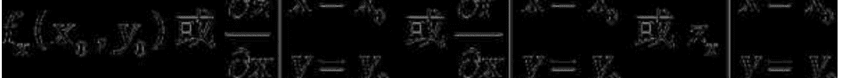

。

求偏导时可把另一变量视作常数，用常规求导法则，例如 $z=3x^2+xy$ 对 $x$ 的偏导为 $z_x=6x+y$，此时 $y$ 起到系数的作用。

偏导数的几何意义是曲面 $z=f(x,y)$ 与平面 $x=x_0$ 或 $y=y_0$ 的截线在 $y=y_0$ 或 $x=x_0$ 处的切线斜率。

### 1.2.2 导数与偏导数的异同
两者本质相同，都是自变量增量趋于零时，函数增量与自变量增量比值的极限。一元函数中一个 $y$ 对应一个 $x$，导数唯一；二元函数中一个 $z$ 对应 $x$ 与 $y$，于是出现两个导数：$z$ 对 $x$ 的偏导与 $z$ 对 $y$ 的偏导。求偏导时把非求导变量固定，仅对目标变量求导，从而把问题化为一元求导。

## 1.3 特征值与特征向量

### 1.3.1 特征值分解的解读
特征值分解能得到特征值和特征向量。特征值反映特征的重要性，特征向量刻画特征的具体方向。

若非零向量 $\mathbf{v}$ 是矩阵 $\mathbf{A}$ 的特征向量，则可写成

$$\mathbf{A}\mathbf{v} = \lambda\mathbf{v}$$

## 1.4 概率分布与随机变量

### 1.4.1 机器学习为何需要概率
事件发生的可能性即概率。单次随机试验结果偶然，但大量重复试验呈现稳定规律。

机器学习既要处理不确定量，也要处理随机量。不确定性和随机性来源多样，概率论用于量化不确定。

概率论在机器学习中居核心地位，因为算法设计多基于数据上的概率假设。课堂上 Andrew Ng 的朴素贝叶斯即条件独立假设的例子，用来判断邮件是否为垃圾邮件。假设在邮件是否为垃圾的条件下，词 1 出现的概率与词 2 出现的概率相互独立。实际上该假设并不完全成立，部分词常共现。但实践中该简化假设影响有限，分类效果仍快速且可靠。

### 1.4.2 变量和随机变量的区别
随机变量是描述随机现象结果的变量，如一段时间内车站候车人数、电话交换台呼叫次数等。

变量在取值概率不为 1 时即为随机变量；随机变量在取某值概率为 1 时退化为确定变量。

例如变量 $x$ 取 100 的概率为 1，则 $x=100$ 完全确定；若取 50 的概率 0.5，取 100 的概率 0.5，则该变量随条件变化，是随机变量。

### 1.4.3 随机变量与概率分布的关系
随机变量仅说明可能取值的集合，必须配上概率分布才能确定各状态的可能性。概率分布即描述随机变量取值可能性的规律。

随机变量分为离散型与连续型，对应描述函数为：

（1）概率质量函数 PMF：描述离散型，通常用大写 $P$ 表示。
（2）概率密度函数 PDF：描述连续型，通常用小写 $p$ 表示。

### 1.4.4 离散型随机变量与概率质量函数
概率质量函数把每个可能状态映射为取得该状态的概率。

一般记 $P(x)$ 为 $X=x$ 的概率。为避免混淆也可写 $P(X=x)$。先定义随机变量，再说明其服从的分布 $X\sim P(X)$。

若 $P$ 是随机变量 $X$ 的概率质量函数，需满足：
- （1）定义域为全部可能状态集合。
- （2）$\forall x\in X$，$0\le P(x)\le 1$。
- （3）$\sum_{x\in X} P(x)=1$。

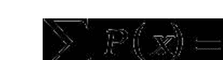

### 1.4.5 连续型随机变量与概率密度函数
若 $p$ 为 $x$ 的概率密度函数，需满足：
- （1）定义域为 $x$ 的全部可能状态。
- （2）$\forall x\in X$，$p(x)\ge 0$。不要求 $p(x)\le1$，因为 $p(x)$ 为相对密度，具体概率需积分。
- （3）$\int p(x)dx=1$。

注：$p(x)$ 本身不给出某一点的概率，而是密度。落在无穷小区域 $\sigma(x)$ 内的概率近似为 $p(x)\sigma(x)$。点概率不可求，但区间 $[a,b]$ 的概率为

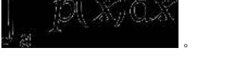

### 1.4.6 条件概率的直观理解
条件概率公式：

$$P(A|B) = P(A \cap B) / P(B) \quad (1-22)$$

说明：在样本空间 $\Omega$ 中，对事件 $A、B$，若随机抽取元素属于 $B$，则再抽取属于 $A$ 的概率定义为在 $B$ 发生条件下 $A$ 的条件概率。文氏图如图1-1。

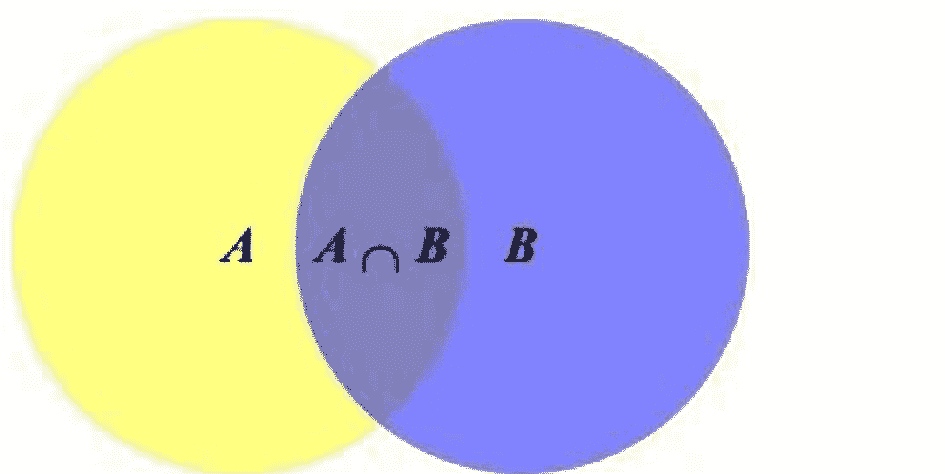

图1-1 条件概率的文氏图

由图可知在 $B$ 发生时 $A$ 发生的概率为 $P(A\cap B)/P(B)$。

例：一对夫妻有两孩，已知其中一个是女孩，另一个也是女孩的概率？

穷举法：已知一孩为女，样本空间为 女男、女女、男女，概率为 $1/3$。

条件概率法：$P(\text{女}|\text{女})=P(\text{女女})/P(\text{女})$。样本空间 女女、男女、女男、男男，$P(\text{女女})=1/4$，$P(\text{女})=1-P(\text{男男})=3/4$，结果 $1/3$。男女与女男是姐弟与兄妹的不同情况。

### 1.4.7 联合概率与边缘概率的对比
**区别**
联合概率：多元分布中多个随机变量同时满足各自条件的概率，如 $P(X=a,Y=b)$。
边缘概率：单个随机变量发生的概率，与其他变量无关，如 $P(X=a)$、$P(Y=b)$。

**联系**
已知联合概率可求边缘概率；仅知边缘概率无法反推联合概率。

### 1.4.8 条件概率的链式法则
由条件概率定义可得乘法公式。若 $P(A)>0$，则

$$P(AB) = P(B|A)P(A) \quad (1-23)$$

推广到三事件：

$$P(ABC) = P(C|AB)P(B|A)P(A) \quad (1-24)$$

一般地可证：

$$P(A_1A_2\cdots A_n) = P(A_n|A_1A_2\cdots A_{n-1})P(A_{n-1}|A_1A_2\cdots A_{n-2})\cdots P(A_2|A_1)P(A_1)$$

$$= P(A_1)\prod_{i=2}^{n} P(A_i|A_1A_2\cdots A_{i-1}) \quad (1-25)$$

任何多维联合分布都可写成若干条件概率的乘积。

### 1.4.9 独立性与条件独立性
**独立性**
随机变量 $x$ 与 $y$ 的联合分布可分解为仅含 $x$ 的因子与仅含 $y$ 的因子之积，则二者独立。

条件存在时可能使不独立变独立，也可能使独立变不独立。

例 $P(XY)=P(X)P(Y)$ 时 $X$ 与 $Y$ 独立。给定 $Z$ 后

$$P(X,Y|Z) \neq P(X|Z)P(Y|Z) \quad (1-26)$$

独立时联合概率等于概率乘积，但无条件独立在实际中很少见。

**条件独立性**
在给定 $Z$ 的条件下 $X$ 与 $Y$ 条件独立，当且仅当

$$X \perp Y | Z \Leftrightarrow P(X,Y|Z) = P(X|Z)P(Y|Z) \quad (1-27)$$

此时 $X$ 与 $Y$ 的关系由 $Z$ 介导。

例：$X$ 为明天下雨，$Y$ 为今天地面湿，$Z$ 为今天下雨。$Z$ 对 $X$、$Y$ 均有影响，但在 $Z$ 已知时，今天地面情况不影响明天降雨判断。

## 1.5 常见概率分布

### 1.5.1 伯努利分布
伯努利分布描述单个二值随机变量，由参数 $\varphi\in[0,1]$ 控制，$\varphi$ 为取 1 的概率。主要性质：

$$P(X=1) = \varphi$$

$$P(X=0) = 1 - \varphi$$

$$P(X=x) = \varphi^x (1-\varphi)^{1-x}$$

期望与方差：

$$E_x[X] = \varphi$$

$$\text{Var}_x(X) = \varphi(1-\varphi)$$

Multinoulli 也称范畴分布，是伯努利从二值扩展到 $k$ 值，常用于分类分布。伯努利适用于离散型随机变量建模。

### 1.5.2 高斯分布
高斯分布即正态分布，概率密度为：

$$N(x; \mu, \sigma^2) = \sqrt{\frac{1}{2\pi\sigma^2}} \exp\left(-\frac{1}{2\sigma^2}(x-\mu)^2\right)$$

其中 $\mu,\sigma$ 为均值与方差，峰值位置由 $\mu$ 决定，宽度由 $\sigma$ 控制，最大值在 $x=\mu$，拐点在 $x=\mu\pm\sigma$。

正态分布下 $\pm1\sigma,\pm2\sigma,\pm3\sigma$ 的概率分别为 68.3%、95.5%、99.73%。

取 $\mu=0,\sigma=1$ 即为标准正态：

$$N(x; \mu, \sigma^2) = \sqrt{\frac{1}{2\pi}} \exp\left(-\frac{1}{2}x^2\right)$$

高效求值：

$$N(x; \mu, \beta^{-1}) = \sqrt{\frac{\beta}{2\pi}} \exp\left(-\frac{1}{2}\beta(x-\mu)^2\right)$$

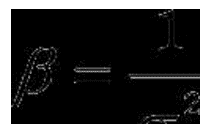

其中 $\beta\in(0,\infty)$ 控制分布精度。

### 1.5.3 何时使用正态分布
缺乏先验知识时默认选择正态分布，原因：
- （1）中心极限定理表明多数独立随机变量之和近似正态，复杂系统常可用正态噪声建模。
- （2）在相同方差下，正态分布是不确定性最大的分布，对模型先验假设最少。

正态可推广到 $\mathbb{R}^n$，称为多维正态，参数为正定对称矩阵 $\Sigma$：

$$N(\mathbf{x}; \boldsymbol{\mu}, \Sigma) = \sqrt{\frac{1}{(2\pi)^n \det(\Sigma)}} \exp\left(-\frac{1}{2}(\mathbf{x}-\boldsymbol{\mu})\Sigma^{-1}(\mathbf{x}-\boldsymbol{\mu})\right) \quad (1-33)$$

高效求值：

$$N(\mathbf{x}; \boldsymbol{\mu}, \beta^{-1}) = \sqrt{\det(\beta)(2\pi)^n} \exp\left(-\frac{1}{2}(\mathbf{x}-\boldsymbol{\mu})^\top \beta (\mathbf{x}-\boldsymbol{\mu})\right) \quad (1-34)$$

此处 $\beta$ 为精度矩阵。

### 1.5.4 指数分布
深度学习中指数分布用于描述在 $x=0$ 处截断的分布，定义为：

$$p(x; \lambda) = \lambda I_{x \geqslant 0} \exp(-\lambda x) \quad (1-35)$$

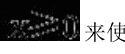

指示函数使负 $x$ 的概率为零。

### 1.5.5 Laplace 分布
密切相关的 Laplace 分布可在任意点 $\mu$ 处设置概率质量的峰值：

$$\text{Laplace}(\mathbf{x}; \boldsymbol{\mu}; r) = \frac{1}{2r} \exp\left(-\frac{|\mathbf{x}-\boldsymbol{\mu}|}{r}\right) \quad (1-36)$$

### 1.5.6 Dirac分布与经验分布

Dirac分布的特点是把整个概率质量都堆积在单一位置上。对应的Dirac δ 函数，也称单位脉冲，其形式定义为：

$$p(x) = \delta(x - \mu), x \neq \mu \quad (1-37)$$

$$\int_{a}^{b} \delta(x - \mu) \mathrm{d}x = 1, a < \mu < b \quad (1-38)$$

在经验分布的构建里，Dirac分布经常被作为基本单元使用：

$$\hat{p}(x) = \frac{1}{m} \sum_{i=1}^{m} \delta(x - x^{(i)}) \quad (1-39)$$

给定 m 个样本点 $x^{(1)}, x^{(2)}, \dots, x^{(m)}$，经验分布的做法就是把概率质量 $1/m$ 均等地分配给这些点。

从训练集进行模型训练的角度看，可以把训练集诱导出的经验分布视作数据的采样来源指示。

当处理连续型随机变量的经验近似时，Dirac δ 函数是常用工具。

## 1.6 均值、方差、协方差及相关系数

### 1.6.1 期望的概念

在概率与统计中，数学期望即均值，用 $E$ 表示，它是所有可能结果与其概率乘积的累加，反映了随机变量的平均水平。

- 线性性质：

$$E(ax+by+c) = aE(x) + bE(y) + c \quad (1-40)$$

- 推广写法：

$$E(\sum_{i=1}^{n} a_i x_i + c) = \sum_{i=1}^{n} a_i E(x_i) + c \quad (1-41)$$

- 函数的期望：对 $x$ 的函数 $f(x)$ 求期望

离散情形：

$$E(f(x)) = \sum_{k=1}^{n} f(x_k) p(x_k) \quad (1-42)$$

连续情形：

$$E(f(x)) = \int_{-\infty}^{+\infty} f(x) p(x) dx \quad (1-43)$$

使用期望时需注意：

（1）Jensen不等式成立，即函数期望不小于期望的函数，

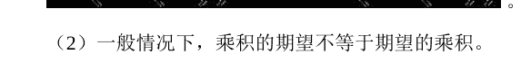

。

（2）一般情况下期望的乘积不等于乘积的期望。

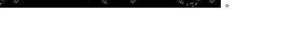

（3）若 $x$ 与 $y$ 独立，则

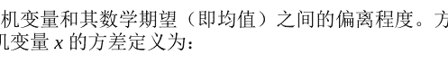

。

### 1.6.2 方差的定义

方差衡量随机变量偏离其均值的波动幅度，记作Var，是一种特殊的期望。离散随机变量 $x$ 的方差定义为：

$$Var(x) = E((x - E(x))^2) \quad (1-44)$$

等价表达为：

$$Var(x) = E(x^2) - E(x)^2 \quad (1-45)$$

其性质包括：

- 常数的方差为0。
- 方差不具备线性可加性。
- $x$ 与 $y$ 独立时

$$\text{Var}(ax+by) = a^2\text{Var}(x) + b^2\text{Var}(y) \qquad (1\text{-}46)$$

### 1.6.3 协方差的理解

协方差刻画两个变量的线性相关程度与尺度，记作Cov。两随机变量 $x$、$y$ 的协方差定义为：

$$\text{Cov}(x, y) = E((x - E(x))(y - E(y))) \qquad (1\text{-}47)$$

方差是协方差的特例，当 $x=y$ 时，

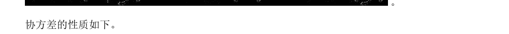

协方差的典型性质：

- (1) 独立变量的协方差为0。
- (2) 计算可展开为：

$$\text{Cov}\left(\sum_{i=1}^{m} a_i x_i, \sum_{j=1}^{m} b_j y_j\right) = \sum_{i=1}^{m} \sum_{j=1}^{m} a_i b_j \text{Cov}(x_i, y_j) \qquad (1\text{-}48)$$

- (3) 在特定条件下，结合方差与协方差可得到：

$$\text{Cov}(a + bx, c + dy) = bd\text{Cov}(x, y) \qquad (1\text{-}49)$$

### 1.6.4 相关系数解读

相关系数记作Corr，用来衡量变量间线性相关强弱。定义为：

$$\text{Corr}(x, y) = \frac{\text{Cov}(x, y)}{\sqrt{\text{Var}(x)\text{Var}(y)}} \qquad (1\text{-}50)$$

其性质如下：

- (1) 有界性。取值范围为[-1,1]，属于无量纲的协方差。
- (2) 数值越接近1，正线性相关越强；越接近-1，负线性相关越强；等于0时线性相关性不明显。

# 第2章 机器学习入门概览

机器学习的雏形可追溯至20世纪50年代。1959年，任职于IBM的Arthur Samuel做出了一个会下棋的程序，该程序通过对弈不断提升自身水平，由此“机器学习”一词被提出。它融合了概率论、优化理论、统计学等多个学科，并在计算机上实现自主获取新知识与改进能力。机器学习是人工智能的重要分支，目前已涌现支持向量机、回归、决策树、随机森林、强化学习、集成学习、深度学习等众多方法，在数据预测、自动化、自动决策、优化等任务中发挥作用。本章将介绍机器学习基本概念、监督学习、分类算法、逻辑回归、损失与代价函数、线性判别分析、主成分分析、决策树、支持向量机、EM算法、聚类与降维，以及模型评估指标等内容。

## 2.1 核心概念速览

### 2.1.1 机器学习到底在学什么

机器学习即让机器学习。机器指计算机，是算法运行的载体，也可把算法本身视作有输入输出的机器。那么学什么？面对一个任务及其评价标准，设计算法从数据中挖掘规律，这就是机器学习。若输入数据带标签，则为监督学习；无标签则为无监督学习。

### 2.1.2 神经网络是什么

神经网络是按规则连接多个神经元形成的网络，不同网络连接方式不同。以全连接神经网络为例，第 N 层每个神经元都与第 N-1 层全部神经元相连，前一层的输出即为后一层的输入。其特点为：

- （1）包含输入层、隐含层、输出层三种层。
- （2）同层神经元之间无连接。
- （3）每条连接都对应一个权值。

神经网络架构

图2-1为一个神经网络系统示意，由多层构成。输入层接收信息，如猫的图片；输出层给出判断结果——是否为猫；隐含层负责信息传递与加工。

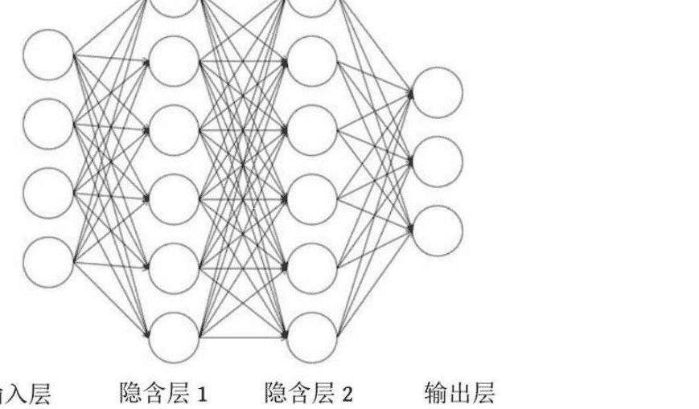

图2-1 神经网络系统

### 2.1.3 常见算法一览

在实际任务中会接触到各类算法，图2-2展示了常见算法的分布。

### 2.1.4 计算图中的求导

计算图的导数计算借助反向传播，核心是链式法则与隐式求导。

设 $z = f(u, v)$ 在 $(u, v)$ 可微，$u,v$ 关于 $t$ 可导，则

$$\frac{dz}{dt} = \frac{\partial z}{\partial u} \frac{du}{dt} + \frac{\partial z}{\partial v} \frac{dv}{dt} \quad (2-1)$$

文字理解为：复合函数的导数等于外层函数在内层取值处的导数乘以内层函数导数。

举例说明：

$$f(x) = x^2, g(x) = 2x + 1 \quad (2-2)$$

则：

$$f[g(x)]' = 2[g(x)] \times g'(x) = 2[2x+1] \times 2 = 8x + 4 \quad (2-3)$$

| 回归算法 | 分类算法 | 正则化方法 |
| :---: | :---: | :---: |
|  |  |  |
| 决策树学习 | 贝叶斯方法 | 基于核的算法 |
|  |  |  |
| 聚类算法 | 关联规则学习 | 人工神经网络 |
|  |  |  |
| 深度学习 | 降低维度算法 | 集成算法 |
|  |  |  |

图2-2 各种常见算法的图示

### 2.1.5 局部最优与全局最优

柏拉图曾问苏格拉底何为爱情。苏格拉底让他到麦田只许回头一次摘最大麦穗，柏拉图空手而归，原因是总担心前面更好。苏格拉底说这就是爱情。故事提示：因不确定性，全局最优往往难以或不存在，我们常需限定范围寻找局部最优，有所收获总好过空手。

随后柏拉图又问何为婚姻。苏格拉底让他到树林挑一棵做圣诞树的树，同样不许回头。柏拉图拖回一棵尚可但非最佳的树，理由是体力时间已耗尽。苏格拉底说这就是婚姻。

因此优化分为局部最优与全局最优。局部最优指在有限区域内函数值最小，可能大于远处点的值；全局最优指在整个定义域内函数值最小，不大于任何点的值。

### 2.1.6 大数据与深度学习的联系

先给出三者简述。

大数据通常指超出常规软件采集、管理、处理能力的数据集。

机器学习关注计算机如何模仿人类学习行为，获取新知识、技能并改善自身性能。

数据挖掘是发现数据模式的算法应用，重点在于应用而非算法本身。数据挖掘是流程，机器学习算法常作为其中提取模式的工具。

二者关系如下：

- （1）深度学习模拟大脑机制，可从对象行为等多个层面学习。
- （2）深度学习推动大数据发展，对数据分析、挖掘、建模各阶段都有助力。
- （3）深度学习改变了问题解决思维，从端到端围绕最终优化目标处理数据。
- （4）大数据场景下的深度学习需要框架或系统支撑，把海量数据通过深度分析转化为现实价值。

## 2.2 学习范式分类

依据数据类型不同，建模方式也不同。机器学习主要分为监督学习、无监督学习、半监督学习和弱监督学习。

### 2.2.1 监督学习

监督学习使用带正确答案的示例训练网络，已知数据及其对应标签，学习输入到标签的映射。

常见场景：分类与回归。

代表算法：支持向量机、朴素贝叶斯、逻辑回归、K近邻、决策树、随机森林、AdaBoost、线性判别分析等。深度学习多以监督方式呈现。

### 2.2.2 非监督学习

数据不带明确标识，适用于有数据集但无标签的情况，目标是挖掘数据内在结构。

常见场景：关联规则学习与聚类。

代表算法：Apriori算法、k-Means算法。

### 2.2.3 半监督学习

输入数据部分有标记部分无标记，先对已标记数据建模，再对未标记数据进行预测。

常见场景：分类与回归。

代表算法：图论推理、拉普拉斯支持向量机等，以及对监督算法的扩展。

### 2.2.4 弱监督学习

可看作标签质量不一的集合，标签可能缺失、错误、冗余或仅为局部信息。训练时已知弱标签，学习映射到更强标签。强弱取决于标签信息量，如分类标签相对分割标签更弱。

代表问题：已知含气球的图片弱标签，求气球位置与分割线。

在企业应用中监督与无监督模型最常用，图像识别等领域因无标注数据多、少量有标注数据，半监督学习备受关注。

### 2.2.5 监督学习模型的搭建步骤

监督学习用带明确标识的示例训练网络。下面以从照片库识别气球为例说明搭建流程。

#### （1）数据集的创建和分类

浏览照片数据集，标注包含气球的样本，再将数据划分为训练集与验证集。目标是找到一个函数，输入任意照片，含气球输出1，否则输出0。

#### （2）数据增强

原始收集的数据往往缺乏多样扰动信息。数据质量直接影响预测能力，因此通常进行旋转、平移、颜色变换、裁剪、仿射变换等增强。

#### （3）特征工程

特征工程包括提取与选择。手工特征有SIFT、HOG等，因其启发式设计，组合时可能冲突，需通过选择最大化判别性。深度学习兴起后，卷积神经网络本身承担了特征提取与选择功能，网络结构、正则化、归一化等可视作深度学习下的特征工程。

#### （4）构建预测模型和损失函数

将原始数据映射到特征空间后构建预测模型，使输出与标签一致。常用损失函数有交叉熵、均方误差等。通过优化迭代使模型从初始化逐步获得预测能力，这即为学习过程。

#### （5）训练

设定模型与超参数，如SVM的核函数、惩罚权重等。初始化后输入特征数据，用优化方法减小输出与标签差距，满足停止条件后得到训练模型。梯度下降及其变种是最常用的优化手段，要求目标函数可导。

#### （6）验证和模型选择

训练完成后用验证集测试模型能否准确挑选出含气球照片，以此评估与选择模型。

在模型构建的迭代里，我们往往会围绕超参数反复跑第 2 轮训练和第 3 轮验证，比如调整网络里神经元的数量、层数、激活函数的选择、损失函数的形式，以及在反向传播时如何更高效地更新权重。

#### （7）模型上线实战
当模型达到可用精度后，就可以把它集成到业务系统。常见做法是将预测能力封装成 API 接口供外部调用，应用层通过调用该接口完成推理并返回结果。

## 2.3 分类算法
分类与回归是刻画现实问题的两种思路。分类模型的输出是离散标签，例如物种划分；回归模型的输出是连续数值，例如身高随时间的变化。实际建模时选用哪种范式，取决于对任务本质的理解。

### 2.3.1 常用分类算法的优缺点
下面对主流分类方法做简要盘点，如表2-1所示。

表2-1 常用分类算法的优缺点

| 算法 | 优点 | 缺点 |
|---|---|---|
| Bayes（贝叶斯分类） | 1. 待估参数少，对缺失值容忍度高。2. 数学基础扎实，分类稳定性好 | 1. 假设特征间相互独立，现实中常不成立，如爱吃番茄、鸡蛋却不喜欢番茄炒鸡蛋。2. 需要先验概率。3. 决策会带有一定的误判率 |
| Decision Tree（决策树） | 1. 无需先验领域知识或参数假设。2. 对高维数据友好。3. 结构直观易解释。4. 处理大规模数据速度快且效果可接受。5. 同时支持数值型和类别型属性 | 1. 信息增益易偏向样本量大的类别。2. 容易过拟合。3. 难以捕捉属性间相关性。4. 不支持增量在线学习 |
| SVM（支持向量机） | 1. 小样本场景下表现可靠。2. 泛化能力强。3. 可处理高维与非线性问题，在文本分类上仍有优势。4. 免去神经网络结构设计和局部最优困扰 | 1. 对缺失值敏感。2. 占用内存大，可解释性弱。3. 训练慢、调参难度高 |
| KNN（K近邻） | 1. 思想简洁，理论成熟，可做分类也可做回归。2. 支持非线性分类。3. 训练阶段复杂度约 O(n)。4. 精度较高，对数据分布无假设，对异常点不敏感 | 1. 预测时计算开销大。2. 类别不平衡时易误判。3. 内存需求高。4. 输出难以解释 |
| Logistic Regression（逻辑回归） | 1. 训练速度快。2. 模型简洁，特征权重一目了然。3. 便于增量更新，吸收新样本。4. 给出概率输出，可灵活调整阈值 | 特征预处理要求高，需做归一化等工程化工作 |
| Neural Network（神经网络） | 1. 分类精度上限高。2. 并行计算能力强。3. 支持分布式存储与学习。4. 对噪声鲁棒性较好 | 1. 参数众多，包括拓扑、阈值等。2. 结果可解释性差。3. 训练耗时长 |
| Adaboosting（自适应增强） | 1. 精度较高。2. 可配合多种弱分类器使用，提供通用框架。3. 使用简单弱分类器时结果可读，弱分类器构建简单。4. 流程简洁，无需特征筛选。5. 对过拟合不敏感 | 对异常值比较敏感 |

### 2.3.2 分类算法的评估方法
评估的核心是判断分类器好坏，实际使用中需要综合多项指标挑选合适的度量。

#### 几个常用术语
假设二分类任务分为正例 Positive 和负例 Negative。

- （1）True Positives（TP）：实际为正且被判为正的样本数。
- （2）False Positives（FP）：实际为负却被判为正的样本数。
- （3）False Negatives（FN）：实际为正却被判为负的样本数。
- （4）True Negatives（TN）：实际为负且被判为负的样本数。

表2-2 是四类结果的混淆矩阵。

- （1）P = TP + FN 为实际正例总数。
- （2）True、False 反映预测是否正确。
- （3）Positive、Negative 为模型输出。若把正例记为1、负例记为-1，用1代表True、-1代表False，则实际标签 = TF × PN。以此可验证 TP 实际为正，FP 实际为负，FN 实际为正，TN 实际为负。

表2-2 4个术语的混淆矩阵

| 预测类别 | Yes | No | 总计 |
| :--- | :--- | :--- | :--- |
| 实际类别 | Yes | TP | FN | P（实际为Yes） |
| | No | FP | TN | N（实际为No） |
| 总计 | P'（被划分为Yes） | N'（被划分为No） | P+N |

#### 二分类算法评价指标
- （1）正确率（accuracy）
最常用的整体指标，accuracy = (TP + TN) / (P + N)。被正确划分的比例越高越好。
- （2）错误率（error rate）
与正确率相对，error rate = (FP + FN) / (P + N)。分对与分错互斥，故 accuracy = 1 - error rate。
- （3）灵敏度（sensitivity）
sensitivity = TP / P，表示正例中被正确识别的比例，反映对正类的捕捉力。
- （4）特异性（specificity）
specificity = TN / N，表示负例中被正确识别的比例，反映对负类的区分力。

#### （5）精度（precision）
precision=TP/（TP+FP），度量被判为正的样本里真正为正的比例。

#### （6）召回率（recall）
recall=TP/（TP+FN）= TP/ P =sensitivity，度量实际正例中有多少被找回。

#### （7）其他评价指标
- 计算速度：训练与预测所需时间；
- 鲁棒性：对缺失值和异常值的容忍度；
- 可扩展性：在大规模数据上的表现；
- 可解释性：预测依据是否易懂，如决策树的规则易读，神经网络则常被视作黑盒。

#### （8）精度和召回率反映了分类器分类性能的两个方面。如果综合考虑精度与召回率，可以得到新的评价指标F1分数，也称为综合分类率：

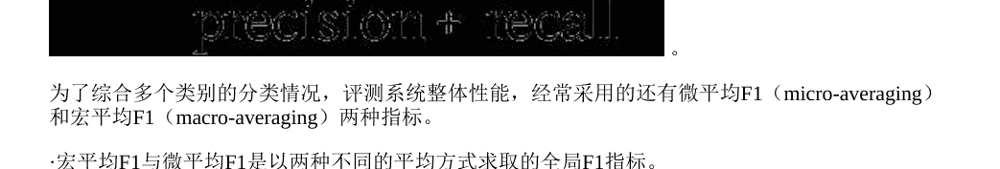

为了兼顾多类情况，常用微平均F1与宏平均F1。

- 宏平均F1与微平均F1是两种聚合方式得到的全局F1。
- 宏平均F1先分别计算各类别F1再求算术平均，平等对待每个类别，受稀有类影响更大。
- 微平均F1先累加各类别的计数再计算F1，平等对待每个样本，受常见类影响更大。

如图2-3所示，ROC曲线以灵敏度为纵轴，以1-特异性为横轴绘制。可把多个模型曲线放在同一坐标系比较，曲线越贴近左上角越可靠。AUC即曲线下面积，数值越大模型越好。

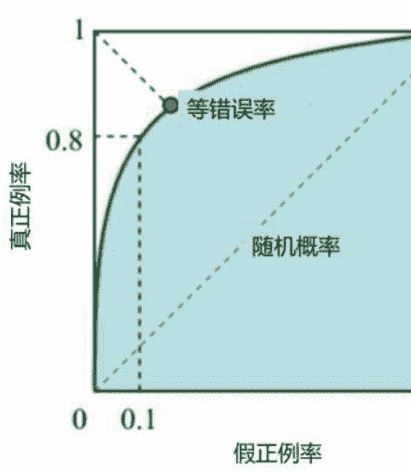

图2-3 ROC曲线

PR曲线以召回率为横轴、精度为纵轴描述两者关系，其下面积即平均精度 Average Precision，AP 越高性能越好。

### 2.3.3 正确率能否很好地评估分类算法
不同算法在不同数据上的表现差异很大，评估需结合具体任务。决策树常看正确率，但对其他模型仅靠正确率不足。

正确率直观却不全能。例如地震预测，标签0为不发生、1为发生，不发生的概率极大。若模型对所有样本都判0，可达99%正确率，却在真正发生地震时完全失效。原因在于类别极度不平衡，少数类被错分仍能维持高正确率，而研究者最关心的正是少数类。

### 2.3.4 什么样的分类器是最好的
单一任务下不可能同时最优化所有指标。若能100%分对所有样本则最优，但现实中难以达成。以地震预测为例，允许一定误报。设1000次预测中有5次报警，实际发生1次，其余4次为误报。正确率从99.9%降至99.6%，召回率却从0%升至100%。虽有4次误报，却未漏报真实事件，这样的模型更具实用价值。在保证可接受正确率的前提下，尽可能提高召回率往往更有意义。

## 2.4 逻辑回归
按目标差异，回归问题可分为回归与分类。本节介绍回归分支、逻辑回归的应用场景，以及与朴素贝叶斯、线性回归的区别。

### 2.4.1 回归的种类
依据因变量分布，广义线性模型可划分为：

（1）因变量连续，为多重线性回归。
（2）服从二项分布，为逻辑回归。
（3）服从泊松分布，为泊松回归。
（4）服从负二项分布，为负二项回归。
（5）逻辑回归的因变量可为二分类也可为多分类，二分类更常用且解释更直接。

### 2.4.2 逻辑回归适用性
逻辑回归可用于：

（1）概率预测。输出不同自变量取值下事件发生的概率，便于横向比较。
（2）分类。根据概率设定阈值，高于阈值归一类，低于阈值归另一类。
（3）风险因子挖掘，如疾病危险因素分析。
（4）仅适用于线性可分问题。注意：已知关系非线性时不适用；使用时应选择与目标线性相关的特征。
（5）特征间不必满足条件独立，各特征贡献可独立计算。

### 2.4.3 逻辑回归与朴素贝叶斯的区别
（1）逻辑回归属判别模型，朴素贝叶斯属生成模型，两者差异涵盖生成与判别的本质不同。
（2）朴素贝叶斯依赖贝叶斯定理，逻辑回归本质是极大似然估计。
（3）朴素贝叶斯要求自变量条件独立。
（4）逻辑回归要求特征与目标呈线性关系。

### 2.4.4 线性回归与逻辑回归的区别
（1）因变量类型不同。线性回归因变量连续，逻辑回归因变量离散，通常为0/1。
（2）拟合函数本质不同。

线性回归：

$$f(\mathbf{x}) = \boldsymbol{\theta}^T \mathbf{x} = \theta_1 x_1 + \theta_2 x_2 + ... + \theta_n x_n$$

逻辑回归：

$$f(\mathbf{x}) = P(y=1|\mathbf{x}; \boldsymbol{\theta}) = g(\boldsymbol{\theta}^T \mathbf{x}), \text{其中}, g(z) = \frac{1}{1+e^{-z}}$$

线性回归拟合的是自变量对因变量y的直接映射，逻辑回归拟合的是属于1类的概率。

当 θ^T x = 0 时为决策边界。若 θ^T x > 0，则 y > 0.5，趋近1为1类；若 θ^T x < 0，则 y < 0.5，趋近0为0类。

因此在线性回归中 θ^T x 是预测值，在逻辑回归中 θ^T x 是划分边界。

表2-3为线性回归和逻辑回归的区别。

#### 表2-3 线性回归和逻辑回归的区别

| | 线性回归 | 逻辑回归 |
|---|---|---|
| 目的 | 预测 | 分类 |
| y^(i) | (-∞, +∞) | (0,1) |
| 函数 | 拟合函数 | 预测函数 |
| 参数计算方式 | 最小二乘法 | 极大似然估计 |

拟合函数经逻辑变换后得到预测函数，使得

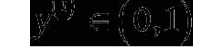

最小二乘法使估计值与观测值的平方误差最小；极大似然估计使抽取该组样本的概率最大，即让似然函数最大化。

## 2.5 代价函数
代价函数定义在整个训练集上，是所有样本损失的均值。本节介绍其作用、原理、常见形式，以及为何需要非负、为何常用交叉熵替代二次代价。

### 2.5.1 为什么需要代价函数
训练逻辑回归需目标函数，通过优化代价函数求得最优参数。

### 2.5.2 代价函数作用原理
回归问题求解常用平方误差代价函数。假设函数形态如图2-4所示，参数变化会改变函数形状。

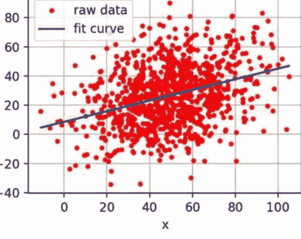

图2-4 函数图像

为贴合离散点，需寻找使直线最好代表数据的参数。平方误差的思想是比较真实值与拟合值的偏差，量化差距。为弱化极端值影响，常采用方差形式并乘以1/2。于是得到：

$$J(\theta_0, \theta_1) = \frac{1}{m} \sum_{i=1}^{m} (h(x^{(i)}) - y^{(i)})^2 \quad (2-4)$$

最优解即 J(θ0,θ1) 的最小值。单参数时可用二维曲线观察，多参数时则为更高维曲面。

当参数为2个时，代价函数呈三维形态，如图2-5所示。

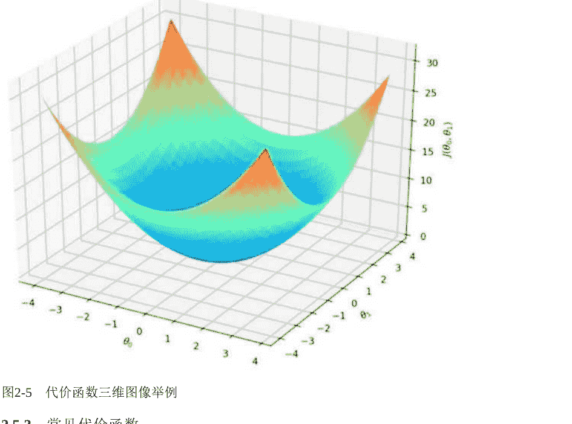

图2-5 代价函数三维图像举例

### 2.5.3 常见代价函数
二次代价函数（Quadratic Cost）

$$J = \frac{1}{2n} \sum_{x} \|y(x) - a^L(x)\|^2 \quad (2-5)$$

在神经网络的优化记号里，J 记作整体成本，x 代表训练样本，y 对应真实标签，a 为网络给出的预测，n 统计样本总量，L 描述网络层数。以单个样本来观察，二次型成本写成：

$$J = \frac{(y - a)^2}{2} \quad (2-6)$$

如果借助梯度下降修正参数，权重 w 与偏置 b 的偏导形式为：

$$\frac{\partial J}{\partial w} = (a - y)\sigma'(z)x, \quad \frac{\partial J}{\partial b} = (a - y)\sigma'(z) \quad (2-7)$$

式中 z 为神经元的净输入，σ 为激活映射。可以看出 w、b 的改变量与 σ 的导数值正相关，导数越大参数步长越大，收敛通常也越快。

注：神经网络里常用的激活是 sigmoid，其形状见图2-6。

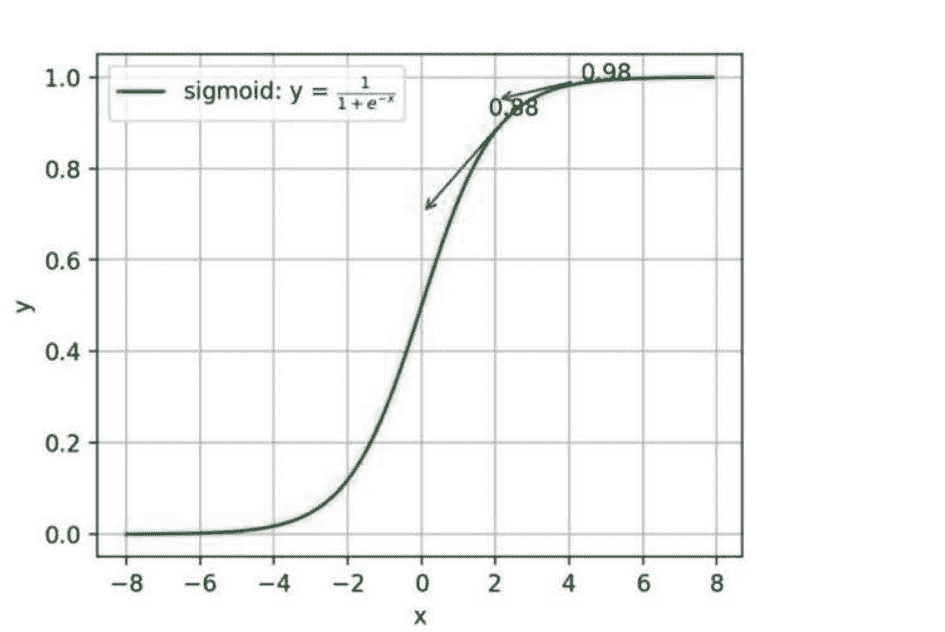

图2-6 sigmoid函数曲线

做 0.88 与 0.98 两个输出的对比：

目标设为 1.0 时，0.88 与目标还有一段距离，对应梯度较大，权值修正幅度也较大；0.98 已经非常接近，梯度变小，调整趋缓。这种节奏是合理的。

若目标为 0，则 0.88 与 0 的距离更近，却得到更大的梯度与更大的调整；0.98 距离 0 更远，梯度反而更小，调整更小。这种节奏就不合理。

根源在于 sigmoid 设定下，初始误差越大，学习反而越慢。

交叉熵代价函数（Cross-Entropy）

$$J = -\frac{1}{n}\sum_{x}[y\ln a + (1-y)\ln(1-a)] \quad (2-8)$$

此处的 J 用作整体成本，x 为样本，y 为真实值，a 为输出值，n 为样本总数。

权重 w 与偏置 b 的偏导写成：

$$\frac{\partial J}{\partial w_j} = \frac{1}{n}\sum_{x}x_j(\sigma(z)-y), \frac{\partial J}{\partial b} = \frac{1}{n}\sum_{x}(\sigma(z)-y) \quad (2-9)$$

误差幅度增大时，对应梯度也随之放大，w 与 b 的修正更快，训练速度提升。

二次成本更适合输出层为线性单元的情形，交叉熵成本更适合输出层为 S 型激活的情形。

对数似然代价函数（Log-likelihood Cost）

对数似然成本常被用作 softmax 回归的成本。深度网络最后通常接 softmax，此时常用的成本就是对数似然。

对数似然与 softmax 的组合，与交叉熵与 sigmoid 的组合在思想上很像。对数似然在二分类时可化为交叉熵的形式。

在 TensorFlow 中，sigmoid 搭配的交叉熵是 tf.nn.sigmoid_cross_entropy_with_logits()；softmax 搭配的交叉熵是 tf.nn.softmax_cross_entropy_with_logits()。

在 PyTorch 中，sigmoid 搭配的交叉熵是 torch.nn.BCEWithLogitsLoss()；softmax 搭配的交叉熵是 torch.nn.CrossEntropyLoss()。

### 2.5.4 为什么代价函数要非负

目标函数多数设有下界。在优化过程中，若算法能持续让目标变小，结合单调有界准则就能证明收敛有效。

只要目标函数具备下界即可，非负的成本会让优化过程更简洁。

### 2.5.5 为什么用交叉熵代替二次代价函数

这个问题可拆成两部分：二次方成本为何不好用，交叉熵为何更合适。

为什么不用二次方代价函数

假设 w 与 b 的偏导分别为

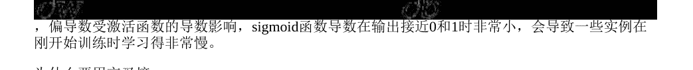

偏导会受激活导数影响。sigmoid 的导数在输出接近 0 或 1 时极小，会导致训练初期部分样本的学习几乎停滞。

为什么要用交叉熵

交叉熵下 w 与 b 的梯度为：

$$\frac{\partial J}{\partial w_j} = \frac{1}{n} \sum_x x_j (\sigma(z) - y), \frac{\partial J}{\partial b} = \frac{1}{n} \sum_x (\sigma(z) - y) \quad (2-10)$$

从式子可见，学习速度取决于 σ(z)-y。误差越大，学习越快，避免了二次成本中因 σ′(z) 过小而导致的缓慢问题。

## 2.6 损失函数

损失函数与代价函数容易混淆。损失函数作用于单个样本，衡量单例误差；代价函数是对整个训练集误差的平均。

### 2.6.1 什么是损失函数

损失函数也称误差函数，用来评估模型预测与真实的偏离程度，是一个非负实值函数，常记作 L(Y, f(x))。损失越小，模型越稳健。

### 2.6.2 常见的损失函数

机器学习通过不断优化目标函数得到结果。在分类与回归任务中，目标函数常就是损失或代价。

损失函数可分为经验风险损失和结构风险损失。经验风险只关注预测与真实的差距，结构风险在此基础上加入正则项。

常用形式如下。

（1）0-1损失函数

预测与目标相等时为 0，不相等时为 1。

$$L(Y, f(x)) = \begin{cases} 1, & Y \neq f(x) \\ 0, & Y = f(x) \end{cases}$$

实际使用中相等条件太苛刻，可放宽为：

$$L(Y, f(x)) = \begin{cases} 1, & |Y - f(x)| \geqslant T \\ 0, & |Y - f(x)| < T \end{cases}$$

（2）绝对值损失函数

与 0-1 损失类似，表达为：

$$L(Y, f(x)) = |Y - f(x)|$$

（3）平方损失函数

标准形式为：

$$L(Y, f(x)) = (Y - f(x))^2$$

（4）对数损失函数

标准形式为：

$$L(Y, P(Y|X)) = -\log P(Y|X) \quad (2-15)$$

逻辑回归常用的就是对数损失。很多人误以为是平方损失，实则逻辑回归假设样本服从伯努利分布，求似然再取对数极大化，最终得到的经验风险等价于对数损失。

（5）指数损失函数

标准形式为：

$$L(Y, f(x)) = \exp(-Yf(x)) \quad (2-16)$$

例如 AdaBoost 就是以指数损失函数为损失函数的。

（6）Hinge损失函数

标准形式如下：

$$L(y) = \max(0, 1 - ty) \quad (2-17)$$

统一写法为：

$$L(Y, f(x)) = \max(0, Yf(x)) \quad (2-18)$$

其中 y 为预测值，取值范围为（-1,1），t 为目标值，取 -1 或 1。

在线性支持向量机里，最优化可等价于：

$$\arg \min_{w,b} \sum_{i=1}^{N} (1 - y_i(wx_i + b)) + \lambda \|w\|^2 \quad (2-19)$$

上式近似于：

$$\frac{1}{m} \sum_{i=1}^{N} l(wx_i + by_i) + \|w\|^2 \quad (2-20)$$

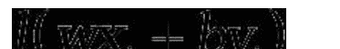

其中 l(wx_i + by_i) 为 Hinge 损失，‖w‖² 可视为正则项。

### 2.6.3 逻辑回归为什么使用对数损失函数

假设逻辑回归模型为：

$$P(y=1|x; \theta) = \frac{1}{1 + e^{-\theta^T x}} \quad (2-21)$$

假设其概率分布为伯努利分布，概率质量函数为：

$$P(X=n) = \begin{cases} 1-p, & n=0 \\ p, & n=1 \end{cases} \quad (2-22)$$

似然函数为：

$$L(\theta) = \prod_{i=1}^{m} P(y=1|x_i)^{y_i} P(y=0|x_i)^{1-y_i}$$

对数似然函数为：

$$\ln L(\theta) = \sum_{i=1}^{m} [y_i \ln P(y=1|x_i) + (1-y_i) \ln P(y=0|x_i)]$$

$$= \sum_{i=1}^{m} [y_i \ln P(y=1|x_i) + (1-y_i) \ln(1-P(y=1|x_i))]$$

对数函数在单点上的定义为：

$$Cost(y, p(y|x)) = -y \ln p(y|x) - (1-y) \ln(1-p(y|x))$$

则整体样本损失为：

$$Cost(y, p(y|x)) = -\sum_{i=1}^{m} [y_i \ln p(y_i|x_i) + (1-y_i) \ln(1-p(y_i|x_i))]$$

可见对数损失与极大似然的对数似然本质相同，故逻辑回归直接采用对数损失。

### 2.6.4 对数损失函数如何度量损失

例如高斯分布中要确定均值与标准差。极大似然估计是常用手段，目标是找到使观测数据概率最大的参数。

为简化计算做两点假设。

1. 各数据点观测概率相互独立。
2. 对联合概率取自然对数。

假设单点 x_i (i=1,2,…,m) 的概率为：

$$P(x_i; \mu, \sigma) = \frac{1}{\sigma\sqrt{2\pi}} \exp\left(-\frac{(x_i-\mu)^2}{2\sigma^2}\right)$$

联合概率为：

$$P(x_1, x_2, \cdots, x_n; \mu, \sigma) = \frac{1}{\sigma\sqrt{2\pi}} \exp\left(-\frac{(x_1-\mu)^2}{2\sigma^2}\right)$$

$$\times \frac{1}{\sigma\sqrt{2\pi}} \exp\left(-\frac{(x_2-\mu)^2}{2\sigma^2}\right) \times \cdots \times \frac{1}{\sigma\sqrt{2\pi}} \exp\left(-\frac{(x_n-\mu)^2}{2\sigma^2}\right)$$

取自然对数得：

$$\ln(P(x_1, x_2, \cdots, x_n; \mu, \sigma)) = \ln\left(\frac{1}{\sigma\sqrt{2\pi}}\right) - \frac{(x_1 - \mu)^2}{2\sigma^2} + \ln\left(\frac{1}{\sigma\sqrt{2\pi}}\right) - \frac{(x_2 - \mu)^2}{2\sigma^2} + \cdots + \ln\left(\frac{1}{\sigma\sqrt{2\pi}}\right) - \frac{(x_n - \mu)^2}{2\sigma^2}$$

(2-29)

按对数法则可化简为：

$$\ln(P(x_1, x_2, \cdots, x_n; \mu, \sigma)) = -n\ln(\sigma) - \frac{n}{2}\ln(2\pi) - \frac{1}{2\sigma^2}\left[(x_1 - \mu)^2 + (x_2 - \mu)^2 + \cdots + (x_n - \mu)^2\right]$$

(2-30)

求导得到：

$$\frac{\partial \ln(P(x_1, x_2, \cdots, x_n; \mu, \sigma))}{\partial \mu} = \frac{n}{\sigma^2}\left[\mu - (x_1 + x_2 + \cdots + x_n)\right]$$

(2-31)

等式左半部即为对数损失。损失越小越好，令其为 0 可得：

$$\mu = \frac{x_1 + x_2 + \cdots + x_n}{n}$$

(2-32)

同理可求 σ。

## 2.7 梯度下降法

梯度下降法（Gradient Descent，GD）是常用的最优化方法，常用于机器学习中逐次逼近最小偏差模型。

### 2.7.1 梯度下降法的作用

梯度下降在机器学习优化中有多重作用。

1. 它是一种迭代方法，可用于求解最小二乘问题。
2. 在求解模型参数这类无约束优化问题时，主要有梯度下降与最小二乘法。
3. 求损失函数最小值时，可通过梯度下降逐步迭代得到最小损失与最优参数。
4. 若需求最大值，可用梯度上升法，二者可相互转换。

### 2.7.2 梯度下降法的直观理解

梯度下降的经典示意图如图2-7所示。

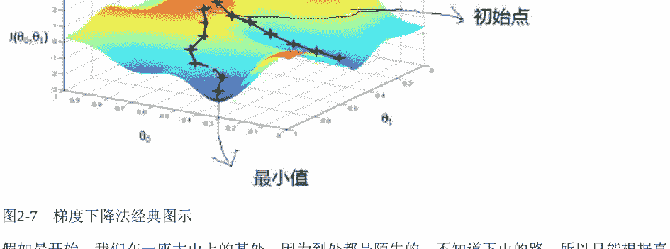

想象在一座大山上某处起步，完全不熟悉下山路线，只能凭直觉摸索。每到一个位置，先算当前位置梯度，沿负梯度方向，也就是当前最陡的方向走一步，再算新位置的梯度，继续沿最陡下坡方向前进。不断循环，有可能到达山脚，也可能卡在局部低洼处。

因此梯度下降不一定找到全局最优，可能得到局部最优。若损失函数为凸函数，则可保证全局最优。

核心思想可归纳为：

1. 随机初始化参数。
2. 迭代执行：计算当前梯度，更新变量，朝最陡下坡方向迈一步，判断是否终止。
3. 得到全局最优或接近全局最优解。

### 2.7.3 梯度下降法算法描述

（1）确定假设函数与损失函数

线性回归假设函数为：

$h_{\theta}(x_1, x_2, \cdots, x_n) = \theta_0 + \theta_1 x_1 + \cdots + \theta_n x_n$ (2-33)

损失函数为：

$J(\theta_0, \theta_1, \cdots, \theta_n) = \frac{1}{2m} \sum_{j=0}^{m} (h_{\theta}(x_0^j, x_1^j, \cdots, x_n^j) - y_j)^2$ (2-34)

（2）参数初始化

初始化 $\theta_i$、步长 $\alpha$、终止阈值 $\zeta$。经验上可将 $\theta$ 设为 0，$\alpha$ 设为 1，当前步长记为 $\varphi_i$，也可随机初始化。

（3）迭代计算

对 $\theta_i$ 计算梯度：

$\frac{\partial}{\partial \theta_i} J(\theta_0, \theta_1, \cdots, \theta_n) = \frac{1}{2m} \sum_{j=0}^{m} (h_{\theta}(x_0^j, x_1^j, \cdots, x_n^j) - y_j)^2$ (2-35)

当前位置下降距离：

$\varphi_i = \alpha \frac{\partial}{\partial \theta_i} J(\theta_0, \theta_1, \cdots, \theta_n)$ (2-36)

判断是否终止，若所有 $\theta_i$ 的下降距离 $\varphi_i$ 都小于 $\zeta$ 则停止，否则继续。

更新所有 $\theta_i$：

$$\theta_i = \theta_i - \alpha \frac{\partial}{\partial \theta_i} J(\theta_0, \theta_1, \cdots, \theta_n)$$ (2-37)

$$\theta_i = \theta_i - \alpha \frac{1}{m} \sum_{j=0}^{m} (h_\theta(x_0^j, x_1^j, \cdots, x_n^j) - y_j) x_i^j$$ (2-38)

先把截距项 $x_0^j$ 固定为 1，完成一次参数刷新后回到步骤（1）继续迭代。

可以看出，当前位置的更新方向并不是由单一样本决定的，而是整个训练集在共同起作用，式子 $\frac{1}{m} \sum_{j=0}^{m} (h_\theta(x_0^j, x_1^j, \cdots, x_n^j) - y_j) x_i^j$ 只是把这种整体依赖关系写得更直观。

### 2.7.4 梯度下降的常见痛点
在工程实践里，梯度下降容易碰到下面这些限制。

1. 靠近最优点时步伐明显变慢，收敛效率急剧下降。
2. 线性搜索阶段往往会出现不稳定现象。
3. 优化轨迹容易形成锯齿状的来回震荡。

梯度本身也有三点需要特别注意。
1. 梯度是同时包含方向和幅度的向量。
2. 它所指的方向正是函数值增长最快的方向。
3. 它的模长等于沿该方向的最大方向导数值。

### 2.7.5 让梯度下降更顺手的调参要点
实际部署时很难一次把参数调到理想状态，主要从以下几方面入手。

1. 步长 $\alpha$ 的选择：初始化时常凭经验设为 1，具体取值要结合数据分布。可以从大到小多试几组，观察损失是否持续下降；若无效就考虑调大。步长过大容易冲过最优点，过小则迭代缓慢、耗时增加。
2. 初始值的选取：起点不同，最终收敛到的极值也可能不同，存在陷入局部最优的风险。只有损失函数为凸时才能保证全局最优。为此需要多次用不同起点跑实验，保留使损失最小的那组结果。
3. 特征归一化：不同特征量纲差异会拖慢收敛。对特征做标准化使均值归零、方差归一，能明显加快迭代并节省运行时间。

### 2.7.6 SGD 与 BGD 的本质差异
Stochastic GD 与 Batch GD 是两类主流实现，本质是在计算开销与收敛稳定性之间做权衡。

假设线性模型为：
$h_{\theta}(x_0, x_1, \cdots, x_n) = \theta_0 x_0 + \theta_1 x_1 + \cdots + \theta_n x_n$ (2-39)
损失函数为：
$J(\theta_0, \theta_1, \cdots, \theta_n) = \frac{1}{2m} \sum_{j=0}^{m} (h_{\theta}(x_0^j, x_1^j, \cdots, x_n^j) - y^j)^2$ (2-40)
其中 $m$ 为样本规模，$j$ 为样本索引。

**逐样本梯度下降的思路**
损失可以拆到单个样本粒度：
$J(\theta_0, \theta_1, \cdots, \theta_n) = \frac{1}{m} \sum_{j=0}^{m} (y^j - h_{\theta}(x_0^j, x_1^j, \cdots, x_n^j))^2 = \frac{1}{m} \sum_{j=0}^{m} \text{Cost}(\theta, (x^j, y^j))$ (2-41)
按单样本梯度更新参数：
$\theta_i = \theta_i + (y^j - h_{\theta}(x_0^j, x_1^j, \cdots, x_n^j)) x_i^j$ (2-42)
每次只用一个样本做一次刷新。噪声比全量方法更大，并非每次迭代都严格沿整体最优方向前进。

**全量梯度下降的思路**
先求整体梯度：
$\frac{\partial}{\partial \theta_i} J(\theta_0, \theta_1, \cdots, \theta_n) = \frac{1}{m} \sum_{j=0}^{m} (h_{\theta}(x_0^j, x_1^j, \cdots, x_n^j) - y^j) x_i^j$ (2-43)
再沿负梯度方向更新：
$\theta_i = \theta_i - \frac{1}{m} \sum_{j=0}^{m} (h_{\theta}(x_0^j, x_1^j, \cdots, x_n^j) - y^j) x_i^j$ (2-44)
每一步都要遍历全部训练数据，数据量越大迭代越慢。

**表2-4 随机梯度下降法和批量梯度下降法对比**

| 方法 | 特点 |
| :--- | :--- |
| 随机梯度下降 | 1. 采用所有数据来进行梯度下降。2. 在样本量很大的时候，训练速度慢 |
| 批量梯度下降 | 1. 用一个样本来进行梯度下降。2. 训练速度很快。3. 仅仅用一个样本决定梯度方向，得到的值有可能不是全局最优解。4. 就收敛速度来说，一次迭代一个样本，导致迭代方向变化很大，不能很快地收敛到局部最优解 |

两者都比较极端，下面介绍兼顾优点的方案。

#### 小批量 Mini-Batch 梯度下降法的求解思路
从 $m$ 个样本中抽取 $n$ 个子样本，满足 $1<n<m$，在子集上迭代更新。其参数 $\theta$ 按梯度方向更新 $\theta_i$：
$$\theta_i = \theta_i - \alpha \sum_{j=t}^{t+n-1} \left( h_\theta(x_0^j, x_1^j, \cdots, x_n^j) - y^j \right) x_i^j \quad (2-45)$$

### 2.7.7 四类梯度下降的性能速览
**表2-5 不同梯度下降法性能比较**

| | BGD | SGD | Mini-batch GD | Online GD |
| :--- | :--- | :--- | :--- | :--- |
| 训练集 | 固定 | 固定 | 固定 | 实时更新 |
| 单次迭代样本数 | 整个训练集 | 单个样本 | 训练集的子集 | 根据具体算法定 |
| 算法复杂度 | 高 | 低 | 一般 | 低 |
| 时效性 | 低 | 一般 | 一般 | 高 |
| 收敛性 | 稳定 | 不稳定 | 较稳定 | 不稳定 |

Online GD 的特点是数据只使用一次便丢弃，可用于捕捉模型随时间的演化趋势。在搜索广告 CTR 预估等互联网场景中，用户点击行为会迁移，BGD 每天全量重训耗时且滞后，Online GD 则能实时依据新的点击行为调整模型。

## 2.8 线性判别分析 LDA 概览
线性判别分析是一种经典的监督降维方法。与 2.9 节的无监督主成分分析不同，LDA 利用类别标签信息进行降维。

### 2.8.1 LDA 的核心思想
LDA 把高维数据投影到一条直线上，把 $d$ 维映射为一维。训练时让同类投影点尽可能靠拢，异类投影点尽可能分离。分类时先投影再按位置判定类别。概括起来就是“类内方差最小化，类间方差最大化”。

### 2.8.2 图解看懂 LDA 投影
假设两类数据都是二维，如图2-8。目标是把数据投影到一维，使类内接近、类间远离，即两类中心距离最大化。
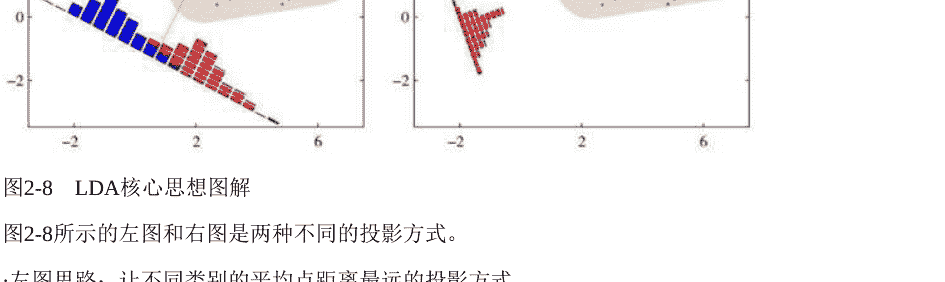
图2-8 LDA核心思想图解

图2-8 左图和右图是两种投影策略。
- 左图思路：追求不同类别平均点距离最远。
- 右图思路：追求同类点聚集更紧密。
右图投影后各类别分布更集中，直方图重叠更少，效果优于左图。若原始数据为多维，投影结果就是低维超平面。

### 2.8.3 二分类 LDA 的推导
输入：数据集
定义：
$N_j$ ($j=0,1$) 为第 $j$ 类样本个数；
$X_j$ ($j=0,1$) 为第 $j$ 类样本集合；
$\boldsymbol{u}_j$ ($j=0,1$) 为第 $j$ 类样本均值向量；
$\boldsymbol{\Sigma}_j$ ($j=0,1$) 为第 $j$ 类样本协方差矩阵。
其中：
$$\boldsymbol{u}_j = \frac{1}{N_j} \sum_{\boldsymbol{x} \in X_j} \boldsymbol{x} (j=0,1), \boldsymbol{\Sigma}_j = \sum_{\boldsymbol{x} \in X_j} (\boldsymbol{x} - \boldsymbol{u}_j)(\boldsymbol{x} - \boldsymbol{u}_j)^T (j=0,1) \quad (2-46)$$
设投影方向为向量 $\boldsymbol{w}$，样本 $\boldsymbol{x}_i$ 的投影为 $\boldsymbol{w}^T \boldsymbol{x}_i$，两类中心投影分别为 $\boldsymbol{w}^T \boldsymbol{u}_0$、$\boldsymbol{w}^T \boldsymbol{u}_1$。
目标是最大化中心距离 $\|\boldsymbol{w}^T \boldsymbol{u}_0 - \boldsymbol{w}^T \boldsymbol{u}_1\|_2^2$，同时最小化类内投影协方差 $\boldsymbol{w}^T \boldsymbol{\Sigma}_0 \boldsymbol{w}$、$\boldsymbol{w}^T \boldsymbol{\Sigma}_1 \boldsymbol{w}$，即最小化 $\boldsymbol{w}^T \boldsymbol{\Sigma}_0 \boldsymbol{w} + \boldsymbol{w}^T \boldsymbol{\Sigma}_1 \boldsymbol{w}$。
定义类内散度矩阵为：
$$\boldsymbol{S}_w = \boldsymbol{\Sigma}_0 + \boldsymbol{\Sigma}_1 = \sum_{\boldsymbol{x} \in X_0} (\boldsymbol{x} - \boldsymbol{u}_0)(\boldsymbol{x} - \boldsymbol{u}_0)^T + \sum_{\boldsymbol{x} \in X_1} (\boldsymbol{x} - \boldsymbol{u}_1)(\boldsymbol{x} - \boldsymbol{u}_1)^T \quad (2-47)$$
定义类间散度矩阵为：
$$\boldsymbol{S}_b = (\boldsymbol{u}_0 - \boldsymbol{u}_1)(\boldsymbol{u}_0 - \boldsymbol{u}_1)^T \quad (2-48)$$
优化目标为：
$$\arg \max_{\boldsymbol{w}} J(\boldsymbol{w}) = \frac{\|\boldsymbol{w}^T \boldsymbol{u}_0 - \boldsymbol{w}^T \boldsymbol{u}_1\|_2^2}{\boldsymbol{w}^T \boldsymbol{\Sigma}_0 \boldsymbol{w} + \boldsymbol{w}^T \boldsymbol{\Sigma}_1 \boldsymbol{w}} = \frac{\boldsymbol{w}^T (\boldsymbol{u}_0 - \boldsymbol{u}_1)(\boldsymbol{u}_0 - \boldsymbol{u}_1)^T \boldsymbol{w}}{\boldsymbol{w}^T (\boldsymbol{\Sigma}_0 + \boldsymbol{\Sigma}_1) \boldsymbol{w}} = \frac{\boldsymbol{w}^T \boldsymbol{S}_b \boldsymbol{w}}{\boldsymbol{w}^T \boldsymbol{S}_w \boldsymbol{w}} \quad (2-49)$$
按广义瑞利商，$J(\boldsymbol{w})$ 的最大值对应矩阵 $\boldsymbol{S}_w^{-1} \boldsymbol{S}_b$ 的最大特征值，特征向量即为最优 $\boldsymbol{w}$。

### 2.8.4 LDA 实施步骤
输入：数据集 $D = \{(x_1, y_1), (x_2, y_2), \dots, (x_m, y_m)\}$，样本 $x_i$ 为 $n$ 维，$y_i \in \{C_1, C_2, \dots, C_k\}$，目标降维维度 $d$。
输出：降维后数据集 $\bar{D}$。
步骤：
- 1. 计算类内散度矩阵 $S_w$。
- 2. 计算类间散度矩阵 $S_b$。
- 3. 计算矩阵 $S_w^{-1}S_b$。
- 4. 取矩阵 $S_w^{-1}S_b$ 最大的 $d$ 个特征值。
- 5. 取对应的 $d$ 个特征向量组成投影矩阵 $W$。
- 6. 对每个样本 $p_i = W^T x_i$。
- 7. 输出 $\bar{D} = \{(p_1, y_1), (p_2, y_2), \dots, (p_m, y_m)\}$。

### 2.8.5 LDA 与 PCA 对比
表2-6 LDA和PCA的异同

| | LDA | PCA |
|---|---|---|
| 相同点 | 均可以对数据进行降维；在降维时均使用了矩阵特征分解的思想；都假设数据符合高斯分布 | 均可以对数据进行降维；在降维时均使用了矩阵特征分解的思想；都假设数据符合高斯分布 |
| 不同点 | 有监督的降维方法；降维最多降到 k-1 维；可以用于降维，还可以用于分类；选择分类性能最好的投影方向；更明确、更能反映样本间差异 | 无监督的降维方法；降维多少没有限制；只用于降维；选择样本点投影具有最大方差的方向；目的较为模糊 |

### 2.8.6 LDA 的优势与局限
表2-7 LDA的优缺点

| | 简要说明 |
|---|---|
| 优点 | 可以使用类别的先验知识；以标签、类别衡量差异性的有监督降维方式，相对于 PCA 的模糊性，其目的更明确，更能反映样本间的差异 |
| 缺点 | 不适合对非高斯分布样本进行降维；降维最多降到 k-1 维；在样本分类信息依赖方差而不是均值时，降维效果不好；可能过度拟合数据 |

## 2.9 主成分分析 PCA 全解
主成分分析是一种统计降维方法，通过正交变换把可能相关的变量转换为线性无关的主成分。

### 2.9.1 PCA 的几何直觉
PCA 用于解决特征过多或冗余的问题。核心是把 $m$ 维特征映射到 $n$ 维 $n<m$，得到能最好代表原始数据的正交主元。
设数据集包含 $m$ 个 $n$ 维数据 $X^{(1)}, X^{(2)}, ..., X^{(m)}$，若 $n=2$ 需降到 $n'=1$，图2-9 中 $u_1$、$u_2$ 两个方向，哪个更合适？
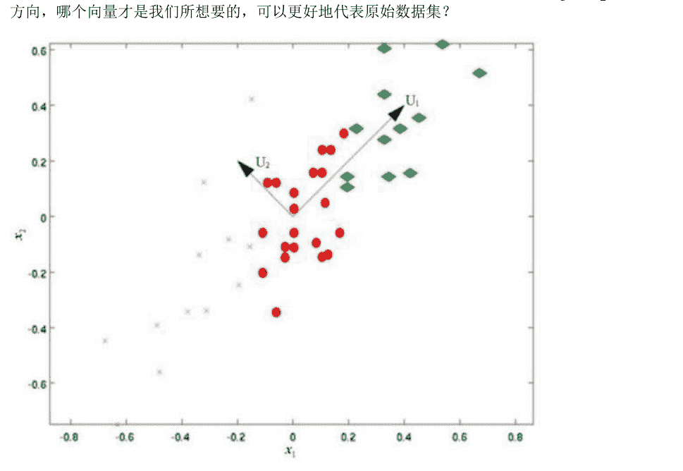
评判依据有两个。
- （1）样本点到直线的距离足够小。
- （2）样本点在直线上的投影尽可能分散。
若降维目标是任意维，则：
- （1）样本点到超平面的距离足够小。
- （2）样本点在超平面上的投影尽可能分散。

### 2.9.2 PCA 的推导过程
基于最小投影距离进行推导。假设数据集中包含 $m$ 个 $n$ 维数据 $\{x^{(1)}, x^{(2)}, \dots, x^{(m)}\}$，且已中心化。投影后新坐标为 $\{w_1, w_2, \dots, w_n\}$，其中 $\mathbf{w}$ 为标准正交基，即 $\|w_i\|_2 = 1, w_i^T w_j = 0$。

把 $n$ 维样本压缩到 $n'$ 维后，新的基由 $\{w_1, w_2, \dots, w_{n'}\}$ 构成。任意样本 $x^{(i)}$ 在这个低维坐标系里的坐标记作 $z^{(i)} = (z_1^{(i)}, z_2^{(i)}, \dots, z_{n'}^{(i)})$，其中 $z_j^{(i)} = w_j^T x^{(i)}$ 表示它在第 $j$ 个方向上的分量。

用 $z^{(i)}$ 重建 $x^{(i)}$ 时，得到的近似为 $\hat{x}^{(i)} = \sum_{j=1}^{n'} z_j^{(i)} w_j = W z^{(i)}$，这里 $\mathbf{W}$ 由一组标准正交基拼成。

对整个样本集，希望投影后的点离原点足够近，于是最小化 $\sum_{i=1}^m \|\hat{x}^{(i)} - x^{(i)}\|_2^2$。对该目标展开可得：

$$\sum_{i=1}^{m}\|\hat{\mathbf{x}}^{(i)}-\mathbf{x}^{(i)}\|_{2}^{2}=\sum_{i=1}^{m}\|\mathbf{W}\mathbf{z}^{(i)}-\mathbf{x}^{(i)}\|_{2}^{2}$$

$$=\sum_{i=1}^{m}\left(\mathbf{W}\mathbf{z}^{(i)}\right)^{\top}\left(\mathbf{W}\mathbf{z}^{(i)}\right)-2\sum_{i=1}^{m}\left(\mathbf{W}\mathbf{z}^{(i)}\right)^{\top}\mathbf{x}^{(i)}+\sum_{i=1}^{m}\left(\mathbf{x}^{(i)}\right)^{\top}\mathbf{x}^{(i)}$$

$$=\sum_{i=1}^{m}\left(\mathbf{z}^{(i)}\right)^{\top}\left(\mathbf{z}^{(i)}\right)-2\sum_{i=1}^{m}\left(\mathbf{z}^{(i)}\right)^{\top}\mathbf{x}^{(i)}+\sum_{i=1}^{m}\left(\mathbf{x}^{(i)}\right)^{\top}\mathbf{x}^{(i)}$$

$$=-\sum_{i=1}^{m}\left(\mathbf{z}^{(i)}\right)^{\top}\left(\mathbf{z}^{(i)}\right)+\sum_{i=1}^{m}\left(\mathbf{x}^{(i)}\right)^{\top}\mathbf{x}^{(i)} \quad (2-50)$$

$$=-\operatorname{tr}\left(\mathbf{W}^{\top}\left(\sum_{i=1}^{m}\mathbf{x}^{(i)}\left(\mathbf{x}^{(i)}\right)^{\top}\right)\mathbf{W}\right)+\sum_{i=1}^{m}\left(\mathbf{x}^{(i)}\right)^{\top}\mathbf{x}^{(i)}$$

$$=-\operatorname{tr}\left(\mathbf{W}^{\top}\mathbf{X}\mathbf{X}^{\top}\mathbf{W}\right)+\sum_{i=1}^{m}\left(\mathbf{x}^{(i)}\right)^{\top}\mathbf{x}^{(i)}$$

推导里用到了 $\mathbf{z}^{(i)}=\mathbf{W}^{\top}\mathbf{x}^{(i)}$、转置性质 $(\mathbf{A}\mathbf{B})^{\top}=\mathbf{B}^{\top}\mathbf{A}^{\top}$、正交性 $\mathbf{W}^{\top}\mathbf{W}=\mathbf{I}$、再次的 $\mathbf{z}^{(i)}=\mathbf{W}^{\top}\mathbf{x}^{(i)}$，以及迹运算，最后把求和改写为矩阵形式。

因 $\mathbf{W}$ 的列向量 $\mathbf{w}_j$ 互为标准正交，$\sum_{i=1}^{m}\mathbf{x}^{(i)}\left(\mathbf{x}^{(i)}\right)^{\top}$ 就是数据的协方差，$\sum_{i=1}^{m}\left(\mathbf{x}^{(i)}\right)^{\top}\mathbf{x}^{(i)}$ 为常数。于是最小化 $\sum_{i=1}^{m}\|\hat{\mathbf{x}}^{(i)}-\mathbf{x}^{(i)}\|_{2}^{2}$ 等价于：

$$\underset{\mathbf{W}}{\arg \min }-\operatorname{tr}\left(\mathbf{W}^{\top}\mathbf{X}\mathbf{X}^{\top}\mathbf{W}\right) \text { s.t. } \mathbf{W}^{\top}\mathbf{W}=\mathbf{I} \quad (2-51)$$

引入拉格朗日函数后可得：

$$J(\mathbf{W})=-\operatorname{tr}\left(\mathbf{W}^{\top}\mathbf{X}\mathbf{X}^{\top}\mathbf{W}\right)+\lambda\left(\mathbf{W}^{\top}\mathbf{W}-\mathbf{I}\right) \quad (2-52)$$

对 $\mathbf{W}$ 求导得到 $-\mathbf{X}\mathbf{X}^{\top}\mathbf{W}+\lambda\mathbf{W}=0$，即 $\mathbf{X}\mathbf{X}^{\top}\mathbf{W}=\lambda\mathbf{W}$。这表明 $\mathbf{W}$ 是 $\mathbf{X}\mathbf{X}^{\top}$ 的特征向量集合，$\lambda$ 对应特征值。由此获得的 $\mathbf{W}$ 即为所求。

对原始数据而言，降维只需计算 $Z^{(i)} = W^T X^{(i)}$，即可得到投影距离最小的 $n'$ 维表示。

最大投影方差的推导过程此处省略，感兴趣可自行查阅。

### 2.9.3 PCA流程速览
输入：$n$ 维样本集 $D = (x^{(1)}, x^{(2)}, \dots, x^{(m)})$，期望降到 $n'$ 维。

输出：降维后样本集 $D' = (z^{(1)}, z^{(2)}, \dots, z^{(m)})$。

主要步骤如下。

- 1. 中心化所有样本，$x^{(i)} = x^{(i)} - \frac{1}{m} \sum_{j=1}^{m} x^{(j)}$。
- 2. 求样本协方差矩阵 $XX^T$。
- 3. 对 $XX^T$ 做特征值分解。
- 4. 挑选前 $n'$ 个最大特征值对应的特征向量 $\{w_1, w_2, \dots, w_{n'}\}$。
- 5. 归一化得到特征向量矩阵 $W$。
- 6. 把每个样本映射为 $z^{(i)} = W^T x^{(i)}$。
- 7. 输出新样本集 $D' = (z^{(1)}, z^{(2)}, \dots, z^{(m)})$。

注：若不预先指定维数，可设定主成分累积贡献率阈值 $k$（$k \in (0, 1]$）。设特征值排序 $\lambda_1 \ge \lambda_2 \ge \dots \ge \lambda_n$，则 $n'$ 可由

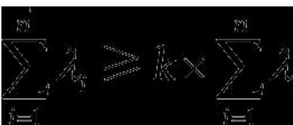

确定。

### 2.9.4 PCA核心思想
PCA的本质是用线性映射把高维数据投到低维子空间。剔除可由其他方向线性表示的相关分量，丢弃特征值很小的方向，保留最能代表原始信息的主方向。

关键在于协方差矩阵，它同时刻画了各维度间的相关与各维度的方差。协方差关注的是维度间的联系而非样本间关系。对角化后，小方差对应的维度即为可舍弃部分，保留特征值大的“能量”维度即完成去冗余。

### 2.9.5 PCA优缺点一览
表2-8 PCA算法的优缺点

| 优缺点 | 简要说明 |
| --- | --- |
| 优点 | 只用方差衡量信息量，不受外部因素干扰；各主成分正交，能消除成分间的相互影响；实现简单，核心是特征值分解 |
| 缺点 | 主成分的物理含义模糊，可解释性弱于原始特征；方差小的成分可能仍携带重要信息，丢弃后会影响后续处理 |

### 2.9.6 为什么要降维
必要性：

- （1）缓解多重共线性与变量间强相关带来的解不稳定问题。
- （2）高维空间天然稀疏，一维正态约68%数据落在±1σ内，十维仅约2%。
- （3）减少变量数量，避免规律挖掘时的冗余干扰。
- （4）变量层面分析容易忽略变量间的潜在结构，如多个预测因子落在同一潜在因子内。

目的：

- （1）降低预测变量数量。
- （2）使保留变量相互独立。
- （3）提供结果解释框架，突出重要特征，便于2D/3D可视化。
- （4）低维数据更易处理与使用。
- （5）削弱噪声干扰。
- （6）降低计算开销。

### 2.9.7 KPCA和PCA有何不同
核主成分分析 KPCA 引入核函数思想。PCA 要求数据可由线性超平面分离，若数据本身非线性，则先通过映射 $\phi$ 把 $n$ 维数据升到 $N$ 维可分空间，$N > n$，再从 $N$ 维降到 $n'<n$ 的低维。

设高维数据由映射 $\phi$ 产生。

$n$ 维空间的特征分解为：

$$\sum_{i=1}^{m} \mathbf{x}^{(i)} \left( \mathbf{x}^{(i)} \right)^{\mathrm{T}} \boldsymbol{W} = \lambda \boldsymbol{W} \quad (2-53)$$

其映射形式为：

$$\sum_{i=1}^{m} \phi\left(\mathbf{x}^{(i)}\right) \phi\left(\mathbf{x}^{(i)}\right)^{\mathrm{T}} \boldsymbol{W} = \lambda \boldsymbol{W} \quad (2-54)$$

KPCA 在高维空间对协方差做特征分解，降维步骤与 PCA 一致。由于涉及核运算，计算成本明显高于 PCA。

## 2.10 如何评估模型
评估模型性能时，单一分数难以全面反映真实表现。用好坏二元判断也并不妥当。下面介绍分类与回归常用的评估手段，重点厘清误差、偏差、方差的关系，以及过拟合、欠拟合的成因与对策。

### 2.10.1 常用评估手段
常用的分类模型评估方法如表2-9所示。

表2-9 常用的分类模型评估方法

| 指标 | 描述 |
|---|---|
| Accuracy | 正确率 |
| Precision | 精度/查准率 |
| Recall | 召回率/查全率 |
| PR 曲线 | 查准率为纵轴，查全率为横轴 |
| F1 分数 | F1 值 |
| Confusion Matrix | 混淆矩阵 |
| ROC | ROC 曲线 |
| AUC | ROC 曲线下的面积 |

常用的回归模型评估方法如表2-10所示。

表2-10 常用的回归模型评估方法

| 指标 | 描述 |
|---|---|
| Mean Square Error (MSE) | 均方误差 |
| Root Mean Square Error (RMSE) | 均方根误差 |
| Mean Absolute Error (MAE) | 平均绝对误差 |
| R-Squared | R 平方值 |

### 2.10.2 误差偏差方差怎么区分
误差：预测输出与真实输出的差异。误差 = 偏差 + 方差 + 噪声，反映整体准确度。

噪声：刻画学习问题本身的不可约下界，即任何算法在该任务上期望泛化误差的最小值。

偏差：衡量模型拟合训练数据的能力，即样本输出与真实值的系统性偏离。偏差越小拟合越强，可能过拟合；偏差越大拟合越弱，可能欠拟合。

方差公式为：

$$S_N^2 = \frac{1}{N} \sum_{i=1}^{N} (x_i - \bar{x})^2 \quad (2-55)$$

方差描述预测值波动范围与离散程度，即与期望的偏离。方差越大模型越不稳定。方差小泛化能力越强，反之越弱。训练集表现好、测试集很差通常是方差过大，过拟合的典型信号。

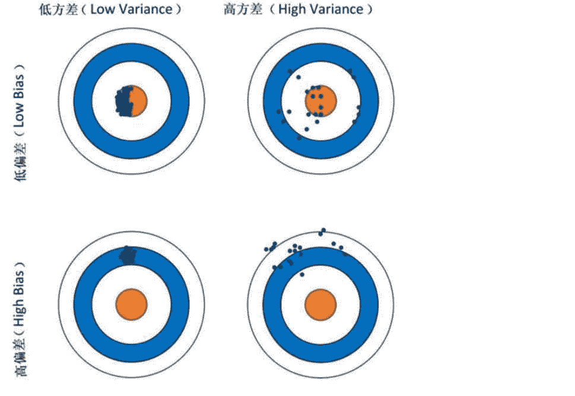

### 2.10.3 用标准差的理由
相关公式：

方差公式为：

$$S_N^2 = \frac{1}{N} \sum_{i=1}^{N} (x_i - \bar{x})^2 \quad (2-56)$$

标准差公式为：

$$S_N = \sqrt{\frac{1}{N} \sum_{i=1}^{N} (x_i - \bar{x})^2} \quad (2-57)$$

样本标准差公式为：

$$S_N = \sqrt{\frac{1}{N-1} \sum_{i=1}^{N} (x_i - \bar{x})^2} \quad (2-58)$$

相对方差，标准差有三点优势：

- （1）数值量级与原始数据一致，更易形成直觉。
- （2）单位与原始数据相同，便于后续运算。
- （3）正态假设下，约68%数据落在均值±1σ，95%落在±2σ，99%落在±3σ，便于快速估算。

### 2.10.4 训练误差与泛化误差
经验误差即训练误差，是模型在训练集上的表现。泛化误差则是模型在新样本测试集上的表现。

### 2.10.5 欠拟合过拟合图解
- （1）横轴为训练样本数量，纵轴为误差
欠拟合与过拟合示意图如图2-11所示。
- 模型欠拟合：训练集与测试集误差都偏大，偏差主导。
- 模型过拟合：训练误差小而测试误差大，方差主导。
- 模型正常：训练与测试误差均处于适中水平。

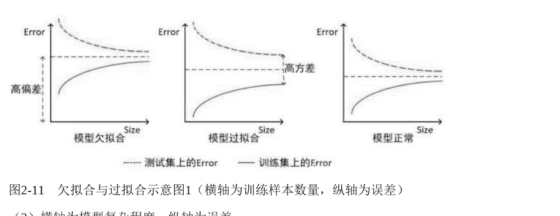

- （2）横轴为模型复杂度，纵轴为误差
欠拟合与过拟合示意图如图2-12所示。上曲线为测试误差，下曲线为训练误差。
- 欠拟合：模型在点A，训练与测试误差均高，偏差大。
- 过拟合：模型在点C，训练误差低、测试误差高，方差大。
- 最优：复杂度控制在点B。

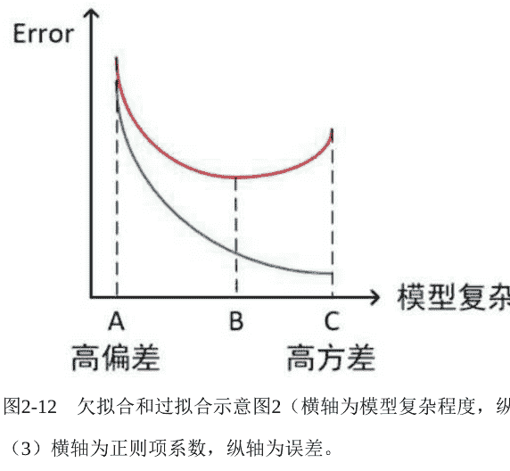

图2-12 欠拟合和过拟合示意图2（横轴为模型复杂程度，纵轴为误差）

- （3）横轴为正则项系数，纵轴为误差。
其中上曲线为测试误差，下曲线为训练误差。
- 欠拟合：模型在点C，训练与测试误差均偏大，偏差大。

模型拟合的两个典型状态

过拟合的表现是模型停在 A 点，训练集上的误差很小，测试集上的误差却很大，方差被拉高。这类情况往往源于模型过于复杂，比如参数规模过大，导致预测能力受损，对数据的波动也变得更敏感。训练时模型几乎能把样本的全部特征记下来，看起来完美无缺，可一旦遇到未知数据，泛化效果就会明显下降，因为简单模型本就缺乏足够的泛化潜力。

相对的，模型复杂度落在 B 点时处于较为理想的区间。

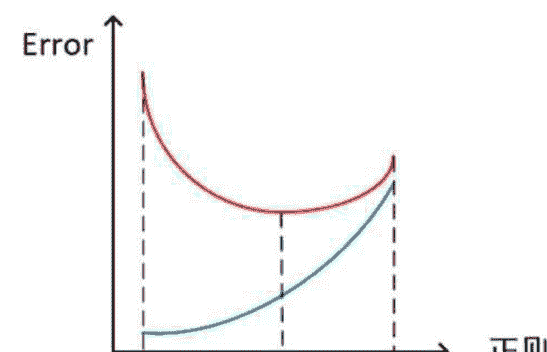

图2-13 欠拟合和过拟合示意图3（横轴为正则项系数，纵轴为误差）

### 2.10.6 欠拟合与过拟合的应对思路
- （1）缓解欠拟合
- 补充新的特征。常见的方向有组合特征、泛化特征、相关性特征、上下文特征以及平台特征等，特征供给不足时容易出现欠拟合。
- 引入多项式特征。例如在线性模型上加入二次项或三次项，提升拟合能力。FM、FFM 这类模型本质上是在线性基础上加入了二阶多项式交互，从而保证一定的拟合程度。
- 提升模型本身的复杂度。
- 放宽正则化强度。正则化本是为了压制过拟合，当出现欠拟合时适当调小正则系数是有帮助的。
- （2）缓解过拟合
- 重新清洗训练数据，数据不纯净会诱发过拟合，需要重新整理。
- 扩充训练样本规模。
- 简化模型结构。
- 提高正则项系数。
- 使用丢弃法 Dropout。训练时以一定概率让部分神经元临时失活，降低模型对局部特征的过度依赖，提升泛化性。
- 采用早停法 Early Stopping。
- 减少训练迭代轮数。
- 适当增大学习率。
- 加入噪声样本。
- 在树形结构中实施剪枝。
- 删减不必要的特征。

上述手段要结合具体问题和具体模型来选择使用。

### 2.10.7 交叉验证的核心作用
交叉验证常用于主成分回归 PCR、偏最小二乘回归 PLS 等建模场景。在建好的模型上，用大部分样本训练，留出少量样本做预报并计算预报误差，再累加平方误差。

主要价值在于获得更稳健可靠的模型，对泛化误差进行评估并给出近似值。当存在多个候选模型时，通常挑选泛化误差最小的那个。

常用的实现方式有留一交叉验证和 K 折交叉验证。

### 2.10.8 K 折交叉验证的理解
在数据量有限时，K 折会把数据集切分为 K 份，验证集与测试集互为补集并循环轮换。

- （1）K 折的标准流程
- 将 N 个样本划分为 K 份，每份约 N/K 个样本。每次挑一份作测试集，其余 K-1 份作训练集，共产生 K 种划分。
- 在每种划分下用训练集学习模型，用测试集验证并计算泛化误差。
- 重复 K 次并汇总结果，取平均或其他融合方式得到最终的泛化误差估计。
- （2）K 折的特点
- 通常取 2≤ K ≤10。K 折通过多次使用随机子样本训练验证，10 折是业界最常用的折数。
- 训练集样本要足够多，一般建议不低于总样本的 50%。
- 训练集和测试集应从完整数据中均匀抽样，以降低两者与原数据集的偏差。样本充足时随机抽样即可逼近均匀抽样。

### 2.10.9 混淆矩阵的理解
混淆矩阵是衡量精度的标准化表格，下面给出两种常见排版。

- （1）第一种混淆矩阵，如表2-11所示。

表2-11 第一种混淆矩阵

| 真实情况 T 或 F | 预测为正例 1, P | 预测为负例 0, N |

| :--- | :--- | :--- |

| 本来 label 标记为 1，预测结果真为 T、假为 F | TP（预测为 1，实际为 1） | FN（预测为 0，实际为 1） |

| 本来 label 标记为 0，预测结果真为 T、假为 F | FP（预测为 1，实际为 0） | TN（预测为 0，实际为 0） |

- （2）第二种混淆矩阵，如表2-12所示。

表2-12 第二种混淆矩阵

| 预测情况 P 或 N | 实际 label 为 1，预测对了为 T | 实际 label 为 0，预测对了为 T |

| :--- | :--- | :--- |

| 预测为正例 1，P | TP（预测为 1，实际为 1） | FP（预测为 1，实际为 0） |

| 预测为负例 0，N | FN（预测为 0，实际为 1） | TN（预测为 0，实际为 0） |

### 2.10.10 查准率与查全率的理解
预测结果可分为真正例 True Positive、真负例 True Negative、假正例 False Positive、假负例 False Negative 四类。

查准率 Precision = TP /（TP+FP）
含义：在被判定为阳性的样本中，实际正确的比例。注意这与整体准确率不同，准确率包含阳性和阴性正确预测在总样本中的占比。

比如肿瘤筛查，查准率等于真实患病人数占被预测为患病人数的比例，数值越高越好。

查全率 Recall = TP /（TP+FN）
含义：所有真实阳性样本中，被正确预测出来的比例。

同上例，查全率等于成功检出的患病人群占全部真实患病人群的比例，数值越高越好。

### 2.10.11 ROC 与 AUC 的理解
ROC 的全称是受试者工作特征。

AUC 用来度量二分类机器学习算法的性能和泛化能力。2.3.2 节已简要提到 ROC 与 PR 曲线作为评估指标，以下展开说明。

ROC 曲线通过为连续变量设定多个阈值，计算出一系列真正例率和假正例率，以假正例率为横轴、真正例率为纵轴绘制，曲线下面积越大说明判别越准。曲线上最靠近左上方的点对应假正例率和真正例率都较高的临界值。

分类器的常见评价指标包括 Precision、Recall、F1 分数。图2-14 是一个 ROC 曲线示例。

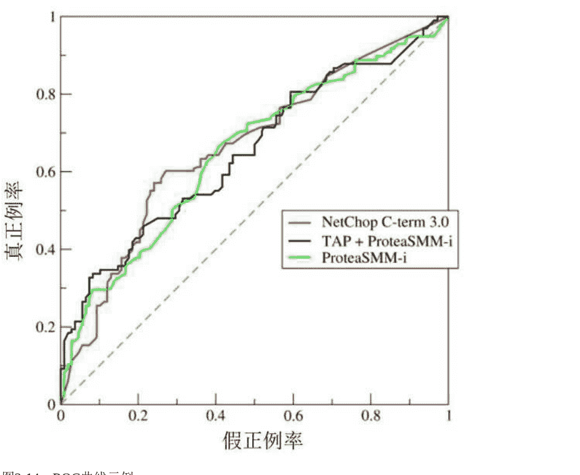

图2-14 ROC曲线示例

ROC 曲线的横坐标为假正例率 False Positive Rate，FPR，纵坐标为真正例率 True Positive Rate，TPR。其中：

$$TPR = \frac{TP}{TP + FN} , FPR = \frac{FP}{FP + TN}$$

重点说明 ROC 图中的四个关键点和一条线。

- 第 1 个点 0,1，即 FPR=0、TPR=1，对应 FN=0 且 FP=0，代表完美分类器，全部样本正确分类。
- 第 2 个点 1,0，即 FPR=1、TPR=0，代表最差分类器，完全避开了正确答案。
- 第 3 个点 0,0，即 FPR=TPR=0，对应 FP=TP=0，分类器把所有样本都判为负例。
- 第 4 个点 1,1，即 FPR=TPR=1，分类器把所有样本都判为正例。

总体上 ROC 曲线越贴近左上角，分类器性能越好。

ROC 曲线所覆盖的面积即为 AUC，面积越大性能越好。

### 2.10.12 ROC 曲线的绘制方法
绘制步骤如下。

- （1）先得到一批样本被划分为正例的概率并按大小排序，表2-13 包含 20 个测试样本，Inst# 为序号，Class 为真实标签 P/N，Score 为属于正例的概率。

表2-13 测试样本

| Inst# | Class | Score | Inst# | Class | Score |

|---|---|---|---|---|---|

| 1 | P | 0.9 | 11 | P | 0.4 |

| 2 | P | 0.8 | 12 | N | 0.39 |

| 3 | N | 0.7 | 13 | P | 0.38 |

| 4 | P | 0.6 | 14 | N | 0.37 |

| 5 | P | 0.55 | 15 | N | 0.36 |

| 6 | P | 0.54 | 16 | N | 0.35 |

| 7 | N | 0.53 | 17 | P | 0.34 |

| 8 | N | 0.52 | 18 | N | 0.33 |

| 9 | P | 0.51 | 19 | P | 0.30 |

| 10 | N | 0.505 | 20 | N | 0.1 |

- （2）从高到低依次把 Score 作为阈值，大于等于阈值的判为正例，否则判为负例。例如阈值取 0.6 时，样本 1~4 被判定为正例，其余为负例。
- （3）每个阈值得到一组 FPR 与 TPR，共得到 20 组坐标。
- （4）按坐标绘图，如图2-15所示。

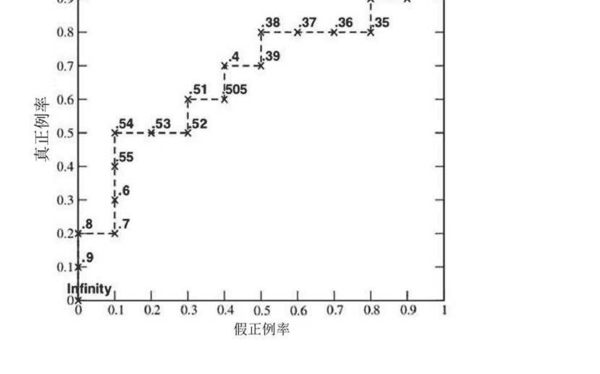

图2-15 表2-13的ROC曲线

### 2.10.13 TPR 与 FPR 的计算
在绘制 ROC 的第 3 步中，每次阈值变化都会产生一组 FPR 与 TPR，下面用例子说明计算方式。

- （1）数据
ytrue = [0,0,1,1]；Score = [0.1,0.4,0.35,0.8]。
- （2）罗列，如表2-14所示。

表2-14 样本概率及类别数据列表

| 样 本 | 预测属于 P 的概率（Score） | 真实类别 |

| :--- | :--- | :--- |

| y[0] | 0.1 | N |

| y[1] | 0.4 | N |

| y[2] | 0.35 | P |

| y[3] | 0.8 | P |

- （3）依次取截断点计算 TPR 与 FPR
当截断点为 0.1 时，所有样本 Score 都 ≥0.1，预测全为正例。
ypred = [1,1,1,1]
正例负例信息如表2-15所示。

表2-15 截断点为0.1时的正例与负例信息

| 正 例 | 负 例 |

| :--- | :--- |

| TP=2 | FN=0 |

| FP=2 | TN=0 |

可得 TPR = TP/(TP+FN)=1；FPR = FP/(TN+FP)=1

当截断点为 0.35 时：
ypred = [0,1,1,1]
信息如表2-16所示。

表2-16 截断点为0.35时的正例与负例信息

| 正 例 | 负 例 |

| :--- | :--- |

| TP=2 | FN=0 |

| FP=1 | TN=1 |

可得 TPR = 1；FPR = 0.5

当截断点为 0.4 时...

### 2.10.14 AUC 的计算方式
计算 ROC 曲线下方面积即 AUC，常用步骤如下。

- （1）按横坐标 FPR 对坐标点排序。
- （2）计算相邻两点横向间距 dx。
- （3）取该区间对应的纵坐标 y。
- （4）面积微元 ds = y dx。
- （5）累加所有微元得到 AUC。

### 2.10.15 AUC 的直观解释
AUC 可理解为正例排在负例前面的概率。常见的评价指标还有精度、正确率、召回率，AUC 在实践中更为常用。

分类模型输出通常是概率，计算准确率时需要人工设定阈值把概率转为类别，阈值的选择会影响结果。

图2-16 展示了三种不同 AUC 的情况。

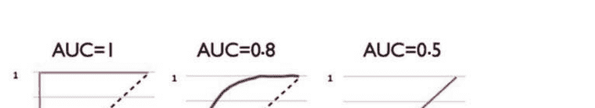

图2-16 不同的AUC值示意图

举例说明计算原理。假设二分类器对 10 个样本 5 正 5 负进行打分，最佳排序为 [1,1,1,1,1,0,0,0,0,0]，即全部正例排在负例前面，正例排在负例前面的概率为 100%。对应的 ROC 如图2-17所示。

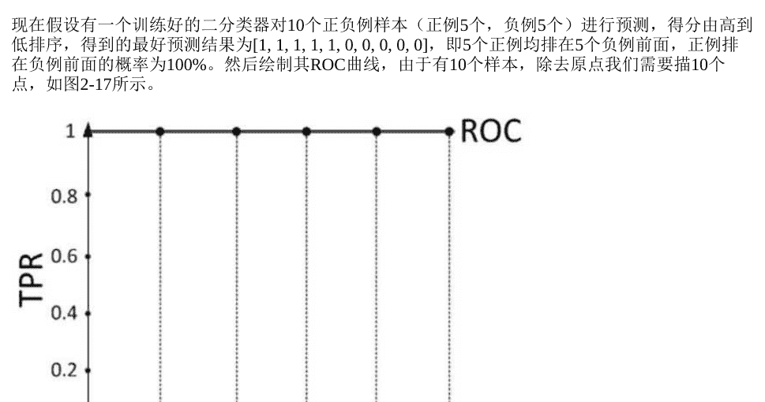

图2-17 ROC曲线示例1

从原点出发，遇到 1 则向 y 轴移动步长 1/5=0.2，遇到 0 则向 x 轴移动 0.2。可得 AUC=1，与概率 100% 一致。

若预测序列为 [1,1,1,1,0,1,0,0,0,0]，ROC 如图2-18所示。

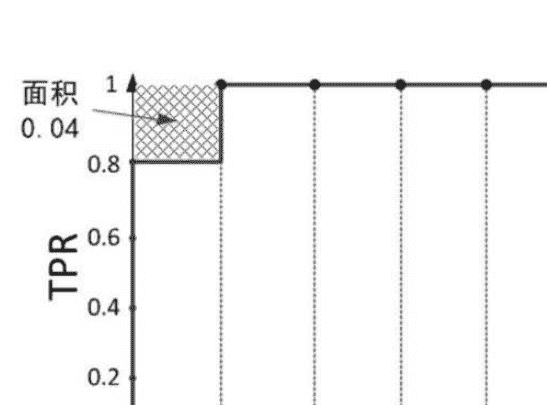

图2-18 ROC曲线示例2

此时 AUC 为 0.96，正例排在负例前面的概率为 0.8×1+0.2×0.8=0.96，左上角阴影面积 0.2×0.2=0.04 为负例排在正例前面的概率。

若序列为 [1,1,1,0,1,0,1,0,0,0]，ROC 如图2-19所示。

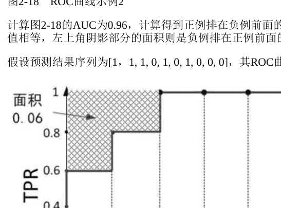

图2-19 ROC曲线示例3

AUC 为 0.88，正例排在负例前面的概率为 0.6×1+0.2×0.8+0.2×0.6=0.88，左上角阴影面积为 0.2×0.2×3=0.12。

### 2.10.16 用 ROC 评估分类器
为什么要使用 ROC？因为当测试集中正负样本分布发生变化时，ROC 曲线具有稳定性。在实际数据中常出现类不平衡，正负样本比例差距大，且随着时间推移分布也可能改变。

### 2.10.17 代价敏感错误率与代价曲线
#### 代价矩阵
不同错误带来的损失不同。以二分类为例，代价矩阵如表2-19所示。

表2-19 代价矩阵

| 真实类别 | 预测类别 | |

| :--- | :--- | :--- |

| | 第0类 | 第1类 |

| 第0类 | 0 | Cost₀₁ |

| 第1类 | Cost₁₀ | 0 |

判断正确时代价为 0，错误时分别为 Cost₀₁ 与 Cost₁₀。

- Cost₁₀：实际为负例却预测为正例的代价。
- Cost₀₁：实际为正例却预测为负例的代价。

#### 代价敏感错误率
代价敏感错误率等于模型在样本上产生的错误与对应代价乘积之和除以总样本数。

其数学表达为：

$$E(f;D;Cost) = \frac{1}{m} ( \sum_{x_i \in D^+} (f(x_i) \neq y_i) \times Cost_{01} + \sum_{x_i \in D^-} (f(x_i) \neq y_i) \times Cost_{10} )$$ (2-59)

$D^+$、$D^-$ 分别代表样例集的正例子集和负例子集，$x$ 是预测值，$y$ 是真实值。

#### 代价曲线
在均等代价情形下，ROC 曲线无法直接反映模型的期望总体代价，而代价曲线可以。

代价曲线横轴为 [0,1] 的正例先验代价：

$$P(+)Cost = \frac{p \cdot Cost_{01}}{p \cdot Cost_{01} + (1-p) \cdot Cost_{10}}$$ (2-60)

其中 $p$ 是样本为正例的概率。

代价曲线纵轴为 [0,1] 的归一化代价：

$$Cost_{norm} = \frac{FNR \cdot p \cdot Cost_{01} + FPR \cdot (1-p) \cdot Cost_{10}}{p \cdot Cost_{01} + (1-p) \cdot Cost_{10}}$$ (2-61)

其中 FPR 为假阳性率，FNR=1-TPR 为假阴性率。

注：ROC 曲线上的每一个坐标，都能在成本平面上投射出一根线段。先由 TPR 计算出 FNR=1-TPR，再在成本平面上连接起点 (0,FPR) 与终点 (1,FNR)，这条线段下面的面积即为该阈值下的期望总成本。把所有工作点对应的线段都画出来，其下方面积的下包络就概括了学习器在不同条件下的期望整体成本，见图2-20。

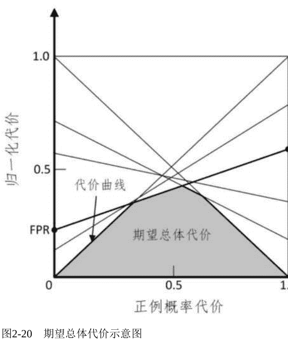

图2-20 期望总体代价示意图

### 2.10.18 常用检验视角
业内常用的对比检验手段大致可归为四类。

- （1）正确性检视：涵盖模型稳定性、鲁棒性、收敛性、走势演化以及极值情形的剖析等。
- （2）有效性检视：包含误差分解、参数敏感度测试以及多模型横向验证等。
- （3）实用性检视：聚焦关键数值的求解、极值点与拐点的捕捉、趋势变化的解读，以及以实测数据校核动态仿真等。
- （4）效率性检视：主要围绕时空复杂度展开等。

## 2.11 决策树全景
在机器学习里，决策树属于一种预测型模型，用来刻画对象属性与取值之间的对应关系。本节围绕其原理、生成流程、算法陈述、优劣以及熵与信息增益展开。

### 2.11.1 运作思路
决策树遵循分而治之的思路。面对复杂预测任务，树通过分支节点将其拆解为两块或多块更易处理的子问题，实现对数据的递归划分。随着层级加深，子集规模持续缩小，待解问题也随之简化。当节点深度或问题简易度达到预设的停止条件时，该分支即终止分裂，这一做法属于自上而下的截断阈值法；另一类做法是自下而上的回溯剪枝法。

### 2.11.2 构建三阶段
生成流程可概括为三个环节。

- （1）特征挑选：从训练样本的众多属性中选出作为当前节点分裂依据的属性，不同的量化准则会衍生出不同的树模型。
- （2）树形扩张：依据选定的评估准则自上而下递归地生成子节点，直至数据无法再分则停止生长。
- （3）结构精简：决策树易过拟合，通常需要压缩规模。剪枝分为预剪枝与后剪枝。

### 2.11.3 学习步骤概览

```
机器学习算法 1 决策树学习基本算法
输入：训练集$D = \{(x_1, y_1), (x_2, y_2), ..., (x_m, y_m)\}$；属性集$A = \{(a_1, a_2, ..., a_d)\}$
输出：以node为根节点的一棵决策树
1: function TreeGenerate ($D, A$)
2:     生成节点node
3:     if $D$中的样本全属于同一类别$C$ then
4:         将node标记为$C$类叶节点;return
5:     end if
6:     if $A = \varnothing$ OR $D$中样本在$A$上取值相同 then
7:         将node标记为叶节点，其类别标记为$D$中样本类最多的类;return
8:     end if
9:     从$A$中选择最优划分属性$a_*$
10:    for $a_*$的每一个值$a_*^v$ do
11:        为node生成一个分支;令$D_v$表示$D$中在$a_*$上取值为$a_*^v$的样本子集;
12:        if $D_v$为空 then 将分支节点标记为叶节点，其类别标记为$D$中样本最多的类;return
13:        else 以 TreeGenerate($D_v, A \setminus \{a_*\}$)为分支节点
14:        end if
15:    end for
16: end function
```

### 2.11.4 优劣汇总
决策树方法的长处如下。

- （1）可解释性强，机理通俗。
- （2）对小样本友好。
- （3）训练复杂度随样本量呈对数级增长。
- （4）能同时处理数值型与类别型变量。
- （5）可支持多输出任务。
- （6）对缺失值容忍度较高。
- （7）可容纳无关属性。
- （8）建树一次即可复用，单次推理计算量不超过树深。

短板如下。

- （1）对连续型字段的建模能力较弱。
- （2）容易过拟合。
- （3）类别数增多时误判率可能迅速上升。
- （4）在属性间关联强的数据上表现平平。
- （5）面对类别不平衡数据时，信息增益易偏向取值较多的属性。

### 2.11.5 熵在树模型中的地位
熵贯穿决策树的全过程，属性优选的核心度量就是熵。最优属性的判定标准本质上依赖熵。

### 2.11.6 熵的定义
熵用于衡量随机变量的不确定程度。

设随机变量 $X$ 的可能取值有 $x_1, x_2, \dots, x_n$，每个取值的概率为 $P(X = x_i) = p_i, i = 1, 2, \dots, n$。随机变量的熵为：

$$H(X) = -\sum_{i=1}^{n} p_i \log_2 p_i \quad (2-62)$$

对样本集合而言，假设样本分 $k$ 类，每类占比为 $\frac{|C_k|}{|D|}$，其中 $|C_k|$ 为第 $k$ 类样本数，$|D|$ 为样本总数。集合 $D$ 的熵为：

$H(D) = -\sum_{k=1}^{K} \frac{|C_k|}{|D|} \log_2 \frac{|C_k|}{|D|}$

### 2.11.7 信息增益的含义
信息增益指使用某属性划分前后数据集熵的差值。

熵越大，样本不确定性越高。比较划分前后的熵差，可衡量该属性对集合 $D$ 的划分效果。

设划分前集合 $D$ 的熵为 $H(D)$，使用属性 $A$ 划分后子集的熵记作 $H(D|A)$。

则增益为：

$g(D, A) = H(D) - H(D|A)$

注：在建树过程中，我们希望集合尽快趋向高纯度，因此持续挑选使增益最大的属性作为当前节点的分裂依据。

对所有属性分别计算其对 $D$ 的增益，取最大值对应的属性作为该节点的划分属性。

补充说明增益比：

增益比 = 惩罚系数 × 信息增益

本质是在增益基础上乘以惩罚系数。属性取值越多，惩罚系数越小；取值越少，系数越大。

惩罚系数为以属性 $A$ 为随机变量时，数据集 $D$ 的熵的倒数。

### 2.11.8 熵、条件熵与增益的直观关系
先厘清概念。

- （1）熵：表征随机变量的复杂程度或不确定性。
- （2）条件熵：在已知某条件后，随机变量的不确定性。
- （3）信息增益：在已知某条件后，不确定性的下降幅度。

例如，想买一件衣服，是否购买的不确定性为 2.8。

看了网评后，不确定性降为 1.2。

线下试穿后，不确定性降为 0.9。

网评带来的增益为 2.8-1.2=1.6。

试穿带来的增益为 2.8-0.9=1.9。

可见试穿后不确定性下降更多，购买意愿更强。因此构建内部节点时，应优先选用线下试穿这一属性。

### 2.11.9 剪枝的作用与策略
剪枝是解决过拟合的常用手段。

为尽可能正确分类训练样本，节点划分会不断重复，有时导致分支过多，把训练样本的特有规律当作泛化规律，从而过拟合。剪枝可去掉部分分支，降低过拟合风险。

基本策略分为预剪枝与后剪枝。

- （1）预剪枝：在生成过程中，对每个节点在划分前先评估划分后泛化能力是否提升，若不提升则停止分裂，将其标记为叶节点。
- （2）后剪枝：在树生成完毕后，自下而上检查非叶节点，若将其改为叶节点能提升泛化能力，则进行修改。

## 2.12 支持向量机 SVM 详解
支持向量机是一种分类算法，在小样本、非线性及高维模式识别中具有独特优势，并可推广至函数拟合等任务。

### 2.12.1 SVM 的核心思想
支持向量是指在求解过程中，仅靠部分样本就能确定分类器的那些样本。

SVM 正是通过支持向量进行运算的分类器。

在二维情形中，点 R、S、G 以及靠近中间 g 线的其他点都可以视为支持向量，它们决定了分类器 g 线的具体参数。示意图见图2-21。

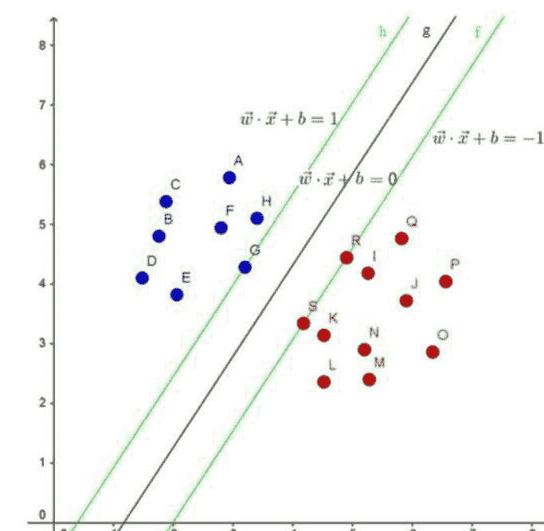

图2-21 SVM示意图

SVM 是一种二分类模型，目标是寻找一个超平面将样本分开，分割原则为间隔最大化，最终转化为凸二次规划求解。其模型由简至繁包括：

- （1）训练样本线性可分时，通过硬间隔最大化学习线性可分支持向量机。
- （2）训练样本近似线性可分时，通过软间隔最大化学习线性支持向量机。
- （3）训练样本线性不可分时，结合核技巧与软间隔最大化学习非线性支持向量机。

### 2.12.2 SVM 可解决的问题
可分为两类。

（1）线性分类
每个训练样本具有 $n$ 个属性和二分类标签，可视为 $n$ 维空间中的点。目标是找到一个 $n-1$ 维超平面将数据分开。这样的平面很多，最优平面要求到两侧最近样本点的距离最大，即最大间隔超平面，对应最大间隔分类器。

（2）非线性分类
SVM 的优势在于支持非线性分类。可结合拉格朗日乘子法、KKT 条件以及核函数生成非线性分类器，从而处理非线性数据。

### 2.12.3 核函数的性质
引入核函数的目的是将原空间线性不可分的数据映射到另一空间，尽量使其线性可分。

核函数方法之所以被广泛使用，与其特点密切相关。

- （1）避免了维数灾难，大幅减少计算量，输入空间维数 $n$ 对核矩阵无影响，因而能有效处理高维输入。
- （2）无需显式知道非线性变换函数的形式与参数。
- （3）核函数形式与参数的变化会隐式改变输入到特征空间的映射，进而影响特征空间性质，最终改变方法性能。
- （4）核函数可与不同算法结合形成多种核方法，且核设计与算法设计可分别进行，可根据应用选择合适的核与算法。

### 2.12.4 引入对偶形式的考量
在 SVM 中引入对偶问题主要有以下原因。

- （1）对偶形式将原始问题的约束转化为等式约束，通常更易求解。
- （2）能自然引入核函数，拉格朗日表达式中包含内积，而核函数正是通过内积实现映射。
- （3）在优化理论中，若目标函数和约束均为线性，则为线性规划；目标二次、约束线性则为二次规划；其余为非线性规划。每个线性规划都有对应的对偶问题，对偶具有良好性质，例如对偶的对偶是原问题；无论原问题是否凸，对偶都是凸优化；对偶可为原问题提供下界。

### 2.12.5 对偶问题的理解路径
在硬间隔支持向量机中，求解可转化为凸二次规划。

假设优化目标为，则

s.t. $y_i(\mathbf{w}^T \mathbf{x}_i + b) \geqslant 1, \quad i = 1, 2, \cdots, m$ (2-65)

其中 $\mathbf{w}$、$b$ 为模型参数。求解步骤如下。

（1）转化问题。

$\min_{\mathbf{w},b} \max_{\alpha_i \geqslant 0} \{\frac{1}{2}\|\mathbf{w}\|^2 + \sum_{i=1}^{m} \alpha_i (1 - y_i(\mathbf{w}^T \mathbf{x}_i + b))\}$ (2-66)

上式等价于原问题。若满足 (2-65) 的不等式约束，则 (2-66) 在求 max 时必须取 0，与 (2-65) 等价；若不满足，则 max 会趋向无穷。交换 min 与 max 得到对偶：

$\max_{\alpha_i \geqslant 0} \min_{\mathbf{w},b} \{\frac{1}{2}\|\mathbf{w}\|^2 + \sum_{i=1}^{m} \alpha_i (1 - y_i(\mathbf{w}^T \mathbf{x}_i + b))\}$ (2-67)

交换后对偶与原问题不等，上式的解小于等于原问题解。

（2）寻找 (2-65) 最优值的最好下界。

$\frac{1}{2}\|\mathbf{w}\|^2 < v$ (2-68)

$1 - y_i(\mathbf{w}^T \mathbf{x}_i + b) \leqslant 0$ (2-69)

若 (2-68)、(2-69) 无解，则 $v$ 是问题 (2-65) 的下界。若有解，则

$\forall \alpha > 0, \min_{\mathbf{w},b} \{\frac{1}{2}\|\mathbf{w}\|^2 + \sum_{i=1}^{m} \alpha_i (1 - y_i(\mathbf{w}^T \mathbf{x}_i + b))\} < v$ (2-70)

据逆否命题，若

$\exists \alpha > 0, \min_{\mathbf{w},b} \{\frac{1}{2}\|\mathbf{w}\|^2 + \sum_{i=1}^{m} \alpha_i (1 - y_i(\mathbf{w}^T \mathbf{x}_i + b))\} \geqslant v$ (2-71)

则 (2-68)、(2-69) 无解。

$$\max_{\alpha_i \geq 0} \min_{\mathbf{w},b} \{\frac{1}{2}\|\mathbf{w}\|^2 + \sum_{i=1}^{m} \alpha_i(1 - y_i(\mathbf{w}^T \mathbf{x}_i + b))\}$$ (2-72)

（3）令

$$L(\mathbf{w},b,\alpha) = \frac{1}{2}\|\mathbf{w}\|^2 + \sum_{i=1}^{m} \alpha_i(1 - y_i(\mathbf{w}^T \mathbf{x}_i + b))$$ (2-73)

$p^*$ 为原问题的最小值，对应 $\mathbf{w}^*$、$b^*$，则对任意 $\alpha>0$：

$$p^* = \frac{1}{2}\|\mathbf{w}^*\|^2 \geq L(\mathbf{w}^*,b,\alpha) \geq \min_{\mathbf{w},b} L(\mathbf{w}^*,b,\alpha)$$ (2-74)

于是 $\min_{\mathbf{w},b} L(\mathbf{w}^*,b,\alpha)$ 是问题 (2-65) 的一个下界。

取最大值即可得到较好的下界，即

$$\max_{\alpha_i \geq 0} \min_{\mathbf{w},b} L(\mathbf{w},b,\alpha)$$ (2-75)

### 2.12.6 常用核函数汇总
常见的核函数如表2-20所示。

表2-20 常见的核函数

| 核函数 | 表达式 | 备注 |

| :--- | :--- | :--- |

| Linear Kernel（线性核） | $k(x,y) = x^T y$ | |

| Polynomial Kernel（多项式核） | $k(x,y) = (ax^T y + c)^d$ | $d \geq 1$ 为多项式的次数 |

| Exponential Kernel（指数核） | $k(x,y) = \exp(-\frac{\|x-y\|}{2\sigma^2})$ | $\sigma > 0$ |

| Gaussian Kernel（高斯核） | $k(x,y) = \exp(-\frac{\|x-y\|^2}{2\sigma^2})$ | $\sigma$ 为高斯核的带宽，$\sigma > 0$ |

| Laplacian Kernel（拉普拉斯核） | $k(x,y) = \exp(-\frac{\|x-y\|}{\sigma})$ | $\sigma > 0$ |

| ANOVA Kernel（方差分析核） | $k(x,y) = \exp(-\sigma(x^k - y^k)^2)^d$ | |

| sigmoid Kernel（sigmoid 核） | $k(x,y) = \tanh(ax^T y + c)$ | $\tanh$ 为双曲正切函数，$a > 0, c < 0$ |

### 2.12.7 SVM核心特质
SVM的特点可归纳如下。

- （1）建模根基是非线性映射。SVM借助内积核函数把原始数据隐式地映射到高维空间实现非线性可分。
- （2）目标是在特征空间寻找最优分割超平面。算法的本质是把两类样本间的间隔尽可能拉大。
- （3）支持向量是训练后留下的关键样本。最终的分类判断完全由这些支持向量决定。
- （4）是一种理论扎实的小样本学习方案。求解过程不依赖概率度量和大数定律，把分类、回归等任务简化。
- （5）决策函数仅依赖少量支持向量。计算负担随支持向量数量变化，而与样本空间维数无关，在很大程度上躲开了维度灾难。
- （6）少数样本主导结果，有助于抓住重点并剔除冗余，整体结构简洁且抗干扰。具体体现为：
    - 普通非支持向量样本的增删不会改变模型。
    - 支持向量集合本身具有一定的稳定性。
    - 在诸多成功案例中，对核函数的选择并不十分挑剔。
- （7）训练问题可化为凸优化。由此能稳定求得目标函数的全局最小值，而规则分类器、人工神经网络等常采用贪心搜索，只能得到局部最优。
- （8）通过最大化间隔来控制模型复杂度，但使用者仍需手动指定核函数类型、松弛变量等超参数。
- （9）在小规模训练集上往往优于其他方法。优化目标是结构风险最小化而非经验风险最小化，有效抑制过拟合，对数据规模和分布的依赖更低，泛化能力突出。
- （10）凸优化保证了局部最优即全局最优。

### 2.12.8 SVM主要局限
SVM存在以下不足。

- （1）不适合海量训练数据。模型需要保存全部训练点和核矩阵，求解二次规划涉及 $m$ 阶矩阵运算，$m$ 增大时内存和耗时急剧上升。像垃圾邮件检测这类大规模任务，通常改用朴素贝叶斯或逻辑回归。
- （2）原生仅解决二分类。多分类需要把多个二分类器组合起来，常用“一对多”“一对一”以及SVM决策树等策略。
- （3）对缺失值敏感，且对参数与核函数的选择依赖度高。性能很大程度上由核函数决定，目前成熟核及其参数多靠经验设定，主观随意性较大。不同领域理想的核形式各异，理论上应结合领域知识，但目前缺乏通用的自动选核方法。

### 2.12.9 逻辑回归与SVM的异同
相同点

- （1）两者均属于分类算法。
- （2）两者都是监督学习方法。
- （3）两者都属于判别模型。
- （4）忽略核函数时，二者都是线性分类器，决策面均为线性。
注：逻辑回归理论上可用核化，但实践中极少采用。

不同点

- （1）损失函数不同。逻辑回归采用对数损失，SVM采用合页损失。
逻辑回归的损失函数：
$$J(\theta) = -\frac{1}{m} \sum_{i=1}^{m} [y^i \log h_{\theta}(x^i) + (1 - y^i) \log(1 - h_{\theta}(x^i))]$$ (2-76)
SVM的目标函数：
$$L(\mathbf{w}, b, \alpha) = \frac{1}{2} \|\mathbf{w}^*\|^2 - \sum_{i=1}^{n} \alpha_i (y_i (\mathbf{w}^T \mathbf{x}_i + b) - 1)$$ (2-77)
逻辑回归基于概率假设，用 sigmoid 描述样本为正类的概率，再经极大似然估计参数。SVM遵循几何间隔最大化原则，认为间隔最大的超平面最优。
- （2）对异常值的鲁棒性不同。SVM对异常值不敏感，逻辑回归敏感。SVM只关心边界附近的支持向量，逻辑回归则受整体样本影响。LR的超平面追求所有点远离，而SVM只让贴近分界线的点远离。改变非支持向量不会改动SVM决策面，而逻辑回归中任意样本变动都会影响超平面。
- （3）计算效率不同。大规模数据下SVM效率偏低，逻辑回归更快。样本少且维度低时，二者运行都很短，SVM略快，但此时逻辑回归准确率往往更高。样本量稍增，SVM耗时开始上升，准确率则反超逻辑回归。样本量达20000、特征维数达200时，SVM耗时剧增，远超逻辑回归，准确率却与逻辑回归相近，主要因大量非支持向量参与二次规划计算。
- （4）处理非线性问题的方式不同。逻辑回归主要靠人工构造交叉特征与离散化。SVM既可构造特征，也可借助核函数，通过对偶形式高效处理高维非线性。逻辑回归在特征空间维度很高时表现变差。
- （5）SVM损失自带正则。$\frac{1}{2}\|\mathbf{w}\|^2$ 项使SVM天然实现结构风险最小化，逻辑回归需额外在损失上加正则项。
- （6）SVM是结构风险最小化，逻辑回归是经验风险最小化。
- （7）SVM常规使用核函数，逻辑回归一般不使用。

## 2.13 贝叶斯分类器
贝叶斯分类器在所有分类器中能把分类错误概率压到最低，或在给定代价下实现平均风险最小。

### 2.13.1 贝叶斯决策基本思路
贝叶斯决策论在先验概率已知时，利用误判损失挑选最优类别。

设共有 $N$ 个标记 $Y = \{c_1, c_2, \dots, c_N\}$，判断样本 $x$ 的类别步骤如下。

- （1）计算 $x$ 属于第 $i$ 类的后验概率 $P(c_i|x)$。
- （2）比较所有 $P(c_i|x)$，取最大值对应的类别。
- （3）将类别 $c_i$ 与样本 $x$ 代入贝叶斯公式：
$$P(c_i|x) = \frac{P(x|c_i)P(c_i)}{P(x)} \quad (2-78)$$
其中 $P(c_i)$ 为先验，$P(x|c_i)$ 为类条件概率，$P(x)$ 为归一化项。$P(c_i)$ 可由训练集中各类别比例估计；比较时 $P(x)$ 可省略。

### 2.13.2 朴素贝叶斯分类器原理
设样本 $X$ 含 $d$ 个属性 $X = \{x_1, x_2, \dots, x_d\}$，则有：
$$P(x|c_i) = P(x_1, x_2, \dots, x_d|c_i) \quad (2-79)$$
联合概率难以直接估计。朴素贝叶斯提出属性条件独立假设：在已知类别下各属性相互独立，于是
$P(x_1, x_2, \cdots, x_d | c_i) = \prod_{j=1}^{d} P(x_j | c_i)$ (2-80)
判定准则为
$h_{nb}(x) = \arg \max_{c_i \in Y} P(c_i) \prod_{j=1}^{d} P(x_j | c_i)$ (2-81)
若 $x_j$ 为离散属性，则
$P(x_j | c_i) = \frac{P(x_j, c_i)}{P(c_i)} \approx \frac{\#(x_j, c_i)}{\#(c_i)}$ (2-82)
其中 $\#(x_j, c_i)$ 为训练样本中 $x_j$ 与 $c_i$ 共同出现的次数。
若 $x_j$ 为数值属性，通常假设在类 $c_i$ 下服从正态分布，先估计均值与方差，再计算概率密度。

### 2.13.3 西瓜案例演示朴素贝叶斯
以经典西瓜训练集为例，表2-21
| 编号 | 色泽 | 根蒂 | 敲声 | 纹理 | 脐部 | 触感 | 密度 | 含糖率 | 好瓜 |
|---|---|---|---|---|---|---|---|---|---|
| 1 | 青绿 | 蜷缩 | 浊响 | 清晰 | 凹陷 | 硬滑 | 0.697 | 0.460 | 是 |
| 2 | 乌黑 | 蜷缩 | 沉闷 | 清晰 | 凹陷 | 硬滑 | 0.774 | 0.376 | 是 |
| 3 | 乌黑 | 蜷缩 | 浊响 | 清晰 | 凹陷 | 硬滑 | 0.634 | 0.264 | 是 |
| 4 | 青绿 | 蜷缩 | 沉闷 | 清晰 | 凹陷 | 硬滑 | 0.608 | 0.318 | 是 |
| 5 | 浅白 | 蜷缩 | 浊响 | 清晰 | 凹陷 | 硬滑 | 0.556 | 0.215 | 是 |
| 6 | 青绿 | 稍蜷 | 浊响 | 清晰 | 稍凹 | 软粘 | 0.403 | 0.237 | 是 |
| 7 | 乌黑 | 稍蜷 | 浊响 | 稍糊 | 稍凹 | 软粘 | 0.481 | 0.149 | 是 |
| 8 | 乌黑 | 稍蜷 | 浊响 | 清晰 | 稍凹 | 硬滑 | 0.437 | 0.211 | 是 |
| 9 | 乌黑 | 稍蜷 | 沉闷 | 稍糊 | 稍凹 | 硬滑 | 0.666 | 0.091 | 否 |
| 10 | 青绿 | 硬挺 | 清脆 | 清晰 | 平坦 | 软粘 | 0.243 | 0.267 | 否 |
| 11 | 浅白 | 硬挺 | 清脆 | 模糊 | 平坦 | 硬滑 | 0.245 | 0.057 | 否 |
| 12 | 浅白 | 蜷缩 | 浊响 | 模糊 | 平坦 | 软粘 | 0.343 | 0.099 | 否 |
| 13 | 青绿 | 稍蜷 | 浊响 | 稍糊 | 凹陷 | 硬滑 | 0.639 | 0.161 | 否 |
| 14 | 浅白 | 稍蜷 | 沉闷 | 稍糊 | 凹陷 | 硬滑 | 0.657 | 0.198 | 否 |
| 15 | 乌黑 | 稍蜷 | 浊响 | 清晰 | 稍凹 | 软粘 | 0.360 | 0.370 | 否 |
| 16 | 浅白 | 蜷缩 | 浊响 | 模糊 | 平坦 | 硬滑 | 0.593 | 0.042 | 否 |
| 17 | 青绿 | 蜷缩 | 沉闷 | 稍糊 | 稍凹 | 硬滑 | 0.719 | 0.103 | 否 |

测试例测1见表2-22
| 编号 | 色泽 | 根蒂 | 敲声 | 纹理 | 脐部 | 触感 | 密度 | 含糖率 | 好瓜 |
| :--- | :--- | :--- | :--- | :--- | :--- | :--- | :--- | :--- | :--- |
| 测1 | 青绿 | 蜷缩 | 浊响 | 清晰 | 凹陷 | 硬滑 | 0.697 | 0.460 | ? |

先验
$P(好瓜 = 是) = \frac{8}{17} = 0.471$
$P(好瓜 = 否) = \frac{9}{17} = 0.529$
条件概率估计略，连续属性按正态密度计算后得
$P(好瓜=是)\prod P(属性|是) \approx 0.063$
$P(好瓜=否)\prod P(属性|否) \approx 6.80 \times 10^{-5}$
因前者更大，朴素贝叶斯将测1判为“好瓜”。

### 2.13.4 半朴素贝叶斯分类器

朴素贝叶斯的核心假设是属性在给定类别下相互独立。半朴素贝叶斯则在保留一定简化的同时，允许属性之间存在有限的依赖。最常用的实现是独依赖估计器 ONE-DEPENDENCE ESTIMATOR，ODE。其基本设定是每个属性在类别之外最多依赖另外一个属性，即

$P(\mathbf{x}|c_i) = \prod_{j=1}^{d} P(x_j|c_i, pa_j)$  (2-83)

其中 $pa_j$ 表示属性 $x_j$ 的父属性。若父属性已知，条件概率可通过计数估计得到

$P(x_j|c_i, pa_j) = \frac{P(x_j, c_i, pa_j)}{P(c_i, pa_j)}$  (2-84)

### 2.13.5 MLE与贝叶斯估计的核心差异
极大似然估计与贝叶斯估计都是构建贝叶斯分类器的参数估计手段，主要差别体现在以下三点。

（1）参数的对待方式不同。最大似然把参数看成一个固定但未知的数值，通过让似然函数在真实样本上达到最大来求解；贝叶斯估计则把参数视作带有先验分布的随机变量。

（2）计算成本不同。最大似然通常只需微分求解即可完成，贝叶斯估计往往需要进行复杂的多重积分。

（3）小样本下的表现不同。样本量有限时，贝叶斯估计的误差更小，且具备坚实的理论与算法支撑。

### 2.13.6 MLE的工作原理
最大似然估计的思路是根据已观测到的样本，反推最能解释该结果的参数取值。

它来源于极大似然原理，是一种在模型结构确定、参数未知的情形下，利用观测数据评估参数的方法。通过多次试验得到结果后，若某个参数值能使该样本出现的概率最大，则称该值是极大似然估计。

由于样本往往假设为独立同分布，我们可仅关注某类样本集 $D$ 来估计参数向量 $\theta$。记已知样本集为：

$$D = x_1, x_2, \cdots, x_n$$

联合概率密度函数 $p(D|\theta)$ 称为相对于 $x_1, x_2, \cdots, x_n$ 的 $\theta$ 的似然函数。

$$l(\theta) = p(D|\theta) = p(x_1, x_2, \cdots, x_n) = \prod_{i=1}^{n} p(x_i|\theta)$$

若 $\hat{\theta}$ 是使似然函数 $l(\theta)$ 在参数空间中取得最大值的点，则 $\hat{\theta}$ 被认为是“最合理”的参数值，它即为 $\theta$ 的极大似然估计量，可记作：

$$\hat{\theta} = d(D) = \arg \max_{\theta} l(\theta)$$

$\hat{\theta}(x_1, x_2, \cdots, x_n)$ 称为极大似然估计值。

### 2.13.7 用图理解极大似然
借助图2-22来说明原理。

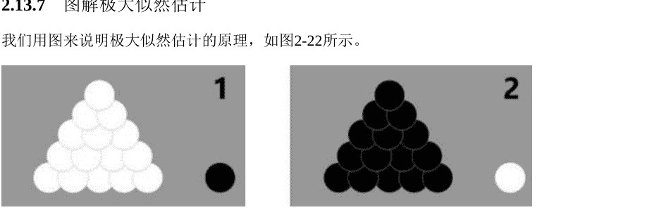

图2-22 极大似然估计原理示例图

图2-22展示了两个外观相同的箱子。1号箱装有99个白球和1个黑球，2号箱装有1个白球和99个黑球。一次抽取得到黑球，更可能来自2号箱。这里的“更可能”正是极大似然原理的直观表达。

## 2.14 EM算法：处理隐变量的迭代方法
最大期望算法 Expectation-Maximization Algorithm，EM，是一种通过迭代实现极大似然估计的优化策略，常用来替代牛顿迭代，专门处理含有隐变量或缺失数据的概率模型参数估计问题。

### 2.14.1 EM的两步循环
EM 交替执行两步操作。

- （1）E步，即期望步，利用隐变量的当前估计计算极大似然估计值。
- （2）M步，即最大化步，在E步得到的结果上最大化似然，从而更新参数。

M步得到的新参数会被带入下一个E步，周而复始直至收敛。

### 2.14.2 EM的推导过程
设观测数据为 $X = (x^{(1)}, x^{(2)}, \dots, x^{(m)})$，目标是寻找模型参数 $\theta$，使对数似然最大：

$$\theta = \arg \max_{\theta} \sum_{i=1}^{m} \log P(x^{(i)}; \theta) \quad (2-88)$$

若存在未观测的隐含数据 $Z = (z^{(1)}, z^{(2)}, \dots, z^{(m)})$，则对数似然为：

$$\theta = \arg \max_{\theta} \sum_{i=1}^{m} \log P(x^{(i)}; \theta) = \arg \max_{\theta} \sum_{i=1}^{m} \log \sum_{z^{(i)}} Q_i(z^{(i)}) \frac{P(x^{(i)}, z^{(i)}; \theta)}{Q_i(z^{(i)})} \quad (2-89)$$

该式难以直接求解 $\theta$，于是引入下界技巧：

$$\sum_{i=1}^{m} \log \sum_{z^{(i)}} P(x^{(i)}, z^{(i)}; \theta) = \sum_{i=1}^{m} \log \sum_{z^{(i)}} Q_i(z^{(i)}) \frac{P(x^{(i)}, z^{(i)}; \theta)}{Q_i(z^{(i)})} \geq \sum_{i=1}^{m} \sum_{z^{(i)}} Q_i(z^{(i)}) \log \frac{P(x^{(i)}, z^{(i)}; \theta)}{Q_i(z^{(i)})} \quad (2-90)$$

上式用到Jensen不等式：

$$\log \sum_{j} \lambda_j y_j \geq \sum_{j} \lambda_j \log y_j, \lambda_j \geq 0, \sum_{j} \lambda_j = 1 \quad (2-91)$$

并引入辅助分布 $Q_i(z^{(i)})$。

为使Jensen不等式取等，需要满足：

$$\frac{P(x^{(i)}, z^{(i)}; \theta)}{Q_i(z^{(i)})} = c, c\text{为常数}$$ (2-92)

由于 $Q_i(z^{(i)})$ 为概率分布，有

$$\sum_{z} Q_i(z^{(i)}) = 1$$ (2-93)

综合可得：

$$Q_i(z^{(i)}) = \frac{P(x^{(i)}, z^{(i)}; \theta)}{\sum_{z} P(x^{(i)}, z^{(i)}; \theta)} = \frac{P(x^{(i)}, z^{(i)}; \theta)}{P(x^{(i)}; \theta)} = P(z^{(i)} | x^{(i)}; \theta)$$ (2-94)

当 $Q_i(z^{(i)}) = P(z^{(i)} | x^{(i)}; \theta)$ 时，式（2-90）成为包含隐变量的对数似然的下界。最大化该下界即相当于最大化对数似然，需最大化：

$$\arg \max_{\theta} \sum_{i=1}^{m} \sum_{z^{(i)}} Q_i(z^{(i)}) \log \frac{P(x^{(i)}, z^{(i)}; \theta)}{Q_i(z^{(i)})}$$ (2-95)

简化后得到：

$$\arg \max_{\theta} \sum_{i=1}^{m} \sum_{z^{(i)}} Q_i(z^{(i)}) \log P(x^{(i)}, z^{(i)}; \theta)$$ (2-96)

这正是EM的M步。式中 $\sum_{z^{(i)}} Q_i(z^{(i)}) \log P(x^{(i)}, z^{(i)}; \theta)$ 可理解为在条件分布 $Q_i(z^{(i)})$ 下的期望，对应E步。

### 2.14.3 EM算法的可视化
式（2-89）中因隐变量的存在难以直接求解，EM通过不断提升下界直至收敛求解。示意图如图2-23。

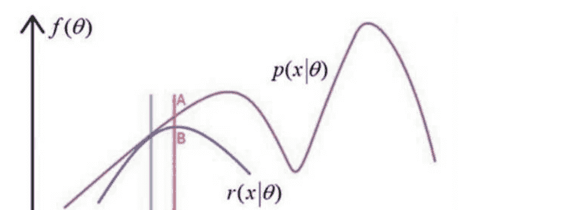

图2-23 EM算法求解示意图

图中目标模型 $p(x|\theta)$ 复杂，求解析解困难。为消除隐变量 $z$ 的影响，可构造不含 $z$ 的模型 $r(x|\theta)$，满足 $r(x|\theta) \leq p(x|\theta)$。

求解步骤：

- （1）选取 $\theta_1$，使 $r(x|\theta) = p(x|\theta)$，随后对 $r$ 求最大值得到 $\theta_2$，完成一次参数更新。
- （2）重复该过程直至收敛，全程保持 $r \leq p$。

### 2.14.4 EM算法的标准流程
输入：观测数据 $X = (x^{(1)}, x^{(2)}, ..., x^{(m)})$，联合分布 $p(x, z; \theta)$，条件分布 $p(z|x; \theta)$，最大迭代次数 $J$。

- （1）随机初始化参数初值 $\theta^0$。
- （2）设当前迭代次数为 $j$，从1到 $J$ 循环：
    - E步。计算条件概率期望：
$Q_i(z^{(i)}) = P(z^{(i)}|x^{(i)}; \theta^j)$ (2-97)
$L(\theta, \theta^j) = \sum_{i=1}^{m} \sum_{z^{(i)}} \log P(z^{(i)}|x^{(i)}; \theta^j) \log P(x^{(i)}, z^{(i)}; \theta)$ (2-98)
    - M步。最大化 $L(\theta, \theta^j)$ 得到 $\theta^{j+1}$
$$\theta^{j+1} = \arg\max_{\theta} L(\theta, \theta^j)$$
(2-99)
    - 若 $\theta^{j+1}$ 收敛则结束，否则继续E步。

输出：模型参数 $\theta$。

## 2.15 降维与聚类：无监督的两个方向
降维和聚类同属无监督学习任务。聚类是依据相似度将数据划分为若干组，降维是在保留结构和有效信息的前提下压缩数据维度。本节总结两类任务的常见问题。

### 2.15.1 维数灾难的产生机理
假设有10张照片，包含三角形和圆形两类。现在用一个特征训练分类器，示意图如图2-24。

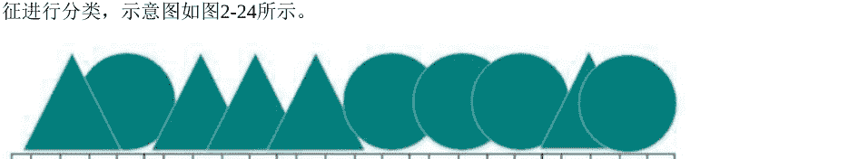

单特征时，三角形和圆形在该线段上近乎均匀分布，10个样本很难线性可分。增加到两个特征后，情况如图2-25。

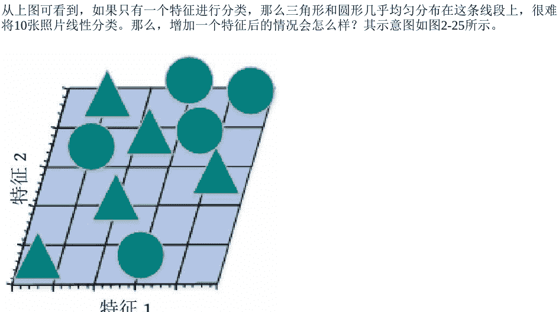

仍找不到直线完全分离。再增加一个特征，效果如图2-26。

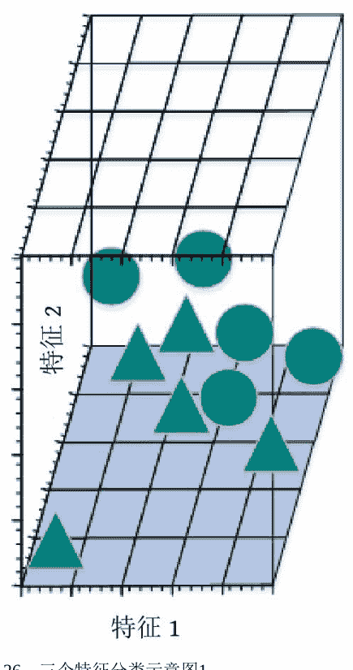

图2-26 三个特征分类示意图1

此时可找到一个平面将两类分开，如图2-27。

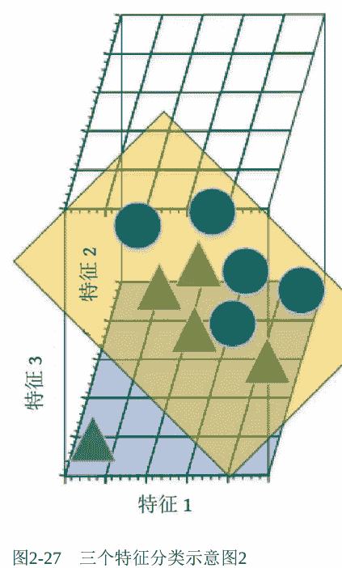

图2-27 三个特征分类示意图2

计算不同维度下的样本密度：

- 一个特征，空间长度为5，密度为10÷5=2。
- 两个特征，空间大小为5×5=25，密度为10÷25=0.4。
- 三个特征，空间大小为5×5×5=125，密度为10÷125=0.08。

维度继续增加，样本会变得越来越稀疏，训练样本更容易被超平面分开。维度趋于无穷时，密度接近零。

将高维分类结果映射到低维时会出现反转。图2-28即为三维映射到二维的示意图。

### 2.15.2 如何规避维数灾难
高维空间中训练样本线性可分，但映射回低维后往往不可分。增加特征相当于在低维构造复杂的非线性分类器，这种分类器容易“过拟合”，只 memorized 训练特例，对未见样本泛化能力差。图2-29展示了用2个特征的线性分类器误分部分训练样本。

图2-29的准确率看似低于高维情形，但其泛化能力更强，因为它学到的是整体趋势而非特例。减少特征数有助于避免过拟合。

图2-30给出另一视角。若只有一个特征，值域0到1，每个样本的取值几乎唯一，覆盖20%的值域需要约20%的样本。增加到两个特征，覆盖20%值域需约45%的样本，0.45^2≈0.2；三个特征时需约58%，0.58^3≈0.2。随着维度上升，覆盖固定比例值域所需的样本量急剧增加。

由此可见，特征越多样本越稀疏，参数估计越不可靠，过拟合风险越大。高维空间中样本分布也不均匀，越靠近中心越稀疏，角落数据更难分类。若样本无限则无灾难，现实中样本有限，故不应使用过多特征。

常用规避思路是降维。许多高维数据可压缩到低维而不丢失关键信息。常用方法包括投影、流形学习、主成分分析、核主成分分析、局部线性嵌入、小波分析法等。自动编码器利用神经网络学习低维表示，克服了传统方法对特征维度限制的不足。

### 2.15.3 聚类与降维的区别
两者都可作为分类等任务的预处理。

聚类旨在发现数据内在的分布结构，可独立使用如异常检测，也可作为监督任务的前驱。例如在推荐系统中，先对历史用户聚类，将每个簇定义为用户类型，再训练分类模型判断新用户类型。示意图如图2-32。

降维则是缓解维数灾难的重要手段，通过数学变换把高维属性空间映射到低维子空间。其假设是真实与学习任务相关的是低维分布。以泰坦尼克生还预测为例，输入年龄、姓名、性别、票价等多维特征，需先筛选主要特征以提升模型泛化。

二者作用对象不同：聚类针对数据点，降维针对特征。实现方法也不同，聚类常用k-means、层次聚类、密度聚类；降维常用PCA、Isomap、LLE等。

### 2.15.4 评判聚类算法好坏的维度
可从以下方面衡量：

- （1）处理能力：对大数据集的复杂度表现，对噪声的鲁棒性，对任意形状、含空洞嵌套数据的适应性。
- （2）预设需求：是否需要预先知道簇的数量，是否需要人工提供领域知识。
- （3）输入属性：结果是否依赖数据输入顺序，即是否顺序无关；对高维数据的适应性，对数据类型是否有要求。

### 2.15.5 聚类与分类的本质差别
聚类即把相似样本归为一组，过程中并不关心“这一组叫什么”，只要求相似项聚在一起。算法通常只需相似度计算即可，无需训练数据，属于无监督学习。

分类则需要明确的类别标签，分类器从带标签的训练集中学习，从而对未知数据进行判别，属于监督学习。

### 2.15.6 聚类算法能力全景对比
各主流聚类方案在伸缩性、数据适配、高维适应、抗噪能力、簇形以及运行效率等维度上的表现，已汇总在表2-23 中。

表2-23 不同聚类算法的性能比较

| 算法名称 | 可伸缩性 | 适合的数据类型 | 高维性 | 异常数据抗干扰性 | 聚类形状 | 算法效率 |

| :--- | :--- | :--- | :--- | :--- | :--- | :--- |

| WAVECLUSTER | 很高 | 数值型 | 很高 | 较高 | 任意形状 | 很高 |

| ROCK | 很高 | 混合型 | 很高 | 很高 | 任意形状 | 一般 |

| BIRCH | 较高 | 数值型 | 较低 | 较低 | 球形 | 很高 |

| CURE | 较高 | 数值型 | 一般 | 很高 | 任意形状 | 较高 |

| K-PROTOTYPES | 一般 | 混合型 | 较低 | 较低 | 任意形状 | 一般 |

| DENCLUE | 较低 | 数值型 | 较高 | 一般 | 任意形状 | 较高 |

| OPTIGRID | 一般 | 数值型 | 较高 | 一般 | 任意形状 | 一般 |

| CLIQUE | 较高 | 数值型 | 较高 | 较高 | 任意形状 | 较低 |

| DBSCAN | 一般 | 数值型 | 较低 | 较高 | 任意形状 | 一般 |

| CLARANS | 较低 | 数值型 | 较低 | 较高 | 球形 | 较低 |

### 2.15.7 四大经典聚类方法拆解
聚类技术大致可归为划分、层次、密度、网格与模型五大流派。下面聚焦 k-means 聚类、层次聚类、神经网络自组织映射 SOM、模糊 C 均值 FCM 四种代表方法，并在通用基准集上进行效果对照。

#### k-means 聚类工作机制
k-means 以预设的簇数 k 为控制量，把 n 条样本划入 k 组，追求组内一致性提高、组间差异扩大。

迭代过程为：先随机抽取 k 个样本作为初始中心；把其余样本按到各中心的距离归入最近的组；随后重新求取各组的均值作为新中心。如此反复直至目标函数收敛。常用平方误差准则：

$$E = \sum_{i=1}^{k} \sum_{p \in C_i} \|p - m_i\|^2 \quad (2-100)$$

式中 E 为全部样本平方误差之和，p 代表空间点，m_i 为簇 c_i 的均值。该准则促使形成的簇更紧致独立，默认采用欧氏距离，亦可替换为其他度量。

算法流程：
输入：含 n 个样本的数据集及期望簇数 k。
输出：使平方误差最小的 k 个簇划分。
步骤：
1. 任意挑选 k 个样本作为初始中心。
2. 依据簇均值，把每个样本重新分配到最相似的簇。
3. 刷新簇均值，即重新计算各簇样本的平均值。
4. 重复 2、3 直到中心位置不再发生变动。

#### 层次聚类思路
按聚类分解方向不同，层次方法可分为自底向上凝聚型与自顶向下分裂型。凝聚型先让每个样本自成一簇，再逐步合并为越来越大的簇，直至全部合并或满足终止条件。大多数层次方法属于此种，仅簇间相似度定义各异。

以最小距离凝聚为例：
1. 将每个样本视作一类，计算两两之间的最小距离。
2. 把距离最近的两个类合并为新类。
3. 重新计算新类与其余类之间的距离。
4. 重复 2、3，直至所有类最终合并为一类。

#### SOM 聚类解析
SOM 假设输入样本中存在拓扑或顺序结构，能够实现从 n 维输入空间到二维输出平面的降维映射，且保持拓扑一致性，与脑处理机制有较强关联。

网络由输入层与输出层构成。输入层对应高维向量，输出层由二维网格排列的有序节点组成，两层通过权重向量连接。学习时先找到与输入最接近的输出单元即获胜单元并更新其权重，同时邻域权重同向调整，以保留输入向量的拓扑特征。

算法流程：
1. 初始化网络，为输出层各节点权重赋初值。
2. 从样本中随机抽取并归一化输入向量，寻找距离最小的权重向量。
3. 确定获胜单元，在其邻域内调整权重使之向输入靠近。
4. 持续供给新样本进行训练。
5. 收缩邻域半径、降低学习率并反复，直至输出节点值小于允许阈值，输出聚类结果。

#### FCM 聚类解析
模糊聚类即借助模糊数学进行分析。FCM 通过隶属度刻画每个数据点对某簇的归属程度，是对硬聚类的改进。

设数据集 X = {x1, x2, …, xn}，其模糊 c 划分可用模糊矩阵 U = [uij] 表示，元素 uij 表示第 j 个数据点属于第 i 类的隶属度，uij 满足：

$$

\begin{cases}

\sum_{i=1}^{c} u_{ij} = 1, \forall j \\

u_{ij} \in [0,1], \forall i,j \\

\sum_{j=1}^{n} u_{ij} > 0, \forall i

\end{cases} \quad (2-101)

$$

当前常用准则为类内加权误差平方和最小化：

$$\min J_m(U,V) = \sum_{j=1}^{n} \sum_{i=1}^{c} u_{ij}^m d_{ij}^2(x_j, v_i) \quad (2-102)$$

其中 V 为聚类中心，m 为加权指数，dij²(xj, vi) = ‖vi - xj‖²。

算法流程：
1. 对数据矩阵进行标准化。
2. 构建模糊相似矩阵并初始化隶属矩阵。
3. 迭代直至目标函数收敛到极小值。
4. 根据最终隶属矩阵确定样本所属类别并展示结果。

#### 四种聚类算法试验
选用 UCI 数据库中用于评测分类与聚类的通用数据集 IRIS，在同一数据上运行上述四种算法，得到初步对比结果。

表2-24 4种聚类算法比较

| 聚类算法 | 聚错样本数 | 运行时间（s） | 平均准确率（%） |

| :--- | :--- | :--- | :--- |

| k-means 聚类算法 | 17 | 0.146001 | 89 |

| 层次聚类算法 | 51 | 0.128744 | 66 |

| SOM 聚类算法 | 22 | 5.267283 | 86 |

| FCM 聚类算法 | 12 | 0.470417 | 92 |

注：
- 聚错样本数：各类中聚错样本数之和。
- 运行时间：聚类全过程耗时，单位 s。
- 平均准确度：原数据集有 K 个类，ci 表示第 i 类，ni 为样本数，mi 为聚类正确数，则第 i 类精度为 mi/ni，平均精度为各类别精度均值。

# 第3章 深度学习基础入门
深度学习是当前最成功的表示学习范式，其思路是将表示学习拆解为多个阶段：先从原始数据学习低级表征，再在此基础上学习高级表征。深度学习属于机器学习范畴。本章旨在阐释深度学习的基础概念，厘清常见疑点，涵盖神经网络基本原理与计算方式，以及激活、归一化、初始化、微调、超参数、学习率、正则化等关键要素的实践经验。

## 3.1 核心概念概览
深度学习是机器学习研究的新分支，目标是构建模拟人脑分析学习的神经网络，模仿大脑机制解释图像、声音、文本等数据。以下将介绍网络类型、常用模型结构、深度学习与机器学习的关系，以及平台选型建议。

### 3.1.1 网络类型盘点
网络种类繁多，其中多层感知机最为关键。为便于理解，先从最简模型说起。

#### 感知机单元
多层感知机的基础单元即感知机，由 Frank Rosenblatt 于1957年提出。简单感知机示意如图3-1。

其中 x1、x2、x3 为感知机输入，其输出为：

$$output = \begin{cases} 0, & \text{if } \sum_i w_i x_i \leqslant \text{threshold} \\ 1, & \text{if } \sum_i w_i x_i > \text{threshold} \end{cases} \quad (3-1)$$

若把感知机视作加权投票，例如三位评委打分分别为4、1、-3，权重为1、3、2，则综合分为4×1+1×3+(-3)×2=1。设晋级阈值为3，仅综合分大于3时晋级。对照感知机，该选手被淘汰，因：

$$\sum_i w_i x_i < \text{threshold} = 3, output = 0 \quad (3-2)$$

用 -b 替代阈值，输出写为：

$$output = \begin{cases} 0, & \text{if } \mathbf{w} \cdot \mathbf{x} + b \leqslant 0 \\ 1, & \text{if } \mathbf{w} \cdot \mathbf{x} + b > 0 \end{cases} \quad (3-3)$$

选取合适的 w 和 b，简单感知机可实现与非门，如图3-2所示。

当输入为0、1时，感知机输出为0×(-2)+1×(-2)+3=1。

更复杂的感知机由简单单元组合而成，如图3-3所示。

#### 多层感知机概述
多层感知机由感知机推广而来，核心特征是存在多层神经元，故又称深度神经网络，示意图如图3-4所示。

输出层可包含多个神经元，隐含层可为单层或多层。输出层为多神经元的网络如图3-5所示。

### 3.1.2 神经网络的常用模型结构
图3-6 中囊括了当前大部分常用网络结构。

### 3.1.3 深度学习与机器学习关系
机器学习利用计算机、概率论与统计学等手段，输入数据使计算机习得新知识，其过程即用数据优化目标函数。深度学习是机器学习的一种特殊形式，具有更强能力与灵活性。它通过嵌套层次结构学习世界表示，每层表示与更简单的特征相关，抽象表示再用于计算更高层次的抽象。

差异如下：
1. 传统机器学习需手工定义特征，有目的提取目标信息，对任务特异性和特征设计经验依赖大。
2. 深度学习可从大数据中先学简单特征，再逐步学更复杂抽象的深层特征，不依赖人工特征工程，这也是其在大数据时代受欢迎的原因。

机器学习与深度学习的包含关系如图3-7所示。

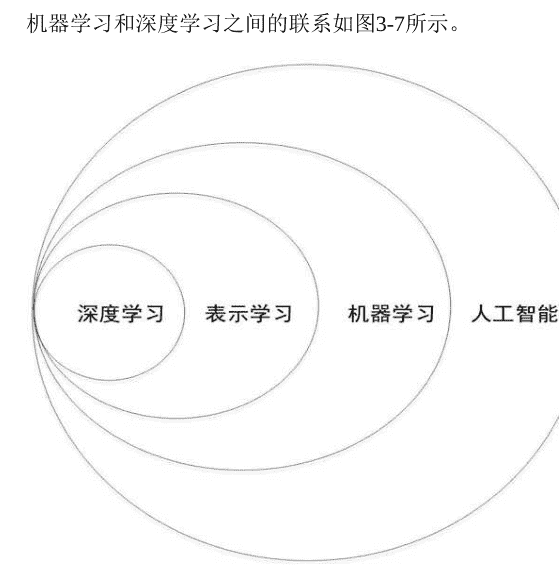

图3-7 机器学习和深度学习之间的联系

### 3.1.4 深层表征的优势
深度神经网络能解决众多问题，并非靠规模而是靠深度、靠较多隐含层，主要原因有二：
- 深度网络是特征递进式学习。浅层神经元直接从输入学低层次简单特征如边缘、纹理，深层在浅层基础上学习更高层特征，从计算机角度学习深层语义信息。
- 深层网络隐含单元数量相对较少而层数较多，若用浅层网络达到同等计算效果，所需单元数量呈指数增长。

### 3.1.5 深度学习架构分类
依据结构、技术与应用领域，可大致分为三类：
- 无监督或生成式学习架构：面向模式分析和合成，在无目标类标签情况下捕捉观测数据的层级相关性。代表包括深度玻尔兹曼机 DBM、受限玻尔兹曼机 RBM、广义去噪自编码器与积网络 SPN 等。
- 有监督学习深度网络：提供判别能力用于模式分类，描述可见数据条件下的后验分布。目标标签以直接或间接形式给出，也称判别式深度网络。
- 混合深度网络：目标为判别式模型，常以生成式或无监督深度网络结果作为辅助支撑。常见做法是通过优化与正则化，或用判别准则估计生成式/无监督网络参数。

### 3.1.6 开发平台选型指南
主流开源平台有 Caffe、PyTorch、MXNet、CNTK、Theano、TensorFlow、Keras、Fastai 等。选型可参考：
- 与现有编程平台、技能整合难易度。涉及前期开发经验、编程语言、数据集存储格式等积累。
- 与机器学习、数据处理生态整合紧密程度。考虑建模前数据预处理工具是否便利，建模后可视化、统计推断、数据分析工具是否完备。
- 对数据量及硬件的要求与支持。不同场景数据量差异大，可能涉及分布式计算与多 GPU。平台对分布式等场景的支持在持续演进。
- 平台成熟度。主观因素，包括社区活跃度、与开发人员沟通难易度、应用发展势头。
- 平台利用多样性。部分平台专为深度学习研究设计，部分在分布式、GPU 架构上优化强。是否可用同一平台做其他任务，如二次型优化、强化学习等。

## 3.2 计算流程解析
神经网络计算核心为前向传播与反向传播，本节以实例说明具体过程。

### 3.2.1 前向与反向传播
前向传播 FP 作用于每层输入，逐层计算得到输出。

反向传播 BP 作用于网络输出，通过梯度计算由深到浅更新参数。

前向传播示意图如图3-8所示。

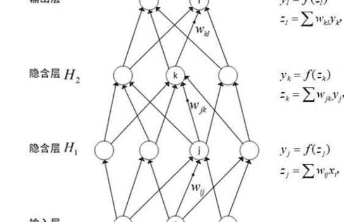

图3-8 前向传播示意图

假设上一层节点 i、j、k…与本层节点 w 相连，则 w 的值通过上一层节点及其对应权重加权求和，再加上偏置，经非线性激活函数如 ReLU、sigmoid 后得到本层输出。逐层迭代最终得到输出层结果。

反向传播示意图如图3-9所示。

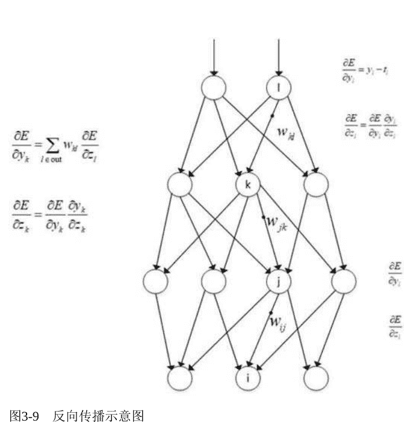

图3-9 反向传播示意图

以分类为例，前向结果总存在误差，如何减小误差？常用梯度下降算法。以图中字母为例，若最终误差为 E 且输出层激活为线性，则 E 对输出节点 yl 的偏导为 yl - tl，其中 tl 为真实值，∂yl/∂zl 为激活函数，zl 为加权和，则本层 ∂E/∂zl = ∂E/∂yl · ∂yl/∂zl。同理逐层回传，最终有 ∂E/∂xi = ∂E/∂yj · ∂yj/∂zj。随后调整权重并不断交替前向与反向传播，最终得到较优解。

### 3.2.2 输出计算示例
神经网络输出计算示意图如图3-10所示。

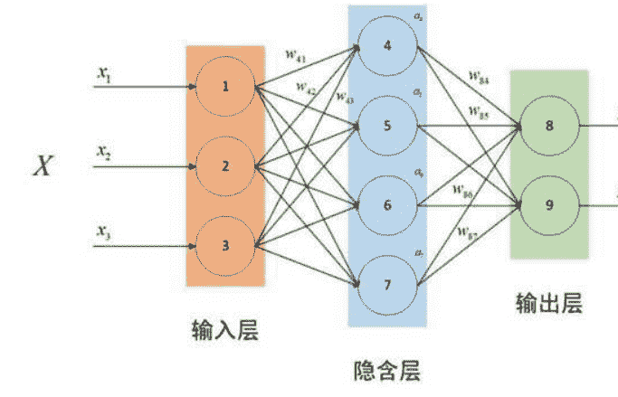

图3-10 神经网络输出计算示意图

图里展示的结构是：最前端3个输入单元，编号1、2、3；中间隐藏层放了4个单元，编号4、5、6、7；最后输出端有2个单元8、9。以隐藏单元4为例，它与前面3个输入单元全部相连，关联系数记作 w₄₁、w₄₂、w₄₃。

要得到单元4的激活结果，需要先拿到上游1、2、3的输出。输入端的输出就是原始输入向量本身。按图示对应关系，单元1、2、3的输出分别是 x₁、x₂、x₃。

**a₄ = σ(wᵀa) = σ(w₄₁x₁ + w₄₂x₂ + w₄₃x₃ + w₄b) (3-4)**

式中 w₄b 为单元4的偏置项。

同理可推导出单元5、6、7的输出 a₅、a₆、a₇。

输出单元8的输出 y₁ 写成：

**y₁ = σ(wᵀa) = σ(w₈₄a₄ + w₈₅a₅ + w₈₆a₆ + w₈₇a₇ + w₈b) (3-5)**

w₈b 为单元8的偏置。y₂ 的推导方式相同。由此可看出输出向量的维度与输出端单元数量一致。

### 3.2.3 卷积输出的求解思路
假设有一张 5×5 的图像，用 3×3 的滤波器做卷积，目标得到 3×3 的特征映射，如图3-11。

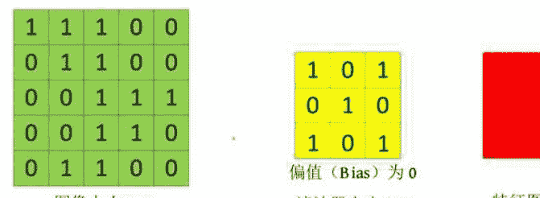

图3-11 待计算图像和卷积核

记 x_{i,j} 为图像第 i 行第 j 列像素，w_{m,n} 为滤波器第 m 行第 n 列系数，w_b 为滤波器偏置，a_{i,j} 为特征映射第 i 行第 j 列值，f 为激活函数，这里取 ReLU。

卷积计算式为：

$$a_{i,j} = f(\sum_{m=0}^{2}\sum_{n=0}^{2} w_{m,n} x_{i+m,j+n} + w_b)$$ (3-6)

步长取1时，特征映射元素 a_{0,0} 的求法：

$$a_{0,0} = f(\sum_{m=0}^{2}\sum_{n=0}^{2} w_{m,n} x_{0+m,0+n} + w_b) = relu(w_{0,0}x_{0,0} + w_{0,1}x_{0,1} + w_{0,2}x_{0,2} + w_{1,0}x_{1,0} + w_{1,1}x_{1,1} + w_{1,2}x_{1,2} + w_{2,0}x_{2,0} + w_{2,1}x_{2,1} + w_{2,2}x_{2,2})$$ (3-7)

$$= 1+0+1+0+1+0+0+0+1 = 4$$

推导过程如图3-12。

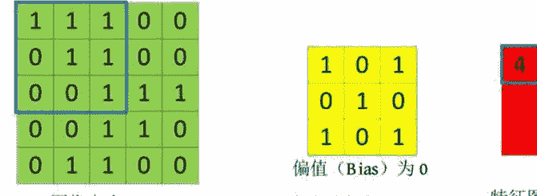

图3-12 当步长为1时，特征图元素 a_{0,0} 过程图示

依次类推可得到完整特征映射，结果如图3-13。

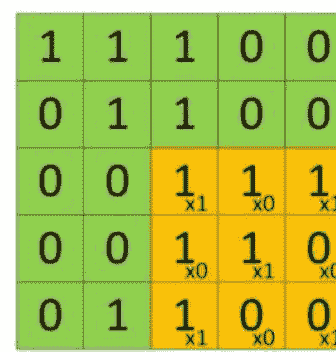

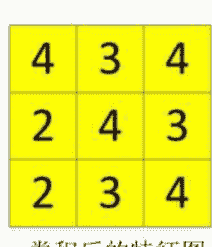

图3-13 当步长为1时，全部的特征图计算结果

步长改为2时，计算结果如图3-14。

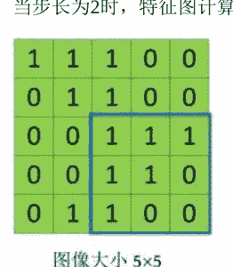


图3-14 当步长为2时，全部的特征图计算结果

说明：图像尺寸、步长与卷积后映射尺寸相关，满足：

$$W_2 = (W_1 - F + 2P) / S + 1$$

$$H_2 = (H_1 - F + 2P) / S + 1$$

其中 W₂ 为卷积后映射宽度，W₁ 为卷积前图像宽度，F 为滤波器宽度，P 为 Zero Padding 圈数，Zero Padding 即在原图外围补零，P=1 表示补一圈零；S 为步长；H₂、H₁ 分别为卷积后、前映射高度。

例如 W₁=5，F=3，P=0，S=2 时，W₂ 为：

$$W_2 = (W_1 - F + 2P) / S + 1 = (5 - 3 + 0) / 2 + 1 = 2$$

说明映射宽度为2，高度同理也是2。

若卷积前图像深度为 D，则滤波器深度也必须为 D。深度大于1 的卷积公式为：

$$a_{d,i,j} = f(\sum_{d=0}^{D-1} \sum_{m=0}^{F-1} \sum_{n=0}^{F-1} w_{d,m,n} x_{d,i+m,j+n} + w_b)$$

其中 D 为深度，F 为滤波器尺寸，w_{d,m,n} 表示滤波器第 d 层第 m 行第 n 列系数，a_{d,i,j} 表示特征映射第 d 层第 i 行第 j 列像素。

每个卷积层可使用多个滤波器。每个滤波器与原图卷积后得到一张映射，映射深度与滤波器个数相同。图3-15 展示了含两个滤波器的卷积层示意。输入为 7×7×3，经两个 3×3×3 滤波器卷积，步长2，得到 3×3×2 输出。图中 Zero Padding 为1，即在输入外围补一圈零。

以上即卷积层的计算方式，体现了局部关联与参数复用：每层单元仅与上一层局部单元相连，且滤波器系数在上一层所有位置复用。对包含两个 3×3×3 滤波器的卷积层，参数量仅为 (3×3×3+1)×2=56 个，与上一层单元总数无关，相较稠密连接网络大幅减少。


### 3.2.4 池化层输出的求法
池化层主要做下采样，通过剔除特征映射中次要信息进一步压缩参数。最常用的是最大池化，即在 n×n 区域取最大值作为采样后值。2×2 最大池化示意如图3-16。


图3-16 2×2最大池化计算示意图

除最大池化外，平均池化也很常见，即取区域元素的均值。注意对深度为 D 的映射，各通道独立池化，池化后深度仍为 D。

### 3.2.5 反向传播实战拆解
典型三层网络如图3-17。


图3-17 典型的三层神经网络示意图

L₁ 为输入层，L₂ 为隐藏层，L₃ 为输出层。

设输入集为 D = x₁,x₂,x₃,...,xₙ，输出集为 y₁,y₂,...,yₙ。若输入输出相同即为自编码；经映射后输出可不同于输入。

如图3-18 所示网络结构。


图3-18 网络层示意图

输入端含单元 i₁、i₂ 与偏置 b₁；隐藏层含单元 h₁、h₂ 与偏置 b₂，输出端为 o₁、o₂，w_i 为层间系数，激活函数为 sigmoid。对参数初始化如图3-19。


图3-19 初始化图3-18所示的网络层

其中：
输入数据 i₁=0.05，i₂=0.10；
期望输出 o₁=0.01，o₂=0.99；
初始系数 w₁=0.15，w₂=0.20，w₃=0.25，w₄=0.30，w₅=0.40，w₆=0.45，w₇=0.50，w₈=0.55。

目标是让输入 i₁=0.05、i₂=0.10 的网络输出尽可能接近 0.01、0.99。

先看前向传播。

1) 输入层到隐藏层
单元 h₁ 加权和：
net_{h₁}=w₁·i₁+w₂·i₂+b₁·1
net_{h₁}=0.15×0.05+0.2×0.1+0.35×1=0.3775 (3-11)
h₁ 输出：
out_{h₁}=1/(1+e^{-net_{h₁}})=1/(1+e^{-0.3775})=0.593269992 (3-12)
同理 h₂ 输出：
out_{h₂}=0.596884378 (3-13)

2) 隐藏层到输出层
net_{o₁}=w₅·out_{h₁}+w₆·out_{h₂}+b₂·1 (3-14)
即 net_{o₁}=0.4×0.593269992+0.45×0.596884378 (3-15)
out_{o₁}=1/(1+e^{-net_{o₁}})=1/(1+e^{-1.105905967})=0.75136079 (3-16)


同理可得 out_{o₂}，前向结束，输出为 [0.75136079,0.772928465]，与真实值 [0.01,0.99] 差距很大，需反向传播更新系数。

反向传播计算：

1) 总误差
采用平方误差：
E_total=∑½(target-output)² (3-17)
E_{o₁}=½(0.01-0.75136507)²=0.274811083
E_{o₂}=0.023560026
E_total=0.298371109

2) 系数更新
以 w₅ 为例，其对总误差的影响为：
∂E_total/∂w₅=∂E_total/∂out_{o₁}·∂out_{o₁}/∂net_{o₁}·∂net_{o₁}/∂w₅ (3-18)

图3-20 更直观展示误差回传路径。


图3-20 误差反向传播示意图

### 3.2.6 让网络更深有什么用
前提是在一定范围内。相同单元数下，深层结构具有更大表达能力，分层组合产生指数级表达空间，可组合出更多子结构，更易学习复杂特征。隐藏层增多意味着激活函数带来的非线性变换嵌套更深，能够构建更复杂的映射关系。

## 3.3 激活函数全解析
激活函数是在单元上运行的函数，负责把输入映射为输出。

### 3.3.1 为什么必须加激活函数
深度网络中激活函数主要作用有：
激活函数对学习复杂非线性函数至关重要；
引入非线性，否则输出只是简单线性函数，线性模型能力有限，难以拟合图像、语音等复杂数据；
可将当前特征空间线性映射到另一空间，使数据更易分离。

### 3.3.2 非线性到底重要在哪里
通常使用非线性激活有两个原因：
若全网均为线性，线性组合仍是线性，等价于单一线性分类器，无法逼近任意函数；
非线性激活提升网络表达力，使其能学习复杂映射，实现输入输出间的非线性关系。

### 3.3.3 常见激活函数长啥样
1) sigmoid 激活函数。

定义 f(x)=1/(1+e^{-x})，值域 (0,1)。
图像如图3-21。

图3-21 sigmoid激活函数图像

2) tanh 激活函数

定义 f(x)=tanh(x)=(e^x-e^{-x})/(e^x+e^{-x})，值域 (-1,1)。
图像如图3-22。

图3-22 tanh激活函数图像

3) ReLU 激活函数。
定义 f(x)=max(0,x)，值域 (0,+∞)。
图像如图3-23。

图3-23 ReLU激活函数图像

4) Leaky ReLU 激活函数。

定义 f(x)= {ax, x<0; x, x≥0}，值域 (-∞,+∞)。
图像如图3-24，a=0.05。

图3-24 Leaky ReLU激活函数图像

5) Softplus 激活函数。
定义 f(x)=ln(1+e^x)，值域 (0,+∞)。
图像如图3-25。

图3-25 Softplus激活函数图像

6) softmax 函数。

多用于多分类网络输出。

### 3.3.4 常用激活函数的求导表
表3-1 常见激活函数的导数计算

| 原函数 | 函数表达式 | 导数 | 备注 |
| :--- | :--- | :--- | :--- |
| Sigmoid 激活函数 | f(x)=1/(1+e^{-x}) | f'(x)=1/(1+e^{-x})(1-1/(1+e^{-x}))=f(x)(1-f(x)) | 当 x=10 或 x=-10 时，f'(x)≈0；当 x=0 时，f'(x)=0.25 |

| tanh 激活函数 | $f(x)=\tanh(x) = \frac{e^x-e^{-x}}{e^x+e^{-x}}$ | $f'(x)=1-(\tanh(x))^2$ | 当 x=10 或 x=-10 时，$f'(x) \approx 0$；当 x=0 时，$f'(x)=1$ |

| Relu 激活函数 | $f(x)=\max(0, x)$ | $c(u) = \begin{cases} 0, x<0 \\ 1, x>0 \\ \text{undefined}, x=0 \end{cases}$ | 通常当 x=0 时，给定其导数为 1 和 0 |

### 3.3.5 激活函数有哪些性质

激活函数在设计上一般希望具备以下几个特性。

- （1）非线性：只有在非线性条件下，两层神经网络才拥有逼近任意复杂函数的潜力。若采用恒等映射 $f(x)=x$，该性质会丧失，多层感知机也会退化为与单层等价的线性模型。
- （2）可微性：基于梯度的优化方法依赖于导数存在，可微的激活函数能保证反向传播的稳定性。
- （3）单调性：激活函数单调时，单层网络的损失函数可以保持凸性，有利于求解。
- （4）$f(x) \approx x$：当激活函数在局部近似恒等时，若权重初始值很小，网络训练会更高效；反之则需要对初始值进行精细设计。
- （5）输出值的范围：输出有界时，梯度优化会更稳定，因为表示受限于有限权重；输出无界时，训练效率往往更高，但通常需要使用更小的学习率。

### 3.3.6 如何选择激活函数

激活函数的挑选没有唯一标准，需要结合任务特点进行试验验证，常在验证集上对比选择最优者。

以下是常见的实践建议。

- （1）二分类问题输出层常用 sigmoid，其余层位优先使用 ReLU。
- （2）隐含层不确定时，ReLU 是首选。tanh 偶尔也会使用，ReLU 的优势在于负区导数为 0。
- （3）sigmoid 除二分类输出层外基本不再使用。
- （4）tanh 表现优异，适用范围很广。
- （5）ReLU 是默认的首选，不确定时先用 ReLU 或 Leaky ReLU，再尝试其他函数。
- （6）出现“死亡神经元”时，可改用 Leaky ReLU。

### 3.3.7 为什么tanh收敛速度比sigmoid快

先看两者的导数形式：

$$tanh'(x) = 1 - tanh(x)^2 \in (0,1)$$

$$sigmoid'(x) = s(x)(1 - s(x)) \in (0, \frac{1}{4}]$$

从上述式子可以看出，tanh 的梯度消失现象比 sigmoid 更轻，因此收敛速度更快。

### 3.3.8 Relu激活函数的优点

Relu 具有以下优点。

（1）在输入变化幅度很大的情况下，ReLU 的导数或斜率往往远大于 0，代码实现只需简单的分支判断，而 sigmoid 需要多次浮点运算。实践中，基于 ReLU 的网络通常比基于 sigmoid 或 tanh 的网络训练更快。

（2）sigmoid 和 tanh 在正负饱和区导数都接近 0，易引发梯度弥散，而 ReLU 与 Leaky ReLU 在正区间梯度为常数，不会产生梯度弥散现象。

注：ReLU 在负半区梯度为 0，神经元此时不参与更新，形成稀疏性，而 Leaky ReLU 可以避免此问题。

### 3.3.9 理解Relu激活函数的稀疏激活性

ReLU 激活函数图像如图3-23所示。可以看出其具有单侧抑制、相对宽阔的兴奋边界以及稀疏激活性。

从函数形式看，ReLU 是分段线性，将所有负值置零，正值保持不变，因而产生单侧抑制。正是这种抑制让神经网络中的神经元呈现稀疏激活性。

稀疏激活性意味着神经元只对输入信号的少量部分做出选择性响应，其余信号被抑制，有助于提升学习精度并快速提取稀疏特征。当 $x<0$ 时 ReLU 硬饱和，当 $x>0$ 时不存在饱和，且梯度保持不衰减，从而缓解梯度消失。

### 3.3.10 什么时候可以用线性激活函数

深度学习中多建议使用非线性激活，但在以下情形可使用线性激活。

（1）在输出层多使用线性激活函数。
（2）在隐含层某些特定场景下也可使用线性激活函数。

### 3.3.11 softmax函数的定义及作用

softmax 的一般形式为：

$$P(i) = \frac{\exp(\theta_i^T x)}{\sum_{k=1}^K \exp(\theta_k^T x)}$$ (3-19)

其中 $\theta_i$ 和 $x$ 为列向量，$\theta_i^T x$ 可替换为关于 $x$ 的任意函数 $f_i(x)$。

通过 softmax 可将 $P(i)$ 约束到 $[0,1]$ 区间。在回归与分类任务中，$\theta$ 为待估计参数，通常选取使 $P(i)$ 最大的 $\theta_i$。

仅把数值限制到 $[0,1]$ 的方法有很多，为何要加指数形式？可参考 Logistic 函数：

$$P(i) = \frac{1}{1 + \exp(-\theta_i^T x)}$$ (3-20)

该函数使 $P(i)$ 在负无穷到 0 区间趋向 0，在 0 到正无穷区间趋向 1。softmax 引入指数同样起到两极化作用，正样本输出趋近 1，负样本趋近 0，为多分类提供了便利，可视为 logistic 的泛化。

softmax 能将输入映射到 $(0,1)$ 区间并归一化为和为 1，与分类概率分布等价，是多分类任务常用的输出激活函数。

### 3.3.12 softmax函数如何应用于多分类

softmax 在多分类中把多个神经元的输出映射到 $(0,1)$ 区间，可解释为概率进行分类。

设数组 $V_i$ 为 $V$ 的第 $i$ 个元素，则其 softmax 值为：

$$S_i = \frac{e^{V_i}}{\sum_j e^{V_j}}$$ (3-21)

图3-26为神经网络 softmax 分类示意图，网络包含输入层、两个特征层，最后经 softmax 分析器得到不同类别的概率，可输出 $y=0,1,2$ 的概率值。


图3-26 神经网络softmax分类示意图

图3-27 为 softmax 计算示意图，3 个输入经 softmax 后得到数组 $[0.88,0.12,0]$。


图3-27 softmax计算示意图

更直观的映射过程如图3-28所示。


图3-28 softmax更形象的映射过程示意图

图中三个输入分别为 3、1、-3，权重为 20、2.7、0.05，除以累加和后得到的概率分别为 0.88、0.12、0，概率和为 1，最后选取概率最大的节点作为预测结果。

## 3.4 Batch Size

Batch Size 表示一次训练使用的样本数，其大小影响优化效果与速度。为便于理解，先区分 Epoch、Batch、Iteration。

- （1）Epoch 指用全部训练集对模型完成一次完整训练，称为一代训练。
- （2）Batch 指用训练集的一小部分样本做一次反向传播权重更新，这部分样本称为一批数据。
- （3）Iteration 指用一个 Batch 数据完成一次参数更新，称为一次训练。

### 3.4.1 为什么需要Batch Size

不使用 Batch Size 时，网络会一次性投入全部数据计算梯度，方向更准确，但不同梯度的取值差异极大，难以设定统一学习率，且内存压力巨大，容易导致内存爆炸。

### 3.4.2 如何选择Batch Size值

Batch Size 会影响梯度下降的方向。

若数据集较小，采用全量数据有以下好处：
- （1）全数据集确定的方向更能代表整体，更准确地指向极值。
- （2）不同权重梯度差异大，全局学习率难以设定。

对于更大规模数据，全量使用弊端明显：
- （1）内存限制下难以一次性载入海量数据。
- （2）以弹性反向传播迭代时，因各 Batch 采样差异梯度修正相互抵消，难以收敛，后续才出现 RMSprop 等折中方案。

若每次仅训练一个样本，即 Batch Size=1，线性神经元均方误差面为抛物面，多层非线性网络局部也近似抛物面，此时按各样本梯度修正会各自为政，难以收敛。

Batch Size 为全量或 1 均有缺陷，可采用 Mini-batches。只要数据充足，用部分数据算出的梯度与全量梯度几乎一致。

### 3.4.3 调节Batch Size对训练效果的影响

Batch Size 过小时，模型表现糟糕，误差升高。随着 Batch Size 增大，相同数据量的处理速度提升，但达到相同精度所需的 Epoch 数量增加。

两者矛盾共同作用，当 Batch Size 增大到某个平衡点时，时间效率最优。收敛精度会落入不同局部极值，因此在一定程度上增大 Batch Size 也能获得精度上的收益。

### 3.4.4 在合理范围内增大Batch Size的好处

- （1）内存利用率提升，大矩阵乘法的并行效率提高。
- （2）一次 Epoch 所需迭代次数减少，相同数据量的处理速度加快。
- （3）在一定范围内，Batch Size 越大，下降方向越稳定，训练震荡越小。

### 3.4.5 盲目增大Batch Size的坏处

- （1）内存利用率提升，但可能超出内存容量。
- （2）一次 Epoch 迭代次数减少，但达到相同精度的总时间增加，参数修正变慢。
- （3）Batch Size 过大后，下降方向基本不再变化。

## 3.5 归一化

训练前对训练集做标准化和归一化处理，可加快收敛，并在一定程度上缓解深层网络的梯度弥散，使深层网络训练更易。

### 3.5.1 理解归一化含义

归一化的数学意义在于统一样本的统计分布。映射到 $[0,1]$ 体现统计概率分布，映射到 $[-1,1]$ 体现统计坐标分布。

为方便建模，需要保持度量单位一致。深度学习中若所有输入均为正值，与第一隐含层相连的权重只能同增同减，学习很慢。对输入做归一化，使均值接近 0 或方差很小，可加快学习。sigmoid 的取值范围为 0 到 1，最后输出亦如此。

归一化并非 universally 适用，实际中根据输出分布，标准化等方法有时更优。

### 3.5.2 归一化和标准化的联系与区别

（1）联系：两者都能消除量纲差异，都是线性变换，都涉及按比例压缩后再平移。
（2）区别：归一化将特征值映射到 $[0,1]$ 或 $[-1,1]$，仅取决于极值；标准化采用 z-score 方法，将数据转为标准正态分布，均值 0 方差 1，每个样本都会影响结果。

### 3.5.3 为什么要归一化或标准化

主要原因有：
（1）应用层面需统一量纲，使评价标准一致。
（2）使用梯度下降时，可加速求解，提升收敛速度。
（3）避免神经元饱和，sigmoid 在接近 0 或 1 时梯度接近 0，反向传播梯度消失，归一化可有效减少该现象。
（4）避免数值过小被吞没或过大引发数值问题。

未归一化时搜索过程易偏向某一方向，形成“L”形或“之”字形，图3-29所示为未归一化的最优解搜索过程，需迭代多次才收敛。


图3-29 未归一化的最优解搜索过程

### 3.5.5 为什么归一化能提高求最优解速度

如图3-30所示，左图为未经归一化的寻解过程，右图为归一化后过程。圆圈代表等高线。


图3-30 归一化的最优解寻解过程

梯度下降时未经归一化易走“之”字形，沿等高线垂直下降，迭代次数多；归一化后等高线更圆，下降路径更直接，收敛更快。因此使用梯度下降求最优解时归一化往往必不可少。

### 3.5.6 归一化有哪些类型

#### 线性归一化

$$x' = \frac{x - \min(x)}{\max(x) - \min(x)}$$

适用于数值集中场景。缺点是 max 和 min 不稳定时，归一化结果也不稳定。

#### 标准差标准化

$$x' = \frac{x - \mu}{\sigma}$$

将数据转为均值 0、标准差 1 的标准正态分布，其中 $\mu$ 为均值，$\sigma$ 为标准差。

#### 非线性归一化

常用于数据分化大的场景，通过 log、指数、正切等非线性函数映射原始值。

### 3.5.7 局部响应归一化作用

局部响应归一化 LRN 是一种提升深度学习准确度的技术，通常置于激活、池化之后。

在 AlexNet 中提出 LRN 层，对局部神经元活动建立竞争机制，增强响应大的神经元、抑制反馈小的神经元，提升模型泛化能力。

### 3.5.8 局部响应归一化原理

LRN 原理模仿生物侧抑制现象，公式为：

$$b_{x,y}^i = a_{x,y}^i / \left( k + \alpha \sum_{j=\max(0, i-n/2)}^{\min(N-1, i+n/2)} (a_{x,y}^j)^2 \right)^\beta$$

其中：
- $a$ 表示卷积层输出，四维数组 $[batch,height,width,channel]$。

- $a_{x,y}^i$ 表示输出结构中位置 $[a,b,c,d]$ 的点，即第 $a$ 张图的第 $d$ 个通道在高度 $b$、宽度 $c$ 处的点。
- $N$ 表示通道数。
- $k$、$n$、$\alpha$、$\beta$ 为超参数，通常取 $k=2$、$n=5$、$\alpha=e^{-4}$、$\beta=0.75$。

- 累加的方向是顺着通道进行的，也就是说每个位置的平方和都沿着 $a$ 的第三维通道展开。具体而言，对应一点会取它所在通道前后各 $n/2$ 条通道的值做平方累加，包含自身在内共 $n+1$ 个点，范围从最前的第0通道到最后的第 $d-1$ 通道。英文注释也指出可把输入看成 $d$ 个三维矩阵，通道数相当于矩阵个数，叠加依旧在通道维度上进行。

局部响应归一化的简易示意图见图3-31。


图3-31 局部响应归一化简单示意图

### 3.5.9 什么是批归一化

早期训练神经网络时，归一化往往只做在输入层，中间层基本不处理。即使输入被归一化，经过 $\sigma ( WX + b )$ 这类线性变换加非线性激活后，分布很容易漂移，层数越深漂移越明显。如果在网络中间也做归一化，能否改善训练？答案是肯定的。

在隐藏层中途对数据做归一化从而提升训练效果的做法，就是批归一化 Batch Normalization，简称 BN。

### 3.5.10 批归一化的优点

- （1）降低了手工调参的依赖。部分场景下可去掉 Dropout 与 $L_2$ 正则，或使用更小的 $L_2$ 约束。
- （2）对学习率的容忍度提高。加入 BN 后可用更大的初始学习率，也能用较小的学习率稳定收敛。
- （3）可替代局部响应归一化。BN 本身就是一种归一化手段。
- （4）扰动原始分布，在一定程度上缓解过拟合，减少某样本被频繁抽中的影响，有助于精度提升。
- （5）缓解梯度消失，加快收敛速度，提升训练精度。

### 3.5.11 批归一化算法流程

下面给出训练阶段的 BN 流程。

输入：上一层输出 $X = X_1, X_2, \dots, X_m$，可学习参数 $\gamma$ 和 $\beta$。

流程如下。

（1）求上一层输出的均值：

$$\mu_{\beta} = \frac{1}{m} \sum_{i=1}^{m} (x_i)$$

其中，$m$ 为本次 Batch 的样本数。

（2）求上一层输出的标准差：

$$\sigma_{\beta}^2 = \frac{1}{m} \sum_{i=1}^{m} (x_i - \mu_{\beta})^2$$

（3）做归一化，得到：

$$\hat{x}_i = \frac{x_i - \mu_{\beta}}{\sqrt{\sigma_{\beta}^2 + \varepsilon}}$$

$\varepsilon$ 是一个接近于零的小常数，用来防止分母为零。

（4）重构，得到：

$$y_i = \gamma \hat{x}_i + \beta$$

$\gamma$ 和 $\beta$ 是可学习参数。

注：以上是训练时的流程。推理时通常只输入单一样本，没有批次均值 $\mu_{\beta}$ 和方差 $\sigma_{\beta}^2$。这时 $\mu_{\beta}$ 用所有批次 $\mu_{\beta}$ 的平均来近似，$\sigma_{\beta}^2$ 则用各批次 $\sigma_{\beta}^2$ 的无偏估计来近似。

### 3.5.12 批归一化和组归一化比较

批归一化 BN 能让不同网络并行训练，但按批量维度归一化会带来问题：批量统计估计不准时，批量变小误差会快速上升。在训练大模型并迁移到目标检测、分割、视频等视觉任务时，显存限制往往只能用小批量，BN 效果受限。

组归一化 Group Normalization，GN，把通道拆成若干组，在组内分别计算均值和方差。GN 的计算不依赖批量大小，在不同批量下精度都很稳定。

在 ImageNet 上训练 ResNet-50 时，GN 用批量大小 2 的错误率比 BN 低 10.6%；在常规批量下，GN 与 BN 相当且优于其他归一化变体。GN 还能自然地从预训练迁移到微调。在 COCO 目标检测与分割、Kinetics 视频分类等任务上，GN 均能胜出，说明其可有效替代 BN。

### 3.5.13 权重归一化和批归一化比较

权重归一化 Weight Normalization，WN 与批归一化 BN 都属于重参数化方法，只是操作对象不同。

WN 对权重 $W$ 做归一化；BN 对某层输入数据做归一化。

WN 相比 BN 有以下优势。

- （1）WN 通过重写权重 $W$ 来加速收敛，不依赖 mini-batch，适合 RNN 如 LSTM。BN 不易直接用于 RNN，因为①RNN 序列长度可变；②RNN 需保留每个时间步的均值方差，效率低内存消耗大。
- （2）BN 基于 mini-batch 计算均值方差，相当于在梯度中引入噪声，不适合对噪声敏感的强化学习、生成模型等。WN 用标量 $g$ 和向量 $v$ 重写权重，引入的噪声更少。
- （3）WN 不必存储 mini-batch 的均值方差，正反向传播的额外计算开销更小。

但 WN 不具备 BN 把每层输出稳定在某个变化范围的能力，使用 WN 时要更谨慎地选择初始化策略。

### 3.5.14 批归一化适用范围

在 CNN 中 BN 通常放在非线性映射之前。当训练收敛慢、出现梯度爆炸等难以训练的问题时，可尝试 BN。一般情况下加入 BN 也能加快训练并提升精度。

BN 更适合 mini-batch 较大且数据分布相近的场景。因为 BN 需要在运行期统计每个 mini-batch 的一阶和二阶统计量，所以不适用于网络结构动态变化的情形，也不适合 RNN。

### 3.5.15 BN、LN、IN和GN的对比

主流归一化有批归一化 Batch Normalization，BN、层归一化 Layer Normalization，LN、实例归一化 Instance Normalization，IN、组归一化 Group Normalization，GN。下面用示意图对比。

深度网络数据维度常为 $[N, C, H, W]$ 或 $[N, H, W, C]$，$N$ 为 Batch Size，$H/W$ 为特征图高宽，$C$ 为通道数，压缩 $H/W$ 至一维。图3-32 为 BN、LN、IN、GN 的工作方式对比。假设单个方格长度为1，表示 $[6, 6, , ]$。


图3-32形象地表示了4种归一化的工作方式。

- BN：沿批次方向归一化，归一化维度为 $[N, H, W]$。
- LN：在通道方向归一化，维度为 $[C, H, W]$，对 RNN 效果明显。
- IN：在单张图像像素内归一化，维度为 $[H, W]$，多用于风格迁移。
- GN：先把通道分组，再在组内归一化，将特征维度由 $[N, C, H, W]$ 变为 $[N, G, C//G, H, W]$，归一化维度为 $[C//G, H, W]$。

还有可切换归一化 Switchable Norm，SN，将 BN、LN、IN 赋予权重，让网络自行学习使用哪种归一化。

## 3.6 参数初始化

要让神经网络在训练中学到有效信息、梯度不为零，参数初始化很关键。好的初始化能加速梯度下降收敛，降低训练失败概率。本节聚焦权重初始化和偏置初始化。

### 3.6.1 参数初始化应满足的条件

为保证更新时梯度不为零，参数更新依赖反向传播的梯度及输入激活值。初始化应尽量满足：

- （1）各层激活值不进入饱和区。
- （2）各层激活值不为零。
- （3）各层激活值的方差尽量一致。
- （4）各层对状态梯度的方差尽量一致。

### 3.6.2 常用的几种初始化方式

常见做法有：

- （1）预训练：早期有效方法。预训练阶段参数先行更新形成初始值，微调阶段再基于预训练参数和新数据整体调整。
- （2）随机初始化：权重服从标准正态分布随机采样，深度网络中易出现梯度消失或爆炸。
- （3）Xavier 初始化：核心思想保持输入输出方差一致，避免输出整体趋向零。
- （4）Kaiming 初始化：何恺明提出，针对 ReLU。在 ReLU 网络中约一半神经元被激活一半为零，为保持方差不变，在 Xavier 基础上再除以2。

### 3.6.3 全0初始化带来的问题

不建议全部权重初始化为0。经恰当数据归一化可认为约一半权重为正一半为负。若全为零，网络输出相同，反向传播得到的梯度也相同，参数更新一致，效果接近线性模型。

从优化视角看，如同在对称的直线山谷中爬山，梯度只能沿山谷方向，不指向山峰。步步沿谷底移动，只能收敛到谷底极值，达不到峰顶。

### 3.6.4 全都初始化为同样的值

全同初始化也不推荐，以三层网络为例。


图3-33 三层网络示意图

其表达式为：

$$a_1^{(2)} = f(W_{11}^{(1)} x_1 + W_{12}^{(1)} x_2 + W_{13}^{(1)} x_3 + b_1^{(1)})$$ (3-29)

$$a_2^{(2)} = f(W_{21}^{(1)} x_1 + W_{22}^{(1)} x_2 + W_{23}^{(1)} x_3 + b_2^{(1)})$$ (3-30)

$$a_3^{(2)} = f(W_{31}^{(1)} x_1 + W_{32}^{(1)} x_2 + W_{33}^{(1)} x_3 + b_3^{(1)})$$ (3-31)

$$h_{W,b}(x) = a_1^{(3)} = f(W_{11}^{(2)} a_1^{(2)} + W_{12}^{(2)} a_2^{(2)} + W_{13}^{(2)} a_3^{(2)} + b_1^{(2)})$$ (3-32)

若权重全部相同，从第二层起各层输入值均相同：

$$a_1^{(2)} = a_2^{(2)} = a_3^{(2)}$$ (3-33)

相当于只有一个输入。反向传播时偏置和权重的偏导迭代公式为：

$$\frac{\partial}{\partial W_{ij}^{(l)}} J(W, b; x, y) = a_j^{(l)} \delta_i^{(l+1)} \quad \frac{\partial}{\partial b_i^{(l)}} J(W, b; x, y) = \delta_i^{(l+1)}$$ (3-34)

$\delta$ 计算为：

$$\delta_i^{(l)} = (\sum_{j=1}^{s_{l+1}} W_{ji}^{(l)} \delta_j^{(l+1)}) f'(z_i^{(l)})$$ (3-35)

若用 sigmoid：

$$f'(z_i^{(l)}) = a_i^{(l)} (1 - a_i^{(l)})$$ (3-36)

代入后各次梯度下降的偏导相同，迭代后权重和截距保持一致，网络特征提取能力差，效果近似线性模型。

### 3.6.5 初始化为小的随机数

用很小的随机数初始化权重是常用的打破对称手段。神经元初始随机，更新也会不同，从而分散到网络各处。实现上可写成 $w = 0.01 \times np.random.randn(D, H)$，randn 来自均值0、方差1的高斯分布。

乘以0.01使 $w$ 很小，避免 $w \cdot x + b = a$ 时 $a$ 过大导致 sigmoid 进入平缓区，梯度极小学习变慢。权重可取0.01或其他小值。

注：数字并非越小越好。若层权重过小，反向传播梯度也会随之变小，累积后可能引发梯度消失。


## 3.6.6 用 $1/\sqrt{n}$ 校准方差

随机初始化时神经元输出方差会随输入个数变化，可通过按输入平方根缩放权重向量来把输出方差标准化到1。常用初始化：


其中 $n$ 为输入数量。这样网络各神经元初始输出分布大致相同，经验上收敛更快。

## 3.7 预训练与微调

### 3.7.1 什么是预训练和微调

预训练

搭建一个图像分类模型，先随机初始化参数开始训练，不断调整直至损失下降。训练满意后保存参数，下次类似任务可直接使用。这就是预训练 Pre-Training。

微调

完成上述训练后接到相似任务，可直接用之前保存的参数作为初始化，再在新数据上继续调整。这就是微调 Fine Tuning。

总结：预训练是先行训练模型或过程；微调是将预训练模型适配到自己的数据集并调整参数的过程。

### 3.7.2 预训练和微调的作用

越深的网络需要越多样本，普通监督学习在小样本下易过拟合。常用无监督预训练初始化或监督预训练来获得较好的局部最优。

例如仅有100张猫图，可先在 ImageNet 的120万张图上训练模型，再作为初始化或特征提取器迁移到自己的任务。VGG、Inception 等都提供预训练参数供微调，节省时间和算力。

### 3.7.3 预训练模型的复用

复用时先删掉原分类器，换上适配新任务的分类器，再按以下策略微调：

- （1）训练整个模型。用预训练结构在新数据集上全量训练，需要大数据和算力。
- （2）部分层训练、部分层冻结。低层提取通用特征，高层更具任务特异性。数据少参数多时冻结更多层防过拟合；数据大参数少时可训练更多层。
- （3）冻结卷积基。卷积基由卷积层和池化层堆叠而成，保留原结构不变，仅训练其后的分类器，适合极端平衡场景。

### 3.7.4 预训练和迁移学习

迁移学习包含选模型、分类及微调三步。

（1）选择预训练模型。从 VGG、Inception v3、Mask R-CNN、ResNet 等大量模型中挑选适合问题的模型。

（2）按大小相似性矩阵分类。矩阵分为象限：

象限1：大数据集但与预训练数据不同。
象限2：大数据集且与预训练数据相似。
象限3：小数据集且与预训练数据不同。
象限4：小数据集但与预训练数据相似。

挑选预训练模型时，大小与相似度这两个维度能帮上大忙，也就是常说的四象限判断。经验上，只要某个类别的样本数不到1000张，就基本算小数据。相似度更多靠常识来判断，比如做猫狗识别，ImageNet就是很贴合的选择，因为它里面本身就包含了大量的猫狗图片；可换成癌细胞识别任务，ImageNet的相关性就很弱了。 
3）模型微调。借助大小相似度矩阵来锁定方向，再结合前面提到的三种复用预训练模型的策略去做微调。

### 3.7.5 微调过程会更新参数吗
微调时网络参数确实会被改动，原因主要在两点。

（1）微调本质上是继续训练。和从零开始的区别只在于起点的不同。 
（2）从零训练是按网络定义随机初始化，而微调是用已有模型文件里的权重来初始化。

### 3.7.6 微调常见的三种使用状态
微调的实际使用可以归纳为三种情形。

（1）状态一：只推理不训练。优点是快、简单，适合模型已经定型，现在要把未知数据批量打标的场景，效率很高。 
（2）状态二：训练，但仅更新最后的分类层。特点是整体结构已经合适，现在只做类别数的压缩或调整。 
（3）状态三：全网训练，分类层和底层的卷积层一起更新。耗时耗显存，但迁移效果最好，相比状态二预测精度提升明显，更适合搬到自己的任务上。

### 3.7.7 深层神经网络训练困难的根源
深网训练会遇到三大典型问题。

（1）梯度消失。从输出往输入反向传播时梯度会越来越小，前层学习速度远慢于后层，训练容易卡住。除非梯度被放大，否则难以改善。影响因素包括学习率大小、参数初始化方式、激活函数的饱和特性等。在深层结构里，每层梯度都要层层传递，越浅的层累计影响越大，一旦梯度本身很小，经过多次连乘就会指数级衰减，于是出现消失。

（2）梯度爆炸。在深度网或循环网中，反向传播的梯度可能在更新过程中不断累积，变得极大，导致权重剧烈抖动，网络不稳定。极端情况下权重会溢出变成NaN，后续无法继续更新。

（3）权重矩阵退化导致有效自由度下降。参数空间的学习速度变慢，模型有效维度被压缩，网络可用自由度对梯度范数的贡献变得不均衡。随着相乘矩阵数量即网络深度的增加，矩阵乘积越来越退化。在带硬饱和边界的非线性网络例如ReLU中，退化会更快。Duvenaud等人2014年对此做了可视化。


图3-34 权重矩阵的退化

随着深度不断加深，输入空间会在每个点处被扭曲成越来越细的纤维状，仅剩一个与纤维正交的方向会影响网络输出，对该方向的变化网络极度敏感。

## 3.8 超参数全景
在机器学习里，超参数是指训练开始前就设定好的配置，而不是训练过程中学到的值。通常需要为学习器挑选一组合适的超参数来提升性能。本节先讲超参数有哪些、参数与超参数怎么区分、如何寻优，细节后续再展开。

### 3.8.1 超参数常见出现场景
超参数通常出现在以下情况。

- （1）在定义模型更高层概念时，比如复杂度或学习能力。 
- （2）在标准训练流程里无法从数据中直接学习，必须预先指定的情况。 
- （3）可以通过尝试不同取值训练不同模型并挑选表现更好的情况。

典型例子有学习率、梯度下降迭代次数、隐藏层数、每个隐藏层的单元数、激活函数等。这些数值必须根据实际任务设定，它们决定并影响最终参数和输出，因此被称为超参数。

### 3.8.2 参数和模型的关系
参数是模型从历史数据中学习到的部分，是算法的核心。根据经典文献，模型可看作假设，参数则是针对特定数据集对假设的具体校准。模型参数量的固定或可变，决定它是参数模型还是非参数模型。

### 3.8.3 参数和超参数的区别
参数
参数是模型内部的可配置变量，其值可由数据估计。特点如下。

- （1）做预测时需要参数。 
- （2）参数值定义模型功能。 
- （3）参数由数据估计或学习得到。 
- （4）参数一般不由人工手动设定。 
- （5）参数通常随学习模型一起保存。

常用优化算法来搜索参数取值。举例包括神经网络权重、SVM的支持向量、线性回归或逻辑回归的系数等。

超参数
超参数是模型外部的配置，其值不能从数据中估计。特点如下。

- （1）常用于估计参数的过程。 
- （2）通常由从业者直接指定。 
- （3）可借助启发式方法设定。 
- （4）需根据具体预测建模问题调整。

一般用经验、复用他人值、反复试验等方式寻找最优。例子包括神经网络学习率、SVM的C和sigma、k近邻中的k等。

一句话区分：如果你必须手写设定一个值，那它很可能就是超参数。

### 3.8.4 寻找最佳超参数的常用手段
调参往往很头疼，例如权重衰减系数、高斯核宽度等，取值对结果影响大。常见做法有。

- （1）猜测并验证：基于经验或直觉选值并不断迭代。 
- （2）网格搜索：在指定范围内均匀取样，让机器逐一尝试。 
- （3）随机搜索：让机器随机抽取一组值进行试验。 
- （4）贝叶斯优化：借助贝叶斯方法寻优，但该方法本身也有不少参数需要设定。 
- （5）MITIE方法：在初始猜测基础上做局部优化。 
- （6）LIPO全局优化：无参数设置，经验证常优于随机搜索。

### 3.8.5 超参数搜索的一般流程
通常流程如下。

- （1）把数据划分为训练集、验证集和测试集。 
- （2）在训练集上依据性能指标优化模型参数。 
- （3）在验证集上依据性能指标搜索超参数。 
- （4）步骤2和3交替迭代，最终确定参数和超参数，再在测试集上评估优劣。

搜索过程依赖算法，常见有网格搜索、随机搜索、启发式智能搜索和贝叶斯搜索。

## 3.9 学习率控制
学习率控制着迭代中模型的学习步伐。本节介绍学习率的作用、衰减常用参数以及常见衰减策略。

### 3.9.1 学习率的作用
梯度下降中通常用统一的学习率，整个优化都以固定步长更新。迭代前期学习率较大，步长更长，下降更快；后期逐步调小，有助于收敛并逼近最优解。学习率的制定方式和大小直接影响学习进度，是研究的重点。

常用衰减策略包括分段常数衰减、多项式衰减、指数衰减、自然指数衰减、余弦衰减、线性余弦衰减和带噪声的线性余弦衰减。

### 3.9.2 学习率衰减的常用参数
表3-2 学习率衰减的常用参数

| 参数名称 | 参数说明 |

| --- | --- |

| learning_rate | 初始学习率 |

| global_step | 用于衰减计算的全局步数，非负，用于逐步计算衰减指数 |

| decay_steps | 衰减步数，必须是正值，决定衰减周期 |

| decay_rate | 衰减率 |

| endlearningrate | 最低的最终学习率 |

| cycle | 学习率下降后是否重新上升 |

| alpha | 最小学习率 |

| num_periods | 衰减余弦部分的周期数 |

| initial_variance | 噪声的初始方差 |

| variance_decay | 衰减噪声的方差 |

### 3.9.3 常用的学习率衰减方法
分段常数衰减
需提前划分训练次数区间，并在每个区间内设定一个常值学习率。一般先大后小。区间间隔大小要依据样本量，样本越多间隔越小。图3-35为其变化示意，横轴为训练次数，纵轴为学习率。


图3-35 分段常数衰减的学习率变化图

指数衰减
学习率随训练次数指数变化，更新规则为：

```
decayed_learning_rate = learning_rate · decay_rate^(global_step / decay_steps)    (3-37)
```
方式简洁，收敛快，是最常用的衰减手段。图3-36展示了其变化，曲线为指数衰减，阶梯线为分段常数衰减，后者在固定区间内保持不变。


图3-36 指数衰减的学习率变化图

自然指数衰减
与指数衰减类似，只是底数换成e，衰减更快，常用于相对容易训练的网络以加速收敛。更新规则如下：

```
decayed_learning_rate = learning_rate · e^(-decay_rate / global_step)  (3-38)
```
图3-37对比了三种方式，阶梯线为分段常数衰减，最上曲线为指数衰减，最下曲线为自然指数衰减，可见后者的衰减幅度更大。


多项式衰减
设定初始学习率和最低学习率，按多项式方式从初始值衰减到最低值，更新规则如下：

```
global_step = min(global_step, decay_steps)  (3-39)
decayed_learning_rate = (learning_rate - end_learning_rate) · (1 - global_step / decay_steps)^power + end_learning_rate  (3-40)
```
有两个机制：一种是降到最低后保持到训练结束，另一种是按decay_steps的倍数再次抬升，以防后期学习率过小导致在局部最小附近震荡。抬升取第一个大于global_step的倍数，如下：

```
decay_steps = decay_steps · ceil(global_step / decay_steps)  (3-41)
```
图3-38展示了变化，虚线为降到最低后保持不变，波浪线为降到最低后循环升降。


图3-38 多项式衰减的学习率变化图

余弦衰减
采用余弦函数形态衰减，更新机制如下：

```
global_step = min(global_step, decay_steps)  (3-42)

cosine_decay = 0.5 × (1 + cos(π · global_step / decay_steps))  (3-43)

decayed = (1 - α) · cosine_decay + α  (3-44)

decayed_learning_rate = learning_rate · decayed  (3-45)
```
图3-39为示意，最下方曲线为标准余弦衰减，从初始值降至最低后保持。带毛刺的曲线为带噪声的线性余弦衰减，与其相交的曲线为线性余弦衰减，即学习率从初始值线性下降到最低值。


图3-39 余弦衰减的学习率变化图

## 3.10 正则化技术
正则化让参数量远超输入量的网络避免过拟合，通过限制系数对训练样本的完美拟合来提升泛化。

### 3.10.1 为什么要正则化
深度学习易过拟合，可靠解法是正则化或准备更多数据。更多数据成本高且不总是可行，而正则化通常能有效遏制过拟合或降低误差。

### 3.10.2 常见正则化方法
常见方法包括L1正则化、L2正则化、Dropout、Drop Connect、最大范数约束正则化、随机池化、早停法，以及对抗训练、批归一化、实例归一化、组归一化、层归一化、可切换归一化、位置归一化等。下面介绍几种最常用。

L1和L2正则化
正则化是在原损失函数上加入复杂度惩罚项。L1在原损失上加上权重绝对值之和，L2则加上权重平方和。

Dropout
训练时以概率p随机将某层部分神经元及其连接置零，测试时所有神经元都激活但权重乘以1-p，保证训练与测试期望一致。能有效降低过拟合并提升训练速度。

Drop Connect
是Dropout的推广。对Dropout中随机置零激活的做法做了扩展，直接对网络权重的一个随机子集置零。不同点在于引入权重稀疏性而非输出向量稀疏性。

最大范数约束正则化
通过限制参数范数对网络实施正则化。

除此之外，数据增强、早停法等也很常用。早停法依据合理停止标准限制训练迭代次数，无需手动指定具体值即可避免迭代过少或过多。

$$J(w) = \frac{1}{2m} \sum_{i=1}^{n} (h_w(x^{(i)}) - y^{(i)})^2 \quad (3-46)$$
加上L1正则化后的优化目标为：

$$\min \frac{1}{2m} \sum_{i=1}^{n} (h_w(x^{(i)}) - y^{(i)})^2 + \lambda \sum_{j=1}^{2} |w_j| \quad (3-47)$$
加上L2正则化后的优化目标为：

$$\min \frac{1}{2m} \sum_{i=1}^{n} (h_w(x^{(i)}) - y^{(i)})^2 + \lambda \sum_{j=1}^{2} w_j^2 \quad (3-48)$$
用等高线表示原目标函数如图3-40。


图3-40 原目标函数的图像

当w1和w2取最内圈圆上的值时，原目标函数最小。

加入L1正则后目标函数如图3-41。


图3-41 加上L1正则化后目标函数的图像

加入L2正则后目标函数如图3-42。


图3-42 加上L2正则化后目标函数的图像

图3-41中菱形对应∑|wj|=F，图3-42中圆形对应∑wj²=F。最优解出现在等高线圆圈与F图形首次相交的位置。

### 3.10.4 Dropout具体工作流程

Dropout在正向传播时，会以一定概率让部分神经元的激活暂时失效，从而削弱模型对局部特征的过度依赖，提升泛化能力。下面以一个标准网络为例说明，如图3-43所示。


图3-43 标准的神经网络

设输入为 $x$，输出为 $y$。常规流程是先把 $x$ 正向送过网络，再反向传播误差以调整参数实现学习。引入Dropout后，流程变为：

- （1）随机且临时地屏蔽隐藏层约一半的单元，输入与输出单元保持完整。图3-44用虚线标出了被暂时移除的单元。
- （2）将样本 $x$ 送入被修改的结构进行前向计算，利用得到的结果在同一结构上进行反向传播。完成一个小批量后，仅对未被屏蔽的单元依据SGD更新参数 $w$、$b$。
- （3）循环往复
    - 恢复先前被剔除的单元。
    - 从隐含层中再随机抽取约半数的子集临时剔除。
    - 对一小批样本重复前向、反向并按SGD更新 $w$、$b$。


图3-44 部分临时被删除的神经元

### 3.10.5 Dropout抗过拟合的机理

从三个角度理解Dropout抑制过拟合的作用。

- （1）集成平均效应：用同一训练集分别训练多个初始化不同的神经网络，通常会得到不同的结果。带Dropout的训练可视为对若干子网络的集成，用均值或投票来决定最终预测。均值化能够抵消不同网络各自产生的过拟合偏差，因为各网络的过拟合方向往往不一致。
- （2）削弱神经元间的过度共适应：丢弃使两个神经元不一定每次都同时出现在同一个子网络中。权重更新不再依赖固定配对隐单元的共同作用，避免了某种特征仅在特定伙伴存在时才有效的问题。网络被迫学习在随机子集下依然稳定的更通用表征。
- （3）与生物进化中性别作用的类比：物种为求生存会倾向于在当前环境中特化，环境突变时则难以快速调整。性别的出现通过重组产生适应新环境的变体，有效遏制了过度特化。Dropout产生的随机子网络也起到类似重组作用，防止模型对训练环境过度拟合。

### 3.10.6 Dropout使用时的注意点

Dropout是一种常用的正则化手段，但使用时需注意：

- （1）仅在存在过拟合风险时才推荐使用，若模型本就不易过拟合，通常无需启用。
- （2）加入Dropout后损失函数不再有显式的闭式表达，训练过程中损失值可能出现非单调波动。
- （3）因每次前向都需要采样子网络，训练时长大约是普通网络的2~3倍。

# 第4章 经典卷积神经网络梳理

1998年Yann LeCun提出的用于手写数字识别的LeNet-5，是早期CNN中最具代表性的实验系统之一。LeNet-5虽为首个典型的CNN结构，真正引发广泛关注的是AlexNet。在此基础上，后续研究沿五条脉络展开。

- 1. 网络结构加深方向，代表网络有VGG16、VGG19、MSRANet等。
- 2. 加强卷积功能方向，代表网络有NIN、GoogLeNet、Inception v3、ResNet、DenseNet等。
- 3. 从分类任务到检测任务的发展方向，代表网络有SPP-Net、R-CNN、Fast R-CNN等。
- 4. 新增功能模块方向，代表网络有Inception v2、FCN等。
- 5. 模型压缩加速方向，代表网络有SqueezeNet、MobileNet、ShuffleNet等。

本章主要解析LeNet-5、AlexNet、ZFNet、NIN、VGGNet、GoogLeNet等经典网络，其他网络及进化网络将在后续章节进行分析。

## 4.1 LeNet-5

### 4.1.1 模型介绍

LeNet-5出自LeCun之手，用于识别手写数字和机器印刷字符的卷积神经网络，命名源于作者姓氏，5为该系列的研究代号，在LeNet-5之前还有LeNet-4和LeNet-1鲜为人知。LeNet-5阐明了图像像素间的相关性可由参数共享的卷积操作提取，并采用卷积、下采样与非线性映射的组合，是现今主流深度图像识别网络的基础。

### 4.1.2 模型结构

图4-1所示为LeNet-5网络结构图，LeNet-5一共包含7层（输入层不算作网络结构），分别由2个卷积层、2个下采样层和3个连接层组成，LeNet-5网络的参数配置如表4-1所示。其中下采样层和全连接层的核尺寸分别代表采样范围和连接矩阵的尺寸（如卷积核尺寸中的“5×5×1/1，6”表示核大小为5×5×1、步长为1且核个数为6的卷积核）。


图4-1 LeNet-5网络结构图

表4-1 LeNet-5网络的参数配置

| 网络层 | 输入尺寸 | 核尺寸 | 输出尺寸 | 可训练参数量 |

| :--- | :--- | :--- | :--- | :--- |

| 卷积层 $C_1$ | $32\times32\times1$ | $5\times5\times1/1, 6$ | $28\times28\times6$ | $(5\times5\times1+1)\times6$ |

| 下采样层 $S_2$ | $28\times28\times6$ | $2\times2/2$ | $14\times14\times6$ | $(1+1)\times6^*$ |

| 卷积层 $C_3^*$ | $14\times14\times6$ | $5\times5\times6/1, 16$ | $10\times10\times16$ | 1516 |

| 下采样层 $S_4$ | $10\times10\times16$ | $2\times2/2$ | $5\times5\times16$ | $(1+1)\times16$ |

| 卷积层 $C_5^*$ | $5\times5\times16$ | $5\times5\times16/1, 120$ | $1\times1\times120$ | $(5\times5\times16+1)\times120$ |

| 全连接层 $F_6$ | $1\times1\times120$ | $120\times84$ | $1\times1\times84$ | $(120+1)\times84$ |

| 输出层 | $1\times1\times84$ | $84\times10$ | $1\times1\times10$ | $(84+1)\times10$ |

> * 在LeNet中，下采样操作和池化操作类似，但是在得到采样结果后会乘以一个系数并加上一个偏置项，所以下采样的参数个数是（1+1）×6而不是0。

* 卷积层 $C_3$ 可训练参数并未直接连接 $S_2$ 中所有的特征图（Feature Map），而是采用如图4-2所示的 $S_2$ 与 $C_3$ 之间的特征图稀疏连接的采样特征方式进行连接（稀疏连接），生成的16个通道特征图中分别按照相邻3个特征图、相邻4个特征图、非相邻4个特征图和全部6个特征图进行映射，得到的参数个数计算公式为6×（25×3+1）+6×（25×4+1）+3×（25×4+1）+1×（25×6+1）=1516。在原论文中解释了使用这种采样方式的原因：限制了连接数，使之不至于过大（当年的计算能力比较弱）；强制限定不同特征图的组合可以使映射得到的特征图学到不同的特征模式。


图4-2 $S_2$ 与 $C_3$ 之间的特征图稀疏连接

* 卷积层 $C_5$ 在图4-1中显示为全连接层，原论文中解释这里实际采用的是卷积操作，只是刚好在 $5\times5$ 卷积后尺寸被压缩为 $1\times1$，输出结果看起来和全连接很相似。

### 4.1.3 模型特性

LeNet-5的模型特性总结如下。

- 1. 卷积网络使用一个3层的序列组合：卷积、下采样（池化）、非线性映射（LeNet-5最重要的特性，奠定了目前深层卷积网络的基础）。
- 2. 使用卷积提取空间特征。
- 3. 使用映射的空间均值进行下采样。
- 4. 使用tanh或sigmoid函数进行非线性映射。
- 5. 使用多层神经网络作为最终的分类器。
- 6. 层间的稀疏连接矩阵可以减少计算开销。

## 4.2 AlexNet

### 4.2.1 模型介绍

AlexNet由Alex Krizhevsky研发，是首个应用于图像分类的深层卷积神经网络，该网络在2012年ILSVRC图像分类竞赛中以15.3%的Top5测试错误率赢得第一名。AlexNet使用GPU代替CPU进行运算，使其在可接受的时间范围内模型结构能够更加复杂，它的出现证明了深层卷积神经网络在复杂模型下的有效性，使CNN在计算机视觉中流行开来，直接或间接地引发了深度学习的热潮。

### 4.2.2 模型结构

图4-3所示为AlexNet网络结构图，除去下采样（池化层）和局部响应规范化操作（Local Responsible Normalization, LRN），AlexNet一共包含8层，前5层为卷积层，而剩下的3层为全连接层。网络结构分为上下两层，分别对应两个GPU的操作过程，除了中间某些层（$C_3$卷积层和$F_{6-8}$全连接层会有GPU间的交互），其他层两个GPU分别计算结果。最后一层全连接层的输出作为softmax的输入，得到1000个图像分类标签对应的概率值。除去GPU并行结构的设计，AlexNet网络结构与LeNet-5十分相似，其网络的参数配置如表4-2所示。


表4-2 AlexNet网络的参数配置

| 网络层 | 输入尺寸 | 核尺寸 | 输出尺寸 | 可训练参数量 |

| :--- | :--- | :--- | :--- | :--- |

| 卷积层 $C_1$ | 224×224×3 | 11×11×3/4, 48(×2_GPU) | 55×55×48(×2_GPU) | (11×11×3+1)×48×2 |

| 下采样层 $S_{max}$ | 55×55×48(×2_GPU) | 3×3/2(×2_GPU) | 27×27×48(×2_GPU) | 0 |

| 卷积层 $C_2$ | 27×27×48(×2_GPU) | 5×5×48/1, 128(×2_GPU) | 27×27×128(×2_GPU) | (5×5×48+1)×128×2 |

| 下采样层 $S_{max}$ | 55×55×128(×2_GPU) | 3×3/2(×2_GPU) | 13×13×128(×2_GPU) | 0 |

| 卷积层 $C_3$ | 13×13×128(×2_GPU) | 3×3×256/1, 192(×2_GPU) | 13×13×129(×2_GPU) | (3×3×256+1)×192×2 |

| 卷积层 $C_4$ | 13×13×129(×2_GPU) | 3×3×192/1, 128(×2_GPU) | 13×13×192(×2_GPU) | (3×3×192+1)×192×2 |

| 卷积层 $C_5$ | 13×13×192(×2_GPU) | 3×3×192/1, 128(×2_GPU) | 13×13×128(×2_GPU) | (3×3×192+1)×128×2 |

| 下采样层 $S_{max}$ | 13×13×128(×2_GPU) | 3×3/2(×2_GPU) | 6×6×128(×2_GPU) | 0 |

| 全连接层 $F_6$ | 6×6×128(×2_GPU) | 9216×2048(×2_GPU) | 1×1×2048(×2_GPU) | (9216+1)×2048×2 |

| 全连接层 $F_7$ | 1×1×2048(×2_GPU) | 4096×2048(×2_GPU) | 1×1×2048(×2_GPU) | (4096+1)×2048×2 |

| 全连接层 $F_8$ | 1×1×2048(×2_GPU) | 4096×1000 | 1×1×1000 | (9216+1)×1000×2 |

* 卷积层 $C_1$ 的输入为224×224×3的图片数据，分别在两个GPU中经过核为11×11×3、步长（stride）为4的卷积进行卷积计算后，分别得到两条独立的55×55×48的输出数据。

* 下采样层 $S_{max}$ 实际上是嵌套在卷积中的最大池化操作，但是为了和没有采用最大池化方法的卷积层进行区分，所以这里单独列出来进行描述。在 $C_{1-2}$ 卷积层中的池化操作之后（Relu激活操作之前），还有一个LRN操作，用于对相邻特征点的归一化处理。

* 卷积层 $C_3$ 的输入与其他卷积层不同，$13\times13\times192\times2_{GPU}$ 表示汇聚了上一层网络在两个GPU上的输出结果作为输入，所以在进行卷积操作时通道上的卷积核维度为384。

* 全连接层 $F_{6-8}$ 中输入数据尺寸也和 $C_3$ 类似，都是融合了两个GPU流向的输出结果作为输入。

### 4.2.3 模型特性

AlexNet模型特性总结如下。

- （1）所有卷积层都使用Relu作为非线性映射函数，使模型收敛速度更快。
- （2）在多个GPU上进行模型的训练，不但可以提高模型的训练速度，还能提升数据的使用规模。
- （3）使用LRN对局部的特征进行归一化，结果作为Relu激活函数的输入能有效降低错误率。
- （4）重叠最大池化（Overlapping Max Pooling），即池化范围 z 与步长 s 存在关系 z>s（如 $S_{max}$ 中核尺度为3×3/2），避免平均池化（Average Pooling）的平均效应。
- （5）使用随机丢弃技术选择性地忽略训练中的单个神经元，避免模型的过拟合。

## 4.3 ZFNet

### 4.3.1 模型介绍

ZFNet由Matthew D.Zeiler和Rob Fergus在AlexNet的基础上提出的大型卷积网络，在2013年ILSVRC图像分类竞赛中以11.19%的错误率获得冠军。ZFNet实际上是微调了的AlexNet，并通过转置卷积（Deconvolution）的方式可视化各层的输出特征图，进一步解释了卷积操作在大型网络中效果显著的原因。

### 4.3.2 模型结构

图4-4所示为ZFNet网络结构图，ZFNet与AlexNet类似，都是由8层网络组成的卷积神经网络，其中包含5层卷积层和3层全连接层。两个网络结构最大的不同在于，ZFNet第一层卷积采用的7×7×3/2的卷积核替代了AlexNet中第一层11×11×3/4的卷积核。图4-5所示为ZFNet和AlexNet输出层特征图对比，可以看到ZFNet与AlexNet相比在第一层输出的特征图中包含更多中间频率的信息，AlexNet第一层输出的特征图大多是低频或高频的信息，对中间频率特征的缺失导致后续网络层次如图4-5（c）所示（ZFNet和AlexNet输出层特征图对比）的能够学习到的特征不够细致，而导致这个问题的根本原因在于AlexNet在第一层中采用的卷积核和步长过大，表4-3是ZFNet网络的参数配置。


图4-5 ZFNet和AlexNet输出层特征图对比

表4-3 ZFNet网络的参数配置

| 网络层 | 输入尺寸 | 核尺寸 | 输出尺寸 | 可训练参数量 |

| :--- | :--- | :--- | :--- | :--- |

| 卷积层 $C_1^*$ | 224×224×3 | 7×7×3/2, 96 | 110×110×96 | (7×7×3+1)×96 |

| 下采样层 $S_{max}$ | 110×110×96 | 3×3/2 | 55×55×96 | 0 |

| 卷积层 $C_2^*$ | 55×55×96 | 5×5×96/2, 256 | 26×26×256 | (5×5×96+1)×256 |

| 下采样层 $S_{max}$ | 26×26×256 | 3×3/2 | 13×13×256 | 0 |

| 卷积层 $C_3$ | 13×13×256 | 3×3×256/1, 384 | 13×13×384 | (3×3×256+1)×384 |

| 卷积层 $C_4$ | 13×13×384 | 3×3×384/1, 384 | 13×13×384 | (3×3×384+1)×384 |

| 卷积层 $C_5$ | 13×13×384 | 3×3×384/1, 256 | 13×13×256 | (3×3×384+1)×256 |

| 下采样层 $S_{max}$ | 13×13×256 | 3×3/2 | 6×6×256 | 0 |

| 全连接层 $F_6$ | 6×6×256 | 9216×4096 | 1×1×4096 | (9216+1)×4096 |

| 全连接层 $F_7$ | 1×1×4096 | 4096×4096 | 1×1×4096 | (4096+1)×4096 |

| 全连接层 $F_8$ | 1×1×4096 | 4096×1000 | 1×1×1000 | (4096+1)×1000 |

* 首层卷积 C1 相比 AlexNet 做了改动，采用 7×7×3 步长 2 的核替代了 11×11×3 步长 4 的核，这样第一层输出能够保留更多中频成分，为后面层提供更丰富的特征组合空间，也有利于捕捉更精细的细节。

* 第二层卷积 C2 使用了步长 2 的卷积，AlexNet 同位置的步长设定不同，因而特征图的输出尺寸也出现了差异。

### 4.3.3 模型特性

ZFNet 的整体骨架与 AlexNet 基本一致，论文里最突出的贡献在于可视化方案。ZFNet 的主要特性可概括为：

- （1）可视化手段能够揭示网络每一层独立特征图的激活来源。
- （2）可视化手段可在训练过程中追踪特征变化，用以排查模型潜在的缺陷。
- （3）该可视化借助多层解卷积网络实现，即把特征激活回映射到输入像素空间。
（4）可视化对分类器输出做敏感性分析，通过遮蔽部分输入图像来定位对分类起关键作用的区域。
（5）可视化提供一种非参数的不变性表达，用以判断训练样本中哪些片段会触发特定特征图。
（6）可视化依赖解卷积操作，作为卷积的逆过程把特征映射还原到像素层面。

## 4.4 NIN

### 4.4.1 模型介绍

Network In Network 由 Minlin 等人提出，在 CIFAR-10 与 CIFAR-100 分类上达到了当时的领先水平，因其由三个多层感知机堆叠而成而得名。NIN 以全新视角审视卷积核设计，用子网络结构替代传统卷积中的线性映射，这一思路为后续更复杂的网络提供了灵感，其中 4.5 节所述 GoogLeNet 的 Inception 结构就源于此。

### 4.4.2 模型结构

图4-6 为 NIN 的网络结构。网络由三层多层感知卷积层 MLPConv Layer 构成，每层内部包含若干局部全连接层与非线性激活，取代了传统卷积核的线性运算。推理时，感知机对输入特征图的局部区域做滑动窗口计算，且各窗口共享权重，这一点与传统卷积一致。核心差异在于感知机对局部特征做非线性变换，而传统卷积仅做线性操作。网络参数配置如表4-4 所示，原论文未给出完整参数，表中数值是结合结构图与 CIFAR-100 数据以 3×3 卷积为基准整理而成。


表4-4 NIN的网络参数配置（结合原论文NIN结构和CIFAR-100数据给出）

| 网络层 | 输入尺寸 | 核尺寸 | 输出尺寸 | 参数个数 |

| :--- | :--- | :--- | :--- | :--- |

| 局部全连接层 $L_{11}$ | 32×32×3 | (3×3)×16/1 | 30×30×16 | (3×3×3+1)×16 |

| 全连接层 $L_{12}$ | 30×30×16 | 16×16 | 30×30×16 | (16+1)×16 |

| 局部全连接层 $L_{21}$ | 30×30×16 | (3×3)×64/1 | 28×28×64 | (3×3×16+1)×64 |

| 全连接层 $L_{22}$ | 28×28×64 | 64×64 | 28×28×64 | (64+1)×64 |

| 局部全连接层 $L_{31}$ | 28×28×64 | (3×3)×100/1 | 26×26×100 | (3×3×64+1)×100 |

| 全连接层 $L_{32}$ | 26×26×100 | 100×100 | 26×26×100 | (100+1)×100 |

| 全局平均采样 GAP | 26×26×100 | 26×26×100/1 | 1×1×100 | 0 |

* 局部全连接层 $L_{11}$ 对原始图像实施滑窗式全连接，因而输出特征图尺寸为 $30 \times 30 \left( \frac{32-3+1}{1} = 30 \right)$。

* 全连接层 $L_{12}$ 紧跟 $L_{11}$，作用于滑窗后经激活的局部响应，仅需连接前后两层节点，每一对局部全连接层与全连接层共同构成 MLPConv。

* 全局平均采样层 GAP 把 $L_{32}$ 的每个特征图进行整体平均池化，直接得到类别数，有效压缩参数。

### 4.4.3 模型特点

NIN 的特点总结如下。

- （1）以多层感知机替代卷积滤波，在遏制卷积核数量膨胀带来的参数暴涨同时，通过非线性映射提升特征抽象能力。
- （2）以全局平均池化替代末尾全连接层，参数量大幅下降且无可训练参数，池化利用整张特征图信息使空间变换更鲁棒，最终输出可直接解释为类别置信度。

## 4.5 VGGNet

### 4.5.1 模型介绍

VGGNet 由牛津大学视觉几何小组提出，以 7.32% 的错误率夺得 2014 年 ILSVRC 分类亚军，定位任务错误率 25.32% 夺冠。该网把图像分类错误率首次压到 10% 以内，并以 3×3 卷积为基础影响了大量后续模型。论文发表于 2015 年 ICLR，引用量已超 1.4 万次。

### 4.5.2 模型结构

原论文共给出 6 个演进版本，分别为 VGG11、VGG11-LRN、VGG13、VGG16-1、VGG16-3 与 VGG19，后缀表示层数差异。本节所介绍的 VGG16 即 VGG16-3。图4-7 展示了 VGG16 的结构，核心思想是用多个 3×3 卷积叠加替代大尺寸卷积，两个 3×3 等价于 5×5 感受野。网络参数设置见表4-5。


图4-7 VGG16网络结构图

表4-5 VGG16网络参数配置

| 网络层 | 输入尺寸 | 核尺寸 | 输出尺寸 | 参数个数 |

| :--- | :--- | :--- | :--- | :--- |

| 卷积层 $C_{11}$ | $224\times224\times3$ | $3\times3\times64/1$ | $224\times224\times64$ | $(3\times3\times3+1)\times64$ |

| 卷积层 $C_{12}$ | $224\times224\times64$ | $3\times3\times64/1$ | $224\times224\times64$ | $(3\times3\times64+1)\times64$ |

| 下采样层 $S_{max1}$ | $224\times224\times64$ | $2\times2/2$ | $112\times112\times64$ | 0 |

| 卷积层 $C_{21}$ | $112\times112\times64$ | $3\times3\times128/1$ | $112\times112\times128$ | $(3\times3\times64+1)\times128$ |

| 卷积层 $C_{22}$ | $112\times112\times128$ | $3\times3\times128/1$ | $112\times112\times128$ | $(3\times3\times128+1)\times128$ |

| 下采样层 $S_{max2}$ | $112\times112\times128$ | $2\times2/2$ | $56\times56\times128$ | 0 |

| 卷积层 $C_{31}$ | $56\times56\times128$ | $3\times3\times256/1$ | $56\times56\times128$ | $(3\times3\times128+1)\times256$ |

| 卷积层 $C_{32}$ | $56\times56\times256$ | $3\times3\times256/1$ | $56\times56\times256$ | $(3\times3\times256+1)\times256$ |

| 卷积层 $C_{33}$ | $56\times56\times256$ | $3\times3\times256/1$ | $56\times56\times256$ | $(3\times3\times256+1)\times256$ |

| 下采样层 $S_{max3}$ | $56\times56\times256$ | $2\times2/2$ | $28\times28\times256$ | 0 |

| 卷积层 $C_{41}$ | $28\times28\times256$ | $3\times3\times512/1$ | $28\times28\times512$ | $(3\times3\times256+1)\times512$ |

| 卷积层 $C_{42}$ | $28\times28\times512$ | $3\times3\times512/1$ | $28\times28\times512$ | $(3\times3\times512+1)\times512$ |

| 卷积层 $C_{43}$ | $28\times28\times512$ | $3\times3\times512/1$ | $28\times28\times512$ | $(3\times3\times512+1)\times512$ |

| 下采样层 $S_{max4}$ | $28\times28\times512$ | $2\times2/2$ | $14\times14\times512$ | 0 |

| 卷积层 $C_{51}$ | $14\times14\times512$ | $3\times3\times512/1$ | $14\times14\times512$ | $(3\times3\times512+1)\times512$ |

| 卷积层 $C_{52}$ | $14\times14\times512$ | $3\times3\times512/1$ | $14\times14\times512$ | $(3\times3\times512+1)\times512$ |

| 卷积层 $C_{53}$ | $14\times14\times512$ | $3\times3\times512/1$ | $14\times14\times512$ | $(3\times3\times512+1)\times512$ |

| 下采样层 $S_{max5}$ | $14\times14\times512$ | $2\times2/2$ | $7\times7\times512$ | 0 |

| 全连接层 $FC_1$ | $7\times7\times512$ | $(7\times7\times512)\times4096$ | $1\times4096$ | $(7\times7\times512+1)\times4096$ |

| 全连接层 $FC_2$ | $1\times4096$ | $4096\times4096$ | $1\times4096$ | $(4096+1)\times4096$ |

| 全连接层 $FC_3$ | $1\times4096$ | $4096\times1000$ | $1\times1000$ | $(4096+1)\times1000$ |

### 4.5.3 模型特性

VGGNet 的特性如下。

- （1）全网统一使用 3×3 卷积核与 2×2 最大池化。
- （2）1×1 卷积主要起线性变换作用，通道数保持不变，不产生降维。
- （3）两个 3×3 卷积串联可获得 5×5 感受野，三个 3×3 相当于 7×7。堆叠方式参数更少，多层激活增强学习能力。
- （4）训练时先用浅层 VGG11 预训练，再将权重迁移初始化 VGG13，依次递推至 VGG19，加速收敛。
- （5）训练过程中采用多尺度变换做数据增强，降低过拟合风险。

## 4.6 GoogLeNet

### 4.6.1 模型介绍

GoogLeNet 在 2014 年 ILSVRC 分类任务中以 6.65% 错误率夺冠，远超 VGGNet 等模型，名称致敬 LeNet，由谷歌团队设计。其核心是 Inception 子结构，灵感来自 NIN，已迭代至 v4。不同版本的性能对比见图4-8。


图4-8 不同Inception结构的性能比较图

### 4.6.2 模型结构

GoogLeNet 在深度上延伸的同时拓展了宽度，图4-9 为网络结构图。整体由多个块状子网络堆叠而成，即 Inception 结构。Inception v1 在同一层并行使用不同卷积核后合并；v2 对不同卷积核的堆叠形式进行组合并合并；v3 在 v2 基础上尝试深度组合；v4 结构更为复杂，子网中嵌套子网。图4-10 展示了 v1 至 v2 的改进脉络。

通过稀疏网络产生稠密数据，可在提升表达力的同时保证计算效率。最原始 Inception 如图4-10（a），将 1×1、3×3、5×5 卷积与 3×3 池化并列堆叠，通道拼接，增大宽度并增强尺度适应性。

为避免 5×5 卷积计算量过大导致特征图过厚，原始版本在 3×3 与 5×5 卷积前及池化后分别加入 1×1 卷积做降维，形成 Inception v1 结构，示意图见图4-10（b）。


图4-9 GoogLeNet网络结构图


(a) 最原始 Inception 的基本结构


(b) Inception v1 结构示意图

图4-10 Inception v1- v2的改进历程

表4-6是GoogLeNet中Inception v1的网络参数配置。

表4-6 GoogLeNet中Inception v1的网络参数配置

| 网络层 | 输入尺寸 | 核尺寸 | 输出尺寸 | 参数个数 |

| :--- | :--- | :--- | :--- | :--- |

| 卷积层 $C_{11}$ | $H \times W \times C_1$ | $1 \times 1 \times C_1 / 2$ | $\frac{H}{2} \times \frac{W}{2} \times C_1$ | $(1 \times 1 \times C_1 + 1) \times C_1$ |

| 卷积层 $C_{21}$ | $H \times W \times C_2$ | $1 \times 1 \times C_1 / 2$ | $\frac{H}{2} \times \frac{W}{2} \times C_1$ | $(1 \times 1 \times C_1 + 1) \times C_1$ |

| 卷积层 $C_{22}$ | $H \times W \times C_2$ | $3 \times 3 \times C_2 / 1$ | $H \times W \times C_2 / 1$ | $(3 \times 3 \times C_2 + 1) \times C_2$ |

| 卷积层 $C_{31}$ | $H \times W \times C_3$ | $1 \times 1 \times C_1 / 2$ | $\frac{H}{2} \times \frac{W}{2} \times C_1$ | $(1 \times 1 \times C_1 + 1) \times C_1$ |

| 卷积层 $C_{32}$ | $H \times W \times C_2$ | $5 \times 5 \times C_2 / 1$ | $H \times W \times C_2 / 1$ | $(5 \times 5 \times C_2 + 1) \times C_2$ |

| 下采样层 $S_{41}$ | $H \times W \times C_1$ | $3 \times 3 / 2$ | $\frac{H}{2} \times \frac{W}{2} \times C_1$ | 0 |

| 卷积层 $C_{42}$ | $\frac{H}{2} \times \frac{W}{2} \times C_2$ | $1 \times 1 \times C_1 / 1$ | $\frac{H}{2} \times \frac{W}{2} \times C_1$ | $(3 \times 3 \times C_1 + 1) \times C_1$ |

| 合并层 M | $\frac{H}{2} \times \frac{W}{2} \times C_1 \times 4$ | 拼接 | $\frac{H}{2} \times \frac{W}{2} \times C_1 \times 4$ | 0 |

核尺寸越大，覆盖的感知范围越广，但可训练权重也会随之膨胀。5×5单核就有25个参数，3×3仅9个，前者约是后者的2.78倍。GoogLeNet团队提出用两层串联的3×3来等价模拟单个5×5，在视野基本不变的前提下把参数压下来。大量实验显示这种拆分并不削弱表达力，大核完全可以用若干小核组合来复现。还能拆得更细吗？团队随后研究了n×1这类一维核。图4-10（c）展示了用两层3×3代替5×5的做法，图4-10（d）展示了用1×n和n×1两步代替5×5的方案，也就是Inception v2的结构。


图4-10 （c）3×3卷积核替代5×5卷积核的示意图


图4-10 (d) 1×n卷积核和n×1卷积核替代5×5卷积核的示意图（Inception v2结构示意图）

Inception v3的核心改进是核分解。7×7被拆成1×7再接7×1，3×3也被拆成1×3再接3×1。拆开后计算更快，同时把一次卷积变成两次卷积，网络更深、非线性也更强，因为每加一层就会多一次ReLU。

Inception v4则把Inception模块和残差思想结合起来，主要靠残差连接来对v3进行升级。

### 4.6.3 模型特性

GoogLeNet的几个设计要点可以归纳如下。

- （1）核尺寸各异带来感知范围各异，最后做拼接相当于把多粒度特征融合在一起。
- （2）选用1、3、5这几个尺寸是为了方便对齐。步长设为1时，分别取填充0、1、2，就能让不同分支的输出保持同样大小，直接拼接。
- （3）网络越往后，语义越抽象，所需视野也越大，所以3×3和5×5的占比会逐渐提升。可5×5的计算代价依然很高，GoogLeNet因此引入1×1卷积做降维。

## 4.7 ResNet

### 4.7.1 模型介绍

ResNet是何凯明团队提出的深度残差卷积网络，用于图像识别。网络在ILSVRC 2015的分类、检测、定位三项任务中夺冠，也拿下了MS COCO 2015的检测与语义分割冠军。对应论文《Deep Residual Neural Network for Image Recognition》发表于CVPR 2016，引用量至今已超25000次，是CNN发展史上的标志性工作。模型首次系统引入残差连接，有效缓解了深层训练时的梯度消失，让网络越深越好训练。

### 4.7.2 模型结构

图4-11对比了34层残差网、34层普通卷积网和19层VGG的结构。

ResNet-34本质上是在普通卷积网上加了一条直连通路，参数量与原网相同，却只有VGG19不到五分之一。直连让梯度问题得到缓解，收敛更快。早期的缓解手段比如辅助损失已存在，而直连把学习目标从拟合完整映射变成拟合前后层的差值，思路更简洁高效。以非瓶颈的残差块为例，即由两层3×3卷积加一条直连构成的块，原始ResNet-34的前10层配置见表4-7。


图4-11 34层残差网络（右）、34层原始卷积网络（中）和19层VGG网络（左）的网络结构图对比

表4-7 原始ResNet-34前10层卷积层参数配置

| 网络层 | 输入尺寸 | 核尺寸 | 输出尺寸 | 参数个数 |

| :--- | :--- | :--- | :--- | :--- |

| 卷积层 $C_0^*$ | $H \times W \times 3$ | $7 \times 7 \times 64 / 2$ | $\frac{H}{2} \times \frac{W}{2} \times 64$ | $(7 \times 7 \times 3 + 1) \times 64$ |

| $B_1^*$-卷积层 $C_{11}$ | $\frac{H}{2} \times \frac{W}{2} \times 64$ | $3 \times 3 \times 64$ | $\frac{H}{2} \times \frac{W}{2} \times 64$ | $(3 \times 3 \times 64 + 1) \times 64$ |

| $B_1$-卷积层 $C_{12}^*$ | $\frac{H}{2} \times \frac{W}{2} \times 64$ | $3 \times 3 \times 64$ | $\frac{H}{2} \times \frac{W}{2} \times 64$ | $(3 \times 3 \times 64 + 1) \times 64$ |

| $B_1$-直连通路 $SC_1$ | $\frac{H}{2} \times \frac{W}{2} \times 64$ | 相加 | $\frac{H}{2} \times \frac{W}{2} \times 64$ | 0 |

| $B_2$-卷积层 $C_{21}$ | $\frac{H}{2} \times \frac{W}{2} \times 64$ | $3 \times 3 \times 64$ | $\frac{H}{2} \times \frac{W}{2} \times 64$ | $(3 \times 3 \times 64 + 1) \times 64$ |

| $B_2$-卷积层 $C_{22}$ | $\frac{H}{2} \times \frac{W}{2} \times 64$ | $3 \times 3 \times 64$ | $\frac{H}{2} \times \frac{W}{2} \times 64$ | $(3 \times 3 \times 64 + 1) \times 64$ |

| $B_2$-直连通路 $SC_2$ | $\frac{H}{2} \times \frac{W}{2} \times 64$ | 相加 | $\frac{H}{2} \times \frac{W}{2} \times 64$ | 0 |

| $B_3$-卷积层 $C_{31}$ | $\frac{H}{2} \times \frac{W}{2} \times 64$ | $3 \times 3 \times 64$ | $\frac{H}{2} \times \frac{W}{2} \times 64$ | $(3 \times 3 \times 64 + 1) \times 64$ |

| $B_3$-卷积层 $C_{32}$ | $\frac{H}{2} \times \frac{W}{2} \times 64$ | $3 \times 3 \times 64$ | $\frac{H}{2} \times \frac{W}{2} \times 64$ | $(3 \times 3 \times 64 + 1) \times 64$ |

| $B_3$-直连通路 $SC_3$ | $\frac{H}{2} \times \frac{W}{2} \times 64$ | 相加 | $\frac{H}{2} \times \frac{W}{2} \times 64$ | 0 |

| $B_4$-卷积层 $C_{41}^*$ | $\frac{H}{2} \times \frac{W}{2} \times 64$ | $3 \times 3 \times 128 / 2$ | $\frac{H}{4} \times \frac{W}{4} \times 128$ | $(3 \times 3 \times 64 + 1) \times 128$ |

| $B_4$-卷积层 $C_{42}$ | $\frac{H}{4} \times \frac{W}{4} \times 128$ | $3 \times 3 \times 128$ | $\frac{H}{4} \times \frac{W}{4} \times 128$ | $(3 \times 3 \times 128 + 1) \times 128$ |

| $B_4$-直连通路 $SC_4^*$ | $\frac{H}{2} \times \frac{W}{2} \times 64$ | $(1 \times 1 \times 128 / 2 \text{ 卷积后})$ 相加 | $\frac{H}{4} \times \frac{W}{4} \times 128$ | $(3 \times 3 \times 128 + 1) \times 128$ |

* $C_0$ 中 $7 \times 7 \times 64 / 2$ 表示卷积核尺寸为 $7 \times 7$、输出通道数 64、卷积步长为 2，因此输出尺度的长与宽压缩一半。

* $C_{12}$ 为第一个残差块中第二层卷积操作，此层输出结果在与直连通路相加后才做激活处理，而同块第一层卷积操作后直接进行激活操作。

* $B_1$ 表示第一个残差块，原始 ResNet-34 中每一个残差块由两层卷积层和一个直连通路相加组成。

* $C_{41}$ 与其他卷积层不同（与 $C_0$ 相似），增大通道数的同时缩小数据的长宽尺度，在增强网络输出表达能力的同时控制模型参数量。

* $SC_4$ 与其他直连通路不同，需要在上一个残差块输出基础上适应 $C_{41}$ 引起的维度变化，原作中包含两种处理方式：一种是进行零填充，对不足的通道数进行扩充以实现像素点对齐，这种方式不会引入额外的参数；另一种就是表中列出的采用 $1 \times 1$ 卷积的方式。

### 4.7.3 模型特性

ResNet的典型特点如下。

- （1）加入直连通路保留了原始信息并抑制梯度衰减。相比Highway Network在跳连上加激活来控制开关，ResNet保持直连更直接，实践效果更好。
- （2）合并方式采用逐元素相加而非拼接，网络只需学习残差而非完整映射，学习难度下降，收敛更快。
- （3）支持堆叠加深，原文探索到约1000层范围内更深意味着更强，过度加深会导致效率低、性能回落。
- （4）残差块内部使用瓶颈结构，借鉴Inception把3×3拆成1×1-3×3-1×1，减少参数并控制规模。
- （5）网络更深且更稳健。直连存在时即使某些层失效，后续影响有限。随机剔除层时ResNet性能下降较VGG小，表明它更像多个子网的集合，存在较多冗余连接。


图4-12 ResNet残差块拓扑连接图


图4-13 ResNet残差块拓扑连接展开图

## 4.8 DenseNet

### 4.8.1 模型介绍

DenseNet由Huang等人于CVPR 2017提出并获当年最佳论文，引用已超4000次。设计糅合了ResNet和Inception的思想，网络由若干子块组成，块内采用密集连接，在降低参数与复杂度的同时提升层间特征流通效率，学习更高效。在CIFAR、SVHN和ImageNet上都超过了当时主流的ResNet。

### 4.8.2 模型结构

DenseNet的密集连接块如图4-14所示。


DenseNet由多个密集连接块构成，块间用转换层衔接。每个密集块内，每一层卷积都会与此前所有层建立直连，输入与历史输出合并后再送入当前层，这样能保留全部过去的特征图，使方差充足。通道上的合并采用拼接，特征复用更充分；与ResNet的加法式残差不同，DenseNet保持了信息的层层传递，且每层卷积的输出通道可以很小就能获得良好精度与效率。

表4-8列举了DenseNet中第一个密集连接块参数配置的情况。

表4-8 DenseNet中第一个密集连接块参数配置的情况（增长率 $k^* = 4$）

| 网络层 | 输入尺寸 | 核尺寸 | 输出尺寸 | 参数个数 |

| :--- | :--- | :--- | :--- | :--- |

| $B_1$-卷积层 $C_1$ | $H \times W \times 3$ | $3 \times 3 \times 4$ | $H \times W \times 4$ | $(3 \times 3 \times 3 + 1) \times 4$ |

| 合并层* | $[H \times W \times 3, H \times W \times 4]$ | 合并 | $H \times W \times 7$ | 0 |

| $B_1$-卷积层 $C_1$ | $H \times W \times 7$ | $3 \times 3 \times 4$ | $H \times W \times 4$ | $(3 \times 3 \times 7 + 1) \times 4$ |

| 合并层 | $[H \times W \times 3, H \times W \times 4 \times 2]$ | 合并 | $H \times W \times 11$ | 0 |

| $B_1$-卷积层 $C_1$ | $H \times W \times 7$ | $3 \times 3 \times 4$ | $H \times W \times 4$ | $(3 \times 3 \times 11 + 1) \times 4$ |

| 合并层 | $[H \times W \times 3, H \times W \times 4 \times 3]$ | 合并 | $H \times W \times 15$ | 0 |

| $B_1$-卷积层 $C_1$ | $H \times W \times 7$ | $3 \times 3 \times 4$ | $H \times W \times 4$ | $(3 \times 3 \times 15 + 1) \times 4$ |

| 合并层 | $[H \times W \times 3, H \times W \times 4 \times 4]$ | 合并 | $H \times W \times 19$ | 0 |

| 转换层 $T_{11}$-卷积* | $H \times W \times 19$ | $1 \times 1 \times C_1$ | $H \times W \times C_1$ | $(3 \times 3 \times 19 + 1) \times C_1$ |

| 转换层 $T_{11}$-下采样 $avg^*$ | $H \times W \times C_1$ | $2 \times 2 / 2$ | $\frac{H}{2} \times \frac{W}{2} \times C_1$ | 0 |

* $k$ 用作密集块内部每层卷积引入的新增通道数，密集连接导致特征通道随层数线性累加。
* 拼接操作把本块的初始输入与前面各中间层的输出沿通道维度堆叠，该过程不产生可训练参数。
* 符号 $T$ 表示相邻密集块之间的过渡结构，内部包含 $1\times1$ 卷积与平均池化下采样。

### 4.8.3 模型特性

DenseNet 的行为特征可概括为四点。

- (1) 层间全连接提供了丰富的梯度回流路径，反向传播更顺畅，训练收敛更稳定。
- (2) 密集块内部以增长率 $k$ 控制通道扩张，而非直接加宽特征图，从而在保持表达能力的同时压缩参数与计算成本。
- (3) 各层输出通过通道拼接送入后续层，前向传播的输入来源更为多元。ResNet 采用残差求和融合，当层间特征分布差异较大时，易对学习造成制约。
- (4) 相比传统卷积，DenseNet 多采用高维输入低维输出的设计，每层从大量输入中挑选有效信息并剔除冗余，实现跨层特征的有效整合，即使在训练数据不足时仍能保持较好表现。

## 4.9 CNN模型在GoogLeNet、VGGNet或AlexNet上调整的原因

实践中常以 GoogLeNet、VGGNet、AlexNet 为起点进行改进，主要原因如下。

- （1）对标与说服力：论文发表时将上述经典网络作为基准，或在此基础上提出改进并对比，能显著提升结果的可信度，目标检测与语义分割任务中也常以 VGG 或 ResNet-101 作为基线。
- （2）时间精力受限：科研与工程压力下，可探索的范围通常被压缩在有限区间内。
- （3）创新门槛较高：对成熟架构做有效改进需要大量实验积累与灵感，投入产出比往往偏低。
- （4）资源约束：从零构建新模型需要可观的时间与算力，对高校或小型团队难以实现。
- （5）应用场景多样化：真实落地中存在大量非标准化的网络配置需求。

# 第5章 卷积神经网络概览

卷积神经网络是一种以卷积运算为核心的深度前馈模型，已在图像理解、自然语言处理与语音识别等领域得到广泛应用。本章围绕 CNN 的基本框架、不同卷积形式、可视化思路以及参数优化展开。

## 5.1 CNN的结构

CNN 的设计思路借鉴生物视觉系统的组织方式，模拟动物视觉皮层的连接模式。先介绍 CNN 与人眼视觉的关联，再说明网络的基本组成模块。

### 5.1.1 CNN和人类视觉的关系

以图5-1 所示的大脑人脸识别流程为例：人眼先通过瞳孔采集原始像素，随后初级视皮层细胞提取边缘与方向等初级线索，再逐步抽象出眼睛、鼻子、躯干等部件形状，最后在高层判断出具体身份。


由图5-1 可见，大脑从简单的底层边缘到复杂的高层语义逐步递进。卷积神经网络正是模仿这一机制，通过多层堆叠实现从基础纹理到抽象语义的逐级提取，顶层完成分类决策。

### 5.1.2 CNN的结构组成

以图像分类为例，CNN 通常包含五类层次结构，表5-1 给出说明。

表5-1 卷积神经网络的组成

| CNN层次结构 | 输出尺寸 | 作用 |

| :--- | :--- | :--- |

| 输入层 | $W_1 \times H_1 \times 3$ | 卷积网络的原始输入，可以是原始或预处理后的像素矩阵 |

| 卷积层 | $W_1 \times H_1 \times K$ | 参数共享、局部连接，利用平移不变性从全局特征图提取局部特征 |

| 激活层 | $W_1 \times H_1 \times K$ | 将卷积层的输出结果进行非线性映射 |

| 池化层 | $W_2 \times H_2 \times K$ | 进一步筛选特征，可以有效减少后续网络层次所需的参数量 |

| 全连接层 | $(W_2 \times H_2 \times K) \times C$ | 将多维特征展平为二维特征，通常低维度特征对应任务的学习目标（类别或回归值） |

$W_1 \times H_1 \times 3$ 表示原始或预处理后的像素矩阵，3 对应 RGB 通道；$K$ 为滤波器数量；$W_2 \times H_2$ 为池化后特征图大小，全局池化时为 $1\times1$；$C$ 为类别数。

## 5.2 输入层

输入层提供网络的初始数据并完成必要的预处理。

### 5.2.1 输入层作用

该层接收原始数据或经预处理后的数据，图像任务中常为三通道彩色图，音频任务中可为经傅里叶变换的频谱，NLP 任务中则为词向量序列。以图像分类为例，输入通常是 $H\times W\times3$ 的像素张量，经卷积、池化等操作提取特征后由全连接层汇总输出。不同算力条件下一次可处理的样本数 $N$ 不同，整体输入形状为 $N\times H\times W\times3$。

### 5.2.2 数据预处理

主要包含以下处理。

- （1）去均值：将各维度中心化至零，如图5-2 所示的去均值与归一化效果，其目的是把样本中心移至坐标原点。
- （2）归一化：把幅值统一到同一区间，如图5-2 所示的去相关与白化效果，可削弱因取值范围差异带来的干扰。例如特征 A 在 0-10，特征 B 在 0-10000，归一化后均映射到 0-1。
- （3）PCA/白化：PCA 用于降维，白化则对各特征轴幅度做归一化。


图5-2 去均值与归一化效果

去相关与白化效果如图5-3 所示。


图5-3 去相关与白化效果

## 5.3 卷积层

卷积层通过卷积核对输入进行特征抽象，是网络的核心。

### 5.3.1 卷积原理

卷积本质是对输入矩阵与卷积核矩阵进行点乘累加，输出反映局部模式的响应。图5-4 展示了零填充与有效卷积两种处理方式。


### 5.3.2 卷积在图像中的作用

不同深度的卷积提取的特征类型不同，如表5-2 所示。

表5-2 卷积提取的特征类型

| 卷积层次 | 特征类型 |

| :--- | :--- |

| 浅层卷积 | 边缘特征 |

| 中层卷积 | 局部特征 |

| 深层卷积 | 全局特征 |

不同核可实现边缘检测、锐化、模糊等操作，表5-3 列出常用核的效果。

表5-3 一些常见卷积核的作用

| 卷积作用 | 卷积核 | 卷积后图像 |

| :--- | :--- | :--- |

| 输出原图 | $\begin{bmatrix} 0 & 0 & 0 \\ 0 & 1 & 0 \\ 0 & 0 & 0 \end{bmatrix}$ |  |

| 边缘检测（突出边缘差异） | $\begin{bmatrix} 1 & 0 & -1 \\ 0 & 0 & 0 \\ -1 & 0 & 1 \end{bmatrix}$ |  |

| 边缘检测（突出中间值） | $\begin{bmatrix} -1 & -1 & -1 \\ -1 & 8 & -1 \\ -1 & -1 & -1 \end{bmatrix}$ |  |

| 图像锐化 | $\begin{bmatrix} 0 & -1 & 0 \\ -1 & 5 & -1 \\ 0 & -1 & 0 \end{bmatrix}$ |  |

| 方块模糊 | $\begin{bmatrix} 1 & 1 & 1 \\ 1 & 1 & 1 \\ 1 & 1 & 1 \end{bmatrix} \times \frac{1}{9}$ |  |

| 高斯模糊 | $\begin{bmatrix} 1 & 2 & 1 \\ 2 & 4 & 2 \\ 1 & 2 & 1 \end{bmatrix} \times \frac{1}{16}$ |  |

### 5.3.3 卷积层的基本参数

表5-4 为关键参数说明。

表5-4 卷积层的基本参数

| 参数名 | 作用 | 常见设置 |

| :--- | :--- | :--- |

| 卷积核大小（Kernel Size） | 定义了卷积的感受野 | 在过去常设为 5，如 LeNet-5；现在多设为 3，通过堆叠 3×3 的卷积核来达到更大的感受野 |

| 卷积核步长（Stride） | 定义了卷积核在卷积过程中的步长 | 常见设置为 1，表示滑窗距离为 1，可以覆盖所有相邻位置特征的组合；当设置为更大值时相当于对特征组合降采样 |

| 填充方式（Padding） | 在卷积核尺寸不能完美匹配输入的图像矩阵时，需要借助一定的填充策略让总面积和输入的图像匹配 | 设置为 SAME 表示对不足卷积核大小的边界位置进行某种填充（通常零填充）以保证卷积输出维度与输入维度一致；设置为 VALID 则对不足卷积尺寸的部分进行舍弃，输出维度就无法保证与输入维度一致 |

| 输入通道数（In Channel） | 指定卷积操作时卷积核的深度 | 默认与输入的特征矩阵通道数（深度）一致；在某些压缩模型中会采用通道分离的卷积方式 |

| 输出通道数（Out Channel） | 指定卷积核的个数 | 若设置为与输入通道数一样的大小，可以保持输入输出维度的一致性；若采用比输入通道数更小的值，则可以减少整体网络的参数量 |

维度变换公式：


其中 $I_d$ 为输入维度，$O_d$ 为输出维度，$k_{size}$ 为核尺寸，$s$ 为步长。

### 5.3.4 卷积核的类型

表5-5 对比常见卷积形式。

表5-5 卷积核具体分类

| 卷积类别 | 示意图 | 作用 |

| :--- | :--- | :--- |

| 标准卷积 |  | 最常用的卷积核，连续紧密的矩阵形式可以提取图像区域中的相邻像素之间的关联关系，3×3 的卷积核可以获得 3×3 像素范围的感受视野 |

| 扩张卷积（带孔卷积或空洞卷积） |  | 引入一个称作扩张率（Dilation Rate）的参数，使同样尺寸的卷积核可以获得更大的感受视野，相应地，在相同感受视野的前提下比普通卷积采用更少的参数。同样是 3×3 的卷积核尺寸，扩张卷积可以提取 5×5 范围的区域特征，在实时图像分割领域广泛应用 |

| 转置卷积 |  | 先对原始特征矩阵进行填充，使其维度扩大到适配卷积目标输出维度，然后进行普通的卷积操作的一个过程，其输入到输出的维度变换关系恰好与普通卷积的变换关系相反，但这个变换并不是真正的逆变换操作，通常称为转置卷积（Transposed Convolution）而不是反卷积（Deconvolution）。转置卷积常见于目标检测领域中对小目标的检测和图像分割领域中还原输入图像的尺度 |

| 可分离卷积 |  | 标准的卷积操作是同时对原始图像 H×W×C 三个方向的卷积运算，假设有 K 个相同尺寸的卷积核，这样的卷积操作需要用到的参数为 H×W×C×K 个；若将长、宽与深度方向的卷积操作进行分离操作，变为先与 H×W 方向卷积，再与 C 方向卷积的两步卷积操作，则同样有 K 个相同的尺寸的卷积核，只需要 (H×W×C)×K 个参数，便可得到同样的输出尺度。可分离卷积（Separable Convolution）通常应用在模型压缩或一些轻量的卷积神经网络中，如 MobileNet、Xception 等 |

### 5.3.5 1×1卷积的作用

NIN 首创在卷积层中使用 MLP 替代线性核，使单层具备非线性映射能力，其内部结构可由 1×1 卷积等价实现，从而实现跨通道信息交互。

GoogLeNet 则利用 1×1 卷积压缩参数。以 Inception 模块为例，输入输出通道 $C_1=16$ 时，左侧模块参数为 $(1×1+3×3+5×5+0)×C_1×C_1=8960$；右侧引入 $C_2=8$ 的 1×1 卷积后，参数降为 $(1×1×(3C_1+C_2)+3×3×C_2+5×5×C_2)×C_1=5248$，在表达能力基本不变下显著降参。


图5-5 Inception模块示意图

总体而言，1×1 卷积主要起两方面作用：

- （1）实现通道间的交互与融合。
- （2）对通道数进行升维或降维，减少参数量。

### 5.3.6 卷积核是否越大越好

早期 LeNet-5、AlexNet 使用 11×11、5×5 等大核，因网络较浅需靠大感受野获取信息。但大核计算量高，不利于加深网络。后续 VGG、GoogLeNet 等证实，堆叠两个 3×3 核可获得与 5×5 相当的感受野，且参数更少 $3×3×2+1 < 5×5×1+1$，因此 3×3 成为主流。

不过大核并非无用。NLP 等任务中文本特征抽象层次较浅，却需要较宽的感受野来组合词组或字符，此时直接使用较大核更合适。

总体而言，核尺寸没有绝对优劣，需结合场景。极小核仅 1×1 只能做通道分离，无法有效组合原始特征；极大核则易引入过多无意义信息，浪费计算。

### 5.3.7 每层卷积是否只能用一种尺寸的卷积核

传统卷积网络大多走层叠路线，单层内部只配一种卷积核尺寸，VGG 就是用巨量的 3×3 小核堆起来的典型。实际上同一组特征图完全可以在同一层里并行使用多种尺寸的核，先各自提取不同尺度的信息，再把结果融合起来，综合表达往往优于只用单一尺度。GoogLeNet 以及 Inception 家族正是这一想法的代表。图5-6 同层多卷积核结构示意图


### 5.3.8 卷积层参数压缩的常用手段
减小卷积层参数量的思路大致可归纳为以下几类。

- （1）小核堆叠替代大核：VGG 里两个 3×3 的卷积可以等效一个 5×5 的卷积，计算量和参数量都更省。
- （2）分离卷积操作：把原本 K×K×C 的卷积拆成 K×K×1 的空间卷积和 1×1×C 的通道投影两步完成。
- （3）前置 1×1 卷积降维：与分离卷积类似，但在 K×K×C1 的卷积前先加一个 1×1×C2 的卷积，使 C2<C1，从而压缩输入通道数。
- （4）卷积前先做池化：池化能降低输入特征的空间尺度，进而减少后续卷积的参数与计算。

### 5.3.9 标准卷积把空间和通道一起处理的利弊
在标准卷积里，空间区域与通道是同步处理的，如图5-7所示。

图5-7 在标准卷积中，同时采用区域与通道处理的操作

为什么要把区域和通道绑在一起处理，不能拆开来做？标准卷积让每个输出像素都来自所有通道上同一块区域的联合提取，结构很简洁。代价是灵活性不足，深层网络里运算效率相对低下。更灵活的做法是把空间和通道的卷积分离开，这就催生了深度可分离卷积。图5-8为深度可分离卷积的实现过程。

### 5.3.10 宽卷积带来的优势
宽卷积与窄卷积本质上不是两种算子，而是填充方式的区别，对应 SAME 填充和 VALID 填充。

SAME 填充一般用零补齐那些在卷积核下不能整除的边界，使输出特征图尺寸与输入保持一致。VALID 填充则不做任何补零，边缘不足以做卷积的部分直接丢弃，步长为1时输出会略小于输入。

因为 SAME 填充通过补零保证完整卷积，原始输入信息保留得更好。如图5-9（左）所示为窄卷积，可见越靠近边缘被卷到的次数越少。宽卷积相当于在卷积前先在边缘补0，常见有两种情形，一种是全量补充，如图5-9（右）所示为宽卷积，输出维度会大于输入；另一种是只补够使输出与输入维度一致的零。

图5-9 窄卷积与宽卷积

## 5.4 激活层
下面梳理激活层的功能，以及在搭建网络时如何选择更合适的放置位置。

### 5.4.1 激活层存在的意义
激活层负责给卷积层提取的特征引入非线性。卷积本身是输入矩阵与卷积核矩阵的相乘，属于线性变换，必须借助激活层完成非线性映射。激活层通常由激活函数构成，在卷积输出后再套一层非线性函数，让特征图具备非线性表达能力。卷积网络里常用 ReLU 充当激活函数，tanh、sigmoid 也是常见选择。ReLU 的形式如公式（5-1）所示，小于0的部分被置零，大于等于0的部分保持原值。
$$f(x) = \begin{cases} 0 & \text{if } x < 0 \\ x & \text{if } x \geq 0 \end{cases} \quad (5-1)$$
更多关于激活函数的内容详见3.3节。

### 5.4.2 BN 与激活的先后选择
BN 放在非线性函数前还是后，取决于想正则化的对象以及激活函数的种类。

若目标是对进入该层的输入数据做归一化，则把 BN 放在激活函数前面；从另一角度看，若把前面所有层都截掉，当前层就成了输入层，传来的数据仍需归一化，这也支持 BN 放在激活之后。

BN 的作用机制可理解为平滑隐藏层输入的分布，利于随机梯度下降，降低权重更新对后续层的负面影响。所以前置或后置都能起到一定效果。tanh 或 sigmoid 在正则化后更不容易被压到死区，有助于缓解梯度衰减。对 ReLU 来说，经过扭曲后 BN 的平滑效果可能减弱。

把 BN 放在激活前还能让卷积权重与 BN 参数合并，前向推理时加速。概括来说，BN 在 ReLU 前可防止整层激活都被压抑，避免从该层往前传的梯度全变为0，即防止梯度消失。

## 5.5 池化层
下面介绍池化层的作用及常见实现方式。

### 5.5.1 池化层的功能
池化层也叫降采样层，作用是对感受野内的特征做筛选，保留区域里最具代表性的信息，从而有效缩小输出特征尺度，减少模型参数。

池化本质上利用了图像的局部静态性，即同一类特征在不同位置可能重复出现。对大图做描述时，直观做法是对固定区域做聚合统计，比如取平均值或最大值来代表该块。按算子类型通常分为最大池化、平均池化和求和池化，分别取感受野内的最大值、平均值与总和，最常用的是最大池化。

### 5.5.2 常见池化方法
常见的池化方法如表5-6所示。

表5-6 常见的池化方法

| 池化类型 | 示意图 | 作用 |
| :--- | :--- | :--- |
| 一般池化<br>(General Pooling) |  | 通常涵盖最大池化和平均池化。以最大池化为例，池化窗口 2×2 与滑窗步长 stride=2 相等，每个区域只被采样一次 |
| 重叠池化<br>(Overlapping Pooling) |  | 与常规池化类似，但满足 P_size > stride，同一像素可能参与多次窗口的抽取，表达更丰富但计算成本更高 |
| 空间金字塔池化<br>(Spatial Pyramid Pooling) |  | 训练多尺度目标时，卷积层允许输入尺度可变，若后续直接接全连接则无法处理可变尺寸。SPPNet 通过不同窗口大小和步长组合，把多尺度输出统一到相同尺寸，并用金字塔式多尺度叠加提取更丰富的特征，常用于目标检测的 RoI 提取。 |

### 5.5.3 卷积层与池化层的差异
两者在结构上相似，都是对感受野做提取，并受步长影响输出尺寸，但内在操作截然不同，表5-7所示即为两者区别。

表5-7 卷积层和池化层的区别

|  | 卷积层 | 池化层 |
|---|---|---|
| 结构 | 零填充时输出尺寸不变，通道数会变化 | 通常特征图尺寸下降，通道数保持不变 |
| 稳定性 | 输入细微改变会引起输出变化 | 感受野内细微变化不影响输出 |
| 作用 | 在感受野内提取局部相关特征 | 在感受野内提取泛化特征并降维 |
| 参数量 | 与卷积核尺寸和数量相关 | 不引入额外可训练参数 |

### 5.5.4 NetVLAD 池化
局部聚合描述符 VLAD 是检索和图像分类中常用的描述池化手段，能统计图像中局部特征的聚合信息。和词袋模型 BoF 相比，VLAD 记录的是每个视觉词的残差和，表达更精确、更具判别力，且便于 PCA 降维，降维对精度影响较小。

论文《NetVLAD: CNN Architecture for Weakly Supervised Place Recognition》提出可直接接在卷积网络末端的 NetVLAD 层，如图5-10所示。

从图中可见，NetVLAD 层可接在最后一层 H×W×D 的特征图上，把特征图视为 N 个密集的 D 维局部描述。NetVLAD 易于嵌入各类 CNN 并用反向传播优化，后续还出现了 ActionVLAD、GhostVLAD 等改进。

## 5.6 全连接层
全连接层负责汇总卷积网络提取的多维特征，把多维输入映射为低维输出，高维常对应批次，低维常对应任务目标。

### 5.6.1 全连接层如何把二维特征图压成一维向量
图5-11所示的卷积神经网络示意图中，最后一层卷积后经池化得到 20 个 12×12 的特征图，再通过全连接层变成 1×100 的向量。具体做法是用 100 个 12×12×20 的卷积核对这 20 个图做卷积，每个核得到一个标量，共 100 个数值，最终拼成 100×1 向量。

图5-11 卷积神经网络示意图

### 5.6.2 用全卷积网络替代全连接层
传统 CNN 在卷积后常接若干全连接层，把特征图映射为固定长度向量再分类。全卷积网络 FCN 用于像素级分割，能接受任意尺寸输入，用转置卷积把最后一个卷积层的特征图上采样回输入尺寸，对每个像素生成预测，同时保留空间信息，最后在上采样图上逐像素分类。

简单说，FCN 就是把 CNN 最后的全连接层换成卷积层，输出是一张标签图。
CNN 转化为 FCN 的示意图如图5-12所示。FCN 采用转置卷积对最后一个卷积层的特征图上采样，最终得到带标签的图像。

图5-12 CNN转化为FCN的示意图

### 5.6.3 全连接层对图像分类性能的影响
论文《Impact of Fully Connected Layers on Performance of Convolutional Neural Networks for Image Classification》探究了全连接层与数据集特征的关系，主要关注三点。

- （1）更深或更浅的架构对 CNN 与全连接层性能的影响？
- （2）更深或更宽的数据集如何影响 CNN 与全连接层的性能？
- （3）哪种架构更适合哪种数据集？

验证结论如下。

- （1）浅层网络需要全连接层里节点数更多，深层网络的全连接层节点需求更少，与数据集类型无关。
- （2）浅层模型需要更多全连接层，且对更宽的数据集需要更多节点，反之亦然。
- （3）深层架构在更深的数据集上表现更好，浅层架构在更宽的数据集上相对更优。

## 5.7 二维卷积与三维卷积
多通道卷积中各通道卷积核参数独立，根据输出需要二维或三维特征向量，可选择二维或三维卷积。

### 5.7.1 二维卷积与三维卷积的区别
二维卷积
二维卷积操作示意图如图5-13所示。单通道输入时，核尺寸为 (k_h, k_w, 1)，在空间维度滑窗，对窗口内值做相关运算得到输出像素。多通道输入时，如通道数为3，核尺寸为 (k_h, k_w, 3)，每次滑窗对三通道窗口内所有值做运算，得到一个输出像素。

图5-13 二维卷积操作示意图

三维卷积
三维卷积操作示意图如图5-14所示。同样分单通道与多通道，假设仅用一个核输出单通道。单通道与二维卷积的区别在于输入多了一个深度维度，核也多一个 k_d 维度，核尺寸为 (k_h, k_w, k_d)，每次滑窗对该三维窗口做运算得到输出体元。多通道时，对三通道上的 (k_h, k_w, k_d) 窗口做运算。

图5-14 三维卷积操作示意图

### 5.7.2 三维卷积的直观理解
图5-15所示为三维卷积操作示意图，是一个 3×3×3 的核在立方体上滑动得到输出。注意三维核本身是三维的，看似在不同通道上，实际使用的是同一个三维核。

图5-15 三维卷积操作示意图

### 5.7.3 RGB 图像为何不用三维卷积
二维卷积与三维卷积指的是输出维度，而非核维度。二维卷积是在 RGB 三通道上做点乘再求和，类似全连接，不在通道深度上做二维卷积式的滑动。RGB 图像的 R、G、B 三通道相关性弱，在深度方向做卷积没有意义。因此判断用二维还是三维卷积，关键看是否需要二维或三维的特征向量。

## 5.8 理解转置卷积与棋盘效应
转置卷积又称反卷积，常用于语义分割和超分辨率等上采样任务。名称来源于它把普通卷积的输入输出关系做了转置。

### 5.8.1 标准卷积
先看一个输入输出示例，如图5-16所示为标准卷积输出计算。

计算时需把卷积核旋转 180°，并让核中心与目标像素对齐，输出为该位置的新值。单点计算过程如图5-17所示。

更直观的计算示意如图5-18所示。从左到右，原像素经卷积由1变成-8，滑动核即可得到整图结果。

图5-18 更直观的卷积值计算过程示意图

### 5.8.2 转置卷积
以图5-19为例，输入 2×2，核 4×4，步长3，输出 7×7。计算过程如下。

- （1）对输入每个像素做一次全卷积，每个像素产生 1+4-1=4 的 4×4 特征图，4 个像素得到 4 个 4×4 图。
- （2）将 4 个图按步长3相加，重叠区域累加。如图中箭头所示，输出第1行第4列由特征图C的第1行第4列与特征图D的第1行第1列相加得到，以此类推。

图5-19 图像的转置卷积过程

转置卷积的输出尺寸本质上取决于输入尺寸、核大小和步长三者之间的关系，常用的推导式可以表述为：设输入边长为 in，核大小为 k，步长为 s，则输出边长 out = (in - 1) × s + k。以此推算，图5-19 的单边输出长度为 (2 - 1) × 3 + 4 = 7。

### 5.8.3 转置卷积的棋盘格现象
当卷积核的尺寸不能被步长整除时，转置卷积在重叠上会出现不均衡，这种不均衡会导致图像局部出现色值偏深的现象，即常见的棋盘格伪影。示意效果参见图5-20。


图5-20 棋盘效应示意图

图5-21 呈现了从输入层到转置卷积后输出层的映射关系，上部为输入，下部为输出。


图5-21 输入层经转置卷积映射到输出层

在图5-21(a) 中步长取 1，滤波器尺寸为 2。最左侧实线标记的输入第1个像素会映射到输出的第1、2个位置；虚线标记的输入第2个像素则对应输出的第2、3个位置。可以看到输出第2个位置同时接收到输入第1个和第2个像素的信息，整个过程中输出中间区域的像素获得的信息量保持一致，由此产生核的重叠区。

在图5-21(b) 中滤波器尺寸扩大到 3，信息最集中的中间区域变窄，但重叠依然均匀，输出中间像素依旧从输入中获得相同量的信息。

图5-22 展示了步长改为 2 时的棋盘格示意。


图5-22 卷积步长改为2时，棋盘效应示意图

图5-22(a) 中滤波器尺寸为 2，输出每个像素都只对应输入 1 个像素的信息，没有出现重叠。

图5-22(b) 中滤波器尺寸增至 4，重叠区保持均匀，输出中间部分仍可用作有效区域，各像素接收到的信息量一致。

而在图5-22(c) 与图5-22(d) 中，当滤波器尺寸为 3 或 5 时，相邻输出像素所接收的信息量出现差异，难以找到连续均匀的重叠区。

综合来看，滤波器尺寸不可被步长整除时，转置卷积会产生不均匀重叠，导致局部过亮或过暗，形成棋盘格。缓解该问题的思路主要有两条：

- （1）选用能被步长整除的滤波器尺寸，从而避免非均匀重叠。
- （2）采用步长为 1 的转置卷积，以削弱棋盘格效应。

## 5.9 让卷积神经网络更高效的共性设计
下面介绍三种提升 CNN 共性表达能力的技术：局部连接、权重共享和池化。

### 5.9.1 局部连接
先明确感受野的概念，即一个神经元仅与输入中局部区域相连。在图像卷积中，神经元在空间上为局部连接，在通道上为全连接。这一设计借鉴了生物视觉皮层仅对局部区域响应的特性，二维图像中邻近像素相关性强，局部连接使训练后的滤波器对局部特征更敏感，从而提取局部信息。

图5-23（全连接和局部连接示意图）左侧为全连接，右侧为局部连接。


图5-23 全连接和局部连接示意图

以 1000×1000 的输入为例，若下一隐层神经元数为 10^6，全连接需要 1000×1000×10^6 = 10^12 个权重，训练几乎不可行。改用局部连接，每个神经元仅连接 10×10 的局部，参数量降为 10×10×10^6 = 10^8，减少了四个数量级。

### 5.9.2 权重共享
同一深度上所有神经元使用相同的卷积核参数，即权重共享。对底层边缘等特征而言，其提取与空间位置无关，因此共享合理；但在人脸识别等任务中，不同位置可能需要不同特征，共享则不一定合适。

注意权重共享仅在同一深度切片内进行。不同深度切片使用不同卷积核提取不同特征，权重不共享；而偏置在同一深度切片内对所有神经元共享。

权重共享大幅降低训练难度。图5-24 展示了权重共享示意，若局部连接中每个神经元连接 10×10 区域，则有 10×10 个参数共享给全部神经元。即使隐层有 10^6 个神经元，实际需要训练的参数仍只有这 10×10 个，即卷积核大小。


图5-24 权重共享示意图

这体现了 CNN 用少量参数获得优异性能的精髓。若需提取更多特征，可增加卷积核数量，不同核可捕捉不同尺度的特征。

### 5.9.3 池化操作
池化与多层结构一起实现降维，将低层局部特征组合成高层特征，对整幅图像进行表达，如图5-25 所示。


图5-25 通过池化操作实现数据降维

图5-25 中，若每个点使用相同滤波器则为全卷积，若使用不同滤波器则为局部卷积。

## 5.10 局部卷积
多数高层网络使用全连接层对特征进行全局汇总，但全连接参数消耗巨大。局部连接仅在局部区域建立连接，可有效压缩参数。下面对比四种连接方式。

### 5.10.1 全连接、局部连接、全卷积与局部卷积对比
按作用范围可分为全卷积和局部卷积。所说的全卷积即标准卷积，在整个输入特征维度上使用相同核参数进行运算，参数全局共享，可大幅减少连接数；局部卷积又称平铺卷积或非共享卷积，是局部连接与全卷积的折中。对比见表5-8。

表5-8 卷积网络中连接方式的对比

| 连接方式 | 示意图 | 说明 |
| :--- | :--- | :--- |
| 全连接 | (示意图) | 相邻层神经元全部相连，每个输出可访问全部输入信息，适合特征汇总，常置于网络末端；连接参数各自独立，模型规模迅速膨胀 |
| 局部连接 | (示意图) | 相邻层仅在局部范围内连接，超出范围无连接；参数独立，与全连接相比感受野缩小，参数量下降 |
| 全卷积 | (示意图) | 相邻层仅局部连接，局部内全连接且参数在不同感受野间共享，有助于提取特定模式；相比局部连接进一步压缩参数 |
| 局部卷积 | (示意图) | 相邻层仅局部连接，感受野内全连接，不同感受野参数不共享；相比全卷积灵活性更强，相比局部连接可更好控制参数量 |

### 5.10.2 局部卷积的应用
并非所有卷积都进行权重共享，部分特定任务会使用非共享卷积。以人脸识别为例，通常在最后加入局部卷积，不使用权重共享的全卷积，其作用是借助三维模型对人脸进行对齐，使 CNN 效果最大化，如图5-26 所示。对齐后图像统一为 152×152，输入到以下结构。


图5-26 人脸识别中的局部卷积

图5-26 结构参数如下。

- （1）C1，卷积：32 个 11×11×3 核；M2，最大池化 3×3，步长=2；C3，卷积：16 个 9×9 核。
- （2）L4，局部卷积：16 个 9×9 核；L5，局部卷积：16 个 7×7 核；L6，局部卷积：16 个 5×5 核。
- （3）F7，全连接：4096 维；softmax：4030 维。

C1、M2、C3 用于提取低层边缘和纹理，最后用 softmax 做人脸分类。中间 L4、L5、L6 采用局部卷积，即参数不共享，原因在于：

- （1）对齐后人脸图不同区域的统计特性不同，不存在特征的局部不变性，共享核会丢失信息。
- （2）非共享核不增加推理时的计算量，仅增加训练参数量，需配合更大样本量训练。

## 5.11 CNN可视化
借助转置卷积可查看各层特征图，分析网络学到什么。

### 5.11.1 各层学到了什么
如图5-27 所示的特征可视化结果。Layer1、Layer2 主要学习边缘、颜色等底层特征；Layer3 开始出现纹理，如网格纹理；Layer4 可学习到更高维特征，如狗头、鸟爪、同心环；Layer5 则具备更具判别性和完整性的关键特征。


图5-27 某一网络的特征可视化效果

### 5.11.2 特征随训练的演化
网络训练过程中，各层特征随训练步数变化，如图5-28 所示。


图5-28 显示某一层特征图，每行 8 张小图对应 epoch 为 1、2、5、10、20、30、40、64。低层特征很快稳定，而像 Layer5 这类高维特征需训练约 30 个 epoch 才能学到具辨识性的特征。可视化表明，训练步数增加有助于提升学习与收敛。

### 5.11.3 消融分析
《Visualizing and Understanding Convolutional Networks》作者对三张图进行消融分析，如图5-29 所示。通过在原图上滑动遮挡块，得到分类概率关于遮挡位置的函数，用热力图呈现，热量高表示正确概率高。


结果显示遮挡关键部位后，相关卷积核响应的热区大幅缩小；遮挡关键部位易导致误分类，而遮挡背景影响不大，说明网络需明确识别目标类别。

### 5.11.4 常见的网络可视化工具
- 1. Netron，支持主流框架的模型结构可视化。
- 2. Netscope。
- 3. ConvNetDraw。
- 4. PlotNeuralNet。
- 5. NN-SVG。
- 6. Python + Graphviz，针对节点多的网络，用 Python 编写 dot 脚本生成结构图。
- 7. Graphviz – dot。
- 8. NetworkX。
- 9. DAFT。

## 5.12 卷积神经网络的优化及应用
CNN 广泛用于图像、文本和视频识别。以下介绍参数设置技巧和泛化能力提升方法。

### 5.12.1 卷积神经网络的参数设置
常见参数同其他神经网络，但需结合任务调整，见表5-9。

表5-9 卷积神经网络常见参数

| 参数名 | 常见设置 | 参数说明 |
| :--- | :--- | :--- |
| 学习率 (Learning Rate) | 0~1 | 控制反向传播中权重更新步长，常在固定迭代次数或收敛后指数下降。值大易震荡，值小更新精细但耗时 |
| 批次大小 (Batch Size) | 1~N | 每次输入样本数，受任务与算力限制。值大模型更稳定、泛化更强、损失曲线更平滑，但单次迭代耗时增加 |
| 数据轮次 (Epoch) | 1~N | 训练集在模型上完整遍历次数。模型简单或数据少时不宜过高易过拟合；模型复杂或数据充足时可适当提高 |
| 权重衰减系数 (Weight Decay) | 0~0.001 | 反向传播中权重更新的衰减值 |

### 5.12.2 如何提高卷积神经网络的泛化能力
CNN 训练依赖输入分布，分布极端易欠拟合或过拟合。常用方法见表5-10。

表5-10 提高卷积网络泛化能力的方法

| 方法 | 说明 |
| --- | --- |
| 使用更多数据 | 在条件允许时尽可能扩充训练数据，可充分学习并提升泛化 |
| 使用更大数据 | 在相同迭代次数和学习率下，每次使用更多数据有助于学到正确模式，结果更稳定 |
| 调整数据分布 | 数据不均时模型易偏向某类，通过重采样或加权调整分布可改善泛化 |
| 调整目标函数 | 目标函数影响泛化，如 L1 与 L2 在误差分布不同时对梯度贡献不同，可平衡样本作用 |
| 调整网络结构 | 浅层参数少易欠拟合，可叠加卷积层；深层数据不足易过拟合，可简化结构 |
| 数据增强 | 通过平移、旋转、加噪等变换扩充数据，使同类表现更多样，需保持主体特征不变 |
| 权重正则化 | 在损失中加入权重惩罚项，防止权重过大导致过拟合 |
| 屏蔽网络节点 | 随机屏蔽部分神经元输出，相当于结构正则化，提升容错性 |

### 5.12.3 卷积神经网络的区域不变性和组合性
CNN 具有区域不变性和组合性。

（1）区域不变性：滤波器滑动检测局部信息，池化取最大或均值后丢失位置信息，适合图像中判断是否存在物体，不关心位置。自然语言中词序位置则很重要。

（2）组合性：CNN 将低层局部特征组合成高层全局特征，如像素→边缘→形状→物体。自然语言也有组合关系，但不如图像直接，且相邻像素必然相关，相邻词语未必相关。

### 5.12.4 卷积神经网络在不同领域的应用

卷积神经网络之所以有效，核心在于卷积这项数学操作。卷积本身并不是图像专属的计算，是一种对数值型数据的通用运算，只要数据能被转化为合适的数值表达，图像像素、文字的词向量、语音片段的声学特征都能被纳入同一套处理范式。关键不在于操作是否通用，而在于如何把卷积的局部连接、权值共享等特性迁移到不同模态中。表5-11所示为卷积神经网络在不同领域的应用。

表5-11 卷积神经网络在不同领域的应用

| 应用领域 | 输入数据图示 | 说明 |

| :--- | :--- | :--- |

| 图像处理 |  | 图像任务是CNN最成熟的应用场景，原因在于图像天然具备局部一致性和空间结构 |

| 自然语言处理 |  | 图像卷积是在局部块上滑动计算，文本中则把一句词向量堆成矩阵，矩阵的每一行对应一个词的向量表示 |

| 语音处理 |  | 语音信号经时频分析后可得到类图像的谱图，再借助图像领域的深层卷积模型完成识别 |

# 第6章 循环神经网络的原理与应用

循环神经网络是处理自然语言、语音识别等序列问题的经典框架。近几年RNN与CNN的融合越来越紧密，用于多维时序建模。针对不同任务，研究者对基础RNN做了大量改良，只要对任务需求和RNN运行机制有清晰把握，就能把数据与模型结合得更有效。

## 6.1 RNN 登场的理由

时序数据指的是按时间采集的样本，它记录了事物随时间演化的状态。传统神经网络在数据充足、模型得当时，给定一个单独的x就能给出期望的y，它处理的是孤立样本，前后输入互不影响。但现实中很多问题具有时序依赖，前后输入需要相互参照。

例如理解一句话，若只孤立地看每个词就无法把握整体语义，必须把词序列整体处理。视频分析也一样，不能只看单帧，要看帧与帧构成的连续过程。为解决这类序列建模难题，RNN应运而生。

## 6.2 RNN 结构图解

本节用图解方式梳理RNN的基本构成。

### 6.2.1 单层网络的最小单元

在进入RNN前先看最基础的单层结构，如图6-1所示，本章图中圆圈、矩形均代表向量。输入x经线性变换Wx+b再过激活函数f后得到输出y。


图6-1 单层网络基础示意图

### 6.2.2 经典RNN展开

实际中大量数据呈序列形态。

- 自然语言处理可把x1视作第1个词，x2为第2个词，以此类推
- 语音处理中x1,x2,x3...为逐帧声学特征
- 时间序列如日度股价、天气预测
- 图像序列如视频帧、医学时间序列影像

其典型序列示例如图6-2所示。


图6-2 单个序列数据示例

原始前馈网络难以捕捉这类依赖，RNN因此引入隐状态h来对序列抽取特征再映射为输出。

先看h1的计算，图6-3展示第1个隐状态的形成方式。圆圈为向量，箭头表示向量变换。

### 6.2.3 Vector-to-Sequence 结构

输入单一，输出序列的结构被称为Vector-to-Sequence，主要有两种建模思路。

1. 只在某个时间步注入输入，例如在第1步输入X，建模如图6-6所示。


图6-6 RNN输出示意图 输入X作为某一步的输入

2. 把输入X复制到每个时间步作为条件，建模如图6-7所示。


图6-7 RNN输出示意图 输入X作为每一步的输入

### 6.2.4 Sequence-to-Vector 结构

输入是序列，输出是单一向量的结构称为Sequence-to-Vector，通常在最后一个时间步做输出映射，建模如图6-8所示。


图6-8 Sequence-to-Vector建模方式

### 6.2.5 Encoder-Decoder 结构

标准Sequence-to-Sequence要求输入输出等长，实际中机器翻译等任务往往不等长。建模步骤如下。

步骤1：将源序列编码为上下文向量c，称为Encoder。最简单做法是直接取最后一个隐状态作为c，也可对该状态做变换，或对所有隐状态聚合，如图6-9所示为Encoder示意。


图6-9 RNN Encoder示意图

步骤2：用另一个RNN即Decoder进行解码。

可把c作为Decoder的初始隐状态输入，如图6-10所示。


图6-10 Encoder-Decoder整体示意图 上下文向量作为某一步输入

也可把c在每一步都喂给Decoder，如图6-11所示。


图6-11 Encoder-Decoder整体示意图 上下文向量作为每一步输入

### 6.2.6 三类结构的典型用法

6.2.3至6.2.5介绍的Vector-to-Sequence、Sequence-to-Vector、Encoder-Decoder各有侧重，表6-1给出常见应用对照。

表6-1 不同RNN结构的应用场景举例

| 网络结构 | 结构图示 | 应用场景举例 |

| :--- | :--- | :--- |

| Vector-to-Sequence，<br>单输入多输出结构 |  | 1. 图像生成文字，输入图像特征，输出句子<br>2. 图像生成语音或音乐，输入图像特征，输出声学序列 |

| Sequence-to-Vector，<br>多输入单输出结构 |  | 1. 文本分类，输出所属类别<br>2. 句子情感判断<br>3. 视频分类 |

| Encoder-Decoder，<br>多输入多输出结构 |  | 1. 机器翻译，源语言序列到目标语言序列<br>2. 文本摘要<br>3. 阅读理解，输入文章输出答案<br>4. 语音识别，声学序列到文字序列 |

### 6.2.7 图解RNN中的注意机制

通用Encoder-Decoder把整个输入压缩成一个c，c的长度成为性能瓶颈，长句信息容易丢失。注意力机制允许Decoder在每个解码步选择不同的上下文，从而缓解瓶颈。

引入注意力后Decoder拥有多个c_i，每个c_i自动挑选与当前输出最相关的源信息，示意图如图6-12所示。


图6-12 注意机制示意图

以“我爱中国”译为英文为例，用a_ij衡量Encoder第j步的h_j与Decoder第i步的相关性，a_ij依赖Decoder前一隐状态和Encoder当前隐状态，注意力计算流程如图6-13所示。


图6-13 注意力计算过程示意图

最终第i步的上下文c_i是对所有h_j按a_ij加权求和，注意力翻译示意图如图6-14所示。


图6-14 注意力翻译示意图

在Encoder中h1~h4分别对应“我”“爱”“中”“国”。解码时c1偏向a11，c2偏向a22，c3偏向a33，实现了动态对齐。

## 6.3 RNN 的核心特性

### 6.3.1 RNN 的典型特征

RNN专为序列设计。传统网络层间全连接，层内神经元相互独立，无法建模前后关联。而预测下一个词往往需要前面语义的支持。

RNN当前单元输出受之前步骤影响，被称为循环。网络会把历史信息暂存并参与当前计算。隐层之间存在连接，当前隐状态由当前输入与前一隐状态共同决定。

标准图里每个箭头代表一次参数化变换，隐层神经元间权重共享。理论上RNN可处理任意长度序列，实践中常假设当前状态只受有限历史影响。

图6-15为RNN展开示意。RNN可视为参数共享的前馈网络。

RNN的展开示意图包括：

输入单元 Input Unit：输入集{x0,x1,…,xt,x t+1,…}

隐含单元 Hidden Unit：状态集{s0,s1,…,st,s t+1,…}

输出单元 Output Unit：输出集{y0,y1,…,yt,y t+1,…}


图6-15中信息传递特点如下。

- 输入到隐含为单向信息流
- 隐含到输出为单向信息流
- 某些变体允许输出反向投射到隐含
- 隐层可自连接，当前状态纳入下一状态计算
- 单元输出由当前输入与上一隐状态共同决定

### 6.3.2 CNN和RNN的区别

表6-2 CNN和RNN的区别

| 类别 | 特点描述 |

| :--- | :--- |

| 相同点 | 1. 均为传统神经网络的扩展<br>2. 前向求结果，反向做更新<br>3. 每层可横向并行，纵向可堆叠 |

| 不同点 | 1. CNN在空间维度扩展，核心为卷积操作；RNN在时间维度扩展，核心为跨时间状态计算<br>2. RNN具备时序记忆能力，适合连续状态建模；CNN擅长静态特征提取 |

### 6.3.3 RNN和FNN的异同

相同点：

- RNN与前馈神经网络都可使用误差反向传播
- 都可扩展为深度结构，支持监督、半监督与无监督学习

不同点：

- RNN参数W、U、V在时间上共享，FNN各层参数相互独立
- RNN梯度依赖当前及历史多步状态
- RNN引入定向循环，可建模输入间的先后关联
- RNN能够记忆历史训练信息

### 6.3.4 训练损失波动的原因

RNN的记忆机制导致梯度随时间放大或缩小，学习率难以统一调优，训练中损失常出现振荡。可采用梯度裁剪，当梯度超过阈值时截断，防止大幅震荡。

## 6.4 RNN的后向传播

### 6.4.1 BPTT 推导要点

BPTT即随时间反向传播，本质仍是BP，沿负梯度方向优化。需优化参数有U、V、W。与BP不同，W和U的梯度需回溯历史，V相对简单。先求V的偏导：

$$\frac{\partial L^{(t)}}{\partial V} = \frac{\partial L^{(t)}}{\partial o^{(t)}} \cdot \frac{\partial o^{(t)}}{\partial V} \quad (6-1)$$

RNN损失随时间累加，不能只看单时刻：

$$L = \sum_{t=1}^{n} L^{(t)} \quad (6-2)$$

$$\frac{\partial L}{\partial V} = \sum_{t=1}^{n} \frac{\partial L^{(t)}}{\partial o^{(t)}} \cdot \frac{\partial o^{(t)}}{\partial V} \quad (6-3)$$

W和U的偏导涉及历史，推导较复杂。假设只有3个时刻，第3时刻L对W、L对U的偏导为：

$$\frac{\partial L^{(3)}}{\partial W} = \frac{\partial L^{(3)}}{\partial o^{(3)}} \frac{\partial o^{(3)}}{\partial h^{(3)}} \frac{\partial h^{(3)}}{\partial W} + \frac{\partial L^{(3)}}{\partial o^{(3)}} \frac{\partial o^{(3)}}{\partial h^{(3)}} \frac{\partial h^{(3)}}{\partial h^{(2)}} \frac{\partial h^{(2)}}{\partial W} + \frac{\partial L^{(3)}}{\partial o^{(3)}} \frac{\partial o^{(3)}}{\partial h^{(3)}} \frac{\partial h^{(3)}}{\partial h^{(2)}} \frac{\partial h^{(2)}}{\partial h^{(1)}} \frac{\partial h^{(1)}}{\partial W} \quad (6-4)$$

$$\frac{\partial L^{(3)}}{\partial U} = \frac{\partial L^{(3)}}{\partial o^{(3)}} \frac{\partial o^{(3)}}{\partial h^{(3)}} \frac{\partial h^{(3)}}{\partial U} + \frac{\partial L^{(3)}}{\partial o^{(3)}} \frac{\partial o^{(3)}}{\partial h^{(3)}} \frac{\partial h^{(3)}}{\partial h^{(2)}} \frac{\partial h^{(2)}}{\partial U} + \frac{\partial L^{(3)}}{\partial o^{(3)}} \frac{\partial o^{(3)}}{\partial h^{(3)}} \frac{\partial h^{(3)}}{\partial h^{(2)}} \frac{\partial h^{(2)}}{\partial h^{(1)}} \frac{\partial h^{(1)}}{\partial U} \quad (6-5)$$

可以看出，对参数 W 或 U 在任意时刻的偏导，需要回溯到该时刻之前的全部历史。依据前文推导，损失 L 关于 W、U 在 t 时刻的偏导形式为：

$$\frac{\partial L^{(t)}}{\partial W} = \sum_{k=0}^{t} \frac{\partial L^{(t)}}{\partial o^{(t)}} \frac{\partial o^{(t)}}{\partial h^{(t)}} (\prod_{j=k+1}^{t} \frac{\partial h^{(j)}}{\partial h^{(j-1)}}) \frac{\partial h^{(k)}}{\partial W} \quad (6-6)$$

$$\frac{\partial L^{(t)}}{\partial U} = \sum_{k=0}^{t} \frac{\partial L^{(t)}}{\partial o^{(t)}} \frac{\partial o^{(t)}}{\partial h^{(t)}} (\prod_{j=k+1}^{t} \frac{\partial h^{(j)}}{\partial h^{(j-1)}}) \frac{\partial h^{(k)}}{\partial U} \quad (6-7)$$

把不同时刻得到的偏导累加起来，便得到整体梯度。

### 6.4.2 为什么 RNN 会出现梯度消失

tanh 的输入输出关系与导数形态参见图6-16。


图6-16 tanh 函数与导数示意

sigmoid 的输入输出关系与导数形态参见图6-17。

sigmoid 导数的取值区间是 (0,0.25]，tanh 导数的取值区间是 (0,1]，两者最大值都不超过 1。


图6-17 sigmoid 函数与导数示意

结合 6.4.1 的推导，RNN 中激活被层层套用。若把激活选为 tanh 或 sigmoid，代入后可把中间相乘部分分离出来，得到：

$$\prod_{j=k+1}^{t} \frac{\partial h^{j}}{\partial h^{j-1}} = \prod_{j=k+1}^{t} \tanh' \cdot W_{s}$$

$$\prod_{j=k+1}^{t} \frac{\partial h^{j}}{\partial h^{j-1}} = \prod_{j=k+1}^{t} \text{sigmoid}' \cdot W_{s}$$

从上式可看出，相乘会让激活导数连环相乘。选用 tanh 或 sigmoid 时，这些导数值普遍小于 1，反复相乘会越来越小。随着时间步往前推移，梯度会趋向于零，这就是梯度消失。

实际使用中更偏好 tanh，相对于 sigmoid 它能提供更大的导数，收敛更快，且消失来得更迟。

### 6.4.3 如何缓解 RNN 的梯度消失

前面说的消失源于对历史的无限制复用，而这恰是 RNN 的价值所在。常用对策有：

+ 1. 换一个更合适的激活，例如 ReLU。ReLU 在负半轴导数为 0，正半轴恒为 1，能避免导数逐层衰减。但恒为 1 的导数也容易引发梯度爆炸，可通过设置阈值来约束。

2. 加入批归一化层。BN 能加快收敛、抑制过拟合，可减少甚至免去 Dropout 与正则，对初始权重不敏感，也允许使用更大的学习率。

3. 调整信息流动结构。门控类结构如 LSTM 能显著改善此问题。6.5 节会详细展开 LSTM。

## 6.5 长短期记忆网络 LSTM

长短期记忆网络 Long Short-Term Memory，LSTM 是为解决长程依赖而设计的特殊 RNN 结构，在许多任务上表现突出并得到广泛应用。

### 6.5.1 LSTM 产生的背景

RNN 处理时间间隔较远的节点时很吃力，因为相关性计算涉及雅可比矩阵的多次连乘，容易出现梯度消失或爆炸。为此出现了多种尝试，比如回声状态网络 ESN、泄漏单元 Leaky Unit 等。其中最成功的是门控 RNN，而 LSTM 是门控 RNN 的代表。泄漏单元通过调节连接权重让 RNN 保留远距离关联；门控 RNN 则把这种思想推广，允许系数随时间动态调整，并能主动遗忘已累积的信息。

### 6.5.2 标准 RNN 与 LSTM 的结构对比

所有 RNN 都由重复的链式单元构成。标准 RNN 的重复单元很简单，例如仅一个 tanh 层，如图6-18。


图6-18 标准 RNN 示意

LSTM 同样是链式结构，但重复单元更为复杂。不同于单层神经网络，这里由 4 个以特殊方式交互的子层组成，示意图见图6-19。


图6-19 LSTM 示意

本节示意图中符号说明如图6-20。


图6-20 本节 LSTM 示意图符号说明

图中每条实线传输完整向量，从一个单元输出到其它单元输入。圆圈表示逐点运算，如向量相加，矩形表示可训练的神经网络层。合并的线表示向量拼接，分开的线表示内容被复制后分发。

### 6.5.3 LSTM 核心机制

理解 LSTM 的关键是细胞状态。它像一条传送带，以水平线贯穿整条链，仅有少量线性交互，信息可在其上长期保留，图6-21 为细胞状态传输示意。


图6-21 细胞状态传输示意

LSTM 通过精细设计的门来控制信息的写入与清除。门由 sigmoid 层与逐点乘法组成，示意图见图6-22。


图6-22 门结构示意

LSTM 包含三类门：遗忘门、输入门、输出门，用以保护和调控细胞状态。

**遗忘门**

作用对象：细胞状态。
作用：选择性丢弃细胞状态中的信息。
流程：该门读取 h_{t-1} 与 x_t，输出 0 到 1 之间的数值对细胞状态 C_{t-1} 的每个分量进行缩放。1 表示完全保留，0 表示完全丢弃。

遗忘门示意图如图6-23。


图6-23 遗忘门示意

**输入门**

作用对象：细胞状态。
作用：将新信息选择性写入细胞状态。
步骤：
步骤1：sigmoid 层即输入门层决定哪些值需要更新。
步骤2：tanh 层生成新的候选向量 \tilde{C}_t 供状态加入。

输入门示意图如图6-24。


图6-24 输入门示意

步骤3：将 C_{t-1} 更新为 C_t。先用 f_t 将旧状态缩放以丢弃不需要的部分，再加上 i_t × \tilde{C}_t 得到新状态。

记忆更新示意图如图6-25。


图6-25 记忆更新示意

**输出门**

作用对象：隐状态 h_t。
作用：决定输出内容。
步骤：
步骤1：sigmoid 层确定输出细胞状态的哪部分。
步骤2：将细胞状态经 tanh 处理后与 sigmoid 输出相乘，只输出被选中的部分。

输出门示意图如图6-26。


图6-26 输出门示意

### 6.5.4 LSTM 的常见变体

基于 LSTM，主要变体有：

（1）增加窥视孔连接 Peephole Connection。
Gers FA 等人提出在标准 LSTM 中加入窥视孔，让门层接收细胞状态输入。Peephole LSTM 示意图如图6-27。


图6-27 Peephole LSTM 示意

（2）同时确定遗忘门与输入门。
与基本结构分开决定不同，这里把两者绑定共同决策。示意图如图6-28。


图6-28 遗忘门与输入门绑定示意

（3）门控循环单元 Gated Recurrent Unit，GRU。
由 Kyunghyun Cho 等人提出，把遗忘门与输入门合并为单一更新门，并融合细胞状态与隐状态等改进。GRU 示意图如图6-29。


图6-29 GRU 示意

GRU 比标准 LSTM 更简洁，也是流行变体。

### 6.5.5 LSTM 与 GRU 的差异

LSTM 与 GRU 的结构对比如图6-30。


图6-30 LSTM 与 GRU 对比

从上图可看出两者结构很相近，具体差异如下。

+ 1. 新记忆都基于先前状态与输入计算，但 GRU 有重置门控制先前状态进入量，而 LSTM 无类似机制。

2. 新状态生成方式不同，LSTM 采用遗忘门与输入门两套机制，GRU 只有单一更新门。

3. LSTM 可通过输出门调节新状态，GRU 对输出无额外调节。

总体来看，LSTM 已成为较为标准的 RNN 架构。大部分适用于普通 RNN 的性质与变体均可迁移到 LSTM。在绝大多数 RNN 应用中，LSTM 通常优于普通 RNN。

## 6.6 RNN 常见扩展与改进

下面介绍几种基于 RNN 结构的扩展与改进。

### 6.6.1 简单循环神经网络 SRN

SRN 网络结构示意图如图6-31，其特点如下。

（1）SRN 为三层网络，在隐含层增加了上下文单元。图6-31 中 y 为隐含层，u 为上下文单元。上下文单元与隐含层节点的连接固定且权重固定，两者一一对应且值确定。


图6-31 SRN 网络结构示意

（2）在每一步使用标准前馈进行传播，再用学习算法更新。上下文节点保存其所连隐含层节点上一时刻输出，即保存历史，并作用于当前隐含层节点状态，即隐含层输入由当前输入与上一时刻自身状态决定。因此 SRN 能解决标准多层感知机 MLP 无法处理的序列预测问题。

### 6.6.2 双向循环神经网络 BRNN

BRNN 将两层 RNN 叠加，t 时刻输出不仅依赖过去序列，也依赖后续序列。例如预测句子中缺失词，需要上下文信息。BRNN 结构相对简单，输出由前向 RNN 与后向 RNN 共同决定，图6-32 为双向循环神经网络示意。


图6-32 双向循环神经网络示意

### 6.6.3 深度循环神经网络 Deep RNN

Deep RNN 与 BRNN 相似，也是多层 RNN 叠加，因此每一步输入需经过多层处理。该网络表达与学习能力更强，但复杂度也提升，需要更多训练数据。Deep RNN 结构示意图如图6-33。


图6-33 深度循环神经网络示意

### 6.6.4 回声状态网络 ESN

ESN 特点如下。

+ （1）ESN 核心为随机生成且固定不变的储备池。储备池是大规模随机稀疏连接的循环结构，稀疏度通常为 1%～5%，即互连神经元占总神经元数 N 的比例。

+ （2）储备池到输出层的权重矩阵是唯一需要训练的部分。

+ （3）简单的线性回归即可完成训练。

ESN 基本思想：
用大规模随机连接的循环网络替代经典神经网络中的中间层，从而简化训练。

网络主要参数：

+ （1）W：储备池内部节点连接权重矩阵。

+ （2）W_in：输入层到储备池的连接权重矩阵，表示储备池神经元间互联。

+ （3）W_back：输出层到储备池的反馈连接权重矩阵，表示输出信息会回流到储备池。

+ （4）W_out：输入层、储备池、输出层到输出层的连接权重矩阵，表示输出层不仅与储备池连接，还与输入层和自身连接。

+ （5）W_outbias：输出层偏置项。

ESN 结构示意图如图6-34。


图6-34 ESN 结构示意

### 6.6.5 时钟频率驱动 RNN CW-RNN

CW-RNN 是 RNN 的改进版，使用时钟频率驱动。它把隐含层分为若干块/组，每组按自身设定的时钟频率处理输入。为降低复杂度，CW-RNN 减少参数量并提升性能，加速训练。CW-RNN 通过不同隐含层模块在不同频率下工作来解决长时依赖。将时钟离散化，不同隐含层组在不同时刻工作。因此各组不会在每一步同时工作，可加速训练，且周期小的神经元不会连接周期大的神经元，只允许大周期神经元连接小周期神经元。大周期速度慢，小周期速度快，故慢速神经元可连向快速神经元，反之不成立。

CW-RNN 网络结构示意图如图6-35。


图6-35 CW-RNN 结构示意

CW-RNN 在整体骨架上与 SRN 别无二致，均包含输入层、隐藏层、输出层，并保留输入到隐藏、隐藏到输出以及前向的连线。不同之处在于隐藏层的编排方式：隐藏神经元被拆分为若干规模相同的组，记组数为 $g$、每组单元数为 $k$，为每组单独指定一个时钟周期 $T_1 \le T_2 \le \dots \le T_g$。组内实现全连接，组间循环连接则受周期限制，只有当源组的周期大于目标组的周期时才允许，即组 $j$ 到组 $i$ 的循环连接需满足 $T_j$ 大于 $T_i$。如图6-35 所示，若把各组按周期递增从左到右摆放，即 $T_1 < T_2 < \dots < T_g$，则实际的连接方向是自右向左。例如隐藏层共有256个节点被分为4组，周期分别为[1,2,4,8]，那么每组拥有256/4=64个节点。第1组自身的循环矩阵为64×64，第2组接收的矩阵为64×128，第3组为64×（3×64）=64×192，第4组为64×（4×64）=64×256。可以看出慢速的神经元能够接收来自快速神经元的信号，而逆向则不成立。

### 6.6.6 包含时间间隔的RNN

在许多需要处理时序数据的RNN任务里，标准RNN并未显式利用样本之间的时间间隔。针对这一缺口，研究者提出了若干把时间信息注入网络的变体，下面列出两个代表性方向。

（1）Time-LSTM：该工作发表于2017年IJCAI。作者认为在推荐场景中，用户行为之间的间隔对刻画行为关系至关重要，而传统RNN对此建模能力不足。于是对LSTM进行扩充，引入与间隔相关的门控机制。论文共给出3种不同的时间门设计，如图6-36所示。


图6-36 3种不同的时间门方式

（2）医学图像中的纵向数据。对于单个病人，临床影像往往是多次采集的序列，时间间隔对诊断同样关键。与Time-LSTM不同，这里并非新增门结构，而是在原始LSTM中把时间作为额外输入项，图6-37展示了用于捕捉医学影像时间间隔的改造LSTM。


图6-37 用于捕捉医疗数据的时间间隔的LSTM

## 6.7 RNN在NLP中的典型应用举例

RNN 在自然语言处理中的代表性用法如下。

（1）语言模型与文本生成。给定一个词序列，模型需依据前文预测每个词出现的可能性。语言模型可评估一句陈述的合理程度，概率越高句子越可信；生成式应用则通过采样下一个词的输出分布来合成新文本。

（2）机器翻译。将源语言语句转化为语义等价的目标语言语句。与语言建模不同，译码是在完整源序列输入后才开始，输出第一个词时已需参考全部输入信息。

（3）语音识别。输入一段声波信号，输出对应的目标语言语句并给出其概率。

（4）图像描述生成。与卷积神经网络相似，RNN 已用于无标注图像的自动描述生成。CNN 负责视觉特征提取，RNN 负责序列解码，二者结合的流程如图6-38所示。


图6-38 图像描述生成示意图

## 6.8 RNN与图像领域的结合举例

### 6.8.1 卷积循环神经网络

经典RNN主要面向一维序列。计算机视觉中的数据却是二维甚至三维，直接套用需对结构做改动。

2015年NeurIPS 有工作提出卷积LSTM 用于降水预测，随后卷积循环神经网络在二维、三维序列数据中得到广泛应用。图6-39 为三维卷积LSTM 的示意。


其中，$x_t$ 为序列输入，$h_t$ 为隐藏层，$C_t$ 为细胞层，用于保存长时记忆。

### 6.8.2 网格循环神经网络

2015年提出的网格循环神经网络 Grid Recurrent Neural Network，Grid RNN，以网格LSTM Grid LSTM 最具代表性。与普通LSTM相比，Grid LSTM 能处理多维输入并从多个方向进行训练，比如二维情形下同时对时间维和深度维执行LSTM训练，图6-40 为二维Grid LSTM示意。


图6-40 二维Grid LSTM示意图

大致训练流程为：

+   - 先对其中一个维度，例如时间维，进行训练，得到参数与输出。
+   - 再对另一深度维进行训练，将第一步得到的隐藏层作为该维的输入，并与深度维的隐藏层相加。
+   - 重复上述两个步骤进行迭代。

### 6.8.3 像素循环神经网络

像素循环神经网络 Pixel Recurrent Neural Network，Pixel RNN 源自ICML 2016 的最佳论文，将RNN引入生成建模。该深度网络沿两个空间维度预测图像像素，降低离散像素值的联合概率，同时编码保证整幅图像的连贯性。如图6-41 所示，Pixel RNN 能对被遮挡的图像进行补全，使结果与原图相近。


## 6.9 RNN与条件随机场的结合

在向量到序列、序列到序列任务里，输出是一个时间序列而非单个值，序列的各个位置通常存在内在关联。若把每个位置孤立处理，会丢失这种依赖。条件随机场 Conditional Random Field，CRF 因此具有意义。

序列标注的主流深度框架是BiLSTM+CRF。BiLSTM 融合正向和逆向两路LSTM，使得当前词的表征同时包含历史和未来信息，有利于标注。图6-42 为典型的Bi-LSTM-CRF结构。


图6-42 典型的Bi-LSTM-CRF结构示意图

图中可看出，经CRF层后，输出序列各元素之间建立了显式关联。

# 第7章 生成对抗网络

生成对抗网络 Generative Adversarial Network，GAN 自2014年由Ian Goodfellow提出以来迅速成为研究热点。本章介绍GAN的基础概念、生成模型评估、改进优化以及应用。

## 7.1 GAN的基本概念

GAN由生成器和判别器构成，生成器负责合成样本，判别器负责判断样本真伪。生成器力求迷惑判别器，判别器力求区分真假，二者相互博弈。

### 7.1.1 如何通俗地理解GAN

原论文把生成器比作印制假钞的造假者，判别器比作警察。造假者不断提升钞票逼真度，警察不断提升辨识能力，双方共同进步。以图像生成为例，生成器持续产出逼真的假图，判别器判断图像真假，双方在博弈中优化，最终生成器可产出以假乱真的图像。

### 7.1.2 GAN的形式化表达

生成器G与判别器D通常均用神经网络实现。图7-1所示模型中，G的输入为从高斯分布采样的噪声，经G后得到伪样本；伪样本与真实样本混合后随机送入D，由D区分真假。由此体现生成对抗的核心思想。


图7-1 GAN的思想模型

### 7.1.3 GAN的目标函数

学习参数需要目标函数，GAN的目标可表为：

$$\min_{G} \max_{D} V(D, G) = \mathbb{E}_{x \sim p_{data}(x)} [\log D(x)] + \mathbb{E}_{z \sim p_{z}(z)} [\log(1 - D(G(z)))]$$

该目标可拆为两部分。判别器优化对应 $\max_{D} V(D, G)$。其中 $\mathbb{E}_{x \sim P_{data}(x)} [\log D(x)]$ 为真实样本被判为真的对数概率期望，期望越大越好；$\mathbb{E}_{z \sim P_z(z)} [\log(1 - D(G(z)))]$ 为噪声经G生成后被判为假的对数概率期望，该值越大表示判别越好。

生成器优化对应 $\min_G \max_D V(D, G)$。生成器并非最小化 $V(D,G)$ 本身，而是最小化判别器目标的最大值，该最大值等价于真实分布与生成分布间的JS散度，散度越小分布越接近。

### 7.1.4 GAN的目标函数和交叉熵损失的联系和区别

把判别器目标写成离散形式：

$V(D, G) = -\frac{1}{m} \sum_{i=1}^{m} \log D(x^i) - \frac{1}{m} \sum_{i=1}^{m} \log(1 - D(z^i))$ (7-2)

可看出其与交叉熵一致，即判别器最小化交叉熵损失，生成器最小化生成分布与真实分布的JS散度。

### 7.1.5 GAN的损失值为什么降不下去

初学者常困惑GAN损失为何无法持续下降。实际上训练良好的GAN损失本就不会单调收敛，只能通过肉眼观察生成质量判断。如下式所示：

$\min_G \max_D V(D, G) = \mathbb{E}_{x \sim P_{data}(x)} [\log D(x)] + \mathbb{E}_{z \sim P_z(z)} [\log(1 - D(G(z)))]$ (7-3)

判别器求最大，生成器求最小，二者目标相反，互为对抗，损失会此消彼长。生成器损失下降快往往意味着判别器太弱，容易被欺骗；判别器损失下降快则可能生成器质量太差，易被识别。损失高低不能等同生成质量，好的GAN损失通常是波动的。后续WGAN等提出新的度量方式以缓解收敛判断困难。

### 7.1.6 生成式模型和判别式模型的区别

按对数据的建模方式可分为生成式与判别式。以猫狗分类为例，判别式模型只学习二者差异，如体型大小；生成式模型则分别学习猫和狗各自的表征，再据此区分。

- 生成式模型：学习联合概率 $P(X, Y)$，由 $P(Y|X)=P(X,Y)/P(X)$ 得条件分布。
- 判别式模型：直接学习决策函数 $Y=f(X)$ 或条件分布 $P(Y|X)$，关注给定输入应输出何值。

以性别分类举例。若用生成式模型，可先统计特征$X$与性别$Y$的联合分布 $P(X,Y)$，如表7-1 所示数据。再用二维高斯拟合联合分布，预测时通过贝叶斯公式得到条件概率。

表7-1 数据举例

| Y（性别） | 0 | 1 |

|---|---|---|

| X（特征） | 0 | 1/4 | 3/4 |

| | 1 | 3/4 | 1/4 |

$$P(Y|X) = \frac{P(X,Y)}{P(X)} = \frac{P(X,Y)}{P(X|Y)P(Y)} \quad (7-4)$$

若用判别式模型，则直接学习输入特征$X$到性别$Y$的条件分布 $P(Y|X)$。

生成式模型因需估计联合分布，通常需要更多数据，但能提供异常检测等额外信息；判别式模型数据需求相对较少，更聚焦区分性。

### 7.1.7 模式崩塌和模式丢弃

**模式崩塌 Mode Collapsing** 指生成样本缺乏多样性，出现大量重复模式，如图7-2所示真假点分布差异。


图7-2中深色五角星为真实数据，浅色为生成数据，右侧方框内人物重复出现即为模式崩塌。

**模式丢弃 Mode Dropping** 指某些真实模式未被生成，同样导致多样性不足。如图7-3，仅肤色变化而其他属性不变。


### 7.1.8 为什么会出现模式崩塌

其中一个原因是优化过程。GAN的理想目标是 $\min_G \max_D V(D,G)$。实际迭代中若每次只更新一次判别器和一次生成器，易把极小极大问题转为极大极小问题，即：

$\min_G \max_D V(D,G) \neq \max_G \min_D V(D,G)$ (7-5)

此时生成器先产生样本，判别器惩罚后再调整，导致生成器倾向于输出简单重复的样本以规避惩罚，出现模式崩塌。

### 7.1.9 如何解决模式崩塌问题

常用改进方向有三类。

**（1）针对目标函数的改进方法**  
Metz等人提出的Unrolled GAN 修改生成器的损失计算方式。在更新生成器时，对判别器进行$k$步展开，损失取判别器$k$步迭代后的值，而这$k$步内判别器参数不更新，仅用于计算生成器梯度。这样生成器能预见判别器的后续变化，避免因模型切换导致崩塌。需注意这与迭代$k$次生成器、1次判别器的策略不同。

在损失层面的优化上，Naveen Kodali 等人设计的 DRAGAN 把博弈论里的无悔算法引入训练流程，对损失函数进行改造，用来缓解模式崩塌的问题。Yann LeCun 团队提出的 EBGAN 则借鉴了 VAE 的思路，额外加入重构误差来对抗模式崩塌。

**（2）针对网络结构的改进方法**

多智能体多样性生成对抗网络 MAD-GAN 同时挂多个生成器配合一个判别器，目的就是提升生成样本的多样性，具体结构见图7-4所示。

与传统 GAN 相比，MAD-GAN 的生成端被扩充为多个，并且在损失函数里额外加了一项正则。正则里用余弦距离来惩罚三个生成器产出的样本趋同程度。


图7-4 MAD-GAN网络结构示意图

MR-GAN 的做法是再增加一个判别器专门压制模式崩塌，结构见图7-5所示。


图7-5 MR-GAN结构示意图

原始样本 x 先被编码器压缩成隐变量 E(x)，随后由生成器重构回来。训练阶段共涉及三处损失。D_M 与重构误差 R 负责引导模型生成更逼近真实的样本；而 D_D 则用来区分由 E(x) 和随机噪声 z 产生的样本，G(E(x)) 与 G(z) 都是假样本，这个判别器的核心作用就是判断生成结果是否出现了模式崩塌。

**（3）小批量判别**

小批量判别在判别器内部的中层插入一个小批量层，用 L1 距离计算样本统计量，从而衡量批次内一个样本与其它样本的邻近程度。判别器借助这一信息，可以更容易揪出多样性不足的样本。

## 7.2 GAN的生成模型评价

目前最普遍的做法还是主观打分。这种方式人力成本高，还存在明显缺陷。

- （1）评价带有主观倾向，不同人对同一张图的优劣判断差异很大，单靠人工打分缺乏统计意义，需要海量评测才可靠。
- （2）一旦 GAN 出现过拟合，生成图看起来非常逼真，主观得分会很高，但这并非好模型。
- （3）若发生模式崩塌，生成的图像可能很精致却同质化严重，主观评分依然偏高，却误导了对模型的判断。

正因如此，学界提出了许多客观评测手段。下面先统一符号说明。

- $P_g$：生成数据分布，$P_r$ 为真实数据分布。
- $E$：数学期望。
- $x$：输入样本，$x \sim P_g$ 表示由模型采样，$x \sim P_r$ 表示真实采样。
- $y$：样本标签。
- $M$：分类网络，通常选用 Inception 网络。

### 7.2.1 Inception Score

让在 ImageNet 上训好的 GAN 生成的样本过 Inception 网络，理想的概率输出应满足两点。

- （1）同类别图片的输出概率分布应尽量集中成尖峰，保证样本的准确性。
- （2）全类别的输出概率分布应尽量均匀，避免丢弃某些模式，保证多样性。

据此可构造指标：

$$\mathrm{IS}(P_g) = e^{E_{x \sim P_g} [\mathrm{KL}(p_M(y|x) \| p_M(y))]}$$

当模型训练良好时，$p_M(y|x)$ 趋于尖峰，$p_M(y)$ 趋于均匀，二者的 KL 散度变大，Inception Score 也随之升高。

该指标能在一定程度上反映多样性和准确性，却无法发现过拟合。由于依赖 ImageNet 训练的 Inception，在与 ImageNet 分布差异大的数据上不建议使用。

### 7.2.2 Mode Score

Mode Score 在 Inception Score 的基础上，额外加入生成样本与真实样本预测分布的相似度度量，公式如下：

$$\mathrm{MS}(P_g) = e^{E_{x \sim P_g} [\mathrm{KL}(p_M(y|x) \| p_M(y)) - \mathrm{KL}(p_M(y) \| p_M(y^*))]}$$

Mode Score 用到了真实数据，评测效果比 Inception Score 更可靠，但同样无法避免过拟合的问题。

### 7.2.3 Kernel MMD

核最大均值差异 Kernel MMD 的计算公式为：

$$\text{MMD}^2(P_r, P_g) = E_{x_r \sim P_r, x_g \sim P_g} \left[ \left\| \sum_{i=1}^{n_1} k(x_r) - \sum_{i=1}^{n_2} k(x_g) \right\| \right] \quad (7-8)$$

计算时先选定一个核函数 $k$，将样本映射到再生希尔伯特空间 RKHS，再度量生成与真实样本的距离。RKHS 在函数内积计算上更完备。展开后可得：

$$\text{MMD}^2(P_r, P_g) = E_{x_r, x_r' \sim P_r, x_g, x_g' \sim P_g} \left[ k(x_r, x_r') - 2k(x_r, x_g) + k(x_g, x_g') \right] \quad (7-9)$$

MMD 越小，说明两个分布越接近。该方法能衡量图像生成质量，计算开销小，实用性较高。

### 7.2.4 Wasserstein Distance

Wasserstein Distance 也称推土机距离，其定义在 WGAN 中已有介绍，公式如下：

$$\text{WD}(P_r, P_g) = \min_{\omega \in \mathbb{R}^{m \times n}} \sum_{i=1}^{n} \sum_{j=1}^{m} \omega_{ij} d(x_i^r, x_j^g) \quad (7-10)$$

$$\text{s.t.} \sum_{i=1}^{m} w_{i,j} = p_r(x_i^r), \forall i; \sum_{j=1}^{n} w_{i,j} = p_g(x_j^g), \forall j; \quad (7-11)$$

该距离可衡量两分布的相似度，数值越小越相似。若特征空间选取恰当，效果不错，但计算复杂度为 $O(n^3)$，成本较高。

### 7.2.5 Fréchet Inception Distance（FID）

FID 先用 Inception 网络提取特征，再用高斯模型拟合特征空间，按均值与协方差计算距离。具体公式为：

$$\text{FID}(P_r, P_g) = \|\mu_r - \mu_g\| + \text{tr}(C_r + C_g - 2(C_r C_g)^{1/2}) \quad (7-12)$$

$\mu$、$C$ 分别代表均值与协方差。

方法只用到前两阶矩，却兼具鲁棒性和计算效率。

### 7.2.6 1-NN分类器（1-Nearest Neighbor Classifier）

结合留一法，用 1-NN 分类器计算真实图与生成图的预测准确率。若两者接近，准确率应接近 50%，否则趋近于 0%。据此可衡量真实性与多样性。

- （1）对真实样本 $x_r$ 做 1-NN，若生成样本足够真实，真实样本会被生成样本 $x_g$ 包围，分类准确率会下降。
- （2）对生成样本 $x_g$ 做 1-NN，若多样性不足，样本集中在少数模式，容易被真实样本区分，分类准确率会升高。

### 7.2.7 其他评价方法

这是理想的度量，也能检出过拟合。

像 AIS、KDE 等方法也可以用于评测，但它们依赖模型本身进行计算，不能仅凭生成样本和真实样本完成评估。

## 7.3 其他常见的生成模型

生成模型可分为显式密度模型与隐式模型，PixelRNN 与 PixelCNN、VAE 属于显式密度模型，GAN 属于隐式密度估计模型。

### 7.3.1 自回归模型：pixelRNN与pixelCNN

自回归模型显式建模图像数据的概率分布 $p_{\text{data}}(x)$，并用极大似然估计优化，具体为：

$$p_{\text{data}}(x) = \prod_{i=1}^{n} p(x_i / x_1, x_2, \cdots, x_{i-1}) \quad (7\text{-}13)$$


公式含义清晰，已知 $x_1, x_2, \cdots, x_{i-1}$ 时，所有 $p(x_i)$ 相乘即得图像概率。用 RNN 建模即为 pixelRNN，用 CNN 建模即为 pixelCNN。

由于像素逐个生成，这类模型速度较慢，语音领域的 WaveNet 就是典型代表。

### 7.3.2 变分自动编码器（VAE）原理

VAE 与 GAN 一样是无监督复杂分布学习的主流方法。其特点是模仿自编码器的编码解码机制，在可测函数间进行映射。对于目标分布，总存在可微可测函数把任意分布映射得任意接近目标分布。

VAE 原理图如图7-6所示。


图7-6 VAE原理图

在 VAE 中，真实样本 X 经网络得到均值方差，假设隐变量服从正态分布后采样得到 Z，再进行重构。VAE 与 GAN 都学习了隐变量 Z 到真实数据的映射。不同在于 GAN 用判别器粗暴地度量生成分布与真实分布的距离，而 VAE 通过约束隐变量服从标准正态并最小化重构误差来实现分布转换 $X = G(Z)$。

## 7.4 GAN的改进与优化

### 7.4.1 如何生成指定类型的图像（CGAN）

条件生成对抗网络 CGAN 在一定程度上解决了 GAN 生成不确定性的问题。若在 MNIST 上训练原始 GAN，生成数字完全不可控。为了可控，CGAN 应运而生。网络结构如图7-7所示。


从结构看，生成器的输入除随机噪声 z 外，还加入目标图像的标签信息，比如 MNIST 用 one-hot 向量表示数字类别。判别器的输入也包含标签，使两者能学习样本与标签的对应关系。损失函数如下：

$$\min_G \max_D V(D, G) = E_{x \sim p_{data}(x)} [\log D(x|y)] + E_{z \sim p_z(z)} [\log(1 - D(G(z|y)))]$$ (7-14)

损失设计与原始 GAN 基本一致，只是输入变为条件分布。实现时只需把噪声 z 与条件 y 级联。

### 7.4.2 CNN与GAN的结合（DCGAN）

早期 GAN 基于简单全连接网络构建，在视觉任务上遇到困难。若把 100 维噪声映射到 256×256 图像，信息量剧增，单纯 DNN 参数庞大且难训。DCGAN 改用 CNN 实现生成器与判别器，并采用以下经验技巧。

- （1）用卷积替代池化，判别器用跨步卷积，生成器用分数步长卷积。
- （2）生成器与判别器均使用批归一化 BN。
- （3）去掉全连接层与全局池化，提升稳定性。
- （4）生成器除输出层外用 ReLU，输出层用 tanh。
- （5）判别器所有层用 Leaky ReLU。

上述技巧经大量实验验证，被后续模型广泛借鉴。DCGAN 结构如图7-8所示。


### 7.4.3 GAN为什么容易训练崩溃

训练崩溃指生成器与判别器一方压倒另一方，例如判别器过强能轻易分辨假图，双方损失趋零，参数停止更新。

原始 GAN 在判别器最优时等价于最小化生成分布与真实分布的 JS 散度。由于两者重叠稀少且 JS 散度变化剧烈，生成器易出现梯度消失。若不把判别器训到最优，生成器的优化目标又失去意义。因此需要保持两者既不失衡也不失控。

### 7.4.4 WGAN如何解决训练崩溃问题

WGAN 提出用 Wasserstein 距离替代 JS 散度，便于判断收敛。定义如下：

$$L = E_{x \sim P_{data}(x)} [f_w(x)] - E_{x \sim P_g(x)} [f_w(x)]$$ (7-15)

最小化该距离得到 WGAN 的损失。

- WGAN 生成器损失函数：

- WGAN 判别器损失函数：


代码层面主要改动有三点。

- 判别器最后一层去掉 sigmoid。
- 生成器与判别器损失不再取 log。
- 每次更新判别器参数后将其绝对值截断到固定常数 $c$ 以内。

### 7.4.5 带有梯度正则的WGAN（WGAN-GP）

实际中 WGAN 并非完美，梯度裁剪会导致判别器趋向二值化，降低模型容量。为此提出梯度惩罚替代裁剪，公式为：

$$L = -E_{x \sim P_{data}(x)}[f_w(x)] + E_{x \sim P_g(x)}[f_w(x)] + \lambda E_{x \sim P_x(x)}[\|\nabla_x(D(x))\|_p - 1]^2$$ (7-16)

由于惩罚逐梯度进行，不宜使用 BN，因其引入批次内样本依赖，可改用 Layer Normalization。训练时可用 Wasserstein 距离衡量收敛情况，如图7-9所示。


图7-9 通过Wasserstein距离来度量模型收敛程度

图中纵坐标为 Wasserstein 距离估计，横坐标为生成器迭代次数。随着迭代进行，距离趋于收敛，图像也趋于稳定。

### 7.4.6 最小二乘GAN（LSGAN）

最小二乘 GAN LSGAN 针对标准 GAN 稳定性差、图像质量不高的情况，把交叉熵损失换成最小二乘损失。损失函数为：

$$\min_D J(D) = \min_D \left[ \frac{1}{2} E_{x \sim P_{data}(x)} [D(x) - a]^2 + \frac{1}{2} E_{z \sim P_z(z)} [D(G(z)) - b]^2 \right] \quad (7-17)$$

$$\min_G J(G) = \min_G \frac{1}{2} E_{z \sim P_z(z)} [D(G(z)) - c]^2 \quad (7-18)$$

落地实现其实很轻量，只需把网络末端去掉 sigmoid 激活，再把损失换成均方误差就够了。图7-10同时呈现了交叉熵损失和最小二乘损失的曲线形态。


图7-10的横轴对应损失的输入值，纵轴对应损失大小。可以观察到，当输入逐渐变大时，基于 sigmoid 的交叉熵损失迅速接近零，梯度很容易陷入饱和。若改用右侧的损失设计，饱和点仅出现在 x=0 附近。正是这一特性让 LSGAN 能有效缓解交叉熵带来的梯度问题。

### 7.4.7 GAN训练稳定性的实用对策
下面汇总了在实际训练中帮助提高 GAN 稳定性、避免崩溃的操作经验。

- 1. 把图片像素归一化到-1 到 1 区间，生成器尾部采用 tanh 激活。
- 2. 让生成器优化 min log(1-D) 这一形式。原版生成器损失容易梯度消失，训练时可采用标签翻转策略，把真样本标记为假、假样本标记为真。
- 3. 噪声采样避免用均匀分布，优先选择高斯分布。
- 4. 单个小批量内只保留同类样本，正负不要混排。若批归一化不可用，则改用实例归一化。
- 5. 减少稀疏梯度产生，少用 ReLU 和最大池化，可用 Leaky ReLU 替代。下采样可改用平均池化或带步长的卷积；上采样推荐 PixelShuffle 或带步长的转置卷积。
- 6. 对标签做平滑或加噪。平滑时正样本用 0.7 到 1.2 之间的随机值，负样本用 0 到 0.3 之间的随机值。加噪则指训练判别器时随机翻转部分标签。
- 7. 条件允许时选用 DCGAN 或混合架构，例如 KL+GAN、VAE+GAN。
- 8. 采用 LSGAN 或 WGAN-GP 这类更稳定的损失。
- 9. 生成器配 Adam 优化器，判别器配 SGD。
- （10）及早识别异常信号。判别器损失为 0 往往意味着训练已崩；生成器损失持续下降则可能判别器失效。
- （11）切勿以双方损失值的大小对比作为调参依据。
- （12）当存在标注时，务必充分利用标签信息辅助训练。
- （13）向判别器输入注入少量噪声，并在生成器各层加入人工噪声。
- （14）适当增加判别器的训练轮次，噪声环境下尤为重要。
- （15）生成器在训练及推理阶段均可使用 Dropout。

## 7.5 GAN驱动的图像翻译任务
GAN 是强大的生成式工具，用途非常广泛，其中图像翻译是最典型的场景。它本质上是把一张图像映射到另一张图像，类似于机器翻译中的语言互换。常见范式包括去噪、超分、补全、风格迁移等。

### 7.5.1 图像翻译的定义与分类
本节会介绍经典网络及演进。按数据是否配对可分为两种：

- （1）有监督图像翻译：源域与目标域具备成对样本。
- （2）无监督图像翻译：源域与目标域只有非配对样本。

### 7.5.2 有监督范式代表：pix2pix
图7-11展示了 pix2pix 的部分转换效果。


可以看到分割图到街景图、边缘图到真实图的转换都相当有趣。对于这类任务，最直接的思路是用 CNN 直接学输入输出映射，像做去噪那样。但这种做法容易让输出模糊不清。

以图7-11 左侧的街景分割图为例，“汽车”标签可能对应多种款式和颜色。模型会学习到多种汽车的平均特征，导致结果模糊，如图7-12 所示。


如何缓解模糊？作者引入 GAN 损失进行约束。相比传统生成模型，GAN 更擅长生成高清细节。做法是在原有映射上加上判别器来判断真假。训练流程如图7-13 所示。


图7-13 pix2pix模型训练示意图

该结构与 CGAN 相似，pix2pix 仅有一个输入即条件信息。

训练过程可概括如下：条件 x 同时送入生成器 G 和判别器 D。G 接收 x 和噪声 z，x 为待转换图像，z 为随机噪声，输出为 G(x,z)。D 需区分三组：x 与 G(x,z)、x 与真实 y。

总体损失由两部分组成：

- （1）生成结果与真实标签的 L1 距离。
- （2）对抗损失。

推理时使用 Dropout 以提升多样性：

$$G^* = \arg \min_G \max_D \Gamma_{CGAN}(G, D) + \lambda \Gamma_{L_1}(G) \quad (7-19)$$

选择 L1 而非 L2 的原因在于 L1 对边缘更友好。L2 假设高斯分布，L1 假设拉普拉斯分布，更能保留边界细节。

对抗损失采用 LSGAN 的最小二乘形式，并结合 PatchGAN 提升清晰度。PatchGAN 把图像切分为多个小块，分别判别后取平均作为最终分数。

总体来看，pix2pix 提供了一个通用的图像翻译框架。面对更高分辨率图像或视频，还需更强的结构和先验。例如 pix2pixHD 引入多尺度生成器和判别器，Vid2Vid 则在此基础上加入光流和时序约束生成高清视频。

### 7.5.3 有监督方法的局限
像 pix2pix 这类方法依赖成对图像，但在很多实际场景中难以获得强配对监督，如图7-14 所示。


图7-14 图像翻译的一些应用场景举例

以第一排第一张为例，寻找对应样本几乎不可行，这推动了无监督图像翻译的出现。

### 7.5.4 无监督方案：CycleGAN
CycleGAN 与 pix2pix 的关键差异是数据要求。pix2pix 必须成对，CycleGAN 仅需非配对数据。其核心思想是把一类图像映射到另一类。设两个域为 A 和 B，目标是学习 A 到 B 的映射 F，F 相当于生成器，可把 a 转为 F(a)。判别器则判断生成图是否真实。为防止 F 把所有 a 坍缩到同一张 B 图，引入循环一致性损失。另设映射 G 把 B 中的 b 转回 A，即 G(b)。同时优化 F 和 G，保证 A→B→A 能闭环，避免模式坍缩。


图7-15 CycleGAN网络结构图

生成器基于 U-Net，判别器为 LS-GAN。总损失由两个域的对抗损失加上循环一致性损失构成。

### 7.5.5 多域无监督：StarGAN
CycleGAN 虽能做无监督转换，但单一域对域的模式效率低下。例如把橘子转为红苹果和青苹果，CycleGAN 需分别训练两套模型。其实两类苹果共享信息，分开训练浪费。StarGAN 提出多域无监督框架，结构见图7-16。

## 7.6 GAN在文本生成中的应用

### 7.6.1 传统GAN在文本上的瓶颈
GAN 自 2014 年提出后在图像上很活跃，但在文本上效果平平。主要原因是文本是离散序列，带来以下困难：

- （1）生成器梯度依赖判别器反馈。文本生成中 RNN 输出概率分布后用 argmax 采样，导致损失不可导。小幅参数变化不影响 argmax 结果，训练难以进行。
- （2）GAN 只能对完整序列打分，无法对半成品句子或当前词对未来的影响进行中间评估。
- （3）若去掉 argmax，生成器输出连续值而真实文本是 one-hot，判别器只需辨别 0/1 序列，容易导致崩溃。

### 7.6.2 SeqGAN结合强化学习
SeqGAN 在 GAN 框架中引入强化学习，示意图如图7-17。


图7-17 seqGAN模型示意图

与图像任务不同，文本生成主要差异在判别器用法。SeqGAN 让生成器文本进入判别器获得奖励，再用策略梯度优化。具体差异如下：

- （1）生成器不取 argmax。
- （2）每生成一个单词，则根据当前的词语序列进行蒙特卡洛采样生成完整的句子，然后将句子送入判别器计算奖赏。
- （3）根据得到的奖赏进行策略梯度下降优化模型。

## 7.7 GAN的跨领域应用

### 7.7.1 数据增强
GAN 的生成能力正被用于数据增强。以行人重识别为例，不同摄像头下环境、角度差异大，存在明显的域差距。可利用 GAN 合成不同摄像头视角的数据。如图7-18 展示了 CycleGAN 用于增强的案例。


为每个摄像头训练一个 CycleGAN，即可在保持人物内容不变的前提下实现跨摄像头转换。

### 7.7.2 超分辨率与图像补全
超分和补全都可视为图像翻译，通常用端到端网络实现。Ledig 等用 GAN 作判别器提升超分结果的主观清晰度。早稻田大学提出全局与局部一致的 GAN 完成图像补全，使修复区域既精细又协调。网络结构见图7-19。


该结构与经典 GAN 类似，生成器负责补全，输出送入全局和局部判别器提取特征后拼接打分，判断真伪。

### 7.7.3 语音应用
相比图像，GAN 在语音上研究较少。Donahue 用 GAN 做语音增强，提高 ASR 识别率。VAW-GAN 融合 VAE 与 WGAN 实现语音转换，编码器提取内容，解码器重建音色。VAE 易致平滑，WGAN 则提供更清晰的语音。

# 第8章 目标检测概览
目标检测是众多视觉任务的基础，为细粒度识别、分割和场景理解提供支撑。

本章先阐述基本概念，包括本质、分类与应用。再介绍主流深度学习检测方法，分为 two-stage 和 one-stage 两类。two-stage 涵盖 R-CNN、Fast R-CNN、Faster R-CNN、R-FCN、FPN、Mask R-CNN；one-stage 涵盖 YOLO 系列、SSD、DSSD、RetinaNet、RFBNet、M2DNet 等代表方法，并说明创新点与结构。最后讨论人脸检测应用及 VOC、COCO、ImageNet 等常用数据集。

## 8.1 核心概念
目标检测是计算机视觉的重要方向，实用性强。下文梳理分类、定位、检测、分割的异同，并介绍算法分类与应用。

### 8.1.1 什么是目标检测
目标检测旨在定位图像中所有感兴趣物体并标明类别，是核心视觉难题。物体外观、姿态各异，加上光照、遮挡干扰，使其挑战性很高。

计算机视觉中有以下几个常见的基础任务。

- （1）分类：判断图像或视频包含何种类别。
- （2）定位：确定目标出现的位置。
- （3）检测：同时给出类别和位置。
- （4）分割：实例或语义层面为每个像素分配类别。

图8-1为以上4种计算机视觉任务举例。


### 8.1.2 检测面临的挑战
分类只需判别整图类别，而检测需在图里标出每个物体的框，往往一图多目标，因此更具挑战：

- （1）目标可能出现在图像的任何位置。
- （2）目标可能有各种不同的大小。
- （3）目标可能有各种不同的形状。

### 8.1.3 算法分类
基于深度学习的目标检测算法主要分为两类。

- （1）two-stage目标检测算法
  主要思路：先进行区域生成，再通过卷积神经网络进行样本分类。
  任务路线：特征提取→生成目标候选区域→分类/定位回归。
- （2）one-stage目标检测算法
  主要思路：不用进行区域生成，直接在网络中提取特征来预测物体分类和位置。
  任务路线：特征提取→分类/定位回归。

图8-2是目标检测算法分类思维导图。


图8-2 目标检测算法分类思维导图

### 8.1.4 应用场景
应用广泛，包括人脸、行人、车辆检测，航拍/卫星道路检测，车载障碍物检测，医学病灶检测，安防中安全帽安全带监测、移动侦测、区域入侵、物品看护等。

## 8.2 Two-Stage检测算法
上节提到检测算法分 two-stage 和 one-stage。早期 CNN 多用于分类，因其相对简单。随后研究者开始探索检测与深度学习的结合。

### 8.2.1 R-CNN开创工作
**R-CNN简介**
R-CNN 是系列首作，融合深度学习与传统视觉。框架见图8-3。


R-CNN 算法流程大致可分为 5 个步骤，以下是详细阐述。

- （1）预训练模型。选择一个预训练神经网络（如 AlexNet、VGG）。
- （2）重新训练全连接层。使用需要检测的目标重新训练最后全连接层。
- （3）提取目标候选区域并计算 CNN 特征。利用选择性搜索算法提取所有目标候选区域（约 2000 个区域），调整它们成固定大小，以满足 CNN 输入要求，利用 CNN 提取每个区域的特征。其示意图如图8-4所示。


- （4）训练 SVM。利用提取到的特征训练 SVM 来对目标和背景进行分类（每个类一个二分类 SVM）。

### 边界框回归：为候选框做最后的微调

对每个类别单独训练一个带校正因子的线性回归器，用来细化候选框的坐标；同时用线性模型去判断当前框的位置和尺度是否合理。校正因子驱动的线性回归边界框回归示意图如图8-5所示。


图8-5 通过校正因子的线性回归分类边界框回归示意图

**R-CNN在VOC 2007上的实测表现**

在VOC 2007测试集上，R-CNN的平均精度峰值来到58.5%，一举超过了当时所有传统目标检测方法。表8-1整理了R-CNN与当时最强的DPM算法在该数据集上的对比结果。

表8-1 R-CNN在VOC 2007测试集上与DPM算法的对比

| VOC 2007 test | aero | bike | bird | boat | bottle | bus | car | chair | cow | table | dog | horse | mbike | person | plant | sheep | sofa | train | tv | mAP |

| :--- | :--- | :--- | :--- | :--- | :--- | :--- | :--- | :--- | :--- | :--- | :--- | :--- | :--- | :--- | :--- | :--- | :--- | :--- | :--- | :--- |

| R-CNN pool5 | 51.8 | 60.2 | 36.4 | 27.8 | 23.2 | 52.8 | 60.6 | 49.2 | 18.3 | 47.8 | 44.3 | 40.8 | 56.6 | 58.7 | 42.4 | 23.4 | 46.1 | 36.7 | 51.3 | 55.7 | 44.2 |

| R-CNN fc6 | 59.3 | 61.8 | 43.1 | 34.0 | 25.1 | 53.1 | 60.6 | 52.8 | 21.7 | 47.8 | 42.7 | 47.8 | 52.5 | 58.5 | 44.6 | 25.6 | 48.3 | 34.0 | 53.1 | 58.0 | 46.2 |

| R-CNN fc7 | 57.6 | 57.9 | 38.5 | 31.8 | 23.7 | 51.2 | 58.9 | 51.4 | 20.0 | 50.5 | 46.0 | 51.6 | 55.9 | 43.3 | 23.3 | 48.1 | 35.3 | 51.0 | 57.4 | 44.7 |

| R-CNN FT pool5 | 58.2 | 63.3 | 37.9 | 27.6 | 26.1 | 54.1 | 66.9 | 51.4 | 26.7 | 55.5 | 43.4 | 43.1 | 57.7 | 59.0 | 45.8 | 28.1 | 50.8 | 40.6 | 53.1 | 56.4 | 47.3 |

| R-CNN FT fc6 | 63.5 | 66.0 | 47.9 | 37.7 | 29.6 | 62.5 | 70.2 | 60.2 | 32.0 | 57.9 | 47.0 | 53.5 | 60.1 | 64.2 | 52.2 | 31.3 | 55.0 | 50.0 | 57.7 | 63.0 | 53.1 |

| R-CNN FT fc7 | 64.2 | 69.7 | 50.0 | 41.9 | 32.0 | 62.6 | 71.0 | 60.2 | 32.7 | 58.5 | 46.5 | 56.1 | 60.6 | 66.8 | 54.2 | 31.5 | 52.8 | 48.9 | 57.9 | 64.7 | 54.2 |

| R-CNN FT fc7 BB | 68.1 | 72.8 | 56.8 | 43.0 | 36.8 | 66.3 | 74.2 | 67.6 | 34.4 | 63.5 | 54.5 | 61.2 | 68.6 | 58.7 | 33.4 | 62.9 | 51.1 | 62.5 | 64.8 | 58.5 |

| DPM+v5 [30] | 33.2 | 60.3 | 10.2 | 16.1 | 27.3 | 54.3 | 58.2 | 23.0 | 20.0 | 24.1 | 26.7 | 12.7 | 58.1 | 48.2 | 43.2 | 12.0 | 21.1 | 36.1 | 46.0 | 43.5 | 33.7 |

| DPM ST [29] | 23.8 | 58.2 | 10.5 | 8.5 | 27.1 | 50.4 | 52.0 | 7.3 | 1.3 | 22.8 | 18.1 | 8.0 | 55.9 | 44.8 | 32.4 | 13.3 | 15.9 | 22.8 | 46.2 | 44.9 | 29.1 |

| DPM HSC [31] | 32.2 | 58.3 | 11.5 | 16.3 | 30.6 | 49.9 | 54.8 | 23.5 | 21.5 | 27.7 | 34.0 | 13.7 | 58.1 | 51.6 | 39.9 | 12.4 | 23.5 | 34.4 | 47.4 | 45.2 | 34.3 |

**R-CNN的两大创新**

- 1）用CNN为每个目标候选区生成特征向量。由手工设计特征 SIFT、HOG 切换到数据驱动特征，提升了表征能力。
- 2）先在大数据上做有监督预训练，再在小样本上微调。缓解了小样本训练困难和过拟合问题。

**R-CNN的明显短板**

目标检测既要准也要快，R-CNN在速度上存在制约：

- 1）所有候选框对应的裁剪图像需提前提取并存储，磁盘占用很大。
- 2）CNN输入要求固定尺寸，裁剪和 warp 会导致物体被截断或拉伸，信息损失。
- 3）每个候选框都要单独过一遍CNN，上千个高度重叠的框导致特征提取重复，计算浪费严重。
- 4）特征提取、分类、框回归三部分各自独立训练，流程难以端到端优化。

### 8.2.2 Fast R-CNN

Fast R-CNN正是为解决R-CNN的耗时问题而提出。

**Fast R-CNN介绍**

该方法在R-CNN和SPPNet基础上改进。SPPNet不依赖图像尺寸就能输出固定长度的特征，具有很强的稳定性。Fast R-CNN把候选区域直接映射到特征图上，并通过RoI池化变成统一尺寸的特征块。图8-6展示了整体流程。


下面对RoI池化层做展开说明。

**（1）RoI池化层详解**

Fast R-CNN保留了全连接层，因此需要RoI池化把不同大小的RoI统一成固定尺寸。RoI池化属于针对RoI的池化操作，输入特征图尺寸可变，输出尺寸恒定。

**（2）什么是RoI**

RoI即感兴趣区域，指图像上的矩形框，在此指选择性搜索得到的候选框。图8-7为Fast R-CNN提取RoI的示意。


注：在上图中，输入图像经候选区域网络后通常会得到多个矩形框，因此需要对多个RoI同时池化。

**（3）RoI池化的输入**

输入由两部分构成：

- 特征图：位于RoI池化之前，与RPN共享，常被称为 share_conv。
- RoI：一个 N×5 的矩阵，N为RoI个数，第1列为图像索引，后4列为左上和右下坐标。

在Fast R-CNN中，RoI来自选择性搜索；在Faster R-CNN中来自RPN，形状为1×5×1×1。坐标以原图为参考系。已知原图尺寸和选择性搜索的候选框坐标，通过映射关系即可得到特征图上对应的坐标。

**（4）RoI的具体操作**

图8-8为计算流程示意，具体步骤如下：

- 1）输入特征图如图8-8（a）所示。


图8-8 RoI池化的计算操作流程示意图

- 2）把RoI映射到特征图的对应位置。图8-8（b）中目标候选区投影后的左上右下坐标为（0，3）、（6，7）。映射规则为坐标除以原图与特征图的尺寸比例。
- 3）将映射后的区域切分为相同数量的小块，切分数量与输出维度一致。映射后区域大小为5×7，需输出2×2。5行分成2行得到2和3，7列分成2列得到3和4，划分结果如图8-8（c）。
- 4）对每个小块做最大池化，如图8-8（d）所示。

由此可从不同大小的框得到固定大小的特征图，极大提升处理速度。

**（5）RoI池化的输出**

输出是一批特征向量，向量个数等于RoI个数，每个向量大小为 channel×w×h。实质就是把大小各异的矩形框全部映射为 w×h 的固定特征。步骤（4）的结果如图8-8（e）所示。

#### Fast R-CNN的创新点

- 1）整张图只做一次特征提取，避免了R-CNN中大量冗余计算。
- 2）用RoI池化替换最后的最大池化，并把选择性搜索框在特征图上的对应特征作为候选特征。
- 3）网络末端去掉SVM，采用并行的全连接层同时输出分类和框回归，实现端到端多任务训练，省去额外特征存储。
- 4）用SVD分解末端的并行全连接层，降低计算复杂度，加快检测速度。

### 8.2.3 Faster R-CNN

Faster R-CNN在Fast R-CNN上做了进一步改进。

#### Faster R-CNN和Fast R-CNN的区别

Fast R-CNN依赖外部候选区域方法如选择性搜索，在CPU上运行很慢。测试时，Fast R-CNN预测需2.3秒，其中约2秒花在生成2000个RoI上。Faster R-CNN保留相同设计，但用内部深度网络替代外部候选方法。新的RPN生成RoI效率更高，GPU上每张图约10毫秒。

Fast R-CNN流程如图8-9，Faster R-CNN流程如图8-10。两者基本相同，区别在于Faster R-CNN用内嵌网络提取候选区域。


图8-9 Fast R-CNN的流程图


图8-10 Faster R-CNN的流程图

在两个流程中，候选区域网络以第一个卷积网络的输出特征图为输入，滑动3×3卷积核进行卷积，构建类别无关的候选区域。以ZF网络为例，其全连接层会预测边界框和两个目标性分数，衡量框是否包含目标。图8-11为ZF网络示意。


图8-11 ZF网络示意图

对于特征图每个位置，候选区域网络会做k次预测。输出为4×k个坐标和2×k个得分。图8-12左图展示8×8特征图经3×3卷积后输出8×8×3个RoI，k=3；右图展示单个位置的三个候选区域。


图8-12 8×8的特征图和单个位置的三个候选区域

锚点机制用于生成不同形状大小的框。Faster R-CNN预测左上角锚点相关的偏移量，如δx、δy，而不是随机生成框。

图8-13为每个锚点边界框预测示意。


图8-13 每个锚点边界框预测示意图

每个位置有k个以该位置为中心的锚点，不同位置共享相同形状的锚点。图8-14展示了每个位置的k个预测。


图8-14 每个位置进行 k 个预测示意图

锚点被精心挑选以覆盖不同比例和宽高比的目标，便于适配实际数据。图8-15为候选区域网络示意，Faster R-CNN使用更多锚点。


图8-15 Faster R-CNN候选区域网络示意图

### 8.2.4 R-FCN

Fast R-CNN用RoI池化解决了不同尺寸特征提取问题，Faster R-CNN提出RPN共享卷积特征快速生成候选框。但Fast R-CNN引入RoI池化的根源是全连接层的存在。顶级分类网络多为全卷积，如ResNet、GoogLeNet。若直接去掉全连接层，检测效果会大幅下降。这里存在矛盾：

- 分类需要平移不变性，更关注高层语义。
- 检测需要位置敏感性，更关注低层定位信息。

R-FCN正是为化解这一矛盾而生。

图8-16为R-FCN网络结构，和Faster R-CNN一样属于两阶段检测架构。


图8-16 R-FCN的网络结构

#### R-FCN的创新点

R-FCN在Faster R-CNN基础上速度提升至少2.5倍，准确度略有提高。它提出位置敏感得分图解决检测的位置敏感问题。

位置敏感包含两方面：

1）分类网络的位置不敏感性。分类希望目标移动时仍能正确识别，深层全卷积网络如ResNet-101具备此特性。
2）检测网络的位置敏感性。检测希望目标移动时预测随之移动，能输出精确位置，需计算偏差和重合率。深层全卷积网络不具备此特性。

两者矛盾，位置敏感得分图可以兼顾分类与定位。

#### 图解R-FCN的位置敏感得分图和位置敏感RoI池化

仅用一个特征图检测右眼，能否定位人脸？可以，因为右眼通常位于人脸左上角。加入左眼、鼻子、嘴巴的特征图后，定位会更准。Faster R-CNN用多个全连接层预测，RoI多时成本很高。R-FCN通过降低每个RoI的工作量加速。图8-17为人脸检测及右眼检测示意。


图8-17 人脸检测及检测右眼示意图

图8-18为特征图检测示例，5×5特征图内含一个方块。把方块均分为3×3，在5×5特征图上创建检测方块左上角的新特征图，仅网格[2,2]被激活。


图8-18 特征图检测示例

把方块分成9个部分，创建9个特征图分别检测对应子区域，这些特征图即位置敏感得分图。图8-19为生成9个得分图的示意。


图8-20 左侧描绘了RoI评分的原理。边界由虚线围成的矩形即为建议的RoI区域。把此区域拆成3×3的网格，逐格判断其是否包含目标部位，比如左上角网格里是否包含左眼的概率。所有判断结果汇总为3×3的投票数组 vote_array，右侧图示即为其排列，其中 vote_array[0][0] 对应左上角网格的得分。


把建议区域映射到特征映射上会得到一个3×3的向量。把得分图与RoI对应生成投票矩阵的操作被称为位置敏感RoI池化 Position-Sensitive RoI-Pool，其思想与先前讨论的常规RoI池化相近。图8-21是位置敏感RoI池化的示意。


图8-21 位置敏感RoI池化示意图

具体计算时，将RoI的子块与对应的得分图叠加即可得到 vote_array[i][j]。全部位置敏感池化值求完后，类别分数取所有元素的平均。图8-22展示了平均求取的过程。


图8-22 RoI池化计算得分平均值示意图

若需检测的类别数为 C，则额外加入背景类扩展为 C+1。每个类别都对应3×3张得分图，整体共有(C+1)×3×3张。通过类别对应的得分图可得到该类的分数，随后经softmax转化为概率。

### 8.2.5 FPN

在物体识别任务中，浅层网络保留较高的分辨率，擅长捕捉纹理细节；深层网络分辨率降低，语义信息更强。传统CNN往往只用最后一层低分辨率特征进行推理，容易丢掉小物体。为弥补单层推理的细节损失，通常采用多尺度策略。先把原图缩放到若干尺寸分别提取特征再推理，效果尚可但计算开销大，不适合落地。图8-23展示了图像金字塔的处理方式。为降低成本，直接复用卷积主干各层产生的特征进行推理，从而诞生了特征金字塔网络 Feature Pyramid Network，FPN。


图8-23 图像多尺度处理方法

在计算受限的场景下，网络深度与步长 stride 往往互斥。常见主干的步长可达32，导致图像中小物体尺寸甚至小于步长，检测效果急剧恶化。传统缓解手段主要有：

- （1）图像金字塔，即多尺度训练与测试。计算量高、耗时长。
- （2）特征分层，即让不同层分别负责对应尺度的推理，如SSD。该做法强制各层学习一致语义，但实际上浅层侧重细节、深层侧重语义。

于是多尺度检测面临的核心难题是：

- （1）如何学习语义丰富且跨尺度的特征表示？
- （2）如何构建通用表示以同时处理定位、回归、分割等子任务？
- （3）如何高效地获得多尺度特征？

#### FPN的创新点

FPN在Faster R-CNN基础上改进，对每个尺度的特征引入后与上采样两倍的特征做逐元素相加。通过跨层连接，每个预测所用的特征都融合了不同分辨率与不同语义强度信息，融合后的多分辨率特征分别用于不同尺寸物体的检测。这样既保障了合适的分辨率，又兼顾强语义，且仅在原网络上增加跨层连接，实际耗时与计算量几乎不变。

FPN主要由自底向上网络、自顶向下网络和横向连接 Lateral Connection 构成。图8-24为整体结构。


图8-24 FPN整体架构

自底向上即标准前向传播。前向过程中部分层改变特征尺寸，部分层保持不变。作者把尺寸不变的层归为一个阶段，每次抽取特征取该阶段末层的输出，由此形成特征金字塔。

自顶向下采用上采样，横向连接把上采样结果与自底向上的同尺寸特征融合，图8-24放大处即为横向连接。融合后还用3×3卷积对结果再处理，目的是抑制上采样产生的混叠效应 Aliasing Effect。

#### 利用FPN构建Faster R-CNN检测器步骤

结合图8-24，构建流程如下：

- （1）选取一张待处理的图像并做预处理。
- （2）送入预训练的主干网络如ResNet，构成bottom-up网络。
- （3）构建top-down网络，即对层④上采样，先用1×1卷积对层②降维，再逐元素相加，最后做3×3卷积。
- （4）在图中的④、⑤、⑥层上分别执行RPN，即3×3卷积后分两路，各接1×1卷积做分类与回归。
- （5）将上一步得到的候选RoI分别送入④、⑤、⑥层做RoI池化，输出固定为7×7。
- （6）在结果上接两个1024维全连接层，再分出分类支路与回归支路。

图8-25为FPN对小目标的处理示意。


图8-25 FPN处理小目标示意图

FPN对小物体更友好，主要因为：

- （1）可利用top-down路径带来的上下文与高层语义。
- （2）小物体在更高分辨率的特征图上操作，保留了更多细节信息。

### 8.2.6 Mask R-CNN

Mask R-CNN以Faster R-CNN为基础，同时实现检测与高质量分割。核心思路是在原架构上增加并行预测分支，并把RoI池化换成RoI Align。网络易于训练，运行约5fps，可迁移到检测、分割、关键点等任务。下面介绍其主要贡献与步骤，分割原理可参考9.10节。

#### Mask R-CNN介绍

主要贡献如下：

- （1）强化主干，采用ResNet-101+FPN作特征提取，达到当时最优水平。
- （2）用RoI Align替代RoI池化，大幅缓解池化采样带来的区域错位。
- （3）新增L_mask损失。总损失L = L_cls + L_box + L_mask，分别对应分类、框回归、像素分割。

图8-26是Mask R-CNN的网络结构图。


图8-26 Mask R-CNN网络架构图

算法步骤如下：

- （1）输入图像并预处理。
- （2）送入预训练网络如ResNet获得特征图。
- （3）对特征图的每个位置设定RoI，得到多组候选。
- （4）候选送入RPN做前景/背景二分类与框回归，剔除部分候选。
- （5）对剩余RoI执行RoI Align，即先对齐原图与特征图的像素，再对齐特征与固定模板。
- （6）对RoI进行分类、框回归与Mask生成，每个RoI内部做FCN。

#### RoI池化和RoI Align的区别

RoI Align是Mask R-CNN提出的一种区域特征聚合方式，有效解决了RoI池化中两次量化导致的位置偏移。实验显示，用RoI Align替代池化可提升检测精度。

在Fast R-CNN、Faster R-CNN、RFCN等两阶段框架中，RoI池化的任务是依据预选框坐标在特征图中提取固定尺寸的特征以便后续分类与回归。由于预选框坐标通常为浮点，而输出尺寸需固定，RoI池化存在两次量化。

第一次量化，把候选框边界量化为整数坐标。

第二次量化，把量化后的区域均分为k×k个单元，并对单元边界量化。

两次量化后，候选框位置与初始回归位置产生偏差，影响精度，这就是未对齐问题。

以具体例子说明。

如图8-27所示，为Faster R-CNN框架。输入800×800图像，图上有一个665×665的包围框。主干提取特征后步长为32，故图像与框边长都缩小为1/32。800可整除为25，而665/32≈20.78含小数，RoI池化直接取整为20。随后需把框内特征池化为7×7，即把区域均分7×7个矩形，每个矩形边长2.86含小数，再次量化为2。两次量化带来明显偏移。更关键的是，该层特征上0.1像素的误差映射回原图即3.2像素，0.8像素误差在原图接近30像素，误差不可忽视。


图8-27 Faster-RCNN检测框架

为解决上述缺陷，作者提出RoI Align。示意如图8-28所示，用RoI Align替换RoI池化。


图8-28 使用RoI Align替换RoI池化的示意图

RoI Align的核心思想是取消量化，采用双线性插值获取浮点坐标处的像素值，使特征聚合变为连续操作。具体流程如图8-29所示。


图8-29 RoI Align流程

流程如下：

- （1）遍历每个候选区域，保持边界为浮点不量化。
- （2）把区域划分为k×k个单元，单元边界也不量化。
- （3）在每个单元内取固定4个采样点，用双线性插值求值后做最大池化。

关于第3点，固定点是指按规则确定的单元内位置。若采样点为1，则取单元中心；若为4，则取把单元再均分为4个小块后的各自中心。采样点坐标通常为浮点，需插值。实验表明采样点4性能最佳，1也相近。RoI Align采样点数更少却更准确，关键在于消除了未对齐。值得注意的是，在VOC 2007上的提升弱于COCO。分析认为COCO小目标更多，而小目标对未对齐更敏感，比如0.5像素偏差对大目标影响小，对小目标影响显著。

## 8.3 one-stage目标检测算法

8.2节已梳理R-CNN、Fast R-CNN、Faster R-CNN、R-FCN、FPN、Mask R-CNN等两阶段方法。本节综述YOLO系列、SSD、DSSD等一阶段方法。

### 8.3.1 YOLO

YOLO全称You Only Look Once: Unified, Real-Time Object Detection，标题点明其特性：You Only Look Once仅需一次CNN计算，Unified为统一端到端框架，Real-Time体现速度快。创新点如下：

- （1）把整张图像直接送入网络，在输出层回归框位置与类别。
- （2）推理速度快。

**YOLO介绍**

YOLO是one-stage检测的开山之作。传统检测先生成大量先验框，再用分类器判断框内是否有目标、类别概率并修正框，最后按规则剔除低置信与重叠框，准确率高但慢。

YOLO把检测视为回归问题，将提议与识别合并为一步，可一次性给出图像中的物体及其位置。图8-30展示了R-CNN、Fast R-CNN、Faster R-CNN与YOLO的流程对比。


实际上YOLO并未完全移除候选区，而是把输入图划分为7×7=49个网格，每个网格预测两个边界框，共49×2=98个框。可理解为在图上粗略选取98个候选区覆盖全图，再用回归修正其位置。

**（1）YOLO的网络结构**

YOLO借鉴GoogLeNet，但在Inception模块处改用1×1与3×3卷积。如图8-31所示，网络包含24个卷积层与2个全连接层。卷积层负责特征提取，全连接层负责位置与类别预测。


图8-31 YOLO网络结构图

**（2）YOLO的输入、输出、损失函数**

YOLO把输入图切分为7×7网格，最终输出7×7×k张量。因最后接全连接层，输入尺寸需固定。

每个网格预测2个框。若标注框中心落在该网格，则该网格中IoU最大的框负责预测。对每个框预测5个值：相对网格的中心x、y，相对原图的宽高比例w、h，以及置信度即框与标注的IoU。同时每个网格预测c类条件概率，表示该网格存在目标且属于各类的概率，不含背景。

为平衡坐标与分类损失，损失函数如图8-32所示。


图8-32 YOLO损失函数

不同尺寸框对偏差的敏感度不同，小框更敏感。为均衡差异，作者对w、h取均值后计算L2 Loss。YOLO更重视坐标，给坐标损失更大权重。

框置信度 = p_object存在概率 × 框与真实标注的IoU。若框内有目标则p_object=1，否则为0。实际中多数网格无物体，无物体的框远多于有物体的，会导致梯度不稳。因此对无物体的框置信误差赋予较小权重noobj，有物体框赋予较大权重。PASCAL VOC训练中noobj=0.5，有物体框权重为1。

**（3）YOLO的预测**

YOLO最后用非极大值抑制NMS从结果中提取最可能的目标与框。

输入一张图，输出7×7×30张量，表示每个网格的两个框、置信度与类别概率。由此可计算对象i属于某类且在第j个框中的得分：

$$Score_{ij} = p_r(class_i | object) \cdot confidence_j$$

每个网格有20个类条件概率与2个框置信度，即每个网格40个得分，7×7网格共1960个得分，每类对象对应1960/20=98个得分，即98个候选。

YOLO最后采用非极大值抑制，步骤如下：

- 设置置信度阈值与IoU阈值。

在目标检测的后处理阶段，非最大抑制的流程通常是这样完成的。

针对每一个类别，先把该类别下所有候选框拿出来逐一审视。先把置信度低于预设阈值的框直接剔除。随后在剩下的框里挑出置信度最高的那个，放入最终结果集合。再用这个框去计算与集合中其它框的交并比，若IOU超过阈值就判定为重复并丢弃，低于阈值则保留并加入集合。完成一轮后，集合里剩下的框即为该类别在该张图上的预测结果。处理完一个类别后继续进入下一个类别。

YOLO 的长处与短板

YOLO把分类和定位融为一体，结构很精简，推理速度很快。对比R-CNN系，YOLO在做预测时是基于整张图的信息，因此对上下文的利用更充分，不容易把背景误判成物体。它学会的特征泛化能力强，学自一个领域的特征也能迁移到相似但不同的领域，比如在自然照片上训练的模型在艺术画作上也能表现不错。

代价是网格划分比较稀疏，每个网格只负责两个框，所以整体定位精度偏弱，略逊于Fast R-CNN。特别是小目标和密集小目标，检测效果明显吃亏。

### 8.3.2 YOLOv2

YOLO虽快，但定位精度和召回率都有提升空间。YOLOv2在原版上做了系统性改进，效果在图8-33中体现得很清楚。从批归一化开始，到高分辨率分类器、卷积化锚框、Darknet-19新网络、维度聚类、直接位置预测、转移层、多尺度训练、高分辨率探测器逐步叠加，VOC2007的mAP从63.4一路提升到78.6。

下面拆解这些改进。

**（1）批归一化 Batch Normalization，BN**

每个卷积层后加入BN，去掉Dropout。BN带来一定的正则作用，加快收敛并抑制过拟合，mAP因此提升约2个点。

**（2）高分辨率的分类器 High Resolution Classifier**

大多数检测器依赖在ImageNet上用小于256×256图片预训练的分类骨干。YOLOv2把输入分辨率提高到448×448，并在ImageNet上先用该分辨率预训练，让网络适应高清输入，mAP提升约4%。

**（3）与锚框进行卷积 Convolutional With Anchor Box**

原YOLO用全连接层直接回归框，丢失了空间细节。YOLOv2移除全连接层，改用锚框预测，并去掉一个池化层以获得更高分辨率特征。物体常出现在画面中心，YOLOv2选用416×416输入，下采样步长32，得到13×13特征图，每个单元预测5个锚框。由此可生成13×13×5=845个框，召回率从81%升到88%，mAP从69.5%微降到69.2%，召回提升7%，精度仅降0.3%。

**（4）新的网络 New Network：Darknet-19**

Darknet-19包含19个卷积层和5个最大池化层，以3×3和1×1卷积为主。1×1卷积用来压缩通道降低计算量，每层后接BN加速收敛。最后用全局池化做分类。换成此网络后mAP没有明显变化，但计算量显著减少。

**表8-2 Darknet-19网络结构**

| 类型 | 滤波器 | 大小/步长 | 输出 |

| :--- | :--- | :--- | :--- |

| Convolutional | 32 | 3 × 3 | 224 × 224 |

| Maxpool | | 2 × 2/2 | 112 × 112 |

| Convolutional | 64 | 3 × 3 | 112 × 112 |

| Maxpool | | 2 × 2/2 | 56 × 56 |

| Convolutional | 128 | 3 × 3 | 56 × 56 |

| Convolutional | 64 | 1 × 1 | 56 × 56 |

| Convolutional | 128 | 3 × 3 | 56 × 56 |

| Maxpool | | 2 × 2/2 | 28 × 28 |

| Convolutional | 256 | 3 × 3 | 28 × 28 |

| Convolutional | 128 | 1 × 1 | 28 × 28 |

| Convolutional | 256 | 3 × 3 | 28 × 28 |

| Maxpool | | 2 × 2/2 | 14 × 14 |

| Convolutional | 512 | 3 × 3 | 14 × 14 |

| Convolutional | 256 | 1 × 1 | 14 × 14 |

| Convolutional | 512 | 3 × 3 | 14 × 14 |

| Convolutional | 256 | 1 × 1 | 14 × 14 |

| Convolutional | 512 | 3 × 3 | 14 × 14 |

| Maxpool | | 2 × 2/2 | 7 × 7 |

| Convolutional | 1024 | 3 × 3 | 7 × 7 |

| Convolutional | 512 | 1 × 1 | 7 × 7 |

| Convolutional | 1024 | 3 × 3 | 7 × 7 |

| Convolutional | 512 | 1 × 1 | 7 × 7 |

| Convolutional | 1024 | 3 × 3 | 7 × 7 |

| Convolutional | 1000 | 1 × 1 | 7 × 7 |

| Avgpool | | Global | 1000 |

| Softmax | | | |

**（5）维度聚类 Dimension Cluster**

Faster R-CNN和SSD的先验框多为手工设定。YOLOv2在训练集上用k-means聚类，先验框间的IOU作为聚类目标。聚类得到的锚框平均IOU更高，更容易学习。

**（6）直接位置预测 Direct Location Prediction**

Faster R-CNN预测框相对先验框的偏移，不加约束会不稳定。YOLOv2沿用网格相对位置预测，坐标值限定在0到1之间，经sigmoid映射后输出。设网格左上角偏移为c_x、c_y，先验框宽高为p_w、p_h，则预测框中心和宽高的计算如图所示。


图8-34 边界框位置与大小的计算示例图

结合维度聚类约束位置预测，mAP提升约5%。

**（7）细粒度特征 Fine-Grained Feature**

借鉴SSD的多尺度思想，YOLOv2提出转移层Passthrough Layer。把Darknet-19最后一个最大池化层的输入，即26×26×512特征，经1×1×64卷积降维到26×26×64，再通过转移层重排为13×13×256，与13×13×1024特征拼接成13×13×1280后预测。性能提升约1%。

**（8）多尺度训练 Multi-Scale Training**

Darknet-19仅含卷积和池化，对输入尺寸无硬性限制。训练时每10个batch随机更换输入尺寸，尺寸为32的倍数{320,352,…,608}。低分辨率加快速度但mAP略降，高分辨率提升精度但变慢。

**（9）高分辨率探测器 Hi-res Detector**

网络改造后可接受更高分辨率。默认416×416，若改用608×608，mAP可达78.6，提升1.8%。

YOLOv2借鉴了Faster R-CNN的锚框和SSD的多尺度检测，并在网络设计上做精细化，使速度和精度兼得，多尺度训练还能在速度和精度间自由权衡。

**YOLOv2的训练**

训练分为三步。先用224×224输入在ImageNet上预训练Darknet-19 160轮；再把输入调到448×448，在ImageNet上微调10轮；随后在检测数据上进行目标检测训练。

### 8.3.3 YOLO9000

YOLO9000基于YOLOv2，通过联合训练实现9000+类别的实时检测。

#### YOLO9000介绍

**（1）组织数据**

用WordTree把COCO和ImageNet组织起来。遍历ImageNet类别名词，在WordNet中找到从该名词到根节点实体的最短路径，迭代加入未出现的中间词，最终形成9418类的层次树。COCO数据量相对小，通过过采样使COCO与ImageNet比例接近1:4。标签用one-hot形式表示，从物体名词到根节点的路径上节点为1，其余为0。

**（2）联合训练**

网络仍用YOLOv2结构，锚框从5减到3。每个锚框预测4个位置参数、1个置信度及9418类概率，共9423个值，单网格需预测3×9423=28269个值。遇到检测集图片时用完整YOLOv2损失回传，遇到分类集图片时只用分类损失回传。


图8-35 用WordTree生成的数据集模型

**（3）预测**

WordTree每个节点对其子节点做softmax，得到下义词概率。预测某类别时，计算该类别到根节点路径上各节点概率的乘积。YOLOv2输出置信度和框坐标，同时给出树状概率图，沿置信度最高分支向下直到阈值，终点即为类别。

YOLO9000能实时检测超9000类，对动物识别效果好，对服饰、设备等类效果偏弱，可能与检测集数据分布有关。

### 8.3.4 YOLOv3

YOLOv3在YOLOv2尝试的基础上做了筛选，保留有效改进。亮点是引入残差结构加深网络，以及借鉴FPN实现多尺度检测。

#### YOLOv3的创新点

- 采用新网络DarkNet-53。
- 融合FPN。
- 用逻辑回归替代softmax做分类。

#### YOLOv3对网络结构做的改进

Darknet-53在Darknet-19基础上加入残差块，共53个卷积层。图8-36以256×256输入为例展示结构。

| 类型 | 滤波器大小 | 输出 |

| :--- | :--- | :--- |

| Convolutional | 32 3×3 | 256×256 |

| Convolutional | 64 3×3/2 | 128×128 |

| 1× | Convolutional | 32 1×1 |

| | Convolutional | 64 3×3 |

| | Residual | 128×128 |

| Convolutional | 128 3×3/2 | 64×64 |

| 2× | Convolutional | 64 1×1 |

| | Convolutional | 128 3×3 |

| | Residual | 64×64 |

| Convolutional | 256 3×3/2 | 32×32 |

| 8× | Convolutional | 128 1×1 |

| | Convolutional | 256 3×3 |

| | Residual | 32×32 |

| Convolutional | 512 3×3/2 | 16×16 |

| 8× | Convolutional | 256 1×1 |

| | Convolutional | 512 3×3 |

| | Residual | 16×16 |

| Convolutional | 1024 3×3/2 | 8×8 |

| 4× | Convolutional | 512 1×1 |

| | Convolutional | 1024 3×3 |

| | Residual | 8×8 |

| Avgpool | Global | |

| Connected | 1000 | |

| Softmax | | |

图8-36 Darknet-53网络结构

在TitanX上对比，Darknet-53比ResNet-101更快约1.5倍，性能更好；与ResNet-152性能相近，速度几乎翻倍。Darknet-53的浮点计算利用率最高。

#### YOLOv3中的多尺度检测

YOLOv3借鉴FPN，从网络最后三层提取特征，每层独立预测并通过上采样拼接融合。用k-means聚类得到9个锚框，均匀分配给三个尺度的特征图，实现更细致的多尺度检测。

目标检测单阶段演进全景

YOLO 体系从首版起先后迭代到 YOLOv2、YOLO9000 与 YOLOv3，三次变革始终围绕实时性展开。一边不停打磨骨干结构，一边吸收锚点、特征金字塔等业界经验，在保持高帧率的同时把多尺度覆盖能力逐步做强。

### 8.3.5 YOLOv4

2020 年 4 月官方仓库同时放出了 YOLOv4 的 arXiv 预印与开源代码。评测在 COCO 上得到 43.5% 的 AP，对比 YOLOv3，精度与帧率分别约提升 10% 与 12%，实现了速度与精度的同步进步。

提升 CNN 精度的手段很多，真正落地必须在大规模数据上组合验证并做理论解释。有些技巧只在特定网络或小样本上奏效，而批归一化、残差连接等则表现出较强的通用性。YOLOv4 经过大量组合实验，最终采用了加权残差连接 WRC、跨阶段部分连接 CSP、跨小批量归一化 CmBN、自对抗训练 SAT、Mish 激活、Mosaic 增强、DropBlock 正则以及 CIoU 损失等一套组合。

整体架构由 CSPDarknet53 骨干、SPP 与 PAN 颈部、YOLOv3 检测头三部分组成。

骨干侧免改动的免费增强包含 CutMix 与 Mosaic 增强、DropBlock 正则以及标签平滑；需要改动的特殊增强包含 Mish 激活、CSP 结构与多输入加权残差连接 MiWRC。

检测器侧的免费增强有 CIoU 损失、CmBN、DropBlock 正则、Mosaic 增强、自对抗训练、去网格敏感性、单标注多锚、余弦退火调度、超参调优与随机训练尺寸；特殊增强有 Mish 激活、SPP 块、SAM 块、PAN 聚合块与 DIoU-NMS。

主要贡献可归纳为三点。

- （1）打造了一个高效强力的检测器，1080Ti 或 2080Ti 单卡即可训练出兼顾速度与精度的模型。
- （2）系统性验证了当前最优的免费增强与特殊增强在训练阶段对检测表现的影响。
- （3）改进多特征组合方式，使其更高效、更贴合单 GPU 训练，涉及交叉迭代批归一化 CBN、点注意力机制 PWA 等思路。

### 8.3.6 SSD

SSD 即 Single Shot MultiBox Detector，由 Wei Liu 于 ECCV 2016 提出，是主流检测框架之一，相较 Faster R-CNN 速度优势明显。Single Shot 指其属于单阶段检测，MultiBox 指多框预测。

#### SSD的创新点
与 R-CNN 家族不同，SSD 属于单阶段。

- （1）直接同时输出类别与包围框，无需候选区域生成，速度大幅提升。
- （2）在借鉴 Faster R-CNN 锚点思想的基础上提出默认框 Default Box。
- （3）引入特征金字塔思路，利用不同尺度特征图产生不同比例的预测。

#### SSD网络结构
可分为四个环节。

- （1）特征提取。选用 VGG16 作主干，将全连接改为卷积并在其后叠加自定义卷积层，最后以卷积完成检测。
- （2）检测。在多层特征图上布置不同缩放与宽高比的先验框以融合多尺度信息，前期大图特征利于小目标，后期小图特征利于大目标，从而提升定位与分类。
- （3）损失计算。训练时持续更新分类损失与定位损失。
- （4）后处理。推理阶段用非极大值抑制筛选置信度最高的区域。

图8-37是SSD的网络结构图。


#### 如何设置先验框（Default Box）
SSD 的先验框概念与 Faster R-CNN 的锚框相近，不同在于其在多层特征图上均布置先验框以获得不同尺度。每个单元可取多种宽高比，通常为 {1，2，3，1/2，1/3}，有时额外增加宽高比为 1 的特殊尺度框。如图8-38所示，在 8×8 与 4×4 特征图上每个单元可取 4 个不同先验框。以 300×300 输入为例，conv4_3、conv7、conv8_2、conv9_2、conv10_2、conv11_2 各单元分别放置 4、6、6、6、4、4 个先验框。对应特征图尺寸为 38×38、19×19、10×10、5×5、3×3、1×1，共得到 38×38×4+19×19×6+10×10×6+5×5×6+3×3×4+1×1×4=8732 个先验框。对一张 300×300 图像，网络会为这 8732 个先验框预测 8732 个边界框。


#### 先验框的匹配
训练时仅需图像与标注框。匹配遵循两条原则。

（1）先验框中若存在与某标注框 IOU 最大的框，则该先验框对应的预测边界框与标注框匹配。
（2）对未匹配到的先验框，寻找 IOU 最大的标注框，若 IOU 大于阈值一般 0.5，则视为匹配。

匹配到的先验框对应的预测作为正样本，未匹配的作为负样本。虽然一个标注可匹配多个先验，但标注数远少于先验数，导致负样本远多于正样本。为保持正负比约 1:3，SSD 采用难例挖掘 Hard Negative Mining，按背景类置信度降序排列负样本，选取置信度较低的 top-k 用于训练。

#### 如何得到预测的检测结果
在所选特征层上用 3×3 卷积核预测不同先验框所属的类别分数及其预测的边界框位置。每个包围框需要预测该包围框属于具体类别的置信度和该包围框对应的预测边界框的位置，需要预测 c+4 个值。对于某个所选的特征层，该层的卷积核个数为（c+4）×该层的先验框个数。然后将每个层得到的卷积结果进行拼接。

对每个预测框取类别置信度的最大值，若该最大值大于置信度阈值，则最大值所对应的类别即为该预测框的类别，否则过滤此框。对应的先验框根据保留的预测框进行解码，得到其真实的位置参数，注意防止预测框位置超出图片，然后根据所属类别置信度进行降序排列，取 top-k 个预测框，最后进行非极大值抑制，过滤掉重叠度较大的预测框，最后得到检测结果。

#### SSD优缺点
优点：SSD 的速度比较快，先在图片不同位置按照不同尺度和宽高比进行密集抽样，再利用 CNN 提取特征后直接进行分类与回归，整个过程只需要一步。

缺点：均匀密集采样会造成正负样本不均衡的情况，使得训练比较困难，从而导致模型准确度有所降低。另外，SSD 对小目标的检测没有大目标好，因为随着网络的加深，在高层特征图中小目标的信息丢失了，适当增大输入图片的尺寸可以提升小目标的检测效果。

### 8.3.7 DSSD
DSSD 即 Deconvolutional Single Shot Detector，是 SSD 改进分支中最著名的改进算法，SSD 的其他改进算法还包括 RSSD、FSSD 等。

#### DSSD的创新点
DSSD 有以下创新点。

- （1）将 ResNet 替换 SSD 中的 VGG 网络，增强了特征提取能力。为了解决 SSD 算法检测小目标困难的问题，DSSD 算法将 SSD 算法基础网络从 VGG-16 更改为 ResNet-101，增强网络特征提取能力。
- （2）添加了反卷积层，增加了大量上下文信息。参考 FPN 算法思路，利用反卷积结构将图像深层特征从高维空间传递出来，与浅层信息融合，联系不同层级之间的图像语义关系，设计预测模块结构，通过不同层级特征之间的融合特征输出预测物体类别信息。
- （3）DSSD 算法中有两个特殊的结构，分别是预测模块和反卷积模块。前者利用提升每个子任务的表现来提高准确性，并且防止梯度直接流入 ResNet 主网络。后者则增加了三个 BN 层和三个 3×3 卷积层，其中卷积层起到了缓冲的作用，防止梯度对主网络影响太剧烈，保证网络的稳定性。图8-39为SSD和DSSD的网络模型。

#### 预测模块（Prediction Module）
SSD 直接从多个卷积层中单独引出预测函数，预测量多达 7000 多，梯度计算量也很大。MS-CNN 方法将 Faster R-CNN 进行多尺度化，从而提高对小目标的判断能力，详细参考论文《A Unified Multi-scale Deep Convolutional Neural Network for Fast Object Detection》，该方法通过改进每个任务的子网络，从而提高准确性。图8-40是预测模块的几种结构，根据上述思想，图8-40（b）、图8-40（c）、图8-40（d）均是在 SSD 的基础上将原有的结构改成 ResNet 模块，目的是提取更深维度的特征用于分类和回归。残差模块添加的位置在反卷积结构之后、分类和回归之前，在增加残差预测模块后，高分辨率图片的检测精度比原始 SSD 有明显提升。


#### 反卷积模块（Deconvolution Module）
为了整合浅层特征图和反卷积层的信息，研究人员引入反卷积模块，如图8-41所示。研究人员受到论文《Learning to Refine Object Segments》的启发，认为用于精细网络的反卷积模块的分解结构达到的精度可以和复杂网络一样，并且更有效率，所以对其进行了以下修改：

- （1）在每个卷积层后添加批归一化层。
- （2）使用基于学习的反卷积层而不是简单地双线性上采样。
- （3）研究人员测试了不同的结合方式，分别是元素求和与元素点积方式，实验证明元素点积方式能得到更好的精度。


图8-41 反卷积模块

### 8.3.8 RetinaNet

two-stage 目标检测算法如 Faster R-CNN、FPN 效果好，但速度相对慢；one-stage 目标检测算法如 YOLO 系列、SSD 速度快，但效果一般。RetinaNet 的研究人员发现 one-stage 目标检测算法在训练过程中会遇到前景和背景类别极度不平衡的问题，他们建议通过重新设计标准的交叉熵损失来解决这种类别不平衡问题，提出了焦点损失函数 Focal Loss。

#### 背景分析
（1）类别不均衡及可能带来的问题

类别不均衡是指负样本的数量大于正样本的数量，比如包含物体的区域很少，而不包含物体的区域很多。检测算法在早期会生成许多检测框，而在一幅常规的图片中，一般只有几个需要检测的对象。这意味着，绝大多数的检测框属于背景。

由于大多数样本都是简单易分的负样本，属于背景的样本，所以训练过程不能充分学习到属于那些有类别样本的信息。比例，简单易分的负样本太多，可能掩盖了其他有类别样本的作用，这些简单易分的负样本仍产生一定幅度的损失。

简单来说，因为检测框数量爆炸，检测框中属于背景的检测框太多了，所以如果分类器把所有检测框统一归类为背景，其精度也可以达到很高。那么分类器的训练就失败了。分类器训练失败，检测精度自然就低了。

（2）在two-stage目标检测算法中，没有出现类别不均衡问题

two-stage 的第一个阶段生成一个候选目标位置组成的稀疏样本集，即 RPN 简单地对检测框进行二分类，这样，属于背景类别的检测框会大量减少。虽然其数量依然远大于前景的检测框，例如 3:1，但已不像最初生成检测框的差别那么大了，这一阶段最终结果从“类别极不平衡”到“类别较不平衡”转变。

因为 one-stage 目标检测算法直接在“类别极不平衡”的检测框中进行难度极大的细分类，直接输出检测框和标签，而原有的交叉熵损失作为分类任务的损失函数，无法抗衡“类别极不平衡”，容易导致分类器训练失败。因此，one-stage 目标检测算法虽然速度快，但检测精度低。

#### RetinaNet的创新点
RetinaNet 提出了新的损失函数 Focal Loss 解决样本类别不均衡问题，Focal Loss 损失函数如下所示：

$$FL(p_t) = -\alpha_t(1-p_t)^\gamma \log(p_t)$$

Focal Loss 通过调整损失函数计算公式使单级结构达到和 Faster R-CNN 一样的准确度，公式中 $p_t$ 是不同类别的分类概率，$\gamma$ 是个大于 0 的值，$\alpha_t$ 是 [0，1] 间的小数，$\gamma$ 和 $\alpha_t$ 都是固定值，不参与训练。从表达式可以看出：

- （1）无论是前景类还是背景类，$p_t$ 越大，权重 $(1-p_t)^\gamma$ 就越小，类别可以通过权重进行抑制，乘上了该权重，量大的类别所贡献的损失值被大幅削减，量少的类别所贡献的损失值几乎没有多少降低。虽然损失值总量减少了，但是在训练过程中量少的类别拥有了更大的话语权，更加被模型关心。
- （2）$\alpha_t$ 用于调节正例和负例的比例，前景类别使用 $\alpha_t$ 时，对应的背景类别使用 $1-\alpha_t$；
- （3）$\gamma$ 和 $\alpha_t$ 的最优值是相互影响的，所以在评估准确度时需要把两者组合起来调节。

为此，FAIR 专门写了一个简单的 one-stage 检测算法来验证 Focal Loss 的强大，并将该网络结构起名 RetinaNet，RetinaNet 网络结构如图8-42所示。


RetinaNet 由 ResNet、FPN 和两个 FCN 子网络组成，设计思路是骨干网络选择 VGG、ResNet 等有效的特征提取网络，主要尝试了 ResNet50、ResNet101；FPN 针对 ResNet 形成的多尺度特征进行强化，利用多尺度特征获得表达力更强、包含多尺度目标区域信息的特征图；最后在 FPN 的特征图集合上分别使用两个结构相同但是不共享参数的 FCN 子网络，从而完成目标框类别分类和边界框位置回归的任务。

#### RetinaNet网络结构注意事项
RetinaNet 网络结构需要注意以下几点。

- （1）训练时 FPN 每一级的所有边界框都被用于计算 Focal Loss，损失值加到一起用来训练。
- （2）测试时 FPN 每一级只选取取得分最大的 1000 个边界框来做非极大值抑制。
- （3）整个结构不同层的头部分共享参数，但分类和回归分支间的参数不共享。
- （4）分类分支的最后一级卷积的 Bias 初始化成 $-\log((1-\pi)/\pi)$。

### 8.3.9 RFBNet

当前最好的一些目标检测器依赖于非常深的 CNN 主干网络，例如 ResNet-101 和 Inception，它们具有强大的特征表现能力，但是耗时严重。而一些基于轻量级模型的检测器满足实时处理需求，但是精度不够。在 ECCV2018 中，研究者提出了 RFB Net 网络用于目标检测，可以在兼顾速度的同时达到良好的效果。

#### RFB介绍
RFB 是一个类似 Inception 模块的多分支卷积模块，它的内部结构可分为两个组件：多分支卷积层和膨胀卷积层。图8-43 为 RFB 结构示意图。


下面分别介绍多分支卷积层和膨胀卷积层。

##### （1）多分支卷积层
根据感受野结构定义，用多种尺寸的卷积核来实现比固定尺寸更好。具体设计如下。

- 在瓶颈结构中，1×1 卷积减少通道特征，然后加上一个 n × n 卷积。
- 替换 5×5 卷积为两个 3×3 卷积去减少参数，然后加入更深的非线性层。
- 卷积操作中经常有步长为 2 或者减少通道的处理方式，所以直连层用一个不带非线性激活的 1×1 卷积层。

##### （2）膨胀卷积层
设计灵感来自 Deeplab，在保持参数量和同样感受野的情况下，用来获取更高分辨率的特征。图8-44 展示两种 RFB 结构：RFB 和 RFB-s。每个分支都是一个正常卷积后面加一个膨胀卷积，主要是尺寸和膨胀因子不同。


图8-44 两种RFB结构

其中：

- RFB 整体结构上借鉴了 Inception 的思想，主要不同点在于引入 3 个膨胀卷积层，比如 3×3conv，rate=1，这也是 RFBNNet 增大感受野的主要方式之一。
- RFB-s、RFB-s 和 RFB 相比主要有两个方面的改进，一方面用 3×3 卷积层代替 5×5 卷积层，另一方面用 1×3 和 3×1 卷积层代替 3×3 卷积层，主要目的是为了减少计算量，类似 Inception 后期版本对 Inception 结构的改进。

#### RFBNet的创新点

RFBNet的核心贡献是设计出了RFB模块。整个方案的初衷是通过若干工程化手段，让轻量级检测器在保持高速的同时获得可观的精度提升。网络以VGG16为骨干构建在SSD之上，并参考Inception的思路额外引入扩张卷积，由此扩大感受野。依托SSD的单阶段框架，模型继承了快速推理的优势，同时检测准确度也得到稳步提升。

#### RFB网络结构
嵌入RFB模块的RFBNet300骨架基本延续SSD的设计，详见图8-45。探测器保留了SSD的多尺度单阶段思想，把RFB单元安插进特征抽取路径，用来强化轻量主干所提取的特征表示，从而在提升精度的同时维持较快的运行速度。由于RFB具备良好的可迁移性，SSD的原有结构被尽量维持不变。

#### RFBNet和SSD区别
两种网络的主要差异体现在：
- 在主干网络中，原先额外增加的两层被两组RFB结构所替代。
- 预测分支前，conv4_3与conv7_fc分别串联上了RFB-s和RFB模块。


### 8.3.10 M2Det
为了更有效地应对目标尺度多样性，团队打造了一套面向多尺度目标的特征金字塔体系MLFPN，其示意图见图8-46中间。为验证该金字塔的有效性，研究者基于它训练了一个端到端单阶段检测器M2Det，实验结果显示其在当时单阶段方法中表现领先，整体架构如图8-46所示。


图8-46 M2Det架构

#### M2Det的核心模块
M2Det包含FFM、TUM、SFAM三个关键组件，具体如下。

（1）FFM
FFM负责融合不同层级的特征，是构建最终多级金字塔的基础。它借助1×1卷积压缩通道数，再通过拼接操作聚合特征图。FFMv1接收骨干网中两个不同比例的特征图，融合前先做一次上采样把深层特征尺度对齐。FFMv2则把前一个TUM的输出与最大尺度的特征图作为输入，两者尺度一致后生成下一级TUM的融合特征。FFMv1与FFMv2的细节分别见图8-47（a）和图8-47（b）。

（2）TUM
与FPN、RetinaNet不同，TUM采用简化的U形结构，如图8-47（c）。编码器由若干步长为2的3×3卷积堆叠而成，解码器以这些层的输出作为参考特征，而非只取ResNet各阶段末层。解码器上采样后接1×1卷积并做逐元素相加，以增强表征能力并保持平滑。每个TUM解码器产生当前层级的多尺度特征，多个TUM堆叠后形成多层次多尺度特征，前部TUM偏向浅层，后部TUM偏向深层。图8-47为FFM及TUM结构细节。


图8-47 FFM及TUM结构细节

（3）SFAM
SFAM负责把TUM产生的多级多尺度特征汇总成多级金字塔，如图8-48所示。第一阶段沿通道维度把等效尺度的特征拼接起来。聚合特征金字塔可以表示为

$$X = [X_1, X_2, \dots, X_i, \dots, X_L]$$，其中，$$X_i = \text{Concat}(X_{1i}, X_{2i}, \dots, X_{Li}) \in \mathbb{R}^{H_i \times W_i \times C}$$，指的是尺度第 $i$ 个最大的特征。这里，聚合金字塔中的每个比例都包含来自多级深度的特征。但是，简单的连接操作不太适合。第二阶段引入了通道注意模块，以促使特征集中在最有益的通道。在SE区块之后，使用全局平均池化以在挤压步骤中生成通道统计 $\mathbf{z} \in \mathbb{R}^C$。


图8-48 SFAM结构示意图

## 8.4 目标检测的常用数据集
在目标检测研究里，数据集往往被低估却起着决定性作用。每当有新的高质量数据集面世，都会催生一批论文，模型在此基础上展开对比与改进，让看似不可能的突破逐渐变为现实。

### 8.4.1 PASCAL VOC
PASCAL VOC为图像识别与分类提供了标准化的基准，自2005年起至2012年每年举办挑战赛，可用于分类、检测与分割。初期仅有4类，到2007年扩展为20类，常见版本为VOC 2007与VOC 2012。学术常用5k的train/val VOC 2007和16k的train/val VOC 2012作训练，test VOC 2007作测试；或以10k的train/val VOC 2007+test VOC 2007和16k的train/val VOC 2012作训练，test VOC 2012作测试，分别汇报结果。挑战赛提供统一的标注与评测体系。

VOC 图片共20类分为4组：
- Person: person
- Animal: bird, cat, cow, dog, horse, sheep
- Vehicle: aeroplane, bicycle, boat, bus, car, motorbike, train
- Indoor: bottle, chair, dining table, pottedplant, sofa, tv/monitor

### 8.4.2 Microsoft COCO
COCO由微软发布，面向场景理解的大型检测、分割与描述数据集。图像取自复杂日常场景，涵盖91类目标，约32.8万张图片、250万标注，目标位置通过精细分割给出，推动了场景理解进展。数据集分两批发布，2014年首批，2017年后续。

### 8.4.3 谷歌Open Image
Open Image为谷歌发布的数据集。最新Open Images V4包含约190万张图像、600个类别、1540万个边界框，是目前最大的带位置标注集。大部分框由专业人员手工绘制，保证准确一致；图像多样且常含多目标复杂场景。

### 8.4.4 ImageNet
ImageNet是斯坦福发起的计算机视觉识别项目，全球最大的图像库之一。数据集文档完善、维护专业，在深度学习图像研究中几乎成为标准。库中约1400万张图，涵盖2万多个类别，其中超百万张有类别与位置标注。

## 8.5 目标检测常用标注工具

### 8.5.1 LabelImg
LabelImg是开源图像标注工具，用Python编写、基于Qt。标签用于分类与检测，注释以PASCAL VOC格式保存为XML，亦支持COCO格式。

### 8.5.2 LabelMe
LabelMe是开源图像/视频标注工具，源自MIT同名项目。特点如下：
- （1）支持矩形框、多边形、圆、线、点等标注。
- （2）支持视频标注。
- （3）GUI可定制。
- （4）可导出VOC格式用于语义/实例分割。
- （5）可导出COCO格式用于实例分割。

### 8.5.3 Labelbox
Labelbox为机器学习数据管理服务商，提供图像分类、分割、文本、音频、视频标注接口。其图像视频标注功能包括：
- （1）支持矩形框、多边形、线、点、画笔、超像素等。
- （2）标签用于分类、分割、检测。
- （3）可导出JSON、CSV、WKT、COCO、Pascal VOC。
- （4）支持切片图像或地图标注。
- （5）支持视频标注。

### 8.5.4 RectLabel
RectLabel为在线免费标注工具，支持检测、分割、分类。功能包括：
- （1）支持矩形框、多边形、三次贝塞尔曲线、直线与点、画笔、超像素。
- （2）可仅标记整图而不绘框。
- （3）支持画笔与超像素操作。
- （4）导出YOLO、KITTI、COCO JSON、CSV。
- （5）读写PASCAL VOC XML。
- （6）可用Core ML模型自动标注。
- （7）视频转帧。

### 8.5.5 CVAT
CVAT是基于Web的交互式视频/图像标注开源工具，重构自Video Annotation Tool。OpenCV团队用其标注数百万对象。功能包括：
- （1）关键帧间边界框插值。
- （2）自动标注，支持TensorFlow OD API与Intel OpenVINO IR模型。

### 8.5.6 VIA
VGG Image Annotator是轻量独立的手动注释软件，支持图像、音频、视频，在浏览器离线运行。支持矩形、圆形、椭圆、多边形、点、折线标注。

### 8.5.7 其他标注工具
Liblabel是MATLAB实现的轻量语义/实例标注工具。ImageTagger是开源图像标注平台。Anno-Mage利用深度学习做半自动标注。另有商业公司提供三维检测框标注、激光雷达点云标注等服务。

# 第9章 图像分割
图像分割是计算机视觉的核心方向，按技术演进可分为图论方法、像素聚类方法和基于深度语义的方法，不同时期涌现出代表性算法。本章聚焦深度学习分割网络，包括FCN、U-Net、U-Net++、SegNet、LinkNet、RefineNet、PSPNet、DeepLab系列与Mask R-CNN等，并简述弱监督分割方法。

## 9.1 常见的图像分割算法
分割算法种类已达上千种。随着研究深化与交叉学科发展，基于新理论的方法不断出现，各类方法理论基础不同。下面介绍几种典型思路。

### 9.1.1 基于阈值的分割算法
阈值法是最早、最简的分割手段，使用广泛，具有操作简便、稳定、计算高效的特点。基本原理是根据整图或局部信息选取阈值，按灰度级划分图像。阈值选取是关键：目标与背景灰度差异大时适合全局阈值；差异小或多目标灰度相近时局部或动态阈值更合适。局限在于：
- （1）灰度重叠或不明显时会过分割或欠分割。
- （2）只利用灰度信息，忽略空间与纹理，抗噪性差，边界效果欠佳。

### 9.1.2 基于边缘检测的分割算法
边缘检测法通过寻找边界把图像划分为不同区域。不同区域边缘通常对应灰度剧烈变化。按执行顺序可分为串行与并行技术。核心在于权衡抗噪与精度：提高精度易受噪声干扰产生伪边缘导致过分割；提高抗噪则易模糊轮廓。优点是运算快、定位准；缺点是抗噪弱，复杂图像易出现边缘不连续、丢失或模糊。

### 9.1.3 基于区域的分割算法
区域法通过连接具有相似特性的像素形成分割结果，利用局部空间信息，避免了部分算法空间信息缺失的缺陷。包括区域生长与区域分离合并。区域生长从种子点出发不断吸纳符合相似性标准的邻域像素；分离合并从整图开始，对不符合标准的子区细分，符合标准的相邻子区合并，循环迭代。通常需结合其他方法才能获得高质量结果。

### 9.1.4 基于神经网络技术的图像分割算法
前者以高维原始图像为训练数据，后者使用手工特征。前者可用信息更多；但对每个像素单独处理，数据量与维度大，计算难提速，实时性不佳。

### 9.1.5 基于深度学习的图像分割算法分类
深度学习分割主要分为语义分割、实例分割与全景分割三类，图9-1展示输入、语义、实例、全景结果。


描述如下：
（1）语义分割
为图像每个像素分配类别，如图9-1（b），所有车同色、人同色，路灯、地面、天空等各自成类，但同一物体的不同实例不区分。

（2）实例分割
是检测与语义分割的结合，仅对特定物体分类并输出掩膜与类别。相比检测框，掩膜更贴近边缘；相比语义分割，需区分同一类别的不同个体，如图9-1（c）中不同人、不同车用不同颜色标记。

（3）全景分割
融合语义与实例，对图像中所有物体包括背景均进行检测与分割，示意图如图9-1（d）。

### 9.1.6 常见的深度学习图像分割算法
卷积网络已广泛用于检测、分割与识别。2014年UC Berkeley提出全卷积网络FCN，开创深度学习语义分割先河。FCN先用编码器下采样，再用双线性插值或转置卷积上采样。基本架构有效但存在转置卷积的棋盘伪影与编码信息丢失导致的边界分辨率下降问题。此后涌现众多方法，如U-Net、U-Net++、SegNet、Dilated Convolutions、DeepLab v1/v2/v3/v3+、RefineNet、PSPNet、Large Kernel Matters、RCF、Tiramisu、多尺度方法、CNN-CRF混合、Dilation10、SCNet、Fast-SCNN及Mask R-CNN等。

## 9.2 FCN
《Fully Convolutional Networks for Semantic Segmentation》是首个用深度学习实现语义分割的论文。

### 9.2.1 为什么CNN对像素级别的分类很难
传统基于CNN的像素分类做法是用像素邻域图像块作为输入，有以下不足：
- （1）存储开销大。滑动窗口逐块送入网络，存储需求随窗口次数急剧增长。
- （2）计算效率低。相邻块大量重叠，卷积重复计算严重。
- （3）感受野受限。块大小远小于整图，只能提取局部特征，限制分类性能。
FCN则从抽象特征中恢复每个像素类别，从图像级分类延伸到像素级分类。

### 9.2.2 FCN有哪些改变

传统卷积网络在 VGG、ResNet 这类架构里，收尾阶段通常接上几层全连接，再经过 softmax 产生整张图的类别概率。得到的概率是一维的，只是对整张图像做判断，无法对应到每个像素，因而不能支撑像素级分割任务。FCN 提出把尾部的全连接改为卷积形式，网络末端便会输出一张二维特征图，紧跟 softmax 后即可为每个像素给出分类结果，从而解决了分割问题，图9-2 展示了全连接向卷积转换的示意。


### 9.2.3 FCN的结构

FCN 能够对图像进行逐像素分类，实现语义级别的分割。

经典 CNN 在卷积之后使用全连接把特征压缩成固定长度向量，再经全连接加 softmax 做分类。而 FCN 的做法不同，它可以接收任意尺寸的输入，利用反卷积把最后一层卷积特征图上采样回与输入相同的尺寸，从而为每个像素生成预测并保留原始空间信息，最后在上采样后的特征图上进行逐像素分类。


图9-3 FCN的结构示意图

### 9.2.4 全连接层和卷积层如何相互转化

先看两者是否可以互换。

卷积层与全连接层唯一的差别在于卷积神经元只与局部输入相连且参数共享，全连接则全局相连。但两者都执行点积运算，函数形式本质相同，所以可以相互转换。

- （1）任意一个卷积层都能找到一个功能等价的全连接层实现同样的前向传播。对应的权重矩阵体量很大，除少量特定块外其余为零，且在有效块内元素重复出现。
- （2）任何全连接层都可以等价成卷积层。例如 VGG16 第一个全连接层的数据规模是 25088×4096，改写为 512×7×7×4096 的参数形态，即相当于输入为 7×7×512，滤波器尺寸 F=7、P=0、S=1、K=4096 的卷积层，输出变为 1×1×4096，和原全连接输出一致。

输出特征体的通道数由卷积核数量决定，假设 K=4096。

在实际使用中，把全连接转成卷积更有价值。假定输入为 227×227×3，经过卷积和下采样后得到 7×7×512 的激活体，AlexNet 后接两层 4096 的全连接和一层 1000 的分类层。这三层全连接均可转成卷积：

- （1）第一层对应区域为 [7×7×512]，取滤波器 F=7、K=4096，输出 [1×1×4096]。
- （2）第二层取 F=1、K=4096，输出 [1×1×4096]。
- （3）最后一层取 F=1、K=1000，输出 [1×1×1000]。

这就是全连接与卷积转换的基本原理。

### 9.2.5 为什么传统CNN的输入图片大小是固定的

卷积和池化并不在意输入尺寸大小，给定卷积核可在滑动范围内计算并得到预期特征图。但一旦进入全连接，假设最后一层卷积输出为 n×n，展平成向量后每个单元都要与下一层 4096 个节点全连接，所需权重数为 4096×n×n。网络结构确定后权重数量固定，故 n 不能改变。n 对应最后一层卷积的输出期望尺寸，逐层回推，每层的输出尺寸都被限定，输入图像尺寸也就被限定。

### 9.2.6 把全连接层的权重重塑成卷积层的滤波器的好处

在 FCN 中把全连接权重重塑为卷积滤波器，好处是单次前向传播即可在更大输入上滑动得到多个输出。

例如希望用 224×224 的滑动窗以步长 32 在 384×384 的图像上滑动，每个停靠位置都送入网络得到类别得分，共得到 6×6 个位置的分数。运算过程如下：

224×224 输入经卷积和下采样后得到 [7×7×512]，384×384 输入经相同主干后得到 [12×12×512]。再经过由三层全连接转换而来的三层卷积，最终输出 [6×6×1000]，其中 (12-7)/1+1=6，正好对应 6×6 个滑动位置的得分。

### 9.2.7 FCN如何进行逐个像素点预测分类

前面已说明 CNN 必须固定输入尺寸的原因在于全连接权值与特征图尺寸相关。而 FCN 把 1000 个节点的全连接改为 1000 个 1×1 卷积核，得到二维特征图，不再限制输入尺寸。

图9-4 是一个常规 CNN 分类网络，图9-5 是向 FCN 演变的过程，图9-6 是 FCN 通过上采样实现端到端像素到像素的示意。FCN 把传统 CNN 的全连接层变为卷积，把最后三层全连接转为三层卷积。


图9-4 一个正常的CNN分类网络


最后输出的热图经过上采样恢复到原图尺寸，对每个像素取分类预测的最大概率作为其类别，形成语义分割图。如图9-6 所示，右侧的狗和猫图像是已分割好的结果。


传统 CNN 转为 FCN 的变化可总结为：

（1）全连接层变为全卷积层。传统结构前 5 层为卷积，第 6、7 层为 4096 维向量，第 8 层为 1000 维向量，对应 1000 类概率。FCN 将其表示为卷积，卷积核规格分别为 (4096,1,1)、(4096,1,1)、(1000,1,1)。数值看似相同，但计算方式和作用域不同，使用的是预训练 CNN 的权值和偏置，每个核拥有独立的受控范围。

（2）输入尺寸从固定的 227×227 变为 H×W。第一层池化后约为原图 1/2，第二层 1/4，第五层 1/8，第八层 1/16。

（3）多次卷积池化后图像逐渐缩小，分辨率下降。当特征图缩小到 H/32×W/32 时为最小层，称为热图，即高维特征图。随后对热图进行上采样放大到原图大小。

相较于用原始网络对 36 个位置分别迭代计算再预测，转换后的网络一次前向传播即可共享计算，效率大幅提升。实践中常把图像放大后用转换网络一次性评价多个空间位置，再对分数取平均。

### 9.2.8 反卷积层理解

为了得到与原图同尺寸的语义分割图，需要对全卷积网络最后一个热图进行上采样，这一步通常用反卷积实现。图9-7 为卷积网络与反卷积网络的示意。

上采样可视为反卷积，其结构与全卷积网络对称。卷积运算的参数和 CNN 参数均在训练 FCN 时通过反向传播学习得到。反卷积并不关心输入大小，经过滑窗卷积后输出特征图。反卷积并非严格的卷积逆变换，业界更通用的叫法是转置卷积，其前向传播等价于卷积的反向传播。


反卷积参数利用卷积滤波器的转置，即在水平和竖直方向翻转滤波器来计算前一层的特征图。

反卷积的计算受零填充和单位步长等设置影响。图9-8 和图9-9 展示了两种情形。


图9-8 输入特征图是2×2，输出特征图是4×4，全填充形式的反卷积


图9-9 输入特征图是3×3、输出特征图是5×5，零填充形式的反卷积

### 9.2.9 跳级（skip）结构

仅对 CNN 结果处理得到的预测较为粗糙，因此引入浅层细节信息，将倒数几层的输出与最终输出融合。图9-10 为 FCN 中的跳级结构。


图中 image 为原图，conv1~conv5 为卷积，pool1~pool5 为池化，conv6-7 为最后卷积层，最右侧为上采样后的端到端结果。n× 表示特征图上采样 n 倍，如 32× 上采样指图像放大 32 倍。

第一行对应 FCN-32s，第二行 FCN-16s，第三行 FCN-8s。

以 FCN-32s 为例，网络有 5 个池化层，conv7 特征约为原图 1/32。若输入为 32×32，conv7 为 1×1，经 32× 上采样后恢复为 32×32。FCN 增加一个卷积层把特征放大 32 倍，再训练 32×32 个权重实现端到端。

FCN-16s  先对 conv7 做 2× 上采样，使其与 pool4 尺寸一致，二者相加融合后再做 16× 上采样预测，输出恢复原尺寸。此时上采样等价于通过增加卷积层并以反向传播训练实现池化的逆过程。

FCN-8s  在此基础上，conv7 经 4× 上采样，pool4 经 2× 上采样，与 pool3 融合后再做 8× 上采样预测。实验显示 FCN-8s 优于 FCN-16s 和 FCN-32s，融合不同深度的跳级结构能在保证鲁棒性的同时提升精确度，分割更细致。继续向下融合效果反而下降。

为解决上采样步长 32 带来的边缘问题和尺度限制，研究者采用跳跃层，在浅层减小上采样步长得到精细层，再与高层的粗糙层融合后上采样输出。图9-11 为采用跳跃层优化的结构。


图9-11 采用跳跃层（Skip Layer）方法的FCN优化结构

### 9.2.10 模型训练

FCN 训练思路如下：

- （1）用 AlexNet、VGG16 或 GoogLeNet 预训练模型初始化，在此基础上微调，只需在末尾加上上采样，参数仍靠 CNN 反向传播学习。
- （2）使用整张图像训练，不做分块抽样。实验表明全图训练更有效。
- （3）对分类输出卷积层做全零初始化，随机初始化在收敛和性能上没有优势。

例如输入任意尺寸彩色图，输出与输入同尺寸、通道 21（20 类目标+背景），预训练模型采用 AlexNet。图9-12 为训练示意。


图9-12 FCN模型训练示意图

图中信息如下：

- （1）主干依次为输入层、卷积×2、池化、卷积×2、池化、卷积×3、池化、卷积×3、池化、卷积×3、池化和卷积×2。
- （2）训练时融合前先裁剪统一尺寸，最后裁剪到输入尺寸输出。
- （3）不同尺寸输入时各层高宽按比例变化，通道不变。
- （4）全卷积部分提取特征，用于预测 21 类。
- （5）虚线框为反卷积运算，可放大数据尺寸。

详细流程：

（1）以 AlexNet 分类网络初始化，弃用最后两级全连接。图9-13 为初始化示意。


图9-13 初始化网络示意图

（2）从 16×16×4096 特征小图预测 16×16×21 分割小图，再上采样为大图，反卷积步长 32，网络称为 FCN-32s。图9-14。


图9-14 FCN-32s

（3）上采样分两次，在第二次前融合第 4 个池化层预测结果，使用跳级结构提升精度，反卷积步长 16，网络称为 FCN-16s。图9-15。


图9-15 FCN-16s

（4）上采样分三次，进一步融合第 3 个池化层预测结果，反卷积步长 8，网络称为 FCN-8s。图9-16。


图9-16 FCN-8s

其他设置：minibatch 20 张，学习率 0.001，分类网络外卷积层参数初始化为 0，反卷积参数初始化为双线性插值，最后一层反卷积固定为双线性插值不学习。

训练效果如图9-17 所示。


### 9.2.11 FCN的优缺点

FCN 是一类丰富的模型，分类网络是其特例。把分类网络扩展到分割任务并通过多分辨率融合改进架构，大幅提升了性能，同时简化并加速了学习与推理。

缺点如下：

- （1）结果不够精细。8 倍上采样虽优于 32 倍，但上采样后仍偏模糊平滑，对图像细节不敏感。
- （2）逐像素分类未充分考虑像素间关系。忽略了传统基于像素分类分割中常用的空间规整步骤，缺乏空间一致性。

- （3）特征利用存在局限。相加式的融合会把高层池化结果叠加进来，导致高维语义被稀释，难以被充分利用；同时模型对上层池化特征的依赖使其对输入尺度敏感，当测试图像明显大于或小于训练图像时，FCN的分割表现会明显退化。

## 9.3 U-Net 医学分割的U型方案
U-Net源于FCN并针对医学图像分割做了专门设计，在ISBI 2012 EM分割竞赛中兼顾了速度与精度，在小样本条件下仍能稳定发挥。

（1）提出动机
卷积网络在图像分类上很成功，输出的是整张图的类别标签。但在许多视觉任务尤其是生物医学领域，需要的是逐像素的位置与类别标注，而医学图像的采集量普遍有限。Ciresan等人曾用滑动窗口把像素邻域送入卷积网进行逐点预测。该做法的优点在于可以定位目标，同时滑动窗口本身起到了数据扩增的作用，缓解了样本不足。

但局限也很明显：
- 滑动窗口导致大量邻域重叠，网络需反复学习高度冗余的区域，训练耗时增加。
- 定位精度与上下文获取难以兼得。窗口过大需要更多池化，定位会变差；窗口过小只能看到局部，背景信息不足。

基于上述痛点，《U-Net: Convolutional Networks for Biomedical Image Segmentation》提出了一种更优的全卷积分割范式。

（2）架构要点
多数分割模型都以FCN为起点，U-Net亦然。它在少样本下仍能得到更精细的分割。整体由下行压缩和上行恢复两部分构成，形状类似字母U而得名。


图9-18 U-Net网络结构

主要特征如下：
- 先编码压缩再解码恢复，最终回到原图尺度做逐像素分类。
- 采用全卷积结构，用卷积替代全连接，可接受任意尺寸输入，输出仍为图像，实现端到端。
- 输入尺寸可由顶层反推，得到便于计算的规格。
- 下行逐步汇聚环境信息，上行在融合下行各层信息的基础上恢复细节，精度逐步回升。
- 下行使用2×2最大池化实现二分之一压缩，两个卷积之间夹一个池化。这里使用valid卷积，能保证分割基于完整的上下文，卷积过程中尺寸会略微缩小。
- 每次放大后会与编码侧对应通道的特征在同一尺度融合，融合前先裁剪对齐。因为放大只能部分补全信息，需要把左侧高分辨率特征直接复制裁剪到同一尺寸再拼接，即图中的copy and crop。这是在高分辨率与高度抽象之间做折中，卷积越多特征越抽象高效，放大后的特征与左侧低抽象高分辨率特征拼接，才能兼顾细节与语义。
- 影像切分
医学影像分辨率很高，分辨率高意味着信息量大，对辅助诊断越有利。分割时不能随意降分辨率，但整张图直接送入显存压力巨大。U-Net没有全连接，输入尺寸理论上是可变的，训练测试都能整图送入。实际中仍有显存限制，于是用滑动窗口对原图做扫描，以切片形式训练或推理。U-Net图片切分示意图如图9-19所示。


图9-19 U-Net图片切分示意图

推理时只要让滑动窗口覆盖全部输入区域即可。

## 9.4 U-Net++
论文《UNet++: A Nested U-Net Architecture for Medical Image Segmentation》主要改进了跳跃连接。原始U-Net直接把解码器粗粒度语义特征和编码器低级精细特征硬拼接，会产生语义鸿沟。作者认为浅层与深层特征语义差距太大时直接拼接并不合理，会加剧优化难度。核心假设是：若融合的特征语义越接近，优化越容易。因此改进方向就是缩小语义鸿沟。

理解本文的关键是看懂图9-20的网络结构。x 0,0、x 1,0、x 2,0、x 3,0、x 4,0、x 3,1、x 2,2、x 1,3、x 0,4构成的外框是经典U-Net，x 0,1、x 0,2、x 0,3、x 1,1、x 1,2、x 2,1连接的内部则是U-Net++新增的嵌套部分。图中展示了卷积、跳跃、上采样、下采样等操作。每层水平结构近似DenseNet，每个原型单元代表卷积加激活等操作序列。


## 9.5 SegNet
SegNet基于FCN，对VGG-16做了改进得到像素级语义分割网络，存在SegNet、Bayesian SegNet以及作者提供的basic浅版本。结构如图9-21所示。


图9-21 SegNet网络的结构

SegNet由编码网络、对应解码网络和最后的像素分类层组成。编码部分共13个卷积层，对应VGG16前13层，用于物体分类。语义分割的价值在于既要知道是什么，也要知道在哪里。网络呈对称结构，中间由池化与上采样分隔。左侧通过卷积提取高维特征并池化压缩，称为编码器；右侧为解码器与上采样，把分类后的特征重新展开，上采样恢复尺寸，最后经softmax输出各类别最大值。

解码器把低分辨率编码特征映射回全分辨率。解码采用最大池化时保存的池化索引做非线性上采样，上采样本身不学习。稀疏上采样图再与可训练滤波器卷积得到稠密特征图。优点在于：
- 边缘刻画更好；
- 训练参数更少；
- 上采样方式可迁移到各类编码-解码结构。

编码过程为滤波器卷积→BN→ReLU→最大池化。最大池化带来小位移平移不变性，但会丢失边缘细节，所以编码时保留边缘信息很重要，实践中只保存最大池化索引即最大值位置以节省内存。

SegNet解码技术如图9-22所示。


图9-22 SegNet解码技术

解码器利用保存的池化索引上采样得到稀疏特征图，再与可训练解码滤波器卷积得到稠密特征图，随后BN。高维特征进入softmax对每个像素分类，给出属于K类的概率。图右侧是FCN的解码方式：FCN先对编码特征降维，再在解码里用反卷积上采样，上采样特征与降维编码图逐元素相乘相加得到最终特征。FCN解码需保存编码特征图，在嵌入式设备上内存紧张。

SegNet编码时卷积用于特征提取，采用same卷积保持尺寸；解码时同样用same卷积，目的是在图像变大的过程中丰富信息，让池化阶段丢失的内容在解码中被学习恢复。SegNet的卷积与传统CNN并无本质区别。

## 9.6 LinkNet
受编码器启发，当前分割网络多以编码-解码为主。编码器把输入压缩成特征，解码器把特征映射回空间分类。目标检测已有Fast R-CNN、YOLO、SSD等实时方案，分割的实时化却进展缓慢。

论文《LinkNet: Exploiting Encoder Representations for Efficient Semantic Segmentation》的贡献是在不增加耗时前提下提升分割精度。通常编码器因卷积池化丢失的位置信息需靠池化索引或全卷积恢复。本文不走这条路，而是直接把编码器与解码器相连绕过空间恢复，提升准确率并降低计算开销。这样既保留了编码各层丢失的信息，又在重学习时不引入额外参数或操作。

LinkNet架构如图9-23所示。


图9-23 LinkNet架构

图中conv为卷积，full-conv为全卷积，卷积前接BN后接ReLU。左侧为编码，右侧为解码。编码块包含残差块，LinkNet选用ResNet-18作编码器，如图9-24（a），解码块细节如图9-24（b）。


（a）编码块中的卷积

（b）解码块中的卷积

图9-24 LinkNet采用的编码器和解码器模块示意图

## 9.7 RefineNet
论文《RefineNet: Multi-Path Refinement Networks for High-Resolution Semantic Segmentation》提出的RefineNet是U-Net的变种，创新点集中在上采样路径。

模型可分为下行路径和上行路径。下行逐步下采样提取语义，上行逐步上采样恢复细节。下行以ResNet为基础，上行使用新设计的RefineNet模块，并作为本路径特征与ResNet低层特征的融合器。基本框架如图9-25所示。


图9-25中左侧四组特征取自ResNet的四个模块。整体与U-Net相似，RefineNet Block负责融合不同分辨率特征。

左侧编码栏先把预训练ResNet按分辨率切成四段，再向右分别作为四条路径经RefineNet Block融合优化，最终得到改进特征图再接softmax和双线性插值输出。除RefineNet-4外，其他Block均为双输入，用于融合不同层，单输入的RefineNet-4可视为对ResNet的任务适配。

图9-26为RefineNet Block细节。构成包括残差卷积单元RCU、多分辨率融合、链式残差池化和输出卷积。作用是把多层特征图融合成单层特征图。


图9-26 RefineNet Block细节图

各部分说明：
残差卷积单元来自残差网络，去掉了BN的普通残差单元。
多分辨率融合先用卷积把各输入自适应调整到最小特征图尺寸，再上采样，最后逐元素相加。
链式残差池化能在大范围获取背景信息，并大量使用恒等映射连接，长短距离信息都能在模块间传播。
输出卷积在输出前再加一个残差卷积单元。

## 9.8 PSPNet
场景解析在开放词汇和多样场景下极具挑战。论文《Pyramid Scene Parsing Network》提出金字塔池化模块实现多区域上下文集成，提出PSPNet利用上下文做场景解析。作者认为FCN缺少有效的全局信息利用策略，借鉴SPPNet设计出PSPNet。

当前主流场景解析多基于FCN。CNN能提升动态物体理解，但在无限制词汇和多变场景仍受限。例如图9-27，FCN把右框误判为汽车，实际是船。若参考上下文，左侧为船屋即可推断框内是船。FCN的核心问题是未充分利用全局场景线索。


复杂场景标注存在三类问题：
（1）关系不匹配
上下文关系普遍重要，物体间存在共生属性。如飞机在跑道或空中，不会在公路。图9-27第一行FCN因外形把船判为汽车，但常识上汽车很少在河流，缺乏完整上下文易导致误判。
（2）类别易混淆
标签易混，如field与earth、mountain与hill、wall与house、building与skyscraper。图9-27第二行FCN把框内同时判为skyscraper和building的一部分，实际应为其一。利用类别间关系可纠正。
（3）类别不显著
场景含任意尺寸物体，小尺寸不显著物体如路灯、信号牌难被发现却很重要。大物体超出FCN感受野导致预测不连续。图9-27第三行pillow与sheet相似，俯瞰全局易忽略pillow。需关注包含不显著物体的子区域。

为此提出金字塔池化模块有效获取全局上下文。PSPNet框架如图9-28所示。


图9-28 PSPNet框架

主要思路：
1. 输入图像用预训练的空洞卷积ResNet提取特征，输出尺寸为输入的1/8。
2. 用金字塔池化模块处理特征，收集上下文。
3. 使用四层金字塔池化，池化核覆盖整图、半图及更小区域，并融合特征。
4. 用一个卷积层输出最终预测。
5. 基于深度监督误差优化ResNet，加入额外深度监督损失。虽然ResNet的残差块已缓解梯度消失，作者认为增加损失层能简化优化。在图9-29所示位置res4b22加入Loss2，权重后与最后一层Loss1相加形成总损失。图9-29为深度监督损失示意图。


图9-29 深度监督损失函数示意图

总体贡献：
1. 在FCN框架中集成难处理的上下文特征。
2. 通过深度监督误差为ResNet提供高效优化策略。
3. 构建面向当前最先进场景解析和语义分割的实用系统。

## 9.9 DeepLab系列
DeepLab系列是面向语义分割的深度学习体系，包含DeepLabv1、DeepLabv2、DeepLabv3及DeepLabv3+。

出处如下：
DeepLabv1：《Semantic Image Segmentation with Deep Convolutional Nets and Fully Connected CRFs》发表于ICLR 2015。
DeepLabv2：《DeepLab: Semantic Image Segmentation with Deep Convolutional Nets, Atrous Convolution, and Fully Connected CRFs》发表于TPAMI 2017。

DeepLab与Mask R-CNN分割详解

DeepLabv3 对应论文《Rethinking Atrous Convolution for Semantic Image Segmentation》，2017 年 CVPR 发表。DeepLabv3+ 对应论文《Encoder-Decoder with Atrous Separable Convolution for Semantic Image Segmentation》，2018 年 CVPR 发表。下面按顺序梳理 DeepLab 家族的关键进展与网络结构，并延伸到 Mask R-CNN 与弱监督分割。

### 9.9.1 DeepLabv1

语义分割中基于 DCNN 的方案普遍受两方面制约。一是池化与下采样让感受场扩大同时把图缩小，常用做法是把全连接改成卷积得到分数图再通过插值或反卷积恢复到原尺寸，压缩过度则恢复后细节不足，希望得到更密集的预测。二是网络对空间形变太鲁棒，细节丢失，输出的概率图往往模糊。

DeepLabv1 用扩张卷积解决分辨率衰减，用全连接条件随机场补足细节。流程分两步，先用 DCNN 产生分数图并插值至原图尺度，再用全连接 CRF 对 FCN 的结果做像素级精修。

图9-30为DeepLabv1模型架构。

输入先经过带孔卷积，之后输出特征与分数图进行双线性插值，放大 8 倍回原尺寸，最后经完全连接的条件随机场微调得到终结果。


图9-30 DeepLabv1模型架构

核心部件重点说明。

（1）Atrous Convolution
Atrous 来自法语 à trous，意为有洞，也称 Dilated Convolution，即扩张卷积。

通用表达式为：

$$y[i] = \sum_{k=1}^{K} x[i + r \cdot k] w[k]$$

式中：
当 r=1 时等同于普通标准卷积。
当 r>1 时卷积核内部带空洞，r 代表采样间隔。

图9-31是标准卷积与扩张卷积的对比。


图9-31 标准卷积和空洞卷积的对比示意图

图9-31（a）为标准卷积，图9-31（b）为 rate=2 的扩张卷积，先在左右各补 2 个零，再隔一个点取样做卷积，输出特征尺寸被放大。

扩张卷积在参数不变的前提下扩大感受野，可灵活调解特征分辨率，在精确定位与大范围上下文之间取得折中。

实践中以 VGG-16 或 ResNet-101 作骨干，把最后一个 pool5 与 conv5_1 的步长均设为 1，避免信号过度抽取，随后所有卷积改用 rate=2 的扩张卷积，特征图明显变大，仅需 8 倍插值放大即可。双线性插值在 8 倍放大上效果足够好。

（2）完全连接的条件随机场
DeepLabv1 借全连接 CRF 与多尺度预测恢复像素边界。如图9-32 所示的分数图与置信图，DCNN 能稳定定位物体大致区域，却难以给出精确轮廓。


CNN 在分类准确性与定位精度间存在权衡，根源是池化导致位置漂移。常见做法一是融合多层特征增强边界估计，二是用超像素分割。DeepLabv1 直接把 DCNN 与全连接 CRF 串联：DCNN 负责像素分类与粗边界，CRF 负责后处理恢复精确轮廓。图9-32 第一列为原图与真实标注，第二列为 softmax 前后特征，第三列起为经过 1、2、10 次 CRF 迭代后的分数与置信图，迭代越多分割越精细。

除扩张卷积与 CRF 外，还采用多尺度特征预测。在输入图与前四个池化层的输出上各接两层感知机，第一层 128 个 3×3 卷积，第二层 128 个 1×1 卷积，最终与主干最后一层特征融合，增加 5×128=640 个通道。

基于 VGG16 的模型在 Titan GPU 上约 8fps，CRF 推断均值约 0.5s，PASCAL VOC-2012 上 IOU 达 71.6%。

### 9.9.2 DeepLabv2

DeepLabv2 在 v1 基础上进一步优化。v1 已尝试缓解分辨率下降、多尺度与平移不变性问题，但仍有空间。

为抵消连续池化与下采样造成的分辨率损失，v2 在最后几层去掉下采样，改用扩张卷积，以更高采样密度计算特征映射。

针对物体尺度差异，v1 用多个感知机拼接多尺度特征，提升效果却增加计算与存储。v2 受空间金字塔池化启发，提出在同一特征图上并行使用不同扩张率的空洞卷积聚合多尺度上下文，形成带孔空间金字塔池化 ASPP，示意如图9-33。


ASPP 可视作 SPP 的扩张版，输入特征经多组不同扩张率的空洞卷积分支处理后融合。因为同类物体在图中的尺度各异，ASPP 能兼顾不同比例，提升精度并缓解分类带来的空间精度损失。

基于 ResNet 的 DeepLabv2 在 NVidia Titan X 上约 8fps，CRF 均值 0.5s，耗时与 v1 相近，PASCAL VOC-2012 上 mIOU 达 79.7%。

### 9.9.3 DeepLabv3

扩张卷积能调节滤波器视野并控制特征响应分辨率，DeepLabv3 仍在此方向深挖，探索扩张卷积的级联与并行结构来应对多尺度分割，同时改进 ASPP。

论文对比了多种多尺度上下文捕获方式，示意图如图9-34。


其中：
（a）Image Pyramid：把输入图缩放到不同比例分别送入 DCNN 再融合预测。
（b）Encoder-Decoder：利用编码阶段多尺度特征在解码阶段恢复分辨率，代表工作有 FCN、SegNet、PSPNet。
（c）Deeper w. Atrous Convolution：在模型顶端增加模块如 DenseCRF 捕捉像素间长距离依赖。
（d）Spatial Pyramid Pooling：不同采样率与视野的卷积核实现多尺度建模。

v1-v2 用带孔卷积提取密集特征，v3 更强调多比例带孔卷积的级联或并行。

主要贡献：
（1）重新审视扩张卷积在级联模块与空间金字塔框架下的使用，以更大感受野获取多尺度信息。
（2）改进 ASPP，由不同采样率的空洞卷积与 BN 层组成，可级联或并行部署。
（3）指出大采样率 3×3 空洞卷积在图像边界响应不足时会退化为 1×1 卷积，建议把图像级特征融合进 ASPP。

### 9.9.4 DeepLabv3+

先看空间金字塔与编码-解码各自优势。
（1）空间金字塔模块在特征图上应用多采样率扩张卷积或多感受野池化，挖掘多尺度上下文。
（2）编码-解码架构逐步恢复空间信息，能得到更清晰的目标边界。

DeepLabv3+ 将两者结合，以 DeepLabv3 为编码器，追加简洁有效的解码模块细化分割结果，并探索以 Xception 为主干、ASPP 与解码中使用深度可分离卷积，最终获得更快更强的编码-解码网络。

主要贡献：
（1）提出全新编码-解码架构，编码用 DeepLabv3，解码用于细节细化。不同结构对比如图9-35。


图9-35（a）即 DeepLabv3，用 ASPP 提取多尺度上下文后直接放大采样预测。
图9-35（b）为常规编码-解码，高层提供语义，解码逐步恢复边界。
图9-35（c）为 DeepLabv3+ 方案，编码基于 DeepLabv3，解码借鉴扩张思想并加入上采样卷积。

（2）在编码-解码架构中，可通过扩张卷积直接控制编码特征分辨率，权衡精度与耗时。整体架构如图9-36。


图9-36 DeepLabv3+的整体架构

v3 直接把预测特征图双线性插值放大 16 倍，简易解码难以恢复细节。v3+ 解码改进为：
先从低层选取特征图，用 1×1 卷积压缩通道至 256 或 512，降低低层比重，因编码器特征信息更丰富应赋予更高权重。
再将编码器输出放大至与低层特征分辨率一致，如图9-36 所示先 4 倍放大，两路特征拼接后做 3×3 卷积细化，再次放大得到像素级预测。

（3）把 Xception 应用于分割，在 ASPP 与解码中使用深度可分离卷积，既保留表达力又降低参数与计算。改进后 Xception 如图9-37，替代原 ResNet101。

DeepLabv3+ 的 Xception 基于 Aligned Xception 改进：
保持整体深度与入口流结构不变以兼顾速度与内存；
用深度可分离卷积替代最大池化，用空洞可分离卷积提取任意分辨率特征；
每个 3×3 深度可分离卷积后接 BN 与 ReLU。

（4）模型达到当时较高水平，并给出设计分析与变体。

在 PASCAL VOC 2012 上无需任何后端处理即达到约 89% mIoU，验证了有效性。


图9-37 DeepLabv3+改进后的Xception结构

## 9.10 Mask R-CNN作为目标分割的介绍
Mask R-CNN 在 Faster R-CNN 基础上加入实例分割能力，并在目标检测上也超越 Faster R-CNN。

### 9.10.1 Mask R-CNN框架
Mask R-CNN 可看作 Faster R-CNN 与 FCN 的结合，前者负责检测框与分类，后者负责轮廓。图9-38 简化网络示意反映两者的关系。


在 Faster R-CNN 中每个 RoI 输出分类与回归。Mask R-CNN 增加第三支路：物体掩膜，通过 FCN 实现。三支路并行，相比先分割后分类的方案更简洁高效。

### 9.10.2 Mask R-CNN损失函数
损失为 $L = L_{cls} + L_{box} + L_{mask}$，分别对应分类、边界框回归与像素分割。示意图如图9-39。


### 9.10.3 Mask R-CNN算法步骤
（1）输入图像做预处理。
（2）送入预训练 backbone 如 ResNeXt 提取特征图。
（3）对特征图各点设定预定 RoI，得到候选框。
（4）RPN 对候选 RoI 做二分类与框回归，筛选。
（5）对剩余 RoI 执行 RoI Align，将原图与特征图像素对齐。
（6）对每个 RoI 进行类别分类、边框回归与掩膜生成，后者为 RoI 内的 FCN 操作。

### 9.10.4 RoI池化与RoI Align
RoI Align 解决了 RoI Pooling 中两次量化导致区域错位的问题。RoI Pooling 在量化过程中引入误差，对分类影响有限，对像素级掩膜影响显著。Faster R-CNN 中 RoI Pooling 两次量化导致像素未对齐，示意如图9-40。


图9-40 RoI池化两次量化操作后导致像素没有对齐

为此引入 RoI Align，使用线性插值避免粗略取整，使提取特征与输入图像对齐。

### 9.10.5 Mask R-CNN代码实现总体框架
图9-41 为整体实现框架，分为训练与推理两部分。

### 9.10.6 Mask R-CNN训练和推导过程的区别
训练与推理流程略有差异：
训练时分类器使用的候选区域由真实标注与 RPN 结果共同计算，推理时直接使用 RPN 结果。
训练时分类器与掩膜生成器并行，推理时串行，先分类与框回归再生成掩膜。
检测目标层与检测层流程固定不可学习，其余主网络参数一致。

### 9.10.7 Mask R-CNN扩展
Mask R-CNN 可做检测与分割，并易扩展至关键点检测与姿态估计。图9-42 为分割效果，图9-43 为人体关键点检测效果。

图9-42 Mask R-CNN目标分割图

图9-43 人体关键点检测效果图

## 9.11 基于弱监督学习的图像分割
深度学习分割通常依赖大量像素级标注。ImageNet 上 1400 万图有类别标签，50 万图有包围框，仅 4460 张有像素级分割。逐像素标注耗时，尤其医学三维 CT/MRI 需数小时。

若能用粗略标注学习到良好分割，可大幅降低成本。常见粗略形式为：
（1）仅给出图像包含哪些物体；
（2）给出包围框；
（3）部分像素标记，如线条或涂鸦。

下面介绍几种典型弱监督方法。

### 9.11.1 涂鸦标记（ScribbleSup）

香港中文大学 Di Lin 在论文《ScribbleSup: Scribble-Supervised Convolutional Networks for Semantic Segmentation》中，提出了一种以涂鸦标注为监督信号的弱监督语义分割方法。图9-44 显示的实践表明，用大约 5 条涂鸦线就能完成对单张图像的标注工作。

涂鸦标注的整体思路如图9-45 所示，整个过程分为两个环节。

图9-45 涂鸦标记框架示意图

- （1）第一阶段，把涂鸦上已知的类别信息向未标注像素扩散，从而自动完成整张训练图的像素级标记。

- （2）第二阶段，用这些自动生成的伪标签去训练卷积神经网络。

第一阶段里，该方法先把图像过成超像素，再借助图割 Graph Cut 对所有超像素进行类别赋值。

### 9.11.2 仅用图像级标签约束网络：CCNN

加州大学伯克利分校的 Deepak Pathak 在论文《Constrained Convolutional Neural Networks for Weakly Supervised Segmentation》中，探索了仅用图像级标签进行弱监督分割的思路。训练集里只告知图像中出现了哪些物体类别，却不提供位置或像素范围。该工作把图像标签转化为对 CNN 输出分布的线性约束，因此命名为约束卷积神经网络 Constrained Convolutional Neural Network，CCNN，图9-46 为其示意。

图9-46 CCNN 示意图

CCNN 把训练视作带线性约束的优化问题：

```
minimize_{\theta, P} D(P(X) \| Q(X | \theta))
subject \rightarrow AP \geq b, \sum_{X} P(X) = 1
```

P（X） 代表隐含的真实类别分布，Q（X） 是网络预测得到的类别分布，优化目标是最小化 KL 散度。其中线性约束源于训练标注，例如某类物体在图像中占像素数的期望上下界、某类像素在某图里为零或至少出现一次等。该目标可化为损失函数，再用 SGD 训练。

CCNN 的实验结果如图9-47 所示。

图9-47 CCNN 实验效果图

从图9-47 可以看出，仅靠图像级约束得到的分割质量有限，在 PASCAL VOC 2012 测试集上 mIoU 为 35.6%，加入物体大小约束后提升到 45.1%，再引入边框约束可达 54%，而 FCN-8s 的全监督结果是 62.2%，说明弱监督要达到理想效果仍有难度。

### 9.11.3 用 EM 推断像素标签

论文《Weakly-and Semi-Supervised Learning of a DCNN for Semantic Image Segmentation》研究了如何利用弱注释如边框或图像级标签，或少量强标注配合大量弱标注来训练语义分割 DCNN。在 DeepLab 基础上，该工作提出了期望最大化 EM 方法来同时估计未标注像素的类别和网络参数。图9-48 为 EM 估计流程。

图9-48 EM 算法估计未标记的像素类别和 CNN 参数流程

对于图像级标注数据，可观测到像素值 x 和图像级标签 z，却不知每个像素的真实类别 y，于是把 y 视作隐变量。其概率图模型如下：

$$P(x, y, z; \theta) = P(x) \left( \prod_{m=1}^{M} P(y_m | x; \theta) \right) P(z | y)$$

使用 EM 算法对参数 θ 和隐变量 y 进行估计。图9-49 展示了带有边框标注的训练图像学习流程。

对于带边框标注的样本，先用 CRF 对其做自动分割，再在分割结果上进行全监督训练。实验显示，单纯图像级标注的分割效果较差，而使用边框标注能得到明显提升，在 VOC2012 测试集上 mIoU 达到 62.2%。若再结合少量像素级全标注和大量弱标注，分割结果可达 69.0%，接近全监督的 70.3%。

作者在 PASCAL VOC 2012 上做的大量实验得出以下认识。

图9-49 带有边框标记的训练图像学习流程

- （1）仅用图像级弱注释，难以训练出高质量的分割模型。

- （2）为训练集提供弱边界框注释并配合分割推理，已足以训练出具有竞争力的模型。

- （3）在半监督设定下，少量像素级标注加上大量弱标注可获得优异性能，几乎逼近全标注效果。

- （4）引入其他数据集的额外弱或强标注，性能会有显著提升。

### 9.11.4 多种弱标注统一建模

论文《Learning to Segment Under Various Forms of Weak Supervision》中，威斯康星-麦迪逊大学的 Jia Xu 提出了一个统一框架，能够处理图像级标签、边框以及涂鸦等部分像素标注。方法先把每张训练图切分为 n 个超像素，为每个超像素提取 d 维特征向量。由于超像素类别未知，可视作无监督问题，于是对所有超像素做聚类，采用的是最大间隔聚类 Max-Margin Clustering，MMC。目标函数会根据具体的弱标注类型加入不同的约束条件，即在对应约束下求最大间隔聚类。

该方法在 Siftflow 数据集上表现较好，比当时最优水平至少提升 10%。

# 第10章 迁移学习

百度前首席科学家、斯坦福大学副教授吴恩达 Andrew Ng 曾指出，迁移学习将在监督学习之后成为推动机器学习商业化的关键力量。本章简要介绍迁移学习的核心概念、必要性、研究方向与基本方法，并围绕其核心问题介绍分布对齐的常用手段，包括数据自适应、特征选择和子空间学习等，同时梳理当前热门的深度迁移学习方法，并在最后结合最新进展展望发展方向。

## 10.1 迁移学习基础知识

### 10.1.1 什么是迁移学习

在人工智能和机器学习范畴里，迁移学习是一种巧妙的学习范式，其本质在于“迁移”。

机器学习的核心是让机器从数据中自动总结规律并应用于新问题。迁移学习作为其重要分支，强调把已学到的知识迁移到新任务中。

迁移学习的关键在于找到新旧问题之间的相似性。例如北半球的天气模式相似，源于地理位置相近；人类学习乒乓球后易于类比学习网球，已会中国象棋后易于上手国际象棋，都体现了“举一反三”“照猫画虎”的迁移思想。

从学术定义看，迁移学习是指利用数据、任务或模型间的相似性，把在源域学得的模型迁移到目标域的学习过程。

图10-1 简要呈现了迁移学习的思想，图10-2 给出了生活中的典型例子。

图10-1 迁移学习思想的示意图

图10-2 生活中常见的迁移学习示例

### 10.1.2 为什么需要迁移学习

数据与学习之间存在几大矛盾，推动了迁移学习的需求。

- 1. 大数据与少标注的矛盾：数据量庞大但缺乏标注，人工标注成本高。

- 2. 大数据与弱算力的矛盾：普通团队难以获得足够算力和数据，需借助已有模型。

- 3. 普适化模型与个性化需求的矛盾：同一任务的通用模型难以满足不同用户的隐私或偏好，需做适配。

- 4. 特定应用的需求：如推荐系统的冷启动、新标注系统的早期服务等，都需要更高效的机器学习方法。

迁移学习能够针对性解决上述矛盾。

- （1）应对大数据与少标注：借助迁移标注。少量标注难以训练可用模型，可寻找与目标数据相似且已有标注的源数据，用其构建模型补充目标标注。

- （2）应对大数据与弱算力：模型迁移。大公司在海量数据上训练的模型可迁移到下游任务，仅做微调即可快速上线；进一步可做自适应更新。

- （3）应对普适化与个性化：自适应学习。利用不同用户间的相似性与差异，对通用模型灵活调整。

- （4）应对特定应用：从相似领域迁移知识，实现数据与模型的双重迁移。

表10-1 概括了迁移学习的必要性。

表10-1 迁移学习的必要性

| 矛盾 | 传统机器学习 | 迁移学习 |
|---|---|---|
| 大数据与少标注 | 增加人工标注，昂贵耗时 | 数据的迁移标注 |
| 大数据与弱计算 | 依赖强大算力，受众少 | 模型迁移 |
| 普适化模型与个性化需求 | 通用模型难满足个性需求 | 模型自适应调整 |
| 特定应用的需求 | 冷启动问题难解 | 数据迁移 |

### 10.1.3 迁移学习与已有学习方式的区别和联系

迁移学习与多种学习范式既相关又有区别。

- （1）迁移学习与传统机器学习。迁移学习是机器学习的一个分支，但有差异，见表10-2。

表10-2 迁移学习和传统机器学习的比较

| 方面 | 迁移学习 | 传统机器学习 |
|---|---|---|
| 数据分布 | 训练与测试数据可不同分布 | 要求训练与测试同分布 |
| 数据标签 | 不要求充足标注 | 需要足够标注 |
| 建模 | 可复用已有模型 | 每个任务单独建模 |

- （2）迁移学习与多任务学习。多任务学习强调多个相关任务协同训练；迁移学习强调知识从一个领域向另一个领域的转移，多任务可视为一种具体形式。

- （3）迁移学习与终身学习。终身学习可看作序列化的多任务学习，学习新任务时不遗忘旧知识；迁移学习更侧重模型迁移与共同学习。

- （4）迁移学习与领域自适应。领域自适应是迁移学习的子问题，关注特征与类别空间一致仅分布不一致的情况；迁移学习可处理更广泛的不一致。

- （5）迁移学习与增量学习。增量学习侧重数据持续到来时的模型更新；迁移学习侧重跨领域知识迁移。

- （6）迁移学习与自我学习。自我学习指模型从自身不断更新；迁移学习强调跨领域迁移。

### 10.1.4 负迁移

并非所有迁移都会带来提升，负迁移是常见风险。用成语描述，成功迁移是“举一反三”，负迁移则是“东施效颦”。

迁移学习依赖源域与目标域的相似性。若相似性被错误估计，即两个领域实际不相似或方法未能捕捉可迁移成分，就会导致性能下降。例如用骑自行车的经验去学开汽车，相似度过弱，任务难以完成。

香港科技大学杨强教授在综述《A survey on transfer learning》[Pan and Yang, 2010] 中给出的定义是：源域学到的知识反而损害了目标域学习。

负迁移主要源于两类问题：

- 数据问题：源域与目标域不相似。

- 方法问题：域间相似但迁移方法不足以挖掘可迁移成分。

为避免负迁移，需找到合理的相似性并选用合适的迁移方法。杨强团队提出的传递迁移学习和远领域迁移学习，通过中间域逐步传递知识，缓解了传统迁移对高相似度的依赖。

图10-3 给出了传递迁移学习的概念图，展示源域、中间域与目标域的关系。

图10-3 传递迁移学习的简明示意图

## 10.2 迁移学习的研究领域

按照机器学习常用的分类，可分为有监督、半监督和无监督。迁移学习的研究领域目前尚无统一标准，图10-4 给出了一种常见的划分。


图10-4 关于迁移学习的研究领域和研究方法的分类

大致可按四个维度划分：目标域标签情况、学习方法、特征类型、离线与在线形式。

### 10.2.1 按目标域标签分类

最直观的划分依据是目标域是否有标签。

- （1）监督迁移学习 Supervised Transfer Learning。

- （2）半监督迁移学习 Semi-Supervised Transfer Learning。

- （3）无监督迁移学习 Unsupervised Transfer Learning。

少标签或无标签的迁移学习是当前热点与难点。

### 10.2.2 按学习方法分类

权威综述[Pan and Yang, 2010] 按方法分为四类。

- （1）基于实例的迁移学习 Instance Based Transfer Learning。通过对源域和目标域样本赋予不同权重实现迁移，相似样本赋高权重。

- （2）基于特征的迁移学习 Feature Based Transfer Learning。通过特征变换把不同域的特征映射到同一空间，使其更相似。

- （3）基于模型的迁移学习 Model Based Transfer Learning。构建参数共享模型，神经网络的微调是典型代表。

- （4）基于关系的迁移学习 Relation Based Transfer Learning。通过挖掘关系进行类比迁移，使用相对较少。

目前主流是特征与模型结合的迁移方法，常与实例方法配合使用。

### 10.2.3 按特征分类

### 10.2.4 离线与在线两种执行形态

按特征属性划分也是迁移学习常见的一种切分思路。 Weiss 等人在 2016 年的综述里就把迁移学习先分成两大类。

- （1）同构迁移学习 Homogeneous Transfer Learning
- （2）异构迁移学习 Heterogeneous Transfer Learning

判断标准很直观：当源域与目标域的特征语义和维度保持一致时属于同构，反之特征在语义或维度上完全不同则归为异构。比如多张图片之间的迁移通常就是同构，而从图像到文本的迁移则属于异构。

### 10.2.4 迁移时机的差异：离线与在线

再从执行时机看，迁移学习还能分为两类。

- （1）离线迁移学习 Offline Transfer Learning
- （2）在线迁移学习 Online Transfer Learning

目前主流方案多采用离线模式，源域和目标域的数据事先确定，迁移一次即完成。好处是实现简单，缺点也很明显：新数据到来后算法无法继续学习，模型也就停留在原版本。相对的是在线模式，数据是动态涌入的，迁移机制会随之不断刷新。

## 10.3 迁移学习的应用全景

迁移学习并非绑定某个垂直领域，只要问题符合源到目标的知识传递设定，就能发挥作用。涉及的场景包括但不限于计算机视觉、文本分类、行为识别、自然语言处理、室内定位、视频监控、舆情分析、人机交互等。图10-5汇总了部分典型应用。


下面挑几个热点领域简要说明迁移学习的落地形态。

### 10.3.1 视觉任务中的跨域迁移

计算机视觉是迁移学习落地最密集的方向。尤其当源域和目标域的数据分布不一致但任务类型相同的情况，通常被称为领域自适应 Domain Adaptation。典型用途有图像分类、图像哈希等。

图10-6展示了不同迁移方式下的图像分类效果。同一个类别的图片，因为拍摄角度、光照条件、背景差异，特征分布会明显偏移。构建跨域鲁棒的分类器，迁移是关键手段。


### 10.3.2 跨领域的文本分类

文本具有强领域特性，在一个领域训练好的分类器很难直接搬到另一个领域。例如在电影评论数据上训练的模型，不能直接套用到图书评论预测。图10-7展示了一个从电子产品评论迁移到 DVD 评论的任务。


图10-7 由电子产品评论迁移到DVD评论的迁移学习任务示意图

### 10.3.3 时间序列里的迁移需求

行为识别 Activity Recognition 多通过佩戴传感器捕捉用户行为。行为数据本质是时间序列，用户、环境、位置、设备改变都会让分布发生漂移，需要迁移补偿。图10-8展示了同一用户在不同位置的传感器信号差异。

室内定位与室外 GPS 不同，依赖 WiFi、蓝牙等信号推断室内位置。用户、环境或时间变化会让采集到的信号分布不一致。图10-9展示了室内定位因时间与设备变化带来的信号波动。


图10-8 同一用户在不同位置的传感器信号差异


图10-9 室内定位由于时间和设备的变化导致的信号变化

### 10.3.4 医疗健康里的稀缺数据问题

医疗健康研究的重要性持续提升，其难点在于高质量标注数据的获取困难，迁移学习由此显得尤为关键。

《细胞》杂志近期报道了张康教授团队与加州大学圣迭戈分校合作的研究：基于深度学习构建的 AI 系统可同时诊断眼病与肺炎，准确率可匹敌顶尖医生[Kermany et al., 2018]。这是中国团队首次在顶级生物医学期刊发表医学人工智能成果，也是全球首次利用如此大规模的高质量标注数据完成迁移学习并取得接近甚至超越人类的诊断水平。可以预见，在标注数据稀缺的领域，迁移学习的价值会进一步放大。

## 10.4 迁移学习的基本方法论

根据 Pan and Yang 2010 的权威综述，《A survey on transfer learning》，主流方法可归为四类：基于实例、基于特征、基于模型、基于关系。

先把问题形式化。迁移学习里最基础的两个概念是领域 Domain 和任务 Task。

领域是学习的载体，由数据及其生成概率分布构成。用 D 表示领域，P 表示分布。源域源域具备知识与大量标注，是知识的出发点；目标域是需要被賦能的对象。知识从源到目标的流动即迁移。

常用符号约定如下。

- （1）下标 s、t 分别指源、目标。
- （2）D_s 为源域，D_t 为目标域。
- （3）小写粗体 x、大写粗体 X、大写花体 X 分别表示样本向量、矩阵、特征空间。例如 x_i 为第 i 个样本。
- （4）小写粗体 y 表示类别向量。
- （5）P(x_s)、P(x_t) 分别为源、目标的边缘分布。
- （6）Q(y_s|x_s) 与 Q(y_t|x_t) 分别为源、目标的条件分布。
- （7）f(·) 表示待学习的映射函数。

### 10.4.1 基于实例的迁移

基于实例的方法通过权重生成规则对源样本进行重用。图10-10形象展示了这一思想：源域含狗、鸟、猫等多类，目标域只有狗。为提高与目标相似度，可人为抬高源域中狗类样本的权重。


图10-10 基于实例的迁移学习方法示意图

通常假设源域与目标域的生成分布不同且未知，即 P(x_s) ≠ P(x_t)。直接估计两者不可行，研究更多集中在估计分布比值 P(x_t)/P(x_s) 并作为样本权重。常见假设是比值有上界且条件分布一致，即 P(y|x_s)=P(y|x_t)。代表性工作有 Dai 等提出的 TrAdaBoost[Dai et al., 2007]，将 AdaBoost 思想引入迁移，提升对目标有益实例的权重并给出泛化误差上界；Huang 等提出的核均值匹配 KMM[Huang et al., 2007]，通过加权使源、目标分布更接近。Tan 等后续提出传递迁移学习 TTL[Tan et al., 2015] 与远域迁移学习 DDTL[Tan et al., 2017]，利用联合矩阵分解与深度网络实现多异质域的知识共享。

该类方法理论支撑较强，但对领域差异大的场景效果有限，在自然语言处理、计算机视觉等任务上并不理想。

### 10.4.2 基于特征的迁移

基于特征的方法通过特征变换缩小域间差距，或将数据映射到统一空间后再用传统学习器分类。根据同构与异构又可细分。图10-11展示了两种形态。


图10-11 基于特征的迁移学习方法示意图

这是目前最活跃的方向，通常假设源、目标存在部分重叠特征。Pan 等提出的迁移成分分析 TCA 是经典代表，核心是用最大均值差异 MMD[Borgwardt et al., 2006] 度量并最小化分布差异。Blitzer 等提出的结构对应学习 SCL[Blitzer et al., 2006] 可把空间特有特征映射到公共轴上。Long 等提出的迁移联合匹配 TJM[Long et al., 2014b] 在最小化分布距离的同时引入实例选择。Zhang 等[Zhang et al., 2017a] 为源、目标分别训练变换矩阵实现迁移。

近年大量工作把该思路与神经网络结合[Long et al., 2015a; Long et al., 2016; Long et al., 2017; Sener et al., 2016]，在训练中同时进行特征学习与模型迁移。

### 10.4.3 基于模型的迁移

基于模型的方法寻找源、目标可共享的参数信息，前提是两者模型存在公共部分。相关成果见 [Zhao et al., 2010; Zhao et al., 2011; Pan et al., 2008b; Pan et al., 2008a]。图10-12概括了其基本思路。


图10-12 基于模型的迁移学习方法示意图

中科院计算所的 Zhao 等提出 TransEMDT[Zhao et al., 2011]，先用决策树建模已标注行为，再用 K-Means 对无标注数据寻找最优标注参数。Deng 等[Deng et al., 2014] 在超限学习机上做类似探索。Pan 等[Pan et al., 2008a] 利用 HMM 研究 WiFi 室内定位在不同设备、时间、空间下的动态变化。SVM 的改进研究[Nater et al., 2011; Li et al., 2012] 假设权重向量 W 可分解为 W = W0 + V，其中 W0 为共享部分，V 为域特定部分。Wei 等[Wei et al., 2016b] 将社交信息加入正则项，Long 等[Long et al., 2015a; Long et al., 2016; Long et al., 2017] 在深度网络中加入概率分布适配层提升泛化。

总体来看，绝大多数基于模型的方法已与深度神经网络融合[Long et al., 2015a; Long et al., 2016; Long et al., 2017; Tzeng et al., 2015]，通过领域适配层实现联合训练，也可视作模型与特征方法的结合。

### 10.4.4 基于关系的迁移

基于关系的方法关注样本间的关联结构，与前三类思路截然不同。图10-13展示了不同域间相似关系的迁移示意。目前研究较少，代表性工作有 [Mihalkova et al., 2007; Mihalkova and Mooney, 2008; Davis and Domingos, 2009]，它们借助马尔可夫逻辑网络挖掘域间关系相似性。图10-14 为基于该网络的关系迁移示意。


图10-14 基于马尔可夫逻辑网络的关系迁移示意图

## 10.5 分布对齐的常用技术

迁移学习的核心在于分布对齐，降低目标与源的差异以实现无缝迁移。常用手段包括数据分布自适应、特征选择、子空间学习等。

### 10.5.1 数据分布自适应方法

数据分布自适应是最常用的迁移范式。其基本想法是源、目标分布不同，通过变换把距离拉近。

图10-15展示了几种数据分布形态。边缘分布不同意味着整体不相似，条件分布不同则整体相似但类内差异明显。


按分布性质可进一步分为边缘、条件、联合自适应。

（1）边缘分布自适应方法
目标是缩小源、目标边缘概率的距离。形式上用 DISTANCE(D_s, D_t) ≈ ||P(x_s) - P(x_t)|| 来近似域间差异，对应图10-15 中由 a 到 b 的迁移。

最早由杨强团队提出[Pan et al., 2011]，方法名为迁移成分分析 TCA，已成为后续工作的基准。


（2）条件分布自适应方法

条件分布自适应 Conditional Distribution Adaptation 的目标是减小条件概率的距离，用 P(y_s|x_s) 与 P(y_t|x_t) 的距离近似域间差异。

$$\text{DISTANCE}(D_s, D_t) \approx \|P(y_s|x_s) - P(y_t|x_t)\|$$
条件分布自适应对应的是图10-15中由图10-15（a）迁移到图10-15（c）的情形。

目前围绕单一条件分布自适应的探索并不多，相关线索可参考 [Saito et al., 2017]。近期，中科院计算所王晋东团队给出了一种分层迁移方案 Stratified Transfer Learning, STL [Wang et al., 2018]。该工作提出类内迁移 Intra-Class Transfer 的思路，认为现有多数学者在做迁移时只学习一个全局特征变换 Global Domain Shift，却忽略了类别内部的相似结构。利用类内特征进行迁移，有助于提升稳定性。

图10-16 概括了 STL 的工作流程。先借助多数投票为未标注的位置行为生成伪标签；随后在再生核希尔伯特空间里，依托类内相关性做自适应降维，让不同情境下行为数据的关联更强；最后借助二次标注，把未知样本标得更准。


图10-16 STL方法的基本思路示意图

3）联合分布自适应

联合分布自适应 Joint Distribution Adaptation, JDA 的目标是把源域和目标域的联合概率分布拉近。形式上，它用 $P(x_s)$ 与 $P(x_t)$ 的距离，配合 $P(y_s|x_s)$ 与 $P(y_t|x_t)$ 的距离来近似域间差异，即

$$\text{DISTANCE}(D_s, D_t) \approx \|P(x_s) - P(x_t)\| + \|P(y_s|x_s) - P(y_t|x_t)\|$$

该方法对应图10-15 中从 (a) 迁移到 (b) 的情形，也对应从 (a) 迁移到 (c) 的情形。

JDA 算是迁移学习里的经典方向，后续研究多在它上面加额外损失项来提升效果。

特别地，中科院计算所王晋东等人指出 JDA 的局限：边缘分布自适应和条件分布自适应的重要性并非相等 [Wang et al., 2017]。回到图10-15 的两种情形，若目标域像图10-15(b)，边缘分布应优先处理；若目标域像图10-15(c)，条件分布更值得侧重。JDA 及其扩展都没区分这一点。王晋东团队据此提出 BDA Balanced Distribution Adaptation，能依据具体数据域自适应调节适配过程中边缘与条件分布的权重。

### 10.5.2 共享特征筛选策略

特征选择类方法的前提是源域与目标域共享一部分特征，且在这些特征上分布保持一致。目标是通过机器学习手段挑出这些共享特征，再据此建模。

图10-17 展示了特征选择法的直观思路。


图10-17 特征选择法示意图

典型代表是 SCL Structural Correspondence Learning [Blitzer et al., 2006]。其要找的就是两个域的公共特征，称为核心特征 Pivot Feature，找出来后迁移任务基本完成。图10-18 给出核心特征的示意。


图10-18 特征选择法中的核心特征示意图

图10-18 直观解释了核心特征的含义。在文本分类里，核心特征通常指在不同域中出现频率较高的词。

### 10.5.3 子空间学习思路

子空间学习通常假设源域与目标域在变换后的子空间中分布趋于相似。按变换形式可分为基于统计特征变换的统计对齐方法和基于流形变换的流形学习方法。

1）统计特征对齐

统计对齐主要是对数据的统计特征进行变换以实现匹配，匹配后可借助传统机器学习构建分类器。代表性成果有 SA Subspace Alignment，子空间对齐 [Fernando et al., 2013] 和 SDA Subspace Distribution Alignment，子空间分布对齐 [Sun and Saenko, 2015]。SDA 在 SA 基础上加入了概率分布自适应。图10-19 为 SDA 的示意。


图10-19 SDA方法的示意图

与 SA、SDA 仅完成一阶特征对齐不同，Sun 等提出 CORAL CORrelation Alignment 方法，对两域做二阶特征对齐。CORAL 求解简便且高效。Sun 和 Saenko 将 CORAL 引入神经网络，提出 Deep CORAL 方法 [Sun and Saenko, 2016]，把 CORAL 度量作为网络损失。图10-20 展示了 Deep CORAL 的网络结构。


图10-20 Deep CORAL方法的网络结构

2）流形学习

流形学习自 2000 年在《科学》发表以来，成为机器学习与数据挖掘的热门方向。其基本假设是数据来自高维空间采样，因而具有低维流形结构。流形是一种几何对象，通俗地说由于原始表达难以显现结构，可想象数据处于高维空间中并具有形状。星座即是典型例子：满天星星如何描述？想象它们在更高维宇宙空间中有形状，就有了织女座、猎户座等。经典方法有 Isomap、Locally Linear Embedding、Laplacian Eigenmap 等。

关于流形空间中的距离度量：二维平面两点最短是直线段，三维地球上两点最短并不是直线，而是展开成平面后的直线在球面上的对应曲线，这条曲线称为测地线。两点之间测地线最短。流形学习中距离多采用测地线。后面要介绍的 GFK 方法也利用了测地线。例如图10-21 展示了三维空间两点距离示意，A 到 C 在展开后最短是线段，在三维球体上则是一条曲线。


图10-21 三维空间中两点之间的距离示意图

流形空间的特征通常具有良好的几何性质，可避免特征扭曲，因此先把原始特征映射到流形空间。在众多流形中，Grassmann 流形 G（d）把原始 d 维子空间的特征向量视为基本元素，可帮助分类器学习。在 Grassmann 流形上，特征变换与分布适配都有有效数值形式，因而在迁移学习中可高效表示与求解 [Hamm and Lee, 2008]。因此基于 Grassmann 流形做迁移是可行的，已有多种方法把原始特征映射到流形空间 [Gopalan et al., 2011; Baktashmotlagh et al., 2014]。

在基于流形变换的迁移学习中，GFK 方法 [Gong et al., 2012] 最具代表性。GFK 源自 2011 年 ICCV 上发表的 SGF 方法 [Gopalan et al., 2011]。

先介绍 SGF。SGF 受增量学习启发：人类从一点到另一点是逐步走过去的。若把源域与目标域看作高维空间中的两点，从源到目标的迁移就相当于在这两点间行走。SGF 把源域和目标域视作 Grassmann 流形中的两点，在它们之间的测地线上取 d 个中间点并依次连接，形成测地线路径，找到合适的每步变换即可完成迁移。图10-22 为 SGF 流形迁移学习示意。


图10-22 SGF流形迁移学习方法示意图

SGF 的主要贡献是提出了变换计算并实现相应算法，但缺陷明显：到底取几个中间点？SGF 未给出答案，该问题在 GFK 中得到解决。

GFK 首先解决 SGF 的中间点个数 d 问题，提出核学习方法，利用路径上无穷多点的积分来替代。随后解决多源域情形：多个源域时该用哪个与目标域迁移？GFK 提出域等级度量，挑选与目标域最近的源域。图10-23 为 GFK 流形迁移学习示意。


图10-23 GFK流形迁移学习方法示意图

## 10.6 深度迁移学习概览

随着迁移学习方法的大行其道，越来越多研究者使用深度神经网络进行迁移。与传统非深度方法相比，深度迁移直接提升了跨任务学习效果，且因直接作用于原始数据，具有两大优势。

- 1）能够自动化地提取更具表现力的特征。
- 2）满足了实际应用中的端到端 End-to-End 需求。

近年来以生成对抗网络 Generative Adversarial Nets, GAN 为代表的对抗学习吸引了大量关注，基于 GAN 的变体不断涌现。对抗网络相比传统深度网络极大提升学习效果，因此基于对抗网络的迁移学习成为热点。图10-24 对比了深度与非深度迁移学习方法在同一数据集上的表现，可见与传统非深度方法 TCA、GFK 相比，深度方法 BA、DDC、DAN 在精度上具有显著优势。


本节重点介绍深度迁移学习方法的基本思路。首先回答为什么深度网络可迁移；然后介绍最简单的迁移形式——微调；再分别介绍使用深度网络和深度对抗网络进行迁移学习的基本思路和核心方法。

### 10.6.1 深度网络为何可迁移

AlexNet 在 2012 年 ImageNet 大赛夺冠后，深度学习迅速发展。虽然效果好，但神经网络解释性差。神经网络具有清晰的层次结构，自然有人思考能否用层次解释网络。例如一个识别猫的网络，最初只能检测边角等无关信息，随后检测线条、圆形，再到猫所在区域，之后是猫腿、猫脸等。图10-25 是深度神经网络进行特征提取分类的简单示例。


图10-25 深度神经网络进行特征提取分类的简单示例

总体规律是：前面几层学到的是通用特征 General Feature，随着网络加深，后面网络更偏重于与学习任务相关的特定特征 Specific Feature。这很好理解。关键问题是如何判断哪些层学到通用特征、哪些层学到特定特征，迁移时该迁移哪些层、固定哪些层。

这个问题对理解神经网络和深度迁移都至关重要。康奈尔大学 Jason Yosinski 等人率先进行了深度神经网络可迁移性研究，该文是实验性文章，通篇无公式 [Yosinski et al., 2014]。其目的正是探究上述关键问题，所有贡献来自实验结果。

实验中 ImageNet 的 1000 个类别被分成 A、B 各 500 类，分别基于 Caffe 训练 AlexNet。AlexNet 共 8 层，除第 8 层与类别相关无法迁移外，作者在 1 到 7 层逐层做微调实验。

为便于说明结果，作者提出了 AnB 与 BnB 两个概念，均针对数据 B：

- AnB：将 A 网络的前 n 层固定拿来使用，剩余 8-n 层随机初始化后对 B 分类。
- BnB：将 B 网络的前 n 层固定拿来使用，剩余 8-n 层随机初始化后对 B 分类。

深度网络迁移实验结果 1 如图10-26 所示。


图10-26 深度网络迁移实验结果1

图说明了什么？先看 BnB 与 BnB+。BnB 中，原训练好的 B 模型前 3 层可直接复用，精度几乎无损失。到第 4、5 层精度略降，仍可接受。到第 6、7 层精度反而回升，因为网络只有 8 层，固定第 6、7 层后可学习空间极小，精度自然接近原 B 模型。

BnB+ 加入微调后结果基本保持不变，说明微调能很好促进精度。

再看 AnB 与 AnB+。AnB 直接把 A 网络前 3 层迁移到 B，影响很小，再次说明前 3 层学的是通用特征。至第 4、5 层精度开始下降，因特征逐渐具体化。到第 6、7 层精度小幅回升后再降，作者归因于互相适应 Co-Adaptation 与特征表示。A、B 数据差异导致第 4、5 层下降；第 6、7 层网络几乎不再迭代，学习能力不足，特征学不到，精度下降更明显。

AnB+ 加入微调后，对所有 n 表现都很不错，甚至略优于 baseB。这说明微调对深度迁移有显著促进作用。

综合结果得到图10-27 所示的深度网络迁移实验结果 2。


图10-27 深度网络迁移实验结果2

作者进一步设想，A、B 中是否存相似类别导致结果偏好？如 A 有猫、B 有狮子。为排除影响，重新划分数据集，使 A、B 几乎无相似类别。此时做 AnB 并与原精度对比，得到图10-28。


图10-28 说明，随着可迁移层数增加，模型性能会下降，但前 3 层仍可迁移。与随机初始化权重相比，迁移学习获得的精度更高。

结论：虽未提出新方法，但 [Yosinski et al., 2014] 通过实验给出三点指导：

1. 神经网络前 3 层基本是通用特征，迁移效果较好。
2. 深度迁移中加入微调效果提升明显，可能优于原网络。
3. 微调能较好克服数据间的差异性。

### 10.6.2 微调 Fine-Tune

深度网络的微调 Fine-Tune 也许是最简单的深度网络迁移方法。简言之，就是用别人训练好的网络，针对自己的任务再进行调整。由此可知微调属于迁移学习范畴。常见问题如下。

1）为什么需要已经训练好的网络。

实际应用中，很少对新任务从头开始训练神经网络，耗时巨大。尤其是训练数据不可能像 ImageNet 那么大，难以训练出泛化能力足够强的深度模型。即便数据足够，从头训练的成本也难以承受。迁移学习的做法是利用已有预训练模型，将其迁移到自己的任务上。

2）为什么需要微调。

别人的预训练模型未必完全适配自己的任务。训练数据分布可能不同；别人的网络可能能做更多事；别人的网络可能更复杂，而自己的任务更简单。例如想做猫狗二分类，CIFAR-100 上训练好的网络很有参考价值，但 CIFAR-100 有 100 类，自己只要 2 类。此时需固定原网络相关层，修改输出层，使其更符合自身需求，可大幅加快训练并提升精度。

3）微调的优势。

- 针对新任务，不需要从头开始训练网络，可以节省时间。
- 预训练模型通常在大规模数据上训练，无形中扩充了训练数据，使模型更鲁棒、泛化能力更好。
- 实现简单，只需关注自己的任务即可。

### 10.6.3 深度自适应基本思路

#### 基本思路

深度迁移学习全景解析：从自适应层到对抗迁移

微调在压缩训练开销、提升精度方面很有效，但它受限于一个根本前提：训练集与测试集必须服从同一分布。一旦源域与目标域出现分布偏移，微调就无能为力，甚至无法评估不同数据分布下的表现。所以在迁移学习场景里，必须设计更具泛化能力的深度网络方案。

以数据分布自适应为参照，业界普遍在网络中引入自适应层，让源域与目标域的特征分布拉近，从而稳定并提升预测效果。整体上，深度自适应要解决两件事。

- （1）选哪些层参与自适应，这决定了模型可塑性有多大。
- （2）用什么适配准则，这决定了泛化能力强弱。

2014 年环太平洋人工智能大会上，Ghifary 等人提出了 DANN，即 Domain Adaptive Neural Networks。结构极简，只有特征层和分类器层两部分。创新在于特征层之后接上 MMD 适配层，计算源域与目标域的距离并计入总损失共同优化。因为网络太浅，表征受限，后续工作多在此基础上改进：换成 AlexNet、ResNet、VGG 等深网，并把单核 MMD 换成多核版本。

#### 基本方法

（1）DDC方法。
加州大学伯克利分校 Tzeng 等人于 2014 年提出 Deep Domain Confusion，用 ImageNet 预训练的 AlexNet 做自适应学习。策略很明确：冻结 AlexNet 前 7 层，在第 8 层，也就是分类器前一层加入分布度量，度量选用经典的 MMD。
为何偏爱倒数第二层？作者做过大量消融，发现特征层上施加自适应效果最佳，这也符合迁移学习的直觉：先对齐特征，再做分类。

（2）DAN方法。
清华大学龙明盛团队在 2015 年 ICML 发表的 Deep Adaptation Networks 在 DDC 上做了三点扩展。首先不是只适配一层，而是同时适配最后三层。其次把单核 MMD 升级为多核 MMD MK-MMD，增强表征。最后把多核参数的学习融入端到端训练，不增加额外时间开销，多个基准上均优于 DDC。
适配三层的原因来自 Yosinski 等人的研究：以 AlexNet 为例，迁移能力从最后三层第 6、7、8 层开始出现任务特异性，因此重点对齐这几层。对 GoogLeNet、VGG 等架构是否同理，需要实证验证。DAN 的设计目前主要面向 AlexNet。

（3）同时迁移领域和任务的方法。
Tzeng 在 2015 年把 DDC 扩展到域迁移与任务迁移并行。域迁移关注边缘分布对齐，在常规损失上叠加混淆损失。任务迁移则利用类别间的相似性，例如杯子更像瓶子而不是键盘。多数现有工作只做域迁移，忽略类别关系。
针对目标域部分类别有少量标签其余无标签的情形，他提出域迁移与任务迁移联合 CNN 架构。核心在于引入软标签损失，在保持源域类别分布关系的同时约束目标域。总损失由三部分构成：标准训练损失、域自适应损失、目标域软标签损失。网络在 AlexNet 基础上，在 fc7 后接域分类器实现域自适应，在 fc8 后计算分类损失与软标签损失。
软标签损失的含义是既对齐边缘分布，也保留类别信息。具体做法是在源域训练时记录每个样本属于各类的概率，汇总后得到各类的平均概率分布，再用该分布去引导目标域的对齐。

（4）JAN方法。
龙明盛在 2017 年 ICML 提出 Joint Adaptation Networks，在深度网络里联合做联合分布自适应与对抗学习。方法把自适应从样本层面推广到类别层面，并提出 JMMD 度量。

（5）AdaBN方法。
北京大学 H Li 与图森科技 N Wang 等人提出的 Adaptive Batch Normalization 走不同路线：不额外加适配层，而是在归一化层直接适配统计特征。实现简单、无新增参数，却在多个公开集上表现稳健。

### 10.6.4 深度对抗网络迁移

生成对抗网络 GAN 被视为近年来最具冲击力的进展之一。对抗思想也能迁移到领域自适应。

#### 基本思路
GAN 由生成器与判别器博弈构成。在迁移学习里，不必真的生成样本，可把目标域数据视作“生成样本”。此时生成器的角色转为特征提取器 $G_f$，不断学习领域特征让判别器 $G_d$ 无法区分源域与目标域。相应损失由分类损失 $\ell_c$ 与领域判别损失 $\ell_d$ 组成，如下所示。

$$\ell = \ell_c(D_s, y_s) + \ell_d(D_s, D_t)$$

#### 核心方法

（1）DANN方法。
Yaroslav Ganin 等人率先把对抗机制引入迁移学习，提出 Domain-Adversarial Neural Networks。训练目标是让提取的特征既利于分类又让判别器失效。领域对抗损失形式为：

$$\ell_{\mathrm{d}}=\max \left[-\frac{1}{n} \sum_{i=1}^{n} L_{\mathrm{d}}^{i}(W, b, u, z)-\frac{1}{n^{\prime}} \sum_{i=n+1}^{N} L_{\mathrm{d}}^{i}(W, b, u, z)\right]$$

其中

$$L_{\mathrm{d}}\left(G_{\mathrm{d}}\left(G_{\mathrm{f}}\left(\mathbf{x}_{i}\right)\right), d_{i}\right)=d_{i} \log \frac{1}{G_{\mathrm{d}}\left(G_{\mathrm{f}}\left(\mathbf{x}_{i}\right)\right)}+\left(1-d_{i}\right) \log \frac{1}{G_{\mathrm{d}}\left(G_{\mathrm{f}}\left(\mathbf{x}_{i}\right)\right)}$$

（2）DSN方法。
Google Brain 的 Bousmalis 等人提出 Domain Separation Networks，认为源域与目标域都由公共部分与私有部分组成。公共部分学习共享特征，私有部分保留领域特有信息。损失函数定义为：

$$\ell=\ell_{\text {task }}+\alpha \ell_{\text {recon }}+\beta \ell_{\text {difference }}+\gamma \ell_{\text {similarity }}$$

含义分别为：
- $\ell_{\text {task }}$ 为常规任务损失
- $\ell_{\text {recon }}$ 为重构损失，保证私有部分仍具表征力
- $\ell_{\text {difference }}$ 为公共部分与私有部分的差异损失
- $\ell_{\text {similarity }}$ 为源域与目标域公共部分的相似性损失

（3）SAN方法。
清华大学龙明盛团队在 2018 年 CVPR 提出部分迁移学习。源域常拥有远多于目标域的类别，直接迁移会引入负迁移。问题在于目标域无标签，难以判断哪些源类更相关。于是提出 Selective Adversarial Networks，由 Cao 等人于 2017 年提出，用选择性对抗机制避免负迁移，实现只迁移相关子集。

## 10.7 迁移学习研究前沿

领域自适应已有很多成果，迁移学习整体仍在快速演进，下面是几个代表方向。

### 10.7.1 机器智能与人类经验结合的迁移学习
理想的机器学习追求全自动，但完全不借助先验知识需要巨大算力与时间成本。把人类经验注入网络能在迁移场景下大幅缩短训练并提升精度。斯坦福大学 2017 年 AAAI 的工作用神经网络预测抛物线运动的枕头轨迹，未采用人工标注，而是把“物体沿抛物线运动”的物理先验直接编码进模型，效果远超纯数据驱动。

### 10.7.2 传递迁移学习
迁移的前提是源域与目标域有相似性。若相似度极低则易产生负迁移。香港科技大学杨强团队提出传递迁移学习 Transitive Transfer Learning，2015 年 KDD 提出，随后扩展为远领域迁移。核心思想是借助中间域构建相似链：A 与 B 无关，但都与 C 相关，则可 A→C→B 链式迁移。2017 年的实验中，人脸分类器经头像、头盔、水壶、交通工具等中间类别逐步迁移到飞机识别，精度显著提升。过程中早期倾向选择与源域相近类别，后期转向与目标域相近类别。

### 10.7.3 终身迁移学习
面对新任务反复试错成本高。香港科技大学杨强团队提出 Learning to Transfer L2T，2017 年提出。思路是在大量迁移实验中学习迁移经验，包括何时迁移、迁移什么、如何迁移两步走：先从历史迁移方法与结果中提炼规律，再把学到的策略迁移到新数据上，实现“会学习的迁移”。

要先把学习的目标想清楚。传统思路往往盯着找一个最优的迁移函数，而这里更强调模型的泛化泛用性。于是目标就变成了从过去积累的迁移经验里提炼规律，越多的历史信息被吸收，后续任务的适配能力就越强。这种思路也贴合人类常识：见多识广的人通常更有本事，唯一的反例或许就是《权力的游戏》里的琼恩·雪诺，因为他对很多事一无所知。所以该方法的核心诉求就是尽可能多地从过往的迁移案例中汲取经验，让新任务的泛化表现达到最好。

这里所说的迁移经验到底指什么？简单讲，就是在一对迁移配对中该挑哪种算法，以及该算法实际能带来多少增益。这和人的学习方式很像。常说失败是成功之母，爱迪生为造灯泡尝试了两千多种材料都失败了，却因此知道了这些材料不靠谱，这本身就是经验的沉淀。人类靠摔倒再站起、靠复盘失误来进步，算法也可以遵循同样的迭代逻辑。

接下来的工作是把这些迁移过程整体学起来，让模型依据历史记录得到一个特征映射矩阵 W。拿到 W 之后，自然会想把它用在新来的数据上。直觉上会直接套用，但要记住，这个映射是基于旧经验训练出来的，放到新场景可能水土不服，不能照搬。那该如何处理？只能对它做适应性更新。

关键点在于，面对新数据，映射关系本身也应该随之变化。终身迁移学习给出的原则是：更新后的矩阵应该在当前数据上取得最佳表现。图10-38概括了这种终身迁移的流程。

### 10.7.4 在线迁移学习
大家都知道迁移学习常被用来缓解标注数据不足的困境，目前这条路已经取得不少进展。给定一个目标域的待训练数据，我们可以用已经带标签的源域数据来帮助构建分类器。可现有方案大多是离线的：源域和目标域的数据在开始前就全部到位，迁移做完就结束了。

现实情况通常不是这样，数据往往是持续流入、少量批次到达。最开始可能只有源域数据，目标域的数据需要慢慢积累。这就引出了在线迁移学习的想法，它继承了在线学习的核心理念，而在线学习本身是机器学习领域的重要分支。

目前这块的研究还比较少。最早的相关成果是新加坡管理大学的 Steven Hoi 在 2010 年 ICML 上提出的 OTL 框架 [Zhao and Hoi, 2010]，该框架对同构和异构数据都能处理。

最近几年出现了一些延伸工作，比如在多源多目标上的 OTL 拓展 [Wu et al., 2017; Yan et al., 2017]、在线特征选择迁移变换 [Wang et al., 2014; Zhang et al., 2017b]、在线样本聚合迁移 [Gao et al., 2012; Patil and Phursule, 2013] 等等。

其中，[Jaini et al., 2016] 用贝叶斯方法学习了在线的 HMM 迁移模型，并把它用在了行为识别、睡眠监测和未来流量预测上，是一个很有代表性的应用案例。

### 10.7.5 迁移强化学习
Google 的 AlphaGo 系列在围棋上的突破让强化学习成为焦点，基于深度网络的强化学习也随之火热。和传统监督学习需要海量标注样本不同，强化学习是边采样边训练，反馈信号决定最优策略。

深度强化学习同样受困于样本稀缺，这里迁移学习就能派上用场，利用在其他任务上训练好的模型来加速新任务的学习。迁移学习已开始被引入强化学习 [Taylor and Stone, 2009]，发展空间很大。强化学习在自动驾驶、机器人控制、路径规划等方向的应用越来越广泛。

### 10.7.6 迁移学习的可解释性
深度学习虽屡创佳绩，可解释性差始终是痛点。现有方法大多是黑盒，难以给出令人信服的解释。迁移学习同样面临这个问题。万物虽有联系，但深层关联尚未完全弄清。领域间的相似度有点像海森堡的不确定性原理，很难给出明确结论：为什么 A 域和 B 域更像，却和 C 域差异较大？目前更多停留在经验层面，缺乏扎实的理论支撑。

此外，算法本身的可解释性也不够强。现在的算法往往只完成一次迁移，却不清楚知识在过程中如何流动。最近悉尼大学在 IJCAI 2017 上的工作有助于理解特征迁移的机制 [Liu et al., 2017]。用深度网络做迁移，其可解释性仍是开放问题。近期 Google Brain 提出的神经网络“核磁共振”现象，为理解模型内部提供了有趣的视角。

# 第11章 网络架构与训练实战
深度学习目前是研究热点，Google、Facebook、Microsoft、腾讯、百度等巨头都在重金投入，并持续支持开源框架。

研究者常用的工具各有不同，TensorFlow、Torch、PyTorch、Keras、MXNet、NEON、Caffe、Theano、Deeplearning4j、PaddlePaddle 等都被广泛用于计算机视觉、语音识别、自然语言处理和生物信息学。本章重点介绍 TensorFlow、Caffe、PyTorch 三种开源框架，以及部分分布式方案，并讨论网络搭建原则与训练技巧。

## 11.1 TensorFlow
TensorFlow 能适配多种异构平台，支持多 CPU/GPU、服务器与移动端，跨平台能力强。架构灵活，可承载各类网络模型，通用性好；可扩展性也突出，在算子扩展和 Kernel 优化方面表现不错。

TensorFlow 起源于 Google Brain 的研究人员和工程师为机器学习与神经网络研究而打造。接下来会介绍其设计思路、特性、系统结构、编程范式，并以基于 TensorFlow 搭建 VGG16 为例说明。

### 11.1.1 设计理念
设计思路主要体现在两点。

（1）把图定义和图执行彻底分开。
TensorFlow 被看作一种符号式库。编程范式通常分为命令式和符号式。命令式代码直观易调，按顺序执行；符号式涉及大量编译优化，不易调试但速度更快。现有框架中，Torch 是典型的命令式，Caffe、MXNet 采用混合方式，而 TensorFlow 完全走符号式路线。

符号式计算先声明变量，建立数据流图，规定变量间的计算关系，然后编译图，此时图还是空的，没有真实数据，只有输入数据进入后，数据流才会产生输出。

示例如下。
```
t = 8 + 9
print(t)
```
传统程序里定义 t 的运算会立刻执行并输出 17。而在 TensorFlow 中，数据流图里的节点其实对应 API 的一个操作，并不会立即运行。
```
import tensorflow as tf
t = tf.add(8, 9)
print(t)
#### 输出 Tensor("Add_1:0", shape=(), dtype=int32)
```

（2）TensorFlow 里的运算必须放在图中，图的运行只发生在会话里。
开启会话后可用数据填充节点进行计算；关闭会话后就无法计算。因此会话提供了操作执行和 tensor 求值的环境。

示例如下。
```
import tensorflow as tf
#### 创建图
a = tf.constant([4.0, 5.0])
b = tf.constant([6.0, 7.0])
c = a * b
#### 创建会话
sess = tf.Session()
#### 计算c
print(sess.run(c))  # 进行矩阵乘法，输出[24., 35.]
sess.close()
```

### 11.1.2 核心特点
总体来看，TensorFlow 具有以下特性。

（1）高度灵活。
TensorFlow 不仅是深度学习库，只要计算能表示成数据流图就能用。用户可用 Python 编写上层逻辑，也可自行写底层 C++ 代码，通过自定义算子把新功能接入。

（2）真正可移植。
可在 CPU 和 GPU 上运行，也可在台式机、服务器、移动设备上运行。

（3）多语言支持。
采用 Python 构建和执行计算图，同时支持 C++。可直接用 Python、C++ 编程，也可借助交互式 IPython 实验想法。

（4）丰富的算法库。
在开源框架中，TensorFlow 提供的算法库最全且持续更新，基本满足大部分需求，普通应用无需自己实现基础算法。

（5）完善的文档。
官方网站提供详尽文档，包括 API 用法、基础应用示例和部分深度学习理论。

开源以来，大量 Google 员工、外界研究人员和独立开发者为 TensorFlow 做贡献，使其社区成为 GitHub 上最活跃的深度学习框架之一。

### 11.1.3 系统架构
TensorFlow 整体从底到上可分 7 层，架构如图 11-1 所示。

| 层 | 功能 | 组件 |
|---|---|---|
| 视图层 | 计算图可视化 | TensorBoard |
| 工作流层 | 数据集准备、存储、加载 | Keras/TF Slim |
| 计算图层 | 计算图构造与优化<br>前向计算/后向计算 | TensorFlow Core |
| 高维计算层 | 高维数组处理 | Eigen |
| 数值计算层 | 矩阵计算/卷积计算 | BLAS/cuBLAS/<br>cuRAND/cuDNN |
| 网络层 | 通信 | gRPC/RDMA |
| 设备层 | 硬件 | CPU/GPU |

简要说明：
- 设备层：硬件计算资源，支持 CPU、GPU。
- 网络层：支持两种通信协议。
- 数值计算层：提供基础计算，包括矩阵、卷积等。
- 高维计算层：数据以数组形式参与计算。
- 计算图层：用于设计神经网络结构。
- 工作流层：提供轻量级框架调用。
- 视图层：构建的网络可通过 TensorBoard 服务端可视化。

### 11.1.4 编程模型
TensorFlow 的编程模型就是让向量数据在计算图中流动。编程时至少包括构建图、启动图、输入数据并获取结果三个步骤，具体如下。

（1）构建图。
TensorFlow 的图类型是 tf.Graph，包含计算节点和张量的集合。

这里引入两个概念：tensor 和计算节点。tensor 代表某个计算节点的输出，主要有两种作用：
- 构建不同计算节点间的数据流；
- 在启动图时设置某些 tensor 的值并获取指定 tensor 的值，完成计算的输入/输出。

代码如下所示。
```
inImage = tf.placeholder(tf.float32, [32, 32, 3], "inputImage")
processedImage = tf.image.per_image_standardization(inImage, "processedImage")
```
这里 inImage 和 processedImage 都是 tensor 类型，代表计算节点输出的数据，具体数值在启动图时才确定。上述调用均传递了一个字符串作为节点名称，建议命名节点，之后即可通过 get_tensor_by_name(name) 方便获取对应的 tensor 对象。

创建 tensor 时需指定类型和 shape。不同 tensor 计算要求类型相同，可用 tf.cast 进行转换；shape 需满足运算条件，可用 tf.reshape 调整。

计算节点的功能是对 tensor 进行计算、创建 tensor 或执行其他操作，类型为 tf.Operation，可通过 get_operation_by_name(name) 获取。

构建图的示例代码如下。
```
g=tf.Graph()
with g.as_default():
    input_data=tf.placeholder(tf.float32, [None, 2], "input_data")
    input_label=tf.placeholder(tf.float32, [None, 2], "input_label")

    W1=tf.Variable(tf.truncated_normal([2, 2]), name="W1")
    B1=tf.Variable(tf.zeros([2]), name="B1")

    output=tf.add(tf.matmul(input_data, W1), B1, name="output")
    cross_entropy=tf.nn.softmax_cross_entropy_with_logits(logits=output,
labels=input_label)

    train_step=tf.train.AdamOptimizer().minimize(cross_entropy, name="train_step")
    initer=tf.global_variables_initializer()
```
代码中创建了一个图并添加了多个节点，可通过 get_default_graph() 获取默认图。

Input_data、input_label、W1、B1、output、cross_entropy 为 tensor 类型，train_step、initer 为节点类型。

几类重要的 tensor 或节点如下。

- 占位符 placeholder。
TensorFlow 之名意为张量流，其初衷是构建静态数据流图。图由计算节点连接而成，节点间流动的是张量数据。为使张量在静态图中流动，需要初始输入数据流。placeholder 即占位符，为输入数据提供接口，训练样本、超参数等均可通过该接口送入数据流图。示例代码如下。
```
import tensorflow as tf
x = tf.placeholder(dtype=tf.float32, shape=[], name='x')
y = tf.placeholder(dtype=tf.float32, shape=[], name='y')
z = x*y
with tf.Session() as sess:
    prod = sess.run(z, feed_dict={x: 1., y: 5.2})
    print(prod)
[out]: 5.2
```

- 变量 variable。
无论是传统机器学习的线性 SVM 模型 y=<w,x>+b，还是深度学习 CNN 单神经元输出 y=wx+b，均可见 w、b 为待求模型。模型求解通过优化算法逐步更新 w、b 直至满足停止条件。因此这类参数在代码中以变量形式出现，需要在代码中定义模型变量。示例代码如下。
```
import tensorflow as tf
a = tf.Variable(2.)
b = tf.Variable(3.)
with tf.Session() as sess:
    sess.run(tf.global_variables_initializer()) # 变量初始化
    print(sess.run(a*b))
[out]: 6.
```

- 初始化 initializer。
TensorFlow 构建的是静态计算流图，会话开启前所有操作不会执行。因此需在会话环境下运行初始化计算节点。若计算图中定义了变量而会话未执行初始化，则程序会报错，代码如下。
```
import tensorflow as tf
a = tf.Variable(2.)
b = tf.Variable(3.)
with tf.Session() as sess:
    #sess.run(tf.global_variables_initializer()) #注释掉初始化命令
    print(sess.run(a*b))
[Error]: Attempting to use uninitialized value Variable
```

以上介绍了构建图，接下来介绍启动图。

（2）启动图 session。

在 TensorFlow 中，计算图的执行必须依托会话来提供运行环境。实现会话的类是 tf.Session，创建实例时需要把已经搭建好的图对象作为参数传入。每个会话对象内部都持有 graph 属性，通过它可以查出会话所关联的图。具体示例如下。

```
numOfBatch=5
datas=np.zeros([numOfBatch, 2], np.float32)
labels=np.zeros([numOfBatch, 2], np.float32)

sess=tf.Session(graph=g)
graph=sess.graph
sess.run([graph.get_operation_by_name("initer")])

dataHolder=graph.get_tensor_by_name("input_data: 0")
labelHolder=graph.get_tensor_by_name("input_label: 0")
train=graph.get_operation_by_name("train_step")
out=graph.get_tensor_by_name("output: 0")

for i in range(200):
    result=sess.run([out, train], feed_dict={dataHolder: datas, labelHolder: labels})
    if i%100==0:
        saver.save(sess, "./moules")

sess.close()
```

使用时常被忽略的两处细节：必须先执行变量的初始化操作；会话使用完毕后要显式关闭，以回收占用的计算资源。

图搭建完成且会话准备好之后，就可以把真实数据送入并拿到计算结果。

喂入数据并读取输出

示例代码如下。

```
for i in range(200):
    result=sess.run([out, train], feed_dict={dataHolder: datas, labelHolder: labels})
```

关键点在于 Session.run 方法，它负责触发指定节点或张量的计算并返回数值。模型训练时通常采用小批量 mini-batch 梯度下降逐步优化。

需要计算的节点或张量先收集进一个列表，作为 run 的首个参数，返回的结果也是按相同顺序排列的列表。

若被执行的节点依赖占位符，就必须通过 feed_dict 传入实际数据。feed_dict 是一个字典，键为占位符对象，值为对应的 numpy 数组，类型与形状须与占位符定义一致。下面用一个经典网络的搭建来加深理解。

### 11.1.5 手工实现 VGG16 架构

掌握 TensorFlow 基础用法后即可进入网络搭建。网络上教程众多，这里刻意使用最原始的 TensorFlow 语法和编码风格，避免调用更高层的 API 封装，以展示标准 VGG16 如何从零拼装。示例代码如下。

import numpy as np

import tensorflow as tf

def get_weight_variable(shape):

    return tf.get_variable('weight', shape=shape,

    initializer=tf.truncated_normal_initializer(stddev=0.1))

def get_bias_variable(shape):

    return tf.get_variable('bias', shape=shape, initializer=tf.constant_initializer(0))

def conv2d(x, w, padding = 'SAME', s=1):

    x = tf.nn.conv2d(x, w, strides=[1, s, s, 1], padding = padding)

    return x

def maxPoolLayer(x):

    return tf.nn.max_pool(x, ksize = [1, 2, 2, 1],

                          strides = [1, 2, 2, 1], padding = 'SAME')

def conv2d_layer(x, in_chs, out_chs, ksize, layer_name):

    with tf.variable_scope(layer_name):

        w = get_weight_variable([ksize, ksize, in_chs, out_chs])

        b = get_bias_variable([out_chs])

        y = tf.nn.relu(tf.bias_add(conv2d(x, w, padding = 'SAME', s=1), b))

    return y

def fc_layer(x, in_kernels, out_kernels, layer_name):

    with tf.variable_scope(layer_name):

        w = get_weight_variable([in_kernels, out_kernels])

        b = get_bias_variable([out_kernels])

        y = tf.nn.relu(tf.bias_add(tf.matmul(x, w), b))

    return y

def VGG16(x):

    conv1_1 = conv2d_layer(x, tf.get_shape(x).as_list()[-1], 64, 3, 'conv1_1')

    conv1_2 = conv2d_layer(conv1_1, 64, 64, 3, 'conv1_2')

    pool1 = maxPoolLayer(conv1_2)

    conv2_1 = conv2d_layer(pool1, 64, 128, 3, 'conv2_1')

    conv2_2 = conv2d_layer(conv2_1, 128, 128, 3, 'conv2_2')

    pool2 = maxPoolLayer(conv2_2)

    conv3_1 = conv2d_layer(pool2, 128, 256, 3, 'conv3_1')

    conv3_2 = conv2d_layer(conv3_1, 256, 256, 3, 'conv3_2')

    conv3_3 = conv2d_layer(conv3_2, 256, 256, 3, 'conv3_3')

    pool3 = maxPoolLayer(conv3_3)

    conv4_1 = conv2d_layer(pool3, 256, 512, 3, 'conv4_1')

    conv4_2 = conv2d_layer(conv4_1, 512, 512, 3, 'conv4_2')

    conv4_3 = conv2d_layer(conv4_2, 512, 512, 3, 'conv4_3')

    pool4 = maxPoolLayer(conv4_3)

    conv5_1 = conv2d_layer(pool4, 512, 512, 3, 'conv5_1')

    conv5_2 = conv2d_layer(conv5_1, 512, 512, 3, 'conv5_2')

    conv5_3 = conv2d_layer(conv5_2, 512, 512, 3, 'conv5_3')

    pool5 = maxPoolLayer(conv5_3)

    pool5_flatten_dims = int(np.prod(pool5.get_shape().as_list()[1:]))

    pool5_flatten = tf.reshape(pool5, [-1, pool5_flatten_dims])

    fc_6 = fc_layer(pool5_flatten, pool5_flatten_dims, 4096, 'fc6')

    fc_7 = fc_layer(fc_6, 4096, 4096, 'fc7')

    fc_8 = fc_layer(fc_7, 4096, 10, 'fc8')

    return fc_8

受篇幅限制，代码细节在此不做逐行讲解，读者可自行查阅资料。

## 11.2 Caffe 框架概览

Caffe 的全称是 Convolutional architecture for fast feature embedding，它主打清晰高效的深度学习实现。底层使用 C++ 开发，提供命令行、Python、MATLAB 三种接口，可在 CPU 与 GPU 上运行。

2017 年，Facebook 正式推出 Caffe2。

### 11.2.1 Caffe 主要特性

Caffe 具备以下特点。

- 模块化设计。从设计之初就强调模块化，便于扩展新数据格式、新型层和损失函数。
- 配置与实现分离。网络结构通过 Protocol Buffer 语言写入配置文件。Caffe 支持任意有向无环图表示网络，按需分配内存，并能通过单一函数在 CPU 与 GPU 间切换。
- 测试完备。每个独立模块都配有对应测试用例。
- 双接口支持。同时提供 Python 与 MATLAB 接口。
- 预训练模型参考。面向视觉任务提供若干参考模型，仅限学术与非商业用途，许可协议非 BSD。

### 11.2.2 Caffe2 主要特性

2017 年发布的 Caffe2 是一个兼顾表达力、速度与模块性的开源深度学习框架。它延续了大量 Caffe 的设计思路，同时解决了 Caffe 在使用与部署方面的长期痛点，为算法实验与新产品落地打开通道。

Caffe2 的特点如下。

- 轻量级深度学习算法框架。
- 面向产品级深度学习算法设计。
- 对移动端实时推理做了大量优化。
- 支持大规模分布式计算。
- 跨平台能力。覆盖移动端 iOS、Android，服务端 Linux、Mac、Windows，甚至物联网设备如 Raspberry Pi、NVIDIA Jetson TX2 等。

### 11.2.3 Caffe2 与 PyTorch 的差异

从使用者视角看，两者在训练与发布上有明显不同。

- 训练层面，Caffe2 更侧重极致性能，PyTorch 更侧重灵活性。
- 发布层面，Caffe2 面向产品，提供覆盖各类平台包括移动设备的运行环境。PyTorch 并未针对该场景做专门优化。

## 11.3 PyTorch 框架介绍

PyTorch 是 Torch 的 Python 版本，由 Facebook 开源，专注于 GPU 加速的深度神经网络编程。Torch 是一款经典的张量库，用于多维矩阵运算，在机器学习等数学密集型任务中广泛应用。与 TensorFlow 的静态图不同，PyTorch 的计算图是动态的，可随计算需求实时调整。

2018 年 10 月，Facebook 发布 PyTorch 1.0，这是框架发展历程中的重要里程碑，整体已相当稳定成熟。

### 11.3.1 选择 PyTorch 的理由

（1）简洁性。
PyTorch 封装较少，设计遵循 tensor → variable（autograd）→ nn.Module 三层由低到高的抽象，分别对应高维数组、自动求导与神经网络层/模块，三者耦合紧密，可协同修改。简洁带来了可读性，PyTorch 源码量约为 TensorFlow 的十分之一，抽象概念少、设计直观，阅读成本低。

（2）运行效率。
灵活性并未以牺牲速度为代价，多项评测显示 PyTorch 的表现优于 TensorFlow 与 Keras。运行效率与程序员水平相关，但同等算法下，PyTorch 实现往往更快。

（3）易用性。
在面向对象设计上，PyTorch 是目前神经网络框架中最优雅之一。其接口源自 Torch，而 Torch 以灵活易用著称。PyTorch 继承了 Torch 的 API 设计与模块接口，保持高度一致。整体设计贴合思维习惯，让用户聚焦于想法实现，所思即所得，无需过多关注框架限制。

（4）活跃社区。
PyTorch 提供完整文档、循序渐进教程，以及作者维护的论坛供交流。Facebook 人工智能研究院 FAIR 提供强力支持，确保持续更新。

### 11.3.2 PyTorch 架构要点

PyTorch 1.0 将 Caffe2 并入后，通过混合前端、分布式训练及工具库生态，实现了快速灵活的实验与高效生产。PyTorch 与 TensorFlow 的计算图实现不同，前者静态后者动态。主要高级特性包括。

- 混合前端。新前端兼顾易用与灵活，可无缝切换到图模式。
- 分布式训练。通过本地异步执行集合操作及 Python、C++ 可访问的点对点通信优化性能。
- Python 优先。为深度集成 Python 而构建，可与流行 Python 库、Cython、Numba 等协同使用。
- 丰富生态。活跃的研究者与开发者构建了覆盖计算机视觉到强化学习等领域的工具库。
- 原生 ONNX 支持。可将模型以开放式神经网络交换格式导出，便于在兼容平台、运行环境、可视化工具间使用。
- C++ 前端。提供纯 C++ 接口，遵循 Python 前端的设计与架构，面向高性能、低延迟的裸机 C++ 应用研究。

### 11.3.3 PyTorch 1.0 三大更新

PyTorch 1.0 主要带来三项更新。

第一，新增混合前端，支持从 Eager 模式即动态图模式到图模式的追踪与脚本化模型，弥合研究与生产部署的鸿沟。

第二，改进 torch.distributed 库，使开发者能在 Python 与 C++ 环境中实现更快的训练。

第三，增加面向关键性能研究的 Eager 模式 C++ 接口，在测试版发布。

当前研究人员与工程师往往需多个不兼容框架与工具完成模型研究并迁移到大规模生产，这严重降低了突破性 AI 研究产品化的效率。PyTorch 1.0 将 PyTorch 的灵活性与 Caffe2 的生产能力结合，实现了从研究到产品化的无缝衔接。

前面几节介绍了 TensorFlow、Caffe、PyTorch 等开源框架，接下来将介绍其他开源深度学习分布式计算框架。

## 11.4 常用深度学习分布式框架

深度学习算法的通用思路是利用优化算法迭代最小化训练数据上的经验风险。为提升训练效率、缩短训练时间，通常采用分布式技术，在多台工作节点上并行高效地训练出性能良好的神经网络。分布式技术是深度学习加速器，能显著提升训练效率并拓展应用范围。图 11-2 为分布式深度学习框架示意图。


图11-2 分布式深度学习框架示意图

分布式深度学习框架一般包含数据/模型切分、本地单机优化算法训练、通信机制、数据/模型聚合等模块。

### 11.4.1 PaddlePaddle 简介

PaddlePaddle 是百度开源的深度学习平台，为研究人员提供丰富的 API，便于快速完成神经网络配置、模型训练等工作。Paddle 是 Parallel distributed deep learning 的缩写，意为并行分布式深度学习。

（1）PaddlePaddle 框架特点。

- 支持多种深度学习模型，如 DNN、CNN、RNN，以及神经网络图灵机 NTM 这类复杂的记忆模型。
- 基于 Spark，与 Spark 整合程度很高。
- 支持 Python 与 C++ 语言。
- 支持分布式计算，使得 PaddlePaddle 能在多 GPU、多机环境下进行并行计算。

（2）与现有的热门深度学习框架相比，PaddlePaddle 框架的优势如下。

相较于偏底层化的 TensorFlow，PaddlePaddle 更偏向开发效率。它的定位是让开发者把精力放在模型的高层设计上，而不是底层实现。入门门槛更低，常见任务基本都能快速上手，VGG、ResNet、LSTM、GRU 等成熟算法都有现成模板可用，按示例改数据、调参数就能跑起来。用它搭模型就像写伪代码，设计者只需关注整体架构，无需纠缠细节。有时 TensorFlow 需要十几行代码才能完成的逻辑，在 PaddlePaddle 里一两行即可搞定。

代码量少自然意味着开发周期被压缩，这正是工业落地、快迭代场景偏爱它的原因。PaddlePaddle 从诞生起就围绕 GPU 集群性能做优化，充分借助分布式并行计算提速。于是面对海量数据训练和推理时，它的整体耗时往往明显优于 TensorFlow 这类平台。

典型应用覆盖 GAN、线性回归、数字识别、图像分类、情感分析、机器翻译、个性化推荐、词向量、语义角色标注等方向。

### 11.4.2 Deeplearning4j

Deeplearning4j，简称 DL4J，是一套用 Java 语言编写的神经网络工具包，支持模型的构建、训练和部署。它原生集成 Hadoop 与 Spark，可在分布式 CPU 和 GPU 环境下运行。

框架内部兼备分布式多线程和单线程两种模式。

它从浅层网络出发构建深层架构，用户可以根据需求在支持 Spark、Hadoop 的分布式 CPU/GPU 环境中灵活组合受限玻尔兹曼机、自动编码器、卷积网络、循环网络等。

DL4J在已建立的各个库及其在系统整体中所处的位置如图11-3所示。


（1）DL4J框架的优点。
- 多语言友好，Java、Scala、Python 都能用；
- 多 GPU 图像处理性能接近 Caffe，比 TensorFlow 和 Torch 更占优；
- 通过调 JVM 堆空间、垃圾回收、内存管理及自带的 ETL 数据处理管道可以进一步提效；
- 跨平台覆盖广，Linux 服务器、Windows/Mac 桌面、Android 手机，甚至经由嵌入式 Java 在物联网低内存传感器上也能跑；
- 组件丰富，搭建项目速度快。

（2）DL4J框架的缺点。
内存消耗偏大，JVM 参数需要反复调优才能达到最佳状态。

（3）DL4J框架常用场景。
常用于语音识别、情感分析、反欺诈、推荐引擎、图片聚类、图像检索、命名实体识别等。

### 11.4.3 Mahout

Mahout 是建立在 Hadoop 之上的分布式机器学习与数据挖掘框架，借助 MapReduce 实现部分数据挖掘算法，解决了大规模并行挖掘的难题。

Mahout 是一个算法库，集成了很多算法，包括聚类、分类、推荐过滤、频繁子项挖掘等，图11-4所示为Mahout算法库。


图11-4 Mahout算法库

基于Mahout搭建的推荐系统架构示意图如图11-5所示。


图11-5 基于Mahout搭建的推荐系统架构示意图

（1）Mahout框架的优点。
- 算法覆盖面广，聚类、分类、推荐过滤、频繁项挖掘都有现成实现；
- 基于 Hadoop 实现，分布式计算开箱即用；
- 数据挖掘算法执行效率高，并行问题得到解决。

（2）Mahout框架的缺点。
- 算法种类相对集中，主要服务于推荐、分类、聚类等有限场景；
- 对输入数据格式要求严格，非标数据定制难度较大。

（3）Mahout框架的常用场景。
Mahout适用于推荐系统、聚类、分类等。

### 11.4.4 Spark MLlib

MLlib 是 Spark 提供的常用机器学习算法实现库，内含测试工具和数据生成器。

它属于 MLBase 生态，MLBase 由 MLlib、MLI、ML Optimizer 和 MLRuntime 四部分构成，具体细节如下。

### 11.4.5 Spark Stream

Spark Streaming 构建于 Spark 之上，是一个实时计算框架，凭借丰富的 API 和内存加速引擎，能够把流处理、批处理和交互式查询融合起来。Spark 本身是一个类 MapReduce 的分布式计算引擎，核心是弹性分布式数据集，相比 MapReduce 更灵活，支持在内存中对数据多次迭代，适合复杂挖掘和图计算。

（1）Spark Stream框架的优点。
- 可在百级节点规模下运行，延迟控制在秒级；
- 基于内存 Spark 引擎，兼具高效与容错；
- 与 Spark 的批处理和交互式查询无缝集成；
- 为复杂算法提供近似批处理的简洁接口。

（2）Spark Stream框架的常用场景。
Spark Stream常用于用户行为分析、推荐系统、用户画像、日志分析、舆情监控、报表统计等。

### 11.4.6 Ray

Ray 由加州大学伯克利分校 RISELab 团队打造，是一款面向机器学习的分布式计算框架，目标是让基于 Python 的机器学习与深度学习任务实现实时执行，同时兼具接近 MPI 的性能和细粒度调控能力。

Ray 需要兼顾异构任务、动态链路、毫秒级延迟、每秒百万级任务调度。它的核心痛点来自强化学习类场景，与常规机器学习相比，强化学习对全链路的实时性和灵活性要求更高。

（1）Ray框架的优点。
- 调度能力强，支撑海量任务；
- 延迟可达毫秒级；
- 支持异构计算；
- 任务拓扑图可动态调整。

（2）Ray框架的缺点。
- 上层 API 仍在完善，核心模块需进一步打磨；
- 国内关注度有限，目前仅蚂蚁金服与 RISELab 有深度合作，可见落地方案不多，整体仍处于早期建设阶段。

（3）Ray框架的常用场景。
Ray常用于增强学习、分类、聚类、图像识别、推荐系统、文本翻译等。

### 11.4.7 Horovod

Horovod 是 Uber 开源的分布式深度学习训练工具，融合了 Facebook 的“一小时训练 ImageNet”经验和百度的 Ring AllReduce 思想，帮助用户快速完成分布式训练。

（1）Horovod的优点。
- 支持 MPI 等高性能并行接口，可借助分布式 Kubernetes 集群训练 TensorFlow 和 PyTorch 模型；
- 相比 TensorFlow 参数服务器模式需要大量样板代码，Horovod 只需几行即可完成分布式训练。

（2）Horovod的缺点。
- 中文资料稀缺，上手学习成本偏高；
- 目前仅支持 Python 开发。

（3）Horovod的常用场景。
Horovod常用于分类、聚类、文本标注、推荐系统、图像识别等。

### 11.4.8 BigDL

BigDL 是基于 Spark 的分布式深度学习框架，能直接部署在现有 Spark 与 Hadoop 集群上。设计上借鉴 Torch 的优点，提供从数值计算到高级神经网络的全栈支持，并借助 Spark 执行深度学习计算，同时简化了 Hadoop 上大数据集的加载。

（1）BigDL的优点。
- 支持全面：继 Torch 之后提供张量数值计算和高级神经网络，且可将预训练的 Caffe 或 Torch 模型导入 Spark 程序；
- 性能突出：单 Spark 任务内使用 Intel MKL 与多线程，在单节点 Xeon 上表现可媲美主流 GPU，效率高于 Caffe、Torch、TensorFlow；
- 横向扩展强：基于 Spark 高效执行同步 SGD，减少通信开销，轻松扩展到大数据规模。

（2）BigDL的缺点。
- 环境要求苛刻：JDK 7 下性能不佳；CentOS 6/7 需要调大最大用户进程数如 514585，否则易出现无法创建本地线程的错误；
- 数据驻内存：训练验证数据加载到内存，对内存占用压力大。

（3）BigDL的常用场景。
- 直接在Hadoop/Spark框架下使用深度学习进行大数据分析，即将数据存储在HDFS、HBase、Hive等数据库上。
- 在Spark程序/工作流中加入深度学习功能。
- 利用现有的Hadoop/Spark集群来运行深度学习程序，然后将代码与其他的应用场景进行动态共享，例如ETL、数据仓库、功能引擎、经典机器学习、图表分析等。

### 11.4.9 Petastorm

Petastorm 由 Uber ATG 开发，是一个开源数据访问库，可直接对 TB 级 Parquet 数据集进行单机或分布式训练与模型评估。兼容 TensorFlow、PyTorch、PySpark 等 Python 机器学习框架，也可直接嵌入 Python 代码使用。

（1）Petastorm的优点。
- 数据编码解码基于统一数据模式定义；
- 配备 TensorFlow 与 PyTorch 适配器；
- 可借助 Spark 生成分布式数据集；
- 支持 Parquet 格式的单机和分布式训练验证。

（2）Petastorm的缺点。
- 框架兼容范围有限；
- 国内资料稀缺，学习门槛偏高。

（3）Petastorm的常用场景。
- 单机或分布式训练和深度学习模型评估与验证。
- 作为深度学习分布训练库使用。

### 11.4.10 TensorFlowOnSpark

TensorFlowOnSpark 将 TensorFlow 与 Spark、Hadoop 结合，为 Hadoop/Spark 集群提供深度学习可扩展能力，可在 CPU/GPU 服务器集群上实现分布式深度学习。

（1）TensorFlowOnSpark的优点。
- 现有 TensorFlow 程序迁移成本低，通常改动十行以内；
- 全功能支持：同步/异步训练、模型/数据并行、推理、TensorBoard；
- 服务器间直连通信提速；
- Spark 可分发数据，TensorFlow 可直接读取 HDFS 等资源；
- 易于接入现有数据管道和机器学习算法，如 MLlib、CaffeOnSpark；
- 支持云端或本地部署，覆盖 CPU/GPU、以太网和 InfiniBand；
- 基于 TensorFlow 构建，可复用其完善教程资源。

（2）TensorFlowOnSpark的缺点。
开源时间较短，尚未经大规模验证。

（3）TensorFlowOnSpark的常用场景。
TensorFlowOnSpark常用于词向量、文本标注、情感分析、推荐系统、图像识别、人脸检测、分类、聚类等。

## 11.5 网络搭建原则及训练技巧

### 11.5.1 网络搭建原则

搭建网络时，效率与准确性需要兼顾，主要原则包括：

（1）与新手相关的原则。
新手入门建议循序渐进：
- 先掌握神经网络原理，熟悉基础概念与术语；
- 阅读经典模型论文并研读实现源码；
- 用公开数据集跑通现有模型，尝试小范围改动结构；
- 最后结合项目需求自主设计网络。

（2）深度优先原则。
加深网络一般能提升精度，但会牺牲速度与内存。深度需要循序渐进，先确保浅层模型已有一定效果再加深，浅层学不到时盲目加深也难以见效。

（3）卷积核大小一般为奇数。
卷积核尺寸建议取奇数，原因有二：
- 锚点居中，滑动时以中心像素为基准，避免位置偏移；
- 填充时图像左右对称，保持结构一致。

（4）卷积核不是越大越好。
卷积核并非越大越好。AlexNet 曾使用 11×11、5×5 等大核，早期认为感受野越大特征越好。但大核带来计算量激增，不利于加深网络。VGG 与 Inception 证明，两个 3×3 核叠加比一个 5×5 更优，参数也更少（3×3×2+1=19 < 5×5×1+1=26），因此 3×3、1×1 核成为主流。

（5）在CNN网络中的池化方式尽量选择平均池化。
CNN 中池化可选最大池化或平均池化。实践表明最大池化速度更慢，效果也往往不及平均池化，建议优先使用平均池化。

### 11.5.2 网络训练技巧

（1）合理的数据集。
数据集是训练成败的关键，合格的数据集应满足：
- 样本分布相对均匀；
- 无明显低质或错误样本；
- 训练、验证、测试集划分合理。

（2）合适的预处理方法。
BN 出现前，常见预处理是减均值除方差；BN 普及后该步骤可省略，重点转向数据清洗与数据增强等方法。

（3）网络的初始化。
全零初始化不可取，会导致同一层神经元输出相同、反向传播时同步更新，模型无法收敛。
权重初始化经验：
- 不用全零；
- 一般以标准正态分布随机初始化；
- 也可采用小随机数、$1/\sqrt{n}$ 方差校准、稀疏初始化等策略。
激活初始化原则：
- 激活均值保持为 0；
- 各层激活方差保持稳定，避免梯度消失或爆炸。

（4）小规模数据试练。
正式训练前建议先用小数据试跑：
- 验证流程是否正确；
- 观察收敛速度以调优学习率；
- 评估 GPU 显存占用，确定最大 batch_size。

（5）设置合理的学习率。
学习率直接影响速度与效果：
- 过大：收敛快但易爆炸、振荡，甚至出现 NaN；
- 过小：收敛慢、训练周期长，易过拟合；
- 建议采用动态衰减策略：初期取 0.001~0.01，训练中期逐步降低，末期衰减至初值的 0.01 左右。

（6）合理的损失函数。
所有机器学习算法都围绕目标函数优化，其中被最小化的即为损失函数，用来衡量模型预测误差。梯度下降相当于在起伏山脉上滑向最低点。
没有通用损失函数，选择需考虑数据离群点、算法特性、梯度下降效率、可导性、预测置信度等因素。
注：本节仅做概要介绍，更深入的优化技巧与超参数调整将在后续章节展开。

# 第12章 网络优化技巧

优化技巧可加速收敛，甚至获得更低、更优的 loss。本章聚焦深度学习常用优化算法及训练中常见问题的解决思路。

## 12.1 数据集和样本优化

数据挖掘与深度学习皆依赖大数据，视觉常见数据集如 ImageNet、COCO、PASCAL VOC、CIFAR、Open Image 等。数据质量与分布直接影响模型性能，本节重点讨论小样本问题的应对策略及数据集划分方法。

### 12.1.1 如何解决训练样本少的问题

当前主流深度模型仍需海量数据支撑，如 ImageNet 超过 1400 万张图片。而在实际生产中，数据集往往只有数万甚至几百个样本，资源受限时该如何使用深度学习？

（1）借助预训练模型做迁移微调。预训练模型在特征层面通常已形成良好的语义表达能力，面对小规模数据时，只需在目标集上做少量微调就能取得可观效果，这也是当前小数据集任务里最主流的做法。

（2）单样本或少样本学习。少样本学习的核心是让模型从极少的示例中学会泛化。实现路径比较多，常见的有元学习、迁移学习和多任务学习等。下面简要说明三者的思路。

元学习（Meta Learning）学习的是学习本身的能力，而非具体知识。它会自动提炼可复用的元信息，目的在于让算法在面对不同类型任务时更具适应性，从而提升整体学习效率，随着新数据的到来，学习速度会更快。

迁移学习（Transfer Learning）本质上是举一反三的能力。对人而言，学会骑自行车后骑摩托车会容易很多，学会打羽毛球后学网球也更快。对模型而言，就是把已有算法稍作调整就能迁移到新领域的技术。

多任务学习（Multi-Task Learning）通过让相关任务共享表征来提升泛化，主要利用多个任务训练信号中隐含的领域共性信息，使模型对原始任务的把握更稳健。

（3）另外，还可以借助数据集增强、正则化或半监督学习等手段来缓解样本不足的问题。

### 12.1.2 深度学习并非万能
深度学习并不能覆盖所有数据集，至少存在两类限制。

（1）深度学习今天的成绩很大程度上依赖海量数据和高算力硬件。因此当数据量很小时，就要审慎评估它相比传统机器学习在效果和资源消耗上的性价比。

（2）目前深度学习在计算机视觉、自然语言处理等领域表现突出，这些任务的共同点是有局部相关性。比如图像里耳朵在人脸两侧、鼻子在双眼之间；文本里单词组成句子。一旦这种局部结构被打乱，语义就会受损。所以当数据缺乏这种局部相关性时，深度学习很难发挥优势。

### 12.1.3 数据集三件套的分工与比例
训练集、验证集、测试集共同决定了项目的上限与走势。

- 训练集：用于拟合模型的参数，是样本占比最大的一块。
- 验证集：在训练过程中评估表现，指导超参数调整。
- 测试集：最终一次评价，直接反映模型真实能力。

划分上分两种情况。

（1）样本有限时，常把验证集与测试集合并。若分三份，常见比例是训练集：验证集：测试集=6:2:2或8:1:1；若只分两份，则训练集：验证集=7:3或9:1。数据量不足时，验证集和测试集的比例要适当提高，才能更可靠地检验泛化。

（2）样本极多时，像当前深度学习常见的情况，并不需要拿出太多数据做验证和测试。例如有100万样本，按98:1:1划分，验证集和测试集各1万条，已足够评估性能。

划分并非一次定死。若训练、验证、测试的指标差异很大，就要重新划分，判断是划分问题还是模型本身问题。评价指标变化导致差异大时，也建议重划以排除数据干扰。

### 12.1.4 类别不平衡从何而来
类别不平衡 Class-Imbalance 指分类任务中各类别训练样本数量差距悬殊。传统分类算法通常假设各类别样本大致均衡，一旦失衡，学习结果会偏差，测试表现下降。比如二分类任务里有998个负例、2个正例，模型只要永远预测负例就能达到99.8%准确率，但这种分类器毫无价值。

### 12.1.5 缓解类别不平衡的常用手段
在建模前需要先处理不平衡，主要做法有：

（1）扩大数据集。
增加小类样本的数量，让模型能学到更完整的分布。

（2）对大类样本欠采样。
减少大类样本使其与小类接近。
缺点：随机丢弃大类样本可能丢失重要信息。
代表算法：EasyEnsemble。利用集成思想把大类样本拆成多个子集供不同学习器使用，相当于对每个学习器欠采样，整体信息不丢失。

（3）对小类样本过采样。
通过复制合成提升小类数量。
代表算法：SMOTE和ADASYN。
SMOTE：对训练集中小类样本做插值生成新样本。对每个小类样本a，在其最近邻中随机挑一个样本b，然后在a、b连线上随机取一点作为合成样本。
ADASYN：根据学习难度对不同小类样本加权，难学的样本生成更多合成数据，从而降低不平衡带来的偏差并自适应调整决策边界。

### 12.1.6 数据增强实用技术盘点
图像数据的准备直接影响训练效果，样本不足时泛化差、识别率低。常用增强可分为有监督和无监督两类。

（1）有监督的数据增强。
可细分为单样本和多样本。

（a）单样本数据增强。
围绕单个样本本身操作，包含几何变换和颜色变换。几何类包括翻转、旋转、裁剪、变形、缩放等；颜色类常见操作有加噪、模糊、颜色变换、擦除、填充等。

（b）多样本数据增强。
利用多个样本合成新样本。常用方法有SMOTE、SamplePairing、mixup等。SMOTE基于插值合成新样本处理不平衡，可提升分类性能；SamplePairing从训练集中随机抽两张图，分别做基础增强后再像素平均合成，标签取原标签之一；mixup基于邻域风险最小化，用线性插值得到新样本。

（2）无监督的数据增强。
（b）学习增强策略。
让模型自动学习适合当前任务的增强方式，典型代表是AutoAugment。其思路是用强化学习从数据中搜索最优图像变换策略，为不同任务定制增强方法。

## 12.2 分布不一致的困扰
实践中常因专业数据难获取而用爬虫或增强扩充数据，但扩充后的分布往往偏离真实关心的分布，就会产生数据不匹配。

### 12.2.1 怎么判断数据分布不一致
数据不匹配不易定位，表现常与过拟合相似：训练集上很优，测试集上很差。区别在于，数据不匹配时在与训练集分布相同或相近的数据上仍能表现不错。初学者容易误判为过拟合，反复调模型也难提升。

建议先排查是否数据不匹配。最简验证是从训练集中取一部分作为验证集，重新划分后训练验证，观察表现变化。

### 12.2.2 典型的数据不匹配场景
比如做物体识别App，实际使用的是手机拍摄图，训练集却是网上抓取图；图像去噪、去模糊、去雾、超分辨率等任务因真实数据难获取，常用人造合成图训练。部署到真实场景就容易出现分布不一致。

### 12.2.3 应对数据不匹配的思路
没有通用解法，可参考以下方向：

- （1）收集更多贴合真实场景的数据。
- （2）做错误分析。找出错误样本与正确样本在数据上的共性差异，这对后续模型优化和数据处理很有参考价值。注意分析对象包括训练集和测试集。
- （3）数据集增强。增强不是盲目扩量，而是丰富分布。一种做法是合成或处理出更接近目标分布的数据；另一种做法是对所有数据包括真实场景数据做统一处理，把它们映射到同一个分布上。

## 12.3 网络搭建与初始化要点

### 12.3.1 权重初始化的几种做法
从零训练时，初始化方式会显著影响收敛。好的初始化让训练快且稳定，差的初始化可能导致无法训练。常用方式有：

- （1）常数初始化。
把权重或偏置设为同一个常数。偏置初始化为0很常见，权重一般不设为0。TensorFlow中提供zeros_initializer、ones_initializer等。
- （2）高斯初始化。
参数按给定均值和标准差的高斯分布随机采样。TensorFlow还提供截断高斯初始化 truncated_normal_initializer，会把超过两个标准差的随机数重采，使分布更稳定。
- （3）均匀分布初始化。
在指定上下限范围内均匀采样，常用范围为0到1。
- （4）Xavier初始化。
在BatchNorm出现前训练深网依赖良好初始化，Xavier是常用选择，目的让各层激活和梯度的方差保持稳定。本质仍是均匀分布，但上下限在


范围内采样。其中n为该层输入维度，m为输出维度。
- （5）Kaiming初始化。
Caffe中也称MSRA初始化。同样为防止梯度消失而设计，因Xavier假设激活函数线性而在ReLU等非线性激活下不成立。Kaiming本质是高斯初始化，均值0，方差2/n。


布：。其中，$n$ 为所在层的输入维度。

不同框架还有其他初始化实现。

### 12.3.2 激活函数应具备的特性
- （1）非线性。导数非常数，保证多层网络不退化为单层线性。
- （2）几乎处处可微。可微保证梯度可算。Sigmoid处处可微，ReLU类分段线性函数仅在有限点不可微，对SGD影响很小。
- （3）计算简单。前向计算量与神经元数成正比，简单函数更高效，这也是ReLU受欢迎的原因。
- （4）非饱和性。饱和指梯度接近0导致参数停滞。Sigmoid在两端梯度趋零，阶跃函数几乎处处梯度为0。ReLU在x>0时导数为1，不会饱和；x<0时梯度为0会出现Dying ReLU问题，Leaky ReLU和PReLU为此提出。
- （5）单调性。导数符号不变，梯度方向稳定，有利于收敛。sin、cos等不具此性质。
- （6）输出范围有限。有限范围使大输入下更稳定，如sigmoid、tanh。但也带来梯度消失和表达受限，目前多用于需特定输出的场景，如概率输出、LSTM门控。
- （7）接近恒等变换。约等于x时，深度增加幅值不会剧变，梯度回传更顺畅。
- （8）参数少。大多数激活函数无参数，带参数会略增模型大小。maxout本身无参数，但在相同输出通道下需k倍输入通道，若不固定输出通道可减少参数。
- （9）归一化。通过SELU等让样本分布自动归一到零均值单位方差，稳定训练。

### 12.3.3 为何卷积核尺寸多选奇数
常见3×3、5×5、7×7等奇数核，主要原因两点：保证像素中心对齐避免位置偏移；填充时两侧可对称填充，原矩阵保持对称。

### 12.3.4 权重共享的价值
权重共享能增强参数间的联系，提炼共性特征，大幅减少参数、节省计算和显存，同时起正则化作用，降低模型复杂度防过拟合。好的共享设计在降成本的同时通常效果更好。

常见形式：
- 卷积网络的卷积操作，相较全连接参数大幅减少。
- 多任务网络中共享骨干网络以降低各任务计算量。
- 相同尺度的结构化递归网络。

## 12.4 特征挑选

特征是机器学习的原材料，表达好特征时线性模型也能达到满意精度。

### 12.4.1 特征可分三类
- （1）相关特征：对特定任务有帮助，能有效提升性能。
- （2）无关特征：在特定任务下完全无用。
- （3）冗余特征：在特定任务下有帮助，但信息已被其他特征覆盖，不产生新信息。

### 12.4.2 选择特征时看什么
预处理后，很多维度对判别或表征无贡献，需筛选。一般看：
- （1）发散性。若特征在所有样本上几乎一致，方差极小，则无有效信息。
- （2）与目标的相关性。相关性高的特征优先保留。

### 12.4.3 特征选择的三类策略
- （1）过滤法：按发散性或相关性打分，设阈值或选Top K。
- （2）包装法：以预测效果为目标函数，逐步增删特征。
- （3）嵌入法：先用机器学习模型训练，得到各特征权重，按权重大小排序选择。

### 12.4.4 做特征选择的好处
- （1）降低维度，提升泛化，减少过拟合。
- （2）降低学习难度。
- （3）优秀特征能减少模型复杂度，提升效率。

## 12.5 梯度消失与梯度爆炸
深度网络训练中最常遇到的问题就是梯度消失和梯度爆炸。多层网络用梯度下降反向传播时容易出现。

### 12.5.1 反向传播为何必要
深度学习火爆的重要推手是反向传播。它根据损失函数计算误差得到梯度，再沿网络反向更新权重。深层网络由若干非线性层堆叠，每个非线性层可看作非线性函数，整体即复合非线性多元函数：

$$F(x) = f_n(\cdots f_3(f_2(f_1(x) \times \theta_1 + b) \times \theta_2 + b) \cdots)$$

我们训练深度网络的本质目标，就是让一个多元映射能够把输入可靠地送到输出。理想状态下，针对任意输入 x，最优的回答应是 g(x)，于是整个网络的寻优过程就变成了在参数空间里寻找让损失 L(g(x), F(x)) 尽可能变小的权重组合。即便是最基础的损失形式，也都围绕这个最小化展开。

$$Loss = \|g(x) - f(x)\|_2^2$$

### 12.5.2 梯度消失和梯度爆炸产生的原因

深层网络一旦层数叠加，梯度在反向链式传递中很容易被放大或衰减。如果某层获得的梯度本身就很小，后续层得到的梯度只会更小，这就是梯度消失；反之梯度被不断放大则形成梯度爆炸。初始化不当或激活函数选取失误，比如常见的 sigmoid，都会让梯度偏离合理区间，进而引发消失或爆炸。下面从两个维度拆解。

（1）网络深度。
层数很深时，若权重初始化偏小，每一层的数值都落在 0~1 区间，再乘以同样在 0~1 之间的激活函数导数，乘积会急剧收敛到接近零，梯度随之消失。若初始权重过大，以至于乘上导数后仍大于 1，反复相乘就会让梯度呈指数级膨胀。

（2）激活函数。
激活函数选型直接影响导数幅度。以 sigmoid 为例，其函数曲线与导数曲线如图12-1 所示。sigmoid 的导数上限仅为 0.25，经过多层链式求导后，梯度被反复压缩，消失现象尤为突出。


图12-1 sigmoid函数及导数

### 12.5.3 如何解决梯度消失和梯度爆炸问题

（1）预训练加微调。
采用无监督逐层预训练，先训练一层隐节点，以上一层的输出作为本层输入，本层输出再作为下一层输入。预训练结束后，对整个网络进行有监督微调，能够提供更合理的初始点。

（2）梯度剪切和正则化。
针对爆炸，可设定剪切阈值，更新时超过阈值的梯度被强制截断。权重正则化也是常用手段，L1、L2 正则均能约束参数幅度，抑制梯度失控。

（3）采用Relu、Leaky Relu等激活函数。
ReLU 在正区间导数为 1，几乎不会在激活环节引入额外的收缩或扩张，有效缓解消失与爆炸，同时计算简便。其不足在于负区间输出恒为零，导致信息丢失且输出分布偏移零。Leaky ReLU 通过 leakrelu=max(kx,0) 引入一个很小的斜率 k，通常取 0.01~0.02，也可学习得到，用以保留负区间信号。

（4）使用批归一化。
批归一化通过对每层输出做均值方差标准化，让反向传播的数值更稳定，加速收敛。它本质上是在调控信号尺度，从而改善梯度流动。

（5）使用残差结构。
跳层连接让梯度可以绕过中间层直接回传至浅层，即使网络很深也能保持有效梯度通道。

（6）使用LSTM网络。
长短期记忆网络内部门控机制在传播过程中对梯度进行了自适应调节，降低了长期依赖下的梯度衰减风险。

### 12.5.4 防止梯度下降陷入局部最优困境

梯度下降及其变体是深度学习最主流的优化手段，网络中局部最优众多。为避免被困，通常配合以下策略。

（1）随机梯度下降和小批梯度下降。
标准 GD 利用全部样本累加梯度，更新次数少且方向稳定，易陷入局部最优。SGD 每次只用一个样本更新，更新频率大幅提升，更易跳出。Mini-Batch 在两者之间折中，以小批量为单位平衡方差与效率。

（2）动量法。
动量在每次更新时叠加一部分历史梯度，削弱单批噪声带来的抖动，增强方向一致性。当上一轮梯度较大时，也有助冲出浅层局部最小。

（3）自适应学习率。
学习率控制更新步长，自适应方法如 Adagrad、RMSprop 根据历史梯度累积动态调整当前学习率，实现更精细的步长控制。

## 12.6 评价指标

深度学习可用的评测指标众多，前文已有介绍。下面聚焦容易混淆的关键概念。

### 12.6.1 设置单一数字评价指标的原因

调参或换模型时，需要一个快速反馈的量化信号判断方向是否正确。分类任务常用准确率，不平衡样本则更看准率与召回率。单一数字指标能直观反映改进是否带来收益，加速迭代。当优化目标深化到现有指标无法覆盖时，才需更换评测标准。

### 12.6.2 Top5错误率

分类系统对未知样本给出各类别概率，概率最大者即为 Top1 预测。Top5 的定义是正确答案落在概率最高的五名以内即视为正确。Top5 错误率 = 未被包含在模型输出前五名中的样本数 / 总样本数。该指标常用于类别数庞大或细粒度的场景，如包含 1000 类的 ImageNet。

### 12.6.3 理解泛化误差、方差和偏差

模型好坏最终看泛化误差，越低越好。泛化误差可拆分为方差、偏差和噪声三部分，其中噪声不可控。设预测值为 g(x)，真实值为 f(x)，均方误差为 E((g(x)-f(x))^2)。

忽略噪声时，记算法期望预测为 \bar{g}(x)，则有

$$E(g(x) - f(x))^2 = E(g^2(x) - 2g(x)f(x) + f^2(x))$$

$$= E(g^2(x)) - \bar{g}^2(x) + (\bar{g}(x) - f(x))^2$$

$$= E(g^2(x)) - 2\bar{g}^2(x) + \bar{g}^2(x) + (\bar{g}(x) - f(x))^2$$

$$= E(g^2(x) - 2\bar{g}(x)g^2(x) + \bar{g}^2(x))(\bar{g}(x) - f(x))^2$$

$$= E(g(x) - \bar{g}(x))^2 + (\bar{g}(x) - f(x))^2$$

其中 E(g(x)-\bar{g}(x))^2 为方差，(\bar{g}(x)-f(x))^2 为偏差。

方差反映模型在不同数据分布下的波动程度，方差大说明适应性差；偏差反映模型在特定分布上的系统性偏离，偏差大说明欠拟合。

## 12.7 模型和系统优化

前文侧重初始化、参数与评价，本节聚焦系统层面的优化思路。

### 12.7.1 是否存在比已知算法更好的算法

“没有免费午餐”定理指出，在不指定具体问题背景下，任何算法的期望表现与随机猜测相当，不存在通用最优解。深度学习亦受此约束。算法价值来自于对特定数据与问题的适配，脱离数据谈算法没有意义。实际应用中需结合场景多角度筛选。

### 12.7.2 判断和解决共线性问题

回归类任务中使用多变量时，变量间相关会导致信息冗余和过拟合，即多重共线性。常用判断手段：相关性系数大于 0.8 提示共线性；方差膨胀因子 VIF 大于 5 或 10 说明共线性严重；条件数大于 100 甚至 1000 则问题显著。可通过 PCA 降维、逐步回归或 LASSO 回归来缓解。

### 12.7.3 深度学习不用二阶优化的原因

深度学习实践以一阶梯度优化为主。二阶优化虽理论上可行，但存在计算量大、训练缓慢；对高精度解的追求在深层网络中并非必要，一阶优化更利于泛化；二阶方法对数据精度要求更高，稳定性较差。

### 12.7.4 提升模型的稳定性

稳定性不仅看指标，还看波动。常见做法：提前停止，在验证集性能不再提升时终止训练，效果类似正则化，可降方差增偏差；扩充训练集，让模型见过更多类型数据，是最可靠的稳定手段；特征选择能降低方差但可能增大偏差，需避免过度删减导致信息丢失。

### 12.7.5 改善模型的思路

（1）数据角度。
数据是驱动力。增强多样性、做缩放、归一化、标准化等预处理能提升稳定性。但在模型容量不足时盲目扩增数据无效，且数据获取成本需权衡。

（2）模型角度。
容量决定优化上限。数据充足时适度扩大模型规模是直接提升手段，但参数越多优化越难，需在可训练范围内选择。

（3）调参优化角度。
明确性能瓶颈后，超参数调整才有方向。涉及初始化、优化器选择、学习率策略、正则与损失函数配置。同一优化器在不同模型上表现差异很大，选择匹配的优化策略很重要。

（4）训练角度。
充分训练是前提。不仅是堆叠轮数，有效的学习率衰减和正则化才能让模型逼近上限。

### 12.7.6 快速构建有效初始模型

（3）一切从简。初始模型用于探查数据质量，不必追求高性能。图像分类时先用轻量网络而非直接上 ResNet-152，可避免小数据下的过拟合和不必要的训练成本。

（4）解剖模型。面对新数据，即使熟悉的模型也需重新审视。关注训练与验证误差变化，追踪 NaN/INF 出现位置，训练后检验输出合理性，避免把模型当黑盒使用。

### 12.7.7 通过模型重新观察数据

重新审视数据的重要性常被忽略。通过模型反馈可发现标注错误、漏标等问题，避免误判模型。样本不平衡时，模型可能全偏向多数类，正确率依旧很高却已失效。

### 12.7.8 提高深度学习系统的性能

（1）提高模型结构。加深网络、换用 LSTM 等复杂单元，均可挖掘更强表达。

（2）改进初始化方式。让早期梯度具备良好性质，或引入稀疏性、线性代数启发等。

（3）选择更强大的学习算法。如用先前梯度 L2 范数归一化更新参数，或在可接受成本下尝试二阶方法。

# 第13章 超参数调整

训练深度模型最棘手的环节之一就是参数过多。网络宽度、深度、连接方式，损失函数设计、学习率、批大小、优化器系数等，都直接或间接影响模型容量。全面穷举优化成本不可承受，但实践表明部分超参数影响更大，掌握其作用是训练的关键。

超参数调整是连接理论与实践的桥梁。深度学习仍有大量不可解释部分，合理的超参数设计能为理论探索提供支撑。调整方式大致分为手动和自动两类。本章不展开全部原理，下列建议基于实践与文献经验，供参考讨论。

## 13.1 超参数的概念

### 13.1.1 参数和超参数的区别

核心差异在于是否由数据驱动。参数通过训练从数据中学习，超参数则需在训练前或训练中人工设定。例如卷积核权重属于参数，而学习率属于超参数。注意卷积核数量、尺寸等结构性设置也属于超参数，需与核内参数区分。

### 13.1.2 超参数的类别

通常分为三类：网络参数、优化参数、正则化参数。

网络侧可调项：主要涉及相邻层之间的融合方式，例如加法、乘法或拼接，同时也包含卷积核的个数与尺寸、网络整体深度以及激活函数的选用。

优化侧可调项：通常指步长大小、每次迭代的样本规模、不同优化器的内部配置，以及损失函数中可手动设定的系数。

正则化侧可调项：聚焦于权重衰减的强度和 Dropout 的丢弃比例。

### 13.1.3 为什么要调优超参数
本质上是模型追求拟合与正则追求简洁之间的权衡。优化过程希望找到全局最优或更理想的局部最优，而正则化则希望模型在逼近最优的同时保持复杂度可控。两者常有冲突，但最终目标一致，都是降低期望风险。优化以经验风险最小化为主，容易出现过拟合；正则则通过限制复杂度来约束。如何在两者之间取得平衡，得到最优或次优解，正是超参数调整要解决的问题。

### 13.1.4 超参数优先级排序
按实践经验排序，第一梯队是步长和损失函数中的可调系数；第二梯队是小批量大小和动量优化器的动量系数 β；第三梯队是 Adam 的内部超参、权重衰减、丢弃比例以及网络结构。下面分别说明。

（1）步长与损失函数可调项
在网络、优化、正则三类可调项中，步长的影响最为直接，它决定参数更新的幅度，进而影响模型的实际表达能力。

损失函数中的可调系数需要结合具体函数判断，大多也能显著改变有效容量。可分为三类。
第1类为辅助损失，用于强化特征表达。如度量学习中的 Center Loss，常与交叉熵以权重并用。经验上建议辅助损失的数值不要与交叉熵相差超过两个数量级。
第2类为多任务模型的多个损失，各自服务不同任务，相互独立或相关，结果取决于任务相关性。
第3类为独立损失，在特定任务上效果突出。如 RetinaNet 中的 Focal Loss，其参数 γ、α 对结果影响较大，这类参数论文中通常给出建议值。

（2）小批量大小与动量系数 β
批量大小决定梯度下降的方向。过小则方向波动大，极端到 Batch Size=1 时每个样本都会改变一次方向，样本差异越大越难收敛。若使用批归一化，样本过少会导致统计不稳甚至失效，因样本越少代表性越差噪声越大。过大时梯度方向过于平滑，易陷入局部最优，精度下降。实践常用区间为 [1, 1024]，需结合硬件与数据具体情况。

动量衰减系数 β 用于计算梯度的指数加权平均，也可用于参数更新，设为 0.9 是常见且稳定的选择。

（3）Adam 超参、权重衰减、丢弃比例和网络深度
放在最后不代表不重要，而是实践中不建议频繁大范围尝试。

- (a) Adam 中的 β1、β2、ε 常设为 0.9、0.999、10⁻⁸，表现通常不错。
- (b) 权重衰减系数一般有推荐值，如 0.0005，建议直接采用，无需过度搜索。
- (c) Dropout 多用于全连接层防止过拟合，建议控制在 [0.2, 0.5]。需注意两点：第一，在 RNN 中不要把 Dropout 直接放在记忆单元，会放大噪声扰乱学习，建议放在输入和输出；第二，不建议让 Dropout 紧跟批归一化，会干扰统计量计算，导致推理时方差偏移，极端情况下模型会崩。
- (d) 网络层数本身也是超参。通常加深可提升容限，但真实有效容限还受样本量与质量、层间关系影响。因此一般先固定深度，调优到一定阶段或算力充足后再考虑加深。

### 13.1.5 超参对模型容量的影响
表13-1为部分超参数对模型容量的影响及其原因。

表13-1 部分超参数对模型容量的影响及其原因

| 超参数 | 如何影响模型容量 | 原因 | 注意事项 |
| :--- | :--- | :--- | :--- |
| 学习率 | 调到最佳可提升有效容量 | 过高或过低都会因优化失败而降低有效容限 | 最佳点会随训练阶段变化，需要有效的衰减策略 |
| 损失函数部分的超参数 | 调到最佳可提升有效容量 | 超参数多会影响优化，不合适会使合适的损失函数难以优化，降低有效容限 | 对部分参数敏感，建议参考推荐值并在其数量级上做极值调试以观察影响 |
| 批样本数量 | 过大或过小都易减小有效容量 | 一般选择适合硬件的批量不会造成超限影响 | 特殊目标函数中样本选择会影响有效容限，如度量学习中的 N-Pair Loss 依赖批量多样性 |

续表

### 13.1.6 超参的常用取值区间
表13-2为对部分超参数的建议设置范围。

表13-2 部分超参数的建议设置范围

| 超参数 | 建议范围 | 注意事项 |
| 初始学习率 | SGD [1e-2, 1e-1] | 指从头训练的情况，微调时可再降低一到两个数量级 |
| | momentum [1e-3, 1e-2] | |
| | Adagrad [1e-3, 1e-2] | |
| | Adadelta [1e-2, 1e-1] | |
| | RMSprop [1e-3, 1e-2] | |
| | Adam [1e-3, 1e-2] | |
| | Adamax [1e-3, 1e-2] | |
| | Nadam [1e-3, 1e-2] | |
| 损失函数部分超参数 | 多损失组合时尽量使损失值相近，不建议相差超过两个数量级 | 指多损失组合情况，单个超参数需结合实际 |
| 批样本数量 | [1, 1024] | 批量大于6000或等于1时需注意学习策略或归一化方式 |
| 丢弃法比率 | [0, 0.5] | |
| 权重衰减系数 | [0, 1e-4] | |
| 卷积核尺寸 | [7×7], [5×5], [3×3], [1×1], [7×1, 1×7] | |

## 13.2 训练阶段的调参策略

### 13.2.1 寻优的标准流程
超参数优化通常按下面流程进行。
- （1）选择一组超参数，可自动选择。
- （2）构建相应的模型。
- （3）将模型在训练数据上拟合，并衡量其在验证数据上的最终性能。
- （4）选择要尝试的下一组超参数，可自动选择。
- （5）重复上述过程。
- （6）最后，衡量模型在测试数据上的性能。
核心在于如何利用验证集的历史表现来挑选下一组待评估的超参数。

### 13.2.2 调试模型的四个着力点
谈到调试容易想到各种优秀模型和技巧，但数据才是根本。数据质量或数据处理水平带来的收益往往大于模型挑选。必须在数据质量过关的前提下再谈设计与训练技巧。

- （1）探索与清洗数据集。数据探索是建模前最重要的环节。以图像分类为例，需要了解类别是否平衡、各类别样本量是否充足，是否存在跨域问题，如网图质量参差、噪声多。若类别远多于单类样本，如 1 万类每类 10 张，常规方法效果有限，可考虑小样本学习做增强。目标检测中目标尺度范围直接影响性能，要明确关注大目标还是小目标、是否密集，这完全取决于数据集本身。因此数据探索与清洗是深度学习里最易被忽略却最关键的一步。
- （2）分析模型结果。对验证集性能做细化剖析有助于进一步提升。将训练集与验证集结果都做校验和可视化，能直观判断是否存在较大偏差。以分类为例，若类别不平衡，要重点看小样本类别在两集上的表现差异，对错例做数值分析和可视化，确认模型行为。
- （3）监控训练与验证误差。代码规范性和正确性验证常被忽略，易致命。若训练验证都异常，先确认代码是否正确；再根据误差曲线追踪拟合状态。训练集很小时，监控误差尤为重要，这会让学习率策略或其他超参的选择更从容。
- （4）反向传播数值校验。多用于自研算子。虽然主流框架已内置自动求导，但未必完全符合需求。可通过对比自动求导结果与有限差分结果的一致性来验证正确性。

### 13.2.3 步长为何要动态变化
步长是训练中最核心的超参数。合适的步长既能加速收敛，也能获得更优精度。过大或过小都会影响收敛。当训练到一定阶段，损失不再下降，一阶梯度接近 0 时，Hessian 矩阵有两种可能。

（1）正定，所有特征值均为正，此时接近局部极小。若该点接近全局最优，性能已不错；若差距大，则仍有提升空间，这在训练初期常见。
（2）特征值正负混杂，可能陷入鞍点，此时模型表现较差。
训练初期与中期出现上述情况，若仍用固定步长，容易左右震荡或停留在鞍点。衰减或适当增大学习速率可帮助减少震荡或跳出鞍点。

### 13.2.4 常见的步长调度方式
大部分策略是衰减步长，有时增大也有效。下面以 TensorFlow 内置方法为例。

（1）exponential_decay 和 natural_exp_decay。
exponential_decay 在 TensorFlow 中的内置调用方法如下。
```
exponential_decay(learning_rate, global_step, decay_steps, decay_rate,
                  staircase=False, name=None)
```
natural_exp_decay 在 TensorFlow 中的内置调用方法如下。
```
natural_exp_decay(learning_rate, global_step, decay_steps, decay_rate,
                  staircase=False, name=None)
```
指数衰减是最常用的方式，简单直接，初期衰减快利于收敛，后期衰减慢利于精调。两者都是指数衰减，natural_exp_decay 用的是自然指数形式。图13-1为指数衰减示意图。

图13-1 指数衰减示意图

（2）piecewise_constant。
piecewise_constant 在 TensorFlow 中的内置调用方法如下。
```
piecewise_constant(x, boundaries, values, name=None)
```
分段设置学习率法，思路与指数类似，不同阶段手动设置不同值，有利于精细调优。

（3）polynomial_decay。
polynomial_decay 在 TensorFlow 中的内置调用方法如下。
```
polynomial_decay(learning_rate, global_step, decay_steps,
    end_learning_rate=0.0001, power=1.0,
    cycle=False, name=None)
```
多项式衰减，计算如下。
$$globalstep = min(globalstep, decaysteps)$$
$$lr_{decayed} = (lr - lr_{end})(1 - \frac{globalstep}{decaysteps})^{power} + lr_{end}$$
与指数衰减和分段法不同，多项式衰减每步都会调整。power 参数影响形状，如图13-2所示为多项式衰减示意图。若 power 为1，为中间直线；小于1为右侧曲线；大于1为左侧类似指数曲线。
另需注意 cycle 参数，可实现周期循环调整，防止后期在局部极小值震荡。cycle 也可配合周期函数使用，如图13-3所示为含有周期函数的多项式衰减示意图。

图13-2 多项式衰减示意图

图13-3 含有周期函数的多项式衰减示意图

（4）inverse_time_decay。
inverse_time_decay 在 TensorFlow 上的内置调用方法如下。
```
inverse_time_decay(learning_rate, global_step, decay_steps, decay_rate,
staircase=False, name=None)
```
逆时衰减，形式与指数类似，图13-4为逆时衰减示意图。

图13-4 逆时衰减示意图

（5）cosine_decay。
cosine_decay 在 TensorFlow 上的内置调用方法如下。
```
cosine_decay(learning_rate, global_step, decay_steps, alpha=0.0, name=None)
```
按余弦函数衰减学习率，图13-5为余弦衰减示意图。

图13-5 余弦衰减示意图

（6）cosine_decay_restarts。
cosine_decay_restarts 在 TensorFlow 上的内置调用方法如下。
```
cosine_decay_restarts(learning_rate, global_step, first_decay_steps,
                      t_mul=2.0, m_mul=1.0, alpha=0.0, name=None)
```
余弦重启衰减，即余弦版的 cycle 策略，作用与多项式中的 cycle 相同。区别是余弦重启会回到初始学习率，拉长周期，而多项式衰减逐周期衰减。图13-6为含有 cycle 策略的余弦衰减示意图。

图13-6 含有cycle策略的余弦衰减示意图

（7）linear_cosine_decay。
linear_cosine_decay 在 TensorFlow 上的内置调用方法如下。
```
linear_cosine_decay(learning_rate, global_step, decay_steps,
                    num_periods=0.5, alpha=0.0, beta=0.001,
                    name=None)
```
线性余弦衰减，主要用于强化学习，图13-7为线性余弦衰减示意图。

图13-7 线性余弦衰减示意图

（8）noisy_linear_cosine_decay。
噪声线性余弦衰减，即在线性余弦衰减中加入随机噪声，增加寻找最优的随机性。图13-8为噪声线性余弦衰减示意图。

图13-8 噪声线性余弦衰减示意图

### 13.2.5 极端批量下的训练注意
极端批大小指 Batch Size 为1 或大于6000 的情况。用得不当会导致性能不达最优甚至崩溃。

在目标检测、分割或三维图像等输入尺寸大的场景，Batch Size 通常很小，这会让梯度不稳定，批归一化的统计也不准确。

梯度抖动在实战里往往不是致命问题，只有当它把训练效果拉垮时才需要干预。一种常用的补救手段是梯度累积：先算完梯度不立即回传，等累积若干步后再做一次参数更新。这种做法能在显存受限的情况下，模拟出等效的大批量更新效果。

小批量对批归一化的杀伤力最大，一旦网络里用了 BN，Batch Size 掉到 1 或 2 时统计量会剧烈波动，训练很容易崩。应对思路主要有两条。

- （1）如果底层是预训练模型，可以把预训练部分里的 BN 参数固定住。这样统计量的变化被锁住，能有效缓解小批量带来的噪声。
- （2）当网络不算很深很复杂时，可以直接去掉 BN，或换成组归一化。组归一化由 FAIR 提出，核心是把通道切成若干组，在组内部做归一化，整个过程与批量大小无关。实测表明在极小批量下依然能保持不错的收敛。

反过来，多机多卡训练追求极致速度时会用超大批量，这又会让梯度方向过于一致，精度明显掉了。理论上批量变大意味着反向传播次数减少，需要把学习率调高，但学习率过高又容易发散。LARS 算法用层自适应的思路为每层算一个本地学习率来更新参数，从而兼顾稳定性和收敛速度。借助 LARS，腾讯曾用 65536 的批量在 4 分钟内完成 ResNet-50 在 ImageNet 上的训练，Google 则在 TPU 上用 32768 的批量把同样的任务压缩到 2 分钟。

## 13.3 合理使用预训练网络

善用预训练模型可以大幅缩短建模周期，微调是其中最主流的落地方式。

### 13.3.1 什么是微调

微调指在已有模型基础上做少量调整即可获得好效果，属于迁移学习的一种形式。它与从零训练的本质区别在初始化上。从零训练通常对全网参数随机初始化，初始阶段几乎没有预测能力，需要海量同域数据才能慢慢学习；而微调的网络参数已经在 ImageNet 等大数据上得到完善，具备较强的表达力。只需用很小的学习率在目标域上继续学习，并常常只改动少量顶层结构，就能快速收敛。在小数据场景下，微调比从零训练更抗过拟合。

### 13.3.2 微调的方式

以图像分类为例，类别数不同时一般要改输出顶层，常见做法有两种。

- （1）全网不冻结，最后改动的顶层用较大学习率，其余层用较小学习率，一次性多轮训练完成。
- （2）先冻结除顶部改动层外的所有参数，只训练顶层若干轮，之后逐步放开顶层下一部分或全部层，再继续训练，属于分步推进。

两者都算微调。第一种无需繁琐的分段操作，适合快速筛选合适的预训练骨干；一旦确定模型，第二种往往能榨出更高精度，因为小数据上一次性调太多参数容易过拟合。

### 13.3.3 微调先冻结底层而训练顶层的原因

先冻结底层只训顶层，本质是让顶部完成领域自适应，避免糟糕初始化破坏已有特征。随后逐步解冻，原因是低层提取的特征更通用，高层语义更具体。预训练数据与微调数据语义差距越大，例如用 ImageNet 模型迁移到医学影像，高层差异越明显，需要的解冻范围也越大。

### 13.3.4 在不同的数据集下如何进行微调

- （1）数据量少且与原数据集相似。通常只改最后输出层进行训练，但调参过多仍易过拟合。
- （2）数据量少但与原数据集差异较大。可先微调输出顶层，再逐步放开顶层以下约一半层数进行精调。
- （3）数据量大且差异大。此类情况预训练的收益有限，直接从零训练往往更合适。

### 13.3.5 在目标检测中使用预训练模型的优劣

无论是一阶段的 YOLO、SSD、RetinaNet，还是二阶段的 Faster R-CNN、R-FCN、FPN，基本都基于 ImageNet 预训练的分类模型起步。

优势在于：
- （1）预训练模型已有良好的语义表征，能加快收敛。
- （2）多数二阶段检测器并非严格端到端，预训练特征可让两阶段协同更顺畅。

劣势在于：
- （1）分类与检测目标不同，分类模型对多目标定位不敏感，使用时会损失部分空间信息。
- （2）领域适配问题突出，预训练在 ImageNet 上，实际检测在医学、卫星等场景时效果会打折。
- （3）依赖预训练限制了网络结构的自由度。

### 13.3.6 目标检测如何从零开始训练

结合 Facebook AI 的研究，只要数据足够且训练得当，从零训练也能达到与预训练相当的效果。

- （1）数据量不足时要加强数据增强。
- （2）从零训练需要更多迭代和更精细的优化，二阶段模型因非严格端到端，对迭代量的需求更大，一阶段模型相对更易训练。
- （3）零起点训练最怕批量过小，可用多 GPU 异步 BN 增大等效批量，或直接用组归一化替代批归一化。
- （4）分类预训练对多目标、尺度和位置不友好，可借鉴 DetNet 这类为检测专门设计的网络，提升对多目标和空间信息的适应性。

## 13.4 自动化超参数搜索方法

目前主流的自动化搜索有网格搜索、随机搜索和基于模型的超参数优化。

### 13.4.1 网格搜索

当超参数个数较少时，可列出每个参数的候选集合做笛卡尔积逐一尝试。重复细化搜索能得到不错结果，但计算量随参数个数指数增长。

### 13.4.2 随机搜索

不必预设离散集合，为每个参数定义采样分布后随机生成组合。相比网格搜索，对不敏感参数的探索效率更高。

### 13.4.3 基于模型的超参数优化

把调参转化为优化问题。最常见的是贝叶斯优化，它利用历史结果指导下一步搜索，主要包含四部分：目标函数通常是验证集损失；搜索空间即待调参数范围；优化策略即概率建模和采样方式；历史搜索结果用于不断更新模型，最终找到验证误差最小的参数组合。

## 13.5 自动机器学习AutoML

### 13.5.1 为什么需要AutoML

一个优秀的机器学习系统依赖：良好的数据预处理、合适的模型结构、有效的训练策略与超参数、合理的后处理、严谨的结果分析。这些环节繁琐且常不需要深厚的专业知识，AutoML 正是用来自动化模型构建与超参数调整的工具，涉及贝叶斯优化、强化学习、元学习、迁移学习等思路。代表性工具包括 Hyperopt、NNI、Auto-Keras 等。

### 13.5.2 AutoML的问题构成

AutoML 主要由三部分组成：特征工程、模型选择、算法选择。

- （1）特征工程。自动发掘和构造特征，包含特征选择、降维、生成、编码等，同时伴随方法本身的参数搜索空间。
- （2）模型选择。自动挑选模型并设定其超参数。
- （3）算法选择。自动选择优化器如 SGD、L-BFGS、GD 并配置相关参数，在效率与精度间取舍。

### 13.5.3 常见的AutoML框架

- （1）MLBox。Python 库，提供数据预处理、特征选择与泄漏检测、高维超参数优化及可解释预测。
- （2）Auto-Sklearn。基于 Scikit-learn，自动完成算法选择与调参，支持独热编码、标准化、PCA 等特征工程，可限制单次与总训练时间，支持交叉验证，但输出信息较少。
- （3）Auto-Keras。基于 Keras，利用 ENAS 和迁移学习自动搜索 CNN、RNN 等结构的架构与超参数。
- （4）TPOT。基于遗传算法探索数千条机器学习流水线，自动选择 Scikit-learn 组件组合。
- （5）H2O。开源分布式内存平台，支持 GLM、GBM、深度学习等，内置 AutoML 模块做特征工程、模型验证、调参与部署。
- （6）Cloud AutoML。Google 的迁移学习与 NAS 服务，提供可视化界面训练与部署定制模型。
- （7）TransmogrifAI。Salesforce 开源库，基于 Spark 为结构化数据提供端到端 AutoML 与可复用工作流。

### 13.5.4 神经架构搜索（NAS）

2015-2017 年间 CNN 结构多靠人工设计，NAS 旨在用自动化策略生成高效网络，通常拆成搜索空间、搜索策略和评价预估。

- （1）搜索空间。定义优化变量的范围。早期结构简单可用遗传算法调参；现在模型复杂需先限定先验结构，再在有限空间内优化架构与超参数。
- （2）搜索策略。决定如何高效找到最优结构。常见有随机搜索、贝叶斯优化、强化学习等，Google Brain 2017 年提出的强化学习方法具有代表性。
- （3）评价预估。为降低成本常用近似评估：低保真训练如减少迭代、裁剪数据或通道；代理模型用插值预测性能；参数迁移如知识蒸馏提供良好起点。

# 第14章 模型压缩、加速和移动端部署

深度神经网络在语音、视觉、自然语言等领域取得突破的同时，也带来了巨大的计算与存储开销，制约了资源受限场景的落地。本章梳理模型压缩与加速的核心思路。

## 14.1 模型压缩

模型压缩是对已训练好的深度模型进行精简，在保持精度基本不变的前提下得到更小结构的轻量化网络，降低计算和存储需求，便于部署到受限硬件。

## 14.2 为什么需要模型压缩和加速

- （1）移动端产品日益普及，企业希望在本地注入 AI 能力。
- （2）在线学习、增量学习等实时应用对内存和计算量要求苛刻。
- （3）并非所有参数都有效，部分参数冗余甚至有害。
- （4）复杂模型虽强但存储与计算成本高，难以在各类硬件上落地。
- （5）智能设备兴起，内存、CPU、功耗、带宽资源逐步释放，模型压缩成为移动部署的关键。

轻量化模型：让大模型跑进终端设备

在算力受限的嵌入式与分布式场景里完成复杂推理，成为深度学习落地的刚需。把原本体量庞大的网络搬到手机端同样意义重大。

表14-1 梳理模型压缩的必要性与可行性。

表14-1 模型压缩的必要性和可行性分析

| 类别 | 内容 |
| :--- | :--- |
| 必要性 | 硬件算力与存储受限。以VGG16为例，参数约1.3亿，模型体积约500MB，单张图像识别需约309亿次浮点运算，资源消耗极大 |
| 可行性 | 参数总量能在一定程度上反映模型复杂度，但并非每个参数都起作用。研究表明大量参数贡献有限且冗余，有时反而拖累性能。《Predicting Parameters in Deep Learning》指出，深度神经网络仅靠约5%的权重即可推断其余权重，这些权重甚至可以不参与学习。也就是说，训练原网极小部分权重就有可能达到接近甚至超过原网络的效果 |
| 最终目的 | 在尽可能降低复杂度的同时压缩存储需求，并加速训练与推理 |

## 14.3 模型压缩方法

当下主流的减负思路涵盖更紧凑的结构设计、剪枝、核稀疏化、量化、低秩分解以及迁移学习等，按干预时机可归为前端压缩与后端压缩两大类。

### 14.3.1 前端压缩和后端压缩对比

表14-2 为前端压缩和后端压缩的对比。

表14-2 前端压缩和后端压缩的对比

| 对比项目 | 前端压缩 | 后端压缩 |
| :--- | :--- | :--- |
| 含义 | 基本不改变原网络结构的压缩方式 | 对原网络结构产生较大改动的压缩方式 |
| 主要方法 | 知识蒸馏、紧凑结构设计、滤波器层面剪枝 | 低秩近似、开放式剪枝、参数量化、二值化网络 |
| 实现难度 | 难度较低 | 难度较高 |
| 是否可逆 | 可逆 | 不可逆 |
| 成熟应用 | 剪枝 | 低秩近似、参数量化 |
| 待发展应用 | 知识蒸馏 | 二值化网络 |

### 14.3.2 网络剪枝

借助深度模型本身的稀疏特性，可以将其裁剪为更精简的结构，实践上分为结构化剪枝与非结构化剪枝。表14-3 为非结构化剪枝和结构化剪枝的对比。

表14-3 非结构化剪枝和结构化剪枝的对比

| | 特点 | 举例 |
| :--- | :--- | :--- |
| 非结构化剪枝 | 多在连接级做细粒度裁剪，精度保持较好，但对特定算子库或硬件平台依赖明显 | Deep Compression算法、Sparse-Winograd算法等 |
| 结构化剪枝 | 多在滤波器级或网络层级做粗粒度裁剪，精度略降，但策略更直接，无需专用库或硬件，可在主流框架中直接运行 | (1) 局部逐层最小化输出特征图重建误差的通道剪枝，ThiNet, Discrimination-aware通道剪枝<br>(2) 全局训练中对BN层Gamma系数施加L1正则的Network Slimming<br>(3) 全局按Taylor准则对滤波器排序的Neuron Pruning<br>(4) 全局可动态更新剪枝滤波器参数的剪枝方法 |

从粗到细的剪枝粒度依次为中间隐含层剪枝、通道剪枝、卷积核剪枝、核内剪枝、单权重剪枝。图14-1为按剪枝粒度划分的网络剪枝。表14-4为不同剪枝粒度的对比。

图14-1 按剪枝粒度划分的网络剪枝

表14-4 不同剪枝粒度的对比

| 特点 |
| --- |
| LeCun 早期提出的 OBD 将每个权重单独视为参数，能提高预测精度，却难减少运行时长，剪枝开销大，仅适合小网络 |
| 对任意权重做随机非结构化裁剪，会导致连接不规则，需借助稀疏表达压缩内存，前向推理时需要大量分支判断和额外标记，难以并行 |
| 卷积核与通道级别的粗粒度剪枝不依赖稀疏卷积库或专用硬件，既能取得较高压缩率，又能大幅降低推理阶段的计算量 |

按剪枝目标划分，可用于减少参数量与网络复杂度、抑制过拟合提升泛化与精度、降低部署运行时间提升效率、缩短训练时间等。

### 14.3.3 典型剪枝方法的对比

表14-5为典型剪枝方法的对比。

表14-5 典型剪枝方法的对比

| 剪枝方法 | 修剪对象 | 修剪方式 | 效果 |
| --- | --- | --- | --- |
| Deep Compression | 权重 | 随机修剪 | 压缩到原来约1/50 |
| Structured Pruning | 权重 | 组稀疏结合排他性稀疏 | 性能提升 |
| Network Slimming | 特征图通道 | 基于尺度因子修剪 | 节省计算资源 |
| mProp | 梯度 | 剪除幅值较小的梯度 | 加速训练 |

### 14.3.4 网络蒸馏

网络蒸馏利用大量未标注迁移数据，让轻量模型模仿强模型的输出行为，从而获得接近大模型的映射能力。可看作同域迁移学习的特例，目标是得到更精简的网络。网络蒸馏基本框架如图14-2所示。

图14-2 网络蒸馏基本框架

先训练好的大模型充当教师，轻量模型作为学生接受指导。

步骤① 生成器制造大量迁移样本，同时送入教师与学生。
步骤② 以教师输出作为软标签，计算学生输出的偏离损失。
步骤③ 通过梯度下降等优化手段更新学生参数，使其输出逐步逼近教师。

### 14.3.5 前端压缩

1 知识蒸馏
大网络性能强但体积庞大、计算慢，小网络快但精度弱。蒸馏把大网络的知识迁移给小网络，让小网络在保持速度的同时逼近大网络性能，实现压缩。

2 紧凑的模型结构设计
核心在于改进卷积实现，例如用两个3×3替代一个5×5、引入深度可分离卷积等以减少计算与参数。当前多数网络在深度与宽度上都偏大导致冗余。SqueezeNet、MobileNet等工作通过更细致高效的设计大幅降低模型尺寸并保持可用精度。

3 滤波器层面的剪枝
属于非结构化裁剪，先剔除权重矩阵中数值较小的部分再全网微调。因裁剪粗放易带来精度损失，且残留小权重仍会造成冗余。做法是在训练阶段加入稀疏正则引导大部分权重趋零，训练后把滤波器上的零值剪去。优点是简单易用，缺点是剪除不彻底，会增加内存访问负担。

### 14.3.6 后端压缩

1 低秩近似
卷积本质是矩阵乘法，权重矩阵庞大消耗存储与算力。低秩近似用若干低秩矩阵组合重构大权重，以此降低资源消耗。表14-6为低秩近似优缺点对比。

表14-6 低秩近似优缺点对比

| 优点 | (a) 减少存储和计算消耗<br>(b) 一般可压缩到原模型1/3~1/2，精度几乎不受影响 |
| :--- | :--- |
| 缺点 | (a) 模型越复杂，权重矩阵越大，重构越难保证性能<br>(b) 超参数随网络层数线性增长，如中间层特征通道数<br>(c) 模型复杂度提升时搜索空间急剧扩大 |

2 未加限制的剪枝
训练结束后直接剪掉冗余参数。表14-7为未加限制的剪枝优缺点对比。

表14-7 未加限制的剪枝优缺点对比

| 优点 | 在性能基本不变的情况下，参数可降至原1/11~1/9，剔除不重要权重可加速计算并提升泛化能力 |
| :--- | :--- |
| 缺点 | 对专用运行库和特殊平台依赖极强，通用性差；压缩率过高会破坏性能 |

3 参数量化
网络参数常为32bit浮点，可改用低精度表示或让多权重共享同一数值。量化即权重共享策略。量化后权重张量高度稀疏且共享度高，对非零参数可再做定点压缩进一步提升压缩率。表14-8为参数量化优缺点对比。

表14-8 参数量化优缺点对比

| 优点 | 性能损失很小，模型大小可降至原1/6~1/8 |
| :--- | :--- |
| 缺点 | (a) 压缩率过大时性能显著下降<br>(b) 依赖专用运行库，通用性较差 |
| 举例 | (a) 二值化网络：XNORnet、ABCnet with Multiple Binary Bases、Bin-net with High-Order Residual Quantization、Bi-Real Net<br>(b) 三值化网络：Ternary Weight Networks、Trained Ternary Quantization<br>(c) W1-A8 或 W2-A8 量化：Learning Symmetric Quantization<br>(d) int8 量化：TensorFlow Lite、TensorRT<br>(e) 其他非线性：Intel INQ、log-net、CNNPack |
| 总结 | 典型代表是二值化网络、XNOR 网络等，采用1bit对输入、权重、响应编码，模型尺寸减小且卷积可被 bit-wise 运算替代，速度大幅提升。若原网络表达能力不足，二值化会严重降低模型能力，故有研究转向 n-bit 编码、多值网络或变 bit、组合 bit 量化以克服表达不足问题 |

4 二值化网络
与量化相比，二值化网络用1bit的-1或1表示32bit浮点，可大幅减小尺寸。表14-9为二值化网络优缺点对比。

表14-9 二值化网络优缺点对比

| 优点 | 体积小、运算快，有时可缓解过拟合 |
| :--- | :--- |
| 缺点 | 相比浮点精度信息损失极大，粗糙近似导致训练收敛缓慢 |

5 三值化网络
表14-10为三值化网络特点总结。

表14-10 三值化网络特点总结

| 优点 | 与二值化相比，三值化网络在相同结构下表达能力提升数百上千倍。计算复杂度与二值化相当。以ResNet-18常见3×3卷积核为例，二值化最多表达2^9=512种结构，三值化可表达3^9=19683种，表达能力提升约38倍。也因此在低计算开销下大幅提升表达能力，训练收敛更快更稳定 |
| :--- | :--- |
| 应用 | 在ImageNet百万级数据集上，三值化网络相比全精度网络精度仅下降2~3个百分点，远优于二值化。模型可压缩至原1/16，如ResNet-18由45MB降至2.9MB，已成功用于手机端图像识别服务并以SDK形式供给第三方嵌入式设备。未来将在可穿戴设备、机器人、无人机、无人车、智能摄像头等领域获得广泛应用 |

### 14.3.7 低秩分解

基于低秩分解的压缩与加速核心思想是利用矩阵或张量分解技术估计并分解深度模型中的原始卷积核。卷积计算是整个卷积神经网络中计算复杂度最高的环节，分解4D卷积核张量可有效减少冗余。全连接层的2D参数矩阵同样可利用低秩分解处理，但卷积层与全连接层的分解方式不同。

2013年，Denil等人从理论上利用低秩分解技术分析出深度神经网络存在大量冗余信息，开创了基于低秩分解的深度网络模型压缩与加速的新思路。如图14-3所示，展示了主流的张量分解后的卷积计算。


### 14.3.8 总体压缩效果评价指标

网络压缩评价主要包括运行效率、参数压缩率、准确率。与基准模型相比，提升效果可用倍数或比例表达。表14-11为网络压缩评价指标对比。

表14-11 网络压缩评价指标对比

| 评价指标 | 特点 |
| :--- | :--- |
| 准确率 | 为便于比较，大多数研究测量Top1准确率，仅在ImageNet等大型数据集上才使用Top5 |
| 参数压缩率 | 统计网络中所有可训练参数，按机器浮点精度换算为字节，通常保留两位有效数字近似估计 |
| 运行效率 | 可从网络浮点运算次数FLOP、乘法运算次数MULTS、随机实验测得的网络平均前向传播所需时间三个角度评价 |

表14-12为几种轻量化网络结构对比。

表14-12 几种轻量化网络结构对比

| 网络结构 | Top1准确率（%） | 参数量（M） | CPU运行时间（ms） |
| :--- | :--- | :--- | :--- |
| MobileNet-v1 | 70.6 | 4.2 | 123 |
| ShuffleNet(1.5) | 69.0 | 2.9 | - |
| ShuffleNet(x2) | 70.9 | 4.4 | - |
| MobileNet-v2 | 71.7 | 3.4 | 80 |
| MobileNet-v2(1.4) | 74.7 | 6.9 | 149 |

## 14.4 网络压缩的未来研究方向

剪枝、蒸馏、分解都能实现网络压缩，本质是提取网络中有用信息。值得探索的方向包括：

1 权重参数对结果的影响度量。最终结果由全部权重共同作用形成，当前对单个卷积核重要性的度量仍较简单，如何通过更有效的方式近似度量单个参数对模型的影响具有重要意义。
2 学生网络结构的构造。知识蒸馏中学生结构多由人工指定，不同结构训练难度与效果差异较大，如何依据教师网络结构设计合理的网络结构，并在精简模型的条件下获取较高性能，是未来重点。
3 参数重建的硬件架构支持。通过分解网络可以无损地获得压缩模型，对性能要求高的场景重要。然而参数重建会消耗预测阶段时间，如何借助硬件加速这一过程，将是未来研究方向。
4 任务或使用场景层面压缩。大型网络通常在ImageNet等大规模数据集上训练，对1000类分类，但在具体场景应用中可能只需识别其中少数几类。从全功能网络压缩得到部分功能子网络，能够适应很多实际需求。
5 网络压缩效用的评价。当前对各类压缩算法的评价比较零散，主要侧重与原大模型在参数量和运行时间上的比较。未来可从更泛化的评价标准出发，平衡运行速度和模型大小在不同场景下的影响，并从模型结构本身对压缩后模型进行评价。

## 14.5 模型优化加速方法

### 14.5.1 模型优化加速方法类别

模型优化加速能够提升网络计算效率，大致可分为以下几类。

1 Op-level快速算法：FFT conv2d（7×7,9×9）、Winograd conv2d（3×3,5×5）等。
2 Layer-level快速算法：Sparse-block net等。
3 优化工具与库：TensorRT、Tensor Comprehension和Distiller等。

### 14.5.2 TensorRT加速原理

在计算资源并不丰富的嵌入式设备上，TensorRT之所以能加速神经网络推断主要得益于两点。

1 TensorRT支持int8和fp16计算，通过在减少计算量和保持精度之间达到理想平衡，来加速推断。
2 TensorRT对网络结构进行重构与优化，主要体现在以下方面。
- 解析网络模型并剔除无用输出层以减小计算量。
- 网络结构垂直整合，即将主流神经网络的Conv、BN、Relu三层融合为一层，例如将图14-4所示的常见Inception结构重构为图14-5所示的网络结构。
- 网络结构水平组合，即将输入为相同张量且执行相同操作的层融合在一起，例如图14-5向图14-6的转化。

TensorRT 对部署后的深度模型会执行三轮改写与提速，前两轮适用于所有网络架构，第三轮在带有 Inception 型结构的目标上加速最明显。

> 提示：若想让推理提速更彻底，网络设计阶段可适度增加 Inception 风格的分支结构，以便更好地释放重构带来的性能空间。


图14-4 常见的Inception结构


图14-5 由图14-4重构后的Inception结构


图14-6 由图14-5的网络结构经水平组合重构后的Inception结构

### 14.5.3 TensorRT 重构的优化路径
表14-13 TensorRT在不同条件下进行优化重构模型的方法总结

| 条件 | 方法 |

| :--- | :--- |

| 训练的网络模型包含TensorRT支持的操作 | （1）对于 Caffe 和 TensorFlow 训练的模型，若包含的操作都是 TensorRT 所支持的，则可以直接由 TensorRT 优化重构<br>（2）对于 MXNet、PyTorch 或其他框架训练的模型，若包含的操作都是 TensorRT 所支持的，可以采用 TensorRT API 重建网络结构，并间接优化重构 |

| 训练的网络模型包含TensorRT不支持的操作 | （1）TensorFlow 模型可以通过 tf.contrib.tensorrt 转换，其中不支持的操作会保留为 TensorFlow 计算节点<br>（2）不支持的操作可以通过 Plugin API 实现自定义并添加进 TensorRT 计算图<br>（3）将深度网络划分为两个部分：一部分包含的操作都是 TensorRT 所支持的，可以转换为 TensorRT 计算图；另一部分则采用其他框架实现，如 MXNet 或 PyTorch |

### 14.5.4 实测加速表现
表14-14 为TensorRT对大型分类网络的优化加速效果对比。其运行在TitanX（PASCAL）平台上。

表14-14 TensorRT对大型分类网络的优化加速效果对比

| 网络 | 浮点精度 | 框架/平台 | 平均时间（Batch=8，单位：ms） | Top1 准确率（ImageNet-1k 数据集） |

| :--- | :--- | :--- | :--- | :--- |

| ResNet-50 | fp32 | TensorFlow | 24.1 | 0.7374 |

| ResNet-50 | fp32 | MXNet | 15.7 | 0.7374 |

| ResNet-50 | fp32 | TRT4.0.1 | 12.1 | 0.7374 |

| ResNet-50 | int8 | TRT4.0.1 | 6 | 0.7226 |

| ResNet-101 | fp32 | TensorFlow | 36.7 | 0.7612 |

| ResNet-101 | fp32 | MXNet | 25.8 | 0.7612 |

| ResNet-101 | fp32 | TRT4.0.1 | 19.3 | 0.7612 |

| ResNet-101 | int8 | TRT4.0.1 | 9 | 0.7574 |

## 14.6 压缩加速方案怎么选
（1）在内存或显存受限的在线推理场景中，参数共享与剪枝是更合适的方向，特别是二值化权重与激活以及结构化剪枝。其他手段虽能压缩权重文件，却难以降低推理时中间特征的占用。
（2）若紧凑模型需要借助预训练权重，参数剪枝、参数共享和低秩分解更值得优先考虑；若不依赖预训练，则可探索紧凑滤波器设计与知识蒸馏的路线。
（3）追求一次端到端训练即获得压缩加速模型时，可选用基于紧凑滤波器设计的神经网络压缩加速方法。
（4）总体来看，参数剪枝尤其是非结构化剪枝能在大幅减小模型体积的同时保持精度损失很小，对分类稳定性要求高的任务常被首选。
（5）数据集规模较小时，知识蒸馏效果更明显，学生网络能够较好地迁移教师网络知识，提升小样本下的判别能力。
（6）主流的五大压缩加速算法彼此正交，可组合使用。对于目标检测等特定任务，还可对卷积层与全连接层分别采用不同的压缩加速策略。

## 14.7 高效CNN网络设计的准则

### 14.7.1 分组卷积
分组卷积最早出现在 AlexNet 中，目的是缓解单卡显存瓶颈，将训练拆分到多卡上。分组可使单个卷积的参数量降低到 1/g。

假设输入特征维度为 $H \times W \times c_1$；卷积核维度为 $h_1 \times w_1 \times c_1$，共 $c_2$ 个；输出特征维度为 $H_1 \times W_1 \times c_2$。

传统卷积计算方式示意图如图14-7所示。


传统卷积运算量为：

$$A = H \times W \times h_1 \times w_1 \times c_1 \times c_2$$

分组卷积把输入通道 $c_1$ 拆成 $g$ 组，每组通道数为 $c_1/g$，特征维度为 $H \times W \times c_1/g$；每组卷积核维度相应变为 $h_1 \times w_1 \times c_1/g$，共 $c_2/g$ 个；各组独立运算后拼接。

分组卷积计算方式示意图如图14-8所示。


分组卷积运算量为：

### 14.7.2 深度可分离卷积
深度可分离卷积由深度卷积 DW 与逐点卷积 PW 组成。

DW 能有效减少参数并加快运算，但每个特征图仅被一个核处理，输出无法包含全部输入信息，通道间信息交流受限。PW 通过 1×1 卷积实现通道信息融合，弥补了 DW 的流通缺陷。

假设输入特征维度为 $H \times W \times c_1$；卷积核维度为 $h_1 \times w_1 \times c_1$，共 $c_2$ 个；输出特征维度为 $H_1 \times W_1 \times c_2$。

传统卷积计算方式示意图如图14-9所示。


传统卷积运算量为：

$A = H \times W \times h_1 \times w_1 \times c_1 \times c_2$

DW卷积的计算方式示意图如图14-10所示。


图14-10 DW卷积计算方式示意图

DW卷积运算量为：

$B_{DW} = H \times W \times h_1 \times w_1 \times 1 \times c_1$

PW卷积的计算方式示意图如图14-11所示。


图14-11 PW卷积计算方式示意图

PW卷积运算量为：

$B_{PW} = H_m \times W_m \times 1 \times 1 \times c_1 \times c_2$

深度可分离卷积运算量为：

$B = B_{DW} + B_{PW}$

深度可分离卷积与传统卷积的运算量比值为：

$\frac{B}{A} = \frac{H \times W \times h_1 \times w_1 \times 1 \times c_1 + H_m \times W_m \times 1 \times 1 \times c_1 \times c_2}{H \times W \times h_1 \times w_1 \times c_1 \times c_2} = \frac{1}{c_2} + \frac{1}{h_1 \times w_1}$

由此可知，随着通道数增加，深度可分离卷积的计算量相对更小。

### 14.7.3 当输入/输出的通道数相等时，MAC最小
卷积层输入与输出通道相等时，MAC 即内存访问成本最小，模型速度最快。设特征图大小为 $h \times w$，输入通道为 $c_1$，输出通道为 $c_2$，利用均值不等式可得卷积层的FLOPs为：

$$FLOPs = B = h \times w \times c_1 \times c_2 \geqslant c_1 \times c_2 = \frac{B}{h \times w}$$

对 1×1 卷积，输入输出特征尺寸相同，MAC 由均值不等式可得：

$$MAC = h \times w \times (c_1 + c_2) + c_1 \times c_2 \geqslant 2 \times h \times w \sqrt{\frac{B}{h \times w}} + \frac{B}{h \times w}$$

根据均值不等式得到 $(c_1 - c_2)^2 \geqslant 0$，等号成立条件为 $c_1 = c_2$，即在给定 FLOPs 的前提下，通道数相等时 MAC 达到最小值。

### 14.7.4 减少分组卷积的数量
分组卷积过多会增大 MAC，从而使模型变慢。分组卷积可在相同 FLOPs 下使用更多通道提升精度，但通道增多也会推高 MAC。

带有分组卷积操作的 1×1 卷积的 FLOPs 计算如下：

$$B = \frac{h \times w \times c_1 \times c_2}{g}$$

多了一个除数 $g$，$g$ 表示分组数量。因为每个卷积核只与 $c_1/g$ 个输入通道卷积。

其 MAC 为：

$$MAC = h \times w \times (c_1 \times c_2) + \frac{c_1 + c_2}{g}$$

由上述两式可得：

$$MAC = h \times w \times c_1 + \frac{B \times g}{c_1} + \frac{B}{h \times w}$$

当 FLOPs 固定时，$g$ 越大，MAC 越大。

### 14.7.5 降低网络碎片化程度
模型分支越少，速度越快，此结论主要来自实验。图14-12 所示为不同分支数的卷积。


（a）无分支（b）为2串行分支（c）为4串行分支（d）为2并行分支（e）为4并行分支

图14-12 不同分支数的卷积

将基本网络结构重复 10 次进行实验，得到表14-15 所示的不同基本网络结构的速度对比。

表14-15 不同基本网络结构的速度对比

| | GPU (Batches/sec) | | | CPU (Images/sec) | | |

|---|---|---|---|---|---|---|

| | C=128 | C=256 | C=512 | C=64 | C=128 | C=256 |

| 无分支 | 2446 | 1274 | 434 | 40.2 | 10.1 | 2.3 |

| 2串行分支 | 1790 | 909 | 336 | 38.6 | 10.1 | 2.2 |

| 4串行分支 | 752 | 745 | 349 | 38.4 | 10.1 | 2.3 |

| 2并行分支 | 1537 | 803 | 320 | 33.4 | 9.1 | 2.2 |

| 4并行分支 | 691 | 572 | 292 | 35.0 | 8.4 | 2.1 |

由实验结果可知，随着分支数量增加，神经网络速度会降低。网络碎片化对 GPU 影响更明显，对 CPU 也有下降。

### 14.7.6 减少元素级操作
元素级操作也会带来时间开销，包括 ReLU、张量相加、偏置相加。FLOPs 主要针对卷积，元素级操作的 FLOPs 很低，但累积仍会带来成本。图14-13 所示为 ShuffleNet-v1 与 MobileNet-v2 中几种层操作的时间消耗。


图14-13 ShuffleNet-v1和MobileNet-v2的几种层操作的时间消耗

表14-16 基于 ResNet 瓶颈结构分析了 ReLU 与 short-cut 对速度的影响，short-cut 表示元素级操作。这里把深度卷积也归为元素级操作，因其 FLOPs 低、MAC 高。实验发现移除残差单元中的 ReLU 与 short-cut 可带来约 20% 的提速。

表14-16 Relu和-short-cut对神经网络速度影响的分析

| | | GPU (Batches/sec) | | | CPU (Images/sec) | | |

|---|---|---|---|---|---|---|---|

| Relu | short-cut | C=32 | C=64 | C=128 | C=32 | C=64 | C=128 |

| yes | yes | 2427 | 2066 | 1436 | 56.7 | 16.9 | 5.0 |

| yes | no | 2647 | 2256 | 1735 | 61.9 | 18.8 | 5.2 |

| no | yes | 2672 | 2121 | 1458 | 57.3 | 18.2 | 5.1 |

| no | no | 2842 | 2376 | 1782 | 66.3 | 20.2 | 5.4 |

## 14.8 常用的轻量级网络

### 14.8.1 SqueezeNet
SqueezeNet 由 F. N. Iandola、S.Han 等人提出，在不损失精度的前提下将 AlexNet 运算量压缩至 1/510。

#### 设计策略
网络结构设计主要采用以下 3 种思路。
- （1）用 1×1 卷积核替换 3×3 卷积。理论上 1×1 卷积的参数量约为 3×3 的 1/9，可将模型尺寸压缩至原来的 1/9。
- （2）减少 3×3 卷积的输入通道数。降低输入通道不仅可减少运算量，且在输入输出通道相同时还能降低 MAC。
- （3）延迟降采样。分辨率越大的输入提供的特征信息越多，延迟降采样有助于提升精度。

#### 网络架构
SqueezeNet 提出 Fire 模块，由 squeeze 层与 expand 层构成。其中 squeeze 层为 1×1 卷积，主要用于压缩输入通道数；expand 层包含 1×1 卷积与 3×3 卷积，用于特征融合与再表达。Fire 模块示意图如图14-14所示。


图14-14 Fire module示意图

图14-15 为 SqueezeNet 的整体网络结构及其变形网络。其中左图所示为 SqueezeNet 的整体网络结构，中图和右图所示为将 ResNet 网络中的 short-cut 引入后所构建的变形网络。

在图14-15 的左图所示网络中，首先经过 conv1，随后是 fire2~9，最后是一个 conv10，最终采用全局平均池化代替全连接层进行输出。SqueezeNet 各层滤波器参数具体如表14-17 所示。


图14-15 SqueezeNet的整体网络结构及其变形网络

表14-17 SqueezeNet网络各个层的滤波器参数

| 层名/类型 | 输出大小 | 滤波器大小/步长 | 深度 | S1x1 | e1x1 | e3x3 | S1x1 | e1x1 | e3x3 | bit数 | 压缩前参数数量 | 压缩后参数数量 |

| :--- | :--- | :--- | :--- | :--- | :--- | :--- | :--- | :--- | :--- | :--- | :--- | :--- |

| input image | 224x224x3 | | | | | | | | | | - | - |

# CNN轻量化：从暴力压缩到结构重塑

| conv1 | 111x111x96 | 7x7/2 (x96) | 1 | | | | 100% (7x7) | | | 6bit | 14,208 | 14,208 |
| maxpool1 | 55x55x96 | 3x3/2 | 0 | | | | | | | | | |
| fire2 | 55x55x128 | | 2 | 16 | 64 | 64 | 100% | 100% | 33% | 6bit | 11,920 | 5,746 |
| fire3 | 55x55x128 | | 2 | 16 | 64 | 64 | 100% | 100% | 33% | 6bit | 12,432 | 6,258 |
| fire4 | 55x55x256 | | 2 | 32 | 128 | 128 | 100% | 100% | 33% | 6bit | 45,344 | 20,646 |
| maxpool4 | 27x27x256 | 3x3/2 | 0 | | | | | | | | | |
| fire5 | 27x27x256 | | 2 | 32 | 128 | 128 | 100% | 100% | 33% | 6bit | 49,440 | 24,742 |
| fire6 | 27x27x384 | | 2 | 48 | 192 | 192 | 100% | 50% | 33% | 6bit | 104,880 | 44,700 |
| fire7 | 27x27x384 | | 2 | 48 | 192 | 192 | 50% | 100% | 33% | 6bit | 111,024 | 46,236 |
| fire8 | 27x27x512 | | 2 | 64 | 256 | 256 | 100% | 50% | 33% | 6bit | 188,992 | 77,581 |
| maxpool8 | 13x12x512 | 3x3/2 | 0 | | | | | | | | | |
| fire9 | 13x13x512 | | 2 | 64 | 256 | 256 | 50% | 100% | 30% | 6bit | 197,184 | 77,581 |
| conv10 | 13x13x1000 | 1x1/1 (x1000) | 1 | | | | 20% (3x3) | | | 6bit | 513,000 | 103,400 |
| avgpool10 | 1x1x1000 | 13x13/1 | 0 | | | | | | | | | |
| | | | | | | | | | | | 1,248,424 (总共) | 421,098 (总共) |

#### 实验结果

表14-18 ImageNet 上压缩方案效果对照

| CNN架构 | 压缩方法 | 数据类型 | 压缩前/后模型大小 | 与AlexNet模型大小相比减少多少数量级 | Top-1准确率 | Top-5准确率 |
| :--- | :--- | :--- | :--- | :--- | :--- | :--- |
| AlexNet | None (baseline) | 32 bit | 240MB | 1x | 57.2% | 80.3% |
| AlexNet | SVD (Denton et al., 2014) | 32 bit | 240MB → 48MB | 5x | 56.0% | 79.4% |
| AlexNet | Network Pruning (Han et al., 2015b) | 32 bit | 240MB → 27MB | 9x | 57.2% | 80.3% |
| AlexNet | Deep Compression (Han et al., 2015a) | 5-8 bit | 240MB → 6.9MB | 35x | 57.2% | 80.3% |
| SqueezeNet (ours) | None | 32 bit | 4.8MB | 50x | 57.5% | 80.3% |
| SqueezeNet (ours) | Deep Compression | 8 bit | 4.8MB → 0.66MB | 363x | 57.5% | 80.3% |
| SqueezeNet (ours) | Deep Compression | 6 bit | 4.8MB → 0.47MB | 510x | 57.5% | 80.3% |

从对照可见，SqueezeNet 在 Top-1 与 Top-5 几乎不失的情况下，把 AlexNet 240MB 的体量压到 4.8MB，相当于 50 倍的瘦身。叠加 Deep Compression 量化后，8bit 版进一步降到 0.66MB，总体压缩约 363 倍；6bit 版则来到 0.47MB，压缩约 510 倍，识别能力仍稳定在 57.5%/80.3%。这说明结构先行瘦身再配合量化，能在保留精度的前提下实现极致轻量。

### 14.8.2 MobileNet

2017 年 CVPR，Google 团队针对移动端与嵌入式视觉提出 MobileNet。核心思路是把传统卷积拆成逐通道的深度卷积与 1×1 逐点卷积，在精度损失可控的范围内大幅削减参数与算力。

#### MobileNet设计思想

- 第一点，把常规卷积换成深度可分结构。DW 让每个通道单独做空间滤波，参数与运算量显著下降，但通道间缺乏交互，信息流通受阻。紧接着的 PW 负责通道间融合，将分散的表征重新整合，补上信息孤岛的问题。
- 第二点，用步长为 2 的卷积直接完成下采样，省去单独的池化层。采样与卷积合二为一，避免先做步长 1 卷积再池化的两段开销，算力大约降低 4 倍，推理更快。

#### MobileNet网络架构

拆分后整体计算量大致降到传统卷积的 $\frac{1}{N} + \frac{1}{D_K^2}$ 水平。

标准卷积分解示意图如图14-16所示。


输入映射 $F$ 尺寸为 $(D_F, D_F, M)$，标准卷积核 $K$ 为 $(D_K, D_K, M, N)$，输出 $G$ 尺寸为 $(D_G, D_G, N)$，图14-16 a 展示输出。

标准卷积可写成：

$G_{k,l,n} = \sum_{i,j,m} K_{i,j,m,n} \cdot F_{k+i-1,l+j-1,m}$

输入通道 $M$、输出通道 $N$，计算量为 $D_K \cdot D_K \cdot M \cdot N \cdot D_F \cdot D_F$。

标准卷积 $(D_K, D_K, M, N)$ 可分解为深度卷积与逐点卷积。

（1）深度卷积做空间滤波，尺寸 $(D_K, D_K, 1, M)$，如图14-16 b，输出 $(D_G, D_G, M)$。
（2）逐点卷积做通道转换，尺寸 $(1,1,M,N)$，如图14-16 c，输出 $(D_G, D_G, N)$。

深度卷积表达式：

$\hat{G}_{k,l,n} = \sum_{i,j} \hat{K}_{i,j,m} \cdot F_{k+i-1,l+j-1,m}$

$\hat{K}$ 为深度核，形状 $(D_K, D_K, 1, M)$，第 $m$ 个核作用于 $F$ 的第 $m$ 个通道，得到 $\hat{G}$ 的第 $m$ 个通道。

深度卷积加逐点卷积的计算量为 $D_K \cdot D_K \cdot M \cdot D_F \cdot D_F + M \cdot N \cdot D_F \cdot D_F$。

深度可分离与传统卷积的运算量比值：

$$\frac{D_K \cdot D_K \cdot M \cdot D_F \cdot D_F + M \cdot N \cdot D_F \cdot D_F}{D_K \cdot D_K \cdot M \cdot N \cdot D_F \cdot D_F} = \frac{1}{N} + \frac{1}{D_K^2}$$

#### 网络结构

标准卷积与 MobileNet 使用的深度分离卷积结构对比如图14-17所示。


(a) 标准卷积结构 (b) MobileNet中使用的深度分离卷积结构

图14-17 标准卷积和MobileNet中使用的深度可分离卷积结构对比

MobileNet 的具体结构如表14-19 所示（dw 表示深度可分离卷积）。

表14-19 MobileNet的具体结构

| 类型/stride | 滤波器类型 | 输入大小 |
| :--- | :--- | :--- |
| conv / s2 | 3 × 3 × 3 × 32 | 224 × 224 × 3 |
| conv dw / s1 | 3 × 3 × 32 dw | 112 × 112 × 32 |
| conv / s1 | 1 × 1 × 32 × 64 | 112 × 112 × 32 |
| conv dw / s2 | 3 × 3 × 64 dw | 112 × 112 × 64 |
| conv / s1 | 1 × 1 × 64 × 128 | 56 × 56 × 64 |
| conv dw / s1 | 3 × 3 × 128 dw | 56 × 56 × 128 |
| conv / s1 | 1 × 1 × 128 × 128 | 56 × 56 × 128 |
| conv dw / s2 | 3 × 3 × 128 dw | 56 × 56 × 128 |
| conv / s1 | 1 × 1 × 128 × 256 | 28 × 28 × 128 |
| conv dw / s1 | 3 × 3 × 256 dw | 28 × 28 × 256 |
| conv / s1 | 1 × 1 × 256 × 256 | 28 × 28 × 256 |
| conv dw / s2 | 3 × 3 × 256 dw | 28 × 28 × 256 |
| conv / s1 | 1 × 1 × 256 × 512 | 14 × 14 × 256 |
| 5× conv dw / s1 | 3 × 3 × 512 dw | 14 × 14 × 512 |
| 5× conv / s1 | 1 × 1 × 512 × 512 | 14 × 14 × 512 |
| conv dw / s2 | 3 × 3 × 512 dw | 14 × 14 × 512 |
| conv / s1 | 1 × 1 × 512 × 1024 | 7 × 7 × 512 |
| conv dw / s2 | 3 × 3 × 1024 dw | 7 × 7 × 1024 |
| conv / s1 | 1 × 1 × 1024 × 1024 | 7 × 7 × 1024 |
| Avg Pool / s1 | Pool 7 × 7 | 7 × 7 × 1024 |
| FC / s1 | 1024 × 1000 | 1 × 1 × 1024 |
| softmax / s1 | Classifier | 1 × 1 × 1000 |

除最后的全连接层外，其余层均带 BN 与 ReLU，算力密集区集中在 1×1 卷积。

#### 实验结果

表14-20 对比了标准卷积与深度可分离卷积的 MobileNet。

表14-20 使用深度可分离卷积与使用标准卷积的MobileNet之间的对比

| 模 型 | ImageNet准确率 | 乘加操作数（百万） | 参数（百万） |
| :--- | :--- | :--- | :--- |
| 使用标准卷积的 MobileNet | 71.7% | 4866 | 29.3 |
| 使用深度可分离卷积的 MobileNet | 70.6% | 569 | 4.2 |

结构保持一致时，改用深度可分离卷积后 Top-1 仅下降约 1 个百分点，而乘加运算与参数量都降到原先的十分之一量级，效率提升显著。

### 14.8.3 MobileNet-v2

MobileNet-v2 提出于《Inverted Residuals and Linear Bottlenecks: Mobile Networks for Classification, Detection and Segmentation》，是 v1 的进阶。

MobileNet-v2的创新点

（1）反转残差。ResNet 的残差块是 1×1 降维 → 3×3 提取 → 1×1 升维，先压后扩。反转残差改为先扩后压。MobileNet-v2 用 DW 提取特征，通道本就稀疏，若再传统压缩会进一步丢失信息，先扩张能保留更丰富的表征。
（2）线性瓶颈。ReLU 会把负值置零，对 DW 压缩后的特征造成二次伤害。残差求和前的 1×1 卷积改用线性激活，避免 ReLU 破坏特征。

MobileNet-v2网络结构

图14-18 展示 MobileNet-v1 与 v2 的基本结构。左侧 v1 无残差连接且末尾保留 ReLU；右侧 v2 带残差连接并去掉了最后的 ReLU。瓶颈层仅在 stride=1 时才会用 Element-wise 求和把输入输出相连；stride=2 时没有 shortcut。


图14-18 MobileNet-v1和MobileNet-v2的基本结构

MobileNet-v2 的整体配置如表14-21。

表14-21 MobileNet-v2网络的整体配置参数

| 输入 | 操作 | t | c | n | s |
|---|---|---|---|---|---|
| 224² × 3 | conv2d | - | 32 | 1 | 2 |
| 112² × 32 | bottleneck | 1 | 16 | 1 | 1 |
| 112² × 16 | bottleneck | 6 | 24 | 2 | 2 |
| 56² × 24 | bottleneck | 6 | 32 | 3 | 2 |
| 28² × 32 | bottleneck | 6 | 64 | 4 | 2 |
| 28² × 64 | bottleneck | 6 | 96 | 3 | 1 |
| 14² × 96 | bottleneck | 6 | 160 | 3 | 2 |
| 7² × 160 | bottleneck | 6 | 320 | 1 | 1 |
| 7² × 320 | conv2d 1x1 | - | 1280 | 1 | 1 |
| 7² × 1280 | avgpool 7x7 | - | - | 1 | - |
| 1 × 1 × k | conv2d 1x1 | - | k | - | - |

说明：
- t 为输入通道的倍增系数，即中间通道数是输入的多少倍。
- c 为输出通道数。
- n 为该模块重复次数。
- s 为该模块首次重复时的 stride，后续重复均为 stride=1。

### 14.8.4 MobileNet-v1和MobileNet-v2微结构比较

MobileNet-v1 与 v2 微结构对比如图14-19。


图14-19 MobileNet-v1和MobileNet-v2微结构对比

表14-22 为两者异同。

表14-22 MobileNet-v1和MobileNet-v2异同点对比

| | |
|---|---|
| 相同点 | 都采用 DW 卷积+PW 卷积的方式来提取特征。好处是理论上可以成倍地减少卷积层的时间复杂度和空间复杂度 |
| 不同点 | (1) MobileNet-v2 在 DW 卷积之前新加了一个 PW 卷积。主要原因是 DW 卷积没有改变通道数的能力，如果上一层给的通道数本身就很少，DW 卷积也只能在低维空间提取特征，效果不够好。在 DW 卷积之前加一个 PW 卷积，可以进行升维，这样就可以在更高维空间提取特征了<br>(2) 在残差块的 Eltwise 求和之前的 1×1 卷积不再采用 Relu 激活函数，而采用线性激活函数来替代，目的是防止 Relu 破坏特征 |

### 14.8.5 ResNet和MobileNet-v2微结构比较

ResNet 与 MobileNet-v2 微结构对比如图14-20 所示。


ResNet 与 MobileNet-v2 微观结构对比一览

表14-23 ResNet和MobileNet-v2异同点对比

| | |
|---|---|
| 相同点 | （1）MobileNet-v2借鉴了ResNet的1×1后接3×3再接1×1的三段式排布<br>（2）两者都引入了短接通道，把前面输入与后面输出直接相加 |
| 不同点 | （1）ResNet依靠普通卷积完成特征提取，MobileNet-v2始终沿用深度可分离卷积<br>（2）ResNet瓶颈是先把通道压缩到0.25倍再做卷积随后恢复，MobileNet-v2的倒置瓶颈则是先把通道扩充6倍再卷积后压缩 |

### 14.8.6 Xception

Google在论文《Xception: Deep Learning with Depthwise Separable Convolutions》中提出的Xception可以视作对Inception v3的再升级，核心改动是用深度可分离卷积把Inception v3里原本的普通卷积全部换掉。

设计思想
用深度可分离卷积替换Inception v3原有卷积，和传统DW实现相比有两处反转。
（1）经典DW是先做逐通道卷积再接1×1，Xception把顺序调换，先做1×1再做逐通道。
（2）经典DW两次卷积之间不放激活，Xception在1×1之后会加上ReLU非线性。

网络架构
VGG这类传统网络靠堆叠简单的3×3卷积来做特征抽取，Inception模块则把1×1、3×3、5×5卷积和池化并列，用更少的参数学到更丰富的表示。Inception模块是GoogLeNet、Inception v2/v3以及Inception-ResNet的核心单元，其思路是把空间相关性和通道相关性拆开学习。
（1）先用1×1卷核把特征图的各通道映射到新空间，专门学习通道间的关联。
（2）再用3×3或5×5卷核做卷积，同时涉及空间和通道关联，此时卷核仍是多通道输入，空间和通道并未彻底解耦。

从Inception到Xception的演化可以分成三步。
（1）先对Inception做简化，只保留带3×3卷积的那条分支，得到只含3×3分支的Inception模块。


图14-21 只包含3×3的卷积分支的Inception模块

（2）再把所有1×1卷积合并拼接，得到拼接后的基础结构。


图14-22 所有1×1的卷积进行拼接后的基本结构

（3）进一步增加3×3分支的数量，使其输出通道数与1×1卷积的输出通道数相等，得到Xception的基础模块。


图14-23 Xception的基本模块

图14.23中每个3×3卷积都作用于单通道特征图上，这就是Xception的基本模块。调节每个3×3卷积所作用特征图的通道数，可以得到介于传统Inception和Xception之间的连续状态。

### 14.8.7 ShuffleNet-v1

论文《ShuffleNet: An Extremely Efficient Convolutional Neural Network for Mobile Devices》提出的ShuffleNet面向手机等移动设备。架构引入逐点分组卷积和通道洗牌两种操作，在精度相近的情况下把计算量大幅压缩。先前网络的点卷积会明显抬高算力，作者改用点卷积分组来降本，但组间信息割裂会伤精度，随后用通道洗牌恢复组间流通，在同等算力预算下容纳更多通道保留信息。

设计思想
ShuffleNet延续稀疏连接思路。分析Xception和ResNet可知，两者把卷积拆分后整体复杂度下降，但点卷积算力反而上升，为此作者改用逐点分组卷积来承接，原本的跨通道运算被限制在组内，算力明显降低。图14-24展示了逐点分组卷积与通道洗牌的流程。

隐患是，多层点卷积堆叠后信息被锁在各组内部，组间没有交换，如图14-24（a）。这会损害表征能力与识别效果。因此在使用逐点分组卷积的同时，必须补上组间信息交换机制。第二层卷积里每个卷核需要同时接收各组特征输入，如图14-24（b）。作者指出通道洗牌如图14-24（c）可便捷实现该机制，且操作可导，能嵌入网络做端到端训练。


#### 网络架构
基于逐点分组卷积与通道洗牌，作者设计出全新的ShuffleNet结构单元，沿用ResNet思想并针对效率做了改进。
（1）用逐通道卷积替换原来的3×3卷积，降低空间特征抽取的复杂度，如图14-25（a）所示。
（2）把结构里前后两个1×1点卷积分组，并在两者之间加入通道洗牌，进一步削减跨通道计算量，最终单元如图14-25（b）所示。
（3）另提出一种单元图14-25（c），旁路加入AVG Pool以降低特征图分辨率，最后不做相加而是做拼接来弥补信息损失，专用于降采样。


依托该单元，作者搭建出完整ShuffleNet网络，如表14-24所示。
表14-24 ShuffleNet网络模型
网络主要由16个ShuffleNet单元堆叠而成，分属3个阶段。每过一个阶段空间尺寸减半，通道数翻倍；阶段内除步长外其余超参保持不变；每个单元的瓶颈层3×3卷积通道数为输出通道数的1/4；整体模型算力约140M FLOPs。通过放缩各层通道数可得到任意复杂度的变体。

### 14.8.8 ShuffleNet-v2

Face++团队论文《ShuffleNet V2: Practical Guidelines for Efficient CNN Architecture Design》提出的ShuffleNet-v2，目标是在轻量化的前提下兼顾高精度与高速度。文中总结了4条高效CNN设计准则，并据此对ShuffleNet-v1进行修正。同等算力下，ShuffleNet-v2要比ShuffleNet与MobileNet-v2更准。

#### 设计思想
- （1）高效CNN的4条准则。
    - G1 通道宽度保持一致能最小化MAC，速度最快。
    - G2 过度使用分组卷积会抬高MAC，使模型变慢。
    - G3 网络碎片化会降低并行度，分支越少越快。
    - G4 元素级运算成本不容忽视，需尽量减少Element-wise操作。
- （2）ShuffleNet-v1的违背点。
    - a 大量使用1×1分组卷积，违背G2。
    - b 采用类似ResNet的瓶颈层，输入输出通道不一致，违背G1。
    - c 整体结构里分组卷积过多，违背G3。
    - d 短路连接里元素级加法较多，违背G4。
- （3）ShuffleNet-v2的改进方向。
图14-26为ShuffleNet-v1与ShuffleNet-v2的基础单元，其中14.26（a）和14.26（b）是ShuffleNet-v1的两类block，后者对特征图尺寸做了缩小。14.26（c）和14.26（d）是ShuffleNet-v2的两类block。


图14-26 ShuffleNet-v1和ShuffleNet-v2的基础单元

从图14-26可看出改进要点。
改进1：14.26（a）与14.26（c）对比，14.26（c）在入口处增加了通道分离操作，先把输入特征图在通道维切成c'与c-c'两个分支，实际c'=c/2，左分支走等价映射，右分支走3个连续卷积且输入输出通道相同，符合G1。
改进2：14.26（c）去掉了1×1卷积层的分组，符合G2。注意前面通道分离本身已具分组效应，两分支相当于两组。
改进3：通道洗牌被挪到拼接操作之后，符合G3；同时首个1×1卷积不再分组，后接通道洗牌意义不大。
改进4：两分支输出不再做元素相加，而是直接拼接，符合G4。

注：多个14.26（c）所示的结构串联时，通道分离、拼接和通道洗牌可以合并处理。14.26（b）与14.26（d）的对比同理，只不过14.26（d）入口处没有通道分离，所以最后拼接后特征图通道数翻倍。可结合表14-25所示的ShuffleNet-v2网络结构来理解。

表14-25 ShuffleNet-v2的网络结构

| 网络层 | 输出大小 | 卷积核大小 | 步长 | 重复数 | 输出通道 (0.5×) | 输出通道 (1×) | 输出通道 (1.5×) | 输出通道 (2×) |
| :--- | :--- | :--- | :--- | :--- | :--- | :--- | :--- | :--- |
| image | 224×224 | | | | 3 | 3 | 3 | 3 |
| conv1 | 112×112 | 3×3 | 2 | 1 | 24 | 24 | 24 | 24 |
| max Pool | 56×56 | 3×3 | 2 | | 24 | 24 | 24 | 24 |
| stage2 | 28×28 | | 2 | 1 | 48 | 116 | 176 | 244 |
| | 28×28 | | 1 | 3 | | | | |
| stage3 | 14×14 | | 2 | 1 | 96 | 232 | 352 | 488 |
| | 14×14 | | 1 | 7 | | | | |
| stage4 | 7×7 | | 2 | 1 | 192 | 464 | 704 | 976 |
| | 7×7 | | 1 | 3 | | | | |
| conv5 | 7×7 | 1×1 | 1 | 1 | 1024 | 1024 | 1024 | 2048 |
| GlobalPool | 1×1 | 7×7 | | | | | | |
| FC | | | | | 1000 | 1000 | 1000 | 1000 |
| FLOPs | | | | | 41M | 146M | 299M | 591M |
| # of Weights | | | | | 1.4M | 2.3M | 3.5M | 7.4M |

从表14.25可看出，不同阶段输出通道的倍数关系与前述一致，每个阶段先用带stride=2的块降低分辨率，再重复使用若干带通道分离的块做特征提取，每个阶段均由图14-26（c）和图14-26（d）所示的单元构成。

## 14.9 现有的移动端开源框架及其特点

### 14.9.1 NCNN

- （1）首次公开时间：2017年7月。
- （2）开源团队：腾讯优图。
- （3）仓库链接：见参考链接[1]。
- （4）特点。
    - NCNN针对手机端硬件与系统差异及调用方式做了适配，架构利于在手机端运行。
    - 无第三方依赖，跨平台，手机端CPU速度快于同期已知的开源框架。
    - 基于NCNN可把深度学习算法轻松移植到手机端高效执行，用来开发AI应用。
- （5）功能。
    - 支持卷积神经网络及多分支/多输入的复杂网络，如VGG、GoogLeNet、ResNet、SqueezeNet等。
    - 不依赖任何第三方库。
    - 全程C/C++实现，采用跨平台cmake编译系统，可轻松移植。
    - 汇编级优化，使用ARM NEON指令集实现卷积、全连接、池化等关键层。
    - 精细数据结构设计，未采用im2col+矩阵乘法，内存占用极低。
    - 支持多核并行，优化CPU调度。
    - 库体积小于500KB，可精简到300KB以下。
    - 支持8bit量化和半精度浮点存储。
    - 支持直接内存引用加载网络模型。
    - 可注册自定义层实现扩展。
- （6）NCNN在Android端的部署示例。
    - 选择合适的Android Studio版本并安装。
    - 按需选择NDK版本并安装。
    - 在Android Studio上配置NDK环境变量。
    - 按需编译NCNN的SDK。

```
mkdir build-android
cd build-android
cmake -DCMAKE_TOOLCHAIN_FILE=$ANDROID_NDK/build/cmake/android.toolchain.cmake \
    -DANDROID_ABI="armeabi-v7a" -DANDROID_ARM_NEON=ON \
    -DANDROID_PLATFORM=android-14 ..
make
make install
```

安装完成后，install文件夹下有include和lib两个文件夹。
备注：ANDROID_ABI为架构名，"armeabi-v7a"兼容绝大多数手机。ANDROID_ARM_NEON用于设置是否使用NEON指令集，设为ON表示支持大部分手机硬件。ANDROID_PLATFORM指定最低系统版本，"android-14"即android-4.0。

进行NDK开发。
- 在应用的assets目录下放置模型二进制与参数文件。
- 在jni目录下放置C++源码与编译脚本。
- 修改应用的构建脚本。
- 配置Android.mk与Application.mk文件。
- 编写Java接口。
- 读取并复制模型文件，部分为pb文件需按实际情况处理。
- 进行模型初始化与预测执行。
- 执行构建。
- 切换到src/main/jni目录执行ndk-build，生成.so文件。
- 即可实现后续业务逻辑处理。

### 14.9.2 QNNPACK

- （1）全称：量化神经网络包Quantized Neural Network PACKage，QNNPACK。
- （2）首次公开时间：2018年10月。
- （3）开源团队：Facebook。
- （4）仓库链接：见参考链接[2]。
- （5）特点。
    - 提供低密度卷积优化函数库。
    - 可在手机上实时运行Mask R-CNN和DensePose。
    - 在性能受限的移动设备上100ms内完成图像分类。
- （6）性能优势。
测试显示QNNPACK在端到端基准上具有明显优势。量化MobileNet-v2架构上，基于QNNPACK的Caffe2算子速度约是TensorFlow Lite的2倍，在多款手机上均如此。除QNNPACK外，Facebook还开源了Caffe2量化MobileNet-v2模型，其Top1准确率比对应的TensorFlow模型高1.3%。

MobileNet-v1采用深度卷积使模型更适配移动端，具有开创性意义。MobileNet-v1包含大量1×1卷积与3×3卷积。研究者把量化MobileNet-v1模型从TensorFlow Lite转换，并在TensorFlow Lite与QNNPACK的32bit ARM设备上做基准测试，二者均使用四线程，研究者观察到QNNPACK运行速度的几何平均值是TensorFlow Lite的1.8倍。

表14-26 QNPACK和TensorFlow Lite使用MobileNet-v1的加速比情况

| 手机型号 | CPU规格 | 加速率 |
| --- | --- | --- |

轻量移动推理框架性能全景

| Galaxy S9 US | 4x Cortex-A75+4x Cortex-A55 | 1.41 |
| Galaxy S9 EU | 4x Meerkat+4x Cortex-A55 | 1.77 |
| Galaxy S9 EU | 4x Mongoose+4x Cortex-A53 | 1.75 |
| Oppo R15 | 4x Cortex-A73+4x Cortex-A53 | 2.23 |
| Moto G2 | 4x Cortex-A7 | 1.98 |
| Galaxy S7 EU | 4x Mongoose+4x Cortex-A53 | 1.72 |
| Pixel 2 | 4x Cortex-A73+4x Cortex-A53 | 1.93 |

在移动视觉里被反复引用的 MobileNet-v2，以瓶颈结构搭配跨层跳接成为轻量代表。实验选取量化后的分类版 MobileNet-v2，把搭载 QNPACK 的 Caffe2 实现和 TensorFlow Lite 的量化实现并排测试。Caffe2 侧的量化模型和实现已公开，TensorFlow Lite 的量化模型取自官方仓库。表14-27 汇总了两套方案在常用评测集上的 Top1 准确率。

表14-27 Caffe2和MobileNet-v2在常用测试集上的Top1准确率

| 方法 | Top1 准确率 |
| --- | --- |
| Caffe2, 8bit 量化 | 72.14% |
| TensorFlow Lite, 8bit 量化 | 70.80% |

Facebook 研究团队据此搭建了面向 32 位 ARM 手机的 AI 性能基准。实验中对 TensorFlow Lite 的线程数在 1 到 4 之间遍历并取最优，四线程最快，后续 QNPACK 与 TensorFlow Lite 的对比均采用四线程。结果显示在常见智能手机上，基于 QNPACK 的算子相比 TensorFlow Lite 明显更快。

表14-28 QNPACK和TensorFlow Lite使用四线程的加速比

| 手机型号 | CPU 规格 | 加速率 |
| --- | --- | --- |
| Galaxy S9 US | 4x Cortex-A75+4x Cortex-A55 | 1.75 |
| Galaxy S9 EU | 4x Meerkat+4x Cortex-A55 | 1.92 |
| Galaxy S9 EU | 4x Mongoose+4x Cortex-A53 | 1.85 |
| Galaxy S7 EU | 4x Mongoose+4x Cortex-A53 | 2.1 |
| Oppo R15 | 4x Cortex-A73+4x Cortex-A53 | 2.29 |
| Moto G2 | 4x Cortex-A7 | 1.95 |
| Pixel 2 | 4x Cortex-A73+4x Cortex-A53 | 1.96 |

### 14.9.3 Prestissimo

发布时间：2017年11月。
发布方：九言科技。
代码入口：见参考链接[3]。

核心能力概览。
①基础能力。
a. 支持卷积神经网络，可处理多输入和多分支拓扑。
b. API 设计精简易用，上手成本低。
c. 提供调试入口，可打印各层中间数据与耗时。
d. 不依赖第三方计算库，整体体积约500KB，32位约400KB，64位约600KB。
e. 纯 C++ 编写，跨平台支持 Android 与 iOS。
f. 模型以纯二进制形式存在，网络结构对开发者不可见。

②速度表现。
a. 从框架设计到汇编实现都做了深度优化，iPhone7 上跑 SqueezeNet 单线程仅需 26ms。
b. 同时提供浮点与整型两种运算模式，浮点精度与 Caffe 保持一致，整型更快且多数网络精度已够用。
c. 通过巧妙的内存排布提升 CPU 缓存命中率，在中低端机型上依然强劲。
针对 float-arm32、float-arm64、int-arm32、int-arm64 四条分支均做细致优化，32 位与 64 位 ARM 均有良好表现。

③SqueezeNet-v1.1测试结果。
说明：手机端测试取多次运行的平均值，华为 Mate 8、华为 Mate 9、Google Nexus 6 虽为 64 位 CPU，但测试使用的是 32 位库，故架构仍记为 arm-v7a。

表14-29 SqueezeNet-v1.1在不同手机上的测试结果

| CPU架构 | 机型 | CPU | NCNN (四线程) | MDL | Prestissimo_float (单线程) | Prestissimo_int (单线程) |
|---|---|---|---|---|---|---|
| arm-v7a | 小米 2 | 高通 APQ8064 1.5GHz | 185ms | 370ms | 184ms | 115ms |
| arm-v7a | 小米 2s | 骁龙四核 APQ8064 Pro 1.7GHz | 166ms | - | 136ms | 96ms |
| arm-v7a | 红米 Note 4x | 骁龙 625 四核 2.0GHz | 124ms | 306ms | 202ms | 110ms |
| arm-v7a | Google Nexus 6 | 骁龙 805 四核 2.7GHz | 84ms | 245ms | 103ms | 63ms |
| arm-v7a | vivo x6D | 联发科 MT6752 1.7GHz | 245ms | 502ms | 370ms | 186ms |
| arm-v7a | 华为 Mate 8 | 海思麒麟 950 4大4小 2.3GHz 1.8GHz | 75ms | 180ms | 95ms | 57ms |
| arm-v7a | 华为 Mate 9 | 海思麒麟 960 4大4小 2.4GHz 1.8GHz | 61ms | 170ms | 94ms | 48ms |
| arm-v8 | iPhone 7 | Apple A10 Fusion 2.34GHz | - | - | 27ms | 26ms |

④未开放功能。
a. 多核并行加速，多核设备上可再提升 30%~100%。
b. DW 卷积运算，可用于加速 MobileNet。
c. 模型压缩功能，压缩后体积可降至原大小 20% 以内。
d. GPU 模式，Android 基于 OpenGL ES 3.1，iOS 基于 Metal。

⑤同类框架对比。
表14-30为Prestissimo与同类框架对比的分析。

### 14.9.4 MDL

（1）全称：Mobile-Deep-Learning。
（2）发布时间：2017年9月，已停止更新。
（3）主推方：百度。
（4）代码仓库：见参考链接[4]。
（5）核心能力。
一键部署，脚本参数即可切换 iOS 或 Android。
支持 iOS GPU 运行 MobileNet、SqueezeNet。
实测可稳定运行 MobileNet、GoogLeNet-v1、SqueezeNet、ResNet-50。
体积极小，无第三方依赖，手写实现。
提供量化工具，支持 32bit float 转 8bit uint，量化后模型约 4MB。
与 ARM 算法团队多次沟通，持续针对 ARM 平台优化。
NEON 覆盖卷积、归一化、池化等全流程。
汇编层对寄存器做专项优化。
循环展开减少冗余判断，降低 CPU 消耗。
大量重计算前置到 overhead 阶段。

（6）框架结构。

图14-27 MDL框架结构
MDL 框架主要由模型转换模块 MDL Converter、模型加载模块 Loader、网络管理模块 Net、矩阵运算模块 Gemmers 及供 Android 调用的 JNI 接口层 JNI Interfaces 组成。
模型转换模块负责把 Caffe 模型转为 MDL 模型，并可将 32bit 浮点参数量化为 8bit；模型加载模块完成反量化、校验与网络注册；网络管理模块负责各层初始化与管理；JNI 接口层让开发者便捷完成加载与预测。

（7）性能与兼容性。
速度方面，iOS GPU 下 MobileNet 可达 40ms，SqueezeNet 可达 30ms。从立项到开源，体积、功耗、速度等移动端关键指标表现扎实。百度内部对比显示 MDL 在保持高速低功耗的同时支持 MobileNet、GoogLeNet-v1、SqueezeNet 等模型，并提供 iOS GPU 版本，SqueezeNet 单次运行约 30~40ms。
兼容性方面，MDL 可在 iOS 与 Android 稳定运行，iOS 10 及以上提供 GPU API，性能突出；Android 端为纯 CPU。覆盖高、中、低端机型，适配度优于手机百度等 App。
MDL 支持直接将 Caffe 模型转换为 MDL 模型。

### 14.9.5 Paddle-Mobile

（1）发布时间：持续迭代，已到 3.0 版本。
（2）主推方：百度。
（3）代码仓库：见参考链接[5]。
（4）核心能力。
支持 ARM CPU。
支持 Mali GPU。
支持 Adreno GPU。
支持苹果设备 GPU Metal 实现。
支持 ZU5、ZU9 等 FPGA 开发板。
支持树莓派等 ARM-Linux 开发板。

### 14.9.6 MACE

（1）简介：Mobile AI Compute Engine 是面向移动端异构计算设备优化的深度学习前向推理框架，覆盖 CPU、GPU、DSP，提供完整工具链与文档，已在小米内部广泛使用并验证性能与稳定性。
（2）发布时间：2018年4月。
（3）主推方：小米。
（4）代码仓库：见参考链接[6]。
（5）MACE的基本框架。

图14-28为MACE的基本框架
表14-31所示为MACE各模块的简单介绍。

表14-31 MACE各模块的简单介绍

| MACE 模块 | 介绍 |
| :--- | :--- |
| MACE 模型 | MACE 定义了自有模型格式，类似 Caffe2，可通过工具将 Caffe 和 Tensorflow 模型转为 MACE 模型 |
| MACE 解析器 | 解析运行神经网络图并管理网络中的张量 |
| 运行时间 | CPU/GPU/DSP 运行时间与各计算设备的算子实现复杂性相关 |

（6）MACE使用的基本流程如图14-29所示。

图14-29 MACE使用的基本流程
①配置模型部署文件 .yml：描述待部署模型与生成库信息，最终生成对应库文件。
②编译 MACE 库：编译静态或动态库。
③转换模型：将 TensorFlow 或 Caffe 模型转为 MACE 模型。
a. 部署：集成编译产物后调用 MACE 接口执行模型。
b. 命令行运行：提供命令行工具用于测试运行时间、内存与正确性。
c. Benchmark：提供细粒度算子耗时分析工具。

（7）MACE进行优化的角度。
表14-32 MACE优化角度

| 优化角度 | 介绍 |
| :--- | :--- |
| 性能 | 代码经 NEON、OpenCL、Hexagon HVX 专项优化，采用 Winograd 算法加速卷积，并优化启动速度 |
| 功耗 | 支持芯片功耗管理，如 ARM big.LITTLE 调度与高通 Adreno GPU 功耗选项 |
| 系统响应 | 自动拆解长时间 OpenCL 任务，保证 UI 渲染抢占，降低对系统响应的影响 |
| 内存占用 | 借助内存依赖分析与内存复用降低占用，保持外部依赖最少 |
| 模型加密与保护 | 支持模型转 C++ 代码并混淆关键常量，提升逆向难度 |
| 硬件支持范围 | 支持高通、联发科、松果等芯片的 CPU、GPU 与 DSP 加速，支持 Hexagon；可在 POSIX 系统 CPU 上运行 |

（8）性能对比。
表14-33 MACE与TensorFlow Lite、Caffe、SNPE的对比

| 对比项 | TensorFlow Lite | Caffe | SNPE | MACE |
| :--- | :--- | :--- | :--- | :--- |
| 是否开源 | 是 | 是 | 否 | 是 |
| CPU 速度 |  | 一般 |  | 快 |
| GPU 速度 | 不支持 | 不支持 | 快，只支持 Adreno | 快，支持多数移动 GPU |
| DSP 速度 | 不支持 | 不不支持 | 快，支持 HVX | 快，支持 HVX |
| GPU 初始化速度 | 不支持 | 不支持 | 慢 | 专门优化 |
| CPU 内存占用 | 不支持 | 不支持 | 一般 | 优，支持内存复用 |
| GPU 卡顿优化 | 不支持 | 不支持 | 容易卡顿 | 专门优化 |
| 模型加密 | 一般，需定制 | 一般，需定制 | 一般，不易定制 | 专门优化，支持将模型译成代码，可定制 |
| 二次开发 | 容易 | 容易 | 较难 | 容易 |

### 14.9.7 FeatherCNN

（1）发布时间：持续迭代，已到 3.0 版本。
（2）主推方：腾讯 AI。
（3）代码仓库：见参考链接[7]。
（4）核心能力。
FeatherCNN 由腾讯 AI 平台部研发，基于 ARM 架构的高效 CNN 推理库，支持 Caffe 模型，具有高性能、易部署、轻量级特性。
高性能：在移动设备 iOS/Android、嵌入式 Linux、ARM 服务器上均能发挥领先推理性能。
易部署：全部内容集中于单一代码库，无第三方依赖，便于移动平台部署；模型格式与 Caffe 完全兼容。
轻量级：编译后库体积仅数百 KB。

### 14.9.8 TensorFlow Lite

（1）发布时间：2017年11月。
（2）主推方：Google。
（3）代码仓库：见参考链接[8]。
（4）简介：此前 TensorFlow Mobile API 已支持手机端模型嵌入式部署，TensorFlow Lite 为其升级版，可与 Android 8.1 发布的神经网络 API 配合使用，无硬件加速时也能调用 CPU 处理，保证跨设备运行。
（5）架构。

图14-30 TensorFlow Lite基本架构
组件包括：
TensorFlow模型：磁盘中保存的训练模型。
TensorFlow Lite转化器：将模型转换为 TensorFlow Lite 文件格式的工具。
TensorFlow Lite模型文件：基于 FlatBuffers，追求最大速度与最小体积。
（6）移动端开发步骤示例。

**TensorFlow Lite 移动端 Demo 四步跑通**

运行环境要求：Android Studio 3.0，SDK 版本 API 26，NDK 版本 14。

1. 把官方示例 tensorflow/contrib/lite/java/demo 导入 Android Studio，具体仓库见参考链接[9]。
2. 去官网下载适配移动端的模型与标签资源，具体下载位置见参考链接[10]。
3. 解压下载包 mobilenet_v1_224_android_quant_2017_11_08.zip，会得到一个 xxx.tflite 模型文件和一个 labes.txt 标签文件，将这两个文件一起拷贝到项目的 assets 目录下。
4. 在 Android Studio 中编译打包，安装到设备即可开始运行。

### 14.9.9 PocketFlow

1. 首次开源时间：2018 年 9 月。
2. 发布主体：腾讯。
3. 代码托管：见参考链接[11]。
4. 定位说明：号称全球首个面向移动端 AI 开发者的全自动模型压缩方案，集合了当下主流的压缩与训练技术，并搭配自研超参数优化模块，实现从压缩到加速的托管式自动化流程。
5. 整体架构

PocketFlow 由两大模块组成：负责压缩与加速的算法模块，以及负责调参的超参数优化模块。PocketFlow框架结构如图14-31所示。

原始未压缩模型作为输入入口，同时设定期望的压缩倍数、加速比等性能目标。每一轮迭代里，超参数优化模块先挑出一组超参数组合，随后压缩/加速算法模块据此对原模型进行压缩得到候选模型；进入下一轮前会先对候选模型做性能评估，超参数优化模块依据评估结果调整自身策略，如此循环。迭代结束时，系统会挑选出最优的超参数组合及其对应的候选模型，作为可部署到移动端的最终模型。


图14-31 PocketFlow框架结构

6. 压缩与加速的核心手段

- 通道剪枝模块。针对 CNN 的特征图通道维度做裁剪，可同步降低模型体积与计算量，剪枝后的模型仍可在现有深度学习框架上直接使用。以 CIFAR-10 上的 ResNet-56 为例，剪枝实现 2.5 倍加速时 Top-1 精度仅降 0.4%，3.3 倍加速时精度降幅约 0.7%。
- 权重稀疏化模块。通过在训练中引入稀疏约束，大幅减少权重矩阵中的非零元素，压缩后可用稀疏矩阵形式存储与传输。MobileNet 在 ImageNet 上剔除 50% 权重后，Top-1 精度只损失约 0.6%。
- 权重量化模块。给权重引入量化约束来降低每个权重的bit宽度，支持均匀与非均匀量化，可充分发挥 ARM、FPGA 等硬件的优化潜力。ResNet-18 在 ImageNet 分类任务上采用 8bit 定点量化后，精度基本无损，体积压缩至原大小的四分之一。
- 网络蒸馏模块。把原始大模型的输出作为额外监督信号来指导压缩模型的训练，在同样的压缩/加速比下通常可带来 0.5%~2.0% 的精度回升。
- 多 GPU 训练模块。模型训练对算力需求大，PocketFlow 提供多机多卡分布式训练支持，加速开发迭代。ImageNet 上的 ResNet-50 或 WMT14 上的 Transformer，均可在约一小时内完成训练。
- 超参数优化模块。开发者对压缩算法细节并不总是熟悉，而超参数选择对结果影响很大。该模块基于强化学习和 AutoML 思路自动搜索最优参数组合。拿通道剪枝来说，它会依据各层冗余度自动分配不同剪枝比例，在满足整体压缩目标的前提下最大化识别精度。

7. 实际效果

引入自动调参后，人工繁琐的反复试错被省略，PocketFlow 在各压缩算法上的表现均优于手工调参。以图像分类为例，在 CIFAR-10 与 ImageNet 数据集上，对 ResNet、MobileNet 等多种 CNN 结构都能实现有效的压缩与提速。

### 14.9.10 MDL、NCNN和TFLite对比

百度 MDL、腾讯 NCNN 与 Google TFLite 的对比汇总于表14-34。

表14-34 MDL、NCNN和TFLite对比

| 对比项 | MDL | NCNN | TFLite |
| :--- | :--- | :--- | :--- |
| 代码质量 | 中 | 高 | 很高 |
| 跨平台 | √ | √ | √ |
| 支持 Caffe 模型 | √ | √ | × |
| 支持 TensorFlow 模型 | × | × | √ |
| CPU NEON 指令优化 | √ | √ | √ |
| GPU 加速 | √ | × | × |

共性方面：

- 三者仅提供推理能力，模型需离线训练好后导入使用。
- 生成的动态库体积都很小，均控制在 500KB 以内。
- 都借助 ARM NEON 指令集提升执行效率。
- 都具备跨平台能力，覆盖 iOS 与 Android。

差异方面：

- MDL 与 NCNN 只兼容 Caffe 格式的模型，TFLite 则只兼容 TensorFlow 格式的模型。
- MDL 能调用 iOS Metal 进行 GPU 加速，在 iPhone 上可接近实时运行，NCNN 与 TFLite 暂不支持该功能。

## 14.10 移动端开源框架部署

移动端部署流程篇幅较长，本书不再展开，具体操作可查阅本书开源电子版（参考链接[12]）或 GitHub 开源地址（参考链接[13]）。