# 深度学习与TensorFlow实战指南

## 作者寄语

眼下，人工智能热度空前，深度学习更是站在了技术浪潮的最前沿。可现实情况是，不少人对它的态度正如周敦颐笔下的莲花——“可远观而不可亵玩焉”。

不可否认，深度学习催生了无数令人惊叹的应用：从声名远扬的AlphaGo，到手机里随手可用的美颜相机，它的身影无处不在。可想真正“拥抱”它、成为圈内一员，却难如登天。市面上相关书籍汗牛充栋，技术博客铺天盖地，但能让人一看就懂、上手就用的入门读物，凤毛麟角。这份“远”，多半是被逼无奈。

本书正是为打破这层壁垒而生：**零门槛起步、大白话讲解、图文并茂、理论实战两手抓**。书页间穿插着巧妙的类比、严密的推演与趣味故事，让枯燥的技术书也能读得津津有味。

2018年，《深度学习之美》出版后广受好评。新作在其基础上全面升级：内容更精炼，代码全面迁移至TensorFlow 2，排版采用护眼的全彩留白设计。虽难免瑕疵，但若你想从零迈入深度学习大门，它定能成为得力助手。

### 环境准备

运行书中代码前，请先就绪以下环境：

- **系统**：Windows / macOS / Linux 均可
- **Python**：推荐用Anaconda安装，版本≥3.6
- **sklearn**：Anaconda安装，版本≥0.22.1
- **TensorFlow**：Anaconda安装，版本≥2.0

全书源码与配套资源可在此获取：  
官网：https://www.hxedu.com.cn  
GitHub：https://github.com/yhily/deep-learning-resource

## 找到作者

深度学习疆域辽阔，鲜有人能全览无遗。受限篇幅，书中未尽之题尚多；作者学识有限，疏漏在所难免。阅读中若发现任何问题，欢迎发邮件至 **zhangyuhong001@gmail.com**，必定第一时间修正，不胜感激。

## 致谢

成书得益于各方鼎力相助。资料引用上，作者广泛吸纳前人智慧，已尽力标注出处，如有遗漏请不吝赐教，向所有高价值内容的创作者致敬。项目承蒙国家自然科学基金（61705061、61975053、U1904120）及河南工业大学思政课程教学改革基金（机器学习）资助。

出版过程中，电子工业出版社孟宇编辑在策划编辑上倾注心血，河南工业大学陈伟楷、潘世泽、张开元、石岩松等老师逐字逐句校对，谨此一并致谢。

## Deep Learning & TensorFlow

## Chapter one

## 第1章 深度学习启蒙

本章先梳理人工智能与深度学习的渊源，再回顾人工神经网络的演进脉络，最后借生活实例拆解“学习—机器学习—深度学习”的核心内涵。

### 1.1 从AI到深度学习

近年AI取得里程碑式突破，典型标志便是深度学习。我们正身处AI第三次浪潮的巨变期，以深度学习为旗帜的联结主义学派，正释放着智能时代的红利。故事要从联结主义的发展讲起。

#### 1.1.1 从感知机到深度学习

人类“观察大脑”由来已久，因缺乏“深入认识”，长久以来“绞尽脑汁”也难“重现大脑”[1]。神经网络演进与心理学渊源极深：深度学习开山鼻祖杰弗里·辛顿，本科主修心理学，其奠基性的反向传播论文亦是与心理学家合作完成。

**破冰之作**  
1943年，神经生理学家McCulloch与数学家Pitts联合发表开创性论文[2]，提出**M-P神经元模型**——用逻辑门数学模型模拟神经元行为，开启了人工神经网络方法论。

**理论基石**  
1949年，加拿大心理学家唐纳德·赫布出版《行为的组织》[3]，提出**赫布定律**（Hebb's rule）：*“连在一起的神经元会被一起激活”**。这本质上是心理学与神经科学的交叉产物，含合理猜测成分，故亦称“赫布假说”。它首次给出神经元功能的机制解释——通过调节突触连接强度实现编码。赫布认为：记忆与概念由“细胞集”（相互激发的神经元群）表征，细胞集可跨脑区、可重叠。这正是**“联合学习”（Associative Learning）** 的萌芽：时间相近的事件重复发生，大脑便形成关联，即心理学上的“联想学习”。通过刺激强化突触连接，便是**赫布型学习（Hebbian Learning）**。

联结主义学者①由此引入“调整网络权重完成机器学习任务”的思路，某种程度上奠定了今日人工神经网络（含深度学习）的理论基石。

联结主义的兴起，标志着神经生理学与非线性科学向AI的融合，主阵地是**人工神经网络（ANN）**。其核心信条：AI源于仿生，思维是神经元组合，要在网络层面模拟认知功能，用大脑并行处理模式呈现认知过程。

① 文献常混用“连接主义”与“联结主义”。前者侧重物理连接，后者强调在共同目标下、数据驱动下形成的有机勾连。本书统一用“联结主义”，更能体现神经网络内涵。

**感知机登场与争鸣**  
1958年，美AI心理学家Rosenblatt提出两层神经网络——**感知机**，并证明单层网络对线性可分模式识别可收敛。但本质上，它只是简易线性分类器，功能极其有限：预测对则不动，错则按学习率×误差修正权重。

Rosenblatt因此名噪一时，《纽约时报》等媒体争相报道。可“有人的地方就有江湖”，联结主义奠基人、图灵奖得主明斯基（M. Minsky，1927—2016）对此极不满，学术会议上当面对质，质疑神经网络并非万能。


1969年，明斯基与Papert合著《感知机》[4]，断言：“人工神经网络看似充满潜力，实则无法兑现期望”。凭其学术地位（1969年获图灵奖），这一论断直接将AI推入长达近20年的低谷——**“AI寒冬”**。为此，明斯基被戏称为“给白雪公主（AI）喂毒苹果的巫婆”。


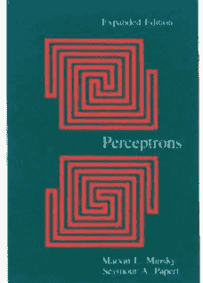

图 1-1 明斯基（左）与其著作《感知机》（右）

**生理学的曙光**  
感知机受挫，神经网络研究式微，但生物神经网络研究未止步。1958年，神经生物学家Hubel与Wiesel发现：动物视觉皮层对视觉信息的处理是**分级、分层**的。此发现令二人获1981年诺贝尔医学奖，更在50年后间接催化AI爆发性突破。他们的“深入认识”，为科学家从“观察大脑”跨越到“重现大脑”搭建了桥梁。

感知机失效于非线性可分问题，根因是单层结构太简单、表征力不足。要提升表征，结构必须向复杂多层演进。思路自然是：在输入输出层间插入**隐含层**（Hidden Layer，亦称隐藏层/隐层），形成**多层感知机**。

**反向传播的曲折**  
1974年，哈佛博士生Werbos在论文中首创**反向传播（BP）算法**训练神经网络[5]，奈何正值寒冬，无人问津。直到1986年，辛顿等人重新设计BP算法[6]，极大简化训练，唤醒沉睡的“AI公主”。

此后20余年，BP算法最耀眼的成果是杨立昆1998年提出的**卷积神经网络（CNN）**[7]。凭借特殊结构，CNN在手写数字识别、文档分类等任务表现优异，推动80年代末至90年代初神经网络研究登顶。

**再陷低谷与SVM分流**  
但好景不长：BP算法无法有效支撑更深网络。核心症结是**梯度扩散**——梯度是权重调整的向导，消失则失去指导意义；且依赖梯度易陷局部最优。层数加深导致输出对初始层权重影响递减，训练难收敛。故BP多用于≤7层的浅层网络，表征能力受限，性能封顶。

同期，俄统计学家Vapnik提出**支持向量机（SVM）**，凭高效算法、无局部最优之虞，吸走大批神经网络研究者。多层前馈网络再度边缘化[10]。

> SVM可视为特殊的两层神经网络。

**王者归来：深度学习元年**  
2006年，沉寂近30年，辛顿携博士生Salakhutdinov在《科学》刊发开山之作《用神经网络降低数据的维数》[8]。辛顿与这篇论文如图1-2所示。

> 从标题可见辛顿的谨慎：打着“数据降维”旗号，实发表神经网络论文。

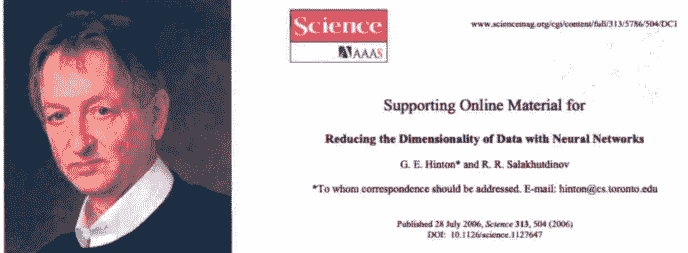

① 惜在ANN领域杰出贡献，2018年辛顿与另外两位学者共享图灵奖。

图 1-2 杰弗里·辛顿与开启深度学习时代的论文

文中提出**深度信念网络（DBN）**，给出两大核心结论：

- **多隐层网络拥有更强特征学习力**：每层特征比前一层更抽象，层层抽象刻画数据本质。分层预训练本质上是对输入数据的逐级抽象，暗合生物大脑认知过程——大脑将声波/视觉信号逐层抽象为语义符号。
- **逐层预训练破解训练难题**：通过逐层初始化找到接近最优的权重起点，再经“微调”全网优化，大幅缩短训练时间。

> “良好的开端是成功的一半”，预训练正是为网络寻得良好初始权重。

辛顿由此为联结主义开辟新天地，深度学习研究随之雨后春笋般涌现。

#### 1.1.2 深度学习的震世影响


图 1-3 深度学习入选2013年全球十大突破性技术

近年来，作为AI最重要进展，深度学习在棋战、视觉、语音、自动驾驶等领域表现媲美甚至超越人类。2013年即被《MIT科技评论》评为全球十大突破性技术之一（图1-3）。

更具划时代意义的是2016年3月：围棋顶尖高手李世石1:4不敌谷歌**AlphaGo**（图1-4），标志着AI在围棋领域开始“碾压”人类。次年AlphaGo升级版Master在快棋赛60连胜横扫中日韩顶尖职业棋手，震惊世界。支撑其强悍智能的“肱股之臣”之一，正是深度学习。

> “忽如一夜春风来，千树万树梨花开”。一时间，深度学习从计算机专用术语跃升为学界、业界乃至资本圈的热词。它已深度重塑我们的工作、生活甚至思维。


图 1-4 AlphaGo

有人认为，深度学习非仅算法升级，更是全新思维范式：利用海量数据高速处理消除不确定性，辅助认知世界。它将人类痴迷的“算法问题”转化为“数据与算力问题” —— **核心竞争力正从“算法”迁移至“数据”**。

深度学习备受瞩目，因其从原始输入经隐层层层变换至输出判断，**全程特征提取零人工干预、自主完成**。这在机器学习领域具有革命性。

吴恩达曾言：“我们不再手工设计边界，而是把海量数据喂给算法，让数据自己说话，系统自动从数据中学习。”谷歌大脑项目负责人杰夫·迪恩则说：“训练时我们从不告诉机器‘这是猫’，是系统自己发明/领悟了‘猫’的概念。”

### 1.2 从学习到机器学习

#### 1.2.1 何为“学习”

探究“深度学习”，溯源必问：何为“学习”？这词虽耳熟能详，从小作文引名言（孔子“学而时习之”、培根“知识就是力量”）不绝于耳，可真要定义，我们因“身在其中”反而语塞。

图灵奖&诺经奖双料得主赫伯特·西蒙给出过精准定义：

> **“若一个系统通过执行某过程，改进了自身性能，则该过程即为学习。”**

学习的核心目的，**唯性能改善**。

对人亦适用：我们研习深度学习，本质是提升该领域认知水平。若只是低水平重复、无认知跃迁，表面再勤奋、时长再久，也只是“伪学习者” —— 因性能未改善。

按此理解，“好好学习，天天向上”焕新意：无性能上的“向上”，纵使“好好”再辛苦、“天天”再持久，皆不算“学习”。

#### 1.2.2 何为“机器学习”

沿用西蒙视角：计算机系统借助数据与特定方法（统计/推理等）提升自身性能，即**机器学习（ML）**。

# 破解机器学习的“三个定义”与“四个象限”：深度学习为何能后来居上？

英雄所见略同。卡耐基·梅隆大学教授 Tom Mitchell 在其经典教材《机器学习》里，给出了一个至今被广泛引用的“标准答案”：


**Mitchell 版定义：** 针对某类任务（T）和性能指标（P），若计算机程序随经验（E）积累，在 T 上按 P 衡量的表现持续提升，即视为从 E 中完成了学习。

打个比方：AlphaGo 的任务 T 是下围棋，性能 P 是胜率，经验 E 来自自我对弈；学生的任务 T 是上课做题，性能 P 是考分，经验 E 是刷题过程。Mitchell 的核心提示是：**搞清任务类型、评价标准、经验来源，是定义任何学习问题的前提。**

视角不同，定义自然各异：
*   **Vapnik（SVM 之父）**：机器学习本质是**基于经验数据的函数估计**——强调可操作性。
*   **Hastie 等（《统计学习基础》作者）**：机器学习是**从数据中提取模式、理解内涵**——强调任务分类。

三大定义侧重点虽异，却有一致共识：**数据与经验是核心，机器学习提供了从数据挖掘知识的路径。**

身处大数据时代，“数据泛滥、信息过载、知识稀缺”成常态。能自动从海量数据中“炼”出知识的机器学习，理所应当成为主角。

---

## 1.2.3 知识地图的“四象限”：深度学习占据了哪块高地？

知识可按“能否统计”与“能否推理”两维度切分为四象限：

*   **象限 I（可统计、可推理）**：传统统计学与逻辑推理的舒适区。
*   **象限 II（不可统计、可推理）**：**符号主义机器学习**的主战场。试图用规则实现“举一反三”，但目前陷入“叫好不叫座”的尴尬，能否翻盘仍待时间检验。

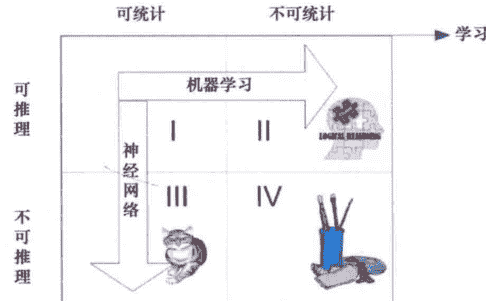

*   **象限 III（可统计、不可推理）**：**深度学习/神经网络**的绝对统治区。AlphaGo、计算机视觉、自动驾驶的突破，皆诞生于此。李航博士直指本质：“统计机器学习的对象，就是数据本身。”对计算机而言，经验皆以数据形态存在——数值、文本、图像、音视频及其组合。
*   **象限 IV（不可统计、不可推理）**：认知盲区，暂不可及。

**传统机器学习 = 特征工程。** 专家手工设计特征，再喂给分类器。效果高度依赖特征质量，专家累成狗，但胜在**可解释、可控、调参灵活**。

**深度学习 = 表示学习。** 网络自动从原始数据学特征，解放了双手，拟合能力更强。代价是：学到的特征藏在高维张量里，人类看不懂——**黑盒**。调参全靠“炼丹”式试错，应了那句调侃：“有多少人工，就有多少智能。”

网络层数加深，形成多层“表示学习”，性能跃升，**深度学习**由此得名。本质上，它是包含多隐层的多层感知机，通过层层组合低级特征构建高级抽象，**自动生成中间表示（虽不可读）是其独门绝技**。

> 2008 年《连线》主编 Chris Anderson 高呼“理论的终结：数据洪流让科学方法过时”，一石激起千层浪。

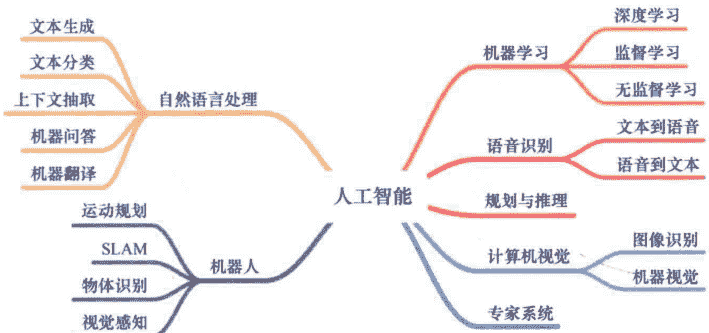

**定位要清醒：** 深度学习只是实现机器学习的一种技术，机器学习只是实现 AI 的一种途径（见图 1-6）。AI 不是整齐的树，而是**缠绕的灌木丛**——分支间阡陌纵横，深度学习可做无监督，语音识别可用深度学习，计算机视觉更是其主场。今日风头正劲的藤蔓，明日可能掉入“冷宫”二十载。神经网络的几起几落就是前车之鉴，深度学习也难逃兴衰周期。

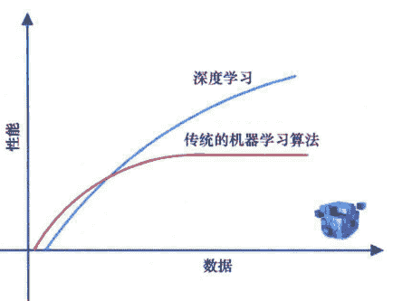

**核心差异：数据可扩展性。** 传统算法数据增多性能易触顶；深度学习性能随数据量持续攀升，Scalability 碾压传统（见图 1-7）。**反面也成立：小数据场景下，深度学习未必赢过传统模型。** 原因在于，复杂系统唯有海量数据才能在深层网络中“恰如其分”地表征内在模式。

---

## 1.3 深度学习：从“手工特征”到“自动表示”的范式革命

### 1.3.1 什么是深度学习？

**表示学习：** 模型自主学习隐式特征，数据表示与任务深度耦合、联合训练，不靠专家经验，**靠大量数据**。

早期专家发现：让神经网络自己学特征，效果反而更好、更灵活。**表示学习**浪潮兴起，人们从“找特征”的苦海中解脱。但代价随之而来——**特征只存在于机器空间，人类无法理解，黑盒彻底形成。** 调参只能靠经验式暴力搜索，苦不堪言。

网络继续加深，多层表示学习将性能推向新高。**“层次多=套路深”，故名“深度学习”。**

**一句话总结：** 深度学习 = 多隐层感知机。通过层层组合低级特征形成高级抽象，**自动生成中间表示（虽不可读）是其区别于其他算法的核心杀手锏。**

**燃料是大数据。** 业界曾流行“大数据下简单模型胜过复杂模型，终极趋向无模型/无理论”。如今深度学习领跑 AI，但请记住层级关系：AI > 机器学习 > 深度学习（监督/无监督只是其中范式）。

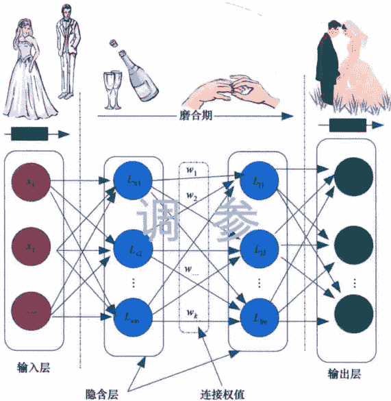

### 1.3.2 生活隐喻：恋爱就是一场“深度学习”

计算机思维映射人生实践。深度学习的三阶段，酷似恋爱全过程（见图 1-8）：

1.  **热恋期 = 输入层**。外貌、性格、学历……构成输入参数。不同目标（结婚 vs 玩玩）赋予不同权重（性格重 vs 颜值重）。
2.  **磨合期 = 隐含层**。从“书画琴棋”到“柴米油盐”，生活琐事不断冲刷、修正权重。陪伴久了 = 训练轮数多了，参数调得准，输出才稳。
3.  **稳定期 = 输出层**。最终关系走向（结婚/分手），高度取决于隐含层“磨合”得好不好。

### 1.3.3 有“深度”，自然有“浅度”

**浅度学习** = 传统浅层神经网络（隐层通常 < 7 层）。受困于梯度消失/爆炸，层数上不去，抽象能力有限。

**深度学习** = 强调架构深度，隐层远超一层。**层数越多，抽象/表征能力越强，分类识别越精准。**

*   2012 年：Hinton 团队个位数层深度，ImageNet 夺冠。
*   2014 年：GoogleNet 22 层，再封王。
*   2015 年：微软 ResNet 152 层，突破百层大关。
*   2016 年：商汤科技 1200+ 层，刷新纪录。

未来或达 2000、3000 层？**警惕“过犹不及”：** 层层叠加虽增强表征，但通信成本（梯度消散、维度灾难）会吞噬性能增益。**“深度”只是手段，“表示学习”才是目的。**

---

## 1.4 章末回顾

*   **脉络：** 深度学习是机器学习新兴分支。
*   **核心：** ML 用数据+统计/推理提升性能；DL 将“手工选特征”升级为“网络自学特征”，靠加深层数提性能。
*   **本质：** DL 通过逐层特征变换，将样本映射到新特征空间，使分类/预测更准。利用大数据让“数据自己说话”，更充分刻画内在信息。

概念铺垫到此为止。**第 2 章起，我们正式攻克深度学习的基石——人工神经网络。**

---

## 1.5 思考题

1.  什么是学习？什么是机器学习？二者联系？
2.  机器学习四象限含义？深度学习落在哪象限？
3.  深度学习最核心特征？恋爱比喻贴切吗？为什么？
4.  为什么必须“深”？浅度不行吗？本质区别是什么？

---

## 参考文献

[1] 张玉宏. 深度学习之美：AI 时代的数据处理与最佳实践. 电子工业出版社, 2018.
[2] MCCULLOCH W S, PITTS W. A logical calculus... 1943.
[3] HEBB D O. The organization of behavior... 1949.
[4] MINSKY M, PAPERT S A. Perceptrons... 2017.
[5] WERBOS P J. Beyond regression... 1974.
[6] Rumelhart D E, et al. Learning representations by back-propagating errors. Nature, 1986.
[7] LECUN Y, et al. Gradient-based learning applied to document recognition. IEEE, 1998.
[8] Hinton G E, Salakhutdinov R R. Reducing the dimensionality of data... Science, 2006.
[9] MITCHELL T M. Machine Learning. McGraw-Hill, 1997.
[10] VAPNIK V. The nature of statistical learning theory. Springer, 2013.
[11] HASTIE T, et al. The elements of statistical learning. Springer, 2009.
[12] 张玉宏. 品味大数据. 北京大学出版社, 2016.
[13] 李航. 统计学习方法 (第2版). 清华大学出版社, 2019.
[14] HE K, et al. Deep residual learning for image recognition. CVPR, 2016.


---

# Deep Learning & TensorFlow

## 第 2 章 神经网络学习：深度大厦的地基

神经网络学习，是深度学习的基石。

本章重点：**理论基石、原子单元感知机、多层前馈网络、常用损失函数与激活函数。**

### 2.1 人工神经网络：仿生学的杰作

AI 领域有“鸟飞派”（仿生派）：想飞，先研鸟。进化百万年的生物是最佳蓝本，悟透原理再复现输出。**人工神经网络（ANN）正是此道成果之一。**

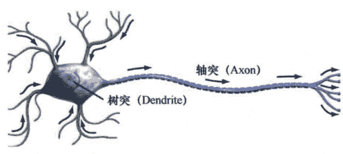

**Kohonen 定义（自组织网络之父）：** “人工神经网络是由具自适应性的简单单元广泛并联而成的网络，其组织结构能模拟生物神经系统对真实世界的交互反应。”

生物神经网络（BNN，见图 2-1）中，大脑通过强化/弱化突触学习，最终形成复杂网络，支撑特征的**分布式表示**。

ANN 作为新型数据处理范式，强在**学习能力**：给训练集，学习提取特征，调整神经元连接权值，直到顶层输出正确答案。

> 全书“神经网络”特指“人工神经网络”，不再赘述。

生物神经机理极大启发了 AI 研究者，催生了 ANN。

# 2.2 神经网络的基石——感知机

## 生物启发与核心机制

人工神经网络的表现上限，很大程度上取决于系统的复杂度。其核心运作逻辑在于：通过不断修正海量“简单单元”之间的连接强度（权值）来处理信息，并由此展现出自学习与自适应特性。即便演进至今日的深度学习架构，训练的本质依然是对神经元间连接权重的精细调校。

若将能完成任务的信息界定为“知识”，那么这些连接权重的集合，实质上凝聚成了一种“隐性知识”——它虽不为人直观所见，却实实在在地编码了模型的能力。

## 2.2.1 感知机的数学雏形

在生物学中，基本单元叫神经元；在人工网络里，最基础的模块则是感知机。在正式剖析前，有必要回溯一下脉络：

*   **1943年**，McCulloch 与 Pitts 合著论文，奠基了 **M-P 神经元模型**，开启了人工神经网络研究史。
*   **1949年**，心理学家 Hebb 提出 **Hebb 学习法则**，为神经元协同适应提供了理论支撑。
*   **1958年**，Rosenblatt 发表里程碑式论文，正式命名并构建了模拟人类感知能力的机器模型——**感知机**。

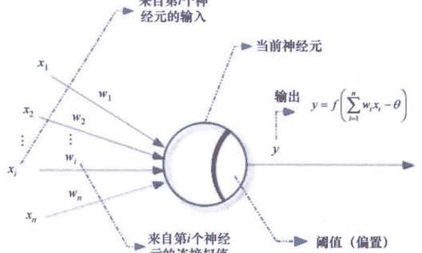

**M-P 模型的运作逻辑**（如图 2-2）：神经元接收来自 $n$ 个上游节点的输入信号 $x_i$，每路信号附带一对连接权重 $w_i$。神经元将所有输入按权重加权求和，得到总刺激强度 $S$：

$$S = \sum_{i=1}^n w_i x_i$$

这相当于神经元按“轻重缓急”汇总了所有外部信号。但输出并非直接吐出 $S$，而是要先与神经元自带的 **阈值（Threshold） $\theta$** 比较，再经 **激活函数 $f(\cdot)$** 非线性变换，最终产出输出 $y$：

$$y = f\left(\sum_{i=1}^n w_i x_i - \theta\right)$$


对比生物神经元（图 2-1）与 M-P 模型（图 2-2），两者在结构逻辑上的同构性，正是“仿生建模”的直观体现。

## 2.2.2 名字的由来与首秀实验

站在 Pitts 等人的理论肩膀上，Rosenblatt 将 Hebb 假说工程化落地。1958 年，他设计了一场震惊学界的演示（图 2-3）：训练数据由 50 组左右/右标识图片组成。

训练流程极具启发性：初始随机赋予输入节点权重 $\rightarrow$ 计算加权和 $\rightarrow$ 若和 $<0$ 输出 0（左），否则输出 1（右） $\rightarrow$ **预测对则不动，错则按“学习率 $\times$ 误差”修正权重**。本质上，这是一个二分类任务。

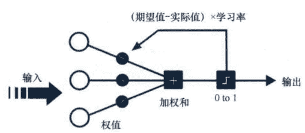

反复迭代后，机器自主找到了最优权重，随后面对全新图片，无需人工干预即可独立判断方向。这惊人地类似婴儿期（0-2 岁）的“感知运动阶段”：婴儿通过感官与动作探索世界，建立物体永存概念，逐渐具备独立判断力。

## 2.2.3 直观拆解：一个“麻雀”五脏俱全

感知机虽简，却囊括了神经网络的核心骨架：两层结构（输入层 $\rightarrow$ 激活/阈值变换 $\rightarrow$ 输出层），别称 **“阈值逻辑单元”**。它属于有监督学习，擅长分类。

**经典案例：西瓜 vs 香蕉**

为简化，仅提取视觉特征——**颜色 ($x_1$)** 与 **形状 ($x_2$)**。
编码规则：
*   绿色=1，黄色=-1；圆形=1，月牙形=-1。
*   初始权重 $w_1=w_2=1$，阈值 $\theta=0$。
*   输出 1 = 西瓜，0 = 香蕉。

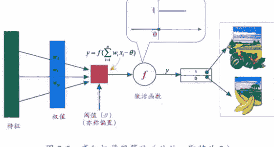

直接加权求和 $S$（线性输出，未经激活）结果如下：
*   西瓜：$1\times1 + 1\times1 = 2$
*   香蕉：$1\times(-1) + 1\times(-1) = -2$

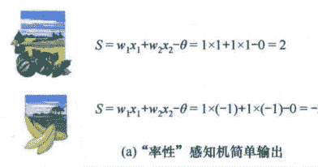

如何把 2 和 -2 映射为 1 和 0？引入最简单的 **阶跃函数**：输入 $>0$ 输出 1，否则 0。

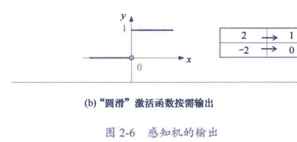

经激活函数“非线性变换”后，分类完美落地。**注：激活函数的核心价值不在“激活”，而在引入非线性，让网络能逼近任意复杂函数。**

**微观视角的哲学感悟：**
所谓神经元，不过是具体的数值（特征值 $x$ 或加权和 $S$）；所谓连接，不过是数值间的乘加运算。正如普罗泰格拉所言：“人是万物的尺度”——数值本无义，全赖人赋予意义。

参数初值（$\theta=0, w_1=w_2=1$）从何而来？实则是**“试错”**摸索出来的——这正是学习的本质。

## 2.2.4 学习范式：知错能改

“知错能改，善莫大焉”，这句古训精准概括了**监督学习**的内核：有标准答案（标签），有偏差（误差），按偏差幅度修正行为。

既然特征值 $x$ 固定，学习的唯一自由度就是**调整权重 $w$ 与阈值 $\theta$**，直到输出对齐预期（此结论延续至深度学习依然适用）。

**学习规则设定：**
误差 $\varepsilon = y_{target} - y_{pred}$。若 $\varepsilon=0$，网络收敛；否则，$\varepsilon$ 成为驱动参数更新的动力。

```
w_new ← w_old + ε
θ_new ← θ_old + ε
(2-3)
```

**实战推演（识别西瓜）：**
初始 $w_1=1, w_2=-1, \theta=0$。

1.  **前向算**：$S = 1\times1 + (-1)\times1 - 0 = 0 \xrightarrow{阶跃函数} y'=0$（误判为香蕉）。
2.  **计算误差**：$\varepsilon = 1 - 0 = 1$。
3.  **反向修正**（学习率简化为 1）：
    *   $w_1 \leftarrow 1 + 1 = 2$
    *   $w_2 \leftarrow -1 + 1 = 0$
    *   $\theta \leftarrow 0 + 1 = 1$
4.  **验证西瓜**：$S = 2\times1 + 0\times1 - 1 = 1 \xrightarrow{} y'=1$（正确）。
5.  **验证香蕉**：$S = 2\times(-1) + 0\times(-1) - 1 = -3 \xrightarrow{} y'=0$（正确）。

```
S = w1 x1 + w2 x2 - θ
= 1 × 1 + (-1) × 1 - 0
= 0
```

仅一轮“试错”搞定，但这只是 **Hello World 级**玩具网络。现实中需多轮迭代，直到误差收敛至可容忍区间。

## 2.2.5 形式化训练法则与逻辑通用性

感知机能轻易实现 **与/或/非** 等原子布尔逻辑（图 2-7）。

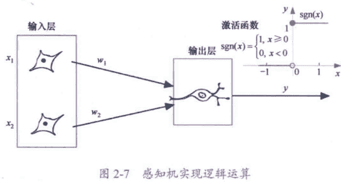

*   **与 ($x_1 \land x_2)$**：$w_1=w_2=1, \theta=2$。仅当全 1 时输出 1。
*   **或 ($x_1 \lor x_2)$**：$w_1=w_2=1, \theta=0.5$。有一个 1 即输出 1。
*   **非 ($\neg x_1)$**：$w_1=-0.6, w_2=0, \theta=-0.5$。输入取反。

**统一参数学习的技巧：引入“偏置项”**
将阈值 $\theta$ 视为权重 $w_0$，对应输入 $x_0 \equiv -1$（或 1，视符号约定）。原公式变为：
$$S = \sum_{i=1}^n w_i x_i - \theta = \sum_{i=0}^n w_i x_i \quad \text{(式 2-4)}$$
于是权重与阈值合二为一，统称为“权值学习”。

```
y = f(1\times x_1 + 1\times x_2 - 2)
= f(x_1 + x_2 - 2)
```

**通用更新规则（式 2-5）：**
给定样本 $(\mathbf{x}, y)$，若预测 $y' \neq y$，则对每个权重 $w_i$：
$$w_{i_{new}} \leftarrow w_{i_{old}} + \Delta w_i$$
$$\Delta w_i = \eta (y - y') x_i$$
其中 $\eta \in (0,1)$ 为 **学习率**，控制步长。

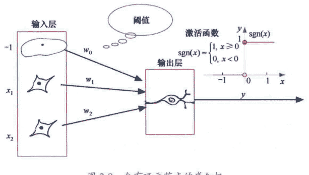

**规则解读：** 预测对 $(y-y'=0) \Rightarrow \Delta w_i=0$，参数冻结；预测错 $\Rightarrow$ 按“误差 $\times$ 输入 $\times$ 学习率”修正。这正是感知机学习算法的完整数学描述。

### 关键超参：步长 $\eta$ 怎么定？

步长参数 $\eta$ 本质是给权重更新“踩刹车”。这值没公式算，全凭经验拍板（属经验参数范畴）。设太小？模型像蜗牛爬，迭代轮数多、收敛慢得让人急；设太大？步子跨太远，最优解直接踩飞。工程上通常先给 0.01 这种小数试水，再慢慢调。

#### 2.2.6 非线性映射：网络的“灵魂”在哪？

激活机制不是摆设，它是赋予模型非线性表达力的关键。没有它，网络不过是线性模型的堆砌。

理论上最理想的是**阶跃函数**（符号函数），输出非 0 即 1，完美对应“激活/抑制”两态。

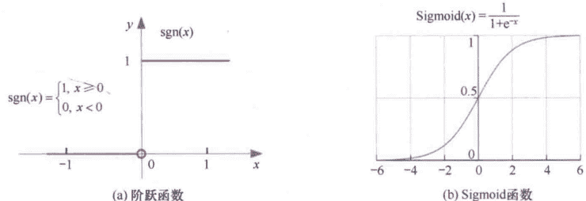

**图 2-9 常见激活曲线对比**

但实战中这玩意儿基本不用。为啥？它**不连续、不光滑、求不了导**。训练靠梯度下降（求导找极值），这函数导数要么 0 要么不存在，梯度直接“断供”，模型根本练不会。

于是 **Sigmoid** 登场成了替身。不管输入多大多小，它都能把输出“硬塞”进 $[0, 1]$ 区间，所以也叫“挤压函数”。平滑、可导、有梯度，训练终于能跑通了。

#### 2.2.7 几何视角：一刀切开高维空间

别被公式吓到，单层网络的几何意义超直观。

假设输入有 $n$ 个特征，加权求和 $w_1x_1 + ... + w_nx_n = 0$ 这方程，在 $n$ 维空间里就是一个**分割超平面**。向量写法就是 $w \cdot x = 0$。

```
$f(x) = w_1x_1 + w_2x_2 + ... + w_ix_i + ... + w_nx_n - \theta = w_0x_0 + w_1x_1 + ... + w_ix_i + ... + w_nx_n = w \cdot x$
```

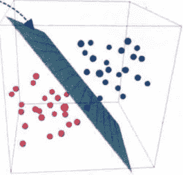

**图 2-10 决策边界示意**

- 平面这边：$w \cdot x > 0$（正半空间）$\rightarrow$ 映射输出 1 $\rightarrow$ **判为正类**。
- 平面那边：$w \cdot x < 0$（负半空间）$\rightarrow$ 映射输出 0 $\rightarrow$ **判为负类**。

> *注：正/负类标签用 1/0 还是 1/-1 无所谓，只要能分开就行。*

**结论**：该模型本质是个**“用超平面切空间”**的二分类器。二三维时还能脑补画面，维度一高几何直觉失效，只能靠代数推导。

#### 2.2.8 实战篇：从零手写单层网络

理论懂了，上代码。完整实现见范例 2-1。

### 范例 2-1 感知机核心类 (Perceptron.py)

```
class Perceptron(object):
    def __init__(self, input_para_num, acti_func):
        self.activator = acti_func
        self.weights = [0.0 for _ in range(input_para_num)]
        #对象的“非正式”字符串表示形式
    def __str__(self):
        return 'final weights\n\tw0 = {:.2f}\n\tw1 = {:.2f}\n\tw2 = {:.2f}'.format(self.weights[0], self.weights[1], self.weights[2])
    def predict(self, row_vec):
        act_values = 0.0
        for i in range(len(self.weights)):
            act_values += self.weights[i] * row_vec[i]
        return self.activator(act_values)
    #训练权值
    def train(self, dataset, iteration, rate):
        for i in range(iteration):
            for input_vec_label in dataset:
                prediction = self.predict(input_vec_label)
                self._update_weights(input_vec_label, prediction, rate)
```

```
19 #私有方法: 更新内部权值
20 def __update_weights(self, input_vec_label, prediction, rate):
21     delta = input_vec_label[-1] - prediction
22     for i in range(len(self.weights)):
23         self.weights[ i ] += rate * delta * input_vec_label[ i ]
```

#### 核心逻辑拆解：

*   **`__init__` (第 2-4 行)**：初始化权重向量（全 0），接收激活函数。`_` 是占位符，只是借循环次数填列表。
*   **`__str__` (第 6-7 行)**：重载打印方法，方便直接 `print` 对象看权重（含偏置 $w_0$），用 `\` 折行、用 `format` 格式化。
*   **`predict` (第 8-12 行)**：前向推理，算加权和 -> 过激活 -> 出预测标签。
*   **`train` (第 14 行)**：训练入口，按轮次遍历数据，调私有方法 `_update_weights` 修正权重。下划线 `_` 标私有，外部别乱调。

---

#### 范例 2-2 实战：搞定“与门 (AND)”

单跑范例 2-1 没用，得配数据。AND 逻辑可被平面分开，正好练手。

```
01 # 定义激活函数
02 def func_activator(input_value):
03     return 1.0 if input_value >= 0.0 else 0.0
04 def get_training_dataset():
05     # 构建训练数据
06     dataset = [[-1, 1, 1, 1], [-1, 0, 0, 0], [-1, 1, 0, 0], [-1, 0, 1, 0]]
07     # 期望的输出列表，注意要与输入——对应
08     # [-1,1,1] -> 1, [-1, 0,0] -> 0, [-1, 1,0] -> 0, [-1, 0,1] -> 0
09     return dataset
10 def train_and_perceptron():
11     p = Perceptron(3, func_activator)
12     # 获取训练数据
13     dataset = get_training_dataset()
14     p.train(dataset, 10, 0.1)    #指定迭代次数：10 轮，学习率设置为 0.1
15     #返回训练好的感知机
16     return p
17 if __name__ == '__main__':
18     # 训练 and 感知机
19     and_perceptron = train_and_perceptron()
20     # 打印训练获得的权值
21     print (and_perceptron)
22     # 测试
23     print ('1 and 1 = %d' % and_perceptron.predict([-1, 1, 1]))
24     print ('0 and 0 = %d' % and_perceptron.predict([-1, 0, 0]))
25     print ('1 and 0 = %d' % and_perceptron.predict([-1, 1, 0]))
26     print ('0 and 1 = %d' % and_perceptron.predict([-1, 0, 1]))
```

**运行结果：**

```
final weights
    w0 = 0.20
    w1 = 0.10
    w2 = 0.20
1 and 1 = 1
0 and 0 = 0
1 and 0 = 0
0 and 1 = 0
```

#### 关键点速览：

1.  **数据准备**：AND 真值表 4 条。加上偏置项（哑元 -1），输入变 3 维：`[-1, 1, 1] → 1` 等。为方便处理，标签合并到最后一列成 4 列表。
2.  **实例化 (第 11 行)**：输入维度 3（含偏置），传入激活函数 `func_activator`。
3.  **打印权重 (第 21 行)**：触发 `__str__`，输出训练好的 3 个权重。

**举一反三**：把第 6 行训练集换成 OR 真值表，稍改打印逻辑，立马得到“或门”。

```
dataset = [[-1, 1, 1, 1], [-1, 0, 0, 0],
    [-1, 1, 0, 1], [-1, 0, 1, 1]]
```

```
final weights
w0 = 0.10
w1 = 0.10
w2 = 0.10

1 or 1 = 1
0 or 0 = 0
1 or 0 = 1
0 or 1 = 1
```

**拦路虎来了**：**XOR（异或）怎么练都不收敛。** 单层网络天花板太低，线性不可分问题碰都碰不了。

#### 2.2.9 硬伤揭秘：为何单层网络“翻不了身”？

本质上，它是**二分类线性判别模型**，靠最小化损失函数调分割面。但只有输出层挂激活函数，等于**单层功能单元**，表达力有上限。

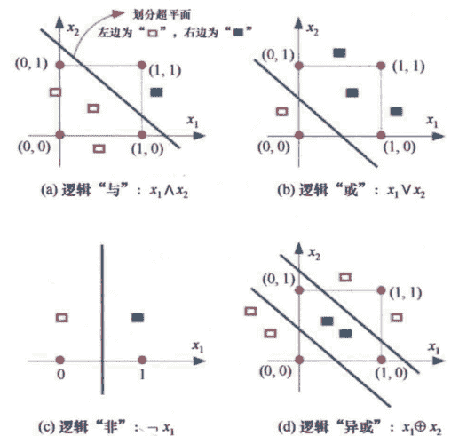

**图 2-11 可分 vs 不可分**

*   **可被平面分开**（AND、OR、NOT）：Minsky 早证过，分割面必存，学习必收敛，权重必能学会。
*   **线性不可分**（XOR）：平面切不开，两类点纠缠在一起（见图 2-11(d)）。训练会**震荡**，权重永远振荡不收敛。

> **科普一下 XOR**：输入异则 1，同则 0。就是这简单逻辑，把早期神经网络整趴下了。

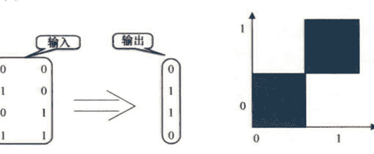

**图 2-12 XOR 分布**

Minsky 亲自下场证伪，1972 年合著《感知机》泼冷水：
1.  单层搞定不了 XOR 这类非线性问题。
2.  甚至加了隐层也白搭——当时**没算法（反向传播未发明）、没算力**训练深层网络。

连接主义由此入冬近 20 年。

---

## 2.3 破局之路：多层前馈网络 (MLP)

### 2.3.1 加层！用隐层“拧开”XOR

要破解 XOR，核心思路只有一个：**模型要复杂，表达力要强**。在输入端和输出端中间塞层**隐含层**。

为啥叫“隐含”？因为这层单元**没有目标标签**，信息流过时算不出误差，无法直接监督，“隐”在中间干活。

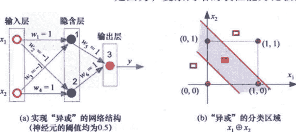

**图 2-13 双层网络破解 XOR**

看图 2-13(a) 结构：输入层 -> 隐层 -> 输出层。假设阈值全 0.5，权重按图标注，隐层和输出层单元都挂阶跃函数。

#### 走一遍前向传播流程：

1.  **隐层单元**：输入加权和 $\ge 0$ 输出 1，否则 0。
2.  **输出层单元**：接收隐层输出，再加权求和，过阶跃函数给最终结果。

验证一下 4 种输入组合，完美复现 XOR 真值表！（后续章节会给出多层感知机 Python 完整实战代码）。

### 异或难题的破解：两层感知机的实战推演

回到正题。假设输入 x1 与 x2 取值相同（均设为 1），此时输入层连接隐含层的权重矩阵设定为：x1 指向隐含神经元 1、2 的权重分别为 w1=1、w2=-1；x2 指向隐含神经元 1、2 的权重分别为 w3=-1、w4=1。阈值 θ 统一设为 0.5，激活函数采用符号函数 sgn。

我们来看隐含层神经元 1 的计算过程：
其加权求和减去阈值为：`1×1 + (-1)×1 - 0.5 = -0.5`。经过 sgn 函数，输出 f1 = 0。
同理，隐含层神经元 2 的加权和为：`(-1)×1 + 1×1 - 0.5 = -0.5`，输出 f2 同样为 0。

进入输出层神经元 3，它接收 f1、f2 作为输入，假设输出层权重 w5、w6 均为 1，阈值仍为 0.5：
`y = sgn(0×1 + 0×1 - 0.5) = sgn(-0.5) = 0`。
结果显示：输入 (1,1) 输出 0，符合异或逻辑。感兴趣的读者可自行验证输入 (0,0) 的情况，结果也将是 0。

```
y = f_3 = \text{sgn}(f_1 w_5 + f_2 w_6 - \theta)
= \text{sgn}(1 \times 1 + 0 \times 0 - 0.5)
= \text{sgn}(0.5)
= 1
```

再看输入互异的情况（设 x1=1, x2=0）。隐含神经元 1 计算得：`1×1 + (-1)×0 - 0.5 = 0.5`，输出 f1 = 1；隐含神经元 2 计算得：`(-1)×1 + 1×0 - 0.5 = -1.5`，输出 f2 = 0。输出层据此得到 y = 1。由于 x1 与 x2 地位对称，(0,1) 输入同理输出 1。

由此证明，图 2-13 所示的两层感知机完美实现了“异或”功能。值得注意的是，上述权重与阈值是人工预设的，实际工程中它们需通过反向传播算法自主学习获得，且满足异或功能的参数解绝非唯一。

#### 2.3.2 多层前馈神经网络：架构与万能近似特性

更通用的多层前馈神经网络（Multi-layer Feedforward Neural Networks）结构如图 2-14 所示。其本质是将多个单层网络级联：上一层的输出作为下一层的输入，层间全连接，层内无连接，跨层也不连接。

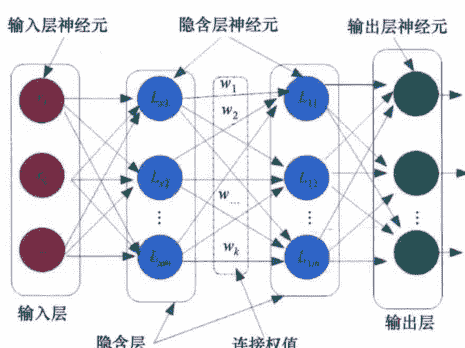

图 2-14 典型的多层前馈神经网络拓扑图

“前馈”二字强调的是信号单向流动——后层输出绝不回传至前层。这较生物大脑的复杂回路大幅简化，却依然拥有惊人的表达能力。

这种能力究竟有多强？1989 年，库尔特·霍尼克等人发表里程碑式论文证明：对于任意连续的波莱尔可测函数 f，**仅需一个隐含层**，只要神经元数量足够多，并使用挤压型激活函数，前馈网络即可任意精度逼近 f。

```
f: R^N \to R^M
```

换言之，增加隐含层神经元数目便能提升逼近精度。这意味着多层前馈网络本质上是一台**通用函数模拟器**。关于该定理的直观可视化证明，推荐阅读迈克尔·尼尔森的系列博客。

#### 2.3.3 机器学习本质论：寻找映射与通用近似定理的边界

机器学习的核心任务，就是寻找一个函数 f，完成从输入空间 X 到输出空间 Y 的映射：`Y = f(X)`（见图 2-15）。

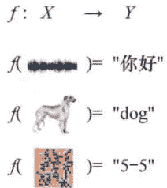

图 2-15 机器学习即寻找最优映射函数

无论是语音识别（音频→文本）、图像分类（像素→标签）、围棋博弈（棋谱→落子），还是智能对话（问句→答句），本质上都是在特定特征空间内拟合这个映射关系。

人工神经网络最“魔力”在于：理论上证明，**含足够隐含神经元的多层前馈网络，可任意精度模拟任意连续函数**。这就是大名鼎鼎的**通用近似定理**（Universal Approximation Theorem），其能量堪称“万能”。


深度学习本质上是函数逼近/拟合问题。数学界早有泰勒展开、傅里叶变换、样条函数、小波分析等工具通过基函数线性组合拟合复杂函数。神经网络的独特之处在于：其基函数是**非线性的激活函数**（如 Sigmoid、ReLU）。

通用近似定理宣告：无论目标函数 f(x) 多复杂，总存在一个神经网络，对任意输入 x 实现任意高精度输出；即便是多输入多输出 `f(x1, x2..., xm)` 亦成立。换句话讲，神经网络在理论上可解决任意问题。可视化证明可参考尼尔森博客。

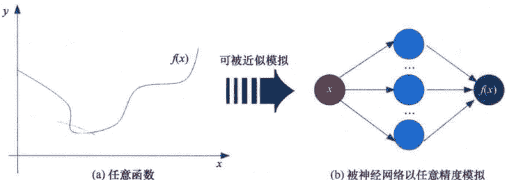

图 2-16 通用近似定理示意

但应用定理时有两大前提须铭记：
1.  **“近似”而非“精确”**：定理保证存在网络“尽可能好地逼近”，而非“精确计算”。精度靠堆叠隐含神经元提升。
2.  **连续性硬性约束**：被逼近函数必须连续。若函数剧烈跳变（非连续），神经网络便“巧妇难为无米之炊”。

> 数学家关注“解的存在性”，工程师关注“解的可行性”。
> 数学家把“梦想”写得丰满，工程师把“现实”磨得不那么骨感。

即便函数连续，神经网络能否解决所有问题仍存争议。伊恩·古德费洛直言：单隐层网络虽理论万能，但结构可能臃肿到无法有效学习与泛化。言下之意：**“广而浅”理论通用、实践失效**；深度（Deep）才是正途。这也解释为何通用近似定理 1989 年提出，深度学习却要等到 2006 年才爆发。

然而，隐含层层数属于超参数，无法自动学习，只能靠经验、直觉与试错调整。

#### 2.3.4 神经网络架构设计：从直观到玄学的工程实践

既定“向深发展”，如何设计拓扑结构？

**输入层/输出层设计相对直观。**
以识别手写数字“2”为例（图 2-17）。16×16 灰度图展平为 256 维向量，每个像素归一化为 [0,1] 值，对应 256 个输入神经元。输入维度必须与神经元数一致。

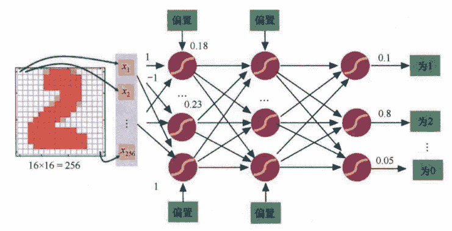

图 2-17 前馈神经网络拓扑结构示意

输出层神经元数取决于任务类别。识别 0~9 十个数字，若用 Softmax，输出层设 10 个神经元，分别输出各类概率。最终取概率最大者作为判定结果（如“2”概率 80% 远超他类，即判定为 2）。

**隐含层设计则是“炼丹”般的艺术与体力活。**
它是输入到输出的非线性映射黑箱，功能机理“剪不断理还乱”（理论短板）。层数、每层宽度均为超参数，需反复实验调整。

权重表征神经元间连接强弱，指引下层关注哪些模式；偏置则像“激活门槛”，决定神经元触发的难易度。架构设计的终极目标：找到最优权重与偏置，使损失函数极小化——这便是“学习”。

### 2.4 损失函数：衡量“预测与现实”差距的标尺

ACM FCRC 2019 大会上，图灵奖得主杨立昆指出：“预测是智能核心，预测偏离现实的瞬间，即是学习发生之时。”

如何量化偏离？引入**损失函数**。

监督学习中，决策函数 f 在假设空间中给出预测值 ŷ，与真实标签 y 往往不符。损失函数 `L(y, ŷ) = L(y, f(X))` 专门度量这二者“落差”，值非负。

单样本用损失函数，批量训练则用**代价函数**：
`J = Σ L(y_i, ŷ_i) / N`（N 为批大小）。
**目标函数**是更广义的术语，涵盖损失/代价函数，常加入正则项防过拟合、增泛化。

神经网络常用三大代价函数：

1.  **平均绝对误差（MAE / L1 Loss）**  
    `J_MAE = (1/N) Σ |y_i - ŷ_i|`
2.  **均方差（MSE / L2 Loss）**  
    `J_MSE = (1/N) Σ (y_i - ŷ_i)²`  
    *对比*：MSE 收敛通常更快，但平方项放大异常值影响；MAE 对离群点更鲁棒。
3.  **交叉熵损失（Cross Entropy / Softmax Loss）**  
    `J_CE = - Σ y_i^c log(ŷ_i^c)`  
    适用多分类。从信息论视角，它度量用错误分布拟合真实分布所需的额外“编码成本”。

> **避坑指南**：
> - “Error”非“错误”，而是参数更新的“信息差”（如水头落差），无差则无学习。
> - 优秀的代价函数需精准刻画此“信息差”。
> - 正则化旨在防过拟合，兼顾训练/测试集表现，提升泛化力。

代价函数值越小，模型越贴合目标。它们是监督学习的“指挥棒”，核心标志之一。

### 2.5 激活函数：赋予网络非线性灵魂的钥匙

前文提及网络可模拟任意函数，关键在于**非线性变换**。

全连接层本质是线性加权求和。线性叠加仍是线性——若无非线性，层层堆叠最终退化为单层线性模型，深度网络荡然无存。

激活函数引入非线性，打破线性束缚，赋予深度网络分层非线性映射能力，是不可或缺的核心组件。选对激活函数至关重要。

#### 2.5.1 Sigmoid 函数：经典但有短板

公式与图形见图 2-18。

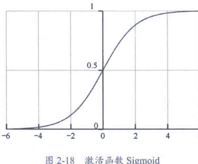

```
Sigmoid(x) = \frac{1}{1+e^{-x}} （2-12）
```

图 2-18 Sigmoid 激活函数曲线

**优势**：将实数压缩至 (0,1)，物理意义贴合生物神经元“静息/激发”两态；常用于 LSTM 门控机制（模拟开关）；输出可直接解释为概率；也可用于输入归一化。

**劣势**：
- **饱和性导致梯度消失**：输入过大或过小时，导数趋近 0，梯度传不回去，参数更新陷入“无头苍蝇”困境。
- **非零中心输出**：输入为 0 时输出 0.5，不利于优化收敛（偏好零中心函数）。

这两大缺陷严重拖慢训练，故现代网络极少将 Sigmoid 用作隐层激活函数。

#### 2.5.2 Tanh 函数：零中心的改进者

Tanh 将实数映射至 (-1,1)，过原点（输入 0，输出 0），符合零中心偏好（图 2-19）。

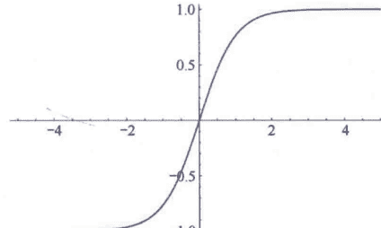

图 2-19 Tanh 激活函数曲线

**特性**：输出可为负值，适合需“抑制”神经元的场景。例如 LSTM 中利用负值区建模“遗忘”机制。

形式化表达为：

# 激活函数进化论：从 Sigmoid 到 ReLU 的破局之路

Tanh 与 Sigmoid，这对“难兄难弟”其实暗藏玄机。数学推导告诉我们：`Tanh(x) = 2 * Sigmoid(2x) - 1`。这层线性映射关系，注定了二者长相酷似，仅是取值范围和缩放比例不同。既然本质相通，**梯度消亡**这一顽疾自然也一并“遗传”给了 Tanh——在饱和区梯度趋近于零，层层反向传播下来，参数更新方向彻底迷失，训练效率直线下降。破解这一死局，曾是深度学习界最火热的攻关课题。

直到 **ReLU（Rectified Linear Unit，修正线性单元）** 横空出世。2010 年，Krizhevsky 与 Hinton 等人将其引入 CNN，一举改写了激活函数的历史。

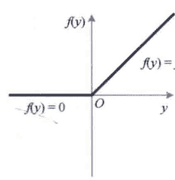

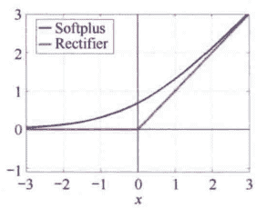

## ReLU：简单得“粗暴”，却好用得惊人

标准 ReLU 只有一行代码：`f(x) = max(0, x)`。输入为正原样输出，输入为负直接归零。图像上就是一条折线，唯一的“瑕疵”就是原点处不圆滑、不可导。

为了修补这个“尖角”，**Softplus 函数** (`f(x) = ln(1 + e^x)`) 应运而生，它是 ReLU 的光滑逼近版，导数恰好是 Sigmoid。但实战证明，**“粗糙”的 ReLU 反而跑赢了“圆润”的 Softplus**——后者引入指数运算，计算开销大增，却没换来性能提升。

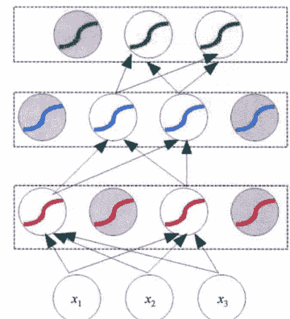

### 三大核心优势，直击痛点

1.  **单侧抑制，收敛飞快**  
    负区间“硬切”归零，正区间恒等映射。这种机制让神经元呈现明显的“激活/抑制”双态，求导极其简单（要么 0 要么 1），**SGD 收敛速度甩开 Sigmoid/Tanh 几条街**。

2.  **兴奋边界无上限，拒绝“挤压”**  
    Sigmoid 硬塞进 (0,1)，Tanh 勉强撑开 (-1,1)，ReLU 正向区间直通 +∞。神经元只要输入为正，就能持续“兴奋”，不再被压缩在狭窄区间里喘不上气。

3.  **天然稀疏性，算力节约大师**  
    Sigmoid 抑制态输出虽小非零，后续层还得带着它们算；ReLU 直接将负值**物理清零**。被抑制的神经元彻底退出计算图，网络稀疏度骤增，参数间相互依赖降低，这甚至隐含了类 Dropout 的正则化效果，缓解过拟合。

### 生物学灵感：大脑也是“稀疏派”

这不是巧合。2003 年，纽约大学 Peter Lennie 教授发现：大脑同一时刻仅有 1%~4% 的神经元处于激活状态。大脑作为耗能大户（人体 20% 能量供养 2% 重量），进化压力逼迫它必须“精打细算”——**只对关键信号响应，其余统统屏蔽**。ReLU 的稀疏机制，竟暗合了亿万年自然选择的智慧。难怪深度学习三巨头（LeCun、Bengio、Hinton）在 2015 年公开背书：ReLU 是当之无愧的“最受欢迎激活函数”。

> **拓展阅读**：Leaky ReLU、ELU、GELU、SIREN 等变体层出不穷，感兴趣可自行深挖文献。

---

# 实战篇：手把手用 Sklearn 跑通多层神经网络（红酒分类）

造轮子固能练内功，但生产环境靠“借力”才高效。Sklearn 作为 Python 机器学习生态的基石，封装了从预处理、建模到评估的全链路标准化 API，**寥寥数行代码即可落地经典算法**，文档还极其详尽。

## 1. 环境就绪

若你用 Anaconda（自带 Jupyter Notebook），Sklearn 已预装，打开终端验证即可：

```
conda install scikit-learn
```

或用 pip 安装（注意全小写）：

```
pip3 install scikit-learn
```

## 2. 实战数据集：意大利红酒

Sklearn 内置 `load_wine()`，源自 1986 年 Forina 提供的意大利三产区葡萄酒化学指标（13 维特征），任务是**多分类识别酒款产地**。我们分步拆解，完整代码见随书 `sklearn-wine.py`。

```
In [3]:
01    from sklearn.datasets import load_wine
02    wine = load_wine()
```

### 2.1 数据长什么样？先“体检”一下

`wine` 是一个类字典对象，核心 5 个字段：

| Key | 含义 | 红酒数据集对应内容 |
| :--- | :--- | :--- |
| **data** | 特征矩阵 (X) | 178 样本 × 13 维理化指标 |
| **target** | 标签向量 (y) | 0/1/2 三类酒款编码 |
| **target_names** | 类别名 | `class_0/1/2`（实为 Barolo/Grignolino/Barbera） |
| **DESCR** | 数据说明书 | 来源、特征统计量、引用文献等全景信息 |
| **feature_names** | 特征名列表 | 13 个指标的英文标识 |

```
In [4]: wine.keys()
Out[4]:dict_keys (('data', 'target', 'target_names', 'DESCR', 'feature_names'))
```

```
In [5]: wine.data
Out[5]:
array([[1.423e+01, 1.710e+00, 2.430e+00, ..., 1.040e+00,
3.920e+00, 1.065e+03],
... ... （省略大部分数据）
[1.413e+01, 4.100e+00, 2.740e+00, ..., 6.100e-01,
1.600e+00, 5.600e+02]])
```

```
In [6]: wine.data.shape
Out[6]: (178, 13)
```

```
In [7]: wine.target
Out[7]:
array([0, 0, 0, ..., 0, 0, 0,
0, 0, 0, ..., 0, 0, 0,
0, 0, 0, ..., 0, 0, 0,
0, 0, 0, ..., 0, 0, 0,
0, 0, 0, ..., 1, 1, 1, ...
1, 1, 1, ..., 1, 1, 1, ...
1, 1, 1, ..., 1, 1, 1, ...
1, 1, 1, ..., 1, 1, 1, ...
1, 1, 1, ..., 2, 2, 2, ...
2, 2, 2, ..., 2, 2, 2, ...
2, 2, 2, ..., 2, 2])
```

```
In [8]: wine.target.shape
Out[8]: (178,)
```

```
In [9]: wine.target.shape[0]
Out[9]: 178
```

```
In [10]: wine.target_names
Out[10]: array(['class_0', 'class_1', 'class_2'], dtype='<U7')
```

> **领域知识加持**：`class_0` 是“酒中之王”巴罗洛，**懂业务的算法工程师才能避免“贻笑大方”**的低级谬误。

```
In [11]: wine.feature_names
Out[11]: ['alcohol', 'malic_acid', 'ash', 'alcalinity_of_ash', 'magnesium',
'total_phenols', 'flavanoids', 'nonflavanoid_phenols', 'proanthocyanins',
'color_intensity', 'hue', 'od280/od315_of_diluted_wines', 'proline']
```

### 2.2 特征详解（中文对照表）

| 英文特征 | 中文含义 | 英文特征 | 中文含义 |
| :--- | :--- | :--- | :--- |
| alcohol | 酒精度 | malic_acid | 苹果酸含量 |
| ash | 灰分 | alcalinity_of_ash | 灰分碱度 |
| magnesium | 镁含量 | total_phenols | 总酚含量 |
| flavanoids | 黄酮类 | nonflavanoid_phenols | 非黄酮酚类 |
| proanthocyanins | 原花青素 | color_intensity | 颜色深度 |
| hue | 色调 | od280/od315_of_diluted_wines | 稀释葡萄酒 OD280/OD315 |
| proline | 脯氨酸 | | |

> `wine.DESCR` 里还藏着每个特征的均值、方差、最大最小值等统计画像，建模前必读。

---

**下一步预告**：数据看懂了，我们将正式调用 `MLPClassifier` 搭建多层感知机，完成从预处理、划分训练/测试集、训练、评估到超参调优的全流程实战。敬请期待！

## 解读葡萄酒数据集：13 个核心特征的业务含义

| 特征名 | 业务释义 |
| :--- | :--- |
| Alcohol | 酒精度 |
| Malic acid | 苹果酸浓度（g/L） |
| Ash | 灰分含量 |
| Alkalinity of ash | 灰分碱度 |
| Magnesium | 镁元素含量 |
| Total phenols | 总酚含量（mg/L） |
| Flavanoids | 黄酮类物质（mg/L） |
| Nonflavanoid | 非黄酮类物质（mg/L） |
| Proanthocyanins | 原花青素（mg/L） |
| Color intensity | 色泽深度 |
| Hue | 色调 |
| OD280/OD315 | 稀释后吸光度比值 (280nm/315nm) |
| Proline | 脯氨酸含量 |

在动手建模前，有必要先搞清楚这些指标的实际物理意义：

*   **Alcohol**：直接反映酒精浓度。
*   **Malic acid**：苹果酸含量，随着葡萄成熟度上升而自然下降。
*   **Ash**：葡萄酒经高温灼烧挥发水分后残留的矿物质总量。
*   **Alkalinity of ash**：上述灰分呈现的碱性强弱。
*   **Magnesium**：源自土壤，经葡萄根系吸收迁移至果实的镁元素含量。
*   **Total phenols**：总酚类物质，其组成差异源于葡萄品种与酿造工艺，直接决定酒体风味与品质。
*   **Flavanoids / Nonflavanoid**：酚类家族的两大分支，其中黄酮类聚合物占比高达 90%。
*   **Proanthocyanins**：原花青素，属黄酮类支系，具有促进循环、预防心脏病的保健属性。
*   **Color intensity / Hue** 分别刻画酒液的颜色深浅与色相。
*   **OD280/OD315**：特定波长下稀释酒液的吸光度比值，常用于辅助判断酚类成分。
*   **Proline**：24 种氨基酸之一，白葡萄酒中含量通常较高，常作为甄别纯汁发酵、防止勾兑添糖的指标。

---

## 二、Pandas 实战：从原始数组到结构化数据框

前文已演示如何用 sklearn 加载内置数据。接下来，我们引入 Pandas 进行更灵活的数据清洗与探索。

### 1. 初始化 DataFrame

```
import pandas as pd    #导入 Pandas 包
df_wine = pd.DataFrame(wine.data)
df_wine.head()    #验证语句，非必需。
```

**代码解读**：
1.  引入 Pandas 库。
2.  将 sklearn 返回的 `wine.data`（NumPy 数组）直接传入 `DataFrame` 构造器，生成对象 `df_wine`。
3.  调用 `head()` 预览前 5 行（默认值，可通过参数 `n` 自定义行数）。

输出可见，此时列名仅为 0~12 的整数编号，可读性极差。我们需手动注入业务列名。

### 2. 赋予语义化列名

```
df_wine.columns = wine.feature_names    #将属性名赋值给 Pandas 的 DataFrame
df_wine.head()    #再次输出前 5 行，以验证设置前后的变化
```

执行后，列名已变为 `alcohol`、`malic_acid` 等可读标识，数据瞬间“会说话”了。

### 3. 特征与标签“合二为一”

sklearn 习惯将特征矩阵 `data` 与目标向量 `target` 分离存储，但实际工程中 CSV 等文件通常是一体的。Pandas 合并极其简便——新增一列即可。

```
In [14]:
01 df_wine['wine_class'] = wine.target    # 为 DataFrame 增加一列 wine_class
02 df_wine.tail()      # 显示数据集合的最后 5 行
```

结果末尾新增 `wine_class` 列，分类标签（1/2/3）与 13 维特征对齐，完成了从“分离态”到“融合态”的转换。

---

## 三、数据集切分：训练集与测试集的标准化分离

建模铁律：数据必须切分为**训练集**（学习规律）与**测试集**（评估泛化）。为保证随机性与可复现性，首选 sklearn 的 `train_test_split`。

### 1. 还原“特征/标签”分离结构

虽然刚合并，但 `train_test_split` 要求输入分离的 X 与 y。用 Pandas `drop` 剔除标签列：

```
In [15]:
01 # 将名为 wine_class 的列删除，剩余部分（特征）赋值给 x
02 X = df_wine.drop('wine_class', axis = 1)
03 # 将名为 wine_class 的列赋值给 y
04 y = df_wine ['wine_class']
```

*关键点*：`axis=1` 指定按列删除；行业约定俗成用 **大写 X** 表特征矩阵（13 维）、**小写 y** 表目标向量（1 维）。若直接用 sklearn 原始对象，可简写为：
```python
X, y = wine.data, wine.target
```
甚至单行解包：
```
X, y = wine.data, wine.target
```

### 2. 执行切分

```
In [16]:
01 from sklearn.model_selection import train_test_split
02 X_train, X_test, y_train, y_test = train_test_split(X, y, test_size = 0.3,
random_state = 0)
```

**参数详解**：
*   `test_size=0.3`：30% 留作测试，其余 70% 训练（默认 0.25）。
*   `random_state`：随机种子。设为整数（如 42）则每次切分结果固定，利于复现调试；设为 `None` 或 0 则每次随机不同。
*   **返回顺序固定**：`X_train, X_test, y_train, y_test` —— 训练特征、测试特征、训练标签、测试标签。变量名可改，顺序不可乱。

---

## 四、搭建 MLP 分类器：从拓扑结构到优化器的核心抉择

数据就绪，登场主角——**多层感知机（MLP）**，属浅层神经网络（通常 ≤7 层），sklearn 封装开箱即用。

```
In [17]:
01 from sklearn.neural_network import MLPClassifier #导入多层感知机分类器
02 #创建多层感知机分类器模型
03 model = MLPClassifier(solver = "lbfgs",hidden_layer_sizes=(100,))
```

### 1. 关键参数 `solver`：寻优策略的“登山向导”

模型训练本质是求解代价函数最优解。参数空间高维复杂，无法显式求解，需迭代优化算法“试探”最优——这便是 `solver` 的角色。

常见三大优化器：
| 优化器 | 特点 | 适用场景 |
| :--- | :--- | :--- |
| **lbfgs** | 拟牛顿法，二阶近似，收敛快 | 中小规模数据、数值稳定性要求高 |
| **sgd** | 随机梯度下降，一阶，易陷局部最优 | 大规模稀疏数据、在线学习 |
| **adam** | 自适应矩估计，动态调整学习率，**MLP 默认值** | 通用性强、收敛速度快 |

### 2. 核心超参数 `hidden_layer_sizes`：定义网络“骨架”

神经网络 = 输入层 + 隐含层 + 输出层。
*   **输入层**：由特征维度决定，本例 13 个神经元。
*   **输出层**：由任务目标决定，分类输出 1 个神经元（或 one-hot 多个）。
*   **隐含层**：**唯一由人为设计的拓扑结构** → **超参数**。

> **参数 vs 超参数**
> *   **参数**（Parameters）：权重、偏置……模型自学习得到。
> *   **超参数**（Hyper Parameters）：层数、每层神经元数、学习率……工程师凭经验/调优预设，“上帝视角”赋予。

`hidden_layer_sizes` 接收**元组**：
*   元素个数 = 隐含层数
*   元素值 = 对应层神经元数
*   顺序 = 层序

**示例**：
*   `(100,)` → 1 隐层·100 神经元 → 总 3 层（含输入/输出）
*   `(5, 2)` → 2 隐层·5/2 神经元 → 总 4 层

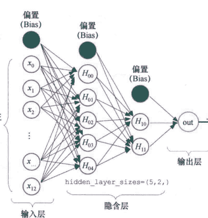

> 💡 无黄金法则，超参数靠“折腾”（网格搜索/贝叶斯优化/经验迭代）产出。

---

## 五、训练与评估：拟合、预测、揭榜

结构定型，流程标准化：`fit` → `predict`/`score`。

### 1. 模型拟合

```
In [18]:
01 #训练模型
02 model.fit(X_train, y_train)
```

`fit(X_train, y_train)`：监督学习核心步骤，在训练集上最小化损失函数，学得最优权重。

### 2. 双轨评估：训练集 vs 测试集

```
In [19]:
01 #在训练集合和测试集合上进行预测
02 y_predict_on_train = model.predict(X_train)
03 y_predict_on_test = model.predict(X_test)
04 #模型评估
05 from sklearn.metrics import accuracy_score
06 print('训练集合的准确率为：{:.2f}%'.format(100 * accuracy_score(y_train, y_predict_on_train)))
07 print('测试集合的准确率为：{:.2f}%'.format(100 * accuracy_score(y_test, y_predict_on_test)))
```

**实测结果**：
> 训练集准确率：32.26%  
> 测试集准确率：35.19%

**现象诊断**：双低且接近 → **严重欠拟合**。模型未捕捉到数据内在规律，后续需从以下维度突围：
1.  **数据预处理**：标准化/归一化（MLP 对尺度极其敏感）。
2.  **网络加深/加宽**：调大 `hidden_layer_sizes`。
3.  **优化器微调**：尝试 `lbfgs` 或调整 `adam` 学习率。
4.  **增加迭代轮次**：`max_iter` 默认可能不足。
5.  **特征工程**：筛选/构造更具判别力的特征。

---

> **下一站预告**：我们将引入 `StandardScaler` 标准化流水线，重构 MLP 拓扑，实战攻克欠拟合，看准确率能否破 90% 大关！

### 关键提示：随机种子未固定的影响

先说个重要细节：若不固定随机种子，每次调用 `train_test_split` 划分数据，生成的训练集与测试集都会不同，导致本例输出结果波动较大。

初始运行显示，模型预测效果极差。这其实很正常——模型初期表现不佳是常态，作为算法工程师，真正的“调参之旅”才刚刚拉开帷幕。接下来我们将实操演示调参与数值预处理如何让模型性能发生“质变”。

首先尝试增加模型复杂度：采用两层隐含层、每层 10 个神经元的结构，其余代码不变，观察效果是否好转。

```
In [20]:
......
model = MLPClassifier(solver = "lbfgs",hidden_layer_sizes= (10,10,))
......
```

#### 运行反馈

训练集准确率：39.52%
测试集准确率：40.74%

结果显示性能虽有微弱提升，但仍不及格。核心症结在于：**数据未经预处理直接“裸奔”进模型**。

葡萄酒数据集包含 13 个特征，这些特量纲量级差异巨大（可回顾前文 In [13] 输出）。比如第 13 项特征“脯氨酸”数值动辄上千，而第 2 项“苹果酸”数值不足 3。同是数值变化 1，对脯氨酸仅是千分之一波动，对苹果酸却超 30% 变动。大数值特征的微小变化极易“淹没”小数值特征的剧烈信号。

为公平起见，必须对特征做预处理。**归一化** 是常用手段之一，它将所有特征值映射至 [0,1] 区间。

最基础的归一化逻辑：找出特征最大值（MAX）与最小值（MIN），对某特征值 x 变换为 x'：

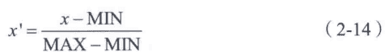

**数据预处理对模型性能影响巨大。** 你若喂模型“吃草”（原始数据），休想它给你“挤奶”（优异性能）。下面引入 `StandardScaler` 进行标准化缩放。

```
In [21]:
01 from sklearn.preprocessing import StandardScaler
02 scaler = StandardScaler()
03 scaler.fit(X_train)
04 #对训练集合和测试集合均做缩放处理
05 X_train = scaler.transform(X_train)
06 X_test = scaler.transform(X_test)
```

参数保持不变，再次跑模型看看。

```
In [22]:
01 #导入多层感知机分类器
02 from sklearn.neural_network import MLPClassifier
03 #创建多层感知机分类器
04 #使用一层网络
05 model = MLPClassifier(solver = "lbfgs",hidden_layer_sizes=(100,))
06 #solver: {'lbfgs', 'sgd', 'adam'}, default 'adam'
07 #训练感知机
08 model.fit(X_train, y_train)
09 #在训练集合和测试集合上做预测
10 y_predict_on_train = model.predict(X_train)
11 y_predict_on_test = model.predict(X_test)
12 #模型评估: 查看预测准确率
13 from sklearn.metrics import accuracy_score
14 print('训练集合的准确率为: {:.2f}%'.format(100 * accuracy_score(y_train, y_predict_on_train)))
15 print('测试集合的准确率为: {:.2f}%'.format(100 * accuracy_score(y_test, y_predict_on_test)))
```

#### 运行反馈

训练集准确率：100.00%
测试集准确率：96.30%

**数据预处理后，MLP 模型性能近乎完美**：训练集全对，测试集超 96%。这揭示了一个铁律——**数据预处理极其关键，往往占据整个机器学习任务的大半工时**。业界有句名言：**“数据预处理与特征工程决定机器学习的上限，模型与算法只是逼近这个上限。”**

本例任务简单，未涉及特征工程。但在传统机器学习中，特征工程是核心“工序”：将原始数据转化为更具表达力的特征，以更好地刻画业务问题，提升对未知数据的预测精度。

---

## 六、窥探模型内核：参数可视化

神经网络的核心在于各神经元间的连接权值（含偏置），它们是模型的基石。通过简单代码即可导出这些关键参数。

虽非必需步骤，但输出它们有助于加深读者对回归模型的理解。

```
In [23]: model.coefs_[0] #输出偏置参数权值
Out[23]:
array(([ 0.17798393, -0.36654496, 0.16594866, ..., 0.2636895 ,
-0.11608851, 0.04236262],
......（手工删除大部分输出）

[ 0.11228491, -0.13218683, -0.17687496, ..., 0.03586755,
-0.04372992, 0.10494191]))   
In [29]: model.coefs_[1]
Out[29]:
array(([-1.26675870e-01, -1.04478871e-01, -5.89352607e-03],
[-4.38184749e-01, 4.14986656e-01, -3.85983596e-01],
[-2.66283325e-01, 6.97096981e-03, -1.87502942e-01],
......（手工删除大部分输出）
[-7.55132807e-02, 1.66824857e-01, -4.14050105e-02],
[ 6.04796639e-02, 1.72572687e-01, -9.87014511e-03]]))
```

想象一下：左侧密密麻麻的参数，正是神经网络从数据中自主学得的**“暗知识”**[16]。

暗知识由机器发现，人类难以理解；但机器掌握它后，便能胜任指定任务。

至此，我们已完整走完「用 sklearn 构建神经网络解决分类任务」的全流程。为助理解，代码写得较详细；实则若烂熟于心，核心代码不过 20 余行（见随书源码）——这就是框架赋能的便捷。

但如前所述，sklearn 虽好用却偏保守，**不支持深度学习新范式**。欲攻克深度学习任务，还需另一利器——**TensorFlow**，这正是下一章主题。

---

### 2.7 本章回顾

1.  **学习本质**：人工神经网络的“学习”，实为神经元间连接强度（权值）的迭代调整。性能高度依赖网络复杂度，通过海量内部权值自适应调整实现信息处理，具备自学习与自适应能力。
2.  **感知机溯源**：系统阐述了感知机（载体）运作机理，用“西瓜/香蕉判别”案例感性演示流程，又给出形式化学习规则与表征能力边界。本质上，感知机是两层神经元网络：输入层经激活函数（阈值）变换传至输出层，故称“阈值逻辑单元”。这种简逻单元逐步演进、复杂化，最终构成多层前馈神经网络。
3.  **多层前馈网络突围**：核心优势在于**表征能力跃升**，优雅化解 Rosenblatt 困扰多年的“感知机异或难题”。随后结合 sklearn 框架，实战演示多层网络解决葡萄酒分类问题。

---

### 2.8 思考与实战

1.  **框架实战 Perceptron**：调用 sklearn `Perceptron` 重写范例 2-1、2-2，实现 AND/OR/NOT 逻辑，体会框架之美。
2.  **纯感知机试水鸢尾花**：无隐含层的感知机能解决哪些实际问题？参考表 2-2，导入鸢尾花数据集做分类预测。
3.  **框架破解“异或之痛”**：用 sklearn `MLPClassifier` 攻克 Rosenblatt 痛点——XOR 问题。
4.  **大师观点研习**：张首晟院士曾言：“仿生鸟飞早期皆败，空气动力学（第一性原理）造就飞机超越鸟类。AI 同理，脑神经元仿生非终点，唯悟智慧第一性原理，方得真突破！” 结合神经网络发展史，谈谈你的感悟。

---

### 参考文献

[1] MCCULLOCH W S, PITTS W. A logical calculus... *The bulletin of mathematical biophysics*, 1943.
[2] ROSENBLATT F. The perceptron... *Psychological review*, 1958.
[3] 周志华. *机器学习*[M]. 清华大学出版社, 2016.
[4] MINSKY M, PAPERT S A. *Perceptrons*[M]. MIT press, 2017.
[5] 张钱, 朱军, 苏航. 迈向第三代人工智能[J]. *中国科学: 信息科学*, 2020.
[6] HORNIK K, et al. Multilayer feedforward networks are universal approximators[J]. *Neural networks*, 1989.
[7] 邱锡鹏. *神经网络与深度学习*[M]. 机械工业出版社, 2020.
[8] NIELSEN M A. A visual proof that neural nets can compute any function[EB/OL].
[9] NAIR V, HINTON G E. Rectified linear units improve restricted boltzmann machines[C]//ICML-10, 2010.
[10] LENNIE P. The cost of cortical computation[J]. *Current biology*, 2003.
[11] MAAS A L, et al. Rectifier nonlinearities improve neural network acoustic models[C]//ICML, 2013.
[12] CLEVERT D A, et al. Fast and accurate deep network learning by ELUs[J]. *arXiv*, 2015.
[13] HENDRYCKS D, GIMPEL K. Gaussian error linear units (GELUs)[J]. *ArXiv*, 2016.
[14] SITZMANN V, et al. Implicit Neural Representations with Periodic Activation Functions[J]. *arXiv*, 2020.
[15] FORINA M, et al. Multivariate data analysis as a discriminating method of the origin of wines[J]. *Vitis*, 1986.
[16] [美]王维嘉. *暗知识: 机器认知如何颠覆商业和社会*[M]. 中信出版社, 2019.

---

# Deep Learning & TensorFlow

## 第 3 章 初识 TensorFlow

**他山之石，可以攻玉。** 想提升机器学习项目开发效率，计算框架必不可少。谷歌出品的 **TensorFlow** 是深度学习框架的标杆代表。本章聚焦 TensorFlow 安装与 TensorFlow 2 新特性。

《荀子·劝学》云：“君子生非异也，善假于物也。” 意指君子资质常人，但善用外物方成高人一等。这对深度学习算法工程师同样适用。

前章通过 sklearn 初体验，已感受到框架带来的开发红利。对于深度学习，TensorFlow 更是业界公认的利器，值得深耕。

---

### 3.1 TensorFlow 来龙去脉

Google 在大数据、分布式计算、智能搜索等领域成果斐然，贡献多个划时代产品。AI 领域亦不遑多让。

**2011 年，Google 推出首代分布式机器学习系统 DistBelief**[1]。杰夫·迪恩、吴恩达等大牛均为核心成员。

借 DistBelief，Google 动用数据中心万计 CPU 核心构建深度神经网络：语音识别准确率大增 25%，图像识别亦大放异彩。

DistBelief 已具备显著自学习能力，但算力开销惊人：1000 台机器、16000 核心、百亿级参数训练。

最初 DistBelief 作为 Google X 实验室“黑科技”闭源。后因开源生态“人人为我，我为人人”的群策群力效应，**2015 年 11 月，Google 开源 DistBelief 升级版，遵循 Apache 2.0 协议，命名为——TensorFlow**[2]（图标见下）。


**图 3-1 TensorFlow 图标**

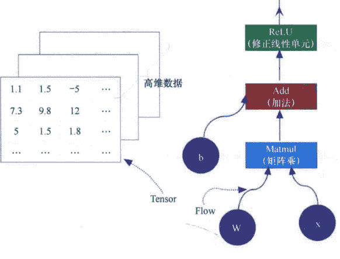

**名字大有讲究：**
*   **Tensor（张量）**：深度学习数据多为高维数组（超二维），用核心数据特征命名极具意义。
*   **Flow（流）**：寓意基于数据流图的计算范式。

合意即：**张量在数据流图中从一端流向另一端的计算过程**。数据流动即计算过程，生动刻画了复杂数据结构在神经网络中的流动、传输、分析与处理（见图 3-2）。图中节点为操作，边为张量（数据）流动。后续章节将细讲。

**图 3-2 TensorFlow 数据流图**

---

### 3.2 TensorFlow 核心特性

综上，TensorFlow 是面向数值计算的深度学习框架，封装丰富 **API（应用程序接口）**，为开发效率“保驾护航”，涵盖主流机器学习与深度学习算法。

# 深度学习框架全景扫描：从 TensorFlow 到 PyTorch 的江湖变迁

提到深度学习利器，TensorFlow 绝对绕不开。作为 Google 倾力打造的明星框架，它凭借代码简洁、部署便捷、生态繁荣等优势，长期占据行业制高点。背靠技术大厂，社区活跃度极高，代码迭代速度更是惊人，动辄每周上万行提交。

## 核心概念：数据的四种“形态”

在机器学习的世界里，数据主要以四种形式存在：
*   **标量**：单个数值，计算的原子单位，如 `1`、`3.2`。
*   **向量**：标量组成的一维数组，如 `[1, 3.2, 4.6]`。
*   **矩阵**：标量构成的二维数组。
*   **张量**：维度 `n >= 3` 的多维数组集合，可看作高维矩阵的推广。

## TensorFlow 四大“杀手锏”

1.  **架构直观，流程可视**：「张量流」非虚名，配合 TensorBoard，数据流转的每个节点都看得见、摸得着。
2.  **部署灵活，跨平台无忧**：CPU、GPU 无缝切换；少量改动即可上云、进集群，分布式大数据分析轻松搞定。
3.  **全平台覆盖**：Linux、macOS、Windows 三大桌面系统全支持，甚至能下沉到移动端设备运行。
4.  **调试神器——即时执行**：Eager Execution 采用命令式编程，调用即运行，告别了静态图调试的晦涩，让开发流程更顺滑。

**技术底座与接口**：核心由 C++ 打造保证性能，上层提供 Python、C++、Java、JavaScript、Go 等多语言前端，兼顾效率与易用。

**美中不足**：相对高层框架，TF 代码偏底层，样板代码多，常需「重复造轮子」。但瑕不掩瑜，凭借深厚积淀与稳健性能，它依然稳坐深度学习框架头把交椅。


---

### 3.3 深度学习框架大比拼

「工欲善其事，必先利其器。」江湖不止 TensorFlow 一家，Theano、Keras、Caffe、PyTorch 各领风骚。下面逐一复盘，助你建立宏观认知。

#### 3.3.1 Theano：开山鼻祖的谢幕与遗产

Theano 是符号计算范式的先驱，集成 NumPy、支持自动求导，本质上是一个基于 Python 的数值计算库。

*   **学术范儿浓，上手门槛高**：缺乏现成的深度学习 API（如层级封装），一切得从底层手搓，纯粹的「科研向」选手。
*   **工程落地乏力**：开发效率在后来者面前不占优势，随着高效框架崛起，逐渐淡出主流舞台。2017 年 9 月，本吉奥宣告其「光荣退休」。
*   **精神永存**：虽代码停更，但它的基因流淌在 TensorFlow、Keras 等后世框架血脉中，功勋卓著。

#### 3.3.2 Keras：极简主义的「二次封装」之王

纯 Python 编写，定位为高阶 API，可运行在 TensorFlow、Theano、CNTK 之上——本质是对底层引擎的深度封装。

*   **语法极简，所见即所得**：模块连接直观，几行代码跑通网络，十几行复现 AlexNet，开发效率碾压同级。
*   **双刃剑效应**：高度封装带来便捷，也锁死了定制化空间，想改细节？门儿都没有。
*   **与 TensorFlow 的「姻缘」**：创始人肖莱是 Google 员工，双重身份注定了深度绑定。TF 1.10 引入 `tf.keras`，TF 2.0 直接封为官方高阶 API。本书后续代码将采用 TF+Keras 混合模式。

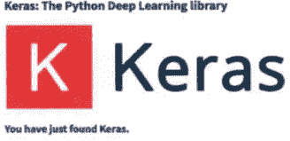

#### 3.3.3 Caffe：计算机视觉的「极速主义」先锋

源自贾扬清博士论文，引用超 1.4 万次，BSD 协议开源。**核心定位：为快速特征提取而生的 CNN 专用框架**。虽后经社区拓展至 NLP、语音等领域，但视觉基因最浓。

*   **杀手锏——Model Zoo（模型动物园）**：汇聚 AlexNet、VGG、ResNet 等预训练大模型，拿来即用，省去漫长训练，**「极速」出活**。
*   **短板明显**：
    1.  **改模型伤筋动骨**：微调结构需动 C++/CUDA 底层代码，灵活性差。
    2.  **RNN/LSTM 支持弱**：天生为卷积而生，循环网络是短板。
*   **现状**：逐渐退居二线，转型为 PyTorch 等框架的后端支撑。


#### 3.3.4 PyTorch：动态图时代的「学术霸主」与后起之秀

前身是 Lua 语言的 Torch，因语言小众受限。Torch7 团队果断拥抱 Python 生态主流，重写发布 PyTorch（2017 年开源）。

*   **设计哲学：Pythonic 与动态图**：代码线性直观，调试如同写普通 Python；动态计算图支持零延迟修改网络行为，科研实验极其友好。
*   **文档完善、语法优雅**，迅速攻占学术界半壁江山，有超越 TF 之势。
*   **痛点与破局**：生态曾因「太年轻」被诟病，但有 Facebook 长期投入、Caffe 做后端加持，工程落地能力快速补齐，现已是工业界不可忽视的力量。

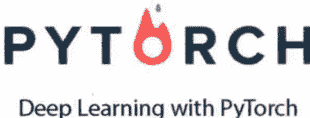

> **框架共存的哲学**：「存在即合理。」每款框架都在细分赛道找到了生存价值。除上述四大巨头，Chainer（PyTorch 设计灵感来源）、MXNet（亚马逊御用、多语言）、国产双子星——百度飞桨、华为 MindSpore 也都「可圈可点」。
> **选型建议**：按业务场景选，别迷信单一框架。本教程主讲 TensorFlow，但思维通法。

---

### 3.4 实战起步：Anaconda 一站式部署 TensorFlow

Anaconda 是 Python 生态的「超级包管理器」，配环境、装依赖，它最省心。下文详解安装流程。

#### 3.4.1 Anaconda 获取与安装实操

##### 一、Linux 环境部署指南

1.  官网下载 Python 3.8 版 64 位 Linux 安装包（`.sh` 脚本）。*注意：官方 2020 年 7 月后停更 Python 2.7，Py3 是大势所趋。*
2.  文件默认落在 `~/Download`。终端 `ls` 确认文件名（如 `Anaconda3-2020.11-Linux-x86_64.sh`）。
3.  执行安装：`bash Anaconda3-2020.11-Linux-x86_64.sh`。
    *   回车阅读协议，输入 `yes` 同意。
    *   默认装在 `/home/<username>/anaconda3`。
    *   询问是否 `conda init`（写入 PATH），输入 `yes`，终端即可直接跑 `ipython`、`spyder` 等命令。
    *   见到 `Thank you for installing Anaconda 3!` 即成功。
    *   macOS 流程同理，不赘述。

 ```
$ ls
Anaconda3-2020.11-Linux-x86_64.sh
``` ```
bash ~/Downloads/Anaconda3-2020.11-Linux-x86_64.sh
```

##### 二、Windows 环境图形化安装

1.  官网选 Windows 版，按系统位数下载 `.exe` 图形安装包（64 位选 `64-Bit Graphical Installer`）。
2.  双击运行，点 `I Agree`。
3.  选择作用域：`Just Me`（仅当前用户）或 `All Users`（需管理员权限）。
4.  **路径避坑指南**：
    *   目标目录不能有旧版残留或同名非空文件夹（删旧或换路径）。
    *   **严禁空格与中文路径**（Anaconda 不支持）。
5.  高级选项界面（**建议全勾**）：
    *   `Add Anaconda to my PATH environment variable`：虽官方不强推，但装上后任意命令行直呼 Python/conda，极其方便。
    *   `Register Anaconda as my default Python`：让 PyCharm、VS Code 等 IDE 自动识别环境。
6.  点 `Install`，一路 `Next` 至 `Finish` 界面，大功告成。

   

**验证安装**：后续章节全基于 Python 环境，打开终端输入 `python` 或 `conda --version` 确认无误，即可启程。

#### 3.4.2 确认 Python 安装无误

怎么知道 Python 装没装好？方法很简单：打开终端（Windows 用户在“运行”里敲 `CMD`，Linux/macOS 直接开新 Shell），输入 `python --version`（注意 `python` 和参数中间有空格，`version` 前面是两个短横线）。如果屏幕正常打印出版本号，那就说明安装成功了。下面以 Linux 系统为例演示一下。

```
$ python --version
Python 3.8.5
```

输出信息显示，Python 3.8.3 已就绪。特别提醒：Linux 和 macOS 系统自带 Python 2.7，如果不调整环境变量，直接运行上述命令很可能得到的是 2.7.5。遇到这种情况，得显式更新环境变量，命令如下：

```
source ~/.bashrc
```

接着，在命令行敲入 `python` 启动解释器。

```
$ python
Python 3.8.5 (default, Sep 4 2020, 07:30:14)
[GCC 7.3.0] :: Anaconda, Inc. on linux
Type "help", "copyright", "credits" or "license" for more information.
>>>
```

> **系统差异提示**：Windows 命令不区分大小写，`Python` 和 `python` 效果一样；但 Linux 和 macOS 严格区分大小写，命令行里必须全小写写 `python`。

解释器正常启动后会出现 `>>>` 提示符，这就意味着环境已准备就绪，等着你输入代码了。实际开发中，我们更常用 Jupyter 这类交互式环境，或 PyCharm 这样的 IDE 来写和调试代码。

那怎么退出 Python 交互模式？主流有两招：

- **方式一**：在 `>>>` 后面输入 `exit()` 或 `quit()`。
  ```python
  >>> exit()  # 或 quit()
  ```
- **方式二**：用快捷键 `Ctrl+Z`（Windows）或 `Ctrl+D`（Linux/macOS）直接退出。

#### 3.4.3 用 conda 部署 TensorFlow 环境

Anaconda 的核心利器是 `conda`，它既是包管理器，也是环境管理器。作为包管理器，能帮你查找、安装各种软件包；作为环境管理器，当你有多个 Python 环境共存时，能轻松为特定项目搭建专属的 Python 版本。我们就借助这个特性，给 TensorFlow 配个“专属房间”。不管是 Linux、Windows 还是 macOS，命令行下用 `conda` 装包通吃。

> 当然，终端里用 `pip3 install tensorflow` 也能装，三大系统通用。

重启安装了 Anaconda 的终端，刷新一下环境变量。直接输入 `conda install tensorflow`，如果提示 `Proceed ([y]/n)?` 询问是否继续，直接回车确认即可（括号里的 `y` 就是默认选项）。运行过程如下：

```
$ conda install tensorflow
Collecting package metadata (current_repodata.json): done
Solving environment: done
## Package Plan
environment location: /home/yuhong/anaconda3

added / updated specs:
- tensorflow

The following packages will be downloaded:

   package                    |   build
------------------------------|---------
_tflow_select-2.3.0           |   mk1               2 KB
absl-py-0.9.0                 |   py38_0           165 KB
......（省略大部分输出）
tensorflow-2.3.0              |mkl_py38h6d3daf0_0   4 KB
termcolor-1.1.0               |   py38_1            8 KB
......
```

这种方式最省心，conda 会自动从源里拉取“最新”版安装。之所以给“最新”加引号，是因为它未必是官网绝对最新，而是 Anaconda 仓库里经过验证、相对稳定的版本。Anaconda 重稳定性，追新策略是“让子弹飞一会儿”，让新版本先跑段时间再收录。

如果你的机器配了 GPU，且 CUDA 驱动已搞定①，就可以装 TensorFlow GPU 版，命令跟 CPU 版差不多。

① *CUDA 装配分三步：装 CUDA 软件、装 cuDNN 加速库、配环境变量，流程琐碎。留给有 NVIDIA 显卡且精力充沛的读者自行折腾。*

```
conda install tensorflow-gpu
```

考虑到 CPU 版通用性强，本书以此为基准讲解。GPU 加速内置于 GPU 版中，基本不用你显式编程，CPU 版代码能无缝迁移到 GPU 版运行。

2019 年 10 月，TensorFlow 2 正式亮相。Keras 作者、Google 科学家 François Chollet 盛赞：“TF2 是来自未来的 ML 平台，改变了一切”。抛开“自夸”成分，TF 2 相较 1.x，无论语法还是编程范式，确实是翻天覆地的变化。

### 3.5 跑通第一个 TensorFlow “Hello World”

装好 Anaconda，Jupyter 通常自带。Jupyter 源自 IPython 项目，IPython 是增强版 Python Shell，而 Jupyter 可理解为“网页版 IPython”。安装 Anaconda 时，Jupyter Notebook 已默认安装。在控制台敲 `jupyter notebook` 启动服务：

```
jupyter notebook           #在命令行启动 Jupyter
```

在这个启动的 Jupyter 里，我们来跑第一个 TensorFlow 程序。在代码单元格输入合法 Python 语句，先导入 TensorFlow 模块：

```
import tensorflow as tf
```

输完代码，按 `Shift + Enter` 或点工具栏的运行箭头（▶|Run）执行。接着用下面指令检查版本号：

```
tf.__version__
```

同样方式运行，结果如图 3-12 所示。

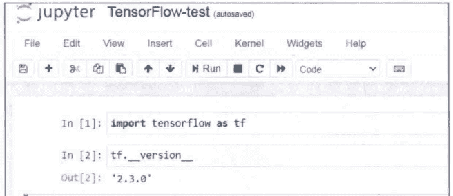

**图 3-12 Jupyter 中显示 TensorFlow 版本**

能正常拿到版本号，说明环境配置 OK。输出显示版本为 2.3。注意 `__version__` 前后各有两个下划线。

### 范例 3-1 Hello World 程序（hello-world.py）

```
01 import tensorflow as tf
02 h = tf.constant("Hello")
03 w = tf.constant(" World!")
04 hw = h + w
05 print(hw)
```

### 运行结果

```
tf.Tensor(b'Hello World!', shape=(), dtype=string)
```

代码细节后续讲语法时细说，这儿简单过一下：第 01 行导入库并起别名 `tf`；随后定义两个字符串常量 `h`、`w`，用 `+` 拼接，最后 `print` 输出。

乍看这代码“平平无奇”，跟普通 Python 没两样。但这正是 TF 2 重大升级的成果。

回望 TF 1.x 时代，想看计算图里任何变量，必须先建 `Session`、构建数据流图、定义数据流入流出指令、再 `run` 出结果，流程极其繁琐。

> 常说“哪有岁月静好，只是有人替你负重前行”。TF 2 的改进，就是这“负重前行”。

技术浪潮滚滚向前。范例 3-1 能与 Python 无缝衔接，凝聚了无数开发者心血。从输出可见，除了想要的 “Hello World!”，TF 还额外吐了张量类型、尺寸等元信息。

若只想要纯数据，可用 TF 专属 `tf.print()`。把范例第 05 行换成 `tf.print(hw)`，输出如图 3-13 所示。

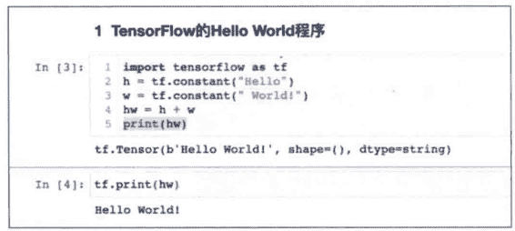

**图 3-13 TensorFlow 2 编写的首个程序输出**

#### 3.5.1 进阶实战：体验 TensorFlow 数值计算

前面只是演示字符串操作，TF 的强项是数值计算。再来个实例感性认识一下。

### 范例 3-2 利用 TensorFlow 2 编写有实际意义的运算程序（add-mul.py）

```
01 import tensorflow as tf
02
03 a = tf.constant(4, name = "a")
04 b = tf.constant(2, name = "b")
05 c = tf.math.multiply(a, b, name ="C")
06 d = tf.math.add(a, b, name = "d")
07 e = tf.math.add(c,d, name = "e")
08
09 print(e)
```

### 运行结果

```
tf.Tensor(14, shape=(), dtype=int32)
```

### 代码解析

这段代码实现了一个数据流图（见下图）。数据流图，本质上是对一次机器学习计算过程的逻辑描述。以此图为例，拆解 TF 核心概念。

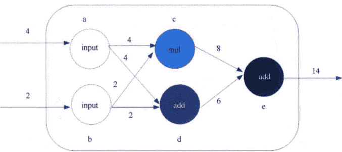

**图 3-14 TensorFlow 数据流图**

构建数据流图需两大基元：**节点** 与 **边**。

- **节点**：通常用圆、椭圆或方框表示，代表对数据的运算或操作。图中有 5 个节点，分别对应输入、乘法、加法等。
- **边**：带箭头的线段，连接节点，表示数据流向。指向节点是输入，引出节点是输出。输入可来自别的图、文件或用户；输出是节点运算结果。例中，节点 `c` 接收 2 和 4，经 `mul` 得 8；节点 `d` 经 `add` 得 6；最终 6 和 8 汇聚到节点 `e`，再次 `add` 得 14。

数据流图是 TF 1.x 核心概念，体现“惰性”计算。但 TF 2 大幅简化流程，主推即时执行，数据流图逐渐退出历史舞台，成大势所趋。

> 所谓“惰性”，即计算图只定思路不算数，等显式调用 `run` 方法时，操作才真正落地执行。

#### 3.5.2 深度解析：TensorFlow 2 核心升级亮点

前面通过案例演进管窥 TF 2 新特性，现在系统梳理一下它到底带来了哪些“杀手锏”。

前文提过 PyTorch，凭借简单易上手、功能强，深得学术界青睐，声势直逼 TensorFlow。反观 TF，发展久、生态全、Google 背书、工业界落地易，口碑扎实。但“居安思危”应是前沿技术座右铭。TF 要长青，必须海纳百川。TF 2.x 最大的改善之一，就是向 PyTorch 取经动态图，大幅提升简捷易用性，核心升级集中在 5 个维度（文中展示前 3 点）：

### 1. 借力 Keras，轻松搭建模型

Keras 本身以简捷高效著称。如今经内部整合，`tf.keras` 成为 TF 2 构建、训练模型的高层 API。它还联合 TF 提供一批标准模型（线性/Logistic 回归、梯度提升、随机森林等），可通过 `tf.estimator` API 直接调用。不想从头训练？去 TensorFlow Hub 拿现成模块，配合迁移学习微调即可。这套组合拳，让用户能快速落地自有深度学习模型。

### 2. Eager Execution（即时执行）：调试运行一步到位

TF 2 默认开启 **Eager Execution**，让 TF 代码像 Python 一样好写好调。TF 1.x 最大“槽点”：任何计算都得先规划静态计算图（拓扑结构固定），再喂数据进 `Session`（计算引擎）跑。调试极难——哪怕只想打印个张量，也得按部就班建图、进会话、输出变量，繁琐得像“拿个快递、上个厕所也得穿礼服化妆”。

连 Yann LeCun 都多次吐槽 TF 是“过时框架”。支持动态图一直是社区强音，**Eager Execution** 正是回应。

它是命令式、运行时定义的接口：Python 里一调用，操作立即执行。调试从此变成**所见即所得**。

TF 1.x 的数据流图就一无是处了？并非。TF 没扔掉它，而是改良升级。给 Python 函数加装饰器 `@tf.function`，函数就被标记为 JIT 编译，TF 将其作为单个图运行（Functions 2.0 RFC），间接实现了 **AutoGraph** 新功能。


这允许用极自然的 Python 语法写数据流图。一旦编译成图，就能获得更快执行速度、更好在 GPU/TPU 跑、或导出 Saved Model 备用。配合 Eager Execution，模型调试与运行变得行云流水。

### 3. 极简主义的用户程序接口（API）

### 4. 重塑数据管线：更优雅的训练流程

模型训练离不开数据输入，数据处理的吞吐率直接决定训练效率，这在各大深度学习框架中都是核心议题。早期 TensorFlow 试图将全量数据集载入内存，但面对海量数据时内存往往力不从心。随后策略转为分批读取，却引入了串行瓶颈——“读数据、算模型、再读数据”的循环让算力闲置严重。

为破局，TensorFlow 引入 QueueRunner 与数据队列机制，借助多线程并行入队出队。然而队列编程极易踩坑：满阻塞、空阻塞，稍有不慎便陷入“生产者-消费者”死锁泥沼。

`tf.data` 模块的出现彻底改写了这一局面。它基于惰性求值范式，构建多线程异步输入管线，实现下一批次数据的预取，将 GPU/TPU 等待压缩至理论极致。更难得的是，其 API 设计极简，融合 Keras 风格与 NumPy 式数组结构，大幅削减数据处理代码量。这些底层复杂性对用户完全透明，宛如“润物细无声”，仅留下丝滑的使用体验。

虽在 1.x 时代 `tf.data` 已现身，却需与 QueueRunner 等旧方案“群雄逐鹿”。TensorFlow 2 直接弃用其余模块，唯独留存 `tf.data`，再次践行极简主义承诺。

### 5. 全栈部署：跨平台多语言的生产级落地

框架再易用、建模再高效，最终交付生产环境创造价值才是硬指标。客观说 TensorFlow 仍有不足，但在工程落地层面，业界公认其处于领先梯队。

成熟生态赋予了 TensorFlow 强落地能力：无论服务器集群、边缘终端、浏览器端；无论 CPU、GPU、TPU 还是移动端芯片；无论 Python、C++、Java、Go、C#、Rust、Julia 还是 R 语言栈——绝大多数场景下，TensorFlow 都能给出健壮的训练部署方案。2.0 版本通过标准化交换格式、统一精简 API，持续打磨跨平台组件兼容性，为生产力变现添砖加瓦。

> ① TPU（Tensor Processing Unit），谷歌定制张量处理器。

### 3.6 章末回顾

本章梳理了 TensorFlow 的诞生脉络——当前工业界采用最广的深度学习框架，并覆盖了安装要点。环境配置与编程实战中挫折在所难免，读者需保持“爱折腾、勤试错”的心态。通过两个入门案例，我们管窥 TensorFlow 2 新特性，但要驾驭其全貌，仍需系统掌握语法规范，这将是下一章重点。

### 3.7 思考与实践

结合本章内容，请完成：

1.  TensorFlow 非最简框架，为何仍成工业界首选？
2.  实操：用 `pip 3` 完成 TensorFlow 安装。
3.  思路题：如何在 2.x 环境下兼容运行 1.x 代码？

### 参考文献

- [1] DEAN J, 等. Large scale distributed deep networks[C]// NIPS. 2012.
- [2] ABADI M, 等. TensorFlow: A system for large-scale machine learning[C]// OSDI 16. 2016.
- [3] JIA Y, 等. Caffe: Convolutional architecture for fast feature embedding[C]// ACM MM. 2014.
- [4] Zhang A, 等. Dive into deep learning[M]. 2020.

## Deep Learning & TensorFlow

## Chapter four

## 第 4 章 TensorFlow 基础语法

“欲速则不达”。虽 TensorFlow 直接嵌入 Python，但其独有概念体系与语法细节繁多，不妨将其视作一门新语言系统学习。本章夯实根基，逐一拆解核心语法。

仅懂 Python 远不足以驾驭 TensorFlow，系统性语法介绍势在必行。

### 4.1 张量思维：TensorFlow 的底层逻辑

TensorFlow 面向深度学习的科学计算库，数据以张量对象存储，所有运算皆基于张量展开。看似高深的神经网络，本质是张量间加减乘除等操作的组合。故而，建立张量思维是进阶的前提。

#### 4.1.1 阶：张量维度的度量

先从标量说起。标量即单一数值，是计算原子单元（如 `1`、`2.2`）。高阶张量皆由标量向高维扩展而来。

以“阶” 审视张量类型，它等价于维数，详见表 4-1。


表 4-1 TensorFlow 张量分级

| 阶 | 称呼与含义 | Python 示例 |

|---|---|---|

| 0 | 标量，单值 | `s = 2.2` |

| 1 | 向量，标量成的一维数组 | `v = [1, 2, 3, 4]` |

| 2 | 矩阵，向量构成的二维表 | `m=[[1,2,3],[4,5,6],[7,8,9]]` |

| 3 | 三维张量，数据立方体 | `t = [[[1,2,3],[4,5,6],[7,8,9]], [[10,12,13],[14,15,16],[17,18,19]]]` |

| n | n 阶张量（n≥3），高维矩阵，超越直观空间 | `......` |

> ① 通常维度数 `dim > 2` 统称张量，本质为高维数组。每个维度称轴。TensorFlow 为便利，常将标量、向量、矩阵统称张量。

低阶张量几何示意见图 4-1。

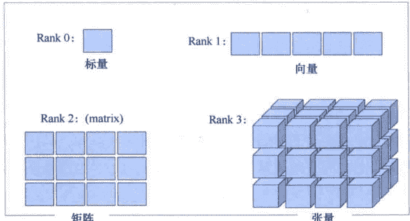

利用 `rank()` 可获取张量阶数，见范例 4-1。

##### 范例 4-1 `rank()` 函数演示 (tensor-rank.py)

```python
import tensorflow as tf

tensor_0 = 1
tensor_1 = [b"Tensor", b"flow", b"is", b"great"]
tensor_2 = [[False, True, False],
    [True, True, False]]
tensor_3 = [[[0, 0, 0], [0, 0, 1]],
    [[1, 0, 0], [1, 0, 1]],
    [[2, 0, 0], [2, 0, 1]]]

print("rank of tensor_0:{0}".format(tf.rank(tensor_0)))
print("rank of tensor_1:{0}".format(tf.rank(tensor_1)))
print("rank of tensor_2:{0}".format(tf.rank(tensor_2)))
print("rank of tensor_3:{0}".format(tf.rank(tensor_3)))
```

##### 运行结果

```
rank of tensor_0:0
rank of tensor_1:1
rank of tensor_2:2
rank of tensor_3:3
```

##### 代码解析

第 11~14 行调用 `rank()`，原型如下：

```
tf.rank(
input,
name=None
)
```

参数 `input` 为输入数据，`name` 可选默认 `None`。`rank` 同义词尚有 `order`、`degree`、`ndim` 等，含义一致。

#### 4.1.2 尺寸：张量形状的另一种表达

除“阶”外，“尺寸”/“维度”同源异径描述结构，对照表 4-2。

表 4-2 尺寸与维度对照

| 阶 | 尺寸 | 维度 | 说明 |

|---|---|---|---|

| 0 | `[]` | 0 维 | 零维张量即标量 |

| 1 | `[D0]` | 1 维 | 一维张量，如 `shape [5]` 含 5 元素 |

| 2 | `[D0, D1]` | 2 维 | 二维张量，如 `shape [3,4]` |

| 3 | `[D0, D1, D2]` | 3 维 | 三维张量，如 `shape [2,2,3]` |

| n | `[D0, D1, ... Dn]` | n 维 | n 维张量 |

`shape` 属性记录各维元素数。标量无维度，`shape` 为空 `[]`，如图 4-2。

```python
In [1]: import tensorflow as tf
In [2]: tensor_0 = 1
In [3]: tf.shape(tensor_0)
Out[3]:
<tf.Tensor: id=3, shape=(0,), dtype=int32, numpy=array([], dtype=int32)>
```

`tf.shape()` 输出尺寸信息，直接打印或用 `tf.print` 更清晰。

```python
In [4]: print("tensor_0 的尺寸为:{0}".format(tf.shape(tensor_0)))
tensor_0 的尺寸为:[]
```

> 亦可 `tf.print(tf.shape(tensor_0))` 输出。

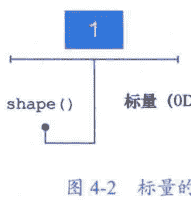

可见标量尺寸为空。一维数组长度即尺寸，亦称 1D 张量。查看尺寸示例：

```
In [5]: tensor_1 = tf.range(10)
In [6]: print(tensor_1)
Out[6]: tf.Tensor([0 1 2 3 4 5 6 7 8 9], shape=(10,), dtype=int32)
In [7]: print("tensor_1 的尺寸为:{0}".format(tensor_1.shape))
Out[7]: tensor_1 的尺寸为：(10,)
```

代码中 `tf.range()` 类 NumPy `arange` 生成一维张量。张量自带 `shape` 属性获取尺寸。尺寸非固定，可用 `reshape()` 重构。

```
In [8]: tensor_2 = tf.reshape(tf.range(15), [3, 5])
    #张量“变形”
In [9]: tensor_2
    #输出张量信息
Out[9]:
<tf.Tensor: id=39, shape=(3, 5), dtype=int32, numpy=
array([[ 0, 1, 2, 3, 4],
       [ 5, 6, 7, 8, 9],
       [10, 11, 12, 13, 14]], dtype=int32)>
In [10]: tensor_2.shape
    #输出张量的尺寸
Out[10]: TensorShape([3, 5])
In [11]: tensor_2.ndim
    #查看数组的维度（阶）信息
Out[11]: 2
```

`In[8]` 将一维转二维，`In[9]` 输出 `(3, 5)`——首数为行，次数为列，见图 4-3。二维数组亦称 2D 张量。自然可逆向还原为一维。

```
In [12]: tf.reshape(tensor_2, [-1])
Out[12]: <tf.Tensor: id=51, shape=(15,), dtype=int32, numpy=
array([ 0, 1, 2, 3, 4, 5, 6, 7, 8, 9, 10, 11, 12, 13, 14],
dtype=int32)>
```

In [12] 演示了一个张量重塑的实用技巧：将某个维度指定为 “-1”，交由系统自动推断该轴的大小。其背后的逻辑很简单：张量总元素量（记为 N）固定，若前 n-1 个维度的尺寸已定，最后一维自然就能通过除法反推出来，即 `dim_n = N / (dim_1 * ... * dim_n-1)`。以 tensor_2 为例，原形态为 3×5 的二维矩阵，共 15 个元素。欲将其拉平成一维（目标 shape 写作 `[-1]` 或 `[15]`），标记 -1 后，框架会自动算出该维度为 15。引入 -1 占位符，本质上是帮开发者省去手动计算维度的麻烦。

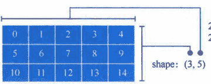

### 图 4-3：二维数组结构示意

> 此处代码等同于 `tf.reshape(tensor_2, [15])`。数据量小时肉眼能数清 15，但面对海量数据时，人工统计极易出错；此时让机器通过 -1 自动计数，显然更稳妥。

再看一个例子：给定二维张量 `test`，调用 `reshape()` 重塑形状。请读者自行推断 In [13] 中 -1 实际代表多少，以及 Out[14] 的输出结果。

```
In [13]: test = [[1, 2, 3],
          [4, 5, 6]]

In [14]: tf.reshape(test, [3, -1])
Out[14]: #你的答案是?
```

前面的输出显示，TF 对低维张量的表达符合直觉。但到了三维数组，认知偏差就来了：比如想建两个 3 行 5 列的矩阵，shape 记为 `(2, 3, 5)`，而非直觉上的 `(3, 5, 2)`。三维数组常称作 3D 张量，以此类推。

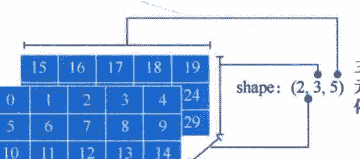

### 图 4-4：三维数组结构示意

请参考下方代码示例。

```
In [15]: tensor_3 = tf.reshape(tf.range(30), [2, 3, 5]) #重构 2 通道 3 行 5 列的张量
In [16]: tensor_3
Out[16]:
<tf.Tensor: id=49, shape=(2, 3, 5), dtype=int32, numpy=
array([[[ 0, 1, 2, 3, 4],
        [ 5, 6, 7, 8, 9],
        [10, 11, 12, 13, 14]],
       [[15, 16, 17, 18, 19],
        [20, 21, 22, 23, 24],
        [25, 26, 27, 28, 29]]], dtype=int32)>
```

### 4.2 TensorFlow 数据类型体系

编写 TF 程序时，TF 自有类型与 Python 原生类型必然交织。二者究竟如何关联？我们逐一拆解。

#### 4.2.1 Python 原生类型与 TensorFlow 的兼容性

TF 并不排斥 Python，反而能与其无缝协作：直接接受 Python 基础类型或由其构成的列表作为张量数据源。单个 Python 数值转为 0 阶张量（标量）；数值列表变 1 阶张量（向量）；嵌套列表变 2 阶张量（矩阵），依此类推。代码能跑通，证明 Python 类型能“无缝”转为 TF 张量对象。

```
tensor_0 = 1 #视为零阶张量
tensor_1 = [b"Tensor", b"flow", b"is", b"great"] #视为一阶张量
tensor_2 = [[False, True, False], [True, True, False]] #视为二阶张量
tensor_3 = [[[0, 0, 0], [0, 0, 1]], [[1, 0, 0], [1, 0, 1]], [[2, 0, 0], [2, 0, 1]]] #视为三阶张量......
```

代码逻辑直观，略过不表。补充说明一下示例中一阶张量里字符串前缀 “b” 的含义。Python 字符串特殊，前缀字母指明处理方式。b/B 代表后引号内为字节数组，而非字符串对象。

若 Python 原生类型足够，TF 只需做类型转换即可。可惜 Python 在数值计算上力有不逮，尤其在机器学习领域“捉襟见肘”。例：Python 整型不分位宽，TF 却细分为 int8/16/32/64，极其专业。为弥补短板，TF 自建了一套类型体系，详见表 4-3。

补充一点：TF 还提供 half 类型（`tf.float16` 半精度浮点）。高性能计算（如 GPU）中若精度要求不高，转为 float16 可显著提升传输效率。

| 数据类型 | TensorFlow 定义 | 描述 |
|---|---|---|
| DT_FLOAT | tf.float32 | 32 位浮点数 |
| DT_DOUBLE | tf.float64 | 64 位浮点数 |
| DT_INT64 | tf.int64 | 64 位有符号整型 |
| DT_INT32 | tf.int32 | 32 位有符号整型 |
| DT_INT16 | tf.int16 | 16 位有符号整型 |
| DT_INT8 | tf.int8 | 8 位有符号整型 |
| DT_UINT8 | tf.uint8 | 8 位无符号整型 |
| DT_STRING | tf.string | 可变长度的字节数组，每个张量元素都是一个字节数组 |
| DT_BOOL | tf.bool | 布尔型 |
| DT_COMPLEX64 | tf.complex64 | 由两个 32 位浮点数组成的复数：实数和虚数 |
| DT_QINT32 | tf.qint32 | 用于量化 Ops 的 32 位有符号整型 |
| DT_QINT8 | tf.qint8 | 用于量化 Ops 的 8 位有符号整型 |

为满足专属计算需求，TF 定制了数值、字符串、布尔三大类类型，简述如下。

#### 4.2.2 数值类型详解

数值张量是 TF 的核心数据载体，顾名思义，支持四则运算，涵盖各精度浮点数与整数（见表 4-3）。接下来看 TF 如何创建数值张量。

```
In [1]: import tensorflow as tf
In [2]: py_value = 3.14
In [3]: tf_tensor = tf.constant(py_value)
```

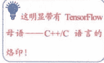

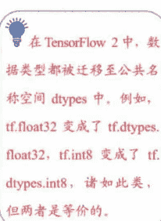

### 表 4-3：TensorFlow 数据类型对照表

第 4 章：TensorFlow 基础语法 · 087

```
In [4]: type(py_value)              #查看 Python 数据的类型
Out[4]: float
In [5]: type(tf_tensor)              #查看 TensorFlow 的类型
Out[5]: tensorflow.python.framework.ops.EagerTensor
In [6]: tf_tensor
Out[6]: <tf.Tensor: id=1, shape=(), dtype=float32, numpy=3.14>
In [7]: tf_tensor.shape
Out[7]: TensorShape([])
```

代码先用 `type()` 检查 `py_value` (In[4]) 与 `tf_tensor` (In[5]) 类型，确认二者不同。随后 In[6]、In[7] 分别打印张量数值与形状。再用 `tf.is_tensor()` 验证两者是否为张量。

```
In [8]: tf.is_tensor(tf_tensor)
Out[8]: True
In [9]: tf.is_tensor(py_value)
Out[9]: False
```

结果显示：`tf.is_tensor(tf_tensor)` 返回 True，而 Python 创建的 `py_value` 返回 False。即便数值相等，生成机制不同导致类型不同，进而内置处理方法也不同。

接着看向量创建。向量类比 C/C++ 一维数组，元素类型统一。

```
In [10]: tf_tensor2 = tf.constant([py_value])   #构建一维向量
In [11]: tf_tensor2              #显示向量信息
Out[11]: <tf.Tensor: id=311, shape=(1,), dtype=float32, numpy=array([3.14],
       dtype=float32)>
In [12]: tf_tensor2.shape         #输出向量的尺寸
Out[12]: TensorShape([1])
```

注意：In[3] 与 In[10] 虽同用 `py_value` (3.14)，但身份截然不同。前者孤值为标量（0 阶），后者因在方括号内成列表，转型为单元素 1D 张量（1 阶）。故 Out[7] shape 为空（0 阶），Out[12] 为 1 阶、元素数 1。

创建多元素张量同样简易，见下：

```
In [13]: tf_tensor3 = tf.constant([1.0, 2.0, 3.0])
In [14]: tf_tensor3
Out[14]: <tf.Tensor: id=59, shape=(3,), dtype=float32, numpy= array([1., 2.,
3.], dtype=float32)>
```

In[13] 构建常规 1D 张量，In[14] 输出。解读输出字段（Out[14]）：`id` 为内部索引，`shape` 尺寸，`dtype` 数据类型，`numpy` 对应 NumPy 数组视图。`numpy` 字段类型揭示了 NumPy 与 TF 的深度关联，后续章节将展开。

#### 4.2.3 字符串类型张量

TF 除数值张量外，还支持字符串张量。Python 已有 str，TF 为何自建？因 TF 对字符串操作有特殊用途。海量图片处理时，需记录海量文件路径（字符串）。为提速，需批量预处理路径，Python 原生字符串难以胜任。TF 中创建字符串张量只需传入字符串对象。

```
In [15]: a_str = tf.constant('Hello, TensorFlow!')
In [16]: a_str
Out[16]: <tf.Tensor: id=0, shape=(), dtype=string, numpy= b'Hello, TensorFlow!'>
```

输出显示数据为 `b'Hello, TensorFlow!'`，前缀 `b` 非内容一部分，标识字节数组。特别注意：Python 字符串支持切片，TF 字符串张量不支持。若需取子串，须用 `tf.strings.substr` 专用方法。

```
In [17]: tf.strings.substr(a_str,0,3)
Out[17]: <tf.Tensor: id=45, shape=(), dtype=string, numpy= b'Hel'>
```

In[18] 从位置 0 截取长度 3 的子串，Out[18] 给出结果。`tf.strings` 还提供 `lower()`、`join()`、`length()`、`split()` 等常用方法，举两例。

```
In [18]: b_str = tf.constant(["abcdabcd bc", "abda c"])
In [19]: tf.strings.split(b_str, sep = 'd') #根据'd'的位置分割字符串
Out[19]: <tf.RaggedTensor [["b'abc', b'abc', b'a bc'], [b'ab', b'a c']]]>
```

In[19] 按字母 `d` 分割向量 `b_str`。简单字符串处理 Python 也能做，TF 优势不明显。但面对字符串张量“批处理”，Python 就“黔驴技穷”了。例：给定字符串张量如下。

```
In [20]:
input_strs = [[b'ten', b'eleven', b'twelve'],
[b'thirteen', b'fourteen', b'fifteen'],
[b'sixteen', b'seventeen', b'eighteen']]
```

需从 `input_strs` 提取子串，且每串起始位置、长度各异。Python 需 for 循环逐个处理，丧失并行优势。TF 用张量思维轻松解决：汇总起始位置成位置张量，汇总长度成长度张量，一行 `substr()` 完成批量提取。

```
In [21]:
position = [[1, 2, 3],    #起始位置张量
[1, 2, 3],
[1, 2, 3]]
In [22]:
length = [[2, 3, 4],      #读取长度张量
[4, 3, 2],
[5, 5, 5]]
In [23]:                 #张量思维：同时处理多个字符串
tf.strings.substr(input = input_strs, pos = position, len = length)
```

#### 4.2.4 布尔类型张量

```
Out[23]:
<tf.Tensor: id=3, shape=(3, 3), dtype=string, numpy=
array([[b'en', b'eve', b'lve'],
       [b'hirt', b'urt', b'te'],
       [b'ixtee', b'vente', b'hteen']], dtype=object)>
```

In[23] 显示，TF 字符串操作的核心特色是面向字符串张量（高维数组）批量处理。深度学习以数值张量运算为主，字符串张量用得较少，不再赘述，用时查阅官方文档即可。

# TensorFlow 进阶：逻辑判断、类型重铸与 NumPy 深度互通

在 TensorFlow 建模过程中，条件判断无处不在。以分类任务评估为例，需将模型推理结果与真实标签逐一对比，这便用上了逻辑张量。
```
In [24]: vec_bool = tf.constant([True, False])    # 创建布尔类型张量
In [25]: vec_bool
Out[25]:
<tf.Tensor: id=66, shape=(2,), dtype=bool, numpy=array([ True, False])>
```

同普通张量一样，逻辑张量的长处在于批量运算。假设持有实测输出 `vec_actual` 与期望目标 `vec_pre`，利用逐元素比对生成同形真值矩阵，再经类型重铸求均值，即可得出分类精度。
```
In [26]: vec_actual = tf.constant([1,1,2,0,1])
    #假设为分类实际值
In [27]: vec_pre = tf.constant([1,0,1,0,1])
    #假设为算法预测的分类值
In [28]: acc_bool = vec_actual == vec_pre    #判断是否预测准确
In [29]: acc_bool    #输出布尔类型张量
Out[29]: <tf.Tensor: id=69, shape=(5,), dtype=bool, numpy=array( [ True, False,
False, True, True])>
```

所谓精度，即命中数占总样本数之比。代码中先以 `==` 触发逐位比对，产出与原整数矩阵等维的真值矩阵赋予 `acc_bool`，随即验证其内容。
```
In [30]: acc_float = tf.cast(acc_bool, tf.float32) #请思考①
In [31]: tf.math.reduce_mean(acc_float)
Out[31]: <tf.Tensor: id=66, shape=(), dtype=float32, numpy=0.6>
```

注意：TF 与 NumPy 分道扬镳，真值矩阵不可直接累加。须借 `tf.cast()` 置换为 `float32`，遵循 `True→1.0, False→0.0` 规则。随后 `tf.math.reduce_mean` 计算均值，该值恰为精度。例如 `[True, False, False, True, True]` 变 `[1.0, 0.0, 0.0, 1.0, 1.0]`，均值 0.6 对应 3/5。
整体式张量运算——输入输出皆为张量——是摆脱显式循环、发挥并行效能的基石。

#### 4.2.5 张量类型转换

模块间变量类型、精细度常不一，需迁移适配，核心接口为 `tf.cast()`。此前代码已初试锋芒。
“cast”意为“铸造”，喻数据流经模具重塑形态。原型如下：
```
tf.cast(x, dtype, name=None)
```

参数中 `x` 为待转源张量，`dtype` 为目标类型，`name` 可省。示例如下：
```python
In [32]: import numpy as np
In [33]: a_const = tf.constant(np.pi, dtype=tf.float16)
    # 创建 tf.float16 低精度张量
In [34]: a_double = tf.cast(a_const, tf.double)
    # 转换为双精度 tf.double 张量
In [35]: a_const
    # 输出验证
Out[35]: <tf.Tensor: id=346, shape=(), dtype=float16, numpy= 3.14>
In [36]: a_double
    # 输出验证
Out[36]: <tf.Tensor: id=347, shape=(), dtype=float64, numpy= 3.140625>
```

`np.pi` 默双精度，指定 `tf.float16` 降位宽；再升回高位宽。输出显示精细度不同，小数保留位数异同。
升位宽（低→高）安全无损，似窄室入宽厅；降位宽（高→低）则有损，如宽厅挤窄室，尾数必被截断或溢出。

TF 亦支持逻辑值与数值互映射。沿袭 Python 传统：`True` 作 1/1.0，`False` 作 0/0.0。反向转换遵循 C/C++ 规范：唯 0 为假，其余正负非零皆真。
```python
In [37]: a_int = tf.constant([-1.1, 0, 1.0, 123, -100])
In [38]: b_bool = tf.cast(a_int, tf.bool)
In [39]: b_bool
Out[39]: <tf.Tensor: id=38, shape=(5,), dtype=bool, numpy= array([ True, False, True, True, True])>
```

#### 4.2.6 TensorFlow 中的张量与 NumPy 数组

TF 与 NumPy 渊源深厚。TF “面子”做学习，“里子”做数值，自然而然借力 NumPy。二者类型体系完全对齐，可在交互模式验证：
```
In [1]:import tensorflow as tf
In [2]:import numpy as np
In [3]:np.int8 == tf.int8
Out[3]: True
In [4]:np.int16 == tf.int16
Out[4]: True
In [5]:np.int64 == tf.int64
Out[5]: True
```

一切合规 NumPy 类型皆可作 TF 张量输入源，验证代码：

```
01 import tensorflow as tf
02 import numpy as np
03
04 n0 = np.array(20, dtype = np.int32)
05 n1 = np.array([b"Tensor", b"flow", b"is", b"great"])
06 n2 = np.array([[True, False, False],
07     [False, True,False]],
08     dtype = np.bool)
09 tensor0D = tf.Variable(n0, name = "t_0")
10 tensor1D = tf.Variable(n1, name = "t_1")
11 tensor2D = tf.Variable(n2, name = "t_2")
12
13 print("tensor0D : {0}".format(tensor0D))
14 print("tensor1D : {0}".format(tensor1D))
15 print("tensor2D : {0}".format(tensor2D))
```

### 运行结果
```
tensor0D : <tf.Variable 't_0:0' shape=() dtype=int32, numpy=20>
tensor1D : <tf.Variable 't_1:0' shape=(4,) dtype=string, numpy= array([b'Tensor',
b'flow', b'is', b'great'], dtype=object)>
tensor2D : <tf.Variable 't_2:0' shape=(2, 3) dtype=bool, numpy=
array([[ True, False, False],
       [False, True, False]])>
```

### 代码分析

代码定义 NumPy 0D/1D/2D 数组 `n0`、`n1`、`n2`，作素材构建 TF 变量 `tensor0D` 等，并输出。TF 1.x 需 `Session.run()` 繁琐，TF 2.x 大幅简化，`print` 直出信息。若仅需纯数值，用专有 `tf.print()`。
将示例输出行改为：
```
13 tf.print(tensor0D)
14 tf.print(tensor1D)
15 tf.print(tensor2D)
```

再运行得纯净结果：
```
20
[["Tensor" "flow" "is" "great"]]
[[1 0 0]
 [0 1 0]]
```

前文提到 NDArray 易转 TF 张量。反向转换？每个 TF 张量实例自带实例方法，瞬间转回 NumPy 矩阵。运行示例后，在 Jupyter/IPython 下测试：
```
In [6]: tensor0D.numpy() #将零维张量（标量）转换成 NumPy 数组
Out[6]: 20
In [7]: tensor1D.numpy() #将一维张量（即向量）转换成 NumPy 数组
Out[7]: array([b'Tensor', b'flow', b'is', b'great'], dtype= object)
In [8]: tensor2D.numpy() #将二维张量（即矩阵）转换成 NumPy 数组
Out[8]:
array([[ True, False, False],
       [False, True, False]])
```

数据来源不止 NumPy。TF 提供转张量接口收编 Python 原生列表、元组等为标准张量。详见范例 4-3。

### 范例 4-3 Python 数组与张量类型转换（tensor_convert.py）
```
01 import tensorflow as tf
02
03 a_list = list([1,2,3,])      #这是一个列表对象
04 b_tuple = (11.0, 22.2, 33)   #这是一个元组
05 c_str_tuple = "a", "b", "c", "d"  #这是一个（字符串）元组
06
07 tensor_a = tf.convert_to_tensor(a_list,dtype = tf.float32)
08 tensor_b = tf.convert_to_tensor(b_tuple)
09 tensor_c = tf.convert_to_tensor(c_str_tuple)
10 tensor_add = tf.math.add(tensor_a, tensor_b)
11
12 print(type(a_list))      #输出 Python 列表类型
13 print(type(tensor_a))   #输出 Python 列表转换的张量类型
14
15 print(type(b_tuple))      #输出 Python 元组类型
16 print(type(tensor_b))   #输出 Python 元组转换的张量类型
17 print(type(c_str_tuple))  #输出 Python 元组类型
18 print(type(tensor_c))   #输出 Python 元组转换的张量类型
19 print(type(tensor_add)) #输出求和结果的张量类型
20
21 tf.print(tensor_c)      #输出张量 tensor_c 中的数据
22 tf.print(tensor_add)      #输出张量求和后的数据
```

### 运行结果
```
<class 'list'>
<class 'tensorflow.python.framework.ops.EagerTensor'>
<class 'tuple'>
<class 'tensorflow.python.framework.ops.EagerTensor'>
<class 'tuple'>
```
```
<class 'tensorflow.python.framework.ops.EagerTensor'>
<class 'tensorflow.python.framework.ops.EagerTensor'>
["a" "b" "c" "d"]
[12 24.2 36]
```

### 代码分析

Python 列表、元组是重要数据容器。典型流程：载入容器 → 统一入口入张量 → TF 运算 → 实例方法导出矩阵/列表 → 供他用。

# TensorFlow 核心：张量转型、常变区分与基础构造 API

运行输出显示，`a_list`、`b_tuple` 及 `tensor_c` 均为 Python 内置类型。经显式转型（第 7-9 行）后，分别获得合规 Tensor 对象 `tensor_a`、`tensor_b`、`tensor_c`。若需高效取值，建议沿用前文介绍的 `tf.print` 专用工具（参考第 21-22 行）。

## 4.3 常量与变量：Tensor 两大形态的分野与抉择

TF 依据可变性将 Tensor 划分为常量与变量两大阵营。变量承载运行期可更新的状态；常量则锁定数值，全生命周期不可篡改。得益于不可变特性，编译器可将常量内嵌至目标代码，显著提升执行效率。

这恰似《道德经》云：“知其白，守其黑，为天下式。” 置于编程语境，对应准则为：识别可变量，坚守不变量，成就代码规范。开发者应建立自省机制：凡流程中数值固定不漂移的数据，主动声明为常量，以增强程序健壮性。

### 4.3.1 `tf.constant`：构建不可变 Tensor

TF 通过 `tf.constant()` 接口生成常量 Tensor。前文已简述，此处通过实战案例深入演示。下方示例以 Python 列表为数据源。

```
In [1]: import tensorflow as tf
In [2]: import numpy as np
In [3]: a_list = [1, 2, 3, 4, 5, 6]    #创建一个 Python 列表
In [4]: tf.constant(a_list)            #用列表创建一个整型常量
Out[4]:
<tf.Tensor: id=186, shape=(6,), dtype=int32, numpy=array([1, 2, 3, 4, 5, 6],
dtype=int32)>
```

鉴于 NumPy 与 TF 生态深度融合，`ndarray` 自然可作为数据源。

```
In [5]: np_array = np.array([[1, 2, 3], [4, 5, 6]])       #创建一个 NumPy 数组
In [6]: tf.constant(np_array)                    #NumPy 数组充当数据源
Out[6]: <tf.Tensor: id=187, shape=(2, 3), dtype=int64, numpy=
array([[1, 2, 3],
       [4, 5, 6]])>
```

上述均基于完备数据。若源数据不足，可借助 `shape` 参数，利用广播机制扩展维度，进而得到完整常量 Tensor。

```
In [7]: const_float_tensor = tf.constant(10.0,shape = [2,3,4], dtype = tf.float32)
In [8]: const_float_tensor
Out[8]:
<tf.Tensor: id=190, shape=(2, 3, 4), dtype=float32, numpy=
array([[10., 10., 10., 10.],
       [10., 10., 10., 10.],
       [10., 10., 10., 10.]],
      [[10., 10., 10., 10.],
       [10., 10., 10., 10.],
       [10., 10., 10., 10.]]], dtype=float32)>
```

观察 `In [7]`：`value` 仅传入标量 `10.0`，配合 `shape=(2,3,4)`，即可将该值铺满整个三维空间。

### 4.3.2 `tf.Variable`：掌控可变状态

机器学习实战中，模型参数等核心数据需持久化存储且随迭代更新，此时必须引入变量机制。不参与梯度优化的 Tensor（如输入层 `X`），直接使用普通张量即可，用完即释，无需 `tf.Variable` 包装[1]。

反之，权重 `W`、偏置 `b` 等需计算梯度并参与优化的核心参数，数值时刻变动且更新依赖历史状态。因此必须用 `tf.Variable` 封装，以便框架自动追踪梯度信息。

创建 `tf.Variable` 对象直观便捷，调用构造方法 `tf.Variable()` 即可。详见范例 4-4。

#### 范例 4-4：Variable 对象实战演示 (`variable.py`)

```python
import tensorflow as tf

my_state = tf.Variable(1.0) #定义一个变量对象
one = tf.constant(1.0) #定义一个常量
#变量加 1 操作后并自我赋值
read_and_increment = tf.function(lambda: my_state.assign_add(one))

print(my_state)
for _ in range(3):
    read_and_increment()
    print(my_state.numpy())
```

#### 执行输出

```
<tf.Variable 'Variable:0' shape=() dtype=float32, numpy=1.0>
2.0
3.0
4.0
```

#### 逻辑深度拆解

逐行解析核心逻辑：
- **第 03 行**：定义变量 `my_state` 并初始化为 `1.0`。
- **第 04 行**：创建常量 `one`，赋值 `1.0`。
- **第 06 行**：通过 `tf.function` 装饰构建计算图函数 `read_and_increment`。逻辑极简——实现原地自增（类 C 语言 `i++`），故采用 Lambda 表达式一行封装。`assign_add` 为变量自带方法，执行加法并原地更新。
- **第 08 行**：输出变量初值。
- **第 09-11 行**：循环驱动状态更新。注意第 09 行循环变量 `_`，这是 Python 惯用的“占位符”，仅用于控制轮次，不参与业务逻辑。
- **第 10 行**：重复调用自增函数。

输出印证：经 3 轮迭代，变量值依次加 1，完成状态演进。为避免冗余元信息干扰，代码调用 `numpy()` 直接输出纯数值。

**进阶解析：命名风格背后的设计规范**
细心者会发现成员首字母大小写分明（如 `tf.function` 小写、`tf.Variable` 大写）。这遵循 TF 编程约定：
- **首字母小写**：框架核心层的一级函数/方法（如 `tf.constant`, `tf.print`）。
- **首字母大写**：设计完善的类，需实例化后使用（如 `tf.Variable`, `tf.keras.layers.Layer`）。

**核心属性详解：`name` 与 `trainable`**
- **`name`**：对象标识符。若不显式指定，框架内部自动维护命名空间，保证唯一性与规整性。
- **`trainable` (布尔)**：标记是否参与梯度计算与优化。置 `True` 时，框架纳入梯度追踪范围进行“重点优化”。**凡经 `tf.Variable` 封装，该属性默认即为 `True`**。待优化 Tensor 可视为普通 Tensor 的特殊子集。

下方代码演示如何检测范例 4-4 中 `my_state` 的这两个属性：

```
In [1]: my_state.name  #显示 name 属性的值
Out[1]: 'Variable:0'
In [2]: my_state.trainable  #显示是否可被优化
Out[2]: True
```

实战技巧：创建变量时显式设置 `trainable=False`，可声明该 Tensor 冻结不参与优化。**特别注意：`trainable` 为只读属性，对象创建后终身不可变。**

**性能与易用的平衡：`tf.function` 机制**
前文吐槽过 TF 1.x 静态图晦涩，推崇 Eager 即时执行。但即时执行依赖 Python 解释器，难以实施图级优化，效率成短板。为兼顾**代码可读性**与**运行性能**，TF 2.0 引入 `tf.function`。

范例第 06 行利用 Lambda 构建简单计算图。亦支持装饰器语法构建复杂流程控制图（含 `if/for/while/break/continue/return`）：

```
01 @tf.function
02 def func1(x):
03     if tf.reduce_sum(x) > 0:
04         return x * x
05     else:
06         return -x // 2
07
08 my_var = tf.Variable([3, -2, 4])
09 tf.print(func1(my_var).numpy())
```

执行结果：
`array([ 9, 4, 16], dtype=int32)`

---

## 4.4 核心张量构造 API 速览

以下方法是模型构建、算法设计的基石，务必熟练掌握。

### 4.4.1 `tf.zeros`：全零 Tensor 构造

神经网络初始化阶段，权重、偏置常需置零。`tf.zeros()` 专为此而生，按指定 `shape` 生成全零 Tensor。接口原型参数如下：

```
tf.zeros(
    shape,
    dtype=tf.dtypes.float32,
    name=None
)
```

参数速查：
- **`shape`**：维度规格。标量表 1D，列表/元组表高维（如 `(2, 3)` 代表 2 行 3 列）。
- **`dtype`**：数据类型，默认 `float32`。
- **`name`**：操作别名（可选），默认 `None`。

实战演示：

```
```python
In [1]: import tensorflow as tf

In [2]: tf.zeros(5, tf.int32)          # 1D 全零向量
Out[2]: <tf.Tensor: shape=(5,), dtype=int32, numpy=array([0, 0, 0, 0, 0])>

In [3]: tf.zeros([2,5], dtype=tf.int32) # 2D 全零矩阵
Out[3]: <tf.Tensor: shape=(2, 5), dtype=int32, numpy=
array([[0, 0, 0, 0, 0],
       [0, 0, 0, 0, 0]])>

In [4]: tf.zeros((3,3))                # 2D 全零矩阵 (默认 float32)
Out[4]: <tf.Tensor: shape=(3, 3), dtype=float32, numpy=
array([[0., 0., 0.],
       [0., 0., 0.],
       [0., 0., 0.]])>

```
```

**语法避坑：为何 `tf.zeros((3,3))` 需双层括号？**
Python 中元组 `Tuple` 属不可变序列，类似 C++ `const` 引用，利于代码健壮性。
`(3,3)` 本质是一个**匿名元组对象**。`tf.zeros((3,3))` 等价于 `tf.zeros(shape=(3,3))`。因元组外层本身是圆括号，与调用括号贴合易生歧义，**强烈建议采用列表 `[3, 3]` 等方括号形式传递 `shape`，清晰不易错。**

**变体神器：`tf.zeros_like` —— “复用模板造零”**
核心逻辑：复用给定 Tensor 的 `dtype` 与 `shape`，元素全置零。

```
```python
In [4]: a_cons = tf.constant([[1, 2, 3.0], [4, 5, 6]])
In [5]: a_cons.numpy()
Out[5]: array([[1., 2., 3.], [4., 5., 6.]], dtype=float32)

In [6]: b_zero = tf.zeros_like(a_cons)  # 复用模板
In [7]: b_zero.numpy()
Out[7]: array([[0., 0., 0.], [0., 0., 0.]], dtype=float32)

```
```

**类型提升规则**：TF 同 NumPy 遵循“高精度优先”原则。`a_cons` 含浮点数 `3.0`，故整张量升格为 `float32`。`b_zero` 完美继承该类型与维度。

**进阶用法**：`tf.zeros_like` 亦可仅借维度、改变类型。

```
In [8]: c_zero = tf.zeros_like(a_cons, dtype = tf.int32) #改变数据类型
In [9]: c_zero  #输出验证
Out[9]:
<tf.Tensor: id=62, shape=(2, 3), dtype=int32, numpy=
array([[0, 0, 0],
       [0, 0, 0]], dtype=int32)>
```

### 4.4.2 `tf.ones` 与 `tf.ones_like`：全一 Tensor 家族

用法与零张量族完全对称，生成元素全为 1 的 Tensor。

标准构造：
```
In [10]: all_one = tf.ones([2, 3], tf.int32)
In [11]: all_one.numpy()
Out[11]:
array([[1, 1, 1],
       [1, 1, 1]], dtype=int32)
```

模板复用构造：
```
In [12]: all_one = tf.ones_like(a_cons)
In [13]: all_one
Out[13]:
<tf.Tensor: id=68, shape=(2, 3), dtype=float32, numpy=
array([[1., 1., 1.],
       [1., 1., 1.]], dtype=float32)>
```

### 4.4.3 `tf.fill`：指定值填充

前文方法仅能造 0 或 1。若需填充任意指定值（如 `-1`、`3.14`、`True`），请用 `tf.fill()`。顾名思义，Fill = 填充。接口原型：

```
tf.fill(
    dims, #维度信息
    value, #填充的值
    name=None #为本操作（Op）取名，非必须
)
```

接下来，我们通过具体案例来演示该方法的实际应用。

```
In [14]: tf.fill([2, 3], 123) #生成 2 行 3 列，且元素值全为 123 的张量
Out[14]:
<tf.Tensor: id=71, shape=(2, 3), dtype=int32, numpy=
array([[123, 123, 123],
       [123, 123, 123]], dtype=int32)>
```

#### 4.4.4 构建特定分布的随机张量

正态分布（亦称高斯分布）与均匀分布是深度学习中最基础、最常用的两种概率分布。能够快速生成符合这两种分布的张量，对于搭建神经网络模型至关重要。举个例子，在卷积神经网络（CNN）架构中，若将卷积核权重 _W_ 初始化为正态分布，往往能显著加速模型收敛、提升训练效果；而在生成对抗网络（GAN）的设计里，隐空间变量 _Z_ 通常假设服从均匀分布或正态分布。

我们先看看如何生成正态分布张量。`tf.random.normal()` 正是为此设计的核心 API，其函数签名如下。

```
tf.random.normal(
    shape, #输出张量尺寸
    mean=0.0, #均值
    stddev=1.0, #方差
    dtype=tf.dtypes.float32, #张量类型
    seed=None, #随机数种子
    name=None #为本操作命名
)
```

下面通过代码示例演示该函数的具体用法。

```
In [15]: rand = tf.random.normal(shape = (3,2), mean = 10, stddev = 2, dtype = tf.float32)
In [16]: print(rand)
Out[16]:
tf.Tensor(
[[ 7.56221 9.232725]
 [ 9.377619 12.007598]
 [ 7.042592 9.011934]], shape=(3, 2), dtype=float32)
```

In [15] 这段代码的作用是生成一个形状为 3 行 2 列、均值为 10、标准差为 2 的正态分布张量。除了正态分布，TensorFlow 还内置了生成均匀分布张量的功能。调用 `tf.random.uniform(shape, minval=0, maxval=None, dtype=tf.float32)` 即可在指定区间 `[minval, maxval)` 内采样，得到均匀分布的张量。

```
In [17]: uni_tensor = tf.random.uniform([2,2])
In [18]: print(uni_tensor)
Out[18]:
tf.Tensor(
[[0.10641289 0.6318289 ]
 [0.4701332 0.17339122]], shape=(2, 2), dtype=float32)
```

上述代码实现了创建一个 2 行 2 列、采样范围落在 `[0, 1)` 区间内的张量。这个采样区间完全支持自定义：若不显式指定 `minval` 和 `maxval`，系统默认使用 `[0, 1)`。特别提醒：均匀分布的区间定义遵循“左闭右开”原则，即下界可取、上界不可取。例如，下面的代码演示了如何生成一个形状为 `[2, 3]`、采样区间为 `[1, 10)` 的整型张量。

```
In [19]: uni_tensor2 = tf.random.uniform([2,3],
              minval = 1,
              maxval = 10,
              dtype = tf.int32)
In [20]: tf.print(uni_tensor2)
[[1 8 6]
 [4 8 7]]
```

#### 4.4.5 构建特定规律的张量序列

在编写循环逻辑或进行张量索引操作时，我们经常需要一段连续的整数序列。此时，`tf.range()` 方法是首选工具。它提供了两种主要的调用原型。

```
tf.range(limit, delta=1, dtype=None, name='range')
或
tf.range(start, limit, delta=1, dtype=None, name='range')
```

该方法的行为与 Python 内置的 `range()` 函数高度一致。`tf.range(n)` 的效果等同于 `tf.range(0, n)`，即生成一个从 0 开始、步长为 `delta`、终止于 `n`（不包含 `n`）的序列。这里的 `n` 即上限 `limit`，区间同样为左闭右开。如果起始值不想用默认的 0，必须显式传入 `start` 参数。

```
In [21]: tf.range(18) #返回区间为[0,18)、步长为1的整数序列
Out[21]:
<tf.Tensor: id=92, shape=(18,), dtype=int32, numpy=
array([ 0, 1, 2, 3, 4, 5, 6, 7, 8, 9, 10, 11, 12, 13, 14, 15, 16,
17], dtype=int32)>
In [22]: tf.range(3, 18, 3) #返回区间为[3,18)、步长为 3 的整数序列
Out[22]:
<tf.Tensor: id=96, shape=(5,), dtype=int32, numpy=array([ 3, 6, 9, 12, 15],
dtype=int32)>
In [23]: tf.range(3, 18, 0.5) #返回区间为[3,18)、步长为 0.5 的序列
Out[23]:
<tf.Tensor: id=102, shape=(30,), dtype=float32, numpy=
array([ 3. , 3.5, 4. , 4.5, 5. , 5.5, 6. , 6.5, 7. , 7.5, 8. ,
8.5, 9. , 9.5, 10. , 10.5, 11. , 11.5, 12. , 12.5, 13. , 13.5,
14. , 14.5, 15. , 15.5, 16. , 16.5, 17. , 17.5], dtype=float32)>
```

### 4.5 张量的索引与切片操作

与 NumPy 类似，TensorFlow 允许通过索引和切片精准提取或修改张量中的局部数据。鉴于这两项操作在实战中极高的使用频率，系统掌握其常用模式非常有必要。

#### 4.5.1 索引访问

索引代表张量元素的位置坐标，类似于门牌号对应房间。我们通过 `tensor_name[index]` 的格式来读取或赋值，其中方括号内的 `index` 即为索引值。

不妨把张量名看作访问内存的起始“指针”，那么索引就代表相对于该指针的“偏移量”。索引从 0 开始计数：正向索引时，第 1 个元素索引为 0（偏移量 0），第 2 个为 1（偏移量 1），以此类推（如图 4-5 所示）。

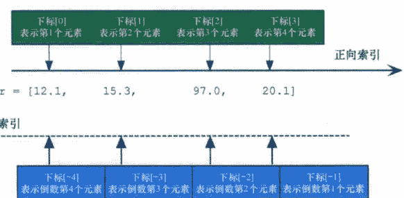

### 图 4-5 张量索引示意图

TensorFlow 完美支持反向索引：索引 `-1` 代表倒数第 1 个元素，`-2` 代表倒数第 2 个，依此类推。这种方式消除了正向索引中“视觉位置与索引值相差 1”的认知偏差——`-1` 直观对应“第 1 个”，`-2` 对应“第 2 个”。

假设有一批输入数据：5 张 32×32 像素的彩色图片（3 通道，灰度图则为 1 通道），其张量形状应为 `[5, 32, 32, 3]`。为便于演示，我们用随机正态分布模拟生成该张量。

```
In [1]: import tensorflow as tf
In [2]: X = tf.random.normal([5,32,32,3]) # 创建一个图片集合的 4D 张量
```

下面演示如何利用索引读取张量的局部数据。

```
In [3]: X[0] #访问第 1 张图片的数据
Out[3]:
<tf.Tensor: id=400, shape=(32, 32, 3), dtype=float32, numpy=
array([[ -2.048626 , -0.42288223, -0.69180757],
[-0.15601926, 2.4580038 , 0.47521132],
[-0.8973932 , -0.8239582 , 1.43067 ],
... （省略大部分数据)
[ 0.15333423, 1.5048527 , -1.028587 ],
[-1.0244707 , -0.97180676, 1.3904912 ],
[ 0.4260309 , -0.58311325, -1.7457016 ]]], dtype= float32)>
```

如前所述，反向索引可用于访问“倒数”位置的数据。针对仅含 5 张图片的张量，`X[4]`（正向第 4 个，从 0 计数）与 `X[-1]`（反向第 1 个）是否指向同一张图片？可通过如下代码验证。

```
In [4]: X[4] == X[-1] #用逻辑 “==” 判断两个张量是否等同
Out[4]:
<tf.Tensor: id=409, shape=(32, 32, 3), dtype=bool, numpy=
array([[[ True, True, True],
 [ True, True, True],
 ..., (省略大部分数据)
 [ True, True, True]]])
```

对于二维数组，访问需两个索引。主要有两种写法：一是 C/C++ 风格的双层方括号，每层对应一个维度。例如读取第 1 张图片的第 2 行，可写作：

```
In [5]: X[0][1]
<tf.Tensor: id=417, shape=(32, 3), dtype=float32, numpy=
array([[-1.6314545 , -1.1395507 , -0.92206246],
        [ 1.0364488 , 1.8906085 , 0.72787964],
        ..., (省略大部分数据)
        [-1.2899008 , 0.37437433, 0.856886  ]], dtype=float32)>
```

二是类 NumPy 的简化写法：在一个方括号内，用逗号分隔各维度索引。`X[0][1]` 与 `X[0, 1]` 完全等价。下面代码验证二者一致性。

```
In [6]: X[0][1] == X[0,1]
<tf.Tensor: id=430, shape=(32, 3), dtype=bool, numpy=
array([[ True, True, True],
        ..., (省略大部分数据)
        [ True, True, True]]>)
```

#### 4.5.2 切片批量访问

同 NumPy 一样，TensorFlow 张量支持通过切片批量读写元素。切片按规则从原张量抽取数据，生成的是原数据的“视图”，因此切片操作不会影响原始张量。

**核心规则：切片区间均为左闭右开，即不包含 `end` 位置。**

标准切片语法：`tensor[start:end:step]`。冒号为分隔符，`start` 为起始索引（默认 0，-1 表示结尾），`end` 为终止索引（不含），`step` 为步长（采样间隔）。步长为正时正向采样，为负时反向采样。仍以前面形状为 `[5, 32, 32, 3]` 的图片张量为例，若需提取第 2 张到第 4 张图片（索引 1 到 3），代码如下：

```
In [7]: X[1:4]    #读取第 2、3、4 张图片

Out[7]:

<tf.Tensor: id=434, shape=(3, 32, 32, 3), dtype=float32, numpy=
array([[[[-0.06381197, -0.4461352 , 1.0763462 ],
        [ 0.5622612 , -1.3573023 , -0.4469776 ],

...,

[ 0.4530231 , 1.69166 , 1.6151901 ]]]], dtype=float32)>
```

为简化书写，`start:end:step` 三参数均可按需省略，衍生出多种简写形式：
- 仅写 `start:`（如 `X[2:]`）：从索引 2 开始取至末尾，步长 1。等价于 `X[2:5:1]`。
- 使用 `::` 或 `:`：表示全选该维度（从头到尾，步长 1）。在方括号内，每增加一个逗号即增加一维切片控制。例如 `X[0, ::]` 表示取第 1 张图片的所有行，等价于 `X[0]`。

```
In [8]: X[0,::] == X[0]

<tf.Tensor: id=477, shape=(32, 32, 3), dtype=bool, numpy=
array([[[ True, True, True],
        [ True, True, True],

...,

[ True, True True]]])>
```

更进一步，`::` 在无歧义时可简写为单冒号 `:`，例如：

```
In [9]: X[0,:] == X[0]

<tf.Tensor: id=486, shape=(32, 32, 3), dtype=bool, numpy=
array([[[ True, True, True],
        [ True, True, True],

...,

[ True, True True]]])>
```

切片参数的省略规律总结如下：起始为 0 可省略 `start`；终至末尾可省略 `end`；步长为 1 可省略 `step`。常见组合及含义见表 4-4。

### 表 4-4 切片参数省略方式对照表

| 切片写法 | 语义说明 |
| :--- | :--- |
| `start:end:step` | 从 `start` 开始，至 `end` 结束（不含），步长 `step` |
| `start:end` | 从 `start` 开始，至 `end` 结束（不含），步长 1 |
| `start:` | 从 `start` 开始，取后续所有元素，步长 1 |
| `start::step` | 从 `start` 开始，取后续所有元素，步长 `step` |
| `:end:step` | 从 0 开始，至 `end` 结束（不含），步长 `step` |
| `:end` | 从 0 开始，至 `end` 结束（不含），步长 1 |
| `::step` | 从 0 开始，取所有元素，步长 `step` |
| `::` | 取所有元素（步长 1） |
| `:` | 取所有元素（步长 1） |

步长 `step` 可为负值。当 `step = -1` 时，`start:end:-1` 表示从 `start` 起反向读取至 `end`（不含）。最典型的是 `::-1`，可直接实现序列完全反转。

```
In [10]: Y = tf.range(9)
In [11]: Y.numpy()  # 等价切片方式为 Y[:].numpy() 或 Y[::].numpy()
Out[11]: array([0, 1, 2, 3, 4, 5, 6, 7, 8], dtype=int32)
In [12]: Y[::-1].numpy()   # 逆序输出
Out[12]: array([8, 7, 6, 5, 4, 3, 2, 1, 0], dtype=int32)
```

处理高维张量时，若某维度需全选，简写 `:` 极为高效。但这可能导致方括号内出现大量连续冒号。仍以 4 维图片张量 `[5, 32, 32, 3]` 为例，若只想提取蓝色通道数据（RGB 顺序下 B 通道索引为 2），前三维全选，代码需写作：

```
In [13]: X[:, :, :, 2] # 取蓝色通道数据
Out[13]: <tf.Tensor: id=510, shape=(5, 32, 32), dtype=float32, numpy=
array([[[-0.69180757, 0.47521132, 1.43067 ..., 0.9417347,
        -0.25706872, -0.5755742 ],
       ...
       [ 0.5305832, 3.4709222, -0.5469254, ..., -0.07338437,
        0.11220213, -0.7031214 ]]], dtype=float32>
```

### 掌握省略号切片：高维张量读取的“隐形神技”

观察前文输出的 `shape=(5, 32, 32)` 便能发现，因仅提取单通道数据，输出张量实际上完成了“降维”操作——原本的 4 维张量变成了 3 维。

此外，为规避 `[:, :, :, 2]` 这类冗长冒号写法，在语义明确的前提下，我们可以用 `...`（省略号）代替连续多个维度的全量读取。

省略号代表的维度数量，由 TensorFlow 按固定规则自动推断：遇到 `...` 时，其左侧维度靠左对齐，右侧维度靠右对齐，中间空缺的维度即由系统自动填补。这一机制的具体对应关系汇总如表 4-5 所示，这是高维张量切片中极为常用的编码技巧。

### 表 4-5 省略号切片语法速查表

| 切片写法 | 含义解读 |
|---|---|
| `m:...n` | 省略号中间维度全取；最左维按 `m` 切，最右维按 `n` 切 |
| `m:...` | 省略号及之后所有维全取；最左维按 `m` 切 |
| `...:n` | 省略号及之前所有维全取；最右维按 `n` 切 |
| `...` | 直接读取张量全部数据 |

搞懂上表规则后，我们通过两个实例加深印象。假设需提取前两张图片的绿色（G）与蓝色（B）通道数据，写法如下。

In[14] 处代码等价于 `X[2, ..., 1:]` 或 `X[2, ..., :]`

```
In [14]: X[0:2, ..., 1:] # 高维度、宽维度全部采集
Out[14]:
<tf.Tensor: id=514, shape=(2, 32, 32, 2), dtype=float32, numpy=
array([[[[-0.42282823, -0.69180757],
        [ 2.4580038 ,  0.47521132],
        [-0.8239582 ,  1.43067  ],
        ...,
        [ 0.48573026, -0.24997507]]]], dtype=float32)>
```

再比如，若要获取第 2 张及之后所有图片的数据，可这样写。

```
In [15]: X[2,...] #读取高维度、宽维度、通道维度的全部数据，等价于 X[2:]
Out[15]:
<tf.Tensor: id=536, shape=(3, 32, 32, 3), dtype=float32, numpy=
array([[[[-2.13227272e-02,  1.20545614e+00,  2.17452988e-01],
        [ 5.78101933e-01,  7.87531316e-01,  1.37985116e-02],
        ...,
        [-1.05072987e+00,  6.32911384e-01, -7.03121424e-01]]]], dtype=float32)>
```

### 4.6 张量的维度伸缩与交换：像“变形金刚”一样灵活

前面我们讲了索引与切片，但实战中，张量常需像“变形金刚”般变换形态以适配不同场景。同时，为赋予操作方向性，TensorFlow 引入了“轴”概念。下面逐一拆解。

#### 4.6.1 张量里的“轴”到底是什么？

在 TensorFlow 里，张量多为多维，操作数据时必须指明作用维度，这便是“轴”。标量无维度，自然无轴；一维向量仅有一轴，称 `axis 0`（下同）；二维张量第 0 维为 `axis 0`，第 1 维为 `axis 1`；三维同理，第 0、1、2 维分别对应 `axis 0/1/2`。惯例上，三维张量的 `axis 0` 常设为深度或样本数。

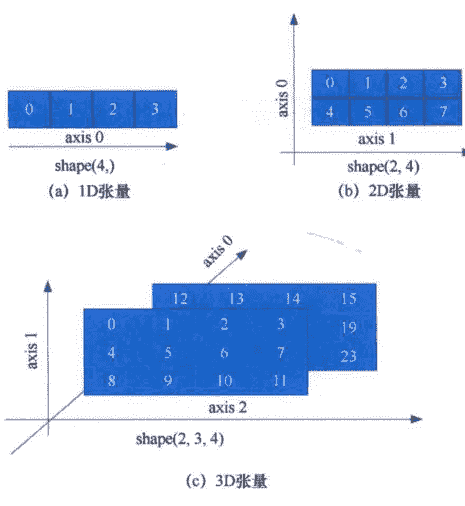

#### 4.6.2 维度的“加减法”：`expand_dims` 与 `squeeze`

张量合并与分割常涉及维度增减。设想一个场景：张量 `[班级数, 学生数, 课程数]` 如 `[5, 30, 7]` 记录学校 A 成绩。学校 B 编制相同，也用三维张量表示。现需合并两校数据且保持区分，合并前需给张量“升维”——增加一个学校维度（即新轴），用 `tf.expand_dims()` 实现。

```
In [1]: import tensorflow as tf
In [2]: A = tf.random.normal([5, 30, 7]) #构建三维张量 A
In [3]: A.shape #查看三维张量 A 的维度信息
Out[3]: TensorShape([5, 30, 7])
In [4]: A = tf.expand_dims(A, axis = 0) #为张量 A 在第 0 个轴添加一个维度
In [5]: A.shape #再次查看三维张量 A 的维度信息
Out[5]: TensorShape([1, 5, 30, 7])
In [6]: B = tf.random.normal([5, 30, 7]) #构建三维张量 B
In [7]: B.shape #查看三维张量 B 的维度信息
Out[7]: TensorShape([5, 30, 7])
In [8]: B = tf.expand_dims(B, axis = 0) #为张量 B 在第 0 个轴上添加一个维度
In [9]: B.shape #再次查看三维张量 B 的维度信息
Out[9]: TensorShape([1, 5, 30, 7])
```

升维后，便可用 `tf.concat()` 合并。

```
In [10]: A_B = tf.concat([A,B],axis=0) #合并张量 A 和张量 B
In [11]: A_B.shape
Out[11]: TensorShape([2, 5, 30, 7])
```

输出显示合并后形状为 `[2, 5, 30, 7]`，符合预期。

反之，处理完毕后若分割回 `[1, 5, 30, 7]`，第 0 轴（学校维度）因无区分度（全是同一学校）而成冗余，需“降维”丢弃，调用 `tf.squeeze()` 即可压缩多余维度。

```
In [12]: A.shape #查看维度缩减前张量 A 的维度信息
Out[12]: TensorShape([1, 5, 30, 7])
In [13]: A = tf.squeeze(A, axis = 0) #在轴 0 上进行维度缩减
In [14]: A.shape #查看维度缩减后张量 A 的维度信息
Out[14]: TensorShape([5, 30, 7])
```

张量 B 处理同理，不赘述。

### 4.7 张量的合并、分割与复制：分久必合，合久必分

《三国演义》开篇“分久必合，合久必分”，张量操作亦是如此。前文已涉合并，此处系统梳理。

#### 4.7.1 张量合并：拼接 vs 堆叠

合并有两大路径：一是**拼接**，对应 `tf.concat()`；二是**堆叠**，对应 `tf.stack()`。两者殊途同归，但机制不同：
*   `tf.concat()`：不增维，在现有轴上首尾相连。
*   `tf.stack()`：**创建新轴**，在新维度上叠加。

选择取决于是否需要新维度区分来源。

**1. `tf.concat()` 详解**

原型如下：

```
tf.concat(
    values,
    axis,
    name='concat'
)
```

参数 `values` 为待拼接张量列表，`axis` 指定拼接轴（取值 `0 ~ n-1`），`name` 即时执行模式下无效。

实例演示：

```
In [1]: import tensorflow as tf

In [2]: t1 = [[1, 2, 3],
    [4, 5, 6]]

In [3]: t2 = [[7, 8, 9],
    [10, 11, 12]]

In [4]: tf.concat([t1, t2], 0)   #张量拼接
Out[4]:
<tf.Tensor: shape=(4, 3), dtype=int32, numpy=
array([[ 1,  2,  3],
       [ 4,  5,  6],
       [ 7,  8,  9],
       [10, 11, 12]], dtype=int32)>
```

`In [4]` 等价于 `tf.concat([t1, t2], axis=0)`（垂直拼接）；设 `axis=1` 则水平拼接。

```
In [5]: tf.concat([t1, t2], axis = 1)
Out[5]:
<tf.Tensor: shape=(2, 6), dtype=int32, numpy=
array([[ 1,  2,  3,  7,  8,  9],
       [ 4,  5,  6, 10, 11, 12]], dtype=int32)>
```

`axis` 支持负数：`axis=-1` 指倒数第一轴。若张量为 2 维，`axis=-1` 即 `axis=1`。`In [5]` 等价于 `axis=-2`，读者可自行验证。

**拼接硬性约束**：非拼接轴的维度**必须完全一致**。如 `[4, 32, 8]` 与 `[6, 35, 8]` 在 `axis=0` 拼接会报错，因剩余维 `[32, 8]` 与 `[35, 8]` 不匹配。

```
In [6]: A = tf.random.normal([4,32,8])
In [7]: B = tf.random.normal([6,35,8])
In [8]: tf.concat([A ,B], axis = 0)  #错误拼接，剩余维度信息不一致
Out[8]: InvalidArgumentError: ConcatOp : Dimensions of inputs should match:
shape[0] = [4,32,8] vs. shape[1] = [6,35,8] [Op:ConcatV2] name: concat
```

修正 B 为 `[6, 32, 8]` 即可拼接。

```
In [9]: B = tf.random.normal([6,32,8])
In [10]: tf.concat([A ,B], axis = 0).shape
Out[10]: TensorShape([10, 32, 8])
```

**实战痛点与升维策略**：合并后如何区分来源？笨办法是记下标切片（如前 4 条属 A，后 6 条属 B），但量大（如 1 万校）时不堪重负。优解是**先升维再拼接**——给每个张量加个“学校标签维度”。这组合操作太常用，TensorFlow 直接封装成**堆叠** `tf.stack(tensors, axis)`：一次性合并多张量（≥2）并自动创建新维度区分身份。

**注意**：堆叠要求**所有张量形状严格一致**，否则报错。

`axis` 规则同 `expand_dims`：`axis ≥ 0` 在该轴**前**插入新维；`axis < 0` 在该轴**后**插入；`axis=-1` 在最后插入。

若对前文 A、B 直接堆叠：

```
In [11]: tf.stack([A,B], axis = 0).shape
InvalidArgumentError: Shapes of all inputs must match: values[0].shape = [4,32,8] != values[1].shape = [6,32,8] [Op:Pack] name: stack
```

报错因形状不一。堆叠如垒砖，砖块规格必须统一。

```
In [12]: B = tf.random.normal([4,32,8]) #重新定义张量 B
In [13]: tf.stack([A ,B], axis = 0).shape #张量 A 与张量 B 的尺寸一致
Out[13]: TensorShape([2, 4, 32, 8])
```

输出可见：合并成功，且自动在原 `axis 0` 前插入新维。访问合并张量极简：

```
In [14]: tf.stack([A ,B], axis = 0)[0] == A
<tf.Tensor: shape=(4, 32, 8), dtype=bool, numpy=
array([[[ True, True, True, ..., True, True, True],
...,
[ True, True, True, ..., True, True, True]]])
```

`[0]` 即原张量 A，`[1]` 即 B。增维让数据操作更从容。

#### 4.7.2 张量分割：一分为多

分割是合并逆操作。沿用学生成绩例：张量 `[10, 35, 8]` 表示 10 班、每班 35 人、8 门课。现需按班级维度拆成 10 个张量，用 `tf.split()`。

方法原型：

```
tf.split(
    value, num_or_size_splits, axis=0, num=None, name='split'
    )
```

参数详解：
*   `value`：待分割张量。
*   `num_or_size_splits`：分割方案。整数如 `10` 表等分 10 份；列表如 `[2, 4, 2, 2]` 表分 4 块，长度依次为 2、4、2、2。
*   `axis`：分割轴，默认 `0`。
*   `name`：即时执行模式忽略。

实战代码：将成绩张量等分 10 份。

```
In [15]: Scores = tf.random.normal([10, 32, 8])
In [16]: result = tf.split(Scores, num_or_size_splits = 10)
In [17]: len(result)
Out[17]: 10
```

# TensorFlow 张量进阶：分割技巧、核心运算与广播机制

为了演示方便，我们在代码片段 In [15] 中采用随机正态分布生成模拟学生成绩数据。到了 In [16]，未显式指定分割轴，因此沿用了默认值 `axis=0`。分割完成后，只需通过下标索引即可提取特定子张量，例如 `result[0]` 即代表第一个班级的成绩单，详细实现请见下方代码。

```
In [18]: result[0]
<tf.Tensor: shape=(1, 32, 8), dtype=float32, numpy=
array([[[ 1.8360285e+00, -9.3884796e-01, 5.2363765e-01,
        9.5014143e-01, -1.7278871e-01,  2.7455373e-03,
       -1.2697799e+00,  6.8367523e-01],
       ......
       [ 2.4686427e-01,  1.1991431e-01,  1.6249386e+00, -4.4509828e-01,
          1.0332327e-01, -2.2521758e+00,  9.4711000e-01,
          -4.8269397e-01]]]],
      dtype=float32)>
```

**关键细节**：分割得到的班级张量形状为 `[1, 32, 8]`。请注意，虽然完成了分割，但“班级”这个维度（大小为1）依然被保留了下来，它仍然是一个三维张量。

```
In [19]: result[0].shape
Out[19]: TensorShape([1, 32, 8])
```

若需移除这个多余的维度，之前介绍过的 `tf.squeeze()` 方法能轻松搞定。

```
In [20]: tf.squeeze(result[0]).shape
Out[20]: TensorShape([32, 8])
```

正如俗话所说“条条大路通罗马”。若想在某维度上实现等长分割，`tf.unstack(value, axis)` 也是个利器。它的逻辑是：在指定轴上按长度 `n` （即该轴的尺寸）将张量拆成 `n` 份。配套代码演示如下。

```
In [21]: result2 = tf.unstack(Scores, axis = 0)
In [22]: len(result2)
Out[22]: 10
```

本质上，`tf.unstack()` 可视为 `tf.split()` 的特例——分割长度固定为 1。In [21] 的代码等同于 `result2 = tf.unstack(Scores, num=10, axis=0)`，意为在第 0 轴拆成 10 份，此时 `num` 参数通常可省略。

与 `tf.split()` 不同，`tf.unstack()` 在等分后会**自动降维**（squeeze），即尺寸为 1 的分割维度会被直接压缩掉，具体效果请看下面代码。

```
In [23]: result2[0].shape
Out[23]: TensorShape([32, 8])
```

下面测试一下**不等长分割**场景。假设需将数据切分为 3 份，长度分别为 `[2, 3, 5]`，实现方式如下。

```
In [24]: result3 = tf.split(Scores, num_or_size_splits = [2,3,5])
In [25]: len(result3)
Out[25]: 3
In [26]: result3[0]   # result3[0]包含了前两个班级的学生成绩信息
Out[26]:
<tf.Tensor: shape=(2, 32, 8), dtype=float32, numpy=
array([[[ 1.8360285e+00, -9.3884796e-01,  5.2363765e-01,
  9.5014143e-01, -1.7278871e-01,  2.7455373e-03,
-1.2697799e+00,  6.8367523e-01]],
......
[ 5.6315690e-01,  7.7404523e-01,  1.3810844e+00, -3.2895342e-01,
-2.0716013e-01, -6.7049402e-01, -1.2135481e+00,
 1.2977973e+00]]],
dtype=float32)>
```

至此，我们探讨了张量的“分分合合”。归根结底，张量操作的核心服务于**计算**，“分”与“合”皆为便于计算铺路。接下来，正式进入 TensorFlow 张量运算的核心领域。

### 4.8 TensorFlow 核心计算范式

TensorFlow 的计算主要分两大派：**按元素计算** 与 **按维度计算**。下面逐一拆解。

#### 4.8.1 按元素计算

前文已“牛刀小试”过加法（`tf.math.add`）、逐元素乘法（`tf.math.multiply`）等操作。此类运算要求参与张量**形状完全一致**，随后对应位置元素两两运算。

```
In [1]: import tensorflow as tf
In [2]: a = tf.constant([1, 2, 3, 4])
In [3]: b = tf.constant([5, 6, 7, 8])
In [4]: c = tf.math.add(a, b)
In [5]: c.numpy()
Out[5]: array([ 6, 8, 10, 12], dtype=int32)
```

以 In [4] 为例：`tf.math.add()` 执行加法，张量 `a` 索引 0 处的 `1` 与张量 `b` 索引 0 处的 `5` 相加得 `6`，索引 1 处 `2` 与 `6` 相加得 `8`，以此类推。`tf.math.multiply()` 同理，对应位置相乘（`1*5=5`，`2*6=12`...）。

```
In [6]: d = tf.math.multiply(a,b)
In [7]: d.numpy()
Out[7]: array([ 5, 12, 21, 32], dtype=int32)
```

为简化代码，TensorFlow 对常用数学运算符做了**重载**。比如直接用 `+` 号加法，效果等同于 `tf.math.add()`。为方便查阅，汇总了适用于张量的重载算子：

> **小知识**：运算符重载是函数多态的一种，本质是语法糖，以友好方式模拟函数调用，行为随参数类型变化。

**表 4-6 TensorFlow 一元运算符速查**

| 运算符 | 对应函数 | 功能 |
| :--- | :--- | :--- |
| `-x` | `tf.math.negative(x)` | 取相反数 |
| `~x` | `tf.math.logical_not(x)` | 逻辑非（仅限 `tf.bool` 类型） |
| `abs(x)` | `tf.math.abs(x)` | 取绝对值 |

**表 4-7 TensorFlow 二元运算符速查（节选）**

| 运算符 | 对应函数 | 功能 |
| :--- | :--- | :--- |
| `x\|y` | `tf.math.logical_or(x,y)` | 逐元素逻辑或 |
| `x^y` | `tf.math.logical_xor(x,y)` | 逐元素逻辑异或 |
| `x+y` | `tf.math.add(x, y)` | 逐元素相加 |
| `x-y` | `tf.math.subtract(x,y)` | 逐元素相减 |
| `x*y` | `tf.math.multiply(x,y)` | 逐元素相乘 |
| `x/y` | `tf.math.truediv(x,y)` | 逐元素真除法（浮点） |
| `x//y` | `tf.math.floordiv(x, y)` | 逐元素向下取整除 |
| `x%y` | `tf.math.floormod(x,y)` / `mod` | 逐元素取模 |
| `x**y` | `tf.math.pow(x,y)` | 逐元素求幂 |
| `x<y` | `tf.math.less(x,y)` | 逐元素小于判断 |
| `x<=y` | `tf.math.less_equal(x,y)` | 逐元素小于等于判断 |
| `x>y` | `tf.math.greater(x,y)` | 逐元素大于判断 |
| `x>=y` | `tf.math.greater_equal(x,y)` | 逐元素大于等于判断 |

除上述数值运算，TensorFlow 还内置海量算子支撑复杂流计算：张量操作类（`slice`、`split`、`random.shuffle`）、矩阵运算类（`linalg.matmul`、`linalg.inv`、`linalg.det`）、神经网络层类（`nn.softmax`、`math.sigmoid`、`nn.relu`、`nn.convolution` 等）。

**实战建议**：无需死记硬背。用时查阅官网英文全称即可，通常能直达用法与范例。

#### 4.8.2 按轴计算（约减/Reduce）

神经网络训练中，常需统计最大值、均值等聚合指标，引出核心概念——**约减**（Reduce，又称“规约”）。

**何为约减？** 即按某种操作将一批数据“压缩”成一个或少数值，**元素总量减少**（注意非数学减法），最典型结果是降为单个标量。

**难点**：多维张量约减，方向从何起？  
例：二维张量 `[[1,1,1], [1,1,1]]` 求和。横向压缩得 `[[3], [3]]`？纵向压缩得 `[2,2,2]`？还是全压缩得 `[6]`？**轴方向必须显式指定。**

TensorFlow 将约减算子统归 `tf.math` 模块：`reduce_sum`（求和）、`reduce_mean`（均值）、`reduce_max`（最大值）、`reduce_min`（最小值）等。原理一致：从海量数据中层层筛选，直至得出目标统计量。

以高频 `tf.reduce_sum()` 为例，原型如下：

```
tf.math.reduce_sum(
    input_tensor,
    axis=None,
    keepdims=False,
    name=None
)
```

参数中 `input_tensor`（数值类型）为必选。核心在于第二个参数 `axis`，**决定约减方向**。

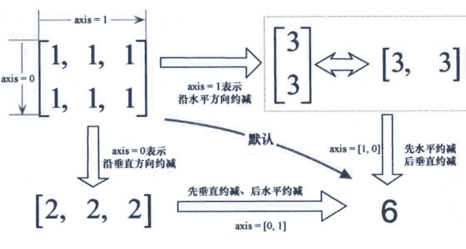

**图 4-7 张量约减方向示意**

*   `axis=0`：可理解为**垂直/列方向**压缩（跨行聚合）。
*   `axis=1`：可理解为**水平/行方向**压缩（跨列聚合）。

```
In [1]: import tensorflow as tf
In [2]: x = tf.constant([[1, 1, 1],
[1, 1, 1]])
In [3]: tf.math.reduce_sum(x, 0) #结果为[2, 2, 2]
Out[3]: <tf.Tensor: id=6, shape=(3,), dtype=int32, numpy= array([2, 2, 2],
dtype=int32)>
In [4]: tf.math.reduce_sum(x, 1) #结果为[3, 3]
Out[4]: <tf.Tensor: id=8, shape=(2,), dtype=int32, numpy= array([3, 3],
dtype=int32)>
```

约减支持**多步序列**。`axis` 可传列表，元素顺序即执行顺序。`axis=[1, 0]` 先横向后纵向；`axis=[0, 1]` 先纵向后横向。

```
In [5]: tf.math.reduce_sum(x, 1, keepdims=True) # 结果为[[3], [3]]
Out[5]:
<tf.Tensor: id=10, shape=(2, 1), dtype=int32, numpy=
array([[3],
[3]], dtype=int32)>
In [6]: tf.math.reduce_sum(x, [0, 1]) # 结果为 6
Out[6]: <tf.Tensor: id=12, shape=(), dtype=int32, numpy=6>
```

若 `axis` 未指定（默认 `None`），则**依次遍历所有维度**约减，最终得标量（例中为 `[6]`）。

```
In [7]: tf.math.reduce_sum(x) # 默认值为 None，两个维度均求和，值为 6
Out[7]: <tf.Tensor: id=4, shape=(), dtype=int32, numpy=6>
```

**规律总结**：每约减一个维度，该维度即消失。`axis=0` 即消除 0 维，余类推。

> **形象比喻**：约减过程酷似《三体》中“降维打击”，高维信息被投影至低维。

同理，`math.reduce_mean()` 同参数语义，用于指定轴求均值。其他常用约减还有：`reduce_max`/`min`（极值）、`reduce_std`（标准差）、`reduce_variance`（方差）等，**共性皆为：沿轴操作，降维聚合。**

### 4.9 张量广播机制

按元素计算通常要求形状一致。**形状不一致就彻底没法算了吗？**

并非如此。TensorFlow 同 NumPy 一样，内置**广播机制**：通过逻辑扩展小张量维度以匹配大张量，实现异形运算。

#### 4.9.1 广播定义：逻辑上的“轻量复制”

广播即**张量自动扩展**。关键点：**多数场景下仅改变逻辑视图（View）**，将小张量“拉伸”至目标形态，**不产生实际内存拷贝**，仅在真正计算时才物化赋值。这种隐式优化极大节省资源，框架自动完成，用户无感知。机制示意见图 4-8。

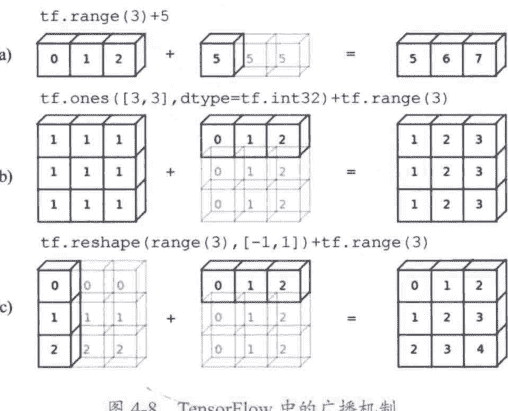

#### 4.9.2 广播规则与实战

通过以下代码直观掌握广播操作细则。

```
In [1]: import tensorflow as tf    #导入TensorFlow模块
In [2]: a = tf.range(3)          #创建一个 1D 长度为 3 的张量
In [3]: a.numpy()                #显示张量 a 的数据
Out[3]: array([0, 1, 2], dtype=int32)
In [4]: a + 5                  #1D 张量与 0D 张量（即标量）相加
Out[4]: <tf.Tensor: id=108, shape=(3,), dtype=int32, numpy= array([5, 6, 7], dtype=int32)>
```

# TensorFlow核心：形状广播法则与多维数据在深度模型中的语义映射

掌握 TensorFlow 开发，绕不开两大基石：一是**形状广播**如何化解维度冲突，二是不同阶数的多维数组在网络架构中究竟代表什么物理实体。本文拒绝枯燥语法堆砌，通过实战代码与逻辑推演，带你构建“维度即语义”的直观认知。

---

## 一、 形状广播：化解“维度冲突”的隐形齿轮

### 1.1 标量向一维数组的“值复制”扩展
当形状为 `(3,)` 的一维数组 `[0, 1, 2]` 遇到标量 `5`（形状 `()`）时，二者秩差巨大。系统不会报错，而是启动广播：将标量 `5` 视为种子，**沿缺失维度复制生成 `[5, 5, 5]`**，形状对齐为 `(3,)`，随即完成逐元素求和。这类似于广播电台：单一信号覆盖所有接收端。

```
In [5]: tf.ones([3,3], dtype = tf.int32) + tf.range(3)
In [6]: c.numpy()
Out[6]:
array([[1, 2, 3],
       [1, 2, 3],
       [1, 2, 3]], dtype=int32)
```

### 1.2 一维对接二维：按行复制的对齐逻辑
若 `tf.range(3)`（秩1，形状 `(3,)`）与 `tf.ones([3, 3])`（秩2，形状 `(3, 3)`）相加，引擎会将一维数组**按行方向复制三份**，扩展成同形矩阵。

**类型陷阱提示**：`ones` 默认产出 `float32`，`range` 产出 `int32`。广播要求**数值类型严格一致**，必须显式声明 `dtype=tf.int32` 方可通过编译。

```
In [7]: tf.reshape(range(3),[-1,1]) + tf.range(3)
Out[7]:
<tf.Tensor: id=142, shape=(3, 3), dtype=int32, numpy=
array([[0, 1, 2],
       [1, 2, 3],
       [2, 3, 4]], dtype=int32)>
```

### 1.3 双向扩展：列向量与行向量的“相互迁就”
进阶场景见 `tf.reshape(tf.range(3), [-1, 1])`（列向量，`3x1`）与 `tf.range(3)`（行向量，`1x3`，隐式）相加。前者在**列维（轴1）复制 1→3**，后者在**行维（轴0）复制 1→3**，双方同步膨胀为 `3x3` 矩阵完成运算。

> **参数技巧**：`reshape` 中的 `-1` 含义为“根据总元素量与其余维度自动推断该轴长度”，前提是总数与已知维度确定。

```
In [1]: import tensorflow as tf
In [2]: acc = tf.keras.metrics.Accuracy()      #定义一个求准确率的对象 acc
```

### 1.4 广播兼容性三大判定准则
归纳上述案例，判定两数组能否广播遵循“补齐、扩展、校验”三步走：
1.  **秩对齐（左补维）**：秩低者形状左侧补 `1`，直到两者秩相同。
2.  **轴扩展（值复制）**：对齐后，凡形状为 `1` 的轴，沿该轴复制数据以匹配对端长度。
3.  **兼容判定（死规则）**：逐轴比较，**长度必须相等，或至少一方为 1**。若存在某轴双方长度均 >1 且不等，**直接抛错，广播终止**。

> **本质洞察**：广播是**零内存拷贝的逻辑视图对齐**，核心约束在于对齐后的形状元组满足“等长或含1”条件。

---

## 二、 多维数组在深度架构中的“定岗明细”

TensorFlow 服务于深度网络。不同秩数组并非抽象数学对象，而是对应网络拓扑中具体的物理角色。看透此点，调试 `Shape Mismatch` 便有了确定性指南针。

### 2.1 标量（0-阶）—— 指标监控与超参数的承载体
**定义**：秩0，`shape=[]`，单数值，但具备完整张量元数据（`dtype`、`device` 等）。
**核心职责**：承载 **Loss 值、评价指标（Acc/Precision/Recall）、学习率、正则系数** 等全局标量。
**实战范式**：`tf.keras.metrics.Accuracy` 为类式设计，需实例化 -> `update_state(y_true, y_pred)` 累积统计量 -> `result()` 读取结果 -> `reset_states()` 重置状态。

```
In [3]: y_true = [1, 2, 3, 4]
In [4]: y_pre = [0, 2, 3, 4]
In [5]: _ = acc.update_state(y_true, y_pre)
```
```
In [6]: acc.result()   #这是一个标量
Out[6] <tf.Tensor: id=258, shape=(), dtype=float32, numpy=0.75>
```
```
In [7]: acc.reset_states()   #状态复位
```
```
In [8]: _ = acc.update_state(y_true, y_pre, sample_weight= [1, 1, 0, 0])
In [9]: acc.result().numpy()    #这是一个标量
Out[9]: 0.5
```

> **加权扩展**：`update_state` 接受 `sample_weight`，赋予样本差异化权重（如置0屏蔽脏数据），实现加权指标计算。

### 2.2 向量（1-阶）—— 偏置项的标准形态
**定义**：秩1，`shape=[D]`。
**核心职责**：**偏置向量**。全连接、卷积等层的每个输出单元/通道对应一个偏置标量，拼接成向量 `b`。
**广播实战**：线性变换 `X @ W` 产出 `[Batch, Units]`，偏置 `b` 为 `[Units]`。依据广播法则，`b` 自动在 Batch 维（轴0）复制对齐，直接相加得 `X @ W + b`。

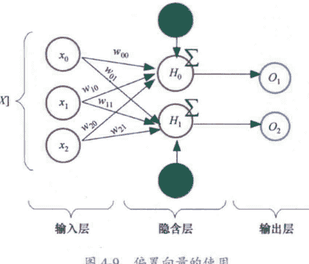
```
In [10]: # 模拟 W*X 的结果
acti_input = tf.random.normal(shape = (3,2), dtype = tf.float32)
In [11]: acti_input.numpy()   #张量输出验证
Out[11]:
array([[-0.2126754 , -0.63710266],
       [ 0.65593725,  1.5422997 ],
       [-0.4566711 ,  0.636834  ]], dtype=float32)
In [12]: #模拟创建的偏置向量
bias = tf.random.normal(shape = (2,), dtype = tf.float32)
In [13]: bias.numpy()    #张量输出验证
Out[13]: array([-0.31295922, -1.2989937 ], dtype=float32)
In [14]: acti_input + bias     # 模拟计算激活函数的输入: W*X+b
Out[14]: <tf.Tensor: id=345, shape=(3, 2), dtype=float32, numpy=
array([[ 3.4780426 ,  2.3143282 ],
       [ 0.19774067,  1.9142756 ],
       [ 2.6272476 ,  1.9364443 ]], dtype=float32)>
```


### 2.3 矩阵（2-阶）—— 批量样本与线性变换权重的载体
**定义**：秩2，`shape=[Batch, Dim]`。
**双重身份**：
*   **输入特征矩阵 `X`**：`Batch` 为批量规模，`Dim` 为特征维度。引入 Batch 维旨在**利用矩阵乘法并行化吞吐**，避免单样本串行的低效（一阶感知机痛点）。
*   **权重矩阵 `W`**：`shape=[In_Dim, Out_Dim]`。线性代数法则要求 `X` 列数（`In_Dim`）等于 `W` 行数。输出维度 `Out_Dim` 由下游神经元数决定。
*   **运算核心**：`X @ W + b` 即为无激活的全连接层（线性层）。TF 支持 `@` 算子等价 `tf.linalg.matmul`。

```
In [15]: X = tf.random.normal(shape = [4, 3])
         # 4 个样本，每个样本的特征维度均为 3
In [16]: tf.print(X)                 #验证 X 的数值
Out[16]:
[[-0.481960386 0.0455468707 1.54325724]
 [0.326827258 0.658409 -0.173414305]
 [-0.305750459 -1.2411536 -0.160492942]
 [-1.27203584 -0.80550009 1.46848989]]
```
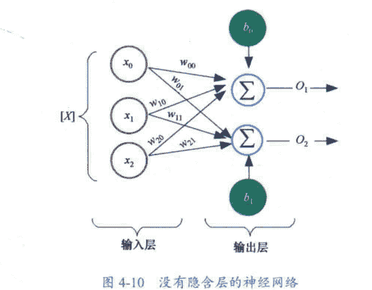
```
In [17]: W = tf.ones([3, 2])     #定义权值张量 W 量，并全部初始化为 1
In [18]: b = tf.zeros([2])      #定义偏置张量 b，并全部初始化为 0
In [19]: output = tf.linalg.matmul(X,W) + b
In [20]: output.numpy()
Out[20]:
array([[ 1.1068437, 1.1068437],
 [ 0.811822 , 0.811822 ],
 [-1.707397 , -1.707397 ],
 [-0.609046 , -0.609046 ]], dtype=float32)
```
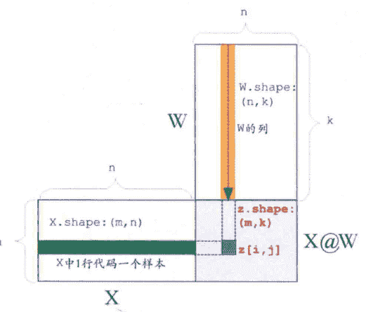
```
In [29]: output = X@W + b
```

> **Batch Size 抉择**：小数据集可 Full Batch；大规模数据需 Mini-batch，权衡显存压力与并行效率，最优值需实验调参得出。

### 2.4 三维数组（3-阶）—— 序列建模的原生容器
**定义**：秩3，`shape=[Batch, Seq_Len, Feat_Dim]`。
**典型领域**：**时序预测、NLP 文本**。
*   `Seq_Len`：时间步数 / 句子词数。
*   `Feat_Dim`：单步特征维度（如 Embedding 向量维度）。
*   **Embedding 层桥梁**：将高维稀疏 One-hot 映射为低维稠密向量，输出三维数组喂入 RNN / Transformer 编码器。

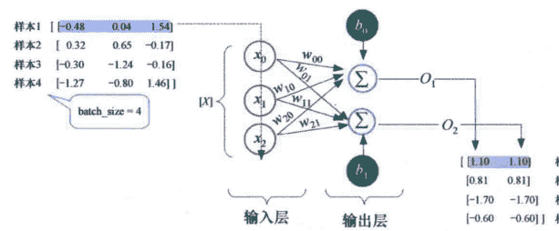

### 2.5 四维数组（4-阶）—— 卷积视觉的特征图标准格
**定义**：秩4，**NHWC 格式** `[Batch, Height, Width, Channels]`（TF/Keras 默认数据流格式）。
*   `Batch`：图片批量数。
*   `H, W`：特征图空间分辨率（随池化/步长下采样逐层缩小）。
*   `Channels`：通道深度（输入图 RGB=3；隐层等于卷积核数量/滤波器组数）。

**跨框架迁移红线**：PyTorch 采用 **NCHW 格式** `[Batch, Channels, Height, Width]`。**通道维位置互异**，模型权重迁移、数据预处理、ONNX 导出时**必须显式转置**，否则语义完全错位。


```
x=[batch, height, width , channel]
```

---

## 三、 速查表：建立“秩数-形状-语义”肌肉记忆

| 秩数 | 典型形状签名 | 网络拓扑核心语义 | 关键算子/操作示例 |
| :--- | :--- | :--- | :--- |
| **0 (标量)** | `[]` | 标量指标、超参数、Loss | `metric.result()`, `optimizer.lr` |
| **1 (向量)** | `[D]` | **偏置 Bias**、Logits/概率分布 | `logits + bias` (广播加法) |
| **2 (矩阵)** | `[B, D]` | **批量样本特征**、**权重核** | `inputs @ kernel` (密集层核心) |
| **3 (三维)** | `[B, T, D]` | **序列/时序数据** (NLP, Audio) | `Embedding` 输出, `LSTM` 输入 |
| **4 (四维)** | `[B, H, W, C]` | **图像/视觉特征图** (CNN) | `Conv2D` 输入/输出, `Pooling` |

### 核心心法
1.  **广播非魔法，乃形状对齐语法糖**—— 规则固化为“左补1、扩展1、判兼容”。熟练心算广播结果，能写出更简洁、高维感知的代码。
2.  **维度非抽象，实物理语义投影**—— Batch、Channel、Sequence、Feature，每个轴皆对应架构具象维度。遇 `Shape Error`，首问：“此轴代表何物理实体？为何长度冲突？”，定位即精准。

**实战建议**：加载经典模型（ResNet50, BERT-base），逐层打印 `layer.output.shape`，对照上表验证语义映射，将维度直觉内化为肌肉记忆。

```
x=[batch, channel, height, width]
```

在 TensorFlow 等主流框架中，数据以张量形式组织流转。针对灰度图像，因仅单通道，四维张量形状记为 `[batch, height, width, 1]`；彩色图像含 RGB 三通道，单张形状为 `[1, height, width, 3]`。工程实践中为提升吞吐量，通常批量喂入 `batch` 张图片，形成 `[batch, height, width, 3]` 结构，其中 `batch` 即样本数量，拓扑结构如图 4-14 所示。


#### 4.10.6 五维张量：视频建模的标准范式

视频本质是帧序列，天然适配五维张量。单帧作为彩色/灰度图，对应三维 `(height, width, channel)`；帧堆叠成四维 `(frames, height, width, channel)`；引入批次维度后，最终定型为 `(batch, frames, height, width, color_depth)`，即五维张量，结构详见图 4-15。


图 4-15 五维视频张量结构示意

以 60 秒、144×256 分辨率、4 fps 彩色视频为例，总帧数 240。若切分 4 片段，数据形状为 `(4, 240, 144, 256, 3)`，元素总量超 1 亿。若采 FP32 存储，显存占用约 405 MB。但工程落地中，视频多以 MP4 等压缩编码存储传输，而非原始张量数组。

> **注**：五维以上张量物理语义不明、工程应用罕见，不再赘述。

### 4.11 章节核心回顾

本章系统梳理 TensorFlow 张量基石，要点聚焦五大维度：

1.  **张量思维范式**：核心准则“张量入，张量出”。需建立整体视角，摒弃逐元素串行遍历的传统惯性。
2.  **两大核心类型**：
    *   **常量**：`tf.constant()` 构建，数值固化。
    *   **变量**：`tf.Variable()` 构建，常驻内存、抗回收，配合 `trainable` 标记承载可优化参数。
3.  **批量访问机制——索引与切片**：底层统一遵循 `start:end:step` 语法，各类简写均为默认参数省略的语法糖。
4.  **广播机制本质**：逻辑层面的“虚拟复制”，仅在计算触发时物质化扩展，极大提升算力灵活度与内存效率。
5.  **实战映射认知**：结合网络场景内化张量直觉。

未尽语法与概念，将在后续 Keras 实战章节中随需引入。

### 4.12 思考与实践题

请结合本章内容深度思考：

1.  **乘法机制辨析**：对比 `tf.linalg.matmul()`（矩阵乘积）与 `tf.math.multiply()`（哈达玛积/逐元素乘）的数学本质差异与适用边界。
2.  **维度变换动因**：张量处理为何需要升维（如 `expand_dims`）或降维（`squeeze`/`reshape`）？核心驱动力是什么？
3.  **广播规则推导**：给出广播机制的严格定义及形状对齐判定法则。
4.  **广播 vs 平铺**：深度对比广播机制与 `tf.tile()` 的异同、内存行为及性能权衡。
5.  **分级张量实战角色**：标量、向量、矩阵、高阶张量在网络架构中分别扮演何种经典角色？

### 参考文献

- [1] RASCHKA S, MIRJALILI V. *Python Machine Learning: Machine Learning and Deep Learning with Python, scikit-learn, and TensorFlow 2*. Packt Publishing, 2019.
- [2] 龙良曲. *TensorFlow 深度学习*. 清华大学出版社, 2020.
- [3] FRANCOIS CHOLLET. *Deep Learning with Python*. Manning Publications, 2018.

---

## Deep Learning & TensorFlow

## 第 5 章 BP 算法与优化方法：寻找“最速下山”路径

“条条大路通罗马”，但哪条路最快？神经网络训练同理：参数空间浩瀚，如何高效觅得最优解（或局部最优）？反向传播算法及其衍生优化器，正是破解此题的核心钥匙，也是本章重点议题。

### 5.1 优化：让损失“收敛”的工程艺术

#### 5.1.1 优化的必然性

**损失函数**量化预测值与真值的偏离。神经网络本质是海量数据下的“极小化损失”拟合博弈。找到使损失函数触底的参数组合，是训练的唯一使命。

宋代《景德传灯录》云：“如人登山，各自努力。”目标一致（登顶/寻极值），路径却万千。数学家关注“解的存在性”，工程师只重“解的可行性”——即在可容忍时延内，捕获近似最优解。

深度学习 = **深度**（拓扑架构）+ **学习**（性能跃迁）。优化器的使命：在损失逼近极小的同时，**极致压缩收敛周期**。

#### 5.1.2 优化闭环：三步迭代范式

以手写数字识别为例（图 5-1），输入特征 `x`，目标 `t`，模型输出 `o`，单样本误差 `e`。`n` 样本累计误差：

$$ E = \sum e^{(d)} = \frac{1}{2} \sum (t_d - o_d)^2 \tag{5-2} $$

线性假设下 $o_d = \boldsymbol{w}^T \boldsymbol{x}_d$ ，代入得目标函数：

$$ E(\boldsymbol{w}) = \frac{1}{2} \sum (t_d - \boldsymbol{w}^T \boldsymbol{x}_d)^2 \tag{5-4} $$

> **注**：系数 1/2 为求导消平方项之便。

训练即求最优 $\boldsymbol{w}$ 最小化 $E(\boldsymbol{w})$。工程落地遵循 **“梯度下降”三部曲** 循环：

1.  **判停**：损失是否达标？是→终止；否→计算梯度。
2.  **更新**：沿**负梯度方向**迈微步（步长即学习率 $\eta \ll 1$）。
3.  **循环**：回第 1 步。

通过持续修正权重与偏置，驱动损失函数快速下谷收敛。


图 5-1 手写数字识别网络拓扑图

### 5.2 梯度家族：优化算法的基石

主流优化器虽繁多，但“万变不离其宗”，核心皆建立在**梯度**之上。透彻理解梯度，方能驾驭优化。

#### 5.2.1 梯度：指引“最速上升”的罗盘

**导数回顾**：单变量函数 $y=f(x)$ 在 $x_0$ 处导数 $f'(x_0)$ 即切线斜率，斜率为零处为极值点。但显式解微分方程往往困难，且非计算机强项。计算机擅长数值迭代“逼近”极值。

**$\Delta$ 法则** 提出梯度下降启发式策略，核心借助导数/梯度指引方向。

**多维世界的梯度**：
标量场 $f$ 的梯度 $\nabla f$ 是一个**向量场**。三维笛卡尔坐标系下：

```
f'(x_0) = \lim_{\Delta x \to 0} \frac{\Delta y}{\Delta x} = \lim_{\Delta x \to 0} \frac{f(x_0 + \Delta x) - f(x_0)}{\Delta x} \quad \text{(5-5)}
```

```
\nabla f = \left( \frac{\partial f}{\partial x}, \frac{\partial f}{\partial y}, \frac{\partial f}{\partial z} \right) \quad \text{(5-6)}
```

**偏导数**是关键：固定其他变量，仅对目标变量求导。以 $f = x^2 + 3xy + y^2 + z^3$ 为例：

1.  视 $y,z$ 为常数，求 $x$ 偏导：$$\frac{\partial f}{\partial x} = 2x + 3y$$
2.  视 $x,z$ 为常数，求 $y$ 偏导：$$\frac{\partial f}{\partial y} = 3x + 2y$$
3.  视 $x,y$ 为常数，求 $z$ 偏导：$$\frac{\partial f}{\partial z} = 3z^2$$

梯度向量汇总：$$\nabla f = \text{grad}(f) = (2x + 3y, 3x + 2y, 3z^2)$$

**几何意义**：梯度指向**函数值增长最快的方向**。
例：点 $A(1,2,3)$ 处，梯度指向向量 $B(8, 7, 27)$ 方向（图 5-2）。反之，**负梯度**即“最速下降”方向，正是优化算法追随的目标。

$$\nabla f = \text{grad}(f) = (2x + 3y, 3x + 2y, 3z^2)|_{x=1, y=2, z=3} = (8, 7, 27)$$


图 5-2 梯度方向几何示意

#### 5.2.2 代码实战：可视化梯度流动

以 $f(x) = x_0^2 + x_1^2$ 为例，结合 Python 绘制 3D 曲面，直观感受梯度场分布。完整代码见范例 5-1。

### 范例 5-1 绘制 $f(x) = x_0^2 + x_1^2$ 函数 3D 曲面 (function-3D.py)

```
01 # 载入模块
02 import numpy as np
03 import matplotlib.pyplot as plt
04 from mpl_toolkits.mplot3d import Axes3D
05 # 定义函数
06 def fun(x,y):
07     return -(np.power(x,2) + np.power(y,2))
08 # 创建 3D 图形对象
09 fig = plt.figure()
10 ax = Axes3D(fig)
11 # 生成数据
12 X0 = np.arange(-3, 3, 0.25)
13 X1 = np.arange(-3, 3, 0.25)
14 X0, X1 = np.meshgrid(X0, X1)
15 Z = fun(X0, X1)
16
17 # 绘制曲面图，并使用 cmap 着色
18 ax.plot_surface(X0, X1, Z, cmap=plt.cm.winter)
19 ax.set_xlabel('X0', color='r')
20 ax.set_ylabel('X1', color='g')
21 ax.set_zlabel('f(x)', color='b') #给三个坐标轴注明坐标名称
22 plt.show()
```

### 实战演示


图 5-3 函数的三维曲面图

观察图 5-3 可知，当 \(x_0\) 与 \(x_1\) 均为 0 时，函数取得极大值。

前文分析表明，函数在极值点处的梯度为零。

接下来，我们借助 TensorFlow 框架实战演示梯度求解流程。TensorFlow 2 在即时执行模式下提供了专门的梯度计算工具——`tf.GradientTape()`。以函数 \(y=x^2+2x-1\) 在 \(x=2\) 处求一阶梯度为例，数学推导得 \(y'=2x+2\)，代入 \(x=2\) 可得 \(y'=6\)。下面通过范例 5-2 的 TensorFlow 代码复现这一过程。

### 范例 5-2 利用 TensorFlow 计算函数 y = x² + 2x - 1 在 x = 2 处的梯度（tf2-gradient.py）

```
01 import tensorflow as tf
02
03 def func(x):
04     return x ** 2 + 2 * x -1
05
06 def gradient_test():
07     x = tf.constant(value = 2.0)
08     with tf.GradientTape() as tape:
09         tape.watch(x)
10         y = func(x)
11     #一阶导数
12     order_1 = tape.gradient(target = y, sources = x)
13     print("函数 x ** 2 + 2 * x -1 在 x = 2 处的梯度为：", order_1.numpy())
14
15 if __name__=="__main__":
16     gradient_test()
```

### 运行输出

函数 x ** 2 + 2 * x -1 在 x = 2 处的梯度为： 6.0

### 代码深度解析

“Tape” 原意为“磁带”，此处喻指记录梯度信息的数据容器。每次计算梯度都需构建一个上下文管理器，这相当于梯度计算的“专属领地”，用于屏蔽外部干扰（代码第 08~10 行）。

TensorFlow 会将 `tf.GradientTape()` 上下文内的所有运算记录在“导数带”上，随后基于记录的操作及各步导数，采用反向模式微分机制计算目标函数的导数。

默认情况下，导数带仅监控由 `tf.Variable()` 创建且 `trainable=True` 的变量。范例中 x 为常量（第 07 行），故需显式调用 `tape.watch(x)` 纳入监控。

第 12 行通过 `gradient(target=y, sources=x)` 获取特定位置的梯度值。该方法依据导数带上下文，计算标量或张量的梯度。核心参数两个：`target` 指被求导函数；`sources` 指求导变量，支持单值或列表。

`gradient()` 返回列表，与 `sources` 中变量一一对应，反映各变量在该处的梯度。

默认调用 `gradient()` 后资源即时释放。若需持久化导数带以供多次求导，创建上下文时需设 `persistent=True`，即修改第 08 行为：

```
08 with tf.GradientTape(persistent=True) as tape:
```

此外，通过嵌套导数带可求解高阶导数。改造范例 5-2 得到范例 5-3，功能为求解函数 \(y=x^2+2x-1\) 在 \(x=2\) 处的二阶梯度。

### 范例 5-3 利用 TensorFlow 计算函数 y=x²+2x-1 在 x=2 处的二阶梯度

```
(second-order-gradient.py)
```

```
01 import tensorflow as tf
02
03 x = tf.Variable(2.0, trainable=True)
04 with tf.GradientTape() as tape1:
05     with tf.GradientTape() as tape2:
06         y = x ** 2 + 2 * x - 1
07         order_1 = tape2.gradient(y, x)
08     order_2 = tape1.gradient(order_1, x)
09

10 print("在 x = 2 处的一阶梯度为: ", order_1.numpy())
11 print("在 x = 2 处的二阶梯度为: ", order_2.numpy())
```

### 运行输出

在 x = 2 处的一阶梯度为： 6.0

在 x = 2 处的二阶梯度为： 2.0

### 代码深度解析

本例第 03 行用 `tf.Variable()` 将 x 声明为变量，其 `trainable` 参数默认为 True，意味训练时自动参与优化，梯度变化会被导数带自动记录。若需冻结某变量，显式设 `trainable=False` 即可。

范例 5-2 与 5-3 演示了一元梯度求解。实战神经网络中，往往需同时求解成千上万个梯度，因此多元张量梯度计算是“标配”技能。

改造范例 5-2 得到范例 5-4，演示图 5-2 所示三元函数的梯度求解，高维情形同理。

### 范例 5-4 利用 TensorFlow 计算三元函数 f = x² + 3xy + y² + z² 在 x=1, y=2, z=3 处的梯度（poly-variable-gradient.py）

```
import tensorflow as tf
def func(x):
    #注意：此处 x 为一个多元张量
    return x[0] ** 2 + 3 * x[0] * x[1] + x[1] **2 + x[2] ** 3
def gradient_test():    #求 n（3）元函数的梯度
    x = tf.constant(value = [1.0, 2.0, 3.0])
    with tf.GradientTape() as tape:
    tape.watch(x)
        y = func(x)
    #一阶导数
    order_1 = tape.gradient(target = y, sources = x)
    print("多元函数 x = [1.0, 2.0, 3.0]处的梯度为：", order_1.numpy())
if __name__=="__main__":
    gradient_test()
```

### 运行输出

多元函数 x = [1.0, 2.0, 3.0] 处的梯度为： [ 8. 7. 27.]

### 代码解析

运行结果验证了 TensorFlow 求解结果与图 5-2 理论推导一致。注意多元变量通常以张量形式表示（如第 04、07 行）。

上述范例表明，TensorFlow 提供自动微分能力：只需给出目标函数表达式（无论多复杂），无需手写导数公式，即可自动完成求导。自动微分是机器学习模型优化的核心技术之一。

#### 5.2.3 梯度下降法

梯度的核心价值在于指引快速逼近损失函数极大值的方向。

反之，梯度反方向（即梯度下降）是函数值下降最快的路径。若函数迭代沿此方向前进，便能逼近最小值。

为直观理解，打个比方：登山者深知，坡度平缓（斜率小）则登顶（极大值）缓慢；坡度陡峭（斜率大）则攀升迅快（忽略体力因素）。若将“登顶”转为“寻谷”（求极小值），本质不变，仅方向相反，此即梯度下降，示意见图 5-4。


图 5-4 梯度下降求极小值示意图

沿梯度下降方向“摸着石头过河”般迭代搜索，实为“顺着梯度找极值”。

若令损失函数 \(L\) 导数为零直接求解属宏观视角，梯度下降则是微观视角：根据当前状态动态调整参数 \(w\)，经多轮迭代逼近谷底。

观察图 5-4 易见梯度下降隐患：极易陷入局部最小值。登山感叹“一山更比一山高”，寻谷亦发现“一谷更比一谷深”。身处山中，视野受限，难有全局观。虽存此困境，工程实践中仍衍生出诸多优秀应用。

梯度下降优化另一隐患为鞍点：一阶导数为零，却非极值点的驻点。此外，函数复杂扁平时，梯度趋近零导致学习停滞，陷入“学习高原”。

神经网络训练依赖损失函数，求其最小值必然涉及对海量权重参数求偏导，梯度下降法由此登场。

随机梯度下降（SGD）求谷底流程：随机初始化位置，感知哪边更低（更陡）便向哪边迈进，多轮迭代锁定最低点。梯度下降更新网络权重流程见图 5-5。


图 5-5 梯度下降更新网络权重示意

图中参数 \(\eta\) 为学习率，决定搜索步长，大小至关重要。过小则收敛缓慢；过大则易跨越极值引发震荡，难以收敛。故需根据场景动态调整 \(\eta\)。

图 5-6 假设最小值点为 D，当 \(w_i\) 位于 D 右侧，斜率 \(\Delta = \frac{\partial E}{\partial w_i}\) 为正，代入图 5-5 公式会减小 \(w_i\)；若 \(w_i\) 在 D 左侧，斜率为负，代入公式则增大 \(w_i\)。曲线越近谷底越平缓，故 \(w_i\) 逼近最低点时位移渐微，最终在极小值处收敛。


图 5-6 正负梯度示意

需明确：负梯度方向不一定直指全局最小值，但保证了当前位置朝向最小值的“性价比”最高。负梯度各分量传递两层信息：

- 符号：指示对应输入分量应增大还是减小。
- 幅值：量化影响程度，指引调整哪些参数收益最大。

梯度下降法主要分三类：批量梯度下降（BGD）、随机梯度下降（SGD）、小批量梯度下降（MGD）。核心差异在于单次参数更新所用样本量不同，下文逐一介绍。

#### 5.2.4 批量梯度下降法（BGD）

设训练样本总数 \(n\)，样本集 \(\{(x^1, y^1), ..., (x^i, y^i), ..., (x^n, y^n)\}\)，\(x^i\) 为第 \(i\) 个样本的 \(m\) 维特征向量，\(y^i\) 为标签。有标签样本训练即监督学习。

BGD 训练法则为：

\(w_{t+1} \leftarrow w_t + \Delta w\)  (5-7)

\(t\) 为时间步。权重向量 \(w\) 泛指网络所有权值。权值变化量 \(\Delta w\) 与全体样本梯度及学习率相关：

\(\Delta w = -\eta_t \sum_{i \in D} \nabla_w J_i(w, x^i, y^i)\)  (5-8)

负号表示逆梯度方向，\(\eta_t\) 为步长（学习率），下标 \(t\) 暗示学习率可随时间衰变。代入得 BGD 更新规则：

\(w_{t+1} \leftarrow w_t - \eta_t \sum_{i \in D} \nabla_w J_i(w, x^i, y^i)\)  (5-9)

式（5-9）显示，每次更新需遍历全量数据计算梯度和，故称“批量”梯度下降。

工程实践中，BGD 面临三大挑战：

1.  **收敛慢**：海量数据下，每轮迭代需遍历全集求和、求梯度，“大动干戈”导致收敛极慢。但因方向为全局平均梯度，路径平滑，震荡概率低，可类比“船大虽难掉头，但航向稳”。
> 胡适先生云：“真理无穷，进一寸有一寸的欢喜”。追求一步到位似 BGD，虽理想但难行；“进一寸有一寸欢喜”才是务实之举。

2.  **内存压力大**：样本达百万、亿级时，全量加载内存、全量计算，负载惊人。

3.  **离线优化限制**：需预加载全量数据，不支持在线增量更新（如新增样本实时训练）。

为破局，常采用近似算法——随机梯度下降法（SGD）。

#### 5.2.5 随机梯度下降法（SGD）

SGD 遵循“一样本，一迭代”策略：随机抽取单样本，依其误差调整权重，通过海量单样本微调，逼近 BGD “全样本，一迭代” 的宏观效果。权重更新公式简化为式（5-10）：

```
w_{t+1} \leftarrow w_t - \eta \nabla_w J_i(w, x^i, y^i)
```

表面上式（5-10）与式（5-9）相似，实则省去了梯度求和步骤。


这一简化带来显著红利：百万样本集下，遍历一遍即更新百万次权重，效率跃升；甚至运气佳时，无需遍历完即可觅得最优解。反观 BGD，需遍历百万样本才能更新一次。

图 5-7 批量梯度下降与随机梯度下降权重调整路径对比

# 5.2 梯度下降家族的“性格”大比拼

图 5-7 直观地展示了批量梯度下降（BGD）与随机梯度下降（SGD）截然不同的“寻路风格”。实线代表 BGD，走得稳健、笔直，一步步踏实地向最低点迈进；虚线代表 SGD，路径弯弯曲曲、忽左忽右，看起来甚至有点“胡闹”，但放眼望去，大方向依然锁定在最优解上。


图 5-8 非凸函数的局部最小值和全局最小值

别急着嫌弃 SGD 的“毛躁”，在复杂的非凸地形里，这种随机性反倒成了救命稻草。凸函数好办，极小值唯一，闭着眼沿着梯度反方向走就行。但现实往往是非凸的，遍布着无数“局部最小值”陷阱。BGD 一旦掉进去，四周坡度全是向上，算法判定自己已到谷底，便原地不动了——殊不知“山外青山楼外楼”，更低的全局最优就在不远处，如图 5-8(a) 所示。

SGD 天生的“抖动”特性，反而给了它跳出浅坑的机会，像俗话所说“失之东隅，收之桑榆”，用稳定性换取了触达全局最优的可能性，如图 5-8(b) 所示。

回顾 SGD 的三大亮点：
1.  **速度快**：把全量数据拆成无数个“单样本”迭代，虽然看似冗余，实则跑得飞快。
2.  **在线学习**：样本流到哪，模型更新到哪，适应性极强。
3.  **逃逸潜力**：有一定概率甩掉劣质局部最优，奔向更优解。

但第三点得打折看——逃逸靠运气，更大概率是卡在局部最优，甚至陷入梯度近乎为零的“鞍点”泥沼。

#### 5.2.6 小批量梯度下降：不偏不倚的“中庸之道”

BGD 与 SGD 是两个极端，工程上最爱“取中间”。Mini-batch GD 应运而生：每次抽取 $b$ 个样本（$b < n$）算梯度更新，公式如下：

$$w_{t+1} \leftarrow w_t - \eta \sum_{i=x}^{i=x+b-1} \nabla_w J_i(w, x', y')$$ (5-11)

它兼顾了 BGD 的稳定与 SGD 的速度，收敛可靠又高效。顺便说一句，现在 TensorFlow 等框架里所谓的“SGD”，实际上默认跑的就是 Mini-batch，它已成为随机梯度下降的标准化身。

#### 5.2.7 实战演练：手把手写个线性回归

理论再丰满，不如跑个通。最小二乘法能解析解，但我们要体会梯度下降“试探学习”的味道。模型长这样：$y = w_1 x + w_0$。注意 $w_0$ 后跟了个固定“1”，这叫**哑元**，为了让截距项也能像权重一样统一参与矩阵运算。


图 5-9 梯度下降策略示意图

**范例 5-5（bread-price.py）**：给 5 组面包重量与价格数据，初始化随机 $w_0, w_1$，跑 10000 轮迭代，看参数如何逼近真值（$w_1=10, w_0=5$），最后预测新面包价格。完整流程见下：

```
01 import numpy as np
02 import random
03 import tensorflow as tf
04 # 定义损失函数
05 def loss(real_y, pred_y):
06     return tf.abs(real_y - pred_y)
07
08 # 生成训练数据
09 x_train_inch = np.asarray([1, 2, 3, 4, 5, 6, 7, 8, 9, 10, 11])
10 y_train_price = np.asarray([num * 10 + 5 for num in x_train_inch])
11
12 # 给待训练得到的两个参数进行随机初始化
13 w1 = tf.Variable(random.random(), trainable=True)
14 w0 = tf.Variable(random.random(), trainable=True)
15
16 def step_gradient(real_x, real_y, learning_rate):
17     with tf.GradientTape(persistent=True) as tape:
18         # 模型预测
19         pred_y = w1 * real_x + w0
20         # 计算损失
21         reg_loss = loss(real_y, pred_y)
22         # 计算梯度
23     w1_gradients, w0_gradients = tape.gradient(reg_loss, (w1, w0))
24     # 更新权值
25     w1.assign_sub(w1_gradients * learning_rate)
26     w0.assign_sub(w0_gradients * learning_rate)
27
28 if __name__ == '__main__':
29     learning_rate = 0.01    #学习率
30     num_iterations = 10000  #迭代次数
31
32     for _ in range(num_iterations):
33         step_gradient(x_train_inch, y_train_price, learning_rate)
34
35     print(f'拟合得到的模型近似为： y ~ {w1.numpy()}x + {w0.numpy()}')
36     wheat = 0.9    #给出一个 0.9 磅的面包，预测其价格
37     price = w1 * wheat + w0
38     print ("price = {0:.2f}".format(price))
```

**运行结果**：

```
拟合得到的模型近似为： y ≈ 10.073746681213379x + 4.170716762542725
price = 13.24
```

**代码深度解析**：
- **数据即养料**：第 9-10 行生成 $y=10x+5$ 数据，机器不知真相，全靠“学”出来。
- **方法论是梯度下降**：用 SGD 逼近损失函数极小值。
- **损失函数**：示例用绝对误差（第 5-6 行），简单但有优化空间。
- **自动微分是核心**：第 17-21 行调用 TensorFlow 求梯度 $\frac{\partial E}{\partial w_i}$，省去手推导数。
- **参数更新即自减**：`assign_sub()` 实现 $w = w - \eta \cdot \nabla E$，代码版公式（5-12）。

$$w_i = w_i - \eta \frac{\partial E}{\partial w_i}$$ (5-12)

本质上，梯度下降很“笨”，靠无数次试探逼近最优。迭代次数、学习率这些**超参数**全靠人为拍板，带着运气成分。结果显示 $w_1$ 拟合得好，$w_0$ 差点意思，通常怪损失函数定义或超参数没调好。脚注 ① 给出优化建议：换成 MSE，百轮即见效。

#### 5.2.8 梯度下降的两块“心病”

总结一下 SGD 优缺点：大数据集上收敛快（经验之谈），但精度上限低，经典算法难适用。无论 BGD、SGD 还是 Mini-batch，核心痛点就两个：

### 1. 学习率 $\eta$：这把尺子太难量
太小 → 爬得慢；太大 → 跨步大，来回震荡错过最优，甚至发散。
主流对策：**学习率衰减**。比如分段常数衰减、模拟退火、Loss 达标后再降。但衰减节奏、阈值全是超参数，依然靠经验试错，无银弹。

### 2. 鞍点：比局部最优更致命
研究发现，深层网络难训练，罪魁祸首往往不是局部最优（掉进坑里性能往往还凑合），而是**鞍点**。高维空间里，梯度为零的点绝大多数是鞍点：有的方向升、有的方向降，像马鞍一样（图 5-10）。身处其中，梯度趋近于零，优化器彻底“失去方向感”，动弹不得。


图 5-10 优化方程中的马鞍面

针对这些挑战，后续章节我们将逐一拆解改良方案。

---

# 5.3 BP 算法：神经网络的“灵魂工程师”

回顾神经网络史，BP（Back Propagation，反向传播）算法当之无愧是基石，至今仍是无数优化器的鼻祖。下面梳理它的来龙去脉与核心思想。

#### 5.3.1 BP 算法的前世今生

> 2019 年辛顿获“本田奖”，引发施密德胡伯不满，引经据典百篇文献力证 BP 非辛顿首创。

提及 BP，大众常绑定辛顿。但严谨地说，**首创者是保罗·沃伯斯**。
1974 年，他在哈佛博士论文中首次提出“误差反向传播训练多层网络”。当时多层网络参数爆炸、算力跟不上，是拦路虎。沃伯斯给出了可行路径，奈何正赶神经网络寒冬，“生不逢时”沉寂多年。

> 发明是从 0 到 N。0→1 是创见，1→N 才是伟力。马拉松起点挤满人，终点却寥寥。技术归属看贡献大小，不看时间早晚。

1986 年，辛顿与鲁梅尔哈特在《Nature》发文，系统阐述 BP 在神经网络中的应用，将权值调整复杂度从 $O(N^2)$ 降至 $O(N)$，工程可行性大增。加上 80 末算力指数级跃升、多层网络表征能力获认可，神经网络研究迎来复苏。

> 沃伯斯是 0→1 的开路人，辛顿等人是 1→N 的推手。

本质上，**优化即调参让损失函数快速触底**，而 BP 是个极好用的优化器。虽名“反向传播”，实为**双向算法**：
1.  **正向传播**：信号层层过激活函数，跑完前向推理（分类/回归）。
2.  **反向传播**：误差倒着传，层层修正权值。

#### 5.3.2 正向传播：信号如何“蔓延”

前馈网络跑推理，就是正向传播。假设激活函数用 Sigmoid：$f(x)=1/(1+e^{-x})$。选它两大理由：
1.  输出压缩在 $[0,1]$，数值稳定好调节。
2.  **导数极其优雅**：$f'(x) = f(x)(1 - f(x))$ （式 5-13），链式求导时算得飞快。

每个神经元干两件事（图 5-11）：
① 收集加权输入；② 过激活函数吐输出。


图 5-11 神经元的两部分功能

**实战推演**：看图 5-12 三层网络。输入 $[1, -1]$，目标 $[1, 0]$，学习率 $0.1$，权重初始化为 $\pm 1$ 方便手算。


图 5-12 三层神经网络

**隐藏层神经元 $f_1(e)$ 正向计算**（图 5-13）：

```
f_1(e) = f_1(w_{11}x_1 + w_{21}x_2)
= f_1((-1)\times1 + 1\times(-1))
= f_1(-2)
= \frac{1}{1+e^{-(-2)}}
= 0.12
```

同层 $f_2(e)$ 同理（图 5-14）……

```
f_2(e) = f_2(w_{12}x_1 + w_{22}x_2)
= f_2(1\times1 + 1\times(-1))
= f_2(0)
= \frac{1}{1+e^0}
= 0.5
```

接着，信息顺流而下，抵达输出层进行计算（见图 5-15）。神经元 $O_1$ 的输出值推导如下：

$O_1 = f_3(e) = f_3(w_{13}f_1 + w_{23}f_2)
= f_3(1 \times 0.12 + 1 \times 0.5)
= f_3(0.62)
= \frac{1}{1 + e^{-0.62}}
= 0.65$

同理，输出层另一神经元 $O_2$ 的取值过程（见图 5-16）为：

$O_2 = f_4(e) = f_4(w_{14}f_1 + w_{24}f_2)
= f_4((-1) \times 0.12 + 1 \times 0.5)
= f_4(0.38)
= \frac{1}{1 + e^{-0.38}}
= 0.59$

> > 这个误差，正是驱动反向调参的“燃料”。从信息视角看，凡是带有明确导向性的信息，皆为有效信息。

至此，首轮前向传播结束，实际输出向量 $O=[0.65, 0.59]^T$ 新鲜出炉。但对照图 5-12 的预期目标 $T=[1, 0]^T$，两者之间明确存在偏差。

**重头戏来了**：接下来将启动**误差反向传播**，层层回溯修正网络参数（权重与阈值）。为追求更新效率，必须祭出核心利器——**链式法则**。它的使命只有一个：通过巧妙的计算策略消除冗余，大幅提速，这正是优化算法的终极追求。

#### 5.3.3 链式法则：求导的“捷径”

在前向演示中，为便于理解，权重暂时固定取值。实战中，这些权重皆为待优化变量。神经网络学习的本质，就是寻找一组最优权重，以最小化损失函数拟合数据。

BP 算法之所以经典，关键在于它能高效求解这类“层层嵌套”复合函数的偏导数。以图 5-17 的有向图为例：$X$ 经三条路径（影响率 $\alpha, \beta, \chi$）作用于 $Y$，$Y$ 再经三条路径（影响率 $\delta, \varepsilon, \xi$）作用于 $Z$。按路径累加原则，$X$ 对 $Z$ 的偏导数为：

$\frac{\partial Z}{\partial X} = (\alpha\delta + \alpha\varepsilon + \alpha\xi) + (\beta\delta + \beta\varepsilon + \beta\xi) + (\chi\delta + \chi\varepsilon + \chi\xi) \quad (5-14)$

这种**前向模式微分**（见图 5-18(a)）在小网络尚可（仅 9 条路径），但一旦规模扩大，计算量将与神经元数平方成正比（$n^2$），极易成为系统难以承受的“算力黑洞”。


为破局，数学家另辟蹊径，提出了**反向模式微分**。它通过恒等变换，将上式重组为：

$$ \frac{\partial Z}{\partial X} = (\alpha + \beta + \chi)(\delta + \varepsilon + \xi) \quad (5-15) $$

**图 5-18 前向 vs 反向模式微分对比**

乍看之下，式（5-14）变式（5-15）似乎只是换了个写法，实则大有乾坤。

前向模式是课堂常教的标准姿势：聚焦“输入 $X$ 对下游节点的影响”。求导时分子随节点变、分母锁定 $\partial X$（见图 5-18(a)）。

反向模式则截然不同：
1.  **方向反转**：从输出端向输入端回溯求导。
2.  **策略升级**：抛弃“遍历路径加权求和”，改用**“合并同类项 + 分阶段求解”**的节点中心策略。

以图 5-18(b) 为例，步骤如下：

$$ \frac{\partial Z}{\partial Z} = 1 $$

**第一步**：求 $Z$ 对自身的影响（$\partial Z / \partial Z = 1$）。虽看似无意义，实为算法规范化的初始基准。

$$ \frac{\partial Z}{\partial Y} = \frac{\partial Z}{\partial Y} \cdot \frac{\partial Z}{\partial Z} = (\delta + \varepsilon + \xi) \cdot 1 $$

**第二步**：求 $Y$ 节点对 $Z$ 的影响（$\partial Z / \partial Y$）。

$$ \frac{\partial Z}{\partial X} = \frac{\partial Y}{\partial X} \cdot \frac{\partial Z}{\partial Y} \cdot \frac{\partial Z}{\partial Z} = (\alpha + \beta + \chi) \cdot (\delta + \varepsilon + \xi) \cdot 1 $$

**第三步**：求 $X$ 节点对 $Z$ 的影响（$\partial Z / \partial X$），利用乘法链式规则合并中间结果。

观察等号左端可知：反向模式下，**分子（$\partial Z$）恒定不变，分母随回溯节点变化**。

还有一个关键红利：假设 $X, Y, Z$ 代表不同网络层单元，反向求导时，后层导数的计算直接复用前层已得结果，**避免了重复计算，极大降低算力成本**。

正是得益于此，BP 算法将权重纠错复杂度从 $O(n^2)$ 降至 $O(n)$，实现了质的飞跃。

#### 5.3.4 误差反向传播：核心逻辑详解

有了链式法则铺路，正式剖析 BP 反向传播机制。其精妙之处，全赖反向链式法则消除计算冗余。有趣的是，这看似显而易见的思路，却在 Rosenblatt 感知机（1958）问世近 30 年后才被广泛应用。深度学习泰斗 Yoshua Bengio 曾感叹：“事后诸葛亮，许多显而易见的想法，只有回头看才显而易见。”

BP 反向传播沿用**随机梯度下降（SGD）**。针对样本 $d$，若预期输出（教师信号）与实际输出存在误差 $E_d$，算法即沿 $E_d$ 梯度反方向修正权重。设权重 $w_{ji}$ 校正量为 $\Delta w_{ji}$。

*注：$w_{ji}$ 与 $w_{ij}$ 同一权重，下标前置 $j$ 仅为强调反向更新流向。*

前文已给出 SGD 误差评估函数（损失函数）：

```
\(E_d(w) = \frac{1}{2}(t_d - o_d)^2\)
```

对 $w_{ji}$ 求梯度得 $\frac{\partial E_d}{\partial w_{ji}}$，反方向为 $-\frac{\partial E_d}{\partial w_{ji}}$。直接按此幅度更新步长过大易跨过极值，故引入学习率 $\eta \in (0,1]$（人为设定的超参数）缩放步长。综合得权重更新幅度：

```
\(\Delta w_{ji} = -\eta \frac{\partial E_d}{\partial w_{ji}}\)
```

故 $w_{ji}$ 更新法则为：

```
\(w_{ji} \leftarrow w_{ji} + \Delta w_{ji} = w_{ji} - \eta \frac{\partial E_d}{\partial w_{ji}}\)
```

式（5-18）中箭头右侧为旧值，左侧为新值。核心难点在于高效求得梯度 $\frac{\partial E_d}{\partial w_{ji}}$。

前述 $E_d$ 针对单输出变量（式 5-16）。若输出层多节点（如多分类），用向量形式更通用：

$$E_d(w) = \frac{1}{2} \sum_{k \in outputs} (t_k - o_k)^2$$ (5-19)

其中 $t_k$ 为目标值（教师信号），$o_k$ 为实际预测值，outputs 为输出层神经元集合。


**图 5-19 权重影响范围示意**

首先明确：权重 $w_{ji}$ 仅连接神经元 $i$ 与 $j$，其影响仅能通过 $net_j$ 传递（见图 5-19）。

$net_j$ 为神经元 $j$ 的加权输入和：

$$\text{net}_j = \sum_i w_{ji} x_{ji}$$ (5-20)

$x_{ji}$ 为第 $i$ 个输入，$w_{ji}$ 为对应权重。结合图 5-19 具体化为：

$$\text{net}_j = x_{jh} w_{jh} + x_{ji} w_{ji} + x_{jk} w_{jk}$$ (5-21)

$E_d$ 依赖 $net_j$，$net_j$ 依赖 $w_{ji}$，链式法则给出：

$$

\frac{\partial E_d}{\partial w_{ji}} = \frac{\partial E_d}{\partial \text{net}_j} \frac{\partial \text{net}_j}{\partial w_{ji}}

= \frac{\partial E_d}{\partial \text{net}_j} \frac{\partial (x_{jh} w_{jh} + \cdots + x_{ji} w_{ji} + \cdots + x_{jk} w_{jk})}{\partial w_{ji}}

= \frac{\partial E_d}{\partial \text{net}_j} x_{ji}

$$ (5-22)

求 $\partial net_j / \partial w_{ji}$ 时，无关变量视为常数（导数为 0），仅保留系数 $x_{ji}$。

*注意：$x_{ji}$ 为统称。反向传播中它代表神经元 $j$ 的“前驱”输入，穿梭于输出层、隐层、输入层时标记会变化。*

下一步任务是推导易于计算的 $\frac{\partial E_d}{\partial net_j}$。其物理意义：$net_j$ 微扰引起的误差 $E_d$ 变化率。因神经元 $j$ 所在层级不同（输出层 vs 隐层），对 $E_d$ 的影响表达式迥异。推导较繁琐，建议参考文献[4]深究。

BP 算法在浅层网络调参中应用广泛，也是诸多改良算法的基石。下面实战演示，用 BP 算法“牛刀小试”，拿下 Marvin Minsky 当年的痛点——**异或（XOR）问题**。

#### 5.3.5 实战演练：BP 攻克异或问题

前文理论提过多层前馈网络可解 XOR，未曾实操。现在结合 TensorFlow 自动求导与优化器，落地一次完整求解。

### 范例 5-6 基于 BP 算法的异或问题求解（bp-xor.py）

```
01    import tensorflow as tf
02    #构建模型
03    W1 = tf.Variable(tf.random.uniform([2,20],-1,1))
04    B1 = tf.Variable(tf.random.uniform([ 20],-1,1))
05    W2 = tf.Variable(tf.random.uniform([20,1],-1,1))
06    B2 = tf.Variable(tf.random.uniform([ 1],-1,1))
07
08    @tf.function
09    def predict(X):
10        X = tf.convert_to_tensor(X, tf.float32)
11        H1 = tf.nn.leaky_relu(tf.matmul(X,W1) + B1)
12        pre = tf.sigmoid(tf.matmul(H1,W2) + B2)
13        return pre
14
15    def fit(X, y):
16        Optim = tf.keras.optimizers.SGD(1e-1)
17        num_iter = 10000
18        y_true = tf.convert_to_tensor(y, tf.float32)
19
20        for step in range(num_iter):
21            if step%(num_iter/10)==0:
22                y_pre = predict(X)
23                loss = tf.reduce_mean(tf.square(y_true - y_pre))
24                print(step, " Loss:", loss.numpy())
25
26     with tf.GradientTape() as tape:
27         y_pre = predict(X)
28         Loss = tf.reduce_mean(tf.square(y_true - y_pre))
29         #自动求导
30         Grads = tape.gradient(Loss, [W1,B1,W2,B2])
31         # 反向传播并更新权值
32         Optim.apply_gradients(zip(Grads, [W1,B1,W2,B2]))
33
34     if __name__ == '__main__':
35         # 构建数据
36         X = [[0, 0], [0, 1], [1, 0], [1, 1]]
37         y = [[0], [1], [1], [0]]
38         fit(X, y)    #模型训练，即数据拟合
39         pre = predict(X)    #预测
40     print("预测值: ", pre)
```

### 运行日志

0 Loss: 0.38306648
1000 Loss: 0.008049404
2000 Loss: 0.0027063687
3000 Loss: 0.0015056354
4000 Loss: 0.0010119531
5000 Loss: 0.00074987445
6000 Loss: 0.0005897413
7000 Loss: 0.0004829028
8000 Loss: 0.00040693578
9000 Loss: 0.00035044353

预测值: tf.Tensor(
[[0.01626742]
 [0.9833946 ]
 [0.9820285 ]
 [0.01909028]],
shape=(4, 1), dtype=float32)

### 代码深度解析

# 深度解析：从异或问题看神经网络构建与优化器进化史

## 网络架构落地：以异或问题为例

搭建神经网络的第一步，是明确其逻辑骨架。网络本质上是数据流变换的逻辑图谱，核心参数在于层间连接的权重矩阵与神经元偏置。神经元本身，只是流转其中待变换的数值载体。

针对二元异或运算，输入层自然设为两个节点。隐藏层宽度设为 20 个单元（此为经验值，非强制标准），由此决定了输入通往隐层的权重矩阵 `W1` 形状为 2×20，偏置向量 `B1` 长度为 20。二者均需参与梯度回传，故声明为 `tf.Variable`。这种层与层间“全员互联”的拓扑，业界通称为**稠密层**（Dense）。

输出端仅需单一神经元对应异或的单一结果，隐层至输出层的权重 `W2` 形状为 20×1，偏置 `B2` 为标量，同理声明为可训练变量。第 3-6 行变量初始化采用 `tf.random.uniform`，在 [-1, 1] 区间按正态分布随机赋值。

### 前向传播与图模式加速

第 9-13 行定义的 `predict()` 函数，实质是前向推理逻辑。隐层激活选用 **Leaky ReLU** (`tf.nn.leaky_relu`) 缓解神经元“死亡”问题；输出层因目标值落在 [0,1] 区间，故采用 **Sigmoid** 将线性输出压缩至概率空间。数据预处理方面，第 10 行与第 18 行分别将训练特征与标签转为 TensorFlow 张量格式。

关键优化点在第 8 行：`@tf.function` 装饰器。它将 Python 函数自动编译为静态计算图（AutoGraph），兼具动态调试的灵活性与图执行的高性能，且便于模型导出部署。

### 训练循环：SGD 与自动微分实战

第 15-32 行封装了 `fit()` 训练流程。优化器选用 `tf.keras.optimizers.SGD`，学习率 `η=0.1` (1e-1)。学习率过大易震荡错过最优解，过小则收敛缓慢，工程上常通过反复实验寻找平衡点。迭代 10,000 轮（第 17 行）亦属超参数范畴。

核心差异在于反向传播的实现方式：利用 `GradientTape` 记录梯度，通过 `Optim.apply_gradients()` 一键完成参数更新。第 30 行返回的梯度列表 `Grads` 与监控变量 `[W1, B1, W2, B2]` 一一对应（`Grads[0]` 对应 `W1` 等）。第 32 行借助 `zip()` 将梯度与变量“缝合”，应用更新法则。

> **框架便利性的代价**：高级 API 封装了 BP 算法的细节（如权重更新公式 `W = W - η * ∇L`），降低了门槛，但也淡化了对算法底层机制的直观理解。课后习题将提供 NumPy 纯手工实现版本，助你拆解 BP 核心流程。

### 结果解读：工程上的“近似真理”

逻辑上异或非 0 即 1，工程上网络输出的是概率近似。经过万次迭代：
*   `0 ⊕ 0` 逻辑值 0 → 网络输出约 **0.016**
*   `0 ⊕ 1` 逻辑值 1 → 网络输出约 **0.983**
其余组合同理。这揭示了神经网络拟合的本质：**逼近而非精确复现**。

## BP 算法的局限与优化器演进

尽管 BP 算法奠基地位不可动摇，但短板明显：**易陷局部最优、收敛慢、梯度消失/爆炸**。深层网络中梯度层层衰减，导致浅层权重几乎不再更新，这将 BP 算法有效深度限制在 7 层左右，严重束缚了表达能力。因此，工业界极少直接裸奔原始 BP，转而拥抱改良型优化器。

---

### 5.4 TensorFlow 优化器全景图

优化器是寻找损失函数极小值的“领航员”。主流框架（TF/PyTorch）已内置高度工程化的实现，我们无需重复造轮子，但**理解原理是精准选型的前提**。

优化算法主要分两大流派：
1.  **梯度下降派系**：源于 SGD、BGD、MBGD。为克服基础版缺陷，衍生出 **Momentum（动量）、AdaGrad、RMSProp、Adam、AdaDelta** 等自适应学习率算法。
2.  **牛顿法派系**：利用二阶泰勒展开近似目标函数，收敛阶数更高（二阶收敛）。为规避海森矩阵求逆的高昂开销及非正定风险，演化出 **拟牛顿法**，代表作有 **DFP、BFGS、L-BFGS**。


图 5-20 优化算法派系谱系图

#### 动量法：借物理“惯性”加速收敛

想象小球滚下山谷：无阻力时靠惯性越滚越快（加速收敛）；遇坡度变化（梯度方向翻转）时惯性使其减速（抑制震荡，防越过极值点）。动量法引入历史梯度加权累积，实现**“方向一致加速、方向改变减速”**的智能导航。

#### 自适应学习率族群：告别手动调参痛苦

学习率 `η` 是超参数中的“灵魂画手”，手工调优极其低效。现代优化器核心思路：**按参数维度、按训练阶段自动调节步长**。
*   **AdaGrad**：累积历史梯度平方，频繁更新的参数步长自动缩小，适合稀疏特征。
*   **RMSProp**：引入指数移动平均，解决 AdaGrad 后期学习率过早衰减至零的问题。
*   **Adam**：集大成者，融合 **Momentum（一阶动量）** 与 **RMSProp（二阶动量）**，并修正初始偏置。默认首选，鲁棒性强。
*   **AdaDelta**：无需设置初始学习率，延续 RMSProp 思想并引入参数更新量的移动平均。

#### 牛顿法与拟牛顿法：看得更远的“登山家”

**几何视角对比**：
*   **梯度下降**：用**切平面**拟合局部，只看当前坡度最陡方向走一步（一阶收敛）。
*   **牛顿法**：用**二次曲面**拟合局部，同时考虑“坡度变化率”（海森矩阵/二阶导数），预判走一步后地形如何，从而规划更优路径（二阶收敛，步长自适应）。


图 5-21 梯度下降 vs 牛顿法 下降路径示意

**代价与妥协**：牛顿法每步需计算海森矩阵 `H` 及其逆 `H⁻¹`，计算量随参数量呈立方级爆炸；若 `H` 不可逆（非正定）则失效。**拟牛顿法**应运而生——不直接求 `H⁻¹`，而是利用梯度差分迭代逼近逆海森矩阵。`L-BFGS` 更通过有限内存存储向量对，解决大规模参数下的存储瓶颈，成为大模型微调（如 LoRA 训练）的常客。

---

### 5.5 章节精华回顾

1.  **梯度本质**：函数值增长最快方向；**梯度下降**沿反方向求损失函数极小值。
2.  **三大下降策略**：
    *   **BGD**：全量样本算一次误差、改一次参数，轨迹平稳但内存压力大。
    *   **SGD**：单样本单更新，噪声大但易跳出局部最优，大数据首选。
    *   **Mini-batch**：折中方案，工程标配。
3.  **BP 算法深度拆解**：**双向循环**——前向推理得输出 → 反向传播误差更新权重 → 迭代至收敛。实战代码逐行还原搭建细节，建立感性认知。
4.  **BP 痛点直面**：梯度消失随层数加深剧烈恶化，限制网络浅层化（≤7层），表达力受限。
5.  **展望**：本章底层 API 验证原理，下章将切换 **Keras 高级 API**，体验“极速搭建、开箱即用”的框架红利。

### 5.6 思考与实战挑战

1.  **架构搜索**：隐层层数、宽度如何自动确定？NAS（神经架构搜索）或剪枝/知识蒸馏可提供思路。
2.  **硬核编程**：**仅用 NumPy/Sklearn 手写 BP 解决异或问题**，在矩阵运算中亲历梯度回传全过程。
3.  **调优清单**：学习率、批大小、动量系数、权重衰减、学习率衰减策略、梯度裁剪阈值……
4.  **实战项目**：**UCI 白酒质量预测**（4898 样本 × 11 特征 → 0-10 评分），用 SGD 回归/分类一把梭。

| 参考文献速览 |
| :--- |
| [1] LeCun 等, BP用于手写识别 (1989) |
| [2] Werbos, BP博士论文奠基作 (1974) |
| [3] Rumelhart/Hinton/Williams, BP载入Nature (1986) |
| [4] 张玉宏, 《深度学习之美》 |


---

# 第 6 章 Keras 实战：从 MNIST 入门到“炼丹”进阶

> **“纸上得来终觉浅，绝知此事要躬行。”**

前文夯实了 TF 语法与优化理论，今章我们拥抱 **`tf.keras`**—— TensorFlow 2 內置的高阶神经网络 API，以 **MNIST 手写数字识别** 为切入点，开启极速建模之旅。

### 6.1 Keras 与 `tf.keras`：关系与定位

Keras 诞生于“用户友好、模块化、可扩展”理念，曾支持 Theano/TensorFlow/CNTK 多后端。TF 2.0 起，`tf.keras` 成为官方**首推高层接口**，深度绑定 TF 生态（分布式训练、TPU、SavedModel、TensorBoard 等），不再维护独立多后端版本。

**核心优势**：
*   **封装度高**：`Sequential`/`Functional API`/`Subclassing` 三种建模范式覆盖 99% 场景。
*   **内置组件库**：层、激活、优化器、损失、指标、回调、预处理层……开箱即用。
*   **工程落地无缝**：`model.fit()` 一键训练，`model.save()` 标准化导出，TFLite/TFJS 部署零门槛。

下一节，我们将动手搭建第一个 `tf.keras` 模型，告别手写 `GradientTape`，拥抱声明式编程的优雅。

### Keras 进阶：从模块化接口到 TF 核心组件

Keras 诞生于 Python 生态，由 François Chollet 主导打造，定位为开源神经网络高层 API。其核心哲学在于**模块化**与**易扩展**，旨在屏蔽底层算法复杂度，让开发者像拼装积木般快速落地模型构建与训练流程。这种极致的易用性，曾助其在 2019 年前稳居深度学习框架普及率次席，仅次于 TensorFlow。

架构层面，Keras 实行前后端解耦：后端对接 Caffe、CNTK、TensorFlow 等计算引擎承担张量运算，前端输出统一抽象接口。这种面向应用层的封装策略，使数据从业者得以聚焦业务逻辑，显著释放生产力。

转折源于 Chollet 的 Google 工程师身份与 PyTorch 的异军突起。早期双方呈“竞合”态势。但 PyTorch 凭借动态图易用性与社区活跃度迅速占领学术高地（CVPR、ICLR、ICML 顶会采用率破 60%），TensorFlow 感受到强烈生存压力。最终双方深度绑定：TensorFlow 2.0 正式确立 Keras 为**唯一高层入口**（`tf.keras`），废弃 1.x 时代的 `tf.layers` 等旧式接口。

对使用者而言，现阶段 `tf.keras` 仅是 TensorFlow 众多子模块（如 `tf.math`、`tf.data`）中的普通一员。本文后续“Keras”均特指 `tf.keras`。该模块集成了数据集加载、层构建、损失函数、优化器及预置模型等开箱即用的高阶组件。

---

### 6.2 数据接入：模型训练的“弹药库”

标准建模流程五步走：**获取数据 → 定义架构 → 配置损失与优化器 → 迭代训练 → 性能评估**。数据是模型的“燃料”，无数据则万事皆空。下面详解 `tf.keras` 如何解决“获取数据”环节。

#### 6.2.1 内置经典数据集：开箱即用的教学资源

主流框架标配内置数据集，便于算法验证与教学演示。TensorFlow 通过 `keras.datasets` 模块，集成了下载、缓存、解析、转换全链路，并原生输出 `tf.data.Dataset` 对象，自带多线程、预处理、乱序、分批等工程级能力。

常用内置资源速查：

| 资源名称 | 典型场景 | 调用键值（全小写） |
| :--- | :--- | :--- |
| MNIST / Fashion_MNIST | 图像分类基准 | `mnist` / `fashion_mnist` |
| Boston Housing | 回归预测基准 | `boston_housing` |
| CIFAR10 / CIFAR100 | 自然图像分类 | `cifar10` / `cifar100` |
| IMDB | 文本情感二分类 | `imdb` |
| Reuters | 文本多主题分类 | `reuters` |

调用形式统一为 `datasets.<key>.load_data()`。首次执行自动联网拉取、解压，落盘至用户家目录 `~/.keras/datasets`；后续直接读取缓存，免去重复下载。

```
(X_train, y_train), (X_test, y_test) = datasets.mnist.load_data()
```

#### 6.2.2 `Dataset` 对象：海量数据处理的标准范式

小规模数据落内存为 NumPy 数组后可直操作。但面对工业级大规模数据，**`tf.data.Dataset` 才是专业选择**。它不仅是同构元素的有序序列（元素支持向量、图像、元组、字典等异构结构），更提供标准化数据管线：**来源接入 → 转换加工（分批、归一、乱序） → 迭代供给模型**。

**范例 6-1：Dataset 基础交互演示（dataset.py）**

```
01 import tensorflow as tf
02 import numpy as np
03 dataset = tf.data.Dataset.from_tensor_slices(
04     np.array([1.0, 2.0, 3.0, 4.0, 5.0]))
05 for element in dataset:
06     print(element)
```

> **实战提示**：玩具数据随意处理无妨，生产环境大规模数据集请务必拥抱 `Dataset` 专业管线。

**执行输出**

```
tf.Tensor(1.0, shape=(), dtype=float64)
tf.Tensor(2.0, shape=(), dtype=float64)
tf.Tensor(3.0, shape=(), dtype=float64)
tf.Tensor(4.0, shape=(), dtype=float64)
tf.Tensor(5.0, shape=(), dtype=float64)
```

**关键机制解读**

第 3-4 行调用 `from_tensor_slices()` 按第 0 维切分张量，生成含 5 个标量元素的 Dataset。Python `for` 循环即可逐个消费。

> **备选写法**：第 6 行亦可改为 `print(element.numpy())` 直接打印张量数值。

若仅需纯数值流，`as_numpy_iterator()` 可替代显式循环：

```
05 for element in dataset.as_numpy_iterator():
06     print(element)
```

**对应输出**

```
1.0
2.0
3.0
4.0
5.0
```

**切片语义深度剖析**：`from_tensor_slices` 以第 0 维长度 `n` 为基准，将张量切分为 `n` 份，**且每份秩降一级**。

例：输入形状 `(2, 3)`，第 0 维为 2 → 切成 2 份，各份形状变为 `(3,)`。

```
01 import tensorflow as tf
02 dataset = tf.data.Dataset.from_tensor_slices([[5, 10, 9], [3, 6, 11]])
03 
04 for element in dataset:
05     print(element)
```

**运行结果**

```
tf.Tensor([ 5 10  9], shape=(3,), dtype=int32)
tf.Tensor([ 3  6 11], shape=(3,), dtype=int32)
```

**进阶：构建结构化元素**

实战中单元素常为 **元组**（特征+标签）或 **字典**（多输入/输出）。

*元组模式*：内层括号打包元组，外层为方法调用括号。切片过程自动完成特征与标签的对齐配对。

```
01     import numpy as np
02     import tensorflow as tf
03     feature = np.array([ [1, 2],
04                         [3, 4],
05                         [5, 6]])
06     label = np.array([ 'dog', 'pig', 'cat'])
07     dataset2 = tf.data.Dataset.from_tensor_slices((feature, label))
08
09     for element in dataset2.as_numpy_iterator():
10         print(element)
```

**运行结果**

```
(array([1, 2]), b'dog')
(array([3, 4]), b'pig')
(array([5, 6]), b'cat')
```

> **思考点**：输出中字符串前缀 `b` 含义？（回顾字节串编码知识）

*字典模式*：键值对形式，如 `{'image': tensor, 'label': label}`，极大简化多模态输入处理。

```
01     import tensorflow as tf
02     dataset = tf.data.Dataset.from_tensor_slices(
03                         { 'feature': feature,
04                           'label': label}),
05
06     for element in dataset.as_numpy_iterator():
07         print(element)
```

**运行结果**

```
{'feature': array([1, 2]), 'label': b'dog'}
{'feature': array([3, 4]), 'label': b'pig'}
{'feature': array([5, 6]), 'label': b'cat'}
```

---

### 6.3 Dataset 变换：将原料炼制为“模型口粮”

数据接入仅是起点，`Dataset` 核心优势在于丰富的**链式变换算子**，可将原始流转化为训练就绪流。四大核心操作：**乱序 → 成批 → 映射 → 循环**。

#### 6.3.1 `shuffle(buffer_size)`：打破序列相关性，缓解过拟合

固定顺序喂入易导致模型“背诵”样本顺序陷入过拟合。`shuffle` 维护定长缓冲区随机抽样，**绝不破坏特征与标签的对应绑定**。`buffer_size` 越大随机性越强，建议设为数据集规模或较大常数。

```
train_db = train_db.shuffle(1000) # 随机打散样本，缓冲区大小为1000
```

#### 6.3.2 `batch(batch_size)`：分批策略的工程考量

将样本切分为固定大小块。
1.  **并行计算友好**：无依赖任务可分发至多核 CPU/GPU 实现数据并行。
2.  **显存压力可控**：分块加载规避 OOM 风险。
3.  **优化器适配性**：主流优化器（SGD、Adam 等）均基于小批量随机梯度下降变体。

调用 `.batch(32)` 设定批量 32。该超参需结合硬件显存实测调优。

```
train_db = train_db.batch(32)
```

#### 6.3.3 `map(func)`：定制化预处理注入

原始数据格式常不符模型输入契约（如像素值需映射至 [0,1]）。`map` 接收用户自定义函数，逐元素实施变换。

示例：全量元素执行 `+1` 操作。

```
dataset = tf.data.Dataset.from_tensor_slices(np.array([1.0, 2.0, 3.0, 4.0, 5.0]))
dataset = dataset.map(lambda x: x + 1) # 变换为: 2.0, 3.0, 4.0, 5.0, 6.0
```

#### 6.3.4 `repeat(count)`：多轮迭代训练

单个 `epoch` 即遍历全量一次。`repeat(5)` 将数据流复制 5 轮。

标准训练循环范式：
```python
for epoch in range(epochs):
    for x_batch, y_batch in train_db:  # train_db 为 Dataset 对象
        train_step(x_batch, y_batch)
```
*   **Step**：处理单个 Batch。
*   **Epoch**：遍历完全部 Batch。

> **直观类比**：Epoch 如“书读百遍”。神经网络初始权重随机，性能欠佳；第 n 轮继承第 n-1 轮权重，初始化更优，收敛自然更好。但轮数非越大越好，需配合早停策略防过拟合。

固定 20 轮训练写法：

```
for x, y in train_db: # 迭代数据集对象
```

```
for epoch in range(20):     # 训练 epoch 数
    for x,y in train_db:    # 迭代 train_db/batch_size 步
        # 训练......
```

### 数据集循环与链式调用技巧

上述代码通过 `repeat(20)` 让 `for x, y in train_db` 循环跑足 20 个 epoch 才结束。这相当于把数据复制了 20 份、把数据集规模放大 20 倍，从而用单层循环就能完成全部训练轮次。

其实也可以直接配置 `Dataset` 对象，让它内部遍历指定次数后自动停止，示例代码如下。

```
train_db = train_db.repeat(20)
for x,y in train_db:        # 迭代 train_db/batch_size 步
    # 训练......
```

更进一步，这些变换操作支持“链式调用”：一次性用多个点号串联起不同方法，批量完成数据预处理任务。

```
dataset = dataset.shuffle(buffer_size=1000).batch(32).repeat(20)
```

调用 `Dataset` 的这些工具函数会返回新的 `Dataset` 对象，覆盖掉旧对象，从而实现数据流的“辞旧迎新”式转换。

### 6.4 实战演练：梯度下降实战 MNIST 手写数字识别

有了前面的基础铺垫，现在正式开启 TensorFlow 经典入门案例——MNIST 手写数字识别。这堪称深度学习进阶版的 "Hello World"，能把前文语法要点串联演练一遍。

#### 6.4.1 读懂 MNIST 数据集

先看数据来历。MNIST 全称 "Modified National Institute of Standards and Technology database"，由美国国家标准技术研究院整理，汇集 250 人手书数字（高中生与普查局员工各半）。作为计算机视觉分类基准，它由深度学习泰斗杨立昆（Yann LeCun，2018 图灵奖得主）推广维护，官网提供下载 4 类核心文件：

```
train-images-idx3-ubyte.gz: training set images (9912422 bytes)
train-labels-idx1-ubyte.gz: training set labels (28881 bytes)
t10k-images-idx3-ubyte.gz: test set images (1648877 bytes)
t10k-labels-idx1-ubyte.gz: test set labels (4542 bytes)
```

分别对应：训练图像、训练标签、测试图像、测试标签。

非工业级场景常简化为仅分训练/测试两集。职能截然不同：训练集拟合参数（权重 W、偏置 b）；测试集做最终评估。但若缺失验证集，测试集会被迫充当“指挥棒”参与调参，导致数据泄露、陷入过拟合——表面指标漂亮，实则模型失效。

引入验证集可破局：它可重复用于超参搜索，当训练集准确率持续涨而验证集停滞甚至跌时，触发早停机制终止训练。此时测试集退回“纯粹裁判”位置，全程不参与训练，仅最终一次性评估泛化能力——即对未见样本的预测表现，这才是算法核心价值。

MNIST 含 6 万训练样本、1 万测试样本。特别注意：测试集前 5000 样本实为训练集抽取（可作验证集），后 5000 才是真正未见数据。


**图 6-1 MNIST 手写数字图像与标签**

每张样本为 28×28 像素灰度图，仅含灰度值与标签（0-9）。原始文件非标准图片格式，而是二进制编码，像素值 0-255（0 白、255 黑）。工程上常归一化至 0-1 区间。以数字 "1" 为例，其灰度分布如下图：


**图 6-2 数字 1 的灰度信息示意**

本项目目标明确：构建分类器，将手写数字图像映射为 0-9 类别标签。

#### 6.4.2 数据获取与加载

获取 MNIST 两条路径：官网手动下载，或调用 TensorFlow 内置 API。安装 TF 时已打包数据集，执行范例 6-2 即可自动下载读取。

### 范例 6-2 MNIST 数据读取（read_mnist.py）

```
01      from tensorflow.keras import datasets
02      from matplotlib import pyplot
03      # 导入数据
04      (X_train,y_train), (X_test, y_test) = datasets.mnist.load_data()
05      # 输出训练集和测试集中的元素尺寸
06      print('训练集 : X={0}, y={1}'.format (X_train.shape, y_train.shape))
07      print('测试集 : X={0}, y={1}'.format(X_test.shape, y_test.shape))
08      # 绘制前 4 个手写数字的图片
09      for i in range(4):
10         # 定义子图
11         pyplot.subplot(2, 2, i+1)
12         # 绘制图片数据
13         pyplot.imshow(X_train[i], cmap=pyplot.get_cmap('gray'))
14         # 显示图片
15     pyplot.show()
```

### 运行日志

Downloading data from https://storage.googleapis.com/tensorflow/tf-keras-datasets/mnist.npz
11493376/11490434 [==============================] - 3s 0us/step
训练集 : X=(60000, 28, 28), y=(60000,)
测试集 : X=(10000, 28, 28), y=(10000,)

### 代码解读

第 4 行调用 `tf.keras.datasets.mnist.load_data()` 导入数据，用法同 sklearn。
- **指定 `path` 参数**：按路径读取本地或远程文件（如 `path='mnist.npz'`）。
- **省略 `path` 参数**：自动从云端下载，文件名 `mnist.npz`（NumPy 未压缩二进制格式），落盘至 `~/.keras/datasets`（Windows 对应 `C:\Users\用户名\.keras\datasets`）。

> ⚠️ **网络提示**：数据源托管海外服务器，国内运行可能需代理加速。

`load_data()` 返回两个元组，必须用对应结构接收，数据均存为 NumPy 数组：
- `X_train, y_train`：训练特征与标签，形状分别为 `(样本数, 28, 28)` 与 `(样本数,)`。
- `X_test, y_test`：测试特征与标签，形状同理。

第 8-15 行可视化代码仅供直观认知（图 6-3 展示前 4 样本），理解后可移除。


**图 6-3 MNIST 手写数字样本**

IPython 环境下亦可用以下语句直接输出标签：

```
In [1] y_train[:4]
Out[1]: array([5, 0, 4, 1], dtype=uint8)
```

#### 6.4.3 搭建分类模型管线

数据就绪后，需转为可迭代切片。`Dataset.from_tensor_slices()` 可将 `X_train` 与 `y_train` 打包成成对输出的数据流：

```
train_db = tf.data.Dataset.from_tensor_slices((X_train, y_train))
```


**图 6-4 MNIST 数字分类模型架构**

最简分类基线采用感知机结构——无隐藏层的全连接网络。输入层 784 维（28×28 展平），输出层 10 维（对应 0-9 类别），权重矩阵 `W` 形状 `[784, 10]`。输出由加权和与偏置经激活函数非线性变换得出。

**为何将 2D 图像展平为 1D 向量？**
全连接层要求输入为一维结构。展平操作按行拼接二维矩阵（第 2 行接第 1 行尾部，以此类推），将空间结构压缩为 784 维特征向量，对应网络中的 Flatten 层。


**图 6-5 二维图像展平为一维结构示意**

展平虽丢失二维空间相关性，但极大简化建模难度。后续 CNN 章节将重拾空间特征。

完成展平后，训练集从 `60000×28×28` 三维张量重塑为 `60000×784` 二维张量：首维索引样本，次维索引像素特征。


**图 6-6 MNIST 训练数据特征张量形态**

面对 10 类别预测，属典型多分类任务。最简模型为 Softmax 回归，下文详细拆解。

#### 6.4.4 Softmax 回归原理深度解析

Softmax 回归是 Logistic 回归在多分类场景的推广。核心思想：不直接比较数值大小，而将输出映射为概率分布，取概率最大者作为判决依据，此即“软最大值”。

> **Logistic 回归补充**
> 别名“对数几率回归”，虽名为回归实为分类模型。

**数学定义**：
设向量 `C` 含 `k` 个元素 `zᵢ`，其 Softmax 变换为：

```
Softmax(z_j) = \frac{e^{z_j}}{\sum_j e^{z_j}}, (j=1,2,3,...,k) (6-1)
```

本质上是归一化指数函数。对比传统 SVM/神经网络的“硬最大值”（直接取最大分值如 `[4, 1, -2] → 类别 0`），Softmax 保留全量类别得分，经规则化映射为概率分布 `[0.95, 0.04, 0.01]`，再取峰值。


**图 6-7 Softmax 输出层示意**

输出向量 `[P₁...Pₖ]` 需满足概率公理：
1. 全元素落在 `[0, 1]` 区间；
2. 总和归一：`∑Pⱼ = 1`。

**为何选指数函数 `exp` 作映射？三大核心考量：**

1. **天然适配概率非负性**：特征值 `zᵢ` 可正可负，`exp` 映射后全为正值，满足概率定义域。
2. **可导且求导极简**：同 Sigmoid 替代阶跃函数，`exp` 光滑可导且导数形式简单，极大便利损失函数梯度计算。
3. **单调递增放大差异（马太效应）**：`exp` 单调递增，能模拟 `max` 行为，更关键的是“强者更强、弱者更弱”。例：原始分值 `[4, 1, -2]` 中 4 与 1 看似接近，经 Softmax 后概率骤变为 `~96%` 与 `~4%`，-2 类概率趋近 0。这种显著拉大决策边界的特性，能显著提升训练收敛效率。

#### 6.4.5 MNIST 手写数字识别：Softmax 回归原理剖析

Softmax 回归的核心流程可拆解为两个阶段：先依据输入数据算出用于判别类别的加权特征量，再把该特征量映射为概率分布。

**加权特征如何得出？** 逻辑并不晦涩：假设某像素灰度较高，且该特征强烈指向数字 `n`，则连接该像素与输出单元 `n` 的权重为正；反之，若高灰度值与数字 `n` 无关，权重则为负。这些权重的取值并非凭空而来，而是在标签（教师信号）监督下，经由 BP 等算法迭代学得。由于单张图像仅能激活部分神经元，特定图像会唤醒特定神经元群（可视为一种“物体记忆”），这与人脑视觉识别机制颇为相似。

将上述特征量化为数学表达，即计算第 $i$ 类的“证据”值：

```
evidence_i = \sum_j W_{i,j}x_j + b_i      (6-2)
```

式中，$x_j$ 为第 $j$ 个像素值，$W_{i,j}$ 为该像素指向第 $i$ 类的连接权重，$b_i$ 为第 $i$ 类的偏置项（本质上也是一种可学习的特殊权重）。

得到各类别的原始得分后，需通过 Softmax 函数将其转化为概率分布：

```
$y_i = \text{Softmax}(\text{evidence}_i) = \text{normalize}(\exp(x_i)) \quad (6-3)$
```


Softmax 的核心在于指数运算，它充当激活/连接函数的角色，将线性输出压缩为我们期望的 10 个类别的概率分布。为保证概率和为 1，还需对指数值做归一化处理（详见公式 6-1）。整个流程的可视化示意如图 6-8 所示：输入向量（展平后的像素）经处理输出概率向量，如 `[0.95, 0.04, 0.0]`。

> **小知识**：向量化运算可在单指令下并行处理多操作数，效率远超标量的串行循环。

将可视化流程形式化，可得图 6-9 的公式描述；进一步向量化，则得到图 6-10 的矩阵表达：


为简化书写，图 6-10 的矩阵公式常精简为：

```
$\boldsymbol{y} = \text{Softmax}(\boldsymbol{Wx} + \boldsymbol{b}) \quad (6-4)$
```

其中 $\boldsymbol{W}$ 为权重矩阵，$\boldsymbol{x}$ 为输入向量，$\boldsymbol{b}$ 为偏置向量。

---

#### 6.4.6 TensorFlow 模型构建的三大范式

理论铺垫到此告一段落，实战登场。前文已覆盖 MNIST 数据加载，接下来聚焦模型构建。TensorFlow `tf.keras` 提供三种构建范式：

1.  **Sequential Model（顺序/序贯模型）**：层层叠加，像搭积木一样按序堆叠，覆盖 90%+ 常规场景。
2.  **Functional Model（函数式模型）**：像调用函数一样连接层。支持多输入/输出、层共享等复杂拓扑，Sequential 可视为其子集。
3.  **Subclassing Model（子类化模型）**：通过继承 `tf.keras.Model` 定制化前向传播逻辑。灵活性最高，适合动态控制流、复杂架构，但上手难度最大。

三者各有千秋，后续实战中将按需详细展开。

---

#### 6.4.7 核心利器：Sequential 顺序模型详解

**Sequential 模型**、“序贯模型”，译名虽异，本质相同：网络层线性堆叠，数据“鱼贯而入”顺流而下（第 $k$ 层输出 = 第 $k+1$ 层输入），至输出层计算 Loss。若未达标，误差信号逆流而上，“鱼贯而出”反向更新权重，迭代直至收敛。

经典的 LeNet-5、AlexNet、VGGNet 均属此列，后文将逐一拆解。

**深度学习的本质：层层“蒸馏”**。把神经网络层看作**数据过滤器**。高维混杂数据（乱纸团）经层层变换（展开），最终提炼为清晰结论（平整纸张）——分类、回归等任务即由此完成（见图 6-11 隐喻）。


**TensorFlow 2 推荐使用 `tf.keras` 高阶 API**。其核心五大模块：
*   `datasets`：数据摄入与预处理（前文范例已涉及）。
*   `layers`：网络层构建块，每层负责一步“数据蒸馏”。
*   `losses`：定义损失函数，量化预测与真实的偏差，为反向传播提供梯度源。
*   `optimizers`：寻优策略，决定如何快速逼近最优解。
*   `metrics`：模型评估指标，验证泛化性能。


网络层、损失函数、优化器三者协作关系见图 6-12。注意：每个模块内部均有多种可选项（多为超参数），组合排列下模型性能差异巨大，需反复调参寻优。

---

#### 6.4.8 实战：用 `tf.keras` 快速组装基线模型

本节仅用 `Flatten`（展平）与 `Dense`（全连接）两层搭建极简二层网络（无隐藏层），其他层型后续引入。

### 范例 6-3 `tf.keras` 模型构建实战（`model.py`）

```
01   import numpy as np
02   import tensorflow as tf
03   from tensorflow.keras import datasets, layers, Sequential
04   from tensorflow import keras
05   # 导入数据
06   (X_train, y_train), (X_test, y_test) = datasets.mnist.load_data()
07   # 获取图片的大小
08   in_shape = X_train.shape[1:]         # 形状为(28, 28)
09   # 获取数字图片的种类
10   n_classes = len(np.unique(y_train))  # 类别数为 10
11   X_train = tf.convert_to_tensor(X_train, dtype=tf.float32) / 255.
```

```
12 db = tf.data.Dataset.from_tensor_slices((X_train,y_train))
13 db = db.batch(32).repeat(10)
14 #搭建空顺序模型
15 model = keras.Sequential([
16 keras.layers.Flatten(input_shape=in_shape),
17 keras.layers.Dense(n_classes, activation='softmax')
18 ])
```

#### 代码深度拆解

**数据结构验证**：`load_data()` 返回两个元组：`(X_train, y_train)` 与 `(X_test, y_test)`。`X_train` 形状 `(60000, 28, 28)`，首维为样本数，后两维为图像分辨率。`X_train.shape[1:]` 即提取单样本形状 `(28, 28)`。通过 `np.unique` 确认类别数为 10。

```
In [1]: X_train.shape
Out[1]: (60000, 28, 28)
In [2]: y_train.shape
Out[2]: (60000,)
```

**数据“变身”与归一化**：原始数据为 NumPy 数组，需 `tf.convert_to_tensor` 转为 TensorFlow 张量方能调用原生算子。同步将像素值从 `[0, 255]` 缩放至 `[0, 1]`，加速收敛（NumPy 亦可同理操作）。此步亦可用 `Dataset.map()` 完成，留作读者练习。

```
X_train = X_train.astype('float32') / 255.0
```

**数据管道构建**：切片构建可迭代对象，设定 `epochs` 与 `batch_size`。

**模型架构定义（第 15-18 行）**：
*   **首层必须指定 `input_shape`**：告诉模型输入张量形状（不含 batch 维），此处为 `(28, 28)`。
*   **Flatten 层**：将 `(28, 28)` 压平为 784 维向量。
*   **Dense 层（全连接）**：上一层每个神经元全连接本层每个神经元，连接稠密故名 `Dense`。其核心参数 `units` 决定输出维度（即本层神经元数/下层输入维度）。框架自动推断层间维度衔接，极大降低心智负担。
*   **激活函数**：未指定默认线性 `f(x)=x`。此处显式设为 `Softmax`，输出 10 维概率分布。

`tf.keras.layers.Dense` 的构造函数签名如下：

```
__init__(
    units,
    activation=None,
    use_bias=True,
    kernel_initializer='glorot_uniform',
    bias_initializer='zeros',
    kernel_regularizer=None,
    bias_regularizer=None,
    activity_regularizer=None,
    kernel_constraint=None,
    bias_constraint=None,
    **kwargs
)
### 当前层的神经元个数
### 该层使用的激活函数
### 是否添加偏置项
### 权值初始化方法
### 偏置值初始化方法
### 权值规范化函数
### 偏置值规范化方法
### 输出的规范化方法
### 权值变化限制函数
### 偏置值变化限制函数
```

从签名可见，除首个参数 `units` 需显式指定外，其余均有默认值，足见 `units` 的关键地位——它定义了该层输出神经元的数量。

**两种构建写法**：
1.  **列表式“整体搭建”**：`Sequential([layer1, layer2...])`，范例采用此法。
2.  **`add()` 积木式搭建**：先 `model = Sequential()`，再 `model.add(layer1)` 逐层堆叠。

```
15 model = keras.Sequential()
16 model.add( keras.layers.Flatten(input_shape=in_shape) )
17 model.add( keras.layers.Dense(n_classes, activation= 'softmax') )
```

> **提示**：此时模型仅是“毛坯房”，尚不可用。需经 **`compile()` 编译“装修”**——配置损失函数、优化器、评估指标，后续章节详述。

---

#### 6.4.9 进阶：梯度下降驱动的训练闭环实现

模型架构就绪，仍是空架子。必须引入损失函数与优化器（如 SGD），计算梯度、反向更新权重，形成完整训练循环。详见范例 6-4。

### 范例 6-4 基于梯度下降的 MNIST 识别完整流程（`mnist-sgd.py` })

**分类任务损失函数进阶：为何交叉熵是“降维打击”MSE 的最优解？**

```
01 import numpy as np
02 import tensorflow as tf
03 from tensorflow.keras import datasets, layers, optimizers, Sequential, metrics
04 # 导入数据
05 (X_train,y_train), (X_test, y_test) = datasets.mnist.load_data()
06 # 数据转换：归一化
07 X_train = tf.convert_to_tensor(X_train, dtype=tf.float32)/ 255.
08 dataset = tf.data.Dataset.from_tensor_slices((X_train, y_train))
09 dataset = dataset.batch(32).repeat(10)
10 # 获取图片的大小
11 in_shape = X_train.shape[1:]     # 形状为(28,28)
12 # 获取数字图片的种类
13 n_classes = len(np.unique(y_train)) #类别数为10
14 model = Sequential()    #搭建空顺序模型
15 model.add( layers.Flatten(input_shape = in_shape))
16 model.add( layers.Dense(n_classes, activation = 'softmax'))
17 #设置优化器，学习率为 0.01
18 optimizer = optimizers.SGD(lr = 0.01)
19 #设置算法性能的评估标准:分类精确度
20 acc_meter = metrics.Accuracy()
21
22 for step, (x,y) in enumerate(dataset):
23     with tf.GradientTape() as tape:
24         # 计算模型输出
25         out = model(x)
26         # 将标签转换成独热编码
27         y_onehot = tf.one_hot(y, depth=10)
28         # 计算损失
29         loss = tf.square(out - y_onehot)
30         # 计算损失均值
31         loss = tf.reduce_sum(loss) / 32
32
33     acc_meter.update_state(tf.argmax(out, axis=1), y)
34     grads = tape.gradient(loss, model.trainable_variables)
35     optimizer.apply_gradients(zip(grads, model.trainable_variables))
36
37     if step % 200 == 0:
38         print('step {0}, loss:{1:.3f}, acc:{2:.2f} %'.format(step,
39             float(loss), acc_meter.result().numpy() * 100))
40     acc_meter.reset_states()
```

### 实测复盘：基线模型的性能天花板

```
step 0, loss:0.917, acc:3.12 %
step 200, loss:0.731, acc:23.77 %
step 400, loss:0.709, acc:55.87 %
..... (省略部分输出)
step 18200, loss:0.206, acc:89.70 %
step 18400, loss:0.123, acc:90.58 %
step 18600, loss:0.075, acc:90.00 %
```

**现状**：简易双层网络在测试集命中率约 90%，入门级表现合格。若升级架构——如引入隐藏层或迁移至 CNN——精度上限可冲刺 99.7%。核心突破口往往在于**损失函数选型**与**优化策略**。

---

### 理论溯源：从热力学“熵”到分类损失“熵”

理解分类损失本质，需回溯信息论三大基石：

#### 1. 信息熵 —— 量化“不确定性”的物理量
香农定义 $H(p) = -\sum p(x_i) \log p(x_i)$。分布越均匀（不确定性越高），熵值越大；分布越尖锐（确定性越强），熵值越小。它代表**最优编码的理论下限（平均比特数）**。

```
H(X) = -\sum_{i=1}^n p(x_i) \log p(x_i) (6-5)
``` ```
p('H') = p('E') = p('O') = 1/5 = 0.2
``` ```
p('L') = 2/5 = 0.4
``` ```
H('HELLO') = -0.2 \times \log_2(0.2) \times 3 - 0.4 \times \log_2(0.4) = 1.9293
```

#### 2. KL 散度 —— 度量“近似分布”的偏离成本
若用估计分布 $q$ 逼近真实分布 $p$，产生的“额外编码开销”即相对熵：
$D_{KL}(p||q) = \sum p(x_i) \log \frac{p(x_i)}{q(x_i)} \ge 0$。
仅当 $p \equiv q$ 时为 0，非对称，非严格距离。

```
D_{KL}(p||q) = \sum_{x \in X} p(x) \log \frac{p(x)}{q(x)}
= \sum_{x \in X} p(x) \log p(x) - \sum_{x \in X} p(x) \log q(x)
= -H(p) - \sum_{x \in X} p(x) \log q(x) \quad (6-6)
```

#### 3. 交叉熵 —— 损失函数的“完美载体”
$H(p, q) = -\sum p(x_i) \log q(x_i) = H(p) + D_{KL}(p||q)$。
**核心推论**：真实分布 $p$ 固定 $\Rightarrow H(p)$ 为常数。
$\therefore \min H(p,q) \Leftrightarrow \min D_{KL}(p||q) \Leftrightarrow q \to p$。
这天然契合分类目标：驱动模型输出分布 $q$ 无限逼近标签分布 $p$。

```
CE(p, q) = - \sum_{x \in X} p(x) \log q(x) \quad (6-7)
``` ```
CE(p, q) = H(p) + D_{KL}(p||q) \quad (6-8)
```

> **对比**：MSE（均方误差）将概率向量视为欧氏空间点，几何意义与分布拟合错位；交叉熵直接优化分布相似度，梯度特性更优，收敛显著加速。

---

### 标签工程：One-hot 编码的“非它莫属”

为何分类标签必须转为 One-hot 向量？

*   **模型侧**：Softmax 归一化输出 $q$（如 `[0.05, 0.85, 0.1...]`），构成预测概率分布。
*   **监督侧**：类别标签需映射为同维向量 $p$。One-hot 本质是**“确定性分布”**——目标位概率 1.0，其余 0.0。
*   **交互面**：CE Loss 直接计算 $H(p,q)$，天然对齐，无需人工索引映射。

```
tf.math.argmax(
    input, axis=None, output_type=tf.dtypes.int64, name=None
)
```

> **注**：`tf.math.argmax(logits, axis=1)` 可从 $q$ 提取预测类别索引（峰值位），用于精度统计而非损失计算。

---

### 底层透视：手写 SGD 闭环的“刹车与油门”

前 16 行同范例 6-3，聚焦训练核心逻辑（第 18~40 行）：

1.  **初始化**：实例化 Optimizer（第 18 行）与 `Accuracy` 计量器 `acc_meter`（第 20 行，基于 `tf.keras.metrics` 状态化机制）。
2.  **数据流**：Batch Size = 32，单步迭代模式（源自数据切片）。
3.  **前向传播**：`out = model(x)` 产出 10 维概率向量。
4.  **目标对齐**：`y` 转 One-hot（深度 10），维度对齐 `out`。
5.  **损失计算**：演示 MSE（`loss = reduce_mean(square(out - y_onehot))`），**实战强烈建议切换 CE**。
6.  **自动微分**：`tape.gradient(loss, vars)` 获取全量参数梯度。
7.  **参数更新**：Optimizer 沿梯度反方向下调权重。
8.  **精度累积**：
    *   `pred = argmax(out, axis=1)` 解析预测类别。
    *   `acc_meter.update_state(y_true, pred)` 更新状态变量。
    *   `result()` 读取当前值，`reset_states()` 归零供下一 Epoch。

> **痛点**：手写循环虽利于原理透析，但易错、冗长。`tape.gradient` 与 `apply_gradients` 手动协作是新手高频坑点。

---

### 最佳实践：`model.compile` 三行封装“黄金配置”

Keras 高阶 API 将“优化器、损失、指标”固化为编译期声明，彻底屏蔽手动求导细节。

**核心三元组**：
| 参数 | 职责 | 典型配置 |
| :--- | :--- | :--- |
| `optimizer` | 权重更新规则 | `'adam'`, `'sgd'`, `tf.keras.optimizers.Adam(learning_rate=1e-3)` |
| `loss` | 优化目标 | `'categorical_crossentropy'` (多类), `'binary_crossentropy'` (二分), `'mse'` (回归) |
| `metrics` | 评估看板 | `['accuracy']`, `['mae', 'mse']`, 或自定义可调用对象 |

**场景化一键模板**：

```python
model.compile(optimizer='rmsprop',
    loss='binary_crossentropy', #二分类交叉熵损失函数
    metrics=['accuracy'])
```  **① 二分类任务**
```python
model.compile(optimizer='rmsprop',
              loss='categorical_crossentropy', #多分类交叉熵损失函数
              metrics=['accuracy'])
```  **② 多类别任务**
```python
model.compile(optimizer='sgd',
              loss='mean_squared_error', #均方差损失函数
              metrics = [metrics.mae, metrics.categorical_accuracy])
```  **③ 回归任务**（指标支持列表传入）
```python
model.compile(optimizer='sgd',
              loss='mean_squared_error', #均方差损失函数
              metrics = [metrics.mae, metrics.categorical_accuracy])
```  **④ 自定义指标**（传入可调用对象）

**实战建议**：架构定型后，`compile` → `fit` → `evaluate` 三步走，将精力聚焦于**架构搜索、超参调优、数据增强**等高价值环节，而非重复造“训练循环”的轮子。

```python
def mean_pred(y_true, y_pred): #此处仅做示范，可根据需求自定义性能评估函数
    return tf.math.reduce_mean(y_pred)
```

```python
model.compile(optimizer='rmsprop',
              loss='binary_crossentropy',
              metrics=['accuracy', mean_pred]) # mean_pred 为自定义函数
```

结合前文讨论，针对 MNIST 手写数字识别（0-9 十分类任务），我们在范例 6-4 基础上进行改造，得到了 Keras 版本的范例 6-5。

### 范例 6-5 含编译参数的模型构建 ( model-compile.py )

```python
import numpy as np
from tensorflow.keras.datasets.mnist import load_data
from tensorflow import keras
#### 导入数据
(X_train,y_train), (X_test, y_test) = load_data()

#### 获取图片的大小
in_shape = X_train.shape[1:] # 尺寸为(28,28)
#### 获取数字图片的种类
n_classes = len(np.unique(y_train)) # 类别数为 10
#### 数据预处理，将 0 ~ 255 缩小到 0 ~ 1 范围内
x_train = X_train.astype('float32') / 255.0
x_test = X_test.astype('float32') / 255.0
#### 定义模型
model = keras.Sequential() #搭建空的序列式模型
model.add( keras.layers.Flatten(input_shape=in_shape))
model.add( keras.layers.Dense(n_classes, activation= 'softmax'))

#编译模型: 定义损失函数、优化函数和性能标准
model.compile(optimizer='adam',
    loss='sparse_categorical_crossentropy', #稀疏分类交叉熵
    metrics=['accuracy'])
```

### 代码深度解析

深入来看，交叉熵损失函数并非“万金油”，针对不同分类场景有细分变体，选对损失函数能显著提升模型表现。具体策略如下：二分类首选 `binary_crossentropy`；常规多分类（类别数 ≥ 3）适用 `categorical_crossentropy`；而针对 MNIST 这类稀疏分类场景——独热编码向量中仅 1 位为 1、其余全为 0——使用 `sparse_categorical_crossentropy` 更为高效。凡带 `categorical` 修饰的交叉熵，均默认采用独热编码。在 TensorFlow 2 的 Keras 编译模式下，标签到独热编码的转换已在内部自动完成，对开发者透明无感。

目前代码虽可跑通，但仅完成了模型架构搭建与超参配置，离“落地”尚远。必须走完“训练 → 预测 → 评估”全流程，才能算善始善终，让成果真正可用。

#### 6.4.12 模型训练与预测实战

至此，我们为手写数字识别选定 Softmax 回归模型，并确立交叉熵为损失函数。下一步便是引入优化算法驱动参数更新。主流优化器包括：随机梯度下降（SGD）、AdaGrad（自适应梯度）以及融合了 AdaGrad 与 RMSProp 优势的 Adam 算法。

损失函数一经确定，模型便在优化器指引下，迭代微调权重（W）与偏置（b），朝着最小化交叉熵的方向收敛。完整流程见范例 6-6。

### 范例 6-6 MNIST 模型训练与预测全流程（keras-mnist-train-predict.py）

```python
import numpy as np
from tensorflow.keras.datasets.mnist import load_data
from tensorflow import keras
#### 导入数据
(X_train, y_train), (X_test, y_test) = load_data()
#### 获取图片的大小
in_shape = X_train.shape[1:] # 尺寸为(28, 28)
#### 获取数字图片的种类
n_classes = len(np.unique(y_train)) #类别数为10

#数据预处理, 将 0 ~ 255 缩小到 0 ~ 1 范围内
x_train = X_train.astype('float32') / 255.0
x_test = X_test.astype('float32') / 255.0

#### 定义模型
model = keras.Sequential() #搭建空的序列式模型
model.add( keras.layers.Flatten(input_shape=in_shape))
model.add( keras.layers.Dense(n_classes, activation= 'softmax'))

#编译模型: 定义损失函数和优化函数
model.compile(optimizer='adam',
    loss='sparse_categorical_crossentropy',
    metrics=['accuracy'])
#### 模型拟合
model.fit(x_train, y_train, epochs=10, batch_size=128, verbose=0)
#### 评估模型
loss, acc = model.evaluate(x_test, y_test, verbose=0)
print('测试集的预测准确率:{0:.3f}'.format(acc))

#单个图片预测
image = x_train[100]    #选择第 101 个手写数字样本做测试
import tensorflow as tf
image = tf.expand_dims(image, axis = 0)  #为适配模型，为图片数据添加一个维度
yhat = model.predict([image])    #模型预测
print('预测的数字为:{0}'.format(np.argmax(yhat)))    #转换输出预测的数字。

#### 绘制像素数据
import matplotlib.pyplot as plt
plt.title('label = {0}'.format(y_train[0]))
plt.imshow(x_train[100], cmap=plt.get_cmap('gray_r'))
plt.show()
```

### 运行输出

测试集预测准确率: 0.927

### 代码复盘

结果显示，准确率稳定在 92% 左右。在网络拓扑一致（均无隐藏层）的前提下，本范例较范例 6-3 精度略高，核心得益于第 22 行引入的高阶损失函数 `sparse_categorical_crossentropy`。

代码层面看，Keras 的 `compile`（第 21-23 行）与 `fit`（第 25 行）封装了轮次、批量、损失函数、优化器等配置，屏蔽了显式梯度计算与更新细节，极大降低了工程门槛——这正是“简单即美”的 Keras 哲学。

当然，鱼与熊掌难兼得。范例 6-3 虽底层繁琐，却赋予高阶开发者修改细节的极致自由；范例 6-6 封装度高、上手快，但底层细节不可见。这好比日常代步选自动挡（Keras），专业赛车手却需手动挡且懂底盘调校（底层 API），方能榨干性能。

本质上，所有数据驱动模型训练皆是通过不断 `fit`（拟合）寻找最优参数。沿用 sklearn 惯例，TensorFlow 统一以 `fit` 命名训练入口（第 25 行）。

`fit()` 参数众多，本例仅用核心 5 个：

```
model.fit(x=None, y=None, batch_size=None, epochs=1, verbose = 1,...)
```

逐一拆解这 5 个关键参数：
1.  **x**：训练集特征数据。
2.  **y**：训练集标签数据。
3.  **batch_size**：批次大小。每次仅抽取全量数据的一个子集进行参数更新。
    *   *举例*：550 样本，`batch_size=100`。首批取 1-100，次批 101-200……尾部不足 100 的 50 条单独成批，共迭代 6 次完成 1 个 Epoch。
4.  **epochs**：训练轮数。若 1 轮效果不佳且无法增量数据，可将上轮参数作为初值，重复遍历全量数据。`epochs=10` 即完整遍历 10 遍。
5.  **verbose**：日志冗余度。`1`=打印详细进度条；`0`=静默模式。更多参数请查阅官方文档。

训练完成后，效果如何仍需验证。评估逻辑参考范例 6-6 第 27 行。

`tf.keras` 中用 `evaluate()` 基于全量测试集评估性能。若需单样本推理，则调用 `predict()`。在范例 6-6 后追加如下代码：

> **思考题**：第 32 行 `np.argmax()` 起何作用？

新增输出如下：

```
预测的数字为:5
```

若需直观核对预测是否正确，可继续追加代码输出单张图像及标签。运行结果见图 6-13，预测分类与真实标签一致。


图 6-13 范例 6-6 运行结果可视化

下面简析新增代码逻辑：统计准确率首要获取预测类别。第 34 行调用 `np.argmax()`，原型如下：

```
numpy.argmax(a,
    axis=None,
    out=None)
```

同 `tf.argmax()`，其核心功能是沿指定 `axis` 返回张量最大值的索引。

假设模型输出概率向量为 `yhat`（10 维，对应 0-9 概率）。在 IPython 中打印 `yhat`：

```
In [1]: np.set_printoptions(suppress=True)    #取消科学计数法
In [2]: print(yhat)
[[0.00035791 0.00024764 0.01265124 0.00098548 0.00349752
0.85565275 0.00569079 0.00003551 0.09812038 0.0227608 ]]
```

可见 `np.argmax(yhat) = 5`。因索引 5 处概率值 `0.85565275` 最大（85.6%），模型以高置信度判定为数字 “5”，其余类别概率极低可忽略。故**取概率最大索引作为最终预测**是最可靠策略。

#### 6.4.13 训练模型的持久化：保存与加载

随着数据规模增长，深度模型训练耗时呈指数级上升——小时、天、甚至周级别。模型参数（拓扑、优化器配置、权重）驻留内存，进程一旦结束便“烟消云散”，沉没成本极高。因此，**模型持久化**是刚需。

Keras 提供完善方案：权重存为 **HDF5（.h5）**，拓扑结构存为 **JSON**。

*   **HDF5**（Hierarchical Data Format 第 5 版）：NCSA 发起、HDF Group 维护，高压缩率，专为海量科学数据设计。
*   **JSON**（JavaScript Object Notation）：轻量级数据交换格式，近似 Python 字典，适合序列化拓扑结构。

操作 HDF5 常用 `h5py`，安装命令：

```
conda install h5py
```

或：

```
pip3 install h5py
```

下面实战保存范例 6-6 的训练成果：拓扑存 JSON，权重存 H5。详见范例 6-7。

### 范例 6-7 手写数字识别模型持久化（save-model.py）

```
import numpy as np
from tensorflow.keras.datasets.mnist import load_data
from tensorflow import keras
#### 导入数据
(X_train,y_train), (X_test, y_test) = load_data()

#### 获取图片的大小
in_shape = X_train.shape[1:]  # 形状为(28,28)

#### 获取数字图片的种类
n_classes = len(np.unique(y_train)) #类别数为 10

#数据预处理，将 0 ~ 255 缩小到 0 ~ 1 范围内
x_train = X_train.astype('float32') / 255.0
x_test = X_test.astype('float32') / 255.0

model = keras.Sequential() #搭建空的序列式模型
model.add( keras.layers.Flatten(input_shape=in_shape))
model.add( keras.layers.Dense(n_classes, activation= 'softmax'))

#编译模型：定义损失函数和优化函数
model.compile(optimizer='adam',
              loss='sparse_categorical_crossentropy',
              metrics=['accuracy'])

#### 模型拟合
model.fit(x_train, y_train, epochs=10, batch_size=128, verbose=0)

#### 评估模型
loss, acc = model.evaluate(x_test, y_test, verbose=0)
print('测试集的预测准确率:{0:.2f}%'.format(acc * 100))

#### 将模型结构序列化为 JSON 格式
model_json = model.to_json()
with open("model.json", "w") as json_file:
    json_file.write(model_json)
#将模型权值序列化 HDF5 格式
model.save_weights("model.h5")
print("成功：将模型保存在本地！")
```

### 运行输出

测试集的预测准确率: 92.6%
成功：模型已持久化至本地！

### 代码要点

前 28 行沿用范例 6-6，核心差异在于新增保存逻辑：
*   **第 31 行**：`to_json()` 将网络拓扑序列化为 JSON 字符串。
*   **第 32-33 行**：写入本地文件固化结构。
*   **第 35 行**：`save_weights()` 将权重参数落盘为 H5 格式。

鉴于此，除了在屏幕上显式输出提示信息，程序还会在本地落地生成两个文件：`model.json` 与 `model.h5`。

JSON 文件实质是纯文本格式，用任意文本编辑器即可打开查阅；若想更直观地梳理对象层级，也可借助专门的 JSON 解析工具。

将模型参数持久化到本地，学术上称作“对象序列化”。简单说，就是把数据结构或对象状态转换成可存储、可传输的格式（如文件、缓冲区、网络流），以便在同构或异构环境中复原原始状态。因此，`model.json` 与 `model.h5` 可视为两份序列化产物。

与之对应，按序列化格式读取文件并还原出语义等价的副本对象，这一逆向过程称为“反序列化”。

**范例 6-8 便演示了如何利用这两个文件完成反序列化，从而复原一个已训练好的神经网络，实现免重训练直接推理。**

### 范例 6-8 反序列化重构训练网络（load-model.py）

```python
import numpy as np
from tensorflow.keras.datasets.mnist import load_data
from tensorflow.keras.models import model_from_json
#### 导入数据
(X_train,y_train), (X_test, y_test) = load_data()
#### 获取图片的大小
in_shape = X_train.shape[1:]         # 形状为(28,28)
#### 获取数字图片的种类
n_classes = len(np.unique(y_train))   # 类别数为 10

#### 数据预处理，将 0 ~ 255 缩小到 0 ~ 1 范围内
x_train = X_train.astype('float32') / 255.0
x_test = X_test.astype('float32') / 255.0

#### 读入模型文件
json_file = open('model.json', 'r')
loaded_model_json = json_file.read()
json_file.close()
#### 反序列化：导入模型拓扑结构
loaded_model = model_from_json(loaded_model_json)
#### 反序列化：将权值导入到加载的模型中
loaded_model.load_weights("model.h5")
print("成功：从本地文件中导入权值参数！ ")
#### 编译导入的模型
loaded_model.compile(optimizer='adam',
                loss='sparse_categorical_crossentropy',
                metrics=['accuracy'])
#### 测试模型是否可用
loss, acc = loaded_model.evaluate(x_test, y_test, verbose=0)
print('测试集的预测准确率:{0:.2f}%'.format(acc * 100))
```

### 运行结果

成功：从本地文件导入权值参数！
测试集预测准确率：92.60%

### 代码解读

数据读取部分与前文示例大同小异，此处亦可替换为全新测试数据。第 16~18 行负责读入模型拓扑结构文件 `model.json`。第 20 行调用 `model_from_json()` 方法，将 JSON 描述反序列化为可用的网络对象 `loaded_model`。

第 22 行将导入的权重赋予该对象，至此模型架构与参数已完整重构。

**关键提示：** 此时模型尚不可用。所有模型在评估或预测前，必须先完成“编译”。编译的实质是确定模型配置的三大核心：优化器、损失函数、评估指标。第 25~27 行（实为一条逻辑语句）完成了此编译步骤。

随后模型即可正常运行。结果显示，其表现与范例 6-6 完全一致，验证了重构成功。至此，我们已走完用 Keras 搭建神经网络的完整闭环。

### 6.5 章节回顾

本章以 MNIST 手写数字识别为例，梳理了用神经网络解决分类问题的通用五步法：

1.  **数据就绪**：加载与预处理数据。
2.  **模型构建**：定义从输入到输出的前向传播逻辑（如 Softmax 回归）。
3.  **目标设定**：选定损失函数（如交叉熵）与优化器（如梯度下降）。
4.  **参数训练**：在训练集上迭代优化模型参数。
5.  **效果评估**：在测试/验证集上考核性能（如分类准确率）。

若需后续复用，还需将训练好的模型落盘保存。

通过该项目，我们掌握了最主流的搭建范式——“顺序模型”。该模式下，网络层线性堆叠，数据按序流动，第 k 层输出即为第 k+1 层输入，直至输出层。

### 6.6 思考与实践

请结合前文所学，完成以下挑战：

1.  **鸢尾花分类**：基于 `iris.csv`，结合 sklearn 与 TensorFlow，用多层感知机（MLP）实现多分类。
2.  **糖尿病预测**：用 Keras 实现印第安人糖尿病分类，并完成模型保存与二次加载全流程。

### 参考文献

- [1] LECUN Y, et al. Gradient-based learning applied to document recognition[J]. Proceedings of the IEEE, 1998.
- [2] KRIZHEVSKY A, et al. Imagenet classification with deep convolutional neural networks[C]. NIPS, 2012.
- [3] SIMONYAN K, ZISSERMAN A. Very deep convolutional networks for large-scale image recognition[J]. arXiv, 2014.
- [4] FRANCOIS CHOLLET. Deep Learning with Python[M]. Manning Publications, 2018.


## Deep Learning & TensorFlow

### Chapter Seven

## 第 7 章 卷积神经网络

卷积神经网络（CNN）是深度学习的基石网络之一，在图像识别、语音处理等领域战果赫然。本章将先拆解卷积运算与 CNN 分层架构，再深度剖析 LeNet-5、AlexNet 等经典模型。

CNN 的应用版图远超想象：图像、语音、NLP、药物筛选、围棋博弈等均有建树。其衍生出的 AlexNet、VGGNet、GoogLeNet、ResNet 等变体，在深度学习演进史中大放异彩，推动 AI 深度渗透工作与生活。

### 7.1 破局与起源

#### 7.1.1 全连接前馈网络的“硬伤”

视觉感知是智能核心。我们自然想用全连接前馈网络处理图像。前文 MNIST 案例虽效果尚可，但仅限 28×28 低分辨率。一旦分辨率飙升，训练速度与预测性能双双崩塌。根因有二[1]：

**1. 参数爆炸，难以调优**
假设输入 1000×1000×3 高清彩图，仅输入层到单隐层的权重就达 9 万亿量级。多隐层更引发组合爆炸（见图 7-1）。海量参数不仅拖垮训练效率，更极易过拟合——“参数贪婪”需海量数据喂养，样本不足则泛化乏力。


图 7-1 不堪重负的全连接架构

**2. 局部不变性特征，全连接“看不懂”**
自然图像物体具备局部不变性：语义不随平移、旋转、缩放而变（见图 7-2，狮子虽变形仍是狮子）。若网络具备此“不变性”，鲁棒性将质变。但全连接网络极难捕捉此类特征。

强行实现？只能把每个变体图片当新样本学习。样本不足时常用“数据增强”（平移/旋转/缩放扩充数据）缓解，但这大幅推高训练成本，治标不治本。


图 7-2 不变性示意

#### 7.1.2 来自生物视觉的启示

AI 的初心是模拟人脑。1968 年，神经生物学家 Hubel 与 Wiesel 通过猫、猴实验，揭示两大关键机制[2]：

**1. 神经元“局部感知”**
神经元无需感知全网，仅响应特定“感受野”内的刺激，具方向选择性。《大学》云：“心不在焉，视而不见”——大脑忙碌时，视觉皮层细胞不被唤醒，外物虽入眼不入脑。这直接否定了全连接的必要性。

**2. 皮层“分级分层”处理**
初级视觉皮层存在简单、复杂、超复杂细胞（图 7-3），分级抽象视觉信息：视网膜受体→初级皮层→高级皮层，层层递进。


生活中同理：学英语，字母→单词→句子→语义→思想。这一“由简入繁、层层抽象”机制，启发人工网络设计：**摒弃全连接，采用分级分层拟合复杂函数**，大幅降低系统复杂度。

#### 7.1.3 CNN 发展简史

受 Hubel 成果启发，1980 年福岛邦彦提出“神经认知机”[4]——CNN 雏形（图 7-4），引入无监督学习，借鉴视觉分层理念。


图 7-4 神经认知机架构（来源：文献[4]）

> 注：池化层亦称“汇集层”

模型核心单元为“S 型细胞”（提取局部特征）与“C 型细胞”（抽象容错），交替叠加。这分别对应现代 CNN 的**卷积层**与**池化层**功能。

后续研究虽多，效果平平。直到 1990 年，杨立昆在 AT&T 贝尔实验室将**监督式反向传播（BP）**引入该架构[5]，奠基现代 CNN。

基于此，杨立昆在手写邮政编码识别上将错误率压至 5% 级（图 7-5），达实用线。理论成熟加应用落地，引发广泛关注。其网络命名 LeNet，终定型为 **LeNet-5**，风靡字符识别领域。

```
40004 75346
14189-2087 23505
96203 4210
44151 09453
```

图 7-5 手写邮政码识别

但瓶颈随即显现：CNN 仅能支撑 <7 层浅层网络。因 BP 算法梯度弥散，且参数更新需算力支撑，当时算力跟不上。90 年代 Vapnik 提出 SVM，理论优美、无局部最优、效率高，分流大量研究力量，CNN 陷入寒冬。

**为何 30 年前的技术，今以“深度学习”之名强势回归？**
吴恩达形喻：“深度学习如火箭发射，需‘大算力’发动机与‘大数据’燃料。” 当年起步虽早，受限于“无数据、算力弱”，训练耗时长、性能弱。如今双瓶颈破解，**深度卷积神经网络（DCNN）强势觉醒，水到渠成。**

#### 7.1.4 “端到端”范式：深度学习的核心范式差异

传统 ML 与深度学习的分水岭在于**特征范式**。

传统 ML 重“特征工程”：识别海葵鱼需人工提“边界、纹理、色彩”→分割→组部件→建分类器（图 7-6），极依赖领域专家经验。

CNN 打破此局：输入原始像素，仅少量预处理，自动学习视觉规律完成分类。这就是**“端到端”**——**输入端（原始数据）直达输出端（目标任务），无人为子问题分解，模型自学映射关系。**

例：“端到端”自动驾驶，输入摄像头像素流，直接输出方向盘转角指令。映射链路：**像素 → 指令**。这体现了深度学习作为复杂系统的**整体性特征**。

### 海葵鱼识别背后的“黑箱”困境

还是拿海葵鱼分类任务为例（见图 7-7）。在 CNN 架构里，原始图片的像素点直接作为输入层神经元，历经多个隐含层的层层加工，最终在输出层直接给出分类结果。这个过程中，海量权重参数在强算力驱动下自动迭代更新，**完全省去了人工手工提取显式特征的麻烦**。


不过，这种“自动生成”的特征提取方式有个明显短板：**可解释性差**。模型虽然能跑出结果，但权重背后的物理意义模糊不清，调参时像盲人摸象，不知所以。这正是 CNN 被诟病为“黑箱模型”的由来。但抛开学术洁癖，从工程落地的实用主义角度看：**好用就行**。所以，学术界与工业界依然把它当作主力军广泛采用。

### 7.2 卷积神经网络的核心概念

前文梳理了 CNN 的来龙去脉，现在我们拆解它的核心构件。顾名思义，“卷积操作”是这张网络的灵魂。搞懂 CNN，首要任务就是弄清**“什么是卷积”**。

#### 7.2.1 卷积的数学本质

“Convolution”源自拉丁文“Convolvere”，本意是“卷在一起”。抛开深度学习应用场景，卷积本身是个标准的数学概念。

数学上，卷积描述的是两个函数在某维度上的**“叠加累计”**效应，记作“*”。这里的“累计”，连续函数对应积分，离散信号对应求和。

为了直观理解，举个**高速公路跑车定位**的例子[7]。假设车载传感器实时记录信号 $f(t)$，表示跑车在时刻 $t$ 的位置。

> **平滑处理（均值化）**
> 现实中噪音干扰会导致传感器滞后。为获取更精准的实时位置，需对 $f(t)$ 做均值化处理。

显而易见，**越久远的历史位置参考价值越低（权重小），越临近当前时刻的位置相关性越强（权重大）**。于是，我们引入权重函数加权求平均，得到平滑后的位置 $s(t)$：

```
s(t) = \int_{-\infty}^{\infty} f(a) * w(t-a)da \quad (7-1)
```

式中，$f(·)$ 与 $w(·)$ 为卷积对象，$a$ 为积分变量。这便是**连续域卷积**，常简记为：

```
s(t) = (f * w)(t) \quad (7-2)
```

在式（7-2）里，$f(·)$ 称**输入函数**（输入数据），$w(·)$ 称**滤波器**或**卷积核**，叠加结果 $s$ 称为**特征映射**或**特征图谱**。

理论上输入可连续，但数字计算机只能处理离散信号，故须离散化。实际工程中，我们按固定频率采样即可。离散信号下的卷积表示为：

```
s(t) = f(t) * w(t) = \sum_{a=-\infty}^{\infty} f(a)w(t-a) \quad (7-3)
```

#### 7.2.2 生活里的卷积瞬间

前文提到，函数本质是功能的抽象。卷积是函数叠加，通俗说就是**功能的叠加**。理论虽抽象，却源于具象现实，我们用生活案例辅助理解。

*   **弯铁丝发热**：某处反复弯曲铁丝，发热函数 $f(t)$，散热函数 $g(t)$，**当下温度 = $f(t) * g(t)$**。
*   **室内听声**：声源函数 $f(t)$，环境反射效应 $g(t)$，**耳中所闻 = $f(t) * g(t)$**。
*   **记忆形成**[3]：认知消化函数 $f(t)$，遗忘函数 $g(t)$，**记忆函数 $h(t) = f(t) * g(t)$**。

```
h(t) = f(t) * g(t)
= \int_0^{+\infty} f(t) * g(t - \tau) d\tau
```

卷积在图像处理中大显身手，其作用是对原始图像或上层特征做变换，**提取特征**，这也是输出被称为“特征图谱”的由来。

### 7.3 图像处理视角下的卷积运算

图像识别是 CNN 的主战场，下面以图像处理为切入点，透视卷积的威力。

#### 7.3.1 计算机眼中的“数字世界”

见图 7-8(a)，人眼秒识“数字 8”与“猫”。但计算机看到的只是**数字矩阵**（元素值 0~255）。能否据此判断语义，全靠算法——这正是 AI 的核心攻关点。


图 7-8(b) 中，矩阵元素代表像素亮度：0 为纯黑，255 为纯白，值越小越暗。灰度图单通道；彩色图则堆叠 R、G、B 三通道矩阵。

> **物理学视角：滤波即萃取**
> 波的研究很深入，滤波器能滤除噪音、保留有效波。简单说，**滤波 = 信息萃取**。卷积操作本质上就是一种**滤波行为**。

图像处理里，卷积用**特征模板**对原始信号滤波，**提取特征**。它能从局部小块矩阵学到特征，且保留像素间的空间相对关系。下面实操演示二维图像卷积流程。

#### 7.3.2 从一维到二维：卷积怎么算

信号/图像处理常用 1D/2D 卷积。先看一维，常用于信号任务。

**一维向量卷积**结果仍是向量。如图 7-9，首元素对齐、截取多余、做内积。例如向量 (1,2,3) 与 (4,5,6) 点乘：$1×4+2×5+3×6=32$，得结果首元素 32。重复“滑动-截取-内积”至尾部对齐。最终：
$(1, 2, 3) * (4, 5, 6, 7, 8) = (32, 38, 44)$。
特征向量长度 (3) 短于原长向量 (5)。若想等长，给原向量两端**补零**，变为 (0, 4, 5, 6, 7, 8, 0) 再算，结果长度变回 5。这操作叫**补零**，后文还会提。


**二维矩阵卷积**原理相仿，是图像任务主力。CNN 里，用一个**局部小矩阵（卷积核）**扫描全图，在核的作用下，像素经线性组合生成下一层节点。


图 7-10 以字母代像素值、2×2 核为例。核在输入矩阵上按序扫描、点乘，输出即**特征图谱**（也称卷积特征、激活图）。

> 本质上，离散卷积是**线性运算**，即**线性滤波**——用像素邻域的线性组合替代该像素。

**形象比喻：谍报与手电筒**
谍报员 E 用隐形墨水把情报藏在大油画里。上司 F 用特制方形手电筒，从左上角逐行扫描，情报逐渐显现。
*   **油画** = 待识别对象
*   **手电筒** = 卷积核/滤波器
*   **光照区域** = 感受野
*   **显现情报** = 特征图谱

**为什么能检测特征？** 通俗解释：物体特征像素（如轮廓）与背景差异大、变化剧烈；卷积操作能**过滤掉变化平缓的背景，保留剧烈变化的边缘信息**。


再看个**极简二值图演示**（图 7-11、7-12）。5×5 原始图（像素 0/1），3×3 卷积核，步幅 $s$ 滑动，每位置做点乘求和存入输出矩阵。
以输出首元素 “4” 为例（图 7-12(a)）：
$(1×1+1×0+1×1) + (0×0+1×1+1×0) + (0×1+0×0+1×1) = 2+1+1=4$。
前为原图值，后为核值，点乘求和得特征值。其余同理。


#### 7.3.3 卷积核的“魔法”：降噪、找边、锐化

目前只是矩阵运算，CNN 优势在哪？核心在于：**卷积挖掘相邻区域像素的统计关系，提取关键特征。**

这些特征到底是什么？看图 7-13 的经典案例[7]。卷积是线性滤波利器，不同核实现降噪、边缘检测、锐化等效果。**注意：下表核均为手工设计的超参数（先验知识），非网络自学习。**


| 操作 | 卷积核 | 效果 |
| :--- | :--- | :--- |
| **同一化** | 中心 1，其余 0 | 图像不变（基准核） |
| **边缘检测**<br>(高斯-拉普拉斯) | 中心 8，周围 -1<br>(元素和为 0) | 背景变暗，**仅边缘高亮** |
| **锐化** | 中心 5，十字 -1 | **强化边缘**，画面更清晰 |
| **均值模糊** | 全 1 再除 9 | **取局部平均**，降噪但不够平滑<br>(高斯模糊更常用) |

**原理一句通：**
*   核内权值**差异小** ≈ 取平均 → **模糊降噪**；
*   核内权值**差异大**（中心 vs 周围） → **拉大差距** → **提取边缘/锐化**。

还有趣味核如**浮雕核**（图 7-14）：两侧像素相减，负值作阴影、正值作高光，偏移量调整后生成 3D 立体感。由此可见，卷积核本质是**处理像素与邻域关系的权重矩阵**。

### 7.4 CNN 拓扑架构全景图

搞定卷积核心，再看网络拓扑。明白设计原理，上手 TensorFlow/Keras 写项目，理解自然深刻。

宏观上（图 7-15），除输入层外，典型 CNN 由**卷积层、激活层、池化层、全连接层**串联组成。先总览，再逐层细说。


*   **卷积层**：核心引擎。靠“局部感知”+“参数共享”双设计，**削减连接参数量、提取信号特征**。
*   **激活层**：引入非线性变换，**拔高网络表达能力**。
*   **池化层**（又称子/下采样层）：**压缩数据规模**，保留主干信息。
*   **全连接层**：相当于 MLP，**充当分类器**。前置层层“卷积→激活→池化”处理后，数据维度骤降、特征高度纯净，分类质量大幅跃升。

架构灵活可变：可先堆叠 $m (m\ge1)$ 个“卷积+激活”，可选接池化，重复 $n$ 次，最后接 $k$ 个全连接层。
**前馈运算**：原始数据层层抽象成高层语义 → 全连接分类 → 形式化为目标/损失函数。
**反向传播**：算输出与预期差异得 Loss → 误差逐层回传 → 更新权重。
**循环往复**至收敛，模型训练完成。下面逐层深度拆解设计精髓。

### 7.5 卷积层三大基因

相邻层全连接往往冗余，卷积核就是**局部小窗口**。前文铺垫已足，现在聚焦卷积层三大核心基因：**局部连接、空间拓扑保持、权值共享**。

#### 7.5.1 局部连接：聚焦“当下感受野”

# CNN核心架构深度解析：从局部感知到全连接分类

卷积神经网络（CNN）之所以能在视觉任务中大放异彩，其最颠覆性的设计莫过于**用“局部连接”取代了传统的“全连接”**。这一方法也被称为局部感知或稀疏连接，核心在于利用卷积核在前一层网络上滑动计算。

为了直观理解，我们先从一维场景切入。传统全连接要求相邻两层神经元两两相连（参考图 7-16(a)），参数量巨大且多有冗余。而局部连接则打破了这一模式：卷积层（设为第 $l$ 层）的每个神经元，仅与上一层（第 $l-1$ 层）一个局部窗口内的神经元建立联系（见图 7-16(b)）。如此一来，连接数从 $M_l \times M_{l-1}$ 骤降至 $M_l \times K$（$K$ 为卷积核尺寸），实现了极致的稀疏化。


图 7-16 全连接与局部连接示意图

---

### 卷积核深度：特征提取的“多维视角”

卷积核的深度，本质上对应的是卷积核的**数量**。单个卷积核只能捕捉输入数据的片面特征，远不足以支撑复杂任务。因此，引入多个卷积核并行作业，便能从不同维度提取特征。每个卷积核卷积后得到一个特征图，汇总起来便构成了**特征图谱**。

不同卷积核各有“专长”，组合拳往往比单打独斗强得多。2012年ImageNet竞赛中，Hinton团队的AlexNet便是凭借首层**96个卷积核**的协同作战，一举夺冠，正式拉开了深度学习的工业化序幕。

---

### 步幅：控制特征图分辨率的“步伐”

步幅决定了卷积核在输入矩阵上滑动的跨度。步幅 $s=1$ 时逐像素滑动，$s=2$ 时隔一个像素采样。以一维卷积核 $(1, 0, -1)$ 为例，步幅越大，输出的特征图尺寸越小（见图 7-17）。这为网络提供了一种原生的下采样手段。


---

### 填充：解决边界信息流失的“补位术”

卷积操作常面临“除不尽”尴尬：边缘像素因卷积核无法完全覆盖而被丢弃。针对这一痛点，业界主流有两套方案：

**1. 有效填充—— 直接“削足适履”**  
即 `padding=0`，舍弃无法计算的边缘。公式为 $H_{out} = H_{in} - H_{kernel} + 1$（步幅为1时）。例如 800×600 图像经 3×3 卷积核处理，输出缩水为 798×598。虽保证计算有效，但边界信息受损，且图像层层变小。

```
H_{out} = H_{in} - H_{kernel} + 1
W_{out} = W_{in} - W_{kernel} + 1
(7-5)
```

**2. 等大填充—— “零值填充”守住阵地**  
在输入矩阵外围补圈“合适的值”（常用零值填充/Zero-Padding），使输出尺寸与输入保持一致。这不仅保全了边界信息，更让网络架构设计更灵活。零值填充对应“宽卷积”，无填充则称“窄卷积”。

以一维数据 `[0, 1, 2, -1, 1, -3]`、卷积核 `[1, 0, -1]`、步幅 2 为例，末尾剩 `-3` 无法计算时，补一个 0 变为 `[..., -3, 0]` 即可完美收尾（见图 7-18）。二维场景下即在周围补零圈，配合步幅 1 可让每个原始像素都做一次卷积核中心（见图 7-19）。

```
H_{out} = \left\lfloor \frac{H_{in} + 2H_{padding} - H_{kernel}}{H_{stride}} \right\rfloor + 1

W_{out} = \left\lfloor \frac{W_{in} + 2W_{padding} - W_{kernel}}{W_{stride}} \right\rfloor + 1

(7-6)
```


图 7-18 输入矩阵边界零值填充示意  
图 7-19 二维等大填充零值示意

> **核心洞察**：卷积核滑动时参数固定不变，这种“以不变应万变”的机制，正是**权值共享**的雏形。

---

### 权值共享：参数量压缩的“核武器”

仅靠局部连接还不够，若卷积核众多，参数量依然可观。权值共享应运而生——**同一卷积核在所有滑动位置复用同一组权重**。其底层假设是：图像的统计特性具有**平移不变性**（即局部纹理特征在空间位置上一致）。

以一维输入 $x=[0, 1, 2, -1, 1, -3, 0]$、权重 $w=[1, 0, -1]$ 为例，隐含层 $h_1, h_2, h_3$ 的计算全程复用 $w$（见图 7-20），参数量瞬间降为与神经元数无关、仅取决于卷积核尺寸 $K$ 的 $(K+1)$ 个（含偏置）。


> **关键区别**：传统图像处理的卷积核（如 Sobel 算子）是专家手工设计、可解释的；而 CNN 中的卷积核是**可学习参数**，随数据自适应拟合。权值共享保证了一个卷积核只需学习一套参数。

---

### 激活层：赋予网络“非线性灵魂”

激活层非 CNN 专属，但缺一不可。神经网络本质是线性加权叠加，若无非线性激活，再深的网络也只是单层线性模型的等价形式，将“退化”失效。**通用近似定理**的前提，正是非线性激活函数的存在。

目前 CNN 领域的霸主是 **ReLU (Rectified Linear Unit)**，由 Krizhevsky 与 Hinton 2010 年提出：$f(x) = \max(x, 0)$。正向通过，负向置零，计算极快且缓解了梯度消失。


**隐患——“死神经元”现象**  
ReLU 非饱和特性虽利于梯度流动，但也导致值域无上界。大梯度更新后，部分神经元输入持续为负，输出恒为 0，梯度永久锁死，神经元“死亡”（Dying ReLU）。大倍率学习率下甚至可能“屠杀” 40% 神经元。为此衍生出 Leaky-ReLU、PReLU、Random ReLU 等改进版，感兴趣可自行深挖。

---

### 池化层：提炼不变性的“统计压缩”

池化层（Pooling/Subsampling）常插在两个卷积层之间，被誉为 CNN 的另一“神来之笔”。它在局部窗口（如 $w \times h$）内取统计量（最大值、均值、$L_2$ 范数）代表整个区域（见图 7-21）。


图 7-21 二维数据池化操作示意

**双重收益**：
1.  **数据瘦身**：$32 \times 32$ 经 $2 \times 2$ 池化瞬间变 $16 \times 16$，数据量降至 1/4。
2.  **防过拟合**：参数量骤减，泛化能力提升。

**两大主流策略对比**（以向量 `[1, 2, 3, 2]` 为例）：

| 策略 | 前向传播 | 反向传播 | 核心特性 |
| :--- | :--- | :--- | :--- |
| **最大池化** | 取最大值 → `3` | 最大值位置回传梯度，其余置 0 → `[0, 0, 3, 0]` | **平移不变性**强，只关心“特征存不存在”，不关心“在哪”，鲁棒性佳 |
| **平均池化** | 取平均值 → `2` | 梯度均分回传 → `[2, 2, 2, 2]` | 保留背景纹理信息，平滑效果强 |


图 7-22 最大池化 vs 平均池化 结果对比

最大池化因其不变性特质，在模式识别（如人脸检测只关心“有没有脸”，不计较“脸在哪”）中尤为实用。

---

### 全连接层：分类决策的“终极裁判”

CNN 前段（卷积+激活+池化）是**特征提取器**，将原始像素映射为高维分布式特征；而尾部的**全连接层（FC）**才是**分类器**。它将前段学到的特征映射到样本标签空间，配合损失函数输出预测。

全连接层本质是传统多层感知机（MLP），前向反向传播算法（BP、Adam、交叉熵等）完全适用。但衔接处有个**维度匹配**问题：前段输出是高维张量，全连接层要求一维向量输入。因此必须插入 **Flatten 层（展平层）**，将张量“压扁”成 $n \times 1$ 向量（见图 7-23），后续便标准 MLP 流程。

> 形象比喻：前段层层变换如“炼丹”，全连接层是“判丹”，展平层则是倒药前的“研磨”。


全连接层虽身处卷积神经网络尾端，看似平平无奇，实则是参数量的“大户”。受限于结构特性，它背负着严重的参数冗余，往往独占整个网络参数总量的半数以上，极端情况下甚至逼近 80%。参数过度堆砌极易引发过拟合，削弱模型泛化性能。为此，AlexNet 别无选择，只能引入 Dropout 策略，通过随机“抽离”节点来给过拟合“降温”。

### 7.9 Dropout：正则化界的“瘦身术”

2012 年，Geoffrey Hinton 团队在一篇高被引论文中正式推出 Dropout（随机失活），这一方法迅速成为深度学习防过拟合的标配利器。

其核心机制在于：训练时按概率 $p$ 暂时“冻结”部分神经元及其连接权重，被选中的节点输出强制归零。如示意图所示，原本稠密的网络瞬间变得“清爽”许多，连接锐减，结构大幅简化。

**分阶段作战，以退为进**

Dropout 的运作分两个阶段：
*   **训练阶段**：主动制造“残缺”。按概率屏蔽隐藏单元，迫使网络在缺胳膊少腿的状态下学习局部特征。这种“以多个简化子网络联合训练，代替单一完整网络”的模式，显著增强了鲁棒性。
*   **测试阶段**：全员回归，加权融合。将训练时参与的节点与被屏蔽节点按概率加权求和，输出最终预测。

**集成学习视角的解读**

这种“分分合合”实质上是集成学习 的变体。正如谚语“三个臭皮匠，顶个诸葛亮”，集成学习融合多个弱分类器，通过投票表决实现“少数服从多数”，往往优于单一强分类器。但前提是个体要“好而不同”——既有一定准确率，又保持差异性，方能兼听则明。


### 7.10 经典 CNN 架构演进史

卷积神经网络的具体落地形态百花齐放，里程碑式的架构主要有：LeNet（1986）、AlexNet（2012）、GoogLeNet（2014）、VGG（2014）、ResNet（2015）。下文重点剖析前三位代表作。

#### 7.10.1 LeNet-5：鼻祖的蓝图

杨立昆提出的 LeNet 是数字识别领域的开山之作，LeNet-5 为其第 5 代演进版，共 7 层（含参层），确立了卷积、池化、全连接的三层基石。


值得注意的是，LeNet-5 的层内流程为“卷积 → 亚采样 → 激活”，与现代“卷积 → ReLU → 池化”范式有别。其“亚采样”即今之平均池化，降维比为 4:1；激活函数沿用 Sigmoid，而非如今主流的 ReLU。虽细节迥异，但其末端以全连接分类的设计延续至今，堪称现代 CNN 的雏形。

#### 7.10.2 AlexNet：深度学习的“破冰之旅”

2012 年 ImageNet 赛场，Hinton 携门徒 Alex Krizhevsky 推出 AlexNet，以 Top-5 错误率 16.4% 碾压亚军（26.2%），较上届冠军降低 10 个百分点，一战奠定深度卷积网络在视觉界的霸主地位。

AlexNet 不仅继承 LeNet 衣钵并将其发扬光大，更开创性融入六大创新，彻底点燃了深度学习爆发的导火索：

1.  **ReLU 实战化**：虽非首创，但 AlexNet 证明了其在深层网络中极效缓解梯度消失，加速收敛。
2.  **Dropout 实战化**：末端全连接层引入随机失活，有效遏制过拟合。
3.  **重叠最大池化**：弃用传统平均池化，改用步长小于核尺寸的最大池化，输出特征图重叠覆盖，丰富特征多样性，规避模糊化副作用。
4.  **LRN 局部响应归一化**：针对 ReLU 无上界特性，引入抑制机制将响应压入有界区间，提升高频特征敏感度。
5.  **GPU 并行加速**：打破算力瓶颈，让大规模深层训练成为可能。
6.  **数据增强**：通过翻转、裁剪、色变、旋转、加噪等手段“变废为宝”，以少博多，缓解数据饥渴与欠拟合。

架构上，AlexNet 拥有 8 层（5 卷积 + 3 全连接），卷积后均跟随最大池化与 LRN，前两全连接后接 Dropout。


#### 7.10.3 VGGNet：深度与简洁的极致平衡

2014 年，牛津 VGG 组联手 Google DeepMind 推出 VGGNet，夺得 ILSVRC 分类亚军、定位冠军。其将网络深度推至 16~19 层，实证“加深即强化”，泛化能力极强，至今仍是迁移学习首选骨干。

可视作“深度版 AlexNet”，核心配方同源（卷积+全连接），但池化与激活不再计入层数。

**两大版本：VGG16 与 VGG19**
差异仅在于深度：VGG19 比 VGG16 多 3 个卷积层。虽性能略优，但参数量激增，性价比不高，团队果断叫停于 19 层。


**设计精髓：小核堆叠，以简驭繁**

*   **结构极简**：5 组卷积块 + 3 全连接 + Softmax，层间用 MaxPool 隔离，全程 ReLU 激活。
*   **3×3 小卷积核的革命**：摒弃 AlexNet 的大核（7×7），全系统统 3×3 核。
    *   **感受野等效**：两个 3×3 核堆叠 ≈ 5×5 核；三个 ≈ 7×7 核。
    *   **参数瘦身**：同等感受野下，小核参数更少（如 3 个 3×3 核参数量仅为 1 个 7×7 核的 3/7）。
    *   **非线性增强**：层数加深 = 非线性映射次数增加 = 表达能力跃升。

### 7.11 实战演练：CNN 攻克 MNIST 手写识别

理论铺垫完毕，转入实战。沿用第 6 章 MNIST 任务（单层网络仅 92% 准确率），此番升级 CNN，冲击更高精度。参考 TensorFlow 官方范例，拆解为模块化代码段，层层递进。

#### 7.11.1 数据就绪：加载与预处理

首要任务依然是拉取 MNIST，但此处将加载与预处理封装为面向对象的 `DataReader` 类，接口更清爽。

```
01 import os
02 from tensorflow.keras.datasets.mnist import load_data
03 class DataSource():
04     def __init__(self):
05         data_path = os.path.abspath(os.path.dirname(__file__)) +
06             '/data/mnist.npz'
07     (x_train, y_train), (x_test, y_test) = load_data(path=data_path)
08     # 增加一个通道
09     x_train = x_train[..., tf.newaxis]
10     x_test = x_test[..., tf.newaxis]
11     # 像素值缩放到 0~1 范围内
12     x_train, x_test = x_train / 255.0, x_test / 255.0
13     self.train_images, self.train_labels = x_train, y_train
14     self.test_images, self.test_labels = x_test, y_test
```

**关键代码解读**

*   **路径配置（第 5-6 行）**：指定本地 `.npz` 路径。国内环境下，直连国外云端下载极其缓慢，**强烈建议预置本地文件**。
    > ⚠️ **Win 用户注意**：路径分隔符需转义为双反斜杠 `\\`（如 `'\\data\\mnist.npz'`）。
*   **在线加载备选**：若环境允许，可用单行代码替代第 5-6 行自动下载。
    ```
(x_train, y_train), (x_test, y_test) = load_data ()
```
*   **维度扩维（第 8-9 行）**：为训练/测试集新增通道维。语法中 `...` 代表保留原有所有维度。

**为何必须扩维？**
第 6 章全连接网络将图片压扁为向量，故无需此步。但 CNN 处理图像遵循标准张量契约：`[Batch, Height, Width, Channel]`。
*   `Batch`：批次大小。
*   `Height/Width`：空间分辨率。
*   `Channel`：通道数。灰度图为 1，RGB 彩图为 3。

MNIST 原始数据为 `[N, 28, 28]`，补齐 `Channel=1` 后变为 `[N, 28, 28, 1]`，方能顺利送入卷积层运算。

### 数据“升维”适配 CNN：从张量变形到模型构建

前文已知，训练集与测试集的形状分别为 `(60000, 28, 28)` 与 `(10000, 28, 28)`，二者均缺失“通道”维度。为了顺应卷积神经网络的输入规范，必须对数据实施“升维”操作——这实质上是数据结构层面的适配改造。若省略此步，便无法对接深度学习框架内部高度封装的模块。因此，第 08~09 行代码完成的张量扩维，正是为了满足模型入参要求，其效果等同于下述写法：

```
08 train_images = train_images.reshape((60000, 28, 28, 1))
09 test_images = test_images.reshape((10000, 28, 28, 1))
```

值得一提的是，范例 7-1 虽能正常跑通，却无任何打印输出。原因在于它仅封装了数据读取与预处理的逻辑类，类似于一份“设计蓝图”，尚未触发实例化这一“施工动作”。待会搭建卷积网络并创建实例后，这个类才真正发挥作用。

#### 7.11.2 模型架构搭建

为降低理解门槛，此处采用 Keras 高阶 API 快速组网。以下范例承接范例 7-1，重复代码不再赘述。

### 范例 7-2 卷积神经网络模型定义（mnist_cnn.py）

```
14 import tensorflow as tf
15 from tensorflow.keras import layers, models
16 class CNN():
17 def __init__(self):
18 model = models.Sequential()
19 # 第 1 层卷积，卷积核大小为 3*3，32 个，28*28 为待训练图片的大小
20 model.add(layers.Conv2D(32, (3, 3), activation = 'relu',
input_shape=(28, 28, 1)))
21 model.add(layers.MaxPooling2D((2, 2)))
22 # 第 2 层卷积，卷积核大小为 3*3，64 个
23 model.add(layers.Conv2D(64, (3, 3), activation= 'relu'))
24 model.add(layers.MaxPooling2D((2, 2)))
25 # 第 3 层卷积，卷积核大小为 3*3，64 个
26 model.add(layers.Conv2D(64, (3, 3), activation= 'relu'))
27 # 增加一个展平层，展平数据
28 model.add(layers.Flatten())
29 model.add(layers.Dense(64, activation='relu'))
30 model.add(layers.Dense(10, activation='softmax'))
31
32 model.summary()
33 self.model = model
```

### 核心代码解读

仿照范例 7-1，模型构建过程同样被封装为 `CNN` 类。该类主要调用 `Keras.layers` 下的 `Conv2D`（卷积层）与 `Dense`（全连接层），架构包含 3 个卷积层、2 个全连接层，卷积层间穿插 2 次 `MaxPooling2D` 最大池化。层数选择并无固定公式，而是通过反复实验调得的超参数组合。

从张量维度视角看，每个 `Conv2D` 与 `MaxPooling2D` 的输出均为三维张量 `(height, width, channel)`。

`Conv2D` 是二维卷积常用层，参数众多，此处仅列举高频项，其余均采用“无副作用”默认值：

```
keras.layers.Conv2D(filters, kernel_size, strides=(1, 1), padding='valid', ...)
```

参数详解：
- `filters`：卷积核（滤波器）数量，决定输出通道深度。
- `kernel_size`：整数或二元组/列表，定义卷积窗口高宽。单整数表示等边正方形核。
- `strides`：步长，控制卷积核在高宽方向的滑动跨度。
- `padding`：填充模式，可选 `"valid"`（无填充）或 `"same"`（保持尺寸），区分大小写。

首层使用时需指定 `input_shape`。例如 `data_format="channels_last"` 下，`(128, 128, 3)` 代表 128×128 的 RGB 图。

第 20 行设定 `input_shape=(28, 28, 1)`，明确输入为 28×28 单通道灰度图。**关键在于，此处保留了图像的二维空间结构，未将其展平为 784 维向量**，从而保留了更多局部相关性信息，理论上能提升模型表现。

但在接入全连接层前，必须拉平张量，故第 28 行引入 `layers.Flatten()`（配合图 7-23 理解更直观）。该层将三维张量压扁为一维向量，如 `(3, 3, 64)` 变为 `(576,)`。随后通过两层 `Dense` 逐步压缩维度：576 → 64 → 10。

网络后半段实质构建了一个：输入 576、隐层 64、输出 10 的三层前馈网络。末层激活函数 `Softmax` 对应 10 分类任务（数字 0~9），故输出节点数为 10。

若追加如下测试片段：

```
network = CNN()
```

实例化 `CNN` 触发 `__init__`，自动打印模型摘要（第 32 行），结构概览如下：

| Layer (type) | Output Shape | Param # |
|---|---|---|
| conv2d_12 (Conv2D) | (None, 26, 26, 32) | 320 |
| max_pooling2d_8 (MaxPooling2D) | (None, 13, 13, 32) | 0 |
| conv2d_13 (Conv2D) | (None, 11, 11, 64) | 18496 |
| max_pooling2d_9 (MaxPooling2D) | (None, 5, 5, 64) | 0 |
| conv2d_14 (Conv2D) | (None, 3, 3, 64) | 36928 |
| flatten_4 (Flatten) | (None, 576) | 0 |
| dense_8 (Dense) | (None, 64) | 36928 |
| dense_9 (Dense) | (None, 10) | 650 |
| **Total params** | | **93,322** |
| Trainable params | | 93,322 |
| Non-trainable params | | 0 |

#### 7.11.3 模型训练与权重持久化

下面开启训练流程并保存成果。延续模块化风格，将训练逻辑封装为 `Train` 类，详见范例 7-3（依赖前文上下文，不可单独运行）。

### 范例 7-3 模型训练与检查点保存（mnist_cnn.py）

```
class Train:
    def __init__(self):
        self.network = CNN()
        self.data = DataSource()
    def train(self):
        check_path = './ckpt/cp-{epoch:04d}.ckpt'
        # 每隔 5epoch 保存一次
        save_model_cb = tf.keras.callbacks.ModelCheckpoint (check_path,
        save_weights_only=True,
        verbose=1,
        save_freq='epoch')
        self.network.model.compile(optimizer='adam',
        loss='sparse_categorical_crossentropy',
        metrics=['accuracy'])
        self.network.model.fit(self.data.train_images,
        self.data.train_labels,
        epochs=10,
        callbacks=[save_model_cb])
        test_loss, test_acc = self.network.model.evaluate (self.data.test_images,self.data.test_labels)
        print("准确率:{0:.2f}%，共测试了{1}张图片".format (test_acc * 100,
        len(self.data.test_labels)))
if __name__ == "__main__":
    mnist_train = Train()
    mnist_train.train()
```

### 训练日志回顾

```text
Train on 60000 samples
Epoch 1/10
60000/60000 [==============================] - 19s 320us/sample - loss: 0.1484 - accuracy: 0.9541
Epoch 2/10
60000/60000 [==============================] - 19s 322us/sample - loss: 0.0459 - accuracy: 0.9856
......(中间过程省略)
Epoch 00010: saving model to ./ckpt/cp-0010.ckpt
60000/60000 [==============================] - 26s 429us/sample - loss: 0.0095 - accuracy: 0.9969
10000/10000 [==============================] - 1s 142us/sample - loss: 0.0544 - accuracy: 0.9903
准确率: 99.03%，共测试 10000 张图片
```

**结果分析**：首轮训练准确率即达 95.41%，第 5 轮后测试集准确率突破 99%，远超前章未使用隐层的基线模型。

第 41 行引入 `tf.keras.callbacks.ModelCheckpoint` 回调，功能是**按周期检查点保存权重**。这好比编写文档时的“定时自动保存”，既便于后续复用最优权重，也支持断点续训。第 n 轮（01≤n≤10）的参数落盘至 `./ckpt/cp-00n.ckpt`，后续可通过反序列化恢复网络权值用于实战预测。

在进入推理前，还需掌握一项调参利器——**训练过程可视化**，它能为超参数搜索提供直观指引。

#### 7.11.4 TensorBoard 可视化实战

训练大规模深度网络时，内部计算往往晦涩难懂。人类偏好视觉信息（“视觉优势效应”），图表比枯燥数值更易洞察规律。TensorFlow 为此内置可视化套件 **TensorBoard**。

其工作流：TensorFlow 将监控指标写入本地事件文件，TensorBoard 读取该目录并通过 Web 界面渲染，支持远程查看训练动态。

通常随 TensorFlow 自动安装；若缺失，可手动装入：

```
conda install tensorboard
```

可视化的前提是获取数据。训练监控数据采集主要有两条路径：

**路径一：原生 Summary API（底层灵活，上手较难）**
需手动创建 `tf.summary.create_file_writer()` 指定写入目录，前向传播后计算损失，用 `tf.summary.scalar()` 记录标量指标（如 Loss），并传入 `step` 参数作为时间轴（X 轴）。不同指标需用唯一字符串标签区分（如 `"train-loss"`），防止数据混淆。

```
##### 创建监控类，监控数据将写入 log_dir 目录中
summary_writer = tf.summary.create_file_writer(log_dir)
```
```
01 # 创建默认的写入环境
02 with summary_writer.as_default():
03 # 当前时间戳 step 上的数据为 loss，写入到名为 train-loss 数据库中
04 for step in range(100):
05 # ... 模型训练的其他操作
06 tf.summary.scalar("train-loss", float(loss), step=step)
07 writer.flush() #刷新缓冲区，即将缓冲区中的数据立刻写入磁盘文件中
```

TensorBoard 原生支持 4 类 Summary 数据：
1. **标量**：Loss、Accuracy 等 → `tf.summary.scalar()`
2. **张量分布**：权重矩阵、偏置等 → `tf.summary.histogram()`
3. **图像**：特征图、输入样本等 → `tf.summary.image()`
4. **音频**：语音波形等 → `tf.summary.audio()`

此法虽灵活，但样板代码繁琐，对新手不友好。

**路径二：Keras 回调集成（高层封装，开箱即用）**
利用 Keras 内置回调自动采集指标，极大简化流程，**强烈推荐入门者采用**。

下面演示如何改造范例 7-3，接入 TensorBoard 监控训练进度。

### 范例 7-4 引入 TensorBoard 可视化训练（mnist_cnn.py）

```
01 import numpy as np
02 from datetime import datetime
03 from tensorflow import keras
04 class Train:
05 def __init__(self):
06 self.network = CNN()
07 self.data = DataSource()
08 

def train(self):
    logdir = "./logs/scalars/" + datetime.now().strftime("%Y%m%d-%H%M%S")
    tensorboard_callback = keras.callbacks.TensorBoard(log_dir=logdir)
    self.network.model.compile(optimizer='adam',
                               loss='sparse_categorical_crossentropy',
                               metrics=['accuracy'])
    training_history = self.network.model.fit(
        self.data.train_images,
        self.data.train_labels,
        epochs=10,
        validation_data=(self.data.test_images,
                         self.data.test_labels),
        callbacks=[tensorboard_callback])
    test_loss, test_acc = self.network.model.evaluate(
        (self.data.test_images, self.data.test_labels))
    print("准确率:{0:.2f}%, 共测试了{1}张图片 ".format(test_acc * 100,
                                                      len(self.data.test_labels)))
    print("平均误差: ", np.average(training_history.history['loss']))
if __name__ == "__main__":
    mnist_train = Train()
    mnist_train.train()
```

### 代码深度解析

第十行代码定义了日志文件的落盘位置，巧妙地引入了 `datetime.now()` 方法获取当前系统时间。得益于此，每次程序启动时生成的二级目录名称都因时间戳而异，从而天然实现了不同时刻训练日志的隔离与区分。

第十一行通过 `keras.callbacks.TensorBoard()` 回调构建日志记录器，其 `log_dir` 参数明确指定了供 TensorBoard 解析的日志文件路径。

特别留意：区别于范例 7-3，本范例在第 22 行的 `fit` 方法中已直接配置 TensorBoard 回调。代码中的外层方括号标识这是一个列表结构，可容纳多个回调函数对象。当前示例仅引入了第十一行实例化的 TensorBoard 回调；若后续既需要保存模型检查点，又想同步可视化训练曲线，只需往该列表追加相应回调即可，具体实现留作读者练习。

范例 7-4 仅完成了监控数据的本地持久化，要将其可视化呈现，还需启动 TensorBoard 服务。在终端执行如下指令，即可唤起 TensorBoard 对监控参数进行解析展示。

```
$ tensorboard --logdir logs
Serving TensorBoard on localhost; to expose to the network, use a proxy or pass --bind_all
TensorBoard 2.3.0 at http://localhost:6006/ (Press CTRL+C to quit)
```

启动 TensorBoard 时，命令必须全小写为 `tensorboard`，紧随其后的 `--logdir` 参数指定日志目录路径，该路径必须与代码第十行设定的顶级目录（即 `/.logs`）保持一致。TensorBoard 会自动感知该目录下的所有子目录，并在加载时将其中的所有事件文件一次性读取并联合分析。

这种设计自有深意：深度学习训练常因异常中断后重启，每次运行都会产生独立的事件文件。聚合读取所有记录，恰似医生诊病需参考患者过往病历，为模型性能对比提供了完整的历史参照系。

除核心参数 `--logdir` 外，TensorBoard 还提供若干实用启动参数，简述如下：

- `--port`：自定义 Web 服务端口，缺省为 6006。
- `--event_file`：指定单个特定的事件日志文件而非整个目录。
- `--reload_interval`：后台自动刷新数据的时间间隔，默认 120 秒。

根据启动后的终端提示，因未手动指定端口，TensorBoard 默认在 6006 端口启动了 Web 服务。

浏览器访问 `http://localhost:6006`，即可看到如图 7-29 所示的计算图（GRAPHS）。支持鼠标拖拽平移、滚轮缩放操作。该图谱直观反映了神经网络的拓扑结构。多组并列的相似结构源于重复运行程序，TensorBoard 为区分不同运行实例，自动为后续模型层名追加编号后缀（如 `flatten_1`、`flatten_2` 等）。

> **注意**：TensorFlow 2.x 时代，此类静态计算图的参考价值已大幅降低。核心价值在于利用 TensorBoard 追踪训练过程中的损失、精度等性能指标动态变化，以指导超参数调优。
>
> **Windows 用户提示**：`--logdir` 后需跟完整绝对路径，例：`tensorboard --logdir D:\your\path\logs`

点击界面上方的 “SCALARS” 标签页，可按标量形式查看每轮训练的精度（`epoch_accuracy`）与损失（`epoch_loss`）。长周期训练下曲线呈动态更新，默认 30 秒自动刷新，亦可手动点击右上角刷新按钮（🔄）强制同步最新数据。


图 7-29 TensorBoard 计算图视图（局部）

结合图 7-30 观察，第 6 个 Epoch 时损失值触底、精度逼近 100%，该时间点对应的模型参数极具代表性。这正是范例 7-3 中保存的第 6 轮权重文件的来源。

终止 TensorBoard 服务极为简便：在运行服务的终端窗口按下 `Ctrl+C` 组合键即可。切记此处 “C” 代表 “Cancel（终止）”，而非日常的 “Copy（复制）”。


图 7-30 TensorBoard 训练性能监控面板

#### 7.11.5 模型推理实战

延续前文，训练完成的模型可直接部署用于新样本分类。为实现训练与推理代码的解耦，我们将预测逻辑剥离至独立文件 `predict.py`，详见范例 7-5。

### 范例 7-5 模型推理脚本（predict.py）

```
01 from PIL import Image
02 import numpy as np
03 from mnist_cnn import CNN
04
05 class Predict(object):
06     def __init__(self):
07         self.network = CNN()
08         # 恢复网络权值
09         self.network.model.load_weights('./ckpt/cp-0004.ckpt')
10
11 def predict(self, image_path):
12     # 以方式读取图片
13     img = Image.open(image_path).convert('L')
14     flatten_img = np.reshape(img, (28, 28, 1))
15     x = np.array([1 - flatten_img])
16     y = self.network.model.predict(x)
17     print(image_path)
18     print(y[0], '-> 预测数字为: ', np.argmax(y[0]))
19 
20 if __name__ == "__main__":
21     app = Predict()
22     app.predict('./test_images/0_57.png')
23     app.predict('./test_images/1_32.png')
24     app.predict('./test_images/3_59.png')
```

### 运行输出示例

./test_images/0_57.png

[1. 0. 0. 0. 0. 0. 0. 0. 0. 0.] -> 预测结果: 0

./test_images/1_32.png

[0. 1. 0. 0. 0. 0. 0. 0. 0. 0.] -> 预测结果: 1

./test_images/3_59.png

[0. 0. 0. 0. 1. 0. 0. 0. 0. 0.] -> 预测结果: 3

### 代码逻辑拆解

前置条件：`predict.py` 必须与前序范例 `mnist_cnn.py` 处于同级目录，以便第 3 行顺利导入自定义的 CNN 类定义，复用模型架构。

第 9 行是关键节点：结合前文可视化分析，第 4 轮训练时模型性能达标（低损失、高精度），故此处加载第 4 轮权重。这印证了模型训练并非 “轮数越多越优”，而应遵循 “早停” 原则，适可而止。

模型骨架与权重参数双双就绪，推理能力随之具备。

测试集随机抽取 3 张手写数字图片（28×28 PNG），如图 7-31 所示。


图 7-31 推理测试样本图

图片接入时，数据预处理至关重要，必须将其转换为模型期望的张量格式。代码引入 PIL（Python Imaging Library，安装包名 `Pillow`，兼容 Python 3.x）完成图像转换。若环境缺失该库，可通过 pip 安装。

```
conda install pillow #也可用pip3 install pillow 来安装
```

PIL 支持 9 种图像模式（如 1/二值、L/灰度、RGB、RGBA 等）。第 13 行 `convert('L')` 将输入统一转为灰度图模式。

第 14 行通过 `expand_dims` 或 `reshape` 在通道维扩展维度，使单张图片形状从 (28, 28) 变为 (28, 28, 1)，满足 CNN 输入层对 Channel 维度的要求。

鉴于采用单样本推理模式（第 21-23 行循环处理），第 16 行 `model.predict()` 返回的批次预测概率向量中，仅需取 `y[0]` 获取当前样本分布。随后通过 `np.argmax()` 定位概率峰值对应的类别索引，即为最终预测标签。

### 7.12 章节回顾

本章脉络清晰：溯源 CNN 发展史 → 给出卷积数学定义 → 以生活案例反向类比概念 → 枚举经典卷积核演示图像处理应用。

深入架构层面，重点剖析卷积层设计意图及三大核心机制：空间排布确定结构参数，局部连接与权值共享双管齐下大幅压缩参数量，奠定 CNN 高效能基石。

各层分工明确：卷积层负责特征提取；激活层引入非线性增强表达力；池化层降维并赋予尺度不变性；全连接层承担最终分类决策。

实战篇以 MNIST 分类器为载体，串联模型构建、训练保存、TensorBoard 可视化、权重复用与推理部署全流程，助力读者建立工程化认知闭环。

### 7.13 思考与练习

学习巩固，请尝试思考以下问题：

1.  “分布式特征表示”在 CNN 中具体如何落地体现？
2.  除书中提及的算子外，你还掌握哪些图像处理常用卷积核？
3.  权值共享减少了参数量，但未直接加速前向传播，可用何种策略提速？
4.  “浅而宽” 的全连接不如 “深而窄” 的局部连接。2016 年商汤科技夺冠模型深达 1207 层，深度学习是否 “越深越好”？缘何？
5.  动手挑战：尝试用 LeNet 架构攻克 Fashion MNIST，并接入 TensorBoard 监控训练全程。

### 参考文献

- [1] 邱锡鹏. 神经网络与深度学习[M]. 北京: 机械工业出版社, 2020.
- [2] HUBEL D H, WIESEL T N. Receptive fields and functional architecture of monkey striate cortex[J]. The Journal of physiology, 1968, 195(1): 215–243.
- [3] 张玉宏. 深度学习之美：AI 时代的数据处理与最佳实践[M]. 北京: 电子工业出版社, 2018.
- [4] FUKUSHIMA K, MIYAKE S. Neocognitron: A self-organizing neural network model for a mechanism of visual pattern recognition[G]//Competition and cooperation in neural nets. Springer, 1982: 267–285.
- [5] LECUN Y, BOSER B E, DENKER J S, 等. Handwritten digit recognition with a back-propagation network[C]//Advances in neural information processing systems. 1990: 396–404.
- [6] LECUN Y, BOTTOU L, BENGIO Y, 等. Gradient-based learning applied to document recognition[J]. Proceedings of the IEEE, 1998, 86(11): 2278–2324.
- [7] 王晓华. TensorFlow 2.0 卷积神经网络实战[M]. 北京: 清华大学出版社, 2019.
- [8] KRIZHEVSKY A, SUTSKEVER I, HINTON G E. Imagenet classification with deep convolutional neural networks[C]//Advances in neural information processing systems. 2012: 1097–1105.
- [9] NAIR V, HINTON G E. Rectified linear units improve restricted boltzmann machines[C]//Proceedings of the 27th international conference on machine learning (ICML-10). 2010: 807–814.
- [10] LU L, SHIN Y, SU Y, 等. Dying relu and initialization: Theory and numerical examples[J]. arXiv preprint arXiv:1903.06733, 2019.
- [11] HINTON G E, SRIVASTAVA N, KRIZHEVSKY A, 等. Improving neural networks by preventing co-adaptation of feature detectors[J]. arXiv preprint arXiv:1207.0580, 2012.

- [12] SIMONYAN K, ZISSERMAN A. Very deep convolutional networks for large-scale image recognition[J]. arXiv preprint arXiv:1409.1556, 2014.

- [13] SZEGEDY C, LIU W, JIA Y, 等. Going deeper with convolutions[C]//Proceedings of the IEEE conference on computer vision and pattern recognition. 2015: 1–9.


## 深度学习与 TensorFlow 实战

## 第 8 章 循环神经网络与长短期记忆网络

本章将系统梳理循环神经网络（RNN）的演进脉络、核心机制，并深入剖析其进阶变体——长短期记忆网络（LSTM）。同时，我们还将涉足自然语言处理（NLP）的基础知识领域，包括词向量表达与语言模型构建，这些正是 RNN 大显身手的核心战场。

### 8.1 常规神经网络的局限性

无论是深度信念网络（DBN），还是卷积神经网络（CNN）等主流架构，均擅长挖掘输入数据的局部相关特性，故而在众多领域斩获佳绩。然而，这类标准网络架构内核深处隐藏着不容小觑的短板。最致命的痛点在于：建模时预设了一个强假设——训练样本与测试样本之间相互独立。

可现实世界远比理论复杂，海量样本间往往暗藏关联。视频流逐帧画面、音频流片段语句、文本流单个词汇，它们又怎会是孤立无援的个体？

地基若不稳，大厦难长久。基于错误前提搭建的模型，自然难以在存在序列依赖的场景中取胜。

此前我们提到，现代 AI 本质上是在模拟人类认知。而人类思维天然具备“承前启后”的特质。决策从不凭空产生，而是融合过往经验、既有认知与当下情境综合判断，绝不会将历史记忆“弃之敝屣”。

以填空题为例：“天空飞过一只_”。借助前序输入“天空/飞过/一只”，我们极易推断尾词为“小鸟”、“蜻蜓”等飞行生物，而排除“人”、“坦克”等选项。原因显而易见：后者既不飞行，也难与量词“一只”搭配。可见，上下文语境（历史信息）至关重要，如图 8-1 所示。


图 8-1 历史语境的启发式作用

除此以外，常规网络还有一大硬伤：强制要求定长向量输入。若输入层设定 10 个节点，则只能接收 10 维数据，多一分少一分皆不行（除非通过截断或填充强行对齐，否则无法处理）。

然而实战数据毫无“规矩”可言。文本、视频、音频长短不一、变幻莫测，常规网络对此类场景束手无策。

有痛点，便有变革动力。为赋予网络“记忆”过往信息的能力，拓展处理边界，循环神经网络（RNN）应运而生。

### 8.2 循环神经网络的演进史

探讨 RNN 前，需先明确概念边界：RNN 实为两类网络的共用缩写。一类是**时间递归神经网络**（Recurrent Neural Network），另一类是**结构递归神经网络**（Recursive Neural Network）。文献常分别称之为“循环神经网络”与“递归神经网络”。后文若无特殊说明，RNN 特指“时间递归神经网络”，即循环神经网络。

前文指出，RNN 核心诉求之一是将历史信息注入当前任务。过往认知对预判未来大有裨益，不可轻易丢弃。顺着这条主线，回溯 RNN 发展历程，或能窥见灵感源头。

#### 8.2.1 Hopfield 网络：源头溯源

RNN 起源可追溯至 Hopfield 网络的变体演化[2]。1982 年，美籍科学家 J. Hopfield 提出该模型。它属于循环神经网络范畴，具备输出反馈至输入的连接机制。Hopfield 网络引入“能量函数”概念，将优化问题的目标函数映射为网络能量函数，通过最小化能量寻优。

该网络为模拟人类记忆提供了范式。其显著特性是实现**联想记忆**，可作为联想存储器。权值固化后，即使输入残缺或含噪，网络仍能凭联想给出完整正确输出。此外，它还是玻尔兹曼机与自编码器的先驱。

#### 8.2.2 Jordan 循环网络：首次拓扑引入

1986 年，Michael Jordan① 借鉴 Hopfield 思想，将循环连接拓扑正式引入神经网络[1]。

① 姓名确为 Michael I. Jordan，机器学习泰斗，非篮球巨星。

Jordan 网络属前馈架构，含单隐层。输出节点将数值反馈至特定单元——**上下文单元**（Context），即图 8-2 隐层右侧三单元。下一时刻，这些单元再将数值回传隐层单元（图 8-2 隐层左侧三单元）。


若输出层代表某种“行为”，上下文单元便允许网络记住上一时刻的行为。更关键的是，这些单元自带自连接。直观来看，此结构支持跨多时刻信息传递，且不干扰当前时刻正常输出。

#### 8.2.3 Elman 循环网络：简化与奠基

1990 年，J. Elman 在 Jordan 基础上精简改良，正式确立 RNN 结构（见图 8-3），彼时命名为 SRN（Simple Recurrent Network，简单循环网络）[2]。得益于循环机制，RNN 拥有了有限期记忆优势。


同 Jordan 网络一样，Elman 网络中每个隐层单元均配专属“秘书”——上下文单元。每个“秘书单元”j 专司记录其“主人单元”（隐层神经元 j）上一时刻的输出。两者连接权重固定为 1（$w_{j,j} = 1$），意味着“秘书”作为普通输入边，将接收的历史值回馈给隐层。

二者核心差异在于反馈源头：Elman 从**隐层**反向输入；Jordan 从**输出层**反向输入。

输出层可见且常带标签，故 Jordan 网络反馈更稳健。Elman 网络因隐层本身不稳定，导致整体收敛相对困难。

但 Elman 结构更简洁，可视为 RNN 简化版。其为隐层神经元配备固定权重自连接的设计，直接奠定了长短期记忆网络（LSTM）的理论基石。LSTM 是 RNN 的高阶变体[3]，后续章节将详述。

#### 8.2.4 RNN 的应用版图拓展

通用近似定理表明，三层前馈网络理论上可逼近任意函数。RNN 表现如何？1995 年，Siegelmann 与 Sontag 证实：带 Sigmoid 激活的 RNN 具备**图灵完备性**[3]。即给定合适权重，RNN 能模拟任意计算过程。但这仅存理论层面——实战中寻找完美权重难如登天。


事实上，早期 RNN 曾沉寂许久，主因在于反向传播训练中**梯度消失**与**梯度爆炸**（连乘梯度趋无穷大致系统失稳）顽疾难解。直至 1997 年 LSTM 等模型问世[4]，才迎来新一代 RNN 爆发期。

RNN 首个落地阵地是自然语言处理（NLP）。2003 年，Yoshua Bengio 用 RNN 改良传统 N-gram 统计模型[5]，提出单词分布式特征表征，有效破解传统语言模型的“维度灾难”。

此后，RNN 战果累累，版图远超 NLP，在机器翻译、语音识别（如 Google 语音搜索、Apple Siri）、个性化推荐等领域大放异彩。

### 8.3 RNN 理论基石

RNN 之所以冠以“循环”之名，因其网络拓扑含环状结构，使过往输出得以作为“记忆”保留，并参与当前输出计算。换言之，RNN 同一隐层节点间存在连接（这与前馈网络截然不同）。下面简述其理论内核。

#### 8.3.1 RNN 形式化定义

最基础的 RNN 莫过于 Elman 网络。图 8-4 展示了其循环图与展开图。循环图（图 8-4(a)）结构紧凑；展开图则清晰揭示计算流向。


图 8-4(a)中紫色方块代表延迟连接，即连接前一时刻隐状态 $s_{t-1}$ 与当前时刻隐状态 $s_t$。特别注意：图 8-4(b)展开图是同一网络在不同时刻的投影，其真实拓扑仍是图 8-4(a)折叠前的简洁形态。

由图可知，$t=3$ 时刻输出 $y_3$ 不仅依赖当前输入 $x_3$，还仰赖隐层权重 $W_2$，而 $W_2$ 承载历史记忆，受 $x_1、x_2$ 影响。即 $y_3$ 依赖 $x_1、x_2、x_3$。推而广之，$y_t$ 依赖 $x_1, x_2, \cdots, x_t$。融合历史与当下信息联合推演，正是 RNN 的典型标签。

图 8-4 除向量 $X$（输入）、$Y$（输出）外，定义三类参数矩阵：$U$（输入权重）、$V$（输出权重）、$W$（隐层权重），分别对应三类连接权重。

设输入层节点数 $n$，隐层 $m$，输出层 $r$。则 $U$ 为 $n \times m$ 维（输入→隐层），$V$ 为 $m \times r$ 维（隐层→输出）。前两者与前馈网络同构，代表“**当下**”。

那么 $W$ 是什么？前文已知，$W$ 以隐层上一时刻输出为本次输入权重，维度 $m \times m$，它代表“**历史**”。

理论上模型可无限展开，支撑无限长序列。但现实受限，恰似人脑记忆有限。下面对 Elman 网络结构与符号做形式化定义。用函数 $f^{(t)}$ 表示经 $t$ 步展开的循环：

$$s^{(t)} = f^{(t)}(x^{(t)}, x^{(t-1)}, ..., x^{(1)}) = \begin{cases} 0, & t = -1 \\ \sigma(a^{(t-1)}, x^{(t)}; \theta) & t \ge 0 \end{cases} \quad (8-1)$$

函数 $f^{(t)}$ 以全序列 $X = (x^{(t)}, ..., x^{(1)})$ 为输入生成当前状态。$\sigma$ 为激活函数，$\theta$ 为参数集。$x^{(t)}$ 为第 $t$ 时刻输入向量，$a^{(t)}$ 为隐层向量。

式（8-1）中 $\sigma$ 为平滑非线性有界函数，可为 Sigmoid、Tanh 或 ReLU 等。通常设定初始隐层 $a^{(-1)}$ 为零向量，代表初始“记忆态”。

由式（8-1）可见，第 $t$ 时刻记忆由两部分构成：（1）前 $t-1$ 步沉淀的历史信息 $a^{(t-1)}$；（2）当前输入 $x^{(t)}$。二者“叠加”形成当前记忆事实，存于隐层，跨时刻传递，共同作用于每个新输入的处理结果。

#### 8.3.2 生物学机理映射

从某种维度看，RNN 循环处理机制酷似人脑记忆过程——记忆非一蹴而就，而是在反复循环、不断更新中形成。古语“书读百遍，其义自见”，“百遍”虚指多次，实为强化记忆动作。

为何需强化？实则是在既有记忆基础上，与本次“读书”新输入知识叠加、沉淀，最终化为先验认知。

RNN 借助自反馈神经元处理理论任意长度的时序关联数据。相比前馈网络，RNN 更贴合生物神经元连接模式。若以模拟大脑为终极目标，它前景更广。这也侧面印证了近年 RNN 研究为何异常火热。

### 8.4 RNN 常见拓扑形态

针对不同业务场景，RNN 衍生出多元拓扑。按输入输出定长与否，可划分为 5 类：one-to-one（一对一）、one-to-many（一对多）、many-to-one（多对一）、many-to-many 异步、many-to-many 同步，如图 8-5 所示。

图 8-5 中每个方块代表向量。底层为输入，顶层为输出，中层为隐状态。箭头表示向量运算，亦可视为张量流动方向。下面逐一解析这 5 种结构。


#### 8.4.1 one-to-one：定长映射定长

one-to-one 即单输入单输出。注意，“单”非指向量维度为 1，而是指**长度固定**。严格定义为“from fixed-sized input to fixed-sized output”。这本质上是传统 CNN 结构，如图像分类：单图对单标签。

再如文本分类。文章 $n$ 维特征向量 $(f_1, f_2, \cdots, f_n)$ 经网络映射为 $c$ 维类别概率 $(p_1, p_2, \cdots, p_c)$。$n、c$ 均大于 1，但因拓扑设计阶段即固化，故仍属 one-to-one 范畴。

#### 8.4.2 one-to-many：定长输入，变长输出

one-to-many 结构直观易懂：输入定长，输出变长。字典模式典型适用。例如输入词汇“中国”（固定 2 字），输出释义“初指河南一带...”（长度随详略变化）。又如音乐生成：给定起始音符，RNN 自发生成完整乐谱（见图 8-6）。


图 8-6 RNN one-to-many 结构示意

#### 8.4.3 many-to-one：变长输入，定长输出

many-to-one 亦常见：输入变长，输出定长。情感分析场景典型——输入长短不一的文章、评论，输出固定维度的情感极性（积极/中性/消极），如图 8-7。


图 8-7 RNN many-to-one 结构示意

#### 8.4.4 many-to-many：变长映射变长

many-to-many 分两种形态。首种为**异步结构**，输出相对输入存在“流水线排空期”。经典 Encoder-Decoder（编码-解码）框架即此类：将不定长输入经编码器压缩为内部表示，再经解码器生成不定长输出序列。两端“长度”可不等。

### 多对多范式：异步与同步的分野

多对多（Many-to-Many）架构的经典战场是机器翻译。以英译中为例，输入“I can’t agree with you more”，若模型同步输出，读到“I can’t agree with you”会误判为“我不同意你”，实则全句意为“我太赞同你了”。因此翻译任务必须“慢半拍”——引入异步机制，等全句信息汇聚后再发声。  
  
  

另一种多对多是同步模式：输入输出长度严格对齐，无延迟。这在序列标注任务（如词性标注、NER）中大显身手。比如“She is pretty”，三个词同步打标：代词、动词、形容词。

---

### 8.5 RNN 训练：寻找最优权值

确定架构后，核心任务转向训练——如何求得一组“优良”的权重矩阵，或者说如何优化这些参数。下面展开探讨。

#### 8.5.1 单向 RNN 建模解析

RNN 家族变体繁多，但核心创新都集中在隐藏层构造上。以 Elman 型为例，隐层只是把当前输入与历史反馈线性混合，再过个非线性激活。  
要训练网络，得先定损失函数，而损失函数依赖于隐层和输出层的输出表达式。预期输出（标签）是固定的“标准答案”，所以建模第一步是锁定两层的输出函数。

假设隐层用 Sigmoid（Tanh 也行），时刻 $t$ 的隐状态 $s_t$ 写作：  
$s_t = \begin{cases} 0, & t = -1 \\ \text{Sigmoid}(U_t x_t + W_t s_{t-1} + b), & \text{其他} \end{cases}$  (8-2)  
此处 $U, W$ 为两类核心权重矩阵，隐层神经元结构可参考简化版 。  


这里的 Sigmoid 好比一扇“门”：输出 0 全关、1 全开、中间值半掩。借这“门”的压缩特性，当前输入 $x_t$ 与历史 $s_{t-1}$ 融合成可控隐状态 $s_t$。这种“门控”视角在 LSTM 里会发扬光大。

输出层 $y_t = V_t s_t + c$ (8-3)，$b, c$ 均为偏置向量。输出层设计很自由，不强求每步都有输出。做情感分类时，输入是词序列，输出只要整句一个标签，非一一对应。  
注意 $y_t$ 本质是 Logit（原始分值），需经 Softmax 归一化成概率分布：  
$y_t = \text{Softmax}(V_t s_t + c)$ (8-4)

#### 8.5.2 双向 RNN：兼顾前瞻后顾

有些任务不仅要看“前文”，还得瞄“后文”。填空题“天空飞过一只_”，只看前面“小鸟”“蜻蜓”难分伯仲；若能倒着读后文“它有透明的翅膀”，答案立马锁定“蜻蜓”。双向 RNN (Bi-RNN) 就是把这种“前瞻后顾”理论化：俩 RNN 叠加，一个正向跑、一个反向跑，最终输出融合双向隐状态。  
  
```
s_t = f(Ux_t + Ws_{t-1} + b)
s'_t = f(U'x_t + W's_{t+1} + b')
y_t = g(Vs_t + V's'_t + c)
(8-5)
```

形式化看，每步单输入 $x_t$，隐层双节点分别正向（$s_t$）反向（$s'_t$）计算，输出层联合决策。正反向权重矩阵（$U,V,W$ 与 $U',V',W'$）互不共享，因为它们建模的是不同时序方向的历史。

#### 8.5.3 确立优化目标：损失函数定义

架构定下来，下一步定目标：最小化损失函数 $J(\theta)$。为简化推导，常用负对数似然（即交叉熵）。  
```
min J(\theta) = \sum_{t=1}^T loss(\hat{y}_t, y_t)
```  
其中 $\hat{y}_t$ 是标签，$y_t$ 是预测，$\theta$ 涵盖所有权重偏置。式 (8-6) 是通用形式，可按需实例化，比如均方误差 (MSE)：  
```
J = \frac{1}{2} \sum_{t=1}^T \| \hat{y}_t - y_t \|^2
```  
但 RNN 实战中，交叉熵（对数损失）因计算友好更常用：  
```
J = -\frac{1}{T} \left( \sum_{t=1}^T y_t \cdot log(\hat{y}_t) \right)
```

#### 8.5.4 参数求解与 BPTT：梯度消失的挑战

RNN 训练靠“时间反向传播” (BPTT)。虽与普通 BP 同源——皆求导、降梯度、更新参数——但 BPTT 面对 5 类参数：  
```
[ \frac{\partial J(\theta)}{\partial V}, \frac{\partial J(\theta)}{\partial c}, \frac{\partial J(\theta)}{\partial W}, \frac{\partial J(\theta)}{\partial U}, \frac{\partial J(\theta)}{\partial b} ]
```  
确立目标后，配合 SGD 等优化器迭代（偏导推导见文献[6]）。因依赖梯度回传，梯度消亡成顽疾。以 Sigmoid 为例，导数峰值 1/4，每回传一步梯度至少砍四分之一，时步叠加下指数级衰退至 0。  
  
当前时刻 $t$，回溯到 $t-3$ 梯度仅剩 $1/64$。梯度一旦消失，参数更新失去方向，最优解无从寻觅。理论上 RNN 可无限展开“记忆”久远过去，但梯度消失让记忆随风“飘零”。想让记忆“长久”，原生神经元不够用，必须改造内核——这就是下节主角 LSTM。

> **梯度消失**：梯度 < 1，多层叠乘趋近 0（如 $0.99^{100}$）。  
> **梯度爆炸**：梯度 > 1，多层叠乘发散（如 $1.01^{100}$）。

---

### 8.6 LSTM 诞生记：攻克长程依赖

RNN 在 NLP 的崛起，绝非靠初代模型硬扛。传统 RNN 配合 BPTT，层数一深、时间一长，梯度消失在所难免。破局者是于尔根·施密德胡伯，1997 年推出 LSTM 变体。深度学习“三巨头”（Bengio、LeCun、Hinton，2019 图灵奖得主）外，若增“四大天王”，胡伯当仁不让。作为先驱，他与 Hochreiter 1997 年合著奠基之作[3]，被尊为“LSTM 之父”。  
得益于独特架构，LSTM 有效缓解梯度消失，擅长处理超长时序（超 1000 步）且表现优异。2009 年改进版 LSTM 斩获 ICDAR 与手写识别双冠[7]；2014 年 Bengio 团队推出更易用的 GRU[8]，进一步拓宽 RNN 疆域。作为非线性模型，LSTM 极适合构建大规模深度网络。

---

### 8.7 深度拆解 LSTM 内核

LSTM 结构精密，逐层拆解。

#### 8.7.1 重塑神经元：引入可控自循环

He Kaiming 等人设计 ResNet 时，也借用了 LSTM 的“可控自循环”思想。初代 RNN 痛点在于神经元功能缺失：该记的忘了、该忘的记下。LSTM 核心在于引入**可控自循环**，为梯度长程流动铺设“高速公路”。  
  
宏观对比可见：简易 RNN 是“一进一出”；LSTM 让每个输入 $X_t$ 经历 4 轮处理，堪称“四进一出”。性能跃升的代价是结构复杂度至少 4 倍——印证“免费午餐定理” (NFL)：脱离任务谈算法优劣无意义，周志华教授强调“离场景谈算法毫无意义”[9]。

水平展开维度看，简易 RNN 仅隐状态 $s$ 流动；LSTM 新增**记忆单元状态 (Cell State, $c$)**，即记忆块。  
  
可随性理解为：LSTM 多出一块“专用存储”，故记得更久。  
> 图参考 Christopher Olah 博客。

需澄清： 表面新增水平连接，实为时间维度展开；本质是 LSTM 比原始 RNN 多了一个自循环（参考 ```
[ \frac{\partial J(\theta)}{\partial V}, \frac{\partial J(\theta)}{\partial c}, \frac{\partial J(\theta)}{\partial W}, \frac{\partial J(\theta)}{\partial U}, \frac{\partial J(\theta)}{\partial b} ]
``` 理解）。

如何驾驭 $c$？这是关键。$c$ 如传送带跨步传递，但有取舍：合时“拿得起”（写入）、“放得下”（遗忘）、“充耳不闻”（拒噪）、“谨言慎行”（选择性输出）。这种类人思维的把控机制，胡伯命名为**门 (Gate)**。按功能细分遗忘门、输入门、输出门等。  
  
展示了控制 $c$ 的 4 大门：通过学习门控开关，打造可控记忆神经元。

门控输入为复杂向量，输出经激活函数（Sigmoid/Tanh，值域 [0,1] 或 [-1,1]）管控。管控方式视需求为乘积或加法。有了这些“开关”，记忆流动如调酒师手中酒液，可精准调配。  
> “门开关”实为比喻。算法中无实体开关，实为激活函数控制信号幅度。信息乘 0 即清除；乘负值（如 -0.5）并累加即削弱，表征遗忘。何时开合、增强抑制，全由海量数据学得的门权重决定。

下面逐一解析各门对记忆状态 $c$ 与隐状态 $h$ 的影响。

#### 8.7.2 遗忘门：决定“保留比例”

遗忘门掌管从历史记忆中丢弃多少、保留多少。以音乐推荐为例：用户“点赞/转发/收藏”某歌手，正向反馈强化记忆（降低遗忘率）；若“取消/删除”，负向操作则加大遗忘力度。  
遗忘门由激活函数实现：  
$f_t = \sigma(W_f \cdot [h_{t-1}, x_t] + b_f)$  (8-10)  
$\sigma$ 通常取 Sigmoid；$W_f$ 为权重矩阵，$b_f$ 为偏置；下标 $f$ 源自 forget，仅为增强可读性。

# 深度解析 LSTM 核心机制：从门控单元到词向量演进


## 输入门：筛选新知的“守门人”

输入门的职责很明确：判断当前输入 $x_t$ 有多少值得写入记忆流。它沿用 Sigmoid 激活函数，输出范围锁定在 0 到 1 之间，公式如下：

$$ i_t = \sigma(\boldsymbol{W}_i \cdot [s_{t-1}, x_t] + \boldsymbol{b}_i) \quad \text{(8-11)} $$


由于输入门与遗忘门在机制上如出一辙——都是通过加权求和再经 Sigmoid 压缩——二者的运作流程高度相似，配合示意图 8-17 观察会更直观。值得注意的是，输入门输出的只是中间量，后续还需进一步融合才能生效。

## 调节门：记忆的“调配师”

调节门又名候选门，不妨把它比作一个“勾兑大师”，专司当前输入与历史记忆的融合比例，生成候选单元状态 $\boldsymbol{C}'_t$（即待写入的新记忆片段）：

$$ \boldsymbol{C}'_t = \text{Tanh}(\boldsymbol{W}_C \cdot [\boldsymbol{h}_{t-1}, x_t] + \boldsymbol{b}_C) \quad \text{(8-12)} $$

此处激活函数切换为 Tanh，输出区间为 $[-1, 1]$。正负值的引入赋予了其双重能力：既能增强特定记忆，也能抑制噪声干扰。

随后，记忆单元状态从 $\boldsymbol{C}_{t-1}$ 更新至 $\boldsymbol{C}_t$，分两步走：
1.  **遗忘筛选**：保留有价值的旧记忆，记为 $ f_t \times C_{t-1} $；
2.  **新知写入**：按输入门比例添加候选状态，记为 $ i_t \times C_t' $。

两者线性叠加，得更新公式：

$$ C_t = f_t \times C_{t-1} + i_t \times C_t' \quad \text{(8-13)} $$

图 8-18 展示了输入门与调节门的协作。需特别说明：该图对公式（8-13）的可视化略显粗略。实际运算中，状态 $C_{t-1}$ 需先读出，经公式运算后写回 $C_t$，这“读—写”闭环实为一循环结构，图 8-15 更能还原这一动态过程。


图 8-18 输入门与调节门的组合示意图

## 输出门：进退有度的“发言人”

内部计算再精妙，不外显输出等于白费。LSTM 的输出门正是把控“进退有度”的关键，它决定有多少记忆可供下一层网络使用。计算公式为：

$$ o_t = \sigma(W_o \cdot [s_{t-1}, x_t] + b_o) \quad \text{(8-14)} $$

Sigmoid 将 $o_t$ 规约为 $[0, 1]$ 区间权重。但仅有权重还不够，记忆值 $C_t$ 还需经 Tahn 映射至 $[-1, 1]$，负值意为“压制输出”，正值代表“合理输出”，张弛有度。最终输出公式定型为：

$$ s_t = o_t \times \text{Tanh}(C_t) \quad \text{(8-15)} $$

> 古语云：“话，不可说满；调，不可定高。”LSTM 输出门亦遵循此道。Sigmoid 与 Tanh 的核心作用，正是将原始 logit 合理“压制”，使其契合任务需求。


图 8-19 LSTM 隐含层单元的完整逻辑设计

## 核心拆解：一加一乘，破解梯度消失

剥离图 8-19 的繁杂细节，聚焦图 8-20 上方水平传送带，方见 LSTM 真身。记忆单元状态 $C_{t-1} \to C_t$ 宛若传送带，信息流线性流转，核心操作仅二：**乘法 ($\otimes$) 与加法 ($\oplus$)**。其中，**加法藏着 LSTM 的“杀手锏”**。


图 8-20 LSTM 核心要素

加法看似平凡，实则是反向传播深度下维持误差恒定、保留信号的基石。误差信号是参数调优的向导，有了加法操作，梯度消散难题迎刃而解——这不正是传统 RNN 在 BPTT 中的致命伤吗？

乘法设计同样关键。其前端接 Sigmoid，输出 $[0, 1]$ 实数，充当信息留存的“阀门”：0 为全关，1 为全开，中间值则部分放行。

正是这**一加一乘**的巧妙耦合，既缓解了梯度消散，又精准控制了信息留存比例，构成了 LSTM 记忆单元的精髓。也因此，LSTM 凭借卓越表现，已近乎成为 RNN 的代名词（原生版常称 Simple-RNN）。

## GRU：轻量化的“特种兵”

标准 LSTM 非唯一解。J.Chung 等人提出的门控循环单元（GRU）便是杰出变体，主打简化，两大刀法：
1.  **合门**：融合输入门与遗忘门为**更新门**；
2.  **合状态**：将细胞状态 $c_t$ 与隐藏状态 $s_t$ 合二为一。


图 8-21 LSTM 单元与 GRU 单元示意图（图片来源：参考资料[8]）

对比图 8-21(a) 与 (b)，GRU 本质上是**无输出门的精简版 LSTM**。每个时间步直接将记忆全部写入网络。简化带来计算加速、调参便捷，虽性能微损，但换取训练效率大增，海量数据场景下优势显著。

---

# LSTM 训练范式：时空交织的反向传播

前文详述前向传播，参数调优仍靠经典反向传播算法，流程三步走：
1.  **前向推演**：按序计算 $f_t, i_t, c_t, o_t, s_t$；
2.  **定义目标**：早期预测偏差大，构造损失函数量化误差；
3.  **梯度回传更新**：误差双线回传——**空间向上层传播**，**时间向历史时刻回溯**（BPTT）。

循环迭代上述步骤，直至收敛。详细求导推演受限篇幅略过，深究者可参阅胡伯开创性论文。

---

# NLP 基石：意义源于统计与分布

自然语言处理立足于**统计语义假说**：“语言统计特征中隐含语义信息。”由此衍生出词袋假说、分布假说等核心理论。

### 词袋假说：忽略语序，频率即主题
将文档视为“多重集”，允许重复、不计顺序。高频词（如“足球、篮球、NBA”）直接揭示文档主题（体育新闻）。

### 分布假说：观词群，知词意
弗斯名言：“You shall know a word by the company it keeps.” 核心在于：**共现语境相似的词，语义相近**。即便不知“cat”与“dog”为何物，见其同伴“walking/running”、“room/bedroom”语义相近，便可推断二者关联。此假说直接催生了向量空间模型（VSM）及 Word2Vec 等主流工具。

---

# 词向量进化史：从稀疏独热到稠密嵌入

图像、音频天然适合密集向量，文本则需人工构建。主流表达三阶跃迁：**独热编码 $\to$ 分布式表示 $\to$ 词嵌入**。

## 8.10.1 独热编码：高维稀疏的“孤岛”
早期主流，每词唯一标识，仅一处为 1，余皆 0。


**优点**：直观简单。  
**痛点**：**高维、稀疏、正交**。
- 维度等于词表大小（万至百万级），维度灾难显著；
- 词向量点积恒为 0，**无法度量语义相似性**（“motel” 与 “hotel” 毫不相干，“老婆” 与 “媳妇” 截然不同）；
- 神经网络输入层参数量爆炸（词表 $\times$ 隐层节点），训练难以承受。


图 8-24 独热编码的神经网络示意图

## 8.10.2 分布式表示：低维稠密的“地图”

针对独热缺陷，引入**连续、低维、稠密向量**，即分布式表示。核心优势：
1.  直接刻画词间相似度；
2.  构建向量到概率的平滑映射，相似词向量落入相近概率空间。

以 4 词为例，人工设定两维特征编码（见表 8-1），而非独热四维：

表 8-1 4 个单词的分布式表述

| 编码位 | 0 | 1 |
|---|---|---|
| gender (性别) | female (女性) | male (男性) |

# 从独热编码到 Word2vec：一场关于“词”如何被机器理解的降维之旅

在自然语言处理（NLP）的世界里，如何让机器“读懂”词语的含义，一直是核心课题。早期的独热编码虽然直观，却面临维度灾难与语义孤岛的双重困境。本文将带你回顾从分布式表示到词嵌入，再到 RNN 语言模型的演进脉络，最后通过一个 IMDB 情感分类实战，看看这些理论如何落地。

## 打破孤岛：分布式表示的“参数共享”魔法

假设我们要用两个维度——性别与年龄——来定义人。女孩是 `[0,0]`（女性+孩子），男孩是 `[1,0]`（男性+孩子），成年女性 `[0,1]`，成年男性 `[1,1]`。


对比传统的网络结构（如图 8-24），这种分布式编码的网络（图 8-25）简洁得多：待学习参数从 12 个骤降至 6 个。更妙的是，**参数不再孤立训练，而是开始“混搭”共享**。输入 “girl” 时，激活的 “female” 连接能惠及 “woman”，共享 “child” 连接则能反哺 “boy”。这种共享机制，正是分布式表示的核心红利。

实际应用中，特征值远非 0/1 这么简单，而是由 50~100 维的实数向量构成：

```
W("girl")=[0.19, -0.47, 0.72 ...]
W("boy")=[0.0, 0.6, -0.31, ...]
```

此时，每个词都是高维空间中的一个坐标点，语义由向量在各维度的投影共同刻画。这里的“分布”，意指特征分散在向量各维，而非独热编码那般“独”占一个维度。维度从成千上万压缩至百余维，实现了实打实的**低维稠密表达**。


分布式表示最大的贡献，在于让**语义相似性变得可度量**。无论用欧氏距离还是余弦相似度，相近的词在向量空间里就是近邻。这背后隐约可见哲学“本体论”的影子——万物皆由属性构成，若能将属性精准量化，事物的本体便跃然纸上。

## 词嵌入：从高维稀疏到低维稠密的“结构保存”映射

广义上，“嵌入”不限于词，图像、语音皆适用。只要满足高维映低维、单射且保存结构，皆可称“嵌入”。


在 NLP 中，词嵌入本质是寻找一个映射函数 $f: X \to Y$，将词从独热编码的高维空间“嵌入”到低维连续向量空间。这个函数有两大铁律：
1.  **单射**：一一对应，无歧义。
2.  **结构保存**：原空间的大小序、邻近关系，映射后依然成立。

### 发展简史：从 LLE 到 Word2vec 的工业级爆发

*   **2000 年**：Roweis 与 Saul 提出 LLE（局部线性嵌入），为降维奠基。
*   **2003 年**：Bengio 等人发布开创性论文 *A Neural Probabilistic Language Model*，构建 NNLM 框架，首创词嵌入雏形（当时称“投影矩阵”）。
*   **2010 年后**：Mikolov 推出 RNNLM，解决变长序列难题。
*   **2013 年**：Google 团队发布 **Word2vec**，配合 **Hierarchical Softmax** 与 **Negative Sampling** 两大工程技巧，训练速度飞跃，引爆学界业界。

### 两大流派：计数 vs. 预测

主流向量空间模型分两类：
*   **计数模型（如 LSA）**：统计词频共现，构建“词袋”，通过矩阵分解降维。弱点：忽略词序，难处理一词多义。
*   **预测模型（如 NNLM）**：用神经网络根据上下文预测中心词。超参数多，灵活性强，能捕捉更细微的语义结构。

相比独热编码的离散稀疏，词嵌入输出**连续稠密向量**，语义相近的词自动聚类。更令人惊叹的是，它具备**类比推理能力**：


> $W(\text{China}) - W(\text{Beijing}) \approx W(\text{USA}) - W(\text{Washington})$

向量运算竟能精准捕捉 “首都-国家” 这种关系，这不仅是数学巧合，更是语义结构在几何空间的完美投射。

## RNN 语言模型：自带“记忆”的序列建模利器

统计语言模型的核心任务是计算文本序列概率 $P(w_1, w_2, ..., w_T)$。发展历经 N-gram、NNLM，最终走向 **RNNLM**。

RNN 最大的特质是**循环引入记忆**。预测第 $t$ 个词时，它同时看当前输入 $w(t)$ 和历史隐状态 $s(t-1)$。参数共享机制更大幅压缩了模型规模。


简化版 RNNLM 结构如下：
*   **输入层**：独热编码 $w(t)$，维度 $|V|$（词表大小）。
*   **隐含层**：状态 $s(t)$ 融合 $w(t)$ 与 $s(t-1)$，编码上下文历史。
*   **输出层**：$y(t)$ 表示条件概率 $P(w_t | w_{<t})$。

```
In [1]:

01    import tensorflow as tf
02    from tensorflow.keras import datasets
03    total_words = 10000   # 设定最常用的单词数量
04    (x_train, y_train), (x_test, y_test) = datasets.imdb.load_data(num_words = total_words)

Downloading data from https://storage.googleapis.com/tensorflow/tf-keras-datasets/imdb.npz
17465344/17464789 [==============================] - 2s 0us/step
```

将其随时间展开（图 8-29），可见 RNN 理论上能**无限回溯历史**，彻底打破 N-gram 固定窗口的限制。Mikolov 实验证明：即便是最基础的 RNN + 截断 BPTT，性能也超越 N-gram。当然，原生 RNN 易遭梯度消散，工业界通常上 **LSTM** 或 **GRU** 解决长依赖问题。

## 实战演练：用 RNN 做 IMDB 影评情感分析

文本分类是 NLP 基础任务，情感分析是其典型应用（如舆情监控、商品评价挖掘）。我们用经典 **IMDB 数据集**（5 万条影评，正负各半，按评分 <5 为负、≥7 为正）训练 RNN 分类器。

### 8.12.1 数据加载与核心参数 `num_words`

Keras 内置 IMDB 加载器，一行代码搞定：

```
04   (x_train, y_train), (x_test, y_test) = datasets.imdb.load_data(
            path = './imdb.npz',
            num_words = total_words)
```

关键参数 `num_words=10000`：只保留最高频的 1 万词。英文词汇虽达数十万，但长尾低频词对情感分类贡献微弱，保留全词表只会膨胀嵌入矩阵、拖慢训练，**截断长尾是高性价比的工程共识**。默认 `None` 即全量加载，生产环境慎用。

### 8.12.2 数据“长相”初探

加载后，`x_train`/`x_test` 是长度 25000 的数组，每元素是一个整数列表——**单词已被映射为唯一 ID**（类似身份证号）。

```
In [2]:   #此处代码仅为解释所用，非必需代码，不予编号，下同
print(x_train.shape, y_train.shape)
print(x_test.shape, y_test.shape)
(25000,) (25000,)
(25000,) (25000,)
```

例如训练集首条评论长 218 词，测试集首条 68 词，均含起始标记。想看原文？需建立“索引-单词”反查表解码。标签 `y_train[0]` 为 1，代表首条训练样本是**正面评价**。

---

**小结**：从人工设计特征的分布式表示，到自动学习的词嵌入；从固定窗口的 N-gram，到拥有无限记忆的 RNN/LSTM。这一路演进，核心逻辑始终是 **“降维” 与 “结构保存”**——用最紧凑的向量，捕捉最丰富的语义关系。下一步，我们将把这些预训练好的 Embedding 接入 RNN，跑通完整的情感分类流程。

```
In [3]: print(x_train[0])  #输出第 1 个用户的评论句子
Out[3]: [1, 14, 22, 16, 43, 530, 973, 1622, 1385, 65, 458, 4468, 66, 3941, 4,
173, 36, 256, 5, 25, 100, 43, 838, 112, 50, 670, 2, 9, 35, 480, 284, 5, 150, 4,
172, 112, 167, 2, 336, 385, 39, 4, 172, ... (省略部分输出) , 22, 21, 134, 476, 26, 480,
5, 144, 30, 5535, 18, 51, 36, 28, 224, 92, 25, 104, 4, 226, 65, 16, 38, 1334, 88,
12, 16, 283, 5, 16, 4472, 113, 103, 32, 15, 16, 5345, 19, 178, 32]
```

前文已经分析过，标签 “1” 代表 “积极” 情绪。那么，对应这类标签的具体文本内容究竟是什么？我们将其打印输出以一探究竟：

```
In [4]: y_train[0]   #输出第一个评论的情感标签
Out[4]: 1
```

乍一看这串输出，可能会让人摸不着头脑。实际上，这是一个长度为 218 的序列（可通过 `len(x_train[0])` 获取，每个序列均包含起始标识符 ID）。

```
In [5]: len(x_train[0])   #输出第 1 条评论的长度
Out[5]: 218
```

这些单词究竟是如何被转换成数字编码的？我们可以通过查阅编码映射表来揭晓答案，相关代码如下：

```
word_index = datasets.imdb.get_word_index()
Downloading data from https://storage.googleapis.com/tensorflow/tf-keras-datasets/imdb_word_index.json
1646592/1641221 [===============================================] - 1s 1us/step
```

运行结果会生成一个名为 `imdb_word_index.json` 的文件。JSON 是一种广泛用于数据交换的标准化格式文档。

有了这个映射文档，我们就能像查字典一样，轻松列出单词与其对应编码 ID 的对照关系。

```
In [6]:
for word, code in word_index.items():
    print(word, code)
Out[6]:
fawn 34701
tsukino 52006
nunnery 52007
...(省略大部分输出)
```

为了便于编码与解码操作，还需预留 4 个特殊的 ID 位，分别对应填充标记、序列起始标记、未登录词标记及保留标记。鉴于原始映射表的键是单词、值是 ID，构建反向查找字典时，通常先锁定前 4 个索引分配给这些特殊符号，代码实现如下：

```
In [7]:
#利用字典推导式构建单词与 ID 之间的对应表
word_index = {word : (code + 3) for word, code in word_index.items()}
word_index["<PAD>"] = 0 #填充标志
word_index["<START>"] = 1 #起始标志
word_index["<UNK>"] = 2 #未知单词标志
word_index["<UNUSED>"] = 3 #预留，以备后用
# 利用列表推导式构建 ID 与单词之间的翻转编码表
reverse_word_index = dict([(value, key) for (key, value) in word_index.items()])
```

拥有了反向映射字典 `reverse_word_index`，我们便能编写函数，将前述数字 ID 序列还原为可读字符串，代码如下：

```
In [8]:
def decode_review(text):
    return ' '.join([reverse_word_index.get(i, '?') for i in text])
```

上述代码巧妙利用了字典内置的 `get()` 方法：指定键存在时返回对应值，若键缺失则返回预设的默认值 “？”。完成这些准备工作后，我们即可把数字编码逆向还原为单词文本。

```
In [9]: decode_review(x_train[0])
Out[9]:
"<START> this film was just brilliant casting location scenery story direction everyone's really suited the part they played and you could just imagine being there robert <UNK> is an amazing actor···（省略大部分输出）···,the whole story was so lovely because it was true and was someone's life after all that was shared with us all"
```

从还原结果中出现的 “Amazing”、“lovely” 等词汇不难判断，这条评论情感倾向明显为积极。根据约定，积极标记为 “1”，消极标记为 “0”，这也印证了 `Out[4]` 输出为 1 的原因。此外，结果中出现的 `<UNK>` 标记，表明该词汇超出了预设的 1 万高频词表范围，属于低频或生僻词。

#### 8.12.3 数据预处理：长度统一化

实际场景中，文本长度参差不齐。为便于模型处理，通常需设定长度阈值：超长序列截断（可择首、尾），过短序列填充（可补首、尾）。Keras 内置的 `keras.preprocessing.sequence.pad_sequences()` 函数完美支持这一通用功能，可一键实现序列截断或补齐至等长，代码示例如下：

```
In [10]:
05 from tensorflow import keras #导入Keras 模块
06 max_review_len = 80
07 x_train = keras.preprocessing.sequence.pad_sequences(x_train, maxlen = max_review_len)
08 x_test = keras.preprocessing.sequence.pad_sequences(x_test, maxlen = max_review_len)
```

该函数原型及核心参数说明如下：

```
pad_sequences(sequences, maxlen=None, dtype='int32',
padding= 'pre', truncating= 'pre', value=0.0)
```

其核心作用是将 `num_samples` 个整数序列转换为形状为 `(num_samples, num_timesteps)` 的二维 NumPy 矩阵，其中 `num_timesteps` 取决于指定的 `maxlen` 或最长序列长度（对应 RNN 的时间步展开数）。

具体规则为：序列长度不足 `num_timesteps` 时，按 `padding` 参数指定位置（首/尾）用 `value` 值填充；超长时，按 `truncating` 参数指定位置截断。默认采用前向填充。

统一长度后的文本虽为 NumPy 数组，但 TensorFlow 训练流程更倾向于 `Dataset` 对象，因其内置丰富的数据预处理管道。

```
In [11]:

09    batchsz = 128
10    db_train = tf.data.Dataset.from_tensor_slices((x_train, y_train))
11    db_train = db_train.shuffle(1000).batch(batchsz, drop_remainder = True)
12    db_test = tf.data.Dataset.from_tensor_slices((x_test, y_test))
13    db_test = db_test.batch(batchsz, drop_remainder = True)
```

简要解读上述代码：第 10、12 行使用 `from_tensor_slices()` 将张量切片为可迭代的数据块；第 11、13 行配合 `batch()` 将数据打包成小批量分批送入训练，避免一次性载入全量数据。特别注意 `drop_remainder` 参数：设为 `True` 时会丢弃末尾不足一个批次的样本（如 307 样本、批次 100，仅保留 3 个批次，余 7 个弃用），这体现了工程实践中 “大行不顾细谱” 的效率优先原则。

验证处理后的数据维度：

```
In [12]: print('x_train shape:', x_train.shape)
Out[12]: x_train shape: (25000, 80)

In [13]: print('x_test shape:', x_test.shape)
Out[13]: x_test shape: (25000, 80)
```

输出显示，无论截断还是填充，所有序列长度均统一为预设阈值 80。

#### 8.12.4 极简 RNN 模型搭建

下面构建基础 RNN 解决情感二分类任务。网络拓扑结构如图 8-30 所示。首层为预处理嵌入层，将单词索引映射为稠密词向量。


图 8-30 文本情感分类 RNN 拓扑结构

嵌入层之后才是核心神经网络体。初步尝试堆叠 2 层隐含层，观察效果后再决定是否加深。经验表明层数加深虽增强表达与拟合能力，但 “过犹不及”，过深易引发计算开销激增、梯度消失或爆炸等问题。

经 RNN 编码后，分类头需接全连接层。针对二分类任务，输出层仅需 1 个神经元（输出概率 >0.5 判正类，反之判负类）。

须再次强调：图 8-30 展开图看似 “庞大”，实为逻辑展开示意。`t1`、`t2` 等时刻共享同一网络实体，仅在时间维度展开。训练完成后，输入权重 `U`、输出权重 `V` 恒定共享，唯有承载历史信息的隐层权重 `W` 随时间步迭代更新（可回顾图 8-4 深化理解）。

下面用代码落地该拓扑。预备知识：Keras 三种建模方式中，第三种 “模型子类化” 通过继承 `tf.keras.Model` 实现代码复用与个性化定制。需重写两大核心方法：`__init__()` 初始化层结构，`call(inputs)` 定义前向数据流（类似 TF 1.x 数据流图）。自定义模型类结构示意如图 8-31。

```text
class CustomModel(tf.keras.Model):
    __init__()  # 初始化层
    Layer1, Layer2, Layer3...
    call()      # 定义数据流向
    Input1 -> Layer1 -> Layer3 -> Output
    Input2 -> Layer2
```
### 图 8-31 自定义 Keras 模型类结构示意

实战定义 `MyRNN` 类，首选 Keras 内置的 `SimpleRNN` 单元：

```
In [14]:

14 from tensorflow.keras import layers, losses, optimizers, Sequential
15 embedding_len = 100
16 class MyRNN(keras.Model):
17     def __init__(self, units):
18         super(MyRNN, self).__init__()
19         # 嵌入层的维度变化: [b, 80] => [b, 80, 100]
20         self.embedding = layers.Embedding(total_words, embedding_len,
21                                          input_length = max_review_len)
22         # 循环神经网络部分的维度: [b, 80, 100] , h_dim: 64
23         self.rnn = keras.Sequential([
24             layers.SimpleRNN(units, dropout=0.5,   #隐含层 1
25                              return_sequences=True, unroll = True),
26             layers.SimpleRNN(units, dropout=0.5, unroll= True) #隐含层 2
27         ])
28         # 全连接层的维度变化: [b, 80, 100] => [b, 64] => [b, 1]
29         self.outlayer = layers.Dense(1)   #输出层（全连接层）

30     def call(self, inputs, training=None):
31         # 输入张量的维度: [b, 80]
32         x = inputs
33         # 嵌入层向量的维度变化: [b, 80] => [b, 80, 100]
34         x = self.embedding(x)      #嵌入层，可视为预处理之后的输入层
35         # RNN 神经元计算
36         # 张量的维度变化：[b, 80, 100] => [b, 64]
37         x = self.rnn(x)            #RNN 层，含 2 个隐含层
38         # 输出张量的维度变化：[b, 64] => [b, 1]
39         x = self.outlayer(x)       #输出层
40         # 二分类，用 sigmoid 模拟概率
41         prob = tf.sigmoid(x)       #输出归一化处理
42         return prob
```

代码解读：`MyRNN` 继承 `keras.Model`（第 16 行），`__init__()` 中先调用父类初始化（第 18 行），继而构建嵌入层、双层 `SimpleRNN` 序贯模块，末接单神经元全连接层用于二分类输出（第 28 行）。得益于 Keras 高度封装，我们仅需掌握层级调用 API，底层张量运算交由后端引擎处理；若精通原理，亦可手动构建细粒度层（详见本章习题）。

`call()` 方法中串联各层数据流向，完成前向传播逻辑。模型搭建完成后，后续流程步入常规轨道：编译配置、训练拟合、评估验证，与前文范式一致。

```
In [15]:

def main():
    units = 64      # RNN 状态向量长度
    epochs = 10     # 训练 epochs
    training = True # 设定训练模型
    model = MyRNN(units)
    if training:
        model.compile(optimizer = optimizers.RMSprop(0.001),
                      loss = losses.BinaryCrossentropy(),
                      metrics=['accuracy'],
                      experimental_run_tf_function = False)
    else:
        model.compile(optimizer = optimizers.RMSprop(0.001),
                      loss = losses.BinaryCrossentropy(),
                      metrics=['accuracy'])
##### 训练和验证
model.fit(db_train, epochs=epochs, validation_data= db_test)
##### 模型测试
model.evaluate(db_test)
if __name__ == '__main__':
    main()
```

### 运行结果

```
Epoch 1/10
193/195 [============================>..] - ETA: 0s - loss: 0.6286 - accuracy: 0.5446
Epoch 1/10
195/195 [==============================] - 17s 87ms/step - loss: 0.6276 - accuracy: 0.5459 - val_loss: 0.4794 - val_accuracy: 0.7704
...(省略大部分输出)
Epoch 10/10
195/195 [==============================] - 2s 10ms/step - loss: 0.7337 - accuracy: 0.8121
```

### 代码复盘

观察输出日志，经过 10 个 Epoch 的迭代，简易 RNN 在情感分类任务上的准确率徘徊在 81% 左右。在代码实现层面，有个关键细节值得特别留意：模型训练阶段与推理阶段的逻辑并不完全一致。以 Dropout 为例，训练时为防止过拟合，需按比例（本例中为 50%，参考代码第 23、25 行）随机“屏蔽”神经元；但模型训练完毕转入预测模式时，为了榨干模型性能、最大化预测精度，我们期望所有神经元“满编出战”。

基于此，Keras 将模型区分为训练模式与推理模式。若处于训练模式，在编译模型（`compile` 装配参数）时，必须显式指定 `experimental_run_tf_function = False`，否则训练流程会直接抛错。

#### 8.12.5 LSTM 进阶实战

前文提到，简易 RNN 难逃梯度消失与梯度爆炸的困境。顺理成章地，我们引入结构更精妙的 LSTM（长短期记忆网络），看看能否突破性能瓶颈。范例 8-2 便是验证这一假设的实战代码。

鉴于范例 8-2 仅在模型定义类 `MyRNN` 上有所调整，其余数据预处理、训练循环等代码与范例 8-1 如出一辙，此处仅展示核心类的实现差异。

### 范例 8-2 基于 LSTM 的文本情感分类实战（lstm.py）

```
01 class MyRNN(keras.Model):
02     def __init__(self, units):
03         super(MyRNN, self).__init__()
04         self.embedding = layers.Embedding(total_words, embedding_len,
05             input_length = max_review_len)
06         self.rnn = keras.Sequential([
07             layers.LSTM(units, dropout=0.5, return_sequences=True, unroll=True),
08             layers.LSTM(units, dropout=0.5, unroll=True)
09         ])
10         self.outlayer = layers.Dense(1)

11     def call(self, inputs, training: bool = True):
12         x = inputs
13         x = self.embedding(x)
14         x = self.rnn(x)
15         x = self.outlayer(x)
16         prob = tf.sigmoid(x)
17         return prob
```

### 运行结果

```
......（省略部分输出）
Epoch 10/10
194/195 [==============================>..] - ETA: 0s - loss: 0.1897 - accuracy: 0.9269
Epoch 1/10
195/195 [==============================] - 6s 31ms/step - loss: 0.4479 - accuracy: 0.8372
195/195 [==============================] - 21s 107ms/step - loss: 0.1895 - accuracy: 0.9269 - val_loss: 0.4479 - val_accuracy: 0.8372
195/195 [==============================] - 6s 29ms/step - loss: 0.4479 - accuracy: 0.8372
```

### 代码复盘

实测数据表明，分类准确率从简易 RNN 的 81% 跃升至 LSTM 的 83.7%。而我们付出的代价，仅是将第 7-8 行的 `layers.SimpleRNN` 替换为 `layers.LSTM`，把两层普通循环神经元换成了两层 LSTM 单元。

得益于 Keras 的高度封装，我们完全无需深究 LSTM 内部复杂的门控机制实现细节。如此微小的代码变动，换来 2% 以上的性能增益，性价比极高。

#### 8.12.6 GRU 轻量化尝试

理论上，GRU（门控循环单元）是 LSTM 的变体与简化版。直觉告诉我们：若用 GRU 替代 LSTM，或许精度会微降，但胜在训练推理速度更快，工程落地时往往更具吸引力。

同理，范例 8-3 仅修改了 `MyRNN` 类中两行核心代码，其余部分与范例 8-2 完全复用，故仅列出差异代码。

### 范例 8-3 基于 GRU 的优化实现（gru.py）

```
01 class MyRNN(keras.Model):
02     def __init__(self, units):
03         super(MyRNN, self).__init__()
04         self.embedding = layers.Embedding(total_words, embedding_len,
05             input_length=max_review_len)
06         self.rnn = keras.Sequential([
07             layers.GRU(units, dropout=0.5, return_sequences=True, unroll=True),
08             layers.GRU(units, dropout=0.5, unroll=True)
09         ])
10         self.outlayer = layers.Dense(1)

11     def call(self, inputs, training: bool = True):
12         x = inputs
13         x = self.embedding(x)
14         x = self.rnn(x)
15         x = self.outlayer(x)
16         prob = tf.sigmoid(x)
17         return prob
```

### 运行结果

```
.....（省略部分输出）
194/195 [==============================>..] - ETA: 0s - loss: 0.1922 - accuracy: 0.9265
Epoch 1/10
195/195 [==============================] - 5s 25ms/step - loss: 0.4525 - accuracy: 0.8356
195/195 [==============================] - 20s 100ms/step - loss: 0.1917 - accuracy: 0.9265 - val_loss: 0.4525 - val_accuracy: 0.8356
195/195 [==============================] - 5s 24ms/step - loss: 0.4525 - accuracy: 0.8356
```

### 代码复盘

代码层面，仅第 7-8 行将双层 LSTM 切换为双层 GRU。从前几个实验可感知，借助 Keras 这种“积木式”封装，切换模型架构犹如更换汽车零部件，丝滑顺手。

运行结果显示，GRU 的分类准确率与 LSTM 基本持平。那 GRU 引以为傲的计算效率优势体现在哪？只需在训练脚本前后埋入 `time()` 时间戳，四行代码即可完成实测对比。

```
01 def main():
02     units = 64 # RNN 状态向量长度
03     epochs = 10 # 训练 epochs
04     training = True
05
06     import time
07     t0 = time.time()
08
09     model = MyRNN(units)
10     if training:
11         model.compile(optimizer = optimizers.RMSprop(0.001),
12             loss = losses.BinaryCrossentropy(),
13             metrics = ['accuracy'],
14             experimental_run_tf_function = False)
15     else:
16         model.compile(optimizer = optimizers.RMSprop(0.001),
17             loss = losses.BinaryCrossentropy(),
18             metrics = ['accuracy'])
19     model.fit(db_train, epochs = epochs, validation_data = db_test)
20     model.evaluate(db_test)
21
22     t1 = time.time()
23     print("运行的时间为: {0}秒".format(t1 - t0))
24
25 if __name__ == '__main__':
26     main()
```

改动极小：第 6-7 行引入 `time` 模块并记录起始时间，第 22 行记录结束时间，第 23 行打印耗时。这段计时代码对上述三个范例通用。

实测环境：MacBook Pro、2.9 GHz 六核 Intel Core i9、32 GB 2400 MHz DDR4。结果显示：GRU 耗时 168.53s，LSTM 耗时 190.68s。实验印证了预期：在精度近乎相当的前提下，GRU 训练耗时显著更少。

进阶提示：若你算法功底与编程造诣足够深厚，尝试用 NumPy 手写各网络层的前向/反向传播，往往能榨出更极致的性能。深度学习框架的便利性源于通用性，但其内部参数配置未必是当下任务的最优解，且框架黑盒特性限制了我们对底层实现的“染指”干预。凡事皆有利弊，这便是典型的权衡。

此外，仅靠 CPU 串行训练深度模型，即便模型不大，速度仍是短板。条件允许的读者，强烈建议迁移至 GPU 训练。GPU 成千上万的 CUDA 核心配合高并发线程，能带来数量级的加速体验。

回顾历史，为加速深度学习训练，硬件迭代从未停歇：多核 CPU → 众核 GPU → TPU（张量处理器）→ NPU（神经网络处理器）。NPU 更在电路层面仿生神经元与突触，配合专用指令集直击大规模权值更新，在能效比与算力上均实现了质变。

### 8.13 章节精华回顾

本章深度解析了循环神经网络（RNN）。其核心特质在于：当前输出不仅取决于当下输入，更承载着历史输出的上下文信息。正是这种“记忆”机制，使得 RNN 在语音识别、自然语言处理等强时序、强上下文任务上，大幅超越 CNN 等前馈网络。

学习中需牢记两点本质区别：

1.  **“深度”定义不同**：传统深度网络的深度指空间层数（隐含层堆叠）；RNN 的深度核心指时间维度的展开深度，兼顾空间层数。
2.  **“计算共享”机制不同**：CNN 靠“权值共享”实现局部平移不变性，节省计算量；RNN 则沿时间轴展开，通过参数在时间步间的“平流移植”达成计算共享。

初代 RNN 受限于梯度消失/爆炸，难以加深网络层数，表征能力受阻。Hochreiter 提出 LSTM，通过引入遗忘门、输入门、输出门三大门控结构，疏通了梯度长距离流动的通道，显著增强了深层 RNN 性能。

LSTM 对长序列历史信息的卓越记忆力，天然契合 NLP 任务。因此，本章后续脉络为：先梳理 NLP 词向量表示演进（One-hot → 分布式表示 → 词嵌入），再对比三类统计语言模型（N-gram → 前馈神经网络语言模型 → RNN 语言模型），最后以 **RNN 文本情感分类实战** 为载体，既熟练了 TensorFlow 工程落地，又透彻内化了 RNN、LSTM、GRU 的架构精髓。

### 8.14 思维训练场

结合本章所学，挑战以下问题：

1.  **梯度消失缓解策略**：梯度消失制约 RNN 发展，除架构改良外，从**参数初始化**角度能想到哪些抑制策略？
2.  **LSTM 反梯度消失原理**：LSTM 具体通过哪些结构手段实现了梯度的长距离有效传递？
3.  **NFLT 视角下的 LSTM 代价**：“无免费午餐”原理指出性能提升必伴随代价。LSTM 换取长程记忆能力，牺牲了什么？（提示：参数量、计算复杂度、训练难度）
4.  **手撕 RNN 核心单元**：参照 RNN 前向传播机制，改写范例 8-1，**手动用底层算子实现** RNN 隐含层神经元的内部计算逻辑。
5.  **莎士比亚文本生成器**：以 `shakespeare.txt` 为语料，基于 RNN 从零构建一个**字符级文本自动生成模型**：输入种子文本，循环预测下一字符，实现任意长度的文本续写。

### 参考文献

- [1] JORDAN M I. Serial order: A parallel distributed processing approach[R]. ICS-Report 8604 Institute for Cognitive Science University of California, Elsevier, 1986: 121:64.
- [2] ELMAN J L. Finding structure in time[J]. Cognitive science, Wiley Online Library, 1990, 14(2): 179–211.
- [3] SIEGELMANN H T, SONTAG E D. On the computational power of neural nets[C]// Proceedings of the fifth annual workshop on Computational learning theory. 1992: 440–449.
- [4] HOCHREITER S, SCHMIDHUBER J. Long short-term memory[J]. Neural computation, MIT Press, 1997, 9(8): 1735–1780.

- [5] Bengio Y, Ducharme R, Vincent P, 等. 一种神经概率语言模型[J]. 机器学习研究期刊, 2003, 3(Feb): 1137 - 1155.

- [6] 黄安埠. 深度学习入门与进阶[M]. 北京: 电子工业出版社, 2017.

- [7] Mozaffari S, Soltanizadeh H. ICDAR 2009 手写波斯语/阿拉伯语字符识别竞赛[C]//第10届国际文档分析与识别会议. IEEE, 2009: 1413-1417.

- [8] Chung J, Gulcehre C, Cho K, 等. 门控循环神经网络在序列建模上的实证评估[J]. arXiv 预印本 arXiv:1412.3555, 2014.

- [9] 周志华. 机器学习[M]. 北京: 清华大学出版社, 2016.

- [10] Roweis S T, Saul L K. 基于局部线性嵌入的非线性降维[J]. 科学, 2000, 290(5500): 2323-2326.

- [11] Mikolov T, Sutskever I, Chen K, 等. 词与短语的分布式表征及其组合性[C]//神经信息处理系统进展. 2013: 3111 - 3119.

- [12] Le Q, Mikolov T. 句子与文档的分布式表征[C]//国际机器学习会议. 2014: 1188–1196.

- [13] 张玉宏. 深度学习之美: AI 时代的数据处理与最佳实践[M]. 北京: 电子工业出版社, 2018.

- [14] Maas A L, Daly R E, Pham P T, 等. 面向情感分析的词向量学习[C]//第49届计算语言学协会年会论文集: 人类语言技术-第1卷. 计算语言学协会, 2011: 142–150.

- [15] 龙良曲. TensorFlow 深度学习——深入理解人工智能算法设计[M]. 北京: 清华大学出版社, 2020.


## 作者肖像：张玉宏

2012 年于电子科技大学获博士学位，资深大数据分析师。曾赴美西北大学（2009-2011）及 IUPUI（2019-2020）开展高级访问研究。曾任 YOCSEF 郑州副主席（2018-2020），现任教于河南工业大学。核心研究聚焦人工智能与技术哲学，学术论文 30 余篇，主编/参编《Python 极简讲义》《深度学习之美》等科技专著 10 余部，另有英文学术专著 2 部参编。

## 书籍导读：零基础通关深度学习实战

深度学习作为 AI 领域的核心驱动力，本书以「理论筑基 + 框架实战」双线并行，系统梳理核心知识体系，全书 8 章层层递进：

*   **入门篇（第 1 章）**：快速建立深度学习全景认知。
*   **核心篇（第 2 章）**：剖析神经网络演进脉络，从 M-P 模型、感知机到多层网络架构一网打尽。
*   **工具篇（第 3-4 章）**：深度解构 TensorFlow 2.x 安装配置、新特性与核心语法，打通工程落地「最后一公里」。
*   **优化篇（第 5 章）**：透彻讲解 BP 反向传播机制与主流优化策略，攻克模型训练难点。
*   **高效篇（第 6 章）**：实战 Keras 高阶 API，让复杂建模化繁为简。
*   **进阶篇（第 7-8 章）**：重磅解析 CNN 与 RNN 两大经典架构，配套完整实战项目，实现从「懂原理」到「会落地」的跨越。

**核心亮点**：体系完备、叙事平滑、图文并茂、知行合一。无论是 AI 相关专业的本硕学子寻找入门教材，还是一线工程师寻求研发参考，均可从中受益。

[ 书目信息 ]

书名=深度学习与TensorFlow实践

SS号=14874821