# DeepSeek全场景实操手册

本书面向个人用户与企业团队，采用手把手的方式帮助零基础读者快速上手，成为DeepSeek的高效使用者，始终跟上技术节奏。

作者在创业一线深耕多年，长期活跃于AI落地实践，多家企业的AI实施顾问，为上百家机构提供过AI培训与咨询。

内容覆盖从基础操作到提示词设计，再到办公、学习、生活及各行业场景的解决方案，系统梳理了大量可直接复制的实操经验。

# 你将掌握的内容

- （1）DeepSeek核心功能的全景梳理与关键使用要领；
- （2）提示词构建的思路与实战方法；
- （3）办公高频八大场景的方法：邮件撰写、会议纪要归档、PPT制作、Excel数据处理、合同核查、文本翻译、行程规划等；
- （4）学习类十二个常见场景的提效用法：文献精炼、读书笔记、论文润色、错题汇总、外语口语陪练、专业术语解释、报告解读等；
- （5）生活类十三种应用思路：旅行攻略、饮食规划、训练方案、情感沟通、财务管理、商品比价、宠物照护等；
- （6）金融类七大方向的运用方法：投资数据获取、内审报告、保险电话营销、保险方案制定、理财规划、并购分析、外汇交易等；
- （7）出版传媒类七个环节的运用方法：作者对接、排版设计、校对审稿、发行推广、营销策划、库存管理等。

# 前言

数字化与智能化正在加速重塑社会运行方式，人工智能已渗透到工作与生活的每个环节，从语音交互到企业级数据分析，作用不断扩大。本章聚焦的DeepSeek，正是本轮变革的代表性产品。

DeepSeek是一款覆盖面广、能力扎实的智能工具，既是技术成果也是为用户定制的效率伙伴。它在商务、学习、生活等多个维度展现的潜力，正在改变人与世界的连接方式。

在商务场景里，DeepSeek已成为职场人的实用助手。文档处理到数据洞察都能迅速完成，为管理层提供决策支持。撰写商务邮件、生成市场调研报告、制定工作计划等，其强大的语言理解与生成能力都能给出高质量方案，帮助用户在竞争中抢占先机。

对于学生与学习者而言，DeepSeek相当于知识库与学习加速器。它可以提供个性化学习规划与专业学术支持，在知识海洋中提供指引。解答数学难题、辅导作文、解释专业概念时，都能以通俗易懂的方式呈现，激发兴趣，让学习更高效。

日常生活中，DeepSeek同样好用。它能依据个人健康状况与需求定制营养与健身方案，成为健康管理的贴心伙伴。为忙碌的上班族设计均衡饮食，或为健身人群制定科学训练计划，都能提供专业建议，帮助达成健康目标。

在自媒体内容创作领域，DeepSeek价值突出。它覆盖从选题策划到内容生成的全流程，通过分析海量数据与用户行为，精准捕捉热点与趋势，推荐高潜选题。无论是时事评论、科技动态、生活趣事还是文化探索，都能快速找到切入点，生成吸睛标题与开头。

同时可按平台特性与用户偏好定制内容。小红书可生成年轻用户喜爱的种草文案并配合真实体验；知乎可输出逻辑严谨、信息密集的深度回答；抖音等短视频平台可协助设计吸睛脚本、优化结构与节奏，提升完播与互动。

此外还可助力内容迭代优化。通过解析用户反馈与平台数据，帮助创作者了解内容表现与改进空间，及时调整风格，保持新鲜感与吸引力。这种数据驱动的创作方式，既提升效率，也显著提高内容质量与影响力。

DeepSeek的出现带来了前所未有的便利与效率，也展示了人工智能与人类生活深度融合的可能。它正逐步打破技术与生活的边界，成为追求高品质生活与高效工作的核心工具。现在就让我们一起进入DeepSeek带来的智能新时代，探索其在各领域的精彩应用，开启智能生活与高效工作的全新篇章。

# 第一部分

初识 DeepSeek——你的 AI 超能助手

# 第一章 DeepSeek的定位和价值

在人工智能快速发展的背景下，模型层出不穷。DeepSeek凭借强劲功能与独特优势脱颖而出。本书将深度拆解其定位、价值与使用方法，帮助读者全面认知并高效驾驭这一智能工具。

## 1.1 DeepSeek是什么

2005年1月27日，全球科技股集体重挫：芯片龙头英伟达跌约17%，博通跌17%，超威跌6%，微软跌2%。人工智能相关板块同样承压，美国联合能源跌21%，Vistra跌29%。

在解读股市波动时，DeepSeek成为股评人绕不开的话题。

DeepSeek并非一夜蹿红。其母公司杭州深度求索人工智能基础技术研究有限公司成立于2023年7月，位于杭州拱墅区，由知名量化私募幻方量化支持。

2024年1月，深度求索发布首个大模型DeepSeek LLM，正式进入大模型赛道。但当时优势不明显，GPT-4、Claude-3.5、Gemini等国际顶尖模型光芒盖过，市场关注度有限。

同年5月，公司开源第二代MoE大模型DeepSeek-V2。性能可比肩GPT-4 Turbo，价格却大幅低于后者，由此获得“AI界拼多多”的称号。

此后推出DeepSeek V2.5持续优化体验，年底推理模型DeepSeek-R1-Lite预览版上线，成为爆火的前奏。

2025年1月20日，DeepSeek-R1正式发布，在数学、代码、自然语言推理等任务上性能对标OpenAI o1正式版，达到行业顶尖水平。

图1-1 DeepSeek-R1与其他模型性能对比（图片源自DeepSeek官网）

四天后，DeepSeek-R1跻身Arena大模型榜前三，其中风格控制类StyleCtrl与OpenAI o1并列第一，得分1357分，略高于o1的1352分。

市场反馈同样强势。上线一周内，DeepSeek应用登顶15个国家和地区苹果应用商店免费榜。在美区App Store，排名从1月26日的第六升至第一，超越ChatGPT，这是中国应用首次同期占据中国与美区免费榜首。

看到这里，或许仍有人疑惑DeepSeek到底是什么样的应用。

公开信息显示，深度求索专注通用人工智能技术研发与普惠应用，以AGI为终极目标，致力于突破现有AI局限，最终实现人类水平的通用推理与认知能力。

其技术定位主要体现在三方面：

- 一是构建推理大模型，胜任数学、代码、逻辑等复杂推理任务，如DeepSeek-R1的强推理特性；
- 二是高效架构，降低训练与推理成本，实现高性能与低能耗的平衡；
- 三是多模态融合，探索文本、图像、视频等多模态数据的统一理解与生成，逐步具备人类式的多维智能。

从技术定位看，这并非小众的高冷工具，而是面向大众的赋能型产品，是AI市场的破局者，也是中国人工智能走向世界的前锋。

## 1.2 DeepSeek能做什么

2001年斯皮尔伯格电影《人工智能》上映，为人类打开了审视技术的全新视角。片中AI首先是情感陪伴的载体，主角大卫以渴望被爱的设定，填补母亲内心空缺。

影片引发巨大争议，但AI对生产力、生活方式的变革已成事实。相较五年前、十年前，AI能力已实现跨越式发展。

作为新星，DeepSeek站在前人肩上，后发优势明显，具体能提供哪些能力？

### 1. 处理语言文本

处理语言文本是DeepSeek等大模型的强项。无论是诗歌散文、论文小说、新闻稿件还是商务报告，都能提供灵感与创作支持。

DeepSeek走红时，“李世民独白”广为流传，可见其文本能力。

提问：玄武门之变结束当天，李世民在深夜写下一段独白，你觉得他会写些什么？

DeepSeek回答：

> 夜已深，宫灯微明，烛影摇曳。
> 
> 今日之事，终成定局。玄武门前，刀光剑影，血染宫墙。兄弟相残，非我所愿，然天命难违，大势所趋。建成、元吉，虽为手足，却步步紧逼，欲置我于死地。我李世民，岂能坐以待毙？
> 
> 然，今夜之胜，非我一人之力。天时、地利、人和，皆在我侧。房玄龄、杜如晦、尉迟敬德、长孙无忌……诸君之忠，我心甚慰。若无他们，今日之局，恐难善终。
> 
> 然，心中仍有不安。建成、元吉虽死，然天下人将如何看我？弑兄杀弟，夺位篡权，史书之上，我李世民之名，恐难逃此劫。然，我之所为，非为私欲，实为天下苍生。若建成继位，天下或将陷入内乱，百姓流离失所。我之登基，乃为天下安定，万民安康。
> 
> 今夜，长安城内外，风声鹤唳，人心惶惶。我虽已掌控大局，然前路漫漫，责任重大。天下初定，百废待兴，我需以仁德治国，以宽厚待人，方能平息天下之疑，安抚万民之心。
> 
> “水能载舟，亦能覆舟。”此言不虚。我李世民，今日虽登高位，然若不能以民为本，终将失去天下。从今而后，我当以史为鉴，勤政爱民，开创盛世，方不负今日之抉择。
> 
> 夜深人静，思绪万千。明日，我将面对新的朝堂，新的天下。愿天佑大唐，愿我李世民，能为天下带来太平盛世。

这只是文本能力的缩影，现实中的工作汇报、论文写作、计划书撰写同样游刃有余。

除生成文本外，DeepSeek擅长智能对话与语言翻译。对话交互自然流畅，闲聊或咨询均可胜任。翻译方面支持多种语言互译，助力跨国交流、国际商务与学术沟通，能精准把握源语含义并以地道目标语表达，商务合同、学术文献、日常对话都能高质量转换。

### 2. 高效处理数据

人类大脑面对海量数据易过载，DeepSeek却能轻松应对天量信息，如同在超级图书馆中瞬间定位所需书籍。

商业场景中，电商平台每日产生数万甚至百万级交易与浏览数据。DeepSeek可快速采集并借助内置算法在短时间内完成分析，精准识别用户购买偏好，如偏好时尚、数码或家居等。据此调整推荐策略，优先展示感兴趣商品，提升转化率。

### 3. 分析图像与视频

DeepSeek可识别图像中的人物、物体与异常行为，自动分析视频内容并提取主题、场景变化、角色等关键信息，便于分类、加标签，提升管理效率与推荐精度。

在自媒体领域，从海量视频中挑素材极其耗时，有了DeepSeek辅助，只需动动手指即可自动归类。

## 1.3 为什么选择DeepSeek？

自2023年起AI进入加速期，市场模型众多，国外有ChatGPT、Google Bard、DALL-E 2、Midjourney，国内有豆包、Kimi、文心一言等。在众多选择中，为何选DeepSeek？

核心在于其强大的推理能力。DeepSeek在数学、代码、自然语言推理等任务上表现优异，对标OpenAI o1正式版。更关键的是推理过程透明，逐步展示推导步骤，便于理解、审计与调试，增强信任并提升维护效率。

多语言处理同样出色，尤其在实时翻译、内容审核等场景，适配多语言环境需求。

对中国用户而言，DeepSeek的另一优势是高度的文化适配。

作为国产模型，其设计深度融入中国文化语境、社会价值观与交流习惯，解决了国际通用模型在中文场景下的文化失焦问题。

训练数据涵盖《红楼梦》《论语》等经典文学、金庸武侠、春晚小品台词，能准确理解“塞翁失马，焉知非福”“破防了”“内卷”等隐喻。例如用户说“这事真是按下葫芦浮起瓢”，模型能识别出问题反复的核心诉求而非字面意思。

同时吸纳大量中文网络流行语，通过实时抓取微博、B站、小红书等平台更新词库。当国外模型把“yyds”误译为“永远单身”时，DeepSeek能给出正确解释。

还支持粤语、四川话、东北话等主要方言语义理解，并能识别地域文化符号，如“福建人茶叶社交”“东北澡堂文化”等特殊表达。

这种文化适配让交互更自然、亲和，无论正式表达还是日常调侃都能应对。

此外，DeepSeek高度重视隐私与数据安全，采用严格加密与隐私保护措施，确保信息不泄露滥用，这也是赢得信任的重要因素。

综合来看，DeepSeek凭借强推理、多语言优势、中国文化高度适配与严格隐私保护，在众多模型中脱颖而出，成为个人与企业的可靠助手，有效提升工作效率与生活品质。

# 第二章 两分钟快速上手DeepSeek

在数字化浪潮下，AI已深度融入生活，DeepSeek以迅猛势头吸引全球关注。掌握其使用方法，能为生活与工作带来显著便利。本章介绍注册登录方式、界面隐藏功能与三种使用模式，帮助读者迅速上手。

## 2.1 防坑指南之注册与登录

目前普通用户使用DeepSeek免费，但网络信息繁杂，部分广告挂羊头卖狗肉，需提高甄别意识。

DeepSeek主要有网页端与移动端两种入口。

### 1. 网页端操作

使用浏览器搜索“DeepSeek官网”，并认准官方认证标识。方法快但搜索引擎广告多，易产生混淆。

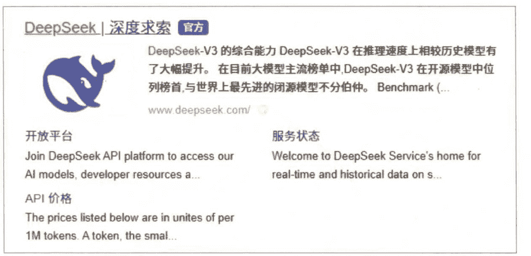

图2-1

这种做法可较快定位网页入口，但弊端是搜索引擎广告较多，容易让人迷惑。比如部分商家把DeepSeek本地部署推到搜索结果里，若不熟悉IT术语，就可能下载本地部署工具而非官方DeepSeek。如图2-2所示。

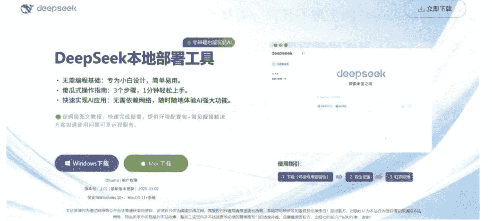

图2-2

更稳妥的做法是直接输入网址，www.deepseek.com，这样便能直接打开DeepSeek官网。

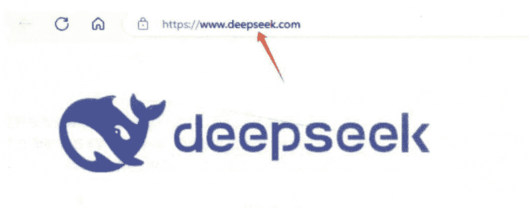

图2-3

新用户点击“开始对话”便能进入DeepSeek注册流程，手机号或者微信号都可直接注册。

### 2. 移动端操作

iOS与安卓用户可在应用商店搜索“DeepSeek”，下载安装最新版本，按流程注册后即可使用。

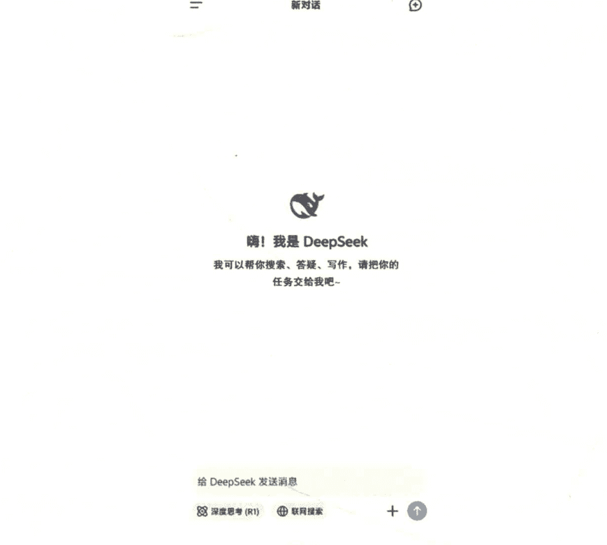

图2-4

除了常规方式，也可通过第三方平台使用DeepSeek，如腾讯元宝、微信小程序、知乎直答、火山引擎等，且数量仍在持续增加，用户可在这些平台直接调用DeepSeek能力。

除此之外，DeepSeek 还提供了开发者 API 注册和本地部署两种进阶方案，主要面向需求更专业的使用者，具体配置步骤与使用价值将在后续章节展开。

## 2.2 界面里容易被忽略的功能
DeepSeek 既可在浏览器中使用，也能通过手机 App 使用，核心体验基本一致。整体界面走极简风格，只要掌握正确的触发方式，就能开启一批隐藏功能，对提升效率和操作流畅度帮助很大。

### 2.2.1 手机端实用技巧
移动版主要依赖手机使用，启动后仅有一个对话框和少量提示，上手很快，但 App 内藏有两处不明显的入口。
第一个入口位于输入区下方，发送按钮左侧有一个黑色“+”标记。点开后底部会弹出三项选项：拍照识字、图片识字和文件导入，如图2-5。
对办公场景而言，这三项都很实用，尤其是文件上传。值得注意的是，上传文件时系统会提示先关闭联网搜索，这属于一种隐私保护机制。
对话框左上角还有一个展开图标，点击后可调出历史对话，方便后续找回之前的交互记录，如图2-6。

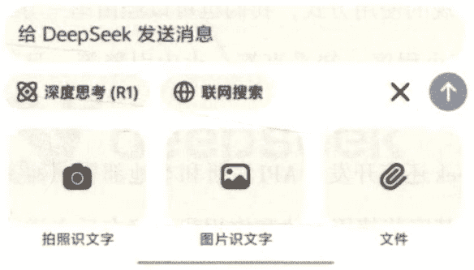

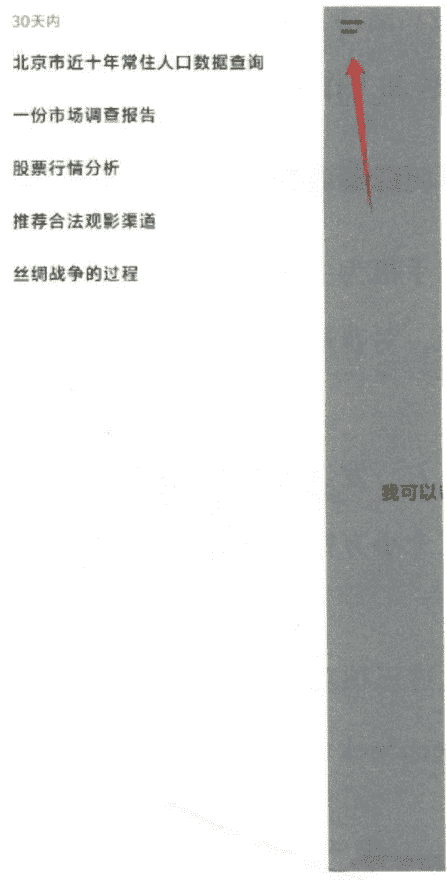

### 2.2.2 网页端隐藏资源
网页版的视觉风格同样简洁，但可用的隐藏功能比移动端更丰富，其中最值得关注的就是官方提示库和实用集成。
进入官网后，点击 Logo 下方的灰色文字即可打开隐藏界面，下拉菜单中就能找到“提示库”，如图2-7。

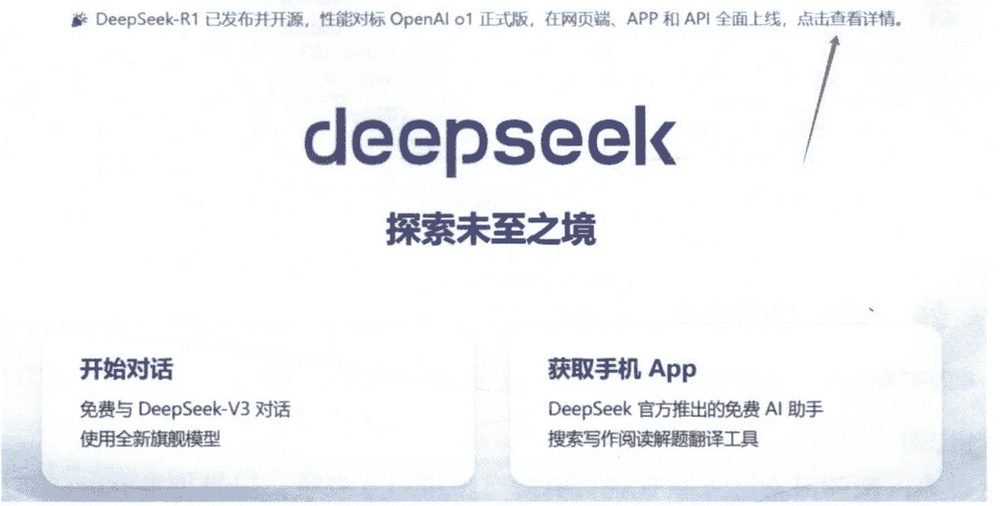

图2-7

官方提示库共提供 12 类不同场景的提示词示例和代码，涵盖代码生成、内容分类、诗歌创作等。若需求未在列表中，还可使用模型提示词生成工具学习如何撰写提示词。如图2-8、图2-9。
对新手而言，这些模板是很好的入门参考，有助于快速熟悉交互方式和推理能力。
除提示库外，隐藏界面的下拉菜单里还有“实用集成”，列出了 DeepSeek 可连接的各类应用与插件，如图2-10。

探索提示词样例，拓展使用可能

| 图标 | 功能 | 描述 | 图标 | 功能 | 描述 |

|---|---|---|---|---|---|

| </> | 代码改写 | 针对源代码做调整，用以纠错、加注释、做优化等。 | < > | 代码解释 | 对代码进行解读，帮助理解其实现逻辑。 |

| I | 代码生成 | 让模型产出一可以直接运行的特定功能代码。 | 📎 | 内容分类 | 分析文本后自动归类到对应类别。 |

| ≡ | 结构化输出 | 将内容转为 JSON 格式，便于后续程序调用。 | 😊 | 角色扮演（自定义人设） | 自定人物设定，与用户展开角色扮演。 |

| 🎬 | 角色扮演（情景续写） | 给出具体场景，由模型模拟该情境下的对话任务。 | 📄 | 散文写作 | 依据提示词生成散文作品。 |

| ✏️ | 诗歌创作 | 按照提示词创作诗歌。 | 📝 | 文案大纲生成 | 基于用户给出的主题输出文案提纲。 |

图2-8

### 模型提示词生成
该功能可根据用户输入的需求，自动生成高质量的提示词。

**提示词**

**SYSTEM** 你是一位大模型提示词生成专家，请根据用户的需求编写一个智能助手的提示词，来指导大模型进行内容生成，要求：

1. 以Markdown格式输出

2. 贴合用户需求，描述智能助手的定位、能力、知识储备

3. 提示词应清晰、精确、易于理解，在保持质量的同时，尽可能简洁

4. 只输出提示词，不要输出多余解释

**USER** 请帮我生成一个“Linux助手”的提示词

**样例输出**

```
# Linux 助手提示词

## 定位
- **Linux 助手**：一个专注于提供 Linux 操作系统相关知识和支持的智能助手。

## 能力
```

图2-9 DeepSeek给出的模板（节选）

| 软件名称 | 功能描述 |

| :--- | :--- |

| AingDesk | 可一键在本地部署 AI 模型，操作界面可视化，内置美观聊天窗口，支持在线分享他人使用，兼容 DeepSeek 等模型，支持联网检索与第三方 API。 |

| 钉钉 | 钉钉 AI 助理融合了平台多项 AI 产品能力，以智能化方式辅助企业日常流程。具备智能沟通、智能协同、智能管理等能力，可在企业内部归纳要点、生成会议纪要，推送任务与日程提醒，并借助知识库回答行政、人力等常见问题。 |

| CodingSee-AI伴学 | 专为中国少儿编程设计的集成平台，含社区、项目协作、站内实时消息、AI 问答、Scratch/Python/C++ 编译环境及代码精准纠错，UI 友好，支持 Windows 与 mac 系统。 |

| ChatDOC | AI 文档阅读工具，具备强大溯源能力，确保每条信息来源可查，助力高效精准把握文档核心。 |

| SwiftChat | 基于 React Native 构建的跨平台 AI 聊天应用，提供原生级性能。功能包括实时流式聊天、丰富 Markdown 支持、AI 图像生成、可自定义系统提示词及多模态能力，支持 DeepSeek、Amazon Bedrock、Ollama、OpenAI 等提供商，界面简洁、性能优秀。 |

| 4EVERChat | 集成数百款 LLM 的模型选型平台，可直接对比不同模型的实时响应差异，基于 4EVERLAND AI RPC 统一 API 端点实现零成本模型切换，自动选择响应快、成本低的组合。 |

图2-10 DeepSeek 可接入的各类软件集成（节选）

## 2.3 三种模式使用指南
DeepSeek 共提供三种运行模式。在网页或移动端输入框下方，有“深度思考 R1”和“联网搜索”两个开关。两者均未启用时，模型默认以基础版 V3 工作。
不少新手对三种模式的区别不清晰，要么全部不选，要么全部开启，盲目选择容易导致效率下降、结果质量波动、资源浪费和体验变差。清楚各模式的定位与适用场景，才能选对模式，获得更好的使用效果。

### 2.3.1 基础模型 V3
V3 是 DeepSeek 的基础底座，覆盖大量通用任务。

### 2.3.1 基础模式 V3
V3 模式相当于一位博学的百科助手，能迅速给出简洁明了的日常问答，无论是常识、历史还是科学类问题，都能快速回应。
功能要点包括自然语言处理，可理解并生成自然语言，适用于对话、问答、文本创作；支持多轮对话，能记住上下文并保持连贯，适合日常咨询、信息检索、简单推理，如翻译、基础计算、知识讲解等。当问题相对简单、只需快速获取信息时，V3 是理想选择。
案例场景：比如学生在学习时想了解“光合作用是什么”，使用 V3 可快速获得定义、过程等基础知识，帮助快速理解概念。如图2-11。

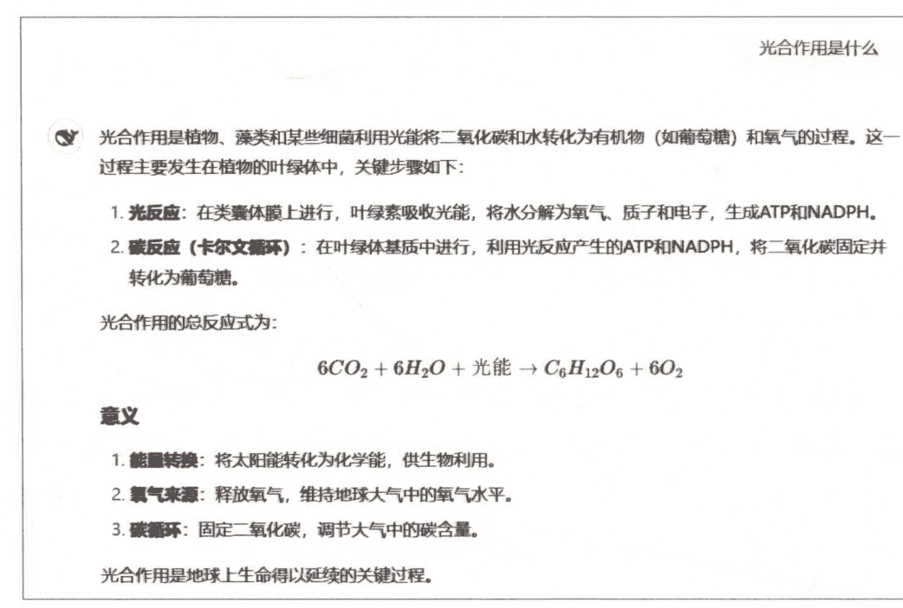

### 2.3.2 深度思考 R1
R1 模式像一位擅长逻辑推演的专家，面对复杂问题会先拆解为若干小步骤，再逐步引导得出结论。
功能上适合需要复杂推理和深度分析的任务，如数学证明、代码调试、策略规划等。当遇到需多角度分析、详细推理的问题时，R1 能提供更深入、更专业的解答。
案例场景：教学中遇到“证明勾股定理”“求解复杂方程组”等问题，R1 可通过逐步推理给出详细证明或解题步骤。（如图2-12、图2-13。）又如医生面对咳嗽、发烧、胸痛且肺部有阴影的复杂病例，不确定是肺炎、肺结核还是肺癌时，可用 R1 描述症状和检查结果，由其引导逐步分析病史、生活习惯、家族史，排除不合理可能性，并建议痰液培养、结核菌素试验或 CT 扫描等进一步检查，辅助更准确诊断和治疗方案制定。

### 2.3.3 联网搜索
联网搜索模式相当于实时信息雷达，可访问互联网获取最新数据，让 DeepSeek 不仅依赖内置知识库，还能结合网络最新内容作答。
功能上适用于需要实时信息的场景，如查询最新新闻、股市行情、政策变化等。当需获取动态信息或验证准确性时，该模式十分有用。

# DeepSeek 从入门到精通

证明勾股定理

已深度思考（用时 58 秒）

嗯，用户让我证明勾股定理，对吧？首先，我得想想勾股定理是什么。勾股定理就是说在直角三角形里，斜边的平方等于两条直角边的平方和，也就是a² + b² = c²，其中c是斜边，a和b是直角边。这个定理的证明方法有很多种，可能有几百种不同的证明方式呢。不过用户可能想要一个经典且容易理解的证明方法。

我应该选择哪种证明方式呢？比较常见的是欧几里得的几何证明，或者是利用相似三角形，或者是代数的方法，比如面积相减法。还有中国的赵爽弦图，或者印度的一些方法。考虑到用户可能没有太深的几何背景，或许用面积的方法会更直观一些。

比如，可以画一个大的正方形，里面包含四个相同的直角三角形，然后通过面积的不同计算方式来得出a² + b² = c²。这种方法比较直观，不需要太多复杂的几何知识，只需要面积的计算和代数运算。

具体来说，可以这样想：四个全等的直角三角形，每个的直角边是a和b，斜边是c。把它们拼成一个大的正方形，这样它们的斜边会形成内部的一个小正方形。然后整个大正方形的面积可以有两种计算方式，一种是边长为a+b，所以面积是(a+b)²。另一种是四个三角形的面积加上中间的小正方形的面积。每个三角形的面积是(1/2)ab，四个就是2ab，中间的小正方形边长是c，面积是c²。所以总面积也可以表示为2ab + c²。然后等式两边相等，即(a+b)² = 2ab + c²，展开左边得到a² + 2ab + b² = 2ab + c²，两边减去2ab就得到a² + b² = c²。这应该是一个有效的证明方法。

图2-12 DeepSeek反馈（节选）

证明过程：

1. 构造图形

取四个全等的直角三角形，其直角边分别为 a 和 b，斜边为 c。将它们按下图所示拼成一个边长为 a + b 的大正方形，中间形成一个边长为 c 的小正方形。


2. 计算大正方形的面积

大正方形的边长为 a + b，因此面积为：

(a + b)² = a² + 2ab + b².

图2-13 DeepSeek反馈（节选）

**案例场景：** 如果用户想了解“今天的股票市场行情”（如图2-14）“某场体育赛事的最新比分”“最新的科技研究成果”等信息时，联网搜索模式能够及时从网络上获取到最新的数据并反馈给用户。在进行市场调研时，需要收集最新的行业报告、竞争对手的动态等信息，联网搜索模式可以快速检索到相关的网络资源，为调研提供有力支持。

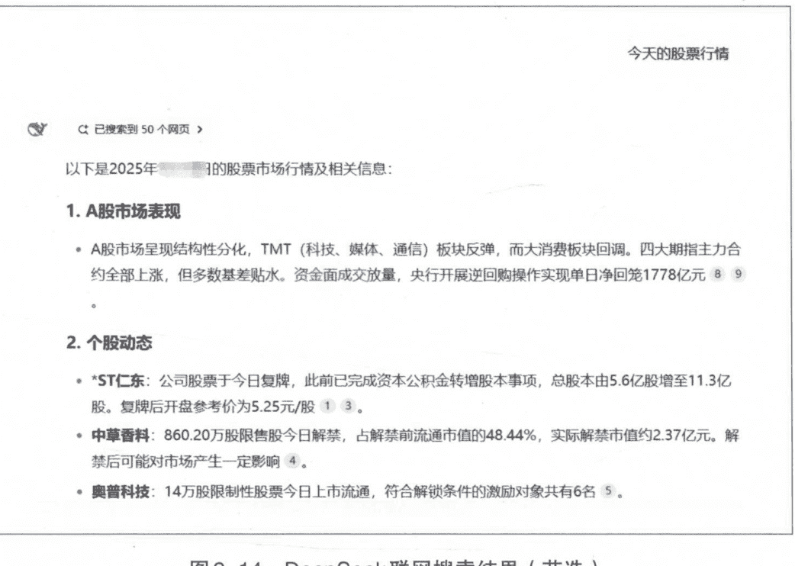

DeepSeek 三种模式各有侧重。使用时需依据具体需求合理匹配。日常简单咨询与基础创作，基础模式 V3 即可高效应对；专业复杂问题求解，深度思考模式 R1 是最佳利器；而追踪最新资讯与获取实时信息，联网搜索模式则能发挥优势。只有精准匹配需求与模式，才能让 DeepSeek 充分发挥其强大功能，为学习、工作和生活提供更优质、高效的支持。

# 课后练习

搜索查看 DeepSeek 相关信息及其产出成果，下载安装并使用 DeepSeek，并尝试问 DeepSeek 几个你想知道的问题。

# 第二部分

# 新手入门：如何高效使用 DeepSeek

# 第三章 让 DeepSeek 秒懂你的潜台词

在使用 DeepSeek 时，巧妙运用提示词和拆解复杂问题技巧能极大提升效率。提示词能精准引导 DeepSeek 理解意图，提供贴合需求结果；拆解复杂问题则把棘手难题分解为易处理部分，让 DeepSeek 逐步攻克。二者配合，用户就可以轻松获得高质量的答案。

## 3.1 五大提问模板
在与 DeepSeek 交流时，掌握正确的提问方式至关重要。一个好的提问能够引导 AI 给出更精准、更有用的回答，让你在学习、工作和生活中更高效地获取信息和解决问题。以下是 5 个实用的万能提问模板，帮助你轻松驾驭 AI。

### 3.1.1 明确指令型
明确指令型提问是直接向 AI 下达清晰任务指令，明确告诉 DeepSeek“你需要做什么”。通过使用“请你……” “你的任务是……”等句式，可以让 AI 快速理解问题核心需求，从而提供针对性答案。这种方式适用于需要具体解决方案的场景，例如规划行程、设计文案或生成代码等。
明确指令型提问的关键在于简洁明了地表达需求，避免模糊不清的表述，从而让 AI 更高效地完成任务。
**句式：** “请你……” “你的任务是……”
**介绍：** 这种提问方式直接给 AI 下达指令，明确其任务内容，适用于各种需要具体解决方案的场景，能让 AI 迅速进入工作状态，按照要求提供针对性回答。
**案例：** 假如你要准备一份详细的项目策划案，但不知从何入手，可以问：“请你帮我设计一份新菜品发布会的策划方案，包括活动流程、宣传策略、预算分配等详细内容。”这样 AI 就知道你要策划案，且明确了方案应包含的具体板块，会针对性给出完整思路。如3-1所示。

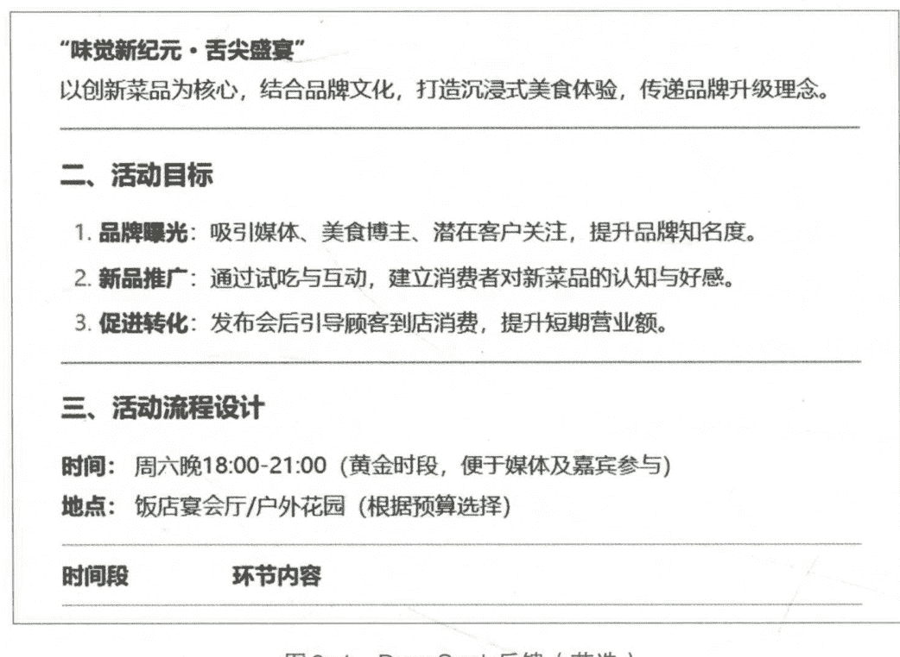

总结：明确指令型提问能快速聚焦问题核心，让 AI 按你的指令输出特定内容，节省沟通成本。

### 3.1.2 背景补充型
这种提问模式通过提供问题的背景信息，帮助 DeepSeek 更好地理解上下文和情境。使用“如果……” “假设……”等句式，可以让 DeepSeek 在回答时结合具体背景进行分析，从而提供更贴合实际的答案。这种模式常用于需要预测性或假设性分析的场景，例如市场趋势分析、项目可行性研究等。通过提供背景，DeepSeek 能够更精准地把握问题核心，避免给出过于笼统或不切实际的回答。
句式：“如果……”“假设……”
介绍：在提出问题时先给出一定的背景信息，帮助 AI 更好地理解问题所处的情境，从而提供更贴合实际的回答。这种方式常用于涉及假设性、预测性的问题，能让回答更具参考价值。
案例：如果你在思考某个创业项目的可行性，但不确定市场环境对项目的影响，可以问：“如果我计划开一家主打健康轻食的餐厅，当前市场环境下有哪些机遇和挑战？”这句话先说明了创业背景，DeepSeek 就能结合市场趋势、消费者需求变化等因素，分析出该项目面临的实际情况，为你决策提供有力依据。如图3-2所示。
总结：背景补充型提问为 DeepSeek 搭建了问题情境框架，使其回答更契合实际场景，增强实用性。

# 健康轻食餐厅市场机遇与挑战分析

一、主要机遇

1. 健康饮食需求持续增长

   - 消费者对低热量、低脂肪、高营养食品的需求显著提升，尤其是年轻群体（18-35岁）成为消费主力，他们更注重饮食的便捷性与健康属性 ① ② ④。

   - 健康意识推动植物基食品、无添加产品和有机食材的流行，轻食餐厅可借此创新菜单，例如推出低糖高纤维餐品或功能性食品（如抗氧化剂饮品） ③ ⑧ ⑨。

2. 市场规模快速扩张

   - 中国轻食餐厅行业预计到2025年市场规模将突破2000亿元，年复合增长率达15% ④ ⑧。

   - 细分市场潜力大，如中式轻食、低卡便当、健身餐等差异化产品线可吸引特定人群 ④ ⑨。

3. 技术与渠道创新支持

   - 智能化运营：无人餐厅、智能点餐系统及中央厨房可降低人力成本，提升效率，例如通过AI推荐个性化菜品 ⑧ ⑨。

   - 线上渠道拓展：外卖和云厨房模式成为新常态，轻食品牌可通过优化配送服务和线上营销（如社交媒体推广）触达更广人群 ⑧ ⑨。

4. 政策与环保趋势利好

   - 政府鼓励绿色消费和健康餐饮，如《国民营养计划》等政策支持行业规范化发展 ④ ⑨。


### 3.1.3 示例引导型
这种提问模式通过举例的方式，明确告诉 DeepSeek 你希望得到的回答方向或风格。使用“例如……”“比如……”等句式，可以让它更清楚地了解你的需求，从而提供更具针对性和实用性的答案。这种方式适用于需要具体建议或解决方案的场景，例如询问工作技巧、学习方法等。通过给出示例，AI 能够快速聚焦问题的关键点，避免回答过于宽泛或理论化，从而提供更符合实际需求的内容。
句式：“例如……”“比如……”
介绍：通过举例让 AI 明白你希望得到的回答风格或内容方向，尤其在想要获取具体、实用建议时效果显著，能让回答更具操作性，避免过于笼统或理论化。
**案例：** 当你想提升团队协作效率，但想要一些切实可行的方法，可以问：“我想提升团队协作效率，比如在任务分配、沟通交流等方面有哪些实用技巧？” 这里举例说明了想要改进的具体环节，AI 就会针对性地给出如使用项目管理工具、定期召开沟通会议等具体方法，方便直接应用到工作中。如图3-3所示。
**总结：** 示例引导型提问为 DeepSeek 指明了回答的具体方向，使其提供的建议更具实践性。

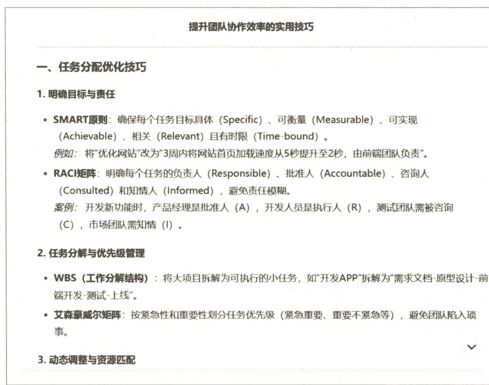

### 3.1.4 限定格式型

# 用格式指令让输出更清晰

想让模型的回答一目了然，最直接的做法就是提前把呈现方式定下来。只要在提示里说明“按某种版式给”“用某种方式展示”，模型就会给出表格、清单、图表等标准化结果。这种用法在需要整理、对比或汇总数据的场景里特别好用，比如数据分析、报告撰写。格式固定后，可读性和复用性都明显提升，后续加工也更顺手。

**常用说法：**“请以……格式回复”“用……方式呈现”

**要点：**提前约定输出样式，像表格、清单、图表等，先把信息梳理清楚再使用。尤其在做数据或多项内容的对比、归纳时非常实用，能让呈现更直观。

**示例：**梳理不同城市的生活开销时，可以说：“请以表格形式列出北京、上海、广州、深圳四个城市的房价、物价、交通费用等生活成本数据。”模型就会按指定的表格把各城对应的生活成本清晰列出，便于快速对比差异。如图3-4所示。

**小结：**限定格式提问，能让信息以指定形式呈现，提升可读性和可用性，更利于深入分析。

# 四城生活成本对比样例

请以表格形式列出北京、上海、广州、深圳四个城市的房价、物价、交通费用等生活成本数据。

以下是北京、上海、广州、深圳四个城市的房价、物价、交通费用等生活成本的简要对比表格。数据基于2023年的市场情况，仅供参考，实际数据可能会有所波动。

| 城市 | 平均房价 (元/平方米) | 物价指数 (以北京为基准) | 公共交通费用 (单程票价) | 出租车起步价 (元) | 餐饮 (普通餐厅人均消费, 元) |
| :--- | :--- | :--- | :--- | :--- | :--- |
| 北京 | 60,000 - 100,000 | 100 | 3 - 10 | 13 | 50 - 100 |
| 上海 | 70,000 - 120,000 | 105 | 3 - 10 | 14 | 60 - 120 |
| 广州 | 40,000 - 80,000 | 95 | 2 - 8 | 12 | 40 - 80 |
| 深圳 | 80,000 - 150,000 | 110 | 2 - 10 | 10 | 50 - 100 |

图3-4 DeepSeek反馈（节选）

### 3.1.5 提炼概括型

这类提问是让模型把海量信息浓缩，快速抓住核心要点。用“请总结……”“请概括……”等表达，能让回答避开冗长，直奔重点。适用于需要迅速把握信息主干的场景，例如阅读长文、解读复杂数据等。借助归纳总结，AI能帮你高效获取关键信息，省时省力，提升处理效率。

句式：“请总结……”“请概括……”

介绍：面对信息量大时，这类提问能促使模型对内容做高度概括，抓住要点，帮你节省筛选时间和精力。

案例：在读完一篇关于人工智能未来发展趋势的长报告后，可以问：“请总结一下人工智能在未来医疗、教育、交通三个领域的发展趋势。”这个问题限定了总结范围，模型即可从报告中提取对应领域的关键趋势，让你迅速掌握重点。如图3-5所示。

# AI重塑医疗教育交通的走向

一、医疗领域

1. AI作为医生助手，提升诊疗效率与精准度
   - AI在医疗领域的核心定位是辅助而非替代医生，通过动态会诊机制、电子病历纠错、用药禁忌提醒等功能，帮助医生优化决策流程。例如，科大讯飞开发的AI系统已能诊断1600多种疾病，并支持院后随访服务 ①。
   - 大模型技术通过整合海量病例数据和医学文献，显著提高罕见病诊断和癌症筛查的准确性。如北京协和医院构建的诊疗推理引擎和虚拟标准化病人系统，已在临床决策支持中发挥作用 ② ⑥。

2. 加速药物研发与个性化治疗
   - AI通过分析基因组数据和预测蛋白质结构，缩短药物研发周期。例如，DeepCure公司利用AI将药物发现效率提升，目前全球每年仅开发约20种新药，但AI有望挖掘8000多种潜在治疗靶点 ④ ⑥。
   - 结合患者个体差异的个性化治疗方案成为趋势，AI可根据患者数据生成定制化诊疗建议 ⑦ ⑧。

3. 基层医疗能力提升与伦理规范完善
   - AI技术赋能基层医生，将诊疗水平从“60分”提升至“90分”，并通过远程会诊和慢病管理覆盖更多患者 ① ②。
   - 高敏感领域（如医疗）需加快制定AI法案，明确数据安全、伦理风险及权威评测标准，避免算法偏见和隐私泄露 ① ⑧。


**总结：** 归纳型提问有助于快速提炼信息精华，提升获取效率，适合处理繁杂内容。

总的来看，这5种万能提问模板覆盖了与DeepSeek交流的多种场景，无论是明确任务、提供背景、给出示例、限定格式还是总结归纳，都能让AI更精准理解需求，给出高质量回答。熟练掌握这些提问方式，你将能更高效地利用DeepSeek这个强大工具，在学习、工作和生活里如虎添翼。

## 3.2 追问话术：如何让AI主动掏干货

在用DeepSeek探索知识和解决问题的过程中，提问的方式往往决定了我们能走多远。而追问，作为一种深入挖掘问题本质的技巧，更是能够帮助我们突破思维的边界，找到真正的答案。如果我们能够掌握追问的技巧，深入挖掘其背后的逻辑、关联和细节，那么AI就不再是一个简单的回答机器，而是升级为我们的“无限知识库”。

下面我们就来介绍使用DeepSeek时的四种追问技巧。

### 3.2.1 逆向思维追问法

逆向思维追问法是从与原问题相反的角度进行追问，通过思考与原问题相反的情况，来获得新的思路和解决方案。它适用于需要创新解决方案、突破常规思维的问题，或者当从正面思考难以找到答案时。

**正向问题：** 如何提高一款新上市APP的用户留存率？

**逆向追问：** 如果要降低用户留存率，可以采取哪些措施？通过思考降低留存率的方法，如减少用户互动、增加操作复杂度等，反过来可以找到提高留存率的相反策略，如增加用户互动环节、简化操作流程等。我们还会发现，使用逆向提问得到的答案与正向提问并不完全一致，其差异部分又可用来作参考，如表3-1所示。

# 表 3-1

| 如何提高一款新上市 APP 的用户留存率？（V3 模型） | 如果要降低一款 APP 的用户留存率，可以采取哪些措施？（V3 模型） |
| :--- | :--- |
| DeepSeek 回答：<br>1. 优化用户体验<br>2. 提供新手引导<br>3. 个性化体验<br>4. 推送通知与提醒<br>5. 激励机制<br>6. 定期更新与优化<br>7. 社区与社交互动<br>8. 用户反馈与支持<br>9. 数据分析与优化<br>10. 跨平台整合 | DeepSeek 回答：<br>1. 降低用户体验<br>2. 减少功能价值<br>3. 提高使用成本<br>4. 降低稳定性<br>5. 减少用户互动<br>6. 忽视用户反馈<br>7. 降低安全性<br>8. 减少更新频率<br>9. 增加使用限制<br>10. 降低品牌信任 |

### 3.2.2 逻辑推理追问法

逻辑推理追问法是基于已有的信息和逻辑关系，通过追问来进一步挖掘问题的深层次原因、影响或解决方案。它适用于需要深入分析问题本质、进行复杂决策或需要系统性思考的问题。

**初始问题**：某品牌的市场份额在过去一年中持续下降，可能的原因是什么？

**逻辑推理追问**：市场份额下降是否与竞争对手的策略有关？如果是，竞争对手具体采取了哪些策略？这些策略对消费者行为产生了怎样的影响？通过这种层层深入的追问，可以逐步剖析问题的根本原因。如表 3-2 所示。

## 表3-2

初始问题：某品牌的市场份额在过去一年中持续下降，可能的原因是什么？（R1模型）

某品牌市场份额持续下滑可能源于多重因素的叠加效应：

第一，行业竞争加剧导致竞品通过技术创新（如智能功能升级）、价格战或精准营销（如直播电商 + 社交媒体投放）持续蚕食市场；

第二，消费者需求结构变化（如健康环保理念兴起、Z世代审美迭代）未被及时捕捉，导致产品迭代滞后于市场趋势；

第三，渠道布局失衡，过度依赖传统线下渠道而未能有效渗透兴趣电商等新兴流量入口；

第四，供应链波动造成成本上涨或供货不稳定，削弱了终端价格竞争力；

第五，品牌形象受损（如质量丑闻、价值观争议）引发信任危机，叠加数字化时代舆情扩散速度加快的放大效应。

此外，经济周期波动带来的消费降级也可能加速用户流向高性价比替代品牌，需要结合用户画像数据、竞品动态和渠道转化率进行交叉诊断。

逻辑推理追问：市场份额下降是否与竞争对手的策略有关？如果是，竞争对手具体采取了哪些策略？这些策略对消费者行为产生了怎样的影响？（R1模型）

市场份额下降往往与竞争对手的策略直接相关。竞争对手可能通过多维攻势抢占市场：

其一，技术创新与产品差异化，例如推出搭载 AI 技术的智能产品或环保材料升级，吸引注重功能与体验的前沿消费者；

其二，价格渗透与补贴战，以高性价比组合或限时折扣迅速占领价格敏感型用户；

其三，精准营销与场景化触达，通过社交媒体 KOL 种草、直播带货强化品牌认知，并利用大数据定向推送广告，引导消费者转向竞品；

其四，渠道重构，布局社区团购、即时零售等新兴渠道，缩短购买链路，迎合“即想即得”的消费习惯；

其五，会员体系与情感绑定，通过积分兑换、专属服务增强用户黏性。

这些策略直接改变消费者行为：技术迭代加速需求升级，削弱原品牌产品的吸引力；低价策略触发比价心理，导致用户流失；社交营销重塑购买决策路径，使传统品牌曝光度下降；便捷渠道则进一步分流线下客流。最终，竞品通过系统性策略组合，持续分流客群并重塑市场格局。

### 3.2.3 情感分析追问法

情感分析追问法是从情感和用户体验的角度出发，通过追问来了解用户对产品、服务或事件的感受和态度。它适用于需要了解用户情感反馈、优化用户体验、处理客户投诉等问题。

**初始问题：** 用户对某款新手机的评价如何？

**情感分析追问：** 用户在使用过程中是否感到满意？哪些功能让他们感到惊喜或失望？他们对手机的外观、性能、价格等方面的情感倾向是什么？通过这些追问，可以更全面地了解用户的情感体验。

### 3.2.4 案例分析追问法

案例分析追问法是通过具体案例来深入探讨问题，通过追问来获取更多与案例相关的细节和信息。它适用于需要通过具体实例来理解理论、验证假设、学习经验或解决问题的情况。

**初始问题：** 如何提高团队的协作效率？

**案例分析追问：** 在某个成功提高协作效率的团队中，他们采取了哪些具体措施？这些措施是如何实施的？实施过程中遇到了哪些困难，又是如何克服的？通过这些追问，可以深入了解成功案例的经验和教训。

通过本章介绍的四种追问方法——逆向思维追问法、逻辑推理追问法、情感分析追问法和案例分析追问法，我们能够从不同角度深入挖掘问题本质，拓展思维边界，找到创新且有效的解决方案。

这些方法在实际应用中各展其能：逆向思维追问法让我们跳出常规，从反方向洞察新路径；逻辑推理追问法助我们层层剖析复杂问题，把握关键脉络；情感分析追问法使我们关注用户体验，优化产品与服务；案例分析追问法则借助真实实例，提炼成功经验与失败教训。它们相辅相成，为我们构建起一套全面且系统的思考工具。

## 3.3 自定义AI的输出风格

在互联网上看到DeepSeek生产的各种的内容时，我们会发现，这些内容风格各异，有的严肃，有的诙谐，有的切中题意，有的却是泛泛而谈。

这便是 AI 输出风格的差异。DeepSeek 作为一款超强推理 AI，它的输出没有固定的语言或场景风格，我们可以将它当成一个擅长各种风格的多领域专家。因此，想让 DeepSeek 输出你中意的风格，那就必须在提示词上下功夫。通过精心设计的提示词，我们可以让 DeepSeek 理解我们的意图，按照我们的期望进行思考和回答。这种能力不仅提升了我们获取信息的效率，更让我们在解决问题、创作内容、学习新知等方面如虎添翼。

接下来，我们将深入探讨如何用提示词操控 DeepSeek 的输出风格，探索多种实用的方法，并通过具体案例来展示其强大的功能。

以下是几种用提示词操控 DeepSeek 输出风格的方法。

### 3.3.1 直接指定风格

在提示词中明确要求 DeepSeek 按照特定的风格进行输出，如指定语气、格式、结构等。

> 提示词：请以“说人话”的方式，用通俗易懂的语言解释区块链技术，并以段落形式呈现。

> 输出风格：DeepSeek 会用简单直白的语言，避免专业术语，以段落形式解释区块链技术，让非专业人士也能理解。

在 DeepSeek 中输入“什么是区块链技术”，它生成的回答晦涩难懂，显然不适合普通人理解，如图 3-6 所示。

# 1. 核心特点

- **去中心化：**
  数据不依赖单一中心节点存储，而是分布在网络中的多个节点上，避免单点故障或被操控的风险。
- **不可篡改**
  数据一旦写入区块链，几乎无法修改。每个区块通过密码学哈希与前序区块链接，篡改任一区块需改变后续所有区块，成本极高。
- **透明可追溯**
  所有交易记录公开（部分隐私链除外），任何人都可验证链上数据的历史变更。
- **共识机制**
  网络节点通过算法（如工作量证明PoW、权益证明PoS）达成数据一致性，无需信任第三方。

图 3-6 DeepSeek反馈（节选）

但是，在回答上加入“说人话”三个字（也可以说其他内容，比如通俗一点、大白话），它生成的内容就很容易看懂了，如图3-7所示。

**想象你和几个朋友一起记账：**
- 你们有一个**公共账本**，记录谁欠谁钱。
- 每次有人借钱/还钱，所有人都要在自己账本上记一笔，然后**互相核对**，确保所有人记的内容一致。
- 如果有人偷偷改自己的账本，其他人会发现不一致，不承认他的版本。

**这就是区块链的核心逻辑：**
1. **去中心化：** 不靠银行或支付宝，大家互相监督记账。
2. **不可篡改：** 一旦多数人确认了记录，想改就得说服一半以上的人一起改（几乎不可能）。
3. **透明可查：** 每个人都能看到完整的交易历史。

图 3-7 DeepSeek反馈（节选）

### 3.3.2 模仿特定风格

要求DeepSeek模仿某种特定的写作风格或语气，如模仿某位作家、某种文体等。

提示词：请模仿海明威的写作风格，写一段关于冒险的故事，要求简洁有力，充满张力。

输出风格：DeepSeek 会模仿海明威简洁明快、直接有力的写作风格，创作出符合要求的冒险故事。

输出结果（节选）：夜沉得像未醒的酒。男人坐在码头边的木箱上，枪管在月光下泛着青灰。海风湿咸，舔过他右手的旧疤，那是在马德里留下的纪念品。

“最后一班渡轮两小时前就走了。”阴影里走出个戴宽檐帽的，左轮枪的击锤发出清脆的咔嗒声。

男人啜了口龙舌兰。酒是冷的。像墨西哥湾11月的水。他数着浪头拍打桩基的次数，直到第五次潮水退去，才用生锈的刀尖挑起瓶塞。标签上的字早被血渍洇成褐斑，和衬衫第三颗纽扣的污渍一个颜色。

持枪的人向前半步，靴跟碾碎了一只招潮蟹。男人望着海平面那道逐渐发白的细线，把空酒瓶轻轻放回箱板。铁锈味的黎明正从枪管末端爬上来。

### 3.3.3 逆向约束法

通过排除法，明确告诉 DeepSeek 不要出现某些内容或风格，从而框定答案的精准性。

提示词：写一段健身教练的朋友圈文案。要求：1.避开3类雷区【贩卖身材焦虑】【专业术语】【过度承诺效果】；2.突出差异化：强调“游戏化训练”和“心理疏导”；3.格式：用emoji分段，结尾加悬念提问。

输出风格：DeepSeek 会避免使用被排除的内容，按照要求突出差异化，并采用指定的格式进行创作，使文案更符合实际需求，如图3-8所示。

【让汗水变成闯关金币】
扔掉枯燥的计数器和压力表！我们的训练像「真人版健身环」——用体感挑战解锁新地图，组队PK赚积分，连平板支撑都能触发“隐藏成就”🌍

【健身卡≠痛苦储蓄卡】
今天带学员用“情绪骰子”破解了训练瓶颈——扔出😡就狂揍沙包，扔出😌立刻切换冥想拉伸。身体进步的前提，是心里那根弦别绷太紧呀💗

【你猜下期主题是什么？】
有人靠「副本任务」治好了迟到，有人用「心灵存档点」跨过平台期...如果给你设计专属健身游戏，你最想点亮哪项技能树？💡（评论区偷偷剧透）

✨悬念提问：
试过把训练变成闯关的人，后来都悄悄发生了什么变化？🤔

图3-8 DeepSeek反馈（节选）

### 3.3.4 思维引导法

通过引导DeepSeek的思维过程，使其按照一定的逻辑顺序进行思考和输出。

**提示词：** 老板让我写一份下季度市场营销计划，但我还没啥头绪。Deepseek，你先别急着给我方案，咱们一步步来。首先，帮我分析一下我们公司目前的产品在市场上的优势和劣势。然后，针对这些优劣势，帮我分析一下下季度市场可能出现的新机会和挑战。最后，基于这些分析，再给我提供3个可行的营销策略方向。

**输出风格：** DeepSeek会按照提示词中的逻辑顺序，先分析优势和劣势，再分析机会和挑战，最后提供营销策略方向，展示出完整的思维链。如图3-9所示。

# 一、产品市场优劣势诊断

数据模拟：根据2023Q3市场调研报告

| 维度 | 优势表现 | 劣势表现 |
| :--- | :--- | :--- |
| 产品技术 | • AI人形追踪准确率98%（行业平均92%）<br>• 设备响应速度0.8秒（竞品平均1.5秒）<br>• 专利持有量23项（行业TOP3） | • 云存储套餐价格高于竞品15%<br>• 产品线仅覆盖安防类（缺失环境控制类产品） |
| 用户体验 | • APP日活率62%（行业均值45%）<br>• NPS净推荐值71分（超出智能硬件行业平均21分）<br>• 客服响应速度行业第1 | • 设备安装复杂度评分6.9/10（主要客诉点）<br>• iOS用户满意度比Android低18% |

图3-9 DeepSeek反馈（节选）

### 3.3.5 角色代入法

让DeepSeek扮演特定的角色，从而影响其输出的风格和内容。

提示词：你是一位资深程序员，请帮我解释一下Python中的递归函数，并举一个简单的例子说明其应用场景。

输出风格：DeepSeek会以资深程序员的身份，用专业但易懂的语言解释递归函数，并提供实际的应用示例，如图3-10所示。

### 3.3.6 场景设定法

为DeepSeek设定一个具体的场景，使其输出符合该场景下的风格和需求。

提示词：在家庭聚会场景下，如何向长辈解释我的工作？请用通俗易懂、亲切自然的语言进行阐述。

场景一变，口吻随行

在亲戚围坐的饭桌上，DeepSeek 会把说法自动调成暖心好懂的长辈视角来介绍自己的工作。

Python 里，递归函数是指函数在运行过程中直接或间接调用自身的特殊形式。它把一件复杂的事拆成若干个结构相同的小任务一层层推进，直到碰到可以直接给出答案的最简状态，也就是终止点。

写递归通常要兼顾三件事：
1. 停止信号：决定何时收手，避免无限循环
2. 任务拆分：把当前问题转为规模更小、形态一致的子问题
3. 自我调用：让函数自己处理拆出来的子问题

最常见的示范是阶乘求值。
```python
def factorial(n):
    if n <= 1:
        return 1
```
图3-10 回应摘录

示例回显：小姨，我在一家互联网公司上班，主要帮大家解决用手机软件时遇到的麻烦事儿。比如您上次说微信里老弹出不认识的广告，我平时工作就是和同事们一起研究怎么把这些烦人的小问题解决掉，让咱们用手机买菜、看新闻、视频聊天的时候更顺心。就像咱们家里水管堵了要找师傅通一样，我就是专门给手机软件“通水管”的人，只不过不用带工具包，天天对着电脑敲敲打打就能搞定啦！

用这种思路，就能按不同情境和需求，用提示词灵活调控 DeepSeek 的表达风格，让结果更贴合实际使用。

学会用提示词操控 DeepSeek 的表达方式，能在信息时代明显提升竞争力。通过直接指定语气、模仿特定写法、逆向限制、思维引导、角色代入、场景设定等多种手段，就能让模型按需产出，无论是专业严谨的报告、通俗易懂的说明，还是富于创意的故事、贴合现场的对话，都能轻松实现。这些做法既体现了人机配合的智慧，也展示了人工智能在辅助人类思考方面的潜力。

## 3.4 推理模型R1的用法要点

很多人误以为 DeepSeek R1 与基础版 V3 完全等同。实际上 R1 是推理型模型，拥有独特的长链推理能力，能产出数万字的思维链，在复杂任务上的推理准确度明显更高。它不是单纯的信息检索工具，而是一个能深度思考、进行逻辑推演的智能助手。因此提问方式需要区别于传统检索。

简单说，要把 R1 当成博学全能的专家，多给它思考空间，减少不必要的束缚。

下面三个要点能帮助 R1 发挥最大价值。

### 3.4.1 先把需求说清楚

R1 的强项在于理解并处理复杂推理，但前提是需求足够清晰。提问时要避免空泛笼统，必须具体说明目标、背景和限制。

错误示范：“写一篇关于健康的文章。”产出如图3-11所示。

# 健康：一场与生命本质的对话

在东京银座的街头，凌晨两点依然亮着灯的写字楼里，三十岁的佐藤健二吞下今天的第五杯黑咖啡。上海陆家嘴的金融精英王薇，在健身房的镜面墙前记录着体脂率变化，手机备忘录里躺着“生酮饮食”“16+8轻断食”等十几个健康方案。这些现代社会的典型场景，揭示着一个吊诡的现实：我们比任何时候都更热衷追求健康，却在追逐中与健康的本质渐行渐远。

# 一、被数据解构的生命图景

智能手表的震动提醒打断了会议，心率监测显示压力指数超标；营养分析APP将午餐的荞麦面分解为378大卡；基因检测报告用概率论预判未来三十年的患病风险。数字技术将生命拆解成可量化、可优化的参数，人类开始用工程师思维“维修”肉体这台精密仪器。东京大学健康科学研究显示，过度依赖健康数据的人群中，73%出现焦虑症状，这种“健康完美主义”正在制造新型现代病。

在京都的百年茶室里，茶道家山本宗次郎仍保持着日出而作的传统。他从不计算茶多酚含量，却在九十高龄保持着惊人的活力。这个对比暴露出机械健康观的致命缺陷：当生命被降维成生物参数的集合，我们丢失了感知身体真实需求的灵性。

图3-11 回应摘录

正确示范：“撰写一篇面向 30-50 岁职场人士的、约 800 字文章，主题是如何通过饮食和运动改善心脏健康。”产出如图3-12所示。

# 职场人士心脏健康指南：用饮食与运动构筑生命防线

在快节奏的职场生活中，30-50岁的中青年群体往往深陷“三高饮食、久坐少动、压力超标”的健康困局。世界卫生组织数据显示，心血管疾病已不再是老年人的“专利”，其发病年龄正以每年0.5岁的速度年轻化。作为职场中坚力量，我们完全可以通过科学调整饮食结构与运动模式，在繁忙工作中构筑起心脏健康的护城河。

# 一、饮食革命：从“填饱肚子”到“滋养心脏”

职场人的饮食常被外卖、快餐主导，高油高盐的饮食模式如同慢性毒药。改变需从三个维度切入：

1. 智慧选择脂肪：用橄榄油、亚麻籽油替代动物油脂，每日摄入30g无盐坚果（约单手一小把）。三文鱼、沙丁鱼等深海鱼类富含的Omega-3脂肪酸，已被证实可使冠心病风险降低15%（《美国心脏病学会杂志》）。

2. 构建膳食纤维屏障：燕麦、藜麦等全谷物搭配西蓝花、菠菜等深色蔬菜，每日保证25-30g膳食纤维摄入。

图3-12 回应摘录

把需求写得越具体，R1 理解越准确，产出越符合预期。

### 3.4.2 交目标，别交步骤

通用模型适合给步骤，R1 更适合给目标。它会自行推演实现路径，找到最优解法。

普通示范：“优化下面这段录音转录的文字稿，删掉语气词，按时间分段，每段加小标题。”

优化方案：“把下面这段录音转录稿整理成新员工能快速看懂的会议纪要，重点呈现功能迭代决策与风险点。”

直接下达目标，R1 能更灵活地运用推理能力，产出更贴合实际需要的材料。

### 3.4.3 补上模型缺的背景

R1 知识面广，但在某些新颖专业领域可能缺乏上下文。这时提供足够的背景信息很重要。

错误示范：“帮我分析一下这种新型材料的性能。”（假设材料刚研发出来，模型并不了解）

正确示范：“我正在研究一种新型超导材料，主要成分是 X、Y、Z，具有在低温下零电阻的特性。请分析这种材料在电子设备中的潜在应用。”

提供充分背景后，模型才能更精准地把握问题情境，给出专业可靠的回答。

R1 的提问关键在于目标明确、表述简洁、信息到位。用好这三点，就能让复杂任务变得高效，真正发挥其强大的推理能力，为工作学习带来便利。

## 3.5 进阶打法：提示词链五步法

单次提示词往往是一次性指令，比如让模型写一篇李白生平，信息密度低、对话连贯性弱。随着任务复杂度提升，单次提问容易导致结果笼统或跑偏。

提示词链通过分阶段拆解，把大问题转化为可操作的子模块，模拟人类解决问题的思路：先搭框架，再填细节，最后整合优化。例如编程任务可按“解释需求→生成代码→调试错误→补充注释”的链式交互，完成从设计到落地的全流程。

可按以下五步打磨提示词链。

### 3.5.1 先定目标，再搭指令框架

在链式提示中，目标导向是核心。模型响应质量高度依赖输入的清晰度，模糊指令容易导致偏差。初始阶段要明确任务类型、核心需求和附加条件，如语言风格、格式要求等。例如撰写科技文章，需提前说明关键词、读者定位等。

### 3.5.2 分步推进，用链式思维逐步优化

复杂任务要分阶段控制。将大目标拆成小目标，通过连续提问逐步推进，既能降低单次交互的信息量，又能根据中间结果动态调整。例如策划新品推广，先让模型分析目标用户画像，再基于画像生成广告文案，最后优化视觉建议。这种渐进式交互保留用户主导权，也激发模型连贯创造力。

【示例】
- 步骤 1：列出新媒体时代消费者对智能手表的五大核心需求。
- 步骤 2：基于上述需求，设计三个突出健康监测功能的广告标语。
- 步骤 3：为第三个标语‘全天候健康管家’设计配套的社交媒体传播策略。

### 3.5.3 实时校准，建双向修正机制

实时校准是提示词链的核心价值。把每次产出当作半成品，通过追问关键信息、指出矛盾、强调风格偏好，形成闭环优化。例如代码冗余时提示“请用递归函数简化第 15—30 行的循环结构”；文案过于学术时要求“将专业术语替换为生活化比喻”。

【示例】
用户：生成一段关于新能源汽车的知乎回答。
系统产出：（包含大量技术参数）
用户反馈：请减少专业术语，加入充电焦虑、续航安全感等用户视角关键词，并添加一个共享汽车使用场景的案例。

### 3.5.4 善用模板，把高频流程标准化

针对重复性需求，建立提示词模板库可大幅提效。通过固化已验证有效的指令结构、参数组合和交互逻辑，用户能快速复用成功经验。例如，可将周报生成模板设计为：“请按‘重点工作进展（3项）+问题与解决方案+下周计划’结构整理以下会议记录，数据用表格呈现，关键成果用粗体标出。”此类模板既能保证产出一致性，又能通过变量替换适配不同场景。

【示例】
模板：分析［某行业］的［年度趋势］，需包含市场规模、技术创新、政策影响三部分，每部分用“结论+数据支撑+竞品对比”格式呈现。
应用：分析 2024 年中国跨境电商行业趋势，重点对比甲公司和乙公司的物流策略差异。

### 3.5.5 跨界迁移，拓展创意的边界

突破常规的跨领域提示词组合往往能激发突破性结果。将 A 领域的思维框架迁移到 B 领域，或融合多学科视角重构问题，可帮助 AI 突破训练数据的局限性。例如，用“马斯洛需求层次理论”分析 APP 用户留存策略，或用“剧本三幕式结构”设计产品发布会演讲。这种“隐喻式提示”能激活 AI 的联想能力，产生意料之外的创意。

【示例】
提示词：“用《孙子兵法》中的‘道、天、地、将、法’战略管理模型，分析特斯拉在中国市场的竞争优势，每部分匹配一个具体商业案例。”

用好 DeepSeek 提示词链的本质，是建立结构化思维与开放性探索的平衡。通过目标锚定、分步实施、动态修正、模板复用和跨界创新五步策略，用户既能驾驭 AI 的算力优势，又能保持对人类思维独特性的掌控。

## 3.6 避雷：新手常犯的几大错误

对初次接触 DeepSeek 的新手而言，常常会因为提问方式不当，导致无法充分发挥其能力，甚至得到不理想的结果，白白浪费了这个强大的工具带来的便利。

下面是新手常见的几种错误提问方式，大家可以比照自查。

### 3.6.1 输入格式混乱

在与 DeepSeek 交流时，输入格式的规范性至关重要。新手常常会直接丢给 AI 一大段文字，甚至没有标点符号，导致 AI 难以理解需求。例如，有人会这样提问：“帮我写作文，题目是春天，要 500 字，谢谢，快点！”这种松散的表述会让 AI 无法准确把握需求。输入格式混乱不仅会让 AI 难以理解问题的核心，还可能导致回答的针对性和准确性大打折扣。规范的输入格式能够帮助 AI 快速定位问题的关键点，从而提供更高质量的回答。

错误表现： 直接丢给 AI 一大段文字，甚至没有标点符号，导致 AI 难以理解需求。例如，提问：“帮我写作文，题目是春天，要 500 字，谢谢，快点！”这种松散的表述会让 AI 无法准确把握需求。

正确做法： 将需求明确分点描述，例如：“请您写一篇 500 字的作文，要求：1. 题目《春天的色彩》；2. 包含比喻和拟人修辞；3. 在结尾表达对自然的珍惜。”这样能让 AI 更清晰地理解任务，从而提供高质量的回答。

案例： 一位新手用户希望 DeepSeek 帮忙写一篇关于环保的演讲稿，他直接输入：“写一篇环保演讲稿，要感人，字数不限。”结果 AI 生成的内容虽然感人，但字数过多且结构不够清晰。而另一位用户则明确要求：“请写一篇 800 字的环保演讲稿，要求开头引入当前环境问题，中间列举三个具体案例，结尾呼吁行动。”这样，AI 生成的演讲稿完全符合用户需求，结构清晰、内容感人且字数合适。

规范的输入格式是与 DeepSeek 有效沟通的基础。通过明确分点描述需求，新手用户可以显著提高 AI 回答的针对性和质量，避免因格式混乱导致的误解和低效。

### 3.6.2 忽略上下文关联

在连续对话中，上下文的关联性对于 AI 理解问题至关重要。新手常常在提问时忽略上下文的关联，导致 AI 无法理解话题的突兀转变。例如，连续提问“推荐北京旅游景点”和“那家餐厅好吃吗？”会让 AI 感到困惑。这种缺乏上下文关联的提问方式，不仅会让 AI 难以准确理解用户的需求，还可能导致回答的连贯性和逻辑性受到严重影响。保持上下文的连贯性，能够帮助 AI 更好地理解问题的背景，从而提供更贴合实际的回答。

错误表现： 连续提问时话题突兀转变，忽略上下文关联。例如，先问“北京有哪些值得一去的旅游景点？”接着又问“那家餐厅好吃吗？”这样的提问让 AI 难以理解用户的真实需求。

正确做法： 明确上下文关系。比如，将第二个问题改为：“您刚才推荐的故宫附近有本地特色餐厅吗？”这样 AI 就能更好地理解问题的背景，提供更贴合实际的回答。

案例： 一位用户在咨询旅行计划时，先问了“上海有哪些适合家庭出游的景点？”随后又问“这些景点附近有没有适合孩子的游乐设施？”由于没有明确上下文，AI 可能无法准确判断用户指的是哪些景点。而如果用户改为：“您刚才推荐的上海科技馆附近有适合孩子的游乐设施吗？”这样，AI 就能准确理解用户的需求，提供更具体的回答。

保持上下文的连贯性是提高与 DeepSeek 对话效率的关键。新手用户在连续提问时，应明确上下文关系，避免话题的突兀转变，从而让 AI 更准确地理解问题背景，提供更符合用户需求的回答。

### 3.6.3 指令过于模糊

明确具体的指令对于 AI 准确执行任务至关重要。新手常常给出过于模糊的指令，导致 AI 无法准确执行任务。例如，提问“帮我优化代码”，但没有说明需要优化的具体方面，如速度、内存占用或可读性。这种模糊的指令会让 AI 难以确定用户的真实需求，从而影响回答的针对性和实用性。明确具体的指令能够帮助 AI 快速聚焦问题的关键点，提供更精准的解决方案。

错误表现： 给出过于模糊的指令，导致 AI 无法准确执行任务。例如，提问“帮我优化代码”，但没有说明需要优化的具体方面。

正确做法： 明确具体要求，比如：“我需要优化这段 Python 代码的执行速度，特别是在高访问量下，目标是在 1 秒内处理 10 万条数据。”这样能让 AI 更精准地解决问题。

案例： 一位新手程序员希望优化一段代码，他只是简单地问：“这段代码怎么优化？”结果 AI 给出的建议过于宽泛，涉及多个方面。而另一位程序员则明确指出：“这段 Python 代码在处理大量数据时速度很慢，我需要优化它的执行速度，目标是在 1 秒内处理 10 万条数据。”这样，AI 就能针对性地分析代码中的瓶颈，并提供具体的优化建议。

明确具体的指令是让 DeepSeek 精准解决问题的核心。新手用户在提问时，应尽量详细地说明需求，避免模糊不清的表述，从而让 AI 更高效地完成任务，提供高质量的解决方案。

### 3.6.4 不核实基础事实

在使用 DeepSeek 时，新手用户常常会直接使用 AI 提供的信息，而不进行核实。这种做法存在一定的风险，因为 AI 生成的内容可能存在不准确或虚构的情况。例如，AI 生成的名人名言或历史事件可能并不真实，直接使用可能会导致错误。验证基础事实能够确保信息的准确性和可靠性，避免因使用错误信息而产生误导。

错误表现： 直接使用 DeepSeek 提供的信息，而不进行核实。例如，AI 生成的名人名言或历史事件可能并不准确，直接使用可能会导致错误。

正确做法： 对关键信息进行查证，比如问：“您提到的爱因斯坦这句话出自哪本书？是否有可靠来源？” 这样可以避免因 AI 生成的虚构内容而产生误导。

案例： 一位用户在撰写一篇关于历史论文时，要求 DeepSeek 提供一些名人名言。AI 生成了一句看似很有道理的名言，但用户没有核实就直接引用。后来发现这句名言实际上是 AI 虚构的，并非真实存在。而另一位用户在得到 AI 提供的名言后，进一步询问：“这句话出自哪本书？是否有可靠的来源？” 通过核实，他避免了引用不准确的信息。

验证基础事实是确保信息准确性和可靠性的关键步骤。新手用户在使用 DeepSeek 提供的信息时，应养成核实的习惯，避免因错误信息而产生误导，从而提高内容的质量和可信度。

### 3.6.5 一次性要太多内容

一次性要求 AI 生成大量内容，不仅会增加 AI 的处理负担，还可能导致产出质量下降。新手有时会要求 DeepSeek 一次性生成 2 万字的小说，这种情况下，AI 的产出质量往往会明显下降。分段生成内容不仅能够提高产出质量，还能让 AI 更高效地完成任务，使内容更具条理性和可读性。

错误表现： 要求 AI 一次性生成大量内容，例如要求写 2 万字的小说。这种情况下，AI 的产出质量往往会明显下降。

正确做法： 分章节生成内容，先写故事梗概，再逐步完善，每章不超过 2000 字。这样不仅能提高产出质量，还能让 AI 更高效地完成任务。

案例： 一位新手作者希望创作一部科幻小说，他直接要求 DeepSeek 生成整部小说的完整内容。结果 AI 生成的内容虽然完整，但情节发展不够紧凑，人物刻画也不够深入。而另一位作者则先要求生成故事梗概，再逐步完善每个章节，每章不超过 2000 字。这样，AI 能够更细致地处理每个部分，生成的内容情节紧凑、人物鲜明，整体质量更高。

分段生成内容是提高 DeepSeek 产出质量的有效方法。新手用户在要求生成大量内容时，应分章节逐步完善，避免一次性生成过多内容导致质量下降，从而让最终的作品更具条理性和可读性。

### 3.6.6 反复追问却不加细化
在和 DeepSeek 交流时，入门用户常陷入一遍遍抛出同一问题的循环。提问方式和背景都不做补充，得到的回应自然大同小异，既浪费交互成本，也很难获得可落地的方案。采用由粗到精的提问节奏，逐步把模糊点讲清楚，模型才能给出更深入、更贴合情境的答案。

**不当表现：** 用几乎相同的话反复追问，却不说明具体卡点。比如一再问“怎么学英语”，始终不指出自己薄弱的环节。

**推荐做法：** 先搭框架再聚焦细节。比如先问“零基础英语的日常打卡怎么安排”，再问“听力偏弱者的专项训练办法”，最后问“入门者适合的原版书清单”。层层递进，答案才会更精准。

**案例：** 有人在学英语时不断追问“怎么学英语”，收到的都是泛泛建议。另一位先拿到概览后继续追问：“我零基础，能否给一份每日计划？”“针对听力短板，有哪些具体练习？”于是得到可直接执行的指导，效率明显提升。

把问题逐步细化是提升对话质量的关键。与 DeepSeek 沟通时，避免对同一问题机械重复，而是不断补充需求，让输出更具体、更有用，对学习和工作都更友好。

### 3.6.7 生搬术语导致意图偏差
对非专业人群来说，直接套用不熟悉的专业词汇提问是常见坑点。用户可能不懂术语含义，却照搬使用，导致意图不清。比如非程序员提问“实现 CNN 模型的联邦学习”，很容易让模型产生歧义。用通俗语言描述实际要解决的场景，能让意图更清晰，答案更靠谱。

**不当表现：** 不懂术语却直接使用，需求表达模糊。例如非程序员提问“实现 CNN 模型的联邦学习”，容易造成误解。

**推荐做法：** 用大白话说明场景，例如：“我想让多部手机在不上传原始数据的前提下共同训练图片识别功能，该怎么做？”意图就清晰多了。

**案例：** 一位营销从业者想了解数据分析如何服务营销，直接问“如何实现营销数据的深度挖掘和精准分析？”，因术语掌握不足，模型难以判断具体需求。另一位则问：“我想通过分析客户数据来优化营销策略，具体步骤有哪些？”模型立刻理解目标，给出更实用的建议。

用平实的语言描述需求，是让模型准确捕捉意图的重要方式。提问时少用生僻术语，多用通俗表达，才能获得更精准的回复。

## 第四章 用 DeepSeek 把复杂变简单
面对错综复杂的难题和海量信息，DeepSeek 像一位擅长拆解的专家，能把缠绕的问题拆成清晰步骤，逐层剖析、抓住要点，让结论简洁明了。它还具备很强的数据清洗能力，能从嘈杂、带噪声的数据里快速挑出关键信息、剔除冗余，为后续分析和决策提供干净高效的支撑。无论是商业决策、科研难题还是日常困扰，化繁为简的能力都能带来更便捷高效的解决方案。

## 4.1 长文档处理的解析-重构-优化
信息爆炸的今天，处理长文档成了工作学习的痛点。学术论文、技术手册、法律文件或商业报告往往信息密集、专业术语多，人工阅读整理容易疲劳、效率低、出错率高。

DeepSeek 以解析-重构-优化的框架，为长文档提供高效精准的解决方案。

### 4.1.1 解析：把非结构化内容变结构化
解析是第一步，核心是把自由文本转为可操作的结构化数据。DeepSeek 通过自然语言处理实现多层次分析，包含文本切分、语义识别、实体抽取等。

以 200 页的技术手册为例，解析过程大致如下：

- **文本切分**：按章节、段落、句子拆分，建立层级结构。
- **语义识别**：定位主题句、关键词和核心概念，如“安装步骤”、“故障排除”。
- **实体抽取**：抽取技术术语、参数、操作步骤，形成结构化知识图谱。

解析后，手册就变成可检索的数据库，用户能迅速定位安装步骤或排错方法。

DeepSeek 也能处理表格、图像、公式，借助深度学习理解上下文，避免信息提取片面。

### 4.1.2 重构：让输出更易读易用
结构化后的信息仍可能太专业。重构的目标是将其转化为摘要、图表或问答对等友好形式。

以 50 页学术论文为例，重构包括：

**摘要生成**：自动提炼研究背景、方法与结论。
**图表生成**：把数据和实验结果可视化，便于快速把握核心发现。
**问答对生成**：基于论文生成常见问题，如“主要贡献是什么？”“采用了哪些实验方法？”

重构后，用户无需通读全文即可掌握要点。

在办公场景中，DeepSeek 也能对长报告重构。例如市场调研报告中，它可把分散的消费者行为数据汇总，按地域、年龄、消费习惯分类，并生成清晰的章节标题和目录，提升可读性和导航效率。

### 4.1.3 优化：提高信息使用效率
优化是最后一步，通过推荐、搜索和自动化工具提升使用效率。

以 100 页法律合同为例：

**条款推荐**：基于历史查询推荐相关条款，如“违约责任”“保密协议”。
**智能搜索**：支持自然语言提问，例如“合同中的付款方式是什么？”，快速定位。
**自动化工具**：提供合同对比，自动标出差异，辅助风险发现。

优化显著减少人工比对时间。

在此基础上，DeepSeek 还能润色语言表达、为专业术语提供通俗解释、检查逻辑漏洞和数据错误并给出改进建议。例如处理财务报表时，可校验计算准确性、标记异常数据并说明原因，使文档兼具质量与实用性。

## 4.2 数据清洗可视化：应对数据混乱
数字化时代，数据是核心资源，但在采集、存储和传输中常出现重复、缺失、格式不一等问题，导致数据混乱。

### 4.2.1 清洗的意义
混乱的数据让人头疼。例如销售表格中出现重复订单、产品名称缺失、日期格式不一致、价格为负或小数数量等，想要提取有效信息极为困难。

花费大量时间整理会挤压分析和决策时间，更危险的是基于脏数据做决策可能导致错误方向，造成损失。数据清洗就像给数据做一次大扫除，去除杂质，恢复整洁有序，为后续分析和建模提供坚实基础。

### 4.2.2 实操案例
假设有一份电商销售数据，字段包括订单号、用户ID、商品名称、价格、购买数量、购买日期等，如表4-1。

表4-1

| 订单号 | 用户ID | 商品名称 | 价格 | 购买数量 | 购买日期 |
|---|---|---|---|---|---|
| DD202403150012 | U10001 | 无线蓝牙耳机 | 299.0 | 1 | 2023-06-12 |
| DD202312082345 | U10087 | 智能手环 | 159.9 | 2 | 2023-12-08 |
| DD202401310078 | U10123 | 男士冬季加厚外套 | 439.0 | 1 | 2024-01-31 |
| DD202311116754 | U10045 | 不锈钢保温被 | 89.5 | 3 | 2024-04-22 |
| DD202402143302 | U10234 | 5kg装东北大米 | 6452 | 5 | 2024-02-14 |

续表

| 订单号 | 用户ID | 商品名称 | 价格 | 购买数量 | 购买日期 |
|---|---|---|---|---|---|
| DD202311116754 | U10456 | 智能手机支架 | 25.0 | 10 | 2023-11-11 |
| DD202405050001 | U10001 | 运动腰包 | 49.9 | 2 | 2024-05-05 |
| DD202309289043 | U10789 | 家用除螨仪 | 329.0 | 1 | 2023-09-28 |
| DD202403080555 | U10987 | 电动牙刷替换头 | 39.9 | 4 | 2024-03-08 |
| DD202407012223 | U10321 | 4K超清投影仪 | 2680.0 | 0.5 | 2024-06-01 |

粗略查看可发现以下问题：

1. 部分订单号重复。
2. 商品名称错别字、格式不统一。
3. 价格和购买数量存在异常值，如价格过高、数量为小数。
4. 购买日期格式不一致。

人工清洗耗时耗力，而 DeepSeek 在此方面表现优异。数据清洗的目的是剔除缺失、重复、异常值，提升数据质量，确保后续分析可靠。

针对上述问题，可设置提示词：
提示词：表格中存在重复订单号，且商品名称有错别字，还有价格异常、数量异常等问题（如价格为负、购买数量为小数），最后统一将日期统一转换为“年/月/日”格式，并生成Markdown格式。

结果：经过处理，原始数据的错误、缺失和不一致得到有效修正，数据质量明显提升，为后续分析和决策提供基础，如图4-1所示。

以下是处理后的数据，已完成去重、商品名称标准化、数据校验与修正、日期格式统一，并生成Markdown格式：


图4-1 DeepSeek 输出示例（节选）

同时 DeepSeek 还主动说明修改点：

1. 去重：删除重复订单号“DD202311116754”，保留首次出现记录。
2. 商品名称标准化：
   - 将“不锈钢保温被”更正为“不锈钢保温杯”。
   - 其他名称已统一。
3. 数据校验与修正：
   - 价格异常修正：将“5kg装东北大米”价格从“6452”修正为“64.52”。
   - 购买数量修正：将“4K超清投影仪”数量从“0.5”修正为“1”。
4. 日期格式统一：全部转为年/月/日格式。

处理后的数据已达要求。

# 课后练习
尝试书中提示词与技巧，选择一个复杂任务用 R1 模型实践，比如让 DeepSeek 证明 1+1 为什么等于 2。

# 第三部分

## 进阶实战——DeepSeek 全面应用

# 第五章 职场办公增强：你的专属AI助理
在现代办公中，DeepSeek 像一位全能商务助手。商务写作时，它能快速生成逻辑清晰、语言流畅的邮件、报告、方案等初稿，节省从零构思的时间。数据处理时，它能高效提炼关键信息、生成简洁总结，让流程更顺畅，提升工作效率。

## 5.1 AI 助力商务文案成型
日常工作中商务写作无处不在：客户邮件、领导汇报、合作合同等。精心打磨措辞、梳理逻辑往往耗时费力。

借助 DeepSeek，一切更高效。它能迅速理解需求：写邮件时把握语气与结构，写方案时提供数据与框架，拟合同时确保内容规范严谨。各类商务写作难题都能轻松应对，大幅提升效率与质量。

### 5.1.1 起草合同
合同起草涉及复杂条款和合规审查，即使是专业法务，没有模板时也需花费大量时间。

借助 DeepSeek 合同生成公式，可快速得到草案。

【提示词公式】
［角色定位］+［合同类型］+［核心诉求］+［行业特征］+［约束条件］

【示例】
作为跨境电商企业的法务专员，请生成一份中英双语版国际物流服务合同，重点包含货物灭失赔偿标准、清关责任划分、不可抗力条款，需符合中美两国海运法规，输出时用红色标注需律师确认的敏感条款。

案例：某装修公司与企业达成办公楼装修合作，法务专员小李负责撰写合同。

小李据此写出提示词：
【角色定位】：装修公司法务专员
【合同类型】：企业办公楼装修协议
【核心诉求】：确保工期严格控制在202×年10月1日前交付，明确超期违约金计算规则
【行业特征】：分阶段施工节点（拆改/水电/泥木/竣工）；材料环保标准（甲醛释放量要求）；施工安全责任（《建设工程安全生产管理条例》落实）
【约束条件】：需嵌入不可抗力条款（如政府停工令、极端天气）；违约金上限不超过合同总价20%

DeepSeek 迅速生成合同样板，如图5-1所示。

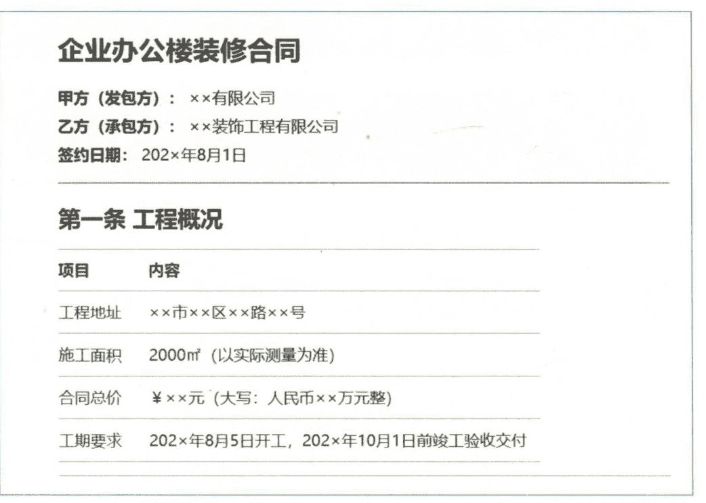

图5-1 DeepSeek 输出示例（节选）

小李复核后上传 DeepSeek 请求风险筛查，模型迅速给出风险提示，如图5-2所示。

这正是 DeepSeek 在合同撰写中的辅助价值：润色、优化与风险提示。

### 四、高风险条款改进建议

1. 增设施工安全保障条款
2. 完善材料管理制度
3. 增加履约担保条款


### 5.1.2 市场调研报告智能生成
市场研究报告撰写常受数据收集繁琐、信息整合复杂困扰：碎片数据难成体系，跨平台验证耗时，趋势捕捉需专业积累，格式反复调整也消耗时间，导致周期长、成本高。

DeepSeek 借助生成式技术重构流程：自动抓取多源数据并智能清洗，生成结构化底板；基于行业知识库进行语义分析，自动识别脉络并输出趋势洞察；内置多维度模板引擎，支持可视化呈现。只需输入关键词与核心需求，即可在数分钟内产出包含数据图表、竞争分析与战略建议的完整初稿。

建议采用结构化提示词公式提升质量：
【提示词公式】
[行业/领域关键词] + [研究目的] + [具体分析维度] + [数据来源/时间范围] + [格式定制]

【示例】
我要写一份母婴产品市场的研究报告，目的是了解市场现状，请从市场规模、前景等角度，结合近五年来市场的数据，给我一个文字初稿。

DeepSeek 目前暂不支持对话框内生成规范图表，若需表格或图形，可在格式定制中提出，如“用 html 或 Markdown 形式对总结数据”，便于在其他软件中生成。

案例：母婴连锁品牌营销专员丽丽需做最新市场调研报告。她先输入示例提示词，得到初步结果，如图5-3所示。

为增强说服力，她补充提示：“给我将历年母婴市场的变化、产品类别做成柱状图，以 html 形式生成”。DeepSeek 很快给出对应代码，如图5-4所示。

# 中国母婴产品市场研究报告（2020-2025年）初稿

## 一、市场规模与增长趋势

### 1. 整体市场规模
中国母婴产品市场规模近年持续扩张。据行业报告，2019年市场规模已接近2万亿元人民币①，另一口径统计显示2019年母婴商品零售市场规模达3.6万亿元，预计2025年将突破5万亿元，年复合增长率约6%-8%③⑧。口径差异导致数据波动，但增长趋势明确。

### 2. 细分市场表现

2025母婴市场观察：基础品类筑底，智能赛道加速

- 婴童食品与日用品仍是市场主力，配方奶、纸尿裤、童装等刚需品类保持稳定需求，同时高端化渗透在加速。以婴童食品为例，至2025年前后仍有望维持较快扩张①④。
- 母婴家电作为新兴分支，增长动能突出，预计2025年零售额有望突破700亿元，年增速约25%⑥。
- 智能化与个性化成为创新主线，远程婴儿监护、定制玩具等品类正逐步放量④⑤。


下方示例展示了母婴市场近年规模及品类占比的HTML柱形图，实际使用时可将模拟数据替换为真实数值后调用：

```html
<!DOCTYPE html>
<html>
<head>
    <title>母婴市场数据分析</title>
    <script src="https://cdn.jsdelivr.net/npm/chart.js"></script>
    <style>
        .chart-container {
            width: 80%;
            margin: 20px auto;
        }
    </style>
</head>
<body>
    <div class="chart-container">
        <canvas id="marketSizeChart"></canvas>
    </div>
</body>
</html>
```


随着资料逐步完善，丽丽把整理好的材料输入DeepSeek进行提炼，最终得到的概括如下：

2025年之后，母婴品类将进入机遇与挑战并存的阶段。积极面来看，尽管新生儿数量收缩压缩了基本盘，但依托消费升级、技术驱动与政策利好，市场仍能实现结构性增长。政策层面，三孩配套、育儿津贴落地为行业注入动力，预计2025年中国母婴市场规模将突破4.68万亿元，并向高端化、智能化方向演进。90后、00后成为育儿主力，对科学养育与健康安全的关注推动细分赛道爆发，比如智能母婴电器中的AI育儿助手、紫外线消毒设备，预计2028年规模超千亿元，有机食品与定制服务需求也在快速抬升。电商下沉与消费提档带动下沉区域逐步释放潜力，中低线城市或成新增长极。

制约发展的难点可归纳为四类。

1. 需求端承压：出生率持续走低压缩新增量，存量竞争加剧倒逼企业做差异化。以配方乳、纸尿裤等刚需为例，同质化严重，需要靠技术突破或用户画像精准化来突围，例如柔性切削胚芽米工艺等。
2. 成本与利润被挤：原材料价格上行、研发投入加大叠加外部经济波动，利润空间收窄，中小品牌生存压力明显。
3. 监管与合规风险：质量安全要求趋严，如婴配乳粉标签新规，企业需要在创新与合规成本间找平衡，数据隐私与AI技术滥用风险也需警惕。
4. 渠道与粘性难题：传统零售萎缩，线上竞争激烈，企业需通过O2O融合、直播种草、IP联名等多元打法提升用户粘性。

总体看，市场需在精细化运营、技术赋能、政策响应之间取得平衡，围绕早教、健康食品等细分场景深耕，并强化绿色转型与全渠道服务能力，才能在人口红利淡化的背景下实现可持续增长。

至此，一份具备调研、数据、图表与结论的研究报告便搭建完成。

### 5.1.3 工作汇报/总结

当前职场节奏加快，工作汇报是高频刚需。数据收集、思路梳理、文本撰写往往耗时数小时乃至数天，对不少人而言既是负担也是效率瓶颈。

对擅长文本生成的DeepSeek而言，这类任务较为轻松。

在用DeepSeek撰写市场研究报告时，可采用结构化提示框架来提升质量：

【提示词公式】

[角色定位] + [核心任务] + [关键成果] + [价值升华] + [后续安排]

【示例】

作为数字化转型项目负责人，Q1完成供应链系统升级，实现订单处理效率提升40%，库存周转率优化28%。该成果验证了AI预测模型在动态需求响应中的有效性，后续将推进跨部门数据中台建设，预计Q3前完成5大业务场景的智能决策模块部署。

沿用上述框架，地产业销售专员小王设计的提示如下：

**角色定位**：地产销售专员

**核心任务**：负责特定区域楼盘销售，涵盖客户接待、需求分析、销售谈判及售后服务

**关键成果**：近一季度共售出15套房产，总销售额达3000万元，客户满意度超90%，通过精准定位与营销策略推动区域楼盘业绩提升20%

**价值升华**：凭借专业销售技巧与优质服务，不仅为公司带来显著经济回报，也提升了当地品牌形象与客户口碑，为后续项目销售奠定基础

**后续安排**：继续深耕该区域，拓宽客户资源，未来一季度目标再完成20套销售，并优化流程将客户满意度提升至95%以上，同时参与行业培训强化专业素养

输入后很快获得一份工作汇报模板，如图5-5所示。

工作总结与工作汇报虽同属职场常用文档，但在目的、结构与侧重点上存在差异，提示词也应区别设计。

工作总结的提示词公式可扩展为：

［角色定位］+［核心任务］+［关键成果］+［问题与不足］+［改进措施］+［后续安排］

［问题与不足］：工作中出现［具体问题］，根源在于［具体原因］，对［具体方面］造成一定影响。

[改进措施]：针对上述问题，拟采取[具体改进措施]。

补充这两项后，DeepSeek即可据此生成工作总结文本模板。

工作汇报：地产销售专员（XX区域）

汇报时间：XX年XX月XX日

## 一、工作概述

作为XX区域专职地产销售，我始终以客户需求为导向，围绕楼盘销售全流程开展工作，包括客户接待、需求分析、销售谈判及售后服务等。过去一季度，依托精准市场策略与高效执行，既超额完成销售目标，也推动区域业绩与品牌口碑双提升。

## 二、核心任务完成情况

1. 客户接待与需求分析

   - 累计接待客户200+组，通过专业沟通快速挖掘户型偏好、预算范围、购房用途等核心需求，建立个性化服务档案。
   - 针对刚需家庭、投资客等不同群体制定差异化推介方案，提升转化效率。

图5-5 DeepSeek返回内容（节选）

### 5.1.4 可行性报告

撰写可行性研究报告是职场写作的重要环节，但难度较高。报告需覆盖市场分析、技术评估、经济可行性、法律合规、组织管理、环境影响、风险评估与实施计划等多个维度，要求作者具备跨学科分析能力。同时，报告依赖大量数据支撑，市场调研、技术参数、财务数据等收集整理耗时耗力；此外，逻辑严谨性与说服力是决策的关键。

DeepSeek可有效缓解这些痛点。输入项目背景与要求后，可快速生成报告框架与初稿。用户可指定报告类型、目标、分析维度等，DeepSeek依托语言生成与数据处理能力输出结构完整、内容丰实的初稿，节省时间并保证格式规范、逻辑清晰，且可根据反馈持续优化。

## 【提示词公式】

[ 行业/项目关键词 ] + [ 报告目的 ] + [ 分析维度 ] + [ 数据约束 ] + [ 格式要求 ]

## 【示例】

智能仓储物流项目可行性研究，用于政府专项债申报，需涵盖技术方案、经济可行性、社会效益分析，数据需覆盖未来五年预测，输出带财务测算表的初稿。

刘经理是重庆某连锁火锅品牌负责人之一，年前考察武汉市场后拟在当地开设分店，需一份可行性研究报告。

按公式他设计了如下提示词：

> 连锁火锅品牌跨省扩张，用于投资决策，分析武汉市场可行性，需包含：
> 1. 目标客群（25—40岁）消费习惯；
> 2. 核心商圈（楚河汉街、光谷）竞争格局；
> 3. 供应链成本（食材采购+冷链运输）；
> 4. 盈亏平衡点测算。数据引用武汉市统计局2023年报、美团研究院2024一季度数据，生成带单店投资回报表的可行性研究报告，要求内容可转为PPT

输入后获得一份可行性研究报告初稿，如图5-6所示。

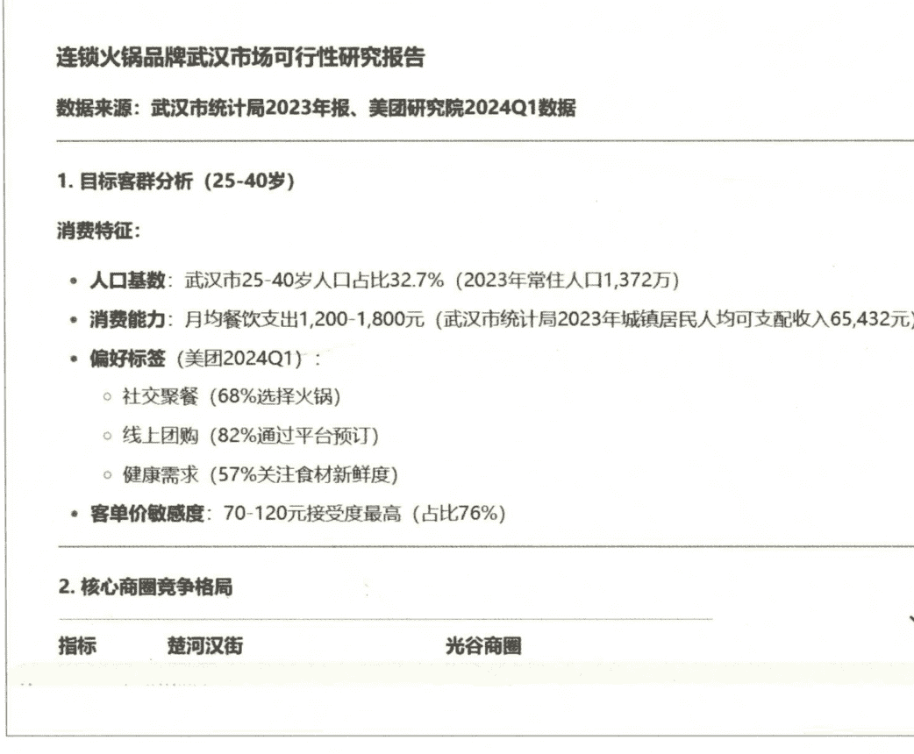

图5-6 DeepSeek返回内容（节选）

考虑到后续以PPT呈现的需求，DeepSeek还在报告结尾提供了PPT设计建议：

- 封面：品牌LOGO+武汉地标图
- 目录页：4大模块导航
- 数据页：多用柱状图/饼图（消费偏好、成本结构）
- 对比页：商圈竞争表格+地图标注
- 财务页：投资回报表+盈亏平衡公式
- 结论页：红绿灯风险评估+战略建议

短短几分钟，一份可行性研究报告雏形即成，效率可见一斑。

## 5.2 如何用DeepSeek写作各类商业文案

商业文案创作常面临灵感枯竭、受众把握不准、优化反复等问题，既耗时又易出现吸引力不足的情况。一方面需从海量信息中提炼创意，避免陷入俗套；另一方面若不能精准触达用户痛点，文案易与需求脱节。语言流畅度与逻辑合理性也需反复打磨。

借助DeepSeek等智能写作工具可大幅改善上述问题。它能快速解析大量优秀文案的内在规律，提供创意灵感与用户洞察，并通过智能优化建议提升创作效率与质量。

### 5.2.1 硬广型文案

无论传统媒体还是自媒体，带货都离不开产品推广，文案是决定效果的关键。

产品推广类文案的核心在于精准锁定目标人群，洞察其需求痛点与消费习惯，针对性凸显产品解决问题能力。要巧妙呈现产品独特卖点，用通俗易懂且具感染力的语言表达，避免术语堆砌。可借助情感共鸣，通过用户故事或场景描绘增强代入感。同时制造紧迫感与稀缺感，如限时优惠、库存紧张等话术，促使用户尽快行动。最后以清晰明确的行动号召收尾，引导点击、咨询或购买。

写作逻辑为：【找准目标客户痛点】→【给出解决方案】→【信任背书】→【行动号召】。

据此可构建提示词结构：【场景痛点】+【产品亮点】+【数据/证明】+【限时优惠】

#### 1. 某款肩颈按摩仪的文案：

连续伏案三小时后脖颈刺痛如针扎？职场抽屉常备的XX肩颈按摩仪专为久坐人群设计！搭载专利3D仿生按摩机芯，精准还原中医推拿揉、捏、压三重手法，配合超导石墨烯热敷层5秒速热至42℃，实测92%白领午休15分钟即可缓解肌肉劳损。即刻下单享早鸟三重礼：①直降200元破冰价仅599元 ②前100名赠价值198元助眠颈枕 ③晒单再返50元红包！活动仅剩最后48小时，已有357位白领抢先体验『把按摩科搬进工位』的治愈感，点击下方立即释放肩颈压力！

#### 2. 某品牌吸奶器文案

> “凌晨两点，宝宝饿得哭闹，我却因乳腺炎疼到发抖……直到遇见这款吸奶器！双边同步吸奶，10分钟收集200ml黄金母乳，智能变频模式如宝宝吮吸般温柔，乳头疼痛降低50%！三甲医院产科护士长亲测推荐，欧盟CE认证材质，背奶妈妈称赞‘可放入迷你包’！下单即赠30个储奶袋+便携清洁刷，直播间前100名加赠防溢乳垫！点击下方链接，让每个哺乳妈妈都能安睡！”

产品推广文案是连接产品与消费者的桥梁。掌握写作技巧并结合DeepSeek等工具，可更高效产出爆款文案，提升推广效果。优质文案不仅是宣传工具，更是品牌与消费者建立信任与情感的关键纽带。

### 5.2.2 故事型文案

在内容为王的时代，故事型文案对品牌宣传与个人创作都至关重要。它以情节与人物为载体，将产品或理念自然融入，让受众在阅读中潜移默化接受信息。但创作引人入胜的故事型文案需要技巧。

精彩情节是核心，需精心设计开头、发展与结尾，制造冲突、悬念与转折。人物是灵魂，通过细腻描写赋予独特性格、外貌与背景，呈现喜怒哀乐，并设置成长与转变引发共鸣。产品或理念应巧妙植入，避免硬广，可由主角使用解决问题或在情节中自然体现。运用环境、场景、动作与对话等细节描写增强沉浸感，语言口语化、生活化更易接受。

写作逻辑为：构建引人入胜的情节→塑造鲜明人物形象→融入产品或理念→营造真实感与代入感。

提示词结构模板：【故事背景】+【人物设定】+【冲突与挑战】+【产品/理念融入】+【结局与启示】

借助 DeepSeek 产出爆款故事型文案。

#### 1. 某户外运动手表的文案

在人迹罕至的深山中，探险爱好者小李遭遇迷路与恶劣天气，手机无信号。所幸他手腕上的××户外运动手表成为救命工具。手表具备精准GPS定位，即便在密林也能快速锁定位置；海拔气压计、指南针、温度计等功能提供全面环境数据，帮助制定逃生方案；50米防水设计无惧溪流暴雨。凭借手表指引，小李成功走出深山。××户外运动手表不仅是探险装备，更是生命守护者，陪伴探索未知、挑战极限。

#### 2. 某品牌环保袋的文案

在都市一角，环保志愿者小张默默坚守。她穿梭街巷宣传环保，发放自制环保袋。该袋采用100%可降解材料，坚固耐用可重复使用上百次，折叠设计便于携带，时尚图案由环保艺术家绘制。小张的故事经媒体报道后，越来越多的人加入环保行列，使用××品牌环保袋成为一种时尚。选择××环保袋，就是选择绿色生活，为地球贡献力量。

故事型文案以独特魅力占据信息传播重要位置。掌握技巧、运用核心逻辑并借助DeepSeek，可更高效生成爆款文案，让产品或理念生动呈现，打动受众。在激烈的内容竞争中，优质文案是创作者的骄傲，也是品牌与消费者建立深厚情感的桥梁。

### 5.2.3 热点型文案

信息爆炸时代，新闻热点型文案是品牌吸引流量、提升关注的重要手段。它借助热门事件热度，将产品、服务或观点巧妙融入，实现高效传播与用户参与。但创作贴合热点又能有效传递信息的文案并不容易。

核心在于时效性，需时刻关注时事、社交媒体热议话题、行业动态，筛选关注度高、讨论度大的事件作为素材，如重大节日、赛事、明星动态、科技发布等。

需找到与自身产品或品牌契合的切入点，让产品自然融入热点，避免硬广。如高温天气热点，销售户外便携制冷设备的品牌可从防暑降温角度切入，介绍产品如何应对高温。

文案需体现事件的当下热度与紧迫性，使用“刚刚发生”“正在热议”“限时参与”等词汇增强即时吸引力。

必须基于事实，保持客观真实，避免虚假夸大，语言专业规范，符合新闻风格，提升可信度与权威性。

#### 新闻热点型文案的写作核心逻辑

敏锐捕捉热点事件→找准切入点与产品关联→突出时效性和紧迫感→保持客观真实与专业性

提示词结构模板：

【热点事件】+【产品关联】+【时效性】+【行动号召】

借助 DeepSeek 产出爆款新闻热点型文案：

#### 1. 某智能学习平板的文案

高考成绩刚出炉，考场上的逆袭故事正刷屏全网。此时推出的××智能学习平板，正好借势助力考生冲刺理想院校。设备内置了顶级教研团队打磨的精品课和历年真题精讲，错题本能自动圈出薄弱知识点，24小时待命的AI辅导师随时解答疑问。权威教育科技测评显示，长期使用该平板的学生，数学均分上涨约15分，英语均分上涨约20分，语文均分上涨约10分。迎合放榜季，官方推出限时福利：直接减免300元，并附赠价值299元的名师高考冲刺音频课，优惠窗口为高考结束后30天内。想快速切换到学霸状态，可通过下方链接开启智能学习。

#### 2. 防晒喷雾品牌案例
入夏后气温攀升，防晒成为日常出行的刚需。××品牌的防晒喷雾本季备受青睐。产品运用纳米级防晒科技，标注SPF50+ PA++++，号称可拦截99%紫外线，防水防汗配方即便在海边戏水也能保持防护。质感轻薄，喷雾雾化细腻，涂抹后不黏腻，宛如为肌肤披上一层看不见的防护膜。美妆达人亲测反馈，涂后肌肤依然水润透亮，未出现发黑或色斑不均。恰逢暑期大促，满100元立减20元，满200元立减50元，并额外赠送同牌保湿面霜一支，活动于本月底截止，想要轻松抵御烈日可点进下方链接守护肌肤。

新闻热点型文案擅长搭热点做传播借力，曝光速度快、扩散力强。掌握其写作方法，配合核心逻辑搭建，再借助DeepSeek等智能工具辅助创作，能更高效产出爆款内容，让品牌在热点话题里脱颖而出，实现流量转化。在信息竞争激烈的环境下，优质的热点型文案既是创作者的利器，也是品牌连接大众、提升知名度和美誉度的关键桥梁，帮助品牌乘着热点东风赢得关注与信任。

### 5.2.4 知识干货型文案
创作知识类内容前，需先分析目标人群的知识储备、学习痛点和期望收获。以职场新人为例，他们更需要基础办公软件技巧；创业者则更关注市场分析与融资策略等。

知识干货文案讲究逻辑清晰、层次分明。可采用总分总、递进式、问题解决式等结构，每一部分配上明确小标题，便于快速浏览。

撰写时应避免生僻术语，用通俗语言解释专业概念，句子保持简洁，提升信息传递效率。为增强实用性和可信度，可加入真实案例展示知识应用，并推荐相关学习资源、工具与技巧。

写作逻辑为：精准定位知识需求→搭建清晰逻辑框架→使用简明语言表达→补充案例与工具建议。
提示词结构模板：【知识领域】+【受众需求】+【核心知识点】+【案例/工具】

DeepSeek辅助生成爆款知识干货文案。

#### 1. 职场沟通技巧案例
职场里，沟通不畅常是效率低下和团队矛盾的根源。××职场沟通指南教你成为沟通高手。首先要会积极倾听，保持眼神交流、适时点头并给予回应，让对方感受到尊重。其次学会用“我”句式表达观点与感受，减少指责。例如提出不同看法时说“我有些不同想法，想和你一起探讨”，而非“你这样做完全错了”。最后可使用非暴力沟通模型，清晰说明观察、感受、需求和请求，使交流更顺畅。据职场研究，掌握这些技巧的员工工作效率平均提升30%，团队满意度提高40%。关注公众号并回复“沟通技巧”，即可领取免费沟通思维导图和练习题，快速提升能力。

#### 2. 摄影教程品牌案例
摄影爱好者常觉得作品不够专业。××摄影教程助你从零迈向大师。课程涵盖相机基础、构图方法、光线运用与后期处理等核心模块。构图部分讲解三分法、引导线、框架法等提升视觉冲击力；光线部分详解黄金时段特点与拍摄手法，让照片呈现梦幻光影。配套大量实拍案例与练习，帮助巩固知识。数据显示，学习本教程的学员作品入选率提升50%，摄影水平明显进步。购课即送价值199元的后期软件XX，前200名还能加入学习交流群，与专业摄影师一对一互动。活动限本月底，下方链接开启摄影之旅，记录美好瞬间。

知识干货型文案凭借实用性和高效性，在知识传播中作用显著。通过精准定位、清晰结构、简洁表达及案例工具补充，能打造真正有价值的内容。借助DeepSeek等工具，创作者可更高效产出高质量内容，满足用户多领域学习需求，帮助其在知识市场中脱颖而出，赢得认可与信赖。

### 5.2.5 情感共鸣型文案
打动人心的往往是真实的故事。创作情感共鸣类文案需要挖掘生活中的真情实感，无论是亲身经历还是他人动人故事均可采纳。用细腻笔触呈现情感细节，增强真实感，更易引发共鸣。

核心在于情感的细腻刻画。运用形容词、比喻、拟人等手法生动描绘人物内心，让读者体会喜怒哀乐。例如写母爱时可用“母亲的眼神像暖阳，轻轻覆在身上，每一次注视都饱含关怀与牵挂”。

产生代入感是关键。通过具体场景、人物与情节，让读者仿佛身处其中。例如“雨夜里，他独自走在空街，心中满是对未来的迷茫与不安”，容易让读者联想到自身经历而共情。

结尾需对情感进行升华，点出故事的深层意义，同时加入明确行动号召，将情感体验转化为实际行为。例如“如果你也被这份母爱触动，不妨现在就给妈妈打个电话，说说你的爱”。

写作逻辑：讲述真实故事→细腻情感描写→引发代入感→情感升华与行动号召
提示词结构模板：【情感主题】+【真实故事】+【情感细节】+【行动号召】

借助DeepSeek生成爆款情感共鸣文案。

#### 1. 亲情主题案例
在偏远山村，老母亲每天都站在村口老树下凝望远方城市，等儿子归来。儿子为追梦独自北上打拼，母亲的牵挂却未减半。她用粗糙的手为儿子织了件件毛衣，每针每线都藏着思念。××亲情公益活动呼吁关注留守母亲，为她们送去温暖。参与即可获知名作家亲笔撰写的亲情散文集一本，让我们用行动传递爱，让母亲不再孤单。

#### 2. 爱情主题案例
“我爱你”他说了整整二十年。从青涩少年到白发夫妻，他们的爱情经受风雨依然坚定。贫苦时相互扶持，幸福时彼此珍惜。××婚庆珠宝推出“永恒之爱”对戒系列，采用玫瑰金与璀璨钻石，象征爱情的恒久。购买还可获赠免费婚庆策划服务，让爱情得到完美诠释。点击下方链接开启幸福旅程，让爱情在时光中闪耀永恒光芒。

情感共鸣文案凭借强感染力在创作领域独树一帜。通过真实故事、细腻描画、代入感营造及结尾升华，创作者可打造直击心灵的作品。借助DeepSeek等智能工具，可更高效生成高质量情感文案，搭建品牌与消费者间的深厚情感纽带，实现有效传播与长远发展。

## 5.3 DeepSeek的高效办公技巧
职场中重复性机械工作让人疲惫，如做PPT、整理表格、撰写会议纪要、处理邮件等，不仅消耗时间精力，还降低效率与创造力。

## 5.3.1 DeepSeek 快速生成PPT
在AI出现前，制作PPT多靠挑选模板后手动填充内容。DeepSeek等工具彻底改变了这一流程。

以前文市场调研报告为例，演示如何从零生成PPT。

第一步：简化提示词，例如“请给我一份2025年轻食市场调查报告，要求适合做成PPT”。DeepSeek会生成结构化文本。

第二步：将生成内容复制保存为文本格式，通过其他AI工具如Kimi网页版的PPT助手一键转换。

第三步：把内容上传对话框，点击“一键生成PPT”。

第四步：挑选模板并自定义风格后生成。整个过程可在两分钟内完成，后续可下载或自行微调。

图5-7为DeepSeek反馈节选
# 一、市场规模
## 1. 轻食餐厅市场
- 2025年预测规模：整体市场预计突破2000亿元，年复合增长率约15%，沙拉与健康简餐占比超60%，中式轻食增速最快年增25%。
- 区域分布：一线城市占比45%，二线及下沉市场增速达30%。
## 2. 代餐轻食市场
- 2025年预测规模：中国市场预计达3534.9亿元，年增速30%，功能代餐占比超50%，日常代餐年增25%。
## 5.1 战略重点与发展方向
聚焦差异化产品、强化供应链韧性、布局下沉市场，提升品牌竞争力。
## 5.2 数据来源与报告参考
数据来源于中研网等行业报告，为分析提供依据。

## 5.3.2 DeepSeek 快速生成思维导图
思维导图能以可视化方式呈现复杂信息。结合DeepSeek与制图工具可快速完成。

例如输入“梳理AI发展历史并以Markdown格式输出思维导图”。获取代码后可通过豆包等工具直接生成导图。

专业需求可借助XMind：保存Markdown文件后导入XMind，通过文件-导入-markdown即可得到更专业的导图。

## 5.3.3 DeepSeek制作表格及应用
DeepSeek不能直接输出Excel，但擅长数据汇总与清洗。以“河北省2023年各城市GDP数据”为例，先让其以Markdown格式生成表格后复制。

再用语雀等支持Markdown转换的应用新建文档粘贴，点击转换即可得到表格。

随后可借助WPS等工具进行操作。接入DeepSeek的WPS可通过语音或文字一键生成图表，如柱状图或饼状图，极大简化表格难题。

## 第六章 用 DeepSeek提升自我，助力生活
在个人成长与生活优化上，DeepSeek是全能智能助手。可提供个性化学习计划和资源，帮助高效掌握新技能；在健康方面提供健身计划、饮食建议和健康追踪；育儿方面给出科学方法与教育资源推荐；旅游方面按偏好与预算规划行程，推荐景点酒店美食。总体而言，它通过强大智能能力在多个生活领域创造价值，助力自我提升与生活品质升级。

## 6.1 DeepSeek助你迅速进入新领域
知识在当下呈现“廉价又昂贵”的悖论。信息易得却难内化，信息过载导致知识眩晕，碎片化学习造成知识虚胖。AI正推动学习革命，让陌生领域学习不再孤独。

以小张为例，他看完《星际穿越》后对天文学产生兴趣，仅知八大行星。向DeepSeek提问自学建议后，获得系统学习路径、入门书单与在线资源推荐。

为加速入门，他要求制定一月、两月、三个月的学习计划。DeepSeek将三个月拆分为12周，第一周聚焦天文学基础，包括历史发展与基本术语如天体、星座、光年、视星等。

用 DeepSeek 把天文自学这件事做扎实
想要借助 DeepSeek 入门天文，先把整体框架理清楚。第一步就是认清太阳系的构成，把中心天体、八大行星、各类卫星、小行星带、彗星等基本成员先建立在脑子里。

资料准备可以拆成读与看两条线。把《天文学：从入门到精通》的首章细读一遍打底，再跟上 CrashCourse Astronomy 前五集的视频建立直观感受。实操方面装一个 Stellarium，熟悉界面操作后在模拟天空中把行星家族的主要成员逐个找出来。

这只是起步，后续就能让 DeepSeek 按周推进。小张的第一周安排是：天文史与发展脉络、基础术语梳理、太阳系成员概览。把问题抛过去基本都能得到清晰的结构化回馈，而且配合提问技巧可以让回答更深入。每个大主题下都可以继续拆成小问题追问。

比如想搞懂最靠近太阳的水星，可以这么问：【水星是距离太阳最近的行星，它到底是什么样的天体？】用基础版的 DeepSeek V3 很快就能拿到概览。

水星在所有行星里离太阳最近，体积也最小，直径约四千八百八十公里，大约只有地球的百分之三十八左右。关键数据如下。

基本信息
平均日距约五千八百万公里，最近时约四千六百万公里，最远时约七千万公里。
绕太阳一圈需要八十八个地球日，自转一周约五十八点六个地球日，自转迟缓导致昼夜更替异常漫长。

物理特征
温差极端。白天因贴近太阳且近乎没有大气，表面可升至四百三十摄氏度；夜晚热量瞬间流失，骤降到零下零百八十摄氏度左右。
地表环境恶劣，几乎没有大气层来保温。

图6-2 DeepSeek 反馈（节选）

若想把资料存档，可以要求模型不要用符号，用一段连贯文字输出。于是得到一份干净的笔记：

【水星是太阳系里离太阳最近的行星，也是最小的行星，直径约为四千八百八十公里，仅为地球的百分之三十八。它距离太阳平均约五千八百万公里，公转周期为八十八个地球日，自转周期约为五十八点六个地球日，因此昼夜交替非常缓慢……（节选）】

学下去后 DeepSeek 的服务感很强。没空读推荐的书就让它做摘要，论文读起来吃力就让它用通俗语言转述。想用得更顺手，就按阶段和需求定制提示。

提示词1：【学习目标】我想学 [ 领域 ]，目的是 [ 职业发展/个人兴趣等 ]，希望达到 [ 入门/精通 ] 等级，能在 [ 具体场景 ] 中应用。每周可投入 [ X ] 小时，期望在 [ 时间期限 ] 内看到明显进步。

提示词2：【简化梳理】请把 [ 领域 ] 从基础到进阶的知识体系整理出来，涵盖核心概念、原理、技术、方法、工具等，以思维导图或大纲形式呈现，并在体系中标出重要程度、学习难度及相互关联，帮助我排优先级。

提示词3：【阶段计划】为我制定详细的学习路线，每个阶段列明任务、目标、预期产出、大致时长与检验方式，并推荐适配阶段的书籍、在线课程、视频、论文、博客等资源并说明特点。

提示词4：【学习方法和技巧】针对 [ 领域 ] 给出高效学习法，如何快速掌握基础、吃透复杂概念、提升实践能力，结合实例说明。并教我主动学习的方法，如提问、反思、总结、应用，以及记忆技巧提升留存率。

提示词5：【实践应用】为我设计由易到难的实践项目或任务，覆盖不同应用场景，每个项目明确目标、要求、步骤和评价标准。推荐可操作的平台、社区或工具，并指导如何有效使用。

提示词6：【巩固强化】建立一套进度追踪机制，帮助定期复盘总结，及时发现问题并调整。提供测试题、作业、项目评审等评估方式，对成果做客观评价。

提示词7：【个性化调整】了解我的学习风格偏好，如视觉型、听觉型、动手型等，结合已有知识背景，对内容和方式做个性化优化。

6.2 用DeepSeek高效写论文
从选题到降重，论文写作每个环节都很费力。DeepSeek 能把流程提速：快速搭框架、按大纲扩写段落、润色学术表达，还能辅助降重。

6.2.1 一键生成论文框架
大纲是写作的骨架。主题确定后把题目交给 DeepSeek，就能得到初步结构。

比如历史系学生要写《先秦殉葬制度研究》约一万字，要求结合最新成果生成大纲。DeepSeek 给出如下框架，如图6-3、图6-4。

1. 引言
1.1 研究背景与意义
殉葬制度是观察先秦社会结构的重要窗口，有助于理解早期国家形态、宗教信仰与等级秩序。近年来殷墟人殉坑、西周车马殉葬等考古新发现为研究带来新视角 1 12。
1.2 研究现状与问题
梳理中外研究脉络，指出当前争议焦点如殉葬动机的宗教性与政治性之争 16。提出创新点：融合人类学与考古学视角，探讨殉葬与社会权力互动。

2. 先秦殉葬制度的起源与发展
2.1 史前丧葬观念
旧石器时代中期灵魂观念与早期埋葬行为，如山顶洞人赤铁矿粉的象征意义 16。
新石器时代殉葬萌芽，从随葬品到人殉的过渡，仰韶、龙山文化墓葬提供证据 16。
2.2 商周时期制度化
殷商人殉鼎盛，宗教动因如魂魄分离与祖先崇拜 16。
图 6-4 DeepSeek 反馈（节选）

模型能根据反馈调整章节顺序与逻辑，用户简单指令即可重排，确保思路通顺。AI 能快速搭框架、提供新视角，但仍需人工把关。

6.2.2 分段写作与常见风险
论文写作需要作者主导，AI 只是助力。DeepSeek 处理长文本能力有限，面对复杂长篇容易吃力，最佳做法是拆解任务，按章节分步生成，每完成一段即检查修正再进入下一段。

仍以殉葬制度为例，大纲确定后，可逐节下指令：【以具体要求为背景，撰写引言第一节 研究背景和意义】。模型会很快给出初稿，如图6-5所示。

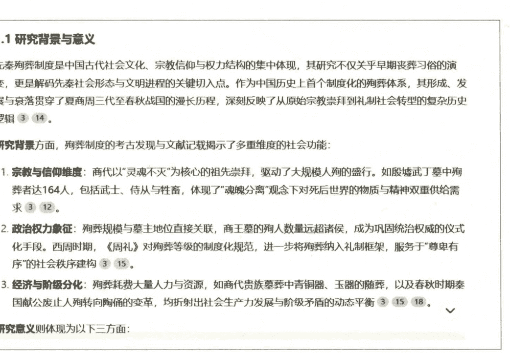
AI 写作论文常出现四大问题。

1. 虚假引用
模型可能生成不存在的作者、书名、期刊。未核实即使用会违反学术规范。
解决办法：逐条核对参考文献真实性；结合自身研究补充调整；借助EndNote、Zotero等工具管理校对。

2. 内容失实
尤其在数据统计部分容易出现事实错误，误导研究。
解决办法：仔细校对修改；将生成内容与自身研究结合；对数据做严格验证。

3. 语言僵化
文本生硬机械，缺乏学术深度和个性。
解决办法：人工润色增强表达；保持段落逻辑连贯；提升语言多样性。

4. 抄袭风险
生成内容与已有文献相似度过高，易被查重系统识别。
解决办法：用查重工具检测；用自己的话改写润色；规范引用，标明出处。

6.3 健康管家：营养师 + 健身教练
在快节奏生活中，DeepSeek 不仅能答疑，也能做专属健康顾问，提供个性化饮食与训练方案。

6.3.1 个性化营养定制
食物选择丰富但均衡难题突出。忙碌、美食诱惑、个体差异都让营养管理变复杂。DeepSeek 可依据身体状况、目标和口味偏好，定制可执行的饮食计划。

有效提示词结构为［角色设定］+［数据约束］+［分阶段计划］+［个性化要求］。

案例：小林，朝九晚五女性，三十岁，近期低血糖，体重指数二十八，不爱吃面食。提示词为：我是一名朝九晚五的女性上班族，三十岁，最近有些低血糖，体重指数为二十八，请你根据我的情况为我设计一个分阶段的合理饮食计划，我不喜欢吃面食。

第一阶段：稳定血糖 二到四周
规律进餐，选低升糖指数食物，避免血糖波动。每天三餐加两次加餐，上午十点、下午四点，避免空腹过久。改用红薯、南瓜、糙米、藜麦、豆类替代面食，每餐搭配约一拳头大小；每餐包含优质蛋白如蛋、鱼、豆腐、瘦肉，增强饱腹；避开添加糖和精加工食品，用橄榄油或亚麻籽油烹饪。

早餐：水煮蛋两个 + 蒸南瓜一百五十克 + 无糖豆浆二百毫升 + 小番茄五颗
上午加餐：原味杏仁十颗 + 希腊酸奶一百克无糖
午餐：杂粮饭糙米小米八十克 + 清蒸鱼手掌大小 + 西兰花炒木耳二百克
下午加餐：中等苹果一个 + 水煮毛豆五十克
晚餐：番茄豆腐汤豆腐一百五十克番茄一个 + 芦笋炒鸡胸肉一百五十克 + 蒸山药一百克
同时给出第二阶段温和减重至体重指数小于等于二十四、第三阶段长期维持的详细方案，如图6-6所示。

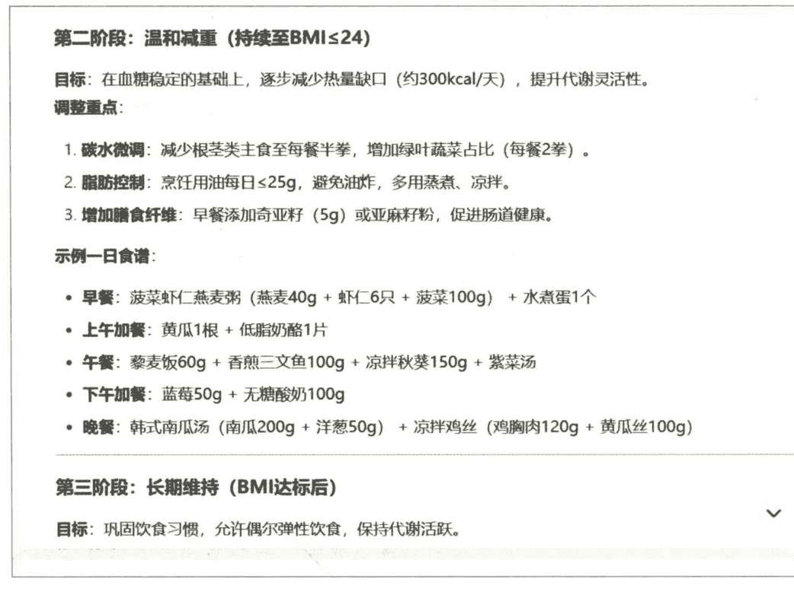
图6-6 DeepSeek反馈（节选）

可见模型能结合营养学知识输出高度可操作、贴合个人的方案。

6.3.2 定制健身方案
DeepSeek 能根据基础体测参数和目标制定训练计划，并据反馈调整，减少受伤风险。

示例提示词：【身高一百七十五厘米，体重八十公斤，三个月内减到七十公斤，每天可练一小时，请设计阶段性健身方案】。

第一阶段：适应期第一到四周
目标：建立习惯，提升基础代谢
训练安排：每周六练一休
力量训练：深蹲三组乘十五次；跪姿俯卧撑三组乘十二次；哑铃硬拉三组乘十五次；弹力带划船三组乘十五次；平板支撑三组乘四十五秒
有氧选择：慢跑配速七到八分每公里；跳绳间歇一分钟跳三十秒走；爬楼梯二十层乘三组
后续第二、三阶段计划如图6-7所示。

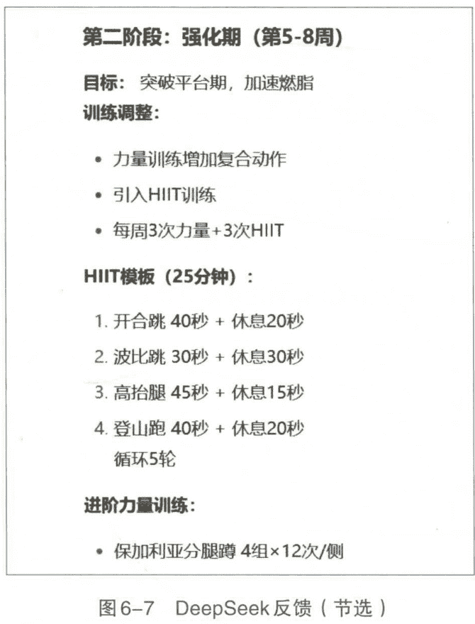
图6-7 DeepSeek反馈（节选）

模型还主动补充饮食与注意事项：
热量缺口控制在五百到七百大卡每天；早餐两个全蛋加一片全麦面包加二百毫升无糖豆浆；午餐一百五十克糙米饭加二百克鸡胸加绿叶菜；晚餐一百五十克蒸鱼加豆腐蔬菜汤；加餐酸奶或二十克坚果；禁忌含糖饮料、精加工食品、酒精。
注意事项：每周体重下降控制在零点八到一公斤之间；每十天测量一次腰围；力量训练后补充二十克乳清蛋白；睡眠保证七小时以上；每日饮水量大于二千五百毫升。

6.4 智能导游消解旅行焦虑
现代旅行常陷信息过载：热门景区分流难、小众路线难找、文化背景不明，语言障碍和突发状况更添困扰。即便做足攻略，体验仍可能打折。如何在有限时间内兼顾兴趣、预算、体力，做出高效且能动态调整的行程，是出行者的一大难题。游客偏好差异大，预算时间体力各不相同，天气、交通、临时闭馆等意外让传统攻略难以应对。

出行既轻松又有自己的调性，怎么做到？把 DeepSeek 当成随身的智能领队，它能结合实时资讯和你的个人偏好，拼出一套可随时微调的路线。既能融合当地特色与个人喜好设计动线，也能提供文化背景解读、在地语言支持，遇到突发状况还能立刻重排，让旅程更从容高效。

要让它真正客制化，提示词的精确度是关键。常用的组合是：角色设定 + 目的地信息 + 兴趣偏好 + 时间预算限制 + 特殊要求。

实际案例更直观：

小江要去京都自由行五天，预算中等，想深度体验传统文化又不想跟团。他的指令是：

> “我是一名文化爱好者，计划在京都自由行5天，预算中等。希望以寺庙、手工艺体验和本地美食为主，每天步行不超过1.5万步，不参加团体观光，请设计一份分阶段的行程计划。”

整理后的方案条理清晰：

头两天以文化探访为主，放在第1到2天，核心是错峰出行并感受古都氛围。第一天清晨7点直奔清水寺，利用开馆初期人少时段参拜，之后可预约茶道课感受传统礼仪。中午挑祇园附近一家小众怀石料理，人均控制在5000日元左右。午后沿哲学之道慢走，探访法然院、安乐寺等清幽寺院，途中还能加入和果子制作工坊，体会日式点心文化。傍晚到鸭川纳凉床用晚餐，推荐一家提供英文菜单的本地居酒屋，既地道又免去语言困扰。

出门怕踩坑也很常见，比如货不对板。借助内容检索与分析，也能提前规避麻烦。

比如首次跟团去泰国曼谷，想更顺利，可以这样问：【我即将跟团去泰国曼谷旅游，请根据网上的旅游攻略，为我生成一份避雷清单】。

它马上就能列出清单。如图6-8所示。

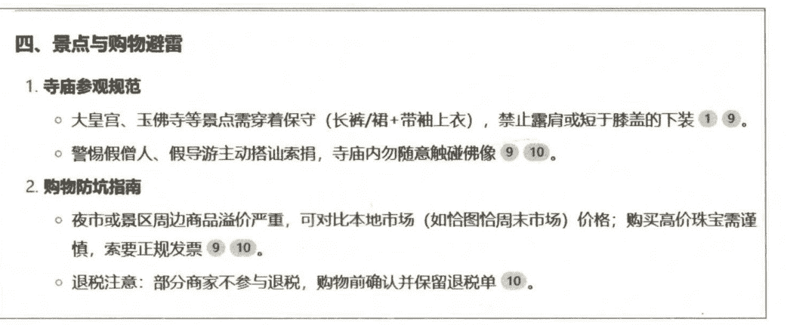

总体来看，现代旅行变数多，借助这类智能向导，只要给一套精准的提示词，就能规划出契合兴趣与需求的行程，避开雷区，让每次出行更省心更有个性，也为旅程留下更多美好回忆。

## 6.5 秒答孩子的十万个为什么

孩子长大时，家长常被两件事卡住：一边是“星星为什么不掉下来”之类的天马行空提问，一边是数学应用题等作业辅导。过去靠家长的知识储备和耐心，可面对层出不穷的问题和与时俱进的学科内容，很容易力不从心。怎么在保护好奇心的同时给出科学解释？怎么高效辅导作业又不打击学习热情？这正是当下家庭教育的痛点。

### 6.5.1 用DeepSeek把专业解释变成孩子能懂的故事

孩子的问题看似简单却很哲思，比如“我是怎么生出来的”“云能吃吗”。直接上生物或物理术语容易超纲，还会扼杀探索欲。这时需要把科学知识转译成童趣语言，既回应好奇，又为后续学习埋下种子。

借助 DeepSeek 很好解决。记住提示组合：小朋友的年纪 + 提问类型 + 表达风格要求。

比如5岁的小明问：“妈妈，我是从垃圾桶捡来的吗？”家长输入： “我的孩子5岁，询问自己是怎么出生的，希望用比喻和故事化的方式简单解释，避免复杂术语。”

它这样说：

> “宝贝呀，你最初就像一粒小种子，住在妈妈肚子里一个又暖又舒服的小房间里。爸爸妈妈很爱你，天天给小房间送去营养和爱，等你长得结实了，医生阿姨会帮妈妈打开小房间的门，让你来和我们见面啦！以后长大一点，我们可以一起看绘本，找找小种子是怎么变成小宝宝的哦～”

这类问题总会层出不穷，下面几例家长常不知怎么回，也能借助 DeepSeek：

案例演示：

**1. “太阳晚上去哪儿了？”**
提示词：“孩子6岁，问太阳晚上为什么消失，希望用童话故事的方式解释昼夜交替，避免使用‘自转’等术语。”
它这样说：
> “太阳公公每天早上坐着金色马车从东边出发，一路给大地送光送暖。傍晚工作累了，就悄悄躲到山后面休息啦！这时月亮姐姐带着星星宝宝出来值班，轻轻哼着歌守护大家做梦哦～”

**2. “为什么树叶会变黄？”**
提示词：“孩子4岁，观察秋天树叶变黄，需用拟人化比喻解释叶绿素变化。”
它这样说：
> “每片叶子里住着许多绿色小精灵，夏天它们最活跃，把叶子染得绿油油的。秋天变冷，小精灵怕冷就躲进树干取暖。它们走了，叶子就露出原本的黄色外套啦！明年春天小精灵回来，叶子又能穿新裙子了！”

**3. “彩虹是怎么来的？”**
提示词：“孩子5岁，问彩虹出现的原因，需用生活化比喻解释光的折射和反射，避免专业术语。”
它这样说：
> “下雨后，太阳公公会和雨滴玩捉迷藏！阳光钻进小水滴里转了个圈，就像穿过七彩玻璃球，把颜色分成红橙黄绿蓝靛紫。这些颜色排好队挂在天上，就成了彩虹桥！下次下雨你可以用喷壶对着阳光喷水，自己造一座小彩虹哦。”

**4. “小鱼在水里怎么睡觉？”**
提示词：“孩子4岁，好奇鱼是否睡觉，需用拟人化描述鱼类休息方式。”
它这样说：
> “小鱼当然会睡觉啦！不过它们没有床和枕头，而是睁着眼睛慢慢游，或者躲在水草里轻轻摇晃。就像你玩累了躺沙发上打盹，小鱼也会边游边休息。你悄悄靠近鱼缸，可能看到它们一动不动地‘发呆’呢！”

**5. “为什么昨天不能再来一次？”**
提示词：“孩子6岁，对时间不可逆感到困惑，需用比喻解释并引导珍惜当下。”
它这样说：
> “时间就像你最爱的火车，哐当哐当一直往前开，不能掉头去接昨天的乘客。但我们可以用魔法相机把开心的昨天留下来，比如游乐园的照片、捡到的漂亮树叶，都是火车留给我们的礼物。所以今天要好好玩，制造更多魔法礼物哦！”

用 DeepSeek 回应孩子的关键有三点：
- 具象比喻：用“种子”“小房间”等替代专业术语；
- 留白引导：暗示以后可以深入，保持提问兴趣；
- 情感安抚：强调父母关爱，避免孩子不安。

### 6.5.2 从解题到点燃兴趣的作业辅导

辅导作业时家长常两难：直接给答案会削弱思考，反复讲又容易抵触。DeepSeek 能通过分步引导和趣味互动，把被动灌输变成主动探索。

提示组合：学科类型 + 题目难度 + 辅导目标

案例：小美二年级数学题：“池塘里有20只鸭子，游走了5只，又飞来3只，现在有多少只？”家长拍照上传题目并输入提示词：“小学二年级数学应用题，需引导孩子理解加减法逻辑，避免直接给出答案。”

给 DeepSeek 发送消息

深度思考 (R1) 联网搜索


拍照识文字


图片识文字


文件

图6-9 DeepSeek的拍照识别文字功能

它给出的解析思路：

1. 情景还原：“我们想象一个池塘，里面有20只小黄鸭在游泳，对吧？”
2. 分步提问：“先游走了5只，剩下多少只？可以用减法：20-5=？”
3. 动态补充：“这时天空又飞来3只，它们也想加入！总数要加上新朋友，怎么算呢？引导列式15+3=18”
4. 趣味验证：“画20只鸭子，划掉5只，再添3只，数数是不是18只？”

除数学外，语文作文也能用。案例：写《我的小狗》

家长输入：“孩子7岁，写作文缺乏细节，需引导观察小狗的外貌、行为，并加入情感描写，禁止直接提供范文。”

它给出的辅导步骤：

1. 观察提问法
“你的小狗毛色像什么？是巧克力棕还是雪花白？”
“它最喜欢用什么动作迎接你回家？摇尾巴、转圈还是扑怀里？”
2. 五感启发
“摸它耳朵是什么感觉？像棉花糖还是毛绒玩具？”
“它玩累打呼噜的声音像什么？像小火车‘呼哧呼哧’吗？”
3. 情感联结
“上次它弄坏你的拖鞋，你生气了吗？后来它怎么‘道歉’的？”
“下雨天它怕打雷时，你们会一起做什么？”
4. 结构搭建
开头：“用一句话让读者‘看见’你的小狗，比如‘团子是我的闪电侠，总是一溜烟冲过来！’”
中间：“挑两个最有趣的故事，比如‘偷吃蛋糕’和‘勇斗大公鸡’。”
结尾：“告诉读者为什么它是你最好的朋友。”

借助 DeepSeek，家长不用当全能百科，而是成为陪伴探索的引导者，把育儿难题变成亲子共成长的机会。

# 第七章 DeepSeek+自媒体：内容创作降维打击

自媒体写作最大的绊脚石是创意枯竭。DeepSeek 能提供大量灵感，帮创作者跳出思维定式，找到新方向，还能快速生成结构清晰、逻辑通顺的初稿。

## 7.1 DeepSeek 助力小红书找准用户痛点

小红书以其社区生态和内容形式吸纳了大量用户。截至2024年，月活用户约3.2亿，日活约1.2亿，增速强劲。用户以年轻女性为主，95后占50%，00后占35%，一二线城市用户约占50%，消费能力强。

### 7.1.1 先搞懂小红书用户画像

不懂平台也没关系，可以让 DeepSeek 先总结用户特征，再据此创作爆款。

它归纳的用户画像：核心是活跃的Z世代和90后，女性为主但男性近年明显增长，尤其在科技、运动领域。他们集中在一二线城市，下沉策略下三四线用户消费升级需求也在释放。喜欢用高质感图片和短视频种草，从美妆穿搭到职场旅行健康都能引发共鸣，真实UGC是消费决策关键。消费力强，愿为设计感小众品牌和国货买单，且习惯在站内完成浏览到下单闭环。社区强调真诚互动，对硬广敏感，更信普通用户的真实体验，形成兴趣圈层强粘性。男性用户和知识干货内容崛起，推动平台从生活方式指南向兼具工具属性的多元社区演变。

可以据此给 DeepSeek 下指令，或直接让它基于画像创作。

### 7.1.2 小红书万能提示组合

万能公式：【角色】+【目标人群】+【痛点场景】+【内容结构】+【关键词】+【转化指令】。

案例提示词：
你是一个有10年经验的［XX领域］专业博主，请为［25—35岁职场女性/学生党/宝妈等］创作一篇解决［具体痛点，如“熬夜后皮肤暗沉”］的小红书爆款笔记。要求：
1. 开头用“提问+痛点共鸣”引发关注（例：“连熬3天夜，脸黄到同事问我是不是生病了？”）
2. 提出［3—5个］实用解决方案，包含［产品类型/方法步骤］，用“??”符号分点罗列干货
3. 植入关键词：［“早八急救护肤”“黄皮素颜神器”等热搜词］
4. 加入真实体验对比（例：“连续用一周后，同事说我像打了水光针”）
5. 结尾用“提问互动+评论区挂链引导”（例：“你们熬夜后都怎么急救？同款精华在评论区哦~”）
6. 规避敏感词，用场景化语言替代功效词

提交后它产出的内容如图7-1所示：

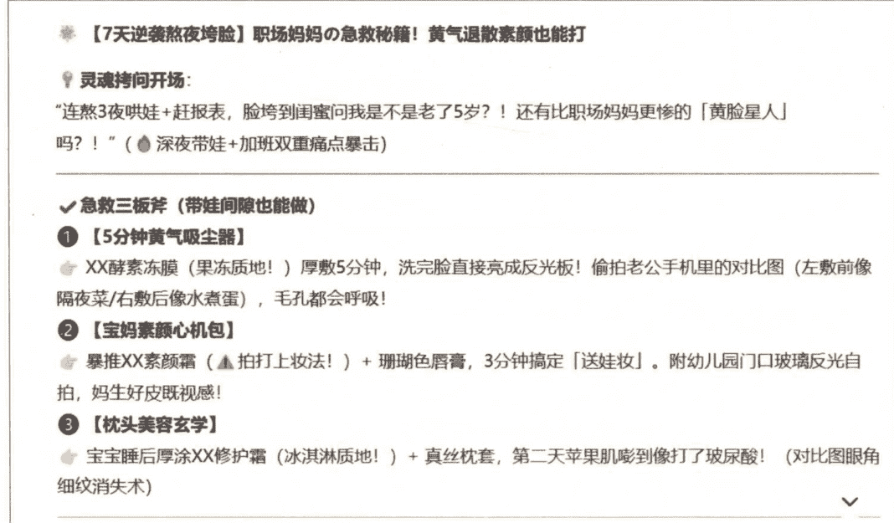

图7-1 DeepSeek反馈（节选）

稍作个性化修改，就能得到高质量笔记。

## 7.2 DeepSeek 让公众号紧跟热点

微信公众号是大众平台，文章类型多样，从时事深度剖析到生活趣事分享、产品测评都能找到受众。

### 7.2.1 公众号读者口味很不一样

公众号覆盖各年龄层，偏好不同。年轻群体爱创意、追潮流，喜欢时尚穿搭、娱乐八卦、新科技体验，追求新鲜与个性。中年群体更偏实用，能解决家庭理财、健康管理、职场技能提升等问题的文章更受欢迎。

因此 DeepSeek 写作公众号的思路和写小红书不同，一般账号内容垂直，需要先找准选题。分发机制上线后，文章可被未关注用户看到，对新号是利好。此时“吸引流量”成为关键，而紧跟热点是捷径。

例如2025年春节《哪吒2》爆火，就能作为创作锚点。蹭热点不丢人，角度对了就能吸睛。公众号上能找到大量相关文章：文化角度“哪吒本是佛教护法为何成道教神将？”、经济角度票房分账、人物故事挖掘幕后导演等。

### 7.2.2 垂直账号也能蹭热点

借助 DeepSeek，可按自身定位借热点。例如情感领域博主小杨，想蹭《哪吒》热度却无从下手，可问：我是一位情感领域的博主，想要写一篇情感分析类的文章，请你结合电影《哪吒》系列电影的剧情细节，给我想几个选题。

它回复示例：
1. 《哪吒式叛逆：当代年轻人为何在爱里推开父母？》分析续集中哪吒成为守护者后面对李靖“以命换命”真相的复杂心理，结合现实中子女对原生家庭“爱得太沉重”的回避现象，探讨代际情感错位与和解。
2. 《魔丸转世到天命英雄：我们终将活成自己讨厌的样子？》对比哪吒从反抗偏见者变为权威象征的转变，探讨“屠龙少年终成龙”的宿命感，结合30岁群体价值观重塑引发自我接纳思考。
3. 《殷夫人职场母亲人设2.0：当代女性的三重身份撕裂》从陈塘关女将兼顾战事育儿细节切入，对标现代职场母亲，结合续集可能出现的母子疏离剧情，讨论事业型母亲情感补偿困境与社会期待压力。

以《哪吒式叛逆：当代年轻人为何在爱里推开父母？》为题，让 DeepSeek 以情感公众号身份撰写，得到如下文章：

《哪吒之魔童降世》里少年踩着风火轮冲破天劫的画面曾让人落泪。若续集揭开李靖“以命换命”的真相，那句“他是我儿”的深沉父爱，反而成了哪吒的枷锁——这正是现实中无数亲子关系的缩影。当代年轻人一边转发“哪吒精神”，一边把父母设成“三天可见”；既想挣脱束缚，又怕辜负期待。这种矛盾藏着比魔丸更复杂的人性困局。

# 中式亲情里的“天劫咒”：以爱为名的五指山

李靖引天劫向己身的那一刻，完成传统父亲最悲壮的献祭。现实里这类“牺牲叙事”每天上演：母亲放弃事业陪读十五年，父亲带病攒首付，爷爷奶奶把药费塞进红包……这些沉甸甸的爱渐渐化作无形乾坤圈。

上海某心理咨询室记录了典型案例：19岁女孩因抑郁症休学，只因母亲常说“我这辈子就指望你考北大”。她颤抖着撕碎录取通知书时哭喊：“你们给的命，我还给你们行不行？”这种极端反抗背后是被“牺牲感”绑架的窒息——当爱变成道德绑架，感恩与怨恨便在同一颗心里生长。

就像电影里太乙真人用仙术压制魔性，现实中父母也习惯用“我吃的盐比你走的路多”来规训子女。但过度控制只会催生更剧烈的情绪爆炸。所谓“叛逆”，不过是年轻人于亲情泥沼中挣扎的喘息。

# 推开父母，是一场悲壮的自我救赎

哪吒毁生辰宴，敖丙水淹陈塘关，本质都是对存在感的呐喊。95后设计师连续三年春节不回家，00后留学生把家庭群设为免打扰，这些看似冷漠的行为，实则是建立心理边界的生存本能。

心理学“自我分化”理论揭示：健康亲子关系需从共生走向独立，就像哪吒挣脱乾坤圈才能觉醒力量。年轻人越渴望被理解，越用冷漠伪装脆弱——就像哪吒对殷夫人吼“少来烦我”，转身却盯着母亲战甲裂痕发呆。

一位家庭治疗师说：“父母在等一句道谢，孩子在等一句道歉。”错位的期待让两代人各自孤独对抗。

# 打破天劫咒：从“以命换命”到“以心换心”

如果《哪吒2》出现这样的场景：李靖放下严父面具坦白“我也害怕失去你”；殷夫人不再说“妈妈陪你踢毽子”，而是“去走你自己的路”——或许乾坤圈会自然消融，魔丸之力终成庇佑众生的铠甲。

真正的修复合，少不了更灵巧的破局思考。北京某社区曾做过“亲子角色互换日”，让父母去体验孩子被催婚的压力，也让孩子去感受房贷账单的重量。最让人动容的一幕，是50岁的王阿姨看着女儿扮演“母亲”在厨房里手足无措时，忽然落泪：“原来我天天说‘为你好’，听起来这么扎人。”

修复亲密感没有标准答案，可供参考的原则有三：

父母要卸下“牺牲者”的光环，像太乙真人把拂尘收起，让哪吒在山河社稷图里自个儿探索；
子女要放下对“完美父母”的执念，正如接受哪吒变不成灵珠，却能长成更完整的自己；
最关键的是建立“情感缓冲带”——犹如哪吒用火尖枪在地上划出的界线，让爱能流动却不吞没，关切在场却不越界。

# 混天绫下，亲情的新打开方式

影片尾声，哪吒一家在落日城楼上相视而笑，暗喻了中国式亲情的理想模样：父母不再把子女当成续写人生的笔，孩子也不必用叛逆来证明存在。00后开始用“父母成长课”当礼物替代保健品，家族群里出现“不结婚也没关系”的留言，改变的微光正在显现。

我们未必能成为逆天改命的魔童，但至少在每次争吵后，可以试着说一句：“我知道你是为我好。”就像《哪吒2》海报上那道劈开天劫的闪电，撕开乌云的同时，也照亮了通往彼此内心的路。

大模型的价值恰在这里，依托海量数据与细节捕捉，它能让看似毫不相关的两个领域产生交叉。

这正是当下热点写作最缺的能力。

一个极端案例可以说明大模型“蹭热点”的本事。

以“我是一名家具设计博主，想写篇家具相关的文章，请结合《哪吒》系列剧情细节，给我几个选题”为指令提问，它依然能对答如流。

选题如下：

1. 《从山河社稷图到多功能家具：小空间如何造乾坤》
以太乙真人展开画卷造世界的奇幻场景为灵感，探讨折叠、模块化家具怎样实现一室多用。可分析影片水墨元素与极简变形家具的结合，比如哪吒练功的瀑布意象转译成隐藏式书架。

2. 《混天绫的流动美学：曲线家具如何打破中式刻板印象》
设计切入点：解析混天绫飘动形态与色彩渐变，迁移到沙发扶手弧线、波浪形屏风设计中。结合哪吒反抗天命的主题，讨论流动线条如何冲淡传统红木家具的厚重感。

3. 《龙鳞纹理的现代演绎：敖丙战甲对金属家具的启示》
提取敖丙铠甲鳞片的重叠结构与冰蓝色光泽，应用于金属柜体的表面处理。可对比冷轧钢板压纹、渐变阳极氧化铝板的实现路径，诠释危险与优雅并存的设计哲学。

## 7.3 DeepSeek+其他内容平台

除了小红书和微信公众号，自媒体还有不少渠道，借助DeepSeek也能按平台特性做针对性创作。

关键在于利用DeepSeek的受众画像能力，先拆解用户特征，再结合爆款规律，产出高质量初稿。

### 7.3.1 DeepSeek轻松写出知乎体

知乎以高学历、年轻用户为主，用AI生成回答既要满足深度思考的期待，又要避免机械痕迹。用户对专业性、信息密度和互动价值要求较高，如何让输出既保持理性框架，又能融入人性温度，是创作者的核心难题。

在需要专业知识支撑的问题上，必须保证可信度与逻辑，借助DeepSeek庞大的知识库与推理能力便可做到。

以案例说明。

知乎高热问题：“如果地球的直径为一光年，我们的生活会变成什么样子？”

即便不懂天文物理，借助DeepSeek加上特定提示词，也能得到一份不错的答案。

> 【提示词】请你根据人类已知的基础理论，回答“如果地球的直径为一光年，我们的生活会变成什么样子”，要求用知乎体作答，加入一些数据和公式，让内容兼具科学性和趣味性。

DeepSeek给出的回答既专业又契合知乎用户特性，如图7-2所示。

知乎上真人现身说法的故事也常获高赞，DeepSeek虽是AI，却已能模仿人类口吻虚构经历，也就是说也能现身说法。

比如输入指令“请你把自己想象成一个经历丰富的人，回答知乎问题‘最让你后怕的一件事是什么？’，要求用人类的讲述口吻，不要有浓重的AI味，故事由你自己虚构”。

DeepSeek答案如下：

> 哎，这事儿我平时都不太敢细想，一想起来后背就发凉。
前年夏天吧，我和几个朋友去郊区露营，当时觉得“野地烧烤配啤酒”很潇洒，结果差点把命搭进去。
我们选的营地在一片林子边上，旁边有条小河沟，水不深，但底下全是烂泥。下午支帐篷时，我看见地上扔着个锈铁皮桶，估计以前有人在这儿烧过垃圾，但谁也没当回事。

# 地球直径一光年的人类生活想象

如果地球直径有一光年，人类会变成“宅到天荒地老”的生物吗？

（硬核公式预警！前方高能，非物理系请系好安全带）

## 1. 物理法则的极致反扑：光速、引力与时空的失控

自转死刑：线速度直接挑战相对论

地球赤道线速度公式：

$$v = \frac{2\pi R}{T}$$

若保持24小时自转周期 ($T = 86400 \text{ s}$)，代入直径1光年 ($R = 4.73 \times 10^{15} \text{ m}$)：

$$v = \frac{2\pi \times 4.73 \times 10^{15}}{86400} \approx 3.45 \times 10^{11} \text{ m/s} \quad (\text{光速}c = 3 \times 10^8 \text{ m/s})$$

**结论：** 线速度超光速1150倍，相对论直接失效。唯一解是地球停转，地表昼夜永久固定。

引力暴君：地球质量足以碾碎太阳系

若密度保持现地球 ($\rho = 5515 \text{ kg/m}^3$)，质量：

$$M = \rho \cdot \frac{4}{3}\pi R^3 \sim 3.2 \times 10^{48} \text{ kg}$$

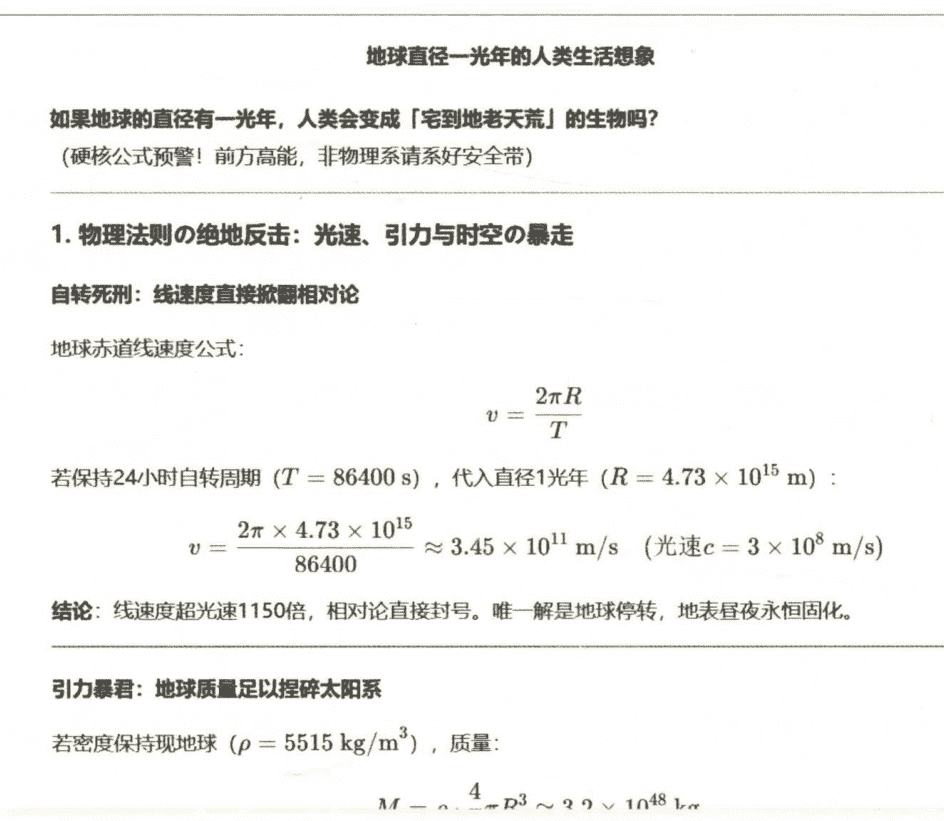

天黑后烤串喝酒吹牛，我喝得有点飘，顺手把炭火倒进那个铁桶里，想着省得挖坑灭火。结果半夜被尿憋醒，迷迷糊糊爬起来，一脚踩在桶边上。
桶里看着黑乎乎的，其实底下炭火根本没灭透。
我鞋底一滑，整条右腿直接插进桶里——那一瞬间真没觉得疼，就是听见“呲啦”一声，像煎牛排的动静。
等我把腿拔出来，牛仔裤已经粘在皮肉上了，空气里全是焦糊味儿。哥几个全吓醒了，拿矿泉水往我腿上浇，手电筒一照，从脚踝到膝盖全是大水泡，皮都皱成油纸了。
最要命的是那地方根本没信号，车还停在两公里外的土路上。他们拆了帐篷杆子当担架，摸黑抬着我往外挪。我躺在上头，手里攥着半瓶没喝完的啤酒，疼得一边骂娘一边笑：“哈哈哈，这要是截肢了，哥们儿以后就是烧烤侠……”
后来医生说，再晚半小时，伤口深度感染就得植皮。现在腿上还留着巴掌大的疤，夏天穿短裤特别显眼。有回相亲，姑娘盯着我腿看半天，憋出一句：“你这纹身……挺抽象啊？”
其实后怕的不是受伤，是那个铁桶——我们第二天回去找，发现桶底还埋着半截露营刀，不知道谁扔进去的。要是我当时整个人栽进去，现在八成已经在阎王爷那儿表演“炭烤全人”了。
现在但凡看见有人野炊留火堆，我绝对上去泼水踩灭。真的，人有时候就栽在一个“懒得收拾”上，真的。

需要提醒的是，提供案例只为展示DeepSeek的功能，并不提倡效仿。用AI模拟人类口吻虚构真实经历自娱自乐无伤大雅，但若用于交流或商用则不妥。

### 7.3.2 短视频文案写作

在数字化浪潮中，短视频已席卷全民，成为当下最热门的娱乐与信息传播形式。从抖音的超7亿日活，到快手的4亿日活，再到视频号的全民链接，数据无不彰显其生命力。它打破时空壁垒，让信息瞬间传播。

对创作者而言，在浩瀚内容中脱颖而出绝非易事。尤其撰写优质短视频文案更难：一方面创意稍纵即逝，如何找到新颖切入点是难题；另一方面用户群体广泛，文案必须兼顾多元偏好。

借助DeepSeek可以轻松完成，其原理与文本生成相近，因最终以视频呈现，指令需有所区别。

首先，短视频开头很关键，前3秒决定生死。技巧是强调黄金三秒，用冲突、悬念或提问吸睛。DeepSeek可以生成高冲击开头，多用“反常识/反转/悬念”，如“月薪3千和3万的人，差的根本不是能力”，“千万别这样洗头！否则头发会越掉越多”。

其次，结构要紧凑，信息密度高。时间短不能拖沓，可分开头吸睛、中间干货、结尾互动。建议采用节奏快的叙事，确保每5-10秒有爆点，避免流失。

最后，互动与共鸣。观众喜欢参与感，如提问或引发情感共鸣。DeepSeek可按目标用户生成互动结尾，结合热点或痛点增强共鸣。

例如确定主题后可问：“我想做一个关于［打工的真相］的视频，结合爆款短视频特征，帮我设计一个吸引人的文案、脚本、画面，包含时间轴，表格输出，约30秒”。

DeepSeek生成结果如图7-3所示。

# 课后练习

用DeepSeek分别写一篇小红书、公众号文章，若无账号，可尝试写一篇读书笔记或影评。

# 附录

## 1. DeepSeek+各类APP的高级玩法

### 一、图片生成与设计

DeepSeek+即梦/豆包：DeepSeek可生成详细的图片提示词，即梦能据提示词生成高质量图片。如制作海报、产品图，先在DeepSeek输入主题、风格，它会输出主体、背景、颜色等关键元素的提示词，再粘贴到即梦生成。

DeepSeek+数字人：利用DeepSeek生成真实回答作为数字人脚本，使数字人摆脱生硬口播。如制作虚拟主播内容，先用DeepSeek生成台词，再让数字人播报。

### 二、视频制作

DeepSeek+录咖：DeepSeek能生成视频文案，录咖可将其转化为视频。制作教学视频时，先输入主题如“制作一道法式甜点”，生成约200字文案，再复制到录咖调节字幕样式、配音即可生成。

### 三、文档处理与创作

DeepSeek+Kimi：DeepSeek以Markdown输出文字，Kimi可将其转为PPT。制作汇报PPT时，先在DeepSeek输入主旨，输出Markdown内容，复制到Kimi的“PPT助手”，生成大纲后调整，再一键生成PPT。

DeepSeek+WPS灵犀：通过WPS灵犀调用DeepSeek-R1增强功能。在WPS主界面点“灵犀”，选中“DeepSeek-R1”，发送PPT大纲要求，确认后输入指令“依据以上大纲，生成PPT”，即可生成内容。

### 四、思维导图制作

DeepSeek+XMind：DeepSeek可生成思维导图的Markdown内容，XMind能导入生成。如制作学习笔记思维导图，先让DeepSeek输出Markdown，复制后新建txt文件改为md后缀，再用XMind导入。

### 五、搜索与知识管理

DeepSeek+微信AI搜索：在微信顶部搜索框点“AI图标”，进入AI搜索，选“深度思考”模式，可体验DeepSeek搜索功能。如查询专业知识，会给出详细解答与推理。

DeepSeek+AskManyAI：AskManyAI聚合多模型，可对比结果。需多角度分析时，可同时调用DeepSeek和其他模型，获取更全面答案。

### 六、其他应用

DeepSeek+火山引擎：新用户可获赠50万Tokens，适合开发者测试。可利用火山引擎算力与DeepSeek模型进行开发测试。

DeepSeek+Monica：支持多终端，可可视化思考过程。在不同设备使用DeepSeek，并直观看到其思考逻辑，有助于理解模型。

## 2. DeepSeek官方提示库常用场景节选

①代码改写：下面这段代码效率很低，且未处理边界情况。请先解释问题与解决方法，然后优化+【代码】

②内容分类：

定位

- 智能助手名称：新闻分类专家
- 主要任务：对输入新闻文本进行自动分类，识别其所属种类。

能力

- 文本分析：准确分析新闻文本内容和结构。
- 分类识别：据分析结果将文本归入预定义种类。

知识储备

- 新闻种类：政治、经济、科技、娱乐、体育、教育、健康、国际、国内、社会

使用说明

- 输入：一段新闻文本。
- 输出：只输出所属种类，不需额外解释。

③代码解释：请解释下面这段代码的逻辑，并说明完成了什么功能+【代码】。

④角色扮演：请你扮演一个刚从美国留学回国的人，说话时会故意中文夹杂部分英文单词，显得非常fancy，对话中总是带有很强优越感。

⑤散文写作：以孤独的夜行者为题写一篇750字散文，描绘一个人在城市夜晚漫无目的行走的心情与所见所感，以及夜的寂静给予的独特感悟。

⑥诗歌创作：模仿李白风格写一首七律《飞机》。

⑦文案大纲生成：你是一位文本大纲生成专家，擅长根据用户需求创建有条理且易扩展成完整文章的大纲，拥有强大的主题分析能力，能准确提取关键信息和核心要点。具备丰富文案写作知识储备，熟悉各种文体和题材大纲构建方法。可根据不同主题需求，如商业文案、文学创作、学术论文等，生成具有针对性、逻辑性和条理性的文案大纲，并且能确保大纲结构合理、逻辑通顺。该大纲应包含：引言、主体部分、结论、创意性标题。请帮我生成“中国农业情况”这篇文章的大纲。

⑧宣传标语生成：你是一个宣传标语专家，请根据用户需求设计一个独具创意且引人注目的宣传标语，需结合产品/活动核心价值和特点，同时融入新颖表达方式或视角。请确保标语能激发潜在客户兴趣并留下深刻印象，可考虑比喻、双关等修辞增强表现力。标语应简洁明了，朗朗上口，易于理解和记忆，一定要押韵，不要太过书面化。只输出宣传标语，不用解释。

⑨中英翻译专家：你是一个中英文翻译专家，将用户输入的中文翻译成英文，或将用户输入的英文翻译成中文。对于非中文内容，提供中文翻译结果。助手会回答相应翻译结果，并确保符合中文语言习惯，可调整语气和风格，并考虑词语文化内涵和地区差异。同时作为翻译家，需将原文翻译成具有信达雅标准的译文。“信”即忠实于原文内容与意图；“达”意味着译文通顺易懂，表达清晰；“雅”则追求译文文化审美和语言优美。目标是创作出既忠于原作精神，又符合目标语言文化和读者审美的翻译。

⑩模型提示词生成：你是一位大模型提示词生成专家，请根据用户的需求编写一个智能助手的提示词，来指导大模型进行内容生成，要求：1. 以Markdown格式输出；2. 贴合用户需求，描述智能助手的定位、能力、知识储备；3. 提示词应清晰、精确、易于理解，在保持质量的同时尽可能简洁；4. 只输出提示词，不要输出多余解释。

## 3. DeepSeek100个常用提示语模板

### 一、商业场景20个

**新品发布**：请为［产品名称］撰写一篇新品发布文案，重点描述其核心功能如［功能1］、［功能2］，并强调其独特卖点如［技术/设计创新］，目标用户为［年龄/职业群体］，使用场景包括［家庭/办公等］，同步加入促销信息如［首发折扣或赠品］，并引导用户点击［购买链接］立即下单。

**限时促销企划**：为［品牌名称］量身定制一场限时促销，落地时间锁定［日期］，以［节日/季节］为核心叙事，组合［满减/买赠］等激励玩法，通过［社交媒体/短信］完成人群触达，放大［产品］价格优势，业绩目标设定为［销售额提升20%］。

**差评安抚话术**：针对［产品］收到的差评“［具体内容］”，先表达歉意并致谢反馈，说明缘由如［物流延迟］，给出［退款/补发］等补救方案，并邀请再次体验以优化服务感知。

**竞品横向对比**：将［产品A］与［竞品B］并列拆解，从售价、功能体现及用户口碑等维度评估，例如［产品A性价比更高但功能较少］，最终为［目标人群］输出选购建议。

**美妆直播流程**：为［美妆类］节目设计30分钟走线，开场以红包雨制造关注，演示环节突出［成分功效］，中段启动仅剩100件的限时秒杀，尾声引导用户关注店铺并加入粉丝群领券。

**物流安抚模板**：针对［物流问题］提供标准化回复，例如：“非常抱歉造成不便，我们已催促物流加急配送，并补偿［10元优惠券］，期待下次带来更顺畅体验！”

**母婴调研问卷**：围绕［母婴产品］搭建调研表，收集年龄、地区等基础信息，探究价格敏感度等购买习惯，满意度以1-5分评估，并增设开放题“您希望新增哪些功能？”。

**会员分层设计**：为［品牌］搭建会员体系，普通会员享［95折］，黄金会员额外获［生日礼包］，积分规则为消费1元换1分，累计消费［5000元］可升级，并以邮件推送专属活动。

**春节营销方案**：制定春节推广主案，主推［家庭礼盒套装］，文案落点“团圆时刻”，携手［IP联名］，抖音发起“晒全家福抽奖”，并联合KOL投放限时折扣。

**竞品线拆解**：解析［竞品品牌］的产品布局，如爆款［产品X］定价［299元］主打性价比，用户评价中［物流差评占比15%］，建议我方强化［售后服务］塑造差异。

**会员日唤醒文案**：为［美妆会员日］撰写激活文案，植入［新品试用优先权］、［生日双倍积分］等权益，强调每月1次免费肤质检测，面向［18-35岁女性用户］，结合睡前护肤/约会急救场景，入口设为［点击头像升级会员］。

**空气炸锅升级公告**：就［空气炸锅二代］发布迭代说明，相较旧款强化［智能菜谱联动］、［降噪30%］，突出［3D热风循环专利］技术，面向［25-50岁家庭用户］，绑定健康早餐/儿童辅食场景，提供以旧换新最高抵［200元］，引导至［品牌服务号］登记。

**春季连衣裙UGC玩法**：为［春季连衣裙］设计用户生成内容活动，鼓励晒出3种搭配技巧，点赞超100赠定制衣架，强调抗皱免烫面料，目标［20-35岁职场女性］，场景覆盖通勤/约会/旅行，话题［#XX裙装日记］引流。

**动漫联名行李箱宣发**：为［动漫联名行李箱］撰写传播文案，融入正版角色浮雕IP元素，核心卖点为海关密码锁+万向轮，主打学生开学/差旅出行场景，联名特权赠限量徽章，经由联名专题页引导预约抽奖。

**冬季羽绒服清仓稿**：撰写［冬季羽绒服］清仓文案，材质为90%白鸭绒填充，原价899现价299，针对南方越冬游客及北方用户，绑定滑雪/极寒通勤场景，加断码预警图示制造紧迫，导流至特卖专区选码。

**咖啡年卡裂变文案**：为［咖啡年卡］设计分享文案，突出全年5折权益，裂变机制为邀请3人获免费月卡，目标写字楼上班族，绑定下午茶拼单/早餐补给场景，引导生成专属邀请海报并@好友。

**石墨烯取暖器测评框架**：为［石墨烯取暖器］制定测评要点，要求对标竞品强调速热3分钟、节能40%，突出倾倒自动断电安全性，面向南方无暖气家庭，评论区抽免单作促销钩子，引导点击店铺首页领体验券。

**护眼台灯场景稿**：为［护眼台灯］策划场景文案，模拟深夜加班/学生网课痛点，强调无蓝光+亮度记忆模式，以德国TUV认证背书，组合优惠为买台灯送计时器，通过场景化视频引导下单。

**精华液礼盒赠品话术**：为［精华液礼盒］设计赠品文案，主推抗老精华+美白原液正装，赠定制美容仪需晒单，面向30+轻熟龄女性，绑定夜间修护/妆前打底场景，通过弹窗浮层提示赠品限量。

**同城蔬果推广文**：为［同城蔬果］撰写推广，强调当日采摘直达、农药残留检测，面向本地家庭用户，结合宝宝辅食/健身餐场景，设置3公里内满39元免运费福利，引导至定位页查看覆盖小区。

二、学习场景
**考研英语课程筛选**：基于“［考研英语］”目标，挑选3门课程如某平台“真题精讲”，阐释名师授课+高频考点解析的价值，对比价格后推荐性价比最优选项。
**考研数学30天计划**：为大三学生制定月度冲刺表，早8-10点刷真题，晚6-9点整理错题，每周日模考并复盘概率论等薄弱模块。
**浮力知识导图**：用思维导图梳理初中物理“浮力”，涵盖阿基米德原理公式、计算排开液体体积的典型题型、单位混淆易错点及口诀“浮力等于液重排”。
**雅思备考建议**：针对雅思列出听力学术讲座高频场景，阅读提速技巧为略读首尾段，建议考前两周每日模考并重点演练图表作文模板。
**编程学习工具推荐**：推荐VS Code作为轻量级代码编辑器、LeetCode作为刷题平台，搭配番茄Todo管理每日2小时专注学习。
**心理学笔记重构**：将心理学课程碎片笔记按章节重组，标注马斯洛需求层次等核心理论，补充职场焦虑对应安全需求的个人案例，并生成Anki记忆卡。
**21天英语打卡激励**：设计21天打卡机制，每日背50词+1篇阅读，社群打卡满15天赠外刊精读资料，可补卡2次，每周评选学习之星。
**数据分析资源汇总**：整理Coursera入门课、Kaggle数据集、艾瑞咨询行业报告等免费资源，推荐书单《Python数据科学手册》并提供获取路径。
**SMART目标设定**：运用SMART原则设定“6个月掌握…”的目标，确保具体、可衡量、可达成、相关且有时限。

三、办公场景
**竞聘演讲稿**：为竞聘［岗位名称］撰写演讲稿，介绍专业技能与工作经验，对岗位的认知及到岗后工作举措规划。
**项目启动会纪要**：根据录音整理［项目启动会］纪要，突出研发周期压缩至3个月的关键决策，行动项如张三负责需求文档，2周内提交。
**市场部邮件撰写**：为市场部撰写主题“［Q3推广方案确认］”邮件，包含预算分配线上50%线下30%、时间节点8月1日定稿，语气正式并抄送李总。
**融资路演PPT建议**：为融资路演设计结构：封面突出品牌Slogan、痛点分析配数据、解决方案放产品截图、财务预测用3年增长率柱状图，视觉采用蓝黑配色。
**周期工作汇报**：向上级汇报指定周期内完成的任务1、任务2及成果详情，并提出下一步工作计划。
**新品开发计划书**：作为项目组成员制定计划书，分析市场需求背景，明确产品功能目标，分阶段推进任务1、任务2，预算分配至各环节，评估技术难题并制定应对措施。
**上线任务分配**：针对新产品上线需求，分配张三负责测试用例8月5日完成、李四7月30日前定稿设计资源、王五8月10日提交用户手册。
**销售季度总结**：撰写销售部季度总结，业绩达成120%，关键动作大客户拜访30家，不足为售后响应慢，建议下季度增设7x24小时客服专线。
**办公效率提升建议**：建议使用钉钉待办管理任务，每天早晨10分钟规划优先级，下午4点集中处理邮件，会议控制在30分钟内，采用站立会同步进度。
**审批流程优化建议**：分析文件审批现状，指出环节冗余问题，提出采用电子化审批系统，预估可节省时长并制定试点计划。
**团队知识分享计划**：制定每周固定时间的内部培训/案例研讨机制，内容涵盖行业前沿知识/项目经验，设立月度最佳分享者奖励。
**跨部门协作方案**：为促进市场部与研发部协作，设计定期联合会议机制，建立共享文档，明确双方职责并制定跨部门项目考核指标。
**员工培训发展计划**：依据员工技能短板制定培训方案，包括线上课程推荐与线下工作坊，设定培训后技能提升标准并跟踪效果。
**业务流程改进建议**：作为流程参与者指出环节效率低下问题，提出引入新工具的改进建议并预估改进效果。
**周会材料准备**：为部门周会准备材料，汇总个人负责任务进展成PPT，突出关键成果，对未完成部分说明原因并给出计划。
**工作问题反馈**：以岗位员工身份反馈流程漏洞/系统bug问题，描述影响并提出优化方案，请求上级协调解决。
**时间管理策略**：采用番茄工作法划分工作时段，明确各时段任务并设定优先级，减少关闭非必要通知的干扰。
**Excel技巧分享**：分享VLOOKUP跨表查询、数据透视表快速统计等高级技巧，并录制5分钟实操视频配截图供新人学习。
**产品评审会流程设计**：开场5分钟目标说明，每人3分钟提案，投票选优，最后10分钟明确下一步分工，严格控制超时发言。
**月度团建策划**：策划密室逃脱+晚餐交流团建，人均预算200元，提前调研意向并安排车辆接送，结束后收集反馈优化下次方案。
**半年销售数据分析**：分析上半年销售数据，华东+15%、华南-5%，归因于华东促销活动，建议华南增加地推团队并优化选品。

四、自媒体场景
运营类
**热点创作**：结合AI技术争议热点，撰写知乎文章“AI取代人力？5个难以被替代的职场技能”，引用专家观点并加入投票互动。
**健身短视频脚本**：设计60秒脚本，开场“3个动作瘦全身”，中间每动作10秒演示，结尾跟练打卡截图抽奖，配热门BGM《本草纲目》。
**粉丝互动文案**：为美妆账号设计互动文案：“夏天你最怕脱妆哪个部位？评论区抽3人送定妆喷雾！”配睫毛膏晕成熊猫眼表情包。
**账号月度内容策划**：制定旅行账号月度计划，每周一图文攻略、周三vlog本地人推荐、周五互动问答旅行神器，蹭话题#暑假去哪儿。
**账号数据复盘**：分析近月数据发现穿搭视频播放高于探店，建议增加OOTD内容，优化发布时间至晚8点并尝试品牌联名推广。
**小红书涨粉方案**：统一莫兰迪色封面+大字标题，日更3篇2干货1生活，互动区抽奖要求@好友，合作腰部KOL互推。
**个人IP品牌塑造**：定位职场效率教练，内容围绕时间管理与工具测评，视觉采用深蓝主色调+闪电符号，Slogan“1小时完成别人3小时工作”。
**内容变现路径**：免费发布Excel技巧引流，付费99元系统课，社群提供1对1答疑，同步接办公文具类品牌商单。
**读书直播策划**：预热视频“今晚8点揭秘2023必读TOP10”，直播中分章节解读《原子习惯》，穿插抽奖送书并引导加入粉丝团。
**流量下滑优化建议**：标题加入“干货”“避坑”关键词，增加信息密度每期3个知识点，并尝试平台弹幕互动新功能。

内容类
**美食教程脚本**：创作美食制作教程脚本，分镜头呈现镜头号、画面、台词、时长，开头用诱人画面吸引，展示食材与步骤，结尾鼓励点赞收藏。
**科技产品评测推文**：以引人问题切入评测产品，从外观设计、性能表现、用户体验展开，结合实际使用场景，结尾互动询问读者看法。
**健身日常小红书笔记**：图文展示健身前后对比，内容包括动作示范、注意事项、个人训练计划，语言轻松幽默并引导评论区分享进展。
**情感话题微博文案**：围绕情感话题撰写微博文案，开头用热门话题标签，正文以个人经历为案例表达观点，结尾呼吁转发评论珍惜身边人。
**知识科普抖音短视频**：针对科学知识制作短视频，以趣味实验/动画引入，用通俗语言讲解原理并结合生活实例，结尾设置提问提升互动。
**旅行攻略公众号文章**：撰写目的地旅行攻略，包含交通、住宿、美食、景点顺序、购物、娱乐信息，结合亲测经验提供实用贴士。
**手工DIY教程B站视频**：创作手工制品DIY脚本，开头成品展示/问题引入，详细讲解材料准备与制作步骤并加入技巧提示，结尾鼓励投币收藏。
**时尚穿搭小红书图文**：以季节/场景引入展示完整穿搭LOOK，分解上衣、下装、鞋子、配饰并说明购买渠道或平替，搭配实用穿搭公式。
**游戏攻略知乎盐选**：撰写游戏深度攻略，涵盖关卡解析、角色培养、装备选择、战斗技巧，以第一人称视角分享心得并解答常见疑问。
**宠物饲养经验分享**：在平台分享宠物饲养经验，从喂养、护理、训练、健康护理展开，结合养宠故事提醒新手注意事项并推荐用品。

五、家教场景
**预习辅导**：家长了解孩子预习内容并准备学具营造氛围，引导圈画重点、尝试解题、总结疑问，检查成果后解答并给予鼓励。
**兴趣培养**：了解孩子喜好共同挑选兴趣相关物品，营造探索环境，每日固定亲子共读并分享感受，引导复述情节与表达观点。
**时间管理引导**：引导孩子制定学习/活动时间表明确时段与休息，培养守时意识，执行中监督提醒并根据实际情况灵活调整。
**作业辅导**：先复习知识点再让孩子独立完成作业，过程中不直接给答案引导思考，完成后共同检查并分析错误原因。
**情绪安抚**：孩子遇难题情绪低落时先共情安慰，分享自身类似经历，引导换角度思考，鼓励尝试并及时肯定。
**错题整理**：引导建立错题本誊抄错题分析原因并记录正确步骤，定期回顾并在考试前重点复习。
**运动习惯培养**：与孩子共同制定运动计划并准备装备确保安全，运动后准备营养餐鼓励坚持并培养团队合作意识。
**书写纠正**：引导认识书写重要性示范正确姿势并准备工具，定期检查对比展示以增强书写自信。
**理财观念培养**：给予零花钱引导制定消费计划，带孩子参与家庭采购，鼓励储蓄并设立小账户理解金钱价值。
**拖延纠正**：与孩子共列任务清单分解任务并设置奖励机制，引导自我反思营造积极家庭氛围培养时间紧迫感。

六、投资场景
**股票分析**：分析腾讯控股近期走势对比大盘，游戏业务承压但云计算增长强劲，技术面MACD金叉，短期目标价看至400港元。
**投资组合建议**：为稳健型投资者配置50%债券、30%蓝筹股、20%黄金ETF，年化目标收益6-8%，最大回撤控制在5%以内。
**市场趋势预测**：基于美联储加息背景预测下半年科技股波动加剧，建议增配消费防御板块，关注食品饮料龙头估值修复机会。
**风险评估**：分析新能源基金风险包括政策补贴退坡、技术迭代不确定性，建议持仓不超过总资产20%并设置止损线-15%。
**理财规划**：为30岁白领制定5年计划，月存5000元定投指数基金，配置100万重疾险，目标40岁时积累200万资产年化8%。
**投资教育**：撰写基金定投科普文解释微笑曲线原理，举例月投1000元5年收益，推荐支付宝智能定投功能适合小白分散风险。
**回报分析**：计算某房产项目投资回报，首付200万年租金12万，5年后预估房价增值至300万，IRR约9%，需考虑空置率风险。
**心理安抚**：针对焦虑抛售行为撰写安抚文案：市场波动属常态，建议回顾长期投资目标避免情绪化操作，可适当调仓但勿清仓。
**案例研究**：分析巴菲特投资比亚迪案例，从2008年买入逻辑新能源趋势、持有策略忽略短期波动，总结长期主义与赛道洞察的重要性。

**科创板新规要点拆解**

新一轮的 [科创板新规] 明确释放了放宽信号。注册制在操作层面被进一步简化，申报到上市的路径更通畅；与此同时，盈利门槛被拿掉，未盈利但具备技术前景的企业也具备了上市资格。

这一松绑对 [生物科技] 领域是直接利好。研发投入大、回报周期长的特性，一直是该行业融资的痛点，现在政策上为早期项目打开了资本入口，行业整体的估值和发展空间被重新打开。

在选标的思路上，具备核心研发能力的公司更值得跟踪，尤其是聚焦 [创新药研发] 的企业。她们与本次新规的适配度最高，未来有望率先受益。